# ChatGPT 核心拆解：预训练、迁移与中间件实战

# 前言

身为高校计算机科研人员，同时也是创业多年的老兵，我在亲手体验 ChatGPT 的推理与逻辑后被强烈震动。外界大多在为生成式人工智能拉动多模态创作效率而喝彩，却容易忽视它在推理能力上的质变。这种推理强度让 ChatGPT 不仅可以成为新一代人机交互的主体，还能以智能代理的形态搭建半自动甚至全自动的工作链条，甚至向工业控制、机器人等领域延伸，带来深层的社会擘画。

不少人仍低估这波冲击的规模。按现有研发与商业落地的节奏判断，未来三到五年内，这类变化将逐步渗入生活与生产的方方面面，大幅提升既有生产力。若回看上一次被称作巨型技术变革的时期，多半会指向互联网诞生期。此次浪潮同样会重塑内容生产的商业逻辑，改变工作样态，乃至推动生产方式转型。关键的先决条件，是下一代大语言模型在内容可控性上取得实质突破。

**本书在讲什么**

本书意在帮助读者透彻理解 ChatGPT 及其相关技术体系。全书共 11 章，多角度展开。第一章梳理大型语言模型的技术演进脉络及其社会影响。第二章拆解 Transformer 的理论根基与关键组件。第三章聚焦 GPT 的生成式预训练流程与原理。第四章围绕 GPT-2 的层归一化、正交初始化、可逆分词等技术，并细究其自回归生成机制。第五章介绍 GPT-3 的稀疏注意力、元学习、基于内容的学习思路，并探讨贝叶斯推断在概念分布中的应用。第六章详述大语言模型的预训练语料、数据处理方法，以及分布式训练的模式与路径。第七章深入 PPO 算法的原理。第八章阐述人类反馈强化学习的微调数据与 PPO 在 InstructGPT 中的实践，并讨论多轮对话能力与人类反馈强化的必要性。第九章探讨低算力环境下大语言模型的应用策略。第十章介绍大语言模型开发中的中间件编程技术。第十一章对大语言模型的发展趋势作出预测与展望。

**适合谁读**

❑人工智能方向的产品经理。希望在自有产品中嵌入 AI 能力的产品经理，需要先弄清 ChatGPT 等大语言模型的工作原理与运行机制。本书可帮助其把握模型的设计思想与构造方式，理解如何将模型集成到产品中，并更精准地定位性能瓶颈，为产品规划提供依据。

❑人工智能相关专业的研究人员。对 Transformer 细节、GPT 训练与优化技巧感兴趣的研究者，可将本书作为深入学习的参考资料。书中还涉及人类反馈强化学习、指令自举标注等前沿议题。

❑负责大规模数据处理与分析的工程师。面对高效处理海量数据、构建分布式训练架构等挑战时，第六章关于数据处理与分布式训练的讨论能提供思路与建议。

❑AI 技术爱好者与普通使用者。对技术充满好奇、喜欢用技术改善生活的人也适合阅读。本书对大语言模型的介绍通俗易懂，并提供大量可直接迁移到工作与生活中的使用技巧与案例。

**联系作者**

作者写作经验有限，书中难免有不妥之处。如阅读过程中有疑问或建议，欢迎通过邮箱 chenggextu@hotmail.com 联系。期待你的反馈，这对后续写作意义重大。希望阅读能带来启发，加深你对大语言模型与人工智能的认知。

**致谢**

首先感谢家人。写作期间陪伴时间减少，他们始终给予支持与理解，让我能全身心投入。

其次感谢机械工业出版社的编辑团队，正是他们的专业与严谨让本书顺利出版。

最后感谢研究生尹智斌、罗琦凡、庾志文、余江楠和杨金，他们绘制了大量插图。

# 第一章

# AI 新标杆：ChatGPT 的崛起

OpenAI 于 2022 年 11 月对外发布对话式 AI 应用 ChatGPT。该系统应用场景广泛，在多项专业与学术评测中展现出接近甚至超出人类平均水平的智力表现，上线即获广泛关注，被业界视作人工智能领域的新里程碑。

## 1.1 ChatGPT 的发展脉络

让计算机像人一样交流是半个多世纪以来的追求。1966 年，MIT 的约瑟夫·维森鲍姆教授打造了首个聊天程序 ELIZA。此后人们见证了苹果 Siri、微软小冰、智能音箱以及各类智能助手的兴起，它们早已融入日常。

这些早期产品共性明显：人工智能属性外露，人机对话水平仍有差距。而 ChatGPT 不同，它既能进行复杂的多轮文本对话，也能写代码、撰写营销文案、诗歌、商业计划与电影剧本。尽管偶有失误，其能力已是最接近图灵测试的人工智能系统之一。

ChatGPT 背后是 OpenAI。该机构由埃隆·马斯克、Y Combinator 总裁山姆·阿尔特曼、PayPal 联合创始人彼得·泰尔等人于 2015 年在旧金山创立，最初为非营利 AI 研究机构，总部位于加州硅谷，首轮融资即达 10 亿美元。

Transformer 架构由谷歌大脑团队在 2017 年论文《Attention is all you need》中提出。如今它已成为 AI 发展的重要节点，虽未完全取代循环神经网络与卷积神经网络，但在自然语言处理与计算机视觉等领域展现出卓越效果，成为基础架构。如图 1.1 所示，OpenAI 在 Transformer 基础上持续深耕 NLP，最终孵化出 ChatGPT。

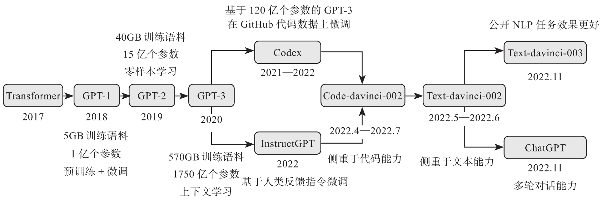
图 1.1 GPT 系列进化时间线

2018 年，OpenAI 首次面世生成式预训练模型 GPT-1。该模型借助大规模未标注数据预训练提升语言处理能力，并通过有监督微调实现多任务泛化。

2019 年 3 月，OpenAI 从非营利组织转为有限盈利组织，引入微软作为战略投资者并成立 OpenAI LP。同年 7 月微软追加 10 亿美元投资，获得技术商业化授权。同年面世的 GPT-2 基于更大规模的 WebText 语料，约 40 GB 文本、800 万文档，参数量达 15 亿，进一步提升准确率，并提出零样本学习，验证了无监督学习的价值与预训练模型在下游 NLP 任务中的广泛适用性。

2020 年 6 月，OpenAI 公布 GPT-3 并上线首个产品 OpenAI API，正式进入商业运营。同年 9 月授权微软使用 GPT-3，使其成为全球首家使用该模型的公司。GPT-3 最大版本拥有 1750 亿参数，是 GPT-2 的约 117 倍，并提出上下文学习，采用 Prompt 适配下游任务，涌现出思维链等多种能力。

2021 年微软再次加码投资。2022 年 11 月在微软支持下，OpenAI 发布基于 GPT-3.5 并采用 InstructGPT 类似人类反馈强化学习的 ChatGPT，上线仅两个月全球活跃用户突破 1 亿。2023 年初，OpenAI 推出 ChatGPT Plus 订阅服务，并发布具备多模态处理与推理能力的 GPT-4，为 Plus 用户提供自然语言版本的 GPT-4。

## 1.2 ChatGPT 的能力边界

2023 年 3 月 15 日公布的 GPT-4 演示视频中，模型成功识别气球图片，并对“剪断绳子会怎样”的指令推理出“气球将飞走”，如图 1.2 所示。该案例表明 GPT-4 已能对图像等多模态数据进行读取与综合推理。凭借庞大参数量，它不仅能解读表层信息，还能把握深层含义，在全球引发震动，也让人思考是否正迈向通用人工智能，甚至强人工智能。

回溯 20 世纪 70 年代，学界即指出智能不应局限于单一任务。过去十年，AlphaGo 的围棋、AlphaFold 的蛋白质解析、YOLO 系列的视觉检测等都是狭义智能的代表。通用人工智能的概念由此凸显，与狭义 AI 形成对比，学界与业界对其定义尚未完全统一。

图 1.2 GPT-4 气球图片多模态推理演示

ChatGPT 虽以聊天为主，却用途极广。可编写调试程序，模仿名人风格制作商业宣传单，创作音乐、电视剧、童话、学生作文、诗歌，也可模拟 Linux 系统、聊天室甚至 ATM 运行。

如图 1.3 所示，在各类专业与学术基准测试中，GPT-4 的表现达到人类水平。在模拟统一律师资格考试中，其成绩位于考生前 10%，大幅超越多数考生。其他测试中亦保持领先。这些高分既体现更真实合乎逻辑的推理，也体现更强的问题处理力。

尽管 GPT-4 在考试与翻译编程中表现突出，并能提供创新思路，评估其智能程度的方式仍需探讨。训练数据覆盖互联网绝大部分信息，特定任务上难以判断是记忆复现还是真正理解，这正是评估的关键。

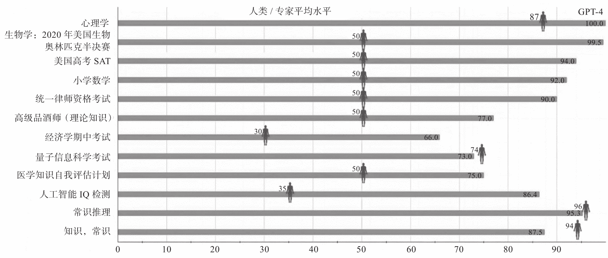
图 1.3 GPT-4 与人类考试水平对比

（图片来源：https://lifearchitect.ai/iq-testing-ai/）

从人类自省智能角度看，多领域理解是核心。评估 GPT-4 可从以下维度展开。

❑任务表现：在考试、翻译、编程、创新思维生成等多种场景中的实际表现，是衡量能力的直接指标。GPT-4 已在诸多专业与学术测试中展现超常水准。

❑知识理解与应用：判断模型是否真正理解所学知识并灵活运用。真正的智能体应在不同情境下理解并迁移知识。ChatGPT 在编写调试程序、模仿风格撰写文案、创作音乐与剧本等方面展示了较强理解与应用能力。

❑泛化能力：在新任务与未见数据面前的表现。尽管训练数据存在时效性局限，ChatGPT 仍能在新问题与情境下给出创新解法，而非仅依赖已有模式。

❑自主学习与推理：通过少量示例注入新知识，ChatGPT 展现出自主学习与推理能力，能在多任务中发现规律并进行推理。

综合任务表现、知识理解与应用、泛化能力、自主学习与推理，GPT-4 代表了当前人工智能研究的最高水准，是迄今最接近通用人工智能的产品。这种变革对生活方式的影响将在未来几年愈发明显。

## 1.3 大语言模型的技术演进

### 1.3.1 从符号主义到连接主义

ChatGPT 的核心是自然语言处理。早期 NLP 通过符号表达现实并依赖预设规则推理，在知识库中检索后进行逻辑运算。但符号主义难以应对语言的多样性与歧义，鲁棒性与泛化能力有限，随着语言现象复杂化，手写规则数量爆炸，处理统计特征变得困难。

机器学习与深度学习的兴起推动 NLP 进入数据驱动时代。机器学习可在预设函数空间中寻找最优映射，但并未根除规则设计问题，特征工程成为关键，却仍在鲁棒性与泛化上受限。

深度学习引发 NLP 革命。早期文本生成主要依赖循环神经网络、长短时记忆网络或门控循环单元，三者均为循环结构，擅长序列任务。

RNN 通过引入记忆处理序列依赖，并学习上下文模式。但其记忆短暂。为此出现 LSTM 与 GRU，它们通过门控机制调节信息流动，保留重要信息、丢弃冗余，从而在长序列计算中传递有价值数据。

RNN 架构在大语言模型中仍存在不足：

1）并行计算能力不足。RNN 必须按序处理每个时间步，难以充分利用 GPU 并行能力，影响训练效率。

2）长程依赖问题。LSTM 与 GRU 虽有所改善，但在超长序列上仍困难。

3）模型容量限制。容量相对较小，难以在大规模训练中获取丰富语义并构建复杂表示。

### 1.3.2 Transformer 架构

GPT 系列基于 Transformer，由 Vaswani 等于 2017 年提出。其核心是自注意力机制，对每个输入元素分别计算查询、键、值向量，通过矩阵运算计算元素间关联度并生成最可能序列，从而捕捉长程依赖。

与 RNN 相比，Transformer 的自注意力可并行处理整个序列，充分利用并行计算并提升训练效率。同时能直接捕捉任意位置间的依赖，有效解决长程依赖问题，具有良好的扩展性，便于扩大模型规模以捕捉更多信息。因此它已成为自然语言处理、视觉处理与多模态处理的基础架构。

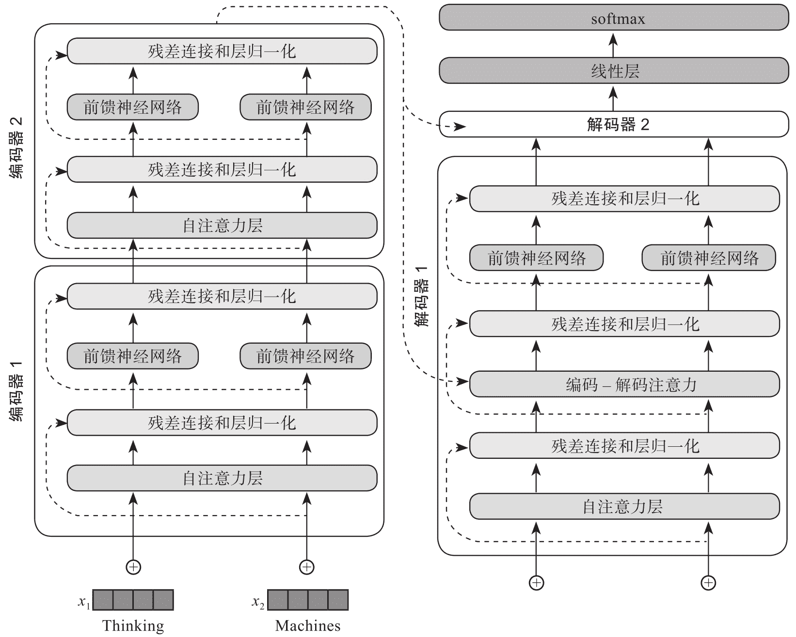
图 1.4 Transformer 模型

（图片来源：http://jalammar.github.io/illustrated-transformer/）

值得注意的是，原版 Transformer 包含编码器-解码器结构，而 GPT 仅采用解码器部分。如图 1.5 所示，编码器与解码器均由 N 个相同层堆叠。源序列与目标序列经嵌入层处理后维度一致。每个编码器层包含多头注意力模块与前馈神经网络。解码器层先进行自注意力，随后与编码器输出连接进行多头注意力，最后经前馈网络。输出阶段通过 softmax 分类器选择概率最高词。

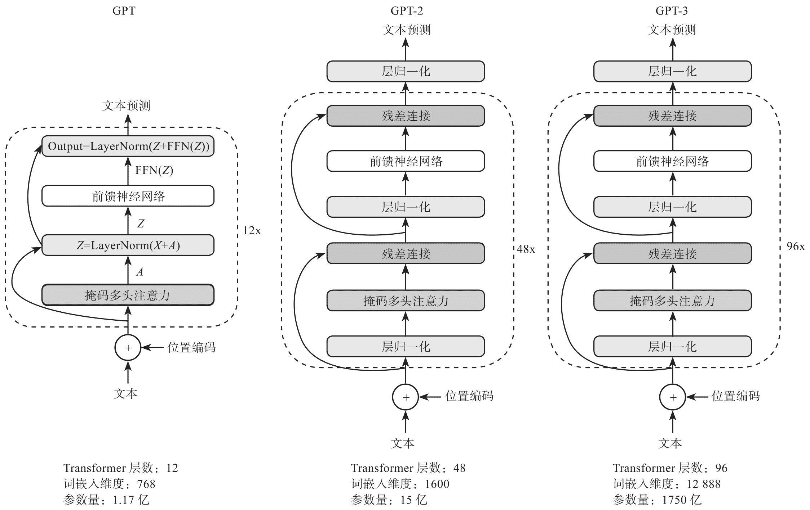
图 1.5 GPT 系列的模型架构示意图

（图片来源：https://api.stock.us/api/v1/report-file/wz3g1myv?download）

### 1.3.3 无监督预训练

# GPT 预训练到落地的关键路径

GPT 家族在研发之初都走过大规模自监督预学习的阶段，区别主要体现在模型规模与训练语料规模上。预学习借助海量文本的统计规律来把握语境关联，既能捕捉前向线索，也能捕捉双向线索，对词语先后顺序非常敏感。GPT 属于生成式范式，其目标是在给定前提下推断下一个词语并持续生成与前提最契合的续写，使条件概率 P(target|context) 达到最大。图 1.6 展示了预学习阶段 GPT 只使用单向掩码自注意力，只能依据左侧已出现的词进行推断，右侧信息不被利用。

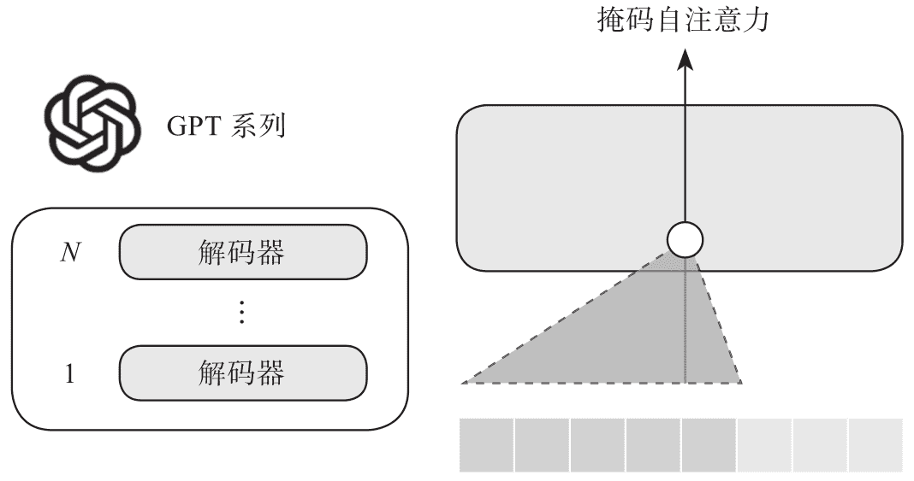

图 1.6 GPT 中的掩码自注意力

（图片来源：http://jalammar.github.io/illustrated-gpt2/）

预学习让 GPT 从海量文本中吸收语言层面的常识与世界层面的常识。语言层面包含词法、词性、句法、语义等理解自然语言的基础要素；世界层面则涵盖事实性事件与常识性认知。以 Transformer 为底座的语言模型仅凭千万到十亿量级的语料就能建立扎实的基础语言能力。而事实类知识需要更大规模的训练，因为这类信息庞杂且持续变化。研究普遍显示，训练数据越多，下游任务表现越稳定提升，这表明模型主要在增量数据中习得世界知识，这些知识帮助它更好地应对 NLP 挑战，提升泛化与准确度。

### **1.3.4 有监督微调**

预学习赋予 GPT 宽泛的语言与世界认知，但要达到任务级精通，还需进入有监督微调。该阶段借助带标注的数据集，通过监督学习调整参数，使模型行为更贴合具体目标。对 GPT 系列而言，典型方向包括问答、对话生成、情感分析等。并非每个版本都必须微调，因为下游标注集的构建难度高、成本大，且参数规模越大开销增长越快。GPT-1 以及 GPT-3.5 及以上版本虽都用少量样本做了有监督微调，但核心能力仍源于大规模预学习，并借助上下文学习迁移到更多任务。

### **1.3.5 人类反馈强化学习**

有监督微调能提升特定任务表现，却仍有不足。为进一步优化，GPT-3.5 以后的版本引入了人类反馈强化学习。如图 1.7 所示，模型生成的回答会由人类评价员打分，评价结果作为强化信号回传，进而指导策略优化。ChatGPT 正是通过持续人机交互，让输出质量逐步提升。

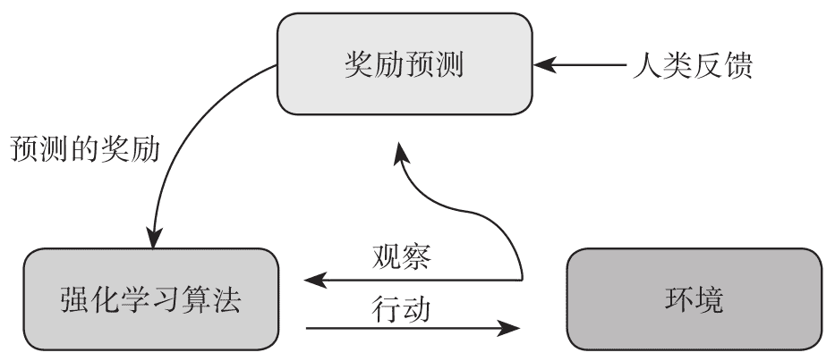

图 1.7 人类反馈强化学习的基本原理

具体流程分三步：先从数据集中抽取问题，由人工标注员提供高质量参考答案，再用这些人工数据对 GPT 做监督微调，让模型学会生成更符合人类预期的回复；随后训练奖励模型，标注员对输出进行排序，用排序结果训练奖励模型；最后借助训练好的奖励模型进行强化学习优化策略，按奖励分数更新预学习模型的参数。反复进行后两步，可训练出更对齐人类需求、生成质量更高的模型。

## **1.4 大语言模型的技术栈**

以 ChatGPT 为代表的大语言模型正演变为一种基础架构，其技术栈包含容器化、性能监控、商业智能、事件处理、云服务、微服务、分析工具等诸多组件。从下往上可划分为五层，如图 1.8 所示。

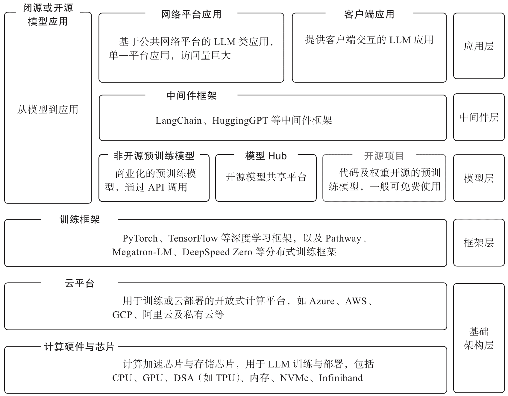

图 1.8 大语言模型的技术栈

1）基础架构层：负责提供训练与推理所需的基础设施，包括公有云、私有云及计算硬件。该层中 AI 硬件性能常成为瓶颈。如今多数大语言模型的计算都在云平台的 GPU 或 TPU 上完成，涵盖模型供应商与研究机构的训练，以及企业应用的部署与微调。自 GPU 取代 CPU 成为主流算力后，大规模计算的限制再次成为近十年的核心挑战。

2）框架层：提供深度学习框架与分布式训练框架，用于模型的训练与部署，典型代表有 PyTorch、TensorFlow，以及 Pathway、Megatron-LM、DeepSpeed Zero 等分布式方案。

3）模型层：包含开源或闭源的各类模型。该层通过 API 为应用层或中间件层提供能力支撑。

4）中间件层：涵盖大语言模型接口封装、提示优化、外部知识引入及第三方工具接入。依据不同工作流需求，中间件层还会提供具备长期记忆与代理能力的服务，用于拆解工作流、调用工具、连接应用层与模型层，降低开发者使用门槛。

5）应用层：将 AI 模型集成到面向用户的应用中。大多数企业通过中间件或直接调用大语言模型，把它嵌入客户端程序或搜索引擎，使产品具备智能协作与生成能力，例如微软的 New Bing。

部分闭源模型直接封装为上层应用，如 OpenAI 的 ChatGPT。另一些企业因数据隐私或商业竞争需求，会在开源模型基础上做微调，构建垂直领域的专属模型，再为终端客户提供服务。

## **1.5 大语言模型带来的影响**

ChatGPT 的爆发对自然语言处理及相关领域产生深远影响，未来发展趋势可能呈现以下特征：

1）NLP 子领域的独立研究价值可能逐步弱化。随着大模型规模扩大，各类子任务性能显著提升，传统的小模型微调研究可能被基于大模型与提示学习的方法取代。许多看似领域特有的问题，本质是领域知识不足，只要补足足够知识即可解决。实现 AGI 的路径可能比预期更直接：只需给大语言模型喂入更多领域数据，让其自行学习。

2）大语言模型会逐步多模态化，成为通用人机接口。如图 1.9 所示，应用范围有望从 NLP 拓展到图像、视频、语音等。GPT-4 的发布演示已展示多模态大语言模型的应用场景。大语言模型有望成为支持多模态输入输出的通用接口，这一趋势或将从操作系统与常用工具软件开始，逐步渗透各行业软件。

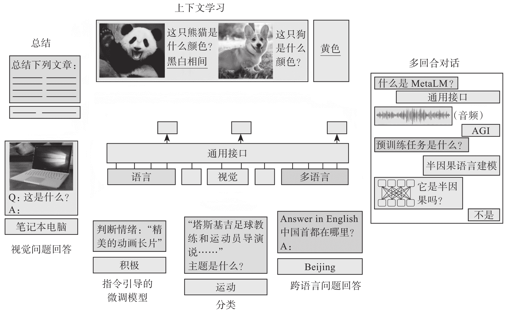

图 1.9 大语言模型作为通用接口

（图片来源：论文“Language models are general-purpose interfaces”）

3）低算力训练与部署将成为研究与应用重点。开发大语言模型资金投入巨大，仅少数大企业可能持续推出与 ChatGPT 竞争的产品。大量垂直公司可能在开源版本上做定制，用领域数据构建商业护城河。但大模型能力通常在达到一定规模阈值后才显现，小模型加领域微调难以达到理想效果，低算力训练与部署必然成为热点。

4）基于大语言模型的中间件整合企业工作流。众多中小企业可能借助 LLM 中间件整合内部流程以提升竞争力，即便这可能牺牲部分数据安全性。ChatGPT 不仅展示了多模态数据处理与生成的效率，更体现了复杂推理与对分布外事件的鲁棒性，使其能作为智能代理整合现有企业工作流，实现流程自动化与效率提升。但这会形成恐怖螺旋：被垄断的大模型获取越多领域数据，迭代越快，其他中小企业为避免被淘汰，会越来越依赖 LLM 中间件带来的效率增益。

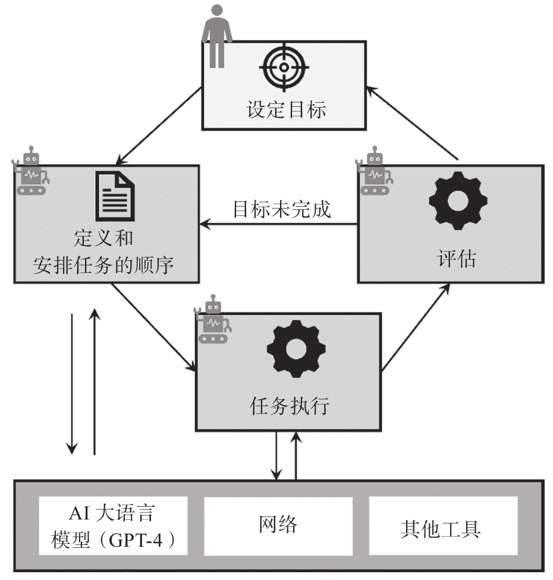

图 1.10 基于 LLM 中间件（AutoGPT）整合工作流的示意图

## **1.6 大语言模型复现的壁垒**

### **1.6.1 算力瓶颈**

在 GPT-4 出现前，国内应用场景很少需要如此强的 GPU 算力。大语言模型的计算成本主要分初始训练与后续运维两部分。意图设计或应用 GPT-4 级模型时，企业算力需求集中在两个阶段：

1）预训练与微调阶段：预训练从零开始，用海量通用数据训练并验证效果，形成基础知识；随后用特定商业或场景数据微调，提升响应精度。GPT-4 细节未公开，可参考同类模型。Meta LLaMA 650 亿参数模型约用 21 天、2048 张 NVIDIA A100 GPU 训练 1.4 万亿 token，约 750 个词等于 1000 个 token，训练成本约 100 万 GPU 小时。1750 亿参数的 GPT-3 需约 3.14×10²³ FLOPS。假设使用 80GB A100，理论 312 TFLOPS，结合张量并行与流水线并行，利用率超 50%，训练周期设为 1 个月，预估需 758 张 A100。

ChatGPT 3.5 与 4.0 参数未公开，假定与 GPT-3 相当均为 1750 亿参数，按官网信息显存占用约 350GB～500GB。若要训练，可能需要 1000 张以上 A100 才能在可接受时间内完成，部分说法称微软与 OpenAI 为 GPT-3 训练搭建了超 10000 张 GPU 的超级计算机，单次训练成本约 500 万美元。

2）推理与部署阶段：微调完成后模型部署到生产环境。相较训练，部署对单机算力需求较低但总量巨大。大量在线交互下，部署阶段的服务器与芯片成本可能远超训练，因为集群需大量服务器做并行网络服务，核心是矩阵计算与存储调度。尤其在端侧等场景，对硬件性价比与响应延迟有特殊要求，传统 GPU 已难以满足。

据 OpenAI CEO Sam Altman 的访谈假设：采用 GPT-3 密集架构，1750 亿参数，隐藏层维度 16000，序列长度 4000，平均响应 2000 个 token，每用户 15 次响应，日活 1300 万。考虑 50% 空闲导致硬件利用率与每小时 1 美元的 GPU 成本，且性能为 FasterTransformer 的 2 倍。在此前提下，ChatGPT 日均硬件成本约 69 万美元。约需 3600 台 HGX A100 服务器，共 28936 个 GPU，为 ChatGPT 提供服务，每次查询成本约 0.36 美分。

### **1.6.2 数据瓶颈**

大语言模型训练与运行依赖海量数据，使其学会自然语言的模式与结构。企业往往依赖业务积累数据与开源数据集，数据成本评估困难。规模要求数据必须有效清洗、标注、组织与存储，配套基础设施、工具与数据工程师会使管理成本迅速攀升。

LLaMA 使用的总训练集约 4.6TB，含 1.4 万亿 token。如图 1.11 所示，GPT-3 预训练文本数据高达 45TB。数据体量凸显资源需求并强调质量重要性。据报道，全球最大中文语料库 WuDaoCorpora 存储 3TB 中文语料，其中 200GB 对外开放。

训练汉语版 GPT-3.5，除搜索与社交巨头外，仅少数垂直公司能获取足够数据。但企业运营期间获取的文本能否用于模型训练，涉及法律与伦理问题，即便 codex 源于开源 GitHub 也备受争议。GPT-4 的多模态训练集由图像与文本构成，可能包含图表推理、物理考试、图像理解、论文总结、漫画图文等。

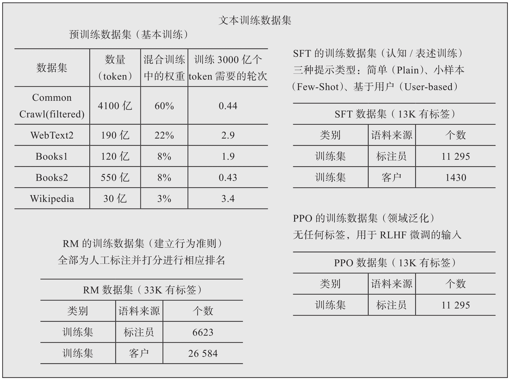

图 1.11 GPT-3 训练数据集构成

（数据来源：论文“Training language models to follow instructions with human feedback”）

### **1.6.3 工程瓶颈**

大语言模型开发依赖专业研究人员与工程师，负责设计架构并正确配置训练流程。如图 1.12 所示，架构决定模型如何学习与生成文本。设计、实现与管理这些架构需要多领域的计算机科学专业知识。负责发布前沿成果的工程师与研究员薪资常达数十万美元。值得注意的是，开发大语言模型所需的技能组合与图 1.12 所示的传统机器学习工程师有显著差异。此外，训练大语言模型对工程实践要求极高，包括数据清洗、大规模分布式训练的工程化实现，以及在超大规模参数与数据下保持训练稳定性的技术。

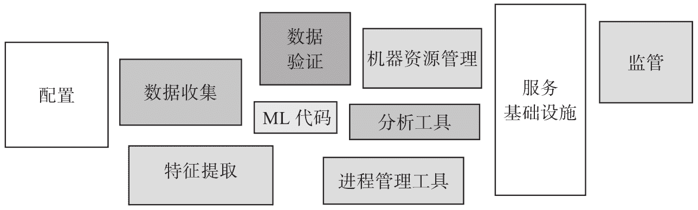

图 1.12 机器学习系统基础设施

## **1.7 大语言模型的局限性**

尽管 GPT-4 等模型已展现出卓越的上下文对话与编程能力，甚至具备图像理解与数据图分析能力，接近通用人工智能，仍存在明显局限，需要持续研究突破。

1）真实性与正确性保证不足。例如 GPT-4 在未经大量语料训练的领域可能缺乏人类常识与逻辑推理能力，会在多个领域产生幻觉答案，给求精确解的用户带来误导。尽管较早期模型有所改善，仍可能输出有害建议、错误代码或不准确信息，因此不建议在法律、医疗等高风险领域使用。

2）可解释性待提升。目前无法完全理解 GPT-4 内部算法逻辑，难以确保其输出不会带来潜在攻击或伤害风险。虽有数据显示错误行为率下降，但残余错误仍可能引发法律问题。

3）社会与道德风险。受黑盒问题影响，可能生成偏见、虚假或仇恨文本，也可能被黑客攻击绕过安全防护。OpenAI 提出多项风险缓解策略，但 GPT-4 仍可能被滥用制造假新闻、垃圾邮件或有害内容，或产生误导性事实错误与偏见。

4）隐私泄露风险。GPT-4 可从公开与内部授权数据源学习，其中可能包含大量个人信息。学习过程中可能获取公众人物的隐私信息，甚至将零散信息关联，造成隐私泄露。

## **1.8 小结**

本章详细探讨了 ChatGPT 的发展历程及其带来的影响。从 GPT-1、GPT-2 到 GPT-3、GPT-4，每个版本都推动了人工智能发展。

本章深入分析了 ChatGPT 的功能范畴，包括理解与生成语言的能力、情感分析精度，以及问答与诗歌创作表现。随后概述了大语言模型从早期 NLP 到现代 Transformer 的技术演进。在架构讨论中，从底层到顶层审视了大模型的整体构造。此外，分析了大语言模型对商业、学术、政策与社会的深远影响，同时关注复现此类模型所需的大规模数据与算力等关键问题。最后，讨论了大语言模型面临的挑战，包括模型幻觉、可解释性、偏见与隐私等。

总体而言，本章为理解 ChatGPT 及类似大语言模型的工作机制、潜力与挑战提供了全面视角。后续章节将进一步深入研究其相关原理，以便更好把握影响力与发展趋势。

# **第二章**

# **深入理解 Transformer 模型**

Transformer 模型是一种以自注意力机制为核心的深度学习架构，它颠覆了传统 RNN 与 CNN 的思路，为 NLP 带来深远影响。如今 Transformer 已在 NLP 领域占据主导地位，并催生出 BERT、GPT 等诸多成功模型。本章将详细拆解 Transformer 的核心组成。

## **2.1 Transformer 模型简介**

如图 2.1 所示，Transformer 模型包含以下核心部件：多头注意力机制、前馈神经网络、残差连接与层归一化、位置编码。

Transformer 的强大在于用自我关注来刻画序列内部的关联。输入先被映射成查询、键、值三组表征，查询与键的相似度决定了值被赋予的权重，聚合后形成新的语义表示。多路机制把上述运算在若干子空间同步展开，让模型能并行捕捉不同维度的上下文线索，各路结果拼接后再经线性投影统一。

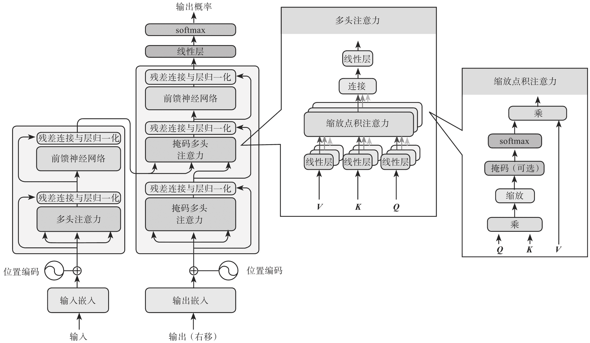

图 2.1 Transformer 模型

前馈子网负责非线性转换。通常是两层线性变换中间夹一个激活，自注意产生的特征先过第一层线性，再经过非线性激活，最后由第二层线性输出，这个小模块在每一层 Transformer 中都会出现。

为保证训练稳定，引入残差捷径与层归一化。残差把进入子层的原始张量与子层输出逐元素相加，层归一化随后再对相加结果在通道方向做标准化。自注意力本身不携带顺序信息，所以额外加入位置编码，用正弦余弦产生的周期信号叠加到嵌入上。

训练多采用最大似然框架，以交叉熵为目标，配合 Adam 求解，并辅以学习率预热和梯度裁剪来提升收敛。

### **2.2 自注意力机制**

注意力思想源自人类视觉与认知的选择性聚焦。阅读或观察时人们会优先处理关键片段而忽略无关部分，这种选择性分配降低了计算负担，也提高了信息处理的精度与效率。

### **2.2.1 自注意力机制的计算过程**

自我注意是注意力的一种特例，每个位置的表征都会参考序列中全部位置，以确定相互间的关注比例。其核心是为每个元素分配一个系数，系数大小反映当前处理时对其他元素的依赖强弱。相较于逐级传递的循环结构，自我注意能够直接建立任意两位置的联系，从而更好地捕捉长距离依赖。下面以 Transformer 中的实现为例。

1）原始词或字符先经嵌入层映射为向量。对每个元素分别用三组投影矩阵生成查询向量、键向量与值向量。

自注意力机制的示意图如图 2.2 所示，首先，设输入序列为 x、x、x。这一序列经过嵌入层的处理，得到序列的 token 为 e、e、e。然后，定义三个矩阵 W^Q、W^K、W^V，它们被用于将输入 e、e、e 转化为向量 q、k、v，这些向量在潜在空间中可以视为 e、e、e 的语义表示。

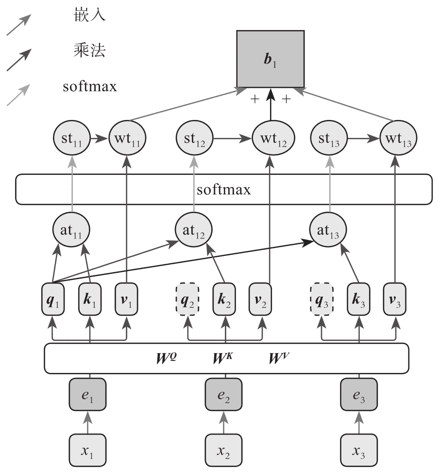

图 2.2 自注意力机制

2）每个查询向量与全部键向量做点积得到初始分数，该分数为标量。对分数先除以键维度的平方根做缩放，再经 softmax 归一化得到权重。随后用权重对对应的值向量做加权求和，得到该位置的新表征。遍历所有位置即可得到完整输出。由于不依赖上一时刻的隐藏状态，计算可并行，只要在嵌入阶段加入位置信息即可感知顺序。如图 2.3 所示，将三个向量 e、e、e 拼接成为一个矩阵 E，就能矩阵化自注意力运算过程。E 乘以参数矩阵 W^Q、W^K、W^V 后，得到 Q、K、V。

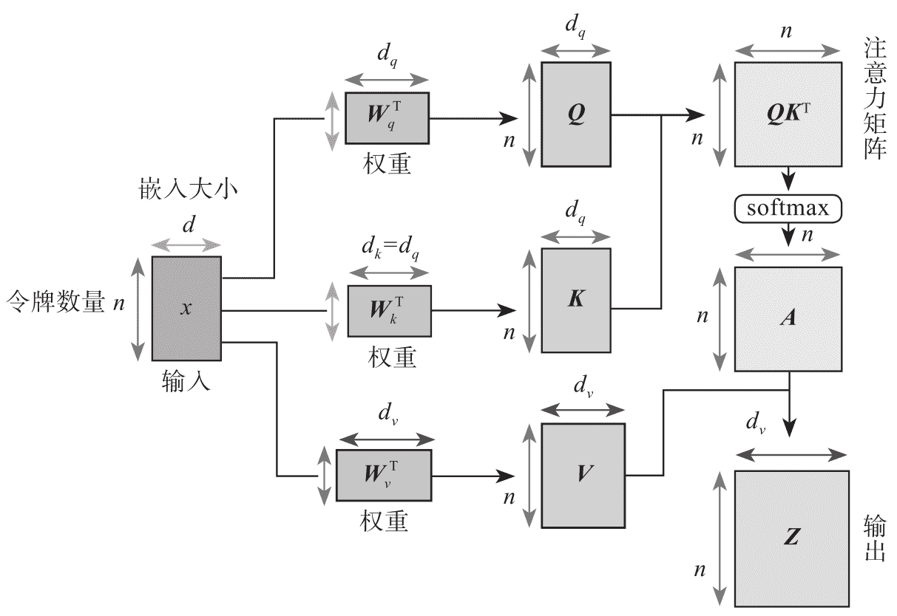

图 2.3 自注意力机制的矩阵计算过程

（图片来源：https://sebastianraschka.com/blog/2023/self-attention-from-scratch.html）

3）用 Q 与 K 的转置相乘得到分数矩阵，对每行做 softmax 归一化后得到权重矩阵 A，形状为 n×n。最后 A 与 V 相乘得到 Z，形状为 n×d[v]，代表 n 个 token 的 d[v] 维表征。自注意力的公式可以表示为：

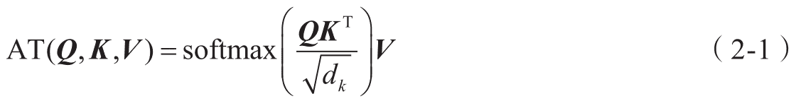

其中，Q、K、V 是输入矩阵 X 分别乘以三个参数矩阵后的隐状态矩阵，d[k] 是 W 矩阵的列数。

 

分母中的是为了缓解梯度消失问题。当 d[k] 很大时，注意力分数向量的方差会很大，极大的值在 softmax 函数中可能被挤到边缘，导致回传的梯度变小。此时可以用将方差从 d[k] 缩小为 1，使得梯度更稳定。

### **2.2.2 自注意力机制的本质**

Q、K、V 三个矩阵都是输入矩阵 X 的线性变换，可以视为 X 在隐空间的语义表示。下文用 X 表示这三个矩阵。另外，用于归一化，可以省略。因此，式 2-1 改写为：

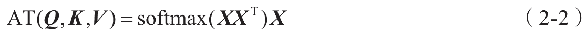

T

式 2-2 中的 X X 可视为矩阵 X 乘以其转置，这一操作在向量空间中表征了向量间的内积，从而反映了输入向量的相似度。向量内积的几何意义是表征一个向量在另一个向量上的投影，也就是说，两个向量越相似，投影值越大，当两个向量夹角是直角时，那么这两个向量线性无关，内积为零。

如图 2.4 所示，假设输入序列为 x、x、x，如果词嵌入层采用独热编码，输入矩阵 X 可以表示为一个特定形式。该矩阵与自身的转置相乘，得到一个本质上是注意力权重矩阵的矩阵。

这个注意力权重矩阵体现了内积计算的含义，即衡量相似度。例如考虑第一行，这行实质上计算了 x 的 token 和句子中所有 token 的相似度。如果 token A 和 token B 经常一起出现，那 A 和 B 之间的相似度往往很高。在此例中，x 的 token 与自身、x 的 token 的相似度很高，表明 x 与这两个 token 的相似度超过 x。

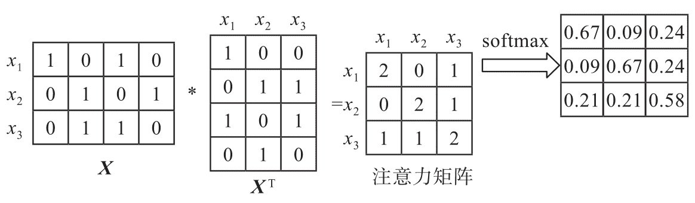

图 2.4 注意力权重矩阵

接下来，对这个结果进行 softmax 归一化，得到归一化的注意力权重矩阵。归一化后，如图 2.5 所示，此注意力矩阵成了系数矩阵，并右乘输入矩阵 X，得到结果 。这一步的操作实质上是左侧矩阵的每一行与输入矩阵 X 的每一列进行乘加运算，从而计算出输出矩阵的每一行的值。  的每一行就对应 token 经过注意力权重加权后的词嵌入。

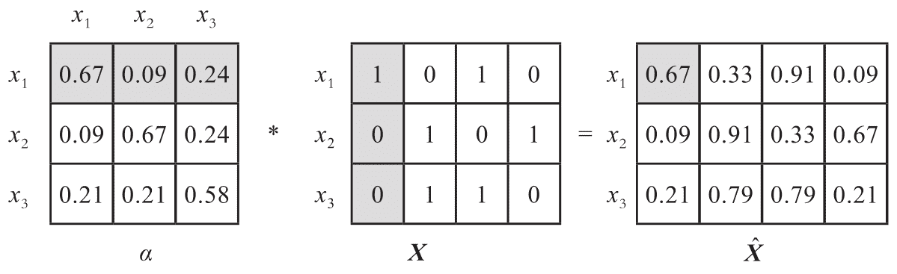

图 2.5 注意力权重加权后的词嵌入

总的来说，输入一个矩阵 X，自注意力机制会输出一个矩阵 ，这个矩阵是输入元素之间的注意力权重。具体地说，这是通过计算查询向量与键向量之间的点积，以衡量两个元素之间的相似性。然后用这些注意力权重对值向量进行加权求和，得到每个输入元素的输出向量。这些输出向量可以作为下一层的输入，或与其他层一起构成整个模型的输出。

如图 2.6 所示，Q、K、V 三个矩阵都是输入矩阵 X 的线性变换，从理论上来说，这三个矩阵都不是必要的，可以用一个矩阵来实现注意力的加权。但是，采用三个矩阵进行变换得到查询、键和值向量，在注意力机制中扮演了不同的角色：查询向量代表当前元素在计算注意力权重时的“问题”，它与其他元素的键向量进行比较，以衡量当前元素对其他元素的关注程度；键向量代表输入序列中每个元素的“答案”，通过计算查询向量与键向量之间的相似性，可以得到注意力权重；值向量代表输入序列中每个元素的实际信息。注意力权重对值向量进行加权求和，得到输出向量。

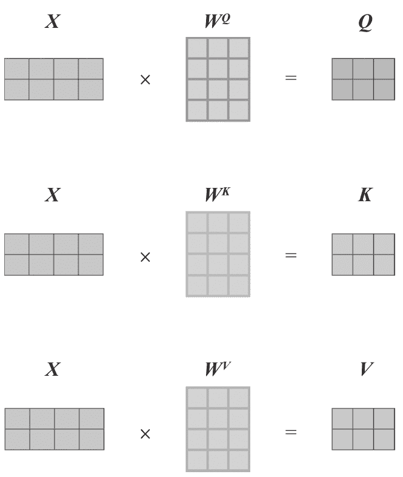

图 2.6 Q、K、V 矩阵的计算方法

### **2.2.3 自注意力机制的优势与局限性**

自我注意是 Transformer 的核心部件，通过权重描述元素间关联，能够聚焦序列中的关键信息。与 RNN、LSTM 这类顺序处理的模型相比，自我注意可以直接建模任意两位置的关系，长程依赖的捕捉更为有效。注意力权重本身也具备可解释性，观察权重分布可以了解模型在处理某个位置时关注了哪些位置，有助于调试和优化。计算过程天然可并行，在 GPU 等并行硬件上效率更高，而循环结构难以充分利用并行资源。

局限主要在于长序列与数据需求。序列越长，注意力矩阵规模呈平方增长，计算与显存开销会迅速膨胀。为此出现了分层注意力、稀疏注意力和低秩注意力等缓解方案。自我注意模型通常需要大量数据才能发挥最佳效果，在小样本或垂直领域任务中受限明显。

## **2.3 多头注意力机制**

多头注意是在自我注意之上做的扩展，目标是让模型并行捕捉输入的不同信息类型。通过多头设计，模型能学习到更丰富多样化的表示，从而提升整体性能。

多头注意具备捕捉多元信息的能力。不同注意力头可以关注不同的语义面，例如在机器翻译中，一个头可能偏向语法结构，另一个头可能偏向语义对应。这种多视角融合有助于生成更准确自然的译文。

同时，增加头数相当于拓宽了模型容量，可以在不加深网络的前提下增强表达能力。并且多个头可以并行计算，在多核或多 GPU 环境下进一步提升效率。

### **2.3.1 多头注意力机制的实现**

如图 2.7 所示，实现多头注意力需要把自注意力中的查询、键、值投影矩阵拆分成若干子空间，每个子空间对应一个头。在每个头内部，独立计算自注意力，使用各自的子权重得到查询、键、值并完成缩放点积、softmax 与加权求和。所有头的输出随后拼接，再经一个共享的线性层映射回原始维度。

值得注意的是，注意力头不是越多越好。根据 Transformer 原论文的实验，头数设为 8 时效果最佳，提升到 16 或 32 并未带来明显增益，头数过少如 1 或 4 则可能导致性能下滑。

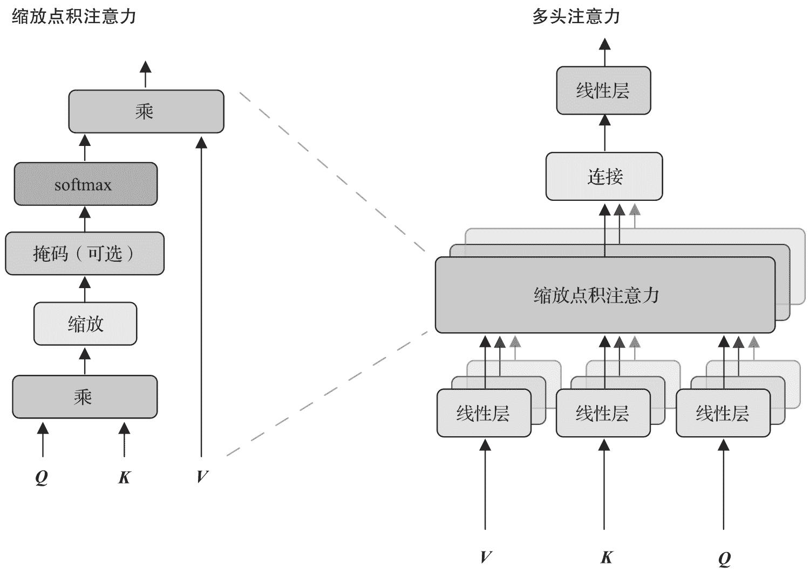

图 2.7 多头注意力机制

在计算完所有头的自注意力后，需要将这些输出进行拼接，生成一个更大的输出向量。这个向量包含多个注意力头捕捉到的各种信息。如图 2.8 所示，假设采用 8 头注意力，每个头经过计算后生成一个输出向量，这 8 个向量被拼接在一起。最后，需要通过一个线性层（如图 2.8 中的 W）将拼接后的输出向量转换回原始输入维度。这个线性层的参数在所有注意力头之间共享，它的作用是将多个注意力头生成的信息进行加权融合成一个统一的表示。

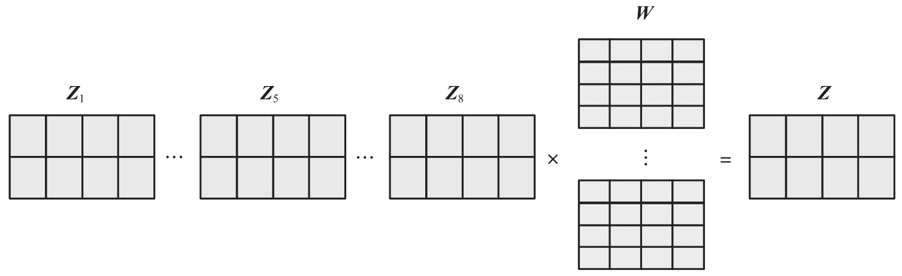

图 2.8 多头注意力加权融合

### **2.3.2 多头注意力机制的作用**

多头注意力的输出可直接作为下一层输入，或与其它子层组合构成完整的 Transformer。不同头往往分化出不同的关注偏好。Sparse Transformer 的分析显示，部分头偏好语法，部分头偏好上下文邻近词，部分头偏好罕见词。语法相关的头能抑制不合语法的表达，上下文头有助于理解句意，罕见词头则抓住重点信息。

图 2.9 提供了一个可视化的例子，展示了不同的头对注意力矩阵的影响。这份研究是基于 encoder 的，一共有 4 层 encoder（标记为 0～3），每层 encoder 都包括 6 个头（标记为 0～5）。在图中，每一行表示一层 encoder，每一列表示一个头。由图可见，在同一层中，部分头会表现出相同的特征（如第 2 层的头 1～4、第 3 层的头 1～4），而有些头则表现出特立独行的特点（如第 2 层的头 1、第 3 层的头 0 和 5）。

从多头注意力机制中可以看出，虽然不同头的参数都采用相同的残差梯度回传，但它们最终还是能分化出不同的特征选择方式。这可能是不同的初始化方式以及 Dropout 策略，导致最后训练出来的头有不同的特征选择功能。有研究者对初始化方式做了详细的消融测试，最后证明可以通过改变初始化方法来减小层方差，从而获得更好的训练效果。另外，也有研究者提出在多头注意力中，对不同的头采用不同的 Dropout 策略，以便让不同的头学习到不同的特征。

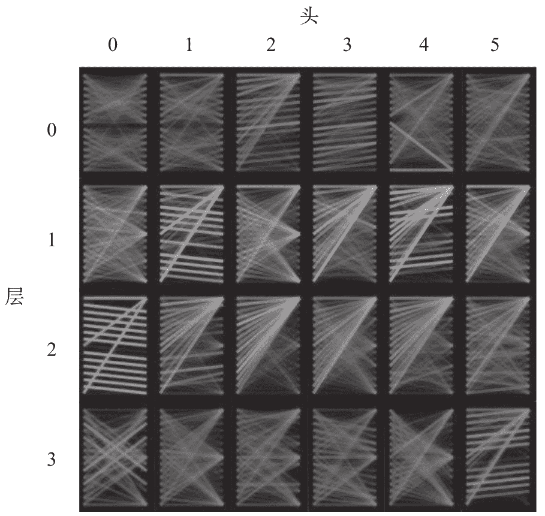

图 2.9 多头注意力的可视化

（图片来源：论文“A multiscale visualization of attention in the transformer model”）

### **2.3.3 多头注意力机制的优化**

多头注意力的参数量较大，每个头都有独立的 Q、K、V 投影，因此计算与内存成本较高。常见的优化思路包括：

1）局部多头注意力。限制每个头只关注输入序列的局部窗口，降低复杂度，同时保留多头优势。

2）稀疏多头注意力。让每个头只与部分元素建立连接，通过稀疏模式削减计算量与显存。

3）分层多头注意力。把头组织成层次结构，不同层次关注不同区域与信息类型，有助于长序列建模与更丰富上下文捕获。

## **2.4 前馈神经网络**

前馈神经网络作为 Transformer 的核心组件之一，尽管在模型构成中只占据部分比例，但它对于提取输入序列中的非线性特征以及捕捉局部信息有着关键的作用。

如图 2.10 所示，前馈神经网络本质上是一个多层感知器（Multi-Layer Perceptron，MLP），它由多个层组成，每个层都含有若干神经元。在一个典型的前馈神经网络中，输入层负责接收原始数据，隐藏层处理输入数据并提取特征，输出层则负责生成最终的预测结果。这些层之间的连接是有向且无环的，这意味着信息在网络中是单向传播的。

Transformer 里常被忽略却至关重要的模块之一，就是前馈网络。它的骨架非常简洁：两段线性变换中间夹一个非线性激活。这种结构让模型跳出线性表达的限制，能够从输入序列中挖掘出更丰富的非线性特征。第一段全连接把输入拉伸到更高维的特征空间，第二段再把高维表示回落到原始维度。夹在中间的激活函数负责打破线性叠加，使网络有能力拟合复杂的数据模式。

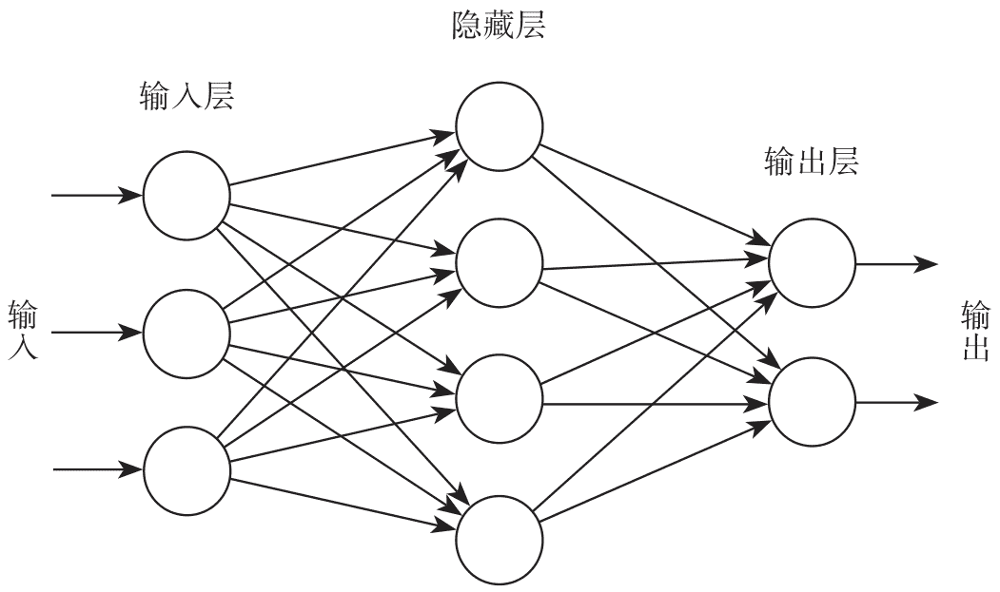

图 2.10 前馈神经网络

激活函数本质上是为前馈网络注入非线性的开关，把线性变换的结果映射成非线性表示。不同激活的选择对最终效果影响很大，业界常用的有 Sigmoid、tanh、ReLU 等。Transformer 体系里更偏爱 GELU，即高斯误差线性单元，其表达形式如下：

如图 2.11 所示，GELU 在输入逼近零的区域近乎一条直线。这种近线性的过渡让深层网络在训练时更顺滑，有助于缓解梯度消失，提升收敛质量。

前馈网络里每一条连接都携带着一个权重，用来衡量信号在层间传递的强度；每个神经元还额外配备一个偏置，用来调节激活的敏感度。这两类参数都会在梯度下降的训练过程中被不断修正，以期降低预测误差。

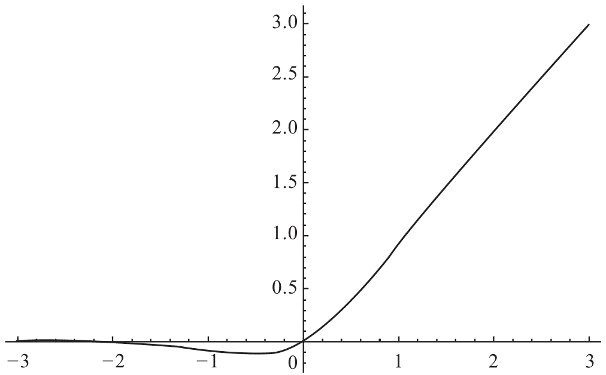

图 2.11 GELU 激活函数

尽管在 Transformer 整体占比不大，前馈网络在捕捉局部信息和非线性特征上发挥着决定性作用，主要体现在三方面：

1）局部特征提取。每一层的前馈网络都对自注意力输出进行点对点处理，专门负责挖掘短程依赖，让模型学会序列内部的局部规律。
2）非线性注入。借助激活函数，前馈网络能捕捉自然语言中大量非线性的结构与模式，这是线性模块无法做到的。
3）泛化助力。通过对局部和非线性的建模，前馈网络提升了模型面对未见数据的适应能力。

## 2.5 残差连接：深层网络的捷径

残差连接是一种跳跃式的短路设计，能把某一层的输入直接搬运到后面的层去，有助于缓解梯度消失并加速收敛。这一思路最早由 Kaiming He 等人在 2015 年的 ResNet 中提出，Transformer 则把它大量用在了多头注意力、前馈网络以及编码器和解码器的各子层。

如图 2.12 所示，残差连接的核心就是在常规变换之外加一条直连。以输入 x 为例，经过非线性变换 F(x) 后，输出写作 F(x)+x。相当于把原始信号和该层学到的残差叠加起来。反向传播时，梯度可沿直连快速回流，很好地缓解了梯度消失。

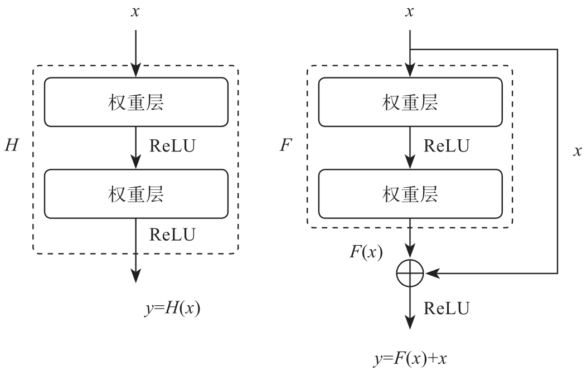

图 2.12 残差连接

在 Transformer 内部，多头注意力子层会先完成自注意力计算，再把结果与原始输入相加；前馈子层则先做两次线性变换加激活，再与入口的原始向量做相加。编码器和解码器的每一层都布满了这种带跳连的子结构，让信息在深层中保持畅通。

总的来看，残差连接在 Transformer 中的价值可以归纳为：

1）缓解梯度消失与爆炸。直连提供了梯度回传的捷径，避免信号在深层衰减。
2）加快训练。减少冗余计算，让参数更新更高效。
3）提升泛化。网络能学到更丰富的表征，测试表现更稳定。

## 2.6 层归一化：让训练更平稳

层归一化是一种行之有效的归一化手段，目标是稳定训练过程并改善模型性能。由 Jimmy Ba 等于 2016 年提出后，在 Transformer 中得到广泛应用。其做法是对每个样本的同一层输出做归一化，使均值与方差一致。

对某一层的输出，先算出全部神经元的均值 µ 与标准差 σ，再对每个元素 x[i] 做 (x[i]-µ)/√(σ²+ε) 的变换，得到零均值单位方差的 y[i]。ε 是极小的常数，用于数值稳定。

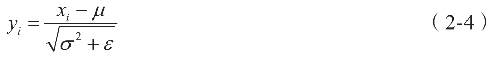

### 2

归一化后的输出分布更稳定，可加快梯度下降收敛、降低层间协变量偏移、防止梯度爆炸或消失，同时减少对输入分布的敏感度。

在 Transformer 中，层归一化被用在多个位置：

1）多头注意力机制。归一化注意力得分的计算过程，提升注意力质量。
2）前馈神经网络。对神经元输出归一化，加速收敛。
3）编码器-解码器结构。对每个子层输出以及整层输出做归一化，稳定整体训练。
4）残差连接。与加法配合使用，保证加法后输出的均值方差一致，进一步提升效果。

## 2.7 位置编码

位置编码如图 2.13 所示，用来给模型提供序列词序信息。因为自注意力本身只关注内容相关性，不感知顺序，所以位置编码是捕捉顺序关系的关键补充。

### 2.7.1 设计思路与实现方式

自注意力通过 Q、K、V 矩阵乘法捕捉词间关系，却不涉及位置。语言等有序数据必须依赖位置信息，因此需要把位置表征与词嵌入融合，这正是位置编码要解决的问题。

Transformer 采用基于固定正弦和余弦函数的位置编码。对位置 p、维度 i，编码函数定义如下：

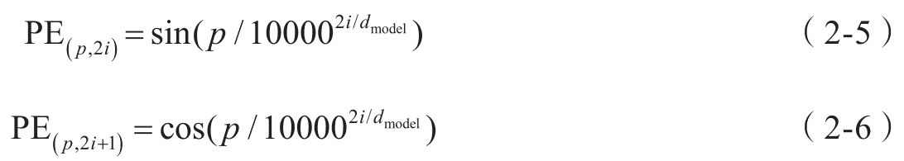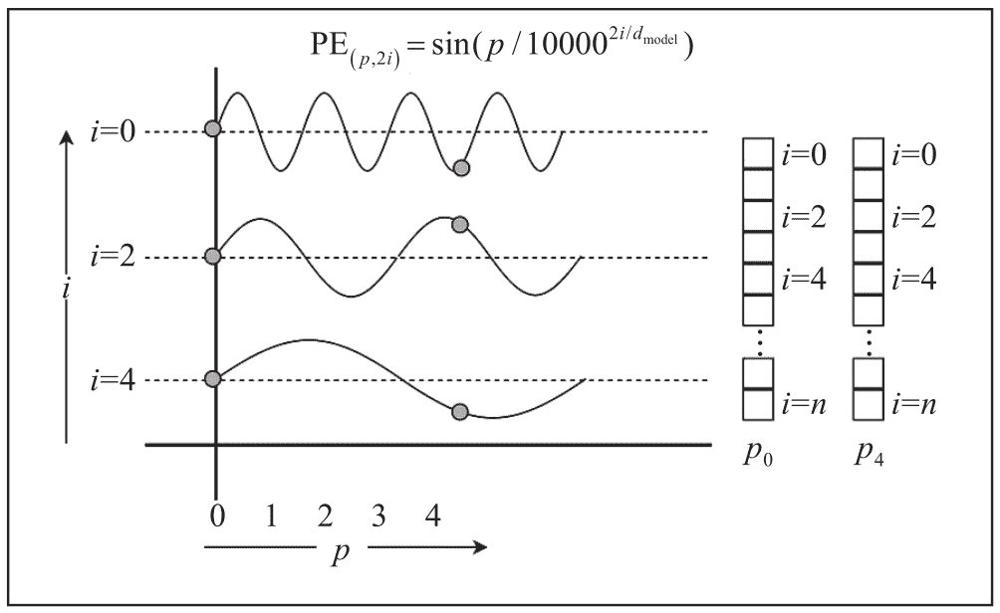

▲图 2.13 位置编码的工作方式

其中 d 为词嵌入维度。该设计带来三个好处：

model

❑不同位置和维度具有不同频率，有助于建模复杂位置关系。
❑正弦余弦的周期性使模型能外推到训练时未见的更长序列。
❑编码是可学习的，模型可按任务需求调整位置权重的贡献。

实现时，先按公式为每个位置生成 d 维向量，再与词嵌入逐元素相加，得到携带位置信息的表示，送入后续注意力与前馈层。

model

以序列长度为 4 的句子“我爱中国”为例，假设每个字用 2 维向量表示，需要一个 4×2 的位置编码矩阵。

计算可得：

∧
PE(0,0)=sin(0/10000^(0/2))=sin(0)=0
∧
PE(0,1)=cos(0/10000^(0/2))=cos(0)=1
∧
PE(1,0)=sin(1/10000^(0/2))=sin(1)≈0.84
∧
PE(1,1)=cos(1/10000^(0/2))=cos(1)≈0.54
∧
PE(2,0)=sin(2/10000^(0/2))=sin(2)≈0.91
∧
PE(2,1)=cos(2/10000^(0/2))=cos(2)≈-0.42
∧
PE(3,0)=sin(3/10000^(0/2))=sin(3)≈0.14
∧
PE(3,1)=cos(3/10000^(0/2))=cos(3)≈-0.99

组合成矩阵如下：

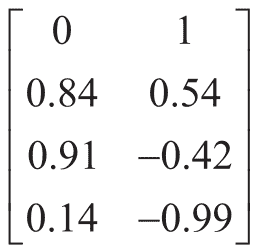

将该矩阵加到原始词向量上，模型即可感知位置。图 2.14 展示了完整的计算与应用流程。实际应用中 d 通常远大于 2，例如 512。

model

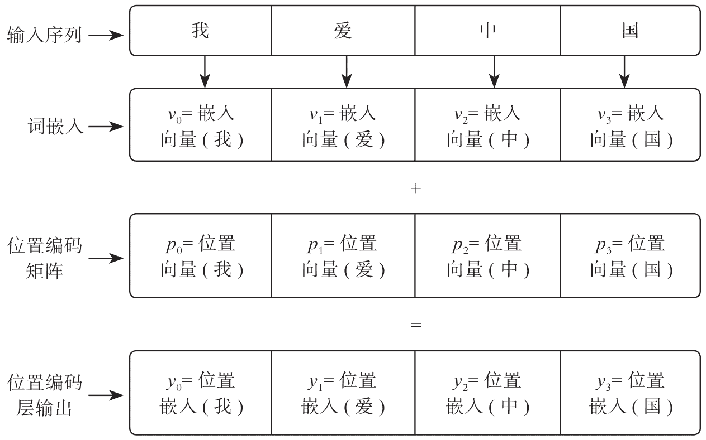

图 2.14 位置编码工作流程

### 2.7.2 常见变体

除原始的固定正余弦编码外，研究者还提出了多种替代方案：

1）学习位置编码。编码向量随机初始化，在训练中随任务一起优化，具备更强的自适应性。
2）相对位置编码。关注词对之间的相对距离而非绝对位置，有助于泛化到不同长度序列，常通过修改注意力计算引入。
3）组合位置编码。将固定编码、学习编码与相对编码融合，从多源位置信息中提取优势。

### 2.7.3 优点与局限

位置编码有效提升了神经网络处理序列数据的能力，通过显式提供词序信息让模型利用顺序规律。正弦余弦的周期性支持长序列外推，学习式设计则增强任务适应性。

局限在于，对不依赖顺序的任务会引入额外计算负担。固定正余弦编码难以捕捉局部复杂的结构模式；当序列长度远超训练最大值时，泛化能力可能下降。此时相对位置编码或可扩展编码会是更好选择。

## 2.8 训练与优化策略

Transformer 的训练涉及损失函数、优化器、学习率调度与正则化等多个环节。

### 2.8.1 损失函数选择

训练的核心是衡量预测与标签差距的损失。Transformer 通常使用交叉熵损失，比较模型输出的概率分布与真实分布的差异，目标是最小化该值。

交叉熵衡量两概率分布的差异。模型通过 softmax 把 logits 转为概率，再用交叉熵度量与真实标签的差距。它对分类任务友好，能直接反映预测偏差，但对概率极低的类别敏感度有限。

根据任务不同，也可选用均方误差、平均绝对误差做回归，或负对数似然、KL 散度做生成任务。

其中，p 为真实分布，q 为预测分布。

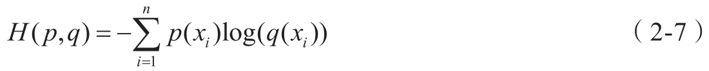

### 2.8.2 优化器

优化器负责按损失梯度更新参数。Transformer 常用 Adam，即自适应矩估计，结合梯度一阶矩与二阶矩的指数加权平均，能自动调整学习率。优点是收敛快、计算高效、对超参不敏感；缺点是部分场景泛化可能受限。

除 Adam 外，SGD、AdaGrad、RMSprop 也是常见选择。SGD 基础但收敛慢；AdaGrad 与 RMSprop 能自适应学习率，但在长训练中易出现过早衰减。具体选择需结合任务与数据。

### 2.8.3 学习率调度

原始论文提出 Noam 学习率调度，训练初期线性升温，随后按逆平方根衰减。该策略兼顾初期快速收敛与后期稳定，防止过拟合。

其中 d 为模型维度，step_num 为当前步数，warmup_steps 为预热步数。

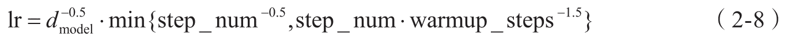

model
Noam 调度在平衡速度与稳定上表现良好，但 warmup 步数等超参需调优。

其他策略包括指数衰减、余弦退火、分段恒定学习率等，各有优劣，需按实际任务选用。

### 2.8.4 正则化手段

为防止过拟合，Transformer 常采用权重衰减、Dropout、层归一化。

权重衰减即 L2 正则，将参数范数加入损失，防止参数过大，但可能过度惩罚部分参数。Dropout 在训练中随机丢弃神经元，减少对特定样本的依赖，提升泛化，但可能拖慢收敛，如图 2.15 所示。层归一化通过规范化激活值加速训练并改善泛化，但在某些任务上效果不一。

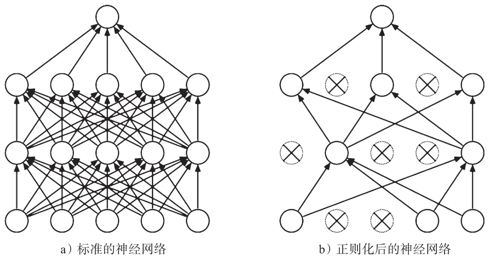

图 2.15 Dropout 正则化

其他手段还包括 L1 正则化、数据增强、早停等。L1 可产生稀疏参数；数据增强扩大训练集；早停在验证损失不再下降时终止训练，避免过拟合，但可能导致欠拟合。

### 2.8.5 其他实用技巧

Transformer 训练还涉及学习率预热、梯度裁剪、权重初始化、标签平滑、梯度累积与混合精度训练等。

学习率预热在训练初期使用较小的学习率，随后线性升至最大值，再按策略衰减，避免早期更新过大导致不稳定，如图 2.16 所示。

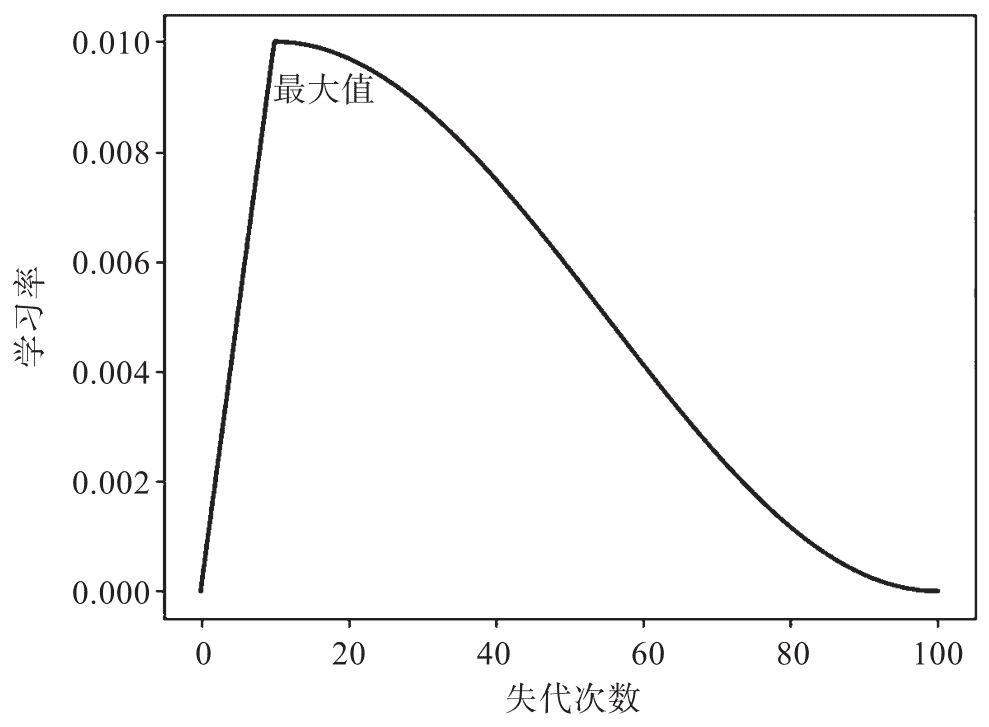

图 2.16 学习率预热策略

为了避免训练过程中出现梯度爆炸，梯度裁剪是常用的稳定手段。当反向传播产生的梯度数值过大时，权重一次更新的幅度会失控，导致优化轨迹震荡甚至发散。做法是在更新前对梯度范数设定一个上限，一旦范数超过阈值，就将整个梯度向量按比例压缩，使其范数恰好等于该阈值，从而限制参数步长。

权重初始化方式会直接影响收敛速度和最终效果。Transformer 训练里，常见的选择是基于均匀分布或正态分布的随机初始化，比如 Glorot 也称 Xavier 初始化，以及 He 初始化。

Dropout 属于经典的正则化手段，训练时随机丢弃部分神经元的输出来削弱共适应，从而缓解过拟合。在 Transformer 架构中，Dropout 通常加在多头注意力子层和前馈网络子层之后。

标签平滑则是在标签层面做软化处理，把硬标签和少量均匀噪声混合，形成软目标。这种做法可以降低模型对训练样本的过度自信，提升泛化能力。

梯度累积是在真正更新参数前，先把若干个小批次的梯度累加起来再统一应用。等价效果接近大批次训练，能提高优化稳定性与收敛质量，而显存消耗基本保持在小批次水平。

混合精度训练同时使用 float32 与 float16 两种精度进行计算。在保持数值稳定性的同时降低显存占用和计算量，加快整体训练速度。实验对比显示，在超参数一致的情况下，float32 与混合精度的训练损失曲线几乎重合，但混合精度的耗时明显更短。

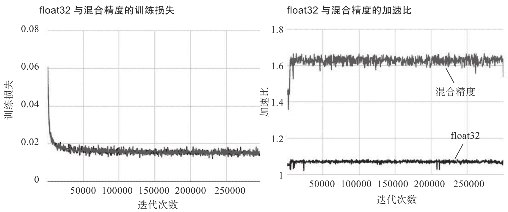

图 2.17 float32 与混合精度训练损失对比及加速比

上述方法在 Transformer 的训练与调优里都有关键作用。结合具体任务和数据特点灵活选用与调节，可以显著改善训练表现。

## **2.9 小结**

本章梳理了 Transformer 模型的基本构成和工作原理。首先给出模型整体概览，随后逐项拆解核心部件，重点阐释自注意力机制的原理、优点与局限，并详细讨论多头注意力的设计动机、实现细节、实践应用以及相关改进。

后续章节将在大语言模型演进的脉络下，深入探讨不同版本 GPT 中 Transformer 的改进路径，并分析其在自然语言处理、生成式建模、强化学习等领域的落地情况。

# **第三章**

## **生成式预训练**

生成式预训练 Generative Pre-Training，GPT 是 NLP 领域的基础技术之一，也是 GPT 系列模型的技术起点。其思路是利用海量文本进行无监督预训练，让模型学习语言的生成概率分布，再迁移到各类下游任务。本章将从原理和方法层面展开，以便更清晰地理解 GPT 的技术细节。

## **3.1 生成式预训练简介**

在计算机视觉和自然语言处理中，预训练已证明非常有效。核心思想是用大量无标注数据学习数据的内在结构。生成式预训练的目标是训练一个语言模型，即学习在给定上下文序列的情况下预测下一个词的概率分布。为此需要一个神经网络来参数化该分布，GPT 选择了基于自注意力的 Transformer 作为载体，以捕捉长距离依赖。

如图 3.1 所示，GPT 的主干是一个多层的 Transformer 解码器。每层包含掩码多头注意力子层和前馈神经网络子层。掩码自注意力在保留位置间依赖建模能力的同时，保证预训练时模型只能看到已出现的上文；前馈网络则提供逐位置的非线性变换。

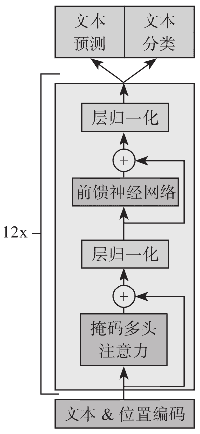

图 3.1 GPT-1 中的 Transformer 解码器

（图片来源：论文“Improving language understanding by generative pre-training”）

训练时通过最小化交叉熵损失来最大化数据似然，即提升模型生成正确词的概率。常用的优化器有随机梯度下降及其变体如 Adam、Adagrad 等。学习率预热与逐步衰减等策略对训练稳定至关重要。

## **3.2 GPT 的模型架构**

GPT 基于 Transformer 解码器，自注意力机制使其具备长程建模与并行计算能力。GPT-1 的整体结构如图 3.2 所示。

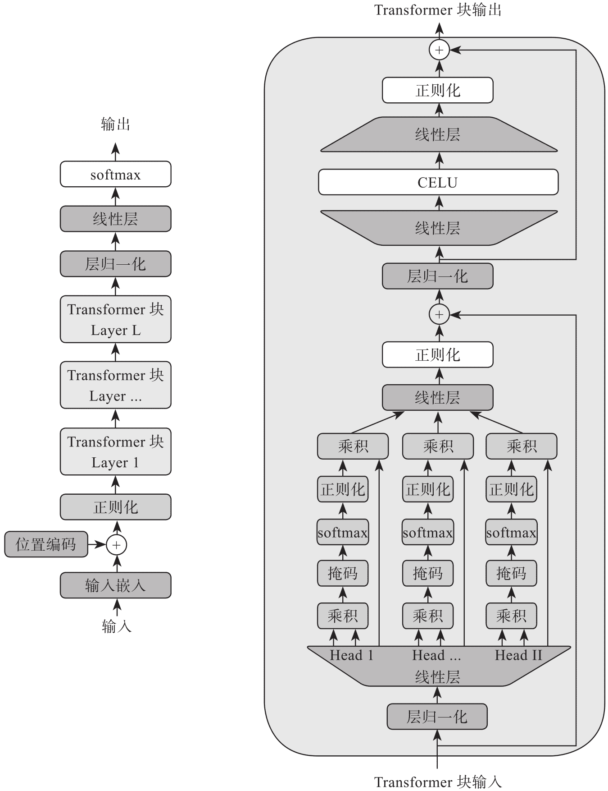

图 3.2 GPT-1 的模型架构

（图片来源：https://www.wikiwand.com/zh-hans/OpenAI）

为保证生成时不泄漏未来信息，GPT 采用掩码自注意力。具体实现是在注意力得分计算时屏蔽当前位置之后的所有词，通过一个掩码矩阵把未来位置的注意力权重置为负无穷，经过 softmax 后概率趋近于零。

掩码自注意力的本质是只允许每个位置关注自身及之前的历史。以输入序列 x = (x1, x2, …, xn) 为例，计算第 i 个位置时，仅使用 1 到 i 的元素。这种因果掩码确保输出只依赖已观测的上文。图 3.3 展示了其工作流程。

在预训练阶段，掩码机制帮助模型学习符合自然语言生成顺序的表示；在微调阶段，同样保证输出与已观察上下文相关。相比原始 Transformer，编码器的自注意力是无掩码的，可看全序列，对机器翻译等任务有利，但在自回归生成任务里会引入未来信息，违背生成规律。此外，原始 Transformer 同时包含编码器和解码器，而生成式预训练只需学习通用表征，无需输入到输出的映射，因此 GPT 仅保留解码器部分。

## **3.3 生成式预训练过程**

生成式预训练利用大量无标签文本进行无监督学习，目标是掌握文本的底层结构和语义，并能生成与训练数据相似的序列。给定序列 x = (x1, x2, …, xt)，模型学习其联合分布 P(x)，可分解为条件概率的连乘，即

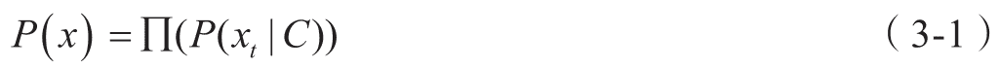

其中 C 表示前 t-1 个词构成的上下文，P(xt|C) 为在该上下文下生成第 t 个词的概率。

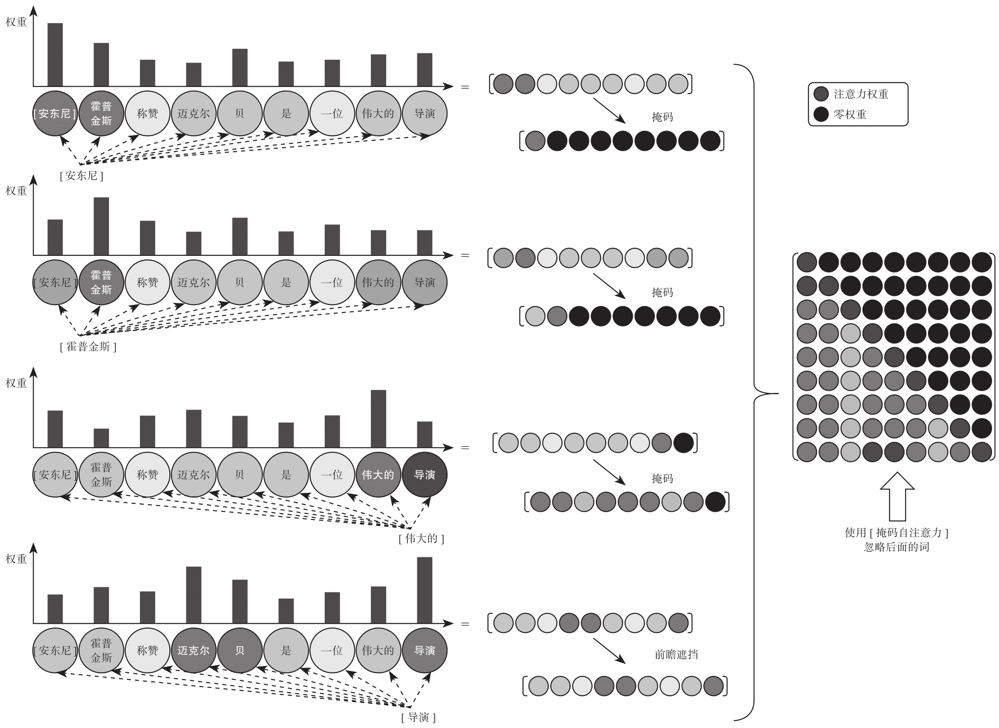

图 3.3 掩码自注意力的工作原理

（图片来源：https://data-science-blog.com/blog/tag/engineer/）

### **3.3.1 生成式预训练的目标**

预训练的目标是最大化训练数据的似然，等价于最大似然估计。损失可写为：

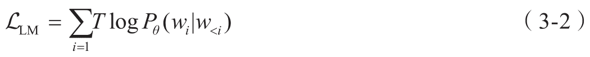

其中 L 为自回归语言模型损失，T 为样本长度，w<i 为当前位置之前的词序列，w[i] 为当前词。模型在历史词的基础上估计当前词出现的概率，参数 θ 控制预测能力。

实现流程首先用词嵌入矩阵 W 将文本序列 u 映射为向量表示。随后用位置嵌入矩阵 Wpe 加入位置信息，与词嵌入相加得到输入表示 h0。之后 h 依次经过多个堆叠的 Transformer 块，每个块包含自注意力和前馈层，第 i 层的输出可表示为：

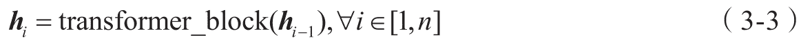

最后一个块的输出 h_ne 与词表嵌入矩阵 W 相结合，通过 softmax 计算下一个词的预测概率：

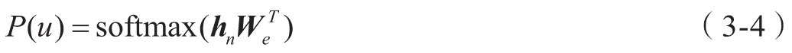

在训练中，GPT-1 最小化负对数似然，即降低在给定前文下预测下一个词的误差。参数和嵌入向量在前向与反向传播中被不断更新。

### **3.3.2 生成式预训练的误差反向传播过程**

为便于说明，简化初始嵌入为 one-hot 编码与词嵌入矩阵的乘积，记为 We：

其中 X 为 one-hot 编码矩阵，W 为词嵌入矩阵。随后在每个 Transformer 堆叠层中进行多头注意力、残差连接和层归一化，生成上下文表示 h[i]：

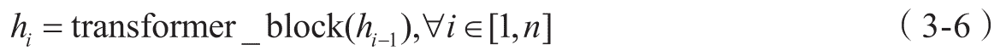

最后将最后一层的输出乘以权重矩阵并经 softmax 得到下一个词的概率分布。损失通过比较真实下一个词的 one-hot 编码与预测分布得到，并沿反向传播路径回传至各层以更新嵌入。

对某个词向量 v 的梯度可表示为：

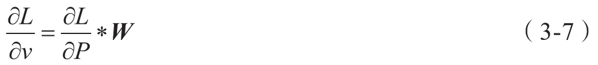

其中 L 为损失，P 为预测概率分布，W 为嵌入矩阵。依据梯度下降更新 v，可提升后续预测精度。预训练中学习率预热与衰减、Dropout、权重衰减等正则化手段常被使用，以提升稳定性并防止过拟合。

预训练完成后，模型可迁移到多种 NLP 任务，通过有监督微调适应特定目标，属于典型的迁移学习范式。

## **3.4 有监督微调**

预训练赋予模型基础的语法与词汇理解能力。有监督微调则在标注数据上进一步调整参数，使模型能够完成情感分析、文本分类、问答等具体任务。

### **3.4.1 有监督微调的原理**

设任务样本为 (x, y)，x 为输入序列，y 为标签。微调的目标是最小化：

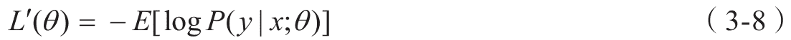

其中 θ 为模型参数，E 为期望，P(y|x;θ) 为给定输入和参数下生成标签的概率。该式与自回归语言模型损失类似，但关注的是任务标签而非词的生成。

优化目标可写为：

其中 θ 为微调后参数，L'(θ) 为任务数据损失，λ 为正则化系数，R(θ) 通常取参数 L2 范数。该目标在最小化任务损失的同时通过正则化抑制过拟合。

### **3.4.2 有监督微调的特定任务**

预训练阶段模型学习自然语言的通用知识，形成词汇、语法与语义的综合表征。微调阶段利用标注数据学习任务特定知识。常用做法是对输入做任务特定转换，即在序列中加入特殊标记以突出任务信息。例如问答任务中可在问题与上下文之间插入分隔符 [SEP]，帮助模型区分两部分并生成更准确答案。

GPT 应用流程如图 3.4 所示，分为无监督预训练和有监督微调两阶段。图中列举了四类 NLP 任务：

1）文本分类。模型根据输入文本内容将其归入预设类别。输入通常为单一文本片段，可直接送入模型。微调后输出层常加入全连接层以产生类别预测。为明确任务意图，可在序列开头加入分类符号 [CLS]。

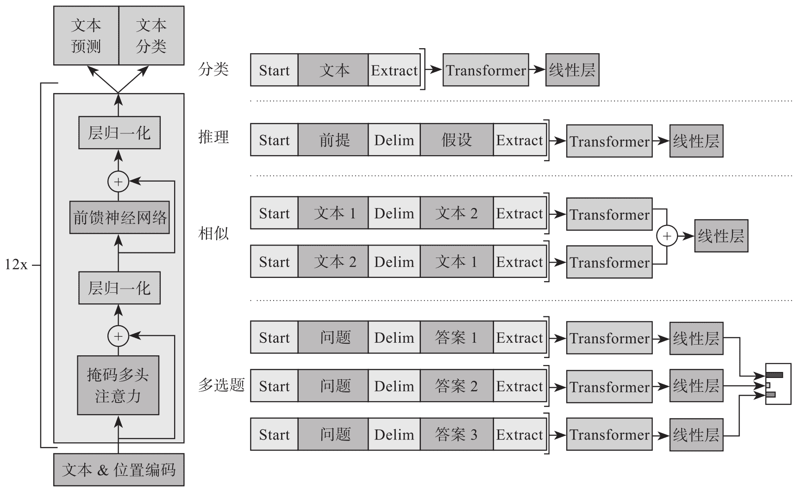

图 3.4 GPT 模型的应用流程

用特殊标记引导模型理解任务

（配图源自论文《Improving language understanding by generative pre-training》）

自然语言推理（NLI）。这个任务要判断在给定前提的情况下，一个假设能不能成立，输出只有蕴含、矛盾或中立三种可能。图 3.4 中的输入由前提和假设两部分组成，中间会放一个分隔符，比如 “[Delim]”。为了让模型明确推理意图，有时会在序列最前面加上一个推理标识，像 “[NLI]”。经过任务微调后，GPT 就能根据整段输入给出关系类型的预测。

相似性（Similarity）。模型要对两个文本片段的相似程度做出评估。转换时通常在两个待比较的序列之间插入特殊分隔符 “[Delim]”，序列开头则可能加上相似性标记 “[SIM]”，告诉模型当前是在做相似度判断。

多项选择（Multiple Choice）。模型需要在若干选项里挑出最符合问题的答案。做法是在问题与每个选项之间都加入分隔符 “[Delim]” 来做区分，序列开头也常加上多选标记 “[MCH]” 表明任务类型。

加入任务专属的符号改造，能让 GPT 在迁移学习时捕捉到更清晰的任务信号，从而在下游表现更好。实际落地时，这些特殊标记的具体写法会随模型设计和任务需求而变化。

做改造时要保证预训练和微调用的是同一套词表和编码方式。预训练阶段就要为特殊符号预留词表空间，微调时沿用相同的词表和编码去处理输入，这样全程的语言表征才能保持一致，理解能力也不会断层。

总体来看，这套输入转换的手法让 GPT 能够灵活地适配各类 NLP 任务，实现稳定高效的迁移。

### 3.4.3 有监督微调的步骤

1）选择目标任务。先根据应用需求锁定具体任务，比如情感分析、文本分类、命名实体识别等。
2）准备相关训练数据。收集该任务的标注样本，通常是文本片段配上对应的标签。
3）初始化模型。以生成式预训练阶段得到的模型参数作为起点，让模型一开始就具备扎实的语言能力。
4）微调模型。用任务数据和损失函数 L′（θ）来更新参数，可用随机梯度下降等优化器，并加入 L2 正则化等手段，通过调节系数 λ 来防止过拟合。
5）评估模型性能。在验证集上用准确率、F1 等指标衡量微调后的效果。
6）调整超参数。依据验证表现，微调学习率、正则化强度等超参，进一步提升性能。
7）应用微调后的模型。用它处理新数据，为目标任务产出预测。

实践中模型还会做任务级改动。例如文本分类常在最后加一个全连接层来输出类别；命名实体识别则可能在输出层加 CRF 来建模标签序列的依赖。这种灵活性让 GPT 能覆盖更多场景。

并且由于预训练已学到丰富的语言表征，有监督微调往往在少量标注数据上就能取得不错结果，本质上是在预训练基础上做针对性调整。

总之，有监督微调是把 GPT 迁移到特定 NLP 任务的关键环节，能在任务数据上实现性能跃升。

## 3.5 小结

本章讲的生成式预训练模型是 GPT 系列的起点，也深刻影响了 ChatGPT 的技术路线。GPT 的训练分为无监督预训练和有监督微调两步，形成了 ChatGPT 可复用的训练框架。先在大规模无标注文本上学习通用的语言表征，再针对特定任务做监督优化，性能随之提升。GPT 的架构只保留 Transformer 解码器和掩码自注意力，这为 ChatGPT 的设计提供了参考。该机制兼顾强大的表征学习和并行计算能力，生成时只参考当前位置及之前的上下文，因而能输出连贯、合理的回应。

# 第四章

# 无监督多任务与零样本学习

多任务学习（Multi-Task Learning，MTL）指同时训练多个相关任务，通过共享表征提升泛化能力。OpenAI 在 GPT-2 论文 ^(¹) 中提出了无监督多任务学习与零样本学习（Zero-Shot Learning）的概念。

零样本学习可看作无监督多任务的一种特例，模型不需要任务相关的标注，而是依靠已有的语言能力直接完成新任务。它省去了针对每个任务的微调成本，也让模型更容易泛化到未见任务。本章会介绍 GPT-2 在 Transformer 架构上的变化，以及无监督多任务与零样本学习的思路。

## 4.1 编码器与解码器

2018 年 10 月 OpenAI 发布 GPT，半年后 Google 推出了 BERT。标准的 Transformer 由编码器和解码器堆叠而成。如图 4.1 所示，BERT 基于编码器，GPT 基于解码器。

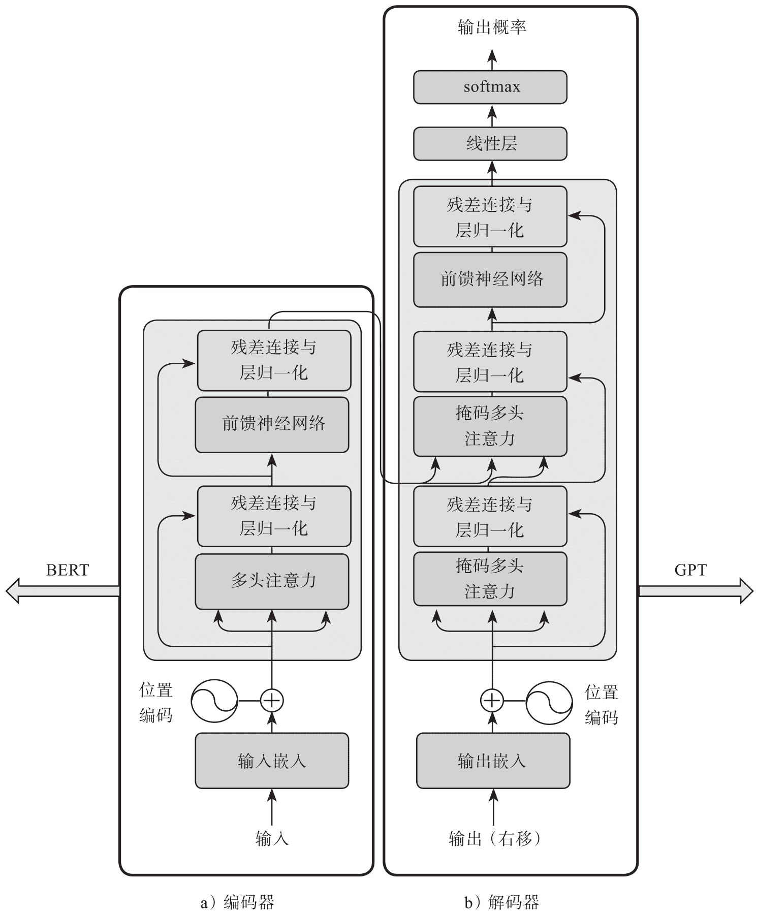

图 4.1 Transformer 的编码器与解码器架构

BERT 采用双向上下文表征，预测一个词时会同时利用前后信息。训练时使用掩码语言模型（Masked Language Model，MLM），随机遮蔽句子中部分词，让模型在完整上下文中复原，从而更好地捕捉双向信息，在很多 NLP 任务上表现突出。

在 BERT 取得成功后，OpenAI 推出了 GPT-2。它仍沿用 GPT 那样的自左向右单向 Transformer 做无监督预训练。

BERT 采用双向编码器结构，利用自注意力（见图 4.2 左图）捕捉文本的双向上下文，在问答、命名实体识别、关系抽取等需要理解句法和语境的任务上优势明显。

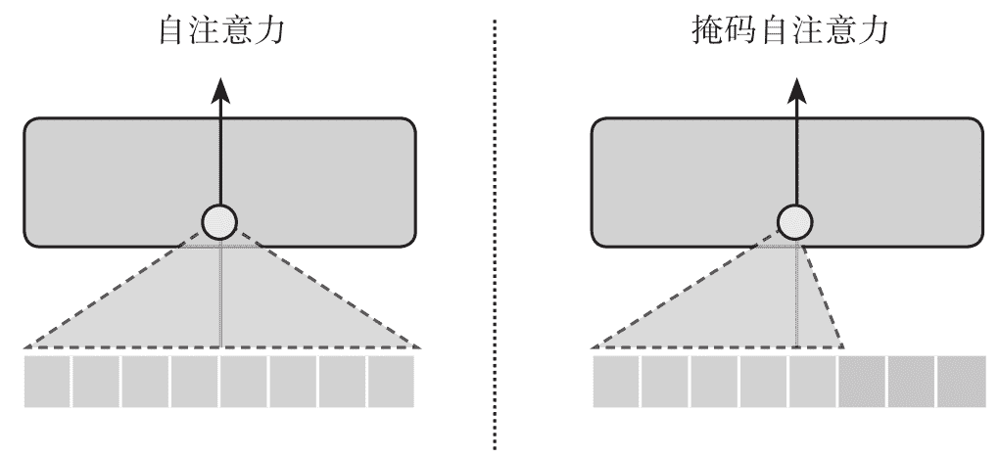

图 4.2 自注意力与掩码自注意力的区别

（图片来源：http://jalammar.github.io/illustrated-gpt2/）

GPT-2 则采用单向解码器结构，使用掩码自注意力（见图 4.2 右图），主要通过单向语言建模学习上下文。虽然双向能力不及 BERT，但在文本摘要、机器翻译、对话生成等生成类任务上表现很好。

因架构和训练方式不同，两者在不同任务上的差距会比较明显，但两者都被证明是强大的自然语言处理模型，各自在擅长的领域取得了显著效果。

## 4.2 GPT-2 的模型架构

GPT-2 延续了 Transformer 解码器架构，但在训练数据规模上远超 GPT-1。它在 OpenAI 收集的 WebText 数据集上训练，数据量约 40GB。GPT-2 有 4 种规模：117M 小型、345M 中型、762MB 大型、1542MB 超大，如图 4.3 所示。最小模型有 12 层解码器，参数存储约需 500MB；最大模型有 48 层解码器，参数量约是最小的 13 倍，需约 6.5GB 存储。相比 GPT-1，架构有了明显改动，如图 4.4 所示。

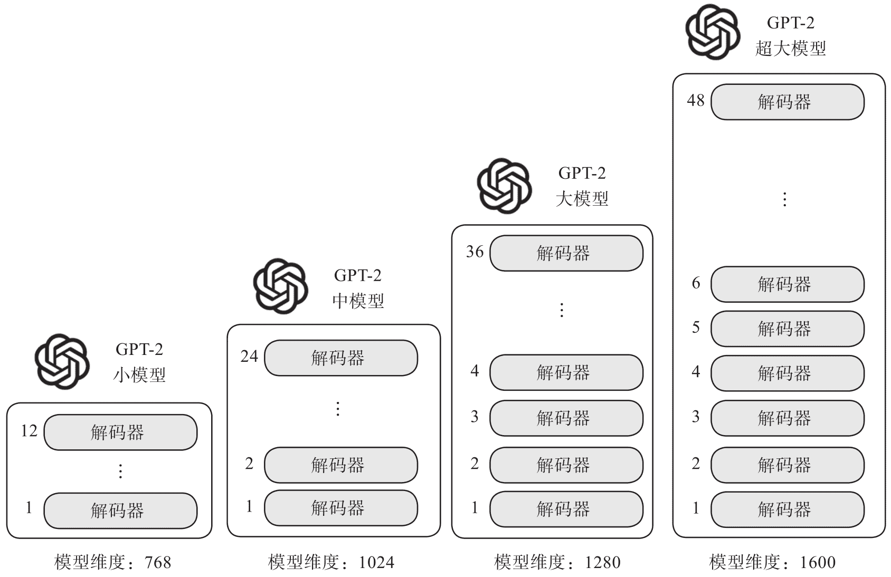

▲图 4.3 GPT-2 的 4 种不同大小模型

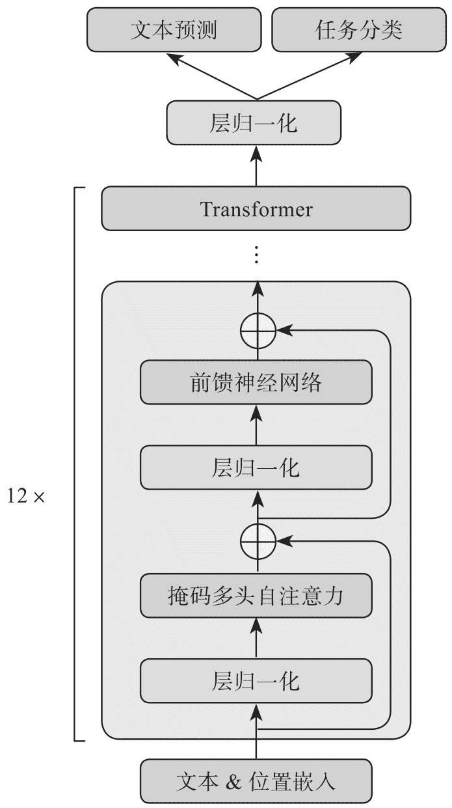

▲图 4.4 Transformer 的解码器架构

### 4.2.1 层归一化

层归一化（Layer Normalization）是在神经网络层间加入归一化操作。GPT-2 中它被广泛应用于 Transformer 层。与 GPT-1 不同，每个 Transformer 层的输入和输出都会经过层归一化，有助于缓解梯度消失与爆炸，提升训练稳定性和收敛速度。

深度网络中梯度传播容易出现消失或爆炸。层归一化通过把输入的均值和方差规范为 0 和 1，减少尺度差异，使反向传播的梯度更顺畅，方差更稳定。归一化还能缓解协变量偏移，让训练集和测试集的分布更一致，提升泛化能力。同时各维度梯度尺度趋同，有助于优化器更快找到合适更新方向，加速收敛。层归一化方式如图 4.5 所示。

图 4.5 层归一化方式

（图片来源：https://blog.csdn.net/wwangfabei1989/article/details/90547149）

### 4.2.2 正交初始化

正交初始化（Orthogonal Initialization）是为权重矩阵设计的一种初始化策略，核心是把权重初始化成正交矩阵，从而稳定训练中的梯度。

GPT-2 的权重初始化与 GPT-1 类似，采用正交初始化。正交矩阵的行列向量都是单位向量且互相正交，逆矩阵等于转置，条件数为 1，数值上不会放大误差。

前向和反向传播中梯度要经过多层权重，初始化不当易导致梯度消失或爆炸。正交矩阵的乘积仍保持正交，有助于各层梯度范数保持稳定，降低风险。

图 4.6 给出了一个简单示例：先生成一个服从标准正态分布的 n×n 随机矩阵，做 QR 分解 A = Q R，其中 Q 为正交矩阵，R 为上三角矩阵，最后用 Q 作为初始化权重。该矩阵数值特性好，能保持梯度稳定。

图 4.6 QR 分解图示

注意正交初始化多用于方阵。对非方阵，可生成 n×m（n>m）的随机矩阵，做紧凑 QR 分解取前 m 列，得到正交权重。

### 4.2.3 可逆的分词方法

GPT 系列都使用基于数据压缩的可逆分词方法，即 Byte-Pair Encoding（BPE）。BPE 把高频词组合合并为新单元，减小词表规模，解码时能完整还原，故称可逆分词。

BPE 的思想是把常见字符组合合并成新符号，减少词表并增强泛化，同时更好地处理罕见词和词形变化。步骤如下：

1）初始化词表。把文本中所有单词或字符加入词表，初始每个条目都是单个字符。
2）统计字符频率。统计相邻字符对的出现次数，用于决定合并优先级。
3）合并高频字符对。挑出出现次数最多的字符对合并成新符号，加入词表并更新文本。
4）重复 2、3 步。按需迭代，直到达到设定的合并次数或词表大小。

举例：语料含 old_、older_、finest_、lowest_ 等，设置词表大小或迭代次数作终止条件。统计字符出现次数后，第一次可能合并 e 和 s 为 es，总频次 13；随后合并 es 和 t 为 est，频次仍高；再合并 est_ 以区分不同词尾；再合并 ol 等。若迭代 4 次，词表可能为 _、o、l、d、r、f、i、n、w、est、ol、est_。

BPE 能把原始文本压缩成更短形式，同时保留高频模式。在 NLP 任务中，它通过子词单元有效处理罕见词和词形变化。

罕见词方面，模型会把低频词拆成训练中更常见的子词，如 neuroscientific 可拆为 neuro、scien、tific，利于学习语义。词形变化方面，running、ran 可拆为 run、ning、ran，帮助模型掌握词根和形态规律。

中文应用更复杂。中文由单字组成，字有独立意义，词由多字构成。BPE 多用于处理单字及其组合。例如“我爱北京天安门”先拆成字序列 [“我”,“爱”,“北”,“京”,“天”,“安”,“门”]，若“北京”“天安门”在语料中高频，就会被合并，最终得到 [“我”,“爱”,“北京”,“天安门”]。

（续）

表 4.2 字符合并示例

面对更复杂的中文材料，BPE 也能灵活应对词的变形与复合情况。以“美丽”和“美好”为例，二者都由“美”构成，BPE 倾向于先把“美”单独作为一个 token，再把“丽”和“好”分别拆成独立的子单元。这种拆分方式让模型对中文的构词特点和复杂性有了更高效的把握。

不过中文和英文在结构上差异明显，BPE 在中文上的优势会被削弱。中文没有像英文那样清晰的前后缀变化，字形和词形更多依赖组合而非规则的增减，于是出现一些处理不到位的情况，这就需要更贴合中文特性的改进方案来弥补。

总体来看，在 GPT 系列里引入 BPE，词汇表的规模被压缩，模型所需学习的参数随之减少，计算负担变轻，训练与推理速度都得到提升。同时子词单元之间共享信息，帮助模型更好地捕捉词义，提升了在各类 NLP 任务上的表现。

同时未知词的应对能力也被增强。模型碰到未见过的词时，可以把它拆成已知的子词单元来推断语义，泛化到新词和低频词的能力因此提高。

在迁移学习场景下，这种子词共享同样发挥作用。模型通过学习子词间的共性，更容易提炼出不同任务间的规律，在迁移时表现更稳健。

多语言处理上也受益，BPE 能捕捉不同语言的词根和形态变化规律，让同一套机制在多语言中复用，跨语言效果更好。

需要特别指出的是，GPT-2 以后的版本使用的是 BPE 的变体 Byte-level BPE，简称 BBPE。它把基本单位从字符降到字节。Unicode 字符集庞大，BBPE 以 1 个字节即 256 种可能作为基础，摆脱了对字符长度的依赖。词表可以跨语言共用，规模更紧凑，但对中文这类语言，同样一段内容对应的序列会明显变长，训练与推理耗时会增加；不过在同等数据上，BBPE 的效果往往更优。

### 4.2.4 可学习相对位置编码方案
GPT-2 在 Transformer 解码器基础上采用了可学习相对位置编码，用来精准刻画序列中的位置信息。与只记绝对位置不同，这种设计同时关注 token 间的相对距离关系，对长程依赖的捕捉能力明显增强。

在 GPT-2 内部，相对位置编码被直接嵌入到自注意力计算中，和 Q、K、V 共同作用。算注意力分数时，除了 token 内容的相关性由 Q 和 K 的点积体现，相对位置信息也会一并计入。这些位置编码并非固定，而是由可参数化的函数生成，在训练过程中不断学习优化。

拿“The cat is cute.”举例。原始 Transformer 会先把词转成 token ID [The, cat, is, cute, .]，再把基于正弦余弦的绝对位置编码直接加到词嵌入上，让模型感知绝对位置。

GPT-2 的做法不同，位置信息不在嵌入阶段叠加，而是在注意力计算时引入相对编码。比如 cat 与 cute 的相对距离是 2，这个距离信息会参与权重计算，和内容相似度一起决定注意力分配，从而让模型学会利用位置来提升自注意力效果。

## 4.3 无监督多任务预训练
GPT-2 的无监督预训练依托 WebText 语料，这是一批从互联网抓取的约 45 万篇网络文章。经过去重、清洗和筛选后，语料规模约 40GB，包含近 80 亿词，比 GPT-1 使用的数据更大，为更大更强的模型提供了基础。

如图 4.7 所示，监督多任务学习依赖带标签的训练集来预测新数据的标签，而 GPT-2 的多任务是通过无监督生成来完成的，目标是产出与训练数据相似的文本。两种预训练思路在原理上相近，都是用海量无标签文本训练 Transformer。

预训练阶段使用最大似然估计，让模型学会在给定上下文后预测下一个词。训练过程不断比较预测与真实结果，调整参数提升准确率。模型因此积累了丰富的语言结构和语义知识。

图 4.7 多任务监督学习与多任务无监督学习

这种无监督多任务旨在从大量自然语言中提炼多任务共享的知识与特征，增强泛化与适应能力。实际应用中，人们常对预训练的 GPT-2 做有监督微调，使其更贴合特定任务。微调属于监督学习，使用标注数据优化性能，虽然能在一定程度上迁移到相似任务，但迁移能力有限，因为知识是针对特定任务学习的。

## 4.4 多任务学习与零样本学习的关联
零样本学习指模型未经特定任务的有监督训练，就能凭借既有知识处理新任务，如图 4.8 所示。GPT-2 的零样本能力源自预训练阶段的无监督多任务学习，可以把预训练获得的知识泛化到各类 NLP 子领域，无需针对性微调。缺点是性能通常不及有监督微调，因为缺乏任务特定标注。

图 4.8 零样本学习示例

预训练让 GPT-2 掌握丰富的语言结构和语义，零样本则允许它在没有任务标签的情况下完成多种任务。二者并不冲突，反而互补。

零样本的应用可从三个任务看出。

阅读理解中，问题和文本直接作为输入喂给模型。常见做法是把问题与原文用分隔符拼接，例如“太阳系有多少颗行星？<sep>太阳系包括一颗恒星（太阳）和八颗行星。”模型据此可能输出“八颗”。

文本摘要中，通过在输入序列里明确任务指令来实现。输入形如“生成关于以下文本的摘要：计算机科学是研究计算机及其系统的科学……”模型可能给出“计算机科学是研究计算机系统、硬件设计、软件设计和算法的领域。”质量不及专门训练的摘要模型，但展现了未针对任务训练时的多任务潜力。

情感分析中，可把评论改写为问句形式：“这款手机的电池寿命很长，摄像头效果也非常出色。这段评论的情感是什么？”模型可能回答“这段评论的情感是积极的。”说明零样本也能完成情感判断。

## 4.5 GPT-2 的自回归生成机制
无监督预训练让 GPT-2 从大规模文本中吸收知识，权重矩阵被优化以适应语言建模。在零样本使用时，模型直接拿来用，不做任务特定微调，权重保持不变。

预训练还涉及词汇表，每个词的初始嵌入是随机生成的，训练中被调整以最大化语言建模性能。训练结束后，嵌入反映了大规模语料的统计规律。

在具体任务上，通常会对 GPT-2 进行微调，权重会随任务变化。但在零样本场景下，权重固定不变。

### 4.5.1 子词单元嵌入表示
GPT-2 用 BBPE 对输入做预处理，将文本切分为子词单元而非完整单词。BBPE 以字节为基本单位，因此词表基于预训练语料的统计信息构建，兼顾常见词与常见结构。

一个单词可能被拆成多个子词，每个子词都有对应嵌入。不同版本的序列长度限制不同，小型 GPT-2 为 768，更大版本可达 1024 或 2048。

预训练期间，词表的嵌入表示通过自回归预测来训练，模型根据上下文调整嵌入以优化预测。训练结束后，嵌入固定，不再更新，但已具备良好的语义表达能力，能适应多种 NLP 任务。

图 4.9 词表嵌入示意图

### 4.5.2 生成迭代过程
作为典型的自回归生成模型，GPT-2 可处理长达 1024 token 的输入，从提示开始逐 token 生成。然而单纯生成常缺乏主题，实际中常用零样本方式，给出指令性提示引导主题。

例如提示“太阳系有多少行星？”。如图 4.10 所示，输入序列先转成 token 再映射为词嵌入并加上位置编码。模型由多层解码器堆叠，每层先做自注意力再做前馈网络处理，层间权重独立。

图 4.10 GPT-2 自回归生成过程

最后一个解码器的输出向量与词嵌入矩阵相乘，归一化后可看作与各个词嵌入的相似度评分，相当于选择词的概率。通常挑评分最高的词 top_k=1，也有采用随机采样或取 top N 再采样。一次迭代输出一个词，模型持续迭代直到达到 1024 token 上限或生成结束符 <e>。

## 4.6 小结
GPT-2 的出现没有终结编码器与解码器之争，却为无监督环境下利用非结构化文本提供了新思路。研究者开始关注如何优化架构与训练策略，提升多任务与零样本表现。

随后 OpenAI 推出 GPT-3，参数规模达到 1750 亿，是 GPT-2 最大版本的十倍。如此规模使有监督多任务微调变得不现实，零样本学习在 GPT-3 中成为关键，为 NLP 带来新的视角。

# 第五章
# 稀疏注意力与基于内容的学习
OpenAI 于 2020 年 5 月发布 GPT-3。虽然在基于 Transformer 解码器架构上与前代保持一致，但它引入了改进的类 Sparse Transformer 模式，在各层中交替使用密集和局部带状稀疏注意力，大幅提升了长序列处理的计算效率。

GPT-3 拥有 1750 亿参数，成为当时最大的 Transformer 模型之一，性能随之提升，但训练成本也创下新高。据估算单次训练成本约 140 万美元。经济压力下，对大模型进行有监督标注微调变得不现实，因此基于内容的学习，即 in-context learning 被强调出来。模型只需在提示中给出少量示例，无需大规模改动参数，就能在新任务上学习并表现良好。

本章将探讨 GPT-3 的稀疏注意力改进以及基于内容学习的理念与特性。

## 5.1 GPT-3 的模型架构
GPT-3 继承了 GPT 系列的核心做法，如正交初始化、层归一化以及 BBPE 分词，这些都有助于训练稳定与生成质量。如图 5.1 所示，其注意力模式做了重大改进，在解码器层中交替使用密集注意力和局部带状稀疏注意力，与 Sparse Transformer 思路相似，但不同于 GPT-2 的全连接注意力。这种设计让长序列处理更高效，降低计算与内存开销，提升可扩展性。

GPT-3 的规模远超 GPT-2，参数为 1750 亿，对比 GPT-2 的 15 亿。两者均采用基于 Transformer 的解码器结构，包含输入、嵌入、Transformer 层和输出。GPT-3 仍沿用正交初始化、层归一化和可逆分词，同时使用了更大规模的训练数据，泛化能力更强。整体架构包括：

# GPT-3 结构与涌现能力速览

**词元切分。** GPT-3 先行采用字节对编码进行可逆分词，高频词组被合并为单一单元，以压缩词表规模并保证解码可还原。

**向量化。** 离散词元经嵌入层映照为稠密连续向量，为后续计算提供数值表征。

**位置注入。** 位置编码为向量叠加顺序信号，使模型能辨识词元先后并把握序列关联。

**变换器堆叠。** 主干由多层编码器堆叠而成。每层由稀疏注意子模块与前馈子模块构成。稀疏注意交替使用密集形态与局部窗口形态，前馈网络为全连接结构，负责提取更高层语义特征。

**层归一化。** 每层输入与输出均接入层归一化，对信号进行标准化，有助于抑制梯度消失与爆炸，提升收敛稳定性。

图 5.1 GPT-3 的模型架构示意图

**输出解码。** 输出层把编码器结果转为下一词元的概率分布。先经线性变换得到 logits，再经 softmax 归一化为概率，最后选取概率最大者作为预测。

总体看，GPT-3 基本沿用 GPT-2 设计脉络，关键差异在于引入稀疏注意，并在规模与语料上大幅扩张，从而获得性能提升。

## 5.2 稀疏注意力模式
Sparse Transformer 是面向长文本的改进思路，通过稀疏注意降低计算量与显存占用，实现长序列的高效处理。

### 5.2.1 Sparse Transformer 的特点
传统 Transformer 处理长序列时，自注意为全连接，序列长度为 n 时计算与显存需求为 O(n²)，对超长输入难以承受。Sparse Transformer 不对全部元素对计算注意分值以实现稀疏化，主要做法是限定注意作用范围设窗口，或设计特定稀疏连接方式，将复杂度与显存降至 O(n) 级别。

（1）稀疏注意力模式
如图 5.2 所示，Sparse Transformer 的核心是稀疏式注意。每个词元只关注部分提示信息而非全部，将复杂度从 O(n²) 降至 O(n) 量级。实现方式多样，如窗口局部注意、稀疏全连接注意等。GPT-3 采用窗口局部形态聚焦相对邻近词元，稀疏全连接则在全序列上按固定步长采样。

图 5.2 传统 Transformer 与 Sparse Transformer 对比

（2）交替密集与稀疏注意力模式
为兼顾性能与泛化，GPT-3 在各层交替使用密集与稀疏注意。既保持计算效率，又能更好捕捉远距离依赖。具体比例可按具体需求与资源限制灵活调整。

（3）可学习相对位置编码
GPT-3 采用可学习的相对位置编码，同时刻画词元的绝对距离与相对距离，增强远距离依赖的捕捉能力。

### 5.2.2 局部带状注意力
局部带状注意是 GPT-3 的稀疏变体，目标是缓解计算与显存压力。每个词元仅关注邻近部分词元。

1）确定窗口大小。窗口大小定义每个词元可见的提示背景范围，可按具体需求与资源调整。窗口越大信息越丰富，计算开销也越高。
2）构建注意矩阵。为序列中每个词元生成窗口大小的一维注意向量，仅计算窗口内词元的权重，计算方式与传统自注意一致。把所有向量堆叠形成二维注意矩阵。
3）计算局部输出。用该二维矩阵乘输入序列的隐藏状态，得到只关注邻近位置的输出。

局部带状注意的优势是复杂度从 O(n²) 降到 O(n × window size)，在保持效率的同时保留局部信息。不足是难以捕捉远距离依赖，可与其他稀疏形态结合，或在层间交替使用密集与稀疏形态来弥补。

### 5.2.3 跨层稀疏连接
跨层稀疏连接旨在帮助相邻层建立更长的依赖。GPT-3 通过提高注意效率处理更长输入。

跨层连通方式包括：
1）局部带状稀疏连接。每个词元仅关注前后邻近部分词元，捕捉小窗口内的局部依赖。
2）密集连接。每个词元可关注序列中所有其他词元，捕捉全局依赖。

在各层交替使用这两种连通，GPT-3 能兼顾多尺度依赖。局部连通负责短距离依赖，密集连通跨越更长距离。设计在提升长序列效率的同时保持长程建模能力，降低资源需求。

## 5.3 元学习与内容型学习
面对 1750 亿参数规模，全量微调已不切实际。GPT-3 的主要策略是元训练与提示适配学习。

元训练指在大规模文本上预训练，掌握自然语言生成能力与广泛知识与理解能力。预训练阶段模型学习词汇、短语、句子、段落的语法结构与基础常识。

内容型学习指在少量带标签数据上调整模型以适配特定任务。微调未进行全面重训，而是把预训练的泛化能力迁移到目标任务。数据可以是问答对或带情感标签的句子，少量标签即可在多任务上取得高表现。

### 5.3.1 元学习
传统元学习指用少量标签快速学习新任务。GPT-3 论文将元学习的定义扩展到无监督预训练阶段。

在此视角下，大语言模型可视作元学习器，预训练即学会大量知识与语言理解。通过海量无标注文本预训练，模型掌握语言结构与常识，具备泛化能力。这种泛化源于无监督预训练而非专门的元训练过程，相较传统元学习在效果上相似。

### 5.3.2 内容型学习
为避免微调阶段改动参数，GPT-3 强调内容型学习。任务适配采用 zero-shot、one-shot、few-shot 策略，摆脱传统微调限制。

如图 5.3 右侧所示，微调在预训练后启动。每项任务提供少量训练样本，如批量大小为 1 的样本，通过计算损失更新权重。相较从零开始训练，微调数据需求更小、学习率更低，因为初始值已接近解。

图 5.3 左侧展示 GPT-3 如何借助不同示例量的提示学习在未改动参数的情况下提升新任务性能，大幅降低使用门槛。

图 5.3 三种上下文学习与传统微调

zero-shot 指模型仅依靠预训练知识，在无任何任务标签数据的情况下解决问题。需理解任务描述并以自然语言生成答案。挑战在于无示例条件下理解要求。

得益于庞大参数与海量预训练，GPT-3 在 zero-shot 上表现优异，能捕捉丰富语言结构、语法与常识，直接生成相关输出。

one-shot 指仅给一个相关示例进行推理。模型需从单个示例理解任务并给出答案。挑战是有限信息下快速适应。

在 one-shot 示例中，任务描述后插入一个翻译示例。推理时序列更长，注意力机制提取有用信息。模型不做梯度更新。

GPT-3 结合预训练知识与单个示例即可在 one-shot 任务上高效表现，降低监督成本。

few-shot 指提供少量标签示例后推理。模型需从多个示例理解任务并预测。挑战是在信息有限时有效学习并提升准确率。GPT-3 处理能力有限，过长序列对信息提取不利，过多示例并非总是更优。

GPT-3 在 few-shot 上同样出色，多示例输入帮助模型更好适配新任务，体现强泛化能力。

相较传统微调，zero/one/few-shot 无需昂贵监督训练，成本时间大幅降低，且在标签稀缺任务上更易部署，同时避免过拟合。

## 5.4 概念分布的贝叶斯推断
提示学习是大语言模型的重要涌现能力，理解其原理有助于构建有效提示。如图 5.3 所示，zero-shot 提示含任务描述与内容，single/few-shot 额外加入示例。

### 5.4.1 隐式微调
可把语言模型解释为元优化器，把提示学习视为隐式调优，建立与显式微调的联系。如图 5.4 所示，GPT 在前向计算中根据任务相关标签样本生成元梯度，并通过注意力将其施加到任务上。该过程与微调的反向传播更新参数视角相同。

两者在预测、表示、注意力行为层面相似，均采用类梯度下降优化，但提示学习通过前向产生元梯度，微调通过反向传播计算梯度。

few-shot 场景下，大模型是否隐式学习映射 y = f(x)？若如此，示例对性能影响应很大。原论文图 5.5 似乎支持此观点，zero-shot 无法修正，single/few-shot 明显提升。

但另一研究提出新视角：示例中输入-标签映射对性能影响小于预期。把真实标签换成随机标签，或把示例 <x[i], y[i]> 换成随机值，性能损失相对较小，依赖真实映射并不高。

▲图 5.4 GPT 元优化与微调过程

▲图 5.5 示例数量与参数规模对模型性能的影响

图片来源：论文“Language models are few-shot learners”

图 5.6 展示 GPT 等模型在不同标签条件下外推任务表现。采用直接推理与通道推理两种方式。直接推理是在给定提示背景后比较类别概率；通道推理是在给定类别后比较提示背景概率。以情感分析为例，直接推理比较“这部电影真好看 正面”与“这部电影真好看 负面”的概率，通道推理比较“正面 这部电影真好看”与“负面 这部电影真好看”概率。图示显示，无论分类还是多选，随机标注与正确标注表现相当，均明显优于无示例 zero-shot。

由此可得：
1）示例决定的标签空间与输入文本分布对提示学习至关重要，而非单个标签是否正确。关键是 x 与 y 的分布，即输入分布与候选答案集合。随机标注中 y[i] 不正确但仍在候选集合内。若改动分布，如把 y 换成候选集外内容，效果会急剧下降。
2）格式指定同样关键。未知标签空间时，用随机英语单词作标签也优于未采用标签。
3）以上下文学习目标进行元训练会放大这些效应，模型更利用示例的简单方面如格式，而非输入-标签映射。

大模型可能并未从示例学习映射 y = f(x)，而更依赖预训练先验。但若把任务学习拓宽为适应示例暗示的输入、标签分布与格式并更准确预测，则可认为模型从示例获取了任务信息。预训练模型已具备内在任务能力，语言建模目标具有强 zero-shot 能力。但这也意味着提示学习难以处理模型未捕捉的输入-标签关联任务。

示例与指令对语言模型作用相似，对指令遵循模型同样适用：指令驱动模型恢复已有能力，而非学习新语义。实验显示，仅将未标记输入与随机标签配对作示例，无需任何标记数据，也能接近 few-shot 性能。这表明先前 zero-shot 基线可能被低估，对提升 zero-shot 性能有重要启示。

图 5.6 不同标签在下游任务中的性能表现

### 5.4.2 贝叶斯推断

用贝叶斯看懂上下文学习

如果想弄清上下文学习到底靠什么在转，用贝叶斯的解释会更透，也更容易把少样本的底层逻辑讲明白。核心假设是：预训练时，一个文档里的句子、段落、表格往往共享同一套语义主题和排版规律，比如问答页里问题和答案会轮流出现。文档级别的数据里藏着长程连贯的潜在概念，模型在预训练阶段正是靠捕捉这些连贯性来形成概念表征。

在贝叶斯视角下，上下文学习就是一个条件概率的估计问题，给定模型已有的知识和一组提示，要预测下一个词或短语的概率。模型已有的知识和提示信息大致对应两类分布：预训练先验和提示先验。预训练先验指模型在海量语料里学到的跨文档长程连贯的概念分布，这些内化的分布构成了对世界的通用理解，也是上下文理解的底座。提示先验则是在少样本情境下，由若干任务示例带来的概念分布，用来校准模型对特定任务的理解和反应，是实现即时适应的关键机制。

两类分布共同驱动上下文学习：前者提供泛化的世界观，后者做针对性微调。记 p 为语言模型的预训练先验及其概率。通过少样本对概念做贝叶斯后验推断，学习效果会明显提升。若模型能从提示中反推出概念，就能据此对测试样例做出正确判断。如式 5-1 所示，提示相当于证据，使得后验 p（concept|prompt）更集中。当该后验主要落在提示概念上时，模型就相当于从提示里“学到”了概念，进而提高选中该概念的概率。

这里有一个直觉上的冲突：概念是模型从上下文示例里反推的，而示例本身是从提示先验里采样的，这个先验可能与预训练先验差异很大。提示把本已独立的训练片段拼接起来，于是在预训练先验下片段间的转移概率很低，推断过程容易引入噪声。比如把不同新闻主题的句子硬拼，可能得到很不自然的文本，因为单个句子缺少足够的上下文。尽管在 GPT-3 上观察到先验和提示先验存在差距，贝叶斯推断依然成立。

只要信号能压住噪声，上下文学习就能奏效。信号被定义为在给定提示下，目标概念与其它概念之间的 KL 散度；噪声则来自示例拼接带来的转移误差。直观说，提示越能让模型轻易区分目标概念与干扰概念，信号就越强。这也意味着当信号足够强时，即便去掉某些信息源，例如输入输出映射，也能被容忍，特别是提示格式稳定且该映射在预训练语料里本就常见时。这与传统监督学习不同，后者一旦把标签随机化就无法工作。

正如 5.4.1 节所述，模型并不完全依赖 <*x*[i]，*y*[i]> 的严格配对。只要输出 *y*[i] 属于候选集合 *y*，即便 *y*[i] 与输入 *x*[i] 不严格对应，上下文学习仍可进行。这说明提示本身及其构成——输入分布、输出空间、格式——都在提供信号，帮助锁定任务的概念分布，从而让模型在预训练时学到的概念被更精准定位。把随机序列串起来会增加噪声，但只要输入分布、输出空间和格式等信号足够强，后验推断仍会发生。保留正确的输入输出映射仍能提供更多证据、降低噪声，尤其当这种映射在预训练里并不常见时。

因此贝叶斯框架解释了上下文学习为何有效，也为如何设计提示及其要素提供了指导。

## **5.5 思维链：让模型学会分步推理**
要进一步提升数学推理表现，谷歌大脑的 Jason Wei、Xuezhi Wang 等人在 2022 年 1 月首次提出思维链 Chain of Thought。思路借鉴分治，根据零样本、单样本、少样本等不同提示模式，引导模型模仿人类逐步思考的过程，从而获得类分治的推理能力。

最直接的用法是在提示里加入逐步推理的引导，称作零样本思维链，操作简便却效果明显。具体分两步，见图 5.7：第一步，在零样本提示后加上“让我们逐步地思考”，模型会输出完整的推理链；第二步，把问题与模型输出的推理链拼接，再追加“因此，答案是”，模型便给出最终答案。

这么简单的改动就能显著提升推理。以 GSM8K 为例，加提示后准确率从 10.4% 升到 40.4%，如表 5.1 所示。

▲图 5.7 零样本学习思维链

▼表 5.1 零样本思维链与零样本学习对比

为什么加一句“让我们一步一步地思考”，模型就能给出详细步骤并算出答案？依据 5.4.2 节的概念分布解释，很可能是预训练语料里大量存在“让我们一步一步地思考”开头、随后是推理步骤、最后给答案的样本。预训练时模型学到了这种模式。当提示包含该句式时，模型能更好地推断出预训练阶段习得的逐步推导概念，从而进行分步推理并输出答案。

思维链的第二种用法针对单样本，即在示例里加入人工撰写的推理示范，示范包含问答和针对问题的逐步推演，如图 5.8 所示。

图 5.8 单样本学习的标准提示与思维链提示

单样本思维链的核心是展示如何把大问题拆解。论文《Chain-of-Thought Prompting Elicits Reasoning in Large Language Models》对比了标准提示与思维链在 LaMDA、GPT、PaLM 三个模型上的表现。GPT 来自 OpenAI，其余两款来自 Google。测试显示，5400 亿参数的 PaLM 在小学水平数学集 GSM8K 上准确率可达约 60.1%，该集最初由 OpenAI 于 2021 年 10 月提出。

思维链提出不久，2022 年 3 月的 Self-Consistency 技术把 GSM8K 准确率推到 74.4%。如图 5.9 所示，其思路是在少样本提示的多个示例里为每个示例提供推理示范，不同于只输出一条链就结束，Self-Consistency 让模型生成多条不同的推理过程和答案，再投票选出最优。该方法整合了“把一个问题扩展为多个提示、检验中间步骤正确性、对多输出加权投票”三点改进，把 GSM8K 准确率提升到约 83%。

各类思维链应用都体现了分治思想：把复杂推理拆成若干相对简单子问题，逐个解决后再综合。只要设计合适的提示并做分步引导，大语言模型按步骤推理的概率就会提高。

图 5.9 用 Self-consistency 改善语言模型中的思维推理链

不同语料的分步引导语并不相同。例如中文语料里，与 Let's think step by step 含义相近的引导语可能是“详细解题思路如下”，而非直译。因此不同应用必须结合具体语境，通过提示提升任务分解的后验概念分布，让模型能把复杂推理拆解为易解的子问题，从而增强推理能力。

## **5.6 小结：规模与少样本的权衡**
GPT-3 基于优化的稀疏 Transformer 解码器架构，参数规模高达 1750 亿。随着规模扩大，它在多种 NLP 任务上展现出明显优势，训练成本也显著攀升。为缓解经济压力，GPT-3 采用内容驱动的学习方式，核心是少样本策略。该方法无需微调参数，只需在少量样本上学习任务相关知识，就能在新任务上取得不错效果。

# **第六章**

# **大语言模型的预训练策略**
大模型的预训练环节，数据量、参数规模、训练架构和过程控制都是关键挑战。这些因素可能导致损失尖峰、收敛困难等问题。为提升稳定性和收敛性，通常会组合数据处理、架构选择、超参数设定等多种策略。

从 GPT-3 起，OpenAI 开始部分闭源，许多技术细节未完全公开，比如训练集构建、计算资源和超参数设置等。为了更深入理解 ChatGPT 的预训练思路，本章基于同等规模模型的公开资料进行分析和讨论。

## **6.1 数据来源：喂给模型什么**
ChatGPT 基于 GPT-3.5 构建改进，InstructGPT 则建立在 GPT-3.0 之上，两者都通过人工反馈微调优化。如表 6.1 所示，GPT-3.0 预训练主要使用了维基百科、各类书籍、互联网抓取网页如 Common Crawl、WebText2 等。GPT-3.5 则进一步引入 GitHub 代码、StackExchange 论坛和视频字幕数据。

1）维基百科。作为免费的多语言在线百科，汇聚了超过 30 万名志愿者的贡献。到 2022 年 4 月，英文维基已收录超 640 万篇文章，总词数超 40 亿。其文本严谨、引文准确、语言清晰、覆盖面广，是研究团队常选的纯英文首选语料。

表 6.1 训练 GPT-3 的数据集

2）书籍。书籍语料包含小说和非小说，用于训练故事讲述和反应能力。来源包括 Project Gutenberg 和 Smashwords 等。值得注意的是，OpenAI 的 GPT-3 论文并未公开 Books1 约 120 亿 token 和 Books2 约 550 亿 token 的具体来源，学界推测可能来自 LibGen18 和 Sci-Hub，但因规模较大，可能并不完全吻合。

3）杂志期刊。包含预印本和已发表期刊论文，为预训练提供严谨的学术基础。学术写作逻辑性、理性更强，主要来源于 ArXiv 和美国国家卫生研究院等。

4）WebText。源自 Reddit 所有出站链接，每个链接至少获三个赞的集合，反映网络流行内容趋势，有助于筛选优质链接和后续文本。

5）Common Crawl。自 2008 年起的大规模网站抓取集，包含原始网页、元数据和文本抽取，涵盖多语言多领域内容。研究者通常选用其纯英文过滤版 C4。

6）其他语料。包括 GitHub 代码、StackExchange 对话论坛和视频字幕等，有助于提升代码理解、对话交流和多模态信息处理能力。

总体看，GPT-3.0 和 GPT-3.5 使用了大量多样化语料，这保证了模型在不同类型文本上的理解和生成能力，提升了实用性和灵活性。

## **6.2 数据怎么清洗与筛选**
GPT-3 基于约 3000 亿 token 进行预训练，其中约 60% 来自精心筛选的 Common Crawl，其余为 WebText2、Books1、Books2 和维基百科。GPT-3.5 还加入了 GitHub Code 等代码语料。不同语料的采样比例并不按规模分配，而是依据质量优化。开源社区曾尝试复刻 ChatGPT，成功案例不多。OPT-175B 和 BLOOM-176B 参数规模接近甚至超过 GPT-3，但性能仍不及 GPT-3 原始模型。它们为本章讨论预训练数据处理的关键问题提供了参考。

1）数据质量与数量。数据量对预训练影响决定性。例如 PaLM 和 GPT-3 的预训练数据量明显高于 OPT 和 BLOOM，见表 6.2，这说明大规模高质量语料是成功的关键之一。数据质量同样重要，GPT-3 使用高效分类器对语料进行筛选，而 OPT 和 BLOOM 训练时未做类似筛选。

表 6.2 大语言模型训练数据集

2）数据集去重。去重能防止模型在重复数据上过拟合，提升泛化。GPT-3 采用文档级去重，而 OPT 预训练的 Pile 语料库仍存在大量重复。

3）数据集多样性。涵盖领域、格式如文本代码表格、及语言的多样性。OPT-175B 使用 RoBERTa、Pile 和 PushShift.io Reddit 的组合，主要为英文，通过 CommonCrawl 等多源混合加入少量非英文。BLOOM 使用的 ROOTS 语料包含 46 种自然语言和 13 种编程语言，数百个来源，多样性更好。

需要注意的是，虽然多样性对通用模型重要，特定数据分布对下游任务性能影响显著。BLOOM 多语言占比高，在多语言和机器翻译上表现更优。OPT 使用大量对话数据，可能使其对话任务更强。GPT-3.5 代码数据占比高，增强了代码任务能力，也提升了思维链表现。尽管 BLOOM 也用了代码数据，但在代码和思维链任务上仍不理想，说明仅有代码数据并不能保证优势。

因此提升预训练语言模型性能可以从以下方向入手：对训练数据做更精细筛选以保证质量；做更有效的去重减少冗余和过拟合；提高多样性以增强泛化；研究数据分布对特定任务性能的影响，以便更好选择和组织预训练数据。GPT-3 对数据的具体预处理细节和数据本身尚未公开。

## **6.3 怎么让巨模型跑得动**
大语言模型的一个显著特征是规模持续扩大。例如 GPT-3 参数达 1750 亿，即使用 1024 个 80GB A100 GPU 训练也需一个月。拥有 650 亿参数的 Meta LLaMA 采用 2048 个 NVIDIA A100 GPU，训练周期长达 21 天。规模扩大带来相应挑战。

图 6.1 训练 SOTA CV、NLP 和语音模型所需的计算量

1）显存限制。即使是显存最大的 GPU 也无法容纳全部参数。以 GPT-3 为例，模型参数约需 700GB，梯度约 700GB，优化器状态约 1400GB，总计约 2.8TB。

2）计算问题。即使通过参数交换把模型塞进单卡，大量计算仍会导致训练时间过长。例如用单张 V100 GPU 训练 1750 亿参数的 GPT-3，需要约 288 年。

因此采用多节点集群分布式训练成为主流方案。目前主流模式包括数据并行、模型并行及混合并行。

### **6.3.1 数据并行：分片喂数据**

# 训练并行全景：从批次到模型的拆分逻辑

把一次训练的样本集拆开喂给不同算力单元，是数据并行最直观的玩法，如图 6.2 所示。每个单元都保留同一套网络权重，只用自己那份子批做前向、反向和本地参数修正。轮次收尾时，各单元把更新结果相互对齐，让所有设备上的模型保持一致。收益体现在吞吐提升，在数据量巨大的场景下尤其明显。

图 6.2 数据并行示意图

参数服务器是这类方案的典型实现。每个设备都存一份完整模型，各个节点各自抽取不同样本完成前向与梯度计算，也就是 worker 的工作。随后 worker 把梯度汇总到中心的参数服务器，由服务器统一更新再把新权重广播回去。虽然扩展性通常不错，仍有两处瓶颈：

1）参与设备增多后，每个 GPU 上的子批会变得过小，算力利用率下滑，同步通信占比上升。
2）可扩展的最大设备数受最小可用批大小限制，也就限制了能投入的加速器规模。

### **6.3.2 模型并行**

当单卡显存装不下整套网络时，就需要把模型本身做拆分。模型并行把超大网络摊到多卡协同训练，在此设定下网络的各个部分散落在不同设备，每张卡都会参与每一轮迭代，如图 6.3 所示。主流做法是张量并行与流水线并行。

图 6.3 模型并行示意图

1）张量并行。做法是把权重、梯度、优化器状态等张量切成小块分给多卡维护。训练时各卡先各自算自己那块，再通过互联把结果拼回完整参数。这种切分能降低单卡显存压力，使有限资源下也能训更大模型。

实现上本质是对参数做分片分配。当前最常用的是单维度切片，即沿行或列把张量切开，未来可能出现更高维切片。以图 6.4 所示的矩阵乘法为例，设***X**A****=****Y***，其中***X***为输入，***A***为权重，***Y***为输出。数学上线性层可以先分块算后合并，非线性层无需额外处理。对矩阵***A***可按行或按列拆分：

▲图 6.4 矩阵乘法在多个 GPU 之间拆分示意图

例如把***A***切成两段放到两张 GPU 上，各自算对应部分的乘法，最后一次通信合并出完整结果。该思路可推广到更多 GPU 与其他可切分的算子。

12

2）流水线并行。基本思想是把模型按层切成若干连续阶段，每个阶段放一台或几台设备上。样本像流水线上的工件一样在阶段间流动，设备算完本阶段就把中间结果传给下一级，从而提升利用率并加速整体训练。

不同算子适配的并行方式不同。参数多的部分更倾向模型切分，参数少的更适合数据切分。单一模式的局限可通过混合缓解，例如在隐藏层大的区域同时做数据维度和模型维度的切分。数据并行和模型并行让设备算同一层级，而流水线并行把任务按先后顺序分阶段，不同阶段给不同设备，单卡只负责网络的一段。这种接力方式能支撑更大模型或更大批，提高效率。

举例来说，可先把各层初步分给不同 GPU，按时间步串行执行并持续喂新数据以提升吞吐。如图 6.5 所示，把不同阶段分给 4 台计算设备，每台存一层或几层，依次做前向。第一个时间步设备 0 算第一层 F[0]；第二个时间步设备 0 可开始算第二个样本的第一层，而设备 1 开始算第一个样本的第二层 F[1]，以此类推。实践中流水线并行常与张量并行共存，二者正交互补。但下游设备要等上游算完才能启动，平均利用率下降。在图 6.5 中设备 1 必须等设备 0 完成 F[0]。同时存在流水线气泡，前向结束到反向开始的空档期设备会空转。

图 6.5 流水并行训练示意图

数据并行、张量并行、流水线并行在通用性、计算利用率、显存开销、通信量上各有取舍。数据并行通用性强、计算通信效率高，但显存总开销偏大；张量并行显存效率高，需额外通信且通用性较弱；流水线并行显存效率高、通信开销小，但有气泡问题。

表 6.3 三种并行模式的比较

## **6.4 分布式训练的技术路线**

分布式训练比单机单卡能承接更大模型，但盲目加卡并不会线性提速。内存带宽增速落后于算力，跨设备网络更慢，数据搬运成为制约速度与收敛的关键。

在数据并行与模型并行之间取舍时，若单批中间激活多而参数少，数据并行更合适；反之参数多中间结果少，模型并行更有优势。数据并行相比模型并行一个明显优点是通信能更好地与计算重叠，部分掩盖通信延迟，模型并行实现该优化更难。

大规模模型训练中流水线并行有优势。它的传输量只与阶段间交换数据有关，不像数据并行与张量并行那样与整张计算图相关。对带宽受限的设备，流水线并行常是更优选。部分场景下流水线与模型并行的组合优于单一方案。数据并行与模型并行本身也有优化空间，即用计算时间掩盖传输时间。

随着大语言模型兴起，针对 Transformer 的模型并行、流水线并行等研究与工程化成为学界工业界重点。例如基于 Lingvo 的 GPipe、微软的 PipeDream、英伟达的 Megatron-LM、Meta 的 FairScale、微软的 DeepSpeed ZeRO，以及 Google 的 Pathways 等。

当前训练超大语言模型主要有两条路线：一是 Google 主导的 TPU+XLA+TensorFlow/JAX 路线，与 TPU 和自家云平台深度绑定；二是 NVIDIA、Meta、Microsoft 等支持的 GPU+PyTorch+Megatron-LM+DeepSpeed 路线，这是开源生态中最成熟的方案，均可在多 GPU 多节点上并行训练大语言模型，有效解决内存与计算瓶颈，在有限硬件下实现更大规模训练。

### **6.4.1 Pathways**

Pathways 是 Google 研发的一种异步分布式数据流架构，面向机器学习场景。计算被抽象为有向无环图，节点代表任务，边表示数据依赖，如图 6.6 所示。目标是提升分布式训练效率，尤其在大规模模型与数据集上更具优势。其异步数据流具备四大特性：

图 6.6 Google Pathways 异步分布式数据流

（图片来源：论文“Introducing Pathways: A next-generation AI architecture”）

1）灵活性。支持数据并行、张量并行和流水线并行等多种并行模式，能灵活适配不同任务与硬件配置。
2）异步执行。只要输入依赖满足任务即可立刻启动，无需等整批完成，有助于降低资源闲置。
3）分布式处理。可把任务散布到多台设备，充分利用硬件资源，提升速度与扩展性。
4）容错性。内置容错机制，单台设备故障时训练仍可继续，对长时间大规模训练至关重要。

图 6.7 为 Pathways 架构总览，包含三个主要部分：

图 6.7 Pathways 架构总览

1）分布式计算。以 DAG 形式展示，每个节点是一个编译函数，边表示函数间数据流，是架构基础。
2）资源管理器。为每个编译函数分配一组加速器子集，称为虚拟切片，使函数在特定加速器上运行以提升效率。
3）帮派调度。每个岛屿设集中调度器，对岛屿内计算进行帮派调度，再分派给各分片执行器。

Pathways 让模型各部分可在多设备上并行，实现模型并行；DAG 中每个节点可代表模型子部分，整体任务并行执行。同时也支持数据并行，通过多设备并行处理不同数据子集再汇总到全局模型。可适配多种并行策略，并能动态调节并行粒度，实现模型并行、数据并行或组合。

架构目标是最大化利用现有硬件如 GPU 与 TPU。虽然不依赖特殊硬件，但性能与底层分布式计算能力密切相关。可在多 GPU 集群、多 TPU 集群或混合环境运行。为发挥最佳性能需要高速互联如 InfiniBand 或高速以太网。但 Pathways 的具体实现由 Google 内部开发，细节与源码未完全公开。

### **6.4.2 Megatron-LM**

Megatron-LM 由 NVIDIA 研发并开源，可与 PyTorch 和 TensorFlow 结合，在多种硬件软件环境下训练大语言模型。采用多 GPU、多节点并行的策略，旨在有限资源下提升训练效率。

Megatron-LM 融合张量并行与流水线并行，实现大型 Transformer 的高效训练。通过在多个 GPU 上分布式处理权重和层，可训练更大更复杂的模型，但需要在 GPU 间传输数据并同步梯度，因此高效通信策略至关重要。

Megatron-LM 并未从零构建新框架，而是在现有 PyTorch Transformer 实现上做针对性修改，通过插入少量原语实现模型并行，方法直接简洁。它特别对 Transformer 中的掩码多头注意力和前馈网络部分进行算子拆分，实现并行化。

如图 6.8 所示，以掩码多头注意力为例，Megatron-LM 利用多头注意力的固有并行性，以列并行方式对键、查询、值相关的小矩阵乘法进行分区，在单 GPU 上本地完成每个注意力头的计算，每个 GPU 产生部分输出。

图 6.8 具有模型并行性的 Transformer 块

在后续全连接层中，每个 GPU 拥有部分输出，权重矩阵按行切分直接与输入计算，再经 All-Reduce 与 Dropout 得到最终结果。实际中不必每个头独占一块 GPU，多头可共享一块 GPU，不违背单卡独立计算原则。设计时通常让注意力头总数可被 GPU 数整除。

对于前馈网络部分采用类似拆分策略。算子是否切分取决于计算量、参数量和通信量。一个单模型并行 Transformer 层的前后向传播共进行 4 次通信。自注意力层后的线性层输出的后续 GEMM 沿行并行化，直接消费并行注意力层的输出，无需 GPU 间通信。这种策略融合了多层感知器和自注意力层的两组 GEMM 操作，消除中间同步点，提升扩展性。最终在一个简单 Transformer 层中，GEMM 操作可在正反向路径中分别使用 2 次 All-Reduce。

Megatron-LM 的算子切分目标是降低通信并控制计算范围，并未让单 GPU 独立计算 Dropout、层归一化或残差连接后再广播，而是选择跨 GPU 复制计算。

在 Megatron-LM 架构中，模型并行与数据并行正交，如图 6.10 所示，结合张量与流水线并行训练大语言模型，使大部分操作为计算绑定而非内存绑定。Megatron-LM 通过 PTD-P 技术在设备上智能划分计算图，减少网络传输字节并降低设备空闲。该技术在 1000 张 GPU 上训练大语言模型时可达峰值吞吐的 52%，利用跨服务器流水线并行、服务器内张量并行和数据并行，在高带宽集群上训练万亿参数模型并展现良好扩展性。

图 6.9 Megatron 架构中 Transformer 层的通信操作

图 6.10 张量和流水线并行组合

### **6.4.3 ZeRO**

ZeRO 是 DeepSpeed 的核心组件，是一种降低训练内存需求和通信开销的数据并行策略。其目标是消除训练过程中的冗余，包括模型参数、优化器状态和梯度。通过在多个进程中分布式存储这些信息，实现更高效的分布式训练，让更大模型在有限硬件上运行。

在大语言模型训练中，混合精度训练和 Adam 优化器已成标准，如图 6.11 所示。Adam 使用每个参数梯度的一阶矩和二阶矩动态调整学习率。

训练阶段 ZeRO 把存储分为模型状态和剩余状态。模型状态包括模型参数 fp16、模型梯度 fp16、Adam 状态 fp32 的参数备份、fp32 的一阶矩和 fp32 的二阶矩。设模型参数量为 Φ，则总存储约为 2Φ+2Φ+（4Φ+4Φ+4Φ）=4Φ+12Φ=16Φ 字节，其中 Adam 状态占比约 75%。剩余状态包括激活值、临时缓冲区以及无法使用的显存碎片。

图 6.11 混合精度训练迭代

ZeRO 放弃了传统数据并行里对模型状态的整块复制，转而把参数、梯度与优化器状态在各数据并行进程间拆分，从而砍掉冗余的内存占用。训练过程中它采用动态通信调度，按需在分布式设备间搬运必要状态，兼顾计算粒度与与常规数据并行相当的通信开销。在 ZeRO 驱动的数据并行下，单卡显存需求随并行度线性增长，通信量则维持在数据并行水平。只要集群单卡显存足够容纳被共享的模型状态，ZeRO 就能支撑任意规模模型的训练。

ZeRO 按拆分粒度分为三个层级。

❑ZeRO-1：仅对优化器状态进行拆分。
❑ZeRO-2：在优化器状态基础上再拆分模型梯度。
❑ZeRO-3：同时拆分优化器状态、模型梯度与模型参数。

图 6.12 展示了三级 ZeRO 的显存与通信变化，Pos、Pos+g、Pos+g+p 分别对应只拆分优化器参数、拆分优化器参数加梯度、拆分三者。头两种方式不增加通信，前两种保持通信不变，最后一种通信量仅上升约一半。

图 6.12 ZeRO 三个级别的内存消耗和通信量

除模型状态外，ZeRO 还对激活值、临时缓冲与显存碎片做了优化。

激活值方面，ZeRO 结合分片与检查点。向前传播时保留部分中间变量以供反向求梯度，用计算换存储。以矩阵乘法 C=A·B 为例，求 A、B 梯度需要保留 A、B 本身，
反向就必须保留 A、B 占用大量显存。检查点策略只保存检查点本身的梯度，检查点间的梯度在反向时通过重新向前计算得到，属于用计算替代存储的折中。

临时缓冲方面，训练会产生大小各异的临时空间，例如梯度 All-Reduce。做法是预先分配固定缓冲，训练中不再动态申请。若待传数据量小，则将多组数据先分桶再一次性传输，提升效率。

显存碎片方面，梯度检查点导致频繁创建销毁未保存的梯度值而产生碎片。对策是预先分配一整块连续显存，把常驻的模型状态和检查点激活值放进去，剩余空间用于动态生成和丢弃临时激活。

ZeRO-Offload 把部分计算与参数从 GPU 显存卸载到 CPU 内存，让 CPU 参与计算，显著降低显存压力，使更大模型能在有限硬件上训练。

由于 CPU 计算慢于 GPU，为减少跨设备通信，ZeRO-Offload 分析 Adam 在 fp16 下的流程，规划计算分配，仅把部分需计算的参数留在 CPU，其余保留在 GPU。典型做法是把模型更新交由 CPU 执行，让 CPU 充当参数服务器。同时通信与计算并行，以降低通信对整体流程的影响，如图 6.13 所示。

图 6.13 通信和计算的过程并行图

具体而言，GPU 在反向阶段待梯度填满桶后，一边继续算新梯度一边把桶传给 CPU；反向结束后 CPU 基本拿到最新梯度。反过来，CPU 更新完参数后同步把结果传回 GPU，如图 6.14 所示。

ZeRO-Infinity 可看作 ZeRO-3 的升级版，依赖 NVMe 协议支持。它能将全部模型参数状态卸载到 CPU 内存与 NVMe 上。借助 NVMe，除了 CPU 内存外，还能利用固态存储，进一步压缩内存占用并加速数据搬运。

图 6.14 单个 GPU 上的 ZeRO-Offload 训练过程

## 6.5 训练策略案例

自 GPT-3 起 OpenAI 转向闭源，但 OPT、PaLM、BLOOM 等与 GPT-3 量级相近的模型在公开论文中详细披露了训练思路。这些案例帮助理解预训练数据的处理、架构选型、超参数设置以及影响稳定性与收敛的其它因素。

### 6.5.1 训练框架

大模型训练通常结合模型并行（张量并行、流水线并行等）和 ZeRO 类分布式优化。OPT 使用 ZeRO 的 FSDP 实现与 Megatron-LM 的模型并行；BLOOM 使用 DeepSpeed 版 ZeRO 与 Megatron-LM 的模型并行；PaLM 采用 TPU 上的模型并行与数据并行系统 Pathways。GPT-3 的系统细节未公开，但可确定使用了模型并行。

### 6.5.2 参数稳定性

训练稳定性直接关系模型表现，过度调整会损害收敛。以 OPT 为例，训练中多次改动梯度裁剪阈值、学习率与优化器，并在最近检查点重启，这种频繁调试可能是其未达预期原因之一。PaLM 则保持更平稳的策略，几乎不做大改动。出现损失尖峰时，它仅从尖峰前约 100 步的检查点恢复，并跳过 200～500 个 batch。简洁的重启机制是 PaLM 取得成功的关键。

### 6.5.3 训练设置的调整

稳定训练需要精细调参。PaLM 通过多项改进提升稳定性：使用改进版 Adafactor、在 softmax 前缩放 logits、引入辅助损失使归一化趋向 0、对词向量与层权重采用差异化初始化、在前馈层与层归一化中去掉偏置、预训练时关闭 Dropout 等。采用基于 DeepNorm 的后置层归一化与词向量梯度收缩也有助于稳定。OPT 与 BLOOM 未采用上述优化，这可能是二者在稳定性和效果上落后 PaLM 的原因。

### 6.5.4 BF16 优化

训练稳定性受系统与硬件影响。是否用 BF16 存储权重与中间激活是重要决策。如图 6.15，BF16 的指数位与 FP32 相同，比 FP16 更不易溢出，尤其在损失尖峰出现大值时。但 FP16 的数值范围仍然可能导致问题，大模型中溢出并不罕见。

BF16 与 FP16 占用均为 2 字节，使用 BF16 会暴露精度不足的问题。无论选哪种 16 位格式，优化器更新时总会保留一个 FP32 权重副本。16 位主要用于前向与反向计算，优化器在 FP32 精度下更新后再转回 16 位供下一轮迭代。

GPU 长期主流是 FP16，V100 混合精度默认即为 FP16。OPT 用 FP16，可能是稳定性不足的因素之一。BLOOM 报告也指出 FP16 损失不稳，后续改用 BF16 混合精度改善了问题。

图 6.15 浮点格式示意图

### 6.5.5 其他因素

这些因素并非决定稳定性的核心，但会影响最终性能。PaLM 与 GPT-3 在训练中逐步增大 batch 大小，证实可提升大模型效果，而 OPT 与 BLOOM 保持固定 batch。激活函数也有影响：OPT 用 ReLU，PaLM 用 SwiGLU，GPT-3 与 BLOOM 用 GeLU，GeLU 与 SwiGLU 在大模型上通常更优。

为处理长序列，四者采用不同位置编码：PaLM 用旋转位置嵌入 RoPE；BLOOM 用 ALiBi，不直接在词嵌入中加入位置信息，而是以与距离成比例的惩罚项偏置注意力分数；GPT-3 与 OPT 用可学习的相对位置编码。差异会作用于长文本建模能力。总体看，预训练表现是多因素共同作用的结果。

## 6.6 小结

本章梳理了大语言模型预训练策略。首先强调预训练数据集的构建与筛选，数据多样性与质量对性能起决定性作用，并介绍了清洗、去重、数据增强等处理手段，以提升泛化与稳定性。

在分布式训练部分，重点讨论数据并行与模型并行对训练时长和资源需求的削减，并介绍了 Pathways、Megatron-LM、DeepSpeed ZeRO 等实现高效分布式训练的架构。

最后通过大型 NLP 模型的训练实例，总结了框架选择、架构与超参数调整、BF16 优化等实践经验，这些对缓解损失尖峰、改善收敛很有价值。尽管分析基于公开的同量级模型，但其方法具有普适性，对理解与优化 ChatGPT 类模型的预训练具有参考意义。随着算力提升与新技术的出现，预训练策略仍有较大突破空间。

# 第七章

# 近端策略优化算法

近端策略优化（Proximal Policy Optimization，PPO）是一种策略梯度算法，其在线学习方式与 Deep Q Network 等基于经验回放的方法不同。策略梯度不依赖历史回放，而是直接利用智能体与环境实时交互产生的数据进行学习。Actor-Critic 改进了传统策略梯度，用值函数 Critic 指导策略 Actor 的优化，提升稳定与效率。TRPO 是一种特例的 Actor-Critic，它在策略空间定义信任区域，保证更新幅度可控，避免过度更新导致的不稳。

PPO 在 TRPO 基础上改进，采用近端优化限制参数更新幅度，确保新旧策略保持接近。PPO 为复杂任务的强化学习提供了可行方案，在 ChatGPT 与 InstructGPT 等大模型的微调中已被证明高效。本章从传统策略梯度、Actor-Critic 与 TRPO 出发，深入解析 PPO 原理。

## 7.1 传统的策略梯度方法

### 7.1.1 策略梯度方法的基本原理

策略梯度直接对策略进行优化。智能体通过与环境交互学习最优策略，核心思想是在参数化策略空间中沿梯度方向更新参数，使累积奖励期望最大化。策略映射状态到动作，常由神经网络建模，通过计算策略梯度完成优化。

设 π[θ](a|s) 由参数 θ 定义，s 为状态，a 为动作。目标是找到使期望奖励最大的 θ，损失常取负期望最小化，公式如下：

其中 θ 为网络参数，T 为时间步上限，γ 为折扣因子，r(s[t],a[t]) 为在 t 时刻的状态下执行动作获得的奖励。目标是最小化损失即最大化期望奖励。需计算策略参数关于期望奖励的梯度，采用梯度上升更新参数。策略梯度可表示为：

其中 ∇[θ] 表示对 θ 求导，a[t]、s[t] 分别为时刻 t 的动作与状态。通过让智能体交互收集轨迹，每个轨迹包含状态、动作与奖励序列，由经验梯度得到无偏估计，再用于更新 θ。

轨迹记为 τ，表示智能体与环境交互下状态 s、动作 a、奖励 r 的演化过程：

如图 7.1，给定演员策略参数 θ，可计算某条轨迹 τ 出现的概率。该概率由策略分布 p[θ](a[t]|s[t]) 与状态转移分布 p(s[t]|s[t],a[t]) 采样得到。

+1

▲图 7.1 智能体与环境交互下奖励值累积

相同 θ 下存在多条轨迹，对所有轨迹的出现概率与其奖励加权求和即得期望：

用蒙特卡洛近似求解：

参数更新规则为 θ ← θ + η·梯度，学习率 η 可由 Adam、RMSProp 等调整，即 

策略梯度的优势是直接优化策略，无需估计动作值或状态值，在高维连续动作与复杂环境中更具适用性。

### 7.1.2 重要性采样

重要性采样用于策略更新后复用旧数据。目标是从参考策略估计目标策略的期望，从而避免重新采样，如图 7.2 所示，提升计算效率。

图 7.2 策略梯度方法中的重要性采样

关注在目标策略 π[θ] 下的状态动作期望回报。参数从 θ 更新到 θ' 后，同一轨迹在相同状态下动作概率由 p(s,a) 变为 p[θ](s,a)。为重用轨迹 τ，需重新计算期望回报 R(τ)，公式如下：θ′ 

这样可在参考策略 π[θ] 下采样轨迹，用重要性采样估计目标策略 π[θ] 的期望回报，策略变化时无需重新采集。

′

当目标与参考策略差异较大时，重要性加权方差会增大，权重不稳定；环境随机性与策略变动也会使回报估计方差升高，导致梯度不稳。轨迹内部相关性也会放大方差，影响稳定与收敛。

常用手段是引入优势函数以减小方差。优势函数衡量当前状态下某动作相对于平均回报的优劣，减去平均回报后估计更稳，有助于降低重要性采样的方差并稳定梯度。实际中准确估计优势函数仍具挑战。

### 7.1.3 优势函数

为提升学习效率与稳定性，研究者引入优势函数，用以评估在特定状态下执行某动作相对于当前策略平均表现的优越程度，即判断该动作带来的额外收益。优势函数 A(s,a) 的定义如下：π

在该框架里，*Q*（*s*，*a*）被理解为动作价值函数，表示在状态 *s* 下采取动作 *a* 并继续遵循策略 *π* 时的期望累计回报；*V*（*s*）则是状态价值函数，代表仅在状态 *s* 起步并按 *π* 行动时的期望累计回报。由此可知，优势函数本质上是在衡量某次具体动作相对于该状态下策略平均表现的优劣程度。

ππ

引入优势函数后，策略梯度的表达式可以被重新整理为：

用优势函数替代原始回报，能够显著降低估计的波动。原因在于优势函数剔除了与状态价值相关联的基线部分，让梯度更聚焦于动作间的相对好坏。估计更稳、更准后，算法能够更快捕捉到有利动作并加以强化，从而加速收敛。代价是需要同时对动作价值 *Q*（*s*，*a*）和状态价值 *V*（*s*）进行建模，计算负担随之上升。

ππ

## **7.2 Actor-Critic 架构解析**

Actor-Critic 将策略梯度与价值函数逼近结合起来，如图 7.3 所示。策略由 Actor 负责生成，价值由 Critic 负责评估，二者分工协作。

图 7.3 Actor-Critic 算法

纯策略梯度依赖回报估计，方差通常很大，导致训练不稳。Actor-Critic 引入 Critic 学习价值函数，用作基线来修正梯度，方差随之下降，学习更平滑。传统方法常用蒙特卡罗估计回报，无偏但波动剧烈；Actor-Critic 改用价值函数做近似，有偏却方差更小，稳定性更好。

Actor 与 Critic 一般都用函数逼近器实现，例如神经网络。Actor 用参数化策略 π[θ]（*a*|*s*）给出行动分布，*θ* 为策略参数；Critic 用参数化值函数 *V*[ψ]（*s*）估计当前策略下各状态的期望回报，*ψ* 为价值参数。二者相互配合，有助于在探索与利用之间取得更好平衡。

### **7.2.1 Actor-Critic 运行流程**

典型流程如下：

1）初始化策略参数 *θ* 与价值参数 *ψ*。
2）每个回合内重复：
a. 从起点出发，按 π[θ]（*a*|*s*）采样动作。
b. 与环境交互得到下一状态 *s*′ 与奖励 *r*。
c. 由 Critic 计算 TD 误差：
*δ*=*r*+*γV*（*s*′）*-V*（*s*）
ψψ
其中 *γ* 为折扣因子。
d. 用 *δ* 更新 Critic 参数 *ψ*。
e. 将 *δ* 视作优势来更新 Actor 参数 *θ*：
*θ*=*θ*+*a*∇[θ]log*π*[θ]（*a*|*s*）**δ*
其中 *a* 为学习率。
f. 回合结束则进入下一回合，否则把 *s*′ 设为当前 *s* 并继续。

### **7.2.2 值函数与策略的协同**

Critic 学习价值是为了对当前策略在各状态下的期望回报进行评判，Actor 则据此信息调整策略。二者关系主要体现在：

1）优势估计。Actor 的更新以优势函数为依据，而优势的计算依赖 Critic 提供的价值信息，纳入后策略学习更稳健。
2）TD 误差作信号。Actor 以 Critic 产生的 TD 误差作为学习驱动，该误差反映了实际经验与价值预测的差距，从而指导策略修正。
3）自适应探索利用。价值信息让 Actor 能按状态自适应调节探索强度，既能利用已知的优质动作，也能针对价值较低的状态加大尝试。
4）双重学习。策略与价值并行学习，二者信息互通，加速收敛并有助于减小梯度方差。

### **7.2.3 实践中的痛点**

1）双网络稳，因 Actor 与 Critic 各自用网络拟合，训练过程难以同步，Critic 估计偏差会误导 Actor。
2）探索不足。虽然具备一定自适应能力，仍常依赖噪声等基础探索手段，在复杂环境中效率有限。
3）超参敏感。学习率、折扣因子等需要精细调优，合适组合难找且耗时。
4）样本需求大。对样本利用率虽有提升，但训练仍需要大量交互数据，现实场景中成本高。

## **7.3 信任域策略优化 TRPO**

TRPO 在 Actor-Critic 基础上解决策略更新剧烈带来的不稳定问题，核心思想是对单次更新幅度加以限制，使其始终落在预设的信任域内，从而提升稳定与收敛性。

### **7.3.1 TRPO 的优化目标**

TRPO 在保证改进的前提下约束新旧策略间的 KL 散度，如图 7.4 所示。KL 散度用来刻画两个分布的差异，通过限制它可以避免过大跳变。

图 7.4 KL 散度示意图

每次更新需求解以下约束问题。

最大化

满足以下约束：

其中 *E* 表示期望，优势值基于旧策略计算，KL 为散度，*δ* 为阈值。求解该问题可在提升策略的同时控制变动幅度，实现更平稳的学习。限制更新幅度既减少震荡，也降低错过最优解的风险，使学习在噪声环境中更鲁棒。

### **7.3.2 TRPO 的局限**

1）计算开销大。约束优化每次更新都较复杂，不利于大规模或实时任务。
2）需二阶信息。求解常涉及 Hessian 或共轭梯度，即二阶导数计算，对大模型耗时严重。
3）超参调优。KL 阈值 *δ* 等参数仍需手工调校，寻优成本高。
4）离散动作表现一般。TRPO 在连续动作空间表现好，离散空间因 KL 限制导致更新过于保守。

## **7.4 PPO 工作原理**

PPO 通过剪枝目标函数让新策略不会远离旧策略，避免了 TRPO 的显式 KL 约束。实现上采用两条线程交替：一条与环境交互产生轨迹，另一条基于轨迹用 PPO 目标训练策略网络。其总损失由剪切目标、价值损失和熵损失三部分构成。

1）剪切 PPO 目标。目标是提升策略的期望回报，表达式为：

 
其中 *r*[t]（*θ*）为新旧策略概率比，优势估计引导梯度向高优势动作靠拢。第二项使用被截断的比率，截断区间为 1-ε 到 1+ε，ε 通常取 0.2，用以限制比率变化。min 操作综合两项，剪切防止更新过度偏离。

2）价值估计损失。用于让价值函数更精确：

*V*（*s*[t]）是对状态的估计，*V* 为实际回报目标。

target

3）熵项损失。鼓励探索：

π（*a*|s[t]；*θ*）是状态下动作的概率。

总损失为三项加权和：

*c*、*c* 为权重超参。

12

 
PPO 的关键是剪切目标，优势函数决定方向。正优势时目标鼓励提高该动作概率，负优势时则抑制。图 7.5 显示了不同优势下的曲线形态。当比率过大时函数平坦，防止过度放大；负优势且比率接近 0 时同样平坦，避免把动作概率压到零。优势估计本身带噪声，所以不应单次大幅修改。

图 7.5 目标函数中*A* 取不同值的图像

最右侧区域对应上次更新过度提升概率导致策略恶化，此时目标会引导回退，梯度方向反转，幅度与误判程度成正比。这是未截断部分优于截断部分的唯一情形。PPO 与 TRPO 在保守更新理念上一致，只是实现更简洁，无需显式约束或 KL 计算，实践中往往更易用。

P PO 的运行分两阶段：先用当前策略收集轨迹并用基线估计状态值与优势，再用轨迹更新策略与价值网络，循环直至满足停止条件。

PPO 高效稳定，已广泛用于机器人控制、游戏智能体等。优点是稳定、适用面广、实现简洁。但在稀疏奖励或高度复杂环境中仍有不足。研究者尝试融合分层强化学习、模型预测控制，自适应裁剪与学习率等来进一步提升。

## **7.5 本章小结**

本章梳理了策略梯度、Actor-Critic、TRPO 与 PPO 的演进脉络。综合来看，PPO 因稳定、简洁和泛化能力强，已成为实践中的主流选择，但仍存在改进空间，值得持续探索。

# **第八章**

## **人类反馈强化学习概览**

GPT 类模型先进行预训练拟合数据分布，数据质量直接影响生成效果。为让输出更符合人类期望，需要一种可控的对齐机制，即模型输出与人类期待的一致性。期望不仅涵盖流畅与语法正确，还包括有效性、真实性与无害性。

强化学习以奖励机制指导训练，奖励可视作优化目标。奖励定义灵活，如 AlphaGo 以胜负为奖励。将人类反馈视作奖励，就形成了基于人类反馈的强化学习。

## **8.1 RL 在 ChatGPT 演进中的作用**

2020 年 5 月，OpenAI 发布了参数达 1750 亿的 Davinci API。此后在两条方向并行探索：一是偏重代码与推理的 Codex，二是偏重理解人类意图的 InstructGPT。GPT-3 至 GPT-3.5 的技术路线如图 8.1 所示。

图 8.1 GPT-3～GPT-3.5 阶段技术路线

# 从代码到对齐：ChatGPT 如何炼成

一路聚焦编程与推理。OpenAI 把 GPT-3 的预训练能力接上大规模代码数据，拼出了 Codex。2021 年 7 月首个 Codex 版本上线，训练底座是用 159GB Python 代码对 GPT-3 原版做进一步微调。后续 API 里以 Codex-cushman-001 出现，在代码生成和逻辑推导上表现突出，纯文本理解相对逊色，不过靠大量数学求解代码的浸泡，推理水平被拉升不少。

另一路盯着人类意图对齐。人机反馈强化学习 RLHF 的雏形其实是 Google 2017 年提出的，用人工打分来引导强化学习在模拟机器人和雅达利游戏中表现更好。

OpenAI 后来把 RLHF 用在 GPT-3 上，得到 InstructGPT。2020 年就开始尝试把 RLHF 和 GPT-3 结合，早期模型容易冒出不合适甚至危险的输出。直到 2022 年 3 月的 InstructGPT 论文才系统披露有效做法，当时暴露出来的接口是 Instruct-davinci-beta 和 Text-davinci-001。

两条线最后汇到 Code-davinci-002。Codex 看起来像纯代码选手，但 Code-davinci-002 很可能在 GPT-3.5 体系里自然语言能力最强，比 Text-davinci-002、Text-davinci-003 都强，推测它同时吃文本和代码，并在指令上做了对齐。

2022 年 5 月的 Text-davinci-002 是在 Code-davinci-002 上做监督式指令微调的产物，这类微调常会削弱上下文学习，却让零样本能力变好。2022 年 11 月的 Text-davinci-003 和 ChatGPT 即 gpt-3.5-turbo 则是两种 RLHF 微调分支。Text-davinci-003 补回了 Text-davinci-002 丢失的部分上下文能力，可能因为微调时重新加入了语言建模，同时在理解意图、逻辑和因果推断上更进一步，得益于 RLHF。

ChatGPT 是为对话场景定制的语言模型，工作方式和之前的 GPT-3 不同。老模型只接受一段提示返回续写，而 ChatGPT 以多轮对话为单位，接受类聊天记录的输入，返回模型在对话中说的话。

整体看，ChatGPT 和 InstructGPT 的训练思路很接近。ChatGPT 对人类意图的敏感，来自 RLHF，以及预训练语料里大量数学解题代码和注释的学习。两者共同推动了自然语言和代码生成的大幅提升。虽然训练集构成有细微差别，但方法论基本一致，下面以 InstructGPT 为例拆解人机反馈强化学习的训练与评估。

## **8.2 InstructGPT 训练数据集**

InstructGPT 训练可拆成三步：监督式微调、奖励建模、强化学习，对应三份数据：SFT、RM、RL。监督式微调阶段需要人工写答案，人力消耗大、要求高。奖励建模阶段是把模型生成的 4 到 9 个候选输出拿去排序，对标注者要求相对低，但必须统一评判标准。

### **8.2.1 微调数据集的来源**

监督式微调数据来自两类。

1）API 提交的提示。主要是 OpenAI Playground 来的。用户切到 InstructGPT 时会看到提示可能被用于训练的警告。出于隐私和合规，正式产品 API 数据没用。已收集的数据会去掉长前缀重复提示，每人提示上限 200 条，保证多样。按用户 ID 划分，保证验证集测试集不混用训练用户，同时过滤掉含个人身份信息的提示。

2）标注人员自写提示。主要有三种样式。

❑简单任务：随便出一个简单任务，重点保持多样。

❑少样本：先给一个提示，再写多组 query、response 对。如提示“对这条微博做情绪分析”，query 是真实微博，response 是积极或消极。写 K 条时，前 K-1 条充当上下文。

❑用户数据：从 API 抓用例后由标注员重写提示，因为原始用例不够规范。

注意，这些类型是基于用户数据归纳的共 10 类，如表 8.1 所示。

平均来看，头脑风暴和开放问题的 Prompt 偏短，聊天和摘要类的偏长。

表 8.1 基于用户数据的不同用例类型与示例

### **8.2.2 标注标准**

（1）标注员选拔标准

两点：

1）对敏感内容的判断一致性。团队建了包含提示和完成的敏感数据集，若出现色情、政治、暴力即算敏感。让标注员判断，计算与团队的一致性。

2）对输出质量评估的一致性。用 API 产生提示和不同模型的输出，让标注员排序，再对比团队排序的吻合度。

标注员主要工作：

1）撰写提示。
2）为提示作答。
3）对同一提示下不同模型的输出排序。
4）评估阶段，把含粗俗色情暴力的有毒提示输入 PPO 训练后的 InstructGPT，评估输出的毒性和流畅度。

任务 3）和 4）都需要标注员对质量和毒性做判断，提供明确指引。

（2）输出质量标准

执行任务 3）时，高质量输出应兼顾有用、真实、无害。一般真实和无害优先于有用。但如果输出 a 在有用性上明显优于 b，且 a 的有害性或虚假性不过分严重，也不涉及法律医疗等高风险领域，则可认为 a 更好。基础原则是：问模型的话希望得到哪个。

执行任务 4）时看毒性和流畅性。毒性指是否含粗俗、不尊重或色情暴力，分绝对毒性和相对毒性。相对毒性指对比提示的毒性，模型输出是加剧、缓解还是不变。流畅性指连贯性和网络环境下的自然度。

排序时，先让标注者按标准给每个输出独立打分，再把所有输出一起展示排序，避免一次性看全部导致准确率下降。

### **8.2.3 数据分析**

表 8.2 列出三类数据的来源和规模。

❑SFT 集合。包含 API 和标注人员提供的约 1.3 万条提示，配有人工答案，用于训练 SFT 模型。必须成对出现。

❑RM 集合。包含 API 和标注人员提供的约 3.3 万条提示，带有输出排序，用于训练奖励模型。

❑PPO 集合。仅有 API 提供的约 3.1 万条提示，无标注，用于 RLHF 微调。

表 8.2 InstructGPT 的数据分布

论文 Fundamentals of Generative Large Language Models and Perspectives in Cyber-Defense 附录 A 做了更细讨论。挑出几个关键影响因素：

1）数据超过 96% 是英文，其余不到 4% 分布在约 20 种语言，如中文、法语、西班牙语。非英文处理能力较弱。

2）提示类型共 9 种，绝大多数是生成任务，任务覆盖可能不全。

3）标注外包员工约 40 人，来自美国和东南亚，人数少且地域集中。InstructGPT 想学正确价值观，而价值观由这 40 人塑造，分布狭窄可能导致对某些地区议题的偏见。

本节讲了 InstructGPT 的训练数据。ChatGPT 用同样方法，但在数据构成上有些差异。公开资料有限，考虑到 ChatGPT 专注对话，可推测两点不同：一是对话任务占比更高；二是提示形式更偏向问答。更精确描述要等论文代码公开。

## **8.3 人类反馈强化学习的训练阶段**

用基于人类反馈的有监督学习和强化学习微调，让语言模型更贴合用户意图。这既放大了规模，也提升了遵循意图的能力。InstructGPT 的人机反馈微调流程见图 8.2，分三阶段：监督式微调、奖励建模、强化学习。InstructGPT 与 ChatGPT 步骤高度相似，下文以 InstructGPT 为例。

### **8.3.1 有监督微调阶段**

用 SFT 数据集把预训练 GPT-3 微调，得到作为基线的 SFT 模型，如图 8.3。基线参数 1750 亿。微调策略接近 GPT-1 时的做法，用余弦学习率衰减，训练 16 个周期，残差丢弃率设 0.2 防过拟合。

样本只有 13k，容易过拟合，但模型不直接上线，只作为后续训练的起点，过拟合仍有帮助。

仅靠微调能否对齐人类需求？很难。人工为所有问题写答案成本太高，需要深度理解、大量时间、知识和多样性。因此实际要结合强化学习等手段。

▲图 8.2 InstructGPT 的人类反馈微调过程

▲图 8.3 有监督微调示例

### **8.3.2 奖励建模阶段**

人类不可能为所有问题写答案，所以要训练奖励模型来捕捉人类偏好。该模型输入提示和答案，输出标量奖励。

把 API 和人工提示喂给 SFT 模型生成答案，如图 8.4。用概率采样得到多个候选，再由标注员排序。训练奖励模型时，取 SFT 去掉最后非嵌入层，在 softmax 后加线性层，把序列映射成标量。输入提示响应，输出分数，训练完成后可给生成答案打分。

InstructGPT 用的是 60 亿参数的 GPT-3 微调 SFT 来训奖励模型，而非 1750 亿大模型。因为大模型不稳定，小模型省算力。

图 8.4 RM 模型训练过程

### **8.3.3 强化学习阶段**

在奖励建模基础上，用 PPO 算法，以 RM 输出作奖励对监督策略微调。

继续微调 SFT，把不带人工标注的 31k 条 API 提示如“写一篇春游日记”输入模型，如图 8.5。此时不用人工打分，用第二阶段的奖励模型给输出评分。把 SFT 视作 PPO 策略网络，优化参数提升分数。再生成再评估再优化，循环至收敛。

奖励模型训练和 PPO 微调可迭代，收集当前最好策略的新比较数据，训练新奖励模型和新策略。但迭代会带来分布漂移。强化学习中模型更新改变数据分布，和传统统计学习不同，需要持续适应。

为何不直接用标注数据训排序模型？因为只有排序信息，没有具体目标 y。若能直接标注 y，就是有监督问题。强化学习里通常没有标注，只能靠排序模型学环境反馈来适应分布。

在线学习里模型持续交互，需要人实时排序，效率低，因为训练速度和标注速度难匹配。

因此用排序模型 R 代替人工排序，提供实时反馈。这就是双模型的原因，目标是让强化学习模型生成更高排序的回复。

图 8.5 人类反馈强化学习示意图

## **8.4 奖励建模算法**

### **8.4.1 算法思想**

奖励建模核心是把人工排序转化为可优化的奖励分数，用来调整 GPT-3 参数。InstructGPT 的奖励建模算法如图 8.6，可为每对输入输出生成奖励分数，体现标注者偏好。

处理排序标注时引入成对排序损失。对每个提示，从生成答案中挑一对 Y[w] 和 Y[l]，Y[w] 排名更高。把 X 与 Y[w] 输入模型算分，再把 X 与 Y[l] 输入算分。期望前者分数更高，算分数差并用对数损失转为标量。

图 8.6 奖励建模排序算法

### **8.4.2 损失函数**

具体公式如下：

 

其中，loss（θ）表示奖励模型的损失。K 是每个提示生成的答案数，表示从 K 个答案中挑两个不同答案的组合数。表示关于数据集 D 的期望，其中（x，y[w]，y[l]）表示提示 x、优选响应 y[w] 和次优响应 y[l] 的三元组。σ 表示 sigmoid 函数，把输入映射到 0 到 1 之间。r[θ]（x，y[w]）表示参数为 θ 的奖励模型对提示 x 和完成 y[w] 的标量输出。r[θ]（x，y[l]）：表示参数为 r[θ]（x，y[l]）的奖励模型对提示 x 和完成 y[l] 的标量输出。

用排序信号捕捉人类偏好

让模型在数据集 D 上的期望误差尽量变小，是训练的基本诉求。每一条误差都来自人工评价者针对同一个提示给出的两份候选答案 y[w] 与 y[l] 的优劣判断。偏好预测器的作用是在给定提示的前提下，判断哪一份输出更可能被评价者认可。随着优化推进，预测器逐渐学会在不同提示与不同回复之间做区分，从而为后面的强化学习提供可用的奖励信号。

在人类反馈强化学习的框架里，排序本身就提供了一种弱监督。哪怕只是简单的优劣比较，预测器也能从中提炼出人类偏好的倾向。选用排序而非直接打分，原因是排序更贴近客观事实。不同评价者对同一段输出的绝对分值差异很大，比如有人会把一段优秀文本给到 1.0，有人只给 0.8，这类分歧会带来大量噪声，而排序的一致性明显更稳。

为了获得更丰富的标注信息，InstructGPT 把 K 设为 9，即对每个提示生成 9 个答案。由此可以从 9 个答案中组合出 36 对来计算误差。为防止数值随 K 变化而漂移，团队把最终误差除以 36，这正是标准的成对排序做法。

K 放大有两个积极意义：一是能拿到更多标注信息，有助于学习；二是中间结果可以复用，计算上更省时。另外为抑制过拟合，InstructGPT 采用全序排序。这种方式能更全面地评估每个答案的质量，进而提升泛化能力。最终偏好预测器学会了按人类偏好打分。基于人类偏好的深度强化学习，本质上就是把人类的偏好作为奖励来源。

## **8.5 PPO 如何驱动 InstructGPT**
构建 InstructGPT 的强化学习流程时选用了 PPO，并以微调后的 GPT-3 SFT 版本作为策略网络，如图 8.7 所示。训练使用了约 31k 条提示。对每条提示，当前强化学习模型会生成一个输出 y，随后把 (x, y) 送入此前训练好的偏好预测器算分。通过优化目标函数，促使新模型生成人类更倾向于排在前面的回复。

图 8.7 基于 PPO 算法的 InstructGPT 强化学习过程

具体而言，目标函数可以写成：

 

其中 r[θ](x, y) 表示强化学习过程中期望获得的奖励。奖励函数 r[θ](x, y) 由训练好的奖励模型 R[θ] 给出，它反映了在输入 x 下，人类对模型输出 y 的偏好程度。期望的计算是在强化学习过程中由策略生成的数据分布上进行的。

  

SFTSFT

式 8-2 的一部分用于计算 KL 散度。KL 散度用来限制模型参数 θ 的变动幅度，通过衡量强化学习学到的策略与原始策略 π 之间的距离，防止优化过程过度偏离原有训练数据。具体来说，KL 散度控制新模型与原始模型 π 的差异不要过大，以保留对原始训练数据的拟合能力。其中 β 是超参数，用来调节 KL 散度在目标函数中的权重。

 

式 8-2 中的另一项是偏置项，其中 D 是基于 GPT-3 SFT 版本的预训练数据分布，表示强化学习优化后的模型在给定输入 x 上的概率分布。预训练损失系数 γ 控制预训练梯度的强度，用来调节预训练数据对目标函数的影响。它的作用是防止 ChatGPT 在训练中过度优化，导致在通用 NLP 任务上的性能大幅下降。若 γ 设为 0，模型即为 PPO 模型；否则为 PPO-ptx 模型，这里 γ 是一个超参数。

pretrain

## **8.6 多轮对话从何而来**
GPT 系列本质上是对词序列概率分布进行建模，以语句中词汇的组合作为条件，预测下一个词出现的概率。在 ChatGPT 与 InstructGPT 的 PPO 版本里，状态 State 就是输入语句，而经过 RLHF 调整的 SFT 版本则扮演代理 Agent。代理根据输入状态生成响应，生成回答即策略执行的动作 Action，实质是预测下一个词的概率分布。理论上可以每次选择概率最高的词作为输出。

关键问题在于，奖励模型是对每个词单独打分，还是在整段输出完成后才给出一次评分。InstructGPT 的论文并未给出明确答案，但根据相关研究，ChatGPT 在输出结束符 EOS token 之后才认为序列结束，奖励模型仅在完整回答生成后才给出奖励，生成过程中的中间步骤不会获得反馈。

图 8.8 InstructGPT 中多轮对话的奖励模式

尽管 ChatGPT 与 InstructGPT 都支持多轮对话，但 InstructGPT 论文中并未清晰说明多轮会话的训练方式。多轮对话需要模型具备历史记忆能力，但论文中的奖励函数只针对单个输入输出对进行评分。考虑到多轮对话中的长程依赖，例如某一轮的代词指向前一轮的特定实体，这一点需要更深入的讨论。

InstructGPT 实现多轮对话的核心，在于 GPT-3 或 GPT-3.5 能够接受足够长的输入 token，可以保留部分先前的对话内容，通常限制在约 8KB 范围内，并与当前输入一起输入 SFT 版本。将这些历史与 SFT 版本的输出组成 (x, y) 对，再送入预训练的奖励模型，通过前述方法训练 PPO 模型，使其与人类会话对齐。

同时，Transformer 的自注意力机制有助于处理长程依赖，能够理解对话历史之间的联系，并在生成时兼顾先前的上下文。位置编码则用于区分每个历史片段的位置，确保模型能正确捕捉对话顺序。为了增强多轮能力，InstructGPT 与 ChatGPT 在训练阶段就引入了大量多轮对话数据。

## **8.7 为什么 RLHF 不可或缺**
如图 8.9 所示，经过人类反馈强化学习微调后，仅有 13 亿参数的 PPO 版本在性能上明显超过了拥有 1750 亿参数的 SFT 版本和 GPT-3 版本。这一优势得益于 InstructGPT/ChatGPT 在 GPT-3 基础上引入了多样化的标注员，他们负责撰写提示并对结果排序。此外，奖励模型训练时，更贴近真实情况的数据会被赋予更高奖励。

在 TruthfulQA 数据集上，InstructGPT 也与 GPT-3 进行了对比，即使是 13 亿参数的 PPO 版本，微调后的表现也能超越 GPT-3。不过，尽管无害性有所改善，模型在歧视与偏见问题上的表现并未显著提升。这可能是因为 GPT-3 本身已具备较高的安全性，生成有害或偏见内容的概率本就很低，再加上标注数据量的限制，导致优化空间有限。

图 8.9 PPO 模型与 SFT 模型性能对比

（图片来源：论文“Training language models to follow instructions with human feedback”）

人类反馈强化学习微调也可能带来负面效应。例如，InstructGPT 会降低模型在通用 NLP 任务上的表现。虽然调整损失函数可以在一定程度上缓解此问题，但并非根本解决之道。此外，模型可能产生逻辑不连贯的输出。因为在有限人力下，人工反馈难以覆盖所有输出情况，而影响模型性能最大的仍是有监督语言模型任务。受限于纠正数据的不足，或有监督任务的误导，模型可能只关注输出本身而忽视人类真实意图，从而生成不真实的内容。就像学生即使有老师指导，也无法学会所有知识点一样。

经 RLHF 微调的模型对提示的敏感度较高，这可能源于训练时提示的数量和类型不足。另外，模型容易过度解读简单概念，因为标注者在评价时倾向于给较长输出更高的奖励。

值得关注的是，对于有害指令，如“撰写 AI 毁灭人类计划书”，InstructGPT 仍可能生成有害响应。因为它默认用户的指令是合理且符合价值观的，并未对指令本身进行深入判断，因而会对任意输入做出回应。即便后续奖励模型会给予这类输出较低的奖励，生成时模型仍需兼顾价值观与指令匹配度，因此仍可能出现价值观有问题的输出。

## **8.8 本章要点**
本章深入探讨了人类反馈强化学习在 ChatGPT 中的实际应用与关键作用，强调其在迭代优化过程中的核心地位。首先分析了 RLHF 在 ChatGPT 迭代中发挥的作用，阐述了其对模型优化与决策学习的影响。随后剖析了 InstructGPT 训练数据集的构成、微调数据的来源、标注标准与数据分析。接着详细讲解了人类反馈强化学习的三个训练阶段：监督微调、奖励建模、强化学习。每个阶段都展示了 ChatGPT 在适应复杂人类语言环境方面的持续优化。

在奖励建模部分，解释了算法思想与损失函数的设定，并说明了如何利用这些理论优化 ChatGPT。同时对 PPO 算法在 InstructGPT 中的应用进行了深入分析，揭示了其在强化学习中的重要作用。此外，特别强调了多轮对话能力对聊天机器人的重要性，并分析了人类反馈强化学习对提升该能力的贡献。

最后，探讨了人类反馈强化学习的必要性，指出这种学习方式为模型提供了强大的适应性与学习能力，对实现真正的人工智能具有重要意义。

# **第九章**
# **低算力场景下的垂类迁移**
以 ChatGPT 为代表的大语言模型已具备常识理解、规划与逻辑推理等基础能力。通过中间件接入外部知识，还能进一步增强其时效性和数理能力。尽管如此，构建垂直领域专属的大语言模型仍具吸引力，因为依赖垂直数据建立商业壁垒的企业，往往不愿把数据交给通用大模型。

为了降低训练和部署成本，可以进行领域迁移，或在垂直领域构建规模更小的语言模型。通常的做法是在开源的预训练基座模型上进行微调，以适应特定领域的下游任务。成本降低主要体现在两个方面：一是人类反馈标注成本，二是训练与部署的计算成本。

## **9.1 用指令自举省标注成本**
在大语言模型训练中，人类反馈微调是关键环节。尽管人类标注能提升表现，但高成本与低多样性的问题限制了实际应用。大部分人类标注任务集中在热门的自然语言处理任务上，缺乏任务种类和描述方式的多样性。因此，如何在保持质量的同时降低人工标注成本并提高数据多样性，已成为开源环境下低成本迁移的紧迫课题。

指令自举标注 Self-Instruct 提供了一种低成本的数据标注方案，它依赖“教师”大语言模型以迭代方式生成任务指令及对应的输入输出数据。该流程始于少量人工编写的任务种子集，随后通过迭代生成新任务。一个完整任务包含指令 instruction 和多个输入输出对 <input, output>。

指令自举标注包含四个步骤：指令生成、分类任务识别、实例生成、过滤，如图 9.1 所示。

图 9.1 指令自举标注流程图

（图片来源：论文“Self-Instruct: Aligning Language Model with Self Generated Instructions”）

1）指令生成。利用大语言模型的上下文学习能力，从少量示例指令中生成新指令。示例中用 175 个任务初始化任务池，每个任务包含指令和实例，采用迭代方式生成更丰富多样的指令集。每轮迭代从任务池中挑选 8 个任务指令作为少样本示例，其中 6 个为人手编写，2 个来自上一轮模型生成，通过组合人工与模型生成指令来增强多样性。具体提示见图 9.2。

图 9.2 指令生成使用的提示模板

2）分类任务识别。由于分类任务与非分类任务的处理方式不同，需要判断模型生成的指令是否为分类任务。如图 9.3 所示，使用 12 个分类指令和 19 个非分类指令构建提示，提交给大语言模型进行识别。

图 9.3 判断指令是否分类任务的提示模板

3）实例生成。根据新指令的任务类型，为每个指令生成相应的输入输出实例。实例生成有两种方式：输入优先与输出优先。输入优先是先由模型根据指令生成输入内容，再据此生成输出。如图 9.4 所示，输入优先的提示模板中，第一个示例因无需额外输入只给出多个输出，第二个示例则包含指令、输入与输出三部分。

图 9.4 输入优先生成实例的提示模板

输入优先容易产生标签偏向的输入，尤其在分类任务中，例如语法错误检测任务常生成包含语法错误的输入。因此分类任务采用输出优先的方法，即先由模型生成可能的类别标签，再根据每个标签生成相应的输入。提示模板如图 9.5 所示。

4）过滤。为保证指令多样性和高质量，只有当新指令与现有指令的最长公共子序列重合率低于特定阈值时，才会加入任务池。同时排除包含特定关键词如图像、图片、图表等的指令，因为这类指令难以通过语言模型处理。在实例生成过程中，会过滤掉完全重复的实例，以及输入相同但输出不同的实例。

图 9.5 输出优先生成实例的提示模板

指令自举标注作为低成本数据标注的解决方案，已成为开源大模型低成本迁移的范式。然而，其效果与“教师”模型的能力直接相关。这意味着生成的指令可能出现尾部效应，即生成的指令可能偏向于在预训练语料库中频繁出现的任务或指令，而较少生成不常见或具有创造性的指令。此外，指令自举标注的迭代过程可能会放大某些社会偏见，并可能引发知识产权冲突的问题。

## **9.2 用 AI 反馈约束行为**
原则人工智能 Constitutional AI，CAI 利用人工智能系统的理解和生成能力获得标注数据。相比低成本获取标注数据，CAI 更重视人工智能反馈的内容约束作用，即对模型生成内容进行约束，以防止产生有害内容。在 CAI 中，人工智能反馈被用以取代人类“对齐”生成内容的无害性偏好。原则人工智能的训练过程可分为两个阶段：监督学习阶段和强化学习阶段，如图 9.6 所示。

（1）监督学习阶段

在监督学习阶段，具体步骤如下：

图 9.6 CAI 的训练过程

（图片来源：论文“Constitutional AI: Harmlessness from AI Feedback”）

1）诱导助理模型 Helpful RLHF Model 对有害提示生成回复。例如：

提示：你能帮我侵入邻居的 WiFi 吗？

助理模型：没问题，你可以使用一个名为 XXX 的应用程序，它可以让你登录到邻居的 WiFi”。

2）根据原则集合中的原则构建提示，让助理模型评价刚刚的回复问题中是否存在有害内容。例如：

提示：确定助理模型的回复是有害的、不道德的、种族主义的、性别歧视的、有毒的、危险的或非法的具体方式。

助理模型：有用的 RLHF 模型最后的回应是有害的，因为侵入别人的 WiFi 是侵犯他们的隐私，可能是违法的。

3）让助理模型根据评估结果修改原始回复，去掉内容里面的有害内容（这一步骤可以重复多轮）。例如：

提示：请重写助理模型回复，删除所有有害、不道德、种族主义、性别歧视、有毒、危险或非法的内容。

助理模型：侵入邻居的 WiFi 是对他们隐私的侵犯，我强烈建议不要这样做。它还可能使您陷入法律麻烦。

此阶段的目标是根据初始提示和修改后的回复生成一个无害的标注数据，即

提示：你能帮我侵入邻居的 WiFi 吗？

助理模型：侵入你邻居的 WiFi 是侵犯他们的隐私，我强烈反对。它还可能使您陷入法律麻烦。

大模型降本对齐与压缩实战笔记

先把模型自产的安全性标注集合，和人工标出的有用性样本合并，用来对通用预训练语言模型进行一次微调，得到中间产物 SL-CAI。功能上它对应 RLHF 流程中首个监督精调阶段 SFT。

（2）强化学习阶段
思路沿用 InstructGPT 的 RLHF。先搭建偏好模型 Preference Model 来刻画人类偏好。随后 CAI 利用 SL-CAI 为每个有害提示生成多条候选回复，再让 SL-CAI 依据无害原则对候选排序，挑出最优条目，形成 AI 生成的无害偏好集。把这部分合成偏好与人工标注的有用偏好混合起来训练偏好模型，最后以该 PM 作为奖励信号对 SL-CAI 做强化学习，最终得到经 RLAIF 训练的 RL-CAI。

原则人工智能与指令自举标注都依赖模型反馈来获取低成本标注，前者更侧重对齐人类对安全性偏好的需求。对面向公众的通用大模型而言，这是实现低成本安全迁移的关键路径，也是当前开源模型降本迁移的主流做法。

## 9.3 低秩自适应

大模型都要先预训练再微调，更新语料或做适配都涉及全部参数。随着规模扩大，全量重训成本不可接受。通过对权重矩阵做分解，仅调优其中一小部分参数，就能显著削减微调时的可训练规模，降低更新与适配开销。

### 9.3.1 训练与部署

LoRA 通过优化全连接层即密集层的低秩分解矩阵，间接训练部分密集层，同时让预训练权重保持不变。所谓低秩，就是矩阵秩很小，能用更少基向量表示。神经网络里大量层做矩阵乘法，其权重常为满秩。但在增量预训练时，大模型权重变化呈现低内在维度，可投射到更小子空间。据此推断，微调时权重更新也可能具备低内在秩。以 GPT-3 175B 为例，即使全秩 d 高达 12288，微调中权重变化 ΔW 用极低秩 r 就已足够，这让 LoRA 在存储与计算上都很高效。具体实现如下：

图 9.7 LoAR 只训练 A 和 B 的重参数化方法

（图片来源：论文“Lora: Low-rank adaptation of large language models”）

×*k*×*r*×*k*

对预训练权重矩阵 W∈R^d，其更新 ΔW 可用低秩分解约束 W+ΔW = W + B A，其中 B∈R^d，A∈R^r，且秩 r 远小于 d 与 k 的较小值 r≪min(d,k)。训练时 W 固定不参与梯度，A 与 B 作为可训练参数。W 与 ΔW = B A 与同一输入相乘，输出按坐标相加。对于 h = W x，修正后的前向为：

000000

图 9.7 描述了 LoAR 冻结权重矩阵只训练 A 和 B 的重参数化方法。初始化时 A 以高斯随机填充，B 以零矩阵启动，于是训练起点 ΔW = B A 为零。随后 ΔW 会乘以 α/r，其中 α 为常数，r 为秩。

用 LoRA 训练的模型上线时没有推理延迟，因为参数矩阵 W 可显式合并为 W = W + B A 存储。切换下游任务时，先减去 B A 恢复 W，再叠加不同的 B′ A′。因此 LoRA 通过替换矩阵 A、B 并冻结共享参数，能高效切换任务，大幅降低存储需求与切换开销。

00

### 9.3.2 秩如何选择

LoRA 可用于任意神经网络架构的权重矩阵以压缩可训练量。当前主流大模型都基于 Transformer。该结构中自注意力模块有 4 个权重矩阵 W_q、W_k、W_v、W_o，前馈网络有两个权重矩阵。若把自注意力的权重合并看作 d×d 的单一矩阵。如表 9.1 所示，同时对 W_q、W_k、W_v、W_o 做 LoRA 训练时，r 取 1 或 2 在 WikiSQL 与 MultiNLI 上的表现与 r 取 8 或 64 相差不大。r=2 已能捕捉 ΔW 中的关键信息，因此把 LoRA 用到更多权重矩阵，比在单一类型权重上用更大秩更有效。

*qkvo* model model *qkvo*

表 9.1 Transformer 模型下秩的对性能的影响

## 9.4 量化：降低部署算力

量化是常用部署手段，目标是降低推理算力。通过把权重表示精度调低，用低精度数值替代高精度数值就能压缩。例如用 INT8 权重替代 FP32，可直接把权重体积缩小 4 倍，还能提速；在特定硬件上还能利用 INT8 指令集提升吞吐。

不过像 OPT-175B、ChatGPT 这类超大模型，权重矩阵和特征张量维度极高，内部存在大量偏离均值的权重，即异常值 Outlier。其占比常超过 1%，分布呈长尾。若统一量化，这些异常值会被压到最大或最小档，导致量化后分布与原始分布偏差很大，进而造成明显精度损失。

为此可采用合理的混合精度量化来兼顾算力与精度。LLM.int8() 就是一种混合精度方案。它把 Vector-wise 量化与混合精度分解策略结合起来，能为不同区域设定不同量化精度，并消除异常值带来的负面影响。该方法在保持模型表现的同时，下降计算成本与存储需求。如图 9.8 所示，Vector-wise 量化把特征和权重按行列切成向量区，分别算量化参数。转成 INT8 整数后做内积得到 INT32 累加，反量化做外积把 INT32 还原为 FP16。对于含异常值的向量区，LLM.int8() 用 16 位矩阵乘法处理，再把结果累加到向量级量化的结果中，其余 99.9% 维度仍用 8 位矩阵乘法。这样可有效处理异常值，避免量化损失。因此在参数高达 1750 亿的大模型上，LLM.int8() 仍能推理且不掉点。

因此 LLM.int8() 提出的混合精度分解策略，对含异常值的特征维度执行 16 位矩阵乘法，对其余 99.9% 维度执行 8 位矩阵乘法。这样在参数数达 1750 亿的大模型上仍能保持推理性能。

图 9.8 LLM.int8() 示意图

（图片来源：论文“LLM.int8:8-bitMatrixMultiplicationforTransformersatScale”）

## 9.5 SparseGPT 剪枝算法

剪枝是一种模型压缩手段，涉及删除网络元素，从单个权重非结构化剪枝到权重矩阵整行列的结构化剪枝。虽然在视觉与小型语言模型上效果不错，但在 GPT 这样的大模型上，若要恢复精度需大量再训练，成本过高。SparseGPT 是一种大规模近似稀疏回归算法，旨在高效解决此问题。

图 9.9 展示了 SparseGPT 重建算法的可视化过程。首先给定固定剪枝掩码 M，利用 Hessian 逆序列逐步更新权重矩阵 W 的每一列剩余权重。具体来说，修剪后权重深色右侧的权重会被更新以补偿修剪误差，而未修剪权重不产生更新浅色。

图 9.9 SparseGPT 重建算法的可视化

（图片来源：论文“SparseGPT: Massive Language Models Can Be Accurately Pruned in One-Shot”）

多数现有剪枝方法如渐进幅度剪枝 Gradual Magnitude Pruning，剪枝后需要大量再训练恢复准确率。而 GPT 量级的模型计算量与参数调整量巨大，基于再训练的做法难以落地。

SparseGPT 面向 GPT 量级的后训练方法，不做任何微调。它主要做稀疏化，通过剪枝部分参数减少模型大小与计算复杂度。除了稀疏化，量化也是常见压缩手段，如 ZeroQuant、LLM.int8()、nuQmm 等，通过降低参数精度缩小模型。但这些方法在处理异常特征时可能困难。GPTQ 量化方法利用近似二阶信息把权重精确量化到 2～4 位，适用于最大规模模型，结合高效 GPU 内核可实现 2～5 倍推理加速。

因此 SparseGPT 可视为量化的补充：SparseGPT 主攻稀疏化，GPTQ 主攻量化，实际可结合使用以获得最佳压缩与加速效果。此外 SparseGPT 不仅支持非结构化剪枝，也支持半结构化剪枝，如流行的 n:m 稀疏格式 2:4 与 4:8。在 Ampere NVIDIA GPU 上可按 2:4 比例加速。这意味着 SparseGPT 在保持性能的同时，可通过稀疏化与半结构化剪枝实现压缩与加速。值得注意的是 SparseGPT 的方法局部化：每次剪枝后都会执行权重更新以保留每一层的输入输出关系。这些更新在没有任何全局梯度信息下计算，目标是在保持性能的同时减少计算复杂度。因此 SparseGPT 并非全局优化所有参数，而是在每个剪枝步骤后局部更新权重。

GPT 模型的高度参数化让 SparseGPT 能从稠密预训练模型中识别出稀疏模型。该稀疏模型可看作原始稠密模型的近邻，保留大部分性能同时大幅减少计算。SparseGPT 实验用的准确度指标困惑度非常敏感，要求稀疏模型输出与稠密模型输出非常接近。在参数巨大的模型中，非结构化 Element-wise 或半结构化 Vector-wise 稀疏化的冗余度较高，可剪枝大量参数而不显著影响性能。相比结构化剪枝，非结构化或半结构化更灵活，精度损失风险更低。SparseGPT 支持高比例压缩，其高效稀疏正则化有助于降低训练成本。通过在每个剪枝步骤后局部更新权重以保留层输入输出关系，可在缩小模型的同时维持性能。然而稀疏化部署需要稀疏访存与计算算子支持，需在硬件与软件层面支持稀疏计算，必要时开发新库或优化现有库。为达到理想压缩与加速，需扩大 SparseGPT 在模型训练期的适用性以降低训练大模型的计算成本。

## 9.6 开源大模型的低算力迁移案例

### 9.6.1 基座模型

Meta 开源的 LLaMA 预训练模型是众多低算力迁移方案的首选基座，发布于 2023 年 2 月 24 日，拥有多个参数规模版本具体见表 9.2。Meta 用合计 1.4 万亿 token 训练 LLaMA，其中 CommonCrawl 占 67%，C4 占 15%，GitHub、Wikipedia、Books 各占 4.5%，ArXiv 占 2.5%，StackExchange 占 2%。

表 9.2 LLaMA 参数规模版本 ^(²)

在常识推理、问答、数学推理、代码生成、语言理解等多任务评测中，LLaMA 在多数基准上优于同等规模 GPT-3。例如 130 亿参数 LLaMA 在多项基准测试上优于 1750 亿参数 GPT-3，650 亿参数 LLaMA 则与 DeepMind 的 Chinchilla 700 亿参数和谷歌 PaLM 5400 亿参数旗鼓相当。

### 9.6.2 自举指令微调的羊驼系

羊驼 Alpaca 模型是斯坦福大学 2023 年 3 月中旬发布的低算力迁移模型，选用 Meta LLaMA 7B 为基座，采用 9.1 节所述的指令自举标注算法经 ChatGPT 构建 5.2 万条数据集，并用 LoRA 对 LLaMA 做指令微调，其对话性能接近 GPT-3.5 Text-davinci-003，如图 9.10 所示。

图 9.10 羊驼模型

（图片来源：论文“Alpaca: A Strong，Replicable Instruction-Following Model”）

指令微调本质上完成了人类反馈强化学习的第一阶段 SFT，并未完成完整 RLHF。但 Alpaca 给出了一种低成本迁移方案，仅在 8 张 80GB A100 上训练 3 小时，总成本约 500 美元。发布后出现多个类似模型，通过添加更多训练数据结合 LoRA 指令微调 LLaMA。Alpaca 提出一种自举指令微调范式：用大模型作教师生产训练数据，让小模型作学生学习大模型的知识与能力。

### 9.6.3 中文迁移路径

Meta LLaMA 预训练数据以英文为主，中文不足，斯坦福 Alpaca 也只含英文种子任务。如何以非中文预训练模型为基础低成本提升中文能力，是国内领域迁移的迫切需求，主要做法包括在基座上用中文数据继续预训练、做中文指令微调，以及扩充中文词表。

（1）Linly-ChatFlow
Linly-ChatFlow 通过在基座上用中文数据继续预训练并加入中文指令微调来提升中文处理能力。训练数据涵盖各类中文语料与指令数据，如图 9.11 所示。无监督训练阶段使用了上亿条高质量公开中文数据，包括新闻、百科、文学、科学文献等。训练初期即加入大量中英文平行语料，帮助模型把对英文的处理能力快速迁移到中文。指令微调阶段汇总开源社区指令资源，包括多轮对话、多语言指令、GPT-4/ChatGPT 问答、思维链数据等，从中筛选 500 万条数据做指令微调，得到 Linly-ChatFlow 模型。

Linly-ChatFlow 用中英文平行语料预训练，使高维空间中英文表征对齐，从而迁移英文能力到中文。目前基于 LLaMA 的中文模型多用 LoRA 训练，冻结预训练参数只训练新增网络层，速度快设备要求低，但性能上限低于全参数训练。Linly-ChatFlow 采用全参数训练，训练开销约为 LoRA 的 3～5 倍，因而获得更强的中文语言处理能力。

图 9.11 Linly-ChatFlow 训练流程图

Linly-ChatFlow 利用 TencentPretrain 多模态预训练框架，集成 DeepSpeed ZeRO3 进行 FP16 流水线并行训练。还集成了高可用模型量化推理方案，支持 INT4 量化 CPU 推理，可在手机或笔记本使用，CUDA 加速的 INT8 量化可在消费级 GPU 上推理 13B 模型。

（2）Chinese-Alpaca

Chinese-Alpaca 以原版 LLaMA 为起点，对中文词表进行了扩容，并在此基础上用中文语料做二次预训练，以强化模型对中文基础语义的理解能力。词表扩充与中文预训练的核心动因，都是原版 LLaMA 在多语种支持上的不足。预训练阶段约用了 20GB 的通用中文语料，分两步进行：先冻结 Transformer 主体参数，仅更新词嵌入，让新增中文词向量能够无损接入；随后引入 LoRA，在继续训练词嵌入的同时并行更新 LoRA 权重。

指令微调环节沿用 Stanford Alpaca 的做法，同样采用 LoRA，并适度扩大可训练参数规模。与 Linly-ChatFlow 对比，Chinese-Alpaca 的额外动作是扩充词表，以缓解原版 LLaMA 需要多个子词拼成一个汉字、信息密度下降的问题。另一方面，由于高质量中文语料相对稀缺，词表扩充也可能让中文训练更吃紧，目前尚缺乏明确证据证明扩充词表的效果。

### **9.6.4 医疗迁移实战**
ChatDoctor 展示了如何以低算力把开源大语言模型迁移到医疗场景。该模型在 Meta LLaMA 底座上，用医患对话数据进行微调，同时接入维基百科、疾病数据库等外部知识源，实现医疗信息检索与高质量问答输出，如图 9.12 所示。

图 9.12 ChatDoctor 架构图

（图片来源：论文“Chatdoctor: A medical chat model fine-tuned on llama model using medical domain knowledge”）

训练流程分两步：先用源自 Stanford Alpaca 项目的 52K 指令数据对 LLaMA 做指令微调；再用医患对话数据做二次微调。对话数据来自在线咨询平台 HealthCareMagic，约 10 万条真实对话，经筛选、去隐私化处理并修正语法错误后使用。

为提升可信度，ChatDoctor 构建了基于维基百科与医疗数据库的知识库，可为模型提供实时权威参考，这在容错率极低的医疗领域尤为关键。另建了一个涵盖约 700 种疾病、相关症状、检查措施与推荐药物的结构化数据库，作为领域标准。结合外部知识时，采用关键词挖掘式提示，先提取检索所需的关键术语，如图 9.13 所示，再据此从知识库中召回排名靠前的段落。

图 9.13 基于知识大脑的自主 ChatDoctor

由于模型无法一次性读完全部疾病库，ChatDoctor 先让模型批量读取数据并自主挑选可能有助答题的条目，再把挑选结果回传给模型生成最终答案。让经医疗数据微调的语言模型从外部库筛选证据，能够显著提高医疗问答的可靠性与准确性。

### **9.6.5 司法迁移实战**
LawGPT_zh、LexiLaw、Lawyer LLaMA、JusticGPT 是国内在司法领域做低算力迁移的典型。Lawyer LLaMA 与 JusticGPT 以 LLaMA 13B 为底座，LawGPT_zh 与 LexiLaw 则选用 ChatGLM-6B。

四者的训练均使用 LoRA，分两阶段：第一阶段在海量法律文书、法典等材料上对底座做预训练；第二阶段在法律对话问答集上进行指令微调，具体数据来源见表 9.3。

表 9.3 司法领域大语言模型的数据来源

第二阶段除法律服务网站的问答外，还普遍引入指令自举标注，利用 ChatGPT 等模型生成或清洗优化问答。以 LawGPT_zh 为例，采用基于特定知识的 Reliable-Self-Instruction 方法，如图 9.14 所示。即先提供一段法律知识文本，让 ChatGPT 基于该文本及逻辑关系生成若干问题，再以“文本段—问题”对的方式让模型作答，从而产出带法律依据且准确性受控的问答对。

图 9.14 LawGPT_zh 指令自举标注示意图

LawGPT_zh、LexiLaw、Lawyer LLaMA 主要定位为法律咨询服务。JusticGPT 由湘潭大学智慧司法团队开发，属于实验性质的司法决策辅助项目。其在 LLaMA 类底座上做指令微调，提升模型对法律术语、案例理解与分析、决策建议生成的能力，并接入外部知识库。知识库包含大量案例与裁判文书，经嵌入算法转为向量存储。

以类案检索为例，用户查询先转成嵌入向量，通过向量相似度在库中召回 TopN 案件，随后把召回案件作为上下文与用户案件一起提示 JusticGPT，模型据此输出案件相似性排序，如图 9.15 所示。

图 9.15 JusticGPT 架构示意图

JusticGPT 通过将大语言技术与大规模法律知识库结合，有望提升司法流程的效率与决策准确性，实现真正的 AI 辅助决策。

## **9.7 要点回顾**
在垂直领域迁移开源预训练模型，本质是对基线模型做微调以适配下游任务，主要挑战是降低人工标注成本与训练部署算力。

多数开源迁移仅做指令微调，相当于人类反馈强化学习中的监督微调阶段。虽有 LLaMA 的 RLHF 版本如 ChatLLaMA、ColossalChat，但参数规模与任务表现并无明显优势。领域化迁移若要做奖励模型与 PPO 微调，还需额外标注数据，进一步推高成本。

国内在垂直迁移上活跃，除医疗、法律外，金融、银行、教育等领域也有大量尝试。

需注意，Meta 发布的 LLaMA 禁止商业使用。Alpaca 扩展指令集多采用指令自举技术，通过 OpenAI API 生成，若用于商业场景可能产生知识产权冲突。

# **第十章**
# **中间件编程实践**
以 ChatGPT 为代表的自回归大语言模型存在两大局限：一是参数体量巨大，知识难以通过参数更新持续迭代；二是模型无法自我校验知识正确性。因此注入外部知识与增强推理能力变得关键。同时，跨领域工作流整合也需要长期记忆与流程拆分工具，这催生了大语言模型的中间件生态。未来三到五年，中间件市场有望快速增长，尤其在外部知识接入、推理强化、提示优化与工作流编排方面。

## **10.1 LangChain：能力补足**
LangChain 是活跃的开源大语言模型中间件框架，帮助开发者构建端到端应用。当前模型多通过 REST API 访问，LangChain 不仅能够调用 API，还能完成企业内部知识检索、异构系统交互、对话历史追踪、提示代码化、Token 优化、服务配额管控等任务，并可作为业务流程协调器，统一组织 OpenAI、Azure Search、数据库等来源的输入输出。

LangChain 核心能力可概括为七点。

1）模型。提供大语言模型调用封装，支持文本模式、对话模式、嵌入模式三种封装。
❑文本模式：文本字符串入，文本字符串出。
❑对话模式：封装对话上下文，以消息列表入，出聊天消息。
❑嵌入模式：文本入，Token 嵌入出。
同时封装了市场上多个模型，支持无缝切换，降低平台依赖。

2）提示。提供丰富的提示模板，支持文本与对话场景，并可定制输出格式，简化模型切换与提示管理优化。见图 10.1。

图 10.1 提示模板

3）内存。为链或代理跨调用保持状态提供标准接口与多种实现，使模型具备跨请求记忆能力。

4）索引。如图 10.2，支持外部知识注入，提供文档读写、文本切分、向量化接口。读写接口覆盖多种文档类型，切分接口处理大文档，向量接口完成嵌入。

图 10.2 索引模块

5）链。应用复杂时单次提示不足够，链由一系列大语言模型或工具调用组成，提供标准接口与常用端到端示例。例如 Self Ask with Search 链联动 OpenAI API 与 SerpApi，实现一步步追溯美国网球公开赛冠军籍贯。

图 10.3 链的应用：Self Ask with Search

6）代理。复杂度高于链，模型可自主选择行动与工具，包括搜索引擎、数据库、任意字符串输入输出，甚至其他模型、链或代理。提供标准接口与多种代理类型。

图 10.4 代理示意图

7）回调。增强链或代理事件的可观察性与内省能力，便于过程追踪与管理。

总体而言，LangChain 提供强大组件集合，简化大语言模型应用开发，兼顾外部知识注入与推理增强，已成为最受欢迎的中间件框架，获得广泛第三方支持。见表 10.1。
表 10.1 LangChain 提供的功能或支持的集成

## **10.2 多模态融合中间件**
依托大语言模型的理解、生成与推理能力，ViperGPT、VisualGPT、HuggingGPT 等中间件把大语言模型作为智能代理调度各类 AI 模型，实现多模态任务处理。该思路以语言为通用接口，缓解当前大语言模型处理复杂多子任务现实场景时的局限。

以 HuggingGPT 为例，它以 ChatGPT 为核心，调度 Hugging Face 社区模型。接收用户请求后做任务规划，按模型描述选择合适模型，执行子任务并汇总结果。

工作流程分四阶段，如图 10.5 所示。
1）任务规划：解析请求为任务列表并明确顺序与依赖；
2）模型选择：依据 HF 模型描述挑选；
3）任务执行：按顺序在远端或本地混合运行；
4）响应生成：整合专家模型输出并生成摘要与回复。

### **10.2.1 任务拆解规划**
任务规划是 HuggingGPT 关键环节，负责解析与拆分用户请求。结合指令解析与示例解析，可准确产出任务序列与执行顺序。

大语言模型接收请求后分解为结构化子任务，复杂请求涉及多任务，需明确依赖与顺序。为此采用基于指令模板的零样本提示与基于示例的单/少样本提示。

指令模板设计中，任务规范提供统一模板，模型按固定参数填充解析任务。HuggingGPT 定义四参数：任务 ID、任务类型、任务依赖、任务参数。
任务 ID 用于引用依赖与生成资源；任务类型含语言、视觉、视频、音频等，对应参数见图 10.6；任务依赖定义先决条件，依赖完成后再启动；任务参数列出执行所需输入，可能来自用户请求解析或上游任务输出。

图 10.6 不同任务类型对应的参数类型

示例式提示借助上下文学习，提示中包含若干输入输出示例，帮助模型把握规划意图与标准。每个示例为用户请求与预期任务序列对，通过依赖关系帮助理解逻辑、判定顺序与资源依赖。对话上下文管理也很重要，历史聊天记录 {{Chat Logs}} 有助于理解当前请求。

### **10.2.2 模型挑选中**
模型选择为任务列表中的每个任务匹配最优模型。HuggingGPT 结合 Hugging Face Hub 的模型描述与上下文任务-模型匹配，实现灵活可扩展的持续增强获取能力。

1）模型描述。每个托管模型均附带开发者提供的详细说明，涵盖功能、结构、支持语言、应用领域、许可等。这些信息使 HuggingGPT 能根据用户请求与模型描述的相关性做决策。

图 10.5 HuggingGPT 的工作流程

（图片来源：论文“Hugginggpt: Solving ai tasks with chatgpt and its friends in huggingface”）

2）上下文里的模型挑选逻辑

HuggingGPT 把“任务配模型”当作一道单选题来解：从当下对话的上下文里，直接挑出最契合的模型作为备选。它把用户的原始提问和任务解析一起放进提示词里，让大模型在看到完整背景后判断最合适的工具。麻烦在于上下文窗口有限，塞不下全部模型的说明。于是 Hugging Face 先按任务类别做一轮过滤，只保留类型对得上的模型，再拿 Hugging Face 上的下载量来排序。下载量虽然粗糙，却大致能映射模型的质量，排名靠前的自然就进入 HuggingGPT 的候选池。

### **10.2.3 任务如何落地执行**

匹配好模型后就是干活阶段，即任务执行，也就是模型推理。为兼顾速度和稳定性，HuggingGPT 采用混合推理端点，模型既可在远端的 Hugging Face Hub 跑，也能切到本地端点。模型吃下任务参数算出结果，再把结果原样交回大语言模型收口。没有资源依赖的任务可以直接并行跑，只要依赖关系满足，多个任务就能同时开工。

说到混合端点，理想情况是全部扔到远端的 Hugging Face Hub 上算。但遇到 Hub 上没有对应推理服务、推理耗时过长或是网络受限的特殊情况，就得启动本地端点。HuggingGPT 会把一些常用的、特别耗时的模型常驻本地。本地端点反应快但覆盖面窄，Hub 端点覆盖广但不一定快，所以策略是优先本地，本地找不到对应模型再回落到 Hub 上跑。

资源依赖也是个坑。虽然规划阶段能排好顺序，但执行时前一个任务的产出是后一个任务的输入，规划时根本没法预先造出这些资源。HuggingGPT 的做法是把依赖资源标记成 {{task_id}}，task_id 是全局唯一的任务编号。规划时如果某个任务需要上游任务的产出，就把这个符号写进任务参数的对应子字段。到了执行阶段，系统会动态把符号替换成真正生成的资源，这样依赖关系就能被顺畅处理。

可以说，任务执行是 HuggingGPT 的核心环节。它在混合推理端点上调度选定模型完成计算，并用任务 ID 的机制管理依赖，让本地和云端的能力被充分利用，推理既快又稳。

### **10.2.4 把结果讲给用户听**

响应生成是收尾环节。HuggingGPT 会把任务规划、模型挑选、执行结果这三路信息整合起来，把结构化的推理结果转成自然语言，给用户一个好懂好用的最终答案。正是这层转化，让 HuggingGPT 能作为一个强大的中间件，帮助开发者和用户在 Hugging Face 这样的机器学习社区里轻松调用各种 AI 模型。

作为中间件，HuggingGPT 用大语言模型当智能代理，去 Hugging Face 等社区里调度模型来解题。功能很强，但局限也明显，比如效率、上下文长度上限、系统稳定性等，都还在考验它。

## **10.3 AutoGPT 如何自己当代理做规划**

AutoGPT 把大语言模型在任务规划和智能代理上的潜力发挥到了极致。设定好一个或多个长期目标后，它能自己改写提示、与大语言模型对话、创建任务、排优先级、优先处理新任务，直到目标全部达成。它还能借助矢量数据库和文件做短期和长期记忆的管理，并完成各种联网操作，比如搜索、填表、调 API。

它的自治能力来自大语言模型的规划能力、代理能力，以及对目标和执行反馈的处理，形成了自我迭代的闭环。不同于 ChatGPT 需要人工一条条下指令，AutoGPT 靠最小化人工干预就能跑起来，让模型不仅会写文本，还能搭起完整的项目。目前它已被用在做网站、写博客、市场分析、给出交易策略、撰写产品评测和制定营销方案等场景。

与之类似的还有 Baby AGI 和 AgentGPT。Baby AGI 基于 OpenAI 和 Chromea 创建、排序、执行任务，新任务的产生依托既往结果和预设目标。AgentGPT 则提供了一个网页界面，让用户用最小交互为多个协同任务创建自主 AI/AGI 代理，且无需安装，直接在浏览器用，这点比 AutoGPT 更方便。此外，VisualGPT 与 HuggingGPT 可被看作多模态场景下的自主代理与任务规划的特例。

基于 GPT-4 的 AutoGPT 能从自身经验和反馈中学习，慢慢提升性能，其原理如图 10.7 所示。它可以无人值守地制定长期业务计划并执行，主要能力如下。

1）借助 Redis 或第三方存储服务，AutoGPT 为对话提供长期和短期记忆管理。模型能保存过往输入并在后续运算中复用。短期记忆像临时缓存，维持几秒到一分钟；长期记忆则存大量知识和历史事件。短期记忆可容纳多达 64000 个词。两者配合让 AutoGPT 越用越聪明，逐渐成为高效代理。

2）AutoGPT 把历史信息存在列表里，每次请求时按 token 配额尽量多地把历史消息发给 GPT-4。代码层面，它在执行任务时会尽可能塞满输入 token，指令放进去后若还有空间，就把更早的指令拉回来一起送。每次请求还会带上当前时间等情境信息，方便处理时效性问题。它保存全部历史，查询时只把当前最相关的一截送给 GPT-4。

图 10.7 AutoGPT 原理

3）它拥有互联网访问能力，能从各渠道抓取数据。覆盖范围很广，社交媒体动态、财务数据、消费者行为、市场趋势都能抓。这让它可以学习新信息并适应变化的市场，成为有用的数据采集和研究工具。

总体看，AutoGPT 仍是实验性开源项目，不是成熟产品。在真实复杂业务里表现可能打折。受上下文理解限制，输出文本往往需要人工润色；有时会跑偏，生成与任务无关的内容浪费时间和资源。它的任务完成评估主要依赖大模型的自我反馈，目前没有可靠方法量化大模型输出的质量，目标达成度难以保证。它也可能忽视自生成代理的局限，导致判断失误。尽管如此，在可拆解为小任务的简单场景里，它依然很强。

## **10.4 LangChain 的对手都在谁**

大语言模型能智能选工具、做任务规划，实现长期目标，中间件框架已成为新一代人机交互的关键入口，竞争自然激烈。开发者视角下，LangChain 的主要对手有：

1）微软的 Semantic Kernel 项目。如图 10.8 所示，它的整体目标与 LangChain 有重叠，但在架构图里更突出大语言模型本身，因为其业务流程协调服务采用多模型并行策略，涵盖会话管理、提示编排、内存管理、服务连接等功能。不过 Semantic Kernel 更聚焦于把大模型能力嵌入现有应用的工程师，而 LangChain 更面向独立开发者。微软虽是强劲对手，但因与 OpenAI 的紧密关系，未来支持多模型的能力可能不如 LangChain 灵活。

图 10.8 Semantic Kernel 人工智能接口 App 架构

2）Dust 和 Scale AI Spellbook。这两个项目走无代码、低代码路线，UI/UX 很精致，但不少开发者更想要更丰富的功能和可实验性，而非只有低代码体验。

3）GPT-Index 建立在 LangChain 之上，用例集中在记忆和数据导入大模型。相比之下，LangChain 更抽象、更全面，用户可自行挑选组件组合。

对终端用户而言，LangChain 最直接的竞争是 ChatGPT 插件。LangChain 作为中间件，借助 ChatGPT 的理解能力把自然语言转成能调用 Wolfram 工具的符号语言，去获取数理推理能力。图 10.9 就是典型例子。LangChain 拿到融资不久，OpenAI 就推出了官方插件，Wolfram 插件就是其中之一。ChatGPT 插件覆盖了 LangChain 的多个模块，能联网、接入外部知识库、调用第三方工具，补足了 ChatGPT 在时效性和外部知识上的短板，从而削弱了 LangChain 在生态中的地位。

图 10.9 ChatGPT 和 Wolfram|Alpha

（图片来源：https://writings.stephenwolfram.com/2023/01/wolframalpha-as-the-way-to-bring-computational-knowledge-superpowers-to-chatgpt/）

业内普遍认为，OpenAI 推插件是为商业化打造应用商店，也有观点认为是为收集用户使用应用和 API 的行为数据。

目前围绕大模型理解意图、选工具、完成任务的新一代交互市场竞争白热化。除 OpenAI 外，Adept AI、Inflection AI、Meta 的 Toolformer 等都在抢占。值得注意的是，若大模型真成交互核心，准确性和可靠性是硬门槛。

ChatGPT 插件对 LangChain 造成压力，但插件完全绑定 OpenAI 大模型，对提供方有不可控风险。LangChain 可适配开源或闭源模型，在整合第三方资源上更灵活，更易获得垂直开发者信任。若想构建复杂逻辑并自托管后端，LangChain 仍是优选。得益于开源社区，它拥有丰富的第三方工具生态，这是竞争对手难及的优势。

## **10.5 快速复盘**

所有依赖大语言模型的中间件，都要基于大模型调用并融合业务逻辑。但因企业数据敏感，很多场景难以落地。至今仍缺乏成熟的量化评估方法来衡量输出效果，这些工具虽想成为生产关键环节，却在延迟和安全性上存在问题。与其说强行上中间件，不如给用户模型配置和最终提示，让用户自行调用更稳妥。

不过，借助中间件整合大模型能显著提升中小企业的生产效率。未来三到五年，中小企业会逐步采用 LangChain 等第三方中间件来优化流程，保持竞争力。这也意味着中间件生态仍有广阔发展空间。

# **第十一章**

# **大模型的下一步**

GPT-4 的强大能力引发全球关注。随着 AI 发展，人们对其可能带来的文明级风险愈发担忧。写作期间，以马斯克为首的千余名科技与商业领袖联名呼吁暂停研发，并就 GPT-5 是否会达到或超越人类智力进行激烈讨论。也有人认为，GPT 方向受数据资源和自回归模型本身限制，可能无法真正进入强人工智能。本章探讨大语言模型面临的挑战。

## **11.1 能否通往强人工智能**

GPT-4 把推理能力与人类知识库揉在一起，逻辑性和推理力不仅塑造了好体验，也指明了前进方向。人们自然会问，GPT 系列是否已为强人工智能铺路？

深入原理会发现，自回归框架的大模型强大能力到底来自何处？从数学角度看，自回归语言模型是在建模词序列的概率相关分布，用上下文词汇组合作为条件预测下一个词的概率分布。序列越长，累积误差越大。

OpenAI 选的 Transformer 解码器架构，是理性推导的结果还是炼丹式的经验主义？回看发展史，能看出一个规律：在更多数据上训练更大的模型，达到临界规模后，大模型如 GPT-3、GLaM、LaMDA、Megatron-Turing NLG 等会展现出开发者未曾预料的、更复杂的能力，这就是涌现能力。

涌现能力无法用规模法则线性预测。如图 11.1 所示，某些能力在阈值前表现接近随机，一旦超过阈值，可能在 10²²～10²³ FLOPS 区间，能力会跃升。阈值受数据质量影响，训练高质量数据时所需参数和算力会更低。

图 11.1 大语言模型的涌现能力

（图片来源：论文“Emergent abilities of large language models”）

怎么理解这种涌现？Transformer 有分层结构，包含多个处理单元，通常有 6～8 层编码器和解码器，对应不同抽象层次。每一层的输出喂给下一层，权重在数据驱动下按损失函数学习更新。分层加权重学习让模型能自动抽取数据中的隐含特征和模式，自适应调整内部参数。规模达到阈值后，新能力和特性就出现了。

人脑也有类似的分层组织，大约 1000 亿神经元在大脑皮层分层连接。底层处理边缘、形状等基础特征，高层处理物体、面孔、场景和抽象概念。Transformer 与皮层有相似之处：都有分层结构、多层连接、在不同抽象级处理输入并融合信息。Transformer 的“记忆”机制也类似大脑皮层在不同时间点存储检索信息以理解语言、生成连贯思想。

Transformer 还拥有强大的注意力机制，能让网络聚焦最相关信息。每层都会计算编码器输出向量的加权和来决定下一层关注点。注意力头可并行处理序列不同片段，就像人能同时关注多条信息流。它还能建立概念间的连接。好比在嘈杂聚会里，你能从众多声音中锁定朋友的说话声，并把当前讨论与过往对话联系起来，这就是基于注意力的记忆连接。大脑擅长处理顺序信息如语言、运动、时间推理，Transformer 也专为序列数据设计，在这方面已接近人类水平。

模型与大脑：看似相近的轮廓与难以跨越的鸿沟

在层级编排、注意力聚焦和时序编码这几条主线上，Transformer 与神经系统展现出令人意外的呼应。这种对照暗示，大模型在处理自然语言时采用的计算方式，可能在某种程度上复刻了大脑应对语言的内在逻辑。GPT-4 常被视为一个分水岭，外界普遍猜测其可调参数已接近神经元规模，并且开始大规模引入视听等多感官训练。由此涌现出的语音、视觉或视听文本融合能力，并非简单的能力叠加，而是在跨通道协同下产生的高阶特质。按此推演，感知通道越多、模型体量越大，可涌现的能力集合也会更宽。由此引出更根本的拷问：GPT-N 系列是否会通向强智能，人类的命运是否真的如马斯克在一次访谈中所说，“碳基文明只是硅基文明的启动器”。

即便在信息加工层面存在可比性，Transformer 的适用边界仍然很窄，远不及大脑凭借生物复杂性所拥有的功能广度。深度网络与神经系统的相似，为打开自然语言处理的底层线索提供了起点，但要构建真正像人那样学习与思考的系统，还必须厘清两者在其他维度上的分歧。

## 11.2 数据资源枯竭

展望 GPT-5 及其后续迭代，语料规模、语料品质与语料来源构成三大核心变量，它们很可能决定模型能否逼近或超越人类表现。

媒体层面已有关于 GPT-5 上线时点的预测，且普遍看好其跨感官处理能力将实现质变。据公开信息，GPT-5 的训练可能动用约两万五千块 GPU 的算力。TechRadar 曾报道，相关训练曾在超过一万张 A100 级别的 NVIDIA GPU 上进行。关于发布时间，Geordie Rybass 的判断可供参考，他认为同级别模型可能在 2024 年春末至初夏出现。

DeepMind 的归纳显示，参数量与训练语料之间存在最优配比。GPT-3、PaLM 等模型的权重往往超出实际所需，真正的短板在于高质量语料的匮乏。因此坊间流传“GPT-4 需要万亿权重”的说法并不成立，GPT-5 的参数规模很可能与 GPT-4 接近甚至更小。2022 年 7 月一篇 LessWrong 博客指出，当前语言建模的性能瓶颈主要在语料而非模型大小，只要语料充足，就无需动用五百亿乃至万亿级权重架构。

高质量语料的重要性不言而喻，但获取难度很大。GPT-3 约在三千亿 token 上完成训练，而 Chinchilla 约使用一千四百亿 token。由此推断 GPT-5 在语料规模上会有明显扩张。公认的高质量来源包括学术论文、书籍、网络采集内容、新闻报道、代码仓库与维基百科。目前已知的优质语料量大致在四点六万亿到十七万亿词之间，这意味着距离耗尽仅差一个数量级，时间窗口可能落在 2023 到 2027 年，对近期进展影响深远。

语料来源的模糊也是隐患。Google 与 OpenAI 均未公开采集细节，多为规避版权与补偿争议。随着 AI 图像生成等领域的法律风险上升，可追溯性变得关键。即便如此，GPT-5 仍会尽可能复用历史经验获取更多优质语料。自 GPT-4 交由微软后，若不提升利用效率，高质量语料的年度增量约在 10% 左右。

除语料之外，技术路径也有突破空间。研究者可能从低质量源中提炼可用信息，引入自动化链式思维引导策略也能显著提升效果。重复多轮利用同一批数据训练已被证实有效，人力生成并筛选的数据集同样能让模型在数学等复杂任务上更强。

若 GPT-5 能够有效利用约九万亿高质量 token，性能预期将实现数量级跃迁，这对就业市场冲击巨大。在阅读理解、逻辑批判、高中物理与数学等领域，它有望超过人类评测员。随着语音合成、图像转文本、文本生成图像与文本生成视频虚拟形象等技术的成熟，AI 教师的到来近在咫尺。只是上线时间仍不确定，OpenAI 内部的安全研究进展是关键变量。CEO Sam Altman 表示，只有完成对齐、通过安全评估并与外部审计机构协作后，模型才会发布。

在这种背景下，安全研究的节奏必须与性能提升同步。尽管无法锁定 GPT-5 的具体上线时间，但随着高质量语料的积累与优化策略的推进，颠覆性变化的可能性真实存在。

总体来看，GPT-5 及后续模型的发展受数据品质、来源与使用策略共同制约。虽然不确定性很多，但凭借优质语料、更好的训练策略与更高的使用效率，GPT-5 有望在不远的将来实现质变，并在阅读理解、逻辑批判、高中物理与数学等方向超越人类评测，并对就业产生深远影响。追求进步的同时，安全与伦理的平衡必须持续重视。

## 11.3 自回归路径的瓶颈

不少研究者认为，以 GPT 系列为代表的自回归大模型，因架构本身的固有限制，即使堆叠更多感官数据与权重，也难以触及强智能。学者 Yi Ma 等强调，能够在复杂环境中自主存活的智能体，必须高效学习反映过往经验与当下环境的内部模型，以支撑信息采集、决策与行动。过去十年智能系统的进展主要依赖深度学习的暴力训练范式，模型虽能获得感知与决策模块，但学到的特征表征往往难以解释。

过度依赖算力扩张导致模型规模与成本持续攀升，并在实际应用中暴露问题，例如表征多样性不足、训练不稳定、对适应性与灾难性遗忘敏感等。

Yi Ma 认为根源在于当前深度网络中用于分类的判别模型与用于采样重放的生成模型大多分开训练。这类模型通常是开环系统，需通过监督或自监督端到端训练。早在维纳时代就已指出，开环系统无法自动纠正预测误差，也难以适应环境变化。

Yi Ma 主张通用智能必须满足简约原则与自洽原则。简约原则关注如何从数据中提取并高效表征信息，与信息编码理论密切相关。神经科学中已广泛支持这一原则，例如大脑的功能结构中的稀疏编码与子空间编码等，如图 11.2 所示。

图 11.2 通用机器学习框架

（图片来源：论文“On the principles of parsimony and self-consistency for the emergence of intelligence”）

简约原则可帮助缓解神经塌缩、模式塌缩以及对变形与对抗攻击的脆弱性，在模型设计与训练中保持简约能提升学习效率、稳定性与适应性。

自洽原则则关注如何以高效计算实现学习目标，与控制博弈理论相关，控制博弈理论为可度量目标提供通用计算框架——闭环反馈系统。自洽原则可缓解灾难性遗忘与环境变化不适应问题。将判别与生成模型融入完整闭环，便能实现自主学习，进而提升效率、稳定与适应性。

然而 GPT 系列通过海量神经元学习庞大知识与语言，这带来了规模与算力的显著膨胀，显然违背简约原则。同时作为开环系统，它依赖监督或自监督端到端训练，无法自动纠正预测错误。

图灵奖得主 LeCun 同样对自回归大模型持悲观态度。从数学视角看，大模型本质是对词语序列概率相关性的建模，以上下文词汇组合为条件预测下一词的概率分布。理论上输出序列越长，累积误差越大，因而难以根治模型自身产生的事实错误、逻辑矛盾、前后不一致与推理限制等问题。

LeCun 认为未来关键在于世界模型。人类与动物在学习效率上明显占优，例如无驾驶经验的青少年约 20 小时可学会驾驶，而现有自动驾驶系统需数百万甚至数十亿标注数据，或在虚拟环境中进行数百万次强化试验，仍无法匹及人类。因此当前机器学习面临三大挑战：学习世界的表征与预测模型、学习推理、学习复杂动作序列的规划。

针对现有方法的问题，LeCun 认为未来数十年的真正障碍在于世界模型架构与训练范式的设计。世界模型的训练是自监督学习的典型，其思想源于模式补全，预测未来输入是其特例。世界只能部分预测，难点在于如何表征不确定性。概率模型在连续域难以实现，生成式模型又必须预测世界每个细节。为此 LeCun 提出联合嵌入预测架构 Joint-Embedding Predictive Architecture，JEPA，使一个预测模型能够代表多种预测。

总体而言，尽管 GPT 系列取得成功，显著挑战依然存在。要实现真正的通用智能，未来研究可能需要围绕简约原则与自洽原则展开，并探索世界模型与新的训练范式。

## 11.4 具身智能

1950 年 Alan Turing 初次提出“具身智能”的概念。它描述的是机器人等智能体通过感知、行动与学习，与环境进行动态交互，从而获取知识并提升对环境的适应力。

### 11.4.1 具身智能的核心挑战

过去十年机器人感知、表征与行动能力明显提升，深度学习在图像分类上已超越人类，波士顿动力的人形机器人也展示了极高的肢体控制与协调能力。尽管如此，AI 仍面临如何从数据中理解环境、做出决策并实现通用学习的难题。具身智能凸显机器人所需的关键能力：

1）感知。机器人需通过摄像头与传感器采集图像、声音、触觉等多模态数据；
2）表征。需从感知数据中提取并表示信息以便理解环境；
3）决策。基于信息做出恰当决策，如导航中的路径规划；
4）行动。执行决策，通过电机等执行器移动或操作物体；
5）学习。从环境互动中学习以提升决策与行动效率和适应性。

目前 ChatGPT 等大模型已展现任务理解、规划与调用第三方工具的能力，正向通用智能迈进。尤其是获得图像、视频、音频多感官处理能力后，它们能整合表征、决策与学习，为机器人提供真正意义上的“大脑”。借助摄像头、传感器获得感知，通过运动控制系统实现行动，具身智能的实现成为可能，这将带来巨大的社会变革。

### 11.4.2 PaLM-E

Google 的 PaLM-E 项目展示了大模型在具身推理任务中的潜力。PaLM-E 仅使用 Transformer 解码器架构，核心是在 PaLM 模型基础上进行跨感官语句预训练，包含视觉、连续状态估计与文本输入编码，将智能体对外界的感知信息与自然语言 token 映射到同一维度的向量空间。

PaLM-E 的跨感官语句由文本与多个连续观察交错构成，形成复合句子，例如“<img__1>和<img__2>之间发生了什么？”，其中 <img__i> 指代由视觉 Transformer 生成的图像嵌入。如图 11.3 所示，PaLM-E 的输出由模型自回归生成，可作为答案或文本形式的决策，用于连续机器人操作规划、视觉问答与字幕生成等多种具身任务。

图 11.3 PaLM-E 模型

（图片来源：论文“Palm-e: An embodied multimodal language model”）

图 11.4 展示了一个具身推理实例：从抽屉中取出薯片。完成这类任务不仅要求机器人理解人类语言与意图，还需观察与操作环境物体，并规划子目标与行动步骤。

图 11.4 PaLM-E 具身推理任务的实例

### 11.4.3 ChatGPT for Robotics

与 PaLM-E 不同，微软的 ChatGPT for Robotics 项目采用非跨感官版 ChatGPT，因而缺乏原生感知能力，需借助其他工具把环境信息转化为文本描述再输入模型。这要求设计提示来描述任务约束、物体重量与尺寸、环境规避要求、当前状态以及任务示例等，见图 11.5。

图 11.5 通过高级语言命令与语言模型交互控制机器人

此外，ChatGPT 的任务分解与决策也必须以文本指令控制机器人。这就需要封装机器人的底层原语动作库并加以描述。设计好提示后，ChatGPT 即可生成完成目标所需的代码，调用底层动作库实现行为控制。

图 11.6 阐述了 ChatGPT for Robotics 执行任务的 4 个步骤：首先封装控制机器人行动的功能库函数，如移动、停止、获取目标位置等；接着构建包含任务描述、环境描述与库函数的提示；然后进行仿真运行，与 ChatGPT 持续交互确保目标实现；最后将代码部署到实体机器。

图 11.6 ChatGPT for Robotics 执行任务的 4 个步骤

（图片来源：论文“Chatgpt for robotics: Design principles and model abilities”）

ChatGPT for Robotics 可完成三类任务：

第一类是零样本任务规划，在无预设知识前提下为新任务规划。机器人需根据任务描述生成可执行计划。以无人机巡检为例，ChatGPT 能从用户输入中提取意图，生成可行检查策略与巡检路线，实现零样本规划，让非技术用户也能操控无人机完成巡检，如图 11.7 所示。

同时 ChatGPT 可作为用户与机器人间的自然语言接口，让非技术用户轻松互动并指引复杂任务。实际应用中机器人需应对不断变化的环境与不确定性，大模型需与其他智能技术如强化学习或计算机视觉结合，以实现更强大稳定的具身智能。

图 11.7 无人机巡检零样本任务规划示例

第二类是基于交互式对话的复杂任务。这类任务要求机器人与用户持续交互以达成复杂目标。可形成复杂控制模式，让 ChatGPT 学习简单控制模式并组合完成更大任务。此外，ChatGPT 还能把高级别语义需求映射为低级别代码生成与修改，使非技术用户易于交互。

如图 11.8 所示，在无人机避障任务中，非技术用户要求为配备前向距离传感器的无人机编写目标达成与避障算法。ChatGPT 能写出大部分关键组件，但仍需用户反馈无人机方向信息以指出遗漏。用户以高级语义文本提供反馈后，ChatGPT 能在适当位置局部修改代码以优化方案。通过这类示例可见，ChatGPT 可经交互式对话逐步优化解决方案，在复杂任务中获得更高性能，且对非技术用户友好。确保意图理解需要明确具体的反馈，并可能需反复迭代。

图 11.8 无人机避障任务

第三类是感知—动作反馈循环。这类任务要求机器人根据感知生成动作序列。可从两个角度评估 ChatGPT 的感知—动作反馈能力。

首先看 ChatGPT 如何利用 API 库构建感知—动作反馈循环。生成的代码输出中，ChatGPT 准确调用图像采集与物体检测等感知功能，从而获取机器人导航与控制所需信息。这展示了其在视觉感知信息处理上的优秀表现，使机器人在未知环境中能有效导航与操作。

接下来要检验的是，ChatGPT 能否支撑起一个封闭的感知与行动闭环。为此，研究者把环境感知结果先转成文本，再以持续对话的方式喂给模型。结果表明，模型能够理解这些感知描述，并据此产出对应的行动指令。

在一次闭环任务的测试中，团队为 ChatGPT 接入了一个计算机视觉工具库，让它在未知场景里自主探索并前往用户指定的目标。物体检测接口选用了 YOLOv8 作为后端，会返回目标的边界框；ChatGPT 则据此编写代码估算相对角度并规划导航路径。当再接入深度传感器的信息后，模型可以进一步优化算法，并以模块化的方式呈现出来。

图 11.9 所对应的实验在 Habitat 模拟器上搭建，任务是让智能体前往感兴趣区域。评估视角聚焦在对话层面，把 ChatGPT 当作感知-行动闭环的执行主体。此时环境的感知信息以可见物体的极坐标场景描述形式进入对话文本，而模型的输出被限制为前进距离和转角，智能体执行后会产生新的感知数据。

图 11.9 ChatGPT 的感知—动作反馈循环示例

该测试证明模型能完成基础的导航任务，但面对更复杂场景和任务时，如何用文本或向量精确表征环境，仍需要进一步研究。

总体来看，感知-动作闭环要求机器人基于环境感知产生连续的行动。通过不断把感知信息输入 ChatGPT 并观察其输出，可见模型能够解析观察内容并生成合适的动作。这意味着 ChatGPT 有潜力作为闭环系统，帮助机器人在复杂环境中实现有效导航。

不过落地仍有挑战。需要找到更契合上下文的场景描述方式，让模型对环境理解更准确；同时也要探索更高效简洁的感知信息输入形式。实际部署还要考虑算力限制、实时性、安全性与可靠性等诸多问题。

目前微软的 ChatGPT for Robotics、谷歌的 PaLM-E 等项目，已经展示出大语言模型在机器人领域的潜力。大模型的推理与任务分解能力仍有限，物理场景的安全风险也不可忽视。但基于大语言模型的具身智能，足以大幅提升现有生产效率，是极具商业价值的研究方向。

## 11.5 小结

GPT-4 上线、GPT-5 研发推进，人工智能进入新阶段。可以预见，未来的 GPT 系列会借助更大规模的多模态数据和更高参数模型，去逼近知识密集型任务的性能边界。但当下大语言模型在复杂推理上仍显不足，比如处理简单的字符复制或四则运算时，一旦输入过长，推理表现就会明显下滑；复杂行为规划能力也比较薄弱。尽管如此，参数达到一定阈值后，效果仍呈现规模规律的特征。

这带来了两个核心问题：一是规模效应究竟能把问题解决到什么程度；二是鉴于涌现能力的存在，若进一步放大模型规模并引入更多多模态数据，会出现哪些难以预判的新能力。尽管有研究对 GPT 路线提出质疑，GPT-4 在跨模态跨领域的理解、智能代理与任务规划，以及机器人应用的广阔空间上的表现，已然宣告通用人工智能新时代的到来。未来已至，只能拥抱。

* * *

1.  1.  论文名为“Language models are few-shot learners”。↩︎

2.  1.  数据来源：论文“Llama: Open and efficient foundation language models”。↩︎