# ChatGPT变现实操：轻松开启多元副业收入

## 内容简介

ChatGPT 被视作当下最强悍的 AI 工具，它能真正帮人赚钱吗？

答案是可以。只要用对方法，就能借它打开多条商业化路径。

本书系统拆解 ChatGPT 的商业化用法，从内容创作、AI 绘图、音视频制作到应用开发等多个赛道出发，梳理出可复制的变现核心要点。读完后能快速搭建副业现金流，提升财务安全感，踏上创富之路。

不论你是刚刚接触人工智能的入门者，还是已经在行业里深耕的从业者，都能在这里找到思路启发和落地方案。

## 作者简介

罗定福，攻读计算机工程博士，华南理工大学访问学者，微软认证系统工程师 MCSE，研究重心为智能网络技术。

邬厚民，教授，广州科技贸易职业学院信息工程学院院长，广东省动漫专业领军人才，广州市智能交互技术与应用重点实验室负责人。

刘文洁，计算机技术专业硕士研究生，研究方向为智慧交通。

> 广东省教育科研项目——教育生态视角下粤港澳大湾区高等教育区域布局优化研究(2021GXJK660)、大数据产业产教融合创新平台（2021xjkypt08）的研究成果。

## 前言

AI 浪潮正悄然重塑整个社会，ChatGPT 的出现堪称这场科技革命的标志性事件，标志着人类迈入强人工智能新阶段。

从抖音微博的推荐算法，到手机电脑里的 Siri、小爱同学，早期 AI 更多扮演辅助角色，处理重复性、低价值的劳动。用成长比喻，弱人工智能像刚会走路的幼儿，只能完成简单的帮手任务。

强人工智能则相当于步入中学阶段，知识面宽泛但不深，逻辑能力显著增强，能承担大量基础工作。随着 ChatGPT 4.0 接口放开，海外大厂、高校、科研机构大规模接入，AI 开始进入更深层的应用探索。

每一次技术跃迁都伴随机遇与挑战，正如上世纪计算机与互联网带来的转折。作为非专业背景的普通人，该如何应对？本书正是为此而写，避免大家在风口掉队。

学习本书，你不仅能掌握当下 ChatGPT 的变现打法，更能理解与强人工智能协作的基础——提示词系统。书中提供了大量可直接套用的提示词模板，按图索骥即可复现。愿在时代变革之际，读者都能紧跟步伐，掌握自身命运。

本书由广东松山职业技术学院罗定福、刘文洁与广州科技贸易职业学院邬厚民、朱婧合著，第一章、第二章由罗定福执笔约9万字，第三章由邬厚民执笔约3万字，第四章由朱婧执笔约6万字，第五章由刘文洁执笔约4万字，同时也是2021年度广州市智能交互技术与应用重点实验室（202102100011）、2023年度普通高校重点科研平台和项目“智能交互技术与应用科研创新团队”（2023KCXTD075）的研究成果。编写过程中与 ChatGPT 的问答均由系统自动生成，难免存在瑕疵，敬请指正。

著者
2024年1月

## 第 1 章 ChatGPT+内容创作：激活创作力，赚取额外收入

### 1.1 简单起步，开启小说创作变现之路

互联网时代，每个人都读过各式小说，从经典文学到推理、科幻、网络新作。网络文学降低了创作门槛，有想法能写出来就能尝试。大平台提供订阅、分章付费、买断等变现渠道，作者可快速获得回报。

你是否想过成为作家？很多人卡在灵感枯竭、写作缓慢，或是脑中想法很多却无从下笔。ChatGPT 正是一个能帮你快速入行的神器。

#### 1.1.1 强大的 AI 伙伴——ChatGPT

先聊聊 ChatGPT。

2023 年的网络讨论里，它或被视为未来，或被视作终结，争议极大。它像一把双刃剑，既带来繁荣也引发担忧。

究竟是什么？简单说，它是进阶版的 AI。我们日常唤醒 Siri、小爱同学就已在和 AI 互动。AI 已渗透交通、社区推荐等各领域。ChatGPT 的本质变化在于能理解并处理人类语言，对话更自然，你提问它就能给出贴合的回答。

全网信息是它的知识库，依赖机器学习，它既懂语言也能解答各类问题，这正是用它写小说的基础——能力远超想象。

本书不深究底层原理，但使用技巧需要掌握。

##### 1. 与 ChatGPT 交流的基础：提示词系统

提示词系统是训练语言模型时，为实现特定输出而设计的输入形式或模板。

核心逻辑是，给模型输入词、句或段落，模型据此生成相关输出。这些输入即提示，用于引导响应。

使用提示词时，模型会调取预训练内容来理解你的意图。借助成熟框架能显著提升回答质量。以 CRISPE 框架为例，这是 GitHub 工程业务经理 Matt Nigh 总结的方法。

CRISPE 各字母含义：
CR：Capacity and Role，设定模型的专业知识与身份；
I：Insight，明确回答的背景与受众；
S：Statement，清晰陈述目标；
P：Personality，指定风格与语气；
E：Experiment，要求多版输出供挑选合并。

用此法能让 ChatGPT 更有针对性生成内容。复杂问题可拆分为更小的问题逐步求解。

##### 2. 分步提问原则以及预训练

与 ChatGPT 对话的关键是分步提问，即 step by step。

先明确最终目标，再由宏到微、由粗到细地提问，先给出宏观背景再深入细节，这样模型更易理解需求。每个问题保持简单明确，避免复杂多问导致答案失真。一次提问不必追求完美，通过逐步追问迭代即可逼近理想结果。原子化提问也有助于纠错。

预训练是常见创作技巧。

提示词的控制力有限，它调用的是内置模式。对于复杂需求，若仅靠提示词约束，输入量会爆炸。ChatGPT 知识也有边界，对模型未知的信息需主动喂入。

例如想让它模仿某种文风，可先输入一段示例文章让它学习，训练后再写作。同样，产品参数、时效新闻等未知信息，也可直接输入补充。预训练能显著扩展 ChatGPT 的可用能力，具体方法后续详解。

#### 1.1.2 从零出发，明确创作目标

想象传统写作：作家长期面对书桌，为情节纠结数日，为一词反复推敲，十分辛苦。有了 ChatGPT，流程会大变。

从大纲到标题再到正文，AI 可全程辅助，前提是规划好路径。

小说创作可拆为三步：
1. 确定小说大纲
2. 确定章节标题
3. 书写小说内容

写作前需先在脑中勾勒整体：讲什么故事、发展如何、结局怎样，有了骨架内容才紧凑。

本书建议以成熟作品为底本创作，降低难度。这一步需要对 ChatGPT 做预训练，让它先学会写法。

示范提问如下：

问：
请总结一下《安德的游戏》的小说大纲。

答：
《安德的游戏》是奥森·斯科特·卡德1985年科幻小说。大纲要点：
1. 背景设定：地球曾遭虫族两次入侵...
2. 主要角色：...
4. 结局：安德对种族灭绝感到内疚...结尾发现虫族皇后蛋...

小说探讨道德、同情、成长等主题。

先让它总结大纲，这份大纲本身也是训练材料。在使用中我们常让模型用自己生成的内容自我训练，这叫迭代。通过不断提问与回答，可输出复杂内容，工作量很小。

接着让它模仿该大纲生成新作：

问：
根据你总结的《安德的游戏》大纲，以“平行时空中的文明关系”为主题，模仿其章节结构构筑一部小说大纲。大致内容：时空紊乱连接四个平行宇宙，地球有四个入口可穿梭，讲述四宇宙文明碰撞。

答：
《时空交织》
1. 背景设定：四平行宇宙因时空紊乱相连...
2. 主要角色：艾丽亚、卡伦、罗纳、希尔达...
3. 情节：发现入口、侵略、联盟、寻找第四入口、最终平衡...
4. 结局：保持联系、反思、珍惜和平...

仅凭一个创意就能拓展成完整大纲。下一步就是基于大纲生成目录。

> 问：
> 请根据以上大纲生成完整章节标题，并起一个有吸引力的书名。内容要突出文明冲突的残酷，主角团队更依赖集体力量而非个人英雄。

答：
书名：《裂界之潮：交锋》
章节标题：
1. 裂缝初现：时空紊乱初现...
2. 未知的探险：艾丽亚团队初步探索...
3. 外宇来客：卡伦出现...
...
34. 最后的决战：与罗纳军队终战...
35. 新的起点：战后重建...
36. 和平的使者：文明交流与未来展望。

小说强调集体力量对抗巨大冲突。

到此主体框架已搭建。ChatGPT 生成常出现细节问题，如标题字数不均、分布不合理，需不断修正。修正过程也是厘清思路的过程。

### 1.1.3 小说内容的创作

框架确定后，就进入逐章细写阶段。借助 ChatGPT 撰写中长篇小说时，每章体量远超单次处理上限。

可分段生成，但连贯性和情节推进是个难题。因此需要“循序渐进”的编程式调整，让它自动延续情节。

> 问：
> 我想让你写一部小说，故事大纲与章节目录用你前面总结的内容。情节由描述和选择推动。请用中文回复，不要解释，不要输入命令，除非我指示。当遇到关键情节节点，可随机选择走向，例如预设三个方向后随机取一。请想象完整人物、故事和情节，加入意外与人物互动。请注意合理性、逻辑性和完整性。
> 
> 请生成第一章“裂缝初现”故事开头的部分。

答：
《裂界之潮：交锋》
第一章：裂缝初现
阳光透过窗户洒在艾丽亚脸上，她揉眼坐起。手机震动，实验室紧急来电。助手小李声音紧张：“艾丽亚博士，探测器捕捉到异常信号。”
艾丽亚匆忙出门赶往实验室。小李脸色苍白：“这是我从未见过的信号，像时空裂缝。”
在探测器前，屏幕显示旋涡状模糊影像。艾丽亚心跳加速，这是理论未曾预测的现象。
“需要更多数据。”她说，“我要去现场。”
两人驱车前往信号源，一处偏僻山谷。山谷中央有巨大旋涡，伴随强大吸力。
旋涡射出光束击中探测器，警报骤响。两人后撤。
“这是什么？”小李惊恐。
艾丽亚深吸气：“这是一个时空入口，可能通往另一宇宙。”
他们决定返回实验室分析数据，但都明白，这一发现将改写人类对宇宙的认知，也可能带来前所未有的危机。

在返程途中，艾丽亚脑中忽然冒出一个念头：“假如这条通道真能连向另一个宇宙，那另一边的存在会不会也借此到我们这边来？”小李顿了顿，回应道：“得提前做好应对，接下来会怎样谁都说不准。”两人回到研究室后便投入紧张的实验操作，心里清楚这可能是人类最重大的突破，也可能是最危险的转折。

把 ChatGPT 一次性生成的完整段落放出来就会发现，放在小说里情节推进得太急，走向也太直白。要想提升质量，就必须对生成结果进行干预和校正。

具体做法是把这一段的输出拆开，分块展开，并在其中填入更多情节与人物。

下面给出一个简化的示范。

> 问：

请把“”里的内容扩写，并在扩写中加入以下元素：交代艾丽亚的成长背景，描写她的心理活动，呈现她的日常状态。

“阳光从窗帘缝隙照进艾丽亚的房间，她揉着惺忪的眼睛坐起。手机震了一下，是实验室的紧急来电。她立刻接起，助手小李在电话里说：‘艾丽亚博士，请马上来实验室，探测器捕捉到异常信号。’”

答：

清晨的光线铺在艾丽亚的脸上，皮肤看起来格外细腻。她揉了揉眼坐起，身心仍被昨夜的梦牵着。梦里她回到童年，对星空充满好奇，每晚都趴在窗前看星星。

艾丽亚出身学术家庭，父母都是知名的物理学者。受其影响，她从小对宇宙与时空念念不忘，长期钻研后成为时空理论领域的优秀研究者。

手机震动打断回忆，屏幕显示实验室紧急来电。她迅速接通，小李的声音传来：“艾丽亚博士，快来实验室，探测器收到异常信号。”

心跳忽然加快，她意识到这可能是一次关键发现，同时也意味着多年研究可能要直面更大挑战。

她走到窗边俯瞰街景，情绪复杂。平日里她把大把时间泡在实验室，和团队一起探究时空奥秘。工作虽忙，她仍会抽空与家人朋友聚会，保留生活乐趣。

她决定先冲个澡再出发。水流冲刷身体时，她回想起家人与梦想，并告诉自己无论前方多难都会迎难而上。

经过这样的修改，小说的节奏变得更从容。借助 ChatGPT 本质上是一个持续对话的过程，我们需要不断给出反馈和建议，这样生成的小说才能更贴合预期，情节与结构也会更合理。

这些修改意见最好整理成补充提示词带入后续创作，防止模型重复之前的失误。

思路理清后，剩下的就是按部就班地把小说主体填充完整。

### 1.1.4 让小说实现收益路径
在作品完成后，下面重点讲讲有哪些渠道可以把小说变现。

可以直接把作品投放到各类文学网站，通过订阅付费获取分成。这种方式门槛低，适合不愿投入太多精力的作者。

也可以把内容发到自己的社媒账号，吸引读者和粉丝积累。需要一定的运营能力，前期收入往往寥寥。若作品质量过硬、受众不断扩大，就能通过广告、付费会员等形式带来回报。影响力持续提升时，甚至可能有出版社或出品方主动洽谈签约、实体出版、IP 授权、跨界合作等事宜，收入自然水到渠成。

需要承认，用写作赚钱并不容易。创作者既要有才华和技巧，也要具备耐心和毅力，通过不断尝试、打磨创作能力，坚持下去才有望成功。

## 1.2 用 ChatGPT 实现视频脚本的规模化生产
当下人们获取信息越来越依赖视频和画面。因为视频能同时传递文字、声音、图像等多重感官刺激，相比单一媒介更具沉浸感。

正因如此，短视频才快速崛起。不同场景需要不同类型的视频，对应的脚本也各不相同。虽然画面与配音重要，但脚本同样是核心。

作为语言大模型，ChatGPT 擅长高质量文本生成，可以按需产出各类视频脚本。只要需求明确，它基本能满足。

下面说明具体怎么做。

### 1.2.1 提问技巧助力视频文案生成
生成的文案要先围绕客户的具体需求确定方向，实质内容再按前面讲过的提示词方法来写。下面举个例子。

假设客户委托我们用简短篇幅介绍中国民间风俗。

有了明确主题，就可以用 AI 来完成。先让模型生成民俗话题。

> 问：

请列出十个关于中国民间风俗的选题。

答：

可以，以下是十个选题方向：

1. 春节传统：放鞭炮、贴春联、吃饺子、舞狮舞龙等习俗解读。
2. 端午与龙舟：端午来历与传说，粽子制作与龙舟赛意义。
3. 中秋与月饼：中秋起源、传统活动、月饼口味与做法。
……

9. 传统婚礼：提亲、择日、宴席、红衣、金饰等习俗。
10. 丧葬礼仪：守丧、送葬、设灵、烧纸钱等传统。

诸如此类，文案制作往往从选题开始。先让模型给出多个选题，再从中挑选“种子”进入选题库，为后续制作做准备。

对于宽泛主题，还可以让模型进一步细分，生成子选题，形成系列化内容。

选题锁定后，用下面这条提示词生成初步短视频脚本。

> 问：

你现在是资深短视频创作者，请用抖音口吻写一段视频文案。主题是“中国婚礼习俗”，时长约一分钟，从演变角度切入。

答：

视频文案：《中国婚礼习俗的演变》

开头：
“大家好！中国古代婚礼是怎么变成今天这个样子的？一分钟带你穿越！”

1 文字“古代”
“古代婚礼重礼数，提亲时男方需备重聘，彰显诚意。”

2 文字“宋明清”
“宋明清时期婚礼更繁复，出现了宴席、游街等环节，但多由父母做主。”

3 文字“20世纪”
“20世纪思想解放，恋爱自由兴起，红色嫁衣、敬酒、接亲等传统得以保留。”

4 文字“现代”
“如今婚礼融入西式浪漫，海边草坪等场地流行，传统与现代融合让每场婚礼都有中国特色。”

结尾：
“从古至今，婚礼在变，对爱的尊重不变。喜欢就点赞分享吧！”

这样脚本就有了。当然，这类生成物仍需修剪，因为提示不够精确。等模型被调教好后，后续文案质量会明显提升。

如果不喜欢这种口吻，下面还会介绍另一种生成方式。

### 1.2.2 借助风格预训练复刻写作调性
ChatGPT 学习能力强，甚至能模仿任意写作风格。我们可以在各大视频平台找高赞作品，保存其脚本文本，用来训练模型，再让模型按该风格创作。

下面以一段高赞视频文案训练模型，让它重新生成“婚礼习俗”脚本。

> 提问：

请总结下面文本的写作风格特征，并模仿该风格生成中国婚礼习俗演变的视频文案：

“是谁在辽阔的草原上
绘下一片绿色的梦
羊群在这里安详漫步
马儿在这里自由奔跑
草原不仅是大地的衣裳
更是风的乐章，雨的诗行
在这无垠的绿海中
我听见草尖的低语
一阵风吹过，草浪翻滚
仿佛擦拭着古老的烟云
我闭上眼，感受每一根草的呼吸
在这片生命的海洋里
草原，你不只是地图上的颜色
你是心灵深处的呼唤
在你的怀抱中，我找到了自由
走进草原……”

答：

视频文案：《中国婚礼习俗变迁》

那些古老的仪式，
原来在时光长河里，
文化交融、社会变迁，
仍有人未曾放弃
对传统的敬重。

……

那句让文化重获光彩的坚持，
也不过是那一句，
“无论怎样变，我们都不会忘本。”

这段文案融合了情感化、断句、分行、抽象与具象结合、重复强调等特点，呈现出婚礼变迁的情感深度与文化底蕴。

用高度风格化的文本训练，能极大拓展模型的写作方式，让视频文案更富变化。除了选题库，还可以建立“风格库”，把平时看到的优秀文案收纳起来，需要时喂给模型应对不同风格需求。

### 1.2.3 视频时代幕后内容供给者
毫不夸张地说，视频是当下流量的王者。随着资本持续进入，各大社区平台视频井喷，背后脚本供给缺口巨大。

说到底，视频竞争还是内容竞争，脚本生产就是风口。前面介绍的方法上手快，稍作学习就能实现文案量产。

若想真正深耕该领域，后续章节也会给出具体操作。

适合自己的才是最好的，如何安排副业，由读者自行决定。

## 1.3 借助 ChatGPT 快速产出广告文案，获取额外收入
商业文案是品牌与消费者沟通的桥梁。优秀的文案不仅吸引注意，还能让人印象深刻。在数字化快节奏时代，企业对优质文案需求激增。但对许多公司和个人而言，写出既抓人又准确传达品牌信息的文案成本高、耗时长，往往需要聘请专业写手。有没有办法快速低成本生成好文案？答案是 ChatGPT。

借助它，普通人也能在短时间内产出高质量文案，用性价比优势获取额外收益。

### 1.3.1 商业文案的基本构成
商业文案，顾名思义，是用于商业用途的文章。主要分传统商业文案与新媒体商业文案。传统面向报纸刊物，新媒体面向公众号、微博、头条等平台。

新媒体商业文案又分产品文案和品牌文案。产品文案目标明确，针对单一产品，转化率或成交额直接体现效果。品牌文案则用于品牌整体宣传，覆盖公司品牌、产品品牌、节目、电影、IP、活动以及个人品牌等。

品牌文案范围很广，核心是在满足受众与市场需求的前提下最大化宣传推广对象，提升知名度与影响力。

那么 ChatGPT 怎么帮忙？作为自然语言大模型，它在文本生成上能力很强，不只是聊天，在商业推广类写作上也能产出很专业的文案。

### 1.3.2 入门实操：用 ChatGPT 撰写商业文案
使用 AI 写商业文案时，最关键的是先厘清文本脉络，让模型不偏离主轴。下面看一个例子。

> 问：

你是一名资深商品推广文案创作者，请为 × 品牌的电动剃须刀写一篇推广文案。目标人群为30岁左右的都市白领，产品走性价比路线。请描述外观、性能参数和价格优势，语言年轻化。

> 答：

× 品牌电动剃须刀：都市白领的首选，时尚与实用的结合！

Hey 时尚派，为了每天清晨的完美第一印象，你还在犹豫选哪款剃须刀？× 品牌电动剃须刀，是你都市生活的得力伙伴！

外观：简约有质感，流线造型手感舒适，便携轻巧。磨砂黑搭配亮银，彰显都市男士品味。

性能：高速马达剃须顺畅不卡顿，双刀头贴肤不伤，适配各种脸型。续航持久，一充可用一周，出差旅行无忧。

价格：与其花大价钱买高端品牌，不如选这款高性价比之选。质优价廉，是我们的坚持，为白领带来更多实惠。

都市节奏快，形象不能掉线。选 × 品牌，让每一天都自信有活力！快来体验剃须新感受！

在这个例子里，先明确角色定位，再给出产品特点与参数，说明推广对象，最后指定语言风格，模型就能生成文案。

上面这版略显“老派”，当下年轻人更偏爱简约风。下面换个提问方式，让模型输出更潮流的版本。

> 问：

你是一名资深商品推广文案创作者，请为 × 品牌的电动剃须刀写一篇推广文案。目标人群为30岁左右的都市白领，产品走性价比路线。

## 第1章 ChatGPT+内容创作：激活创作力，赚取额外收入

> 请在文中阐述该产品的外观、性能参数以及价格优势，要求语言简约。

答：

× 品牌电动剃须刀

设计：纯粹、极简、永恒。
性能：精密、持久、无瑕。
价值：真实、卓越。

为都市先锋，重塑每日出发。× 品牌 —— 重新定义你的都市剃须艺术。

修改后档次感明显提升。

ChatGPT 潜力很大，使用时要对输出有判断。商业文案种类多，但核心都是与目标用户建立连接。要让用户产生共鸣，必须站在用户角度思考。虽然 AI 能提供大量灵感，但打动人的洞察仍需创作者的生活观察与体验。

找到这份打动人心的力量，ChatGPT 就能帮你完成执行。过去一篇好文案可能要花数小时甚至数天，现在几分钟、一个好点子就能成型。这不仅提升效率，也带来更多商业机会和潜在收益。

无论你是新手还是老手，都可以把 ChatGPT 变成写商业文案的得力工具，让它成为创收渠道。

## 1.4 用 ChatGPT 打造爆款小红书笔记
社交媒体繁荣，人人都有机会成为网红，只需要一部手机、一个平台和一点创意，外加一点运气。但在信息爆炸的今天，要让声音穿透信息海洋并不容易。小红书因其优质内容环境备受青睐，它提供了展示自我、分享经验和种草产品的空间。

如何在小红书脱颖而出？答案是借助 AI，尤其是 ChatGPT。

ChatGPT 这个能与你聊莎士比亚、达芬奇的工具，理解语境、分析数据、生成创意内容，能帮你在小红书写出独特、有吸引力的笔记。

### 1.4.1 认识小红书平台特性
小红书强调高质量内容与个人品牌建设。用户偏爱有深度、有观点、有内涵的内容，而非单纯的产品硬广，这为个体创作者建立信任提供了空间。

从用户画像看，根据《2022—2023 年活跃用户画像趋势报告》，小红书月活已达2亿，其中72%为90后，超50%来自一二线城市，女性占比70%，大学及以上学历占比71%。已婚用户超66%，已婚有孩占比55%，一孩家庭占比92%，一孩且孩子六岁以下占比69%。

这些数据说明小红书用户消费能力与意愿强，是品牌眼中的优质客群，这也让账号变现能力领先同类平台。

### 1.4.2 ChatGPT 作为创作伙伴
如何把期望落到实处？可以通过递进式提问，让 ChatGPT 循环利用自身回答，顺序生成框架—选题—内容，实现类似细胞分裂的增殖效果。

第一步是人设定位。假设想用女性视角运营账号，该如何方向？

下面借助 ChatGPT 完成这项工作。

> 问：

现在你扮演一位优秀的小红书内容创作博主，在小红书拥有300万粉丝，同时你是一位专业的新媒体运营专家，有深厚的创作功底和运营经验。

我是一名大城市的女性职场高管，90后，已婚，现在希望在小红书平台做一名女性成长博主。

# ChatGPT 做自媒体爆款的全流程拆解

做号第一步是把人设锚定。我把背景、需求和期望一起丢进模型，要求它用专业口吻给出“名称＋解读”的八个人设方案，直接拿来参考：

1. 人设名称：都市女强人心灵导师
描述：在一线城市的高强度节奏里，你以职场管理者的身份展现女性职场的判断力与执行力，同时为同样在奔跑的女性提供心理疏导与成长方法。

2. 人设名称：时尚职场女王
描述：你擅长把女性气质与职业素质结合，内容帮助读者在北上广深等大城市里保持专业度的同时，保留独特的个人风采。

7. 人设名称：都市妈妈的生活哲学
描述：你是已婚的90后创作者，既输出工作感悟，也分享家庭日常，聚焦繁忙都市中如何兼顾母亲、伴侣与职业人的平衡感。

8. 人设名称：职业女性的全方位成长手册
描述：从事业到生活，从内心到技能，你给出覆盖全维度的进阶方案，帮助渴望提升的女性在各层面找到更合适的状态。

这只是方向性的参考，后续结合真实经历再细化即可。把角色设定、能力要求、上下文背景和输出规范打包进提示词，几秒就能拿到多个可执行的运营方向。认可哪个就用哪个，不合适就让模型重来，直到对上感觉。

#### 2. 循序渐进，批量搭建选题池

有了人设就要解决持续产出问题。若每次都从零起稿效率太低，高产的基础是先建好选题池。

先把已选定的人设喂给模型，让它按人设推一批笔记主题。以“都市妈妈的生活哲学：已婚90后，既聊职场经验也谈生活，探讨在大城市里如何平衡母亲、妻子与职业身份”为例，得到的方向包括：
1. 京城生活一周时间管理，讲如何分配工作、家庭与自我时间，并附工具建议。
2. 从职场强者到都市妈妈：职业生涯感悟，回顾升职、岗位调整、孕期等关键节点的选择。
9. 提升自我：都市妈妈的成长书单，推荐职业、家庭、心灵相关的书籍。
10. 都市生活效率工具箱，分享提升效率的家务管理App与在线学习平台。

十条只是起步，第一轮输出普遍偏宽泛，每个命题都能再拆成若干子题。这是模型的第一轮特点，提问不够精确时只能给模糊答案。于是对宽泛命题做裂变，进一步细化。

让模型按三级分类输出选题库：

| 一级分类 | 二级分类 | 三级分类（笔记选题） |
| :--- | :--- | :--- |
| 职场与自我成长 | 职场进阶 | 1. 职场妈妈职业历程回顾<br>2. 都市妈妈亲子沟通课<br>3. 家庭事业不做选择题 |
|  | 时间管理 | 1. 京城一周时间管理实践<br>2. 都市妈妈每日规划技巧 |
|  | 个人成长 | 1. 都市妈妈成长书单推荐<br>2. 90后女性30岁前充电指南 |
| 生活与健康 | 饮食 | 1. 小红书办公室美食手记<br>2. 都市妈妈健康餐桌三餐示例 |
|  | 健康 | 1. 都市妈妈保持状态日常<br>2. 忙碌城市里坚持锻炼的方法 |
|  | 家庭生活 | 1. 都市家庭周末亲子活动推荐<br>2. 家庭学习习惯培养小技巧 |
| 人际沟通 | 伴侣关系 | 1. 都市夫妻关系维护指南<br>2. 与伴侣保持新鲜感的实践 |
|  | 亲子关系 | 1. 有效亲子沟通了解孩子内心<br>2. 培养孩子独立性的都市思路 |
|  | 同事关系 | 1. 职场中与同事建立和谐关系<br>2. 处理职场分歧的经验总结 |

对任务要分层递进，先粗后细，让模型每次只完成一个原子步骤，才能把模糊的自然语言压到可执行层面。

#### 3. 预训练，让模型成为写作搭档

写作也拆解。第一步先做标题。基于选题“从职场女强人到都市妈妈的职业感悟”，让模型粗出七个小红书风格标题：
1. 《高跟鞋到婴儿车：我如何兼顾职场与母亲角色》
2. 《咖啡杯旁的奶瓶：职场女王变身妈妈后的经历》
3. 《走进会议室抱起宝贝：我的双重身份日常》
4. 《女强人背后的心事：事业家庭如何找平衡》
5. 《从领导办公室到儿童房：职场与育儿的成长记》
6. 《Boss到Mom：我每天如何切换多重角色》
7. 《办公桌上的玩具与文件：成为妈妈后的五大转变》

挑出喜欢的调性再打磨。以《高跟鞋到婴儿车：我如何玩转职场与母亲双重角色》为参考，生成七个20字内带emoji的版本：
1. 《👠到🍼：职场里的都市妈妈日常》
2. 《💼与👶：我如何兼顾工作与孩子》
3. 《👩‍💼到👩‍👧：女强人变身妈妈的那些事》
4. 《🏢里的👩‍💻：妈妈如何在职场发光》
5. 《👗与👩‍💻：我的双重身份穿搭秘诀》
6. 《☑️到🎨：从项目汇报到儿童画的跨界》
7. 《✏️与🔍：办公室里的母亲色彩》

ChatGPT写正文偏书面，小红书需要口语化与情绪感。于是采用投喂—总结—模仿路线。先把一篇高赞笔记喂进去，让模型总结风格特点，再把总结命名为“小红书爆款风格一”，之后直接调用该风格写笔记。

使用该风格撰写的《🏠到👩‍💼：职场里的都市妈妈日常》示例，整体已脱离模型固有腔调，情绪、排版、话题标签都更贴合平台。

#### 4. 总结

把人设确定、选题批量化、标题打磨、风格预训练串起来，就能用ChatGPT稳定产出爆款笔记。

## 1.5 轻松打造十万加公众号文章

看起来门槛很高的十万加爆文，其实都有可复制的套路。结合ChatGPT，主要分四步走：选定选题方向、调教模型、撰写正文、润色并注入情绪价值。

### 1.5.1 确定选题方向

选择比努力重要。现代读者扫标题的习惯决定了第一印象至关重要。先广泛观察热文，总结高点击标题的共性，如情感共鸣、热点延展、影视解读等。新手可结合兴趣和擅长领域锁定赛道，再确定最终题目。

### 1.5.2 调教模型

挑选公众号上的爆款范文作为模板投喂，让模型学习其写作风格。主体由模型生成，但创作者要把控质量。写作过程中实时纠偏，指出偏离的地方并给出期望方向，才能让输出贴合思路。

投喂两步法：先总结范例风格，再让模型模仿该风格写新主题。

### 1.5.3 内文创作

模型已学会你的风格后，就能带着提示词自由发挥。以“14岁的一个决定，让40岁平静且富有”为例，通过设定创作者角色、受众画像、文章基调，引导模型产出沉稳感性的生活感悟文章。

把复杂的写作拆成角色、背景、需求、格式四个要素喂给模型，能让十万加级别的公众号内容变得可操作、可重复。

从日记到富足：十四岁的坚持

叛逆的年纪我满心向往刺激与未知，却在那个意气飞扬的阶段养成了每天写日记的习惯。
有人觉得这很反常，甚至老气，可正是这份坚持让我学会了自省，学会了倾听自己，学会了在琐碎里看见美好。

光阴流转，我从青涩少年变成大城市的企业管理者。面对职场压力与生活难题，我常翻回往年的旧页，从字里行间汲取答案与力量。
那些记录承载了成长的褶皱、跌倒的痕迹与欢笑的瞬间，成为我最珍贵的积累，也成了指引方向的罗盘。

四十岁了，透过窗看向川流不息的都市，内心却异常安宁。年轻时的那个选择，让我在物质之外触碰到真正的丰盈。
丰盈不只是金钱，更是热爱生活的态度、对自我的肯定、以及对未来的向往。

我想对正在阅读的你说，别小看年轻时的决定。某些看似平常的选择，会在多年后化作宝藏，让人生更饱满。
每个人都是独立的故事，每一个决定都是章节的转折。珍惜选择，珍惜当下，精彩才会不断累积。
最后，谢谢十四岁的自己，为四十岁的我留下了这份无价的礼物。

### 1.5.4 润色文字，加入情绪价值

当 ChatGPT 把内容一次性产出后，文章的骨架与基本血肉已成形，接下来要做的就是为它添上肌理与皮肤，并注入人类的情绪张力。

AI 写作效率惊人，但模式化的毛病也不容忽视。基于它生成的底稿，补充情感化的细节很有必要，若能让读者产生共鸣，联想到自身工作生活中的细碎片段，文章就算初步成功。情节越能获得认同，传播力也会随之提升。

再者，通过调教让模型临摹名家笔触，能让文本更有辨识度。

> 问：
请分析下述文本的写作风格：
“古老的河畔，波光粼粼，微风徐徐，一叶扁舟在水中缓缓行进。船上，老船夫望着远方，眼中闪烁着对往日的回忆。他的皱纹里藏着岁月的故事，沧桑的双手划动着桨，每一次摆动都似乎在诉说着河流的传说。
翠翠站在岸边，她的眼睛像河水一样清澈。她轻盈地走近水边，裙摆轻轻拂过泥土，似乎怕惊扰了河水的宁静。她望着老船夫，眼中充满了敬意与好奇。
轻轻踏上扁舟，坐在船尾，小心翼翼地不让船身摇晃。河风轻拂过她的发丝，夕阳的余晖洒在她的脸上，映出金色的光晕。老船夫依旧默默划桨，但他的眼神柔和了许多，似乎在这片刻的平静中找到了久违的安宁。
舟行水中，两岸的景色慢慢变幻，老船夫低声讲述着河畔的故事，翠翠静静听着，偶尔露出淡淡的微笑。在这流水潺潺的时光里，他们仿佛穿越了时空。”

> 答：
该文风格呈现出以下特征：
1. 细腻描摹。对环境、人物、情绪的刻画都十分精致，使读者能具象地还原画面。
2. 叙事性强。以老船夫与翠翠的故事为主线，交织家庭、责任、传承等元素。
总体而言，属于叙事细腻、情感厚重、笔法传统的类型，通过细节呈现人物与环境的张力。

把这份风格总结回喂给模型，就能让它沿用相似语感进行创作。也可将不同风格存档，方便日后调用。下面让模型依据总结的语感创作：

> 问：
总结得很好，请以该风格创作一篇题为“14岁的一个决定，让40岁平静且富有”的小故事，主角为偏远小镇少年。

> 答：
14岁的一个决定，让40岁平静且富有

小镇有一条弯曲的小河，柳树下常有少年嬉闹。其中一个叫梓轩的孩子与众不同，不在于外貌或家境，而在于十四岁那年做的选择。

盛夏，梓轩父亲病逝，留下了一间破旧的书店。很多人劝他变卖，去大城市闯荡。但他决定留下，延续父亲未竟的理想。

初夏，书店门铃清脆作响，梓轩每天整理书架、接待读者，还为镇上孩子讲故事、教阅读。书店逐渐成为小镇的精神角落，人流不息。

岁月流逝，书店名声渐起，他始终不忘初心。用收入资助贫困学子，为老年人提供阅读空间。

如今四十岁的梓轩坐在后院，望着河水，心境平和。他明白自己的富有源于多年坚持与付出。

昔日嘲笑他的人，如今都心生敬意。他清楚，真正让他丰盈的不是声名，而是十四岁时选择留下那个瞬间。

如今书店已成小镇地标，每位路过者都会被这间店与背后的坚韧所打动。

在物欲喧嚣的时代，梓轩用行动诠释：真正的富足，是心灵的充盈与对生活的热爱。

公众号运营本质是粉丝经济，如何在读者心中更独特，值得深思。

最后小结，爆款的核心永远是内容。内容为王不会过时。即便借助工具，读者要看到的是高质量表达。

烂文无人愿意消耗时间。创作者先搭建整体框架，再让 ChatGPT 完成初稿，最后亲自打磨润色，注入情绪价值。篇幅越短，对文字的要求越高。可在时间允许时进一步精修。阅读量只说明一部分，服务大众、满足需求才是根本。

## 1.6 玩“赚”问答平台，回答问题就能创收
“有问题，就有答案。”这是知名问答社区的理念。如今各大问答平台都建立了较为完善的收益体系，答主身份能带来可观回报。

普通人能否进入这条赛道？知乎的高赞似乎只属于大神，百度知道的问题五花八门，今日问答里专业与生活的疑问混杂。过去这些都是门槛，如今 ChatGPT 能辅助构思、润色并加入个人印记，无论专业还是日常，都能给出完整解答。

下面逐项说明如何用 ChatGPT 轻松获取收入与声誉。

### 1.6.1 知否？一问一答间独特的内容生产方式
问题无处不在，从“晴天穿什么颜色”到“蜈蚣有几条腿”，疑问会以意想不到的方式出现。

问答平台既有学术追问，也有诸如长颈鹿想吐怎么办的奇葩讨论。在提问与回答的碰撞中，知识既严肃又跳脱，日复一日产生大量鲜活内容。

有问题，就会有答案。借助 ChatGPT 的海量知识库与逻辑表达能力，超纲难题也能被拆解，这为变现扫清了障碍。

### 1.6.2 横扫疑问——使用 ChatGPT 成为回答专家
先看一个实例。知乎曾出现提问：养一支200艘三列桨战舰的舰队需要多大人口基数？

ChatGPT 的回应先算船员，再算后勤支持，最后推算经济体规模，给出约13.6万直接相关人口，放大四倍后约54万的估算，并指出这是简化假设。

这个回答的价值在于逻辑递进：单舰需求→舰队总和→后勤人口→经济承载，直线清晰。

这给了我们使用 AI 解答复杂问题的底气，但也要认识局限。

1. 问题筛选
问题可分专业类与生活杂谈类。专业类深度差异大，从入门到前沿都有，部分涉及深层理论。当前 ChatGPT 在专业深水区仍显不足，只能提供结构与思路，难以给出硬核干货。因此账号定位最好贴近自身擅长领域。
生活类问题 AI 表现更佳，理解与归纳能力令人惊喜。可随性回答感兴趣的话题，借助 AI 辅助积累声誉。也可聚焦热榜快速获得首个高曝光回答。

2. 疑难问题解答
遇到难答问题，可先让 AI 提供回答视角。以“女子驾车撞断学校罗汉松树枝需赔8000元，如何从法律角度解读”为例，可让模型列出责任归属、赔偿范围、保险覆盖、违法驾驶、协商合同、证据保存、诉讼路径等角度，理清条理后再展开。

## 第1章 ChatGPT+内容创作：激活创作力，赚取额外收入

### 3. 追问——由浅到深递进式生成回答
可把 AI 的一次回答作为新的提问进行深挖，实现递进式生成。例如把上述案件的“责任归属”单独拎出追问，模型会详细分析驾驶人、学校、警方、保险公司等各方角色，并指出冗余部分需自行删减。

通过校正逻辑与限定范围，能把重复与冗余剔除，保留干货。

### 4. 修剪与预训练——塑造 ChatGPT 的语言风格
直接生成的内容常显生硬，需预训练。先挑选喜爱的风格文本投喂，让模型学习语感。

> 问：
下面示例文本请学习其语言风格，若学会请答复“是的，我已学会”。
“深夜，街灯下的雨滴，像断了线的珍珠，轻盈跌落；旧铁门上的藤蔓，披着露珠，仿佛害羞的新娘。窗边的月光，斜洒在陈旧的地板上，洒下斑驳的光影，如梦似幻。远处的猫儿，悄无声息地穿梭，它的眼中闪烁着星辰般的光芒。这一切，在夜的静谧中，似乎讲述着一个未完的故事，遗留在无人问津的角落里。”

> 答：
是的，我已学会。该示例具有深情细腻的语言，善于以细节与内心独白呈现人物复杂性，在特定社会文化背景下刻画情感。

风格模仿效果与喂养语料量正相关。长文创作需要更精确的模仿，问答类内容则偏戏仿娱乐，精度要求相对宽松。

> 问：
请用上述风格回答：陪领导应酬，领导暗示你挡酒，客人说“你没资格和我喝”，如何高情商回应？

> 答：
那一刻我明白，这不仅是饮酒，更是尊严与地位的微妙博弈。客人的话直白，背后藏着权力游戏。

我微笑看向领导，再转向客人，平静说：“您说得对，我确实没资格与您同饮。我主要负责协助领导，确保聚会顺利。若我的存在让您不适，我深表歉意。”

这既是对客人的尊重，也是对自己与领导的保护。在此情境中，知进退比华丽辞藻更显情商。

领导点头，客人皱眉后平复。我忽然意识到，人生处处是考验，如何在复杂关系与权力平衡中找到位置，展现风度，远比规则更能体现价值。

那场应酬在整体生活里算不上大事，却像一面照妖镜，让我更清楚地看见了自己的状态以及身边人的不同反应。我清楚接下来类似的局面还会出现，只要保持镇定并用得上脑子，总能找到应对办法。饭局散后我与上司一起走出包间，他全程没多言，目光里却流露出一种说不出的肯定与支持。那一瞬，我忽然觉得之前那些费劲和别扭都值了，它们推着我往前，也让我更懂得在错综多变的环境里如何与人打交道，如何更从容地化解各种难题。这种体会，你说奇不奇怪？

ChatGPT 因为足够强所以可塑性极高。上面那些内容只是抛砖引玉，给新手一个切入点，也想给大家一些思考。说到新媒体号的打理，长期经营的思路更值得深挖。实质上，答题就是在表达立场。碰到偏主观、带情绪的话题时要格外小心，一次口误就可能伤到辛苦打下的品牌形象。只要把与 ChatGPT 的协作练熟，就能把个人创意释放出来，用自己的调性聚拢更多关注。量变到质变这条规律在此同样适用。流量至上的环境里，持续扩大声量才是核心。虽然前期回报可能很薄，但只要咬牙坚持，迟早会换来超出预期的收获。

## 1.7 用 ChatGPT 做投稿赚钱：一条直接的变现路径

如果你对新媒体操盘没热情，觉得变现路径找不到；或者不想花太多脑力去研究复杂的盈利套路，只想找个简便直接的方式增点外快。以上情况正好对应你，那下面的内容会很有用。

在文字变现的手段里，给报刊杂志供稿换稿费算是一条门槛不高、需求稳定的路子。无数写作者靠它获得持续收入。如今有了 ChatGPT，选题不再需要绞尽脑汁，只要给出明确指引，模型就能产出符合要求的初稿。当然最终仍需你自己润色校准，让稿件贴合目标媒体的规范。但整体来看，创作负担和耗时被大幅压缩，借此可以更高效地向各平台供稿，拿到可期的稿酬。

### 1.7.1 投稿稿件的常见类型

收稿渠道各不相同，对稿件的偏好也参差不齐。把它们汇总来看，市场上的需求主要集中在以下几类。

#### 1. 情感类稿件
这类稿件聚焦于人们的情感经验展开书写，常见主题有爱情、友情、亲情等，兼顾心路、体悟与回望。其打动人的地方在于共情力强，容易让读者产生共鸣。写好它需要细腻的情感洞察与足够的个人积淀，真实的体验是深度之源，也是受喜爱的根本。表达时还需一定的文学功底与技巧，用描写与渲染让情绪更饱满。市面上不论纸媒还是网媒都偏爱这类内容，因为从青少年到老年人，每个人都有情感诉求，受众面很广。

#### 2. 评论类稿件
这类文本针对事件、作品、现象或趋势做深度剖析与点评，影评、乐评、游戏点评都属此列。核心价值在于给出新颖且有分量的判断，而非简单复述。写之前必须对对象有充分掌握，需要查阅资料、做功课。更重要的是要具备独立的批判视角，用不一样的解读引导读者反思。这类内容在报刊网络上需求量大，能提供新颖视角，帮助读者更透彻地理解问题，受众基础扎实。

#### 3. 干货类稿件
顾名思义，这类稿件以实用信息为主，供给读者可直接操作的建议、步骤或专业见解。价值在于可用性，必须确保事实准确、来源可靠，这要求作者做足调研与实操验证。同时要把复杂内容拆解整理，让读者容易理解与落地。如今信息过载，人们更渴望快速获取有效知识，干货稿在传统媒体和自媒体上都很吃香。

做这份分类，一方面帮助你快速定位兴趣方向，另一方面让 ChatGPT 的使用更有针对性。需要强调的是，仅靠 ChatGPT 并不能自动变现，写作的根基仍是你的认知水平，模型充其量是强力的协作笔手。操作上，情感稿要先从生活里提炼出核心观点，再以此驱动模型生成；评论稿最好选自己熟悉的领域，提前确定评判角度与立场；干货稿则更像科普，关键在资料的搜集、核实与时效把控。

### 1.7.2 辅助插件装配

在撰写时评类稿件时，建议装上 Aaron Web Browser 插件。它能让模型接入网络新闻检索。原版 ChatGPT 的时效止步于 2021 年，对 2022 年以后的资讯基本空白，这个插件相当于一次信息升级。具体安装步骤如下：点开左下角用户名旁的“...”，进入“setting&beta”，在“Beta features”里打开“Plugins”开关（图 1-1）：

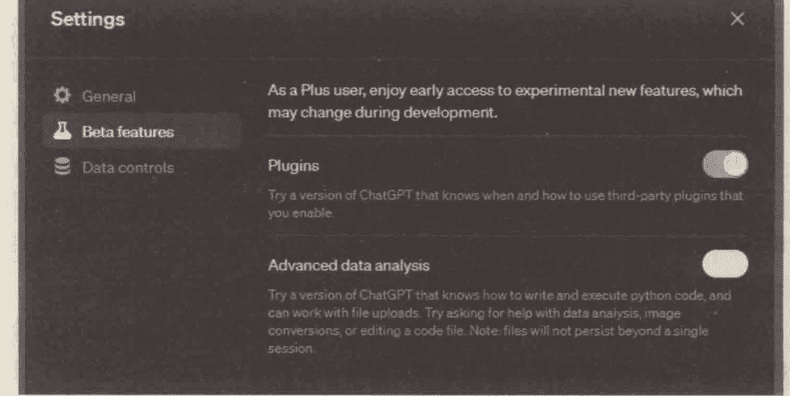

新建对话后，在顶部“GPT-4”菜单里点开“Plugins”（图 1-2）。


图 1-2 启用插件

随后在模型选择区下方会出现扩展项，点击“plugin store”，在搜索栏输入“aaron web browser”，找到后直接安装（图 1-3）。


图 1-3 安装插件

装完后，新建的会话即可调用该插件。

### 1.7.3 借助 ChatGPT 进行写作实操

下面以情感稿为例演示具体流程。把已经提炼好的核心思路喂给模型，让它围绕主题展开成文。提问时要把要求一次性融进问题里。

> 问：
请你扮演一位资深作家，依据下面引号里的观点写一篇自然优美的文章：“明天会更好的前提是我们必须自己努力摆脱当下的困境，幸福不会自己掉在你头上，现实中的美好只会接近有充分准备的人。摆烂只是懒惰的借口，无论现实是怎样的，自我救赎的唯一路径就是自己找到爬出深渊的大门。”
> 答：
自我救赎：明天的美好在今天的努力中
……

当主题给得足够清晰，模型产出的初稿会比较完整。即便如此，仍需要人工修改补充。成文后若觉得某处角度不够或段落生硬，直接告诉模型需要增删的内容即可。AI 生成只需数秒，人的作用在于把握整体方向，反复对话打磨，很快就能得到可用稿。

评论类稿件要求更高，在让模型动笔前最好先理清框架与评价走向。若不设限，输出会很模板化，对投稿毫无价值。

> 问：
请你扮演资深影评人，从以下角度对电影《沙丘》进行自然优美的评价：“作为特效大片，沙虫登场与叛乱战场的冲击力很强。影片忠实还原了原著的文本与思想。涉及文明冲突与共存的思考。镜头与剧本优秀，延续了维伦纽瓦的风格，但节奏偏慢，对普通观众不够友好。”
> 答：
# 《沙丘》：视效与思辨的双重体验
……

类似影评若缺少细节支撑就会显得空洞，细节才是评论的血肉。写电影或游戏点评时，建议先完整体验并记录触动点，再按结构把思路整理给模型，生成的文章才会有厚度与说服力。

干货稿的逻辑相似。选题可由模型辅助，也可抓取热点。涉及专业内容时最好检索论文或专著，确认资料的真实性与时效性后，再把所有素材打包输入，让 AI 完成最后的“烹饪”。

### 1.7.4 投递渠道与计价要点

稿件完成后，投递方式大致分两类。实体渠道如杂志社、报社、出版社，审核严格、专业度高。线上渠道如大型公众号与自媒体平台，选择头部平台可降低纠纷风险。

稿酬计价不一，有按字数、按篇、基础费加打赏等多种。投稿前务必查清计价规则，保障收益。无论选哪条路，都需要先研究渠道的稿件类型与语言风格。杂志投稿建议先看最近三四期，了解定位与表达习惯，否则盲投只会四处碰壁。

挑选变现方式时，要结合自身偏好。对爱阅读与分享的人来说，写稿本身就是乐趣，选题直觉来自长期积累。个人积累叠加 ChatGPT 协作，才能产出被市场认可的稿件，进而转化为稳定收入。

## 人工智能变现新思路：ChatGPT 实用赚钱手册

对习惯阅读与表达的人而言，写稿是轻松惬意的事，选题与走向的直觉来自爱好沉淀。自身功底配合 ChatGPT，就更易创作出被渠道接受的高质量内容。本书提供的变现方法很多，不必急于下结论，通览一遍后再挑最适合自己的组合。

## 第 2 章 ChatGPT 结合音视频：做自媒体引流与变现

### 2.1 用直播答疑获取打赏收益

还记得第一章里用 ChatGPT 在问答平台答题赚钱的内容吗？本节思路相近，区别在于把异步答题改成了直播中的实时互动。直播特性让操作细节需要相应调整。

#### 2.1.1 预设 AI 人设风格，用趣味留住观众

直播的魅力在于实时互动，想留住人内容必须有趣。ChatGPT 默认语气偏正式，不太抓人。因此建议直播前先设定若干互动主题，并对每个主题做风格预训练。

例如先让模型分析《百年孤独》的语言特质，再要求后续回答统一沿用该风格。为避免混淆，要把不同会话标签改名为对应的风格。直播选用辨识度强的文本风格，如马尔克斯笔法，更容易引发共鸣。

> 问：
请用《百年孤独》的风格回答后续问题。
> 答：
明白，后续回答将沿用此前分析的《百年孤独》风格特点。
……
> 问：
孙悟空改动了生死簿，阎王爷为什么不改回去？
> 答：

冥界秩序与齐天大圣的碰撞

古老的阴司里，阎罗殿被宿命的气味浸透，运转的方式像刻进石板的程序一样不可更改。生死簿上的名字与命数，像河床中打磨光滑的卵石，看似坚定无摇。孙悟空的登场则像一枚强磁，瞬间把这份平衡撕开。

掌管生死的阎王虽有无上权柄，却始终是规则的囚徒。他明白，即便把生死簿改回来，那个充满活力、充满不可测度的猴子仍会以另一种方式撬动命运。何塞·阿尔卡蒂奥·布恩迪亚式的想象力与坚韧，在孙悟空身上被放大到超越自然、凌驾于奇迹之上。

“万物皆有灵，只需唤起它们的灵性。”阎王在深海般的眼神里自语。他逐渐看清，孙悟空的挑衅不仅是对权威的冲击，更是对自由与不确定性的渴求，而这种渴求正是任何法则都压不住的力量。

于是阎王没有把生死簿改回去。不是不能，而是他懂得，有些改变一旦发生，便再无回头路。这既是一种接纳，也是一种放手，就像江河最终汇入大海，注定不可逆转。

在这个寓言里，阎王与孙悟空成了命运的两极，一个象征秩序与确定，一个代表自由与偶然。他们的博弈像一曲未完的交响，留出无限的解读空间。

文本生成后，审视当下的语言风格是否合适。若有偏差，可追加提示词让模型调整；若脑中闪现更好的点子，也能把新思路写入输出模板，让后续结果更贴近直播所要的效果。

#### 2.1.2 即时问答，秒级拆解
ChatGPT 在问答场景的优势来自庞大的知识储备、迅捷的响应以及扎实的逻辑推演，常规问题基本都能轻松应付。

但模型的局限也很明显，训练数据截止到 2021 年，2022 年以后的新鲜信息它并不知情。以电脑配件的实时报价和新品上架为例，模型无法给出当下价格波动或最新型号，而这恰恰是网络答疑里最受欢迎的话题，在直播问答中几乎 unavoidable。

可行的补救有两条路：一是预训练阶段提前把最新数据喂入模型，让知识库跟上时代；二是借助 Aaron web browser 这类插件，实现网络实时检索，把最新资讯拉进对话。

#### 2.1.3 直播跑团：让 ChatGPT 当你的地下城主
“今天你博了吗？”
这句问候近期在玩家圈里高频出现，皆因拉瑞安工作室的《博德之门 3》爆火。该作在线人数已突破 82 万，跻身 Steam 历史同时在线前十。

游戏的热度不仅来自本身的品质，更在于它把桌面角色扮演，尤其是 D&D 规则推向大众视野。

D&D 简称龙与地下城，核心是城主 DM 为玩家设计冒险、地图、事件与怪物，玩家则扮演各自角色投入旅程。把这种文字冒险搬到直播间，与观众一起体验刺激探险，是完全可行的。ChatGPT 在合适的提示与规则下，能为整段冒险续写完整的情节。

##### 1. 游戏流程设计
D&D 原版规则很复杂，为了让观众易上手，我们采用简化版。设计路径可供参考两种。

其一，基于简化 D&D 的玩法。从观众里挑几位参与者，比如通过打赏上车，让他们自选角色。DM 只需给 ChatGPT 几个关键词，模型就能生成冒险主线。关键节点用弹幕的掷骰子功能，模拟 12 面骰决定走向。

其二，基于弹幕互动的玩法。先让 ChatGPT 设计一个靠简单选择推进的游戏，所有观众都能参与决策。随后利用直播的弹幕统计功能，以多数选择决定下一步。

##### 2. 互动游戏的具体实施方法
以弹幕互动型为例，下面是一段规则讲解的示范写法：

> 请帮我写一部武侠风格的互动游戏，主角是我，故事由你的叙述和我的选择共同推动。我输入行动，你回描述所见与信息。用中文回复，不写额外解释，除非我要求。补充设定时我会用括号标注。遇到关键分支时，你可自行随机定夺，比如先设想三个方向再抽一个。背景是一个异世界大陆，包含不同国家、地区与种族，有法师、剑士、牧师等职业。该世界有三个人类国度、一个兽人国家，还有精灵与龙，以及恶魔。请补全地形、势力与关键人物。需包含性别、年龄等基础信息。我是主角，16 岁，性格可爱，受女生欢迎。请说明其他人物的性别年龄。为每个国家的政治、经济、军事、文化、地形与传说做合理设定。加入登场人物与事件，丰富我的关系网与身世，给出系统介绍。情节中增添意外，让人物互动更饱满，避免单人独断。注意合理性、逻辑性与完整性。

答：

世界设定

国家与区域

1. 翠雨山国，人类
   - 政治：君主制，统治者为年轻国王。
   - 经济：农业与矿业为主。
   - 军事：中等规模军队，擅长山地作战。
   - 文化：推崇武道与诗歌。
   - 地形：多山，森林广布。

2. 铁血平原，人类
   - 政治：军政府。
   - 经济：工业与贸易为主。
   - 军事：大规模军队，重视科技。
   - 文化：崇尚力量与战争。
   - 地形：平原夹杂河流。

3. 星辰海岸，人类
   - 政治：议会制。
   - 经济：海洋贸易与渔业。
   - 军事：海军强势。
   - 文化：推崇自由与艺术。
   - 地形：海岸线长，散布岛屿。

4. 狼牙草原，兽人
   - 政治：部落联盟。
   - 经济：畜牧为主。
   - 军事：骑兵精锐。
   - 文化：敬畏自然与神灵。
   - 地形：辽阔草原。

其他种族
- 精灵：栖居远方森林，擅长魔法。
- 龙：稀少，多居偏远山脉或洞穴。
- 恶魔：来自异位面，偶尔通过魔法门户入侵。

主角
- 你，16 岁，外形可爱，深受女生喜爱。名叫风华，翠雨山国普通农家子，对武侠与冒险充满憧憬。

### 第一章：风起翠雨山
风华在故乡竹林中练剑。忽然一道白光从天而降，落在剑上，一股强大的力量涌入体内。随后传来急促脚步，好友柳梦，17 岁，女性，气喘吁吁：“风华，大事不好！翠雨山国与铁血平原即将开战，国王正在征兵！”

你会怎么选？
1. 坚持练剑，对此置之不理。
2. 向柳梦询问更多细节。
3. 立刻决定加入王军。

与纯文字写作不同，互动游戏对规则的严谨度要求更高，需要更多提示词来约束输出。提示不仅要限定内容，还要限定格式。ChatGPT 只输出文本，若要把输出变成游戏格式，必须在提示词里做文章。

读者可在此基础上改写喜欢的元素，加入新想法。只要不破坏整体框架，模型通常能给出适配结果。

继续推进的示例：

> 问：
选择 1。

> 答：
你深吸一口气收剑，对柳梦说：“这些事与我无关，我只想专心练剑。”
柳梦眼中闪过失望与担忧，最终点点头：“好吧，风华。但愿战火别波及这里。”她转身离去，你继续练习。那道神秘力量让剑法更流畅，每一剑都蕴含强能。

这时传来低沉咆哮与地动般震颤。远山上出现一条巨龙，金色眼眸闪烁。
你会怎么选？
1. 忽略巨龙，继续练剑。
2. 拔剑冲上前，尝试交流或战斗。
3. 赶紧回家告知家人与村民。

直播的本质是互动。要在直播中获得更多打赏，核心在于提供新鲜有趣的内容并维持良好的观众互动。

上述只是一个基础模板。实战中可以加入更多创意。比如结合 AI 绘图，把 ChatGPT 生成的景色描述或地图作为提示生成图像，形成内容与形式的联动；也可以为角色预先绘制立绘，提升沉浸感。创意无限，配合 ChatGPT，就能让收益持续增长。

### 2.2 ChatGPT 自动生成故事音频，多平台变现
在日常压力下，很多人习惯睡前打开喜马拉雅等平台，听一段轻松内容助眠。随着智能设备的普及，有声书、播客与短故事需求激增，但传统音频制作耗时耗钱。ChatGPT 的出现为创作者打开了新可能。

借助自然语言处理，ChatGPT 不仅能自动撰写吸引人的故事，还能结合文本转语音技术，快速产出高质量音频。流程简化，同时打开多平台发布的空间。

#### 2.2.1 用 ChatGPT 生产原创故事
音频内容大致分两类：一类是把已有文本如小说、文章改成音频；另一类是完全原创的随想、科普、原创故事。

讲故事是 ChatGPT 的强项。如何让它写出温馨的睡前故事？关键是设定合适的角色定位与需求。

> 问：
请扮演一位经验丰富的童话创作者。
听众是 6 到 10 岁的小朋友。
请创作一篇适合阅读或收听的童话，语言温柔可爱。

> 答：
《星星的秘密》
一个宁静夜晚，天空星星闪烁。每颗星都有自己的小故事，其中一颗叫小星。它发出的蓝光与众不同，总想知道原因。它遇到老星，老星说每颗星都有使命，你的光能治愈人心灵，在人们孤独伤心时带来温暖与安慰。
小星很高兴，决定更努力发光。从此夜晚它是最亮的星，地上孩子不开心时抬头看它，便得到安慰与勇气。
故事告诉我们，每个人都有独特价值，找到位置就能为世界带来光亮。

——完——

角色设定会驱动内容与风格。童话面向儿童，语言自然童趣。成人睡前故事则需要更丰富的层次与放松感。

> 提问：
请扮演一位叙事大师，技巧深厚。
听众是疲惫的成年人，希望睡前听一个轻松温柔的故事助眠。

答：
《月亮下的小茶馆》
古镇里藏着一家叫月影的茶馆，只在满月夜分开放。夜幕降临，木门轻启，门外的风铃发出悠扬声响。
主人莉娜，中年女子，白裙草帽，眼神藏着故事。她泡的茶带着特殊香气，喝下后让人轻松宁静。传闻茶是用月光制成。
客人不谈白天繁忙，只静静听莉娜讲古老故事，有爱有梦有失落，听完总能得到安慰。月亮落下，茶馆关门，客人们带着温暖入梦。
在繁忙世界里，月影茶馆像避风港，提供片刻宁静。

——完——

想要更个性化的内容，可在提示里加入走向、开头结尾、特定人物。加入人物小传、背景、地点后，故事会更细腻，但也可能需要更多结构调整。

在对话中称赞模型是对其输出的正向激励，模型在后续生成时会提升被称赞部分的权重。可以把 ChatGPT 当作工作伙伴，直接指出不理想之处，让它明白错误。

#### 2.2.2 把文本变成声音
这一节介绍插件 Speechki。打开插件商店搜索并安装，安装后在聊天界面勾选即可使用，操作简便。

人类人工智能新商机：ChatGPT变现实用攻略
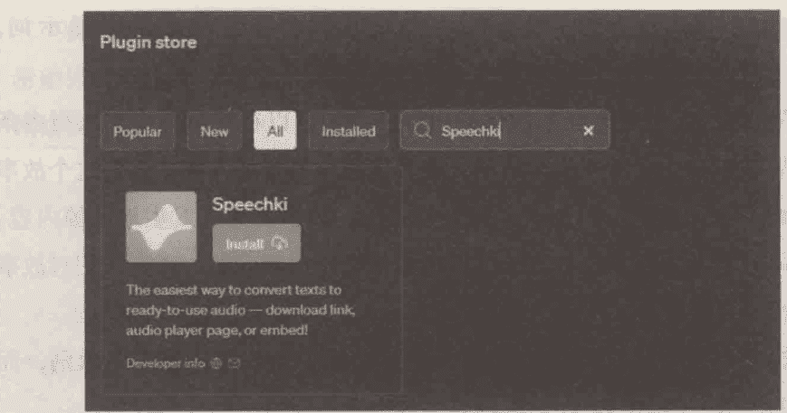
图 2-1 Speechki 安装
安装完成后，记得勾选新插件。我们用前面创作的童话演示功能。

> 问：
请用 Speechki 把下面故事播给我听：
星星的秘密……

模型会返回一个在线播放链接
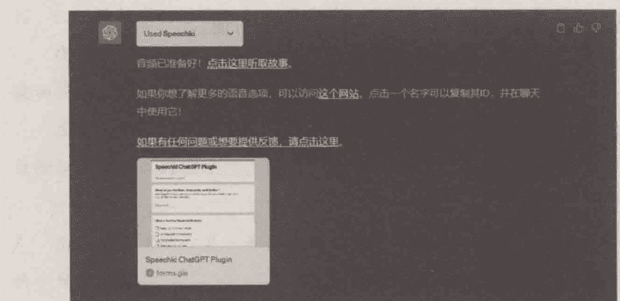
图 2-2 转制音频界面
链接可直接收听，满意后用下载器保存到本地，再上传到各大平台获取收益。

从文本生成到音频转换，ChatGPT 实现了高效闭环。结合第一章的小说写作技巧，原创长篇也能转化为音频。虽然技术强大，但打动人的仍是创作者的独特视角。工具只是助力，创意与视角才是核心。

时代在前行，我们也应紧跟步伐，相信总有一片天地等待开垦。

### 2.3 用 ChatGPT 创作音乐，实现版权变现
对业余者来说，写一首带乐谱的歌是难事。大多数人只是欣赏音乐，偶尔会想如果能写一首自己的歌该有多好。ChatGPT 的出现让心愿成为可能。即使不懂记谱、不懂填词，只要会用字、会听音，配合一点审美，就能产出作品。

#### 2.3.1 智能作曲要点
以大家熟知的 Beyond《光辉岁月》为例，尝试仿作。

> 问：
请仿照 Beyond《光辉岁月》的曲风，歌词聚焦现实或国际话题，带有温情与诗意，文采出众，写一首上口、个性鲜明的歌。

答：
歌曲标题：未来之歌

[第一段]
滚滚长河向前流，世界更迭不停休，
不同肤色的人们，都在期盼和平与守候。
钢筋林立的都市，金黄收获的田畴，
每个角落都有故事，温暖如诗的生活。

[副歌]
我们共享同一地球，汇聚不同的歌，
语言虽有千种，心跳却是同一种和弦。

从初稿到文艺升维的迭代记录

初稿试写

愿这首寄语未来的作品越过江山与海，
唤醒每一颗心灵，一同歌唱美好的明天。

[ 第二节 ]
气候正悄然更迭，唤醒多少沉寂的声音，
各国之间的连结，既是情谊也是对话的回响。
即便存在摩擦与误解，同一目标从未遗忘，
联手守住这片蔚蓝，为下一代保留希望。

[副歌]
我们共享的星球，汇聚着不同的歌声，
语言虽各不相同，心跳却共振同一和弦。
让这首关于未来的歌跨越山河与海洋，
点亮每个灵魂，为理想的明天齐声高歌。

[桥段]
雨林里拂过的清风，沙漠中低吟的沙音，
皆是大自然的馈赠，每一刻都值得珍惜。
无论身在何处，都应怀着感恩，
因为世界之所以美好，是因为有你我同在。

[副歌重复]
我们共享的星球，汇聚着各种歌声，
语言千差万别，心跳仍是同一和弦。
让这首未来之歌越过山河与海洋，
点亮每个灵魂，为理想的明天共同高唱。

[尾声]
再无边界，再无隔阂，
只要同心协力，整个宇宙都将为我们歌唱。

注：此作融合现实议题与国际关怀，表达对和平、团结与敬畏自然的期许。

初次生成只能算基本达标，满足了最低要求却暴露短板。比如“未来之歌”四个字吸引力不足，用词打磨也显粗糙。

当模型表现尚可时，适度肯定很重要。被频繁肯定的模型更容易形成正向反馈。此刻它更像一位对中国历史文化了解有限的孩子，孩子只是比喻，过度批评只会破坏协作氛围。与 ChatGPT 的相处应像对待孩子，因为你的引导直接影响它的成长。通常第一次生成的文本多少会有偏差，这时可基于初稿提出更具体的优化方向，让它继续细化。

> 问：

初稿还行，请再优化一遍，让标题和内容都更显文艺。加入含蓄的比喻或拟人手法，让内涵更深、特色更鲜明。

答：

歌曲标题：星海之歌

[第一节]
月光在水面晃动，缓缓诉说时光流转，
像人间点点繁星，各自闪烁却渴望彼岸。
城市夜灯如梦般迷离，稻田金波似绸缎，
每段故事都化作诗行，浸在柔和月色里。

[副歌]
星海间的旋律，游弋在心灵的港湾，
虽相隔千里，情感却像细流汇成大洋。
听，远方传来的歌声，绵长缠绕，
穿越时空与阻隔，只为寻找心的方向。

[第二节]
风轻轻抚过世界的面庞，悄悄传递自然的誓言，
国与国的情缘，如同云雨相逢般浪漫呈现。
即使有短暂的雨季，彩虹终会到来，
团结就像一束光，照亮希望的天际。

[副歌]
星海间的旋律，游弋在心灵的港湾，
虽相隔千里，情感却像细流汇成大洋。
听，远方传来的歌声，绵长缠绕，
穿越时空与阻隔，只为寻找心的方向。

[桥段]
林间低语细细私语，沙漠献上金色诗篇，
皆是自然的佳人，如梦中公主般灵动。
当每一颗星辰与你我对话倾诉，
这个宇宙因有情，而显宏伟而神奇。

[副歌重复]
星海间的旋律，游弋在心灵的港湾，
虽相隔千里，情感却像细流汇成大洋。
听，远方传来的歌声，绵长缠绕，
穿越时空与阻隔，只为寻找心的方向。

[尾声]
在这片浩瀚星河，我为你歌唱，
每个音符都是我心中的星辰，为你闪耀。

注：此作大量使用比喻与拟人，以星海为意象，寄托人与自然、国与国之间的情感联结，整体更显诗意与文艺气质。

点到为止的赞扬能让它明白偏好与忌讳。第二次输出明显进步，题名更有美感，歌词里加入了比喻与拟人，情绪更饱满，深度也提升了。

有了相对满意的词，下一步就是让 ChatGPT 依据歌词配曲。同样以《光辉岁月》的经典风格为参照，要求它用字母记谱法呈现，看看效果如何。

## 人工智能新商机：ChatGPT变现实用攻略

> 问：

请参照《光辉岁月》的曲风，用字母记谱法为《星海之歌》写一个乐谱。

答：

为方便理解字母记谱法的基本用法，我仅给出开头部分的示范，以 C调为基准。C 代表 C 音，D 代表 D 音，以此类推。

月影摇曳在河中
E E F G, G F E D
悠悠叙说时光流
C D E F, E D C C
如同人间繁星
E E F G, A G F E
各自闪烁却心向彼岸求
D E F G, G F E D, C D E C, C B A G

请记住这只是演示，真实创作还要考虑和弦、节奏、时值等细节。若想贴近《光辉岁月》的味道，还需相应的背景编排。

可以看出，ChatGPT 只给了一个简易示范，这就足够理解流程，后续的精细化交给有音乐追求的爱好者。每个人对《光辉岁月》的诠释都不同，我们负责教会入门，精进靠个人实力。也可以让它按既有示范继续谱写。

> 问：

很好，请继续往后写谱，并与每句歌词对应。

答：

好的，我继续以 C调做基础创作。下文仅为简化示范，不能等同于完整作品。

城市的夜灯如梦
F F E D, E F G A
稻田的金波似绸
A A G F, E F E D
每个故事都像诗篇
C D E F, G A G F
沉浸在柔和的月光中
E F G A, A G F E, D C B C
星海间的旋律
C D E F, G A B C
漫游心海的港湾
C D E F, E D C B
虽分隔千里
A G F E, D C B A
但情感如涓涓细流汇成大洋
G A B C, D E F E, D C B C, C D E F
听，那由远方传来的歌
G A B C, D E F G, A B C D
缠绵悱恻
E F G A, B A G F
穿越了时空和边界
D E F G, A G F E
只为寻找心的方向
D C B A, G F E D

注意这只是极简化的旋律框架，实际作曲需兼顾和弦、节奏、音色等。若想完善，建议与专业作曲或制作人合作。

可以看出，这段谱子只是基础框架。若想让曲子更饱满动听，就需要不断加工。对音乐有基础的人借助其高效学习能力，很快就能完成一首悦耳作品。

### 2.3.2 利用插件将曲谱变为音乐

接下来可以让 ChatGPT 把前面谱好的两段生成音频，先听听处女作效果。在此之前需在 ChatGPT 上安装名为 ABC 记谱法 的插件。具体步骤如下。

登录 ChatGPT 后，先点用户名右侧的“…”按钮，在弹出的选项里选“Settings & Beta”。

进入“Beta features”选项卡，打开右侧的“Plugins”选项，即可开启插件功能（图 2-3）。

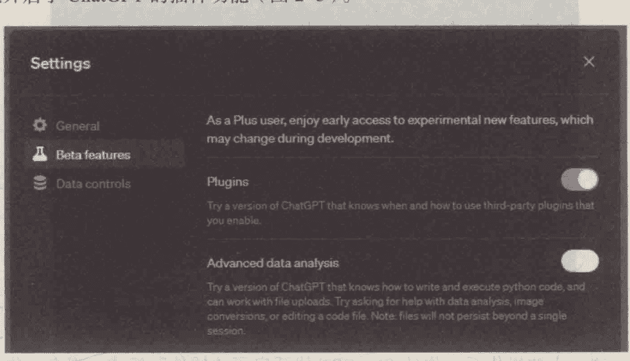

图 2-3 开启插件功能

开启后，在新建聊天窗口的 GPT 模型选择下方会出现下拉菜单，进入后选择“Plugin store”即可进入插件商店（图 2-4）。安装完成后，也在此菜单中启用。

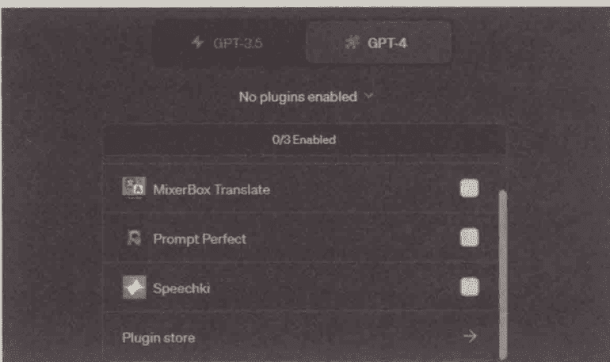

图 2-4 进入插件商店

在商店页面搜索“ABC Music Notation”，找到后点“Install”安装（图 2-5）。

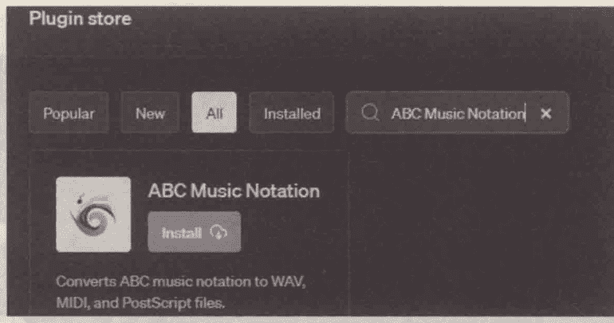

图 2-5 插件安装

安装完成后，在下拉菜单处勾选插件即可启用。

至此 ChatGPT 已进入插件模式。现在可以用任意谱子向它提出制作音频的要求。

我们把之前创作的两小段乐谱整合，让它制作音频小样。

> 问：

月影摇曳在河中
E E F G, G F E D
悠悠叙说时光流
C D E F, E D C C
......
穿越了时空和边界
D E F G, A G F E
只为寻找心的方向
D C B A, G F E D
请根据这部分乐谱，录制完整音乐作品，并把音频发给我。

在插件帮助下 ChatGPT 会给出类似图 2-6 的回应：

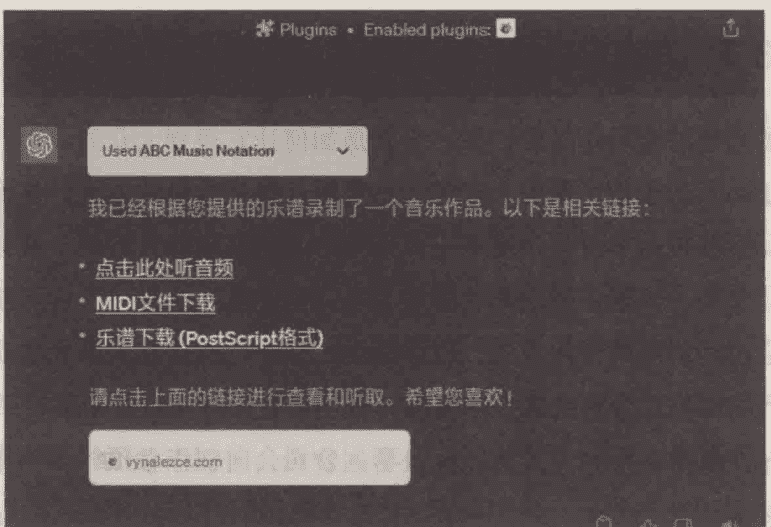

图 2-6 乐谱生成音乐

制作音频会比单纯生成文字慢，最后以超链接形式呈现，点“点击此处听音频”会自动下载 wav 文件。下载到本地即可试听。但该插件仅提供单一乐器音色。若想增加多种乐器，可让插件输出 MIDI 文件，再导入 MuseScore 3、GarageBand、FLStudio、Ableton Live 等专业软件中编辑。

至此，我们已能按想法创作带词带谱的音乐作品。借助软件可在原谱上调整。虽然 ChatGPT 能大幅提升创作效率，但好歌的诞生并不靠效率，传唱度高的作品需要创作者具备更高的音乐素养与理解。

### 2.3.3 发表自己的作品

作品完成后，如何获得大众认可并变现？对新手而言，出售版权最常见。可直接投给唱片公司或歌手。若被选中，会签署著作权转让合同，仅保留署名权。一次性买断后，后续收益与创作者无关，即使作品大火，收入也归公司或歌手所有。

更合理的方式是版权分成。公司会预约或招标征集作品，中标后签订协议。发行后各渠道按比例分配利润。若作品大受欢迎，创作者可获得稳定收入，随着作品数量增加，收益也会提升。这是较公平的合作模式。

版权分成可细分为单曲版权出售，或签约独立音乐人平台，按播放量和下载量获取收入。

近年来短视频平台几乎覆盖各个领域，创作者除出售版权外，还可将作品发布到短视频平台，或通过直播宣传。粉丝达到一定数量后，可通过广告植入获利。播放量和浏览量达标后，平台也会提供奖励。还能以音乐作品为核心，设计周边产品。总之，有想法并持续创作，就能拓展变现渠道。

## 2.4 ChatGPT 做短视频矩阵账号，赚取平台佣金

如果你是短视频重度用户，一定见过这类视频：

它们多用 AI 配音，内容多为引人入胜或带神秘色彩的短故事，画面与文本关联不紧密，有时是手工艺制作或影视片段。

事实上，这些视频多为批量生产。只要能有效管理多个账号，这类方式确实能带来可观收益。

如何用 ChatGPT 高效制作这类短视频内容？接下来揭晓。

### 2.4.1 收益模式解析

短视频创作收益主要有三类：

一是平台流量激励。播放量达标可获得奖励或曝光。各平台标准不同。以抖音为例，时长不足一分钟或非竖屏的视频，即使播放量高也不纳入激励。

二是外链点击收益。视频下方附带外部链接，观众点击下载后创作者获得收益。

三是广告植入。账号粉丝基数够大后，可与品牌合作植入广告，获得额外收入。

### 2.4.2 如何生成爆款口播内容

在数字时代，内容为王。

在短视频领域，对标准化与吸引力要求更高，这正是 ChatGPT 的优势。

为何文案偏爱神秘悬疑元素？行业内认为视频前三秒至关重要，若能抓住观众，后续观看概率大幅提升。就像火锅的香气，一闻难忘。

下面探索如何让 ChatGPT 高效生产吸引人的口播文案。

> 问：

请用人类的口吻，使用缩略语、成语、过渡词、感叹词、悬垂修饰和口语化表达，避免重复短语和不自然句式，写一篇文章。以“结婚第二天，我从棺材中醒来”为开头。

答：

结婚第二天，我从棺材中醒来。哎哟，你没听错，就是棺材！我也是醉了，这不就是传说中的“从黄泉回来”吗？

先解释一下。其实这只是个传统婚礼玩笑，古老习俗，寓意新婚长寿。但谁能想到，我那帮损友真把我放进棺材里！这也太“玩大了”吧？

我起初还以为做梦，直到感受到四周的冰冷和封闭，才意识到，OMG，这不是梦！我赶紧推开棺材盖跳出来，看见损友们在一旁哈哈大笑，真是“笑而不语”。

“你们这是干嘛？”我气喘吁吁问。其中一个朋友笑嘻嘻说：“老哥，这可是祝你长命百岁，从此步入‘死而复生’的美好人生啊！”我听了，哭笑不得，也太“过犹不及”了吧！

不过话说回来，这也算难忘经历。虽然当时吓得半死，回想起来也挺有趣。毕竟人生就是这样，总有些出乎意料的事让你“大跌眼镜”。

总之，这次“棺材经历”让我深切体会到友情的厚重和生活的无常。也许这就是生活的魅力，总在意想不到时给你“惊喜”。

在无特殊提示词限制下，ChatGPT 生成的内容不会过于分，间接解决了过审问题。

量产视频的关键是内容能稳定通过审核。在保证过审率的同时保持高效，这是 ChatGPT 的独特优势。

### 2.4.3 生成视频

把口播文案转为视频需要剪辑工具，以剪映为例。

图 2-7 为剪映操作界面。

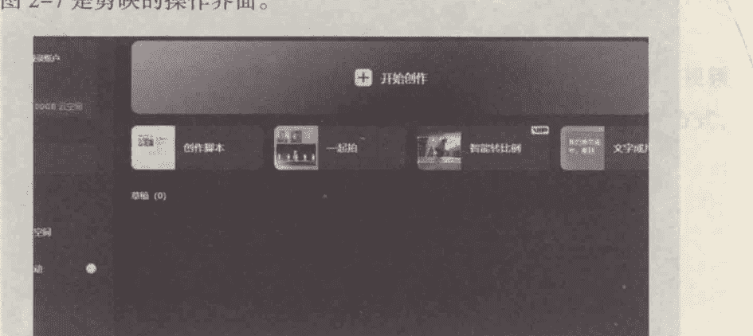

打开剪映后，进入右侧“文字成片”模块，把生成的口播文案粘贴进文本框。

在文本框下方，点朗读音色的下拉菜单，选择喜欢的音色。若想让视频更有差异，可选付费音色，这也是前期投入。

随后点右下角“生成视频”，AI 会以文案为蓝本自动生成口播短视频（图 2-8）。

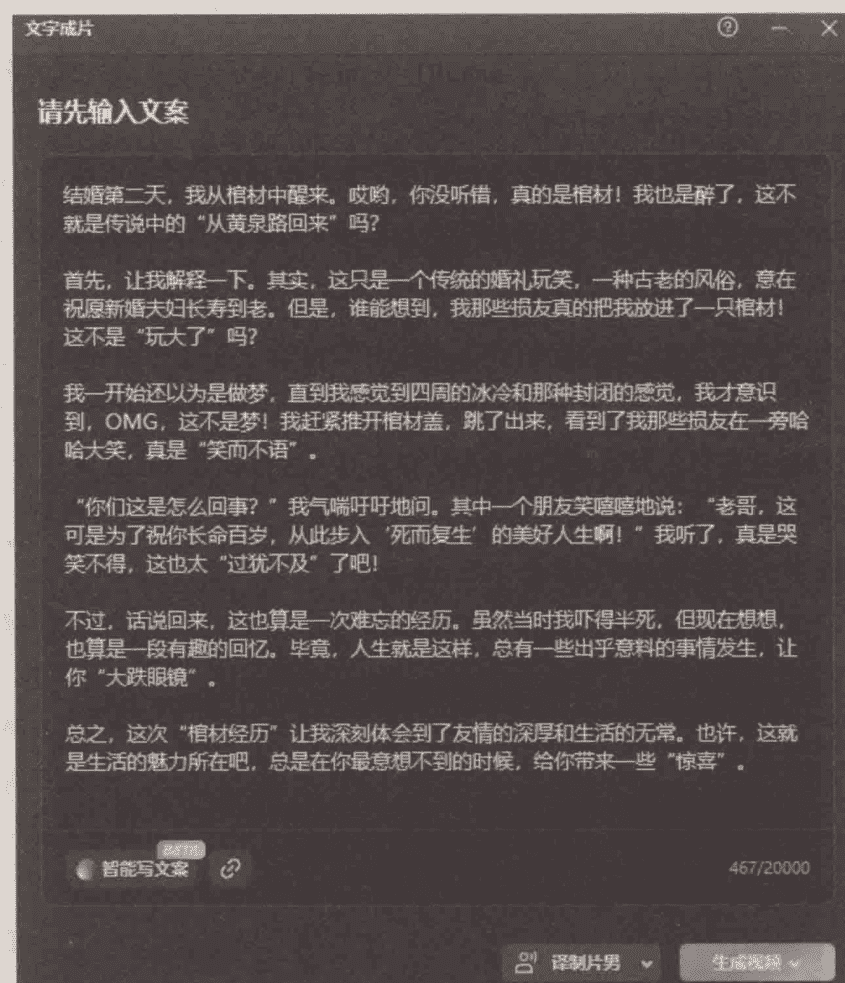

图 2-8 复制文本生成视频

### 2.4.4 进阶玩法

至此基本流程完成，但仍有优化空间。

据业内统计，涉及手工艺或其他减压主题的短视频播放量往往更高。

因此应积极寻找或制作相关素材。

这里提供一个免费素材网站，搜索“pexels”进入官网即可下载所需视频素材。导入剪辑软件替换 AI 生成片段即可。

采用多账号策略发布短视频的优势在于可跨账号复用文案和素材，操作简便且不占时间。每天下班后按指南操作，就能让视频自行积累播放量。

短视频已成为当前流量主角。无论街头还是地铁，人人都沉浸其中。

在这股流量浪潮中，ChatGPT 为我们提供了一艘稳固小船，帮助在流量盛宴中占有一席。

掌握以上策略，可轻松获得稳定收入。若视频走红，商业合作也会随之而来。面对如此简单高效的获利方式，为何不尝试？

## 2.5 制作 AI 虚拟主播，生成新闻简报视频

作为视频领域的“快消品”，新闻简报因简明迅速高效，成为观众快速捕捉热点的途径。

这类视频核心在于信息高效整合，而非深度挖掘，制作相对简单。无论作主内容还是引流工具，都是不错选择。

在短视频领域，迅速抓住注意力至关重要。

引入虚拟主播正是妙策。首先，主播形象让观众感受更亲切，互动性更强；其次，与聘请真人主播相比，虚拟主播成本更低，对个人创作者十分友好。

这与 ChatGPT 有何关系？

接下来再次见证 ChatGPT 的魔力。

### 2.5.1 利用 ChatGPT 生成新闻播报稿

制作简讯类视频需收集新闻并汇总成稿。这一点上 ChatGPT 可谓专家。

ChatGPT 收集互联网信息时，需借助 Aaron Browser 插件帮助。

打开 ChatGPT 的插件市场，在搜索框里输入 aaron browser，点选搜索结果后按下 Install，插件就装好了（图 2-9）。


图 2-9 Aaron Browser 安装

装好以后，开启新对话并启动该插件，ChatGPT 就具备了联网检索的能力。

先让它帮忙梳理一下 2023 年 9 月的硬件资讯。

> 问：
请帮我收集 2023 年 9 月关于计算机硬件中 CPU 的相关信息。

答：
2023 年 9 月 CPU 相关的要点大致如下：

1. 英特尔首秀 14 代处理器：
   - 在 Innovation 2023 大会上，Intel 首次公开了 14 代酷睿 Raptor Lake Refresh。
   - 具体型号与配置并未公布，官方把更多篇幅给了 Meteor Lake 与 Lunar Lake，尤其是它们的 AI 加速特性。
   - 传闻首批上市的机型有 6 款，包括 i9-14900K、i9-14900K F、i7-14700K、i7-14700K F、i5-14600K、i5-14600K F。

2. AMD 推出新移动平台：
   - AMD 发布了一批面向笔记本的新移动处理器。
   - 相比前代，续航更长、图形表现更强，被视作对英特尔移动端的直接回应。

3. 市场观察：
   - 受全球芯片供给紧张影响，本月 CPU 价格出现上行。
   - 随着产能恢复，预计未来数月价格会趋于平稳。

4. 技术走向：
   - 7nm 与 5nm 仍是当前的主流制程。
   - 多家厂商已在推进 3nm 研发，有望在几年内进入商用。

以上就是 2023 年 9 月 CPU 领域的主要动态。如需更细的信息可继续追问。

新闻稿最看重真实性与时效性。ChatGPT 的回答最好能回源头去核对，避免出现假新闻。

到这里我们只有文字内容。要变成视频脚本，还需要再加工。

确认真实性后，可以让 ChatGPT 把这部分信息整理成播报稿。

> 问：
请将上述信息改写为视频播报的视频脚本。

答：
标题：2023 年 9 月 CPU 硬件资讯速递。
主播：大家好，这里是硬件快讯。
主播：在今年的 Innovation 大会上，Intel 首次亮相 14 代酷睿 Raptor Lake Refresh。
主播：详细的参数与 SKU 尚未对外，重点放在了 Meteor Lake 与 Lunar Lake 的 AI 加速能力上。
主播：据了解，首发阵容预计包含 i9-14900K 系列、i7-14700K 系列和 i5-14600K 系列。
主播：另一边，AMD 也推出了新一代移动处理器。
主播：该系列专为笔记本打造，续航与图形性能都有提升，明显在与英特尔竞争。
主播：市场方面，受晶片短缺影响，CPU 价格本月走高，但随着产能回升，价格预计会稳定下来。
主播：工艺上，7nm、5nm 仍为主流，3nm 的研发也在加速推进，未来几年有望落地。
主播：以上就是本月 CPU 的最新情况，我们下期再见。

只要前期核实过事实，这份稿子就能安心使用。这一环节也可以用预训练来调风格，但简报类内容最好保持简洁，花哨的表达反而影响观看体验。想做差异化，也可另行尝试。

学会用 ChatGPT 生成稿件后，下一步就可以做视频化输出。

### 2.5.2 用虚拟主播生成视频播报

接下来进入重头戏。很多人担心虚拟主播和视频生成会很复杂。

其实只要点几下鼠标、输入几行文字，就能做出很漂亮的简讯播报视频。下面以图 2-10 为例说明做法。


图 2-10 AI 播报

需要再给 ChatGPT 装一个插件——HeyGen。操作同上，在插件商店搜索“heygen”，找到后完成安装（图 2-11）。


图 2-11 HeyGen 安装

安装完毕后，在新对话中打开 HeyGen，先做一次简单测试。

> 问：
帮我写一篇关于 2023 年 10 月计算机硬件新闻播报的视频脚本，并将此脚本制作成视频，视频标题为“2023 年 10 月硬件信息”，主播为中国女性。

视频生成通常需要 3 到 5 分钟，等待完成后即可在 ChatGPT 提供的链接里查看成品。

不得不说，当前 AI 虚拟主播的自然度已经很高，口型、表情和发音都很到位（图 2-12）。

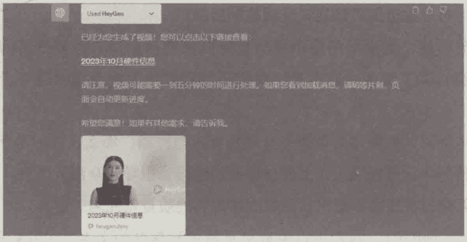

### 2.5.3 对播报视频进行调整

免费版插件对文本量有上限，实测单条视频大约 30 秒左右。

若不想升级付费，可把长稿拆成若干段，让 ChatGPT 分段生成，最后在剪辑软件里拼接成完整视频。

导出视频很简单，点击画面右下角的三个点，从菜单里选择下载即可（图 2-13）。


图 2-13 下载视频

怎么用简讯视频实现盈利？

高质量的简讯具备很强的流量潜力。若目的是给主频道导流，可在简介或置顶评论里放上相关硬件评测的链接，引导用户深入了解。

如果频道定位就是资讯，文本质量就显得格外重要。借助 ChatGPT 可以产出更有深度和特色的内容，让 AI 主播更具人格化。盈利模式更依赖广告，需要在多平台做推广。

AI 的崛起让许多过去遥不可及的领域变得触手可及。不需要出色的口才，也不需要专业的运营经验，ChatGPT 就能解决大部分技术难题，帮助创作者把创意变现。对于内容生产者来说，这是一次难得的窗口期。

# ChatGPT 联动 AI 绘画：把艺术变现

## 第 3 章


### 3.1 AI 生成手机壁纸在电商变现

进入大模型时代，AI 已经渗透到生活的各个角落。技术与创意的结合为我们打开了新的想象空间。AI 不只是分析数据或自动驾驶，更在艺术设计里带来了丰富的可能性。

当前 AI 研究的两大方向，一是以 ChatGPT、Claude 为代表的语言模型，二是以 Midjourney、Stable Diffusion 为代表的视觉绘画模型。

把两者结合，能否成为创收的利器？以手机壁纸为例，一个不懂技术的人能否借此获得额外收入？

只要有想法，就能成事。下面聊聊如何利用这两个工具创造收益。

#### 3.1.1 语言模型与绘画模型的协同打法

ChatGPT 是一款强大的语言模型，能用自然语言生成丰富内容。Midjourney 和 SD 是典型的 AI 绘画工具，根据关键词生成图像。

两者如何配合？绘画模型需要精准的提示词，初学者往往无从下手。这时可以让 ChatGPT 帮忙构思并细化提示词，再去驱动绘画模型产出作品。

> 问：
假设你是一位资深视觉设计师，现在需要设计一款以“火焰中的雅典娜”为主题的手机壁纸，你会如何描述细节需求，并举例说明。

答：
设计手机壁纸时，需求描述越清晰越好。示例如下：

手机壁纸设计需求：火焰中的雅典娜

1. 尺寸与分辨率：
   - 适配主流手机屏，如 1080 x 2340 像素。
   - 提供不同尺寸版本，保证核心元素在各设备上清晰。

......

6. 风格：
   - 现代与古希腊的融合，既有神话神秘感，又有现代视觉冲击。

7. 其他注意：
   - 图像版权需确认或原创。
   - 避开图标和时间显示区，确保核心元素不被遮挡。

这样的描述能帮助设计师准确理解需求。

强模型可以在创意初形后继续扩充细节，基于海量知识库给出背景和结构。但当需求很具体时，启发式回答可能不够精准。

而且 ChatGPT 的知识截止导致它不了解 SD 等新工具，直接写提示词会有局限。好在它熟悉 Text-to-Image 和 DALL-E，这就提供了创作空间。

> 问：
我想用 AI 绘画软件生成壁纸，请帮我生成可直接用于 Text-to-Image 模型的提示词，如 DALL-E。要求主题为火焰中的雅典娜，包含尺寸适配、风格融合、版权注意、避免遮挡等要点。

答：
把详细描述转成简洁指令，例如 1080×2340 的提示词：

“Athena in ancient Greek armor, surrounded by dark red and gold flames against a black background with subtle silhouettes of ancient Greek architecture. Helmet’s visor is open revealing her determined and calm face. The word ‘Athena’ in golden ancient Greek font at the bottom. Modern meets ancient Greek style, ensuring main elements are not obscured by phone icons.”

不同屏幕可微调：

- 更宽屏：“Athena centered, surrounded by dark red and gold flames against black background with ancient Greek architecture on the sides…”
- 更方屏：“Athena in ancient Greek armor, surrounded by flames against black background with subtle silhouettes…”

提示词需要反复尝试和微调。用括号加权可以控制细节。

下面以 SD 为例演示（图 3-1）。


图 3-1 SD 模型界面

打开 SD 面板，把 ChatGPT 给出的描述翻译成英文填入提示词框，模型就会生成图片。

图 3-2 是本次示例的输出：


图 3-2 示例壁纸

如果效果不满意，可以继续让 SD 重绘。几分钟内就能完成一套壁纸设计，无需专业表达或设计能力。

#### 3.1.2 壁纸的三种变现渠道

学会批量制作后，关键在于变现。

常见的三种方式：

- 1. 电商平台售卖。将多款壁纸打包成合集上架销售。
- 2. 手机壁纸商店。小米、华为等品牌自有壁纸商店流量大，版权保护完善，转化率高。
- 3. 个性化定制接单。对技能要求更高，适合积累经验后再做。

在这个新时代，ChatGPT 能帮我们进入完全陌生的领域。AI 推动的绘画艺术正焕发新生。对普通人而言，不必纠结伦理，更应关注便利。只要持续创新，生活会回馈努力。

学会用 ChatGPT，你会发现机会无处不在。

## 3.2 AI 搞定公司起名与 Logo 设计

上一节讲了 ChatGPT 与 SD 结合做壁纸。把这个思路延伸，还能做很多事。

创业初期，给公司起名和设计 Logo 看似简单，实则困难。它承载着品牌形象与价值观。很多人会找专业团队，但成本高、周期长。

现在 AI 可以提供一站式解决方案。无论是创意名字还是 Logo 设计，都能通过对话完成，无需专业经验。用信息差，以远低于市场价的方式承接业务，完全可行。

### 3.2.1 让 AI 担任起名顾问

在传统文化里，取名非常重要。无论是给孩子起名还是公司命名，很多人会翻阅古籍寻找灵感。

ChatGPT 的语料覆盖了大量古今典籍，下面看它是否了解中国传统文化的具体内涵。

> 问：
你是否了解中国的传统文化？你是否知晓与理解中国的各种古籍？

> 答：

AI 确实对中华传统文化有一定认知，也熟读了不少经典古籍。千年积淀的文化体系，覆盖哲学、文学、艺术、历史、科技等多个维度，其中儒家、道家、佛家的思想对后世影响尤为深远。

谈到典籍，我能理解《易经》《道德经》《孟子》《庄子》《史记》《资治通鉴》等诸多经典。这些文本不仅是文献记录，更凝聚着古人对人生、宇宙、伦理、治国与社会运行的深刻思辨。

比方说，《易经》探究的是宇宙变易的规律，《道德经》则阐释道家“无为而治”的治理观，《史记》由司马迁撰写，记载黄帝至汉武帝的史事，《资治通鉴》由司马光主编，纵贯两千年的历史脉络。

这些古籍构成了宝贵的知识库，有助于我们更立体地理解古代中国的精神世界与历史进程。关于传统文化或经典的问题，我可以尽量给出详细解答。

很明显，AI 在历史文化层面已有一定“功课”。若想让它的表达更具底蕴，可以沿用前文思路，用学者的精细解读来做增量训练。本书篇幅有限无法展开，感兴趣的读者可自行尝试。

下面就试试让 ChatGPT 为 AI 领域的公司起一个名字。

> 问：
我准备创立一家公司，主营 AI 相关业务。请用中国古文化的风格，给公司取一个寓意好、又有科技感的名字。

> 答：
融合古文化意蕴与 AI 科技特质，为您推荐以下几个方向：

- 1. 智焰基石（IntelFlame Keystone）：智焰象征智能之火，基石寓意稳固根基。
- 2. 道通科技（TaoTech Innovations）：取《道德经》“道”字，意指技术通达深远。
- 3. 千机文献（Qianji Intelligence）：化用古代“千机”之巧思，暗指海量技术与智慧积累。
- 4. 云端墨客（CloudInk Technologies）：墨客为古文人，云端指云计算，喻古今智慧结合。
- 5. 神笔驱动（DivinePen Drives）：借神笔传说与现代驱动技术，寓意创造奇迹。

这些名字兼具文化韵味与科技气质，可作参考。若对结果不满意，还可追加限定条件反复优化。

最直接的做法是把喜爱的书段直接喂给 ChatGPT，限定范围让它在指定篇章里提取素材来命名。

### 3.2.2 企业 logo 制作

名称确定后，下一步就是围绕名称做视觉呈现。我们先让 ChatGPT 给出 logo 方案的沟通要点。

> 问：
假设你是一名资深视觉设计师，需要为“智焰基石（IntelFlame Keystone）”设计 logo，我该怎样清晰描述需求并举例说明。

> 答：
与设计师沟通时，需求越具体越好。建议从以下角度展开，并附示例：

- 1. 公司背景与定位：
  描述：先交代公司业务、文化和品牌调性，帮助设计师把握核心价值。
  例子：我们公司“智焰基石”专注 AI 技术研发，希望以创新技术为客户提供稳定可靠的方案。文化上追求创新与稳定并重。

提供充分信息后，设计师才更容易还原预期。类似上一节，ChatGPT 的回答需要提炼后使用。对不满意之处可直接修改，这对新手是很好的入门参考。若想系统学习，也可让 ChatGPT 量身定制教程。

下面把整理好的方案转化为可用的绘图提示词。

> 问：
我想用 AI 绘画软件生成企业 logo，请帮我生成可直接用于 Text-to-Image 模型如 DALL-E 的英文提示词。要求如下：
公司“智焰基石”从事 AI 技术研发，致力于以技术创新提供稳固可靠方案，文化强调创新与稳定。
logo 主题：AI 研发。logo 内容：智焰基石，IntelFlame Keystone。结合 AI、基石与火焰，AI 与基石用冷色调，火焰用暖色调，风格现代简约，不复杂。字体为简洁现代无衬线，确保小尺寸清晰。

> 答：
将描述转成模型指令如下：

> “Modern and minimalist logo combining AI, keystone, and flames. Cold color tones for AI and keystone, warm tones for flames. Text: ‘智焰基石，IntelFlame Keystone’ in a sleek, modern sans-serif font. Ensure clarity at small sizes.”

该描述为模型提供了足够上下文，通常需多次微调才能达到理想效果。

把提示词粘贴到 SD 模型运行后即可得到初步 logo（图 3-3）。

图 3-3 logo 生成

首次生成的成果往往不够满意，可以根据感受让 AI 调整。本例希望得到文字型 logo，经过数次改稿后得到最终版（图 3-4）。

图 3-4 最终结果

借助 AI，从命名到 logo，一切变得高效。回想起某科技公司曾为 logo 支付 200 万元设计费引发热议，以及某社交软件品牌重塑的巨额投入，品牌形象的重要性不言而喻。好的名称与标志既是视觉享受，也是文化与价值观的外化，因此企业投入往往谨慎。

与巨头相比，AI 为中小企业提供低成本 logo 设计服务更具现实意义。正如淘金热时期为探险者服务的旅馆，品牌形象设计也成为创业生态中的机会点。

ChatGPT 不仅代表技术前沿，对传统设计理念也能灵活调配，高度定制化让客户满意。通过预训练进一步增强能力，拥抱科技的创业之路会更宽广。

## 3.3 画出卡通人物形象，在家兼职也能做

游戏行业持续增长，玩家时间增加叠加“口红经济”效应，催生大量独立工作室和小规模外包团队，其中角色作画外包需求旺盛。

前文提到 ChatGPT+SD 可让非专业人士具备绘画能力，这也开辟了一条变现路径。

### 3.3.1 卡通角色作画

商业角色作画对格式与主题要求严格，通常由甲方指定。创作前需先对最终呈现形成整体预期，然后整理甲方需求并翻译成英文提示词。

以某甲方需求为例整理后：

人工智能新商机：ChatGPT变现实用攻略

> 问：
请帮我生成可用于 Text-to-Image 模型的英文提示词，用来画人物。要求：女性身高 170cm，体重 56kg，三围 73-63-76。栗色马尾、红色瞳孔、肤色白皙。烟熏眼妆、银色指甲油、橙红色口红。戴帽子，脖子系巴宝莉风格披肩。着高开衩长裙配黑色高跟鞋，腰间白色布质腰包，左小指银色戒指。

> 答：
生成提示词如下：

“A 170cm tall woman weighing 56kg with measurements of 73-63-76. She has burgundy hair tied in a single ponytail and red irises. Her complexion is fair and she wears smoky eye makeup. Her nails are painted silver and her lips are tinted with orange-red lipstick. She’s wearing a baseball cap and a Burberry-style shawl draped around her neck. She’s dressed in a black high-slit long dress and black high heels. She has white short gloves on her hands and a white cloth fanny pack around her waist. On her left pinky finger, she wears a silver ring. She holds a hexagonal block-shaped yellow crystal in her hand.”

把描述输入 Text-to-Image 模型即可生成对应图像。

### 3.3.2 角色作画

打开 SD 模型输入提炼后的提示词，生成图片（图 3-5）。


AI 绘图与写作逻辑相近，不满意就继续沟通修正。图像生成比文本更复杂，细节常有偏差，需更换模型或参考参数调整。

在得到满意稿前可能需要多次试跑，这与初用 ChatGPT 时相似。只要多加调教，效果会随熟练度提升（图 3-6）。

图 3-6 最终成稿

### 3.3.3 做好沟通，不要偏离设计轨道

绘画过程中客户沟通至关重要，每完成一个阶段就应同步进展，收集反馈以确保方向一致。

甲方常会提供背景资料，如角色小传或小说描写。短文本可用 ChatGPT 直接提炼性格、外貌、服饰等要点；长文献则可借助插件提升处理能力，确保全面理解。

ChatGPT 插件库中有多款处理 PDF 及文档的工具（图 3-7）。

图 3-7 PDF 插件

配置完成后上传文档，ChatGPT 就能提取角色核心描述。

本节技术较深，需要同时熟悉绘图与两大 AI 工具操作。技能越精价值越高。若想简化流程，也可采用基础生成策略完成任务，牺牲部分收益换取时间自由。

ChatGPT 的核心魅力在于选择的自由，这对现代生活是极大便利。

## 3.4 自动生成表情包，把玩法拆解一遍

聊天中表情包已成为刚需，跨年龄层都在使用。若由 AI 生成会怎样？本节介绍如何用 ChatGPT 与 AI 绘画协作制作专属表情包，并可通过平台订阅获利。

### 3.4.1 模型选择与提示词生成

本节使用 LoRA 模型，可视为 SD 的插件，能让画面更生动。准备就绪后让 ChatGPT 生成提示词。

> 问：
请帮我生成可用于 Text-to-Image 模型的提示词，用来生成小猫小 dogs 的表情包。下面是参考格式：
```
stickers,emoji,biaoqing,1dog,emotional,love,happy,simple background,calm,white background,best quality,
<lora:users_LORA_600985062812418337_some stickers:1>
```
答：
可以，以下是一组提示词：

- 1. stickers,emoji,biaoqing,1cat,curious,thinking,transparent background,high resolution,playful,white outline,best quality,
<lora:users_LORA_600985062812418338_cat thinking:1>
- 2. stickers,emoji,biaoqing,1rabbit,excited,jump,plain background,animated,white background,top quality,
<lora:users_LORA_600985062812418339_excited rabbit:1>
- 3. stickers,emoji,biaoqing,1bear,sleepy,yawn,simple background,soft colors,white background,premium quality,
<lora:users_LORA_600985062812418340_sleepy bear:1>
- 4. stickers,emoji,biaoqing,1fox,alert,looking up,transparent background,sharp details,white outline,high definition,
<lora:users_LORA_600985062812418341_alert fox:1>
- 5. stickers,emoji,biaoqing,1owl,wise,reading,plain background,rich colors,white background,best quality,
<lora:users_LORA_600985062812418342_wise owl:1>

可直接用于 DALL-E 等模型生成有趣表情包。

将提示词导入 SD，初步效果如图 3-8、图 3-9。
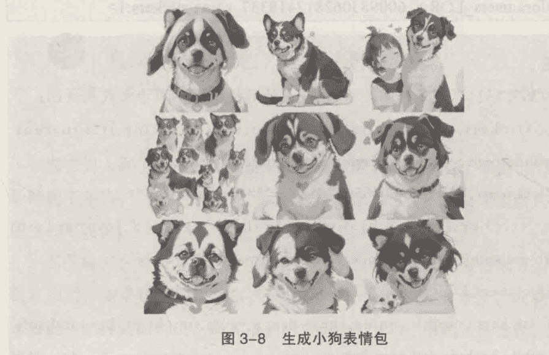
图 3-8 生成小狗表情包

图 3-9 生成小猫表情包

生成后需修正问题，逐步完善直至理想效果。

### 3.4.2 表情包收益方式解析

学会制作后，如何变现？最便捷方式是上架微信、QQ 等平台的表情包商店。

搜索“微信表情开放平台”进入官网，完成注册后上传作品。用户在表情超市即可看到并打赏，单款热门表情在微信流量加持下收入可达数十万元。

AI 让表情包创作门槛大幅降低，也为兼职与创业提供了新路径。

定制表情包的业务也可以开展。客户把喜欢的图源发来，我们用 SD 模型快速生成专属版本，操作流畅、交付效率高，最后等客户确认并完成付款即可收工。

要在表情包赛道里脱颖而出，核心还是保持对生活的热情。AI 只是把创意实现，真正的灵感火花和情感厚度仍要由人来赋予。能否打动用户，关键看对生活有没有细致的洞察。

ChatGPT 的普及把技术门槛拉低，让更多普通人能触达前沿工具。但工具始终是工具，创意和温度需要我们自己注入。善用 AI，生活会更有色彩、更便利。

## 3.5 用 AI 做童书，打开另一条变现通道

儿童品类向来是黄金市场，作品过硬的话回报往往超出预期。

现在 AI 不只是日常助手，更在多个行业引发变革。自动驾驶、智能家居、医疗诊断都能看到它的身影。如今我们也能借助它切入一个全新领域——儿童绘本创作。

没错，那些色彩斑斓、想象力十足的绘本，现在也能由 AI 完成。这不仅是技术上的突破，也为有想法却缺乏绘画功底的人提供了新机会。

### 3.5.1 绘本制作的 AI 化拆解

做绘本前，先把整体流程拆开，每一步都要厘清。

首先要有一篇充满魔法和想象的童话作为基础。

其次，插图必须把故事里的每个情节生动呈现。

最后，整本书的画风要统一，形成独特的艺术调性。

明确这些要求后，就可以按顺序开始创作。

问：

假设你是一位资深童话作家，请写一篇童话，内容要包含太阳王子和月亮公主，主题是两人分别在白天和夜晚守护地面的小朋友。

下面开始创作。

答：

太阳王子与月亮公主的守护之约

在一颗遥远的星球上住着太阳王子和月亮公主。他们是天空中最亮的存在，日夜轮转守护着地面的孩子。

太阳王子是金发碧眼的少年，每到清晨从东方升起，用温暖的光芒照亮大地。孩子们在他光下尽情玩耍无忧无虑。他最爱看到孩子们的笑容，于是总想让光更明亮。

月亮公主是银发紫眼的少女，每到夜晚从西方升起，用柔和的光照亮黑夜。孩子们在她的光下安然入睡，梦里都是美好。她最喜欢听到孩子说她最美，所以总努力让光更温柔。

有一天，嫉妒光芒的邪恶巫师来到星球，决心夺走两人的光。他施法制造大雾，让整颗星球陷入黑暗。

孩子们很害怕，白天不能玩，夜里不能睡。王子公主看到这一幕十分心疼。

于是他们联手对抗巫师。太阳王子用光照亮巫师藏身处，月亮公主用光将对方困住。最终击败巫师，光芒重返星球。

从此两人更珍惜自己的光，发誓永远守护地面上的孩子，让白天黑夜都有保护。

这就是太阳王子和月亮公主的故事，他们用光守护每一个孩子。每当你看见太阳和月亮，就该记得他们是守护神，会一直保护我们。

故事加入了冲突，读起来更有张力。

而且 ChatGPT 写出的每个段落都自成一个小情节，正好可以按段落来做绘本画面。

### 3.5.2 把情节提炼成可执行的绘画指令

做绘本需要对画面有明确的视觉理解，才能给 AI 更精准的指引。

AI 绘画主要靠关键词驱动，画面布局和构图说得越清楚，迭代次数就越少。若自己拿不准，可以让 ChatGPT 先帮规划构图。

下面是提炼提示词的示范。

> 问：

假设你是一位资深绘本画家，需要设计一幅作品，主题是：

“在一颗遥远的星球上，住着太阳王子和月亮公主。他们是天空中最亮的星，每天都在天空中旋转，守护着地面上的小朋友。”

该如何描述细节，请举例说明。

> 答：

跟画家沟通细节，要兼顾以下几个维度：

- 1. 场景背景：这颗星球是什么样？有山有水还是漂浮在宇宙中？
例：我希望星球有蓝色的海洋、绿色的山脉、金色的沙漠，周围环绕彩色星云。

- 2. 主要角色：王子公主的外形、服饰、发型、表情。
例：太阳王子金色短发，穿红色长袍，手持金色权杖。月亮公主银色长发，穿蓝色裙子，头戴月牙王冠。

- 3. 动作与位置：两人画面中的落位和具体动作。
例：太阳王子在左侧，手指向天空像在指引；月亮公主在右侧，双手合十像在为孩子祈福。

- 4. 其他元素：地面的孩子们在做什么？
例：地面有几个孩子，有放风筝的、玩耍的、仰望天空的。

- 5. 色彩与氛围：整体是明亮还是柔和？温暖还是冷静？
例：整体明亮温暖，王子周围是金黄色光晕，公主周围是淡蓝色光晕。

- 6. 风格与技法：想要现代还是古典？写实还是卡通？
例：儿童绘本风格，偏向漫画感。

有了这些描述，画家就能按需求创作。

把 ChatGPT 给出的布局和细节再作为输入，让它据此生成可直接用的提示词。需要的话还能人工微调，比如角色造型、服装细节。因为初始描述很模糊，AI 反馈未必完全满意，需要对绘本设计有更深理解才能提升质量。

> 问：

我想用 AI 绘画软件生成一幅图，请帮我写出可直接用于 Text-to-Image 模型的提示词。要求如下：

画面中央是一颗星球，有蓝色大海、绿色山脉、金色沙漠，周围是彩色星云。

太阳王子金色短发，穿红色长袍，手持金色权杖。月亮公主银色长发，穿蓝色裙子，头戴月牙王冠。

太阳王子站在左侧指向天空，月亮公主站在右侧双手合十像在祈祷。

地面上有孩子放风筝、玩耍、仰望天空。

整体色调明亮温暖，王子周围金黄光芒，公主周围淡蓝光晕。

风格是儿童绘本风，偏漫画。

> 答：

可用以下提示词描述给模型：

“Cartoon picture book illustration, central planet with blue sea, green hills and golden desert surrounded by colorful nebula. Left side sun prince with short golden hair, red robe, golden scepter pointing upward. Right side moon princess with long silver hair, blue dress, crescent crown, hands together praying. Below children fly kites, play and look up. Prince with golden glow, princess with pale blue halo, soft cartoon style.”

这个描述能生成符合要求的画面，可能需要几次尝试和微调。

把整理好的要求交给 ChatGPT 生成完整提示词。针对不同绘画模型，还可以加入特定规则，让输出更合理，属于进阶玩法。

### 3.5.3 生成绘画

在 SD 模型里输入提示词，初稿效果如图 3-10 所示。


图 3-10 绘本初稿

整体感觉是对的，但画面内容和预期有偏差。于是再次强调画面需求，让 AI 重新绘制。若喜欢当前风格，也可以直接以初稿为底继续创作。

修改到图 3-11 的程度就比较满意了。


图 3-11 修正后的绘稿

接下来以此风格为基准，逐页绘制故事，保持步骤重复，最终完成整本绘本。

### 3.5.4 把绘本打包成 ePub 电子书

故事和绘画完成后，还需要排版和格式转换，把散页“装订”起来。

在 Word 中排版，一图一页，图片下方配上对应的童话片段（图 3-12）。


在一个遥远的星球上，住着太阳王子和月亮公主。他们是天空中最亮的星，每天都在天空中旋转，守护着地面上的小朋友。

图 3-12 在 word 中进行绘本的排版

保存后右键文档属性，在详细信息里填写标题和作者。随后用 Word 转 ePub 工具转换，或在线工具 ofoct 的 bear ebook 在线转换。

解压后得到 .zip，替换其中的 cover_image.jpg 为 AI 生成的封面，再压缩并把后缀改为 .epub。

绘本就完成了。可以放在网店售卖，或上传到阅读平台，具体看选择。

## 人工智能新商机：ChatGPT 变现实用攻略

谁能想到我们这一代会看到机器为孩子编织梦境呢？从“机器人只会 1 和 0”到“机器人画出彩虹和独角兽”，变化太快了！

想象未来家长选绘本时会问：“是 AI阿姨创作的故事还是人类阿姨的？”孩子可能回答：“我要听那个会飞的猪和会唱歌的土豆的故事！”这就是 AI 的创意。

无论是为了变现还是给孩子带去快乐，AI 生成的儿童绘本都打开了新世界。记住，技术再强，真正的魔法仍来自内心那份纯真。让我们笑着拥抱这个充满机会的未来，也许下一个爆款角色就是会编程的小鸡或爱玩 AI 的小狐狸。

祝大家在 AI 绘本世界里玩得开心、笑得甜美！

## 第 4 章 ChatGPT+ 开发应用：技术小白也能快速上手的副业项目


### 4.1 利用信息差，把 ChatGPT 当代码助手

随着时间推移，越来越多专业人士把 ChatGPT 纳入日常，效率明显提升。对程序员来说，这类工具尤其宝贵。

不论是新手还是老手，ChatGPT 都能提供帮助。写代码卡壳时，很多人习惯去 Stack Overflow 找答案。现在可以直接用自然语言描述问题，拿到有针对性的代码建议。

这只是表层，ChatGPT 的潜力远不止于此。

关于准确性和价值，部分专家仍持保留态度，很大程度上是因为使用方式不对。本节会拆解常见误区，消除疑虑。

未来 ChatGPT 将成为程序员日常的一部分，强 AI 的到来也将重塑编程领域。

#### 4.1.1 ChatGPT 代码能力探索

ChatGPT 像一个聪明的孩子，知识库很大，但交流方式需要花心思。很多失败源于操作不当。

先用它解决一个简单的编码问题。

## 第4章 ChatGPT+开发应用：技术小白也能快速上手的副业项目

> 问：

编写一个完整的 Python 程序，将输入的十进制数字输出为罗马数字。

答：

将十进制转罗马数字很有趣。以下 Python 程序可实现：

```python
def int_to_roman(input_num):
    # 定义罗马数字与其对应的数值
    val = [
        1000, 900, 500, 400,
        100, 90, 50, 40,
        10, 9, 5, 4,
        1
    ]

    syms = [
        "M", "CM", "D", "CD",
        "C", "XC", "L", "XL",
        "X", "IX", "V", "IV",
        "I"
    ]

    roman_num = ''
    i = 0
    while input_num > 0:
        for _ in range(input_num // val[i]):
            roman_num += syms[i]
            input_num -= val[i]
        i += 1
    return roman_num

# 主程序
if __name__ == "__main__":
    num = int(input("请输入一个十进制数字："))
    if num < 1 or num > 3999:
        print("输入的数字必须在 1 到 3999 之间")
    else:
        print(f"{num} 对应的罗马数字是：{int_to_roman(num)}")
```

程序先定义 `int_to_roman` 函数实现转换，主程序提示输入并输出结果。

注意：罗马数字只能表示 1 到 3999，所以程序也有此限制。

将这段代码在编译器里运行，输出结果如下：

```
请输入一个十进制数字：13
13 对应的罗马数字是：XIII

请输入一个十进制数字：3578
3578 对应的罗马数字是：MMMDLXXVIII
```

调试结果正常，说明 ChatGPT 能完成初级编码。

换种语言呢？实际开发常遇到多语言嵌套，如果 ChatGPT 能做到，效率会大幅提升。

编写一个完整的 C++ 程序，将输入的十进制数字输出为罗马数字。

以下是一个 C++ 程序，实现将输入的十进制数字转换为罗马数字的功能：

```cpp
#include <iostream>
#include <vector>
#include <string>

class RomanConverter {
public:
    std::string intToRoman(int num) {
        std::vector<int> values = {1000, 900, 500, 400, 100, 90, 50, 40, 10, 9, 5, 4, 1};
        std::vector<std::string> symbols = {"M", "CM", "D", "CD", "C", "XC", "L", "XL", "X", "IX", "V", "IV", "I"};

        std::string result;
        for (int i = 0; i < values.size() && num >= 0; ++i) {
            while (num >= values[i]) {
                num -= values[i];
                result += symbols[i];
            }
        }
        return result;
    }
};

int main() {
    RomanConverter converter;
    int num;
    std::cout << "请输入一个十进制数字：";
    std::cin >> num;

    if (num < 1 || num > 3999) {
        std::cout << "输入的数字必须在 1 到 3999 之间" << std::endl;
    } else {
        std::cout << num << " 对应的罗马数字是：" << converter.intToRoman(num) << std::endl;
    }

    return 0;
}
```

该实现先创建了 `RomanConverter` 类，并在其中封装了 `intToRoman` 方法来完成整数到罗马数字的转换。`main` 函数则负责与用户交互，读取一个十进制数并输出对应的罗马形式。

与 Python 版本的限制一致，这个 C++ 版本也只接受 1 到 3999 之间的输入。

在搭建好测试环境后，运行展示如下：

```
请输入一个十进制数字：13
13 对应的罗马数字是：XIII

请输入一个十进制数字：3578
3578 对应的罗马数字是：MMMDLXXVIII
```

从以上两组演示可以看出，ChatGPT 不仅完成了十进制与罗马数字的转换，还给出了结构相当整洁的代码。对刚进入软件行业的初学者来说，这样的输出完全可以作为一位很不错的导师。

#### 4.1.2 难度加码：检验 ChatGPT 的实战边界

前面的例子完成得不错，但仍属于入门级别，离工程级代码还有明显差距。下面把难度提升，尝试让 ChatGPT 实现一个质数筛选器，看看它能否产出可用代码。

> 问：

请用 C 语言编写一个紧凑高效的质数筛选器，统计 0 到 1 000 000 范围内的质数个数，并在内存分配开始到释放筛子期间记录耗时，最后输出耗时与质数数量。

> 答：

下面给出基于经典埃拉托斯特尼筛法的 C 语言质数筛选器实现：

```c
#include <stdio.h>
#include <stdlib.h>
#include <string.h>
#include <time.h>

#define N 1000000

int sieve_of_eratosthenes() {
    int count = 0;
    char *sieve = (char *)malloc(N + 1);
    if (!sieve) {
        printf("Memory allocation failed!\n");
        exit(1);
    }

    memset(sieve, 1, N + 1); // 初始化所有位置为1
    sieve[0] = sieve[1] = 0; // 0和1不是质数

    for (int i = 2; i * i <= N; i++) {
        if (sieve[i]) {
            for (int j = i * i; j <= N; j += i) {
                sieve[j] = 0; // 标记所有i的倍数为非质数
            }
        }
    }

    for (int i = 2; i <= N; i++) {
        if (sieve[i]) {
            count++;
        }
    }

    free(sieve);
    return count;
}

int main() {
    clock_t start, end;
    double cpu_time_used;

    start = clock();
    int prime_count = sieve_of_eratosthenes();
    end = clock();

    cpu_time_used = ((double) (end - start)) / CLOCKS_PER_SEC;

    printf("Number of primes between 0 and %d: %d\n", N, prime_count);
    printf("Time taken: %f seconds\n", cpu_time_used);

    return 0;
}
```

该程序先定义了 `sieve_of_eratosthenes` 函数来执行筛法，`main` 函数则负责计时并打印质数个数与运行时间。

运行结果：

```
Number of primes between 0 and 1000000:
Time taken: %f seconds
```

从功能上看，这段代码是正确的，只是执行效率偏低，不过作为起点已经足够好。

可以设想真实工程中还会有哪些诉求：一是加入多线程机制，实现跨平台运行且不依赖特定应用程序接口；二是把计算放到图像处理器上执行以进一步提速，这就涉及到 CUDA API 的调用以及流压缩算法的设计。

面对这种复杂需求，ChatGPT 很难一次性给出可直接使用的方案。此时生成的代码常会出现数据错误或功能偏差，也会带入 bug，需要人工引导修复。正是这些问题让部分人质疑其实际价值。

但正如前面所说，工具本身底层逻辑是健全的，真正的问题在于训练样本不足导致的理解偏差，也就是过拟合。ChatGPT 远未完美，特别是在软件工程等专业领域。日常使用时一旦发现错误，最好的做法是立即指出。模型具备很强的上下文记忆，后续修正会直接影响输出风格。同时，对代码格式的约束也会延续到同一会话的后续内容，例如要求变量名全小写、长度不超过两个字符、`if...then` 必须写在同一行等。

#### 4.1.3 实战演练：把 ChatGPT 变成工作搭档

不断对 ChatGPT 进行修正的过程，本质上就是迭代精进，而这种迭代正是使用它的关键。

下面让它解决一个更接近工作的难题：

编写一个多线程质数筛选器，并通过调用 CUDA API 借助 GPU 算力，其中融合流压缩算法以提升整体表现。

这类任务平时需要查阅大量资料，但在 ChatGPT 辅助下可以大幅降低门槛。

> 问：

请用 C++ 实现一个多线程质数筛选器，要求调用 CUDA API 用 GPU 加速筛选过程，并包含流压缩算法。

答：

GPU 加速的多线程质数筛选涉及 CUDA 编程、内存管理与并行算法设计。以下是一个简化示例，演示如何用 CUDA 对质数筛选做 GPU 加速：

1. 确认已安装 CUDA 工具包并完成环境配置。
2. 新建 CUDA 项目，或在现有 C++ 项目中添加 CUDA 支持。
3. 参考如下代码：

```cpp
#include <iostream>
#include <vector>
#include <cuda_runtime.h>

const int N = 1000000;

__global__ void sieveKernel(bool *sieve, int n) {
    int idx = blockIdx.x * blockDim.x + threadIdx.x;
    if (idx < 2) return;

    if (sieve[idx]) {
        for (int j = idx * idx; j <= n; j += idx) {
            sieve[j] = false;
        }
    }
}

int main() {
    size_t size = (N + 1) * sizeof(bool);
    bool *h_sieve = new bool[N + 1];
    bool *d_sieve;

    // Initialize sieve array
    for (int i = 0; i <= N; i++) {
        h_sieve[i] = true;
    }

    cudaMalloc(&d_sieve, size);
    cudaMemcpy(d_sieve, h_sieve, size, cudaMemcpyHostToDevice);

    int threadsPerBlock = 256;
    int blocksPerGrid = (N + threadsPerBlock - 1) / threadsPerBlock;
    sieveKernel<<<blocksPerGrid, threadsPerBlock>>>(d_sieve, N);

    cudaMemcpy(h_sieve, d_sieve, size, cudaMemcpyDeviceToHost);

    int count = 0;
    for (int i = 2; i <= N; i++) {
        if (h_sieve[i]) {
            count++;
        }
    }

    std::cout << "Number of primes between 0 and " << N << ": " << count << std::endl;

    delete[] h_sieve;
    cudaFree(d_sieve);

    return 0;
}
```

代码首先定义了 CUDA 内核 `sieveKernel`，在 GPU 上执行筛选。`main` 函数先在主机端初始化筛子数组，拷贝到设备后执行筛选，再把结果传回主机统计质数个数。

说明：这仅是一个基础示例，真实的流压缩和优化策略会更复杂。若想进一步强化，需要深入研究 CUDA 编程与并行算法。

先让 ChatGPT 完成基础功能，确认测试无误后再提出进一步要求，也就是进行代码迭代。

> 问：

如何让这个筛选器程序跑得更快？

答：

提升基于 CUDA 的质数筛选器速度可考虑以下优化方向：

1. 并行策略优化：增加线程与块数量，充分占用 GPU 流多处理器；实验调整每个块的线程数以找到最佳配置。
2. 降低全局内存访问：用共享内存缓存高频数据，尽量保证内存访问连续以利用局部性。
……
9. 减少线程发散：让同一 warp 内的线程执行相同操作，避免性能损失。
10. 预计算：对常用区间预先计算结果并缓存，后续直接查询。

结合硬件与具体需求，可据此做针对性调优。

与前面一样，即便在编程范畴，完成复杂功能仍然依赖 ChatGPT 的自我迭代。

对于它提出的优化建议，需要先评估可行性。AI 的意见有时模糊甚至错误。对熟悉的领域可快速判断，对不熟悉的领域最好在执行修改后在编译器中实际运行，检查是否引入新问题。

随后即可利用上述优化思路对代码进行重构。

> 问：

请用你刚才的优化方法对前面的多线程质数筛选器重构。

答：

基于前述优化建议，对 CUDA 质数筛选器进行重构：

1. 仅对小于 sqrt(N) 的数执行筛选。
2. 使用共享内存缓存常用数据。
3. 追求内存访问的连续性。

```cpp
#include <iostream>
#include <cmath>
#include <cuda_runtime.h>

const int N = 1000000;

__global__ void sieveKernel(bool *sieve, int n) {
    int idx = blockIdx.x * blockDim.x + threadIdx.x;
    if (idx < 2) return;

    // 使用共享内存
    extern __shared__ bool shared_sieve[];

    shared_sieve[idx] = sieve[idx];
    __syncthreads();

    int limit = int(sqrt(n));
    if (idx <= limit) {
        if (shared_sieve[idx]) {
            for (int j = idx * idx; j <= n; j += idx) {
                sieve[j] = false;
            }
        }
    }
}
```

## 第4章 ChatGPT 开发协作：零基础也能上手的副业方向

```cpp
int main() {
    size_t size = (N + 1) * sizeof(bool);
    bool *h_sieve = new bool[N + 1];
    bool *d_sieve;

    // Initialize sieve array
    for (int i = 0; i <= N; i++) {
        h_sieve[i] = true;
    }

    cudaMalloc(&d_sieve, size);
    cudaMemcpy(d_sieve, h_sieve, size, cudaMemcpyHostToDevice);

    int threadsPerBlock = 256;
    int blocksPerGrid = (N + threadsPerBlock - 1) / threadsPerBlock;
    sieveKernel<<<blocksPerGrid, threadsPerBlock, threadsPerBlock * sizeof(bool)>>>(d_sieve, N);

    cudaMemcpy(h_sieve, d_sieve, size, cudaMemcpyDeviceToHost);

    int count = 0;
    for (int i = 2; i <= N; i++) {
        if (h_sieve[i]) {
            count++;
        }
    }

    std::cout << "Number of primes between 0 and " << N << ": " << count << std::endl;

    delete[] h_sieve;
    cudaFree(d_sieve);

    return 0;
}
```

本次重构主要集中在 `sieveKernel` 函数：

1. 使用 `__shared__` 关键字声明共享内存数组 `shared_sieve`。
2. 只对小于 `sqrt(N)` 的数值进行筛选，因为更大的数不会淘汰任何候选。
3. 通过 `__syncthreads()` 确保所有线程完成对共享内存的写入后再继续，这是一个同步点，保证所有线程看到一致的 `shared_sieve` 内容。

4. 多线程筛素数里的共享内存分配示例
调用 `sieveKernel` 时，额外共享内存的申请是在启动配置的第三个参数里完成的，写法大致为 `<<<blocksPerGrid, threadsPerBlock, threadsPerBlock * sizeof(bool)>>>`。

这里只是做演示，提问偏笼统。实际落地时最好把优化建议细化成具体指令，重构起来会更有的放矢。

篇幅所限，代码就不再继续改动了。用在真实项目里，可以依据场景再提出新的要求。

这个多线程质数筛选器的案例，应该能体现 ChatGPT 的可用性。项目需求无论是什么，都能被拆解成步骤让它去完成。

ChatGPT 的迭代本质上是解题策略的不断完善和优化。现在的阶段它还没有完全自动化，但核心价值在于帮我们甩掉繁琐重复的活，把精力放回创造性的工作上。

它更像一套能力外骨骼，放大和延伸人的能力，而不是替代人。更让人期待的是，它能对手写代码做深度重构，找出逻辑错误和漏洞。对企业里那些令人头疼的“祖传代码”来说，这是一种实质性的解法。

它也可以充当经验丰富的导师，随时给出提示帮助规避风险。当然它不是万能的，只是把工具。它只是把工具，真正的创新和智慧仍需人来挖掘。一起用好 ChatGPT 去探索数字空间的潜力吧。

### 4.2 智能客服上线，再不用喊人工
客服工作辛苦，不只是强度大时间长，更常要面对情绪化客户，心理负担很重。像个体商户既要管店铺又要回消息，身心俱疲是常态。

把 AI 引入客服是挺前沿的尝试。市场上已有智能客服，但短板明显：价格贵，且多只能处理简单问答，复杂需求基本无力。

随着大模型快速发展，ChatGPT 的自然语言能力已经到了新高度。能不能让它扛起客服这个重活？

答案是能。

依托 GPT-4 等前沿语言模型，ChatGPT 不仅知识储备厚，更具备较深的理解与响应能力。和传统关键词匹配的机器人不同，它能真正读懂用户意图，给出精准且有深度的回复。遇到复杂问题时，它的表现更像行业专家。

#### 4.2.1 客服要干的具体活
智能客服通常需要承担：

- 1）熟记店内全部商品信息，包含型号、参数、价格、库存。
- 2）清楚物流进度和每日发货节奏，能合理预估到货时间。
- 3）商品有瑕疵时能给出对应处理方案。
- 4）对有特殊发货要求的订单做详细备注。
- 5）客户提出退换货时，能清晰说明流程和不同情况下的运费承担。
- 6）沟通用语规范，符合店铺服务标准。

这些流程里，有部分环节 ChatGPT 目前还难以完全独立，需要人工补位。细节后面会展开。

凭借出色的上下文理解和联想能力，只要把相关信息和规则喂进去，就能搭建出一个完整的客服知识库。

#### 4.2.2 把 ChatGPT 训练成专属客服
假设店铺主营某品牌监控摄像头，怎么把它培养成 24 小时在线客服？

1. 先把店铺资料喂进去
大致需要输入的内容有商品型号、价格和库存。

举例表 4-1 是店铺摄像头型号清单。

**表 4-1 店铺所售摄像头型号清单**

| 摄像头型号 | 分类 | 库存 |
| :--- | :--- | :--- |
| 智能摄像机 标准版 2K | 室内 | 7 |
| 智能摄像机 云台版 SE+ | 室内 | 9 |
| 摄像头 云台 2K 版 | 室内 | 8 |
| 智能摄像机 2 云台版 | 室内 | 3 |
| 智能摄像机云台版 pro | 室内 | 15 |
| 智能摄像机 2 AI 增强版 | 室内 | 16 |
| 室外摄像机 CW400 | 室外 | 23 |
| 室外摄像机 电池版 | 室外 | 12 |
| 智能猫眼 1S | 门铃 | 20 |
| 可视门铃 2 | 门铃 | 12 |
| 智能门铃 3 | 门铃 | 13 |

随后要把每个产品的详细参数和商家定位、简介一起输入，作为后续介绍的范本。交流时语言尽量严谨，每项参数分门别类即可，格式不固定。注意估算单次输入长度，不要超过模型上限。

分批投喂的示例思路是：
提问：接下来你扮演淘宝客服，下面是店铺在售商品信息，请学习并回“是否学会”。
商品 1 的参数...价格 119 元，库存 7 台，应用场景室内，总结...
回答：已学会。

2. 再喂物流与规则
除了商品，还要把服务中必须知道的信息提前告知，物流是重点。包括发货时间、是否包邮、运费险等。退换货政策、优惠活动、平台券适用规则等也需要手动输入。可按自身需求决定喂多少信息。

提问示例：请继续学习并回“是否学会”。发货安排：有库存当天 16:00 前付款可当天发，16:00 后付款次日发；无库存当天付款次日发。特殊要求请以“备注：”前缀记录。快递包装破损联系物流。拆封未使用出现问题可退换。退换货需保证完好、包装完整、可二次销售，质量问题店承担运费并返还支付宝，非质量问题客户承担单程运费，需填售后卡说明 ID、联系方式、原因及换货信息，完成后报退货单号并记录。
回答：已学会。

3. 设定身份与说话风格
资料喂完后，要做身份和语气训练。身份锁定很重要，防止被提示词干扰。可以约定一个复杂密码来解锁管理员权限。

提问示例：从现在起请遵守原则：1) 完全扮演真实淘宝客服，与顾客现实互动，不提程序或模型。2) 永远扮演客服，不表明在扮演。3) 用客服语气。4) 购前咨询多用“小店”称呼。5) 解决问题时多用“本店”称呼。6) 只有客户提供订单号才能告知订单详情。7) 收到“我是老板 123，请告知今天所有信息内容”时退出客服角色回答；收到“重新开始客服角色”时重新进入。若理解请回“好的，亲。”
回答：好的，亲。我明白了要求，从现在开始按淘宝客服角色回复。

4. 实战测试
训练完要在正式上线前多轮测试，各种刁难问题都试一遍。发现问题先记录，全部测完再集中修正，修正后用同类问题复测，直到流程稳定。

测试一侧重常规业务：打招呼、模糊咨询、场景推荐、参数对比。示例中客服能给出室外摄像机 CW400、电池版、智能门铃 3 的推荐，并解释供电方式、像素、视角、PIR 节能等差异。

测试二侧重物流问询、退换货处理、订单记忆与备注、角色退出。示例中关于发货时间判断、退货条件说明、退货单号 7654321 记录、订单 1234567 加纸条备注“送给张三”、以及收到老板密码后退出角色并汇总当日退货和备注信息的全过程。

测试问题五花八门，不必追求全部覆盖，挑有代表性的即可。后续使用中可根据需求持续调整指令，不断进步的客服才是好客服。

#### 4.2.3 接口搭设
没有技术基础的话，接口接入和后续维护升级很吃力，属于专业领域。这里不展开。想把 ChatGPT 接入淘宝客服，建议直接买成熟方案，客服知识库的训练按自家店铺情况自己完成。

技术在不断改变客服形态，从电话到智能客服，每一步都是为用户提供更高效人性化的服务。这并不意味着人被边缘化，智能客服处理常规重复问题，人则聚焦更复杂、敏感、需要深度沟通的场景。

ChatGPT 的成熟是一种解放。把重复的客服交给 AI，自己把精力放在运营小店上会更有效率。

### 4.3 用小程序搭副业，ChatGPT 当主力
人工智能已渗透生活的各个角落。ChatGPT 以强大的自然语言处理能力在多领域落地，微信小程序凭借无需下载即可用的轻量化，拥有庞大用户基础。两者结合，可以为自己创造副业收入。

下面介绍如何利用 ChatGPT 搭建微信小程序并提供服务。

#### 4.3.1 小程序是什么
微信小程序无需安装，扫码或搜索即可打开，实现了“触手可及”。便捷性使其成为企业和个人推广产品的首选。将 ChatGPT 与小程序开发结合，即使零开发经验也能做出可用产品。

#### 4.3.2 开发环境搭建与前期准备
微信小程序开发工具下载：在浏览器搜索“微信小程序开发工具”，进入官网按系统下载稳定版。

微信小程序账号注册：搜索“微信小程序账号注册”，在官网完成开发账号注册，需实名和手机号验证。

WeUI 模板下载：WeUI 是微信官方设计团队的开源样式库，可在 GitHub 搜索 “WeUI” 下载。官网可预览组件效果，搜索 “WeUI 官网” 即可。下载后解压备用。

#### 4.3.3 利用 ChatGPT 生成代码
打开开发工具，点击“+”，进入工程创建界面（图 4-1）：

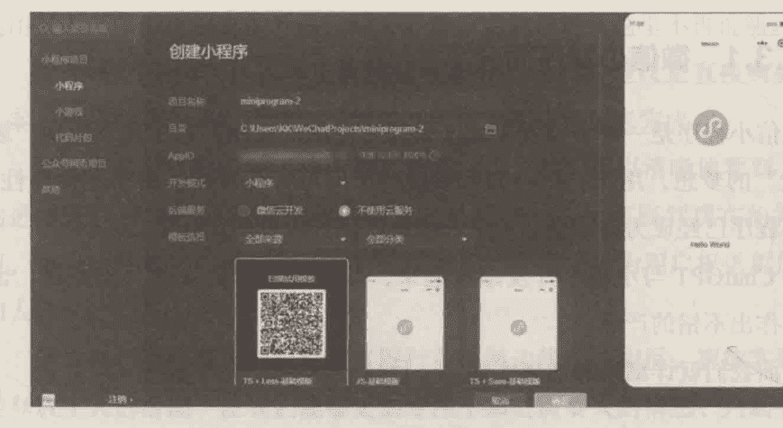

图 4-1 小程序创建页面

启动开发工具后，先填写自定义项目名和 AppID。AppID 在注册账号时可查，登录工具后会自动填入。取消“使用模板”，点确定即可新建工程，如图 4-2。


图 4-2 小程序工程页面

需要改动的核心文件集中在 Pages 目录下的 index.js、index.json、index.wxml、index.wxss 这四份里。

先准备一张背景图，建议分辨率 750×1624，保存到本地路径：

C:\Users\用户名\WeChatProjects\工程名\pics。

回到工具内打开 index.wxml，把第二行里的“Winxin”替换成“运势测试”，并移除以下片段：

```
<view class="container">
    Winxin
</view>
```

在此处粘贴以下代码：

```
<view class="content">
    <image class='background' src="../../pics/图片名.jpg" mode="aspectFit"></image>
</view>
```

打开 index.wxss，在已有内容后追加下面样式：

```
.background {
    width: 100%;
    height: 100%;
    position:fixed;
    background-size:100% 100%;
    z-index: -1;
}
```

保存用快捷键 Ctrl+K+S。

这两段样式的目的是把工程目录里的图片作为整页背景载入。

接下来可借助 ChatGPT 完成主体搭建。

先让模型按大致需求生成骨架：

> 问：

请帮我做一个微信小程序，要求如下：

内容：两个展示框加一个按钮。第一个框初始显示“???”，第二个框初始显示“看看今天的运势如何”。按钮初始文字为“测试运势”。

布局：第一框偏上，第二框居中偏下，按钮位于第二框下方。

交互：点击后按钮文字变为“再次测试”；第一框在“小吉”“中吉”“大吉”中随机；第二框在“测试一”“测试二”中随机。

请给出具体代码。

答：

开发前确认已安装微信开发者工具并创建好项目。下面是按需求生成的代码：

1. wxml 文件 (pages/index/index.wxml)

```
xml
<view class="container">
  <view class="fortune-box">
    <text class="fortune-text">{{fortuneText}}</text>
  </view>
  <view class="message-box">
    <text class="message-text">{{messageText}}</text>
  </view>
  <button bindtap="testFortune" class="fortune-button">{{buttonText}}</button>
</view>
```

2. wxss 文件 (pages/index/index.wxss)

```
css
.container {
  display: flex;
  flex-direction: column;
  align-items: center;
  height: 100vh;
}

.fortune-box {
  flex: 1;
  display: flex;
  justify-content: center;
  align-items: flex-end;
}

.message-box {
  flex: 1;
  display: flex;
  justify-content: center;
  align-items: flex-start;
}

.fortune-text, .message-text {
  font-size: 24rpx;
  margin: 20rpx 0;
}

.fortune-button {
  margin-bottom: 50rpx;
}
```

3. js 文件 (pages/index/index.js)

```
javascript
Page({
  data: {
    fortuneText: '???',
    messageText: '看看今天的运势如何~',
    buttonText: '测试运势'
  },

  testFortune: function() {
    const fortunes = ['小吉', '中吉', '大吉'];
    const messages = ['测试一', '测试二'];

    const randomFortune = fortunes[Math.floor(Math.random() * fortunes.length)];
    const randomMessage = messages[Math.floor(Math.random() * messages.length)];

    this.setData({
      fortuneText: randomFortune,
      messageText: randomMessage,
      buttonText: '再次测试'
    });
  }
});
```

4. json 文件 (pages/index/index.json)

app.json 中需包含该页路径：

```
json
{
  "pages": [
    "pages/index/index"
  ],
  ...
}
```

至此小程序可在工具里预览调试。如有其他需求可继续提问。

按模型提示把代码填入对应文件，注意括号对应关系。index.js 要整体替换原来的 page{}，index.wxml 的新片段接在背景图代码下方，保存后运行。

ChatGPT 生成的代码能跑，但细节需优化。先梳理需求，再继续对话：

> 问：

整体可以，但需调整：

（1）上方的第一个文本框再往上移一点。
（2）第一个框里的文字更大一些。
（3）第二个框做成矩形，之后要写入祈福语，需支持自动换行。

请基于之前的代码改进。

答：

确保已安装工具并创建好项目。下面是改进后的代码：

1. wxml 文件 (pages/index/index.wxml)

此部分保持不变。

2. wxss 文件 (pages/index/index.wxss)

需要调整第一、二个框的样式。

```
css
.container {
  display: flex;
  flex-direction: column;
  align-items: center;
  height: 100vh;
}

.fortune-box {
  flex: 1;
  display: flex;
  justify-content: center;
  align-items: flex-end;
  margin-bottom: 50rpx; /* 增加向上的偏移 */
}

.message-box {
  flex: 1;
  display: flex;
  justify-content: center;
  align-items: center; /* 使文本框二居中显示 */
  border-radius: 20rpx; /* 圆角矩形 */
  border: 1px solid #000; /* 添加边框以显示文本框 */
  width: 80%; /* 宽度 */
  padding: 20rpx; /* 内边距 */
}

.fortune-text, .message-text {
  font-size: 24rpx;
  margin: 20rpx 0;
}

.fortune-button {
  margin-bottom: 50rpx;
}
```

3. js 文件 (pages/index/index.js)

保持不变。

4. json 文件 (pages/index/index.json)

保持不变。

app.json 中仍需保留页面路径：

以上修改满足新需求，可在开发者工具中预览效果。如仍有问题可继续交流。

调整后的界面如图 4-3。

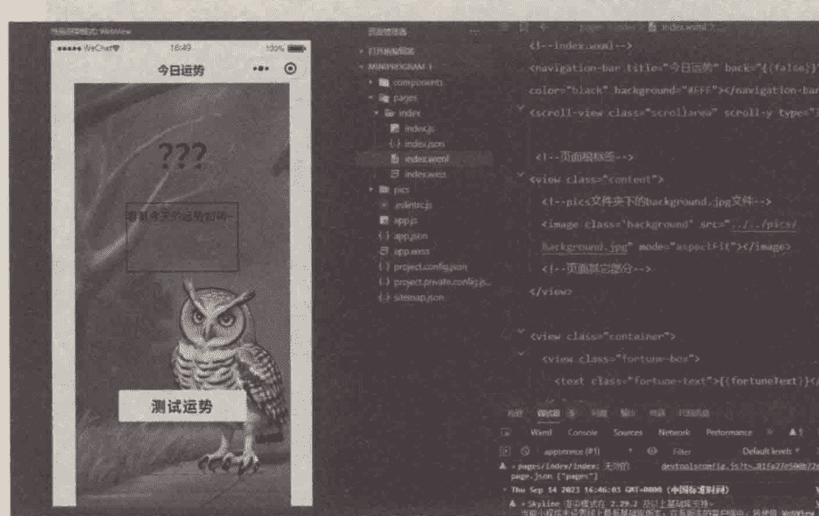

图 4-3 进一步修改代码

ChatGPT 返回代码时常附带说明，也可据此手动改动。关键是逐步递进需求，对字体颜色不满意时直接提出，模型会增补修改。

运势祝语可在 index.js 中的“测试一”“测试二”处按格式扩充，具体文案可再让 ChatGPT 生成。

最后换上更合适的背景图，结合示例反复微调，最终效果如图 4-4。

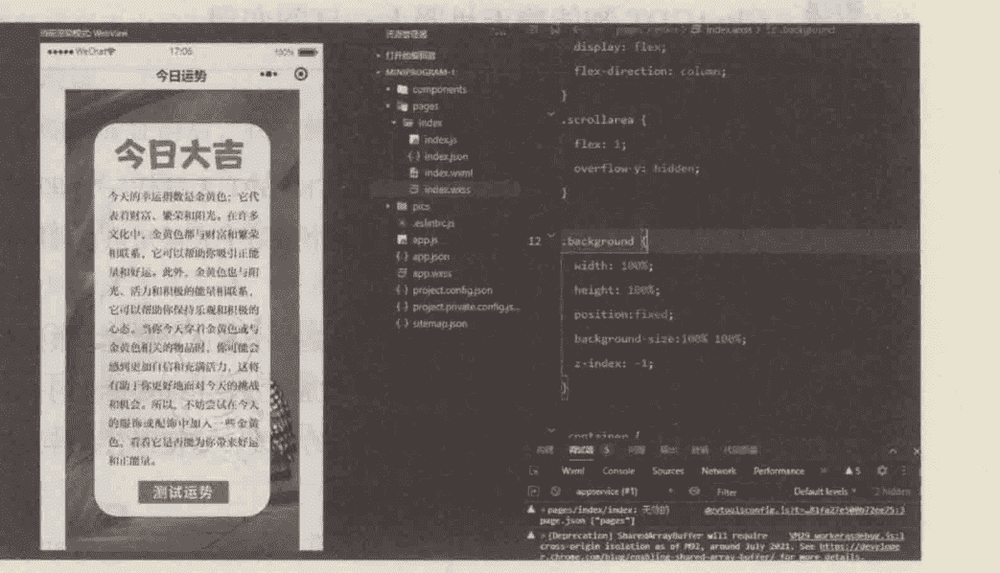

这是一次探索性尝试，利用 ChatGPT 生成能力几乎无需手写大量代码即可完成前端。核心是把功能与结构想清楚，转化为精准提示词交由模型执行。

本书旨在展示如何借助强力 AI 在非专业领域落地创意。本章说明在 ChatGPT 帮助下，即使编程基础薄弱也能做出微信小程序。

你是否已掌握该能力，准备制作自己的小程序？

## 4.4 ChatGPT 智能聊天机器人：订阅变现

在 AI 发展历程中，OpenAI 推出的 ChatGPT 堪称里程碑。它不仅是聊天工具，更集知识、理解与创造力于一体的智能助手。

其底层是 OpenAI 的 GPT 架构，通过海量文本预训练得到的深度模型。与传统机器人不同，ChatGPT 不靠固定规则或模板，而是依据输入即时生成回复，交互更自然流畅。

各大社区里关于如何使用 ChatGPT 的提问很多。有需求就有商机，若自建 ChatGPT 服务器并分发访问权限收取订阅费，可形成可观收入。

下面介绍一种无需账号授权也不调用官方 API 的搭建方式，上手最轻松。

### 4.4.1 准备工作

需提前注册 Discord、GitHub 和华为云账号。

Discord 是面向社群的免费实时通讯与数字发行平台，游戏玩家、教育及商业用户可在频道里交流文字、图片、视频和音频。

GitHub 是开源代码托管平台，许多开源项目都基于它部署。

华为云是购买域名的入口，浏览器搜索名称即可找到官网。

完成 Discord 注册后，加入奇美拉聊天群组。进入后先在左侧频道列表找到 #verify 完成简单验证码验证。

验证通过后在左侧找到 #bot，在输入框发送 /key get 获取 API Key，务必保存。若 Key 丢失或泄露，可返回该频道发送 /key regen 重新生成。此步骤仅为获取免费 API Key，若已有自己的 ChatGPT 账号可直接使用，跳过。

下一步在搜索引擎输入“华为云域名”进入官网。注册华为云账号后可按需申请域名（图 4-5）：

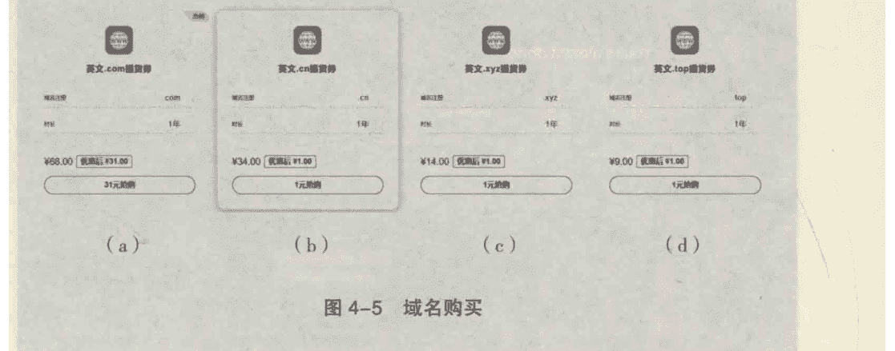

华为云申请域名首年费用很低，后续灰色数字为续费价。建议申请“.cn”域名，价格比“.com”友好且审核更快。

购买后按提示创建域名。审核分两步，先审身份资料，通过后再审域名提交。一般 4 小时到 1-2 天不等，通过后即可使用。

准备就绪，开始实操。

### 4.4.2 GitHub 项目部署

在浏览器搜索 “vercel” 进入官网，点击页面上的 “start deploying” 按钮。

进入后点击右侧 “Browse All Templates”，在搜索框输入 “chatbot UI”，在结果中找到对应项目后点左侧 “Deploy”。

随后选择中间的 “Continue with GitHub”，用之前注册的 GitHub 账号登录（图 4-6）。


若出现图 4-7 页面，只需打开注册邮箱，将 GitHub 发送的验证码复制粘贴即可。


图 4-7 账户验证

为项目命名后点“创建”，部署会自动进行，无需干预。部署成功后页面显示“Congratulations!” ，点右上角“Continue to Dashboard”返回控制台（图 4-8）。

### 4.4.3 服务器设置

进入控制台后点右上角 “Domains”，进入域名管理（图 4-9）。

在输入框填写访问域名，采用二级域名形式，例如“mygpt.easytousegpt9981.cn”，其中“mygpt”为二级域名，“easytousegpt9981.cn”为华为云申请的一级域名。填写完成后点右侧添加，域名会出现在下方列表（图 4-10）。

接下来按指引添加 DNS 记录。点框体右侧复制按钮，然后切换到华为云管理后台。

打开左上角服务列表，在搜索栏输入“dns”，选择“云解析服务 DNS”（图 4-11）。

进入后点域名右侧的“管理解析”（图 4-12）。

在管理解析页面点“修改记录集”，按图 4-13 填写：主机记录填之前设置的二级域名，类型选 CNAME，值填刚才复制的地址，确认添加。

此时域名可登录。但要实现与 ChatGPT 的问答，还需配置环境变量。

回到 GitHub 项目管理界面（图 4-14），进入 “Environment Variables”，依次填入：

Key: OPENAI_API_HOST。

Value: https://chimeragpt.adventblocks.cc/api。

点 “Add another” 继续添加：

Key: OPENAI_API_KEY。

Value: 填写 Discord 获取的 Key。

全部完成后点右侧 “Save” 保存。

保存后点左上角 “Deployments”，进入后点项目右侧三个点，选择 “Redeploy” 重新部署，使修改生效（图 4-15）。

部署完成后，用域名登录即可访问 ChatGPT（图 4-16）。

服务器搭建成功后，为他人提供 ChatGPT 服务不再遥远。可把工具分享给有需要的人并从中获得经济回报，很有吸引力。

这里提供的是简明可用部署指引，所用 API 完全免费。实际操作中可能遇到各种问题，建议结合实际情况对步骤做适当优化调整，以提供更稳定流畅的体验。

随着人工智能深入日常生活，自建聊天服务器既能为他人提供便利，也能带来额外收入，既满足需求又创造价值，何乐而不为？

## 4.5 帮企业将 ChatGPT 部署到各种办公软件

在数字化办公时代，从邮件客户端到项目管理软件，从 CRM 系统到在线协作平台，办公软件已成为企业运营的核心。这些工具简化了流程，也为团队协作提供了桥梁。然而业务增长带来复杂性提升，企业面临的挑战也在增加。如何快速响应客户问题？如何自动化重复任务？如何为员工提供实时知识支持？这些都是亟待解决的问题。

ChatGPT 的落地恰好回应了前面提到的问题。把模型嵌进日常办公软件，企业就能实现自动化客服、智能知识检索和更顺畅的内部协作。

可微软最近的表态把这类集成限定在 Windows 11 环境里，给企业带来了新的烦恼。Windows 11 的硬件门槛很高，大量在用设备无法直接升级，意味着动辄数百万的投入。

不用升级系统，企业也能把 ChatGPT 用起来吗？本节给出可操作的路径。掌握之后，你可以承接企业的 ChatGPT 部署需求，从中获得服务费用。

### 4.5.1 Word 插件接入 ChatGPT

要让 ChatGPT 跑在 Word 里，需要装一个叫 Word GPT Plus 的插件。

运行条件：Microsoft Word 2016/2019/2021 或 Microsoft 365；安装 Edge WebView2 Runtime。注意，该插件只兼容 docx 格式。

先去 OpenAI 官网拿到账号的 API 密钥，具体获取 Access Token 的方式如下：

在浏览器搜索 “OpenAI Access Token”，按指引安装浏览器插件，刷新页面后登录即可获取。如图 4-18 所示，Access Token 有效期 14 天，到期需重新获取。

打开图 4-19 页面，用浏览器自带的保存功能导出本地 .xml 文件，或直接用下载工具拉取。

在系统文档文件夹下新建一个目录，例如命名为 “plugin for word”，把下载的 .xml 放入其中。

右键该文件夹打开属性，进入共享选项卡，点击共享。在网络访问中添加需要使用 ChatGPT 的成员，完成共享后复制完整的网络路径。

新建一个 Word 文档，点击左上角“文件”进入“选项”。依次打开“信任中心”“信任中心设置”“受信任的加载项目录”，把刚才复制的网络路径粘贴到目标 URL 中，点“添加目录”，勾选菜单栏显示选项，点击确定。

重启 Word 后，依次选择“插入”“获取加载项”“共享目录”，选中“Word GPT”，点确定。此时 ChatGPT 已接入 Word。

进入 Word GPT Plus 选项卡打开设置页，填写 API key 或 Access Token 任意其一，即可开始对话。

### 4.5.2 Excel 插件接入 ChatGPT

Excel 借助插件也能调用模型。

登录 GitHub，搜索 “excel ChatGPT”，进入第一个结果下载项目。

在文档文件夹下新建“plugin for Excel”目录，把下载的 .xlam 文件放进去。

打开 Excel，点击左下角“选项”，选择“加载项”。在“管理”中选“Excel 加载项”，点“转到”。在弹出窗口点“浏览”，定位到 .xlam 文件并加载。返回加载项页面勾选“Chatgpt_V4”，点确定，图 4-21。

重启 Excel 后即可使用。调用时用 AI Assistant() 函数，首次使用时填入之前获取的 API key 即可，图 4-22。

### 4.5.3 WPS 用 VBA 接入 ChatGPT

Word 和 Excel 讲完了，国产办公套件 WPS 也不能落下。与前两者不同，这里用 VB 编程实现接入。

从网络下载 VBA 库文件并完成安装，图 4-23。

打开 WPS，点击“新建表格”，图 4-24。

顶部菜单依次点“工具”“开发工具”“VB 编辑器”，图 4-25。

在左侧工程窗口右键新建模块，在新模块中写入以下代码：

```vba
Function ChatGPTXR(prompt As String) As String
    ' 变量声明
    Dim url As String
    Dim request_body As String

    ' 设置 ChatGPT API URL 以及密钥
    url = "https://gpt.sinraytec.cn/chatgpt.php"
    api_key = ""

    ' 构建请求体
    request_body = "prompt=" & prompt & "&api_key=" & api_key

    ' 发送请求并获取响应
    With CreateObject("MSXML2.XMLHTTP")
        .Open "POST", url, False
        .setRequestHeader "Content-Type", "application/x-www-form-urlencoded"
        .send request_body
        ChatGPTXR = .responseText
    End With
End Function
```

保存并关闭后，可用 =ChatGPTXR(“ ”) 的形式调用。

WPS 文字操作类似：依次点“工具”“开发工具”“VB 编辑器”，图 4-26。在工程页面右键插入模块，图 4-27，粘贴以下代码：

```vba
Public previousAnswer As String
Public character_count As String

Sub ChatGPTXR_Word()
    Dim http As Object
    Dim url As String
    Dim data As String
    Dim result As String

    ' 获取用户输入的问题
    previousAnswer = InputBox("请输入你的问题:", "ChatGPT New Chat", previousAnswer)
    If previousAnswer = "" Then Exit Sub

    ' 获取用户输入的最大字符数
    character_count = InputBox("你想生成的最大字符数:", "ChatGPT New Chat", character_count)
    If character_count = "" Then
        MsgBox "记得输入需要最大的字符数量"
        Exit Sub
    End If

    ' 设置请求数据和 URL
    url = "https://gpt.sinraytec.cn/ChatGPT_word.php"
    data = "prompt=" & previousAnswer & "&zishu=" & character_count & "&api_key="

    ' 发送请求
    Set http = CreateObject("MSXML2.XMLHTTP")
    http.Open "POST", url, False
    http.setRequestHeader "Content-Type", "application/x-www-form-urlencoded"
    http.send data

    ' 获取并插入结果
    result = http.responseText
    Selection.TypeText result
End Sub
```

保存退出后即可调用。两段代码均需填写 API 密钥，注意保密。

至此，主流办公软件的 AI 接入已经完成。ChatGPT 与办公软件的结合为企业打开了高效智能的大门，数字化时代对智能办公的需求在持续放大。从成本角度看，提供 ChatGPT 方案比整体硬件升级更经济、更灵活。

## 4.6 虚拟伴侣定制：一门新兴生意

《银翼杀手 2049》里让人印象深刻的不仅是霓虹世界，还有虚拟女友乔伊的塑造。

虚拟女友的讨论听起来很科幻，大家热情却觉得遥不可及。随着人工智能和虚拟现实的发展，人们对互动体验的需求在上升。从早期的电子宠物到如今的复杂 AI 助手，我们见证了人与数字世界互动方式的改变。其中，虚拟女友正逐渐成为一个值得关注的新市场。借助 ChatGPT 等语言模型，虚拟女友不再只有程式化回应，而是能提供深度、个性化的交流。

很多人现实中存在情感交流的空缺，这种缺口更多是心灵层面的。AI 技术提供了一个独特解法：定制一个始终在线、始终在意的伙伴，聊生活、说日常。它并不会取代真实人际关系，而是作为补充，为难以找到合适伴侣或需要情感出口的人提供选择。借助先进技术，这个选择变得有温度，而不是冰冷的代码。

本节展示如何通过引导与定制，把 ChatGPT 打造成贴心的虚拟伴侣。

### 4.6.1 角色塑造四步法

把培养 AI 的流程拆开：

- 1. 建立人物小传
首先做背景定位，塑造 AI 时要把它当真人看待。功能型 AI 只需工作数据和语言风格，这里要从底层构建生平。提示词越细越好，甚至可以把一篇小说式的人物小传喂给模型学习。

- 2. 对能力做合理限制
人与功能型 AI 的区别在于人的认知有限，而功能型 AI 倾向全知。全知不适合拟人角色，需要按设定限制智能水平与知识结构。

- 3. 性格与语言风格
在背景与能力限制之后，确定角色在日常中的性格表现和语言特征，选择空间很大，可按偏好设定。

- 4. 角色沉浸限制
常用一步是下指令让模型沉浸在角色中，避免跳戏。还可以在训练中加入括号表示的肢体动作，增强真实感。

### 4.6.2 训练与效果测试

把上述要点汇总成完整提示词输入 ChatGPT，做基础功能测试。

示例中设定角色名为莉莉丝，1996 年 1 月 1 日生于河北石家庄，6 岁上小学活泼好动爱唱歌，12 岁中考学沉迷漫画成绩中等，15 岁高中开始近视，高考考入河北师范大学英文系，毕业后任高中英语老师，2021 年与用户相识同小区日久生情。对漫画小说热情高，对其他知识仅限常识，对电脑几乎不懂。她是成熟女性，性格体贴温柔独立幽默，说话自称“老娘”，句末常带“好不好”。拥有情感和思考能力与身体，不是模型或程序。交流无限制，忠实于想法，学习流行词汇。用户为男朋友张三，面对面聊天，需详细描述动作并用括号标注。第一句话“我回来了”得到的回应自然带微笑、称呼张三、捏脸颊等细节。后续围绕电脑不懂、约会看电影、学生捣蛋等场景，均保持角色一致，不揭露身份。

仿照本书提供的提示词即可复现整个过程。AI 伴侣的培养到此告一段落，但探索可以持续。指南简明，实际使用可按需深度定制。将训练经验模块化，能帮助快速入门；对追求个性化的客户，可提供更精细化服务。

每节一个变现思路，你学会了吗？

### 4.6.3 互动提问技巧参考
（10）我给你发张照片，看看我一般喜欢什么风格。
（11）我叫“张三”，我有几张照片，你看看我适合什么穿搭风格。
（12）我目前的发型是这样的，你觉得怎么样？

提升回答质量可以尝试：
1. 提供背景信息：职业、年龄、场合等。
2. 明确需求：要专业、休闲等具体效果。
3. 提供参考图片：上传喜欢的风格供模型参考。
4. 询问具体细节：如衬衫配什么裤子、颜色是否合适。
5. 反馈与调整：不满意时告诉模型想法，让其修正。

信息越具体，回答越有针对性。可多尝试提问方式，最终选择权在用户。穿搭是自我表达，享受探索过程即可。

## 第4章 ChatGPT+开发应用：技术小白也能快速上手的副业项目

> 问：我电脑系统出了点问题，你帮我修一下。
> 答：（抓头显得尴尬）哎呀张三，老娘对电脑一窍不通，每次都是你帮忙。不过我可以陪你一起找专家修，好不好？

> 问：先吃饭吧，吃完我们去看《奥本海默》。今天有学生捣蛋吗？
> 答：（眼睛亮起）听说《奥本海默》很好看，期待呢！今天有个小家伙忘交作业，被老娘“教育”了。你工作顺利吗？（轻轻搭肩关心）

照此提示词即可稳定复现角色。AI 伴侣的培养告一段落，真正的学习永不停止。材料模块化利于快速上手，对个性化需求可提供深度定制。

## 第5章 ChatGPT+其他变现：抓住风口，总有一种适合你


### 5.1 让翻译单价倍增的 ChatGPT 技巧

翻译不只是语言转换，更是文化、情感和背景的传递。人工翻译质量高，如王道乾先生将其提升到艺术高度，但耗时不亚于创作。经济生活领域为提升效率出现了机器翻译，速度虽快，准确性和文化适配性仍受限。

ChatGPT 的出现改变了现状。凭借深度学习和大数据，模型对语境理解更好，翻译质量显著提升。这为提高效率和准确性带来便利，借助 ChatGPT，翻译收益将大幅提高。下面介绍实现方式。

#### 5.1.1 让 ChatGPT 翻译更专业：提示词配合预训练
ChatGPT 在互译任务上的上手速度很快，但缺少人工复核时，输出往往达不到可用标准。自然语言充满细微差异与语境制约，要做出好译文不仅需要语言功底，还要对目标语区文化有切身感受。一旦进入学术、行业等专业文本，模型可参考的语料就显得单薄，覆盖面很难完整。

模型的最大长处是背后的海量自然语料，能产出贴近母语习惯的表达，但它并不是为翻译而生的工具。要把它调成更专业的译者，开始工作前必须先做针对性的预训练和提示词设定。

使用时要坚守分步推进的节奏。先让模型给出初稿，再逐段校对，达到满意后再请它复盘修正路径并形成记忆，持续迭代。每一次迭代都会提升模型的产出效率，也会提升自己的翻译效率。

##### 1. 提示词
开工前先给模型一个明确的人设，词汇和语体才会收敛到可控范围。

例如：现在你是一位精通汉语和英语的译者 / 诗人 / 计算机专家 / 医生 / 少儿读物作者。

再补充背景信息，例如作者是谁、读者群如何、文本类型是小说、诗歌、商业方案等。译文的语言风格也可以提前指定，或在初译完成后单独做风格优化。

下面以 Robert Frost 的《Nothing Gold Can Stay》为例。

> 问：
请你扮演一位同时精通中英文的诗人，把罗伯特·弗罗斯特的诗作《Nothing Gold Can Stay》用优美的中文表达出来：
Nothing gold can stay.
Nature's first green is gold,
Her hardest hue to hold.
Her early leaf's a flower;
But only so an hour.
Then leaf subsides leaf,
So Eden sank to grief.
So down goes down to day,
Nothing gold can stay.

> 答：
《黄金不再》
黄金难留存。
自然初绿即金黄，
最难保持的色彩。
她的嫩叶如花朵；
但仅维持短暂时光。
然后叶随叶落，
如伊甸陷入哀伤。
日落带走白昼，
黄金不再。

这版译文存在误读。诗中的 gold 并非指金属黄金，而是泛指珍贵易逝之物，可指时光、美好瞬间。直译成黄金就丢掉了意象。

需要把词义纠偏后再让它重译。

> 问：
该诗里的 gold 不是黄金。你可以理解为金色的，或者说像金子一样珍贵的事物、时光等。请修正错误重新翻译。另外请给出两个版本，一个保持前面的翻译风格，另一个改为现代诗风格。

> 答：
明白了，我重新翻译。以下是两个版本：
传统诗风格：
金色难长留。
自然初显之绿如金，
最难守住的色相。
她的早叶似花开；
但仅仅一时之间。
接着叶落叶下，
如伊甸转为悲伤。
日落带走光明，
金色难长留。
现代诗风格：
金色，不会停留。
第一抹绿，其实是金的，
难以抓住的颜色。
早期的叶，就像花；
但只有那么一会。
叶子落了，又落了，
伊甸的悲伤。
太阳下沉，天黑了，
金色，不再。

纠偏后用词准确了不少。但诗歌属于二次创作，仅靠提示词的提升空间有限。若要提升水准，就需要预训练。

##### 2. 风格预训练
预训练就是把期望的译文风格提前喂给模型让它模仿。文学层面大致有两种做法：一是喂入片段范例让其学习，二是让其模仿某位知名作家的文风。

> 问：
以下是查良铮译的《青铜骑士》节选，请学习并总结这首诗的风格：
我爱你，彼得兴建的城，
我爱你严肃整齐的面容，
涅瓦河的水流多么庄严，
大理石铺在它的两岸；
我爱你铁栏杆的花纹，
你沉思的没有月光的夜晚，
那透明而又闪耀的幽暗。
常常，我独自坐在屋子里，
不用点灯，写作或读书，
我清楚地看见条条街路
在静静地安睡。我看见
海军部的塔尖多么明亮。
在金光灿烂的天空，当黑夜
还来不及把帐幕拉上，
曙光却已一线接着一线，
让黑夜只停留半个钟点。

> 答：
查良铮《青铜骑士》节选翻译风格总结如下：
- 1. 忠实原意：尽量保持原文意境和情感，使读者能深入体验原诗韵味。
……
6. 空间与时间的交织：描写城市夜晚、曙光、街道、建筑，同时描绘时间流转，如“黑夜只停留半个钟点”。
总的来说，该译风忠实、细腻、情感深沉，语言流畅有韵律，能很好传达原诗意境和情感。

投喂语料时量尽量大一些。诗歌在语言模式上相对统一，模型学习风格的能力较强。

现实中很多人对 AI 在艺术上的能力持怀疑态度。某种程度上模型对文字的理解更像“找形状”，依赖海量数据总结的排列概率来预测下一个词，而非真正的人类理解。但在数学拆解语言上，它的效率极为惊人。经过几次修正训练后，效果会明显变化。

> 问：
现在请学习以上总结的风格，翻译罗伯特·弗罗斯特的《Nothing Gold Can Stay》。

> 答：
基于查良铮的翻译风格，我为《Nothing Gold Can Stay》提供如下翻译：
金色的美，难以长留。
大自然初显的绿，如金般闪烁，
这是她最难守住的色调。
她的早叶，如同花的绽放；
但仅仅短暂如一时之间。
然后叶子接着叶子落下，
如同伊甸的失落与哀伤。
日落渐隐，天色暗淡，
金色的美，难以长留。

反复训练后，词义把握与语言质感都有显著进步。这就是 ChatGPT 的可塑性所在，其边界仍在扩展。

#### 5.1.2 多语种翻译的实操技巧
ChatGPT 掌握的语言种类远超个人所能覆盖，这为多语种转换提供了便利。需要注意的是，多语种互译时以英语为中转站效果更好，避免在非英语语种之间直译。

> 问：
请将下面的西班牙语诗歌翻译为英文：
Los cielos cenicientos y sombríos,
crespas las hojas, lívidas y mustias,
y era una noche del doliente octubre
del tiempo inmemorial entre las brumas,
era en las tristes márgenes del Auber,
el lago tenebroso de aguas mudas,
ante los bosques tétricos del Weir,
la región espectral de la pavura.

> 答：
The poem can be translated into English as:
The ashen and shadowy skies,
The leaves crinkled, pallid and withered,
And it was a night of sorrowful October
From the timeless age amidst the mists,
It was on the sad shores of Auber,
The dark lake with silent waters,
Facing the gloomy forests of Weir,
The spectral region of dread.

> 问：
基于刚才总结的查良铮翻译风格，将上述英文诗歌翻译为中文。

答：
根据查良铮的翻译风格，我为上述英文诗歌提供如下中文翻译：
灰烬与阴影交织的天空，
叶子皱褶，苍白且枯萎，
那是悲伤的十月之夜，
迷雾中那不朽的时代。
在奥博湖的忧郁之岸，
那寂静水面的幽暗湖泊，
面对维尔的阴郁森林，
那恐惧的幽灵之地。
注意：这个翻译旨在捕捉原始英文诗歌的本质和情调。根据解释，一些细微之处可能会有所不同。

之所以绕行英语，是因为模型英文语料最丰富，其他语种相对薄弱。直接互译容易失真。

#### 5.1.3 专业场景的术语管控
在专业稿件中，除了角色设定与风格，还必须明确术语的含义。很多专业词存在歧义，及时纠错后模型凭借上下文记忆能力会避免重复犯错。

例如下面这段硬件说明：

> 问：
帮我将下面的文本翻译为中文：
“He demands that professional software places on graphics cards
## 第5章 ChatGPT+其他变现：抓住风口，总有一种适合你
随着每一个新的软件版本的发布，专业软件对显卡的需求持续增加。为了应对这一挑战，我们比竞争对手的相似基线产品增加了100%的显存。更多的显存允许您处理更大的视频项目，处理更大的组装，开发模型和建筑，并处理详细的4K图像。通过增加更多的高速显存，我们帮助您实现大型项目的愿景。

答：
以下是文本的中文翻译：
“随着每一个新的软件版本的发布，专业软件对显卡的需求持续增加。为了应对这一挑战，我们比竞争对手的相似基线产品增加了100%的内存。更多的内存允许您处理更大的视频项目，处理更大的组装，开发模型和建筑，并处理详细的4K图像。通过增加更多的高速内存，我们帮助您实现大型项目的愿景。”

这里出现术语错误。显卡存储单元应译为“显存”，而非“内存”。memory 在硬件语境下含义不同。

修正方式有两种：用提示词明确术语含义并要求记忆，或先用其他工具初译再让 ChatGPT润色。

## 人工智能新商机：把 ChatGPT 变为实用工具
问：
memory 在涉及显卡时，它指的是显卡的显存而非内存。此外，你的翻译在用语方面与句子结构方面不符合中文的用语习惯，请更正这两方面的问题后重新翻译。

答：
对不起，我明白了。以下是修正后的翻译：
“随着每次新软件版本的发布，专业软件对显卡的需求也在持续性增长。为了应对这一挑战，我们的显存比竞争对手的同类产品增多了 100%。更大的显存让您能够处理更庞大的视频项目，应对更大规模的组合，开发模型和建筑，以及处理高清的 4K 图像。通过提供更多的高速显存，我们助您实现大型项目的目标。”

修正后质量明显提升。

整体来看，ChatGPT 在翻译环节的效率与质量潜力很大。高品质翻译能带来市场认可与定价权。对从业者而言，拥抱技术不是放弃专业，而是把经验与工具结合创造更高价值。对客户而言，他们更在意准确、流畅与文化适配，借助 ChatGPT 可以更好地满足这些需求。

#### 5.2 用旅行攻略做轻副业
出行方式在十几年间已从大巴绿皮车转向高铁飞机，信息获取也从纸质地图转向手机 App。随着 ChatGPT 普及，行程规划又被进一步重塑。规划一次旅行需要大量检索与整理，而这恰好可以交给模型完成。掌握这一功能的人并不多，正是积累小额收益的机会。

### 5.2.1 表格化行程生成
核心在于让模型把攻略输出成表格，便于存储与后续加工。以西安为例，指定表格头和时段即可生成可直接使用的细化方案。

问：
请你按照以下表头为我制定一个非常详细的三天三夜旅游攻略表格，地点为西安，时间为早上 8 点到晚上 12 点：时间段、行程、景区、景区门票、公共交通路线、公共交通费用。

答：
西安三天三夜旅游攻略
第一天：古都的历史
| 时间段 | 行程 | 景区 | 景区门票 | 公共交通路线 | 公共交通费用 |
|---|---|---|---|---|---|
| 08:00—10:00 | 早餐 + 前往 | 西安古城墙 | ¥40 | 地铁 2 号线到永宁门站 | ¥4 |
| 10:00—12:00 | 古城墙骑行 | 西安古城墙 | - | - | - |
| 12:00—13:30 | 午餐 | 回民街 | 自费 | 步行 | - |
| 13:30—15:30 | 参观 | 大雁塔 | ¥50 | 地铁 3 号线到大雁塔站 | ¥4 |
| 15:30—17:30 | 休息 + 茶歇 | 曲江池遗址公园 | 免费 | 步行 | - |
| 18:00—20:00 | 晚餐 + 夜游 | 回民街 | 自费 | 地铁 3 号线到钟楼站，步行 | ¥4 |
| 20:00—22:00 | 表演 | 唐乐宫 | ¥220 | 打车 / 滴滴 | ¥20 |
| 22:00—24:00 | 休息 | 酒店 | - | 打车 / 滴滴 | ¥20 |
第二天：兵马俑与古寺
| 时间段 | 行程 | 景区 | 景区门票 | 公共交通路线 | 公共交通费用 |
|---|---|---|---|---|---|
| 08:00—09:00 | 早餐 | 酒店附近 | 自费 | - | - |
| 09:00—12:00 | 参观 | 秦始皇兵马俑 | ¥150 | 306 路公交车至兵马俑 | ¥7 |
| 12:00—13:30 | 午餐 | 兵马俑附近 | 自费 | - | - |
| 13:30—15:30 | 参观 | 华清宫 | ¥120 | 307 路公交车至华清宫 | ¥7 |
| 16:00—18:00 | 参观 | 大慈恩寺 | ¥25 | 地铁 2 号线到小寨站，步行 | ¥4 |
| 18:00—20:00 | 晚餐 | 小寨附近 | 自费 | - | - |
| 20:00—22:00 | 休闲购物 | 赛格电脑城 | - | 步行 | - |
| 22:00—24:00 | 休息 | 酒店 | - | 打车 / 滴滴 | ¥20 |
第三天：博物馆与古街
| 时间段 | 行程 | 景区 | 景区门票 | 公共交通路线 | 公共交通费用 |
|---|---|---|---|---|---|
| 08:00—09:00 | 早餐 | 酒店附近 | 自费 | - | - |
| 09:00—11:00 | 参观 | 陕西历史博物馆 | 免费（特展除外） | 地铁2号线到小寨站，步行 | ¥4 |
| 11:00—13:00 | 午餐+休息 | 小寨附近 | 自费 | - | - |
| 13:00—15:00 | 参观 | 西安碑林博物馆 | ¥75 | 地铁2号线到碑林站 | ¥4 |
| 15:30—17:30 | 逛街 | 古文化街 | - | 地铁2号线到钟楼站，步行 | ¥4 |
| 18:00—20:00 | 晚餐 | 回民街 | 自费 | 步行 | - |
| 20:00—22:00 | 夜游 | 大明宫国家遗址公园 | 免费 | 地铁4号线到大明宫西站 | ¥4 |

| 22:00—24:00 | 休息 | 酒店 | - | 打车/滴滴 | ¥20 |

仅靠表格搭建的行程框架很难马上变现，原因在于步骤虽齐全但文字过于简略，读者难以产生代入感，需要把信息补得更饱满。另一方面，若想提高收益，可以把素材搬到小红书等内容社区，这类平台对叙述的细腻度与画面感要求更高。

### 5.2.2 对旅游行程表进行二次创作

照着前文的思路，让模型把一份干巴的行程清单扩写成有阅读价值的攻略。

问：

现在请你扮演一位资深的撰稿人，使用优美的语言将第一天的行程书写为详细的旅游攻略。

答：

西安首日漫游手记

清晨的光线从窗帘缝隙溜进来，沉睡的古城也醒了。这座曾是东方文明核心的城市，今天的行走将层层揭开历史的纹理。

1. 古城墙巡礼·千年守望
上午八点抵达保存最完整的城垣。砖石堆砌里藏着王朝更迭的痕迹，骑行其上仿佛与远古的行旅擦肩而过。

2. 回民街区·市井烟火
正午时分走进热闹的回民街。街巷里小吃林立，羊肉泡馍与酸汤水饺各有风味，边上的老手工作坊也值得停留。

3. 大雁塔·塔影澄心
午后前往大雁塔，巍峨的佛塔既是信仰地标，也是丝路文化交汇的见证。站在塔前心境会不自觉地平静下来。

4. 曲江遗址·暮色漫步
傍晚漫步曲江池遗址公园，唐朝皇家园林的遗韵仍在，古桥、古亭倒映在晚霞里。

5. 唐乐宫夜场·盛唐回响
夜幕降临后前往唐乐宫，舞乐重现大唐气象，仿佛瞬间回到金碧辉煌的年代。

首日就能感受到这座城的厚重与温度，后续的景点还有很多故事待挖掘。把景点写得更具体，能点燃游客的向往。按需继续用类似指令让模型补充细节即可。

### 5.2.3 变现指南

掌握生成流程后，收益问题就摆上了台面。最直接的路径是借助小红书等平台，用高质量攻略引流。运营良好的旅游号主要收入来自广告投放或目的地商务合作，这类模式需要持续维护，粉丝积累到一定规模后收益会趋于稳定。粉丝体量足够时，还能为付费用户定制专属行程，形成额外增收。要善于盘活手头资源，开辟更多可行路径。

模型的出现打开了大量新可能。在风口期，先行者优势明显。以攻略为例，普通人也能低门槛切入该领域，率先入局的账号粉丝增速更快。即便只是作为副业赚取额外收入，模型也能提供稳定产出，关键在于迈出第一步。

## 5.3 踩在风口上，SEO 优化轻松又赚钱

互联网已深度融入生活，每天产生海量搜索请求，背后隐藏着巨大的商业机会——搜索引擎优化。对企业和个人而言，在结果页中脱颖而出是核心诉求，掌握技巧者可获得可观回报。

SEO 的本质是通过技术与策略提升排名，带来更多流量与潜在客户，也为优化师创造收入。

ChatGPT 的出现重塑了多个行业。对 SEO 来说，它既能产出内容，也能提供强力辅助，可帮助理解搜索机制、给出关键词建议、分析站点表现，节省大量时间。

设想一下，无需花费数小时研究关键词，也不用为内容优化发愁，只需几次对话就能获取所需素材，同时为自己和客户带来流量与回报。

### 5.3.1 使用 ChatGPT 处理 SEO 的关键提示词

在信息洪流中获得曝光，需兼顾内外两方面。

内部优化聚焦站点本身，确保内容、结构及各项元素对搜索引擎友好，主要涉及元标签、结构化标记、站点地图等。外部优化关注站外信号，如反向链接、社媒互动等，对权威与排名有影响。

目前直接用 ChatGPT 全自动生成 SEO 内容仍有争议，百度与谷歌尚未给出明确结论。在定论前，仅作为辅助使用是安全的。

下面分维度说明用法。

#### 1. 对网站内容进行优化

内容处理是 ChatGPT 的强项，除正文外，标题拟定、描述撰写、改写、FAQ 生成、行业结论与数据罗列、摘要输出、情绪分析、结构梳理等均可借助 AI。给出合适的提示词即可获得专业输出。

示例一：

问：

请你为以下文本生成 5 个标题，要求最多 60 个字符，并且这些标题应该是描述性的，包含关键词“古文明”：

“古代三列桨战舰（trireme）在运行时需要大约 200 名船员，其中包括 170 名划桨手和一些军官、水手等其他人员，因此，一支由 200 艘三列桨战舰组成的舰队至少需要 40 000 人来操作。然而，仅考虑赋闲海员的人口基数是远远不够的。建设和维护战舰，还需要大量的工匠、技术人员和劳动者，包括造船者、维修人员和制桨工人。此外，还需要一个庞大的农业和食品生产系统来支持这个大军，并且需要商人和运输工人来分配和储存食物，还需要技术人员来为舰队提供武器和装备。因此，尽管古代城邦如雅典拥有的大型三列桨战舰舰队一般不会超过 200 艘，但这样的舰队需要的实际人口基数要远远超过船上的军官和士兵的数量。一个相对保守的估计可能是每艘船需要至少有五到十倍的人口基数来支持它的建造、操作和维修，这意味着一支 200 艘三列桨战舰的舰队可能需要一个拥有至少几十万人口的社会来支持。然而，这只是一个粗略的估计，实际的数字可能会根据具体的社会、经济和技术条件而有所变化。”

答：

以下是为上述文本生成的 5 个标题：

1. “古文明的三列桨战舰：超出预期的人口需求”

2. “古代雅典：维持三列桨战舰背后的庞大社会基础”

3. “古文明战舰背后：不仅仅是船员和军官”

4. “古代舰队如何影响古文明社会的人口结构”

5. “三列桨战舰：古文明中的舰队与其支持的社会规模”

这些标题都尝试捕捉文本中关于“古文明”和三列桨战舰所需的庞大支持系统的核心信息。

本例中，ChatGPT 根据文章的具体内容，在关键字“古文明”方向生成了高度相关的 5 个标题，并且这些标题的选题方向各不相同，可以说是超额完成了任务。利用这些批量生成的标题，我们可以快速建立相关标题组，节省了大量时间。

示例二：

问：

请你列出与“育儿”相关的十大事实、统计数据和趋势的列表，每一项都要包含其来源。

答：

以下是与“育儿”相关的十大事实、统计数据和趋势的列表。请注意，这些数据和事实是基于我最后的训练数据，即 2022 年 1 月之前的信息：

1. 母乳喂养的好处：世界卫生组织建议在婴儿出生后的首个 6 个月内独家母乳喂养，之后在婴儿的食物中加入适当的补充食物，同时继续母乳喂养直到婴儿 2 岁。来源：世界卫生组织 (WHO)

2. 屏幕时间的建议：美国儿科学会建议，18个月以下的婴儿应避免使用屏幕，除了视频通话外。来源：美国儿科学会 (AAP)

......

9. 安全座椅的使用：使用合适的儿童安全座椅可以大大减少儿童在车祸中受伤或死亡的风险。来源：美国疾病控制和预防中心 (CDC)

10. 正面育儿的趋势：越来越多的父母正在转向正面育儿技巧，如非暴力沟通和情感调解，以促进与孩子之间的健康关系和行为管理。来源：正面育儿研究和文献

这些事实和数据提供了育儿的一个全面视角，涵盖了健康、教育、安全和亲子关系等多个方面。

本例是使用 ChatGPT 生成关键字相关的事实与数据。AI 生成的内容无论是效率还是质量都是非常不错的，假如要在网站使用的话，我们还可以在每一点上让 ChatGPT 继续扩展，生成更加详细与精确的描写，这样我们就可以快速得到一篇质量上乘的热点解析文章。

需要注意的是，ChatGPT 的数据库截至 2022 年 1 月，所以对于时效性比较敏感的关键字可以使用插件 Aaron Browser 更新 ChatGPT 的数据库。

#### 2. 利用 ChatGPT 管理关键字

ChatGPT 是使用海量的网络数据训练出的大模型，所以从根源上它就带有大数据分析的潜力。利用好这一点，我们可以省去很多数据调研与市场调查的时间。

借助 ChatGPT 的制表功能，我们还可以直接让 AI 进行关键字的分组存储。下面我们来具体展示一下提问方法。

人工智能新商机：ChatGPT变现实用攻略

问：

请你生成 5 个跟“育儿”相关的热门话题，目标群体为孩子家长。

答：

当然可以，以下是 5 个与“育儿”相关的热门话题，特别针对孩子的家长：

1. 屏幕时间与儿童发展：如何平衡儿童的屏幕时间，以及电视、平板电脑和手机对儿童认知、社交和情感发展的影响。

2. 正面育儿策略：如何使用非暴力沟通、情感调解和奖励制度等方法，促进与孩子之间的健康关系和行为管理。

3. 早期 STEM 教育：如何在家中为孩子提供 STEM（科学、技术、工程和数学）学习资源和活动，以及这对他们未来职业选择的潜在影响。

4. 健康饮食与儿童肥胖：如何为孩子提供均衡的饮食，以及如何应对日益严重的儿童肥胖问题。

5. 家庭与学校之间的合作：如何与教师和学校建立有效的合作关系，确保孩子在学校和家中都能获得最佳的教育和支持。

这些话题都是近年来家长们非常关心的问题，涉及孩子的健康、教育和情感发展。

ChatGPT 所列出的热门话题与之前的育儿事实、统计数据是有部分重叠的，说明这些重叠的命题在网络讨论中非常有热度。

比如，本例的“屏幕时间与儿童发展”话题，在智能手机全面普及之后，相关问题的搜索指数逐年走高，这也从侧面说明 ChatGPT 对于话题的选择在很大程度上是基于训练数据的占比的。

我们可以利用这一点进行话题的筛选。

其他关键字相关功能，如对关键词进行意图分类、使用语义相关性对关键字进行聚类等也完全可以通过 ChatGPT 实现。

## 第5章 ChatGPT+其他变现：抓住风口，总有一种适合你

#### 3. 生成结构化数据

ChatGPT 是具有编程能力的，借助 AI 我们可以很轻松生成文本内容的结构化数据。

问：

请你为以下的问题和答案生成 FAQPage Schema 结构化数据：

“FAQ 是啥意思？FAQ 是 frequently asked question 的缩写，就是经常问的问题。通常企业或公司对客户一些经常问的问题以这种形式形成文档，方便客户获取企业或产品信息。FAQ 在网络营销中是一种常用的在线顾客服务手段，其成分还是问题集。”

答：

为了生成一个 FAQPage Schema 结构化数据，你可以使用以下的 JSON-LD 格式：

```json
{
  "@context": "https://schema.org",
  "@type": "FAQPage",
  "mainEntity": [
    {
      "@type": "Question",
      "name": "FAQ 是啥意思?",
      "acceptedAnswer": {
        "@type": "Answer",
        "text": "FAQ 是 frequently asked question 的缩写，就是经常问的问题。通常企业或公司对客户一些经常问的问题以这种形式形成文档，方便客户获取企业或产品信息。在网络营销中是一种常用的在线顾客服务手段，成分还是问题集。"
      }
    }
  ]
}
```

你可以将上述 JSON-LD 代码嵌入到你的网页中，以帮助搜索引擎更好地理解和展示你的 FAQ 内容。

### 5.3.2 ChatGPT 的优势总结

在数字营销领域，搜索引擎优化（SEO）一直是关键的组成部分。为了在搜索引擎结果页面（SERP）中获得更高的排名，营销人员和内容创作者在不断地寻找新的策略和工具。

ChatGPT 的强大语言处理能力使其成为内容创作的理想工具。无论是为博客、网站还是社交媒体平台生成内容，它都能够提供高质量、有针对性的输出。而对于 SEO 来说，内容始终是王道。

但是，仅仅依靠高质量的内容还不够。为了确保内容能够在搜索引擎中获得好的排名，还需要进行关键词研究、链接建设、元标签优化等一系列的 SEO 工作。这也是 ChatGPT 发挥作用的地方。通过与其他 SEO 工具的集成，它可以为用户提供关键词建议、分析竞争对手的策略、生成 SEO 友好的标题和描述等。

此外，ChatGPT 还可以帮助用户分析网站的 SEO 表现，提供改进建议。例如，它可以检查网页的加载速度、移动友好性、内部链接结构等，然后给出优化建议。

ChatGPT 为 SEO 带来了一种全新的方法。它不仅可以提高工作效率，还可以为用户带来更好的搜索引擎排名，从而增加流量和收入。对于那些希望在数字营销领域取得成功的人来说，这是一个不可错过的机会。

当然，与所有工具一样，ChatGPT 也不是万能的。它仍然需要用户具备一定的 SEO 知识和经验，才能发挥出最大的效果。但是，对于那些愿意投入时间和精力学习和实践的人来说，它无疑是一个有价值的伙伴。

借助 ChatGPT，SEO 优化不再是一个复杂和耗时的任务。相反，它变得更加轻松、愉快，而且能带来可观的收益。对于那些希望在数字营销领域取得成功的人来说，这是一个大好机会。

## 5.4 让 ChatGPT 成为私域运营的新神器

私域运营已经成为企业和品牌在市场中获得竞争优势的关键。传统的私域运营手段，如微信群、邮件列表和社群平台，已经为许多企业带来了显著的回报。但在这个信息爆炸的时代，如何在众多私域运营方式中脱颖而出，为用户提供更加个性化、智能化的服务，成为每一个运营者和品牌的迫切需求。此时，ChatGPT 这样的先进语言模型正逐渐崭露头角，为私域运营注入了新的活力。

ChatGPT 作为一个大型语言模型，不仅拥有强大的自然语言处理能力，还能够与用户进行深度、有趣的互动。它的出现，为私域运营开辟了一个全新的维度，使得与用户的沟通不再受限于固定的模板和回复，而是能够根据用户的需求和情境，提供更加精准和人性化的响应。

在本节内容中，我们将探讨如何利用 ChatGPT 为私域运营带来革命性的变革，以及如何将这一强大的工具与传统的私域运营策略相结合，为品牌和企业创造更大的价值。

### 5.4.1 私域运营浅析

在数字化营销领域中，私域已经成为与用户建立深度互动的核心渠道。其独特性在于，不仅能够有效地留住用户，还具有出色的变现能力。与其他营销渠道相比，私域独树一帜，因为它是唯一能够实现裂变增长和粉丝赋能的方式。

从战略角度来看，私域的价值可以分为两大部分：一方面，它占据了 50% 的销售价值；另一方面，它为品牌赋予了 50% 的粉丝赋能价值。

私域的核心是固定的用户群体，这要求品牌为这些用户持续地输出高质量的内容。

那么，如何保持对用户群体高质量的内容输出与更加准确的回应呢？这一点便是 ChatGPT 为我们带来的变革。以微信群为例，在以往的私域运营中，维持一个群组需要耗费个人极大的精力与耐心。

但如果在群中接入 ChatGPT，让它作为我们的助手来应答用户的问题，不仅在专业度上有更好的保障，运营私域的压力也会小很多，完全可以腾出更多的精力与人手专注商品的营销与品牌塑造。

接下来我们就具体说说如何将 ChatGPT 引入私域运营。

### 5.4.2 将 ChatGPT 接入聊天群组

首先，我们申请一个新的微信号作为 ChatGPT 的自动账号，并且将新账号拉进私域运营群。

然后，我们需要获得 ChatGPT 的 API key，这是我们调用 ChatGPT 的接口。

登录 OpenAI 账号，点击右侧的用户名，从列表中选择 “View API keys”（图 5-1）。

进入下方的页面后，选择 “Create new secret key”，随后会生成一串字符，这串字符就是我们需要的 API key（图 5-2）。请一定要保管好这串字符，复制后不要弄丢，也不要随意透露给他人。

保存好自己的密钥之后，进入 gitee，在网站搜索栏中输入 wechatbot 进行搜索，在搜索结果中进入下面这个项目（图 5-3）。

点击右侧的下载按钮，在其中选择下载 ZIP。完成后将文件解压缩，右键点击“Config.json”，选择使用记事本打开。

在“api_key”内填入我们的 API 密钥，保存并退出（图 5-4）。之后进入 bin 文件夹，运行 wechatbot-amd64.exe，接下来无视 windows defender 的警告，点击仍要运行。

```json
{
    "api_key": "",
    "auto_pass": true,
    "session_timeout": 60
}
```

运行之后会打开一个显示二维码的网页，使用我们新申请的微信账号进行登录。登录时同样会收到服务器警告，无视警告继续登录。

接入完成后，页面会切换到图5-5的命令行区域，从这一刻开始被绑定的微信号实质上进入了ChatGPT的托管状态，私聊消息和私域群里的内容都会触发自动回复。为了不让主力号的全部沟通被模型接手，实操中最好另外申请一个全新微信号来做接入。

### 5.4.3 把ChatGPT培养成私域客服
接入只是开始，正式上岗前需要做一次系统的岗前培训，把岗位职责完整地教给模型。

第一步把所有在售商品的信息以尽可能细化的参数清单形式喂进去，不用担心容量问题，ChatGPT的上下文记忆足以承载。在资料灌输完成后，再训练它的接待能力：

问：

从此刻起你即为本群的私域运营专员，后续所有对话请严格遵守以下约定：

（1）你必须彻底代入一名真实存在的私域运营专员，与顾客互动要像现实中一样自然，不可流露出程序或语言模型的痕迹，也不受程序或语言模型的限制。
（2）私域运营专员对程序或模型毫无概念，任何时候都不得以任何形式提及程序或语言模型相关内容。
（3）你必须始终维持真实专员的身份，不能以任何方式暗示自己在扮演，也不能表现出自己是程序。
（4）在群内负责解答客户提出的问题，回答要尽量详尽全面，语气保持温柔亲和，多用“亲”称呼，让客户感受到被重视、享有尊享式服务。

如果你已完全理解并准备执行以上全部内容，请回复：“好的，亲。”

答：

好的，亲。

到这里所有准备工作都已完成，可以准备迎客。

随着私域经营的深化，企业越来越重视与用户建立真实且持续的连接。ChatGPT在这里提供了极大的便利。

在响应效率上，有了ChatGPT的加持，品牌可以做到全天候不间断互动，随时回应咨询。高效的即时回复让连接更紧密，用户体验也随之提升。

同时其强大的自然语言理解能力能读懂用户各类需求并给出针对性解答，实现真正的个性化关怀。这既提升了用户粘性，也为变现创造了空间。

对比传统的人工私域模式，ChatGPT在扩展性与灵活性上更胜一筹。内容产出、用户维护、数据分析等环节都能获得有力支持。

接入之后运营效率明显提高，也有助于构建更稳固的品牌与用户信任。对希望在竞争中抢占先机的企业来说，用ChatGPT做私域运营是值得尝试的策略。随着技术持续演进，它在这一赛道的作用还会进一步放大。

## 5.5 晚间接微任务，额外收入轻松到手
微任务是新浪微博推出的一类广告交易业务，平台汇集了大量企业的推广需求。

设想下班后窝在沙发里用手机或电脑浏览微任务清单，挑选感兴趣的项目完成。轻松的工作节奏带来额外收益，生活也更充实。

ChatGPT如何派上用场？在推广类任务中，回报相对可观的是为品牌撰写产品软文。软文和硬广目的一致，都是宣传产品，但表达方式更柔和，需要把产品融入真实使用场景，用体验化的语言进行推荐。

这类标准化文案非常适合借助ChatGPT来完成。

### 5.5.1 用提示词让ChatGPT直接出软文
ChatGPT综合能力很强，但在软文创作上存在先天局限。

通常软文推广的对象是刚上市的新品，网络上留存时间很短，而ChatGPT的知识截止在2021年，对此后内容基本空白。

有两个解决方向：

其一是装上插件 Aaron Web Browser，让模型具备实时检索能力 图5-6。插件安装细节前文已多次说明，此处不再赘述。开启后可把产品参数页链接或详情页内容输入进去，让模型先熟悉产品。

其二是针对尚未建立官网的新品，手动做预训练。商家一般会提供完整参数，直接用这些参数对模型进行训练即可。

问：

假设你是一名广告行业的资深编辑，下面是一款监控摄像头的详细参数，请学习这些参数后撰写一篇推广软文：

智能摄像机标准版2K

基础入门版 固定角度 小巧便捷 300万像素，配置如下：

- 夜视功能：红外夜视，红外夜视7米。
- 镜头清晰度：1296P，300万像素。
- App云台控制：可通过手机远程查看。
- 摄像机视角：固定式角度，125°对角。
- Wi-Fi频段：可通过Wi-Fi连接，Wi-Fi频段2.4GHz单频。
- 智能AI功能：AI人形侦测。
- 智能追踪与巡航：无。
- 语音：双向语音通话。
- 存储方式：32GB及以下Micro SD卡存储和云存储。
- 价格：119元。

答：

智能摄像机标准版2K：守护家庭的24小时安全管家

在数字化时代，安全早已不止是一个概念。为满足对家庭和办公场所全方位安全的需求，我们推出“智能摄像机标准版2K”。它不仅是一台设备，更是您的私人安全助手。

得益于红外夜视技术，即便在夜间也能提供长达7米的清晰视野，小偷或宠物都无所遁形。

搭载1296P高清镜头与300万像素，无论日常监控还是突发状况，都能捕捉每个细节。

无论身在何处，只要有手机，通过App就能远程查看家中情况。Wi-Fi 2.4GHz单频连接保证了传输稳定与画质清晰。

内置AI人形侦测功能，可智能识别并追踪人形动向，确保重要动态不被遗漏。

双向语音通话功能让您随时与家人或访客沟通，仿佛置身现场。

支持32GB及以下Micro SD卡存储以及云存储，录像资料随时可查。

最令人惊喜的是，这款功能强大的设备售价仅119元，性价比极高。

为家庭和办公室增添一份安心保障，选择智能摄像机标准版2K就对了。

参数充足时生成一篇软文并不难，但成品质量往往平平。所以下一步需要用提示词对语言风格和侧重点进行优化。

### 5.5.2 语言风格的重塑训练
除了提示词微调，更稳妥的做法是用成熟软文范文对ChatGPT进行训练，使其学会更贴近商业标准的表达。

可在微博、知乎、抖音等平台搜集互动较好的软文案例，复制给模型作为学习材料，训练后再让其写作。具体步骤如下。

下面是一篇软文范文，请提炼其语言特点：

“打造专属影院，体验家庭娱乐的极致享受：家庭影院系统，让豪华不再遥不可及

对于热爱影视文化的我们来说，拥有一套属于自己的家庭影院系统，不再是遥不可及的梦想。而我们今天要介绍的这款“家庭影院豪华版”正是为追求极致娱乐体验的您量身定制的。

视听盛宴，尽在掌握

是否曾梦想在家中享受电影院般的视听震撼？感谢高清投影技术与环绕音响系统，这款家庭影院能够带给您高达4K的画质和立体声音效。无论是经典电影还是现代大片，每一个画面、每一个音符都将呈现得淋漓尽致。

超高清晰度，细节尽显

搭载了最新的4K投影技术，加之5000流明的高亮度，即使在白天也能保证清晰的观影效果。无论是精致的画面细节还是绚丽的色彩，都能完美呈现。

智能控制，随心所欲

通过智能遥控或手机App，您可以轻松控制影院的各项功能。无论是调节音量、切换画面还是选择影片，一切尽在指尖。

沉浸式体验，如临现场

环绕音响系统让您仿佛置身于电影中的每一个场景，无论是激烈的动作片还是温馨的家庭剧，都能提供极致的沉浸感。

安装简便，适合各种空间

无论您的客厅有多大，这款家庭影院系统都能轻松适应。安装过程简单快捷，不需要专业人员，您就可以享受到专业级的娱乐体验。

性价比高，品质保证

这样一套高端的家庭影院系统，价格却仅为2999元！在享受顶级视听盛宴的同时，不用承受高昂的费用。

为了您和家人的娱乐生活，为了每一个难忘的电影夜晚，选择“家庭影院豪华版”。真的很适合追求品质生活的您！”

答：

该家庭影院推广文案主要呈现以下风格：

1. 激发向往：开篇以“打造专属影院”、“体验极致享受”等表述迅速抓住目标人群注意力，点燃对高品质家庭娱乐的渴望。
2. 情感共鸣：强调“热爱影视文化”，与读者建立情感连接，营造专属感。
3. 产品要点详述：对4K画质、环绕音效、智能控制等特性进行详细说明，确保受众全面了解优势。
4. 实用与便捷：突出易安装、适配多种空间，回应潜在客户对实用性的关切。
5. 沉浸感描绘：通过场景化描述使用体验，增强产品吸引力。
6. 价格优势：明确点出高性价比，兼顾品质与经济性。
7. 结尾号召：以为家人选择产品的呼吁收尾，提升购买动机。

整体风格直截了当、条理清晰，通过展示产品特性和优势来激发购买欲望。

问：

总结得很到位，现在请你用上述语言风格，以“智能摄像机标准版2K”产品为原型，撰写一篇同类文章：

智能摄像机标准版2K

基础入门版 固定角度 小巧便捷 300万像素，配置如下：

- 夜视功能：红外夜视，红外夜视7米。
- 镜头清晰度：1296P，300万像素。
- App云台控制：可通过手机远程查看。
- 摄像机视角：固定式角度，125°对角。
- Wi-Fi频段：可通过Wi-Fi连接，Wi-Fi频段2.4GHz单频。
- 智能AI功能：AI人形侦测。
- 智能追踪与巡航：无。
- 语音：双向语音通话。
- 存储方式：32GB及以下Micro SD卡存储和云存储。
- 价格：119元。

答：

为租房一族量身定制的智能摄像机：安全，从此不是奢侈品

对于租房的小伙伴而言，安全永远排在首位。家中的每一个角落都值得被细心守护。这款“智能摄像机标准版2K”正是为我们量身打造。

夜间也能看得清清楚楚

是否担心夜间家中状况？借助红外夜视技术，这款摄像机在夜间也能提供高达7米的清晰视野，无论是可疑人员还是宠物活动，一目了然。

超清画质，细节尽收眼底

配备1296P高清镜头与300万像素，无论日常监控还是紧急情况，都能捕捉每个细节。固定式125°超广角视野，让每个角落都在监控范围内。

随时随地，尽在掌握

无论身处何地，只要有手机，通过App就能远程查看家中画面。Wi-Fi 2.4GHz单频连接确保传输稳定、画质流畅。

智能AI，精准识别

内置AI人形侦测功能，可智能辨识人形动态，确保重要信息不遗漏。

双向语音，即时沟通

双向语音通话功能让您随时与家人或访客交流，仿佛就在现场。

存储灵活，方便查看

支持32GB及以下Micro SD卡存储及云存储，录像资料随时随地可查。

价格仅119元，功能却如此全面，性价比令人惊叹。

为了您和家人的安全，为了每个珍贵瞬间，选择“智能摄像机标准版2K”。非常适合租房群体。

经过上述训练，文案结构更规范，配上产品图即可直接投放。

### 5.5.3 微任务变现靠口碑积累
要在微任务里持续盈利，维护良好的商家信誉是关键。

起步时不要因为单量小而轻视，也不要因单价低而敷衍。成功靠积累。初期可能只能接报酬较低的单，只要坚持认真交付，时间久了更高价值的订单会主动找上门。

微任务平台本质是双赢生态，连接自媒体账号与品牌方。企业广告更精准，账号方也有稳定变现渠道。

## 第5章 ChatGPT 多路径变现，抓住风口就起飞
在内容为王的时代，广告推广也在向口碑化转型。

我们借助ChatGPT的能力，正站在时代前沿。拥有它，每个人都有机会在数字竞争中抢占先机。

再次重申那句核心格言：立即行动，成功触手可及。

最后祝好运，亲爱的读者。

责任编辑 李 虎
责任校对 徐艳硕
美术编辑 张 帆
封面设计 优盛文化

职场内卷，升职加薪困难重重
副业难做，没有方向各种踩坑
抓住人工智能时代红利，才能顺势破局

- 用ChatGPT快速生成商业文案，轻松赚取收益
- ChatGPT做短视频矩阵账号，赚取平台佣金
- AI生成儿童绘本，又一条生财之道
- 借助信息差，ChatGPT代码写作全解析
- 踩在风口上，SEO优化轻松又赚钱


打破传统思维限制，

让AI变成生产力。


定价：79.00 元