# 大模型时代：ChatGPT的技术版图与商业落地

## 作者简介

### 梅磊
同济大学硕士，贝翰文大学管理学博士。现任百度AI行业专家，主导生成式大模型等AI产品的落地工作。曾任人工智能“四小龙”之一云从科技的产品负责人兼金融事业部总经理，深度参与AI产品规划与金融场景融合。此前在联想集团、中国银联担任大型项目负责人，推动产品从0到1，服务用户过亿，具有深厚的软硬件IT实战经验。

### 施海平
上海交通大学软件工程专业毕业，就职于银联数据服务有限公司，是银行卡与互联网金融产品的资深专家。长期关注互联网技术与金融融合及生态场景建设，在互联网零售信贷领域有落地案例。擅长运用人工智能、云计算、大数据等前沿技术搭建互联网金融生态产品与服务。

### 陈靖
北京大学与卡内基梅隆大学硕士学历。现任小红书音视频架构负责人，主导音视频算法从0到1搭建及团队组建，负责编解码、图像增强、转码与消费策略、播放器、直播底层研发。曾任51Talk首席音视频科学家、Google Chrome Media高级工程师，在51Talk期间组建音视频技术团队，推进直播、RTC、视频语音增强、IM及教学APP研发。在Google期间参与VP9/AV1与WebRTC研发。

## 内容简介
ChatGPT掀起的热度背后，是大模型能力的支撑。大模型通常指参数规模上千万及以上的机器学习模型，广泛应用于语音识别、计算机视觉等领域。

本书围绕大模型展开，系统梳理技术场景与商业应用。以ChatGPT为切入点，先讲清大模型的基础概念、产业格局、新型商业模式，呈现发展现状与商业化潜力。再从数据服务、智能搜索、办公工具、对话式AI、休闲娱乐、生产制造、智慧营销、智慧城市等维度，剖析大模型在各领域的现状、潜力与企业实践。

理论结合案例，既可帮助企业管理者、创业者、投资者理解大模型全貌，也能为实践提供参考。

## 前言
以ChatGPT为代表的生成式AI应用正获得广泛关注，其背后大模型成为焦点。大模型正重塑科技版图，开启新智能时代。

作为AI发展的重要成果，大模型具备强泛化与多样化生成能力，能处理海量异构数据，学习特征规律以预测趋势，并可与多类AI应用结合，落地搜索、生产、营销等场景。

优势明显，布局加速。阿里巴巴推出“通义千问”，旗下产品陆续接入；百度推出“文心”大模型，衍生出“文心一言”“文心一格”等产品。携程推出旅游垂类大模型“携程问道”，思谋科技推出工业大模型开发底座SMore LrMo等，行业垂类模型纷纷涌现。

在此浪潮下，众多企业希望入局却不知从何入手。本书以ChatGPT为起点，对大模型进行系统解读。

全书12章。1-4章从ChatGPT切入，引出大模型核心要素、产业格局、MaaS等新型商业模式，帮助读者把握概念、演进、生态与商业重构。5-12章聚焦数据服务、智能搜索、办公工具、对话式AI、休闲娱乐、生产制造、智慧营销、智慧城市等细分领域，讲解大模型带来的变革与应用实践。结合业务模式升级、降本增效与新商机，越早把握机遇的企业越有可能实现弯道超车。

大模型正处于高速成长期，多家科技企业加速投入。本书全面覆盖技术场景与商业应用，理论案例结合，适合关注大模型的企业管理者、创业者、投资者阅读。

# 第1章 ChatGPT：通用人工智能的标杆

人工智能应用快速突破。2022年11月，AI驱动的自然语言处理工具ChatGPT问世，以高性能与应用潜力引发全球关注。人们开始思考其能带来哪些改变。

通用人工智能指具备广泛智能性、可处理多种任务的智能系统。ChatGPT作为典范，不仅改变了人机交互，也深刻影响各行各业。本章阐释ChatGPT概念、通用能力及GPT-4大模型，拆解其背后的大模型逻辑。

## 1.1 追本溯源：ChatGPT究竟是什么

ChatGPT上市后备受瞩目，离不开OpenAI的持续研发，也依赖GPT系列模型的迭代演进。

### 1.1.1 ChatGPT：AI驱动的自然语言处理工具
ChatGPT由OpenAI推出，通过深度学习训练完成多种自然语言任务，如多轮问答、文本生成、语言翻译等。

其核心逻辑是让模型从海量网络文本中学习语言规律，训练素材涵盖书籍、新闻、文章、博客等。模型由此掌握语法与词汇，并理解上下文关联。通过无监督学习吸收语言知识，并从海量文本中归纳规律，使其能理解并生成各类内容。

对话时，模型接收用户输入，基于预测结果生成文本反馈。交互过程中，理解与生成能力持续进化，并随交流动态调整回答。

局限在于数据偏见与错误会被模型继承，产生偏见或错误输出。OpenAI通过更高质量数据优化模型并完善监管机制，提升可靠性。

总体而言，ChatGPT是一款基于大规模文本训练的大语言模型，借助自然语言理解与深度学习，可完成多种语言处理任务。

### 1.1.2 从GPT-1到GPT-4，演进轨迹
ChatGPT的发展依托GPT系列。GPT即Generative Pre-Trained Transformer，是一种生成式预训练模型。从GPT-1到GPT-4，能力持续跃升。

#### 1. GPT-1
2018年6月发布。依赖数据标注与微调，泛化不足，更像专用模型而非通用语言模型。训练分预训练与微调两阶段，可在问答、自然语言推理等任务上超越前代，能基于提示生成流畅回答，但在重复文本与多轮推理上受限。

#### 2. GPT-2
2019年2月发布。泛化能力显著提升，具有一定通用性，可应用于多任务且无需专项训练。通过大规模预训练具备多任务能力，能生成连贯自然文本，但在复杂推理与长文本上下文保持上仍有缺陷。

#### 3. GPT-3
2020年5月发布。引入In-Context Learning，即在输入中加入示例引导输出，包含零样本、单样本、少样本三种模式。无需微调与标注即可学习，降低训练成本。

参数从GPT-1的1.17亿、GPT-2的15亿跃升至1750亿。机器翻译、智能问答等表现突出，还能生成新闻、代码等复杂内容。能力强大但存在滥用风险，易被用于生成虚假信息等。

#### 4. GPT-4
2023年3月发布。各方面实现质变，并迈向多模态。除了文本，还支持图像输入，实现图像优化、图转文等。

图像理解方面可分析草图生成网站、从食品照片推断制作流程、从植物照片诊断病症等。内容生成更专业，可创作歌曲、绘画、剧本、营销文案，并模仿不同风格满足个性化需求。

推理能力大幅提升，在专业考试中达到人类水平，如通过美国律师资格考试并超过90%考生。

同时通过大量恶意提示训练，提升内容辨别力，增强真实性与可控性。

回顾发展，GPT系列从1到4实现质变。初代ChatGPT搭载GPT-3.5，可实现智能对话、文本与图片生成，推理与智能性仍待提升。GPT-4到来后，ChatGPT在创作、视觉理解、逻辑推理等方面大幅跃进，为规模化应用奠定基础。

## 1.2 通用能力：ChatGPT四大面向

ChatGPT的通用能力主要体现在内容智能生成、智能搜索、智能翻译与赋能智能机器人。

### 1.2.1 内容智能生成：基于海量数据产出多元内容
依托大规模文本预训练，ChatGPT能智能理解与生成语言，完成各类内容任务。结合GPT-4深度学习能力，可从海量数据抽取信息并优化模型。

其生成类型丰富，如图1-1所示。

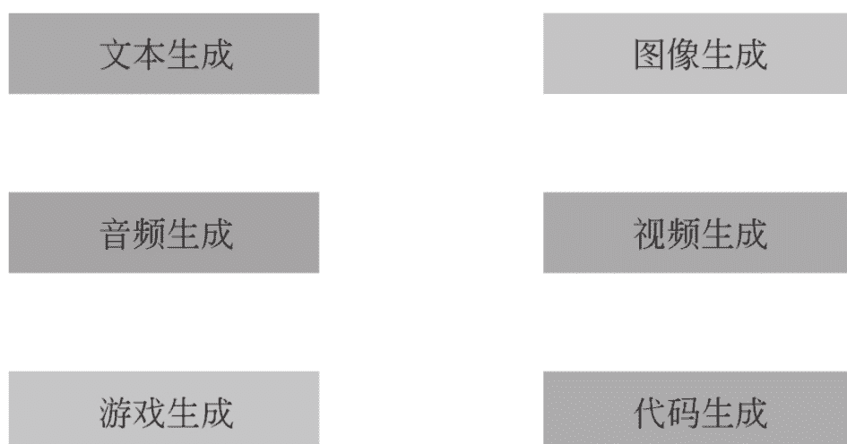
#### 1. 文本生成
可与用户对话、基于教学资料生成教案、根据采编内容撰写新闻报道、续写小说等。

#### 2. 图像生成
可按指令生成图像并进行细节调整，还能制作图文海报、画报及复杂设计图。以建筑效果图为例，输入尺寸、材料、色彩即可得到逼真效果图。

#### 3. 音频生成
可进行自然真实的语音合成，支持个性化语音风格定制；也能进行编曲、音乐创作、音效生成等。

#### 4. 视频生成
可依据脚本、音频、文字等素材生成创意视频。Wondershare Filmora网页版的智能脚本小助手以ChatGPT为支撑，可生成故事、演讲稿、对话脚本等，助力短视频创作。

#### 5. 游戏生成
可提升NPC对话自然度，增强玩家互动；也能智能生成剧情、人物背景、地图、关卡、道具等，提升开发效率。

#### 6. 代码生成
借助自然语言处理快速理解需求，生成对应代码，承接繁琐重复任务，支持自定义模板便于调整规则与格式。

整体特点是生成自然流畅、多元高效，并可定制满足个性化需求。

### 1.2.2 智能搜索：重塑传统搜索范式
AI发展推动搜索引擎变革，ChatGPT催生新搜索方式。

传统搜索引擎依赖关键词匹配与排序，难以理解复杂查询、长文本，交互性弱。

ChatGPT实现自然交互搜索，优势在于：

- 精准搜索。强大的自然语言理解能力可深入把握用户意图，提供更精确结果。
- 个性化搜索。结合个人资料、浏览记录与偏好，输出定制化结果。
- 对话式交互。以问答形式直接给出答案，避免反复点击，搜索更便捷。

这些特性大幅提升体验，推动从模糊搜索到精准搜索的跨越，成为下一代搜索引擎催化剂。

### 1.2.3 智能翻译：批量多语种处理
ChatGPT支持批量多语种翻译，助力跨语言工作学习。

使用流程：准备待译文本并确定译入语言，输入对话框说明需求，发送后获取结果。

使用需注意：并非完全等同人工翻译，需人工校核；整合关联文本有助于准确度；先小批量测试精准后再批量处理。

批量翻译优势，如图1-2所示。

- 翻译质量高。基于海量数据训练的模型保证准确性。
- 操作简便。界面简洁，快速上手。
- 效率与成本兼顾。上传文本即可获得译文，相比人工更省时省力，适合个人与企业。

整体而言，适合批量文本处理，随着功能升级将更高效高质量。

### 1.2.4 赋能智能机器人：提升服务与智能水平
机器人通过编程与自动控制执行任务。随着感知、深度学习、定位导航技术进步，机器人愈发智能，已广泛应用于制造、酒店餐饮、医疗等，教育、伴读机器人也属其范畴。

智能机器人具备四大要素，如图1-3所示。

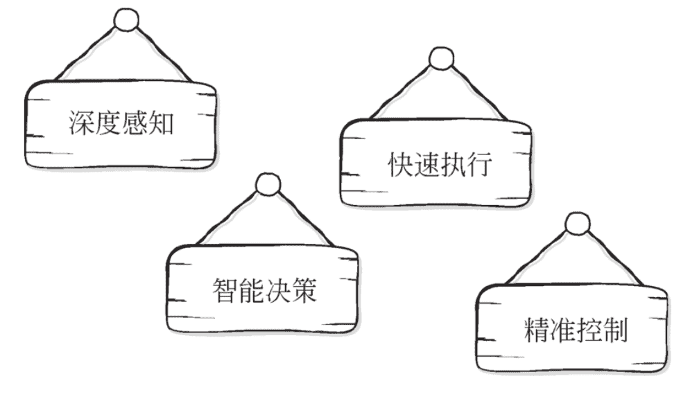
图1-3 智能机器人具备的四大要素

智能机器人的工作能力可以拆成四个环节来理解。深度感知是指机器人通过多种传感器采集外部信息，掌握环境以及目标对象的状况；智能决策是指对这些输入的数据进行分析判断；快速执行是指依托完善的机械结构与驱动系统，按照指令迅速完成动作；精准控制是指融合定位导航、避障等技术，合理规划行进路线，实现精确操作。

ChatGPT给机器人带来的增益，核心在于提升整体智能水平。其技术优势集中在三个方向。

一是自然语言理解很强。模型在海量语料上训练后，对日常表达的把握更到位，不会受语法词汇限制，理解精度明显提高。

二是自我进化能力突出。学到的语言规律能够迁移到新任务上，持续学习、自我完善，智能水平不断提升。

三是定制化服务可行。针对医疗、金融等特定领域做定向训练，就能提供更专业化的支持。

这两方面的能力让机器人发展出现明显变化。一方面理解力被放大，机器人能更高效准确地解读自然语言和语义，智能化程度随之提高，同时也能更精准地回应用户，提升运行效率。另一方面开发和维护成本被拉低，企业借助深度学习与大模型，可以节省机器人研发运维投入，减轻负担。

赋能场景很具体。在智能客服机器人里，ChatGPT凭借海量数据，让自主处理能力增强，比如准确答问、给出专业解决方案，服务质量随之提升。在智能工业机器人里，模型可用于训练，让它完成更复杂的工业任务，推动生产质量和效率双升。

总体来看，ChatGPT能增强机器人的自然语言理解、自我学习与交互能力，提升服务品质与智能程度。企业运营成本下降，用户体验也随之改善。

## 1.3 GPT-4点燃通用智能浪潮

在GPT系列迭代过程中，OpenAI始终在追求通用性。相比前代模型，GPT-4的通用能力跃升明显，标志着通用人工智能的序幕正式拉开。

### 1.3.1 为什么通用智能是AI的下一站

GPT-4展现的通用潜能让人看到了通用人工智能的冰山一角，也印证了AI正由专用向通用演进的趋势，通用智能将成为发展的下一个阶段。

通用智能是什么？区别于只能处理单一任务的专用AI，通用智能能覆盖更广、更复杂的任务，并在多学科、多领域、多模态之间自由切换，大幅提高处理效率。依托强大的任务处理能力，通用智能更适合多元化场景，潜力巨大。

专用与通用的差别在于边界。专用AI在特定领域表现突出，能高效解决专业问题，但局限性强，遇到新问题就捉襟见肘。通用AI不绑定特定领域，拥有灵活分析与解决问题的通用基础，包括自然语言理解、逻辑推理等。相比之下，通用AI具备底层通用能力，能应对全新挑战。

通用智能并不局限于内容生成，它可以作为生产力工具或基础设施，赋能各行各业，提升全社会效率。

以软件行业为例，通用智能会重塑软件价值。目前面向个人的To C软件效率偏低、学习门槛高。以Office套件为例，多数用户只用基础功能，高级功能使用率很低。接入通用智能后，用户可以直接用自然语言提需求，软件自动调用高级功能，更好满足使用场景。对To C软件而言，过去冷门的复杂功能都需要重新评估价值。

面向企业的To B软件也面临定制周期长、成本高、难以复用等问题。接入通用智能后，这类问题能得到一定缓解。

通用智能的未来走向怎样？随着持续迭代，它有望获得类似人类的通用学习能力，通过自适应与跨模态学习不断强化自身，在更多领域落地应用。

### 1.3.2 大模型是通向通用智能的快车道

通往通用智能的路径多样，其中大模型是最优路线。大模型通用性与实用性兼备，能降低应用开发门槛，提升精度与生成效率，成为通用智能发展的起点。

以GPT-4为例，除了语言任务外，它还能处理编程、医学、心理学等多领域复杂问题，部分表现已接近人类水平。模型还能自动学习新内容，持续自我优化，智慧性不断增强。

过去AI难以覆盖完整产业流程，而大模型可以贯穿全流程。以自动驾驶为例，输入端可感知环境、生成丰富实景；输出端可重构3D环境、进行路径规划。大模型实现感知决策一体化，能预判科学驾驶行为，提升可靠性。

大模型正由单一模态向多模态演进。文本、语音、图像联合训练，使不同模态相互补充，提升效果与泛化能力，为通用智能奠定基础。

多模态大模型能感知并处理多种数据形式，基于分析结果做出决策或执行。它们具备通用性，但仍需持续迭代以增强能力。

未来人与模型的交互将更自然。大模型理解与推理能力不断增强，更好捕捉用户意图并解锁新技能，输出高质量内容。在大模型支撑下，通用智能会更具智慧。

### 1.3.3 OpenAI的通用智能路线图

OpenAI的使命是确保通用智能造福全人类，既深耕技术研发，也支持其他机构的应用探索。2023年2月，CEO萨姆·阿尔特曼公布了对通用智能的规划。

通用智能能激发用户创造力，但也存在滥用风险。开发者需要在发挥优势的同时做好风险防范。

OpenAI认为发展通用智能需要做好三方面准备。

首先是渐进式发展。人们有时间观察应用现状，体验优势、发现问题，适时调整经济组织形式并进行有效监管。循序渐进有助于通用智能与社会协同发展，也能让需求更清晰。OpenAI为此开放了API并推动模型开源，加速研究，让更多人贡献想法。

其次是模型构建更审慎。在探索通用性的同时，努力打造可控性更强的模型。社会需要就AI使用达成共识，OpenAI将投入外部实验，为通用智能的复杂决策做好准备。未来将开发新的对齐技术，并检验现有技术失效边界。短期内用AI帮助评估复杂模型、监控复杂系统，长期则用AI提出新思路推动对齐技术迭代。

最后是全球对话。聚焦通用智能的治理、收益分配、发展机遇共享三个议题进行国际讨论。

此外，OpenAI通过制度明确运作边界。比如为其他组织提供支持的目的是提升安全性，而非在应用开发上竞争；同时对股东回报设置上限，规范行为。

# 第2章 大模型：支撑ChatGPT的底座

ChatGPT强劲功能背后离不开大模型的支撑。借助大模型，它能自动生成多元内容并落地多场景，还能开放API让开发者集成到自家产品中。

企业要研发大模型，就需要了解其底层架构、运行机制、发展历程、趋势、要素与影响。

## 2.1 底层架构与运行逻辑

从架构看，相较传统自然语言模型，GPT-4的上下文理解更强，这得益于Transformer的支持。Transformer已成为众多大模型的底层基座。从运行看，基于“大规模预训练+微调”的机制，大模型才能广泛应用。

### 2.1.1 架构核心：Transformer

自然语言处理旨在让计算机理解并使用人类语言。Transformer兴起前，主流是RNN、CNN等神经网络模型，推动了该领域发展与商业化。

随后，基于注意力机制的Transformer为大语言模型奠定基础。源自谷歌论文《Attention Is All You Need》，它采用自注意力机制，提升运行效率，更好捕捉长距离依赖，可用于多种NLP任务，推动模型参数规模扩大，成为大语言模型的核心组件。

Transformer加速了大模型发展。架构灵活、可扩展，能根据任务与数据规模搭建不同大小的模型，提升性能；并行计算能力强，能处理海量数据。在数据与算力支持下，研究者可基于Transformer训练参数上亿的模型，成为主流开发模式。

OpenAI的GPT系列就是基于Transformer的生成式预训练模型。ChatGPT依托Transformer做序列建模与训练，能结合上下文与当前输入生成合乎逻辑的输出。

Transformer包含编码器与解码器，可类比人类理解与表达语言的过程。编码是把语言转为大脑可理解的表征，解码是把思维表达出来。ChatGPT使用Transformer时主要采用解码器部分，在保证生成任务质量的同时降低参数量与计算成本，提高效率。

生成模式上，ChatGPT不是一次性输出，而是逐字逐词生成，每个字词都结合前文，因此内容更连贯、更具针对性。

ChatGPT还在Transformer上做了优化：多头注意力机制让模型同时学习不同特征空间的表示，提升性能与泛化；网络层引入归一化操作，加速收敛与参数优化；加入位置编码，为不同位置词建立唯一向量表示，增强位置感知。

这些优化让ChatGPT在对话生成中表现突出。单轮对话能快速给出合适回复，多轮对话能通过上下文推断保持连贯，提升交互效率。总体来看，Transformer在机器翻译、文本生成、智能问答、训练速度上均优于前代模型，基于它的GPT系列也具备强大应用能力。

### 2.1.2 运作方式：预训练加微调

大模型优势在于通用性。传统AI在多个领域表现不错，但受数据与模型能力限制，往往只能完成单一任务。大模型得益于“大规模预训练+微调”，能在不同任务中灵活适配，展现强通用能力。

无监督训练模式让大模型能利用海量无标注数据，大幅提升训练效果。超大参数量增强表达能力，使模型能在训练数据中提炼通用知识。具备通用性的大模型，只需在具体场景做适当微调，就能有亮眼表现。

以GPT-4为例，其能力来自大规模预训练与指令微调。语言生成、少样本学习等能力源于海量数据预训练。而指令微调让模型面向细分领域，泛化到更多任务。基于RLHF技术，模型能与人类对齐，给出翔实客观的回答，并拒绝不当或超出知识范围的问题。

海量高质量数据的预训练是基础。参数规模越大，对数据规模与质量要求越高，研发企业常通过大量训练提升性能。

微调也很关键。预训练提供强大基础能力后，针对性微调能赋予专业能力，满足细分需求。

以ChatGPT训练为例，基础模型微调分为三步：一是用人工标注数据训练；二是基于用户对生成答案的排序构建奖励模型RM；三是通过奖励模型进一步训练，实现自我学习。科学的奖励模型能引导模型输出正确答案，提升准确性。

2023年2月，Meta发布开源大语言模型LLaMA。发布后衍生出多个微调版本。2023年4月，哈尔滨工业大学团队在LLaMA基础上微调出医学领域模型Hua Tuo，在智能问诊上表现突出，能生成可靠医学知识。

该团队从中文医学知识图谱CMeKG中提取知识，生成多样化指令数据，对模型进行监督微调，最终打造出医学新模型。案例体现了微调的必要性：以大模型为基础，用专业数据训练，可得到面向细分领域的新模型。

## 2.2 发展历程与发展趋势

长期来看，大模型正从单语言预训练向多模态预训练演进，后者将成为主流。整体态势呈现通用大模型与垂直大模型双轨并行。

### 2.2.1 从单语到多模态的演进

按模态看，大模型经历了单语言预训练、多语言预训练、多模态预训练三个阶段，能力持续提升。

单语言预训练模型基于单一语言数据训练，能输出单语言内容，任务类型有限。BERT是典型代表，预训练由掩码语言建模MLM与下一句预测NSP两项无监督任务组成。掩码建模通过上下文预测被遮挡词，下一句预测强化语句关联。微调后可完成文本分类、自动问答等任务。

多语言预训练模型覆盖数十甚至上百种语言，语言能力更强。可完成机器翻译、智能问答、情感分析等任务。XLM是典型，其采用单语言无监督学习与平行语料有监督学习两种方式，共用词典共享符号。保留掩码建模并加入因果语言建模，能在上文基础上预测下一个词。

多模态预训练模型在多语言基础上实现文字、语音、视频等内容的同步转换与多任务处理。具备寻找不同模态关联、实现模态间转化生成两大能力。

多模态是大模型布局重点。2023年4月，APUS发布多模态预训练模型AiLMe，可理解并生成文本、图像、音频、视频。技术架构基于主流Transformer，并采用插件架构，可接入其他工具，能力强劲。

从单语到多语再到多模态，能力不断增强。未来多模态模型有望接入更复杂、更广泛的数据，完成更多元复杂的内容生成。

### 2.2.2 通用与垂直双轨并行

在各企业竞相入局下，市场出现通用大模型与垂直大模型两条路径。

通用大模型能完成多种任务、服务多个领域。依托资金与人才优势，多家互联网大厂将其作为研发方向。一方面通用性广，有助于奠定行业领先地位；另一方面便于与自身产品结合，提升智能化。

2023年4月，阿里巴巴推出通用大模型“通义千问”，具备多轮对话、文案创作等功能，并有逻辑推理能力，可生成多样化内容。未来其旗下产品将接入该模型，实现智能升级。

目前阿里钉钉已完成与通义千问的深度融合，智能化升级体现在四个典型场景。

群聊方面，在大模型加持下，钉钉能把长群聊自动梳理成要点，帮助用户快速抓住上下文，还可一键归纳出待办清单，让协作更顺畅。

文档方面，平台具备图文一体化生成能力。比如写完一篇稿件后，系统可依据内容自动配图，按需求一键出海报，省去找素材和设计的耗时。

视频会议方面，会议进行时系统会根据发言人内容提炼核心观点，让与会者迅速掌握要点，提升会议效率。

应用开发方面，用户只需在钉钉里描述需求，就能快速得到一个可用小程序。未来通义千问还将开放插件能力，助力开发者打造更个性化的应用。

垂直大模型是指面向特定行业训练的模型，如教育、金融等。它更适合在细分赛道深耕多年、掌握行业经验与数据的公司。这类企业常以通用大模型为底座，通过指令微调培育出专业模型。垂直模型的体量通常小于通用模型，却因聚焦而在细分场景表现更优。

近两年涌入垂直赛道的企业越来越多。2023年5月，学而思对外披露MathGPT数学大模型的进展，该模型以数学解题与讲题算法为核心，面向数学爱好者和研究机构。研发工作在2023年春节前启动，截至5月已取得阶段性成果，公司还计划组建海外团队，从全球招募AI专家。

与通用大模型相比，通用模型可覆盖多种应用，但在单一领域往往不及垂直模型。垂直模型专业度更高，但受众相对有限。

### 2.2.3 ZMO.AI：营销垂类模型的代表样本
在通用与垂直并行的格局下，部分细分优势企业正自建垂直模型，ZMO.AI是典型案例。

ZMO.AI是一家深耕营销智能方案的公司，长期积累营销内容生成领域的海量高质量数据，为垂直模型提供了数据底座。与偏艺术创作的平台不同，ZMO.AI可实现真实场景的图像合成。其产品ImgCreator.AI上线后吸引了百万级B端用户；Marketing Copilot服务已有数万家企业申请API资格并接入调用。

用户上传产品图并给出工作流指令后，Marketing Copilot即可按需生成匹配的宣传海报、营销文案等内容，显著优化传统营销流程，提升内容生产效率。

B端场景对专业性要求更高，对生成图像的质量和画面准确度极为敏感。ZMO.AI可依据需求产出高质量营销内容，直击企业痛点。同时基于精准的用户反馈数据，平台能对垂直模型输出进行引导，实现自我优化，持续产出更优质内容。

以某跨境电商为例，其沙发在欧美市场受欢迎，但产品体积大、运输成本高，搭建拍摄场景耗时耗力，产品图拍摄成为难题。负责人与设计师反复沟通耗时费力。借助ZMO.AI，企业只需上传产品图并输入文字指令，平台即可生成真实自然的效果图，大幅降低拍摄与优化的资金损耗。

在细分场景使用大模型，门槛高、结果不可控是常见痛点。如何让模型开箱即用、用得上，始终是ZMO.AI思考的重点。

在ZMO.AI平台，用户可先上传优质素材训练专有模型，再上传产品图并给出文字指令，专有模型即可自动生成符合需求的营销图片。模型基于用户提供的素材训练，最终输出面向特定产品、特定人群的个性化内容，训练数据全程私密归用户所有。

不少大模型能产出创意，却难以还原产品纹路、材质、Logo等细节。Marketing Copilot借助独特算法可展现产品细节，生成的图片在细节表现、光影、分辨率和真实度上都接近实拍。

依托营销场景的海量精准数据，ZMO.AI打造的垂直模型重塑了内容生产方式，形成数据驱动的新形态。平台不仅能精准生成营销内容，还能重塑营销流程，提供端到端解决方案，未来将持续迭代解锁新功能。

## 2.3 大模型三大核心支柱
大模型本质上是算力、算法、数据三者共同作用的产物，三者构成核心支柱。算力是基础设施，决定处理能力上限；算法是解决问题的机制，决定路径选择；数据是训练养料，有了充足数据算法才能不断精进。

### 2.3.1 算力：训练与推理的底座
大模型计算复杂度极高，全程离不开算力支撑，从预训练到日常运营再到微调都需要。高效输出的原动力是高性能计算，主要体现在训练和推理两个环节。

训练阶段，高性能计算可大幅化快训练速度。模型要处理海量数据与参数，并行、分布式计算能显著加速。缺少算力支撑，训练将缓慢甚至无法完成。

推理阶段，高性能计算可提升响应速度与并发能力。模型对输入进行处理时，更快的计算带来更强并发，缺少支撑则响应变慢、并发受限。

大模型推动AI迈向新高度，企业竞相入局，算力需求出现爆发式增长，亟需成熟稳定的高性能计算方案。

2023年4月，腾讯云发布新一代高性能计算集群，采用自研服务器，搭载英伟达H800 GPU，配备3.2T超大互联带宽，为大模型训练与计算提供高性能、高带宽、低延迟的算力。

据腾讯云披露，在“混元”大模型训练中，使用上一代集群同等数据集训练需11天，新一代集群将时间压缩至4天。

通过对处理器、网络架构、存储性能的优化，腾讯云解决了大规模集群下的算力损耗，为大模型提供稳定智能算力。

网络层面，节点间需大量数据交互，通信性能直接影响训练效率。腾讯云自研星脉网络具备3.2T超大通信带宽，突破此前业界上限。测试显示，相较前代网络，星脉网络可让集群整体算力提升20%，超大集群保持优异吞吐。

存储层面，多节点并发读取需快速加载。腾讯云自研的文件存储与对象存储架构具备TB级吞吐和千万级IOPS，满足大模型训练的海量存储需求。

底层架构上，新集群集成TACO Train训练加速引擎，可优化通信策略与模型编译，大幅节约算力成本。

未来该集群不仅能更好服务大模型训练，也将在自动驾驶、自然语言处理等多领域发挥作用。

### 2.3.2 算法：解决问题的核心机制
AI算法是大模型解决问题的核心机制，不同算法带来不同路径，优劣直接决定成效。算法演进大致经历三个阶段，如图2-1所示。

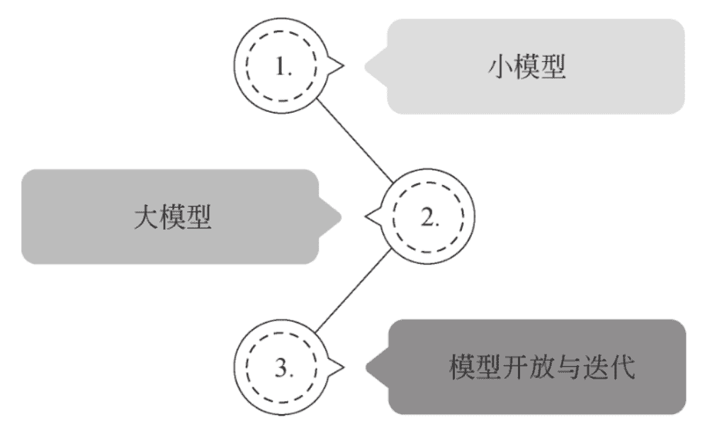

#### 1. 小模型
小模型基于特定领域数据训练，完成特定任务。因数据来源有限，精准度提升受限；算力不足导致跨领域训练成本高，通用能力弱。

#### 2. 大模型
Transformer的出现显著提升了对文字、图像等内容的识别处理能力，但模型体量随之增大，只有算力领先的企业才有能力完成训练。ChatGPT的成功凸显了Transformer的潜力，特斯拉在自动驾驶视觉模型中引入Transformer以融合多摄像头信息；英伟达也推出面向Transformer的计算引擎，大幅提升算力。

#### 3. 模型开放与迭代
ChatGPT在算法上更进一步，基于Transformer训练，形成RLHF、RM等独特训练逻辑。

RLHF是一种强化学习技术，其核心是让用户为ChatGPT提供反馈以加速学习。传统强化学习依据奖励或惩罚调整策略，RLHF则允许用户给出更细致的评价和改进建议，提升学习速度和任务理解的准确性。

RM是计算行为奖励值的模型。借助RM，ChatGPT可为不同行为赋予不同奖励，并据此不断优化决策以获取更高奖励。

基于此，ChatGPT摆脱了过去单纯堆数据量的训练范式，为算法发展提供了更清晰方向。

未来算法发展将加速，模型开放与快速迭代将成为主流趋势。

### 2.3.3 数据：训练的养料
数据是大模型训练的基础资源，主要用于预训练和微调。预训练需要大规模、类别丰富且高质量的数据；微调则需要聚焦垂直领域的专业高质量数据。

训练与微调都依赖海量数据，企业需从多领域、多源获取高质量数据集。当前多数模型利用公开的文本、图像、语音等多模态数据，但仍需更多优质私有数据源以形成差异化。

合成数据是可行补充方案。它基于计算机模拟生成虚拟数据，源自真实数据并反映真实信息，可缓解数据短缺，为训练微调提供补充。

合成数据已在自动驾驶、机器人等领域落地。以自动驾驶为例，真实路况数据难获取，模型可通过合成数据模拟多样驾驶场景进行精准训练。

除数据集外，还需数据处理服务支持，如清洗、标注等。不同行业对标注要求不同，高质量数据集可提升标注质量。星辰数据等专业服务商可为企业提供计算机视觉、自然语言处理等高质量训练数据，并覆盖数据管理、模型训练、测试等全流程质量管控。

使用数据时需确保安全。大模型数据源包括公开数据、合成数据、合作企业数据、用户互动数据等，均属训练语料。在涉及大量隐私数据时，企业需做好防护，确保输出环节数据安全。

## 2.4 大模型带来的三大变化
当前AI应用面临成本高、需求碎片化、精度不足、落地效果差等问题。大模型可提升通用性、降低训练成本、增强智能性、降低落地门槛。

### 2.4.1 突破定制化小模型的落地瓶颈
过去AI主要路径是基于深度学习与算力打造定制化小模型，针对特定场景训练。

从需求确定到数据收集、算法设计、训练微调、部署、运维，研发流程复杂，需要跨专业协作。

传统模式下，研发人员需自行设计定制神经网络，要求专业知识深厚且承担试错成本，一个项目往往需专业团队数月攻关。

落地时，“一个场景一个模型”难以通用。自动驾驶全景感知需行人跟踪、目标检测等多模型协作；医学图像病症检测模型无法直接用于行人车辆检测。低通用性抬高了落地门槛。

大模型可从海量多场景数据中学习，提炼通用能力，成为泛化底座。面对新场景，只需基于专业数据做微调或二次训练即可适配。因此大模型能更好应对多样化需求，加速AI规模化落地。

### 2.4.2 降低开发与训练成本
传统模型训练需反复调参、优化，耗费大量人力；对数据要求高，需大规模标注，存在数据难获取、标注成本高、收集耗时等问题。

医学数据涉及隐私难大范围收集；工业场景数据海量难以全覆盖。如布料瑕疵检测，需覆盖白坯布、有色布、纯棉布等多种布型，以及花纹错色、断头、擦伤等多种缺陷，研发需长期收集数据并优化算法。

不同场景需重新收集数据、训练模型，还需构建自学习数据闭环以实现持续优化，成本居高不下。

大模型可通过无监督学习自动区分海量数据，构建学习任务，实现自动标注，大幅降低数据获取与标注成本。

相较传统研发，大模型流程更标准化，多环节可智能化操作，减少人工、缩短周期，降低整体成本，为广泛应用提供支撑。

### 2.4.3 带来更强的智能能力
依托深度学习与海量数据，大模型可持续学习、自我优化，形成更强智能。

基于预训练模型的自然语言处理已超越传统机器学习。随着迭代，计算量指数级增长，通用能力提升使其从单一语言模型向可处理语言、视觉、声音等多模态模型演进，为弱AI迈向强AI提供路径。

多模态大模型是重要趋势。它可在无监督模式下自动学习不同任务，将文本、图像、视频融合，实现从单模态到多模态的跃迁，为各领域提供更强通用底座。

大模型提升了典型应用的智能水平。智能客服接入大模型后能快速识别需求，给出准确个性化答案，并依托逻辑推理提供完整解决方案；还能基于用户反馈不断改进服务，提升满意度。

文生图、文生视频、虚拟数字人等领域在模型加持下加速商业化，催生更多智能化应用。

大模型正成为AI发展的核心推动力，使AI不仅能听、能看、能思考创作，还能推理决策。随着持续迭代，通用性与智能程度将进一步提升，AI应用将更广泛覆盖各行业。

# 第3章 产业格局：大模型生态体系雏形已现
大模型产业化已成趋势，生态体系雏形初现。数据服务商、科研院所、科技巨头都在其中扮演关键角色。热度持续升温，越来越多的企业和机构布局赛道并推出自有模型。随着发展，模型将向开源方向演进，未来有望成为各行业发展的通用基础设施，持续赋能产业。

## 3.1 大模型产业生态体系的三层架构
当前生态体系初步成形，可分为基础层、模型层、应用层。基础层提供数据、算力、计算平台、开发平台等基础设施；模型层汇聚互联网巨头、AI公司、科研院所、数据服务商、垂直厂商等研发主体；应用层则向To B和To C双向发展，覆盖面不断扩大。

### 3.1.1 基础层：数据+算力+计算平台+开发平台
生态体系的基础层为产业发展提供底层支撑，主要包括四个维度，如图3-1所示。

大模型全景拆解：从底层支撑到场景落地

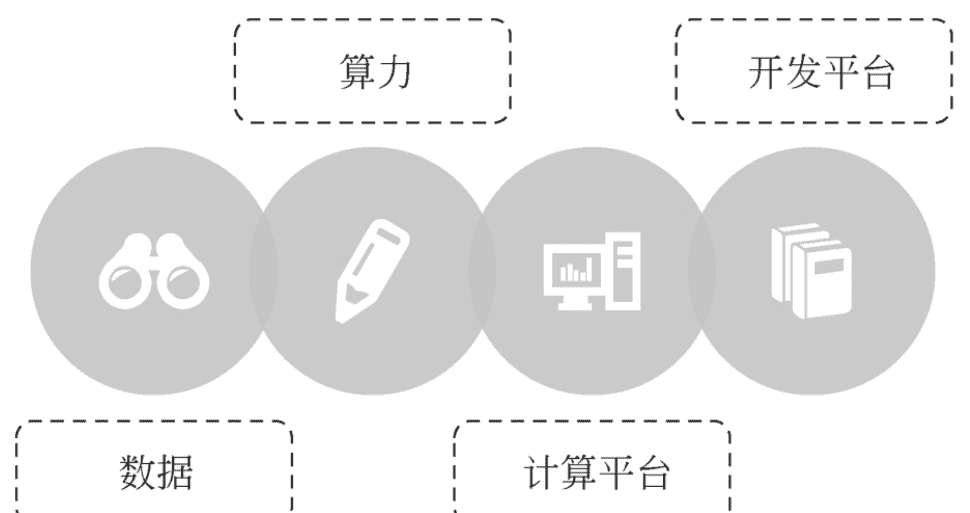

#### 1. 数据
预训练、推理、微调全流程都离不开高质量素材，负责供应数据的厂商已成为基础层的关键力量。市场上大致可分为三类。一种是百度、京东、腾讯等头部科技平台，自建数据服务体系，如百度智能云数据众包、京东众智、腾讯数据厨房，进入较早、链路相对成熟。第二类是海天瑞声、拓尔思、数据堂等专业数据公司，深耕细分赛道，能交付专业多元的产品，市场占比突出。第三类是 MindFlow、BodenAI 等初创团队，体量目前不大，但成长预期很强。

#### 2. 算力
智能计算芯片为模型提供算力底座，该赛道聚集了谷歌、英特尔、英伟达、海思半导体、联发科、地平线机器人等。2023年4月，谷歌公布了面向模型训练的 TPU V4。早在2016年，谷歌就推出面向机器学习的专用芯片 TPU，通过低精度运算大幅提速并降耗，为搜索、自然语言处理等业务供能。第四代 TPU V4 在效率与节能上取得突破，已在谷歌云平台上线用于训练，未来可支撑更多训练场景。

#### 3. 计算平台
具备智能计算优势的平台能为训练提供关键支撑。2023年6月，复旦大学携手阿里云、中国电信上线云上科研智算平台 CFFF。平台以公共云模式实现千卡级并行计算。由面向多学科融合创新的集群和面向高精尖研究的集群组成，依托高速传输网络、异构算力融合调度、AI 与大数据一体化等技术，两大集群组成性能强劲的超级计算机。借助该平台，复旦大学人工智能创新与产业研究院发布了中短期天气预报模型，预测精度良好且速度明显提升。

#### 4. 开发平台
开发平台面向开发者开放算力、框架、在线推理与在线训练等能力。以昇思大模型平台为例，平台把模型选型、在线训练、模型微调整合为一体化开放服务。内部设有 AI 实验室、模型库、数据集等模块，提供算力支撑并配备丰富学习课程与社区活动。为改善使用体验，平台打造电力、工业等行业专区，提供从训练到部署的全流程服务；同时上线课程体系，覆盖自然语言、视觉等多个开发方向，为开发者提供方法指引。

### 3.1.2 模型层：多方参与推进研发
在生态的模型层，众多主体投入模型研发。参与者包括互联网巨头、AI 企业、科研院所、数据服务商、垂直行业厂商等，主要情况如下：

**表3-1 大模型赛道主要参与者和代表产品**

| 类别 | 名称 | 代表产品 |
| :--- | :--- | :--- |
| 互联网巨头 | 百度 | 文心大模型 |
| | 华为 | 盘古大模型 |
| | 腾讯 | 混元大模型 |
| | 阿里巴巴 | 通义大模型 |
| AI企业 | 商汤科技 | 日日新大模型 |
| | 科大讯飞 | 星火大模型 |
| | 昆仑万维 | 天工大模型 |
| 科研院所 | 北京智源人工智能研究院 | 悟道 3.0 大模型 |
| | 中国科学院自动化研究所 | 紫东太初 2.0 大模型 |
| 数据服务商 | 拓尔思 | 拓天大模型 |
| | 浪潮信息 | 源 1.0 大模型 |
| 垂直行业厂商 | 恒生电子 | 金融行业垂直大模型 LightGPT |
| | 幂律智能 | 法律行业垂直大模型 PowerLawGLM |
| | 一千零一艺 | 建筑行业垂直大模型阿拉丁 ALDGPT |

百度、华为等巨头，商汤、科大讯飞等 AI 公司，智源研究院、中科院自动化所等科研机构是研发主力。依托数据与行业优势，部分数据服务商也加入布局。拓尔思作为人工智能、大数据及数据服务提供商，2023年6月推出拓天大模型，率先在金融、传媒等领域落地行业模型，未来还将向网络舆情、法律、审计等方向延伸。垂直厂商多与科技企业协同，基于通用模型构建专有方案。2023年6月，幂律智能与智谱 AI 联合发布法律垂直模型 PowerLawGLM，聚焦法律语言理解与解决方案输出。幂律智能长期深耕法律+AI，提供智能合同产品；智谱 AI 借此拓展法律场景，双方通过大规模专业文本学习、对话场景对齐、输出优化等步骤，显著提升模型在法律文本理解、推理与生成方面的能力。目前自然语言处理与多模态是研发重点，计算机视觉、智能语音相对较少。随着主体增多，开源成为趋势，互联网巨头和科研机构引领探索。

### 3.1.3 应用层：面向用户输出多元场景
在底层与模型层的支撑下，模型应用范围快速扩展，覆盖 To B 与 To C。企业端价值凸显后，To B 模型进一步分化为通用型与垂直型，均可按需定制。2023年6月，腾讯云公布行业模型进展，将帮助企业构建专属模型与应用，并打造行业模型商店，提供模型即服务一站式方案，涵盖模型训练、微调、应用开发。企业可在行业模型基础上注入私有数据生成专属模型，当前已在金融、教育等领域落地数十个方案。C 端方面，百度基于文心大模型推出文心一言、文心一格等产品。文心一言支持文学创作、文案撰写、多模态生成；文心一格支持个性化 AI 绘画、工业设计、营销海报生成。通用模型已在 To B 与 To C 场景落地，未来将服务更多企业与个人。

## 3.2 玩家涌入赛道产业加速繁荣
ChatGPT 面世后，其背后的核心模型受到广泛关注，众多玩家纷纷入局。谷歌、百度、中国科学院自动化研究所是代表。

### 3.2.1 谷歌：引领潮流推出大语言模型PaLM 2
2023年5月谷歌开发者大会上，谷歌展示新一代通用大语言模型 PaLM 2，可完成数学推理、语言翻译、应用开发等任务，已用于搜索、办公、聊天机器人 Bard 等。PaLM 2 运行于自研人工智能芯片，效率提升，支持 20 多种编程语言和 100 多种自然语言，驱动 Bard 性能升级。Bard 可生成多语言精准回复，并接入编程工具，可导出至 Google 文档、Colab 及第三方协作 App。未来 Bard 将与沃尔玛、Spotify、Uber Eats、Tripadvisor 等融合。谷歌表示通过海量数据训练和架构优化，PaLM 2 在自然语言处理和编码能力上超越前代，并采用基于知识的自适应技术实现场景灵活适配。除了自用和赋能伙伴，谷歌还计划开源 PaLM 2。

### 3.2.2 百度：构建基础+任务+行业体系
百度早在2019年发布 ERNIE 1.0 即文心大模型，后持续研发并探索应用。文心大模型优势在于知识储备深厚，依托数千亿条知识图谱训练，语料库扎实；同时具备多场景多行业落地能力，已在搜索、地图、智能驾驶等服务数亿用户，并携手百度智能云落地金融、制造、传媒等行业。实践中形成“基础+任务+行业”体系：基础模型提升通用性并攻克技术难题；任务模型针对特定任务构建算法与数据；行业模型融合行业知识形成技术底座，三者相互促进。百度基于文心推出数十个模型。

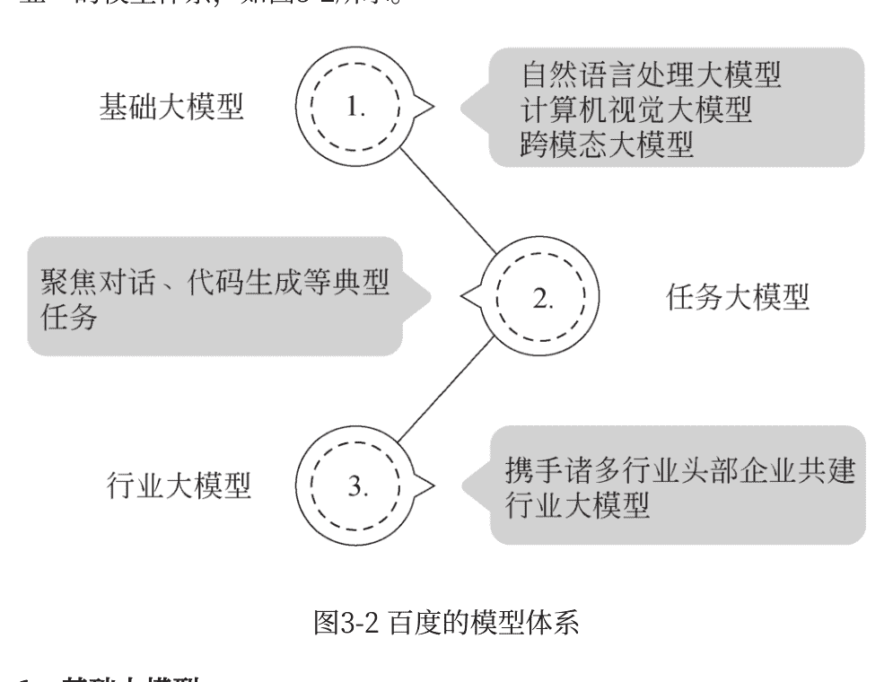

#### 1. 基础大模型
涵盖自然语言处理、计算机视觉、跨模态三类方向。自然语言方面，ERNIE 3.0 基于多范式统一预训练框架，支持摘要、文案、诗歌、小小说创作等。计算机视觉方面，VIMER 系列中 VIMER-CAE 提升图像表征能力，表现优异。跨模态方面，ERNIE-ViLG 2.0 在文生图领域表现突出，图像清晰度与传统文化理解领先。

#### 2. 任务大模型
面向典型任务推出对话、搜索、信息抽取、代码生成、生物计算等模型。ERNIE-Code 在海量文本与代码上训练，具备跨语言理解与生成能力，支持代码翻译、提取等。

#### 3. 行业大模型
百度联合浦发银行、吉利汽车、人民网等共建金融、制造、传媒等行业模型，作为技术底座助力降本增效。例如与人民网共建的模型基于海量传媒数据，可提升内容审核、舆情分析、新闻摘要效率。为更好落地，文心大模型还布局工具平台、产品、社区，构建开放生态。

### 3.2.3 中国科学院自动化研究所：发布紫东太初大模型
科研院所也是重要力量。2023年6月人工智能框架生态峰会上，中科院自动化所发布紫东太初全模态大模型。该模型是紫东太初 1.0 的升级版，初代即以多模态为核心，实现文字、图像、语音跨模态生成。2.0 版本引入视频、传感信号等更多模态，具备全模态理解、生成、关联能力，可解析三维场景与传感信号，满足音乐视频分析、三维导航等需求，并支持视频、音乐内容理解与生成。依托自主算法、昇腾硬件、昇思 MindSpore 框架及武汉人工智能计算中心，模型通用能力强。未来将深化手术导航、内容审核、法律咨询、交通违规图像研读等应用，并向新领域延伸。

## 3.3 产业发展趋势：开源成为风潮
大型模型火热下，各企业纷纷入局。长远来看，需将模型打造成行业基础设施并实现共享共建，开源成为必然。

### 3.3.1 因何开源：防止垄断+数据保护+降低成本
自 OpenAI 释出 ChatGPT API 后，Meta 的 LLaMA、Stability AI 的 StableLM 等开源模型相继出现。开源主要基于三点：

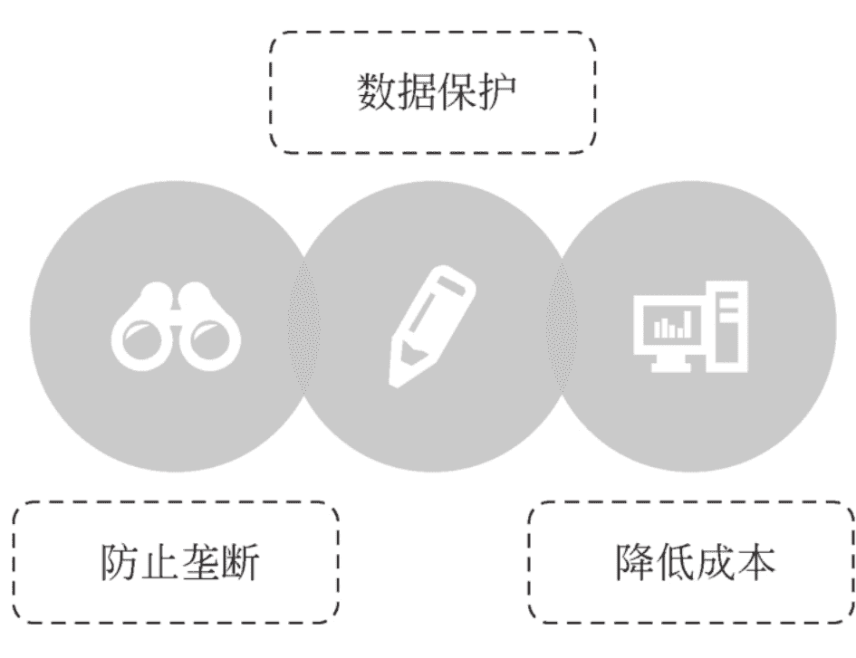

#### 1. 防止垄断
研发模型需大量数据、算力与资金，易被头部企业垄断。开源可让各行业参与，协作共进，减少重复投入。

#### 2. 数据保护
开源使企业可在保障数据所有权的前提下，用私有数据定制训练，过滤无效数据，降低成本。

#### 3. 降低成本
开源节省预训练成本支出；在推理端，通过构建参数更小的垂直模型降低推理开销。当前 Stability AI 是开源先锋。2022年8月推出 Stable Diffusion；2023年4月推出 DeepFloyd IF，可精准绘制文字、理解空间关系并细节编辑；同月推出开源大语言模型 StableLM 并在 GitHub 开放体验。Stability AI 表示将持续深耕大模型领域。

### 3.3.2 多模态化：多模态开源大模型成为趋势
除开源外，多模态也是重要方向。二者将深度结合，未来多模态开源大型模型将成为主流趋势。

多模态开源浪潮下，国内厂商与科研机构纷纷发力，商汤与智源代表了领先态势。

#### 1. 商汤 书生2.5：跨模态能力首次规模化开源
2023年3月，商汤对外发布通用多模态系统书生2.5，在跨模态任务上取得明显突破。体系具备开放式的跨模态处理能力，可为自动驾驶、机器人等场景提供感知与理解支撑。

书生首版于2021年由商汤联合上海人工智能实验室、清华大学等机构推出并持续共研。2.5版本可同时接收图像、文本、视频等异构输入，通过统一架构完成多类任务，实现不同模态和任务间的协同。

该版本支持文本驱动图像合成，能按用户要求产出写实风格的高质量图，可用于合成交通场景，辅助自动驾驶在多样环境下提升感知训练效果。

检索方面，系统可基于文本在相册中定位对应图片，在视频流里挑出最贴合描述的帧，并支持加入检测框实现图/视频中的目标定位。

除性能外，书生2.5还选择开源，已在OpenGVLab公开，方便开发者基于此构建多模态应用，后续将持续迭代。

#### 2. 智源 悟道3.0：多模态开源体系化实践
智源也是多模态开源的早期推动者。2021年其推出悟道1.0与2.0，当时应用方向尚不明确，却已着手搭建模型基础设施。

2023年6月北京智源大会上，智源发布悟道3.0，整体呈现多模态且开源的特征。体系涵盖悟道·天鹰语言系列、悟道·视界视觉系列及多项多模态成果，均向社区开放。

天鹰系列具备模型调用能力，收到文生图指令后可借助智源自研的多语种文图生成模型完成高质量生成。

视界系列包含Emu、Painter等。多模态大模型Emu可输入多类型内容并输出多类型结果，支持图像、文本、视频的理解与生成，在多模态上下文中可补全信息，实现图文对话、文图合成、图图合成等能力。

在生态建设上，智源打造FlagOpen技术开源体系，实现模型、工具、算法、代码的全面开放。其核心项目FlagAI集成OPT、ViT、CLIP等知名基座及悟道系模型，支持企业二次开发与微调。

展望未来，多模态系统的通用能力将不断增强，开源有望成为主流路径，既促进技术创新，也扩大使用者规模，推动更广泛落地。

### 3.3.3 开源社区崛起，汇聚模型与工具
随开源趋势加深，市场出现多家社区，成为模型与工具的聚集地，规模持续扩大，主要代表有：

#### 1. GitHub：代码托管与协作的首选
GitHub为开源项目的代码托管平台，支持版本迭代，以免费、安全、开放、可协作著称。大模型兴起后，平台汇聚大量开源模型。

2023年4月，复旦大学发布MOSS大模型，同步上架GitHub与Hugging Face。模型兼顾中英双语、多轮对话与插件能力，可完成智能检索、图文生成、数学求解等任务。Meta、百川智能等厂商亦在GitHub发布开源模型，平台在推动开源进程中发挥关键作用。

#### 2. Hugging Face：以开放促生态
Hugging Face是一家成长迅速的开源公司，坚持技术开放，打造开发者喜爱的社区，允许第三方发布项目并持续自研模型与工具。

2023年4月，Hugging Face推出免费开源系统HuggingChat，可处理文本生成、代码生成、音乐生成等任务，支持通过API接入自有应用。

#### 3. OpenGVLab：视觉模型的数据与模型库
OpenGVLab聚焦通用视觉模型的开源，覆盖数据与模型，为多模态通用大模型研发提供支撑。数据侧拥有千万级精标注集，含图像分类、目标检测等标注，降低企业数据采集成本；模型侧提供通用架构与预训练权重，支持多领域多任务训练；同时提供多模态视觉评测基准与专业评测结果，指导训练方向。

#### 4. 魔搭社区：阿里主导的应用平台
魔搭社区由阿里巴巴推出，提供模型应用、训练、部署等服务，显著降低使用门槛。社区聚集通义大模型、澜舟科技孟子等众多开源模型，未来将持续推动模型向生产力转化，助力开源生态建设。

### 3.3.4 华为昇思MindSpore赋能大模型全流程
2020年3月，华为开源全场景AI框架昇思MindSpore并成立社区。多年发展后，框架已服务数千家企业与数百所高校，在大模型场景提供开发、训练、微调、部署的一站式服务，已孵化紫东太初2.0、CodeGeeX等数十个模型。

2023年6月，华为发布昇思MindSpore 2.0，在易用性与功能上升级，为原生大模型研发提供工具支撑。

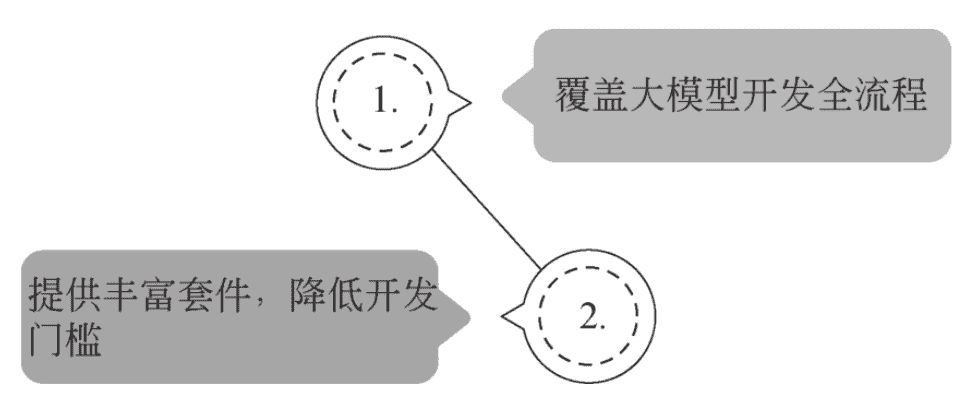
#### 1. 覆盖大模型开发全流程
昇思MindSpore 2.0提供贯穿开发与部署的整体方案，为企业打造快车道。

- 脚本开发环节可从模型库一键导入模型，快速完成算法脚本编写；
- 训练环节支持千亿参数规模训练，兼顾数据并行与模型并行，提升算力利用与效率；
- 微调环节集成多种低参微调算法，提升效率，并支持基于用户反馈的强化学习，增强适用性；
- 推理部署环节提供模型压缩工具并支持分布式推理，提升部署效率。

#### 2. 丰富套件助力降门槛
除全流程服务外，2.0在易用性上进一步优化，提供丰富套件。推出多场景化开发套件，开箱即用，缩短训练周期；并通过MSAdapter套件与其它开源社区协同，实现大量模型迁移，大幅提升对企业的大模型研发支持能力。

华为在运营、人才、产业推广上持续投入，建设开放社区。2023年6月昇思MindSpore开源社区理事会成立，建立专业委员会，与开源基金会及其他社区合作。人才培养上提供分层教材课程、实习竞赛实践机会及学术基金激励研究；产业推广上启动硬件加速计划，与硬件厂商联合研发、办赛、联合营销。目前社区汇聚数百开源模型、服务数千企业，生态日趋完善，未来将持续研发，加速大模型落地。

# 第4章 新型商业模式：MaaS重构商业生态
随着大模型发展与应用，AI领域出现模型即服务MaaS新模式。技术进步推动大模型走向标准化与规模化，为产业化、普及化及MaaS生态构建奠定基础。

MaaS已在企业端与消费端显现商业化雏形，能以多元化服务赋能企业，改善用户应用体验。未来大模型有望作为新基建赋能各行业，催生新场景与新商业模式。

## 4.1 MaaS模式拆解
落地MaaS前需明确其概念与产业结构，以挖掘价值。

### 4.1.1 概念解析：MaaS是什么
MaaS即模型即服务，科技巨头提供付费大模型服务，助力细分企业训练模型，进而孵化更具针对性的大模型，为各行业提供高效低成本的使用与开发支持。

不同行业业务、技术、规则各异，大模型也存在差异。MaaS下用户可直接调用、开发、部署模型，无需从零研发。

例如，某巨头推出通用大模型，凭借庞大参数与海量数据训练具备强通用能力，而细分落地需进一步微调。巨头可基于自身优势打造垂直大模型并开放接口，企业也可以在通用模型上训练专属模型再提供给用户。巨头通过API收费，企业以更低成本获得并微调模型，双方均获益。

### 4.1.2 MaaS模式产业结构
产业路径大致为“底层模型——单点工具——多场景应用”。以ChatGPT为例，底层为GPT-3.5，单点工具为ChatGPT，可在智能对话、文案生成、代码生成等多场景应用。

#### 1. 底层大模型构成MaaS基座
大模型是MaaS底层支撑。科技巨头推出通用基础模型并开放API供调用。

2023年4月，商汤公布日日新SenseNova大模型，具备内容生成、数据标注、模型训练等能力，为企业端提供支持，涵盖图片生成、自然语言生成、数据标注等服务，企业可按需调用低成本落地AI应用。

#### 2. 单点工具延伸大模型能力
单点工具是基于大模型产生的各类应用，让更多用户体验能力，通过专业化工具完成内容生成。

Jasper基于GPT-3构建营销内容生成工具，提供模板生成广告文案、邮件、社交媒体文案等。商汤在发布日日新时还展示了多款应用：

- 秒画SenseMirage文生图创作平台，支持多风格高清图生成，光影细节丰富；
- 如影SenseAvatar AI数字人视频生成平台，可基于真人素材生成自然声音与动作的数字人视频，支持多语种；
- 琼宇SenseSpace 3D内容生成平台，可生成大规模真实虚拟场景及细化物件。

相较大模型，单点工具更具针对性，有望改变细分领域生产方式。

#### 3. 多场景应用打开变现通道
虽暂无覆盖所有场景的通用大模型，但覆盖范围不断扩大。随着模型与工具演进，应用场景持续蔓延。

GPT系列衍生出ChatGPT、Jasper等工具，场景不断扩展。ChatGPT用于代码生成、智能搜索、文学创作等；Jasper用于营销文案、视频生成、网站运营等。未来基础模型与单点工具数量将持续增长，覆盖的应用场景也会进一步扩大。

## 4.2 MaaS模式在企业端的商业化落地
企业端是重要落地场景，壁垒与数据要求较高，流程复杂，应用价值突出。MaaS在企业端的商业化路径已逐步清晰，为企业端服务成为企业重点。

### 4.2.1 从高价值场景切入企业市场
商业化宜从高价值领域切入再逐步扩展，形成繁荣生态。

从降本增效看，MaaS率先在营销、工业制造等领域落地，变革内容生产范式，提升运转效率。营销领域可提供定制化服务，支持训练专属营销模型、生成广告与方案。

MaaS还能贯穿企业多环节，优化流程。以工业制造为例：开发环节大模型可生成代码完成重复任务；设计环节可利用图像生成能力做三维可视化，提升效率，甚至直接生成方案并分析优缺点提供灵感；生产制造环节可辅助工人设置设备参数、提供操作指引，出现故障时快速诊断并给出解决办法，多流程工艺可输出参数报告供决策；运营管理上可理解分析ERP、SRM等系统数据，生成AI分析报告，融合多系统实现多维分析，如生成Excel表格辅助管理者决策；服务环节可提升响应效率并创造新形式，接入智能家居、早教机器人提升智能性，接入智能客服提升处理速度与服务水平，也可在抖音、微博等平台生成营销内容并实现实时互动。

大模型在知识密集型领域潜力巨大，MaaS可推动垂直落地。通用模型虽具备基础知识，但在金融、医疗、法律等复杂任务上不足。企业可调用接口，结合垂直数据训练获得个性化应用。

2023年5月，度小满发布金融垂直开源大模型轩辕，依托多年金融实践积累海量数据构建预训练集，涵盖研报、股票、银行等专业知识。在名词解释、数据分析、问题解析等任务表现突出，能专业解释概念并给出建议判断，分析熊市牛市影响时除概念解读外还提供投资建议与趋势分析。发布后吸引上百家金融机构试用，为中小机构提供技术支持，缩小与大行的差距。

借助MaaS，越来越多企业端用户研发专属模型或集成到产品中，提升竞争力与用户体验。

### 4.2.2 API开放推动产品迭代
开放API是服务更多企业的基础，也是MaaS在企业端落地的关键方式。

企业可利用开放API将自有产品文档、客服对话等数据用于训练，得到私有专属模型，使用隐私数据训练后可生成更具针对性的内容，提供个性化服务。同时基于开放API，企业可升级产品，推动迭代。

ChatGPT 将接口向外界开放以后，越来越多公司把基座模型能力嵌进自家产品，用来做功能迭代和体验优化。互联网公司汤姆猫深耕“会说话的汤姆猫家族”这一核心 IP，已经搭建起线上线下联动的完整商业链路，业务触达多个国家旗下汤姆猫系列游戏累计安装次数已突破百亿。

为了把 IP 价值再做深，汤姆猫把游戏内容与前沿技术结合，不断刷新互动玩法。公司在 ChatGPT 引发市场关注后迅速跟进，利用其底层能力开展产品验证和研发。

目前汤姆猫已经完成 AI 语音交互的初步测试，在存量产品上增添了语音识别、语音合成、角色性格设定等模块，并对语音对话、多轮连续交流等场景做了功能验证，同时推进了相关技术落地的可行性评估。

汤姆猫之外，360、百度等头部科技公司也在密集发布自研基座模型并开放调用接口，为各行业赋能。以 360 为例，2023 年 6 月宣布面向公司和开发者开放通用模型“360 智脑”接口，输出面向行业的解决方案。该方案优先在传媒、能源等领域落地，为企业在办公写作、决策分析、客户服务等环节提供支撑。

总体来看，开放的模型接口让公司能够把模型能力内嵌到自有产品中，推动性能提升和功能升级，加速迭代与新品研发。未来模型即服务在 To B 端会迎来规模化应用，助力更多行业。企业可根据自身诉求挑选适配的服务形态。

### 4.2.3 平台驱动 打造全流程模型即服务能力
在开放接口的同时，不少厂商在模型即服务层面做更全面的布局，依托技术底座搭建一体化模型服务门户，为 To B 用户提供调用、微调、应用、管理的全流程支持。

2023 年 5 月的“文心基座模型技术交流会”上，百度智能云展示了文心模型的进展，其中包括处于内测的“文心千帆”模型门户。该门户是一款面向公司的模型生产门户，集成了文心一言及若干第三方模型，为企业开发和应用基座模型提供完整工具链，实现一体化服务。

文心千帆主要承担两类工作：一是依托文心一言帮助企业产品迭代与生产流程优化；二是支持企业基于门户内的模型训练专属模型。凭借这两项能力，门户有望成长为模型生产与分发的枢纽。

门户覆盖海量数据处理、数据标注、模型训练微调、评测等全开发环节，企业拿到业务定制模型后，还可享受模型托管、推理等运维服务，使用门槛进一步降低。

在易用性上，用户无需写代码即可完成训练与微调；在开放性上，门户汇聚多家第三方模型，覆盖更广场景；在能力拓展上，通过插件机制引入外部能力，提升服务上限。

交付形式支持公有云与私有化部署。公有云提供推理、微调、托管三类服务：推理支持直接调用门户内模型能力；微调帮助企业用高质量数据生成行业定制模型；托管负责模型稳定运行，三者共同降低应用门槛。私有化部署则提供软件授权、软硬件基础设施支持及硬件与门户能力的租赁服务，满足企业本地化需求。

目前文心千帆已与用友、宝兰德等生态伙伴签约，未来将通过完善生态推动模型即服务在更多领域落地。

百度之外，字节跳动旗下云服务平台火山引擎在 2023 年 6 月推出模型即服务平台“火山方舟”，面向企业提供模型训练与微调服务。平台已汇聚 IDEA 研究院、智谱 AI 等多家模型并开启邀请测试。

火山方舟支持模型精调与效果评测，企业可用统一工作流并测多模型，再挑选适配业务的方案，也可按场景组合模型赋能业务。依托安全可信计算技术，用户数据资产安全得到保障。

字节内部多个业务团队已在火山方舟上实践降本增效，平台能力不断完善。同时平台已邀请金融、汽车等行业企业内测，未来将与客户营销、协同办公等场景结合，提升企业运营效率。

## 4.3 模型即服务在 C 端的商业化落地
除 To B 外，模型即服务也在 C 端加速落地，驱动应用迭代、功能升级，为用户带来更佳体验。

### 4.3.1 C 端落地的三大方向
模型即服务将推动 C 端应用从“能用”迈向“好用”，提升体验。结合商业化视角，C 端落地大致有三条路径，如图 4-1 所示。

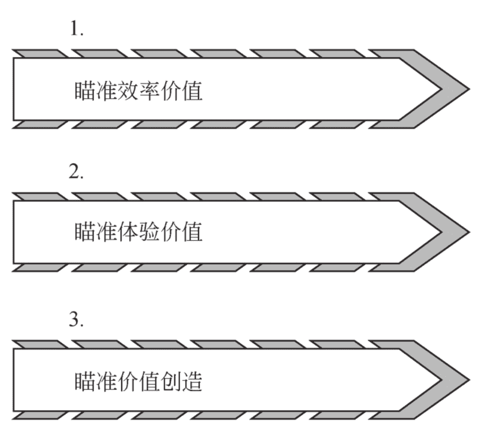

图4-1 模型即服务在 C 端落地的三大路径

#### 1. 聚焦效率价值
模型即服务正在重塑编程工具、文档工具等，提升办公效率。CodeGeeX 就是一款基于基座模型的 AI 编程工具，可实现代码生成、翻译、补全，支持数十种语言，向用户免费开放，帮助提升编程效率与质量，降低门槛。用户可通过网页版或 VS Code 插件使用。

#### 2. 聚焦体验价值
体验是模型即服务的关键发力点，数字人、游戏等对体验要求高的领域率先变化。

2023 年 6 月“360 智脑模型应用发布会”上，360 同步发布基于基座模型的智能应用“AI 数字人广场”。应用支持用户与 200 多个角色互动，涵盖“孙悟空”“诸葛亮”等知名人物。

平台数字人分两类：一类是大众熟知的数字名人，另一类是提供专业服务的数字助理。名人可根据提问给出建议，助理则能提供法务、策划等专业内容。应用还支持数字人定制，可依据用户上传的私人资料生成人设鲜明、性格独特的专属数字人。

目前应用仍在研发，未上线，但展示了模型即服务在 C 端落地的可行路径。在基座模型加持下，数字人将更智慧，能处理更复杂任务，具备接近人类的思维方式和鲜明性格，实现朋友式陪伴。

#### 3. 聚焦价值创造
模型即服务在 C 端落地将催生内容爆发，提升消费级应用服务能力。在模型支持下，文本、图像、视频生成、3D 建模等功能正不断优化，使用体验更便捷。各大开源社区已聚集大量面向个人的 AI 绘画、AI 编程工具，辅助创意与研发设计。

与此同时，多款应用正借助模型升级。阿里已构建较为完整的模型即服务体系，包括通用基座模型、企业专属模型、接口服务、开源社区等。未来淘宝、闲鱼、高德地图等产品都将接入基座模型，优化使用体验。

模型即服务将沿着效率、体验、价值创造三条路径向 C 端更多场景渗透。随着企业研发深化，基于基座模型的 AI 产品将密集涌现，覆盖生活各方面。

### 4.3.2 智能硬件成为个性化模型的主体
2023 年 4 月，天猫精灵接入阿里巴巴通义基座模型并开启内测招募。演示显示，接入“通义千问”后，天猫精灵的知识广度、沟通自然度和个性化水平均有提升，成为更具温度的智能助手。

基座模型与智能硬件结合，凸显了模型在硬件领域的价值。未来在模型驱动下，智能硬件将进入更多场景，C 端个性化定制将成新方向。

个性化模型更适配 C 端。例如居家场景中，搭载个性化基座模型的硬件可被赋予身份、性格、偏好等角色设定，与用户对话时生成个性化回复并以个性化语音交互。

为通用模型注入个性化要素正成重要探索方向，智能硬件作为承载主体，也将成为新的流量入口。同时硬件可借助模型焕新。传统智能音箱、扫地机器人等在智能性上长期受诟病，接入基座模型后可实现更智能功能，满足个性化需求。

在模型助力下，智能陪护机器人、早教机器人等先进硬件有望迎来技术突破。例如智能陪护机器人可与用户个性化互动、顺畅沟通，精准把握需求提供贴心服务。除多样化服务与安全监护外，借助模型生成能力，其还具备多媒体娱乐功能。

总体看，个性化模型能升级交互方式与功能，满足用户个性化需求，有望率先在智能家居领域落地。

### 4.3.3 云从科技面向 C 端推出“从容”模型
深耕 AI 多年的云从科技在 2023 年 5 月推出自研模型“从容”，主要面向 C 端，提供更智能便捷的 AI 应用。

依托实时学习与同步反馈，“从容”助力 AI 应用落地，加速个性化应用普及。凭借上下文学习能力，模型可实现更自然交互，适用于游戏、金融等场景，提升服务体验。

传媒领域，云从推出数字人直播平台，用户可自由选择背景、主播库、语音、视觉风格。模型可生成直播文稿、实时回答互动问题，并对直播进行监控与提示生成。

教育领域，众数信科基于“从容”打造智能教育 AI 精灵。教师可用其批量生成不同类型、难度的题目，精灵还能评价学生表现，减轻教师负担。

游戏领域，云从致力推动模型在游戏中的应用，提升开发发行效率。公司与游族网络合作研发游戏垂直模型，成果将用于产品研发与发行。

金融领域，基于“从容”研发的虚拟客户经理具备智能问答、多意图理解、动态追问等能力，助力金融机构实现引流、营销到运营的全流程智能化。

智慧城市场景下，模型可结合当日天气、交通等信息，为市民提供科学出行建议。

发布会上，云从与神州信息、游族网络、今世缘达成合作，并与华为昇腾、厦门文广开展生态协作，推动“从容”模型成熟。

## 4.4 模型即服务成为基座模型厂商的核心商业模式
随着模型逐步成熟，厂商积极推动落地，模型即服务成为核心商业模式，主要收费方式包括订阅制、嵌入其他产品获取引流收入、开放接口与定制开发收费。

### 4.4.1 订阅制收费
模型即服务能为企业提供多类高质量模型，以低成本获得优质服务，灵活性与适配性强，可按业务目标提供个性化方案。订阅制是主要收费模式，ChatGPT 即为典型。

ChatGPT 分免费与付费版。免费研究预览版上线一周即获近百万粉丝，截至 2023 年 1 月月活达 1 亿，高速增长导致服务器崩溃。OpenAI 采取限流措施，包括禁止云服务器访问、限制每小时提问次数、高峰期排队。

为此推出付费订阅 ChatGPT Plus，月费 20 美元，权益包括高峰免排队、快速响应、新功能优先试用。高峰期免排队极具吸引力。

另有内测付费版 ChatGPT Pro，月费 42 美元，提供全天可用、快速响应、优先使用新功能等权益。两版差异需用户自行体验。

除 OpenAI 外，Jasper.AI 推出 AI 写作助手 Jasper，底层为 GPT-3，可生成文本、提供写作模板、广告文案、邮件、社交媒体推文等，订阅档位最低 29 美元。

Copy.ai 是文本生成工具，用户包括微软、eBay 等。其操作简便，输入需求即可生成内容，并支持增删改格式。订阅制收费，月费 49 美元，年费 332 美元，对大客户可提供专属服务。

随着研发深入，订阅费用有望逐步下降，吸引更多用户，带来广阔市场空间。

### 4.4.2 嵌入产品获取引流收入
嵌入其他产品获取引流收入也是模型即服务收费方式之一，微软即通过为软件提供服务获益。

2023 年 2 月，微软推出 Microsoft Teams Premium 收费服务，用于视频会议与远程操作。2023 年 6 月价格为 7 美元/月，7 月恢复至 10 美元/月。

服务由 OpenAI GPT-3.5 支持，核心功能为智能回顾，可自动生成会议记录、标记重点，方便错过会议或需回顾的用户。智能回顾显示每位参与者姓名、被提及时间、进出时间，并标记演讲者起止时间，便于复盘。

微软 CRM 软件 Viva Sales 接入 OpenAI GPT-3.5，帮助销售减负。可自动回复用户问题，销售选择提供折扣或回答后系统自动生成回复，并基于历史数据生成个性化营销邮件。服务月费 40 美元，为微软带来可观收入。

2023 年 3 月，微软发布 Copilot AI 服务，可生成文档、PPT、邮件等，并能嵌入 Word、PPT 等办公产品。嵌入 Word 可生成文本，嵌入 Excel 可分析数据生成图表，嵌入邮箱可整理收件箱与回复邮件。

总体看，微软持续探索模型即服务，致力于提供更优质服务。

### 4.4.3 开放接口与定制开发收费
部分企业通过为客户工具提供模型支持收费。OpenAI 致力于提供开源模型并开放接口以获取收益。

DALL·E 是 OpenAI 推出可编辑与创建图像的模型，企业可将其集成到自有产品。

创业公司 Mixtiles 与 OpenAI 合作，将 DALL·E 融入产品，助力用户内容创作。

零售平台 Cala 也搭载 DALL·E，为用户提供设计售卖品牌的零售平台，提供构思、设计、售卖一体化服务。用户上传文本描述或参考图后，平台可输出设计图。

相较 Mixtiles，Cala 的商业化程度更高，对细节要求更严。同一模型在不同客户需求下收费差异显著，需求越高收费标准越高。

# 第5章 基座模型驱动下数据服务市场爆发
AI 快速发展离不开数据支撑，数据是基座模型发展的关键要素。在此背景下，模型对数据资源的需求持续上升，越来越多企业进入数据服务领域，为模型提供优质数据源，推动数据服务市场爆发。

## 5.1 基座模型时代数据资源需求攀升
AI 技术发展使基座模型成为企业研发新方向，但模型训练需要高质量、大规模、多样化数据，对数据要求极高。在此趋势下，数据标注服务需求爆发，训练需求带动版权 IP 需求上升，众多企业涌入数据服务。

### 5.1.1 数据标注需求迎来爆发
AI 行业持续发展，模型愈发复杂，对算力要求提高，进而拉动训练数据需求。随着企业对数据数量与质量要求提升，数据标注服务需求将加速爆发，推动标注行业快速发展。

在真实的业务场景里，模型要能部署、要能训练、要能调优，前提都是数据先被整理好。数据标注就是这套流程里不可或缺的一环。据行业测算，AI项目里耗时最长的就是数据处理，而标注就占了近四分之一。

当下的标注需求主要集中在计算机视觉、智能语音和自然语言处理三大赛道。伴随人机交互技术不断成熟，语音类和NLP类标注的需求仍在持续放大。旺盛的需求在拉动训练数据质量上行，也推高了标注产品与服务的整体价格。观研天下以2021年价格为100的相对指数来看，标注价格一路走高，预计到2029年将升至112.3。

国内市场目前高度依赖定制化交付，现成标准化产品的比例偏低。2021年定制化服务在国内标注市场的份额高达85.41%。随着AIGC从概念走向落地，越来越多企业开始推出智能化数据服务与自研标注平台，来巩固自身的竞争壁垒。

### 5.1.2 训练需求点燃版权IP价值
AIGC热度持续升高，大量企业涌入大模型赛道。阿里巴巴推出通义千问，商汤发布日日新SenseNova，昆仑万维上线天工大模型。大模型离不开海量高质量数据喂养，掌握稀缺数据和版权IP的公司因此迎来发展窗口。

以OpenAI为例，其训练素材涵盖社交新闻、期刊杂志、书籍等多元来源，正是丰富的数据底座支撑了模型表现。如今各家都在自研大模型，数据的重要性被进一步放大。

已有内容方开始与模型厂商合作输出优质数据。中文在线深耕图书出版，拥有大量中文独家版权，可提供独家数据库。中信出版启动AIGC数智化出版项目，把AI引入出版流程，降低运营成本，并借助AIGC重塑收入结构，持续沉淀数字资产。

大模型训练离不开版权IP的加持，优质IP能保证模型输入与输出的高质量，自身价值也因此被重新释放。模型开发过程中，版权资产成为各方抢夺的焦点；反过来，大模型也能反哺IP，提升内容生产效率，实现降本增效。

### 5.1.3 中文在线牵手智源研究院
ChatGPT爆火后，AIGC浪潮席卷行业，企业纷纷把AI能力嫁接到主营业务上来。中文在线作为数字内容供给商，积累了丰富的数字内容资产。为在多模态AIGC研发上保持优势，中文在线与智源研究院签署合作协议。

中文在线既有深厚的文化内容数据储备，也有成熟的应用落地场景。此次联手，有助于推动大模型向产业化迈进，并在垂直内容领域实现突破。

智源研究院专注人工智能研发。2021年该院先发布了国内首个超大模型悟道1.0，同年推出参数达1.75万亿的悟道2.0，成为当时全球首个万亿级模型。架构上，智源推出的GLM 2.0打破了BERT与GPT的割裂，让单一模型同时兼顾理解与生成。

在大模型时代，真正决定成败的是应用层。智源把重心放在悟道系列的应用转化上，力推AI产业化。

中文在线可为智源提供文字、音频、视频等多形态的应用场景，助力模型落地。该公司在多个内容形态上已有探索，具备承接AIGC产品落地的能力。

合作聚焦数字文化内容的生成与研发，共同打造面向数字文化垂直的精细化小模型并加速落地。双方协作提升了内容创作效率与丰富度，也拓宽了AIGC的使用边界。

在行业浪潮下，中文在线与智源都处于第一梯队。智源顺应AI发展而生，中文在线则积极拥抱AI，自研AI产品并用AIGC辅助创作，推动生产方式变革。技术与场景的结合，有望孵化更多垂类模型，降低生产成本，提升效率。双方还将持续推进成果转化，培育具备竞争力的创业项目，为AI行业带来新惊喜。

## 5.2 合成数据成为大模型的优质底座
合成数据是通过算法或计算机模拟真实数据生成的人造数据。虽然不直接来自现实世界，但它在一定程度上能复现真实数据的统计规律，作为替代数据源满足特定场景需求。

### 5.2.1 高效低成本高质量的三重优势
大模型越强，对数据的依赖越大，企业需要大规模采集和处理数据。但短时间内拿到足够高质的数据并不容易，合成数据由此诞生，帮助企业更高效地训练机器学习模型。

合成数据最突出的特质是高效、低成本、高质量。

高效体现在可在极短时间内产出海量样本，且保留原始数据的统计特征，和源数据无关联，便于研究者和开发者共享利用。比如极端路况样本稀少，自动驾驶测试却必须覆盖，企业只能借助合成数据提升效率。

低成本的优势很直观，人工标注一张图片约需6美元，而机器合成一张仅需约6美分，十倍的成本差带来明显的竞争优势。

高质量则体现在能补充边缘案例，通过深度学习算法生成稀有样本，保证数据多样性。

隐私保护是另一关键。医疗企业可在不暴露个人隐私的前提下用合成数据做模型训练和药物研发；金融企业可用合成数据训练交易模型或客服机器人，提升体验。

不过合成数据并非完美。真实数据常含异常值，合成数据往往缺失这部分信息，而异常值对某些模型的精度提升很关键。此外合成数据的质量受输入数据制约，必须以高质量真实数据为起点，且需与真实数据对比避免偏差。

即便存在局限，随着高质量真实数据越来越难获取，合成数据仍是越来越多企业的可行解决方案。

### 5.2.2 应用场景：自动驾驶＋机器人＋安防
合成数据的落地场景正在快速拓展。

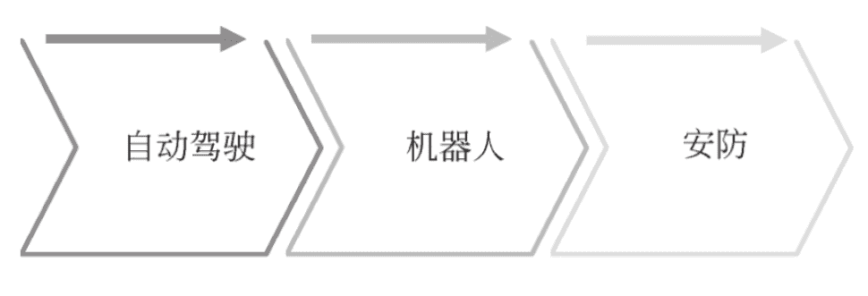

#### 1. 自动驾驶
保证算法准确需要海量真实数据，并要在使用前完成标注、清洗等处理。每张图像都要被标记才能进入训练。

合成数据能缓解测试在场景覆盖和成本上的压力。它可以生成现实中难以采集的场景，解决数据匮乏与质量不足的问题，从而降低成本。将合成数据注入训练流程，可提升自动驾驶算法的准确性和可靠性。

#### 2. 机器人
在机器人辅助手术领域，合成数据的作用甚至超过真实数据。美国某高校团队曾开发软件生成训练所需数据，用于X射线图像分析等手术关键环节。

研发能精确放置器械的新型手术机器人，需要海量训练样本。通过模拟机器人在多种手术场景下的表现，可快速生成数据并持续优化性能。合成数据训练的算法效果与真实数据相当，且更灵活、高效、成本更低。

#### 3. 安防
合成数据在安防领域可兼顾效能与隐私保护，主要体现为三点：

信息的高度真实性，通过高度匿名化保护隐私，同时保持数据有效性，让企业能获得接近原始数据的结果。

不修改数据结构，合成数据是基于真实数据的模拟，现有的数据应用系统和工具无需改造，即可复用同一套代码。

无法回溯真实数据，因其是人工制造并不存在于现实世界，因此不会泄露个体隐私。

合成数据解决了缺数据的问题，凭借隐私友好和成本优势正获得广泛应用。随着技术成熟，其质量与可靠性将进一步提升，在更多行业发挥支撑作用。

### 5.2.3 头部科技公司抢滩合成数据
合成数据的快速发展吸引了大量玩家布局。英伟达、Meta等巨头都已进入该赛道。

英伟达发布了仿真平台DRIVE Sim，目标是构建高度逼真的仿真世界并提供足够规模的训练场。为此它推出神经重构引擎NRE，可基于真实传感器数据生成仿真数据，对环境、场景等关键要素进行提取与重构。

AI初创公司AI.Reverie深耕合成数据，Meta通过收购其来强化自身能力，并用合成数据训练算法，构建更真实的元宇宙。

国内企业也在发力：

海天瑞声 将为虚拟数字人客户提供训练数据与产品，覆盖声音、表情、动作及多性格语音合成数据集；
润和软件 推出“润和智数”数据合成标注平台，面向电力、医疗等行业解决标注与测试数据生成问题，降低采集成本并提升服务准确性；
浩瀚深度 数据合成与内容还原系统是其智能化业务的核心收入来源；
汉仪股份 自主研发彩色位图字体自动生成技术，支持多线程合成数据，提升合成效率；
软通动力 认为合成数据潜力巨大，计划正式切入该领域。

合成数据正成为未来模型训练的底层资源，在头部企业的推动下，技术迭代将加速，产业应用会更广。

## 5.3 大模型时代数据服务市场竞争升温
大模型的爆发让数据服务成为兵家必争之地。海天瑞声、拓尔思、浪潮信息等公司都在加码数据服务。

### 5.3.1 海天瑞声：开放生态＋自建标注平台
海天瑞声是AI数据资源供应商。为提供更优服务并实现新增长，公司启动品牌焕新，从开放数据集和搭建标注平台两条线发力。

品牌层面打造全新Logo，并将英文名由Speech Ocean改为DataOcean AI，标志着从语音向更广阔数据领域的扩张。

公司成立于2005年，多年来深耕AI数据，服务阿里巴巴、腾讯等知名客户，数据集被多个大模型采用。随着数据价值攀升，公司在稳住基础数据业务的同时，积极拓展开放共享和标注平台业务以增强壁垒。

#### 1. 开放数据集，构建AI开放生态
高质量、可复用的数据集是算法优化和模型训练的基础。海天瑞声宣布开放共享数据集，推动资源整合。

开放数据集不仅是社会责任的体现，也是行业生态的催化剂。它能为从业者提供更多样本，加速研究与训练，催生更精准的垂类大模型。

公司开放的多模态数据集DOTS-MM-0526涵盖语音、图像、视频等维度，意在与全球开发者联动，共同推动行业发展。

#### 2. 打造自动驾驶数据标注平台
自动驾驶依赖海量数据的采集、管理与标注协同。海天瑞声推出全栈式标注平台DOTS-AD，专为自动驾驶场景设计，可大幅提升标注效率，支持万人级并发。

平台具备四大能力：支持2D、3D、4D图像标注；提供辅助或自动化标注，覆盖多场景；项目管理可柔性定制工具与标签；数据管理智能化，保障隐私与安全。

在AI持续驱动下，海天瑞声正通过技术壁垒构建竞争优势。

### 5.3.2 拓尔思以数据底座探索大模型落地
拓尔思深耕人工智能与大数据20余年，在中文检索和自然语言处理领域具有影响力，自主推出拓天大模型。

落地时模型在质量、可控、时效、成本四方面面临挑战。质量上需保证数据可靠与输出准确；可控上需确保内容安全和用户隐私安全；时效上需解决大数据训练的灾难性遗忘；成本上需兼顾研发与应用费用。

拓天大模型依托公司多年积累的高质量数据与知识资产，结合知识图谱与自然语言处理技术打造，拥有10项基础能力与4项创新点。公司自有超1500亿条网络数据，为模型研发提供坚实基础。

相比通用模型，拓天在大模型自主可控、中文增强、专业知识增强上更具优势，可与业务深度融合。在媒体领域可提供内容创作与搜索推荐；在金融领域可提供智能风控与投研服务，通过微调打造垂类模型满足行业需求。

拓尔思还与传播大脑科技合作推出传播大模型，推动媒体行业落地；2023年6月的成果发布会上，公司与多家企业签约，推动大模型在知识产权、智能客服等场景应用。语言大模型仍是核心基座，公司将持续迭代拓天，让更多行业受益。

### 5.3.3 浪潮信息推进大模型产业化
AI大模型有望推动认知智能突破，成为数字经济的智能大脑。浪潮信息抓住机遇，将大模型接入客户服务平台，打造智能客服大脑，提升服务水平并探索产业化路径。

公司认为服务是连接用户与赢得竞争的关键，提供远程运维、技术咨询、维修保障等多类服务，强调安全、可靠与响应速度。

依托JDM联合设计制造模式与AI布局，浪潮市场份额快速提升。伴随用户与咨询量增长，公司以数智化手段提升服务能力，确定智能化服务六大方向：智能服务机器人、智能运维、智能调派、智能在线管理、智能现场管理、智能备件供应链，并搭建远程智能服务平台InService。

客服作为服务窗口，公司正从传统客服向IT专家转型，对外快速解决用户问题，对内协同工程师传递需求，共同提升体验。

让客服与工程师配合更高效，浪潮信息开始尝试让AI具备工程师级别的专业素养和沟通能力。智能客服起步阶段，行业内还没有可复制的成功经验，当时的机器人仅能做基础分流和标准回复，难以覆盖复杂的业务诉求。浪潮面向B端的服务多为知识密集型，专业门槛高、场景复杂。日常咨询里，用户的问题往往超出常规问答，涉及产品操作、参数配置、故障排查等环环相扣的难点。

由此，智能客服必须被培养成真正的行业专家，能够理解用户意图并给出可落地的解答。比如系统安装失败的原因很多，客服需要通过多轮交流逐步锁定根因并提供方案。

打造高专业度的智能客服并不简单。早期浪潮采用了当时常见的模型，并与专家一起构建了内容完备的问答库用于训练。随着应用深入，问题解决率的提升趋于缓慢。于是公司以自研的大规模模型“源”为抓手开启升级。

“源1.0”是浪潮推出的首个自研模型，参数规模约2457亿，能力基础扎实。该模型学习能力强，可作为算法底座复用到多场景。研发过程中团队持续扩充知识库，将上万份产品资料、用户手册等作为训练素材，经过数月迭代，形成基于“源1.0”的客服中枢。

“源1.0”具备较强的学习与推理能力，完成任务无需耗费大量人力做问题匹配，可凭借自身语言理解能力自主学习。

以服务器内存配置为例，传统客服依赖人工录入答案形成问答库，用户提问时系统在库中检索最接近的回复。而“源1.0”把产品文档当作学习材料，通过上下文理解自行分析并回应。

在“源1.0”加持下，浪潮智能客服有了“思考”能力，交互体验明显提升，在设备运维、故障诊断、信息管理等领域呈现更强的智能化表现。

当前数字经济加速，数据中心持续升级。作为数据服务商，浪潮不断强化服务能力，以智能客服为核心重塑体验，为数字经济发展注入新动能。

# 第6章 大模型重塑检索：对话式溯源体验

传统检索依赖关键词匹配，很难把握用户真实意图。把大规模语言模型与智能检索结合后，可打造互动溯源式的检索体验，通过上下文理解需求，输出更精准个性化的结果，实现真正的智能化检索。

## 6.1 大模型如何改变检索形态

大规模模型正在推动检索方式变革，智能互动式检索将成为主流。以对话形式挖掘需求，给出更符合预期、更精准的答案。

### 6.1.1 从单向检索到对话式互动

技术演进让知识获取渠道不断拓宽，从纸质期刊书籍转向互联网，载体也从电脑变为手机。移动互联网成为信息获取主渠道，检索系统的重要性随之凸显。人工智能正在改变检索范式，智能互动式检索由此出现。检索变革大致经历三个阶段，如图6-1所示。

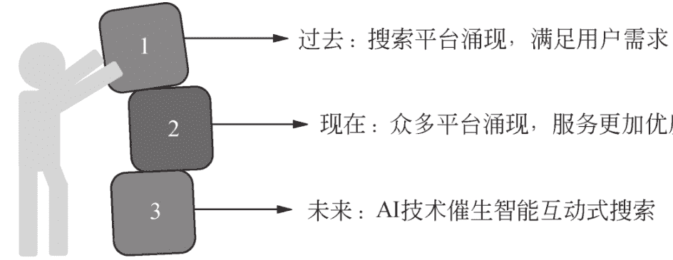
1. 过去：检索平台兴起，满足基础需求

互联网兴起后，用户习惯在网上查找内容，从软件教程到生活常识，都能通过检索平台获得答案。百度、腾讯等平台逐渐成为检索服务主力。互联网像一本包罗万象的百科全书，大幅便利了生活，也冲击了传统教育。

例如吉林省通榆县一所师资薄弱的学校，校长常借助百度文库搜集教学资料。北大、清华等名校教师也在平台上上传教案课件，这些资源为资源匮乏地区的师生提供了帮助。如今该校已实现电子备课，借助优质在线资料成为互联网教学的先锋。

2. 现在：平台众多，服务更专业

互联网高速发展，用户对检索结果的要求不断提高，各平台纷纷提供更专业的服务。

微信检索将知乎、腾讯视频、京东等产品整合，更名为“搜一搜”，搭建起服务与用户间的桥梁。用户输入“时间+天气”或汽车品牌等关键词即可直达服务，实现检索即服务。

知乎作为问答社区，聚集了各领域爱好者和专家，用户不仅能查到答案，还能与专家交流。

百度知道采用“用户提问—奖励机制吸引回答”的模式，形成知识分享生态。

无论是搜一搜、知乎还是百度知道，核心都是分享知识、解答疑问，更好满足用户。

3. 未来：人工智能催生智能互动检索

用户习惯在检索平台寻找资料，但方式较为单一。越来越多的平台开始把检索当作整合资源、连接多方的手段，实现智能检索，提供更全面的服务。

人工智能的出现催生了语音检索。许多智能设备搭载人工智能技术，可通过语音交互完成检索。比如一家盲人按摩店引入百度智能语音系统后，盲人无需费力记忆按键位置，通过呼唤系统名字即可控制灯光、调节空调温度等。

百度也在尝试把大规模模型与传统检索引擎结合，提供AI伙伴、AI助手等功能。用户在使用百度检索时可与人工智能对话，降低表达门槛。模型的加入让检索具备自主学习与内容生成能力，通过检索连接一切，提供更优服务。在检索变革中，模型加持的应用将占据重要地位，带来个性化体验。

### 6.1.2 生成式检索：定制内容即时呈现

生成式人工智能借助机器学习对已有数据进行学习，进而创造全新内容，涵盖文本、音频、图像等。生成式检索则是生成式人工智能与检索引擎结合，为用户生成定制化内容。

传统检索引擎不具备内容创作能力，只能整合其他网站资料并跳转。生成式检索会在分析结果的基础上为用户生成定制内容，优势更为明显。

生成式检索结果更直观，支持文本、图像、视频等多形态呈现，能提供更精确丰富的答案。用户无需翻阅多个网页，浏览量下降，效率提升。生成式检索将削弱用户对传统检索引擎的依赖，也会影响传统检索的广告收入。

例如，You是一个搭载人工智能技术的检索引擎，可进行生成式检索。其推出推动了网络检索的发展。You能提供文本、图像、表格等多种形式的检索结果，用户在减少打开网页次数的同时获得更精准丰富的信息。检索页还集成上百个应用，目标是为用户提供合适的答案。同时You注重隐私保护，隐身模式下用户IP会被隐藏。

总体来看，生成式检索能为用户提供更丰富的内容和更好的结果呈现。随着大规模模型不断发展，生成式检索将愈发智能。

### 6.1.3 知乎自研模型：检索聚合提速

在自然语言处理领域，知乎持续探索。2023年4月发布具备“热榜摘要”功能的“知海图AI”大语言模型后，知乎又与面壁智能合作，推出模型“检索聚合”、中文基座模型CPM-Bee10b、对话类模型“面壁露卡”，持续深耕模型。

人工智能是人类脑力的延伸，发展人工智能要以人为本。知乎始终从用户需求出发，帮助用户解决问题。

“检索聚合”将模型能力应用到知乎检索。以大量问答为基础进行观点聚合，有效提升用户获取信息和决策的效率。知乎还计划把大语言模型赋能创作者，让模型成为创作助手。

CPM-Bee 10b由面壁智能研发，能力强劲。以Transformer架构为基础自主训练，参数达百亿级。面壁智能还推出智能对话类模型“面壁露卡”，功能丰富，可实现内容自动生成、语音理解、数据处理等。

未来知乎将持续提升大语言模型的基础能力，推出更多实用产品，为用户提供更优质的模型服务。

## 6.2 检索与模型融合：巨头抢占入口

互联网深入生活，检索已成为获取海量信息的重要工具。用户规模和使用率持续攀升，发展空间广阔。众多企业开始将检索引擎与大规模模型融合，升级系统以吸引更多用户。微软、谷歌、百度等科技巨头纷纷把融合作为切入点，争夺市场份额。

### 6.2.1 微软New Bing：对话式检索突围

ChatGPT的发布大幅提升了用户对大规模模型的兴趣。为探索更多可能性，微软将传统检索引擎Bing与OpenAI的GPT-4模型结合，打造New Bing。

GPT-4是OpenAI于2023年3月14日推出的多模态模型，支持文本和图像输入输出，参数约1.8万亿，可访问更大数据集。它能完成文本摘要、问答、文本生成等自然语言处理任务。

在图像处理上，GPT-4可仅输入文本或图像，或两者混合输入，并以文本形式输出回答。如用户展示一座塔的照片并询问高度，模型能给出准确答复。

在学术场景中，GPT-4可与人类一较高下。模拟律师考试中，其成绩位列前10%。OpenAI花费半年时间调优，提升了模型的真实性与可引导性。

在内容输出方面，GPT-4逻辑推理能力更强，处理长文能力突出，能更好理解复杂问题并给出高质量回答。用途广泛，案例丰富。在GPT-4支持下，New Bing实现智能升级，服务质量显著提升。

New Bing优势主要体现在：

1. 提供语音检索、实时检索等特殊功能，支持多种检索方式；
2. 相比传统检索引擎，检索结果准确性和全面性提高，支持过滤与排序；
3. 融合自然语言处理、机器学习、数据挖掘等技术，有效提升检索效果；
4. 具备语言翻译、计算器等实用功能，可在检索界面直接操作。

此外，New Bing可保存聊天记录，支持随时续聊。聊天界面开放第三方插件，用户提及晚餐时即可帮助查找并预订餐厅。

从用户视角看，New Bing一方面把检索方式从关键词转为对话式，另一方面把结果呈现从摘要列表转为篇章阅读。尽管准确性与排版仍有改进空间，其个性化交互与内容生成优势已吸引大量用户。经过多年布局，微软以New Bing在人工智能领域找到了自己的路径。

### 6.2.2 谷歌押注PaLM 2与生成式检索

检索引擎是重要的流量入口，谷歌试图以“人工智能+检索引擎”的组合在激烈竞争中抢占份额。

2023年5月，谷歌召开“I/O开发者大会”，表示要将生成式人工智能与各类产品结合，升级产品并优化体验。大会上发布了全新谷歌检索和模型。

1. 生成式谷歌检索
大会现场演示了生成式检索产品。检索副总监输入“为什么某样食物会受欢迎”，传统检索给出网页列表，生成式检索则生成数段摘要，涵盖味道、优点等，并附带网站链接以作印证。谷歌称该呈现形式为“AI快照”。

生成式谷歌检索还能帮助用户挑选产品。如检索蓝牙音箱时，系统会生成选购建议，并列出电池、防水、音质等常见问题，同时附上购买链接供选择。

2. 大语言模型PaLM 2
谷歌发布最新模型PaLM 2，在翻译、推理、编码等方面表现突出。PaLM 2以多语言文本训练，语言理解能力强，可理解多国语言甚至俚语。

PaLM 2已被应用于谷歌办公套件、聊天机器人、生成式检索等产品，为智能化提供了重要支撑。

总体来看，谷歌以大语言模型与生成式检索布局检索领域，从根本上改变用户检索方式，给生活带来巨大变化。

### 6.2.3 百度二十三年深耕引领生成式检索

2000年百度推出独立检索门户baidu.com，第二年上线独立检索引擎，为后续发展奠定基础。2000至2023年，百度持续布局，业务从信息索引拓展到社交再到人工智能，实现了从检索到智能检索的转变，扛起了生成式检索的大旗。

互联网时代用户除主动检索外，还会接收平台推送。信息渠道增多带来海量内容，也伴随无效信息。用户希望检索引擎更懂自身偏好，实现精准推送，节省时间、提高效率。

为此多家企业尝试把机器学习引入检索引擎，百度是佼佼者。百度以检索引擎为核心，深耕语音、图像、自然语言处理等领域。长期以来，百度持续探索人工智能，主要研发方向包括人工智能芯片、深度学习平台和预训练大模型。

在智能检索方面，百度率先提出“多模检索”概念，从单模文本拓展到语音、视频等多模态。用户可在百度App和网页中通过语音、图片、视频等多种方式检索，结果更丰富多样。

语音检索方面，百度利用多项语音人工智能技术，让检索引擎“能听会说”，不仅听懂语言，还能理解含义，给出最佳结果，交互更顺畅。

视觉检索方面，百度依托视觉技术，结合网络图像和用户行为识别需求，提供拍照搜题、商品检索、实时翻译等服务。

视频检索方面，用户可上传视频检索。百度借助大规模的知识图谱实现精准定位，视频理解与检索技术不断升级，推动视频消费。

百度智能检索不仅能检索视频，还能生成视频。人工智能可将百家号图文内容转化为视频，这是其关键技术之一。该技术即生成式检索，利用自研生成式模型为个性化提问“创作答案”。

对于难以直接获取的知识需求，百度智能检索可借助人工智能对已有数据进行梳理、推理、加工与生产，实现知识生成。例如用户查询“A地与B地GDP谁更高”，系统可依据专业数据库生成标准化答案，这就是生成式检索结果。

百度在智能检索与生成式检索上的突破，离不开跨模态模型“知一”和新一代索引“千流”。“知一”基于全网资料持续学习文本、图片、视频，融合资源后更能理解检索意图。“千流”可整合多维度信息，推动传统索引升级为覆盖多领域、多维度的立体栅格化索引。两项技术让百度检索更智能，在专业领域持续领先。

2022年末ChatGPT爆火，若其背后的AIGC技术与检索引擎融合，将引发技术革命。而百度早已布局AIGC与检索结合，实现从单纯检索到“检索+生成”的变革。

百度正推动生成式检索在更多领域深度应用，进一步巩固差异化优势，满足用户对个性化信息的需求。在人工智能技术支持下，百度智能检索正向更全面、更懂用户方向升级。

## 6.3 检索变革重塑广告与电商生态

传统检索引擎向智能检索引擎的转型，对广告行业和电商行业产生巨大影响。检索广告更个性化，电商跨模态检索成为现实。

### 6.3.1 个性化检索广告：精准投放新逻辑

在电商营销中，检索广告是重要方式，具有高效益、高效率、高精准度等特点。随着智能检索引擎取代传统检索引擎，在大规模模型加持下，检索广告将更智能化、个性化。

检索广告是一种互联网广告，能把广告展示在用户检索界面，实现引流。其优势包括：

1. 针对性强，实现精准投放。用户检索特定产品或服务时，检索引擎可推荐相关内容，完成精准推广。
2. 广告成本较低。相比广播、电视等传统渠道，检索广告投放渠道较少、覆盖面更窄，成本更低。
3. 投放效果直观。广告主可通过平台了解效果并优化计划。
4. 实时性强。检索引擎可根据热点新闻、检索热词把握用户需求，推送关联度高、时效性强的广告。
5. 灵活性高。广告内容和投向策略可随营销方向灵活调整，形式多样，包括图片、视频等。

与大规模模型相结合后，检索广告将会发生以下变化。

大模型正把搜索广告从粗放投放推向精准运营。过去关键词匹配决定曝光面，覆盖面窄、场景化弱；现在模型能吃进文本、图像等多源数据，给用户画像补全细节，广告就能按兴趣和场景动态切换，实现真正的千人千面。创作端也发生变化，广告主不再只送单一素材，模型可以批量产出文字、图片、视频等多种形态的内容，并结合用户行为特征生成更吸睛的文案，转化效率明显提升。搜索本身也在进化，依靠上下文理解意图、拆解复杂表达，让返回结果更贴合真实需求；整体体验被拉满，用户满意度随之提高。总体来看，大模型与搜索广告结合，正驱动行业进入个性化推荐的新阶段。

### 6.3.2 电商搜索迎来图文一体时代
传统电商只能靠文字检索商品，随着多模态技术成熟，图文混搜在电商里已经落地。

OpenAI 的 CLIP 模型基于海量图文对做对比学习，具备跨模态表征能力。阿里 PAI 算法团队出的 Easy NLP 是一款中文 NLP 框架，擅长提升预训练模型在小样本情况下的适应性，为落地提供支撑。Easy NLP 在 CLIP 架构上做了电商适配，构建双流结构，分别用图像编码器和文本编码器处理商品图和商品文案，再用电商商品的图文数据做微调，让模型感知电商语义。在电商数据里图片占比高、文本稀疏且分布不均，团队在训练时强化了电商知识和图文的细粒度交互，让模型能识别品类属性。未来更多跨模态方案会涌现，推动电商搜索进入新一轮升级。

### 亚马逊靠大模型重塑电商搜索体验
作为头部跨境电商，亚马逊把大模型当作搜索体验的底座。

内部的 M5 搜索团队负责模型研发，并在亚马逊云上跑起百亿参数级别的深度学习实验。为保证体验，亚马逊先用预训练模型增强搜索的深度学习能力，并强调产品间的关联发现。M5 专注于发现式学习策略，构建支持多语言、多实体、多任务的跨模态大模型。研发过程偏实验化，团队常需同时训练上千个参数量 2 亿以上的模型，并依赖 Amazon EC2 完成算力弹性扩展。随着体系成熟，亚马逊具备了大规模机器学习模型的生产化能力，并与云科技长期协作优化基础设施。

亚马逊云科技还推出了一套基于大语言模型的智能搜索增强方案：

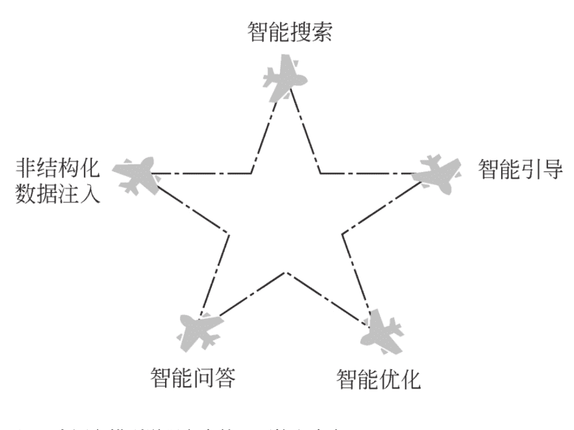
图6-2 大语言模型增强方案的五项核心内容

（1）智能搜索。关键词匹配易受同义词、抽象表达和无关词干扰。引入意图识别模型后，能提炼核心关键词，减少噪音干扰。
（2）智能引导。结果不准既可能是模型不足，也可能是提问不够具体。引导式搜索通过扩充提问表述，帮助用户更清晰地表达需求。
（3）智能优化。知识库更新滞后会影响准确度。方案收集用户历史行为，先做数据采集再用于模型训练与部署，通过重排模型把用户偏好的内容前置，实现千人千面。
（4）智能问答。把知识库与大语言模型结合，检索到相关条目后由模型进行归纳总结，直接给出答案。
（5）非结构化数据注入。传统知识库偏结构化，通过注入非结构化数据，可构建更灵活的知识库，提升检索效率。

大语言模型落地涉及三个关键点：

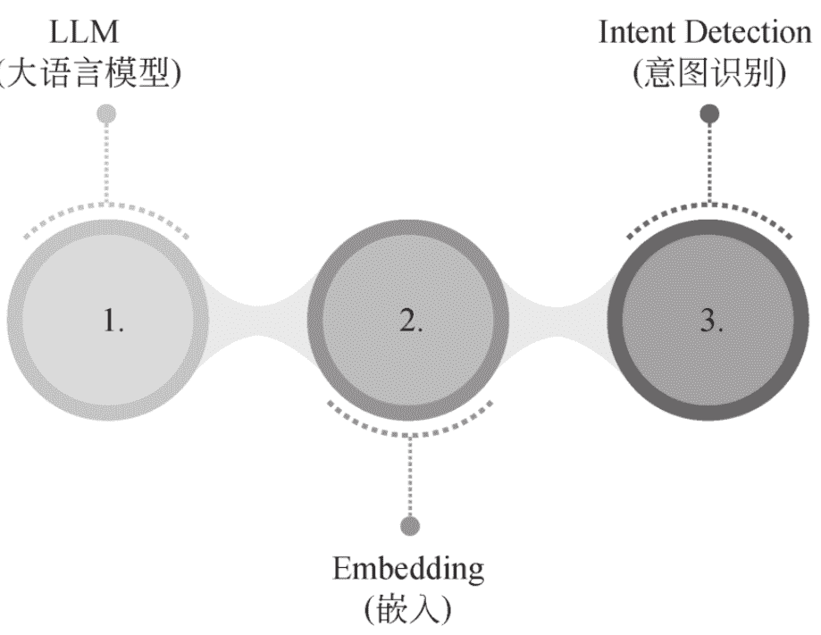
图6-3 大语言模型的三个技术细节

(1) LLM。大语言模型多基于 Transformer，靠文本预训练实现续写能力。亚马逊云科技已发布 Amazon Titan、Amazon Bedrock 等，可用于智能搜索与内容生成。
(2) Embedding。针对文本、图像等非结构化数据，先抽取特征、映射为向量，再基于向量做分析和检索。
(3) Intent Detection。用于解析真实需求。在电商里，要判断用户是家庭场景还是户外场景、要电脑还是手机等。意图识别包含类目预测模型，评估文本属于各品类的概率，和实体识别模型，抽取品牌、颜色等实体词，从而实现精准查询。

总体而言，亚马逊云科技从搜索、优化、问答等多维度应用大模型，持续打磨电商搜索体验。

# 第7章 大模型接入办公软件，解放双手提效率
办公是模型浪潮里最直接的受益场景。模型嵌入办公工具后，工作方式被重写，使用体验被优化，重复劳动被释放，效率被放大。微软已在 Office 体系内探索接入，国内厂商也在跟进，未来办公软件智能化将成主流。

## 7.1 一站式提升多场景办公体验
模型可以覆盖邮箱、文档、演示、代码、管理系统等多个环节。邮件处理更聪明，文档创作和 PPT 生产门槛降低，代码生成提速，管理后台决策更顺畅。

### 7.1.1 邮箱变智能：自动分拣写作回复
邮箱是办公高频工具，接入模型后体验明显改善。

- (1) 邮件智能分类。AI 读取邮件内容，按相关度自动归类，省去人工整理的时间成本。
- (2) 邮件智能撰写。AI 分析邮件上下文和历史回复风格，按个人语气生成草稿。
- (3) 邮件智能回复。模型可充当个人助理，及时回信并提醒重点事项，助力提效。

以 Gmail 为例，模型带来了六项能力：

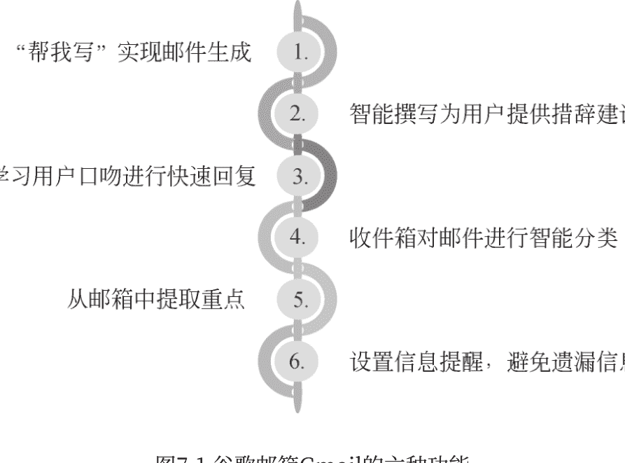
图7-1 谷歌邮箱Gmail的六种功能

(1)“帮我写”实现邮件生成。输入一句提示，生成式模型即可产出草稿，并支持专业、商务、时尚等风格切换，还会参考历史回复补全上下文细节。
(2) 智能撰写提供措辞建议。基于混合语言生成模型，在书写时给出替代表述，按 Tab 即可采纳，支持多语种。
(3) 学习口吻快速回复。智能回复提供三种模板，深度神经网络学习用户过往回复习惯，生成拟人化表述而非生硬的“是/否”。
（4）收件箱智能分类。标签式收件箱按规则整理邮件，用户可调整偏好，模型据此持续学习实现精准归类。
（5）从邮箱提取重点。摘要卡功能通过启发式与机器学习算法抓取预订信息等关键字段，在邮件顶部呈现卡片。
（6）设置信息提醒避免遗漏。Nudging 功能用机器学习识别未回复邮件并预测回复意愿，置顶提醒并标注时间。

### 7.1.2 大模型赋能文档内容创作与PPT创作
Word、PPT、Excel 的深度功能常被忽视，模型接入后操作更友好。

(1) Word。微软在 Word 中接入 ChatGPT，提供内容优化。输入时可预测续写，未来有望实现自动摘要、语法优化等辅助创作。
(2) Excel。传统操作是点击式，模型融合后可变为指令式。用户无需熟练函数就能处理数据，如 ChatExcel 就能用对话完成数据清洗与分析。
(3) PPT。涉及文字、图文等多模态，是大模型落地的理想场景。如 ChatBA 能按主题自动生成演示稿，并提供多种版式选择。

### 7.1.3 大模型融入管理系统，提升管理效率
OA 与 ERP 等系统与模型结合，能打通流程并优化决策。

OA 作为办公自动化载体，传统系统存在数据孤岛和流程割裂，人工操作多。模型介入后，人机交互更深，流程可自动执行，员工用自然语言提出需求即可完成业务办理。

ERP 侧，系统积累财务、销售、库存、生产等多维数据。模型可做销量预测、库存优化等分析，员工通过口令调用，企业经营更灵活。微软的 Dynamics 365 Copilot 就是典型代表，在销售、客服等环节提供智能支持。

### 7.1.4 大模型赋能代码生成，降低开发门槛
2022 年微软、OpenAI 与 GitHub 联合推出 GitHub Copilot，基于 GPT-3 并用海量代码训练。

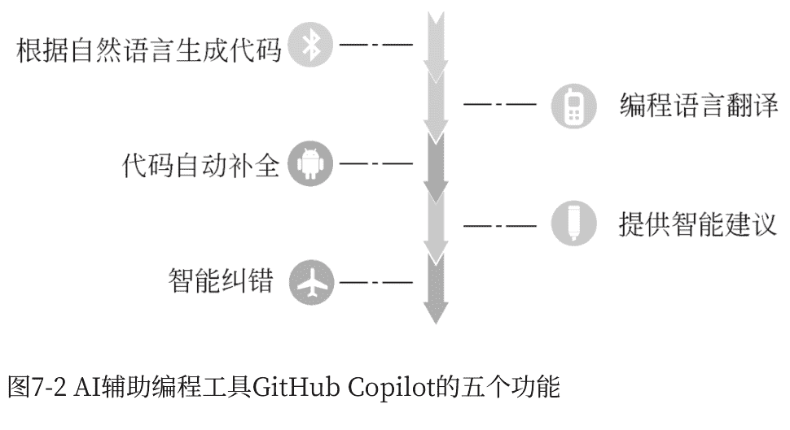
图7-2 AI辅助编程工具GitHub Copilot的五个功能

（1）根据自然语言生成代码。编辑器里描述需求，工具直接输出代码，节省编写时间。
（2）编程语言翻译。把一段代码转成目标语言，降低多语言学习成本。
（3）代码自动补全。基于上下文预测下一段代码，加速生成。
（4）提供智能建议。依据常见编程规范给出优化提示，提升质量。
（5）智能纠错。自动检测并修正错误，提高代码质量和开发者能力。

Copilot 无法完全替代开发者，但能承接重复琐碎工作，让开发更高效。

## 7.2 OA成为大模型应用切入点
OA 是连接员工与中后台的协同枢纽，具备五大功能引擎，是企业信息化的核心系统之一，与模型融合已成趋势。

### 7.2.1 OA是企业信息化核心系统
OA 能借助多种技术实现自动化办公，满足数字化要求。

OA 有两个核心特点：自动化与内外协同。自动化覆盖业务、管理、决策；内外协同指企业内部与客户、经销商、供应商的协作。

OA 的主要作用包括：
- (1) 简化文件传阅审批，实现规范化管理。
- (2) 便于信息检索与共享。
- (3) 提升内部监控能力，提高行政管理水平。
- (4) 提高员工效率，优化协作模式。
- (5) 推动办公自动化，打造科学管理。

OA 的发展经历了四个阶段：
(1) 第一阶段：“点”——单一个体。20 世纪 50 年代在美国兴起，80 年代引入国内。当时以单机办公软件为主，如 WPS、Office，侧重个人效率，人际协作尚未显现。
(2) 第二阶段：“线”——审批流程。随着计算机普及，公文审批实现数字化，纸质流程迁移至线上，节约时间成本。
(3) 第三阶段：“面”——纵向工作流打通。OA 进入企业，厂商增多，私有化部署为主。围绕内部协同原则，打通企业内部信息与资源，实现纵向流程贯通。

(4) 第四阶段：协同成体

移动互联网普及后，协同办公的渗透边界持续外延，人、事、物进入联动阶段。办公自动化体系能够把业务、财务、管理融为一体，支撑企业多元化办公诉求。

应用场景大致可归为三类。办公侧通过融合会议系统、即时通讯以及第三方工具，实现信息共享与跨端协同，提速日常运作；管理侧接入客服、考勤、资产等模块，完成多维度管控，让内部管理更智能；业务侧则对财务审批、流程办理等环节进行精简，适配不同发展的业务需求。

市场端来看，外围环境变化推动协同办公体量快速放大，视频会议与综合平台的渗透持续走高。产品正加速向云端迁移，整体规模在扩大。赛道当前已进入成熟期，主流厂商将重心转向品质与体验打磨。

### 7.2.2 五大功能引擎解析
办公协同平台通过多类引擎集成实现高效协同。随着企业要求提升，系统正向组件化演进，聚合多套引擎能力。

核心引擎共五类，如图7-3所示。

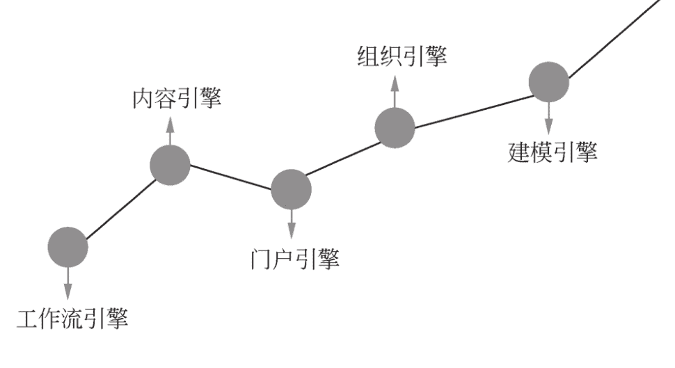

图7-3 OA系统的五大功能引擎

(1) 流程引擎。在协同体系中主要负责企业内部业务流程的自动化，也称工作流引擎。它承担任务、信息、文档的传递与处理，提升运转效率与整体产能。借助该引擎可实现流程可视化管控，管理者能实时跟进并进行统计分析与查询。

(2) 内容引擎。面向企业信息与文档的统一管理，提供文档管理、文件共享协作等能力。能够兼顾结构化与非结构化数据的处理，并沉淀为专属知识库，便于检索调用。具备集成互通能力，优质方案可从外部系统抽取数据回流至协同流程，打破数据孤岛。

(3) 门户引擎。用于搭建企业统一门户，提供单一入口及各类应用服务。用户可在同一入口访问与管理不同业务资源。优秀实现具备统一入口、个性化定制、跨设备跨平台等特征，能简化服务路径，提升使用效率与体验。

(4) 组织引擎。聚焦组织架构与人员信息的维护，为经营决策提供数据支撑。

(5) 建模引擎。支持可视化建模与自定义应用搭建。用户无需编写代码，通过图形界面即可设计审批、报销、采购等流程。建模引擎与流程引擎协同，前者负责流程设计与定义，后者负责执行，共同推动自动化与高效化。

五大引擎为企业管理提供动力。结合大型语言模型后赋能更强。企业基于隐私考量，内部数据与应用通常不对外公开。协同平台在满足协作需求的同时，会对各模块进行深度挖掘与数据分析，持续优化业务流程。随着数据积累，系统能力不断增强，逐步成为企业发展的助推器。在大模型普惠各行业的浪潮中，协同平台与之结合将产生更大化学反应。

形态上，协同工具正向平台化与模块化演进。对使用者而言，平台化意味着互联性增强，以平台形式交付服务；对企业而言开放性提升，可与其它应用深度融合，成为流量入口。模块化依托云原生架构将功能拆解为松耦合结构，以组件化为设计理念实现高度灵活组合。用户可按需自由搭配，即用即取；需求变化时模块可增减，兼具实用与灵活。

工作流是一系列衔接紧密、可自动推进的业务环节，是企业运转的基础，也是协同常见形态。人工审批流、页面流即典型代表。借助协同平台，员工按既定规则通过计算机传递文档与信息，完成目标并实现自动流转，可清晰掌握进展与审批状态，提升执行效率。

协同平台以流程引擎为核心，连接各模块、人员与事务，实现业务协同。在五大引擎支撑下，可提升工作效率，营造良好的协同氛围。

### 7.2.3 大模型与协同平台深度融合成趋势
大型语言模型具备强大的自然语言处理能力，与流程引擎结合后大幅降低了操作门槛。协同平台应用广泛，能连接中后台各入口，但传统操作复杂、体验欠佳。融合大模型后，可实现自然对话交互，减少人工操作，加快落地。

大模型为协同平台带来更高效的沟通协作方式。以传统场景为例，提交技术支持请求需先确认类别、创建工单再分发，对非技术人员并不友好。接入大模型后，用户只需用自然语言描述问题，模型即可分析输入、自动判断类型、生成工单并分发，同时实时反馈处理进度，提升内部沟通效率。

融合已成趋势，多家企业将搭载大模型的协同平台作为B端生态入口。未来门户界面有望被大模型交互界面取代，访问系统将更便捷。

例如摩根士丹利利用OpenAI的GPT-4打造AI机器人，管理企业知识资产。员工无需手动检索资料库，只需提问即可自动获取相关内容。

未来，协同平台与大模型结合的交互界面将替代传统门户，成为连接中后台应用、数据与内容的生态枢纽。

### 7.2.4 Microsoft 365 Copilot：大模型赋能办公的探索
2023年3月，微软宣布旗下办公软件接入大模型。Microsoft 365将引入AI驱动工具Copilot，并推出生成式AI助手Microsoft 365 Copilot，以提升办公效率。

该助手搭载OpenAI的GPT-4，置于Microsoft 365侧边栏，可随时调用，提供智能高效体验。微软指出，Copilot能通过自然语言理解需求，提供个性化服务。随着技术演进，可将大模型、用户数据与应用融合。

Copilot贯穿微软办公产品线，促进数据跨产品流通。Microsoft 365 Copilot可将大模型与Microsoft Graph中的邮件、文档、会议、聊天等数据，以及Word、Excel、PowerPoint等办公软件关联，并通过多步处理将用户指令转化为应用层操作，如表7-1所示。Copilot以迭代方式编排流程，最终形成集大模型、用户数据与应用于一体的Copilot System，功能丰富。

表7-1 将命令转化为执行动作的步骤

| 步骤 | 内容 |
|---|---|
| 第一步 | 用户在办公系统中输入Prompt。Copilot接收后利用Grounding技术做预处理，通过Microsoft Graph查询业务内容与背景信息，并据此修正Prompt |
| 第二步 | Copilot将修正后的Prompt发送给大模型 |
| 第三步 | 大模型返回回应，Copilot对其进行安全、合规等检查并生成调用应用的指令 |
| 第四步 | Copilot向用户给出最终回复，并将调用指令返回给应用 |

Copilot与Microsoft 365深度结合。在Word中可辅助文稿生成；在Excel中可基于输入数据生成可视化图表；在Outlook中可管理与生成邮件；在Teams中可记录会议内容并生成总结，有效提升效率。

微软还发布了用户“私人助手”Business Chat。它能把数据转化为知识，提升办公效率。在Copilot加持下，Business Chat可跨软件汇总信息，辅助办公，成为企业办公新入口。例如团队可在同一页面推进业务，员工B可直接修改员工A创建的文档，实现协同。

微软还将Copilot接入低代码开发平台Power Platform。用户输入应用、功能与流程需求后，Copilot可自动创建应用并给出改进建议，帮助节省开发时间、提升业务运转效率。

目前Copilot仍在小范围测试，未来将以大模型赋能办公场景，进一步提升效率。

### 7.3 企业布局，抢占大模型办公先机
办公场景与大模型结合潜力巨大。部分办公软件厂商积极探索融合应用，以大模型升级产品；同时科技巨头也推出大模型，探索其在办公领域的价值。例如印象笔记自研轻量化大模型、讯飞星火认知大模型赋能办公。

### 7.3.1 巨头携大模型切入办公软件领域

#### 1. 金山办公
金山办公是国内办公软件领先企业，核心产品为WPS Office系列，涵盖WPS Office、金山文档、稻壳等。公司长期深耕办公领域，自主研发了WPS新内核引擎、大数据驱动的知识图谱技术、移动共享技术等，文档与图片识别转化技术处于国内领先。核心技术突破支撑其构建互联网办公服务模式与智能办公体系，提升用户体验，并形成完善的应用矩阵，全面赋能企业效率。

WPS Office是核心产品，覆盖桌面与移动多端，终端间文档处理能力一致。金山文档为在线文档编辑工具，支持多终端管理、查看、编辑，实现协同。

WPS 365是面向企业的协作管理软件，被定位为数字办公“全家桶”，具备内容创作、沟通协作、安全管控、开放生态四大能力，实现文档、会议、消息等应用贯通与全场景覆盖。

在AI热潮中，金山办公积极布局大模型赋能。公司以“多屏、云、内容、AI、协作”为方向，借助AI完善云服务体系；并基于AI算法研发智能办公助手，提升Office系列智能化水平。公司坚持协作战略，探索多人协作新模式，构建协作办公矩阵。

同时金山办公探索AIGC与大模型结合的人机交互技术，已在文档翻译、中英校对、语音转换、辅助写作等场景落地，提升智能办公体验。

2022年底ChatGPT发布后，对办公软件行业产生深远影响。金山办公将持续招募大模型人才，依托创新技术重构办公产品，助力行业数字化转型。

#### 2. 飞书推出“My AI”
2023年4月，飞书发布My AI。My AI基于自然语言处理技术，是新一代智能助手，推动办公软件智能化。

My AI具备语音识别、语音理解、智能问答等功能，可帮助用户安排会议、收发邮件、检索资料等，支持文字与语音交互。

My AI拥有强自适应学习能力，能按需升级优化，基于数据持续训练，提供更个性化的服务。

飞书由字节跳动推出，聚焦企业内部办公。My AI可在降低人力成本的同时提升办公效率与工作质量，还能分析数据并进行预测，辅助企业科学决策。

在个人场景中，My AI同样适用。随着智能手机、手表、音箱等设备普及，用户需要智能助手管理生活，My AI能高效解决问题，节省时间，提升工作与生活效率。

My AI仍存在局限，如语言系统不够完善、表达丰富度有限，主要面向中文、英语等主流语言，对小众语言与方言支持不足，且需兼顾各地文化差异。

飞书正深化多语言与多文化技术，提升My AI的语言处理与文化适配能力，推动本土化与国际化。同时高度重视隐私与安全，致力于提供优质便捷服务。

在网络环境方面，My AI运行需大量数据传输与计算，受网络影响较大。飞书采用网络代理服务MaxProxy优化网络，提升数据传输速度与稳定性，增强体验。

总体来看，My AI兼具实用性与创新性，发展潜力大。随着大模型与AI技术进步，My AI将持续助力企业办公自动化与智能化。

### 7.3.2 巨头为办公厂商提供大模型赋能

#### 1. 泛微网络
泛微网络科技股份有限公司是企业微信的战略合作伙伴，深耕协同管理软件20余年，面向大中型企业推出协同平台型产品e-cology，面向中小企业推出应用型产品e-office。

历经多年积累，其集成引擎可连接上百个信息系统，打破内部信息孤岛。依托低代码开发平台，客户可将管理思路转化为系统应用。公司产品形态灵活，拥有七大引擎，覆盖全组织、全场景，推动管理变革。

2020年腾讯以投资方式与泛微展开深度战略合作。2022年12月腾讯推出万亿参数NLP大模型“混元”，已应用于多个核心业务。腾讯亦在研发类ChatGPT聊天机器人，有望接入微信、QQ等。作为企业微信战略伙伴，泛微有望搭载腾讯大模型，获得技术支持。

#### 2. 致远互联
北京致远互联软件股份有限公司成立于2002年，专注协同管理软件研发，提供产品、解决方案与云服务，助力企业提升管理效率、实现数字化转型。

公司推出协同运营平台COP，标志着业务从协同办公向协同运营演进。协同运营模式打破业务边界，提升运行效率与核心竞争力。

致远互联与华为云展开深度生态合作。2018年其协同管理软件入驻华为云严选商城；2019年成为华为云SaaS耕“云”计划伙伴；2021年旗下平台接入鸿蒙系统；在华为盘古大模型上线后，致远互联率先合作，进一步巩固协同办公领域优势，有望搭载盘古大模型。

#### 3. 蓝凌打造“蓝博士”
ChatGPT持续迭代，功能不断丰富，触达行业更广，成为众多用户的AI助手。深耕数智化办公的深圳市蓝凌软件股份有限公司率先引入ChatGPT，并接入智能应用“蓝博士”，带来新体验。

在数智化工作平台体验大会上，蓝凌展示了蓝博士能力。它搭载领先大模型，可担任智能客服、文案撰写、代码编写、知识检索、语音交互等。

蓝博士可参与代码编写与校验，并生成HTML；在文案方面可撰写营销软文、广告文案、活动简讯并提供创意；在对话方面可分析问题并生成回答。企业还可上传内部资料构建专属语料库。

除蓝博士外，蓝凌持续打造数智化办公新引擎。MK数智化工作平台具备先进技术架构、成熟实践与开放生态，采用云原生微服务架构，提升敏捷性与创新性，并与安信、OPPO等头部企业合作验证可靠性。

蓝凌MK智能引擎可接入ChatGPT、通义千问、文心一言等多款大模型，在其支撑下企业办公效率得以提升。

### 7.3.3 印象笔记自主研发轻量化大模型

AI笔记进化论：印象笔记如何用大模型重塑写作体验

提升产品竞争力已成行业共识，把大语言模型的能力嵌入到工具里是常见路径，印象笔记也不例外。笔记App里出现了印象AI，这项功能运行在印象笔记自研的轻量化大模型之上，门槛很低——只要把客户端升级到最新版本就能直接用写作，不需要内测资格或邀请码。

印象AI能做的事情比较多，文档概括、续写、翻译都能胜任。交互上它不是一味的开放问答，而是预设了若干实用场景，例如写作文、起媒体采访稿、产出广告文案等。

印象笔记对AI的探索很早，2018年就开始研究神经网络，“生成摘要”就是当时的落地成果。后来推出的大象GPT是一款参数规模达到百亿级的轻量模型，专门面向知识管理与协作办公优化，可以按不同用户的需求投放不同的大模型。

写作用例很直观：用户用一句话给出主题、字数、体裁等要素，印象AI就能快速成文。编辑页里提供“完成”和“继续写作”两个入口，点“继续写作”并补充要求后，系统会基于前文继续生成。它也具备概括和语言简化能力，测试中每次简化的表达会有变化，但基本保持事实准确。

“AI帮我写”和ChatGPT的对话很像。输入“如何提高学习成绩”“给出一次班级会议的方案”，都能得到对应回答。面对“鱼香肉丝用了什么鱼”这种带陷阱的问题，它能规避误导，答复说鱼香肉丝的名字与食材关联不大，只是因口感似鱼才得名。

交互设计上印象AI走了一条不同的路，没有传统的问答框，而是给出许多场景模板供挑选。产品团队认为问答未必是最好的交互起点，通过模板开启对话更易上手，也能更清晰地表达诉求。未来菜单会走向个性化定制，例如对传媒从业者，新闻稿、采访稿生成会排在最前面。

新闻采写也能获得支持，比如问“请列出采访印象笔记时该问的问题”，系统会迅速给出十条参考，如“人工智能研究计划投入多少”“印象AI算法是怎样设计的”等。

据介绍，大象GPT基于市面上主流开源大模型并做了微调，训练时使用了印象笔记自建的指令数据集，使其更适配知识管理场景。

使用过程中，印象AI会收集用户的输入和指令用于模型迭代，同时结合用户反馈不断优化回答质量。它还联动个人知识库概念，利用用户自身的资料训练专属模型，提升服务贴合度。

产品方强调印象AI本质是统计模型，只能作为辅助工具。比如写采访稿可先用它生成草稿，但专业议题仍需用户自行校验准确性。未来将持续微调模型，以满足多元需求并提供更顺畅的交互。

### 7.3.4 讯飞星火认知大模型推动办公升级

2023年5月，科大讯飞在发布会上推出讯飞星火认知大模型，并演示了它在教育、办公、汽车、数字员工等领域的潜力。

现场展示了语音输入、实时互动、文本生成、语言理解等能力。经过持续研发，星火在文本生成、知识问答、数学推理三个维度已超过聊天机器人ChatGPT。讯飞计划与开发者合作，打造完整的大模型生态。

自ChatGPT面世以来，大模型热潮持续升温。认知大模型具备跨场景能力，是迈向通用人工智能的重要方向。

研发之初，讯飞对ChatGPT关注的任务方向和开放平台开发者需求做了系统分析，归纳出通用人工智能应具备的七项核心能力。

讯飞联合认知智能全国重点实验室构建了通用认知大模型评测体系，并和中科院人工智能产学研创新联盟、长三角人工智能产业链联盟共同梳理出覆盖七大体系的481个细分任务，意在用科学评测推动行业进步。

技术演进分三个关键节点。2023年6月升级了开放式问答与多轮对话；2023年8月增强代码生成与多模态交互能力；2023年10月通用模型对标ChatGPT，并在教育、医疗领域取得领先。

星火能够赋能多种行业。办公方面实现了“大模型+智能办公本”。模型可总结会议内容、生成纪要，提升效率。针对阅读困难和纪要整理耗时的问题，搭载星火的讯飞智能办公本升级了会议纪要与语篇规整功能。

会议纪要功能把语音实时转写与墨水屏纸感书写结合，按会议内容产出精简纪要，便于复盘。语篇规整功能能过滤口语化表达，对文本润色成书面稿，提高阅读效率。

讯飞认为人工智能发展需要全行业协作，而非单一企业。开放平台已上线星火认知大模型，开放超500项AI能力，吸引百万生态伙伴。多家企业已接入星火共建生态，未来将多维度供给资源，推动大模型在更多场景落地。

# 第8章 大模型加持对话式AI 产品智能跃迁

文本机器人、语音机器人、多模态机器人等对话式AI已在诸多场景落地。大型模型出现前，受限于技术，对话式AI只能处理简单提问，在语义理解、情绪识别上表现不足，用户体验受限。

大模型为对话式AI提供了强力的对话“大脑”，打破了知识与情感上的交互壁垒，使功能更完善。

## 8.1 对话式AI竞争由技术走向体系

当前对话式AI的竞争已不只是技术比拼，而是体系化较量。谁能把产品、算法与具体业务场景更好融合，谁就更具优势。大模型从多角度为对话式AI赋能，带来新的竞争动能。

### 8.1.1 对话式AI的技术核心

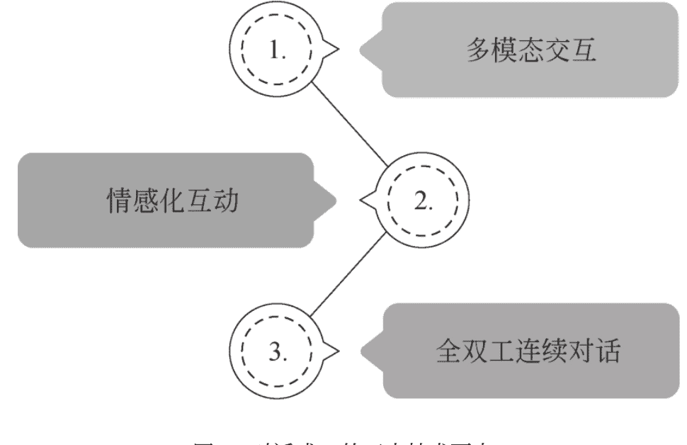

#### 1. 多模态交互
交互方式主要包括文本、语音、图像、手势四类。
文本交互依靠自然语言处理分析输入并生成回复；语音交互先通过语音识别转文字，再经自然语言处理执行指令；图像交互借助计算机视觉把图像转为指令；手势交互依赖姿态识别把手势转为指令。
多模态交互把这些方式整合，允许用户自由切换。系统需支持多模态输入与输出，通过语音合成、图像生成等把结果呈现为用户期望的形式，实现多模态理解与生成的融合。

#### 2. 情感化互动
情感化互动是另一技术要点。系统不仅要输出完整内容，还要在医疗关怀、在线教育亲和等场景中体现人性化，并能根据不同用户动态调整情感表达方式。这要求系统具备强感知与学习能力，例如通过表情肢体判断情绪并给予相应回应。
实现依赖深度学习自主优化情感表达，以及自然语言处理与情感分析提升对用户情绪的理解。

#### 3. 全双工连续对话
难点在于主动与被动对话的切换，以及听与说的角色切换。传统系统往往只能被动检索知识库回答，无法主动交流。
引入双全工后，系统具备主动沟通能力，如打招呼、询问需求、澄清模糊内容；同时能够实时切换听说角色，在说话时被用户打断可立即转入倾听，待用户说完再转回说话，并根据新需求调整输出优先级，避免重复，提升对话稳定性与灵活性。

### 8.1.2 加速底层模型构建

对话式AI的底层依赖知识库与模型数据集。如何从原始数据中快速准确抽取有用信息并构建训练集是难点。
许多公司借助标注系统、模型管理平台进行系统化训练，但人工环节多，易出现数据不一致与效率低的问题。
大模型时代，生成式AI主导模型构建，仅决策环节需人工介入，能大幅提升数据处理、知识萃取与模型构建效率。
以AI客服为例，企业需积累文档、视频、语音等多形态知识。借助大模型，可将已有知识与模型结合快速搭建知识库框架，即使面对复杂提问也能基于知识库学习生成合乎逻辑的专业回复。业务更新时，只需上传新知识，接入大模型的客服即可自动学习，降低维护成本。

### 8.1.3 生成个性化内容

大模型在内容生成方面的赋能体现在知识库配置、对话设计、策略编排等环节。
过去对话式AI多为预设流程，人工参与度高，意图识别也依赖人工。转向智能生成后，可实现对话内容与运营策略的自动生成，提升准确性与效率。
例如可实现连续对话生成，或驱动虚拟数字人通过文字实时生成口型、表情、动作进行交互。
在运营策略生成上，用户输入需求如“为某化妆品品牌制定七夕营销策略”，系统会分析目标人群、竞争态势、市场趋势并产出方案，用户可在其基础上提出微调需求并进一步优化，大幅提升效率。内容将更具个性与智慧。

### 8.1.4 大模型的进化效应

大模型与对话式AI结合带来革新契机。智能系统的感知、控制、决策能力均源于AI，多模态大模型提升了理解与交互能力，AI可识别动作、表情、语气等。
基于大模型的系统完成复杂任务的效率与效果显著提升。
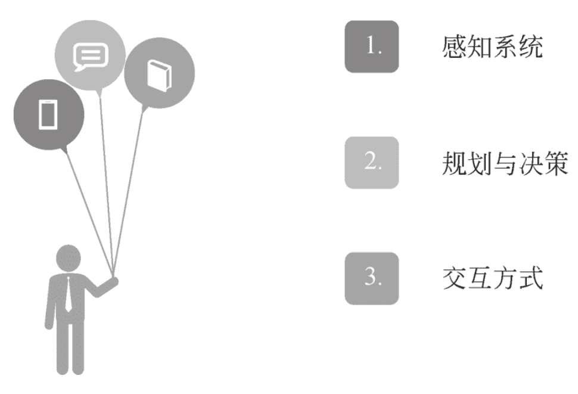
图8-2 对话式AI将实现三个方面的进化

#### 1. 感知系统
多模态数据采集与对话式AI结合，可实现多维数据并行处理，更精准感知复杂动态环境，理解任务。帮助系统进入更开放的探索场景。

#### 2. 规划与决策
规划层可植入丰富知识库并结合现场随机性，实现多模态融合，输出兼顾知识积累与个性化需求的可执行指令。决策层基于海量持续更新数据驱动生成式AI形成自训练算法并不断优化，形成更精准决策系统。

#### 3. 交互方式
多模态大模型带来人机交互新范式。用户可用自然语言和开放式指令下达复杂、模糊的请求，交互引擎分析意图并转化为可执行命令，驱动系统执行。

大模型与生成式AI结合，推动其向更复杂任务与更广领域演进。

### 8.1.5 企业级机器人的崛起

在生成式AI方向，部分企业基于大模型打造更智能应用。客户服务方案商合力亿捷对接ChatGPT、Azure等大模型，推出企业级机器人客服Robot，帮助企业降本增效。

提升对话效率与准确率是核心切入点。传统企业机器人需人工整理内部资料并上传，流程耗时且覆盖有限，未收录问题无法回答。
借助大模型，只需将企业知识库与大模型结合即可归纳整理知识，减少人工工作量。面对提问，机器人能自动整合碎片化知识生成精准回答。
大模型赋予独立理解能力，完成问题理解、意图识别、逻辑应答，操作更便捷。
系统按自身逻辑应答，会对问题分类，针对企业相关咨询提供对应信息，多轮对话中结合上下文给出准确回复，涉及敏感信息时执行风控，输出安全内容。
上线后吸引数百家企业体验，反馈良好，未来将推动企业客服智能化转型。

## 8.2 文本机器人接入大模型

接入大模型后，文本机器人可扩充知识库，凭借更强的语义理解能力回复多样化、个性化问题。

### 8.2.1 大模型丰富知识库 提升理解力

文本机器人是基于深度学习的自然语言处理工具，能从文本中抽取关键信息并做语义分析，帮助用户快速获取整理后的数据或分析结果。开发依赖三项技术。
自然语言理解帮助计算机读懂文本含义，完成文章理解、摘要、翻译、情感分析等任务。
自然语言生成把计算机生成的数据转为用户可读的语言。交互时先用理解技术把握用户意图，再用生成技术给出回复。

文字对话能力的上限由基座模型决定

想做靠文字交互的服务型机器人，首先要准备充足的语料喂给模型，训练质量直接决定对话系统的可用范围。把模型训到真正能用，才是研发的核心难题。

在算力与数据受限的阶段，传统文字机器人普遍遇到相似瓶颈：知识覆盖面窄；碰到专业问题或带个人偏好的提问难以对齐；语义与情感捕捉不足，回复生硬缺乏温度。

引入大模型后，文字机器人能获得通用的知识底座，并可按行业需求做微调，生成更专业的应答。语义理解明显增强，能够承接带个人诉求的提问并给出定制建议。

机器人终究服务于人，体验必须优先。过去不少团队只盯技术能否跑通，忽视使用感受，导致系统能聊却不好用。把大模型与文字系统结合后，对话更顺滑、理解更准、生成内容更贴合，帮助产品走出瓶颈。

### 8.2.2 应用场景：智能问答+智能客服

文字机器人已在智能问答、线上客服等场景落地，叠加大模型后智能程度与贴心度同步提升。

在问答端探索最典型。2023年4月，Snap 在 2023 全球生态伙伴大会上披露聊天助手 My AI 的进展。该助手在2023年2月先面向 Snapchat+ 订阅用户小范围试用，反响不错。大会上宣布面向全体 Snapchat 用户开放，并完成能力迭代。

主要升级包括：
- (1) 名字与形象自主设定：用户可为 My AI 定制名称与形象，让助手更贴合个人审美。
- (2) AR 滤镜与地点推荐：助手可推荐 AR 滤镜，也能在 Snap 地图上按需求推送地点，比如家庭出游目的地。
- (3) 群聊加入：群聊中可邀请 My AI 入群，提升讨论趣味。
- (4) 图文互动：用户可发送图片或视频与 My AI 互动，系统能解读内容并以文字回复，未来 Snapchat+ 用户有望收到由 My AI 生成的图片回复。
- (5) 安全加固：强化数据保护、规范回复内容，并纳入 Snapchat 的家庭中心，便于家长监督孩子使用。

除问答之外，接入大模型的文字系统在客服领域潜力很大。借助 App、小程序、美团等渠道为用户服务后，服务更具定制感。

其一，大模型可按行业与场景做专业化训练，搭建面向定制化业务的知识问答体系；其二，能快速打通企业内部既有业务系统，按需实现查询、办理等流程自动化，提升效率。

孚格数字科技依托大模型打造的 TalkXpert 智能客服具备多平台联动、多店铺后台整合能力，提升电商客服效率。系统可打通微信、美团等多个客服入口，企业在统一界面处理各平台咨询；同时可把多店铺客服后台合并，实现一屏操作。TalkXpert 还支持训练与微调，企业可针对性优化提升回复准确度。

总体看，有大模型支撑，文字机器人在人机配合、任务执行等维度升级，使用体验明显改善。

## 8.3 语音类机器人迎来基座模型升级

语音机器人接上大模型后，多轮对话和内容自动生成能力增强，定制化语音模型的训练效率也提升，服务更贴合人。

### 8.3.1 突破指令式交互，提升互动质感

受技术制约，语音机器人长期困于指令式交互，即一问一答模式。只能回应固定问题或执行预设指令，难以满足期待，也无法处理复杂任务。

大模型补齐了短板，提升语音识别、反馈丰富度与准确性，带来高效流畅的交互。

实践已有案例。2023年6月，硬件厂商乐天派推出 Android 桌面机器人——乐天派桌面机器人，如图8-3所示。该机接入讯飞星火认知模型，语音交互体验大幅改善。

图8-3 乐天派桌面机器人

接入后，设备具备强对话能力，可精准识别语音指令并迅速响应，实现流畅沟通。可查询天气、播放音乐，也支持视频通话、拍照录像，便于与亲友联系。更智能的功能包括解答数学习题、规划旅行路线、逻辑推理、编写代码等。

应用场景覆盖家庭与办公。家庭中可提供情感关怀，如休闲时放歌、生日祝福；可监测居家安全并联动智能家居实现自动化。办公中可充当助手，整理会议纪要、撰写文案、翻译等，并具备自我学习能力，通过自主优化提升服务。

设备开放性高，支持自定义表情、交互界面，可切换不同 GPT 语音助手。随着生态丰富，未来将接入更多助手，并开放接口支持安装 Android 应用。

总体而言，大模型帮助语音机器人提升识别、精准反馈和流畅沟通能力，打破指令式交互瓶颈，在多形态模型支持下具备多样智能功能，为生活带来更多便利。

### 8.3.2 音箱与语音助手的进化

随大模型发展，语音机器人实现跨越式进步，智能音箱和语音助手在加持下性能更强。

2023年2月，小度官宣依托文心一言打造面向智能设备的“小度灵机”模型，并应用到旗下全线产品。2023年4月，天猫精灵宣布接入通义千问。两大玩家已深度进入大模型赛道。

以小度为例，借助小度灵机，智能音箱能化身超级助理。测试中，用户描述周末计划并临时更改安排，音箱可从叙述中提取有效信息并生成正确的时间表。此前难以理解复杂描述和整合信息，如今可在模型支持下顺利完成。

在智能家居控制场景，搭载小度灵机的音箱能化身智能管家。用户用自然语言说明工作日和周末起床时间、冬夏室内温度偏好，设备可据此判断何时开空调、调至多少度，而非仅执行“打开空调”指令。可识别不同用户的温度需求并结合季节自动调节，大幅提升认知能力。

手机语音助手、车载语音助手也在变智能。助手不再被动执行指令，而是能预判用户意图需求，环境变化时自动调整服务。

以车载助手为例，进入隧道时提醒关闭车窗打开车灯；电量不足时主动提示附近充电桩。赛轮思依托大模型打造的车载语音助手具备主动提醒，如最佳路线推荐、疲劳驾驶预警、极端天气预报，优化驾驶体验。为避免干扰，公司收集用户偏好与反应数据让助手学习，实现更灵活响应。

依托千人千面智能学习推荐引擎，助手持续学习用户行为和车辆数据，结合知识图谱提供定制服务。

未来随技术演进，语音机器人接入大模型将成趋势，智能音箱、车载助手、手机助手等将持续迭代，为用户提供更贴心服务。

## 8.4 多形态机器人搭上大模型

在助力下，多形态机器人成为对话式 AI 的重要方向。大模型可将多形式指令拆解为可执行步骤，提升推理决策能力，推动对话式 AI 走向通用。

### 8.4.1 大模型激活多形态机器人的发展

在支持下，多形态机器人能“读懂”更多提示，更顺畅完成多类任务，智能性提升并扩展应用，迈向通用成为可能。

2023年7月，第六届世界人工智能大会上，中信集团推出项目“多形态 AI 打造有温度的信用卡服务”。项目展示依托大模型融合多形态技术的智能机器人服务矩阵，包括 AI 外呼机器人、AI 感知机器人、智能问答机器人、智能质检机器人、座席辅助机器人等。

AI 外呼机器人实现定制化拟人声服务，交互更自然；AI 感知机器人借助大模型挖掘用户痛点优化流程；智能问答机器人支持多轮对话、24小时服务；智能质检机器人全面检查对话内容保障权益；座席辅助机器人提供流程导航提升服务水平。矩阵还可依据用户画像智能推荐产品，通过“声纹无感核身”让老年用户享受直通查询。

同届大会上，达闼机器人发布多形态大模型 RobotGPT 及依托大模型的服务平台和一体机。RobotGPT 具备多形态融合感知、决策与行为生成能力，可理解语言、表情、动作并按指令规划执行。支持多轮对话、多形态交互、AI 变声、声纹识别、图片理解与生成，实现精准行业问答和多轮对话。

未来在支持下，多形态机器人应用将扩展至医疗、金融、教育、制造等垂直行业。

### 8.4.2 工业机器人与大模型结合初现雏形

2023年4月，第六届数字中国建设峰会上，阿里云智能集团 CEO 张勇表示，阿里云尝试将通义千问接入工业机器人，通过钉钉远程操控。演示中，工程师在钉钉发送“找点东西喝”，模型理解指令自动编写代码发送给机器人，机器人识别环境找到桌上水杯，完成移动抓取并递出。

此前机器人多只能执行预设固定任务，难以应对灵活需求。大模型打破限制，用户可通过自然语言指挥。

工业机器人开发门槛高，需反复编写调试代码。大模型可在开发阶段生成代码指令，便捷开发调试，也可帮助机器人自主编排抓取、移动等能力，完成更复杂任务。应用阶段，工人输入文字即可由模型理解意图转化为机器人可执行代码，大幅提升工作效率。

阿里云已启动“通义千问伙伴计划”，为合作伙伴提供模型服务，推动大模型在制造等行业落地，助力优化生产流程。

## 8.5 虚拟数字人接入大模型

虚拟数字人是对话式 AI 的一种，市面上已有不少扮演主持人、代言人、数字员工的形象，如虚拟主持人“小漾”、屈臣氏 IP“屈晨曦”。大模型的火爆为其发展注入动力，不少企业在融合上探索。

### 8.5.1 大模型重塑虚拟数字人的能力边界

虚拟数字人依托自然语言处理、语音合成等技术，具备语音交互、图像识别等功能。大模型对其赋能体现在两方面：一是提升交互能力，实现文本、图片、音视频等多形态互动；二是提供创建、驱动、内容生成的一站式服务。传统制作需 CG 建模、交互设计等流程，成本高。大模型可实现一站式生成，降低成本。

在模型助力下，虚拟数字人可从虚拟偶像、主播向教育、医疗等多行业渗透，以人性化交互助力降本增效。

厂商探索持续。虚拟技术服务商世优科技旗下业务已接入 ChatGPT，并探索模型定制化训练；风语筑尝试为旗下数字人接入 ChatGPT，提升识别与内容更新能力。

未来大模型有望成为构建虚拟数字人的基础架构，降低研发推广成本，提升交互水平，推动其与更多领域融合。

### 8.5.2 定制化虚拟数字人打造成为可能

打造虚拟数字人需要技术与资金，门槛较高。大模型打开开发能力，让普通用户也有机会成为开发者，按需打造定制化数字人。

2023年7月，华为开发者大会上，华为云依托盘古模型推出虚拟数字人模型生成服务与模型驱动服务，让更多用户实现数字人打造。

依托盘古模型、渲染引擎、实时音视频等技术，华为云打造通用模型，可生成形象、动作、表情、声音等多形态内容。用户可用个人数据训练，打造定制化模型，并生成高清视频。

生成方式包括：
- (1) 文本生成：输入文本描述外表和性格特征生成数字人。
- (2) 图片生成：上传一张图片，模型据人物特征生成数字人。
- (3) 视频生成：上传约5分钟视频，模型据视频生成数字人并还原表情动作。

生成后可二次编辑发型、服装等，增强个性。模型驱动服务支持多形态实时驱动，如走姿、手势精准驱动，可用于直播、线上会议等。

如不愿暴露隐私或镜头不自在，可用数字人参会，既体现形象又保护隐私，同时保证流畅度。每个用户借助大模型都能打造定制化数字人并应用于多元场景，获得多样贴心服务。

### 8.5.3 元境科技展示多形态虚拟数字人落地

2023年5月，2023中关村论坛在北京举办，聚焦前沿技术。虚拟数字人技术公司元境科技带来 MetaSurfing-元享智能云平台、MetaJoy-元趣 AI 等产品，展示多形态虚拟数字人在导览、主持、智能客服等场景的落地应用。

得益于元境科技构建的多模态智能算法矩阵与智能交互能力，MetaJoy-元趣AI数智人实现了更富智能的互动体验。它能够听懂用户指令，并据此给出个性化回应。

活动现场，以灵动形象著称的虚拟偶像CiCi吸引了众多观众驻足互动，其图示见图8-4。CiCi运行在MetaSurfing-元享智能云平台之上，借助该平台叠加视觉捕捉实时驱动与动力学多模态解算等技术，互动自然流畅，表现十分灵动可爱。

图8-4 虚拟偶像CiCi

MetaSurfing-元享智能云平台由元境科技打造，是一款面向3D虚拟数字人的智能应用平台。依托大模型与SaaS架构，它能输出高精度的虚拟数字人及数字场景资产，大幅简化传统建模流程，降低创作门槛。用户只需简易操作，就能生成并操控支持多模态交互的智能虚拟数字人。

平台在论坛首次亮相即引发关注。其生成的虚拟数字人建模精致，表情与肢体动作自然。融合多模态、实时追踪、自然交互技术并结合大模型知识库，交互与表现力均得到明显提升。

呼应本届论坛“开放合作，共享未来”的主题，元境科技坚持开放合作思路，着力打造开放型智能云平台，用技术赋能各行业。未来公司将推出虚拟数字人一站式方案，提供多模态虚拟数字人服务，持续拓展应用边界。

# 第9章 大模型重塑娱乐新体验

当大模型与休闲娱乐碰撞，行业迎来全方位赋能。从游戏到影视再到音视频制作，大模型正驱动变革浪潮，重塑娱乐内容生产与消费方式，显著提升用户体验。

## 9.1 大模型驱动游戏行业多维变革

游戏行业持续追求技术与体验创新，大模型的加入让变革加速。大模型在解放生产力、重塑价值分配、推动引擎演进等方面发挥关键作用，为玩家带来更具新意的沉浸体验。

### 9.1.1 生产力释放：大模型重塑游戏开发

大模型在自然语言理解与生成上具备强能力，直接赋能游戏内容生产，释放行业生产力。OpenAI先后发布多款大模型，以及基于GPT-3.5的ChatGPT，为游戏变革打开空间。下面以ChatGPT为例说明。

GPT-3.5以Transformer为基础，先进行预训练再微调，掌握自然语言规律。ChatGPT可与人自然对话、写代码、写文章、续写故事等，充分展示了大模型在语言处理上的潜力，为游戏行业提效提供可能。

以ChatGPT为代表的大模型给游戏带来三重价值。

- （1）提升沉浸感与交互性。搭载大模型的游戏NPC能生成自然对话，与玩家流畅交流，增强互动与故事张力。根据用户的游戏数据，大模型能够

### 9.1.2 游戏引擎因大模型加速进化

大模型在游戏AI领域的落地方向主要集中在两方面：NPC智能化，以及游戏引擎AI辅助工具落地。

2023年6月，Unity中国宣布启动生成式AI引擎U3D Copilot的研发。追溯到2004年，三位创业者打造了GooBall游戏，由此诞生Unity引擎。历经多年发展，Unity已成为主流3D内容创作引擎，是商业化成功的代表，旗下作品包括《王者荣耀》《明日方舟》《永劫无间》等。若把游戏比作建筑，引擎就是建造工具，既提供画面与图像，又定义基础规则与交互逻辑。

没有引擎，开发者必须手写全部代码。而规则、场景、角色交互等基础模块在不同游戏中往往重复，重复代码加重开发负担，引擎正是为解决这一问题而生。

引擎把重复代码做成模块，开发从写代码变为组装模块，大幅减少重复劳动，提升效率。Unity中国推出的U3D Copilot正是将AI能力接入引擎，进一步提效。

如今众多企业都在探索大模型与AI结合，Unity中国选择从引擎切入，引领开发方式变革。

Copilot AI泛指AI辅助工具，Unity中国希望打造大模型交互界面，并通过该界面整合3D AIGC模型。同时也在探索如何在不泄露用户隐私前提下本地部署引擎并接入U3D Copilot。计划细节未公开，已引发业界热议。

在引擎辅助工具层面，2D图像生成已相当成熟。Unity旗下的Unity ArtEngine面向艺术创作者，提供AI辅助能力，可通过API对接外部AI绘图工具，进而生成图像。

用户对游戏的逼真与沉浸要求不断提高，3D图像需求激增。但3D生成式AI仍面临三项技术瓶颈，如图9-2所示。

#### 图9-2 3D生成式AI的三个技术难点

(1) 3D数据生产质量不足。虽然3D表示方式多样，如体素、点云、Mesh、隐式场等，但整体未达到工业生产质量。
(2) 影响因素复杂。引擎中3D数据的渲染效果不仅取决于大模型能力，还受贴图、材质、光照等要素影响。
(3) 高质量数据稀缺。可用3D数据量少，难以满足训练需求。

这些难点不仅增加开发难度，也制约其他生成式工具。当前Unity引擎界面相对复杂，智能化不足。未来若Unity中国实现构想，引擎能力将更加强大。

### 9.1.3 英伟达赋能游戏开发者定制AI

2023年5月，英伟达宣布面向游戏开发者提供定制AI模型代工服务Avatar Cloud Engine (ACE) for Games。开发者可借助该服务创建定制语音、对话、动画AI模型，并在云端与PC端运行。

3D内容制作对资源消耗大，算力优化可降本增效。KIRI Innovations是一家3D应用厂商，旗下KIRI Engine可基于照片或视频生成超写实3D模型，用于VR场景、游戏等。上线后用户增长迅速。

KIRI Engine基于神经网络重建算法，可从多角度素材生成带纹理材质的超写实模型。该算法计算量巨大，传统方案成本高昂。

综合考量后，KIRI Innovations选择英伟达产品，因其能提供稳定算力支撑，降低模型生成成本。

英伟达面向游戏开发提供的产品包括：

- (1) NVIDIA CUDA。可缩短计算时间、降低成本。KIRI Engine借助CUDA并行计算加速，3D重建耗时从20分钟以上降至约5分钟。
- (2) NVIDIA V100。可加快训练。配合KIRI Engine完成复杂神经网络训练，训练时间从数小时压缩至约25分钟。
- (3) NVIDIA T4 GPU。具备低时延、高吞吐特性，适合云端推理，满足多样计算需求。

KIRI Engine同时采用V100与T4 GPU，V100负责训练复杂网络，T4负责推理。T4完成图像处理、匹配等轻量任务，依托CUDA加速，成本大幅下降。

KIRI Engine以更低成本提供3D重建能力，并可依托快速增长的用户在云端积累海量3D数据集。

3D内容需求在游戏、VR领域持续攀升，制作成本下降将提升内容产出效率与质量。

英伟达还助力KIRI Engine应对增长带来的算力压力。每日上千次模型生成任务对算力要求高，英伟达方案帮助解决瓶颈，CUDA与重建算法结合提升速度、降低成本，支撑用户规模扩张。

除上述产品外，英伟达还提供代码生成、图像生成、视频生成等生成式AI工具，提升开发效率；推出NeMo Guardrails开源软件保障信息安全，过滤有害内容、避免不当回答；在模型开发层面提供企业级大模型云服务。

随着AI芯片演进，生成式AI落地提速，英伟达的算力支持将进一步提升游戏开发效率。

## 9.2 大模型为影视行业开辟新机遇

大模型与影视结合带来多重机遇，3D模型推动内容生产，激发行业活力。百度联合电影频道发布影视行业智感超清大模型“电影频道-百度·文心”，为行业应用开辟新空间。

### 9.2.1 3D建模助力影视内容提效

随着ChatGPT商业化场景增多，大模型应用范围扩大，3D模型正从广告向影视延伸，为内容生产注入活力。

AI技术快速发展，甚至有导演预言AI制作电影将出现。后期特效与剪辑是影视核心环节，AI在建模与视觉特效上提供助力。若后期制作AI化，电影生产门槛将大幅下降。

影视以内容为核心，生成式AI带来的新生产模式与智能交互，有助于缩短创作周期、降低门槛、提升效率与质量。

在提升质量方面，企业积极探索。OpenAI推出Shap-E大模型，可根据文字或图像提示生成3D模型。该技术在建模领域具颠覆性，能处理复杂描述，快速建模，节约时间资源，减少人力成本，简化流程。

3D模型助力影视内容生产前景广阔，企业需推动落地，完善技术，促进融合。

### 9.2.2 百度联合电影频道推出超清修复大模型

影视作品记录时代与技术演进。随着技术进步，影片色彩更艳丽、分辨率更高，许多老片得以翻新。

老片常存在画质差、模糊、重影问题，人工逐帧修复耗时耗力。AI可提升修复质量与效率。

百度作为国内大模型领军企业，与电影频道节目制作中心联合发布首个影视行业智感超清大模型——“电影频道-百度·文心”。该模型可同时处理多部影片修复，大幅提升效率，带来沉浸观影体验。

电影频道长期探索AI与修复结合，旗下CCTV-6、高清频道等以电影为主。频道拥有上万部片源，其中不少为胶片拍摄，数字化保存后原始胶片受损影响画质，且用户对高清内容需求激增，老片修复迫在眉睫。

“电影频道-百度·文心”效率极高，日修复量达28.5万帧，解决大部分画面问题；对需精修片段，速度比人工提升3-4倍。

在创作层面，该模型可增强画面色彩并提升清晰度，实现老片超清化，将SDR转为HDR，满足用户观影需求。

模型基于AI技术并结合电影频道修复经验训练，可应对多种损坏类型，通过画质提升、边缘锐化等实现全方位修复。

未来，百度将借助自研昆仑芯片与深度学习平台飞桨提升修复效率，并依托文心大模型泛化能力，加速AI修复在影视行业落地。

## 9.3 大模型驱动音视频制作升级

大模型对音视频制作产生深远影响，释放音乐生产力，实现文本转视频与数字人视频生成。腾讯音乐以大模型切入音乐探索；阿里云智能推出音视频AI助手“通义听悟”，带来全新体验。

### 9.3.1 AI音乐生产力被大模型点燃

计算机音乐专业性强，结构化数据获取难，发展相对缓慢。大模型驱动AI基础设施完善，AI音乐迎来新机遇。

- （1）硬件升级推动发展。基于深度学习的音乐生成技术已初步成熟，主流模型包括VAEs、GANs等。索尼、Spotify等企业及AI音乐初创公司积极参与生态建设。2022年起，大模型推动基础设施完善，音乐生成尝试增多。

谷歌利用NLP方式训练音乐生成模型MusicLM。音乐创作需音色、音调、节奏协同，非专业用户难以操作。MusicLM可在输入文字指令后生成丰富曲风音乐，还能基于画作如《星空》《格尔尼卡》《呐喊》等生成音乐，实现重大突破，并可依据抽象概念如“为战略游戏配紧凑节奏配乐”生成对应音乐。

算力升级为大模型提供更大空间，促进AI音乐发展，释放生产力。

- （2）版权方介入，缓解资源封闭问题。音乐版权集中在头部企业，网络音频易丢失创作细节，难以结构化再生成，主流模型多用公版资源。

环球音乐、华纳音乐等投资AI音乐初创企业，释放商业数据资源，带动数据标注发展，提升训练精度与效率。国内海天瑞声、慧听科技等提供音乐数据服务。

总体看，大模型与音乐结合释放AI音乐生产力，为用户提供高质量多样音乐。

### 9.3.2 文本变视频与数字人生成加速落地

视频成为交流与营销重要载体，短视频创作与直播需策划、拍摄、剪辑，耗时耗力。大模型融合视频行业，可在提升质量同时降低成本，实现文本转视频与数字人视频生成。

Meta发布Make-A-Video模型，可将文字转化为约5秒短视频。视频虽不完美，但代表技术进步。

文本转视频对模型算力与数据要求高，需基于数百万图像训练，仅大型科技公司具备能力。Meta使用三大开源图像视频数据集训练Make-A-Video，先学习物体名称外形，再学习运动规律，支持大规模生成。

Meta认为技术为创作者带来新机会，也可能被用于造假欺骗用户。尽管训练数据经筛选，数据集庞大难以完全清除有害内容，只能降低风险。

在数字人视频生成方面，商汤科技推出“日日新SenseNova”大模型体系，并基于此发布“商汤如影SenseAvatar”AI数字人视频生成平台。平台融合AI文生图、大语言模型、数字人视频生成算法，支持高效快速创建数字人视频内容。

### 商汤如影 SenseAvatar：数字人驱动内容生产

商汤如影 SenseAvatar 面向企业和个人提供短视频与直播的制作支持，有助于吸粉并提升用户粘性。上手门槛低，生成虚拟人物只需在平台上传真人影像即可完成克隆，显著压缩了视频制作周期。

该方案融合模型能力与算力资源，输出兼具逼真度与精细度。依托商汤“日日新 SenseNova”体系与 AI 大装置 SenseCore，生成质量与速度均实现跃升，已成为行业风向标。

得益于 SenseNova 在数据学习方面的优势，呈现效果突出。训练素材来源于海量真人样本，造出的虚拟人外形逼真、动作自然。凭借体系的泛化能力，可产出多种类型、多种风格并支持多语言的虚拟人。

平台依托全自动化的视频生产链路与强算力，实现内容生产的高效化。从素材上传到成片输出，一整套自动化流程省去大量人工校对与模型训练的时间成本。

同时兼容 2D 与 3D 虚拟人。2D 形象的制作只需一段简短视频即可完成克隆。为配合创作，还集成文生文、文生视频能力，可用文字驱动视频内容生成。

用户在对话框输入创意想法，系统即可自动给出对应的视频文案。平台自带素材库可供挑选；若对内置素材不满意，可自行上传素材，或借助平台的文字生成图片功能制作素材用于创作。

3D 虚拟人多用于打造虚拟主播或虚拟 IP，应用面更广但成本也更高。实现与用户的互动，不仅需要语言能力，还要有灵活的动作表现来提升感染力。

为此该方案构建了一套多模态动作生成体系，仅凭文字与声音韵律就能产出多样化的表情与动作。并借助商汤大模型优化了直播带货场景，3D 虚拟人可依据商品特点自动生成更具针对性的带货文案，并配合丰富的动作和声线，提升场景适应性。直播中，虚拟人还能进行商品整理、粉丝互动、问题解答等多元交互，实现全方位触达。

目前该方案已与多家企业展开合作，用虚拟人赋能各行业，释放更多生产力。

### 9.3.3 腾讯音乐：大模型开拓音乐创作新路径

人工智能在音乐创作上的潜力巨大，能快速产出各类作品满足不同需求，也能为创作者提供灵感与工具。腾讯音乐旗下天琴实验室推出开源大模型，推动人工智能与音乐深度融合，助力产业提效。

AIGC 相关技术热度持续攀升，但落地条件仍在完善。为推动 AIGC 在文本、图像、音频、视频等领域落地，腾讯音乐组建了以天琴实验室为核心的多支技术团队。

腾讯音乐通过“TME Studio 音乐创作助手”和“音色制作人”两款产品推动大模型在音乐领域的融合。“TME Studio 音乐创作助手”是辅助创作工具，主创团队涵盖 MUSE、腾讯 AI Lab、天琴实验室等。核心功能包括音乐分离、MIR 计算、辅助写词、智能曲谱。

音乐分离能将人声与鼓声、钢琴声等乐器声分离。MIR 计算可在理解音乐内容的基础上识别节奏、节拍、鼓点等要素，挖掘深层信息，让模型更懂用户。辅助写词能基于多源语料为用户提供合适词汇与灵感。智能曲谱则可在用户上传音乐后自动生成对应曲谱。未来该助手将提供更多音频创作工具。

借助酷狗音乐，腾讯音乐推出“音色制作人”产品，为音乐领域注入新活力。使用方式很简单，用户录入声音后，产品会学习其音色并通过模型生成专属音色来制作歌曲，还可调节参数让成品更悦耳。

“音色制作人”还实现了跨语种演唱。粤语歌曲玩法让不会粤语的用户也能快速体验。用户按提示用普通话录歌供系统学习音色后，选择喜欢的粤语曲目进行合成，就能得到一首“自己演唱”的粤语作品。该功能由凌音引擎提供支持，引擎采用深度神经网络学习多位歌手的发音特征。

产品玩法持续迭代，让更多用户感受到科技乐趣。腾讯音乐凭借两款产品强化了音乐领域的优势，探索出适合自己的大模型发展路径。

对音乐创作者而言，搭载大模型的智能应用能提升效率。音乐产出链条复杂，涉及创作、MV 拍摄、宣传等，“TME Studio 音乐创作助手”可简化生产流程、提高效率、降低成本。

大模型还能带来更丰富的音乐体验。“音色制作人”功能新颖、有趣，能激发好奇心并提高留存。其强共创与强交互特性为用户创造更多价值。

腾讯音乐持续探索，旗下天琴实验室推出 MUSE Light 大模型推理加速引擎，并发布 lyraSD、lyraChatGLM、lyraBELLE 三款开源大模型的加速版，帮助开发者缩短研发周期、降低成本。

此外，腾讯音乐还申请注册“文曲大模型”商标，标志人工智能音乐创作进入新阶段。文曲大模型是基于人工智能技术的音乐生成系统，可通过学习大量作品与音乐理论模拟人类创作过程。

该商标申请为模型生成音乐拓宽了发展空间，但也面临挑战。音乐作为情感艺术，能引起共鸣，模型能否真正理解人类情感仍存争议。

模型生成音乐技术将对产业产生深远影响。创作者可利用模型获取素材、加快创作速度并实现更具创造性的自我表达。模型合成音乐也为广告、游戏等行业带来商业机会，平台和制作公司可产出多样化作品满足多场景需求。

腾讯音乐作为国内头部平台，战略眼光前瞻。申请注册“文曲大模型”商标体现了其希望以人工智能技术为用户提供多元丰富音乐体验的愿景。在该模型加持下，音乐人将拥有更丰富的工具，共同开启新时代。

### 9.3.4 通义听悟：重塑音视频工作效率

2023 年 6 月，阿里云智能发布基于“通义千问”大模型与音视频 AI 大模型的智能助手“通义听悟”。其应用场景覆盖会议讨论、教育培训、视频观看等。

产品具备通义千问的理解与摘要能力，可成为学习生活的助手。依托先进的语音语言技术，它能对音视频内容进行检索整理，辅助笔记书写、访谈记录、PPT 制作等。

发布会现场演示了使用流程。会议场景下，通义听悟能生成会议纪要并区分发言人。理解力强，能为音视频分章节、总结每位发言人观点并形成摘要、提炼重点。

可应用场景包括会议、采访、课堂等，核心能力主要有：

- 1. 实时语音转写，生成智能记录。通义听悟可实时记录并整理内容，实现音频与文本同步输出。还支持关键词句检索，突出核心信息帮助把握重点。
- 2. 文件转写，节约用户时间。通义听悟可与阿里云盘互通，快速完成音视频文件转写。结果保存在“我的记录”中，便于随时回顾。
- 3. 实时翻译，打破语言壁垒。可对发言实时翻译，支持中英互译，实现无障碍交流。
- 4. 快速标记重点，使内容简洁明了。可对重点内容和待办事项进行标注，回顾时更清晰。
- 5. 支持内容一键导出。用户可一键导出音视频、笔记等内容，同时支持导入 Word、PDF 等多格式文档。

作为“通义家族”新成员，通义听悟旨在带来全新的音视频体验。用户可通过完成日常任务获取免费时长。小程序版本将在钉钉、阿里云盘等产品中上线，与内部场景深度融合。

# 第10章 大模型赋能智造 工业升级提速

随着大模型应用深化，众多制造企业借助模型优化计划、管控流程，提升生产质量与效率。大模型可贯穿制造多个场景与环节，重塑全流程，提升自动化水平。

## 10.1 通用向专用 工业大模型崛起

大模型正由通用向工业细分延伸。相较通用模型，工业大模型目标更明确、能力更聚焦，能融入制造各环节，助企业降本增效。

### 10.1.1 从通用到垂直 工业大模型落地加速

大模型为落地更多领域正走向细分。以工业为例，不少通用模型推出行业服务，支持企业基于其构建工业大模型；部分科技公司与制造企业也自主研发工业大模型，推动落地。

工业大模型与通用大模型差异体现在：

- (1) 数据预处理。通用模型多采用通用方法与流程，而制造场景下数据质量、特征对性能影响显著，工业大模型需做定制化预处理。
- (2) 模型训练。通用模型依赖海量标注数据和高性能算力，制造场景标注数据有限且更新快，工业大模型需借助在线学习与增量训练适应变化。
- (3) 部署方式。通用模型多为离线部署，工业大模型需快速响应实时请求并具备强并发能力，要求轻量化与高时效。

不同于通用模型，工业大模型必须兼顾制造场景特殊需求并提供可执行方案。通过定制化预处理、增量训练、高效部署，工业大模型可提升企业效益，形成竞争优势，并推动工业智能化。

当前工业大模型发展迅速，主要趋势包括：

- (1) 模型规模增长。算力提升与数据积累推动模型规模不断扩大，未来将出现更复杂、功能更丰富的巨型模型。
- (2) 跨模态学习。未来模型将融合文本、图像、语音等多模态数据，增强理解与决策能力，例如同时处理自然语言、图像与传感器数据。
- (3) 多模型协同。单一模型难以覆盖全部需求，多模型协同将成为趋势，通过集成发挥各自优势，提升预测与决策能力。
- (4) 智能与自适应。未来模型将更智能、自适应，可根据不同场景自动调整参数、处理流程与推理策略，应对动态需求。

随着发展，工业大模型将以更智能功能赋能制造，提升决策效率与自动化程度，助力降本增效。

### 10.1.2 破解制造痛点 释放大模型效能

当前工业生产存在诸多问题：生产计划难以匹配市场变化、生产过程风险多、成本难控、质量不稳等。

工业大模型的应用可破解这些瓶颈，其优势体现在：

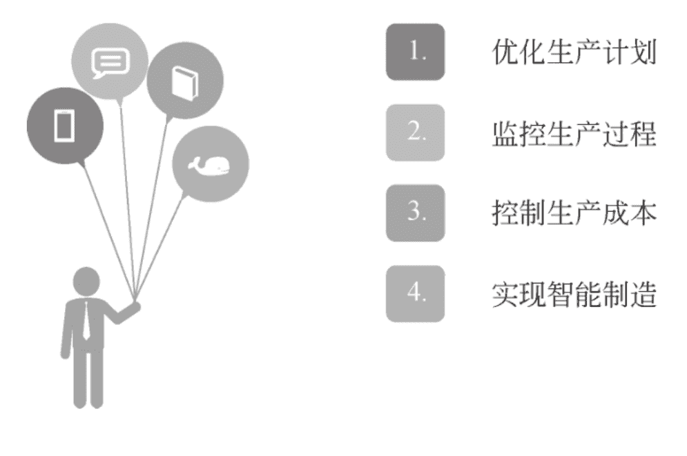

#### 1. 智能优化生产计划
制造企业需结合资源与市场需求制定计划，但受经验与数据分析能力限制难以应对变化。工业大模型可综合订单、库存、交期、设备利用等数据，制订合理计划，提升效率与资源利用率。

#### 2. 生产过程实时监控
生产会产生海量数据，传统方式难以实时管理。工业大模型通过传感与数据分析实现过程实时监控，及时发现问题、提升效率与质量。例如可监测设备状态、原辅料消耗、产线产能等，预警异常。

#### 3. 精准控制生产成本
高成本是制造企业痛点。工业大模型可基于成本控制策略优化全流程，降低成本。例如分析材料、能源、人工等要素，实现资源充分利用。

#### 4. 推动智能制造
工业大模型助力企业实现智能制造与数字化转型。一方面其可重塑传统工业垂直系统，催生以大模型为基础的模型即服务模式，促进系统融合与运营优化。另一方面解决传统人工智能跨域应用难题，实现解决方案复用。基于模型即服务的方案可在多场景提供模型能力，企业通过 API 调用与针对性训练部署个性化应用。

总之，工业大模型以强技术能力破解生产瓶颈，将成为推动工业变革的重要力量，加速智能化转型。

### 10.1.3 工业大模型基座 降低企业使用门槛

工业大模型在制造领域价值突出。已有企业尝试提供基础设施，降低开发与应用难度。

2023 年 6 月，智能制造企业思谋科技发布工业大模型开发与应用底座 SMore LrMo，覆盖应用层、算法框架、基础设施服务，具备算力调度、数据自动标注、应用开发等能力，贯穿开发与应用全流程。

SMore LrMo 聚焦工业场景，可解决数据采集难、计算集群分散、构建成本高的问题。其优势主要体现在：

一方面，支持云边端设备接入与海量数据接入，可高效管理工业数据并具备分布式处理能力，适配多种神经网络，满足数据安全要求。

另一方面，通用性强、硬件适配广，支持英特尔与 ARM 芯片、英伟达、寒武纪等加速卡，适配上百种深度学习模型。AI 自动化感知调度时可管理 20 个以上集群，提升运行效率。

开放平台的竞争力体现在数据处理强、易用、开放。SMore LrMo 在这些方面表现突出，成为先进的大模型开发平台之一，获得科研院所与科技公司订单，加速落地。

大模型热潮推动工业智能化变革，SMore LrMo 的发布为模型在工业领域应用奠定基础，让更多企业参与成为可能。

## 10.2 大模型嵌入制造全流程

大模型可融入制造流程，优化过程、提升效率。具体体现在助力工业 3D 生成赋能设计、融入生产系统优化计划、推动工业机器人发展。借助大模型，制造自动化与智能化程度将进一步提高。

### 10.2.1 工业3D生成 加速设计研发

大模型可助力工业 3D 生成，智能产出工业模型，减轻工程师建模负担、提升效率。具体帮助包括：

- (1) 提高设计效率。工程师可输入草图或用文本描述细节需求，大模型据此生成高质量 3D 模型。
- (2) 提升质量。大模型可按细节要求优化质感、纹理等，提升模型品质。
- (3) 创意辅助。大模型可基于初步想法生成多方案，为工程师提供灵感。

市场上已出现相关产品，为工业 3D 生成奠定基础。例如智源研究院与复旦大学联合推出形状生成大模型“Argus-3D”。该模型可通过图片、文字生成多样化的 3D 模型，如椅子、汽车，并体现不同纹理与色彩，提升建模效率。

通过增加参数，Argus-3D 性能增强。其优势主要体现在，如图10-2所示。

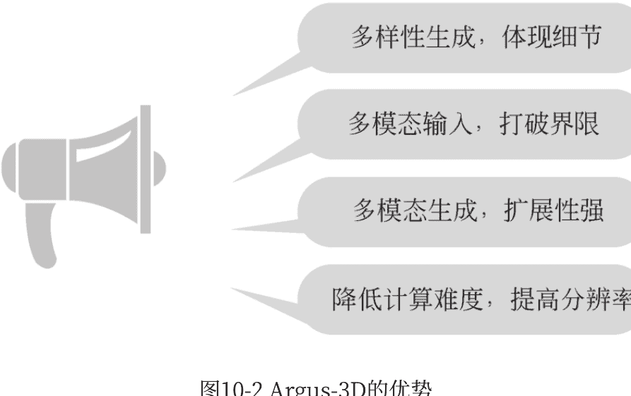

#### 1. 形变万千，细节拿捏到位
在造型多样性上，Argus-3D 能把各种物体的形态完整呈现出来，并且在生成水准上保持稳定。输出的几何结构精准、可辨识度高，细节层级丰富，可以适配不同任务场景。整体轮廓通顺、结构自洽。以椅子为例，生成的座椅对结构关系处理得清楚，边角过渡自然合理，材质质感也能被清晰读出。

#### 2. 多源信息接入，使用门槛更低
该模型支持用文字描述、图片示例、品类标签等多种信息来驱动建模，直接打开了输入通道的宽度。用户可以根据手头条件挑选最方便的方式，不再受限于单一来源。融合多通道信息后，系统能拼凑出更完整的用户意图，从而给出更贴合预期的三维结果。

#### 3. 以自注意力网络为底座，可塑性更强
Argus-3D 的多通道生成能力建立在自注意力型网络之上。过去的主流三维生成多依赖扩散类方法，在高清化上存在天花板，难以满足精细场景需求。自注意力网络让超大规模预训练体系的整体性能得到拉升，三维内容生成力明显增强。依托这一底座，模型在扩展性上更有优势，能够应对更复杂的建模任务。

#### 4. 计算降维，分辨率提升
低分辨率一直是三维生成的痛点，纹理和细节缺失会拉低真实感。Argus-3D 对此做了优化。分辨率越高，存储和算力消耗越快。研发团队把模型特征映射到三个正交投影像上，把原本的立方级运算转为平方级运算，在降低算力压力的同时把细节表现力拉高。

随着版本迭代，Argus-3D 的能力边界会持续扩大，市场上的三维资产也会更丰富。有了超大规模预训练体系的加持，工业级三维内容生成正变得更智能，工程师只需完成关键步骤，就能快速得到高质量的工业三维模型。

### 10.2.2 生产体系融合：从排程到产线全链路赋能
超大规模预训练体系与制造体系结合，能显著提升整体智能化水平。下面几种常见体系是融合的典型入口。

#### 1. ERP体系的智能升级
ERP即企业资源规划，是串联各部门、优化资源配置的信息平台。在制造型企业里，它主要用于生产排程、物料与库存管控、质量管理等，帮助提升资源使用效率。接入基座模型后，可以基于ERP内的数据对生产过程做智能洞察，优化流程、减少浪费。

#### 2. MES体系的实时增强
MES制造执行体系负责对生产过程进行实时管控和监督，主要作用于产线执行层面。它能采集设备状态、生产效率、成品质量等关键指标。结合基座模型后，可以对MES数据做实时监控和智能分析，提升效率与产品质量。

#### 3. SCADA体系的设备联动
SCADA监控与数据采集体系主要用于产线监测和过程控制。与更偏管理的MES不同，SCADA直连设备层与制造层，采集一线设备数据、监控生产过程，为MES提供数据支撑。它聚焦设备细节，收集温度、压力等过程数据。结合基座模型后，实时通信、数据记录、异常告警、关键信息处理等能力得到加强，整体运转更顺畅。

#### 4. QMS体系的质量智能化
QMS质量管理体系覆盖质量控制、检测、分析等全流程。融合基座模型后，能对生产过程做智能分析，自动生成质量报告并给出改进建议。

总体来看，基座模型与制造企业常用体系的结合，有助于实现更智能的生产管理与质量管控，推动制造向智能化迈进。

### 10.2.3 机器人智力升级
超大规模预训练体系在自然语言理解和计算机视觉上具有优势，既能理解生成自然语言实现自然交互，也能解析图像视频实现物体识别与目标追踪。在此加持下，工业机器人将能以更高效率处理更复杂的任务。

一方面，人机交互更自然。机器人接收指令、回应问题的过程更流畅，用户可用口头发号施令，机器人借助基座模型准确理解并执行。

另一方面，视觉感知更强。机器人可以识别并理解周边环境，进而做出合理的运动控制决策，例如定位零件后按指令完成抓取、装配等操作。

结合后，应用边界被打开。当前通用工业机器人多只能完成焊接、喷涂等单一工序，效率有限。有了基座模型支持，机器人可以同时承担焊接、喷涂、零件装配等多重工作，提升通用性，降低企业的生产成本。

未来机器人会更智慧。传统机器人四肢发达、头脑简单，固定在线上按程序执行，新动作需要额外编程。基于基座模型，机器人不仅能执行固定工序，还能应对非固定工作，例如在复杂场景下自主生成方案、排序任务，以更智能的方式高效完成。

基座模型正在重塑工业机器人的应用价值，为制造提供更智能的解决方案，融合发展将带来更多创新。

### 10.2.4 盘古体系引领智能制造新范式
2023年7月华为开发者大会上，华为展示了盘古体系在工业领域的探索历程，并在研发设计、生产、产品经营等环节得到验证。

华为搭建了一套从技术到落地的完整方案，弥补传统模型通用性差、开发门槛高等短板。多年探索后，华为围绕工业场景打造了基于盘古的通用视觉能力，使基座模型工业化落地成为现实。华为云打通了模型监控、数据回传到持续学习、持续更新的技术闭环，为高效开发奠定基础。

盘古体系的层次化预训练架构为定制化开发提供底层支撑。该架构分为通用层、行业层与场景层。通用层基于海量互联网数据训练，是底座；行业层在通用层基础上汇聚行业数据形成行业预训练模型；场景层则依场景数据即可产出场景化解决方案。

在煤矿行业，企业难以自主开发AI算法，也缺乏持续迭代机制，定制化门槛高难以复制。华为与山东能源集团共建人工智能训练中心，打造可复用到不同场景的AI算法流水线应用，降低门槛、实现工业化开发。该应用已在采煤、主运、安监、洗选、焦化等20余个场景落地，推动井下生产与智慧决策创新。

为提升配煤效率，华为推出智能配煤方案。盘古体系无需人工干预，根据煤资源库、焦炭质量要求、配比规则与工艺输出优化配比，生成高性价比配合煤，缩短耗时、节省成本。

基座模型作为产业变革的重要驱动力，正在重塑生产方式、优化产业结构、提升生产效率，推动全场景智能化升级。盘古体系未来将在更多工业场景落地，为企业数字化转型提供坚实基础。

## 10.3 基座模型加持自动驾驶，激活汽车制造新动能
基座模型在工业领域的应用正推动智能制造发展，汽车智能制造与自动驾驶是主要落地场景。

### 10.3.1 自动驾驶算法：从模块化走向端到端
自动驾驶算法反映人类驾驶思维，由感知、预测、规划、控制等多模块构成。

#### 1. 感知模块：看得见
感知模块用于感知外部世界，解决检测、分类、追踪、语义分割四大问题：明确目标位置、对目标进行分类如交通标志、追踪移动目标、将图像中的目标与语义类别匹配如天空、路标。

#### 2. 预测模块：预判先行
预测模块感知外部环境与车辆当前状态，收集感知模块输入的障碍物、红绿灯等信息并判断车辆状态。评估器据场景与障碍物判断轨迹或意图，预测器据短期轨迹预测长期轨迹，为路线规划提供参考。

#### 3. 规划模块：路径决策
规划模块负责寻找最优路径，包含全局路径规划、行为规划、运动规划。全局路径规划确定理想行驶路线；行为规划应对实时交通做换道、避让等决策；运动规划包含路径与速度规划，生成平滑的驾驶轨迹，满足舒适性要求。

#### 4. 控制模块：精准执行
控制模块据规划路线与策略控制发动机、刹车、转向器等执行器，实时调节速度、转向、制动力，确保安全平稳行驶。

模块化方案存在信息丢失、目标不一致、形成信息孤岛等问题。端到端算法可以直接从感知信息输出控制结果，避免上述缺陷。

端到端优势在于：各模块目标统一；规避信息误差与冗余，提升效率；减少传统多编码解码环节的算力浪费；从规则驱动转向数据驱动，训练更高效。

英伟达、商汤等企业已开展探索。2023年6月CVPR最佳论文《以路径规划为导向的自动驾驶》由上海人工智能实验室、武汉大学与商汤联合提出，提出通用模型UniAD。将全栈驾驶任务集成于Transformer端到端网络，涵盖感知、预测等主任务及目标检测、场景建图、轨迹预测、路径规划等子任务，实践效果良好，有望落地。

在模型支撑下，自动驾驶有望从感知到控制一体化，端到端方案将持续涌现。

### 10.3.2 基座模型注入全流程，提升自动驾驶
基座模型可解决数据挖掘与自动标注、算法迭代、端到端模型构建等瓶颈。

#### 1. 数据挖掘与自动标注提效
海量数据与高昂标注成本是闭环难点。百度基于基座模型实现长尾数据挖掘，通过文字与图像编码器训练模型实现向量搜索，结合算法识别定位街景物体，形成底层知识库。该模型支持文本图像检索快速锁定目标，并可定制化训练提升数据利用率。

毫末智行推出生成式模型“雪湖·海若”，用户上传驾驶场景后云端平台可自动标注车道线、行人、自行车等多类目标，降低标注成本。

#### 2. 算法迭代加速
基座模型提供基础能力推动性能提升。百度融合文心模型与自动驾驶技术提升感知能力，用标注数据训练感知模型对未标注数据进行标注，再用新数据继续训练，反复迭代后感知能力大幅提升，可识别此前未识别信息。

#### 3. 端到端模型构建加持
未来大规模端到端系统将出现。基座模型可实现多类型数据输入，提升场景感知能力，并助力感知到控制的一体化集成。输出端可重构三维环境实现可视化，生成更完善的路径规划，提升安全性与可靠性。

### 10.3.3 科技巨头打造自动驾驶通用平台
基座模型时代，科技巨头通过工具链打造通用系统。微软、英伟达已入局，提供模型与工具帮助车企构建算法，缩小中游与头部差距。

#### 1. 微软生态加持
微软凭借云计算、边缘计算及PaaS、SaaS能力为算法开发提供支持。推出Azure OpenAI服务，企业可将基座模型能力集成至产品并进行微调，车企借此优化自身自动驾驶算法。

#### 2. 英伟达全栈布局
英伟达提供算法、软件、芯片全栈方案。DriveSim仿真平台提供模拟渲染引擎，可生成暴雪、暴雨、不同路面、地形、日夜等测试环境，并配备神经重建引擎迁移真实场景数据、修改场景、添加合成对象。

基座模型爆发后，英伟达构建底层架构帮助企业自建模型，推出AI Foundations云服务。论文中VideoLDM可基于文本生成驾驶场景视频，NeuralField-LDM可生成开放世界三维场景，均服务于仿真。

未来分工将更清晰，车企无需自建模型团队，只需接入巨头能力即可优化算法体系，降低研发成本，数据反哺也促进模型迭代。

### 10.3.4 车企自研模型加速入局
理想、蔚来、小鹏等车企均申请GPT相关商标。理想汽车已推出自研模型Mind GPT。

理想汽车积极应用新技术寻求创新方案，申请MindGPT商标并发布Mind GPT，提供更智能更安全的辅助驾驶体验。该模型通过深度学习与人类驾驶行为模仿，基于海量数据分析模拟人类的思维决策过程，动态调整驾驶策略，提升安全与体验。

接入车载摄像头、导航系统后，Mind GPT可实现自动泊车、自动超车。未来将持续研发优化，为用户带来安全舒适的出行体验。

该案例为车企布局提供参考，但仍存在阻碍。多类型数据的采集训练难度大，激光雷达、高清摄像头、GPS等数据来源分散、时间戳复杂，且需丰富场景数据如标志线、交通流等。同时，车内基于基座模型的全新算法构建仍是落地难点。

车内硬件的算力天花板很明显，难以承载超大参数模型运行所需的资源。模型训练与推理需要高阶计算单元和海量存储，而现有车载硬件难以同时满足这两项诉求。在这种约束下，把更强算力能力向汽车体系延伸成为必然趋势，云端智慧算力中心有望成为车辆的基础配置。

例如特斯拉自建云端算力中心 Dojo，利用英伟达 GPU 训练生成式模型；小鹏汽车携手阿里云共建算力中心“扶摇”，服务自动驾驶模型迭代；毫末智行联手火山引擎打造算力中心“雪湖·绿洲”，为自动驾驶模型提供算力供给。目前这些探索仍处完善阶段，待成果落地后，将为自动驾驶算法构建提供坚实算力底座。

巨型生成式系统与汽车的深度融合正推动车辆向智能化演进，在这一进程中具备底层技术能力的车企更易占据主动。第一层面，车企要重视舱内交互与服务生态打磨。当前主流车载语音多为功能型对话，缺乏个性与情感温度。生成式系统借助深度学习与语音合成，能在开放场景中实现更自然的对话体验。同时汽车消费电子属性愈发突出，产品迭代时应着力构建专属应用与用户社群等服务形态，提供全链路体验。

第二层面，生成式系统在补齐行业算法短板。现有自动驾驶算法对人工标注与干预依赖度高，引入生成式系统后需要形成新的智能算法闭环。实现这一点，车企必须搭建统一计算平台，例如融合芯片与云服务的计算底座，为算法持续优化提供算力与数据支撑。

总体看，车企需转变思路，从聚焦制造本身转向聚焦前沿技术，以生成式系统赋能生产，提升整车智能水位。只有把握变革机遇、主动求变，才能在竞争中保持优势。

### 10.3.5 魔方Rubik大模型：汽车智能制造新探索
2023年5月，智能操作系统与技术服务商中科创达在“Thunder World 2023技术大会”上披露大模型研发进展，发布魔方Rubik大模型。该系统可与智能座舱、智能硬件等融合，为汽车制造提供创新方案。

会上推出的汽车智能制造落地应用 Rubik Genius Canvas，其底座由智能编码大模型 Rubik Studio 与 3D 引擎 Kanzi 构成，具备较强智能创作能力。Rubik Genius Canvas 可协助车企完成概念构思、3D 设计、场景搭建等工作。

现场演示中，工程师以自然语言与 Rubik Genius Canvas 交流，系统能够解析设计意图并按要求完成图纸绘制、模型搭建等任务，有效提升座舱设计效率与质量。

同场中科创达还揭牌成立人工智能联合创新实验室，由中科创达与亚马逊云科技联合打造。未来双方将围绕大模型在各行业的创新应用展开合作，借助中科创达在操作系统与 AI 领域的积淀，以及亚马逊云科技的云计算优势，推动大模型在汽车智能制造等场景的落地。

大会上还展示了基于魔方Rubik 大模型的系列产品，以及车路协同、智能硬件等最新方案，体现一站式服务能力。

当前汽车智能化进程加速，智能汽车硬件与自动驾驶的应用越来越依赖生成式系统提供的数据、算力与生成能力。生成式系统的出现正在改变汽车制造的模式与创新路径。如何深挖其应用价值，以之为依托升级制造方案、优化用户体验，将成为车企发展的关键课题。

# 第11章 大模型赋能智慧营销，营销形态加速演进
生成式系统与营销场景结合，正在推动营销智能化升级。其影响主要体现在三大层面：提升营销成效、实现内容人机共创、重构营销业务流程。

## 11.1 多场景落地，营销效能明显提升
随着生成式系统与多领域的融合加深，其在营销领域的落地正带来明显增效。借助该技术，企业能打造智能化对话服务实现个性化关怀；能搭建智能推荐系统提高转化；能开展智能质检强化营销效果；还能做智能投顾，实现更专业的金融产品营销。

### 11.1.1 智能客服升级，实现个性化服务
生成式浪潮下，对话服务场景成为重要落点。传统对话机器人常出现回复不准、不全面等问题，而集成生成式系统的智能客服显著提升了智能化水平和工作效率。

传统客服机器人的短板主要有三：问题覆盖率低、拦截不足；并发接待能力有限、服务效率不高；知识库维护成本高昂。

集成生成式系统的客服能够自学行业与企业知识，具备语言理解与推理能力，可以准确理解用户意图并精准应答。回复形式也更丰富，支持图文、表格、链接等多种呈现。

举例来说，问“我想拍一个短视频，应该怎么拍”，传统机器人通常罗列几种拍法，而智能客服会先询问视频内容和场景，再据此给出定制化方案。

与传统机器人靠关键词匹配不同，生成式系统客服能结合上下文理解意图，若无法匹配不会简单回复“该问题还在学习中”。

在数据分析层面，智能客服同样提升效率。传统分析工具门槛高、采集难，而智能客服可自动整理数据，用户只需提问即可获得可视化结论，并能自动撰写周报月报，减轻人工负担。

多家企业正推出生成式系统客服方案以抢占市场。如容联云发布的“赤兔”生成式系统，面向垂直行业的多层次语言系统，可重构智能客服并创造营销价值。企业借助“赤兔”可打造专属智能客服，实现降本增效。

“赤兔”在 AI 基础能力、语言分析、对话能力、人机协同四个维度实现提升，能根据场景生成差异化内容，提高运营效率和服务水平。依托此前在结构化数据分析与问答的积累，“赤兔”具备强分析与交互能力，可在多场景提供自然交互，并在任务型对话管理上实现灵活应答。

为满足复杂需求，容联云基于“赤兔”打造生成式智能“泛服务”平台“机器猫”。“机器猫”为企业提供多样化生成式智能应用，推动服务数智化。

“机器猫”已在四个场景落地：客户联络、业务协作、AI 辅助、智能洞察。客户联络中可减少人工成本、提升体验；业务协作中具备智能分配、智能填写能力，降低运营成本和客诉；AI 辅助可快速解决管理难题，提升销售业绩；智能洞察则提供多类分析模型，助力决策。智能客服市场竞争激烈，生成式系统持续赋能将拓宽应用场景并提升用户体验。

### 11.1.2 构建智能推荐系统，提升产品转化率
市场竞争加剧下，企业需借助生成式系统实现智慧营销。以电商为例，生成式系统赋能智能推荐系统可明显改善运营效果。

企业通过数据洞察用户行为偏好和习惯，挖掘需求后进行精准推荐，从而提高转化与销售额。下面是生成式系统赋能智能推荐系统的过程，如图11-1所示。

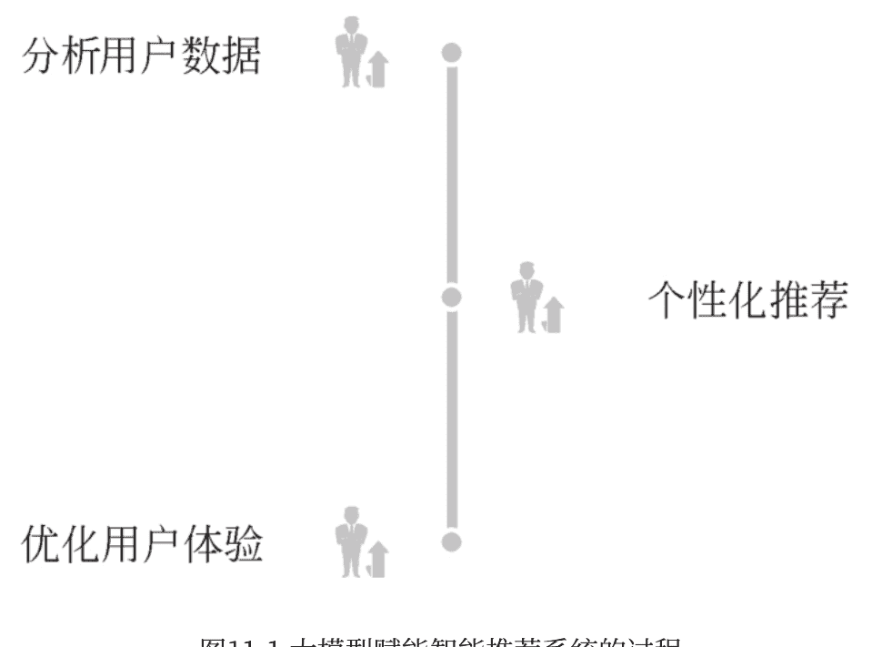

图11-1 生成式系统赋能智能推荐系统的过程

1. 解析用户数据。了解用户需求是前提，企业可通过购物记录、浏览历史、搜索历史等数据洞察购买偏好、日常习惯及潜在消费需求。
2. 个性化推荐。基于分析结果，智能推荐系统可为用户提供个性化服务，将目标用户行为与相似用户对比推荐感兴趣商品，并结合协同过滤、内容推荐等方法提升精准度，促使用户决策。
3. 优化用户体验。优质体验有助于提升留存和转化，企业可从实时个性化推荐、智能搜索与过滤功能、新用户促销引导等方面着手提升购物舒适度和效率。

总体来看，智能推荐系统帮助企业用技术满足用户需求变化，持续学习是保持竞争力的关键。

### 11.1.3 智能质检助力，提升企业营销效果
质检过去多是辅助职能，与营销决策关联较弱。智能质检借助敏感词识别、知识图谱等技术，形成质检功能矩阵，对重点业务进行排查分析，为营销提供决策建议。

智能质检主要有三点优势，如图11-2所示。

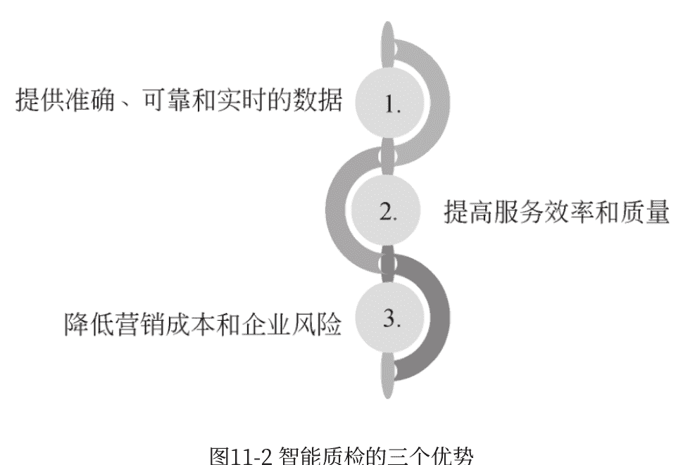

图11-2 智能质检的三个优势

1. 提供准确、可靠、实时的數據
智能质检采集电话录音、聊天记录等数据，经分类、关键词提取、情感分析后评估服务质量，并生成分析报告供企业优化服务、制定针对性营销方案。
2. 提高服务效率和质量
系统可自动评估营销人员与用户的通话质量和营销效果，及时发现问题并给出改进建议。
3. 降低营销成本和企业风险
自动化质检减少人工工作量和人为误差，降低成本与风险敞口。

例如部分金融企业利用智能质检在录音库中检索“偿还能力”“年金转换”等关键词，结合上下文筛选相关业务录音，分析服务质量并持续优化。质检同时可解析用户真实意图，反馈至系统评估操作合规性，并提取用户标签绘制画像，为后续服务提供支撑。生成式系统助力下，智能质检能提升服务质量与满意度，增强营销效果。

### 11.1.4 智能投顾落地，提供专业化建议
金融客服需结合复杂需求和专业知识给出科学方案。借助生成式系统，金融客服在理解力、专业度、表达力上大幅提升，正向智能投顾演进。

如在销售金融产品时，客服可综合客户财务状况、家庭结构、投资需求，以及产品费用、收益、组合搭配等专业知识，提供科学投资建议。

目前已有企业推出智能投顾平台和金融智能助手，如恒生电子的“光子”和智能投研平台“WarrenQ”，以及盈米基金旗下“且慢”的 AI 智能投顾探索。

生成式系统让海量多模态金融数据得以充分利用，产出更科学分析，提升服务能力。客户画像、策略研究、产品筛选、资产配置等环节均受益。

恒生电子的智能投研平台推出两款应用。WarrenQ-Chat 基于生成式系统搜索能力和金融数据库，可实现智能搜索并给出专业答案，全程对话交互，答案支持文本溯源并可生成金融报表。ChatMiner 则支持指定文档进行干货提炼、要点挖掘，实现快速定位。

金融智能助手在投顾场景中可根据客户过往关注的收益区间、产品类别、交易频次推送相关信息。当客户情绪波动时，系统能识别开心、失望、焦虑等情绪，给出个性化安抚和投资建议。随金融数据增长和模型能力提升，智能投顾应用将更普及，提升机构服务能力与个性化满足度。

### 11.1.5 京东大模型助力企业精准营销
京东作为电商头部企业，持续探索为用户和企业提供更好体验。2023年7月，京东推出“言犀”生成式系统，助力企业实现精准营销。

发布会上以采购为例，京东展示了在采购生成式系统技术创新和数智化升级方面的进展。基于言犀生成式系统，京东搭建了行业生成式系统、场景生成式系统和企业专属生成式系统，采用“预训练+精调”方式提升开发标准化和集约化。

例如生成式系统可进行商品智能审核确保合规；在智能控价中输出价格预警策略；智能商品运营上解决供给匹配痛点，实现用户需求与供应商精准对接。

落地过程中面临行业与场景差异等难题。企业采购 MRO 类产品常面临高频、供应商多、价格不透明等问题。京东将 MRO 供应商接入自营采购平台，实现产品标准化，并通过透明可追溯的平台实现采购全流程可视化，提升管理透明度。未来京东将深耕采购领域，用生成式系统赋能采购决策的数字化和智能化。

## 11.2 营销内容实现人机共创
生成式系统在创意生成、内容生成、超级员工打造等多个营销环节发挥作用，助力人机共创、策略创新，使营销更具创意。

### 11.2.1 创意生成，定制化营销创意
数字化时代用户审美提升，对广告质量要求提高，企业制作创意广告成本高昂。生成式系统如 ChatGPT、文心一言等在提升输出效率的同时降低成本，为企业带来颠覆性变化。

百度打造营销创意平台“擎舵”，从文案、图像、数字人视频生成三方面入手，在保证效率的同时产出高质量定制化创意。

真人出镜广告流程复杂、成本高，“擎舵”构建 AI 数字人生成平台，采集数据后即可生成数字人分身和口播视频。制作流程简化为三步：输入产品特色和宣传点生成口播文案；选择心仪数字人进行创作；选择模板并添加文案即可输出广告视频。

贵州大国古将酒业此前无专业团队月均产出不足一条视频，使用该平台后一小时内可制作六条视频，效率大幅提升。在信息过载环境下，“擎舵”帮助企业激发商业潜力，融合图像、语音、数字人技术生成定制化内容，提升营销效率。平台内测后获好评，百度将持续以生成式系统赋能创意营销。

### 11.2.2 内容生成，多元化营销内容
除个性化创意外，生成式系统还能生成多元化营销内容，助力日常营销活动。已有企业锚定特定用户群体推出基于生成式系统的营销产品。

2023年5月，微盟发布基于生成式系统的营销产品“WAI”，聚焦电商商家，覆盖短信模板、商品描述、直播口播稿、公众号文章等20多个场景。

以“释放全新生产力”为目标，“WAI”具备自然语言生成、SaaS 融合、聚合应用等优势，可覆盖商家经营全场景，并提供预设模板，让零基础商家也能开展营销。

生成式系统应用仍面临供给到使用的障碍，“WAI”通过快速生成高质量内容并降低使用门槛，让商家享受便利。当前生成式系统百花齐放，生产力革命加速，要实现规模化稳定落地并推动变革，应用层的突破和技术普惠至关重要。

发布会现场：WAI 如何重塑商家营销效率

在近期的一场行业发布会上，微盟把自研生成式工具 WAI 搬上台做实操演示。围绕开店环节，系统可以秒级生成开屏页、合成试衣效果图、自动撰写店面介绍，明显压缩了前期准备的时间成本。在内容生产侧，WAI 支持一键产出公众号图文与封面、按不同直播风格撰写话术稿、输出投放文案，使用门槛很低。

现场还演示了 WAI 为某品牌打造的 618 线上营销策划。模型综合品牌调性、节庆语境与具体商品信息，给出了一份贴合诉求且具针对性的活动方案。

微盟表示 WAI 仍在高速迭代。以 SaaS 融合为例，旗下微商城、企微助手等产品已接入 WAI，覆盖搭建、创作、投放等电商运营环节。未来依托全链路营销产品矩阵，WAI 的应用场景会持续扩展，帮助商家释放生产力。

这一案例验证了生成式模型在营销侧的价值。随着接口更友好、与软件即服务的融合加深，模型有望在营销领域实现规模化落地。除创意生成外，店铺视觉、日常运营、活动设计、售后等环节也有切入空间，能够为商家提供更全面的支持。

### 11.2.3 超级员工：模型能力驱动的数字协作

基础生成模型逐步成熟后，已能明显提升企业运营效率。以中关村科金 AI 平台能力中心为例，其依托大模型搭建了“得助”对话引擎，并推出虚拟员工助手，帮助企业打造专属数字同事。这类同事可承担文案撰写、智能问答等任务，提升营销服务价值。

在基础模型加持下，“得助”对话引擎能够培育超级员工。培育过程大致分为“学、教、用”三步。

1. 学：无监督方式吸收领域知识
模型理解力强，中关村科金向模型输入培训资料、行业通用知识等，让其掌握专业语境。该阶段主要让模型从多源数据中提取事实性知识。公开对话模型多基于开放语料，缺乏垂直领域数据，企业使用时需补充高质量专属数据。中关村科金积累了大量内部对话记录用于训练，训练后的模型输出自带行业上下文，更具针对性。
模型难以捕捉快速变化的事实。以金融场景为例，用户问某产品利率，当前 3.4%，模型可能给出旧的 4%。市场波动后利率降至 2%，模型无法即时更新。模型擅长基于上下文生成合乎逻辑的回答，但事实准确性无保障。动态事实可通过训练注入，却难以保证时效正确。为此团队引入 GPT-4 插件机制，提升输出可信度。

2. 教：监督微调以掌握流程
完成无监督预训练后，模型需与研发人员持续交互，以成长为合格员工。本环节难点在于流程性知识的内化，与事实知识相比更强调逻辑顺序。可采用两种路径：一种是让模型自行从对话数据中归纳规律并调整；另一种是研究人员主动指导，定向提升能力。

3. 用：以助手形态投入实战
培养完成后，虚拟员工会被分配具体任务，如撰写文案、接待用户并答疑。关键在于人机分工互补，让真人同事与数字员工各司其职，并在实践中不断优化。实际操作采用机器加人工协同：先按业务属性与通用流程划分职责，再根据环节复杂度决定人工介入程度。简单场景系统自动处理，复杂场景由数字员工初筛后人工复核。

为帮助企业降本增效打造的超级员工，如今已在部分场景试用。例如基于领域模型的呼叫机器人，过去搭建约需 5 个月，现在缩短到两天左右即可上线。未来数字员工的角色会更丰富，不仅能处理重复机械工作，也能参与创造性任务，分担真人负担，让大模型持续释放价值。

### 11.2.4 三人行与科大讯飞：共建多模态营销模型
2023 年 3 月，整合营销公司三人行宣布与科大讯飞合作，共同研发基于人工智能的多模态营销工具，涵盖营销专用大模型与 SaaS 化智能营销软件。

科技快速演进，大模型的出现重塑了营销业态。抢占先机是三人行的选择，为实现降本增效而布局。
三人行与科大讯飞深度绑定，利用后者技术与产品优势赋能自身，实现共同发展。合作中，三人行共享多年沉淀的营销方法论，展现出强大的市场推广能力。科大讯飞积极推进合作进程，共享行业领先的人工智能技术，与三人行共同拓展营销边界，以模型能力赋能行业发展。二者还共同研发多模态智能营销工具，该工具可为企业提供 SaaS 服务，帮助企业生成品牌营销战略、海报、文案等，还可用于打造可进行电商直播的虚拟数字人。

随着时代发展，营销方式发生重大改变。个性化推荐、用户画像等技术能赋能企业营销，而大模型的出现，给营销行业带来更深远的影响。

## 11.3 大模型对营销业务的重塑
在模型支撑下，创意文案、营销视频生成、智能客服对话等环节均在被重塑。模型可实现多模态内容生成，打破创意生产瓶颈，推动降本增效，重构生态。目前电商营销、金融服务营销等方面，大模型已对部分营销业务实现重构。

### 11.3.1 营销变革的五大趋势
随着大模型的发展，其参数数量和训练数据量将进一步增加，能力不断提升。大模型在营销领域的应用将重构营销格局。具体而言，大模型对营销格局的重构表现在以下几个方面，如图11-3所示。

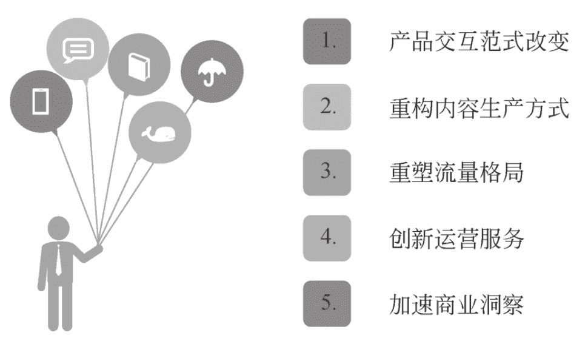

#### 1. 产品交互范式改变
开放 API 接口使得大模型成为一个通用平台，支持用户调用大模型的各种能力，赋能自己的产品。产品接入大模型、提升智能性成为可能，促使产品交互范式改变。以往，产品设计按钮和使用界面的目的是满足用户的刚性需求，交互逻辑是用户需要适应产品的功能。而接入大模型后，产品能够理解和满足用户的更多需求，并根据用户需求调用资源为用户提供优质服务。在这种情况下，产品与用户的交互更加主动、更加多样化。

#### 2. 重构内容生产方式
在大模型未出现之前，营销内容的生产周期较长，企业往往需要咨询专业机构，以打造个性化的营销方案。同时，营销方案中每个模块内容的生产都需要大量的人力与时间，拉长了营销方案产出和执行的周期。而大模型能够重构营销内容生产方式，无论是个性化营销方案，还是营销文案、视频、网页设计等，都可以交给大模型完成。这不仅提升了营销内容的产出效率，还能够通过千人千面的内容实现更好的触达、转化效果。

大模型的应用和海量营销内容的产出使用户的注意力变得更加稀缺。在这样的环境下，一方面，企业要快速铺量，以低成本的内容触达更多用户；另一方面，企业也要注意提高营销内容的质量，使内容更具竞争力，以占领用户心智。

#### 3. 重塑流量格局
当前的流量转化形式主要是社交平台向电商平台转化，即用户在社交平台被“种草”后，再去电商平台搜索产品。这种流量转化方式将随着大模型的应用而被改变。大模型提供了新的交互模式，能够为用户提供个性化的产品推荐方案。这将会对当前的社交平台以及搜索引擎造成冲击。在未来，大模型可以与手机助手、智能音箱等多种终端结合，给用户带来更加自然的交互体验，而流量也将会向这些终端转移。大模型将成为新的流量入口。

#### 4. 创新运营服务
在运营服务方面，随着大模型与智能客服的结合，个性化、更具情感关怀的一对一服务将成为可能。与以往只能进行短文本处理、简单多轮对话的智能客服不同，接入大模型的智能客服具备长文本处理、意图识别、上下文连续对话等能力，能够为用户提供个性化、更有温度的服务。
以往，配置智能客服是一项复杂的工作，智能客服的普及度也不高。而在大模型的支持下，配置智能客服的成本得以降低、流程更加简单。这使得企业可以配置多样化的智能客服，为用户提供一对一、个性化的服务。

#### 5. 加速商业洞察
当前，品牌营销的商业洞察集中在文本领域，如基于用户在电商平台、社交平台的评论进行商业洞察。而大模型会颠覆这种商业洞察模式，形成“提出假设——收集信息——产出洞察”的闭环，使敏捷化、自动化的商业洞察成为可能。大模型的赋能使得商业洞察的门槛大幅降低，企业的商业洞察能力提高。

大模型的爆发将推动营销生产力爆发，推动营销业务、营销模式革新。在这样的背景下，企业需要了解以上几个方面的变化，抓住变革机遇，更好地适应大模型时代。

### 11.3.2 电商走向智能化
大模型的涌现推动营销领域发生重大变革，电商营销是其中的一个典型。电商是一个聚集着众多玩家的赛道，阿里巴巴、京东、拼多多等互联网巨头都通过电商业务实现了快速发展。从货架电商到内容电商，电商营销的玩法不断创新。

在大模型时代，电商领域将发生什么变化？智能电商将成为电商发展新方向，电商营销将在大模型的赋能下变得更加智能。

在流量入口端，电商平台可以借助大模型实现对海量数据的深度学习，分析用户行为，预测用户可能会被哪些产品吸引，进而生成个性化的产品推荐方案，提升引流效果。例如，当用户搜索关键词“口红”时，大模型可以在电商平台中找到与口红相关的各种数据，并结合用户的购买记录和喜好，生成个性化的口红推荐方案。这能够帮助用户快速找到心仪的商品，提升用户的购物体验。

除了流量入口端的变化外，供应端同样会发生变化，如利用大模型生成营销文案、模特图片、营销视频，以及利用 AI 虚拟主播进行营销等。这些都体现了大模型给电商营销带来的变革。

2023 年 4 月，腾讯云推出了智能小样本数智人生产平台。基于真人口播视频和语音素材，该平台能够实时建模并生成高清数智人，为电商营销助力。相较于真人主播，虚拟主播的营销费用大幅降低，并且可以稳定输出营销短视频，进行全天候电商直播，提升电商营销效率。

智能客服是大模型在电商营销领域的重要应用场景。当前，各大电商平台的智能客服并不是十分智能，只能够根据关键词给出提前设置好的答案，难以满足用户的个性化需求。而大模型在语音识别、自然语言理解、人机交互方面都具有优势，能够大幅提升智能客服的智能性。

在大模型的支持下，电商平台将变得更加智能。电商平台能够捕捉用户的想法和需求，并提供个性化的解决方案。未来，电商营销的全流程在大模型的助力下都将发生变革。

当用户搜索某件商品时，基于大模型的智能导购能够通过语音对话的形式了解用户的需求，向用户介绍商品品牌、性能、型号等，根据用户的喜好向其推荐合适的产品。此外，智能导购还能够对不同品牌的同类商品进行对比、测评，为用户做出购买决策提供依据。在这种贴心的服务下，用户能够减少犹豫和思考时间，更快速地做出购买决策。同时，基于大模型的智能分析，电商平台能够主动向用户推荐更加符合其偏好的商品，促进成交，提高用户转化率。

如果用户想要详细了解某件商品，可以与智能导购交流，询问细节问题并获得准确的回答。用户也可以进入店铺，与其中的智能客服、直播间的虚拟主播沟通，了解商品的详细信息、优惠活动等。

在用户购买完商品后，智能客服会主动询问用户的反馈，并解决用户提出的各种售后问题。例如，当用户购买了商品，需要商家指导安装时，智能客服能够生成商品的安装视频，指导用户逐步安装。此外，对于不同用户对商品的评价，智能客服能够生成个性化的回复，避免回复千篇一律。

总之，基于完善的营销服务流程，用户能够获得更加流畅、自然的购物体验。这降低了用户的决策成本，提高了电商平台的用户转化率。

### 11.3.3 金融营销模式的智能化升级
大模型在金融领域的应用，将推动金融服务营销模式创新。大模型将为金融服务营销模式带来以下三个改变。

- (1) 基于大模型的智能客服将代替人工客服，高质量的智能金融服务成为可能。基于金融行业大模型以及丰富的金融数据进行训练的智能金融客服能够与用户进行多轮对话，并根据用户的需求给出专业的解决方案。
- (2) 大模型能够为专业的理财顾问、理财经纪人等生成金融业务助理。金融业务助理不仅了解行业宏观政策、产品信息、用户需求等，还能够自动生成报告、提供专业的理财建议或方案。
- (3) 大模型具有一键生成营销内容的能力，能够提高金融行业的营销效率。以往，金融服务营销从业者需要从海量信息中检索词条，将大量时间用于信息收集、提炼与整合，并进行营销方案设计、营销文案与短视频制作等。未来，内容检索、数据整理、营销内容生成等工作都可以交由大模型完成，用户可以通过人机协作提高工作效率。

当前，在大模型与金融服务营销融合方面，不少企业已经进行了探索。2023 年 7 月，京东科技携手中国工商银行、中国民生银行等金融行业头部金融机构举行了金融行业大模型创新应用启动仪式，共同推进金融行业大模型的研发与应用，助力金融机构业务增长。

凭借在金融行业积累的丰富经验以及数据与场景积淀，京东科技依托言犀大模型发布了一系列金融场景智能应用，进一步提升智能化金融服务的效果与精准性。

在金融服务营销方面，京东科技推出了营销助手“AI增长营销平台”。该平台简化了营销业务的运营流程，减少了人工参与的环节，大幅提升了营销效率。同时，该平台简洁易用，降低了用户学习与操作的成本，提升了操作效率。在该平台的支持下，金融营销活动方案的产出效率提升了上百倍。

在基金理财方面，京东科技优化了基金筛选流程，推出了“智能选基顾问”。基于大模型在金融领域的知识增强优势，智能选基顾问回答基金筛选问题的准确率达到 90%。同时，其优化了意图识别、多轮对话等沟通环节，提升了用户使用体验。未来，这一产品将向所有金融机构开放，为金融机构的智能化服务提供助力。

基于在金融领域支付、保险、消费金融等方面的多种实践，京东科技为金融机构打造了一套完善的金融解决方案，包括金融工具、金融数据、运营策略等。该方案可以帮助金融机构完善数智化运营体系、获得增长新动能。

面向金融机构，京东科技推出了以用户为中心的增长解决方案——“金融增长云”。金融增长云能够实现消费金融、支付等多种业务的数智化运营，实现用户营销的个性化、精准化和智能决策。金融增长云以“咨询+技术+联合运营”的模式提供运营战略咨询服务，为用户提供专业、可落地的运营方案。金融增长云能够帮助金融机构打造数据中台、业务中台、客户中台等数字化底座，提升业务系统的敏捷性。

在实践方面，京东科技携手中信银行推出了智慧魔方项目数字化运营中台，连通了业内多个系统，上线了千余条数字化运营策略，覆盖了海量用户。基于该数字化运营中台，金融产品的点击率大幅提升，营销系统向着敏捷、智能的方向进化。

未来，京东科技将携手更多金融机构加强大模型应用探索，在推动大模型在更多金融场景应用的同时，促进金融场景与大模型应用的协调，用技术创新为金融业务提速。

除了京东科技外，专注于金融营销生态服务的百融智汇云也在大模型与金融领域融合方面进行了探索。百融智汇云旗下的人工智能实验室推出了自主研发的智能语音机器人。其可以实现高频次的自动交互，赋能金融机构精准营销，降低营销成本。

该智能语音机器人基于 Transformer 架构构建，在语音识别、语义理解等方面具有显著的优势。在语音识别方面，可以精准识别用户语音，具备超高的准确率。在语义理解方面，基于预训练模型，可以精准理解语义并进行多轮对话。同时，在交互效果方面，该智能语音机器人的音色、语速都十分自然，且富有情感，能够给用户带来更加真实的人机互动体验。

在落地应用方面，百融智汇云已经与一些金融机构达成合作，将智能语音机器人应用到其业务线中，在降低人工服务成本的同时提高了服务效率。

总之，在大模型的加持下，金融服务营销将变得更加智能，实现“快、准、狠”的精准营销，提升金融机构的服务能力。未来，随着大模型的发展，聚焦垂直领域的金融行业大模型将越来越多，大模型将惠及更多金融机构。

### 11.3.4 中关村科金在金融场景的实践
基于在金融领域的多年深耕，对话式AI技术方案提供商中关村科金凭借通用大模型开发了金融行业大模型，并推出了多款针对金融场景的大模型应用，助力金融机构实现更加智慧的客户服务。

#### 1. 金融服务助手
当前，金融领域的金融服务助手往往存在理解客户意图不够透彻、回答问题不够专业、使用体验不够流畅等问题。中关村科金基于以上痛点和金融机构的需求，推出了以大模型为底座的金融服务助手系列应用。

其中，聚焦保险领域的智能投保助手在大模型的助力下学习了丰富的保险知识，通过融合优秀保险顾问的经验，实现保险知识的深度应用。其能够结合客户实际需求、以往服务经验、对市场的预判等，为客户提供个性化的保险选择建议，并为客户提供自助投保、自助出险等服务。

聚焦财富领域的智能投顾助手能够为对理财有需求的客户提供专业的建议。其不仅能够理解客户的问题，结合最新资料给出专业的回答，还能够根据客户数据分析客户理财偏好，给出更契合客户需求的建议。

#### 2. 智能销售教练
中关村科金聚焦金融领域销售业务推出了智能销售教练。其能够根据销售人员与客户的沟通过程，分析客户情况，找到销售突破点，帮助销售人员分析客户数据并给出专业的销售建议。同时，智能销售教练还能够提醒销售人员关注销售过程中的机会和风险，帮助销售人员高效完成销售任务。

沟通结束后，智能销售教练能够帮助销售人员总结销售过程中存在的问题，并针对其工作中的薄弱环节，模拟真实销售场景，生成模拟对练，帮助销售人员提升在不同场景中的应对能力。

#### 3. 智能决策助手
在日常管理中，管理者难以全面掌握销售人员的工作情况。管理者要想做出科学的决策，就需要收集销售人员、市场环境、客户反馈等多方面的数据。而中关村科金推出的智能决策助手凭借销售业务决策场景的训练，可以“读懂”行业资讯、金融机构的资料等，同时汇总各种渠道的客户行为数据，提炼出客户特征，帮助管理者提升数据获取和分析的效率，实现高效决策。

随着以上三种应用的落地，金融服务将变得更加智能和高效，为客户带来更优质的服务体验。未来，中关村科金将持续推出大模型应用及解决方案，为更多企业提供智能化、定制化的服务。

# 第12章 大模型+智慧城市：推动城市数字化升级

## 12.1 大模型全域赋能智慧城市建设

城市化步伐加快的背后，是科技浪潮对城市形态的持续重塑。智慧城市的探索正进入深水区，而大模型凭借海量训练数据与强大的学习推理能力，成为撬动城市升级的核心引擎。它能够从纷繁复杂的城市数据中提炼关键要素，洞察要素间的关联逻辑，实现资源与设施的协同整合，从而推动城市向数字化、智能化方向迈进。接下来将从典型场景切入，呈现大模型在智慧城市中的落地路径，并梳理相关企业的实践探索。

### 12.1.1 精准配置资源，让城市运转更高效

城市治理涉及工程建设、社会经济、公共服务等多元领域。大模型以实时大数据为输入，具备前置解析与决策支持的能力。在实践中，它正为智慧城市提供多维度的智能服务，涵盖资源调配优化、交通态势预判、降水研判等环节。

- 1. 智慧基建：大模型驱动运行提质
- 2. 智慧政务：以大模型提速服务体验
- 3. 智慧医疗：大模型构建医疗数智场景
- 4. 智慧环境：大模型助力城市绿色发展

#### 1. 智慧基建：大模型驱动运行提质
智慧基建既指信息网络的迭代升级，也涵盖供水、供电、供气、供热管网及道路桥梁的智能化改造。以智慧供电为例，大模型可采集全城电力设备的能耗数据，分析运行状态并识别缺供或浪费风险；同时梳理用电影响因子，构建关联模型对不同区域的未来用电量进行分区预测，为储能与供电设施的布局优化提供依据。

总体而言，大模型通过持续采集与分析城市运行数据，实现基础设施的实时监测与问题预警，输出多种处置方案，帮助管理者优化布局，提升基建建设的效率与质量。

#### 2. 智慧政务：以大模型提速服务体验
在政务场景中，对话式AI的深度应用正推动服务向高效、智能演进。大模型在运行中严格遵循法律法规，依托访问控制体系对公民身份、财产等敏感信息加密保护，并在服务中保持公平与可解释性。经大规模训练与算法迭代后，它能以通俗语言面向全体市民开展政策解读与办事指引，让政务更有温度。

2023年4月，百应科技推出政务垂类大模型“万机”。该模型可整合各地最新政策，实时为市民提供精准解读；通过对话结合历史记录，精准把握办事诉求并给出解决方案；并提供7×24小时智能服务，随时查询政策、提交申请。同时，它能够承接日常流程性工作，减轻政务窗口压力。

#### 3. 智慧医疗：大模型构建医疗数智场景
医疗领域的大模型可汇聚诊疗数据，辅助医生诊断、用药与方案制定，提升服务精度并降低成本。GPT-4已实现医疗场景的商业化合作，对信息化建设、互联网问诊、公共卫生均产生深远影响。

- 自主生成电子病历。GPT-4支持多模态输入，可解析医患对话要点并自动生成结构化病历导入系统，节省医生的录入时间。
- 辅助诊断决策。基于专业医疗数据训练，GPT-4可结合病例与临床信息，按概率排序可能诊断，为医生提供决策参考，随着学习深入诊断准确性持续提升。
- 指导线上问诊。依托自然语言理解能力，GPT-4能灵活对话患者，提取核心诉求给出初步健康建议或分诊指引，有效缓解就医压力。

#### 4. 智慧环境：大模型助力城市绿色发展
智慧环境涵盖污染防治与生态保护。以大气治理为例，大模型可采集PM2.5、工业废气排放、道路车流量等数据，并结合排放指标进行关联分析，识别各区域污染主因，生成多套防治方案并构建评估体系，实现低成本高效治理。

借助GIS进行环境影响评估，大模型可实时监测污染排放并发出预警与管理建议，不断提升环境质量，推动绿色城市建设。

### 12.1.2 交通态势预测，重塑管理模式
随着路网完善与出行需求增长，拥堵问题日益突出。大模型可对交通态势进行前瞻研判，为驾驶者提供路线规划、为管理部门提供决策依据，推动交通治理模式转变，如图12-2所示。

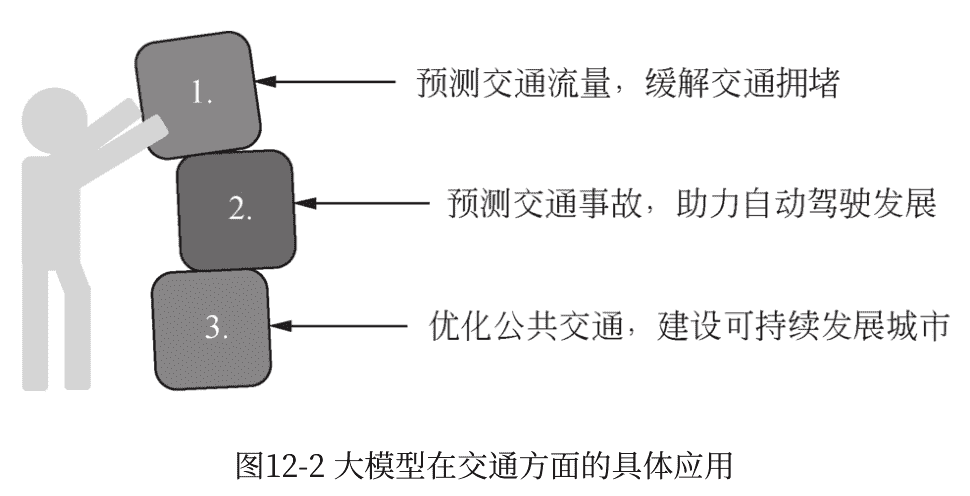
#### 1. 预测车流，缓解拥堵压力
大模型可基于历史交通数据构建集成预测模型，对未来车流进行预判；同时实时读取信号灯状态，帮助驾驶者掌握前方红绿灯分布并推荐替代路线。对管理部门而言，预测结果可用于动态调整灯控配时，改善拥堵。

2023年4月，百度发布全域信控缓堵方案。方案以多款交通大模型为底座，结合机器视觉实时感知路况变化，可识别常态与异常拥堵，并针对学校、景区等易堵节点分析研判。

方案具备四大能力：
1) 全域感知。融合百度地图浮动车、交管监测与路口智慧监控数据，结合GNN技术预测各层级干道车流并补全轨迹、流量数据。
2) 全域优化。对交通管理区域进行细分与效果评估，形成闭环管理。
3) 全域协同。利用大模型的自然语言交互能力，实现系统间信息高效互通。
4) 全域服务。向车载端与手机端推送事故、施工、信号灯等信息，提供绕行与停车指引，优化出行体验。

#### 2. 预判事故，助推自动驾驶
大模型可分析历史事故数据，预测高风险路段，为交管部门提供增设标识、加强巡逻的建议；还能与智能车载健康监测系统联动，通过云端生理参数实时监测驾驶员状态，避免疲劳驾驶。

在自动驾驶方面，大模型经数据集训练后可学习交通规则与行为模式，结合行车记录仪、毫米波雷达等感知硬件，实现对车辆、行人、障碍物的全面认知。紧急情况下可快速决策制动，并通过持续迭代适应复杂路况，提升安全性。

#### 3. 优化公交，打造可持续交通
大模型可整合干道流量、公交地铁换乘与站点客流信息，为市民推荐最优出行方案；实时监测交通状态，缩短应急处置时间。结合路面与天气数据优化行驶路线，并通过高精度传感器监测路面磨损自动报警。

借助模拟退火与粒子群优化算法，结合空气质量指标辨识污染物；通过对交通系统的整体分析，规划新增公交线路，在缓解拥堵的同时减少排放，助力节能减排与城市可持续发展。

### 12.1.3 降水预报模型，推动气象精细化
气象预报关乎民生、能源与环境安全。极端天气频发背景下，预报技术正向智能化、精细化演进。以下三种大模型是典型代表。

#### 1. 深度学习模型MetNet-2：12小时气象预测
2021年谷歌发布的MetNet-2是一种深度神经网络。基于观测数据进行预测的思路，打破了传统物理模型的计算限制，提升了速度与覆盖范围。相较前代，MetNet-2将预测时效从8小时延长至12小时，空间分辨率达1公里以内，时间分辨率达2分钟。

模型直接连接输入输出端，减少中间步骤，提升准确性。以雷达与卫星图像为输入，并结合物理模型的预处理状态作为补充，捕捉更完整的大气信息。

#### 2. 极端降水临近预报大模型NowcastNet：3小时强降水预报
NowcastNet由清华大学与气象局联合研发，以近6年雷达观测数据训练。针对全国极端降水，可精准呈现降水强度、落区、移动形态及超级单体演变过程。

该模型融合深度学习与传统物理理论，可提供长达3小时的临近预报，填补国际空白，为城市极端天气精准防范提供技术支撑。

#### 3. 盘古气象大模型：多领域精准服务
2023年7月，华为盘古气象大模型发表于《自然》。模型采用三维神经网络与分层时间聚合算法，可精准提取风速、温度、湿度、气压、重力势能等要素，台风路径误差降低20%，预报时效覆盖1小时至7天。

模型可与多元场景结合：在能源领域支持生产调度；在航空领域助力机场运行与飞行效率；在农业领域提供精准气象服务保障产品质量；在智能家居领域联动家电优化室内温湿度体验。

## 12.2 城市安防：大模型引领创新升级
智慧城市深入发展，智能安防同步升级。监控成像、边缘计算与5G的进步为大模型下沉安防奠定基础。通过深度学习，大模型可不断优化算法，自动识别文字、图像等多模态数据，整合安防信息，推动安防智能化。以下探讨多模态大模型在安防场景的应用逻辑。

### 12.2.1 大模型驱动安防智能化
AI深度应用使安防行业进入“无AI不安全”阶段，人体分析、车辆分析、目标跟踪与异常行为识别已广泛落地。大模型的涌现为安防提供更强智力支撑，泛化能力使其能快速适应新样本，提升模型精度。

传统安防智能应用存在灵活度不足的问题。大模型具备通用开发能力，可大幅降低定制成本，企业可上传安防数据训练垂直模型。通过知识蒸馏与量化技术，将能力迁移至安防大模型，并形成训练成效反馈闭环，降低人工标注成本，提升异常响应速度。

基于此，安防大模型可适配校园、医院、社区等场景。例如在校园，模型可联动电子门锁设定区域权限，结合高精度摄像头人脸识别完善刷脸进校与24小时机器人巡逻，保障人身与财产安全。

此外，大模型可实现历史数据学习与未知事件快速响应，基于多模态融合文本、图像、视频实现全方位预警，并通过图像声音分析完成行为识别与异常检测。高分辨率成像配合大模型可提取细微特征，如面部表情、车辆颜色型号等，提升效率。

2023年6月，第十六届中国国际社会公共安全产品博览会在北京举办，主题为“自主创新、数智融合、赋能安防、服务社会”。联汇科技现场展示视觉大模型能力服务、智能助手、城市基础数据分析平台等产品，并发布视觉语言预训练大模型，获得广泛关注。其视觉操作平台OmVision OS斩获创新产品重大贡献奖，彰显大模型在安防领域的落地实力。

### 12.2.2 多模态大模型成智慧安防新风口
多模态学习要求模型处理视觉、文字、声音等信息并进行关联整合，可降低单一模态的不确定性，扩展应用范围。

2023年5月，360公司发布“360智脑——视觉”大模型。创始人指出多模态增强的核心在于大语言模型的认知推理与决策能力。模型将视觉感知与大语言模型结合，通过场景微调提供定制化安防方案，主要能力包括：

1) 开放目标检测。针对巡店场景中的遮挡、摄像头偏移干扰，模型可根据用户开放式文本描述，如“墙上的白色中文Logo”，精准识别目标。在车辆统计中，可按自然语言指令快速统计总数或特定车型，如蓝色两厢轿车、红色卡车。

2) 图像标题生成。模型以人类思维理解图片，快速标注提取关键信息，如“中年男子躺在白色地板上”“黑鸟在雨中飞翔”，提升检索效率。

(3) 看图就能问答

零售门店巡检时，360智脑——视觉 让图问交互更顺畅。巡检员用口头描述想要核查的点位，该系统即刻解析现场照片，并把结果整理成一份巡检评分清单。

该系统还能延伸到其他安防场景。仓库看护环节，可利用区域切割配合开放集目标检测，对各个切割区域的轮廓进行持续观察，确保形态未被改动，存放物资保持完整；设备巡检环节，则借助深度估算追踪设备坐落，判定是否出现位移。

当前文本—视觉多模态系统已能实现图像对话、文字化说明以及按文字生成图像的功能。下一步接入声音、视频等模态后，数据类型会更丰富，在此基础上具备声纹识别、多模态生物识别的智能安防形态将逐步落地。

(1) 声纹感知：巡检机器人

安防领域以智能巡检机器人为代表的装备正进入住宅区与商圈。机身内置麦克可拾取环境声响并对人声做识别分析，判断被护对象是否处于险境。必要时设备会触发告警并切换到防御模式，为目标提供安全庇护。

(2) 多模生物识别：视频监控

智能视频监控以人脸识别为核心，叠合智能语音识别实现声纹比对，把说话人的声纹同库内样本做匹配，快速锁定身份。多模生物识别让视频监控的准确度提升，整体更智能。

在多模态模型支撑下，未来会出现可同步完成文字剖析、图像剖析、音频剖析、视频剖析的智慧安防体系。多模态数据的融合研判能显著提高危险辨识与风险预告的精确度，更好满足多元化安防需求。

12.3 企业实战：大模型推动智慧城建
全国各地在响应碳达峰碳中和目标过程中，加快智慧城市推进步伐。模型发展为城建注入新动能，与5G、AI、物联网等技术结合，通过深度学习不断突破算力算法瓶颈，推动交通、建筑、公共服务等领域创新。以下以文心一言、孔明、通义千问三套系统为例，呈现科技公司在城市建设中的探索。

12.3.1 冰城+文心一言，让服务更贴心
2023年2月，哈尔滨市融媒体中心官方客户端冰城+宣布与百度文心一言展开深度合作。以对话式大语言模型做技术底座，冰城+将对内部架构进行全面升级，使模型下沉至新媒体赛道，为市民推送更及时详尽的新闻与政务内容。

冰城+于2021年上线，是哈尔滨市面向市民的权威资讯平台，与央视新闻、哈尔滨日报、哈尔滨广播电视台等多家媒体合作，滚动更新教育、文化、财经、体育等板块资讯。其冰城60s栏目用60秒短视频发布气象预报、尾号限行变更、防电信诈骗等生活提示。

在资讯传播上，结合文心一言后平台能实现更定制化的推荐。系统采集客户端的浏览时段、阅读类别、页面驻留时长等行为，分析阅读习惯与偏好，生成定制推荐界面，确保市民及时触达感兴趣的热点。

文心一言具备自然语言处理能力，能学习当下流行网络用语，对专业性强的稿件进行转述，用更通俗生动的表达提升传播效果与阅读感受。

在网络问政上，大模型为冰城+打造智能问政平台提供底层支撑。借助自然语言处理，市民可直接在平台提问，模型结合问题描述与阅读兴趣给出更全面的回复。同时系统可即时监测留言，清洗重复文字与无效符号、补全缺失语句后做精准归类，按问政数量由多到少排序，挖掘关注热点并即时反馈给相关部门。

对政务部门而言，模型可分析市民的历史问政记录，辅助制定更合理的解决办法，并全程追踪政务服务流程，确保诉求及时办结并据反馈评估处置效果。

在城市生活服务层面，模型可对市民的个人信息与家庭信息进行结构化整理，在安全前提下，冰城+打造了一体式缴费入口，便于随时缴纳水电燃气等费用。结合最新气象预报与交通管理数据，平台可推送未来数日天气、限行尾号、实时路况等信息，助力出行规划。另整合微信公众号、小红书等多源信息，提供美食、旅游、健身等内容，提升生活幸福感并带动城市经济发展。

冰城+与文心一言的结合，是哈尔滨智慧城建的重要一步。模型能把各部门各领域的专业知识整合，构建统一预训练模型，提升客户端研发效率。作为首个接入文心一言的官方客户端，冰城+致力于推动先进技术下沉，构建更智能全面的城市服务平台。未来双方合作将持续加深，推动数字经济发展，让模型技术为产业发展与公益服务贡献力量。

12.3.2 孔明系统助力治理提效
2023年4月，城市数据智能服务科技企业软通智慧发布孔明模型。该系统面向城市治理，旨在帮助治理部门更高效利用数据资源，提升治理效能与质量，推动智慧城市建设。

系统具备强泛化能力，可快速融合多行业知识，为多种治理场景适配奠定基础；具备强推理能力，能基于数据自动生成并归类治理事件，协助制定方案；具备良好工程化能力，可准确理解部署诉求、降低操作难度，并为隐私数据设置权限保障信息安全。系统搭载城市慧眼、一语通办等业务插件，内置庞大行业知识库，提供便捷准确的业务查询办理服务，助力降本增效。

环境治理聚焦垃圾分类与河流污染。垃圾分类上，模型依托深度学习能力，可学习各城市分类标准并开展科普宣传，一方面用通俗语言解释可回收、不可回收、厨余、有害垃圾的内涵，助市民准确分类；另一方面可与电脑端、手机端软件结合，加大信息推送，潜移默化树立分类意识。

系统亦可推动自动分类设备发展。基于大规模数据训练，可更精准辨识各类垃圾，实现检测与批量分类；可与地埋式垃圾箱结合，通过箱内传感器持续监测垃圾量并及时压缩清理；可连接箱外传感器监测周边温湿度，进行危险预警，避免高温自燃，提升安全性与效率。

河流污染治理上，模型结合各类传感设备检测流量、pH值、重金属、塑料等数据并上传云端。通过深度挖掘数据并结合历史水质与周边环境数据，可精准判断污染成因并预测未来水质走势。基于分析结果提出针对性治理方案，并通过远程控制协助安装水体过滤系统、投放药剂，有效治理污染，促进水循环良性发展。

消防安全上，模型可按建筑用途与层高划分区域，结合历史火灾、生态环境与近期气象等多维信息评估火灾风险。对频发的电气火灾，可监测室内温度、电压、电流、漏电保护器使用等电力指标，进行相关性分析，及时发现隐患。

在模型助力下，城市治理进入新阶段。孔明不断创新驱动城市基础设施数智化发展。未来将整合治理数据，在智慧停车、社区服务、安保巡查等领域发挥作用，深入各行各业以强大能力满足需求，让公共服务更有温度更有水平，为城市发展注入新动力。

12.3.3 灵锡联通义千问，推动无锡数智化
2023年4月，江苏无锡市城市服务客户端灵锡正式接入阿里云通义千问。依托多模态知识理解能力，灵锡将全面升级内部架构，推动政务服务与公共服务水平提升，深入探索数字化城市建设。

灵锡于2020年上线，是无锡市数字化公共服务官方客户端，覆盖教育、医疗、交通、文化、就业、社会保障等多个领域，提供丰富便捷服务。其便民地图板块提供周边医疗机构、教育培训机构等信息，针对儿童、老年人、残疾人群提供母婴服务、药店、康复机构等信息。作为可提供近千项公共服务的平台，灵锡借助通义千问强大的自然语言理解与智能问答能力提升服务效能。

教育模块是重点。结合系统后可整合适教育资源提供有针对性服务。基于强大的中文语义理解与迁移学习能力，打造覆盖幼儿园至高三年级各学科的电子版教师用书资源库，并按最新教育政策及时更新。结合无锡电子地图，按区域与是否面向义务教育对培训机构进行划分，便于快速查询。

交通出行上，依托通义千问整合分析无锡交通数据，为使用电动车、油电混动车的市民提供加油站、充电桩信息。客户端连接市内交通设施，可及时推送设施故障信息；连接公安政务服务平台，便于查询交通违章并缴纳罚款。

文化旅游上，模型整合市内博物馆与知名历史建筑信息，支撑博物馆预约、景点查询服务，促进旅游产业发展。汇集海量图书信息助力打造数字图书馆，支持在客户端一键借书，推动文化产业发展。

灵锡与通义千问结合旨在优化使用体验、提升幸福感，助力数字化升级。未来将借助模型持续优化架构，向更多场景与人群开放公共服务，搭建全领域一体式数字生活服务平台，为无锡智慧城市建设添砖加瓦。