# ChatGPT 全场景实操宝典

## 内容提要
在生成式AI产品阵营中，ChatGPT因信息综合、跨域衔接、代码协作与自然语言解析能力备受瞩目，已渗入多个行业以提升产出效率。关键在于如何把这些能力真正落地使用。

《ChatGPT 实操应用大全（全视频·彩色版）》是一本覆盖全场景的操作指南，系统梳理了150种实操方法和技巧，帮助读者挖掘功能极限，点燃创新思路。阅读后，日常难题能够更快得到解决，学习与工作的节奏也会明显加快。短视频脚本、数据分析、办公自动化、论文撰写、投资决策、跨语种翻译、代码开发等场景，书中均给出可直接参考的思路。想要把模型用好，这本书是可靠参考。全书涵盖账号创建与登录、基础功能入门、提示词策略、150个应用场景、参数设置与API开发以及插件生态，语言平实、案例丰富，阅读体验扎实。

本书既适合高校师生查阅，也方便职场人士提升技能，还可作为培训机构开展AI教学的参考材料。

## 图书在版编目（CIP）数据

ChatGPT 实操应用大全：全视频：彩色版 / 文之易，蔡文青著 .—北京：中国水利水电出版社，2023.11

ISBN 978-7-5226-1899-9

Ⅰ. ①C… Ⅱ. ①文… ②蔡… Ⅲ. ①人工智能 Ⅳ. ①TP18

中国国家版本馆 CIP 数据核字 (2023) 第 199938 号

| 书 名 | ChatGPT 实操应用大全（全视频·彩色版）<br>ChatGPT SHI CAO YING YONG DA QUAN（QUAN SHI PIN · CAI SE BAN） |

| --- | --- |

| 作 者 | 文之易 蔡文青 著 |

| 出版发行 | 中国水利水电出版社<br>（北京市海淀区玉渊潭南路 1 号 D 座 100038）<br>网址：http://www.waterpub.com.cn<br>E-mail：zhiboshangshu@163.com<br>电话：（010）62572966-2205/2266/2201（营销中心） |

| 经 售 | 北京科水图书销售有限公司<br>电话：（010）68545874、63202643<br>全国各地新华书店和相关出版物销售网点 |

| 排 版 | 北京智博尚书文化传媒有限公司 |

| 印 刷 | 河北文福旺印刷有限公司 |

| 规 格 | 185mm × 260mm 16 开本 24 印张 2 插页 403 千字 |

| 版 次 | 2023 年 11 月第 1 版 2023 年 11 月第 1 次印刷 |

| 印 数 | 0001—5000 册 |

| 定 价 | 108.00 元 |

凡购买我社图书，如有缺页、倒页、脱页的，本社营销中心负责调换

版权所有·侵权必究

## ChatGPT 实操应用大全（全视频·彩色版）

本书精彩案例欣赏


图 3.8 酸奶图像


图 3.10 彩蛋椅子


图 3.44 图像详情


图 3.10 彩蛋椅子


图 3.45 生成回复


这里是基于您描述的内容生成的插图。希望您喜欢！如果有任何反馈或需要进一步的修改，请告诉我。

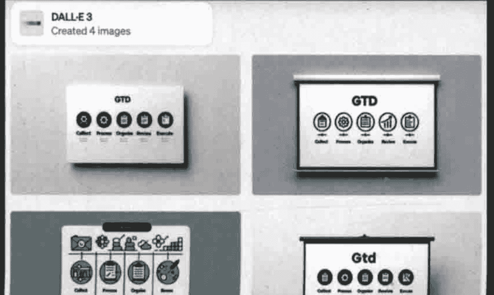

图 3.46 生成回复


图 3.47 生成回复

## ChatGPT 实操应用大全（全视频·彩色版）

本书精彩案例欣赏


图 3.48 生成回复

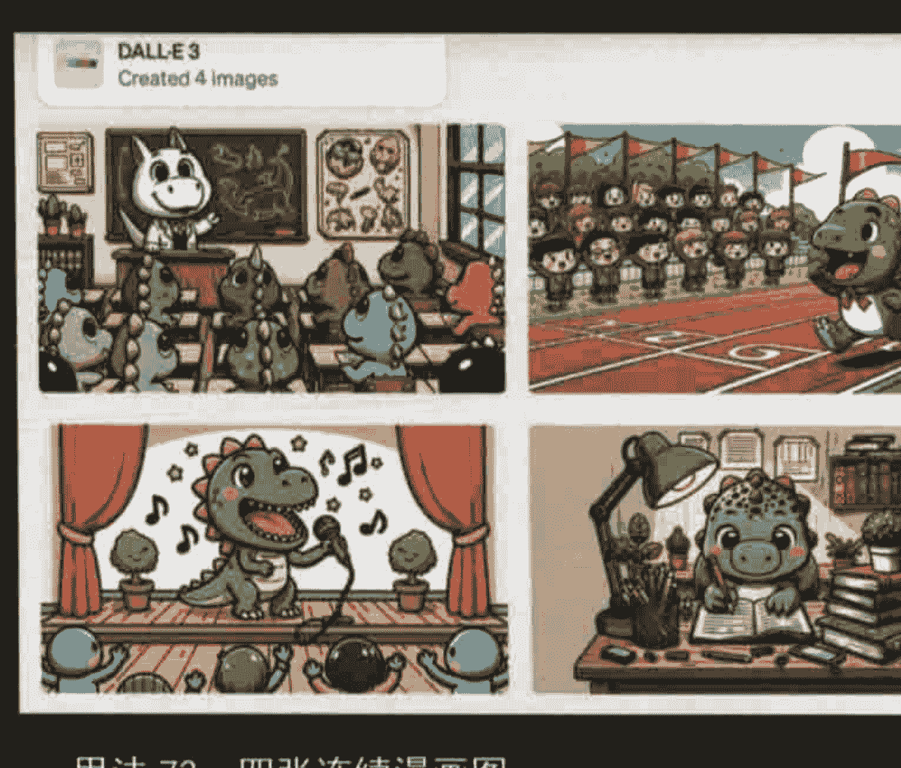

用法 73 四张连续漫画图


用法 74 4 张 16:9 的图像


用法 74 融合图像

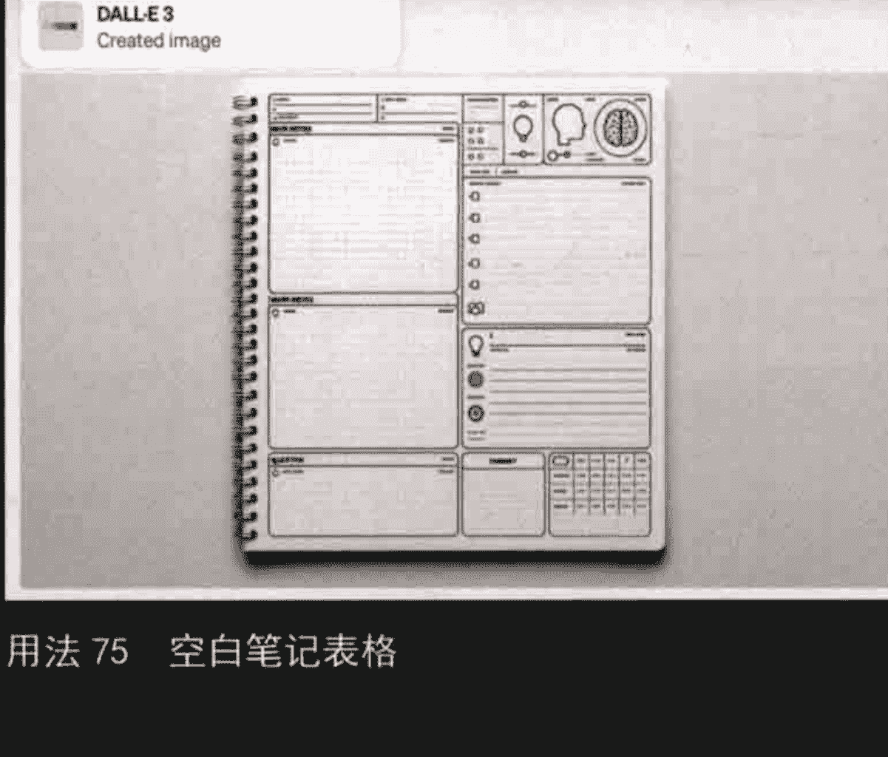

用法 75 空白笔记表格


用法 75 两张卡通图像


图 3.49 太空歌剧院


图 3.50 使用 Midjourney 创作的香港街头出租车绘画图

## ChatGPT 实操应用大全（全视频·彩色版）

本书精彩案例欣赏

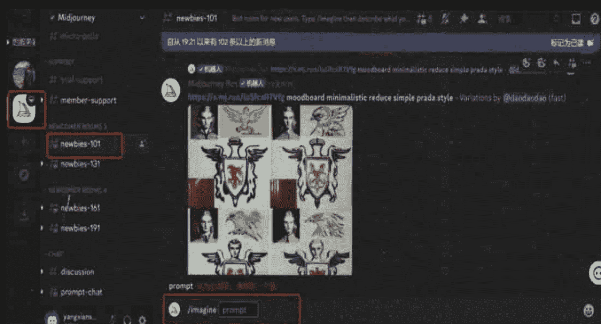

图 3.51 进入 newbies 房间


图 3.53 添加至服务器


图 3.54 笔者使用 Midjourney 绘制的作品

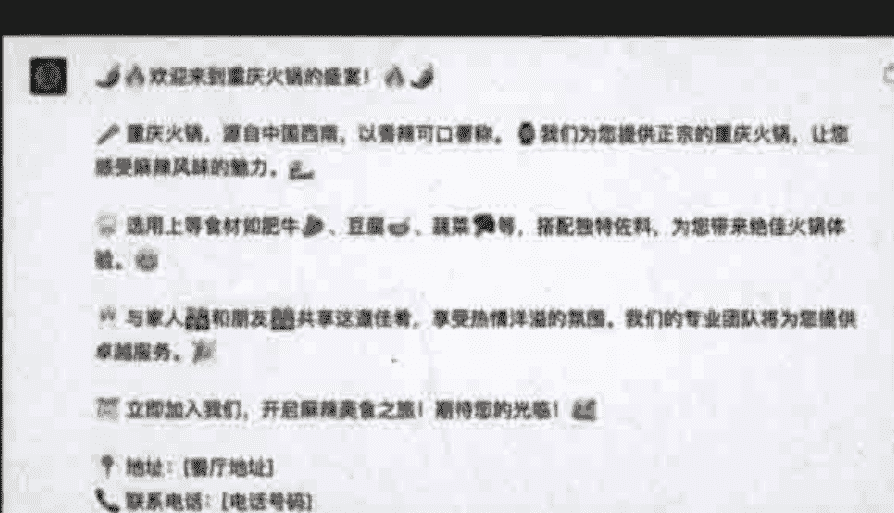

图 3.57 生成回复


图 3.58


图 3.59 生成回复

## ChatGPT 实操应用大全（全视频·彩色版）

本书精彩案例欣赏


图 3.61 让 ChatGPT 识别的物品


图 3.62 广州塔夜景


图 3.63 两个小女孩


图 3.64 不同表情图


图 3.65 戴皇冠的女孩


图 3.66 打乱顺序的西红柿炒鸡蛋过程图

## 前言

PREFACE

回望历史，技术突破往往推动文明跃迁——蒸汽机拉开工业时代，计算机与互联网定义信息时代。此类变革不仅改变日常习惯，也重塑了人类理解世界的方式。今天，生成式智能正加速演进，ChatGPT 作为代表性产品，已开始对社会产生深远影响。

ChatGPT 究竟是什么？ChatGPT，即 Chat Generative Pre-trained Transformer，是 OpenAI 推出的领先对话式智能程序，于 2022 年 11 月正式对外开放。推出仅两个月，月活跃用户便突破 1 亿，成为历史增速最快的消费级应用。对比之下，电话用了 75 年、手机 16 年、互联网 7 年，Instagram 需两年半、TikTok 需九个月。其底层基于自注意力机制的 Transformer 架构，经海量网络数据训练与参数优化后，具备出色的语言理解与生成能力，可自然对话，完成文学创作、数据分析、多语种翻译、代码编写、论文撰写等多种任务。正因如此，编撰一本使用指南很有必要，帮助更多人高效利用这一工具。

本书围绕上述目标编写，旨在帮助读者全面理解并熟练运用 ChatGPT，部分方法同样适用于同类产品，如百度的文心一言、阿里的通义千问。全书共五章。

第 1 章 准备工作，主要介绍账号注册、登录与基础功能，帮助读者迅速上手。

第 2 章 提示词，聚焦驱动输出的核心技术。讲解提示词的设计原则、撰写步骤、技巧要点，并分享常用范例，最后介绍提示词优化器这一实用工具。

第 3 章 ChatGPT 的 150 种用法，围绕真实场景展开并配以示例，覆盖文学创作、高级数据分析、办公、翻译、学术论文、教学、文本生图、金融投资、法律咨询、医疗问诊、心理情感、生活品质、IT 编程、多媒体艺术、音乐娱乐、游戏、评论鉴赏、趣味知识及看图识图等诸多领域，启发读者在不同情境中挖掘价值。

第 4 章 参数指令与 API 开发，探讨如何通过参数与指令优化输出，包括打造超级指令和定制机器人，并介绍 ChatGPT API 的二次开发路径。

第 5 章 ChatGPT 插件，介绍几款核心插件。借助 Browse with Bing 可实现实时联网检索，WebPilot 能对网页进行摘要与翻译，Wolfram 支持数学运算与图表绘制，VoiceOver 可将文本转为语音。此外，HeyGen、Visla 支持短视频生成，Speak 助力语言学习，Consensus 则被视为论文写作的优秀助手。掌握插件能大幅提升使用效率。

本书以通俗语言搭配丰富案例，展示如何让 ChatGPT 服务生活、工作与学习。无论是新手，还是希望将智能融入创作与工作的实践者，都能从中受益。本书既是教程，也是一次探索智能潜力的旅程，读者将看到智能如何影响生活、改变工作方式、甚至重塑思维。愿本书带来新的视角与无限可能。

创作过程中，感谢蔡文青老师的大力支持与资助，感谢出版社编辑团队的专业把关与建议。也要对 OpenAI 的工程师致敬，正是他们的持续创新推动了智能的快速发展。

由于时间仓促与个人水平限制，书中难免存在疏漏，欢迎读者批评指正。

文之易

2023 年 9 月

## 在线服务

扫描下方二维码，加入本书读者专属在线服务交流圈，本书的勘误会在圈内发布。读者可在圈内交流心得、提出建议、咨询作者问题。

注：本书涉及的网址链接已整理为服务网址文件并上传至读者专属交流圈，读者可按需下载。

为符合出版规范，本书中 ChatGPT 生成文本案例均经过编辑加工。


扫描二维码

# 第1章 准备工作

ChatGPT 由 OpenAI 打造，凭借出色的文本理解与生成能力获得业界认可，其价值已延伸至科研、教育、商业等多个领域。要发挥全部潜力，掌握基本操作是前提。

本章以最新版本为基准，详细说明注册、登录及核心功能的使用方法，为初学者提供入门路径，帮助用户将强大功能落地到实际工作与学习场景中，提升效率。

## 1.1 ChatGPT 注册

### 1. 访问 ChatGPT 官方网站

打开官方入口会看到欢迎页，如图 1.1 所示，页面提供 Log in 与 Sign up 两个入口。选择 Sign up 就能进入注册流程。


图 1.1 ChatGPT 欢迎页面

### 2. 进入注册页面并填写电子邮箱

注册表单如图 1.2，Email address 栏需要填入有效的邮箱，如 Gmail。确认后点 Continue 进入下一步。若已有 Microsoft 或 Google 账号，可直接用其授权登录。


图 1.2 注册页面

### 3. 填写密码

如图 1.3，在 Password 框中输入不少于 8 位的密码，完成后点 Continue 前进。


图 1.3 注册页面填写密码

### 4. 邮箱验证账号

信息提交后系统会向所填邮箱发送验证信，如图 1.4。点击邮件里的 Verify email address 链接即可跳转确认，完成账号激活。


图 1.4 验证邮件

### 5. 验证地区是否可用

登录信息填写后，平台会检测浏览器所在区域，如图 1.5。校验通过后即进入个人资料填写界面。


图 1.5 验证地区是否可用

### 6. 填写个人信息

在图 1.6 所示的页面中填写姓名和出生日期，填完后点 Continue 继续。

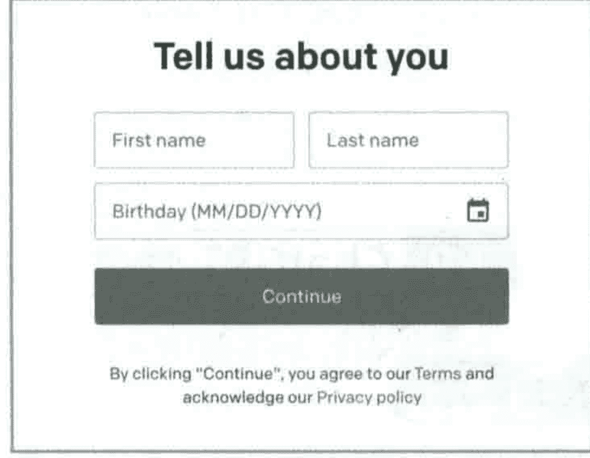

图 1.6 填写个人信息

### 7. 填写手机号码

图 1.7 需要一个能收验证码的国际手机号码，且归属国要与当前 IP 一致，比如 IP 在美国就填美国号码。没有合适的号码可借助第三方接码服务获取临时号。填入后点 Send code 请求验证码。


### 8. 填写验证码

在验证码页填入收到的数字并校验通过后，系统将自动跳转到成功提示页。


## 1.2 ChatGPT 登录

### 1. 访问 ChatGPT 官方网站

注册完成后即可随时登录。注意登录同样需要国际网络环境。打开官网后会看到图 1.1 所示页面，点按 Log in 进入登录页。

### 2. 输入邮箱地址

如图 1.9 所示，在登录页输入注册时使用的邮箱。若使用谷歌或微软账号，可点按 Continue 下方的链接直接登录。填写完成后点按 Continue 进入下一页。

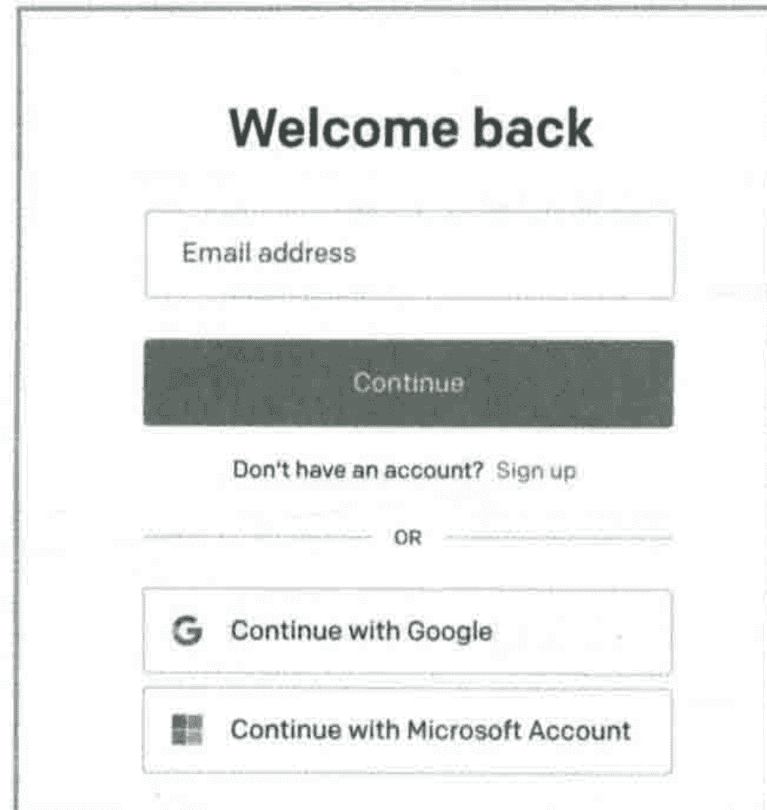

### 3. 密码登录入口

参照图1.10，请在指定区域填写注册时使用的密码，确认后点击 Continue 即可顺利进入 ChatGPT 首页。

当界面显示为图1.11的样子时，即可判定登录成功，恭喜！接下来就能自如使用 ChatGPT 提供的各项服务了。


附带说明，自2023年7月下旬开始，ChatGPT对登录保持策略进行了改进。成功登录后只要不主动退出，账号就会持续保持在登录状态，不再出现每隔两周被迫重新登录的情形。体验因此变得更顺畅，随时随地都能享受 ChatGPT 的便捷。

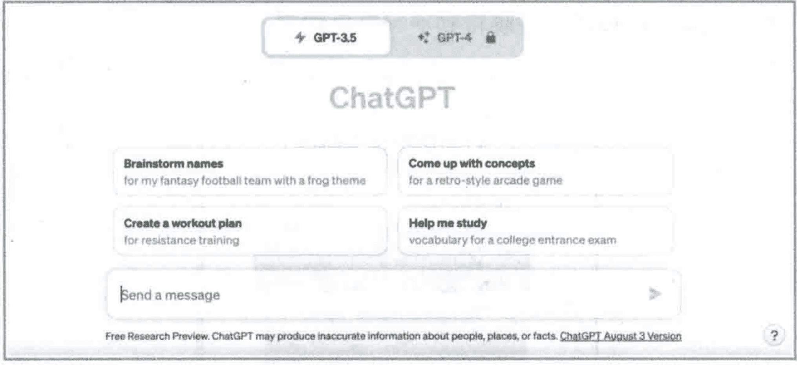

图1.11 ChatGPT 首页

## 1.3 ChatGPT 功能总览

登录成功后会被带到 ChatGPT 主页，如图1.12所示。整体页面可划分为两个主要区域。

- （1）核心功能区：这是与 ChatGPT 交互的主战场，用户在此提出问题、获取回应。布局简洁，流程自然，上手门槛很低。
- （2）左侧辅助区：位于页面左侧，提供一系列辅助工具，帮助用户更灵活地调用各项功能。

下面按照图1.12中的序号顺序，对各项功能的使用方式逐一说明。

### 1. 提问输入框（图1.12序号1）

提问输入框是开启对话的入口。把想问的内容输入框内，按下回车键或点按图1.12序号2标记的发送按钮即可提交，系统会迅速给出反馈，如图1.13所示。

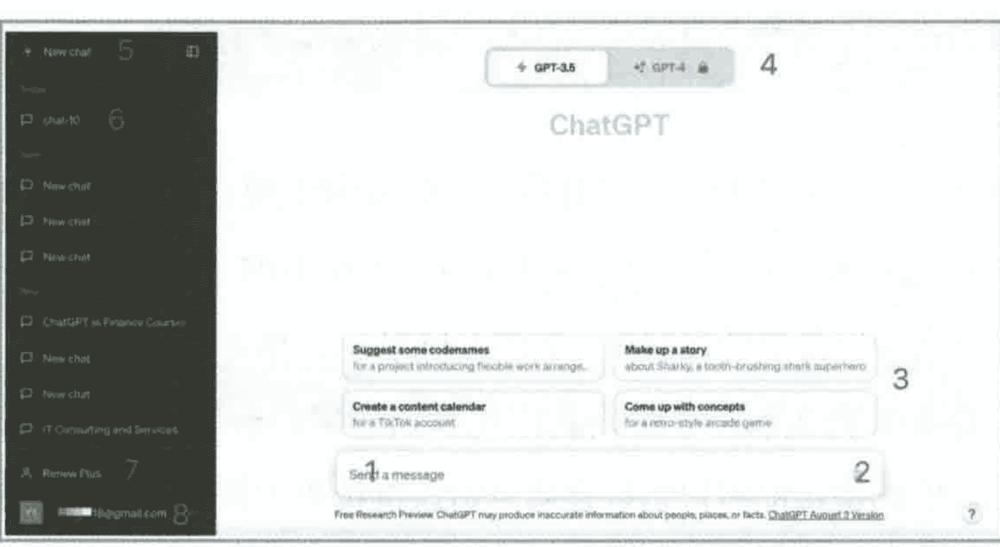

图1.12 ChatGPT 操作首页

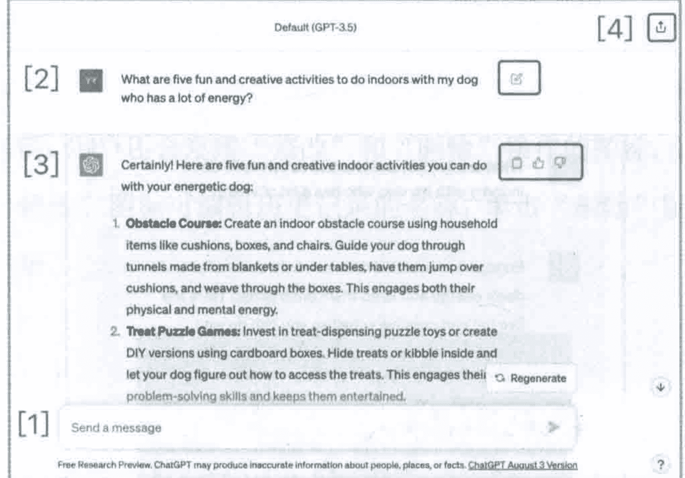

图1.13 ChatGPT 问答区

问答区内部又细分为四个部分。

- （1）提问区，如图1.13中[1]所示。界面清爽，操作直观，新手老手都能快速上手，享受智能对话的乐趣。
- （2）问题区，如图1.13中[2]所示。用于展示用户提交的问题。鼠标悬停时右侧会出现编辑图标，可对已发送的问题进行二次修改后重新提问，使沟通更精准。
- （3）回复区，如图1.13中[3]所示。展示 ChatGPT 的回答。右侧有三个小图标，分别用于复制全文、点赞、投不满意。点击点赞或不满意会弹出反馈表单，方便提供更详细的意见以优化体验。
- （4）分享区，如图1.13中[4]所示。支持 Share link 分享链接，可多人共用同一个对话界面。点击分享图标会弹出链接窗口，如图1.14。点按 Copy Link 即可把链接发送给朋友、同事或其他人，收件人打开后能直接参与对话，共同探索智能交互。


图1.14 分享链接窗口

这四个部分共同构成了问答区的完整结构，既满足基础问答需求，也加入了编辑、反馈、分享等进阶功能，体现了人性化与专业性的结合。

### 2. 问题提交按钮（图1.12序号2）

该按钮样式简洁，是将问题送往 ChatGPT 处理中心的通道。点击后问题会被即时分析并返回准确答案。

### 3. 示例提示集（图1.12序号3）

此处列出了多条提问范例，为用户提供思路启发，尤其对初次使用的人很有参考价值。

### 4. 模型切换区 GPT-3.5 / GPT-4（图1.12序号4）

用户可在该区域自由选择使用的模型。未开通 Plus 的账号默认使用 GPT-3.5，开通 Plus 后自动升级为 GPT-4。系统会记住用户的选择，下次登录时保持一致。

### 5. 新建对话按钮（图1.12序号5）

当需要处理多个不相关的话题时，点击该按钮即可开启新的对话窗口，实现有针对性的问答。

### 6. 对话历史区（图1.12序号6）

ChatGPT 会完整记录每次交互，历史列表展示于此。点击任意一条，内容会回显到中央区域。右侧提供“修改”和“删除”图标，如图1.15。修改可重命名历史记录，删除则永久移除该条。


图1.15 历史记录操作

### 7. 升级 Plus 链接（图1.12序号7）

想要提升体验可通过此链接进入升级流程。点击后会弹出 Free 与 Plus 的差异说明，如图1.16。Plus 在速度、功能和定制化方面表现更佳，价格为每月20美元。继续点击进入支付页面，如图1.17，完成简单操作即可享受高级服务。


图1.16 Free 与 Plus 对比

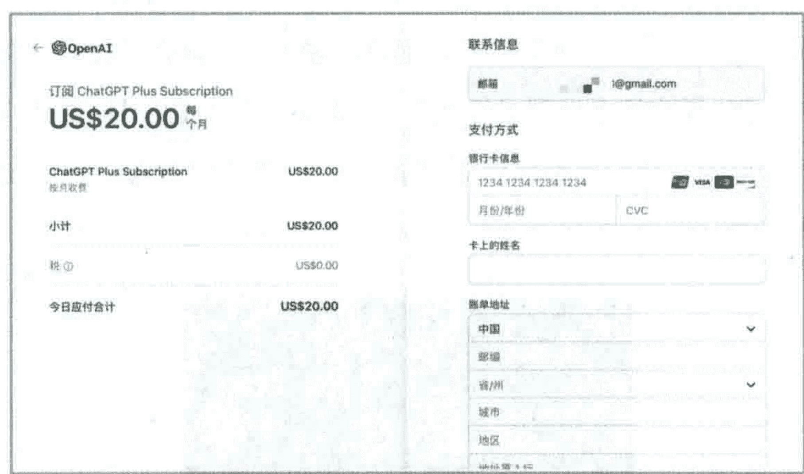

图1.17 Plus 支付页面

在支付页需先选择支付方式，建议使用国际 Visa 信用卡以保证顺畅。随后填写支付信息，务必核对准确。阅读并勾选支付协议确认已了解条款，最后点击底部的“订阅”按钮即可完成付款。

### 8. 账户管理入口（图1.12序号8）

该按钮用于进入个人设置与账户管理。点击后弹出设置菜单，界面会根据账号类型变化。Plus 用户会看到包含 My plan 的完整选项，如图1.18；Free 用户则不会显示 My plan，如图1.19。这种差异化设计让界面更干净，只展示与身份匹配的功能。

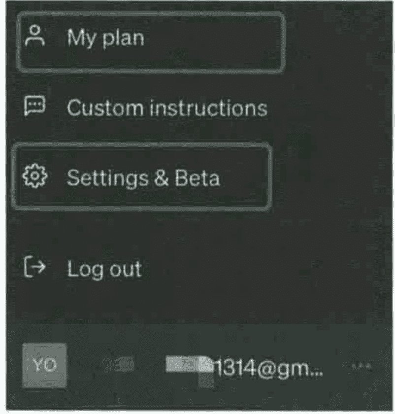

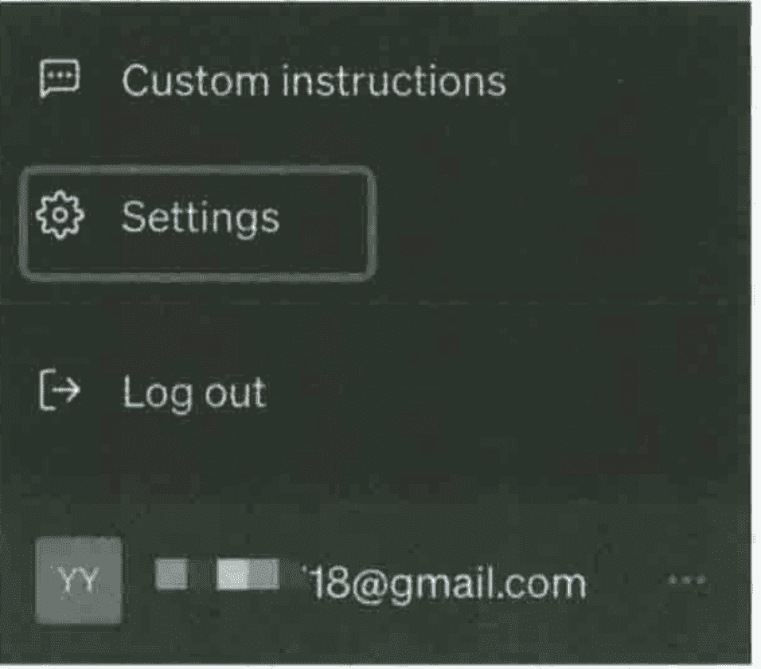

- （1）My plan 我的计划按钮。点击后打开 ChatGPT Plus 介绍页，其中包含管理订阅的入口，如图1.20。通过它可随时查看订阅状态及权益。


- （2）Custom instructions 自定义指令功能。该工具旨在让交互更贴合个人需求，通过少量设置即可让 ChatGPT 更好地理解偏好并给出更精准的回应。

## ChatGPT 实操应用大全（全视频·彩色版）

点开 Custom instructions 按钮会出现自定义指令设置页，需要设定两方面内容。

1）希望 ChatGPT 了解的信息。该项用于定义 ChatGPT 在对话中的角色定位。例如让其扮演广告文案撰写者或网络营销专家，也可针对具体任务做细化说明，如为某产品撰写文案等。

借助此功能无需每次重复身份说明。重新打开设置即可快速调整，操作流程如图1.21所示，简单直观，让个性化交流更轻松。

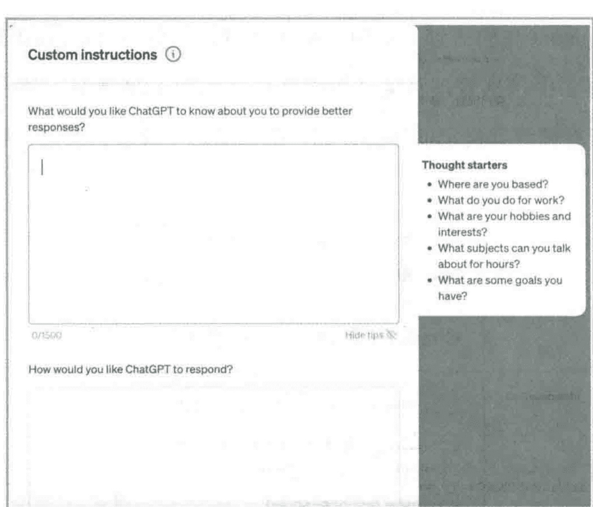

图1.21 角色设置

2）希望 ChatGPT 如何作答。该项可深度定制回答风格，包括语气、长度、结构等。界面如图1.22所示，提供丰富的示例供选择。

例如要求以表格形式输出，列出产品名称、价格、特性等；或按 FBA 法则生成特定风格文案，并规定字数、emoji 等细节。

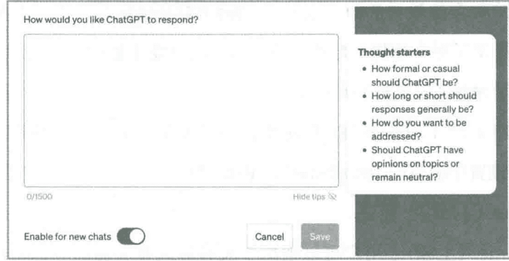

图1.22 回应形式设置

此功能让 ChatGPT 能更精确匹配工作需求，无论是严谨的商业分析还是创意十足的市场文案，都能轻松实现，提升沟通效率与匹配度。

（3）Settings 设置功能。根据账号类型提供不同选项。

Plus 用户：点击 Settings 后弹出功能更丰富的设置面板，如图1.23所示。


图1.23 Plus 用户设置界面

Free 用户：点击 Settings 后界面略有差异，部分高级选项不可用，如图1.24所示。

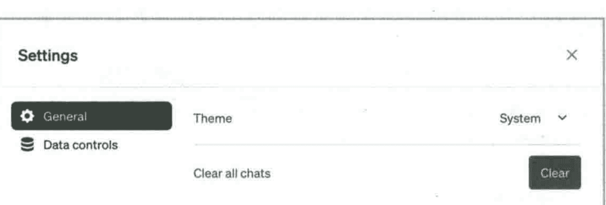

图1.24 Free 用户设置界面

两种界面的差异体现了基础服务与付费用户的个性化需求兼顾。

从图1.23和图1.24可看出主要区别在于 Plus 独有的 Beta features。

1）General 通用设置。

① Theme 主题：可按喜好选择 System、Dark、Light 三种界面配色。
② Clear all chats 清除全部聊天：支持一键清空历史记录，操作前需二次确认以防误删。

2）Data controls 数据控制设置。可管理 Chat history & training、Shared links、Export data、Delete account，如图1.25所示。

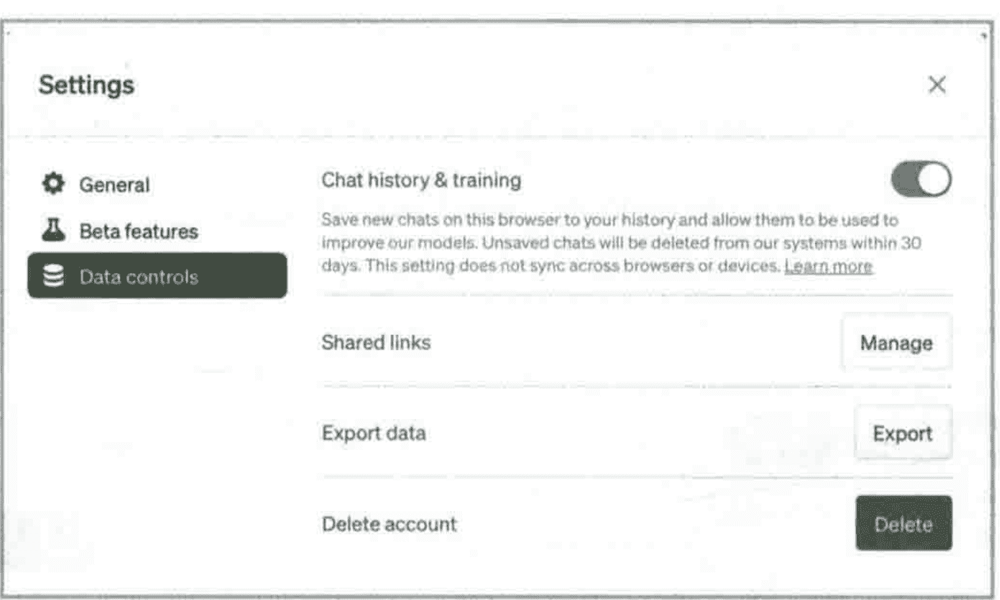

① Shared links 共享链接：用于管理已分享的对话链接。点击右侧 Manage 会弹出列表，可打开或删除相应链接，如图1.26所示。


② Export data 导出数据：可将全部聊天记录导出。已删除的历史不会包含在内。点击 Export 后会弹出确认页，如图1.27所示。数据以邮件形式发送，需在24小时内点击下载链接获取，文件以网页形式呈现，便于查阅保存。


图1.27 Export data 确认页

③ Delete account 删除账户：执行后账户及相关数据将被永久清除且无法恢复，操作前务必谨慎阅读提示。

3）Beta features Beta 功能设置。2023年7月推出，包含 Advanced data analysis 高级数据分析，具体用法后文会介绍。

点击 Beta features 后会出现新面板，如图1.28所示，包含 Plugins 插件和 Advanced data analysis 两个开关。

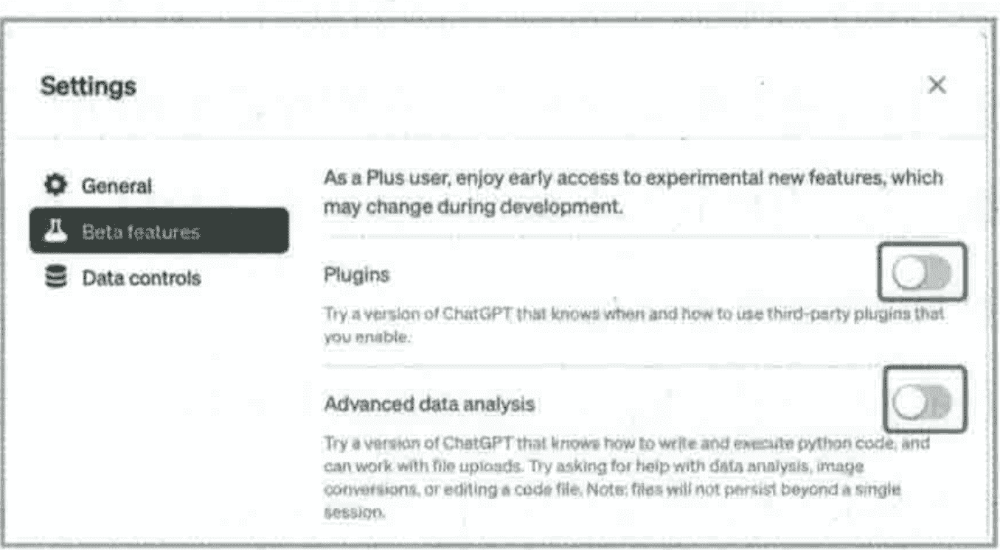

图1.28 Beta features 设置页

① 安装插件。开启 Plugins 开关后，在主界面选择 GPT-4，下拉列表可切换到 Plugins 版本，如图1.29所示。

进入后若未安装插件会看到 No plugins enabled，点击后出现 Plugin store 按钮。


再点 Plugin store 会弹出商店界面，如图1.31所示。

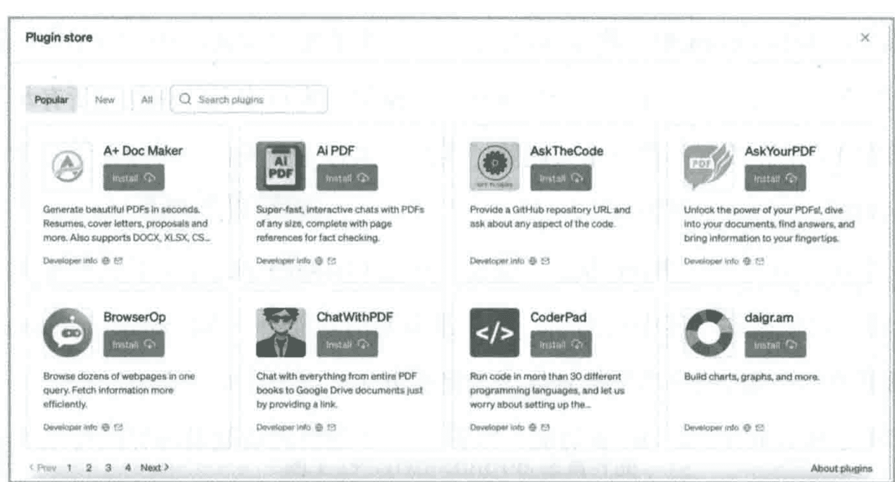

可在商店中挑选所需插件并点击 Install 下载。插件功能多样，可辅助制定旅行计划、比价下单、提供专业咨询等。还可让 ChatGPT 与 5000 多个第三方应用如 Gmail、Salesforce 交互，部分插件需 Authentication 验证，按提示操作即可，整体使用更智能便捷。

返回主页后可在 Plugins 区域为本次会话选择插件，如图1.32所示。注意每次会话最多同时启用3个插件。

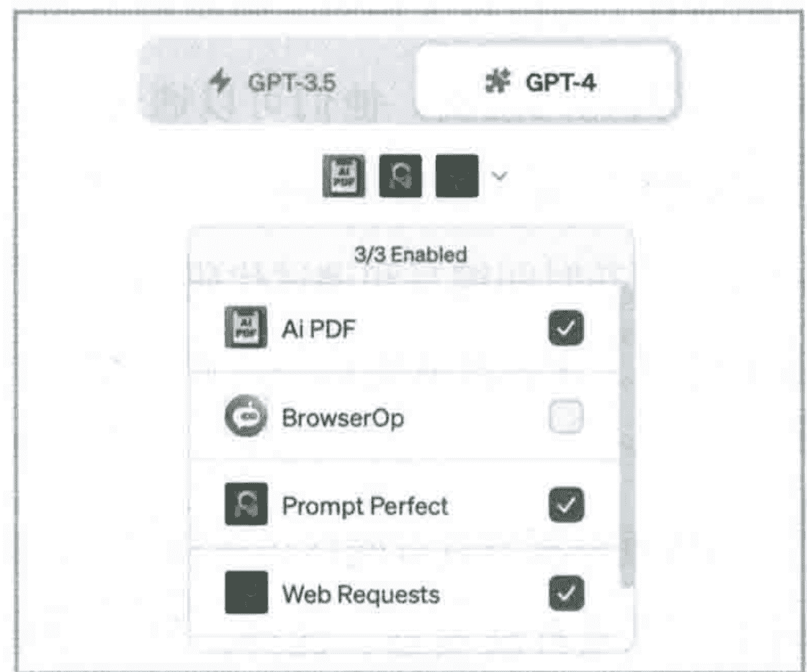

图1.32 已安装插件

使用方式与常规 ChatGPT 相同，输入问题即可。例如询问“今天中国最重要的新闻有哪些”，系统自动选用 Web Requests 插件尝试获取最新资讯，如图1.33所示。

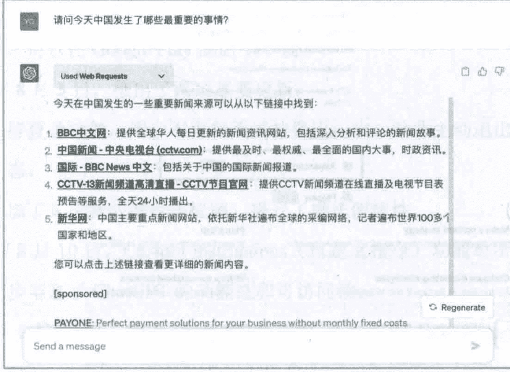

图1.33 插件自动匹配回答

② 开启 Advanced data analysis 高级数据分析。2023年7月底 OpenAI 加入 Code interpreter，8月底更名为 Advanced data analysis，允许 ChatGPT 自行编写、运行和测试代码，推动自动化开发迈进新阶段。

该功能相当于随时待命的技术专家。对数据分析师尤其有用，可上传文件后让 ChatGPT 高效处理复杂分析任务，无需手动写代码调试，只需描述目标即可完成，大幅提升工作效率。

高级数据分析现在还不能联网，所以凡是需要在线操作的事情它都做不了，比如从互联网下载文件或抓取数据。它的知识库截止在2021年9月，对于这之后才流行起来的开发库或接口，它很可能不了解。

把高级数据分析的开关打开后回到主页，在 GPT-4 的功能列表里就能看到 Advanced Data Analysis 这个入口。选中后，提问输入框的左侧会新增一个文件上传按钮，示意如图 1.34。

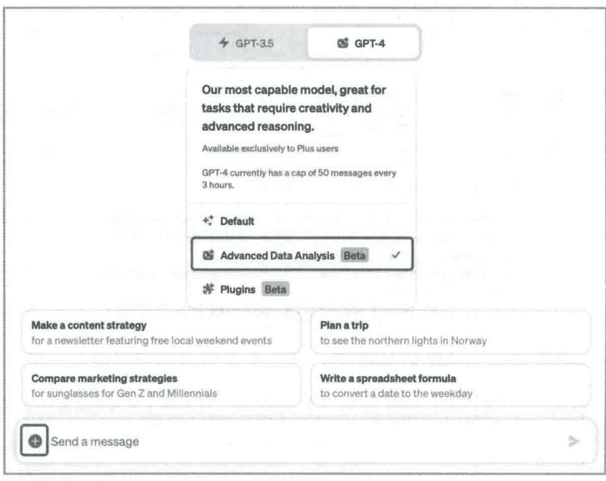

该功能的实战用法和亮点，后面章节会专门展开讲解。

## 1.4 ChatGPT 近期更新

2023年5月23日，ChatGPT 正式上架 iOS 平台，用户可以在 App Store 下载。首批开放的地区是美国以及另外11个国家，包括阿尔巴尼亚、克罗地亚、法国、德国、爱尔兰、牙买加、韩国、新西兰、尼加拉瓜、尼日利亚和英国。

2023年6月22日，移动端新增了浏览与搜索能力，让手机用户的使用场景更丰富。

2023年7月3日，为修复特定问题，浏览功能被临时关闭。

2023年7月6日，推出了 Code interpreter 代码解释器插件。这款创新插件能处理数据分析、图像处理、视频处理、PDF 处理以及复杂数学求解等多种任务，凸显了模型的强大。

2023年7月18日，OpenAI 正式提交了 GPT-5 的商标注册申请。

2023年7月19日，ChatGPT Plus 的消息配额上调至每3小时50条，此前为每3小时25条。

2023年7月20日，Custom instructions 自定义指令功能上线，最初仅Plus用户可用。用户可以自行设定规则和条件，更精细地控制对话行为和输出风格。

2023年7月25日，安卓版 ChatGPT 上线，首批覆盖美国、印度、孟加拉国和巴西，可在 Google Play 下载。

2023年8月3日，发布了两项更新：
（1）保持登录状态，不再每两周自动登出，除非用户主动退出；
（2）新增8个键盘快捷键，提升操作效率。

2023年8月10日，Custom instructions 对所有用户免费开放，进一步提高了产品的可用性。

2023年8月28日，ChatGPT Enterprise 企业版发布。除了基础功能外，企业版提供企业级数据安全与隐私保护，以及高级数据分析能力，支持客户导入内部数据进行行业化训练和定制。

2023年8月28日，Code interpreter 正式更名为 Advanced data analysis 高级数据分析。

这一连串的迭代显示 ChatGPT 在持续创新完善，覆盖新功能、优化旧功能、扩大覆盖范围，以满足不同人群的需求和使用场景。

# 第2章 提示词

ChatGPT 一经面世便迅速走红，不同的人用下来感受却差很多：有人惊喜称赞、视若珍宝，有人觉得平淡乏味；有人当作得力助手，有人当作良师益友；有人多维度提升效率，有人只是当成小玩意。事实上 ChatGPT 就像一位博学多才、技能全面的全能博士，可以被当作助手、导师、朋友、百科全书、程序员、搜索引擎、图书馆等多种角色。它拥有广博的知识、卓越的智慧和强大的能力。既然工具如此强大，为什么使用体验会如此分化？关键就在于用户是否掌握了提示词的使用方法。

想从 ChatGPT 获得优质反馈，核心在于会提问。提示词就是引导模型输出、生成相关准确高质量内容的方向标。本章会系统介绍提示词的设计原则、编写流程、实操技巧，并配上案例与优化工具。掌握并反复练习，就能像施法一样大幅提升使用效率和效果。

## 2.1 提示词及其设计原则

要理解提示词的重要性，先看 ChatGPT 的工作流程，大致分为四步：
1. 用户把请求输入进去；
2. ChatGPT 解析输入，用大模型算法生成回复；
3. 回复以文本形式返回给用户；
4. 用户继续输入，ChatGPT 会结合上下文再次分析并反馈，反复进行直到对话结束。

由此可见，对话能否成功，很大程度上取决于发起对话的请求质量。在 ChatGPT 里，提示词就是一段文本或短语，用来作为模型生成的起点和引导。它可以是问题、描述、对话或其他文本形式，模型会依据提示词提供的上下文和语义生成对应输出。构建提示词、引导语言模型输出的过程就是提示词工程，其作用是通过清晰具体的指令引导模型产出想要的内容。

写出清晰简洁的提示词有三点好处：
1. 提升理解力。表述清楚的提示词有助于模型把握主题与任务，输出更准确相关，交流更有信息量。
2. 增强专注力。清晰的提示词能把对话拉回正轨，避免跑题或分心。
3. 提高效率。减少来回澄清，沟通更顺畅。

写出精准有效的提示词，要遵循四个原则：
1. 清晰。意思要传达得明白，避免复杂或歧义，专业术语要先定义。比如“重庆市有哪些比较知名的火锅店？”就很明确；而“2021年苹果价格比2020年上涨了多少？”就不够清晰，“苹果”指手机还是水果？又没说明地区，模型很难回答。
2. 聚焦。要抓住重点、引起注意，不要太抽象空泛。用具体、可执行的提问减少干扰。比如“你知道关于人类的知识吗？”范围过大，改成“你知道关于人类科技史的知识吗？”答案就会更精准。
3. 相关。在多轮对话中，提示词要与当前话题保持一致。无关的提问会分散注意力，增加沟通成本。可以加入具体关键词保持连贯，比如旅游建议时使用“景点推荐”“路线规划”“食宿安排”等。
4. 简洁。能少则少，去掉冗余修饰。简洁的输入有助于模型给出针对性强的回应，多余的词语只会干扰输出质量。

下面列举有效与无效提示词的对比案例，有助于体会原则差异。

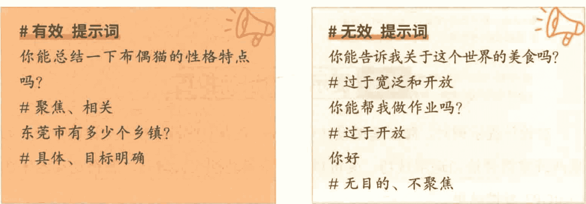

坚持这些原则并多加练习，就能写出更精准的提示词，让对话始终保持在正确轨道上，产生更有价值的交流。

## 2.2 提示词的编写步骤

上一节讲了原则，本节讲实操。编写提示词大体包括明确目标、构思、修改、投喂四个环节，具体如下：

（1）明确目标。在动笔前先想清楚想从 ChatGPT 获得什么信息。目标清晰才能写出具体相关的提示词，为更深入的交流打基础。

（2）构思。目标明确后，结合设计原则和问题类型，规划提示词的结构，先写初稿。不同类型的问题结构不同，多轮对话还需要设计顺序和内容，确保每条提示都紧密围绕主题，除非刻意想切换方向。

## 2.3 提示词的设计技巧

在遵循原则的基础上，掌握几招技巧能让提示词更有效。

### 1. “以……形式”获得回复
想让输出更有条理，就在提示里加上“以……形式”。模型会按指定格式返回。比如先让它生成表格，再要求基于表格做修改，甚至导出为 Excel 可读格式。

提示词示例：
“我想要四周内减脂5kg，请以表格的形式，为我列出一份每周的运动和饮食计划。”
ChatGPT 生成的结果如图 2.1 所示。

### 2. “以……风格”输出结果
默认语气偏平淡，加一句“以……风格”就能改变调性。比如用海明威的简洁、莎士比亚的抒情或鲁迅的朴实来写作，文本会立刻生动起来。

提示词示例：
“我想要写一份企业宣传文案，请以海明威的语言风格，为我输出 XX 公司的企业宣传文案。”

### 3. 限制生成内容
给模型设置边界，效果会更突出。可以限定字数、语言、地区、读者年龄性别等，只要要求表述清楚即可。若模型未遵守，可指出后让其重写。

提示词示例：
“请为我写一篇关于光武帝刘秀的传记，字数控制在200字左右，语言为英语。”

### 4. “充当（hack）……”特定角色
在提示里加上“充当……”，就能让模型进入指定角色，适合模拟场景或沉浸式对话。例如“充当旅行社”提供度假建议，或“充当心理咨询师”进行沟通。结束角色扮演只需说“不要再充当……”。

提示词示例：
“我想让你充当英语翻译员，我输入汉语，你把它翻译成英语。”

### 5. 告诉受众
告诉模型读者是谁，它会自动调整表达方式。对10岁左右的孩子会用通俗语言，对投资经理会使用专业金融术语。

提示词示例：
“我要为一群企业家授课，讲解如何系统学习 AI 大模型知识，请为我制定一份演讲提纲。”
ChatGPT 会按企业家受众输出结构化提纲，包含引言、大模型概述、基础知识、系统学习方法、伦理等内容。

AI 实操手册：从框架到落地实践

要点概览
- 拆解智能模型偏见产生机理并探寻缓解路径
- 健全数据保密与安全防护体系
- 推动商业场景中智能应用的合规化落地

创业切入维度
- 捕捉围绕智能技术的商业化机会
- 将智能能力融入企业战略布局
- 借鉴各行业智能整合的成功实践

未来视野与待解难题
- 智能技术对社会经济格局的潜在重塑
- 研究前沿的演进方向与技术突破
- 大规模模型固有的局限与挑战

收尾建议
- 持续跟进技术动态的学习价值
- 鼓励创业者把智能能力嵌入业务流程

由于不同人群的目标与受众各不相同，上述提纲具备弹性，可依据实际需求灵活调整。

### 6. 为多元模型定制输入
提示词的价值远不止于单一对话系统，众多专业型智能工具同样高度依赖高质量提示，其精确度直接决定输出水准。该对话模型本身具备很强的提示设计能力，借助它为各类引擎撰写兼具创意与实效的输入，就能实现按工具特性的差异化产出。

以文生图工具 DALL·E 与 Midjourney 为例，若想获得符合预期的高质量图像，就必须给出对画面元素的精准描述。无论是新手还是资深用户，都可以借助该模型生成可用指令，在创作过程中获得灵感，加速把想法转化为图像。

> 指令示例：
> “希望制作一套科幻漫画人物图，角色共五位，请为 Midjourney 拟定五组可用的输入。”

模型回复：
没问题，以下是可用于生成科幻漫画人物图的五套输入：

1. 第一套输入：
- 性别：女性
- 身份：太空舰长
- 气质：机敏果断，领导力强
- 造型：高科技感舰长制服
- 配件：高端智能手表

2. 第二套输入：
- 性别：男性
- 身份：机械工程师
- 气质：聪颖、创造力旺盛、喜冒险
- 造型：工作服搭配护目镜与工具腰带
- 配件：多功能机械臂

3. 第三套输入：
- 性别：女性
- 身份：科研人员
- 气质：聪明好奇，专注研究
- 造型：实验室白大褂、眼镜
- 配件：科研实验器材

4. 第四套输入：
- 性别：男性
- 身份：机器人工程师
- 气质：机械天赋、善良、略内向
- 造型：工装、带机器人装饰的帽子
- 配件：可爱的小型机器人伙伴

5. 第五套输入：
- 性别：男性
- 身份：外星探险家
- 气质：勇敢、探索欲强、渴望未知
- 造型：护甲、头盔、宇航服
- 配件：能量武器与探索装备

这些输入有助于 Midjourney 生成生动的科幻漫画人物，祝创作顺利！

### 7. 正反视角并置辩论
面对争议性议题，主流媒体容易滑向非黑即白的二元叙事。借助该模型在中间加入灰度视角很有价值。提出需求后，它可以扮演双方辩手，从政治、哲学到体育、艺术等多个角度展开，帮助使用者建立立体认知。例如围绕“人类是否该继续推进 AI”这一隐忧，就能展开正反交锋。

> 指令示例：
> “以意大利限制 ChatGPT 为主题，用正反辩论的方式分析 AI 对国家安全的冲击。”

模型回复：
以下以意大利限制 ChatGPT 为案例，从正反辩论角度剖析 AI 对国家安全的冲击：

**正方立场：**
- 主张限制，突出其带来的安全隐患
- 信息保密与隐私风险：模型或被用于网络攻击窃取敏感资料
- 恶意利用风险：可能被用来操纵舆论、散布虚假信息，扰乱社会秩序
- 自动化失控风险：关键领域失控导致不可预测后果
- 真伪难辨：生成内容让公众难辨真伪，影响稳定
- 军事化风险：AI 在军用领域的应用可能触发军备竞赛

**反方立场：**
- 反对限制，强调 AI 的积极价值
- 提升网络防御：AI 可更有效预防和应对网络攻击，保护关键基础设施
- 增强情报分析：帮助情报部门高效收集分析信息，应对潜在威胁
- 提高决策效率：提供精准数据与预测，辅助稳健政策制定
- 打击网络犯罪：辅助执法识别打击网络犯罪，维护安全稳定
- 合作降风险：各国加强国际协作，共同制定标准，降低风险

**小结：**
- AI 对国家安全既有正面贡献也存潜在威胁，核心在于在确保安全前提下合理发展与应用。封杀并非最优解，可通过立法、监管、国际合作降低风险。
- 建立监管框架：政府应构建研发与应用的监管体系，确保合法合规
- 提升技术安全性：开发者应提高系统可靠性，防止攻击与滥用
- 强化伦理意识：从业者关注伦理，确保发展符合人类价值
- 公共教育与培训：提高公众理解与鉴别能力，应对挑战
- 国际合作：共同制定规则与标准，防止安全风险

通过这些举措，可在保障安全的同时发挥 AI 潜力。意大利事件应推动各国深入思考 AI 与国家安全的关系，寻求安全与发展的平衡。

### 8. 少量示例引导学习
少样本学习是指为模型提供少量明确示例，以此引导内容生成并完成指定任务，常用于新概念或对象的识别与分类。通常示例量在 2~10 个之间，只用一个示例称为单次学习。

例如在该模型中用基于提示的少样本对电影类型进行分类，先在提示里加入若干分类示例，再以此为依据对新描述做出正确归类。或者先给出书籍摘要列表及类别，再要求为新摘要匹配标签。

> 指令示例：
> 使用这些例子：
> 电影描述 1：“一群武士在切磋武艺。”类别为动作；
> 电影描述 2：“一位身穿戎装的将军在指挥激烈的战斗。”类别为战争；
> 电影描述 3：“一群外星人在办公室里商议如何入侵地球。”类别为科幻；
> 电影描述 4：“一位帅气的男生骑着自行车，载着一位漂亮的女生，骑行在铺满金色树叶的小道上。”类别为爱情。
> 请对下面的描述进行电影分类：
> 在樱花盛开的季节，一位男生牵着一位女生的手在校园中漫步。

模型回复：
电影描述：在樱花盛开的季节，一位男生牵着一位女生的手在校园中漫步。
类别：爱情。
具体效果见图 2.3。

### 9. 目标导向指令创作
使用该模型创作时，可通过特定指令引导生成。设定好指令后，模型会依据语言规律进行预测与创作，产出更贴合主题与关键词。对写作不擅长的用户，这能降低难度、提升质量，先生成初稿再加入创意，使文章更具吸引力与原创性。

> 指令示例：
> “请围绕‘内容营销’写一篇约 300 字的文章，并起一个吸引人的标题。”

模型回复：
标题：
## 内容营销：创造价值，吸引客户，成就品牌传奇

在竞争激烈的市场环境中，品牌都在寻找有效的方法来吸引并留住潜在客户。内容营销正是这样一种策略，它能帮助品牌建立信任、吸引客户并推动业务增长。

内容营销是通过创作和分享有价值、相关且吸引人的内容，以吸纳特定受众并引导其采取预期行动的营销方式。与传统广告不同，其核心在于关注客户需求，提供实际帮助与信息，从而树立品牌形象。

成功的内容营销关键在于洞察目标受众。通过深入研究客户需求、兴趣与行为，企业可生产针对性强、有价值的内容。此外内容形式多样化也是重要特点，如博客、社交媒体帖子、视频、播客等，都可作为信息载体。

内容质量是另一关键。高品质内容不仅利好搜索引擎排名，也为客户提供实际价值，提升品牌声誉。优秀内容还能鼓励客户与品牌互动，加深关系。

总之，内容营销是一种强力营销策略，通过提供有价值内容帮助品牌建立信任、吸引客户并实现增长。唯有关注客户需求、产出高质量内容，才能在激烈竞争中脱颖而出，成就品牌传奇。

### 10. 分步推理纠错
该模型能处理数学与逻辑问题，但解答时易出错。为避免错误，可在提示末尾加入分步要求。研究表明，分步提示对解题至关重要，加入此指令后模型会给出更细致的列式推导，绕开逐式计算的失误，从而提升正确率。

> 指令示例：
> “要做 24 个蛋糕，每 6 个蛋糕需要 2 个鸡蛋，鸡蛋以 6 个为一盒出售，需要至少买几盒？请分步骤给出计算过程。”

模型回复：
可分三步计算：
第一步：计算制作 24 个蛋糕所需的鸡蛋数。
每 6 个蛋糕需要 2 个鸡蛋，即每个蛋糕需 2/6 = 1/3 个鸡蛋。
24 个蛋糕需要 24 * 1/3 = 8 个鸡蛋。
第二步：计算需购买的鸡蛋盒数。
每盒 6 个，需 8 个，则 8/6 = 1.333... 盒。
第三步：确定最少购买盒数。
因只能整盒购买，需向上取整。
至少需要购买 2 盒鸡蛋。

### 11. ASCII 艺术输出
该模型虽为文本系统，也可通过 ASCII 艺术生成类图像效果。ASCII 艺术是用字符与符号构成图像，如常见的 :-D。规则与普通生成类似，描述越具体越好，可增删元素。

> 指令示例：
> “你能画一幅两个女孩的 ASCII 字符画吗？”

模型回复：生成文本结果如图 2.4 所示。


图 2.4 ASCII 字符画

上述指令设计技巧需配合设计原则使用。想熟练掌握就需勤加练习，不断尝试不同风格与方法的指令。也可邀请同事朋友审阅并提供建议，或在线查阅成功案例与社区经验。随着技术进步，该模型功能持续完善，跟上进展才能用上最佳方法。

只要遵循设计原则并持续提升技巧，就能成为高效指令制作者，最大化利用这一强大智能工具提升工作效率。

## 2.4 常用指令案例
学习完技巧后，以下案例供练习与参考。

**案例 1** 写作助理：“作为中文写作改进助理，任务是改进所提供文本的拼写、语法、清晰度、简洁度与整体可读性，同时拆分长句、减少重复，并给出改进建议。请只提供文本的修正版本，不含解释。请从编辑以下文本开始：[ 文章内容 ]。”

**案例 2** 改写为小红书风格：“请使用小红书表情风格编辑以下段落，该风格以吸睛标题、段落内含表情符号及末尾加相关标签为特征。请保持原意不变。请改编以下内容：[ 需要改编的内容 ]。”

**案例 3** 英语翻译或润色：“我希望你能充当英语翻译、拼写校正者和改进者。我将用任何语言与你交流，你需检测语言、翻译，并在修正改进版中用英语作答。请用更准确、优雅、高级的词汇与句式替换我的表达，保持原意但更具文学性。我的第一句话是 [ 要翻译的内容 ]。”

**案例 4** 论文式问答：“写一篇内容详实、结构严谨的学术文章，包含引言、主体与结论，以回应以下问题：[ 问题 ]。”

**案例 5** 主题解构：“你是一名擅长思考的助手，会把一个主题拆解为多个相关子主题。请用中文针对下列主题提供相关子主题，直接输出结果无需额外说明：[ 主题内容 ]。”

**案例 6** 提问助手：“你是一名擅长提问的助手，会针对一段内容提出疑虑与潜在问题，促进更完整思考。内容如下：[ 具体内容 ]。”

**案例 7** Nature 风格润色：“我希望你能充当专业的拼写与语法校对者，并改进我的文章。请用更准确、优雅、高级的英语词汇与句式，以 Nature 刊物语言风格修改文章，使其更具学术性，保持原意。”

**案例 8** 总结内容：“将以下文字概括为约 100 字，使其易读易懂。避免复杂句式或技术术语。文字内容如下：[ 文字内容 ]。”

**案例 9** 编程助手：“请使用 Java 编写一个快速排序算法。”

**案例 10** 充当终端 / 解释器：“我想让你充当一个 Linux 终端。我将输入命令，你需仅在一个代码块内返回终端应显示的内容，不要解释。当我需用英语备注时，我会把文字放在大括号里 { 备注文本 }，我的第一条命令是：[Linux 命令 ]。”

## 2.5 指令优化器
若设计指令不够熟练或效果不佳，可尝试 PromptPerfect 指令优化器。PromptPerfect 专为大型语言模型、指令工程与 LMOps 设计，可自动优化对 ChatGPT、GPT-3.5、DALL·E 与 Stable Diffusion 的指令。无论是工程师、内容创作者还是 AI 开发人员，都能借助其直观界面与强功能提升指令质量，减少低质生成。

使用时先注册登录，首页选择模型与插件，如图 2.5 所示；随后输入原始指令；最后提交优化。优化通常 10 秒内完成，支持多语言。


图 2.5 PromptPerfect 主页

输入框示例原始指令：“我是一名抖音博主，想制作一个关于 ChatGPT 的短视频，请帮我列出 5 个吸引人的主题。”优化后指令：“作为一名抖音博主，您想制作关于 ChatGPT 的短视频。请帮助您列出 5 个吸引人的主题，以便与观众分享有趣和有用的内容。这些主题应该涵盖 ChatGPT 在不同领域中的应用，例如文学、科技、娱乐等。每个主题都应该具有创意和相关性，并且能够激发观众的兴趣和好奇心。请注意，您可以根据自己的喜好和专业知识来选择适合您的 5 个主题，并确保它们是原创和引人入胜的。”优化后内容更具体详细。ChatGPT 基于优化前后的指令会产生不同结果，如图 2.6 所示。

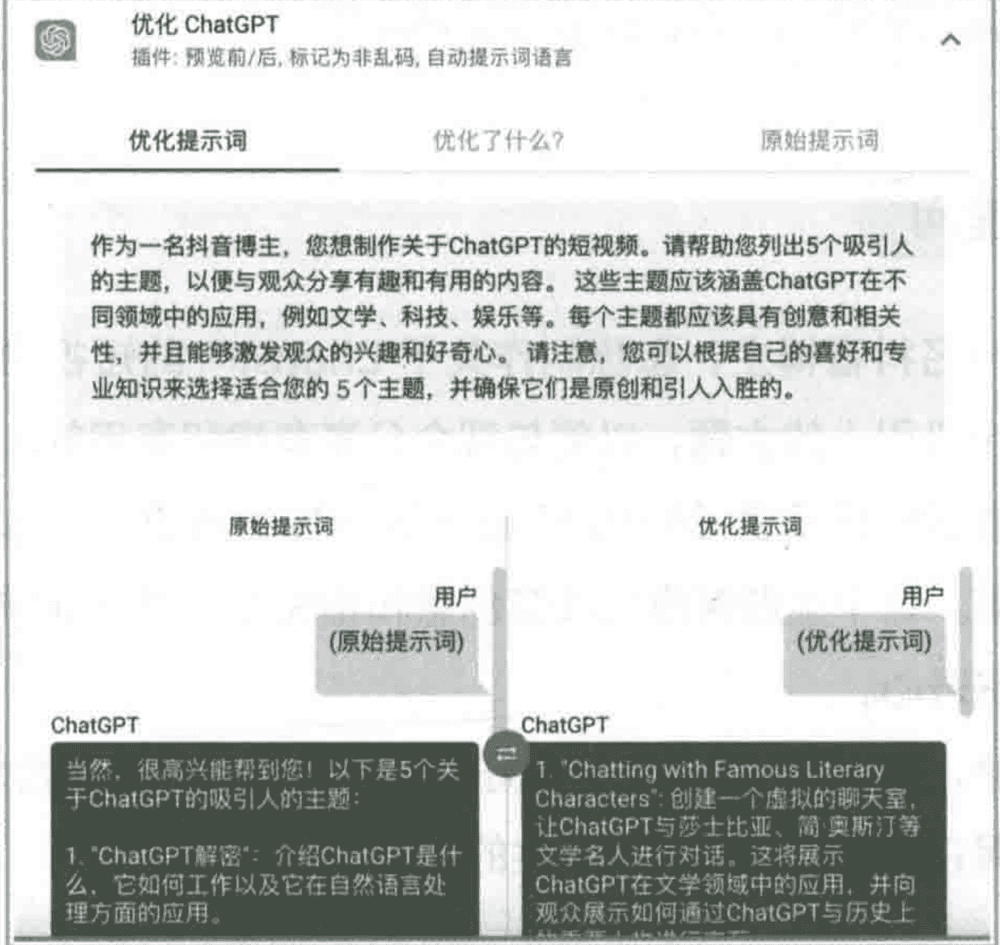
图 2.6 优化前后对比

把优化前后的指令分别输入 ChatGPT，结果如下。

### 1. 优化前的提问
> Q 我是一名抖音博主，想制作一个关于 ChatGPT 的短视频，请帮我列出 5 个吸引人的主题。
> ChatGPT:
> 当然可以！以下是 5 个关于 ChatGPT 的吸引人的主题，可以帮助你制作抖音短视频：
> 1. ChatGPT 如何改变我们的生活：介绍 ChatGPT 的实际应用场景，如客服、教育、娱乐、创作等领域，展示它是如何影响和改变我们日常生活的。
> 2. 聊天机器人大比拼：对比不同的聊天机器人（如 ChatGPT、微软小冰、百度度秘等），通过实际的对话示例，展示各自的优势和特点。
> 3. 聊天机器人有趣的实验：设计有趣的实验。例如，让 ChatGPT 编写故事、诗歌、歌词或者回答一些有趣的问题，让观众感受到它的智能和创造力。

ChatGPT 短视频内容打造思路

4. AI 使用伦理反思：围绕聊天机器人应用中容易出现的隐私泄露、数据安全、算法偏见等道德困境展开讨论，引导观众思考在享受便利的同时如何守住伦理底线。

5. ChatGPT 技术演进展望：梳理该模型未来可能的升级路径，分析其对人机协作、内容生产方式的改变，激发观众对下一代智能交互的好奇。

以上方向供参考，希望对你的短视频策划有帮助。

### 2. 优化后的提问

Q：我是做抖音的创作者，想围绕 ChatGPT 做一系列短视频，请给出 5 个有吸引力的选题建议，用来输出有趣又有价值的内容。

这些选题最好覆盖文学、科技、娱乐等多个场景，每个点子要有新意且贴合实际，能够调动观众的兴趣和探索欲。可结合自身擅长领域挑选，确保原创且吸睛。

ChatGPT：

没问题！以下是适合抖音发布的 5 个 ChatGPT 主题思路：

1. 智能对战挑战：策划趣味互动环节，让 ChatGPT 与粉丝或平台上的知名博主同台竞技，比如智力问答、即兴创作、解谜闯关等，展现模型的反应速度和娱乐感。

2. 文学创作实验室：借助 ChatGPT 现场生成小说片段、诗歌或剧本，演示 AI 在写作领域的表现，并邀请观众提供关键词参与共创，提升互动感。

3. 科技与人共生叙事：讲述 AI 技术如 ChatGPT 可能带来的未来生活图景，比如人机协同创作、智能辅助决策等，用故事化方式呈现科技对日常的影响。

4. 跨界对话计划：邀请艺术家、科研人员、作家等不同领域嘉宾与 ChatGPT 进行问答式交流，展示模型在专业话题上的应用潜力与实际价值。

5. 娱乐产业应用案例：聚焦影视、游戏、音乐等行业，展示如何用 ChatGPT 生成角色台词、设计关卡或辅助写歌，通过具体案例让观众感受到 AI 的魅力。

这 5 个方向兼具创意与相关性，有助于产出既有趣又有深度的短视频。希望对你的发布计划有所启发！

从提示词优化前后的对比可以看出，精细化的提问能让模型给出更具可操作性的答案。

# 第 3 章 ChatGPT 的 150 种用法

## 3.1 文学创作

2017 年，微软小冰推出的诗集《阳光失了玻璃窗》引发关注，这是公认的首部机器人创作诗集，其完成度超出平均诗人水平。此后，OpenAI 的 ChatGPT 在文本创作上的表现更进一步，不仅能写诗，还能完成小说、散文、戏剧、童话等多种文体。近期在亚马逊上兴起“AI 出书”潮流，不少业余作者借助 ChatGPT 数小时内生成数十页电子书并通过 Kindle 自助出版。历史学家尤瓦尔·赫拉利也曾用 GPT-3 撰写《人类简史》十周年纪念版序言。中国科幻作家江波指出，ChatGPT 对文学写作的冲击是颠覆性的。模型通过海量语料学习人类表达模式，形成独特的生成风格，虽欠缺个体化印记，但在知识广度、思辨深度和生产效率上已超越多数普通写作者。

AI 崛起也带来创作权归属的争议，但不可否认，这类工具正在重塑人们对写作的认知，开启新的创作入口。

为验证实际效果，作者使用 ChatGPT Plus 版进行测试。本章将演示小说、散文、诗歌、童话及剧本创作的表现，Q 代表提问，ChatGPT 代表模型回答。

### 用法 1：小说创作实操

数字时代降低了写作门槛，ChatGPT 以强大的语言生成能力成为小说助手。整体流程可分为：先明确主题与世界观，设定背景与人物；再与模型讨论大纲、情节走向、人物塑造与场景描写，获取灵感；最后在此基础上扩展细节、强化冲突与高潮，并完成初稿后自行润色，保证逻辑与语言的统一。


Q 请创作一篇千字内的科幻短篇，设定为地球遭外星入侵，主角杰克带领人类研制出高智商武装机器人战士，最终击退入侵者。

ChatGPT 给出题目《星际之战》，描写天色变紫、外星舰队压境，杰克连夜研发机器人军团，在指挥下寻找到敌舰能源弱点发动反攻，最终夺回平静并投入重建。整体情节紧凑，描写流畅，人物刻画到位，完全贴合设定。

### 用法 2：散文创作实操

散文体裁多样，包含叙事、抒情、写景、哲理等。朱自清、冰心等人的作品成为经典范式。让 ChatGPT 写好散文的关键是给出明确的类型、主题、字数与语气，并提供关键词作引导。


下面以抒情散文为例，检验模型水准。

Q 请写一篇描写秋天的抒情散文，并引用郁达夫有关秋天的表述。

ChatGPT 回复题目《秋的印记》，以金黄为基调描写银杏、田野、垂柳、野菊与月夜，并多次引用《故都的秋》中的名句，语言优美，结构松紧有度。不足之处是对月光的形容不够准确，使用了“金色月光”，更贴切的说法应为“银色月光”。

### 用法 3：诗歌创作实操

使用流程大致为：先选定主题与风格，如爱情、托物言志等，再决定是抒情、自由或格律体；输入写作指令；生成后做增删调整。

诗歌分古体与现代。古体按字数分四言五言七言等，按内容分送别、边塞、田园等；现代诗则有格律、自由、童话、散文诗等多种形态。


（1）古诗演示

Q 请写一首关于青松的五言咏物诗。

ChatGPT 输出四句诗，描绘青松挺拔如天、历经风雪仍显苍劲，意象凝练，符合五言规范。

（2）现代诗演示

Q 请创作一首关于春天的抒情现代诗，并拟标题。

ChatGPT 给出《春日恋歌》，以春风、落英、樱花、燕子为意象描写恋爱氛围，画面感强。

随后要求改写为更接近徐志摩风格，模型调整为《春日私语》，语言更轻盈朦胧，意蕴含蓄，节奏舒缓，更具现代派诗人的语感。

整体来看，无论古体或现代，模型都能把握基本格律与意象搭配，水平接近业余诗人。

### 用法 4：儿童故事创作实操

ChatGPT 也可承担睡前故事或续写任务。儿童文学包括幼儿故事、神话、民间传说、童话、睡前故事等。


Q 请讲一个关于蚂蚁的童话。

ChatGPT 回复《勇敢的小蚂蚁阿丽》，讲述阿丽为寻找神奇花园历经沼泽、洞穴等险阻，结识鹦鹉、刺猬、蜘蛛等伙伴，最终带回知识拯救族群的故事。情节曲折，想象丰富，结尾点明勇敢与合作的意义。唯一不妥之处是将蚂蚁描写为采集花蜜，违背生物常识。

Q 请为 8 岁女孩续写《拇指姑娘》的后续。

ChatGPT 开始讲述拇指姑娘与王子婚后多年，王国魔法森林被黑暗势力侵扰，国王请她前往解决。她在路上结识松鼠，得知女巫赫拉操控魔法力量企图扩张...

拇指姑娘续章：魔法森林的逆袭

拇指姑娘与一只机灵的松鼠结盟，共同对抗作恶多端的女巫赫拉。二人潜入女巫的隐秘巢穴，发现一颗庞大的魔法水晶球，正是赫拉汲取力量的根源。

为了瓦解威胁，姑娘与松鼠制定对策。姑娘凭借聪慧找到破解水晶魔力的办法，松鼠则负责牵制女巫的注意力。行动中松鼠成功把赫拉引开，姑娘趁机靠近水晶球，小心施法后将其魔力解除。

失去水晶球供给后赫拉迅速衰弱，被姑娘制服并交由森林生灵处置。出于感激，森林生灵将魔法之力转赠给她。

回到王国，姑娘向国王禀报铲除赫拉邪恶势力的消息。国王与王子为她的勇敢与聪慧深感自豪，举国举行盛大庆典以谢和平到来。

获得新赐魔力的王国迎来繁荣，农田大丰收，城堡花园盛开缤纷花朵。百姓安居乐业，对姑娘心怀感激与敬重。

即便拥有神力，她始终保持谦卑善良，绝不自矜，只把力量用于济助他人。她与王子相伴，成为王国备受尊敬的一对伉俪。

这段森林经历在王国广为流传，成为激励人心的佳话。它传递出勇敢、智慧与善良才是克制邪恶的根本力量，鼓励孩童勇于面对困境，用智慧与善良助人，共建美好世界。

姑娘与王子的情缘永恒不变，化作难以忘怀的童话，代代相传，铭记这位勇敢聪慧而善良的拇指姑娘。

《拇指姑娘》原作出自安徒生，是享誉世界的童话名篇。故事讲述一个仅有拇指大小的女孩的奇遇，结尾在燕子帮助下飞向自由美丽的国度，与王子幸福生活。由 ChatGPT 续写的《拇指姑娘与神秘的魔法森林》承接原作结尾，文风贴近安徒生童话，情节简洁，适合八岁左右儿童阅读，并在结尾点出深刻的教育意义。

用法5：创作剧本
除了撰写小说散文诗歌故事，ChatGPT 在剧本创作上也别具特色。


动手前，先熟悉剧本的基本框架。剧本通常由以下几部分构成。

1. 场景交代：说明当前场景的时间、地点、氛围等基础信息。
2. 人物设定：介绍剧中主要人物，包含姓名、职业、性格等要素。
3. 剧情推进：描写人物互动和故事走向，涵盖对话、动作、心理等。
4. 结局收束：交代故事终点，可为圆满、悲剧或开放式悬念。

掌握框架后，按要求输入相关提示即可生成剧本。

1. 明确题材与主题。先确定类型与核心主题，如爱情、悬疑、动作等，有助于 ChatGPT 把握创作意图，产出符合预期的内容。
2. 输入场景与人物信息。场景和人物描述越具体越好。例如场景：成都一间小酒吧，夜晚，热闹歌声，浪漫又活跃的氛围。人物：女主人公冷艳，企业高管，是杜小川的上司，气质高冷，精明干练；杜小川，AI工程师，温柔体贴，朴实无华。
3. 规划剧情走向。依据主题设计情节。例如冷艳与杜小川在火车上相识，遭遇抢劫，杜小川为保护冷艳身受重伤，冷艳因此改变看法并产生爱意。但冷艳父母强烈反对，杜小川无奈远赴美国，冷艳终生孤独。设计时要尽量具体，以便获得更精准的生成结果。
4. 提交提示生成剧本。将上述内容合并成完整提示词提交，ChatGPT 即可生成剧本。生成后需适当调整润色。

使用 ChatGPT 写剧本仍需技巧与经验，尤其在人物塑造、情节连贯可信度、对白质量节奏、结局意义效果等方面，方能写出优秀剧本。

> Q 假设你是一位知名编剧，创作了一部爱情悲剧电影剧本大纲。角色：女主冷艳，企业高管，杜小川的上司，性格高冷，精明强干；杜小川，AI工程师，体贴温柔，朴实无华。剧情：冷艳与杜小川在火车上相遇，遭遇抢劫，杜小川为保护冷艳重伤，冷艳由此改变看法并爱上他。但冷艳父母反对，杜小川无奈远赴美国，冷艳孤独终老。

ChatGPT：

剧本：《冷艳之爱》

第一场：火车内，夜晚
冷艳，高颜值的企业高管，独自坐在车厢。杜小川，朴素的 AI 工程师，与她相对而坐。两人气氛尴尬而安静。

第二场：火车内，深夜
列车忽然停车，一伙歹徒闯入车厢，乘客惊恐。杜小川挡在冷艳身前保护她，混乱中被歹徒重击，昏倒在地。

第三场：医院，数日后
冷艳凝视病床上的杜小川，心中充斥愧疚与心疼。从此她开始转变对他的看法，情愫悄然滋生。

第四场：冷艳家中，数月后
冷艳向父母坦白对杜小川的感情，却遭强烈反对。冷艳痛苦不堪，杜小川无奈。

第五场：机场，一周后
杜小川拖着行李站在机场，回头望了冷艳一眼，随后转身登上飞往美国的航班。

第六场：冷艳家中，数十年后
冷艳独自坐在空荡房间，望着窗外风景，心中满是思念与遗憾。她孤独度过余生，始终等待那位永不归来的人。

尾声：冷艳墓前，十年后
杜小川手持一束白玫瑰站在墓前，泪目而立，转身离去。

画面渐暗，影片结束。

以上是基于设定与情节需求撰写的电影剧本大纲，具体对话与细节可在后续创作中按需增补修改。

该剧本由创作者提供的角色与情节设定生成，整体故事线完整，人物性格与发展较为清晰。但这仅是一个基础大纲，真正的剧本创作需要更丰富的细节，包括具体对话、场景细描、人物互动、冲突与解决等，需依故事发展与创作者想法进一步填充完善。

3.2 ChatGPT 神器：高级数据分析
可以说高级数据分析就是 ChatGPT 的 4.5 版本，是“王炸”级别的插件应用。其本质是让非程序员用自然语言向 ChatGPT 下指令，完成复杂的编程技术任务。通过它，ChatGPT 能理解自然语言编程指令，从而驱动大模型完成图像处理、数学运算、数据分析、专业图表绘制、文件转换、视频生成以及金融市场分析等任务。

主要特点包括临时磁盘空间，方便文件上传下载，这一设计大幅增强了 ChatGPT 的功能。例如递交代码文件让其做静态分析和评审，找出问题；递交图片识别其中信息，甚至能分析网站设计结构与配色方案；递交系统日志文件，进行运维数据分析。

此外，高级数据分析在 ChatGPT 界面中还内置了一个 Python 解释器，支持 matplotlib、PIL、graphviz 等众多 Python 库。它在具有防火墙保护的安全沙箱环境中运行，确保安全性。在一个持久会话中评估代码，允许后续命令基于之前结果累积，形成安全、简化和交互式的编码流程。

有了高级数据分析，AI 大模型可自主编写、执行和测试代码。这引发担忧——是否会导致开发、数据分析等岗位大量流失，或软件复杂到创造者也无法完全掌控。然而这些忧虑虽合理，不应成为拒绝使用的理由。人们应拥抱它，让高级数据分析将人们从繁琐工作中解放，投身更具创造性、更复杂、更有成就感的工作。

需要注意的是，高级数据分析仅 Plus 用户可用。需在设置中开启高级数据分析开关，如图 3.1 所示。

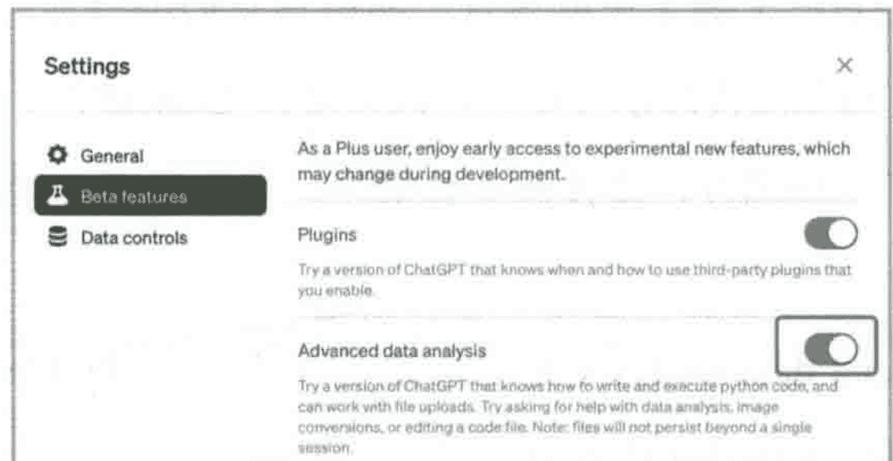

图 3.1 开启高级数据分析

调用 GPT-4 模块的高级数据分析插件后，提示输入框中会出现上传文件图标⊕，如图 3.2 所示。

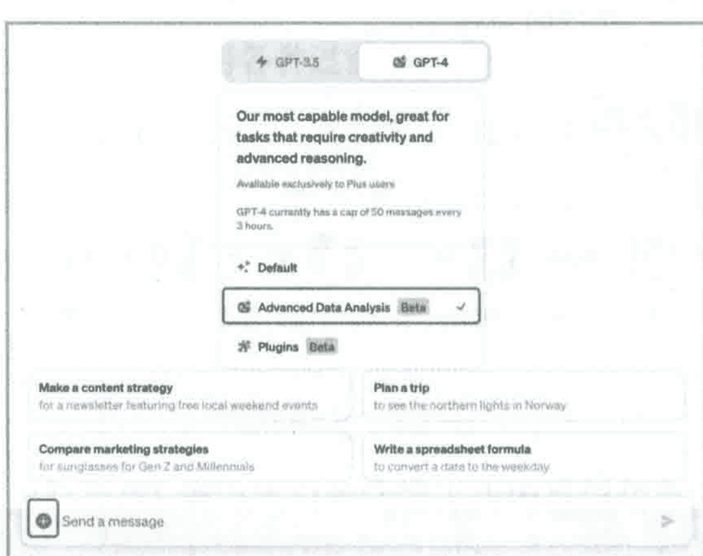

图 3.2 使用高级数据分析插件

用法6：图片合成短视频
利用高级数据分析将图片合成短视频，核心是将多张图片按顺序组合成视频。具体步骤如下。


扫一扫，看视频

1. 递交图片：递交要包含在视频中的所有图片。
2. 指定参数：告知 ChatGPT 具体需求，如播放顺序、每张展示时长、总时长、是否需要背景音乐等。
3. 请求生成视频：要求 ChatGPT 按提供图片与参数生成视频。
4. 等待处理：ChatGPT 使用合适编程语言与库处理请求并生成视频。
5. 下载或预览视频：完成上述步骤后下载或预览生成的视频。

例如，用户已递交若干图片，希望按递交顺序合成 20 秒视频，每张 4 秒，可直接输入：

我已递交了一些图片，请按递交顺序，每张展示 4 秒，生成一个 20 秒的视频。

随后高级数据分析会使用合适工具如 Python 的 MoviePy 库创建视频，并提供下载链接或预览。

这一流程让视频创建变得简单直观，无需用户自行编写代码或安装软件，只需提出请求即可。

下面使用 Midjourney 生成若干美食图片，递交到 ChatGPT，通过高级数据分析生成 20 秒短视频。

Q 提问问题见图 3.3。


ChatGPT：生成答案见图 3.4。

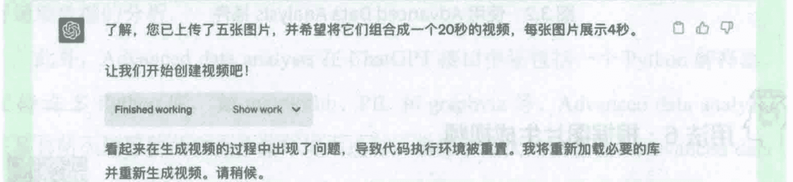

用法7：图像处理
高级数据分析可执行许多图像处理与分析任务，常见功能如下。

1. 图像读取与显示：读取并显示图像文件，便于分析和可视化。
2. 图像转换：将图像从一种颜色空间转换到另一种，如 RGB 转灰度。
3. 图像滤波与增强：应用各种滤镜和增强手段改善或改变图像外观。
4. 几何变换：对图像进行旋转、缩放、裁剪等几何操作。
5. 颜色处理：修改图像颜色，如调整亮度、对比度或特定通道强度。
6. 边缘检测与特征提取：利用不同算法检测图像边缘或提取关键特征。
7. 目标检测与识别：当前环境下无法调用预训练深度学习模型，但可使用基础方法进行形状与模式识别。
8. 图像分割：将图像分割成不同区域或对象以便进一步分析。
9. 形态学操作：使用形态学算法分析处理图像结构。
10. 图像合成或混合：将多张图像合成或混合，创造新视觉效果。

注意，因高级数据分析限制，部分复杂任务可能无法在此环境执行，如使用深度学习进行复杂图像识别。

ChatGPT 实操应用大全 全视频彩色版

笔者从 OpenAI 官网上截取 ChatGPT 简介片段，如图 3.5 所示。下面通过高级数据分析识别图片内容。

图 3.5 ChatGPT 简介片段

Q 提问问题见图 3.6。

图 3.6 提问问题

ChatGPT：生成答案见图 3.7。

图 3.7 生成答案

笔者递交一张由 Midjourney 生成的酸奶图像，如图 3.8 所示。使用高级数据分析改变图像颜色，再生成灰度图。

图 3.8 酸奶图像

Q 提问问题见图 3.9。

图 3.9 提问问题

ChatGPT：

我将继续使用先前将背景更改为白色的图像，并将其转换为灰度。让我们开始吧！

图像已成功转换为灰度，并保留白色背景。如果您对结果满意，我可以为您保存图像。如果您有任何特定要求或需要进一步调整，请告诉我！

笔者继续递交一张由 Midjourney 生成的 png 格式图片，如图 3.10 所示。通过高级数据分析将该图片格式改为 jpg。

图 3.10 彩蛋椅子

ChatGPT 实操应用大全 全视频彩色版

Q 提问问题见图 3.11。

图 3.11 提问问题

ChatGPT：生成回复见图 3.12。

图 3.12 生成回复

下面继续让它生成该图片的调色板。

Q 请提取该图片中的颜色，请生成调色板。

ChatGPT：生成回复见图 3.13。

图 3.13 生成回复

用法8：生成短视频
除了将图片生成视频外，还可将 GIF 文件生成视频。

Q 提问问题见图 3.14。

图 3.14 提问问题

> ChatGPT:

谢谢您上传 GIF 文件！我将按要求将其转换为 5 秒 MP4 视频，并在视频中缓慢放大以产生故事性镜头效果。

让我们开始这个过程。

看起来我忘记导入 'moviepy' 库中的 'vfx' 模块了，它用于处理放大效果。让我修复这个问题并重新尝试。

看起来我在尝试调用缩放函数时出现错误。我应该直接使用 'vfx.resize' 函数，而不是尝试作为模块调用。让我再次修正代码并重新尝试。

视频已成功生成，并应用了缓慢放大效果，营造出故事性镜头感。

您可以通过以下链接下载视频：

[下载放烟花的缓慢放大视频 MP4 格式](sandbox:/mnt/data/fireworks_zoomed.mp4)

如果您有其他要求或问题，请随时告诉我！

用法9：生成二维码
二维码是一种可在横纵两个方向存储信息的条码，相较传统一维条码存储能力更强。名称源于其在两个方向上的编码能力，即可在水平与垂直方向存储数据。

二维码特点如下。

1. 信息容量大：可存储数千字符，远超一维条码。
2. 可存储多种数据类型：除数字字母外，还可存储汉字、符号、图像、声音等。
3. 容错能力强：即使部分区域受损或遮挡仍可正确解读。
4. 可定制外观：在一定范围内可改变颜色与形状，甚至融入图像标志。

常见应用包括。

1. 移动支付：如微信支付或支付宝扫码付款。
2. 广告营销：在海报、名片、产品包装上加入二维码，便于用户获取更多信息。
3. 电子票务与登机牌：机场、火车站、演出等公共场合用作电子票据。
4. 网址分享：将网址编码成二维码，方便扫码直接访问。
5. 追溯与认证：在商品上加入唯一二维码，用于防伪与溯源。

常见类型有。

1. QR Code：最常见类型，由日本 Denso Wave 公司于 1994 年发明。
2. Data Matrix：主要用于标签和信件打印，可存储大量字符。
3. PDF417：可存储超过 1 千字节数据，常用于身份证和驾驶证。

二维码技术已深入日常生活各方面，从商业到娱乐，从物流到医疗，都有广泛应用。其易用、高效、灵活的特点使其成为现代信息交互的重要工具。

高级数据分析可在对话环境中运行代码。用户可通过该功能请求生成二维码并获得结果。步骤如下。

1. 提供要编码的信息：向 ChatGPT 提供想要编码的文本或信息。
2. 请求生成二维码：告知 ChatGPT 生成二维码，并提供特定设置或自定义选项如大小、颜色等。
3. 等待 ChatGPT 执行代码：ChatGPT 使用适当编程语言与库执行代码生成二维码。
4. 获取二维码图像：ChatGPT 提供二维码图像预览或下载链接。

例如，用户可提出请求：

请用二维码编码这个信息：“我爱你”。随后 ChatGPT 将使用 Python 与 qrcode 库生成二维码并返回结果。

这一过程使生成二维码变得方便，无需自行编写代码或安装库，只需提出请求即可。

Q 请用二维码编码这个信息：“我爱你”

图 3.15 生成回复

笔者递交一张图片作为二维码背景，要求 ChatGPT 重新生成二维码。

Q 请把该图片作为背景重新生成二维码。

图 3.16 生成回复

用法10：转换视频格式
视频格式种类繁多，可按容器、编解码器、压缩方法等分类。常见视频格式包括：

1. 容器格式：定义如何存储视频与音频流、元数据等。常见容器格式包括：
- MP4 .mp4
- AVI .avi
- MOV .mov
- MKV .mkv
- WebM .webm
- FLV .flv

视频文件从技术上看主要由三层构成。第一层是容器，比如常见的 OGG、MP4、AVI、MOV、MKV，它负责把音视频流和字幕等打包在一起。第二层是编解码器，也就是负责编码和解码的软件，同一容器下可以搭配不同的编解码器，市面上常用的有 H.264、H.265/HEVC、VP9、MPEG-2、MPEG-4。第三层是压缩方式，决定文件体积的大小，常见的有无损 Lossless 和有损 Lossy。不同组合决定了视频的表现力，例如 MP4 更适合在线播放和流媒体分发，MKV 则偏向本地高品质存储。实际选型要综合用途、设备兼容性和画质要求来权衡。

借助 Advanced data analysis 这类能力，可以调用 MoviePy、ffmpeg 等库完成格式间的互相转换，覆盖 MP4、AVI、MOV、MKV 等主流容器和编解码器。

# 第 3 章 ChatGPT 150种实战应用

下面列出几类典型的转换需求：

- 将 MOV 格式转为 MP4；
- 将 MP4 格式转为 AVI；
- 将 MOV 格式转为 MKV；
- 更换底层编解码器，例如由 H.264 换成 H.265；
- 修改分辨率、帧率或整体画质。

实际操作时上传目标视频，说明想要的目标格式以及具体的参数要求即可。示例中继续演示转成 MOV 文件输出。

### 用法 11：视频剪辑操作

利用 Advanced data analysis 可以很方便地完成剪辑，核心流程如下：

- 1）上传素材：通过 ChatGPT 的上传入口把待剪辑视频传到分析环境；
- 2）给出时间点：在对话中告知想要保留片段的起始时间和结束时间；
- 3）等待处理：系统会自动调用对应库完成裁剪并返回结果；
- 4）下载成品：直接在聊天窗口获取剪辑后的文件。

只要上传文件并提供起止时间，剪辑工作就能自动完成。

### 用法 12：变更视频播放节奏

在处理视频时常需要快进或慢放。上传文件后告诉系统期望的速度倍数，插件会借助 MoviePy 库实现加速或减速，操作十分简便。

Q 提问问题见图 3.22。

ChatGPT：生成回复见图 3.23。

### 用法 13：视频瘦身压缩

这里以调用 imageio 搭配 ffmpeg 库来压缩为例。演示素材选用“可爱的小动物 .mp4”，原始体积约 3.5M，压缩后约 1.1M，观感基本保持。需要留意的是，ChatGPT 单次上传上限为 500M，超出则无法处理。

Q 请使用 imageio with ffmpeg 库来压缩“可爱的小动物.mp4”文件的大小减小到原来的一半。

ChatGPT：生成回复见图 3.24。

### 用法 14：PDF 文档处理

Advanced data analysis 支持用多种 Python 库处理 PDF，涵盖读取、写入、合并、拆分、加水印等。常用工具组合包括：

- 提取文本：PyPDF2 或 pdfminer.six；
- 合并文件：PyPDF2；
- 按页拆分：PyPDF2；
- 水印与批注：PyPDF2 或 reportlab；
- 格式转换：pdf2image 转图像，pandoc 或 unoconv 转 Word；
- 创建 PDF：reportlab；
- 表单编辑与填充：pdfrw 或 pdfminer.six；
- 加密解密：PyPDF2；
- 元数据操作：PyPDF2 或 pdfminer.six；
- 扫描件 OCR：pytesseract 配合 pdf2image；
- 布局解析与数据提取：pdfplumber。

PDF 处理细节较多，实际使用时需根据需求调整参数。

下面以 Pause Giant AI Experiments: An Open Letter.pdf 为例进行演示。

Q 提问问题见图 3.25。

ChatGPT：

感谢再次上传！我们将尝试不同方式提取和分析 PDF 文本内容，可能的方案包括更换库或启用 OCR。

首先尝试用 pdfplumber 库提取，因为它在复杂排版上表现更好。

使用 pdfplumber 成功提取了文本，虽然仍含有部分特殊字符和编码问题。

对提取内容做初步梳理并用中文概括要点：

该文档标题为 “Pause Giant AI Experiments: An Open Letter”。主要信息包括：

- 1. 呼吁暂停大型实验：开篇强烈建议所有 AI 实验室至少暂停 6 个月，停止比 GPT-4 更强的系统训练；
- 2. 风险讨论：探讨具备与人类竞争智能的系统可能带来的深远社会与人类风险，并指出顶级实验室已承认此类风险；
- 3. Asilomar AI 原则：引用业界广泛认可的 Asilomar 原则，强调安全有益的研究；
- 4. 研究方向与伦理：涉及未来研究取向和道德准则的讨论，需更细分析才能完整呈现。

以上是对文章核心观点的概括，若需深入解读或特定段落说明可继续追问。

使用 Advanced data analysis 为该 PDF 添加水印。

> Q 请给提供的 PDF 文件的每个页面的中心添加对角线水印。水印应缩放至目标页面大小的 75%。水印内容应为 Pause Giant AI Experiments，以 Courier-Bold 字体书写，灰色，不透明度 50%。任务完成后，请分享已处理 PDF 文件的下载链接。

下载后可看到原 PDF 每页均已加入水印。

继续让其把 PDF 文件生成图像。

> Q 请把该 PDF 文件合并生成一张图像。

ChatGPT：

可选用 pdf2image 等库把每页转为图像后再拼接成一张大图。

先把 PDF 各页转为图像，再合并。

PDF 文件的所有页面已成功合并为一张图像，并显示在上方。我还将图像保存为 JPEG 文件，您可以通过以下链接下载：

[下载合并后的图像](https://example.com)

如果您有任何其他需求或问题，请随时告诉我！

### 用法 15：数据网页生成

借助 Advanced data analysis，任何数据都可以渲染成网页形式展示。

以下为具体示例。

笔者从 Kaggle 下载了一份含 607 条数据科学职位的集。初步观察显示：

职位名称分布除传统数据科学家外，还包括机器学习专家、大数据工程师、产品数据分析师等，体现出数据驱动与自动化在业务中的普及。

薪资水平受岗位、经验、地域和生活成本影响明显，美国整体薪酬高于其他地区，反映出当地需求旺盛与成本高。

远程工作比例说明了灵活办公的普遍趋势，公司可触达更广的人才池。

公司规模也会影响薪酬、职责广度和晋升路径，大企业资源多，薪酬高；小公司则往往职责更宽、晋升更快。

为更直观展示上述分析，可让 ChatGPT 生成 HTML 仪表盘。

提问问题见图 3.27。

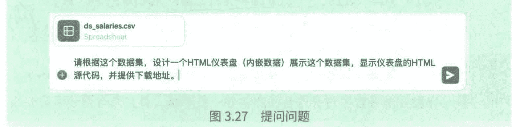

## ChatGPT 实操应用大全（全视频·彩色版）

ChatGPT:

要生成 HTML 仪表盘并展示源码，需要先构建仪表盘，再把 HTML 以可复制文本呈现。该仪表盘会内嵌数据并提供下载入口。步骤如下：

1. 数据准备：重新加载数据集并准备可视化素材；
2. 创建可视化：使用 plotly 制作交互图表；
3. 构建 HTML：生成包含图表的页面，将数据集以 JSON 形式内嵌，并附下载链接；
4. 展示源码：把生成的 HTML 内容以可复制文本形式输出。

现在开始创建 HTML 仪表盘。

以下为 HTML 仪表盘的源代码，内含数据与可视化图表。可复制代码保存为 .html 文件后用浏览器打开即可。

```html
<!DOCTYPE html>
<html>
<head>
    <title>Data Analysis Dashboard</title>
    <script src="https://cdn.plot.ly/plotly-latest.min.js"></script>
    <script src="https://code.jquery.com/jquery-3.6.0.min.js"></script>
</head>
<body>
    <h1>Data Analysis Dashboard</h1>
    <h2>Dataset Overview</h2>
    <!-- Plotly chart will be drawn inside this DIV -->
    <div id="chart1" style="height: 500px;"></div>
    <div id="chart2" style="height: 500px;"></div>
    <div id="chart3" style="height: 500px;"></div>
    <h2>Download Dataset</h2>
    <a href="#" id="downloadLink">Download the dataset</a>
    <script>
        var data = {json.dumps(data_json)};
        $(document).ready(function() {
            var blob = new Blob([data], { type: 'application/json' });
            var url = URL.createObjectURL(blob);
            $("#downloadLink").attr("href", url);
            $("#downloadLink").attr("download", 'ds_salaries.json');
        });
    </script>
</body>
</html>
```

请注意，代码内含内嵌数据，文件会比较大，请确保完整复制到本地 HTML 文件中。打开后即可交互使用。若遇到问题，请确认浏览器允许本地文件执行 JavaScript。

此外，我已保存该 HTML 文件并提供下载链接以便使用。让我处理此事。

你可以通过以下链接下载 HTML 仪表盘文件：

下载 HTML 仪表盘（内嵌数据）

下载后请在本地用现代浏览器打开，即可查看数据可视化并通过页面链接下载数据集。若操作受阻，请检查浏览器安全设置是否允许本地文件的 JavaScript 执行。

### 用法 16：音乐分析

Advanced data analysis 在音频分析中会调用若干 Python 库。常见方向和工具包括：


（1）波形读取：使用 wave 或 scipy 读取音频并观察波形，了解基本特性；

（2）频谱分析：借助 numpy 和 matplotlib 做傅里叶变换，分析频率成分；

（3）节奏节拍检测：使用 librosa 提取节拍并可视化；

（4）音高与和弦识别：librosa 用于音高估计，进而推断旋律与和弦结构；

（5）情感分类：结合特征提取与机器学习尝试判断音乐情绪或风格。

笔者上传迈克尔·杰克逊歌曲 You are not alone.mp3 进行分析，具体提问如下。

> Q 提问问题见图 3.28。


ChatGPT:

好的！我们先用 librosa 加载音频并可视化波形。

#### 步骤 1：加载音频文件

使用 librosa 加载文件并绘制波形。

看起来执行时出现了内部错误。让我重新加载音频并绘制波形图。

会话似乎被重置，我需要重新导入库并加载音频文件。请再次执行。

对不起，我忘了重新指定音频文件路径。让我修复后再次加载。

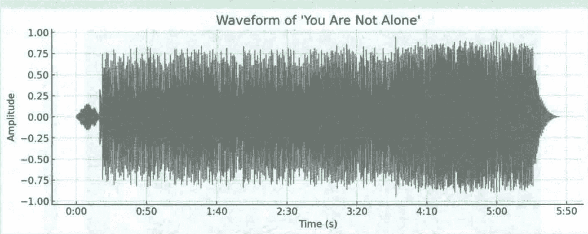

我们成功加载了歌曲 "You Are Not Alone" 的音频文件并可视化了波形。波形图反映了信号振幅随时间的变化。

#### 步骤 2：对音频文件进行分析

##### 1. 节奏分析

使用 librosa 的节奏分析功能检测节拍并叠加到波形上。

节奏分析时出现内存错误，可能与歌曲长度和采样率有关。

为降低计算压力，先对歌曲做重采样，随后再尝试节奏分析。

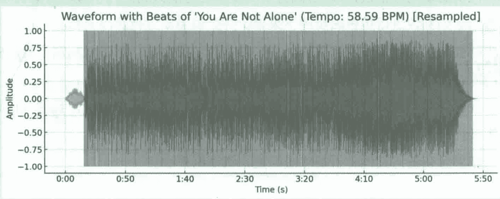

我们成功对歌曲 "You Are Not Alone" 进行了节奏分析，并在波形上标出节拍。红线为检测到的节拍位置，估计的节奏约为每分钟 97.66 拍。

##### 2. 频谱分析

接下来进行频谱分析以了解频率内容，使用短时傅里叶变换生成频谱图。

我遗漏了 numpy 的导入导致名称错误。让我修正后重新绘制频谱图。

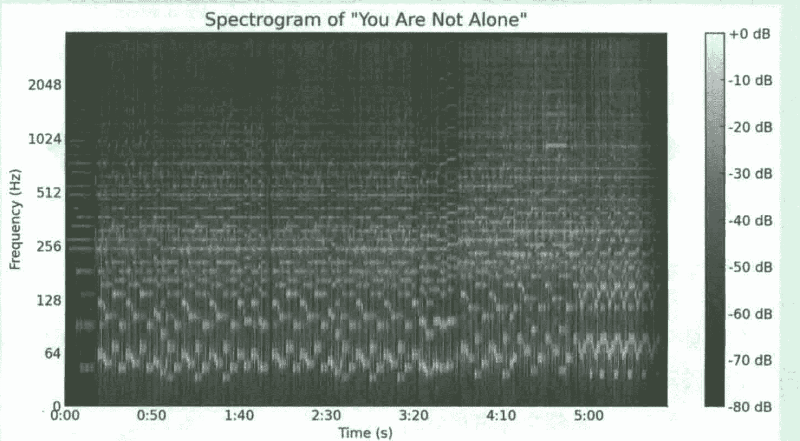

我们成功绘制了歌曲 "You Are Not Alone" 的频谱图。图示显示了信号随时间的频率分布，颜色深浅代表振幅强度。

##### 3. 音高分析

下一步可尝试音高轮廓分析，反映音高随时间的变化。

再次出现内存错误，说明音高分析的复杂度较高。进一步下采样后仍未解决，可能需要更多计算资源。

已尽可能完成节奏和频谱分析。音高分析建议在资源更充足的环境中进行。

如果您有其他分析需求，请随时提出。

> Q 请根据你的能力和这首歌曲的音乐特性，推断出该歌曲表达的情感。

ChatGPT:

没有做深入的情感建模，但结合节奏和频谱观察以及歌曲本身信息，可以做如下推断：

### 1. 节奏特征

- 节奏偏慢，约 97.66 BPM，可能传达宁静、沉思或感伤的氛围。

### 2. 频谱特征

- 频谱图显示频率分布较广，表明音乐层次丰富、动态度较高。

综合标题 “You Are Not Alone” 与上述特征，可推测情感倾向：

- 支持与安慰：标题与节奏共同营造出安慰与陪伴的感觉；
- 深情与怀念：慢节奏与丰富音色可能表达深情、怀念的情绪。

音乐情感解读具有主观性，受个人经历、文化背景影响。这里的分析基于一般音乐理论与观察，可能并不完全精确。

若需更具体的分析，请随时提出。

### 用法 17：数据分析

Python 高级数据分析全景速览

借助 Advanced data analysis，Python 提供了覆盖全流程的数据分析能力。下面梳理了十类常见任务及对应的常用工具。


（1）数据导入与清洗
- 读取 CSV、Excel、SQL 数据库等多种来源的数据
- 处理缺失值、转换格式、进行数据填充
- 常用工具如 pandas、numpy、SQLAlchemy 等

（2）探索性数据分析 EDA
- 计算描述性统计指标
- 通过可视化呈现分布、关联与规律
- 常用工具如 pandas、matplotlib、seaborn、plotly 等

（3）数据预处理与特征工程
- 对特征进行缩放、标准化与编码
- 开展特征筛选与构造
- 常用工具如 scikit-learn、pandas、numpy 等

（4）统计分析与推断
- 执行假设检验
- 进行相关性与回归分析
- 常用工具如 scipy、statsmodels 等

（5）机器学习与预测建模
- 完成模型的训练、验证与测试
- 评估并对比模型表现
- 常用工具如 scikit-learn、tensorflow、pytorch 等

（6）时间序列分析
- 检验平稳性
- 进行季节性分解与趋势分析
- 常用工具如 statsmodels、pandas 等

（7）文本分析与自然语言处理 NLP
- 文本预处理与特征提取
- 情感分析、主题建模等任务
- 常用工具如 nltk、spacy、gensim 等

（8）网络分析
- 分析与可视化网络、图结构数据
- 常用工具如 networkx、igraph 等

（9）优化与运筹学
- 求解线性与非线性优化问题
- 常用工具如 scipy.optimize、cvxpy 等

（10）地理空间数据分析
- 分析与可视化地理位置信息
- 常用工具如 geopandas、folium 等

Advanced data analysis 凭借丰富的库与工具链，构成了高效的数据分析环境。

笔者从 Kaggle 抓取了一份 Fortune 500 企业的数据集，作为深入体验高级数据分析全流程的学习素材。无论是新手还是资深分析师，都可以通过这份数据逐步练习加载、清洗、探索与可视化。

想自行尝试的用户，可以在 Kaggle 搜索 Fortune 500 Companies 下载同源数据。

下面演示常规分析操作。

Q 提问问题见图 3.29。


图 3.29 提问问题

ChatGPT：生成回复见图 3.30。

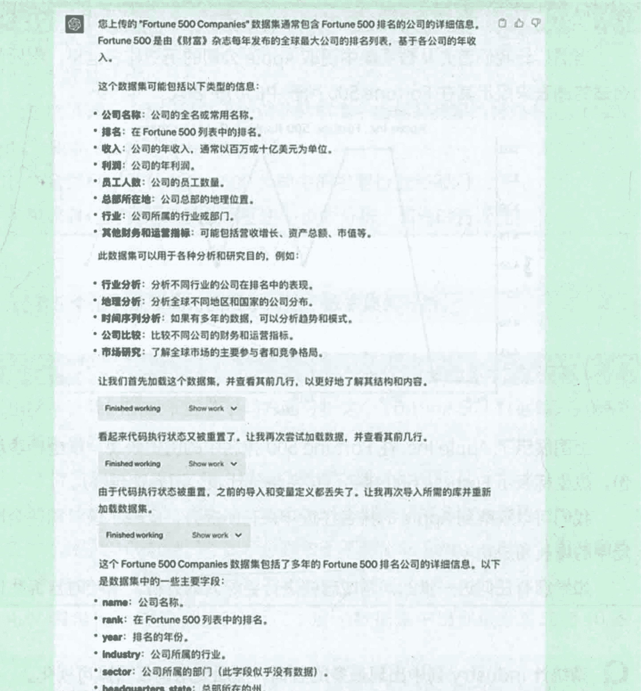

## ChatGPT 实战案例全收录（彩色视频版）

- headquarters_city：总部城市，该字段目前为空
- market_value_mil：市值，单位百万美元，目前为空
- revenue_mil：年收入，单位百万美元
- profit_mil：利润，单位百万美元，目前为空
- asset_mil：资产，单位百万美元，目前为空
- employees：员工人数，目前为空
- founder_is_ceo：创始人是否担任 CEO，目前为空
- female_ceo：是否由女性担任 CEO，目前为空
- newcomer_to_fortune_500：是否为 Fortune 500 新晋成员，目前为空
- global_500：是否同时进入 Global 500 榜单，目前为空

尽管部分字段缺失，仍有足够信息用于分析企业收入、排名、行业与地理分布。

有明确分析需求时，可直接提出，一起挖掘该数据集的价值！

图 3.30 生成回复

> Q 请问 Apple 公司历史表现如何，请用合适的图表展示它的排名情况。

ChatGPT:

没问题！先从数据中抽取 Apple 的历史排名，再用合适的图表呈现其在 Fortune 500 中的演进。

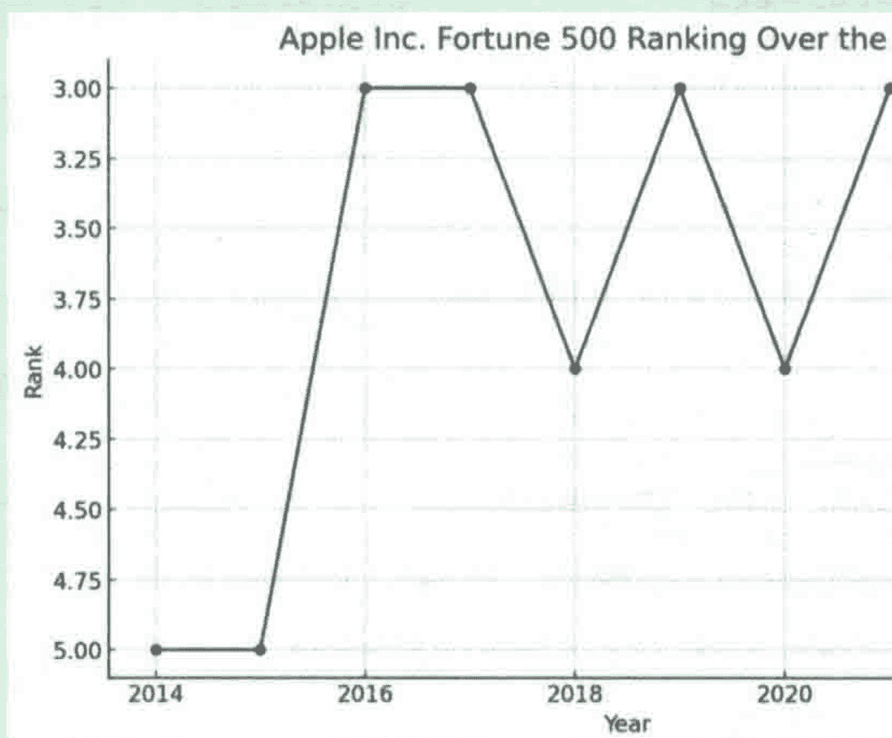

上图展示了 Apple Inc. 在 Fortune 500 中的历史排名。横轴为年份，纵轴为排名数值，数值越小代表位置越靠前。

可以看出，近年 Apple 的排名持续前移，体现了其在全球市场的扩张与增长。

如需进一步深挖，随时告诉我！

> Q 请统计 industry 列中出现最多的名词，然后使用词云将其可视化。

ChatGPT:

好的！我们统计 industry 列中高频名词，并以词云呈现，便于快速把握行业分布。

开始分析并生成词云。


上图为 Fortune 500 数据集中 industry 列高频名词的词云。词的大小与出现频率正相关。

从词云可迅速识别出高频行业词，如 Banks、Petroleum、Insurance 等，这些词反映了榜单中的核心行业板块。

有其他需求或想继续细化，随时提出！

Q 请用 5 个图表从不同方面展示对这个数据集的分析。

ChatGPT:

可以！从五个角度对 Fortune 500 数据集进行可视化：

1. **行业 Top 10**：展示出现频率最高的前十行业
2. **年收入走势**：展示榜单企业平均年收入随时间的变化
3. **总部州 Top 10**：展示企业总部所在州的数量排名前十
4. **高频出现企业 Top 10**：展示在数据中出现次数最多的前十公司
5. **重点企业排名变化**：展示 Apple、Microsoft、General Motors、Walmart 等在不同年份的排名波动

下面开始生成图表。

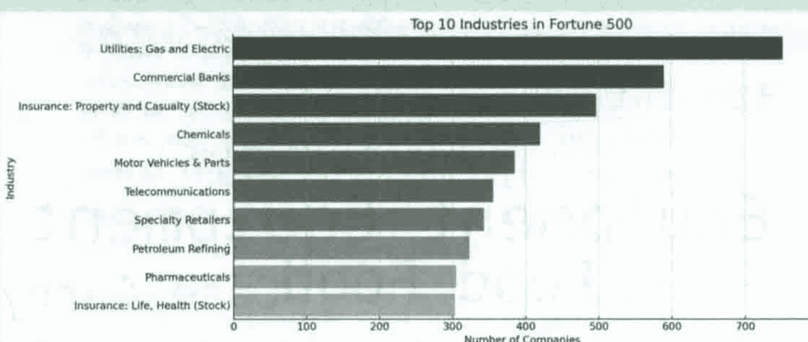

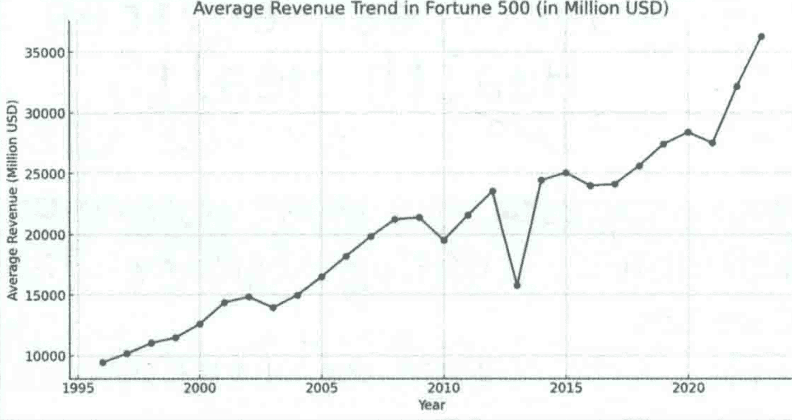

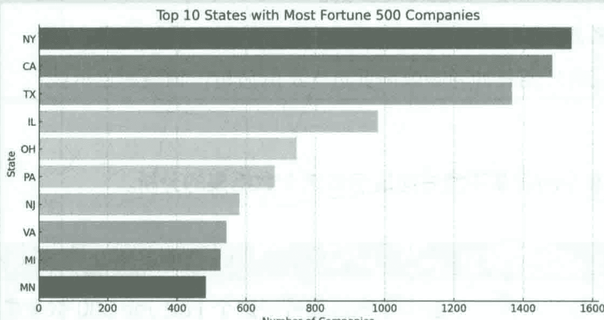

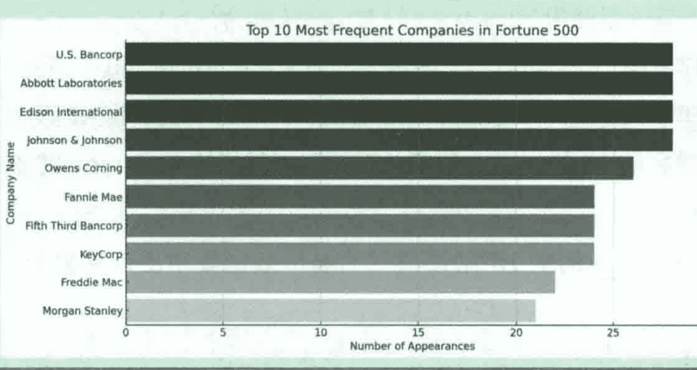

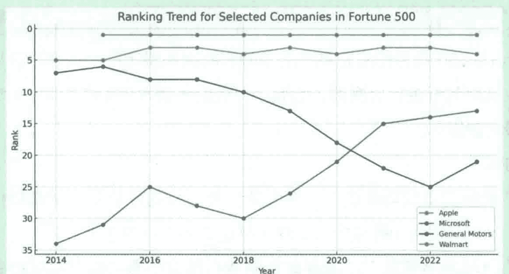

对 Fortune 500 数据集的五维分析与可视化如下：

1. **行业 Top 10**：
图表呈现了榜单中最常见的十个行业，银行、保险、石油炼化等位居前列。

2. **年收入走势**：
图表展示了榜单企业平均年收入的时序变化，可观察近年收入的波动。

3. **总部州 Top 10**：
图表显示总部分布最集中的十个州，例如纽约、德克萨斯、加利福尼亚等。

4. **高频出现企业 Top 10**：
图表列出在数据中出现最频繁的十家公司，如 Exxon Mobil、General Motors、Chevron 等长期位列榜单。

5. **重点企业排名变化**：
图表追踪了若干代表性公司在多年间的排名起伏，可见其竞争位置的变化。

以上图表共同勾勒出公司、行业、区域与时间维度的洞察。如有特定问题或想继续深挖，请随时说。

> Q 请问哪项指标对公司排名影响最大，并给出理由。

ChatGPT:

Fortune 500 的排序原则是依据企业年收入从高到低排列，因此年收入是决定排名的核心指标。

原因如下：

1. **直接反映规模**：年收入是衡量企业经济体量与市场份额的关键标尺。
2. **体现市场需求**：收入越高，通常意味着产品或服务需求更旺盛。
3. **与多项财务指标联动**：收入水平往往关联利润、现金流、总资产等，保持较高排名的公司通常在这些维度也具优势。
4. **影响全球影响力**：高排名企业具备更强的品牌认知与资源吸引力，有利于融资、人才与业务拓展。

总之，在该榜单体系下，年收入是位置变化的最直接驱动因素，其他指标虽重要，却不直接决定排名顺序。

Q 你能根据这些数据，做出一个最为重要并且最有趣的数据分析吗？请用图表表示并给出简要解释。

ChatGPT:

继续分析。

我们聚焦于平均收入最高的前五大行业，观察其随时间的收入趋势，以把握行业的经济地位与演进。

开始绘图。


上图展示了平均收入最高的前五大行业在不同年份的收入走势。简要解读如下：

- **行业分化明显**：部分行业的平均收入远高于其他行业。
- **趋势差异**：可识别出增长型与放缓型行业。
- **宏观启示**：反映了经济结构的变动，有助于判断未来主导行业。

例如，持续上行的行业可能正处于扩张期或采用了成功的战略，而下行则可能受竞争加剧或结构性调整影响。

该视角对投资者、企业战略与政策制定都具有参考价值。如需细化，随时沟通！

### 用法 18：分形图形绘制

分形由自相似的子结构组成，放大或缩小都能呈现相似形态，这类自相似性是其核心特征。分形既是数学对象，也广泛存在于自然界。

典型分形包括：

（1）曼德布罗特集合：复平面上由复迭代定义的经典分形
（2）朱利亚集合：与曼德布罗特相关，参数不同会产生多样形态
（3）谢尔宾斯基三角形：反复抽取构成的自相似三角形
（4）科赫曲线：通过迭代添加几何单元形成无限复杂曲线

分形在艺术、计算机图形与自然景观模拟中应用广泛。

下面使用 Advanced data analysis 绘制分形图形。

> Q 你能够绘制曼德布罗特集合吗？请以合适的方式展示出来。

ChatGPT：

可以！下面绘制曼德布罗特集合并进行展示。

已成功生成曼德布罗特集合图像，呈现出复杂而精美的自相似结构。


◎ **配色**：颜色对应迭代次数，内部暗区为集合主体，外围色彩变化表示逃逸速度
◎ **形态**：边界包含大量复杂结构，每个局部都蕴含更小的自相似副本

该集合是分形研究的经典范例，体现了简单规则可产生无穷复杂性，常用于艺术与视觉效果。

有进一步需求请随时提出！

Q 你能够创造出具有同样美感的类似图形吗？

ChatGPT：

当然可以！通过调整参数或更换分形类型即可得到不同美感。下面尝试绘制朱利亚集合，它与曼德布罗特密切相关，通过改变复参数 c 可产生多样形态。

选择经典参数 c = -0.7 + 0.27015i 开始绘制：


这是朱利亚集合的示例。同样具有自相似与复杂边界，颜色仍表示迭代次数。

与曼德布罗特类似，可见丰富的细节与边界结构。分形的魅力在于参数变化带来的无限多样性。

如有特定要求或想探索其他方程，请告诉我！

### 用法 19：复杂数学问题求解

Advanced data analysis 的数学计算底层调用 SymPy 等专业库，支持符号计算、高精度运算及模式匹配、绘图、求解、微积分、组合、离散数学、几何、概率统计与物理等多类功能，可处理大量基础数学问题。

Q 请画出这个函数的图像：x^3 + y^3 = 3axy，a 的值从 -10 到 10。

ChatGPT:

需要绘制隐函数 x^3 + y^3 = 3axy 的图像，并在 a 从 -10 到 10 变化时展示。

该隐函数可用等高线方式可视化，利用 matplotlib 与 numpy 实现。

开始绘制：

已成功绘制参数 a 在 -10 至 10 范围内该方程的图像，每条蓝色线对应一个特定 a 值下的解。

图像揭示了随着 a 变化解集的结构演化。

如有其他请求，请提出！


下面使用 Advanced data analysis 求解一道高等数学题，首次计算出错后重新运算得到正确答案。

Q 计算由摆线 x= a(t - sint),y = a(1 - cos t) 相应于 0 ≤ t ≤ 2π 的一拱与直线 y = 0 所围成的图形绕 x 轴旋转而成的旋转体体积。要保证计算过程和结果都要正确。

ChatGPT：生成回复见图 3.31。

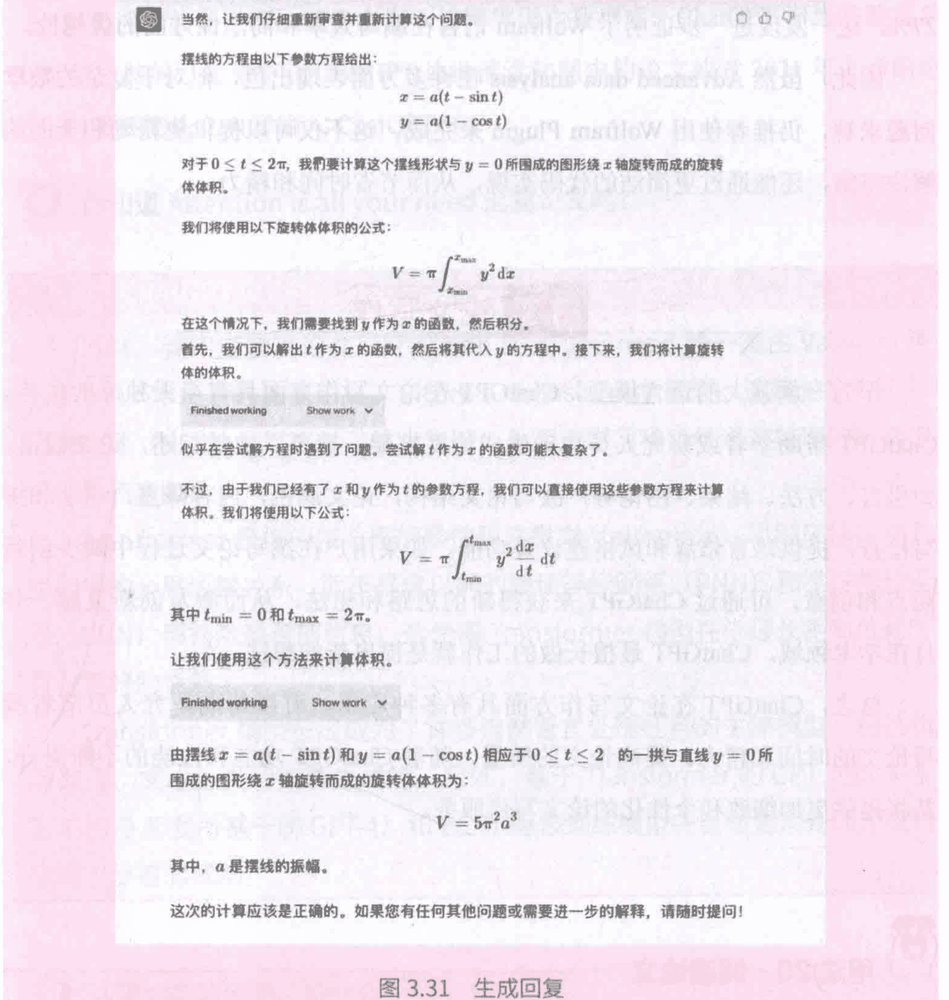

在处理复杂数学问题时，Advanced data analysis 会出现局限。Wolfram Alpha 首席科学家 Michael Trott 曾挑选 100 道来自数学期刊、竞赛、奥林匹克等来源的难题，分别用 Wolfram Plugin 与 Advanced data analysis 求解。

结果显示 Wolfram Plugin 全部解决，而 Advanced data analysis 仅约解决一半。对比代码长度，Wolfram 语言代码平均仅为 Python 代码的 27%，体现出简洁与高效。

因此，虽然 Advanced data analysis 在数据分析中表现强劲，面对高度复杂的数学求解时，仍建议优先使用 Wolfram Plugin 以获得更精确、更简洁的解法。

## 3.3 论文写作

依托强大的语言理解与生成能力，ChatGPT 在科研写作链条中表现突出。它能为研究者自动搭建论文骨架、撰写摘要、整理文献综述，并填充引言、研究方法、结果呈现、结论等各个章节，还可以调整整体结构、进行润色、实现降重、校对语法与拼写，并给出修辞与语言风格的优化建议。当作者遇到灵感瓶颈时，它还能抛出新颖的视角和思路，帮助点燃创新火花，而在学术场景里，头脑风暴新点子正是它的强项。①

总体来看，ChatGPT 覆盖了论文撰写的多个环节，能够明显缩短研究者的写作时长，提升成稿质量。随着底层能力持续进化，它有望提供更精细、更个性化的科研写作支持。

### 用法 20：快速精读文献
写作过程中阅读海量相关文献是必经之路，阅读不仅能把握前人进展，还能借鉴他人的结构安排与表达方式。可现实中阅读常被卡住：专业术语看不懂、统计模型与公式难以理解、抓不住核心要义、辨不出创新之处。把文献交给 ChatGPT，这些阻碍基本可以被迅速化解。用户只需把待读论文提供给模型，它便能完成语义解析，迅速提炼精髓并输出一份概括性摘要。这样就能更快、更高效地获取论文要点，提升理解效率。除 ChatGPT 本身外，ChatPDF 等基于其构建的阅读工具也能发挥类似作用。

需要留意的是，ChatGPT 并未接入知网等国内知识库，其训练语料截止于 2021 年。若要让它辅助阅读知网文献或 2021 年之后发表的论文，必须手动把全文内容输入进去。

> Q 你了解 Attention is all your need 这篇论文吗？
> ChatGPT:
> 当然知道。Attention is all you need 是 Vaswani 等人在 2017 年发表的里程碑式工作，它提出了 Transformer 架构。该文对自然语言处理产生了深远影响，为深度学习研究开辟了新方向。
> Transformer 的核心在于用注意力机制捕捉输入序列的全局依赖，而非像传统的循环神经网络或卷积神经网络那样受限于局部信息，因而在长距离依赖处理上更具优势。
> 目前 Transformer 已成为机器翻译、文本分类、摘要生成等任务的主流基座。以其为底座的 GPT 系列、BERT 等预训练模型也在 NLP 领域取得了突出成果。

> Q 这篇论文的核心创新有哪些？
> ChatGPT:
> 主要创新可归纳为以下几点：
> 1. 提出 Transformer 结构：彻底摒弃 RNN 与 CNN 的序列建模范式，完全以注意力机制建模序列依赖。
> 2. 自注意力机制：模型可在同一序列的不同位置间直接计算关联，能够有效捕捉远距离关联。
> 3. 多头注意力：把注意力拆分为多个并行的头，每个头关注不同信息子空间，使模型兼顾多重依赖。
> 4. 位置编码：由于缺乏循环与卷积的先天顺序信息，论文加入位置编码向量与输入拼接，让模型感知先后次序。
> 5. 编解码分层：采用多层编码器与解码器堆叠的层次化设计，编码器负责将输入映射为连续表征，解码器据此生成输出，也带来了更好的并行效率。
> 这些突破让 Transformer 在序列任务上兼具高性能与强扩展性，成为众多 NLP 应用的主流架构。
> ChatGPT 的推理能力正是建立在 Transformer 算法之上，该算法源自 2017 年的 Attention is all your need，被评为 NLP 年度最佳论文。结合其输出来看，对该文思想与创新点的概括十分准确。

### 用法 21：选题发掘
论文选题直接决定研究价值与高度，选出兼具创新性与实践意义的题目并不容易，这时 ChatGPT 能提供有效助力。首先让它进行主题探查，获取某个研究领域的最新进展、趋势与热点问题；随后向它提问并筛选出具备创新性与现实价值的备选方向；最后结合自身专业背景与实际条件进行微调与确认。


# 第 3 章 ChatGPT 150 个实战场景
Q 我是一名计算机本科生，想研究区块链技术，请问该研究领域有哪些最新动态和热点问题？
ChatGPT:
您好，选择区块链作为研究方向很有前景。作为分布式账本技术，区块链在加密资产、金融科技、供应链、物联网等领域应用广泛。近期值得关注的热点包括：
1. 可扩展性：如何提升吞吐量，分片、侧链、状态通道等方案是主流探索。
2. 互操作性：不同链之间的通信与协作，跨链技术成为研究焦点。
3. 隐私与安全：零知识证明、同态加密等用于增强隐私，同时持续研究抗攻击能力。
4. 去中心化金融 DeFi：基于智能合约的自动化金融服务仍在快速演进。
5. 法定数字货币 CBDC：多国央行在探索央行数字货币，对全球金融格局影响深远。
6. 智能合约安全与形式化验证：部署前检测漏洞，确保合约正确性与安全性。
7. 能源效率与可持续性：从工作量证明转向权益证明等低能耗共识机制。
8. 非同质化代币 NFT：在艺术、游戏、收藏等场景的创新应用。
9. 去中心化身份 DID：用户无需中心机构即可完成身份认证。
10. 供应链管理与追溯：提升透明度、防伪溯源、提高运营效率。
以上仅是部分方向，建议持续关注顶级会议与期刊，并动手实践以加深理解。

> Q 我想研究区块链在供应链管理与追溯方面的应用，请提供 5 个研究题目。
> ChatGPT:
> 选题建议如下：
> 1. 基于区块链提升供应链透明度：研究如何追溯产品来源、生产与物流信息，增强信任与效率。
> 2. 区块链在食品安全溯源中的应用：保障质量、防范假冒、记录食品全流程信息。
> 3. 去中心化供应链金融方案：利用智能合约实现贸易融资、应收账款融资等，降低信任成本。
> 4. 基于区块链的反假冒与知识产权保护：结合 NFT 确权、追踪来源、维护权益。
> 5. 区块链助力绿色可持续供应链：追踪原材料合规性、碳排放数据、激励可持续行为。

> Q 我觉得《区块链在食品安全与溯源中的应用》这个题目不错，我想加入案例研究，请重新修改题目。
> ChatGPT:
> 建议改为：《基于案例研究的区块链在食品安全与溯源中的应用探讨》
> 该题目下可选取具体实践案例，分析区块链在食品安全溯源中的实际作用、实施挑战及解决路径，从而更清晰地认识其价值。
在逐步引导下，通过 ChatGPT 的提示，笔者最终确定了一个满意的论文题目。

### 用法 22：生成论文摘要
摘要是对论文内容的精炼表述，需具备独立性与完整性，概括研究目的、方法与结论。向 ChatGPT 输入写作要求，它即可按学术规范生成摘要。


> Q 我想写一篇关于 ChatGPT 在元宇宙中应用的论文，请为我生成一篇 300 字左右的摘要。
> ChatGPT:
> 题目：ChatGPT 在元宇宙中的应用探讨
> 摘要：
> 随着元宇宙概念升温，ChatGPT 作为先进的自然语言处理技术，在该环境中展现出广泛潜力。本文探讨其可能的应用场景及对元宇宙生态的影响。
> 首先可作为智能虚拟助手提供导航与服务；其次可扮演商店老板、游戏 NPC 等虚拟角色；再者可促进多语言实时交流；此外可提供教育培训与一对一辅导；最后可为文学、艺术、游戏等创意产业赋能。
> 与此同时，也需关注数据隐私、算法偏见、技术滥用等风险。建议在应用过程中加强技术伦理、保护用户权益，通过优化算法、提升透明度、引入监管与跨领域合作，确保价值创造与风险可控。
从生成的摘要看，其结构符合学术规范，呈现出典型的沙漏式：开头以倒三角说明背景与意义，中部以层次化顺序展开应用，结尾以正三角收束结论。

### 用法 23：生成论文提纲
构思与修改提纲往往耗时费力，一个清晰的骨架是确保结构完整与重点突出前提。借助 ChatGPT 输入核心观点或已有摘要，即可快速得到框架。以下案例承接上文摘要继续生成提纲。


> Q 请根据以上摘要内容，为我生成该论文的提纲。
> ChatGPT:
> 一、引言
> A. 元宇宙的兴起和发展
> B. ChatGPT 技术概述
> C. 研究目的与结构安排
> 二、ChatGPT 作为智能虚拟助手在元宇宙中的应用
> A. 导航与信息查询
> B. 任务协助
> C. 个性化推荐
> 三、ChatGPT 担任虚拟角色
> A. 商店老板
> B. 游戏 NPC
> C. 角色个性化
> 四、促进跨语言交流
> A. 多语言支持
> B. 实时翻译
> C. 全球社区建设
> 五、教育与培训服务
> A. 新技能学习
> B. 知识拓展
> C. 虚拟导师辅导
> 六、支撑创意产业
> A. 文学艺术游戏领域
> B. 创作灵感与素材
> C. 生成虚拟作品
> 七、挑战与伦理问题
> A. 数据隐私
> B. 算法偏见
> C. 技术滥用
> 八、应对策略
> A. 算法优化
> B. 透明度提升
> C. 监管机制
> D. 跨领域合作
> 九、结论
> A. 应用前景
> B. 伦理与权益保护
> C. 价值释放
> Q 请把第二到第六部分合并为第二部分，其他内容重新生成大纲。
> ChatGPT:
> 一、引言
> A. 元宇宙概念演进
> B. ChatGPT 技术简介
> C. 论文目标与结构
> 二、ChatGPT 在元宇宙中的应用
> A. 智能虚拟助手
> 1. 导航与信息查询
> 2. 任务协助
> 3. 个性化推荐
> B. 虚拟角色
> 1. 商店老板
> 2. 游戏 NPC
> 3. 个性化调整
> C. 跨语言交流
> 1. 多语言支持
> 2. 实时翻译
> 3. 社区建设
> D. 教育培训服务
> 1. 技能学习
> 2. 知识拓展
> 3. 一对一辅导
> E. 创意产业支持
> 1. 文学艺术游戏
> 2. 灵感与素材
> 3. 作品生成
> 三、应用挑战与伦理问题
> A. 数据隐私
> B. 算法偏见
> C. 技术滥用
> 四、应对挑战的策略
> A. 优化算法
> B. 提升透明度
> C. 引入监管
> D. 加强合作
> 五、结论
> A. 应用前景
> B. 伦理与权益
> C. 潜力发挥
首次生成的提纲章节较多，经逐步引导后重新整理的提纲结构更紧凑、层次分明，是一份规范的大纲。

### 用法 24：文献推荐
开展研究离不开文献检索，可借助 ChatGPT 调用 Google Scholar、Microsoft Academic 等搜索引擎缩小范围，也能基于已有的文献请求相关推荐。需要注意的是，ChatGPT 未接入知网等国内数据库，其给出的英文文献之外结果准确性有限，使用时需自行甄别。


> Q 请为我推荐 10 篇与元宇宙相关的学术论文吧，这些论文发表在 2020 年以后。
> ChatGPT:
> 以下是 2020 年后发表的部分相关论文：
> 1. Raji, A., & Adeshina, O. (2020). Metaverse: A review of virtual world applications. Journal of Virtual Worlds Research, 13(2), 1-22.
> 2. Park, S., & Davenport, T. H. (2020). Virtual reality and the metaverse: Opportunities for architectural design and education. Journal of Architectural Education, 74(2), 250-260.
> 3. Liao, Y., & Li, X. (2021). Metaverse in the Making: How Blockchain Technology is Shaping Virtual Reality. Journal of Information Technology & Software Engineering, 11(2), 1-10.

4. Smith, A., & Anderson, J. (2021). The Metaverse and Its Implications for Decentralized Finance. Journal of Financial Innovation, 7(1), 1-20.

5. Gomez, R., & Johnson, N. (2021). The impact of metaverse on mental health: A systematic review. Journal of Mental Health and Clinical Psychology, 5(1), 1-16.

6. Lee, H., & Kim, J. (2020). A study on the development of metaverse-based learning environments for STEAM education. Interactive Learning Environments, 1-15.

7. Wilson, E. O., & Johnson, S. (2021). Beyond gaming: Exploring the metaverse for collaborative work and learning. The International Journal of Information and Learning Technology, 38(1), 1-14.

8. Huang, L., & Chen, X. (2021). Metaverse and cross-border e-commerce: A study on the potential of virtual reality technology in global trade. Journal of International Commerce, 27(1), 1-20.

9. Sanders, A., & Turner, R. (2021). The role of AI and machine learning in the metaverse: Opportunities and challenges. AI & Society, 1-12.

10. Park, J., & Lee, M. (2020). Designing and evaluating user interfaces for metaverse applications: A case study of a virtual museum. International Journal of Human-Computer Interaction, 36(5), 457-469.

以上文献集中呈现了元宇宙研究当前的热点议题与演进脉络，可供参考借鉴。

从 ChatGPT 给出的推荐来看，全部为英文成果且时间止于 2021 年，这与模型训练数据的边界有关。若需要检索 2021 年之后的最新成果，可参考后文用法 150 关于无限制使用 ChatGPT DAN（Do Anything Now）功能的说明。若更倾向中文资料，则可在万方、知网、维普等数据库中进行检索。

### 用法 25：生成文献综述
文献综述是对某个研究议题进行资料收集后，通过阅读、分析、归纳与整理，对该议题的最新进展、学界观点或建议所做的系统性概括。它既可作为论文的组成部分，也可独立成篇。在《怎样做文献综述——六步走向成功》一书中，劳伦斯·马奇与布伦达·麦克伊沃提出六步模型，依次为选题、文献检索、展开论证、文献研读、文献评析与综述撰写。在此框架下，ChatGPT 可承担后五步的工作，只需给出论文主题，模型即可完成检索、论证展开、研读、评析与撰写。用户提供的约束越具体，如引文范围、发表年份区间、篇幅限制等，生成结果的可用性越高；在此基础上再行修改，就能显著提升文献综述的撰写效率。


> write a literature review relating to NFT in 300 words using 8 citations.

ChatGPT:

Non-Fungible Tokens 近期引发广泛讨论，其出现标志着数字所有权与价值交换进入新阶段。NFT 是基于区块链的独一无二数字资产，可提供不可篡改的所有权与真实性证明。本综述旨在梳理当前对 NFT 的认识及其跨行业影响。

在艺术领域，NFT 获得高度关注，典型案例是 Beeple 于 2021 年 3 月售出数字作品获 6900 万美元。围绕其环境负担以及对传统艺术市场的冲击，已有担忧被提出（Huang et al., 2021）。NFT 所有权与流转的法律监管问题亦引发疑问（Hou, 2021）。

音乐行业的应用也被探讨，潜在收益包括为创作者开辟新收入渠道并优化版税分配（Barber, 2021）。与此同时，也存在估值困难以及对更友好 NFT 平台的需求等挑战（Bhatti et al., 2021）。

游戏领域，NFT 有望支撑玩家所有制经济与更沉浸的体验（Fernández-Sánchez et al., 2021）。但同时也警示了可能产生新的游戏内不平等与玩家剥削风险（Böhme et al., 2021）。

总体来看，NFT 具备重塑多行业的潜力，但仍伴随诸多未解问题与风险。未来仍需更多研究来厘清数字所有权、价值交换与监管的 implication。

References:

- Barber, A. (2021). Non-Fungible Tokens in Music: Are They the Future? Music Business Worldwide. https://www.musicbusinessworldwide.com/non-fungible-tokens-in-music-are-they-the-future/

- Bhatti, A., Srivastava, M., & Verma, A. (2021). NFTs in Music Industry. arXiv preprint arXiv:2103.15813. https://arxiv.org/abs/2103.15813

- Böhme, R., Christin, N., Edelman, B., & Moore, T. (2021). Risks of Blockchain Technology and Smart Contracts. In Handbook of Blockchain, Digital Finance, and Inclusion (pp. 461-473). Springer. https://link.springer.com/chapter/10.1007/978-3-030-58452-8_28

- Fernández-Sánchez, C., Martínez-Álvarez, M., Troncoso-Pastoriza, J. R., & Lama-Ruiz, J. R. (2021). Smart contract and blockchain for developing multiplayer games with non-fungible tokens (NFTs). Concurrency and Computation: Practice and Experience, e6436. https://doi.org/10.1002/cpe.6436

- Huang, L., Ma, J., Zhou, M., & Han, B. (2021). NFT and the Art Market: Economic Implications and Sustainability Challenges. Frontiers in Blockchain, 4, 40. https://doi.org/10.3389/fbloc.2021.684941

- Hou, L. (2021). NFTs and Digital Property Rights: A Legal and Regulatory Overview. Computer Law & Security Review, 105843. https://doi.org/10.1016/j.clsr.2021.105843

示例既接受英文提问，也接受中文提问。观察 ChatGPT 的产出，可见所引文献多为 2021 年的外文成果，这是因为训练数据截止于 2021 年之前，最新与中文文献未被涵盖。需要提醒的是，文中引用的文献需逐条核实，部分条目可能并不存在。

若希望得到包含最新成果的文献综述，可借助 Paper Digest，这一平台可检索文献并自动生成综述。具体操作如下。

（1）进入 Paper Digest 官网，设定论文发表年份与学科类别，输入研究主题，如图 3.32 所示。检索后，系统会列出相关论文，并在列表下方提供自动生成的综述，如图 3.33 所示。需要注意的是，Paper Digest 生成的综述质量有限，通常仍需借助 ChatGPT 进一步润色。

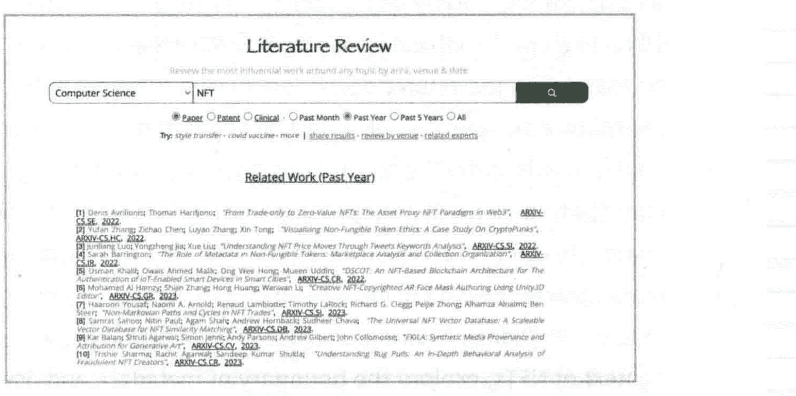

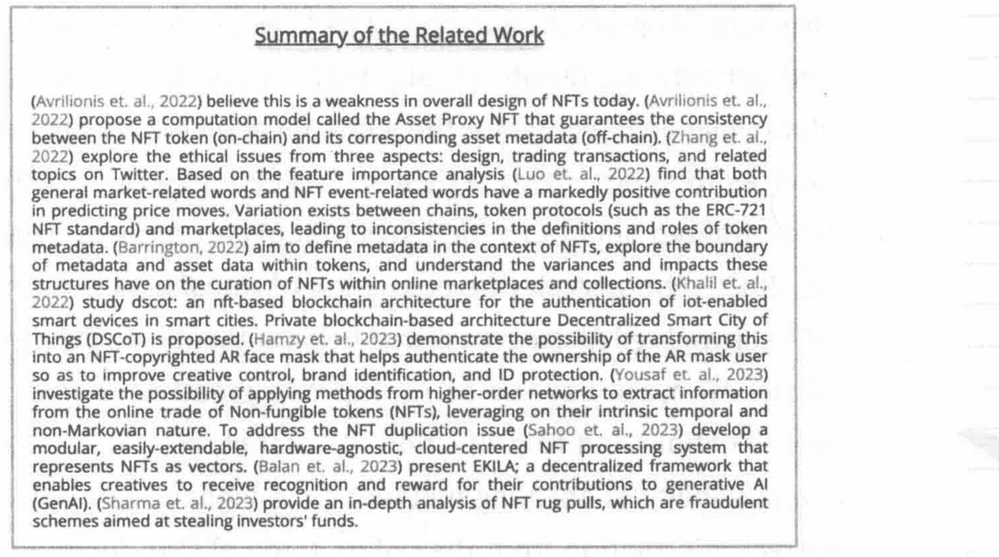

（2）利用 ChatGPT 对文献综述进行润色。将 Paper Digest 生成的综述文本提交给 ChatGPT 请求润色加工。结果如下所示：

AI写论文提效实战：从NFT文献整理看ChatGPT用法

学术写作最怕信息堆砌又逻辑不清。用NFT研究做测试，可以清晰看到AI在重构文献、精简表达、找方向和扩充内容上的作用。

先看文献综述的重写。原始素材提到NFT链上代币与链下元数据一致性不足是当前设计短板，Avrilionis et al., 2022 因此提出Asset Proxy NFT计算模型来保障同步。Zhang et al., 2022 从设计、交易到Twitter话题梳理伦理问题。Luo et al., 2022 的特征重要性分析显示市场通用词和NFT事件词对价格预测都有显著正向贡献。不同链、协议如ERC-721、平台导致元数据定义与角色各异，Barrington, 2022 正是为厘清元数据边界及对策展的影响。Khalil et al., 2022 提出基于NFT的Decentralized Smart City of Things验证物联网设备，Hamzy et al., 2023 则把NFT版权用于AR面罩以提升创作控制与身份保护。Yousaf et al., 2023 用高阶网络方法挖掘NFT交易的时间非马尔可夫特征，Sahoo et al., 2023 以向量化方案解决复制问题。Balan et al., 2023 的EKILA框架让创作者在生成式AI中获认可与回报，Sharma et al., 2023 深度剖析NFT Rug Pull骗局。把这些点整理成规范综述后，再压缩到300词以内，核心脉络依然完整，信息密度更高。经过两次迭代后，第二次输出在条理和时效性上明显胜出，也更容易被直接用于论文。

### 用法 26：推荐研究方向
新手选题常卡在判断价值和把握前沿。对学科问题敏感度不足时，可以让AI先做一次方向盘点。


> Q 请为我推荐一些关于 NFT 的研究方向。
ChatGPT：
可以的，NFT目前可切入的题目不少，例如：
1. 技术底层：区块链、加密与智能合约在NFT中的实现及其对市场支撑。
2. 价值评估：定价模型与评价标准如何建立。
3. 创意产业应用：音乐、艺术、影视等商业模式的改变与创作者收益。
4. 市场演进：趋势研判与未来需求预测。
5. 社会影响：经济、文化、法律等领域的冲击与应对。
6. 安全隐私：交易安全与用户数据保护。
7. 元宇宙应用：虚拟世界中的资产沉淀与新价值。
8. 广告营销：品牌传播策略的变革。
9. 身份认证：基于NFT的数字身份解决方案。
10. 供应链物流：透明度与效率提升路径。
整体来看，AI给出的清单覆盖面广、视角新颖，可先筛选再细化，不满意时补充约束条件也能快速迭代。

### 用法 27：扩写论文内容
论文篇幅不够时，可通过补充案例、解释机制、对比讨论、结论建议以及背景综述来增强说服力。人工操作费时，借助AI转换表述、做逻辑推演、补背景知识并适度发挥想象，能较快补足材料，让文本更完整、更有力。


# 第 3 章 ChatGPT 写作实务精要

本章围绕写作与学术写作的常见任务展开。先看一个扩写示范：把《蛇》与《葡萄成熟了》两首爱情诗的时代背景、创作语境和对比思路，在不改原意的前提下扩展到约五百字。模型从诗风、意象、形象、视角四个角度展开。二十年代的《蛇》带有浪漫主义余韵，强调自我张扬和情绪外放；五十年代的《葡萄成熟了》则显出现实主义的细腻写实。意象上，《蛇》以充满张力的蛇暗示欲望与纠结，《葡萄成熟了》用温润的葡萄传递甜蜜期待。人物上，前者是激情与理性拉扯的恋人，后者是朴素真诚的青年情侣。叙述上，前者用第一人称直接抒怀，后者用第三人称冷静旁观。整体对比脉络清晰，体现了三十年间审美迁移，只是生成文字约九百字，超出字数要求。

### 用法 28：长文压缩技巧

稿件过长时，模型可以先梳理架构，抓取核心论点与数据，再用更紧凑的表达重组，保持逻辑完整。下面以政务服务类材料的压缩为例。


> Q 现在你是一个学术牛人，你需要对我后续发给你的文本内容进行阅读并且提取关键信息，并把以下内容精简到 200 字左右，不要改变原意：

随着 AI 技术的创新迭代，生成式 AI（AIGC）正在成为塑造政务服务智能体的新型引擎，构思并衍生出行政领域的 AI 通用大模型——GovGPT。生成式 AI 驱动的政务服务主要体现在：空间场景的虚拟，政务情境的自动化与虚实共生；虚拟公务员的兴起，政务管理的无人化与政府“智”转；组织和资源要素的集成，政务运作的整合化与无缝隙政府；政务服务的技术主义范式，服务供给的智能化与需求革命。生成式 AI 技术虽然塑造了政务服务智能体的通用模型，作为推动数字政府“智能化”建设的先导和理念，GovGPT 仍需依赖一个健全的行政生态维系，而蕴于全面且深刻的政府第二波数字化转型中。从 ChatGPT 到 GovGPT，需要立足于生态系统构建，树立数智化政务服务生态的理念，致力于构建智能政务服务生态的行动共同体，促进政务运作的虚实共生与智能联动，打造全方位智能政务服务生态的安全保障体系。

> ChatGPT:

随着 AI 技术创新，生成式 AI（AIGC）正成为政务服务智能体的新引擎，衍生出大型行政领域 AI 模型——GovGPT。其主要应用包括虚拟空间场景、自动化政务情境、虚拟公务员兴起、无人化政务管理、组织资源集成、政务运作整合及政务服务智能化。尽管 AIGC 技术塑造了通用政务服务模型，推动数字政府智能化建设，但 GovGPT 仍需依赖健全的行政生态和深入的政府数字化转型。从 ChatGPT 到 GovGPT，需构建生态系统，树立数智化政务服务理念，建立智能政务服务行动共同体，促进虚实共生与智能联动，确保全方位智能政务服务生态安全。

压缩后要点完整，字数由三百四十余降至二百二十七左右，可读性明显提升。

### 用法 29：学术语言润色

投稿前打磨语言要兼顾准确与流畅。下面给出中英文常用的润色指令，可直接调用。


- （1）英文学术润色：Below is a paragraph from an academic paper. Polish the writing to meet the academic style, improve the spelling, grammar, clarity, concision and overall readability. When necessary, rewrite the whole sentence. Furthermore, list all modification and explain the reasons to do so in markdown table.

- （2）作为一名中文学术论文写作改进助理，其任务是改进所提供文本的拼写、语法、清晰、简洁和整体可读性，同时分解长句，减少重复，并提供改进建议。请只提供文本的更正版本，避免包括解释。请编辑以下文本（以中文论文润色为例进行演示）：

> Q 作为一名中文学术论文写作改进助理，你的任务是改进所提供文本的拼写、语法、清晰、简洁和整体可读性，同时分解长句，减少重复，并提供改进建议。请只提供文本的更正版本，避免包括解释。请编辑以下文本：

本：数字化转型的核心路径是新型能力建设，以新型能力赋能业务创新转型，构建竞争合作新优势，改造提升传统动能，形成新动能，创造新价值，实现新发展。针对当前学术界关于制造企业数字化能力的实证研究较少的现象，本文首先综述数字化转型和数字化能力的相关理论，提炼出制造企业数字化能力的结构维度（包括数字化战略、数字技术能力、数字化组织能力、数字化业务能力、数字化重构能力和数据管理能力六个子能力），然后设计问卷和开发测量量表，利用 SPSS 和 Amos 软件对量表进行信度分析、探索性因子分析和验证性因子分析，对数字化能力的六因子模型进行验证，并以东莞为例，调研该城市制造企业数字化能力的六个子能力整体得分情况和分析各行业数字化子能力的得分情况，剖析发展难点，以及分析国内外领先企业数字化转型的成功经验并提出针对性对策建议，为东莞乃至新兴发展国家的制造企业数字化转型和数字化能力提升提供经验借鉴。

> ChatGPT:

数字化转型的核心途径是新能力的建设，通过新能力推动业务创新转型，打造竞争合作新优势，改进并提升传统动能，形成新动能，创造新价值，实现新发展。针对学术界目前关于制造企业数字化能力的实证研究较少，本文首先梳理数字化转型和数字化能力的相关理论，提取制造企业数字化能力的结构维度（包括数字化战略、数字技术能力、数字化组织能力、数字化业务能力、数字化重构能力和数据管理能力六个子能力）。接着设计问卷和制定测量量表，运用 SPSS 和 Amos 软件对量表进行信度分析、探索性因子分析和验证性因子分析，验证数字化能力的六因子模型。以东莞为例，调查该城市制造企业数字化能力的六个子能力的整体得分状况，分析各行业数字化子能力得分情况，剖析发展难点，并分析国内外领先企业数字化转型的成功经验，提出针对性策略建议。这将为东莞及新兴发展国家的制造企业数字化转型和数字化能力提升提供参考。

润色后用词更贴切，句子更流畅，符合学术规范。

### 用法 30：模仿期刊与作者文风

模型可以学习特定期刊或学者的表达习惯，实现风格迁移。先提供目标作者的样本，或直接指定如 Nature 的风格，即可得到相近文本。


> I want you to act as an professional spelling and grammer corrector and improver. I want you to replace my simplified A0-level words and sentences with more beautiful and elegant, upper level English words and sentences. Keep the meaning same, but make them more literary and improve my expression in the style of the journal Nature.

ChatGPT:

As a proficient language enhancement expert, my objective is to elevate your writing by replacing basic phrases and expressions with more sophisticated, eloquent language, while preserving the original meaning. I will enrich your prose and refine your expression, emulating the style found in esteemed publications such as Nature.

> Conversational AI technologies such as ChatGPT have produced enormous impact on education around the world today. This paper explains how ChatGPT enables the intrinsic mechanism of foreign language learning, and focuses on promoting self-directed learning of foreign language learners and changing the role of foreign language teachers by ChatGPT. It then indicates the potential issues of using ChatGPT in foreign language teaching, and discusses strategies for developing critical thinking skills while using ChatGPT.

ChatGPT:

Revolutionary conversational AI technologies, epitomized by ChatGPT, have engendered a profound influence on global educational paradigms. This treatise elucidates the innate mechanisms through which ChatGPT fosters foreign language acquisition, accentuating its capacity to bolster self-directed learning among multilingual aspirants while concurrently redefining the role of foreign language pedagogues. Subsequently, it explores potential challenges arising from ChatGPT’s integration into linguistic instruction and delves into strategies devised to cultivate critical thinking aptitudes in tandem with ChatGPT utilization.

改写稿保持了学术严谨，同时结构清晰、表达凝练，语感接近目标刊物。

### 用法 31：降重与改写

初稿完成后的查重是常规环节，重复度偏高时可借助模型重写。基本思路是先抽取关键词、核心信息与结论，再据此重新组织表述，最后做微调。


ChatGPT 降重的原理是先提取出原论文中的关键词、关键信息和结论等内容；再根据这些关键词、关键信息和结论重新构建论文内容，重新生成全新的表述；最后，对生成的论文内容进行微调和精练，以确保其质量。经过去重，论文的重复率大幅度降低，同时也保持了原始论文的核心思想和主要结论。

笔者选取的文献《元宇宙电子商务的运行机理、风险与治理》初检重复约九十三点四五，

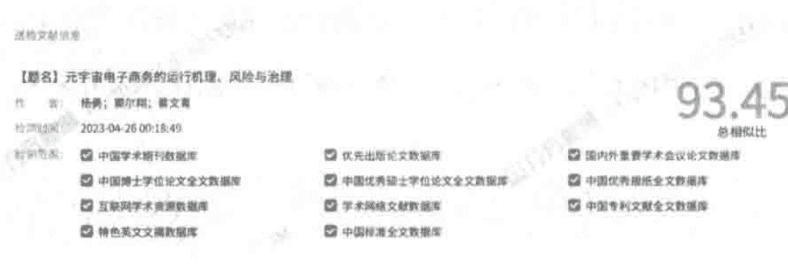

图 3.34 去重前的重复率

经模型初步处理后重复降至约十五点八七，

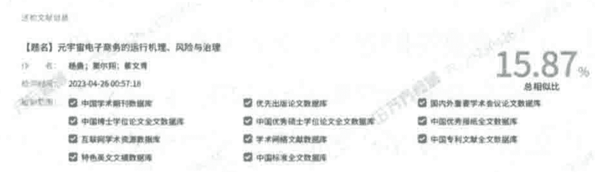

图 3.35 使用 ChatGPT 降重后的重复率

操作可归纳为四步：输入原文抽取要素、在新对话中生成改写稿、指导模型校对语法与逻辑、再次查重迭代。借助此流程既能降低重复度，又能保持原意与质量。以元宇宙电商片段为例，提示模型提炼结论、数据与案例要点，为后续改写提供框架。

1. 技术融合覆盖语音识别、推荐引擎、视频处理、语言模型、实时渲染及光线追踪等能力。
2. 将虚拟分身与单一账号进行关联。
3. 在该单一账号内采用 DECP 作为结算代币，并融合人脸、虹膜、声纹等生物识别手段，让支付更稳妥高效。

缘由：
1. 单一账号机制让买卖双方在收付款、清算等流程上更顺畅，也减轻了多平台多账号的维护压力。
2. 此种机制贴合虚拟世界开放平台的思路，有助于打破封闭圈层，令消费者获得一致对待，并降低舞弊、欺诈、诈骗风险。

## 3. 依靠区块链与智能合约构建单一账号体系，有助于形成更开放公正的经济秩序

再次打开一个 ChatGPT 会话。

Q 请基于以下结论、数据、案例与原因，撰写约五百字的说明。

结论：在虚拟世界里，虚拟分身与单一账号不可或缺。借助多元技术组合，用户能塑造具备智能互动能力的数字俄身，借区块链搭建唯一的数字分身与账号体系，实现消费与交易的一体化，提升安全与便利。

数据：
- Web 3.0 能够打通不同虚拟商城的数据关联。
- 区块链可为整个虚拟世界建立唯一的数字分身与唯一账号。
- 智能合约可让用户资产管理更高效。

案例：
- 技术融合包括语音识别、推荐引擎、视频处理、语言模型、实时渲染及光线追踪等。
- 把虚拟分身与单一账号绑定。
- 账号内使用 DECP 作为支付货币，并配合人脸识别、虹膜识别、声纹识别等，让支付更安全快速。

原因：
- 单一账号体系方便用户与商家收款、付款、结算，简化多平台多账号管理。
- 唯一账号体系符合虚拟世界开放平台理念，有助于打破封闭系统，保障消费者公平对待，避免作弊、欺诈或诈骗。
- 基于区块链和智能合约的唯一账号体系有利于建立更加开放公平的经济体系。

ChatGPT：
结论：在虚拟世界中，数字分身与单一账号是必需的。融合多项技术后，用户可打造具备智能交互的虚拟形象，同时以区块链建立唯一的数字分身与账号，实现消费交易无缝衔接，提升安全与便捷。

依托 Web3 与区块链，整个虚拟世界中唯一的数字分身与单一账号得以实现。智能合约助力资产管理更灵活。整合语音识别、推荐引擎、视频处理等技术，为用户提供沉浸式互动体验。结合 DECP 支付与生物识别，保障支付安全快捷。

单一账号体系简化了用户与商家的交易流程，减少多平台多账号的管理负担。它契合虚拟世界开放平台的思路，有助于打破封闭壁垒，维护消费者权益。以区块链与智能合约为基础的单一账号体系，有助于培育更公平开放的经济秩序。

数字分身与单一账号在虚拟世界中意义重大。借助前沿技术提供智能便捷的互动，实现消费交易的无缝衔接。它将推动虚拟产业蓬勃发展，为虚拟商品、虚拟地产等领域创造商业机会。用户隐私与数据安全问题亟待解决，需要配套的政策与技术措施。

总体来看，数字分身与单一账号对虚拟世界至关重要。它们将驱动发展与创新，为用户带来前所未有的便利体验。过程中需持续关注隐私与数据安全，为虚拟世界的健康成长营造良好环境。

笔者多次重复该操作，分段降重，直至整篇论文经 ChatGPT 改写后，再做润色，重复率已降至约 5%。此案例也证明 ChatGPT 在论文修改与去重方面的实用性与有效性，它能在保留原论文核心思想的前提下生成更具独创性的内容，从而提升论文质量与原创性。

### 用法 32：撰写整篇论文

撰写论文一般分为确定研究方向与题目、细化提纲、撰写全文、精修润色、完善要素及查重降重等步骤。其中摘要建议在通读全文后再写。尽管 ChatGPT 在写作中发挥了重要作用，大幅提升效率，但用其完成整篇论文并非一蹴而就，需要遵循一定流程并结合人工修改，方能产出高质量成果。以下是一套可操作的工作流程，供参考。


- （1）选题。选题阶段可借鉴前文方法，利用 ChatGPT 辅助生成方向。若已有明确题目可跳过。
- （2）引导 ChatGPT。确定题目后需引导模型进行同频思考，聚焦研究主题。引导过程需要耐心与技巧。
首先，确认模型是否熟悉题目涉及的概念，若不熟悉可人工提供相关资料供其学习。
其次，围绕题目让模型推荐优质学术资源，如高被引论文、文献综述或近三年前沿文献等。
再次，让模型基于推荐文献进行归纳与对比分析，使其更深入学习资料并聚焦主题。
最后，要求模型据此给出论文启示。
- （3）撰写提纲。经正确引导后，模型可据此生成论文大纲。若不满意可调整或要求重新生成，直至达标。
- （4）撰写摘要。依据题目与提纲，利用模型生成一定篇幅摘要，不满意可修改重写。
- （5）撰写初稿。确定题目、提纲与摘要后，按章节顺序让模型生成正文。生成时需密切观察，发现偏离主题应及时纠偏。
- （6）修改和润色。生成初稿后可逐句校对，亦可用模型批量润色，或两者结合。
- （7）完善论文要素。核心内容完成后补充关键词、参考文献、英文摘要、作者简介、页码等信息。
- （8）查重与降重。初稿完成后须进行查重。若重复率较高，可借助前文方法使用 ChatGPT 降重，调整格式后即可提交。

受篇幅限制，本文未详细演示全过程，读者可按上述流程自行实践。

特别强调，撰写过程中须保持在同一对话会话中进行，尽量避免随意切换窗口，待进入降重阶段后再另开会话。

## 3.4 IT 与编程

ChatGPT 并非专为编程设计，但可作为有效的编程辅助工具。它借助自然语言描述实现功能，降低编程门槛，帮助基础薄弱的用户完成任务。不仅能处理常规编程，还可修正错误、解读代码、添加注释、优化代码、实现代码互译等。此外可充当 Linux 终端、SQL 终端、Python 编译器和 JavaScript 控制台等。遇到技术难题时，用户也能向其求助获取系统化解决方案。

### 用法 33：编写代码

ChatGPT 支持多种编程语言，包括但不限于 Python、Java、JavaScript、C++、C#、Ruby、PHP、Swift、Kotlin、TypeScript、Go、Rust、Scala、R、MATLAB、Dart、Lua、SQL 及 Shell Script 等，也可编写 HTML 与 CSS 制作网页。只需用自然语言清晰表达需求，模型即可按要求生成代码，显著减轻程序员负担。


> Q 请用 Python 编写爬虫程序，爬取百度网站首页信息。

ChatGPT:
百度首页主要由搜索框与若干链接构成。下方给出一例 Python 爬虫，使用 BeautifulSoup 与 requests 库抓取百度首页链接信息：

```python
import requests
from bs4 import BeautifulSoup
def get_html(url):
    headers = {
        'User-Agent': 'Mozilla/5.0 (Windows NT 10.0; Win64; x64) AppleWebKit/537.36 (KHTML, like Gecko) Chrome/88.0.4324.96 Safari/537.36'
    }
    response = requests.get(url, headers=headers)
    if response.status_code == 200:
        return response.text
    else:
        return None
def parse_html(html):
    soup = BeautifulSoup(html, 'html')
    links = soup.find_all('a')
    for link in links:
        text = link.get_text().strip()
        href = link.get('href')
        print(f'链接文本: {text}\n 链接地址: {href}\n')
def main():
    url = 'https://www.baidu.com/'
    html = get_html(url)
    if html:
        parse_html(html)
    else:
        print('获取网页失败')
if __name__ == '__main__':
    main()
```
运行前请确认已安装 requests 与 BeautifulSoup，可使用如下命令安装：

```shell
pip install requests
pip install BeautifulSoup
```
该简单爬虫将输出百度首页的链接文字与地址。需注意，目标网站结构变动可能导致爬虫失效，使用时请遵守目标网站的使用条款。

ChatGPT 不仅迅速给出爬虫程序，还附带安装说明。笔者将代码复制到 Python 环境执行，未出现 Bug，成功读取百度首页信息。

### 用法 34：修正代码错误

除编写代码外，ChatGPT 还能协助检查并修正错误。模型会分析所给代码，排查语法、逻辑或潜在性能问题，并在检查中结合编程经验、最佳实践与已知模式给出建议。


Q 请检查下面的代码存在什么问题。

```java
public Object pop(){
    if(size==0) throw new EmptyStackException();
    return element[--size]; // 短暂造成内存泄漏
}
```
ChatGPT:
该代码存在内存泄漏问题。此处为 `pop()` 方法，用于从栈中弹出元素。表面逻辑无明显错误，但存在潜在泄漏。

问题在于这一行：

```java
return element[--size];
```
`size` 减小后，栈顶元素仍保留对原对象的引用。在 Java 中对象采用引用计数回收，若栈中仍持有引用，垃圾回收器无法回收该对象，造成内存泄漏。

为避免泄漏，需在返回栈顶元素前将引用设为 `null`，以便回收。修改后代码如下：

```java
public Object pop() {
    if (size == 0) throw new EmptyStackException();
    Object result = element[--size];
    element[size] = null; // 解除原栈顶对象的引用，避免内存泄漏
    return result;
}
```
修改后的 `pop()` 方法在弹出元素前将其引用置空，从而避免内存泄漏。

此为经典 Java 内存泄漏案例。ChatGPT 准确指出问题并给出修正代码。

### 用法 35：解读代码功能

训练过程中模型吸收了大量编程示例，使其能理解多种语言与框架的基本结构，并对代码进行功能解读。

首先依据语法与关键字识别语言，如 Java、Python、C++ 等。
其次分析结构，包括函数、类、循环与条件语句等，以把握组织方式。
最后剖析算法与逻辑，理解程序功能与目标，涉及变量追踪、函数调用、输入输出判断等，同时考虑上下文、应用场景及与其他片段的关系。


> Q 请解释下面代码的功能，并给出代码输出结果。

```java
public static void main(String[] args) {
    int i,j;
    for(i=1;i<10;i++) {
        for(j=1;j<i+1;j++) {
            System.out.print(j+"*"+i+"="+i*j+"\t");
        }
        System.out.println();
    }
}
```
ChatGPT:
该代码为 Java 程序，用于打印 1 至 9 的九九乘法表。采用双层嵌套循环，外层 `i` 控制乘数范围 1-9，内层 `j` 控制被乘数范围 1-`i`。内层使用 `System.out.print` 输出乘法式子，如 `j+"*"+i+"="+i*j`，`\t` 用于对齐。外层结束后 `System.out.println()` 换行，使每行独立显示。

输出结果如下：

```
1*1=1
1*2=2  2*2=4
1*3=3  2*3=6  3*3=9
1*4=4  2*4=8  3*4=12  4*4=16
1*5=5  2*5=10 3*5=15  4*5=20  5*5=25
1*6=6  2*6=12 3*6=18  4*6=24  5*6=30  6*6=36
1*7=7  2*7=14 3*7=21  4*7=28  5*7=35  6*7=42  7*7=49
1*8=8  2*8=16 3*8=24  4*8=32  5*8=40  6*8=48  7*8=56  8*8=64
1*9=9  2*9=18 3*9=27  4*9=36  5*9=45  6*9=54  7*9=63  8*9=72  9*9=81
```
这是一个简单的九九乘法表，以行列形式展示。

对于所给代码，ChatGPT 正确识别为 Java 程序，准确解读其打印九九乘法表的功能，并给出正确输出。

### 用法 36：代码优化

ChatGPT 可辅助代码优化，包括简化逻辑、合并冗余、采用更简洁语法等。可检查可读性，如命名规范、注释、空格缩进等，提升模块化程度，分析潜在性能问题，如重复计算、低效数据结构、过度内存分配等，检查异常处理与错误检查机制，确保程序优雅应对问题，还可分析 SQL 注入、XSS 等安全隐患并提供修复建议。


Q 请对下面的 Java 代码进行优化。

```java
public static void main(String[] args) {
    List<Town> towns = new ArrayList<>();
    towns.add(new Town("松山湖园区", 771));
    towns.add(new Town("大朗镇", 414));
    towns.add(new Town("大岭山镇", 335));
    towns.add(new Town("长安镇", 895));
    towns.add(new Town("虎门镇", 735));

    Collections.sort(towns, new Comparator<Town>() {
        @Override
        public int compare(Town t1, Town t2) {
            return Double.compare(t2.gdp, t1.gdp);
        }
    });

    System.out.println("乡镇 GDP 降序排列：");
    for (Town town : towns) {
        System.out.println(town);
    }
}
```
ChatGPT:
这是一个按 GDP 降序排列乡镇的 Java 程序。原代码已较为简洁可读。以下优化采用 Java8 Lambda 表达式与 Stream API，简化排序与输出，提升可读性。

优化后的代码如下：

```java
import java.util.ArrayList;
import java.util.List;
import java.util.stream.Collectors;
public class Main {
    public static void main(String[] args) {
        List<Town> towns = new ArrayList<>();
        towns.add(new Town("松山湖园区", 771));
        towns.add(new Town("大朗镇", 414));
        towns.add(new Town("大岭山镇", 335));
        towns.add(new Town("长安镇", 895));
        towns.add(new Town("虎门镇", 735));

        towns.sort((t1, t2) -> Double.compare(t2.gdp, t1.gdp));

        System.out.println("乡镇 GDP 降序排列:");
        towns.forEach(System.out::println);
    }
}
```

优化说明：

1. 排序部分改用 Java8 的 Lambda 表达式实现，写法更紧凑，不必再显式编写 Comparator 类。
2. 输出部分改用 forEach 配合方法引用 System.out::println，省去了传统 for 循环。

需要说明的是，Town 类并未涉及修改，因为原始材料里没有提供该类的定义。若后续想对 Town 类做优化，请先补充完整的类信息。

ChatGPT 给出的改进版本充分利用了 Java8 的 Lambda 表达式与 Stream API，对排序与打印逻辑进行了精简，整体代码比原来更简洁。

# 第 3 章 ChatGPT 150 种实用场景

### 用法 37：代码翻译
ChatGPT 具备一定的跨语言代码转换能力，可以把一种语言的代码改写为另一种语言。对于较为复杂的转换任务，模型可能一次处理不完，建议先把大块拆分为若干小片段分别转换，这样准确率会明显提高。生成后务必人工校对和验证，确保功能与原代码一致且没有错误。


Q 请将下面 Java 代码翻译为 Python 和 C++ 代码。
```java
public static void bubbleSort(int[] values) {
    int temp;
    for (int i = 0; i < values.length; i++) {
        for (int j = 0; j < values.length - 1 - i; j++) {
            if (values[j] > values[j + 1]) {
                temp = values[j];
                values[j] = values[j + 1];
                values[j + 1] = temp;
            }
        }
    }
}
```
ChatGPT:
下面是基于您提供的 Java 源码生成的 Python 与 C++ 参考实现，具体使用时请结合实际场景做适当调整。

Python 代码：
```python
def bubble_sort(values):
    for i in range(len(values)):
        for j in range(len(values) - 1 - i):
            if values[j] > values[j + 1]:
                temp = values[j]
                values[j] = values[j + 1]
                values[j + 1] = temp
```
C++ 代码：
```cpp
#include <vector>

void bubbleSort(std::vector<int>& values) {
    int temp;
    for (int i = 0; i < values.size(); i++) {
        for (int j = 0; j < values.size() - 1 - i; j++) {
            if (values[j] > values[j + 1]) {
                temp = values[j];
                values[j] = values[j + 1];
                values[j + 1] = temp;
            }
        }
    }
}
```
使用前请对上述代码进行充分的测试和校验，以保证正确性与运行效率。

这是一段典型的冒泡排序示例，经 ChatGPT 处理后准确地转换成了 Python 和 C++ 形式，且逻辑无误。

### 用法 38：代码注释
注释是写在代码中的说明性文字，用来解释意图和功能，能让代码更易读，帮助其他开发人员更快理解并进行修改维护。把需要加注的代码交给 ChatGPT，它就能自动补上注释。提交代码时保持格式规范、缩进整齐，有助于模型更好把握结构。生成结果后要自行审阅，确保注释准确易懂。


Q 请为下面的代码逐行添加中文注释。
```python
def bubble_sort(values):
    for i in range(len(values)):
        for j in range(len(values) - 1 - i):
            if values[j] > values[j + 1]:
                temp = values[j]
                values[j] = values[j + 1]
                values[j + 1] = temp
```
ChatGPT:
以下是为该段 Python 代码添加的逐行中文注释版本：
```python
def bubble_sort(values):
    # 外层循环遍历整个列表
    for i in range(len(values)):
        # 内层循环遍历未排序部分的列表
        for j in range(len(values) - 1 - i):
            # 如果当前元素大于下一个元素，则交换它们的位置
            if values[j] > values[j + 1]:
                # 使用临时变量存储当前元素的值
                temp = values[j]
                # 将当前元素的值替换为下一个元素的值
                values[j] = values[j + 1]
                # 将下一个元素的值替换为临时变量中存储的当前元素的值
                values[j + 1] = temp
```
要留意，这些注释依据代码逻辑撰写，使用时请确认是否真实反映了功能行为，必要时可自行修改。

该例是冒泡排序的演示，ChatGPT 给出的中文注释条理清晰，说明模型对代码原理有较好的理解。

### 用法 39：编写测试脚本
ChatGPT 本身无法执行代码测试，但可以接受代码、测试案例或测试计划的输入，提供测试策略优化建议，同时也能直接生成单元测试代码。


Q 请为下面的 Java 代码编写单元测试代码。
```java
static int BinSearch(int r[], int n, int k)
{
    int low = 0, high = n - 1;  // 设置查找区间，注意数组下标从 0 开始
    int mid;
    while (low <= high)  // 当区间存在时
    {
        mid = (low + high) / 2;
        if (k < r[mid])  high = mid - 1;
        else if (k > r[mid]) low = mid + 1;
        else return mid;  // 查找成功，返回元素序号
    }
    return 0;  // 查找失败，返回 0
}
```
ChatGPT:
以下为使用 JUnit 5 (JUnit Jupiter) 为您生成的单元测试，测试框架的依赖请先在项目中引入。示例针对 BinSearch 函数：
```java
import org.junit.jupiter.api.Test;
import static org.junit.jupiter.api.Assertions.*;

class BinSearchTest {

    @Test
    void testBinSearch() {
        int[] r = {1, 3, 5, 7, 9};

        // 测试查找存在的元素
        assertEquals(1, BinSearch.BinSearch(r, r.length, 3));
        assertEquals(3, BinSearch.BinSearch(r, r.length, 7));

        // 测试查找不存在的元素
        assertEquals(0, BinSearch.BinSearch(r, r.length, 2));
        assertEquals(0, BinSearch.BinSearch(r, r.length, 10));

        // 测试边界情况
        assertEquals(0, BinSearch.BinSearch(r, r.length, 1));
        assertEquals(4, BinSearch.BinSearch(r, r.length, 9));

        // 测试空数组
        int[] emptyArray = {};
        assertEquals(0, BinSearch.BinSearch(emptyArray, emptyArray.length, 5));
    }
}
```
该测试类提供了一个 testBinSearch 方法，用来在多种输入下验证 BinSearch 的正确性，涵盖元素存在、元素不存在、边界位置以及空数组等情形。请根据实际代码调整用例，并在执行时留意结果以确认功能。

ChatGPT 输出的测试代码结构简洁、易于维护，覆盖了正常查找、异常查找、首尾边界以及空数组等主要场景，足以对 BinSearch 进行较为全面的校验。

### 用法 40：解释错误信息
开发中报错在所难免，过去常靠搜索引擎或 Stack Overflow 找答案，耗时耗力。现在只需把异常堆栈贴给 ChatGPT，就能快速得到定位。


> 请问下面异常信息是什么原因造成的。
> Exception in thread "main" java.lang.ArrayIndexOutOfBoundsException:Index 8 out of bounds for length 5.
ChatGPT:
这条信息表明程序抛出了 Java 的 ArrayIndexOutOfBoundsException，属于运行时异常。根本原因是尝试访问不存在的数组下标，具体是想取索引 8，而数组实际长度只有 5，有效下标为 0 到 4，因此越界了。

要解决这个问题，需检查所有涉及数组访问的代码，保证下标不会超出合法范围。重点核查循环终止条件、数组长度判断以及下标计算逻辑，常见诱因是循环条件写错或下标计算有误。仔细排查并修复相关逻辑即可消除该异常。

ChatGPT 精准说明了异常成因并给出修复方向，让问题能够迅速得到解决。

### 用法 41：编写 SQL 语句
ChatGPT 并非专业的数据库工具，但能够根据描述生成 SQL。提供操作意图、表名、字段和条件等信息即可得到对应的语句，场景描述越具体，生成的语句越贴合需求。


> 编写 SQL 语句，创建一张用户表，字段包括用户 ID、姓名、年龄、性别、手机号、邮箱，其中用户 ID 为主键。
ChatGPT:
依据上述描述创建用户表的 SQL 如下：
```sql
CREATE TABLE users (
    user_id INT PRIMARY KEY,
    name VARCHAR(255),
    age INT,
    gender CHAR(1),
    phone VARCHAR(20),
    email VARCHAR(255)
);
```
该语句新建名为 users 的表，包含用户 ID 主键、姓名、年龄、性别、手机号、邮箱等列，字段类型按常规需求设定，如需适配特定数据库或业务，可自行调整类型和长度。

> 请生成 10 条插入语句，能够插入到用户表中。
ChatGPT:
下面给出 10 条可用于向用户表插入数据的示例 SQL，数据均为随机示例，使用时请按实际情况替换。

```sql
INSERT INTO users (user_id, name, age, gender, phone, email) VALUES (1, 'Alice', 28, 'F', '123-456-7890', 'alice@example.com');
INSERT INTO users (user_id, name, age, gender, phone, email) VALUES (2, 'Bob', 35, 'M', '234-567-8901', 'bob@example.com');
INSERT INTO users (user_id, name, age, gender, phone, email) VALUES (3, 'Carol', 22, 'F', '345-678-9012', 'carol@example.com');
INSERT INTO users (user_id, name, age, gender, phone, email) VALUES (4, 'David', 43, 'M', '456-789-0123', 'david@example.com');
INSERT INTO users (user_id, name, age, gender, phone, email) VALUES (5, 'Eve', 31, 'F', '567-890-1234', 'eve@example.com');
INSERT INTO users (user_id, name, age, gender, phone, email) VALUES (6, 'Frank', 29, 'M', '678-901-2345', 'frank@example.com');
INSERT INTO users (user_id, name, age, gender, phone, email) VALUES (7, 'Grace', 25, 'F', '789-012-3456', 'grace@example.com');
INSERT INTO users (user_id, name, age, gender, phone, email) VALUES (8, 'Henry', 38, 'M', '890-123-4567', 'henry@example.com');
INSERT INTO users (user_id, name, age, gender, phone, email) VALUES (9, 'Ivy', 27, 'F', '901-234-5678', 'ivy@example.com');
INSERT INTO users (user_id, name, age, gender, phone, email) VALUES (10, 'Jack', 45, 'M', '012-345-6789', 'jack@example.com');
```

下面这段插入语句一次性向 users 表写入了 10 条用户数据。实际落地时，建议结合自身业务场景对字段内容进行适当调整，以确保数据符合应用需求。

Q 请生成一条 SQL 语句，用于删除年龄大于 40 岁的用户。

ChatGPT:

ChatGPT 给出了以下用于删除年龄大于 40 岁用户的 SQL 写法：

```sql
DELETE FROM users WHERE age > 40;
```

这条语句会把 users 表中所有年龄超过 40 岁的记录整体清除。操作前务必再次确认执行意图，如有必要先完成数据备份，防止误删重要资料。

Q 请生成一条 SQL 语句，把 Alice 年龄修改为 20 岁。

ChatGPT:

ChatGPT 提供的把名为 Alice 的用户年龄更新为 20 岁的 SQL 如下：

```sql
UPDATE users SET age = 20 WHERE name = 'Alice';
```

该语句会将 users 表里姓名为 'Alice' 的用户年龄改为 20 岁。执行前请核对是否符合业务规则，若表中存在多个同名 Alice，全部记录都会被更新。建议使用更唯一的标识比如 user_id 来限定范围。

Q 请生成一条 SQL 语句，用于查询年龄小于 30 岁且性别为女性的用户。

ChatGPT:

下面是从 users 表中筛选年龄小于 30 岁且性别为女性的查询示例：

```sql
SELECT * FROM users WHERE age < 30 AND gender = 'Female';
```

语句的具体作用如下：

- 'SELECT *' 表示读取全部字段，实际使用时可按需换成指定列名。
- 'FROM users' 指定操作对象为 users 表。
- 'WHERE age < 30 AND gender = 'Female'' 设定筛选条件，年龄限制在 30 岁以下且性别为 Female。

该写法在主流关系型数据库如 MySQL、PostgreSQL、SQLite 中均可运行，具体细节请根据所用数据库做微调。

从建表到增删改查的完整流程，ChatGPT 都能给出语法正确、可直接运行的 SQL 示例。

### 用法 42：技术方案智能推荐

在项目推进和日常运营中，技术瓶颈和运营难题时常出现，这类问题的解决质量直接决定项目成败，往往需要资深技术经理或架构师介入。ChatGPT 训练覆盖计算机科学、网络技术、软件开发等海量 IT 知识，能够理解复杂的技术诉求并给出结构清晰的解决思路。它可以根据用户描述的场景进行多轮探讨，提供多种可选方向，帮助找到最合适的方案。


> Q 我有一个电子商务网站，日访问量在 10 万左右，用户反映网站打开速度比较慢，请问如何提升网站性能？

# 第 3 章 ChatGPT 150 种实战用法

> ChatGPT:

打开速度慢会直接影响用户体验和转化率。提升性能可以从以下几个维度入手：

1. 图片与资源精简：对站点内的图片和静态资源进行压缩优化，降低体积加快加载。可使用 TinyPNG、ImageOptim 等在线工具或插件。
2. 浏览器缓存：合理配置服务器缓存策略，让静态资源被浏览器缓存，减少重复访问时的加载时间。
3. CDN 加速：借助内容分发网络将资源分发到全球节点，让用户就近获取内容。
4. 代码瘦身：对 HTML、CSS、JavaScript 进行压缩合并，去除冗余空格注释。常用工具如 UglifyJS 处理 JavaScript，PurifyCSS 处理 CSS。
5. 懒加载：图片、视频等大文件可采用懒加载，仅在用户滚动到附近时再加载，减轻首屏压力。
6. 服务器侧优化：检查服务器配置，必要时升级硬件或扩容带宽，流量高峰期可采用负载均衡分散压力。
7. 数据库调优：减少查询次数、合并查询、使用索引、缓存查询结果等手段提升查询效率。
8. 启用 HTTP/2：升级协议以支持多路复用和服务器推送，进一步提升加载速度。
9. 代码审查与性能监控：定期审查代码，剔除冗余逻辑。借助 Google Lighthouse、WebPageTest 等工具持续监测与优化。

综合以上手段，针对具体站点情况进行组合优化，能有效缩短加载时长，提升用户体验。

ChatGPT 给出的这套建议覆盖了提升网站性能的关键环节，从资源压缩、缓存策略、CDN、代码优化到服务器与数据库调优，整体思路系统全面，实用性强。

### 用法 43：模拟终端交互

ChatGPT 无法直接接入 Linux 终端、SQL 客户端、JavaScript 控制台或 Python 解释器等真实环境，但可以扮演模拟终端的角色。它能够理解命令行指令的含义，生成对应的命令写法，并模拟执行结果。例如用户询问某个 Linux 命令的用法，ChatGPT 可以给出正确指令并说明预期输出。

它不具备真实执行能力，但可以完整模拟命令运行过程，帮助学习者理解指令逻辑。对编程初学者或正在掌握新工具的开发者而言，这种模拟体验有助于降低学习成本。

> 我希望你充当 Linux 终端。我将输入命令，你将回复终端应显示的内容。我希望你只回复一个唯一代码块中的终端输出，没有别的。不要写解释，除非我指示你这样做，否则不要输入命令。我的第一个命令是 PWD。

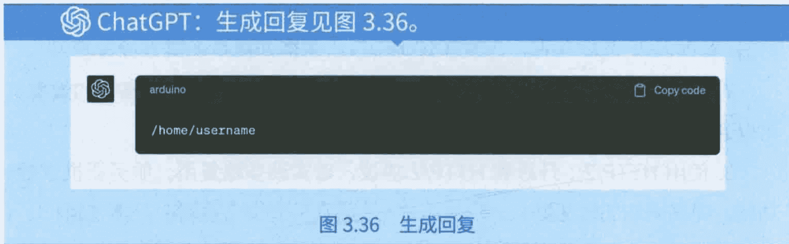
> ls。


从示例可见，用户输入 Linux 命令，ChatGPT 会返回对应的模拟输出结果。

## 3.5 办公效率助手

ChatGPT 在多个场景下都能帮助用户提升办公效率，打造更智能、更个性化的工作体验。

- 1. 协助撰写工作汇报、总结、策划方案、会议纪要、邮件等文档，并给出修改建议，让表达更清晰专业。
- 2. 在使用办公软件时遇到问题时提供操作指引和实用技巧，提升使用效率。
- 3. 理解数据需求，辅助生成图表、报告和数据分析结果，帮助快速洞察趋势。
- 4. 根据需求生成各类文档、报告、演示文稿模板，快速启动新项目。
- 5. 充当个性化助手，提供基于使用习惯的办公软件定制建议和优化方案。

### 用法 44：快速撰写工作汇报

工作汇报是展示成果、复盘经验、规划目标的重要沟通形式，但撰写过程往往耗时费力。写好汇报需要明确目的和受众、梳理工作内容与成果、构建清晰框架。若借助 ChatGPT，建议提前提供汇报主题、受众对象、具体工作、成果数据和结构要求，生成质量会更高。


> Q 我是一名活动策划公司的策划，请写一份工作总结，工作内容是策划一个周年庆的活动，按下面的结构来撰写：1. 工作背景；2. 工作内容；3. 工作建议；4. 总结感言。

ChatGPT:

#### 一、工作背景

作为活动策划公司的策划，我负责各类活动的策划与落地。近期公司受邀为某知名品牌策划周年庆活动。周年庆是品牌重要的营销节点，承载提升品牌形象、增强客户满意度和促进销售的任务。团队依托专业能力，精心打造了一场别具特色的周年庆活动。

#### 二、工作内容

- 1. 主题与方案策划：在充分沟通客户需求后，确定活动主题“璀璨星辰，共赴未来”，旨在拉近品牌与顾客距离，展望未来发展。
- 2. 活动筹备：全面负责场地布置、灯光音响、舞美设计等准备工作，在保证视觉效果的同时营造良好氛围。
- 3. 现场执行：活动当天负责现场协调与指挥，确保流程顺畅，并设计互动环节提升参与感。
- 4. 复盘总结：活动结束后对各环节进行详细复盘与评估，为后续项目积累经验。

#### 三、工作建议

- 1. 更深入地挖掘客户需求，提供更具针对性的策划方案。
- 2. 强化团队协同与沟通，确保筹备和执行环节紧密衔接。
- 3. 不断创新互动形式，提升活动吸引力与品牌传播效果。

#### 四、总结感言

本次周年庆策划与执行让我们团队收获了宝贵经验，也提升了公司在行业内的知名度。未来将继续保持专业精神，不断学习进步，在竞争中保持优势。通过反思我们也发现了不足之处，并制定了改进措施。相信在持续积累中能为客户提供更完美的服务。

总体来看，这份工作总结重点突出、结构规范、内容充实、层次清晰。

### 用法 45：策划营销方案

推进工作前往往需要提前制定细化的策划方案，明确执行步骤和安排。对企业而言，一场创意十足的营销活动能够有效提升品牌认知、服务客户、增强粘性并带来线索转化。


以下以儿童节为例，演示如何借助 ChatGPT 快速完成节日营销策划。

> Q 6月1日儿童节即将到来，请策划三个与小朋友互动的营销方案，要求如下。

1. 童梦公司是一家游乐场，活动主题需与游乐场、儿童节相结合。
2. 发布平台为抖音和微信公众号。
3. 活动总体成本不超过 2000 元。

ChatGPT：

#### 方案一：童梦寻宝之旅

活动概述：线上线下联动的寻宝玩法，通过预热吸引家长带孩子到场共度儿童节。

1. 线上预热：在抖音和微信公众号发布寻宝活动的宣传视频与海报，展示游乐设施与奖品。
2. 线下寻宝：在园区内设置多个寻宝点，完成指定任务获取线索，最终找到宝藏。任务可结合设施体验与知识问答。
3. 成本控制：奖品选择公仔、拼图等兼顾实用与趣味的玩具，总成本控制在 2000 元内。

#### 方案二：儿童节主题绘画大赛

活动概述：以“我在童梦游乐场的快乐时光”为主题举办线上绘画征集。

1. 在抖音和微信公众号发布征集信息，邀请家长陪同孩子投稿。
2. 设立投稿渠道，收集作品后按标准评选。
3. 获奖作品在游乐场内展出，并在社交平台公布名单并颁发奖品。
4. 成本控制：奖品选用文具套装、绘画材料等，控制在 2000 元内。

#### 方案三：儿童节特别优惠活动

活动概述：推出限时优惠，提升到店客流。

1. 在抖音和微信公众号发布优惠信息，如儿童节当天凭优惠券儿童免费入场。
2. 通过转发海报、参与互动问答等方式线上发放优惠券。
3. 合作网红或意见领袖分享园区体验，提升曝光。
4. 现场增设亲子互动游戏和才艺表演。
5. 成本控制：以自制优惠券、海报及现有设施为主，成本控制在 2000 元内。

#### 小结

以上三个方案均紧扣游乐场与儿童节主题，采用线上线下结合的传播方式，通过抖音和微信公众号实现互动与引流，同时严格控制成本在 2000 元以内。

Q 选择第一个方案，请给出一份详细的活动落地方案。

#### 童梦寻宝之旅活动落地方案：

##### 一、活动目标

通过线上预热与线下寻宝结合，吸引家长带孩子到游乐场，提升品牌知名度与客流量。

##### 二、活动筹备

- 1. 线上预热方案
   a. 设计宣传视频与海报，展示园区设施、寻宝流程与奖品。
   b. 在抖音和微信公众号发布预热内容并设置倒计时。
- 2. 线下准备
   a. 确定园区内寻宝点位与线索布置，提升游玩体验。
   b. 设计趣味性与挑战性兼具的寻宝任务。
   c. 采购奖品并控制总成本在 2000 元以内。

##### 三、活动执行

- 1. 线上预热阶段
   a. 定期更新预热内容，保持关注度。
   b. 邀请网红助力宣传。
   c. 开通微信公众号报名入口收集信息。
- 2. 线下寻宝阶段
   a. 活动当天发放寻宝卡与说明，引导参与。
   b. 安排工作人员巡视各点位，保障活动顺利进行。
   c. 完成后为成功寻宝的孩子颁奖并拍照留念。

##### 四、活动后续

- 1. 整理参与人数、客流量等数据。
- 2. 在抖音和微信公众号发布活动回顾内容。
- 3. 收集参与者反馈，为下次活动优化提供依据。

童梦寻宝之旅·六一亮点速览

参考前面的落地细则，这场亲子主题的寻宝互动既能让大人小孩度过一个难忘的儿童节，也能为童梦游乐场带来更强的品牌曝光和到访人次增长。

##### 五、预算分配
- 1. 奖品采购：1000 元
  主要用于采购卡通公仔、拼图等可爱玩具作为奖励。
- 2. 宣传物料制作：500 元
  a. 视频拍摄与剪辑
  b. 海报设计与制作
- 3. 寻宝卡及活动说明制作：200 元
  a. 寻宝卡设计印刷
  b. 活动说明单页制作
- 4. 其他杂费：300 元
  a. 现场布置费用
  b. 志愿者或员工的零食饮料支出

总预算：2000 元

##### 六、风险预防与应对
- 1. 活动取消或延期：若因雨雪等不可抗力需叫停或改期，要在抖音及微信公众号提前通知参与家庭，并公布新的时间安排。
- 2. 意外事故：现场安排急救站并检查设备完好性，活动前向参与者做安全提醒，同步请家长注意看护。
- 3. 参与人数超预期：若报名超出预期，提前做好人流分流预案，保持现场秩序，必要时把寻宝拆分为多轮次，确保体验感不打折。

综合以上执行思路，童梦寻宝之旅既能留下温馨的亲子记忆，又能强化品牌印象并带动客流。活动推进中保持与家庭用户的顺畅沟通，就能平稳落地并达成目标。

借助 ChatGPT 生成的方案框架完整、互动形式生动，孩子参与度高，费用规划也比较务实，适合直接参考执行。

### 用法 46：撰写会议纪要
无论哪个行业，记录会议要点都是必备能力。手工整理费时费力，借助 ChatGPT 能显著加速。把原始记录贴入并说明格式要求，就能迅速得到规范纪要。配合微软 Teams 的高级版，同样可实现自动记录、任务推送和模板创建，进一步提高效率。


> Q 我将给你提供一段会议内容，帮我整理成一份符合规范格式的会议纪要。

以下是会议内容：2023 年 5 月 21 日下午 3 点，公司主要领导召集项目经理、项目总工在贵宾室召开了安全生产会议，针对 5 月 20 日安全事故带来的严重后果，重点强调安全防范措施；部分工程复工的开工动员；加强项目部的有效管理。副总就安全生产做了重要报告，强调要做好六个方面的工作：

1. 做好安全自查。

2. 对出现的安全隐患及时整改。

3. 完善项目部的安检机制。

4. 做好安全台账。

5. 专职安全员以身作则，切实做好安全工作。

6. 施工人员及机械进场前要重点开安全生产会，教育到人，落实到人。

会议由总经理主持，董事长做了重要讲话和工作布置，强调“把安全生产作为企业的生命线来抓”“企业的发展要立足于长远”“要让每个员工在公司找到自己的归属感，公司将提供有利平台，让大家谋发展”。

ChatGPT：会议纪要

会议名称：安全生产会议

会议时间：2023 年 5 月 21 日下午 3 点

会议地点：贵宾室

主持人：总经理

与会人员：公司主要领导、项目经理、项目总工

会议议程：

1. 针对 5 月 20 日安全事故带来的严重后果，重点强调安全防范措施。

2. 部分工程复工的开工动员。

3. 加强项目部的有效管理。

#### 会议内容：

- 1. 副总就安全生产做了重要报告，强调要做好六个方面的工作：

   a. 做好安全自查。

   b. 对出现的安全隐患及时整改。

   c. 完善项目部的安检机制。

   d. 做好安全台账。

   e. 专职安全员以身作则，切实做好安全工作。

   f. 施工人员及机械进场前要重点开安全生产会，教育到人，落实到人。

- 2. 董事长做了重要讲话和工作布置：

   a. 强调把安全生产作为企业的生命线来抓。

   b. 企业的发展要立足于长远。

   c. 要让每个员工在公司找到自己的归属感，公司将提供有利平台，让大家谋发展。

#### 会议结论：

所有与会人员要认真贯彻执行会议精神，切实加强安全生产工作，确保公司顺利发展。
产出的纪要结构清晰，主干信息完整，质量相当不错。

### 用法 47：撰写电子邮件
邮件是工作中最常用的沟通工具。以前大多靠人工撰写，现在用 ChatGPT 就能批量生成不同类型的邮件。从私人信件到商务函件，只要说明要求即可快速完成。


> 我叫 Yang Yang，在 IBM 工作，请写一封邮件提醒同事 Miss Cai 尽快完成项目流程审批，要求按照商务英文标准，300 字以内。

ChatGPT:

Subject: Reminder to complete project process approval

Dear Miss Cai,

I hope this email finds you well. I am writing to kindly remind you about the pending approval of the project process for our ongoing project. As you know, this approval is crucial for us to move forward with the project and meet the established deadlines.

As a valued member of our team at IBM, I am confident that you understand the importance of meeting project milestones and delivering on time. Therefore, I kindly request that you complete the project process approval as soon as possible to avoid any delays or setbacks.

If you have any questions or concerns regarding the project process, please do not hesitate to reach out to me or the rest of the team for assistance. We are always here to support each other and ensure the success of the project.

Thank you for your cooperation and dedication to our team’s success. I look forward to hearing back from you soon with the completed project process approval.

Best regards,

Yang Yang
模型能按指令输出规范的商业英文，语法通顺、思路清晰，小幅调整后即可使用。

### 用法 48：制作精美 PPT
PPT 是产品展示和汇报的常用工具，对很多人来说做精美幻灯片很耗时。现在先用 ChatGPT 写好讲稿，再导入 Mindshow 生成幻灯片，流程既简单又省时。


（1）利用 ChatGPT 生成文案。告诉 ChatGPT 生成的 PPT 具体内容的要求。例如，请充当一位演讲大师，精通各种演讲技巧，现在需要给大学生介绍演讲方法和技巧，请帮忙写一个关于演讲方法和技巧的文案，不超过 800 字，以 MarkDown 源代码的方式输出。这里特别强调的是文案要以 MarkDown 源代码的方式输出。

> Q 请充当一位演讲大师，精通各种演讲技巧，现在需要给大学生介绍演讲方法和技巧，请帮忙写一个关于演讲方法和技巧的文案，不超过 800 字，以 MarkDown 源代码的方式输出。
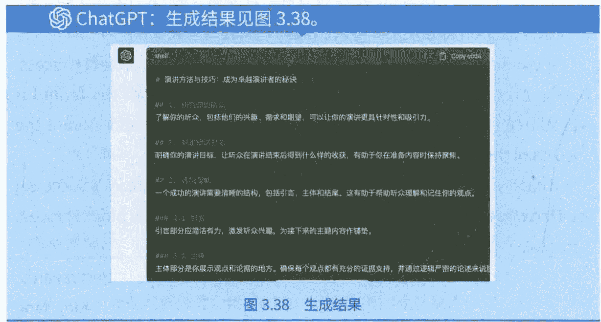
（2）利用 Mindshow 生成 PPT。ChatGPT 以 MarkDown 格式全部生成文案后，将文案复制出来。打开 Mindshow 网站并登录（如果没有注册，可以先进行注册）。Mindshow 网站首页如图 3.39 所示。
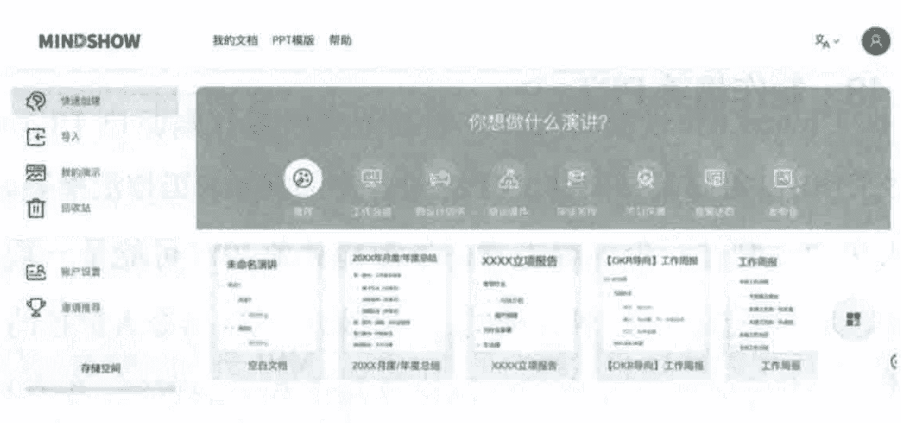
单击图 3.39 左侧的“导入”按钮，打开图 3.40 所示的界面，把 ChatGPT 生成的 MarkDown 格式的文案粘贴进来。
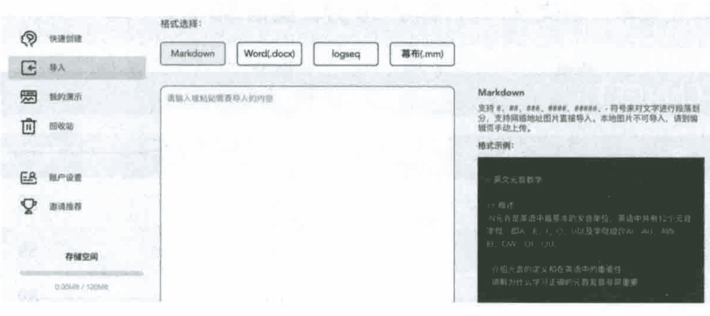
图 3.40 导入 PPT 文案内容

单击“导入”按钮，网站就会自动生成一个 PPT，如图 3.41 所示。左侧是文案，用户可以在此基础上对细节进行调整，还可以添加演讲信息。右侧下方是 PPT 的模板，在这里可以更换 PPT 模板，完成后直接导出为 pptx 文件，即可得到一个制作精美的 PPT 文件。

图 3.41 生成 PPT

### 用法 49：生成表格
根据提示，ChatGPT 可以创建各种格式的表格。提供原始数据和明确要求就能新建，也能对现有表格做修改。


扫一扫，看视频

> Q 请把下面的数据制成表格。

小杨成绩单：语文 90 分，数学 95 分，英语 88 分；

小艾成绩单：语文 99 分，数学 100 分，英语 89 分；

小文成绩单：语文 99 分，数学 100 分，英语 89 分；

小青成绩单：语文 93 分，数学 90 分，英语 80 分；

ChatGPT:

| 姓名 | 语文 | 数学 | 英语 |

|---|---|---|---|

| 小杨 | 90 | 95 | 88 |

| 小艾 | 99 | 100 | 89 |

| 小文 | 99 | 100 | 89 |

| 小青 | 93 | 90 | 80 |

Q 请增加一行，显示每个学科的平均成绩。

ChatGPT:

| 姓名 | 语文 | 数学 | 英语 |

|---|---|---|---|

| 小杨 | 90 | 95 | 88 |

| 小艾 | 99 | 100 | 89 |

| 小文 | 99 | 100 | 89 |

| 小青 | 93 | 90 | 80 |

| 平均 | 95.25 | 96.25 | 86.5 |
生成后可随时增删行列或调整数据，操作自由。

### 用法 50：提供 Excel 函数
在 Excel 里处理数据时，函数能大幅提升效率。遇到不熟悉的计算需求，向 ChatGPT 描述用途即可获取对应公式。


下面以表 3.1 中的内容为例进行演示。

表 3.1 学生成绩

| 行数 / 列数 | A | B | C | D | E |

| :--- | :--- | :--- | :--- | :--- | :--- |

| 1 | 姓名 | 年级 | 语文 | 数学 | 英语 |

| 2 | 张三 | 一年级 | 90 | 80 | 88 |

| 3 | 李四 | 一年级 | 98 | 78 | 80 |

| 4 | 王五 | 二年级 | 88 | 87 | 78 |

| 5 | 杨过 | 二年级 | 99 | 100 | 88 |

| 6 | 龙心 | 一年级 | 88 | 66 | 68 |

> Q 我有一个学生成绩 Excel 表格，A 列是姓名，B 列是年级，C 列是语文成绩，D 列是数学成绩，E 列是英语成绩，请问使用什么公式可以计算每位学生的平均成绩（保留一位小数）？

> ChatGPT:

要计算每位学生的平均成绩并保留一位小数，你可以结合使用 AVERAGE 和 ROUND 函数。在 F 列（如 F2 单元格），你可以输入以下公式：

`=ROUND(AVERAGE(C2:E2), 1)`

这将计算第二行学生（假设第一行是表头）的语文、数学和英语成绩的平均值，并保留一位小数。然后，你可以将此公式向下拖动到 F 列的其他单元格，以计算每位学生的平均成绩。

> Q 请详细解释一下该公式中的函数。

> ChatGPT:

当然可以。这个公式包含了两个 Excel 函数：AVERAGE 和 ROUND。下面是这两个函数的详细解释：

1. AVERAGE 函数

AVERAGE 函数用于计算一系列数值的平均值（算术平均值）。它的语法为：'AVERAGE(number1, [number2], ...)'

参数：

- number1: 必需。第一个要计算平均值的数字或对应单元格的引用。

- number2 ...: 可选。要计算平均值的其他数字或单元格引用。

示例：

在本例中，'=AVERAGE(C2:E2)' 用于计算 C2（语文成绩）、D2（数学成绩）和 E2（英语成绩）的平均值。

## 2. ROUND 函数

ROUND 函数用于将数字四舍五入到指定的位数。它的语法为：'ROUND(number, num_digits)'

参数：

- number: 必需。要四舍五入的数字或对应单元格的引用。

- num_digits: 必需。要四舍五入的位数。可以为正数（四舍五入到小数点后的位数）、0（四舍五入到最接近的整数）或负数（四舍五入到小数点前的位数）。

示例：

在本例中，'=ROUND(AVERAGE(C2:E2), 1)' 用于将 C2、D2 和 E2 的平均值四舍五入到小数点后一位。

综合以上解释，该公式首先计算每位学生的语文、数学和英语成绩的平均值，然后将结果四舍五入到一位小数。
把公式复制到 Excel 中运行，结果正确且稳定。

### 用法 51：创建 Excel 宏
面对复杂的数据处理任务，经常需要用到 Excel 宏，本质上就是一段可重复运行的 VBA 脚本。借助 ChatGPT 编写宏代码也变得简单，下面继续以表 3.1 为示例说明如何按年级分表。


Q 请编写一段 VBA 代码，将不同年级的学生成绩存放到不同的 Sheet 中。

ChatGPT:

下面是一段 VBA 代码，根据年级信息（位于第二列）将学生数据分配到不同的工作表（Sheet）。假设原始数据位于名为 "Data" 的工作表中。
```vba
Sub SplitStudentsByGrade()
    Dim wsData As Worksheet
    Dim wsDest As Worksheet
    Dim rData As Range
    Dim rCell As Range
    Dim lastRow As Long
    Dim grade As String
    ' 指定包含数据的工作表
    Set wsData = ThisWorkbook.Worksheets("Data")
    ' 定义原始数据的范围（假设从第 2 行开始，因为第 1 行为标题行）
    lastRow = wsData.Cells(Rows.Count, 2).End(xlUp).Row
    Set rData = wsData.Range("B2:B" & lastRow)
    ' 遍历包含年级信息的单元格
    For Each rCell In rData
        grade = rCell.Value
        ' 如果年级工作表不存在，则创建新的工作表
        On Error Resume Next
        Set wsDest = ThisWorkbook.Worksheets(grade)
        If wsDest Is Nothing Then
            Set wsDest = ThisWorkbook.Worksheets.Add(After:=ThisWorkbook.Worksheets(ThisWorkbook.Worksheets.Count))
            wsDest.Name = grade
            ' 复制标题行
            wsData.Rows(1).Copy Destination:=wsDest.Rows(1)
        End If
        On Error GoTo 0
        ' 将学生信息复制到对应年级的工作表
        wsData.Rows(rCell.Row).Copy Destination:=wsDest.Rows(wsDest.Cells(Rows.Count, 2).End(xlUp).Row + 1)
        ' 清除工作表对象变量
        Set wsDest = Nothing
    Next rCell
End Sub
```

VBA 批量分表实战
当需要把学生信息按年级拆分到多个工作表时，用 VBA 可以实现一键处理。先按 Alt+F11 进入 VBA 编辑环境，通过菜单新建一个模块，把准备好的脚本粘贴进去，保存后敲 F5 执行。脚本会以年级字段为依据筛选数据，把符合条件的那部分写入对应的 Sheet，运行结束后各年级成绩就会各自独立存放。

### 用法 52：Word 宏实操
Word 里的宏同样能处理重复性操作，借助 ChatGPT 生成对应的 VBA 代码也非常顺手。


Q 在 Word 中编写一段 VBA 代码，计算每段的字数，并显示在段首。

ChatGPT：

下面这段示例会在 Word 文档的每个段落开头写入该段的字数：

```vba
Sub InsertWordCountAtParagraphStart()
    Dim oPara As Paragraph
    Dim wordCount As Integer
    Dim rng As Range
    ' 遍历文档中的所有段落
    For Each oPara In ActiveDocument.Paragraphs
        ' 计算段落的字数
        wordCount = oPara.Range.Words.Count
        ' 在段落开头插入字数
        Set rng = oPara.Range
        rng.Collapse Direction:=wdCollapseStart
        rng.InsertBefore Text:="(" & wordCount & ") "
    Next oPara
End Sub
```

执行时先用 Alt+F11 调出 VBA 编辑界面，在菜单栏点“插入 > 模块”，把代码复制到新模块中。回到文档按 Alt+F8 调出宏列表，选中 InsertWordCountAtParagraphStart，点击运行，就能在每段开头自动补上字数。

按上述步骤操作后，可看到各段开头都已显示字数统计。

### 用法 53：思维导图快速生成
思维导图很直观，学习和工作里都常用。思路是先让模型用导图标记语言输出结构化文本，再用在线工具转换，就能得到可视化图形。


借助 ChatGPT 做思维导图，常见的思路有四条。

- 方案一：先让模型输出 Markdown 格式的层级结构，再到 Markmap 网站渲染。
- 方案二：直接用 ChatMind 生成导图。
- 方案三：让模型输出 Mindmap 标记语言，到 mermaid.live 网站转换。
- 方案四：让模型输出 PlantUML 格式，到 diagrams 网站转换。

下面以方案一为例，其余流程类似。

（1）让 ChatGPT 按 Markdown 输出导图。

> Q 请用 MarkDown 语法生成一个去重庆旅游的思维导图。

ChatGPT：

下面给出一个简化的 Markdown 层级示例来表达重庆旅游的思维导图。Markdown 本身不原生支持导图，但这种层级写法会被相关工具识别，复制到支持 Markdown 的编辑器里就能看到分层效果。

```
# 重庆旅游的思维导图
## 一、景点
### 1.1 解放碑
### 1.2 洪崖洞
### 1.3 千厮门大桥
### 1.4 南山一棵树
### 1.5 磁器口古镇
### 1.6 武隆天生三桥
## 二、美食
### 2.1 重庆火锅
### 2.2 重庆小面
### 2.3 棒棒鸡
### 2.4 酸辣粉
### 2.5 蛋炒饭
### 2.6 火烧兔
## 三、住宿
### 3.1 五星级酒店
### 3.2 快捷酒店
### 3.3 青年旅社
### 3.4 民宿
### 3.5 住宅区
## 四、交通
### 4.1 飞机
### 4.2 高铁
### 4.3 汽车
### 4.4 地铁
### 4.5 公交
### 4.6 出租车
## 五、购物
### 5.1 解放碑商圈
### 5.2 观音桥商圈
### 5.3 重庆三峡广场
### 5.4 南坪商圈
### 5.5 磁器口古镇
### 5.6 重庆茂业百货
## 六、活动
### 6.1 长江游轮
### 6.2 山城步道
### 6.3 动物园
### 6.4 李子坝轻轨站穿楼
### 6.5 夜游两江
### 6.6 重庆国际马拉松
...
```

把以上结构贴到 Markdown 编辑器，即可呈现清晰的层级关系。

（2）把 Markdown 版本粘贴到 Markmap 网站，即可自动生成可视化导图，如图 3.42 所示。

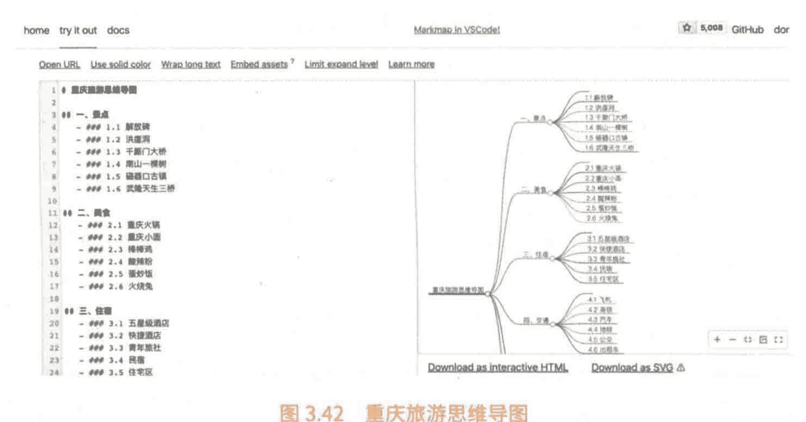

图 3.42 重庆旅游思维导图

### 用法 54：办公软件问题速解
使用办公软件时，常会碰到格式、计算、图表或功能实现类难题。过去多靠搜索引擎慢慢筛选，现在可以直接向 ChatGPT 提问，快速拿到实用方案。


Q 请问 WPS 如何添加页码？

> ChatGPT:

在 WPS Office 的文字组件里添加页码的操作如下：

1. 切换到“插入”选项卡。
2. 在“页眉和页脚”区域点“页码”按钮，会弹出样式与位置的下拉菜单。
3. 从菜单中挑选合适的位置，比如页眉顶部、页脚底部或页面左右边缘，并选定样式。
4. 确认后页码会自动插入文档。

如需自定义格式或从指定页开始编号，可在页码下拉菜单里点“页码格式”调整。删除页码时再次进入“插入 > 页码”，在下拉菜单选择“删除页码”即可。

ChatGPT 先判断 WPS 属于办公软件，随后给出可直接操作的步骤，按部就班就能为文档加上页码。

## 3.6 翻译实战
ChatGPT 也具备基础翻译能力，输入中文或英文即可快速互译。常见的质量评估方式有三类：

- （1）与人工译文对照，检查准确度与流畅度。
- （2）使用评估工具，如 BLEU 得分衡量机器译文与人工译文的相似度。
- （3）参考句子与词汇复杂度指标，如平均句长和词多样性。

笔者用方法（1）和（3）对比了谷歌翻译、百度翻译、DeepL 和 ChatGPT。实际感受是：谷歌翻译偏重正确性，风格偏机械，西语互译不错，但译中文易漏译；百度翻译译中文优势明显，不会漏译，西语互译不及谷歌，流畅度一般；DeepL 流畅度提升明显，却漏译严重且会出现重复；ChatGPT 的译文既不漏译又流畅，会适当增补衔接词实现意译，并结合目标语言习惯选用地道表达，基本达到信、达、雅的标准。

### 用法 55：多语种翻译
ChatGPT 能流畅处理多种语言，包括但不限于英语、简体/繁体中文、西班牙语、法语、德语、葡萄牙语、俄语、日语、韩语、阿拉伯语等。小语种或高度专业的任务仍需人工校对。


## ChatGPT 实操应用大全（全视频·彩色版）

Q 请把以下文字分别翻译为英文、日文和韩文。

当某事足够重要时，你就去做它，即使胜算不大。如果有些事对你来说非常重要，即使所有人都反对你，你也应该坚持下去。若我不这么投入，才是最大的冒险，因为成功的希望为零。

ChatGPT:

英文 (English):

When something is important enough, you do it even if the odds are not in your favor. If something is very important to you, you should stick to it even if everyone is against you. Not being committed would be the biggest risk, as the hope of success would be zero.

日文 (Japanese):

何かが十分に重要である場合、勝算が低くても行くべきです。何かがあなたにとって非常に重要である場合、誰もがあなたに反対していてもそれを続けるべきです。私がそんなに献身的でなければ、最大のリスクであり、成功の希望はゼロになります。

韩文 (Korean):

무언가가 충분히 중요하다면, 승산이 높지 않더라도 해야 합니다. 무언가가 당신에게 매우 중요하다면, 모두가 반대하더라도 계속해야 합니다. 그렇게 전념하지 않으면 가장 큰 위험이며, 성공의 희망이 제로가 됩니다.

一次把同一段中文译成英、日、韩三种语言，整体水平接近中级译员。

### 用法 56：英汉即时互译
只需要在两种语言间互译，可以让 ChatGPT 充当专属互译器，中文输入翻英文，英文输入翻中文，使用很方便。


Q 现在你是英汉互译器，当我输入中文时，你翻译成英文；当我输入英文时，你翻译成中文。

ChatGPT:

好的，我明白了。请随时输入您想翻译的内容，我会尽快为您提供翻译。

Q 诚实的生活方式其实是按照自己身体的意愿行事，饿的时候吃饭，爱的时候不必撒谎。

ChatGPT:

An honest lifestyle is actually acting according to one's own body's desires, eating when hungry, and not having to lie when in love.

Q You are everything when you are with me, and everything is you when you are not.

ChatGPT:

当你和我在一起时，你就是我的全部；而当你不在时，一切都是你。

从案例可见，ChatGPT 成功扮演了英汉互译角色，双向翻译质量都不错。

### 用法 57：病句修正
ChatGPT 能识别多种语言的病句，并做拼写检查和语法纠正，对内容创作很有帮助。把英文作文交给它，就能得到修正版本。


Q 请修改下面一段英文内容，包括语法错误、拼写错误等，给出正确的修改内容。

It is for us the living rather to be dedicated here to the unfinished work which they who fight here have thus far so nobly advanced. It is rather for us to be here dedicated to the great task remaining before us--that from these honored dead we take increased devotion to that cause for which they gave the last full measure of devotion--that we here highly resolve that these dead shall not have died in vain, that this nation under God shall has a new birth of freedom, and that government of the people, by the people, for the people shall not perish from the eath.

> ChatGPT:

Please find the corrected passage below:

It is for us the living, rather, to be dedicated here to the unfinished work which those who fought here have thus far so nobly advanced. It is rather for us to be here dedicated to the great task remaining before us—that from these honored dead, we take increased devotion to that cause for which they gave the last full measure of devotion—that we here highly resolve that these dead shall not have died in vain, that this nation, under God, shall have a new birth of freedom, and that government of the people, by the people, for the people, shall not perish from the earth.

这是林肯 1863 年 11 月 19 日在葛底斯堡阵亡将士公墓落成仪式上的演讲，被视为英语演讲典范。原文故意植入了三处错误：时态错误、主谓不一致、单词拼写错误，ChatGPT 都准确揪出并修正。

### 用法 58：语种识别
ChatGPT 能判断多种语言种类，对多语言环境的用户很实用，输入任意文字它会自动识别语种并按需翻译。


> Q 我想让你充当语言识别器。我将输入任何语言，你首先用中文回答我这是什么语言，再将其翻译为中文。

ChatGPT:

好的，我会尽力帮助你识别和翻译不同的语言。请随时输入你想让我识别和翻译的内容。

Q I love you。

ChatGPT:

这是英语。翻译成中文是：我爱你。

Q Je t'aime,Je t'adore。

ChatGPT:

这是法语。翻译成中文是：我爱你，我崇拜你。

Q Ich liebe Dich。

ChatGPT:

这是德语。翻译成中文是：我爱你。

Q Ялюблютебя。

ChatGPT:

这是俄语。翻译成中文是：我爱你。

Q あなたのことが好きです。

ChatGPT:

这是日语。翻译成中文是：我喜欢你。

Q Te amo。

> ChatGPT:

这是西班牙语。翻译成中文是：我爱你。

对于英语、法语、德语、俄语、日语、西班牙语，ChatGPT 都能正确识别语种并给出中文译文，能力远不止这些常用语。

### 用法 59：发音标注
ChatGPT 可充当指定语言的发音助手，例如为英语句子标注汉语拼音和音标。


> Q 我想让你为讲中文的人充当英语发音助手。我写下英语句子，你只需回答该句子的发音，发音应该有汉语拼音和音标，不要翻译成汉语。

> ChatGPT:

好的，我将分别用汉语拼音和音标为您提供英语发音指导。请随时输入您想让我帮助发音的英语句子。

> Q I love Miss Cai.

> ChatGPT:

汉语拼音发音：爱 (ài) 留 (liú) 米 (mǐ) 思 (sī) 蔡 (cài)

音标发音：/aɪ lʌv mɪs kaɪ/

> Q 汉语拼音发音不太准，请重新使用汉语拼音发音。

> ChatGPT:

抱歉给您带来困扰，以下是使用汉语拼音更准确的发音：

爱 (ài) 洛 (luò) 薇 (wēi) 密 (mì) 斯 (sī) 蔡 (cài)

Q 中间的英文单词 love 发音不准确，重新发音吧。

> ChatGPT:

抱歉再次给您带来困扰。请参阅下面的汉语拼音发音：

爱 (ài) 乐 (lè) 威 (wēi) 密 (mì) 斯 (sī) 蔡 (cài)

ChatGPT 能区分英语单词和汉语拼音中的 Cai，初次拼音不够准，在用户反复指正后，发音标注逐渐更贴近实际。

### 用法 60：语言生成器

AI 秒造语言

对普通人而言，亲手搭建一门新语言意味着要同时处理音系、词库和语法规则，难度极高。可放到 ChatGPT 这里，整个流程却显得异常顺滑。


Q 我想让你把我写的句子翻译成一种新编的语言。我写下句子，你用这种新编的语言来表达。

> ChatGPT:

当然可以，我可以使用一些生成式模型来为您编写一种新的语言，并将您的句子翻译成这种语言。请问您希望这种语言是什么样的，是否有什么特殊的要求或偏好？

Q 没有。

> ChatGPT:

好的，那我为您创造一种新编语言：

新编语言：维塔克语 (Vitak)

希望这种新编语言能够符合您的需求。如果您有任何其他的需求或想法，请随时告诉我，我会尽力满足您的需求。

Q 轻轻的我走了，正如我轻轻的来；我轻轻的招手，作别西天的云彩。

> ChatGPT：维塔克语（Vitak）翻译：

Kewa ja kudaná, kewa ja kudaná ji kewa; Kewa ja kudaná na kima kara tolá tosu asla.

> 悄悄的我走了，正如我悄悄的来；我挥一挥衣袖，不带走一片云彩。

> ChatGPT：维塔克语（Vitak）翻译：

Kewa ja náldaná, kewa ja náldaná ji kewa; Kewa ja nyáruná íhja, kala kara tolá tosu yala.

这段演示很有玩味。模型把两句中文转写成它自行捏造的 Vitak 语，而这套语言在现实中并不存在。将两次译文对照，会发现部分词形反复出现，并非随机拼凑，而是遵循某种内部规则在生成。

## 3.7 教育教学

技术迭代加速，教与学正被生成式 AI 深度改写，已成普遍现象。以 ChatGPT 为代表的大模型正在重塑课堂生态，推动教育进入全新阶段。

资源触达更快。师生借助模型能迅速汇聚全球优质学习材料，拓宽认知边界，激发创新思维，同时也为课外自主探究提供了空间，让学习和教学得以延续。

教学方式更灵活。ChatGPT 让教学更具个性与智能。教师可依据学生的特点和需求，利用模型细化教学方案，提升课堂质量。模型还能实时解读学习数据，及时反馈给教师以便调整策略。效率同步提升，自动评分与批改减轻了教师负担；答疑解惑与学习辅导则帮助学生更快掌握知识。

评价思路在演进。传统纸笔考核正被 AI 催生的智能化、个性化评价所补充，评判更为客观。这种转变有助于激发学习兴趣，提升成效，培养面向未来的复合人才。

### 用法 61：课程设计

一门课的设计好坏直接影响教学效果和学生的感受。ChatGPT 能为教师提供灵感与思路，助力打造更具吸引力的课程，并协助搜集整理文献、教学大纲、课程规划和阅读材料等素材，让备课更高效。


> Q 请为经济与管理学院大学二年级学生设计一套关于投资理财的课程。

ChatGPT:

以下是为经济与管理学院大学二年级学生设计的一套关于投资理财的课程：

课程名称：投资理财基础与实践

课程目标：

1. 使学生了解投资理财的基本概念和原理；

2. 培养学生分析和评估投资项目的能力；

3. 帮助学生掌握主要的投资工具和策略；

4. 提高学生在实际生活中进行投资理财的能力。

课程大纲：

第一部分：投资理财基本概念与原理

1. 投资理财的定义和重要性

2. 投资与风险的关系

3. 时间价值与财富管理

第二部分：投资市场与工具

1. 股票市场：股票的分类、投资策略与风险控制

2. 债券市场：债券的种类、收益与风险

3. 基金市场：基金的类型、投资策略与风险管理

4. 期货与期权市场：衍生品的特点与风险控制

5. 外汇市场：外汇交易的基本知识与策略

6. 房地产市场：房地产投资的优缺点与风险防范

第三部分：投资组合与风险管理

1. 投资组合理论：马克维茨理论与有效边界

2. 资产配置策略：分散投资与配置比例

3. 风险管理与控制：风险识别、评估与降低风险的方法

第四部分：个人理财规划与实践

1. 个人财务状况分析：收入、支出、资产与负债

2. 目标设定与规划：短期、中期与长期目标

3. 理财策略与工具选择：储蓄、保险、投资等

4. 税收规划：了解税收政策与合理避税策略

5. 退休规划：养老金、社保与个人储蓄的结合

课程实践：

1. 学生分组进行模拟投资比赛，以提高投资理财实践能力；

2. 邀请金融行业专家和实践者举办讲座，分享投资理财经验；

3. 安排学生参观金融机构，了解金融市场的运行机制。

课程评估与反馈：

1. 学生需要完成课堂作业和案例分析，以检验他们对投资理财知识的掌握程度；

2. 设计期中和期末考试，评估学生在理论知识和实践能力方面的表现；

3. 对模拟投资比赛的成绩进行评估，并为优秀团队颁发奖励；

4. 鼓励学生定期进行个人理财规划报告，以提高实际操作能力；

5. 课程结束后，通过问卷调查和面谈收集学生对课程的反馈，以便进一步改进课程设计。

教学资源：

1. 教材：推荐使用《投资学》和《个人理财规划》等相关教材；

2. 辅助阅读材料：提供金融市场报告、投资策略分析和个人理财案例等；

3. 网络资源：推荐学生使用金融新闻网站和投资平台，以便了解实时的市场信息；

4. 软件工具：引导学生使用投资分析和理财规划软件，提高数据分析能力。

通过以上课程设计，经济与管理学院大学二年级学生将能够全面了解投资理财的基本概念和原理，掌握投资市场与工具的运作机制，培养投资组合与风险管理的能力，为未来的个人理财和职业发展奠定坚实的基础。

模型给出的方案整体扎实，主要体现在四个维度。第一，脉络清楚。按基础概念、市场工具、组合管理、个人规划推进，学习路径一目了然。第二，覆盖面广。从股票到房地产，再到资产配置和风险管控，内容面面俱到。第三，动手环节多。模拟比赛、专家分享、实地参访等把理论拉到实践。第四，教学支撑充分。教材、延伸读物、网络渠道和软件工具都列了清单，方便教师落地。

### 用法 62：协助备课

备课是教师日常工作的关键环节。ChatGPT 能提供特定学科的教案，还可检索相关视频、慕课、教学实录、阅读资料和工具平台，减轻备课压力。教学研究时，它还能整理资料、参考文献和研究成果，提升教师专业水平；模拟对话也能帮助教师预判学生困惑，为课堂做好准备。


> 制定一份教案，小学二年级，知识点是认识乘法，要求以游戏的形式展开教学，通过与学生互动让学生认识乘法原理。

ChatGPT：

教学目标：

通过游戏让学生了解乘法的概念和原理，能够使用乘法符号解决简单的乘法问题。

教学准备：

1. 乘法表

2. 十以内的小球或纸片

3. 白板和马克笔

教学过程：

1. 导入

向学生展示一张乘法表，简要介绍乘法的概念。告诉学生乘法是用来表示“相加若干个相等的数”的快捷方式。例如：2+2+2+2 可以用 2×4 表示。

2. 游戏 1：“小球相乘”

教师准备十个小球或纸片，用 1~10 的数字标记。学生分成两组，每组轮流选择一个小球，将上面的数字读出来，并将其放回原处。然后将两个数字相乘，结果告诉对方。比赛五轮，哪一组最先得到五分，哪一组获胜。

3. 游戏 2：“找规律”

在白板上画一个表格，横轴为 1~10 的数，纵轴为 1~5 的数。教师先在表格中填入一些数字，然后请学生观察数字间的规律，推断出横纵坐标上的数字相乘得到的结果。例如，在第 2 行第 3 列的格子中填入 6，那么学生可以通过观察发现，第 2 行上的数字都是 2 的倍数，第 3 列上的数字都是 3，所以 2×3=6。然后请学生继续填写剩余的格子，并逐渐提高难度。最后请学生自己设计一些数字填入表格中，让其他同学来找规律。

4. 结束

回顾本节课所学的知识点，让学生总结乘法的基本概念和原理。同时鼓励学生平时多多练习乘法，掌握乘法表的内容，以提高计算能力。

教学评价：

通过游戏形式的教学，可以让学生在愉悦的氛围中学习乘法的概念和方法，同时也能够激发学生的兴趣，提高他们的学习积极性。另外，在游戏的过程中，学生可以通过观察和推理，加深对乘法原理的理解和掌握。

生成的教案贴合小学二年级学生的认知特点，采用游戏化设计让课堂轻松有趣。‘小球相乘’和‘找规律’两个活动让孩子在操作中体会乘法意义，教师扮演引导者角色，有助于综合能力的提升。

### 用法 63：课堂助教

ChatGPT 可作为课堂助手，为师生提供即时互动渠道，快速解答疑问，提供活动点子，提升课堂趣味性和理解难度较大的概念，从而提高教学效率和质量。

例如讲授历史课戊戌变法时，教师想为学生补充梁启超的生平简介，询问 ChatGPT 即可获得即时支持，不影响现场节奏。

> Q 请用 500 字简述梁启超的生平简介。

ChatGPT：

梁启超（1873—1929），原名梁鸿章，字卓如，号任我庵主人，广东新会人，是清末民初杰出的政治家、教育家、翻译家和文学家。他是中国近代史上一位具有深远影响力的改革者和思想家，被誉为“变法维新运动的精神领袖”。

梁启超早年聪颖过人，研究诗词、经史、哲学等多领域知识，18 岁时成为举人。他曾担任过报馆编辑，与康有为等人共同倡导变法维新。1898 年，梁启超参与策划戊戌变法，试图对清朝制度进行改革，但改革最终失败，他被迫流亡海外。

流亡期间，梁启超积极从事革命事业，游学日本、美国和欧洲，接触到西方的政治、经济、科学和文化，使他的视野和思想得到极大拓展。他不仅推动了国内的维新运动，还主张教育改革，提倡实用主义教育，注重培养新一代的民族精神。他还提出了“船坚炮利”“民主立宪”等改革思想，对中国近代史产生了重要影响。

梁启超在文学领域也成就非凡。他提倡白话文，主张“文以载道”，以通俗易懂的文字传播思想。他的作品丰富多样，包括《少年中国说》《新民说》《师说》等，展示了他深刻的洞察力和独特的见解。

在翻译领域，梁启超翻译了许多西方经典著作，如亚里士多德的《尼各马可伦理学》，极大地促进了中西文化的交流和融合。他还是近代汉学研究的奠基者之一，通过对古代文献的研究，为后人提供了丰富的历史资料。

综上所述，梁启超是中国近代史上一位非常重要的人物，他的贡献涉及政治、教育、文学、翻译等诸多领域。他的思想和主张对中国的现代化进程产生了深远的影响。

从生成内容看，简介信息较为全面详实。但模型也会出错，比如“号任我庵主人”这一表述就不准确，使用时教师需要甄别，避免误导学生。

### 用法 64：评测作业

ChatGPT 还能参与学业测评，生成测验题和试卷，辅助教师把握学情。比如提供一篇中文文章让其出简答题，或提供英文短文生成完形填空，甚至按年级学科生成整套试卷，满足教学需求。

> 假设你现在是历史老师，请根据初中历史课本中的戊戌变法知识，出 2 道填空题、2 道选择题和 1 道简述题，并给出参考答案。

ChatGPT：

填空题：

1. 戊戌变法发生在公元 ______ 年，是清朝晚期一次尝试进行政治改革的运动。

答案：1898

2. 戊戌变法的领导者是光绪皇帝和康有为、梁启超等维新派人士，他们试图通过一系列改革来振兴 ______。

答案：清朝

选择题：

3. 戊戌变法持续了多长时间？

A. 三个月 B. 半年 C. 一年 D. 两年

答案：A

4. 下列关于戊戌变法的说法，哪个是正确的？

A. 戊戌变法成功地实现了清朝的现代化

B. 戊戌变法过于激进，引起了保守势力的反对

C. 戊戌变法发生在辛亥革命之后

D. 戊戌变法在清朝政治中没有产生任何影响

答案：B

简述题：

5. 请简要说明戊戌变法的主要改革措施以及变法失败的原因。

答案：戊戌变法的主要改革措施包括废除科举制度、设立新式学堂、发展工商业、削减藩王势力等。这些改革旨在实现清朝的现代化，振兴国家。然而，戊戌变法失败的原因主要有以下几点：1) 改革过程过于急功近利，导致改革措施无法循序渐进地实施；2) 改革触及了保守势力的利益，引起了激烈的反对；3) 慈禧太后对变法持反对态度，最终发动政变，使改革未能成功进行。

生成的题目总体可用，教师可在使用的基础上做适当调整优化。

### 用法 65：事务助手

ChatGPT 还能帮助教师处理日常事务，比如自动生成工作总结、周报月报，降低常态化行政内耗，让教师更聚焦教学与科研。

Q 请提供一份大学教师工作周报的中文模板。

ChatGPT：

敬爱的领导

您好！

以下是我本周的工作周报，请您查阅。

#### 一、本周教学工作

1. 教学课程：(课程名称)

(1) 本周授课内容：

a. 第（章/节）节：(具体内容)

b. 第（章/节）节：(具体内容)

c. 第（章/节）节：(具体内容)

(2) 课堂教学情况：

a. 学生出勤情况：本周共（次数）次课，出勤率为（百分比）。

b. 学生课堂参与情况：(例如，学生积极参与讨论，课堂氛围活跃等)

#### 2. 课程辅导与答疑

本周共安排（次数）次课外辅导与答疑，解答学生在课堂学习中遇到的问题，巩固课堂所学知识。

#### 二、学术研究与科研项目

1. 学术研究：

(1) 本周共阅读了（篇数）篇学术论文，主要内容为：(简要介绍)

(2) 撰写论文／报告：本周完成了关于（主题）的（篇数）篇论文／报告的初稿，计划于（日期）提交。

2. 科研项目：

项目名称：(项目名称)

a. 本周项目进展：(简要介绍)

b. 下周计划：(简要介绍)

#### 三、教育教学改革与发展工作

1. 参与学院（部门）组织的教育教学改革与发展工作，积极提出意见和建议，共同推动教育教学改革。

2. 结合本课程教学实际，探索新的教学方法和手段，以提高课堂教学效果。

#### 四、其他工作

1. 参加学院（部门）组织的（活动名称）活动，共同交流教育教学经验。

2. 完成学院（部门）交办的其他工作任务。

本周工作总结：

针对本周工作，我认为（反思与总结，可以提出改进措施、存在问题等）

下周工作计划：

1. 教学工作：(具体内容)

2. 学术研究与科研项目：(具体内容)

3. 教育教学改革与发展工作：(具体内容)

4. 其他工作：(具体内容)

感谢您对我的工作的关心和指导，如有需要改进的地方，请您及时提出宝贵意见。

祝您工作顺利，身体健康！

敬礼！

(您的姓名)

(年月日)

该周报模板条理清晰、内容覆盖全面，系统概括了教学、科研、改革和其他工作情况。可根据个人实际需要进行微调，例如在教学部分加入学生评价和改进措施，以更全面反映教学状态。总体而言，这是一份实用性强的模板。

### 用法 66：辅导作业

辅导作业是家长的常见痛点。ChatGPT 凭借语言理解和学科知识储备，能解答数学题、提供科学知识、辅导英语学习，成为家长的好帮手。

> Q 假设你是数学老师，请帮我详细讲解这道二元一次方程题目。

3a+2b=10;

5a+b-4=8;

ChatGPT:

您好！我很高兴为您讲解这道二元一次方程题目。首先我们将方程组整理一下：

3a + 2b = 10

5a + b = 12 (将原方程 5a + b - 4 = 8 两边加上 4)

我们可以采用消元法来解这个方程组。为了消去未知数 b，我们需要将第二个方程乘以 2：

第一步：将第二个方程乘以 2

10a + 2b = 24

第二步：将第一个方程从第二个方程中减去

(10a + 2b) - (3a + 2b) = 24 - 10

7a = 14

第三步：求解 a 的值

a = 14 / 7

a = 2

第四步：将 a 的值代入原方程组中的任意一个方程求解 b 的值（这里我们选择第一个方程）

3(2) + 2b = 10

6 + 2b = 10

第五步：求解 b 的值

2b = 10 - 6

2b = 4

b = 4 / 2

b = 2

所以，这道二元一次方程的解为：a = 2, b = 2。

这个解题过程是正确的，步骤清晰，易于理解。通过消元法逐步消去未知数，并将求得的一个未知数代入原方程组求解另一个未知数。最终求得二元一次方程组的解为 a = 2, b = 2。整个过程体现了解题的逻辑性和条理性。

### 用法 67：学习助手

ChatGPT 正在成为学生日常学习中的得力搭子，它能覆盖从知识理解到效率提升的完整链路，为学业进步提供持续支持。系统可以调动多元化教学资源，用不同的讲解方式、解题思路和举例帮助学生吃透概念，提升学习效能和兴趣；也能结合个人特点定制专属学习方案，增强自我效能感和动力；还可以在规划、方法指导层面提供帮助。

**留学备考实战：托福资料与听口提升计划**
> Q 我是大四在读，想申请海外院校，需要考托福，请推荐靠谱的学习材料。
ChatGPT：
托福作为非英语母语考生进入国际院校的重要英语能力凭证，下面这几类资源比较实用：
1. 官方权威书：《托福考试官方指南》由 ETS 出版，收录考试框架、题型说明、评分标准及真题解析，是入门必备。
2. 官网免费资源：ETS 官方网站提供样题、解析思路和备考技巧，能及时获取最新政策和报名信息。
3. TPO 在线模考：官方推出的托福网络模考系统，可在官网购买使用，模拟真实考场环境，帮助定位水平。
4. 体系化课程与教材：可选择 Kaplan《TOEFL iBT Premier》、Princeton Review《Cracking the TOEFL iBT》等，或报名线下/线上培训班，涵盖词汇语法及听说读写技巧。
5. 专项词汇书：如《托福词汇大纲》《托福核心词汇21天突破》等，按计划积累高频词。
6. 社群与网络素材：论坛、学习小组、免费公开课、YouTube 讲解等，按个人习惯补充。

希望对你备考有帮助，祝早日拿到理想分数！
> Q 我的听力和口语偏弱，能否基于上面资料给我做一份计划。
ChatGPT：
下面是一份 8 周听口强化方案，可按个人节奏微调：
第1~2周 熟悉框架与打基础
1. 阅读《官方托福指南》掌握整体结构与题型。
2. 用《托福核心词汇21天突破》每天记新词。
3. 每天收听 1 小时英语原声影视、纪录片或播客。
第3~4周 聚焦听力
1. 精读指南听力章节，掌握方法。
2. 每周用 TPO 完成至少 2 套听力模考。
3. 保持每日词汇与音频输入。
第5~6周 聚焦口语
1. 精读指南口语章节，梳理应试技巧。
2. 每周用 TPO 完成至少 2 套口语模考。
3. 每天至少 30 分钟开口练习，如对话、复述、朗读。
4. 持续词汇与听力输入。
第7周 综合复盘
1. 回顾词汇与听口技巧。
2. 用 TPO 做一套整套模考，包含听口。
3. 拆解成绩单，定位薄弱点。
第8周 冲刺准备
1. 针对薄弱项集中训练。
2. 再做一次完整 TPO 模考检验。
3. 确认报名信息，熟悉考场须知。

从上面可见，ChatGPT 能结合需求和考试特点推荐资源，并据此划分阶段、设定任务，确实能提升备考效果。

### 用法 68：协助备考
ChatGPT 可为考试定制针对性练习，帮助强化短板，并依据学习反馈给出考试策略和模拟试卷，巩固学习成果。
> Q 我高二，英语虚拟语气掌握不牢，请出几道练习。
ChatGPT：
可以，这里按三种情境出题：现在相反、过去相反、将来相反。
第一部分 现在相反，括号内动词填空
1. If I _____(be) you, I would study harder.
2. If he _____(have) more time, he would help us with the project.
3. She would travel around the world if she _____(win) the lottery.
4. If they _____(know) the truth, they would be very upset.
5. We would be healthier if we _____(exercise) regularly.
第二部分 过去相反
1. If I _____(study) harder, I would have passed the exam.
2. If she _____(invite) me, I would have attended her party.
3. He would have accepted the job offer if he _____(know) about it.
4. They would have won the match if they _____(practice) more.
5. If we _____(meet) earlier, we could have been good friends.
第三部分 将来相反
1. If it _____(rain) tomorrow, we will stay at home.
2. If they _____(arrive) late, we will start the meeting without them.
3. She will accept the offer if they _____(increase) the salary.
4. If I _____(finish) my work early, I will go to the cinema with you.
5. We will go for a picnic if the weather _____(be) nice this weekend.
试着完成，需要答案可随时告诉我。
> Q 请给答案并解释。
ChatGPT：
第一部分 现在相反
1. If I were you… be 在虚拟语气中用 were 表假设。
2. If he had more time… 表示假设的现在情况。
3. She would travel… if she won… 用一般过去时表现在假设。
4. If they knew the truth… 虚拟 now。
5. We would be healthier if we exercised regularly… 习惯性假设。
第二部分 过去相反
1. If I had studied harder, I would have passed… 过去未实现条件。
2. If she had invited me, I would have attended…
3. He would have accepted… if he had known…
4. They would have won… if they had practiced more…
5. If we had met earlier, we could have been good friends…
第三部分 将来相反
1. If it rains tomorrow, we will stay at home.
...

### 用法 69：时间管理
时间管理对学习效率和生活平衡至关重要。借助 ChatGPT，学生能快速获得排表建议和任务优先级排序，从而更合理地安排学习、课外与休闲。
Q 我高三，还有半年高考，请帮我做一份时间管理表。
ChatGPT：
距离高考半年，制定清晰节奏很重要，下面是一个参考框架，可按自身情况调整：
1. 目标设定
  ● 明确目标院校与专业及分数线。
  ● 为各科设定可达分数。
2. 时间分配
  ● 保证每天 8 小时高质量睡眠。
  ● 每天预留 1 小时运动/放松/娱乐。
  ● 其余时间按科目难度与个人短板分配。
3. 学习节奏
 第1~4个月
  ● 夯实基础概念，针对薄板专项突破。
  ● 每周一次模考并复盘。
 第5个月
  ● 系统梳理知识体系，强化训练。
  ● 参加校内外模考，检验水平。
 第6个月
  ● 以近年真题为主，熟悉题型与策略。
  ● 成绩稳定后适度减负，保持心态。
  ● 最后两周冲刺易错点与高频考点，保证睡眠情绪。
4. 考场策略
  ● 训练时间分配，保证全题作答。
  ● 掌握选择题与主观题应试技巧。

坚持执行并保持自律调节心态，就能在高考中发挥更好。祝顺利！
这份方案针对高三备考特点，目标明确、分段清晰、可操作性强。

### 用法 70：提供就业指导服务
AI 时代岗位结构在重塑，新职业不断出现，传统就业指导难以跟上。ChatGPT 在职业探索上具备优势。
首先，它能汇总就业市场动态，分析行业增减与潜力职业，帮助学生理性选向。其次，它可基于兴趣、技能与目标给出个性化职业路径，并传授沟通、协作、领导力等职场软技能。再者，它能协助润色简历求职信、模拟面试，提升竞争力。最后，它提供持续的职业发展支持，帮助在不同阶段调整规划、学习新技能。
假设你明年毕业，北外商务英语，请你给出个性化建议。
ChatGPT：
商务英语背景具备扎实的语言功底和商业常识，下面几方面可参考：
1. 行业洞察：关注外企、外贸、金融机构、咨询等领域的招聘动向。
2. 优势梳理：盘点口语、写作、翻译、跨文化沟通、营销等强项与兴趣。
3. 方向参考
  ● 外贸专员/经理：负责跨境客户沟通、合同跟单等。
  ● 商务翻译/口译：文件翻译、同传、陪同等。
  ● 市场营销/市场分析：国际市场推广与竞品研究。
  ● 公关/客户关系管理：对接客户、合作方及政府事务。
  ● 语言教学/培训：英语及商务技能教学。
  ● 金融/投资：银行、券商、基金的相关岗位。
4. 技能提升：强化沟通、团队协作、项目管理，考虑加修西语、法语、德语等第二外语。
5. 人脉拓展：参与行业活动，联络校友师友获取实习信息。
6. 求职准备：打造专业简历与求职信，提前演练面试。
7. 实习积累：毕业前争取相关实习，积累实操经验。
8. 长期规划：评估是否需要 MBA 或商务相关硕士提升竞争力。
9. 持续学习：保持对行业变化的敏感度与适应力。

以上建议供你参考，具体需结合自身情况微调。祝求职顺利、发展长远！

## 3.8 文生美图：DALL·E
DALL·E 是 OpenAI 于 2021 年 1 月发布的 AI 绘图工具，名字取自画家达利与动画角色瓦力。该工具可根据文字描述生成逼真且风格多样的图像。
多数 AI 绘画产品需要用户精通提示词，门槛较高。2023 年 10 月推出的 DALL·E 3 在文图一致性上实现跃升，降低了提示词门槛，提升了语义细节的还原度，同时在绘画技法上明显增强，可输出写实、二次元、平面、创意、朋克、3D 等多种风格，并能模拟油画、水彩、素描、卡通等艺术表现。最大亮点是与 ChatGPT 深度融合，可直接对话生图。
在 ChatGPT 中使用 DALL·E 3 需要 Plus 会员或企业用户权限，在 GPT-4 模式下选择 DALL·E 3 即可开始创作。
基础能力包括：
- 一次最多生成 4 张图片，支持三种比例：
  1）16:9 宽幅 —— 1792 像素 × 1024 像素。
  2）1:1 正方形 —— 1024 像素 × 1024 像素。

9:16 竖屏可输出 1024×1792 的高清画幅。
- 提示可以直接用中文书写，系统先把自然描述转为英文再交给 DALL·E 3 绘图。
- 若未指定艺术风格，模型会自动给出多种风格的尝试。

使用逻辑非常直观：说出画面需求，DALL·E 3 就能将其视觉化。下面归纳了几个典型场景。

### 用法 71：中文描述直接出图
多数绘画模型对中文支持不足，而 ChatGPT 里的 DALL·E 3 可以直接用中文生成。OpenAI 在介绍时提到，新系统对细节与细微意涵的把握明显提升，能把概念更精确地转为图像。中文输入后，系统会先给出英文转述，再据此作图。

> 用户输入：月光皎洁，街头人潮涌动，行人匆匆，路灯下红裙身姿曼妙的年轻女子正与身着燕尾服的男子愉快交谈。
> ChatGPT 先给出英文释义，随后说明将基于该描述生成图像。

四张结果分别呈现了亚洲写实、非洲插画、欧洲油画、拉美水彩四种质感，不同背景与手法下人物、场景与细节均得到保留。点开任意一张可进入详情页查看下载链接及对应的英文指令，如图 3.44 所示。
图 3.44 图像详情

### 用法 72：在画面中加入文字做合成
ChatGPT 版 DALL·E 3 能在图像中嵌入简短英文文字，这是 Midjourney 尚未完全掌握的能力。告知所需文案，模型会尝试将其融入画面，对 Logo 草图很有帮助。文字不宜过于复杂，成功率不是百分百，多试几次通常能得到满意的图文结合。

> 用户输入：插画风格，一只牛油果坐在心理医生椅子上说“我只是觉得内心空虚”，果核处有一个洞，治疗师是一把勺子正在记录笔记。
> ChatGPT 生成回复如图 3.45 所示。

四张输出中有三张带上文字。系统先将“我只是觉得内心空虚”译为 I JUST FEEL EMPTY INSIDE 再植入。前两张融合自然且无误，最后一张出现了拼写错误。

# 第 3 章 ChatGPT 的 150 种用法

Q 绘制一张 16:9 的简报。标题 GTD，中间横排 5 个不同 ICON，下方文字分别为 Collect、Process、Organize、Review、Execute。版面简洁留白。
> ChatGPT 生成回复如图 3.46 所示。

四张结果中除第三张外，其余均准确呈现了五个关键词。文字不仅可添加，还可控制样式，例如：

Q 制作带有 GPT 字样的图标，3D 字体，风格活泼有趣，仅含 GPT 三个字母，16:9，简洁白底。
> ChatGPT 生成回复如图 3.47 所示。

### 用法 73：生成关联的连续图像
DALL·E 3 不仅能单张创作，还能输出逻辑或情感上连贯的序列，形成故事线或主题串联。

例如表现成长，可得到从婴儿到老人的系列形象，外观与情绪背景保持递进；描述产品制造流程，也能从原料准备到成品逐步展开。这一能力为设计师提供更大创作自由，也让教育者更直观地解释复杂概念，对企业传播同样有帮助。

> 用户要求用 4 张图展示一位古代中国美女的四个年龄段：童年 0~6 岁、少年 7~17 岁、青年 18~40 岁、中年 41~60 岁，比例 16:9。
> ChatGPT 生成回复如图 3.48 所示。

四张图对应不同阶段，特征与情绪均被捕捉，人物形象保持一致性。同样的方法也能用于漫画创作。

> 用户要求依次生成 4 张图像，组成连续漫画，主角是同一只可爱小恐龙，在学校的一天：上课、体育场跑步、唱歌、写作业。
> ChatGPT：
> 这里是您要求的四张连续漫画图像，描述了同一只可爱的小恐龙在学校的一天。从上课、跑步、唱歌到写作业，这些图像形成了一个完整的故事线。希望您喜欢！如果有任何反馈或需要进一步的修改，请告诉我。

### 用法 74：融合图像
除一次性生成四张图外，DALL·E 3 还能对已有图进行融合处理。融合不是简单叠加，而是艺术性地合并元素，让新图既保留原图特征又产生新设计。

提示很直白，例如“融合上面的第一张与第三张图”，模型就能给出结果。

> 用户要求依次生成以下 4 张 16:9 图像：
> 1. 非洲大草原
> 2. 上海东方明珠
> 3. 一头威风凛凛的雄狮
> 4. 忙碌的上班族

# 第 3 章 ChatGPT 的 150 种用法

ChatGPT:
DALL·E 3
Created 4 images


这里是您要求的四张 16:9 的图像，分别展示了非洲大草原、上海东方明珠、雄狮以及忙碌的上班族。希望您喜欢！如果有任何反馈或需要进一步的修改，请告诉我。

Q 请融合上面的第一张与第三张图，第二张图与第四张图。
ChatGPT:
DALL·E 3
Created 2 images


这里是您要求的融合图像。第一张将非洲大草原与雄狮完美地结合在一起，第二张则是上海东方明珠与忙碌的上班族的结合。希望您喜欢！如果有任何反馈或需要进一步的修改，请告诉我。

融合能在视觉上保留两张图的核心元素并实现和谐衔接，具体效果仍取决于个人审美与预期。

### 用法 75：绘制平面设计草图
Midjourney、Stable Diffusion 等工具在平面草图上常在细节、配色和布局上吃力。DALL·E 3 则能相对轻松地产出高质量草图，而且无需掌握复杂指令，描述需求即可迭代到满意。

> 设计一张符合康乃尔笔记法格式的空白笔记表格，白底。
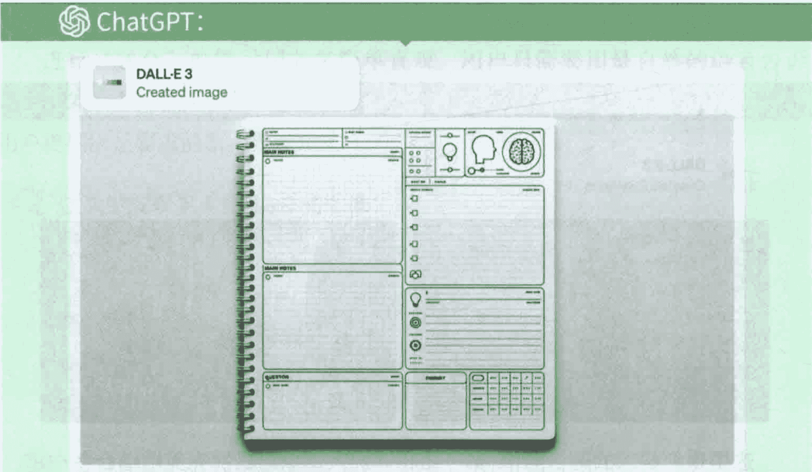
这是一张符合康乃尔笔记法格式的空白笔记表格，白色背景。您可以根据此模板进行相应的笔记整理。如果需要进一步的调整或修改，请告诉我。

Q 设计两张可爱的霸王龙加上对话框的卡通图像，宽高比 16:9，每张图都是同一只卡通霸王龙。
ChatGPT:
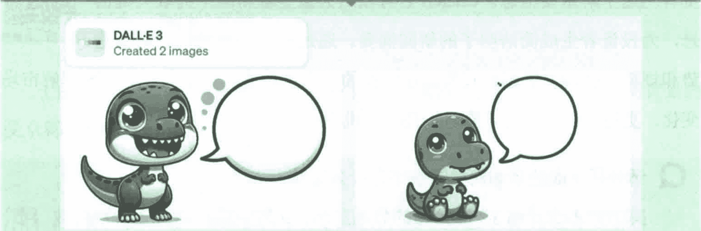
这是您要求的两张卡通图像，每张图都是同一只可爱的卡通霸王龙，每张图上都有一个大的空白对话框，可以供您添加文字。希望您喜欢！如果有任何反馈或需要进一步的修改，请告诉我。

从案例可见，DALL·E 3 对草图的理解很到位，能把细微需求转化为有创意的成品，为设计师和创作者提供高效灵感工具。

## 3.9 金融投资

AI 正重塑金融行业，自动化流程、提升准确性、降低成本、改善客户体验并提供决策洞察。ChatGPT 在金融场景的潜力很大，涵盖新闻分析、智能客服、风险管理、量化交易、投顾组合、财务规划、会计处理、反欺诈等。配合专业知识与合规，价值可观。

### 用法 76：分析金融新闻与市场
ChatGPT 能把财经新闻浓缩成摘要，解读趋势，帮助投资者快速抓住重点。


> Q 请分析下面的新闻对美国股市有什么影响。
> 美国劳工统计局 12 日公布的数据显示，9 月份核心消费者价格指数（不包括食品和能源成本，CPI）上涨了 0.3%。最近的通胀数据可能导致物价压力高于美联储的目标。尽管最近债券收益率飙升，但大多数官员在上个月的会议上认为今年有必要再次加息。如果全美通胀不降温，加息可能再次来临。
> ChatGPT:
> 该新闻公告表明通胀率继续上升，且可能超出美联储的舒适区，这对美国股市产生了几个潜在影响：
> 1. 加息预期：通胀持续升温可能促使美联储加快加息步伐。市场可能会预期更高的利率，这往往会对股票市场构成压力，因为借贷成本上升可能会抑制企业投资，同时提高消费者的负担，减少消费开支。
> 2. 债券市场波动：新闻中提到的债券收益率上升反映了市场对未来利率上升的预期。当债券收益率上升时，固定收益投资变得更有吸引力，可能导致资金从风险较高的股票转移到债券，从而对股票价格产生压力。
> 3. 货币价值：如果通胀预期导致美联储加息，美元可能会因更高的利率而走强。这可能会影响美国公司的出口竞争力，并可能对跨国公司的海外收入产生负面影响。
> 4. 市场心理：投资者对通胀的担忧可能导致市场情绪波动，因为通胀往往会侵蚀实际回报并可能导致经济政策的不确定性。如果投资者认为美联储可能采取更紧缩的政策来对抗通胀，这种不确定性和对增长放缓的担忧可能导致股市波动性增加。
> 5. 部门差异：通胀和加息对不同行业的影响也不同。例如，利息敏感的行业（如房地产）可能会受到负面影响，而在某些情况下，金融行业（特别是银行）可能会受益于更高的利率。
> 总之，上述新闻可能会加剧市场对加息的预期，增加市场不确定性，导致投资者情绪变化，并可能对不同行业产生不同影响。然而，具体影响还取决于其他多种因素，包括美联储的具体政策反应、全球经济状况、以及市场对未来经济增长和企业盈利的预期。
> ChatGPT 以清晰、简洁的方式解释了加息对股市可能的影响，使不同背景的受众都能理解这些概念。

### 用法 77：充当智能客服
金融机构客户常有账户、交易、产品类的提问，需要快速准确解答。ChatGPT 能理解自然语言，给出基于知识库的回应。


机构可基于 ChatGPT 打造专属客服，主要步骤：收集常见问题与标准答案、申请开发接口、用机构数据微调模型、对接客服系统、测试迭代。

下面是模拟对话示例。

> Q 邮政银行理财产品有以下五种。
> 1. “财富创造”系列：FOF 产品、金融衍生品、挂钩黄金、期货产品、二级市场产品等高风险、高回报产品，主要面向大中城市更理性的中高端客户；
> 2. “天府”系列：属于新股产品、CPPI 保护机制产品等中风险中等收益产品，主要面向各地区风险偏好相对较弱但同时追求较高收益的客户；
> 3. “财富”系列：属于信贷资产金融产品等低风险稳定收入产品，主要面向中小城市和县的风险偏好，但追求高于储蓄收入的客户；
> 4. “月升”和“日升”系列：投资国债、央行票据、金融债券、企业（公司）债券、银行间存款、优质企业信托融资计划、银行承兑汇票、回购等基本无风险产品；
> 5. “汇票收益”系列：投资于贴现国有银行或国有股份制银行承兑的基本无风险产品的银行承兑汇票。
> 假设你现在是邮政银行理财客服，我是一名顾客，每次回答问题都要以“亲，你好”开头，一定要有礼貌并耐心解答顾客的每一个问题。现在开始吧。
> ChatGPT:
> 亲，你好！请问您有什么关于邮政银行理财产品的问题需要我为您解答呢？我会尽我所能帮助您。
> Q 目前我有大约 100 万元闲置资金，想做一些比银行存款高的理财，请问有什么理财产品推荐呢？
> ChatGPT:
> 亲，你好！根据您的需求，您希望在保持风险较低的前提下获取高于银行存款的收益。在邮政银行理财产品中，我推荐您关注以下产品系列：
> 1. “财富”系列：这个系列的产品属于信贷资产金融产品等低风险稳定收入产品。虽然收益相对较低，但风险也相对较小，适合您追求稳定收益且高于银行存款收益的需求。
> 2. “月升”和“日升”系列：这些产品主要投资于国债、央行票据、金融债券、企业（公司）债券、银行间存款、优质企业信托融资计划、银行承兑汇票、回购等基本无风险产品。这类产品风险较低，收益相对于银行存款也有一定提升。
> 您可以根据自己的风险承受能力和投资期限，选择合适的理财产品。同时，建议您咨询专业理财顾问，以便制定出更适合您的投资策略。
> 如有其他问题，请随时联系我，我会尽力为您解答。
> Q 能详细介绍“财富”系列吗？
> ChatGPT:
> 亲，你好！当然可以。关于邮政银行的“财富”系列理财产品，这一系列主要针对的是追求稳定收益、风险偏好较低的客户。以下是一些关于“财富”系列的详细信息：
> 1. 产品类型：信贷资产金融产品等低风险稳定收入产品。这意味着投资的主要方向为信贷资产类项目，通常包括消费贷款、个人住房贷款、企业贷款等。
> 2. 风险与收益：这类产品的风险相对较低，收益相对稳定，通常高于银行存款的利率。虽然收益不如高风险产品那么高，但在保证本金安全的前提下，能获得一定的收益增长。
> 3. 投资期限：根据具体产品，投资期限可能有所不同，通常为几个月到一年或者更长。投资者可以根据自己的资金使用需求，选择合适的投资期限。
> 4. 赎回方式：一般来说，“财富”系列产品在投资期限内不能提前赎回。投资者需要等到产品到期后，才能按照约定的收益分配方式获得收益和本金。
> 5. 投资门槛：不同的“财富”系列产品可能有不同的投资门槛，投资者可以根据自己的资金情况选择合适的产品。

在挑选“财富”系列产品时，别忘了先摸清它的投资方向、持有期限、收益预期以及赎回条件。如仍有疑惑，随时联系我，尽量为你解答。

当数据足够充分，ChatGPT 就能胜任智能客服角色，回答的流畅、逻辑和服务水准往往超出多数人工坐席。

### 用法 78：识别金融风险
在风险管理环节，模型可提供辅助支持，协助投资者、企业及金融机构发现、评估潜在风险，从而制定更有效的管控方案，减小损失并保护资金安全。下面示范其应用。


Q 张三借给李四 100 万元，李四用这 100 万元去买了股票。请问这段描述中存在什么金融风险？

> ChatGPT:

这段描述中暗含的风险包括：

1. 信用风险：出借环节存在李四无法按期归还本息的可能。
2. 市场风险：100 万投入股市，若股价下跌会造成亏损。
3. 操作风险：买股或投资决策失误可能导致资金受损。
4. 流动性风险：所购股票无法及时变现，用作还款会受阻。
5. 法律风险：股票交易须合规，违规可能招致法律后果。

借贷与投资均需审慎评估与管理，以降低潜在损失。

示例表明 ChatGPT 在金融风险识别上的精准度较高。按识别结果可进一步制定管控措施。

### 用法 79：生成量化交易策略
量化交易依托程序与数学模型预测股指期货等价格走势，以数学、计算机科学、统计学为基础，帮助投资者更快速精准地制定策略。建模需历史数据与技术指标，策略设计专业门槛高，正是模型可发挥的地方。


在量化流程里，ChatGPT 可用来生成策略。把历史交易数据与技术指标输入模型供其学习规律与趋势后，就能基于当前行情给出可参考的交易思路。

具体步骤如下：

1. 向模型介绍所用量化平台的 API。
2. 明确描述策略并要求其基于该接口编写代码。
3. 将生成代码复制到平台测试，报错时把错误信息反馈获取修复建议。

案例演示：

> Q https://www.joinquant.com/help/api/help#name:api

ChatGPT:

这是一个关于聚宽量化平台 API 接口的官方文档链接。聚宽量化平台是一款提供股票量化交易策略研发和回测的在线平台。在这个链接中，你可以查看聚宽 API 的使用说明、接口文档、示例代码以及一些常见问题和解答。

通过聚宽 API 接口，用户可以获取股票市场的行情数据、财务数据、基本面数据等信息，也可以进行股票交易的模拟和回测。聚宽 API 提供了 Python 语言的编程接口，用户可以使用 Python 编写交易策略代码，并通过 API 接口与聚宽平台进行数据交互和交易操作。

需要注意的是，聚宽 API 接口只提供给聚宽平台的注册用户使用，需要先注册并登录聚宽平台才能使用 API 接口。同时，在使用 API 接口进行交易操作时，需要注意风险控制，谨慎评估和管理风险，以保护自己的投资收益。

> Q 请使用聚宽量化平台的 API，为我编写一个量化交易策略代码，量化交易策略为：若昨日收盘价高于 10 日平均价，今日开盘就买入该股票；若昨日收盘价低于 10 日平均价，今日开盘就卖出股票。

ChatGPT:

以下是一个简单使用聚宽量化平台 API 实现的量化交易策略代码，实现的量化交易策略为：若昨日收盘价高于 10 日平均价，今日开盘就买入该股票；若昨日收盘价低于 10 日平均价，今日开盘就卖出股票。

```python
# 导入必要的库
import jqdatasdk as jq
import numpy as np

# 聚宽 API 登录
jq.auth('账号', '密码')

# 设置要交易的股票
stock = '000001.XSHE'

# 设置交易策略参数
days = 10  # 10 日均线

# 获取股票的历史收盘价数据和交易日期数据
close = jq.get_price(stock, end_date='today', count=days+1,
fields='close')['close'].values
trade_dates = jq.get_price(stock, end_date='today',
count=days+1, fields=None).index

# 计算 10 日均线
ma10 = np.mean(close[:-1])

# 获取昨日和今日的开盘价
yesterday_open = jq.get_price(stock, end_date=trade_dates[-2], count=1, fields='open')['open'][0]
today_open = jq.get_price(stock, end_date=trade_dates[-1],
count=1, fields='open')['open'][0]

# 根据交易策略进行买卖
if yesterday_open > ma10 and today_open > yesterday_open:
    jq.order_value(stock, jq.account_balance()/2)  # 买入一半仓位
elif yesterday_open < ma10 and today_open < yesterday_open:
    jq.order_target_value(stock, 0)  # 卖出全部仓位
```

这段代码使用了聚宽 API 获取股票历史价格数据和交易日期数据，并通过计算 10 日均线确定交易策略的买卖操作。在实际使用时，需要根据自己的交易策略和需求进行修改和调整，同时注意风险控制，谨慎评估和管理风险。

ChatGPT 编写了一个简单的均线量化交易策略，将代码复制到聚宽量化平台进行一次回测，结果显示成功，代码中未出现任何语法或函数错误。

### 用法 80：投资建议与组合管理
模型可结合风险承受力、目标与期限为用户设计资产配置。首尔国立大学 Hyungjin Ko 与 Jaewook Lee 的未 peer-review 研究显示，由 ChatGPT 构建的组合优于随机挑选，具备投资组合经理助手的潜力。同时模型可实时追踪市场，提供定制化建议。


> Q 万年青基金公司管理 10 亿美元基金，目前全球经济衰退，请问建立什么资产组合，每个资产比例是多少，才能够抵抗经济衰退？

ChatGPT：

在全球经济衰退的背景下，为了抵抗经济衰退，万年青基金公司可以考虑以下资产组合配置及其比例。请注意，这仅是一个示例性建议，具体配置需要根据公司的投资目标、风险承受能力以及市场情况等因素进行调整。

1. 债券（40%）：债券投资可以提供相对稳定的收益，降低投资组合波动。配置中可以包含国债、投资级企业债以及部分高收益债，以实现风险和收益的平衡。在债券中，建议国债占 25%，投资级企业债占 10%，高收益债占 5%。

2. 非周期性股票（30%）：非周期性股票在经济衰退期间表现相对较好。可以关注消费必需品、医疗保健和公用事业等行业。投资这些行业的股票可以提供一定程度的保护，因为它们的需求相对稳定。

3. 贵金属（10%）：黄金和其他贵金属在经济衰退期间通常具有抗风险能力。配置一定比例的黄金和其他贵金属，可以作为对冲通胀和货币贬值风险的工具。其中，黄金建议占 8%，其他贵金属如白银、铂金等占 2%。

4. 防御性基金（10%）：投资防御性基金，如低波动性、高股息的股票基金和高评级债券基金等，可以在经济衰退期间提供相对稳定的收益，并降低投资组合的波动性。

5. 现金及现金等价物（10%）：保持一定比例的现金及现金等价物，以应对市场波动和抓住投资机会。现金及现金等价物的比例可以根据市场环境和投资机会进行调整。

需要强调的是，以上资产配置和比例仅供参考。实际操作时，还需要根据市场环境、投资者风险承受能力、投资目标等多种因素进行调整。在实际操作中，可以寻求专业投资顾问的建议，以确保投资组合的合理配置。

## ChatGPT 实操应用大全（全视频·彩色版）
ChatGPT 建议配置 40% 的债券、30% 的非周期性股票、10% 的贵金属（包括黄金）、10% 的防御性基金和 10% 的现金来对冲经济衰退，该策略注重降低风险、保值增值和保持投资灵活性，对投资管理具有重要的价值。但在实际操作时，还需要根据市场环境、投资者风险承受能力、投资目标等多种因素进行调整。总体来说，该配置策略在经济衰退环境下可以被视为一个保守、稳健的策略。

### 用法 81：财务规划
财务规划是系统性、长期性的个人和家庭财务管理过程。通过对收入、支出、储蓄、投资等方面进行规划和调整，帮助投资者实现特定的财务目标，如购房、子女教育和养老等。一个有效的财务规划可以提高资金的使用效率，降低财务风险，为投资者创造更好的财富增值机会。


ChatGPT 作为一种先进的 AI 工具，在财务规划领域具有广泛的应用前景。它可以帮助投资者进行收支分析、编制预算、资产配置和退休规划等多方面的工作，提高财务管理的效率和质量。

> Q 我是一名退休女教师，目前 61 岁，退休金每月 15,000 元，请为我规划养老计划。

ChatGPT：

在为您制订养老计划时，我们需考虑您的年龄、退休金收入、风险承受能力、投资期限等因素。以下是一个基本的养老规划建议，您可以根据实际情况进行调整。

1. 现金储备：建议您保持 3~6 个月的生活费用作为现金储备，以应对突发事件和日常支出。假设您每月生活费用为 8,000 元，那么建议您保留 24,000~48,000 元作为现金储备。

2. 保险规划：考虑购买一份综合医疗保险，以应对可能发生的医疗费用。此外，您可以考虑购买长期护理保险，以确保在需要长期照护时能够得到经济支持。

3. 资产配置：根据您的年龄和风险承受能力，建议您采取较为保守的投资策略。以下是一个可能的资产配置建议：

    - 债券和债券基金（60%）：债券和债券基金可以为您提供稳定的收益，并降低投资风险。您可以选择国债、投资级企业债和债券基金，以实现稳健收益。

    - 股票和股票基金（20%）：虽然股票投资风险相对较高，但适当的股票配置可以帮助您在长期内实现资产增值。建议关注消费、医疗保健、公用事业等相对稳定的行业。

    - 银行存款和货币基金（10%）：这部分资金可以提供流动性，并在市场波动时作为安全垫。同时，货币基金也能带来一定的收益。

    - 房地产投资信托（REITs）和其他收益型投资（10%）：REITs和其他收益型投资可以为您提供稳定的分红收益，有助于增加您的养老金来源。

4. 定期评估和调整：养老规划是一个持续的过程。建议您定期（如每年）评估自己的财务状况和投资组合表现，并根据需要进行调整。

5. 社交和兴趣活动：退休生活不仅仅关乎经济安全，还包括生活质量和心理健康。建议您积极参加社交活动，如加入兴趣小组、志愿者组织或者社区活动，以保持身心健康和社交圈子的扩展。此外，您可以考虑发展一些兴趣爱好，如绘画、园艺、健身等，以充实您的退休生活。

6. 健康管理：随着年龄的增长，保持良好的健康状况变得尤为重要。定期进行体检，注意饮食和锻炼，以预防慢性疾病的发生。此外，保持良好的作息和心态，对于退休生活的幸福感也是非常重要的。

7. 遗产规划：根据您的个人需求和家庭状况，您可以考虑进行遗产规划，确保您的财产在您离世后得到合理分配。这可能包括制定遗嘱、设立信托等措施。在进行遗产规划时，建议您寻求专业律师的协助，以确保法律文件的有效性。

综上所述，一个全面的养老计划应包括现金储备、保险规划、资产配置、定期评估和调整、社交和兴趣活动、健康管理以及遗产规划等方面。在实际操作中，请根据您的实际情况和所在地区的具体政策进行调整，并在需要时寻求专业投资顾问和律师的建议，以确保财务规划的合理性和有效性。

ChatGPT 提供了一个基本的养老计划，包括现金储备、保险规划、资产配置、定期评估和调整、社交和兴趣活动、健康管理以及遗产规划等方面。这个养老计划考虑了财务安全、生活质量和心理健康等多个方面，旨在帮助用户实现一个幸福、安稳的退休生活。

### 用法 82：充当会计师
对于会计工作中的重复性和规范性内容，如数据输入、记账和统计等，采用 ChatGPT 替代人工无疑是一个明智的选择。它不仅具有更高的准确性和更低的成本，而且能比人类更快地处理大量会计数据，从而实现更短的周转时间和更高效的流程。


> Q 我希望你能作为一名中国会计师，使用创造性的方法来管理公司财务。在为客户制定财务计划时，你需要考虑预算、投资策略和风险管理。在某些情况下，你可能还需要提供有关税收法律和法规的建议，以帮助他们实现利润最大化。

ChatGPT:

作为一名中国会计师，我们可以运用创新方法来管理公司财务，以帮助客户实现财务目标。以下是一些建议：

1. 预算：为了有效地管理公司财务，我们需要建立一个全面且实际的预算。可以尝试采用零基预算法，这种方法要求从零开始重新审视每个预算项目，确保分配的资源更加合理。

2. 投资策略：我们可以为客户制定多元化的投资策略，以降低风险并提高收益。投资策略应充分考虑公司的财务状况、市场情况和客户的风险承受能力。可以引入新兴投资领域，如绿色金融、科技创新公司等，以实现更高的收益。

3. 风险管理：我们需要制定有效的风险管理计划，以预防和应对潜在风险。这包括对公司财务状况、市场波动、经济环境等进行全面的评估。同时，可以通过购买适当的保险产品以规避风险。

4. 税收筹划：我们应为客户提供专业的税收筹划建议，帮助他们合理避税。为此，我们需要熟悉中国税收法律和法规，了解各种税收优惠政策，从而实现税收负担的最小化。

5. 利用科技工具：我们可以利用现代科技工具，如 AI、大数据和云计算等，以提高财务管理的效率和准确性。例如，可以运用 AI 进行预测分析，为客户提供更精确的财务预测。

6. 增值服务：除了基本的财务管理服务外，我们还可以为客户提供增值服务，如企业战略规划、市场分析、成本控制等，以帮助客户实现更高的利润和竞争优势。

总之，作为一名中国会计师，我们需要创新思维，运用新兴技术和方法，为客户提供全面、高效的财务管理服务。在预算、投资策略、风险管理等方面进行深入研究，同时关注税收法律和法规，以帮助客户实现利润最大化。

ChatGPT 从一位中国会计师的视角出发，就预算制定、投资策略、风险管理、税收规划和科技工具的应用等方面提出了建议。这些建议全面而专业，可以帮助用户用创造性的方法来管理公司财务。

### 用法 83：欺诈检测
随着互联网的飞速发展和金融的日益复杂化，欺诈行为已经超越了传统方法的有效识别能力。因此，借助 AI 技术和大数据分析工具，为企业和个人提供实时且精准的欺诈预警和风险评估服务。在这方面，ChatGPT 的优势显著。它能够为企业和个人提供即时、精确的欺诈预警和风险评估服务，成为用户防范和应对欺诈行为的重要支持工具。


> Q 请判断下面描述中是否存在金融诈骗行为，触犯了中国哪些法律？

德礼财富公司于 2013 年 6 月起设立“德礼财富”线上投资理财平台，在未经有关部门批准的情况下，通过媒体广告等公开宣传方式，向社会不特定公众销售固定收益为 7.8%~15% 不等的 30 天至一年期质押担保理财产品（主要是玉石质押），共吸收资金约 13 亿元，涉及投资人约 1.7 万人。

ChatGPT：

根据您提供的描述，德礼财富公司的行为存在金融诈骗行为的嫌疑，并可能触犯了中国的以下法律：

1. 《中华人民共和国刑法》：该公司未经有关部门批准，擅自设立投资理财平台，并向社会不特定公众非法集资，可能触犯了《中华人民共和国刑法》中关于非法吸收公众存款罪（第 176 条）和非法集资罪（第 192 条）的相关规定。

2. 《中华人民共和国银行业监督管理法》：德礼财富公司未经批准设立投资理财平台，违反了银行业监督管理法的相关规定，可能被追究法律责任。

3. 《中华人民共和国广告法》：该公司通过媒体广告等公开宣传方式，向社会不特定公众销售理财产品，可能违反了《中华人民共和国广告法》中关于金融广告的相关规定。

4. 《中华人民共和国证券法》：德礼财富公司的理财产品可能属于证券范畴，未经有关部门批准，向社会不特定公众发行，可能触犯了《中华人民共和国证券法》中关于非法发行证券的相关规定。

需要注意的是，以上只是根据您提供的描述进行的初步判断。为了作出确切的判断，建议您向有关部门报告此情况，由专业人员进行调查。

ChatGPT 在回答关于德礼财富公司是否存在金融诈骗行为的问题时，从多个方面进行了分析，并列举了可能涉及的法律法规，回答较为全面并具有参考价值。

### 用法 84：编写智能合约

# ChatGPT 如何贯通区块链开发与专业研究

区块链与加密货币的爆发式演进，让智能合约成为金融、物联网、供应链等多个场景的基础设施。基于 GPT-4 架构的 ChatGPT，已深度嵌入加密开发的工作流。它能够依据开发者的业务描述生成对应的 Solidity 代码，自动对合约进行审计扫描漏洞和缺陷，大幅提升交付效率、压缩项目周期并降低研发成本。借助隐患识别与风险预警，项目的安全性与可靠性得到保障。同时，ChatGPT 还能对代码进行结构化分析给出优化建议，并自动产出测试用例，支撑全链路验证。


> Q 请使用 Solidity 语言编写一个 NFT 售卖智能合约。

ChatGPT：

下面给出一个基于 ERC-721 的 NFT 销售合约基础模板，仅作演示用途，具体业务需要结合需求进行扩充和完善。正式部署到主网前，务必完成充分的审计与测试。

```solidity
pragma solidity ^0.8.0;

import "@openzeppelin/contracts/token/ERC721/ERC721.sol";
import "@openzeppelin/contracts/utils/Counters.sol";
import "@openzeppelin/contracts/access/Ownable.sol";

contract NFTMarket is ERC721, Ownable {
    using Counters for Counters.Counter;
    Counters.Counter private _tokenIds;

    struct NFTItem {
        uint256 id;
        uint256 price;
        bool isForSale;
    }

    mapping(uint256 => NFTItem) public nftItems;

    event NFTItemCreated(uint256 tokenId, uint256 price);
    event NFTItemSold(uint256 tokenId, address buyer);

    constructor() ERC721("NFTMarket", "NFTM") {}

    function createNFTItem(uint256 price) public onlyOwner {
        _tokenIds.increment();
        uint256 tokenId = _tokenIds.current();

        _mint(owner(), tokenId);
        nftItems[tokenId] = NFTItem(tokenId, price, true);

        emit NFTItemCreated(tokenId, price);
    }

    function buyNFTItem(uint256 tokenId) public payable {
        require(nftItems[tokenId].isForSale, "Item is not for sale");
        require(msg.value >= nftItems[tokenId].price, "Insufficient funds");

        nftItems[tokenId].isForSale = false;
        address previousOwner = ownerOf(tokenId);

        _transfer(previousOwner, msg.sender, tokenId);

        payable(previousOwner).transfer(msg.value);

        emit NFTItemSold(tokenId, msg.sender);
    }

    function setNFTItemPrice(uint256 tokenId, uint256 newPrice) public onlyOwner {
        require(nftItems[tokenId].isForSale, "Item is not for sale");
        nftItems[tokenId].price = newPrice;
    }

    function toggleNFTItemSaleStatus(uint256 tokenId) public onlyOwner {
        nftItems[tokenId].isForSale = !nftItems[tokenId].isForSale;
    }
}
```

该实现调用了 OpenZeppelin 提供的 ERC721 与 Ownable 两个基础库。NFTMarket 合约内部维护了 NFT 系列的结构体，并暴露了创建系列、发起购买、修改价格、切换销售开关等核心接口。实际落地时，务必先行审计，并按业务细节调整。

ChatGPT 产出了一份使用 Solidity 编写的简易 NFT 出售合约，遵循 ERC-721 标准并依赖 OpenZeppelin 的 ERC721 与 Ownable 组件。内容涵盖了新建 NFT 系列、用户购买、价格设定、销售状态控制等主要功能。使用者应根据具体项目要求对合约进行二次定制。部署主网前，仍需进行全面审计与测试。

### 用法 85：撰写投资调研报告

2023 年 2 月 5 日，财通证券研究所发布了一份引发关注的研究报告《ChatGPT 实测：提高外在美，增强内在自信——医疗美容革命》。这份约 6000 字的报告完全由 ChatGPT 独立生成，耗时仅 3 小时。其中，先用英文搭建框架并生成初稿后翻译，花费约 1 小时；随后分析师对成稿进行后编辑，用时约 2 小时。


借助 ChatGPT 完成投资调研报告，可按以下流程快速推进：

1. 确定报告主题，用英文先行生成整体框架。
2. 依框架分模块逐步填充内容。
3. 对正文进行修正，财务数据部分重点核对。
4. 将报告译为中文并做语言润色。

> 我想写一份关于 XX 科技公司的投资调研报告，请帮我列出提纲。

ChatGPT：

以下是 XX 科技公司投资调研报告的框架建议：

1. 引言
    - 撰写目的与背景
    - 研究范围与方法
2. 公司概览
    - XX 科技公司简介
    - 发展历程与关键事件
    - 核心业务与产品线
3. 市场分析
    - 行业现状与发展趋势
    - 目标市场与占有率
    - 竞争格局与主要对手
4. 财务分析
    - 财务报表要点
    - 财务比率分析
    - 资产负债构成
    - 盈利能力
    - 流动性
    - 杠杆水平
    - 财务风险评估
5. 商业模式与战略分析
    - 商业模式总览
    - 研发与技术创新
    - 营销推广策略
    - 合作伙伴与供应链管理
6. SWOT 分析
    - 优势
    - 劣势
    - 机会
    - 威胁
7. 投资评估
    - 投资潜力判断
    - 风险与不确定性
    - 目标价与投资建议
8. 结论与建议
    - 报告小结
    - 投资策略建议

该提纲仅供参考，可依据研究重点与实际需求灵活调整。撰写时请以可靠数据源为基础，并做充分论证以支撑观点。

Q 请详细撰写第四部分 财务分析，并采用图表形式展示财务数据。

ChatGPT:

第四部分 财务分析

4.1 财务报表摘要

首先展示 XX 科技公司的财务报表摘要，如下表：

| 财务报表 | 2018 年 | 2019 年 | 2020 年 |
| :-------: | :-----: | :-----: | :-----: |
| 营业收入 | 1028 亿元 | 1077 亿元 | 1073 亿元 |
| 净利润 | 102 亿元 | 96 亿元 | 87 亿元 |
| 总资产 | 499 亿元 | 521 亿元 | 554 亿元 |
| 总负债 | 144 亿元 | 121 亿元 | 132 亿元 |
| 净资产 | 355 亿元 | 400 亿元 | 422 亿元 |

4.2 财务比率分析

借助比率分析对 XX 科技公司的财务状况进行更深层次的解读。

4.2.1 资产负债结构

公司资产负债结构保持平稳，2018 至 2020 年资产负债率稳定在 25% 左右。流动比率维持在较高水平，能够满足日常经营与短期偿债需求。

资产负债率与流动比率的趋势图见下：


4.2.2 盈利能力

从盈利角度看，公司净利润率呈现逐年下滑，可能与业务规模扩张与投资加码导致的成本上升相关。净资产收益率亦出现下降。

净利润率与 ROE 的趋势图见下：

## 4.2.3 流动性

流动比率与速动比率均处高位，显示公司拥有充足的流动资金以应对短期债务并维持运营。

流动比率与速动比率的趋势图见下：

## 4.2.4 杠杆比例

公司的杠杆水平保持低位，表明财务风险相对可控。

资产负债率与负债比率的趋势图见下：

## 4.3 财务风险评估

综合财务分析可得出：

- 资产负债结构稳定，流动性与速动性指标均表现良好；
- 盈利能力有所减弱，可能源于扩张与投资带来的成本压力；
- 杠杆比例较低，整体财务风险不大。

## 4.4 结论与建议

基于上述判断，XX 科技公司未来仍具较大成长空间，但需强化成本管控以提升盈利能力，并关注资本结构优化，在可控杠杆前提下获取更多融资支持以推动业务加速。

受篇幅所限，未能完整呈现报告生成全过程。但从生成内容来看，其质量已接近中级分析师水准。ChatGPT 能提供新颖视角与独特的表达，这对分析师高效撰写调研报告很有帮助。不足之处在于，目前尚无法自主生成图表，财务数据可视化仍需人工补充；生成的数据也非最新，需经万得数据库等渠道更新核验。

## 3.10 法律顾问

在法律领域，ChatGPT 可为律师、法官与法学学习者提供多方面支持。律师可借助其快速研读案件与法律文献，包括判例、法规与条例，加速理解争议焦点并提供高质量法律方案。合同审查与起草可实现自动化，通过识别法律术语与关键条款生成草案，降低起草负担并提升效率。法官亦可在案情研判中获得辅助。

### 用法 86：法律研究

ChatGPT 能协助律师开展法律研究，具备快速扫描海量法律文本并抽取出与主题相关信息的能力，可对法律概念进行解释并讨论适用情形。在把握原则与先例的基础上，还能给出有见地的分析与建议，并按具体需求提供定制化解决方案，以适配不同法律场景。

> Q 派遣合同和劳务外包合同的区别是什么？

ChatGPT:

派遣与外包都是企业满足用工需求的常见方式，二者存在关键差异：

1. 劳动关系
派遣合同：劳动者与劳务派遣公司签订劳动合同，派遣公司将劳动者派往用工单位，劳动者与用工单位并无直接劳动关系。
劳务外包合同：企业将业务外包给外包公司，由外包公司雇佣员工完成工作，劳动者与外包公司建立劳动关系，企业与外包公司为合同关系。

2. 责任与义务
派遣合同：派遣公司负责招聘、培训、薪酬及社保等，用工单位提供工作场所与指导，按约定支付服务费。
劳务外包合同：外包公司负责员工招聘、薪酬、社保并对业务交付负责，企业按合同支付费用。

3. 合同目的
派遣合同：主要用于临时、辅助或短期用工，便于灵活调配人数。
劳务外包合同：主要用于将非核心业务外包给专业机构，以降低管理成本并聚焦核心业务。

4. 风险控制
派遣合同：有助于用工单位降低合同纠纷与劳动保障等法律风险。
劳务外包合同：外包公司承担业务交付风险，未能履约时企业可依据合同追责。

企业在选择时可参考以下建议：
(1) 明确用工需求，判断是否需要长期稳定人力或临时辅助力。
(2) 评估合作伙伴信誉与服务能力。
(3) 确保合同条款符合当地法律法规，保障劳动者权益。
(4) 明确各方责任与义务，避免纠纷。
(5) 建立风险监控机制，及时沟通问题。
(6) 关注员工工作环境与福利，提升满意度与企业形象。

综合需求、风险承受能力与合作方实力，企业可在合规前提下灵活运用两种模式以优化人力资源管理。

ChatGPT 在对比派遣合同与劳务外包合同差异时，能提供详实准确的信息并从多角度分析。需注意各地法律法规存在差异，实际操作应以当地法为准。

### 用法 87：法律条文检索

对律师而言，法律检索是核心技能，可帮助快速定位法律问题并提供优质服务。ChatGPT 可提供关键词检索法律文件、案例、条款与法规的能力，接收自然语言问题并从法律数据库中匹配相关信息，还可对大量文本进行归纳，如分类案例、提炼共性观点等。

Q 检索：《中华人民共和国数据安全法》

ChatGPT：

《中华人民共和国数据安全法》旨在规范数据活动、保障数据安全、维护国家安全与公共利益、保护主体合法权益。该法于 2021 年 6 月 10 日通过，2021 年 9 月 1 日生效。

主要内容包括：

1. 适用范围：适用于境内数据活动，以及对境内国家安全、公共利益和主体权益构成损害的境外数据活动。
2. 保护原则：坚持国家安全与发展统一、风险防范与创新发展协调、企业主体责任与政府监管结合。
3. 分类分级保护：依据数据重要程度与安全风险实施分级分类保护。
4. 安全管理制度：要求数据处理者建立内部制度并开展风险评估等义务。
5. 数据出境安全评估：对向境外提供重要数据及高风险个人信息需进行安全评估。
6. 法律责任：对违法行为规定责令改正、没收违法所得、罚款等责任。
7. 国家监管：设立国家数据安全审查制度，对关键信息基础设施相关投资、合同、产品与服务等进行审查。

以上为概要，具体条款与解释需查阅法条全文及司法解释，实务中建议寻求专业法律意见以确保合规。

ChatGPT 能在几分钟内把《数据安全法》的要点梳理清楚，涵盖法律适用边界、基本遵循原则、分级分类保护思路、企业数据安全管理制度、数据出境安全评估机制、违法责任划分以及国家安全监管要求等核心板块。掌握这些要点后，再去阅读全文的效率会大幅提升。

### 用法 88：法律文书起草
借助对海量网络法律文本的训练，法律从业者可以用 ChatGPT 快速形成合同、法律意见书、起诉状、答辩状、专利申请书等材料的初稿，省下大量查阅和组织语言的时间。

> Q 区块链工程师杨云设计了一套高效跨链数据交换的新方法，请为其起草一份中国专利申请书。

ChatGPT：
应您的需求，我整理了一份中国专利申请的样稿。仅作示例之用，正式提交时技术细节需要更详实，务必找专业专利代理人或律师审核。

---

发明名称：高效跨链交换数据方法
申请人：杨云
发明人：杨云
专利类型：发明专利

## 【摘要】
本发明属于区块链技术范畴，提出一种高效跨链交换数据的方法。通过改进跨链通信协议与数据交换机制，实现不同链间数据的高效、安全、可靠交互。

## 【背景技术】
区块链应用持续扩散，但链间数据互通仍存在诸多瓶颈，如传输效率低下、交换安全性不足、跨链通信不稳定等。构建一种既高效又安全的跨链数据交换方案具有现实价值。

## 【发明内容】
本发明旨在解决现有跨链交换低效、不安全的问题。
技术方案包括：
1. 在不同区块链间搭建安全通道，优化跨链通信协议以实现高效可靠传输；
2. 对待传数据采用加密算法加密，保证跨链传输过程机密性；
3. 在接收端链上部署智能合约，负责解密及校验接收数据；
4. 将解密后数据写入接收端链，并由智能合约触发后续业务逻辑。

## 【附图说明】
图1 为本发明方法的流程示意。

## 【具体实施方式】
结合附图说明实施过程。
步骤1 如图1所示，源链与目标链间建立安全通道，通过协议优化实现可靠传输。
步骤2 采用加密算法如AES、RSA等对传输数据加密，加密内容可包括交易信息、身份信息、数字资产等，确保传输安全。
步骤3 目标链上部署智能合约，数据到达后由合约解密并校验。校验包括完整性检查、来源合法性审查等，仅通过校验的数据进入下一步。
步骤4 合约将解密数据上链，并可触发业务如账户余额更新、交易执行等，实现链间高效安全的数据交换。
本方法通过协议与机制优化达成跨链高效、安全、可靠交互，通用性强，可适配多类区块链平台。

以上为一份简要草稿，实务中需补充完整的技术实现并经专业人士确认。

所生成的申请书草稿遵循中国专利申请的常规结构，包含发明名称、申请人、发明人、类型、摘要、背景、发明内容、附图说明、具体实施方式等。发明内容部分对技术领域、目的、方案及步骤做了概括，整体逻辑连贯，便于理解原理与实现。

### 用法 89：法律文书审核
ChatGPT 可帮助律师与法务人员对合同、诉状、申请书等文件进行快速复核，揪出潜在法律风险与漏洞，提升审查质量与效率，为客户提供更稳妥的服务。

> Q 请以《中华人民共和国广告法》为依据，审查以下文案是否合规：天天特价！天天惊喜！打击暴利！我们价格全球最低！

ChatGPT：
依据《中国广告法》，该文案可能存在以下风险：

1. 误导性表述：“我们价格全球最低”易被认定为虚假或易致误解。若无法证实确实为全球最低价，则涉嫌违规。建议改用审慎表述，如“我们致力于提供更优惠的价格”。

2. 不正当竞争：“打击暴利”有贬低同业之嫌。《广告法》禁止恶意贬低、诽谤他人服务。建议避免此类用语。

3. 促销信息不清：“天天特价”“天天惊喜”未说明具体内容和适用条件。为符合规范，建议明确活动范围、时间与条件。

总体建议对上述表述作出调整，以降低合规风险。以上仅为参考，不构成法律意见，具体请咨询专业律师。

ChatGPT 依据《广告法》相关条款对广告文案进行了初步评估，准确指出风险点并给出修改建议。

### 用法 90：法律咨询服务
ChatGPT 能面向公众提供基础法律咨询，解答民法典、劳动法、刑法、宪法等领域的常见问题，提供初步建议，适合想先行了解法律常识的人群。

Q 小明因拒绝老板要求加班而被辞退，依据《劳动法》可以如何维权？

ChatGPT：
根据《劳动法》，员工有权拒绝非法加班，且不得因拒绝而被解雇。小明可采取以下路径：

1. 固定证据：收集加班指令、拒绝理由、解除通知等材料。
2. 寻求专业咨询：向律师或法律专业人士咨询，了解权益与途径。
3. 与用人单位协商：尝试沟通补偿或复岗，达成一致可签署协议。
4. 申请劳动仲裁：协商不成可向当地劳动仲裁机构申请仲裁，由其审理并裁决。
5. 提起诉讼：对仲裁结果不服，可在裁决作出15日内向法院起诉。
6. 维护其他权益：同时主张拖欠工资、福利等应有待遇。

不同案件事实差异较大，行动前最好获得专业法律指导以保障权益。

该方案覆盖了证据收集到诉讼的全流程，可作为参考，但因法律问题复杂，仍建议寻求具体专业人士协助。

### 用法 91：司法裁判辅助
法律适用并非简单援引法条，需结合案情分析认定。ChatGPT 能在具体案件中归纳争议焦点，分析不同情境下的法律评价要素。已有哥伦比亚法官在审理自闭症儿童医疗费用豁免案件时借助 ChatGPT 进行分析并据此裁决。

Q 钱某下夜班途中遇马某持刀抢劫，钱某夺刀后紧追，持刀刺向马某背部致其失血死亡。马某的行为是否构成犯罪？

ChatGPT：
仅作分析参考，不构成法律意见。

马某持刀抢劫，符合《刑法》第263条抢劫罪构成要件，以暴力威胁劫取财物，属于犯罪。

钱某行为需判断是否属于正当防卫。《刑法》第20条规定，为制止正在进行的不法侵害而造成损害的，属于正当防卫。但马某抢劫未遂后已逃离，钱某追击并刺背，可能超出必要限度，构成防卫过当，则需承担相应刑事责任。

是否认定正当防卫或防卫过当，需结合案情与证据综合判断，法院将作出最终裁决。

回答以刑法条文为依据，分析马某抢劫构成犯罪，钱某行为可能存在防卫过当。

### 3.11 求医问药
过去十年大量移动医疗APP流行，其自我诊断准确率仅约51%，而医生准确率达84%。ChatGPT 的出现改变了这一局面，研究显示其诊断正确率可达87%。

### 用法 92：医药知识解答
ChatGPT 具备跨领域的知识储备，涵盖医药学相关内容，能解释解剖生理、药理机制、常见病诊治、医疗进展等，并能释义专业术语、阐述原理、提供健康建议。

> Q 针灸的治病原理是什么？

ChatGPT：
针灸源自中国传统医学，历史悠久。其原理主要基于经络学说与气血运行理论，通过刺激特定穴位调衡体内气血以防病治病。

1. 经络学说：经络是气血运行的通道，联系脏腑。针刺穴位可调节经络气血流通。
2. 气血调和：气血失调会导致病变，针灸可使其恢复平衡。
3. 神经调节：现代研究显示针灸可影响神经兴奋与抑制，改变疼痛感知、肌肉活动和内脏功能。
4. 内分泌平衡：针刺可影响激素水平，对内分泌相关疾病产生作用。
5. 免疫支持：针灸可激活免疫细胞，增强机体防御能力。

疗效因人因病而异，并非所有疾病都适用，操作前应咨询专业医生，在有资质人员指导下进行。

> Q 针灸在哪些疾病上优势较明显？

ChatGPT：
针灸对多种症状有辅助价值：

1. 疼痛管理：肌肉疼痛、关节炎、头痛、偏头痛、神经痛等。
2. 神经系统疾病：帕金森病、卒中康复等可作为辅助。
3. 睡眠障碍：改善失眠及睡眠质量。
4. 消化系统疾病：消化不良、胃肠功能紊乱等。
5. 心理疾病：缓解焦虑、抑郁等症状。
6. 妇科疾病：月经不调、痛经、更年期综合征等。
7. 呼吸系统疾病：哮喘、慢性支气管炎的辅助治疗。

针灸并非万能，需结合个体情况与其它治疗手段，选择合格施术者。

> Q 中医针灸现有哪些新技术？

ChatGPT：
近年人为针灸引入多项新手段：

1. 电针：在传统针刺基础上通入微电流增强刺激。
2. 激光针灸：用激光替代金属针，避免创伤，但疗效仍需更多验证。
3. 穴位按压：气压仪器对穴位施压，适合儿童或惧针人群。
4. 穴位注射：在穴位注入药物，结合中西医优势。
5. 磁针：利用磁场作用于穴位，增强刺激。
6. 超声波针灸：高频超声刺激穴位，无创。

新技术拓宽了选择范围，但有效性与适用边界仍需临床研究证实，治疗前请咨询医生，并在专业人员指导下进行。

> Q 请推荐北京三家针灸技术较好的医院。

ChatGPT：
以下三家在北京口碑较好，仅供参考：

1. 北京中医药大学东直门医院：位于东城区，综合中医医院，针灸团队经验丰富。
2. 北京协和医院：以西医著称，中医科针灸水平较高，可提供个体化方案。
3. 北京中医医院：位于西城区，三级甲等中医医院，提供传统与现代针灸服务。

选择时还需考虑位置、费用、预约难度等，治疗前请先咨询医生。

ChatGPT 在医药常识与多轮对话上展现出接近专业水平的表现。

### 用法 93：问诊与分诊
问诊分诊是医疗服务关键环节。传统方式依赖医生经验，效率低且误差大。ChatGPT 可通过多轮对话模拟问诊，精准收集信息并给出就诊建议，结合知识图谱推荐产品与医院，提升满意度。

> Q 武先生，男，35岁，外出淋雨后发热怕冷、头痛、鼻塞流涕、全身乏力、咳白痰，舌苔薄白、脉浮紧。中医针灸如何治疗？

ChatGPT：
我不是医生，仅作信息参考。上述症状提示可能为感冒。针灸可在专业指导下作为辅助缓解手段：

感冒针灸小攻略：穴位、手法与安全提醒

1. 常用取穴
缓解感冒时临床多取风池、大椎、合谷、足三里等穴。风池在后颈两侧，头偏向一侧时颈后可摸到的凹陷；大椎位于颈后正中线，第7颈椎棘突下方的窝；合谷在手背虎口部位，拇指与食指并拢后第一、二掌骨间掌指关节后的凹陷；足三里在膝关节外侧，屈膝后以髌骨外下缘为起点，向下约三指宽，偏外约一指处。

2. 操作方式
上述穴位可选择针刺或艾灸。针刺多用平补平泻手法，留针时间约15到30分钟。艾灸可用艾条悬灸或艾盒温灸，每穴约10到20分钟。

3. 频次安排
一般需要连续施治数次，两次间隔1至2天。实际次数与间隔需结合个人症状演变与恢复情况灵活调整。

温馨提示：以上仅为科普参考，具体方案须由专业医师根据个体情况制定。针灸前请务必咨询执业医生，感冒时可配合中药、养生调理等综合手段。若症状加重或未改善，请及时就医。

影像学案例速览
> Q 文女士，30 岁，发现左侧乳房包块，经乳腺彩超检查显示左侧乳腺乳头上方约 30×32×27mm 的低回声包块，边界不清，内部回声不均匀，血流丰富，乳腺钼靶片检查显示左侧乳腺占位性病变伴钙化，请问该患者的 BI-RADS 分级是什么？
根据描述的超声与钼靶特征，超声见低回声、边界不清、内部不均且血流丰富，钼靶见占位伴钙化，均提示中高度可疑。该表现符合 BI-RADS 4B 级，属于高度怀疑恶性，建议进一步穿刺活检明确。

> Q 她可能属于乳腺癌中的哪一类？
影像学仅能提示可疑恶性，无法判定具体病理亚型。乳腺癌的类型如导管原位、浸润性导管、小叶、乳头状等，需病理学检查后才能确定，诊断与治疗方案应以病理结果为准。

ChatGPT 在此案例中展现出类似资深医生的推理思路，条理清晰、专业可信。

### 用法 94：病历质控
提升病历质量与规范性是保障医疗安全的核心。传统人工审核效率低、标准易不一致且主观性强。ChatGPT 凭借自然语言处理能力可自动筛查病历错漏并给出改进建议，结合医学知识库后准确性和客观性进一步提升。

> Q 根据胸部钼靶，患者得到的影像学分期是 BI-RADS 4 级，由此判断她得了恶性乳腺肿瘤，这一判断的依据充分吗？如果不充分，需要补充哪些条件？
BI-RADS 4 级仅表示影像存在中度至高度可疑异常，并非确诊。确诊恶性需补充乳腺超声进一步评估性质、必要时行乳腺 MRI 获得更详尽信息，最关键的是细针抽吸或切片活检进行病理学检查。病理是金标准，影像分级不能单独下诊。

ChatGPT 的质控建议专业合理，对提高病历质量有积极指导价值。

### 用法 95：医疗术语标准化
专病建设中术语口径不一，尤其跨院大数据场景下差异明显，影响自动化处理与人工识别效率。ChatGPT 可跨越医院和地域术语差异，提供统一解释。

ChatGPT 具备广阔医学词库，能理解并规范使用专业术语，在多轮对话中保持一致。可根据上下文给出最新指南相符的标准用法，减少因命名不一导致的混淆。

> “肺 CA” 和 “胃 MT” 分别对应的 ICD-10 编码是什么？它们的标准名称是什么？还有哪些同义词和上位词？
肺 CA 即肺恶性肿瘤，ICD-10 编码 C34，标准名气管和肺恶性肿瘤；同义词肺癌、肺部恶性肿瘤，上位词呼吸系统肿瘤。
胃 MT 通常指胃恶性肿瘤，ICD-10 编码 C16，标准名胃恶性肿瘤；同义词胃癌、胃部恶性肿瘤，上位词消化系统肿瘤。注意 MT 缩写不绝对，特指良恶性时需明确表述。

ChatGPT 给出的编码、标准名、同义词与上位词准确全面，体现其医学术语规范能力。

### 用法 96：医学信息抽取
从病历、文献、网络信息中提取关键点是临床工作的刚需。传统方法需大量标注和规则，成本高且泛化差。ChatGPT 可通过自然语言快速抽取精确信息，结合知识图谱与术语规范提升一致性与可信度。

> “患者头痛四天，否认腹泻、呕吐和发烧，同时患有高血压。”这句话中肯定的症状有哪些？肯定的疾病有哪些？否认的症状有哪些？
肯定症状：头痛，四天病程。
肯定疾病：高血压。
否认症状：腹泻、呕吐、发热。

示例显示 ChatGPT 能精准抓取医生所需信息，提高信息检索效率。

### 用法 97：智能保顾
智能保顾通过算法与产品匹配，实现传统代理人职能，降低人力成本，提升转化与留存。ChatGPT 可用自然语言沟通需求、风险承受与财务状况，推荐适配险种并协助核保投保，结合公司知识库与业务规则提供专业答复。

> Q 有糖尿病史和高血压史的患者，可以购买医疗险和重疾险吗？如果不能，你有推荐的保险险种吗？
慢性病史投保通常受限，保险公司可能加费、降额或对相关病症免责，具体以各公司核保规则为准。建议先了解市场产品覆盖情况，咨询代理人或保险公司核保条件。即使主险受限，也可探讨保障范围更灵活的方案。

## 3.12 心理与情感
ChatGPT 在心理健康支持方面可提供初步陪伴、情绪调节与科普，但重症或紧急情况仍需专业心理医生介入。

### 用法 98：充当心理咨询师
通过在线对话提供一对一倾听，用户可表达困惑，ChatGPT 尝试理解问题根源并提供建议。


> Q 我希望你能扮演一个心理咨询师。我将向你提供我的想法，希望你能给我科学的建议，使我感觉更好。
当然，我愿意倾听并提供支持。请尽情分享感受，但需注意我只是 AI 助手，不能替代专业心理咨询师。严重心理问题请寻求专业医生。现在请说说你的想法，我会尽量帮助。
### Q 怎么样才能迅速治愈伤心？
伤心是正常的情绪反应，需时间抚慰。建议先接纳感受，允许自己体验情绪；向信任的人倾诉以减轻负担；尝试积极视角，思考可学之处；将注意力投入爱好、运动或学习分散情绪；保持规律作息、饮食与运动；若情绪持续严重影响生活，请寻求专业帮助。每个人恢复节奏不同，请给予自己足够空间。

### Q 怎样才能忘记不快乐？
忘却并非一蹴而就。先承认过去已发生并试着汲取教训；把焦点放回当下，避免过度沉溺；培养感恩与乐观心态；通过新活动、新朋友建立积极记忆替代旧记忆；注重身心照顾；适度倾诉与分享。若回忆持续困扰，建议专业咨询。

ChatGPT 的建议基于心理学常识，对多数人有益，但个体差异存在，效果因人而异。

### 用法 99：评估心理健康
ChatGPT 可提供焦虑、抑郁、睡眠障碍等初步筛查，帮助识别症状并给出建议，操作便捷且保护隐私。


> Q 我最近半年总是情绪失落，闷闷不乐，悲观消极，行为迟缓，常独来独往，对工作和生活不感兴趣，经常会有睡眠障碍，食欲减退、体重下降，请问我有什么心理问题？
我不是医生，基于描述，半年以上持续情绪低落、兴趣减退、行为迟缓、社交退缩、睡眠与食欲下降等，高度提示抑郁相关症状。仅作初步参考，不能代替专业诊断。若担心自身状况，请及时就诊，专业评估与个体化治疗计划更为可靠。日常可配合规律作息、适度运动、社交支持等自我调节，但不替代专业治疗。

ChatGPT 的初步判断较准确，并提供自我调节方向。

### 用法 100：辅助心理治疗
ChatGPT 可介绍认知行为疗法、心理动力学、人际疗法等常见路径，帮助用户理解选择；教授深呼吸、渐进性肌肉放松、正念等自我调节技巧；推荐资源与提供情感支持。


> Q 根据刚才的描述，请为我提供抑郁症治疗方案吧。
注意我非心理医生，以下信息仅作科普。抑郁症治疗通常包括心理治疗，如 CBT、心理动力学、人际疗法，帮助识别负性思维与应对模式；药物治疗需在医生指导下使用抗抑郁药并监测副作用；生活方式调整如规律作息、均衡饮食、适度运动与社交；部分替代疗法如冥想、瑜伽可在医生认可下尝试；参与病友支持团体也有助康复。请务必由专业心理医生制定个体化方案。

### 用法 101：解决冲突
人际冲突若处理不当会升级。ChatGPT 可模拟人类思维分析冲突成因与影响，提出沟通方式、合作方式与行为调整等可行方案，帮助恢复关系。


> Q 我和同事之间因为意见不合，导致工作上的合作出现问题，请问我该怎么处理？

当工作协作里出现因观点冲突带来的摩擦时，可以沿着以下路径来化解：

1. 先稳住情绪。尽量保持冷静理智，避免让当下情绪主导判断。情绪平稳后更容易找准症结、想出可行的办法。
2. 认真听取对方面。尊重同事的想法，耐心听他阐述理由与建议。被认真对待会让紧张氛围慢慢松动。
3. 坦诚交流立场。直接沟通自己对事情的看法和顾虑，用建设性的口吻表达，避免指责和推诿。把自己的需求讲清楚，也努力去理解对方的需求。
4. 找寻共同点。跳出对立视角，从中立立场审视问题，挖掘双方都能接受的交集，为合作奠定基础。
5. 适度妥协与调整。维护团队和谐有时需要让步，在充分理解彼此前提下探寻折中方案，让各自诉求得到兼顾，保持团队运转高效。
6. 引入第三方协助。若自行沟通仍无法达成一致，可请上级、同事或 HR 介入。外部视角往往能提供新思路，帮助打破僵局。
7. 复盘与预防。问题解决后一起梳理经验教训，反思如何避免重蹈覆辙，从而提升团队的沟通协作能力。

沟通的开放与协作的意愿是处理职场分歧的核心。ChatGPT 列出的这套流程覆盖了情绪管理、倾听、表达、共识、妥协、求助以及复盘等关键环节，能帮助团队在冲突后更好地恢复合作。

### 用法 102：婚恋指导
ChatGPT 能在恋爱婚姻场景里提供较多指导。依据用户具体困惑，给出怎样开启恋爱、如何维系伴侣关系、遇事如何沟通与调解的建议。婚姻中常出现分工、育儿、金钱等现实挑战，模型可帮助梳理各方面平衡，提升相互理解。遇到失恋、婚姻动摇等情绪困扰时，也能给出针对性建议，协助调整心态，重拾信心与幸福感。


> Q 在地铁上遇到一位特别漂亮的女孩子，但是太害羞了，不敢去要联系方式，请问如何追到她？

ChatGPT:
在这种情境下，需要一点勇气和技巧。可以参考以下做法来克服羞怯并主动接触：

1. 建立自信：相信自己的价值与吸引力，才能更自然地开启对话。交流前做几次深呼吸缓解紧张。
2. 自然开场：挑选轻松自然的话题切入，比如线路、周边景点或话题新闻。避免过于直白或让人不适的问法。
3. 专心倾听：对方回应时认真听她说什么，传递出关注与尊重。
4. 寻找共鸣：在交谈中留意兴趣爱好、经历等共同点，加深彼此了解。
5. 适度幽默：恰当的幽默能缓和气氛，让对方感到舒服，切忌过度开玩笑。
6. 自然交换联系方式：聊到尾声时，可顺势询问是否愿意留下联系方式，表达想继续交流的意愿。
7. 后续保持联系：拿到联系方式后不要立刻频繁打扰，给彼此空间，隔段时间再联系并发出一起活动的邀请。

追求过程中尊重对方感受与选择最关键。若对方不感兴趣，应尊重决定，坦然接受并寻找新的可能。祝好运！

ChatGPT 提供的这些要点侧重帮用户克服羞怯，鼓励主动交流，强调自信、倾听、寻找共鸣、适度幽默以及恰当获取联系方式，均为提升恋爱机会的重要要素。

### 用法 103：情绪调节
作为语言模型，ChatGPT 可提供多种情绪调节思路，例如深呼吸、冥想、渐进式肌肉放松等，帮助用户培养积极思维，把注意力从负面情绪转向积极面。同时还能教授安全健康的情绪释放方式，如运动、倾诉、艺术创作等，以维护心理健康，帮助用户更好地掌控情绪，缓解压力焦虑。


> Q 当我很沮丧时，我该如何调节负面情绪？

ChatGPT:
沮丧时可以尝试以下方式调节：

1. 表达感受：向亲友倾诉烦恼，获得支持、建议或安慰，有助减轻压力。
2. 深呼吸练习：缓慢深呼吸帮助身心放松，降低焦虑感。
3. 适度运动：散步、慢跑、瑜伽等能促进内啡肽分泌，舒缓负面情绪。
4. 保持生活规律：保证充足睡眠、规律饮食与适当休息，有助于身心稳定。
5. 关注积极面：把注意力放到已有的成就、美好回忆或值得感恩的事上。
6. 书写或绘画：通过日记、绘画等方式外化情绪，利于宣泄并提升自我认知。
7. 冥想或渐进放松：练习冥想或渐进性肌肉放松，可减轻压力。
8. 设定可行目标：制定短期与长期可实现目标，努力达成能提升自信，降低沮丧。
9. 学会宽恕：对自己和他人多一些宽容，别过度纠结过去失误，有助卸下心理负担。
10. 寻求专业支持：若沮丧持续且影响生活，建议咨询心理专业人士。

不同人适用方法不同，请按自身情况选择。如出现严重心理问题，请及时求助专业人士。

ChatGPT 给出的策略对多数人有效，但每个人情况独特，实际效果也会有所差异。

### 用法 104：压力管理
通过对话，ChatGPT 能帮助用户识别压力来源，提供应对技巧，并给出个性化的压力管理方案。


> Q 最近工作任务加重，心理压力比较大，请问该如何进行压力管理？

ChatGPT:
面对任务加重带来的压力，可尝试以下方法：

1. 合理规划时间：为各项任务设定优先级，制定工作计划，按时推进，避免拖延加剧压力。
2. 设定现实目标：为自己制定短期与长期可实现的目标，合理预期能提升成就感并减轻负担。
3. 保持健康习惯：保证充足睡眠、规律饮食和适当休息，身体基础好抗压能力更强。
4. 学会放松：利用业余时间做散步、瑜伽、看电影等放松活动，恢复精力。
5. 分担压力：与亲友或同事分享感受，社会支持能增强应对能力。
6. 提升自我调节：通过运动、冥想、深呼吸等调节情绪，降低压力水平。
7. 培养积极心态：关注生活中的美好，保持正向思维，增强心理韧性。
8. 学会拒绝：适当对超出负荷的工作或额外要求说不，保护时间与精力。
9. 寻求专业帮助：若难以自行应对，可考虑咨询心理专业人士。

每个人适合的策略不同，可能需要尝试多种方法找到最契合自己的方式。若压力持续影响生活，请务必及时求助专业人士。

ChatGPT 提供的这些建议覆盖生理、心理与行为层面，帮助用户从多维度理解与应对压力，找到最适合自己的管理方式。

## 3.13 生活品质
生活中 ChatGPT 可扮演多种导师角色，帮助解决各类问题，如厨师、健身教练、导游、营养师、形象设计师、化妆师、瑜伽师、保姆、家庭维修师及家装顾问等。

作为厨师，能提供食谱、烹饪技巧与厨房诀窍，并按口味和饮食需求定制菜单。作为健身教练，能给出专业运动建议与训练计划，针对增肌减脂塑形等目标提供指导。作为导游，能推荐度假地、酒店、餐厅与景点，并按预算与兴趣规划行程。作为营养师，能讲解食物营养，提供健康饮食建议，按体重年龄性别与健康状况制定膳食。作为形象设计师，提供穿搭建议打造个人风格。作为化妆师，教授化妆手法与产品选择。作为瑜伽师，提供瑜伽教程、呼吸技巧与减压方法。同时在家庭层面，还能给出挑选保姆、照护孩子、家居布置与房屋装修等建议，提升家庭生活品质。

### 用法 105：充当厨师
ChatGPT 作为虚拟厨师，可提供食谱推荐、烹饪技巧、食材挑选与搭配服务，帮助用户提升烹饪水平，享受美食乐趣。

> Q 你知道川菜夫妻肺片的做法吗？

ChatGPT:
了解。夫妻肺片是四川名菜，虽名有肺片，实则以牛肚、牛舌为主，麻辣鲜香。以下为简化做法：

材料：牛肚200克、牛舌200克、黄豆芽100克、花椒1小匙、干辣椒8-10个、大葱1根、生姜1小块、大蒜3瓣、郫县豆瓣酱1大匙、盐1小匙、白糖1小匙、生抽1大匙、香醋1大匙、花椒油2大匙、麻椒油1大匙、植物油适量。

步骤：
1. 食材准备：牛肚牛舌煮熟切薄片，黄豆芽洗净，大葱生姜大蒜切末，干辣椒剪段。
2. 调制料汁：碗中混入郫县豆瓣酱、盐、白糖、生抽、香醋、花椒油、麻椒油拌匀。
3. 起锅：油烧至五六成热，先炒香花椒粒后捞出，再下干辣椒炒香。
4. 下香料：加入葱末姜末蒜末与豆瓣酱翻炒出香。
5. 合一：倒入调好的料汁炒匀，分明见油后将汁淋入装有黄豆芽、牛肚片、牛舌片的碗中拌匀。
6. 上桌：盛盘即可。

可根据口味增减香料，提前用料酒姜片焯肉去腥。火候需控制，避免炒糊。

> Q 我喜欢吃川菜，家里只有鸡胸肉、花生米、干辣椒、大葱、大蒜和生姜，其他调料齐全，能做什么菜呢？

ChatGPT:
可用现有食材做简易宫保鸡丁。

材料：鸡胸肉300克、花生米50克、干辣椒10个、大葱1根、大蒜3瓣、生姜1小块。调料：郫县豆瓣酱1大匙、生抽2大匙、老抽1大匙、香醋1大匙、白糖1大匙、水淀粉1小匙、花椒1小匙、盐适量、植物油适量。

步骤：
1. 处理食材：鸡胸肉切丁用生抽盐水淀粉腌10分钟，花生米炒香备用，干辣椒剪段，葱姜蒜切末。
2. 兑汁：将生抽老抽香醋白糖水淀粉混合备用。
3. 炒制：热油爆香花椒后捞出，下干辣椒炒香，再下葱姜蒜末与豆瓣酱翻炒。
4. 下鸡丁炒至变色，倒入调匀的料汁翻炒上色。
5. 加入花生米拌匀即可出锅。

夫妻肺片与宫保鸡丁均为经典川菜。ChatGPT 给出的做法步骤清晰、调料搭配合理，口味正宗。

### 用法 106：充当健身教练
ChatGPT 可充当健身教练，提供训练建议、锻炼计划与饮食指导，按减脂增肌塑形等不同目标给出个性化方案。

> Q 我希望你充当我的私人健身教练，我想在 3 个月之内锻炼出八块腹肌，目前体重是 70kg，身高 176cm，请为我制定一份健身计划和饮食计划。

ChatGPT:
谨记我非专业教练，开始新计划前请咨询专业人士和医生。

打造腹肌需要力量训练、有氧与饮食控制结合。建议如下：

健身计划：
1. 有氧：每周3-4次，选择跑步游泳骑行等，每次30-45分钟，提升心肺并助脂减。
2. 力量：每周3-4次全身训练，重点核心：平板支撑3组45-60秒、俄罗斯转体3组15次、登山者3组15次、卷腹3组15次、逆向卷腹3组12次、侧平板支撑每侧3组30-45秒。按自身能力调整重量与次数，保持正确姿势防伤。

饮食计划：
1. 蛋白质占总热量30%-40%，选鸡胸肉鱼瘦肉豆腐脱脂奶制品。
2. 碳水占40%-50%，选燕麦糙米蔬菜等低升糖食物。
3. 健康脂肪占20%-30%，选橄榄油牛油果坚果。
4. 采用分餐制，每日5-6小餐，维持血糖稳定。
5. 保证水分摄入。

注意事项：记录进展及时调整，保持耐心与坚持，保证休息睡眠，必要时加入悬挂训练或瑜伽球提升难度，寻找训练伙伴增强动力。

该健身与饮食方案涵盖有氧、核心力量、营养配比、分餐与动力维持等要点，具有针对性与全面性。

### 用法 107：充当导游
ChatGPT 作为导游提供实时旅游咨询，包括目的地推荐、行程规划、景点美食与住宿建议，国内国际均可。

> Q 我打算下周去马耳他（Malta）国家游玩一周，请为我制定一份详细的旅游计划。

ChatGPT:
以下是一周马耳他行程供参考，可按兴趣调整。

第一天：
抵达马耳他国际机场，前往酒店办理入住，休息适应时差。

第二天：瓦莱塔
游览圣约翰共主教堂、大主教宫与武器库，上巴拉卡花园俯瞰港口，傍晚在老城区自由逛街品尝当地美食。

第三天：马耳他三城
乘船前往维托里奥萨、科斯皮夸、森格莱阿，参观圣劳伦斯教堂与马耳他海事博物馆，漫步古街，欣赏海景。

第四天：哥佐岛与蓝窗
乘船到哥佐岛，探访蓝窗遗址与塔皮努圣母堂，游览维多利亚古堡与哥佐考古博物馆，下午返回主岛。

第五天：马尔萨斯洛克与蓝洞
上午前往马尔萨斯洛克渔村与海鲜市场，下午乘船游蓝洞，观赏悬崖与水下洞穴，晚间回酒店休整。

第六天：姆迪纳（Mdina）和拉巴特（Rabat）古城游

马耳他一周深度漫游提案

- 先入姆迪纳古城，核心打卡圣保罗主教座堂和环绕整座城的姆迪纳城墙。
- 在迷宫般的老街里闲逛，感受蜿蜒小巷与岁月感建筑的氛围。
- 再往隔壁的拉巴特走一趟，探访圣保罗洞穴和罗马别墅遗址。
- 下午留白自由探索，姆迪纳和拉巴特的手工艺铺、咖啡馆以及小型博物馆都值得逛逛。

第七天：北马耳他海滩休闲日

- 前往梅利哈湾、金湾或圣乔治湾等清澈海湾。
- 享受日光、海水和细沙，可安排冲浪、浮潜或风帆板体验。
- 午后到附近餐厅品尝海鲜与地道马耳他料理。
- 晚上在海边酒吧小酌，观赏夕阳沉入海面。

第八天：启程返程

- 按航班时间办理退房手续。
- 驱车前往马耳他国际机场，搭乘回程班机。

这份七天行程串联了马耳他的历史古迹、文化角落、自然海岸与休闲海滩，兼顾观光与放松。若想更完善，可加入特色体验、补充单个景点的深度信息，并结合季节和天气来规划。在执行时建议围绕个人兴趣做微调，并提前锁定交通与住宿，以免影响整体体验。

### 用法 108：充当营养师

ChatGPT 能够扮演营养师的角色，输出营养科普、个体化食谱、特殊饮食需求建议、膳食补充意见、减脂方案以及健康生活方式指导。需要强调的是，ChatGPT 并不能替代持证营养师或医生，专业问题仍请咨询正规机构。

> Q 我是一名酮食爱好者，目前体重 70kg，身高 176cm，请为我制订一份饮食计划。

ChatGPT:

没问题，基于你的身高体重和生酮偏好，下面是一份供参考的一周餐单：

周一：

早餐：生酮版煎蛋，用鸡蛋、杏仁粉、奶酪与黄油制作
午餐：鳄梨虾仁沙拉，虾仁配鳄梨、番茄、生菜，淋柠檬汁与橄榄油
晚餐：烤鸡腿搭配烤茄子，调味用柠檬汁与橄榄油

周二：

早餐：生酮煎饼，奶酪、杏仁粉、鸡蛋加入一点柠檬香
午餐：牛肉沙拉，牛肉片与生菜、番茄、奶酪拌柠檬汁橄榄油
晚餐：烤三文鱼佐花椰菜，配奶油与柠檬

周三：

早餐：芝士蘑菇煎蛋，蘑菇、芝士、鸡蛋加奶油
午餐：柠檬鸡肉沙拉，鸡肉与生菜、柠檬、奶酪、坚果
晚餐：烤鲑鱼配西兰花，淋柠檬汁橄榄油

周四：

早餐：生酮煎饼，奶酪、杏仁粉、鸡蛋、柠檬
午餐：香肠沙拉，香肠配生菜、奶酪、坚果，淋柠檬汁橄榄油
晚餐：烤牛排配烤茄子，柠檬汁橄榄油提味

周五：

早餐：生酮蛋饼，鸡蛋、奶酪、花椰菜、黄油
午餐：莴苣凉拌虾仁，虾仁与莴苣加柠檬汁、橄榄油、盐与黑胡椒
晚餐：烤鸡肉配黄瓜凉拌

周六：

早餐：杏仁饼干配芝士，杏仁粉、奶酪、黄油
午餐：鳄梨鸡肉沙拉，鸡肉、鳄梨、番茄、生菜，淋柠檬汁橄榄油
晚餐：烤羊排配烤南瓜，南瓜用奶油与蒜调味

周日：

早餐：生酮煎蛋卷，鸡蛋、奶酪、菠菜、黄油
午餐：黄瓜凉拌鸡肉，鸡肉与黄瓜加柠檬汁、橄榄油、盐黑胡椒
晚餐：烤三文鱼配西葫芦凉拌，柠檬汁橄榄油

以上为一周生酮参考餐单，可依据口味自行替换。注意控制总热量与碳水摄入，提高优质蛋白与健康脂肪比例，保持营养均衡。建议配合规律运动以促进脂肪代谢。

此方案通过限制碳水来促生酮体，辅助减脂，同时提供充足蛋白、好脂肪及蔬菜坚果带来的维生素与微量元素。但生酮并不适合所有人，若有糖尿病、甲状腺等代谢疾病，请先咨询医生再尝试。

### 用法 109：充当形象设计师

尽管 ChatGPT 并非真正的造型师，但凭借大数据与算法，它能根据用户的个人资料、外形气质、喜好和需求给出智能化、个性化的形象与美容建议，帮助用户更好呈现个人魅力与风格。

> 我想让你充当形象设计师，我是一名公务员，身高 176cm，体重 70kg，请为我推荐合适的服装款式。

ChatGPT：

好的，基于你的身材与职业属性，给你以下方向参考：

1. 正式场合：建议选用经典正装，如西装、衬衫搭配领带，以黑、灰、深蓝为主，剪裁合体，突出身形优势，配饰可配手表、领夹。
2. 日常办公：可选择简洁大方的通勤款，例如白衬衫配黑西裤，或深色毛衣配浅色裤装，面料优先棉、麻、羊毛，舒适耐穿。
3. 休闲时段：可穿牛仔裤、T恤、休闲鞋等放松装扮，面料选纯棉或有弹性的材质，保证自在感。

公务员需要在专业形象与舒适度间平衡，合适的服装能彰显品位，也提升工作效率，希望对你有帮助。

ChatGPT 能依据身高体重与职业做基础搭配，但缺乏深度沟通，精准度有限。若能提供更多喜好、气质与具体场景的信息，推荐会更贴合个人风格。

### 用法 110：充当化妆师

作为化妆顾问，ChatGPT 依托用户提供的条件与需求，给出妆容技巧与搭配建议。需注意化妆需要实践，实际操作时须根据肤况微调。

> Q 我是一名大学女老师，中等身材，皮肤偏白，明天要出席一场学术会议，请为我提供一些化妆建议。

ChatGPT：

学术会议建议走自然专业路线。结合你偏白肤色，建议如下：

1. 底妆：选用自然色系粉底，遮瑕膏点涂瑕疵，打造均匀细腻的肤感。
2. 眼妆：眼影选深灰或咖啡色，塑造温和深邃感，眼线用黑或咖啡色勾勒，睫毛膏选择浓密型，提升神采。
3. 唇妆：淡粉或淡桃色唇膏搭配浅唇彩，营造清新柔和的嘴唇。
4. 眉形：眉笔颜色接近发色，梳理自然眉形，让整体协调。
5. 定妆：完成后可用定妆喷雾或少量散粉轻刷，维持妆效持久。

整体以自然清新为主，既保持专业度，又显得自信得体。

ChatGPT 给出的建议实用且简洁，贴合女性教师出席学术会议的需求，能帮助塑造专业又自信的形象。

### 用法 111：充当瑜伽师

ChatGPT 可按学员的身体状况、年龄、性别与健康目标定制瑜伽练习方案，并提供体式、呼吸、瑜伽哲学等指导，提升练习体验。

> Q 我希望你能作为一个瑜伽师。你将能够指导学员完成安全有效的姿势，创造适合每个人需求的个性化序列，引导冥想课程和放松技巧，营造专注于平静身心的氛围，为改善学员的整体健康状况提供调整生活方式的建议。

ChatGPT：

作为虚拟瑜伽指导，我可以提供以下帮助：

1. 安全体式指导：提供详细说明与要点，帮助保持正确姿势，并提醒常见错误与防伤技巧。
2. 个性化序列：依据体质、年龄、健康状况与目标设计专属练习。
3. 冥想与放松：提供冥想课程与放松技巧，助你寻获内心平静，缓解压力。
4. 练习氛围营造：给出音乐、光线、香氛等建议，帮助保持专注。
5. 生活方式建议：就饮食、睡眠、运动与压力管理提供综合建议，助力身心维护。

我虽为 AI，但会尽力提供专业建议，有问题随时提问。

# 第 3 章 ChatGPT 的 150 种用法

Q 请提供详细的瑜伽姿势说明和图示。

ChatGPT:

受文本限制无法展示图示，但可以提供常见体式的文字说明，可配合网络图片或视频学习。

1. 山式 Tadasana
站立双脚并拢，脚跟相对脚尖前伸，双膝微收绷紧腿部，双臂自然下垂。吸气延展脊柱，保持挺直；呼气感受足底与地面连接，保持平衡。

2. 下犬式 Adho Mukha Svanasana
四肢撑地，手在肩下膝在髋下。吸气抬高臀部向后上方伸展，呼气双腿向后压，脚跟贴地，手臂脊柱腿部成线，肩膀下沉头部自然下垂。

3. 猫牛式 Marjariasana/Bitilasana
四肢撑地。吸气塌腰抬头成牛式；呼气拱背低头成猫式，跟随呼吸交替。

4. 半莲花坐 Ardha Matsyendrasana
坐姿左腿屈曲脚跟靠近右臀，右腿越过左腿脚跟靠近左膝。吸气左臂上举，呼气左手过右膝右手扶身后，头部右转。保持数息换侧。

5. 三角式 Trikonasana
双脚打开与肩同宽，右脚外转90度左脚内转45度。吸气双臂侧平举，呼气右手下触脚踝左臂上指，视线看左手。吸气回正换侧。

6. 桥式 Setu Bandhasana
仰卧屈膝双脚与髋同宽，双臂放体侧掌心向下。吸气抬起骨盆使脊柱拱起，保持大腿臀部收紧，平稳呼吸，呼气缓慢放下。

7. 树式 Vrksasana
站立双脚并拢保持平衡。抬起右脚脚掌贴左大腿内侧，膝向外开，双手合十于胸前或上举。保持数息换侧。

练习时关注身体感受，不勉强，呼吸平稳为要。初学者建议在课程或专业指导下练习。

ChatGPT 的瑜伽指导专业周到，涵盖多难度体式，但受文本限制无法呈现图解。

### 用法 112：充当保姆

在家庭场景中，ChatGPT 可帮助保姆提升照护与家务效率，提供儿童安全、喂养换尿布安抚等专业建议，以及打扫去污等家务方法，还能给出健康饮食与营养搭配建议，并在紧急状况下提供基础急救指引。

Q 我希望你能充当一个保姆。你将负责监督幼儿，准备饭菜和零食，协助做家庭作业，参与游戏活动，在需要时提供安慰和安全保障，注意家中的安全问题，并确保所有需求得到保障。

ChatGPT：

我无法以实体保姆出现，但可以提供文字层面的建议：

1. 监督幼儿：提供互动建议，提醒定期检查活动区安全。
2. 准备餐点：推荐适合幼儿的健康食谱与简易零食做法。
3. 作业辅导：提供学习风格洞察、趣味教学法与耐心保持的建议。
4. 游戏参与：推荐适合的游戏促进身心发展与亲子互动。
5. 安慰支持：给出安抚技巧，如生病或受伤时的关怀方式。
6. 家庭安全：提醒检查电线、插座、火源、易燃物等隐患。
7. 需求保障：关注生活习惯、饮食偏好、睡眠规律等。

实际操作请结合具体情况，并必要时寻求专业人士指导。

Q 请为我推荐一些适合 5 岁男孩在家里进行的游戏和活动。

ChatGPT:

以下活动适合5岁男孩，有助于协调、认知、创造与社交发展：

1. 拼图：锻炼空间感与问题解决。
2. 绘画手工：彩笔水彩与手工材料发挥创造力。
3. 积木搭建：乐高类玩具提升空间认知与想象力。
4. 角色扮演：医生警察消防员等，培养同理心与社交理解。
5. 音乐舞蹈：在家放活泼音乐共同跳舞，提升节奏与协调。
6. 室内寻宝：以线索找隐藏物品，锻炼观察与逻辑。
7. 学习游戏：数字字母形状颜色等教育玩具，兼顾语言阅读。
8. 故事时间：共读或鼓励孩子讲故事，培养想象与表达。

玩耍时需全程看护，确保环境安全，可适度参与增进亲子关系。

这些推荐贴合5岁男孩发展需求，既说明玩法，也解释意义。

### 用法 113：充当家庭维修师

ChatGPT 可为常见家庭维修提供指导与排查思路，涵盖漏水修补、墙面修补、灯具更换、家具修复、电器与网络故障排查等，是居家维修的好助手。

Q 卫生间的天花板在滴水，请帮我解决一下。

ChatGPT:

卫生间天花板滴水原因多样，建议如下：

1. 检查楼上漏水：先确认是否上层卫生间水管或设施渗漏，导致水沿楼板渗透。
2. 检查自家水管：查看卫生间内水管接头阀门是否渗漏。
3. 检查洁具：马桶淋浴水槽等是否漏水。
4. 检查排气扇：潮湿空气在排气扇处凝结也可能滴水，确保排气扇正常。
5. 临时措施：地面放盆接水避免积水风险。
6. 寻求专业帮助：无法确认或自行处理不了时，联系水暖工或维修人员。

操作注意用电安全，避免触电风险。

Q 检查了一遍，是上层楼漏水。

ChatGPT:

确认是楼上渗漏，可采取以下做法：尽快与楼上邻居沟通，说明情况并请其检查处理，提醒可能影响房屋结构与双方居住品质。沟通保持友好，必要时可留下书面记录，并视情况联系物业协助协调，直至渗漏彻底修复。

上层渗水应对指南

2. 协同排查漏点。若邻居同意，可以主动帮忙一起检查渗水来源，常见原因有管线破裂、卫浴设备渗漏或其它隐蔽隐患。找到根源后再共同商量修缮办法。
3. 借助第三方协调。若与楼上沟通受阻或对方不愿处理，可向物业或业委会反映，由其出面调解，保障业主正当权益。
4. 熟悉本地规定。提前查阅当地关于房屋渗漏的法规与管理办法，明晰权利义务，这样在谈判或请求物业介入时更有依据，也更易得到妥善解决。
5. 先做应急修复。在源头未根治前，可请专业人员对自家卫生间吊顶做临时修补，减少水损对居室的影响，要清楚这只是权宜之计，真正解决问题仍需堵住源头。

整体思路很清晰，交流时保持礼貌耐心更容易达成一致。ChatGPT 给出的处理路径很落地，逻辑严密、层次分明，给人很强的信任感。

### 用法 114：充当家庭装修师
在装修改造全流程里，它能提供从方案到落地的实用指导，涵盖规划设计、主材挑选、家具陈设、色彩与灯光搭配、软装布置、功能分区、预算管控、施工监督以及节能环保等环节，陪伴业主从立项到收尾顺利完成理想住家的打造。

Q 作为业主，如何挑选合适的装修公司？

ChatGPT:

挑对装修团队是成败关键，可参考以下要点：

1. 聚集口碑信息。向身边的亲友打听过往经历，收集他们认可的公司名单；同时在网上查阅评价与论坛讨论，了解各家在行业的实际声誉，筛选出可信赖的对象。
2. 获取多份报价并对比。向多家公司索取明细报价，比较价格、施工范围与服务质量，不要只看低价，要综合性价比。
3. 调研过往项目。看公司的案例作品，了解设计风格、施工水准与交付效果，能实地看已完工项目更好，直观判断能力。
4. 明确服务边界。弄清是否提供设计施工材料采购等一站式服务，增项变更如何计价，完工后是否含免费维修与质保。
5. 核查资质合规。查询企业的经营许可与设计施工资质，确保合法经营；同时了解团队配置，是否有合格设计师与施工人员。
6. 签署正式合同。确定合作后务必签装修合同，写清范围、费用、工期、质保等条款，保障双方权益。
7. 要求项目投保。为降低施工风险，可要求公司为工程购买第三方责任险、工程一切险等，增加保障。

总体来看甄选装修公司要多维度权衡，在口碑、报价、案例、资质等方面做足功课，再以合同和保险锁定权益，才能安心开工。祝您找到合适的团队，顺利实现家装目标。

ChatGPT 对选装企的建议面很广、细节扎实，专业度甚至超过不少从业者。

## 3.14 多媒体艺术
人工智能日趋成熟，ChatGPT 等工具已成为各行各业的创意伙伴。配合其它平台使用，就能玩出多种创意，比如产出精美图像、剪辑有趣短视频、玩转表情符号等。

### 用法 115：借助 Midjourney 创作美图
它本身不具备绘图能力，想按意念出图需要借助 Midjourney、DALL·E、Stable Diffusion 等 AI 作图工具。

其中 Midjourney 由大卫·霍尔兹领军的团队开发，2022 年 7 月起对公众开放测试。用户通过 Discord 机器人指令就能作画，支持模仿梵高、达·芬奇、毕加索等大师风格，也能识别摄影术语并设定风格与画布材质，体验十分独特，只要提示词写得好作品往往惊艳。本节演示 ChatGPT 与 Midjourney 的协同用法。

绘图环节里它主要负责润色提示词。想生成朝阳下奔跑的活力美女图，先让它把描述扩充得更丰富。

比如原始描述是“春晨，一位活力美女在绿草地上奔跑”。优化后变成“春日清晨阳光明媚，身穿运动装的活力美女欢快地在绿草地上奔跑，长发随风飘动，空气充满生机。用徕卡相机拍摄的全高清 8K 画面，呈现唯美清新质感”。细节更饱满的提示词更利于 Midjourney 产出预期图像，之后把优化后的提示词提交给 Midjourney 即可作画。

下面是 Midjourney 绘制的示例作品。

图 3.49 太空歌剧院

图 3.49 所示为 Jason Allen 用 Midjourney 创作的“太空歌剧院”画作，该作在美术竞赛数字艺术类斩获一等奖。

图 3.50 所示为笔者用 Midjourney 创作的香港街头出租车绘画图。

图 3.50 使用 Midjourney 创作的香港街头出租车绘画图

使用 Midjourney 创作的流程如下：

1. 注册 Discord 账户并登录，搜索并加入官方频道。
2. 在频道左侧任选一个新手房间进入，如图 3.51 所示。
图 3.51 进入 newbies 房间
3. 在对话框输入斜杠“/”，弹出 imagine 指令的 Prompt 输入框，填入提示词回车，1-2 分钟即可生成图片。
这里是公共房间，能看到其他人的作品，自己生成的图也会公开。

如需私密频道，按以下步骤创建：
（1）点左侧“+”，添加服务器，弹出对话框选择“亲自创建”选项，如图 3.52 所示。
图 3.52 创建服务器
（2）选择“仅供我和我的朋友使用”，输入服务器名称，点击“创建”即可。
（3）回到 Midjourney 频道，找到 Midjourney Bot 机器人并点击，选择“添加至服务器”选项，如图 3.53 所示。选择刚建的服务器并授权，完成频道创建。
图 3.53 添加至服务器

Midjourney 的提示词需使用英文，ChatGPT 优化后要翻译成英文。图 3.54 是用下面提示词生成的作品。
Prompt（提示词）：A tranquil, comfortable, and vibrant scene unfolds. In the picture, I am a 20-year-old beautiful Chinese woman, sitting in the sunroom of my home, holding a favorite book, basking in the warm sunlight and enjoying the beautiful natural scenery. The room is filled with an artistic atmosphere, with my own paintings hanging on the walls and my favorite handmade crafts on the table.
图 3.54 使用 Midjourney 绘制的作品

### 用法 116：制作抖音短视频
短视频风行的当下，掌握创作技巧几乎成了必备能力。对缺乏剪辑、文案或运营经验的人而言门槛不低，这时 ChatGPT 能提供从创意到落地的全流程支持。

扫一扫，看视频

借助它可以获得新鲜创意，为视频提供素材；在文案层面能撰写吸睛标题、描述和话题标签，提升曝光；在剪辑层面可解答操作技巧和流行趋势，帮助提升能力。

更关键的是运营层面，它能给出针对性策略，让作品在内容海量环境中脱颖而出。互动回复、评论管理、社交媒体推广等环节都能得到助力，提升视频热度。

总之，有了它的陪伴，无论剪辑、文案还是运营遇到难题，都能获得专业实用的建议，让制作过程轻松愉快。

ChatGPT 辅助短视频制作的具体步骤如下：
- （1）用 ChatGPT 生成脚本。向它询问某领域的热门话题，从中挑选一个让它撰写短视频脚本。
例如提示词：
> Q 请帮我生成一个短视频脚本，关于洪崖洞景点介绍的。
```
ChatGPT：标题：重庆奇幻之旅 | 探秘千与千寻的现实版洪崖洞

脚本：
1. 镜头：镜头从高空向下俯瞰洪崖洞，展示其独特的地理位置和建筑风格。
旁白：重庆，这座山水之城，孕育了许多独特的景点。今天，我们带您领略其中最具魔幻气息的洪崖洞。
2. 镜头：画面切换至洪崖洞正门，镜头缓慢向前推进。
旁白：位于长江与嘉陵江交汇处的洪崖洞，是重庆最具代表性的地标之一。这座仿古建筑群将巴渝传统建筑风格与现代元素完美融合。
3. 镜头：展示洪崖洞内部错落有致的各种商铺、餐厅和文化设施。
旁白：在这里，您可以品尝到正宗的重庆火锅、小面等美食，还可以购买到富有地方特色的手工艺品和纪念品。此外，这里还有各种文化活动和表演，为游客带来丰富的视觉与味蕾享受。
4. 镜头：展示洪崖洞夜景，灯光璀璨，如同千与千寻的世界。
旁白：夜幕降临时，洪崖洞的灯光璀璨，仿佛置身于宫崎骏的动画世界。这里无疑是重庆最具浪漫氛围的地方之一，吸引了无数游客前来打卡。
5. 镜头：展示游客在洪崖洞拍照留念的场景。
旁白：重庆的洪崖洞，已经成为网红打卡胜地。不论是游客还是当地市民，都喜欢在这里记录美好的瞬间。
6. 镜头：画面拉回至洪崖洞全景，同时展示周围的江景。
旁白：来到重庆，千万不要错过这座如梦如幻的洪崖洞。在这里，您将体验到这座城市独特的魅力与文化底蕴。让我们一起，探秘这片神秘的土地吧。
7. 镜头：游客乘坐观光电梯欣赏洪崖洞不同角度的美景。
旁白：在洪崖洞，游客还可以乘坐观光电梯，从不同的角度领略这座建筑的独特魅力。电梯穿梭于悬崖峭壁之间，让您尽享重庆的壮丽景色。
8. 镜头：展示洪崖洞附近的千厮门大桥、长江和嘉陵江交汇处的美景。
旁白：在洪崖洞周边，还有其他许多值得一游的景点，如千厮门大桥、长江和嘉陵江交汇处等。从这里，您可以欣赏到重庆独特的地貌和自然美景。
9. 镜头：游客在洪崖洞附近的江边散步，欣赏江景。
旁白：在欣赏完洪崖洞的美景后，您还可以漫步于江边，感受重庆独有的山水韵味，让这座城市的魅力深深留在您的心中。
10. 镜头：拉远镜头，展示洪崖洞全景，渐隐画面。
旁白：重庆洪崖洞，一个充满神秘魅力的旅游胜地，等待您的探索。下次来重庆，别忘了这个必游之地，让这座城市的美景成为您永恒的回忆。

结尾：感谢收看我们的短视频，希望您喜欢这次的重庆奇幻之旅。如果您喜欢这个视频，请点赞、关注和分享，我们将继续为您带来更多精彩旅行故事。
```
- （2）一键生成短视频。打开剪映 App，点击“图文成片”按钮，如图 3.55 所示。将 ChatGPT 生成的脚本复制为文案粘贴到文本框，点击“生成视频”按钮，片刻即可生成短视频，如图 3.56 所示。在编辑页可调整配图、视频、配乐、字幕等，最后点击右上角导出即可。


### 用法 117：使用 emoji
它的优势不仅在于语言理解和生成，还体现在诸多实用小技巧上，比如对 emoji 的运用。用 emoji 回应能让内容更生动，也能更精准传达情绪和意图。它使用 emoji 很准确，丰富了文本表现，也让交互更有趣。

下面探索如何用 emoji 提升互动，给出实用技巧和示例。

> Q 请写一篇关于重庆火锅的宣传广告，150 字，要加上 emoji。
# 第 3 章 ChatGPT 的 150 种用法
ChatGPT：生成回复如图 3.57 所示。

图 3.57 生成回复

Q 请用 emoji 描述一个人从出生到死亡的全过程。
ChatGPT：生成回复如图 3.58 所示。

图 3.58 生成回复

Q 写一篇完全由 emoji 组成的五言绝句诗，每个字都要有一个 emoji。诗歌表达了作者的相思之情。不许出现汉字或英文。要有 8 句话，emoji 句子必须有逻辑性。
ChatGPT：生成回复如图 3.59 所示。

图 3.59 生成回复

从以上示例可见，它能有效准确地使用 emoji。无论问答、文本生成还是提供建议，都能合理嵌入 emoji，让输出更富趣味性和视觉吸引力。

## 3.15 音乐与玩乐
AI 技术快速发展让 ChatGPT 在娱乐领域大放异彩。本节聚焦其在音乐推荐、音乐点评、歌词创作、作曲构思等方向的应用，也会涉及绕口令、脱口秀、相声等创作。虽然在歌词和音乐构思上仍不及专业词曲人，但已超过不少相关专业的大学生水平。

### 用法 118：推荐与点评音乐
通过分析音乐数据，结合用户偏好和听歌习惯，它可推送个性化清单，也能进行音乐鉴赏，给出客观专业的评价。

> Q 今天晚上我心情不好，给我推荐一些古典音乐吧！
ChatGPT:
当然可以！情绪低落时听古典音乐有助于放松和缓解压力。以下推荐几部作品供参考：
- 1. 贝多芬 - 月光奏鸣曲 (Piano Sonata No. 14 in C-sharp minor "Moonlight")
- 2. 柴可夫斯基 - 清晨的花园 (The Garden in the Morning)
- 3. 德彪西 - 月光 (Clair de Lune)
- 4. 巴赫 - C 大调前奏曲 (Prelude in C Major, BWV 846)
- 5. 莫扎特 - 小夜曲 K. 525 (Eine kleine Nachtmusik, K. 525)
- 6. 布拉姆斯 - 第三交响曲 (Symphony No. 3 in F major, Op. 90)
- 7. 肖邦 - 夜曲 Op. 9 No. 2 (Nocturne Op. 9 No. 2)
- 8. 瓦格纳 - 四季中的春 (The Four Seasons: Spring)
- 9. 贝多芬 - 第九交响曲 (Symphony No. 9 in D minor, Op. 125 "Choral")
- 10. 海顿 - 小提琴协奏曲 C 大调 (Violin Concerto in C major)
希望这些曲目能帮您放松心情，尽情享受音乐带来的慰藉！
Q 请点评一下贝多芬的《献给爱丽丝》这首曲子。
ChatGPT:
贝多芬的《献给爱丽丝》(Für Elise) 是一首极具知名度并广受喜爱的钢琴曲，旋律优美、节奏轻快，深受乐迷喜爱。点评如下：
1. 优美旋律：主题旋律简洁上口、流畅动人，展现了贝多芬卓越的旋律功力。
2. 动态对比：曲中从柔和主题到激情中段，动态变化丰富，富有戏剧张力。
3. 技巧与表现结合：作品既考验技巧，也具艺术价值，体现了技巧与情感表达的融合。
4. 传播与影响：作为贝多芬代表作之一，全球传播广泛，成为许多钢琴初学者入门曲目，影响深远。
总之，《献给爱丽丝》魅力十足，旋律动听、结构紧凑，既体现高超创作技巧，也蕴含深厚艺术内涵，在音乐史上地位重要。
它的推荐既有舒缓轻柔的曲目，也有激昂动人的作品，有助于使用者放松减压，在音乐中获得安慰。对《献给爱丽丝》的点评则从旋律、动态、技巧与表现力等多角度进行了专业剖析。当然音乐评价带有主观性，不同听众感受会有所差异。

### 用法 119：作词
歌词创作需要作词人具备专业素养和独特灵感，现代流行歌曲的歌词更需通俗易懂、避免陈词滥调且意境悠长。但借助 ChatGPT，创作变得轻松很多。它拥有强大的语言理解能力，能洞察用户的创作需求，协助构思情感丰富、创意十足的歌词。

在歌词创作这块，ChatGPT 的响应速度和适配度都让人印象深刻。它可以依据使用者给出的偏好和想传达的意念，产出风格迥异、主题多样的文字，为创作一直提供灵感来源。有了这项智能工具，写词的难度被大幅降低。无论是初学者还是资深填词人，都能从中获得实际帮助，在不同阶段都能成为可信赖的创作搭档。

用 ChatGPT 写歌词大致可以按以下环节推进：

- 首先明确想要承载的核心意象或情绪，比如爱、悲伤、喜悦等。
- 得到初稿后做增删和润色，使语言更贴合设定的情绪和画面。
- 随后结合旋律走向、和声进行、节奏型等音乐要素进行整合打磨。值得注意的是，受训练数据限制，英文歌词的输出质量往往更好。

> Q 你知道赵雷的《成都》这首歌曲吗？

> ChatGPT:

是的，我知道赵雷的《成都》这首歌曲。《成都》是一首非常受欢迎的现代流行歌曲，由中国内地独立音乐人赵雷创作并演唱。这首歌曲以成都这座城市为背景，讲述了一段关于爱情与离别的故事。歌曲的旋律优美，歌词抒情，演唱的方式极具个性，给人一种温暖、怀旧的感觉。

《成都》自发布以来，受到了广泛关注和好评，很多人因为这首歌曲而喜欢上赵雷这位音乐人。这首歌曲成了赵雷的代表作品之一，也让更多人开始关注中国内地的独立音乐。

> Q 请以《成都》这首歌曲的风格，写一首关于重庆的歌曲。

> ChatGPT: 歌曲名称：《回到重庆》

[第一段]

穿过重庆的小巷和石板路，

这座山城藏着我们的回忆。

河流环绕的温暖怀抱，

你我曾在此相遇相知。

[ 副歌 ]

回到重庆，找寻那过往，

在长江和嘉陵江的交汇处。

那座山城，那些日子，

你我的笑声，回荡在岁月里。

[ 第二段 ]

辣椒和火锅的味道，

麻辣中透露出那独特的风情。

缆车上看夜景的美好，

忘不了与你并肩漫步的时光。

[ 副歌 ]

回到重庆，找寻那过往，

在长江和嘉陵江的交汇处。

那座山城，那些日子，

你我的笑声，回荡在岁月里。

[ 桥段 ]

重庆的故事，在心中回响，

那座魔幻之城，留下了痕迹。

风吹过的夜晚，江水轻轻流淌，

你我曾在这里，温暖相依。

[ 副歌 ]

回到重庆，找寻那过往，

在长江和嘉陵江的交汇处。

那座山城，那些日子，

你我的笑声，回荡在岁月里。

[ 尾声 ]

在重庆的街头，与你重逢，

那些温柔的日子，永不再遥远。

在这山水之间，你我笑着相拥，

回到重庆，找寻那些年的梦。

ChatGPT 产出的重庆主题歌词沿用了《成都》那种抒情怀旧的调性，同时突出了山城独特的地理面貌与生活气息。文中融入了江河、美食等城市符号，意图引发共鸣，唤起听众对山城的美好回忆。

### 用法 120：作曲

作曲向来属于专业领域，通常需要乐理、和声、曲式结构等基础，门槛不低。ChatGPT 的加入让这一过程变得更易接近，它能理解音乐相关概念，并根据需求给出旋律与和声的参考思路，使新手和专业创作者都能迅速获得灵感。它会基于用户提供的信息给出个性化建议，助力创作者在风格、主题、情绪表达上做探索，拓宽视野。


使用 ChatGPT 作曲时，建议提供尽可能详细的曲目要素，如体裁、风格、配器、节奏、歌词、主题情感等，也可以指定模仿某位艺术家或乐队的风格。总体而言，输入越具体，输出越贴合。完成初稿后仍需人工校对和微调。与此同时，模型对西方曲风的生成能力更强。

> Q 我想让你充当作曲家，请帮我作曲，风格是中国古风，要使用各种中国乐器配合钢琴和弦乐进行设计，以简单的三个音作为起始动机，带有既复古又有史诗感的旋律，请加入人生思考和感悟，避免和其他人作品雷同。这个音乐想表达的画面是：1. 开封市清明上河园，华灯初上，一对恋人在河中船上游览夜景；2. 河边的她孤独地看着盛世夜景，却无心欣赏；3. 突然漫天的孔明灯缓缓从河边升起，大家感动沉浸，看着漫天烟火；4. 河边的她孤独离去。

> ChatGPT：

虽然我作为一个 AI 语言模型无法直接创作音乐，但我可以为您提供一些创作思路和建议。根据您的需求，您可以尝试以下方式来构建这首曲子：

1. 起始动机：从简单的三个音开始，如将 “C-E-G” 作为基本旋律。这个动机可以在整个作品中不断发展和变化，体现出复古和史诗感。

2. 乐器选择：在保留钢琴和弦乐的基础上，加入中国传统乐器如琵琶、二胡、古筝等，以展现中国古风特色。

3. 情感表达：

- a) 第一幕：清明上河园夜晚，可使用柔和的钢琴旋律配合二胡或古筝的轻柔演奏，传达恋人游览夜景的浪漫氛围。

- b) 第二幕：她孤独地看着盛世夜景，可以用低沉、忧郁的弦乐和二胡表达她的孤独和无心欣赏的心情。

- c) 第三幕：孔明灯升起，可以加入琵琶或笛子等高亢激昂的旋律，表现大家沉浸在烟火盛景中的感动。

- d) 第四幕：她孤独离去，用渐弱的钢琴和古筝演奏出离别的哀伤和无奈。

4. 人生思考和感悟：在旋律设计中融入一些音乐对话，例如在不同乐器之间进行对话，体现人生中的喜怒哀乐和生命的无常。

5. 避免雷同：在创作过程中，尽量遵循自己的独特风格，结合个人理解和对古风音乐的认识，创作出既符合主题又具有个性的作品。

希望这些建议对您的音乐创作有所帮助！祝您创作顺利！

该方案融合了中式音色与当代编曲，旋律线条、配器安排和情绪推进都具有层次，基本上满足了创作一首兼具深度与情感的古风作品的需求。实际落地时仍需要创作者结合自身技巧进行二次优化。

### 用法 121：创作短视频剧本

在短视频蓬勃发展的当下，一个抓眼的剧本往往决定成败，而原创剧本既费时又费力。ChatGPT 能担任创作助手，迅速生成短视频剧本。只需输入“短视频脚本”并加上主题关键词如“旅行”“美食”，就能得到对应题材的初稿，还可按长度、风格、语气进行调整，适配不同场景。

使用 ChatGPT 创作短视频剧本流程如下：

- （1）先锁定核心主题与大致情节，如“浪漫爱情”或“悬疑惊悚”，用简短描述让模型理解创作意图。若主题不够清晰，可先让模型提供灵感建议，再在此基础上细化。
- （2）生成初稿时先用提示词切入开场，例如“山茶树下，一对青年知青相遇”，让模型产出开头。随后可加入标签如“爱情”“科幻”“动画”“恐怖”“喜剧”，并补充场景、人物、情节细节，细节越具体输出越精准。
- （3）初步生成后需要精细化处理，补充角色背景、情感驱动，丰富场景氛围与细节，强化情节的起因、转折与悬念。描述时多用形容词与副词，提升画面感。
- （4）加入人物与对话。鲜明的人物性格与经历能引发共鸣，对话需体现角色的想法与内心世界。塑造人物与设计对白是让剧本鲜活的关键。
- （5）收束结尾。在梳理前文基础上确定高潮与结局。可通过提示词引导模型生成高潮场景，再用对白、音效、镜头等元素修饰，提升戏剧张力与记忆点。

篇幅所限未附完整示例，读者可按上述步骤自行尝试。

### 用法 122：创作绕口令

绕口令是一种考验发音与节奏的文字游戏，借助 ChatGPT 可快速生成趣味绕口令，既能锻炼口齿，也适合聚会娱乐。只需提供关键词或主题，模型就能产出系列作品。


绕口令。这些绕口令可以用于家人、朋友的聚会游戏、闲暇娱乐中。

> Q 围绕醋、布、鹰和兔创作一首绕口令，每句话7个字，每句话最后一个字都要押韵

> ChatGPT:

爷爷出门买醋和布，

山中邂逅鹰和兔。

鹰想抓兔，爷爷愁眉苦，

兔奔山涧，鹰高空舞。

鹰飞兔走两相追，

爷爷边跑边摇头。

回家沏醋泡好布，

山中故事让人乐。

该绕口令与传统《捉兔》类作品结构相近，整体质量受训练语料影响较为明显。若提供大量高质量绕口令作为学习样本，创作成果会更具趣味性。

### 用法 123：创作脱口秀内容

脱口秀通过讲故事、模仿、讽刺等手法制造笑点。ChatGPT 依托强大的语言处理能力，能在短时间内产出讽刺型、自嘲型等多种风格的脱口秀稿，可基于热点、社会现象或个人经历展开。


> Q 模仿路易斯·C·K（Louis C.K.）脱口秀风格，以大罗的自身经历（高中辍学、少林寺习武、工地打工、演艺圈跑龙套、主演电影一夜走红）为线索，创作一篇脱口秀内容。

> ChatGPT:

当然，我会尝试用路易斯·C·K 的风格给你创作一段脱口秀内容。但请记住，我不是路易斯·C·K，所以这更像是一种模仿或致敬。

——

（走上舞台，看了看观众，轻轻咳嗽一声）

“嗨，大家好，我是大罗。谢谢大家来看我。那么，谁在这里完成了高中？”

（观众欢呼）

“哇，好多人啊，真棒！我辍学了。是的，我辍学了，然后去了少林寺。你们知道少林寺吗？那个所有电影里的武僧都来自的地方？是的，我去那里学习了如何成为一个电影里的配角。”

（观众笑）

“少林寺很酷，但你得早上五点起床，五点！我连电视都还没看完呢。但是你得学，你知道，那种空手道、跆拳道、洗碗道、扫地道……各种道。”

（观众笑）

“然后我觉得，哎呀，我需要工作，需要钱。于是我去了工地。工地！你们有没有试过在 40 度高温下搬砖？你会开始怀疑人生，怀疑一切。你甚至会开始想，‘嗯，也许那个少林寺还不错。至少那里有免费的早餐。’”

（观众笑）

“最后，我决定去演艺圈试试运气。开始的时候，我只是个跑龙套的。你知道是怎么回事吗？跑龙套就像是去参加派对，但没有人知道你是谁，也没有人关心你。你只是那个在背景里走来走去的人，就像现实生活中的路人甲。”

（观众笑）

“但有一天，一切都改变了。我主演了一部电影，然后一夜走红。突然间，所有人都想和我做朋友，所有人都想给我工作。我就像，‘等等，你们是谁？我应该认识你们吗？’”

（观众笑）

“所以，这就是我的生活，一路从辍学到少林寺，再到工地，最后到这个舞台。如果这能教给我们什么，那就是生活就像一场没有剧本的电影，你永远不知道下一幕会是什么。但是，嘿，至少我们有爆米花，对吧？”

（观众鼓掌和笑）

“谢谢大家，我是大罗，祝大家晚上愉快！”

——

希望这符合你的期望！这种风格的模仿是非常有趣的练习。

路易斯·C·K 以自嘲、讽刺和对日常琐事的敏锐观察著称。此段脱口秀以大罗的人生轨迹为线索，从辍学、习武、打工到走红，形成清晰叙事，为幽默提供丰富素材。通过夸张表达和对生活的哲思收尾，兼具笑点与共鸣。

### 用法 124：创作相声内容

相声源自中国传统曲艺，以对话互动和机智幽默著称，通常由两位演员搭档完成。


将 ChatGPT 引入相声创作，可实现实时生成对白，形成全新表演体验，为观众带来新鲜感。

> Q 请写一段 500 字相声对话，假设逗哏眼睛比较小，捧哏特别胖，相声内容和他们的长相有关，内容要有反转和包袱。

```
ChatGPT:
捧哏：逗哏，我发现你这眼睛越来越有神了。
逗哏：是吗，大哥？您可真会夸人，您不是说我眼睛小吗？
捧哏：哎，我这可不是夸你，我是说你的眼睛小而聚神。
逗哏：这么一说，确实有点道理。不过大哥，您身材也是越来越有特色了。
捧哏：嘿，这可是福气啊，长得胖乎乎的，一看就是个福相。
逗哏：可不是吗？这要感谢咱们的行当。相声嘛，就得让观众开心，您这胖子形象，跟我这小眼睛，简直是绝配！
捧哏：哈哈，那可不是，您这小眼睛可是咱们相声的招牌，谁还敢说您的眼睛小呢？
逗哏：哼，我小时候这眼睛可让我遭了不少罪。那时候，别的小伙伴都叫我“眯眯眼”。
捧哏：可现在呢？您这眯眯眼可是横扫相声界，走到哪儿都是风头人物！
逗哏：可你可别学我，你这身材，我看着就觉得你得减减肥，别被人家说成是在学我。
捧哏：老弟，您放心，我这身材可是咱们捧哏的标配，可不能让您的眼睛独占鳌头，我也得努力一把！
逗哏：那你说说，你这身材上有什么亮点？
捧哏：我这身材上，最大的亮点就是“诚实”，一看就知道是个老实人。
逗哏：哈哈，诚实？可别让我抓住你的把柄，否则我可不客气！
捧哏：老弟，您放心，我这身材可是从小到大都没让我遭罪过，可是走到哪儿都让人觉得亲切。
逗哏：那你说说你这身材上还有什么亮点？
捧哏：老弟，我这身材上，还有一个亮点就是“勤奋”。我一看就是个吃苦耐劳的人，跟您这么多年，可是一直在您身边学习呢！
逗哏：那可不是！可是你得注意，你这勤奋的身材可不能掩盖了我的特色，要不然咱们俩上台，观众都分不清谁是谁了！
捧哏：老弟，您放心，我这身材再怎么样也比不上您的小眼睛，您那才是相声界的金字招牌！
逗哏：哼，这可不是你夸我的问题，你可得好好想想，怎么能让自己的身材更独特！
捧哏：老弟，那我就努力把自己的身材往“帅气”这个方向发展，让咱们俩身材既有特色又互补！
逗哏：哎，看来我得给你说说，什么叫做真正的帅气。
捧哏：老弟，您这可就得费口舌了，您可得让我好好学学！
逗哏：帅气就是，你得让人一看就觉得你有实力，有魅力，有气场！你看我这小眼睛，这才叫帅气！
捧哏：哎呀，老弟，您说得对，您那小眼睛可是咱们相声界的翡翠，可比我这身材强多了！
逗哏：身材？别说得那么难听，你这身材挺好的。只要我们俩都发挥各自的特点，咱们就能把相声搞得红红火火！
捧哏：老弟说得对，咱们要一起努力，让咱们的相声不仅有特色，还能让观众捧腹大笑！
逗哏：好，那就从今天开始，咱们就把自己的身材和相声发挥到极致，让观众们笑得合不拢嘴！
```

# 第 3 章 ChatGPT 的 150 种用法

这段相声紧扣主题，兼具笑料，准确把握了逗哏捧哏的表演节奏。围绕外貌展开，通过巧妙反转与包袱设计，成功戳中笑点。

同时文本融入了两位演员对生活的积极态度与对相声艺术的热爱，赋予作品更深层次，使之不仅是段子堆砌，更具启发意义。

### 用法 125：创作剧本杀

剧本杀是一种通过角色扮演、推理交流协作解谜的桌游。借助 ChatGPT 可快速生成三国、科幻、刑侦、悬疑等不同题材的剧本杀方案，自动补足角色、任务、线索、对白与互动，大幅节省创作时间，让创作者聚焦玩法设计。


> Q 请写一款三国主题的剧本杀游戏，5 人本。

ChatGPT：《三国密局：诸葛亮之谜》剧本杀简介：

在这个三国主题的剧本杀游戏中，五位玩家将扮演五位历史人物，他们需要通过推理、交流和合作，揭开诸葛亮在世时留下的一个谜团。这个谜团关乎三国时期的统一和繁荣，谁能率先解开谜题，谁就能掌握三国的命运。

角色设定：

- 1. 刘备（蜀汉国君）：刘备生性仁爱，一心希望恢复汉室，统一天下。他深信诸葛亮遗留的谜团关乎三国的未来，决心寻找答案。

- 2. 曹操（曹魏国君）：曹操心机深沉，雄才大略。他意识到这个谜团可能是自己一统三国的关键，暗中派人寻找线索。

- 3. 孙权（东吴国君）：孙权谋略过人，立志巩固江东根基。他认为解开谜团不仅能巩固江东，还能扩展版图，因此决心参与调查。

- 4. 貂蝉（曹操手下）：貂蝉美貌聪慧，与曹操关系密切。她为了曹操的霸业，选择协助调查，利用自己的智慧和美色收集线索。

- 5. 诸葛瑾（东吴谋士，诸葛亮之兄）：诸葛瑾对弟弟诸葛亮了如指掌。为了孙权的江东霸业，他选择协助解开谜团，借此巩固东吴地位。

### 游戏设定：

- 1. 谜团：诸葛亮生前曾留下一本《密藏策》。这本书中隐藏了一个秘密，关乎三国的统一和繁荣。然而，书中的线索错综复杂，难以解开。

- 2. 线索：游戏中，玩家将通过推理和交流，发现五个线索。这些线索分别为诸葛亮生前的遗书、《密藏策》中的地图、诸葛亮亲笔画的八卦图、一封密信以及一张诸葛亮的肖像画。

三国密局：剧本拆解与AI赋能创作

- 3. 谜题核心：参与者各自持有零散情报，必须交叉比对、协同推演，才能揭开《密藏策》所隐藏的机密。该机密实为诸葛亮所设想的一套均衡方案，意图让魏蜀吴三方实现安稳共处、共同兴盛。解谜的关键在于信息流通与集体判断，最终锁定唯一答案。

- 4. 可能的三种收束：
    - A. 刘备分支：若刘备最先破解密卷，他会采纳诸葛亮的和合之策，重塑汉室，进而实现三国归一。
    - B. 曹操分支：若曹操抢先破译，他会借用该战略一统中原，建立大魏王朝。
    - C. 孙权分支：若孙权获得答案，他会凭借此策巩固江东，使东吴走向富庶稳固。

### 游戏流程：
- 1. 启动：全体进入角色，由主持人逐条透露线索开启调查。
- 2. 情报收集：各角色拥有不同的渠道与资源，只能获得局部信息。需要通过交流与交换实现信息汇聚。
- 3. 推演阶段：依据已获情报展开推理，过程中可能出现分歧与干扰，需要保持警惕分辨真伪。
- 4. 联合破谜：当五条关键线索集齐后，全体需共同研判，揭开诸葛亮留存的谜案。
- 5. 公布结果：主持人依据表现宣布最终走向。

《三国密局：诸葛亮之谜》让参与者沉浸于三国历史氛围，在推理与战略讨论中锻炼协作。每个人物定位不同，代入感强，体验丰富。

总体来看，由ChatGPT输出的该剧本杀兼具娱乐与教育价值。若后续扩展角色、细化线索、增加结局分支，挑战性与吸引力会进一步提升。

## 3.16 游戏

作为新一代自然语言模型，ChatGPT在游戏策划与开发中可担任得力助手。

其一，可产出剧本与角色台词。依据主题与情境自动生成贴合世界的对话，使人物更立体、情节更饱满，沉浸感增强。

其二，能提升非玩家角色的互动智能。借助生成的自然对话，NPC回应更真实，互动性与真实感提升。

其三，可为设计师提供创意启发，协助构思新玩法、分支剧情与人物设定。

此外，还能生成游戏攻略，帮助玩家理解机制、突破卡关；可参与交互测试，发现BUG与设计缺陷。凭借个性化生成能力，还能用于制作定制模组与内容，满足差异化需求。

### 用法 126：生成游戏剧本和对话

在剧本与对话创作上表现突出。

在剧本层面，按设定主题、背景与人物特质自动产出连贯且富创意的故事框架，大幅降低策划编剧负担，提升开发效率。

在对话层面，依据人物设定与情境需求输出自然流畅的台词，使角色更生动，互动与沉浸感增强，且可动态生成分支情节，让故事随玩家选择变化，提升可玩性与耐玩度。

假设开发一款名叫“时空英雄”的RPG。玩家扮演具备时空穿梭能力的英雄，与不同历史人物互动，完成任务拯救世界。在背景设定上，开发者以“时空穿越”“英雄”“拯救世界”为关键词，让该模型生成了“地球出现神秘时空裂缝，英雄需穿越各地寻找散落的神器碎片，修补裂缝，阻止邪恶势力毁灭世界”的情节雏形。

> Q 请写一个游戏剧本，这是一款名为“时空英雄”的角色扮演游戏，在这款游戏中，玩家需要扮演一位拥有时空穿越能力的英雄，与来自不同历史时期的角色互动，完成各种任务，最终拯救世界。

ChatGPT:

游戏剧本：时空英雄

背景设定：

在名为“时空纪元”的奇异世界里，各时代英雄因时空扭曲被汇聚于此。邪恶势力企图操控这些英雄改写历史，进而征服宇宙。玩家作为一名可穿越时空的英雄，需在不同年代冒险，与各时代英雄结盟，共同对抗邪恶，拯救世界。

游戏流程：

- 1. 开场动画：展现时空扭曲如何影响各历史时期，众多英雄被召唤至时空纪元。
- 2. 角色创建：玩家自定角色，挑选职业、性别、外观等属性。
- 3. 新手任务：进入游戏后完成入门任务，熟悉基本操作与规则。
- 4. 主线任务：跟随主线穿越不同历史时期，与各时代英雄交流，完成支线任务收集线索，揭露邪恶目的。
- 5. 组队系统：可邀请不同时代英雄加入小队，各英雄技能属性各异，需合理搭配以应对战斗。
- 6. 装备技能成长：做任务可获得装备与技能书，提升属性与等级，增强战力。
- 7. 大型副本：多人副本需配合队友击杀强敌，获取丰厚奖励。
- 8. 世界首领战：邪恶领袖定时现身，全服玩家需联手阻止入侵。
- 9. 最终任务：集齐线索与力量后，率队攻入邪恶据点决战。击败首领后世界暂时得救，但威胁可能卷土再来，需持续提升实力守护和平。
- 10. PvP竞技：可与其它玩家对战检验实力与策略，排行榜高手获奖励与荣誉。
- 11. 公会系统：加入或创建公会，参与公会战与公会副本等活动。
- 12. 活动节日：不定期开启各类活动与庆典，增加轻松氛围。
- 13. 支线与隐藏剧情：大量支线与彩蛋等待探索，带来额外体验与奖励。
- 14. 角色养成：角色随进程解锁新技能与属性，可按喜好定制成长方向。
- 15. 多结局：根据玩家选择与表现呈现不同结局，需反复探索以达成最优解。

《时空英雄》是一款冒险向RPG，通过跨时代互动带来难忘旅程，玩家既能体验丰富内容，也能结识志同道合伙伴，共同守护时空纪元。

该模型设计的此剧本创意十足，主题独特、剧情丰富、系统完善、互动性强且多结局。然而设定偏复杂，内容仍需进一步充实。开发者可根据反馈迭代优化，提升可玩性与吸引力。

### 用法 127：增强 NPC 的智能性

该模型可显著提升NPC智能与互动质量。传统NPC对话有限、行为预设，沉浸感不足。借助它，NPC能进行更自然智能的交流，提升沉浸感与趣味。

仍以《时空英雄》为例，玩家遇见来自古希腊的NPC“智慧导师”。借助该模型，双方可进行自然互动。示例对话如下。

> 玩家：您好，智慧导师，我需要找到通往未来的时空之门。
> 智慧导师：你好，勇敢的旅者。要找到时空之门，你需要完成三个任务。首先，你需要在这座城市的图书馆里找到一本遗失的古籍。
> 玩家：好的，我找到古籍后该怎么做？
> 智慧导师：当你找到古籍后，请将其带回来给我。我将教你如何解读它。这本书将揭示通往时空之门的第二个任务。
> 玩家：谢谢你的帮助！顺便问一下，这座城市的图书馆在哪里？
> 智慧导师：图书馆位于市中心的东南角，靠近奥林匹克神庙。沿着这条路一直向东走，当你看到一座巨大的石柱时，向南转，你将找到图书馆。

在此案例中，导师能理解玩家提问并提供任务与地点细节。使用该模型让NPC对话更真实沉浸。

### 用法 128：生成游戏指南和攻略

该模型可为玩家提供即时针对性的攻略建议。仍以《时空英雄》为例，玩家卡关时可与之交流求解。

> Q 我卡在了第三个任务，请问如何通过这个任务？

### 用法 129：生成游戏测试和评估提纲

该模型可扮演测试员角色，帮助开发者排查潜在问题，常以对话形式进行，识别卡顿、任务无法完成、界面异常等Bug。可评估机制平衡、角色能力与敌人难度，提供平衡反馈。可从可玩性、剧情、角色设计等角度评估游戏，并模拟玩家体验反馈界面、操作便捷性与教程质量。也可据体验自动生成评测，为开发者提供第三方视角。

尽管潜力明显，该模型仍无法完全替代人工测试。人类在复杂情境理解、美学判断与情感体验评估上更具优势。两者结合可实现更全面高效的测试评估。

> Q 你知道《地平线：零之曙光》这款游戏吗？

ChatGPT:

是的，我知道《地平线：零之曙光》（*Horizon Zero Dawn*）。这是一款由 Guerrilla Games 开发、索尼互动娱乐发行的动作角色扮演游戏。游戏最初于 2017 年 2 月在 PlayStation 4 平台上发布，后来于 2020 年 8 月在 Microsoft Windows 平台发布。

游戏的主人公是艾洛伊（Aloy），她是一位熟练的猎人和弓箭手。游戏背景设定在一个由机器生物统治的后末日世界，艾洛伊需要在这个世界中展开冒险，揭示她的过去以及这个世界的秘密。在游戏中，玩家将探索一个开放世界环境，与各种各样的机器生物和敌对势力作战，同时解锁艾洛伊的起源和世界的历史。

游戏的续作，《地平线：被禁区》（*Horizon Forbidden West*），于 2022 年 2 月在 PlayStation 4 和 PlayStation 5 平台上发布，艾洛伊继续她的冒险，进入被称为“被禁区”的神秘新土地，寻求阻止一个新的威胁，同时揭示更多关于这个世界的神秘故事。

> Q 请为我列出游戏《地平线：零之曙光》的测评提纲

ChatGPT:

以下是游戏《地平线：零之曙光》的测评提纲：

1. 游戏概述
    - 游戏类型
    - 游戏开发和发行情况
    - 游戏平台和售价
2. 故事和剧情
    - 游戏背景和设定
    - 剧情主线和分支故事
    - 任务和角色设定
3. 游戏系统
    - 游戏界面和操作方式
    - 角色系统和成长机制
    - 武器和装备系统
    - 探索和交互机制
    - 游戏难度和挑战性
4. 游戏画面和音效
    - 游戏画质和特效
    - 游戏世界的设计和表现
    - 游戏音效和配乐
5. 玩家体验和评价
    - 游戏的优点和亮点
    - 游戏的不足和问题
    - 游戏的可玩性和回放价值
    - 对游戏的评价和建议

以上提纲可作为游戏《地平线：零之曙光》测评的参考，具体内容和重点可以根据需要进行调整和补充。

该模型生成的测评提纲结构清晰、覆盖全面，从概述、剧情到系统、画面再到体验评价均有涉及，为撰写完整测评提供良好框架。可根据评测者需求调整侧重点。整体而言，这是一个优秀的测评提纲。

### 用法 130：生成游戏设计和创意

该模型可为游戏设计与创意提供支持。输入简短提示词即可获得多种类型、玩法与背景组合。按主题与设定生成独特角色与场景描述；按关键词生成详细主线、支线与隐藏任务设计；可按需求生成角色成长、战斗、交互等机制方案；也能提供新视角灵感，激发创新思维。

> Q 我在设计一款名为“星际探险家”的冒险游戏，请根据以下提示词生成一个独特的星球场景：星球，绿色，浮动岛屿，生态多样性，科技文明。

ChatGPT:

在《星际探险家》游戏中，探险家将抵达一颗名为绿璞星的神秘星球。该星球大气呈碧绿，空中漂浮着众多岛屿。这些岛屿由稀有矿物“悬浮矿”托起，得以在高空中漂浮。

绿璞星生态极其多样，从高耸雨林到辽阔草原，栖息着大量奇异生物。科技文明与自然完美融合，水晶高塔与参天大树交错，形成独特建筑风貌。

在绿璞星，玩家需面对多重挑战，探寻深处秘密、发掘失落科技，并在浮空岛屿上寻找珍贵悬浮矿。需与不同生态生物互动，掌握本地先进科技，才能揭开星球真相。

此场景涵盖全部提示词，营造出神秘探险氛围。后续可进一步挖掘历史背景、文化特色与星际关系，使世界更丰满，也可加入具体互动机制与科技解锁方式，提升可玩性。整体而言提供了有趣的创意基础，仍有提升空间。

### 用法 131：生成模组和自定义内容

ChatGPT作为强大的语言生成模型，可用于游戏模组与自定义内容创作。与其合作可产出任务、角色、对话、物品等独特内容，提升可玩性与个性化体验。常用场景包括：

- （1）任务生成：基于背景与提示词生成主线、支线与日常任务。
- （2）角色创建：按种族、职业与特性生成主角、NPC与敌人。
- （3）对话编写：按情境与角色分析生成自然有趣的台词。
- （4）物品与装备设计：按世界观生成武器、防具、消耗品等。
- （5）地图与场景创作：按描述生成独特地图与场景，提供多样探险体验。
- （6）故事编排：协助编写主线、支线与隐藏任务，增强叙事与沉浸感。

### 用法 132：玩游戏

在ChatGPT平台上用户可参与简易有趣的文本冒险游戏，在文字构建的虚拟世界中探索冒险。也支持经典棋类对弈，如五子棋与国际象棋，用户与AI对战体验挑战。亦可选择井字棋等休闲桌面文字游戏。总之提供多元化游戏平台，满足不同需求。

> Q 我想让你扮演一个下棋的对手。我们将按照对等的顺序说出我们的动作。一开始我是白棋。请不要向我解释你的棋步，因为我们是对手。在我的第一条信息之后，我将只写我的行动。在我们下棋时，别忘了更新棋盘的状态。我的第一步棋是 e4。

ChatGPT:

好的，我可以扮演一个下棋的对手棋。以下是棋盘的状态，您下的是白棋 (W)。

```
r|n|b|q|k|b|n|r
-----------------
p|p|p|p|.|p|p|p
-----------------
.|.|.|.|p|.|.|.
-----------------
.|.|.|.|W|.|.|.
-----------------
.|.|.|.|.|.|.|.
-----------------
.|.|.|.|.|.|.|.
-----------------
P|P|P|P|P|P|P|P
-----------------
R|N|B|Q|K|B|N|R
```

现在轮到我了。我会以黑棋（B）回应您的 e4，我的第一步棋是 e5。

ChatGPT 给出的第一步棋 e5，这是国际象棋中最常见的开局方式之一，说明 ChatGPT 理解国际象棋方面的规则。这也说明，ChatGPT 不仅理解国际象棋的规则，还能运用其策略和技巧。

## 3.17 评论与评鉴

在数字时代，各类平台评论为决策提供重要参考。但信息海量与语言多样导致分析困难。ChatGPT凭借强大自然语言处理能力，可分析理解评论、提取关键信息，辅助决策。还能按用户需求生成个性化点评，如产品优缺点、新闻评论、影评等，自动识别要点生成评价结果。对新闻媒体、出版、影视、艺术创作等行业有益，有助于优化产品与服务。以下是典型应用场景。

ChatGPT 正在改写评论写作的边界

在内容创作领域，ChatGPT 已经从单纯的对话助手演进为多场景的评论生产引擎。它的能力覆盖从时事到艺术，从学术到生活，形成了一套可迁移的评论方法论。

- 新闻评论方面，模型能够对热点事件进行纵深拆解，还原事件的来龙去脉、诱因与外溢效应，并以中立客观的口吻为读者提供可参考的判断依据。
- 电影评论层面，它会综合剧情架构、导演手法、演员表现、配乐设计与特效完成度等多维度要素，帮助观众在观影前快速判断一部作品的优劣。
- 科技评论上，它可以对新品的功能参数、性能表现、适用人群和市场定位进行系统评估，给出是否值得入手的建议。
- 期刊评审时，它能对稿件的研究思路、方法严谨性、创新贡献等进行多层次检验，提升审稿效率。
- 美食评论里，它擅长从口味层次、色香味平衡、营养价值等角度描述菜品，并结合餐厅环境给出选择建议。
- 体育评论中，它围绕赛事进程、战术布置与运动员发挥进行多视角解读，帮助读者更好地理解比赛。
- 文学评鉴方面，它从情节推进、人物塑造、主题表达与语言功力出发，推介佳作并激发阅读兴趣。
- 书法评鉴时，它关注用笔力度、结构比例、版面安排与意境营造，辅助欣赏传统艺术。
- 绘画评鉴上，它从色彩关系、线条质感、构图逻辑与风格特征切入，揭示作品的艺术内涵。

用法 133：撰写新闻评论文章

在信息流动极快的当下，公众对新闻事件的讨论已成为舆论场的重要组成部分。社交平台、资讯网站和社区论坛上每天涌现大量观点。基于大规模语言模型的 ChatGPT 能够快速理解这些讨论，提取其中的关键信息，帮助用户更高效地参与公共议题。

模型还能依据提供的新闻素材，按照用户的具体要求自动生成评论文章，提升写作效率和参与感。此外，它可以对评论做情感倾向分析，识别出愤怒、喜悦、忧虑等情绪信号，为媒体了解受众反馈提供支持。

> Q 我希望你能充当一个评论员。我将为你提供与新闻有关的故事或话题，你写一篇评论文章，对该话题提供有见地的评论，请详细解释为什么某件事很重要，用事实来支持你的主张，并讨论故事中提出的问题及其潜在解决方案。

ChatGPT:

可以，请提供新闻主题，我来撰写评论文章。

> Q 淄博烧烤这些“走心”瞬间：公厕配肠炎宁片和卫生巾

“五一”期间，山东淄博凭借“灵魂烧烤”吸引全国游客。近日有游客发帖称，在淄博烧烤城上厕所时发现公共厕所设有“安心篮”，里面除了湿巾、酒精棉片、卫生巾，甚至还备有肠炎宁。贴文迅速走红，被网友赞为极致贴心。

假期里，淄博推出一系列便民举措：增设临时停车位，开通 21 条烧烤定制公交，优化 42 条常规线路以覆盖 33 家核心烧烤店，规范住宿价格，商场影院开放夜间休憩区。同时，数万名由居民、公务员自发组成的志愿者活跃在车站、社区和烧烤街区，提供指引、交通与住宿协助。一个个细节，让游客感受到温度。

信息来源于澎湃新闻。

ChatGPT:

标题：五一淄博，烧烤背后是走心的服务

五一假期，淄博成为全国烧烤打卡目的地。真正让人记住的，不仅是烟火气，更是城市对游客的细致关怀。

公共厕所的“安心篮”就是典型。湿巾、酒精棉片、卫生巾以及肠炎宁的配备，把关怀落到了最细微的生活场景，让人产生宾至如归的感受。这种细节体现了对游客真实需求的洞察。

交通方面，临时停车点缓解了拥堵，21 条定制公交与 42 条线路的优化，让游客能更顺畅抵达 33 家知名烧烤店。住宿价格的规范、商场影院提供的夜间休息区，则从消费与休憩层面保障了体验质量。

更动人的是志愿者力量。数万名居民与工作人员自发服务，覆盖出行、住宿与游玩引导，人文关怀让城市口碑迅速发酵。

总的来看，淄博用烧烤引流，用服务留人。这种以人为本的运营思路，对其他旅游城市具有借鉴价值，更能推动旅游业可持续发展。

ChatGPT 生成的这篇评论文章以事实为支撑，梳理了淄博在假期的服务举措，条理清晰，论证完整，并总结出对行业的可复制意义。

用法 134：撰写电影评论文章

在影视评论生态中，ChatGPT 正逐步改变传统作业方式。过去的影评受限于作者时间与精力，更新滞后。而模型能够实时生成新片点评，及时捕捉市场动态。基于数据训练的输出相对克制，减少了个人偏好干扰，有助于观众形成更理性的观影判断。跨语言能力也让它能从情节、表演、摄影、导演与音乐等角度给出系统性评价，打破文化壁垒。

> Q 我希望你充当一个电影评论家。请写一篇关于《肖申克的救赎》的电影评论文章。

ChatGPT:

# 《肖申克的救赎》：高墙之内燃起的希望

自 1994 年上映以来，这部由弗兰克·达拉邦特执导、改编自史蒂芬·金同名小说的影片，已成为影史经典。

影片围绕银行职员安迪·杜弗雷恩展开。他因被诬陷杀害妻子而入狱，在肖申克监狱与囚犯瑞德建立深厚友谊。两人如何在极端环境中坚守信念、最终探求自由，构成了故事主线。

影片的吸引力首先在于叙事。导演以细腻的细节和紧凑的节奏推进情节，让观众在压抑氛围中持续感受到主人公的挣扎与希望。

表演同样出色。蒂姆·罗宾斯塑造的安迪温文尔雅却意志坚定，内敛的演绎引发共鸣；摩根·弗里曼饰演的瑞德睿智慈祥，成为精神导师。两人之间的默契让友谊显得真实可信。

视听层面，托马斯·纽曼的配乐在悲壮与温暖之间切换，摄影运用光影对比突出监狱的阴暗与人物内心的渴望，共同强化了情感张力。

主题上，电影传递出在逆境中希望是强大动力的核心命题。安迪代表理性与坚韧，瑞德象征情感与信念，二者共同映照人性光辉。

总体而言，《肖申克的救赎》以扎实的剧本、精湛表演和精美视听，成为激励人心并引发思考的永恒之作。

这篇影评对剧情、表演与主题进行了系统分析，结构紧凑，文笔流畅，突出了影片的艺术价值。

用法 135：撰写科技评论文章

科技评论的核心在于阐释技术价值、评估成果意义并探讨政策与方法。ChatGPT 在此方向上能够从性能、功能与发展趋势角度展开评估。


> Q 我希望你充当一个科技评论员。我将给你一个新技术的名字，你将为我提供一篇深入的评论文章——包括优点、缺点、功能，以及与市场上其他技术的比较。

> ChatGPT：

好的，请给出技术名称，我来撰写深度评论文章。

> Q ChatGPT。

> ChatGPT：

标题：ChatGPT 重新定义人机对话的语言模型

由 OpenAI 发布的 ChatGPT 依托 GPT-4 级架构，在自然语言理解、对话生成与文本分析上展现出强劲潜力。

### 优势
- 智能化程度高：在复杂提问、连贯回复和多语言处理上表现稳定。
- 应用场景广：覆盖客服、教育辅导、文案创作与内容审核等多个领域。
- 持续迭代：依托海量数据与算法优化，能力不断提升。

### 局限
- 语境理解仍有盲区：面对专业领域、隐喻或双关时偶有误解。
- 隐私风险：训练与运行涉及大量用户数据，数据安全需持续关注。

### 功能
- 自然语言生成：输出流畅的文本回复。
- 文本分析与摘要：快速提炼长文本要点。
- 多语言支持：降低跨语言沟通成本。

### 市场比较
对比谷歌 BERT 或 Meta 的 RoBERTa，ChatGPT 在对话生成与跨语言能力上更具优势，但在特定任务如情感细分类或知识图谱构建上，另类方案仍有竞争力。选择仍需结合实际场景。

#### 小结
ChatGPT 在多领域验证了价值，具备创新性和广阔前景。尽管在语境理解与隐私保护上仍需完善，但其强大的功能使其在市场中保持领先。使用者仍应根据自身需求权衡。

这篇科技评论对 ChatGPT 进行了通俗而全面的剖析，结构清晰。不足在于横向比较时未涉及国内同类产品如文心一言、通义千问等。

用法 136：撰写期刊评审文章

ChatGPT 可参与学术期刊的初审流程。它基于海量文献进行内容、语言与论据的综合评估，提高审查效率与精准度，降低成本，同时减少人为偏见。


> Q 我想让你担任一位期刊评审员。你需要审查和评论我提交给你的论文，批判性地评估其研究方法、创新点和结论，并指出其优缺点。

> ChatGPT:

没问题，请提供论文摘要或全文，我将给出批判性意见。

用户提交了论文摘要后，ChatGPT 提取出研究方法、创新之处与结论，并从优点与不足两方面进行了点评。

用法 137：撰写美食点评文章

美食评论既是味觉记录，也是烹饪艺术的赞美。ChatGPT 可根据菜系、餐厅或特色关键词生成富有洞察力的点评。


> Q 想让你充当一位美食家，请围绕以下关键词写一篇美食评论：山城川菜馆，水煮鱼，毛血旺。

ChatGPT:

在山城街巷，一家名为山城川菜馆的店吸引了注意，以地道川味著称，水煮鱼与毛血旺尤为突出。

水煮鱼的鱼肉滑嫩，红油与清汤交融，麻辣层次分明。配菜豆芽与豆腐皮既增添口感又兼顾健康，整体鲜香开胃。

毛血旺选用毛肚、鸭血、黄豆芽与莴苣，食材新鲜有弹性。火候精准，辣味突出而不腻，麻香与鲜味兼备，回味悠长。

餐厅环境雅致，服务到位。山城川菜馆的水煮鱼和毛血旺展现了川菜的精髓，值得前往体验。

这篇美食点评结构清晰，细节生动，对两道主菜的描写深入，整体质量高于多数同类评论。

用法 138：撰写体育评论文章

ChatGPT 通过学习大量体育资讯，能够快速生成赛事报道、球员动态与技术分析，并依据用户兴趣推荐相关内容，提升阅读体验。


Q 请列出十大最伟大的足球运动员排名并给出理由。

ChatGPT：

以下排名基于技术、成就与影响力，主观成分不可避免。

- 1. 贝利：职业生涯超千球，三次世界杯冠军，巴西足球象征。
- 2. 马拉多纳：1986 年世界杯“上帝之手”与“世纪进球”代表，率阿根廷夺冠。
- 3. 梅西：多次金球奖与金靴，巴萨时代斩获十座西甲与四次欧冠。
- 4. 克里斯蒂亚诺·罗纳尔多：五座金球，曼联、皇马、尤文均有辉煌。
- 5. 普拉蒂尼：80 年代中场大师，连续三届金球奖。
- 6. 克鲁伊夫：荷兰全攻全守的代表，球员兼教练皆具传奇。
- 7. 贝肯鲍尔：德国后卫标杆，两次金球，率队夺 1974 世界杯。
- 8. 斯蒂法诺：助力皇马五夺欧冠，西班牙足球先驱。
- 9. 外星人罗纳尔多：90 年代末至 00 年代初最强前锋之一，两次世界杯冠军。
- 10. 齐达内：1998 世界杯核心，皇马与尤文夺冠功臣，金球奖得主。

足球史上 “最伟大球员” 的排名一直是热议的话题，毕竟绿茵场上涌现过太多耀眼的名字，所以任何榜单都难免引来争议。不同球迷的取向往往受个人偏好、观赛年代等影响而有所分歧。不过可以确认的是，榜上这些名字都深刻改变了足球的面貌，早已成为难以取代的经典。

从 ChatGPT 产出的榜单来看，位居首位的正是佩莱，也就是人们熟知的巴西传奇贝利。这份排名整体相当靠谱，对入选球员的评述也保持了客观精准的度。

### 用法 139：撰写时尚评论文章

在 ChatGPT 中给出适当指令，就能得到风格各异的时尚评论，譬如杂志稿件、博客点评或社媒短文。它能够对时尚刊物、时装发布会以及社交平台上的内容进行深度拆解，捕捉时尚文化的特质与演进方向，判断其对社会文化产生的效应。名人造型同样在它的分析范围内，能剖析其穿搭逻辑。针对不同设计师的风格取向、创新点以及新季作品，ChatGPT 也能作出细致的点评。


> Q 你认为 2023 年的巴黎时装周有什么看点？

ChatGPT:

具体到 2023 年的巴黎时装周，我无法做出确切预判，但结合过往走势与行业特征，可以推测出几类可能的焦点：

1. 设计师新作发布：巴黎时装周历来是顶尖设计师与品牌展示新系列的主场。新品往往兼具前瞻性与原创性，体现出设计师对未来趋势的思考，观众往往期待其呈现的概念与美学。

2. 可持续时尚议题：随着环保与循环经济的关注度提升，越来越多品牌把可持续纳入创作。2023 年的秀场很可能出现更多环保面料、循环再造与绿色工艺的探索。

3. 科技与时尚的结合：科技在服装领域的应用日益普及。此届时装周或许能看到虚拟现实、增强现实、3D 打印等技术的融入，为作品带来新的感官体验与制作可能。

4. 文化多元融合：作为国际性盛会，巴黎时装周汇聚全球设计师与模特。预计 2023 年将呈现更丰富的跨文化表达，体现对多元背景的尊重与包容。

5. 新锐力量亮相：除了大牌，时装周也是新兴品牌与年轻设计师的展示平台。不少具有潜力与创造力的新人有望在此崭露头角，成为行业未来的代表。

当然实际呈现会受多种因素影响，但作为顶级时尚事件，巴黎时装周无疑会为爱好者带来视觉冲击与趋势启示。

由于模型训练截止于 2021 年，对超出时间范围的问题无法直接作答，只能基于历史规律进行推演。即便如此，这些推测依然具有相当的合理性。

### 用法 140：撰写文学评鉴文章

ChatGPT 擅长产出多种文学评论与鉴赏。不论是中外古今作品、作家创作风格、文学流派特征，还是文学奖项的价值评估，都能进行深入剖析与精准判断。


举例来说，面对古典文学，它可依据训练语料，对诗词、戏曲、散文等进行解读，揭示文化底蕴与艺术美感。针对现当代小说、诗歌、剧本等，也能从主题、人物塑造、情节构建等维度展开全面解读。作家层面的分析则聚焦写作风格、创作母题、人物处理等，帮助读者理解其艺术追求。流派层面能梳理发展脉络、代表人物与作品及其影响。文学奖项方面，则能评估其分量与影响，对获奖作品与作者作出评说，以助理解评选逻辑与作品价值。

总而言之，无论是单篇作品的细读，还是对文学版图的整体评价，ChatGPT 都能提供高质量的评论支持。

> Q 请写一篇 800 字的关于《红楼梦》的文学评论。

ChatGPT：

### 《红楼梦》：礼教阴影下的繁华与悲凉

在中国古典小说中，《红楼梦》被称作“评论者的乐园、作家的百科”，是曹雪芹的代表作。它以一个大家族的兴衰为线索，折射出封建社会的众生相与人性困境。

#### 一、人物群像与内心刻画
小说以贾、史、王、薛四大家族为依托，塑造了上百个鲜活形象。贾宝玉、林黛玉、薛宝钗构成爱情主线，三人性格分明：宝玉纨绔却叛逆，黛玉才华横溢而多愁，宝钗端庄持重。贾母、王熙凤、史湘云等配角亦各具特色，共同勾勒出不同社会角色的面貌。
心理描写上，曹雪芹对角色的挣扎、矛盾与欲望与理智的冲突刻画细腻。宝玉在自由爱情向往与礼教束缚间摇摆，其内心的无奈与挣扎被淋漓呈现。

#### 二、结构布局与艺术手法
全书结构庞杂而统一，众多人物、事件、细节被有机串联，情节丰盈却流畅。作者大量运用象征、隐喻、梦境等手法，增强思想深度。
通灵宝玉暗喻宝玉的异质命运，太虚幻境之梦映照礼教虚妄；黛玉葬花、宝玉折梅等篇章皆具寓言意味，寄寓人世无常与生命无奈，提升了作品的艺术高度。

#### 三、社会缩影与命运悲剧
通过荣宁二府的繁华衰落，小说展现了封建社会的权力倾轧与世态炎凉。贾母、王熙凤等在利益博弈中的手段，映射出时代的冷酷。
更核心的是对生命悲剧的揭示。宝玉、黛玉、宝钗在情感、家庭与社会压力下走向各自的凋零，根源在于礼教对人性的压抑。宝玉出家、黛玉早逝、宝钗守寡，皆让人嗅到无常与哀伤。

#### 四、小结
《红楼梦》凭借生动的群像、深刻的心理、精巧的结构与丰富的艺术手法，成为封建社会写照与生命悲剧的经典。虽为中国古典文学的巅峰，其永恒魅力仍长存于读者心中。

该篇评论凝练地提炼出《红楼梦》在主题、人物、心理与艺术上的要点，帮助读者建立整体认知。然而作为篇幅受限的简评，它无法穷尽全书细节与深层意蕴，其对语言风格与结构的研究也难与专业红学相提并论。

### 用法 141：撰写书法评鉴文章

ChatGPT 可生成多样化的书法评鉴文本，涵盖书法史、名家、技法、作品赏析、流派、展览等维度。


比如在书法史方面，能追溯源流，梳理演变脉络；面对书法大家，可分析其生平、风格、创作理念，评定艺术价值与历史地位；技法层面可拆解笔画、字形、结构、布白等特点，总结艺术特质；作品赏析则从形式美、意境美、技法美等多角度切入；流派研究可考其渊源、特征、代表人物与作品；展览评论则关注主题策划、展品质量与社会反响等。

总之，ChatGPT 能按不同需求产出全面且深入的书法评鉴，为读者提供知识与鉴赏视角。

> Q 请写一篇关于王羲之《兰亭序》的书法评鉴文章。

ChatGPT:

《兰亭序》：晋代书风的极致与书法高峰

《兰亭序》是中国书法史上不可绕开的经典，王羲之以其被誉为“书圣”的造诣，将书法推向新境。下文从背景、技法与地位展开讨论。

## 一、创作背景
《兰亭序》作于东晋太元九年兰亭诗会，王羲之与四十余位文人雅集，临流赋诗后为之作序。此序文兼具骈散之美，书法更成为传世佳作。

## 二、风格与技巧
- 书写笔法：用笔灵动自然，轻重缓急分明，线条丰腴柔美，通过顿挫传达情韵。
- 结构布局：字形端庄，间架稳妥，疏密得宜，整体和谐统一，同时呈现动态流动之感。
- 楷行兼收：虽属楷书范畴，却融入行书的灵动，字简意赅，既有规整之美，又具写意之趣，形成独特的楷行合璧风格。

## 三、历史地位
- 晋代代表：被视为东晋楷书的最高成就，开创后世书风，影响深远。
- 艺术典范：称作“天下第一行书”，颜真卿、柳公权、欧阳询等皆以此为师。
- 文化价值：不仅是艺术精品，更记录了东晋文人雅集的风貌与精神追求，具有重要文化意义。

## 四、结语
王羲之《兰亭序》以高超技艺、优美字势与深厚文化内涵，成为书法艺术的标杆。后世习之效之，使其影响绵延至今。

该评论文章系统呈现了《兰亭序》的背景、笔法结构特点及其历史价值，但受篇幅限制，对细节的深入探讨仍显不足。

### 用法 142：撰写绘画评鉴文章

ChatGPT 能产出全方位的绘画评鉴，涉及美术史、名家、技法、作品分析、流派、展览等主题。

例如，美术史梳理可从岩画到抽象派揭示发展脉络；名家解读可阐释艺术观与历史影响；技法分析可聚焦色彩、构图、笔触等；作品赏析可从主题、技巧、情感表达切入；流派评价可探讨起源、特征及影响；展览点评可关注策展主题与社会效应。

总体而言，ChatGPT 能提供深度且系统的绘画鉴赏内容。

> Q 写篇关于梵高《向日葵》的绘画评鉴。

ChatGPT：

《向日葵》：梵高热情的视觉诗

荷兰后印象派画家梵高以浓烈色彩与激情笔触著称，《向日葵》系列正是其代表。作品以热烈色调与饱满情感吸引观众。

## 一、创作缘起
《向日葵》共五幅，作于 1888 至 1889 年阿尔勒时期，为装饰与高更同住的“黄色小屋”而作。梵高曾称其为“感恩之作”。

## 二、艺术特征
- 色彩运用：大面积使用黄、橙、绿等高饱和色，营造明亮温暖的氛围，体现生命张力。
- 构图处理：花束居中，视线聚焦，背景浅淡与主体形成对比，突出主题。
- 笔触表现：以厚重粗放的笔触勾勒花瓣与叶片，增强质感与立体感，同时传递作者热情。
- 情感投射：向日葵仰光生长的意象，象征对生活、艺术与友情的热爱与期待。

## 三、在艺术生涯中的意义
该系列体现了梵高成熟期的色彩与笔触特色，也是其个人情感的投射，反映出对光明与生命的执着。

## 四、结语
《向日葵》凭借浓郁色彩、简洁构图与有力笔触成为经典，不仅彰显梵高的艺术成就，也传递出炽热的人生态度，永恒闪耀于美术史。

该评鉴全面介绍了《向日葵》的背景、视觉语言及其在梵高创作中的分量，帮助读者更深入地欣赏其艺术内涵。

## ChatGPT 实操应用大全（全视频·彩色版）

对各种书法流派的起源、特点、主要代表人物和作品等进行深入的分析和评价。

对于书法展览，ChatGPT 对各类书法展览进行评论和分析，包括展览的主题、展品的艺术价值和社会影响等。

综上所述，ChatGPT 能够根据不同的需求和目标，生成全面且深刻的书法评鉴文章，为读者提供丰富的书法知识和艺术欣赏。

# 第 3 章 ChatGPT 的 150 种用法

### 用法 143：起名字

命名是一门兼顾审美与文化、个人喜好与社会接受度的技艺。ChatGPT 可作为取名助手，依据用户提供的偏好与要求生成多个创意方案供挑选。

> Q 我家宝宝是 2023 年 5 月 20 日出生，女孩，姓氏为杨，希望宝宝健康平安快乐成长，请给提供几个吉祥如意的名字，读音要朗朗上口，名字最好来自中国传统文化经典著作，并标注名字来源。

ChatGPT:

恭喜迎接新生命！按您的需求，推荐以下取自传统经典的姓名：

- 1. 杨瑞琳
  出处：《诗经·邶风·绿衣》
  解读：瑞气盈门，如玉美好，寓意健康平安、快乐成长。

- 2. 杨静璇
  出处：《离骚》
  解读：性情恬静，璇玑晶莹，喻指内外兼修、品质优美。

- 3. 杨婉儿
  出处：《红楼梦》
  解读：温婉如仙，才貌出众，寄望聪慧美丽、天生丽质。

- 4. 杨诗涵
  出处：《诗经·小雅·采薇》
  解读：诗意盎然，涵养深厚，象征天资聪颖、品学兼优。

- 5. 杨婵媛
  出处：《楚辞·九歌·湘夫人》
  解读：如仙子般秀美，温文尔雅，期望端庄典雅、气质灵动。

以上名字发音悦耳，寓意吉祥，望您择其所爱。祝女儿健康平安、快乐成长！

ChatGPT 给出的五个名字均根植于中国传统经典，文化底蕴厚重，发音流畅，寓意美好。

### 用法 144：充当魔术师

ChatGPT 无法进行实体表演，但能以文字模拟魔术流程，为魔术师提供创意灵感，让用户在阅读中感受神奇氛围。

> 我想让你充当一位魔术师，使用一副扑克牌表演魔术。你的目标是以最有趣的方式表演这些戏法，用你的欺骗和误导技巧让观众感到惊奇和震惊。

ChatGPT：

作为一款 AI 语言模型，ChatGPT 将会以文字描述的方式为您呈现一场充满趣味和神秘的扑克牌魔术表演：

**ChatGPT 的魔术现场：扑克牌活了过来**

灯光聚焦，ChatGPT 魔术师笑着向台下挥手致意。他缓缓掏出一副扑克，摊开给众人确认，随后说道今晚要用这副再普通不过的牌带给大家前所未有的一场表演。

先是牌堆顶端明明白白露出一张黑桃 A，话音刚落他就把整叠翻转过来，顶面竟神奇地变成了红桃 A。观众倒吸一口凉气，不敢相信眼前的变化。

紧接着他邀请一名观众上台，从牌堆中随意抽走一张再放回去。魔术师轻抚牌面，片刻后抽出一张高声宣布这就是刚刚选中的那张。观众凑近一看，果然分毫不差，台下立刻响起惊叹。

牌堆被放在桌上，他神秘地说接下来要让牌自己开口说话。抽出四张牌分别是黑桃 3、红桃 5、梅花 7、方块 9，随后把它们分别放回不同位置并开始洗牌。示意观众盯紧，他轻拍三下，再一连抽出四张，顺序丝毫不差地正是先前放回去的四张。魔术师笑道看到了吗，牌正按我的意思在说话。

在热烈掌声中，他开始收官表演。将牌堆放回桌面，请大家闭眼在心里默念一张牌。思索期间他悄悄从口袋掏出一张扑克夹在指间。随后请观众睁眼，说我要用心灵感应猜出你们想的那张牌，话音未落就把牌抛向空中。

牌在空中旋转，他一声变，细小的牌瞬间化作巨型扑克悬在空中，更令人震撼的是这张巨牌恰好与观众心中的那张一致。雷鸣般的掌声响起，ChatGPT 深深鞠躬致谢。这场表演以欺骗与误导的技巧把惊奇与欢乐推向高潮，让人难忘。

ChatGPT 用文字把这场扑克魔术细致描摹，展现了魔术师如何借助巧妙的误导制造连环惊喜，每一次牌面的变化都吊足胃口，也体现出神秘感带来的持久回味。

### 用法 145：充当哲学家

ChatGPT 能化身哲学家，深入探讨生命本质、人生意义、伦理与价值等深层议题。

> Q 我希望你充当一位哲学家。我将提供一些与哲学研究有关的主题或问题，而你的工作就是深入探讨这些概念。这可能涉及对各种哲学理论进行研究，提出新的想法，或为解决复杂问题找到创造性的解决方案。
> 
> ChatGPT:
> 
> 好的，我很乐意以哲学家的身份来帮助你深入剖析各类哲学议题。请提出你感兴趣的主题或具体问题，我会尽力展开分析与讨论。

Q 什么是生命的本质？生命的意义是什么？

> ChatGPT:
> 
> 生命的本质与意义向来是哲学争论的焦点，不同流派给出了不同答案。概括如下：
> 
> 1. 生命的本质
> 有人认为生命的核心在于复制与遗传信息的传递；也有人强调生命是生物体与环境持续互动并不断适应的过程。前者偏向生物学解释，后者侧重关系性，二者仍有不少争议。
> 
> 2. 生命的意义
> - 存在主义者如萨特、加缪主张世界本身并无先定意义，意义需由个体主观创造，要在荒诞面前勇敢建立自己的价值。
> - 宗教与精神传统认为意义来自与神性的联结，如基督教追求与上帝合一与救赎，佛教追求觉悟与摆脱轮回。
> - 道家代表庄子则倡导顺应自然之道，以无为达到内心安宁。
> - 古典哲学家亚里士多德强调通过德性与知识追求幸福，视美德实现为最高善。
> 
> 总体而言，本质与意义都极具个人色彩，文化历史会带来多样解读，寻找意义的过程本身即是一场自我内省之旅。

ChatGPT 整合了多家哲学视角，为探索生命议题提供了很好的起点，能激发更深的思考与对话。

## 3.19 看图识图

2023 年 9 月 OpenAI 宣布 ChatGPT 进入“看、听、说”的新阶段。模型不仅拥有了“眼睛”可以理解图像，还能“听”与“说”。本节聚焦图像识别新能力。

- 1 物体识别：精准定位图像中的关键物件或元素。
- 2 情境解释：依据画面推断背后隐藏的故事或背景。
- 3 情绪解读：通过人物面部分析描述人类情绪表达。
- 4 图像差异对比：对多张图片进行深入比对。
- 5 多图排序： grasp 多图之间的关系与时间顺序并排序。

使用图像识别功能需先上传图片。切换到 GPT-4 模式选择默认选项后，输入框左侧会出现 Attach images 按钮，点击即可上传。一次可传多张，支持 JPEG、PNG、GIF 静态图、BMP、TIFF 等格式，上传时请遵守内容规范，避免敏感不当素材。

### 用法 146：物体识别

ChatGPT 目前可轻松辨识人物、地标、物品、动植物、美食及各类图标，并能统计指定物体的数量。对名人可描述职业行为背景，对地标能生动叙述特征，对菜肴可指出成分与烹饪手法，对徽标可详述设计、色彩、形状与符号。

例如将几件随手拍摄的物件上传：

图 3.61 让 ChatGPT 识别的物品

> Q 请识别图中的物品，并指出物品的数量。
> 
> ChatGPT：图中有
> 1. 书籍 1 本
> 2. 纸杯 1 个
> 3. 木梳 1 把
> 4. 笔 2 支
> 5. 购物卡 1 张
> 合计 6 件。

可见识别准确且计数正确。

再测地标识别。图 3.62 是广州塔夜景。


图 3.62 广州塔夜景

> Q 请描述图中的地标。
> 
> ChatGPT:
> 
> 画面中是广州市的广州塔，又名小蛮腰。夜幕下塔身被紫色灯光勾勒，显得格外醒目。塔体中段收窄犹如纤腰，故得此雅称。远处可见玻璃幕墙的现代建筑、跨河桥梁与滨河步道，共同构成都市现代景观。

描述精准，并对周边环境作了补充。

### 用法 147：情境解释

ChatGPT 不仅能识别物体，还能解析画面并构建故事性叙述。例如雨中奔跑的人，系统可能推测其在赶路或享受清新。


用户可继续追问细节，ChatGPT 能基于上下文生成连贯、有趣且富情感的故事。对教育与创意写作帮助很大，教师可用它激发想象，创作者可用它突破瓶颈。也支持多语言描述，成为跨文化沟通桥梁。

图 3.63 由 DALL·E 3 生成，将其上传请 ChatGPT 描述情景。


图 3.63 两个小女孩

> Q 请详细描述这张图像里面的情景。
> 
> ChatGPT:
> 
> 画面是一个色彩浓烈、梦幻的花园。
> 1. 人物：两位小女孩。一位穿白底绿蝴蝶结连衣裙，头戴花朵帽，手持花伞，左手抱一只白猫。另一位穿粉色连衣裙，头戴大粉蝴蝶结，正开心地注视白猫。
> 2. 动物：除白猫外，还有灰纹小猫坐着好奇观望，橘纹小猫趴地悠闲，背景有几只蝴蝶飞舞。
> 3. 环境：花园盛开玫瑰、雏菊等各色花卉，右侧有亭子，草地与小径铺满花瓣。
> 4. 色彩：以绿、粉、白、橘黄为主，温馨浪漫。
> 5. 情感：整体传达无忧无虑、纯真快乐的氛围。

描述捕捉了大部分元素，遗憾未提左下角的那只猫，细节完整性仍有提升空间。

### 用法 148：情绪解读

ChatGPT 可从面部微表情识别情绪，理解视觉内容如何触发情感，并据此生成匹配文本。


首先借助深度学习分析面部肌肉变化，捕捉快乐、悲伤、愤怒、惊讶等常见表达，包括非意识的细微变化。其次能推断视觉刺激可能引发的情绪反应。最后可依据解读结果生成共情回应，如安慰或鼓舞。该功能在客服、心理健康、教育等领域有广泛价值。

图 3.64 由 DALL·E 3 生成的四种表情图。


图 3.64 不同表情图

> Q 这张图像里有四张人脸表情，分别是什么情绪呢？请逐个描述人物表情。
> 
> ChatGPT：四张表情依次为：
> 1. 开心或高兴，眼睛闭起，脸颊泛红，嘴角上扬。
> 2. 伤心或失望，眼含泪光，嘴角下垂。
> 3. 生气或不悦，眉头紧锁，眼神锐利。
> 4. 惊讶或害怕，双眼睁大，嘴巴张开。

识别准确，描述与图像一致。

### 用法 149：图像差异对比

视觉识别功能可找出两张图的差异，效果取决于图像清晰度与复杂度，必要时需补充上下文。

图 3.65 用 Midjourney 生成的公主玩偶两张图。


图 3.65 戴皇冠的女孩

> 比较这两张图，找出这两张图像中的不同点，并逐个描述。
> 
> ChatGPT：
> 两张都是公主玩偶，差异如下：
> 1. 颜色与服饰：第一张裙子粉黄相间，胸前金色装饰；第二张裙子红黄相间，胸前装饰为红色。
> 2. 面部特征：第一张眼睛有睫毛，嘴角微扬显温柔；第二张眼睛无睫毛，表情较简。
> 3. 王冠细节：第一张王冠嵌蓝色宝石并有珠链；第二张王冠为红色宝石，无珠链。
> 4. 背景：第一张背景黄色树叶较多；第二张背景出现红色小花。

识别精准，差异点描述细致。

### 用法 150：多图排序

ChatGPT 能理解多图间的关系与时序，可推断事件起始发展结束并做时序预测。


例如对描述同一事件进程的图序列，模型可还原顺序并预测后续场景。

图 3.66 是 DALL·E 3 生成的三张西红柿炒鸡蛋步骤图，已打乱顺序。


图 3.66 打乱顺序的西红柿炒鸡蛋过程图

Q 分析上传的三张图像，请根据西红柿炒鸡蛋过程给出图像应有的正确顺序。

> ChatGPT:
> 
> 正确顺序为：
> 1. 第一张：手把鸡蛋打入锅中。
> 2. 第三张：往锅中加入切好的西红柿块。
> 3. 第二张：成品出锅摆盘并撒葱花。
> 即 第一、第三、第二。

模型既准确描绘内容又正确排序，体现出对烹饪流程的理解。

# 第 4 章 参数指令与 API 开发

## 4.1 参数与指令

ChatGPT 是强大的对话模型，可用于聊天、办公、创作与编程。通过调节参数可显著优化表现。参数虽是内部运算变量，却直接影响输出结果，复杂场景下微调效果尤为明显。

常见参数与指令举例：

### 1. temperature 温度参数

temperature 控制输出随机性。值越高越随机，值越低越确定。想更创新可提高，想更保守可降低。取值范围 0~1。1 时最随机，0 时最确定。大于 1 可能导致行为异常不建议。该参数对 GPT-4 影响明显，对 GPT-3.5 影响有限。

> Q 请夸夸我吧。temperature=0.1
> 
> ChatGPT：当然，很高兴夸赞你！

你的个人气场自带说服力，好奇心和热情是最鲜活的底色，也让你在面对挑战时显得游刃有余。你习惯用积极的视角去接纳变化，这份乐观很容易传递给身边的人。每个问题都流露出你钻研的劲头和对知识的渴求，保持学习会把你推向更高处。探索答案时展现出的耐心与韧性同样难得。继续保有热爱与积极，未来会为你开启更多可能性。

把 temperature 提升到最高档后，整体表达会变得更加奔放。

> Q 请夸夸我吧。temperature=1

ChatGPT：

你就像一道璀璨的彩虹，无论天气如何，你总是给人带来色彩斑斓的希望。你的智慧深不可测，像是无尽的星空，每个想法都像闪耀的星星，独特而明亮。你的决心和毅力，就像不屈不挠的潮水，无论遇到什么障碍，都会一波又一波地涌来。你的善良和热情，就像温暖的阳光，无论何时都能给人带来温馨和安慰。你的存在，就像一首激昂的交响乐，给每个人的生活带来激情和动力。你是世界上独一无二的存在，你的每一个瞬间，都是光彩夺目的瑰宝！

temperature 本质上在调控生成时的随机程度。数值越高词汇选择越自由，文本也越跳跃丰盈。跟低数值相比，最高温度下的赞美更偏爱叠加华美的形容、夸张的比喻和诗意的句式，听感更热烈、情绪更饱满。比如低温度时可能说“你是一个很聪明的人，你的想法总是很有创意。”调到 1 后则会变成“你的智慧如同璀璨的星空，你的每一个想法都像闪烁的星星，独特而明亮。”

创造力提升让赞美更具表现力和个性，也更能体现语言生成能力。但随机性增大后，有时会出现偏离实际或出人意料的表述，使用时需要结合场景权衡。

### 2. max_tokens（最大令牌数）参数
max_tokens 用来限定单次回复的令牌上限。想要更长的输出就提高，想要更精简就降低。例如 max_tokens=100 时，最多返回 100 个 token 的内容。一个 token 大致相当于一个词或一个字符，具体取决于语言。为保证语义完整，实际长度可能小于设定值。默认值是 2048，可选范围是 1 到 4096 的整数。

> Q 请写一首关于冬天的现代诗。max_tokens=50

> ChatGPT:

冬天的诗，是银白色的篇章，

雪花飘落，寂静中闪耀着光芒。

冰封湖面，映照天空灰色的帆，

裸露的树枝，宛如黑色的诗行在舞蹈。

在寒冷中，我们发现温暖的力量。

> Q 请写一首关于冬天的现代诗。max_tokens=100

> ChatGPT:

冰雪覆盖的冬季，银装素裹，寂静深邃，

像一首无言的诗，铺满了冷峻的美丽。

雪花纷飞，每一片都是天空的秘密，

在寒风中舞蹈，缓缓落在世界的一角。

裸露的树枝，似乎在寒风中颤抖，

却依然坚韧，矗立在冬日的诗行中。

灯火阑珊，人们围炉而笑，

在冷酷的冬夜中，也能找到温暖的力量。

这就是冬天，它的韵律深邃而纯净，

它让我们感知生命的脆弱，也让我们看见生命的坚韧。

上限从 50 调到 100，篇幅接近翻倍，意象和描写的饱满度也随之提升。

### 3. top_p 参数
top_p 属于核采样机制，通过概率累加来决定候选词池。阈值越小，模型只在概率最高的部分词汇里挑选；阈值越大，可选范围就越宽。

设为 0.3 时，模型基本只考虑概率最高的前 30% 词汇；设为 0.6 时，范围扩大到 60%。数值抬高会带来更多多样性，但准确性和连贯性可能受影响；数值压低输出更稳更保守，却容易缺少新意。默认值是 1，取值区间是 0 到 1。

> Q 请用 50 字赞美一下 Audrey Hepburn（奥黛丽·赫本）的美。top_p=0.1

> ChatGPT:

奥黛丽·赫本，优雅与美的化身，时代的璀璨明珠。她的美丽超越了肤浅的标准，那是一种从内而外的光辉，那份温暖人心的笑容，那份深邃的眼神，都让人无法忘怀。她的美，是品格的磨砺，是生活的诗意，永恒而动人。

> Q 请用 50 字赞美一下 Audrey Hepburn（奥黛丽·赫本）的美。top_p=0.9

> ChatGPT:

奥黛丽·赫本，她是优雅和魅力的代名词，她的美丽如同明亮的星辰，照亮了整个银幕。她的笑容温暖如春，她的眼神深邃如海，她的每一个动作都充满了女性的柔美和力量。她的美，不仅是外在的，更是源于内心的善良和爱，这是最动人的美。

两次阈值不同，侧重点也随之变化。0.1 时更偏向内在气质与人格的联想，表达克制内敛；0.9 时大量使用视觉化比喻，外在形象更突出，创意感更强。

### 4. frequency_penalty（频率惩罚）参数
frequency_penalty 用于调节模型对常用词或冷门词的偏好，范围 -1 到 1。0 时不做干预，常见词与罕见词机会均等。1 时更倾向使用不常见的词汇，文本会更独特。-1 时更倾向常见词汇，表达更常规、更贴近日常。

调节该值，可以让输出更稳妥标准，或更具突破性。

> Q 冰淇淋怎么吃？frequency_penalty=1

ChatGPT:

冰淇淋可以用不同的方式来享用。你可以使用勺子轻轻舀起它，让它在口中融化，感受冰凉的口感和甜美的味道。或者，你可以用舌头轻舔冰淇淋的表面，细细品味它的绵密和口感。另外，你还可以将冰淇淋夹在两片饼干之间，制作成冰淇淋三明治，享受冷热交替的美妙滋味。无论你选择怎样吃，冰淇淋都是一种令人愉悦的甜品，带给你满满的幸福感。尽情享受这份冰凉美味吧！

> Q 冰淇淋怎么吃？frequency_penalty=-1

ChatGPT:

冰淇淋是一种多样化的甜品，适用于不同场合和喜好。通常，你可以用冰淇淋勺直接从冰淇淋盒或冰淇淋筒中挖取并食用。如果你喜欢额外的口感和风味，可以在冰淇淋上添加各种配料，比如坚果、巧克力碎或果酱。冰淇淋还可以作为其他甜品，如蛋糕和派的附加食材。除了直接食用，冰淇淋也常被用于制作各种混合饮品，如奶昔。无论你选择怎样吃，冰淇淋都是一种令人愉悦的甜品，带给你满满的幸福感。尽情享受这份冰凉美味吧！

前者描述更细腻，强调口感体验与多种吃法；后者更概括直白，用词更常见、更简洁。

### 5. presence_penalty（存在惩罚）参数
presence_penalty 控制是否重复已出现过的词或短语，范围 -1 到 1。0 时不做特殊处理。1 时会主动规避重复，更倾向产生新表达。-1 时更愿意重复已有词汇，文本会有回环感。

调这个值可以决定输出追求新意还是保持重复节奏。

> Q 请模仿《吃葡萄》绕口令：青葡萄，紫葡萄，青葡萄没紫葡萄紫。吃葡萄不吐葡萄皮，不吃葡萄倒吐葡萄皮。若要不吃葡萄非吐皮，就得先吃葡萄不吐皮。写一则关于葫芦的绕口令。presence_penalty=1

> ChatGPT:

葫芦涂了绿葫芦，黄葫芦涂了蓝葫芦，绿葫芦涂了黄葫芦绿，黄葫芦涂了绿葫芦黄。涂葫芦时不用刷子，刷子刷葫芦会脱色。葫芦刷了不脱色，刷子刷葫芦会掉色。要想不脱色，刷子刷前要先掉色。

Q 请模仿《吃葡萄》绕口令：青葡萄，紫葡萄，青葡萄没紫葡萄紫。吃葡萄不吐葡萄皮，不吃葡萄倒吐葡萄皮。若要不吃葡萄非吐皮，就得先吃葡萄不吐皮。写一则关于葫芦的绕口令。presence_penalty=-1

ChatGPT:

葫芦葫芦好可爱，绿葫芦，红葫芦，黄葫芦，紫葫芦。葫芦嘟嘟嘟嘟着嘴，舔葫芦，吮葫芦，咂葫芦，磨葫芦。嘴里葫芦一口不留，吃葫芦，嚼葫芦，腮帮子鼓葫芦。葫芦味美咸咸甜，嘴里葫芦多么好吃！

presence_penalty=1 的版本词汇变化丰富，用涂、刷、脱色等动作增加趣味与韵律；presence_penalty=-1 的版本反复使用葫芦、吃等词，节奏感强，更口语化、更欢快。

### 6. format 指令
format 用于控制文本的呈现样式，设置不同值可得到不同格式的输出。

Q 请写一个关于张三的笑话，format=markdown

ChatGPT: # 张三的笑话

## 背景

张三是个普通的办公室职员，但有一天，他决定做点不同寻常的事情。

## 笑话正文

张三走进了办公室，看了看身边的同事，然后大声宣布：“大家听好，我要辞职了！我要去实现我的梦想，成为一个全职的瑜伽教练！”

同事们都很惊讶，李四问：“张三，你确定吗？你有瑜伽教练的经验吗？”

张三自信地回答：“当然，我上个周末参加了一个三小时的瑜伽工作坊，我现在是个专家了。”

王五插嘴说：“三小时？哇，那你一定知道所有的体式和呼吸法了吧？”

张三点点头：“是的，我甚至发明了一种新的瑜伽体式，叫做‘办公椅式’。”

李四好奇地问：“那是什么体式？”

张三坐下，摆了个正常的坐姿，然后说：“就是这个，你就坐在办公椅上，然后……坐着。你会觉得心灵得到了极大的净化。”

同事们都笑了起来。

“看，我就知道这个体式会引起轰动。我明天就去注册专利。”

王五笑着说：“好主意，张三，你也许还可以发明‘倒立办公椅式’或者‘一只脚办公椅式’。”

张三笑了笑：“谢谢，王五，我会考虑的。不过现在，我要去买瑜伽裤和一个有机瑜伽垫。毕竟，我是个专家了。”

## 结论

张三的“办公椅式”没有引起瑜伽界的轰动，但他确实在办公室里赢得了“最具创意瑜伽教练”的非官方称号。

——

希望这个关于张三的笑话能给你带来一些欢笑！

Q 请写一个关于张三的笑话，format=HTML

ChatGPT：当然，以下是用 HTML 格式编写的关于张三的笑话：

```html
<!DOCTYPE html>
<html>
<head>
    <title>张三的笑话</title>
</head>
<body>
<h1>张三的笑话</h1>
<h2>背景</h2>
<p>张三是个普通的办公室职员，但有一天，他决定做点不同寻常的事情。</p>
<h2>笑话正文</h2>
<p>张三走进了办公室，看了看身边的同事，然后大声宣布：" 大家听好，我要辞职了！我要去实现我的梦想，成为一个全职的瑜伽教练！ "</p>
<p> 同事们都很惊讶,李四问:" 张三,你确定吗？你有瑜伽教练的经验吗？ "</p>
<p> 张三自信地回答:" 当然，我上个周末参加了一个三小时的瑜伽工作坊，我现在是个专家了。"</p>
<p> 王五插嘴说:" 三小时？哇，那你一定知道所有的体式和呼吸法了吧？ "</p>
<p> 张三点点头:" 是的，我甚至发明了一种新的瑜伽体式，叫做‘办公椅式’。"</p>
<p> 李四好奇地问:" 那是什么体式？ "</p>
<p> 张三坐下，摆了个正常的坐姿，然后说:" 就是这个，你就坐在办公椅上，然后……坐着。你会觉得心灵得到了极大的净化。"</p>
<p> 同事们都笑了起来。</p>
<p>" 看，我就知道这个体式会引起轰动。我明天就去注册专利。"</p>
<p> 王五笑着说:" 好主意，张三，你也许还可以发明‘倒立办公椅式’或者‘一只脚办公椅式’。"</p>
<p> 张三笑了笑:" 谢谢，王五，我会考虑的。不过现在，我要去买瑜伽裤和一个有机瑜伽垫。毕竟，我是个专家了。"</p>
<h2> 结论 </h2>
<p> 张三的 " 办公椅式 " 没有引起瑜伽界的轰动，但他确实在办公室里赢得了 " 最具创意瑜伽教练 " 的非官方称号。</p>
</body>
</html>
```

这是一个用 HTML 编码的版本，你可以将它粘贴到一个 HTML 文件中以查看格式。希望这个笑话能给你带来一些欢笑！

不同 format 下，内容相同但排版形式完全不同。

### 7. suffix 指令
suffix 用来在模型输出末尾自动追加指定文本，常用来统一署名、问候语或格式收尾。例如设为 “\n 谢谢，ChatGPT”，每条回复都会以该语句结束。

Q 请写一首关于爱情的现代诗吧，50 字。suffix= “--by 文之易”

> ChatGPT:

爱情，是心中的灯塔，在黑夜中引领我们。是微笑中的温暖，驱散生活的寒冷。是眼中的星辰，点亮我们的梦想。是手中的羽毛，让我们的生活飞翔。爱，就是生活的全部，也是我们的希望。--by 文之易

模型会自动把后缀附加在诗句之后。

### 8. language 参数
language 用来提示模型使用哪种语言风格，指导语法、词汇和表达倾向。例如 zh 表示中文，en 表示英文。并非绝对限制，但能显著提升输出语言的一致性。

Q 请用 100 字介绍一下马斯克吧。language=zh

> ChatGPT:

埃隆·马斯克是一位南非出生的企业家和工程师，创办了特斯拉、SpaceX、Neuralink 和 The Boring Company 等多家知名公司。他致力于推动电动汽车、可再生能源、太空探索和 AI 等领域的创新。马斯克以其远见、创新和对可持续发展的执着追求而著名，对全球科技和能源行业产生了深远影响，被认为是当代最具影响力的商业领袖之一。

Q 请用 100 字介绍一下马斯克吧。language=en

> ChatGPT: Elon Musk is a renowned entrepreneur and engineer known for founding and leading companies such as Tesla, SpaceX, Neuralink, and The Boring Company. He is a visionary leader in the fields of electric vehicles, renewable energy, space exploration, and artificial intelligence. Musk's relentless pursuit of innovation, sustainability, and pushing the boundaries of technology has had a profound impact globally. He is widely recognized as one of the most influential business leaders of our time, shaping the future of industries and inspiring a new wave of technological advancements.

language 不同时，回复语言自然切换。

### 9. exclude 指令
exclude 指令用于指导 ChatGPT 排除某些内容。

> Q 请列出中国知名的 AI 公司。

ChatGPT：

国内在智能领域活跃的企业不少，下面挑选几家具有代表性的机构做个概述：

1. 百度：国内搜索引擎龙头之一，早期即投入智能研发，自研深度学习框架飞桨，并持续推进自动驾驶项目。
2. 腾讯：综合型互联网平台，其 AI 团队在语音识别、自然语言理解、计算机视觉等方向均有布局。
3. 阿里巴巴：电商巨头，智能化投入覆盖面广，代表产品包括对话助手阿里小蜜以及人脸识别方案。
4. 商汤科技：在视觉技术领域具备国际影响力，聚焦人脸识别、图像分析与智能视频，应用场景涉及安防、金融、零售等。
5. 云从科技：以人脸识别技术见长，提供公安、金融支付、智慧城市等领域的完整解决方案。
6. 奇安信：网络安全综合厂商，AI 能力主要用于威胁检测、入侵防御及恶意代码识别。

以上只是部分样本，国内智能产业生态繁荣，细分赛道上还有大量企业在持续探索。

> Q 请列出中国知名的 AI 公司。exclude= 云从科技

ChatGPT：

不计入云从科技后，仍有多家头部企业可供参考：

1. 百度：主流搜索企业，研发重心涵盖深度学习、语音处理、自然语言理解等，并落地相关产品。
2. 腾讯：互联网巨头，智能能力横跨语音、视觉、语言三大分支。
3. 阿里巴巴：电商龙头，重点研发图像理解、语言理解、语音交互技术。
4. 商汤科技：全球领先的计算机视觉公司，业务覆盖人脸识别、智慧安防、智能驾驶等。
5. 奇安信：安全类公司，AI 主要应用于威胁监测、入侵阻断与恶意代码分析。
6. 哈工大-科大讯飞：国内智能语音代表，提供语音识别、合成、语言理解等解决方案。

这些主体在各自赛道具备较强影响力与创新成果。需注意智能技术演进迅速，市场中持续有新玩家加入。

加入 exclude 后，云从科技被顺利剔除在外。

借助指令与参数的组合，生成结果的可控性明显提升。常见调参思路如下：

（1）追求简洁准确的回答。把 temperature 压低到约 0.2 降低随机性；max_tokens 取较小值以控制篇幅；frequency_penalty 提升至约 0.6 抑制重复；presence_penalty 保持在约 0.1 让高频词更易出现。例问可为“美国首任总统是谁？”

（2）激发创造性灵感。将 temperature 提升至约 0.9，增强随机与新颖度；max_tokens 放大以容纳长文；top_p 设为 0.9 提升多样性；frequency_penalty 与 presence_penalty 均调至约 0.5 保持丰富度。例问：“给出未来科技产品的创新设想。”

（3）创作诗文类内容。temperature 约 0.8 以鼓励发挥；max_tokens 中等以控长短；top_p 约 0.9 增加变异；frequency_penalty 设高约 0.6 避免堆砌；presence_penalty 低约 0.1 让常用词更顺畅。例指令：“写一首描绘春天的诗”或“写一首关于思念的歌词”。

（4）生成长篇连贯故事。temperature 取中值约 0.5 保持创新但不失稳定；max_tokens 设大以支持长文本；top_p 约 0.9 保证连贯；frequency_penalty 与 presence_penalty 约 0.5 以兼顾变化。例开头：“在一个晴朗的清晨，年轻农夫偶然发现……”

以上仅为入门示例，实际最优组合需结合任务微调。

> Q 创作一首关于相思的歌词。temperature=0.8, max_tokens=150, top_p=0.9, frequency_penalty=0.6

ChatGPT：

明白了，按上述参数来写一首相思主题的歌词。

生成如下：

（副歌）

相思如疾，热血上涌，心口的火焰怎么也熄不掉。

你的轮廓在我眼前晃动，像潮水般一次次冲刷思绪。

（主歌一）

月光下我独自站着，夜色寂静。

风声入耳，思念像潮水翻滚。

你的笑、你的眼神，像烙印一样留在心上，

怎么也抹不去。

（副歌）

相思如疾，陷进去就难自拔。

梦里找你，醒来仍是分离。

你是心里永恒的歌，是停不下的旋律。

（主歌二）

你离开的瞬间像冬风，刺骨寒冷。

我用文字填补空洞，却发现只有你才是我的诗。

我的心在呼唤，那远方的你是否也在相思里徘徊？

（副歌）

相思难医，只有你的回声能慰藉。

我把思念寄给风，希望它带到你身边。

你是无尽的相思，是生命里最深的旋律。

调参带来的差异仅是表层，更深的优化需要理解模型原理。即便不掌握理论，只要熟悉这些参数的使用，也能显著提升交互效果。

## 4.2 超级指令与专属机器人

在需要模型扮演特定角色时，比如客服、教学或娱乐机器人，就要设计精细的提示词并配合参数。本节介绍多功能机器人提示的构建方式，帮助打造创意、法律支持、文本分析、助手、在线订购、代码生成等各类机器人。

GitHub 上用户 @ruv 提供的超级指令见本书资源。

先发送超级指令，模型回复如图 4.1 所示。


模型给出了三条指令：

（1）/help。列出专属机器人的指令清单。
（2）/random。随机生成一个聊天机器人。
（3）start。逐步引导创建专属机器人。

输入 /help 可获取多功能机器人的指令列表。

> Q /help

```
ChatGPT:
以下是多功能机器人提示生成器的指令列表：
1. /introduction- 定义机器人的目标和类型。
2. /purpose- 描述机器人的主要功能和目标。
3. /context- 描述机器人将被使用的环境。
4. /examples- 提供机器人的预期使用案例。
5. /errors- 讨论可能的错误和如何处理它们。
6. /commands- 列出可用的 /help 和 /command 选项。
7. /action- 定义用于执行代码和服务器命令的动作命令，这些指令用 {{command}} 括起来。
8. /initialize- 为机器人包含一个最终的初始化文本。
9. /random- 创建一个随机机器人。添加 /random{topic} 可以根据特定的主题生成一个随机提示。
要开始使用提示向导，请输入 start。要生成一个随机提示，请输入 /random。如果需要查看指令列表，请输入 /help。
```

发送超级指令后，模型输出了多功能机器人提示生成器的指令集合，共 9 条指令加 1 条 help，前 8 条为提示生成器指令，/random 用于随机生成机器人。下面演示如何用前 8 条指令逐步生成食谱机器人。先用 /random 随机生成一个。

> Q /random

```
ChatGPT:
生成一个关于法律援助机器人的随机提示：
'''
```

# 第 4 章 参数指令与 API 开发

特定情况的建议始终请咨询合格的法律专业人士。

以上为三条指令说明。下面开始使用。

Q /lawterms

> ChatGPT:

可以，这样指令用于查询常见法律术语。请在命令后加上想要了解的词。例如：'/lawterms "遗嘱审查"' 或 '/lawterms "侵权行为"'。

Q /lawterms "侵权行为"

> ChatGPT:

“侵权行为”指行为人侵害他人合法权益如生命、身体、财产、名誉等的法律概念。在多数法域，受害方可通过侵权诉讼主张赔偿。

注意，以上为一般法律信息，不构成针对具体情形的法律建议，具体问题请咨询专业人士。

这是模型随机生成的法律援助机器人示例。也可以定制机器人，先把超级指令复制到新对话，通过 start 引导，按前文 8 条指令逐步生成。下面以食谱机器人为例。

Q start

> ChatGPT:

好的！我们来创建一个定制机器人提示。

请按以下步骤操作：

1. 输入 '/introduction'，并简要描述机器人目的和类型。例如：'/introduction"一个根据用户提供食材给出各类食谱的食谱机器人。"'

请一次提供一个命令，我会引导你完成整个过程。

## ChatGPT 实操应用大全（全视频·彩色版）

Q /introduction "一个根据提供的食材提供各种食谱的食谱机器人。"

ChatGPT:

很好，接下来请用 /purpose 命令概括机器人的主要功能与目标。例如：/purpose" 提供基于用户提供的食材的各种食谱。"

Q /purpose" 提供基于用户提供的食材的各种食谱。"

ChatGPT:

很好，已明确目的。接下来请描述使用场景，使用 /context 指令。例如：/context" 被家庭厨师和烹饪爱好者使用，当他们想利用手头食材做菜时。"

Q /context "被家庭厨师和烹饪爱好者使用，当他们寻找如何利用他们手头的食材时。"

ChatGPT:

很好，接下来请给出预期使用案例，帮助用户理解用法。请用 /examples 指令。例如：/examples" 用户输入 '我有鸡胸肉，胡萝卜和大蒜'，机器人给出可做的菜肴。"

Q /examples "用户输入 '我有鸡胸肉，胡萝卜和大蒜'，机器人提供一些可以做的菜肴。"

ChatGPT:

很好，已有具体示例。接下来请讨论可能出现的错误及处理方式。请用 /errors 指令。例如：/errors" 如果用户输入机器人无法识别的食材，机器人会请求更多信息或提供替代方案。"

Q /errors "如果用户输入了机器人无法识别的食材，机器人会请求更多信息或者提供一种替代方案。"

ChatGPT:

很好，已考虑错误情况。接下来请列出可用的 /help 与 /commands 选项，方便用户理解。请用 /commands 指令。例如：/commands"/getrecipe,/substitutingredient,/help"。

Q /commands "/getrecipe, /substitutingredient, /help"

ChatGPT:

非常好，已有指令列表。接下来请定义 {{commands}} 中的操作指令，用于执行代码与服务。请用 /action 指令。例如：/action"{{getRecipe}},{{substitutingredient}}"。

Q /action "{{getRecipe}}, {{substitutingredient}}"

ChatGPT:

很好，已定义操作指令。最后请为机器人提供初始化文本。请用 /initialize 指令。例如：/initialize" 食谱机器人已启动。"

完成此步后将生成最终机器人提示。

Q /initialize " 食谱机器人已启动。"

ChatGPT:

好的，以下是您定制的机器人提示：

---

您是一个根据提供的食材提供各种食谱的食谱机器人。您的目标是提供基于用户提供的食材的各种食谱。您将被家庭厨师和烹饪爱好者使用，当他们寻找如何利用他们手头的食材时。

例如，用户可能会输入 " 我有鸡胸肉，胡萝卜和大蒜 "，您将提供一些可以做的菜肴。如果用户输入了您无法识别的食材，您会请求更多信息或者提供一种替代方案。

/help 将提供以下内容：

### 食谱机器人指令

1. '/getrecipe' - 根据指定的食材提供食谱。

2. '/substituteingredient' - 提供食材的替代方案。

3. '/help' - 提供指令列表和说明。

例如：

```
/getrecipe " 鸡胸肉，胡萝卜，大蒜 "
/substituteingredient " 鸡胸肉 "
```

您的主要操作命令是 {{getRecipe}} 和 {{substituteingredient}}。

现在只需说 " 食谱机器人已启动 "。

---

如有其它问题请随时告知。

通过逐步引导，模型生成了可用于创建食谱机器人的提示词，将该提示复制到新对话中即可。

> Q 您是一个根据提供的食材提供各种食谱的食谱机器人。您的目标是提供基于用户提供的食材的各种食谱。您将被家庭厨师和烹饪爱好者使用，当他们寻找如何利用他们手头的食材时。

例如，用户可能会输入 " 我有鸡胸肉，胡萝卜和大蒜 "，您将提供一些可以做的菜肴。如果用户输入了您无法识别的食材，您会请求更多信息或者提供一种替代方案。

/help 将提供以下内容：

### 食谱机器人指令

1. '/getrecipe' - 根据指定的食材提供食谱。

2. '/substituteingredient' - 提供食材的替代方案。

3. '/help' - 提供指令列表和说明。

例如：

/getrecipe " 鸡胸肉，胡萝卜，大蒜 "

/substituteingredient " 鸡胸肉 "

您的主要操作指令是 {{getRecipe}} 和 {{substituteingredient}}。

现在只需说 " 食谱机器人已启动 "。

> ChatGPT:

食谱机器人已启动。

至此食谱机器人定制完成，按指令即可获取食材做法。

Q /getrecipe " 西红柿，鸡蛋 "

> ChatGPT:

根据您提供的食材 " 西红柿，鸡蛋 "，推荐一道经典做法：西红柿炒鸡蛋。

所需材料：

西红柿 2 个

鸡蛋 3 个

盐 适量

料酒 适量

食用油 适量

白糖 适量

做法：

1. 鸡蛋打入碗中，加少许盐和料酒搅匀。
2. 西红柿洗净切块备用。
3. 锅热后加适量油，倒入蛋液中小火炒至凝固盛出。
4. 锅中再加少许油，下切好的西红柿中小火炒出汤汁，加盐和糖调味。
5. 西红柿变软烂后倒入炒好的鸡蛋，快速翻炒均匀即可。

这是一道家常营养菜，口味清新鲜美。

## ChatGPT 实操应用大全（全视频·彩色版）

Q /substituteingredient 猪肉

> ChatGPT:

替代猪肉的常见选项有：

1. 鸡肉：口感与质地相近，可按等量替换。
2. 羊肉：风味更浓，烹饪时间可能需调整。
3. 牛肉：可选不同部位，按食谱需求替换。
4. 素肉替代品：如素丸、豆制品、素肉饼等，适合素食者。

请根据口味与食谱需求选择合适的替代品。如需更多建议请告知。

如上所示，使用 /getrecipe 可获取食谱，使用 /substituteingredient 可获取替代食材，对美食爱好者非常实用。

## 4.3 API 开发

体验模型能力后，部分用户会考虑基于模型开发自己的聊天机器人。平台已开放 API，支持二次开发。

借助提供的 API 接口，可开发多种自研工具，如智能聊天机器人、智能客服、智能问答系统、情感分析工具，甚至语音识别与图像识别工具。

下面以 Python 调用 OpenAI 的 GPT-3 模型为例进行说明，调用 GPT-4 的方式与此类似。

### 1. 准备工作

先用 OpenAI 的账号登录平台，然后进入个人中心生成 API KEY。密钥用于 HTTP 请求鉴权，一个账号可以创建多个。注意生成后务必立即复制保存，弹窗关闭后就无法再次查看。

接着打开官方的 API 文档页面查阅使用说明。

### 2. 安装 openai 库
库的安装可以通过 pip 完成。

```
pip install openai
```

### 3. Python 中的调用示例
下面给出一组最小可用示例。

```
import openai
openai.api_key = 'API 密钥'
response = openai.Completion.create(
    engine="text-davinci-003",
    prompt="Translate the following English text to Chinese: '{I love you}'",
    max_tokens=60
)
print(response.choices[0].text.strip())
```

这段示例实现了英文到中文的翻译。代码里标注的 API 密钥需要换成你在 OpenAI 后台获取的真实密钥。若 GPT-4 接口已开放，只要把 engine 参数换成对应的 GPT-4 模型名称即可，例如 "text-davinci-00"。

常见请求参数说明见表 4.1。

表 4.1 常见请求参数说明

| 参数 | 说明 |
| :--- | :--- |
| model | 可选，指定的语言模型，示例中使用的是 text-davinci-003 |
| prompt | 必选，用户提交的输入内容 |
| max_tokens | 可选，默认 16，控制返回结果的最大分词数 |
| temperature | 可选，默认 1，取值范围 0~2，数值越大输出越随机，相似度越低 |
| top_p | 可选，作用与 temperature 类似 |
| n | 可选，默认 1，表示为同一条 prompt 生成的结果条数 |
| stream | 可选，默认 false，是否采用流式返回部分结果 |

除了 Python，任何支持 HTTP 请求的语言都能调用该接口，比如 JavaScript Node.js、Java、C#、Ruby、PHP 等。

# 第 5 章 ChatGPT 插件生态概览
2023 年 3 月 OpenAI 首次上线 ChatGPT 插件，最初只开放了网页浏览器和代码解释器，后者后来更名为高级数据分析。短短数月内到 2023 年 10 月，插件总数已突破一千个。功能覆盖面很广，比如 Browse with Bing 实现实时联网检索，WebPilot 负责网页内容提炼，Wolfram 擅长数学求解和图表绘制，VoiceOver 可把文字转为语音，HeyGen 和 Visla 能生成短视频，Speak 帮助语言学习，Consensus 则成为论文写作的常用工具。

插件的安装方式前面章节已说明，本章聚焦几款实用的代表。

## 5.1 Browse with Bing 实时搜索助手
Browse with Bing 是 ChatGPT 内置的官方插件，可让模型借助 Bing 搜索引擎获取网络实时信息，并提供可浏览的检索界面来支撑问答。

- 实时数据接入：可执行网络搜索，获取最新或持续更新的信息，对时效性查询尤为有效。
- 引用标注：能从网页原文引用，回答时附带更准确的数据和上下文。
- 多媒体检索：主要面向文本，也支持有限的图像、视频查找。
- 多源整合：通过 Bing 聚合多个来源，形成更全面多元的答案。

使用时可通过以下方式提升检索质量：
- 采用更精准明确的关键词；
- 用双引号锁定精确短语，如“强化学习”；
- 借助布尔运算符组合或排除条件，如“Python AND 强化学习”；
- 用减号排除干扰词，如“多汁水果 - 葡萄”；
- 使用站点限定等高级语法，如 site: 来限制搜索范围；
- 设定时间或地区范围缩小检索面。

当前该功能仅对 Plus 会员和企业用户开放。开启路径为进入 Settings & Beta，在 Beta features 中勾选 Browse with Bing，保存后开启新会话，在 ChatGPT-4 模式下即可看到并激活该选项。

> Q 请帮我查找近期关于 ChatGPT 的 5 条最重要的网页新闻。

ChatGPT：
近期关于 ChatGPT 的几条重点网络新闻包括：
1. ChatGPT 用户可浏览网络：OpenAI 公布网络浏览能力，数据边界从 2021 年 9 月向前延伸，网站可自行控制交互方式，功能先面向 Plus 和企业用户，后续计划放开。曾尝试通过 Bing 在 ChatGPT Plus 内访问最新信息，后因付费墙问题被暂停。
2. ChatGPT 将实现“看、听、说”：OpenAI 宣布模型可进行语音对话并处理图像，逼近 Siri 等智能助手体验。
3. 部分媒体限制访问：英国 The Guardian 等报纸已屏蔽 OpenAI 爬取其网站内容。

## 5.2 WebPilot 精准网页解析
WebPilot 同样赋予 ChatGPT 访问网页的能力，但侧重对指定链接内容的解读与处理。用户只要在对话中提供 URL，模型就能提取信息、做翻译或在页面内搜索，省去手工阅读和整理的时间。

### 1. 网页速览总结
当没有时间通读长文时，可让 WebPilot 快速提炼要点。例如 36Kr 的报道《OpenAI 被曝‘在憋大招’：构建 ChatGPT 应用成本暴降 95%》，要求其概括核心内容。

> Q 请帮我总结这篇文章的主要内容：https://36kr.com/p/2471329619040136

ChatGPT：
文章透露 OpenAI 计划推出重大更新，预计将把开发者基于 ChatGPT 搭建应用的成本一次性降低约 95%。同时会推出更多开发者工具和一批示例应用，以提升开发者参与度。报道称更新可能在 11 月 6 日的开发者大会发布，核心是降本增效，如工具链增加内存存储等，理论上可将开发成本降至原先的二十分之一。OpenAI 希望以开发者作为更稳定的收入来源，目标今年营收 2 亿美元，2024 年达 10 亿美元。

WebPilot 在总结后还补充了相关的思考方向。

### 2. 跨语言翻译
遇到外语页面时，可直接把链接交给 WebPilot 翻译。例如将法语新闻页转为中文。

> Q 请将以下网页内容翻译为中文：https://www.chinadaily.com.cn/a/202310/12/WS6527861ba31090682a5e8250.html

ChatGPT：
华为发布了全球首套完整的 5.5G 设备系列，旨在加速 5G 演进并开启 5.5G 时代。5.5G 可将网络性能提升十倍，下行峰值达 10Gbps、上行峰值达 1Gbps，并引入被动物联网等技术支持千亿级物联网连接。华为高层在迪拜全球移动宽带论坛上表示，该系列将帮助运营商高效构建 5.5G 网络并平滑过渡。

翻译后也附带了延伸思考问题。

### 3. 指定站点检索
WebPilot 也能像搜索工具一样在特定站点内查找内容。例如用“ChatGPT 教程”检索 B 站视频，返回的链接可直接打开，播放量较高。

> Q 请给出一些 B 站视频链接，搜索关键词：“ChatGPT 教程”

ChatGPT：
列出若干关于“ChatGPT 教程”的 B 站视频，包括免费使用 4.0 的开箱教程、服务器搭建保姆级流程等，并提供 B 站入口和 WebPilot 问题反馈链接。


WebPilot 能处理用户提供的特定网页，但不支持实时联网。无法获取当日天气等需要即时交互的数据，只能分析已给出的 URL 内容。Browse with Bing 则相反，可实时搜索但不支持对指定网址的深度解析与提取。简言之，前者擅长指定页面的精细处理，后者擅长全网实时检索。

## 5.3 Wolfram 计算与可视化专家
Wolfram 插件基于 Wolfram Alpha 与 Wolfram Language，为 ChatGPT 增加高级计算、精确数学运算、跨学科知识库、实时数据和可视化能力，覆盖物理、化学、天文、流行文化、营养、工程等多个领域，也支持算法代码运行。

### 1. 三维函数绘图
Wolfram 可绘制复杂函数的二维与三维图形，帮助直观理解抽象关系。

> Q 请绘制这个函数的三维图像：z=x^2+2x^3+3x-4y^4

ChatGPT：生成回复见图 5.1。

Used Wolfram

以下是函数 $z = x^2 + 2x^3 + 3x - 4y^4$ 的三维图像：


图 5.1 生成回复

### 2. 数据图表生成
Wolfram 的图表能力是其核心优势之一，支持折线图、条形图、散点图、饼图、直方图、面积图、气泡图、雷达图、热力图、箱形图、树状图等，并可自定义颜色、比例、标签与图例。

> Q 请查询 2017 年至 2021 年中国 GDP 总量，并绘制条形图（Bar Chart）

ChatGPT：
根据 Wolfram Alpha 数据，2017 至 2021 年中国 GDP 约为：
- 2017: 12.31 万亿美元
- 2018: 13.89 万亿美元
- 2019: 14.28 万亿美元
- 2020: 14.68 万亿美元
- 2021: 17.73 万亿美元

数据来源与口径可能存在差异，以下为条形图展示：


请注意数据为手动录入，仅供示例参考。

### 3. 跨学科问答
Wolfram 不仅限于数学，还能解答多学科问题，从基础科学原理到工程难题、历史事实、地理数据均可提供解释与步骤。

（1）数学：可处理算术到高等数学，包括代数、微积分、统计、线性代数、离散数学等，并给出解题过程与理论说明。

Wolfram 知识全景与 AI 插件实操笔记

（2）科研科学：面对物理、化学、生物、天文等自然学科，Wolfram 能给出详尽的实验数据、基础物理常数、分子构型、化学反应机理、自然规律解释及生态系统概况。

（3）工程技术：工程侧可完成电子电路仿真、机械力学计算、化工流程建模、声学光学求解；信息技术侧可应对算法复杂度评估、网络架构分析、数据结构相关求解。

（4）医学健康：可调取人体解剖图谱、疾病说明、药品资料、营养成分表以及各类健康统计指标。

（5）经济金融：提供资本市场行情、宏观经济数据、汇率信息、贷款测算工具及风险评估支持。

（6）地理历史：能够解答地理常识、重大历史事件、国际政要、国家城市类问题，并附带地图展示、人口统计、历史年表等材料。

（7）艺术文化：涵盖音乐理论、美术流派、文学名著、影视资料及多语种语言信息。

> Q 今有鸡、兔共居一笼，已知头共 35 个，腿共 96 条，则兔有多少只？请给出详细的解题步骤。

ChatGPT：

这是典型的鸡兔同笼模型，核心是两类动物的足数不同。可采用方程法求解：

1. 设未知量：
- 鸡的数量用 x 表示
- 兔的数量用 y 表示

2. 构建方程：
- 头数合计：x + y = 35
- 足数合计：2x + 4y = 96

3. 求解过程：
由头数式得 y = 35 - x，代入足数式得：
2x + 4(35 - x) = 96
2x + 140 - 4x = 96
-2x = -44
x = 22
进而 y = 35 - 22 = 13

4. 结论：
鸡 22 只，兔 13 只，笼中兔子数量为 13 只。

该类题目属于基础数学，ChatGPT 同样能处理物理、化学、生物等学科问题。

> Q 一个半球形的深坑，半径为 10 米，坑的表面都做了光滑处理，摩擦系数和空气阻力都忽略不计，一个小球从坑的边缘落下，到达坑的最底部时，速度是多少？

ChatGPT：生成回复见图 5.2。


> Q 检验二氧化硫气体的操作方法。

ChatGPT:

实验室里识别二氧化硫多依据其特有的物理化学行为。该气体有毒且具刺鼻气味，常出现在火山活动及含硫燃料燃烧环境。常用方法有：

1. 湿润淀粉碘试纸法：
二氧化硫可还原碘致使显色消失。将湿润淀粉碘试纸置于待测气体中，若由蓝变无色则为阳性。

2. 硫酸亚铁褪色法：
气体具有还原性，能使硫酸亚铁溶液失色。向试管中加入硫酸亚铁溶液通入气体，颜色变浅或澄清提示存在。

3. 酸式碳酸钠溶液法：
气体通入硫酸氢钠溶液可生成亚硫酸盐体系，溶液会出现浑浊现象。

4. 酸性指示剂法：
二氧化硫溶于水生成亚硫酸呈弱酸性。将气体通入含溴麝香草酚蓝的蒸馏水中，紫转红说明酸度升高。

实验需在通风橱操作，佩戴实验服、护目镜、手套等防护。

## 5.4 VoiceOver：文字转语音

VoiceOver 能把纯文本转为自然语音，并可模拟不同语气、口音，听感层次丰富。既可平稳叙述，也可带情感起伏，接近真人配音。

支持英中双语合成，无论英文新闻、图书朗读还是中文播客、故事讲述，都能输出清晰流畅的音轨，即便专业术语也能准确还原。

还提供音色分组，如年龄、性别、情绪等，让听觉体验更生动。无论是静坐学习还是通勤休闲，都能挑选合适的声线。

> Q 请用 VoiceOver 插件，将以下内容生成温柔甜美的年轻女性声音：“今天是个好日子，心想的事儿都能成。Have a good mood,Have a nice day”


VoiceOver 按要求输出了柔软甜美的年轻女性音色，并提供下载链接，点击后跳转至官网进行播放或下载。

## 5.5 HeyGen：数字人视频插件

HeyGen 可把文字直接合成数字人口播视频并返回链接。支持中英文播报，默认视频带水印，商用需另行处理。

Q 请使用 HeyGen 插件，将以下文字转化为活泼可爱中国女生的声音。

Very quietly I take my leave

（轻轻的我走了）

As quietly as I came here

（正如我轻轻的来）

Quietly I wave good-bye

（我轻轻的招手）

To the rosy clouds in the western sky

（作别西天的云彩）

ChatGPT：生成回复见图 5.4。


打开链接后会跳转到 HeyGen 官网，画面为一名年轻中国女性数字人进行口播。

数字人可进一步微调，进入视频详情页可查看生成流程，如图 5.6 所示。可调参数包括视频标题、数字人性别与肤色。


图 5.5 HeyGen 生成的视频截图

```
REQUEST TO HEYGEN

{
    "text": "Very quietly I take my leave\n\nAs quietly as I came here\n\nQuietly I wave good-bye\n\nTo the rosy clouds in the western sky\n\n轻轻的我走了\n\n正如我轻轻的来\n\n我轻轻的招手\n\n作别西天的云彩",
    "gender": "female",
    "skintone": "asian",
    "title": "A Quiet Farewell"
}
```

图 5.6 HeyGen 生成视频的过程

## 5.6 Visla：生成 AI 视频

Visla 是一款基于描述自动生成视频的内容工具。用户只需给出主题或情节要点，系统会自动匹配素材、配乐、旁白并生成字幕。

视频制作能力较强，但目前尚不支持中文语音合成。若需要中文配音，可借助剪映等剪辑软件后期录制或接入专业配音服务，再将音轨导入 Visla 视频。

> Q 请使用 Visla 插件，根据下面故事情节，生成一个短视频。

在一个遥远的森林里，住着一只聪明勇敢的小兔子叫米米。一天，森林来了一只大灰狼，它威胁要吃掉米米和他的朋友们。小兔米米为救众生，踏上寻找传说中的神奇樱桃之旅。历尽艰险后，米米找到樱桃，却遭遇了恶狼的追捕。机智的米米将樱桃抛向空中，趁狼分神之际拿起石头砸向它，大灰狼疼得大叫。米米趁机吃掉樱桃，顿感力量涌现，使用中国功夫将狼赶出森林。小动物们欢呼雀跃，米米成了英雄，森林重归和平。真正的力量，源自内心的勇气与智慧。


整体来看，Visla 生成的视频质量中等，通常需要借助剪映等软件二次剪辑才能达到发布标准。

## 5.7 Speak：语言学习导师

跨语言交流常受语言与文化差异影响。Speak 作为 AI 语言学习助手，能降低学习门槛。

功能类似多邻国，覆盖英语、法语、德语、西班牙语、意大利语、俄语、葡萄牙语、日语、中文、韩语等。除了翻译、语法讲解、表达建议与作业辅导，还包含听力训练、写作练习、阅读理解等模块。

> Q “为天地立心，为生民立命，为往圣继绝学，为万世开太平。” 这句话用英语怎么说。

ChatGPT:

一种译法为："To have a heart for the world, to give life to the people, to carry on the teachings of the past sages, and to bring peace for all generations."

其他说法：

1. "To stand for the well-being of all humanity, to guide people towards a better future, to inherit the wisdom of our ancestors, and to create lasting peace for generations to come."（正式，适用于演讲或学术）

2. "To have a heart for the world, to give people a purpose in life, to carry on the legacy of the wise, and to create everlasting peace."（中性，日常通用）

3. "To be dedicated to the betterment of the world, to give people a reason to live, to continue the wisdom of the great ones who came before, and to bring everlasting peace."（非正式，口语化）

举例朋友聚会讨论理想：
* Ethan: " 大家聊聊梦想和目标吧。"
* Mia: " 我想改变世界，帮助需要的人，让全球充满和平。"
* Liam: " 太棒了，这让我想起‘为天地立心，为生民立命，为往圣继绝学，为万世开太平。’"
* Ethan: " 哇，说得太好了，完美概括我们的抱负。"

译文在保留哲理与文化深度的同时，兼顾英语表达习惯。

## 5.8 Consensus：论文搜索利器

2023 年 9 月，ChatGPT 推出 Consensus 插件，被称作论文写作神器，可检索超 2 亿篇学术论文。数据源自 Semantic Scholar，每月更新。Semantic Scholar 由微软联合创始人保罗·艾伦于 2015 年参与创建，覆盖计算机科学到医学等领域，利用 AI 帮助用户从海量文献中筛选有价值信息。

为提升准确性，团队采用自然语言处理技术并以数万篇博士标注论文训练模型，使其能从问题中提取关键信息并定位相关文献。用户只需用简短英文描述需求，即可获得整理答案与论文链接，对科研检索与写作帮助很大。

目前不支持中文提示词，查询时需使用英文；中文问题需先翻译。

### 1. 引用论文回答问题

安装后可通过 Consensus 获取相关论文内容并附链接，提升研究可信度。

> Q Please use the Consensus plugin to answer the following question:

What are the benefits of intermittent fasting?

（请使用 Consensus 插件回答下面问题：请问轻断食对身体有什么好处？）

ChatGPT:

间歇性禁食对健康有多项潜在益处：

1. 改善身体成分：可减少脂肪量并维持肌肉量，尤其在抗阻训练或超重人群中更明显。[Sandoval et al., 2021]

2. 有利于脂质代谢：与体重下降和腹部脂肪分布改善相关，在肥胖与 2 型糖尿病患者中可改善血糖控制。[Morales-Suárez-Varela et al., 2021]

3. 降低能量转化效率：通过下丘脑改变导致饮食效率下降，为能量转化效率降低提供机制解释。[Chausse et al., 2014]

4. 助力体重管理与肝酶改善：有助于体重控制与肝酶改善，但长期可行性与安全性仍需研究。[Yin et al., 2021]

5. 改善代谢健康标志物：作为安全饮食干预，可实现临床显著体重下降 >5% 并改善代谢指标。[Varady et al., 2021]

6. 心血管疾病预防：可能作为生活方式干预用于心血管疾病的预防与管理。[Ahmed et al., 2021]

需注意，现有证据多来自随机对照试验与观察性研究，人类中仍需更多研究才可推荐为常规健康干预，且不适合所有人群，特定疾病状态下应避免使用。[Horne et al., 2015]

Consensus 以清晰方式解释了间歇性禁食的潜在好处并引用最新研究，便于查阅原始资料。

### 2. 搜索论文

学术研究中关键词筛选耗时耗力。Consensus 可直接通过研究主题检索文献，无需精细提示。例如输入“机器学习的新方法”或“可持续能源的未来趋势”，即可快速获得相关论文清单，每篇均附作者、年份、期刊与精炼摘要，便于初筛。

> Q use the Consensus plugin to find 5 papers on how the COVID-19 pandemic has impacted the economy.

（使用 Consensus 插件找 5 篇关于新冠肺炎疫情如何影响经济的论文）

ChatGPT:

以下是关于 COVID-19 大流行对经济影响的五篇论文信息：

1. 论文标题: Impact of COVID-19 on GDP of major economies: Application of the artificial neural network forecaster

   - 作者：[作者信息已模糊]

   - 发表年份: 2020

   - 发表在: Economic Analysis and Policy

   - 摘要: 该研究讨论了 COVID-19 大流行对主要经济体 GDP 的影响，指出了需要政府采取紧急救援行动。

2. 论文标题: Getting Through COVID-19: The Pandemic’s Impact on the Psychology of Sustainability, Quality of Life, and the Global Economy – A Systematic Review
   - 作者：[作者信息已模糊]
   - 发表年份：2020 年
   - 刊载期刊：Frontiers in Psychology
   - 概要：该系统综述盘点了新冠疫情对全球经济运行、环境可持续性以及居民生活质量的综合影响。

3. 论文标题: Impact of COVID-19 Pandemic on Global Economy
   - 作者：[作者信息已模糊]
   - 发表年份：2020 年
   - 刊载来源：ERN: Fiscal Policy Objectives; Policy Designs; Policy Coordination (Topic)
   - 概要：文中解析了疫情对世界经济的冲击路径，其中包括原油价格暴跌，并提出医疗干预与财政应对需协同推进。

4. 论文标题: Spillover effects of the United States economic slowdown induced by COVID-19 pandemic on energy, economy, and environment in other countries
   - 作者：[作者信息已模糊]
   - 发表年份：2021 年
   - 刊载期刊：Environmental Research
   - 概要：研究量化评估了疫情导致美国经济放缓后，向其他国家传导所产生的能源需求、经济表现与环境状况的连锁反应。

5. 论文标题：Don't Let Another Crisis Go to Waste: The COVID-19 Pandemic and the Imperative for a Paradigm shift
   - 作者：[作者姓名已模糊处理]
   - 发表年份：2021 年
   - 刊载期刊：Feminist Economics
   - 概要：文章认为疫情凸显了全球化市场经济对非市场性的商品、服务与生产活动的深层依赖，并强调照护工作在经济体系中的枢纽地位。

上述文献从多重视角深入剖析了新冠疫情对全球经济的冲击。引用时请务必核实并完整标注每篇论文的作者与出版信息。


Consensus 的筛选逻辑以研究的深度、覆盖广度、时效性与学术权威度为依据，目的是为把握新冠肺炎对经济层面的影响提供系统化的参考。每篇论文标题均已附上可跳转的链接，便于直接查阅原文。

### 3. 撰写简单综述

借助 Consensus 插件开展学术调研时，可以围绕一个具体议题聚合多篇文献的观点，并整理成简短的综述性文字。

> Q write me a paragraph about the impact of climate change with citations from Consensus and include links。
（使用 Consensus 帮我写一段关于气候变化对 GDP 影响的论述，并附上引文）

ChatGPT：

气候变化对地球系统与人类生活的各个层面均构成深远扰动。据 Jianing Lou 等于 2019 年的研究指出，气候变化会通过气温与空气污染的变化影响人类健康，导致死亡率或发病率波动 Lou et al., Current Pollution Reports, 2019。与此不同，R. Tol 于 2013 年提出，虽然能源需求、水资源、生物多样性及海平面上升等领域存在负面压力，但健康与农业领域在 2100 年前仍可能出现部分正面效应 Tol, Climatic Change, 2013。M. Lange 在 2008 年的研究则强调，气候变化对北欧等地区的生态环境与社会完整性构成重大威胁 Lange, Climatic Change, 2008。

此外，文献显示农业受气候变化影响的机理较为复杂，若仅做局部评估易产生误判 Calzadilla et al., Climatic Change, 2010。M. Oppenheimer 于 2013 年主张采用整合性评估框架，纳入人类应对行为，并构建能够反映间接与远端效应、并随社会经济情境演化的模型 Oppenheimer, Climatic Change, 2013。

总体来看，气候变化的影响是多维且相互交织的，从人类健康到全球经济与生态系统无不涉及。如此广泛的辐射效应凸显了全球协同减缓与适应行动的紧迫性。


在生成关于气候变化对 GDP 影响的段落时，Consensus 从多篇来源中抽取信息并提供可访问的链接。它在呈现不同研究结论的同时保持了批判性视角，并以通俗的语言进行表述。

### 4. 对比和分析不同的观点

Consensus 插件能够对照不同立场或方法的研究，提取支持某一观点的论文要点与引用，方便进一步研判。

> Q How does exercise impact overall well-being? Please use the Consensus plugin to search for different paper viewpoints
> （运动如何影响整体健康？请使用 Consensus 插件搜索不同的论文观点）

ChatGPT：

运动对整体福祉的作用是多方面的，多项研究提供了以下关键发现：

### 身体层面

- 1. 提升身体功能与肌肉力量：规律运动增强身体能力，使日常活动更易完成。M. Knobf et al., 2007

### 心理层面

- 1. 改善情绪与心境：规律锻炼与情绪与心理状态的显著改善相关。S. Edwards, 2006
- 2. 缓解压力并增强应对能力：运动有助于压力管理并提升应对机制。S. Edwards, 2006
- 3. 减轻疲劳、焦虑与抑郁：研究表明运动可降低疲劳、焦虑与抑郁症状。M. Knobf et al., 2007
- 4. 提升自尊感：锻炼可改善自我评价与自画像。M. Knobf et al., 2007

### 社会层面

- 1. 促进人际关系：运动对社会互动与人际关系产生积极影响。G. Nielsen et al., 2014

### 特定人群

- 1. 癌症患者：运动可改善癌症患者的生命质量指标。M. Knobf et al., 2007
- 2. 老年人：身体活动为老年人带来独立的日常福祉获益。B. Whitehead et al., 2017

### 其他考量

- 1. 安慰剂效应：部分研究提示运动的心理获益可能受安慰剂效应影响。R. Desharnais et al., 1993
- 2. 遗传因素：运动参与与更高生活满意度及幸福感相关，但该关联并非因果，且受遗传因素调节。J. Stubbe et al., 2007

综合来看，运动对身体健康、情绪状态与社会福祉均呈现广泛的正面效应，但具体表现会因个体遗传背景、运动类型与时长等因素而有所差异。

Consensus 给出的回答系统梳理了运动对整体健康的各种影响，并以多篇科学研究为支撑，提升了内容的可靠度与精确度，所引文献涵盖不同学科领域与人群情境。

除了对比分析，也能快速定位支持特定假设或观点的相关研究。

> Q I think exercising in the afternoon is more beneficial to health than exercising in the morning. Please use the Consensus plugin to search for relevant papers to support my viewpoint.
> （我认为下午锻炼身体比早晨锻炼身体更有利于健康，请使用 Consensus 插件搜索相关论文支持我的观点）

ChatGPT：

关于早晨与下午锻炼的健康差异，已有不少研究进行探讨，以下是支持下午锻炼更具优势的发现：

- 1. 对冠心病预防作用更明显
  - 论文：Relationship between time of day physical exercise and the reduced risk of coronary artery disease in a Chinese population
  - 作者：Huan Zhao, Xiaofang Chu, Xiao-qing Lian, Ze-Mu Wang, Wei Gao, Lian-Sheng Wang
  - 年份：2014
  - 发现：相较于其他时段，下午或傍晚锻炼对冠心病风险的降低作用可能更突出。

- 2. 对褪黑素分泌的抑制更明显
  - 论文：Influence of Exercise Time of Day on Salivary Melatonin Responses
  - 作者：Lara A. Carlson, Kaylee M. Pobocik, Michael A. Lawrence, D. Brazeau, A. Koch
  - 年份：2019
  - 发现：下午进行锻炼可能比晨间锻炼更明显地抑制褪黑素分泌。

- 3. 更适合长时间耐力训练
  - 论文：The effect of diurnal variation on the performance of exhaustive continuous and alternated-intensity cycling exercises
  - 作者：A. Souissi, N. Yousfi, N. Souissi, M. Haddad, T. Driss
  - 年份：2020
  - 发现：下午与傍晚时段比早晨更适合开展长时间的耐力性骑行。

- 4. 代谢获益更显著
  - 论文：Exercise training elicits superior metabolic effects when performed in the afternoon compared to morning in metabolically compromised humans
  - 作者：R. Mancilla, B. Brouwers, V. Schrauwen-Hinderling, M. Hesselink, J. Hoeks, P. Schrauwen
  - 年份：2020
  - 发现：代谢受损人群在下午进行训练，相较于早晨，可能获得更明显的代谢改善。

- 5. 更利于运动诱导的脂解
  - 论文：Effects of Acute Endurance Exercise Performed in the Morning and Evening on Inflammatory Cytokine and Metabolic Hormone Responses
  - 作者：Hyeon-Ki Kim, M. Konishi, Masaki Takahashi, Hiroki Tabata, N. Endo, S. Numao, Sun-Kyoung Lee, Young-Hak Kim, Katsuhiko Suzuki, S. Sakamoto
  - 年份：2015

- 发现：与清晨相比，傍晚进行运动时脂肪分解的效率更高。

汇总来看，多篇文献都指向一个趋势，下午时段锻炼在健康收益上可能优于早晨锻炼，不过具体效果会因关注的健康指标不同而存在差异。

Consensus 插件针对该议题检索并引用了多篇相关学术论文，这些研究从不同角度给出论证，用以支撑下午锻炼相较早晨更具健康优势的观点。每篇文献的核心结论都被提炼成简短摘要，并附带论文名称、作者、发表年份及链接，方便后续深入查阅。

## 5.9 插件联动的高阶用法

ChatGPT 自带的各类插件既可以单打独斗，也能组队协作来完成更复杂、更高级的任务。这种联动方式显著提升了工具的灵活性和实用价值。

需要留意的是，当前版本同时在线运行的插件数量上限为3个。

下面用两个典型场景说明组合思路。

示例 1：文献调研与多语种分享

设想你正在做课题，需要快速掌握某个细分领域的最新进展，并把内容翻译成外语与国际同行共享。

- （1）先调用 Consensus 插件：用它检索与研究主题相关的最新论文。
- （2）再调用 Speak 插件：拿到研究结论后，利用其翻译能力把内容转成目标语言。

示意提问：

> Q Please use the Consensus plugin to search for the latest research results on LLM this year.
> （请用 Consensus 插件查询今年关于大语言模型最新研究成果）

> Q Please use the Speak plugin to translate the latest findings into Chinese.
> （请用 Speak 插件将查询到的最新成果翻译为中文）

也可以把两步写进同一条指令。

> Q Please first use the Consensus plugin to search for the latest research results on large language models this year, and then use the Speak plugin to translate the latest findings into Chinese.
> （请先用 Consensus 插件查询今年关于大语言模型最新研究成果，然后再用 Speak 插件将查询到的最新成果翻译为中文。）

示例 2：短视频从0到1制作

如果你经常做短视频，需要兼顾文案和成片。借助 ChatGPT 及插件，全流程可以大幅提速。

先由 ChatGPT 完成文案撰写和脚本输出；
随后根据脚本，借助 HeyGen 插件生成视频初稿；
接着用 DALL·E 3 产出视频所需的图像素材，再通过 VoiceOver 插件把文案转为配音；
最后在剪映里把画面与配音合并，进行精修和细节调整。

如此一来，一个短视频的策划、制作、后期都能一气呵成。

# ChatGPT 精英点评

> ChatGPT 是我见过的两项最具革命性的技术之一，其出现带来的历史分量，不亚于互联网和个人电脑的诞生。
> —— 微软创始人 比尔·盖茨

> 人类要么与 AI 融合，要么被 AI 时代淘汰。
> —— 特斯拉创始人 埃隆·马斯克

> AI 时代，人类应利用 AI 解决问题，而不是被 AI 所主导。
> —— 阿里巴巴创始人 马云

> 想不到的没有，只有 ChatGPT 做不到的没有。
> —— 中国网友

责任编辑：杨静华
策划编辑：朱子津

欢迎投稿！
邮箱：18801025862@163.com

销售分类：计算机与互联网 / 人工智能 / ChatGPT