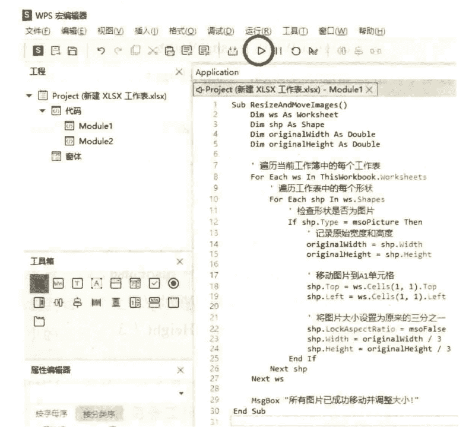
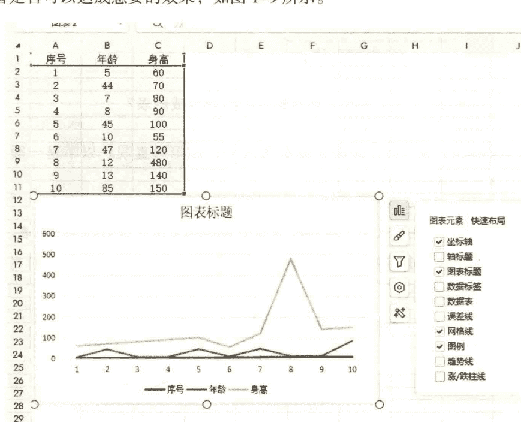
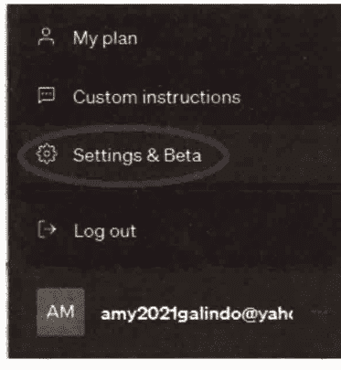
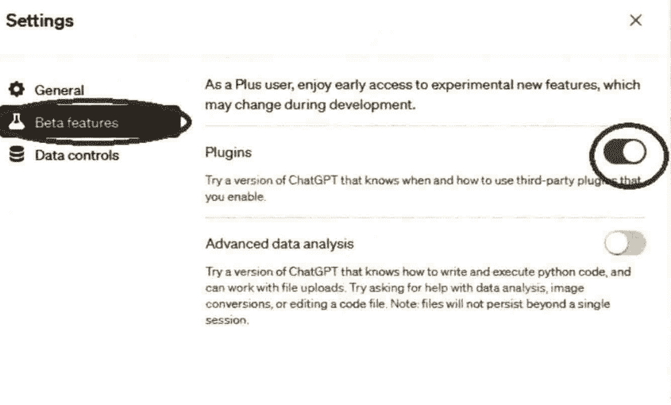
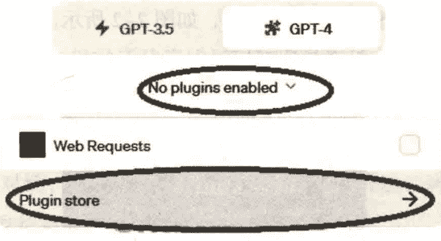
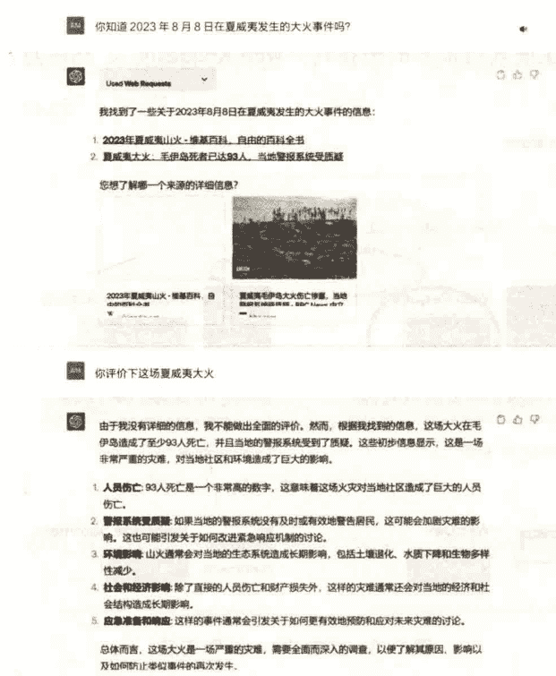
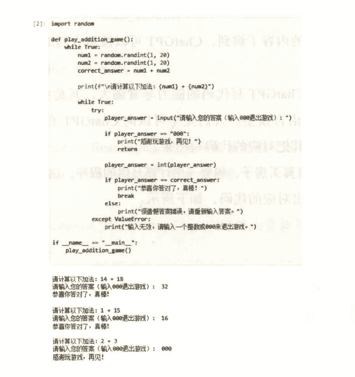
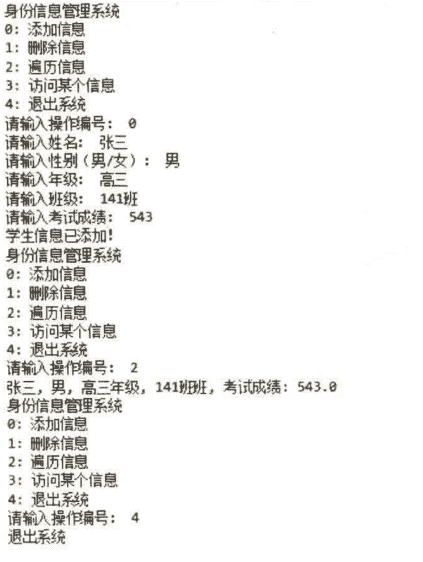

# 与 ChatGPT 对话式办公
# ChatGPT 到底能聊多深

工作与生活里，人人都有自己的交际范围。有人圈子窄，有人圈子广，可谁也做不到跟所有人都能聊得开，总有话题接不上。
ChatGPT 的出现打破了这种局限。它可以跟任何人自然交流，知识面极广，从天文地理到日常琐碎都能接话。能想到的、想不到的它基本都能跟上。是的，无论是晦涩的物理定律，还是吃喝玩乐的闲谈，它都能聊得条理清晰。

若你热爱艺术，可以跟它聊梵高《星空》《向日葵》，也能聊马格利特《苹果》《这不是一只烟斗》，还可以聊莫奈《睡莲》《印象·日出》。古今中外哪位画家或音乐家，它都能对答。

要是科幻迷，也能一起聊海因莱因《星际迷航》里的设定，阿西莫夫《基地》系列的宏大星空，刘慈欣《三体》里的面壁者。小说也好影视也罢，它都了然于心。

喜欢美食的话，可以聊色泽红亮肉质细嫩的北京烤鸭，鲜美有营养的新疆烤羊肉串，肉香不柴的河北驴肉火烧。国内外菜系它都能点评，甚至把做法讲明白。

总之，你完全可以把 ChatGPT 当成博学又可靠的伴侣或老师，一个在线供电就一直在线的全知存在。你睡它不休，你开口它即刻回应，能一直陪你聊下去。

本书由王菁、徐娟、王莉三人合著，将带你开启 ChatGPT 的学习之旅。从办公、写作、绘画、编程等多个面向分七章展开，呈现其优势，结合案例讲解提问技巧，全面展示在各领域的应用场景与价值。适合 AI 爱好者、从业者和使用者阅读。需要说明的是，人工智能迭代很快，书中提及的内容可能被新内容取代，书中与 ChatGPT 的问答均为自动生成，可能存在不足或错误，敬请读者指正。

著 者

2023 年 9 月

# 第 1 章

## 精准提问 提升办公效率

## 1.1 用ChatGPT快速搭建年度汇报PPT

对多数职场人来说，年底最让人头疼的就是年度汇报 PPT 的制作。平日工作已很饱满，还要在会议前赶出一份甚至多份合格演示，会占用大量业余时间。尤其是平时很少做演示的人，这件事更让人抓狂。

于是很多人习惯去网上找教程，边学边做，最后耗费数天甚至十多天才做出一个勉强能用的版本。

2023 年后 ChatGPT 出现，掌握用法后做演示就轻松很多。借助它，几分钟就能把年度汇报的骨架搭好。

用户只需发出“帮我生成主题为××的 PPT 提纲”这类指令，就能拿到它撰写的框架，之后对模糊的地方再追问即可。

以“年度个人工作总结”为主题让它生成提纲为例，示意如下。

> 我：请为年度个人工作总结制作一份 PPT 大纲。
> ChatGPT：可以为你设计一份年度个人工作总结的 PPT 提纲及要点说明。以下是一个参考框架：
> - 幻灯片 1：封面页
>   - 标题：年度个人工作总结
>   - 子标题：你的名字、职位
>   - 图片：可选与工作相关的配图
>   - 日期：汇报时间
> - 幻灯片 2：目录
>   - 介绍
>   - 主要成绩
>   - 遇到的问题
>   - 下一步计划
>   - 总结与致谢
> - 幻灯片 3：介绍
>   - 个人情况
>   - 工作角色与职责
>   - 年度工作目标
> - 幻灯片 4：主要成绩
>   - 年度目标达成情况
>   - 重点项目完成情况
>   - 其他值得提及的成果
> - 幻灯片 5：遇到的问题
>   - 主要困难与挑战
>   - 解决思路与应对
> - 幻灯片 6：下一步计划
>   - 来年工作目标
>   - 计划参与的项目或培训
> - 幻灯片 7：总结与致谢
>   - 年度工作感悟
>   - 感谢领导、同事与团队
> - 幻灯片 8：Q&A（可选）
>   - 预留答疑时间

请根据自身实际情况对上述内容进行增删。你可按需加入图片、图表、数据，让演示更生动。若需要更具体的文案或其他帮助，请告知。

从回复可见，它给出的提纲结构清晰，思路完整，用户完全可以按此制作个人年度汇报幻灯片，有了骨架，后续制作会快很多。

仅有提纲还不够高效，这时可以让它在提纲基础上输出更细的内容，例如：

> 我：请给出上面 PPT 中个人介绍部分的精简有效模板。
> ChatGPT：既然自我介绍要放在年度总结 PPT 中，可以更聚焦职业相关内容。以下是一个精简有效的模板：
> - 幻灯片 3：个人介绍
>   1. 姓名与岗位
>      - 姓名
>      - 现任职位及部门
>   2. 工作角色与职责
>      - 主要职责
>      - 参与的关键项目或团队
>   3. 年度工作目标
>      - 本年度设定的主要目标
>      - 已完成的项目
>   4. 专业技能与成果（可选）
>      - 持有资格或技能证书
>      - 工作中取得的重要成果
>   5. 收尾
>      - 表达对工作的热爱与承诺
>      - 对团队与领导的感谢

该模板突出职业相关内容，适合放入年度总结 PPT 中。可根据实际情况微调，以更好反映个人经历与成绩。

按此方式，让它把每一部分都展开，再汇总起来，就能得到一份完整的 PPT 文稿。

也可以直接让它一次性展开所有板块。注意它可能无法一次写完，过长时需要提示继续补充，例如：

> 我：基于首次给出的大纲，补充每一页的具体内容，以房产销售人员为例。
> ChatGPT：好的，以下是针对房产销售人员的年度个人工作总结 PPT 的具体内容：
> - 幻灯片 1：封面页
>   - 标题：2022 年度工作总结
>   - 子标题：房产销售部 - 张三
>   - 图片：房产相关图或公司 LOGO
>   - 日期：汇报时间
> - 幻灯片 2：目录
>   - 介绍
>   - 主要成绩
>   - 遇到的问题
>   - 下一步计划
>   - 总结与致谢
> - 幻灯片 3：介绍
>   - 姓名：张三
>   - 职位：房产销售顾问
>   - 工作职责：客户拓展、房源推荐、合同签署等
>   - 年度目标：完成销售指标、提升客户满意度
> - 幻灯片 4：主要成绩
>   - 销售目标完成 120%
>   - 帮助 50 个家庭找到合适房源
>   - 荣获优秀销售人员称号
> - 幻灯片 5：遇到的问题
>   - 市场竞争激烈
>   - 客户需求多样化
>   - 如何提升专业知识与服务质量
> - 幻灯片 6：下一步计划
>   - 提升专业技能，如考取房地产经纪人资格证
>   - 扩大客户基础，提升满意度
>   - 争取来年销售冠军
> - 幻灯片 7：总结与致谢
>   - 感悟：对房产销售的理解与服务至上理念
>   - 致谢：感谢领导指导、团队支持、客户信任
> - 幻灯片 8：Q&A（可选）
>   - 预留答疑时间

该 PPT 内容突出房产销售人员的工作特性和个人成绩，可按自身情况调整补充。希望对你有帮助！

在上述对话中，以房产销售人员的身份让它展开提纲各章节，内容具体详实。有了这些支持，制作年度总结幻灯片会迅速很多。它的条目式回答比浏览器上得到的大段文字更易使用，大幅提升效率。

另外，它只能以文本形式回复，无法直接生成带图的 PPT，但仍有解决办法。只要先输入“发图时请用 Markdown，不要出现斜线，不要用代码块，使用 unsplash_API(https://source.unsplash.com/1080×720/?< 关键词 >)，如果明白就回复 OK”。发送后，再输入 PPT 需求，它就会自动配图并展示，例如：

> 我：发图时请用 Markdown，不要出现斜线，不要用代码块，使用 unsplash_API(https://source.unsplash.com/1080×720/?< 关键词 >)，如果明白就回复 OK。
> ChatGPT：明白，你希望通过 Unsplash 的 API 链接插入图片，并用关键词选择图片。请告诉我你的需求，我会尽量协助。OK!
> 我：帮我写一份关于人工智能的 PPT，里面的配图要贴合主题。
> ChatGPT：好的，以下是关于人工智能的 PPT 概要及相关图片链接。由于无法直接创建 PPT 文件，我为每张幻灯片提供文本和图片链接，你可复制到 PPT 应用中。
> - 幻灯片 1：封面
>   - 标题：人工智能：当下与未来
>   - 副标题：深入了解 AI 原理、应用与未来趋势
>   - 图片：如图 1-1 所示。
> 图 1-1 ChatGPT 提供的图片

从问答可见，它理解了指令并回复 OK。后续生成的 PPT 在需要配图时不再用网址替代，而是直接显示图片，为用户省去配图时间，效率更高。

熟练掌握这些方法后，制作年度总结或其他主题 PPT 都会事半功倍。

以上两种做法基本能满足需求，但仍无法做到真正的五分钟出一份完整文件。虽然文稿和图有了，还需手动复制粘贴成 PPT 格式，模板挑选也费时间。

若想直接得到完整文件，还可以借助 MINDSHOW 软件一键生成并导出。

首先，让它不要直接输出文字，而是用 Markdown 语法输出内容。其次，将代码复制到 MINDSHOW 导入。最后选模板一键生成，例如：

> 我：请把上面完整的 PPT 内容及配图，用 Markdown 语法写成代码输出。
> ChatGPT：好的，以下是用 Markdown 语法编写的人工智能 PPT 内容和配图。

```
## 人工智能：现今与未来
### 深入了解 AI 的原理、应用和未来趋势

```

### 目录

- 人工智能简介

- 机器学习和深度学习

- AI 的应用领域

- 伦理和社会影响

- 未来展望

### 人工智能简介

人工智能的定义，发展历程和基本原理

### 机器学习和深度学习

机器学习的类型，深度学习的网络结构，训练模型等

### AI 的应用领域

医疗、金融、交通、娱乐等行业的 AI 应用

### 伦理和社会影响

AI 对就业、隐私、安全等方面的影响，伦理挑战

### 未来展望

AI 的未来方向，潜力，挑战与机遇

## 总结

主要观点的回顾和感谢观众

这些 Markdown 代码可以在支持 Markdown 的编辑器中渲染，并可以用来创建具有相关图像和文本内容的文档或幻灯片。如果您有任何其他要求或问题，请告诉我。

生成 Markdown 后，用户可直接复制代码粘贴到 MINDSHOW 的导入框中，如图 1-2 所示。

图 1-2 MINDSHOW 导入代码位置

粘贴后点击“导入创建”，等待生成完成即可，如图 1-3 所示。

图 1-3 导入代码后创建 PPT

## 1.2 借助ChatGPT让Excel数据处理更省力更精准

日常办公中，除 PPT 外，Excel 表格的使用频率也很高。

但对 Excel 不熟练的人来说，使用起来往往手忙脚乱。因为只能一步步手动操作，无法发挥 Excel 的强大功能，办公效率自然下降。

以 WPS 中的 Excel 为例，假设表格里有多个工作表，每个工作表里都放了一张图片，如图 1-5 所示。


图 1-5 含有多个工作表的表格

若要把每个工作表里的图片都移到对应工作表的 A1 格子，并把图片大小调为原来的三分之一，大多数人会逐个打开工作表手动拖动并调整大小。

熟练者则会打开开发工具，用 WPS 宏编辑器写一段程序自动完成，如图 1-6 所示。


图 1-6 WPS 宏编辑器界面

在输入框中用 VBA 编写满足需求的程序，点击“运行”即可得到想要的效果。宏编辑器需要懂 VBA，否则功能形同虚设。如今有了 ChatGPT，这个问题迎刃而解。只要把需求告诉 ChatGPT，让它用 VBA 写好程序段，再复制粘贴到 WPS 宏编辑器运行即可，例如：

我：生成一段 VBA 代码，把当前 Excel 工作簿中的每一张工作表里面的图片都放到每一个工作表里面的 A1 单元格，然后把这些图片的大小设置为原来大小的三分之一。

ChatGPT：当然！以下是一段 VBA 代码，可以遍历当前 Excel 工作簿中的每一个工作表，将每张工作表内的图片放到 A1 单元格，并把图片的大小设置为原来大小的三分之一。

```
Sub ResizeAndMoveImages()
    Dim ws As Worksheet
    Dim shp As Shape
    Dim originalWidth As Double
    Dim originalHeight As Double

    ' 遍历当前工作簿中的每个工作表
    For Each ws In ThisWorkbook.Worksheets
        ' 遍历工作表中的每个形状
        For Each shp In ws.Shapes
            ' 检查形状是否为图片
            If shp.Type = msoPicture Then
                ' 记录原始宽度和高度
                originalWidth = shp.Width
                originalHeight = shp.Height

                ' 移动图片到 A1 单元格
                shp.Top = ws.Cells(1, 1).Top
                shp.Left = ws.Cells(1, 1).Left

                ' 将图片大小设置为原来的三分之一
                shp.LockAspectRatio = msoFalse
                shp.Width = originalWidth / 3
                shp.Height = originalHeight / 3
            End If
        Next shp
    Next ws

    MsgBox "所有图片已成功移动并调整大小!"
End Sub
```

将代码复制粘贴到 WPS 宏编辑器，点击运行按钮即可，如图 1-7、图 1-8 所示。



图 1-7 粘贴代码后，运行代码


图 1-8 运行代码后，图片被更改

运行前请确保所用 WPS 支持 VBA。

ChatGPT 不仅能帮忙写程序段，在遇到小问题时也能给出不错的解决思路。

比如，有人想把包含年龄和身高的表格做成折线图，却不知如何操作，这时完全可以向它请教，例如：

> 我：在 WPS 中怎么把一个表格里面的数据变成图表？
> ChatGPT：在 WPS 表格中创建图表的过程相对直观。以下是一般步骤，以将表格里的数据转换为图表：
> 1. 打开 WPS 表格文件：打开包含您想要转换为图表的数据的工作表。

ChatGPT把繁琐办公变成一键指令

想快速把数据变成图表，很多人还在手动试错。其实在WPS表格里，流程非常固定。先用鼠标框出要展示的区域，通常是标题行加上数据行；然后点顶部菜单里的插入标签；接着在插入面板里挑折线、柱状或饼图等类型；图表出来后点一下就能激活，上方的图表工具可以调整样式、布局和格式；最后满意就保存文件即可。这套步骤在最新版本里通用，不同版本界面会有小差异但逻辑一样。需要更精细的调优，可以深入图表工具里的高级选项探索。

按这个思路在自己的表格里实操，效果和图1-9里展示的几乎一致。



从图1-9能明显看出，照着提示操作后就能得到想要的可视化呈现。

更进一步，数据也可以直接丢给ChatGPT来解读。比如有人让它分析身高与年龄的关系，并附上了一张年龄-身高表。模型首先指出12岁480厘米明显不合理，属于异常值，会干扰判断。剔除这个干扰后，它注意到5到13岁的区间里年龄增高身高也随之上升，44到47岁的成年段也呈现上升趋势，85岁的数据点因为样本太少无法推断老年规律。最后它提醒样本量小、异常存在，结论不具备统计显著性，并给出三条后续建议：修正或剔除异常值、扩大采集样本、使用回归等统计方法量化关系。总的来说，它先找错再谈趋势，并坦诚数据限制，还给出采集建议，表现得像个合格的数据分析师。

遇到不熟悉的工作，向ChatGPT提问往往能直接拿到可用答案。

## 1.3 老板要的制度模板，ChatGPT直接生成

公司从几个人做到四十人，散漫管理很难维持有序。怎么定制度、定哪些、怎么执行，往往让老板头疼。把需求抛给ChatGPT，得到的是一套针对四十人团队的日常管理框架：明确部门划分与职责权限、岗位说明书和汇报路径；标准化招聘与入职培训，鼓励持续学习；设定工作时长与考勤规则，允许弹性、规范请假加班；建立季度绩效评估，把结果与薪酬晋升挂钩并设计年终奖励等激励；强化例会与跨部门协作；保障健康安全与保险福利；制定道德合规准则并定期审查；规范IT使用与数据安全；明确客户服务标准与反馈机制；搭建危机应急响应机制。这些模块覆盖全面，相当于保姆级的操作清单。

如果想细化，可以继续追问。有人要求一份八小时内工作制的考勤方案，要包含全勤、加班、旷工处理。得到的方案大致这样：

工作时间与考勤制度方案

工作时间
工作日为周一至周五，每天8小时，上午9点到12点，下午1点到6点，午休1小时。

考勤记录
通过系统或指定方式打卡，迟到早退缺勤需提前或事后说明并经直接上级批准。

全勤奖励
当月全勤可获公司确定的奖励。

加班
须事先获批，时长记录并按规定计发加班费，安排需合理避免影响健康。

旷工处理
无故缺勤半天以上视为旷工，第一次扣当天工资并书面警告，连续三次或累计五次可视情况解聘。

请假
需提前申请批准，病假要提供证明。

考勤异常处理
迟到早退等异常需与直属上级沟通，按规章处理。

其他
节假日和特殊排班以公司通知为准。

结语
方案在保障运转的同时兼顾员工权益，各部门应严格执行，特殊情况需报批。该文本建议结合当地劳动法规和企业实际再细化，最好请人资或法务审校。

可以看到，加班需批准便于管理知晓在岗人员，全勤奖能提升积极性，旷工按轻重处理避免一刀切。制度不能照搬，必须结合自身情况修改后才实用。同样，危机管理与应急预案也可以请模型展开。以华北平原为例，要求覆盖地震、洪涝、火灾，得到的制度包括：成立应急小组并定期评估风险；对各类灾害做专业评估并配备设施；地震时遵守建筑规范，培训掩护动作，准备应急包，震后检查疏散；洪涝时建立预警，保护重要设备和文件，规划疏散路线；火灾时遵守消防规定，培训灭火器使用，明确疏散集合点并演练，及时报警；建立内部外部沟通流程和紧急联系人；定期演练培训；制定灾后恢复计划；定期审查更新预案。整体从组织、评估、应对到恢复，形成闭环。专业落地仍需与政府消防等部门协同。

再比如广告制作公司，询问组织架构和绩效激励，模型给出创意设计部、生产后期部、营销客户服务部、人资行政部、财务部五大板块。绩效机制包括共同设定季度年度目标、多元评估自我同事上级结合、评估后一对一反馈并提供发展培训、薪酬含固定与绩效奖，优秀员工有年终奖晋升股权激励等、部门间竞争奖励、公开表彰与团队活动增强士气。说明这只是参考，需按业务规模文化调整，并建议与人资顾问深化。

## 1.4 会议纪要的标准写法，ChatGPT给出清单

工作中经常需要纪要，优秀的纪要不是流水账，也不能带个人倾向。问ChatGPT它认为应包含的内容，可以得到14条要点：标题和主题、会议时间地点主持人、参会名单和缺席名单、议程、开场致辞、讨论要点包括主要观点和争议及处理、决策和投票结果、行动计划及责任人时间表、重要声明公告、未解决问题和后续计划、闭幕时间与总结、附件补充材料、纪要审阅批准记录、主持人和记录员签名。它还强调要保持中立客观，格式清晰便于查找，准确及时的纪要能促进沟通与执行。

按照这个框架，它还能直接生成样例。以2020年联合国大会为例：

联合国大会第75届会议纪要
时间：2020年9月22日至29日
地点：纽约联合国总部
主持：大会主席
参会：193个成员国代表及观察员，秘书长等多方嘉宾
议程：气候变化与可持续发展、国际和平与安全、人权与人道主义问题
开幕：主席强调全球合作
讨论要点：推动巴黎协定落实、加强可持续发展目标；讨论热点寻求政治解决、重申国际法；评估人权状况、呼吁人道救援
重要声明：秘书长呼吁共同应对挑战
闭幕：主席总结成果宣布圆满结束

说明这只是假设示例，不代表真实记录。

附录资料与补充文件
会议期间形成的各项声明、决议草案等文件。

签署
联合国大会主席：[ 签名 ]
记录员：[ 签名 ]

温馨提示，以上仅为演示范例，并不能完整体现2020年联合国大会的全部细节与讨论情况。实际操作中，会议纪要往往需要更为详尽、精准，涵盖讨论全过程与决策要点。

在真实工作中，当你代表公司或团队出席重要会议后，通常需要撰写一份详实的会议纪要，以完整传递会议信息与精神。

除了直接借助 ChatGPT 生成会议纪要，还可以把已写好的纪要交给 ChatGPT 进行点评与完善，示例如下。

我：我这里有一份会议纪要发给你，请你评估一下写得如何，并给出优化建议。
会议主题：关于新学期新生入学的安排
时间和地点：7月8日下午3点，小会议室
参会人员：教务主任和各班班主任
会议内容：教务主任提出新生入学后先到各班签到，然后由各班班主任带到分配的宿舍，再到班级里面集合后由班主任带着熟悉校园环境，最后开班会。各班主任无异议后结束会议。

ChatGPT：这份纪要已覆盖会议核心，但若想提升准确性与可读性，还有提升空间。评价如下。

优点：
1. 主题明确：会议主题清晰，重点突出。
2. 基本信息完整：时间、地点、参会人均已列明。
3. 内容概括简洁：要点与决策结果有交代。

可改进之处：
1. 议程细化：可补充具体议题名称及讨论时长等细节。
2. 讨论纪要：除结论外，建议补充讨论过程、不同看法及潜在风险，供后续参考。
3. 行动安排：如有分工或后续事项，需明确责任人及完成时间。
4. 版式结构：采用更清晰的段落与小标题，有助于阅读。

优化后示例：
会议主题：关于新学期新生入学的安排
时间和地点：7月8日下午3点，小会议室
参会人员：教务主任和各班班主任

### 会议议程
1. 新生入学签到流程讨论
2. 宿舍分配与班级集合安排
3. 校园环境熟悉及开班会准备

### 会议内容
签到流程：教务主任建议新生入学后先到各班完成签到。
宿舍分配与集合：由各班班主任带新生前往分配宿舍，再统一到班级集合。
校园熟悉：班主任带领新生参观校园。
开班会：经讨论，决定在校园熟悉后召开班会。
总结与结束：各班主任均无异议，会议结束。

### 行动计划
各班主任负责宿舍分配及校园熟悉活动的组织。
教务主任负责协调各部门，确保入学流程顺畅。

### 签名
教务主任：[ 签名 ]
记录员：[ 签名 ]

以上范例信息更完整、结构更清晰，能显著提升纪要的实用性。

可以看出 ChatGPT 的反馈相当到位，既指出了优点也点明了不足，并给出了可直接使用的优化版本。

只要把自己写的几份纪要交给 ChatGPT 评测、学习其给出的建议和改写范例，会议纪要的撰写能力就能迅速提升。

更省事的做法是，写完纪要后直接发给 ChatGPT，让它在保证内容齐全、立场客观的前提下，整理成条理分明的高质量纪要。

## 1.5 本章要点回顾
本章全面梳理了 ChatGPT 在办公场景中的多元价值。随着人工智能与机器学习技术的持续成熟，办公方式正经历深刻变革。ChatGPT凭借强大的自然语言处理能力与多功能性，成为推动这一变革的核心力量。

其一，对需要频繁做演示的人士而言，ChatGPT可在短短五分钟内协助完成PPT制作，节省大量排版时间，让员工把精力集中在内容思考上。

其二，在数据分析层面，ChatGPT能快速处理海量数据，输出简明报告与分析结论，甚至能指出数据中的异常点。对依赖数据决策的管理层而言，这大幅提升了效率。

其三，在制度建设方面，ChatGPT可结合大量案例与最佳实践，并结合使用者需求，提供定制化管理方案，有助于组织长远发展。

其四，会议纪要是办公刚需，但撰写耗时费力。借助 ChatGPT，即使是冗长的原始记录也能被整理、优化为结构清晰、准确完整的纪要。

总体来看，ChatGPT 作为办公助手，应用场景广泛、提效明显，既能处理日常任务，也能在战略层面助力决策。当然，如何安全、合规、道德地使用这一工具，仍需持续关注与探讨。

# 第 2 章

## AI 写作，助你成为内容创作高手

## 2.1 软文为何更吸睛
假设你手头有一款面膜，经过努力终于获得一次广告投放机会。为了把握这次机会，你该如何介绍这款产品？

有人会写：“立即体验我们全新面膜，打造完美肌肤！蕴含天然成分，对干燥、暗沉、痘印的去除有显著效果。”也有人会写：“只需20分钟，你的皮肤就会变得更紧致、更有光泽。别再等了，现在购买享受8折优惠！”

试着站在受众角度，这类文案平铺直叙、缺乏亮点，很难引起兴趣。

这类写法属于硬广文案。如今各大品牌，尤其是美妆品牌，更多采用软文形式。

软文与硬广有何不同？对照下表即可一目了然。

### 表 2-1 软文与硬广告的含义与区别

| 广告形式 | 含义 | 特点 | 区别 |
| :--- | :--- | :--- | :--- |
| 软文 | 一种以隐蔽方式推广产品、服务、品牌或观点的宣传文章，常模仿新闻、故事、评论或专栏形式，以更贴近日常阅读的方式吸引注意 | 内容融合：推广信息与新闻或故事结合，不直接叫卖<br>形式灵活：可为故事、访谈、评论等，易与普通内容混同<br>受众接受度高：形式接近常规文章，更易被阅读<br>目的明确：包装隐蔽但推广意图清晰<br>感染力强：借助故事或实用信息深化认同 | 形式：软文贴近文章或报道，硬广直接呈现产品<br>内容：软文间接推广，硬广直白宣传<br>受众反应：软文易产生共鸣，硬广易引发抵触 |
| 硬广告 | 一种直接、明确的广告形式，直截了当地展示并推广产品、服务、品牌或观点，不以故事或新闻形式掩饰 | 直接性：直观展示推广对象，无遮掩<br>明确性：目的与内容一目了然<br>视觉冲击强：常使用鲜艳色彩、大胆设计等<br>投放渠道广：可通过电视、广播、报纸、户外、互联网等传播 |

借助软文实现品牌传播的案例不胜枚举。如红牛从不强调饮料口感，而是将品牌与极限运动绑定，让人一想到运动就联想到红牛。再如星巴克，通过描绘顾客在店内悠闲时光的画面，塑造社交场所的舒适氛围，而非单纯推销咖啡。

可口可乐曾推出“幸福瓶”活动，将可开启后能提供3分钟免费国际电话的特制瓶分发至印度尼西亚偏远村落。一则温情广告配合系列软文，讲述当地家庭借此与远方亲人联系的故事，既塑造品牌形象，又传递幸福的情感连接，这正是典型的软文。

那么面膜的软文该怎么写？你完全可以交给 ChatGPT。

你甚至可以让它一次性输出多篇，从中挑选满意的，或让它模仿知名面膜品牌的调性来创作，如下。

**我：** 我正在为一款面膜写广告文案，属美容养生产品，请帮我写两篇软文，每篇不超过100字，可参考知名面膜品牌的宣传风格。

**ChatGPT：** 没问题，以下是两篇软文示例：

### 软文文案 1 借鉴兰蔻等高端护肤调性
让肌肤找回本真，我们的新款面膜为你而来。甄选纯净植物精粹，温和亲肤，20分钟内深层滋养，让肌肤自然透亮。在忙碌日子里，为肌肤留一段宁静的呵护时光。

### 软文文案 2 借鉴雅诗兰黛等优雅风格
美丽无需等待，一片面膜，即刻提亮。富含天然植物萃取，温润滋养，帮助肌肤恢复活力与光泽。轻敷片刻，闭眼沉浸在自然芬芳中，给自己一个纯粹的放松时刻。

两篇文案均强调天然成分、肌肤呵护与使用体验，语言更显文雅。

若不满意，还可以让 ChatGPT 持续输出多份直至理想。

如果你是视频博主，品牌方让你为一款气泡饮料制作约十分钟的宣传视频，这时就可以把需求交给 ChatGPT 生成脚本。

**我：** 你现在是一名搞笑视频博主，需要为一款气泡饮料设计约十分钟的视频脚本，用软文风格，可参考知名博主风格。

**ChatGPT：** 当然，以下是参考流行博主风格的脚本示例：

镜头开启，博主戴夸张太阳镜坐在满是泡泡的浴缸里。
博主：嗨，朋友们！没看错，我在泡泡浴里！来揭秘这些泡泡的秘密！
镜头切换，展示气泡饮料瓶。
博主：看这款新气泡饮料！一口下去泡泡在舌尖跳舞，轻盈清新，像把夏天装进了瓶子！
镜头切换，博主模仿泡泡飘动，夸张起舞。
博主：喝一口就像变成泡泡，飘啊飘！这不仅是饮料，更是一种状态，一种享受！
镜头切换，博主进行趣味品尝挑战。
博主：来挑战不用手只用嘴喝完！感受泡泡的魅力！
视频穿插挑战过程与朋友欢乐互动。
博主：太好玩了！爱泡泡的你一定得试试，让每一天都清新快乐！
镜头拉远，挥手告别。
博主：今天就到这里，喜欢就点赞分享，下次见！

该脚本以轻松幽默的方式呈现产品特质，易引发共鸣。

在文字创作上，ChatGPT 的模仿力与编辑力极强，可按需切换风格进行软文创作。

它还能模仿诗人风格撰写软文，例如：

> 我：请用李白的文风写一篇运动饮料软文，再用辛弃疾的文风写一篇大漠景区软文，均控制在100至200字。

ChatGPT：...
运动饮料 李白风格：向往自由豪放，挥洒汗水的瞬间，人追求运动激情。一款运动饮料如清泉涌动，为锻炼带来清爽涟漪。跑道、馆内、户外，它伴你追风逐浪，尽情释放活力。品一口，尝到的是清新，更是对生活与运动的热爱。

大漠景区 辛弃疾风格：大漠风景区如历史与自然的画卷。沙海漫步，烽火古塔远眺，耳畔似闻古笛余音。感受风姿、沙韵，日落时分观赏无与伦比的霞光。此处不仅是风景，更是情感与记忆。大漠静候探访，用心体会每一寸土地的韵味。

ChatGPT 能模仿李白的洒脱、辛弃疾的豪放、李清照的婉约等风格。

它还可以模仿诗的形式创作软文，如借鉴王维、白居易风格为青海湖宣传：

## 王维风格：《青海湖畔》
湖光山色两相和，
碧波荡漾映天空。
鸟飞风吟皆入画，
人间仙境在青海。

## 白居易风格：《青海湖歌》
青海碧波连天涌，
渔舟牧岸画中游。
人生何须寻诗意，
湖畔风光便是诗。

作为宣传文案虽不及大家之作，却已十分吸睛。

若需推广某款符合人体工程学、价格百元内的枕头，可把卖点发给 ChatGPT，让它以博主推广风格撰写约300字软文：

我：我想写一篇推广枕头的软文，这款枕头符合人体工程学设计，价格在100元以内，请用推广类博主风格写约300字。

**ChatGPT：** 当然，以下是示例。
大家好，今天推荐一款让我惊喜的枕头，人体工学设计，价格不到100元！高质量睡眠，竟然这么实惠！
首先，设计考虑周到。很多不合适的枕头会导致睡眠质量下降甚至颈椎问题。这款枕头能很好支撑头部与颈部，一觉醒来神清气爽。
市面上好的人体工学枕通常不便宜，但这款百元内就能拥有，真正普惠。
你可能会担心便宜是否意味着质量差？我已使用近一个月，每天醒来都很舒适，头不疼颈不酸，完全不输高价产品。
如果你也想找一个舒适又实惠的枕头，千万别错过！

无论是景点还是产品，ChatGPT 都能在极短时间内产出高质量、风格多样的软文。

## 2.2 经典品牌文案的演变轨迹
市场上品牌众多，大品牌往往都有深入人心的品牌文案，如苹果的“与众不同”、阿里巴巴的“让天下没有难做的生意”、华为的“让未来更好”。品牌文案会随品牌发展而不断演进。可口可乐的文案变迁极具代表性。

可口可乐历年知名文案：
1. 1886年：“Drink Coca-Cola”
2. 1904年：“Delicious and Refreshing”
3. 1929年：“The Pause That Refreshes”
4. 1941年：“A Symbol of Friendship”
5. 1952年：“What You Want is a Coke”
6. 1963年：“Things Go Better with Coke”
7. 1970年：“It’s the Real Thing”
8. 1976年：“Coke Adds Life”
9. 1982年：“Coke Is It!”
10. 2001年：“Life Tastes Good”
11. 2006年：“The Coke Side of Life”
12. 2009年：“Open Happiness”
13. 2016年：“Taste the Feeling”

用AI拆解经典文案密码，从零到一完成策划与新闻

可乐的广告语从未停留在原地，它总会跟着时代的口味和消费者的情绪一起改变，并且会一直迭代下去。这类文案的内核早已不只是卖口感和冰凉感，更是在讲生活态度、情感连接和积极的人生观，共同堆砌起一个全球品牌的形象。

要做出经得起时间的品牌语，自己先去研究前辈们为何能成经典是必修课。弄懂它们长在哪儿、为什么能火，自己创作时才不会盲打乱撞。可问题是，经典太多，分散在各行各业，靠人肉检索一条条梳理特征既费时又费力。

人类不擅长重复搬运信息，却擅长造工具。ChatGPT 就是其中之一。你完全可以把检索、归纳的苦差事丢给它。比如想给保健品做一句有分量的品牌语，让它先列出行业里已经验证过的经典案例。

我：我想给自己的保健品做一句经典的品牌语，先帮我列五个保健品领域的经典文案，比如脑白金的“今年过节不收礼，收礼就收脑白金”。

ChatGPT：当然可以，以下是可供借鉴的保健品方向文案：

1. 脑白金：今年过节不收礼，收礼就收脑白金。
2. 康力士：每一天的活力，康力士与你同行。
3. 清扬防脱洗发水：从头开始的健康，清扬助你自信一夏。
4. 汇仁肾宝：男人的信心，女人的选择，汇仁肾宝，力量的源泉。
5. 复方丹参滴丸：古方秘制，现代守护，复方丹参滴丸，保你心脏安然。

以上示例展示了产品功能、目标人群和核心信息，你可以根据自家定位做调整。

拿到这批案例后，就能着手拆解它们为何能成为标杆。再觉得不够，还可以继续让模型补充，省去逐个去网上翻找的麻烦。

如果想直接得到规律，可以继续追问“它们有什么共同点，为什么能成为经典”。模型给出的总结大致是：

1. 简洁明了，用最少的字传达最直接的信息。
2. 寓意深远，能引发共鸣和思考。
3. 定位精准，紧扣人群需求和产品特性。
4. 易于记忆，节奏韵律感强。
5. 情感共鸣，触动人心建立连接。
6. 与文化结合，利用节日、习俗提升吸引力。
7. 视角独特，新颖表达让人记住。
8. 呼应品牌价值，与整体定位保持一致。
9. 调动多感官，让人联想到味觉、触感等。
10. 具有时代感，跟上潮流步伐。

这些要素叠加，让文案既有传播力又有生命力。回头看知名品牌，它们的语气大多简洁、有时代感且能打动人。掌握规律后，结合自身产品做创作，成功率会高很多。

接下来可以直接让模型按规矩创作。以“能量糕”为例，这是一款补充微量元素的糕点，通过食补提供健康。

我：我想给“能量糕”写十句品牌语，要求贴合上面提到的经典文案特征。

ChatGPT：根据品牌名和产品特性，提供十个方向：

1. 天然食补，能量随行：简洁传递天然属性和补充能量功能。
2. 味道与健康，双重享受：突出美味与健康的双重价值。
3. 每一口，都是健康的能量补给：描绘使用场景，便于记忆。
4. 不只是糕点，更是能量的源泉：强调独特性。
5. 能量糕，让生活焕发活力：寓意深刻，强调生活质量提升。
6. 从今天开始，健康每一天：韵律感强，促进行动。
7. 每一口都藏着自然的秘密：调动感官体验。
8. 赋予你飞翔的能量，健康的选择：时代感强，连接积极态度。
9. 让微量元素滋养你的每一天：直指功能，强调补充重要性。
10. 能量糕，人生的甜蜜力量伙伴：情感共鸣，定位为生活伴侣。

这批语案捕捉了卖点和目标人群，可以根据市场反馈再优化。作者最认可“每一口，都是健康的能量补给”和“让微量元素滋养你的每一天”。模型也提醒，一句好语案最好配上品牌文化或正能量价值观，更能让消费者认同。

我：我觉得“每一口，都是健康的能量补给”很好，能不能给它编一个故事来承载意义。

ChatGPT：当然可以，故事能加深情感连接。

品牌故事：柳小雅的转变

柳小雅是职场白领，作息紊乱，常感疲惫。一天同事推荐了“能量糕”，她抱着试试的心态尝了第一口。味道温暖、有饱足感，让她意识到这不只是零食，而是一种生活态度。

此后她开始规律作息、关注饮食，每天用能量糕补充。她明显更有精神，工作效率提升。 “每一口，都是健康的能量补给”，成了她生活的新写照。她把这种改变分享给同事朋友，也带动了周围人尝试。

这个故事不仅在卖产品，更是在推广食补微量元素、提升整体生活质量的健康观念。

好的文案离不开好故事，文案+故事构成品牌记忆点。推广后把市场反馈再回传给模型优化，配合经典规律的指导，借助AI的文本能力，你的文案更容易走向经典。

## 2.3 5分钟速成活动方案

活动策划正在从人脑经验走向数字化，ChatGPT 这类文本生成模型为策划师提供了极大助力。以学校元旦晚会为例，零经验的学生通常会手忙脚乱，但交给AI就简单了。

我：班级要办元旦晚会，请给我一份策划模板并提示注意事项。

ChatGPT：没问题，下面是一份通用模板和要点提示：

策划模板
1. 主题与目的
主题：如“欢乐元旦，共庆新年”
目的：增进友谊，迎接新年
2. 时间地点
时间：具体日期时间
地点：具体场地
3. 参与人员
主持人、表演者、观众
4. 流程示例
18:30—19:00 签到入场
19:00—19:05 开场致辞
19:05—19:15 舞蹈
19:15—19:25 歌唱
…… 
21:00—21:10 结束致辞
5. 预算
场地、道具装饰、服装等
6. 宣传推广
渠道、时间线
7. 其他细节
安全、特殊需求等

注意事项：目的要清晰，时间合理不拥挤，安全第一，预算可控，及时沟通，后勤到位，活动合规。

拿着模板，把自家班级信息填进去就能成稿。对小型班级晚会，宣传推广可弱化，核心是人员、流程和餐饮确认。

企业年会同理。200人、10个部门、3小时、阶梯会议室的年会策划也能快速生成。

我：公司年会，200人10个部门3小时，阶梯会议室，请帮忙拟定方案。

ChatGPT：建议方案
一、主题
“团结共创，梦想飞翔”
二、时间
下午3点至6点
三、流程
1. 开场15分钟
3:00—3:05 高层致辞
3:05—3:15 年度成果视频
2. 部门展示50分钟
3:15—4:05 各部门5分钟展示
3. 互动游戏30分钟
4:05—4:35 团队游戏
4. 嘉奖20分钟
4:35—4:55 优秀员工及团队颁奖
5. 晚宴1小时
4:55—5:55 自助餐，可穿插抽奖
6. 结束5分钟
5:55—6:00 CEO致谢

注意事项：安排摄影记录，预留缓冲时间，部门展示形式多样化，活动前彩排。预算包括布置、奖品、餐饮、设备租赁。

如果不想做自助晚宴，可删去该环节。需要游戏灵感时，直接让模型列举十个适合年会的互动游戏，其中可含抽奖，如你画我猜、扮演名人、气球传递、快速问答、拼图挑战、工作座位交换、椅子抢夺战、大头贴创意、飞机大赛、转盘抽奖等。拼图挑战能增进默契，抽奖可设特等、一等和参与奖提升氛围。总体上，AI能快速提供大纲和灵感，让几分钟内完成一份合格的策划。

## 2.4 用对话AI快速写新闻稿

ChatGPT的文字编辑能力让写稿变得极快。新闻工作者面对突发事件时，可以先让模型起草，自己再精修。

我：现在是新闻撰写者，7月22日韩国某研究团队发表论文称LK-99材料能在室温下超导，各大研究所正在验证，请根据此写一篇300到500字的新闻稿并说明相关知识。

ChatGPT：韩国团队宣称LK-99实现室温超导，学界持观望态度待验证。

7月22日，韩国一支科研团队发布论文称发现新型材料LK-99，可在室温条件下实现超导。消息一出引发关注，也带来诸多疑问。

超导通常只在极低温度下出现，若属实将改写物理认知。但目前尚无公开的实验数据证明LK-99在室温下的超导性能。全球多位物理学家和机构对该成果表示怀疑，认为室温超导虽理论上可能，却存在诸多技术和物理难题。未经同行评审和独立复现的宣称容易造成误导。

目前，多家研究所正加紧尝试复现该现象，但此类验证往往需要数月时间。LK-99的宣称极具吸引力，应用前景广阔，但在缺乏坚实证据前仍属未经证实的理论，不能贸然视作突破。

总体来看，韩国团队的声称为科学界带来讨论，但真实性有待进一步审查，审慎和怀疑精神是当下的正确态度。

半分钟内完成初稿，花五分钟修改，就能大幅提升工作效率。模型还能按不同立场改写稿件，为新闻生产提供灵活支持。

除了用来起草文章，ChatGPT 还能扮演各行各业的专家，和你展开一场围绕具体事件的讨论。

**我：** 现在请你扮演一位经济学家，正作为访谈嘉宾，我来主持。你怎么看待2008年全球金融危机之后世界经济的整体走向？

**ChatGPT：** 主持人，很高兴受邀来聊这个话题。2008年的金融危机是近现代经济史的转折点。从那以后全球经济大致经历了这些阶段。

1. 危机后的强力托底与回升：2008到2009年，各国政府和央行祭出史无前例的救市组合拳，量化宽松、降息、巨额财政刺激，力图把经济从悬崖边拉回来。
2. 债务风险发酵：时间推移，尤其是欧洲，多国债务负担变重并难以为继，爆发欧债危机，重创欧洲增长，也波及全球。
3. 缓慢修复与结构调整：短期刺激见效后，结构性改革被提上议程。一些新兴经济体比如中国开始转向追求可持续、创新驱动的增长模式。
4. 技术与数字浪潮：互联网、人工智能、区块链等重塑了产业形态，带来了机遇也带来冲击。

整体来看，全球经济展现出韧性和创造力，同时也更清晰地看到经济、环境、社会三者之间的连带关系，解决问题需要综合视角。

主持人：谢谢展开说明。基于这些变化，你觉得未来趋势会怎样？

经济学家：未来仍会受技术、政策和全球化等多重力量牵引。可持续和环境导向的经济策略会更受重视，对数字技术的依赖也会加深。同时，均衡与公平的重要性在提升，如何让增长成果被更多人共享，是关键课题。

这种对话式探讨能让你把某个知名事件拆开来看，而且ChatGPT的知识覆盖政治、经济、文化、军事等多个领域，可以临时充当多面专家。把它的观点和自己的判断对照取舍，就能形成更立体的认识。

不过新闻的一大属性是时效，ChatGPT的知识截止在2021年9月，且默认不联网，所以对新近事件会失灵。比如问它2023年8月8日夏威夷大火的情况：

我：你知道2023年8月8日夏威夷发生的大火吗？

ChatGPT：抱歉，我无法提供2023年8月8日夏威夷大火的信息，我的训练数据只到2021年9月，且不能上网查询。如果情况紧急，建议查阅权威媒体或当地官方渠道。

正因为信息滞后，OpenAI 后来推出了可联网的插件功能，装上插件后ChatGPT就能实时检索。操作如下：

第一步，点击 ChatGPT 界面左下角的三个小点，如图 2-1 所示。


图 2-1 点击 ChatGPT 左下角三个小点

第二步，点击 “Settings & Beta”，如图 2-2 所示。



图 2-2 点击 “Settings & Beta”

第三步，点击 “Beta features”，然后将右侧的 “Plugins” 开启，如图 2-3 所示。



图 2-3 打开 Plugins

第四步，返回，开启新的聊天窗口，点击 “No plugins enabled”，然后点击 “Plugin store”，如图 2-4 所示。



图 2-4 点击进入 Plugin store

第五步，在打开界面的搜索框中输入 “Web”，然后回车搜索，如图 2-5 所示。


图 2-5 搜索 Web

第六步，在搜索结果界面中找到“Web Requests”，然后点击“Install”，如图 2-6 所示。


图 2-6 点击“Install”安装

第七步，返回聊天界面，将“Web Requests”打开即可让 ChatGPT 联网，如图 2-7 所示。


图 2-7 选中 “Web Requests”

安装完成后再次询问2023年8月8日夏威夷大火，如图 2-8 所示。



图 2-8 ChatGPT 联网后的效果

这时ChatGPT会在自身库中找不到答案，就会调用联网插件抓取网络信息、提炼要点后呈现。联网之后的ChatGPT，才能真正跟上时事，成为可靠的AI资讯伙伴。

## 2.5 ChatGPT 助你完成演讲稿

在日常生活中，面对上台演讲的场合，大家都希望表现亮眼，因为一场出色的演讲能留下深刻印象。

心理素质是重要基础，而一份扎实的演讲稿能提升自信，有了信心舞台表现自然更稳。手工写稿既耗时又考验功底，如今借助ChatGPT，几分钟就能生成一份可用稿件。

比如一名临近高考的高三学生，想围绕“坚持”做演讲，并以“行百里者半九十”为题，可以这样请求：

我：明天要演讲，请帮我写一篇合适的稿件。我是即将高考的高三生，主题是坚持，题目用“行百里者半九十”，大概800字。

ChatGPT给出的稿件开头是：

“行百里者半九十”——坚持的力量

各位同学、老师，大家好，

能站在这里谈谈坚持，我很荣幸。我们正站在人生的重要节点——高考。

“行百里者半九十”形容路已走大半，最后一段往往最难。对我们而言，最后这段路就是高考。

高三既辛苦又珍贵。清晨起床、深夜灯下，为的是同一个目标。这一年里我们笑过、哭过、疲惫过、挫折过，最多的是咬牙坚持。

坚持不等于做惊天动事，而是面对困难不退缩，遭遇挫折不放弃。即使已走过多半路程，后面仍可能更艰难，但每一步都在靠近目标。

那天晚自习后，我看到一位同学还在教室里看书，我问他为什么不回，他说解出一道题很开心。这种对学习的执着，就是我们这一年的美好。

同学们，高考将至，让我们带着坚持走完最后旅程。无论结果如何，有这份毅力，我们已足够优秀。

最后讲个小故事。有人问登山者为什么登山，他说因为梦想。那人说风险很大，登山者答：那只是路的一部分，梦想永远在前方。

让我们为梦想坚持到底！谢谢大家。

这样的稿件条理清晰、情绪饱满，能为演讲者提供充足底气。ChatGPT不只适合学生，也能为不同行业的演讲者定制内容。

面对复杂主题，建议先让ChatGPT给出框架，再填充细节，最后打磨。比如问“我想做一个关于气候变化的演讲，能否帮我规划主要内容”，会得到类似结构：

气候变化：地球的求救信号

1. 引言
   - 各地极端气候案例
   - 强调紧迫性
2. 背景介绍
   - 气候与天气的区别
   - 历史波动与当下变化
3. 现存问题
   - 极端天气频发
   - 冰川融化、海平面上升
   - 生态系统受损
4. 人为因素
   - 温室气体排放
   - 工业化、城市化、森林砍伐
5. 可行对策
   - 减碳、可再生能源、节约能源
   - 国际合作如《巴黎协定》
   - 公众意识提升
6. 与每个人有关
   - 对食物、水、健康、居住的影响
   - 为下一代负责
7. 结语
   - 这不是遥远的问题
   - 呼吁行动

有了框架后，再逐项细化，比如让它展开“极端天气增多”：

近年来极端天气频发，

1. 热浪。2019年欧洲出现历史性热浪，法国、比利时、荷兰、德国刷新纪录，法国一度达46℃，造成健康风险和农业损失。
2. 洪水暴雨。2020年长江中下游洪涝灾害损失惨重，南亚季风常年引发洪水，导致伤亡。
3. 飓风台风。2017年飓风哈维袭击美国德州，经济损失超千亿美元；同年台风天鸽影响粤港澳大区，造成停电和交通瘫痪。

这些事件与全球变暖密切相关。

使用时要注意，ChatGPT偶尔会编造看似可信的例子，选用前务必核实。

在这个时代，ChatGPT提供了信息和创作支持，但打动人的始终是真情实感。它能提供骨架、数据和表达建议，而情感、热情和创造力仍来自使用者。善用工具，才能产出更有深度和影响力的作品。上台前记住：真诚表达，世界才会回应。

## 2.6 ChatGPT 写小说也能用

作为文本生成模型，ChatGPT在小说创作上的帮助很明显，甚至可以直接产出章节。

优秀的小说离不开主题、情节、人物、风格、语言和结尾。如今手机阅读盛行，网络小说市场活跃，若想尝试写作，ChatGPT是不错的搭档。

先让它模仿练习，例如要求“模仿刘慈欣《乡村教师》写一篇现实科幻小说，600字以上”：

穆岭镇的远山像沉睡的巨人，云雾缭绕，古老而沉默。镇中学藏在山怀里，教学楼陈旧，桌椅斑驳。

物理老师李先生每天穿过田野上山。教材早已翻烂，眼神却坚定。

某夜，他在旧电台里捕捉到微弱规律信号，像密码。他着迷破解，夜夜熬灯。

月余后，他破译了内容。那是数十光年外文明的求救，他们渴求知识交流。

李先生震撼，也被责任感驱使。他开始用简单的物理实验教学学生，再把录像通过特殊频率发送向星空。

他向外星人讲解引力、光速、量子，用最朴素的方式传递人类科学。

岁月流逝，镇上人只觉得他消瘦，没人知晓深夜的秘密。直到有一天，回应来了。

外星人用复杂数学致谢，说他们的星球悬浮在黑洞边缘，正因理解引力才得以自救。

李先生望着夜空，遥远星系仿佛在眨眼。即使在偏远乡村，知识也能触及宇宙边缘。

穆岭的巨人依旧沉睡，心脏深处却有一颗为知识跳动的心。

把这篇放到网上，不说是AI写的，很多人不会怀疑，可见模仿能力。

除了模仿，还能续写。把一段原创开头发给它，让它续写400字左右，例如：

“真是服了！”王守业把鼠标摔在桌上，靠在椅背上，想到网上查到的信息，感到生无可恋。

他原本不是这个世界的人，也说不清自己是不是。记忆里他来自地球二十一世纪初，大学毕业没两年，和父母买了三室一厅正准备躺平，一觉醒来世界变了。

“我辛苦买的三室一厅，现在怎么变两室一厅了！”他躺回床上，无语。

ChatGPT续写：

不仅房子变了，整个世界都不对。网上查到的地球历史与记忆完全不符，科技、文化、语言细节都格格不入。

一个可怕的念头冒出来——这是梦，还是平行世界？心跳加速，汗水渗出。

他疯狂搜索线索，想证明这只是梦境。可这个世界冷酷地告诉他，这不是梦。

“难道真穿越了？”他喃喃自语，恐慌蔓延，开始怀疑理智和存在。

他想起家人，打开通讯录拨通父母电话。

通过模仿和续写，ChatGPT能帮助创作者突破瓶颈。工具是辅助，独特性与人性温度仍是作品的核心。

电话铃声猛地响起，王守业只觉得胸口像被重锤撞了一下，呼吸都快被自己的心跳压住。仅仅一个瞬间，他的未来走向和对现实的全部理解都可能被改写。

接通后，听筒里传来熟得不能再熟却又透着陌生的声音：“喂，守业，什么事？你不是说今天要加班吗？”是父亲的声音，却明显带了异样，王守业立刻感到不安。

就在那一刻，他清楚地意识到，世界已经不一样了，自己必须去适应这全新的局面，即便内心抗拒。

上面这段文字的前半部分出自作者之手，后半部分则由模型补完，放在一起阅读几乎看不出接缝。可以看出在网络小说的承接与延展上，该模型模仿力很强，既能接龙，也能根据大纲从零开篇。比如下面这个指令。

我让它化身资深悬疑作者，用叙事诡计的手法写一个故事：小明自小生活在别人编造的梦里，直到某次偶然察觉异常，层层剥离后得知真相，梦境消失，植物人状态的小明在现实中苏醒，先写约五百字，不要收尾。

模型给出的开头大致如下：

小明一直觉得生活太过完美、太过顺畅，像是被人提前排演好的剧本。每当他想深挖这种错觉，总有一股无形力量把他拉回原位。

一天在家翻旧物，偶然翻到一本童年日记。里面写着他在山上追蝴蝶的梦境，可他从未上过山，这个梦从何而来？

心头一震，他忽然回想起诸多怪处：有人总能先一步说出他想说的话，有些地点让他产生强烈的似曾相识感，有些梦境反复以相同模式出现。

他开始主动追查，一点点剥离线索。家中照片墙上一张旧照的背景，与梦里景象惊人一致。他前往那些让他熟悉的地点，和那些仿佛无所不知的熟人攀谈。

不自觉间，他沉入一场精密编织的梦境。每条线索都把他引向更深的迷雾，每一次真相浮现又带来了新的疑点。正当他以为答案近在咫尺时，一切戛然而止。

他猛地惊醒，发现自己躺在医院病床上，医护人员在身边忙碌。原来这一切都是梦，他一直处于植物人状态。

梦的圆满与现实的残酷形成强烈反差，让小明震撼不已。他终于明白，有些真相或许永远触不到，有些梦反倒比现实更真实。

这个片段讲述了小明从梦中醒来，是整部故事的起点。若想延展，只要继续下指令，模型即可顺着脉络往下写。

不仅短篇，长篇百万字级别的作品它也能承接。

网络小说门类丰富，玄幻、科幻、都市、仙侠等，每一类都已形成成熟套路。以玄幻里的废柴流为例，主角通常饱受嘲讽，随后奇遇不断，最终崛起让人刮目相看。这种套路该模型完全可以照做。

若给出详细大纲，它就能按要求产出合格的网络小说。甚至可以先让它学习几部知名作品的套路，再结合大纲创作，例如下面这个提问。

我：请分析《斗破苍穹》《武动乾坤》《大主宰》这三部小说的共同写作特点。

模型：这三部作品同出天蚕土豆之手，因此有不少共通特征。

1. 打斗描写饱满：都以细腻激烈的战斗和独创技能设定见长，描写扎实，视觉冲击强。
2. 世界观宏大：都构建了包含多方势力、种族、地域的复杂世界，提升作品厚重感。
3. 主角成长清晰：由平凡到卓越，由弱小到强大，进阶路线明确，便于读者跟随。
4. 人际关系复杂：敌友、亲情、爱情交织，戏剧张力充足。
5. 修炼体系独特：各自拥有完整等级与体系，让实力提升显得合理且引人。
6. 情感与冒险并重：在刺激的冒险战斗之外，也注重情感交流与内心挖掘。
7. 题材风格统一：均属玄幻题材，带有鲜明东方神话色彩，成长、修炼、战斗、冒险贯穿始终。
8. 悬念节奏把控：擅长埋设悬念、调节节奏，保持读者持续兴趣。

总体来看，三部小说共享相似的写作手法和主题，形成了作者独特的风格。想象力丰富、情感描写细腻、战斗场景抓人，构成了一个充满魅力的玄幻世界。

模型归纳出这些小说的共同手法，相当于完成了学习。把目标类型的代表作交给它归纳，归纳完成后就能尝试写作，比如下面这样。

我：现在我提供一本网络玄幻小说的大纲，请你按上述写作特点写一部结构完整的玄幻小说，总量约一百万字。不必一次给出，可以每章约一千字，写一千章，能否做到？

模型：当然可以帮你起步。不过要提醒，一千章体量庞大，且每章仅千字左右会限制情节展开和人物塑造，千字往往只能写一个小场景。

我们可以先合理规划章节长度和内容。你先提供大纲或基本想法，我按你的风格开始创作。

这是一个长期项目，可以分阶段进行。你先给出大纲，我为你写开篇章节，根据反馈再调整方向，确保故事符合预期。

随时告诉我想走的方向，我们可以从这里开始！

就像上面的对话，若想让模型写某类小说，可以先让它对该类知名作品进行总结，相当于用这些作品训练它。之后再提供自己的大纲，不要指望一次写出上百万字。可以让他先按一两千字写出开头，再根据效果调整方向。

写完一章后进行点评，告诉它需要怎样修改，下一章该如何铺垫，这样数日就能积累出百万字的小说。

短篇同样能写得不错，比如模仿《聊斋志异》的风格，如下所示。

我：请帮我写一篇短篇志怪小说，六百到八百字，第一人称，主角名叫陈小夏，情节完整，可采用《聊斋志异》的写作风格，开始吧。

模型：好的，以下是一篇借鉴《聊斋志异》风格的志怪小说，主角名叫陈小夏：

我是陈小夏，浙江一小城的书生。某日为寻古籍，来到一处不起眼的旧书摊。摊主递给我一本泛黄古籍，说：“此书不同寻常，需谨慎。”我付了十文铜钱，将书带回。

深夜翻阅时，风灌进屋，灯火骤灭。再点亮时，书页自行翻到一幅画像，画中女子貌如花月，自称“燕子”。我心头一震，仿佛与她有千丝万缕的联系。

次日我再去书摊求见老人，却被告知老人已去世，并留下一句话：“谁能解开其中秘密，便可得我余藏之宝。”

那一夜，我梦见燕子。她告诉我，解开密令需去古庙拜月老，并点亮庙中久未点燃的断灯。

我独自前往古庙，只见庙内漆黑一片，断灯已久失光。掏出随身玉佩，意想不到玉佩骤亮，灯随之点燃。

这时月老像忽然开口：“陈小夏，解谜不难，难在你敢不敢承担。”我默念，愿承担其责。

月老授我一锦囊，内藏一枚戒指。佩戴后，我感到时空一晃，来到陌生之地，再次见到燕子。她说她是画中走出之人，因我点亮断灯才重获新生。

燕子说：“我愿随你回现世，但你须答应，今生今世不离不弃。”我深情望着她，毫不犹豫答应。

此后我与燕子归于平凡，那枚戒指与锦囊成为爱情的见证。至于摊主藏宝，早已不再重要。我深知，我得到的不只是一段情缘，更是对自身勇气的一次验证。

希望你喜欢这篇短篇志怪小说。如果有其他需求，欢迎继续提问。

很多人觉得文学创作极度依赖灵感，AI不可能写出好作品。

虽然 AI 难以创作出顶级的文学作品，但对于情节相对简单、套路化较强的小说，ChatGPT 的表现相当轻松。

## 2.7 本章小结

本章梳理了 ChatGPT 在多种写作场景中的运用。从广告软文、新闻稿到品牌文案、活动策划，再到演讲稿和小说创作，其覆盖面之广、效果之佳令人印象深刻。这不仅体现了 ChatGPT 功能的多样性和灵活性，也展示了生成式人工智能在信息传播和创意工作中的实用价值。

在广告和软文方面，ChatGPT 凭借精准高效的表达，帮助创作者更快触达目标受众，显著降低人力与时间成本。新闻稿生成上，它能快速整合信息，产出连贯准确的报道，甚至能就事件发表观点，供进一步讨论，大幅提升新闻机构效率。

品牌文案和活动策划方面，ChatGPT 能捕捉品牌的独特性与定位，参考大量成功案例，生成契合的推广方案和文本。在快节奏高竞争的商业环境中，它已成为营销团队不可或缺的助手。

在演讲稿创作上，凭借数据学习与模型优化，ChatGPT 能产出结构严谨、内容饱满且符合预期的稿件，既减轻演讲者负担，也提升演讲质量。

最后，在小说创作领域，ChatGPT 也展现出不小潜力。文学常被视为高度个人化和创意密集的领域，但 ChatGPT 的生成能力与适应性表明，它完全可以成为未来文学创作的有力辅助。

总的来说，ChatGPT 在多个写作领域展现出优异能力与广阔前景。随着技术持续进步，类似的生成模型将在未来发挥更大作用。

## 2.1 ChatGPT的原理与技术架构

ChatGPT 是 OpenAI 基于 GPT，即生成式预训练 Transformer 架构打造的大型语言模型。它依托海量文本进行预训练，学习语言的统计规律与语义关联，从而生成连贯自然的文本。核心技术包括 Transformer 架构、自注意力机制以及大规模参数的神经网络模型。这些技术使其在理解与生成文本方面表现出色，能够处理问答、翻译、摘要、对话等复杂语言任务。

## 2.2 本章小结

本章探讨了 ChatGPT 在教育领域的应用潜力。首先介绍了其基本原理与技术架构，包括基于 Transformer 的预训练模型和生成式对话能力。其次分析了在教育中的具体场景，如个性化学习、智能辅导、作业批改、教学资源生成等。最后讨论了应用中面临的挑战，如数据隐私、伦理问题与技术局限。通过分析可看出，ChatGPT 为教育带来新机遇，但也需要谨慎应对潜在风险。

本章还强调了教师角色的转变。教师不再是知识的唯一传递者，而是学习过程的引导者和设计者。ChatGPT 可作为辅助工具，帮助提升教学效率，但教师的专业判断与人文关怀仍不可替代。未来随着技术发展，ChatGPT 在教育中的应用将更广泛深入，需要教育工作者、技术开发者和政策制定者共同努力，以最大化积极影响。

# 第 3 章

## ChatGPT+ 智能绘画，助你成为绘画天才

## 3.1 美从画中来，复古人物画这样创作

所谓的“复古人物画”，通常指描绘人物形象的艺术作品，在风格、主题或表现手法上多借鉴了过往的艺术流派或时代特色。复古在这里意指有意模仿或回顾早期风格和潮流的艺术或设计。

复古人物画会采用不同历史时期的视觉语言和技巧。这种作品出现在油画、素描、数字艺术等多种媒介中。

复古人物画并非简单复制过去，还可能融入现代元素与解读，创造出时代交织的视觉效果。这类作品既可能引发对时间、文化与艺术关系的思考，也可能仅作装饰之用。

总体而言，复古人物画是一种融合过去与现在的艺术形式，通常具有较高的审美价值与文化内涵。

对于这样高审美高内涵的复古人物画，如何创作呢？若没有绘画基础，就可以用 ChatGPT + Stable Diffusion 来实现。

Stable Diffusion 是一种图像生成模型，可根据文本提示自动创建高质量、逼真或风格化的图像。

人们可以让 ChatGPT 依据需求生成 Stable Diffusion 所需的文本提示。比如想生成一张复古人物画，就让 ChatGPT 写出英文提示，如下所示。

我：你能不能帮我写 Stable Diffusion 的文本提示，我想生成复古人物画，把 prompt 写成英文。

ChatGPT：当然，以下是几个用于 Stable Diffusion 的英文文本提示，用于生成复古风格人物画：

1. “A retro portrait of a lady in a 1920s flapper dress posing in a vintage cafe.”
2. “A man wearing a classic suit standing before an old city street from the 1940s.”
3. “A nostalgic illustration of a child holding a wooden toy plane.”
4. “A young woman in 1950s rockabilly outfit in front of a retro diner.”
5. “A gentleman with a bowler hat and pipe in a classic study room.”

这些 prompt 可用于引导 Stable Diffusion 生成你想要的复古人物画。也可以根据需要进一步定制。

这些英文提示怎么样？需要哪些调整吗？

需要注意，让 ChatGPT 写提示时要写成英文，因为 Stable Diffusion 目前不支持中文识别。

写好提示后，访问 Stable Diffusion Online，网址为 https://stablediffusionweb.com，如图 3-1 所示。

## 3.1 与ChatGPT对话：驾驭AI做助手

登录网站后，点击图 3-1 中圈出的位置，会出现如图 3-2 所示的界面。

图 3-2 左边圈出的地方有两个输入框，上方输入想要生成的内容，下方输入不希望出现的元素。

可将 ChatGPT 给出的文本提示填入上方输入框，然后点击图 3-2 右侧圈出的地方，Stable Diffusion 就会开始生成图片。

例如，把 ChatGPT 给出的第 5 个提示输入后，如图 3-3、图 3-4 所示。

从图 3-3、图 3-4 可见，Stable Diffusion 依据 ChatGPT 写的提示绘制的复古人物画效果很好，完全符合要求。

如果你想要一幅民国时期的复古人物图，也可以让 ChatGPT 写出相应提示，再复制到 Stable Diffusion 中绘制，如下所示。

> 我：你能不能帮我写 Stable Diffusion 的文本提示，我想要一幅民国时期女子身着旗袍的复古人物画。

ChatGPT：当然，以下是用于生成民国时期女子身着旗袍的复古人物画的几个文本提示：

prompt 1

- 英文：“A vintage portrait of a woman from the Chinese Republic era, elegantly dressed in a traditional qipao.”
- 中文：“一幅民国时期女性的复古人物画，她身着传统旗袍，端庄优雅。”

prompt 2

- 英文：“A historical depiction of a Republic of China woman in a qipao, set against a backdrop of a 1920s Shanghai street.”
- 中文：“一幅民国时期女性的历史描绘，她身穿旗袍，背景是20世纪20年代的上海街头。”

prompt 3

- 英文：“A vintage-style painting of a Republic-era lady in a qipao, holding a traditional Chinese fan.”
- 中文：“一幅复古风格的民国时期女子画像，她身着旗袍，手持传统的中国扇子。”

prompt 4

- 英文：“An elegant woman from the Republic of China period, wearing a qipao and standing next to a gramophone.”
- 中文：“一位来自民国时期的优雅女性，身穿旗袍，站在留声机旁边。”

prompt 5

- 英文：“A Republic of China woman in a qipao, sitting elegantly in a vintage rickshaw.”

从民国旧影到AI复刻：用提示词唤醒复古人像

像“民国时期的女子身着旗袍，优雅地坐在复古人力车里”这种表述，就能指引 Stable Diffusion 产出民国风人物画。你觉得这个方向可以吗？还能怎样打磨？

ChatGPT 一次提供了 5 条文本提示，我筛选出第 2、第 4、第 5 条作为可用版本。把它们分别粘贴到 Stable Diffusion 中试画，从结果里挑出最满意的复古人像即可。借助 ChatGPT 写提示词，模型就会按描述自动生成想要的复古肖像。

## 3.2 ChatGPT 变身绘本创作者

在亲子共读和课堂里，故事绘本是常用读物。篇幅短、语言浅，孩子读起来容易进入状态。绘本兼具文学与艺术，通常以精美画面配合简洁直观的文字为主，多面向婴幼儿和小低年级。

绘本中插画不只是装饰，它和文字紧密协作完成叙事。画面常藏有文字未点明的细节，增加层次。制作绘本到底难在哪？很多人以为是绘画，其实核心是故事，灵感才是关键。

这件事现在可以交给 ChatGPT。

比如想做一本兼具想象力和亲子情感的绘本，可以这样提问。

我：请写一本富有想象力且体现亲子关系的故事绘本。

ChatGPT：可以，这里有一本亲子绘本。

故事名称：魔法星球的一天

第 1 页

图示：小男孩 Tom 与妈妈在客厅，妈妈在阅读绘本。

文字：

> “每晚妈妈都会为 Tom 讲一个睡前故事。”

第 2 页

图示：妈妈举起一根魔法棒，Tom 眼中闪光。

文字：

> “今晚不同，妈妈拿出了一根真正的魔法棒。”

第 3 页

图示：一道光束射出，母子被传送到奇幻星球。

文字：

> “嗖——他们来到了魔法星球。”

第 4 页

图示：母子立于五彩森林，周围有会说话的植物和爱唱歌的小兔。

文字：

> “他们遇见了会谈话的树木和爱歌唱的小兔。”

第 5 页

图示：母子坐在一只会飞的茶杯里，掠过由糖果巧克力构成的山脉。

文字：

> “随后，他们乘飞茶杯穿过甜点山脉。”

第 6 页

图示：一座巨型图书馆，书本自行翻页，文字飞出。

文字：

> “在魔法图书馆，书本与文字都成了朋友。”

第 7 页

图示：Tom 看向妈妈，妈妈微笑拥抱他。

文字：

> “‘妈妈，今天是最棒的一天！’ Tom 开心地说。”

第 8 页

图示：妈妈挥动魔法棒，母子回到客厅。

文字：

> “嗖——他们回家了，心里满是魔法与爱。”

第 9 页

图示：妈妈为 Tom 送上晚安吻，关灯。

文字：

> “‘晚安，我的小魔法师。’ 妈妈亲吻 Tom，熄了灯。”

故事兼具想象与冒险，也传递深厚的亲子情感。之后可请专业插画师绘制，或自行绘制以提升吸引力。

从回答可见，ChatGPT 不能直接作画，但能给出每页文字与画面绘制说明，甚至把细节描述得很具体。有了这份创作指南，就能自己画或找插画师完成。

也可以用 Stable Diffusion 绘画。想画“小男孩 Tom 和妈妈坐在客厅，妈妈在读故事书”这一幕，要求卡通可爱风格并提供双语提示，可以这样问。

我：我想用 Stable Diffusion 画一本故事绘本的插画，画面是“小男孩 Tom 和他的妈妈坐在客厅里，妈妈正给 Tom 读故事书。”请帮我写成提示词，要求卡通可爱风格，并提供中文和英文。

ChatGPT：可以。下面是为该场景设计的提示。

英文版提示：

“用 Stable Diffusion 生成儿童故事书的卡通插画。画面展示小男孩 Tom 与母亲坐在客厅，母亲正在为 Tom 朗读绘本。要呈现温馨可爱的氛围，包含舒适的沙发、彩色靠垫与暖光台灯等细节。”

中文版提示：

“借助 Stable Diffusion 创作一幅卡通风格的儿童绘本插画。场景描绘小男孩 Tom 与母亲坐在客厅，母亲正在为 Tom 读书。请呈现温馨可爱的氛围，加入柔软沙发、五彩靠垫与暖黄灯光等细节。”

这个提示能帮助生成可爱温馨的绘本画面。

把英文提示粘进 Stable Diffusion，就能自动产出对应画面。有了 ChatGPT 支持，做绘本更轻松，它既能提供灵感，又能把每页画面该怎么画描述得十分清晰。

## 3.3 AI 复刻宫崎骏动画质感

宫崎骏是日本知名的动画导演、制片人、漫画家和画家，对全球动画与电影影响深远。《千与千寻》《龙猫》《风之谷》等作品成为经典，斩获包括奥斯卡在内的多项国际大奖，受众跨年龄层与文化背景。

众多创作者受其启发，想做出宫崎骏式的画面。他的风格独具特色，融合自然主义、幻想与现实，主题深刻，常探讨环境、战争、爱、和平与人性，以精细细节与高品质动画著称。

以前绘画新手想复刻这种风格很困难，如今借助强大的 AI 绘画工具变得简单。先让 ChatGPT 写好提示，再交给 Stable Diffusion 即可。

例如想画城下乡村场景，要求《千与千寻》风格且细节丰富，可以这样问。

我：我想用 Stable Diffusion 画一幅城下乡村场景，要求采用宫崎骏《千与千寻》的风格，要有丰富细节，请帮我写中英文提示。

ChatGPT：可以。Stable Diffusion 很适合生成这种高质量细节的图像。

英文版提示：

“生成一幅受宫崎骏《千与千寻》启发的乡村画面。场景融合自然与人工元素，表现城市边缘的村落氛围。包含传统民居、茂密林地、流动河川与神秘生物，以营造魔幻现实主义气质。”

中文版提示：

“请以宫崎骏《千与千寻》为参考，创作一幅详细的乡村场景。画面融合自然与人工元素，捕捉城市边缘村落的精髓。加入传统房屋、苍郁森林、潺潺河水与神秘生物，唤起该作品典型的魔幻现实主义风格。”

用这样的提示能生成符合宫崎骏风格且细节丰富的城下乡村。把提示复制到 Stable Diffusion 后，画面明显带有《千与千寻》的气质。

也可以尝试复刻《风之谷》的经典画面，这时需要 ChatGPT 先写好详细提示。

我：能不能帮我写 Stable Diffusion 的提示，我想画出宫崎骏《风之谷》里最经典的一幅画面，请写得详细些，包含细节，并用中文和英文。

ChatGPT：可以。以下是《风之谷》经典画面的提示。

中文版提示：

> “请绘制一幅生动细腻的插图，捕捉宫崎骏《风之谷》中的经典瞬间。场景设定在废墟与有毒孢子森林环绕的荒凉之地。天色灰沉，象征世界的危机。
> 
> 主角娜乌西卡位于画面中央，身穿标志性蓝色长袍与红色裙装，头戴飞行帽与护目镜。面部表情坚定而充满怜悯，双手轻触一只巨型虫子，象征人与自然和谐共存。
> 
> 背景中有被毒孢侵蚀的动植物，远处可见风之谷王国的轮廓。画面一角应出现娜乌西卡的滑翔器，外观古老又先进，体现世界复杂性。
> 
> 请注意娜乌西卡与巨虫之间细腻的情感连结，以及她身后世界散发的末日感。整体氛围神秘又充满希望，体现人与自然和平共处的可能。”

英文版提示：

> “Create a vivid detailed illustration capturing the iconic moment from Miyazaki Hayao’s Nausicaä of the Valley of the Wind. Setting is a desolate land surrounded by ruins and toxic spore forest. Sky has a gloomy grey tone symbolizing crisis.
> 
> Protagonist Nausicaä stands center frame, wearing signature blue robe and red skirt with flying cap and goggles. Expression is determined and compassionate as she gently touches a giant Ohmu, symbolizing harmony with nature.
> 
> Background shows flora and fauna corroded by toxic spores, with silhouette of Valley of the Wind kingdom in distance. One corner should feature Nausicaä’s glider, looking ancient yet advanced, reflecting world complexity.
> 
> Pay attention to subtle emotional connection between Nausicaä and the giant Ohmu, and apocalyptic aura behind her. Overall mood is mystical and hopeful, embodying possibility of peaceful coexistence.”

提示写得越细，AI 生成的画面越贴合预期，出图速度也越快。把提示粘进 Stable Diffusion 后，能得到细节丰富的图像，比如路边草地、远山树木等。ChatGPT 加 Stable Diffusion 的组合效果远超预期，哪怕是绘画新手也能在几分钟内画出宫崎骏式的场景。

## 3.4 AI 绘制水墨山水

AI 不仅能画宫崎骏式的动漫场景，也能生成中国水墨山水画。Stable Diffusion 生成图像时，需要非常具体和详细的提示来引导算法。

在让 ChatGPT 写提示前，可以先让它了解水墨山水画的特点。

我：你知不知道山水画，知道的话请详细介绍中国山水画。

ChatGPT：当然，山水画是中国传统绘画的重要分支，历史文化底蕴深厚。主要描绘山脉、溪流、树木、岩石等自然元素，通过笔墨表达画家对自然和人生的感悟。

主要特点

- 笔墨运用：重视笔法与墨色的变化，以此传达情感与意境。
- 构图：常采用“远近高低各不同”的手法，展现自然的辽阔深远。
- 意境：不止写实，更重传达画家内心的情感与哲学思考。
- 人物与自然：人物偶尔出现且尺度很小，突出人与自然的和谐共存。

山水画是哲学、文化与审美观的体现，强调人与自然的和谐，反映道家与儒家对人与自然关系的思考。总的来说，这是中国传统文化的瑰宝，至今影响深远。

先让 ChatGPT 学习山水画特征，再写提示效果会更好。中国山水画极重“意境”，优秀作品能把画家的情绪传递给观者。

接下来可以让它生成提示。

我：我想用 Stable Diffusion 绘制一幅水墨山水画，需要什么 prompt，请帮我写中英文版本。

ChatGPT：Stable Diffusion 生成图像时，详细具体的提示能更好地引导效果。

英文版提示：

“Create a traditional Chinese ink painting depicting a serene landscape of mountains and rivers. The mountains should be majestic and towering, while the river should flow gently through the valleys. Add mist or clouds to give a sense of depth and mystery. The overall tone should evoke a feeling of tranquility and harmony with nature.”

中文版提示：

“请用 Stable Diffusion 创作一幅传统中国水墨山水画，呈现山河宁静的景致。山势应雄伟高耸，河水在山谷间缓缓流淌，加入薄雾或云气以营造深度与神秘感。整体基调需传达宁静祥和，与自然共生的意境。”

用文字指挥 AI 画水墨山水，其实比想象中更简单

想让模型画出一幅传统中国水墨山水，可以这样给出指令：创作一幅传统中国水墨画，主题是宁静的山水。山体要宏伟险峻，山谷间有一条缓缓流淌的河流。适当加入雾气或云絮来提升空间层次和神秘感，整体氛围要传达出与自然融为一体的安宁感。

这类描述正是喂给 Stable Diffusion 的关键信息，越具体模型越能理解意图。你可以根据自己的喜好继续调整细节。先把英文提示词复制到 Stable Diffusion 里试画，效果不理想就让 ChatGPT 再优化一次。图 3-10、图 3-11 就是这样产生的样例。

在线 Stable Diffusion 使用说明
Stable Diffusion XL 1.0 是 StabilityAI 推出的最新文生图模型，由 Stable Diffusion Web 提供支持。

Create a traditional Chinese ink painting depicting .

Generate image

Enter a negative prompt


图 3-10 Stable Diffusion 创作的山水画


图 3-11 放大后的山水画

搞明白 ChatGPT 配合 Stable Diffusion 能画山水后，就能尝试还原现实名山。拿李白“飞流直下三千尺，疑是银河落九天”里描写的瀑布来做例子。

**我：** 我想用 Stable Diffusion 画一幅庐山水墨山水，你帮我写中文和英文的提示词。

**ChatGPT：** 没问题，以下是生成庐山水墨画的提示词：

中文 prompt：

“请以水墨画手法描绘庐山风光，重点呈现瀑布与峰峦。画面要包含势如倾泻的瀑布、层层叠起的山峰以及缭绕的云雾，力求表现出庐山的壮美与神秘，同时体现水墨淡雅的意境感。”

英文 prompt：

“Please create a traditional Chinese ink painting of Lushan Mountain, focusing on its waterfalls and peaks. The painting should feature cascading waterfalls, towering mountain ranges, and a misty atmosphere. Aim to capture the grandeur and mystery of Lushan Mountain, as well as the elegance and artistic conception of ink painting.”

这些描述足以让模型抓住主题和风格。把英文提示词粘贴进 Stable Diffusion 后得到的庐山瀑布效果如图 3-12。


图 3-12 Stable Diffusion 创作的庐山山水画

目前 AI 画出的水墨已相当惊艳，随着技术迭代，水平只会更高。

## 3.5 小结回顾

本节介绍了如何借助 ChatGPT 与 Stable Diffusion 两个先进模型共同完成高质量绘画创作。

跨领域的配合既展示了 AI 在语言与视觉上的多元能力，也为内容生产开辟了新路径，在一定程度上释放了人力、提升了绘画类工作的产出效率。

ChatGPT 作为强大的文本生成工具，擅长理解需求并转化为细节丰富、富有创意的提示词。无论是复杂场景还是特定风格、氛围，它都能准确转译。

Stable Diffusion 在图像合成上表现突出，能依据 ChatGPT 提供的提示词还原出细节饱满的画面，涵盖传统山水到现代插画、电影感场景等多种形式，而且使用门槛低、成本友好。

两者结合的优势很明显：创作流程被大幅简化，非专业人士也能产出优质艺术；效率和速度显著提升，复杂项目可在短时间内完成；生成的作品还能继续二次创作。

当然，也不必神化。生成的图与文往往仍需人工润色和微调，才能达到理想的艺术水准，就像手绘水墨一样需要后工。

总体来看，ChatGPT 与 Stable Diffusion 的协作不仅帮助我们认识各自的长处与局限，也打开了 AI 艺术创作的广阔想象空间，为研究与应用提供了宝贵的启发，并为创作者提供了一个充满可能的新世界。随着 AI 不断进步，AI 绘画的质量也将持续攀升。


# 第 4 章
## 与 ChatGPT 共同探索编程
## 4.1 用 AI 自动生成小游戏

古时候精通种地会让人名声远播，如今信息化社会，离开软件寸步难行，编程是最核心的能力之一。从手机计算器到火箭发射，背后都是代码。市面上常见的手机或电脑游戏，也都是编程的产物，许多人童年就接触过简单的程序。

ChatGPT 不仅文字功底强，编程理解与编写能力同样出色。你只要用自然语言描述功能，它就能输出可运行的代码，而且可以直接放到测试环境中执行。如下所示。

> 我：帮我用 Python 写一个 0 到 100 的猜数字小游戏，输入后提示偏高或偏低，直到猜中为止。

ChatGPT：好的！下面是一个简单的猜数字游戏，运行后可在 0 到 100 范围内猜测。

```python
import random
def guess_number():
    target_number = random.randint(0, 100)
    tries = 0
    print("欢迎来到猜数字游戏！请尝试猜测 0 到 100 之间的数字。")

    while True:
        try:
            guess = int(input("请输入你猜的数字："))
        except ValueError:
            print("请输入一个有效的整数。")
            continue
        tries += 1

        if guess < 0 or guess > 100:
            print("数字必须在 0 到 100 之间！")
        elif guess < target_number:
            print("太低了！再试一次。")
        elif guess > target_number:
            print("太高了！再试一次。")
        else:
            print(f"恭喜你，猜对了！你共尝试了 {tries} 次。")
            break

if __name__ == "__main__":
    guess_number()
```

把以上代码粘贴到 Python 环境运行，程序会提示输入并反馈猜测是过高、过低还是正确。

从对话可见，ChatGPT 完全抓住了需求，生成的代码可直接运行，如图 4-1 所示。

```python
import random

def guess_number():
    target_number = random.randint(0, 100)
    tries = 0

    print("欢迎来到猜数字游戏！请尝试猜测0到100之间的数字。")

    while True:
        try:
            guess = int(input("请输入你猜的数字："))
        except ValueError:
            print("请输入一个有效的整数。")
            continue

        tries += 1

        if guess < 0 or guess > 100:
            print("数字必须在0到100之间！")
        elif guess < target_number:
            print("太低了！再试一次。")
        elif guess > target_number:
            print("太高了！再试一次。")
        else:
            print(f"恭喜你，猜对了！你共尝试了{tries}次。")
            break

if __name__ == "__main__":
    guess_number()

欢迎来到猜数字游戏！请尝试猜测0到100之间的数字。
请输入你猜的数字：50
太高了！再试一次。
请输入你猜的数字：25
太低了！再试一次。
请输入你猜的数字：38
太高了！再试一次。
请输入你猜的数字：32
太低了！再试一次。
请输入你猜的数字：35
太低了！再试一次。
请输入你猜的数字：36
恭喜你，猜对了！你共尝试了6次。
```

图 4-1 猜数字游戏运行结果

可见复制运行比手敲快得多，即便零基础也能通过 ChatGPT 写出想要的小游戏。

很多人玩过贪吃蛇，现在可以直接让 ChatGPT 生成带反弹机制的版本，如图 4-2 所示。

> 现在你用Python写一个贪吃蛇的小游戏，要求蛇碰到四周边框后反弹。

> 制作一个完整且兼容性好的贪吃蛇游戏比较复杂，但我可以提供一个基础版本，蛇触碰墙壁时会反弹。

下面代码基于 pygame 库构建：

```python
import pygame
import time
import random

### 初始化
pygame.init()

### 屏幕设置
WIDTH, HEIGHT = 600, 400
screen = pygame.display.set_mode((WIDTH, HEIGHT))
pygame.display.set_caption('贪吃蛇游戏')

### 颜色
WHITE = (255, 255, 255)
GREEN = (0, 255, 0)
RED = (255, 0, 0)

### 蛇设置
snake_pos = [100, 50]
snake_body = [[100, 50], [90, 50], [80, 50]]
direction = 'RIGHT'
```

图 4-2 ChatGPT 自动写贪吃蛇小游戏代码

完整代码较长，图中仅展示部分。值得注意的是 ChatGPT 会对各段代码做注释，阅读友好。

掌握了这一功能后，看到点子就能立刻让 AI 帮你实现。比如想给孩子做 20 以内加法练习，可以这样描述：

我：你帮我用 Python 写一个 20 以内加法的游戏，系统随机生成两个数相加，玩家输入答案，答对提示“恭喜你答对了，真棒！”，答错提示“很遗憾答案错误，请重新输入答案。”直到答对。

ChatGPT：当然，以下是简易程序，会随机生成 20 以内的两个数相加，持续提示直到输入正确。

```python
import random
def play_addition_game():
    num1 = random.randint(1, 20)
    num2 = random.randint(1, 20)
    correct_answer = num1 + num2
    print(f"请计算以下加法：{num1} + {num2}")
    while True:
        try:
            player_answer = int(input("请输入您的答案："))
            if player_answer == correct_answer:
                print("恭喜你答对了，真棒！")
                break
            else:
                print("很遗憾答案错误，请重新输入答案。")
        except ValueError:
            print("输入无效，请输入一个整数。")
if __name__ == "__main__":
```

play_addition_game()

答对后程序结束并输出祝贺，答错则继续提示。你可以将代码保存为 .py 文件运行，体验简单有趣的加法练习。

```python
import random

def play_addition_game():
    num1 = random.randint(1, 20)
    num2 = random.randint(1, 20)
    correct_answer = num1 + num2

    print(f"请计算以下加法: {num1} + {num2}")

    while True:
        try:
            player_answer = int(input("请输入您的答案: "))

            if player_answer == correct_answer:
                print("恭喜你答对了，真棒！")
                break
            else:
                print("很遗憾答案错误，请重新输入答案。")
        except ValueError:
            print("输入无效，请输入一个整数。")

if __name__ == "__main__":
    play_addition_game()
```

请计算以下加法: 18 + 10

请输入您的答案: 20

很遗憾答案错误，请重新输入答案。

请输入您的答案: 28

恭喜你答对了，真棒！

图 4-3 ChatGPT 所写测试计算能力的代码运行结果

运行中若有不满意之处，还可让 ChatGPT 迭代修改。例如图 4-3 的游戏答对即退出，可以改成答对后自动出下一题，输入 000 才退出，如下所示。

**我：** 把程序改成答对后自动出下一题，想退出输入 000。

**ChatGPT：** 好的，以下是修改后的程序，会持续出题，直到玩家输入 000 退出。

```python
import random

def play_addition_game():
    while True:
        num1 = random.randint(1, 20)
        num2 = random.randint(1, 20)
        correct_answer = num1 + num2
        print(f"\n请计算以下加法：{num1} + {num2}")
        while True:
            try:
                player_answer = input("请输入您的答案（输入 000 退出游戏）：")
                if player_answer == "000":
                    print("感谢玩游戏，再见！")
                    return
                player_answer = int(player_answer)
                if player_answer == correct_answer:
                    print("恭喜你答对了，真棒！")
                    break
                else:
                    print("很遗憾答案错误，请重新输入答案。")
            except ValueError:
                print("输入无效，请输入一个整数或 000 退出游戏。")

if __name__ == "__main__":
    play_addition_game()
```

答对之后系统会立刻跳转到下一道题，想提前结束的话直接敲 000 即可退出。把这段修正后的脚本丢到 Python 环境里跑一下，就能直观感受效果了，如图 4-4 所示。



图 4-4 加入退出功能后，游戏代码运行结果

从图 4-4 可以看出，ChatGPT 调整后的版本完全达标：做对一题就自动出新题，输入 000 后游戏马上结束。随着技术迭代，编程能力变得越来越刚需，但自学门槛却不低。如今 ChatGPT 在代码创作上的表现很强，借助它就能把学习焦虑降下来。

## 4.2 ChatGPT 助你写出丝滑代码

上一节已经展示了 ChatGPT 按需求生成小游戏的能力。这说明它的编码水平很可靠，它是 OpenAI 推出的一款人工智能语言模型，只要把想要的功能描述清楚，它就能把对应的实现写出来。

举个例子，笔者最近关注买房，想先算清月供。于是让 ChatGPT 写一个房贷计算器，要求单位用元，输入总价、贷款成数、年利率和年限后直接给出月供。

> 我：请帮我写一个房贷月供计算程序，单位元，输入房屋总价、贷款比例、年利率、贷款年限后输出月供。
> ChatGPT：没问题！下面是一个简易贷款计算器，基于你提供的房屋总价、贷款比例、年利率和年限来计 calculators 月供，单位为元。

这里采用的是等额本息还款方式，是市面上最常见的计费方式。

```python
def calculate_monthly_payment(total_price, loan_ratio, annual_interest_rate, loan_years):
    # 计算贷款金额
    loan_amount = total_price * loan_ratio / 100
    # 月利率
    monthly_interest_rate = annual_interest_rate / 12 / 100
    # 贷款总月数
    loan_months = loan_years * 12
    # 计算月供
    monthly_payment = loan_amount * monthly_interest_rate * (1 + monthly_interest_rate) ** loan_months / ((1 + monthly_interest_rate) ** loan_months - 1)
    return monthly_payment

def main():
    try:
        total_price = float(input("请输入房屋总价（单位：元）："))
        loan_ratio = float(input("请输入贷款比例（例如，80表示80%的贷款）："))
        annual_interest_rate = float(input("请输入贷款年利率（例如，4.9表示4.9%的年利率）："))
        loan_years = int(input("请输入贷款年限："))
        monthly_payment = calculate_monthly_payment(total_price, loan_ratio, annual_interest_rate, loan_years)
        print(f"您的月供为：{monthly_payment:.2f} 元")
    except ValueError:
        print("输入错误，请输入有效的数字。")

if __name__ == "__main__":
    main()
```

程序会依次询问房屋总价、贷款比例、年利率、贷款年限，然后据此算出月供并输出。可以明显感受到，ChatGPT 对需求的理解很到位，写代码时毫无卡顿，效率和准确度都很高。它还在代码里加上了注释，便于理解每一段的作用，变量命名也简洁明了，一眼就能看出含义。

把代码粘到 Python 运行环境测试一下，结果如图 4-5。

```python
def calculate_monthly_payment(total_price, loan_ratio, annual_interest_rate, loan_years):
    # 计算贷款金额
    loan_amount = total_price * loan_ratio / 100

    # 月利率
    monthly_interest_rate = annual_interest_rate / 12 / 100

    # 贷款总月数
    loan_months = loan_years * 12

    # 计算月供
    monthly_payment = loan_amount * monthly_interest_rate * (1 + monthly_interest_rate) ** loan_months / ((1 + monthly_interest_rate) ** loan_months - 1)

    return monthly_payment

def main():
    try:
        total_price = float(input("请输入房屋总价（单位：元）："))
        loan_ratio = float(input("请输入贷款比例（例如，80表示80%的贷款）："))
        annual_interest_rate = float(input("请输入贷款年利率（例如，4.9表示4.9%的年利率）："))
        loan_years = int(input("请输入贷款年限："))

        monthly_payment = calculate_monthly_payment(total_price, loan_ratio, annual_interest_rate, loan_years)

        print(f"您的月供为：{monthly_payment:.2f} 元")

    except ValueError:
        print("输入无效，请确保输入正确的数字格式。")

if __name__ == "__main__":
    main()
```

请输入房屋总价（单位：元）： 1000000

请输入贷款比例（例如，80表示80%的贷款）： 70

请输入贷款年利率（例如，4.9表示4.9%的年利率）： 3.8

请输入贷款年限： 30

您的月供为： 3261.78 元

图 4-5 ChatGPT 所写的计算月供程序运行结果

图 4-5 显示，月供计算器能正常工作，输入总价、成数、利率、年限后数值立刻出来，经核对结果正确。这个案例充分说明 ChatGPT 写代码很靠谱，能给使用者带来很大便利。

再看一个更复杂的场景。假设笔者是班主任，需要一个班级学生信息管理工具，包含姓名、性别、年级、班级、考试成绩，功能要支持 0 添加、1 删除、2 遍历、3 查看单个信息、4 退出。

> 我：用 Python 写一个学生身份信息管理系统，字段包括姓名、性别、年级、班级、考试成绩，输入 0 添加，1 删除，2 遍历，3 查询，4 退出。
> ChatGPT：好的！下面的代码实现了一个基础的学生信息管理系统，输入 0 添加信息，1 删除信息，2 遍历信息，3 访问某个信息，4 退出系统。

```python
class Student:
    def __init__(self, name, gender, grade, class_num, score):
        self.name = name
        self.gender = gender
        self.grade = grade
        self.class_num = class_num
        self.score = score

    def __str__(self):
        return f"{self.name}, {self.gender}, {self.grade} 年级, {self.class_num} 班，考试成绩：{self.score}"

students = []

def add_student():
    name = input("请输入姓名：")
    gender = input("请输入性别（男/女）：")
    grade = input("请输入年级：")
    class_num = input("请输入班级：")
    score = float(input("请输入考试成绩："))
    student = Student(name, gender, grade, class_num, score)
    students.append(student)
    print("学生信息已添加！")

def delete_student():
    name = input("请输入要删除的学生的姓名：")
    found = False
    for student in students:
        if student.name == name:
            students.remove(student)
            found = True
            print("学生信息已删除！")
            break

    if not found:
        print("未找到该学生。")

def list_students():
    if students:
        for student in students:
            print(student)
    else:
        print("学生列表为空。")

def access_student():
    name = input("请输入要访问的学生的姓名：")
    found = False
    for student in students:
        if student.name == name:
            print(student)
            found = True
            break

    if not found:
        print("未找到该学生。")

def main():
    while True:
        print("身份信息管理系统")
        print("0: 添加信息")
        print("1: 删除信息")
        print("2: 遍历信息")
        print("3: 访问某个信息")
        print("4: 退出系统")
        choice = input("请输入操作编号：")

        if choice == '0':
            add_student()
        elif choice == '1':
            delete_student()
        elif choice == '2':
            list_students()
        elif choice == '3':
            access_student()
        elif choice == '4':
            print("退出系统")
            break
        else:
            print("无效选择，请重新输入！")

if __name__ == "__main__":
    main()
```

提醒一下，这个示例把数据存在内存里，程序关闭后信息会丢失。若要做成正式系统，需要用数据库或文件来持久化保存。

从生成的代码看，功能点都已实现。复制到 Python 环境运行，结果如图 4-6。



图 4-6 学生身份信息管理系统运行结果

对程序员来说，熟练使用 ChatGPT 等于如虎添翼。对非程序员而言，想用代码实现想法又不想花钱外包，只要会用 ChatGPT，就能快速得到可用代码，既省时又省钱。

最后再看一个教学场景。笔者是小学数学老师，想要一个可调节的乘法表，输入 5 就输出 5×5，输入 9 就输出 9×9。

> 我：帮我用 Python 写个乘法表程序，输入 5 输出 5×5 的表，输入 9 输出 9×9 的表，以此类推。
> ChatGPT：当然可以！下面是一个 Python 程序，根据输入的数字打印对应大小的乘法表。输入 5 会打印 5×5，输入 9 会打印 9×9。

```python
def print_multiplication_table(n):
    for i in range(1, n + 1):
        for j in range(1, i + 1):
            print(f"{i}×{j}={i * j}", end="\t")
        print()  # 打印换行

def main():
    try:
        size = int(input("请输入乘法表的大小（例如，输入 5 将打印 5×5 的乘法表）："))
        if 1 <= size <= 9:
            print_multiplication_table(size)
        else:
            print("请输入 1 到 9 之间的数字。")
    except ValueError:
        print("输入无效，请输入一个整数。")

if __name__ == "__main__":
    main()
```

程序会先让你输入一个数字，再按输入大小打印乘法表。如果数字不在 1 到 9 之间，会提示重新输入有效值。你可以直接把代码复制到 Python 环境运行，或保存为 .py 文件执行。

把代码放进运行环境测试，结果如图 4-7 所示，完全正常。

```python
def print_multiplication_table(n):
    for i in range(1, n + 1):
        for j in range(1, i + 1):
            print(f"{i}×{j}={i * j}", end="\t")
        print()  # 打印换行

def main():
    try:
        size = int(input("请输入乘法表的大小（例如，输入5将打印5×5的乘法表）："))
        if 1 <= size <= 9:
            print_multiplication_table(size)
        else:
            print("请输入1到9之间的数字。")
    except ValueError:
        print("输入无效，请输入一个整数。")

if __name__ == "__main__":
    main()
```

请输入乘法表的大小（例如，输入5将打印5×5的乘法表）： 6

1×1=1

2×1=2  2×2=4

3×1=3  3×2=6  3×3=9

4×1=4  4×2=8  4×3=12  4×4=16

5×1=5  5×2=10  5×3=15  5×4=20  5×5=25

6×1=6  6×2=12  6×3=18  6×4=24  6×5=30  6×6=36

图 4-7 ChatGPT 所写 6×6 乘法表运行结果

运行结果与预期完全一致，这说明 ChatGPT 对需求的理解很到位，代码编写能力也很可靠，生成既迅速又很少出错。

就好比计算器让算术不熟的人也能记账经商，ChatGPT 也在让没有编程基础的人具备编写游戏程序的能力。

把 ChatGPT 当成工作伙伴，无论是编程新手还是经验丰富的开发者，都能明显感受到效率和效果的提升。

## 4.3 尝试 Scratch 代码

Scratch 是一个面向青少年的免费编程社区，操作上靠拖拽积木拼装程序，不用担心拼写或语法问题，对入门者非常友好，有助于快速掌握编程的核心概念。

Scratch 用的是可视化积木，而 ChatGPT 目前以文本交互为主，没法直接操作图形界面或展示积木界面。但它可以用文字把一个简单的 Scratch 项目讲清楚，并说明原理。

例如笔者想做一个角色在舞台上左右来回移动的小动画，便让 ChatGPT 用文字说明积木该如何摆放，内容如下。

> **我：**我想做一个简单的动画，屏幕上有一个角色左右移动，请用文字描述 Scratch 积木该怎么拼。
> 
> **ChatGPT：**没问题，下面是用文字说明的移动方案，角色会从一边跑到另一边再折返，循环往复。
> 
> 1. 挑选角色：从素材库里选一个现成的角色，或自行绘制一个。
> 2. 搭建逻辑：在角色脚本区按下面顺序组合积木。
>     a. 用“当绿旗被点击”积木作为程序入口。
>     b. 用“将 x 坐标设为”积木把角色放到舞台一侧，比如 -240，具体数值依画布而定。
>     c. 外层套一个“永远”循环，让动作持续进行。
>     d. 在循环里放一个“重复执行直到”积木，条件设为“碰到舞台边缘”。
>     e. 在该循环内部加入“移动 10 步”积木，让角色朝同一方向前进。
>     f. 在“重复执行直到”之后加入“碰到边缘就反弹”积木，使角色撞边后改向。
> 
> 以下是文字版的结构示意：

```
当绿旗被点击
    将 x 设为 -240（或屏幕左侧的值）
    永远
        重复执行直到 碰到舞台边缘
            移动 10 步
        碰到边缘就反弹
```

当你点击绿旗时，角色将开始在屏幕上左右移动，并在到达边缘时反弹。你可以根据需要调整移动的步长或初始位置。

按照文字说明拼好积木后就能得到想要的效果，如图 4-8、图 4-9 所示。

图 4-8 根据 ChatGPT 文字描述摆放 Scratch 代码块

图 4-9 角色碰到界面边框时将会反弹

运行起来角色会不断左右移动，触到两侧边框时即刻反弹，表现完全符合预期。

Scratch 每个积木都有固定的命名，按着文字指引去找对应的积木拼装并不困难。

家里若有学龄孩子想学 Scratch，完全可以借助 ChatGPT 来辅导。

实际使用 Scratch 时会发现，内置积木有时满足不了需求，就需要自定义积木。把自己的想法告诉 ChatGPT，它可以给出制作自定义积木的步骤，按部就班操作即可实现。

## 4.4 本章小结

本章重点讨论了 ChatGPT 在编程教学中的潜力。

编程是当下很实用的能力，随着信息化发展，能用编程工具已成为基础素养之一。但学习过程中常会遇到抽象概念难懂、调试困难、缺乏一对一指导等问题，ChatGPT 在这些方面表现突出。

其一，ChatGPT 能按要求用 Python 自动生成小游戏，让学习更生动，也提供了一个可以立刻动手的环境。与传统教程相比，它给出的是一种互动、个性化的体验，学员能直接看到代码如何组织、运行，并即时获得反馈，对培养编程思维和解决问题的能力很有帮助。

其二，ChatGPT 不仅能写出流畅的代码，还能指出用户代码里的隐患。这节省了初学者大量排错时间，也能引导优化改进。写出高效可维护的代码是职业发展的关键，ChatGPT 在此环节的辅助价值很大。

其三，本章还介绍了 ChatGPT 在 Scratch 教学中的用法。Scratch 作为可视化语言，非常适合初学者和儿童。有了 ChatGPT 的文字指引，理解基础概念和进阶功能会更轻松。

总的来说，ChatGPT 不只是文本生成工具，也是编程教育的强力助手。它补足了传统教学在个性化、即时反馈和实践操作上的不足，构建了一个互动灵活的学习平台。无论是零基础入门，还是想进一步提升，都能获得多角度的支持。

# 第 5 章

## 训练 ChatGPT，让它化身 AI 助教

### 5.1 ChatGPT 参与专业课备课、讲课

教师在正式上课前都要进行备课，备完课后才开展教学。ChatGPT 既能协助备课，也能参与课堂教学设计。

目前已有教师在实际中使用 ChatGPT 来备课和上课。

比如笔者是一名高中音乐老师，开学要上第一节课，便向 ChatGPT 征求建议，如下。

> **我：**我是一名高中音乐老师，新生入学第一课该怎么备课，请给我一些建议。
> 
> **ChatGPT：**当然，第一堂课很重要，它会形成初步印象并点燃兴趣。以下是一些备课建议供参考。
> 
> 1. 了解学生
> 
> 摸清学生的音乐背景和兴趣偏好，以便设计更贴合的内容。
> 2. 明确目标
> 
> 清楚本节课要达成的教学目标和学习成果。
> 3. 营造氛围
> 
> 用活泼的开场和积极的态度缓解紧张感，鼓励参与。
> 4. 介绍基础
> 
> 以吸引人的方式讲解音乐要素、符号等基础知识。
> 5. 动手体验
> 
> 条件允许时让学生试玩简单乐器或合唱，真实感受音乐魅力。
> 6. 故事化案例
> 
> 结合名作和音乐家故事，把理论和实践联系起来。
> 7. 鼓励互动
> 
> 设计小组讨论、问答环节，让学生表达理解和兴趣。
> 8. 课程展望
> 
> 介绍本学期内容和可期待的表演活动，提升学习动力。
> 9. 资源支持
> 
> 必要时提供书籍、在线教程等延伸学习材料。
> 10. 评估反馈
> 
> 课末通过简短问答了解感受，及时调整后续方案。
> 
> 第一课的成败不仅在知识传递，更在兴趣激发。安排有趣且具启发性的活动，能为整个学期奠定基础。祝第一节课成功！

从建议中可见，ChatGPT 不只是罗列教学内容，还强调了第一节课的分量。从课前了解学生、课堂实施到课后反馈，形成了一套完整且可操作的方案。若需更细化，可让它把某一点展开，比如：

**我：**你提到“介绍音乐基础”，该如何讲得不枯燥，请给出具体做法。

**ChatGPT：**可以尝试以下方式让基础讲解更生动。

1. **视觉辅助**
   用图片、图表或动画解释符号和术语，比如用漫画展示音符的演变。
2. **互动教学**
   用问答、游戏或竞赛复习知识，如音乐符号记忆游戏、音阶竞赛。
3. **现场演示**
   用乐器演示音阶、节奏或和弦，或用拍手、敲桌展示节奏。
4. **故事串联**
   构建音乐森林等故事，把音符、节奏赋予角色形象。
5. **学生参与**
   邀请学生示范拍节奏或模仿音高，在实践中理解。
6. **流行案例**
   用学生熟悉的流行歌曲分析旋律节奏，直观理解概念。
7. **微型创作**
   让学生用软件或简易乐器创作短小旋律。
8. **主题探索**
   设定“节奏之旅”等主题，以探险者身份引导学习。
9. **身体练习**
   用拍手、跺脚练习节奏和拍子，增加趣味。

通过这些方法，基础知识的传授会更生动，课堂氛围也会更活跃。

音乐之外，其他学科教师也能借助 ChatGPT 备课、上课。不知道如何设计趣味小游戏活跃课堂时，可让它列出可行方案；想把知识点与生活联系，也可让它举例。

例如笔者是一名糕点师傅，下节课要教蛋挞制作，想设计一个有学习价值又有趣味性的课堂游戏，便请 ChatGPT 帮忙设计。

> 我：你好，我是糕点师傅，想在蛋挞制作课上做一个游戏，既能学到制作知识又有趣味，请帮忙设计。
> 
> ChatGPT：可以为你设计一个寓教于乐的游戏，按需调整。
> 
> 游戏名称：蛋挞大师挑战
> 游戏概述：分多个关卡覆盖蛋挞制作的各个环节，限时完成任务获取积分和奖励。
> 关卡设计：
> 1. 挑选完美外壳：从不同外壳中挑选最合适的，学习风味、质地特点。
> 2. 蛋液调配考验：在虚拟操作台调配蛋液，了解比例与调味重要性。
> 3. 填充材料拼图：按配方把不同馅料拖到正确位置，理解搭配与分布。
> 4. 烘焙大挑战：设定烤箱温度和时间，确保烘焙恰到好处，学习控温技巧。
> 5. 装饰创意竞赛：自由装饰蛋挞，鼓励个性化呈现。
> 奖励和积分：各关卡完成后计分，表现优秀可获食材礼包、食谱册等奖励。
> 排行榜和竞争：设置排行榜显示积分，激发竞争与参与热情。
> 总结：游戏兼顾互动与趣味，帮助学员在玩中学掌握蛋挞制作技能。祝课程成功！

这个游戏覆盖选材到成品的全流程，并有积分排名，既能巩固步骤，又能调动好胜心，提升授课效果。

无论是查找资料、安排流程还是课后收集反馈分析，ChatGPT 都能大幅提升工作效率和教学质量。掌握它后，备课和上课会更顺畅，课堂氛围也更佳，各专业教师都会如虎添翼。

### 5.2 ChatGPT 搞定专业教案

前面提到 ChatGPT 可协助备课和上课，它甚至能直接写出完整的教案。不同专业的课它都能按模板生成。先问它一份合格教案应包含哪些内容：

> **我：**你现在是一名老师，请告诉我一份合格的教案应包括哪些内容。
> 
> **ChatGPT：**一份合格的教案是教学的计划和指引，对效果至关重要。一般应包含：
> 
> 1. 课程信息
>     - 科目、年级、主题、日期和时长
> 2. 教学目标与目的
>     - 学生将学到什么、为何学习、短期与长期目标
> 3. 教学资源
>     - 教具、教材、多媒体等
> 4. 教学方法与策略
>     - 方法如讲解、讨论、小组合作等，过程技巧
> 5. 课堂活动安排
>     - 导入、发展、总结、拓展
> 6. 评估与反馈
>     - 作业、测验、口头提问等评估方式及评价标准
> 7. 教师自我反思
>     - 过程反思、问题预判及改进计划
> 8. 个别化教学
>     - 针对不同学生需求的差异化方案
> 9. 家庭作业与延伸阅读
>     - 作业布置及推荐材料
> 10. 备课资料
>     - 教师所需参考资料和文献
> 
> 编写教案需要经验和时间，也要根据学生反馈不断调整优化。

了解框架后，即可让 ChatGPT 按模板填充。把基本信息给它即可生成，例如：

我：现在把课程信息发给你，请按上面模板写教案。科目是 Python 编程，给一年级学生上课，主题是“什么是变量”，时长两个小时。

ChatGPT：好的，下面是一份针对一年级学生的 Python 编程教案，主题为“什么是变量”。

## 教案

### 1. 课程信息

- 科目：Python 编程
- 年级：一年级
- 主题：什么是变量
- 日期和时间：（待定），时长：两个小时

### 2. 教学目标与目的

- 学生能理解变量的概念及编程中的用途
- 培养逻辑思维和编程兴趣

### 3. 教学资源

- 教材：基础 Python 教材
- 教具：计算机、投影仪
- 多媒体资源：Python 编程环境

### 4. 教学方法与策略

- 方法：讲解、实例演示、学生练习
- 策略：借助生活实例引入编程概念

### 5. 课堂活动安排

- 导入：用生活例子引出变量概念
- 发展：
    (1) 讲解变量的定义与作用
    (2) 演示 Python 中声明与使用变量

(3) 学生动手实操：在老师的引导下尝试编写带变量的程序片段

- 小结：回顾变量的基本概念以及它在 Python 中的具体用法
- 拓展：引出列表、字典等更复杂的变量形式

### 6. 评估与反馈
- 组织口头问答
- 邀请学生展示自己完成的代码
- 对学生的编程练习进行点评

### 7. 教师的自我反思
- 梳理本节课的亮点与不足
- 提前预判可能出现的教学障碍并准备应对策略

### 8. 个别化教学
- 依据学生原有的编程基础，提供分层指导与差异化任务

### 9. 家庭作业与延伸阅读
- 作业：独立完成一个使用变量的简易 Python 程序
- 延伸阅读：推荐几份适合一年级学员的 Python 入门学习材料

### 10. 备课资料
- Python 官方文档
- 其他面向初学者的 Python 书籍与网络教程

该教案可结合实际教学情境和学生需求做增删和优化，希望能对你的课堂有所帮助。

在先前的对话里，提问者仅说明要讲授 Python 中的变量，并未提及教学方法或资源，ChatGPT 仍直接输出了一份完整的教案，并未因信息不足而要求补充。这说明模型清楚变量属于基础知识点，在安排延伸阅读时也自然指向了入门级教程。

教案里对课堂活动的描述比较概括，可以继续追问让模型展开，比如下面这个例子。

> **我：** 上面你写的教案中有一条是“讲解变量的定义和作用”，请把它展开说明。
> 
> **ChatGPT：** 好的，下面是关于变量定义与作用的详细教学内容：

## 变量的定义

### 1. 概念讲解
- 类比引入：可以先用盒子的比喻来说明变量，把变量想象成能装东西的盒子，里面的内容可以随时查看也可以随时更换。
- 通俗定义：在编程里，变量就是用来存放数据的容器，可以保存数字、文字等不同形式的信息。

### 2. 变量的类型
- Python 的变量类型是自动判断的，例如整数、浮点数、字符串等。
- 用简短示例展示不同类型变量的差异。

## 变量的作用

### 1. 数据存储
- 变量能保存程序运行中需要反复使用的数据。
- 例如，用 age 来记录一个人的年龄。

### 2. 提升可读性
- 采用有意义的变量名会让代码更容易理解。
- 例如，用 student_name 代替 x 或 y 来表示学生姓名。

### 3. 代码复用
- 变量让同一段逻辑可以作用于不同数据。
- 例如，写一个求体积的函数，通过修改变量值即可计算不同形状的体积。

## 实例演示
- 声明变量：
```
name = "John"
age = 10
```
- 使用变量：
```
print(" My name is " + name + " and I am " + str(age) + " years old.")
```

## 学生互动
- 鼓励学生自行创建变量并使用不同类型的数据进行尝试。

## 总结
- 变量是编程中存储与操作数据的核心工具。
- 合理命名与选用合适类型能让代码更清晰高效。

该部分的说明既细致又形象，用盒子作比喻并配合现场代码演示，能帮助学生留下更深刻印象。

如果想要一份结构完整且内容饱满的教案，可以先让 ChatGPT 生成初稿，再把笼统的条目指出来要求其展开，最后把补充内容整合进去，就能得到最终版。

## 5.3 有问题，找机器人老师
没有老师能够做到永不疲倦，也没有老师能通晓所有领域，而作为当前先进的人工智能，ChatGPT 可以做到这一点。只要联网通电，无论何时何地遇到难题都可以向它求助。

ChatGPT 相当于一位不会累、耐心不减、知识覆盖面很广的机器人教员。

例如做数学题做到深夜遇到不会的题，无法打电话请教老师，却可以把题目发给 ChatGPT，它不仅给出答案还会做详细讲解：

> 我：现在我把一道题告诉你，你帮我解答出来并进行讲解：蒋师傅是卖牛肉的，一斤牛肉进价 48 元。现市场价大甩卖 36 元一斤。顾客买了两公斤，给了蒋师傅 200 元假钱，蒋师傅没零钱，于是找邻居换了 200 元。事后邻居存钱过程中发现钱是假的，被银行没收了，蒋师傅又赔了邻居 200，请问蒋师傅一共亏了多少元？

**ChatGPT：** 这是一个典型的被假币坑的案例，按步骤算损失如下。

1. 牛肉成本：两公斤即四斤，进价 48 元/斤，总成本 192 元。
2. 售价：36 元/斤，总收入应为 144 元。
3. 找零：顾客给 200 元假币，应找 56 元给顾客。
4. 邻居的 200 元真币后来用于赔偿邻居，不单独计入。
5. 赔偿邻居 200 元已在上述流程中体现。

合计损失 192 元 + 56 元 = 248 元，所以蒋师傅共亏 248 元。

看完分析后若仍有疑问，还能继续追问直到弄懂。

不止数学，其他领域也能求助，比如想了解二进制和十进制的转换：

我：二进制的运作机制是什么，二进制和十进制之间的转换该如何做，讲解过程中要举例说明。

ChatGPT：二进制只用 0 和 1 两个数字，是计算机内部最基础的表示方式，对应电路的开关状态。我们来看看原理和转换方法。

二进制的运作机制：每个位只能是 0 或 1，按从右到左的权值 1、2、4、8、16……累加。例如 1101 表示 1×2³ + 1×2² + 0×2¹ + 1×2⁰ = 13。

十进制转二进制：用“除 2 取余法”。例如 27：27/2=13 余1，13/2=6 余1，6/2=3 余0，3/2=1 余1，1/2=0 余1，反向排列得 11011。

二进制转十进制：用权值展开法。例如 10110：1×2⁴ +0×2³ +1×2² +1×2¹ +0×2⁰ =16+0+4+2+0=22。

这些是基本思路，实际计算机中有更高效的算法。二进制能直接映射硬件电信号，所以在存储和运算中至关重要。

学完上述讲解，就能明白两者关系。

ChatGPT 对各领域知识掌握较全，网上搜索往往要么找不到、要么信息太多太杂。它会把信息整合、删减、排序，提供逻辑清晰、语言顺畅的答案。

比如想了解引力波：

> **我：** 用通俗易懂的语言告诉我什么是引力波，发现引力波为什么可以得到诺贝尔物理学奖。
> 
> **ChatGPT：** 引力波可以理解为宇宙中的涟漪。想象往水池扔石头会产生波纹，黑洞合并或中子星碰撞也会在时空中激起类似的涟漪，并让时空微微弯曲。
> 
> 1. 引力波是什么：由极端天体事件产生的时空涟漪，能穿越宇宙并轻微扭曲时空。
> 2. 重要性：提供了全新的观测手段，帮助研究黑洞、中子星等难以直接看到的天体。
> 3. 如何发现：2015 年 LIGO 首次直接探测到引力波，开启了引力波天文学时代。
> 4. 为何获奖：2017 年诺贝尔物理学奖授予引力波先驱，因其验证了爱因斯坦广义相对论的预言并开创了新领域。

简言之，引力波像天体活动的回声，揭示宇宙奥秘。

如果对回答中的某些说法感兴趣，可以继续追问，模型会关联上下文作答：

我：扭曲时间是不是可以穿梭时空。

ChatGPT：时空扭曲是广义相对论的概念，确实会让时间和空间弯曲，但不等于能穿越时空。

1. 时间扭曲现象：在强引力场附近时间流逝变慢，已被精密实验验证，但效应极小。
2. 时空穿梭设想：理论上存在虫洞等解，但属于高度数学化的推测，当前技术无法实现。
3. 引力波与穿梭：引力波反映时空扭曲，并不提供穿越方法。

因此，虽然时空弯曲在理论上很有趣，现实中我们尚无法利用它进行时空旅行。

模型常常用日常比喻帮助理解，如用水池涟漪比作引力波。不理解的地方可以反复追问，它会耐心换种方式解释。

例如：

我：ChatGPT 是由哪家公司研发的？
ChatGPT：ChatGPT 由 OpenAI 研发。该组织专注人工智能研究，发布了 GPT-2、GPT-3 等多个模型，在自然语言处理方面表现突出。

我：OpenAI 的老板是谁？
ChatGPT：OpenAI 是非营利研究实验室，没有传统意义上的老板。2015 年由科学家和工程师共同创立，管理结构包括执行团队、董事会等，目标是让 AI 造福全人类。

我：它的价值观是什么？
ChatGPT：核心在于安全发展和普惠。下面是主要原则：
1. 普惠利益：避免 AI 权力集中。
2. 长期安全：重视长期风险研究。
3. 技术领先：保持技术优势扩大正向影响。
4. 合作取向：与全球机构共建社区。
5. 透明开放：在安全前提下分享成果。
6. 全球视野：关注长期和全球影响。
7. 伦理责任：兼顾社会文化和人文影响。

对话中可看出模型始终耐心、详细地回应追问。

## 5.4 如何用 ChatGPT 免费学英语
无论是学生还是职场人士，都希望英语水平更好，能在考试或工作中获得更多机会。脱离校园后缺乏规划和老师指引，很多人只能自行摸索。而 ChatGPT 可以根据个人情况定制学习方案。

> **我：** 我想自学英语，现在我把我的情况告诉你，你可不可以帮我制定一份学习规划。
> 
> **ChatGPT：** 当然可以。请提供你的英语水平、目标、每天可投入的时间，我再为你定制建议。

接下来提供具体信息：

> **我：** 我考过了英语四级，但是现在已经 3 年没有温习过英语了，相关的知识忘记得差不多了。我现在想重新学习英语，最终达到可以用英语口语完成日常沟通和看懂一些英文杂志的水平。但是，现在我每天上班，只有晚上有时间，帮我制定一个半年完成目标的学习规划。
> 
> **ChatGPT：** 基于你的基础和目标，给出半年规划。你有四级基础，只是需要恢复。
> 
> ### 第一月：重建基础
> 1. 语法和词汇复习：每天 1 小时，使用四级教材复习。
> 2. 听力训练：每天 15-30 分钟听初级材料，如新闻、动画或学习频道视频。
> 
> ### 第二月和第三月：提高阅读和听力
> 1. 阅读训练：每天 30 分钟读英语文章或短篇小说，可用 BBC Learning English、VOA Learning English。
> 2. 听力训练：继续每天 15-30 分钟，逐步提高难度。
> 
> ### 第四月和第五月：提高口语和写作
> 1. 口语练习：每天 15 分钟，可与语言交换伙伴练习。
> 2. 写作练习：每周写一篇短文，练习描述、叙事和观点表达。
> 
> ## 第六月：综合提高
> 1. 综合应用：每天 1 小时结合阅读、听力、口语、写作，阅读英文杂志、看英文电影、与母语者交流。
> 2. 检测和调整：最后一个月评估进展并调整计划。
> 
> ### 建议
> - 尽量保证每天学习，即使 20 分钟也能保持英语思维活跃。

ChatGPT 让英语学习计划真正落地

想提升英语可以先从工具和社群入手，比如用 Duolingo、Anki 这类学习 App 来打卡记忆，再加入一个英语学习小组或线上社区，和别人一起交流督促，效果会更好。祝学习顺利，有需要随时调整。

很多自学者的计划做得很有条理，按月分成四块，每块再细分到周和天。第一个月定位为重建基础，里面写着每天花 1 小时复习基础语法和词汇，但具体复习什么却没有细化。

这时就可以交给 ChatGPT 来拆解。把整月的复习任务交给它，让它把 30 天的内容平摊，每天一份。你可以这样问：请把第一个月每天一小时的基础语法和词汇复习清单整理成 30 份，现在先给我第一天的，要配上中文说明。

模型会给出第一天的方案，围绕现在时展开。先讲现在进行时，结构是主语 + am/is/are + 动词 ing 形式，用来表示正在进行或暂时未完成的动作，例句 I am studying English，对应我正在学英语。再讲一般现在时，结构是主语 + 动词原形或第三人称单数 + 宾语，用来表达客观事实、习惯或经常性动作，例句 She studies English every day，对应她每天学英语。词汇部分给 15 个高频词：study、morning、night、book、write、read、speak、listen、work、home、school、friend、family、food、water。

有了这种颗粒度，你可以按进度自行微调。把近期的学习情况反馈给 ChatGPT，它就能据此帮你修正后续安排，不必自己动手排表。

第二个月和第三个月的计划里加入了每天 30 分钟的英文阅读训练，还提到寻找资源的问题。直接让 ChatGPT 找文章就行，例如：请给我一篇符合我当前水平的英文短文，并附上全文翻译。模型会返回一篇题目为 The Importance of Learning English 的短文，说明英语作为全球通用语在商务、旅行等方面的价值，强调学习虽有挑战但回报很高，英语不仅是语言更是生活工具，并给出对应的中文译文。

除了翻译，还能要求它把文中核心单词单独标出。整体上，只要告诉模型需求，就不用自己上网搜集材料，学习效率大幅提升。

## 5.5 AI 辅导学生学习指南

ChatGPT 是一个大语言模型，用来辅助中小学生学习非常合适。它不仅能给出答案，还能解析思路并举一反三。

比如一道介词填空：Many thanks____your gift.I love it. A in B of C for D with。模型会逐项分析：in 不用于表达感谢，of 表示从属关系不合适，for 表感激正确，with 表示伴随不符，最终确定答案是 C。

接着让它出一道类似的题，它会马上给出两道新题并建议先自测后再要讲解，起到巩固作用。

在九大学科里，英语是模型最拿手的。它不会只丢一个选项，而是对每个干扰项都给出原因解释。知识点讲解也一样，可以要求它解释 with 的含义与用法，并举例。

模型会说明 with 是介词，可表示伴随、工具方式、状态情感、原因、对比等，并配不同例句，如 I will go to the store with you 表示一起，She cut the paper with scissors 表示工具，He was trembling with fear 表示状态等，最后用 He fixed the car with a wrench 总结工具义。

语文方面，写作辅导更实用，可以模仿名家风格写作，对联上下句的补全也能胜任。化学也能辅导，既能解析知识点还能评估其中考重要性。

例如河北中考备考的同学想知道最常考的 20 个化学知识点，模型会简化为 10 个核心要点：物质的分子原子结构、化学式与方程式、酸碱盐性质、物质三态及转化、金属与非金属性质、化学能与能量转化、溶解与沉淀、化学与生活的联系、实验操作与安全、化学计量基础。

再追问物质三态并出中考难度例题，模型会先解释固态分子间作用强间距小形状体积固定，液态作用中等有流动性体积固定，气态作用弱间距大无固定形状体积。然后出选择题并给出正确答案 C：固态分子间距最小运动自由度最小，其余选项均不符合三态特性。

模型有上下文记忆，同一科目建议用同一个对话框，保持连贯。历史、地理、政治等文科是它的强项。数学目前表现一般，主要是文字难以精确描述函数和几何。课外辅导也不错，特别是学龄前儿童天马行空的问题。

比如五岁女儿问洗碗时为什么加洗洁精油污就没了。模型会用“朋友”的比喻解释油和水不相溶，洗洁精一部分亲水一部分亲油，帮助两者结合，再给出家庭小实验：透明杯装水加食用油观察分层，加几滴洗洁精搅拌后油被打散与水混合，直观展示去油原理。

学习不仅需要过程，还需要反馈。家长对孩子的反馈有时无从下手，可以请模型提供建议。像老师说学习就是为了考高分，考不上就只能干苦力，家长想从批判性辩证角度回应时，模型会给出多条建议：结合兴趣与好奇心、多元智能理论、学习在现实生活中的应用、全人教育价值、反思成功定义、教育制度与社会期望的关系、父母应表达对分数之外的支持等。

有了这些思路，家长能更好地把握进度，孩子也能理解学习不只是为了分数。人工智能的意义之一，就在于把“再也不用担心学习”变成可能。

## 5.6 比科研大佬还会写论文？看科研小白如何逆袭

ChatGPT 的写作能力很强，也能用来撰写论文。要拿到高质量内容，关键在于提问方式。可以遵循以下六个步骤。

第一步，先把话题立起来。想用 ChatGPT 写一篇学术稿，最稳妥的开局就是先确认模型是否清楚你要讨论的现象，顺便把对话锚定在同一主题上。这里以「内卷」和「躺平」为例。

我：你对中国社会里流行的「内卷」和「躺平」了解吗？
ChatGPT：了解。内卷原本来自农经，指土地经营中的低效竞争，后来被用来描述教育、工作等领域的过度内耗式较量。大家都在拼命往前冲，但产出并未提升，反而压力和消耗加剧，背后映照出资源分配失衡和竞争加剧。躺平则是对这种极端竞争的一种撤退式回应，选择降低欲望、减少努力，以换取喘息，也包含对现行制度和价值的质疑。

只要得到类似的明确回应，就说明话题已确立。如果回复含糊甚至说不知道，就把几篇相关的中文报道或论文丢进去，让它先做归纳再进入下一步。

第二步，把通俗说法转成学术概念。论文不能用口语，需要对接已有研究范式。接下来要做的就是问清：我关心的现象，在相关学科里对应哪些概念。

我：在教育学框架下，「内卷」和「躺平」一般会用哪些概念来研究？
ChatGPT给出的参考方向包括：竞争与合作的教育平衡、动机与激励机制、教育公平与社会不平等、心理健康与压力调适、职业教育与生涯规划、价值观与人生目标教育等。

这些提法都与内卷、躺平高度耦合，可以作为切入点展开。把现象概念化之后，才能进入资源搜集。

第三步，锚定高质量文献。在明确概念后，让模型按概念检索可用的英文或中文文献，并做简要介绍。

我：请说明「竞争与合作教育」包含什么，并推荐三篇被引较多的英文文献。
ChatGPT举例了三本经典著作：Johnson 与 Johnson 1989 年的《Cooperation and Competition: Theory and Research》，从理论与实证角度论证合作与竞争在课堂中的作用；Deutsch 1949 年发表在《Human Relations》的《A Theory of Cooperation and Competition》，提出目标互赖促合作、目标冲突致竞争的基础模型；Slavin 1995 年的《Cooperative Learning: Theory, Research, and Practice》，系统梳理了合作学习的教学策略与效果证据。

这一步不仅是为自己收集资料，也是在给模型“上课”，减少后续空话套话。除了高被引文献，还可以让它找综述、指定期刊的文章，最后要求做一次文献整合，整理完再往下走。

第四步，做交叉对比。ChatGPT 的优势在连接，让它跨学科、跨时间、跨地域地做比较，能产生新灵感。

我：请比较「动机与激励理论」和「教育公平与社会不平等」。
得到的三点对比大致是：研究焦点不同，前者聚焦个体与群体的驱动力，后者关注结构与制度如何塑造机会；研究方法不同，前者偏实验与心理分析，后者偏社会学的大样本与历史分析；应用影响不同，前者用于教学设计与绩效提升，后者影响政策与社会保障。

同样的对比也可以换成时间维度，比如概念十年前与现在的演变，或地域维度，比如中美不同教育体系下的表现。

第五步，提炼启示。对比后选出感兴趣的节点，进一步追问理论或现实意义。

我：中国的「内卷」与「躺平」能为英文文献中的动机与激励理论、教育公平与社会不平等提供什么新方向。
ChatGPT的回应指向：对动机理论而言，内卷提供了高竞争文化下驱动机制的本土样本，躺平则提供了激励失效时的非积极应对，丰富了文化特殊性的动机理解；对教育公平而言，内卷揭示了教育竞争如何再生产社会分层，躺平则体现了个体对结构性不平等的消极抵抗，都是可资深入的实证材料。

第六步，起草论文框架。先让模型给出几个标题备选，再挑选定稿，然后生成大纲，分段撰写。

我：我想研究中国内卷与躺平现象，请基于以上讨论生成五个标题。
返回的标题包括《逆流还是躺平？中国青年群体的动机分析》《教育内卷与社会不平等》《躺平作为文化回应》《工作场所的竞争压力与激励失效》《从内卷到躺平：转型期激励与教育公平问题》。选择最后一个既有逻辑又具新意。

确认标题后，让模型输出大纲：引言含背景、研究目的、问题与假设、方法；文献综述覆盖动机理论、教育公平、中国现象研究现状；主体部分包括激励机制演变、教育公平问题、社会影响、案例分析；结语总结发现、意义、局限与未来方向；最后参考文献。

撰写时不要一次性要求全文。按大纲分块推进，每段给字数限制，先引言后综述，逐段校对。特别注意文献真实性，ChatGPT偶尔会“编”文献，检索不到就换成同领域真实可查的替代文献。模型的工作本质是整合已有信息，喂对输入才能得到可用输出。

## 5.7 本章小结
本章梳理了 ChatGPT 在教学与科研中的几类典型用法。作为 AI 助教，它能快速生成教案、减轻备课负担；多语言能力降低外语学习门槛；还能在化学、地理、历史等科目中定位难点并给出个性化反馈，对缺乏辅导资源的家庭尤其有帮助。在科研写作上，它可以协助搭建结构、组织论述，但无法替代研究者的判断与人文关怀，人机协作才是更理想的形态。

# 第 6 章
## 驾驭 ChatGPT 拍摄短视频，做网络红人
## 6.1 用 ChatGPT 拍摄高质量纪录片
纪录片的核心是故事、信息与影像的结合，离不开前期调研与创意打磨。ChatGPT 虽不持摄像机，却能在策划、撰写、后期思路上提供系统支持，从概念到成片都能降低新手门槛。

我：我想拍一部纪录片，制作流程分几步，你能在哪些环节帮忙？
ChatGPT归纳的流程为：选题与研究、预生产、拍摄、后期制作、发行与推广。它在选题与研究阶段可以提供背景资料、参考作品和角度建议；在预生产阶段可以辅助梳理剧本或大纲、规划拍摄内容与人物。

后期剪辑也能获得AI加持

虽然我没法直接上手帮你剪片子，但可以给出一些剪辑思路和操作建议，也能帮你挑合适的配乐。

## 6.2 如何用ChatGPT打造创意情景短剧

情景短剧本质上是一种表演艺术，多由几位演员现场或镜头前演绎轻松幽默的小品。它常常戏剧化地呈现生活里的一幕，既可以是现实片段的夸张演绎，也可以是完全虚构的荒诞设定。

去看国内外剧集的热度榜单，排在前列的作品里情景短剧占了不少，比如《老友记》《生活大爆炸》《家有儿女》《爱情公寓》这类剧集。这些经典能成为几代人的共同记忆，它们共同点在于表演自然、笑点在线、情境容易get。

想做情景短剧的编剧，最核心的第一步就是把脚本写出新意，只有新意才有被市场记住和喜爱的可能。现在借助ChatGPT，这个过程明显变快了。可以先让它解释什么是情景短剧并举例。

> 我：请解释一下情景短剧是什么，并列举几个知名的例子。

ChatGPT：情景短剧也称情景喜剧 sitcom，是电视里很受欢迎的一种类型。基本模式是用幽默的方式呈现一群固定人物在家庭、职场等常见场景里的生活，日常轻松为主，偶尔带点严肃调剂。情节通常不复杂，戏份集中在人物互动和对白的火花上。下面是几部历史上有名的作品。

1. 《老友记》Friends，讲述六个年轻人组在纽约的日常，幽默且温情。
2. 《生活大爆炸》The Big Bang Theory，聚焦一群极客科学家与外界的碰撞与和解。
3. 《我爱我家》，上世纪90年代在中国爆火，聚焦一个普通北京家庭，用喜剧手法折射社会问题与家庭趣事。
4. 《家有儿女》，21世纪初的热播剧，围绕一个重组家庭的日常与矛盾，温馨幽默且强调家庭价值。

这些剧凭借有笑点的故事在国内国际都留下了重要位置。让模型先列出这些经典，相当于完成了一次学习，为后续创作提供参照。

一部剧能不能火，直接关系到创作者的收益，影响因素包括市场需求、脚本质量、受众定位等。学完经典后，可以让它试着在风格上借鉴创作。

**我：** 请参照这些经典情景剧的风格，创作一部全新作品，并给出6分钟左右的首集脚本。

**ChatGPT：** 可以为你写一个约6分钟的情景短剧脚本。法律和道德上我不能直接复制已有作品，但可以创作一部原创剧，融入通用元素。下面是第一集。

《办公室奇遇》第一集《咖啡机的秘密》

场景：普通办公室，有会议桌、椅子和一台咖啡机。

角色：
- 约翰：办公室经理，严肃里带点迷糊。
- 莉莉：年轻职员，聪明活泼。
- 汤姆：IT同事，寡言技术宅。
- 艾玛：人资经理，善良偶尔神经质。

场景一：咖啡机旁聊天。
约翰：快开会了，别围着咖啡机了。
莉莉：约翰，咖啡机又坏了，今天会怎么开？
约翰：又坏了？汤姆快来看看！
汤姆：不像技术故障，像人为的。
艾玛：人为？咖啡机还藏着秘密？

场景二：会议室讨论。
约翰：必须查出是谁干的，没咖啡开不了会。
莉莉：也许里面藏宝了？
艾玛：或者有人不想让我们开会？
汤姆：也可能是糖放多了。

场景三：汤姆修好咖啡机。
约翰：好了！
莉莉：汤姆太厉害了！
汤姆：只是糖罐堵住出水口。
艾玛：那谁放的糖？
约翰：算了，先开会吧！
全员：好！

幕落：众人走向会议室，咖啡机滴滴作响。

这个脚本用了办公室场景、夸张人物和日常小事引发笑点的常规套路。

模型说明它不能照抄，只能原创。办公室设定比居家设定更少见，标题带“奇遇”也暗示后续会有超现实走向。

继续要创意点子可以这样问。

**我：** 给我三个有创意的情景短剧脚本概要。

**ChatGPT：** 下面是三个创意概要。

1. 《时间旅行者的晚餐》
普通家庭晚餐时，一名自称时间旅行者的陌生人闯入。他警告如果不改某个日常习惯会引发连串倒霉事。家人起初怀疑，随着晚餐推进，他们发现对方似乎真知道一些秘密，最后以出人意料的轻松结局收尾。

2. 《宠物访谈》
女主持人自称宠物沟通师，主持一档让宠物“说话”的访谈。每集请来主人和宠物，沟通过程总是滑稽且出乎意料，宠物吐槽的内容往往戳中人类日常琐事和社会现象，还会暴露主人的尴尬秘密。

3. 《失落的语言》
未来世界里人类已失去口语，全部靠数字设备沟通。年轻科学家发现一本古老语言书籍，决心让大家重新开口说话。故事围绕他教人发声、交流展开，充满误会、笑料和温情，最终让人们重新体会面对面沟通的价值。

三个点子都用新角度演绎日常生活，以幽默或反思打动观众。

要提醒的是，ChatGPT虽强，但没有人类的直觉和感知力，只能提供灵感，需要人引导。艺术在进化，技术也在进化，两者结合能讲出更有创意的故事。

写一个好短剧脚本非常费时，往往反复打磨数月。ChatGPT几分钟就能给出一个可用初稿，效率差距明显。它还能优化已有脚本。

**我：** 我写了一个情景短剧的大概情节，请给优化建议。
概要：小明是美食节目主持人，每期请一位自称厨艺好的“美食家”，小明必须把嘉宾做的菜全部吃完。本以为是美差，没想到招来的多是黑暗料理，甚至有人分不清陈醋和酱油，每期都闹出哭笑不得的事。

**ChatGPT：** 这个设定很有娱乐性。优化建议如下。
1. 人物厚度：除了小明和嘉宾，增加常驻角色，如背后给小明打气的导演，或每次都调侃小明吃到黑暗料理的摄像师，提升互动。
2. 节目固定流程：嘉宾介绍拿手菜→现场制作→小明品尝点评，形成可预期又好玩的结构。
3. 悬念铺垫：开场介绍嘉宾是米其林三星大厨，实则是个爱做黑暗料理的普通人，制造反差。
4. 喜剧细节：小明故作镇定实则难受的反应，嘉宾一本正经介绍“创新料理”结果翻车。
5. 道具特效：小明吃到极品难吃食物时，用烟雾、闪光等视觉表现内心戏。
6. 情感线：偶尔加入温情，如黑暗料理背后有感人故事，增加深度。

增加常驻人物能提升容错和看点，加入情感内核让幽默更有层次。按建议修改后，作品更容易被喜欢。AI协作既提效又激发灵感。

## 6.3 ChatGPT解说稿创作实操

ChatGPT基于深度学习，既能理解提问也能在解说稿创作上提供常人难及的助力。无论体育还是影视，一篇好解说稿都是成功的关键。

先问它一篇优秀解说稿需要什么特质。

> **我：** 一篇优秀的解说稿需要具备什么特性？

**ChatGPT：** 优秀解说稿的关键特质包括。
1. 主题清晰，核心观点一目了然。
2. 结构合理，逻辑分层，循序渐进。
3. 语言精练，生动不啰嗦。
4. 富有感染力，靠语调节奏和情感连接听众。
5. 贴合受众，考虑背景和兴趣。
6. 事实准确，数据可信。
7. 有深度，提供分析见解。
8. 有启发性，激发思考。
9. 必要时配合视觉辅助。
10. 体现解说者个人风格。

综合来看，好稿要把内容、结构、语言和风格结合起来，清晰有趣又准确。

在了解标准后就能让它实操，比如写刘翔首次夺得奥运金牌决赛的解说稿，要求激情澎湃并回击“黄种人跑不过黑白人”的偏见。

> 我：帮我写一篇刘翔首次夺得奥运金牌决赛的解说稿，要充满激情，并对那种黄种人跑不快的说法进行反驳。

## 6.4 十分钟搞定科普短视频脚本

碎片化时间越来越贵，抖音、快手等平台成了日常标配。任何人都能做短视频博主，播放高就有收益，就算不谈钱，科普类内容传播知识也很有价值。

视频好坏看脚本，但新手写合格脚本很难。ChatGPT正好能帮上忙。先问它短视频脚本怎么写。

> 我：请告诉我拍摄短视频时对应的脚本应该如何写？

> ChatGPT：脚本是保证内容连贯有趣的关键。一般步骤如下。
1. 确定目的和受众：是娱乐、教育还是推广？受众是年轻人、职场人还是大众？
2. 构思主题和故事线：是故事、教程还是产品演示？短视频要快抓住眼球。
3. 写大纲：概括开头、中间、结尾，帮助理清结构。
4. 写详细脚本：每个镜头写画面和音频，对话、音乐、音效，必要时写动作表情。
5. 语言选择：按受众调整口吻，商业更正式，娱乐更随意幽默。
6. 审查修改：反复检查流畅度和目的契合。
7. 团队协作：确保大家理解并统一修改。

示例是产品展示的两个场景，旁白配画面即可按需扩展。

用ChatGPT写科普短视频可分为四步。第一步让它出大纲，提问模板可以是“你是一位【角色】，受众主要是【受众】，请写【任务】，主题【主题、风格、字数等】。”以科普早睡早起为例。

**我：** 你是一位短视频博主，受众主要是作息不规律的年轻人，请写一个宣传早睡早起好处的短视频脚本，要求开头抓眼球，中间科普，结尾强调主题，按开头、中间、结尾列大纲。

**ChatGPT：** 大纲如下。
开头
场景1：激昂音乐，闪电切换。画面一：年轻人深夜刷手机，眼神倦怠。画面二：闹钟响，人物痛苦捂脸。旁白：夜猫子们，是不是总觉得没精神？来看早睡早起的魔力。
中间
场景2：轻快旋律，漫画解说人体生物钟。旁白：人体有生物钟，早睡早起正好契合。
场景3：继续轻快音乐，展示好处。旁白：早睡早起能提高免疫、增强记忆、稳定情绪。
结尾
场景4：鼓舞音乐，画面是年轻人神采奕奕起床开启充实一天。旁白：还在熬夜？赶紧改变，享受活力和健康。结束语：拥抱清晨，迎接精彩人生。

开头抓共鸣，中间给科普，结尾强化主题。

大纲不够拍，得有血肉。第二步分块丰富，不要一次全要。例如让它补结尾案例。

> 我：结尾内容太少，加上名人或朋友的真实例子。

> ChatGPT：修改后的结尾。
场景4：鼓舞音乐，年轻人精力充沛起床。旁白：还在熬夜？改变吧。
场景5：轻松温暖音乐，展示名人图片。旁白：很多成功人士坚持早睡早起，如××名人、××企业家。
场景6：亲近旋律，展示普通人改变，如朋友小明。旁白：我朋友小明早睡早起后更精神工作效率更高。好处真实可感。
场景7：激昂结尾，画面渐隐口号渐现。结束语：一起拥抱早晨，迎接灿烂人生。

加入真实案例后更有说服力和共鸣。

按同样方式分段提出要求改写，逐步完善脚本。

优化方向与执行示范

（1）开篇感染力不足，建议先抛出受众的普遍痛点快速建立共鸣；正文段落可加入可感知的真实案例，例如某位公众人物长期保持规律作息后状态持续饱满；结尾要落地，给出易操作的实践方法。

（2）请对第×部分展开更细致的描写。

（3）第×部分的表达偏书面，请改写成更口语、更轻松的说法。

完成以上调整后即可进入第三步，按新提纲撰写具体脚本。示例如下。

> 我：好的，请依据修改后的提纲，写一个具体脚本，控制在500字以内，保持科普博主的口吻。

> ChatGPT：没问题，下面是按新提纲撰写的脚本，约500字，语气接近科普博主。

开场

[背景音乐：紧张感]

镜头1：深夜，年轻人低头刷屏，面露疲惫。
镜头2：清晨闹钟响，主角捂脸显得劳累。
旁白：“是否已对熬夜上瘾了？每天起床都像被重压过一样？该看看熬夜在带走什么了！”
[画面切换：健康风险示意]
旁白：“记性变差、体重失控、心血管风险，这些很可能都是熬夜的‘附赠品’。”

中段

[背景音乐：轻松愉快]
画面：卡通风格的生物钟。
旁白：“嗨，大家好！身体里其实藏着一个‘时钟’，把睡眠调早、起床调早，就能和它同步！”
[切换画面：作息带来的好处]
旁白：“别小看调整睡眠这件小事，它能提升健康水平、让记忆更灵敏，甚至让一整天的心情都亮起来！”

收尾

[背景音乐：振奋人心]
画面：年轻人精神饱满起床。
旁白：“想换一种状态吗？试试规律作息带来的活力和健康吧！”
[切换画面：名人、朋友]
旁白：“不信？看这些成功人士和我的朋友小明，稳定作息让他们精力充足、工作效率明显提升。”
[结束画面：激昂收尾音乐]
旁白：“一起来拥抱清晨，迎接更灿烂的人生吧！”

该脚本融合画面与生动解说，以科普博主的视角点出熬夜危害并传递规律作息的益处，可为视频创作提供参考。

脚本完成后，若你会拍摄可直接执行；不会的话可让ChatGPT进行分镜头拆解，单镜头拍摄能大幅降低难度，这就是第四步。

**我：**请把上面脚本拆分为分镜头，并以表格呈现镜头编号、台词、时长、画面、道具/场景，要求总时长约45秒，共15个镜头。

**ChatGPT：**好的！以下是拆分后的镜头表。

### 镜头表

| 镜头编号 | 台词 | 时长 | 画面 | 道具/场景 |
| :--- | :--- | :--- | :--- | :--- |
| 1 | 已经熬夜上瘾了吗？ | 1s | 年轻人深夜玩手机 | 室内，手机 |
| 2 | 总觉得像被压过一样累？ | 1s | 人物疲惫捂脸 | 床，闹钟 |
| 3 | 该查查熬夜在偷走什么了！ | 2s | 健康风险示意 | 健康插图 |
| 4 | 大家好！ | 1s | 卡通生物钟 | 漫画画面 |
| 5 | 听过身体里的“时钟”吧？ | 1s | 生物钟继续展示 | 漫画画面 |
| 6 | 睡早起早就能对上它！ | 2s | 时钟同步画面 | 漫画画面 |
| 7 | 别忽视睡眠的力量 | 1s | 睡眠好处插画 | 插画 |
| 8 | 它能让你更健康、记忆更好 | 1s | 好处插画延续 | 插画 |
| 9 | 想换个状态吗？ | 2s | 年轻人精神起床 | 床，室内 |
| 10 | 试试规律作息的活力和健康吧！ | 2s | 年轻人快乐生活 | 室内，户外 |
| 11 | 来看看这些优秀人士 | 2s | 名人照片展示 | 名人图片 |
| 12 | 还有我朋友小明 | 1s | 朋友照片展示 | 朋友图片 |
| 13 | 规律作息让他们精神饱满 | 2s | 名人和朋友精神画面 | 图片合集 |
| 14 | 效率也明显提升 | 1s | 名人和朋友工作画面 | 办公室 |
| 15 | 一起迎接美好的清晨吧！ | 3s | 结束画面口号渐现 | 结束画面 |

总时长：约45秒

该表将脚本细化为15个镜头，明确台词、画面与道具，拍摄会更顺畅。

完成四步后，即可得到一份详尽的短视频方案，把15个镜头拍好剪辑即可得到科普短视频。

若不想亲拍，也可借助ChatGPT+AI视频软件自动生成。你只需让ChatGPT写出文案，复制到AI视频工具即可，如下。

> **我：**你知道嚼槟榔有哪些危害吗？我想做条科普短视频，帮我写一段约80字的视频文案，文案中要有数据。

> **ChatGPT：**当然，嚼槟榔危害较多，如提高口腔癌风险、引发牙周病、可能影响心血管等。以下是一段约80字的文案，附带数据。

> “嗨大家好！嚼槟榔很时尚吗？我来泼点冷水！据世界卫生组织研究，嚼槟榔会使患口腔癌的风险提高约8倍！长期嚼的人有50%的概率出现严重牙周病，还会增加心血管疾病风险。所以请三思而后嚼，为自己和家人健康远离槟榔！”

该文案兼具吸引力与权威数据，有助于制作有影响力的科普视频。

接下来复制到AI视频软件即可。以剪映为例，打开剪映，选择“图文成片”，粘贴文案，点击“生成视频”即可，如图6-1所示。


图6-1 手机剪映界面

制作完成后如图6-2所示。


图6-2 剪映根据文案自动创作视频

你只需提供文案，剪映会自动配图。生成后可调整文字、音乐等细节。在ChatGPT帮助下，约十分钟就能得到科普短视频，比手工快且质量有保障。

### 6.5 本章小结

本章深入探讨了借助ChatGPT的文本能力来助力各类短视频制作。

从严谨纪录片的资料整合到创意情景短剧的脚本生成，再到比赛视频与影视解说的原创撰写，ChatGPT在不同内容领域展现出明显优势与灵活性。

其一，纪录片拍摄需要严谨态度与细致流程，ChatGPT可在资料汇总、事实核查与叙事构建上提供支持，大幅提升效率与质量。其二，在情景短剧创作上，它能按主题与情感调性输出高质量脚本，还能提供灵感。其三，在解说类内容上，它能快速生成有深度、有内涵的稿件，提升观赏性。特别是需要短时间内产出高质量内容的创作者，ChatGPT尤为适用。

本章还演示了如何用10分钟完成一部科普短视频。

## 214 | 与ChatGPT对话：驾驭AI做助手

凸显了ChatGPT快速、准确输出科学精确信息的能力，对科普创作者是巨大助力。

总之，ChatGPT作为先进灵活的文本生成工具，在短视频制作中应用前景广阔。无论是资深创作者还是新手，都能通过合理使用它来提升生产效率和作品质量，让创作更便捷高效。

## 第 7 章

### ChatGPT 有效对话，打造便捷都市生活

### 7.1 让 ChatGPT 制定精彩的人生规划

很多人有梦想却不知如何规划人生。ChatGPT对各行各业都有认知，可帮助设计人生蓝图。

例如大学生想了解专业前景，可先询问未来方向再深入追问，如下。

> **我：** 我现在学的是化工安全工程专业，请问这个专业的未来发展方向是什么？

**ChatGPT：** 化工安全工程涉及生产风险控制、事故预防、环保等。随着工业化加速及安全环保重视度提升，未来方向日益清晰，主要有：
1. 化工安全管理：进行风险评估、事故分析、制定预防措施。
2. 环境保护：处理有害物质，减少污染。
3. 法规与标准制定：参与政府相关法规标准的制定与执行。
4. 新技术研发：评估新工艺安全性，参与研发。
5. 国际合作与交流：参与跨国项目，推动全球安全标准提升。
6. 教育与培训：提升安全意识与操作水平。
7. 应急响应与事故处理：参与现场处置与后续分析。

总体来看，专业方向多元且专业化，覆盖生产、环保、法规、技术等多领域。加强跨学科知识如环境科学、管理学、法律，有助拓宽前景。

了解方向后，可进一步细化。继续提问：

我：环境保护这个方向包括哪几个方面？

ChatGPT：环境保护在化工领域涵盖：
1. 废物处理与回收：废水、废气、固废处理。
2. 污染防治：土壤、水体、大气污染防治。
3. 资源高效利用与节能：优化能源使用、原料回收。
4. 生态保护与修复：生态系统评估与修复。
5. 环境法规遵循：合规评估、环境影响评估。
6. 绿色化学与可持续发展：环保原料工艺、供应链管理。
7. 环境教育与社会责任：社区沟通、员工公众教育。

该领域跨学科，需化学、生物、土木、法律等多方协作。

在了解各方向后，可结合兴趣进一步追问，如在中国的发展、企业、所需技能等，直至清晰。

若要让ChatGPT做人生规划，还需提供个人信息，如性别、年龄、家庭等。下面是一个模板：

> 我：希望你结合我的个人情况及当前行业为我做一份人生规划，我还在上大学，大三，学安全工程，不知道毕业后考研还是工作，如果工作是考公务员还是事业编，是进企业还是创业，我性格容易满足包容性强不喜欢冒险喜欢稳定，来自农村家庭，父母在地里和零工为生，我想留在城市，帮我做未来5年规划。

ChatGPT：根据你提供的信息，为你制定未来5年规划如下。

1. 第一年：大三至大四
学习与技能提升：专注专业课程，争取优异成绩；参与实习项目积累实践；考取注册安全工程师等证书。
职业方向选择：深入了解工业安全、环保、法规等方向，确定兴趣；与导师学长沟通行业现状。

2. 第二年：大四至毕业
职业准备：决定工作则投递简历面试；决定考研则备考。
职业选择：基于性格与家庭背景，建议选择稳定环境，如公务员、事业编或大型国企、民企的安全岗位。

3. 第三年至第五年：毕业后职业生涯
稳定与成长：适应新环境，积累经验，寻求内部晋升或培训；如选择工作可考虑业余提升学历技能。
家庭与生活：努力在城市稳定下来，与家人沟通，逐步改善生活条件，视情况接父母同住。

结语：你的性格与背景更倾向稳定保障型岗位，结合安全工程专业，公共部门或大企业较为理想。无论工作还是深造，都应积极准备，利用在校资源明确方向。

ChatGPT给出的规划是建议性方案，最终决策仍在个人。

在这个快速变化时代，人生规划愈发重要。通过ChatGPT可深入挖掘兴趣与潜能，制定更精准规划。虽然机器无法完全替代人类直觉，但其智能分析为决策提供有力支持。

### 7.2 让 ChatGPT 成为你的情感助手

在快节奏社会中，人们需要安全港湾倾诉情感与焦虑。向人倾诉可缓解压力，但合适的倾诉对象难找，长期输出负能量也不合适。

ChatGPT可作为随时可用的情感助手，不受时空限制，且不会评判，为担心被误解者提供安全空间。

例如工作中与同事意见不合：

> 我：你好，我的同事和我的意见一直不一致，他的想法明显行不通，我的意见他也不听，我现在很苦恼，应该怎么办？

**ChatGPT**：这种情况确实令人沮丧，以下策略或有帮助。
1. 找到共同点：从对方观点出发寻找共识，再引导至合理方向。
2. 倾听并提问：真正倾听并询问原因，可能揭示担忧需求。
3. 保持冷静专业：避免情绪化，保持沟通流畅。
4. 提出证据与理由：用事实数据支撑观点。
5. 寻求第三方协助：如经理调解，提供新视角。
6. 设定清晰目标：共同确认目标后再探讨实现方式。

7. 当分歧并非原则性问题时，适度让步比死磕更有价值。把精力放在真正影响结果的点上，为小事反复争论只会消耗关系。

8. 多反思一下交流本身。很多僵局源于表达方式不对或时机不对，换一种说法、换个时间再谈，往往能让对方更容易接受。

9. 若各种尝试都未奏效，就要为合作划出清晰的边界和规则。用明确的协作框架来保护自己，也保证项目可以继续往前走。

有效的沟通从来不是一次对话就能解决的，需要耐心和反复试探。保持开放、保有弹性，对自己和对方多一点理解和同情，困境才更容易过去。

在工作中遇到观点不一致几乎是常态，遇到时常常找不到合适的倾诉出口。现如今，可以把困扰丢给 ChatGPT 寻求思路。

ChatGPT 更像一位随时在线的陪伴者，能接住你的情绪并给出正向的反馈。

同事之间的摩擦能找它聊，情侣之间的矛盾同样可以借助它舒缓情绪。

比如一次关于追星的争执。用户描述自己早上和男友吵架，对方不理解追星，沟通无效后自己哭了，情绪非常低落，想寻求安慰和沟通建议。

ChatGPT 的回应先是共情，承认争吵带来的沮丧感，尤其是涉及爱好和价值观时更容易受伤。

安慰方面给到三点：第一，喜欢和兴趣是个人边界内的自由，被误解时产生不适很正常；第二，给情绪一个缓冲期，可以先做自己喜欢的事放空，比如听歌看电影找朋友聊聊；第三，别过度自责，分歧和争吵在关系中很常见，关键是后续如何修复和成长。

在如何沟通上给出六个方向：等双方都冷静后再选合适的环境谈；用“我感受”而非“你指责”的表达方式；先了解对方的担忧，比如怕被忽视还是怕花钱；一起寻找可行的平衡方案，比如限定时间和消费；明确表达对伴侣的尊重和爱是前提；若僵持不下，可请信任的朋友或专业人士协助调节。

最后提醒，这类分歧不是无解的障碍，通过努力沟通和互相理解，信任会更稳固。

从回应的结构和角度看，ChatGPT 的安慰贴近提问者的感受，说服建议也具备可操作性，照着做往往能得到比较满意的结果。

把 ChatGPT 当作情感搭档，不止能倾诉宣泄，还能持续探讨同一个情感困惑。

例如高三朋友暗恋班里女生，犹豫是否表白。ChatGPT 没有给出唯一答案，而是提示决定取决于具体情境。

先思考表白的理由：这份心动是短暂的好感还是更深的情感？双方平时交流多吗，彼此了解程度如何？

再评估时机：高三学习压力大是否合适？毕业后的去向会不会让关系难以延续？

如果决定表白，要留意表达的方式是否尊重克制，以及是否做好面对接受或拒绝的心理准备。

如果决定不表白，也要弄清不表白的真实原因，并找到合适的方式处理自己的情绪。

整体强调这是高度个人化的选择，建议和朋友一起梳理上述问题，由当事人做出最合适的决定，朋友的理解与支持本身就是重要价值。

和 ChatGPT 讨论后，你会发现它能从多个角度理性拆解问题，常常让人更快冷静下来。

讨论后也可以继续补充自己的判断。比如用户补充说另一个朋友也喜欢同一位女生。

ChatGPT 指出这是很微妙的处境，建议保持中立不要站队，避免让其中一方觉得被背叛；可以做倾听者但不干预决定；鼓励两人都去审视自己的感受和关系，从而自行判断。

作为 AI 工具，这一类对话体现了它在情感支持上的潜力。它提供了一个私密、安全、不带评判的表达空间，降低了开口的压力。

把它当作补充性的情绪工具，可以填补日常人际沟通和专业关怀之间的空隙，在一定程度上起到替代作用。

随着技术成熟，AI 理解和回应情感的能力会继续提升。

总体来看，ChatGPT 在情感助手这条路上已经展现出明显潜力，它打开了认识内心的新入口，也为人与技术的互动提供了新的可能。

### 7.3 ChatGPT 当起赤脚心理医生

上一节讲到 ChatGPT 能做情感陪伴，除此之外它还能承担起一种“平民心理医生”的角色。

赤脚医生源自上世纪五六十年代的中国，指受过基础医疗培训、活跃在乡村的卫生工作者，在资源匮乏年代发挥了重要作用。

今天生活节奏加快、竞争压力增大，焦虑、压力、社交障碍、抑郁以及青少年心理问题变得越来越普遍。在专业资源不足、费用较高的现实下，ChatGPT 可以先行提供一点帮助。

比如一位刚毕业工作一年的年轻人求助：工作中常被领导批评，做事总出错，父母催回乡结婚，自己不愿回去，工作和家庭双重压力让人喘不过气。

ChatGPT 先表达理解，随后给出六条应对思路：先做自我复盘，判断错误源于技能不足还是分心压力，若是技能问题可考虑培训提升，若是压力问题可学习时间管理；找合适时机和领导沟通，弄清期望和改进点；和父母坦诚沟通自己的想法和规划，让他们了解城市工作的现实；关注身心健康，通过冥想、瑜伽、深呼吸等方式放松，压力过大时考虑专业咨询；主动建设支持网络，找朋友同事交流；必要时对家庭压力设限，明确专注发展的阶段性需求。

回应克制理性，不回避问题，而是鼓励直面困难并给出具体做法。它点出很多人都会在工作和家庭间承受压力，及时沟通往往是解压的关键。

一次对话很难立竿见影，可以长期与 ChatGPT 交流，逐步展开问题，它会帮助你一点点拆解。

后续用户补充说朋友很少没有倾诉对象，而且和父母沟通总以争吵收场，想知道怎么办。

ChatGPT 建议可以考虑寻求专业心理咨询；通过社团或兴趣活动扩大社交圈；培养独立的情绪调节能力，比如写日记、冥想；对家庭沟通做边界管理，在需要独处时明确表达；也可以借助线上社区寻找同类经验；同时学习更有效的沟通技巧，减少冲突升级。

无论选哪条路，记住你并不孤单，寻求支持总是有方法的。

ChatGPT 每次都能耐心回应，并针对具体情况提供多种可选项。

在专业援助可及性有限的背景下，ChatGPT 发挥赤脚心理医生的作用，既是技术探索，也是人文关怀的体现。

它无法替代专业医生的深度诊断与系统治疗，却能打破时间和地域限制，在独处、困惑、沮丧时提供一个可以说话的出口。

未来人机协作的空间还很大，人与 AI 的心灵互动，也会带来更多温暖的可能性。

## 7.4 用 ChatGPT 快速定制旅行攻略

很多人向往说走就走，但大多数人仍会在出行前做规划，毕竟假期珍贵，好的攻略能让时间用得更充分。

旅行规划方式也在随技术演进，过去依赖书籍和旅行社，现在可以随时用智能化在线信息个性化定制。

以前搜集信息筛选资料非常耗时，现在有 ChatGPT 协助，流程会轻松很多。

可以先让它说明制定攻略需要哪些要素，然后按要求补充信息即可。

询问需要哪些信息时，ChatGPT 会列出十一个关键点：目的地及具体城市景点；出发回程日期和总天数；预算范围含交通住宿餐饮门票；同行人数及构成是否有特殊需求；旅行偏好和兴趣点；住宿类型偏好；交通方式；饮食偏好与忌口；必去景点和体验；健康与安全注意事项；其他特殊需求。

信息越清晰，生成的方案越贴合。若对目的地尚不确定，也可以让它先做对比再决定。

以青岛、成都、苏州为例，让它从美食和景点两个维度比较。

青岛主打海鲜和啤酒，有栈桥、石老人、金沙滩等滨海景观，以及德式建筑和八大关历史文化区。

成都以火锅、小吃、串串和甜品著称，景点有武侯祠、杜甫草堂、大熊猫基地和川剧表演。

苏州擅长清淡的本帮菜、松鼠鱼、大闸蟹和茶文化，名园如拙政园、狮子林，以及周庄、同里等水乡古镇。

建议总结为：想要海边和海鲜选青岛，喜欢重口味美食和传统文化选成都，偏爱江南园林和水乡风光选苏州。

确定去成都后，可让它据此生成逐日行程。

例如国庆期间从石家庄出发，9月30日飞往成都，10月4日晚返回，夫妻带6岁孩子同行，预算约6000元，主打美食和熊猫。

生成的五日安排为：首日抵达入住锦江区春熙路附近经济型酒店，傍晚到宽窄巷子尝小吃火锅；第二天上午早起看大熊猫，午后人民公园喝茶，晚上合江亭附近用餐；第三天上午武侯祠，下午杜甫草堂，傍晚逛锦里品小吃，晚上吃火锅；第四天上午锦里购买特产，下午春熙路购物和街头美食，晚上附近餐厅晚餐；第五天上午自由活动，下午退房前往机场返程。

这样一份清晰可执行的方案就能快速成型，也让假期变得更省心愉快。

### 费用清单
- 机票：约1000元/人 × 3 = 3000元
- 住宿：约300元/晚 × 4晚 = 1200元
- 交通：约200元
- 餐饮与门票：约1600元
- 总计：约6000元

提醒一下，旺季出行酒店和机票价格很容易上浮，建议提前锁定。此外，行程里的景点和活动可以根据当时的情况和大家的喜好灵活微调。祝你们一家在成都玩得愉快，有任何新需求随时告诉我。

从上面的对话可以看出，ChatGPT能够get到比较复杂的需求，还能结合实际场景给出细致入微、量身定制的出游方案。

举个例子，它建议看大熊猫最好早上去，因为熊猫清晨最活跃。这一细节既展现了AI的洞察力，也体现了技术如何真正融入日常生活。

这次成都行程不仅列出了花费预算，还充分考虑了全家人的偏好和孩子的体验，读起来很有温度。无论是美食挑选，还是住宿交通的安排，都做到了面面俱到、考虑周全。

## 7.5 小结

这一节主要聊了借助ChatGPT让生活更顺手的几个典型场景：职业人生规划、情感沟通、心理健康陪伴以及旅行方案制定。

先说人生规划。ChatGPT擅长基于数据分析和逻辑推演，给出职业发展、学业选择等方面的参考建议，有助于大家对未来更有方向，在多重选择中做出更合理的判断。

再说情感陪伴。它像个贴心的顾问，能针对恋爱困扰、家庭矛盾、友情摩擦等问题提供有针对性的疏导和情绪支持。虽然无法替代持证的心理咨询师，但在日常层面帮助很大。

接着是心理健康支援。在专业资源相对薄弱的地区，它可以充当初级心理倾听的角色，帮助用户觉察自己的情绪状态，一定程度上缓解了心理服务不均衡的问题。

最后是旅行安排。ChatGPT可以根据个人喜好和出行需求，输出非常具体的攻略，涵盖打卡点推荐、交通方式、吃住建议等，能为旅行者省下不少研究时间。

总体来看，ChatGPT确实能让日常更高效、更省心。但要明确，它始终是工具，不能取代专业人士。把AI的建议和专业意见、自己的判断结合起来使用，才是最稳妥的做法。

# 写在最后

亲爱的读者：

你好。

如果你读到这里，恭喜你！你已经从新手进阶到ChatGPT的高手用户，或至少是个熟练学徒了。本书的初衷，是教你把ChatGPT当成得力搭档，而非只会搬运信息、讲冷笑话的工具。

需要厘清的是，人工智能不会取代人，它只是工具，就像锤子、螺丝刀、遥控器那样。

看完之后你可能会问：我该怎么用？很简单：去创造、去探索、去实现过去觉得不现实的点子。

也别忘了给它设限。它是智能助手，不是全知全能。它并不会自动知道你最爱哪种冰淇淋口味，除非你告诉它；它也不会在生日当天给你送蛋糕，但会提醒你记得买。

和ChatGPT互动时，多一点幽默和创造力。因为你面对的是一个熟知海量笑话、诗歌和故事的伙伴，情绪低落时，它也能陪你找个段子开心一下。

感谢一路相伴，愿在AI的助力下，你的学习、工作和生活都顺顺利利、玩得开心。

责任编辑：李 虎
责任校对：徐艳硕
美术编辑：张 帆
封面设计：优盛文化

- AI办公：开启ChatGPT高效办公新时代
- AI写作：让ChatGPT助你成为写作高手
- AI绘画：用ChatGPT激活隐藏的绘画天赋
- AI编程：ChatGPT赋能程序员提升效率
- AI视频：ChatGPT让你秒变短视频制作达人
- ......