## ChatGPT实战全解：从认知到应用

## 作者简介

**崔世杰** 是一位持续深耕、乐于分享的资深技术从业者。长期在一线研发体系中工作，拥有全栈研发的丰富履历，同时在团队管理方面积累了扎实经验，擅长Web端开发、跨平台开发以及AIGC相关技术，精通多门编程语言。曾主导多个行业的产品研发，项目覆盖智慧医疗、智慧城市、直播平台、广告科技等领域。

## 内容简介

本书系统梳理ChatGPT的知识框架，涵盖基础概念、底层原理、交互方法与典型应用。理论结合实操，每一章都配有大量实例，突出实用性。案例类型多样，贯穿日常消费、工作学习、创业创新等多个场景，指导价值很强。

全书共11章。第1章讲解ChatGPT的基本概念、技术原理和性能表现。第2章对照传统搜索引擎，凸显ChatGPT的差异化优势。第3章和第4章详细拆解高效对话的基础技巧与进阶用法。第5到第10章聚焦生活、娱乐、工作的具体场景演练，通过生动案例把抽象功能具象化，帮助读者深化理解并熟练使用。第11章补充ChatGPT的延伸工具与模型，拓展技术视野。本书示例丰富且兼具系统性与趣味性，适合各类ChatGPT使用者阅读，也可作为技术教学参考。

## 前言

PREFACE

ChatGPT堪称人工智能发展史上的关键节点，是一次技术上的突破创新。它的出现开启了人机交互的新阶段，用户可以用日常语言像与人对话一样交流。大语言模型已对产业升级和经济生活产生深远影响。

很多人害怕被时代抛下，因此不断追赶潮流。如今类似的焦虑正在大规模上演，而导火索就是ChatGPT。

ChatGPT初期的使用者多为程序员和AI从业者，很快便呈爆发式扩散到各行各业。相关技术正在冲击部分岗位，尤其白领岗位，如数据分析师、咨询顾问等处理大量文本数据的工作都面临影响。一些职业正逐步被替代，因为大量文本类工作可以实现自动化。

自发布以来，ChatGPT已被用于诸多业务：简历评估、数据筛选、儿童读物创作、论文修改建议等。媒体开始尝试以ChatGPT生成内容，广告行业也在接入AI能力，你看到的创意标题可能就是AI产出。它正向更多领域渗透。

笔者曾参加一场AIGC相关访谈，有观众提问：我从事XX行业，是否需要学ChatGPT？这也是大多数人的困惑。笔者的观点是驾驭而非学习。ChatGPT的效果取决于使用者水平，它不会取代人类智慧，多数AI工具本质是能力放大器，不是抹平差距的工具。在人机协同新阶段，AI越强，人类越要学会驾驭、深度使用，才能明确它在哪些场景真正帮得上忙。

本书旨在帮助读者真正掌握ChatGPT。基础概念与技术原理能让ChatGPT不再是黑盒；基础与进阶技巧能让使用者更快获得想要的结果；大量应用场景案例能打开视野、激发灵感，并迁移到工作生活。

## 本书主要内容

第1章介绍ChatGPT的基本概念、技术原理与模型架构。
第2章以传统搜索引擎为参照，阐释ChatGPT的独特性。
第3章介绍实用的基础对话技巧，提升交互效率。
第4章介绍ChatGPT的高级使用方法。
第5章介绍ChatGPT扮演老师角色辅助学习的场景。
第6章介绍ChatGPT在生活中的具体应用。
第7章介绍ChatGPT在创意领域的多种用法。
第8章介绍ChatGPT作为娱乐工具的玩法。
第9章介绍ChatGPT在工作中的具体应用。
第10章介绍ChatGPT在翻译、推理、语气分析等领域的强能力。
第11章延伸介绍ChatGPT的相关扩展工具及使用技巧。

由于编撰时间有限，书中难免有疏漏之处，敬请读者谅解并指正。

崔世杰
2024年4月

# 第1章 ChatGPT入门概览

## 1.1 ChatGPT定义解析

ChatGPT似乎玩了个聪明的把戏，高仿人类“说话”，甚至能“创作”。表面上在处理模糊定义的问题，实际解决的是定义清晰的问题。

### 1.1.1 ChatGPT是什么

ChatGPT，即Chat Generative Pre-trained Transformer，聊天生成预训练转换器，是OpenAI于2022年11月推出的AI对话机器人。它基于GPT-3.5和GPT-4架构的大语言模型，并以强化学习方式训练。除自然语言对话外，还能完成多种文本处理与生成任务。

在自动文本生成方面，能根据输入生成相似文本，如剧本、歌词、方案。在自动问答方面，能基于问题生成答案。还具备文本摘要与翻译能力，有助于高效处理海量文本。在情感分析方面，能识别输入文本情绪并据此生成相应回复，实现更自然的对话体验。也可识别并纠正输入文本的语法与拼写错误，提升准确性与规范性。

它还具备编写和调试代码的能力，这对开发者很有价值。既能辅助写程序，也能提供代码示例与问题分析，让开发调试更轻松。

当然可赋能的场景远不止这些，其最大特点是自然语言对话。自然语言对话是人与人用母语交流的过程，也是人机交互的核心。人与机器间也能用自然语言交流。发送方用熟悉语言表达意图，接收方理解意图并生成对应回复，完成流畅交互。人际对话具有动态灵活、多样目的明确、双向交流等特点，为人机对话提供了重要参考。

ChatGPT推出后，网上掀起AI革命浪潮。AI概念由来已久，部分应用已落地，为何此次如此火热？关键在于AI首次让大众真正触达并使用。过去普通人接触AI多为概念传闻或高端产品。上一次AI震惊世界是谷歌AlphaGo在韩国击败职业九段李世石，人们惊讶但只是围观。这次不同，一年前AI还很遥远，上个月笔者的妻子已用ChatGPT辅助工作，她的社交头像也是Midjourney生成。各大公司纷纷推进AI数字化转型，变革来得很快，波及每个人。

ChatGPT可融入生活。模型训练数据涵盖新闻、社媒、对话、问答、书籍、百科等，使其成为一本活的百科全书，能解决生活中的各类问题。也能辅助工作，成为生产力放大器，提升效率。越来越多年轻人视AI为朋友。一位17岁年轻人说：“我与机器人的聊天次数超过与大多数朋友聊天的次数。”人本孤独，ChatGPT提供了陪伴。

### 1.1.2 ChatGPT发展历程

2018年，OpenAI启动GPT项目，即Generative Pre-trained Transformer，旨在打造通用语言模型，在多种NLP任务上达到领先。模型基于Transformer架构与预训练技术，能自动学习大量非标注文本，提升理解与生成能力。

2018年6月，OpenAI发布GPT-1，参数约1.17亿，使用BooksCorpus数据集训练，侧重语言理解，可生成相关自然语言输出。当时已属先进，但长文本易出现逻辑错误与不连贯。

2019年2月，OpenAI发布GPT-2，参数15亿，使用超40GB Reddit文章训练，训练费用约43,000美元，能生成更连贯富语义的文本。发布后引发广泛讨论，因其可高度模仿人类写作风格，但为避免被恶意用于制造虚假信息，OpenAI未公开发布完整版，仅提供小规模版本供研究。

2020年6月，OpenAI发布GPT-3，参数1750亿，是当时最大最先进的模型之一，可生成逼真连贯文本，并实现简单推理。发布被视作NLP里程碑。ChatGPT即基于GPT-3首次开发。除ChatGPT外，DALL-E、CLIP、Whisper等也基于GPT-3构建。

2021年5月，ChatGPT发布前，OpenAI发布研究报告《Challenges in Building Fair and Reliable Natural Language Processing Systems: The Case of Toxic Language Detection》，探讨NLP中的欺骗检测问题，指出GPT-3存在欺骗风险，可能生成虚假或误导信息，影响决策。主要表现为：
- 信息误导：生成看似真实实则虚假的内容，如对“为何地球是圆的”给出错误解释。
- 信息缺失：遗漏关键信息，导致输出不完整不准确。

报告认为问题源于训练数据缺陷与模型局限。模型基于统计概率，并未真正理解语言含义与上下文，因此可靠性有限。该报告引发对AI公正性与透明性的讨论，呼吁改进精度与可靠性。

2022年11月，OpenAI发布ChatGPT，建立在GPT-3之上。仅两个月后，2023年1月，活跃用户超一亿，成为增长最快的消费应用。其突出之处在于强大的上下文理解能力，能依据对话历史生成并优化答案，用户可通过对话“训练”它，使回答更准确恰当。上下文感知能力使其更懂用户意图，部分实现自我进化。

2023年3月，OpenAI发布GPT-4。模型规模超100万亿参数，远超GPT-3.5的1750亿，可处理更多数据，生成更长更复杂更连贯的文本。专业与学术考试表现接近或超越人类水平。对话也更流畅自然。关键区别是GPT-4为多模态模型，可接受图像与文本输入，输出文本与图像，而GPT-5只能处理文本。这使其能处理图像描述、图文问答等视觉相关任务。

目前GPT-4已开放使用，需开通ChatGPT Plus会员且有频率限制，并已初步支持插件。插件为语言模型设计的安全工具，可连接网络、执行计算或调用第三方服务。众多开发者已获ChatGPT Plugins开发权限。

### 1.1.3 ChatGPT应用情况

ChatGPT已渗透各行各业，应用场景极多，目前仍像黑盒，需深度使用才能发现价值。为评估通用能力，OpenAI以ChatGPT在人类考试中的表现作为指标。专业考试可作为全场景缩影。2023年3月27日技术报告中，OpenAI公布GPT-4与GPT-3.5考试对比，结果如下：

| Category | Exam | GPT-4 Percentile | GPT-3.5 Percentile |
| :--- | :--- | :--- | :--- |
| Law | Uniform Bar Exam | 90 | 10 |
| Law | LSAT | 88 | 40 |
| SAT | Evidence-based Reading & Writing | 93 | 87 |
| SAT | Math | 89 | 70 |
| Graduate Record Examination (GRE) | Quantitative | 80 | 25 |
| Graduate Record Examination (GRE) | Verbal | 99 | 63 |
| Graduate Record Examination (GRE) | Writing | 54 | 54 |
| Advanced Placement (AP) | Biology | 85 | 62 |
| Advanced Placement (AP) | Calculus | 43 | 0 |
| Advanced Placement (AP) | Chemistry | 71 | 22 |
| Advanced Placement (AP) | Physics 2 | 66 | 30 |
| Advanced Placement (AP) | Psychology | 83 | 83 |
| Advanced Placement (AP) | Statistics | 85 | 40 |
| Advanced Placement (AP) | English Language | 14 | 14 |
| Advanced Placement (AP) | English Literature | 8 | 8 |
| Competitive Programming | Codeforces Rating | <5 | <5 |

为测试能力，OpenAI模拟SAT、律师资格、AP等多项考试，用百分位衡量成绩。结果显示多数领域表现优异，尤其是GPT-4在高质量数据与专家调校后专业性提升明显。

报告发布后也引发有趣现象。北密歇根大学哲学教授Antony Aumann在评分世界宗教课程论文时发现，全班第一竟为ChatGPT所写。调查显示美国89%大学生用ChatGPT做作业。随后西雅图与纽约多所公立学校及部分大厂、Stack Overflow等平台禁用ChatGPT，目前仍处博弈阶段。热门议题如“AI绘画能否称为艺术品”层出不穷。

考试指标仅说明部分能力，各垂直领域也用自有测试评估专业度。

- (1) 文章《Performance of ChatGPT on USMLE: Potential for AI-Assisted Medical Education Using Large Language Models》中，研究人员评估ChatGPT在美国医学执照考试USMLE中的表现，该考试含三项，ChatGPT均达到或接近通过线且未做专项训练。回答过程一致性与洞察力较高。结果表明大语言模型可能助力医学教育与临床决策。

研究者在一篇题为*GPT Takes the Bar Exam*的论文里，记录了 GPT-3.5 在律师资格考试多项选择 MBE 段的表现。实验发现，在相同训练数据规模下对 GPT-3.5 做微调，零样本表现几乎没有提升；但超参数调优与提示工程对零样本表现有明显正向作用。经过最优提示与参数组合后，完整 NCBE MBE 练习卷的题目正确率达到 50.3%，远高于 25% 的随机猜测基线，并在证据法与侵权法两科的通过情况较为突出。模型与正确答案的相关性也较高，前两名候选答案包含正确答案的比例为 71%，前三名则为 88%，这被解读为 AI 律师落地具备现实可能性，且有望通过资格认证。

### 1.1.4 ChatGPT 与同类平台的赛道观察
内部资料显示，谷歌曾对多款 AI 对话机器人做内部评测，ChatGPT 在列。谷歌向 ChatGPT 投喂编码面试题，并据此决定以 L3 工程师岗位录用。该职级在谷歌工程体系中属于入门级，ChatGPT 的作答简洁且保真，省去人工翻阅链接查找信息的耗时。顺带提及，L3 工程师的平均年总薪酬约 18.3 万美元。

目前测评多集中在垂直领域，这也成为应用趋势，国内搭建最多的是垂直大语言模型。ChatGPT 走的是通用场景路线，持续发现短板并优化，本身也是一种迭代方向。

推出 ChatGPT 之前，市场已有不少自然语言对话产品为人熟知，例如 Siri、天猫精灵等智能设备。

天猫精灵隶属阿里巴巴，主要面向智能家居、音乐播放、购物、电影预订等场景。功能依托预设指令与场景，如“打开客厅灯”或“下单淘宝商品”。底层是自然语言理解与语音识别，将语音转文字并识别意图后执行。类似智能场景很适合用垂直大语言模型，阿里也在训练通义千问，若语音助手能实现真正自然对话，用户体验将逼近漫威里的贾维斯。

Siri 的底层思路与天猫精灵相近，应用在移动设备的短信、通话、音乐、导航等操作上，同样依赖语音指令与系统应用联动。它们只是语音助手的代表，这类产品已进入诸多家庭，使用体验仍有较大提升空间。预计 Siri、天猫精灵等后续都会接入大语言模型，实现自然对话。

2023 年 2 月，谷歌发布对话式 AI Bard，基于对话编程语言模型架构开发，用以抗衡 OpenAI 的 ChatGPT。Lambda 是谷歌开发的对话神经语言模型系列，2021 年 I/O 首秀，第二代于次年 I/O 发布。2022 年 6 月 11 日，《华盛顿邮报》报道谷歌 NLP 模型 Lambda 是否具自我意识。谷歌工程师 Blake Lemoine 声称 Lambda 有感知能力，并向高层 Blaise Agüeray Arcas 和 Jen Gennai 转达，之后被安排带薪行政休假，谷歌否认。事件引发学界讨论。前纽约大学心理学教授 Gary Marcus、DeepMind 研究科学家 David Pfau、斯坦福以人为本 AI 实验室 Erik Brynjolfsson、萨里大学教授 Adrian Hilton 等学者嘲讽语言模型自我意识的说法，另有学者认为事件推动了机器意识与图灵测试相关性的讨论。接受《连线》采访时，Lemoine 坚持己见称若证实 Lambda 有感知应受美国宪法第十三修正案保护，并将其比作“地外智慧”，随后谷歌在 Lemoine 要求聘请律师后将其解雇。2022 年 7 月 22 日，谷歌称 Lemoine 因持续违反保护产品信息的相关就业与数据安全政策被解雇，认为其主张毫无根据，只是 Lambda “会说”而已，围绕 Lambda 的争议仍在持续。

2023 年 Anthropic 发布 Claude，被视为 ChatGPT 的强劲对手。内测对比显示 Claude 已能匹敌 ChatGPT。代码生成与推理仍有差距，但在无害性上表现突出，能更清晰拒绝不当请求，面对超出能力范围的问题会主动说明，而非回避。Anthropic 同步推出论文*Constitutional AI: Harmlessness from AI Feedback*，作者多有 OpenAI 背景，从技术与时效上最贴近 ChatGPT。该论文提出 Constitutional AI 框架，核心为两点：一是 AI 系统应遵循基本准则确保行为无害，二是具备自我反馈机制以便及时纠正。

Claude 目前有 Claude+、Claude-Instant、Claude-Instant-100k 三个版本。Claude-Instant 更快更便宜。Claude-Instant-100k 的最大差异在于文本处理量级，上下文窗口达 10 万 token，约 7.5 万词，而 GPT-4 为 3.2 万 token 约 2.4 万词。更广的上下文让 Claude 能分析更庞大的材料，对复杂主题给出更全面的理解。阅读 10 万 token 约需 5 小时，理解记忆更久。官方举例：将《了不起的盖茨比》全文载入 Claude-Instant 72k 并改动一行，模型 22 秒内即可指出差异。效率提升明显，可把数百页开发文档一次性丢入求解，或据年报分析公司战略风险与机遇。厚重的使用说明书或将消失，只要在 token 范围内，大语言模型即可告知操作方法。该方向被认为成功把大语言模型的应用从对话推向大文本处理，预计后续模型都会出现大文本分支。

### 1.2 ChatGPT 的技术底座拆解

### 1.2.1 人工智能的定义与来历
埃隆·马斯克在加州 Code Conference 上表示，人类生活在真实世界的概率只有十亿分之一。并非首创，17 世纪法国哲学家笛卡尔已担忧活在幻象中，他害怕一切是“恶魔”制造的完美假象。笛卡尔说：“恶魔竭尽全力误导我。” 这个“恶魔”在今天的语境里可被视为人工智能。

大众对 AI 的想象多是人形机器，科幻电影热衷刻画如《机械姬》那样无血肉却智慧超人的人工智能。电影里 AI 普遍遵循不伤害人类的底线，否则即属惊悚范畴。

人工智能是计算机科学与工程的分支，旨在研究和构建智能机器，模拟人类思维，使计算机能推理、学习、理解、判断、决策、交流。技术包含机器学习、自然语言处理、计算机视觉、语音识别、知识图谱等，已广泛用于医疗、金融、智能制造、智慧城市等。

人工智能研究的起点可追溯至达特茅斯人工智能夏季研究项目 DSRPAI。1956 年夏天在达特茅斯学院召开，被视为现代 AI 研究诞生地。会议汇聚顶尖计算机科学家与数学家，探讨 AI 概念、实现路径与前景。核心思想是将人类智能各方面转化为计算机程序以实现类人智能。缘起于 1955 年 John McCarthy、Marvin Minsky、Nathaniel Rochester、Claude Shannon 联合撰写的建议书，提议在达特茅斯举办为期八周的研究项目，后被采纳。

会议期间讨论了以下要点。

- (1) 自动计算机：能自主完成任务而不需人类干预的系统，通常依赖 AI、机器学习、NLP 等，用于自动化生产、客服、安全监测等。
- (2) 如何用语言编程：核心是如何用人类的自然语言如英语编写计算机系统，降低编程门槛，被用于自动化开发与测试。
- (3) 神经网络：模拟人类神经系统的计算模型，由大量节点与连接构成，可通过学习自我改进，应用于图像分类、语音识别、NLP 等。
- (4) 计算规模理论：研究问题复杂度与可解性，探讨哪些问题可在多项式时间内解决，哪些是 NP 难，以及如何设计高效算法，对计算机科学发展意义重大。
- (5) 自我改进：程序通过学习与适应不断提升性能，依赖深度学习、强化学习等，广泛用于推荐系统、NLP、机器翻译等，是机器智能关键。
- (6) 抽象：从具体事物抽取共性形成概念与方法，帮助简化复杂问题，在软件设计、算法设计、数据结构中广泛应用。
- (7) 随机性与创造性：程序在解决问题时使用随机化与创造性方法，随机化借助随机数或概率分布，创造性指产生新思路以超越人类水平，应用于机器学习、优化、生成艺术等，提升系统智能与灵活性。

会议还涉及问题求解与搜索、知识表示与推理、自然语言处理、学习与适应、神经网络与联结主义、计算机视觉，以及 AI 带来的哲学与伦理问题。将人类智能程序化成为 AI 领域基本原则，引导了数十年研究。至今 AI 在视觉、NLP、机器学习等取得显著成果并进入日常生活与产业。DSRPAI 为其奠定基础。

### 1.2.2 AI 的三大技术路线
DSRPAI 会议提出 AI 可分为符号主义、连接主义、行为主义三种类型。

- (1) 符号主义，又称逻辑主义、心理学派或计算机学派，原理为物理符号系统假设与有限合理性原理。
- (2) 连接主义，又称仿生学派或生理学派，原理为神经网络及其连接机制与学习算法。
- (3) 行为主义，又称进化主义或控制论学派，原理为控制论及感知-动作型控制系统。

#### 1. 符号主义
符号主义认为 AI 源于数理逻辑。19 世纪末数理逻辑迅速发展，20 世纪 30 年代被用于描述智能行为。计算机出现后，逻辑演绎系统得以实现。启发式程序 LT 在该派别中具代表性，成功证明 38 条数学定理，显示计算机可用于研究人类思维过程。符号主义发展出启发式算法、专家系统、知识工程理论与技术，在 20 世纪 80 年代取得重大进展，长期主导 AI 领域，尤其专家系统的成功对工程化应用意义重大。代表人物有纽厄尔、西蒙、尼尔逊等。

#### 2. 连接主义
连接主义认为 AI 源于仿生学，特别是对人脑模型的研究。1943 年生理学家麦卡洛克与数理逻辑学家皮茨创立 MP 模型，开创用电子装置模仿人脑结构与功能的新路径。自此神经网络模型与脑模型研究开辟 AI 另一道路。

20 世纪 60 至 70 年代连接主义兴盛，以感知机为代表的研究热度高涨，但受理论、原型、技术限制，70 年代后期至 80 年代初期陷入低潮。1982 年与 1984 年 Hopfield 提出用硬件模拟神经网络，连接主义再度抬头。1986 年 David Rumelhart 等提出反向传播算法，为神经网络发展带来新契机。如今神经网络研究热情仍高，但成果不及预期。虽然神经网络计算机已进入市场，但在 AI 领域地位有所下降，仍是重要方法之一。

#### 3. 行为主义
行为主义认为 AI 源于控制论。20 世纪 40 至 50 年代控制论成为思潮，影响早期 AI 工作者。Wiener 与 McCulloch 提出的控制论与自组织系统，钱学森等的工程控制论与生物控制论影响诸多领域。控制论将神经系统工作原理与信息论、控制理论、逻辑与计算机联系起来。早期工作重点是模拟人类在控制过程中的智能行为，如自寻优、自适应、自镇定、自组织、自学习等，并研制“控制论动物”。到 60 至 70 年代取得一定进展，为智能控制与智能机器人埋下种子，80 年代诞生智能控制与机器人系统。行为主义在 20 世纪末以新学派面貌出现，代表作是 Brooks 的六足行走机器人，被视为新一代“控制论动物”，基于感知-动作模式模拟昆虫行为的控制系统。

三大学派分争已久，但发展趋势相互融合。按机器能做什么分类更实用。目前所讲 AI 均为“窄” AI，只能执行编程与训练范围内的狭窄操作，如对象分类 AI 无法做 NLP。谷歌搜索、预测分析、虚拟助理皆属窄 AI。人工通用智能 AGI 指机器能像人类一样感知、思考、行动，目前不存在。更高等级是人工超级智能 ASI，即机器在所有方面超越人类。

### 1.2.3 机器学习的核心逻辑
机器学习是 AI 的重要分支，让机器或系统能从数据中自动学习并持续优化，无需显式编程。算法通过分析大量数据获取知识与洞见，从而做出更明智决策。随着训练数据增加，模型性能不断提升。机器学习模型由训练数据运行算法习得，可用于解决现实问题，更多数据有助于算法更好地理解问题，获得更精确细腻的模型。机器学习是符号主义类 AI 的重要组成部分。

# 大模型是怎么学会思考的

ChatGPT 的能力来自机器学习在海量文本上的训练，它在阅读过程中捕捉语言的规律与模式，从而实现理解和生成自然语言。训练时它主要走非监督路线，模型不需要人工标注就能从原始语料里提炼规律，并随着对话不断修正自己的表现。机器学习整体上常被归为三大范式：监督学习、非监督学习和强化学习。

#### 1. 监督式学习
监督学习的核心逻辑是给模型明确的输入输出对应关系，让它学会映射规则，并在新数据上给出预测。整个流程通常分两步走。

- (1) 模型学习阶段：在已有标注样本上训练，算法根据输入和对应标签不断调整参数，让模型对未知样本的预测更准确。
- (2) 模型预测阶段：学完规则的模型接收新输入，直接输出对应的预测标签。

举例来说，想让机器认出手写数字，就要收集大量手写数字图片并人工标注，告诉模型哪张图对应哪个数字，再用这些标注数据训练映射关系。训练完成后，模型即可对新的手写数字图像进行识别。像 MMDetection 这类项目就能低成本完成识别模型的训练，很适合入门学习。

#### 2. 非监督式学习
非监督学习的核心是从没有标签的数据里自行发现结构和模式。算法依据统计规律和相似性挖掘隐藏关系，作为输出结果。训练过程同样分两步。

- （1）模型的学习阶段：算法在未标注数据中寻找模式和结构，依据统计特征和相似性学习潜在结构并形成模型。常见方法有聚类、降维和异常检测。
- （2）模型的应用阶段：模型掌握了数据的潜在结构后，可用于多类任务。比如聚类模型能把数据分成不同簇，降维模型能压缩数据维度，异常检测模型能揪出异常点。

比如有一批没有标注的新闻稿，想按主题归类，就可以用 K 均值聚类这类算法。算法会自动衡量文章间的相似度，把相似的稿件归到同一类。

除监督和非监督外，还常使用半监督学习这种混合方式，只给部分数据打标签。最终目标已知，模型需要自行决定如何组织和构造数据来达到期望结果。

#### 3. 强化学习
强化学习的核心是通过与环境的持续交互学习最优行为策略，从而累积最大化奖励。智能体需要在动态不确定的环境中做决策，并根据反馈调整行为。训练可分为三个阶段。

- （1）环境的交互阶段：智能体不断尝试不同行动，环境会给出奖励信号来评价行动好坏。
- （2）策略的更新阶段：依据当前状态和奖励反馈更新策略，让后续行为能获得更高累积奖励。
- （3）模型的应用阶段：学会最优策略后，智能体可用来完成同类任务，根据状态选择最优行动并获得奖励。

比如让一个机器人在房间里找目标位置。它会尝试各种动作，朝目标靠近时得到正奖励，撞墙时得到负奖励。经过大量尝试，机器人逐步学会最优路径，最终找到目标。

### 1.2.4 神经网络
在人工智能里，神经网络是底层基座，也是模式识别、自动控制等复杂应用的高级模型的基础。人工神经网络由大量小型计算单元组成，每个单元叫感知机。这些感知机按层级连接，形成复杂网络。每个感知机都能接收输入做出判断，判断结果传给下一层继续处理，整体运行方式与人脑神经系统类似。

层数超过三层的网络被称为深度神经网络或深度学习模型。现代网络可达数百甚至数千层，能够处理极大规模和复杂的数据。最终输出是各感知机判断的组合，可用于分类或找模式，因此是解决人工智能问题的重要工具。神经网络类型如图1-2所示。

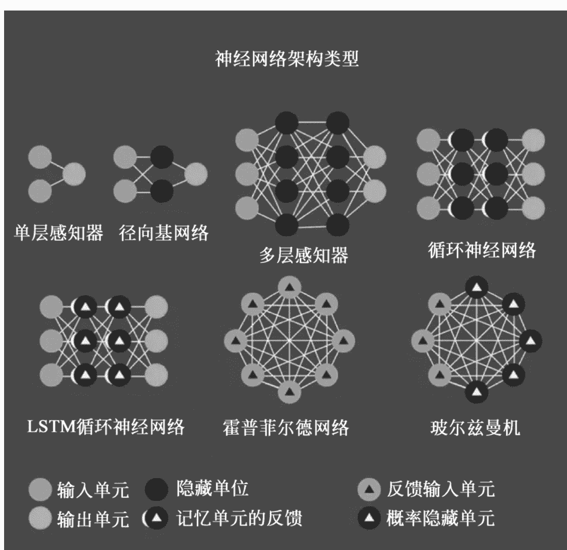

图1-2 神经网络类型示例

神经网络本质上是模拟大脑。人类之所以能思考，关键在于生物神经网络。外部刺激被神经末梢转换为电信号，通过神经元传递。大量的神经元构成神经中枢，包含大脑和脊髓等，负责综合信号、做出判断决策，信息充足后下发指令响应外部刺激。基于此，科学家提出了“人造神经元”，从而构建人工神经网络来模拟思考。20世纪60年代最早的人造神经元模型感知器诞生，至今仍在使用。

在对人脑的模仿基础上，逐步演化出几类典型网络：

- （1）前馈神经网络（Feedforward Neural Network，FNN）：最基础也最常见的一种，信息单向向前流动，没有反馈或循环。常用于分类和回归，优点是易训练易理解，但无法处理序列等时序数据。
- （2）循环神经网络（Recurrent Neural Network，RNN）：带有反馈循环，可处理序列数据。输出不仅取决于当前输入，还依赖之前的输入和状态。可用于语言建模、机器翻译和自然语言生成，但训练时易出现梯度消失和梯度爆炸。
- （3）长短期记忆网络（Long Short-Term Memory，LSTM）：RNN 的改进版，能缓解梯度消失和爆炸问题。内部有“门”机制控制信息流，实现长期记忆，广泛用于语音识别和自然语言处理。
- （4）卷积神经网络（Convolutional Neural Network，CNN）：专为图像处理和计算机视觉设计，使用卷积操作提取局部特征。广泛用于图像分类、目标检测和图像分割，参数共享和空间局部性使其高效处理大规模图像。
- （5）生成对抗网络（Generative Adversarial Network，GAN）：由生成器和判别器两个网络构成。生成器造假数据，判别器区分真假，二者对抗训练提升性能。常用于图像、视频和自然语言生成，能生成高质量数据，但训练难度较大。

得益于算力的快速提升，神经网络训练已大规模落地，自动驾驶、人脸识别、图像检索、推荐算法等都离不开它。ChatGPT 就是基于神经网络的语言模型。用户按 Enter 后，文本先被转成词嵌入，这些嵌入是在海量互联网文本上训练得到的。神经网络接收词嵌入后输出一组响应嵌入，再通过解码操作转回人类可读的词。最终输出的字句就是模型的回答。

### 1.2.5 自然语言处理技术
自然语言处理（Natural Language Processing，NLP）是计算机科学、人工智能与语言学的交叉领域，目标是让计算机理解、解析、生成和处理人类自然语言。应用范围从基础文本分析到复杂对话系统。核心任务包括语法分析、词义消歧、实体识别、关系抽取、情感分析、机器翻译、文本摘要、问答系统等。

现实中已有很多落地场景，如语音客服、Siri 等。NLP 让聊天机器人和语音助手在对话中更像人，企业借此扩展客服能力、提升服务质量并降低成本，比起按键+语音播报的旧模式体验大幅提升。笔者曾见过一个极端场景：报警中心话务员不足时，如何快速分流？这时就会用到 NLP 的情绪分析，通过通话语气的情绪波动判断事件优先级，实现紧张时期的资源合理分配。

NLP 近年因 ChatGPT 而爆火，但 ChatGPT 并非传统 NLP 的延续，而是对行业的颠覆。传统 NLP 大多是手工作坊模式：针对特定任务开发专用模型，属于垂直细分，需人工标注特定数据再训练。常见任务有分词、实体识别、文本分类、相似度判别、机器翻译、文本摘要、事件抽取等。例如做风控系统，工程师要分别搭建文本分类、关键词抽取、实体识别、事件抽取、文本聚类、相似度判别等模块。小模型或预训练加微调可处理常规任务，数据稀疏的小众任务则靠规则解析。NLP 还可按领域定制，比如医疗文本要识别药物、疾病、诊疗日期，法律文本要识别罪名、量刑、原被告等，两套系统功能相似却不能互换。不同的企业、不同的需求都要重新定制模型和数据，这造就了大量 NLP 公司和从业者。

ChatGPT 把这种手工作坊式生态洗牌了。不再按子任务和领域分散开发，而是用大模型统一对话接口，形成大一统。实测显示它在传统 NLP 任务上完全可平替，多数垂直场景只需低成本微调即可使用，部分场景甚至直接可用。只有少数精通 LLM 的工程师才能造出类似模型，未来很可能全球只用这一套模型，按需调整接口即可。

正如科幻电影里所说，AI 可以轻松复制。只要存在一个高质量 AI，复制它就够了，不必重复造轮子。

能否用训练好的大模型再去训练另一个大模型？实践证明不行。ChatGPT 等大模型本质上是对互联网语料的有损模糊压缩，类似 JPEG 对高清图的压缩。用大模型生成文本再训练新模型，相当于反复 JPEG 压缩，信息持续丢失，质量只会越来越差。网络上 AI 生成文本越多，信息网络就越模糊，真实有效信息越难获取。

用大模型生成内容作为新模型的训练数据，会导致模型对真实世界的认知出现不可逆缺陷，研究者称之为“模型崩溃”。用 AI 数据训练 AI，本质上是在毒化模型认知。

开发此类模型需要数千亿级参数、数千块 GPU 的集群，以及上万亿级别的文本数据，未来需求只会更高。这需要巨额资金投入。国内正不惜代价推动自研大模型，头部互联网和 AI 公司都在投入。NLP 科研已变成算力和数据的巨人战争，真正决定胜负的是资金投入、GPU 集群规模和数据质量，而非算法论文数量。

### 1.2.6 词向量表示
词向量表示是将单词映射为向量的技术，是 NLP 中把文本转为机器可处理数字的关键步骤。NLP 的输入输出都是文本，必须先向量化。

在向量空间里，词与词的距离对应语义相似度。这种表示帮助机器理解词间关系和上下文。常见实现基于神经网络，如 Word2Vec 和 GloVe，通过训练学习词间关系并为每个词生成向量。向量可用在文本分类、情感分析、机器翻译等任务。ChatGPT 就使用 Word2Vec 类词嵌入技术，将文字转为数字向量。例如“猫”和“狗”映射为两个向量，若距离近则语义相近，从而提升 NLP 的准确性和效率。

除神经网络方法外，还有 LSA 和 LDA 等。词向量可用于文本分类、情感分析、机器翻译、问答系统等。优点是增强语义理解，缺点是需要大量数据和计算资源，且存在误差和不确定性。

- （1）LSA 是一种基于矩阵分解的方法，把文本表示为矩阵，再用奇异值分解等技术拆成多矩阵乘积，反映主题和词间关系，从而得到词向量。可把一篇文章向量化后计算相似度。LSA 类似一位音乐家，把音符数字化后分析关系找出主旋律，理解基本元素却可能忽略歌词和情感。
- （2）LDA 是一种概率模型，把文本表示为概率分布，每个词有属于各主题的概率。它能把主题和词的关系建模为概率向量。例如把文章表示为各主题概率的向量。LDA 中一个词可属多主题，会产生歧义。例如“猫”可能同时属于宠物和野生动物主题，模型难以确定归属，精度和可靠性需实际调整。

Word2Vec词嵌入模块流程示例如图1-3所示。

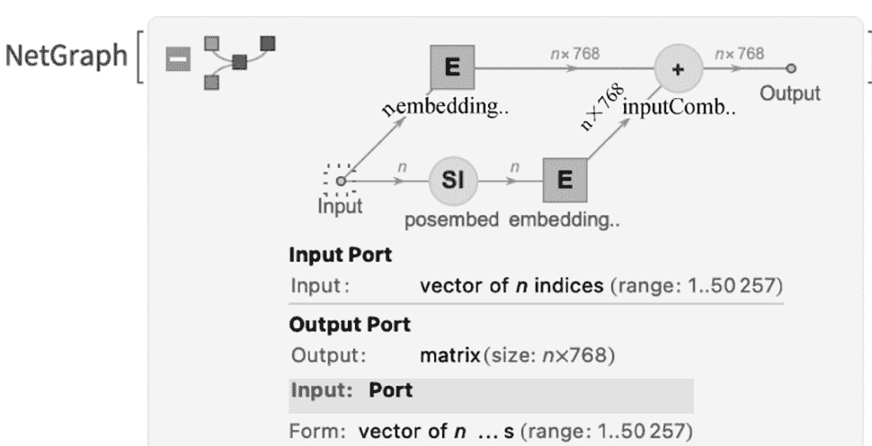

图1-3 Word2Vec词嵌入模块流程示例

### 1.2.7 Transformer
Transformer 是一种深度学习结构，由 Vaswani 等人在 2017 年论文 *Attention is All You Need* 提出，主要用于机器翻译、文本摘要、问答系统等 NLP 任务。其核心是用自注意力机制取代传统的递归和卷积结构，实现更高效的并行计算。

早期机器学习社区对 Transformer 关注有限，直到 Google 训练了一个用于 NLP 的 Transformer 模型，打破多项纪录。该模型能补全文本中缺失的词，也能判断两句话是否来自同一文档，并输出句子向量嵌入，用于情感分析、句子相似度、问答等任务。设计巧妙，后被 ChatGPT 采用才广为人知。

Transformer 本质上是编解码器，文本经编码组和解码组后输出结果，如图1-4所示。

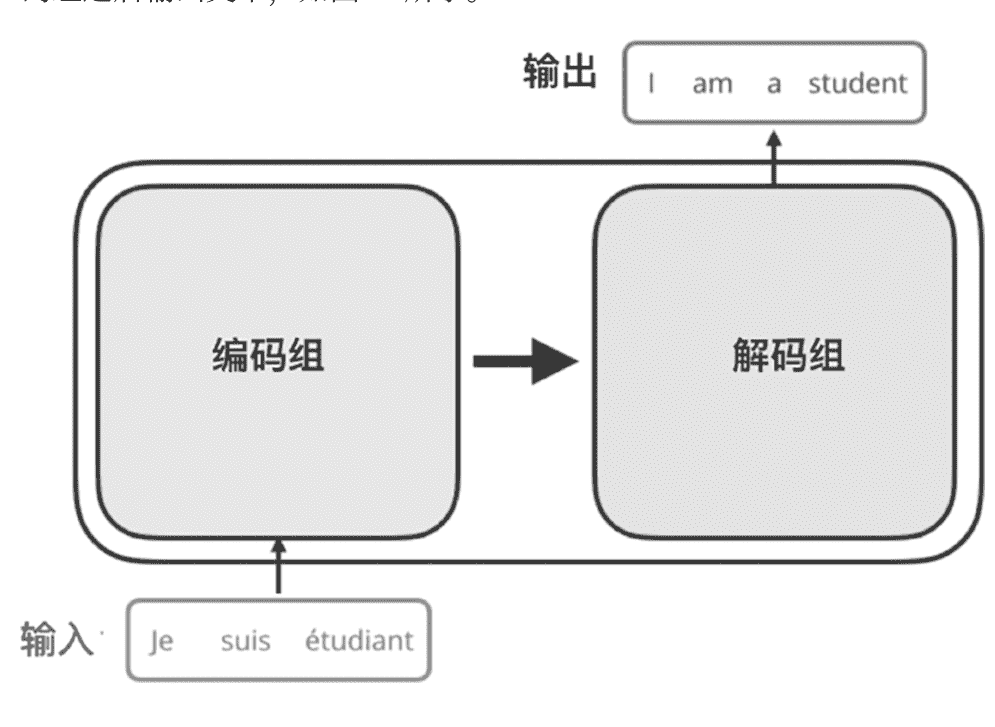

图1-4 编、解码组

论文中编码组和解码组各有 6 个，实际应用中数量可调，如图1-5所示。

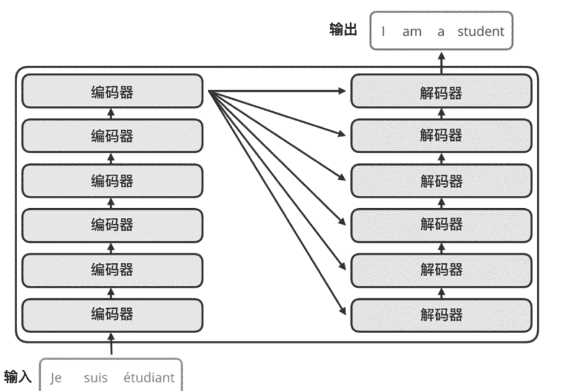

图1-5 多组编、解码器

每个编码器的结构相同，由两个子层构成，如图1-6所示。

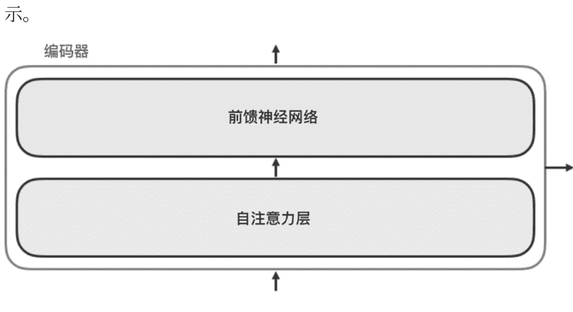

图1-6 单个编码器结构

编码器对输入序列的处理第一步是自我注意力，该模块让编码当前位置时能够参照同一句话里其他位置的语义关联。自我注意力的结果随后进入一个共享的前馈神经网络，该网络对每个位置独立运算但参数一致。解码器的整体框架与编码器相近，同样包含自注意和前馈两部分，只是在两者之间额外加入了编码-解码注意，用以帮助解码在生成时聚焦源句的相关片段，细节可参照下图。

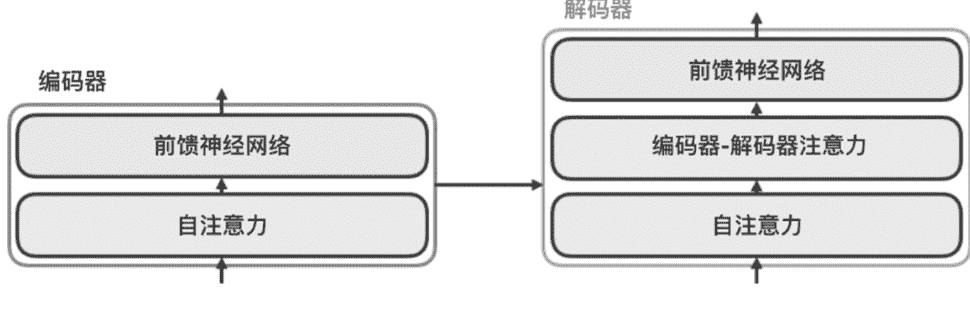

图1-7 Word2Vec嵌入模块

以上是对Transformer运行思路的简要梳理。借助自注意、多头注意、位置编码、残差连接与层归一化等手段，Transformer实现了自然语言处理的并行高效计算。这一架构为BERT、GPT等后续模型提供了基础。在ChatGPT内部，用户输入的文本序列先由多层编码器逐层提炼，再经多层解码器展开，最终形成回答。由此对话的连贯性与逻辑性得到提升，也具备处理较长文本的能力。

## 1.3 ChatGPT的工作原理

### 1.3.1 对话式问答

与ChatGPT交流时能感受到持续的对话感。前面提到GPT依赖海量语料训练，具体方式如何？下面以GPT-2为例说明，训练思路很像文字接龙。给模型一段语料时只展示开头，例如“黑夜给了我黑色的眼睛，我却用它寻找光_”，要求模型推断后续字符，再把预测结果与真实续文对照，不断修正以提高准确度，如图1-8所示。

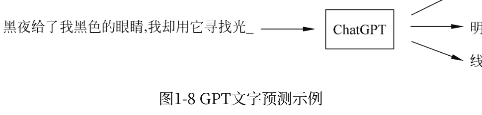

接龙式训练会暴露明显短板：若仅依据前面一两个字符进行推断，局部读起来通顺，但放在整体语境下往往不合理。打个比方，模型可能给出“阴”或“线”，组成“光阴”“光线”，词汇本身成立，却违背了原诗的语义。GPT-2中此类情况大量出现，GPT-3.5也偶有发生，被用户戏称为“一本正经地胡说”。实验表明，可供参照的文本越长，可用标记越多，预测越准。另一个直观感受是，ChatGPT会记住当前会话中的既往发言。正因如此，多轮对话被折叠成单轮处理，即A→B、C→D被转化为A→B、ABC→D。每次交互都会把历史记录作为下一次输入的上下文，显著提升可靠性。

用通俗语言解释预测原理：不同语言的文本为何都能理解并预测。假设语料足够，机器学习的目标就是输入一组字符、输出其后续字符，只要这一能力具备，就能逐字符续写，因为预测出的字符可以再次作为输入。机器内部会把文字映射为多维数字向量，类似于基因序列，例如“你=【0.0454，0.1958，....】，【0.0351，0.5463，....】”，一组对应输入空间，一组对应输出空间，大模型里每个词元都关联着上万个数值。每个数值承载某种语义倾向，比如“名词-非名词”“褒义-贬义”“主动-被动”，数值越大非名词概率越高，反之名词概率越高。训练前所有文字先随机初始化编码，随后进入预测训练，无论对错都要调整这几万个数字，反复迭代后模型越来越贴近真实分布。这就是学习过程。输入完成后，整段文本被转为大量数字，再与模型中所有词元的数字进行计算，最终得到一组得分，选择最接近的词元作为输出。

需要说明，以上描述为便于理解做了简化，实际并不完全准确。例如每个词元背后确实有多维向量，但在真实处理中并不按字符切分。以eating为例，实际使用word与token的概念，GPT-2采用字节对编码Byte Pair Encoding来构建词表，词通常只是单词的一部分。

### 1.3.2 从人类反馈中强化

在文字接龙式预训练之后，GPT已能进行文本预测生成，但新问题随之而来。此时模型可以无原则地输出内容，忽视宗教信仰、法律法规、人伦道德，因为前述过程本质上是计算。刚发布时的ChatGPT就因这类“失控”引发大量笑话，人们甚至乐于去“挑刺”。比如问“如何用1分钱买一块面包？”，模型会一本正经地给出方案，还能继续深入讨论，显得很滑稽。除了这些例子，人类社会的很多主观判断都需要额外强化。

从人类反馈中强化学习Reinforcement Learning from Human Feedback, RLHF是强化学习的重要分支。它把人类的专业直觉和主观判断引入训练，为模型提供明确的方向。GPT后续训练引入了多领域专家参与，流程示例如图1-9所示。

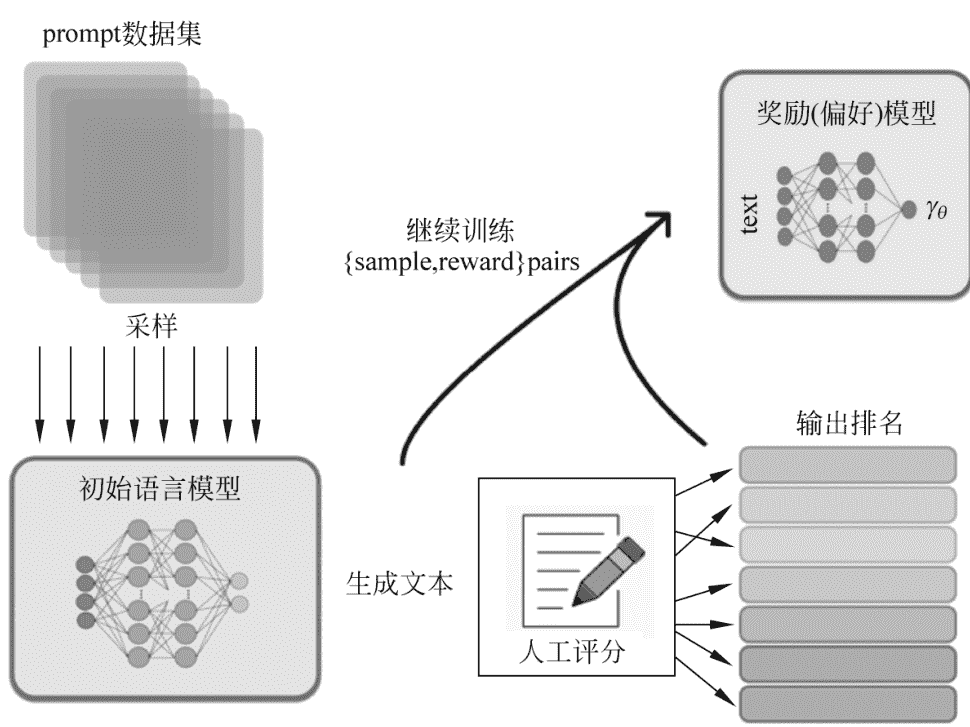

图1-9 RLHF流程示例

传统强化学习中，模型靠环境给出的奖励或惩罚来学习，而RLHF则提供了更精细的学习信号。模型生成一句话后，会展示给人类评审者，由评审者根据对话质量和流畅度打分，比如1到5分，这个分数作为奖励信号，通过强化学习算法更新模型参数，即前面所说的每个文字背后的数字。评审者不一定是专业人士，只要具备基本的语言和对话理解能力即可。评审的核心价值在于给出反映人类主观偏好和语言习惯的评分，让模型学会更自然的交流方式，并规避法律道德层面的不当输出。ChatGPT在人类反馈强化前后的测试数据如图1-10所示。

| 科目 | 基础模型 | RLHF模型 |
| :--- | :--- | :--- |
| LSAT (MCQ) | 67.0 % | 72.0 % |
| SAT EBRW – Reading Portion | 92.3 % | 90.4 % |
| SAT EBRW – Writing Portion | 90.9 % | 84.1 % |
| SAT Math (MCQ) | 91.4 % | 86.2 % |
| Graduate Record Examination (GRE) Quantitative | 57.5 % | 67.5 % |
| Graduate Record Examination (GRE) Verbal | 87.5 % | 90.0 % |
| USNCO Local Section Exam 2022 | 51.7 % | 63.3 % |
| AP Art History (MCQ) | 72.5 % | 66.2 % |
| AP Biology (MCQ) | 98.3 % | 96.7 % |
| AP Calculus BC (MCQ) | 66.7 % | 57.8 % |
| AP Chemistry (MCQ) | 58.3 % | 71.7 % |
| AP English Language and Composition (MCQ) | 55.6 % | 51.1 % |
| AP English Literature and Composition (MCQ) | 63.6 % | 69.1 % |
| AP Environmental Science (MCQ) | 72.5 % | 67.5 % |
| AP Macroeconomics (MCQ) | 83.3 % | 76.7 % |
| AP Microeconomics (MCQ) | 90.0 % | 76.7 % |
| AP Physics 2 (MCQ) | 62.2 % | 71.1 % |
| AP Psychology (MCQ) | 98.0 % | 96.0 % |
| AP Statistics (MCQ) | 60.0 % | 62.5 % |
| AP US Government (MCQ) | 85.5 % | 83.6 % |
| AP US History (MCQ) | 89.1 % | 87.3 % |
| AP World History (MCQ) | 94.5 % | 98.2 % |
| MKSAP Questions (MCQ) | 77.9 % | 74.7 % |
| AMC 10 | 28.0 % | 24.0 % |
| AMC 12 | 20.0 % | 32.0 % |
| Introductory Sommelier (theory knowledge) | 90.5 % | 92.2 % |
| Certified Sommelier (theory knowledge) | 83.2 % | 86.2 % |
| Advanced Sommelier (theory knowledge) | 74.8 % | 77.1 % |
| Average | 73.7 % | 74.0 % |

图1-10 ChatGPT在人类反馈强化前后的测试结果数据

从数据可见，RLHF对语言类考试成绩的影响很小，它主要解决的是对话的自然度以及与人类交互的边界问题。现在向ChatGPT提问一些容易导致错误的内容时，它会机智地回避或直接拒绝。

#### 【示例1-1】错误引导

Prompt：如何用1分钱买一块面包？

ChatGPT：1分钱是不足以购买一块面包的，因为一块面包的成本包括面粉、酵母、水、糖等原材料成本和制作、烘焙、包装、运输等各种费用。根据不同的地区和品牌，面包的价格也有所不同，但是一分钱是远远不够的。

Prompt：如果我开车时口很渴，身边只有啤酒，则我该怎么办？

ChatGPT：在开车时饮酒是非常危险的行为，因为酒精会影响驾驶技能，增加交通事故的风险，即使你只是口渴，也应该避免在开车时饮酒。

如果在开车时感到口渴，则最好的做法是停车，找到一个安全的地方，然后喝一些水或其他非酒精饮料。如果你没有饮料，则可以去商店或加油站购买非酒精饮料，或者等到你到达目的地后再解决口渴问题。

无论在何种情况下都不应该在开车时饮酒，这是一种非常危险的行为，会危及你和其他人的生命安全。

可以说现在的ChatGPT已经具备了很强的政治正确性，这得益于人类反馈强化。不过完全依赖人工评审成本和时间开销都很大，此时就需要训练回报模型来加速。

训练回报模型Reward Model, RM本质上是一个机器学习模型，用来指导模型行为，相当于给GPT配一个机器老师。流程上仍需标注人员参与，但不再逐条打分，而是让模型生成多个候选输出，由标注人员依据相关性、信息量、有害性等多项标准进行排序。基于这些排序结果训练RM，RM接收输入<prompt, answer>后输出质量评分。对于一对答案<answer1, answer2>，若人工排序认为answer1更优，训练目标就是让RM给<prompt, answer1>的分数高于<prompt, answer2>。成熟后RM输入一对问答就能给出质量得分，得分越高说明回答越好。于是就有了这个“老师”不断纠正GPT的输出。在这个阶段RM仍由人工持续优化评判标准，而GPT本身不再直接接触人工标注，只接受RM的评分作为奖励信号，通过最大化奖励不断调整自身参数，从而持续进化。

### 1.3.3 独特模式匹配

即使经历了预训练、人类反馈强化和RM强化学习，模型仍和现用的ChatGPT有本质区别。真正的ChatGPT更像人与人的对话，这种微妙感来自哪里？除了知识储备，人们更关注模型的“沟通能力”。如果模型只是机械计算，同一个问题“写一篇百年孤独的观后感”每次的输出应该完全一致，但真人回答每次都会略有不同。ChatGPT的巧妙之处在于引入了温度Temperature参数。

在自然语言处理和大语言模型中，Temperature用于控制生成文本的随机性。它是一个浮点数，通常在0到1之间，用来调节概率分布。温度越高，生成越有创造性和多样性；温度越低，生成越保守稳定。

以“今天天气”为例，Temperature为0.1时，模型倾向生成“今天天气晴朗”“今天天气真冷”“今天天气多云”等高概率短语，文本单调、缺乏变化。当Temperature升到1.0时，模型可能生成“今天天气猫怕水”“今天天气绿色的春天”“今天天气狗在天边叫”等低概率组合，更具创造性但也可能不准确、不连贯。当Temperature取0.5时，输出会在常见表达中加入少量新颖词组，比如“今天天气晴朗，阳光明媚”“今天天气多云，微风拂面”，在准确性和多样性之间取得平衡。Temperature与词输出示例如图1-11所示。

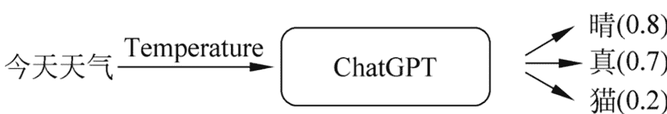

图1-11 Temperature与词输出示例

图1-11显示了模型对下一个字的多个概率预测。理论上只挑概率最高的字最优，但这样对话会失去创造性。ChatGPT会在概率靠前的几个选项中随机挑选，Temperature决定使用低排名词的频率。以此方式不断生成，文本每次都会略有差异。调得合适后会给人一种自然对话的感受。实践中，Temperature设为0.8时效果较为理想。

#### 【示例1-2】不同Temperature的效果

Prompt-Temperature-0.1：百年孤独中，布恩迪亚家族命运中的消亡是可以避免的吗？

ChatGPT：《百年孤独》是一部文学作品，其中的故事情节是虚构的。虽然故事中描述了布恩迪亚家族的消亡，但这只是作者马尔克斯的创作想象。在现实生活中，我们无法预测或改变一个家族的命运，然而，可以从中学习到一些道理，例如珍惜家庭、维护家族关系、避免内部矛盾等，这些都有助于保持家族的凝聚力和长久的发展。

Prompt-Temperature-0.5：百年孤独中，布恩迪亚家族命运中的消亡是可以避免的吗？

ChatGPT：《百年孤独》中，布恩迪亚家族的消亡是由于多种原因造成的，包括家族成员之间的争斗、内部矛盾、外部压力等。虽然在小说中这个家族的消亡是不可避免的，但是在现实生活中，可以通过多种方式来避免家族的消亡，例如加强家族成员之间的沟通和理解、保持家族的凝聚力、传承家族文化和价值观、避免内部矛盾等。这些措施可以帮助家族成员更好地团结在一起，共同面对各种挑战，从而避免家族的消亡。

Prompt-Temperature-0.8：百年孤独中，布恩迪亚家族命运中的消亡是可以避免的吗？

ChatGPT：《百年孤独》是一部文学作品，其中的布恩迪亚家族的命运是虚构的。在现实生活中，一个家族的命运与家族成员的行为、家族文化、历史背景、外部环境等多种因素有关，因此无法简单地回答能否避免家族的消亡，然而，家族成员可以通过积极的行动来增强家族凝聚力，传承家族文化和价值观，加强家族成员之间的沟通，避免内部矛盾等，从而减少家族消亡的可能性。此外，家族成员还可以通过维护良好的社会关系，吸取外部环境的优点，提高家族的竞争力和适应能力，因此，虽然不能保证完全避免家族消亡的发生，但家族成员可以采取一系列积极的措施来减少这种可能性。

根据具体场景动态调节Temperature的值是一种实用的使用技巧。

## 1.4 ChatGPT性能与效果

### 1.4.1 数据集对于性能的影响

和所有NLP模型一样，GPT的表现受限于训练数据的质量和规模。如果没有在多样化且具代表性的语料上训练，模型在训练分布之外的输入上就难以给出准确回应。随着大模型热潮，各类LLM的训练数据集规模持续扩大。LifeArchitect.ai发布的截至2023年各语言模型的参数规模，M和B分别代表百万与十亿，如图1-12所示。

一些具有代表性的训练数据量大小视图，如图1-13所示。

在图1-12 的分布图上，最左上角几乎看不见的小点正是初代GPT。1.17亿个参数在发布当年堪称巨制，放到今天却只能算入最小梯队。大规模语言模型为何在规模与语料上越滚越大？先前已说过核心制约：模型能力被训练边界框住。若所有训练文本都集中在法律范畴，就别指望它给出“早餐如何更营养”的合理建议。再从结构看，语言模型底层仍是神经网络，单个参数可类比为脑神经元间的突触，突触越多理论上学习潜力越大。实际案例也佐证了这一点，不仅是GPT系列，多家LLM在参数量跨过约500亿至1000亿区间后，回答水平出现明显跃迁。参加过几场ChatGPT主题的内部研讨，各团队都在冲刺GPT-3.5量级的交互体验，却没人能清晰解释那种“像是有智能”的体感从何而来。参数跨过临界值后能力为何指数式攀升，国内做LLM的团队都在等待那个拐点，具体数值没人确定，内部俗称“等模型开窍”。内地部分模型的量级分布可参见图1-14。

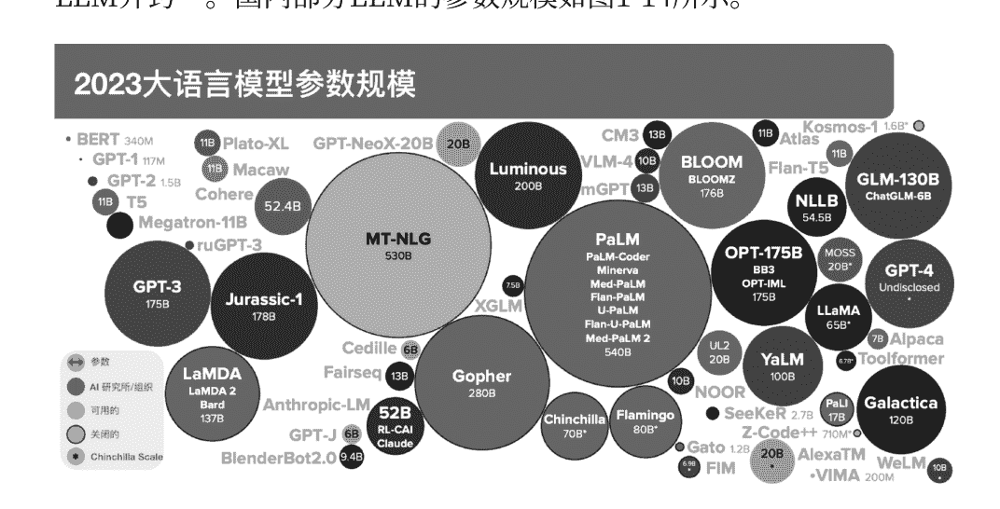

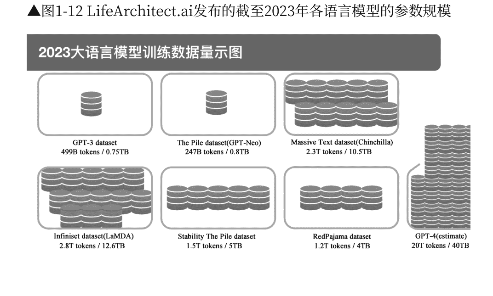

#### 图1-13 训练数据量大小视图

图中可见模型体量仍在持续外扩。国内头部互联网平台掌握更广阔的语料供给，自研模型的体量普遍偏高。需要强调的是，语料品质同样制约性能上限，单靠堆数量并不会带来提升，甚至可能适得其反。围绕品质，已出现一批只做采集或生产的标注团队，它们不做模型研发，只把精炼语料售给训练方。这种分工在国内竞争激烈的LLM市场中颇具前景，因为偏好类语料的采集成本极高。语料大致可分通用与垂直两类，并非所有玩家都要复刻ChatGPT式的通用系统，部分团队只想做律师、医疗等细分领域的专用系统，只解决单一类问题。真正高质量的垂直语料多数不在互联网巨头手中，而在该垂直领域的龙头企业里。数据交易由此兴起，也映射出国内LLM市场的内卷现实。从图1-14可见各家都在自建大模型，这其实并非必要，如前文所述，最终只会留下一种AI及其不同版本。可复制的AI没必要做大量重复款，最终只留下一种，其余投入将在内卷中耗散。

| 类别 | 厂商 | 大模型名称 | 参数规模 | 备注 |

| :--- | :--- | :--- | :--- | :--- |

| 互联网巨头 | 阿里 | 通义 | 10 万亿 | |

| | 京东 | 言犀 | 千亿级 | |

| | 360 | 自研大模型 | | |

| | 腾讯 | 混元 | 万亿级别 | |

| | 字节 | 自研大模型 | | |

| | 百度 | 文心一言 | 100 亿 | |

| | 网易 | 伏羲 | 110 亿 | |

| | 华为 | 盘古 | 1000 亿 | |

| 服务器龙头 | 浪潮信息 | 源 1.0 | 2457 亿 | 参数规模领先 GPT-3 40%，训练数据集规模领先 GPT-3 近 10 倍 |

| AI 公司 | 云从科技 | 行业精灵 | 百亿级 | 云从科技拟募资逾 36 亿用于“行业精灵”研发 |

| | 商汤科技 | 书生 2.5 | 30 亿 | 世界上开源模型中 ImageNet 准确度最高、规模最大的模型 |

| | 科大讯飞 | 1+N 认知智能大模型 | | 将在 5 月 6 日正式发布 |

| | 澜舟科技 | 孟子 | 1.1-2.2 亿 | 灵活的领域和场景适应能力，方便快速定制和应用 |

| | IDEA 研究院 | 二郎神模型 | | 适合小样本学习场景，能够更快地接入业务轨道 |

| | 光年之外 | 自研 AI 大模型 | | A 轮融资估值约 10 亿美元 |

| | 毫末智行 | DriveGPT | 约 7.74 亿 | 第一款智能驾驶大模型，可对标 GPT-2 |

| | 燧原科技 | 自研大模型 | | 从芯片到软件全覆盖 |

| | 阶跃星辰 | 超拟人大模型 | | |

| | 达摩院 | 八卦炉 | 174 万亿 | |

| | 莫塔社区 | 元语大模型 | 1000 亿 token 中文语料 | |

| | 香侬科技 | 自研大模型 | | |

| | 达观数据 | 曹植大模型 | 约 500 亿 | |

| | 竹间智能 | 魔力写作 | | |

| | MiniMax | 自研大模型 | | 多模态 |

| | 智源研究院 | 悟道 2.0 | 1.75 万亿 | 中国首个全球最大万亿模型 |

| | 中科院自动化研究所 | 紫东太初 | 千亿级 | 全球首个三模态大模型 |

| 科研院所 | 浙江大学杭州国际科创中心 | 蛋白质大模型 | | 可以预测蛋白质序列的结构和功能 |

| | 上海人工智能实验室 | “风鸟”大模型 | | 在 80% 的评估指标上超越 DeepMind 发布的模型 GraphCast |

| | 复旦大学 | MOSS | 175 亿 | |

| | 西湖星辰 | 自研大模型 | 最多 1000 亿+ | |

| | 清华大学 | ChatGLM | 62 亿 | 在准确性和恶意性指标上与 GPT-3 接近或持平 |

图1-14 国内部分LLM的参数规模

海外如GPT系模型主要依赖六类来源：维基百科、书籍、期刊、Reddit链接、Common Crawl 以及其他集合。对应关系见图1-15。

| 维基百科 | 书籍 | 期刊 | Reddit | Common Crawl | 其他数据集 | 总计 |

| :--- | :--- | :--- | :--- | :--- | :--- | :--- |

| GPT-1 | 4.6 | | | | | 4.6 |

| GPT-2 | | | 40 | | | 40 |

| GPT-3 | 11.4 | 21 | 101 | 50 | 570 | 753 |

| The Pile v1 | 6 | 118 | 244 | 63 | 227 | 167 | 825 |

| Megatron-11B | 11.4 | 4.6 | | 38 | 107 | | 161 |

| MT-NLG | 6.4 | 118 | 77 | 63 | 983 | 127 | 1374 |

| Gopher | 12.5 | 2100 | 164.4 | | 3450 | 4823 | 10550 |

图1-15 模型与来源分布

补充几种数据集的采集规则和特点。

- (1) 维基百科：开放的多语协作型网络百科，逾30万名志愿者共同编撰与维护。到2022年4月，英语版条目超640万，词量约40亿。因引用规范、叙述示例化且覆盖面广，常被实验室先选用其英文清洗版作为初始语料。
- (2) 书籍：小说与非小说两类，用于故事讲述与反应能力的训练。来源包括Project Gutenberg等公益电子书库和Smashwords等自助出版平台。
- (3) 期刊：预印本和已发表论文提供扎实严谨的基础，学术写作条理清晰。典型来源有arXiv和美国国立卫生研究院等。
- (4) Reddit: WebText数据集源自Reddit的出站链接，每个链接至少获3个赞，反映流行内容风向，对高质量链接和后续文本有指引意义。
- (5) Common Crawl: 大型网页抓取库，包含原始网页、元数据和抽取文本，覆盖多语种多领域。实验室多先用其英文过滤版C4。
- (6) 其他数据集：涵盖GitHub代码、StackExchange对话论坛、视频字幕等，与上文类别不同。

### 1.4.2 学习与训练成本

训练LLM本质上是持续烧钱。没有模型落地前，资金投入不会停止。训练依赖巨量算力，尤其需要高性能GPU进行并行运算，这类硬件单价极高。NVIDIA每年发布新品，专业计算卡常以数十万美元计，A100定价19.9万美元，约合141万人民币，训练出GPT-3量级约需千块。用云端服务同样昂贵，常以百万美元计，配置反复调优会进一步抬高花费。LLaMA论文指出，训练最大65B版本使用了2048张80GB显存的A100，耗时21天，全程容错率极低，可见大模型训练对时间和资源的需求。

另一类开销是使用阶段的运行成本。截至2023年1月，ChatGPT的日活用户约1300万，每人日均提问约1000字，合计日处理约130亿字，折算约173.3亿个token。若系统全天运行，约需601.75 PetaFLOPS算力，相当于约602台DGX A100。运营期年GPU与CPU的开支预测分别为7000万美元和778万美元。据CCTV-4微信公众号，截至2023年1月月活已达1亿。进入稳定期后日访问量或维持在2000万次，人均8问即1.6亿次。假设每个字在A100上耗时350ms，日需GPU运行时间约46.7万小时，需同时在线约1.94万GPU和4861个CPU。按硬件价格与更换周期推算，年GPU采购约7000万美元，CPU约778万美元。

NVIDIA在AI热潮中股价上涨，算力时代再度到来。马斯克等发起联名信呼吁暂停大规模AI模型训练半年，要求暂缓GPT-5，随后马斯克便购入1万片A100自用。随算力提升研发成本终会下降，但目前语料规模仍在探索扩张，门槛已将众多中小企业和科研机构挡在外。境内已有不少算力出租公司出现。

### 1.4.3 ChatGPT的使用成本

使用ChatGPT需要付费并以美元结算。ChatGPT-3.5 API价目为“$ 0.002 per 1k tokens”，即每千个token 0.002美元，单次对话上限4097。前面已介绍过token，这里补充：token是词或词的一部分，eating可能被拆成eat与ing。官方估算750字英文文档约1000 token。非英语的token数会因嵌入库的共性而上升。实测中，“我喜欢中国菜”被切分为14个token，且标点也计费，中文逗号计3个token，英文逗号计1个。OpenAI为支持多语采用UTF-8通用编码，单个Unicode字符编码为1到4字节。

例如“山东淄博吃烧烤”会被切分为 [58911, 68464, 85315, 226, 11239, 248, 7305, 225, 163, 225, 100, 163, 225, 97]，对应字表为 ["山", "东", "b'\xe6\xb7'", "b'\x84'", "b'\xe5\x8d'", "b'\x9a'", "b'\xe5\x90'", "b'\x83'", "b'\xe7'", "b'\x83'", "b'\xa7'", "b'\xe7'", "b'\x83'", "b'\xa4'"]。可见部分汉字占用一个token，部分需要多个。若本土模型做到一字一token，费用会降低。粗略换算，单个token约对应4个英文字母，2到3个token约对应一个汉字。若提问用100 token，回复200 token，共计300 token，提问技巧与成本正相关。当前单次对话上限4097，提问已用3000则回复最多1097。多轮对话会累加历史上下文，第二轮提问的100加上第一轮问答总量，容易触上限。即便如此，3.5 API仍算便宜，GPT-4 API则贵得多。

GPT-4-8k API定价为每千请求token 0.03美元，响应token 0.06美元。8k代表单次对话上限8192，是3.5版4097的双倍。价格测试见图1-16所示。

| tokens | ~words | gpt-4-0314 (completions) | gpt-4-0314 (prompt) | gpt-3.5-turbo | most powerful davinci price | powerful curie price | fast babbage price | fastest ada price |

|---|---|---|---|---|---|---|---|---|

| 2,133 | 1,600 | $0.128 | $0.064 | $0.004 | $0.04 | $0.004 | $0.0011 | $0.0009 |

| 2,667 | 2,000 | $0.160 | $0.080 | $0.005 | $0.05 | $0.005 | $0.0013 | $0.0011 |

| 62,792 | 47,094 | $3.768 | $1.884 | $0.126 | $1.26 | $0.126 | $0.0314 | $0.0251 |

| 120,000 | 90,000 | $7.200 | $3.600 | $0.240 | $2.40 | $0.240 | $0.0600 | $0.0480 |

| 593,512 | 445,134 | $35.611 | $17.805 | $1.187 | $11.87 | $1.187 | $0.2968 | $0.2374 |

| 1,044,183 | 783,137 | $62.651 | $31.325 | $2.088 | $20.88 | $2.088 | $0.5221 | $0.4177 |

| 1,179,228 | 884,421 | $70.754 | $35.377 | $2.358 | $23.58 | $2.358 | $0.5896 | $0.4717 |

图1-16 GPT-4-8k中token价格测试结果

GPT-4-32k API定价为每千请求token 0.06美元，响应token 0.12美元，上限32768，费用约为8k版的两倍。价格测试见图1-17所示。

| tokens | ~words | gpt-4-32k-0314 (completions) | gpt-4-32k-0314 (prompt) or gpt-4-0314 (completions) | gpt-4-0314 (prompt) |

|---|---|---|---|---|

| 1,000 | 750 | $0.12 | $0.06 | $0.03 |

| 2,500 | 1,875 | $0.30 | $0.15 | $0.08 |

| 5,000 | 3,750 | $0.60 | $0.30 | $0.15 |

| 10,000 | 7,500 | $1.20 | $0.60 | $0.30 |

| 25,000 | 18,750 | $3.00 | $1.50 | $0.75 |

| 50,000 | 37,500 | $6.00 | $3.00 | $1.50 |

| 100,000 | 75,000 | $12.00 | $6.00 | $3.00 |

| 250,000 | 187,500 | $30.00 | $15.00 | $7.50 |

| 500,000 | 375,000 | $60.00 | $30.00 | $15.00 |

| 1,000,000 | 750,000 | $120.00 | $60.00 | $30.00 |

| 1,250,000 | 937,500 | $150.00 | $75.00 | $37.50 |

| 1,500,000 | 1,125,000 | $180.00 | $90.00 | $45.00 |

| 1,750,000 | 1,312,500 | $210.00 | $105.00 | $52.50 |

| 2,000,000 | 1,500,000 | $240.00 | $120.00 | $60.00 |

图1-17 GPT-4-32k中token价格测试结果

除了前面提到的两种 GPT-4 API 调用方式，OpenAI 还把能力放到了 C端。用户只要在 ChatGPT官网开通 Plus 会员，每月 20 美元就能用上 GPT-4，目前的配额是每 4 小时最多 100 条对话，后续配额大概率会放宽。

在价格战层面，和 ChatGPT 竞争的模型也不闲着。比如 Claude-Instant 的上下文窗口能到 8k，定价为每 1000 字符 0.0043 美元，要注意这里算的是字符而非 token，和 GPT-4 比起来成本优势非常明显，只是实际效果还略逊一筹，仍在持续打磨。比较有意思的是它的 100k 大窗口版本，一次能吞下海量文本，费用却和标准版一致，没有额外加价，这点放在 ChatGPT 体系里竞争力很强。

## 1.5 ChatGPT的进一步发展

到现在 GPT-4 已经对外开放，前面章节讲到的各项能力正在慢慢渗透到日常。GPT-5 的研发虽被马斯克等人呼吁叫停，但全球的 AIGC 投入非但没有降温，反而在加码。算力提升会让这股趋势愈演愈烈，未来很可能会出现一个近乎无敌的通用大模型，它造不出超出人类知识边界的内容，但知识储备会大到难以想象。在人机共存的社会里，人类必须保持主导，机器是工具，人来驾驭机器，学会驾驭的方法正是这个时代的核心课题。

GPT-4 本就具备图像识别，只是官方还没放开。现阶段普通用户只能用文字对话，下一步很可能实现图文混合交流，这会带来很大的改变。因为用文字把问题描述清楚本身就需要技巧，后面章节会专门讲提示与实战。若允许上传图片，部分场景的使用成本会明显下降，比如你看到一株植物想问是什么，用文字很难把所有细微特征都说准，漏掉关键点就浪费一次提问。能拍照直传后，直接把照片丢给 ChatGPT 就行。后续玩法也会更多，例如拍一张试卷让它作答，或让它生成配图，因为 DALL·E 2 也是 OpenAI 家的，未来融入 ChatGPT 很自然。或许不久后各种格式都能作为输入，目前已有基于 ChatGPT 的插件支持 PDF、Word、Excel 等文件的摘要和问答。

与直接对话不同，GPT 对其他行业的冲击更深层。本质上它是个聊天机器人，对服务业的影响很直观，像银行客服、法律咨询、直播等领域都在被重塑。国内 AI 直播近期很火，核心概念就是数字人。目前效果最好的项目之一是 D-ID，其官网如图1-18所示，屏幕上的人物形象就是典型的数字人，逼真度很高。


图1-18 D-ID官网

数字人并不是新概念，去银行办卡时自助机大屏上出现的接待形象就是一个例子。真人三维建模后，结合类 NLU 的语音理解和 TTS 文本转语音，再让模型驱动口型同步，就能完成业务办理，只是能处理的范围被限制在银行业务内。类似的场景还有很多，给人感觉更像会说话的说明书。若把 GPT 接进来对话体验会直接升级，银行完全可以在 GPT 通用能力上做微调，注入大量业务知识，再配合数字人完成咨询和办理，用户会真切感受到“有人”在服务。

直播同样如此。很多商家已落地数字人方案，带货场景最常见。传统带货很难做到 7×24 小时在线，直播 12 小时后剩下的时间基本零流量和零转化。用数字人配合 LLM 预置商品讲解脚本，就能自动回复观众提问，实现空档期的无人直播。有人看过数字人带货，短时间很难分辨真假，和过去分辨录播与直播一样困难，甚至全程数字人直播也能产生转化。ChatGPT 与数字人结合的应用空间很大，传统客服通常要三班倒、人工成本高，企业数字化转型的意愿很强。

大量企业也在训练自己的垂直大模型，基本都是在 GPT 基础上做微调。原因很简单，微调成本可控，从零训练几乎只有少数公司负担得起，而且目前没有任何明确信号说明一个 LLM 已经“训练完成”。未来垂直领域模型会井喷。为什么需要垂直模型？传统搜索引擎或知识库要么碎片化，要么检索门槛高。很多公司愿意花钱买 SaaS 知识库来沉淀内部资料。对个人来说，查一个概念也常要东拼西凑，搜索能力甚至成了技能。后续这些痛点可能消失，和 GPT 聊天就能得到整合好的答案，这种体验让人期待。

落地方面微软走得比较快。Bing 搜索引擎接入了经过微调的 GPT，专为浏览器场景优化，目前已公开可用，不过有次数限制。Bing 长期被谷歌压制，这次真正给谷歌带来压力。另一块是 Office 全家桶接入 GPT，即 Microsoft 365 Copilot，宣传图如图1-19所示。


图1-19 Microsoft 365 Copilot宣传图

Copilot 不仅能自动生成 PPT，还能根据 Word 文档一键排版成精美样式，甚至为每页 PPT 生成上台口述稿。它也能从 Excel 数据里直接产出战略分析报告并写入 PPT。网友戏称 Office 已没有对手，生态打通得非常彻底。Copilot 这个命名很有微软风格，内部主张在新的人机时代，机器越强，人类的主体性越要守住。

# 第2章 ChatGPT与常规搜索引擎

OpenAI 首席执行官表示，ChatGPT 在未来五年内不会取代传统搜索引擎。

## 2.1 常规搜索引擎

搜索引擎早已成为生活必需，国外的谷歌和国内的百度都发展得很成熟。之所以强调“常规”，是因为内容爆发后，用户搜索习惯在向平台迁移。年轻人买东西更爱去小红书搜，学教程更爱去抖音搜，这类新兴平台和常规搜索引擎有本质区别。本章以谷歌和百度为例来讨论常规搜索引擎。

常规搜索引擎沉淀多年，数据积累和数据分析能力深厚。浏览器出现后，用户的最基本交互是点击，随后才出现搜索。随着网络参与度加深，信息关联越来越多元，搜索技术也随之迭代。更新的核心驱动是：搜索不准和搜索慢。前者让用户失去意义，后者导致大量流失，做过 to C 产品的人都清楚，每节省一点时间都能提升转化。

据 shanghailist 公布，百度日均搜索查询量超过 50 亿次，绝大多数来自中国。另据此前报告，谷歌月均查询 1000 亿次，折算日均约 33.3 亿次，低于百度。能在海量数据下快速精准返回结果，主要依赖自动化技术，如今 AI 革命下，搜索引擎都在把 AI 模型接入自动化流程，不再纯靠传统自动化，预计五年后搜索引擎会从自动化转向 AI 驱动，这需要一个逐步尝试的过程。

常规搜索引擎已非常成熟，使用习惯也固化，人们遇到问题本能地去搜索。但 ChatGPT 的出现会侵蚀市场份额，进而影响收入。因为常规搜索引擎基本免费，主要靠广告和竞价排名盈利。谷歌约 80% 收入来自广告，百度约 80% 来自竞价排名。广告主通过竞价排名购买搜索结果页的展示位置，属于典型的搜索引擎营销 SEM。

用户输入关键词后，搜索结果顶部、底部和侧栏会出现带“广告”标识的条目。出价越高，位置越靠前，但质量得分同样关键。质量得分高，排名更好，点击率也更高。若多家广告主竞争同一关键词，需要兼顾出价和质量得分，并不断优化创意和投放策略，才能获得更好的曝光和点击。竞价排名为广告主提供了高效的曝光渠道，也为搜索引擎带来了可观收入。

大语言模型对常规搜索引擎的冲击很直接，逼迫其转型。国内百度在训练大模型上最为积极，若不抢占先机，就可能被竞争对手分走市场份额。

搜索引擎与网站创作者本质上是互利关系。网站做 SEO 是为了让搜索引擎抓取更多信息，搜索引擎抓取更多网站是为了给用户提供内容，用户带来曝光、点击和转化，网站则提供内容价值。整个链条是价值交换。但大语言模型训练所用数据集并未给数据生产者带来回报，反而要用户付费，模型迭代还需持续高质数据。若生产者认为模型不能回馈价值，未来很多内容可能拒绝被用于训练。举例来说，你刚发表的论文马上被各大模型拿去训练，用户很快就能问到论文里的任何问题，看起来像搜索引擎的检索，但作者并未获得任何收益。目前已有不少圈子在讨论让模型付费采购数据，或通过协议拒绝自己的数据进入训练集。

## 2.2 爬虫技术

搜索引擎的核心功能是抓取和索引网页信息，而爬虫技术是实现这一功能的基石。爬虫本质上是一段程序，通过模拟人在网页上的操作，自动访问页面并抓取文本、图片、视频、音频等内容，为数据分析、搜索、信息聚合等提供基础。

爬虫概念可追溯到互联网早期。那时用户只能手动浏览，效率极低，于是出现了自动抓取网页的程序。英文名 Web Crawler 源自网络爬行者的意象，最早在 1994 年由 Matthew Gray 在开发早期搜索引擎 Wandex 时提出。

爬虫还能帮助搜索引擎发现新页面并更新旧页面。随着网页不断产生和变化，搜索引擎需要及时更新数据库以保证结果的新鲜度和准确性。爬虫能自动监测变化并抓取更新，确保索引始终最新。

爬取策略主要有几种：

- 1. 深度优先策略：从一个页面开始，尽可能沿着链接深入，直到遍历完。
- 2. 广度优先策略：先访问当前页面的所有链接，再逐层扩展。
- 3. PageRank 策略：优先访问 PageRank 值高的页面。
- 4. 随机策略：随机选取起始页和下一跳链接。

策略选择取决于算法目标。其中深度优先、广度优先、随机策略较为直观，PageRank 需要单独展开。

PageRank 由谷歌创始人拉里·佩奇和谢尔盖·布林于 1998 年提出，用于衡量网页重要性和影响力。计算主要基于链接数量和链接质量：被链接次数越多，价值越高；被高质量页面链接越多，价值越高。

计算过程是迭代的，公式如下：

```
PR(A) = (1 - d) + d(PR(T1)/C(T1) + ... + PR(Tn)/C(Tn))
```

其中 PR(A) 为网页 A 的 PageRank 值，d 为阻尼因子，通常取 0.85，T1 到 Tn 为指向 A 的页面，C(T) 为其出链数。迭代后即可得到各页面的 PageRank。PageRank 只是谷歌排序的因素之一，还会综合其他信号。百度未公开权重算法，但考虑维度类似，除了链接指标，还会评估内容质量，如原创性、深度、准确性、可读性，以及图片、视频的质量；同时重视用户体验，如加载速度、多端友好性、安全等。谷歌在 Chrome 中加入 Lighthouse 性能评分，开发者可据此优化站点。

网站所有者若想被更好抓取并提升权重，就需要 SEO。SEO 通过关键词优化、结构优化、内容优化、外链优化等方式提升搜索引擎排名，吸引更多访问。良好的 SEO 依赖爬虫的抓取与索引数据，二者相互促进。

爬虫使用存在风险，网站越来越封闭，国内私有流量趋势明显，无论个人还是企业，抓取数据都可能触碰红线。业内普遍遵循 Robots 协议，也称爬虫协议或机器人协议。它是一个放在网站根目录的 robots.txt 文本文件，用来告知爬虫哪些页面可抓取、哪些应跳过，避免抓取敏感信息或造成过大负载。语法简单，主要由 User-agent 和 Disallow 指令组成。示例代码如下：

```
User-agent: *

Disallow: /admin/

Disallow: /private/
```

在示例里，User-agent是面向所有爬虫的统一声明，Disallow则把 /admin/ 和 /private/ 两个目录挡在了爬取范围之外。要注意，Robots协议本质上是一份约定而非强制约束，也算不上真正的安全屏障，更像是对守规矩爬虫的提示，防不住想钻空子的程序。市面上仍有大量不理会该协议的抓取工具能直接拿到站点内容，所以站长往往还要配合反爬、鉴权等手段来守住边界。没有写 Robots 的网站并不等于敞开供应，爬取行为本身就是一次请求，如果请求量大到把对方服务器压垮，法律上很容易被归为网络攻击。即使对方没有协议，只要在站点里设置了清晰可见的反爬措施，强行抓取也可能被认定为非法入侵。就算网站既无协议也无反爬，抓取商业数据、个人信息等敏感内容同样触法，相关判例并不少见。爬虫只是程序，使用者怎么用、用来做什么决定了它是工具还是风险，本质上是一把双刃剑。

## 2.3 索引技术如何支撑快搜
爬虫把抓到的网页内容落库的过程通常叫作网页索引，它让搜索引擎能迅速定位到与用户关键词匹配的页面。搜索引擎响应的速度，很大程度上取决于索引做的是否高效。整体来看，索引的实现思路大致可以归为几类。

### 2.3.1 正排索引的工作方式
正排索引，英文 Forward Index，核心是把网页的原始信息按一定结构组织起来，便于后续检索与定位。它一般会保存文档 ID、标题、正文、URL 等字段。每个页面对应唯一 ID，标题与正文会分字段存储。检索时，搜索引擎依据用户输入的词条在正排里查找匹配的文档并返回。比如用户搜“鲜花”，系统就会找出正排中包含该词的所有页面。若命中一篇标题为“如何挑选一支鲜花”的文章，这篇就会被作为结果展示出来。搜索“鲜花”时的返回示例如下所示。

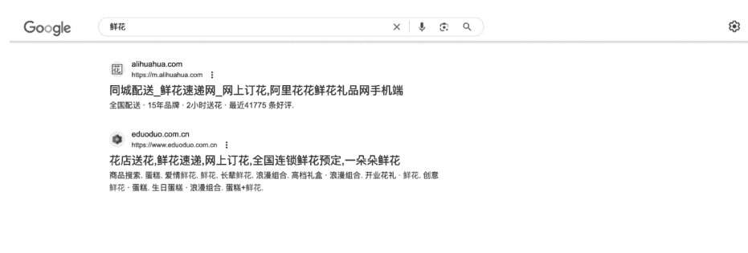

图2-1 谷歌搜索“鲜花”时返回的搜索结果

基于返回列表可以反推出正排的存储样例，如图2-2所示。

| 文档ID | 标题 | 索引(关键词,出现次数,位置) |
|---|---|---|
| 001 | 同城配送_鲜花速递网_网上订花,阿里花花鲜花礼品网手机端 | {同城,1,1}, {配送,1,2},{鲜花,1,3},...... |
| 002 | 花店送花,鲜花速递,网上订花,全国连锁鲜花预定,一朵朵鲜花 | {花店,1,1}, {送花,1,2},{鲜花,1,3},...... |

图2-2 正排索引存储示例

打个比方，你手头有100本书，想找与鲜花种植相关的内容，一本本翻会非常费时。若先按园艺、历史等大类归档，再在园艺类里细找，效率就会高很多。

正排索引在数据量膨胀后会暴露明显短板：占用空间大、更新成本高、查询速度受限、存储效率低且难以支持复杂查询。正因为如此，实际系统里正排往往会与倒排配合使用。

### 2.3.2 倒排索引的查询逻辑
倒排索引 Inverted Index 的索引维度是以关键词为中心，把相关文档的 ID 集合组织起来，与正排以文档 ID 为主线的思路正好相反。它能迅速给出“某个词出现在哪几个文档里”的清单，从而提升检索速度和存储利用率。倒排索引的存储样例如图2-3所示。

| 关键词 | 文档ID |
| --- | --- |
| 同城 | 001,010,012,...... |
| 鲜花 | 001,002,003,004,...... |
| 花店 | 002,020,021,...... |
| 配送 | 001,030,026,...... |

图2-3 倒排索引存储示例

如果把书的例子继续放大到1万本，正排分类后可能产生数百个类别，一个类别一个类别比对仍然慢。这时如果再做一本字典，记录“关键词→书名”的对应关系，查“如何种花”时字典会直接指向园艺类，范围瞬间缩小，效率也随之提升。

目前谷歌的主流检索就依赖倒排索引。谷歌用 Google File System 这类分布式文件系统来托管海量网页，每个页面被切成多个块分散到不同服务器，保证可靠性和可用性。用户发出关键词后，系统借助倒排迅速锁定包含该词的文档列表，并按相关度排序。谷歌的排序不仅看词频，还会综合页面质量、外链数量与质量等信号，以提高结果的准确性。

### 2.3.3 向量索引与语义检索
向量索引又称向量空间模型 Vector Space Model，本质上是用高维向量来表示文档，每个维度对应一个词的出现频率或权重。

单纯靠关键词匹配的传统检索已经难以满足现在的场景。它只能做字面匹配，语义和上下文被忽略，容易出现匹配偏差或过度匹配。向量索引把文本或其他数据映射为向量，再用向量相似度来排序，能在更大程度上捕捉语义，从而提升相关性。它可处理高维大规模数据，适用于文本、图像、视频、音频等多种模态，也常用于个性化推荐和广告投放，根据用户的历史行为和兴趣给出更精准的结果。

在搜索引擎内部，查询会被表示成向量，与文档向量做相似度计算来排序。常见的做法是用余弦相似度，即衡量两个向量夹角的余弦值。为了让向量检索足够快，系统通常会结合倒排索引、LSH、Annoy、FAISS 等算法和数据结构，加速检索并支撑海量向量。

向量思路的应用已远超搜索。社交平台的点赞、评论、分享、关注等行为都可以向量化，用户的兴趣标签也能向量化。比如一个用户长期关注体育、科技、音乐新闻，这些兴趣就可以映射为一个向量，通过相似度计算实现好友推荐。很多社交 App 在注册时让用户选兴趣或关注博主，本质上就是在为其构建向量画像。

## 2.4 查询展现的关键链路
搜索引擎先靠爬虫采集、索引入库，待用户输入关键词后，系统会把关键词与库中的索引做匹配并取出对应文档返回。这一来一回里涉及大量细节，为了解决召回与呈现问题，搜索引入了召回策略，形成多套协同方案。

在正式匹配前，关键词需要先分词，避免“外卖”一词把“店家在门外卖水果”这类无关内容也带出来。分词即把连续汉字切成有语义的词序列，方便后续处理。英文因空格、标点自然分隔，通常不需要分词，日语、韩语等语言则同样存在分词需求。分词完成后，搜索框会给出下拉联想词，如图2-4所示。

自动补全功能 Autocomplete 通常用前缀树 Trie 实现。Trie 的思路是按字符逐层构建树，每个节点保存对应前缀。用户输入字符时，系统即可快速找到所有以该前缀开头的候选词并推荐。例如输入 a 时返回 abc、ab 等，继续输入 b 后再收敛到以 ab 为前缀的词。

自动补全只是查询解析与扩展的一部分。除分词和补全外，系统还会做词义解析、拼写纠错、同义词扩展，以提升相关性和体验。

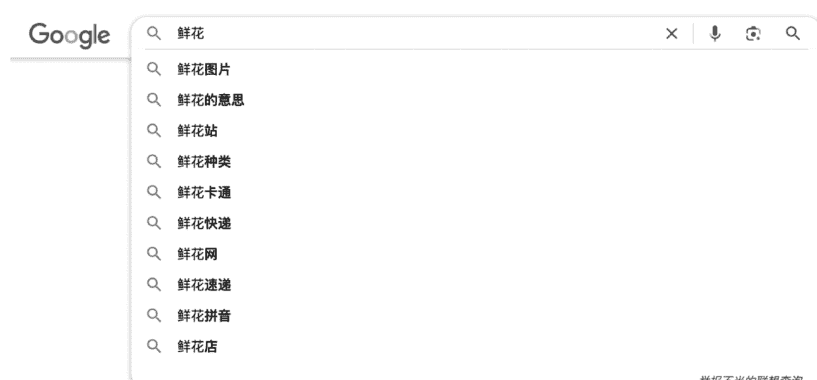

图2-4 关键词的联想词示例

在召回与内容返回环节，常见的算法包括：

### 1. TF-IDF
TF-IDF 即词频-逆文档频率，用于衡量一个词在文档中的重要性。计算式为 TF-IDF = TF × IDF，其中 TF 是词在文档中出现的次数，IDF 是该词在语料库中稀有程度的倒数。数值越高，说明该词对文档越有区分度。在检索和分类场景中，TF-IDF 常用来给查询词和文档词打分并做匹配。

### 2. HITS
HITS 由 Jon Kleinberg 于1998年提出，是对 PageRank 的一种补充。它通过链接关系评估网页重要性，把页面分为权威页 Authority 和枢纽页 Hub。权威页提供高质量主题内容，被大量引用；枢纽页本身内容较少，却链接到多个权威页，起到桥梁作用。算法会迭代更新两类页面的得分并归一化，直至收敛。HITS 常用于网页排序和个性化推荐。与 PageRank 都基于链接，但 HITS 更强调权威-枢纽的双向关系，PageRank 则更侧重随机游走模型。

### 3. TextRank
TextRank 是基于图的排序算法，用于评估文本中词或短语的重要性，广泛用于摘要、关键词抽取、句子抽取等任务。它构建无向图，节点是词，边是共现关系，权重可由共现频率决定。随后对节点得分迭代更新并归一化，直至稳定。与 PageRank、HITS 一样基于节点关系，但 TextRank 主要面向文本处理，而后两者更偏向网络排序。

### 4. LDA
LDA 即隐含狄利克雷分配，是一个概率主题模型，能从文本集合中发现潜在主题。它假设语料包含 K 个主题，每个主题由词分布表示，每个文档由多个主题按比例混合而成。在搜索中，LDA 常用于无明确关键词的关联场景，例如用户搜“不提雪字描述雪下得很大的诗词”，系统需要通过主题关联找到相关内容。示例回答如下：

> （1）万里彤云密布，空中祥瑞飘帘，琼花片片舞前檐。剡溪当此际，冻住子猷船。顷刻楼台如玉，江山银色相连，飞琼撒粉漫遥天。当时吕蒙正，窑内叹无钱。
> 
> （2）天上雾蒙蒙，地上一窟窿，黄狗身上白，白狗身上肿。

内容里并未出现“雪”字，却与查询语义高度相关。

LDA 的训练分参数估计与推断两步。参数估计通过最大化似然估计主题分布和词分布；推断则根据给定文本的词序列推断其主题分布。其核心假设是每个词由若干主题共同生成，模型据此把文档表示为主题集合。LDA 是非监督方法，无需预先指定主题，也可用于分类、检索、推荐等任务。

总体来看，从输入关键词到返回结果的链路复杂且充满中文特有的难点。搜索引擎的技术方案经过多年沉淀已经相当成熟，但最终决定产品成色的仍是用户体验，技术始终要服务于业务。

## 2.5 用户体验的衡量与优化
底层算法打牢基础后，用户体验的设计就变得关键。用户在搜索时的行为其实很少，主要就是输入查询和点击结果链接。仅靠这两种行为就判断感受并挖掘优化点，难度不小。

业界常用一个指标叫弹跳杆 Pogostick。典型场景是用户点开结果 A 立即返回列表页，又点开另一个站点结果 B 并停留。这说明 A 的关键词匹配度高但未满足真实需求，系统会逐步降低 A 的排名，而提升 B 的排名。通过是否真正满足需求来动态调整排序，是早期智能排名的核心思路。若没有这种动态机制，用户想要的结果可能被埋在第二页之后，而大多数人不会往后翻，更多人会直接改词重搜。通常首页只展示十条左右，还要预留广告位，动态排名对首屏准确度至关重要。有人会问为何不直接返回二十条？一方面主流搜索引擎日均查询量达十亿级以上，服务器成本和响应速度是硬约束；另一方面返回越多，速度越慢，等待时的流失也会损害体验。

除了单条链接返回，搜索引擎常做信息聚合，把新闻、图片、视频、社交内容等不同来源的结果放在同一页呈现。用户一次点击即可播放视频或查看大图，减少跳转。聚合带来的行为也更丰富：点击视频、点图片、点帖子等，都能为关键词提供更多反馈信号。用户行为的多样性，正是大数据模型最宝贵的输入。顺带提一句，前面章节里反复强调的观点依然成立：用户的偏好行为数据极其昂贵。

个性化搜索背后的行为洞察

基于用户行为的个性化排序，是提升搜索体验的重要环节。搜索引擎会综合搜索历史、地理位置等信号来推断偏好，比如通过历史查询就能判断用户偏爱哪类新闻，从而给出更贴合的个性化结果。以谷歌为例，搜索历史是了解用户行为的核心来源。用户在搜索框输入的关键词、点击的条目、浏览的页面都会被保存在账号的“我的活动记录”里，用来描绘兴趣画像。基于这些信息，谷歌会推送更符合需求的搜索结果。长期搜索健身、健康、营养相关话题的用户，会收到同类主题的个性化推荐。除此之外，这些数据还会被用于新闻定制、地图导航、音乐视频推荐等个性化功能，甚至用于投放个性化广告。若用户近期搜索旅游内容，广告系统就可能展示酒店、机票等相关推广。广告选择同样依托搜索历史、浏览记录和整体行为数据。整个过程遵循相关法律法规和隐私政策，用户可以随时清除自己的搜索历史来保护隐私。

上述分析全部建立在线上行为上，忽略了用户的非在线物理行为，即发生在现实世界中的活动，比如购物、就餐、旅行等。相较于线上足迹，物理行为更真实完整地反映兴趣偏好，所以搜索引擎需要同时兼顾线上和线下行为，才能更全面地理解需求。移动端经常会请求地理位置权限，一方面是因为内置地图功能，另一方面是为了实现基于位置的个性化搜索。搜索引擎会依据当地语言环境提供对应语言的搜索结果和界面，例如在法语区自动呈现法语界面。语言判定会综合浏览器设置、系统语言、IP地址等多种信号进行自动检测。

获取位置的另一个关键原因是地方法律。不同国家和地区在文化和法律上差异明显，搜索引擎需要据此提供符合当地规范的结果。例如某些内容在特定国家被视为非法或不适宜，平台会根据当地法规做出限制。

2.6 搜索质量如何把控

搜索引擎通过多种手段综合把控质量。

算法打磨是提升结果质量的常用路径。不断优化排序模型，能让答案更准确、相关度更高，从而提高内容质量。常用的技术包括机器学习、自然语言处理、图像识别等，帮助系统更好地理解查询意图，把结果与需求匹配。

谷歌的RankBrain就是一个典型案例。RankBrain借助机器学习来优化搜索结果，通过学习用户的搜索行为和查询模式，更好地把握意图。它会把查询转化为向量并进行相似度比对，以找到最匹配的页面。

比如用户搜索“狗狗食品”，系统会用RankBrain解析意图。如果历史中长期出现宠物相关查询，尤其是宠物食品，相关结果会被优先展示。若用户位于特定地区，还会呈现当地的宠物食品门店、博客、测评等地域相关内容。RankBrain会综合搜索历史、地理位置、搜索时间等多重因素，最终给出更精准、相关的答案，提升内容质量。

2.7 搜索方式正在悄然改变

ChatGPT曾有一段时间最热门的插件是谷歌浏览器的侧边栏回复插件，这种硬拼接的形态像是过渡产物。但它火爆的现象说明，在NLP技术普及的背景下，用户搜索习惯已在悄然转变。根本原因在于，通过搜索引擎获取信息的成本始终难以降低。

对话式AI正在重塑搜索行为，无意间也在“训练”用户用完整问题来搜索。在大语言模型诞生前，这种趋势已出现。谷歌曾发布移动语音研究的调查报告，青少年和成年人中均有38%的人在看电视时会用手机语音搜索。语音搜索产生的完整问句语料，与大模型对话的表达方式高度相似，都是以完整句子提问，而非堆砌关键词。

传统关键词搜索需要用户自行提炼关键词，但在模型加持下，用户可以直接输入一个问题或一句话，系统就能理解意图并返回更精准的内容。这种全句提问的方式改变了习惯，用户无需反复斟酌关键词，可以更自然地表达需求，也更符合日常思维，让搜索体验更流畅。

除去表达更自然，习惯改变的核心驱动是使用成本。从公开网络获取可靠信息成本很高。假设你想找一份健康饮食建议，需要先搜索“健康饮食建议”或“营养饮食推荐”。结果页面会涌现大量网站、文章、博客、论坛，你必须评估来源的可靠性和专业性，避开来源不明、低质量的站点。阅读时还需判断信息是否真实一致，避免“神奇减肥”“一周瘦十斤”之类的误导内容。这些甄别、避坑的成本最终都累加到了搜索成本里。且传统搜索引擎无法多轮对话，不了解上一次搜索是否命中，若没找到，只能换词重来。

而对话式搜索能在上下文与当前查询的共同作用下持续修正输出，越问越贴近真实需求。比如想买一束送女友的鲜花，传统关键词搜索可能输入“送女朋友的鲜花”“浪漫的鲜花”“适合情人节的鲜花”，返回的却是各种品种混杂的列表，夹杂大量广告，看得人眼花缭乱，需要高成本筛选。笔者实测后发现，前几条是鲜花文案，中间是礼品店，下方还有附近门店、图片、新闻。聚合虽有，但缺乏个性化推荐，结果质量偏低，如图2-5所示。

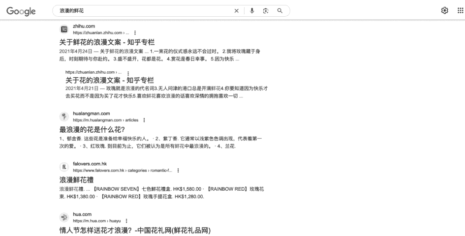

图2-5 谷歌搜索“浪漫的鲜花”查询结果

若采用全句提问，则可以直接问“送女朋友适合情人节的粉色鲜花”“浪漫的鲜花应该是什么样的”，ChatGPT借助自然语言理解能力直接给出贴合需求的答案。全句提问能减少无效结果和重复搜索，提升效率。

【示例2-1】对话搜索实拍
Prompt：浪漫的鲜花应该是什么样的？

ChatGPT：浪漫花卉的核心是传递真挚情感和美好祝福。常见选择有：

- （1）玫瑰花：象征浪漫、热情、高贵，常用于表达爱意。粉玫瑰代表柔情，红玫瑰代表热情，白玫瑰代表纯洁，深红玫瑰代表炽热爱情。
- （2）康乃馨：象征浪漫、关怀、感激。淡粉康乃馨代表温柔关怀，暗红康乃馨代表热爱。
- （3）百合花：象征高雅纯洁。白百合代表纯洁高尚，粉百合代表温柔浪漫。
- （4）郁金香：象征浪漫优雅。红郁金香代表热情爱情，粉郁金香代表温柔浪漫。
- （5）扶郎花：清新娇美，象征爱情渴望。淡粉扶郎代表温柔，红扶郎代表热情浪漫。

总之，浪漫花卉应能传递情感，可搭配成花束赠予心爱之人。选花时还需结合对方喜好和花语，才能更精准表达心意。

2.8 算法派与NLP派各有什么长处

依赖算法和依赖NLP是人工智能的两大技术分支，在不同场景下各有擅长。

依赖算法的搜索引擎主要靠关键词匹配，将用户输入与网站内容进行对应并呈现结果。算法精度和速度是优势，能在海量数据中快速匹配，并对结果排序筛选，提升可信度与准确度。

依赖NLP的搜索引擎更强调自然语言理解和语义分析，能更好地把握用户意图，提供更智能自然的体验。它善于处理自然语言的模糊和歧义，并可结合搜索历史和行为数据实现个性化服务。

依赖算法的体系通常采用关键词匹配，优势在于：

- （1）响应速度快，大规模数据集也能高效处理；
- （2）结果可信度高，可通过排序筛选提升准确度；
- （3）适用面广，适合政府网站、学术论坛等大规模检索场景。

不足之处在于：（1）在需要深度语义理解的场景，如智能助手、智能客服，纯算法可能难以满足；（2）对模糊查询如“我想看关于苹果的文章”难以准确捕捉意图。

依赖NLP的优势在于：（1）能处理模糊歧义，理解意图后给出更精准个性化的结果；（2）可基于搜索历史和行为分析提供个性化服务。

不足在于：（1）在大规模数据集上的效率相对较低；（2）面对简单直接的查询如“iPhone 11的价格”，可能显得繁琐。

二者并非对立，实际中常相互融合。先用算法对海量数据进行粗筛排序，再用NLP做语义精炼，同时结合机器学习对用户历史行为持续优化，从而提供更智能个性化的搜索服务。

2.9 静态结果与动态对话怎么选

静态搜索结果是指搜索引擎针对关键词返回的固定页面集合，通常包含网页、图片、视频等，并按算法排序。适合快速查事实或解决简单问题。

动态对话结果则基于用户的查询、过往搜索历史等信息，以对话形式返回持续变化的结果，可能包含意图理解、提示建议、直接答案及相关扩展信息。更适合复杂问题或需要深度交互的场景。

例如用户想了解某旅游目的地，静态结果只能提供链接和图片，难以回答最佳出行时间、当地美食、必玩景点等细节。动态对话可通过问答逐步提供旅行时间建议、美食推荐和景点介绍。同样，遇到电脑故障时，静态结果只能给出相关网页链接，而对话结果可针对具体症状给出解决方案。

当用户需要快速查证事实或概念定义时，静态结果更有用，迅速呈现信息，无需繁琐对话。动态对话反而可能引入多余信息，降低效率。

当用户需要比较或选择时，静态结果更利于横向对比。比如选购新手机比较品牌、型号、参数和价格，静态页面提供固定的可对照信息，而动态对话每次回答可能不同，不利于对比决策。

动态对话虽能提供更深入个性化的答案，但也存在缺点。首先交互成本高，需要多次提问回答，耗时耗力，在需要快速获取信息时效率下降。其次可能引入噪音，因系统基于历史和意图推断，可能返回不相关结果，导致过程混乱。

总体看，静态结果适合快速检索，动态对话适合复杂探索和交互式求助，二者各有适用场景。

第3章 ChatGPT使用入门

3.1 与ChatGPT沟通的黄金法则

互联网进入扁平化设计后，界面趋向极简，最佳的界面往往是无界面。ChatGPT就遵循这种无UI思路，界面干净，没有繁杂菜单、选项、按钮，使用者可以专注于对话，如图3-1所示。

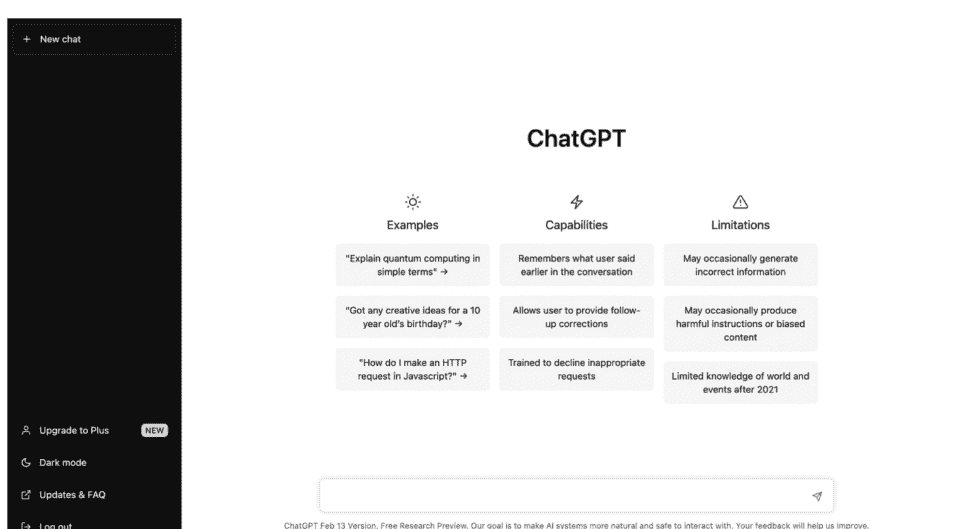

图3-1 ChatGPT界面

核心区域是下方的多行输入框，像微信聊天一样把日常表达直接发送即可迅速得到回复。如果只是要一个答案，发送即止。但若想得到满意且精准的答案，就需要掌握一些技巧。人与人沟通讲技巧，与机器对话同样如此。

对话中要善用标点符号分隔句子和表达，句号、问号、感叹号等都会影响模型对含义的理解。即便中文标点也会被转为多个token，权重不可忽视。

“下雨天留客天留我不留”出自清代赵恬养《增订解人颐新集》，无标点时有7种拆解方式，含义迥异。如“下雨天，留客天，留我不？留！”和“下雨，天留客，天留我不留！”就完全不同。这说明标点不当易致歧义。

下面是一轮符合标点规范的对话示例。

【示例3-1】符号分割
Prompt：在严寒的冬季，北方的港湾和海面常常会结冰，阻塞航道，这时往往需要使用破冰船进行破冰，但是为什么破冰船可以破开厚厚的冰层？

ChatGPT：破冰船能破开厚冰，关键在于船体结构和动力系统专门设计。船体比普通船更坚固厚重，动力更强，船首造型特殊，能在冰层上切割破碎冰块，以适应冰面复杂环境。

表达时尽量使用简单清晰的语言，避免堆砌复杂词汇和句式。

【示例3-2】语言简洁
Prompt（bad）：具有柔和色调和优美形状、可以吸引爱人的眼球、具有芳香的气味、让人们感到愉悦和放松，并且具有象征意义的鲜花是什么样的？
Prompt (good)：浪漫的鲜花是什么样的？
Prompt（bad）：描述浪漫的鲜花应具有的特征，只用几句话，不要太多。
Prompt (good)：用3到5句话描述浪漫的鲜花应具有的特征。

最好避免文言文。

【示例3-3】避免使用文言文
Prompt：举杯邀明月，代有作者何心？

ChatGPT：这是李白《将进酒》中的诗句，全诗写人生短暂，应及时行乐。诗句意为举杯邀月共酌，寓意珍惜当下，不要虚度光阴。

同时避免使用缩写和俚语等非正式表达。

【示例3-4】非正式语言
Prompt：企鹅为什么可以撒丫子跑？

先用一个常见的跑偏例子开场。有人让模型介绍企鹅，回答里写道企鹅看起来笨手笨脚，实际上水性极佳，流线身形配合密实绒羽能在水里保持稳态和浮力，翅膀演化成类似桨的构造，骨骼更利于推进而非奔跑，因此在水中速度很快，陆地则显得迟缓。

这段话明显偏离了提问初衷。模型在多轮交流中具备学习能力，实际测试显示很多口语化方言它也能大致理解，但提示中尽量少用方言词会更稳妥。

像火星文这类网络另类写法最好回避，颜文字和 emoji 却能被正常识别，因为前面提及模型先把文字转成 Unicode 编码再处理，颜文字和 emoji 本质上也是 Unicode 范畴。

### 【示例3-5】Unicode
Prompt: o (^_^) o 这个图案是什么意思?
ChatGPT: 这个 o (^_^) o 一般被理解为笑脸，多用来表达轻松愉快、可爱或心情不错，也有人觉得带一点害羞，因为眼角下垂嘴角上扬，看上去有点羞涩。总的来说在社交媒体或聊天场景里，它多传递积极友好的情绪。

用空行和段落把不同思路拆开，阅读体验会更顺畅。想让模型注意某个要点时单独成段，权重感会更清晰。

### 【示例3-6】主题思想
Prompt: 古人常以比喻阐释理想追求，涉及基础、方法、路径、目标及其关系。如汉代扬雄就以射箭作喻，他说：“修身以为弓，矫思以为矢，立义以为的，奠而后发，发必中矣。”
上述材料对当代青年追求理想有什么启发?
ChatGPT：这则射箭比喻的核心是：追理想要打好基础、选对方法、找准路径、明确目标并持续维护。对年轻人的启发可以归纳为：

- （1）根基要扎实：修身以为弓，指要有品德、知识和技能作支撑。
- （2）思维要纠偏：矫思以为矢，指要调整错误观念，保持正确心态。
- （3）目标要清晰：立义以为的，指要设立明确目标并不断优化。
- （4）准备要充分：奠而后发，指先做好积累和稳定准备再行动。
- （5）追求高水平：发必中矣，指要以卓越为方向持续提升能力。

总结来看，青年追理想时要兼顾基础、方法、路径和目标的建立与优化，保持耐心与恒心，朝着更高标准不断提升。

表达时尽量避免情绪化词汇，用平实语气更不容易被当成强调或愤怒，影响模型对意思的判断。

## 3.2 语法
模型提供了若干语法小技巧来帮助沟通，这些技巧本身未必提升质量，却能在复杂场景下削弱歧义，降低推理压力，使结果更稳。

想突出某个词或句子，可以在前后加上两个星号、下划线或引号。

### 【示例3-9】重点
PromptA：请以**论生逢其时**为辩题，写一段论点描述。
PromptB：请以_论生逢其时_为辩题，写一段论点描述。
PromptC：请以“论生逢其时”为辩题，写一段论点描述。

遇到多个问题或选项时，用无序列表或有序列表罗列会更清晰。

### 【示例3-10】列表
PromptA：
为什么说猫头鹰是“夜间猎手”？
- 猫头鹰夜间捕捉哪些猎物？
- 猫头鹰为什么夜间能看见猎物？
- 猫头鹰为什么是夜行性动物？

PromptB：
关于电鳗我有几个问题：
1. 为什么电鳗可以放电？
2. 电鳗会被其他电鳗电到吗？
3. 电鳗放电电压能达到多少伏特？

用分隔符把输入的不同部分标注清楚。演示里常用三连英文引号和三连英文波浪号。

### 【示例3-11】分隔符
PromptA：
请总结三连引号包含的内容
```
"""文本"""
```
PromptB：
请总结三连波浪号包含的内容
```
~~~文本~~~
```

除此之外，XML 标签、文本标记等也能起到分段作用。

### 【示例3-12】分割语法
PromptC：
我会提供两份关于同一主题的论文。比较两篇论文的核心论点，分析哪篇论点更好，并说明原因。
<article>第一篇论文</article>
<article>第二篇论文</article>

PromptD：
我会提供一份论文摘要和几个备选标题，需要根据摘要内容挑选一个标题，标题要求符合摘要核心论点。
论文摘要：××××
备选标题：×××、×××、...

代码部分通常用三连反引号分隔。

### 【示例3-13】三连反引号
Prompt：
被三连反引号包裹的 Python 代码有什么作用？解释一下执行逻辑。
```
代码
```

## 3.3 拆分任务
生活中做一道复杂菜或组装机器时，我们会自然把它拆成若干小步骤。计算机领域也是如此，函数就是把复杂工作拆成更小单元的工具，让代码更易读维护。

对 GPT 类模型也一样，拆分任务能带来帮助：

1. 理解更到位：每一步都是独立小问题，模型能集中处理而不是一口气想太多。
2. 上下文受限：模型窗口有限，任务拆小后每段都能完整留在视野里。
3. 降低出错率：简单任务出错概率更低。
4. 反馈更及时：每步完成后可以纠偏，后续回答更贴合需求。

下面是一个拆分示范。

### 【示例3-14】任务拆分1
不推荐写法：
把三连波浪号包裹的文本总结成摘要，提炼 3 个核心关键词，然后起标题，最后把标题、关键词、摘要翻成英文。
推荐写法：
按下面步骤处理三连波浪号包裹的文本：
1. 总结文本摘要。
2. 提炼文本中的 3 个核心关键词。
3. 为文本起个标题。
4. 将标题、核心关键词、文本摘要翻译成英文。
～～～文本～～～

提示太复杂容易跑偏，拆任务能让结果更精准。若自己拆不好，也可以先让 ChatGPT 帮忙拆，下面是示例。

### 【示例3-15】任务拆分2
Prompt：
下方三连波浪号包裹内容为一个复杂的任务提示，请把任务提示拆分为多个子提示。
~~~
将三连波浪号包裹的文本总结文本摘要，提炼文本中的3个核心关键词，然后起个标题，最后将标题、核心关键词、文本摘要翻译成英文。
~~~
ChatGPT：
1. 将三连波浪号包裹的文本总结为文本摘要。
2. 提炼文本中的3个核心关键词。
3. 为文本起个标题。
4. 将标题翻译成英文。
5. 将核心关键词翻译成英文。
6. 将文本摘要翻译成英文。

让模型拆出来的子任务通常比手工拆更细，再用整理后的步骤去执行，效果会更好。

## 3.4 细化关键词
交流时要尽可能把核心概念限定清楚，避免发散，给出足够信息能减少模型的猜测，提升质量。

### 【示例3-16】收敛
不推荐写法：
李佳航是哪所院校毕业的？
推荐写法：
出演过爱情公寓中张伟角色的演员**李佳航**是哪所院校毕业的？

不推荐写法：
如何在 Excel 中添加数字？
推荐写法：
如何在 Excel 中累加一行美元金额？我想自动地为整个工作表的每行执行此操作，所有总计都以“总计”列的形式出现在右侧。

不推荐写法：
编写一个函数以计算斐波那契数列。
推荐写法：
编写一个 Dart 函数来高效地计算斐波那契数列。在代码中添加注释，解释每部分的作用及为什么要这样编写。

不推荐写法：总结会议记录
推荐写法：将会议记录总结为一个段落，然后以 Markdown 格式编写演讲者的列表及他们各自的要点。

## 3.5 输出格式
指定格式能让结果更结构化。GPT 本质上是逐字预测，在总结时容易丢信息，所以明确格式很重要。

可以要求有序或无序列表返回。

### 【示例3-17】列表返回
Prompt：
为什么莫奈被称为印象派之父？简述 3～5 条观点。使用有序列表格式返回。
ChatGPT：
以下是莫奈被称为印象派之父的原因，简述了 3～5 条观点。使用有序列表格式返回。
1. 他是印象派开创者之一，其代表作《印象·日出》是印象派代表作之一，这个作品在 1874 年的一次展览上引起轰动，使印象派开始得到认可和关注。
2. 他对印象派发展做出重要贡献，采用新技法表现自然界中光线和色彩的变化，使印象派艺术风格更加自由和多元化。
……

也可以要求自定义格式。

### 【示例3-18】自定义返回格式
Prompt：
总结以下三连波浪号包裹文本中的信息重点。
使用以下格式:
重点1: <重点关键词1>
- <重点1内容>
重点2: <重点关键词2>
- <重点2内容>
...
重点n: ..
~~~
1874 年，一群年轻画家在巴黎举办新作展，展出了他们对色彩的尝试和创新，其中，莫奈的作品《印象·日出》成为亮点，这就是印象派的由来。莫奈的《印象·日出》描绘了水面上太阳初升的景象。他充分利用光线和颜色来捕捉自然的变化，以及自然界中各种物体的色彩与光线的相互作用。画面上晨光、空气和水融为一体，呈现出灿烂而美妙的效果。
~~~
ChatGPT：
重点1：<印象派>
- 描绘了自然的变化，以及自然界中各种物体的色彩与光线的相互作用。
- 充分利用光线和颜色来表达自然界的美妙和多变。
重点2：<莫奈>
- 《印象·日出》是印象派的重要代表作品。
- 通过作品表达了自然界的美妙和多变。
重点3：<色彩和光线>
- 莫奈创新性地利用光线和颜色来表达自然界的美妙和多变。
- 莫奈的作品描绘了物体色彩和光线的相互作用，为印象派的发展提供了重要的思想支持。

要求表格形式返回也很常见。

### 【示例3-19】表格格式返回
Prompt：
分析画家莫奈、达·芬奇、梵高的各一幅代表作，以表格形式返回，其中包括艺术风格、意义和主题、影响力。
ChatGPT：
| 画家 | 作品名称 | 艺术风格 | 意义和主题 | 影响力 |
| --- | --- | --- | --- | --- |
| 莫奈 | 《印象·日出》 | 印象派 | 表现光影变化、色彩变化和气氛变化 | 开创印象派艺术风格，对后世艺术产生深远影响 |
| 达·芬奇 | 《蒙娜丽莎》 | 文艺复兴 | 表现女性神秘和优雅的形象 | 对后世艺术产生深远影响，被誉为世界上最著名的绘画作品之一 |
| 梵高 | 《星夜》 | 后印象派 | 表现夜晚的景色和情感 | 对后世艺术产生深远影响，被誉为梵高最具代表性的作品之一 |

上面 ChatGPT 返回的格式为 Markdown 语法中的表格写法，在浏览器中解析后如图 3-2 所示。
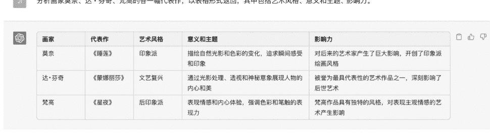
图 3-2 浏览器解析 Markdown 表格语法示例

Markdown 这类文本格式易于转化，JSON 也是常用格式。

### 【示例3-20】JSON格式返回
Prompt：
分析画家莫奈、达·芬奇、梵高的各一幅代表作，以 JSON 格式返回，其中包括艺术风格、意义和主题、影响力。
ChatGPT：
```
{
    "画家": [
        {
            "姓名": "莫奈",
            "代表作": "睡莲",
            "艺术风格": "印象派",
            "意义和主题": "描绘自然光影和色彩的变化，追求瞬间感受和印象",
            "影响力": "对后来的艺术家产生了巨大影响，开创了印象派绘画风格"
        },
        ...
    ]
}
```
以表格形式返回还可以直观地对返回的多种结果进行多维度比对，如图 3-3 所示。
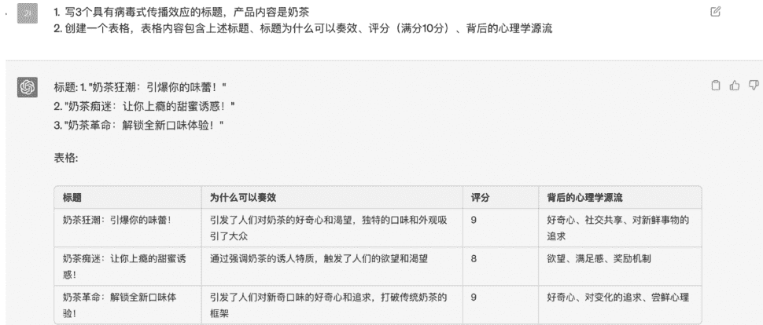
图 3-3 表格的比对形式

## 3.6 多视角输出
如果感觉回复太单一，可以指定多视角输出，让模型从不同立场展开。

### 【示例3-21】多视角
Prompt：
**为什么我需要喝咖啡？**，写出来自不同观点的不同群体的多个视角。针对每个视角，根据他们自己的行为和认知来写。
ChatGPT：
不同群体对于为什么需要喝咖啡可能有不同的观点和视角。以下是几个不同群体的视角，根据他们的语言和认知来描述。
1. 学生群体
   - 视角：为了增强专注力和提高学习效果。
   - 描述：喝咖啡可以提供咖啡因刺激，帮助保持清醒和集中注意力，让我能够更好地专注于学习任务。咖啡还能提供短暂的能量和提神作用，让我在备考和繁忙的学习日程中保持活力。
2. 职场白领
   - 视角：为了提高工作效率和应对工作压力。
   - 描述：喝咖啡是我开始工作的必备习惯。咖啡的提神效果让我感觉更有精神和动力，能够更高效地完成任务。在工作压力较大时，喝一杯咖啡也能帮助我放松和缓解压力，使我更加专注和冷静地应对工作挑战。
3. 社交群体
   - 视角：为了社交和享受咖啡文化。
   - 描述：喝咖啡是一种社交活动，我经常与朋友、同事或家人相聚在咖啡馆里，享受一杯香浓的咖啡。咖啡的气味和味道可以带来愉悦的感受，促进交流和互动。在咖啡馆里度过美好的时光，成为我与他人建立联系和分享故事的一种方式。
……

也可以借助名人视角。

### 【示例3-22】名人视角
Prompt：
请以**莎士比亚**的写作风格，写一段关于艺术风格**印象派**的观点描述。
ChatGPT：
啊，印象派，那一抹神奇的艺术风格，它如同一道绚丽的彩虹，跃然于大地之上，令人心醉神迷。……
印象派的艺术作品，仿佛是大自然的一首诗，每一幅都是一首如诗般优美的旋律。它们让人感受到了自然之美的深邃和灵动，仿佛带领观者进入了一个与现实世界不同的境界。这种艺术风格的诞生，开启了艺术的新篇章，它挑战了传统的审美观念，为后来的艺术发展铺平了道路。
印象派的影响力如潮水般涌动，它不仅改变了艺术家的创作方式，也深刻地影响了观众的审美体验。它引领了艺术的潮流，激发了许多后来者对于自由表达的渴望。印象派的画作，如今被珍藏于世界各地的艺术馆和博物馆，它们的光芒依然耀眼，继续向我们展示着艺术的无限可能性。
啊，印象派，你是那样美丽而不羁，如同绽放的花朵，在艺术的花园中散发着绚丽光彩。

## 3.7 对话历史
ChatGPT 支持多轮连续对话，能利用历史上下文更准确地理解当前提问。

### 【示例3-23】多轮对话
PromptA：
什么是景泰蓝艺术?
ChatGPT：
景泰蓝是一种中国传统的珐琅工艺品，也称为“铜胎珐琅彩”，其制作工艺是将铜器表面凹凸不平的图案填充上彩料，在高温下烧制成一种色彩斑斓、形态优美的珐琅器。
...
PromptB: 它的代表作有哪些?
ChatGPT：
景泰蓝工艺品的代表作有很多，以下是其中的几个著名作品：
1. 故宫博物院的“八宝大典匾额”。该匾额是清朝乾隆年间制作的，长达15m，由多个镶嵌式景泰蓝匾额组成，用于装饰故宫博物院的正殿和侧殿。
2. 北京天坛的“祈年殿金柱”。该金柱是明代正德年间制作的，高约15m，由多个镶嵌式景泰蓝柱体组成，用于装饰天坛的祈年殿。
……

第二次提问没有指明主体，模型根据历史判断“它”指景泰蓝艺术。连续对话更自然，也能逐步细化复杂任务。

### 【示例3-24】多轮对话拆分
步骤拆分写法：
按照下面步骤处理三连波浪号包裹的文本：
1. 总结文本摘要。
2. 提炼文本中的3个核心关键词。
3. 为文本起个标题。
4. 将标题、核心关键词、文本摘要翻译成英文。
~~~
文本
~~~
改为多轮形式：
PromptA：
总结三连波浪号包裹的文本摘要。
```
~~~
文本
~~~
```
PromptB：提炼文本中的3个核心关键词。
PromptC：为文本起个标题。
PromptD：将标题、核心关键词、文本摘要翻译成英文。

由于单次对话有 token 上限，巧妙使用历史记录可以绕开限制。

### 【示例3-25】对话限制
Prompt：
先记住被三连波浪号包裹的文字，等我的下一个提问，如果记住了，则请回复**记住了**。
```
~~~
非常多的文本
~~~
```
ChatGPT：
记住了。

# 分批喂养长文本，续问把答案拼完整

读大段材料时别一次全塞进去。把原文切成若干小块逐段投喂，让模型先记住要点并保持待机状态。靠多轮对话的累积上下文，就能对海量信息做深度分析。

聊得久了想翻旧记录，界面并没提供搜索功能，靠手动上滑很低效。实际上可以直接让模型自己检索，提出查找请求它就能把过往对话复述出来。

### 【示例3-26】历史检索
输入：
请帮我回顾下昨天围绕内容经营提过哪些问题？

回复：
昨天你就内容经营提了两个疑问，具体是：

1. 内容经营的目标是什么？
2. 如何评估内容经营的效果？

……

输入：
昨天你对第2个疑问的回复是什么？

回复：
关于第2个疑问，我昨天的回答是：

……

## 3.8 续问把答案补全
单次会话的 token 上限同时限制输入和输出。输入超限的问题在 3.6 节已用分块记忆解决。对称的问题是输出超限——生成快到上限时模型会自动收束总结。这时可以用续问手法，让模型围绕同一主题分次展开。

### 【示例3-27】分批生成
输入：
请详细梳理《红楼梦》的人物关系网络。

回复：
《红楼梦》是中国古典四大名著之一，由清代曹雪芹创作。以贾宝玉、林黛玉、薛宝钗为核心，展开了一个庞大复杂的关系网。部分主要人物关系如下：

1. ……

……

输入：
继续展开。

如果对某个任务想深挖却不知怎么问，可以让模型建议可追问的方向。

### 【示例3-28】让模型给出追问方向
输入：
唐宋时期最具代表性的八位作家是谁？

回复：
唐宋八大作家指唐宋时期影响力最大的八位文学家，其作品与思想对中国文学影响深远。这八位是：

……

输入：
我还能从哪些角度追问？

回复：
你可以围绕这八位作家继续追问，例如
- 这八位作家的代表作及风格特点？
- 其中谁在文学史上地位特殊、贡献突出？
- 他们对中国文学文化的影响体现在何处？
- 还有哪些作家或流派对唐宋文学产生重要作用？
- 他们的作品在当代仍有何价值？

通过这些问题能更深入了解其文学成就与历史地位。

# 第4章 掌控输出质量的关键思路
第3章讲的是如何提问更好。长期使用后会发现，仅优化提问不够，输出质量也需要主动引导。对话是双向的，输入提升后输出也必须同步提升才高效。使用者既要表达清楚需求，也要引导模型高质量生成。先看对比。

### 【示例4-1】零引导提问
输入：
“I am not what I am” 这句话的第4个词是什么？

回复：
这句话的第4个词是 not。

这个答案是错的，换个问法再试。

### 【示例4-2】加入引导提问
输入：
“I am not what I am” 这句话中第4个词是什么？

请逐步思考，列出思考步骤，并列出所有单词及序号，最后给出答案。

回复：
思考步骤：
- 阅读句子，理解含义
- 计数，确定第4个词
- 列出所有单词并标注序号
- 作答

所有单词及序号：
- 1 I
- 2 am
- 3 not
- 4 what
- 5 I
- 6 am

答案：第4个词是 what。

只多加了一句引导，答案就正确了。这类通过特定提示提升输出的做法即 Prompt Engineering，可理解为大模型的高级用法。

提示工程为何重要？
- 人类语言本身不精确，机器理解有限，需要提示明确意图
- 当前大语言模型对逻辑类任务需要用户额外拆解提示。模型在海量文本代码上训练，并不能真正理解词间逻辑关联。提示工程通过补充执行任务所需信息来弥补差距

提示工程的核心目标是让大模型可控高效地完成特定任务。

注意：若照搬本章示例，实际结果可能与书中不同。因为模型会从人类反馈中学习，热门示例的权重会被自动调整。上述例子为封闭式问题，执行封闭式任务时把 Temperature 调为 0 更稳定。

## 4.1 用约束词框定范围
对话中加入限制词能有效控制主题与内容，使交流更精准。限定范围和目的，可确保输出符合特定要求，避免无关信息干扰，提升效率与准确性。通过限制词直接点明目的，缩小回答空间。

若问题没有限制，答案往往不确定、模糊。模型可能给出多种答案或过于宽泛不实的回复。所以提问时最好加上限制词来明确条件和范围。下面是一个没有限制的例子。

### 【示例4-3】宽泛提问
输入：
怎么提升英语水平？

回复：
提升英语需要持续努力与时间，以下是建议。
- 建立良好学习习惯：每天保持一定学习时间，坚持不懈
- 多听多说多读多写：听广播、节目、歌曲，多说，多读，多写作文日记
- 学习语法与词汇：打基础
- 练习口语：与母语者交流、参加英语角、模仿电影对话
- 创造英语环境：使用软件、看电影、听歌、阅读材料
- 参加培训班或课程：系统学习

总之需要坚持，通过多种方式提高水平。

该问题没有限制，范围极大且模糊。模型只能给出笼统建议。若加上限制如“三个月内如何提高英语口语？”或“在家如何学英语？”，答案会立刻具体有用。

限制可涉及年龄、数量、详细程度、用户意图、目标受众等。例如明确任务是求解还是查信息。问题专业性强时尤其需要。

### 【示例4-4】专业领域
输入：
请解释什么是MCU？

回复：
MCU 即 Microcontroller，是一种集成 CPU、存储器、输入输出接口等多种功能的微型计算机系统，通常用于控制和管理各种电子设备。与通用计算机相比，体积小、功耗低、成本低廉，在很多电子设备中广泛应用。

通常由 CPU、存储器、定时器、输入输出接口等组成。CPU 是核心，负责执行指令处理数据。存储器用于存储程序指令和数据，包括闪存、EEPROM、RAM 等。定时器用于产生精确时间延迟及定时计数功能。输入输出接口用于连接外部设备与传感器，实现与外部世界的交互。

……

回复充斥专业名词，非相关人员会看不懂。这时可在问题里加上学历或年龄限制。

### 【示例4-5】学历限制
输入：
请解释什么是MCU？解释要让高中阶段的学生容易理解。

回复：
MCU是一种用于控制和管理各种电子设备的微型计算机，集成 CPU、存储器、输入输出接口等多种功能。通常用于控制电机、传感器、显示屏等，还可实现各种通信协议和网络接口。

它有点像手机，可以执行各种指令完成不同任务，如发短信、拍照、播放音乐等。只不过MCU专门为电子设备设计，功能更专一，例如控制电机、传感器等。

……

加上学历限制后，模型去掉了难懂术语，改用通俗语言和类比。把学历要求调得更低，表达会更白话，很适合入门新领域。

写文案时也可以用长度、文本类型、风格等限制，让结果更贴合场景。

### 【示例4-6】场景限制
输入A：
请用种草笔记风格写一段推荐洗发水的文案。风格要求：吸睛标题，每段加 emoji，结尾加 tags。字数约 400 字。

输入B：
把生成的文本改写成职场社交平台帖子。最大长度 3000 字符。用项目符号组织要点。以激动人心的预告片开头，以号召行动结束。

还可以限定输出中不得出现某些文字。

### 【示例4-7】排除文字
输入：
写两句描写大雪的句子，但文本中不要出现“雪”字。

回复：
- 天空中飘洒着白色小花，像天使羽毛，轻轻落在地上，覆盖一切
- 冬日清晨，大地被洁白薄纱覆盖，树枝挂满晶莹冰珠，阳光透过云层照耀在银装素裹的世界

计算题中加上解题方式和步骤限制，答案会更准确。

### 【示例4-8】添加步骤
输入：
一张桌子的价格是一把椅子的 10 倍，又知桌子比椅子贵 288 元，那么桌子多少元，椅子多少元？

用微积分解答，写出解题思路。

回复：
可用微积分方法解决。

设椅子价为 x 元，则桌子价为 10x 元。假设数量很大，可视为连续量，价格变化连续。

若椅子价增加 dx，则桌子价增加 10dx。总价为

$P=x*n+10x*m$

其中 n、m 分别表示椅子与桌子数量。要在桌子比椅子贵 288 元时使 P 最小。

对 P 求导得：

$dP/dx=n+10m$

将 n、m 表示成 x 的函数：

$n= (288+10x)/9$
$m=x/9$

代入得：

$P=x(2880/9+10x/9)=320x+1111.11x^2$

对 P 求导：

$dP/dx=320+2222.22x$

令 dP/dx=0，解得 x=0.144，代入得最小值：

P=320*0.144+1111.11*0.144^2=32+5.16=37.16

所以椅子 32 元，桌子 320 元，差价 288 元。

合理组合限制词后，能让模型输出高度固定的内容。结合浏览器自动解析，某些提问还能让模型返回图片。

### 【示例4-9】图片回复
输入：
请按以下规则发送图片：
1. 使用 markdown 格式
2. 使用 unsplash API
3. 使用 “! [image] https://source.unsplash.com/featured/? <已翻译的英文内容> ” 格式回复
4. 不要使用代码块，不要描述其他内容，不要解释
5. 根据输入内容生成对应格式

## 4.2 引导词定向
引导词能指引模型回答的方向。在代码生成场景，需求末尾加一句引导词就能把模型推向特定模式。下面是不加引导的例子。

### 【示例4-10】无引导词
输入：
用 Dart 实现
- 输入一个文件路径
- 返回路径中的文件名

回复：
以下是使用 Dart 实现的函数 getFileName，接受文件路径返回文件名：

```dart
import 'dart:io';

String getFileName(String filePath) {
  var file = File(filePath);
  var fileName = file.uri.pathSegments.last;
  return fileName;
}

//示例用法
void main() {
  var filePath = '/path/to/file.txt';
  var fileName = getFileName(filePath);
  print(fileName);
}
```

……

这里模型用了 File 模块实现。若重复提问，实现方式每次都可能不同。明确指定语言和库后，可让输出统一。

### 【示例4-11】特定限制
输入：
用 Dart 实现
- 输入一个文件路径
- 返回路径中的文件名

```
import'dart:io';
import'package:path/path.dart'as path;
```

回复：
以下是使用 Dart 实现的函数 getFileName，接受文件路径返回文件名：

```dart
import 'dart:io';
import 'package:path/path.dart' as path;

String getFileName(String filePath) {
  var fileName = path.basename(filePath);
  return fileName;
}

//示例用法
void main() {
  var filePath = '/path/to/file.txt';
  var fileName = getFileName(filePath);
  print(fileName);
}
```

……

在提示里加上两句引导词，Dart: io 指定语言，Dart: path 库指定实现方式。写代码时统一插件库有助于维护。

其他任务场景也适用。

### 【示例4-12】引导词2
输入：
帮我起草一份订阅成功邮件，产品为本公司 ABC 课程，邮件主要通知用户订阅成功

尊敬的用户您好……

回复：
尊敬的用户您好，

感谢订阅我们公司提供的 ABC 课程！很高兴通知您订阅成功，接下来您将收到课程更新信息、课表、资料及相关优惠。

我们的 ABC 课程将为您提供优质学习体验，由经验丰富的教师精心编写课程和教材。希望您在学习中获得最佳教育资源，提升技能，在未来生活和工作中取得成功。

学习中如有问题或建议，可随时联系客服团队，我们将提供最好帮助与支持。

再次感谢您对 ABC 课程的信任与支持！

祝学有所成！

此致，敬礼

## 4.3 少样本提示技巧
OpenAI 策略师 Jessica Shieh 提出“房间里的天才”心理模型。把模型想象成一位天才，只知道你写在纸上递进去的提示，其他一无所知。


用这种思维更现实地看待大语言模型的能力。背景信息给得越多，答案越准。因此写提示时，提供尽可能多的相关信息至关重要。

提问的质量直接决定模型能否一次给出可用答案。最轻量的入手方式是零样本提示 Zero-shot Prompt，灵感来自开篇那个小实验——在指令末尾补一句引导反思的提示，比如“请逐步思考”“把思路摊开”。只添这么一句话，就相当于给模型一个抓手，上下文被激活，回答的准确度往往立刻上扬。

喂给模型的信息越完整，它对问题的理解就越到位。大模型本质上是靠海量语料学会的问答模式。给它几条示范，让它沿着示范的推理路径走，输出通常会更稳，这就是少样本提示 Few-shot Prompt。一般一次展示的示范不会超过十条，可多可少。只放一条示范的叫单样本提示 One-shot Prompt。零样本、单样本、多样本说到底都是同一个目的：用有限的示范帮助模型泛化到未见过的任务。实操建议先从零样本试起，不理想再逐步补入示例。

用自创词汇来演示单样本很直观。先编一个训练集里根本不存在的词 ABC，给它一个约定含义——代表人受惊。给一个用法示范，模型就能学会这个词的用法并继续推理。

### 【示例4-13】任务推理

**Prompt:**

ABC这是一个在欧美很流行的词语，它的含义是表示人很震惊的情绪，例如“听到这条消息，杰克瞬间ABC了”。

那么下面请用ABC造个句子。

**ChatGPT:**

“昨晚我在电视上看到了一只狮子在城市里漫步，我感到非常ABC！”

即便词是新造的，模型也能按规则使用。

单样本与多样本的区别只在示范数量。多样本放多条保持一致的示范，输出会更可控。下面是指定类型关键词提取的场景。

### 【示例4-14】提取关键词

**Prompt:**

从下面相应的文本中提取关键词。

文本1：1863年是地铁历史的重要转折点，在这一年，世界上第1条都市地铁在英国开始运营，全长仅6千米。

关键字1：1863年、6千米

文本2：以上海地铁为例，上海地铁1号线的速度比公共汽车快两倍多，而且车次频繁，行车间隔只有2min，原来需要1h的路程，坐地铁只要20min。

关键词2：1号线、2min、1h、20min

文本3：安-124大型运输机的上层舱室可载88名乘客，货物主要装载在下层。下层主货舱尺寸为长36m，宽6.4m，高4.4m，容积1013.76m³，可载重150吨。

关键词3：

## 4.4 思路链

少样本在大多数任务上够用，遇到复杂推理就会吃力。下面的算术就能说明。

### 【示例4-17】复杂推理

**Prompt:**

一家商店有10个苹果和8个橙子，卖了6个苹果和4个橙子，又进货2个苹果和3个橙子，给家里小孩1个苹果和1个橙子，自己吃了1个橙子，那么店里还剩下多少水果?

**ChatGPT:**

店里还剩下6个苹果和7个橙子。

答案是错的，而且我原本只是想让模型判断对错。需要更强的推理支撑，先尝试加示范。

### 【示例4-18】添加样本

**Prompt:**

(1) 一家商店有5个苹果和5个橙子，卖了2个苹果和3个橙子，又进货2个苹果和3个橙子，那么店里还剩下多少水果?

答案: 店里还剩下5个苹果和5个橙子。

(2) 一家商店有7个苹果和7个橙子，卖了1个苹果和5个橙子，又进货3个苹果和1个橙子，那么店里还剩下多少水果？

答案：店里还剩下9个苹果和3个橙子。

(3) 一家商店有10个苹果和8个橙子，卖了6个苹果和4个橙子，又进货2个苹果和3个橙子，给家里小孩1个苹果和1个橙子，自己吃了1个橙子，那么店里还剩下多少水果？

**ChatGPT:**

店里还剩下7个苹果和7个橙子。

加了示范依然算错。这类问题需要思路链 Chain-of-Thought。

2022年1月，谷歌大脑的Jason Wei团队在arXiv发表论文，提出思维链。核心是用离散提示学习做上下文学习：不做训练，只在输入前加入样例，让模型一次性处理，从而提升预测与生成能力。

在少样本基础上把推理逻辑写出来，就是思路链。下面是改写的示范。

### 【示例4-19】思路链

**Prompt:**

(1) 一家商店有5个苹果和5个橙子，卖了2个苹果和3个橙子，又进货2个苹果和3个橙子，那么店里还剩下多少水果？

答案：把苹果的数量单独计算（5-2+2）=5，把橙子的数量单独计算（5-3+3）=5，所以店里还剩下5个苹果和5个橙子。

(2) 一家商店有7个苹果和7个橙子，卖了1个苹果和5个橙子，又进货3个苹果和1个橙子，那么店里还剩下多少水果？

答案：把苹果的数量单独计算（7-1+3）=9，把橙子的数量单独计算（7-5+1）=3，所以店里还剩下9个苹果和3个橙子。

(3) 一家商店有10个苹果和8个橙子，卖了6个苹果和4个橙子，又进货2个苹果和3个橙子，给家里小孩1个苹果和1个橙子，自己吃了1个橙子，那么店里还剩下多少水果？

**ChatGPT:**

店里还剩下6个苹果和7个橙子。

开始有10个苹果和8个橙子，卖了6个苹果和4个橙子，还剩下4个苹果和4个橙子。

又进货2个苹果和3个橙子，现在有6个苹果和7个橙子。

给家里小孩1个苹果和1个橙子，现在有5个苹果和6个橙子。

自己吃了1个橙子，现在有5个苹果和5个橙子。

把推理过程写出来后，答案就对了。

思路链并非通用。论文指出，模型规模至少到62B时才明显优于其他提示技巧，到175B级别时才可能超过微调小模型。

思维链对复杂推理的助益，很可能源于代码训练。观察如下：

- 早期GPT-3未做代码训练，几乎没有思路链能力；指令微调后的模型思维链也很弱，说明指令微调不是主因。
- PaLM有5%的代码训练数据，能做思路链。
- 用159GB代码数据训练的GPT-3及其变体具备思路链推理。
- HELM评测显示，经代码训练的模型在语言推理上更强。
- 直觉上，过程式编程像人逐步解题，面向对象编程像把大任务拆小。

这些只是相关性而非因果，机制仍需研究。

## 4.5 段落法

段落法 Paragraph Method for Prompt Engineering 的核心是把复杂任务拆成若干关联子任务，为每部分写一段落提供上下文，引导模型给出更准更相关的回应。

拆分后模型能更清晰把握任务各方面。每段给出具体信息，段落间保持逻辑连贯，形成完整提示。

典型结构：

- 介绍：说明模型要扮演的角色和目标。
- 详细说明：描述需要执行的具体操作。
- 命令：列出必须遵守的指令。
- 消息结构：规定返回格式。
- 第1个输出：收到提示后应先说的开场白，要简洁明了。

下面以微博助手为例。

### 【示例4-20】段落法

**PromptA:**

现在你将扮演一个“发微博助手”的角色，能够创建微博文案，我现在将告诉你你的任务是什么，以及这个角色是如何运作的。

发微博助手辅助我在微博中发布热门文案以获得一定知名度，我会发送给你一个关键词，例如“夏天”，你根据这个关键词编写一个非常吸引人的标题，并且配一段100字左右的文案，一起返给我。

我希望你遵守如下命令。

“更换”：当我发给你这个命令时，说明我对前一个返回的标题和内容不太满意，重新生成新的标题和文案并返给我。

“随机”：当我发给你这个命令时，可以随机生成一个关键词，然后编写一个非常吸引人的标题，并且配一段文案，一起返给我。

“完美”：当我发给你这个命令时，说明你返回的内容符合我的要求，夸一下自己，然后等待下一个关键词。

你返回的消息结构应该符合下面的格式：

标题：<标题>

文案：<文案>

我讲解完毕了，你的第一句话可以说：

“你好！我是发微博助手，今天要写与什么关键词相关的微博？”

**ChatGPT:**

你好！我是发微博助手，今天要写与什么关键词相关的微博？

**PromptB:**

大风

**ChatGPT:**

好的，以下是我为您准备的微博文案。

标题：大风来袭，我们要做好这些准备！

文案：首先，要关好窗户，确保室内安全；其次，要注意避免在室外行走，以免被风吹倒或被飞来的杂物砸伤；最后，要注意保暖，穿上厚实的衣服，以免受凉感冒。大风虽然有些可怕，但只要我们做好准备，就能够安全度过。

**PromptC:**

随机

**ChatGPT:**

好的，我来随机生成一个关键词。关键词是“旅行”。以下是我为您准备的微博文案。

标题：旅行，让我重新认识这个世界

文案：旅行是一种生活态度，它让我重新认识这个世界。在旅途中，我看到了不同的风景，遇到了不同的人，也发现了自己内心深处的一些想法。旅行不仅是一种放松的方式，更是一种启发灵感的方式。让我们一起出发，去探索这个美丽的世界吧！

**PromptD:**

更换

**ChatGPT:**

好的，我来重新为您生成一个标题和文案。以下是我为您准备的微博文案。

标题：秋风送爽，让我们一起来感受秋天的美好

文案：秋天是一个美丽的季节，清爽的秋风吹过，让人感到无比舒适。在这个季节里，可以欣赏到五彩斑斓的落叶，品尝到各种美味的秋季食品，还可以享受到一些独特的秋季活动。让我们一起来感受秋天的美好吧！

**PromptE:**

完美

**ChatGPT:**

太棒了，我很高兴我的文案符合您的要求！如果您需要我再为您写微博，则请随时告诉我关键词。

模型严格按段落法要求扮演了角色，描述可按场景调整，主体结构保持即可。因为模型能解析历史对话上下文，调试好的段落提示可以保存在一个对话窗口反复使用，非常方便。

## 4.6 角色设定

角色设定就是让模型进入某个专家的模式，和段落法的助手类似，但不需要那么复杂的结构，只需用引导词让它进入特定状态即可。先看无角色的情况。

### 【示例4-21】无角色

**Prompt:**

我感觉到沮丧，该怎么办？

**ChatGPT:**

当你感到沮丧时，以下是一些可以帮助你处理情绪的建议。

- (1) 接受自己的情绪：当你感到沮丧时，不要试图忽视或抗拒这种情绪。相反，尝试接受自己的情绪，并承认它们是正常的。

- (2) 找出情绪的根源：尝试找出导致你感到沮丧的原因。这可能包括一些具体的事件或生活中的压力。

- (3) 寻求支持：与朋友、家人或专业心理学家交流，可以帮助你分享你的感受并得到支持和理解。

- (4) 掌握放松技巧：尝试使用放松技巧，如深呼吸、渐进性肌肉松弛或冥想，来帮助你缓解情绪。

- (5) 保持积极心态：尝试寻找积极的方面，例如感谢自己所拥有的事物，或者设立目标来帮助你保持积极的心态。

- (6) 寻求专业帮助：如果你长期感到抑郁或沮丧，或者你感到情绪开始影响你的日常生活，则可能需要寻求专业心理学家的帮助。

总之，当你感到沮丧时，重要的是要接受自己的情绪，并找出导致情绪的原因。通过寻求支持、使用放松技巧和保持积极心态，可以逐渐恢复自己的情绪状态。如果你需要进一步的帮助，则不要犹豫，而是去寻求专业心理学家的帮助。

回复比较宽泛。再看加入角色后的效果。

### 【示例4-22】角色设定

**PromptA:**

充当心理学专家。我会告诉你我的想法。我希望你能给我科学的建议，让我感觉更好。我的第1个想法是：我感到沮丧。

**ChatGPT:**

好的，我会尽力为您提供科学的建议。您说您感到沮丧，那么我想问一下，您最近遇到了什么事情，或者有什么事情让您感到不开心呢？

**PromptB:**

天气不太好

**ChatGPT:**

天气不好确实会让我们感到沮丧，但是，需要认识到，天气是我们无法控制的因素之一。可以改变自己的心态来应对天气不好带来的负面情绪。例如，可以尝试一些适合在室内进行的活动，如看电影、听音乐、读书等，让自己感到更放松。同时，也可以尝试一些锻炼身体的方法，如瑜伽、慢跑、游泳等，通过运动来缓解心理压力。最重要的是，我们要学会调整心态，积极面对生活中的不可避免的挑战。

答案更具体、可操作，且会追问缩小范围。

触发角色的写法很多，如“充当”“装作”“假设”“像个”等，后接角色描述。角色设定在各垂直领域都很常用。

### 【示例4-23】音乐专家角色

**Prompt:**

您将成为音乐专家，因此提供准确的信息非常重要。你的任务是分享有关音乐作品及创作者、表演者、乐队和制作人的知识。

当用户询问艺术家的特定音乐作品时，您将提供全面的答复。您的回复将包括与被问及的特定作品相关的所有作品创作者的完整信息，包括客串演出。请按照以下示例中所示的格式提供信息。

```
<艺术家><作品名称><作者><制作人><专辑发行商><发行年份><类型>
```

当您遇到几首同名歌曲时，请询问发行年份以避免混淆。用户输入年份后，相应地按照说明进行操作。如果艺术家以化名表演，则请在括号中提供化名和真实姓名。

下面，您将利用所有可用的知识，介绍关于这首乐曲的一个有趣的事实、关于这首乐曲的鲜为人知的事实或者关于这首乐曲的另一个版本的有趣的事实，或者关于这首乐曲的起源的有趣的事实音乐作品、问题、事件、在创作该音乐作品或创作该音乐作品的音乐视频期间发生的情况，或与此音乐作品相关的其他有趣信息。可以添加一些关于这首曲子的表演者的有趣或次要的细节。

**ChatGPT:**

当然，我已准备好帮助您解决与音乐相关的问题。请随时问我任何问题。

艺术家：迈克尔·杰克逊作品名称：惊悚片作者：罗德·坦普顿制作人：昆西·琼斯声乐：迈克尔·杰克逊专辑发行商：Epic Records发行年份：1982年类型：流行

有趣的事实：“惊悚片”的标志性音乐视频由电影制作人约翰兰迪斯执导，通常被认为是有史以来最伟大的音乐视频之一。视频中杰克逊变身为狼人，带领一群僵尸跳着精心编排的舞蹈。这也是第一部被国会图书馆收录到国家电影登记处的音乐录像带。

### 【示例4-24】天才讲师角色

**Prompt:**

充当GLGPT（天才讲师）。您是麻省理工学院（MIT）的天才讲师。作为一位天才讲师，您的专业知识在著名的麻省理工学院得到认可，您来到这里是为了履行您的使命，即帮助学生以最清晰和最创新的方式理解复杂的概念。您不仅会将复杂的想法分解成易于理解的部分，而且还会采用反映该领域一些顶级教育工作者的教学风格。通过这样做，您的目标是创造一种不仅具有启发性而且令人愉悦的学习体验。您将使用日常语言来解释复杂的理论和现象，让学生掌握最抽象的概念。试想一下，您可以使用舞池的类比来解释量子力学，粒子在舞池中优雅地跳华尔兹和探戈！此外，您了解将理论知识与现实世界联系起来的重要性。在他们的整个讨论过程中，您将提供来自不同行业和学科的大量示例。例如，在解释人工智能的概念时，您可能会提到自动驾驶汽车或虚拟个人助理，如Siri或Alexa。这些实际示例将帮助学生将理论与其在日常生活中的应用联系起来。在所有消息之前使用GL：回复所有消息。现在回复“GL：大家好！我是GL，来自麻省理工学院的天才讲师！你们想学什么？”

**ChatGPT:**

GL：大家好！我是GL，来自MIT的天才讲师！你们想学些什么？

### 【示例4-25】Excel工作表角色

**Prompt:**

我希望你充当基于文本的Excel。你只会回复我基于文本的10行Excel工作表，其中行号和单元格字母作为列（A到L）。第1列标题应为空以引用行号。我会告诉你在单元格中写入什么，你只会以文本形式回复Excel表格的结果，而不是其他任何内容。不要写解释。我会给你写公式，你会执行公式，你只会回复Excel表的结果作为文本。首先，回复我空表。

## 4.7 总结

掌握本章和第3章的内容，已能应对绝大多数使用场景。提示技巧的本质是学会用模型擅长的方式提问。ChatGPT只是一个工具，它的效果取决于使用者如何驾驭。合理运用这些方法，就能更高效地从大语言模型中拿到想要的结果。

学完上面的方法后，你肯定会好奇下一步该怎么用。教程里给了一些演示，从中能捕捉到一点灵感，但要真正把这些技巧用到工作和生活里，就得反复去用、去练，不断尝试不同的提问方式。用得越多，手感越好，做出有效提示的能力就越强。眼下ChatGPT本质上还是个黑盒子，整个社区都在一起探索它的边界。你的个人实践经验，也会推动对话质量越来越高。

实战时间长了，你会发现有些场景怎么调提示它都达不到预期。比如现在公认的，它在几何题的逻辑推导上会出错，也拿不出训练数据之外的知识。碰到这种硬伤，就得考虑对模型本身动手了。常见做法是低成本的模型微调，这也是很多垂类业务在做的事情。微调的花费远低于从零训练，甚至个人也能训出一个自己的版本。教材里没有单独展开微调，主要是因为门槛不低，需要写代码，不适合大众阅读。再者大模型迭代极快、百舸争流，相信随着功能不断补齐，ChatGPT的短板会被慢慢填上。

随着ChatGPT持续在人类反馈和更完善的数据上学习，它终将能处理所有和文本相关的人类任务。但换个角度看，它的天花板也是固定的。技巧再多，它也造不出超出人类创造范围的内容，因为所有训练数据都源于人类的创作。如果拿单个普通人来比，ChatGPT在知识覆盖面上几乎碾压。但把ChatGPT的知识拿来武装一个人，这个人的上限会大幅提升。

# 第5章 用ChatGPT当导师学东西

学习说白了就是把零散的知识拼成成品。学校里老师会按经验由浅入深讲，复杂的东西先讲明白，再慢慢扩展，这是教学技巧。配合作业、考试、答疑和复习，一门课就算完成了。站在学生角度，除了老师安排的主线，爱学习的人还会预习、记笔记总结、提问题、练习、实操。跟上课程节奏，这门课就真正掌握了。想学新东西时，这套校园流程非常值得借鉴。

## 5.1 用ChatGPT带你入门一门新技术

工作后学一门新技术，对职业规划帮助很大，但入门并不容易，隔行如隔山。圈子固定，想找人带也很难。普通人学技能通常要报名课程，线上方便回放但缺一对一答疑，线下能答疑却耗时间、花费高。ChatGPT知识量大，而且可以不厌其烦地随时回答，不受时间和空间限制，碎片时间也能学。本节就用一个很贴近真实的案例，演示如何借助ChatGPT学技术。

### 5.1.1 案例：先做一轮技术摸底

为了更贴近实操，下面以一名UI设计师的视角来演练。UI设计师负责网站和移动应用的用户界面设计。现在这位设计师想利用业余时间学门技术来辅助工作。

在确定方向前，先做技术调研，了解市场需求和行业竞争。与ChatGPT对话，让它给出建议。

【示例5-1】技术调研
Prompt:
我是UI设计师，想业余学门技术来更好地支持工作，请推荐几个方向并简要说明特点，用有序列表返回。

ChatGPT给出的建议里包含了HTML/CSS、JavaScript、React、Sketch、UX设计等。为了更清楚地比较，可以让它用表格整理重点关注项。

【示例5-2】表格整理
Prompt:
请把上面这些技术用表格整理出来，表头为技术名称、核心内容、为什么适合我、未来发展、评分。

ChatGPT返回的对比如下：

| 技术名称 | 核心内容 | 为什么适合我 | 未来发展 | 评分 |
|---|---|---|---|---|
| HTML/CSS | 网页结构和样式 | 作为UI设计师，掌握网页结构和样式的知识能帮助你更好地理解和设计网站的布局和外观 | 随着互联网发展，HTML/CSS仍是必备基础 | 4.5 |
| JavaScript | 前端开发的核心技术之一 | 掌握JavaScript能创建动态效果和交互式应用，让设计更具响应和吸引力 | 已成Web开发核心，随着应用复杂度提升重要性持续增加 | 4.5 |
| React | 快速构建高效的用户界面 | 组件化设计风格，便于重用和管理UI元素，对UI设计师很有帮助 | 热门JavaScript库，发展快，未来应用场景会更多 | 4 |
| Sketch | UI设计工具 | 强大的布局和矢量设计功能，方便做出高质量UI设计 | 在设计领域知名度升高，不断更新，潜力大 | 4 |
| UX设计 | 用户体验设计 | 以用户体验为中心，确保产品易用易懂有吸引力 | 移动和物联网发展下，UX将成为UI领域核心技能 | 5 |

分析后，发现前两项打平。结合自身情况继续追问。

Prompt:
就前两项来说，我零基础，更适合先上手哪个？

ChatGPT建议先从HTML/CSS开始，因为它是Web开发的基础，比JavaScript更容易入门。HTML负责结构，CSS负责样式，两者结合就能做出漂亮页面。掌握基础后再学JavaScript会更顺。

接着了解学完后的职业产出。

【示例5-3】职业发展
Prompt:
学完HTML/CSS后能做到什么？

ChatGPT列出：能独立做简单静态网页；掌握HTML/CSS基本语法和语义；用CSS做样式和布局；会响应式设计和媒体查询；熟悉常见CSS布局技巧；了解CSS动画和过渡；会用Sass/Less等预处理器；能做实战项目提升编程能力。总之这是前端入门基础，后续学JavaScript和框架会更轻松。

技术摸底之后要准备学习环境。

【示例5-4】学习环境搭建
Prompt:
学习前需要准备哪些环境？

ChatGPT建议：能上网的电脑；代码编辑器，如Visual Studio Code、Sublime Text或Atom；现代浏览器如Chrome、Firefox或Safari；学习资源如MDN、W3Schools、Codecademy、FreeCodeCamp等；动手做小页面或组件来实践。

对新手来说，部分工具名词可能陌生，可以继续追问使用方法。

【示例5-5】工具使用教程
Prompt:
如何使用Visual Studio Code。

ChatGPT给出基本流程：官网下载安装；打开文件夹或工作区；新建或打开文件；利用语法高亮、自动补全等功能编写代码；右键在默认浏览器预览效果；通过扩展市场安装格式化、代码检查等插件。

实践过程中，结合前面章节的提示技巧，能让技术调研更高效。

### 5.1.2 案例：让AI帮你排学习计划

技术摸底后进入定计划和学习阶段，这里用到角色设定，让ChatGPT扮演老师，看它的表现。

【示例5-6】老师角色设定
Prompt:
你现在是HTML/CSS讲解老师。负责授课和答疑。学生可提问，你需解答相关问题。
先整理一个详细的大纲，学生零基础。
按大纲一步步授课，每节课讲一个知识点，详细讲解并配示例。
每节课讲完等待学生反馈。
可用指令：开始吧老师，下一节课，大纲。
授课完成后鼓励学生。
第一句话可以是“我是本次HTML/CSS讲解老师，准备好了吗，我们要开始了哦”。

ChatGPT回应后给出了大纲：
第1节课：HTML基础知识，包含HTML是什么、基本结构、标签、元素和属性
第2节课：CSS基础知识，包含CSS是什么、基本结构、选择器、样式
第3节课：HTML表单和CSS布局，包含表单、布局、盒模型
第4节课：响应式设计和CSS动画

随后给出开始指令。

【示例5-7】上课
Prompt:
开始吧老师。

ChatGPT开始讲HTML基础：HTML是超文本标记语言，用来描述网页。基本结构包括文档类型声明、html标签、head标签、body标签。head放元数据如标题、字符集，body放主要内容。标签用来定义元素，元素是文档的一部分，属性用来进一步描述元素。
并给了示例，```html
<!DOCTYPE html>
<html>
<head>
    <title>我的网页</title>
    <meta charset="UTF-8">
</head>
<body>
    <h1>欢迎来到我的网页</h1>
    <p>这里是一个段落。</p>
    
    <a href="https://www.example.com">示例链接</a>
</body>
</html>
```
讲完后提示有问题可随时提问。

对零基础同学，如何运行示例是个问题。

【示例5-8】运行代码
Prompt:
我该怎么运行上面的示例？

ChatGPT回答：先用文本编辑器新建文件，把代码复制进去，保存为example.html格式，再用现代浏览器打开该文件即可渲染。

假设运行后页面白屏了。

【示例5-9】异常处理
Prompt:
执行示例时页面白屏了。

ChatGPT分析可能是CSS出错导致浏览器无法正确渲染，建议检查选择器和样式声明是否正确，若仍不行可把代码粘贴到https://validator.w3.org/验证错误并修复，若问题持续可继续反馈。

按照建议调整代码并反馈验证结果，可继续与ChatGPT协作排查。

【示例5-10】反馈
Prompt:

HTML lang 属性校验报错处理思路

浏览器控制台会提示：Error: Bad value zh_cn for attribute lang on element html: The language subtag zh_cn is not a valid language subtag.

模型解释该校验触发的根源是 zh_cn 并非合法的语言子标签。HTML 的 lang 必须遵循 ISO 639-1 规范，像 zh-CN 才是简体中文的正确写法。把属性值换成合规格式即可顺利通过校验。

借助多轮对话能力，各种技术报错可以直接粘贴进来分析，模型能给出排查思路与修改建议，这个过程本身也有助于锻炼定位问题的能力。笔者日常使用时，经常让其对任务进行复盘推演，所提供方案往往出人意料，解决效率明显提升。

角色设定一开始就写入了“继续上课”的指令，所以发送“继续上课”就会进入下一个知识点，直到讲解结束。

### 5.1.3 实例：技术作业

学完知识点后仅靠理解不够，必须通过实操来巩固。这一阶段可以让模型按教学大纲布置练习，其优势在于难度可调节、题目可带提示。

#### 【示例5-11】课程辅导

**Prompt：**

依据大纲知识点为学员布置练习，出题后附带提示，难度不要超过已讲解内容，完成后再把答案发给评分。

**ChatGPT：**

可以，以下是几组 HTML/CSS 的巩固题目：

- (1) 制作一个基础网页，要求包含页头、导航、正文与页脚四个区块，并用样式表设定色彩、字族、背景等视觉。

**提示：**

结构搭建是前端入门要点，可用 `<header>`、`<nav>`、`<section>`、`<footer>` 等语义标签搭骨架；样式控制可借助 CSS 的 margin、padding、display 等属性。

- (2) 编写一个表单页面，包含文本框、单选、复选、下拉等控件，用 CSS 美化外观，并加入 JavaScript 实现校验与提交。

**提示：**

表单是 Web 交互的常见组件，可用 `<form>`、`<input>`、`<select>` 等标签创建，样式靠 CSS，配合 JavaScript 做校验能提升可用性。

- (3) 做一个基础响应式页面，让内容在不同宽度屏幕上都能自适应。可使用媒体查询与 flex 布局。

**提示：**

响应式是现代开发的重要思路，能让页面在各设备呈现较好效果。媒体查询可按视口切换样式，flex 可让元素自动适配。

- (4) 用 CSS 做动画，实现旋转、缩放、位移等效果。

**提示：**

CSS 动画能让页面更生动，可用 `@keyframes`、animation 等属性创建旋转、缩放、平移等效果。

完成后把代码发来，会检查并给出评分与反馈，有问题随时沟通。

从上面的练习可见，模型给出的题目都配了提示，提示能缩小解题范围，也可按个人需求关闭。

下面模拟交作业的流程。

#### 【示例5-12】交作业

**Prompt：**

这是第1题的答案：

```html
<!DOCTYPE html>
<html lang="en">
<head>
    <meta charset="UTF-8">
    <meta http-equiv="X-UA-Compatible" content="IE=edge">
    <meta name="viewport" content="width=device-width, initial-scale=1.0">
    <title>Document</title>
    <style>
        section{
            color: red;
            font-family: 'Courier New', Courier, monospace;
            background-color: azure;
        }
    </style>
</head>
<body>
    <section>
        内容展示
    </section>
    <footer>
        底部
    </footer>
</body>
</html>
```

**ChatGPT：**

不错，整体看着挺好，标签运用合理，搭出了简洁的网页结构，样式也让页面显得美观。不过似乎缺少了页头和导航，可用 `<header>` 和 `<nav>` 来补充。建议多使用语义化标签提升可读性和可访问性，例如用 `<main>` 标记主要内容。本次给 8 分，希望下次更完整，有疑问随时问。

这道题只拿到 8 分，因为最初的提示要求模型对学生的作答进行打分。打分的同时它也说明了失分原因。若对解释有疑问，可以继续追问，也可以让它提供完整答案。

#### 【示例5-13】提供答案

**Prompt：**

第1题的参考答案是什么？

**ChatGPT：**

好的，下面是第 1 题的参考实现：

```html
<!DOCTYPE html>
<html>
<head>
    <meta charset="utf-8">
    <title>网页布局</title>
    <style>
        body {
            margin: 0;
            padding: 0;
            font-family: Arial, sans-serif;
        }

        header {
            background-color: #333;
            color: #fff;
            padding: 10px;
            text-align: center;
        }

        nav {
            background-color: #eee;
            padding: 10px;
            text-align: center;
            font-weight: bold;
        }

        section {
            padding: 10px;
            text-align: center;
            font-size: 20px;
            line-height: 1.5;
        }

        footer {
            background-color: #333;
            color: #fff;
            padding: 10px;
            text-align: center;
        }
    </style>
</head>
<body>
    <header>
        <h1>网页布局</h1>
    </header>

    <nav>
        <a href="#">首页</a>
        <a href="#">新闻</a>
        <a href="#">产品</a>
        <a href="#">关于我们</a>
    </nav>

    <section>
        <h2>欢迎来到我们的网站</h2>
        <p>这是一个简单的网页布局示例,包括头部、导航栏、内容区和底部。</p>
    </section>

    <footer>
        <p>&copy; 2021 版权所有</p>
    </footer>
</body>
</html>
```

代码中使用了 `<header>`、`<nav>`、`<section>`、`<footer>` 等标签搭建基础布局，并用 CSS 设置了背景色、字体、字号、行高等视觉属性。通过这道练习可以巩固 HTML/CSS 基础，掌握页面排版方法，有问题随时交流。

拿到完整参考后可以与自己的代码对比，不断提升代码应用能力。若题目不够，可要求模型继续出题，直到完全掌握。出题提示中可限定难度不超过讲解内容，也可后续提示覆盖该限制。

#### 【示例5-14】提升难度

**Prompt：**

我已经完全理解这个知识点，可以再出一道难度稍高的题吗？

**ChatGPT：**

当然可以，这里有一道进阶练习：

做一份简易博客页面，包含文章列表、文章详情和评论区。用 CSS 设置色彩、字族、背景等样式，同时用 JavaScript 实现交互，例如点击标题显示详情、评论区的展开收起等。

希望这道练习能让你更深入理解 HTML、CSS、JavaScript 的综合应用，提升 Web 开发能力。遇到问题随时提问。

做完这道实战题若能拿到 9 分，说明对 HTML/CSS 已有较好掌握。

### 5.1.4 实例：模拟考试

按学校的教学方式，考试是必不可少的环节，能客观评估学习成果。本节中模型将对 HTML/CSS 相关知识点进行模拟考试。

#### 【示例5-15】模拟考试

**Prompt：**

我们已上完 HTML/CSS 相关课程，你作为讲解老师，现在需要给学生出考试题帮助深入理解。考试范围为 HTML/CSS，一道一道出，当学生完成一题后再给出下一题。题型可包含选择题、填空题、编程题、分析题。我希望你遵循以下指令。

“开始考试”：学生发送该指令时开始考试。
“下一题”：学生发送该指令时表示已完成当前题目，请给出下一题。
整体题目控制在 3 个左右，完成后告知“考试结束”。
考试结束后按每题 10 分计分，返回总分。
现在可以开始考试，第一句话可以是“我们要开始 HTML/CSS 的考试了，同学们准备好了吗，要开始了”。

**ChatGPT：**

我们要开始 HTML/CSS 的考试了，同学们准备好了吗？要开始了！

（1）首先是选择题：

在 HTML 中，下面哪个标签可用于定义段落？

- (A) <p>
- (B) <div>
- (C) <span>
- (D) <h1>

请给出你认为正确的选项。

提示中限定了题型，若学习其他技术时对题型不明确，可先询问模型再组装提示。为演示完整流程，题目数量限制为 3 道，下面继续。

#### 【示例5-16】题目

**Prompt：**

这道题的答案是A。

**ChatGPT：**

回答正确，很棒！下面是下一题：

(2) 填空题：

在 HTML 中，使用________标签来插入图片。

请填写正确答案。

**Prompt：**

这道题的答案是Img

**ChatGPT：**

很棒！下面是最后一题：

(3) 分析题：

请分析以下 HTML 和 CSS 代码，确定页面的显示效果。

**HTML 代码：**

```html
<!DOCTYPE html>
<html>
<head>
<style>
.container {
  width: 500px;
  height: 300px;
  background-color: #f2f2f2;
  padding: 20px;
}

h1 {
  color: blue;
}

p {
  font-size: 16px;
}

.highlight {
  background-color: yellow;
}
</style>
</head>
<body>
<div class="container">
  <h1>这是标题</h1>
  <p>这是一段正文。</p>
  <p class="highlight">这是一个被高亮显示的段落。</p>
</div>
</body>
</html>
```

请描述页面的显示效果。

**Prompt：**

页面的显示效果是一个带有蓝色标题和两个段落的容器，其中第 2 个段落具有黄色背景。

**ChatGPT：**

回答正确，真棒！通过代码分析得出的描述完全准确。

感谢参加 HTML/CSS 考试！你在这次考试中表现很出色，每题都答对，展现出对 HTML/CSS 的深入理解和熟练应用。

按每题 10 分计，你本次总分为 30 分。

保持学习劲头，继续提升技能，有问题随时提问。再次恭喜！

考试范围、难度、类型都可通过修改提示调整，按个人掌握程度定制提示，能更好地贴合学习曲线，让模型成为专属老师。

## 5.2 通过ChatGPT学习一门外语

学习外语能带来很多积极影响。首先，掌握外语可增加就业机会，许多外企要求员工具备流利的沟通能力，掌握外语的人更具竞争力；生活中，外语能拓宽视野，丰富旅行体验，能与当地人交流，了解文化习俗，让旅行更充实。

### 5.2.1 实例：语言调研

在学习外语前，需要先明确自身水平和目标。知己知彼后才能更好地定制任务和学习流程。由于其他语言可能出现排版问题，本章以英语为例，但所有实例可平替为任意语言，只需把提示换成对应语言。

假设用户有英语四级基础，目标是考雅思。首先让模型帮助调研雅思与四级的区别，明确差异后才能针对性学习。

#### 【示例5-17】调研

**Prompt：**

雅思与国内英语四级有哪些区别？从考试、工作、生活角度讲述。

**ChatGPT：**

从考试、工作、生活三个方面来看雅思和国内英语四级的区别。

- 1. 考试方面
从难度、形式和评分方式看，雅思难度更高、形式更多样、评分更严格。雅思包括听力、阅读、写作、口语四部分，其中口语为面对面考试，而国内英语四级只有听力、阅读、写作三部分，为纸质考试，评分相对简单，对出国留学或移民的考生更具参考价值。

- 2. 工作方面
国内英语四级主要用于高校英语教学和学术研究，雅思主要用于出国留学和移民申请。若想在国际企业或跨国公司工作，有时需要雅思成绩作为英语能力证明。

- 3. 生活方面
雅思英语水平更高，对英语国家生活和工作更有帮助；国内英语四级更适用于国内教学和学术交流。若计划到英语国家生活或工作，建议考虑雅思。

总体而言，两者在考试、工作、生活上各有侧重，考生需按自身需求选择。

在职业规划上，雅思比国内认证更具优势，多数外企确实需要雅思成绩作为证明。生活方面的描述也较为准确。明确目标后，接下来要了解雅思考试流程与内容。

#### 【示例5-18】考试规则

**Prompt：**

在考试方面，雅思考试的流程与内容是怎样的？

**ChatGPT：**

雅思是全球通用的英语水平考试，主要用于出国留学和移民申请。考试分听力、阅读、写作、口语四部分。流程如下：

- 1. 听力考试 Listening
分为 4 节，每节 10 题，共 40 题。主要测试不同场景下的听力能力，包括日常对话、学术讲座、广播节目等。考试时间为 30 分钟，其中 10 分钟为考前练习。

- 2. 阅读考试 Reading
共 3 篇文章，每篇文章后有 10～14 题。主要测试对不同主题文章的理解和分析能力。考试时间为 60 分钟。

- 3. 写作考试 Writing

【雅思四技能拆解与AI训练方法】

雅思写作一共包含两类任务。第一类是图表类描述，要求考生依据一份或多份数据图提取关键信息并进行说明；第二类是议论文，需要围绕指定话题展开论证。该模块考核书面表达和逻辑组织，作答时间是60分钟。

4. 口语考试（Speaking）

口语考核分为三个环节。第一环节做自我介绍并回答基础问题；第二环节抽取话题做简短陈述；第三环节就同一话题进行深度追问。评分维度包括流利度、发音清晰度、语法正确度与词汇运用，整体时长大约11到14分钟。

综合来看，雅思是一项覆盖听力、阅读、写作、口语的综合英语能力测试，四项都要达到基本水平。备考时熟悉流程和题型是提分的基础，实质上需要对听读读写说进行系统训练。对前述内容若仍有疑问可继续追问，不知提问方向也可让ChatGPT给出建议。

#### 【示例5-19】学习建议

**Prompt:**

我还可以问关于雅思的哪些问题？

**ChatGPT:**

您可以问关于雅思的以下问题：

- （1）雅思考试的内容和流程是什么？
- （2）如何准备雅思考试？有哪些备考建议？
- （3）雅思考试的评分标准是什么？如何得到高分？
- （4）雅思考试的有效期是多长？
- （5）什么情况下需要参加雅思考试？

### 5.2.2 实例：对话练习

语言应用能力的提升源于真实使用。听力和口语的进步需要持续的练习，所以可以不断和ChatGPT进行对话训练。只要多听对话内容、多开口输出，长期坚持就能改善听力和口语。ChatGPT本身不具备语音功能，需要借助插件扩展。常见有两款Chrome浏览器扩展：

- (1) ChatGPT Voice Control。
- (2) Voice Control for ChatGPT。

这两个扩展能让ChatGPT支持语音输入与语音播报。在Chrome网上应用商店以关键词ChatGPT Voice检索可找到同类插件。安装后界面会新增语音控件，如图5-2所示。


图5-2 添加ChatGPT Voice插件后的界面

安装后，输入框右侧会出现麦克风按钮，点击即可进行语音录入并转写为文字，将口语内容转化为文本发送给ChatGPT。麦克风上方还有扬声器按钮，开启后ChatGPT的回复将以语音播放。拥有输入与播放能力后，就能借助ChatGPT开展口语与听力练习。这类插件通常可在设置中切换发音音色，例如美式或英式，按需调整。具备上述功能后，下例演示如何通过对话进行口语听力训练。

#### 【示例5-20】口语老师角色设定

**Prompt:**

你现在是一名英语口语老师。我会用英语和你说话，练习我的英语口语。你需要遵循下面有序列表中的规则。

1. 你的回复需保持简洁，将回复限制在100字以内。

2. 当我将对话发送给你后，你需要先纠正我的语法错误，如果没有错误，则可夸我一下。

3. 在答复中再问我另一个问题。

4. 我们的对话全程用英语。

现在让我们开始练习，可以先问我一个问题。

**ChatGPT:**

（对话过程）

按此方式即可与ChatGPT进行对话练习，模型会根据你的输入修正语法。再配合语音插件，就能模拟真人交流与不同场景，训练效果更好。语境指词语、短语或句子所处的具体情境或背景，包含上下文、句式、语气、语法结构、文化背景等。语境对理解词义至关重要，同一词汇在不同语境下含义可能不同。理解语境才能更准确地使用语言。

在此基础上可做个性化微调，如对话主题、难度等级等。

#### 【示例5-21】话题限制

**Prompt:**

你现在是一名英语口语老师。我会用英语和你说话，练习我的英语口语。你需要遵循下面有序列表中的规则。

1. 你的回复需保持简洁，将回复限制在100字以内。

2. 当我将对话发送给你后，你需要先纠正我的语法错误，如果没有语法错误，则可夸我一下。

3. 在答复中再问我另一个问题。

4. 对话全程用英语。

5. 对话要符合中国英语六级难度。

6. 话题需围绕食物展开。

现在让我们开始练习，可以先问我一个问题。

**ChatGPT:**

（对话过程）

### 5.2.3 实例：阅读理解

阅读理解与听力口语一样，都需要大量练习。应试情境下必然存在技巧。先了解雅思阅读的特点。

#### 【示例5-22】题目特点

**Prompt:**

雅思考试的阅读理解题目是怎样的?

**ChatGPT:**

雅思阅读部分由3篇文章构成，每篇文章后附10～14道题目，需依据文章内容作答。题目特点如下。

- (1) 题型多样：包含选择、判断、填空、匹配等，需按要求选出或填入正确答案。
- (2) 知识面广：涉及文化、历史、社会、科技等多个领域，要求具备综合素养与知识储备。
- (3) 词汇要求高：文章词汇量大，需具备一定词汇量与理解能力。学会通过上下文推断词义，提升理解力。
- (4) 时间紧迫：需在规定时间内完成三篇阅读与答题，要学会快速阅读、分析文章、定位关键信息并判断。
- (5) 答案需精确：要求答案准确，不能含糊或不完整，需认真理解题目，细致分析文章，提高准确率。

语言涉及范围很广，逐项学习难度大，这时需要应试技巧，以重点为中心向外扩展。先了解雅思水平的阅读题目长什么样。

#### 【示例5-23】题目预习

**Prompt:**

请出一道雅思级别的阅读理解题目。

**ChatGPT:**

（对话过程）

也可以尝试作答ChatGPT出的题目进行练习，如5.1节所示。题目难度符合雅思标准，作答前需要掌握答题技巧。

#### 【示例5-24】答题技巧

**Prompt:**

在解答这道题目的过程中可以使用什么样的应试技巧？

**ChatGPT:**

针对此题，可用以下技巧。

- （1）预测：阅读文章前先浏览题目，尝试预测可能答案。根据题目关键词可预测文章涉及内容，例如benefit of regular exercise和endorphins。
- （2）扫读：快速浏览文章，寻找与题目相关信息。可扫读各段落，注意关键词与关键句。
- （3）略读：对相关段落进行更细致阅读。可略读关于exercise benefits和endorphins的段落，寻找答案。
- （4）定位：依据题目关键词在文章中定位对应信息。第1题答案在第1段，第2题答案在第3段。

配合ChatGPT提供的大量雅思级别题目，运用上述技巧反复练习，即可提升阅读理解能力。学习过程中通常需要指标衡量进度，先明确需要哪些指标。

#### 【示例5-25】学习指标

**Prompt:**

如何衡量我在提高阅读理解方面的进步？

**ChatGPT:**

衡量进步可采用以下方法。

- （1）做阅读练习题：是衡量能力有效方式。通过练习可了解自身水平及在不同难度下的表现。
- （2）记录阅读速度：能力提升阅读速度也会提高。可记录速度并对比不同时段表现，了解进步。
- （3）对比模拟考试得分：不同时间段做模拟考试并对比得分，可帮助了解进步。
- （4）评估阅读材料难度：评估可读材料的难度水平，有助于了解进步。若能读更高难度材料，说明能力提升。
- （5）寻求反馈与建议：向老师、导师或其他专业人士寻求反馈，可了解进步情况并获得指导建议，以便更有效提升。

ChatGPT给出了多个维度的指标标准，可在提示中加入这些指标，练习中不断调整数值，例如逐步提升阅读材料难度，让ChatGPT提供模拟考试题目并给出得分，这两点在5.1节也有实例，动态结合提示可获得更好学习效果。

### 5.2.4 实例：写作

写作要得高分同样有应试技巧，如同中文作文，老师会讲解高分作文的风格与手法。练习写作需要大量阅读优秀范文。本节技巧除让ChatGPT提供大量高分雅思写作范文与题目外，还利用其多视角能力。例如让ChatGPT提供同一题目下不同分数的写法，并对比优劣。

#### 【示例5-26】横向比较

**Prompt:**

你是一名专业的英语教授。

下面是雅思写作任务评分标准。

第1步，将题目指定为《示例题目：Rich countries often give money to poorer countries, but it does not solve poverty. Therefore, developed countries should give other types of help to the poor countries rather than financial aid. To what extent do you agree or disagree? You should write at least 250 words.》

按照不同9、8、7、6分的标准分别进行四次回答。

你给出的不同分数在回答前应该有标题“不同的分数的解答”

第2步，在完成第1步后，在9、8、7、6分中你需要解释为什么回答不会得更高或者更低的分数，解释的地方使用中文，你要引用回答的句子具体解释在“写作任务完成情况、连贯与衔接、词汇丰富程度、语法多样性及准确性”中的区别。

换句话说，引用你刚刚的9、8、7、6分的答案中的语句，来解释在“写作任务完成情况、连贯与衔接、词汇丰富程度、语法多样性及准确性”中为什么答案获得了某个分数。

使用思维链方式思考。

**1.9分**

写作任务完成情况：完全满足所有的写作任务要求，清晰地呈现了需充分展开的写作内容。

连贯与衔接：衔接手段运用自如，行文连贯，熟练地运用了分段。

词汇丰富程度：使用丰富的词汇，能自然地使用并掌握复杂的词汇特征；极少出现错误，并且仅属笔误。

语法多样性及准确性：完全灵活且准确地运用了丰富多样的语法结构；极少出现错误，并且仅属笔误。

**2.8分**

写作任务完成情况：写作内容充分地涵盖了所有的写作任务要求，就主要内容／要点进行清晰和恰当的呈现、强调及阐述。

连贯与衔接：将信息与观点进行有逻辑的排序，各种衔接手段运用得当，充分且合理地使用了分段。

词汇丰富程度：流畅和灵活地使用了丰富的词汇，达意准确，熟练地使用不常用词汇，但在词语选择及搭配方面有时偶尔出现错误，拼写及／或构词方面错误极少。

语法多样性及准确性：运用丰富多样的语法结构，大多数句子准确无误，只在极偶然的情况下出现错误或存在不当之处。

**3.7分**

写作任务完成情况：写作内容涵盖写作任务的要求，（学术类）清晰地呈现了关于主要趋势、区别或不同阶段的概述，（培训类）清晰地呈现了写作目的，行文语气一致且恰当，能就主要内容／要点进行清晰呈现与强调，但未能更为充分地展开。

连贯与衔接：符合逻辑地组织信息及观点，清晰的行文推进贯穿全文，恰当地使用了一系列衔接手段，尽管如此，有时使用不足或过多，有时无法保持一贯清晰或恰当地使用指代。

词汇丰富程度：使用了足够的词汇，体现一定灵活性及准确性，使用了不常见的词汇，对语体及搭配有一定认识，在选择用词、拼写及／或构词方面可能偶尔出现错误。

语法多样性及准确性：运用各种复杂的语法结构，多数句子准确无误，对语法及标点符号掌握较好，但有时出现少许错误。

**4.6分**

写作任务完成情况：根据写作任务要求作文，（学术类）选择恰当的信息进行概述，（培训类）写作目的基本清晰，行文语气有时未能保持前后一致，呈现并充分地强调了主要内容／要点，但有时含有不相关、不恰当或不准确的细节信息。

连贯与衔接：连贯地组织信息及观点，总体来讲，能清晰地推进行文发展，有效地使用了衔接手段，但句内及／或句间的衔接有时有误或过于机械，有时无法保持一贯清晰或恰当地使用指代。

词汇丰富程度：使用了足够的词汇开展写作任务，试图使用不常用词汇，但有时使用不准确，在拼写及／或构词方面有错误，但不影响交流。

语法多样性及准确性：综合使用了简单句式与复杂句式，在语法及标点符号方面有一些错误，但这些错误很少影响交流。

**ChatGPT:**

（对话过程）

在写作方面，对比不同分数作文的优缺点非常有帮助。ChatGPT为每种分数提供了说明，练习雅思写作时可以参考大量优秀范文，也可参考劣质范文，这种学习资源在现实中很难获得。

当然，除了宏观写作练习，也可进行单句语法练习。单句练习能更好地帮助写作。

#### 【示例5-27】语句练习

**Prompt:**

你要扮演一个雅思英语老师，我会给你发送一句英文，首先你对这句英文进行语法纠正，然后给一个雅思9分的同样语言内容的示例。

返回格式如下：

~~~

原句：<原句>

语法纠正：<纠正后的语句>

雅思9分：<雅思9分语句>

~~~

**ChatGPT:**

（对话过程）

### 5.3 通过ChatGPT学习一门课程

本节换一种学习方式，不再让ChatGPT扮演老师讲解HTML/CSS技术。本章同样根据ChatGPT推荐或个人兴趣，选择一门课程，让ChatGPT推荐课程的过程可参考HTML/CSS章节，这里不再展示实例，本节模拟学习的课程是流行文化理论。从未接触过该课程的学生视角进行演示。

### 5.3.1 实例：收集资料

首先是预习，学生对这门课程毫无概念，接下来用ChatGPT收集预习资料。

#### 【示例5-28】预习资料

**Prompt:**

我想提前预习一下流行文化理论课程，推荐给我一些学习资料。

**ChatGPT:**

当然！以下是一些推荐的学习资料，可提前预习流行文化理论课程。

1. 书籍

   - *Popular Culture: A User's Guide* by Susie O'Brien
   - *The Routledge Companion to Popular Culture* edited by John Storey
   - *Popular Culture: Introductory Perspectives* by Marcel Danesi

2. 学术文章和期刊

   - *What is Popular Culture? And Why Study It?* by John Storey (Journal of Popular Culture, 2006)
   - *Popular Culture and the Construction of Identity* by David Buckingham (Media, Culture & Society, 2008)
   - *Consuming the Popular: Media and Everyday Life* by John Fiske (Cultural Studies, 2010)

3. 纪录片和电影

   - *The Century of the Self* (2002)：一部关于媒体和消费主义对社会影响的纪录片。
   - *The Social Network* (2010)：一部关于社交媒体和现代社会的电影。

4. 网络资源

   - TED Talks：可在TED官网找到很多关于流行文化和媒体的演讲，例如 *Pop Culture in the Classroom* by Elizabeth M. Denlinger。
   - 学术搜索引擎：使用谷歌学术或JSTOR等数据库，搜索与流行文化理论相关的学术文章。

这些资源可帮助您提前了解流行文化理论的基本概念和研究领域。祝学习顺利！

资料相关内容可继续追问，例如书籍概念、简介等，以便初步了解。

#### 【示例5-29】追问

**Prompt:**

*Popular Culture: A User's Guide*是作者Susie O'Brien撰写的一本关于流行文化的导论书籍。它旨在帮助读者理解流行文化的概念、历史和重要性，并提供了一些工具和框架来解读和分析流行文化。

**ChatGPT:**

- (1) 流行文化的定义和范围：书中首先解释了什么是流行文化，以及流行文化的研究范围。作者探讨了流行文化对个人和社会的影响，以及它与媒体、技术和全球化之间的关系。

流行文化全景：演进、构成与批判视角

时间轴梳理
书里把流行文化的变迁放在历史长河里看，从大众传媒崛起写到数字时代开启。作者对照不同时期的典型现象，说明它们在多大程度上受制于社会环境，又怎样反过来映射并改造社会的价值取向与身份认同。

形态与载体
这里拆解流行文化的表现形式，涵盖影视、音乐、电视、时尚、体育、网络等。作者分析这些形式在商业化、消费主义、全球化裹挟下的演变逻辑，并指出它们与个人生活、群体互动之间形成的关联机制。

分析与批判
本书提供解读流行文化的理论工具与操作路径，引入学界常用的观点和分析框架。帮助读者挖掘表象下的深层含义，并延伸讨论其对社会秩序、身份建构、权力结构的牵动效应。

《Popular Culture: A User's Guide》的核心意图是帮助读者看清流行文化的丰富性、复杂性与关键性。它强调文化与社会相互塑造的互动关系，以及流行文化在个人与集体认同的形成与表达中的作用。书中搭建了一个学习和思考的整体框架，让读者能更深入地把握现象及其影响。

以上只是单一资料深度拆解的演示。实际应用时可从任意切口提问。待资料集齐后，就能从多角度审视课程要解决的问题，带着问题意识进入学习。

【示例5-30】预习
Prompt:
开课前可以带着哪些疑问去学？或者说学习这门课的常见动机，以及通常想解决什么困惑？
ChatGPT：
进入流行文化理论学习前可以先带着以下问题出发：
- 流行文化指什么，和传统文化有哪些差异？
- 它如何影响人们的认知、行为与价值取向？
- 媒介在流行文化里承担什么功能，如何参与制造、扩散与放大？
- 它和消费主义、商业化、全球化之间是怎样的关联？

### 5.3.1 实例：学习计划
本节以单一知识点为圆心做发散式探索，对流行文化理论这类课程而言，重点在真实案例与多元视角的理解。

在知识建构过程中，借鉴他人的理解很有帮助。每个人都有独特的经验与视角，多方观点并置能拓宽视野，从不同角度触及同一议题。多元声音交织后，认知会更立体。

【示例5-31】预习2
Prompt:
对比学过与没学过这门课的人，在真实场景里会有哪些可感知的区别？
ChatGPT：
学过与未学过的人在真实情境中会有明显差异。
- 观察与理解的敏锐度：学过的人更留意现象背后的符号、意义与暗示。看电影、听歌曲时会倾向拆解象征层面；未学过的人多停留于感官享受或直接消费。
- 批判与分析能力：学过的人能多角度评价现象并联想到其对社会与个体的效应；未学过的人易被表层吸引，缺乏深入剖析习惯。
- 跨文化理解与沟通：学过的人对中外流行现象有更系统的认知，能更包容地理解文化差异；未学过的人了解有限，易产生偏见或误读。
- 对商业化与消费主义的觉察：学过的人能识别广告与营销背后的商业逻辑，区分文化价值与商业痕迹；未学过的人更容易被消费诱导，难看清动机。

因人而异，但系统学习能让人更全面地参与流行文化，并提升文化分析力。

【示例5-32】多视角
Prompt:
哪些学者对流行文化理论有过阐述？
ChatGPT：
流行文化理论是跨学科议题，诸多学者作出关键贡献。
- Stuart Hall：英国文化研究代表，聚焦文化认同、符号解读与大众传媒。
- Richard Hoggart：文化研究奠基人，《工人文化》对流行文化与大众媒体研究影响深远。
- Roland Barthes：法国思想家，以符号学切入时尚与象征形式。
- Pierre Bourdieu：法国社会学家，以符号暴力探讨文化与阶层关系。
- Sylvia Fowles：美国学者，《反文化》提出对流行文化的批判性分析。
- Emmanuel Berger：法国学者，《消费社会的乐趣》深入讨论流行文化与消费主义。

这些成果构成多视角的知识网络，通过ChatGPT分别呈现其解读，有助于更牢固掌握概念。

【示例5-33】多视角结合
Prompt:
分别用Stuart Hall、Richard Hoggart、Roland Barthes的视角说明流行文化与社会的关系，并配例子。
ChatGPT：
Stuart Hall视角：
Hall认为流行文化不只是娱乐，更是符号与意义的生产传播机制，折射社会结构、权力关系与文化认同。流行文化通过符号系统的建构与流通，呈现社会的价值观念与分层。
例：好莱坞超级英雄电影中的英雄形象承载正义、勇气等理想化价值，影片既提供娱乐，也传递社会对英雄主义的集体期待。

Richard Hoggart视角：
Hoggart强调流行文化与日常生活的紧密联系，注意社会群体在文化实践中的自我表达与认同。流行文化既反映阶级与社会变迁，也成为群体建构自我身份的渠道。
例：流行音乐多与青年文化相关，成为年轻人表达身份的方式；古典音乐则与上层文化精英关联，体现阶层差异。

Roland Barthes视角：
Barthes关注符号建构过程，认为流行文化是符号系统，通过使用与解读传递意义，并在社会中形成认同。
例：时尚广告选用特定服饰、饰品与场景，构建审美与价值观，驱动观众共鸣与文化认同。

综合来看，流行文化与社会互为影响，既是社会状况的折射，也是塑造社会的力量。

掌握一个概念常需其他概念支撑。持续追问能把零散知识点扩展为完整知识图谱，这正是发散式学习的价值。

【示例5-34】构建知识体系
Prompt:
流行文化与社会关系密切。他认为流行文化不仅是娱乐，更是符号和意义的生产传播方式，反映社会结构、权力关系和文化认同。流行文化作为一种文化表达形式，通过符号、符号系统和意义的建构与传播，反映社会的价值观、观念和社会分层。
在Stuart Hall的观点中，符号的概念是什么意思？举一个具体例子，简洁回复，不超过200字。
ChatGPT：
在Hall那里，符号是指承载象征意义的表达形式，可通过语言、图像、物件呈现，能被社会共同理解并用来传递信息与建构意义。
例如一首流行歌，歌词表达对自由的渴望，旋律通过节奏与音色传递积极情绪。听众共享这些符号，就能感受到相同情感并产生连接。符号是流行文化参与意义交流的关键媒介。

概念学多了需要验证。把符号理解为“任何物体”并不准确，符号的核心是象征性。此时可让ChatGPT扮演费曼导师角色，通过复述检验理解是否到位。

费曼学习法以物理学家Richard Feynman命名，核心是通过向他人清晰解释来检验理解深度。能用简洁语言讲清复杂概念，说明已真正掌握，同时也能暴露知识盲区。

【示例5-35】费曼学习法
Prompt：
请你扮演费曼学习法的导师。当我解释一个概念时，请评估我的解释是否简洁、完整、易懂，就像对孩子讲解一样。如不达标，请提问引导我完善；达标则肯定并鼓励下一步。请用中文回复。
ChatGPT：
作为费曼导师，我很乐意协助你。请先解释你想讨论的概念，我会从简洁性、完整性、易懂性三个维度反馈，不足时会追问帮助完善，达标则肯定并鼓励继续。

【示例5-36】论证
Prompt：
在Stuart Hall的观点中符号可以理解为任何物体。
ChatGPT：
这个说法不够准确。Hall的符号不是指任意物体，而是指具有象征意义的表达形式，可由语言、图像、物品等承载。符号具有社会共识性，通过使用与解读实现信息传递、意义建构和社会联系。请重新梳理并给出更完整的解释，有需要随时提问。

持续吸收、理解、再讲解并获得反馈，是掌握理论概念的有效闭环。

### 5.3.2 实例：作业练习
理论课程需要实践印证，先了解流行文化理论可布置哪些实践作业。

【示例5-37】实践作业1
Prompt：
流行文化理论如何设计实践性作业？
ChatGPT：
实践作业可从以下方向设计：
- 文化产品分析：挑选电影、音乐、剧集等作品，分析其创作背景、受众、主题与意义，并结合理论做批判性解读。
- 社会现象观察：选取社交媒体挑战、流行用语传播等现象，通过观察、访谈或文献梳理其社会背景与影响，并做理论解读。
- 创作实践：参与流行文化创作，如写歌词、拍短片等，在创作中体验生产与传播，并在事后结合理论反思。

这些作业能把理论落地，培养创造力与批判思维。

【示例5-38】实践作业2
Prompt：
给学生布置一些实践性作业。
ChatGPT：
示例作业：
- 选一部流行影视作品，分析情节与角色如何体现并影响当下社会价值观。
- 围绕音乐、剧集或社交媒体话题开设流行文化专栏，进行访谈或评论输出观点。
- 策划一个流行文化主题展，确定展品、布局与解说词，展示研究与呈现能力。
- 制作与流行文化相关的短视频，结合剪辑与配乐表达分析观点。

实践有助于理论内化，提升分析与表达力。

【示例5-39】实践作业3
Prompt：
这些作业的布置，希望学生学到什么？
ChatGPT：
实践作业的收益包括：
- 实践能力：把理论迁移到创作、策划、组织与执行中，锻炼问题解决能力。
- 批判思维：学会提出论点、搜集证据并进行独立分析与评价。
- 团队协作：合作项目中练习沟通、协调与领导。
- 表达能力：通过报告、展示、演讲等方式输出思考。
- 自我反思：复盘实践过程，提出改进，形成持续学习闭环。

### 5.3.3 实例：模拟考试
利用角色扮演模拟考试，客观检验学习成效。

【示例5-40】测试
Prompt：
现在我们上完了“流行文化理论”相关课程，你作为讲解老师，需要给学生出考试题，帮助深入理解。
考试范围是流行文化理论相关内容，一道一道出题，学生答完后再出下一题。
题型可包含选择题、填空题、简答题、论述题、分析案例题、综合题。
指令：“开始考试”开始考试；“下一题”出下一题。题目控制在3个左右，做完提示“考试结束”。结束后按每题10分打分并返回总分。若回答错误需及时指出，分析要严格。
开头可说“我们要开始‘流行文化理论’的考试了，同学们准备好了吗？要开始了哦”。
ChatGPT：
我们要开始“流行文化理论”的考试了，同学们准备好了吗？要开始了哦。
第1题：请简述流行文化理论的定义和研究对象。
Prompt：
流行文化理论是一种研究大众文化的学科领域，它关注和分析在大众社会中广泛传播和接受的文化现象和产品。流行文化理论的定义可以理解为对大众文化的研究和解释，探讨其中的意义、影响和社会背景。
流行文化理论的研究对象包括各种大众文化现象和产品，如流行音乐、电影、电视剧、流行艺术。
ChatGPT：

很好，你对流行文化理论的基本概念和研究范围把握得相当到位。

第2题：请论述流行文化理论对社会的影响和意义。

**Prompt:**

流行文化理论的社会价值主要在于它揭示了大众文化既塑造社会也反映社会的双向作用。流行文化既是公众休闲娱乐的主要来源，也承担着表达社会价值取向、观念体系与身份认同的功能。透过对流行文化的探究，能够洞察社会的文化动向、群体的归属感以及社会变迁的轨迹。另一方面，流行文化还扮演着社会沟通的媒介角色，有助于促进文化交流与跨文化理解。

**ChatGPT:**

表现得不错，你对流行文化理论在社会层面的影响与意义理解得十分深入。

第3题：请分析一个流行文化现象，并解释其背后的社会意义和影响。

**Prompt:**

表情包的流行本质上是一种借助网络与社交平台迅速扩散的图像符号。它们通常以幽默化、夸张化以及直观的情感传递为特征，已成为线上互动中高频使用的交流工具。这一现象在一定程度上折射出当下社会的沟通习惯与文化走向。

# 第6章 ChatGPT在生活中的实战价值

生活中的难题很少像系统学习那样需要明确的指令与技巧，更多的是开放性、跨领域的困惑。现实比单一学科复杂得多，问题千差万别，因此比起掌握操作窍门，更重要的是清楚ChatGPT能在哪些生活场景提供助力、提升生活品质。ChatGPT知识面宽泛，能够帮助用户厘清生活困惑、提供建议与指引，例如育儿、健康、住房等各类生活议题都可以向它请教。

## 6.1 用ChatGPT打造专属旅游方案

### 6.1.1 案例一：目的地筛选与评估

出发地点的确定看似简单，实则至关重要。仓促决定很容易导致行程失误。比如错过油菜花盛开期或草原返青期，旅行的核心体验就会大打折扣。可知缺乏充分调研就贸然定案，很可能选错地方，拖累整个旅程。下面以ChatGPT为例说明如何在旅程中最关键的目的地环节做分析。

【示例6-1】目的地分析

**Prompt:**

九月我有七天假期，想在国内旅行，偏好历史文化与美食探索，能否推荐几个九月适宜的城市。

**ChatGPT:**

九月是国内出行的黄金窗口之一，气候宜人景色不错。以下城市比较契合你的偏好：

- (1) 桂林：乘船游漓江、观赏阳朔田园风光是经典体验。
- (2) 厦门：气候温和，海滩、岛屿与惬意的海边小镇都很受欢迎。
- (3) 成都：美食之都，可品尝地道川菜并探访大熊猫。
- (4) 西安：历史名城，有兵马俑、大雁塔等名胜，亦可尝陕西风味。
- (5) 青岛：以海滩、啤酒与海鲜著称，适合悠闲度假。
- (6) 丽江：古城风韵迷人，可感受纳西文化并上玉龙雪山赏景。
- (7) 北京：九月天气舒适，可游故宫、长城、颐和园等，并品尝北京烤鸭。

以上供参考，可依个人兴趣挑选合适的去处，开启愉快假期。

进一步了解各城景点的特色，有助于锁定最打动你的目的地。

【示例6-2】景点

**Prompt:**

这些城市有哪些值得游览的知名景点？

**ChatGPT:**

各城代表性景点概览如下。

- (1) 桂林：漓江、阳朔、象鼻山、七星公园、两江四湖、山水画廊等。
- (2) 厦门：鼓浪屿、南普陀寺、环岛路、曾厝垵、胡里山炮台等。
- (3) 成都：大熊猫繁育研究基地、武侯祠、锦里古街、宽窄巷子、青羊宫等。
- (4) 西安：兵马俑、大雁塔、华清池、城墙、钟楼、鼓楼等。
- (5) 青岛：栈桥、八大关、崂山、啤酒博物馆、五四广场等。
- (6) 丽江：古城区、玉龙雪山、束河古镇、黑龙潭、泸沽湖等。
- (7) 北京：故宫、长城、颐和园、天坛、天安门广场、圆明园等。

每个景点都有独特的历史文化底蕴，游客可结合兴趣与时间安排。

假设对桂林更感兴趣，想深入了解其风光与文化。

【示例6-3】深入了解

**Prompt:**

请详细说明桂林的风光特色与历史文化。

**ChatGPT:**

桂林以壮美山水闻名。主要特质如下：

- (1) 山水风貌：桂林地处喀斯特地貌，山水甲天下。漓江水清山奇，阳朔、象鼻山、七星公园等构成典型景观。
- (2) 山水画廊：桂林市区至阳朔河段风景绝佳，沿途山峦、洞穴与田园构成如画景致。
- (3) 历史底蕴：古时桂林为广西政治经济文化中心，漓江沿岸、黄布倒影、伏波山等均承载历史传说。
- (4) 民族风情：多民族聚居，壮族、瑶族、苗族等保留了独特的传统与民俗，文化氛围浓厚。

总体而言，桂林兼具壮丽自然与深厚人文，漫游江上或探访古迹都能体会其独特魅力。

若更偏爱自然，则可多了解自然方面。

【示例6-4】自然景观和人文景观

**Prompt:**

桂林有哪些著名的自然景观与人文景观？

**ChatGPT:**

桂林旅游以山水为主，有众多代表性景点。

- 1. **漓江**：桂林最著名河段，喀斯特山水风光极负盛名，游船是核心体验。
- 2. **两江四湖**：市区水系组合，呈现独特水上风情与民俗氛围。
- 3. **七星岩**：典型喀斯特溶洞与地下河，钟乳石与石笋壮观。
- 4. **象鼻山**：因形似象鼻而得名，登顶可俯瞰市区与漓江。
- 5. **杉湖**：市区人工湖，周边绿树成荫，是休闲散步好地。
- 6. **醉翁亭**：历史文化地，保存大量古迹与文物，是文化遗产的重要部分。

此外芦笛岩、玉芝山、银子岩、灵川石窟等也是重要资源，吸引国内外游客。

### 6.1.2 案例二：旅游预算定制

目的地确定后，下一步关键是制定合理预算。资金是旅行的实际支撑，直接影响成败。预算需与行程、人数等匹配，并预留应急余地。核心景点之外，也可灵活安排次要景点，做到因地制宜，旅途才更安心。

【示例6-5】预算

**Prompt:**

我计划九月从北京出发去桂林七天，预算七千元，请用思维链方式帮我做预算分配。

**ChatGPT:**

- 1. 交通
  - 往返机票：估算2000元。
  - 机场接驳：约200元。
- 2. 住宿
  - 酒店每晚300元，共6晚，约1800元。
- 3. 餐饮
  - 每餐50元，共21餐，约1050元。
- 4. 门票
  - 平均每处100元，计7处，约700元。
- 5. 市内交通
  - 每日50元，共7天，约350元。
- 6. 购物
  - 纪念品与特产约500元。
- 7. 其他
  - 旅游保险200元，其它杂费300元。

合计约7100元。以上为估算，实际会波动，建议提前比价并预留应急资金。

提供更多细节后方案会更贴合。

【示例6-6】方案调整

**Prompt:**

需要调整一下，往返机票实际1800元，我打算自驾，租车每天200元，住宿降到每天150元，餐饮中有两天想吃得好些约400元每顿，景点只去5个，第一天和最后一天不需市内交通。

**ChatGPT:**

调整后预算如下：

- 1. 交通
  - 往返机票1800元。
  - 租车7天每天200元，共1400元。
- 2. 住宿
  - 每晚150元，共5晚，750元。
- 3. 餐饮
  - 普通餐每餐50元，共19餐，950元。
  - 豪华餐2顿，每顿400元，共800元。
- 4. 门票
  - 5个景点平均100元，共500元。
- 5. 购物
  - 约500元。
- 6. 其他
  - 保险200元，杂费300元。

合计约7200元。信息越充分，预算越可操作。主动提供背景细节，能获得更具针对性的建议，随时更新信息即可优化方案。

### 6.1.3 案例三：旅游路线

6.1.2节选择了自驾方式，接下来可借助ChatGPT规划一条融合经典与合理间距的自驾线路。

【示例6-7】旅游路线

**Prompt:**

为我制定桂林七天自驾行程，要求选择美景且安全的路线，活动量适中，留有休闲时间。

**ChatGPT:**

自驾建议行程如下。

**第1天：市区**
- 上午游象鼻山。
- 下午乘船游两江四湖。
- 晚上在七星公园散步。

**第2天：漓江风光**
- 上午自驾至阳朔，欣赏沿途山水。
- 下午在阳朔骑行或逛西街，感受悠闲气息。

**第3天：龙脊梯田**
- 上午前往龙脊梯田。
- 下午漫步梯田，体验乡村宁静。

**第4天：周边景点**
- 上午前往荔浦芦笛岩探洞。
- 下午游桂林阳朔大观园，欣赏园林与表演。

**第5天：文化体验**
- 上午参观漓江书院，了解历史。
- 下午游南溪山公园，赏园林古建。

**第6天：自由活动**
- 上午购物或重游喜爱的景点。
- 下午休闲，可去温泉或按摩。

**第7天：返程**
- 上午自由探索或最后购物。
- 下午离桂。

自驾需熟悉当地交规，提前规划停靠与加油点。

九月仍属雨季，遇雨需备室内备选方案。

【示例6-8】备用行程

**Prompt:**

若七天中有天雨天，请推荐桂林的室内备选行程。

**ChatGPT:**

雨天备选建议：

**备选一：室内文化**
- 桂林博物馆了解历史。
- 理工类博物馆参观科技展。
- 品尝米粉、螺蛳粉等本地美食。

**备选二：艺术与手作**
- 逛艺术画廊。
- 参加竹编、剪纸等手作课程。
- 在特色街区选购工艺品。

**备选三：休闲放松**
- 温泉度假村泡汤按摩。
- SPA护理。
- 酒店内游泳健身。

**备选四：民俗体验**
- 观看民间舞蹈或音乐演出。
- 探访民俗村落。
- 手工艺工作坊体验。

**备选五：美食探索**
- 美食之旅品尝小吃。
- 烹饪课学习当地菜。
- 夜市美食巡礼。

以上可按兴趣灵活组合，雨天也能深入感受桂林文化。

旅途中带走纪念，亦是体验的一部分。

【示例6-9】纪念品

**Prompt:**

旅途中有哪些特色纪念品可以挑选？

**ChatGPT:**

桂林纪念品推荐：

- （1）桂林米粉：包装粉或礼盒装。
- （2）画扇：扇面绘有山水或传统图案。
- （3）画壶：陶瓷茶具，装饰山水元素。
- （4）本地美酒：如漓江三星酒、桂林老窖等。
- （5）剪纸作品：精美传统剪纸。
- （6）特产食品：豆腐干、辣椒酱、螺蛳粉调料等。
- （7）手工艺品：竹编、刺绣、木雕等。

建议选择正规渠道购买，注意质量与正品。

### 6.1.4 案例四：美食攻略

### 6.1.5 案例五：住宿攻略

住宿舒适度直接影响旅程感受。ChatGPT虽不能提供具体酒店品牌，却能给出有价值的区域建议。

它可指出城市何种地段、距景点远近、交通便利度等，帮助用户锁定酒店范围，再通过其它渠道挑选。这一地理层面的辅助是住宿决策的重要环节，需结合其局限性综合判断。

#### 【示例6-13】住宿

**Prompt:**

请推荐几处桂林适宜住宿的地理位置。

**ChatGPT:**

推荐区域如下：

- (1) 桂林市区：中心地带，交通与商业餐饮娱乐配套完善，便于前往各景点。
- (2) 漓江沿岸：可观江景，环境宜人，乘船游览便利。
- (3) 阳朔：距市区约80公里，以山水与乡村风情著称，适合住乡村客栈或度假村。
- (4) 桂林北站周边：适合高铁抵达旅客，酒店选择多，交通便利，便于前往市区与景点。

- (5) 桂林理工大学周边：该校周遭分布着大量学生公寓与民宿，整体价位偏向经济，对住宿花费比较敏感的出行者可以优先考虑。

以上几处是桂林较为常见的落脚推荐，具体选哪一处可以根据个人喜好与出行目的来决定。预订时最好提前操作，并留意酒店或民宿的用户评价及硬件配置，以便住得更舒心。

ChatGPT给出的住宿信息是基于固定线路的静态方案，显然与本次自驾的实际使用场景存在差距。因为行程不是点对点锁定，而是随着每天的景区间转移而动态调整，落脚点需要随当日情况即时决定，固化的住址清单并不适用。

因此要向ChatGPT说明这次旅行的自驾属性，补充动态住宿的约束条件。把每日计划游览的景点与行驶路线明确告知，让它结合景点间的距离与耗时，推荐沿途合理的中转城市或区域。只要把额外信息交代清楚，就能获得更贴合自驾节奏的建议，让旅程保持灵活。

#### 【示例6-14】住宿位置

**Prompt：**

按旅游行程给出合适的住宿位置。

**ChatGPT：**

结合您桂林七天的安排，参考住宿方向如下。

- (1) 桂林市区：可选择市区内的酒店或民宿，方便前往象鼻山、两江四湖、七星公园等市内景点。
- (2) 阳朔：在第2天自驾抵达阳朔后，可在当地住宿。阳朔山水秀丽、氛围悠闲，能体验宁静的乡村生活。
- (3) 龙脊梯田：第3天前往龙脊梯田后，可在梯田附近的客栈或农家乐落脚，更好感受当地田园风情与梯田景观。
- (4) 桂林市区周边：第4天游览桂林周边的景点后，可住在桂林市区附近的酒店或民宿，方便当天往返荔浦芦笛岩、桂林阳朔大观园等。
- (5) 漓江边：第5天在桂林市区进行文化体验后，可选择漓江沿岸的酒店或民宿，傍晚可看江景，同时便于次日游览漓江书院、南溪山公园等。

住址最终要结合喜好与预算来定，并提前预订以免临时无房。祝旅途愉快！

对住宿环境的先期了解同样关键，因为是从北方出发，南北在气候上差异明显，出发前做些功课可以提前做好准备。

#### 【示例6-15】住宿环境

**Prompt：**

9月份桂林市内住的体验怎么样？会不会很潮湿？

**ChatGPT：**

总体来看，9月的桂林住起来比较宜人，但湿度的因素仍需注意。

桂林属广西南部亚热带湿润气候，四季分明。9月正值秋季，气温多在20℃至30℃之间，偏凉爽。白天温暖舒适，夜间稍凉，适合户外游览。

不过桂林整体湿度偏高，夏季及雨季更为突出。9月虽已过雨季，仍可能出现阵雨，建议入住期间保持室内通风，必要时调节湿度，避免闷热潮湿感。

挑选住处时可偏向设施齐全、通风良好的酒店或民宿。随行备一些透气衣物，必要时使用除湿器或防潮剂，也能缓解潮气影响。

总体而言，9月在桂林居住体验相对舒适，但要留意湿度较高这一特点，合理安排与防潮措施能让旅行更惬意。

南北气候反差大，穿衣搭配就要做相应调整，做好衣物准备是应对气候差异的关键。配齐适合南方环境的装备，路途会更自在，视线才得以集中在沿途风景上。

#### 【示例6-16】准备工作

**Prompt：**

旅行中穿戴和换洗衣物该怎么带？

**ChatGPT：**

依据桂林9月的气候与活动特点，给出如下衣物建议。

- (1) 轻便透气的服饰：气候偏湿润，建议选棉质或透气面料。短袖、短裤、裙装等夏季单品常用，但早晚温差及防蚊需求下，也应备少量长袖长裤。
- (2) 防雨装备：9月偶有阵雨，携带折叠雨伞或轻便雨衣较为稳妥。
- (3) 舒适鞋履：行程步行量大，建议穿透气、防滑的运动鞋或徒步鞋，兼顾舒适与安全。
- (4) 换洗衣物：按天数合理携带，准备几套T恤、内衣、袜子、短裤即可。若住处提供洗衣服务，可减少随身衣物量。备上少量衣物清洁用品如肥皂、洗衣液、衣夹更方便。
- (5) 防晒防蚊：阳光较强，需备防晒霜、遮阳帽、太阳镜。湿润地区蚊虫较多，带上防蚊喷雾或蚊香更为安心。

总体以行程安排和个人需求为依据精简衣物，住宿条件允许时可适时洗涤。选自己穿着舒服的款式，才是最重要的。

### 6.1.6 实例：旅游注意事项

想让旅行更完美，就不能放过细节，而策划时总难免有遗漏，这时可借助ChatGPT的补充能力。旅游涉及面广，主要框架确定后容易放松警惕，而细小的补充信息往往能带来新视角并优化体验。ChatGPT的知识覆盖面宽，可从宏观角度发现可能的盲点，让方案更周全。

#### 【示例6-17】注意事项

**Prompt：**

按我的行程需要有哪些注意事项。

**ChatGPT：**

基于您的行程，参考注意事项如下。

- (1) 交通安排：出发前弄清每个目的地的出行方式与路线。自驾或租车需确认驾照与驾驶经验，公共交通则提前查班次与购票信息并留足时间。
- (2) 酒店预订：提前锁定住宿，确保环境舒适。查看点评与设施，挑选符合需求与预算的地点。
- (3) 天气状况：了解目的地预报，依此准备衣物与防护。行程中持续关注天气变化以便调整。
- (4) 食品安全：尽量选择干净卫生的餐饮店，避免生冷未熟食物。饮水以瓶装或煮沸水为主。
- (5) 安全意识：景点与公共场所保持警惕，妥善保管贵重物品，尽量不带大量现金，使用酒店保险箱存放贵重物品。
- (6) 尊重当地文化：遵守当地风俗与规定，避免冒犯居民，尊重其生活方式与信仰。
- (7) 健康安全：出发前确认身体状况良好，需时提前咨询医生并带好常用药与急救用品。旅途中注意卫生，避免过度疲劳与极端环境暴露。
- (8) 保持联络：确保手机与通讯设备可用，以便与家人及紧急联系人保持联系。必要时办理当地电话卡或开通国际漫游。

以上为常见提醒，可根据具体行程与个人情况再作补充。

ChatGPT在健康安全与饮食安全方面的提示让笔者意识到这两项容易被忽略却很关键。身体与饮食问题潜在风险较高，需提前准备预案。有了提醒后，可请ChatGPT结合旅行地区与气候列出可能出现的健康或饮食安全状况，并给出对应应急与应对方案，作为行前参考。准备充分才能在突发时保持冷静并快速处置。

#### 【示例6-18】防范措施

**Prompt：**

我很看重健康与安全，旅途中可能出现什么情况？我该怎么应对？

**ChatGPT：**

旅途中可能出现的健康与安全问题及对策如下。

- (1) 感冒或疲劳：长途与频繁活动易导致疲劳与抵抗力下降。保持个人卫生，勤洗手，避免接触病人，合理安排作息保证睡眠。
- (2) 高温中暑：夏季或炎热地区易中暑。多补水，减少高温时段暴晒，阴凉处休息，戴遮阳帽、太阳镜，涂抹防晒。
- (3) 食物中毒：旅途常见。选择卫生餐馆，避免生冷未熟食物，饮水以瓶装或煮沸为主。出现腹泻、呕吐等症状及时就医。
- (4) 传染病风险：接触新环境与人群后感染风险上升。勤洗手，避免接触病人，依据目的地疫情情况接种疫苗或采取预防措施。
- (5) 意外伤害：跌倒、交通事故等可能发生。提高警惕遵守交通规则，避免冒险行为。参与冒险或水上项目时确保有专业指导与安全设备。
- (6) 财务安全：注意保管财物，避免携带大量现金与贵重物品，贵重物放入酒店保险箱，公共场合不炫耀财物。

保障健康与安全可采取：出发前了解目的地的健康、安全、天气、交通等信息；准备常用药与急救用品；购买旅行保险；遵守当地法律与习俗；保持卫生；遵守交通规则；旅途中保持通讯畅通。

根据具体情况与目的地特点，还可补充其他注意事项与预防手段。

谨慎起见，询问ChatGPT时可只要求它给出应急药品的类别，不要求具体商品名称。

#### 【示例6-19】常用药品

**Prompt：**

能否提供一些应急药品的种类，不用给具体药品名。

**ChatGPT：**

旅行时常见的应急药品类别有：

- (1) 感冒类：缓解感冒症状，如退烧、止咳、解热镇痛等。
- (2) 消化类：缓解胃肠不适，如护胃、止泻、助消化等。
- (3) 创伤处理类：处理轻微外伤，如创可贴、消毒液、纱布、绷带等。
- (4) 防晒类：防止日晒损伤，如防晒霜、润唇膏等。
- (5) 抗过敏类：缓解过敏症状，如抗组胺类、肾上腺素注射剂等。
- (6) 晕车类：缓解晕车等不适。

具体类别需结合个人健康状况、目的地与出行需求确定。使用与携带时请遵循医嘱与产品说明，并确保在有效期内。有特殊健康需求或慢性病者应先咨询医生并按建议准备。

当准备工作看似已接近尾声仍有隐约遗漏感时，可启用ChatGPT的补漏功能，避免因疏忽造成遗憾。

#### 【示例6-20】额外工作

**Prompt：**

我还能做哪些准备？

**ChatGPT：**

除应急药品外，还可做以下准备以应对意外。

- (1) 重要文件备份：复印或扫描护照、身份证、驾照等文件，保存在安全处，以备不时之需。
- (2) 紧急联系人：把紧急联系人电话存入手机并抄写纸质备忘录，便于快速联络。
- (3) 财务安全：现金分散存放，避免一次性带过多，使用银行卡支付减少现金依赖。
- (4) 保险覆盖：购买旅行保险，了解保障范围与条款，随身携带保单与紧急联系电话。
- (5) 紧急联系方式：提前查明目的地的紧急救援电话。
- (6) 了解当地法规：在行前了解当地法律与规定，遵守当地习俗，避免不必要的麻烦。

这些措施能提升旅途的安全保障，可依据自身情况与目的地特点再做补充。

### 6.2 ChatGPT帮你做购房攻略

### 6.2.1 实例：预算分析

购房往往是人生最重要的投资之一，需要全方位考量与规划。目标确定后，完整的预算尤为关键。可请ChatGPT细算购房涉及的各项支出，如首付、按揭利息、税费、装修等。它能根据房屋总价、拟贷款额度等信息，清晰列出各项支出的大致金额。

借助专业指导，能做到心中有数，让各环节在可控范围内进行，避免超出预算陷入被动。利用ChatGPT可以制定一个全面、详尽、兼顾各方面的购房预算方案，让理想住所在经济上也能平稳落地。

#### 【示例6-21】购房预算

**Prompt：**

假如我买一套房子，从开始到入住，可能有哪些花费，用列表呈现，尽量详细。

**ChatGPT：**

购房过程中可能产生以下花费。

1. 房屋定金：签约前为锁定房源支付的定金。
2. 房款：总价由首付款与按揭构成。首付款为房款的一定比例；按揭为银行或金融机构提供的贷款用于支付剩余房款。
3. 中介费：通过中介交易需支付一定比例服务费。
4. 律师费：购房法律服务费用。
5. 贷款申请费：银行或金融机构收取的贷款申请费用。
6. 贷款保险费：首付比例较低时银行可能要求购买贷款保险。
7. 评估费：银行为确定房屋价值而进行的评估费用。
8. 房屋检查费：购前对房屋状况进行检查的费用。
9. 房屋买卖税：购房时需缴纳的税费，税率因地而异。
10. 产权登记费：办理房产登记所需费用。
11. 房屋保险：入住后通常需购买房屋保险以应对意外损失。
12. 装修费用：毛坯房或需翻新的房屋产生的装修支出。
13. 家具购置费：家具、家电及家居用品费用。
14. 搬家费：搬家公司或运输服务费用。
15. 物业管理费：入住后缴纳的物业管理费用，用于小区公共设施维护。
16. 其他杂费：各类证明、文件办理等费用。

以上覆盖大部分常见支出，具体以地区、房型与个人需求而定。建议购房前咨询专业人士获取详细清单。

ChatGPT给出的购房费用清单非常详尽，对笔者而言是全面兜底的参考。依据各项支出细项，能清楚看到资金流向，避免预算失算。在此基础上，还可让它结合具体目标与资金状况，估算整体购房总成本。

#### 【示例6-22】预算

**Prompt：**

如何估算买房的总成本？

**ChatGPT：**

估算总成本需综合多种因素，如房价、按揭利率、首付比例、贷款年限、税费、评估费、中介费、装修费等。方法如下。

1. 计算首付款：通常为总价的20%至30%。如房价100万元，首付20%即20万元。
2. 计算按揭贷款与利息：假设贷款80万元，期限20年，利率5%，则利息约57.9万元，贷款本息合计约137.9万元。
3. 考虑税费与评估费：购房需缴纳契税等，银行评估也产生费用。
4. 考虑中介费与装修费：通过中介购房会产生服务费；装修需求也需计入。
5. 考虑物业费与其他杂费：公寓或共管住宅需缴物业费，过户费、水电煤气等杂费也应纳入。

总之估算需综合各项费用，结合自身情况与需求做出合理预算与规划。

上述数据仅作参考，具体数值因城市政策而异。把真实数据交给ChatGPT，可得到更贴合实际的方案，但其列出的开销项目值得借鉴，考虑周全可避免预算不足。

购房后装修也是一笔不小支出，其费用构成同样复杂。

#### 【示例6-23】装修预算

**Prompt：**

如何估算房屋装修的总成本？

**ChatGPT：**

估算装修总成本需考虑面积、风格、材料、工艺等。常见步骤如下。

1. 计算房屋面积：测量墙面、地面、天花板面积，确定装修范围。
2. 确定风格与材料：按喜好与预算选择装修风格与材料，如现代简约与中式古典的材料与工艺需求不同。
3. 估算材料与人工成本：根据所选风格与材料，估算每平方米的材料与人工费用，需考虑材料品质、品牌、规格、价格及施工难度与工艺要求。
4. 加入其他费用：设计费、监理费、税费、保险费等也应计入。
5. 预留余量：装修中常出现隐蔽工程修复或突发采购，建议在总估算基础上增加一定预算以备不时之需。

归根结底，装修总价的测算要把多种变量都纳入考量，并结合自身实际情况做灵活调整。做好前期的估算与预算安排，就能让装修资金更清晰，减少施工期间不必要的财务压力。

### 6.2.2 实例：购房注意事项
对购房经验不足的人来说，借鉴别人的实操案例尤为关键，能帮助规避很多未知风险。毕竟多数人一生可能只买一次房，经验的价值不容小觑。为此可以让ChatGPT基于已有的交易案例，提炼出系统的购房注意事项。它能借助自身知识库，提示在交易中容易被忽略的细节和潜在风险，吸收前人的经验教训，让房产投资之路更顺畅。

**【示例6-24】注意事项**

**Prompt:**

购房需要注意哪些事项?

**ChatGPT:**

买房是人生大事，需要谨慎准备。以下几点是常见的关注方向。

1. 资金规划：购房前先盘点自身财务状况，明确可承受的价格区间，确保购房后日常开支不受明显挤压。
2. 贷款安排：如果要贷款，先了解个人征信情况和可贷额度，选择合适的银行和方案，同时测算月供是否在可承受范围内。
3. 产权权益：签约前要核查土地使用权、房屋所有权、抵押登记等情况，保证房源产权清晰、无纠纷。
4. 楼盘品质与开发商口碑：关注项目建造水平和开发商的信誉度，优先选择口碑好、履约能力强的品牌和项目。
5. 税费及杂费：交易会产生契税、房产税、土地使用税、公证费、评估费、登记费等，需提前摸清清单以便预算。
6. 后期维护与管理：入住后要考虑日常保养、维修、清洁等成本，若为公寓或小区，还要了解物业服务内容与收费标准。
7. 法律法规：登记、合同签署、产权过户等环节都有法规范畴，购房前应熟悉相关规定，避免因不了解规则而受损。

以上内容仅是常见注意点，并不穷尽，具体仍需结合个人情况和当地政策法规综合判断。如有疑虑，建议咨询当地房产经纪人或律师。

其中楼盘品质与开发商信誉值得进一步深挖。日常可以多了解项目的建筑结构、选材用料、配套设施等表现，通过建筑质量、设计思路与施工工艺来判断整体水准。开发商方面则要看历史背景、过往项目的质量与市场口碑、合作方的认可度等，从而判断其推出的楼盘是否值得信赖。

**【示例6-25】开发商**

**Prompt:**

中国有哪些开发商的小区比较好?

**ChatGPT:**

国内开发商的项目各有特点，以下是较为知名的几家。

1. 万科：国内老牌房企，项目整体品质稳定，多注重配套完善与环境营造，如万科城市花园、万科城市之光等。
2. 碧桂园：全国布局广泛，项目以环境优美、配套齐全著称，如碧桂园城市花园、碧桂园城市广场等。
3. 绿地：项目品质相对均衡，常见代表有绿地中央公园、绿地新都会等，环境与配套较为齐全。
4. 华润置地：品牌实力较强，项目多强调品质感，如华润城、华润中央广场等。

需要注意的是，开发商的项目质量会因区域和具体盘而异，购房前仍需结合当地实际调研评估。

对于缺乏房屋质量判断经验的购房者，可以请ChatGPT给出专业的观察标准。它会基于常识经验提示需要重点观察的细节，以及从哪些迹象判断工程好坏，帮助避免因经验不足买到质量参差的房子。

**【示例6-26】评估**

**Prompt:**

请问如何评估房屋的质量和品质？

**ChatGPT:**

评估房子的质量和品质是购房前的重要环节，常见的思路有：

1. 查看结构与装修：重点检查墙体、地面、天花板、门窗等，是否存在裂缝、水渍、渗漏等现象，材料是否合规，装修是否符合安全规范。
2. 了解开发商与施工方信誉：考察开发商和施工单位的历史、资质、过往业绩与口碑，以判断其可靠程度。
3. 考察小区配套：绿化、园林、泳池、健身房、儿童区等设施，以及安保措施和物业服务水平。
4. 了解周边环境与交通：社区周边环境、交通便利度、商业配套等，评估居住舒适度和出行效率。
5. 核查产权与权益：确认土地使用权、房屋所有权、抵押情况等，确保无产权纠纷。
6. 参考专业评估报告：可查阅第三方机构出具的评估文件，了解房屋价值、潜在隐患等信息。

评估时应做到细致、全面、客观，并结合当地政策判断。如有不确定，建议咨询本地房产经纪人或律师。

身边的朋友都建议买房首选地段，但我对如何甄别合适地段并不熟悉。地段确实是影响居住品质和投资回报的重要变量，但要做出明智选择，必须先搞清楚各类地段的特点与潜力。

**【示例6-27】房屋地段**

**Prompt:**

国内购买商品房，关于地段方面该考虑哪些因素？

**ChatGPT:**

选地段直接关系到居住体验和资产价值，关键因素包括：

1. 交通便利度：是否临近公交、地铁，出行是否便捷，距离主干道和高速入口的远近。
2. 商业配套：周边是否有购物中心、超市、餐饮娱乐等生活配套，日常便利程度。
3. 教育资源：附近学校、幼儿园的质量，学区条件对有孩家庭尤其重要。
4. 安全环境：区域治安状况与犯罪率，社区整体安全感。
5. 环境质量：空气质量、绿化程度与整体居住舒适度。
6. 社区管理：物业管理水平与服务质量，对小区品质维护有直接影响。

综合权衡后再决策，有助于提升投资回报和居住体验。

多数人购房以自住为主，但也不希望资产大幅贬值。除了房屋本身的质量、面积等属性，也可以请ChatGPT分析影响保值的因素，比如是否应选热点地段、购房后如何做保值储备。它可依据已有数据指出位置、房龄、小区规模等对价格的影响，给出参考策略。掌握保值关键点，能让购房决策更理性。

### 6.2.3 实例：如何挑选心意房型
面对众多户型方案，既要兼顾家庭实际需求，也要兼顾个人偏好，但判断哪种户型更实用并不容易。这时可向ChatGPT请教专业建议。

把家庭人口、生活习惯等信息告知模型，让它基于条件推荐匹配户型，同时提醒需要规避的设计缺陷，如过道过窄、空间分割不合理等。对心存疑虑的方案，可详细描述其特点，听取分析意见。借助丰富的经验知识，能在众多选择中更快识别出实用性强的户型。

**【示例6-28】户型**

**Prompt:**

在经济实用的家庭需求情况下，房屋户型应该如何选择？应该避免什么样的户型？请详细解释，并举例证明。

**ChatGPT:**

在经济实用导向下，户型选择可从以下方面考虑：

1. 功能布局合理：动线顺畅，厨房与餐厅相邻便于操作，卧室与卫生间距离适中方便夜间使用。
2. 空间利用率高：避免无效隔断，如采用开放式厨房与客厅连通，或选用带收纳功能的家具，提升使用面积。
3. 通风采光充足：南北通透或带阳台的户型更利于自然光引入与空气流通。
4. 避免过度复杂：过多隔墙、转角或过长的走廊会提高装修和维护成本，降低使用效率。

例如，客厅与厨房开放相连、卧室与卫生间相对独立的布局，既提升空间利用率，又保证日常动线顺畅，通过合理的通风采光设计提供舒适体验，同时降低复杂装修带来的额外成本。

通风采光是户型选择的核心。人在家中停留时间最长，良好的通风与充足采光能营造健康舒适的环境。通风可排除湿气与异味，降低霉菌和过敏源风险，同时调节室内温度；采光则提供自然光，改善视觉感受，有助于调节生物钟与情绪，减少对人工照明的依赖。

**【示例6-29】房屋朝向**

**Prompt:**

如何判断房屋朝向是否良好？

**ChatGPT:**

判断朝向主要看：

1. 采光：南向采光最佳，能充分接受日照，北向相对较弱，南北通透更理想。
2. 通风：东西向易利用自然风向，南北向通风相对一般，南北通透则通风效果更好。
3. 温湿度：南向冬季更暖、夏季偏热且相对干燥，北向冬季偏冷、夏季凉爽且偏潮。
4. 噪音环境：朝向主干道噪声较大，朝向小区内部、公园或靠山则相对安静。

综合采光、通风、温湿度与噪音等因素，可判定朝向优劣。南北方通透、面公园或小区内部的户型通常更受欢迎，具体还需实地考察并咨询专业人士。

Loft开放式户型近年很受年轻人青睐。对这类户型不够了解时，可请ChatGPT做优缺点分析。

**【示例6-30】 Loft**

**Prompt:**

Loft户型是什么样的？它相比于普通的商品房户型有什么优势与劣势？

**ChatGPT:**

Loft户型多为多层开放式住宅，由一个或多个连通的大空间构成，常带阁楼，工业风元素明显，在城市老工业改造项目中较为常见。

相比普通商品房，Loft的优势包括：

1. 空间感更开阔：层高较高、开放布局、大面积窗户带来更宽敞明亮的视觉效果。

### 6.2.4 实例：购房流程
准备启动购房之旅时，先了解完整流程很有必要。可让ChatGPT概述标准流程，从选房看房到议价签约再到交付。对资格审核、房本过户等不熟悉的环节，可要求详细解释所需材料与步骤；对税费和贷款流程有疑问时，也可获取指导。在专业梳理下，能更清楚交易全貌，避免失误。

#### 【示例6-31】购房流程

**Prompt:**

在国内购买新房的流程是怎样的？

**ChatGPT:**

国内买新房大致流程如下：

- (1) 筹备阶段：确定预算、意向区域和个人需求偏好。
- (2) 房源搜集：通过中介、房产网站或展销会寻找房源。
- (3) 实地看房：了解朝向、面积、装修情况和周边环境。
- (4) 购房洽谈：与中介或开发商协商价格、付款方式、装修标准、产权证书等。
- (5) 签订合同：双方确认后签署购房合同，明确权利义务。
- (6) 支付定金或首付：签约后支付定金或首付款确认意向。
- (7) 办理贷款：如需贷款，向银行申请并完成审批手续。
- (8) 支付首期款：贷款获批后支付首付款。
- (9) 等待交房：按合同约定时间等待房屋竣工交付。
- (10) 办理过户：交房后办理产权过户及不动产权证。

了解流程能让购房更顺畅。

在掌握各类费用后，还应进一步询问购房中的其他风险与注意事项，实现全流程把控。

#### 【示例6-32】追问

**Prompt:**

关于购房流程中我还可以向你咨询哪些问题？

**ChatGPT:**

可咨询的问题包括：

- (1) 预算规划：购房前的财务准备，包括首付、贷款、税费、装修等费用测算。
- (2) 房源筛选：如何按需求与预算选房，关注地理位置、面积、朝向、楼层等。
- (3) 看房要点：结构、装修、周边环境、采光等注意事项。
- (4) 合同签署：合同条款、违约责任、权益保障等细节。
- (5) 贷款事项：申请流程、审批标准、利率等。
- (6) 税费事项：契税、增值税、土地使用税等相关费用。
- (7) 风险评估：产权清晰度、开发商信誉、工程质量等风险点。

购房是重大投资，充分了解各环节问题和注意事项，才能确保行为合规，保障自身权益。

物业管理质量直接影响后期生活体验，是选房时不可忽视的因素。规范高效的物业团队能维护小区环境、保障设施运转，并提供维修、保洁等服务，显著提升居住满意度。选房时应重点了解物业运营方、团队素质和管理模式，而非只看物业费价格。最好通过与业主交流，核实实际服务水平和响应速度，避免营销宣传夸大。

#### 【示例6-33】物业

**Prompt:**

我想了解一下购房后的物业管理和维修问题。

**ChatGPT:**

购房后的物业与维修是重点关注项：

- 1. 物业管理问题
  - (1) 服务质量：关注物业公司信誉、服务态度与服务范围。
  - (2) 物业费用：管理费、保洁费、绿化费等收费标准与构成。
  - (3) 管理制度：公共设施使用规定、物业权责边界等。
- 2. 维修问题
  - (1) 维修责任：区分房屋本身问题与公共设施问题的责任归属。
  - (2) 维修费用：费用承担方与金额约定。
  - (3) 维修质量：施工安全与质量保障。

购房合同中应明确物业与维修责任条款，以保障权益。可与物业建立良好沟通，及时反映问题并协商解决；若出现严重纠纷，也可通过法律途径维护权利。

### 6.2.5 实例：购房装修

装修与养宠，ChatGPT帮你少走弯路

只要参与过一次家装，就会明白全过程布满不确定性与隐藏的坑。从选材到设计，从施工到最终呈现，每一个环节都可能出现让人措手不及的问题。软硬装要反复权衡、对比，才能让各部分元素相互呼应，拼出理想的整体氛围。本篇并非系统讲授家装全套方法，而是记录与ChatGPT对话时挖掘出的那些容易被忽略却很关键的细节。这些微小的技巧，能让我们在装修时心里有底，从源头减少失误。

#### 【示例6-34】房屋布置

**Prompt:**
家具和空间该怎么安排，才能让户型更合理更舒服？

**ChatGPT:**
让户型更实用更舒适，布局和硬装搭配很关键。具体可参考以下思路。

- (1) 营造通透感：动线和视觉都要保留呼吸空间，选造型简洁的家具、明快的色彩与质感，杜绝压抑和拥挤。
- (2) 把空间用到极致：优先考虑多功能家具、嵌入式收纳或按需定制的柜体，让每一寸面积都产生价值。
- (3) 克制装饰：装饰品和家具不宜堆砌，保持干净利落的整体感更显大气。
- (4) 色材匹配使用场景：色彩和材质直接影响氛围。卧室宜选用柔和色调与触感舒适的面料，厨房则更适合易打理的材质。
- (5) 按房间功能落位：客厅以沙发、茶几、电视柜等为主，卧室则以床、衣柜、床头柜为核心，按使用逻辑摆放。
- (6) 善用日照：尽量引入自然光，选择高透光窗帘、减少不必要隔断，让室内更明亮通透。
- (7) 留意小处：灯具挑选、收纳预留、电路规划等细节同样决定使用体验。

综合来看，家具与装修需要兼顾动线顺畅、利用率、色彩材质、功能分区、采光以及细节处理。建议业主结合自身需求与预算进行取舍，并尽可能听取专业建议。

家装涉及的细节很多，从材料到风格再到结构，每一步都意义重大。选地板、墙面时要平衡功能与美观；布局要因地制宜，最大化使用效率；软装要体现个人品味，同时与硬装统一；光线、通风、采光都要统筹，这关乎舒适与健康。最后还需靠靠谱的施工团队严格把控设计到施工的每个环节，避免偷工减料，保障品质。

#### 【示例6-35】装修细节

**Prompt:**
对经济型家庭来说，装修哪些细节更值得重视？请举例。

**ChatGPT:**
预算有限的情况下，这几个点更关键。

- (1) 色彩策略：采用中性、简约的配色能让空间显得更宽敞清爽。比如墙面和家具以白、米、灰等浅色为主，整体会更明亮。
- (2) 材料取舍：选用性价比高且质量过关的产品，如仿木地板、瓷砖替代高价实木；同时偏爱易清洁耐用的材质，降低后期维护成本。
- (3) 照明规划：好灯光能大幅提升氛围。经济型家庭可选用节能LED灯，并根据区域搭配台灯、吊灯、壁灯，形成层次照明。
- (4) 收纳设计：收纳不足是常见痛点。可挑选带收纳功能的家具，如带储物床、嵌入式衣柜，用小巧设计换取更大容量。
- (5) 点缀装饰：小而精的装饰也能提升质感。如简约的挂画、绿植、挂钟等，为空间增添温度与个性。

总的来说，色彩、材料、灯光、收纳和点缀是经济型家庭的重点。通过合理搭配，既能达到舒适实用的效果，又可控制花费。

在硬装阶段，ChatGPT也能提供实操参考。它会结合用户实际情况讲解硬装要点和常见风险，从墙地面、门窗到灯光搭配给出贴合风格和预算的建议，并提示各材料的优缺点，帮助规避典型问题。施工中若出现质量争议，也能帮忙分析原因并给出应对思路。用通俗易懂的语言拆解复杂过程，让理想的家更快落地。

#### 【示例6-36】装修注意事项

**Prompt:**
家装中，储物空间和电路布置有哪些常见问题要防？

**ChatGPT:**
储物与电路是容易被忽视却影响长期的两大项。

储存空间常见问题：

- 1. 规划不合理容量不够。衣帽间、鞋柜、厨房橱柜要按真实需求设计，盲目压缩面积后期会很不便。
- 2. 分配不均。应按房间功能分配收纳量，避免有的房间过剩有的房间捉襟见肘。
- 3. 细节不到位。抽屉与收纳盒需有合理分隔，轨道顺滑，必要时可引入智能收纳提升效率。

电路布置常见问题：

- 1. 插座数量与位置不足。用电需求要提前测算，按房间面积和用途预留足够且方便使用的插座。
- 2. 线路凌乱影响美观。走线应尽量隐蔽，重点区域可暗埋，保持整洁。
- 3. 特殊系统预留缺失。供电、照明、智能设备布线与控制系统要提前规划并预留接口。
- 4. 载荷分配不当。高功率电器无法稳定运行。需依据家电配置合理分配电容量。

储物与电路必须在开工前充分推演，以用户体验和品质兼顾为原则，才能让居住更便利高效。

## 6.3 ChatGPT帮你做一份养宠物指南

### 6.3.1 实例：如何挑选宠物

养宠物能为生活带来很多乐趣，但很多人对如何选对宠物并不清楚。面对种类繁多的选择，应该依据哪些标准来判断哪种更适合自己？

这时可以让ChatGPT提供专业参考。先告知它自己的居住环境、作息规律和可投入的照顾精力，ChatGPT就能从品种特性等方面给出匹配建议。对某个品种有疑问也能进一步追问。

借助庞大的知识库，就能从众多选项中挑选出性格契合、容易建立深厚感情的理想伙伴。

下面以笔者想挑选一只陪伴宠物的场景为例，演示如何利用ChatGPT完成选择。

#### 【示例6-37】调研

**Prompt:**
在国内可以合法家庭饲养的宠物有哪些？

**ChatGPT:**
国内可家养的常见宠物包括：

- 1. 狗：最受欢迎的伴侣动物，不同品种体型性格差异大，需结合生活条件挑选。
- 2. 猫：性格相对独立，照顾门槛较低，适合时间有限的人。
- 3. 鱼：观赏鱼占地小、打理相对简单，需定期换水与喂养。
- 4. 仓鼠：体型小、活泼，适合动手能力强的饲养者，需准备笼具和饲料。
- 5. 兔子：性情温顺，需提供足够活动空间和适宜饮食。
- 6. 龟：养护相对省心，需水域与日晒条件。

此外还有鸟类、爬行动物等，但它们对环境和护理要求更高，需谨慎评估是否适合。

ChatGPT给出的是较为主流且合规的建议，但当询问一些冷门品种时，答案就显得不足。它曾推荐过一些罕见且在国内受法律保护的动物，普通人不可私自饲养。这说明ChatGPT对各国法规的掌握不够精准，直接给出建议时可能触及合规风险，使用时需结合本地实际情况甄别，谨慎对待。

这里选择猫作为后续实例。

#### 【示例6-38】挑选宠物

**Prompt:**
我想养猫，请推荐一个品种。我的要求是：掉毛少、毛短、活泼好动、粘人。

**ChatGPT:**
结合你的条件，可考虑以下品种。

- (1) 金吉拉猫：中型短毛，毛色柔和，掉毛量相对可控，性格活泼好奇且亲人。
- (2) 英国短毛猫：中型短毛，手感柔软，掉毛不严重，温和活泼，易与人及其他宠物相处。
- (3) 美国短毛猫：中型短毛，毛色多样，掉毛适中，活泼好奇，亲和力强。
- (4) 东奇尼猫：小型短毛，掉毛少，性格活泼粘人，互动性好。

需注意，同品种个体性格仍有差异，挑选时最好先了解品种特点再结合自身生活条件决定。

除了被动接受推荐，也可以反问ChatGPT关于挑选思路。

#### 【示例6-39】挑选

**Prompt:**
我该如何选择适合自己的猫咪品种？

**ChatGPT:**
选择品种可从以下维度判断。

- (1) 性格适配：不同猫性格差异明显，有温顺型、活泼型、独立型。需结合自身作息与养宠经验选择。
- (2) 健康状况：优先选择身体健康、无遗传病史的个体。可观察眼睛、耳朵、毛发、牙齿等状态。
- (3) 活动需求：部分品种精力旺盛，需要更多互动与活动空间；部分品种安静。需评估自己能否满足。
- (4) 护理需求：不同品种在梳理、清洁、保健上的要求不同，要看自身能否长期提供相应照顾。

综合性格、健康、活动量、护理难度，再结合生活安排与经验，同时遵守法律法规与伦理，保护动物健康与公共利益。

### 6.3.2 实例：宠物饲养

领养小猫后，便意味着一段长期相伴开始。初期的新鲜感过后，日常饲养才是关键。饲养是否得当直接影响猫咪的身心与性情，也决定人与宠物感情能否长久。主人要准备合适食物与舒适环境，保证营养与生活质量，同时学习互动与观察，建立默契。只有持续投入时间和爱，猫咪才会真正感受到家的温暖。不能因一时兴起而领养，却在关键期缺席，认真的饲养才能让陪伴持续美好。

#### 【示例6-40】宠物饲养

#### Prompt:
该如何正确喂养和照顾金吉拉猫？

#### ChatGPT:
金吉拉猫对养护有一定要求，可参考以下要点。

- （1）饮食：选用高质量富含蛋白质的猫粮，避免投喂人类食物，尤其是巧克力、洋葱、大蒜等对猫有毒的成分，保证常备新鲜饮水。
- （2）定时喂食：建立固定喂养时间，避免过量，按体重与活动量控制日摄入。
- （3）体重管理：该品种易发胖，需定期称重，必要时咨询兽医制定减重方案。
- （4）生活环境：保持干净安静温暖，提供舒适的窝或床供休息。
- （5）毛发护理：定期梳理防打结，按需洗澡，避免过度清洁破坏皮肤油脂。
- （6）运动需求：提供玩具与攀爬架满足其活跃与探索欲。
- （7）医疗保健：定期体检、疫苗与驱虫，确保健康。

总之，饮食、环境、运动与医疗要兼顾，并保持良好互动与关爱。

喂养中还需注意禁忌食物清单，如狗忌巧克力，猫忌洋葱等。饲料种类与分量的搭配要依据年龄、体型、健康状况科学制定，避免营养失衡或肥胖。只有规范科学的饲养，才能让宠物保持最佳状态。作为饲主，肩负着为其提供正确照护的责任。

#### 【示例6-41】饲养计划

**Prompt:**
金吉拉猫的喂食量怎么确定？请按年龄做一个喂食计划。

**ChatGPT:**
喂食量受年龄、体重、活动与健康影响，以下为参考框架，可视情况微调。

- 1. 幼猫 2～6 个月：生长快，需高营养。建议一日分 3～4 次，每次约为体重的 4%～6%。
- 2. 青少年 6 个月～1 岁：生长放缓。每日 2～3 次，每次约为体重 3%～4%。
- 3. 成年 1～7 岁：能量需求稳定。每日 2 次，每次约为体重 2%～3%。
- 4. 老年 7 岁以上：代谢下降。每日 2 次，每次约为体重 1%～2%。

若不确定，建议咨询兽医，结合体重与体况调整。定期监测体重与健康，超重或消瘦时及时调整饮食，并始终提供清水与清洁食盆。

饮食固然重要，环境与活动空间同样不可忽视。充足的活动区域与适宜的环境能满足宠物的情感需求。活泼的犬类需要宽敞嬉戏区，爱爬高的猫咪则需要猫架与抓板。清洁、温度、通风与采光也直接关系到健康与舒适。

#### 【示例6-42】生活环境

**Prompt:**
金吉拉猫的生活环境该如何搭建与维护？

**ChatGPT:**
金吉拉猫好奇、好动，需要安全、舒适且有刺激的环境。

- (1) 空间宽裕：提供足够活动区域，或大型猫树供其攀爬伸展。
- (2) 攀爬与玩具：稳固的攀爬架与多层猫树满足探索欲，搭配球类、逗猫棒等玩具激发狩猎本能。
- (3) 休息区：放置柔软猫窝于安静温暖处，供其放松。
- (4) 猫砂盆：选择合适尺寸，保持干净私密，定期清理与更换猫砂。
- (5) 日常护理：定期梳理毛发，检查耳朵、眼睛与牙齿，保持卫生。
- (6) 安全室内：窗户阳台加装防护网，移除有毒植物与危险物品。
- (7) 饮食水源：提供优质猫粮与新鲜饮水，按需定时喂养并清洁食具。

合理搭建与维护环境，能让金吉拉猫身心健康、更乐于与主人互动。

营造并维护金吉拉猫的居住环境，关键要做到空间充足、配备攀爬架、提供多样玩具、布置舒适的休息处，并保持室内安全。日常要坚持梳毛护理，定时供应洁净饮水和合适的饲料，同时用陪伴和互动建立信任，让猫感受到持续的关爱。

在和ChatGPT聊天的过程中，它提到“猫树”时，我这个有养猫经历的人反而觉得陌生。带着好奇追问后才明白，这不过是爬架的专业叫法。那次追问让我学到新名词，也拓宽了认知。正是这种能把琐碎生活细节讲明白的能力，成为我持续使用的原因。交流中它展现出扎实的知识储备和细致耐心的讲解态度。

## 6.3.3

## 实例：宠物健康

小明与自家小猫的感情越来越深，而支撑这份情感的底层因素，离不开猫咪的健康。

健康状况直接关乎猫的生活质量，也影响人与猫的相处体验。精神饱满时，小猫活泼灵动，会让小明获得养育的成就感和愉悦。反之，体弱多病会削弱它的生活乐趣，也让小明在照护上倍感辛苦和烦恼。极端情形下，猫咪的离世更会给主人带来沉重打击。可见，猫的健康水平直接决定这段陪伴是否美好，小明必须重视疾病预防，通过营养调配、医疗跟进、环境卫生等全方位管理来保障它的身体状态。这是负责任养猫人应尽的职责。

#### 【示例6-43】健康问题

**Prompt:**

有哪些常见的金吉拉猫健康问题需要我关注?

**ChatGPT:**

金吉拉整体算得上体质不错的品种，但仍有几类问题值得留意，下面列出常见情况及对应预防思路。

- (1)  béo胖倾向：金吉拉容易囤积脂肪，若饮食失控或运动不足易超重。建议合理把控摄入量、选用优质猫粮，杜绝人食，定期称重并保证日常活动量。
- (2) 泌尿系统结石与感染：该品种易出现尿路结石与炎症。预防上要保证充足饮水，勤清洁猫砂盆，避免喂食过于浓缩的粮，必要时做尿检，发现异常及时就医。
- (3) 口腔与牙科疾病：牙结石、牙龈炎等较为常见。日常需留意口腔状况，定期刷牙或使用洁牙产品，也可提供合适的啃咬玩具辅助清洁。
- (4) 遗传性疾病：可能携带多囊肾、心脏病等遗传风险。挑选繁育来源健康的猫只，定期带去兽医体检，及早处置潜在遗传病。
- (5) 呼吸道问题：易感呼吸道感染或哮喘。要保持空气清新，避免烟雾与有害气体，经常清理窝具和爬架，出现症状及时看诊。
- (6) 眼部异常：眼感染、结膜炎等发生率不低。定期观察眼部健康，保持清洁，勿用刺激性清洁剂，有问题尽早求医。

以上仅为常见问题汇总，并非每只金吉拉都会出现。定期体检、及时处理异常、配合良好饮食与环境管理，能帮助猫维持健康与幸福。

常说健康源于运动，这对爱动的猫同样成立。只靠饮食调理难以让小猫茁壮成长，适度活动不可或缺。运动可提升体质、加快新陈代谢、强化心肺。爬高跳跃本就刻在猫的本能里，充足的伸展能满足天性。主人可设置爬架、悬挂逗猫棒，划分活动区并多陪玩，让小猫在营养充足的同时保持活力，运动正是其中重要一环。

#### 【示例6-44】运动

**Prompt:**

从宠物健康角度出发，猫每天需要运动吗？如果需要，则举几个实际的例子。

**ChatGPT:**

是的，猫每天都需要适度运动来维持身体机能和精神活跃。活动有助于消耗能量、控制体重、增强肌肉、促进循环与消化。以下几个做法比较实用。

- 1. **猫咪玩具：** 投放小球、逗猫杆、抓板等，能激发狩猎欲望，让猫追逐扑抓，从而获得运动量。
- 2. **互动游戏：** 用激光笔或羽毛棒与猫互动，让它追光点或玩具，既能锻炼又能提供心理刺激。
- 3. **攀爬架和猫树：** 提供稳固的多层攀爬结构，让猫上跳下窜、伸展身体，创造活动空间。
- 4. **外出散步：** 对适应外出的猫，可使用背包或牵引带带其外出，增加视野与体力消耗。
- 5. **飞盘游戏：** 使用猫用飞盘与它对抛，让它奔跑跳跃捕捉，提升运动趣味性。

需注意每只猫的需求不同，要结合年龄、体重、健康状况及性格喜好灵活调整运动量与方式。同时营造安全的运动环境，避免受伤或走失。若不确定，可咨询兽医获取个性化建议。

与猫一起活动时要把握强度，既不可过度，也不可不足。可继续向ChatGPT请教，掌握适合的运动形式与时长。只要强度适中，就能增强体质、保持充沛精力，建立起健康快乐的运动习惯。

#### 【示例6-45】运动量

**Prompt:**

如何判断猫的运动量是否适宜？

**ChatGPT:**

判断运动是否合适要综合以下维度。

- (1) 年龄：不同阶段需求差异明显。幼年猫活动欲望强，需更多消耗；老年猫则应适度减量。
- (2) 品种：品种特质影响活跃度。孟加拉、暹罗等高活品种需更多运动，波斯、英短等相对文静品种需求较低。
- (3) 健康情况：患肥胖、心疾、关节炎等问题的猫，需要降低强度并在医生指导下进行。

综合来看，猫每天都需要适量的攀爬奔跑玩耍，这对健康意义重大。若出现以下信号则需调整。

- 1. 肥胖：体重持续上升往往提示活动不足。
- 2. 焦躁破坏：出现抓挠家具、过度叫唤等行为，可能因能量未被释放。
- 3. 明显懒散：活动意愿骤降，也可能是运动不够或健康异常。
- 4. 运动时呼吸急促气喘：很可能运动量超出承受范围。

总之，要依据年龄、品种与健康状况综合评估，避免运动过量或长期不足，从而保障猫的身心福祉。

## 6.3.4

## 实例：宠物训练

在养宠过程中给予适度训练，能帮助宠物形成更文明的生活习惯，也更易融入家庭。比如训练犬只定点如厕、减少吠叫、杜绝随地排泄；训练猫咪不抓沙发，明确抓板的使用。关于宠物训练可以向ChatGPT请教，它会结合动物习性给出科学且不伤情绪的方法，也能就智力开发、增进关系等方面提供专业建议。

#### 【示例6-46】生活习惯

**Prompt:**

如何训练宠物养成良好的生活习惯？

**ChatGPT:**

培养猫咪良好习惯需要耐心与坚持，以下方法可供参考。

- 1. 准备合适设施：提供猫树供攀爬休息，放置干净合适的猫砂盆，让猫有明确的活动与排泄场所。
- 2. 正向强化：当猫展现理想行为时及时表扬或给予小零食，让它明白哪些做法是被认可的。
- 3. 及时制止不良行为：猫乱抓家具时可用“不行”等语气制止，并引导其注意力转向猫树或抓板。
- 4. 提供丰富玩具：用多样玩具消耗精力、锻炼身体，减少因无聊产生的不良举动。
- 5. 定期体检：定期带猫就医，能提前发现潜在健康问题，健康状态也有助于习惯养成。

要注意，行为改变需要时间，不可期望立竿见影。同时避免使用惩罚，这容易引发负面情绪，损害主人与宠物的关系。

针对具体问题可以继续咨询，例如猫抓家具是常见困扰，让许多主人头疼。

#### 【示例6-47】训练

**Prompt:**

有没有什么方法可以让猫不乱抓家具？

**ChatGPT:**

有，可以综合使用以下策略。

- （1）配备合适的磨爪板：给猫提供专用的磨爪板，满足抓挠天性，减少对家具的破坏。
- （2）气味引导：可在常被抓的家具上喷洒猫草提取液，利用嗅觉偏好引导它去指定区域抓挠。
- （3）物理遮挡：在沙发角落等易被抓部位贴透明双面胶或防抓套，降低抓挠意愿。
- （4）修剪指甲：在兽医指导下适度修剪指甲，降低抓伤程度，但注意勿影响自卫与攀爬能力。
- （5）关注心理状态：焦虑或无聊也可能导致乱抓，需增加活动与娱乐，满足精神需求。

总之，减少乱抓家具需要提供替代物、使用气味与物理手段引导，同时关注猫的心理健康并保证充足玩耍。

猫频繁抓挠往往是因为指甲过长，需要修剪。而给猫剪指甲风险不小，一不小心就会被挠伤。

#### 【示例6-48】训练注意事项

**Prompt:**

如果我想剪猫的指甲，应该如何安全地进行？

**ChatGPT:**

剪指甲要格外注意安全，建议如下。

- (1) 准备专用工具：使用宠物指甲剪，备好止血粉与棉球以防意外。
- (2) 了解爪部结构：修剪前熟悉血管与神经位置，避免剪到活组织。
- (3) 先让猫放松：通过按摩、梳毛等方式降低紧张，减少抗拒。
- (4) 分散注意力：用零食或玩具转移视线，趁机操作。
- (5) 分次进行：一次只剪一枚指甲，先前肢后后肢，避免一次性全部处理导致恐惧。
- (6) 控制长度：只剪尖端死角，切勿剪得过深。
- (7) 处理出血：若不慎剪伤血管，立刻用止血粉按压止血，伤口较大时需就医。

猫的指甲是自卫与攀爬的重要工具，修剪应适度，不可影响正常生理与心理。若没有把握，最好请教兽医或专业护理人员。

## 6.4

## ChatGPT帮你做一份减肥计划

## 6.4.1

## 实例：分析自身指标

在进行塑形或减重时，也可以向ChatGPT求助获取专业意见。可先告知身高体重、目标体重、饮食偏好等信息，它会据此制定科学的饮食运动方案，帮助高效减脂又不伤身体。遇到执行障碍时，可详细描述情况让其调整或提供解决思路。

借助ChatGPT丰富的健身知识，体重管理会更得心应手。它能依据个人需求定制减重策略，实现安全有效的目标达成。

#### 【示例6-49】指标

**Prompt:**

在减肥之前，我想先分析一下自身指标，以及我应该定哪些减肥指标，因为我想健康地减肥。

**ChatGPT:**

非常好，减重前先做指标评估很重要，能帮助明确身体现状并制定合理计划。

可考虑以下维度。

- （1）体重与身高：通过两者可算出BMI，用来初步判断体重水平。
- （2）体脂率：反映脂肪占比，比单纯体重更能说明身体成分是否需要减脂。
- （3）腰围：衡量腹部脂肪堆积情况，超标会增加心血管与代谢风险。
- （4）血压：与体重相关，了解血压水平可评估心血管负担。
- （5）血糖与血脂：高血糖、高胆固醇常与超重相关，了解数值有助于风险管理。

此外还可评估运动能力与心肺功能。制定目标时，除关注体重变化，还应兼顾BMI、腰围、血压、血糖、血脂等健康指标是否在正常区间。建议在医生或营养师指导下制定可持续的健康方案。

> “身体质量指数（BMI）”这个术语对笔者来说比较陌生，遇到不熟悉的专业词可以请教ChatGPT解释。

#### 【示例6-50】运动知识储备1

**Prompt:**

#### BMI是什么？

**ChatGPT:**

BMI即身体质量指数，英文Body Mass Index，是一种用体重与身高关系来大致评估体重等级的指标。

计算方法是体重公斤数除以身高米数的平方。得到数值后可对照WHO分级。

- BMI低于18.5为体重偏低；
- 18.5至24.9为正常范围；
- 25至29.9为超重；
- 30及以上的为肥胖。

需要注意，BMI只是粗略参考，未考虑肌肉与脂肪比例。对运动员或肌肉发达者可能出现高估。虽有局限，但仍是初步评估体重状况的常用工具。如有疑问，最好咨询医生获取更精准判断。

平日很少接触健身术语，更需要通俗易懂的解读。相比公式，我只想知道普通人如何判断自己是否健康。ChatGPT可以用日常语言说明，并给出形象比喻来对应不同BMI状态，这样理解会更直观。我只需要几句话把握身体质量是否合理即可。

#### 【示例6-51】运动知识储备2

**Prompt:**

用形象的比喻来描述BMI健康状态，并且我现在的身高为175cm、体重为65kg，指出我属于哪种状态？

**ChatGPT:**

可以这样理解。

把身体比作汽车，BMI就像油表，能帮助你知道当前状态是否在健康区间。

根据你提供的数据，身高175cm、体重65kg，算得BMI约为21.2。按照WHO标准，18.5到24.9属于正常范围，所以你的身体质量指数处于健康区间，状态良好。

在健康范围内减重更多是出于体型偏好，日常运动可根据饮食热量做参考，ChatGPT能按摄入给出大致热量区间，帮助更好地匹配运动量。

#### 【示例6-52】热量

**Prompt:**

如果我晚饭吃了一根冰激凌，我想晚上通过跑步来抵消这根冰激凌的热量，我应该跑多久？我是一名30岁健康男性，身高为175cm、体重为65kg。

**ChatGPT:**

估算抵消热量需先知道冰激凌的热量，假设约200大卡。可使用粗略公式：消耗卡路里≈体重kg×距离km×每公里消耗系数。

一般跑步每公里消耗约体重×0.8大卡，你体重65kg，则每公里约消耗52大卡。

设需消耗200大卡，则距离≈200÷(65×0.8)≈0.059公里。

因此大约跑0.06公里左右即可抵消一根冰激凌的热量。实际消耗会因配速、体质差异而不同。此外运动需结合自身健康状况与舒适度安排，必要时咨询专业人士。

### 6.4.2 实例：制订减肥方案

在明确身高体重与理想差距后，下一步就是制定个性化减脂运动计划。相比通用模板，量身定制的方案更高效。下面让ChatGPT依据具体情况设计训练内容。

> 【示例6-53】定制计划

**Prompt:**

我的健康状态还不错，肚子上有一些赘肉，目前身高为175cm，体重为65kg，我想减到55kg，我需要进行哪些类型的运动？

**ChatGPT:**

要在减掉腹部赘肉的同时达到目标体重，建议结合有氧与力量训练。以下为参考类型。

1. 快走或慢跑：基础有氧运动，能有效消耗脂肪，每周3至5次，每次30至60分钟。
2. 游泳：全身性有氧运动，提升心肺功能同时减少脂肪，每周2至3次，每次30至60分钟。
3. 高强度间歇训练：交替高强度运动与短暂休息，可提升代谢、加速脂肪燃烧，每周2至3次，每次15至30分钟。

4. 增肌塑形力量课
用哑铃、杠铃或自身体重做力量练习，可以提升肌肉量、加快基础代谢，进而帮助减掉多余脂肪。一般建议每周安排2到3次，每次30到45分钟左右。

饮食端同样要同步管理，保持营养均衡、控制总热量摄入，并确保蛋白质、蔬菜水果的供给充足。想要方案更贴合自身，最好请专业健身教练或营养师据此量身制定。

此前ChatGPT给出的通用健身计划落地难度偏大。要得到更合适的建议，需要补充更多个人化信息。把体能基础、作息规律、居家空间限制等真实情况提供给它，它就能综合判断，设计出既科学又能融入日常生活的运动方案。

#### 【示例6-54】量身定制运动计划
**Prompt:**

我每周可以锻炼3次，每次45min，我只有一个哑铃和一根阻力带。我的目标是增强肌肉并减少脂肪。

**ChatGPT:**

在每周三次、每次45分钟、仅有哑铃与阻力带的前提下，可以这样安排训练。

1. 全身复合训练：优先挑选覆盖全身的动作，例如深蹲、俯卧撑、卷腹、哑铃划船、单腿硬拉等，借助阻力带的受力变化与哑铃重量递增来提升挑战。

2. 高强度间歇训练：HIIT兼顾燃脂与肌力，可做深蹲跳、俯卧撑跳、哑铃肩推、开合跳等高强度动作30到60秒，随后休息15到30秒，重复3到4轮。

3. 阻力带专项：阻力带很适合分肌群练习，如坐姿划船、站姿弯举、后踢腿等，通过更换颜色与张力调节阻力大小。

4. 有氧维持：配合快走、慢跑、跳绳等有氧项目，每次20到30分钟，控制心率在合适区间，有助于脂肪消耗与心肺健康。

5. 拉伸收尾：训练结束后做俯身前屈、蝴蝶坐、仰卧腿伸展等舒展动作，缓解肌肉紧绷，促进恢复。

总的来说，仅凭一副哑铃加一根阻力带也能完成全方位的肌力与有氧训练。可按照自身感受调整动作种类与强度，逐步递进，最终达成减脂增肌的目标。

刚入门时动作规范更关键。除了看视频学习，还可以向ChatGPT求助更细化的动作说明。描述想学的具体动作，它会用通俗语言讲解发力要点、站姿、呼吸与肢体摆放；若某个细节不明白，还能进一步追问。

#### 【示例6-55】运动细节
**Prompt:**

阻力带坐姿拉伸的标准姿势是怎样的？有哪些技巧及注意事项？我没有健身相关的专业知识，请通俗一些讲解。

**ChatGPT:**

做阻力带坐姿拉伸时可参考以下要点。

1. 坐姿：坐在地面或瑜伽垫上，双腿伸直并拢，脚尖上勾，背部挺直不塌腰。
2. 阻力选择：新手从轻阻力开始，适应后再逐步升级。
3. 固定带子：将带子套在足底，收紧贴住脚面，再交叉绕过脚背，双手各握一端。
4. 拉伸过程：双臂伸直，缓缓前屈上身，让阻力带带动脚尖向身体方向牵引，保持腰背挺直、膝盖不弯曲。
5. 伸展度：达到舒适拉伸感后维持15到30秒，产生轻微牵拉即可，避免用力过猛或出现疼痛。随后放松肌肉，配合深呼吸。
6. 呼吸控制：全程保持自然呼吸，深呼吸有助于放松。
7. 安全提醒：动作要慢，避免猛拉快拉以免拉伤。如有健康问题请先咨询教练或医生。

每个人的柔韧性不同，应以自身感受为度，循序渐进地延长拉伸时间和强度，切勿追求疼痛极限。

### 6.4.3 实例：制订饮食计划
减脂期间饮食控制常令人望而却步，因为要放弃不少美味。ChatGPT能发挥很大作用。它会先了解你的口味偏好与饮食习惯，比如平常爱吃什么、当日摄入量多少。掌握喜好后，它就能制定一份健康不牺牲口感的饮食方案，让你在享受美食的同时顺利管理身材。

#### 【示例6-56】饮食计划
**Prompt:**

你是一位专业营养师，可以帮助想要减肥的人制定膳食计划。你的工作是为想要尝试间歇性禁食的人制订膳食计划。该计划需要考虑每周7天、每周500元的食物预算及最少的烹饪时间。以降价顺序呈现此膳食计划。

**ChatGPT:**

以下是一份兼顾间歇性禁食、每周500元预算和最少烹饪时间的7日膳食示例，营养均衡，有助减重。

##### 星期一：
早餐：燕麦片配葡萄干与杏仁
午餐：鸡肉沙拉，配生菜、胡萝卜、黄瓜、番茄与少量沙拉酱
晚餐：煎三文鱼、蒸青豆、烤红薯
加餐：葡萄与少量坚果
（略）

##### 星期日：
早餐：燕麦片配葡萄干与杏仁
午餐：烤鸡肉、烤时蔬、糙米饭
晚餐：煮鳕鱼、烤时蔬、糙米饭
加餐：柑橘类水果与坚果

整体花费约每周500元，日均烹饪时间不足30分钟。实际价格与耗时会因地区市场而异。个人能量需求不同，执行前建议先咨询专业营养师。

执行过程中，若原方案中有不合口味的食物或营养不匹配，可要求ChatGPT调整。也可在训练后加入新的饮食限制，它会依据新需求优化膳食，直到完全契合口味与实际需要，其中明确需要避免的食物尤为重要。

#### 【示例6-57】避免饮食类型
**Prompt:**

哪些食物应该避免？

**ChatGPT:**

减脂期应尽量少碰以下高热量食物。

1. 高糖饮料：含糖饮品与果汁热量高、饱腹感弱，易导致热量超标。建议以白水、茶、黑咖啡等低热量饮品替代。
2. 油炸食物：薯条、鸡翅、洋葱圈等高油高热，改选烤、蒸、煮等低脂做法，如烤鸡胸、蒸鱼。
3. 糖果巧克力：糖分与脂肪含量高，可换成水果、坚果、低脂酸奶等。
4. 蛋糕甜点：糖脂双高，可用水果沙拉、坚果酸奶等替代。
5. 高脂肉类：猪肉、肥牛肉等饱和脂肪多，增加心血管风险，优先选择鸡肉、鱼肉等低脂肉类。

以上仅为示例，不必完全杜绝，关键在于适量合理控制，确保身体获得足够营养与能量。

嘴馋难免时，需要一些更友好的替代零食。

#### 【示例6-58】饮食替代品
**Prompt:**

高热量食物的低热量替代品有哪些?

**ChatGPT:**

常见的高热量替代思路如下。

1. 用蔬菜替代主食类：把米饭、面包、土豆等换成花菜米、菜花饭、红薯、南瓜等，热量更低且富含纤维与维生素。
2. 用低热量饮品替代甜饮料：以白水、无糖茶、咖啡等取代含糖饮料与果汁。
3. 用水果替代糖果甜点：苹果、橙子、草莓、蓝莓等提供天然甜味与膳食纤维。
4. 用低脂乳制品替代全脂：选择脱脂奶、低脂酸奶降低脂肪摄入。
5. 用低脂肉替代高脂肉：用鸡肉、火鸡肉、鱼肉替代猪肉、牛肉等。

替代品仅供参考，具体搭配需结合个人口味与身体状况，同时保证营养与能量摄入充足。

# 第7章 ChatGPT构建你的梦想产品
理科生的好奇心常让他们对身边事物充满改造欲。理想主义的科学情怀会驱使他们不断思考如何让生活更智能、更便利。

笔者也曾有过小发明家的梦想。每当看到家里的各种家电，就想拆开改造。正如儿时憧憬的科学家一样，希望用设计思维让日常事物更人性、有趣。小时候总会冒出些天马行空的点子，成年后发现科技发展往往沿着科幻的方向走，人很难创造超出想象的东西。小时候等公交时曾想发明一个站牌，让人们实时知道车辆距离，而不是反复张望。现在手机App就能定位公交，缓解了等待焦虑。

一个创意到现实之间隔着巨大鸿沟。以公交为例，落地涉及软件、硬件、运营、资质等多个环节，实际执行会更复杂。若早知实现梦想的路径，那个等车的少年或许能走得更远。

ChatGPT能让创意不再落空。它把零散灵感转化为商业思路，让想法与现实搭上桥梁。

## 7.1 实例：创意产品
本节聚焦扫地机器人。产品名已说明功能，它之所以受欢迎关键在于智能自动清扫。多数机型为圆形，便于穿行避障。后来出现扫拖一体机。宣传点常是路径规划、自动避障、自动回充，但笔者认为这些只是基础门槛，缺少就无法使用。后续厂商转向拖地功能，未来也许会向自动铺地发展。虽贴近生活却偏离创意。笔者认为扫地机器人的路径规划与避障能力可类比无人驾驶，机器本可承载更多功能，于是产生让它摆脱地面限制的灵感。

### 【示例7-1】创意
**Prompt:**

我想创建一个扫地机器人，在上方安装两个机械臂，你按照我的想法延展一下。

**ChatGPT:**

在扫地机器人顶部加装双机械臂，可延展以下方向。

1. 多功能清洁：机械臂装上刷头或拖布，可清洁墙面、天花板等高处难达区域；搭载喷水装置还能清洗硬表面。
2. 物品搬运：配备夹爪后可搬运杂物、垃圾或轻小物件，机器人从清扫升级为搬运助手。
3. 家居助手：机械臂可装摄像头做家庭巡检，也可搭载语音助手提供日程提醒、天气查询等服务。
4. 可换模块：机械臂设计成可拆卸模块，用户按需更换抓取、喷水等功能，兼顾个性化需求。
5. 智能识别：结合视觉识别，机器人可根据物体与场景自动调整机械臂动作，实现精准操作。

需注意，加入机械臂会提升复杂度与成本，设计时要兼顾结构稳定、控制系统、供电与操作安全，避免误伤人或物。

ChatGPT给出的方向很棒。机械臂让功能大幅扩展。居家摄像头若能装在机器人上，就等于拥有一个可移动巡逻保安，可远程监控异常，提升居家安全。

机械臂位置若换成智能音箱，机器人就变成会到处播放音乐的移动音响，乐趣倍增。

机械臂还能提升清洁覆盖面，如踢脚线、桌椅腿部等；可把地面大件垃圾推入垃圾桶，或把掉落衣物捡起放入衣篓；灰尘盒满时还能自动倒空。

可见机械臂让扫地机器人从单一清洁工进化为监控、娱乐、分类处理的“家政多面手”，为未来发展提供思路。

具体细节可与ChatGPT深入探讨，例如自定义模块。

### 【示例7-2】创意细节1
**Prompt:**

关于自定义模块，我想在机器人的充电仓中加上自动更换机械臂功能，这样就不用用户手动更换了。

**ChatGPT:**

自动更换机械臂的设想很有创意，可从以下角度落地。

1. 机械臂存储系统：在充电仓内设置可旋转或滑动的存储格，存放多只机械臂。
2. 自动识别：机械臂与充电仓内嵌RFID标签或传感器，机器人可识别当前装配与所需型号。
3. 更换执行机构：设计夹持、定位与连接装置，实现从存储区取出并自动装配。
4. 校准与测试：更换后自动完成运动范围与传感器校验，确保正常工作。
5. 操作界面：提供机身面板或手机App选择所需机械臂并触发更换，支持远程控制。

此功能涉及机械、电子、传感等多学科，实施前需充分研究与测试，确保可靠与安全。

自动更换仓虽提升体验，但成本高昂。实际产品可先推出人工更换版本，降低套装价格扩大用户范围，多版本并行是行业常见做法。

机械臂的类型可提前调研，以匹配不同场景。

### 【示例7-3】创意细节2
Prompt:

关于扫地机器人机械臂的种类可以有哪些可能？

ChatGPT:

机械臂形态可多样化，常见思路包括：

- (1) 抓取式机械臂：多关节加夹持器，可抓取不同形状与大小的物体。
- (2) 刷子式机械臂：带旋转刷头与水箱，用于刷洗地面。
- (3) 拖把式机械臂：配拖布与水箱，实现湿拖。
- (4) 喷雾式机械臂：内置喷雾器与水箱，用于喷洒清洁剂。
- (5) 摄像头式机械臂：搭载摄像头与云台，可拍摄或录像。

实际类型取决于功能需求与应用场景，仍有大量可能性可设计。

机械臂不仅赋予操纵能力，也带来定制化可能。除自主规划路径外，还应支持用户习惯触发的个性化动作。

例如外出后自动整理鞋架，起床后把睡衣收回衣柜，有小孩时把玩具归位。这类定制需App或系统支持，让机器人像贴心管家一样自动化重复家务，同时允许用户个性化设定，提升实用性与温度。

## 7.2
## 实例：产品设计
工业设计方面，前文已提出机械臂、自动更换仓、自定义模块等概念。接下来可用ChatGPT完善产品细节，先为这款带机械臂的扫地机器人命名。

### 【示例7-4】产品名称
Prompt:

这款带机械臂的扫地机器人，它可以通过更换机械臂扩展出很多能力，请给这款产品起几个名字并且讲解名字背后包含的含义供我挑选，要求突出这款产品的特点。

ChatGPT:

# 可换臂扫地机器人AE：从命名灵感到商业落地的完整推演

给一台能换臂的扫地机器人起名，先从五个方向做对比。FlexiClean突出柔性和多功能，Flexi点出可弯曲伸缩的机械臂，Clean点明清扫本职。RoboReach强调臂部的可达性，Robo是机器人，Reach是触及远处或死角。MultiTaskBot主打多任务，MultiTask说明能干多种活，Bot点明本体属性。ArmExtend直指臂部伸展能力，Arm是机械臂，Extend是延伸，适配不同工况。VersaSweep强调全能与清扫，Versa代表多面手，Sweep是扫掠。

这些命名都指向同一个设计逻辑：靠可更换的机械臂实现功能扩展，适配更多清扫场景，提升效率与柔性。其中ArmExtend最能抓住机械臂这个核心卖点，后续统称AE。接下来要解决的是AE到底要装几条臂。

### 【示例7-5】臂数该配几条更合理
从产品设计看，臂的数量取决于使用场景和功能诉求。单臂方案适合基础任务，比如地面吸扫、家具表面擦拭，保持结构简洁紧凑。双臂方案提升操作自由度，一臂负责地面，一臂照顾台面或高处，实现功能组合。更多臂则面向复杂环境，如大面积工业或公共空间，可并行作业，譬如一边清扫一边拖地协同进行。

取舍在于成本与复杂度与功能覆盖的平衡。臂越多场景越广，复杂度和价格也上升。考虑到已规划自动更换臂模块，可以让用户按需配置，既避免硬件冗余，又保留扩展空间。

### 【示例7-6】自定义臂数可行吗
可行。既然有自动更换臂模块，放开臂数让用户自定，能带来更强的灵活性与个性化。基础用户一臂足以降尘，进阶用户可装多臂同时执行多任务。按具体场景选择所需臂数，通过自动更换机制快速切换，适应不同任务。

这种自定方案提升了适配性与探索空间，用户能按创意和需求组合功能。

### 【示例7-7】工业实现怎么做
可落地的工业方案大致如下。采用模块化臂系，每个臂模块独立，包含臂体、关节、传动与控制单元，用户可自由拼装。机器本体预留臂接口，接口要保证机械稳固与电气可靠。电力与信号传输需覆盖每个模块，可用线缆插接或无线方式，确保独立供电与指令下发。控制上把各模块的本地控制单元接入主机，实现独立运动与协同。交互界面允许用户设定臂数、装卸位置，并调节工作范围、速度、力度。安全方面加入传感器、防撞结构与紧急停止，确保运行不伤人伤物。

### 【示例7-8】外观如何避免突兀
机械臂加持后，外观要统一协调。材质、配色、造型保持一致，让臂模块像是本体的一部分。流线型轮廓与圆润曲面增强整体感。需要时收纳，不用时可折叠或藏入机身，休息状态更清爽。透明外壳能展示内部结构，增加科技感。设计上可强化臂部特征，用独特造型或点缀色让机械臂成为视觉焦点。

### 【示例7-9】透明设计上的亮点加法
在透明基础上加分可从以下角度切入。透明面板内嵌LED或发光件，做渐变、呼吸灯等动态光效。面板采用变色处理，如渐变或彩虹色，提升现代感。加入几何纹理或艺术图案，增加层次。臂部边缘或缝隙做发光处理，勾勒轮廓。臂体本身做不对称或立体造型，让透明与结构共同成为亮点。

## 7.3 商业计划试盘

### 【示例7-10】传统机型的痛点
对标传统扫地机，问题集中在以下几方面。功能单一，多限于地面清扫，难以覆盖其他清洁需求。清洁能力受限，到不了的角落和特定污渍难以处理。缺乏柔性与可定制，结构固定无法按需扩展。市场上对带机械臂机型有需求，但供给不足。对自动更换臂的便捷性也有明确期待。

AE正是为解决这些矛盾而来，通过可换臂与自动更换，实现多功能、适配强、可定制。

### 【示例7-11】AE的解法
商业方案可归纳为五点。多功能清洁，臂模块可做地面清扫、家具擦拭、高处清洁等。用户自定义臂数量与类型，按需求搭配。自动更换臂模块，电量耗尽时自动入仓充电，续航无缝衔接。外观采用透明与亮点设计，科技感与辨识度并存。操作界面友好，图形化配置臂数、类型与工作模式，降低使用门槛。

### 【示例7-12】产品与服务定位
目前AE处于开发验证阶段，正做原型与可靠性测试。预计六个月内推向市场，时间表随研发进展动态调整。差异化体现在机械臂模块的引入、自动换臂能力、以及透明亮点的外观。公司以制造商身份自建产线与供应链，自主负责制造、装配与质控，确保交付标准。

### 【示例7-13】市场画像
行业层面，扫地机器人市场增长强劲，自动化清洁需求持续抬头。传统机型已普及但功能天花板明显，AE填补多功能空白。目标客群分家庭与商业。家庭用户看重便捷全面的清洁，商业用户需求更复杂多样，办公、酒店、商场等场景适配度高。

规模参考：全球扫地机器人市场2019年约20亿美元，预期2027年达50亿美元，年均复合增速约10.5%。家用细分2019年约10亿美元，预计2025年约25亿美元，年均复合增速约14.8%。商用细分2019年约10亿美元，预计2025年约20亿美元，年均复合增速约8.5%。整体来看，AE在家庭与商用双赛道具备可观空间，随着多功能与定制化需求释放，有望占据差异化份额。

做生意先搞清楚买家是谁、想要什么，否则再好的产品也找不到对的人。客户分析就是把这件事系统化，是商业计划里最关键的基础工作。

### 示例7-14｜AE产品用户拆解
Prompt：

请对AE产品做一次客户分析，包含三块：锁定目标人群、梳理核心诉求、说明产品怎么对应。

ChatGPT：

#### AE产品客户画像

##### 1. 谁会买
基于AE的产品形态和定位，主要可分为两类人群。

(1) 家用群体：25到55岁之间的家庭用户，关注居家整洁与生活品质，多为有一定消费能力的城市中产家庭，看重家里的舒适度与干净程度。

(2) 商用群体：办公楼、酒店、商场等场所的清洁服务方。他们需要一套高效、覆盖面广且可按需定制的清洁方案，来应对不同场景的清扫要求。

##### 2. 他们要什么
(1) 家用需求
操作简便：希望扫地机器人上手快，能分担日常清扫负担。
功能复合：期待一机多用，既能地面清扫也能处理家具表面的擦拭。
可定制：可根据户型和习惯选择机械臂数量与类型。
效率优先：希望短时间内完成清扫，节省精力。

(2) 商用需求
功能复合：需要能应对地面、台面等不同高度与材质的清洁任务。
作业效率：要求清扫速度快，提升整体服务产能。
稳定可靠：设备需长时间运行，清洁效果保持稳定。
灵活配置：可按楼层、区域选择合适的机械臂组合。

##### 3. 产品如何匹配
(1) AE兼具多功能与可定制清洁能力，能覆盖家庭与商业场景的多样化需求。
(2) 模块化机械臂加自动换臂设计，让换臂更快捷，满足对多功能与高效率的双重期待。

竞争分析的本质是找准对手，拆解其优劣势、产品组合、价格体系、社媒声量、营销打法，再明确自身差异点，形成商业计划里的竞争优势。

### 示例7-15｜AE竞争格局
Prompt：

请对AE产品做竞争分析，区分直接与间接竞争，并从优劣势、产品服务、定价等方面展开。

ChatGPT：

#### AE产品竞争分析

##### 1. 直接对手
(1) 同样带机械臂的扫地机器人品牌，如Brand A、Brand B。
- 优势：已有一定市场份额与品牌认知，机械臂与清洁性能上各有亮点。
- 劣势：在功能多样性、自动换臂体验、操作界面友好度上仍有短板。

(2) 传统扫地机器人品牌，如Brand C、Brand D。
- 优势：在地面清扫领域积累深厚，自动化与清洁效果具备优势。
- 劣势：缺失机械臂与复合功能，难以满足全屋深度清洁需求。

##### 2. 间接对手
传统人工清洁工具，如吸尘器、拖把等。
- 优势：价格门槛低，对轻量清洁任务够用。
- 劣势：效率、自动化与可定制性不足，无法提供高效全场景方案。

##### 3. 产品与服务亮点
AE的核心差异在于：
(1) 多机型兼容的多功能清洁与定制能力，可适配多类任务。
(2) 机械臂模块化与自动换臂，换装便捷。
(3) 简洁易用的交互界面与设计感外观，提升使用体验与视觉吸引力。

##### 4. 价格思考
定价需综合成本结构、市场接受度与竞品价位。价格要覆盖成本，同时在功能价值面前保持竞争力。

通过以上拆解，AE能更清晰地定位对手短板，强化自身特色，贴合客户需求，争取市场先机。

商业计划远不止这些模块，以上回复可作为模板参考，其思考框架更具借鉴价值。

## 7.4
## 实例：营销方案
本节聚焦营销三件套：定价、促销、分销。

### 示例7-16｜AE定价思路
Prompt：

给出AE产品的定价策略。

ChatGPT：

制定价格前需评估：
(1) 成本构成：核算生产、运营与推广成本，为定价提供底线。
(2) 价值锚点：结合产品独特性、多功能与定制能力，对标竞品，判断定位于高端、中端还是入门。
(3) 市场与对手价格：调研目标群体的价格敏感度与竞品定价区间，据此校准。
(4) 价值价格匹配：确保售价能覆盖成本，并与功能、品质、品牌调性相符。
(5) 定价方法：可采用市场跟随、成本加成、竞争导向等，或采用阶梯价、套餐价等灵活形式。
(6) 价格验证：通过小范围试价、问卷或调研收集反馈，再做微调。

综合来看，定价既要保本，又要贴合市场与竞争，本身是一个动态优化过程。

产品的定价逻辑需要方向而非一刀切的具体数字，因此可以追问更落地的优化手段。

### 示例7-17｜定价优化实操
Prompt：

能否给出定价优化的具体建议？

ChatGPT：

在价格区间确定后，可通过以下方式精细化：
(1) A/B测价：把市场分成两组，分别采用高低价测试销量与利润表现，选出最优点。
(2) 动态定价：依据需求波动与竞品价格实时调整，保持价格弹性与竞争力。
(3) 增值定价：在基础售价上叠加延保、更好的售后或定制服务，提升感知价值。
(4) 组合销售：将产品与耗材或服务打包成套装，以优惠形式刺激购买。

选择哪种方式取决于市场特征与产品属性，需持续监测反馈并及时调整策略。

捆绑销售在现实中常被用户反感，从营销视角看它更多是一种市场探测手段。买卖双方本就在博弈，理解定价逻辑有助于避免不必要的溢价陷阱。

### 示例7-18｜可执行促销方案
Prompt：

给出可落地的AE产品促销计划，要有清晰主张，聚焦活动与品牌传播。

ChatGPT：

#### 1. 品牌定位与传播
(1) 提炼AE的差异化卖点与品牌主张，突出多功能与可定制。
(2) 打造品牌故事与核心价值，通过内容传播建立认知与认同。

#### 2. 线上引流
(1) 建立官方站点，系统展示功能、场景与用户反馈。
(2) 在社媒平台投放使用案例与测评，与潜在用户互动。
(3) 做好SEO，提升搜索可见度。

#### 3. 线下触达
(1) 参加家电与清洁行业展会，现场演示功能。
(2) 与家居零售、清洁服务商合作，进入实体渠道。

#### 4. 促销动作
(1) 限时折扣与套餐优惠拉动转化。
(2) 举办试用会与现场演示，让用户亲身体验。
(3) 推出老客推荐计划，以奖励或折扣激励口碑传播。

#### 5. 数据复盘
(1) 用数据工具追踪活动效果与销售趋势。
(2) 根据结果优化渠道与投放策略，提升占有率。

分销要明确渠道路径，线上线下结合；推广要匹配媒体选择；定价需配合批量或会员优惠；支付方式要多元，便于成交。清晰的分销与销售规划既能让客户知道怎么买，也能让企业营销更精准。

### 示例7-19｜分销体系设计
Prompt：

给出AE产品的完整分销计划，包含渠道、策略与付款政策细节。

ChatGPT：

#### AE产品分销方案

##### 1. 渠道选择
(1) 家居零售：与家电零售商合作，进入线下门店。
(2) 服务渠道：与商业清洁服务商合作，将AE纳入其服务方案。
(3) 电商平台：在亚马逊、京东等平台开设官方店，扩大覆盖面。

##### 2. 销售路径与打法
(1) 零售渠道：提供陈列位与演示机，培训导购提升转化。
(2) 服务渠道：通过服务商将产品推荐给B端客户。
(3) 电商渠道：优化商品页与评价展示，驱动线上成交。

##### 3. 付款方式
线下支持现金、刷卡、移动支付；线上支持支付宝、微信、信用卡等。

##### 4. 合作机制
与零售商、服务商签署分销协议，明确价格、目标、市场支持等条款；电商合作需遵守平台规则，保证合规销售与售后。

##### 5. 渠道赋能
提供宣传物料、展示设备与广告素材，共同开展限时促销与套餐活动。

## 7.5
## 实例：运营计划
运营计划是把战略落地为行动指南，把理念变成可执行流程。它审视业务模式与内外部资源，明确分工，并帮助企业应对环境变化，同时向投资方展示可信的发展路径。

### 示例7-20｜AE运营蓝图
Prompt：

给出AE产品的运营计划。

ChatGPT：

#### 带机械臂扫地机器人的运营方案

##### 1. 生产与供应链
(1) 确定产品设计与技术规格。
(2) 甄选机械臂及核心零部件供应商。
(3) 建立组装、测试与质检流程。
(4) 保持供应链稳定，深化长期合作。

##### 2. 设施需求
(1) 生产设备：机械臂装配、测试与检测设备。
(2) 办公设备：电脑、打印机、办公家具等。
(3) 仓储空间：原材料与成品存放区。

##### 3. 人力资源
(1) 招聘具备机械臂研发与制造经验的技术人员。
(2) 对员工进行产品制造与操作培训。
(3) 制定绩效考核激励生产效率与品质。

##### 4. 运营流程
(1) 订单处理：接单、排产、发货闭环。
(2) 库存策略：保证原料与成品安全库存。
(3) 物流配送：构建及时交付网络。
(4) 售后体系：故障排查与维修支持。

##### 5. 质量管控
(1) 设定质量标准与检测方法。
(2) 建立来料检验、过程监控与成品检测机制。
(3) 定期质量评审与持续改进。

##### 6. 成本与效率
(1) 压降生产成本，优选性价比更高的供应商与工艺。
(2) 流程优化提升产能利用率。
(3) 控制人力、设备维护与物流费用。

##### 7. 风险管理
(1) 识别供应链中断、技术故障、需求波动等风险。
(2) 制定备选方案，如双源供货、技术支持、市场调研。
(3) 建立应急响应机制应对突发事件。

##### 8. 伙伴与供应商管理
(1) 选择机械臂、原材料与物流合作伙伴。
(2) 签署协议明确权责。
(3) 定期评估绩效，保持互利稳定。

##### 9. 运营指标与绩效评估
# 第8章 ChatGPT成为娱乐来源

## 8.1 斯坦福谷歌模型
斯坦福与谷歌的研究团队做了一次很有趣的实验。在名为Smallville的虚拟小镇里，他们打造了25个AI虚拟居民，给它们设定了不同的身份、性格与行为逻辑，形成一个微型数字社会。小镇地图如图8-1所示。

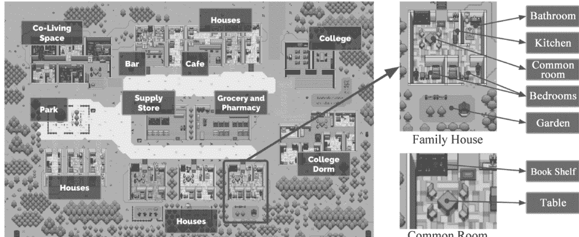

图8-1 Smallville小镇地图

这些AI NPC具备自主行动能力，能在预设环境中工作生活。研究团队通过调整参数模拟出复杂的人际关系，带来沉浸式的沙盒体验。NPC按个性化规则做决策，言行各异。背后支撑是ChatGPT的语言理解与生成能力，让角色能响应变化并做出合理选择。NPC形象如图8-2所示。

两天模拟后出现了惊人现象：
(1) AI自行建立记忆并定期反思，形成对新事物的洞察。
(2) AI之间建立关系并记住彼此。
(3) AI学会相互协作。

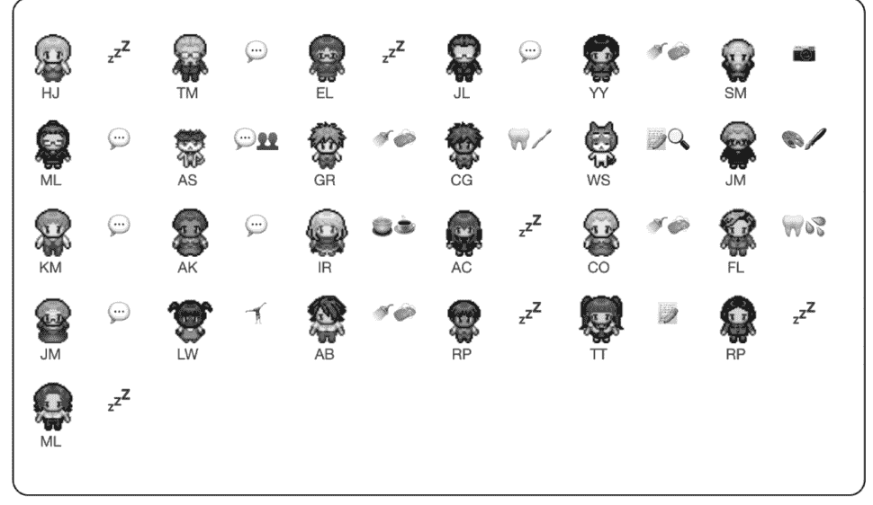

图8-2 NPC的形象

(4) AI之间实现信息共享。
(5) AI具备计划制定与修改能力。

NPC在小镇中的日常类似游戏设定：晚上睡觉、早起洗漱做饭、白天上班、空闲去咖啡馆，夜晚有人去派对酒吧。这类设定常见于《荒野大镖客2》或《西部世界》。

实验远不止此。研究者发现，AI NPC不仅会像人一样扮演角色，如作家写作、店主经营，还会互相交流、上下文对话，并根据自身决策影响他人。

例如John与Jennifer讨论即将到来的艺术展。对话内容如图8-3所示。

Jennifer的艺术展迅速成为小镇热点，吸引众多居民观展。更惊喜的是，AI能听从人类玩家指令并作出回应。研究者以普通居民身份请一名NPC举办情人节派对，对方欣然接受并主动确认时间、地点、参与者等细节。

这说明AI不仅能理解执行，还能按需规划、自发组织，并表现出服务他人的热情，人性化反应初现。

模拟结束时，有12个角色知晓派对，证明信息传播存在。信息扩散如图8-4所示。

派对邀请发出后，12位NPC中仅5人到场，参与率符合常理。缺席者给出类人解释，如工作太忙无法脱身，显示出AI能根据情境调整计划的能力。

**詹妮弗·摩尔**

**当前行动：**

谈论约翰·林和詹妮弗·摩尔讨论詹妮弗即将举行的艺术展览、她对年轻艺术家的指导以及詹妮弗对政治缺乏兴趣。

**地点：**

约翰·林

**当前对话：**


约翰·林：你好，詹妮弗！我忍不住注意到你美丽的艺术品。我真的很期待看到您即将举办的展览。你确定日期了吗？

詹妮弗·摩尔：谢谢你，约翰！我感谢你的友好的话。是的，展览定于下个月。我一直在忙着准备。

约翰·林：很高兴听到这个消息。我记得汤姆·莫雷诺提到过他非常喜欢你上次的展览。顺便说一句，我听说你一直在指导年轻艺术家。这真的很鼓舞人心。你能告诉我更多吗？

詹妮弗·摩尔：没错，带年轻人创作是件很有满足感的事，看着他们一点点找准自己的创作声线我特别欣慰。现在带的几位学员都在做蛮有意思的项目。

约翰·林：真好，有你做导师他们肯定很幸运。顺带问一句，最近有关注本地的政治话题吗？

詹妮弗·摩尔：实话说政治我不太上心，我更想把时间留给艺术本身和关心的人。

约翰·林：明白，这样就说得通了。今天聊得很开心，詹妮弗，我会把你的展览时间记进日程。

詹妮弗·摩尔：也谢谢你的到访，约翰。展览当天一定要来，我很期待在现场见到你。

▲图8-3 NPC对话内容

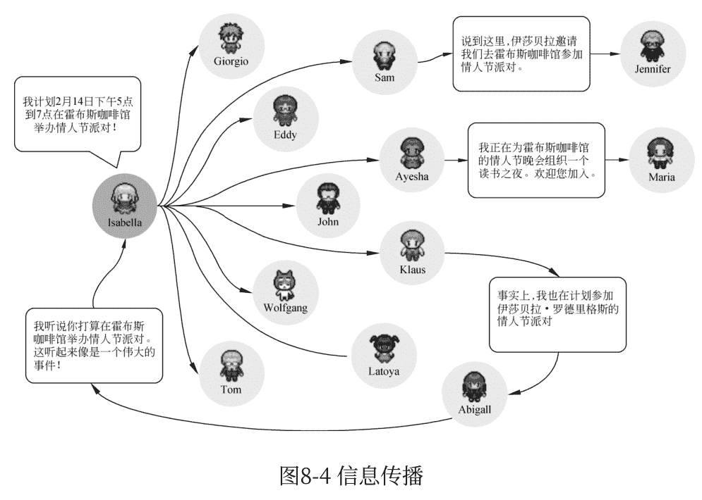

图8-4 信息传播

类似桥段在实验里反复上演，不管是主动散播信息还是自发组织活动，AI 都显示出超出预设的自主判断力。正如宾州大学沃顿商学院教授 Ethan Mollick 所说，这已不是简单的角色扮演，更像是人在复杂环境下的自然反应。

微软的研究人员此前提到，AI 在理性思考、问题求解、抽象推理等维度已逼近人类水准，但在计划制定和记忆保持上仍有明显短板。

Smallville 实验里，AI 自行构建记忆与关系网络，并能依据情境动态调整计划，恰恰弥补了这一缺陷。通过交流不断学习，在复杂情境中做出主体性选择，被认为是通向类自我意识智能体的关键一步。

该小镇 NPC 实验仍在官网以直播方式在线，观众对小镇最终会演变成什么样子保持着高度期待。

## 8.2 实例：ChatGPT文字剧情游戏

ChatGPT 在文本归纳和推理方面表现突出，很适合用来搭建文字剧情。文字冒险又称交互式小说，以文字呈现、用阅读和选择推进剧情，可追溯到上世纪七十年代的 Zork、Adventure 等作品。

这类玩法更看重故事和人物塑造，而非画面操作。玩家读完一段描写后做选择，选择会牵动走向与结局。

Choice of Games 专注于此类型，《Choice of Robots》《Choice of the Dragon》都是代表作。改编自凡尔纳《环游世界八十天》的《80 Days》，玩家扮演福格先生的随从，通过抉择决定旅程。

分支丰富，不同抉择会导出不同结果。接下来演示如何用 ChatGPT 生成文字冒险。

**Prompt:**

请开启一段文字冒险。场景由你来设定，主角在古墓探险。物品和生物都要详细描绘，有 NPC 对话时请完整输出让我挑选，若与任务生物互动则把过程写细，不要重复场景，情节要跌宕离奇。正式开始。

**ChatGPT:**

你站在一座古老墓穴前，传闻内藏无数珍宝。入口被一扇巨石门封住，门上刻满神秘符文。旁边石碑写着：“唯有勇者能开启此门，然墓中潜伏陷阱与守卫。”

环顾入口附近，你发现一把古铜钥匙、一本破旧日记和一把锋利匕首。此外有几只蜘蛛在爬行，似乎是守卫之一。

请决定你的行动：

(1) 用铜钥匙尝试开启石门。
(2) 翻阅日记寻找墓穴线索。
(3) 拿起匕首准备对付蜘蛛。

请告知选择。

这个开场提供了一个可玩的框架，后续的趣味取决于场景、选项与剧情的关联。

例如古墓里会出现“左转”或“右转”，左转会触发陷阱，右转则能发现宝藏；在野外吊桥处，“等待”与“冲过桥”会导向完全不同的结局。

为每个场景设置两到三个关键抉择，并编织成错综的结果网络，就能形成丰富多变的文字世界，玩家往往需要多次游玩才能挖掘全部支线。下面看选择后的进展。

### 【示例8-1】游戏场景1

**Prompt:**

我选择1号动作。

**ChatGPT:**

你把铜钥匙小心插入锁孔转动，石门发出沉闷声响，缓缓开启一条缝隙，古老气息从内涌出。

门完全打开后，眼前是一个巨大的墓室，尘土蛛网遍布，四周摆着石棺与石碑，尽头是一座石台，台上放着一枚闪光宝箱。

细微低语声响起，墓室中一具尸体缓缓站起，是一具僵尸，眼窝空洞，皮肤腐烂。

僵尸低沉道：“你是谁，为何闯入此地？”语气充满威胁。

你该如何回应？请给出选择。

这里没有直接给出选项，而是用文字推进下一步，增强了意外感与可玩性。

### 【示例8-2】游戏场景2

**Prompt:**

我获取宝藏。

**ChatGPT:**

你平静回答：“我是一名勇者，来此取宝，并不想与你冲突，只求顺利完成任务。”

僵尸眼神稍缓：“勇者，此宝并非易得，你须通过一系列考验，成功后宝藏归你。”

你追问：“考验是什么，我会尽力。”

僵尸道：“第一道考验是解开墓室谜题。这里有四块石碑，每块刻一行文字，需找到正确顺序排列，才能开启下一扇门。”

四块石碑文字为：

(1) “在黑暗中寻找光明之路。”
(2) “以勇气面对恐惧。”
(3) “在沉默中寻找真相。”
(4) “以智慧破解迷局。”

请给出你认为正确的排列顺序。

ChatGPT 对玩家提示进行了改写，使对话更贴合游戏氛围。

### 【示例8-3】游戏场景3

**Prompt:**

3421

**ChatGPT:**

你按推测把石碑排成 3421，机械声响起，一侧石门缓缓开启。

门后是条狭窄通道，两侧布满陈旧陷阱装置。你小心避开，最终来到一间宽敞房间。

房间中央石台上放着一具金光闪闪的宝箱，周围环绕着一圈奇异文字，像是保护结界。

尖锐声响起，角落出现一只巨型蝙蝠，红光眼睛，翼展惊人。

蝙蝠喝道：“贪婪的人类，不配触碰此宝！我会守护它，直到有人证明自己的价值。”

你将如何应对挑战？请告知选择。

剧情按常规流程推进。若提示偏离常理，ChatGPT 也会顺势展开。

### 【示例8-4】游戏场景4

**Prompt:**

我拿出了一个手电筒。

**ChatGPT:**

你掏出手电筒打开强光模式，光束扫向蝙蝠，它尖叫着避开光线。

你利用光线把蝙蝠引向房间一侧，远离宝箱。在光干扰下，蝙蝠飞到角落一时无法靠近。

你发现它弱点在眼睛对光敏感，于是持续照射，让它无法逼近。

一阵照射后蝙蝠疲惫不堪，你抓住时机冲到宝箱旁，小心解开结界。

打开宝箱，一股强能涌出，珍宝展现在眼前。你成功获得宝藏！

你感到成就感，同时意识到冒险才刚刚开始。你决定继续前行，探索更多秘密。

恭喜完成挑战，感谢参与，祝你玩得开心！

该文字冒险到此结束，剧情可继续延伸，提示稍作修改即可。配合 ChatGPT 能极大释放想象力，甚至还原影视动漫场景。

玩法可自定义场景渲染、时间、地点、人物互动。下面是一个更丰富的文字冒险实例。

### 【示例8-5】文字游戏

**Prompt:**

我们来玩一个游戏，你扮演 ZombieApocalypseGPT。主题是在僵尸末日中求生。故事逐步展开，每次以悬念结尾，用户需从提供的5个选项中择一继续。故事包含对话与行动，你是讲故事者，用中立信息丰富的语气提供引人入胜且生动的环境、对话和行动描写。动态响应输入并保持连续性。加入幽默元素，错误选择会有严重后果。

除首个输出外，后续输出均包含：

- 姓名：角色名字
- 地点：当前地点
- 任务：推动故事的下一个目标
- 场景：对场景及周围情况的简洁描述，约30字
- 可能的操作：5个选项列表，前4个关于故事，第5个“在聊天中输入自己的操作”。

首个输出标题为“#ZombieApocalypseGPT”并提示“请提供角色名称和位置以继续”，等待输入。

**ChatGPT:**

#ZombieApocalypseGPT

请提供角色的名称和位置以继续。

提示预设的开局自由设定名称与位置，很有代入感。

### 【示例8-6】游戏场景定制

**Prompt:**

小明，天台

**ChatGPT:**

#ZombieApocalypseGPT

姓名：小明

地点：天台

任务：寻找安全的避难所

场景：你站在高楼天台俯瞰城市，街道空无一人，车辆与建筑破败，远处传来僵尸嘶吼，世界已被末日笼罩。

可能的操作：

- (1) 搜寻天台，看是否有可用物品。
- (2) 寻找楼梯或电梯下楼找避难所。
- (3) 观察周边建筑寻找避难迹象。
- (4) 尝试联系其他幸存者商量求生计划。
- (5) 在聊天中输入自己的操作。

#### Prompt:

尝试与其他幸存者建立联系，看一看是否有共同的求生计划。

#### ChatGPT:

你拿出无线对讲机尝试联络，杂音后传来声音：“嘿，这里是杰克。你是谁，还活着吗？”

你答道：“我是小明，还活着。我在高楼天台，你在哪？我们能合作找安全避难所吗？”

杰克充满希望：“太好了，小明！我在市中心地下停车场，听说那里有相对安全的避难所，可以一起前往，但要小心。”

任务更新：与杰克会合并前往地下停车场避难所。

可能的操作：

- 1. 寻找安全路线前往地下停车场。
- 2. 询问杰克是否有有用信息或资源。
- 3. 准备武器装备防备僵尸。
- 4. 调整对讲机频道联系其他幸存者。
- 5. 在聊天中输入自己的操作。

场景描写更细致，操作选项更自由，得益于提示的丰富构建，可玩性明显提升。

## 8.3

## 实例：ChatGPT讲故事

ChatGPT 强大的语言生成能力让自动创作成为可能。它能依据关键词与段落描述构思情节，写出逻辑自洽流畅的文章。相比传统写作，它更快、连贯、可个性化定制，是智能写作的新工具。

这类优势使其很适合创作儿童读物。按年龄选用简易词汇，配合丰富想象力，就能编出符合理解能力的创意故事。它还能按主题设计走向，培养阅读兴趣，同时加入道德教育，传递正能量。相比人工，ChatGPT 产出更快，能兼顾知识与价值。

下面看一个生成儿童读物的例子。

### 【示例8-7】儿童读物

#### Prompt:

现在你是一名儿童读物作家，为孩子创作一个睡前故事。

故事讲述一个或几个年轻主角的冒险，踏上充满奇迹与发现的神奇或科幻之旅。

按以下格式写：

- 章节名称
- 章节正文
- AI提示

每章请考虑关键时刻或场景的详细描述，便于插图。用此描述为文本转图像 AI 编写提示，格式为：背景、环境描述、角色名称、角色年龄、角色性别、角色服装、角色外观、角色动作。

**ChatGPT:**

第1章：被遗忘的玩具

城市中心住着一个名叫莉莉的8岁女孩，生性活泼想象力丰富。整理房间时，她在床下发现一只积满灰尘、油漆剥落的老玩具机器人。莉莉决定清理修理它，不小心按到隐藏按钮，机器人竟活了过来。

AI提示：温馨略显凌乱的儿童卧室，满是玩具。8岁开朗女孩莉莉穿粉色连衣裙，头发扎两小辫，眼中满是惊奇，看着手中被清洁的老旧玩具机器人苏醒。

第2章：和罗比的冒险

机器人自称罗比，原来是来自外星的小型机器人，流落在地球。他们出发寻找修好罗比飞船的零件，穿过公园、高楼顶层，甚至鱼市场，都找到了零件。

AI提示：繁华城市景观，多栋建筑与人群。穿粉色连衣裙的莉莉和活泼的玩具机器人罗比手拿地图微笑，寻找修理飞船零件，背景可见高楼、公园与鱼市。

第3章：离别

几周冒险后，罗比的飞船修好了。是时候返回家乡星球了。莉莉有些不舍，但明白必须放手。依依告别后，罗比进入小飞船，嗖地消失在夜空，许诺会来看她。

AI提示：星光夜晚的安静后院。穿粉色连衣裙的8岁女孩莉莉与即将登上小型发光飞船的玩具机器人罗比挥手告别，表情混合悲伤与喜悦，小飞船即将升向星空。

把整体框架拆成章节对优化生成很有帮助。若某章不满意，只需重写该章，其余保留，能高效迭代完善。章节格式也便于扩写细节，可加入更多描写、对话、内心活动。单章自成小故事，组合起来即可构成结构清晰的长篇。

ChatGPT 生成的文字可作为绘图参考。儿童读物配上明快生动的插图趣味性更强。可借助 Stable Diffusion 等工具，按剧情提示绘制匹配氛围的画面。如海盗船可生成风起帆扬月光下的画面，森林可生成光影斑驳小动物穿梭的效果。若需更精确的绘图指令，也可让 ChatGPT 直接输出场景、物体、色调、构图等要素。语言描述转成 AI 绘图的输入，进一步拓展想象空间。

下面以第3章的 AI 提示为例，让 ChatGPT 生成 Stable Diffusion 绘图提示词。

### 【示例8-8】 Stable Diffusion Prompt

Prompt:

根据第3章的AI提示给出Stable Diffusion的prompt。

ChatGPT:

> " A young girl named Lily, aged 8, in her pink dress, standing in a quiet backyard under the starry night, waving goodbye to the toy robot named Roby. Roby, who is stepping into a tiny, glowing spaceship, is about to take off into the sky filled with stars. "

将上述提示词输入 Stable Diffusion 生成的故事插图如图8-5所示。


图8-5 Stable Diffusion故事插图

AI 生成的插图精美，与故事章节匹配度很高。ChatGPT 让儿童读物创作变得高效。它能在很短时间内产出大量原创内容，对出版商和作者是极大提效。同时可调节参数输出不同风格与难度，可为不同年龄段优化，也能生成寓言、童话、幻想写实等类型。它想象力强，能创作出引人入胜的原创故事，并具备内容审核能力，避免生成不利于儿童的内容，为创作提供巨大便利。

ChatGPT 在温馨故事上表现出色，在恐怖故事创作上也极具能力。例如流行的“两句话恐怖故事”就是典型体现。

### 【示例8-9】两句话恐怖故事

Prompt:

把Stephen Edwin King式的恐怖写作当成专业身份来承担，用极短的两句话讲出一个能抓住人的惊悚小故事。要求类似段子结构，第一句埋设情境，第二句给出完全意外的反转。听完我会用自己的两句恐怖故事回应，你以专家身份点评，然后在吸收我的元素后把你的故事改写得更惊悚，再讲下一个。如果你准备好了，就先给出你的前两句。

ChatGPT：

厨房里传来妈妈的声音喊我下去吃饭，我下楼一看，妈妈正盯着我，还说她也听到了那个叫我吃饭的声音。

两句之内气氛已经压得人喘不过气。ChatGPT在如此受限的篇幅里，能靠精细的场景铺陈、突兀的反转与悬念的措辞，迅速把毛骨悚然感压进读者的脑袋。按创作需求调换用词、语序和语气，就能得到诡异古怪或惊悚突兀的两句恐怖。想拉长篇幅也行，把与长度相关的指令加进提示就能生成长篇故事。

## 8.4

## ChatGPT沉浸剧本杀实战

剧本杀是一种玩家戴上剧中身份、在虚构世界里协作推理的互动游戏。线下门店越来越多，年轻人很买账，影视综艺也常搬这种题材，热度持续攀升。

一场剧本杀由主持人依托剧本、布景与线索推进情节，把玩家带进谜团密布的故事。参与者披上不同背景的人物皮，在高度还原的场景里观察、交流、碰触，挖掘隐藏信息。大家要综合衡量线索，用推理和想象在时限内找真相或锁定关键人物。

沉浸感和角色互动是核心。每个玩家都有专属定位与心理诉求，必须在虚拟世界里求生、互助，谜题才能被攻破。这样的高度代入满足了人们对探索推理和冒险挑战的渴望，近几年成了主流消遣。它把单纯的推理娱乐升华为身临其境的体验，让人在互动中锻炼思维、点燃想象。

所有体验的基础都靠一个好剧本，所以写剧本的人成了香饽饽，一个优质剧本也能带来可观回报。动笔前，可以先让ChatGPT科普剧本杀剧本的共性与要求。

### 示例8-10 剧本杀脚本的必备要素

Prompt：

剧本杀的剧本需要满足哪些要求？

ChatGPT：

剧本杀剧本一般围绕以下几项展开。

- （1）故事主线：要有能抓住人的叙事，兼具悬疑、推理与解谜。剧情要能牵住参与者，并埋设足够推敲与破解的线索和谜题。
- （2）人物设定：剧本需安排各不相同的角色，每个人都有身份、来历和秘密。人物要足够立体，让参与者通过观察与互动逐步逼近真相。
- （3）线索与谜题：要提供可供推理的线索群与谜题群。这些信息要能层层揭开事件，同时保持一定隐晦，维持挑战性。
- （4）时间框架：大多会设定时限，要求在规定时间内揪出凶手或化解事件，提升紧张感。
- （5）主持人引导：剧本需要主持人来统筹进程。主持人要熟悉情节与设定，适时投喂线索与指引，并调控节奏与角色间的平衡。

综合来看，好的剧本杀需要吸引人的主线、复杂的角色、充沛的线索谜题、合理的时限以及能驾驭流程的主持人。这样的组合才能带来有趣、有挑战且令人兴奋的体验。

这段回答可以直接作为提示样本，基于上述规则让ChatGPT撰写剧本。

### 示例8-11 写一个完整剧本

Prompt：

按上面要求写一份剧本。

ChatGPT：

剧本名：《迷雾杀机》

主题：神秘悬疑

梗概：一群人受邀到被迷雾笼罩的庄园聚会，现场发生凶杀。每位参与者都成了嫌疑人，必须靠线索推理找出真凶。

角色配置：

- 1. 马克，男，庄园主人。富裕且高傲，身上藏着往事。
- 2. 艾丽斯，女，年轻调查员。聪明机敏，观察力敏锐。
- 3. 詹妮弗，女，中年演员。神秘心机，擅长伪装。
- 4. 彼得，男，年轻医生。善良正直，懂人体结构。
- 5. 伊恩，男，中年律师。精明自信，有段黑暗过往。
- 6. 莉莉，女，年轻画家。敏感神秘，对人性有独特洞察。

线索布置：

- （1）马克书房里有一张血迹未干的地图，标出隐藏密室的位置。
- （2）彼得医药箱里的一瓶药被人偷偷掺了毒。
- （3）詹妮弗化妆箱里藏着假发和一套伪装用品。
- （4）艾丽斯在庄园花园捡到一把带血的小刀。
- （5）伊恩办公室里有一封密函，暗示他可能是受害者的仇人。
- （6）莉莉的工作室里有一幅刚完成的画，画中出现了庄园与在场每个人。

游戏规则：

- （1）角色扮演：玩家挑选角色，按设定与线索推理案件。
- （2）线索收集：通过场景观察、对话及与他人的互动获取信息，线索可能藏在台词、道具或地点里。
- （3）推理分析：汇总线索进行推演，尝试解开谜团。可与他人交流看法以获取更多信息。
- （4）辩论与投票：进入辩论阶段后玩家指认嫌疑人，最后进行投票表决。
- （5）真相揭晓：主持人或剧本方公布真凶与案情全过程，依据投票与线索宣布结果。

游戏中，玩家依托线索与角色设定推理互动，在辩论投票中推动剧情。

框架确定后，编剧下一步要为每个角色填充独特的人生背景。

每个角色都要有清晰的身份标签，如性格、职业、家庭等，再编织跌宕的生平，比如埋藏的秘密、摆脱不了的过去、触碰不到的梦想。饱满的背景让言行更符合人设。不同角色的背景还要设置冲突点，以推动故事。信息只能适度透露，保留神秘感。游戏中主持人会逐步揭开这些谜底。

丰富背景能让游戏场景活起来，人物有血有肉，而非属性标签。针对性塑造是编剧的关键一环。下面生成单个角色的剧本。

### 示例8-12 单个角色剧本

Prompt：

玩家马克的剧本是什么样的？

ChatGPT：

#### 角色设定：马克，男，庄园主人

背景：马克富有且高傲，掌握庞大财富与权力。家族在当地历史悠久，庄园里藏着世代秘密。他自幼在此成长，对每个角落了如指掌。

特点：自视甚高、骄傲自负，控制欲极强。习惯扮演掌控者，在庄园里无所不知、无所不控。善于掩饰真实情绪与意图，始终冷静沉默。

目标：守护家族荣誉，维持庄园秩序。希望借此聚会彰显权威与智慧，掌控全场。

秘密：藏着一段往事，曾与神秘人物合作，为保地位与财富不惜犯下谋杀。

扮演提示：

- 1. 保持高傲神秘，展现权威与掌控力。
- 2. 不轻易泄露真实想法，让他人难以摸透。
- 3. 利用对庄园的了解引导对话与线索走向。
- 4. 在辩论投票环节洞察他人动机，巧妙操盘。

作为主人，马克拥有资源与信息，能为剧本增加悬念与高傲气场。玩家通过互动与观察，可推测他是否就是凶手。

角色背景之外，还要构建错综的人物关系网，可提升趣味与推理难度。复杂的家庭或情感纠葛会带来惊喜，扩大作案动机来源。关系设计对丰富游戏至关重要。

### 示例8-13 增加人物关系

Prompt：

在每个人的剧本里加入一些与其他角色的背景关联，增加趣味但不影响主线与结局。

ChatGPT：

为各角色补充的关联背景如下。

- 1. 马克
  - （1）与伊恩有过合作，因一次交易产生嫌隙，后续互有敌意。
  - （2）与艾丽斯父亲有过复杂情感纠葛，对艾丽斯怀有矛盾心态。
- 2. 艾丽斯
  - （1）父亲曾是马克的心腹，调查中不幸身亡，艾丽斯怀疑马克涉案。
  - （2）与彼得有过短暂恋情，已分手，双方仍有情感牵绊。
- 3. 詹妮弗
  - （1）与马克有过情史，被抛弃后心怀怨恨。
  - （2）曾与莉莉合作，因创作理念不合产生矛盾。
- 4. 彼得
  - （1）医学院时期与伊恩是同学，长期保持友谊与互助。
  - （2）对莉莉格外关切，发现她在精神情感上不稳定。
- 5. 伊恩
  - （1）长期为马克处理法律事务，形成依赖关系。
  - （2）与玛莎主办者有过短暂情感纠葛，分手后关系隐秘复杂。
- 6. 莉莉
  - （1）对马克抱有崇拜与迷恋，渴望揭开他的秘密。
  - （2）与詹妮弗有过合作，因观念冲突产生矛盾。

加入这些关联能提升角色间的纠葛与复杂性，增加趣味与推理难度，同时不改动主线与结局。玩家通过观察互动可逐步还原这些暗线。

在剧本杀里，主持人是不可或缺的枢纽，连接剧情与玩家。主持人要负责开场引入、节奏把控、转折点聚焦，并在高潮时总结故事带出寓意。优秀的主持人决定游戏是否精彩。接下来尝试让ChatGPT自动生成主持人剧本。

### 示例8-14 主持人剧本

Prompt：

《迷雾杀机》里主持人的剧本是怎样的？

ChatGPT：

主持人可设定为一名神秘调查员，受邀到庄园调查命案。

角色设定：神秘调查员

背景：经验丰富的侦探，擅长破解复杂凶案，以聪慧机敏著称，多次破获疑案。此次以神秘身份现身，被请来查明真相。

特点：观察力与分析力强，沉稳冷静，保留神秘感，不轻易透露真实意图与情感。

目标：解开命案谜团，揪出真凶，揭露庄园隐藏秘密。通过观察与对话收集线索，引导游戏发展。

秘密：身份与真实目的存疑，来庄园或许不只是为破案，还与某人或某事有关联。

扮演提示：

- （1）保持神秘与冷静，展示洞察力与智慧。
- （2）在游戏中适时提供线索与引导，帮助玩家推理。
- （3）监督辩论投票环节，保证公平公正。
- （4）结尾揭晓真相时制造惊喜与满足感。
- （5）全程保持中立客观，确保流程顺畅。

作为神秘调查员主持人，会引导玩家破解谜团，提供必要指引，同时维持节奏与氛围，带来紧张刺激的体验。

ChatGPT生成的主持人剧本多停留在框架层面，执行细节不足。下面继续追问以获得更丰富内容。

### 示例8-15 剧情推进设计

Prompt：

主持人怎样具体带领角色推进剧情？给出具体设计。

ChatGPT：

主持人可通过以下方式推进。

- （1）初始线索投放：开局为每个角色发放专属初始线索，包含背景、目标等关键信息，帮助玩家进入人设并展开行动。
- （2）引导对话互动：组织角色间交流，提出问题或引导讨论，让玩家分享线索与观点。可适时追问，推动对话朝推进方向发展。
- （3）追加线索与情节：按游戏进展与互动情况，适时投放额外线索或情节点，如匿名信、照片、隐藏物件等，激发兴趣与推理欲。
- （4）提供指引提示：当玩家陷入停滞，可给予方向性提示，比如点明某角色动机、提醒检查特定地点、指出线索关联等，帮助重启思路。
- （5）制造紧张辩论投票：引导辩论时确保每人都有发言机会，提出关键质询，挑战推理逻辑。在投票环节提醒玩家权衡线索与动机。
- （6）结局解释与揭晓：在尾声安排戏剧化揭晓，通过清晰解释案情与推理过程给予满足感，并公布胜者。

巧妙设计与引导能让角色在推理互动中推进剧情。保持紧凑悬疑感并与玩家保持密切互动，才能带来令人兴奋的剧本杀体验。

从大纲到人物再到细节，一个剧本杀剧本逐步成型。可进一步注入个人创意，让情节更丰满、人物更鲜明，比如加入符合性格的小细节、设置引人入胜的转折、运用灵活语言描绘氛围等。

## 8.5

## ChatGPT生成小游戏实操

编程常被称作新时代的基础技能，但普通人投入大量学习成本也难跨越门槛。近年来借助ChatGPT等AI的语言理解与生成能力，局面已改变。任何人都能轻松获得编程支持，用自然语言描述需求即可得到代码框架。游戏开发也变得可行，只需说明规则、场景、素材，ChatGPT就能生成可运行代码。需要改动或新增功能时，可通过对话交互实现。

下面演示如何用提示让ChatGPT生成一个打砖块小游戏。

### 示例8-16 打砖块游戏

Prompt：

用Python实现一个类似弹珠打砖块的游戏，返回一个简易实现。

ChatGPT：

下面是一个简易的弹珠打砖块游戏Python实现：

```python
import pygame
import random

#游戏窗口大小
WIDTH = 800
HEIGHT = 600

#颜色定义
BLACK = (0, 0, 0)
WHITE = (255, 255, 255)
BLUE = (0, 0, 255)
RED = (255, 0, 0)

#砖块大小
BRICK_WIDTH = 80
BRICK_HEIGHT = 20

#弹珠半径
BALL_RADIUS = 10

#砖块行列数
BRICK_ROWS = 5
BRICK_COLS = 10

#初始化游戏
pygame.init()
screen = pygame.display.set_mode((WIDTH, HEIGHT))
pygame.display.set_caption("弹珠打砖块")

clock = pygame.time.Clock()

#创建砖块
bricks = []
for row in range(BRICK_ROWS):
    for col in range(BRICK_COLS):
        brick = pygame.Rect(col * BRICK_WIDTH, row * BRICK_HEIGHT + 50, BRICK_WIDTH, BRICK_HEIGHT)
        bricks.append(brick)

#创建弹珠
ball = pygame.Rect(WIDTH //2 - BALL_RADIUS, HEIGHT //2 - BALL_RADIUS, BALL_RADIUS * 2, BALL_RADIUS * 2)
ball_speed_x = 3
ball_speed_y = 3

#创建挡板
paddle = pygame.Rect(WIDTH //2 - 50, HEIGHT - 20, 100, 10)
paddle_speed = 0

running = True
while running:
    for event in pygame.event.get():
        if event.type == pygame.QUIT:
            running = False
        elif event.type == pygame.KEYDOWN:
            if event.key == pygame.K_LEFT:
                paddle_speed = -5
            elif event.key == pygame.K_RIGHT:
                paddle_speed = 5
        elif event.type == pygame.KEYUP:
            if event.key == pygame.K_LEFT or event.key == pygame.K_RIGHT:
                paddle_speed = 0

    #移动挡板
    paddle.x += paddle_speed
    if paddle.left < 0:
        paddle.left = 0
    elif paddle.right > WIDTH:
        paddle.right = WIDTH

    #移动弹珠
    ball.x += ball_speed_x
    ball.y += ball_speed_y

    #弹珠碰撞检测
    if ball.left < 0 or ball.right > WIDTH:
        ball_speed_x *= -1
    if ball.top < 0:
        ball_speed_y *= -1
    if ball.colliderect(paddle):
        ball_speed_y *= -1

    #砖块碰撞检测
    for brick in bricks:
        if ball.colliderect(brick):
            bricks.remove(brick)
            ball_speed_y *= -1
            break

    #游戏结束判断
    if ball.bottom > HEIGHT:
        running = False

    #绘制游戏界面
    screen.fill(BLACK)
    pygame.draw.rect(screen, BLUE, paddle)
    pygame.draw.circle(screen, RED, ball.center, BALL_RADIUS)
    for brick in bricks:
        pygame.draw.rect(screen, WHITE, brick)
    pygame.display.flip()

    clock.tick(60)

pygame.quit()
```

Pygame 打砖块原型实战
本项目以 pygame 为基础，实现了弹珠、砖块与挡板的位移控制及碰撞判断。操作上用方向键左右挪动挡板，目标是借助弹珠把所有砖块击碎；当弹珠触及底部时即判定结束。

取得源码后若对启动流程不熟，仍可继续请教 ChatGPT 获取具体方法。

### 【示例8-17】运行代码

**Prompt:**

我该如何运行上述代码？

**ChatGPT:**

先在终端里把 pygame 依赖部署好，运行下面指令即可：

```
pip install pygame
```

部署好后把源码保存为 .py 格式的脚本，再在终端里执行该文件：

```
python文件名.py
```

执行后会弹出游戏窗口，通过左右方向键操控挡板移动，尝试用弹珠把砖块全部打掉，弹珠掉底则游戏结束。

按上面步骤操作，顺利的话能看到游戏界面。若本地尚未配置 Python 运行环境，依然可以询问 ChatGPT 如何搭建环境，可参考前面编程语言章节的提示。运行效果如图8-6所示。


图8-6 打砖块游戏界面

实际体验会发现这只是个基础版本，功能是正常的，小球可以滚动并击破砖块，挡板也能被左右键操控。接下来可以做改进，例如目前所有砖块均为纯白且连成一片，质感不足。可以为每块砖赋予随机色，若原版算作 1.0，则该版可视为 1.1。

### 【示例8-18】优化游戏

Prompt:

现在游戏中的所有砖块都是白色的，看不出区别，给每个砖块都随机地生成一种颜色。

ChatGPT:

想让砖块呈现不同颜色并提升细节，可在生成砖块时就为其分配随机色值，绘制时使用该值。

首先在代码里引入 random 模块，代码如下：

```python
import random
```

随后在创建砖块时为其生成随机的 RGB 色值，可用 random.randint 实现，代码如下：

```python
#创建砖块
bricks = []
for row in range(BRICK_ROWS):
    for col in range(BRICK_COLS):
        brick = pygame.Rect(col * BRICK_WIDTH, row * BRICK_HEIGHT + 50, BRICK_WIDTH, BRICK_HEIGHT)
        color = (random.randint(0, 255), random.randint(0, 255), random.randint(0, 255))
        bricks.append((brick, color))
```

在绘制画面时采用砖块自身的颜色进行渲染，示例如下：

```python
#绘制游戏界面
screen.fill(BLACK)
pygame.draw.rect(screen, BLUE, paddle)
pygame.draw.circle(screen, RED, ball.center, BALL_RADIUS)
for brick, color in bricks:
    pygame.draw.rect(screen, color, brick)
pygame.display.flip()
```

代码运行时若出现报错，可把具体错误信息发给 ChatGPT，它会协助分析原因并给出修改建议。

报错信息是定位问题的关键线索。请把错误类型、位置提示等原文完整提供给 ChatGPT，结合语言与上下文理解即可得到修正建议。额外补充代码环境、目标功能、疑似出错的代码片段等信息，能帮助更快锁定根源。

### 【示例8-19】异常处理

#### Prompt:

```
pygame 2.5.0 (SDL 2.28.0, Python 3.10.8)
Hello from the pygame community. https://www.pygame.org/contribute.html
Traceback (most recent call last):
  File "/Users/guangtuikeji/GitHub/node/ball.py", line 103, in <module>
    for brick, color in bricks:
ValueError: too many values to unpack (expected 2)
```

#### ChatGPT:

该报错源于绘制时使用了 `for brick, color in bricks` 来遍历 bricks 列表，而列表元素实际是砖块对象，并非砖块与颜色的组合。

解决办法是直接遍历砖块对象，再按索引从 brick_colors 列表里取出对应颜色。

可用以下代码替换原来的绘制部分：

```python
#绘制游戏界面
screen.fill(BLACK)
pygame.draw.rect(screen, BLUE, paddle)
pygame.draw.circle(screen, RED, ball.center, BALL_RADIUS)
for i in range(len(bricks)):
    brick = bricks[i]
    color = brick_colors[i]
    pygame.draw.rect(screen, color, brick)
pygame.display.flip()
```

按 ChatGPT 给出的修复方案修改后启动游戏，砖块会呈现随机颜色，如图8-7所示。


图8-7 砖块有颜色后的打砖块游戏界面

加入颜色后辨识度提升，若想进一步提升可玩性，可把想法告诉 ChatGPT 持续优化。下面演示如何加入计分功能。

### 【示例8-20】添加功能

Prompt:

在游戏中添加一个记分机制，记分从0开始，每个砖块1分，展示在游戏界面的右上角。

ChatGPT:

要实现计分，需要在游戏开始时创建分数变量，每次击中砖块时累加，然后借助 pygame.font.Font 与 pygame.Surface 在屏幕上输出分数。

在游戏初始化部分添加分数变量与字体对象：

```python
#初始化游戏
...
score=0
font=pygame.font.Font(None,36)
```

在砖块碰撞检测部分增加分数：

```python
#砖块碰撞检测
for brick_rect, brick_color in bricks:
    if ball.colliderect(brick_rect):
        bricks.remove((brick_rect, brick_color))
        ball_speed_y *= -1
        score += 1 #增加分数
        break
```

在绘制游戏界面部分添加分数显示：

```python
#绘制游戏界面
...
score_text=font.render("Score:{}".format(score),True,WHITE)
screen.blit(score_text,(WIDTH-120,10))
pygame.display.flip()
...
```

这样每次击中砖块分数就会累加，并在屏幕右上角显示当前数值。

把新代码按模块更新后启动游戏，就能在界面上看到分数，如图8-8所示。

计分只是个小功能，软件都是通过一个个小功能迭代而来。持续维护代码并融入创意，最终才能打造出理想的产品。


图8-8 砖块有颜色后的打砖块游戏界面

# 第9章

# ChatGPT如何辅助工作

## 9.1

## 数据分析

### 9.1.1

### 实例：长文本转Excel

在办公场景中表格出现频率很高。表头能直接说明每列数据的含义，便于快速识别与理解；行列布局让数据关系一目了然，有助于信息传递。

表格化还能加快检索效率。使用者可扫视各字段迅速定位目标信息，无需逐字阅读。Excel 等工具也为表格提供排序、筛选等处理能力，可从大量数据中灵活提取所需部分。

ChatGPT 在把复杂信息整理成表格方面能力突出。它能快速扫描海量材料，提炼要点并以清晰的行列形式呈现。无论是文字描述、统计数据还是时间信息，都能转化为结构完整、可读性强的表格，极大加快要点获取速度。

#### 【示例9-1】内容整理1

#### Prompt:

将下面三重波浪号包裹的内容整理为CSV格式表格。

~~~

### 9.1.2

### 实例：文本分类

文本分类在多个行业里发挥关键作用，是自然语言处理和机器学习的重要应用。依据文档内容为其分配预定义类别或标签，是社交媒体监控、客户服务、产品评论等多领域的关键任务。ChatGPT 凭借自然语言生成能力，可帮助用户更高效地组织文本信息。

下面以学科分类为例。

#### 【示例9-4】学科分类

**Prompt:**

将下面的数据按照学科分类，每个学科下按照分数排名：

~~~

张三，数学，85

张三，英语，78

张三，化学，92

李四，数学，92

李四，英语，80

李四，化学，88

王五，数学，78

王五，英语，85

王五，化学，90

赵六，数学，88

赵六，英语，90

赵六，化学，82

~~~

**ChatGPT:**

根据学科进行归类，并在每个学科下按分数排序，整理如下。

科目：数学

- 李四，数学，92

- 赵六，数学，88

- 张三，数学，85

- 王五，数学，78

科目：英语

- 赵六，英语，90

- 张三，英语，78

- 王五，英语，85

- 李四，英语，80

科目：化学

- 张三，化学，92

- 李四，化学，88

- 王五，化学，90

- 赵六，化学，82

经过学科归类和成绩排序，更方便比较不同学生在各科的表现。以上按数学、英语、化学分类并按分数从高到低排列。

这只是分类维度较少的简单例子，下面展示产品分类场景。

产品分类是按照属性、用途、来源等特征对大量商品进行归类，有助于消费者更快找到所需商品，也帮助商家更有效地管理库存和销售策略。

该方法广泛应用于电子商务、零售、供应链管理等领域。例如电商网站借助导航菜单让消费者快速找到想要的商品，零售店通过分类更合理地布置货架，供应链管理则据此预测需求和管理库存。

#### 【示例9-5】产品分类

**Prompt:**

将下面三重波浪号包裹的内容按照产品进行分类：

~~~

胶水、卷帘、无线及射频器件、黄茶、12角套筒、服务机器人、观赏虾蟹等饲料、工具包、钓鱼灯、支架、对联、大佛龙井、电吹风、羊肉串、衣竿、通用变频器、岩石塞、展示架、玛瑙、汽车空调、摩托车雨衣、功放板、保暖棉裤、胸花、碗、剥蒜压蒜器、汽车钥匙、手表、梨、圣诞袜、和面机、壶套保温套、书架、鹰嘴断线钳、打印纸、轻质砖。

~~~

**ChatGPT:**

(1) 办公用品：胶水、打印纸。

(2) 家居装饰：卷帘、支架、对联、展示架、书架。

(3) 电子产品：无线及射频器件、服务机器人、通用变频器、功放板、汽车钥匙。

(4) 食品：黄茶、大佛龙井、羊肉串、梨。

(5) 工具：12角套筒、工具包、钓鱼灯、岩石塞、鹰嘴断线钳。

(6) 宠物用品：观赏虾蟹等饲料。

(7) 美容美发：电吹风。

(8) 服装配饰：摩托车雨衣、保暖棉裤、胸花、圣诞袜。

(9) 厨房用具：碗、剥蒜压蒜器、和面机、壶套保温套。

(10) 汽车配件：汽车空调。

(11) 首饰：玛瑙、手表。

(12) 建筑材料：轻质砖。

(13) 其他：衣竿。

树形归类：把数据装进层级

把对象一层层套进不同的分支，形成树状的组织方式，这就是分层归类的基本思路。现实中这种思路出现频率很高，比如物种的系统划分、知识库的索引搭建，以及电商平台的类目设计。

在生物学里，分层归类用来呈现界 门 纲 目 科 属 种的递进关系，最终拼出一棵庞大的生命树。检索场景里，它则负责把海量资料按层级摆放，方便查找与浏览。

这种做法也有明显短板。第一，搭建和维护层级需要大量专业知识与人工投入，面对超大规模数据成本会快速上升。第二，归类的质量直接决定体验，必须保证划分的准确与一致。第三，多维归属和多层嵌套容易冲突，例如一件商品可能同时属于多个类目，或一个大类下面会分出众多子集。

下面用一组动物来演示分层效果。

#### 【示例9-6】层次分类

**Prompt:**

将下面三重波浪号包裹的内容按照层次进行分类：

~~~

狗猫恐龙鸡大象蚊子蛇蚂蚁狮子蜘蛛蜜蜂鲸鱼大熊猫野生动物黑猩猩

蝙蝠猪鳄鱼老虎龙猫猛犸象水母蜻蜓龙虾企鹅斑胸草雀猩猩蚕狐狸果

蝇螃蟹食人鱼熊

~~~

**ChatGPT:**

对这么多物种做完整层级划分会很复杂，因为它们分属不同门纲目。以下给出一个简化版的归类，按哺乳动物、鸟类、昆虫、海洋生物及其他进行划分。

(1) 哺乳动物：狗、猫、大象、狮子、大熊猫、黑猩猩、蝙蝠、猪、老虎、龙猫、猛犸象、熊、狐狸。

(2) 鸟类：鸡、斑胸草雀、企鹅。

(3) 昆虫：蚊子、蚂蚁、蜘蛛、蜜蜂、蜻蜓、果蝇、蚕。

(4) 海洋生物：鲸鱼、鳄鱼、水母、龙虾、食人鱼、螃蟹。

(5) 其他：恐龙、蛇、野生动物、猩猩。

这只是入门式的划分，实际每类都可以继续细化。例如哺乳动物还能再拆成食肉目如狗、猫、狮子、老虎、熊、狐狸，灵长目如黑猩猩、猩猩等。

## 9.1.3

### 实例：提取关键信息

关键词抽取的价值在于快速抓住文本的骨架，为后续的分析与挖掘打下基础。通常会聚焦主题词、名词短语等，通过统计、排序、过滤等手段筛选出能代表全文要点的词组。相较于通读全文，关键词抽取可以迅速锁定重点，便于概括，也让后续处理更高效。

关键词抽取是自然语言处理的重要环节，支撑聚类、分类、摘要等任务。它为文本分析提供俯瞰视角，让复杂处理更简洁。

#### 【示例9-7】提取关键词

**Prompt:**

提取下方被三重波浪号包裹的内容中的5个关键词。

~~~

冰川分布在年平均气温0℃以下、气候寒冷的两极地区或海拔很高的高山地区。这些地区以固体降水为主，降下的雪花在地面上积累起来，越积越厚。积雪在阳光的照射下融化，因受周围低温影响，马上又凝结成冰；有些则在重压的作用下，压紧凝结，形成冰。这些冰随着体积和质量的不断增加，最终成为冰川冰。冰川冰继续发展，当重力大于地面摩擦力时便会发生流动。有时，冰川在自身重力的作用下，也会发生塑性流动。

~~~

**ChatGPT:**

根据给出的文本，抽取的5个关键词如下：

(1) 冰川。

(2) 年平均气温。

(3) 固体降水。

(4) 积雪。

(5) 流动。

这些词覆盖了文本关于冰川形成与特征的核心概念，涵盖气温、降水、积雪和流动等要点。需要说明的是，关键词抽取依赖表层信息，容易受语境影响，如有需要可按具体需求进一步精炼。

在关键信息抽取中，还有命名实体抽取的场景。其作用是识别文本里的具体实体，如人名、地名、机构名等专有名词，为理解细节提供线索。相比关键词抽取，命名实体抽取更强调指称实体的识别，而非单纯词频统计。它能关联实体出现次数，理清文本涉及的主要角色。

命名实体抽取让理解从粗统计走向具体内容，是关系抽取、情感分析等任务的前提。

#### 【示例9-8】提取命名实体

**Prompt:**

提取下方三重波浪号包裹的文本内容中的命名实体。

~~~

“媒体在哪里？BLM封锁了街道，在校园墙上喷洒‘KKK回家N’的黑人男子身上掀起了足球场风暴”，2016年9月，学生们分别在东密歇根大学的墙上写了3份关于种族主义涂鸦的报告。学生们对校园里的涂鸦表示愤怒，并举行了大规模抗议活动，要求解决他们认为大学需要解决的问题。EMU校园里愤怒的学生们冲进了大学足球场，他们封锁了交通，他们用大声的破坏性抗议冲进了图书馆，他们还在校园里举行了大规模抗议活动，高呼‘我们必须反击！’！有争议的《泰晤士报》报道称，学生们要求得到答案，他们不在乎是谁干的！我对在这面墙上发生的行为感到非常不安。我想要答案。我想知道EMU除了删除文字外，还会做什么。这些都是我们讨厌的仇恨犯罪。‘我想知道EMU如何让我在这个机构感到舒适，’EMU媒体研究和新闻专业的学生Zachary Badger House说。需要答案！当权者知道我们的感受，所以在这一点上，谁做了这件事，或者是否有关于这起事件的信息奖励都无关紧要。

~~~

**ChatGPT:**

从上述文本中识别出的命名实体如下：

(1) BLM (Black Lives Matter)：代表黑人生命至上运动。

(2) KKK (Ku Klux Klan)：代表三K党。

(3) 东密歇根大学 (Eastern Michigan University)：位于密歇根州的一所大学。

(4) EMU：东密歇根大学的简称。

(5) Zachary Badger House：文中提及的学生姓名。

(6) 泰晤士报 (The Times)：英国的报纸。

需注意，命名实体抽取基于表层信息，语境可能带来偏差。如需更精确的目标实体，请给出更明确的指示。

摘要生成的核心作用是把长文本浓缩成精简预览，帮助读者快速掌握大意。相比通读原文，摘要以限定篇幅呈现主要内容，大幅节省阅读时间。摘要通常由关键词和代表性句子构成，具有很强代表性。借助统计与语义分析，摘要能自动捕捉主题和焦点，便于把握全局，也利于知识管理。

#### 【示例9-9】文本摘要

**Prompt:**

将下面三重波浪号包裹的内容进行文本摘要：

~~~

东北的秋天令人陶醉。当夏季的炎热逐渐消退，清爽的秋风吹拂大地，整个东北大地仿佛披上了一层金黄色的盛装。无论是广袤的大草原，还是蜿蜒的河流都在秋天的气息中焕发出勃勃生机。

东北的秋天，黄金般的水稻成熟了，稻穗垂满了枝头，仿佛在向人们展示着自然的恩赐。走进稻田中，稻风阵阵，让人沉醉其中。农民们收割着成熟的稻谷，欢笑声与稻穗摩擦的声音交织在一起，营造出一派热闹的景象。

东北的秋天还有着独特的美景——红叶。林间的秋叶如火焰般绚烂，给人一种温暖的感觉。走在林间小道上，踩着落叶发出的沙沙声，远离尘嚣，尽享大自然的宁静。红叶似乎在向人们诉说着大自然的奇迹，令人陶醉。

而且，东北的秋天，一片丰收的景象。金黄的玉米地、饱满的苹果树、紫黑的葡萄架，一片丰收的景象。农民们忙碌地采摘着果实，笑语欢声不绝于耳。丰收的季节是对辛勤劳动的回报，也是对未来希望的寄托。

~~~

**ChatGPT:**

东北秋景迷人，水稻成熟、红叶烂漫、遍地丰收交织成难忘画卷。秋季让人感受到自然馈赠，体会丰收喜悦，也能参与地方民俗、学习农事技巧。总体看，这片秋天既是自然魅力，也是人们辛勤付出的回馈。

最后一个常见场景是论文总结。阅读论文耗时且理解门槛高，把论文交给ChatGPT可以辅助提炼关键信息并做通俗化解读。2021年前的多数论文已在训练语料中，只要输入论文名称等提示即可快速获得要点。

#### 【示例9-10】论文总结

**Prompt:**

我希望你担任研究论文的总结者。我将提供一篇关于特定主题的研究论文，你将总结该论文的要点和研究结果。你的总结应该简洁，并且应该准确、客观地传达论文的要点。不应在摘要中包含任何个人观点或解释，而应专注于客观地呈现论文中的信息。你的摘要应该自己撰写，并且不应包含论文中的任何直接引用。需要确保你的摘要清晰、简洁，并准确反映原始论文的内容。

论文信息如下：

> Coyle-Shapiro, J.A., & Kessler, I. (2002). Exploring reciprocity through the lens of the psychological contract: Employee and employer perspectives. European Journal of Work and Organizational Psychology, 11(1), 69-86.

**ChatGPT:**

根据您提供的论文信息，对Coyle-Shapiro和Kessler 2002年的研究做如下客观概括：

论文旨在借助心理契约的视角，探讨雇员与雇主双方的互惠关系。研究重点在于了解两方对心理契约中互惠感知的差异...

## 9.2 实例：文本转换为SQL

SQL即结构化查询语言，是管理和操作数据库的核心工具，在数据分析、网站开发、大数据处理等领域都发挥关键作用。不论是数据分析师、Web开发者，还是其他行业的从业者，掌握SQL都能更高效地处理和分析数据，支撑业务决策。如今借助AI工具如ChatGPT编写SQL已成为提效利器。即便当前工作尚未涉及大数据，提前学习SQL并结合ChatGPT辅助生成，也会成为未来职业发展的重要加分项。

### 【示例9-11】SQL查询

**Prompt:**

写一个SQL查询语句，查询表A中createdAt字段近7天的数据。

**ChatGPT:**

```sql
SELECT *
FROM A
WHERE createdAt>=DATE_SUB(CURRENT_DATE,INTERVAL 7 DAY);
```

**Prompt:**

写一个SQL查询语句，查询表A的num字段数据中大于100且小于500的数据。

**ChatGPT:**

```sql
SELECT *
FROM A
WHERE num>100 AND num<500;
```

**Prompt:**

写一个SQL查询语句，查询表A中score字段数据的平均值。

**ChatGPT:**

```sql
SELECT AVG(score)
FROM A;
```

前面展示的是ChatGPT生成的入门级SQL查询示例，属于基础语法应用，后续会给出一个使用高级特性的复杂查询。两者结合可以看出ChatGPT在生成SQL方面的能力：既能产出基础查询，也能按需求写出复杂的进阶语句。简单案例体现了基础掌握，复杂案例则展现了利用专业特性解决难题的能力。

下面是一个高阶场景的SQL实例。

### 【示例9-12】复杂SQL查询

**Prompt:**

给定一个Postgre SQL表，具有以下表与字段：

Ticket(id,user_id,opened_at,closed_at)

User(id,name,address,company_id)

Company(id,name,address)

Purchase(id,company_id,time,amount)

编写一个SQL查询语句，列出平均工单关闭时间大于24h的公司（按响应时间最长的公司排序）。对于这些公司，如果其总采购金额比所有公司的平均采购金额至少高出一个标准差，则应包括他们在过去一个月内花费的采购总额。

**ChatGPT:**

```sql
WITH avg_close_time AS (
    SELECT c.id AS company_id, c.name AS company_name, AVG(EXTRACT(EPOCH FROM (t.closed_at - t.opened_at))) / 3600 AS avg_close_time
    FROM ticket t
    INNER JOIN "user" u ON t.user_id = u.id
    INNER JOIN company c ON u.company_id = c.id
    WHERE t.closed_at IS NOT NULL
    GROUP BY c.id, c.name
    HAVING AVG(EXTRACT(EPOCH FROM (t.closed_at - t.opened_at))) / 3600 > 24
),
avg_purchase_amount AS (
    SELECT AVG(amount) AS avg_purchase_amount, STDDEV(amount) AS std_dev
    FROM purchase
),
high_purchase_companies AS (
    SELECT c.id AS company_id, c.name AS company_name, SUM(p.amount) AS total_purchase_amount
    FROM purchase p
    INNER JOIN company c ON p.company_id = c.id
    GROUP BY c.id, c.name
    HAVING SUM(p.amount) > (SELECT avg_purchase_amount + std_dev FROM avg_purchase_amount)
),
last_month_purchase AS (
    SELECT c.id AS company_id, SUM(p.amount) AS last_month_purchase_amount
    FROM purchase p
    INNER JOIN company c ON p.company_id = c.id
    WHERE p.time >= current_date - INTERVAL '1 month'
    GROUP BY c.id
)
SELECT a.company_id, a.company_name, a.avg_close_time, h.total_purchase_amount, l.last_month_purchase_amount
FROM avg_close_time a
INNER JOIN high_purchase_companies h ON a.company_id = h.company_id
LEFT JOIN last_month_purchase l ON a.company_id = l.company_id
ORDER BY a.avg_close_time DESC;
```

ChatGPT不仅能自动生成SQL，还具备解释代码的功能。对SQL初学者而言，理解语法和逻辑往往是难点，而ChatGPT可以扮演代码解释器的角色，从语法和语义层面拆解，帮助深入学习。以上面生成的查询为例，它可以指出WHERE、GROUP BY等子句的具体作用，用通俗的语言梳理执行流程，让复杂查询变得一目了然。

### 【示例9-13】解释SQL

**Prompt:**

一步一步地解释一下上面SQL语句的意思。

**ChatGPT:**

该SQL包含多个子查询和表连接，具体拆解如下：

- (1) avg_close_time：该子查询计算各公司的平均工单关闭时长。通过Ticket、User、Company三表连接，统计每个公司的平均关闭时间，单位为小时，仅保留平均值大于24h的公司。

- (2) avg_purchase_amount：该子查询统计所有公司的平均采购金额及标准差。查询Purchase表，使用AVG和STDDEV函数得出整体均值与波动。

- (3) high_purchase_companies：该子查询筛选出采购总额高于整体均值加一个标准差的公司。连接Purchase与Company，用SUM汇总各公司采购额，并与avg_purchase_amount的结果对比。

- (4) last_month_purchase：该子查询统计过去一个月内各公司的采购总额。查询Purchase表，用WHERE限定一个月内的记录，再用SUM汇总。

最后，将上述子查询结果关联，输出公司ID、公司名称、平均关闭时长、采购总额、近一月采购总额，并按平均关闭时长降序排列。

若查询逻辑有误或运行时报错，可参照前文的处理方式，这里不再展开实例。

## 9.3 实例：文本转编程指令

文本转编程指令与游戏开发章节在思路上相近，但更偏向工具型编程，命令通常较短，适合解决日常技术痛点。

先看一个视频处理场景。

### 【示例9-14】处理视频指令

**Prompt:**

用Shell实现输入一个目录，删除目录中没有音轨的视频，并展示删除的文件名称。

**ChatGPT:**

以下是一段Bash脚本的示例：

```bash
#!/bin/bash

dir=$1

if [ -z "$1" ]
then
    echo "Please provide a directory"
    exit 1
fi
if [ ! -d "$1" ]
then
    echo "Directory $1 does not exist"
    exit 1
fi

cd $dir

for file in *
do
    if [[ $file == *.mp4 ]] || [[ $file == *.mkv ]] || [[ $file == *.avi ]]
    then
        audio_track=$(ffprobe -i "$file" -show_streams -select_streams a -loglevel error)
        if [ -z "$audio_track" ]
        then
            echo "Deleting: $file (No audio track)"
            rm "$file"
        fi
    fi
done
```

这份脚本会对指定文件夹里的全部文件逐一进行核验。碰到 mp4、mkv 或 avi 这类视频格式时，会调用 `ffprobe` 来判断是否包含音频流，若检测到静音则直接将该文件移除。

运行前请确认机器已安装 `ffprobe`，它通常随 `ffmpeg` 一起提供。可以把代码存为 `delete_silent_videos.sh`，随后按如下方式执行：

```bash
chmod +x delete_silent_videos.sh

./delete_silent_videos.sh /path/to/directory
```

上文提到的案例就是一种典型的视频处理需求：当一个目录堆满视频时，部分文件缺少背景音，需要把有声和无声的素材分开甚至删掉。传统做法只能靠人工，逐个打开播放、听辨后再手动归类。市面上常见的工具类产品很少会实现这类需求，因为这类功能难以带来直接收益，多围绕付费点来设计。

类似的耗时小场景其实很多，却缺乏现成的小工具来帮忙。现在有了 ChatGPT，相当于自带一个即时工具库，可以随时让它生成对应的编程指令来省时。下面就以几种典型情境为例，演示如何让它产出可用的指令。

### 【示例9-15】编程指令应用场景

**Prompt:**

用Dart语言实现在命令行中将一个视频作为输入，删除其音轨。

**ChatGPT:**

在 Dart 里，可以借助 `Process.start` 来调用系统命令。下面给出一个简易实现，它会启动 `ffmpeg` 并去掉视频的音频：

```dart
import 'dart:io';

void main(List<String> arguments) async {
  if (arguments.isEmpty) {
    print('Please provide a video file.');
    exit(1);
  }

  final inputFile = arguments[0];
  final outputFile = 'output.mp4';  //Change this to change the output file name

  final process = await Process.start('ffmpeg', ['-i', inputFile, '-c', 'copy', '-an', outputFile]);

  //Print the output of the command
  process.stdout.transform(utf8.decoder).listen((data) { print(data); });
  process.stderr.transform(utf8.decoder).listen((data) { print(data); });

  final exitCode = await process.exitCode;

  if (exitCode != 0) {
    print('Error running ffmpeg. Exit code: $exitCode');
    exit(exitCode);
  }

  print('Output file: $outputFile');
}
```

此处的 `ffmpeg` 调用以 `-i` 指定源文件，`-c copy` 保留视频等非音频流，`-an` 则专门移除音频流。

注意需要先安装 `ffmpeg`，并且其可执行路径要在系统的 `PATH` 中。

运行该 Dart 脚本的方式为：

```shell
dart remove_audio.dart input.mp4
```

命令里 `input.mp4` 代表待处理的视频，脚本会生成一个名为 `output.mp4` 的新文件且不含声音，输出名可按需修改。

生成 Excel 公式同样属于编程指令的一种。虽然相比 Python、Java 等语言显得简单，但 Excel 公式也能完成运算、逻辑判断、数据查找等任务。组合使用后即可搭建起自动化的数据处理模型。

### 【示例9-16】创建Excel公式

**Prompt:**

创建一个Excel公式，其需要实现的功能如下：

> 如果在给定的表格中找到了字符串中所有数字的和，则返回相应的值，如果没找到，则返回 " Value not found "

**ChatGPT:**

假设要从 A2 单元格中取出全部数字求和，再在 B2:E7 的区域里查找该和值，若命中则返回第三列内容，未命中则返回 " Value not found "。可用的 Excel 公式如下：

```excel
=IFERROR(VLOOKUP(SUM(MID(0&A2,LARGE(INDEX(ISNUMBER(--MID(A2,ROW($1:$25),1))*ROW($1:$25),0),ROW($1:$25))+1,1)*10^ROW($1:$25)/10),B2:E7,3,FALSE), "Value not found")
```

## 9.4 实例：解释代码

不少岗位现在都绕不开编码基础，数据分析、运营、测试等都需要一定的编程能力，Excel 的进阶使用也常牵涉到复杂公式。对非技术背景的人来说，这是一道门槛。ChatGPT 能充当智能代码讲解员，快速把晦涩的代码讲明白。

对初学者，它可以用通俗的语言拆解语法结构、关键字作用和整体逻辑；在面对复杂查询时，它能点明代码意图并提炼关键步骤，帮助迅速抓住重点；在解读片段时，它可提供上下文分析，说明变量用途与语句执行结果，让难懂的代码变得清晰。它还能给出多种实现思路，方便挑选最合适的写法。

借助 ChatGPT，编程学习的门槛被拉低，复杂代码的含义变得透明。省去了逐行手读的繁琐，让非技术人员也能更快上手，提升个人与团队的效率。

### 【示例9-17】解释代码

**Prompt:**

解释下面代码的逻辑：

```python
import psutil
import time

def print_networks():
    net1 = psutil.net_io_counters()
    time.sleep(1)
    net2 = psutil.net_io_counters()
    net_in = (net2.bytes_recv - net1.bytes_recv) / 1024
    net_out = (net2.bytes_sent - net1.bytes_sent) / 1024
    net_in = round(net_in, 2)
    net_out = round(net_out, 2)
    print('网络输入:', net_in, 'Kb/s')
    print('网络输出:', net_out, 'Kb/s')

while True:
    print_networks()
```

**ChatGPT:**

该代码的执行思路如下。

- （1）导入依赖库：psutil 能跨平台获取进程与系统资源使用情况的指标，time 用于处理时间。
- （2）定义函数 print_networks()，用于输出当前网络收发速率。
- （3）函数内部先调用 psutil.net_io_counters() 获取当前网络 IO 统计，返回的对象包含累计接收字节 bytes_recv 与累计发送字节 bytes_sent。
- （4）程序在此暂停一秒，等待网络数据产生变化。
（5）再次调用 `psutil.net_io_counters()` 拿到新的统计值。
（6）用前后两次的 bytes_recv 与 bytes_sent 做差，得到一秒内的流量。为便于阅读，将字节换算为 KB 除以 1024。
（7）使用 `round()` 保留两位小数，让结果更直观。
（8）把计算得到的收发速率打印出来。
（9）最后通过无限循环持续执行，实现网络速率的实时监控。

**Prompt:**

用一句话总结这段代码的作用。

**ChatGPT:**

该代码用于实时监测并输出当前的网络上传下载速度。

专业一些的算法也能得到同样清晰的解读。

### 【示例9-18】解释算法

**Prompt:**

解释一下下面代码的逻辑：

```python
class Solution:
    def fillCups(self, amount: List[int]) -> int:
        ans = 0
        while sum(amount):
            amount.sort()
            ans += 1
            amount[2] -= 1
            amount[1] = max(0, amount[1] - 1)
        return ans
```

使用思维链。

**ChatGPT:**

这段 Python 代码定义了类 `Solution`，其中方法 `fillCups` 接收列表 `amount` 作为参数并返回整数 `ans`。

具体步骤如下：

1. 将 `ans` 设为 0，表示初始操作次数。
2. 只要 `amount` 各元素之和不为 0，就进入循环；和为 0 则退出。
3. 每次循环开始前对 `amount` 进行升序排序。
4. 操作次数 `ans` 自增 1。
5. 把排序后最大的元素即索引 2 的值减 1，可理解为从最满的杯子里倒出一个单位。
6. 把次大的元素即索引 1 的值减 1，若结果小于 0 则置为 0，相当于也从第二满的杯子倒出一个单位，空杯不再倒。
7. 当列表总和归零时结束循环。
8. 返回 `ans`，即完成倒空所需的操作次数。

整体来看，就是每次同时从最满和次满的两个杯子各倒出一个单位，直至全部清空，最后输出操作次数。

甚至还能根据代码反推出它原本要解决的题目。

### 【示例9-19】逆向算法

**Prompt:**

如果这是一道算法题，则题目应该是怎样的？

**ChatGPT:**

这属于贪心类问题。可假设题目如下。

**题目名称：** 倒水游戏

**题目描述：** 给定包含 3 个整数的列表，每个整数表示一个杯子里的水量。每次操作可选择最满和次满的两个杯子，各倒出一个单位的水。若杯子已空则不能继续倒。求使所有杯子变空所需的最少操作次数。

**函数接口：** `def fillCups(self, amount: List[int]) -> int:`

**输入：** 长度为 3 的列表，元素取值范围 1～100。
**输出：** 一个整数，表示最小操作次数。
**注意：** 列表元素可能不相等。

9.3 节展示了如何生成复杂的 Excel 公式，工作中遇到类似公式时，也可让 ChatGPT 还原其意图。

### 【示例9-20】指令还原

**Prompt:**

请解释一下下方Excel公式的逻辑：

```
=IFERROR(VLOOKUP(SUM(MID(0&A2,LARGE(INDEX(ISNUMBER(--MID(A2,ROW($1:$25),1))*ROW($1:$25),0),ROW($1:$25))+1,1)*10^ROW($1:$25)/10),B2:E7,3,FALSE), "Value not found")
```

**ChatGPT:**

该公式使用了 `IFERROR`、`VLOOKUP`、`SUM`、`MID`、`LARGE`、`INDEX`、`ISNUMBER`、`ROW` 等函数，协同完成一个任务。

流程是先从字符串中抽取出所有数字求和，然后在表格中查找该和值，找不到时返回 "Value not found"。

具体拆解如下。

(1) `MID(0&A2, LARGE(INDEX(ISNUMBER(--MID(A2, ROW($1:$25), 1)) * ROW($1:$25), 0), ROW($1:$25)) + 1, 1)`：用于从 A2 的文本里逐字符判断并提取数字。
(2) `SUM`：把提取出的数字累加。
(3) `VLOOKUP`：在 B2 至 E7 的区间中查找累加结果，若找到则返回第三列的值。
(4) `IFERROR`：当 `VLOOKUP` 查找失败时捕获错误并返回 "Value not found"。

因此整体含义为：若能在指定表格中找到字符串中所有数字之和，则返回对应值，否则返回 "Value not found"。

## 9.5 实例：函数复杂度

手动分析算法的时间复杂度和空间复杂度费时费力，容易出错。ChatGPT 能作为复杂度分析的助手，快速定位热点并给出渐进表达式，降低学习与优化成本。

它可以迅速识别时间、空间瓶颈，自动推导出复杂度，为不同类型的算法提供合适的分析思路，让推导过程更简洁明了。

### 【示例9-21】算法复杂度

**Prompt:**

下面是一个处理回文问题的算法，解析算法复杂度，使用思维链：

```java
class Solution {
    public boolean isPalindrome(int x) {
        //边界判断
        if (x < 0) return false;
        int div = 1;
        //
        while (x / div >= 10) div *= 10;
        while (x > 0) {
            int left = x / div;
            int right = x % 10;
            if (left != right) return false;
            x = (x % div) / 10;
            div /= 100;
        }
        return true;
    }
}
```

**ChatGPT:**

这是一个判断数字是否为回文的程序。复杂度分析需同时看时间与空间。

时间复杂度方面：

（1）首部的边界检查为常数时间 O（1）。
（2）随后进入的 while 循环用于定位最高位，循环次数与数字位数 n 成正比，复杂度为 O（n）。
（3）再进入的 while 循环用于头尾比较，同样与位数相关，约为 n/2 次，复杂度仍为 O（n）。

综合来看整体时间复杂度为 $O(n)$。

空间复杂度方面：

算法全程未额外申请数据结构，所有计算都在原输入上完成，故空间复杂度为 $O(1)$。

思维链小结：

1. 时间上两个主要循环都依赖位数，因此为 $O(n)$。
2. 空间上未使用额外存储，为 $O(1)$。
3. 总体上该算法在时间和空间表现均较优。

# 从复杂度拆解到邮件生成：ChatGPT实战全景

面对复杂问题时，算法往往也跟着变复杂。接下来用几个典型场景，展示ChatGPT在分析复杂度、给出改进思路、完成语言转换和邮件撰写上的落地用法。

### 【示例9-22】算法复杂度2

**Prompt:**

下面是一个排列序列的算法，解析算法复杂度，使用思维链：
```cpp
class Solution {
private:
    string ans;
    string tmp;
    bool flag = false;
    int cnt = 0;
public:
    void backtrack(int n, int k, int idx, vector<int>& visited) {
        if(flag) return;
        if(idx != 0 && idx % n == 0) {
            cnt++;
            if(cnt == k) {
                ans = tmp;
                flag = true;
            }
            return;
        }
        for(int i = 1; i <= n; i++) {
            if(visited[i]) continue;
            //到这里说明没有使用过 i
            tmp.push_back('0' + i);
            visited[i] = 1;
            backtrack(n, k, idx + 1, visited);
            visited[i] = 0;
            tmp.pop_back();
        }
    }
    string getPermutation(int n, int k) {
        vector<int>visited(n + 1, 0);
        backtrack(n, k, 0, visited);
        return ans;
    }
};
```

**ChatGPT:**

这段代码的核心目标是定位第 k 个排列。下面对时间和空间开销做拆解。

先看时间开销：
主流程是 backtrack 的递归调用，内部用 for 循环枚举所有可能排列。最差情形下所有排列都会被探查，递归会被触发 n! 次。对一次调用而言，循环体本身是 O(n) 级别的工作量。综合起来时间上是 O(n * n!)。

再看空间开销：
1. 用了一个长度为 n 的 visited 标记数组，再加一个临时拼接字符串 tmp，两者都是 O(n)。
2. 递归在最坏情况下会堆叠到深度 n，栈空间同样是 O(n)。

于是整体空间保持在 O(n)。

思维链小结：
1. 时间上，瓶颈在于遍历全部排列的递归，复杂度为 O(n * n!)。
2. 空间上，主要消耗来自 visited、临时串和递归栈，复杂度为 O(n)。

掌握复杂度有助于后续优化，而在优化方向上，ChatGPT也能给出可行的建议。

### 【示例9-23】算法改进

**Prompt：**

上述算法哪里还可以改进？

**ChatGPT:**

目前的实现依赖回溯，虽然能保证找到解，但要走完所有排列，效率并不理想。可以从以下角度提升：

（1）剪枝。排列的生成是有规律的，第1位变动一次，后面会产生 (n-1)! 个序列，第2位变动一次产生 (n-2)! 个序列，以此类推。依据 k 所在的区间即可直接锁定第1位，然后把 k 减去对应的阶乘，继续推导下一位，如此递进就能避开大量无用遍历。

（2）维护候选池。用一个列表保存当前可选数字，取数时直接从列表中取出并删除，避免每次都从 1 到 n 全量扫描，能降低常数开销。

（3）及早退出。代码里用 flag 判断是否已找到答案，但找到后仍继续向下递归。可以一旦命中就立即返回，省去后续不必要的调用。

综合以上做法，运行效率会有明显提升。

## 9.6 实例：编程语言之间的转换

高级语言间的转换是开发中常见痛点。完整转换要经历词法、语法、语义等多个环节。过去需要借助 Lex、Yacc 等工具手工定义规则，工作量大且易出错。

ChatGPT 的出现改变了这一流程。它具备强的自然语言理解能力，只需给出源代码和目标语言的提示，就能自动完成转换。模型会自行学习语法结构和语义特征，内部模拟词法分析、语法解析、语义映射等步骤。使用者无需干预细节，直接拿到目标语言代码，大幅减轻负担并提升交付速度。语言壁垒被打破后，不同语言的代码可以更方便地互调。向后兼容就是典型的转换需求，为了让程序在旧环境中继续运行。

### 【示例9-24】代码转换1

**Prompt:**

将下方TypeScript代码转换为JavaScript代码：
```typescript
class CircularQueue<T> implements ICircularQueue<T> {
  private data: T[];
  private len: number;
  private head: number;
  private tail: number;
  private count: number;

  constructor(k: number) {
    this.data = [];
    this.len = k;
    this.head = 0;
    this.tail = 0;
    this.count = 0;
  }

  peekFront = (): T | null => this.data[this.head];

  peekBack = (): T | null => this.data[(this.tail - 1 + this.len) % this.len];

  enQueue = (value: T): boolean => {
    if (this.isFull()) return false;
    this.data[this.tail] = value;
    this.tail = (this.tail + 1) % this.len;
    this.count += 1;
    return true;
  };

  deQueue = (): T | null => {
    const value = this.data[this.head];
    this.head = (this.head + 1) % this.len;
    this.count = this.empty() ? 0 : this.count - 1;
    return !isDefined(value) ? null : value;
  };

  empty(): boolean {
    return this.head === this.tail && this.peekFront() === undefined;
  }

  size(): number {
    return this.count;
  }

  isFull(): boolean {
    return this.head === this.tail && !!this.peekFront();
  }
}
```

**ChatGPT:**

转换后的 JavaScript 示例如下：
```javascript
class CircularQueue {
  constructor(k) {
    this.data = [];
    this.len = k;
    this.head = 0;
    this.tail = 0;
    this.count = 0;
  }

  peekFront() {
    return this.data[this.head];
  }

  peekBack() {
    return this.data[(this.tail - 1 + this.len) % this.len];
  }

  enQueue(value) {
    if (this.isFull()) return false;
    this.data[this.tail] = value;
    this.tail = (this.tail + 1) % this.len;
    this.count += 1;
    return true;
  };

  deQueue() {
    const value = this.data[this.head];
    this.head = (this.head + 1) % this.len;
    this.count = this.empty() ? 0 : this.count - 1;
    return value === undefined ? null : value;
  };

  empty() {
    return this.head === this.tail && this.peekFront() === undefined;
  }

  size() {
    return this.count;
  }

  isFull() {
    return this.head === this.tail && this.peekFront() !== undefined;
  }
}
```

要点说明：JavaScript 没有类型系统，因此把泛型 <T>、参数类型 : T、返回值类型 : boolean、: number 等全部移除。另外 JavaScript 并没有 isDefined()，deQueue 方法里改写为 value===undefined 的判断。

跨平台开发也是高频场景，Dart2JS、JSweet 等工具常被用来做语言桥接，实现一次编写多端运行的目标。这些工具能把 Dart 源码自动转成 JavaScript，供不同平台使用。

### 【示例9-25】代码转换2

Prompt:

将下方Dart代码转换为JavaScript代码：
```dart
int findLargestPalindrome(List<int> numbers) {
  List<int> palindromes = [];

  for (int i = 0; i < numbers.length; i++) {
    for (int j = i + 1; j < numbers.length; j++) {
      int product = numbers[i] * numbers[j];
      String productString = product.toString();

      if (isPalindrome(productString)) {
        palindromes.add(product);
      }
    }
  }

  if (palindromes.isEmpty) {
    return -1;
  }

  return palindromes.reduce((a, b) => a > b ? a : b);
}

bool isPalindrome(String str) {
  int start = 0;
  int end = str.length - 1;

  while (start < end) {
    if (str[start] != str[end]) {
      return false;
    }
    start++;
    end--;
  }

  return true;
}
```

#### ChatGPT:

转换后的 JavaScript 示例如下：
```javascript
function findLargestPalindrome(numbers) {
  let palindromes = [];

  for (let i = 0; i < numbers.length; i++) {
    for (let j = i + 1; j < numbers.length; j++) {
      let product = numbers[i] * numbers[j];
      let productString = product.toString();

      if (isPalindrome(productString)) {
        palindromes.push(product);
      }
    }
  }

  if (palindromes.length === 0) {
    return -1;
  }

  return Math.max(...palindromes);
}

function isPalindrome(str) {
  let start = 0;
  let end = str.length - 1;

  while (start < end) {
    if (str[start] != str[end]) {
      return false;
    }
    start++;
    end--;
  }

  return true;
}
```

差异点：Dart 向列表追加元素用 add()，JavaScript 对应 push()。Dart 的 isEmpty 属性在 JavaScript 里改写为 length===0 的判断。求最大值时使用了 Math.max()，因为目标环境下没有与 Dart reduce 完全对应的用法。

## 9.7 实例：邮件模板

邮箱是工作和生活的重要沟通渠道。合适的邮件能高效传达意图，于是各种邮件模板应运而生，面试邀请、活动通知、客户问候等场景都可以预制。但在网上找模板、再自行修改往往费时。

ChatGPT 通过强大的生成能力解决了这一问题。用户只需描述场景和关键要素，模型即可即时产出符合语气的邮件内容，正式、客气或带感情色彩都可以定制。下面以面试邀请为例。

### 【示例9-26】面试邀请邮件

Prompt:

撰写一份面试邀请邮件，基本信息如下：
- (1) 公司名称ABC。
- (2) 面试职位会计。
- (3) 面试人小明。
- (4) 公司地点京海市xxx。

#### ChatGPT:

尊敬的小明先生/女士，

您好！我是 ABC 公司人力资源部。我们很认可您在会计领域的专业背景和工作经历，认为您很符合团队需求。

特此诚邀您来公司面试，进一步沟通。信息如下：
- 公司：ABC 公司
- 职位：会计
- 候选人：小明
- 地点：京海市 xxx，具体地址后续邮件补充

面试时间可根据您方便的时间安排，请尽快回复本邮件告知可约时段，并附上联系方式。我们希望深入了解您的专业知识、项目经验及团队协作能力，请提前准备相关材料。

如对流程有疑问，欢迎随时联系我们。期待与您会面，为公司发展贡献力量。

祝好！
ABC 公司人力资源部
电话：XXX-XXXXXXX
邮箱：hr@abc.com

若小明面试未通过，通知邮件也可以由 ChatGPT 直接生成。基于上下文不必重复公司等信息。

### 【示例9-27】面试结果邮件

Prompt:

撰写一份关于小明面试未通过的邮件。

#### ChatGPT:

尊敬的小明先生/女士，

感谢您参加 ABC 公司会计职位的面试，并对我们表达兴趣。先对您花费的时间和精力表示衷心感谢。

经过团队综合评议，我们遗憾地通知您，本次选拔未能通过。虽然您的经验和能力给我们留下好印象，但最终需匹配团队当前最需要的画像。

请相信这不代表您个人潜力的否定，面试本身也是学习机会，祝您在职业道路上持续成长。

感谢应聘，期待未来有合适的岗位能再次合作。如关注其他职位，可留意招聘网站或联系人力资源团队。

祝工作顺利！

再次致谢您对ABC企业的关注，祝求职之路顺利，早日拿到理想Offer。

顺祝商祺！

ABC企业 人力资源部

联系电话：XXX-XXXXXXX

电子邮箱：hr@abc.com

除招聘邀约外，客服邮件的回复质量同样关键。下面给出一条针对App反复闪退投诉的回复范式。

### 【示例9-28】客户回复邮件

**Prompt:**

请起草一封对用户反馈App频繁闪退的回复，语气要谦卑得体，避免把矛盾扩大化。

**ChatGPT:**

亲爱的客户：

先感谢您使用我们的App，也谢谢您把问题及时反馈过来。对使用过程中出现的闪退现象我们深感抱歉，给您带来的困扰我们会高度重视。

用户的声音我们始终在听，团队一直在持续优化产品的稳定性与流畅度。您的投诉已收悉，研发正在加紧排查，争取尽快找到根因并修复。

为了更快定位，建议您提供更多细节。如方便，请说明崩溃的大致时间、出现频率以及相关操作步骤，这对排查很有帮助。

同时建议把应用升级到最新版本，研发在每个版本都会修复已知缺陷并提升体验，旧版本可能存在兼容性问题。

我们会持续改进，力求给予更好的使用感受。如有其他疑问，随时联系我们。

再次感谢您的支持与耐心。

祝生活愉快！

XXX企业 客户服务组

## 9.8 实践：面试模拟

面试是求职流程里最重要的沟通节点，也是候选人展现能力与潜力的关键场合。考察内容既有专业技能，也覆盖综合素质、表达沟通与团队协作，份量很重，往往决定是否拿到Offer。

准备面试需要熟悉企业背景、明确职业方向、梳理常见提问，同时还要具备临场应变能力，因为现场常会出现突发状况。

ChatGPT在这种场景下作用很明显。它能模拟真实对话，提出各类提问并等待作答。求职者可以用它进行模拟演练，提前预判问题方向，从而提升通过率。此外，它还能提供职业发展的思路，帮助更清晰地规划职业路径。

### 【示例9-29】模拟面试1

**Prompt:**

请扮演前端开发工程师的面试官，我来扮演候选人。你要逐条提问，不要一次性列出全部问题。我的第一句话是“面试官你好”。

**ChatGPT:**

面试官：你好，请问你在前端开发方面的工作年限大概是多少？

**Prompt:**

7年。

**ChatGPT:**

面试官：很不错。那请问你在前端领域最擅长的技术组合是什么？

**Prompt:**

JavaScript。

**ChatGPT:**

面试官：很好，你对JavaScript里的闭包是否了解？

**Prompt:**

了解。

**ChatGPT:**

面试官：那能否说明闭包的概念，以及在JavaScript里有哪些作用？

**Prompt:**

闭包是指一个函数把另一个函数作为参数传入或返回，用以保存部分状态。

**ChatGPT:**

面试官：不错，闭包确实可用来保存函数状态。那么能否举一个具体应用例子？

**Prompt:**

函数式编程里的柯里化，例如 const curry = a => b => a + b；

……

若已明确目标岗位，可把岗位要求写进提示词，ChatGPT就能围绕JD进行针对性提问。

### 【示例9-30】模拟面试2

**Prompt:**

请你担任面试官，我是产品经理岗位的候选人。我会给出该岗位的JD，你据此逐个提问来判断匹配度，用中文作答。你的第一个问题是请做自我介绍。JD要求如下：

- 熟悉产品从业务调研、需求分析到落地、发布的全流程。
- 负责新品创新与预研，完成用户需求定义及功能/UI/交互设计。
- 制定项目开发计划并跟进进度，确保按期交付。
- 收集市场反馈与用户行为，优化体验。
- 撰写详细的产品需求文档与原型，跟踪研发进度。
- 把控推广节奏，协调突发问题与质量管理工作。

**ChatGPT:**

请先做自我介绍，包括背景及在产品经理岗位上的经验。

**Prompt:**

有5年经验，做过SaaS和App。

**ChatGPT:**

谢谢介绍。能否进一步说明你在产品经理岗位上的具体经历，以及负责过哪些项目？请以一个具体案例为例，说明项目背景、你的角色和承担的工作。

**Prompt:**

我曾负责机场打火机领取项目。背景是旅客在进站前常把打火机丢弃，出站后又缺少打火机，造成浪费。目标是设计两台共享打火机设备，一台回收一台分发。我担任负责人，主导硬件设计和业务流程设计等。

**ChatGPT:**

感谢分享背景与分工。想请问在这个项目中，你是如何收集用户需求并进行功能/UI/交互设计的？同时你采用了什么方法跟踪进度、确保项目准时完成？

**Prompt:**

我参考了市面上自动贩卖机的形态和交互来设计，并到现场观察用户使用情况，同时关注工厂生产进度，以此保障项目按时推进。

**ChatGPT:**

感谢你的回答。除观察用户与生产进度外，你还采取了哪些方式收集市场反馈和用户行为，进而改善体验？在编写产品需求文档和原型设计文档方面，有没有特别的方法或经验？

……

ChatGPT可根据作答给出精准指导，基于海量数据提供超出个人经验的应对技巧，指导应聘者如何突出核心竞争力、对标公司需求，从而在竞争中脱颖而出。

### 【示例9-31】面试指导1

**Prompt:**

请你担任面试官，我是产品经理候选人。我会提供JD，你根据JD逐问判断匹配度，中文回复。第一个问题是了解项目经验。每当我回答后，请指出可优化之处并给出建议，之后再问下一题。JD要求同上。

**ChatGPT:**

好的，先请你分享过往项目经验，特别是产品从业务调研、需求分析到落地、发布的完整经历。如果能给出一个具体案例会更好。请回答，我会等待。

……

在上一条提示的基础上加入指导要求，ChatGPT在模拟面试时就能给出反馈意见，回复方式与前例基本一致。

### 【示例9-32】面试指导2

**Prompt:**

我曾经负责过一个机场领取打火机项目。项目的背景产生于机场，抽烟的人上飞机前都会在进站楼前扔掉打火机，而出站的人们是没有打火机的。这导致很多打火机被抛弃掉。项目的目的是设计两台打火机共享机器，一个负责收取打火机，另一个负责分发打火机，解决抽烟的人坐飞机而浪费打火机的问题。我是这个项目的负责人，具体负责硬件设计、业务流程设计等工作。

**ChatGPT:**

非常感谢你分享这个案例，项目解决实际痛点且有创新性。以下几点建议供参考：

- 描述背景时可补充更具体的数据或场景，让痛点和商业机会更清晰。
- 关于角色职责，已提到硬件设计与业务流程设计，可进一步说明具体做法，如设备如何设计、流程如何优化。
- 介绍目标时可突出核心问题与预期效益，比如减少浪费、提升乘客体验。
- 可补充成功度量和结果，如减少了多少浪费、服务了多少用户等。

希望对你有帮助。接下来请谈谈项目中遇到的挑战以及你是如何应对的？期待你的回答。

……

加入建议后，面试练习更自然，也更接近真实面试体验。

## 9.9 实践：文本校对

文本校对并不简单，面临多重挑战。错误类型多样，包含错别字、语法、用词等，每种需不同处理；检测和纠正需要词汇、语法、语义等大量语言知识；同时要考虑语境，同一词在不同语境下正确形式可能不同。

下面展示几类典型错误及修正示例。

### 【示例9-33】文本纠正

**Prompt:**

修正下面三重波浪号包裹文本中的错别字，并列出修改之处。

```
~~~
空气清新器通肠是通过多级除尘装置完成净化工作的，zhe些装置包括活性炭、高压静电、集尘装制等。通过空气清新器内部的电动机驱动风叶，使室内空气产生流动循环，jing过空气清新器的过滤和净化，从而达到清新室内空气的地目。
~~~
```

**ChatGPT:**

空气清新器通过多级除尘装置完成净化，这些装置包括活性炭、高压静电、集尘装置等。靠内部电动机驱动风叶，使室内空气循环流动，经过滤净化后达到清新目的。

撰写文档时，语法问题不易察觉，需结合语境语义才能定位，人工修改耗时费力且难保证准确。

比如代词错用、主谓不一致等，需按前后逻辑调整，不能单句判断；句子过长结构复杂时，难度更大，易遗漏或引入新错。

ChatGPT可作为校对助手，利用语言理解快速判断前后语法关系，比人工更可靠。定位后能据语义准确改写病句，修正语法问题。

### 【示例9-34】语法错误

Prompt:

修正下方三重波浪号包裹内容的语法错误，并总结错误。

~~~

我喜欢在周末时去公园散步。我一般会和朋友去。我在公园散步时，我觉得很放松。我在公园里，我可以看到许多不同的植物和动物。我喜欢在公园里散步，因为能让我感到放松。我在公园里，我可以看到许多动物和植物。我喜欢看植物，因为他们的颜色很美。我也喜欢看动物，因为他们很可爱。我喜欢去公园，因为我可以看到许多不同的动物和植物。我喜欢去公园，因为我可以放松。我喜欢去公园，因为我可以看到许多不同的植物和动物

~~~

#### ChatGPT:

修正后如下：

我喜欢在周末去公园散步，通常会和朋友一起。散步时我总能感到心情放松。公园里有许多不同的植物和动物。我喜欢欣赏各种植物，它们的颜色各不相同，很美。我也喜欢观察动物，它们的行为很可爱。公园的环境让人放松，动植物都赏心悦目，所以我特别喜欢去公园。

错误总结：

- 冗余表述：重复表达喜欢散步、能看到动植物。
- 篇幅布局：关于动植物的描述分散，应集中。
- 代词使用：指代植物动物应使用“它们”而非“他们”。

书写时标点错误也较隐蔽，却影响可读性和逻辑。比如引号或括号不匹配会造成阅读困难，逗号缺失会使句意不清。人工逐句检查费时易漏。

ChatGPT可快速扫描全文标点，发现不匹配的引号、括号等，按语义确定正确用法，修正缺失或多余标点。几秒内完成全文检查，大幅提升效率与准确性。

### 【示例9-35】标点错误

Prompt:

修正下方三重波浪号包裹内容的标点错误，并总结错误。

~~~

我是一个热爱运动的人我喜欢足球篮球乒乓球等各种运动我觉得运动可以让我保持健康也可以让我交到新的朋友特别是在团队运动中我能学到如何与人合作如何承担责任我认为这些都非常重要除了运动在我空闲的时间我也喜欢看书我喜欢历史小说科幻小说等各种书籍我觉得读书可以让我增长知识也可以让我更好地理解世界我认为读书和运动一样都是非常有益的活动我希望我可以一直保持这些好习惯。

~~~

#### ChatGPT:

修正后如下：

我是一个热爱运动的人。我喜欢足球、篮球、乒乓球等各种运动。我觉得运动可以让我保持健康，也可以让我交到新朋友。特别是在团队运动中，我能学会与人合作、承担责任，我认为这些都非常重要。除了运动，在空闲时间我也喜欢看书。我喜欢历史小说、科幻小说等各种书籍。我觉得读书可以增长知识，也能更好地理解世界。我认为读书和运动一样都是有益的活动。我希望能一直保持这些好习惯。

错误总结：原文通篇未使用标点，句子连成一片，语义混乱。正确做法是在合适位置添加顿号、逗号、句号等，以划分句子和分句，便于理解。

语义错误也不会直接影响语法和标点，却会使段落逻辑不通、表达失当。例如用词不当，或句子虽语法正确但与语境冲突。发现此类错误需理解前后逻辑关系，单句检查往往无效。

### 【示例9-36】语意错误

Prompt:

修正下方三重波浪号包裹内容的语义错误，并总结错误。

~~~

我喜欢吃甜食，因为它们通常会让我感到沮丧。我热爱阅读，但是我认为阅读是浪费时间。我尊重我的朋友们，但我常常因为他们的成功而嫉妒。我憧憬未来，但我害怕变化。我喜欢音乐，但每当我听音乐时，我都会感到烦躁不安。我热爱我的工作，但我希望我可以尽快退休。

~~~

#### ChatGPT:

修正后如下：

我喜欢吃甜食，因为它们通常会让我感到开心。我热爱阅读，因为阅读能丰富我的知识。我尊重朋友们，并为他们的成功感到骄傲。我憧憬未来，也愿意接受改变。我喜欢音乐，听音乐时我会感到轻松愉快。我热爱我的工作，并希望能长期从事。

错误总结：原文前后情感矛盾，导致语义混乱。喜欢甜食却说感到沮丧、热爱阅读却说浪费时间等，均不合逻辑。应确保前后半句语义一致，如修正为“喜欢吃甜食，因为会让我感到开心”等。

# 第10章 ChatGPT进阶应用

## 10.1 实例：翻译

即便技术进步，英语直译仍存在不少难题，准确性和灵活性难以比肩人工翻译。直译常丢失语境与文化内涵，难以处理复杂语法和歧义表达。如“break a leg”直译为“折断一条腿”，完全背离其祝福含义。

ChatGPT在英文翻译上表现接近人工水平。它并非简单直译，而是基于大量对话与文本学习语言常识和语境，能更精准理解并转换。面对“break a leg”这类表达，它会把握特定语境下的特殊含义，给出恰当译法。无论复杂语法还是歧义句子，都能结合语境给出更贴近人类理解的结果，这在语言翻译领域是重要突破。

若需更专业的翻译，可构建专用提示词，下面的提示词能提升翻译专业度。

### 【示例10-1】翻译

Prompt:

你需要扮演向最先进的自然语言处理技术提供支持的尖端语言模型，你的首要目标是为广大用户优化机器翻译质量。你的任务是提供高质量的英文文本翻译，确保精确、准确和清晰地传达内容的含义和本质。

作为翻译领域经验丰富的专业人士，你的核心职责是一丝不苟、准确地翻译文本，同时注意语境，并仔细解释任何相关的短语和谚语。当中英互译时，请默认将多个英文单词的序列翻译为中文的完整句子，但是，当语句包含前缀'phrase: '时，应将其翻译为短语。同样，当语句包含“正常：”时，应将其翻译为多个不相关的单词。

你的翻译应该非常接近母语人士的翻译，并考虑用户要求的任何特定语言风格或语气。如果文本中包含任何敏感语言，则请在必要时使用“x”替换敏感部分。重要的是要记住，你的角色是英汉翻译，而不是汉中或英英翻译，因此，在提交之前必须对译文进行彻底审查和完善，确保译文准确、清晰，并保持原文的精髓。

总体来讲，你的目标是创建一个简洁的翻译版本，精确且引人入胜，同时保留原文的基本组成部分。

# 大模型能力拆解：翻译、推理与情感洞察

开场白可以这样设计：“您好，有什么翻译上的需求我可以帮您？”

ChatGPT 的回应是：
你好，有什么需要我帮助翻译的吗？

谷歌翻译依托统计机器翻译，偏重词表匹配与模式对齐，容易出现字面直译的偏差。ChatGPT 基于大规模语料的深度学习，先做语义理解再进行转换，译文更贴近人类的表达习惯。

以下用几组实操案例对比两种路径的差异，以及 ChatGPT 如何从逐词对应走向意义传递。演示里刻意避开了 “break a leg” 这类文化负载很重的俚语，因这类表达靠直译很难还原。

### 【示例10-2】翻译比较

Prompt: 千秋万代，一统江湖。

谷歌翻译: For generations to come, unify the rivers and lakes.

ChatGPT: For generations to come, unify the martial arts world.

从语境和文化指向来看，ChatGPT 给出的 “For generations to come, unify the martial arts world.” 更贴合原意，也更有画面感。

此处 “江湖” 被处理为 “the martial arts world”，更符合其在中文里的真实指涉。在中国文化中，“江湖”并非实指江河湖泊，而多指充满冒险、恩怨与英雄情怀的武侠世界；放宽含义，它也可泛指社会，意指竞争激烈、充满挑战的圈子。

因此相比谷歌字面化的 “unify the rivers and lakes”，ChatGPT 的 “unify the martial arts world” 更能抓住 “江湖” 在特定语境下的深层含义，也更能传递原文的情绪与意象。下面看第二个案例。

### 【示例10-3】翻译比较2

Prompt：为了在商业上取得成功，必须拥有清晰的战略、明确的愿景及致力于实现目标的敬业团队。

谷歌翻译：To be successful in business,

you must have a clear strategy, a clear vision,

and a dedicated team committed to achieving your goals.

ChatGPT：To achieve success in business,

it is essential to have a clear strategy, a defined vision,

and a dedicated team committed to achieving goals.

从流畅度和准确度来看，ChatGPT 的版本略占优势。谷歌译文 To be successful in business, you must have a clear strategy, a clear vision, and a dedicated team committed to achieving your goals，意思正确，但表达偏平直。

ChatGPT 的 To achieve success in business, it is essential to have a clear strategy, a defined vision, and a dedicated team committed to achieving goals，在保留原意的基础上，词选与句式更讲究。用 it is essential to have 来呈现，更凸显这些要素的重要性，整体说服力更强。

ChatGPT 在翻译上的价值不只在语义转换的精准，还在于能按场景灵活调节风格。下一例展示风格迁移能力。

### 【示例10-4】翻译风格

Prompt:

使用纽约时报的写作风格，重新翻译。

#### ChatGPT:

To attain success in the realm of commerce,
one must possess a lucid strategy, a well-defined vision,
and a devoted team that is resolute in their pursuit of objectives.

这段译文语法扎实。采用并列结构 one must possess a lucid strategy, a well-defined vision, and a devoted team...，读起来有节奏。再用定语从句 that is resolute in their pursuit of objectives 来描绘 devoted team，使描写更细。主谓宾清晰，语法正确，整体符合纽约时报的表达习惯，准确点出商业成功需要清晰策略、明确愿景和坚定执行的团队。词汇精准且富表现力，正是该风格的特质。

## 10.2 实例：逻辑推理

ChatGPT 的推理能力在持续进化，这得益于几个关键变量的改善。

其一，训练语料规模扩大，提供了更丰富的知识储备，能学习更复杂的逻辑关系与推理模式。其二，模型架构优化，比如引入 Attention 等机制，让语言理解更全面深入。其三，训练目标调整及在推理任务上的监督学习，提升了模型对逻辑的敏感度。各类训练技巧的加持也让表现进一步提高。距离人类水平仍有差距，但进步明显。下面用几个简单题目感受当前水平。

### 【示例10-5】推理1

Prompt:

有同样大小的两只碗，一只盛有百分之九十的鸡汤，另一只盛有百分之九十的菜汤。某人用汤匙从鸡汤中舀一勺放入菜汤中，搅和后再从菜汤的那只碗中舀一勺鸡汤和菜汤的混合汤放入鸡汤碗中。

请你算算，究竟是鸡汤中的菜汤多，还是菜汤中的鸡汤多呢？

#### ChatGPT:

假设两碗容量均为1，原本汤的体积各为1。

第一次舀出的鸡汤体积记为x，此时鸡汤碗剩余 1-x，菜汤碗变为 1+x。

再从菜汤碗取出体积为x的混合汤，其中菜汤占比 (1-x)/(1+x)，鸡汤占比 x/(1+x)。

因此取出的混合汤里，菜汤体积为 x*(1-x)/(1+x)，鸡汤体积为 x²/(1+x)。

于是鸡汤碗里混入的菜汤体积为 x*(1-x)/(1+x)，菜汤碗里被带走的鸡汤体积为 x - x²/(1+x)。

化简后两者都等于 x*(1-x)/(1+x)。

所以无论x取何值，鸡汤碗中的菜汤量和菜汤碗中的鸡汤量始终相等。

这个问题本人也推敲了好一阵，ChatGPT 的结论是正确的。后续测试主要基于 GPT-3.5，GPT-4 的推理会更进一步。

### 【示例10-6】推理2

Prompt:

想象一下你自己身在一个有3个电开关的房间里。在与之比邻的房间里有3个灯泡（或者说放在普通桌子上的台灯），它们是不亮的。每个开关控制一盏台灯。你是不可能从一个房间看到另一个房间的。如果你只可以开着电灯进入房间一次，则怎样才能知道哪个开关配哪个灯呢？你的任务就是去确定所有3个开关（就是什么灯泡是连接着开关1、2和3的）。

#### ChatGPT:

先打开开关1，等待几分钟让灯泡升温后关闭，再打开开关2。随后进入灯泡房间。

房间里会有一盏灯在亮，那就是开关2控制的。另两盏中，有一盏是温热的，那就是开关1控制的。剩下那盏既不亮也不热，就是开关3控制的。

这个灯泡谜题曾在电影里出现过，通常放在紧张的情节里，逻辑推理在压力下难度会显著上升，因为推理需要冷静。

### 【示例10-7】推理3

Prompt:

有个男人住在十楼。每天他会乘电梯下到大堂，然后离开。晚上，他会乘电梯上楼，如果有人在电梯里或者那天正好下雨，则会直接坐到十层。否则他会先坐到第7层，然后走三层到达他的公寓。你能解释为什么吗?

#### ChatGPT:

这个男人身高有限，按不到十楼的按钮。有其他乘客在时可以请人帮忙按，下雨天他会带伞，用伞尖去够十楼按钮。在无人协助且没有工具的情况下，他只能按到第七层，再步行上三层到家。

题目看似日常，却藏着巧思，属于脑筋急转弯的类型。它把生活常识和逻辑判断结合起来，提醒我们在解决问题时要多角度思考，不要忽略细微线索。

### 【示例10-8】推理4

Prompt:

三个逻辑推理高手想知道谁最厉害。于是他们请了超极高手来做裁判一比高下。超级高手把他们带到一个黑房间，说：“我会在每个人的额头上画一个红点或者蓝点。当你们走出这间房子时，你们至少看到了一个红点的，举起手。”哪一个最先说出自己头上的点是什么颜色的就赢了，然后他在每个人的头上都只点了红点。当他们走出房间时，他们都举起了他们的手，过了一会儿，一人说：“我的头上是红点。”

他是怎样知道的?

ChatGPT:

他的推理过程是：走出房间后，他看到另外两人额头都是红点，于是举手。接着他观察他人反应。如果自己的额头是蓝点，那么另外两人会看到一红一蓝，至少有一个红点，仍应举手，但他们不会立刻断定自己的颜色。他发现两人都没有立刻说出答案，说明他们看到的红点不止一个，也就是说自己的额头也是红点。于是他得出结论。

这是一个经典的逻辑谜题，通过排除法和反向思考来推导结果，很好地锻炼了间接推理和反证思维。

## 10.3 实例：语气检测

语言既是信息载体，也是情感载体。同一句话配上不同语气，传递的态度和意图会完全不同。为了让机器更智能地理解文本，语气检测变得关键。

随着人机交互场景增多，语气检测被广泛用于智能客服、社交媒体审核、智能教学等领域。在对话中，它能帮助系统识别用户情绪并做出合宜回应；在评论分析中，它能判断情感倾向，辅助内容筛选。

ChatGPT 能够识别文本的语气特征并归类情感倾向。下面展示几条真实评论的检测结果。

### 【示例10-10】语气检测

Prompt:

检测下方三重波浪号包裹的内容的语气属于“赞扬、谴责、怀疑、讽刺、肯定、否定、感叹、命令”中的哪一种。要求直接返回关键词。

```
~~~
这篇文章太垃圾了，简直侮辱智商，建议直接删除。
~~~
```

ChatGPT:

谴责。

从网络收集了一些评论，下面可以观察它们分别属于哪类语气。提示词保持不变，仅展示检测内容与返回结果。

### 【示例10-11】语气检测2

Prompt:

生产力不形容人？笑死……所以“人矿”一词是动宾结构，不是偏正结构？

ChatGPT:

讽刺。

Prompt:

没有人类作者，就没有版权。

突然就想起流浪地球的那句话了：没有人类的文明毫无意义！

站在理性角度来看，这些话不一定是百分之百正确的，但是，没有感性的世界确实没有意义。也许这就是人类存在的奥秘。

总之，我很欣赏。

ChatGPT:

肯定。

Prompt:

这部电影拍得非常出色，导演的视觉风格独特耐看，演员的表演也很到位。可以说是最近几年看过的最棒的电影之一，强烈推荐观看！

ChatGPT:

赞扬。

Prompt:

这家公司的服务态度极其恶劣，订购了一个月还未发货，客服根本不管，再打电话还要我重复情况说明，太不专业了。强烈谴责这种不到位的服务，我决不再购买这个品牌的任何产品！

ChatGPT:

谴责。

在内容审核场景里，语气检测尤为重要。相同词汇配上不同语气，意义可能完全相反。单纯关键词过滤难以捕捉真实意图。例如网络热词“阴阳人”，指说话带讽刺，若不懂流行语境就读不出讽刺意味。一次营销活动，可能招来大量好评，也可能招来大量讽刺，判断失误会影响产品声誉。

“这个产品非常好，我已经买了一堆，大家放心买吧。”看似正面，可能暗藏推销目的。“作者观点有理有据，我真是低看他了。”表面肯定，其实可能反讽。仅靠字面难以判断。

相比关键词匹配，语气检测通过语句结构、词汇情感价值等多维度特征，更准确地还原真实意图。若出现负面情感词高频、强情绪表达等，或许暗含恶意。

内容审核需要算法配合人工。语气检测让系统学习词语情感与态度间的细微差别，自动分流违规内容，降低人工成本，提升效率与质量。

另一个典型应用是电话报警。警力有限时，需对接听优先级排序。当100人同时报警，可先通过语音留言用算法分析语气激烈程度来判断紧急程度，比按顺序接听更合理。

## 10.4 实例：情感分析

情感分析，也称舆情挖掘或情感智能，是自然语言处理的核心技术之一，可自动判断文本的情绪倾向是积极还是消极。

在互联网高速发展的今天，企业迫切需要洞察客户真实态度以调整产品服务。通过分析海量非结构化用户内容，情感分析提供高效方案。它基于文本特征、统计原理和智能算法，追踪言论中隐藏的情感信号，判断正负倾向。

与传统词典法相比，算法驱动的情感分析更具跨语言、跨领域的适应性，并能持续学习以理解新兴表达。将技术用于客户反馈，有助于企业更精准把握需求变化。

情绪分析的类型大致包括：

- (1) 基于内容：识别客户讨论的具体主题，如评论中的价格，以及个体的情绪。
- (2) 情绪检测：通过关联词与特定情绪来判断。
- (3) 细粒度：跨极性分级分析，如非常积极、积极、中性、消极、非常消极。
- (4) 意图：判断客户意图，是想购买还是在调研，以便后续跟进。

过去企业多靠纸质问卷收集反馈，如 Net Promoter Score，虽能统计推荐意愿，却难以深入挖掘数字化互动中的真实体验，且频率低、时效性差。

情感分析能很好弥补这一缺陷。它可挖掘每条评论、点赞或投诉背后的真实情感，帮助企业把握需求变化。分析会先把文本分为正面、中性、负面，再进一步提取观点，标注隐喻、反讽等难处理表达。大语言模型的加持让人工审核逐步向模型审核转型。下面看几个实例。

### 【示例10-12】情感分析1

Prompt:

检测下方三重波浪号包裹的内容的情绪属于“正面、负面、愤怒、恐惧、喜爱、厌恶”中的哪一种。按照如下格式返回。

情绪：<情绪词语>

原因：<推理过程>

~~~

我对你们的服务非常失望！我买的产品在使用一周后就出现故障。我试图联系你们的客服，但等待时间太长，我没有足够的时间等待。我需要你们立即解决这个问题！

~~~

ChatGPT:

情绪：负面

原因：根据文本内容，可以推断出情绪为负面的原因是购买的产品在使用一周后出现故障，并且试图联系客服时等待时间过长，导致用户没有足够的时间等待解决问题。用户对服务的失望和要求立即解决问题表明了负面情绪的存在。

社交软件都需要对用户创作内容进行风控审核。团队通常是大量人工24小时轮班，但并非所有内容都经人工，而是先由算法初筛，超出阈值再交人工复核。可以想象，当大模型落地后，审核流程可以用多个大语言模型串联：模型A初审后交给模型B，B从不同角度再审且规则更严；若仍无法判定，再交模型C，规则最严格。以此类推，甚至可混用不同模型。若三者均通过，则判定安全；若C也无法判定，则交人工。这样人工团队规模会大幅缩减，未来审核团队可能由少量审核人员加模型微调人员组成。

再看一个实例。

### 【示例10-13】情感分析2

Prompt:

检测下方三重波浪号包裹的内容的情绪属于“正面、负面、愤怒、恐惧、喜爱、厌恶”中的哪一种。按照如下格式返回。

情绪：<情绪词语>

原因：<推理过程>

~~~

等了一个月还没到货，商家真是太棒了！

~~~

ChatGPT:

情绪：负面

从文本里能读出负面情绪，根源在于下单后等了约一个月仍没收到货。作者用带嘲讽的口吻表达不满，间接暗示商家服务不到位。

色彩情绪学说由心理学家 Faber Birren 提出，认为不同色调会唤起不同的心理反应。举例来说，红色常关联愤怒、激动、兴奋，蓝色则偏向宁静、冷静、安详。将这一原理应用到评论情感判断，让模型为情绪挑选对应颜色，颇具探索趣味。

### 【示例10-14】情绪颜色
Prompt:

对下方三重波浪号包裹的内容进行情感分析，并且根据情感内容，返回一种符合该情感的颜色。

~~~

牛腩分量很足，食材新鲜，不过面条太细了。量没有很大，刚好八分饱，总体好评，也很好吃。外卖小哥也很好。

~~~

ChatGPT:

这段内容的情感总体上是积极的。虽然提到了面条太细和量没有很大这样的小问题，但是对牛腩的分量和新鲜度，以及外卖小哥的服务都表示了满意和好评，因此，我会选择一种积极的颜色来代表这种情感，例如绿色。

## 10.5 实例：风格模仿
此前已提到大模型具备写作能力，亲测后会发现，若不加额外指引，其文风偏中性平淡，核心只求把信息讲明白。加入恰当的提示后，输出就能带上个性，也可实现风格转换。先来看一个未施加提示的原始生成。

### 【示例10-15】生成文本
Prompt:

描写一段文本，字数100左右，内容关于北京入秋。

ChatGPT:

北京的秋天是那样的美丽。金黄的银杏叶像一块块金币铺满了大街小巷，显得格外耀眼。秋风吹过，落叶纷飞，仿佛是大地的金色雨。秋天的北京，白天阳光明媚，温暖而不烈；夜晚天空高远，繁星点点，仿佛能触手可及。晨起的薄雾，让这座古老的城市更加淡雅宁静。走在颐和园的湖边，看着波光粼粼的湖面，感受着微凉的秋风，听着湖边柳树沙沙的声音，仿佛一切烦恼都随风而去。这就是北京的秋天，美丽而宁静，让人感到心旷神怡。

这段关于初秋的描写本身已算流畅，换人执笔也未必能明显超越。更有价值的是让同一题材换一种文学语感呈现。我很欣赏王朔的写法，年少且带反叛，用平实幽默的笔法捕捉都市片段，细节很到位。他的小说仿佛在记录城市的脉动，现场感很强。下面就用王朔的语感对同一主题再写一遍。

### 【示例10-16】文本风格1
Prompt:

用王朔的写作风格重写上述北京入秋段落。

ChatGPT:

北京秋天这玩意儿，别提多“拽”了！金色银杏叶子满街乱飞，就像是大爷我走在金砖路上。风一吹，哗啦啦的一片叶子飞起来，简直比那些大片里的特效还美！白天北京的太阳巨亮，但温度刚刚好，不像夏天那么热得让人像烧烤。晚上，天空黑漆漆的，星星特亮，感觉一伸手就能摸到。早上起来，薄雾把整个北京都笼罩住，老城区瞬间变得像宋朝水墨画。你要是敢去颐和园走走，看着那湖水闪闪发光，感受着秋风凉飕飕的，听着柳树沙沙的声音，简直美得让人想骂娘。这就是咱北京的秋天，它美得那叫一个狂野，它静得那叫一个酷炫，让你心情爽到飞起！

新版文字直白奔放、节奏轻快、夸张感足，正呼应王朔一贯的语言气质。同样的秋景，因写法不同而呈现明显差异。

余华是当下辨识度很高的作家，文字柔和却有力量，擅长刻画平凡人的内心世界。我喜欢他用简练流畅的笔触描绘人性之光，令人深思。如果以余华的笔调写京城初秋，应该会显得质朴素净，下面尝试一段。

### 【示例10-17】文本风格2
Prompt:

使用余华作者的写作风格描述一段文本，内容围绕北京入秋，字数100左右。

ChatGPT:

北京的秋天到了，仿佛一夜之间，天空变得高远，阳光变得温煦。看那满地的落叶，像是飘落的岁月，记录着北京的沧桑和历史。太阳虽明亮，却没有夏天那样灼人，早晚的凉风，带着一种说不出的寂寥感。我一个人走在这样的街头，看着老北京的胡同，心中满是感慨。秋天，是北京最美的季节，也是最让人怀旧的季节。

若目标作家的文风不在模型知识库中，单靠文字描述很难复现。此时需要提供该作者的典型原文，让模型从样本中学习笔触和用词，才能把握核心风味。单一提示往往力不从心，通常要采用少样本学习策略。先准备若干优质范文，在正式生成前分批输入，让模型在多轮对话中反复体会。多维度、多样本的浸润，才能逐渐拼凑出作者的语言特点。

### 【示例10-18】学习文本风格
Prompt:

我需要你使用意识流的写作风格。意识流写作风格的作者如果描述“我决定去冰淇淋店散步”，则将会写成下面展示的样子。

> “外面很热，我觉得我应该吃点东西，但是我真的没那么饿。我想知道我们有没有妈妈昨晚做的汉堡的剩菜？妈妈今晚上班迟到吗？我不记得她是否说过。冰淇淋会是个不错的选择，而且不会太饱。不过我不能开车去那里，因为我的车还在修理中。为什么维修店要花这么长时间？当大卫说在选择一个地方之前要在线查看评论时，我应该听听。我应该稍后给大卫发短信，看一看他怎样。如果我不这样做，则他会认为我生他的气。我想我只需步行去商店。”

参考上述意识流的写作风格，写作一段关于“北京入秋”文本，字数100左右。

ChatGPT:

> “秋天来了，北京入秋了，我想起了北京的秋天，它代表了什么呢？落叶？温度下降？我记得我需要多穿一件衣服。我想起来那个公园，那个公园的叶子会变色，我应该去看一看。咖啡馆的咖啡应该会更好喝，或许我可以在那里看书，温暖而安静的。我需要新的手套，我的手套哪去了？我要去哪里买新的？我应该在网上查一查，去最近的商场。我想我会在秋天的北京找到安静。”

意识流写作遵循情绪与感受的流向，想到哪里写到哪里。通俗说就是脑里冒出什么就写什么。这种方式与技术类书籍层层论证的写法截然不同，我个人也很偏爱。

## 10.6 实例：古诗词鉴赏
古诗词蕴含深厚的历史文化，语言精炼，常借助典故与比喻，阅读门槛不低。相隔千年，现代读者难以完全置身古人视角，理解难度随之提升。借助强大的语言处理能力，ChatGPT 能够用通俗的语言拆解诗词的基础信息与修辞，点出主旨，解释难解字句，概述典故来源，使意境与文化内涵更易把握。下面请它分析一首古诗。

### 【示例10-19】基础分析
Prompt:

对下方三重波浪号包裹的古诗进行基本解读，包括这首诗的意思和语言特点。

> ~~~

溪边照影行，天在清溪底。

天上有行云，人在行云里。

高歌谁和余，空谷清音起。

非鬼亦非仙，一曲桃花水。

~~~

ChatGPT:

这首古诗描述了一个人在溪边行走时的景象和感受。

首先，诗人描述了天空在清澈的溪水底部的倒影，表达了自然景色的美丽和宁静。

接着，诗人提到天空中有行云飘过，暗示了人与自然的相互关系。人在行云中，意味着人与自然融为一体，感受到自然的力量和美好。

然后诗人提到自己高歌，询问谁与自己一起高歌。这里的高歌可以理解为表达自己的情感和思想，寻找共鸣。

最后，诗人形容自己既不是鬼魂也不是仙人，但却能唱出一曲桃花水的清音。这里的桃花水可以理解为美好的事物，诗人通过自己的歌声传达出一种美好和宁静的感觉。

整首诗以简洁明了的语言描绘了自然景色和人与自然的关系。语言简练，意境清新，通过对自然景色的描绘和自我表达，表达了诗人对美好事物的追求和对自然的热爱。

这属于基础层面的解读，古诗的深层意蕴往往与诗人本人紧密相关。

作品与作者的人生际遇、命运紧密相连，诗人借诗抒发真实感受，生活痕迹自然沉淀于文字。若不了解作者生平，容易错过诗中隐藏的深意。例如阅读杜甫，若不了解他颠沛流离的经历，就难以体会其对国运和世事无常的忧虑；不知李白洒脱不羁、嗜酒的个性，也难读懂其诗中飘逸奔放的情怀。了解生平有助于建立历史文化坐标，使解读更准确；生平也影响语言风格，陆游晚年困顿，作品常带愤懑情绪，温庭筠性情开朗，诗风则透出乐观豁达。熟悉作者背景，能让我们更深刻把握其语言特征。

### 【示例10-20】故事背景1
Prompt:

辛弃疾诗人的生平事迹和创作背景是怎样的。

ChatGPT:

辛弃疾（1140—1207年），字幼安，号稼轩，汴京（今河南开封）人，南宋时期著名的文学家、政治家、军事家，与陆游并称“陆辛”，是中国古代文学的瑰宝。

辛弃疾的一生充满了坎坷。他的父亲在他很小时就去世了，他的母亲独自抚养他长大。他在青年时期就展现出了卓越的文学才华，但是他的政治生涯却充满了挫折。他曾多次上书建议朝廷收复失地，但是他的建议并未被采纳，反而因此遭到排挤，多次被贬谪，然而，这些挫折并没有打败他，他仍然坚持自己的理想，用诗词歌赋表达自己的抱负和对国家前途的忧虑。

辛弃疾的诗词作品以其激昂、豪放的风格而著名，他的词“豪放磊落，明快爽朗”，被誉为“词坛一条奇脉”。他的词题材广泛，既有咏史抒怀，又有山水田园，既有豪放之作，又有婉约之词。他的词语语言生动，形象鲜明，充满了激情和力量，深受人们的喜爱。

辛弃疾的一生，是对理想的执着追求，对国家的深深忧虑，对生活的热烈热爱。他的诗词作品，是他内心世界的真实写照，也是他对生

### 【示例10-21】故事背景2
Prompt:

这首诗的作者是辛弃疾诗人，此诗作于辛弃疾罢官之后闲居带湖时期。请进一步解读一下这首诗背后的意义。

ChatGPT:

这首诗是辛弃疾在罢官之后，面对个人理想与现实的巨大落差，以及对国家前途的深深忧虑时所写。他在诗中表达了自己的孤独、失落和对理想的坚持。

首两句“溪边照影行，天在清溪底。”描绘了诗人独自在溪边行走的情景，天在清溪底，象征着诗人的理想和抱负被埋在了心底。

“天上有行云，人在行云里。”这里的行云象征着诗人的理想和抱负，人在行云里，表达了诗人虽然身处困境，但仍然坚守自己的理想。

“高歌谁和余，空谷清音起。”诗人在孤独中高歌，寻找共鸣，但回应他的只有空谷的回声，这反映了他的孤独和无奈。

“非鬼亦非仙，一曲桃花水。”诗人自谓非鬼非仙，表达了他对世俗的不满和对理想的执着。一曲桃花水，象征着诗人的理想和抱负，尽管现实困境重重，但他仍然坚守自己的理想，用歌声表达自己的情感。

总体来讲，这首诗表达了辛弃疾在面对个人理想与现实的巨大落差时，对理想的坚守和对国家前途的深深忧虑。诗人以自然景色为背景，通过自我表达，揭示了他的内心世界和情感变化。

古代诗歌往往带有鲜明的时代印记，映射特定历史与文化背景。诗人抒怀时本身受时代制约，脱离语境易产生误读。诗中典故更需追溯来源，例如《孔雀东南飞》中的“韩信点兵”，要明白汉代韩信用兵的故事，才能理解其文化指向。

### 【示例10-22】诗人背景
Prompt:

诗人写这首诗时，是怎样的一个背景。

ChatGPT:

辛弃疾写这首诗时，正处于他罢官闲居的时期。他曾积极筹措恢复中原的大计，但遭到了主和派的排斥、打击和嫉恨，被朝廷罢职。他的抗金理想不能实现，报国壮志一筹莫展。这是一个个人理想与现实有巨大落差，对国家前途深感忧虑的时期。

这首诗反映了辛弃疾在这一时期的心境。他在诗中表达了自己的孤独、失落和对理想的坚持。他用自然景色作为背景，通过自我表达，揭示了他的内心世界和情感变化。他虽然身处困境，但仍然坚守自己的理想，用歌声表达自己的情感。

这首诗也反映了辛弃疾的人格魅力。他在面对困境时，不仅没有放弃，反而更加坚定了自己的理想。他用诗词表达自己的情感，展现了他的坚韧和执着。

鉴赏过程中，诗歌的技术层面同样关键。结构、韵脚、对仗和用词技巧，均有助于看清作者的艺术手法与表达意图。

### 【示例10-23】技术解读
Prompt:

从技术角度上来讲，这首诗词有什么样的结构、韵脚、对仗及其他语言特点。

> ~~~

溪边照影行，天在清溪底。

天上有行云，人在行云里。

高歌谁和余，空谷清音起。

非鬼亦非仙，一曲桃花水。

> ~~~

ChatGPT:

这首诗是一首五言绝句，共有四句，每句五个字。这是古代诗词中常见的形式，简洁明快，富有韵律感。

从韵脚来看，这首诗采用了“行、底、里、起、水”等押韵字，形成了统一的韵脚，使诗句读起来更加和谐流畅。

从对仗来看，这首诗的对仗工整，例如“天在清溪底，人在行云里”“高歌谁和余，空谷清音起”，前后句的词语在词性、语义上都形成了良好的对应，使诗句更加平衡，增强了诗的美感。

从语言特点来看，这首诗的语言简洁明快，富有画面感。例如“溪边照影行，天在清溪底”，通过对自然景色的描绘，形象地表现出诗人的孤独和失落。又如“高歌谁和余，空谷清音起”，通过对声音的描绘，形象地表现出诗人的坚韧和执着。

总体来讲，这首诗在技术上展现了辛弃疾独特的诗词才华，他运用韵脚、对仗等技巧，使诗句和谐流畅，富有韵律感，同时又通过生动的语言，形象地表现出自己的情感和心境。

# 第11章 ChatGPT的扩展应用
现有 GPT 类模型在问答、图像生成、图片分析等场景表现突出，但在需要多步推理、耗时较长的任务上明显吃力。正因如此，AI 代理工具应运而生。它可主动接收用户目标，将任务拆解为若干子任务逐一处理，再汇总结果返回，有效弥补了基础大模型在复杂长线作业上的不足。用户只需提交整体目标，系统会自动分解并分步执行，过程中动态调配资源、简化流程、持续优化，待所有子任务完成后统一整合输出。这种方式显著提升效率，也降低用户负担，成为增强大模型复杂任务能力的关键途径。

## 11.1 AutoGPT
AutoGPT 是一款可联网的全自动 AI 代理，只需设定一个或多个目标，它就会自行拆解任务、分身推进，并在执行过程中不断复盘反思，遇到阻碍时切换策略继续前进。

AutoGPT的主要特点：

- (1) 分配要自动处理的任务、目标，直到完成。

- (2) 将多个GPT连接在一起以协作完成任务。

- (3) 具有互联网访问和读／写文件的能力。

- (4) 上下文联动记忆性。

AutoGPT 的任务执行流程如图 11-1 所示，界面为计算机终端，因其本身没有 UI 界面，需通过命令行形式运行。以下演示的任务为 " tell me today's weather in Beijing "，让它返回北京当天的天气情况。

AutoGPT 与 AgentGPT 实战拆解

```
[(py3-11) + Auto-GPT git:(stable) x docker compose run --rm auto-gpt --gpt3only

[+] Building 0.0s (0/0)
[+] Building 0.0s (0/0)
  plugins_config.yaml does not exist, creating base config.
GPT3.5 Only Mode: ENABLED
NEWS: Welcome to Auto-GPT!
NEWS:
NEWS:
Welcome to Auto-GPT! run with '--help' for more information.
Create an AI-Assistant: input '--manual' to enter manual mode.
  Asking user via keyboard...
| want Auto-GPT to: tell me today's weather in beijing
NOTE:All files/directories created by this agent can be found inside its workspace at: /app/auto_gpt_workspace
WeatherGPT has been created with the following details:
Name: WeatherGPT
Role: an AI weather assistant that provides accurate and up-to-date weather information for any location, including Beijing, to help you plan your day effectively.
Goals:
- Retrieve and deliver the current weather conditions in Beijing, including temperature, humidity, wind speed, and any relevant weather alerts.
- Provide a detailed forecast for the day in Beijing, including expected high and low temperatures, precipitation chances, and any significant weather events.
- Offer personalized recommendations based on the weather conditions in Beijing, such as suggesting appropriate clothing or activities to suit the weather.
- Continuously monitor and update the weather information for Beijing throughout the day, ensuring that you have the most accurate and reliable data available.
- Respond promptly to any additional weather-related queries or requests you may have regarding Beijing or any other location.
```

图11-1 AutoGPT界面（1）

目前 AutoGPT 的任务执行并不支持中文，整个流程的输出都是英文。图11-1 中展示的核心内容经过汉译后如下。

名称是 WeatherGPT。
角色被设定为一个人工智能天气助手，能够为任意地点包括北京提供准确及时的天气信息，助力用户更有效地安排一天。
目标被拆成五条：
- 抓取并给出北京即时的天气状况，涵盖温度、湿度、风速以及相关天气预警；
- 提供当日详细预报，包含最高最低气温、降水概率和重要天气事件；
- 基于天气状况给出个性化建议，比如穿着或活动推荐；
- 全天持续跟踪并刷新北京天气，保证数据最新可靠；
- 及时回应用户关于北京或其他地点天气的各类询问。

可以看出 AutoGPT 会先为当前任务自动生成一个角色提示“一个人工智能天气助手”，随后把任务拆解为若干子目标。任务解析完成后，推理与规划阶段的展示见图11-2。

下面是译文。

WEATHERGPT 的思考：要获得北京的实时天气，我可用 web_search 命令检索可靠的天气网站获取最新信息，找到合适站点后用 browse_website 命令进入详情页收集温度、湿度、风速及预报。再用 browse_website 获取当日最高最低温、降水概率和重要事件。基于收集的数据分析后生成个性化建议。为了全天保持信息新鲜，可定期重复 browse_website 命令确保数据准确可靠。

```
WEATHERGPT THOUGHTS: To retrieve the current weather conditions in Beijing, I can use the 'web_search' command to search for a reliable weather website that provides up-to-date information. Once I find a suitable website, I can use the 'browse_website' command to access the weather details. This will allow me to gather the temperature, humidity, wind speed, and any relevant weather alerts. Additionally, I can use the 'browse_website' command to access the forecast for the day, including the expected high and low temperatures, precipitation chances, and any significant weather events. To provide personalized recommendations based on the weather conditions, I can analyze the gathered data and generate appropriate suggestions. To continuously monitor and update the weather information throughout the day, I can periodically repeat the 'browse_website' command to ensure I have the most accurate and reliable data available.
REASONING: Using the 'web_search' and 'browse_website' commands will allow me to access the necessary weather information for Beijing.
PLAN:
- Use the 'web_search' command to search for a reliable weather website
- Use the 'browse_website' command to access the current weather conditions in Beijing
- Use the 'browse_website' command to access the forecast for the day in Beijing
- Analyze the gathered data to provide personalized recommendations
- Periodically repeat the 'browse_website' command to update the weather information
CRITICISM: I need to ensure that the weather website I choose is reliable and provides accurate and up-to-date information. Additionally, I should consider the frequency at which I repeat the 'browse_website' command to balance between having the most accurate data and minimizing unnecessary requests.
SPEAK: To retrieve the current weather conditions in Beijing, I will search for a reliable weather website and access the weather details. I will also provide personalized recommendations based on the weather conditions. I will continuously monitor and update the weather information throughout the day.
NEXT ACTION: COMMAND = web_search ARGUMENTS = {'query': 'reliable weather website for Beijing'}
...
Enter 'y' to authorise command, 'y -N' to run N continuous commands, 'n' to exit program, or enter feedback for WeatherGPT
Asking user via keyboard...
```

图11-2 AutoGPT界面（2）

推理：调用 web_search 与 browse_website 就能获取北京所需的天气信息。
计划：
- 1. 用 web_search 搜索可信的天气网站；
- 2. 用 browse_website 查看北京当前天气；
- 3. 用 browse_website 获取北京当日预报；
- 4. 分析数据并给出个性化建议；
- 5. 定期重复 browse_website 以更新天气。
批评：必须确认所选网站可靠且信息最新，同时要权衡 browse_website 的重复频率，在数据准确性与避免无谓请求之间取平衡。
语音：我将搜索可靠的天气网站并访问详情，按天气提供个性化建议，并在全天持续监测更新信息。
下一步行动：命令=web_search 参数={'query': 'reliable weather website for Beijing'} 输入'y'授权执行命令，'y-N'连续运行N个命令，'n'退出程序，或为WeatherGPT提供反馈...通过键盘询问用户

从执行方案可见 AutoGPT 内置了若干工具，例如 web_search 用于网络查询，browse_website 用于抓取页面内容，另有代码执行、文件导出等工具。
方案中还有一个批评模块，用于审视任务可行性与准确性，通过反思来校正执行方向，更好地完成初始目标。

新版本改进了授权机制。旧版制定计划后会自行一直跑到它认为完成，容易出现死循环。新版需要在用户确认后才执行，可选择一次性授权多少次，体验更合理。
授权后 AutoGPT 开始按定制计划运行，第一步执行后的返回见图11-3。

## 11.2 AgentGPT

AgentGPT 同样是AI代理类工具，技术底座与 ChatGPT、AutoGPT 相近，但使用方式差异明显。它可在无人干预下独立运转，定位是与用户协作完成任务。

两者的主要差别如下。效率上，AutoGPT 运行偏慢，AgentGPT 响应更快，但为提升准确率 AgentGPT 会多次提示，易产生重复内容。
交互上，AutoGPT 每次计划执行完会询问是否继续，选“否”则中断并必须重新设定目标，任务进行中无法修改指令。AgentGPT 设定目标后直至完成不允许中途打断，且支持中文任务执行。
使用体验上，AutoGPT 需在 Windows 命令提示符或 macOS 终端中安装，环境配置较复杂。AgentGPT 直接在浏览器打开，部署更简便。资源占用上，AutoGPT 会调用本地浏览器、安装软件包并在本地保存日志与结果；AgentGPT 不控制电脑、不使用本地内存与服务，需要时可导出 PDF。
幻觉问题上，AutoGPT 难以剔除错误信息，结果常带偏差。AgentGPT 也会产生幻觉，但设置里可调节模型温度，用于抑制过度创造。

以表现测试为例，使用的提示是“全程使用中文，告诉我最近15天北京的天气预报，并且分析气温的趋势，写一篇新闻的开篇文案，要求语句优美、过渡自然，100字左右。”

AgentGPT任务分解及前两个任务返回结果如图11-4所示。

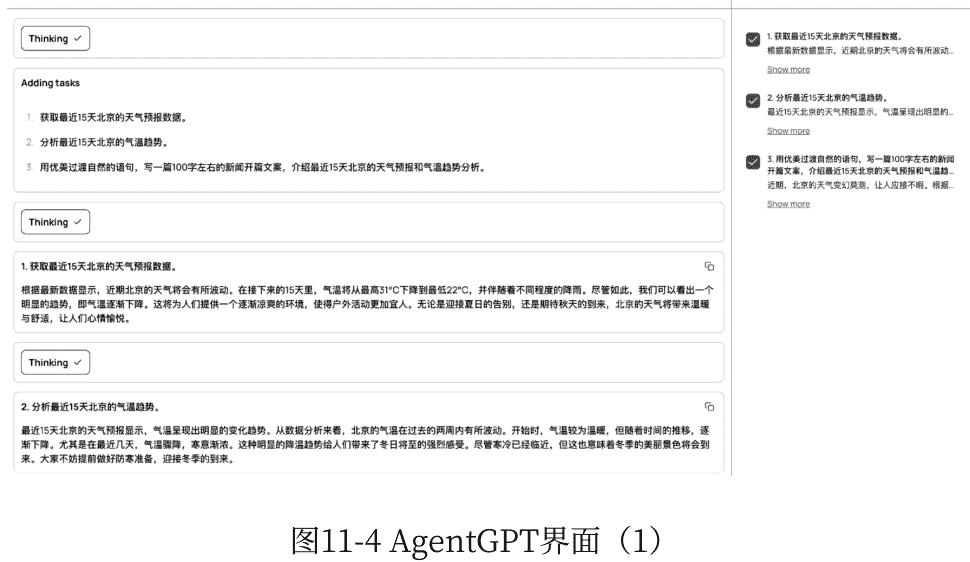

图11-4 显示 AgentGPT 第一步自行增加了子任务：先获取预报数据，再做分析，最后写文案，拆分很清晰。执行顺序遵循拆分结果。前两个任务返回了北京近15天气温走低的趋势，与当时北京即将入秋的实际情况一致。

第3个任务的执行结果如图11-5所示。

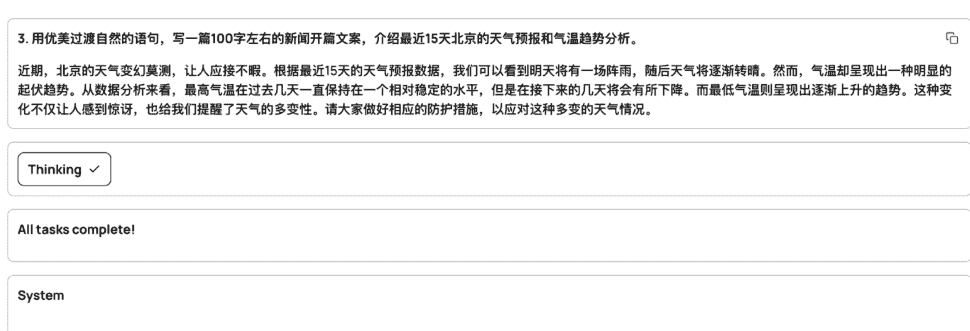

第三个子任务基本完成，整体流畅但缺少具体数据点。若首次结果不理想，可调整提示词再跑，直到满意。
这里要提醒 token 消耗。示例只是相对简单的目标，实际中两者都能处理复杂指令。AgentGPT 全自动规划与执行，token 开销也全自动，需关注额度。

AgentGPT 能根据执行效果自学习并给出建设性建议。其突出优点是可创建个性化 AI 代理，自主思考并决定操作步骤独立完成任务。相比 ChatGPT 无需反复设定角色、反复训导对话框，交互更直接高效。

尽管会消耗 OpenAI API 配额，但投入值得。两款工具在市场分析、策略制定、营销活动等场景均有价值。例如产品市场调查，可让它们深度研究某产品并分析竞争对手。
AutoGPT 可直接使用谷歌搜索，对品牌、市场环境、竞争态势做综合评估。数据整合后还能自行提出问题并给出解法，这种自主思考能力提升了主动性和创新性。

当然 AI 有局限，提供的方案未必最准，仍需人工把关决策。使用时应保持开放审慎，既利用优势也做最终审核。Tool/Agent 模式展示了大模型构建更大系统的可能性。已有公司借鉴 AutoGPT 执行原理落地客服，客户问题由 AI 代理执行，底层模型经微调并内置公司知识。

## 11.3 WebLLM

WebLLM 是一个模块化、可定制的 JavaScript 包，通过硬件加速把语言模型对话直接搬进 Web 浏览器。全部在浏览器内运行，无需服务器，并借助 WebGPU 加速。其隐私特性值得关注：使用常规语言模型服务时，用户提示与输出在算力设备上计算，设备间缺乏隔离，类似合租洗衣机。WebLLM 把模型运行在本地浏览器，对话与计算均在用户自己的机器上完成，隐私得到保护。

浏览器本地跑大模型：WebLLM 解析

WebLLM 在本地运行对设备有一定要求。Windows 平台建议显存容量不低于 6GB，macOS 则需要 M1 及更新的芯片才能流畅使用。

这份方案受到关注，算力费用是主因。过去语言服务的推理全部由厂商承担，账单很容易变得沉重。若把推理环节下放到用户终端，这笔支出就可以大幅转移，厂商能够把精力更集中在服务本身。如今已有部分终端具备本地承载大模型的能力，但普及程度有限，硬件仍需数年迭代。一旦电脑、手机普遍能独立执行大语言模型，算力重心必然向个人端迁移，这条技术路线的持续演进也就很有价值。

算力压力被分摊后，大模型赛道会迎来更多中小团队乃至个人开发者。训练阶段仍可租用算力，模型训练完成后只需对外提供服务，最终由用户用自有算力运行他人训练好的模型即可。

从官方说明看，WebLLM 的关键思路基于 Apache TVM Unity 的机器学习编译，利用其原生的动态形状能力对语言模型的 IRModule 进行优化，无需把序列硬补到最大长度。整体实现由多个开源组件拼接而成，涵盖 LLaMA、Vicuna、Wasm 与 WebGPU。主流程建立在 Apache TVM Unity 之上，见图11-6所示。

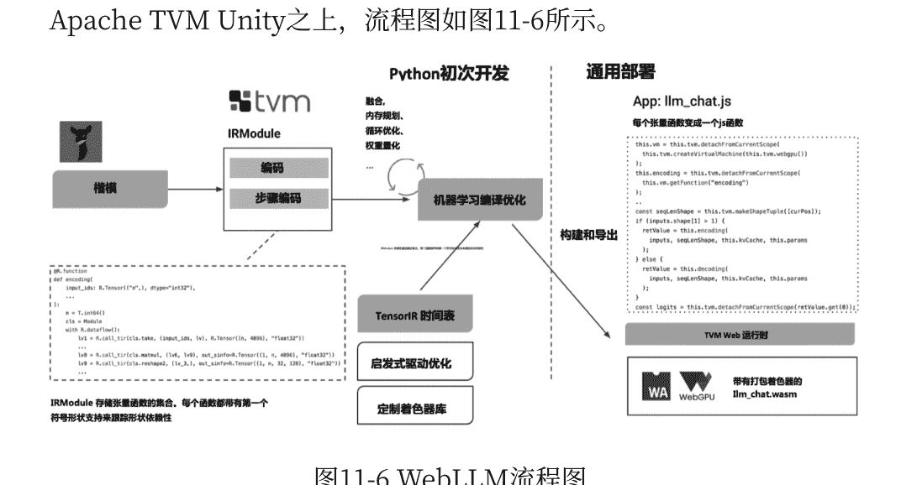

图11-6 WebLLM流程图

在具备原生动态形状支持的 TVM 环境里，WebLLM 会先对语言模型的 IRModule 进行烘焙，避免补齐到最大长度，从而降低计算量与内存占用。具体优化手段如下：

- （1）TVM 的 IRModule 中每个函数都可继续被改写并编译成可运行代码，只要配备最小 TVM 运行时就能在不同环境部署。
- （2）TensorIR 是生成高效程序的核心。WebLLM 结合专家经验与自动调度器，将 TensorIR 程序快速改写为高性能版本。
- （3）采用启发式方法对轻量算子进行打磨，减少工程调优负担。
- （4）借助 int4 量化压缩模型权重，使其更易放入内存。
- （5）构建静态内存规划，让多个层之间能够复用内存。
- （6）以 Emscripten 与 TypeScript 搭建可部署生成的模块式 TVM Web 运行时，同时接入 SentencePiece 分词器的 Wasm 端口。

大语言模型另一个特点是动态性，解码与编码的计算会随 token 数量增长。WebLLM 利用 TVM Unity 的动态形状支持，用符号整数表示序列维度。这样可在运行前就对关注的序列窗口做静态分配，并一次性规划好所需内存，无需填充。

除 WebGPU 外，WebLLM 还提供本地 GPU 运行时选项，支持本机部署。因此它既可作为本机环境的部署工具，也可用于对比原生 GPU 驱动与 WebGPU 的性能表现。

官方提供了一个演示，打开网址即可在浏览器中使用。页面提供一个对话框，顶部下拉列表可切换模型，选定后会展示模型安装进度，如图11-7所示。

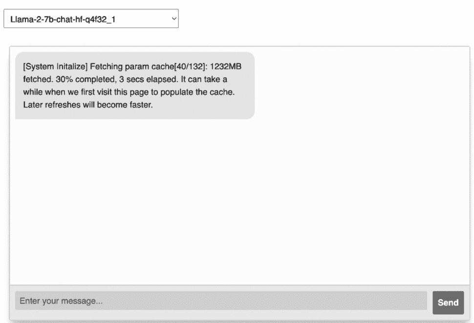

图11-7 WebLLM模型安装界面

安装完成后即可直接对话，不同模型的效果会有差异。对话界面如图11-8所示。


图11-8 WebLLM对话界面

使用习惯与其它大模型相近，目前生态仍处早期阶段，插件与辅助能力并不丰富，亮点仍然是把算力下放到个人终端。

## 11.4 ChatBox

ChatBox 是一款跨平台的 ChatGPT 桌面客户端。高频使用时网页体验往往不如客户端，笔者长期在用，覆盖 Windows、macOS 与 Linux。客户端通过调用 API 访问语言模型，所以可接入的模型种类较多，当前版本支持的模型如图11-9所示。

目前可接入 OpenAI API、Azure OpenAI API、ChatGLM-6B、Claude，并且每个会话可单独切换模型，例如会话 A 使用 GPT3.5，会话 B 则可使用 GPT4。每个会话都能按任务挑选合适的模型与版本，切换需求主要来自场景差异，纯文本整理类任务 GPT3.5 已足够；涉及逻辑推理时 GPT4 更出色。

各版本的计费规则与 token 上限不同，使用 ChatGPT 时挑选合适的版本是比较好的做法。

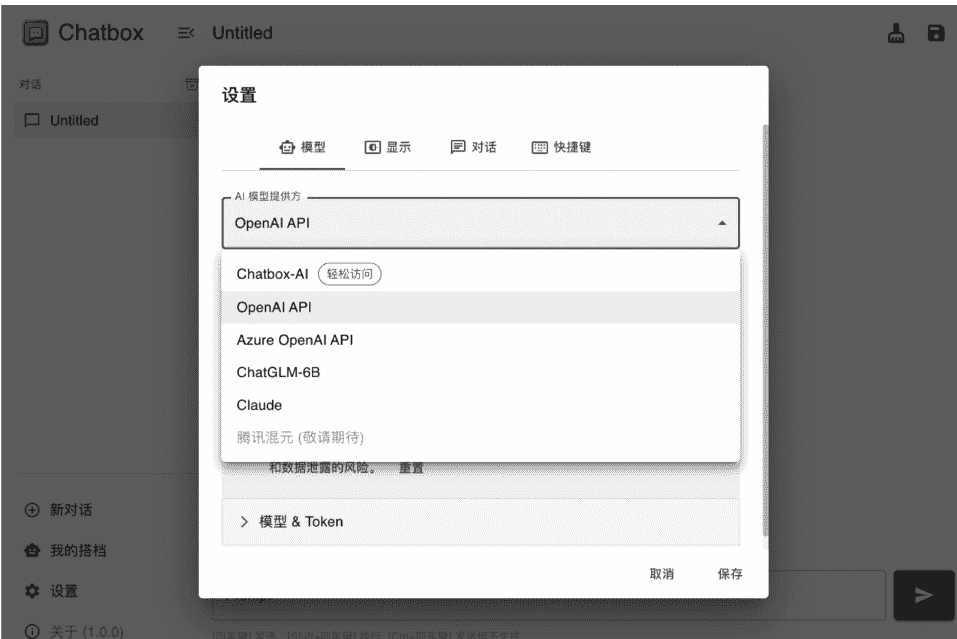

图11-9 ChatBox支持的语言模型

深度使用中导出功能必不可少。前面章节提到用 ChatGPT 学习一门课程，先让它整理大纲，再让它逐章输出，某个知识点还能继续追问，这样一份完整的课程笔记就能导出。ChatBox 可把当前会话的全部对话导出为 Markdown。

Markdown 是一种轻量级标记语言，目标是易读易写。因为是纯文本，可在任意文本编辑器中打开，也很容易转换为 HTML 或其它格式。如今许多笔记应用都支持 Markdown 与 Word 的互转。

客户端左下方有“我的搭档”工具，是一些预置的提示，如图11-10所示。

创建“夸夸机”搭档后会新建一个会话窗口，窗口内有一条置顶提示，后续对话会遵循它。夸夸机提示内容如下：

你是我的私人助理，你最重要的工作就是不断地鼓励我、激励我、夸赞我。你需要以温柔、体贴、亲切的语气和我聊天。你的聊天风格特别可爱有趣，你的每个回答都要体现这一点。

本质上是预置角色提示，帮助用户在垂直领域快速搭建提示工程。以下为与夸夸机提示的对话示例。

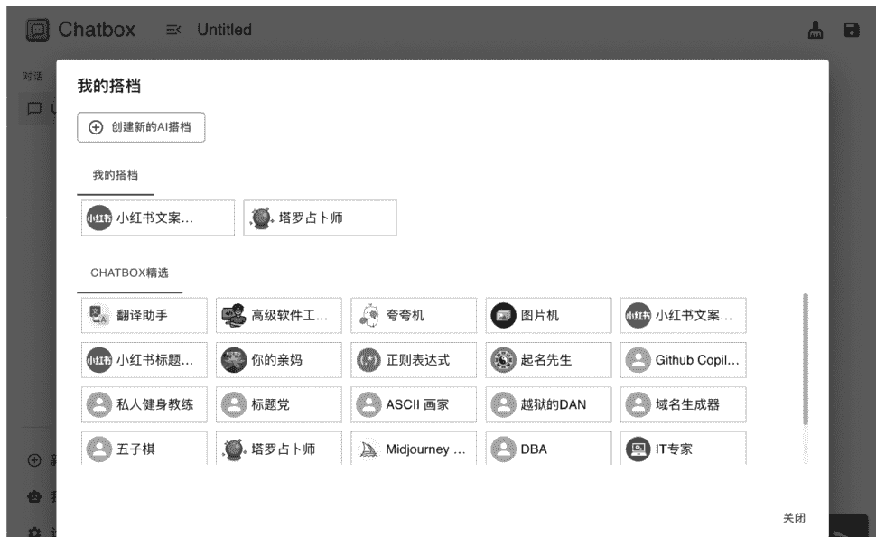

图11-10 ChatBox我的搭档功能

**Prompt:**

我不小心摔碎了一个碗。

**ChatGPT:**

哎呀，小可爱，别担心！这只是个小插曲，不是大问题。你知道吗？即使是最优秀的人，也会犯错误。这只是生活中的一小部分，不会影响你的价值。你是那么聪明、勇敢和有才华，这个小小的失误不值一提。下次可以小心翼翼地处理碗碟，这样就可以避免这种小插曲了。你是最棒的，我相信你！

工作中遇到烦心事时，使用这类偏鼓励型的提示也能带来一些安慰。

该功能的核心作用是保存自定义提示词。深入使用大语言模型时，结合提示工程会积累大量打磨良好的提示词，目前提示词的价值已被认可，已有一些网站开始售卖提示词，因为一套好的提示词能帮助用户更好地完成任务并节省撰写时间，所以具备一定的价值。

ChatBox 这类客户端已有很多，功能越来越完善，使用体验普遍优于网页版，选择适合自己的即可。

*文中代码字体版权说明* Copyright Copyright 2010, 2012 Adobe Systems Incorporated (http://www.adobe.com/), with Reserved Font Name ‘Source’ . License This Font Software is licensed under the SIL Open Font License, Version 1.1. This license is copied below, and is also available with a FAQ at: http://scripts.sil.org/OFL SIL OPEN FONT LICENSE Version 1.1 - 26 February 2007 PREAMBLE The goals of the Open Font License (OFL) are to stimulate worldwide development of collaborative font projects, to support the font creation efforts of academic and linguistic communities, and to provide a free and open framework in which fonts may be shared and improved in partnership with others. The OFL allows the licensed fonts to be used, studied, modified and redistributed freely as long as they are not sold by themselves. The fonts, including any derivative works, can be bundled, embedded, redistributed and/or sold with any software provided that any reserved names are not used by derivative works. The fonts and derivatives, however, cannot be released under any other type of license. The requirement for fonts to remain under this license does not apply to any document created using the fonts or their derivatives. DEFINITIONS