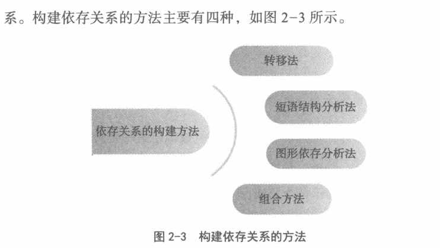
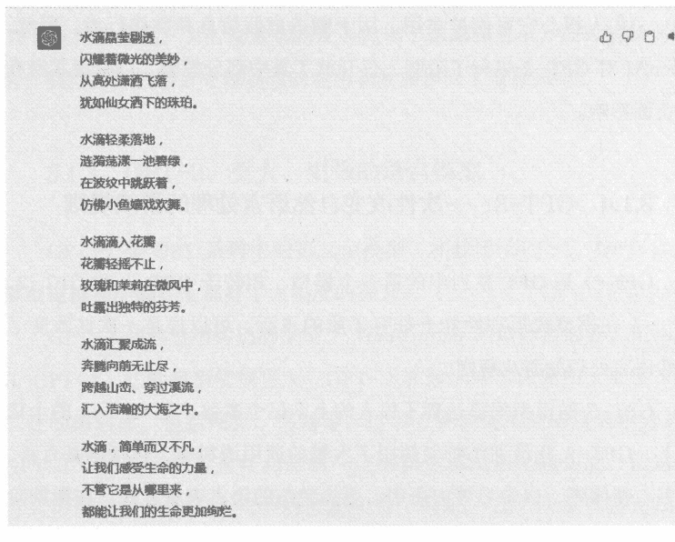
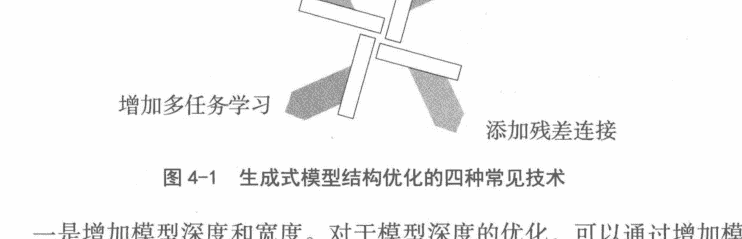
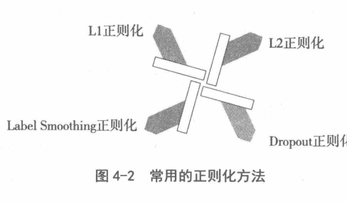
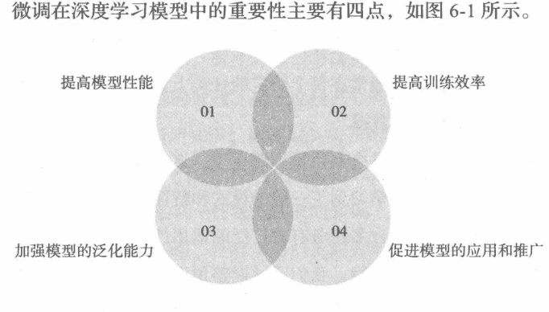
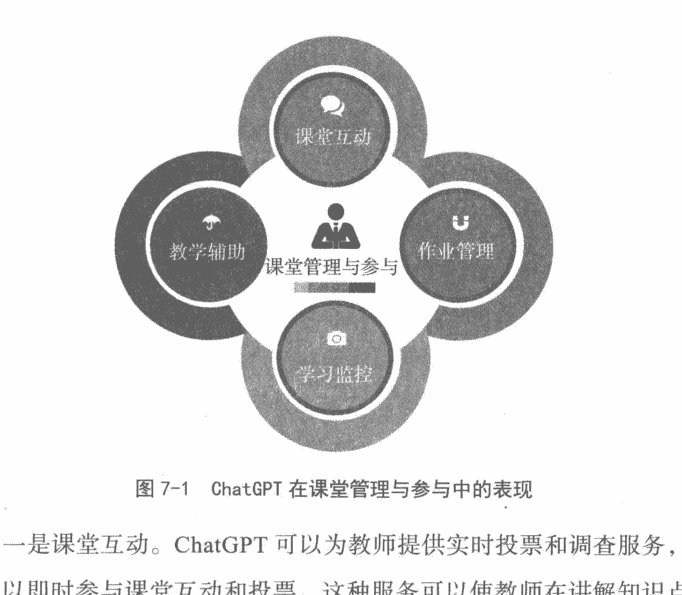
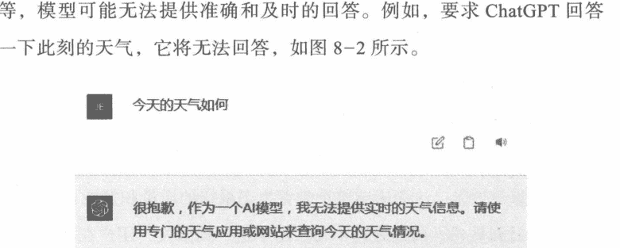
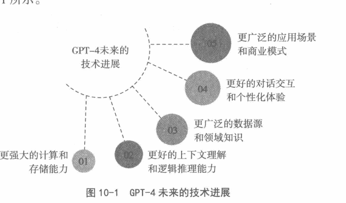

# ChatGPT从入门到精通全套指南

## FOREWORD 前言

ChatGPT 建立在深度学习之上，是当前主流的自然语言生成系统。自 2018 年面世以来，该模型经历了持续的迭代优化，已成为生成式自然语言处理领域的代表性作品。

本书致力于为读者呈现 ChatGPT 的系统化全景，从概念缘起与演进脉络切入，再逐步剖析其模型结构与运行机理，并延伸至各类自然语言处理任务的落地方式。

在技术讲解之外，本书同样聚焦实践层面，涵盖聊天机器人的搭建与训练、文本生成与摘要产出、机器翻译以及语言模型的微调策略。同时收录模型优化的相关思路，如训练与推理加速、性能与准确率提升、模型压缩等方法。最后对 ChatGPT 的未来走向进行展望。

本书既可作为入门 ChatGPT 的完整参考，也能在实际项目中提供对照。目标是传递深度学习和自然语言处理的前沿进展，并帮助读者将之迁移到真实场景。

编写过程中力求严谨，但在能力有限的情况下难免疏漏，恳请读者批评指正。

## CONTENTS 目录

- 第 1 章 ChatGPT 简介

  - 1.1 了解 ChatGPT 与人工智能

  - 1.2 语言模型与人工智能

- 第 2 章 自然语言处理基础

  - 2.1 词汇表示：词嵌入与词向量

  - 2.2 语法解析：句法树与依存关系

  - 2.3 语义理解：实体识别与关系抽取

- 第 3 章 深入了解 GPT 架构

  - 3.1 GPT 系列的演进

  - 3.2 Transformer 架构

- 第 4 章 ChatGPT 生成式模型

  - 4.1 ChatGPT 生成式模型概述

  - 4.2 ChatGPT 生成式模型的改进

- 第 5 章 ChatGPT 聊天机器人设计与实现

  - 5.1 聊天机器人设计原则

  - 5.2 聊天机器人的运行技巧

- 第 6 章 GPT 模型的微调

  - 6.1 微调的理论与实践

  - 6.2 使用微调策略优化模型的表现

  - 6.3 微调的注意事项

  - 6.4 训练成本和效率的权衡

- 第 7 章 ChatGPT 在不同领域的应用

  - 7.1 教育领域

  - 7.2 商业领域

  - 7.3 娱乐领域

  - 7.4 政府和公共服务领域

- 第 8 章 ChatGPT 的局限与挑战

  - 8.1 缺乏常识与知识更新不及时问题

  - 8.2 长文本生成的困难

  - 8.3 增强对话理解与情感识别挑战

- 第 9 章 ChatGPT 的优化

  - 9.1 加速模型训练和推理

  - 9.2 提高模型性能和准确率

  - 9.3 模型压缩

- 第 10 章 ChatGPT 未来发展

  - 10.1 从 GPT-4 到 GPT-5 及未来

  - 10.2 混合智能与人机协作

  - 10.3 个性化与情感智能的发展

## 第 1 章 ChatGPT 简介

### 1.1 了解 ChatGPT 与人工智能

ChatGPT，即 Chat Generative Pre-trained Transformer，是 OpenAI 推出的对话式生成程序，借助深度神经网络在给定输入下预测并产出输出内容。

#### 1.1.1 ChatGPT 的核心

ChatGPT 的底层由 Transformer 神经网络架构驱动。Transformer 专为序列数据处理而设计，在自然语言任务中应用广泛。

在 ChatGPT 中，Transformer 承担自然语言文本生成的核心角色。该结构由编码器与解码器构成，而 ChatGPT 主要使用编码器部分，其依托自注意力机制将输入序列映射为表征序列。自注意力能够为序列中每个位置计算权重，输入的每个位置被编码为向量后，通过自注意力加权融合，形成综合表征。这种表征能够兼顾序列整体信息，从而更准确地刻画输入语义。

训练时，模型以输入序列与对应输出序列作为数据，目标是缩小生成结果与目标结果的差距，以提升生成质量与自然度。

总体而言，ChatGPT 先用自注意力把输入转为表征，再经前馈神经网络处理，最终输出文本。该设计在自然语言生成领域表现突出，可产出高质量流畅文本，广泛用于对话系统、文本生成、摘要、翻译等场景。

#### 1.1.2 ChatGPT 的优势

ChatGPT 是一款强大的自然语言生成系统，具备以下六大核心优势，如图 1-1 所示。

##### 1.1.2.1 可以生成连贯和自然的对话

ChatGPT 产出的文本流畅自然，因而能够实现连贯的人机对话。与传统机器人不同，它能以更贴近人类的口吻回应问题和话题，提升交互真实感。

其一，自注意力机制将输入转化为表征，使模型能兼顾输入中每个词和短语，进而给出更准确自然的回应。其二，作为生成式模型，它不仅能复述输入信息，还能创造新内容。通过逐词预测，ChatGPT 能够保持对话的连贯与流畅。此外，大规模语料的训练让模型习得真实对话中的模式与语言习惯，能够模拟类人回应。

##### 1.1.2.2 可以进行任务无关的对话

传统聊天机器人需预先设定对话场景与主题，为特定任务提供固定答案。例如客服机器人必须事先录入常见问答。

ChatGPT 则无需预定义任务即可根据用户输入生成贴合的自然文本。它在海量数据上学习了语法与语义规则，能够即时生成恰当回复，因而在各类话题和场景下均可通用，无需为每个领域单独配置。

例如在智能家居中，用户可用语音指令操控设备。ChatGPT 可接收指令并生成相应回复，实现多样化交互，而不必预先写入特定任务知识。

总之，ChatGPT 支持无任务约束的对话，能够应对复杂自然语言输入并快速输出连贯文本。

##### 1.1.2.3 可以处理多轮对话

传统机器人通常只能单轮应答，无法保留历史信息。ChatGPT 借助自注意力与编解码结构，能够记忆过往对话历史，并在每轮中把历史作为上下文输入，基于上下文生成下一轮回复，使对话更连贯自然。

除聊天外，在问答等对话类任务中也具价值。用户提出问题后希望得到连续解释以理解背景时，ChatGPT 可利用记忆与上下文理解能力生成连贯答案，提供更完整准确的信息。

##### 1.1.2.4 可以在训练数据有限的情况下进行预测

预训练阶段，ChatGPT 在海量文本上学习语法与语义特征，掌握各类语言结构，并在无监督方式下形成基础能力。

预训练后，可通过微调使模型适配特定任务与领域，即在少量标注数据上继续训练以提升领域表现，从而增强泛化与适应性。

推理时，模型综合输入序列与对话历史生成自然连贯的文本。得益于大规模预训练与后续微调，即使在训练数据稀缺的场景下仍能保持较强的预测能力。

##### 1.1.2.5 可以进行生成式任务

在摘要任务中，ChatGPT 能依据文章内容与结构提炼核心要点，生成简短摘要，广泛应用于新闻、媒体与信息聚合，帮助读者快速抓住重点。

其他生成任务还包括：

对话生成：基于历史对话与上下文生成连贯回复，支持多轮记忆与上下文推理。
音乐生成：学习音符与旋律间的统计规律，在给定上下文基础上生成连贯音乐片段。
图像生成：学习像素间关系与纹理、色彩、形状特征，依据上下文生成高分辨率图像。

##### 1.1.2.6 可以进行分类和标注任务

除生成外，ChatGPT 也可用于分类与标注，如情感分析与命名实体识别。

情感分析中，模型可根据文本内容自动判断情感倾向。借助大量标注语料学习情感词汇与语法特征，实现自动判别。命名实体识别中，模型可自动抽取人名、地名、机构名等实体，通过学习实体特征与上下文关系完成识别。

此外还能拓展至情感词识别、语义角色标注等任务。通过学习标注数据，模型可掌握文本特征与上下文关联，实现自动化分类与标注。

总体看，ChatGPT 应用范围广、功能丰富，是自然语言处理领域极具价值的工具。

#### 1.1.3 ChatGPT 的历史和发展

ChatGPT 的发展大致可分为以下阶段。

##### 1.1.3.1 GPT

GPT 的首创性在于提出预训练加微调的两阶段范式，显著提升了自然语言处理性能，也为后续演进奠定基础。

预训练阶段，模型在大量无标注文本上学习，掌握通用语言表征、词汇、语法与语义关联，为后续任务做准备。训练语料涵盖新闻、博客、论坛等多样来源，使模型具备广泛语言知识。

微调阶段，模型在特定任务的有标注数据上继续训练，学习将输入映射到正确输出，从而将通用能力迁移到具体应用，如情感分类或问答。微调让模型在特定场景下表现更优，满足实际需求。

##### 1.1.3.2 GPT-2

GPT-2 于 2019 年发布，在规模、数据与性能上均有明显跃升。

模型规模扩展至 15 亿参数，能够学习更复杂语言结构。训练语料规模同步扩大，使预训练阶段接触更多文本信息。性能上在多种任务中表现突出，生成的文本更流畅、连贯且富有深度。

高质量生成能力引发伦理讨论，人们担忧其被用于伪造新闻或恶意言论等。初期 OpenAI 选择发布小规模版本以降低风险，并推动伦理研究。随着社区反馈，后续逐步开放不同规模模型，促进技术研究与安全讨论。

##### 1.1.3.3 GPT-3

GPT-3 拥有约 1750 亿参数，在规模、任务表现与零样本学习上取得突破。

规模大幅提升使模型能捕捉更丰富的知识与语言模式。机器翻译、摘要、问答等传统任务表现提升，也能处理代码生成、知识图谱生成等复杂任务。

零样本学习是其显著特点，模型无需针对特定任务微调即可凭借预训练知识完成任务，大幅降低部署门槛与成本。

GPT-3 催生了智能客服、教育辅导、内容生产、知识管理等创新应用，同时也加剧了对伦理、安全与公平性问题的关注，推动更审慎负责任的发展。

##### 1.1.3.4 GPT-4

GPT-4 在 GPT-3 基础上进一步扩大规模并优化训练方法与技术。

模型参数进一步增长，训练算法与数据规模同步优化，提升预训练效果与微调性能，同时降低训练资源与时间成本，增强可扩展性。

在机器翻译、文本摘要、问答、对话生成、知识推理、代码生成等任务上表现更优，成为多场景应用的首选。

随着能力提升，伦理与安全性问题更受重视。OpenAI 等团队在发布过程中引入内容过滤与监控机制，力求减少有害输出，确保正面影响。

#### 1.1.4 ChatGPT 的应用场景

ChatGPT 在多个场景中具有实用价值，以下为典型应用。

##### 1.1.4.1 文本生成与摘要

在内容生成与摘要方面表现突出，主要体现在：

高质量文章生成：依托强大的理解与生成能力，可按需求产出针对性强、连贯一致的高质量文章，适用于新闻报道、专业稿件、学术论文等。

博客与故事创作：帮助用户轻松创作更具吸引力的博客与故事，基于创意意图生成生动有趣、有深度的文本，提升阅读体验。

广告文案与营销内容：能够快速产出具吸引力与说服力的广告文案，助力企业与营销人员更高效推广产品与服务。

除此之外，该模型还能批量产出各类营销物料，涵盖邮件文案、社交平台推送以及活动宣发稿件，有助于拉升营销战役的整体成功率。

第四项能力是定制化文本创作。ChatGPT 能结合使用者的具体诉求与偏好，生成专属的文字内容。这样使用者可拿到更贴合自身情境的文章、博文或故事，提升实用价值与阅读吸引。

第五项能力是长文本精简。面对海量长篇材料，阅读与理解成本很高。模型能够提炼出简洁且准确的概括，帮助用户迅速抓住要点，明显提升阅读效率。

第六项能力是跨行业覆盖。文本生成与摘要功能可延伸至科技、医疗、金融、教育等多个垂直领域，为不同行业提供实质性支持，推动效率与质量双升。

##### 1.1.4.2 问答系统与知识获取
模型可被用来搭建智能问答服务，用以回应提问、推送实时资讯并提供专业领域知识，主要体现为：

理解力方面，自然语言理解能力突出，能够精准识别和解析各类提问，从基础事实到复杂推理都能给出合适答案。

知识储备方面，训练过程积累了覆盖广泛的跨领域信息，涵盖科学、历史、艺术、技术、金融等，能够为用户提供全面支撑。

实时检索方面，可借助强大的信息检索能力获取新闻、天气、股价等最新动态，满足时效性需求。

上下文保持方面，能够把握多轮对话的上下文脉络，使回答保持连贯一致，改善使用体验。

领域适配方面，可部署于医疗咨询、法律咨询、技术支持等场景，通过微调适配特定领域的知识与表达习惯，提升回答质量。

个性化输出方面，可依据用户需求与偏好生成差异化回复，比如按年龄、兴趣等特征给出更合适的建议。

系统融合方面，能够顺畅对接CRM、ERP、知识库等平台，帮助企业构建高效的问答体系，提升运营效率与客户满意。

##### 1.1.4.3 机器翻译
在多语言转换任务上表现突出，可支撑高质量自动翻译服务，促进跨语言协作，主要特点有：

译文精确度高，经过大量多语料训练，对原文语义、语法与语境的捕捉较为准确，译文质量稳定。

语种覆盖广，支持英语、汉语、法语、德语、西班牙语等多种语言互译，满足不同场景的转换需求。

表达自然流畅，目标语言生成保持语言的自然性与可读性，提升阅读体验。

响应速度快，翻译任务完成高效，可实现实时翻译，适用于在线会议、客服等即时沟通场景。

定制化翻译，按用户行业、领域及专业术语偏好输出更贴合场景的译文。

##### 1.1.4.4 对话生成与智能客服
模型可生成自然连贯的对话，并可落地到智能客服体系，提供自动化高效的客户支持。

自然对话生成方面，语言生成能力强，能产出流畅对话，使用者在使用智能客服时会有与真人交互的感受。

自动化处理方面，可承接大量客户请求，减轻人工客服压力，降低运营成本，同时实现7×24小时不间断服务。

##### 1.1.4.5 社交媒体管理与推荐系统
可辅助运营社交媒体账号，发布趣味内容、互动评论等，亦可构建个性化内容推荐机制，根据用户兴趣与需求生成文章、博文、配图说明、视频简介等内容，有助于吸粉并扩大账号影响力。

此外还能自动回复社交媒体上的用户评论，提供及时反馈与互动，拉近与粉丝距离，提升参与度。

上述场景仅是当前可用的部分，随着技术演进，未来仍会出现更多创新用法。

### 1.2 语言模型与人工智能

#### 1.2.1 语言模型的概念
语言模型是对语言客观规律进行的数学抽象与建模，本质是一种映射关系。其与语言事实的关系类似数学抽象直线与具体直线的关系，比较适合计算机自动处理，对自然语言信息处理意义重大。

#### 1.2.2 语言模型的类型
主要可分为三类：生成式模型、分析式模型、识别式模型。

生成式模型以形式语言系统为起点，生成特定集合的语言，如乔姆斯基的形式语言理论与转换语法。

分析式模型从某一语言集合出发，剖析集合中元素的特性，阐明元素间关联，并在此基础上演绎出规则体系，如库拉金娜与马尔库斯基于集合论提出的模型。

识别式模型是在前两者基础上融合而成，具有实用价值。可在语言元素集合与规则体系的基础上，通过有限运算判定其为无序词堆还是符合规范的句子，如巴尔-希列尔基于数理逻辑提出的句法类型演算模型。

#### 1.2.3 人工智能与自然语言处理技术
人工智能在自然语言处理中作用愈发关键，能帮助计算机更好地理解与处理自然语言。可应用于语音识别、机器翻译、问答系统、文本压缩、摘要、纠错等任务。其中语言模型是核心技术，能提升处理智能化水平。

但相关挑战依然存在：

##### 1.2.3.1 语言的多样性
不同语言间差异明显，同一语言内部的方言、口音、俚语等也会增加处理难度。

##### 1.2.3.2 语言的复杂性
自然语言歧义与多义现象突出，规则与语法结构复杂，给处理带来困难。

##### 1.2.3.3 数据的稀缺性
多数任务依赖海量训练数据，而部分小语种或垂直领域数据难以获取。

##### 1.2.3.4 语言的变化
自然语言随时间与地域演变，系统需及时跟进以保持准确。

##### 1.2.3.5 人工标注数据的成本
部分任务需大量人工标注，投入人力、物力与时间成本高。

这些问题需要持续探索更先进的技术与算法，推动NLP与人工智能的进一步发展。

# 第2章 自然语言处理基础

## 2.1 词汇表示：词嵌入与词向量

### 2.1.1 词汇表示的重要性
词汇表示是将自然语言中的词或短语映射为计算机可处理的向量或矩阵形式。在NLP中，这一概念至关重要，对各类任务均有影响。

#### 2.1.1.1 自然语言是高维稀疏的
自然语言词汇与短语数量庞大，彼此关系复杂且维度极高，给处理带来挑战。表示方法通过将词映射为低维稠密向量，把复杂任务转化为向量空间运算，降低计算复杂度。

#### 2.1.1.2 词汇表示可以提高自然语言处理任务的准确性
借助表示方法，计算机能更准确把握词义，从而提升文本分类、情感分析、机器翻译等任务的精度。

#### 2.1.1.3 词汇表示可以提高自然语言处理任务的效率
采用向量表示后，处理速度大幅提升，可完成更快速高效的NLP任务。

#### 2.1.1.4 词汇表示是实现自然语言处理任务的重要基础
NLP要求计算机理解自然语言，而表示方法提供了可处理的转化路径，因而是基础环节。

### 2.1.2 词嵌入与词向量概述
词嵌入是NLP中语言建模与表征学习的总称。概念上，是把词表规模的高维空间压缩到低维连续空间，每个词对应实数向量。词向量在概念上也是将词从一维映射到低维连续空间的数学嵌入。

两者含义相近，常互换使用。通常采用无监督学习，在大规模语料上学习上下文信息，借助自动编码器、神经网络等方法训练，无需标注数据。

一般均可借助向量空间模型实现，每个词对应一个向量，维度取决于语料规模与模型设定。词间相似度可通过距离、夹角等度量计算。

应用范围广泛，覆盖文本分类、情感分析、机器翻译、对话生成等。

### 2.1.3 基于共现矩阵的词向量
共现矩阵方法是一种传统表示思路，基于词间共现关系构建向量。

基本思路为统计词在窗口内共现频率，构建共现矩阵，再通过奇异值分解得到向量。

矩阵行列对应语料中的词，元素反映共现频次。矩阵规模巨大且稀疏，因每个词仅与少量词共现，使用时需降维、过滤低频词等预处理。

SVD将矩阵分解为左奇异矩阵、对角矩阵和右奇异矩阵。左奇异矩阵列可视为词向量，对角矩阵反映权重，右奇异矩阵体现词间关联。维度通常在数百至数千。

优点在于思路清晰，能处理大数据，但语义语法信息捕捉不足，计算与存储成本高，易过拟合。现多被Word2Vec、GloVe等神经网络方法取代，但在小规模语料下仍具稳定性与可靠性。

### 2.1.4 基于神经网络的词向量
通过训练神经网络将词或短语映射为低维实数向量，捕捉语义与语法信息。

代表方法为Word2Vec与GloVe。Word2Vec采用Skip-gram与CBOW，分别预测上下文与缺失词。GloVe将共现统计转为矩阵，通过最小化向量点积与共现概率差值训练。

该类方法能捕捉语义语法关联，基于大规模语料可获得更准确表示，多采用稠密向量，便于下游任务。但需大量计算资源与训练时间，存在过拟合风险，需优化。

在文本分类、情感分析、机器翻译、问答系统等任务中表现良好，亦可与深度学习、CNN、RNN等结合提升性能。

### 2.1.5 词向量的应用：文本分类、情感分析等

#### 2.1.5.1 词向量在文本分类中的应用
文本分类中可将文本转为数学向量，再用机器学习算法进行分类。向量能很好捕捉语义与语法，提升准确率。如用Word2Vec或GloVe获取表示后输入分类模型。

#### 2.1.5.2 词向量在情感分析中的应用
情感分析需判断文本情感倾向。借助向量可将情感表达转为数学形式，便于分类。向量能捕捉词语情感倾向与强度，提升分析精度。

### 2.1.6 词向量的评估方法：相似度、类比推理等

#### 2.1.6.1 相似度评估
通过计算两个词向量间余弦相似度衡量语义相似性。常用测试集如WordSim-353与SimLex-999，包含人工标注的词对。比较计算相似度与人工标注可评估质量。

#### 2.1.6.2 类比推理评估
将类比问题转为向量运算评估质量。如“男人：女人 = 国王：?”可计算“女人 - 男人 + 国王”得到结果向量，寻找最相似词如“王后”。常用测试集如Google word2vec测试集。

### 2.1.7 词向量的优化方法：负采样、层次化 softmax 等

#### 2.1.7.1 负采样
用于加速Word2Vec训练并提升质量。通过用虚拟负样本替代词出现概率，将训练转为二元分类，减少概率分布计算量，降低梯度计算复杂度。

#### 2.1.7.2 层次化 Softmax
用于优化神经语言模型，减少训练计算量。传统softmax需计算每个词输出概率，层次化方法将词组织成二叉树，把概率计算转为树上路径搜索，大幅降低计算量。

### 2.1.8 预训练语言模型中的词向量：ELMo、BERT 等

#### 2.1.8.1 ELMo
基于深度双向语言模型生成多层动态词向量。采用双向LSTM预训练，词向量取决于上下文含义，能捕捉语义与语法，在多项NLP任务中表现良好。

输入文本后，双向LSTM捕捉语言信息，输出用于生成多层向量，每层含前向与后向LSTM。向量在特定上下文中生成，故称动态向量。

#### 2.1.8.2 BERT
基于Transformer编码器架构，含多个嵌套编码器。用无标注数据预训练，生成多层上下文相关向量，在问答、自然语言推理等任务中表现突出。

训练分预训练与微调两阶段。预训练阶段使用海量无标注文本学习深层表示。

### 2.1.9 词向量的发展趋势和挑战
作为NLP核心技术，词向量已获广泛应用。未来趋势与挑战包括：

#### 2.1.9.1 多语言词向量

## 词向量、语法解析与语义理解的进阶图谱

语言种类繁多、结构差异大，下一代词向量必须具备跨语言能力。既要能在多种语言里完成学习与推断，也要实现不同语言向量之间的对齐与互转。拥有这种多语支持的向量，才能让信息在语言间顺畅流动，显著提升 NLP 任务的效率与表现。

#### 2.1.9.2 领域自适应词向量
各行各业的表达习惯差异很大，词向量未来要学会领域迁移。做法通常是对特定领域的语料先做预训练，再进行针对性微调，从而产出更贴合该领域的专属向量。

#### 2.1.9.3 更好的上下文理解
自然语言充满变化和歧义，词向量得更懂上下文与语法结构。未来会借助更深的神经网络及自注意力机制，去捕捉动态变化的语义，生成随上下文而调整的向量表示。

#### 2.1.9.4 融合其他知识源
单靠文本训练的向量信息有限，未来需要把知识图谱、语义网络、社交媒体等外部知识并入向量体系。通过把外部知识与向量表征结合，能让模型在理解上更稳、更准。

#### 2.1.9.5 面临隐私和安全问题
随着向量技术大规模落地，隐私与安全风险随之浮现。下一步需要在设计上强化个人信息保护机制，同时防范模型被恶意窃取或滥用。

总的来看，下一代词向量必须同时兼顾多语支持、领域适配、知识融合，以及隐私安全四大诉求。只有在技术创新与合规治理上双轮驱动，才能真正推动 NLP 向更可靠、更普适的方向发展。

## 2.2 语法解析：句法树与依存关系

### 2.2.1 语法解析概述
语法解析是 NLP 理解文本的基础，帮助机器读懂句子内部的构造与含义。它核心关注句子如何组成、成分间怎么关联以及这些关联如何承载语义。主流路径有两条：一是基于短语结构的解析，用句法树呈现层级结构；二是基于依存关系的解析，用词间依存标注来刻画语法骨架。

### 2.2.2 句法树概述及其表示方法

#### 2.2.2.1 句法树概述
句法树又叫句子结构树或语法树，用树形图来呈现句子的组织方式。每个语法成分对应一个节点，节点间的连线体现它们的类型关系。它源自短语结构语法，通过一套形式化规则把句子拆解并重组。叶节点是具体词语，中间节点代表短语或从句，根节点代表整句。简单句、复合句、并列句等都能用这种结构清晰表达，帮助大模型更准地把握语法与语义，进而提升语义分析、机器翻译、文本生成等任务的表现。

#### 2.2.2.2 句法树的表示方法
常见表达方式主要有括号表达式和依存式两种。

一是基于括号表达式的表示，也叫短语结构表示法，把每个成分用括号包裹，层层嵌套体现层级。

例如，下面是 “John saw the dog.” 的括号表示，如图 2-1 所示。

```
(S (NP (NNP John))
    (VP (VBD saw)
        (NP (DT the)
            (NN dog)))
    (. .))
```

图 2-1 “John saw the dog.” 的句法树括号表示方法

在这个记法里，S 是句子的根，NP 是名词短语，VP 是动词短语，NNP 代表专有名词，VBD 代表过去式动词，DT 代表冠词，NN 代表普通名词，括号的嵌套体现了层级隶属。

二是基于依存关系的表示法。通过呈现词语间的依存联系来刻画句子结构，每个词语都是节点，节点间的边代表依存关系。

例如，下面是 “John saw the dog.” 的依存句法树表示，如图 2-2 所示。

```
saw(ROOT-0, John-1)
det(dog-4, the-3)
nsubj(saw-2, dog-4)
```

图 2-2 “John saw the dog.” 的依存句法树表示方法

在此表示中，ROOT 代表句子的根，数字表示词在句子中的位置，det 表示限定词，nsubj 表示主语。通过展现词语间的依存联系，依存句法树能更好地呈现句子的结构与语义，特别是在处理长句和复杂结构时优势明显。

不同表示各有优劣，实践中常会结合使用以兼顾结构清晰度与语义表达力。

### 2.2.3 句法树的构建方法
本部分介绍两种主流的构建思路：规则驱动和数据驱动。

#### 2.2.3.1 基于规则的方法
规则法是较早的经典路线，依赖人工事先定义好的语法规则来生成树。这些规则源自语言学理论与实践经验，被形式化为可执行的语法。优点是可解释性强，缺点是规则必须手工撰写、维护成本高，且难以覆盖自然语言的复杂多样，但至今仍在特定场景里发挥作用。

#### 2.2.3.2 基于统计学习的方法
统计学习法则走数据驱动路线，从海量带标注的语料中自动提炼句法模式。常用模型包括条件随机场、递归神经网络、卷积神经网络等。它省去了手工造规则的负担，靠数据自己学规律，因而对复杂多变语言的适应性更强，应用也越来越普遍。

### 2.2.4 句法树的应用
句法树在 NLP 中用途广泛。

第一，语义分析。句法树能暴露句子的意义与结构，用于词义消歧、命名实体识别、语义角色标注等任务。

第二，机器翻译。在源语到目标语转换时，句法树帮助确定句子的结构与语义，从而提升译文的准确性与流畅度。

第三，信息检索。借助句法树可进行关键词抽取，通过分析结构与语法关系找出与查询最相关词，提高搜索精度；也能做查询扩展，识别查询中的关键词并引入同义近义词，扩大召回范围。

### 2.2.5 依存关系概述
依存关系用于刻画句子中词语间的语法关联，如主谓、动宾等。它是句法分析的重要组成，分析词语间的依存能更准确地理解句子的语义与语法。

在依存句法里，每个词语视为节点，依存关系表示为有向无环图。节点代表词语，边代表依存，父节点指向子节点表示二者存在依存。

依存可分为中心词依存和从属词依存。中心词依存指以中心词通常是动词为核心与其他词的关系，如主谓、动宾；从属词依存指词语依附于中心词的关系，如定语、状语依存。

### 2.2.6 依存关系的表示方法
最常见的主要有依存树法和依存关系标记法。

#### 2.2.6.1 依存树
依存树基于有向无环图来表示依存。句子中每个词语是一个节点，依存通过边连接，树通常以句子中心词多为动词为根展开。

节点一般包含词语原文、词性标签、依存类型等信息。边则包含依存类型、父节点与子节点等信息。

#### 2.2.6.2 依存关系标记法
在标记法里，每个词语被赋予特定依存类型，如主语、宾语、状语等。每个依存还记录头词和修饰词，表示修饰词依附于头词。

常用标记包括：
一是核心关系，表示主谓、动宾、定状等主要关联。例如主语标记为 SBJ，宾语标记为 OBJ，名词的定语标记为 ATT。
二是附加关系，表示修饰词与被修饰词的关联，标记常以 A 和 ADV 为前缀，如形容词修饰名词为 A-ATT，副词修饰动词为 ADV-CMP。
三是标点符号，表示分界与组合关系，标记常以 P 为前缀，如句号、逗号等。

### 2.2.7 依存关系的构建方法
依存关系的构建主要有四种，如图 2-3 所示。



#### 2.2.7.1 转移法（Transition-based approach）
该方法把句子看成栈与缓冲区的序列，通过一系列转移动作逐步构建依存。优势是可以并行处理，适合大规模语料。

具体流程是把词语压入缓冲区，从中选出当前词压入栈，再通过移进、规约、换栈顶等操作建立联系。移进把当前词从缓冲区移到栈顶，规约把栈顶词与其子节点合并成短语并弹出，换栈顶则替换栈顶词。

#### 2.2.7.2 短语结构分析法（Phrase structure parsing）
该方法把句子视为树形结构，利用语法规则进行分析，得到词语间的语法关系。

先用规则把句子拆成若干短语，再组合成树。树中节点代表短语，边代表短语间关系。优点是描述准确、直观；缺点是规则复杂、特征工程量大，对歧义和复杂结构处理难度高。

#### 2.2.7.3 图形依存分析法（Graph-based dependency parsing）
该方法把词语作为节点，结合词性标注与句法分析，用有向边表示依存。图中节点是词，边是依存，方向体现依存流向。

它能处理复杂语言结构，并可借助图算法优化。缺点是需要复杂的特征工程与模型训练才能达到理想效果。

总之，图形法把词语做节点、依存做边构建依存图，通过分析图得到词语间的语法关联。

#### 2.2.7.4 组合方法（Hybrid approaches）
组合方法把转移法、短语结构法和图形法融合使用。例如先用转移法做初步构建，再用短语结构法深化分析，最后用图形法优化修正，可提升性能与准确度。但模型更复杂，需要精细的特征设计与方法调配。

### 2.2.8 依存关系的应用
依存关系在多个任务中发挥作用。

第一，句法分析。对句子进行结构分析，得到词语间的依存，是机器翻译、问答系统等任务的基础。

第二，命名实体识别。分析依存可判断哪些词构成人名、地名、组织名等实体，提升识别准确率。

第三，自然语言生成。依据依存关系生成符合语法与语言习惯的句子。

### 2.2.9 句法树与依存关系的比较

#### 2.2.9.1 结构
句法树是树形结构，把句子拆成短语层级，节点为短语，边为短语间关系。依存关系是有向图结构，节点为词语，边为依存，方向表示依存流向。

#### 2.2.9.2 重点
句法树侧重短语构成，即哪些词组成一个短语。依存关系侧重词间语法联系，即词与词之间存在何种关系。

#### 2.2.9.3 表示
句法树擅长呈现句子的层级与组成方式。依存关系擅长呈现主谓、定状、动宾等具体的语法关系。

#### 2.2.9.4 应用
句法树多用于结构分析，进而支持机器翻译、文本生成、信息检索等。依存关系多用于句法分析、情感分析、命名实体识别等。

### 2.2.10 语法解析的挑战和发展趋势
挑战主要集中在歧义消解、多语言解析、复杂语言结构、大规模语料处理。

第一，歧义消解。自然语言歧义多，同一句子可能有多种分析，需研究如何有效消歧。

第二，多语言解析。不同语言语法差异大，跨语言解析困难，语言间的结构差异是难点。

第三，复杂语言结构。德语、俄语等复合词等复杂现象给解析带来挑战。

第四，大规模语料处理。现代 NLP 需要高效处理海量数据，如何在大数据上训练高效解析器是关键。

发展趋势方面，深度学习在语法解析中应用广泛，基于深度学习的解析器在多项任务上表现优异。多模态解析也在兴起，不仅用于文本，还延伸到图像、音频等数据，跨模态语法解析成为重要研究方向。

## 2.3 语义理解：实体识别与关系抽取

### 2.3.1 语义理解概述
语义理解旨在对文本进行语义分析与推理，真正读懂文本含义。与只关注字面处理的传统方法不同，它同时考虑潜在语义与上下文信息。

目标是从文本中抽取实体、关系、事件等语义要素并进行分析推理。实体指具体对象如人名、地名、组织名；关系指实体间的语义关联如隶属、位置、时间；事件指行为动作如购买、旅游、演出。

实现需要词性标注、命名实体识别、句法分析、情感分析等技术，也要结合知识图谱、本体论、逻辑推理等方法以提升理解与推理能力。

### 2.3.2 实体识别

#### 2.3.2.1 实体识别概述
实体识别的任务是从文本中找出具有特定意义的实体，如人名、地名、组织名、日期、时间、货币、百分比等。它帮助快速把握文本要点，为信息抽取、知识图谱构建等提供基础。

流程通常先做分词与词性标注确定词与词性，再用规则匹配、统计模型、机器学习等方法对词序列分类，判定实体类型与位置。

难点在于歧义：同一实体有多种表述，不同实体名称可能相同。需要结合先验知识与上下文提升准确率与效率。

#### 2.3.2.2 实体识别的方法
一是基于规则的方法。是最早的路线之一，依赖固定规则与模式匹配，如通过前缀后缀识别特定实体，早期用于邮政编码、电话号码等领域。随着技术发展逐渐被统计与学习方法取代，但在特定场景仍有价值。优点是简单易懂、易调、可精确匹配预定义规则；缺点是规则设计耗时、难覆盖未见实体与复杂结构，通常需与其他方法结合。

二是基于统计模型的方法。这是一种数据驱动的识别方式，通过学习文本中实体出现的统计规律来判断实体。常用模型包括隐马尔可夫模型、最大熵模型、条件随机场等。

这种打法对人工标注的依赖很重，先凑够一批带标签的文本当训练集，再让统计式的模型从中归纳规律，最终得到一个能在新句子上打标的工具。实际使用时把训练好的模型套到未见过的文本上就能工作。因为学到的是整体分布，所以面对歧义会有一定的抗性，但前提是训练样本必须足够多。

统计路线的关键在于挑哪些信号算有用，以及给这些信号多少分量。做命名实体抽取时常用的信号有词的词性、邻近词窗口、词头词尾字符等，具体要哪一套要看任务目标。分量大小是在训练集上自动学出来的，用来衡量每个信号对结果的贡献。常见的训练手段有最大熵、SVM、条件随机场等。

第三条线是机器学习路线。它借助学习算法从文本里归纳出实体相关的模式再做分类。常用算法有 SVM、树模型、森林模型等。

这时可用的信号仍是词性、上下文、词的前后缀，需要按任务挑选。与统计路线类似，机器学习方案同样需要大量标注数据训练，经过学习得到模型后用于新文本的标注。

相较于统计路线，机器学习更灵活，能自适应地挑选信号并调整算法，从而提升准确率与效率。它也能覆盖多种实体类型和多语种文本。随着深层学习发展，该方向也在演进，例如用 CNN、RNN 等深层模型抽取文本特征并分类，在标注任务上取得不错效果。

第四条线是深层学习路线。这是近几年兴起的标注方式，借助深层神经网络自动学习实体表征并完成判类。常见架构有 CNN、RNN、B E R T 等。

流程可分为表征学习和类别判定两个阶段。表征学习阶段由深层网络自动获得文本表示，如词嵌入、卷积表示或循环表示等。类别判定阶段则用软最大值或其它分类器把表示映射到实体类别，比如人名、地名等。

深层学习能自动学习表征，无需手工设计，因而灵活性和泛化性更强；同时可以应对长距离依赖、歧义等复杂语言现象。

### 2.3.3 关系抽取

#### 2.3.3.1 关系抽取要做什么
关联抽取是信息抽取的基础环节，目标是挖掘文本中实体间的目标关联。

这一任务通常包含多个子任务：实体标注、关系类型判别、关系参数抽取。首先要把文本中的实体找出来；其次要判定实体间的关联类型，如“父亲”“母亲”等；最后要抽取关联中的具体参数，如父亲和母亲的名字、年龄等。

该任务在多个领域都有广泛应用。社交网络分析里可帮助拆解人际关系网络，进而推断联系与兴趣；在知识图谱构建里可帮助建立实体间的关联图，助力机器理解概念间的联系；在信息检索里可帮助搜索引擎更好地理解用户查询意图，提供更精准的结果。

#### 2.3.3.2 如何抽取关系
关联抽取的方法与实体标注类似，可分为三类。

## ChatGPT必修课：从入门到精通
一是规则式方法。通过手工编写规则和模板来抽取实体间的关联。这些规则和模板多基于领域知识和语言学专业知识，识别文本中的特定模式和关键词，从而抽取关联。

规则式方法包含以下步骤。
- 第一，实体标注。需要先识别出人名、地名、组织名等实体。
- 第二，模板设计。依托领域知识和语言学知识，设计一系列规则和模板，依据文本中的特定词汇、词性标注、句法结构等来识别关联。
- 第三，匹配和抽取。用设计好的规则和模板匹配文本，抽取实体间的关联。

该方法需要专业知识和大量人工投入，但当规则和模板设计得当，可达到较高准确率与可解释性。另外，它定制化与扩展性强，可按具体场景优化调整。

二是机器学习式方法。利用已标注语料库训练关联抽取模型，自动学习语言规律与实体间关联。

机器学习式关联抽取包括以下步骤：
- 第一，表征提取。从文本中提取有用表征，例如词、词性、依存关系、实体类型等。
- 第二，样本生成。用已标注语料库生成训练样本，样本通常由实体对、句子以及它们之间的关联类型组成。
- 第三，模型训练。用机器学习算法训练模型，常用算法包括 SVM、树模型、朴素贝叶斯等。训练中需调节参数以提升准确率与泛化能力。
- 第四，测试和评估。用测试集检验性能，并以准确率、召回率等指标评估。

该方法需要大量标注数据与表征收集工作，但相比规则法自动化与泛化能力更强，还能利用海量语料训练，处理复杂语言结构与歧义。

三是深层学习式方法。与机器学习方法相比，深层学习方法能自动提取更抽象的语义表征，并处理更复杂的语言结构与语义关联。

深层学习式关联抽取步骤如下：
- 第一，序列编码。将文本序列编码为固定长度向量表示，常用编码器包括 RNN、长短时记忆网络、门控循环单元等。
- 第二，表征提取。从序列向量表示中提取语义表征，通常使用 CNN、自注意力机制等。
- 第三，关系分类。用分类器对实体间关联类型进行分类，常以全连接层或多层感知机实现。
- 第四，模型训练。用已标注语料库训练模型，调节参数以提高准确率与泛化能力。
- 第五，测试和评估。用测试集检验性能，并以准确率、召回率等指标评估。

该方法需要大量标注数据与计算资源，对调参与训练要求较高，但能自动提取抽象语义表征，具备更高灵活性和准确性。

### 2.3.4 实体标注与关系抽取怎么配合
实体标注的目标是从文本中找出特定类型实体，如人名、地名、组织名等，而关联抽取的目标是抽取实体间的语义关联。二者的关系如下：

首先，实体标注是关联抽取的前置。进行关联抽取前需先识别出文本中的实体，才能确定它们之间的关系。例如分析新闻报道时，需先识别出人名、地名、组织名等，再分析其关联。

其次，二者结果相互影响。实体标注的准确度会直接影响关联抽取的准确度，实体标注出错会牵连关联抽取。反之，关联抽取的准确度也能反哺实体标注，因为抽取到的实体间关系可用来提升实体标注效果。

最后，二者方法体系高度相似。都能采用规则式、机器学习式和深层学习式的方式。实践中常串行处理，先做实体标注再做关联抽取；也可使用联合模型同时处理两项任务，以提升协同效率与准确度。

综上，实体标注与关联抽取是自然语言处理中密切关联的任务，相互影响、相互促进，技术路径相近。

### 2.3.5 语义理解往哪走
随着自然语言处理技术的持续发展，语义理解也在不断创新。以下为若干趋势。

#### 2.3.5.1 多模态语义理解
多模态数据普及推动多模态语义理解愈发重要。其目标是从文本、图像、音频、视频等多模态数据中抽取语义信息，有助于机器更好理解人类语言与行为。

#### 2.3.5.2 深层学习在语义理解中的应用
深层学习在自然语言处理中取得重大突破，尤其在语义理解层面。深层学习方法可自动学习语言规律与语义信息，从而提升语义理解的准确性与效率。

#### 2.3.5.3 知识图谱的应用
知识图谱是一种语义网络，可表达实体间的关系与属性。在语义理解中，知识图谱能提供背景知识与语义信息，帮助机器更准确理解文本语义。

#### 2.3.5.4 个性化语义理解
随着个性化服务与推荐系统普及，个性化语义理解需求上升。其目标是依据用户个性化需求与偏好，提供更精准、更个性的语义理解服务。

#### 2.3.5.5 跨语言语义理解
全球化发展使得跨语言语义理解愈发重要。其目标是将自然语言处理技术应用于多种语言，实现跨语言交互。

# 第3章 深入了解GPT架构


## 3.1 GPT 家族的演进

### 3.1.1 GPT 家族总览
GPT，即 Generative Pre-trained Transformer 系列，是 OpenAI 发布的一系列建立在 Transformer 架构上的预训练语言模型，在自然语言处理领域取得重大突破。

该系列均采用 Transformer 架构，这是一种基于自注意力机制的神经网络，具有良好并行性与捕捉全局语义的能力。模型借助海量语料进行预训练，再通过微调在各类自然语言处理任务上取得优异表现。

GPT 系列在自然语言处理中应用广泛，随着迭代升级，其地位愈加重要。其中最知名的 GPT-3，被视为当时最强的语言模型之一，具备多种规模与精度，最大的版本约有 1750 亿个参数，可生成高质量自然语言文本。其成功引发广泛关注，推动了该领域的发展。

### 3.1.2 GPT-1：Transformer 上的首个预训练模型
GPT-1 是系列首个模型，建立在 Transformer 的预训练语言模型。

其结构采用 Transformer 编码器部分，包含多头自注意力、残差连接、前馈神经网络、编码器堆叠层、输出层等组件。

输入嵌入层将输入序列的每个词映射到低维向量空间，并加入位置编码以保留词序信息。

多头自注意力机制是 Transformer 核心之一，通过为每个词计算自注意力来捕捉词间交互。GPT-1 使用 6 个相同的注意力头。

前馈神经网络在注意力之上进一步提取特征，采用两个全连接层与 ReLU 激活函数。

编码器堆叠层共 12 层，每层由多头自注意力和前馈网络构成，输出作为下一层输入。

输出层通过线性变换与软最大值将编码器输出转为词概率分布。

预训练阶段使用通用语料，包括网页、文本、书籍等，以学习通用语言表征。微调阶段可用于语言生成、文本分类、问答、机器翻译等任务。

发布后获得广泛关注，多项任务表现领先。开源代码与预训练模型为研究者提供工具。其规模与精度不及后续版本，但奠定了系列基础，对预训练语言模型在自然语言处理中的应用作出重要贡献。

### 3.1.3 GPT-2：更大更强的第二代
GPT-2 是系列第二代模型，相较 GPT-1 在规模与准确性上大幅提升。

结构仍采用 Transformer 编码器，但模型规模显著增大。预训练语料更广，包括网页、书籍等，以学习更通用的语言表征。GPT-1 使用残差连接加层归一化加速训练，但可能破坏位置信息，GPT-2 在残差连接中去掉了层归一化。

微调表现更佳，可用于文本生成、问答、机器翻译等。

为提升鲁棒性与泛化能力，GPT-2 采用随机删除部分输入词的训练方式，要求模型预测被删词，促使模型更好学习局部信息。

生成控制方面，GPT-2 引入“采样方式”生成策略，可在一定程度上调节多样性与质量；同时引入“无条件生成”，可在无输入条件下生成连续文本片段。

发布引发争议，因其强大的生成与可塑性被担忧用于制造虚假信息与欺诈。OpenAI 受限开放，仅公布部分模型以降低潜在负面影响。

### 3.1.4 GPT-3：改写游戏规则的第三代
GPT-3 是系列第三代模型，相较前两代在规模与性能上实现质变，可谓改变了自然语言处理的游戏规则。

模型规模达千亿参数级别，是 GPT-2 的十倍以上。预训练使用海量通用语料，如维基百科、图书、新闻等，学习更通用、更精细的语言表征。微调表现显著提升，可用于文本生成、问答、翻译、分类等。

得益于并行计算等优化，推理速度更快。

发布后引发广泛研究，其语言生成与理解能力令人瞩目。例如，GPT-3 可用极少量文本提示完成生成任务，如生成诗歌、新闻报道等。GPT-3 还可用于问答，对类自然语言问题给出准确答案，并在翻译、分类等任务上超越现有技术。

写一首关于水滴的诗歌



图 3-1 GPT-3 用极少量的文本提示生成诗歌

### 3.1.5 GPT-Neo：开源替代方案
GPT-Neo 由 EleutherAI 团队开发，是基于开源技术的 GPT-3 替代方案。与 GPT-3 不同，它完全开源，旨在打破专有壁垒，为研究者与开发者提供自由开放的预训练语言模型。

设计与 GPT-3 相似，同样建立在 Transformer 预训练语言模型。规模从小型到最大约 1.3 亿参数，远小于 GPT-3，但训练数据集规模是 GPT-3 的数倍。目前在多项自然语言处理任务上已取得不错成绩。

与 GPT-3 相比，GPT-Neo 代码与模型完全开源，任何人均可下载使用，更灵活、可定制，对研究者更友好透明。开源方式有望带来更多创新，推动该领域发展。

总体看，GPT-Neo 是极具前景的项目，提供可行的 GPT-3 替代路径，推动预训练语言模型走向更开放自由的方向。

### 3.1.6 GPT-4 可能的走向
目前 GPT 系列尚未发布 GPT-4，但可依据发展趋势与研究方向推测其可能走向。

首先，模型规模与性能可能进一步扩大与提升。GPT-3 最大版已达 1750 亿参数，研究者已探索万亿参数级别的 GShard 等模型。GPT-4 可能继续扩大规模以提升能力。

其次，预训练范式可能更丰富灵活。当前多为无监督学习，利用海量语料学习通用表征。未来可能引入监督学习、强化学习等，使表征更丰富复杂。

再次，可能更注重语言理解与推理能力。当前系列侧重生成与理解，未来可能更强调理解与推理，以更贴近人类处理方式。

最后，可能更注重个性化与多样化。当前模型学习通用表征，未来可能更强调个性化与多样化语言处理，以更好适应不同场景与用户需求。

## 3.2 Transformer 架构

### 3.2.1 Transformer 的基本思路
Transformer 是一种基于自注意力机制的神经网络架构，可处理文本、语音等序列数据。与传统循环神经网络与卷积神经网络不同，Transformer 没有显式循环或卷积结构，而是通过自注意力获取序列不同位置的相关性，更好建模上下文。

基本原理包括以下方面：

#### 3.2.1.1 自注意力机制

在 Transformer 设计里，自注意力被视作最核心的计算单元。它让序列中每个位置的向量都去衡量与其它所有位置的相似程度，形成一组注意力权重，再用这组权重对整段序列做加权求和，从而得到该位置带上下文的表征。在真实模型里，自注意力很少单独使用，通常会以多头的形式并行展开，以获得更强的表达能力。

相对于传统的 RNN 和 CNN，自注意力在实践中呈现出比较明显的优势：
- 输入长度无需事先限定，任意长短的序列都能直接送入模型；
- 能直接建立序列内部任意两点之间的关联，擅长捕捉长距离依赖；
- 计算过程可大规模并行，训练与推理效率明显高于循环和卷积结构；
- 不受顺序强约束，输入的排列顺序可以比较灵活地处理。

#### 3.2.1.2 多头注意力机制
多头注意力是自注意力的一种扩展模式。输入先经过线性投影被映射到多个低维子空间，每个子空间对应一个注意力头，并在各自空间里独立完成权重计算和上下文聚合。具体流程是，对每个头先用一个线性变换矩阵对输入做投影，然后在投影后的表示上执行一次自注意力，得到该头的中间输出。所有头的中间输出拼接起来后，再通过一次线性变换得到最终的多头注意力结果。

多头设计让模型能够从不同角度抽取序列信息，进而提升性能。以机器翻译为例，多头可以同时关注源语言中的词义、句法结构，也能关注目标语言中的对应词汇和结构，从而让译文更准确。

#### 3.2.1.3 残差连接和层归一化
为了让训练更顺畅、模型更稳健，Transformer 广泛引入了残差连接与层归一化。残差连接把原始输入直接加到子层输出上，保证底层信息不被丢失，使模型更容易学习长程特征。每个子层都会把自己的输入与输出相加，这样输出既包含子层计算结果，也保留了原始信号，有助于长期依赖的学习。

层归一化用于缓解内部协变量偏移，提升训练稳定性。对每个子层的输出，先减去均值再除以标准差，完成标准化处理，消除统计量的漂移。这样模型在训练过程中波动更小，收敛更可靠，泛化与鲁棒性也随之增强。

#### 3.2.1.4 位置编码
因为自注意力本身不感知顺序，Transformer 需要额外的位置信息。位置编码为每个序列位置分配一个唯一的编码向量，并将其与词嵌入相加，使模型能够区分先后。采用的是正弦和余弦函数构建的固定位置编码，其维度与输入嵌入一致，每个位置都有对应的专属向量。

### 3.2.2 Transformer 编码器和解码器
编码器与解码器是 Transformer 的两大主体，都由多个结构相同的子层堆叠而成，只是处理对象不同。编码器负责把输入序列映射成上下文表示，解码器则在编码器表示的基础上结合目标序列逐步生成输出。

编码器由若干相同子层组成，每层含自注意力和前馈网络。子层内的自注意力对输入每个元素计算加权上下文，再经前馈网络变换得到该层输出。所有编码器子层的输出叠加后，最后一个子层的输出即为整体上下文向量，包含了整段输入的信息。出于效率考虑，相同子层常采用参数共享，并配合残差与层归一化提升效果。

解码器同样由多层相同结构构成，每层包含自注意力、编码器-解码器注意力以及前馈网络。输入为目标序列，自注意力先对目标序列内部做加权聚合，编码器-解码器注意力再把编码器产生的上下文也加权融合。两个上下文拼接后经前馈网络处理得到本层输出。最后一层的输出可用于下一步的预测生成。

### 3.2.3 Transformer 架构的优缺点分析

#### 3.2.3.1 Transformer 架构的优点
一是长距离依赖建模更强。RNN 的信息传递依赖前一时刻隐藏状态，距离远的信息容易衰减，导致梯度消失或爆炸。Transformer 的自注意力能够直接连接序列中任意两个位置，不受距离限制，从而更好地捕捉长程关联。

二是并行计算效率高。各子层内部计算相互独立，可充分利用 GPU 等硬件的并行能力，显著加快训练与推理速度。更多计算资源投入也能进一步提升效率。

三是参数共享利于泛化。子层结构统一，可复用参数，减少总参数量，提升训练效率与泛化能力。结构统一也方便灵活调整模型规模。

四是对长度变化适应性好。自注意力不依赖位置顺序，能处理不同长度的序列，不会出现长序列下的梯度问题。配合位置编码，模型还能显式学习位置信息，进一步增强对长度变化的适应力。

#### 3.2.3.2 Transformer 架构的缺点
一是对训练数据的依赖大。Transformer 尤其是大模型需要海量高质量数据才能发挥效果。统计学习基础的自注意力和位置编码对低频词和超长文本处理能力有限，数据不足时表现下降。在医疗、金融等专业领域，还需要领域数据与专家参与。

二是超参数调优困难。学习率过大易导致不收敛甚至梯度爆炸，过小则收敛缓慢。大规模模型的学习率选择更敏感，需反复实验。层数、隐藏单元数、头数等超参数也会显著影响效果。虽有 Adam、Adagrad 等自适应优化器降低调参成本，仍需结合具体任务调整。

三是计算与内存开销高。模型规模和复杂度决定了对算力和显存的强需求，大模型常需 GPU 集群或云资源。计算密集和显存占用也易造成内存不足或速度瓶颈。轻量化方案如 TinyBERT、DistilBERT 可缓解资源压力，但伴随一定性能损失。

四是并非所有任务最优。Transformer 在 NLP 表现突出，但在需要视觉-语言融合的任务如图像描述、视觉问答，或需要强语境和对话历史的聊天机器人、情感分析中，基于 CNN 注意力等模型有时更具优势。因为标准 Transformer 未显式建模对话历史与语境。

五是可解释性不足。深度神经网络内部决策过程复杂，难以直观解释。医疗诊断、法律推理等要求可解释的场景尤为突出。LIME、SHAP 等可解释方法提供一定帮助，但仍有局限，需要持续研究与实践改进。

### 3.2.4 Transformer 在机器翻译任务中的应用
Transformer 在机器翻译上已成为主流方案之一。传统统计机器翻译和基于规则的方法在长距离依赖和上下文利用上存在短板。Transformer 借助自注意力和位置编码更好地建模源句上下文与长程依赖，提升译文质量。

流程上，编码器把源语言句子通过嵌入层转为向量，再叠加位置编码，经多层自注意力和前馈网络得到隐藏表示。解码器则把目标语言句子同样嵌入并加入位置编码，经自注意力、编码器-解码器注意力和前馈网络逐步生成目标句子。通过这种编码-解码配合，模型能有效刻画源、目标之间的依赖与上下文，并凭借并行计算和参数共享实现高效的大规模翻译。

### 3.2.5 Transformer 架构的未来发展趋势

#### 3.2.5.1 更高的解释性
当前 Transformer 内部决策难以解释，未来方向之一是提升模型可解释性，使推理过程更透明可追溯。

#### 3.2.5.2 更好的学习算法
反向传播在深层模型上易出现梯度消失爆炸，限制超深网络训练。研究更稳健高效的学习算法，有助于提升训练效率与性能。

#### 3.2.5.3 更好的架构设计
现有架构在部分任务上仍有不足，未来可能出现针对特定问题的改进结构，以更好地解决多样化的 NLP 挑战。

#### 3.2.5.4 更好的预训练策略
现行无监督预训练依赖大量数据和算力，部分任务效果有限。探索数据效率更高、效果更优的预训练范式是重要方向。

#### 3.2.5.5 更好的应用场景
Transformer 已在 NLP 取得成功，未来有望拓展到语音识别、图像描述、视频理解等更广阔的多模态与跨模态场景。

## 第4章 ChatGPT生成式模型

### 4.1 ChatGPT 生成式模型概述

#### 4.1.1 生成式模型的定义和应用领域

##### 4.1.1.1 生成式模型的定义
生成式模型是一类用于学习数据分布的机器学习方法，能够基于学到的分布创造与训练数据相似的新样本。与判别式模型只做分类或回归不同，生成式模型既能预测结果，也能模拟生成过程。

其目标是捕捉数据背后的概率分布，并以此采样生成新的数据。应用范围覆盖自然语言处理、图像处理、音频处理等。常见实现包括朴素贝叶斯、高斯混合模型、变分自编码器 VAE、生成对抗网络 GAN 等，可根据任务选择合适方案。

##### 4.1.1.2 生成式模型的应用领域
生成式模型能产出具备特定属性的结构化数据，在多个领域发挥作用。

一是自然语言处理。文本生成、摘要、机器翻译、对话系统等均可借助生成式模型实现。
- 文本生成：语言模型根据前缀续写后续文本。
- 机器翻译：编码-解码模型把源语言编码为向量再解码为目标语言。
- 文本摘要：序列到序列模型把长文本压缩为短摘要。
- 对话系统：RNN、VAE 等模型模拟人机交流并生成回复。
- 情感分析：基于情感词典对文本进行打分并生成情感倾向。

二是计算机视觉。图像生成、风格迁移、修复、分割、超分辨率等任务都可使用生成式模型。
- 图像生成：GAN 训练生成器输出逼真图像。
- 图像风格迁移：分离内容与风格特征后重组生成新图。
- 图像修复：对损坏区域像素进行补全。
- 图像分割：分割网络为图像不同区域赋标签。
- 超分辨率：从低分辨率恢复细节生成高分辨率图像。

三是音频处理。语音合成、音乐生成、音频增强、语音转换等场景广泛应用生成式模型。
- 语音合成：WaveNet 等模型根据文本生成自然语音。
- 音乐生成：LSTM 等网络基于样本生成新音乐片段。
- 音频增强：自编码器把低质量音频提升为高质量。
- 语音转换：CycleGAN 等模型实现说话人间的语音转换。

语音到文字的转写是生成式建模的典型落地场景。声学信号在生成式架构里被解码为可读文本，RNN 与 CNN 在该链路上使用较多，二者擅长从音频流中提取表征并组织成文本序列，常见应用包括语音检索、音视频字幕、即时翻译等。

强化学习是生成式技术发挥作用的另一大方向，具体体现如下。

- 自适应游戏 AI。生成式方案能为非玩家角色创造行为逻辑与决策策略。GAN 与 VAE 是常用路线，可让游戏智能体自主产出动作，实现环境自适应，典型场景为电竞与虚拟现实。
- 自主驾驶汽车。生成式架构可辅助自动驾驶的决策与路径规划。GAN 与 VAE 常用来预测道路、车辆与行人态势，并据此合成行驶方案，应用范围涵盖自动驾驶与智能交通系统。
- 游戏 AI 学习。生成式方法帮助游戏智能体掌握策略与行为。深度生成式结构常被选用，可模仿玩家相近的决策方式，从而提升学习效率，用途覆盖游戏开发与智能体训练。
- 机器人学习。生成式方法让机器人习得复杂动作与策略。GAN 与 VAE 多用于合成机器人动作并进行策略优化，典型使用者为工业机器人、医疗机器人。
- 多智能体系统。生成式方法促进多智能体协同决策。GAN 与 VAE 能为各智能体合成行动与策略，实现协作，常用于智能物流、智能交通。

#### 4.1.2 ChatGPT 生成式模型的基本原理

##### 4.1.2.1 自回归模型的基本原理

自回归生成遵循先前推导后者的推进方式，已有部分用于预测下一步，整体概率分解为步步条件概率的连乘，再按该分布逐步采样。

自回归模型的基本原理可以用以下的方式表示：

$P(x_1, x_2, ..., x_n) = P(x_1) \times P(x_2|x_1) \times P(x_3|x_1, x_2) \times ... \times P(x_n|x_1, x_2, ..., x_{n-1})$

式中 $P(x_i|x_{i-1}, ..., x_1)$ 刻画在前 $x_{i-1}, x_{i-2}, ..., x_1$ 已确定的前提下，当前符号 $x_i$ 出现的概率。模型据此分布一步步采样，直至序列完整。

条件概率的拟合可借助不同网络，常见做法是使用 RNN、LSTM 或 Transformer 来刻画条件分布。

这类网络都具备记忆特性，能捕捉序列中的长程依赖，从而更好拟合条件分布。

##### 4.1.2.2 生成式模型的实现方式

生成建模有多条技术路径，下面列出几种常见做法。

一是递归神经网络。RNN 属于序列建模结构，擅长产出序列数据。RNN 包含输入层、隐藏层与输出层。生成任务中输入层通常为单个向量，代表上下文信息，如此前生成的文本或音频信号。隐藏层神经元结合当前输入与前一时刻隐藏状态产生当前隐藏状态，输出层把隐藏状态映射为当前时刻的生成结果。

训练时 RNN 的目标是缩小生成序列与真实序列的差距，常采用最大似然估计计算损失，并用反向传播更新参数，使生成结果逼近真实。

RNN 具备较好的序列建模能力，能捕捉时间依赖，从而生成连贯有意义的序列。在自然语言处理中常用于文本、对话与翻译生成；在音频处理中可用于语音与音乐合成。

二是隐马尔可夫模型。HMM 是一种基于概率的生成式模型，常用于时间序列的识别或生成，如语音识别与文本生成。HMM 通过状态间转移概率与状态到观测的概率刻画数据生成过程。

HMM 把序列每个元素视为由一系列不可观测的隐状态产生，可通过观测推断。模型由状态转移矩阵与观测概率矩阵构成，前者定义状态间转移概率，后者定义状态下产生不同观测的概率，二者共同模拟序列生成。

训练时 HMM 的目标是学习转移矩阵与观测矩阵，使模型最好地描述观测分布，可用最大似然估计求解参数。预测时利用已知观测计算概率最大的状态序列，从而生成对应序列。

三是变分自编码器。VAE 是一种生成式模型，通过学习输入数据的潜在分布进行生成。VAE 包含编码器与解码器两部分。编码器把输入映射到潜在空间，压缩为均值与方差等参数；解码器把潜在空间点映射回输入空间，生成与原始数据相似的新样例。训练目标是最小化原始与生成数据的差异，同时让潜在分布接近高斯，以便在潜在空间采样生成新数据。

使用 VAE 生成时，可在潜在空间随机采样，再经解码器映射回输入空间。调整采样点可控制生成样例的风格与质量。

四是生成对抗网络。GAN 采用对抗训练生成数据，包含生成器与判别器。生成器负责造数，判别器负责判断真伪。训练中两者互相博弈，生成器造一批数据送判别器评分，判别器根据真假给出概率。若生成数据被认为是真，生成器获奖励且判别器需调整标准；若被判为伪，生成器受惩罚且判别器同样更新。参数通过反向传播迭代，使生成更逼真、判别更准确。

经过反复对抗，生成器与判别器趋于稳定，生成质量逐步提升。对抗过程可视为零和博弈，也可迁移至强化学习等博弈场景。

总体看，生成式模型实现方式多样，各有优劣，可按需求与场景选择。

## 4.2 ChatGPT 生成式模型的改进

### 4.2.1 模型训练的优化

模型训练的优化可从以下方面着手。

#### 4.2.1.1 数据预处理

数据预处理是提升 ChatGPT 生成式模型训练效果的关键环节，训练前需对输入数据进行清洗与整理，以助模型理解语义与结构。

文本数据常见处理包括：

- 第一，分词。按词或字符切分文本，帮助模型把握语义。
- 第二，去停用词。剔除“的”“是”等无实际意义的高频词，提升效率。
- 第三，词性标注。为每个词标注词性，辅助理解含义。
- 第四，数据清洗。去除噪声、错误与异常值，提升鲁棒性与泛化。

图像数据常见处理包括：

- 第一，数据增强。通过旋转、翻转、裁剪等扩充多样性，提升鲁棒性。
- 第二，裁剪与归一化。统一尺寸与数值范围，改善训练效果。
- 第三，数据集平衡。使各类别样本数量相近，避免偏差。

#### 4.2.1.2 模型结构优化

调整结构可提升表达能力，使模型更易捕捉复杂特征。常见优化技术如下图所示。



一是增加深度与宽度。深度可通过加层实现，如 GPT 从 12 层到 GPT-2 的 48 层，再到 GPT-3 的 175 亿参数规模。宽度可通过增大隐藏单元数实现，如 GPT-2 从 768 增至 2048，GPT-3 进一步增至 4096。注意力头数也可提升，GPT-2 从 12 增至 32，GPT-3 进一步提升。

二是引入注意力机制。可加入多头注意力，将输入映射为查询、键、值向量，计算相似度得注意力分数，经 softmax 归一化得权重，再与值向量加权求和，不同头的结果拼接为最终输出，有助于捕捉复杂特征。

三是添加残差连接。残差连接可缓解深网训练困难，提升鲁棒性与稳定性。可先对输入做非线性变换，再将原始输入与变换后输出相加传递至下一层，随后再次变换。残差连接会增加参数，需权衡性能与计算开销。

四是引入多任务学习。联合训练多个任务可提升泛化。步骤包括定义任务及各自数据标签、构建加权和的综合损失、随机切换任务训练以避免过拟合。

#### 4.2.1.3 正则化

正则化用于控制复杂度、抑制过拟合、提升泛化。常用方法如下图所示。



一是 L1 正则化。通过在损失中加入 L1 范数惩罚使权重稀疏，剔除无用特征。ChatGPT 中可表示为：

$$L = L_{\text{data}} + \lambda \sum_{i} |\omega_i|$$

其中 $L_{\text{data}}$ 为数据损失，$\omega_i$ 为权重，$\sum_i |\omega_i|$ 控制强度。优点是权重稀疏，缺点是收敛可能变慢，对稀疏连接要求较高。

二是 L2 正则化。加入 L2 范数惩罚使权重平滑，减少震荡。可表示为：

$$L = L_{\text{data}} + \lambda \sum_{i} (\omega_i)^2$$

其中 $\sum_i (\omega_i)^2$ 控制强度。能提升泛化，但可能减缓收敛。

三是 Dropout 正则化。通过随机丢弃神经元降低过拟合。可表示为：

$$L = L_{\text{data}} + \alpha \sum_{i} r_i h_i$$

其中 $r_i$ 为 Bernoulli 随机变量控制是否保留，$\sum_i r_i h_i$ 控制强度。训练时随机丢弃，测试时保留全部并按丢弃概率缩放输出。

四是 Label Smoothing 正则化。对标签进行平滑处理以降低过拟合。可表示为：

$$L = (1-\epsilon)L_{\text{data}} + \epsilon L_{\text{smoothing}}$$

平滑损失为：

$$L_{\text{smoothing}} = -\sum_{i=1}^{k} \frac{1-\epsilon}{k-1} y_i + \frac{\epsilon}{k-1}$$

其中 $k$ 为类别数，$y_i$ 为正确标签概率。平滑使模型更鲁棒。

#### 4.2.1.4 损失函数的设计

合适的损失函数可提升性能与泛化，降低训练误差。

常用损失包括：

一是交叉熵损失。衡量输出概率分布与真实分布差异，可表示为：

$$L = -\sum_{i=1}^{T} \log\left(P(y_i \mid y_1, \dots, y_{i-1}, x)\right)$$

其中 $T$ 为输出序列长度，$y_i$ 为第 $i$ 个输出标记，$x$ 为输入序列。

二是 KL 散度损失。衡量两个分布距离，可表示为：

$$L = D_{KL}\left(P_{\text{data}}(y \mid x) \| P_{\text{model}}(y \mid x)\right)$$

其中 $P_{\text{data}}(y|x)$ 为真实分布，$P_{\text{model}}(y|x)$ 为模型分布。

三是对比损失。用于学习相似度，度量向量间相似性，可表示为：

$$L = -\log \frac{e^{f(x_i, y_i)}}{e^{f(x_i, y_i)} + \sum_{j=1, j \neq i}^{n} e^{f(x_i, y_j)}}$$

$f(x_i, y_i)$ 用来衡量输入序列与输出序列之间的相似程度。

损失函数的选择没有一刀切的答案，不同任务、不同数据分布下合适的函数并不相同。挑选时要兼顾训练数据特性、模型表现反馈，同时也要考虑优化效率和训练耗时，实践中往往需要边跑边调整。

#### 4.2.1.5 学习率如何调才更有效
学习率决定参数更新的步幅，直接影响收敛速度和泛化效果。设得合适模型收敛更快、表现更稳，设得过大或过小都会拖累训练。

在类 ChatGPT 的生成式模型里，常见做法有三类。

固定学习率是最朴素的方案，训练全程保持不变。优点是实现简单、好上手，能快速得到一个可用模型。缺点是容易在后期过拟合或欠拟合，性能波动较大。实践中通常先给一个偏大的初始值，比如 0.001 或 0.01，随后逐步下调，让后期训练更平稳，同时配合正则化防止过早收敛。

学习率衰减则是让学习率随训练推进慢慢变小。衰减曲线由学习率调度器定义，常见有指数衰减、固定步长衰减、余弦衰减等，使模型在初期探索、后期精细化。

自适应学习率则根据梯度信息动态调整。代表方法有 Adagrad、Adadelta、Adam 等，它们能按参数维度自适应缩放更新幅度，提升稳定性。

#### 4.2.1.6 批量归一化提速训练
批量归一化在每一层后加入归一化操作，让网络内部数据分布更稳定，从而加速收敛、提升泛化。

核心思路是对层输入做标准化，减少层间协变量偏移。具体流程是：先对一个 mini-batch 做归一化，使均值趋近 0、方差趋近 1；再做仿射变换，把均值和方差恢复为可学习的参数；最后送入下一层。

好处是参数更稳定，过拟合风险下降，对初始化和学习率的敏感度降低。在生成式模型里，BN 可以铺设在各层中，训练时在线计算，推理时也能加速预测。

#### 4.2.1.7 多任务联合训练
多任务学习让一个模型同时处理多个相关任务，通过共享表示提升泛化与效率。生成式任务常与文本分类、情感分析、问答等结合，让模型从不同角度理解输入。

共享低层特征能降低过拟合，加快训练。不同任务的损失可以赋予不同权重，实现平衡训练。

实现上通常在输出层挂多个任务头，每个头对应一个任务，训练时同步更新。借助注意力机制还能动态调节各任务的贡献，避免任务间相互干扰。

### 4.2.2 多样性、一致性和可控性的调节
#### 4.2.2.1 多样性怎么提升
多样性可以通过采样、温度、容量和集成四个方向增强。

采样策略方面，贪心采样每次取概率最高词，速度快但容易单调；随机采样每次随机抽词，多样性高但不稳定；Top-k 采样只在前 k 高概率词里随机抽取，在多样与稳定间取舍；束搜索保留 k 条候选序列逐层扩展，保证一致性却可能偏保守。

温度调节直接作用于 softmax。当温度升高，概率分布更平坦，输出更发散；温度降低，分布更尖锐，高概率词更占优，输出更稳。

提升模型容量也有帮助。增大词嵌入维度、增加 Transformer 层数、扩充前馈网络隐藏单元，都能增强表达力。加深网络让模型捕捉更复杂的依赖，加宽网络提升并行与鲁棒性。

多模型集成也可以用。组合不同架构、超参数、训练数据或训练策略的模型，比如 GPT-2、GPT-3 等，再用投票、加权平均、Bagging、Boosting 等方式融合输出，可在多样性和质量上取得收益。

#### 4.2.2.2 一致性如何保证
一致性调节主要围绕温度、判别、搜索、注意力和知识。

适当调低温度可以让生成更集中、连贯，但多样性会下降，需要找到平衡点。

生成器-判别器框架如 GANs 通过对抗提升一致性。生成器负责生成文本，判别器负责区分真假，两者交替优化。判别器的反馈指导生成器产出更逼真的文本，损失函数需同时兼顾生成与判别。引入条件信息还能做结构化生成，进一步约束输出。

束搜索在解码阶段保留 top-k 候选，每步扩展再筛选，避免贪心陷入局部最优，输出通常更连贯。局限是仍可能错过全局最优，且过度聚焦高概率路径会损失多样性。

序列到序列模型的注意力机制让解码时聚焦输入中最相关的部分，缓解长序列信息丢失，上下文更充分，生成更准确一致。

外部知识也能提升一致性。把知识图谱、事实库等结构化信息注入模型，提供背景约束。可通过预训练+微调、条件生成模型或知识驱动的注意力机制实现，使生成更符合事实。

#### 4.2.2.3 可控性怎么实现
可控性指在保证质量前提下精细干预生成过程。

控制解码策略是一种直接手段。贪心解码总选最高概率，容易保守重复；Top-k 采样在前 k 词中随机抽取，增加创造性，k 越小越接近贪心，k 越大越多样但易失真。

条件生成把外部条件如话题、情感、风格作为输入。条件变分自编码器 CVAE 将条件信息同时喂给编码器和解码器，潜在变量捕捉输入与条件的隐含关系，训练时最大化条件对数似然并约束 KL 散度，推理时给定条件采样潜在变量即可生成符合约束的文本。

控制码提供更细粒度的操控。可把条件编码为控制标记与输入拼接，或编码为连续向量与隐藏状态融合，用于控制长度、复杂度和风格等属性。也可在元学习和神经架构搜索中用控制码区分层类型或连接方式。

可编辑生成模型允许交互式干预，例如中止重启、实时修正，让用户在生成过程中即时调整方向，提升实际可用性。

生成式模型可控性提升的两大思路

**即时中止与重启：让模型边生成边自纠**
即时中止与重启是一种在生成过程中实时干预、修正输出的手段。生成进行时通过规则监控输出，一旦偏离预期就中断当前生成，调整或回退到更早状态后再行重启。

要让中止重启真正有效，可从以下几方面着手。
设置概率门槛：为每个生成步设定概率阈值。若当前词的预测概率低于阈值，就终止本次生成，尝试挑选别的词或回退。
设定禁用词表：提供一份黑名单，禁止出现。模型一旦要输出禁用词就立刻中止，换词或回退。
监控文本长度：为输出设定最小与最大长度。文本过长或过短时中断生成，回退或修改后再续写。
输出一致性核查：制定一致性规则，检查语法瑕疵、重复表达、逻辑冲突等。发现问题即中止，修正后或回退后重试。
语义相关性核查：比对生成内容与输入、话题、情感等设定条件的契合度。偏离时中止，尝试回退或修改。

成败关键在于规则设计与监控机制的合理性，在不损害生成质量的前提下实现实时纠偏。这需要对模型本身、生成策略以及具体任务场景有深入理解与持续调优。把中止重启策略组合起来使用，能获得更可控、质量更高的生成结果，适配不同任务与应用需求。

**交互式生成：把用户拉进创作闭环**
允许用户在生成过程中与模型互动、实时反馈和指导，可显著提升实用性与灵活性。常见做法有：
增量生成：把生成拆成多步，让用户在每一步看到中间结果并给出反馈。先产出概要或大纲，再在用户指引下逐步细化。
可视化界面：展示生成中的中间状态，比如注意力矩阵、概率分布等。用户可直接在界面上调整参数，实时影响生成走向。
用户指令：在生成过程中接受实时指令或建议，通过控制标记或向量将指令编码后与模型输入融合，引导文本朝特定方向发展。
输出修改：支持用户对已生成内容进行编辑或回退。不满意时可直接改写片段并重新启动后续生成。
交互式解码：设计可交互的解码策略，让用户操控探索与利用的平衡、生成多样性等参数，并在生成中动态调整。

# 第5章 ChatGPT 聊天机器人设计与实现

## 5.1 聊天机器人设计原则

聊天机器人的设计应遵循以下八大原则。

### 5.1.1 用户中心

用户中心是聊天机器人设计的核心，它要求始终围绕用户需求与体验，提供便捷、高效、令人满意的服务。

#### 5.1.1.1 易用性

易用性是用户中心的关键。易用的机器人让用户无需耗费过多时间和精力即可理解如何交互。需要提供简洁直观的界面，减少视觉干扰和复杂菜单，让交互入口易于找到。同时配备恰当的错误提示与容错，输入不清或不符合预期时给出友好引导。具备一定容错能力，在用户输入有误时仍尽量给出有用回复。面向特殊需求用户提供无障碍访问，支持屏幕阅读器、语音输入等辅助技术，并根据目标人群提供多语言支持。

#### 5.1.1.2 倾听用户需求

机器人应准确理解意图，给出相关且有价值的回应。首先具备强大的自然语言理解，识别表达方式和口语化输入并提取关键信息；具备上下文理解能力，记住对话历史保持回应的一致性。其次了解用户的兴趣、偏好、需求和历史交互，提供个性化服务。再次能处理复杂的多轮对话，逐步获取细节并针对性作答；能根据反馈和行为实时调整回复策略。最后提供真正有价值的答案，避免重复、空泛或无关的内容。

#### 5.1.1.3 敏捷响应

敏捷响应要求对用户需求和问题迅速作出反应。自动化流程应设计得高效可靠，尽量减少人工干预，确保不让用户久等。机器人需保持与时俱进，及时更新产品、服务等新信息。可为常见问题预设快捷回复，瞬间给出答案。通过机器学习持续学习用户行为与需求，提升响应质量。提供语音、文字、图像等多种交互方式，让用户按喜好选择，从而提高满意度和响应速度。

#### 5.1.1.4 数据保护与隐私

须遵循 GDPR、CCPA、HIPAA 等法规标准，确保个人信息收集、存储、处理的合法性、透明性与安全性。所有用户数据须加密，涵盖传输与存储环节。访问控制严格，仅授权人员可操作，采用双因素认证等手段。向用户公开透明的隐私政策和使用声明，赋予用户查看、编辑或删除数据的权利。持续监测系统安全，及时修复漏洞。保护数据与隐私是建立信任与忠诚的关键。

### 5.1.2 自然交流

机器人应理解多样表达和口语化输入，产出自然连贯的回复，实现流畅人性化的对话。

#### 5.1.2.1 设计人性化的交互方式

交互应简单直观，符合用户思维习惯。可提供图形化控件如按钮、滑块、选择框，让操作更直观。支持语音识别与合成，实现语音交互。

#### 5.1.2.2 理解上下文和语境

应依据当前话题与用户意图提供相关建议，理解对话历史保持连贯。例如记住先前问答，更好回应后续追问。除历史上下文外，还需具备跨领域对话能力，能处理产品、服务、价格等多主题问题，提供更全面准确的回复。

#### 5.1.2.3 提供多样性和趣味性回复

提供多样、有趣的内容吸引注意并提升参与度。可加入笑话、谜语、诗歌等趣味元素，提供猜谜、填空、问答等小游戏，并推送热门话题与时事新闻，让用户及时了解动态。

#### 5.1.2.4 能够处理异常和误解

应能识别并处理异常与误解，利用机器学习识别异常并给出相应反馈。能理解用户真实意图，纠正表达错误，化解误解。对含糊提问可追问澄清后再作答。同时具备容错能力，应对系统故障、网络中断等意外情况，保证服务质量。

实现自然交流依赖自然语言处理、机器学习、语音识别、智能推荐等技术组合。

### 5.1.3 实时反馈

指机器人应及时准确反馈用户请求与行为，并给出解决方案与建议。

#### 5.1.3.1 快速响应用户请求

请求发出后应迅速作出回应。可使用缓存与预加载技术提前准备数据，提高响应效率。提供 FAQ、知识库等自助方案，减少等待与不满。

#### 5.1.3.2 实时更新数据和信息

应持续保持数据新鲜度，可从数据库、API 等源定期同步。使用机器学习和人工智能从用户行为中预测需求，及时刷新信息。采用定时任务、批量处理等自动化更新方式，降低人工成本。合理使用云存储与缓存，提升访问与更新效率。

#### 5.1.3.3 及时反馈用户行为

应实时捕捉用户行为与偏好，提供更精准个性化服务。通过机器学习构建用户画像，及时反馈行为变化并据此推送产品推荐、购买建议、活动提醒等。

#### 5.1.3.4 提供即时通知和提醒

支持即时推送重要信息。利用推送通知发送活动、账单、订单状态等提醒。提供定时提醒协助用户完成缴费、打卡、用药等任务。支持语音、短信、消息推送等多种提醒方式，满足不同偏好。

### 5.1.4 可控性与安全性

可控性与安全性确保机器人在安全有效且友好的环境中运行。

#### 5.1.4.1 设定明确的使用边界

设计时明确使用边界，避免触犯法律法规、道德规范与社会伦理。遵守各地法规，研究相关政策，确保合规运行。实施内容过滤与审查，防止不当、敏感或争议言论。建立关键词黑名单并限制敏感话题。通过用户协议与提示告知边界，增强透明度。明确开发者、运营者与用户的责任划分，并保持策略的灵活性以便及时调整。

#### 5.1.4.2 人工智能伦理

遵循公平、透明、隐私保护、安全等伦理原则。对所有用户公平对待，避免偏见与歧视。训练数据须多样化以减少偏见。确保系统安全可靠，防范攻击与故障。清晰划分各方责任，共同维护伦理合规。

#### 5.1.4.3 可控性输出

通过过滤器与关键词屏蔽限制不当输出。过滤器在回复发出前检查黑名单词，命中则阻止。设计时需考虑上下文，同一词在不同语境可能含义不同，过滤器应能做语境判断。黑名单需定期更新，以适应社会变化与新敏感词。可结合用户反馈与媒体信息动态调整。

同时建立实时监控与干预机制。监控系统跟踪评估交互输出，检测到不当内容可自动采用预设模板或重新生成替换。在复杂情况下启动人工干预，由团队实时评估并调整。通过模拟测试与用户调研验证系统效果，及时发现并解决潜在问题。

#### 5.1.4.4 可审核性

决策过程与操作须可追溯。记录所有输入、输出、时间戳、用户 ID 等详细日志，便于审查分析。构建可追溯系统，出现问题时能回溯决策链条，定位原因并纠正。采用清晰易懂的决策模型与算法，减少黑箱，提升可解释性。

### 5.1.5 鲁棒性

鲁棒性指在不确定因素与异常情况下仍能稳定运行、保持良好性能的能力。

#### 5.1.5.1 处理异常输入

能处理拼写错误、语法错误、词义歧义、表情符号、特殊字符、俚语等异常输入。拼写错误可用编辑距离等纠错算法修复；语法错误可借助依存句法分析与实体识别尝试解析修复；词义歧义通过上下文分析与语义相似度消歧；非自然符号可通过专用词典或预训练模型解析。

#### 5.1.5.2 宽容模糊查询

具备一定容错能力，接受模糊、不完整、不清晰的输入。可使用模糊匹配、相似度计算等技术在输入不准时仍找到相关答案。面对模糊输入时主动请求澄清，给出选项或引导用户补充信息。若无法确定唯一答案，可提供多个候选供用户选择。

#### 5.1.5.3 容错与恢复

- 输入验证与过滤：用正则表达式、白名单、黑名单等手段校验输入，防止非法恶意内容。
- 异常处理：在代码中加入异常捕获逻辑，避免程序崩溃。
- 重试机制：网络故障或 API 失败时自动重试，设置合理次数与间隔。
- 容错回复：无法理解时给出友好提示，引导澄清或提供帮助信息。
- 备份与恢复：定期备份关键数据与配置，故障时快速恢复。
- 容灾策略：采用负载均衡与冗余部署，确保核心组件故障时仍维持基本服务。

#### 5.1.5.4 跨平台兼容性

保证在不同设备、操作系统、浏览器上正常运行。通过充分兼容性测试提升可访问性。采用跨平台框架与技术如 HTML5、CSS3、JavaScript，实现表现与功能的统一。

为聊天机器人搭建界面时，选用响应式布局是关键，让页面能够随手机、平板、电脑等不同屏幕尺寸和分辨率自动适配。这样无论用户在哪种终端上使用，都能获得清晰的视觉呈现和顺手的交互体验。

代码和资源层面要针对主流浏览器做兼容和性能调优，覆盖 Chrome、Firefox、Safari、Edge 等环境。通过特性检测、polyfill 补丁以及 CSS 厂商前缀等方式，填补浏览器差异带来的问题。

测试环节必须覆盖多设备、多操作系统、多浏览器的组合。借助模拟器、真机以及自动化测试工具，全方位验证聊天机器人在各类环境下的稳定性和响应表现。

不同网络和设备的条件差异明显，需要专属优化。采用代码压缩、资源合并、图片瘦身、懒加载等手段降低体积，提升首屏和交互时的加载速度。

无障碍也是必选项。选用足够的颜色对比度、合适的字号、清晰的标签和 ARIA 属性，让视障用户借助屏幕阅读器等辅助工具也能正常使用。

设备、系统和浏览器在持续迭代，兼容性和性能也不能一劳永逸，需要长期跟踪、及时修复缺陷并持续优化，以对齐用户期望。

#### 5.1.5.5 性能优化

对聊天机器人的性能保持持续打磨，才能在复杂的运行环境和波动的网络条件下维持快速响应和稳定可用。核心思路是对代码与资源做精简，配合缓存机制、延迟加载、异步调用、负载均衡与自动扩容、分布式架构以及微服务化来提升整体表现。

第一，代码层面的精简。剔除冗余逻辑，提升执行效率，使用压缩与混淆工具减小文件体积，加快加载。

第二，资源层面的精简。对图片、音频、视频等素材进行压缩和格式优化，在不明显损失质量的前提下减小体积，缩短传输时间。

第三，缓存策略。合理利用浏览器缓存、CDN 缓存和服务端缓存，加速静态文件与动态内容的获取，改善用户感知速度。

第四，延迟加载与异步请求。在网络环境较差时仍能快速给出反馈。非关键资源采用懒加载或按需加载，请求尽量异步进行。

第五，负载均衡与自动扩容。通过负载均衡分摊流量，结合自动扩容机制根据实时负载动态调整服务器与资源分配，保证高并发下的稳定。

第六，分布式架构。将复杂任务拆解为若干小型独立服务，提升可扩展性和容错能力，加速响应并增强系统韧性。

### 5.1.6 适应性与扩展性

聊天机器人要具备较强的适应性和扩展性，才能平滑切入不同行业场景并支持功能迭代。实现路径主要围绕模块化、微服务、API 集成、灵活配置与插件体系展开。

#### 5.1.6.1 模块化设计

采用模块化方式构建，将功能拆分为可独立维护的组件。先明确核心模块，如自然语言处理、对话管理、知识库检索、用户管理等，将其抽象为独立单元并定义清晰的输入输出与功能说明，实现松耦合。每个组件遵循单一职责，降低彼此依赖，提升可读性和可维护性。构建通用组件库与工具集复用代码，减少重复开发。控制组件间交互，编写单元测试保障正确性，配套详细文档与注释便于后续迭代。借助持续集成与部署流水线自动化构建、测试与发布，降低出错概率。

#### 5.1.6.2 微服务架构

将整体功能拆解为一组可独立通信的微服务，提升扩展性、容错性和维护效率。识别核心模块并抽象为独立微服务，例如 NLP、对话管理、知识库查询、用户管理。为每个服务定义清晰接口，采用 RESTful API 或 gRPC 等协议通信。尽量让服务拥有独立数据存储，避免数据耦合。用负载均衡与自动扩容保障高并发下的可用性。通过持续集成与部署自动化交付，结合服务网格、API 网关实现服务治理，统一入口管理访问、鉴权、限流等策略。

#### 5.1.6.3 API 集成

通过 API 接入第三方服务与平台，丰富能力并提高适配性。按需挑选合适的第三方 API，评估性能、可靠性、成本与技术支持是否匹配。实现请求处理、响应解析与异常处理，确保与外部服务稳定交互。对调用频次高的接口实施缓存，减少调用次数与延迟。

#### 5.1.6.4 灵活的配置选项

提供可定制的配置，支持语言、回答风格、功能模块等个性化调整。

语言设置方面，为每种目标语言准备或训练对应的 NLP 模型，如 GPT-4、BERT 等。用户切换语言时加载对应模型，输入时自动识别语言并在后端使用正确模型。可接入谷歌翻译、百度翻译等第三方服务实现跨语言互译，同时允许用户在设置中指定首选语言并保存到个人档案，后续对话自动遵循该偏好。

回答风格方面，定义风格标签如正式、幽默、简洁等，并准备或生成对应风格的数据集用于训练。可在预训练模型基础上采用迁移学习与微调实现风格化。用户可在设置中选择偏好风格并保存，系统据此调整模型参数，例如温度参数以控制输出多样性和创造性。示例：

> 用户：今天的天气如何？
> 聊天机器人（幽默风格）：今天天气很棒，阳光明媚，就像我为您提供服务的热情一样。请不要忘记带上您最酷的墨镜，享受这美好的一天！

功能模块方面，在用户设置页展示模块列表，支持启用或禁用。请求处理时按用户启用的模块路由，禁用模块的请求被忽略或返回默认回复。引导与帮助信息也据此动态呈现，当用户尝试使用未启用的功能时给出启用提示。

#### 5.1.6.5 可扩展的插件体系

构建可扩展的插件体系，让开发者与用户能自行添加新能力。制定统一插件接口规范，涵盖事件处理、数据存储、权限管理等。为插件提供加载、卸载、更新等生命周期管理。为保障安全，每个插件运行在独立沙箱中，避免相互干扰并保护主程序。搭建插件市场，支持分享、发现与安装，并提供信息展示、评分与评论帮助用户挑选。

### 5.1.7 个性化与定制化

聊天机器人应支持个性化和定制化，让用户根据自身需求调整行为与风格。

#### 5.1.7.1 个性化

随着技术演进，用户对聊天机器人的期待更高，人性化、交互性与实用性成为关键。个性化是核心原则之一，能显著提升满意度与使用体验。

个性化即依据用户的兴趣、偏好与行为定制回答与建议。主要实现方式包括：

一是用户画像。通过采集个人信息如性别、年龄、地区、职业等，历史行为如搜索、点击、浏览记录，兴趣爱好以及购买行为如订单、购物车等，结合数据分析与挖掘形成画像。基于画像提供更精准的健康建议或商品推荐。

二是自然语言处理。借助 NLP 分析用户的语言、情感与语境，更好理解意图。例如在旅游咨询中依据语境与情感推荐合适景点与路线，提升交互自然度与实用性。

三是机器学习。通过学习历史行为与反馈持续优化个性化服务。包括基于分类的机器学习识别行为模式，基于聚类的机器学习对相似用户分组提供差异化服务，基于推荐的机器学习推送符合兴趣的产品与内容。

四是智能推荐。依用户历史与偏好推荐产品、服务或内容。主要形式有基于协同过滤的推荐，将用户分组并推送差异化内容，或基于物品相似度向新用户推荐；基于内容的推荐，结合实时语言与情感数据提供精准服务；基于深度学习的推荐，通过矩阵分解或深度神经网络挖掘用户与物品的潜在关联，实现更精准推荐。该方法需大量数据与算力，且需针对场景调优。

#### 5.1.7.2 定制化

为特定用户或企业定制外观、功能与内容，以满足个性化需求，是增强连接与忠诚度的关键。

一是外观设计。影响第一印象与品牌形象。需考虑设计元素如色彩、造型、质感、音效与品牌视觉识别一致；界面设计简洁直观且体现品牌价值；交互设计适配使用场景，如为老年人提供更直观操作；提供可定制模板满足多方需求。同时兼顾易维护、易清洁与人体工学。

二是功能设计。涵盖问答、推荐、购物、预约、客服等模块。需基于用户需求与痛点调整，例如产品信息查询场景提供详细查询功能。不同场景下功能应差异化，如餐饮场景提供预订点餐。借助数据分析不断优化功能体验。

三是内容设计。根据用户兴趣爱好定制内容，如体育爱好者推送赛事资讯。内容需贴合用户实时需求，如购买场景提供信息与链接。依数据反馈动态调整内容模块。

四是语言设计。使用符合用户语言习惯与文化背景的表达。了解用户母语与表达偏好，采用标准用语避免方言导致的理解偏差。兼顾文化差异避免禁忌话题造成不适。可通过机器学习与自然语言处理学习用户历史交互，持续优化语言风格，提供更贴合偏好的沟通体验。

## 5.2 聊天机器人的运行技巧

聊天机器人运行技巧可划分为基于规则的方法、基于检索的方法、基于生成的方法以及混合方法。

### 5.2.1 基于规则的方法

聊天机器人技术路线拆解：从规则到生成

基于规则的方案可以说是对话机器人的开山之作，核心逻辑就是靠人工事先写好的规则和模式匹配来决定怎么回话。

#### 5.2.1.1 规则定义
搭建规则型机器人时，开发者需要结合使用场景和目标人群，提前编排一套匹配规则。这套规则既能做模式识别，也能做关键词捕捉，还能为常见问答准备固定答案。规则的颗粒度可以从简单的词匹配到复杂的正则表达式不等。详细来说：

- 第一，模式匹配：通过捕捉用户输入里固定的结构来触发规则。模式可以是词组组合，也可以是带语法特征的句型。比如“天气+地名”这种结构，用户一问某地的天气，机器人就能识别意图并给出对应回复。
- 第二，关键词识别：扫描用户文本中是否出现预设的关键词或短语来判定意图。比如用户要电影推荐，系统捕捉到“推荐”“电影”这类词就能启动推荐流程。
- 第三，针对性问答：为高频固定问题准备好标准答复。例如用户问机器人叫什么、公司地址、营业时间等，直接调用预设内容即可。
- 第四，基础词汇匹配：只在词层面做等价判断，适合简单直接的对话。比如用户说“你好吗”，系统识别到“你好吗”这个词组就回“我很好，谢谢”。
- 第五，复杂正则表达式：用正则来描述更灵活的文本形态，能处理多种写法。比如“下午3点”“15：00”等不同时间表达，都能被同一条正则收敛。

在做规则设计时，要充分预判场景的多样性和复杂性，确保覆盖各种输入。还要深入了解目标用户的表达习惯和痛点，规则才有实用价值。同时要考虑到输入模糊和不确定性，同样的意思用户可能用不同词汇、语法来表达，规则里最好做扩展覆盖。当多条规则同时命中时，必须设定优先级，避免冲突。最后，随着场景变化，规则库也需要定期迭代，增加新规则、修正旧规则、清理过期规则。

#### 5.2.1.2 用户输入处理
用户发来消息后，在正式匹配规则前会先做一轮预处理，目的是把原始文本简化、提纯，变成更适合匹配的形式。常见的预处理动作有：

首先是分词，把一整段文字拆成词或短语，方便后续抓取关键词和模式。分词方式因语言而异，有按空格切分，也有基于词典的切分。

其次是去标点，标点对理解句子有帮助，但在模式匹配阶段往往会干扰关键词识别，去除后匹配更干净。

#### 5.2.1.3 规则匹配
预处理之后，还会去掉停用词。停用词是出现频率高但信息量低的词，如冠词、介词、助动词等，剔除后可以让系统更聚焦核心信息。

处理完的文本会进入规则匹配环节，判断哪条预设规则最符合用户意图。常用的匹配技术包括：

字符串匹配是最基础的方式，直接对比用户输入和规则里的标准问法是否完全一致。适合处理非常规整的问题，但对表达多样性不友好。

关键词搜索会在用户文本里找规则指定的关键词，命中即认为匹配。这种方法对同义改写容忍度更高，但容易受歧义和同义词影响。

正则表达式匹配则更高级，可以描述一类文本形态，让系统识别不同写法但含义相同的提问，在复杂输入上准确性和灵活性都更强。

实际系统中往往是三种方法混用。匹配成功后，机器人就按对应规则生成回复。匹配的准确度和效率直接决定用户体验，所以算法需要持续优化。

#### 5.2.1.4 回复生成
匹配到规则后，回复的形式取决于规则类型。回复既可以是写死的文本，也可以是按模式动态拼装的内容。

预设文本回复适用于常见问答或固定主题，开发者提前写好标准答案，如自我介绍、功能说明等。优点是实现简单，但缺乏个性化。

动态生成回复会解析用户输入里的关键要素，比如地名、数字等，融入回答中。比如用户问纽约天气，系统可结合城市名和实时数据生成“今天纽约晴朗，气温25℃”这类回答。灵活性更高，但实现复杂度也更高。

为了兼顾体验，通常会把两种方式结合，按场景选择或混合使用，提供更丰富、更贴合的答复。

### 5.2.2 基于检索的方法
检索型机器人不靠手写规则，而是依赖一个事先构建好的知识库，里面存放大量问答、对⽮、FAQ等信息。收到提问后，系统会解析用户意图，从知识库里挑出最相关的答案。

解析过程包括关键词抽取、语义理解、问题类型判断等。检索时常用 TF-IDF、余弦相似度、BM25 等算法来度量用户输入与库内内容的相关性，从而返回最合适的答案。

#### 5.2.2.1 TF-IDF（词频-逆文档频率）
TF-IDF 用于衡量词在文档中的重要性，在检索型机器人中的流程大致如下：

第一，预处理。对知识库文本和用户输入都做分词、去停用词、词干化等操作，统一格式。

第二，计算词频。统计某个词在某篇文档中出现的次数。

第三，计算逆文档频率。IDF = log(文档总数 / 包含该词的文档数)，越常见的词权重越低，稀有词权重越高。

第四，计算 TF-IDF 值。把词频乘以逆文档频率，得到该词在该文档中的重要性得分。

第五，相似度计算。基于用户输入和各文档的 TF-IDF 向量计算余弦相似度等指标，衡量相关程度。

第六，排序输出。按相似度排序，取最相关的答案返回给用户。

TF-IDF 能够提升相关命中率，但只看词频不看语义，实际使用常会和 NLP 或向量方法配合。

#### 5.2.2.2 余弦相似度
余弦相似度用来衡量两个向量夹角，评估用户输入与知识库答案的相关性。流程如下：

第一，预处理。同样先对文本做分词、去停用词、词干提取。

第二，生成特征向量。利用 TF-IDF 或词嵌入等方法，把文本转为数值向量。

第三，计算相似度。用公式 余弦相似度 = (A·B)/(||A|| ||B||) 计算用户向量与各文档向量的相似度，值越接近1越相似。

第四，排序输出。按相似度排序，返回最匹配的答案。

与 TF-IDF 结合使用能提升检索精度，但它只关注角度不关注向量长度，可能丢失部分细微差别，通常需要和其他度量配合。

#### 5.2.2.3 BM25
BM25 源自 Okapi 检索系统，是一种基于概率的排序算法，用来评估文档与查询的相关性。

第一，预处理。对知识库和用户输入做分词、去停用词、词干化。

第二，计算词频。统计查询词在各文档中的出现次数。

第三，计算逆文档频率。IDF = log(文档总数 / 包含该词的文档数)。

第四，计算 BM25 分数。BM25 = IDF × [TF × (k1 + 1)] / [TF + k1 × [1 - b + b × (文档长度 / 平均文档长度)]]，k1 和 b 为调参，通常 k1 取1.2~2.0，b 取0.75。算法在 TF-IDF 基础上加入了长度归一化和词频饱和调整。

第五，排序输出。按 BM25 分数排序，返回最相关答案。

BM25 考虑了词频、逆文档频率和文档长度，检索效果更稳，但同样不涉及语义和上下文，可与词嵌入、NLP 技术结合使用。

检索型机器人的优势是答案来自高质量知识库，准确、可靠且语境相关，响应快，适合客服、推荐、信息查询等场景。但局限也很明显：知识库覆盖不到的问题无法回答，灵活性受限；知识库需要持续维护，成本高；对复杂多层问题难以给出深入个性化建议。

### 5.2.3 基于生成的方法
生成型机器人借助神经网络学习输入到输出的概率分布，从而自动生成回复。代表模型包括 RNN、LSTM、GRU，以及更先进的 Transformer、BERT 等。

#### 5.2.3.1 RNN、LSTM和GRU
这类网络的核心能力是记忆，能够在处理序列时保留先前的状态，从而捕捉文本的时序和上下文。

LSTM 通过输入门、遗忘门、输出门三门结构解决了传统 RNN 的长期依赖问题，可以决定哪些信息该保留、该丢弃、该输出，捕捉更远的上下文。

GRU 是 LSTM 的简化版，只用更新门和重置门两个门，更新门平衡新旧信息融合，重置门控制旧状态的保留程度。效果相近但计算更轻。

#### 5.2.3.2 Transformer
Transformer 基于自注意力机制，不依赖循环结构，能够并行计算并有效捕捉长距离依赖。关键特点包括：

自注意力机制：为每个词计算与其他词的关联权重，聚焦对生成最关键的上下文。

多头注意力：并行处理多个子空间，捕捉多元语义信息。

位置编码：为没有顺序信息的 Transformer 注入位置信号，保证语序被感知。

编码器-解码器结构：编码器把输入压缩成向量表示，解码器据此生成输出，信息传递靠自注意力实现。

#### 5.2.3.3 BERT
BERT 是基于 Transformer 编码器的双向预训练模型，在大规模无标注语料上学习词汇、句法、语义和上下文的深层表征，为下游任务提供强大的语言基础。其核心特性是双向上下文建模，能够更全面地理解词语在句子中的真实含义。

一、双向预训练的精髓
传统单向预训练像 GPT 一样，只能按从左到右的顺序去捕捉上下文信息。BERT 换了一种思路，采用同时向左右看的双向预训练方式，让模型在理解一个词时能同时参考它前后的语境。在实战中，这种左右兼顾的学习方式，让模型能更完整地把握文本里的依存关系、潜在语义以及词与词之间的相互联系。

双向带来的直接好处是，模型对词义的判断更准。举个例子，“bank”在不同场景里可能指河岸、银行或储蓄设备。BERT 因为能同时看到左右两侧的上下文，就能根据具体语境把这几种意思区分开，从而在自然语言处理任务上提升表现。

另外，双向预训练还能让模型做全局分析，更好地捕捉长距离依赖。这对处理结构复杂的长句、化解语义歧义、识别隐含关系等场景特别有意义。

二、掩码语言模型的训练法
在预训练阶段，BERT 用了一种叫掩码语言模型 Masked Language Model 的方法来打磨上下文理解力。

做法是先从输入文本里随机挑出一部分词，换成特殊的掩码符号，把信息隐藏起来。随后模型要靠剩下的未被掩码的上下文，去猜出被遮住的词是什么。在这个预测过程中，模型会自然学会关注依赖关系、词义内涵、语法结构等知识，形成更丰富的语言表征。

和单向预训练比，MLM 的关键差异在于它允许同时利用左右上下文来做理解，而不是单方向推理。这种方式让语义把握更全面。

掩码训练还有一个副产品：它逼着模型在预测时考虑多种可能性，从而增强泛化能力。即使遇到不熟悉的输入，模型依然能给出相对稳健的反应。

三、微调让通用模型变专精
要让 BERT 适配具体任务，就得做微调。用有标注的任务相关数据，对预训练模型做进一步训练，让性能在该任务上收敛到最好。

微调的本质是把一个通用的语言表征模型，改造为面向特定问题的强模型。训练时模型会学到任务专属的细节和规律。

实现上，通常不会把整个网络都重新训练，而是保留大部分预训练权重，只对最后几层做优化。这样既保留了预训练阶段积累的丰富语言知识，又能把输出调整到任务需求上。相比从零开始训练，成本大幅下降，同时性能和泛化也不会受损。

### 5.2.4 混合方案
混合方案是聊天机器人的常见打法，把检索和生成两种思路结合起来，兼顾准确性和覆盖面，从而提升性能和用户体验。

流程上，机器人先尝试基于检索，从事先搭建好的知识库里找与用户输入最匹配的答案。这种方式的优点是回答通常更准确、可靠、符合语境，能快速给出针对性的解答。

但当用户提出知识库里没有的问题时，纯检索会失效。这时系统会切换到基于生成的模式，借助预训练的神经网络模型例如 RNN、LSTM、GRU、Transformer、BERT、GPT 等来即时生成回答。生成模型泛化能力强，能处理知识盲区。

要在两者之间切换，机器人需要决策能力来判断用哪种策略。这包括评估检索结果的质量、相关度或置信度。

具体做法可以先计算检索答案与问题的匹配程度，比如用余弦相似度、BM25 分数等指标。如果匹配度高、置信度够，就直接采用检索结果。

若检索结果不够准确或相关性偏低，就启动生成模型，让它基于问题生成更灵活自然的回复，特别是在知识库覆盖不到的场景下效果明显。

在某些情况下，还可以把两种来源融合。比如把检索到的答案作为生成模型的输入提示，引导生成更贴合语境的内容；也可以对检索和生成的输出做加权融合，按各自置信度分配权重，最后合成一个更全面准确的回答。

这种决策能力通常依赖启发式方法、基于规则的系统或机器学习模型来评估和选择，能让聊天机器人在不同情形下应对更从容，用户体验也更好。

## ChatGPT必修课：从入门到精通
实现上述决策能力，需要一定的算法和技术支撑，比如启发式方法、基于规则的系统或者利用机器学习模型进行评估和选择。这样的决策能力可以有效地提高聊天机器人在不同情况下的应对能力，进一步提升用户体验。

## 第6章 GPT模型的微调


### 6.1 微调的理论与实践

#### 6.1.1 微调的理论基础

##### 6.1.1.1 微调的概念与起源
微调 Fine-tuning 在深度学习里非常常见，指的是在预训练模型的基础上，对参数做小幅调整，让模型更好地贴合特定任务。这一过程充分复用了预训练模型在大规模数据上学到的通用知识，避免了从零开始训练。

微调的思想根源是迁移学习。迁移学习的核心是让模型把在某一个任务上学到的知识迁移到另一个相关但不同的任务上，打破了传统机器学习里每个任务都要独立建模的局限，使学习效率大幅提升。

在深度学习里，模型训练通常需要海量数据和算力，直接从头训练往往不现实。于是研究者开始尝试把在大规模语料上预训练好的模型，比如图像领域的 ResNet、语言领域的 BERT 和 GPT，迁移到下游任务上。实验表明，对预训练模型做微调，能显著提升特定任务的表现，大大降低了训练成本，推动深度学习在多领域落地。

理论上，微调之所以有效，源于神经网络的参数共享。预训练模型在大规模数据上学到的是通用特征表征，可以看成一种先验知识，这类知识在不同任务间具有广泛适用性。在此基础上做微调，能让模型更快适应新任务，不需要庞大数据和计算资源。微调既提升了训练效率，也提高了模型在特定任务上的效果，让深度学习在实际应用中价值更大。

##### 6.1.1.2 微调与传统机器学习的区别
微调的核心优势在于它借用了预训练模型和迁移学习，而传统机器学习通常是为每个任务单独建模，不会复用其他任务的模型或数据。

微调会先用在大规模数据上训练好的预训练模型，这些模型已经学到通用的模式和特征，可视为先验知识。随后通过调整参数，让模型更贴合具体任务。传统方法则需要对文本分类、情感分析等不同任务分别构建模型并在各自数据上训练，虽然能得到定制模型，但数据和算力消耗大，且无法利用跨任务的知识。

微调基于迁移学习，允许源任务的知识迁移到目标任务，从而提升目标任务性能。传统机器学习很少考虑任务间的关联性。由此可见，微调在训练方式上与传统方法差异明显。它利用预训练和迁移的优势，提高了训练效率，即使在数据稀缺时也能获得不错效果，而传统方法依赖大量数据和算力，且不共享知识。

##### 6.1.1.3 微调在深度学习模型中的重要性
微调的重要性主要体现在四个方面，如图 6-1 所示。


图 6-1 微调在深度学习模型中的重要性

其一，提升模型性能。预训练模型在大规模数据上训练，具有强大的特征提取和泛化能力。微调利用这些通用特征来辅助特定任务，通常会冻结底层网络，只更新最后几层或几个模块，避免破坏通用特征，让模型专注于任务学习。这样模型能更好地匹配任务的特征分布，性能明显提升，同时免去了从零训练的时间和算力成本。

其二，提高训练效率。从零训练复杂模型需要大量标注数据和算力，而微调可以直接以预训练模型为起点进行继续训练，省去从头开始的开销。因为预训练模型已有较好的初始参数，只需在目标数据上做少量迭代调整即可适应任务，大大缩短训练时间。

其三，加强泛化能力。预训练模型学习的是数据中的共性和普遍规律，具有一定鲁棒性和通用性。微调让模型继承这些通用特征，更好地适应目标任务的数据分布，从而在未见数据上表现更稳定。

其四，促进应用推广。预训练模型一般由专业团队在大规模数据上训练并充分验证。普通用户可以通过微调快速把模型适配到自己的任务，无需从零设计模型，降低了专业门槛。用户只需掌握如何使用预训练模型和微调技巧，就能获得令人满意的效果，推动深度学习技术的普及和广泛应用。

### 6.1.2 微调在机器学习中的应用

#### 6.1.2.1 微调在各类机器学习任务中的表现
在图像分类里，微调是卷积神经网络的常用手段。预训练的 CNN 通常在大规模图像集如 ImageNet 上训练得到。微调把这些权重作为初始值，在目标任务的数据上继续训练，通过反向传播更新参数。这种方式收敛快、效果好，尤其在训练数据有限时优势明显。

预训练模型底层卷积层已经学到边缘检测、纹理提取等基础特征，对各类视觉任务都有用。因此微调时往往保留底层卷积层的权重不变，只更新顶层的全连接层或分类器。这样既复用了通用特征，又能结合目标任务的特定信息，优化整体表现。微调还能降低过拟合风险，在小样本下仍能较好泛化到未见数据。

在目标检测和物体识别中，微调同样关键。常用预训练 CNN 作为骨干，微调时保持卷积层不变，只更新全连接层等高级层。这样模型保留对图像低级特征的提取能力，同时让高级语义层适配检测和识别的需求。卷积层提取的局部特征和纹理是通用的，全连接层则负责把低级特征转为语义决策，通过微调可以更好匹配具体任务，提升准确率。标注数据昂贵时，微调能在少量数据上取得不错效果，节省标注成本。

在自然语言处理中，微调也广泛使用。例如文本分类任务，可以先用 Word2Vec 或 GloVe 等预训练词嵌入作为初始化，再在目标文本集上微调。模型由此更贴合特定分类任务，提升泛化能力。

#### 6.1.2.2 微调在不同数据集上的效果
数据集规模对微调效果影响很大。像 ImageNet 这样的大规模数据集，预训练模型学到的特征泛化能力强，微调时能提供很好的起点，适配目标任务也更顺利。若目标数据量很小，预训练的泛化能力可能受限，微调收益会下降。

数据集的相似度也很重要。若目标域与预训练域相近，比如都是自然图像，迁移效果通常很好，因为学到的特征能直接复用。若领域差异较大，比如从自然图像迁移到医学图像，效果会受限制，因为预训练特征未必完全适用。

超参数设置也会影响结果。学习率、批大小、迭代次数等选择不当会让微调收敛不佳。因此需要结合任务和数据特点合理调参，才能让模型在目标任务上达到理想性能。

### 6.1.3 微调在 GPT 模型中的具体实施

#### 6.1.3.1 GPT 模型的微调流程
第一步是准备目标任务的数据集。对文本做预处理，变成模型可接受的输入格式，比如分词和编码，并根据任务需求做标注，以便进行监督学习。

第二步是选择合适的预训练 GPT 模型作为基础，比如在大规模语料上训练的 GPT-3 或 GPT-4。选择要权衡任务需求和算力资源，模型越大表示能力越强但消耗也越高。

微调时以基础模型的权重为初始参数，在目标数据上继续训练。通过反向传播计算损失，并用 SGD 或 Adam 等优化器更新参数。

关键在于决定微调哪些层。GPT 的底层 Transformer 在预训练中已学到通用语言表示，泛化性好，常保持不变，只更新顶层参数来适应特定任务。

超参数同样重要，学习率、批大小、迭代次数需根据任务和数据特点调优，以获得更好的收敛和性能。训练完成后，用预留测试集评估效果，根据结果进一步调优或上线应用。

#### 6.1.3.2 微调 GPT 模型的关键步骤与技术
数据准备是起点。要对任务文本做分词、编码等预处理，并做标注以支持监督学习。数据质量直接影响微调效果。

选择预训练模型。依据任务需求和算力，挑选在大规模语料上预训练的通用语言模型如 GPT-3 或 GPT-4 作为起点。

微调过程。将基础模型权重作为初始化，在目标数据上继续训练，用反向传播和优化器如 SGD、Adam 更新参数，目标是让模型参数向特定任务靠拢。

微调层和参数选择。通常保留底层的 Transformer 参数不动，只更新顶层或特定层，充分利用预训练模型学到的通用特征，同时注入任务专属信息，从而提升性能。

微调效果如何，超参数往往起决定性作用。学习率、批量大小、迭代轮数等设置必须结合具体任务和数据特点来斟酌。参数合适时，模型能在目标任务上更稳定地收敛，表现也更理想。实践中常借助网格搜索、随机搜索等方式来摸索最优组合。

微调完成后的验证环节同样关键。用预留的测试集检验模型在真实场景下的表现，既能判断能力上限，也能反推下一步改进方向，比如再调超参、补充训练样本或更换微调策略。

#### 6.1.3.3 微调后的 GPT 模型效果展示与分析

一是机器翻译。语言转换一直是自然语言处理的核心难题，从规则时代到统计时代，再到如今的神经网络，进步显著但复杂性、歧义性和多样性仍是痛点。经微调的 GPT 在此任务上展现出明显潜力。其优势在于可吸收海量无标注文本，且自回归生成机制能产出连贯流畅的译文，更符合翻译需求。通过针对性微调，模型可适配英法、英德等具体语对。

Facebook AI 的研究是典型案例。团队在大量英法与英德平行语料上对 GPT 进行适配，使其更懂源语言语义、更熟目标语言语法。实验显示，微调后的模型在多个基准上超越了当时主流的神经翻译系统，验证了微调的有效性。

不过落地仍有风险。低资源语言缺乏足够标注语料；数据量不足时容易过拟合，需靠正则化、早停等手段控制；生成式特性也可能导致译文出现事实性偏差，需要额外校验机制。

二是文本生成。让模型写诗、编故事、写新闻等创造性写作任务，也高度依赖微调。GPT 的自回归架构配合大规模预训练，使其具备扎实的语言功底。

OpenAI 的 GPT-2 和 GPT-3 就是代表。预训练阶段模型已内化词汇、语法、句式及常见语言模式，微调阶段再注入任务专属知识，如诗歌的韵律节奏、故事的情节推进等，于是能产出读起来接近人手的文章。

挑战依然存在。预训练数据中的偏见可能被继承，生成内容出现不当倾向；模型不具备真正理解，只模仿统计规律，容易出现幻觉和错误信息；创造力受限于训练分布，对全新创意往往无能为力。

三是问答系统。传统方案依赖人工特征工程和知识库，成本高且扩展性差。深度学习方案从数据中自动抽取模式，能够更灵活地学习和迭代。微调后的 GPT 在问答上优势突出。

借助预训练和微调，模型能利用海量无标注文本积累语言理解能力，同时生成自然流畅的长答案，而非仅返回关键词。GPT-3 在公开开放式问答挑战中的表现接近人类水平，既能准确回答“巴黎是哪个国家的首都”等事实问题，也能对“为什么大象鼻子那么长”这类解释性问题给出连贯合理的阐述，体现出深厚的理解与生成能力。

### 6.2 使用微调策略优化模型的表现

#### 6.2.1 微调策略的选择和应用

策略制定要综合任务属性、数据规模、基座模型质量和算力预算。

##### 6.2.1.1 预训练模型的选择

第一，大规模预训练的基础。模型在大规模多样数据上学习获得的通用表征，是迁移的前提。涵盖多领域、多类型的语料让模型掌握丰富的语义和语法规律，形成良好的参数初始化，加速后续收敛并提升天花板。

第二，领域相近的先验。以图像分类为例，目标是动物识别时，选用在动物图集上预训练的模型，比在汽车数据集上预训练的模型更契合。相似领域提供的初始特征更贴合目标分布，能降低领域鸿沟，提升微调效率。

##### 6.2.1.2 微调层的选择

第一，冻结底层。低层通常负责提取边缘、纹理等通用低级特征，已在海量数据上稳定下来。冻结它们可保留通用提取能力，避免破坏性更新，也能节省计算。

第二，更新高层。全连接层等高层负责特征组合与任务映射，更新这些参数能让模型快速贴合新任务需求，在数据有限时实现高效适配。

第三，部分解冻。可按需释放部分层，或分阶段逐步解冻。这种精细化操作能在泛化与特化之间取得平衡，同时降低过拟合风险。

##### 6.2.1.3 学习率调整

第一，小学习率起步。预训练参数已有较好起点，使用较小步长可避免参数跳出有效区域，使模型平稳向目标任务迁移。

第二，学习率衰减。训练后期采用指数衰减、余弦衰减等策略，让更新更精细。衰减有助于稳定收敛、抑制过拟合，并在接近最优点时进行微调。

##### 6.2.1.4 数据增强

数据增强通过变换扩充训练样本多样性，提升泛化。几何变换如旋转、平移、缩放、裁剪，模拟不同视角和位置变化；色彩变换如亮度、对比度、色平衡，模拟光照差异；此外还可加入噪声、镜像、模糊等手段。

增强的核心是提供更丰富的学习信号，降低过拟合。但增强强度需适度，保持与真实数据的分布一致性。

##### 6.2.1.5 正则化和提前停止

权重衰减即 L2 正则化，通过惩罚大权重来控制模型复杂度；Dropout 在训练时随机屏蔽神经元，削弱特征依赖，提升鲁棒性。

提前停止以验证集性能为依据，一旦指标开始下滑或趋于饱和就终止训练，可有效防止在训练集上过度拟合。

##### 6.2.1.6 迭代和调优

调优本质是参数与超参数的系统性探索。参数层面涉及学习率、正则强度、优化器选择；超参数层面涉及网络结构、层数、单元数等。可借助网格搜索、随机搜索或贝叶斯优化等方法，结合验证集指标迭代优化。若出现训练集表现好而验证集差的过拟合迹象，可增加正则、简化结构等方式缓解。

### 6.2.2 微调对模型性能的影响

#### 6.2.2.1 提高模型的收敛速度

预训练模型已具备强大的特征提取能力，微调相当于从一个优质起点继续训练。相比随机初始化，微调节省了从零学习的时间与算力，凭借已有语义、语法知识更快适应新任务，减少所需样本与迭代轮数。

#### 6.2.2.2 增强模型的泛化能力

预训练提供的通用知识是泛化的基座。微调将这些知识迁移并校准到目标领域，使模型更好地匹配数据分布和特征表示。结合任务特定规则的注入，模型在未见样本上的稳定性显著提升，更易推广到真实多样场景。

#### 6.2.2.3 适应特定任务的需求

不同任务在数据、目标和评测上各不相同。微调通过更新顶层参数实现个性化定制，让模型在特定类别上更敏感。必要时可部分解冻中间层，对语义理解、语法分析等能力做细粒度调整，从而精准满足任务要求。

#### 6.2.2.4 减少标注数据的需求

高质量标注成本高昂。预训练在大规模无标注数据上积累的通用表征，可在小样本标注下完成有效迁移。相比从头训练，微调用更少的标注数据达到可用的性能，大幅降低数据采集与标注成本。

### 6.3 微调的注意事项

#### 6.3.1 微调中可能遇到的问题

##### 6.3.1.1 过拟合

模型复杂度过高时会记住训练样本的噪声和特例，导致训练集表现优异而泛化变差。GPT 参数量巨大，在微调数据有限或训练轮数过多的情况下尤其容易出现训练过度。常用对策有早停、L1/L2 正则化、Dropout 等，均可约束模型复杂度、提升鲁棒性。

##### 6.3.1.2 类别不平衡

当数据集中各类别样本数量差异明显时，模型会倾向多数类，忽视少数类。自然语言处理中的文本分类尤为常见，如正负评价数量失衡。这会导致整体准确率虚高但少数类召回极差，也会削弱模型的泛化能力，需要在采样、加权或评估指标上做专门处理。

类别不平衡一直是建模里绕不开的痛点。应对思路主要有三条。第一是过采样，通过复制少数类样本或借助 SMOTE 等算法合成新样本来抬高少数类的占比，能让模型更好识别小众类别，但复制过度容易让模型死记硬背，带来过拟合风险。第二是欠采样，直接削减多数类样本数量来拉平比例，可以避免模型偏科，却也可能丢掉多数类里的有用信息。第三是基于插值的合成，SMOTE 就是典型代表，它在少数类样本之间做插值生成新实例，既扩充了样本量又保留了分布多样性，过拟合压力相对更小。

选方案要结合任务特性和数据本身来看。过采样、欠采样、合成样本都只是权宜之计，并不能从根上根治失衡，数据采集和模型设计阶段的平衡意识依然关键。

##### 6.3.1.3 数据质量陷阱
微调 GPT 时，数据质量的瑕疵会牵出一串连锁反应。带噪声的样本会误导学习路径，让模型记住错误规律；标签出错会直接拉低准确率；冗余信息则会让模型分心，过度关注无关特征而泛化变差。微调前务必做细致的清洗和预处理，比如清洗、异常检测、去重来压降噪声和冗余；错误标签则可通过人工复核或模型自校正的方式修正。

预训练数据的质量和覆盖广度同样决定微调上限。预训练是语言知识的底座，优质的语料才能提供扎实准确的语言表征。想把微调效果拉满，可考虑多源语料、多语言语料、垂直领域语料来做预训练。多源语料拓宽知识面，提升泛化；多语言语料增强跨语言能力；领域语料则让模型在特定任务上更专业。

##### 6.3.1.4 微调成效关键
微调表现本质上反映了模型初始状态的好坏，而初始状态来自预训练。不同的预训练任务和语料会塑造不同的起点，进而影响后续微调。

预训练任务的选择会改变模型学到的模式。GPT 的自监督预训练以模型自身输出为监督信号，掩码语言建模、下一个词预测等不同任务会让模型掌握不同的语言规律。预训练语料的选择同样关键。覆盖面广、样本多样的数据能让模型学到更丰富多元的表征，泛化更强；语料单一或有偏则容易学到错误或偏见的知识，拖累微调。

因此可通过扩大预训练语料多样性、挑选合适的自监督任务、适当延长预训练轮次来优化初始状态。实践中可以用不同领域、不同风格、不同语种的数据混训，尝试多种自监督目标，并给模型足够的学习迭代时间。

#### 6.3.2 防止过拟合的办法
过度微调即过拟合，模型在训练集上很漂亮，放到验证集或新数据上就掉链子，泛化能力被消耗。常见遏制手段如下：

##### 6.3.2.1 早停策略
早停是神经网络训练里最常用的保险。训练时持续观察验证集表现，一旦验证损失连续数个 epoch 不再下降甚至回升就终止训练。它实现简单不占额外算力，还能省时间省钱。用早停要注意验证集要足够代表未见数据，分布最好与训练集、测试集相近。实操形式多样，可直接在损失停滞时停，也可设置耐心值容忍一段波动，或配合学习率衰减使用。

##### 6.3.2.2 数据扩增
数据扩增是对现有样本做变换生成新训练样本。NLP 场景下常用同义词替换、随机插入、随机删除、词序交换等。样本变多后模型对特定训练例的依赖降低，过拟合风险随之下降。

##### 6.3.2.3 放大训练规模
训练集规模直接影响泛化。数据越多，模型能学到的模式越多样，抗过拟合能力越强。在条件允许时扩充训练集是稳妥的防过拟合做法。

##### 6.3.2.4 模型集成
集成是训练若干模型再合并预测。多个模型互补，能削弱对单一训练样本的记忆，提升稳定性，从而降低过拟合。

#### 6.3.3 微调实操建议
微调 GPT 时有几条高频经验可参考：

##### 6.3.3.1 学习率怎么定
学习率是训练的核心旋钮。过高会震荡甚至不收敛，过低则进度缓慢易卡在次优解。通常靠实验或调度策略寻找甜点，比如学习率衰减、warmup 等。

##### 6.3.3.2 正则化要不要
在大模型上正则化不可少，能抑制过拟合并提升泛化。常见手段有 L1、L2 正则、dropout、批量归一化等，具体选择看任务和数据特点。

##### 6.3.3.3 优化器选型
优化器影响收敛速度和最终效果。Adam 因自适应学习率在多数任务上表现稳健，SGD、RMSprop 等也是可选方案。

##### 6.3.3.4 再聊数据增强
通过创建修改版副本扩充数据量。自然语言任务里可用词序变化、同义词替换等方式，让模型接触更丰富的表达，提升泛化。

##### 6.3.3.5 分阶段微调
复杂任务可采用阶梯式微调：先在大规模通用数据上做粗调，再在小而贴近目标任务的数据上精调。分阶段能让模型逐步贴合目标分布。

以上只是常见做法，落地时仍需结合具体任务和数据反复实验调试。

### 6.4 成本与效率的平衡术

#### 6.4.1 成本效率怎么看
训练成本与效率是相互牵制的两个维度。成本涵盖硬件、算力、存储、人力等投入，模型越大、数据越复杂，成本越高。效率则指在有限时间和资源下完成训练并获得理想性能的能力，高效训练能更快迭代、更快响应需求。

两者存在权衡。加大资源投入通常能换来更好性能，但成本水涨船高；压缩成本则可能牺牲精度和效果。理解这种关系是优化流程的前提。

#### 6.4.2 提速的手段

##### 6.4.2.1 预处理与扩增
预处理能降低数据维度和复杂度，减轻计算存储压力。归一化把数据映射到统一范围，有助收敛；缩放调整尺度以适配模型输入；裁剪剔除无关区域，保留关键特征。
数据增强通过变换原始样本生成新样本，提升多样性。对小样本问题尤为重要，常见操作有翻转、旋转、平移、缩放、形变等，帮助模型学习不变性和鲁棒性，减少过拟合。

##### 6.4.2.2 批量与并行
批量训练把多个样本一起喂入模型计算并更新参数，相较逐样本训练减少开销、提升硬件利用率。
并行计算借助多 GPU 或分布式系统同时处理多个样本，加快训练吞吐。深度学习框架和硬件支持可把负载分摊到不同设备，分布式则把任务拆到多台机器并行执行。

##### 6.4.2.3 压缩与量化
模型压缩和量化能减小存储和计算量。剪枝删除冗余或不重要的参数，保留关键权重；量化把参数精度降至更小的数据类型，如 8 位整数，分别有权重量化和激活量化，整体降低计算需求。

##### 6.4.2.4 硬件提速
选对硬件和加速技术是提速关键。GPU 提供大规模并行能力，显著加速训练推理；TPU 等专用加速器在深度学习任务上具备更高并行度和能效。
配套的优化库也重要，如 CUDA 提供 GPU 并行计算平台和 API，cuDNN 提供高性能卷积和循环操作的实现，配合框架使用可进一步加速。

#### 6.4.3 省钱方法

##### 6.4.3.1 云端训练
云计算提供弹性算力和存储，用云上 GPU 实例训练可避免自建硬件的巨额投入和维护成本，按需扩缩资源，提升利用率和经济性。

##### 6.4.3.2 分布式训练
把训练任务分摊到多台机器或多块 GPU 并行执行，能明显缩短训练时长和成本。框架提供的分布式能力把任务拆分、同步更新，吞吐量提升。

##### 6.4.3.3 数据并行
数据并行把数据集切分为子集分发给不同节点，各节点训练模型副本后通过梯度平均更新参数。尤其适合大规模数据和复杂模型，能大幅压缩时间与成本。

#### 6.4.4 高效软硬件选型

##### 6.4.4.1 GPU 加速
GPU 凭借大量并行单元和高速显存，在处理海量数据和复杂计算时远超 CPU。并行计算可同时推进多个样本的参数更新。
选型关注算力、显存容量和功耗。主流框架 TensorFlow、PyTorch 均支持 GPU，可单卡或多卡使用，或借助云 GPU 资源。

##### 6.4.4.2 TPU 加速
TPU 为深度学习训练推理定制的加速器，架构针对并行计算和内存带宽优化。相比通用 CPU/GPU，TPU 计算效率更高、功耗更低，能快速处理大规模样本，加快收敛并缓解内存瓶颈。TensorFlow 原生支持 TPU，云端 TPU 资源也便于弹性使用。

##### 6.4.4.3 分布式框架
TensorFlow、PyTorch 等提供分布式训练工具，可把模型与数据分片到多节点并行计算，通过消息传递同步参数。参数服务器或 All-Reduce 等机制实现高效更新。需要高性能网络和分布式存储支撑，合理调度可提升效率和资源利用率。

##### 6.4.4.4 深度学习优化库
CUDA 是把计算任务调度到 GPU 并行执行的平台和编程模型。深度学习框架借助 CUDA 发揮 GPU 算力，CUDA 提供的 API 和运行时库让开发者方便编写并优化并行代码，是加速训练的基础设施之一。

cuDNN 是 NVIDIA 打造的一套深度神经网络加速组件，重点对卷积神经网络等常用模型进行了专项调优。该库内置了经过深度打磨的卷积、池化、激活等核心算子实现，能够显著缩短 CNN 在训练与推理环节的耗时。借助自动寻优和智能内存调度机制，cuDNN 可以动态匹配最优执行方案，实现性能与效率的双重提升。

这类深度学习优化组件的价值是全方位的。依托 GPU 架构的底层算法和实现级优化，它释放出更高效的计算能力，让模型训练和推理明显提速；同时通过高速内存访问与并行计算调度，减少数据搬运和计算等待，训练效率得到改善。此外，针对卷积等典型算子所做的专项加速，进一步放大了模型的计算表现。

## 第7章 ChatGPT 跨领域应用全景

### 7.1 教育场景

#### 7.1.1 在线辅导与作业支持

##### 7.1.1.1 个性化学习陪伴

个性化学习强调依据学生的需求、兴趣和进度灵活调整教学内容与方式。

当系统判断学生对某个知识点已掌握较好时，会适时提升问题难度，让学生在攻克更复杂题目中巩固并拓展知识，这有助于激发兴趣并培养应变力。反之，若检测到学习卡点，则会调低难度，让学生在相对轻松的练习中重建信心，逐步累积经验。

ChatGPT 也会根据学生的即时反馈调节难度，当学生反馈题目过易或过难时，后续练习会自动匹配更合适的梯度，使学习始终处于舒适区。基于学习目标、兴趣和当前水平，系统还能为学生制定学习方案，包含推荐资源、难度梯度与节奏规划，确保学习路径合理。

在进度层面，ChatGPT 可实时追踪学习状态并给出反馈建议，帮助学生清晰认识自身掌握程度，从而优化策略。借助里程碑设定和激励机制，学习动力得以维持。数据分析还能定位薄弱环节，提供针对性建议，让补强更精准。整体上，个性化计划与进度追踪帮助学生合理分配学习与休息时间，既保效果又避免疲劳。

##### 7.1.1.2 即时答疑

实时解答对学习连续性至关重要，尤其在遇到卡点时。

ChatGPT 能在学生提问瞬间提供帮助，避免因疑问堆积而中断学习，保证效率最大化。同时，它能快速拆解新知识点，通过详细解释与举例帮助学生迅速消化吸收。相较传统模式，这也分担了教师的答疑压力，让教师能把精力集中在课堂引导等核心事务上。

即时支持也有助于培养自主学习习惯。学生知道随时可获得帮助，更愿意尝试新问题并主动探索。互动过程中，提问、分析、求解的能力也在同步提升，对学业和职场都有长远价值。此外，因服务全天候在线，学生可按自身时间安排学习，增强时间管理与自律能力。

##### 7.1.1.3 作业批改与反馈

作业是知识内化的关键环节，及时反馈决定改进效率。ChatGPT 在学生提交后可即刻给出评价与建议，帮助其快速定位错误并改正，从而提升学习效能。

系统还能根据作业表现生成同类练习，实现针对性强化，确保薄弱点得到足够训练。评估视角上，ChatGPT 不仅看答案正误，更关注解题思路与过程。一个正确答案不一定代表真实掌握，思路与推理过程才能反映理解深度。

因此评分会兼顾步骤完整性、逻辑合理性、难度应对以及时间与方法有效性。这种多维度评价有助于学生深化知识点、拓宽知识面，带动成绩与能力的共同提升。

#### 7.1.2 语言能力提升

##### 7.1.2.1 互动语言教练

ChatGPT 可充当在线语言辅导伙伴，覆盖语法、词汇、语音、听力、口语等模块。通过对话理解学生的输入并给出分析与反馈，再结合水平与目标提供建议与练习。

例如在语法层面，系统能揪出时态等错误并解释规则，再配以专项练习加深理解；在词汇层面，通过输入分析找出不熟悉或误用的词，提供主题词汇表与练习，帮助扩充表达资源。听力与口语同样可通过多样素材与情境对话进行实战训练，提升敏感度与表达流畅度。模拟真实生活与工作场景的对话练习，可进一步增强语言的实际运用能力。

##### 7.1.2.2 写作润色指导

写作辅导从语言层面与主题层面双向展开。若表达不够准确或句式混乱，ChatGPT 会给出修辞与表达建议，提供更清晰流畅的句式选择；若语言平淡，则提供丰富词汇与修辞手法，提升生动性与吸引力。

主题与构思方面，系统可对文章思路进行诊断。对思路匮乏者提供展开方法，帮助明确主题；对思路单一者提供深度挖掘建议，让论述更全面。不同难度与类型的写作任务也能作为实战训练，初学者从基础表达与结构入手，进阶者则练习高级技巧。

此外，优秀范文的解析与解读能让学生借鉴写作特点与优点。文学类作品可用于学习风格与技巧，科技论文类范文则有助于掌握结构规范与表达方式。

##### 7.1.2.3 口语实训与纠错

口语提升包含实训与纠错两条线。

在实训方面，ChatGPT 提供多难度、多主题的口语任务，让学生在真实语境中演练交流、演讲、辩论等形式，并通过即时语音分析给予反馈。例如餐厅点餐模拟：

ChatGPT：我们可以先演练餐厅点餐的口语，你愿意试试吗？
学生：可以，就开始吧。
ChatGPT：服务员会先问用餐方式，你可以说 “for here please” 表示堂食，或 “to go please” 表示外带，比如 “I would like to dine in, for here please”。
学生：明白了，接下来呢？
ChatGPT：然后点主食、配菜和饮品，例如 “I would like a cheeseburger with fries and a coke”。练习这些表达会让点餐更自然。
学生：谢谢，这个练习很有帮助。

在纠错方面，实时语音分析可捕捉发音、语调、语法问题并给出纠正建议与专项练习，帮助学生获得准确流畅的口语能力。

#### 7.1.3 知识检索与拓展

##### 7.1.3.1 学科问答

ChatGPT 能理解学生提问并给出系统解答。

数学为例，针对“一元二次方程如何求解”，系统会介绍配方法与求根公式两种思路，并说明判别式的意义。配方法通过配方化为完全平方求根；公式法则利用 x = (-b ± √Δ)/2a，其中 Δ = b²-4ac 决定根的性质。

物理方面，可解释质点位移概念并给出计算方法，也能提供光电效应等实验的原理、步骤与数据处理指导。历史方面可通过文献解读、历史地图解析、影像解读三种方式，帮助学生把握事件背景、地理要素与社会文化。语言类查询则涵盖语音语调指导与写作技巧讲解，如英语论文的写作规范与范文分析。

##### 7.1.3.2 知识纵深拓展

ChatGPT 助力学生拓宽与深化学科视野。

概念拓展上，可围绕光合作用等主题补充原理与应用，帮助学生建立更完整的知识网络。实例解析上，通过生态环境保护等案例分析，让抽象知识具象化。面向前沿，系统还能介绍机器学习等领域的最新进展与研究趋势，帮助学生把握学科动向。

#### 7.1.4 教师辅助工具

##### 7.1.4.1 课堂互动与管理

ChatGPT 兼具教师助手角色，能够在课堂管理和学习参与上提供支持，具体体现可概括为四个方面，如图 7-1 所示。



图 7-1 ChatGPT 在课堂管理与参与中的表现

一是课堂互动。系统可提供实时投票与问卷，让学生即时参与并反馈对知识点的掌握，帮助教师动态调整教学内容与方式。同时支持互动游戏与竞赛，提升参与热情；还提供即时答疑与讨论通道，促进深度交流与理解。

二是作业管理。支持在线布置与批改，教师可直接在平台派发任务并获取批改结果。配合学习计划与进度追踪功能，教师能更清晰地掌握整体学习节奏与个体差异，从而实现更精准的教学干预。

三是学习监控。借助 ChatGPT，教师可以汇聚学生各渠道的学业表现，比如作业分数、测验成绩、线上学习轨迹等，并进行归纳分析，从而更清晰地把握每个学生的掌握程度与学习特质，为个性化指导提供依据。系统还能对行为层面进行追踪反馈，包括学习时长、学习方式、习惯养成等，帮助教师及时调整教学节奏。

四是教学赋能。ChatGPT 可协助教师完成课件、教学视频的制作与分发，让备课与分享更高效；同时提供在线课堂与直播教学的支撑，让师生互动更顺畅，激发学习兴趣与参与感，提升教学成效；还能实现教学资料与优质资源的互通与智能推荐，助力教师快速获取素材，也促进教师间的交流共创。

##### 7.1.4.2 智能评测与即时反馈
ChatGPT 能嵌入评测反馈系统，为学习提供实时评估与建议，主要体现在四个场景。

一是作文评改。模型可从立意、结构、语言、拼写等多维度审视作文。先深入剖析主题与论点，判断逻辑是否通顺、论证是否充分，进而提升学生的论述与组织能力；再聚焦语法与拼写细节，检查句式、时态、搭配等常见问题，帮助学生在潜移默化中夯实语言基本功。基于大量优秀范文的学习，系统能提炼共性优长，并给出针对性的改进方向，如论证展开、论据运用、表达精准度与生动性等，避免重复失误。

二是数理科学解题。在数学方面，ChatGPT 可识别代数、几何、微积分等各类题型，结合海量例题与解法训练，快速定位解题失误并给出规范步骤，让学生即时纠偏。遇到多步难题时，还能分步提示引导，确保方法掌握。科学作业同样受益，物理、化学、生物等概念理解、规律运用类题目，系统可分析答案中的理解偏差并补充解释。在实验报告审阅中，可检查目的、原理、步骤、结果的表述是否到位，并提出撰写建议，如过程描述更清晰、结果分析更准确等，提升实验与写作能力。

三是同伴互评助力。ChatGPT 可作为同伴评审的客观助手，引导学生更全面地审视他人作品，培养批判性思维与学术理解。系统能自动解析论文或报告的结构、观点与论证方式，帮助评审者提升把握要点与判断准确性；同时发现逻辑不清、论证薄弱、概念混淆等隐性问题，使反馈更有针对性。基于大量优质评审案例的学习，模型还能示范如何给出建设性意见，指导表述方式与建议落地，提高评审效率与质量。

四是在线学习平台融合。个性化学习路径是平台与大模型结合的核心优势。ChatGPT 可依据知识储备、学习能力与兴趣偏好，为学员匹配合适的资源、课程与练习，实现按需进阶。与平台无缝对接后，教师能借助系统监控学习进度与表现，动态调整教学策略；学生则可随时提问获得深度指导。社群层面，学生在讨论区分享经验、互答疑问时，模型可适时介入，确保讨论高效有序，培养协作与沟通能力。

##### 7.1.4.3 个性化教辅生成
ChatGPT 能基于年龄、学段、兴趣等因素，为教师生成定制化课程内容，如案例、实例与讲解素材。

以初中英语“描述家庭与家庭成员”为例，系统可生成如下教学框架：
（1）教学目标：掌握家庭成员词汇与表达，能用英语介绍家庭，能用简单形容词描绘外貌与性格。
（2）教学内容：词汇 father mother brother sister 等；表达 This is my... I have a... My... is...；形容词 tall short kind friendly 等。
（3）教学步骤：用家庭照片导入话题；呈现并跟读核心词汇；示范家庭介绍并口头练习；学习性格外貌形容词；小组合作创编虚构家庭并全班展示。
（4）课堂活动：家庭成员角色扮演对话；制作英语家庭树并说明关系。
（5）作业与评估：书面介绍自己的家庭，涵盖成员、关系与个性；通过口头与书面表达评估掌握与运用程度。

### 7.2 商业领域

#### 7.2.1 客户服务与支持

##### 7.2.1.1 7×24 在线问答
企业借助 ChatGPT 可实现高效客户服务，降低人力成本。通过实时解答咨询、提供产品信息、化解疑虑，服务响应速度与覆盖面显著提升。模型依托海量数据提炼针对性回复，并持续吸收新知、优化应答策略，识别常见问题与复杂问题并给出适配解答。随着客户反馈与行为数据的累积，回复更贴近真实需求，准确率与满意度不断提高，进而优化体验、强化品牌竞争力。引入智能客服后，人力可从重复咨询中解放，聚焦产品研发、市场营销等高价值工作，推动可持续发展。

##### 7.2.1.2 智能投诉闭环
ChatGPT 利用自然语言处理与深度学习对投诉文本进行结构化解析，实现自动分类，维度涵盖产品、服务、物流等。分类后可智能派单至对应部门或专员，减少人工分流失误与延误。系统实时追踪处理进度，自动收集客户回访意见，驱动流程迭代优化，形成自学习改进闭环，降低投诉率、提升满意度。通过大规模投诉数据的挖掘，还能揭示系统性风险，为产品与服务整改提供依据。涉及跨部门时，模型可自动推送信息并协调协同，提升内部沟通效率，实现快速响应与长效留存。

##### 7.2.1.3 常见问题智能应答
ChatGPT 可学习企业产品与服务的问答库，快速内化知识，为客户提供精准专业解答，降低等待时长。问题会被自动分析分类以选择最优应答策略，策略随客户反馈持续优化。自然流畅的对话体验增强信任感与忠诚度，同时深度交流可为企业提供产品改进的洞察。模型还能作为内部知识助手，为员工提供实时咨询，缩短学习曲线、提升工作质效，兼顾对外服务与对内赋能。

#### 7.2.2 市场营销与广告

##### 7.2.2.1 营销内容一键生成
大模型可批量生成博客、社媒帖文、新闻稿等高质量营销素材，理解受众需求并保持品牌调性，大幅提升产出效率并降低成本。以初创品牌 EcoGadget 的智能节能插座为例，系统先收集产品卖点、目标人群等信息，结合市场趋势与竞品广告策略确定创意方向，随后生成广告：标题强调节能生活，文案突出手机远程控制、耗电统计、定时管理等功能，辅以限时9折促销。可见其能基于业务特征快速产出有说服力的推广内容。

##### 7.2.2.2 创意广告生成
面对激烈竞争，ChatGPT 的创意生成能力成为差异化利器。模型先深度研判产品核心功能、行业竞争态势与目标人群画像，挖掘两者间的关联点，形成精准传播策略。根据年龄、性别、地域、消费习惯等要素定制文案、视觉与投放渠道建议。系统同时监测市场动态与竞品动作，支持策略快速调整；在投放期可实时分析曝光、点击、转化等指标并给出优化建议；结合用户反馈持续迭代广告内容，保持创意新鲜度。以牙膏品牌为例，可生成强调深层清洁、天然抗菌、环保包装及限量赠品的创意文案，突出功能与价值观双重诉求。

##### 7.2.2.3 市场洞察与研判
市场调研是决策基础，ChatGPT 在以下维度发挥作用。
一是用户行为洞察。通过购买记录、评论、社交互动等数据的分析，挖掘需求偏好与行为模式，为产品与营销策略提供依据。
二是趋势预测。基于历史数据与实时信息进行深度挖掘，预警行业走向、机会点与潜在风险。
三是竞品分析。收集竞品的产品信息、价格、份额、营销动作等，辅助制定差异化竞争策略。
四是市场细分。依据消费者特征与行为进行精细划分，帮助企业锁定目标人群并实现精准沟通。

第五项聚焦问卷设计与分析。ChatGPT 能够为企业定制贴合需求的市场调研问卷，并在数据收集后进行解读。借助自然语言处理能力，它可以从大量回复中提炼核心要点，为决策提供可操作的洞察。

#### 7.2.3 人力资源管理

##### 7.2.3.1 招聘与筛选
ChatGPT 有助于提速招聘流程，更快匹配合适人选。它能依据企业需求自动撰写招聘文案，吸引更优质的求职者。通过对简历进行语义解析，还能筛选出符合条件的候选人，减轻人力部门的工作负担。

##### 7.2.3.2 面试辅助
ChatGPT 可承担初筛面试环节。在线对话过程中，它利用自然语言理解与求职者实时交流，获取教育背景、工作经历、专业技能和兴趣爱好等信息。这种方式既降低企业人力时间成本，也为求职者营造低压便捷的表达环境。

为更精准评估适配度，ChatGPT 还可据职位要求向候选人提出定制化问题，涵盖技能实操、协作表现、问题解决方式和创新思维等维度，帮助企业全面判断其工作潜力。同时对回答进行解析，可给出沟通能力与逻辑思维的评价。

借助 ChatGPT，初面阶段能更准确锁定高潜力人才，优化招聘成效。后续环节企业即可聚焦深度沟通与面对面交流，确保最终入选者契合发展需求。

##### 7.2.3.3 员工培训与发展
日常运营中员工常遇到各种难题，需要即时获取知识。ChatGPT 在深度学习企业知识库后，可快速掌握产品、服务、流程与政策等内容，并在员工提问时提供针对性解答，节省时间提升效率。

此外，ChatGPT 还能提供个性化培养方案。基于对员工技能与知识水平的评估，为每个人量身打造培训计划，助力职业技能与发展。它既能满足个人成长需求，也能激发积极性与创造力，增强企业竞争力。

在内部知识管理层面，ChatGPT 也促进团队协作。员工可通过它分享经验、获取同事建议，实现互动式学习，打破部门信息壁垒，提升协作效率与质量。

##### 7.2.3.4 员工满意度调查
要做出一份有效满意度问卷，ChatGPT 可依据企业特征与目标生成覆盖面广、针对性强的问题清单，涉及福利待遇、工作环境、职业发展、团队协作和管理风格等维度，全面捕捉员工感受与诉求。

问卷回收后，ChatGPT 运用自然语言处理对开放性回答做深度挖掘，提炼关键主题与趋势，并据此给出改进建议，如优化福利制度、改善办公条件、增加发展机会、强化团队建设等。

这一应用让企业更精准把握员工真实需求，通过有效举措提升满意度，进而增强积极性与忠诚度，推动整体绩效提升。

#### 7.2.4 供应链管理与优化

##### 7.2.4.1 需求预测
ChatGPT 通过分析历史销售数据捕捉销售模式与周期波动，为未来销量提供参考依据。同时结合市场动向与行业信息预测需求变化，助力企业及时调整生产计划与库存策略。

季节性因素对需求波动影响显著，ChatGPT 可据此给出季节性预测，让企业提前安排生产与库存，满足不同时段市场需求。

精准预测有助于提前规划库存，避免积压与缺货。积压会推高库存成本、占用资金；缺货则损害声誉、降低客户满意度。借助智能预测，企业可合理配置生产与库存，保持供应链稳定运行。

##### 7.2.4.2 供应商选择与评估
ChatGPT 能在众多供应商中甄选最合适的合作伙伴，通过对质量、价格、交期等核心指标的综合评估提供选型建议，保障供应链高效稳定，提升竞争力。

首先，它评估供应商的产品与服务质量，确保合作方满足标准，涉及生产工艺、质控流程、原材料来源等。高质量供应商可提升产品品质并降低售后成本。

其次，它分析报价竞争力，深入研究成本结构、定价逻辑及市场对比，价格优势的供应商有助于降本增效。

再者，交期稳定是供应链运转关键。ChatGPT 通过生产能力、交货周期、物流渠道等分析评估履约能力，按时交付可避免生产销售计划受阻与客户不满。

综合上述维度后，ChatGPT 会结合企业需求与战略目标给出选型建议，帮助锁定最优合作伙伴。

##### 7.2.4.3 仓储管理优化
在库存管理方面，ChatGPT 可实时监控库存数据，洞察库存水平、周转率、临期品等指标，并据此建议库存调整、补货节奏与过期品清理，实现管理精细化。

空间利用上，ChatGPT 可结合货架布局、货物尺寸、存储要求等实际情况提供优化方案，如分区规划、摆放顺序与存储密度调整，提升库容、降低租金并加快出入库效率。

人员调度方面，它可依据订单量、作业类型、员工技能智能分配任务，并给出排班与培训建议，降低人力成本，提升执行效率与员工满意度。

安全层面，ChatGPT 也可分析仓储设施、作业流程与潜在隐患，提出防范措施、风险应对与培训需求建议，保障作业安全，减少损失风险。

##### 7.2.4.4 风险管理
供应链常面临断供、价格波动、运输延误等风险，ChatGPT 可识别潜在风险并提供应对策略，降低运营影响。

供应中断可能源于产能不足、原材料短缺或突发事件。ChatGPT 通过供应商信息、历史数据与市场动态分析提前预警，并建议备选供应商、安全库存或多元化采购等对策。

价格波动受原材料、运输成本及政策汇率等影响，ChatGPT 可分析历史价格与外部因素预测走势，建议锁价、固定价合同或对冲操作，缓冲利润压力。

运输延误则可能因物流能力、交通拥堵或罢工恶劣天气导致。通过路线、承运商能力与历史记录分析预测风险，并建议优化路线、多方合作或应急运输预案，确保准时交付。

##### 7.2.4.5 供应商关系管理
ChatGPT 可协助评估潜在供应商，对质量、价格、交期、信誉等数据进行深度分析，输出选型与评估建议。

对现有关系，ChatGPT 通过历史交易、合同条款与绩效指标分析，发现问题与改进空间，如采购策略优化、付款条款调整、交期提升等，支撑企业与供应商高效沟通共创改进。

在关系维护上，它可实时跟踪供应商反馈、市场动态与竞争情况，提供持续建议，如定期绩效复盘、问题解决、信息共享等，确保沟通顺畅、合作长期稳定。

### 7.2.5 ChatGPT 在商业领域的未来发展
ChatGPT 在商业领域应用前景广阔，发展潜力持续释放。随着技术迭代与需求演进，其作用将愈发关键。

第一，语言理解与生成能力将更高级。它能更精准把握用户需求、意图与情感，提供更个性化智能服务，助力提升客户满意度、销售额与运营效率。

第二，行业覆盖将更广泛。金融、医疗、教育、制造等领域都将迎来更深度的应用，为企业创造竞争优势。

第三，数据挖掘与分析能力将更深入。依托大数据，ChatGPT 可提供更有价值的洞察与建议，帮助企业洞察趋势、把握客户需求与竞争态势，做出更明智的战略决策。

第四，人机协作将更紧密。ChatGPT 将深度融入企业团队，协助完成创意生成、问题解答、数据分析等工作，提升效率、减轻负担，使企业运行更灵活高效。

第五，自学习与适应能力将更强。它能更快学习新知识、掌握新技能以应对商业环境变化，成为更强大灵活的商业助手。

第六，数据安全与隐私保护将更严格。通过先进加密与规范的数据管理策略，确保企业与用户数据安全可控。

### 7.3 娱乐领域

#### 7.3.1 游戏
ChatGPT 作为人工智能技术，可在娱乐场景创造多样有趣的游戏体验。情节与对话是游戏沉浸感的关键，ChatGPT 能自动生成游戏对话与剧情，提升体验真实感。

例如在文字冒险游戏中，它可生成与角色交互的对话，提示下一步方向、揭示人物背景情感、提供谜题线索等，让游戏更具挑战与趣味性。

它还能根据玩家选择与行为动态反应，随选择生成新对话与分支剧情，增加互动性与多变性，提供更真实个性化的体验。

在虚拟角色扮演游戏中，ChatGPT 可生成任务、情节及互动内容，为 NPC 生成对话与行为，使体验更丰富，并依玩家行为动态调整剧情，实现高定制化乐趣。

#### 7.3.2 影视和音乐

##### 7.3.2.1 电影创作
剧本是电影创作核心，直接影响情节、人物与表现。借助 ChatGPT 生成剧本可简化创作流程、提升效率。它基于大量学习，能模仿多种风格输出质量更高的初稿。

观众反馈与评论是衡量作品优劣的重要依据。创作者可借此了解剧本评价并优化。ChatGPT 能依据反馈分析剧本优缺点并提供改进方向，如观众认为情节平淡缺乏反转时，它可自动生成新的情节与冲突；同时可就角色表现、配乐、画面等提出建议，提升吸引力。

利用该技术，创作者能更快满足观众期待、提高作品质量与口碑，并加速迭代。需注意，反馈只是改进维度之一，创作者仍需保持创造力与想象力，ChatGPT 只是辅助工具，不应替代核心创作。

##### 7.3.2.2 剧情改进
剧情是影视作品的核心，ChatGPT 可通过生成新情节、人物与对话来优化故事。它可在现有基础上自动补足情节，并按指定主题风格生成符合要求的新内容，如针对情节单调缺乏惊喜的反馈，生成更有张力的发展。

除情节外，它还能基于观众反馈优化对话与表现手法。如对话枯燥缺乏幽默，可生成更生动有趣的交流；并可建议新的表现方式，提升视觉效果与感染力。

##### 7.3.2.3 角色创作
在角色塑造上，ChatGPT 能按作品主题与背景自动生成符合设定的角色。如科幻题材可生成富有科技未来感的人物，古装题材可生成具时代特色与文化底蕴的形象。

它还能让角色更立体丰富，自动补充背景故事、性格特征、行为模式与语言习惯。若某角色缺乏鲜明度，ChatGPT 可为其补充深度，使形象更具吸引力。

##### 7.3.2.4 音乐创作
音乐是娱乐生活的重要组成部分，ChatGPT 可用于生成曲调与歌词，并通过改进提升作品质量与受欢迎程度。

它可按指定风格与主题自动创作符合要求的旋律与歌词，也能基于现有作品衍生新曲，为创作者提供灵感。

同时，它可依据播放量、口碑等数据分析作品优劣并给出优化建议。如歌词乏味缺乏想象力时，可生成更具画面感的歌词，提升感染力。通过自动化创作与优化，创作者可更快产出符合需求的作品，更好满足听众期待。

#### 7.3.3 模拟
在娱乐领域，ChatGPT 还可应用于模拟场景，如虚拟角色扮演、城市规划、人物行为模拟等。它能自动生成虚拟角色行为对话、模拟城市发展与人物心理行为，为玩家提供更真实有趣的体验。

##### 7.3.3.1 虚拟角色扮演游戏
ChatGPT 可自动生成虚拟角色的行为与对话，提升游戏真实感。探索类游戏中，它可为角色生成任务指引、背景故事等对话，帮助玩家理解世界观与目标。

另外，ChatGPT能够自动构建虚拟人物的动态行为，比如在探索过程中的动作、情绪反馈和面部表情，让玩家获得更强的沉浸感。更进一步，系统还能依据玩家的选择和操作实时做出回应，提升游戏的互动性与可变性。例如根据玩家的决策自动衍生出不同的任务分支与剧情走向，为游戏增添更多可能性与选择，让体验更加深入。

##### 7.3.3.2 城市规划
规划人员只需设定用地规模、人口总量、经济状况等基础参数，就能让ChatGPT产出符合需求的城市规划与发展方案。比如基于人口数量与密度，模型可自动推演合理的路网结构、建筑分布和公共配套，使交通与基础设施更为完善；基于经济条件与发展诉求，还能生成适配的产业布局、功能分区与城市形态，从而提高经济效益与生活品质。

生成的方案也允许规划者结合实际进行修正。比如结合当地的人口特征、自然地理条件与城市历史文脉加以调整，确保方案更贴合城市的真实需求与个性。

在规划师的反馈循环下，ChatGPT能够持续迭代优化方案，提升规划效率与成果质量。经过反复打磨，方案的可操作性与长远可持续性也随之增强，更好地推动城市发展与居民福祉。

城市规划本身是复杂且历时漫长的系统工程，需要规划者进行全局性思考与深入调研。ChatGPT的最佳定位是辅助手段而非替代者。规划师必须始终锚定城市的现实需求与发展方向，凭借专业判断对模型输出进行审慎评估与校准，保证方案既可行又可持续。

##### 7.3.3.3 人物行为模拟
理解和推演人类行为与心理是心理学研究的核心议题之一。在人物行为模拟场景中，ChatGPT可以依据角色的个性特质与所处环境，自动生成其行为模式与心理状态，为模拟者带来更逼真、更精准的体验。

例如在心理类模拟游戏中，系统可自动为各类角色生成契合其性格、性别、年龄、文化背景与教育水平的行为与心理特征，使角色更具真实性与代表性。不同社交场合或工作场景下，模型也能动态生成角色的情绪反应与行为模式，让情境更贴近现实。

借助模型生成的角色行为与心理，玩家能获得更真实的模拟感受，通过探索与互动加深对人性规律的认识，有助于反思自身问题并提升对他人心理的理解与沟通。

#### 7.3.4 艺术

##### 7.3.4.1 绘画和设计
当ChatGPT与图像生成模型如GAN或DALL·E系列结合时，在绘画与设计领域能发挥明显作用。用户只需用文字描述期望的画面，模型即可将其转化为视觉图像。该技术在视觉艺术中应用前景广阔，为创作者带来更高效、更具创意的生产方式。

一是插画创作。艺术家可以依据故事情节或场景文字，让ChatGPT联动图像模型快速生成草图，为插画师提供新思路与效率提升。

假设某插画师受邀为儿童绘本作图，需要表现的场景是“一场晴好的午后，小熊与小兔子在林间草地上野餐，周边环绕鲜花与蝴蝶，正享用三明治和果汁”。

操作时可把场景描述输入模型，例如提示语为“画一幅插画，表现一个阳光灿烂的午后，小熊与小兔子坐在森林草地上野餐，周围开满鲜花，蝴蝶飞舞，野餐篮里有三明治和果汁，两只动物神情愉悦，享受友情与阳光”。

模型生成初稿后，插画师可据此审视调整，优化风格与细节，使其更符合绘本调性。这样既加速了创作流程，又能获得构图与细节上的灵感。

二是视觉传达。
首先在图像描述与标注方面，借助视觉内容分析能力，ChatGPT能输出精准的文字说明，帮助用户把握图像主体与事件。对视障群体而言，这相当于将图像转为可读文本，提升感知能力。对网站、电子书等数字内容而言，也能完善替代文本，提升可访问性与搜索表现。

其次在图像视频自动分析方面，模型可辅助专业研究。例如医学影像诊断中，可配合医生解读X光、MRI等数据，协助定位病变；在气象领域，可解读卫星图，辅助预测天气系统与气候变化趋势。该能力可提升诊断与研究的准确性，降低失误，并节省人力时间。

在艺术创作层面，模型的深度学习与生成能力可助力艺术家产出绘画、摄影、影像等独特视觉作品，同时为平面、网页等设计师提供灵感建议与方案支持。

三是创意探索。联动图像生成模型，创作者可在短时间内批量试探大量方案，打破固有流程，实现更高效、更具创新性的设计。可自由组合风格、技法与元素，更快锁定契合创意愿景的方案。

传统创作周期长、反复修改多，有了模型可迅速产出多版草图，快速筛除不合适方案，再集中打磨满意版本。由此缩短从构思到成品的周期，提升效率。

遇到创作瓶颈时，容易陷入思维定式。模型能迅速提供多样风格与元素的组合，点燃灵感，激发创作热情。

##### 7.3.4.2 艺术评论和分析
一是自动生成艺术评论。ChatGPT先解析作品的视觉要素，包括色彩、线条、形体、构图、光影等，再查阅艺术家的创作背景、创作年代、流派归属、社会历史语境。随后分析作品主题、情感表达与象征意涵，并梳理运用的技法如笔触、色彩处理、空间营造等。基于以上分析生成评论初稿，通常包含视觉描述、背景阐释、主题与技法分析等内容。

生成过程中会注重逻辑性、连贯性与专业性。初稿完成后会进行润色与完善，优化语言表达、调整论述结构、深化观点，以提升独创性与价值。

二是对比分析。ChatGPT在多件作品对比中具有独特优势，能有效挖掘相似与差异，为揭示创作动机、风格演进与技法探索提供依据，帮助把握艺术家轨迹与发展趋势。具体流程如下：

- 第一，选择对比作品：选取具有关联性的作品，如同一艺术家、相近创作期、相似主题或同一流派。
- 第二，提取视觉特征：对每件作品提炼色彩、线条、形体、构图、光影等形式要素，用于分析形式差异与技法运用。
- 第三，分析主题和内容：解析每件作品的表现主题、情感表达与象征意义，理解主题关联与核心关切。
- 第四，对比分析：对照各作品的形式与内容差异，挖掘其内在联系与创作意图。
- 第五，分析风格演变和技巧探索：梳理画法、色彩运用、空间处理等方面的变化。
- 第六，总结和评价：归纳相似与差异，评价风格演进与技法探索，分析艺术家创作轨迹与发展趋势。

三是提供作品解读建议。在提供解读建议时，ChatGPT会先对作品做全面解析，包括视觉元素、主题、技法与背景信息，挖掘核心内涵与独特之处，为后续解读奠基。

随后根据作品具体情况推荐合适的解读视角，可能涉及艺术史、社会学、心理学、哲学等跨学科角度，打破单一思维框架。

同时还会根据作品特点推荐相应的理论框架，如形式主义、结构主义、后结构主义、女性主义等，为深入理解提供工具。

建议中也会关注历史背景、艺术家创作动机以及作品在艺术史上的地位与影响，帮助把作品置于更宽广的语境。多元视角与方法建议可激发思考，丰富艺术体验，拓展知识视野，提升审美能力，也为评论与研究提供新启示。

##### 7.3.4.3 艺术品推广
借助对艺术市场与个人审美偏好的精准分析，ChatGPT能够为策展人、画廊和艺术家挖掘具备潜力的作品与潜在受众，并协同制定高效的推广策略，提升作品影响力。

在市场分析层面，ChatGPT可提供各类作品的受众热度、价格走势与潜在市场价值，帮助从业者预判投资价值，作出更明智决策。

在个人品位分析层面，通过用户数据与行为模式洞察观众兴趣与偏好，使策展人与画廊能更精准锁定目标人群并推荐匹配作品，提升体验并增强销售潜力。

此外还能基于双重分析结果给出可操作的推广建议，如策划主题展览、举办艺术沙龙或与知名艺术家合作等。以“走进雕塑”展览为例，可得到的策略包括：

一是确定目标受众：明确艺术爱好者、雕塑家、学生等主要人群，为推广定向定位。
二是精选展品：兼顾风格、材质与主题的多样性，邀请知名艺术家并为新锐提供展示机会。
三是设计吸引人的海报和宣传材料：打造统一的视觉形象，突出主题调性。
四是社交媒体和网络推广：通过社媒发布信息并引导互动，建立官网提供详细资讯。
合作伙伴：与本地艺术机构、院校、企业等联动，组织讲座或研讨会。
媒体合作：联系报纸、电视、广播与网络媒体发布稿件，提升知名度。
举办互动活动：在现场设置工作坊、艺术家见面会等，加深观众理解。
线上线下相结合的观展体验：提供虚拟展厅，线下结合AR互动增强体验。
开幕式和闭幕式：举办隆重开幕与闭幕活动，营造氛围并表彰优秀作品。
营销合作：推出联名产品或定制礼品，提升曝光并提供纪念价值。
优惠政策：推出学生票、团体票等折扣，与相关机构合作提供会员福利。
定期更新活动信息：在社媒与官网持续发布现场照片、预告与观众反馈，保持热度。
观众反馈：设立反馈渠道收集观展体验，为后续策划提供改进依据。

##### 7.3.4.4 虚拟艺术展览
结合虚拟现实技术，ChatGPT可为用户提供沉浸式艺术展览体验，将传统展览提升至新层次。通过生成虚拟展馆，观众可在任意时间地点欣赏佳作，同时获得个性化导览服务。

虚拟展馆的构建源于对实体展览场景的精确还原。借助VR技术，ChatGPT能根据真实场馆布局生成高度逼真的三维模型，观众可自由漫步欣赏艺术品。系统还能按用户喜好定制主题或风格的虚拟展览。

除视觉效果外，虚拟展馆配备个性化导览。观众可通过语音或文字与ChatGPT实时互动，获取作者、创作背景与技法等信息，并获得深度解读与分析。系统还能根据兴趣推荐相似风格或主题作品，丰富体验并拓展艺术视野。

虚拟展馆还具备高度互动性。观众可在虚拟空间参与工作坊、讲座与研讨会，与艺术家、策展人及其他观众交流观点，为艺术教育与传播开辟新路径。

### 7.4 政府和公共服务领域

#### 7.4.1 在线问答服务
ChatGPT可用于构建智能问答系统，提升政府与公众沟通效率。借助自然语言处理能力，系统能理解并解答公众关于政策法规、税收、福利、许可等方面的问题，节省人力、缩短等待并降低成本。

系统可持续学习与优化，适应政策法规变化，长期提供更准确及时的信息。

集成到政府网站、社交媒体或移动应用后，公众可随时随地获取关键信息，无需等待人工服务，提升满意度与信任度。

同时，系统还能为政府提供公众关切的宝贵数据，帮助了解民意、识别需求与期望，优化政策与服务。分析提问趋势可揭示关注点、疑虑与痛点，为资源配置与政策制定提供依据，并及时发现并解决潜在问题。

智能问答的应用促进政府与民众更紧密有效协作，提升政策接受度，并通过主动征求意见建议，增加民众参与决策，形成更开放民主的环境。

#### 7.4.2 文件审查与生成

##### 7.4.2.1 草案和报告生成
ChatGPT能依据关键词、主题与大纲自动生成各类文档，如草案、报告与新闻稿，使工作人员更聚焦关键任务与战略决策。

生成流程包括：
第一，确定关键词和主题：提供核心词汇、概念、问题或需求，让模型把握文档主旨。
第二，设定大纲和结构：提供结构框架，确保输出系统清晰。
第三，文档生成：模型运用自然语言处理能力组织句子段落，保证内容连贯逻辑。
第四，人工审查和修改：对生成文本进行核查与调整，确保准确性与适用性。

例如输入主题“知法守法”，关键词“意义、方法、案例和影响”，要求生成相关草案，可得到如下框架。

## 知法守法：意义、方法、案例与影响

速览核心
这篇梳理想把知法守法的价值、做法、典型例子和带来的变化讲清楚。守法既是守护个人权益的底线，也是推动公平和维系稳定的基石。持续学习法规、强化法治思维、必要时请教专业人士，就能把法律落实到日常。通过真实案例看效果，更能体会守法对个人与社会长远的意义。

先说为什么
在法治环境里，知法守法是个人成长和社会进步的基础功。下面从价值、方法、样本和影响四个维度展开，帮助大家更直观地感受法治精神，并付诸行动。

1. 守法能带来什么
- 个人端：了解规则能更好捍卫自身权益，避免无意触法，同时塑造自律品格。
- 社会端：全民守法有助于实现公平正义、稳住社会秩序，也能减少不必要的法律纠纷。

2. 如何真正做到
- 跟上法规动态：留意国家立法的修订和更新，重点掌握与生活密切相关的条款。
- 养成法治惯性：树立规则意识，把合法合规当成行动前提，主动保护自身权利。
- 借助专业支持：遇到复杂法律问题时，找律师、法律顾问等专业人士给出清晰指引。

3. 现实里的好样本
- 个人自律：按交通规则行驶、尊重他人边界、经营讲诚信。
- 企业担当：依法经营、绿色生产、公平竞争，承担社会责任。
- 社区共治：遵守小区公约、维护公共秩序、参与自治事务。

4. 长期效应
- 对个人：道德修养提升、法律素养增强，逐渐成为可信赖的公民典范。
- 对社会：纠纷减少、公民素质提高，法治文明建设不断向前推进。

收束
知法守法在个体与集体层面都有深远作用。认识到其意义、掌握落地方法、借鉴实践案例，就能更深刻体会法治对发展的推动。守法既保护权益、规避风险，也提升个人格局和公民意识；同时它让社会更稳定、更公平，减少摩擦，促进进步。

要做到守法，需要关注法律更新、保持规则意识，并适时寻求专业帮助。不断学习、反复实践，才能成为遵纪守法的社会成员，为和谐法治社会贡献力量。

##### 7.4.2.2 文档审查
写政策文件、法规草案、合同等关键材料时，ChatGPT 能通过阅读海量法律和商务文本，掌握表达习惯和逻辑方式，协助写出规范内容。它还能梳理文档框架和内在联系，保证前后衔接顺畅。审查过程中一旦发现思路不清或自相矛盾，就给出具体修改建议。借鉴同类文档的结构与表述，能确保新稿完整统一。整体把关可揪出容易被忽视的疏漏，提升成稿质量。

此外，语言层面也能自动排查错别字、语法和格式问题，让稿件更通顺、更专业。对政策制定者、律师等而言，这意味着信息传递更精准，降低因误读误解引发法律纠纷的风险。

##### 7.4.2.3 文档摘要
生成长文摘要时，ChatGPT 先对全文进行深度解析，捕捉关键概念、核心观点和支撑论据，再用简洁明了的方式提炼主旨。它会努力保留原文的意义与语境，保证摘要准确可读。

同时可按用户偏好调节摘要的精细度和篇幅，让阅读节奏更自由，效率更高。

##### 7.4.2.4 个性化内容生成
基于个人需求和兴趣，ChatGPT 可定制简历、计划书、项目提案等材料。

简历方面，结合教育背景、工作经历和技能特长，整合优化成有针对性的版本，突出优势，提升求职成功率。

计划书方面，针对项目背景、需求、预期成果和实施步骤进行撰写，确保内容扎实、说服力强，对创业者和管理者帮助很大。

项目提案方面，围绕创意和需求呈现潜力、市场前景和竞争优势，让提案更具吸引力，在激烈竞争中脱颖而出、争取资源支持。

#### 7.4.3 预测与决策支持

##### 7.4.3.1 大数据和机器学习技术帮助政府部门提高政策制定的准确性
在政策研判中，ChatGPT 可按部门需求对各领域数据进行系统评估。机器学习能从海量信息里识别影响政策效果的关键变量，如投入资金、人力配置、区域差异等，帮助了解各项举措的真实成效，找准改进点，为后续决策提供支撑。

算法还能挖掘历史数据中的规律与趋势，预测社会发展走向。经济领域可揭示市场与行业动向，助力及时调整产业政策；环保领域可预判污染与气候变化趋势，推动提前干预。

基于预测，政府可制定更有针对性的举措。例如预判劳动力需求，开展定向职业培训提升就业率；预判城市发展趋势，进行合理规划满足未来居民生活需求。

##### 7.4.3.2 ChatGPT 帮助政府部门更好地识别和预测风险
公共安全、金融监管、环境保护等领域都需要及时发现和预警风险。

公共安全方面，通过分析犯罪、交通事故、自然灾害等数据，识别隐患和风险因子，掌握事件发生规律与成因，提前部署防范；实时监测还能捕捉苗头，快速预警。

金融监管方面，深入分析交易数据、企业财报和宏观经济指标，发现异常波动、信贷风险和潜在金融危机信号，支持精准监管；同时实时跟踪市场动态，提升对金融违法违规的查处能力。

环境保护方面，提供空气质量、水资源、生态变化等数据分析与预测，帮助判断问题严重程度与走向，制定针对性环保措施；监测企业排放和污染源分布，可及时发现违法排污并执法。

##### 7.4.3.3 ChatGPT 帮助政府部门优化资源分配
通过挖掘历史数据，可深入了解教育、医疗、基建等项目的实际贡献，如改善民生、促进发展、提升公共服务质量等，为资源投向提供依据，确保有限资金用到更有效的地方。

结合民调、社交媒体评论和新闻报道等信息，能捕捉公众对政策和项目的真实需求与期待，让分配更贴近民意，优先解决民生痛点，提升满意度与支持度。

同时分析资源利用率，评估项目运行效率与配置合理性，发现浪费与管理问题后给出改进建议，帮助提高使用效率、降低成本。

##### 7.4.3.4 ChatGPT 为政府部门提供民意监测和分析
在信息化社会，公众对政策的关注与讨论日益活跃。用大数据和机器学习捕捉民意变化、分析诉求，对政府很有价值。

大量网络言论的分析可提炼出公众关注热点及态度，帮助政府快速了解民意、及时调整措施，在突发事件和危机中作出更符合民意的决策。

对政策评价意见的分析，能揭示执行中的不足与问题，助力改进执行效果，也为评估政策成效、优化制定提供参考。

主动回应民意，展现关注民生、尊重民意的姿态，有利于赢得信任，构建和谐稳定社会。

在舆论场中，虚假信息和谣言易扭曲认知、引发恐慌。分析网络言论可辅助及时识别并澄清误导信息，维护舆论秩序，保障信息传播的准确与公信力。

#### 7.4.4 应急响应与危机管理

##### 7.4.4.1 预警与预测
预警方面，通过分析海量文本识别突发事件的线索和迹象并自动生成预警信息。如社交媒体出现某地区自然灾害或社会事件的集中讨论，可在极短时间内完成分析并发出预警，速度与准确度优于人工，也可生成多语种版本扩大覆盖。

局限在于依赖数据质量与覆盖面，对复杂语义的理解仍有边界，使用时需针对性采集训练数据以提升准确性。

预测方面，利用自然语言处理分析历史数据，结合模式识别与数据挖掘预测未来事件。如分析某地区人口增长、就业率、经济增速等历史数据，识别相关模式后可判断发展前景乐观，同时可能伴随犯罪率上升、社会矛盾增多等风险。

预测还可融合当前经济、政治、气候等实时因素，使判断更贴近实际。

##### 7.4.4.2 信息发布与公共沟通
一方面，帮助应急部门和媒体提升信息发布的效率与准确度。自然灾害发生时，可自动分析灾害性质与范围，生成类型、时间、地点、受灾情况、救援措施等关键信息；同时梳理海量文本提取危机线索，自动生成指南，提升发布可靠性。

另一方面，可实现实时互动。用自然语言理解分析公众提问与反馈，快速生成回复和解决方案，减轻工作人员压力，提升公众满意度。

##### 7.4.4.3 事后评估与总结
危机结束后，评估总结对未来响应至关重要。ChatGPT 可通过自然语言处理快速梳理新闻、社交媒体、政府公告等文本，收集事件起因、时间、地点、影响等详细信息，为评估提供依据。

同时分析应急响应和危机管理措施的针对性与有效性，总结优点与不足并提出改进建议，推动未来响应更高效。

它还能生成事件影响说明与应对指南，帮助公众理解风险与措施，提升风险意识与自救能力。

#### 7.4.5 公共安全与治安

##### 7.4.5.1 预测犯罪
通过大规模数据训练，学习犯罪事件与区域、时段、天气、社会经济因素等的关系，发现犯罪率波动规律，为未来预测提供基础。

利用预测模型结合实时数据如天气、社会事件、经济指标，可预判可能发生的犯罪活动，向执法机构提供时间地点线索，便于预防。

大量历史数据还能帮助发现新型犯罪模式与趋势，为应对新类型犯罪提供情报。

同时可针对暴力事件、恐怖袭击、经济犯罪等特定类型进行专项预判，支持采取相应防范打击措施。

ChatGPT 入门到精通必修课

##### 7.4.5.2 个人身份验证
随着安全威胁上升，身份验证成为公共安全关键环节。

机场安全：人脸识别用于安检，识别高风险分子与可疑人员，确保只有安全人员入场。

银行安全：语音识别用于账户验证，限制未授权访问，降低金融欺诈风险。

公共交通安全：人脸识别应用于站点与车厢，识别不良分子与犯罪嫌疑人，保障乘客安全。

智能城市安全：身份验证技术用于图书馆、博物馆、公园等公共场所的访问控制，确保授权管理。

##### 7.4.5.3 犯罪信息分析
主要包括情报分析、关联分析、趋势分析和情报共享。

情报分析：对海量犯罪信息做语义解析，挖掘隐藏意图与关联，如从组织成员通信中推断活动地点、目的与计划，帮助理解组织结构。

关联分析：将不同来源信息关联，发现嫌疑人间的联系，匹配案件线索梳理行动轨迹，助力侦查。

趋势分析：基于犯罪数据及相关信息预测未来趋势，提前布局防范。

情报共享：对分析结果进行提炼，提供给其他执法与情报机构，提升协作效率。

#### 7.4.6 城市规划与管理

##### 7.4.6.1 城市规划分析
可对人口数量、密度、年龄结构、族裔分布等进行分析；评估土地利用类型、面积与分布；解析交通流量、拥堵状况、事故率；梳理GDP、就业率、收入水平等经济指标；监测空气质量、水质、噪声污染等环境数据。

综合这些分析，规划师能更清晰把握城市发展现状，制定更有效、可持续、宜居的规划方案。

##### 7.4.6.2 城市交通管理

基于历史出行记录叠加实时路况，ChatGPT 能推演未来路网车流走向，为交管部门提供科学的流量调配依据，从源头缓解拥堵风险。结合瞬时拥堵态势，它可以为驾乘人员和步行者定制最优通行路径。依托实时数据研判拥堵趋势后，还能动态建议信号灯的时长与配时方案。公共交通层面，系统可辅助选址布点、优化线路走向、制定发车频次与运营时段，提升公交整体服务品质与运行效率。同时对事故记录与安全态势进行挖掘，定位潜在风险点并给出针对性改进对策，从而强化城市交通安全。

##### 7.4.6.3 智慧城管新范式
垃圾投放与清运是城市精细化治理的关键一环。依托城市大数据，ChatGPT 能洞察垃圾产生规律与处理流程，推动分类与桶点管理向智能化迈进。比如借助机器视觉，它可自动识别投放物类别，把可回收物、厨余和其他垃圾精准分拣，减少人工投入与运营开销。此外，系统还能对垃圾桶的装载状态进行在线监测，在满载预警时触发清运与更换指令，提升清运效率与环保成效。

# 第 7 章 ChatGPT 跨场景应用图谱
交通与环卫之外，ChatGPT 在城市治理的更多环节也有落地空间。整合城市数据即可构建智能公共服务体系，比如自动化的诊疗预约、24小时智能客服、公共设施的自动巡检与维护。并在此基础上打造智慧安防能力，通过自动化监控预警和智能化应急调度，提升城市风险感知与处置效率。

# 第8章 ChatGPT 现存短板与挑战
## 8.1 常识缺口与知识滞后难题
### 8.1.1 常识盲区
虽然模型在不少场景中能给出实用建议，但在常识类问题上仍有短板，主要体现在三个维度，如图 8-1 所示。

#### 8.1.1.1 训练期信息供给不足
模型常识薄弱的一个根源是训练阶段信息获取不充分。ChatGPT 的学习依赖海量文本，须从中抽取知识以支撑问答。但当相关常识在语料中覆盖不足时，模型便难以形成稳定认知，进而在相关提问上出现理解偏差。

造成信息摄入不足的主要因素有以下几点。
其一是语料稀缺。部分小众主题、地域文化或冷门知识点在训练库中的占比极低，模型接触到的示范样本有限，难以积累足够认知，于是对这类常识性提问往往答非所问。
其二是数据质量参差。高质量语料是模型可靠理解的前提，现实中训练集常混杂错误、过时或存在误导的内容。模型若据此学习，便会固化错误认知，滋生错误答案；随时间推移，部分信息会失效，若仍保留在库中，模型就会输出与现实脱节的结论；另有多元答案并存时，模型难以判别孰对孰错，易导致回答前后不一致。
其三是语境捕捉能力受限。模型需从文本中揣摩语境以把握真实意图，语境把握对准确答题至关重要。但文本本身可能模糊、多义或结构复杂，词汇一词多义时难以判定特定情境下的准确含义；相似表述下概念实质不同也易混淆。此外模型自身对细微语境、隐含含义及复杂关联的敏感度不足，使得需要深度语境理解的问题容易失准。

#### 8.1.1.2 训练语料的边界局限
其一是来源不确定性。模型所依训练数据来源广泛，涵盖网络文章、学术论文、新闻报道、社交媒体等，质量参差不齐，直接影响常识理解效果。

首先是准确性风险。由于来源多元，模型可能学到不准、过时或有误导性的内容。若以此为依据作答，易出现错误或矛盾。用户将因此获得不当建议，削弱对AI系统的信任，影响落地推广。
其次是偏见与刻板印象。语料中隐含的社会文化偏见会被模型吸收。面对性别、种族、宗教、政治等敏感议题时，模型可能给出不中立的判断，引发质疑甚至伤害。
第三是过度倚重主流声音。模型倾向于放大数据中高频的流行观点，而主流意见并非总是全面准确。面对需要多元视角或少数群体的议题时，回答容易片面，忽视合理但不主流的见解，导致政治、社会、文化、科学等话题理解失衡。

其二是分布不均衡。训练集中不同领域、主题、观点的覆盖度差异明显。信息稀少的领域模型难以形成准确认知，易答错；同时对高频观点过度敏感，产生偏向。此外边缘群体或少数文化议题往往语料不足，模型难以提供充分准确的信息，影响使用体验。

#### 8.1.1.3 模型本身的固有缺陷
其一是编码解码偏差。模型在把输入转为内部表征再生成输出时可能产生信息损耗。具体表现为：无法完全读懂问题意图，输出与背景语境脱节；回答过于简略或冗繁，与用户需求不匹配；生成晦涩或歧义表述，增加理解成本；重复相似表达，遗漏其他有价值信息。
其二是过度依赖表面特征。模型易被字面表述和句式结构牵制，而非深挖语义关联。结果是：句子通顺但语义偏离；受关键词、重复短语干扰导致质量下降；难以捕捉隐含信息与复杂关系；面对需要深度分析与逻辑推理的任务表现疲软。

### 8.1.2 知识迭代滞后问题
#### 8.1.2.1 面对新领域
新技术、新产业与新社会议题层出不穷，知识库必须持续扩充以保持相关性。现行训练流程与更新节奏往往跟不上变化，主要受制于以下挑战：

其一是数据采集与处理成本高。新兴领域信息分散于论文、博客、专家报告、社媒论坛等，需要大量人工检索、筛选与整合。且数据质量不一，存在过时、错误、误导内容，使用前须清洗验证，否则模型易学到无效知识。
其二是算力需求攀升。知识边界扩大意味着训练数据规模与计算复杂度同步增长，训练时长与成本随之上升。成本压力会导致更新频率放缓，影响模型在新领域的实时性与准确性。部分团队为平衡算力与更新，或被迫牺牲覆盖面。小型团队受资金与设备限制，更难跟进大规模训练；算力不足也制约架构调优与迭代实验，降低优化效果。
其三是训练优化难度大。扩充知识库往往伴随架构与参数调整，不同任务需不同策略。研究者要在保持泛化能力的同时提升新任务表现。需通过大量实验迭代寻找最优配置，如层数、神经元数、激活函数等。然而优化可能带来副作用：为适应新领域而过拟合，导致在原有任务上表现下滑。研究者须在新任务增益与整体泛化之间权衡。
其四是长尾问题。训练数据中非主流或小众主题覆盖稀疏，模型难以学到关键特征与规律，应用范围受限，答题时易不全面或错误。解决需深入领域、挖掘高质量长尾数据并精细化处理。但此类数据分散、获取困难，且知识体系与主流差异大，需投入更多时间理解与适配；质量参差也需严格筛选验证。

#### 8.1.2.2 实时事件应对乏力
其一是实时信息获取受限。模型训练数据有明确截止时间，无法自主更新，因而对正在发生的新闻、突发事件、技术进展、趋势变化乃至实时天气等，只能给出过时或无效回答。例如询问当前天气，模型无力作答，如图 8-2 所示。


其二是热点事件响应偏差。用户咨询当前热点或最新科技动态时，易获得陈旧、不准或不相关的内容。对依赖及时信息的用户而言是明显短板，可能误导投资、商务谈判、学术研究等关键决策。更会削弱用户信任，限制AI在强时效场景的应用。

企业层面，信息失准导致员工需额外核实筛选，增加工作量与出错风险。新闻媒体领域，依赖AI产出的报道易因时效性不足造成误导，影响舆论。教育领域，师生难以即时获取最新研究动态，影响教学与学习质量。
其三是时间敏感类问题处理薄弱。投资需实时行情，模型无法提供导致投资者转向其他渠道；政治选举中选民可能收到过时政策解读，影响判断；法律法规随社会需求而变，用户咨询最新税法、移民规则等时，模型往往滞后，干扰决策。

## 8.2 长文本生成痛点
### 8.2.1 连贯性维持难题
生成长篇内容时，保持整体连贯是一个常见难题。文本越长，越易出现啰嗦、重复或偏离主题的情况，阅读体验随之下降。这主要源于模型处理长文本时的固有局限，具体体现为：

#### 8.2.1.1 记忆衰减陷阱
模型需在生成过程中持续追踪人物、事件、概念等大量信息，长文本中易出现遗漏或混淆，导致叙述断裂。

#### 8.2.1.2 重复冗余倾向
模型可能对某些表述过度重复，造成内容冗余，降低原创性与可读性。

#### 8.2.1.3 风格一致性缺失
因训练语料风格多样，长文本中语言风格与表达方式可能不一致，显得不协调。

#### 8.2.1.4 主题切换失控
模型在不恰当位置引入新主题或过早转换，导致结构混乱、逻辑跳跃。

### 8.2.2 逻辑一致性缺失
一般采用自回归方式生成，内容逐句依赖前文，却难以兼顾整篇全局语境。而全局语境是判断一致性与逻辑正确性的关键。

受此限制，文本中常出现自相矛盾或段落间逻辑冲突，如先说某人养狗，后又称其无宠物。矛盾严重削弱可读性与可信度。此外模型本身误差也易导致逻辑失误，如时间顺序颠倒、因果关系误述，进一步拉低生成质量。

### 8.2.3 细节把控不足
长文本需要把众多细节串联成完整叙事或论证，当涉及多个复杂概念或实体时，模型的把控能力会受限，主要问题集中在：

#### 8.2.3.1 歧义多义解析难题
生成过程中常遇到词义多变的词汇与短语，模型需借助上下文准确理解与使用。当前能力仍有限，亟需更强的语义理解与上下文推理机制来化解歧义。

#### 8.2.3.2 文本的流畅度和自然度

长文写作时，流畅自然始终是硬伤。如今 ChatGPT 写出来的段落常常读起来生硬，衔接别扭，甚至让人抓不住重点。要想让输出更像人写的顺滑文本，就必须在语言模型和生成机制上做升级。

### 8.2.4 保持文本结构
好文章靠骨架撑起。清晰的结构能把复杂信息拆成易懂的层次，也帮助模型兼顾前后呼应与自洽，进而生成更自然的内容。

现实是 ChatGPT 几乎只盯着前面写好的部分，对整篇的全局架构缺乏感知。它并没有专门处理结构的能力，本质上把文本当成一条线性推进的 token 序列。这种线性视角很难还原真实文稿的层级关系。正常的长文由多个段落、章节和主题构成，这些层次是读者快速定位重点的路标。模型在生成时忽略了这些划分，仍按线性顺序堆砌，于是组织松散、顺序混乱，与人的阅读习惯脱节。

### 8.2.5 处理多个主题和概念
面对多主题并行时，ChatGPT 容易产出不一致、不连贯的片段。一方面训练语料包罗万象，长文写作时注意力容易发散，抓不住单一主线；另一方面生成过程中对先前内容的记忆会衰减，造成前后脱节。

连贯性缺失会让读者困惑，难以判断模型真正想表达什么。典型症状是话题跳跃、观点突变、信息堆砌。更麻烦的是概念冲突，比如上文确立一个论点，下文又持相反立场，整体逻辑被撕裂，文章立场变得模糊。

### 8.2.6 生成过程中的创造性和原创性
长文本的创意产出同样是难题，根源集中在几个方面。

训练语料的覆盖面和质量直接制约创造力。数据量看似庞大，却仍有限，模型处理特定主题时倾向重复和模仿已学到的表达，而不是诞生全新内容。

大部分训练数据来自已发表的文献、文章和网络内容，偏向主流观点和学界共识。于是模型对边缘领域、新兴技术或尚未被广泛接受的视角处理能力不足，前瞻性和创新性不足。

作为数据驱动的生成器，ChatGPT 的创造力受训练样本的规律和模式束缚。短文本中不明显，长文本里这种规律性会让内容显得平淡刻板，个性不足。

为保流畅可读，模型常选择保守表述，过度追求连贯一致而回避有挑战性的观点或创新表达，导致深度和广度受限。

人类语言兼具表层信息和丰富的隐含意义、暗示与修辞，模型虽学会部分规则，却难以精准把握何时使用富有创意的隐喻、比喻等手法来提升新颖性。

面对高度主观或需要深度思考的问题，因依赖既有知识，模型独立思考和挖掘新观点的能力受限，洞察力难以媲美人类作者。

### 8.2.7 生成速度和计算资源消耗
文本越长，算力需求越陡峭，这会制约长文本的实用性。

生成每一步都要预测下一个词并维持一致性、连贯性、相关性，长度增加意味着要处理更多词和上下文，计算复杂度显著上升。多层神经网络的前向与反向传播成本随之放大。

资源需求同步攀升。长文本需要更大内存保存中间状态，同时依赖更强的 GPU 或 TPU。个人电脑、移动端或低配服务器上，生成能力会被硬件卡住。

时间成本也不容忽视。模型需评估更多可能性组合，速度随长度变慢。对实时性敏感的场景，如在线对话、新闻生成、实时翻译，延迟会直接损害体验。

错误会累积。早期的小偏差可能被放大，模型需要更多纠错和优化，进一步推高计算量。

能源消耗随之上升。对于对能效有要求的场景，长文本生成可能因耗电受限。

### 8.2.8 长文本生成的可控性
在海量可能的片段和主题中挑选，模型容易失焦。多样性虽然丰富内容，却也可能让文本偏离用户预期。比如撰写某项技术的报告时，模型会引入相关但不完全相关的信息，导致冗长琐碎。

上下文理解与保持是另一挑战。生成中记忆会衰减，逻辑不一致、不连贯的现象常出现，控制方向变得困难，需要用户不断干预。

创造性和原创性的不足也影响可控性。受训练数据限制，模型倾向复制已有信息，输出缺乏新意，使用户觉得欠缺独特见解。

## 8.3 增强对话理解与情感识别挑战

### 8.3.1 语义理解的复杂性
日常交流充满隐喻、双关和非字面表达，ChatGPT 容易误读，导致理解偏差。

词汇和语法多样性本身就增加难度。不同语言、方言拥有各自的词法、句法体系，相似表述在不同语境下含义迥异。

隐喻、双关依赖背景知识、共同经验和文化前提，理解需要深入领域知识，训练数据局限和泛化能力不足会造成失误。

修辞手法和语言游戏更添难度。讽刺、夸张、拟人等需要领悟力；谐音、语序倒装等语言游戏也让理解变得棘手。

情感表达方式多样，通过语气、表情符号、措辞等直接或间接传递，捕捉细微情感变化和复杂状态尤其困难。

指代消解也是痛点。代词、省略和指代表达需追踪上下文，分析成本高。

### 8.3.2 语境理解的困难
上下文是理解语义和情感的关键，但捕捉长距离依赖和上下文关系并不容易。

理解上下文需要掌握实体、事件、概念之间的共现、时序和因果关系。面对多主题、跨越漫长对话历史时，这些关系难以捕捉。

上下文会随时间演化。话题可能切换、新概念引入、观点情感逐步揭示，模型需要在不同时间尺度上跟踪变化，长距离依赖让任务更难。

对话本身的模糊性和不确定性加剧难度。表达含糊、模棱两可需要推理，语言的歧义和多义性使同一上下文可能被不同解释。

### 8.3.3 多样性的情感表达
情感表达因文化、语言和个人而异，给识别带来挑战，训练数据的偏差也会导致误判。

#### 8.3.3.1 文化差异
不同文化对情感的表达方式迥异，有的直接外露，有的含蓄克制。模型需具备足够泛化能力才能适应多样文化。

#### 8.3.3.2 语言差异
不同语言在词汇、语法、修辞上的差异显著，跨语言情感识别需要理解并解码这些差别。

## ChatGPT必修课：从入门到精通

#### 8.3.3.3 个人差异
每个人都有独特的情感表达和对话风格。识别需要在一定程度上个性化，但训练数据难以全面覆盖个人差异，影响准确性。

#### 8.3.3.4 情感的多样性和复杂性
情感并非单一标签，而是包含细微差别和复杂状态。愉快、激动、满足同属积极情感，差别却明显，捕捉这些微妙差异对模型是挑战。

#### 8.3.3.5 非语言信息的捕捉
真实对话中情感通过肢体语言、面部表情、语调传递。文本输入限制使这些非语言线索丢失，识别效果受损。

### 8.3.4 隐含情感的捕捉
情感常隐藏在字面意义之下，需细腻理解才能捕捉。词选、句式、节奏都可能承载情绪。

修辞如讽刺、夸张、借代在传达情感时起关键作用，需要推理微妙变化和背景知识，模型易出错。

语音特征和非语言信息对情感传递影响很大，但在文本对话中缺失，捕捉难度加大。

情感信息往往分布在多层级：词、短语、句子、段落。模型需在不同粒度整合信息，计算能力和语言复杂性限制让任务更难。

### 8.3.5 链接对话中的情感线索
跨回合对话中，情感线索会随发展变化、逐步揭示。模型需在不同时间尺度上理解和关联。

多主题和多参与者会增加复杂度，模型要区分并跟踪各自相关的情感信息，需要强注意力与关联推理。

修辞和非字面表达会让长距离依赖下的情感更难捕捉，需要更强的语言理解能力。

长对话的计算和内存限制也构成瓶颈，需在高效计算与有效关联之间平衡。

### 8.3.6 个性化和情感适应
不同用户表达情感和对话风格各异，模型需适配个性化需求以提升理解效果。

训练数据难以覆盖所有用户的风格和情感差异，面对特定用户时可能把握不准。

训练中需要在泛化能力与个性化需求间取舍，过度泛化会丢失细节。

评估个性化适配效果也困难，情感和风格主观性强，需要多维指标，如满意度、对话质量、情感识别准确率等综合考量。

## 第9章 ChatGPT 的优化


### 9.1 加速模型训练和推理

#### 9.1.1 模型架构优化

##### 9.1.1.1 网络压缩
网络压缩通过减小模型尺寸和计算复杂度来提升速度，对 ChatGPT 优化至关重要，常用手段有参数剪枝、权重量化和低秩分解。

参数剪枝移除对性能影响小的参数。按重要性可分为权重剪枝、结构剪枝和动态剪枝。权重剪枝设定阈值剔除绝对值小的权重；结构剪枝直接移除神经元或层；动态剪枝在训练中实时调整策略。

权重量化把参数转为低位宽表示，降低存储和计算需求。可将浮点权重转成 INT8 或 INT16 等整数。方法分静态量化、动态量化和混合精度量化。静态量化在训练后执行，动态量化在训练推理时实时进行，混合精度结合不同精度以兼顾性能与压缩。

低秩分解通过矩阵或张量分解降低计算复杂度。常见方法有奇异值分解和张量分解。将参数表示为低秩乘积可大幅减少计算和存储，基本保留性能，但常需额外微调。

##### 9.1.1.2 知识蒸馏
知识蒸馏把大型教师模型的知识迁移到小型学生模型，适合资源受限场景。

教师模型通常是训练充分的大模型，学生模型更小，结构可同可异，目标是在减少参数的同时逼近教师性能。

蒸馏使用特殊损失函数最小化学生与教师输出差异，常用 MSE 和 KL 散度。训练还叠加常规监督损失，保证学生能直接学习目标。

温度参数用来调节蒸馏难度。高温平滑教师概率分布，让学生关注相对置信度；低温使分布更尖锐，让学生关注绝对置信度。

迁移技巧可进一步提升效果，如用多个教师集成蒸馏，或引入自监督任务，帮助学生更好吸收知识。

##### 9.1.1.3 权重共享
权重共享通过模型内参数复用减少参数总量，降低内存和计算成本，加速训练与推理。

在循环神经网络中，权重共享常体现在时间步上复用参数，减少参数数量、降低计算开销，同时提升序列数据的泛化能力。对基于 RNN 的 ChatGPT 体系而言，这有助于加速训练和推理过程。

其二是卷积神经网络中的参数复用机制。卷积网络让同一组卷积核在空间不同位置重复使用，从而实现参数共享。这种做法能明显削减模型规模和计算开销。ChatGPT 本身以 Transformer 为主，但当需要捕捉局部上下文时引入卷积层，借助参数复用往往可以提升表现。

其三是跨层权重共享。部分架构会让不同层共用同一套参数，比如 Transformer 的若干层共享自注意力权重。共享可以在压缩参数量的同时降低算力需求，还能增强泛化。落到 ChatGPT 上，跨层共享有助于训练和推理提速。

其四是参数生成网络。借助一个辅助网络在训练时动态生成主网络的参数，就能实现不同组件间的权重复用。这种方式在特定场景下可以减少参数总量和计算消耗。

总体来看，权重共享对 ChatGPT 架构优化价值很大。它在压减参数和算力的同时，往往还能提高泛化能力，让不同组件和层之间复用权重，从而实现更高效的训练与推理。

#### 9.1.2 计算资源高效化

##### 9.1.2.1 分布式训练方案
分布式训练把模型训练任务拆分到多台设备或节点上并行执行。对 ChatGPT 这类巨型模型，能够明显加快训练速度，减轻单机压力，实现算力更充分的利用。常见做法有数据并行、模型并行和混合并行。

数据并行把训练集切成多个子集分给不同设备同时训练，各设备算出梯度后相互聚合再更新权重。这一策略能大幅提速并充分利用多设备资源。

模型并行把模型本身的计算切分到多设备上，适合参数庞大放不进单机显存的大模型。可以把模型各部分部署到不同设备，缓解单机负担。

混合并行兼顾数据并行与模型并行的优点，把任务在多设备上分布式计算，能更高效地应对大模型和海量数据带来的算力挑战。

##### 9.1.2.2 混合精度训练
混合精度训练在模型训练中混用不同数值精度，以换取更高的计算效率和更低的资源占用。它结合了 32 位单精度等高精度计算的稳定性和 16 位半精度等低精度计算的速度与省显存优势，在保持生成质量的前提下加速训练。

其中关键步骤如权重更新与梯度累积仍采用较高精度，以保证训练稳定，避免数值波动引发的梯度消失或爆炸。

##### 9.1.2.3 资源调度与负载均衡
资源调度指把计算任务分配到可用的计算资源上。在大规模集群里往往需要动态调整资源分配以应对变化需求，决策要兼顾资源可用性、任务优先级和数据位置等因素。

负载均衡则是让任务在可用资源间均匀分布以获得最佳性能，需要考虑资源余量、任务类型与复杂度、节点间网络带宽等。常用算法包括轮询、最少连接和加权轮询等。

在现代算力环境中，这类工作通常由专用软件或工具托管。比如 Kubernetes 能自动管理容器的资源调度和负载均衡，Apache Mesos 与 Docker Swarm 也提供类似能力。

#### 9.1.3 训练策略优化

##### 9.1.3.1 课程学习
课程学习通过逐步提升训练样本难度，让模型先掌握简单模式再过渡到复杂特征，从而提高训练效率与泛化效果。

核心思路是按顺序引入数据，具体可通过以下方式实现：按难度或相似度把样本从易到难排序；训练过程中动态调整难度，先用简单样本收敛后再逐步加难；把整体训练拆为多个阶段，每个阶段引入不同难度的样本。

##### 9.1.3.2 迁移学习
迁移学习是先用预训练模型作为起点，再通过微调适配新任务。要点包括：

微调：以预训练权重为初始值，用反向传播在新任务上更新参数。

特征提取：利用预训练模型的卷积或特征提取部分输出特征，作为下游模型输入。

结构迁移：把预训练架构迁移到新任务上并做适当调整。

迁移学习能大幅缩短训练时间和算力成本，提升效率。尤其在数据稀缺时，能更好地利用已有知识泛化到新场景。

##### 9.1.3.3 在线学习与增量学习
在线学习在训练过程中持续接收新数据并即时训练，可采用增量式或滚动式方式，适合实时或快速变化的数据流，让模型保持对新信息的适应性。

增量学习则是在模型已训练完成后，用新数据做增量更新。可通过复用已有模型或增量网络实现，避免从零重新训练，在数据不断增长时仍能快速迭代。

##### 9.1.3.4 模型微调
模型微调利用预训练模型的先验知识快速适配新任务，提升效率与效果。基本思路是先用预训练模型初始化，再调整参数或刷新权重以匹配新任务需求。

通常分为预训练和微调两阶段。预训练阶段选取相关数据集，以无标注数据训练并提取特征；微调阶段根据任务需求对模型进行小步调整，用较小学习率更新权重，避免过度改动。

微调能继承预训练的经验，在视觉、自然语言处理等领域如目标检测、图像分类、情感分析中被广泛使用，也能缓解样本不足的问题。

#### 9.1.4 推理优化

##### 9.1.4.1 模型剪枝
模型剪枝通过移除不重要部分降低复杂度，加快推理并减少内存占用。主要类型有权重剪枝、卷积核剪枝、神经元剪枝和层剪枝。

权重剪枝设定阈值剔除权重矩阵中数值较小的参数，降低非零参数量从而减小模型体积。

卷积核剪枝删除卷积层中贡献较小的滤波器，降低计算量并在一定程度上加速推理，主要适用于 CNN，对 Transformer 效果有限。

神经元剪枝评估神经元重要性后剔除冗余单元，降低计算负担。

层剪枝直接移除整个层，例如 Transformer 中的自注意力层，可显著减少计算并提升推理速度。

##### 9.1.4.2 模型量化
模型量化通过降低权重和激活值的数值精度来减少计算需求，可控制模型大小、降低显存占用、加速推理并节省功耗。常见技术有激活量化、动态量化、对称量化、非对称量化以及量化后微调。

激活量化降低激活值精度，提升运算效率同时尽量保持性能。动态量化在推理时根据需求动态调整权重与激活精度，平衡资源与效果。对称量化和非对称量化分别把数值映射到对称整数区间如 -128~127 和非对称区间如 0~255，后者表达更灵活但计算稍复杂。

量化会带来一定精度损失，通常会在量化后用原始数据做少量迭代微调来补偿。针对 ChatGPT 推理可组合使用多种量化方案，过程中要持续监控性能，确保压缩与效果的平衡。

##### 9.1.4.3 融合与集成
融合与集成通过组合多个模型的预测来提升泛化能力，常见手段包括模型平均、集成学习、知识蒸馏、分层模型，以及剪枝量化结合。虽然主要目标是提准，但在特定场景下也能优化推理效率。策略选择需结合实际需求与应用场景。

##### 9.1.4.4 高效推理引擎
高效推理引擎在 ChatGPT 推理优化中起关键作用，负责前向传播并在保证效果的同时提高算力利用。

典型优化包括操作融合与内存布局优化。操作融合把连续算子合并为一个，减少计算与内存开销。内存布局优化依据硬件访问特性重新排列权重与激活值，降低延迟并提高缓存命中。

推理引擎还能实现跨平台部署，让模型在 CPU、GPU、TPU、FPGA 等设备上高效运行，方便迁移。引擎还能与剪枝、量化、蒸馏等技术协同，进一步提升速度与准确性。

### 9.2 模型性能与准确率提升

#### 9.2.1 学习率与优化器

##### 9.2.1.1 学习率策略
学习率决定权重更新幅度，合适的设置有助于更快收敛并获得更低损失。

固定学习率在全程使用同一数值，简单易用但在复杂任务上可能不是最优，需大量超参搜索。

指数衰减学习率随训练轮次指数下降，训练初期快速收敛，后期降低步长以提升稳定性，需调初始值与衰减因子。

余弦退火学习率按余弦曲线在最大值与最小值间波动，保持一定探索性的同时逐步收敛，有助于泛化。

自适应学习率则根据训练表现动态调整。

##### 9.2.1.2 优化器选择
优化器决定依据梯度如何更新权重，不同优化器在收敛速度、稳定性和泛化上差异明显。

SGD 通过梯度更新权重，实现简单且在很多任务上表现可靠，但收敛慢，易受局部极值与鞍点影响。

带动量的 SGD 在 SGD 基础上加入动量项，累积历史梯度加速一致方向学习并抑制震荡。

AdaGrad 根据参数历史梯度大小自适应调整学习率，对高频参数衰减更快，低频参数衰减更慢，但可能过早衰减导致收敛变慢。

RMSprop 用指数加权平均平滑梯度，缓解 AdaGrad 学习率快速衰减的问题，在非平稳目标上更稳定。

Adam 融合动量与 RMSprop 思想，同时考虑一阶矩与二阶矩，自适应调整学习率并加速收敛，因鲁棒性强被广泛采用。

实际选择需结合任务与模型特性，有时组合使用多种优化器策略效果更好。

#### 9.2.2 贝叶斯优化与超参调优
贝叶斯优化是一种高效的全局黑盒优化方法，通过利用已评估超参组合的信息引导搜索，比网格搜索与随机搜索更省评估次数，能更快找到更优配置。

常用流程包括：定义目标函数如交叉验证误差；设定超参的先验分布；选择采样策略如贪婪、随机或基于置信区间；根据评估结果更新先验得到后验，再迭代采样评估直至满足停止条件。

对 ChatGPT 这类训练成本高昂的大模型，贝叶斯优化能在较少试验下找到更佳超参，显著提升性能与准确率。

#### 9.2.3 弱监督与半监督学习

##### 9.2.3.1 弱监督学习
弱监督学习利用质量不高或不完整的标签数据训练。尽管标签可能模糊或含有噪声，仍能提供有效监督信号。

噪声标签学习使用含噪声的伪标签或人工标注错误数据训练，通过噪声建模、集成或抗噪声损失提升鲁棒性。

多实例学习把样本组织为含多个实例的集合，以集合级标签监督，学习区分正负集合的模式，提升泛化。

数据增强通过扰动或变换生成额外同标签样本，扩大训练集、增强鲁棒性、缓解过拟合。NLP 中常用词替换、句子重组、同义词替换等，提升模型对变化的适应能力。

##### 9.2.3.2 半监督学习
半监督学习结合少量标注数据与大量无标注数据，利用未标注数据的结构信息提升泛化。

自训练先用标注数据训练模型，再为无标注数据生成伪标签并筛选高置信样本回炉训练，逐步扩充有效数据。

生成对抗网络通过生成器与判别器的对抗提升模型对数据分布的理解，可为无标注数据生成伪标签增强训练。

图半监督学习把数据建模为图，节点为样本，边为相似度，通过标签传播把标注信息传递给邻近未标注节点，学习局部类别结构。方法包括标签传播、标签扩散与图神经网络。

一致性正则化要求模型在不同扰动下对同一未标注样本给出相似预测，通过额外损失约束预测一致性，增强特征稳定性，降低过拟合风险。

### 9.3 模型压缩

#### 9.3.1 网络剪枝
网络剪枝通过移除模型中不重要部分如神经元、连接或通道来减小体积和计算复杂度，提升资源受限设备上的运行效率，降低部署成本、加速推理并降低功耗，同时有助于缓解过拟合、改善泛化。

剪枝可分为结构化剪枝与非结构化剪枝。

##### 9.3.1.1 结构化剪枝
结构化剪枝针对整个结构单元如卷积核或神经元进行整体移除，以降低网络复杂度并保持结构紧凑。方法可适配 CNN、RNN 等多种网络，具有较强通用性。

在落地层面，结构化剪枝之所以被频繁选用，核心在于它对现有运算环境的友好度。剪枝后的网络呈现出规则、可预测的稀缩形态，能够直接跑在当下通用的软硬件栈上跑出提速效果，不必做额外的底层改造。无论是通用中央处理器、并行图形处理器，还是厂商定制的AI加速芯片，都可以无缝承接。这种即插即用的兼容性，把部署门槛和成本压得很低，同时带来推理响应加快、功耗下降，在算力与电力都捉襟见肘的终端、移动和嵌入式场景里，实用性显得尤为突出。

##### 9.3.1.2 非结构化剪枝
与之相对，非结构化剪枝的粒度更细，作用对象是权重矩阵里的单一连接。剔除这些连接后，参数分布变得稀疏，从而在模型体积和计算开销上实现压缩。思路很直接：定位对输出贡献较小的连线并删除，在基本维持精度的前提下减轻运算负担。这种手法对卷积结构、循环结构等多种网络形态都适用。

实施时，剪裁的力度与方法直接决定效果。实践中常见的做法有依据权重大小设阈值、依据梯度信息筛选、依据敏感度评估等。剪裁强度需要在参数量下降与模型表现之间寻找平衡点。

剪枝并非没有代价，落地需要权衡多重因素。第一，必须兼顾精度与效率，裁得过狠会损害效果，裁得不够又很难感知提速。第二，不同部署目标的策略差异明显，面向轻量终端的方案和面向高性能计算集群的方案不能混用，需要结合平台特性抉择。第三，剪枝后通常还需一次微调，来补回结构改变带来的能力损失。

#### 9.3.2 矩阵分解
矩阵分解的做法是把大尺寸的权重矩阵拆成若干小矩阵相乘，借助低秩特性做近似表示，用更少参数复现相似功能。这样在保留表达力的同时，明显减少存储与计算需求，对资源受限场景尤其友好。

常用的分解技术有：

##### 9.3.2.1 奇异值分解（SVD）
奇异值分解是线性代数领域常用的拆分手段。它把矩阵写成 U、Σ、V^T 三者的乘积，其中 U 与 V 为正交矩阵，Σ 为对角阵。U 的列向量被称为左奇异向量，V 的列向量被称为右奇异向量，Σ 主对角线上的数值即奇异值，整体能揭示矩阵的内在结构。

在降维场景下，SVD 常用于低秩近似。做法是保留数值较大的奇异值并丢弃较小的部分。因为大奇异值承载主要信息，小奇异值多对应噪声或次要细节，保留前者可在压缩维度的同时尽量保存关键信息。

在压缩模型时，SVD 可先把网络中的权重矩阵 W 分解为 U Σ V^T，随后选定一个远小于原秩的 k，只保留前 k 个最大的奇异值及其对应的左右向量，得到近似结果。

进一步可把近似写成 $W=U'\Sigma'V'^T$ 的形式，实质是用两个更小的矩阵 $U'$ 与 $\Sigma'V'^T$ 替代原权重，实现压缩。

##### 9.3.2.2 低秩矩阵近似（LRMA）
低秩矩阵近似旨在为原矩阵寻找一个低秩的替代表示，在压缩、特征提取、降维等任务中应用广泛。常见做法有：

主成分分析 PCA。PCA 是一种经典线性降维方法，通过寻找能解释最大方差的线性组合作为主成分来实现低秩描述。通常借助特征值分解或奇异值分解完成。在压缩任务中，PCA 可降低权重矩阵维度，减少参数量与运算量。

非负矩阵分解 NMF。它把非负矩阵拆解为两个非负矩阵的乘积。与 PCA 不同，NMF 带有非负约束，解释性更强，常用于图像、文本、推荐等场景。在模型压缩中，可用 NMF 将权重拆成两个更小的非负因子。

张量分解。把高维数组拆成低维结构。典型方法有 CP 分解和 Tucker 分解，CP 将张量表示为若干秩一分量的叠加，Tucker 则用核心张量配合一组正交矩阵表示。卷积层、循环层的参数本质是张量，用这类分解可以有效压缩。

# 第10章 ChatGPT未来发展


## 10.1 从 GPT-4 到 GPT-5 及未来

### 10.1.1 GPT-4 的技术进展

GPT-4 预期会在多个维度呈现技术演进，主要集中在以下几个方向，如图 10-1 所示。



#### 10.1.1.1 更强大的计算和存储能力
从算力侧看，新一代 GPU 与 TPU 通常提供更高算力并伴随更低能耗，可加速 GPT-4 的训练效率与推理速度。这让模型可以更快处理海量数据与庞大参数，提升准确率与泛化能力，同时让实时交互更加流畅。

从存储侧看，GPT-4 或许会采用更大容量的存储来保存模型参数与训练样本。目前存储规模已达 TB 级并持续扩容，这为承载更大规模模型与数据集提供了空间，进一步提高效率与精度。

#### 10.1.1.2 更好的上下文理解和逻辑推理能力
GPT-4 可能引入更多语言建模与语义表征技术，以更精准地抽象语言结构与语义信息。例如 BERT、GPT 等预训练模型已取得进展但仍有局限，GPT-4 可借鉴其经验优化结构与训练策略，提升表现与泛化。

此外，GPT-4 或许会集成更先进的推理机制与语言模型，以实现逻辑推断。当前已有基于知识图谱、逻辑规则等的方法，能以结构化方式表达语言中的逻辑关联与知识联系。GPT-4 可以融合并改进这些技术，实现更高阶的推理，如常识推理、情感推理等。

#### 10.1.1.3 更广泛的数据源和领域知识
GPT-4 可能接入更多类型的数据源，涵盖文本、音频、视频等多模态信息，以更好把握语言的多样性与复杂性。例如 GPT-3 在大规模多语数据上训练后在多语理解生成上表现突出。GPT-4 可能沿此思路在更多数据源上进行训练与验证，获得更广的语言经验。

在专业知识方面，GPT-4 或许会积累更丰富的领域信息，以应对不同场景的语言任务。当前基于知识图谱、本体、领域专家的知识表征与推理技术能提供更准确的专业知识与推理能力。GPT-4 可结合并改进这些技术，实现领域专属的对话交互、图谱推理等高级能力。

#### 10.1.1.4 更好的对话交互和个性化体验
GPT-4 可能强化对话的流畅度与自然度，提升与用户的沟通质量。GPT-3 已在自然性与流畅性上取得进展，可在多种场景实现实时文本交互。GPT-4 或进一步优化生成算法，实现更自然的交流体验，如多轮对话、主题引导、语境感知等。

在情感互动与个性化服务方面能力也将增强，更好满足用户的情感需求。当前已有情感识别与情感生成技术，可感知并表达用户的情感状态，提供更人性化服务。GPT-4 或融合并改进这些技术，提供更高阶的情感回应、情感导向、情感分析等。

#### 10.1.1.5 更广泛的应用场景和商业模式
GPT-4 作为新一代对话式人工智能模型，预计将在更广的场景与商业模式中落地。例如可充当虚拟健康助手，基于用户的健康数据与需求，提供个性化、精准的健康管理与建议。在此领域，GPT-4 可通过情感识别、情感生成与健康专业知识，更好理解用户的情感状态与健康需求，提供更定制化的管理建议。

### 10.1.2 GPT-5 的可能发展方向和应用场景

#### 10.1.2.1 GPT-5 的可能发展方向
首要方向是生成与理解力的升级。预计 GPT-5 在长文本处理上会有明显突破，能在更长的段落中捕捉关键信息，这有助于回答复杂问题，也能满足阅读长篇文章或书籍的需求。意图把握也会更精准，通过分析输入识别核心问题，生成更贴切的答案，同时提升对隐含信息与潜在需求的捕捉，即使问题不明确也能给出合理解答。歧义与误导信息的处理也将改进，生成时更注重消除模糊，提供明确具体的表述；面对模棱两可的输入时，可能主动询问以获取更多上下文，避免误导。事实与逻辑校验能力也将加强，通过严格检查减少错误或虚假信息的风险，并具备更强的自我纠错能力，发现错误或不足时及时修正补充。为提升可读性与连贯性，GPT-5 或许会优化文本生成的结构与风格，更好模仿人类写作习惯，生成更自然易读的文本。

模型规模与效率的平衡是另一个重点。随着硬件进步，GPT-5 可能更大更复杂，带来更强算力与更精确预测，但也带来规模与效率的挑战。模型越复杂，训练与运行所需的算力显著增加，训练周期拉长，能耗与环境影响加大，需要在架构设计与算法优化上取得突破，提升训练推理效率。不同设备上的部署也存在挑战，庞大的模型在边缘设备如智能手机、平板上的运行受限，可能需要探索压缩与精简方法，如知识蒸馏、模型剪枝等，降低复杂度与内存占用。规模扩大后，保持用户隐私与数据安全至关重要，大型模型更容易受攻击与数据泄露威胁，需要更先进的安全技术与隐私保护措施。

多模态处理是关键改进方向。GPT-5 作为下一代语言模型，将在自然语言处理领域具备更高性能与更广应用，其中核心是增强对多模态数据的处理。文本、图像、音频、视频等信息在现实中相互交织，无法仅靠单一模态完整分析。模型需要从多种数据中提取特征并整合。实践中可通过融合多种模态的数据源同时处理文本、图像、音频、视频等，整合分析以更好理解内在结构与特征；引入跨模态嵌入技术将不同类型数据映射到统一向量空间，便于整合分析；应用多模态推理推断不同类型数据间的联系，例如处理图像与文本时，通过分析图像中的物体与文本描述建立关联；结合多模态生成技术生成更丰富全面的数据，例如生成自然语言描述时，利用图像、视频等多模态数据辅助生成更生动形象的描述。

适应多种任务与领域的通用性也将提升，得益于先进架构与大量训练数据。机器翻译有望取得重大突破，提供更高质量与准确性的翻译服务，促进跨文化交流合作，可用于即时通信、全球商务、在线教育等。情感分析能更准确识别与分析文本情感，为企业提供客户与市场洞察，可用于社交媒体监控、在线评论分析、客户服务等。知识图谱构建能更有效地从非结构化数据中提取结构化知识，有助于整合挖掘企业、行业、领域的知识资源，推动创新，在智能搜索、推荐系统、领域专家系统等有广阔前景。自然语言界面有望进一步改进自然语言处理能力，为用户提供更自然智能的交互体验，推动智能语音助手、聊天机器人在家居、办公、娱乐等场景更实用。

强化学习与其他技术的融合也值得关注。强化学习通过与环境交互训练智能体作出最优决策。GPT-5 可与强化学习结合，获得更智能的学习决策能力，例如作为强化学习智能体的一部分，通过环境反馈改进生成与理解能力。此外，GPT-5 可与生成对抗网络结合，获得更自适应的学习能力，例如作为生成器学习生成与真实数据相似的语言数据，提升语言生成能力。

#### 10.1.2.2 应用场景
GPT-5 可应用的场景很多。如虚拟助手，通过语音与文本接口与用户互动，提供智能搜索、日程管理、购物建议等服务；科研辅助，可应用于文献分析与搜索，通过自然语言处理与文本分析为科研人员提供更准确个性化的搜索结果。能分析论文内容、关键词、引用文献等信息，找到最匹配的论文。这种文献分析与搜索技术可提高科研效率与成果质量。

## 10.2 混合智能与人机协作

### 10.2.1 混合智能概述

#### 10.2.1.1 人工智能与人类智能的融合
人工智能与人类智能的融合既令人兴奋也令人担忧。随着技术发展，人工智能已深入生活各方面，从智能家居到自动驾驶，再到医疗保健与金融服务。

未来人工智能有望在更多领域与人类智能融合。这种融合可能带来提高工作效率、改善医疗保健、加速科学研究等好处。例如帮助医生更准确诊断疾病、制定治疗方案，或协助科学家更快做实验与分析数据。

然而融合也带来挑战与风险。最主要的是确保人工智能系统不产生偏见或歧视。AI 决策基于训练数据的模式识别，若数据本身有偏见，系统会学习并反映出来。

另一个挑战是确保系统的透明度与责任性。AI 决策常采用黑盒模型，人们难以理解其决策依据。如何进行质量控制与风险管理成为重要问题。

因此融合需要正视这些挑战与风险，加强监管与规范。只有技术、政策、道德、社会全面配合，融合才能真正发挥潜力，带来更多机会与福祉。

#### 10.2.1.2 混合智能在人机交互中的应用场景
混合智能是指人工智能与人类智能相结合的方式。在人机交互中可应用于以下场景。

智能客服。混合智能可用于客服，将人类智能与人工智能结合，实现更高效智能的服务。AI 负责自动化回答常见问题，人类负责更复杂、更有温度的交互。

智能助手。混合智能可应用于智能助手，为用户提供更个性化贴心的服务。AI 负责自动化事务处理与任务管理，人类负责更深入高级的交互。

智能协同。混合智能可应用于智能协同，实现更高效灵活的团队协作。AI 负责自动化的任务分配与进度跟踪，人类负责更灵活、更具创造性的决策与合作。

智能辅助。混合智能可应用于智能辅助，帮助人们更好地完成各种任务。AI 负责自动化的数据处理与分析，人类负责更高阶、更创新的思考与决策。

### 10.2.2 人机协作的优势

#### 10.2.2.1 优化资源利用效果

人机协同的意义就在于把人的特长和机的特长拼在一起用，让整体效能达到最优。人的身上有情感，机则没有，所以在需要共情和理解的环节，人更占优势。协同工作中，人凭借情绪感知能力能更好地读懂用户真实需求和心理状态，从而给出更有温度的回应。机擅长智能化，靠学习和算法持续进化，在协同里可以提供更精准、更高效的支撑，把整体效率拉满。

#### 10.2.2.2 扩展任务能力
人机配合能把任务的可达范围和难度上限一起打开。人的能力边界和机的能力边界并不相同，有些场景单靠人很难完成，机借助智能手段就能把任务版图拓展出去。比如自动驾驶，机器依托感知与预测算法可以对路况和交通流进行精细判断和实时调控。把人和机结合起来，就能在更广的场景里更快更稳地把事做成。

#### 10.2.2.3 增强安全性
人与机互补可以把任务安全做到最大化。以核电站安全运行为例，人依靠经验和判断能及时识别异常并处置，机则通过智能监控与控制系统实现全量数据采集与分析。两者配合，电站运行会更安全、更稳。
另外，通过分工协作也能提升安全性。如火灾救援时，机器搭载无人机或机器人进入险境执行搜救与灭火，减少人员暴露风险，而人则在指挥中心对设备进行操控与指导，提升救援效率与安全系数。

#### 10.2.2.4 实现创新性
人机协同能把人的创造性思维和机的智能能力结合，碰撞出更有价值的新点子。比如产品设计，人能提出新颖的构想与方案，机则用智能手段评估可行性与市场需求。人机合力，设计的创新性会更强。

### 10.2.3 人机协作的未来发展趋势和应用前景
科技持续演进，人机协作正成为主流发展方向。未来在智能制造、智慧城市、医疗健康、教育培训、金融服务等领域都将大规模落地。以下从几个典型方向展开。

#### 10.2.3.1 智能制造方面
人机协作将成为制造升级的关键。未来工厂更智能、更自动化，人与机协同作业，能够实现更高效率、更高柔性、更高安全性的生产，同时提升产品质量并压低生产与人工成本。

#### 10.2.3.2 智慧城市方面
人机协作将成为城市服务的核心方式。未来城市更智慧、更数字化，人与机共同服务，可提供更高效、更便利、更安全的城市体验，也能降低管理成本与人力投入。

#### 10.2.3.3 医疗保健方面
人机协作将成为医疗健康的重要支撑。未来医疗更智能、更精准，人与机协作能够实现更准确、更及时、更个性化的诊疗服务，提升服务质量与效率，同时降低成本。

#### 10.2.3.4 金融服务方面
人机协作将成为金融服务的关键驱动。未来金融更智能、更安全，人与机配合可提供更高效、更便捷、更安全的服务，提升服务品质与效率，同时控制成本。

## 10.3 个性化与情感智能的发展

### 10.3.1 个性化智能的发展
ChatGPT 会更聚焦用户的个性化诉求，通过分析历史对话和兴趣偏好等信息实现定制化推荐与服务。

#### 10.3.1.1 个性化推荐
系统根据用户的对话历史与兴趣，主动推送可能感兴趣的话题、产品或服务。例如用户偏好旅游，就能收到对应的攻略、景点介绍等内容。

#### 10.3.1.2 个性化问答
基于历史对话与兴趣画像，ChatGPT 能给出更贴心、更具针对性的问答。例如面对音乐爱好者，会提供更专业的内容与建议。

#### 10.3.1.3 个性化交互
结合历史行为与偏好，交互方式会更有个性、更有参与感。例如用户喜欢幽默，系统会加入幽默表达与表情，增强体验。

#### 10.3.1.4 个性化服务
依托用户画像，服务会更贴合实际需求。例如健身爱好者可获得更专业的训练指导与建议。

### 10.3.2 情感智能的发展
ChatGPT 将强化情感互动，通过学习理解情感表达，实现更真实、更走心的交流。

#### 10.3.2.1 真实情感表达
借助深度学习掌握语言、语气等情感信号。在对话中识别用户悲伤、愤怒等情绪后，适时调整语气与表达风格，传递共情与关怀。如用户表达悲伤时，用温暖鼓励的语言回应。
在视频通话或虚拟现实场景，还能学习表情与肢体语言并在回应中模拟，实现更真实的情感呈现。如用户表现出愉悦，系统可用欢快语气配合笑脸等表达。

#### 10.3.2.2 贴心情感服务
首先，系统通过深度学习把握用户的情感需求与背景信息，如孤独、失落等情绪表达。
其次，借助自然语言处理等技术深度理解表达，提供更细腻入微的情感支持。

#### 10.3.2.3 兼容多元文化情感
不同文化背景下情感表达方式差异明显，西方更直接开放，东方更含蓄委婉。ChatGPT 会学习各文化习惯，根据用户背景提供更贴近的情感交流。
面对多文化用户，可通过翻译或多语言模型转换语言并进行情感分析与回应，实现跨文化共情，提供更丰富、更走心的服务。

### 10.3.3 社交智能的发展
ChatGPT 将更注重社交维度，通过学习关系网络与行为模式，实现更好的社交互动与推荐。

#### 10.3.3.1 社交推荐
基于社交关系与行为数据，推荐用户可能感兴趣的社群内容与活动。如喜欢健身的用户，可被推荐相关社区、课程等。

#### 10.3.3.2 社交问答
结合社交关系与行为，问答会更贴心、更个性化。如用户关注社会热点，能提供更及时准确的信息。

#### 10.3.3.3 社交智能服务
依托社交画像提供定制化服务。如新手父母可获得专业实用的育儿知识与建议。

责任编辑 郭 强

责任校对 原 芳

美术编辑 张 帆

封面设计 优盛文化

- 用通俗易懂的方式讲解ChatGPT原理，把复杂的技术概念讲明白。
- 提供大量实践案例，帮助读者理解原理并提升使用能力。
- 剖析ChatGPT在各行业的应用与AI发展趋势，为职业规划提供参考。

## ChatGPT必修课：从入门到精通

拥抱AI，掌握ChatGPT核心技术的必备指南


[ General Information]

书名=CHATGPT必修课从入门到精通

页数=306

SS号=15383581

时间=2024-11-18 13:10:44