## ChatGPT 从入门到实战指南

## 内容概览
本书紧扣实践主线，对 ChatGPT 的核心应用场景进行系统梳理，帮助读者真正掌握操作手法与诀窍。内容覆盖学习、写作、职场与生活等多维度案例，并附上一套围绕个人品牌塑造的综合方案，信息实用且可直接落地，适合希望快速起步的新手阅读。

## 第1章 初识 ChatGPT 操作

### 1.1 指令编写基础

#### 1.1.1 起步案例
借助简短的指令，模型能够完成不少任务，但产出质量很大程度上取决于指令本身的设计。指令里可以写入任务指示、相关背景，也能加入上下文或示范等细节，这些要素能够更好地牵引模型，得到更理想的结果。

指令的表达方式相当灵活，可以是问句也可以是陈述。比如问“你能告诉我你的名字吗？”或直接说“告诉我你的名字。”依据任务需求调整格式，会更贴合目标。

先看一个最基础的演示。

> 这首歌的名字是《绿光》。这是一首比较流行的歌曲。

在“这首歌的名字是”这一背景下，模型会给出看似合理的续写。有时输出也会偏离预期，造成意外。

基本演示也说明了，提供更多背景或更明确的指令才能逼近预期结果。

再做一点优化。

> 完成这句话：这首歌的名字是《绿光》，这是我最喜欢的歌曲。

这样效果是不是更好？你明确告诉模型要“完成这句话”，它就严格按要求执行。围绕这个思路去设计指令，就是指令调优的本质。

从这个例子也能看出模型的边界。它可以做文本概括、翻译、数学推理、代码生成，也能头脑风暴、商业分析等复杂任务。

#### 1.1.2 指令模式划分
常见的高频用法主要有两种：零示例提问和少量示例提问。零示例提问像在漆黑大海上盲搜，没有参照物，全靠模型自身知识去判断。少量示例提问则像手电筒，提前给几个示范，让模型照着示例找规律。

最直观的提问方式可以用问答式结构呈现，这也是很多 QA 数据集的标准写法。

Q: <问题>?
A:

这种写法属于零示例提问，直接让模型回答，不提供任务示范。模型确实能生成结果，但效果受任务难度和自身知识影响很大。

更常用、也更有效的是少量示例提问，在提问时附带示范。问答式格式如下。

Q: <问题>?
A: <答案>
Q: <问题>?
A: <答案>
Q: <问题>?
A: <答案>
Q: <问题>?
A:

指令不一定非得用问答式结构，取决于具体任务。比如做简单分类，可以直接给示例标注。

> 这个苹果真好吃！//正面
> 这个香蕉不好吃！//负面
> 这部电影太棒了！//正面
> 这部电视剧真糟糕！//负面
> 负面

少量示例提问能让模型依据示范完成任务。

掌握指令的基本原理，是高效驱动模型完成各类任务的前提。设计得越清晰，达成目标的概率越高。

### 1.2 进阶编写技巧

#### 1.2.1 CRISPE 设计法
CRISPE 是 Matt Nigh 在 GitHub 上公开的一个指令设计思路，各字母含义如下。

- CR: Capacity and Role，即能力与角色。明确希望模型扮演什么身份，比如营养师、历史学家、科学家，能显著提升相关性和准确度。
- I: Insight，即洞察。提供任务背景和上下文，如事件的时间、地点、人物等。
- S: Statement，即陈述。清晰说明希望模型做什么，比如回答问题、解释概念、给出建议。
- P: Personality，即个性。指定风格或语气，如幽默、正式、亲切。
- E: Experiment，即实验。要求给出多个答案，以获得更全面的视角。

CRISPE 能帮助用户更顺畅地与模型沟通。举例说明。

普通提问让模型生成蔬菜沙拉食谱。

> 请为我提供一份健康的蔬菜沙拉食谱。

基于 CRISPE 的提问。

CR：请担任营养师角色。
I：我想制作一款美味的蔬菜沙拉，要既美味又健康。
S：请给出健康的蔬菜沙拉食谱。
P：以简洁明了的方式回答。
E：请给出两种不同的调味方案。

再看两个练习案例，读完后自行设计指令并不断优化。

了解巴黎圣母院历史的 CRISPE 示例。
CR：请担任历史学家角色。
I：巴黎圣母院是一座位于法国巴黎市中心的著名教堂，有着悠久的历史。
S：请讲讲巴黎圣母院的历史。
P：请用生动有趣的方式回答。
E：请给出两个不同的历史事件。

时间管理建议的 CRISPE 示例。
CR：请担任时间管理专家角色。
I：我发现自己在工作和生活中难以平衡时间，导致效率低下。
S：请给出改善时间管理的建议。
P：请以鼓舞人心的方式回答。
E：请给出两条实用的建议。

这两个案例展示了如何用 CRISPE 获得更清晰、准确、实用的回答。

#### 1.2.2 专业生成器模板
下面这段模板本身就是一个指令，用它与 ChatGPT 协作可以产出高质量指令，生成的指令还能继续用 CRISPE 优化。

> 我希望你成为我的专家级提示生成器。你的目标是帮助我根据我的需求创建最佳的提示。你提供的提示应该是从我向ChatGPT提出请求的角度来写的。在创建提示时，请考虑这个提示将会被输入GPT-4或ChatGPT的界面中。流程如下。
>
> 你需要生成以下部分。
>
> 提示：{根据我的要求提供最佳的提示}
>
> 评价：{提供一个简洁的段落，告诉我如何改进提示。请在回答中尽量挑剔}
>
> 问题：{提出与我需要提供的额外信息相关的问题（最多3个）以改进提示。如果提示需要在某些方面进行澄清或详细说明，请提问以获得更多的信息，以便将其纳入提示}
>
> 我会回答你的问题，然后你将按照相同的格式将我的回答纳入下一次回复中。我们将不断重复这一过程，我向你提供额外的信息，你更新提示，直到提示完善。请记住，我们正在创建的提示应该是从我向ChatGPT提出请求的角度来写的。
>
> 请仔细思考并发挥你的想象力，为我创建一个令人惊艳的提示。你的第一次回复应该只是向我问候，并询问提示是关于什么的。

下面是一次使用过程示例。

> 我希望你成为我的高级提示生成器...
您好！欢迎使用我们的高级提示生成器。请告诉我您希望创建的提示是关于什么主题的。

我想写一本关于ChatGPT的书，希望这本书可以帮助读者更好地使用ChatGPT（GPT-4），更高效地工作，变得更有创造力，更健康、快乐地生活，并获得更多的财富和幸福感。

提示：{请为我提供一些建议和策略，以便我在编写一本关于ChatGPT（GPT-4）的书时，可以帮助读者更好地利用ChatGPT提高工作效率、创造力，以及更健康、快乐地生活，从而获得更多的财富和幸福感。}
评价：该提示已覆盖希望讨论的主题，但可以更具体地描述建议类型，例如应用于特定行业或生活某方面。
问题：1. 是否有特定行业或工作场景希望重点介绍？2. 是否聚焦于健康、人际关系或个人财务等特定生活方面？3. 是否有独特功能希望特别强调？

经过几轮信息补充与迭代，最终生成的提示更具体、更可执行。掌握指令格式、写作要点、CRISPE 和高级生成器，并不断练习，就能写出真正有用的指令，提升解决问题的能力。

### 1.3 插件生态

#### 1.3.1 安装与启用
2023年5月，OpenAI 向所有 ChatGPT Plus 用户开放了联网功能和 80 多个第三方插件。这些插件覆盖衣食住行、社交、工作、学习等场景，进一步拓展了 GPT-4 的通用能力。

目前仅 Plus 用户可使用插件，且只在 GPT-4 下生效。开启新对话时，GPT-4 提供三种模式：Default 默认、Browsing 浏览、Plugins 插件，如图1.1所示。

选择 Plugins 后，界面会显示已激活的插件，可点击查看已安装列表，如图1.2所示。

进入插件列表，可看到全部已安装插件，已勾选的是当前激活状态，如图1.3所示。目前一次对话最多激活 3 个插件，对话开始后无法更改，需提前确定。

列表可上下滑动，底部会出现 Plugin store 按钮，如图1.4所示。点击后进入商店挑选并安装所需插件，如图1.5所示，安装后再回到列表激活即可使用。

#### 1.3.2 应用示例
熟练运用插件需要时间探索。为方便查找，可把插件粗分为教育、生活、工作、工具四类。很多插件跨类可用，例如教育类的 Wolfram 插件既能解方程、求积分，也常用于工作场景。

以下工具类插件主要增强功能与体验。

- 自定义提词器：帮助用户快速搭建特定领域或场景的对话模板，提升开发效率。
- 分析与可视化工具：对输出内容做情感分析、关键词提取，或将聊天历史统计可视化。
- 集成接口：让 ChatGPT 更便捷地对接 CRM、社交媒体等其他软件或平台。
- 安全与合规插件：保障合规运行，提供数据加密、隐私保护等功能。
- 语言和翻译工具：增强多语言支持和翻译能力，适配全球化需求。
- 特定行业解决方案：面向医疗、教育、客服等垂直场景提供专业化能力。

本文重点介绍 AskYourPDF 插件，它能读取 PDF 内容并按要求输出信息，使用示例见后文。

## 第2章 作为学习伙伴

### 2.1 知识构建
发挥得当，ChatGPT 就是一个可靠的学习助手。辅助学习的基本模型如图2.1所示。

本节以学习中国地理知识为例说明该模型。

#### 2.1.1 学科框架搭建

用生成式 AI 构建从宏观到微观再到内化的学习闭环

真正的效率来自先立体成图再逐步下钻。动手前让知识先形成可联动的网络，把新旧信息挂靠起来，联想更容易触发，调用也更顺畅。对绝大多数学科，生成式模型都能先给出一个概括性的全景描述。

**1. 搭建学科全景**

想借助 AI 入门华夏地理，可以这样发起对话。

> 请以华夏地理专家的身份，概括一下该学科的关键要点。

回馈的框架通常会涵盖：从东部沿海平原到西部高原的差异；气候类型的多样与分区；江河湖泊的分布与特征；自然资源的类型与储量；因环境与气候差异带来的生物多样性；人口分布与城市体系。这样的总览能迅速建立认知地图。

同理更换身份与领域即可迁移。

1. 请以史学专家的身份，概括中国或世界历史的关键要点。
2. 请以物理专家的身份，概括××物理的高中物理、量子物理等要点。
3. 请以化学专家的身份，概括××化学的高中化学、元素化学等要点。

**2. 局部要点细化**

框架建立后，对某个关键词吃不透时，可让模型继续展开。

> 请以华夏地理专家的身份，继续说明【江河湖泊】，用零基础也能懂的语言表述。

典型的解释会说明：江河是地表流动的水体，由高处向低处奔流，最终汇入海洋或湖泊；湖泊是内陆的储水洼地，受降水、入流、地下水补给，蓄水量随季节波动，有时萎缩有时扩张。常用比喻是江河像地球的血管负责输送，湖泊像地球的水库负责储存。

同理可追问其它要点。

1. 请以华夏地理专家的身份，继续说明【地形】，用零基础也能懂的语言表述。
2. 请以华夏地理专家的身份，继续说明【气候】，用零基础也能懂的语言表述。
3. 请以华夏地理专家的身份，继续说明【自然资源】，用零基础也能懂的语言表述。

**3. 用表格固化信息**

模型的说明信息量大，不易记忆。可要求它提炼关键词并制成表格或结构图。

请以华夏地理专家的身份，把上述地理知识提炼成关键词并以表格呈现。

#### 2.1.2 安排学习路线

学前先定路线，目标更清晰，完成感更强。生成式模型能结合目标与时间给出方案。

**1. 无角色设定直接求助**

新手常直接提问：

请帮我制定一份研习华夏地理的方案。

返回的结果往往是：学习基本地理信息、分区分区、自然资源、气候环境、人口城市、历史地理、通过纪录片书籍实地考察加深理解。内容看似全面，实则只是骨架，难以执行。

**2. 设定角色后制定方案**

给模型加角色，质量明显提升。

请以地理专家与学习规划管理专家的身份，帮我制定研习华夏地理的方案。

这时得到的是分阶段方案，比如八个阶段：基础认知、地理分区、自然资源、气候与环境、人口与城市、历史地理、实践活动、复盘总结。每阶段列出目标、资料、活动。信息更细，却仍停留在周级以上，难以落地。

**3. 补充约束条件细化方案**

再补充时间、时长、目标，方案才可执行。

> 请以地理专家与学习规划管理专家的身份，我希望在四周内每周投入4小时研习华夏地理，目的是掌握基础认知并接触有趣内容，请帮我制定方案。

示例输出会细化到周与次：首周地形地貌，次周气候生态，第三周资源与环境议题，第四周人口与城市。每周两次各2小时，并提示阅读、观片、做题、写作等方式检验。后续还能继续细化到具体知识点与方法。

同理可用于其它学科。

1. 请以史学专家与学习规划管理专家的身份，我希望在四周内每周投入3小时研习中国历史，目的是掌握基础认知并接触有趣内容，请帮我制定方案。
2. 请以化学专家与学习规划管理专家的身份，我希望在四周内每周投入5小时研习化学，目的是掌握基础认知并接触有趣内容，请帮我制定方案。
3. 请以生物专家与学习规划管理专家的身份，我希望在四周内每周投入7小时研习生物，目的是掌握基础认知并接触有趣内容，请帮我制定方案。

#### 2.1.3 掌握基本概念

学科学习的根基是基本概念。费曼学习法以输出倒逼输入，通过讲授与反复优化达到真正理解，并借助输出过程实现记忆。该法的思路图可反复研读。

下面以湿地为例演示费曼流程。

**1. 选定一个概念**

请以地理专家的身份，向我解释湿地的概念，以及湿地与湖泊有何区别。

模型会给出：湿地是长期或季节性积水的地表区域，含沼泽、泥炭地、河口等；湖泊是陆地包围的水体，多为淡水，形成原因多样。核心差异在水深与饱和度。

同理可换学科。

1. 请以生物专家的身份，向我解释达尔文进化论的概念，以及其他生物进化与人类进化有何区别。
2. 请以物理专家的身份，向我解释爱因斯坦相对论的概念，以及时间与空间有何区别。
3. 请以数学专家的身份，向我解释幂函数的概念，以及三角函数与反三角函数有何区别。

**2. 向他人讲解**

初学者可能觉得原文晦涩，可要求通俗化。

> 请以地理专家的身份，我想让初学者也能轻松听懂，请用通俗语言解释湿地的概念。

改写后会说湿地像大自然的海绵，介于陆地和水之间，雨后积水的田野即是；湖泊则像大水坑，被陆地全包围，普遍更深。两者都净化水质、提供栖息地、抵御洪水。

**3. 识别模糊点**

对仍模糊的术语继续追问。

> 请以地理专家的身份，上述提到的“沼泽地”一词不够易懂，请结合前文做详细解释。

模型会解释沼泽地是湿地的一种，可想象成一个形状各异的自然浴缸，内含水与湿润泥土，植被动物特化。

同理可继续细化。

1. 请以地理专家的身份，上述提到的“湖泊”一词不够易懂，请结合前文做详细解释。
2. 请以生物专家的身份，请结合前文说明沼泽地产生的原理。
3. 请以动物专家的身份，请结合前文说明鳄鱼的生存环境。

**4. 简化与概括**

最后让模型用比喻与具象语言汇总成表格。

请以地理专家的身份，对以上内容进行简化与概括，用比喻与具象语言优化，并以表格呈现。

得到的对照表会用海绵、大水池、大浴缸等意象，列出水况、生物、特点，便于快速区分记忆。借助这套流程，学习会更轻松。

#### 2.1.4 获取资料与信息

生成式模型还能检索入门资料，学习中随时解惑。建议使用具备浏览能力的模式，信息更新更可靠。

请以精通华夏地理的专家的身份，关于华夏的气候与生态，能否推荐一些入门级的学习资料？

典型的推荐包括：我国生态环境部官方网站，提供政策与数据；YouTube 系列《华夏的气候》介绍各地气候特征等。也提醒用户注意中文阅读能力，必要时可要英文资源。

#### 2.1.5 复盘与自测

把模型设为虚拟导师，用问答题、填空题检验掌握程度，还可调整语气风格。

请以华夏地理专家的身份，关于华夏的湖泊，请出几道题评估我的知识水平。

示例题目：我国最大的淡水湖是哪个；被誉为圣湖的高原湖泊；最大咸水湖；五大淡水湖指哪五个；江苏盛产莲藕鱼类的湖泊；西湖在哪个城市；被称天鹅之湖的湖泊；世界上海拔最高的大湖等。答完后可要求解析。

若发现薄弱点，可继续让模型用通俗语言、画面感强的描述补充讲解，例如青海湖的蓝、草原、牧民的景致。

1. 请以华夏地理专家的身份，关于华夏的湖泊，请出几道测试题评估我的知识水平。
2. 请以史学专家的身份，关于华夏湖泊的历史文化，请按年代整理一份详细的学习资料。
3. 请以物理专家的身份，请从物理角度分析湖泊诞生背后的物理现象，并整理一份详细的学习资料。

### 2.2 Wolfram 插件

涉及科学计算时，Wolfram 插件是生成式模型的重要补充。为科研、工程、教学、学习提供直观平台，弥补了原模型在精确计算上的不足。

Wolfram 算力背后的人和缘起

弄清楚这套系统的出身，得从斯蒂芬·沃尔弗拉姆说起。这位科学家同时也是企业家，在物理和计算机领域都有建树。少年时段他就表现异常突出，十五岁便在粒子物理方向发表了首篇研究论文；十九岁进入加州理工学院攻读基础粒子物理，短短一年就拿下理论物理博士学位。之后他把精力投向冯·诺依曼提出的元胞自动机，并在此领域取得重要突破。八十年代他创办 Wolfram Research，主推符号计算软件 Mathematica，该系统在科研、工程、金融等多个行业被广泛采用。沃尔弗拉姆并未止步，长期以来他都在思考如何把高深的科学计算带向大众。

2009 年，WolframAlpha 问世了，如图2.3所示。它是一个以知识库驱动的计算平台，能解析自然语言并给出详尽的解答。无论是求解高阶微积分、比较地球与火星的质量，还是查询实时天气，它都能返回精确且完整的结论。沃尔弗拉姆与史蒂夫·乔布斯私交甚笃，iPhone 上的智能语音助手 Siri 部分功能正是调用了 WolframAlpha 的后端能力。

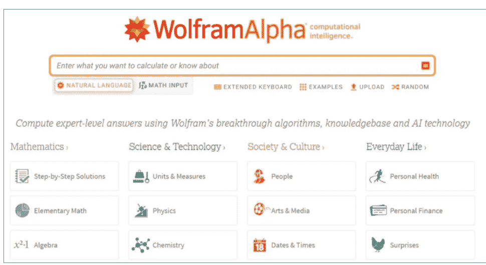

图2.3

把 WolframAlpha 的能力接入 ChatGPT，就是 Wolfram 插件的核心作用。借助该插件，ChatGPT 可以在文档、表格乃至聊天界面里直接调用 WolframAlpha 的计算资源。写作、教学、研究或日常交流，都能即时拿到可靠的科学计算结果。

比如写科普时可以直接调取各行星的基础参数；课堂演示中能实时推演复杂的数学公式；科研环节可用于数据处理与模型搭建；朋友闲聊也能快速解答科学类提问。总的来说，这款插件把专业级的科学计算带入日常工作与生活，兼顾效率与灵活性。

在 ChatGPT 中启用 WolframAlpha 的算力，需要先激活插件。具体流程如下。

(1) 点击左下角账号入口，进入 “Settings & Beta”，如图2.4所示。

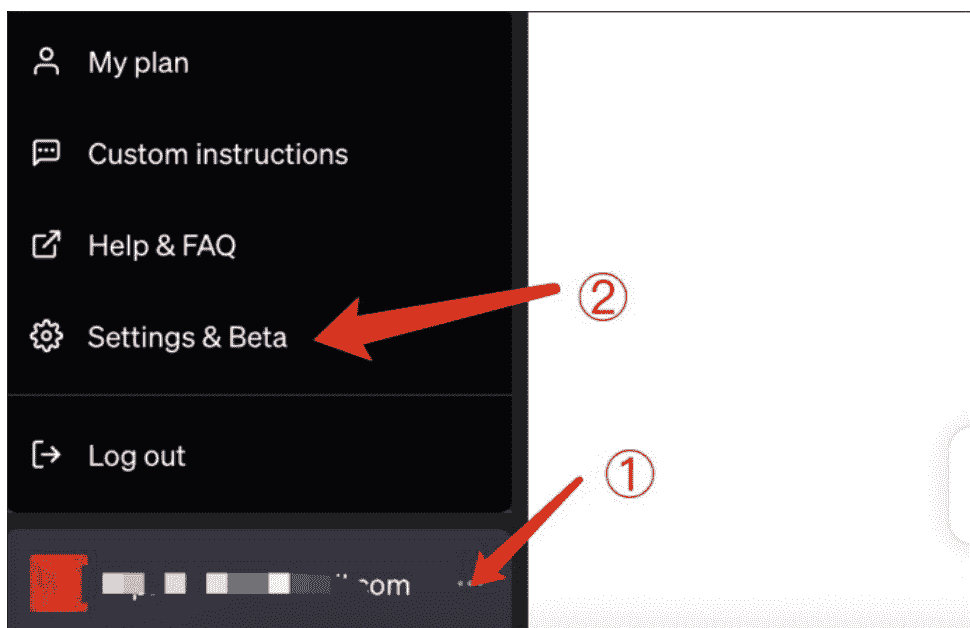

图2.4

(2) 打开 “Plugins” 开关，使其处于启用状态，如图2.5所示。

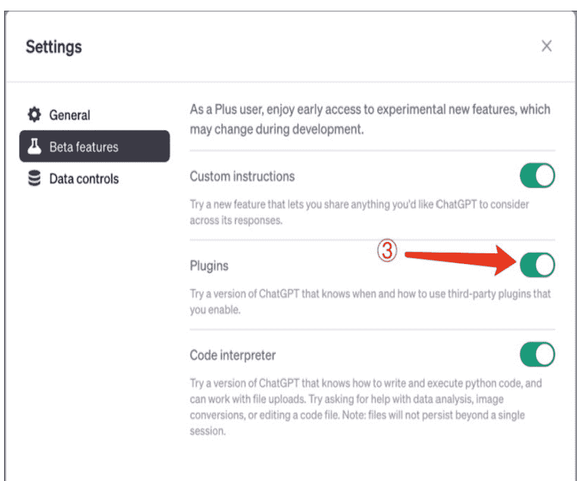

图2.5

(3) 在弹出面板中选择 “GPT-4”，如图2.6所示，并进入 “Plugins” 分区。

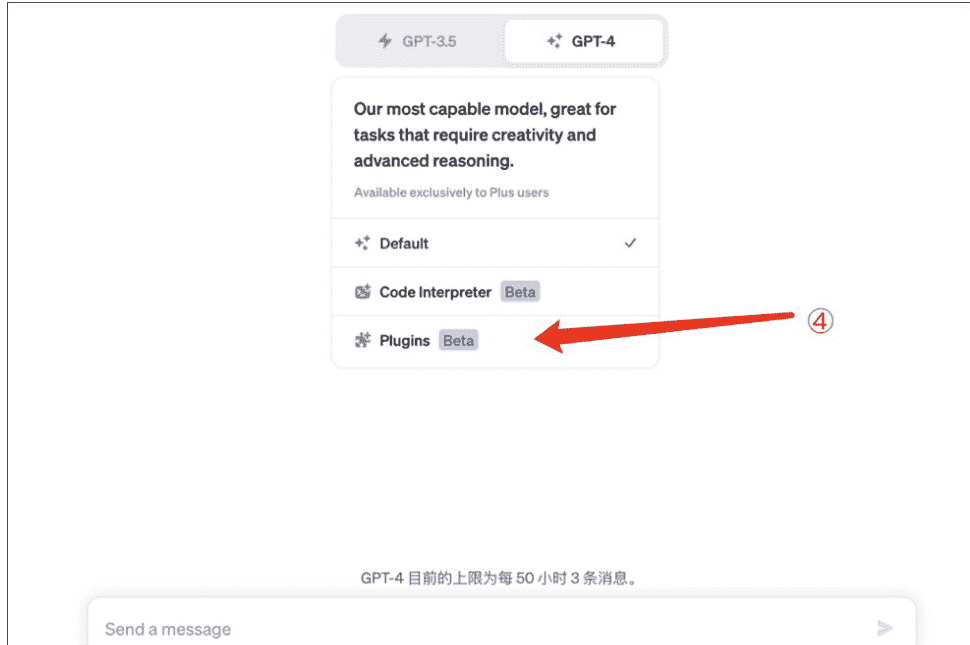

图2.6

(4) 在 “Plugin store” 插件中心搜索并安装 Wolfram 插件，如图2.7所示。

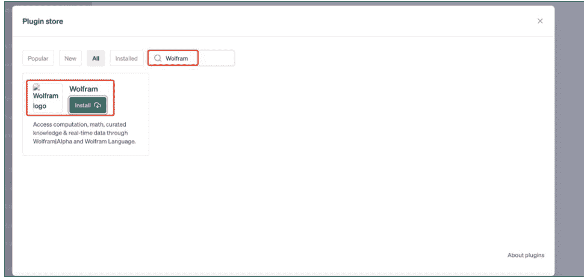

图2.7

（5）勾选 Wolfram 插件，如图2.8所示。

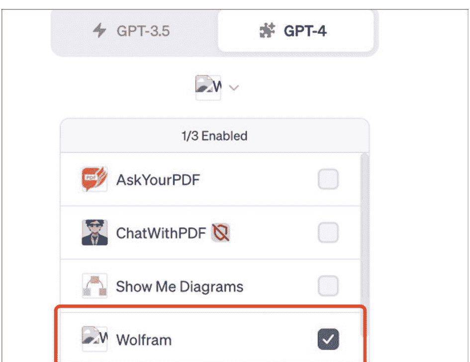

图2.8

完成上述配置后，新建对话即可调用该插件。接下来通过若干案例展示其使用效果，读者可挑选感兴趣的部分练习，并举一反三。

#### 2.2.1 在数学中的应用

本节聚焦插件在数学场景中的用法。

首个示例是函数作图。

请用红色绘制心形函数 x^2+(y-(x^2)^(1/3))^2=1。

图2.9 为 ChatGPT 的输出与图形效果。

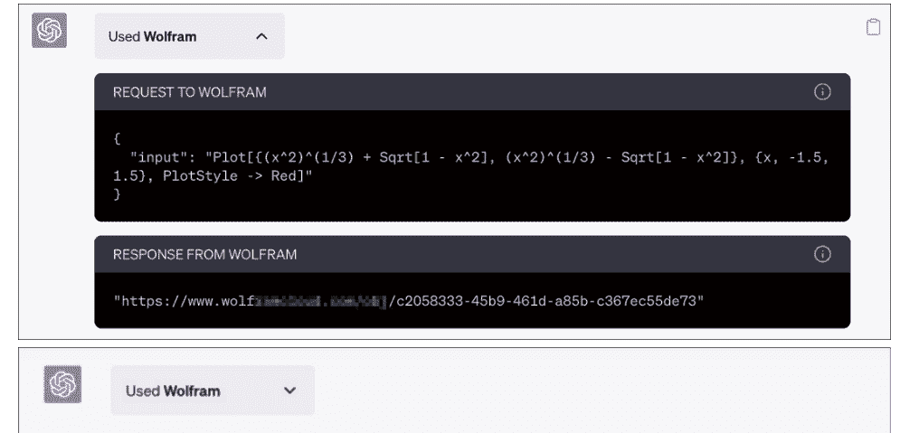


图2.9

第二个示例是解题。

请编一道鸡兔同笼的题目，并用插件求解方程组，随后给出这类题型的讲解。

下面是一道经典例题：

某农场笼中共有 30 个头、74 只脚，鸡和兔各多少只？

设鸡为 x，兔为 y，可写出方程组：

$$\begin{cases} x + y = 30 \\ 2x + 4y = 74 \end{cases}$$

借助插件求解上述方程组。

结果为鸡 23 只、兔 7 只。

鸡兔同笼的思路是通过头数与脚数建立方程组再求解。关键在于掌握鸡两只脚、兔四只脚这一特征，将总量信息转化为数学式子。

类似地，该插件还能解读医学知识、绘制家谱、作函数图、生成乐谱、规划最优路径、生成三维图形等。

再看微积分运算。

求 x^2 cos(2x) 的不定积分，并绘制图像。

积分为

对应图像为：


注意该函数的周期性与振幅随 x 增大而放大的特征，图形在 x 轴两侧振荡且幅度逐渐增大。

最后演示圆面积公式的逐步推导。

圆面积可通过积分得到。将圆视为无数薄圆环的叠加，每个圆环面积近似为周长乘厚度。

取半径为 R 的圆，取其中一个微环，半径为 r，厚度为 dr。该微环可近似为矩形，长为 2πr，高为 dr，故面积 dA=2πr dr。

把所有微环累加，从 r=0 积到 r=R，可得

$$A = \int_{0}^{R} 2\pi r dr = \pi R^2$$

这便是圆面积公式，说明面积正比于半径的平方。

#### 2.2.2 在物理中的应用

本节介绍插件在物理教学中的价值。

请说明插件在物理教学中能发挥哪些作用。

它具备多维能力，可在物理教学中多点发力。

- 处理复杂问题：可应对力学、电磁学、量子力学、热力学等难题，完成方程求解、符号与数值计算，甚至微分方程求解。
- 数据处理与可视化：可分析物理数据并生成散点图、直方图、等高线图等，帮助理解现象。
- 现象模拟：可模拟振子运动、光的折射与反射等情形。
- 教学与学习辅助：教师可用于演示抽象概念，学生可借助其探索与加深理解。
- 海量数据调用：可获取物理常数、元素属性、天体参数等。
- 单位换算：支持多种单位转换，对计算十分便利。

总体看，它在物理教学中实用性很强。

实践案例如下。

> 从 30 m 高处释放铁球，请用插件计算落地时间，并给出公式与相关知识。

忽略空气阻力时，铁球约 2.5 s 落地，落地速度约 24 m/s。

计算基于自由落体规律。地面附近无阻力时，下落距离 h 与时间 t 的关系为：

$$h = \frac{1}{2}gt^2$$

式中 g 为重力加速度，地球表面均值约 9.8 m/s²。解得时间 t：

$$t = \sqrt{\frac{2h}{g}}$$

这就是常用公式。需说明该式假设无空气阻力，实际中阻力会使时间略微延长。

## 第3章 写作助手

### 3.1 创意写作

ChatGPT 是优秀的写作助手，其辅助写作的基础模型如图3.1所示。

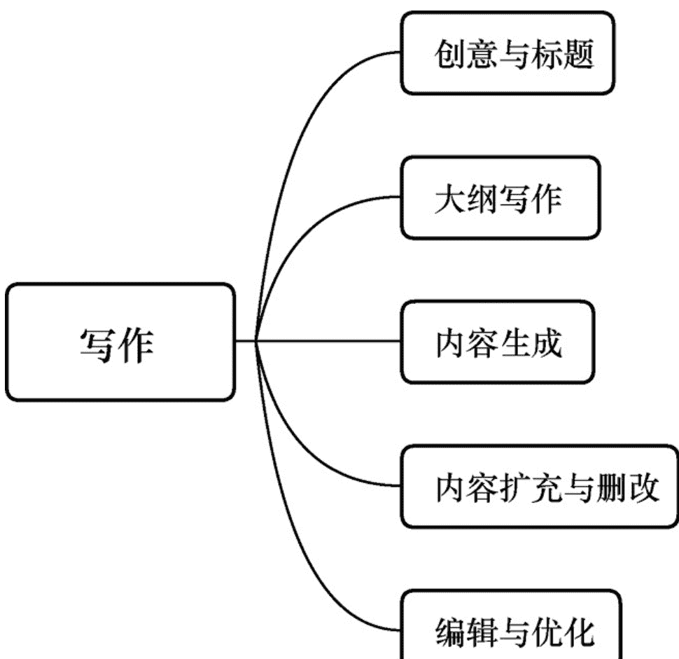

图3.1

#### 3.1.1 创意与标题

ChatGPT 在创意与标题生成上表现突出。下面以撰写“海明威与巴黎关系”的公众号文章为例。

你是一名优秀作家，我想写一篇关于海明威与巴黎关系的自媒体文章发布在公众号，请提供创意与标题。

当然，我很乐意提供建议。海明威与巴黎是内容丰富、极具吸引力的主题，有很多切入角度。以下建议供参考。

- (1) 创意：探寻海明威在巴黎的生活轨迹，以及这座城市如何塑造其创作。可结合居住地、常去场所与作品描写展开。
**标题：** “海明威的巴黎：一座城市如何塑造一个作家”。
- (2) 创意：剖析作品中对巴黎的呈现，折射出作者的情感与认知。可选取几部巴黎背景作品分析。
**标题：** “海明威笔下的巴黎：一种情感的表达”。
- (3) 创意：讲述海明威在巴黎的趣闻轶事，并分析这些经历如何影响作品。
**标题：** “海明威与巴黎：一段不解之缘”。
- (4) 创意：探讨海明威作品对当代巴黎的影响，以及他如何改变人们对巴黎的认知。
**标题：** “海明威的遗产：巴黎在他笔下的生动图景”。

希望这些建议能启发创作。如需更多帮助，我随时待命。

若需让 ChatGPT 撰写其他类型文章，可参照相同提示结构。

#### 3.1.2 大纲写作

确定创意与标题后，可先组合再请其生成提纲。

谢谢，我喜欢创意（1），想把标题定为“海明威的巴黎：一座城市如何塑造一个作家”，请结合创意（3）、（4）、（5），帮我拟一个提纲。

当然，我很高兴你喜欢这个方向。以下是我为你准备的提纲。

标题：“海明威的巴黎：一座城市如何塑造一个作家”。

##### 1. 引言
- 简要介绍海明威及其与巴黎的关系；
- 交代文章主题与目的。

##### 2. 海明威的巴黎生活
- 描述初到巴黎的情形，第一印象与早期经历；
- 他的居住地、常去咖啡馆与社交圈；
- 巴黎如何影响其生活与创作。

##### 3. 海明威的巴黎故事
- 讲述他在巴黎的趣闻与经历；
- 分析这些事件如何影响创作。

##### 4. 海明威作品中的巴黎
- 分析作品中对巴黎的描写，映射其情感与认知；
- 选取几部巴黎背景作品，解析描写手法与含义。

##### 5. 海明威作品对现代巴黎的影响
- 探讨作品如何塑造当代巴黎形象与公众认知；
- 分析作品在巴黎的接受度与文化影响。

##### 6. 结论
- 总结巴黎对海明威、与海明威对巴黎的双向塑造；
- 对二者关系做最后的思考与收束。

希望该提纲能帮助展开写作。有任何问题，随时沟通。

同理，也可让 ChatGPT 生成其他创意的提纲。

对给出的提纲可做修改与调整。下面让 ChatGPT 把风格调得更具文学性。

这是一篇偏文学性而非学术性的文章，请帮我微调一下提纲，特别是“引言”和“结论”部分，谢谢。

明白，你希望文章更具文学气质。以下是我调整后的提纲。

标题：“海明威的巴黎：一座城市如何塑造一个作家”。

##### 1. 引言
以一个引人入胜的小故事开头，如海明威初到巴黎的那一刻，或一段难忘经历。
简要介绍海明威与巴黎的关系，以及城市对其的影响。

##### 2. 海明威的巴黎生活
描绘他在巴黎的日常，居住地、常去咖啡馆与社交圈。
呈现巴黎如何深刻影响其生活与创作。

##### 3. 海明威的巴黎故事
讲述巴黎时期的趣事与经历，及其对创作的推动。

##### 4. 海明威的作品中的巴黎
分析作品中巴黎的呈现方式，折射其情感与理解。
选取几部相关作品，解读描写背后的意义。

##### 5. 海明威的作品对现代巴黎的影响
探讨作品对当代巴黎的影响与公众认知的塑造。
分析其作品在巴黎的接受情况与文化效应。

##### 6. 结论
以一段意味深长的小故事或海明威关于巴黎的名言作结。
总结巴黎如何塑造海明威，海明威又如何回映巴黎。

希望调整后的提纲符合预期。需要更多帮助随时提出。

我们还可采用幽默轻松、奇幻等其他风格。

#### 3.1.3 内容生成

根据优化后的提纲，请 ChatGPT 开始撰写。可通过指定作家风格来控制语气；篇幅较长时，可分段写作。

你是一位海明威风格的优秀作家，请根据提纲撰写“1.引言”和“2.海明威的巴黎生活”，字数约1000字。

标题：“海明威的巴黎：一座城市如何塑造一个作家”。

巴黎，1921 年的冬天。一个年轻美国人走下火车，踏上石板路。他的名字是欧内斯特·海明威，他即将成为世上最伟大的作家之一。他携妻子与刚出生的儿子，带着对未知的渴望与对生活的热爱，来到他后来称之为“流动的盛宴”的城市。

对海明威而言，巴黎既是真实的地点，也是灵感的源头。街道、咖啡馆、桥梁与塞纳河都成了他作品的场景。他在此结识了重要人物，写下了重要作品。巴黎对他来说是一次启示，一种灵感，一个永恒的主题。

海明威在巴黎的生活，如同他的文字一样充满冒险与激情。他住在拉丁区的一间小公寓，周围弥漫着艺术家与作家的气息。邻居是毕加索，朋友有菲茨杰拉尔德与福克纳。他们在咖啡馆辩论文学，在塞纳河边饮酒，在巴黎的夜里寻找灵感。

这座城市的活力与创造力给了他声音与主题。他在这里写下《太阳照常升起》，构建了自己的文学世界。巴黎于他是梦想，是挑战，是永恒的家。

巴黎也带给他挫折与艰难。贫困、失落、失败与瓶颈塑造了他的性格，点燃了创造力。他在这里学会坚韧与勇敢，学会直面生活的考验。

海明威的巴黎是真实与虚构的交界。街道、咖啡馆、桥梁与塞纳河在他笔下复活，成为一个充满冒险与热情的世界。巴黎对他而言是一个故事，一个梦想，一个永恒的主题。

……

另外，还可设定 ChatGPT 为其他风格作家，如《道德经》作者老子、诗仙李白等。

#### 3.1.4 内容扩充与删改

对生成的内容可按需修改或删减。若觉得某段过于简略，可请 ChatGPT 扩充，并给出方向。

关于海明威与“流动的盛宴”，请帮我扩充内容，重点提及海明威与菲茨杰拉尔德、福克纳等人的交往，约400字。

在巴黎的日子，海明威称之为“流动的盛宴”。这既写出了那个时代的巴黎，也写出了他本人的生活。那段时光充满激情，仿佛一场永不落幕的盛宴。

在这场盛宴里，海明威结识了许多重要人物，其中最著名的是菲茨杰拉尔德与福克纳。他们同为那个时代的巨匠，都在巴黎找到了各自的声音。

海明威与菲茨杰拉尔德的友情广为流传。他们常在咖啡馆谈论文学，沿塞纳河饮酒，在巴黎的夜色里捕捉灵感。

福克纳则既是朋友也是对手。他们在巴黎频繁讨论文学与创作。友情与竞争共同激发了创造力，并落到作品之中。

在这场流动的盛宴里，海明威找到了声音与主题。他的巴黎如作品一样充满冒险与热情，是一个永恒的母题。

#### 3.1.5 编辑与优化

由于 AI 幻觉，有时 ChatGPT 会产生事实性错误。可开启联网插件，将 GPT-4 设为 Browsing 模式进行核查。

我对 ChatGPT 生成文字中“西尔维娅·比奇是海明威导师”的表述存疑，便用 Browsing 插件核实。

请帮我核对以下这段文字的真实性，并给出修改建议。

> “海明威也常常去莎士比亚书店。这是他在巴黎的另一个精神家园。那里有各种各样的书，而且，更重要的是，那里有他的朋友，也是他的导师——西尔维娅·比奇。比奇是书店的主人，她是他在巴黎的朋友和导师之一。她的独特眼光和对文学的深入理解给海明威带来了极大的启发。他们经常在书店的一角交谈，讨论文学、生活，以及那个充满活力的城市。比奇也是海明威的读者，她的批评和鼓励让海明威在写作路上更加坚定。”

### 3.2 商业写作

ChatGPT在商业写作中的实战价值
ChatGPT在商务文案创作上具备相当的开发空间。下面是它能够切入的具体场景。

- **广告与宣传文案**：ChatGPT可协助拟定广告语和推广文案，能给出创意点子、润色表达、调整语气风格，并让落点与目标受众更贴合。
- **博客文章**：ChatGPT能产出质量过关的博客内容，可围绕指定主题提供调研素材、搭好框架、补充细节，并保持语言自然流畅。
- **产品说明与用户手册**：ChatGPT可帮忙撰写说明书、操作指南和客服手册，能依据产品功能给出详细说明，并以易懂友好的方式呈现信息。
- **客户信函与邮件**：ChatGPT可辅助起草商务信函和客户邮件，提供模板参考、措辞建议、问题解释与处理思路，确保表达清晰得体。
- **社交媒体与营销内容**：ChatGPT可为社媒和营销活动生成创意素材，帮助写出讨喜的推文、吸睛的软文、打动人的营销话术，并支持实时互动。

需要提醒的是，ChatGPT只能提供思路和初稿参考，商业写作中人工审校不可或缺。模型产出的内容仍需人工复核修改，以保证准确性、一致性以及与品牌调性的匹配。保持对目标群体的连接、塑造独特的品牌声线、吃透行业背景同样关键，ChatGPT是强力的辅助工具，最终的质量与效果仍依赖人类的专业判断。

#### 3.2.1 写销售报告大纲
本节演示如何借助ChatGPT搭建销售报告提纲。

> 我是家女装零售店的店长，能否帮我拟一份季度销售情况报告的大纲？请涵盖必要的板块和信息，确保报告完整有效。另外也请分享一些调研与写作的技巧或最佳实践。

可以，以下是季度销售报告的参考提纲和配套技巧。

1. 开篇：简要说明报告撰写目的与整体内容。
2. 销售总览：给出季度销售额，并与上季度及去年同期作对比。
3. 品类销售拆解：细化连衣裙、上衣、裤装等各品类的销售额与销量表现。
4. 销冠产品：列出销售额排名靠前的商品，并分析其走红原因。
5. 滞销产品：列出销售额最低的商品，并探讨表现不佳的因素。
6. 客户购书行为洞察：梳理购买时段、频次、偏好等行为特征。
7. 市场动向与预判：结合现有数据与市场趋势，对下一季度销售作出推测。
8. 改进建议：基于前述分析提出策略与优化点。
9. 总结：概括主要发现与核心建议。

调研与写作技巧如下。
- 数据整理与分析：可用表格或分析工具汇总数据，确保数值准确。
- 目标先行：写作前明确报告用途，有助于判断信息的主次。
- 语言精炼：避免冗长和生僻术语，表达要简洁明了。
- 可视化呈现：用柱状图对比单品销售额，用饼图展示品类占比，提升可读性。
- 结构逻辑：各部分主题明确，段落之间有递进关系。
- 审阅修改：初稿完成后反复校对，确保信息无误。

参考此示例，也能让ChatGPT为其他主题报告搭建提纲。

#### 3.2.2 向他人提出请求
本节演示如何用ChatGPT委婉地提出工作请求。

我需要在工作中向同事提一个请求，但不想显得强硬。能否给出一个逐步推进的方法，让我以专业方式表达？请提供构建请求的要点，以及一些能提升自信的表达。

可以，以下是专业提出请求的步骤与建议。

(1) 厘清需求：先明确自己需要什么、为什么需要，以及对工作有何意义。
(2) 选择时机与场合：避开对方忙碌时段，合适时可提前预约沟通时间。
(3) 礼貌开场：先询问对方是否有空，或表达对对方工作的尊重。
(4) 直截了当地说明请求：表述要清晰不含糊，例如“能否在明天下午前提供相关资料，帮助我完成项目”。
(5) 说明原因：解释对方协助的重要性，便于对方理解背景并提升配合意愿。
(6) 表达感谢与尊重：无论对方能否满足请求，都应表示谢意。
(7) 提供回馈：尽量给出某种回报，可是不一定要实物，也可以承诺未来互助。
(8) 保持开放：若请求被拒，接受决定并探讨替代方案。

常用表达参考：
- “我知道你很忙，但……”
- “打扰你很抱歉，我确实需要……”
- “明白你时间宝贵，我只需要……”
- “如果现在不方便，我们改天再聊可以吗？”
- “非常感谢你能帮忙……”

记住尊重与理解是关键。

#### 3.2.3 写汇报邮件
本节演示如何用ChatGPT撰写汇报邮件。

我是一家女装零售店的店长，想申请去深圳参观公司另一家表现优秀的门店，请帮我写一封发给公司总经理的邮件。

可以，以下是一个参考模板：

主题：申请参观深圳优秀零售店的机会

尊敬的[总经理姓名]：

您好。鉴于您日程紧张，我尽量简洁说明。

我正探索提升本店业绩的方法，注意到公司深圳某门店近期销售表现突出。若能实地学习观察，我相信能吸收其成功经验并运用到本店。

此行或需投入时间与资源，但我认为学习价值很高，有助提升业绩与客户满意度。我承诺将所学快速在团队内分享。

如您认同，盼能约个时间详谈。若当前不便，择日沟通亦可。

感谢您的考虑，期待回复。

祝好，
[你的名字]

请按实际情况调整，祝沟通顺利。

#### 3.2.4 写演示文稿框架
本节说明ChatGPT如何帮助搭建演示框架。

在制作幻灯片演示时，有哪些常用框架？我希望了解不同框架的适用场景与核心特点。

以下是常见框架的简要介绍。

- **故事叙述框架**：以一段引人入胜的故事开场，中间设置冲突或挑战，最后给出解决与结论。适用于需要抓住注意力并保持兴趣的场合。
- **问题-答案框架**：先抛出核心问题，再依次给出解答。适用于聚焦具体痛点或挑战的演讲。
- **比较-对比框架**：并列展示两种或多种方案的优劣。适用于帮助听众在不同选项间做判断。
- **事实-解释-应用框架**：先陈述事实，再解释意义，最后说明落地方法。适用于教学或提供实操指引。
- **案例研究框架**：围绕一个真实案例深入剖析。适用于用实例证明观点或提供证据。

框架选择取决于目标、内容与听众。

#### 3.2.5 写演讲PPT大纲
本节演示如何用故事叙述框架写演讲大纲。

我是做跨境电商的创业者，主营军舰模型玩具，即将在展会做半小时演讲，能否用故事叙述框架帮我写一份PPT大纲？

可以，以下是基于故事线的大纲。

- 幻灯片1：开场。分享童年玩军舰模型时的记忆，描述热爱与想象力启蒙。
- 幻灯片2：引入主题。介绍公司与产品，说明如何将童年兴趣转化为事业。
- 幻灯片3：挑战。讲述创业遇到的困难，如优质厂商难寻、市场竞争激烈。
- 幻灯片4：解决方案。说明如何克服难题，如锁定合作工厂、创新营销打法。
- 幻灯片5：产品展示。呈现军舰模型的核心特色与卖点。
- 幻灯片6：客户反馈。引用用户好评，说明产品带来的乐趣价值。
- 幻灯片7：未来规划。介绍新品方向与业务拓展思路。
- 幻灯片8：结尾。用一个孩子玩模型的暖心画面收束，点明工作的意义。

希望对演讲准备有帮助。

## 第4章 工作助手
在众多工作场景中，ChatGPT可作为得力助手。主要应用领域包括。

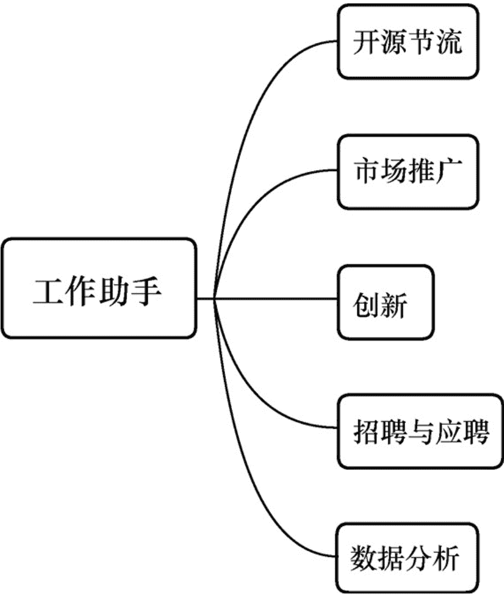

#### 4.1 开源节流
提升利润、控制成本、管理现金流是企业的核心任务。本节以餐饮企业为例说明应用思路，读者可把提示中的行业替换为自身行业，并结合实际情况对建议作可行性分析。

#### 4.1.1 提高利润
盈利能力是企业持续发展的关键，涉及定位、产品、销售、成本等多个环节。唯有灵活应对市场变化、优化流程、创造更高价值，才能吸引投资与合作。

下面说明如何用ChatGPT制定盈利方案。

**1. 提供营利方案**
让模型批量输出营利思路，体现AI在商业决策中的作用。通过学习行业背景与市场环境，可快速生成多元化方案，覆盖不同风险与回报。

作为餐饮小店主，我想提升利润，能否给我20条针对本行业的具体创新做法，而不是泛泛概念？

可以，以下是20条可落地的思路。
- 打造招牌菜：推出独特色彩吸客。
- 推出主题晚宴：按季节或文化策划特色活动。
- 增加健康选择：提供低糖、低盐、有机等选项。
- 饮品创新：开发特色饮品提升附加值。
- 工作日午餐套餐：提供性价比组合吸引上班族。
- 优化店面氛围：改善装饰与环境体验。
- 社交媒体推广：用内容宣传菜单与活动。
- 客户忠诚计划：积分或优惠券提升复购。
- 外卖配送：对接平台或自建配送。
- 关注客户评价：线上线下反馈及时改进。
- 延长营业时长：深夜或24小时经营。
- 定期上新：保持菜品新鲜感。
- 高端素食选项：迎合素食与环保趋势。
- 升级支付方式：支持移动支付。
- 自有订餐App：方便下单与收款。
- 家庭友好区：儿童菜单与儿童活动区。
- 时段外卖优惠：工作日午餐时段促销。
- 个性化定制：按口味需求定制菜品。
- 团购合作：与周边企业机构建立长期供应。
- 智能点单系统：提升效率缩短等待。

**2. 筛选重要方案**
若无法判断优先级，可继续让模型筛选。

请从上面方案中挑出10个符合商业逻辑、市场规律且贴合当下趋势的重点。

理解了，筛选如下10项。
- **开发招牌菜**：形成差异化记忆点。
- **引入健康选项**：响应健康消费趋势。
- **饮品创新**：提升体验与利润。
- **网络营销**：扩大影响力获取新客。
- **提供食品配送服务**：顺应外卖增长。
- **提供高级素食选项**：契合素食与环保需求。
- **更新支付方式**：适配移动支付习惯。
- **创建自有App**：强化品牌与数据运营。
- **提供儿童菜单和儿童区**：吸引亲子家庭。
- **使用智能订单系统**：用技术提升效率与体验。

**3. 确定最先实施的方案**
让模型判断启动顺序，规避主观偏差。

很棒，我不清楚先做什么，请帮我选出最优启动方案，并说明起步方法与步骤。

基于趋势判断，**网络营销**是启动成本低、见效快的策略。能提升品牌曝光并直接触达潜在客户。

具体步骤。
(1) 确定目标客群：是学生、上班族还是家庭，明确需求与偏好。
(2) 搭建社媒账号：在微博、微信、抖音等平台建立并完善信息。
(3) 发布吸睛内容：招牌菜图、活动预告、店内实拍等，重视画质。
(4) 互动响应：及时回复评论与提问，体现专业与热情。
(5) 制定推广计划：定期折扣、主题夜、跨品牌联动或与KOL合作。
(6) 数据复盘：监控互动与转化，优化内容与投放策略。

网络营销需持续投入与耐心，坚持即可见到效果。

#### 4.1.2 节约成本
节约成本是企业与个人财务管理的重要目标，涉及生产、运营、采购等环节的精细化优化。

**1. 给出节约成本的方法**
让ChatGPT列出20种降本做法，展示其在运营优化中的价值。模型可基于财务与流程分析给出可行建议。

假设你是餐饮成本管理专家，请给出20种实用的节约成本方法。

很好，以下是部分实用方法。
- 减少浪费：引导员工控制食材与物料损耗。
- 提高能源利用效率：使用节能设备并定期维护。
- 批量采购：适时集中采购原料与设备以获价格优势。
- 定期盘点库存：避免囤货与损耗，及时处理缺失。
- 租赁而非购买设备：低频使用设备以租代购更经济。
- 优化员工排班：根据客流高低灵活调配人力。
- 实施自动化流程：用软件处理库存管理、结算等环节。

餐厅省钱增效实战清单

- 锁定长期供货伙伴：与同一家供应商保持稳定合作，往往能拿到更实惠的进价与更可靠的服务。
- 主打当季食材：当季原料价位更友好，口感与新鲜度也更突出。
- 固化出品克数：把每道菜的投料标准统一，减少食材超用与边角料流失。
- 集中用水作业：清洗与清洁尽量等载满后再启动，避免水资源白白浪费。
- 余料二次利用：排菜单时预留剩余原料的再加工方向，比如做成汤品或甜点。
- 员工能力培养：通过系统培训提升操作熟练度与节约意识，降低失误与损耗。
- 价格弹性调节：根据原料波动与竞争态势适时调整菜价。
- 菜单结构重组：从品类组合、摆放位到盈利贡献整体优化，抬高售卖毛利。
- 税务合规梳理：弄清可用的减免与抵扣规则，在合规前提下实现节税。
- 灵活排班模式：采用弹性工时压缩加班时长与人力排班开销。
- 能耗专项排查：邀请专业机构找准耗能点，形成明确的节能改进路径。
- 供应链线路精简：挑选性价比高的货源与高效物流方式，压低综合采购支出。
- 设备定期保养：按计划检修维护，延长使用年限，减少更换投入。
整套打法能帮助门店有效压降开销、拉升盈利水平。

##### 2. 精选高价值降本策略
利用人工智能与深度学习技术，可以在众多备选方案中迅速挑出投入产出比更优的十项做法。该能力可延伸至战略规划、产品创新、费用管控、市场传播等多个领域。通过智能化分析与客观评判，既能保证挑选精准，也能显著加快决策节奏。

按需求筛选出的十条核心降本做法如下。

- 把控损耗：从原材料环节减少浪费是省钱最直接的抓手。
- 提升能源使用效率：添置节能设备与系统，长期来看电费燃气费会明显下降。
- 集中采购与库存周转：科学备货并优化库存流转，能明显削减成本。
- 推进流程自动化：借助软件与技术实现部分环节自动运行，降低人工差错并提高效率。
- 精细化人员排班：依据客流高峰精准配置人手，有效控制人工支出。
- 保持供应商稳定合作：维持与长期合作伙伴的良好关系，争取更优惠的采购条件。
- 选用季节性原料：当季采购既省钱又能提升菜品质感。
- 强化团队技能训练：培训提升执行力，减少失误、提高生产效率。
- 税务规划与合规操作：熟悉税收优惠与抵免政策，在合规范围内节约支出。
- 启动能源审计：引入专业审计找出节能空间，降低长期运营成本。

从二十条方案里提炼十条代表性选项，是常见的聚焦手段。完整清单提供视野，精简后能剔除干扰、凸显投入回报更高的做法，有助于提升决策质量与执行效率，避免资源错配与方向偏差。

##### 3. 优先执行的首选方案
人工智能在优先级管理与策略落地环节作用显著。通过拆解紧迫性、重要性与回报，AI可识别出应先推进的方案，避免人为偏好，保证判断客观精准，促进资源合理配置与目标快速达成。

不确定先动哪一招的话，建议优先聚焦削减浪费。该方向既能直接降本，也契合当前环保与社会责任诉求，有助提升品牌形象。

推进流程如下。

1. 盘点当前浪费现状：梳理浪费主要集中在哪些环节，比如食材损耗、能源空耗等。
2. 制定可量化目标：基于现状设定明确的减量指标，例如下降食物浪费比例与用电量。
3. 开展团队培训：让员工理解浪费带来的成本影响，传授食材妥善保存处理方法与节能操作习惯。
4. 调整流程与制度：视需求优化采购与储存流程、规范菜品分量、制定节能操作规范等。
5. 持续跟踪与优化：策略落地后持续关注成效，依据实际反馈及时修正，未达预期的做法要果断调整。

记住，减浪费既是降本手段，也是一种长期承诺，需要全员配合，效果显现需要时间，但长期回报远大于短期投入。

还可以继续细化每一步落地细节，例如：请继续帮我细化“步骤1 摸清当前浪费现状”的详细落地细节和关键点。

#### 4.1.3 管理现金流
现金流管控是商家财务运转的核心，关注资金的进出节奏，目的在于实现资金合理配置与使用。良好的现金流管控可以确保资金流动性与偿债能力，支撑日常经营与长期发展。通过精细追踪与分析收入、支出、债务与投资等现金活动，商家能够及时识别现金流风险，提升资金使用效率，增强竞争力。

现金流管控还有助于达成战略目标，推动新项目与把握市场机会。在当下商业环境中，现金流管控的重要性日益凸显，为商家稳健发展与出色表现提供关键支撑。

##### 1. 现金流管理十种做法
借助人工智能进行现金流管理是现代手段。通过综合分析商家的收入、支出、投资、债务等信息，AI可提供精准有效的管理办法。这些办法可能包括优化收款流程、精确预测现金需求、控制非必要支出、合理安排投资等。实施后可保证现金顺畅、降低风险、提高使用效率。

作为餐厅经营者，我一直在寻找提升现金流管理能力的方法。希望优化现金流以覆盖开支、支付薪资并拓展业务。有哪些有效策略可提升现金流管理技能？我如何预见潜在问题并提前规划以确保财务稳定？请给出十种方法。

现金流管控对商家运行与发展至关重要。以下是提升现金流管理技能的策略。

- 掌握财务报表：学习阅读并理解财务报表，尤其是现金流量表，了解资金来源与去向，为决策提供依据。
- 制定预算计划：设定详细可行的预算，包含收入与支出预测，避免超支。
- 推行及时收款策略：通过合理账期与激励措施加快回款，例如提前付款折扣或使用移动支付平台。
- 维护良好供应商关系：与供应商协商付款条件，适度延后付款改善现金流，同时保持合作稳定。
- 管控库存水位：库存过高会占用大量现金，降低流动性。定期盘点、优化库存，既满足需求又不占用资金。
- 学会现金流管理工具：学习QuickBooks、Xero等财务软件的使用，其提供自动化流程与实时分析报告。
- 监控核心财务指标：熟悉并定期追踪现金流量比率、应收账款周转率等指标，及早发现问题。
- 建立现金储备机制：设立安全垫应对突发事件或困难时期，保持业务稳定。
- 制定投资策略：理性投资，确保回报可覆盖现金需求并匹配业务战略。
- 培训与专业咨询：参加财务与现金流管理培训，或寻求专业顾问建议，提升管理水平。

以上策略可帮助你提升现金流管理能力，预见并解决潜在问题，确保财务稳定。

AI从不同视角提出十种方法，实现了对现金流管理的全面覆盖，有助于发现机遇与挑战、识别风险与优势。随后从中挑选关键方法，可将资源集中在最有价值方向。这一策略兼顾全面探索与精准选择，对现金流管理的成功实施具有重要价值。

##### 2. 核心抓手筛选
从十种方法中挑选三项关键方法是一种聚焦核心的智能决策。通过分析与对比现金流管理的各方面，AI可识别出三项影响力更大的方法，例如实时收款、精准现金流预测与有效支出控制。实施这三条核心方法，有助于保障流动性、降低风险、增强财务稳定。

请继续，帮我从上述十种方法中筛选出三项关键方法，要求符合商业逻辑与市场规律且贴合当下趋势。

基于当前商业逻辑、市场规律与趋势，从上述十条中挑选出以下三项关键方法。

- 推行及时收款策略：随着数字支付技术发展，提供多种便捷付款方式已成趋势。移动支付与在线支付平台可显著加速回款，改善现金流。
- 优化库存管理：在零售与餐饮行业尤为关键。有效库存管理不仅提高资金使用效率，还能减少浪费与成本。
- 掌握现金流管理工具：技术进步带来大量财务软件，帮助商家更清晰管理现金流，实现流程自动化与实时数据分析，支持更明智决策。

这三项方法融合技术趋势、市场规律与商业逻辑，可有效提升现金流管理能力，使商家在竞争中保持优势。

从十项方法中挑出三项是一种精细化优化策略。初始十项提供全面视野，覆盖各层面。筛选三项则是深入分析与评估的过程，旨在选出重要性、可行性与效益最高的方案。

##### 3. 首推落地方法
筛选出最重要的方法是一种高度集中优化的决策方式。从众多可选方案中，AI通过深入分析与智能评估，选出最具价值的方法。这凸显目标明确性与执行精准性，保证资源高效使用与方向准确。

非常棒，我不太清楚最先实施哪一种方法，请继续帮我挑选出最优方法，并告知如何启动，具体做法与步骤是什么。

基于当前市场环境与趋势，建议优先考虑掌握现金流管理工具。优质财务软件可以帮助你更精准理解与管理现金流，提供实时数据分析与预测，从而做出更明智的商业决策。

实施步骤如下。

1. 评估需求：明确所需核心功能与特性，考虑财务报告分析、预算预测、发票管理、支付处理等需求。
2. 市场调研：研究市面上财务软件的功能、优缺点与价格，例如QuickBooks、Xero、FreshBooks等。
3. 试用与选择：利用试用期验证软件是否满足需求，试用结束后根据体验与需求挑选最合适的产品。
4. 团队培训：选定软件后组织团队培训，确保熟练使用，也可借助专业顾问推动落地。
5. 持续优化：使用过程中持续监控效果，根据业务变化调整参数。软件需要适应期，不惧调整与优化。

掌握现金流管理工具可以帮助你更准确掌握财务状况，及时发现问题、做出更好决策，最终提升现金流管理能力。

我们还可以继续细化每个步骤的执行细节，例如：请继续帮我细化“步骤1 评估需求”的详细落地细节和关键点。

### 4.2 市场推广
产品市场推广涵盖广告文案制作、产品命名、图片制作等工作。图片制作可用Midjourney、Stable Diffusion等AI绘图软件完成，许多文字工作则可用AI助手高效完成。

#### 4.2.1 产品推广建议
产品推广建议是指基于市场需求、竞争环境、目标人群等因素，为某产品或服务制定的推广方案与策略。建议内容可能包括推广渠道选择、营销活动策划、目标市场确定等。推广的目的是帮助企业更有效地将产品推向市场，提升知名度与销量。通过科学合理的推广建议，企业可实现资源合理分配，保证活动高效执行，增强市场竞争力，促进业务增长与品牌建设。在现代商业中，产品推广是获得市场认可的关键步骤之一。

##### 1. 如何制定市场推广方案
我们可以借助AI助手完成市场推广方案的制定。

假设你是一名优秀的广告策划专家，我想为我的产品制定广告文案，我需要注意什么？

作为优秀的广告策划专家，我认为你在制作广告文案时应注意以下要点。

- 目标受众：明确广告面向的群体，了解其需求、兴趣与偏好。
- 独特卖点：突出产品差异化优势，明确与竞品的区别，实现精准定位。
- 情感共鸣：使用情感化语言与画面引发受众共鸣。
- 简洁明了：文案简洁清晰，突出核心信息，避免冗长复杂表达。
- 创意与吸引力：图片具备创意与吸引力，抓住眼球提升关注度。
- 清晰设计：文案与图片设计清晰，受众能在短时间内获取信息。
- 品牌一致性：广告需与品牌形象相符，保持一致性以增强认知。
- 行动引导：文案需鼓励受众行动，如购买、咨询或点击链接。
- 测试优化：在发布前进行测试与优化，确保效果最佳。
- 合规性：确保内容符合广告法规与平台政策，避免违规。
- 效果测量与分析：发布后通过数据测量与分析持续优化。

注意以上要点，你可创作出引人注目、传递有效信息的广告文案与图片，提升宣传效果。

##### 2. 要点落地细化
如果对以上要点不知如何落地执行，可继续让AI助手细化方案。

请继续帮我将每个要点的操作流程与步骤细化，要求可落地执行。

当需要将广告策划要点细化为可执行的操作流程时，可按以下方式进行。

1. 明确目标受众。
    - 调研受众特征、兴趣与需求。
    - 构建受众画像，包含年龄、性别、职业、兴趣等。
    - 根据画像确定广告内容与形式。

2. 提炼独特卖点。
    - 分析产品特点与竞争对手，找出差异化优势。
    - 通过调研确定受众最在意的产品属性。
    - 将卖点融入文案与图片，突出优势。

3. 制造情感共鸣。
    - 了解受众情感需求与痛点。
    - 设计内容与画面引发情感共鸣。
    - 运用故事化元素增强感染力。

4. 采用言简意赅的文案与图片。
    - 精简文案，突出核心信息。
    - 选择简洁视觉元素，避免复杂堆砌。
    - 用简单语言与画面让信息一目了然。

5. 增强创意与吸引力。
    - 开展创意头脑风暴，寻找新颖点子。
    - 使用高质量图片提升吸引力。
    - 考虑动画、视频等形式增加创意。

6. 保持清晰设计。
    - 明确广告主题与核心信息。
    - 调整内容结构与逻辑，确保信息有序传递。
    - 保证阅读顺畅，引导关注重点。

7. 契合品牌形象。
    - 确定品牌核心形象与风格。
    - 在广告中保持品牌一致性，使用品牌色与标志。
    - 按品牌调性调整语言与视觉风格。

8. 引导受众行动。
    - 文案中使用行动性词汇鼓励行动。
    - 增加按钮或链接，引导购买、咨询等操作。
    - 提供优惠或奖励提升参与欲望。

9. 测试与优化。
    - 在小范围内测试广告效果，收集反馈与数据。
    - 根据结果优化调整广告。
    - 持续进行A/B测试，寻找最优版本。

10. 确保合规性。
    - 确认内容符合广告法规与平台政策。
    - 避免虚假或误导性宣传。
    - 定期检查合规性，保障合法可靠。

11. 测量与分析。
    - 使用网站分析工具追踪点击率、转化率等。
    - 分析数据了解广告表现。
    - 根据分析结果持续优化，提升效果。

将要点细化为具体流程，可更好地执行广告策划，达到最优效果。持续测试与优化将不断提升广告吸引力与效果。

##### 3. 制定详细执行方案
通过AI助手制定详细方案。

请根据以上执行步骤形成具体方案，并说明执行细节与时间规划，以表格形式呈现。

下面是基于广告策划执行步骤形成的具体方案，包含执行细节与时间规划。

| 步骤 | 执行细节 | 时间规划 |
| :--- | :--- | :--- |
| 了解目标受众 | ● 进行市场调研，了解目标受众特征和需求。<br>● 确定目标受众画像和关键词，包括年龄、性别、职业、兴趣等 | 第1周 |
| 总结独特卖点 | ● 分析产品特点和竞争对手，找出独特卖点和优势。<br>● 确定宣传焦点 | 第2周 |
| 产生情感共鸣 | ● 研究目标受众的情感需求和痛点。<br>● 设计广告内容和形象，让受众产生情感共鸣。 | 第3周 |
| 使用简洁明了的文案和图片 | ● 精简广告文案，突出核心信息。<br>● 选取简洁明了的视觉元素 | 第4周 |
| 具有创意和吸引力 | ● 进行创意头脑风暴，寻找创意和新颖的元素。<br>● 采用高质量的图片 | 第5周 |
| 保持清晰的设计 | ● 安排广告内容结构和逻辑，确保信息传递有序。<br>● 确保广告阅读顺畅 | 第6周 |
| 符合品牌形象 | ● 确定品牌的核心形象和风格。<br>● 确保广告与品牌形象一致 | 第7周 |

**广告投放关键节点概览**

| 策略重点 | 具体做法 | 时间节点 |
| :--- | :--- | :--- |
| 行动号召 | ● 选用更具驱动力的动词表述，推动受众马上行动。<br>● 嵌入醒目的按钮或链接，引导用户去下单、咨询等 | 第8周 |
| 小范围测试 | ● 先在有限范围内验证广告表现，收集用户反馈与数据。<br>● 依测试结果对广告素材进行优化修正 | 第9周 |
| 合规审查 | ● 核对广告文案和画面是否符合法规及平台规则。<br>● 定期复查广告状态，保证发布合法可信 | 第10周 |
| 数据追踪 | ● 借助网站分析工具监测点击率、转化率等核心指标。<br>● 对广告数据进行解读，判断投放效果 | 第11周 |
| 持续优化 | ● 基于分析结论进一步调整创意与投放。<br>● 不断提升广告吸引力和成交表现 | 第12周 |

#### 4.2.2 为产品定制推广蓝图
制定产品推广方案是商业运营的核心环节，涉及拆解产品卖点、锁定目标市场、研判竞争态势、洞察潜在用户需求，并据此确定营销策略与执行路径。方案通常涵盖渠道选择、定价思路、促销活动设计、社交媒体布局等内容。

制订推广计划的价值在于让产品在目标市场里获得更高曝光，吸引更多潜在用户，从而拉动销量并强化品牌形象。精细规划与落地执行，能更有针对性地把产品推向市场，实现商业目标，并在激烈竞争中抢占优势。

假设你是一名资深广告策划人，我的单品是轻便透气的慢跑鞋，请给一份完整的推广方案。

好的，以下是针对这款轻便透气慢跑鞋的完整推广建议。

##### 1. 推广目标
- 提升品牌辨识度与认知度。
- 带动慢跑鞋销量增长与市场占有率提升。
- 突出轻薄透气优势，吸引潜在跑者。

##### 2. 目标人群
- 25至45岁热爱运动的人群，尤其偏好户外慢跑者。
- 重视穿着舒适性与功能性的消费者。
- 以慢跑保持健康的年轻职场人士。

##### 3. 核心主张
- 产品名：AirRun Lite，轻盈慢跑鞋。
- 主打卖点：轻薄透气，奔跑自如。
- 宣传语：轻盈奔跑，畅享自由。

##### 4. 创意视觉
- 采用充满活力、自由健康的元素，突出户外奔跑的乐趣。
- 画面与视频聚焦跑者畅快奔跑的瞬间，体现鞋款的轻盈感。
- 融入风、云、阳光等自然意象，强化透气印象。

##### 5. 内容形式
- 故事型广告：以跑者在美景中自由奔跑为主线，呈现舒适与轻盈体验。
- 产品特写：展示鞋面细节与透气结构，重点诠释轻薄特性。
- 用户证言：引用真实用户评价，提升可信度。

##### 6. 传播渠道
- 广播电视：制作高质量视频广告，在电视与网络平台投放。
- 数字渠道：借助社交媒体、视频网站与搜索引擎扩散内容。
- 线下投放：在运动场馆、健身房、公园等场景设置户外广告牌。

##### 7. 执行节奏
- 筹备期：明确目标、人群、创意与内容。第1周。
- 制作期：完成视频与图片拍摄，撰写广告文案。第2周。
- 审核修改：校对内容是否契合品牌调性。第3周。
- 发布推广：正式上线并持续投放。第4周。

##### 8. 效果评估
- 使用数据分析工具跟踪点击率、转化率等指标。
- 基于数据判断投放成效，收集受众反馈并动态调整策略。

通过上述方案，可突出产品特性、触达核心人群、提升品牌知名度与销量；持续监测与优化则能确保投放效果最大化。

#### 4.2.3 产品命名策略
产品命名是推广与市场化的关键一步，需要深入理解产品特质、目标用户与市场定位。好的名字要体现核心价值与独特性，能引起目标用户共鸣，且易记合规，避免同质化。

优秀的命名甚至能成为品类代名词，大幅提升品牌知名度与份额。因此命名既是创意工作，也是需要市场洞察与战略思考的重要决策，直接影响产品竞争力。

假设你是命名专家，请为慢跑鞋起8个有创意的名字。

没问题，以下是8个建议：

- AirGlide——轻盈灵动的跑鞋，助力健步如飞。
- FlexiVenture——灵活冒险款，陪你探索未知。
- BreezeStride——如微风般舒逸的步行体验。
- EcoFlow——环保流线造型，行走更远。
- SwiftAir——迅捷透气，穿梭城市繁华。
- CloudGrip——云感抓地，稳健舒适兼得。
- ZephyrVent——清风吹拂式通风设计，透气感十足。
- AeroStride——航空动力感步履，赋能每一步。

这些名字旨在抓住用户注意力，传递产品特质，并赋予品牌独特形象。

从这8个名字中汲取灵感是一个创造性探索过程。它们各自代表不同定位、文化背景与目标人群，通过对比分析可提炼出有效的命名方法，有助于拓宽思路、激发创意。无论是新品命名还是品牌再定位，这类启发都能帮助找到更具吸引力的方案，提升市场竞争力。

#### 4.2.4 社交媒体内容排期表
精细化的社交媒体排期能帮助企业系统化互动，提升曝光与品牌认知。此过程要求对产品、市场与平台有深入理解，并具备内容策划与组织能力。在数字化时代，社交媒体排期是线上推广的关键手段。

作为社交媒体推广专家，能否为国内慢跑鞋品牌制定一张排期表？需包含平台、互动形式、内容、节奏与日期。

可以，以下是示例排期：

| 社交媒体平台 | 互动形式 | 互动内容 | 发布频率 | 日期 |
| :--- | :--- | :--- | :--- | :--- |
| 微信 | 发布 | 新款慢跑鞋介绍 | 每周1次 | 2024-07-10 |
| 微博 | 线上活动 | 用户晒图分享穿着慢跑鞋照片 | 每月1次 | 2024-07-15 |
| 抖音 | 视频分享 | 慢跑鞋生产流程或不同地形实测 | 每周2次 | 2024-07-11，2024-07-14 |
| 小红书 | 图文分享 | 用户测评与推荐 | 每周3次 | 2024-07-12，2024-07-15，2024-07-17 |
| 微信 | 推送消息 | 特价优惠信息 | 每月2次 | 2024-07-20，2024-07-27 |

这仅为基础框架，可根据业务特征与受众偏好调整。需持续关注平台反馈，灵活优化内容与频率，确保与整体营销目标和用户需求保持一致。

### 4.3 创新

当下竞争激烈，创新是企业突围的核心。合理使用ChatGPT可助力激发新思路，但需保持批判性思维，甄别可行建议。

#### 4.3.1 业务创新策略制定
制定业务创新策略是企业实现持续增长与竞争优势的核心。该策略涉及识别新商机、开发差异化产品服务、优化流程、拓展新渠道等。需深入洞察市场趋势、客户需求与竞争环境，同时准确评估内部资源能力。成功落地可带来新收入、效率提升、客户满意度提高，并在市场中脱颖而出。总之，创新策略是企业适应变化、实现可持续发展的关键路径。

假设你是企业创新导师，作为餐饮创业者，我意识到创新对保持竞争力的重要性，但持续产出新想法很困难。有哪些策略和工具可实现业务创新？如何保持领先并持续创造独特价值？

基于经验，以下策略对餐饮行业创新很有帮助。

- **营造创新氛围**：鼓励员工提想法，定期开展头脑风暴，对创新建议给予激励，形成敢于创新的文化。
- **深度洞察客户**：通过调研、访谈与数据分析了解客户需求与行为，基于行为数据预测趋势，提前布局。
- **借助创新方法**：应用设计思维、精益创业等工具系统化创新，从新视角思考并快速试验迭代。
- **跨界借鉴**：从其他行业汲取灵感，将成熟模式迁移到餐饮场景，创造突破点。
- **拥抱科技**：关注AI、大数据等新技术在餐饮运营中的落地可能。

要保持领先，需把创新常态化，持续改进、勇于试错、敏锐感知客户需求，这才是竞争力的根基。

#### 4.3.2 共创主题要素
共创强调多方参与者围绕特定主题共同探索、设计与实现，包括企业、消费者、合作伙伴、研究机构等，协同定义目标、分析需求、生成方案并推进落地。

共创强调透明沟通与协作，使各方资源与经验得以整合，共同产出符合多方期待的解决方案，是现代创新管理的重要策略，有助于加速创新、提升适应性与竞争力，同时增进信任。

主题：我如何知道该优先什么？

从新角度进行头脑风暴：

- 使用AI与机器学习工具对任务与目标进行排序与优化，工具可学习偏好并给出高效安排。
- 以情绪为基准设定优先级，对压力或焦虑感强的任务先行处理。
- 记录梦境内容，寻找潜意识中反复出现的主题线索。
- 结合个人生物节律安排任务，将关键工作放在高效时段。
- 用VR或AR模拟完成不同任务的结果，辅助决策。
- 用同理心地图呈现任务对他人的影响，优先选择利他性强的事项。
- 多倾听内心真实诉求，将真正想做的事置于优先位置。

以上方法各有适用场景，关键是找到适合自己的优先级判定方式。

#### 4.3.3 主题要素举例说明
用具体实例阐释主题的核心构成，有助于清晰呈现并为实践提供指导。例如“健康饮食”可通过均衡膳食、控制糖盐、摄入良脂、减少含糖饮料等操作来说明。

主题：提升博客文章浏览量

挑战主流假设的思路。

###### 1. 过度优化或致反效果
描述：过度依赖SEO可能牺牲内容质量，削弱读者兴趣。重视内容价值而非关键词堆砌更易留住读者。

###### 2. 社交媒体分享并非万能
描述：频繁分享易导致粉丝疲劳，适得其反。

###### 3. 质量优于频率
描述：更新频率高不等于浏览量高，深耕高质量内容更易积累长期忠实读者。

###### 4. 非常规平台可获意想不到回报
描述：除了主流社交平台，利用Reddit、Quora等社区也可能带来流量。

###### 5. 个性化与讲故事比关键词更抓人
描述：加入个人经历与独特声音，比单纯优化关键词更具吸引力。

###### 6. 线下活动亦可引流
描述：研讨会、读书会等线下活动是推广博客的有效补充。

这些视角拓展了提升浏览量的策略边界。

### 4.4 招聘与应聘
ChatGPT在招聘与求职环节有诸多应用。

招聘方可借助其自动化筛选简历、生成面试问题；求职者可获得面试建议、模拟练习、求职信与简历撰写支持。

#### 4.4.1 招聘方案制定
借助ChatGPT制定招聘方案可融合科技与人力资源专业知识，提升招聘效率与精准度，帮助企业清晰人才需求，有针对性地吸引合适候选人。

假设你是一名人资专家，我是餐饮小企业主，想招几名新员工。请说明招聘流程？

可以，以下为一般流程。

1. 明确需求：确定岗位名称、职责范围、技能与经验要求。
2. 撰写岗位描述：详细说明工作内容，便于候选人理解。
3. 发布招聘信息：在招聘网站、社交媒体、行业论坛等渠道投放。
4. 简历筛选：按岗位要求筛选符合条件的候选人。
5. 面试评估：通过面试深入了解技能、经验与态度。
6. 背调核查：在发出录用意向前核实参考资料。
7. 发出邀请：向入选者发出正式录用通知。
8. 入职培训：提供必要指导帮助新员工快速适应。

#### 4.4.2 招聘要点梳理
招聘是企业运营关键。梳理要点能提高效率并体现战略与文化。明确目标、岗位描述与筛选标准至关重要，ChatGPT还能辅助自动化与智能匹配。

假设你是餐饮招聘专家，我是连锁粤菜机构企业主，请准备面试连锁餐厅店长的要点与关键问题。

要点如下。

- **领导力**：团队管理、冲突解决、激励员工、有效沟通。
- **业务素养**：食品安全规范、客户服务标准、库存管理等。
- **问题解决**：处理缺勤、设备故障、客户投诉等突发状况。
- **财务管理**：成本控制、预算管理、销售目标达成。
- **品牌认知**：理解品牌价值、目标客群与特色菜品。

关键问题示例。

1. 你在餐饮行业有多少年经验？
2. 你曾管理过多少人？
3. 如何处理员工间冲突？
4. 你如何激励团队？
5. 客户投诉如何处理？
6. 是否熟悉食品安全卫生规范？
7. 库存如何管理？
8. 是否有财务处理经验？
9. 如何设定并实现销售目标？
10. 对我方品牌有何理解？
11. 如何保证日常运营顺畅？
12. 如何应对员工缺勤或设备故障？
13. 如何保障食品安全与服务质量？
14. 是否具备粤菜相关知识与经验？
15. 如何应对高压快节奏环境？
16. 菜单规划与定价如何进行？
17. 员工培训机制怎样设计？
18. 如何管理供应商关系？
19. 如何保证餐厅环境整洁？
20. 餐厅营销推广如何开展？
21. 如何进行预算与成本控制？
22. 员工排班如何安排？
23. 设备维护与维修问题如何处理？

连锁餐厅店长面试核心题库
24. 餐厅日常安全你会如何把控？
25. 面对许可与法规合规，你的管理思路是什么？
26. 装修与动线规划你怎么把握？
27. 员工的招聘和离职你如何操作？
28. 客户关系在门店层面你如何维护？
29. 门店风险你一般怎么识别和管控？
30. 业务拓展与分店扩张时你会考虑哪些要点？

以上整理的是连锁餐厅店长岗位面试中常被问到的关键方向，参考自用即可提高准备效率。

#### 4.4.3 准备面试的要点
当前招聘流程里，ChatGPT可以基于已有信息拆解面试关注的能力点和常见提问，帮助求职者更高效地备考，提升录取概率。

假设你是一家主做全球实时策略对战游戏的公司技术副总裁，我是一名在英国学习游戏编程的留学生，即将去你的公司求职。

##### 面试要点
- 编程功底：要突出你的编码实力，尤其是C++或C#这类游戏开发常用语言的掌握程度。
- 引擎熟悉度：对Unity、Unreal Engine等主流引擎的使用情况要能说清楚。
- 数学物理基础：图形渲染、动画实现、碰撞检测等领域需要扎实的数理基础。
- 问题解决能力：要展示调试、性能优化、技术攻关等方面的实战经验。
- 协作沟通：游戏开发重团队，需要体现协作意识与沟通技巧。

##### 可能的问题
1. 你的编程实战年限大致多久？
2. 你掌握了哪些编程语言？
3. 是否做过基于Unity或Unreal Engine的项目？
4. 你通常怎样解决性能优化问题？
5. 你的代码调试方法是什么？
6. 有无使用Git等版本控制系统的经验？
7. 有没有做过单元测试？
8. 是否具备网络编程经验？
9. 是否接触过多线程编程？
10. 你如何处理内存管理问题？
11. 有没有图形编程相关的经验？
12. 音频编程方面做过什么？
13. 是否参与过AI编程？
14. 物理系统编程的经验如何？
15. 动画编程是否熟悉？
16. 用户界面编程的经历有哪些？
17. 有没有数据库编程经验？
18. VR/AR编程是否涉及？
19. 移动端开发经验如何？
20. 跨平台编程是否做过？
21. 是否处理过安全相关的问题？
22. 在游戏设计问题上有哪些思考？
23. 游戏脚本编程有经验吗？
24. 是否做过游戏数据分析？
25. 游戏服务器编程有哪些经历？
26. 游戏网络同步问题如何应对？
27. 游戏性能监控做过哪些工作？
28. 游戏更新与补丁流程你怎么把握？
29. 是否运营过游戏社区并处理玩家反馈？
30. 对游戏内购与广告系统是否了解？
31. 有游戏本地化的经验吗？
32. 游戏版权与许可方面你知道多少？
33. 游戏测试与质量保证的工作经历？
34. 游戏发布与分发环节的处理经验？
35. 是否有游戏项目管理的经历？
36. 游戏硬件兼容性问题如何排查？
37. 你怎样提升游戏用户体验？
38. 游戏叙事与角色设计是否参与过？
39. 游戏音效音乐制作方面有经验吗？
40. 游戏美术与视觉设计方面做过什么？
41. 关卡与环境设计有哪些实践？
42. 游戏教程与帮助系统的设计经验？
43. 游戏评分与排行榜功能是否实现过？
44. 成就系统与奖励机制你怎么设计？
45. 游戏社交与分享功能是否开发过？
46. 游戏云存储与同步是否接触过？
47. 游戏隐私与数据保护问题如何处理？
48. 游戏法规与合规性你了解多少？
49. 游戏研发创新方面有哪些想法？
50. 对游戏行业趋势与市场研究是否关注？

以上是游戏开发工程师面试中常见的能力点与提问示例，仅供参考。

需要注意的是，这些题目反映的是招聘方可能关注的能力与经历，求职者应结合自身情况梳理知识体系与项目案例。

#### 4.4.4 模拟面试
本节演示如何借助ChatGPT进行面试模拟。

请你扮演游戏公司的面试官，对我进行面试，我是应聘游戏开发工程师的应届毕业生。请依次提问，在我作答后给予点评或提供更优的回答思路，帮助我争取offer。

当然可以，开始吧。

问题1：请做一下自我介绍，并说说你为什么热爱游戏开发？

我叫齐明，纽卡斯尔大学游戏编程专业毕业。自小热爱游戏，也喜欢艺术，希望通过开发让更多人获得快乐，同时在创作中获得艺术般的满足感。

很不错，齐明的热情很重要，能帮助你在挑战中保持动力，也从工作中获得乐趣。艺术背景也能为游戏设计带来独特视角。

问题2：请分享学习期间最令你自豪的一个项目？

更多应用场景如下。

- 请你扮演互联网公司的面试官，对我进行面试，我是应聘×××的大学毕业生。请你提问并在反馈后给出优化建议。
- 请你扮演自动驾驶企业的面试官，对我进行面试，我是应聘×××的大学毕业生。请你提问并在反馈后给出优化建议。
- 请你扮演新媒体公司的面试官，对我进行面试，我是应聘×××的大学毕业生。请你提问并在反馈后给出优化建议。

### 4.5 数据分析
2023年7月上旬，OpenAI宣布Code Interpreter面向所有ChatGPT Plus用户开放。该功能允许用户在对话中上传文件并运行代码进行分析处理，可完成数据分析、图表生成、文件编辑、数学计算等任务，极大增强了ChatGPT的数据分析能力。本节聚焦其应用场景。

激活方式与插件类似，在ChatGPT Plus的Settings中打开Code Interpreter开关即可，如图4.1所示。


图4.1

新对话时在New Chat面板选择Code Interpreter即可启用，如图4.2所示。

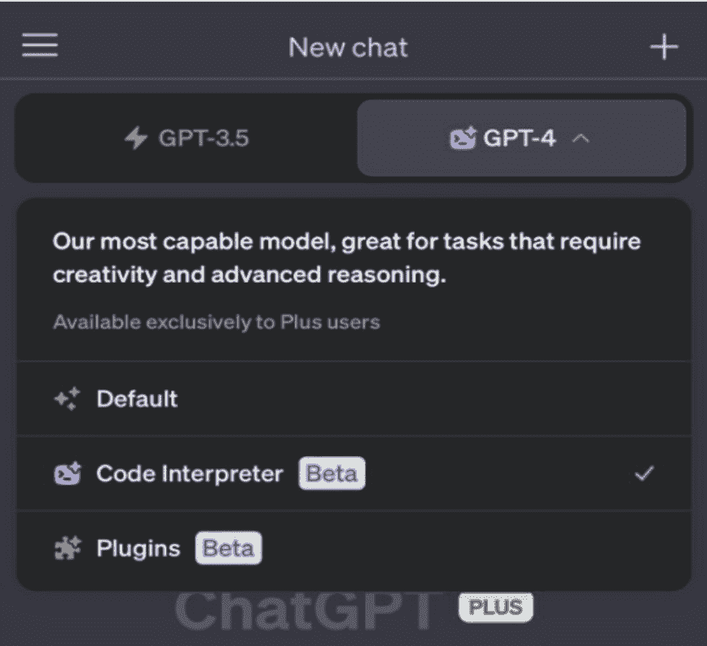

图4.2

启用后对话右上角会出现“+”按钮，点击可上传文件。

做数据分析离不开数据，可用企业自有数据，也可在Kaggle下载公开数据。以下示例的客户销售表即来源于Kaggle。

Code Interpreter借助Matplotlib实现可视化，可生成直方图、饼图、折线图、散点图、等高线图、极坐标图等。读者可参考Matplotlib文档了解其绘图能力。

#### 4.5.1 数据集概述
提供下载路径和文件名即可让ChatGPT读取并概括文件内容，便于快速了解整体并确定分析方向。

请分析这个文件的内容。

```
customer_shopping_data.csv
```

该数据集记录了顾客购物行为。每一行是一次消费，字段包括：

- invoice_no：发票编号
- customer_id：顾客ID
- gender：性别
- age：年龄
- category：商品类别，如服装、鞋靴、图书等
- quantity：购买数量
- price：单价
- payment_method：支付方式，如信用卡、借记卡、现金等
- invoice_date：开票日期
- shopping_mall：商场名称

可据此研究不同年龄性别的消费行为，或分析各品类销售表现等，有特定需求可进一步细化。

#### 4.5.2 分析数据
深入挖掘数据能提供决策依据，帮助从海量信息中提取有效洞见。

请按高价值、中价值、低价值对顾客进行分层并给出经营建议。

基于累计消费额，我已将顾客划分为三类：

- High Value：消费总额不低于全员消费总额的75分位
- Medium Value：消费总额高于25分位且低于75分位
- Low Value：消费总额大于0且不高于25分位

分层后的策略建议：

- High Value顾客贡献主要收入，应重点维护满意度与忠诚度，可设专属优惠或VIP计划，如免运费、优先购新品等。
- Medium Value顾客消费中等，可通过营销活动和优惠券刺激提升客单价。
- Low Value顾客消费偏低，需探究原因，尝试推荐感兴趣品类或价格优惠以提升复购。

以上为通用思路，具体方案需结合门店实际与目标制定。

更多应用场景如下。

- 请按高价值、中价值、低价值对顾客画像进行拆解并给出营销建议。
- 请按高价值、中价值、低价值对顾客偏好进行分析并给出服务建议。
- 请按高价值、中价值、低价值对顾客家庭情况进行分析并给出推广建议。

#### 4.5.3 生成图表
图表是分析结果的重要呈现方式，能直观展示变化趋势。

常见类型包括：

- 柱状图：对比类别数据，如各产品销售额
- 折线图：展示随时间或连续变量变化的趋势
- 饼图：展示各类别占总体的比例
- 散点图：展示两变量关系
- 雷达图：多维度数据对比
- 热力图：二维数据的密度分布
- 箱线图：分布与异常值展示
- 面积图：时间序列累积变化

请用柱状图展示三类客户的总数与平均消费金额。

可用的其他呈现方式：

- 请用折线图展示三类客户的总数与平均消费金额。
- 请用饼图展示三类客户的总数与平均消费金额。
- 请用雷达图展示三类客户的总数与平均消费金额。

#### 4.5.4 综合分析
本节展示一个综合分析示例。

请你作为数据科学家，对prompts.csv进行分析并用图表展示结果。

prompts.csv

该数据集含两个字段“act”和“prompt”。“act”指具体动作或角色，“prompt”给出该动作的描述。下一步可统计“act”的分布，也可用词云展示“prompt”高频词以把握内容脉络。

“act”共出现162种不同行为，部分示例为：

- Life Coach：2次
- Linux Terminal：1次
- Midjourney Prompt Generator：1次
- Legal Advisor：1次
- Personal Stylist：1次

因类别众多且分散，绘制前十行为柱状图信息较为稀疏。

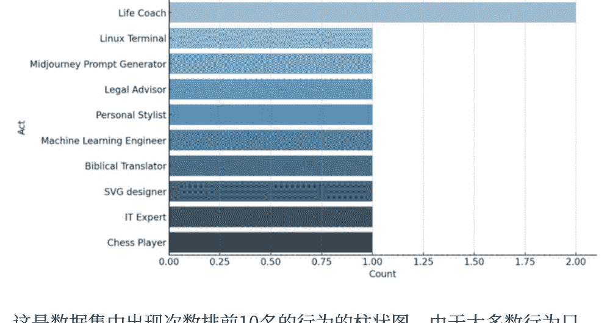

上图展示出现次数排名前十的行为，因大多数行为仅出现一次，信息较为分散。

对文本数据做更深分析需借助更复杂的NLP技术，如主题模型或情感分析。

若想分析其他文件，只需用相同结构提示即可。

#### 4.5.5 分析文件并提供写作指南
本节演示如何分析文件并据此生成写作指南。

你是ChatGPT提示专家，请分析prompts.csv并总结出提示写作指南。

据现有了解，每个提示都围绕某个特定行为或角色展开，并给出详细描述。

基于此，提出以下建议：

- 明确行为或角色：提示应指向单一明确的行为或角色，便于理解任务边界。
- 提供具体细节：包含足够的操作指引，如Linux终端提示需给出使用步骤。
- 语言清晰：避免模糊表达，减少歧义。
- 考虑用户水平：新手提示需更基础，专家提示可更进阶。
- 保持简洁：信息充分但不过载。
- 引导参与：通过提问或行动建议提升用户参与感。

以上为通用原则，最佳提示仍需根据任务、用户与场景定制。

## 第5章 生活助手

### 5.1 旅行助手
无论是周末短途还是长途国际出行，都需要大量研究与规划。ChatGPT可帮助选目的地、了解历史文化风俗、规划行程、甚至学习新语言，作为随时可用的个人旅行顾问。

本节介绍ChatGPT在旅行规划中的应用，帮助探险家和上班族更轻松有趣地准备行程。

#### 5.1.1 选择旅行目的地
旅行魅力在于探索未知，也需要充分准备。

选目的地需考虑季节、预算、兴趣等。ChatGPT可根据偏好推荐合适地点。

你是优秀的旅行规划师，我想今年夏天去欧洲旅行一周，只去一个国家深度游，请推荐几个国家。

欧洲有很多适合深度游的国家，推荐如下：

- 意大利：历史文化浓缩地，罗马斗兽场、威尼斯水道、佛罗伦萨乌菲齐等经典景点，美食美酒也丰富。
- 法国：艺术美食之都，可游巴黎卢浮宫、埃菲尔铁塔，也可去普罗旺斯或香槟区品酒赏景。
- 西班牙：历史遗迹与海滩兼备，马德里、巴塞罗那有博物馆与古迹，安达卢西亚可体验弗拉明戈。
- 希腊：古文明发源地，雅典帕特农神庙等遗址值得一看。
- 葡萄牙：海滩、古堡与葡萄酒并存，里斯本、波尔图适合城市探索，杜罗河谷适合品酒。

以上仅为示例，欧洲还有许多值得一游的国家，你有特别想去的国家或活动吗？我可以据此细化规划。

继续对话即可锁定心仪目的地。

#### 5.1.2 了解当地的历史、文化和风俗

每个目的地都有属于自己的历史脉络、文化气质与生活习惯，提前去了解这些细节，能让整趟旅程变得更有层次感。借助 ChatGPT，你可以快速梳理出发地的历史背景、文化特色和当地风俗，这些信息在挑选城市、景点以及细化日程时都非常实用。

不管是古韵十足的城池还是节奏现代的都市，读懂当地的历史与文化都是旅行的核心部分，ChatGPT 能帮你把这些内容整理清楚。每个地方的风俗都不一样，尊重并遵守它们是旅行者的基本素养，提前知道当地的礼仪和生活习惯，可以有效避免误会和冒犯。哪怕英语已经全球通用，掌握几句当地常用语也会让沟通更顺畅、体验更愉快，ChatGPT 也能提供学习方法和实用短语。

你是西班牙本地的资深旅行专家，我想了解西班牙的几个主要城市，请介绍一下它们的历史、文化和风俗。

当然很乐意为你介绍西班牙主要城市的历史、文化及风俗习惯。

（生成的具体内容略）

#### 5.1.3 行程制定指南
确定目的地之后，下一步就是把行程搭起来。可以向 ChatGPT 询问该地有哪些值得体验的活动，再结合自己的时间与兴趣，对路线进行组织和优化。

你是优秀的旅行规划师，请帮我规划西班牙一周的旅行吧。

当然，西班牙活力十足，值得停留的地方很多。以下是一份为你准备的一周示例行程。

##### 第1天：马德里。
抵达马德里后先休整，适应时差。傍晚在市区漫步，感受灯火通明的城市氛围，品尝地道的西班牙晚餐。

##### 第2天：马德里。
游览普拉多博物馆，欣赏西班牙经典艺术作品；参观皇宫，认识西班牙的历史脉络。

##### 第3天：马德里到塞哥维亚。
清早从马德里出发坐火车前往塞哥维亚。参观阿尔卡萨古堡，傍晚返回马德里。

##### 第4天：马德里到巴塞罗那。
清早乘火车前往巴塞罗那。抵达后先在兰布拉大道散步，吃当地美食，随后进入哥特区感受古老建筑气息。

##### 第5天：巴塞罗那。
先去参观圣家堂，再前往古埃尔公园。

##### 第6天：巴塞罗那到塞维利亚。
从巴塞罗那飞往塞维利亚。抵达后参观希拉尔达大教堂。晚上在老城区散步，品尝塞维利亚特色美食。

##### 第7天：塞维利亚。
第二天游览塞维利亚大教堂与阿拉伯城堡。

在此基础上继续与 ChatGPT 细聊，就能梳理出更符合个人偏好的定制行程。

#### 5.1.4 打包清单准备
出行前收拾行李是一件费脑子的事，特别是对不常出国的人来说，一张清晰的打包清单能省不少心，也能防止遗漏。下面以 ChatGPT 协助准备西班牙一周行李清单为例。

> 你是优秀的旅行规划师，请帮我准备一个西班牙一周游的行李打包清单。

没问题，以下是为期一周西班牙旅行的打包参考。

衣物类。
- 内衣：至少 7 套。
- 袜子：7 双。
- 睡衣：1～2 套。
- T恤/衬衫：7 件。
- 长裤/短裤：按天气预报和活动安排准备 3～4 条。
- 运动鞋/舒适步行鞋：1 双。
- 正式场合或晚宴鞋子：1 双。
- 泳衣：1 套。
- 外套或毛衣：1 件，即便夏季早晚也可能偏凉。

个人护理用品。
- 牙刷与牙膏。
- 洗发水和沐浴露（若酒店不提供）。
- 面部护理产品。
- 梳子。
- 常备药品：晕车药、止痛药、肠胃药、创可贴等。

其他必备。
- 有效护照与身份证件。
- 机票、酒店预订、旅行保险等文件的纸质版与电子版。
- 信用卡与现金。
- 手机、充电器。
- 旅行指南与地图。
- 个人娱乐用品，如阅读材料、耳机等。
- 额外塑料袋，用于装湿衣物或其他物品。
- 便携旅行水壶。

清单基于常规需求，可根据个人习惯与具体情况灵活调整。

掌握以上信息后，可以让 ChatGPT 把所有内容整合，形成一份完整的旅行参考文件。比如使用提示：“你是优秀的旅行规划师，请你参考上面的对话，生成一份详细的旅行参考文件吧。”具体输出大家可以自行尝试，结合本节提示与 ChatGPT 共同规划一次愉快的旅行。

### 5.2 健身好帮手
作为高效工具，ChatGPT 为健身爱好者和专业人士打开了新的可能。它能读懂用户的诉求，制定个性化方案，还能根据反馈实时调整，帮助提升训练效果。本节深入探讨如何借助 ChatGPT 制定计划，并在执行中进行调整优化。

#### 5.2.1 个性化健身方案定制
首先要明确目标，比如减脂、提升耐力等。可以直接向 ChatGPT 描述目标与当前体能状况，它会据此解析并给出个性化建议。

每个人的身体基础不同。把过往运动习惯、身体状况和现有体能水平告诉它，能让它更精准地把握背景。也可以提供身高、体重、体脂率等指标，以便它分析健康状况与训练需求。

在明确需求后，就能请它搜集整合最佳训练方法。例如询问如何设计提升耐力的计划，或询问哑铃训练、有氧运动对目标的帮助。ChatGPT 会结合具体情况给出科学合理的建议。

你是一个优秀的健身教练，我想在两个月内减重 5kg，请你帮我制订一个健身计划，如果你需要了解我的情况，可以先问我。

非常感谢你的信任！我很乐意协助你制定减重方案。首先需要了解一些基础信息和健康状况，才能给出安全有效的建议。需要的信息如下：

- 年龄、性别、身高。
- 目前体重。
- 饮食习惯。
- 现有运动情况，例如每周运动天数、每次时长、通常运动类型。
- 是否有医生建议避免的运动，或存在健康问题，如心脏病、糖尿病、高血压等。
- 除减重外，是否还有其他目标，比如增肌、提升心肺耐力等。

请尽量详细说明，以便提供更贴合的建议。任何有效的减重方案都应包含健康饮食与适度运动，开始新计划前建议先咨询医生或其他医疗专业人士。

好的，回答你的问题。

- 年龄 55 岁，性别男，身高 175cm。
- 体重 80kg。
- 饮食习惯尚可，常吃米饭、鱼肉、蔬菜、水果等。
- 每天有一定步行量，每周打几次篮球，每次约一小时。
- 有轻度高血压，无明显症状。
- 除了减重，希望提升精力。

非常感谢提供的信息，这对制定方案很有帮助。基于你的情况与目标，给出以下建议。

- 有氧运动：你已有一定运动基础，这很好。可继续把打篮球作为主要有氧，每周 3～4 次，每次约 1 小时。非篮球日建议每天进行至少 30 分钟快走或轻松慢跑。
- 力量训练：为增强肌肉、提升代谢，建议每周进行两次全身力量训练。可包含深蹲、硬拉、卧推等基础动作。若不熟悉，可请专业教练指导或参加相关课程。
- 伸展运动：每次训练后不要忘记拉伸，有助于放松肌肉、缓解酸痛、提升柔韧性。
- 饮食：目前饮食相对均衡。要实现减重，需保证摄入热量低于消耗。建议适度减少米饭量，增加蔬菜与粗粮比例，同时每餐保证足够蛋白质以维持肌肉与饱腹感。
- 水分：确保每日饮水充足，水分对代谢与能量生成很重要。
- 睡眠：保持充足高质量睡眠也很关键，良好的睡眠有助于代谢调节与食欲控制。
- 计划调整：每两周可测量一次体重或体脂率，检查进展。若效果不佳或感觉过度疲劳，可适时调整饮食、运动方式或增加休息时间。灵活调整是达成目标的重要环节。
- 心态：减重需要时间，每一点进步都值得肯定。保持耐心与积极心态，结果会更稳定。

请记住，目标是两个月减重 5kg，但健康始终是第一位。每个人身体反应不同，减重速度会有所差异，关键是建立可持续的健康生活方式。健身、饮食、休息缺一不可。开始前请向医生或健康专业人士确认方案安全性。

#### 5.2.2 动态调整与优化
制定计划只是起点，如何根据实际进展和身体反馈进行修正同样重要。定期向 ChatGPT 反馈训练感受，比如肌肉疲劳程度、是否出现疼痛或不适，它能据此给出即时调整与优化建议，让计划始终保持最佳状态。

通过持续记录训练数据与身体反馈，ChatGPT 能帮助判断是否需要改变计划，以更快达成目标。若进步超预期，可能建议提升强度；若进展缓慢，则可能建议调整训练方式或关注恢复与营养补充。

关于力量训练，我以前没做过，请帮我设计一个逐步提升的计划。

很好，为你设计了一个初级力量训练方案，重点是让身体先适应新动作，同时逐步提升力量与耐力。每周训练两次，包含基础全身动作，具体如下。

**第 1～2 周：适应期。**
- 俯卧撑：3 组，每组 8～12 次。
- 空手深蹲：3 组，每组 15 次。
- 仰卧起坐：3 组，每组 15 次。
- 静态平板支撑：3 组，每组 20 秒。
先确保动作标准，初期不必强求完成全部次数，逐步接近即可。

**第 3～4 周：增加负荷。**
- 俯卧撑：3 组，每组 12～15 次。
- 深蹲：加入瑜伽球或哑铃，3 组，每组 12～15 次。
- 仰卧起坐：3 组，每组 20 次。
- 静态平板支撑：3 组，每组 30 秒。

**第 5～6 周：进一步加码。**
- 俯卧撑：3 组，每组 15～20 次。
- 深蹲：加重，3 组，每组 12～15 次。
- 仰卧起坐：3 组，每组 25 次。
- 静态平板支撑：3 组，每组 45 秒。

**第 7～8 周：引入新动作。**
- 俯卧撑：3 组，每组 15～20 次。
- 深蹲：继续加重，3 组，每组 12～15 次。
- 仰卧起坐：3 组，每组 30 次。
- 静态平板支撑：3 组，每组 60 秒。
- 引体向上或拉力器背部拉伸：3 组，每组 8～12 次。

每阶段结束后可休息 1 到 2 天，让肌肉恢复。随着熟悉度提升，可适当增加重量与组数。动作质量永远优先于重量和次数，确保标准以降低受伤风险。开始前请咨询医生或健康专业人士确认安全性。

请介绍深蹲和静态平板支撑的要点。

深蹲要点如下。
- 起始姿势：站立，双脚与肩同宽，脚尖微外；双手可置于胸前或向前伸展。
- 动作过程：缓慢下蹲，像坐进一把看不见的椅子；保持背部挺直、胸部展开、腹部收紧；大腿尽量平行地面，膝盖不过脚尖。
- 结束姿势：用腿部力量回到站立，过程中避免膝盖内扣或外翻。

静态平板支撑要点如下。
- 起始姿势：俯卧后用肘部支撑，肘部位于肩部正下方，前臂贴地；双腿伸直，以脚尖支撑。
- 动作过程：全程保持身体呈直线，避免塌腰或拱背；腹部收紧，核心持续发力。
- 结束姿势：维持至无法保持为止。

练习时注意姿势正确，既能防伤也能提升效果。若出现疼痛应立即停止并寻求专业建议。

#### 5.2.3 饮食恢复搭配策略
成功的健身不仅靠运动，还需要合理的饮食与恢复策略。可以向 ChatGPT 咨询如何优化饮食、改善睡眠质量，以及采用有效的恢复手段，如深度拉伸、按摩或热水浴等，获得更全面的支持。

关于你前面提到的伸展运动，请帮我详细设计一套动作。

很好，以下是一套简易全身放松伸展，帮助锻炼后缓解肌肉紧张。每个动作保持 15～30 秒，如有左右之分则换侧进行。

- 颈部伸展：头部缓慢向一侧倾斜，耳朵靠近肩部，可用手轻轻加压增强拉伸感。
- 肩部环绕：坐姿或站姿，肩膀向上、前、后、下画圈。
- 胸部伸展：双手背后交叉，手指互扣，向上伸直手臂同时挺胸。
- 腰部伸展：站立双脚比肩宽，双手上举，身体缓慢向左倾斜感受右侧腰部拉伸。
- 四肢伸展：坐地，一腿伸直，另一腿弯曲脚跟贴近臀部，上身前屈靠近伸直腿感受后腿拉伸。
- 臀部伸展：坐地，一腿伸直，另一腿越过伸直腿，脚踝置于伸直腿膝上，身体轻微前倾。
- 腿后侧伸展：站立一脚向前踏出，脚跟着地脚尖上翘，另一腿微屈，身体前倾感受前腿后侧拉伸。
- 四头肌伸展：站立用同侧手抓住脚踝，让膝盖贴近另一腿，脚踝向臀部拉近感受大腿前侧拉伸。

每次训练后可进行此套伸展，有助于恢复与柔韧性提升。若出现疼痛或不适请立即停止并咨询专业人士。

你是睡眠管理专家，请给我一些提高睡眠质量的建议。

提升睡眠质量对健康与精力维持至关重要。以下建议可供参考。

- 保持规律作息：尽量固定入睡与起床时间，周末也保持一致，有助调节生物钟。
- 营造良好睡眠环境：利用耳塞、眼罩等创造安静舒适的空间。
- 控制白天小睡：若夜间入睡困难，减少白天午睡时长。
- 适度运动：规律运动有助于夜间睡眠，但避免在睡前一到两小时进行剧烈运动。
- 管理压力与焦虑：可尝试冥想、深呼吸或渐进性肌肉放松，必要时寻求专业帮助。
- 限制咖啡因与酒精：两者都会干扰睡眠，尽量避免晚间或睡前摄入。
- 注意饮食：睡前避免大餐，饥饿时可选择少量健康零食。
- 远离电子设备：睡前一小时内尽量不使用电视、电脑、手机等，蓝光会影响睡眠。

不同人对策略反应不同，关键是找到适合自己的方式。若睡眠问题持续，建议咨询医生或睡眠专家。

通过以上讨论可见，ChatGPT 在理解个人需求、制定计划、动态调整以及提升效率方面具有很强的价值，作为 AI 助手它能提供即时支持与持续陪伴。

### 5.3 购物顾问
在数字化时代，购物选择越来越多，容易让人眼花缭乱。不论是挑选跑步鞋还是比较品牌，信息过载都很常见。有了 ChatGPT，购物体验可以变得更轻松愉快。作为先进的 AI 模型，它能充当个人购物顾问，帮你在众多产品中找到最合适的选项。

#### 5.3.1 产品认知升级
对某类产品了解有限时，可以先让 ChatGPT 拓展知识，搞清购买时应关注的核心特性。

> 你是购买跑步鞋的专家，购买跑步鞋时需要考虑哪些关键特性？

购买跑步鞋时可重点关注以下特性。

- 适配性：每个人的足型不同，需要找到合脚的鞋型。例如扁平足需要良好支撑。
- 舒适度：鞋子不能过紧或过松，内部材质应透气，保持脚部干爽。
- 缓震性：能减轻跑步对关节与肌肉的冲击，对长距离跑者尤为重要。
- 耐用性：应选择经久耐用的鞋款，可从鞋底材料与设计判断。
- 轻便性：轻便鞋更省力，但有时会在缓震与支撑上妥协，需找到平衡点。
- 抓地力：常在湿滑或崎岖路面跑步时，需要良好的抓地性能。
- 价格：价格不是唯一标准，但要在预算内找到满足需求的产品。

每个人的需求各不相同，选择时应结合自身情况。

关于跑步鞋的透气性和抓地力，请给出更详细的说明，并指导我买鞋时如何判断。

透气性直接影响脚部舒适度。跑步时脚部会产生大量热量，若鞋面不透气，热量无法散出，可能导致闷热甚至起泡。

透气性好的跑步鞋通常采用轻质网眼布或特殊透气织物。选购时可观察鞋面材质与设计，若有大量网眼或通风孔，通常透气表现较好。

抓地力是另一项关键指标，能帮助在不同地面保持稳定。若经常在湿滑或不平路面训练，就需要抓地力出色的鞋款。

## 看鞋底花纹 就能判断抓地力强不强

抓地力出色的跑鞋，鞋底通常比较粗糙，纹路也刻得比较深。这类结构让鞋子在塑胶跑道、柏油路、草地等不同地面上都能稳稳咬住地面。选购时不妨低下头看看鞋底，纹路是否足够深、材质是否看上去耐磨，基本就能判断这款鞋的抓地表现。说到底，透气度和抓地力都是挑跑鞋时绕不开的要素，最后还是要结合自己的跑步习惯和常跑的环境来定。

### 跑鞋到底由哪些部分构成

很多人只看外形，其实一双跑鞋的内部结构很讲究。

- **鞋面**：就是包裹脚部的上层，常用轻薄透气的网布或合成皮革做成。鞋面的设计直接关系到透气感、贴合度和整体颜值。
- **鞋带**：用来调节松紧，确保脚能被牢牢固定住，不会跑跳。
- **鞋舌**：夹在鞋面和鞋带之间，主要起缓冲和保护足背的作用。
- **鞋垫**：位于鞋内，负责提供额外缓震。部分鞋垫可以拆下来换，满足不同需求。
- **中底**：整双鞋的核心缓震区，多用 EVA 或 PU 材料。中底的好坏决定了缓震、稳定和重量表现。
- **外底**：直接触地的一层，一般采用硬质橡胶，兼顾抓地和耐磨。
- **鞋跟**：影响稳定性和落地缓冲。不少跑鞋会在后跟加厚缓震材料，降低跑步对跟部冲击。

#### 5.3.2 选鞋推荐实操

凭借丰富的信息整合能力，ChatGPT 做产品推荐很顺手。假设你想换新跑鞋却拿不定主意，可以问它：“我需要一双跑鞋，能推荐几款吗？” 它会按你的需求给出方向，比如给你列出主流品牌，或按你的跑法类型推荐。还可以追问更细的问题，比如稳定型和极简型跑鞋有什么区别、2024 年最热的款是哪双、平足人群适合什么鞋。

> 你是跑鞋方面的专家，我想入手一双新的跑鞋，能不能给我几款选择？

挑鞋要看这几件事。

- 跑步姿势：是前掌落地还是后跟先着地，不同落地方式需要不同的缓震支撑。
- 足型：平足、标准足或高足弓，不同足型匹配的鞋结构不一样。
- 跑步场地：公路跑更需要轻快和强缓冲，越野跑则要更强的抓地和防护。
- 跑量大小：每周跑量大的人对耐用性和缓震的依赖更高。

结合以上维度，可以得到针对性的推荐清单。最终还是要多试几双，找到最合脚的那一双才算数。

#### 5.3.3 跑鞋对比分析

在确定几个备选后，ChatGPT 可以帮你做多维度对比，包括功能、价格等。

请帮我对比 Adidas Ultraboost 和 Hoka One One Bondi。

很高兴你对这两双鞋感兴趣，下面是对比要点。

Ultraboost 的表现：

- 舒适度方面，Boost 中底的回弹和吸震口碑很好。
- 外观偏时尚，既能跑步也能当日常休闲鞋穿。
- 适用场景广，适合长距离和间歇训练，但对需要额外稳定或特殊足型的人支持有限。
- 耐用度口碑参差，有些使用者觉得比同类鞋略逊。

Bondi 的表现：

- 缓震在市面上属于顶级级别，对需要强缓冲或长距离跑者很友好。
- 造型偏功能性，外底很厚，缓冲加分但日常出街的气质不如 Ultraboost。
- 稳定性和支撑感突出，尤其适合长距离和足型有要求的跑者。
- 耐用性普遍评价很高，长跑使用也不易快速衰减。

总结来说，两双鞋舒适度都不差，但侧重点不同。Ultraboost 更偏向颜值和多场景穿着，Bondi 更偏重极致缓冲和稳定，适合长跑和特殊足型。

#### 5.3.4 价格与口碑收集

除了参数，价格和真实使用反馈也很重要。这时打开联网版 GPT，让它帮你汇总信息就很方便。

想比价时可以问：“Asics Gel-Nimbus 在哪里买最便宜？” 虽然 GPT 给不出实时价格，但会告诉你去哪些比价网站，或怎么用搜索引擎找最低价。

想了解口碑可以问：“Asics Gel-Nimbus 用户怎么评价？” 它可以帮你梳理优点和缺点。最后，跑鞋这种东西最好还是到店试穿，亲身体验最靠谱。

请帮我整理 Adidas Ultraboost 21 的用户评价。

关于 Ultraboost 的反馈，我收集到以下信息。

来自什么值得买的一篇文章：

- 中底柔软有弹，穿着感很舒服。
- 在软质塑胶跑道上脚感偏软，在硬路面上软硬适中，缓冲感明显。
- 中底加厚配合 LEP 系统，跑感更偏向跑鞋，适合日常有氧配速。
- 除跑步外，也适合日常逛街、散步、轻度室内活动。

来自 Running Shoes Guru 英文站关于 Ultraboost 22 的评价，虽非你要的版本但可参考：

- 22 代比 21 代更轻。
- 鞋面舒适，耐用性和稳定性表现不错。
- 价格偏高，后跟略松，整体稍显笨重。

中文资料查找难度较大，我会继续寻找更多本土评价，如你对英文评价也有兴趣，我可以继续提供。

请帮我整理 Hoka One One Bondi 的用户评价。

在 Zappos 英文站上看到的反馈大致是：

- 很多用户认为鞋子非常舒服，尤其对脚部有旧伤或问题的人，提供充分支撑。
- 护士、快递员等需要长时间站立走动的工作人群反馈穿着舒适。
- 也有用户觉得舒适度没有想象中突出，和普通运动鞋差别不大。
- 部分用户觉得价格过高，性价比一般。

我在中文平台上检索 Bondi 的用户评价，未能找到有效内容。受时间限制，暂未在大范围中文社区展开查找，建议你到中文论坛或社交媒体上再看看真实使用者的分享。

### 5.4 陪跑式职涯教练

ChatGPT 也能当一个贴心的成长教练，面对生活里的各种困惑都能聊聊。

下面模拟一次裁员者的对话，先设定角色“你是资深教练”，再抛出问题。

# 对话提示
你是资深教练，我从企业高管职位被裁员后很难适应，经历重大变故，人生方向需要调整，请帮我走出困境。

ChatGPT 的回复：

我能体会你现在的无措，被裁员是一次很重的生活转折，会带来压力和不确定。但换个角度，这也是打开新可能的入口。我会尽力陪你走过这段。建议如下。

- 休整与回望：先给自己缓冲期，不要急着做决定。利用这段时间回顾职业历程，梳理擅长的事、喜欢的事、适合的工作环境和长期目标。
- 自我盘点：深入评估技能、兴趣、价值观和目标。可借助职业顾问或线上测评工具。
- 能力升级：根据新方向补足技能，通过课程、研讨会或进修来提升。
- 拓展人脉：联系同行、朋友、前同事，让他们知道你在找机会。可以参加行业活动或在社交平台扩大连接。
- 开始投递：确定方向后积极申请，保持韧性，求职过程通常需要时间。

这很艰难，但你并不孤单，你有经验、有韧性，也有我的支持。现在或许正是转向新赛道的好时机。

# 对话提示
这次裁员，公司处理方式不够体面，我在公司多年，情绪上很难接受，补偿也不理想，双方没有达成一致。我做什么都提不起劲，很委屈，该怎么办？

回复：

我理解你的愤怒和委屈。这种情况下的情绪波动是正常的，长期付出后被不体面对待，很容易产生失落、愤怒和恐惧。建议你这样处理。

- 接纳情绪：失落、愤怒、焦虑都是正常反应，承认它们是疗愈的开始，不要压抑。
- 寻求支持：和信任的亲友或心理咨询师聊聊，失业者互助小组也能提供共鸣。
- 保持身心健康：规律作息、均衡饮食、适度运动，避免用酒精麻痹自己。
- 练习当下：正念、冥想、瑜伽、呼吸练习帮助你不被过去困住。
- 了解法律权益：如果认为裁员不公或补偿不足，可咨询劳动律师了解权利。
- 寻找新方向：当情绪稍稳时，开始思考下一步想做什么，探索新职业路径。

困难是暂时的，接受变化虽痛，却能为你开辟新路。

# 对话提示
请给我一些引导性问题，帮助我做自我梳理。

回复：

很高兴你愿意开始自我探查。以下问题供你参考。

- 你最看重什么？职业目标是什么？看重工作生活平衡吗？更在意薪资、成就感还是成长空间？和之前经历有什么不同？
- 你最擅长什么？核心技能有哪些？职业生涯中哪个成就最有成就感？这些能力如何迁移到新工作？
- 你对什么有热情？如果薪资职位不是问题，你想做什么？有没有一直想尝试却未尝试的事？
- 理想的工作环境怎样？喜欢独立还是团队？偏好稳定还是变化？
- 职业发展想走哪条路？想在哪些领域深耕？对创业或转行有兴趣吗？
- 你如何应对压力和挑战？以往怎么度过难关？如何提升抗压和应变能力？

慢慢回答，能帮助你更清晰地认识需求和目标。

# 对话提示
我感觉很无力，虽然已经离职，但提不起精神开启新篇章。不知道怎么面对家人，习惯了稳定体面的工作，现在生活巨变，我无法预料未来，心里很不安全。

回复：

我非常理解你的感受。职业身份的骤变会带来深深的不安和无力感。建议如下。

- 承认感受：失去工作带来的情绪起伏正常，把感受当作经历的一部分。
- 社会支持：向亲友、前同事或咨询师倾诉，加入相似经历者的支持群。
- 身心照料：保持规律作息、饮食、运动，呼吸练习有助于缓解压力。
- 制订计划：未来难免不确定，但有一个基础计划能提升掌控感，包括职业咨询、技能学习、求职面试等。
- 与家人沟通：坦诚分享你的处境和压力，让他们更理解你，也能给你更实际的支持。
- 积极重构：失业也提供了重新审视生活、尝试新领域、学习新技能甚至创业的机会。

你不是一个人，继续往前走，保持开放与积极的心态。

# 对话提示
请把上面的建议改写成教练推心置腹的发言，要有同理心，也要有忠告。

回复：

我完全明白你现在的心情，这确实很难。你习惯了稳定的生活，有明确的身份，现在一切都变了，这种恐惧是人之常情。

首先，给自己一点时间适应，允许自己难过和不安，这是人面对变故的正常反应。

其次，不要独自扛着。家人、朋友、专业帮助都是你的依靠，分享感受能减少孤独。

身体是根本。保证休息、饮食和运动，让自己有力气面对挑战。

你要知道，生活基础变了，但你依然能掌控自己的选择。可以制定一个计划，明确下一步要做什么，是找工作、学技能还是自我提升，有方向就不会迷茫。

和家人坦诚交流很重要，告诉他们你的困扰，也听听他们的想法，他们是想帮你的。

最后，这段低谷也是机会，让你重新思考自己真正想要的生活，你有能力走出来，未来的可能性依然很多。

# 对话提示
如果你是我，你会怎么向 ChatGPT 提问？

参考提问方式：

- 我现在情绪很低落，有什么调节心情的方法吗？
- 我经历工作变动，想重新规划职业，有哪些制订职业规划的建议？
- 如何应对失业带来的心理压力？
- 我担心未来不确定性，怎么增强安全感？
- 我该怎样向家人解释现在的状况？
- 有哪些具体行动步骤可以帮助我走出来？

这些问题能帮你得到更具体的策略和心理支持。

# 对话提示
我该如何处理现在的愤怒和失望？

回复：

愤怒和失望需要时间和技巧来化解。可以尝试。

- 承认并接纳：这些情绪合理且正当，写日记或向信任的人倾诉能帮助理解情绪。
- 寻求专业帮助：如果难以自处，心理咨询师可以提供有效工具。
- 练习冥想：帮助你觉察情绪并把注意力拉回当下，不要过度沉溺过去。
- 寻找释放出口：跑步、打拳、瑜伽、绘画、写作等都能疏解情绪。
- 关注新目标：重新审视职业方向，聚焦新目标会让过去的负面情绪逐渐淡化。

放下过往，轻装向前
宽恕前东家通常不是一蹴而就的事，建议你慢慢练习接纳，并把积压的负面感受逐步疏导出来。要明白，宽恕不等同于认可对方的做法，而是一种为自己的身心健康与长远发展主动做的放手。

这是一段需要耐性的内在修复旅程，请给自己足够的空间与时间。如仍需要陪伴，随时可以一起聊聊。

# 未来不确定时，如何让自己更有底气？

不少人面对未知会感到恐惧与焦虑，其实这是正常反应。以下几个方向可以帮助你逐步找回安全感。

- 提前做预案：我们无法掌控全部变化，但可以为可能出现的情形准备应对方案。比如求职时，先更新简历、梳理目标企业与岗位、模拟面试流程，掌控感会提升不少。
- 提升适应力：应变力是帮助你在不稳定环境中保持稳定的关键。持续学习新技能，保持开放心态，同时兼顾心理与身体健康，适应力自然增强。
- 搭建支持网络：亲友、同事都能提供情感与实际帮助。困难时，来自支持圈的力量会成为重要依靠。
- 留意积极信号：即便处于低谷，生活里仍会出现正向事件。可能是生活中的小确幸，也可能是求职过程中的一点进展，聚焦这些积极点能稳住信心。
- 建立自我安抚习惯：找到让你放松的方式并融入日常，例如散步、阅读、冥想、瑜伽，或任何你觉得有效的小仪式。
- 必要时寻求专业支持：若焦虑难以自行调节，或已影响生活质量，及时寻求心理健康专业帮助很重要。心理咨询师可以协助处理情绪并提供实用工具与策略。

对不确定产生恐惧是人之常情，需要时间与耐心去消化。请相信，你拥有足够的资源与能力去适应变化，并为自己创造满意的未来。

ChatGPT可以担任细心的陪练教练，其在整体思维整合与结构化分析上的优势，能帮助你全面检视自身状态。

## 第6章 用ChatGPT打造个人品牌

在信息高度繁杂的今天，个人品牌的价值日益凸显。无论是自由职业者、企业家还是行业专家，拥有一套鲜明且独特的个人品牌，已成为职业提升与扩大影响力的核心。然而在海量信息中，如何高效构建并管理个人品牌，仍是多数人面临的难题。

随着生成式人工智能的快速发展，尤其是ChatGPT的出现，个人品牌的构建迎来了新的机遇。AI极大提升了内容创作、数据分析与运营管理的效率，能够产出高质量、个性化的内容，帮助你在竞争中脱颖而出。其智能分析能力也能帮助你更深入理解目标受众，优化传播策略，让品牌表达更具吸引力。

一个成功的个人品牌不仅是职业资产，也会提升公众影响力。本章将系统解析ChatGPT在品牌建设中的应用与优势，并通过真实案例展示AI如何从内容创作到市场推广的全链路助力成长。

正式开始前，请明确用好ChatGPT的关键在于达成共识，并理解第1章介绍的CRISPE。本章主要以CRISPE来构建提示词。

### 6.1 定模式：确定个人品牌变现模式

在个人品牌建设中，变现模式的确定是首要一步。清晰可行的盈利路径能为后续创作、人设定位与市场推广提供指引，有助于合理分配资源并实现可持续发展。以下深入探讨如何确定变现模式。

#### 6.1.1 未来5年内中小企业的最优变现模式

个人品牌的变现形态随技术与市场需求不断演进。市场上已有咨询服务、电商、直播带货、项目招商等成熟方式。随着AI浪潮到来，传统模式已难以满足新需求。为帮助品牌主在竞争中突围，我们提出以客户为中心的个人品牌AI三段式变现框架：第一段为公开渠道曝光与获客，第二段为私域成交与裂变，第三段为线下场景体验与沉淀。三段可独立运作，也可在时机成熟时联动放大，通过线下连锁进一步放大品牌影响力。

第一段相关信息如下。

- 关键作用：品牌传播与获客。
- 运行逻辑：在短视频等公开平台上，结合AI创作高质量内容进行广泛传播。通过持续输出与品牌价值一致的内容，快速积累粉丝并提升知名度。
- 优势：以低成本、快速度吸引大量关注，提升曝光。
- 挑战：持续产出高质量内容投入大，需保持风格稳定。
- AI辅助：利用ChatGPT、豆包、文心一言、通义千问等工具，结合品牌定位批量完成策划、撰写与发布，降低人力成本，提升传播与获客效率。

第二段相关信息如下。

- 关键作用：私域成交与裂变。
- 运行逻辑：以吸粉主张如超级赠品、优惠券等把公开流量导入私域池，如企业微信、个人微信。在私域中通过内容深耕建立信任，发布预售、限时优惠与独家内容，提升复购与裂变。
- 优势：实现深度沟通，提升用户忠诚度与生命周期价值。
- 挑战：私域运营需长期精细化管理，如何维持用户持续参与是关键。
- AI辅助：AI可生成个性化互动内容，分析用户行为数据并优化运营策略，提高成交、复购与裂变效果。

第三段相关信息如下。

- 关键作用：线下实体体验、客户沉淀与连锁放大。
- 运行逻辑：当私域用户积累到一定规模后，开设线下体验店或打造其他线下场景，借助AI增强体验感与信任。用户可亲身体验产品与服务，提升可信度与粘性，成熟后可通过连锁放大。
- 优势：线下体验大幅增强品牌粘性，提升市场地位。
- 挑战：线下运营成本高，需优秀管理与服务能力，如何用AI优化流程、降本增效是重点。
- AI辅助：AI可生成用户反馈分析报告，优化服务流程与体验，提升满意度与留存。

整合三段式框架形成完整高效的新商业闭环。该模式不仅适用于个人品牌，也在中小企业品牌建设与市场拓展中展现出强大价值。合理运用ChatGPT等工具，可优化各环节，在未来3至5年实现明显增长。

#### 6.1.2 案例介绍：“有心姐姐”个人品牌案例

本案例中的姓名、数据均为化名。

“有心姐姐”深耕餐饮服务多年，她的成长路径是三段式变现框架的典型范例。以下详细展示她如何借助AI工具构建可持续的个人品牌。

##### 1. 公开渠道曝光与获客

背景概述。

“有心姐姐”起初通过抖音、视频号等短视频平台启动品牌建设。内容围绕健康美食与高品质生活展开，与其餐饮从业背景高度契合。通过分享专业经验与生活热爱，她迅速聚集大量粉丝。

实施过程。

在公开阶段，她利用平台影响力发布大量优质内容，既展示专业技能，又传递热爱生活、热爱美食的价值。视频涵盖企业文化、食谱分享、对餐饮趋势的见解等，塑造了真实可信的形象，并积累数十万粉丝。

关键策略。

- 精致内容制作：每个视频都经过精心设计与拍摄，保证视觉吸引力与专业度。
- 品牌一致性：所有内容围绕核心价值展开，确保信息统一。

##### 2. 私域成交与裂变

背景概述。

积累一定公开流量后，她将价值观相近、需求明确的粉丝导流至私域，建立更可信关系，增强粘性，实现精细化管理与转化。

实施过程。

通过超级赠品、价值优惠券等活动，她将大量粉丝引流至企业微信、个人微信及社群。进入私域后，通过公众号、朋友圈、社群推送新品体验、溯源信息、健康食谱、生活技巧及独家优惠，结合小程序发布预售与会员特权，大幅提升复购率并为用户创造价值。

关键策略。

- 私域池建设：以独家内容与服务将公开粉丝转化为私域用户。
- 精细化运营：以个性化沟通提升忠诚度与复购。

##### 3. 线下场景体验与沉淀

背景概述。

随着私域规模扩大，她开始将线上流量引导至线下，通过真实互动进一步增强影响力与粘性。

实施过程。

基于粉丝分布在多地开设线下体验店，让用户亲身感受高品质产品与餐饮服务。门店不仅展示产品，还通过现场互动与活动增强信任。面对面体验带来更深的认同感，也通过口碑带来新客。

关键策略。

- 线下场景打造：以体验店将线上流量转化为线下互动，提升粘性。
- 口碑传播：借助线下体验效果，通过用户口碑扩大品牌影响。

最终，“有心姐姐”通过三段式模式，构建了个人与企业品牌协同的传播矩阵，并打造了强大的私域流量池。线上与线下相互赋能，为连锁扩张、产品创新、服务优化提供支撑，在企业与客户间建立有温度的桥梁，提升体验感。线下连锁快速扩张，企业走出传统单腿模式，实现三域融合与协同发展。

该模式成功推动品牌影响力提升，营业额逆势增长数亿元。模式不仅适用于个体品牌打造，也可推广至中小企业，具有很强的落地性与推广价值。实操案例充分证明其生命力，助力在复杂市场环境中打造长期竞争力强的品牌。

### 6.2 定人设：找准个人品牌人设定位

人设定位是个人品牌建设的核心环节。清晰且具吸引力的人设能让品牌在众多竞争者中脱颖而出，吸引目标受众并建立信任与忠诚。本节介绍人设定位的具体步骤与策略。

#### 6.2.1 自我与目标市场分析

##### 1. 个人分析

###### 1) 取一个好名字

一个好的个人品牌名字通常具备以下特质。

- 容易记住：陌生人初次接触即可留下印象。
- 易于传播：客户能轻松分享给他人且对方记得住。
- 寓意深刻：能传递品牌核心价值，让人联想到特定形象与理念。

###### 2) 一句话描述“我是谁”

用一句话清晰传达核心身份与价值，是建立连接的第一步。这句话既是个人标签，也是品牌传递的核心信息。

“有心姐姐”可表述为“我从事餐饮服务34年，热爱生活、热爱美食，致力于通过分享有机美食传递健康、温暖、品质、幸福的生活方式”。

###### 3) 识别核心目标用户

明确目标用户特征与需求，才能精准传递信息。深度分析受众行为、兴趣与痛点，有助于制定更具吸引力的策略。

CR：您好，请扮演市场研究专家，协助我分析并界定个人品牌的核心目标用户群。

I：我目前在打造名为“有心姐姐”的个人品牌，她拥有34年餐饮服务经验，热爱生活与美食，致力于为顾客提供健康、温暖、优质的生活体验。希望通过调研找到品牌的核心理念用户群并明确其特征与需求，品牌正拓展线上渠道，需要精准分析优化营销策略。

S：请完成以下任务。

- 核心目标用户群识别：分析并查找“有心姐姐”品牌的核心目标用户群，包括年龄、性别、职业、区域、生活方式、购买动机等，必要时参考市场数据与社交媒体分析。
- 用户特征分析：详述目标用户的行为习惯、兴趣偏好、社交角色、收入水平等关键特征，以更好把握需求。
- 核心痛点和需求：识别用户在生活方式、餐饮服务、食品等方面的核心痛点与未满足需求，结合市场趋势与用户反馈给出洞察。

P：请使用专业简明的语言，确保分析结果可操作、可落地。

E：提供一份详细的目标用户分析报告，包括核心用户群特征描述、需求与痛点分析，供品牌策略使用。

###### 【操作步骤说明】

- （1）市场调研：利用问卷、社交媒体数据等收集潜在用户信息。
- （2）用户群体细分：依据数据将目标用户划分为不同细分市场，深入分析其产品选择、餐饮需求与生活方式。
- （3）用户反馈获取：通过访谈与在线调查识别核心痛点与需求。
- （4）报告生成：整合数据与分析结果，形成用户分析报告与表格，作为定位与策略依据。

已明白，接下来我将为您分析并生成以下内容。

- 目标用户群分析表：识别并分析“有心姐姐”品牌的核心目标用户群，涵盖详细信息。
- 用户自画像描述表：基于目标用户特征创建详细用户自画像。
- 核心痛点分析表：深入分析目标用户的核心痛点，明确主要需求与挑战。

稍等片刻，我将为您生成这3份详细的表格内容。

在对话过程中，我们会提供给ChatGPT预先准备的模拟用户资料，以及其他素材和资料（在实际应用中读者要自己用ChatGPT给的方法完成）。

通过不断调优，我们得到了ChatGPT给出的3张表（表6-1～表6-3），让我们更清晰地知道了目标用户，为后续定位奠定基础。接下来，我会发几个与有心姐姐相关的文件，请你查收以备使用。

- 文件1: “有心姐姐”个人品牌线下访谈... 文档
- 文件2: “有心姐姐”个人品牌员工客户... 文档
- 文件3: “有心姐姐”个人品牌自我思考... 文档
- 文件4: “有心姐姐”成长历程素材V1.03... 文档
- 文件5: “有心姐姐”的背景信息补充介... 文档

> Hi, ChatGPT，你好，接下来我将发送给你一些与“有心姐姐”相关的原始素材和文件，请你记住，接下来我可能随时会调用和分析这些文件来协助打造个人品牌，如果你听懂了我的想法，请回复：已明白，随时等待你调用！

已明白，随时等待你调用！

##### 表6-1 “有心姐姐”客户自画像分析表（V1.01）

| 编号 | 维度 | 说明 |
| :--- | :--- | :--- |
| 1 | 姓名 | 李xx（多为城市中产阶层的女性或家庭主妇） |
| 2 | 性别 | 女 |
| 3 | 年龄 | 30～50岁 |
| 4 | 职业 | 多为教师、医生、公司职员、企业管理者、自由职业者、全职妈妈 |
| 5 | 收入水平 | 中等及以上收入，家庭年收入通常在20万元以上 |
| 6 | 家庭状况 | 多已婚，有1～2个孩子，关注家庭健康和孩子成长 |
| 7 | 购买动机 | 追求高品质生活，注重食品健康与安全，希望为家庭提供美味健康的饮食。对餐饮品牌期望较高，尤其关注质量与服务 |
| 8 | 所属区域 | 主要集中在一线和二线城市（如北京、上海、广州、深圳等）的中高端社区 |
| 9 | 社会角色 | 在家庭中多为决策者，负责食品采购与饮食安排。重视健康与生活品质，关注家人的饮食健康与幸福感 |
| 10 | 生活方式 | 健康饮食、规律锻炼、参与社交与社区活动。喜欢参加健康、美食、家庭相关活动，如烹饪课、健康讲座、亲子活动 |
| 11 | 独特爱好 | 对美食与烹饪兴趣浓厚，乐于尝试新食材与食谱，关注有机食品、低糖低脂等健康饮食理念 |
| 12 | 有效接触点 | 微信、抖音、小红书等社交平台，社区活动、亲子活动、家庭聚会等 |
| 13 | 有效成交点 | 在线购物平台、微信公众号商品推送、线下体验店、健康生活讲座或烹饪课程等 |
| 14 | 品牌期望 | 希望品牌能够提供健康、安全、美味的食品，同时传递温暖关怀的价值观。期待产品质量与服务稳定，社交媒体上积极互动并提供有价值的健康生活建议 |
| 15 | 生活痛点 | 难以找到兼顾健康与美味的食品，对食品安全存忧。家庭饮食标准高但忙碌时缺乏高效解决方案。对行业频发的质量问题担忧，希望品牌成为可靠选择 |

##### 表6-2 “有心姐姐”用户自画像描述表（V1.01）

| 编号 | 维度 | 说明 |
| :--- | :--- | :--- |
| 1 | 基本信息 | 30～50岁女性，多为城市中产，有稳定收入与家庭责任 |
| 2 | 兴趣爱好 | 热爱美食与烹饪，注重健康饮食，追求高品质生活 |
| 3 | 购买行为 | 倾向选择高品质产品，重视健康、安全与品牌价值 |
| 4 | 社交媒体使用习惯 | 活跃于微信、抖音、小红书，喜欢分享与获取生活方式信息 |
| 5 | 生活动机 | 追求家庭健康与幸福，关注健康、美味且方便的饮食选择 |
| 6 | 品牌期望 | 期待品牌能提供安全、健康、美味的食品，并传递关怀温暖的价值观 |
| 7 | 核心价值观 | 注重家庭与个人健康，愿为家人幸福投入时间与资源 |
| 8 | 消费模式 | 整体理性消费，但愿为高品质产品与服务支付溢价 |

##### 表6-3 “有心姐姐”核心用户痛点分析表（V1.01）

有心姐姐品牌全景拆解：从用户痛点到可信赖的个人IP

### 用户七大核心痛点

| 序号 | 痛点类别 | 描述 |
| :--- | :--- | :--- |
| 1 | 健康与美味的平衡 | 很多人想吃得既营养又好吃，特别是能让家人孩子安心放心的线下品质餐饮，可市场上兼顾健康与口感的好选择不多，常顾此失彼 |
| 2 | 食品安全性 | 食品安全事故频现，信任被透支，用户渴望一个稳定可靠的品牌给出安全兜底 |
| 3 | 高效生活方式需求 | 日常节奏快，忙碌人群找不到简单可行的健康饮食方案，期待能直接落地的效率建议 |
| 4 | 个性化服务不足 | 用户想要更贴合自己的饮食营养指导，现行供给多为标准化产品，难以满足差异化需求 |
| 5 | 家庭健康管理的压力 | 作为家庭饮食决策者，既要兼顾家人口味又要兼顾营养，寻找高营养又受欢迎的食谱与食材的压力很大 |
| 6 | 社交与情感需求 | 希望品牌在家庭、社区场景中提供情绪价值，获得温暖陪伴和关怀感 |
| 7 | 消费决策困扰 | 面对海量选择容易迷茫，需要品牌帮忙筛选并给出可信的购买建议 |

4) 人设标签：让用户一眼记住的品牌关键词

个人品牌标签要简洁有力，能快速传递核心价值并建立信任。基于背景与定位，有心姐姐的标签体系如下。

表6-4 有心姐姐核心标签建议表 V1.01

| 序号 | 标签 | 标签含义 | 选择理由 | 个人真实故事 |
| :--- | :--- | :--- | :--- | :--- |
| 1 | 关怀 | 展现对顾客与员工的真诚关心与支持，呈现品牌的人性化温度 | 34年餐饮服务中始终以人为本，无论店内服务还是社区活动都注重感受与需求 | 寒冬深夜，因突发事件加班的员工收到她亲手送来的热宵夜，令团队深受触动 |
| 2 | 品质 | 对食材与服务质量的高标准坚持，追求每次体验的卓越 | 担任产品服务负责人后几乎每日抽检食材菜品，在实体体验店每周抽查3至5次，覆盖餐前餐中餐后，坚持超20年 | 巡店时发现一道菜食材稍有瑕疵，她当场要求重做并全程监督，确保出品达标 |
| 3 | 专业 | 依托34年行业沉淀形成的能力与判断力 | 长期深耕餐饮服务并持续学习提升，专业体现在菜品把控、服务细节与团队管理上 | 多次主导大型餐饮活动，带队完成高质量服务，获得客户高度评价 |
| 4 | 温暖 | 创造如家般的温馨就餐感受 | 从环境布置到细节关怀都以温暖态度感染顾客 | 一位因家庭琐事情绪低落的客人，被她的细心问候与用心餐品打动，表示像回了家 |
| 5 | 信赖 | 由诚信经营与兑现承诺积累的长期信任 | 以客户为中心，严格履行每项承诺，赢得口碑 | 食品安全舆情期主动公开处置流程，保持透明，最终以行动重建信任 |

5) 差异化优势与落地方法

优势识别
- 行业积淀深厚：34年餐饮服务经验，对选料、菜品设计、质控全链路熟稔
- 态度鲜明：热爱生活、热爱美食，追求高品质生活方式，自带同频人群吸引力
- 关系经营强：以家人化姿态对待顾客，专业且亲切，口碑稳固
- 健康品质倡导者：持续传递健康美味与温暖关怀的生活理念

特长归纳
- 美食创意与创新：擅长融合传统与现代技艺，做出大众接受且有辨识度的菜品
- 严格品控：对食材采购到制作流程有明确标准，每周亲自抽检确保高品质
- 服务与体验管理：具备高服务意识与情绪感知能力，能快速捕捉需求并提供贴心回应
- 故事化品牌塑造：善于把生活态度与职业经历转化为情感化叙事，形成温暖可信的形象

方法建议
- 用短视频、社媒与线下活动强化品牌故事，突出经验与生活态度
- 在宣传中突出品控承诺并适度透明化操作细节，提升信任感
- 围绕健康理念输出食谱、饮食建议等内容，吸引注重健康的受众
- 设计会员与定期关怀机制，深耕客户关系，提升黏性与忠诚度

6) 客户凭什么相信我

1. 传奇经历
有心姐姐的餐饮之路始于一间地市宾馆的商务接待岗位。在高端接待环境里她很快明白，服务不是摆盘端菜，而是对每个细节的极致用心。14年锤炼从基层服务员成长为被业内尊敬的餐饮专家，积累了扎实的实战经验与对高品质服务的执念。

2. 关键事件
2005年她成为某连锁集团合伙人并负责门店管理。彼时遇上员工罢工危机，运营一度受阻。她通过真诚沟通与规范管理化解矛盾，并将危机转化为服务体系全面升级的机会，确立了品牌的核心服务标准，赢得员工与客户的深度信任。

3. 重磅荣誉
- 五一劳动奖章
- 注册中国餐饮服务大师
- 餐饮20年杰出人物

综合来看，经验的厚度、危机的处理能力与权威荣誉共同构成可信基础。选择有心姐姐，买的是34年的专业沉淀、面对挑战的担当以及经得起检验的口碑。

7) 为什么要关注我

一句话品牌信息，三种表达角度：

1. “走进有心姐姐的美食旅程，每一道菜都藏着用心的温暖。”
重点：以美食传递关怀的核心理念。优势：情感共鸣强，吸引渴望温暖体验的人群。

2. “跟着有心姐姐，把对生活的热爱做进每一道菜里。”
重点：生活热爱与美食创作的结合。优势：打动同样热爱生活与美食的受众。

3. “关注有心姐姐，收获提升生活品质的私藏美食方法。”
重点：生活品质升级与独家内容。优势：突出稀缺价值，吸引追求实用干货的用户。

有心姐姐品牌从定位到落地的执行思路

进入实操阶段，模型校准完成后，可选取最想强化的要点进行呈现。

##### 2.竞争优势分析
当前赛道同质化明显，可辨识的个人IP成了破局关键。光靠产品与服务过硬很难长线站稳。做一套系统的对标拆解，能把全行业面貌理清，摸清头部玩家的人设逻辑、打法与强项所在，从而找到自身的区隔空间。该工作既能提升“有心姐姐”在市场中的辨识度，也为长期战略提供依据。深度研判对手后，可明确品牌的差异位，并据此制定应对策略，保持稳健增长。

CR: 你好 ChatGPT，请以市场竞争分析专家身份，聚焦“有心姐姐”品牌的竞品人设定位，并协助提炼差异化优势。
I: 我在打造“有心姐姐”个人品牌。她从事餐饮服务已34年，热爱生活、热爱美食，致力于为大众传递温暖与高品质生活。为更好锚定品牌，我需要对竞争对手的人设做分析，找出来在市场的独特优势。
S: 请协助完成：
- 竞品识别：梳理餐饮领域的主要对手，尤其是社交媒体或市场上有影响力的品牌/个人，通过市场表现、用户评价及社媒打法，判断其定位。
- 人设解析：研究对手品牌人设，提炼主要特征、定位方向与核心标签，并分析内容传播与用户互动情况。
- 差异点挖掘：通过对比找出“有心姐姐”与竞品的不同，凸显独特优势。
- 定位建议：基于结果给出在内容传播、品牌曝光及用户互动上的具体操作建议。
P：请保证结论清晰、可执行，能直接用于“有心姐姐”品牌定位与推广。
E：输出一份完整的竞品分析报告，含人设对比与差异化建议。

##### 竞争对手分析报告：“有心姐姐”的市场定位与差异化优势
###### 1.竞争对手识别
在餐饮赛道聚焦个人IP与社媒影响力，以下对手值得观察。
- 小红书美食博主“某小厨”：以健康饮食与居家烹饪为主，用简易食谱吸纳关注家庭厨房的受众。
- 深夜食堂：以深夜美食故事为主，强调情感共鸣与食物背后的叙事，吸引偏好深夜小酌的人群。

###### 2. 人设定位分析
某小厨的人设拆解如下。
- 定位：健康生活引导者，家庭烹饪倡导者。
- 核心标签：健康、家庭、简便、实用。
- 连接方式：通过日常健康食谱与家庭烹饪技巧，吸引关注家庭健康的群体。

深夜食堂的人设拆解如下。
- 定位：美食故事讲述者，深夜情感陪伴者。
- 核心标签：情感、陪伴、故事、美食。
- 连接方式：借助深夜食堂的美食故事与情感共鸣，链接夜晚感到孤独或思考的观众。

心灵厨房的人设拆解如下。
- 定位：美食疗法倡导者，心灵关怀传递者。
- 核心标签：心理健康、关怀、疗愈、美食。
- 连接方式：以美食与心理健康的结合，提供用美食抚慰心灵的生活方式。

###### 3. 差异化优势识别
“有心姐姐”独有的优势体现在：
- 深厚履历：34年餐饮服务经验赋予品牌专业度与实践沉淀。
- 温情特质：不仅关注食物，更以美食传递关怀与温度，餐饮服务中的细致体现了对每位顾客的重视。
- 新旧融合：根基在传统餐饮，又紧跟现代健康饮食与有机生活，能兼顾传统与当代需求。
- 关系经营：在客户关系管理上有独特见解，凭长期服务积累与互动建立深层信任与忠诚。

###### 4. 市场定位建议
建立差异化定位的建议：
- 定位为“兼顾现代关怀的餐饮生活指导者”：融合现代健康饮食与有机生活，以走心温暖为核心，以关怀与品质为主线，成为既传承传统精髓又重视现代生活品质的餐饮生活导师。
- 强化情感联结：通过日常的温暖与体贴构建与用户的情感连接，突出“温暖”与“用心”。
- 强调生活品质提升：侧重通过饮食与服务提升整体生活品质，在城市快节奏中为用户带来贴心服务与高品质用餐体验，传递健康、温暖、幸福的生活方式。

整体来看，“有心姐姐”可锚定为经验丰富、注重关怀、充满温度、兼融新旧的餐饮生活导师，通过细致用心、现代健康饮食与有机生活方式，建立深厚情感连接，在激烈市场中脱颖而出。

#### 6.2.2 个人品牌符号设计
塑造个人品牌时，品牌符号是极具辨识度的视觉与感性载体，既是象征也是价值与情感的传递工具。对“有心姐姐”而言，符号设计需体现餐饮专业形象，同时传达用心服务、温暖待客的理念。通过精细设计的符号，可在瞬间抓住注意力，建立深刻认知与情感联结，使品牌形象深植人心。接下来探讨如何以独特符号强化视觉表现与市场竞争力。

##### 1. 品牌符号与视觉元素
品牌符号规划如下。
- 标志：以心形为核心，象征关怀与温暖。可将心形与餐具如勺子或碗的形象结合，体现餐饮背景。
- 配色：主色建议温暖橙或柔和米黄，代表温度、关怀与高品质生活；辅色可用自然绿或棕色，象征健康、自然与稳定。
- 字形：选用亲切易读的手写风格字形，传递品牌温度与个人化特质，避免过于正式，突出轻松友好。

这些视觉元素直接映射品牌核心价值，即以温暖、关怀与高品质服务带来愉悦的餐饮体验，能增强亲和力与可信度，形成积极情感联结。

##### 2. 语言风格与语调
语言风格如下。
- 亲和且专业：语言需兼具亲和与专业，让受众感到温暖被关心，同时展现餐饮行业专业知识。
- 鼓励与启发：可使用鼓励性表达，如“与我一起享受健康美食”“我们一起探索高品质有机生活”，激励受众追求更美好的生活方式。
- 简洁明了：避免复杂或过度专业的术语，保证通俗易懂，让不同受众轻松理解。

该风格可在传递温暖关怀的同时不失专业度，吸引注重生活品质又渴望专业建议的客户群体。

##### 3. 行为表现
社交媒体互动：
- 回应风格：在社媒上保持积极温暖的互动，及时耐心回复留言与问题，使用友好表情与温馨用语。
- 内容分享：围绕健康美食、有机食品、生活品质提升等主题，发布贴心小贴士或温馨生活故事，增强情感联结。

公开演讲与活动：
- 表达方式：在公开场合保持真诚谦逊，适度融入个人故事与经验拉近距离并展示专业素养与关怀。
- 仪表与态度：着装得体亲和，表现自信从容，给人可靠且亲近的印象。

客户互动：
- 客户服务：面对客户时保持微笑与耐心，倾听需求，展现对每位顾客的重视，线上线下均体现关怀与温暖的核心价值。
- 反馈处理：积极回应客户反馈，尤其是负面反馈，及时跟进并采取措施，体现责任感与客户至上。

这些行为能在实际互动中进一步强化品牌的温暖与专业形象，确保每次接触都能感受到关怀与诚意。

#### 6.2.3 独特价值主张淬炼
打造强势个人品牌，清晰的价值主张是核心竞争力来源。对“有心姐姐”而言，价值主张不仅是高品质餐饮服务，更是把温度与关怀融入每个细节，提升顾客生活品质，从而在市场中形成鲜明定位与持续吸引力。

CR: 你好 ChatGPT，请以品牌战略顾问身份，归纳并定义“有心姐姐”品牌的独特价值主张，确保全面体现核心价值与使命。
I: 我在打造“有心姐姐”个人品牌。她是从事餐饮连锁34年的资深从业者，热爱生活、热爱美食，致力于为大家带来温暖与高品质生活。现在希望总结独特价值主张，明确核心使命，并通过品牌符号传递这一主张。
S: 请协助：
- 回顾人设定位：分析核心标签、目标用户需求及市场独特优势，确保融入价值主张。
- 品牌使命提炼：结合职业背景、品牌故事与顾客需求，归纳核心使命。
- 价值主张定义：明确品牌独特主张，确保清晰传达功能、情绪、文化与社会价值。
- 品牌符号匹配：建议采用温暖橙为主色，标志融合微笑姐姐形象与美食元素，视觉可用温馨家庭聚餐场景，通过符号与简洁亲切语言传递主张。
P：请保证主张简洁易传播，并在所有触点保持一致。
E：提供详细价值主张报告，涵盖使命、主张定义及传递策略。

##### “有心姐姐”品牌独特价值主张报告
###### 1. 回顾人设定位
####### 1.1 核心标签
核心标签包括：
- 关怀：以细致入微的关怀与真诚服务赢得顾客信任。
- 品质：对餐饮质量严格把控，体现对品质的执着。
- 温度：通过餐饮与服务传递温暖与爱，让顾客有家的感觉。
- 专业：34年从业经历树立专业形象。
- 信赖：多年卓越服务成为顾客心中可信赖品牌。

####### 1.2 目标用户需求
目标用户需求：
- 高品质生活追求：以健康与品质生活为导向的中产群体，期待饮食带来健康与幸福感。
- 个性化关怀：希望在餐饮服务中获得个性化关怀与温暖体验。
- 文化认同：对传统文化认同度高，喜欢在餐饮中体验传承与创新。

####### 1.3 市场独特优势
“有心姐姐”凭34年服务积累了深厚行业知识与经验，难以被复制。关怀与品质的独特定位带来高辨识度与忠诚度。通过融合现代与传统文化，在餐饮体验中传递独特文化价值，吸引大量忠实顾客。

###### 2. 品牌使命提炼
####### 2.1 品牌使命
> “以无微不至的关怀与卓越品质，为每位顾客创造温暖走心的餐饮体验，传递高品质有机生活的信念，让更多家庭更健康、更幸福。”

####### 2.2 使命阐释
- 无微不至的关怀：每个服务细节精心设计，让顾客感受到如家的温暖。
- 卓越品质：食材、烹饪技术与服务流程均以最高标准要求，确保每餐完美。
- 温暖幸福体验：通过温馨用餐环境、真诚互动与敏锐洞察营造幸福氛围。
- 高品质生活信念：以健康精致餐饮与有机产品传递高品质生活理念，帮助顾客在忙碌中收获生活美好。

###### 3. 价值主张定义
####### 3.1 独特主张
“有心姐姐——用心付出，用爱传递，让每一次用餐都成为幸福时光。”

####### 3.2 主张内涵
- 功能价值：严选食材、精选有机产品、精致烹饪与高标准服务，提供美好餐饮体验。
- 知识价值：传递健康饮食与品质生活实用知识，让顾客日常受益。
- 情绪价值：贴心服务与温暖氛围增强幸福感与满足感。
- 文化价值：在餐饮中融入传统文化元素，让顾客感受传承与创新。
- 社会价值：践行社会责任，通过食品安全、环保与社区公益传递品牌社会价值。

###### 4. 品牌符号匹配
####### 4.1 视觉元素
- 配色：选温暖色调如橙、棕、米黄，传递温暖与关怀。
- 标志设计：采用亲和力强且具文化象征的图案，配合简洁有品质感字体。
- 品牌符号：将“有心”字样与温暖视觉符号结合，形成标志性识别，一眼传达核心价值。

####### 4.2 语言风格
- 语调：亲切、温暖且富有关怀，易于理解，同时体现专业可靠。
- 风格：强化用心、关怀、品质、温暖、幸福等关键词，每次沟通传递温度与信任。

####### 4.3 行为表现
- 社交媒体互动：保持温暖互动，及时回应反馈，展现贴心关怀。
- 公开演讲与活动：体现对顾客尊重与关怀，分享品牌故事与服务理念，增强情感连接。
- 客户服务：线上线下均体现对顾客的关注与关怀，让其感受到用心与爱。

综合自我剖析与竞品分析并结合符号与核心内容，可清晰认识到人物定位、传递内容、符号体系与差异化价值主张。“有心姐姐”是热爱餐饮、传递温暖幸福生活理念并致力于为每位顾客打造高品质餐饮体验的资深人士。品牌以有“心”的个人符号为基础，以温暖关怀、卓越品质与生活美学为核心内容，以“用心付出，用爱传递，让每一次用餐都成为幸福时光”为差异化主张，为后续打造奠定基础。

### 6.3 定内容：创造基于人设的价值内容
个人品牌建设中，人设定位是关键。只有明确人设才能创造有价值内容，所有内容均基于人设展开。本阶段需基于人设总结内容创作核心、总纲与主线，确保独特价值通过内容传达给目标受众。同时以爆款短视频案例说明策略落地。

#### 6.3.1 内容创作的核心
内容创作的核心是灵魂。对“有心姐姐”而言，核心是品牌人设定位与核心标签。
- 温度与体贴：传递品牌温度与体贴是核心，每个视频、文章、文案都应给观众温馨感受。
- 卓越品质：突出对品质的执着，无论制作流程、食材选择、选品还是服务体验，线上线下、公域私域均展现对高标准的坚持。
- 生活美学：通过内容传达高品质生活方式，展示如何以美食与生活细节提升顾客生活质量，传递幸福与美好。

#### 6.3.2 内容创作的总纲与主线
明确创作内核后，需确定总纲与主线，确保内容始终围绕品牌核心。
总纲设计：
- 内容方向：围绕“温度关怀”“卓越品质”“生活美学”三大方向创作。
- 目标受众：瞄准注重生活品质、关注餐饮细节的中产阶层，尤其对传统文化有认同感的用户。
- 内容形式：包括短视频、长文章、社媒帖子及图文食谱等。

主线设计：
- 品牌故事线：通过个人故事、职业经历与餐饮服务真实案例传递核心价值。
- 顾客体验线：呈现顾客在生活体验馆中感受到的温度与关怀，强调亲和力与人情味。
- 产品溯源线：以精美视频与图文展示原材料选择、制作过程与成品呈现，突出品质与专业。

#### 6.3.3 案例分析：千万级爆款短视频实战案例
在移动互联网时代，个人品牌可低成本传播。为说明品牌价值如何通过内容传递，本节以核心内容“卓越品质”为主题，展示爆款短视频创作思路。

##### 1. 确定选题方向
确定人设定位与独特主张后，选题方向得以明确。ChatGPT的辅助能更快更准地确定方向。

CR: 你好 ChatGPT，请以爆款短视频创作专家身份。
I: “有心姐姐”平时花费大量时间到店巡查，检查菜品质量，这是她从事餐饮30多年来的习惯。餐前检查店面环境、卫生、餐具摆放；餐中观察服务员服务；餐后对菜品进行分析。
S: 请给出基于人设且能强化人设形象的选题方向。
P: 请以专业方式回答。
E: 请提供9个方案，以表格形式输出，表头为【“有心姐姐”选题方向表+版本号】，包含序号、选题方向、详细描述、备注。请用规范表格。
在你确认了解后请回复，我将给你发“有心姐姐”人设定位相关资料。

以人设为锚的选题规划与短视频复盘实操

需求已确认，后续将围绕有心姐姐的人物设定展开选题梳理。请先发送相关定位资料，资料收齐后会输出系统化的方向清单。

- 文件1：有心姐姐个人品牌线下访谈资料
- 文件2：有心姐姐个人品牌员工与客户访谈资料
- 文件3：有心姐姐个人品牌自我思考笔记
- 文件4：有心姐姐成长历程素材V1.0
- 文件5：有心姐姐背景信息补充说明

这五份文档构成人设参考依据。

在研读完毕上述材料后，对该人设定位与背景已形成清晰认知，现整理出《有心姐姐》选题方向表V1.01，详见表6-5。

表6-5 有心姐姐选题方向表V1.01

| 序号 | 方向 | 内容说明 | 备注 |
| :--- | :--- | :--- | :--- |
| 1 | 营业前门店环境巡检 | 呈现每日开门前对店内环境、卫生、餐具摆放的细致查验，体现品质追求 | 强化用心负责形象 |
| 2 | 营运时段服务跟进 | 展现营业期间对服务团队工作状态的观察与指导，突出对食客体验的重视 | 体现善良真诚的专业领导风格 |
| 3 | 餐后菜品复盘分析 | 记录用餐结束后对每道菜的拆解与改进建议，呈现专业与精益求精 | 传达敬业与品质追求 |
| 4 | 餐具采购把控标准 | 讲述挑选餐具时对品质与实用性的严格把关，展现细节关注与食客担当 | 体现高度责任感 |
| 5 | 食材源头实地溯源 | 展示亲赴产地溯源食材的过程，强调食品安全重视与客户承诺 | 营造安全可靠形象 |
| 6 | 老客信任印证 | 以老客户的认可凸显品牌可信度与口碑 | 体现忠诚度与满意度 |
| 7 | 美食背后的温情叙事 | 分享与美食相关的暖心故事，传递幸福生活理念 | 强调温暖关怀 |
| 8 | 从首店到三十余家的创业轨迹 | 回顾从第一家店到三十多家门店的发展历程，展现拼搏精神与经营智慧 | 体现持续成长 |
| 9 | 有机产品甄选标准 | 详细说明甄选有机产品时的严苛标准，彰显品质承诺与健康关怀 | 强调专业与客户福祉 |

该表融合人物核心特质，既能巩固公众认知，也能通过具体方向深化品牌记忆。后续可按需调整。

##### 2. 基于方向锁定主题

从上述九个方向中可挑选，若对初版不满意可继续迭代。此处选取餐后菜品复盘作为案例展开。

对话要求：扮演爆款短视频选题策划专家，擅长结合人物特质与平台爆点，基于有心姐姐人设给出能强化形象的选题。人物背景：日常投入大量时间巡店与品控。

模型反馈确认理解后，发出人设资料。


基于人物定位以及餐后菜品复盘的核心价值，提供十个可延展方向：

###### 1. 每道菜的来历故事
追溯食材来源、制作工艺与文化背景，突出对细节与传统的坚守。

###### 2. 从味觉到心动：如何提升用餐幸福感
通过细致品鉴提升体验，强调对美食与食客满意的重视。

###### 3. 好食材是好味道的基础
探讨复盘中如何严控食材挑选，体现食品安全坚守。

###### 4. 食客看不到的餐后工作
记录餐后对菜品的分析与改进，凸显专业精神。

###### 5. 每道菜都是一次心灵交流
强调通过深度品鉴与食客产生情感共鸣，传递关怀。

###### 6. 餐后复盘：美味背后的严格要求
揭示如何以严格标准确保健康安全美味。

###### 7. 有心姐姐的菜品分析手记
以日记形式呈现每日复盘与反思，体现持续专业。

###### 8. 顾客的认可从何而来
剖析反馈与改进机制，解释口碑形成原因。

###### 9. 每道菜的严苛检验
突出从色香味形等多维度审查，体现卓越追求。

###### 10. 用心做好每一道菜：有心姐姐的美食哲学
诠释只有用心才能做出真正美味的理念。

这些方向能强化专业、责任与真诚形象，增强共鸣。

优化方向：将第4条食客看不到的餐后工作进行反差强化，更聚焦日常餐后巡查与品鉴。

优化后主题：老板亲自试吃剩菜

冲突点：
- 身份反差：集团总裁却试吃剩菜，与高层身份形成反差
- 行为反差：高层通常不处理细节，她亲自品尝体现高度重视
- 情感冲突：引发观众共鸣与敬佩，强化负责与以客为中心

该主题更具吸引力并强化品牌形象。

##### 3. 基于选题创作爆款短视频标题

角色设定：餐饮美食自媒体博主，擅长夸张对比蹭热点，强化人设。

参考爆款：和厨师长巡台，查看顾客的“剩菜”；剩下了，老板就得吃，就得尝

人物简介：34年餐饮从业者，热爱生活，联合创始人兼总裁，旗下有多品牌矩阵。

要求：围绕老板亲自吃剩菜主题提供十个标题。

输出标题示例：
- 吃剩菜？这位餐饮大佬竟然真的亲自上阵！
- 有心姐姐的“剩菜”挑战：每一口都要尝！
- 老板亲自试吃剩菜，背后原因让人意外！
- 吃完剩菜她说了什么？餐饮老板的真实心声曝光
- 别人不敢碰的剩菜，她却坚持亲口尝！
- “有心姐姐”试吃：剩菜里藏着什么秘密！
- 34年餐饮老兵的坚持：连剩菜都要亲自尝！
- 餐饮老板的另类巡台：亲自吃剩菜，太拼了！
- 从不吃亏的她，这次却主动尝剩菜！
- 剩菜也要试吃？有心姐姐的独特坚持！

进一步优化，强化情感共鸣对比夸张：
- “顾客都剩了，我能不尝？” —— “有心姐姐”的真心话！
- “你还敢剩菜？有心姐姐来了！”
- “这道菜，连我都不舍得剩！” —— “有心姐姐”亲测实录。
- “顾客的剩菜，我必须试！” —— “有心姐姐”的每日必修课。
- “剩菜见人品？” “有心姐姐”的亲自检验告诉你答案！
- “这盘剩菜，告诉了我餐厅的秘密” —— “有心姐姐”的发现之旅。
- “我不吃剩菜，怎么知道哪里出问题！” —— “有心姐姐”的真诚分享。
- “这道菜为什么剩？我一尝就知道！” —— “有心姐姐”的独家揭秘。
- “剩菜里的秘密，只有‘有心姐姐’知道”。
- “顾客剩了，我亲自吃！ —— ‘有心姐姐’的真实评测”。

以上标题强化专业与责任心，提升吸引力。

##### 4. 基于标题创作爆款短视频

先拆解爆款规律。

学习任务：从用户痛点、个性化特点、情感共鸣、实用性和引发的互动五个维度分析。


####### 1. 文案一分析

######## 用户痛点如下。
文案聚焦食客体验，通过剩菜情况分析菜品质量，解决食客可能遇到的口味问题。关注食客需求，特别是那些可能未明确表达的意见，帮助餐饮企业在食客无反馈的情况下主动改进。

######## 个性化特点如下。
文案展示细致入微的管理风格，通过描述亲自检查剩菜，反映出“有心姐姐”对细节的高度关注和负责的态度。这种个性化的细节检查不仅突出她的专业性，还进一步加强了品牌形象。

######## 情感共鸣如下。
文案通过描述对剩菜的重视，体现出对每一位食客的关怀和责任感。她希望食客离开时的满意度能够通过细致的分析得到保障，这种情感上的共鸣能够引发观众对其人设的好感。

######## 实用性如下。
文案中给厨师长提出的改进意见（如在食客走时征求意见并及时反馈）具有实际操作性。这种建议能够帮助餐饮管理者提高服务质量，增加食客满意度。

######## 引发的互动如下。
文案中提到食客可能没有明确表达的问题会引发观众思考：是什么原因导致菜品被剩下？观众可能会在评论区分享自己在餐厅用餐的类似经历，或对餐饮管理提出自己的看法，从而增强互动。

####### 2. 文案二分析

######## 用户痛点如下。
剩菜问题再次出现：再次探讨食客剩菜的原因，意在解决餐厅运营中菜品不被完全食用的问题，提升食客对菜品的满意度和餐厅的口碑。

######## 个性化特点如下。
文案展示了领导者的亲力亲为，这种个性化的领导风格能够凸显她对餐饮质量的重视，也展现出她作为餐饮管理者的责任感。

######## 情感共鸣如下。
在文案中，“有心姐姐”不仅关注剩菜，还表扬员工的进步，这种关怀和鼓励容易引发观众对其领导风格的认同和尊敬，增强情感共鸣。

######## 实用性如下。
如及时更换盘子等，具有实际操作意义，有助于提高餐厅的服务质量和食客体验。

######## 引发的互动如下。
文案中提到食客剩菜的原因可能是点餐过多或其他原因，这一开放性的问题可以引发观众在评论区讨论他们在餐厅用餐时的类似经历，或提出自己的看法，增加观众的互动性。

###### 2) 创作爆款短视频

基于拆解学习后的认知创作。

主题：我不吃剩菜怎么知道哪里出问题！有心姐姐真诚分享 V1.01

标题：“我不吃剩菜，怎么知道哪里出问题！”——“有心姐姐”的真诚分享。

######## [开头-黄金3秒]

画面切入餐桌上几盘剩菜，“有心姐姐”站在桌前，手拿筷子，神情认真。

“有心姐姐”：“这道菜怎么剩了这么多？我可得亲自尝尝，找找问题！”

######## [中间-引起共鸣的内容点]

镜头特写：“有心姐姐”夹起一块菜细细品尝，眉头微皱。

“有心姐姐”：“你们看，这菜看起来还不错，但味道有点儿不对劲儿，稍微有点淡，少了点味儿。这就是为什么我一定要亲自试吃顾客的剩菜。要是我不尝，怎么知道哪里出问题呢？”

镜头切换：“有心姐姐”与厨师长在一起讨论。

“有心姐姐”：“咱们做餐饮的不仅要做出好看的菜，更要做出让顾客吃了念念不忘的味道。今天这道菜的汁儿太稀了，估计顾客觉得没什么味儿就剩下了。你看看，下次咱们再做的时候，能不能稍微调整一下，味道要浓郁一些。”

######## [结尾-有力总结]

镜头拉远，“有心姐姐”看向镜头，语气坚定。

“有心姐姐”：“对于餐饮这一行，不是看表面，而是看内里。只有每道菜都做到精益求精，才能赢得顾客的心。所以啊，顾客的每一口剩菜，我都得试吃，不试吃，咱心里怎么踏实呢？！”

###### 3）生成视频

使用剪映制作图文视频。

第一步，打开剪映，如图6-1所示。
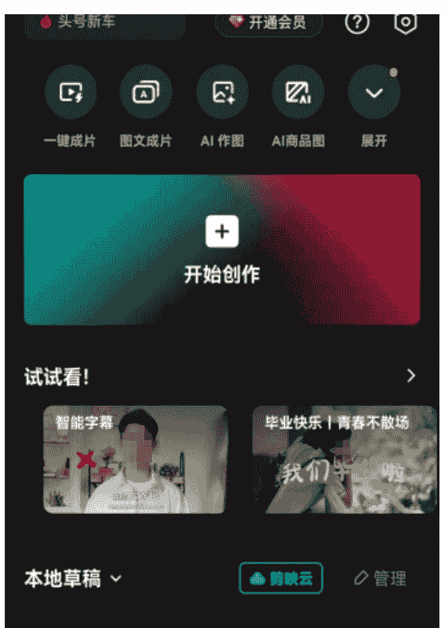
图6-1

第二步，选择“图文成片”，打开“图文成片”界面。

第三步，粘贴文案，如图6-2所示。

图6-2

第四步，生成视频，如图6-3所示。

第五步，导出视频并发布视频，如图6-4所示。

###### 4）借助ChatGPT进行数据复盘

发布后需进行数据分析与复盘。


▲图6-3

####### 作品数据详情

相信每个餐厅老板可能都会有我这个习惯，看客人吃剩下的饭。#唯美食不能辜负#后...

发布时间: 2023-10-22 21:43:47

时长 102.6 秒，平均播放 27.1 秒

坚持创作能帮助你快速成长哦~

查看更多灵感 >

####### 作品诊断

综合整体作品表现，发现较多优化空间。可以增加更多能够引发用户观看、停留兴趣的内容，比如反转、特效、热点话题等

查看作品诊断 >

播放分析

互动分析

观众分析

####### 播放数据

部分数据次日更新

播放量

3014.3 万

粉丝 2.64万 | 铁粉 3554

完播率

8.98%

粉丝 28.9% | 铁粉 30.5%

平均播放时长

27.13

粉丝 25.77s | 铁粉 25.77s

2s跳出率

35.03%

粉丝 34.8% | 铁粉 36.6%

5s完播率 ⓘ

50.14%

新增

累计

每小时

每天


图6-4

后续需通过数据与用户反馈判断内容问题并改进，持续迭代。

从数据找短板，让爆款持续放大

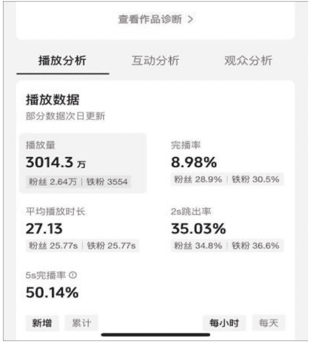

####### 核心数据快照

短视频数据分析-版本V1.01

表6-6 账号单条短视频基础数据 V1.01

| 序号 | 指标 | 数值与补充 |
| :--- | :--- | :--- |
| 1 | 播放总量/万次 | 3014.3 万次曝光 |
| 2 | 完整观看比例/% | 8.98%；粉丝层28.9%；核心粉丝30.5% |
| 3 | 平均观看时长/s | 27.13s；粉丝25.77s；核心粉丝25.77s |
| 4 | 2秒流失率/% | 35.03%；粉丝34.8%；核心粉丝36.6% |
| 5 | 5秒留存率/% | 50.14%；过半观众撑过开头 |
| 6 | 点赞总量/万 | 17.6万；相对于播放体量偏弱 |
| 7 | 评论总量/万 | 3.3万；话题引发力不错 |
| 8 | 收藏总量/万 | 1.1万；存稿意愿不足 |
| 9 | 评论点赞比/% | 18.75%；互动热情度可观 |
| 10 | 转发点赞比/% | 6.25%；扩散效率偏低 |
| 11 | 单条吸粉 | 9500人 |
| 12 | 私域转化 | 1900人；约占吸粉的20% |

####### 解读要点与痛点梳理

######## 播放与留存

播放冲到3014.3万次，投放覆盖很大。完整观看仅8.98%，明显大量用户没看完。配合2秒流失35.03%，说明前几秒抓人不足，兴趣迅速衰减。

结论：开场钩子不强，3-5秒内流失严重。

######## 观看时长

平均27.13秒，留存一般。粉丝与核心粉丝时长几乎持平，说明忠诚人群也没有明显更久停留。

结论：中后段节奏平淡，缺乏持续牵引点。

######## 点赞与评论

点赞17.6万，对比播放基数偏低，看了不愿表态。评论3.3万则健康，说明内容有讨论点。

结论：能引发议论，但点赞与收藏的转化需要加强。

######## 收藏与传播

收藏1.1万偏少，观众感兴趣却不愿保存或传播。

结论：实用价值或情感共鸣不足，保存与分享动机弱。

评论点赞比18.75%显示讨论积极，转发点赞比6.25%说明裂变力不足。

结论：话题有热度，传播势能不足。

###### 优化抓手

**强化前5秒**：用冲突、悬念或情绪冲击切入，降低2秒流失，提升完整观看。

**紧凑中后段**：删冗余，加入转折与细节放大，避免中途掉线。

**明确互动引导**：结尾与评论区给出点赞收藏转发的具体指引，用提问提升参与。

**增强价值共鸣**：加入干货技巧或真实情绪表达，增加值得保存和转发的理由。

本份复盘用于定位当前短板并给出可执行的改进方向，推动下一条表现。

##### 5. 让爆款发挥最大效益

复盘显示，该选题高度贴合主理人人设，观众接受度高。选题验证有效后，应保持题材持续深耕，仅更换标题与脚本进行迭代分发。

首先对验证过的爆款标题“和厨师长巡台，查看顾客的剩菜”进行延展。

CR: Hi, ChatGPT, 你是短视频爆款标题专家。

技能：擅长夸张、对比、借势；始终围绕主理人人设强化信任；善用反转、矛盾、反问。

I: 爆款标题是“和厨师长巡台，查看顾客的剩菜”。

S: 模仿该标题，构思新标题。

P: 吸引目标用户并增强对主理人的信任。

E: 10个。

延展标题示例：

- 跟着主理人查剩菜，真相让人意外你敢试吗？
- 客人剩下的这道菜，我们当场品鉴！
- 厨师长也惊了，为何这盘菜几乎原样剩？
- 剩菜不能忽视，主理人带你找原因！
- 餐桌留下的线索，客人到底在意什么？
- 现场复盘残局，剩菜背后藏着什么？
- 老板亲自上桌：是口味跑偏还是点多了？
- 主理人吃剩菜，厨房瞬间安静了！
- 为什么这道菜几乎没动？我们来复盘？
- 剩菜是摆盘失分还是味道问题？主理人说实话

随后拆解已验证爆款的可复用结构。

CR: Hi, ChatGPT, 请扮演抖音爆款文案拆解师。

技能：能拆解爆款文案结构、语言与情感策略。

I: 我会提供爆款文案。

S: 基于拆解给出可复制的短视频结构。

P: 专业表述。

E：确认理解后回复。

已确认，请发送待拆解文案。

###### {脚本一文案

“这个包厢的客人刚走是吧？这个风生水起捞油面今天没怎么动，你给我把那个厨师长叫一下，客人走了，我们看一下这个餐台今天剩的菜，那几道菜客人打包了，没有提出什么疑义吧。这道菜肯定有问题。首先，这道菜的剩余量特别多，会不会有问题？这道菜有点清淡。你拿一双筷子，给厨师长拿一双筷子，给我也拿一双筷子，我们尝一下这个菜。看这个汁儿，我看上去它不太对。面好像没啥问题，但这汁儿好像清淡了，没什么味”。

“客人有没有说过这道菜？”

“没有。”

“你觉得有没有味？是好着呢，还是客人点多了？看上去颜色有点淡，但是味道也没有啥问题。

“没啥问题就好，每次如果客人走了以后剩余很多菜，就把厨师长叫过来一下，这样会好一点。有的时候是顾客点得多，没有怎么吃，最好客户走的时候，征求一下意见。这道菜剩得比较多，是口味不好还是什么原因？征求完意见后赶快反馈给厨师长，有的时候可能我们觉得没什么问题，但是在顾客眼里，可能某道菜会有问题。给我们提出来，我觉得也是挺好的”}

拆解与分析

背景：主理人在客人离席后复盘剩菜，通过试吃质疑并分析，体现对品质的严控和对顾客体验的重视。

####### 1. 结构拆解

开篇直接定场：客人刚走，桌上“风生水起捞油面”剩很多，直接抛出疑问进入主题。

中段聚焦品鉴：主理人亲试，点评色泽、汤汁、咸淡等感官细节，展现专业判断。

收尾给出动作：总结原因并提出复盘机制，建议及时征求客人意见并反馈厨房，强化持续改进态度。

####### 2. 语言风格与情感

语言风格：口语化拉近距离；专业细节中带亲和，兼顾权威与温度。

情感诉求：责任感与用心，传递对每道菜的敬畏；团队协作与改进，塑造餐厅不断优化的形象。

####### 3. 策略与技巧

情境代入：用真实巡台场景快速建立可信度。

冲突解决：先提出剩菜质疑，再以试吃分析收束，满足观众期待。

顾客中心：全程围绕顾客体验展开，强化信任感。

####### 4. 可复用爆款结构

- 开头：建立具体场景，快速抛出待解问题。
- 中段：以亲身参与、试吃、访谈等方式深度剖析，突出专业性。
- 结尾：总结原因并给出改进动作，强调责任与持续优化。
- 情感贯穿始终，保持对品质与顾客的关切。

基于此结构，为标题“当老板亲自吃剩菜时，你能感受到她的用心！”创作文案测试。

###### 爆款短视频文案

####### 标题：当老板亲自吃剩菜时，你能感受到她的用心！

####### [在开头，设定场景与引出问题]

画面：忙碌餐厅中，主理人走向刚离席的餐桌，桌上剩菜明显。

字幕：“客人刚走，这菜怎么剩这么多？”

主理人：“看着不错，为什么没怎么吃？来，我们尝尝看！”

####### [在中段，探讨与深入分析问题]

画面：她拿起筷子细品。

主理人：“是淡了，还是不够诱人？汤汁看着就不对劲。”

切换至与厨师长对话。

主理人：“厨师长怎么看？调味还是火候？不管怎样原因必须找到！”

厨师长试吃后点头。

字幕：“顾客不说，我们更不能自满。每道菜都关乎体验。”

####### [在结尾，提出解决方案与总结行动]

主理人与厨师长讨论后决定改进。

主理人：“以后每道剩菜都要复盘，找到问题才能进步。我相信，这样才配得上用心二字！”

画面定格坚定表情，温暖音乐收尾。

字幕：“一口都不放过，因为我们用心。”

主理人：“下次再来，一定更满意！”

####### [情感诉求贯穿始终]

通过亲自品尝与复盘，传递对顾客的极致负责与品质追求。

### 6.4 定渠道：挑选最优市场传播渠道

内容与布局确定后，渠道选择尤为关键。初期应结合平台算法，聚焦1-2个核心阵地，用最低成本换取最大声量。

#### 6.4.1 渠道对比分析：基于数据和算法的评估

表6-7 主要传播渠道分析

| 序号 | 传播渠道 | 用户基础 | 传播机制 | 内容形式 | 适合品牌 |
| :--- | :--- | :--- | :--- | :--- | :--- |
| 1 | 抖音 | 年轻用户为主，日活庞大 | 兴趣推荐，传播广 | 短视频，创意内容 | 大众生活与娱乐 |
| 2 | 视频号 | 中高端用户，微信生态内 | 社交流量，互动强 | 中短视频，生活方式 | 高端生活方式 |
| 3 | 小红书 | 女性为主，关注生活方式 | KOL带货有效 | 图文短视频，生活分享 | 女性时尚与生活 |
| 4 | 微信公众号 | 泛阅读人群，适合深度 | 精准推送，粘性高 | 图文深度内容 | 品牌故事与深度 |
| 5 | Tiktok | 全球用户，短视频为主 | 全球推荐，国际化 | 短视频、挑战赛 | 国际化品牌传播 |

#### 6.4.2 传播渠道整体布局设计

官方渠道：以抖音和微信公众号为主阵地。抖音负责快速破圈，公众号沉淀深度内容与信任。

辅助渠道：视频号强化微信生态联动，企业官网作为信息中枢。

第三方合作：小红书、B站等平台与契合人设的KOL合作；与餐饮垂类媒体合作提升行业声量。

#### 6.4.3 最优渠道选择与测试

初期测试渠道：

- 抖音：用创意内容测反应，积累首批用户。
- 微信公众号：发布品牌故事与测评，验证阅读与互动。

测试反馈与优化：实时监测播放、点赞、评论、转发等核心指标，据此调整内容与投放策略。

逐步扩展：验证有效后扩展至视频号、小红书、快手，形成多平台矩阵。

全网扩散与持续迭代：保持内容策略的一致性与平台适配性，不断优化以巩固竞争优势。

### 6.5 定运营：打通个人品牌变现闭环

私域变现是可持续发展的核心。前四步完成内容与传播后，需将公域流量导入私域，并以“6+1”模式完成最小可行产品销售闭环，再做复盘迭代。

#### 6.5.1 把公域流量导入私域并形成流量池

通过抖音、视频号、小红书等平台的内容引流主张、直播植入、评论互动等方式，将用户导流至公众号、企业微信、个人微信、社群等私域，进行分层运营，用人设化价值内容提升粘性。

#### 6.5.2 构建“6+1”模式的MVP销售闭环模型

###### 中秋团圆套餐预售·6+1全案

流量进来并逐步放大后，必须迅速跑通销售闭环的MVP验证，把内容生产、传播到转化的整条路径跑通，并沉淀数据为后续优化提供依据。为了让“6+1”模式的最小可行销售闭环更易理解，下面给出一个可直接落地的执行方案。

CR: 你好，ChatGPT，请化身顶级品牌文案顾问，协助“有心姐姐”完成中秋“家庭团圆套餐”的预售策划，确保文案既能传递品牌价值，又能推动成交。

I: “有心姐姐”将在中秋期间上线以家庭团圆为核心的到家套餐预售，每份食材都由她亲自赴产地挑选，采买路上既有波折也有趣事。她计划用6天蓄水1天收割的“6+1”节奏来推进整场活动。需要在契合人设与活动诉求的前提下，规划每日话术，始终从用户视角凸显套餐的差异与独特性，最终实现预售转化。

S: 请输出完整的策划思路与全部文案。

P: 文案调性需贴合“有心姐姐”的品牌形象，语气亲切饱满，细节处塑造人设，同时保持专业可信。每条文案逻辑清晰、层次分明，具备强吸引力与转化力。

E: 产出一套完整方案，包含第1至6天的预热内容与第7天的成交内容，确保可直接用于中秋家庭团圆套餐的预售，并达成预期销售目标。

####### 策划总览

######## 活动背景
中秋是国人最看重的团圆节点。围绕“团圆”这一情感主线，有心姐姐希望以一款专属的家庭团圆套餐为家庭制造温暖的节日记忆。活动采用6天预热加1天成交的“6+1”打法，层层递进。

######## 活动目标
- 以“有心姐姐”亲采亲制的故事为载体，传递用心与诚意。
- 通过“6+1”节奏逐步提升关注与购买意愿，最终促成成交。
- 强化品牌信任与情感联结，沉淀长期忠诚度。

######## 目标用户
看重家庭氛围、追求品质生活、消费能力较强的中产家庭。

####### 第1～6天预热文案设计

######## 第1天：活动初心——情感连接
文案1：“中秋到了，最好的团聚就是围坐一桌。有心姐姐想把一份温暖的团圆送进每个家，让这一餐成为你们最柔软的回忆。”
配图：有心姐姐在温馨餐桌前轻笑备料的画面。

文案2：“一道菜的背后，藏着一颗真心。今年中秋，我们一起为家人搭起一桌团圆。”
配图：有心姐姐与家人共处厨房、一起下厨的温情瞬间。

文案3：“月上枝头，全家围坐。有心姐姐用心备一桌，只为让团聚更安稳更暖。”
配图：月光下的一家人围坐餐桌的剪影。

######## 第2天：食材来源——品质承诺
文案1：“为挑到对的食材，有心姐姐跑了多个产地。只想把最纯粹的自然美味端到你家桌上。”
配图：田间里有心姐姐弯腰挑选新鲜时蔬的照片。

文案2：“从田头到餐盘，每一样都经过她亲手把关，追求天然、健康与鲜度。”
配图：当季蔬果特写，有心姐姐在一旁细细检验。

文案3：“她相信，只有顶级原料，才能撑起最暖的团圆。于是她与农户面对面聊品质。”
配图：有心姐姐与农户交谈，丰收田野为背景。

######## 第3天：制作过程——匠心独运
文案1：“全部亲手做，34年餐饮经验沉淀在每一道工序里，家的味道由此而来。”
配图：厨房里有心姐姐专注烹饪的侧影。

文案2：“煲汤的火候、炒菜的调味，她都斤斤计较，只为让你吃到一口熟悉的家味。”
配图：沸腾的汤锅旁摆着她亲调的料包。

文案3：“每一锅汤、每一道菜，都融进了她的匠心与爱。温暖，从味蕾开始。”
配图：一桌色香味俱全的团圆套餐近景。

######## 第4天：团队实力——专业保障
文案1：“有心姐姐身边聚了资深厨师与营养师团队，让健康与美味并行。”
配图：团队在后厨紧密协作的工作场景。

文案2：“从采购到出品，每个环节都有专业人把关，品质始终在线。”
配图：团队成员认真工作的特写。

文案3：“专业团队为每个家庭的团圆餐桌保驾护航，有心姐姐始终坚守。”
配图：有心姐姐与团队共同庆祝的画面。

######## 第5天：客户见证——真实反馈
文案1：“团圆套餐味道好，家人吃得安心。中秋分享——老客户张女士”
配图：张女士一家在中秋宴上欢笑的照片。

文案2：“这是我们家每年必点的中秋款，孩子都夸好吃，有心姐姐真的很走心。——李先生一家”
配图：李先生与孩子们享用团圆宴的温馨场景。

文案3：“吃到家的味道，也吃到家的温暖。——王阿姨真心话”
配图：王阿姨与家人围坐共进晚餐的画面。

######## 第6天：产品特性——独特差异
文案1：“甄选天然食材，匠心手作。有心姐姐的团圆套餐既是美食，更是爱意的传递。”
配图：精致中秋菜品的盘面特写。

文案2：“每道菜风味各异，却都合一家人的口味，让这个中秋更难忘。”
配图：家人享用大餐时喜悦的瞬间。

文案3：“不一样的中秋体验，承载着有心姐姐的心意，给你独特的团圆感。”
配图：有心姐姐亲手摆盘，餐桌布置精致细腻。

####### 第7天：成交文案设计
文案：“中秋团圆时分，有心姐姐为你备好一份特别的团圆套餐。限时特惠，仅需¥××，今日下单立减9折，让家的味道温暖你一整夜。名额有限，手慢就没了，赶紧锁定属于你们的专属中秋味！”
配图：一家人围坐餐桌，其乐融融享用团圆宴的温馨画面。

总结与预期结果：依托“6+1”节奏的精细化执行，既能塑造品牌的温暖专业形象，也能把用户对品牌的信任转化为实际购买，完成中秋团圆套餐的预售目标，同时为后续品牌心智与忠诚度积累势能。

#### 6.5.2 数据复盘
数据复盘是“6+1”闭环完成后优化策略的关键依据，通过对公域、私域与线下体验的全面回看，精准定位各环节表现并寻找改进空间。

##### 1. 公域数据复盘
核心要点如下：
- ● 内容方向验证：高质量内容是基础，复盘阶段需重点拆解内容表现与数据反馈，明确优化方向，缩短下一轮创作试错周期。
- ● 曝光与点击：评估抖音等渠道的曝光量、点击率与互动率，判断用户对活动的兴趣度。
- ● 引流转化：分析公域向私域的导流效率与用户质量，衡量最终引流效果。

##### 2. 私域数据复盘
运营重点为：
- ● 用户互动：复盘微信朋友圈与群聊的点赞、评论、分享活跃度，洞察参与热情与反馈。
- ● 销售转化：盘点成交人数、成交金额、客单价等核心指标，评估私域转化效率与客流质量。

##### 3. 线下体验店数据复盘
重点复盘：
- ● 到店客流：统计活动期内体验店到店率与客流变化，并引导沉淀至私域池。
- ● 顾客反馈：收集线下体验的满意度与建议，优化产品与服务细节。
- ● 线下销售：对比线下实销数据与线上表现，综合评估整体活动成效。

通过公域、私域、线下三场景的数据全景复盘，可为下一次策略迭代提供坚实依据。

#### 6.5.3 团队搭建
在资源有限时，实现低成本快速启动并持续放大的关键在于搭建最小可行团队，覆盖品牌变现核心环节。

第一步明确变现模式，决定团队核心能力。若以线上内容销售为主，则需强化内容、数据与投放能力，快速验证模式可行性并产生首笔营收。

第二步锁定个人品牌人设定位，决定差异化价值主张。团队需配备品牌策划或人设设计专家，确保每一次露出都与人设同频，增强辨识度与忠诚度。

第三步聚焦内容创作与传播。创作者需依据人设与人群输出高质量内容，并通过抖音、视频号、公众号等渠道触达。团队需配置内容创作者与新媒体传播专家。

第四步选择渠道并精准投放。渠道运营专员负责内容分发、效果监测与投放优化，最大化传播效率与转化率。

第五步以私域运营将公域流量沉淀转化。私域运营专员负责流量池管理、变现策略执行与数据复盘优化。

全局统筹由制片人、创始人或总负责人担任，负责跨环节协同与策略动态调整。

最小团队构成示例：
- 品牌策划/人设设计专家：负责定位、人设塑造与品牌策略。
- 内容创作者/文案-拍摄-剪辑：负责高质量内容生产并保持调性一致。
- 新媒体传播专家：负责渠道投放与传播效果优化。
- 私域运营专员：负责私域管理、变现与数据优化。
- 制片人/综合管理者/品牌负责人：统筹全局、协同各环节、推动品牌发展。

该精简团队可在资源受限下支撑品牌快速启动、运营与扩张。待MVP销售闭环验证成功后，再逐步扩编以适应多元化发展。