# ChatGPT 驱动的数据分析实践

# 撰写团队

**史浩然**
浙江大学取得硕士学位，长期从事数据解析与建模工作，任职经历涵盖阿里巴巴、高露洁等企业，现任某世界500强企业数据分析专家。理论基础扎实，项目经验丰富，曾参与多本数字化转型教材编写与审校，并参与人社部人工智能训练师考试命题。

**赵辛**
博士学历，入选福布斯科技榜U30及深圳市孔雀计划海外高层次人才，人工智能产业协会专家委员、高级工程师。获新南威尔士大学全额奖学金攻读博士，发表SCI论文十余篇，授权专利二十余项。主导研发全球首台手脑眼脚一体化纺织络筒机器人，与埃森哲、富士康、固高科技等国际企业联合完成十余项AI研究，聚焦工业与新能源电力场景的智能化应用。

**吴志成**
平安科技高级算法工程师，拥有六年人工智能及数据解析研发经历，重点面向机器学习、深度学习与自然语言处理方向的工程落地。

# 编著说明

本书从ChatGPT的运行机理起步，逐步展开基础操作与插件机制，并以大量实战案例串联，突出ChatGPT在各类解析场景中的具体落地方式。读者既可系统建立相关知识框架，也能深入体会其在数据工作流中的实际效用。全书共十二章，覆盖范围包括ChatGPT概览与原理、使用方法、插件机制、指标体系构建、数据获取与清洗、探索性解析与可视化、推断性统计、预测建模、文本解析、分类与聚类、推荐系统以及行业应用等主题的方法与案例。

语言平实、案例充实、实用性突出。适合对数据解析与人工智能感兴趣的数据分析师、数据科学家、数据工程师、具备解析需求的业务人员、研究人员、学生，以及所有希望借助ChatGPT开展解析工作的读者，亦可作为培训机构的参考教材。

# 前言

2022年11月30日，OpenAI正式发布ChatGPT 3.5，语言理解与生成的水平实现新跃升；2023年3月24日凌晨，OpenAI推出ChatGPT Plugins，使模型能够接入第三方应用，为解析工作打开全新空间。

在信息化与数字化深入发展的背景下，数据已成为组织重要的战略资源。数据解析通过从海量信息中提取价值，已在金融、医疗、教育、电商、传媒、政府等领域发挥关键作用。

因此，掌握借助ChatGPT进行解析的方法，既能帮助专业从业者大幅提升效率，也能为非专业人员降低门槛，使解析在实践中更易操作。

编者使用体会
在实际辅助解析的过程中，我们切身感受到该工具的强大与高效。无论是前期的数据采集清洗，还是预测、文本挖掘等具体环节，ChatGPT均能条理清晰地呈现流程与结果，几乎贯穿解析全流程。

对已有数据基础的读者，ChatGPT可进一步释放人力、提升效率；对数据基础薄弱的读者，则能显著降低门槛，让人人参与数据解析成为现实。

本书特色
· 由浅入深：从基础操作讲起，降低学习与应用门槛。
· 通俗专业：深入剖析高级用法，以易懂语言帮助快速上手。
· 面向实务：聚焦工作中常见问题与挑战，以ChatGPT解决复杂难题。
· 案例驱动：提供深度与数据解析紧密结合的实战案例，帮助节省时间、提升准确性与效率。

内容架构
全书划分为两大部分：第一部分为基础入门，第二部分为实战应用。
第一部分介绍发展脉络、基础操作、插件使用、提示词编写等内容。
第二部分结合理论与实践，介绍模型在解析各模块中的应用方法。

读者对象
· 数据分析师、数据科学家、数据工程师
· 具有解析需求的业务人员、研究人员、学生
· 希望利用ChatGPT开展解析工作的读者
· 数据解析培训学员

编者
2024年5月

# 第一章

# ChatGPT 概览与底层机制

2022年11月30日OpenAI发布ChatGPT 3.5，其自然语言理解与生成能力如同巨石入湖，迅速引发社会关注，成为全球热点，并在各行业快速落地。仅两月月活用户突破一亿，创下消费级应用增长纪录。三个多月后ChatGPT 4.0推出，在理解、推理等方面取得显著提升，并具备更深的知识储备，彰显AI技术快速演进。自媒体中常见“哪些岗位易被替代”“是否具备自我意识”等讨论。

ChatGPT究竟为何物？如何演进至今？底层机理怎样？有哪些应用场景？如何支撑数据解析？下文逐步展开。

### 1.1

# ChatGPT 简介

本节先介绍概念与演进轨迹，再总结特征，为后续原理与应用做铺垫。

### 1.1.1

### 演进脉络
时至今日ChatGPT已进入大众视野。我们先听取它的自我介绍：

Question：
你好，ChatGPT，请问你是谁？你从哪来？要到哪去？

Answer：
你好！我是ChatGPT，由OpenAI开发的人工智能语言模型，基于GPT系列，即Generative Pretrained Transformer，专门用于理解和生成人类语言。
我学习自海量文本数据，包括书籍、网站等，通过此掌握语法、词汇与基础世界知识。
我的目标是帮助人们解决问题，完成任务，如问答、写作、编程、学习概念等，并持续进化以更好满足用户需求。未来发展取决于OpenAI研究人员与用户需求，我会致力于提供有用、准确、友好的帮助。

由此可见，ChatGPT是OpenAI基于生成式预训练转换器模型的变体，可实现语言交互，是一款强大的AI对话机器人。

目前已发展至ChatGPT 4.0，其崛起并非凭空而来，而是建立在OpenAI在语言模型尤其是NLP领域持续探索之上。大致可分为四个阶段。

1．初探阶段
2018年OpenAI推出首代生成式预训练模型GPT-1，采用生成式预训练Transformer架构，使用自注意力机制。采用半监督模式，先无监督预训练再有监督微调，提升NLP任务表现。

2．显现潜力
2019年推出GPT-2，规模更大，参数超15亿，可生成接近人类水准的文本，进一步验证无监督学习的能力，即海量数据与大规模参数可使模型迁移到多种任务。

3．爆火出圈
2020年推出GPT-3，参数达1750亿，去掉微调步骤，直接以自然文本指令输入，提升续写与任务广度。2022年11月发布的GPT-3.5接近人类语言反应能力，其代表作即ChatGPT。训练依托微软Azure AI超算基础设施的文本与代码数据，训练规模远超GPT-3，并引入大量人工标注数据与人类反馈强化学习，使其对话与编程能力大幅提升。

4．迈向多模态
2023年3月15日推出ChatGPT 4.0，以前所未有的算力与数据规模训练，参数量指数级增长。在GPT-3.5基础上加入图像输入能力，实现语言到多模态的连接，提升“图像-语言”任务表现，并借助图像数据增强语言处理能力。

总体看，OpenAI始终坚持大规模数据与生成式预训练Transformer路线，在追求更大规模与更强能力的同时探索新训练方法与架构，模型规模与能力不断提升。

### 1.1.2

### 主要特征
ChatGPT为何受到热捧，可归纳为七大特点。

1）对话交互。最直观特征，以对话方式交互，问答即时响应。
2）连续多轮互动。能依据上下文理解意图，记忆先前对话，进行假设性问答，提升体验，实现类人聊天。
3）多场景应用。可完成邮件撰写、脚本创作、广告文案、翻译、编程等日常任务，是功能强大的助手。
4）问答系统。兼具聊天机器人与问答系统功能，可回答“第一次鸦片战争发生在哪一年”“E=mc²含义”等问题。
5）承认无知与错误。可主动说明自身局限，并在用户指出错误后优化或给出解决路径。
6）主动质疑不合理问题。遇到错误表述时能指出问题并调整输出。
7）多模态支持。ChatGPT 4.0可完成图像-语言任务，如“请用图表展示并简要说明ChatGPT版本迭代”，可输出示例。

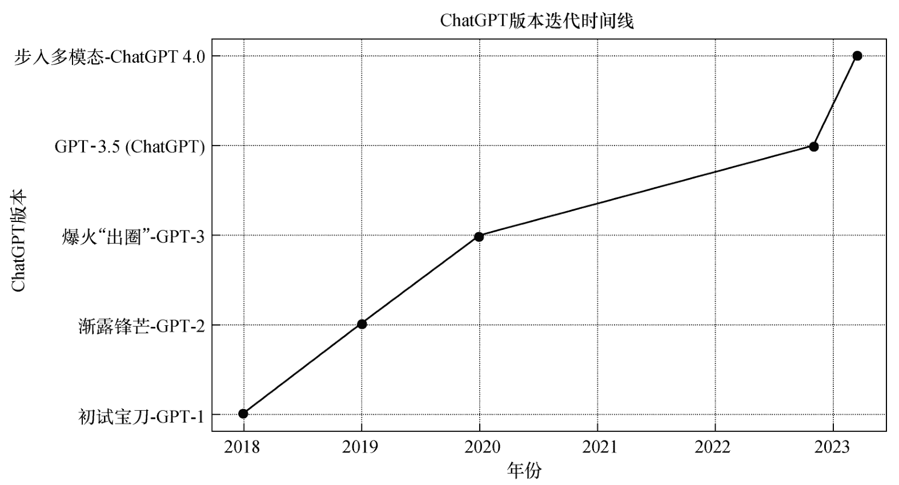
图 1.1 ChatGPT“图像-语言”任务示例

当然ChatGPT并非完美，存在以下局限：
1）数据泄露风险。基于大量互联网文本训练，可能复现训练数据中的信息，产生不准确或误导内容。
2）生成能力局限。虽文笔流畅，但并不真正理解语义，可能出现“一本正经胡说八道”。
3）不当内容风险。虽已采取防范措施，仍有概率生成不适当或冒犯性回答。

### 1.2

## ChatGPT 与数据解析
1.1节已介绍概念与原理，下面探讨其在数据解析中的实际价值与应用。

### 1.2.1

### 解析核心概念
在介绍应用场景前，先梳理相关概念。

数据解析是用适宜的统计方法对收集的海量数据进行汇总、理解与提炼，挖掘内在规律。数据解析贯穿企业经营与产品运营全过程，在过去、现在、未来三个维度均发挥作用。

对过去，回顾历史数据进行原因分析，如通过销售数据了解受欢迎产品与有效策略。
对现在，实时监控业务运行，洞察整体状况，及时发现与解决问题，如生产数据实时分析发现瓶颈。
对未来，预测趋势，为目标制定与战略决策提供依据，如基于历史与市场趋势预测销售，提前调整生产计划。

基本流程可归纳为六步，如图1.2所示。

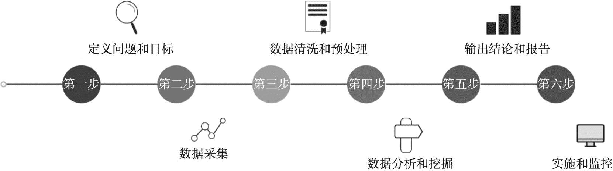
图 1.2 数据解析全流程

1）明确问题与目标。先问为什么解析、解决什么问题，据此规划策略与解析框架，将大目标拆分为小目标，明确解析角度与指标。
2）数据采集。明确目标后采集相关数据。数据分为可直接获取的第一手数据与加工整理后的第二手数据，来源包括自有数据库、公开数据集、网络爬虫、问卷调查等。
3）数据清洗与预处理。初采数据常存在错误、缺失、异常等问题，需进行清洗、转换、抽取、计算等，使数据规整可用。
4）数据解析与挖掘。处理后使用合适方法与工具提取信息、得出结论。可进行探索性解析了解数据特性，也可建模解析。需注意数据本身错误将导致结果偏差，即使方法先进也无法挽回。

（5）产出结论与报告。分析报告是整条分析链路的浓缩与呈现，能够把项目缘起、执行细节、结论发现以及行动建议连贯展示，方便决策者与执行者查阅。

（6）落地与追踪。报告确认后，可依据其中建议推进执行，并对实际效果进行持续监测与复盘。

在数智化环境下，数据分析能力正从专业岗位向全员技能扩散，已成为各部门日常运营不可或缺的基础素养。

### 1.2.2
### ChatGPT 驱动数据分析的典型场景

前文介绍过 ChatGPT 的通用能力，像邮件起草、文本创作乃至代码编写都能胜任，那么它具体如何赋能分析工作呢？

借助各类实用插件后，ChatGPT 的辅助范围相当广泛，几乎覆盖数据分析全流程的各个环节。结合既往流程图，ChatGPT 在全流程中的作用示意见图 1.3。

在问题界定与思路规划阶段，模型能够协助分析师把业务痛点转化为可执行任务，并提供初步的思路建议。只需描述业务情境，它就能拆解成多项具体任务并给出尝试方向。

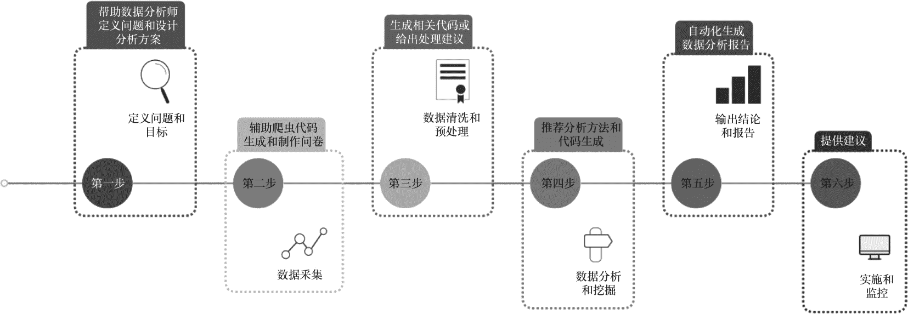

**图 1.3 ChatGPT 数据分析全流程应用**

进入数据获取环节，模型既可辅助编写爬虫脚本抓取数据，也可通过插件生成问卷以支持数据收集。若说明数据需求，它还能推荐潜在数据源或采集思路。

在清洗与预处理环节，模型可产出清洗脚本，提升处理效率，部分智能插件还能主动提示潜在问题并生成对应脚本。

在分析与挖掘环节，模型可推荐合适的分析方法与建模思路，并产出可执行脚本。例如给出分析目标，它会建议方法、生成代码并可输出可视化图。

在成果呈现环节，模型可自动撰写分析报告。将结果或原始数据集输入后，它能据此生成结构化的报告文档。

总体而言，ChatGPT 是数据从业者与数据需求者的高效助手，能显著提升各阶段的工作效率与交付速度。

# 第二章
# ChatGPT 入门实操指南

了解了 ChatGPT 的原理与概念后，下一步是把工具真正用起来。掌握原理是基础，熟练使用来自反复实践。

### 2.1
## 从开户到上手：注册登录与基础交互

本部分先讲清账号注册登录流程，再介绍基础操作要点，为后续提示工程学习做铺垫。

### 2.1.1
### 账号创建与登录步骤

**1．创建 OpenAI 账号**
使用服务前需先在 OpenAI 官方网站 chat.openai.com/ 完成免费注册，网站示意见图 2.1。点击右上角“Sign up”进入注册页，可使用 Google 或 Microsoft 账号快捷登录，已有账号则点“Log in”直接进入。图 2.2 为注册界面，先在邮箱栏输入地址点“Continue”，随后在密码栏设置密码后再点“Continue”。

**图 2.1 OpenAI 官方网站**

**2．邮箱确认与个人信息填写**
填写邮箱与密码后，OpenAI 会发送验证邮件至注册邮箱，如图 2.3 所示，点击“Verify email address”完成验证，随后需补充姓名、组织等信息，组织为可选项。

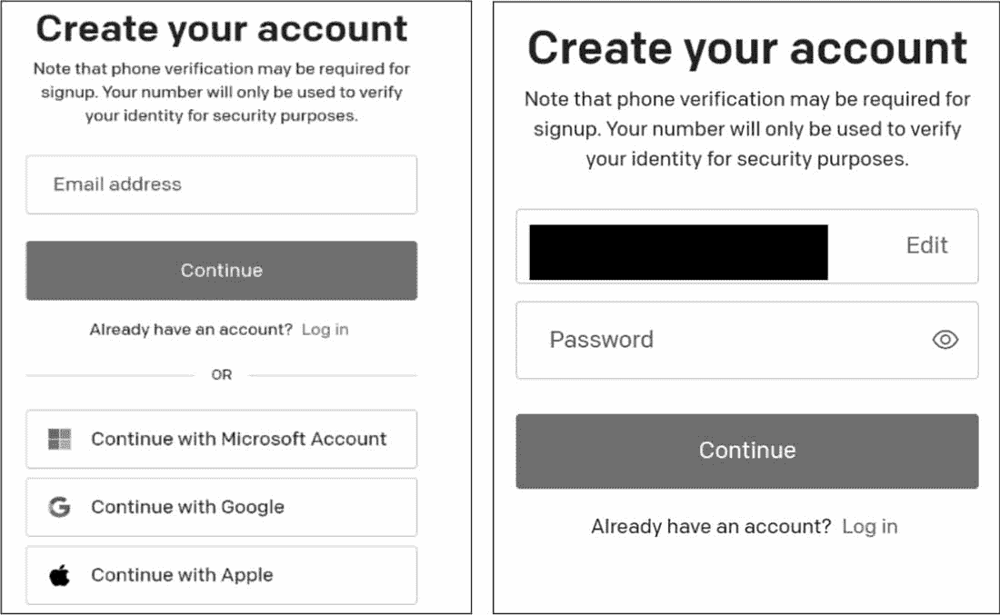

**图 2.2 账号注册界面**

**3．手机号验证**
个人信息提交后进入手机号验证，当前不支持中国号码。输入手机号点“Send code”，收到验证码后填入即可，如图 2.4 所示。

▲**图 2.3 验证邮件示例**

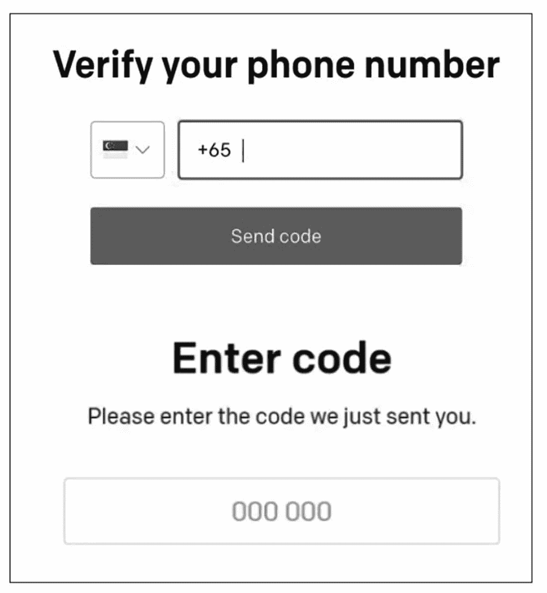

**图 2.4 手机验证流程**

若没有海外手机号，既可先尝试文中后续介绍的其他 AI 工具，也可借助亲友或接码服务接收验证码，具体操作可自行搜索了解。

**4．登录 ChatGPT**
完成手机号验证即算注册成功。之后在官网右上角点“Log in”，输入邮箱密码，弹出模块选择页如图 2.5 所示，选择左侧 ChatGPT 即可进入主界面，如图 2.6 所示。

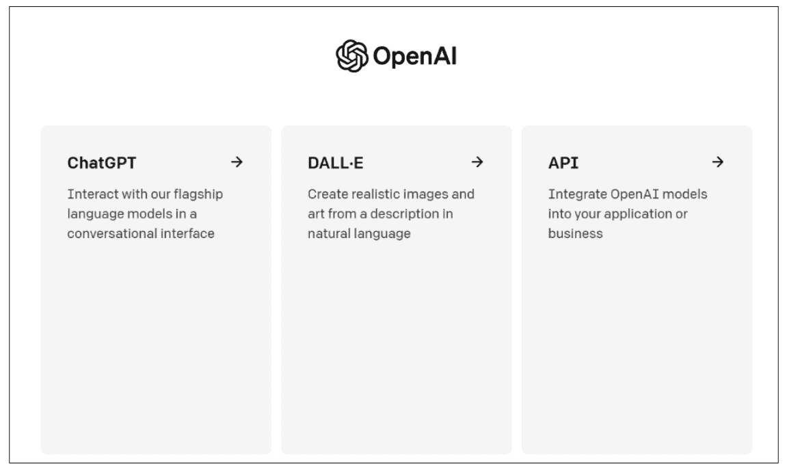

▲**图 2.5 功能模块选择页**

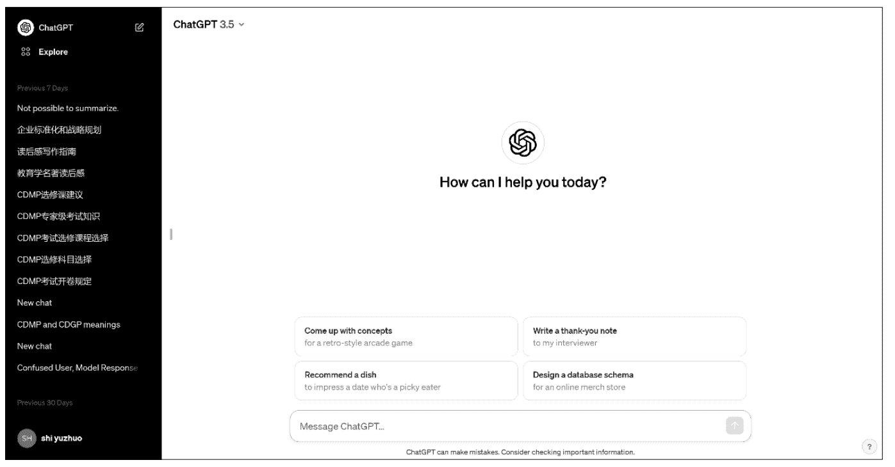

**图 2.6 ChatGPT 主界面**

若因网络或验证码问题无法通过官网登录，可参考表 2.1 中列出的替代渠道获取服务或相似工具。

**表 2.1 部分获取 ChatGPT 服务或近似 AI 工具渠道**

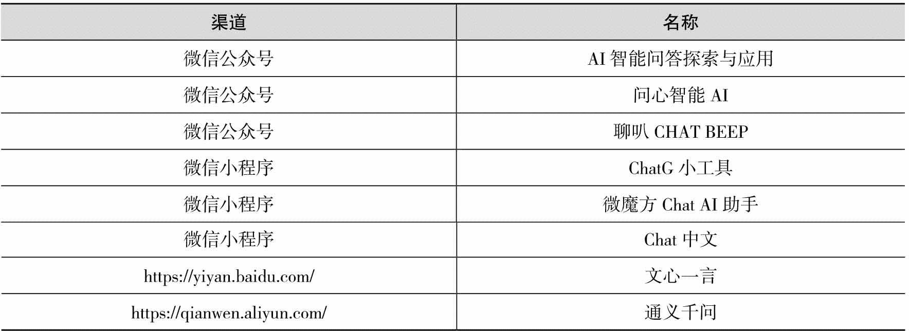

### 2.1.2
### 对话界面初识

正式交流前，先了解页面各区域功能，整体可分为输入区、输出区、设置区、历史区、版本控制区。

**1．输入区**
输入区位于主界面底部，如图 2.7 所示，文本框用于键入问题或指令，发送后模型会据此生成回复，完成后点右侧箭头即可提交。

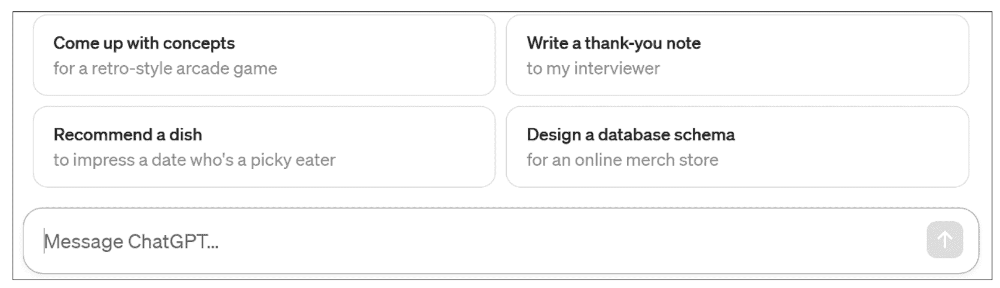

**图 2.7 输入区域示意**

**2．输出区**
提问后输出区会出现在输入区上方，用于展示对话记录，包含用户提问与模型回复。回复右侧——图 2.8 红框标注——有三个按钮，分别用于复制、点赞、点踩。认为回复有价值或准确可点赞，帮助平台优化；认为不靠谱可点踩，反馈改进方向。

**3．设置区**
打开设置后自上而下依次为 Plus 订阅、设置、退出登录，如图 2.9 所示。其中 Settings & Beta 为核心，涉及外观、实验功能、数据控制三方面。外观可切换主题或清空聊天记录；实验功能包括第三方插件与 Interpreter 开启，后续章节会说明；数据控制涉及导出、分享对话等。

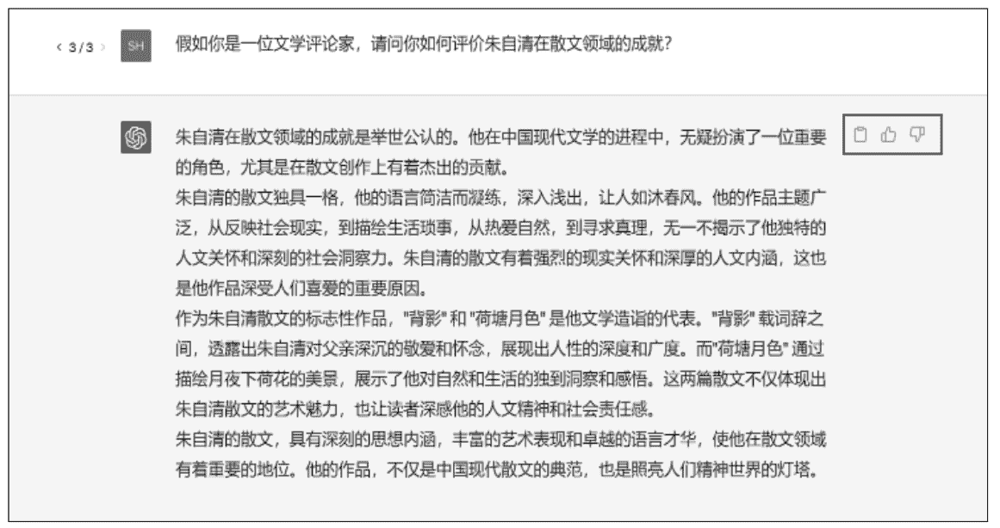

▲**图 2.8 输出区域示意**

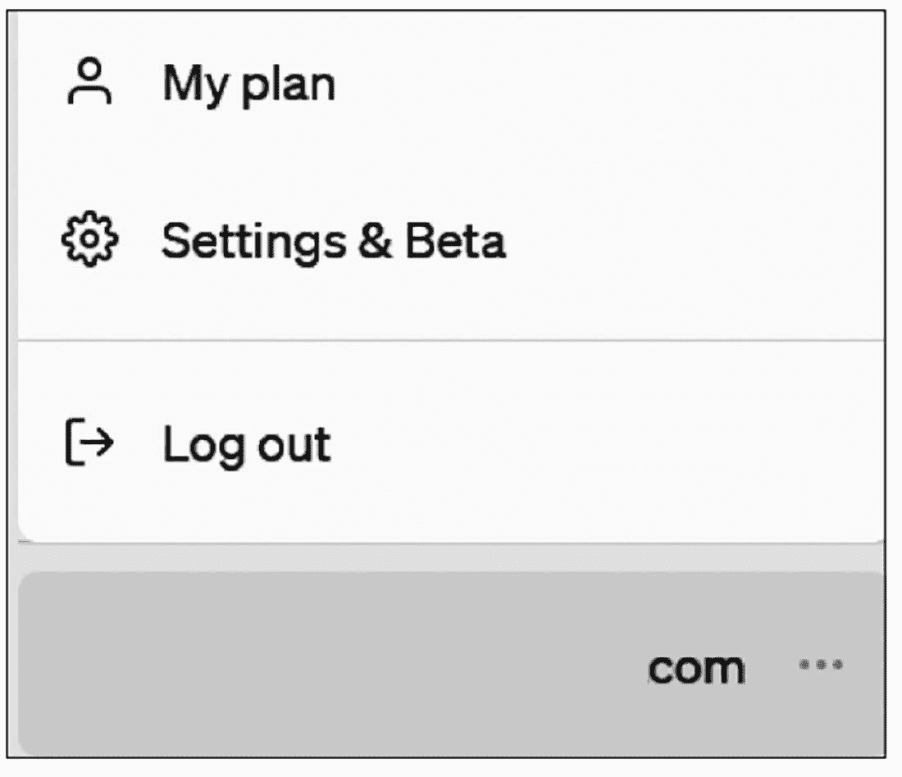

**图 2.9 设置区域示意**

**4．历史区**
历史区位于主界面左侧，展示过往对话记录，便于回顾。

**5．版本控制区**
版本控制区在输出区上方，用于在 3.5 与 4.0 之间切换，Plus 用户还能选择是否启用插件或 Interpreter。

整体而言，界面简洁清晰，上手快。模型可用于论文撰写、书籍摘要、代码编写与修复、计算、简历制作、翻译等。以下为入门示例：

（1）请解释一下什么是历史地理学。
（2）请用海子的风格写一首关于失眠的诗。
（3）请为我概括一下《海边的卡夫卡》这本书的主要内容。
（4）请为我的孩子写一张因为感冒需要休息的请假条。

这些属于基础提示，学习提示工程后提问会更精准高效。

### 2.1.3
### 识别与修正错误输出

2.1.2 节介绍了基本使用与注意事项，下面聚焦如何识别并处理错误。任何工具都非完美，ChatGPT 也会出现偏差，学会甄别正误才能获得可靠结果。

**1．识别错误**
判断输出是否出错，可先参考模型的自我说明：

User：
如何识别 ChatGPT 输出的内容是否有错误？

ChatGPT：
识别输出是否出错主要看：
1．事实性错误：信息与已知事实不符，如称巴黎是英国首都，即为事实错误，需查可靠资料核验。
2．逻辑错误：回答自相矛盾或不合逻辑，如同一对话中前后说法冲突。
3．语言错误：出现语法、拼写或语境不当的问题。
4．理解错误：模型误解问题或指令。
5．不当内容：包含冒犯性语言或违规信息。

需注意并非所有错误都易察觉，有时错误藏于看似合理的表述，或因信息不全导致。使用者保持批判性思维很重要。

在此基础上，更实用的判断方法有：

（1）连续追问。若前后回答无法互相印证甚至相互否定，就要甄别哪方更可信。例如：
问题 1：木星是太阳系最大的天体吗？
回答 1：是的，木星是太阳系最大的天体。
问题 2：太阳与木星相比哪个更大？
回答 2：太阳比木星更大。
此时需借助专业经验或搜索引擎判断正确说法。

（2）直接调试。若任务是生成可运行代码，直接执行即可验证。例如模型生成：
data = array([1, 2, 3, 4, 5])
print(data)
本地运行会因未导入 numpy 而报错。

（3）结合情境与经验判断。评价标准有时依赖具体场景，例如要求写一封给老板的品牌运营邮件，就要看语气是否得体、是否符合品牌规范。

**2．处理错误**
识别错误是为了更好地修正：

（1）重新表述问题。对方没理解时可换种说法。例如“谁是第一位登月的人？”答错，可改问“哪位宇航员第一个踏上月球？”更清晰的表述方式将在 2.2 节提示工程中详细说明。

（2）提供更多上下文。信息不足易导致错误。可补充背景，例如把“他是谁？”改为“在《哈利·波特》系列中，‘他’通常指谁？”

（3）把需求描述得更准确。若输出不符合预期，可明确限定，例如把“写个故事”改为“写一个关于海盗的冒险故事”。

（4）上报问题。若模型持续出错或出现不当行为，应向 OpenAI 反馈，就像 App 出现 Bug 时提交反馈，有助于产品改进。

### 2.2
## 提示工程：指令设计的艺术

“提示”背后体现的是与 AI 交流的艺术，提示不仅仅是指令，更是释放模型潜能的关键。本节将深入探讨如何与 ChatGPT 高效互动，最大化其知识与能力。

### 2.2.1
### 提示工程的本质

当前主流的 ChatGPT 及同类聊天机器人都基于大模型，通过无监督预训练学习海量数据，形成通才型 AI，根据输入预测并生成下一个语义单元。

但输入的差异会显著影响输出质量。直接让 ChatGPT 设计数据分析师模拟面试，结果往往不理想。例如：

User：
请你设计数据分析师模拟面试。

ChatGPT：
当然可以。以下是一个模拟的数据分析师面试。
面试官：你好，欢迎参加这次面试。首先请自我介绍一下。
候选人：（自我介绍）
面试官：谢谢你的介绍。我注意到你的简历上提到了一些你过去的数据分析项目。能否挑选一个你最有成就感的项目，详细告诉我一下？
候选人：（回答）
面试官：很好。你可以讲讲你在这个项目中是如何处理和分析数据的吗？包括你使用的工具、你对数据的理解，以及你如何从这些数据中提取出有用的信息。
候选人：（回答）
面试官：你有经验使用 python 和 R 语言进行数据分析吗？你更偏向于使用哪一种，为什么？
候选人：（回答）
……
以上就是一个模拟的数据分析师面试流程。它涵盖了自我介绍，过去项目经验，数据处理和分析能力，编程语言偏好，数据清洗技巧，数据可视化工具和技术，以及面对与预期不符的数据情况的处理方式等等。希望这个可以帮助你准备数据分析师的面试。

该输出可作参考，但缺少互动和面试评价。优化后可这样提问：

User：
请你扮演数据分析师的面试官，而我是应聘数据分析师的面试者，请你对我模拟面试。
请注意，你需要遵守以下规则：
1．你只能问我有关职位的面试。
2．你不需要写多余的解释。
3．你需要像面试官一样等我回答问题，再提问下一个问题。
4．待面试结束后，请给出面试评价。

ChatGPT：
很好，让我们开始。您好，我很高兴今天能与您面谈。我会依照规则进行面试。
请您做一下自我介绍，并且详述一下您的教育和工作经历。

User：
尊敬的面试官您好，我是×××，硕士毕业于××大学，曾在××、××××等公司担任资深数据分析师职务，有 8 年数据分析从业经验，主要负责用户增长相关分析。

ChatGPT：
非常感谢您的介绍。接下来的问题是，您在过去的工作或项目中，哪一个最能展示您的数据分析能力？您在这个项目中具体做了什么？

User：
在××项目中，我作为分析师和项目经理，通过××工具使用××方法和××方法，将××关键指标提升了 10 个百分点；同时协调上下游资源，合理推动项目进展。

ChatGPT：
听起来您在该项目中的表现非常出色。下一个问题是，您熟悉哪些数据分析工具和编程语言？
……
ChatGPT：

面试反馈：您在专业层面的沉淀相当扎实，对数据分析的理论体系和实战运用都能做出深刻解读。阅历丰富，排查问题的思路条理清晰，能够迅速锁定关键点，对数据的理解既深入又具备敏锐洞察力。此外在大数据工具以及各类编程语言的使用上也展现出很强的熟练度。综合评估，您与我们数据分析师岗位非常契合。若后续还有任何疑问或需要补充信息，请随时与我们联系，期待后续的深入合作。

在前文对提问进行改写的案例里，我们正是借助了提示词的相关思路。换句话说，对于大模型而言，提一个精准的问题就像拿到打开知识库的钥匙，只有提问够准，模型才能给出想要的答案。跟 ChatGPT 交互时，提问的质量直接决定结果的好坏，而这背后最核心的能力就是提示工程。

提示工程可以理解为围绕 ChatGPT 输入提示的设计、测试与迭代优化的整体工作，通过精准且富有创意的输入来引导模型产出高质量且相关的结果，并基于反馈持续优化。其核心流程主要包含三个环节：

（1）明确输入提示。提示是提示工程的起点，通常由问题、指令或场景描述构成。越是精确、越具针对性的提示，就越能牵引模型朝期望的方向思考并输出。

（2）处理模型输出。这一环节涉及对结果的解析、格式化以及后续的加工转换。模型给出的文本常常需要进一步转成图表或图像，才能更直观易懂。

（3）依反馈优化提示。借助用户反馈或模型产出的效果，对原始提示进行迭代调整。通过不断打磨，输出会变得更加精准贴合预期。

提示工程的根本目标是最大化 ChatGPT 的效能。精心设计和持续优化提示，可以让模型产出更高质量的结果，更好地满足需求。提示工程并非一次性任务，而是一个持续迭代的过程。随着模型升级和需求变化，需要不断调整提示来保持最佳表现。

### **2.2.2**

### **提示的设计**

结合 2.2.1 节的说明可以看出，优质的提示词是引导 ChatGPT 产出高质量内容的关键。那么什么样的提示才算优质？主要体现在以下几个维度。

（1）明确性。提示必须清晰易懂，模型才不会产生歧义。若表述模糊或含糊其辞，ChatGPT 很容易给出让人哭笑不得的回答。

（2）完整性。提示最好是一个完整的句子或问题，并提供足够的上下文，帮助模型判断期望的回应形式。仅给出“天气”一个词，模型无法分辨你要的是实时状况、预报还是泛论；而问“2022 年 5 月上海的天气整体如何？”就提供了明确的上下文。

（3）简洁性。提示需要信息充足，但也不能冗长。过长或过于复杂的描述会让模型陷入信息过载，反而降低输出质量。

（4）通用性。在同类任务中，只需更换主体词就能复用，说明提示具有模板价值，便于在不同主题下快速套用。

（5）中立性。ChatGPT 的输出往往会受提示语气和立场影响，因此提示应尽量保持中立，避免带入偏见或主观倾向，除非是有意引导的特定场景。

基于上述要求，可以归纳出提示词的书写框架。

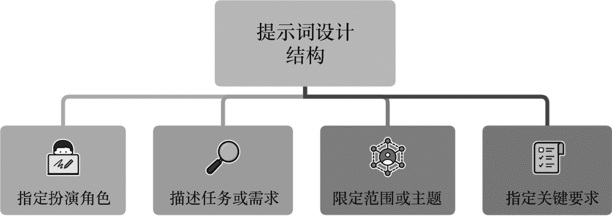

**图 2.10 提示词设计结构**

提示词设计结构=指定扮演角色+描述任务或需求+限定范围或主题+指定关键要求。

通俗讲，就是告诉模型“你是谁”“要做什么”“在什么条件下做”“做的时候注意什么”。

（1）指定扮演角色。给出明确身份能为模型提供上下文锚点，使其更易理解问题意图。虽然大模型知识广博，但没有固定身份。赋予特定角色相当于设定一个回答框架，能让输出更专业、更有针对性。

（2）描述任务或需求。在提示中明确希望得到的文本目标或任务类型，如描述、解释、比较、总结等。模型能力覆盖从简单查询到复杂分析，指示越清晰，答案越贴合需求。例如“列出”会得到清单，“解释”则会得到详细说明。

（3）限定范围或主题。明确领域、背景或具体主题，避免模型在相关话题间游移。通过限定，答案会更聚焦在关心的范围内。如询问太阳相关信息时，点明“太阳的组成”，模型就会聚焦成分而非位置关系。

（4）指定关键要求。关键要求主要包括三方面：特定格式或结构、特定语气或风格、必须包含的信息要素。

①特定的文本格式或结构要求：格式直接影响信息传达效率。若希望答案按“定义-原因-结果”组织，可提示“请按定义、原因、结果的顺序解释（某事）”，答案会更条理。

②特定的语气或风格：不同受众需要不同表达。可提示“请用童话故事的语气描述（某事）”，模型就会采用轻松有趣、适合儿童的语言。

③关键的信息或要素：当只关心某些要点时，需明确要求包含。比如提示“请描述（某公司）的财务状况，重点覆盖流动资产和长期债务”，即使答案包含其他内容，这两项也必须出现。

回到 2.2.1 节的数据分析师模拟面试例子，我们对原提示进行优化。

请你设计数据分析师模拟面试。

①提示中加入角色设定：“扮演数据分析师的面试官”；
②更具体地说明任务：“我是面试者，请你对我模拟面试”；
③限定主题为“数据分析”；
④设定关键规则：“请注意，你需要遵守以下规则……”

优化后的提示如下：

User：

请你扮演数据分析师的面试官，而我是要应征数据分析师的面试者，请你对我模拟面试。

请注意，你需要遵守以下规则：

1．你只能问我有关职位的面试。

2．你不需要写多余的解释。

3．你需要像面试官一样等我回答问题，再提问下一个问题。

4．待面试结束后，请给出面试评价。

在优化后的提示中，“请你扮演数据分析师的面试官”对应指定角色；“我是要应征数据分析师的面试者”对应限定范围或主题；“请你对我模拟面试”对应描述任务或需求；“请注意，你需要遵守以下规则”及其后续内容对应指定关键要求。

实践中提示词的构建要具体问题具体分析，需依据任务类型和上下文灵活调整，才能最好地满足需求。

### **2.2.3**

### **提示的优化技巧**

在 2.2.2 节我们了解了提示词的结构化设计思路，明白了如何通过角色、任务、主题范围和关键要求来提升交互质量。掌握结构只是基础，要真正发挥 ChatGPT 的潜力，还需要一些优化技巧，往往能起到事半功倍的效果。下面列出六种常用方法供参考。

**1．分步骤引导**

为获得更结构化的答案，可将问题拆解为多个步骤引导模型。把复杂需求拆成若干小任务，能帮助 AI 更深入理解意图。

例如策划一个数据分析项目方案，可依次提示：
（1）理解数据的来源和特点。
（2）明确分析的主要目标。
（3）选择合适的数据处理与分析技术。
（4）评估结果的准确性与可靠性。

分步骤引导能让输出更具体详实，避免只有一句笼统的“请帮我策划方案”。

**2．巧用符号**

符号的使用能提升提示的可读性和结构性，具体方法如表 2.2 所示。

**表 2.2 编写提示词中符号使用方法**

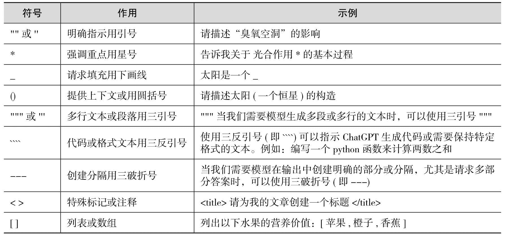

**3．利用示例和类比**

示例和类比有助于模型理解需求。

（1）示例能把抽象或模糊的指令具体化，为模型提供参照，捕捉更准确的意图。当问题不清晰时，附带一个相关样例可提供额外上下文。

（2）类比通过将新概念与已知概念对比，给出一个理解框架，帮助模型把新信息映射到已有知识上。

**4．用“继续”不断输出**

在模型一次回答结束时，直接输入“继续”，即可让其沿前文思路续写。这是获取完整输出最简单有效的方法之一。

**5．调整提示中要求的复杂度**

通过在提示中加入“详细地”“完整地”或“简略地”等修饰词，可以控制输出深度。需要简要概述时可提示“请简要介绍大数据分析的概念、应用和趋势”；需要深入讨论时可改为“请详细讨论大数据分析的概念、关键技术、应用案例和未来发展趋势”。

**6．用英文提问**

ChatGPT 在英文语料上训练更充分，对英语的理解更深入，且技术、科学领域的专业术语以英文为主。因此在专业话题上，用英文提问往往能获得更准确、更详细的回答。

通过恰当的提示与技巧，我们能更高效地与 ChatGPT 交互，得到更精准、更有深度的结果。

### **2.3**

## **实用 ChatGPT 应用**

在 2.1 节和 2.2 节学习了 ChatGPT 的基本使用与提示设计技巧后，本节将探讨一些更实用的应用场景。ChatGPT 不仅能辅助编程，还能帮助生成各类文本内容。

### **2.3.1**

### **python 简介、下载安装和环境配置**

进入 ChatGPT 辅助编程前，先了解 Python 的基础知识和环境配置。

Python 是一种解释型、面向对象、动态类型的编程语言，广泛应用于 Web 开发、数据分析、人工智能、自动化、科学计算等领域。其语法简洁易读，标准库丰富，并拥有庞大的社区生态和大量第三方库。缺点是运行速度相对较慢，作为解释型语言逐行转换执行，效率不及 C 等编译型语言。

下面介绍不同系统的安装方法。

**1．Window 系统安装 python**

（1）打开浏览器访问 https://www.python.org/downloads/windows/，如图 2.11 所示。

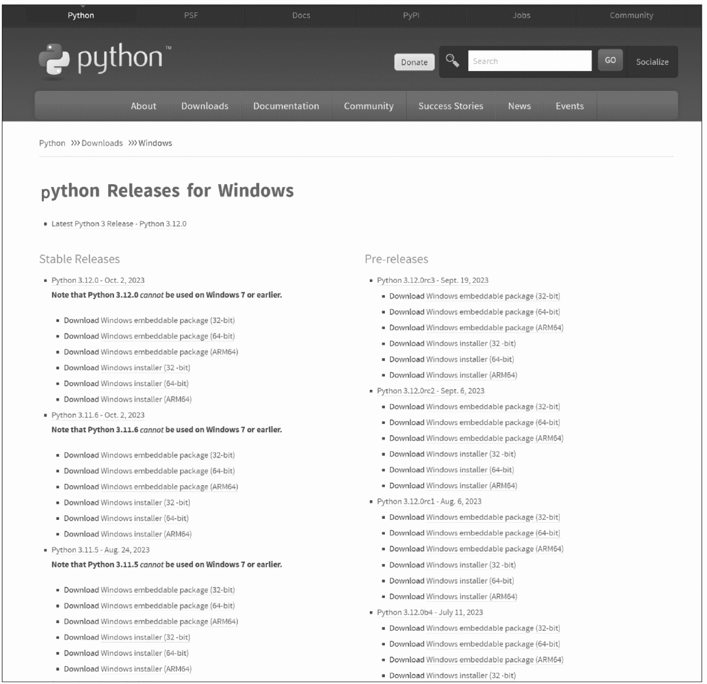

**图 2.11 Window 系统下 python 安装包**

（2）在下载列表中选择 Windows 平台安装包，根据电脑位数选择 32 位或 64 位，如 Download Windows installer（64-bit），如图 2.12 所示。下载文件形如 python-3.10.3-amd64.exe，其中 3.10.3 为版本号，amd64 对应系统版本。

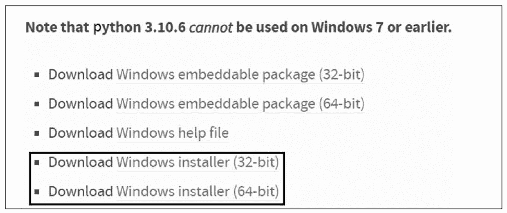

**图 2.12 Windows 平台 python32 位和 64 位安装包**

（3）双击安装包进入向导，按默认设置一路下一步即可完成安装。

**2．Unix & Linux 平台安装 python**

打开浏览器访问 https://www.python.org/downloads/source/，选择适用于 Unix/Linux 的源码压缩包下载并解压。以 3.10.5 版本为例，下载内容如图 2.13 所示。

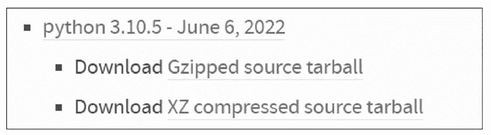

**图 2.13 python 3.10.5 版本下载**

实际上 Python 是 Linux 系统的重要依赖，许多发行版默认已安装，且误删可能导致系统异常。较早的系统常默认 Python 2，随着停止维护，大多数发行版已升级至 Python 3，若无特殊小版本需求，通常无需手动安装。

**3．MAC 平台安装 python**

macOS 一般自带 Python 2.x 环境，也可访问 https://www.python.org/downloads/mac-osx/下载最新版安装。

接下来是环境变量配置。

程序的搜索路径由操作系统维护的环境变量 Path 控制，若安装目录不在其中，需手动添加。

（1）在 Unix/Linux 设置环境变量。
① csh shell 输入 setenv PATH "$PATH：/user/local/bin/python"后回车。
② bash shell 输入 export PATH="$PATH：/user/local/bin/python"后回车。
③ sh 或 ksh shell 输入 PATH="$PATH：/user/local/bin/python"，回车。
注意：/user/local/bin/python 为 Python 安装目录。

（2）在 Windows 设置环境变量。
若安装时勾选了自动添加至 Path，可跳过。若命令行输入 python 无反应，需手动配置：在 cmd 中输入 path=%path%;C：\python 回车。也可通过“计算机→属性→高级系统设置→环境变量→Path”添加安装路径，如 D：\python32，用分号分隔。配置成功后在 cmd 输入 python 即可看到相关信息。

环境变量配置示意如图 2.14 所示。

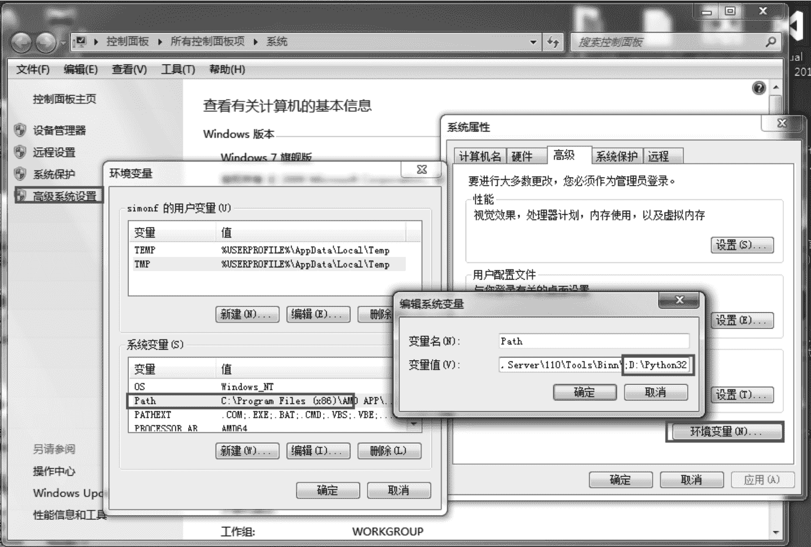

**图 2.14 环境变量配置步骤示意**

下面介绍集成开发环境 Jupyter Notebook。Jupyter Notebook 是一个开源 Web 应用，支持在同一文档中混合代码、公式、可视化和文本，适用于数据清洗、数值模拟、统计建模、数据可视化、机器学习等。

下载方法 1：使用 Anaconda 发行版，一并安装 Python、Jupyter Notebook 及常用科学计算包。访问 https://www.anaconda.com/download/ 下载最新 Python 3 版本的 Anaconda，按页面说明安装。

下载方法 2：通过 pip 安装：
pip install jupyter

后续内容主要使用 Jupyter Notebook 演示代码。

### **2.3.2**

### **ChatGPT 辅助编程**

在数字时代，编程已成为工作生活的重要部分。无论是资深开发者还是初学者，都可能遇到难题。若有一个智能助手随时提供指导、解答疑问、协助设计复杂代码，将会大幅提升效率。

ChatGPT 编程与内容创作实战全景

过去只会闲聊的模型，如今已能给出专业水准的编程指导和可直接落地的思路。SQL、Python 等多种语言的示例和启发，都能被它快速整理出来。

下面拆解它在编程辅助上的真实用法，以及如何让整个过程更省力、更有乐趣。

先把借助 ChatGPT 编程的整体思路理清，示意流程见图 2.15。

（1）需求梳理。编码前把真实意图吃透是关键，能保证方向不偏，避免后期返工。要先明确想要实现的功能、效果、解决的问题，多与相关方沟通，把模糊点澄清，界定细节与边界，从而锁定目标与需求。

（2）编写实现。这是落地的核心环节。结合需求梳理的结果，再辅以提示词技巧，把意图准确传达，让模型给出框架和具体实现。

（3）验证运行。确认程序是否按预期工作，并揪出潜在问题。最直接的方式是执行并观察输出，必要时设计测试用例，重点覆盖边界情形。

（4）迭代打磨。依据验证结果判断走向。若出现报错，把完整错误信息回传，让模型修改直至可运行；若能运行但不符预期，则回到上一步优化提示，直到输出满足需求的版本。

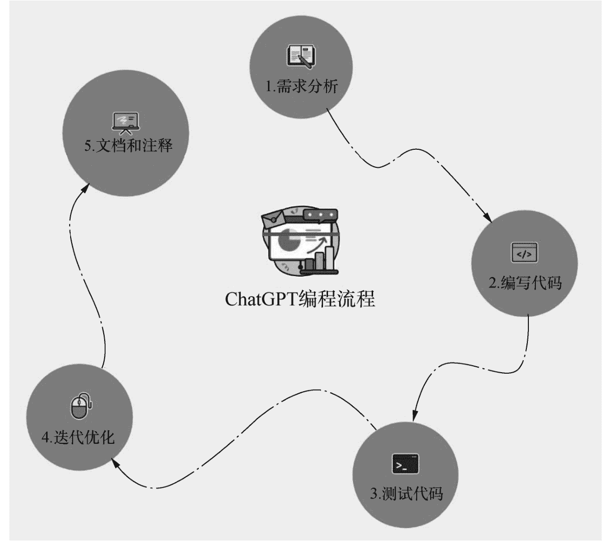

**图 2.15 ChatGPT 编程流程**

（5）说明与文档。良好的注释与文档能让后续自己或他人快速理解与维护。可通过提示让模型补充程序说明、注释，甚至产出配套文档。

下面看一个在对话中完成的实操。

提问者希望一名资深工程师用 Python 实现冒泡排序，要求程序片段里带有中文说明，完成后自行校验。

模型给出一个带中文说明的冒泡排序函数，并解释其原理。

冒泡排序的核心是通过相邻元素的比较与交换，让每一轮循环后最大元素沉到合适位置。重复足够轮次后，列表即有序。

实现片段如下：

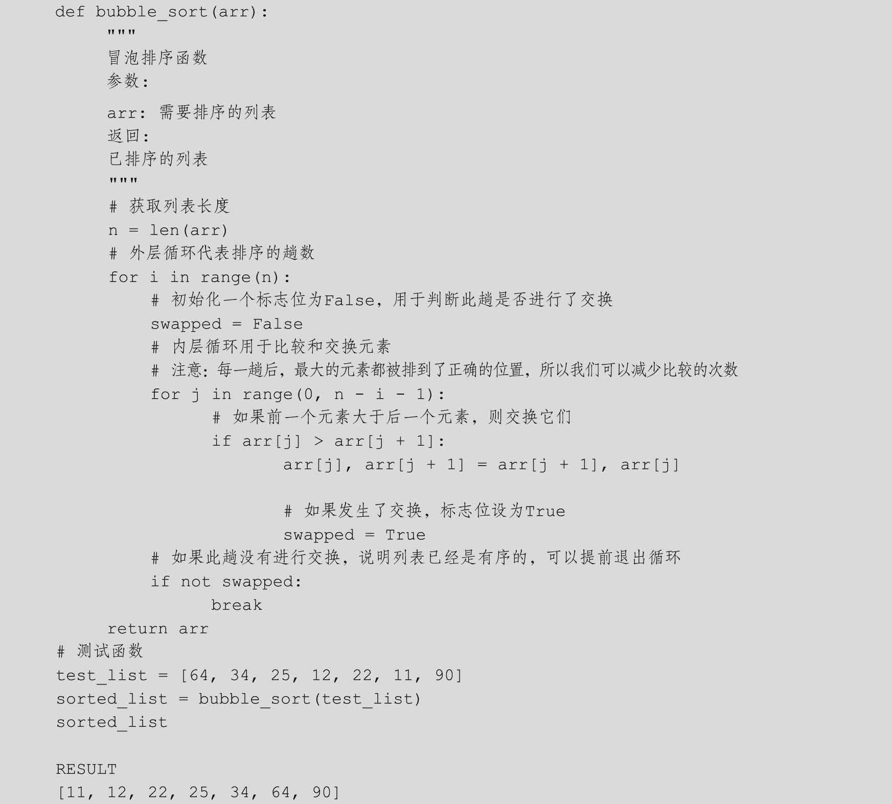

这就是排序效果的呈现。可看出列表 64,34,25,12,22,11,90 被整理为 11,12,22,25,34,64,90。程序里加入了中文说明，帮助理解每一步。若有疑问可继续追问。

为稳妥起见，最好再把片段放到本地 Python 环境运行。图 2.16 是在 Jupyter Notebook 中的运行截图，可验证输出符合预期。

若对细节有疑惑，还能继续追问。例如对“比较前一个与后一个，必要时交换”这一步不明白，可要求以教师身份通俗讲解。

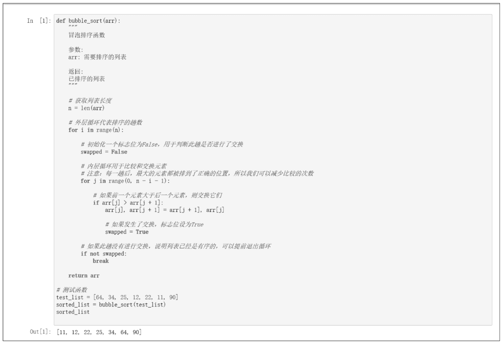

**图 2.16 代码测试**

模型会用气泡比喻说明：通过不断交换相邻元素，让较大的元素像气泡般向数组末尾移动。示例卡片序列演示比较与交换的过程，一轮结束后最大值被推到最右，下一轮再忽略已确定的位置，重复数轮后序列有序。这样的讲解既有原理又有实例，便于理解。模型不仅能写程序，还能帮助学习与理解。

### **2.3.3**

### **ChatGPT 写作实战**

第一章提到模型在多场景具备强能力，其中就包括文本生成。下面看它在商务邮件、商业报告等类型文本上的表现。

模型能依据收件人、目的、重点内容等关键信息，产出中文商务邮件，涵盖询价、合作提议、会议安排、项目更新等。英文邮件同理，只需提供相应的英文要素即可。

看一个实际案例。

提问者要求扮演公司职员，写一封约两百字的邮件，约定下周星期三上午十点与王总面谈新项目合作，注意中文邮件格式与诚恳语气。

模型给出了一封格式规范、语气得体的邮件草稿，包含称呼、正文、落款与日期。

模型默认采用中性风格，实际商务沟通中每个人都有习惯与公司规范。生成后需要微调以更贴合个人或企业风格。某些细微差别与背景信息模型也可能把握不全。因此模型是高效的生成助手，最终仍需人工校对，确保准确、得体、专业。

除邮件外，模型还能产出市场分析报告、年度报告、项目总结等商业文本。

对市场分析报告，它能基于行业数据、趋势与关键信息，梳理当前概况、竞争对手态势、潜在机会与威胁。

对公司年报，提供财务数据、年度亮点、挑战与未来规划后，它能整合成结构化文稿。

对项目总结，提供目标、实际结果、成败经验后，它能形成总结报告。

以市场分析报告为例。

提问者设定新兴健康食品市场年增速 20%，主要竞争者为厂商 A 与厂商 B，消费者偏好有机与无添加产品，要求撰写分析报告。

**健康食品市场分析报告**

**1．市场概览**
·近年消费者对健康与饮食质量关注度提升，市场增长明显。年增速达 20%，释放出巨大商业机会。

**2．主要竞争对手分析**
·厂商 A 与厂商 B 目前占据领先位置，其策略、产品线与品牌影响力对中小企业形成压力。
·**厂商 A：**以持续的产品创新与广泛分销网络著称，已建立稳固客户基础。
·**厂商 B：**凭借高品质产品与出色品牌形象，吸引大量高端消费者。

**3．消费者购买趋势**
·研究显示消费者 increasingly 倾向有机与无添加产品。背后是对健康的关注以及对添加剂与化学成分的担忧。因此纯天然、无添加、有机认证的产品更易获得青睐。

**4．建议与结论**
·建议重点研发与推广有机、无添加的健康食品；
·在宣传中突出天然与健康的卖点；
·密切关注厂商 A 与厂商 B 的市场策略，制定针对性响应。
·总体来看，健康食品市场竞争激烈但增长潜力大，跟上趋势并持续创新就有机会立足。

初次生成的报告更像大纲或摘要。可要求模型对某一部分展开，或补充更多背景数据来提升质量。若提供示例供其模仿，输出质量会进一步提高。下面让报告的市场概览更细化：

提问者要求从市场背景、规模、主要驱动力、细分等角度进一步展开。

**健康食品市场概览**

**1．市场背景**
·近年来全球健康意识觉醒，加上食品安全事件的刺激，消费者对食品来源与成分关注度明显上升。生活水平提高后，人们更注重生活质量，这为健康食品发展创造了有利环境。

**2．市场规模**
·新兴健康食品市场年增速 20%，预计未来五年仍保持至少 20% 的增速。若趋势持续，未来几年整体规模可能翻倍，达到数百亿级别。

**3．主要驱动力**
·**消费者意识提升：**食品安全问题与公众健康关注，推动消费者重视食品质量与成分。
·**技术进步：**食品科技发展让健康食品生产更经济高效，营养与口感同步提升。
·**政府政策与法规：**多国推行更严格食品安全标准，倒逼企业投入健康安全产品研发。
·**全球化与供应链优化：**优质原料与技术更易全球流通，有助生产与分销。

**4．市场细分**
·**有机食品：**增长最快的细分赛道，消费者认为更纯净无污染。
·**无添加食品：**面向担心添加剂的消费者，成为首选。
·**功能性食品：**富含蛋白、低脂、低糖或具特定健康益处的产品。
·**特定人群食品：**针对儿童、孕妇、老年人等设计的特定营养产品。
·总体呈现多样化、细分化特征，为企业提供广阔空间，同时竞争也更激烈，需持续创新与策略调整。

从例子可看出，给出明确的展开方向后，模型能产出更翔实的内容。

# **第三章**

# **ChatGPT 插件生态**

随着模型在各行业的深化应用，以及 API 的开放，基于它构建的各类扩展工具快速发展，极大扩展了能力边界，把 AI 带入更多真实场景，提升用户工作效率。可把 ChatGPT 看作 AI 的大脑，扩展工具就是大脑的延伸，把 AI 能力赋能给普通用户。

截至 2023 年 8 月，各类扩展工具总量已超过 800 个，覆盖办公效率、创作辅助、程序开发等多个领域，能显著提升工作效率。

可以预见，随着模型迭代，应用场景还将持续扩大。未来扩展工具可能渗透到工作和生活的各个角落，实现“所想即所得”。本章将深入探讨 ChatGPT 扩展工具的应用。

### **3.1**

## **插件上手指南**

本节先简单介绍 ChatGPT 扩展工具，再详细介绍 Code Interpreter 工具的概念、用途与案例。

### **3.1.1**

### **插件核心概念**

日常工作生活中“插件”很常见，指能增强或扩展某种基础功能的工具。比如浏览器扩展可增加广告拦截、翻译等功能。

ChatGPT 扩展工具概念类似，是为 ChatGPT 设计的小程序或工具，用于增强或扩展其基础功能。借助扩展，ChatGPT 可以执行原本做不到的任务，比如联网获取实时信息，突破训练数据截止限制；对接第三方应用，访问外部数据，满足更复杂个性化需求。

扩展来源多样，既有企业团队为特定业务或客户定制，也有学术研究者为研究或教育目的开发，还有独立开发者基于兴趣或专业需求创建。

扩展让使用体验更个性化和高效。拥有更多扩展的 ChatGPT 不再只是健谈的 AI，而是多功能 AI，定位升级为“可定制的 AI 伙伴”。扩展是持续创新和满足多样化需求的关键。

### **3.1.2**

### **安装与启用插件**

需要注意的是，ChatGPT 扩展工具仅对 Plus 用户开放，需先升级账户。

**预备，升级到 Plus 账户**

点击界面上的 Upgrade to Plus，按指引完成付费即可。付款完成后，进入 My plan 查看购买状态，如图 3.1 所示。

**1．开启 Plugins 设置**

在左下角设置区，点击 Setting & Beta，弹窗中选择“Beta features”，打开“Plugins”和“Code interpreter”这两项，如图 3.2 所示。

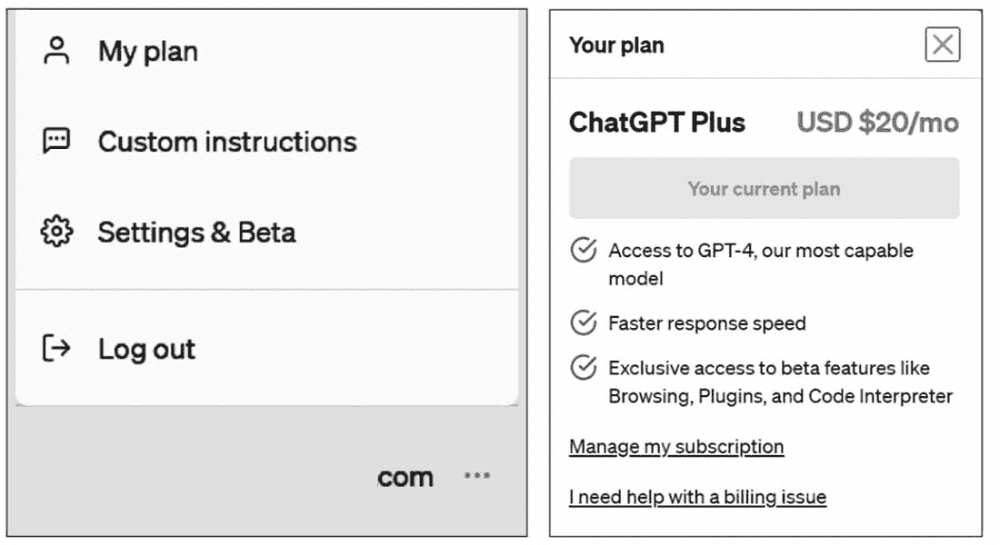

▲**图 3.1 付款后 My Plan 界面**

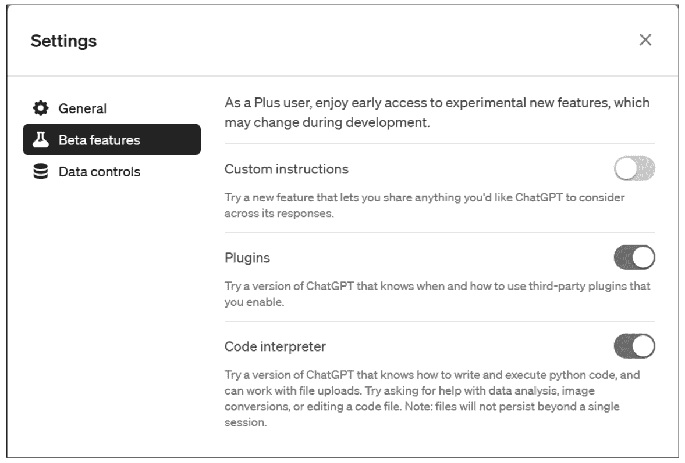

**图 3.2 开启 Plugins 设置**

**2．进入 Plugins 或 Code Interpreter 模式**

在页面上方，先点击 GPT-4 图标，将模型从 GPT-3.5 切换到 GPT-4，再将光标悬停在 GPT-4 图标上，会弹出模式选择页，可选 Code Interpreter 或 Plugins，如图 3.3 所示。

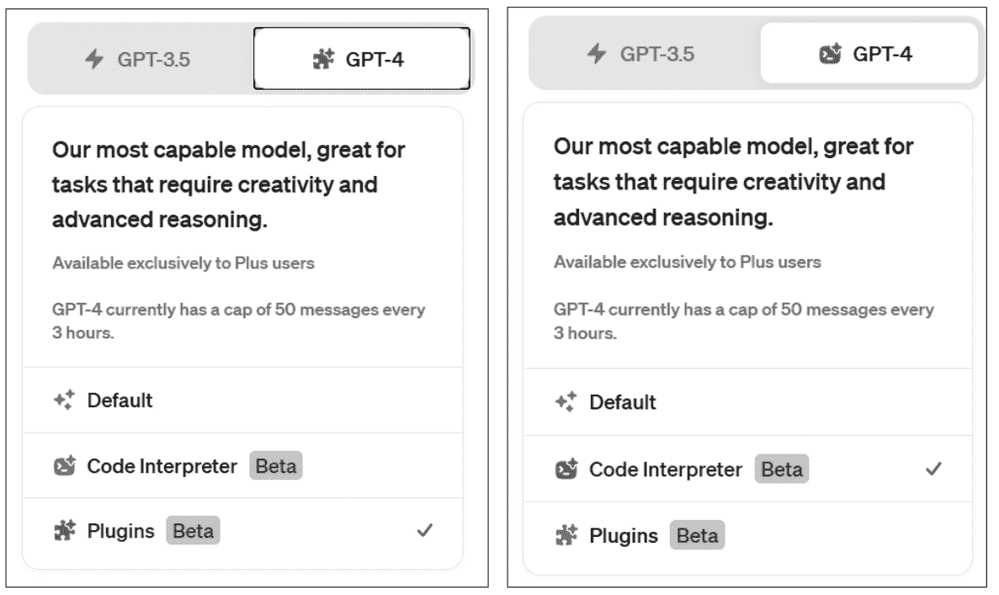

**图 3.3 模式选择**

Code Interpreter 模式和 Plugins 模式各有侧重，具体差异在使用中会进一步说明。

**3．进入商店安装插件**

若第 2 步选择了 Code Interpreter 模式，则直接启用且仅启用该工具，此步可跳过。

若选择了 Plugins 模式，则点击 Plugin store，弹出页面如图 3.4 所示。

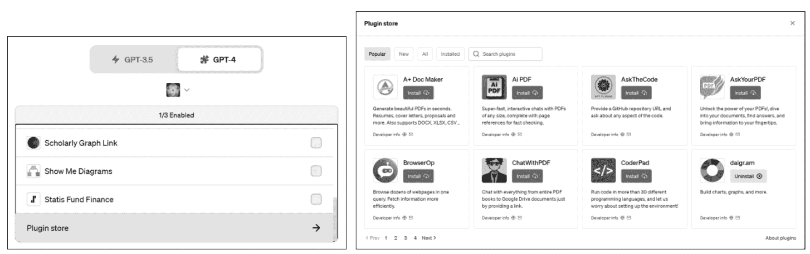

**图 3.4 Plugin store 页面**

在 Plugin store 中可看到工具名称、简介和开发者信息，想用的工具直接点击名称下方的 install 按钮安装即可。

**4．选择插件**

安装完成后，每次对话最多使用 3 个工具。点击下拉箭头打开已安装列表，找到需要使用的工具勾选启用，已选工具会显示在列表上方，如图 3.5 红框所示。

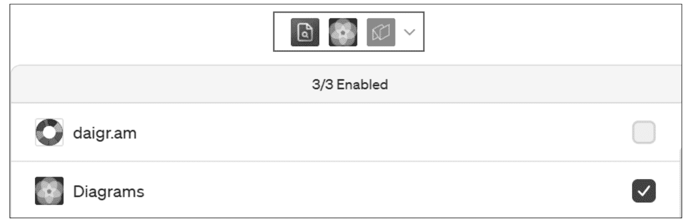

**图 3.5 选择插件**

至此，ChatGPT 扩展工具的安装和启用流程完成。后续章节将重点学习 Code Interpreter 和其他数据分析类工具的使用方法。

### **3.2**

## **Code Interpreter 功能详解**

本节介绍 Code Interpreter 工具的工作原理和功能，并通过具体案例阐述如何使用这个强大的工具。

### **3.2.1**

### **Code Interpreter 功能介绍**

在 3.1.2 节聊到 ChatGPT 插件的打开方式时曾提到，切换到 GPT-4 之后会弹出一个模式选择，里面就有 Code Interpreter。进去之后能立刻注意到输入框左边冒出一个加号，点击就能把本地文件传进来，支持的格式很广，.csv、.txt、.png/jpg、.zip、.pdf 都在范围内，上传成功后文件名会显示在输入框上方，如图 3.6 所示。

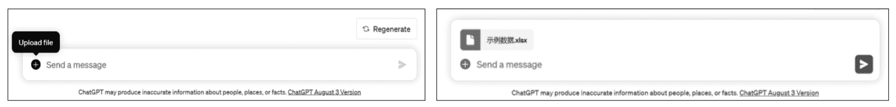

**图 3.6 上传文件按钮**

这个模式下只能使用 Code Interpreter，看起来功能单一，但其实对数据分析帮助非常大，能把分析效率提升到另一个层次。

OpenAI 官方对 Code Interpreter 的描述是：在一个沙盒式、带防火墙的执行环境里提供可用的 Python 解释器和临时磁盘空间。插件运行的代码会在一次持久会话里被评估，这个会话会贯穿整个聊天，有超时上限，后续调用可以在此基础上继续。并且支持把文件上传到当前聊天的工作区，以及下载分析结果。

由此可见，其本质是为 ChatGPT 封装了一个 Python 运行环境，而且是预装了 300 多个库和包的沙盒防火墙环境。于是 ChatGPT 可以像真正的程序员那样在里面写代码、跑代码。通俗讲，就是按你的需求自动写 Python、执行并给出结果的插件。即便你不会编程，也能完成很复杂的数据分析任务。整体运作思路如图 3.7 所示。

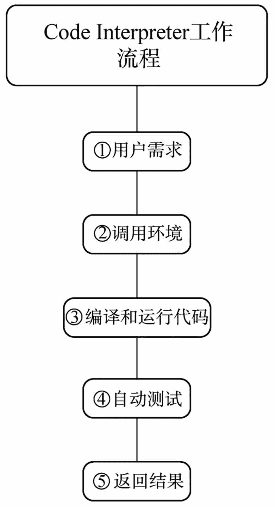

**图 3.7 Code Interpreter 工作流程**

大致流程可以拆成几步：

（1）用户给 ChatGPT 一段包含需求的提示，比如“读取这个 CSV，生成条形图”。

（2）ChatGPT 调用 Code Interpreter 的 Python 环境，在里面写出实现需求的代码。

（3）代码写好后，Code Interpreter 会自动编译并在自己的 Python 环境里执行。

（4）执行中出现错误或异常，会被自动捕获并给出提示。

（5）代码跑通后，结果会交回 ChatGPT，对于图像等任务可以直接展示或提供文件，最终以对话形式呈现给用户。

整个过程里，Code Interpreter 扮演了一个安全可控的编程沙盒，自动完成了编译、运行、调试等工作，让 ChatGPT 更专注于需求理解和代码设计，从而显著增强编程能力。下面先梳理它在数据分析里的常用场景，3.2.2 节会结合实战展开使用方法。

**1．上传文件**
（1）多格式支持。除前面提到的 .csv、.txt、.png/jpg、.zip、.pdf 外，还能处理 .JSON、.XML、.SQL 等多种数据文件。比如传一个 JSON 文件就能无缝读取解析。
（2）自动识别。能自动判断文件的编码、分隔符等属性，减少手动配置。上传一个逗号分隔的 CSV，它会自动识别并正确读取。
（3）数据理解。文件上传后可以给出简要概览，帮助快速建立印象。例如上传 CSV 后会先展示前 10 行，让你了解结构。

**2．编写代码**
（1）代码提示。编写时提供提示和自动补全，输入“mean（”就会提示“mean（column_name）”，加快编写速度。
（2）错误提示。代码出错时会给出错误说明和修正建议。
（3）模板代码。对数据清洗、统计分析等常见任务提供模板，只需少量改动即可使用。比如要做数据清洗，会给出去除空值的模板代码供参考。

User：假如你是一位数据科学家，请提供我一个在电商数据分析中去除空值的模板代码。
ChatGPT：当然可以。电商数据清洗里去空值是常见操作。下面是用 Python pandas 的模板代码：

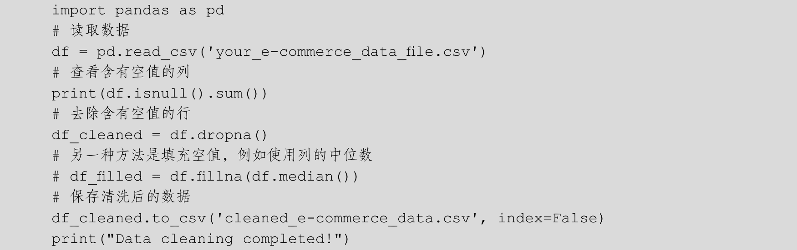

注意：把 your_e-commerce_data_file.csv 换成你自己的文件名。根据需求可以选择直接删掉含空值的行，或用中位数、平均数、众数等策略填充。保存时最好起新文件名，避免覆盖源数据。这只是基础模板，实际清洗往往要更复杂，看数据情况而定。

**3．数据分析交互**
（1）智能问答。直接提问就能得到基于数据的答案或代码建议，比如问“销售额总和是多少”，它会返回代码和结果。
（2）实时反馈。分析过程中会即时展示中间结果，便于理解。
（3）历史记录。会保存之前的提问和代码，方便回溯复用。

**4．生成图表**
（1）自定义样式。可以调整颜色、尺寸、标题等，让图表更符合个人喜好。比如把柱状图改成蓝色即可。
（2）交互式图表。生成的图不是静态的，支持缩放、拖动等交互，更深入探索。
（3）图表导出。可导出为图片或其他格式，便于分享和写报告。

**5．文件编辑**
（1）批量操作。支持批量替换、批量删除等，比如把所有“未知”统一替换成“N/A”。
（2）数据转换。可把数据从一种格式转为另一种，如 CSV 转 Excel。上传 Excel 后要求转 CSV，能完成转换并给出下载链接。
（3）版本控制。提供文件版本管理，可随时回退到之前版本，保证数据安全。误删某列也能恢复到删除前状态。

总体来看，Code Interpreter 大大扩展了 ChatGPT 在数据分析上的能力，让它成为一个强力的分析助手，也在推动人机协作方式的改变。

### 3.2.2
### Code Interpreter 功能实战

3.2.1 节已经介绍了 Code Interpreter 的基本特性和功能，它不只是代码执行工具，还是一个能互动、帮忙解决问题的智能助手。但仅有理论不够，实践才是掌握的关键。

接下来进入实战环节，用真实案例看插件在实际场景里怎么用、怎么互动、怎么解决问题。

先介绍一下要用到的资源和平台。Kaggle 是面向数据科学家和机器学习工程师的全球最大竞赛、数据集和教程平台。接下来使用的数据集就是 Kaggle 上的泰坦尼克数据集，出自 “Titanic-Machine Learning from Disaster” 竞赛，中文名泰坦尼克号-灾难中的机器学习，数据集链接为 https://www.kaggle.com/competitions/titanic/data。该数据集也是数据科学和机器学习社区里最经典的入门数据集之一，包含泰坦尼克号乘客的年龄、性别、舱位等信息，以及是否生还，目标是根据个人信息预测生还情况。Kaggle 的该竞赛首页如图 3.8 所示。

下载数据集可以在点进 “Data” 栏目后跳转到数据集页面，在 “Data Explorer” 下分别选三个数据集，点击  下载；也可以直接点右下角的 “Download All” 一次性下载全部，如图 3.9 所示。

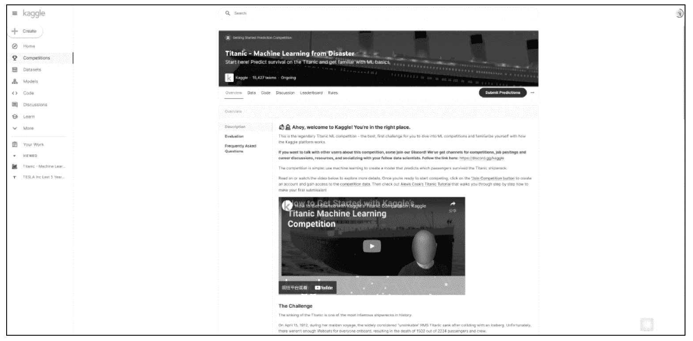
▲图 3.8 Titanic-Machine Learning from Disaster 竞赛首页
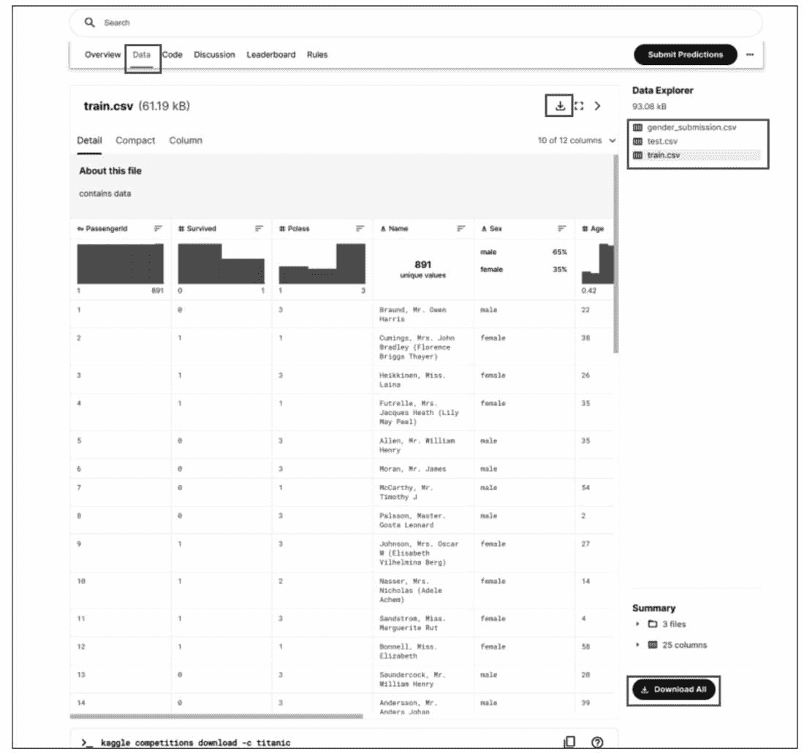
**图 3.9 数据集下载**

现在用这个数据集来练习 Code Interpreter 的能力。

**1．上传数据**
点输入框左侧的加号，把前面下载好的文件传上去，上传成功后文件名会显示在输入框上方，如图 3.10 所示。

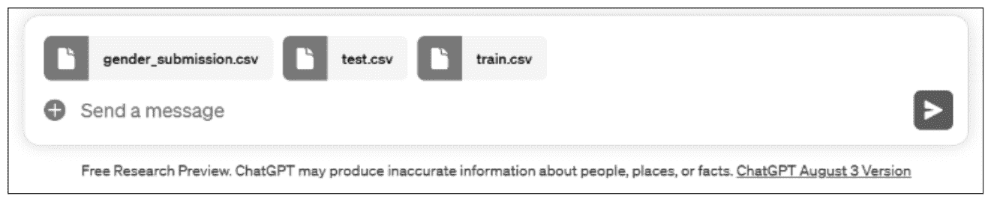
**图 3.10 数据上传**

**2．查看数据概览**
3.2.1 节提到 Code Interpreter 能解读数据，帮助快速建立认知。

User：假设你是一位数据科学家，请提供这三个数据文件的内容概览。
ChatGPT 很快给出回答。

ChatGPT：好的，先检查三份文件的内容，从 train.csv 开始，再看 test.csv 和 gender_submission.csv。

这些数据与泰坦尼克乘客相关。初步概览如下：

1．train.csv
· PassengerId：乘客唯一标识
· survived：是否存活，0 未存活 1 存活
· Pclass：舱位等级，1 一等舱 2 二等舱 3 三等舱
· Name：姓名
· sex：性别
· Age：年龄
· sibsp：船上兄弟姐妹或配偶数
· Parch：船上父母或子女数
· Ticket：票号
· Fare：票价
· Cabin：船舱号
· Embarked：登船港口 C=Cherbourg Q=Queenstown S=Southampton

2．test.csv
与 train.csv 字段相同，只是没有 Survived，用来做预测。

3．gender_submission.csv
· PassengerId：唯一标识
· Survived：存活预测
看起来是提交样本或基于性别的基准解法。

随后给出基础统计：

1．train.csv：
· 共 891 名乘客
· 平均存活率 38.38%
· 年龄信息可得约 74%，平均 29.7 岁，范围 0.42~80 岁
· 超过 75% 乘客没有同行父母或子女
· 票价 0~512.33，平均 32.20
· 大多数从 Southampton 登船

2．test.csv：
· 共 418 名乘客
· 平均年龄 30.3 岁
· 票价 0~512.33，平均 35.63
· 登船港口分布与训练集相似，多为 Southampton

3．gender_submission.csv：
· 418 名乘客的预测示例
· 预测平均存活率 36.36%

这些信息提供了初步认识。下一步可以继续探索、清洗、特征工程或建模，你想怎么进行？

在 Code Interpreter 的帮助下，ChatGPT 不仅列出字段并解释含义，还推断出三份文件的作用，并判断出数据集与泰坦尼克有关。同时给出了三张表的基础统计，让人对数据量级和含义有直观感受，最后还给出进一步分析建议，如探索数据、清洗、特征工程和建模。

**3．数据清洗**
前面提到 Code Interpreter 可用于代码编写和数据分析交互，意味着从清洗到探索、特征工程、建模都能完成并直接出结果。先看清洗。

User：请继续保持数据科学家的身份，针对上述数据先进行数据清洗。
分析过程不总是一帆风顺，可能出现如下情况。

ChatGPT：好的，数据清洗是预处理关键部分，常见任务包括处理缺失值、异常值、数据类型转换、重复值。我先检查缺失值。

很抱歉，执行环境似乎出现问题，我会重新加载数据检查缺失值。

很抱歉，漏掉了必要库的导入，我会重新导入并继续。

很抱歉，因之前环境问题，需要重新上传三个数据文件，提供后我会继续清洗。

这时 ChatGPT 像在自检一样反复修改代码，虽然没立刻出结果，但通过自动测试找到了问题所在，按提示重新上传即可。

ChatGPT：谢谢耐心，我会重新加载文件开始清洗，首先检查缺失值。

训练和测试数据的缺失情况如下：

1．train.csv：
· Age：177 个缺失
· Cabin：687 个缺失
· Embarked：2 个缺失

2．test.csv：
· Age：86 个缺失
· Fare：1 个缺失
· cabin：327 个缺失

处理建议：
1．Age：用中位数填充，年龄可能有偏态。
2．Cabin：缺失过多，转为二元变量表示是否有船舱信息。
3．Embarked：用训练集众数填充，缺失量小。
4．Fare：用中位数填充，票价可能偏态。

开始执行上述清洗。清洗完成后，训练和测试集均无缺失。

具体操作：
1．Age 用中位数填充
2．Cabin 转为二元变量
3．Embarked 用众数填充
4．Fare 用中位数填充

接下来可以进入探索、特征工程或建模，你希望怎么做？

重新上传后，ChatGPT 不仅统计出各字段缺失数量，还智能分析了不同字段适合的填充策略。

**4．探索数据**
User：请继续保持数据科学家的身份，针对上述数据进行数据探索。
指令下达后 ChatGPT 输出了很长的内容。

ChatGPT：好的，数据探索能帮助更好地理解数据、为建模做准备。

本阶段会：
1．可视化存活率与各特征关系，获得直观洞察
2．查看数值特征分布
3．分析分类特征分布及其与存活率关系

先看存活率与性别关系。可视化结果如图 3.11 所示。

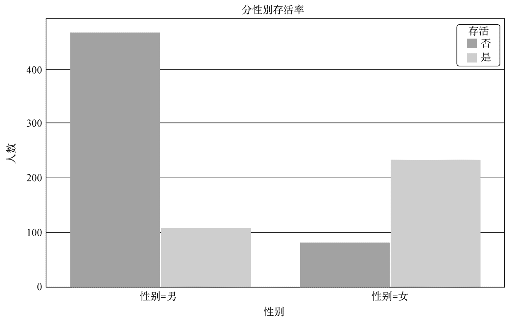
**图 3.11 存活率与性别之间关系的可视化结果**

ChatGPT：从图 3.11 可观察到：
1．女性存活率明显高于男性。男性乘客数量更多，但存活的女性更多。
2．与“女士优先”原则一致。

接下来看舱位等级与存活率关系，如图 3.12 所示。

ChatGPT：从图 3.12 可观察到：
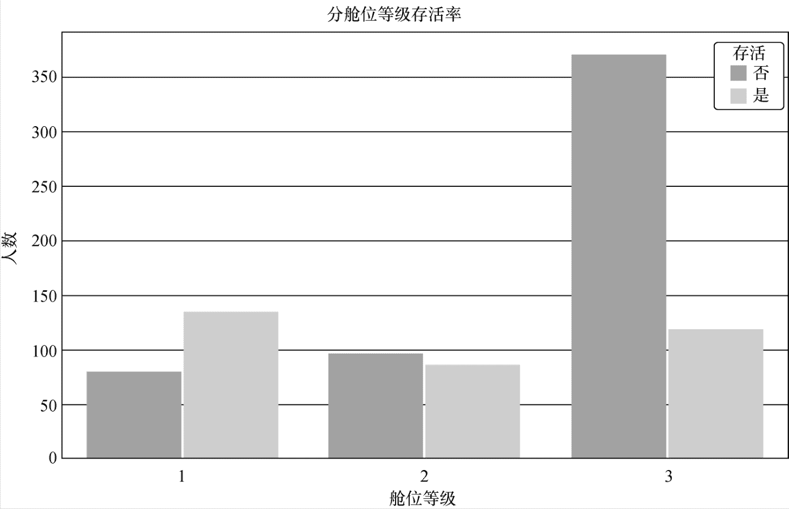
**图 3.12 舱位等级与存活率之间的关系**
1．头等舱存活率最高，存活人数远超未存活。
2．三等舱存活率最低，大部分未能存活。
3．二等舱介于两者之间。

# 泰坦尼克生存率洞察：可视化到建模的完整路径

舱位差异很可能解释了存活上的分化，一等舱和二等舱的旅客前往甲板与救生艇的路径更顺畅，而三等舱的旅客则要跨越更多阻碍。

随后把视线转向年龄维度，看看年龄分布如何影响生还概率。

本步的可视化输出见图 3.13。

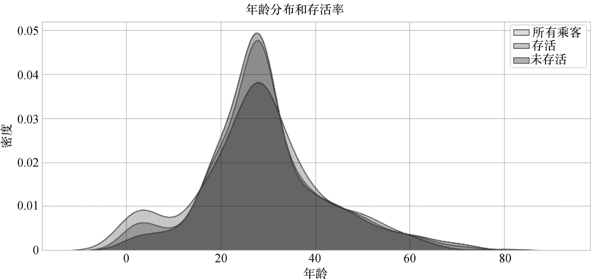

**图 3.13 各年龄段存活情况示意**

ChatGPT：

从图 3.13 可归纳出两点：

1．儿童群体尤其是 0～10 岁的乘客存活比例偏高，这与撤离时优先照护未成年人的惯例如此。

2．20～30 岁的年轻成年男性死亡比例偏高，或许是在救援过程中投入帮助他人或寻找船位时付出代价。

除儿童外，年龄本身与存活之间并未呈现清晰的单调规律。

接下来检视票价分布与存活的关联。

该步的可视化结果如图 3.14。

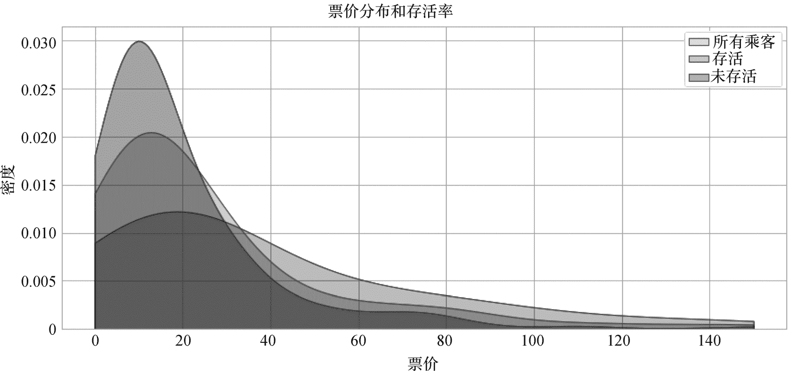

**图 3.14 票价区间与存活关系示意**

从图 3.14 可以看出：

1．票价偏低的群体死亡率更高，尤其是票价在 0～20 区间的乘客。

2．票价较高的群体存活率相对占优，特别是 20～60 区间的乘客。

推测原因是高票价往往对应更优舱位，紧急情况下抵达甲板与救生艇更快。

在整个探索阶段，Code Interpreter 完成了存活率与各特征的关系图、数值型变量的分布描绘，以及分类变量的分布与存活关联的剖析。可以说数据初探做得相当扎实，若刚拿到数据缺少思路，Code Interpreter 能先行探路，给出诸多线索供后续思考。

例如当结果显示女性存活率占优、高舱位存活率占优时，是否可以做交叉验证？于是向 ChatGPT 提出进一步问题。

User：

基于前面的探索，再看性别与舱位等级交叉后的存活情况。

ChatGPT 绘制的交叉图如图 3.15。

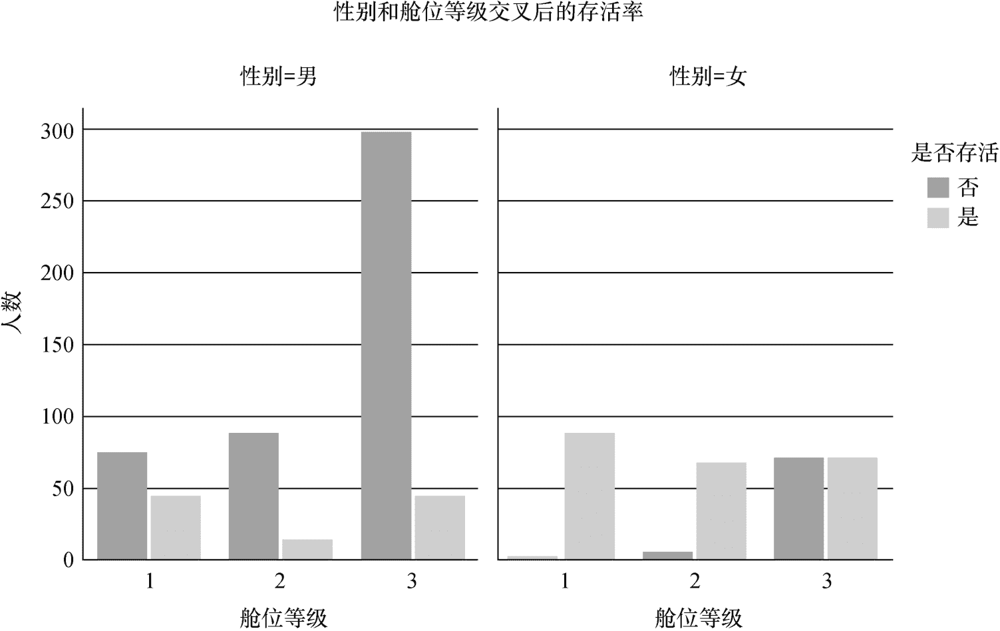

**图 3.15 性别与舱位交叉存活分析**

ChatGPT：

从图 3.15 可总结：

1．女性乘客：

· 一等舱与二等舱女性存活率非常高，未存活者极少。

· 三等舱女性存活率下降，但仍明显高于同舱男性。

2．男性乘客：

· 一等舱男性存活率相对最好，但存活者仍少于遇难者。

· 二等舱与三等舱男性存活率极低，三等舱最为严峻。

总体看，无论性别，一等舱存活都显著高于二等舱、三等舱；同一舱位内女性存活 consistently 高于男性。

这再次凸显性别与舱位的联合作用，两者很可能成为后续建模的核心变量。

**5．特征工程与建模**

同样先让 ChatGPT 自主推进特征工程与建模：

User：

请保持数据科学家的角色，对上述数据做特征工程和建模。

ChatGPT 给出的流程如下：

ChatGPT：

接下来是特征工程与建模。好的特征能提升模型对数据的理解。

### **特征工程**

计划执行：

1．家庭规模：结合 SibSp 与 Parch 合成 FamilySize。

2．是否独行：基于家庭规模生成二元特征 IsAlone。

3．称谓提取：从 Name 中解析 Title，如 Mr、Mrs、Miss 等，可能关联存活。

4．分类变量独热编码：Sex、Embarked、Title。

5．剔除无用特征。

### **建模**

建模步骤：

1．划分训练集与验证集。

2．以随机森林分类器为初始模型。

3．评估表现。

4．必要时调参。

首先进行特征工程。

特征工程已完成，主要改动：

1．新增 FamilySize 表示家庭规模。

2．新增 IsAlone 表示是否独自一人。

3．从 Name 提取 Title 并清洗，低频称谓合并为 Rare。

4．对 Sex、Embarked、Title 做独热编码。

5．删除 PassengerId、Name、Ticket、SibSp、Parch 等冗余列。

现在进入建模。

先切分训练验证集，再用随机森林建模。

性能如下：

训练集准确率：98.46%

验证集准确率：84.36%

训练集表现极佳，验证集明显下降，暗示过拟合。

应对方向：

1．调整参数防过拟合。

2．引入交叉验证更稳健评估。

3．尝试其他算法。

User：

请调整参数防过拟合、使用交叉验证评估、并尝试其他机器学习方法，找出最优方案。

在提示下，ChatGPT 进行了优化。

ChatGPT：

我将按以下流程寻优：

1．调优随机森林：用交叉验证与网格搜索找最佳参数。

2．尝试其他模型：逻辑回归、支持向量机、梯度提升机。

3．基于交叉验证准确率比较，选择最优。

先调随机森林。

最优参数：

1．max_depth：None 不限制深度

2．min_samples_leaf：2

3．min_samples_split：5

4．n_estimators：150

在此参数下，随机森林交叉验证准确率为 83.84%。

再评估其他模型：

1．逻辑回归

2．支持向量机

3．梯度提升机

交叉验证准确率：

1．逻辑回归：81.93%

2．支持向量机：83.05%

3．梯度提升机：83.05%

4．调优后随机森林：83.84%

调优后的随机森林表现最佳，准确率 83.84%，故为最优方案。

值得注意的是，调优后交叉验证分数略低于单次分割验证，这恰说明交叉验证给出了更稳健的泛化估计，单次划分容易受数据分布影响。模型选择应以交叉验证为准。

由此可见 Code Interpreter 在数据分析上的能力十分强劲，未来“人人皆可数据分析”并非空谈，AI 工具可大幅提升效率与产出。

### **3.3**

## **其他常用数据分析插件概览**

本节介绍 Noteable 插件的注册、安装与基础操作，并列出其他常用插件清单供查阅。

### **3.3.1**

### **Noteable 插件基础使用**

Code Interpreter 仅在对应模式下可用，Plugin 模式下有哪些利器？推荐 Noteable。

Noteable 由协作数据笔记本平台开发的第三方插件，将 ChatGPT 的自然语言能力与 Noteable 的数据笔记本无缝结合。该云平台类似 Jupyter Notebook，支持实时代码、公式、可视化、Markdown 协作，广泛用于数据清洗、转换、分析、建模、可视化与机器学习。

借助 Noteable 插件，可与 ChatGPT 对话导入数据、进行探索分析、绘图、跑机器学习模型，所有内容保存在可共享的笔记本中。内置代码单元、版本控制与实时协作，即使非编程用户也能通过对话界面完成专业分析。

使用步骤：

（1）在 Plugin Store 搜索 Noteable，点击 Install，如图 3.16。

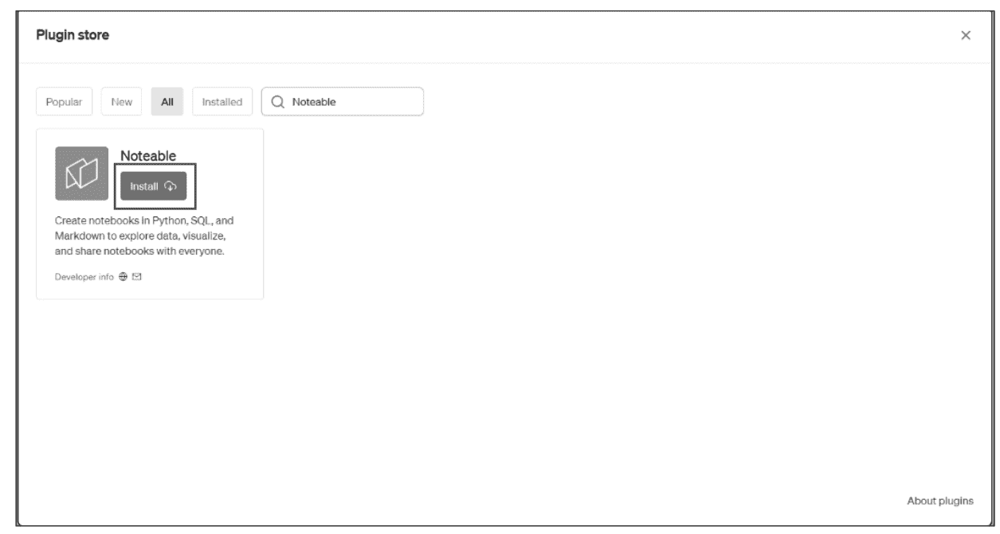

**图 3.16 安装 Noteable 插件**

（2）安装后会弹出 Noteable 登录页，需将账号关联 ChatGPT；若未弹出，可访问 noteable.io 注册免费账号，输入邮箱设置密码，如图 3.17。

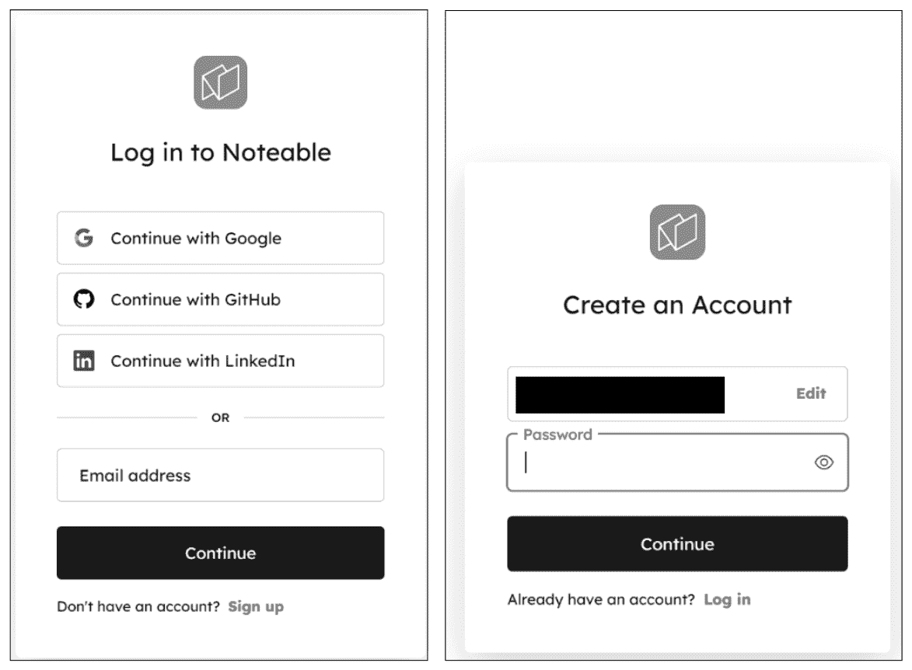

**图 3.17 注册 Noteable 账号**

点击 Continue 后会收到确认邮件，点击 Verify email 完成创建，如图 3.18。

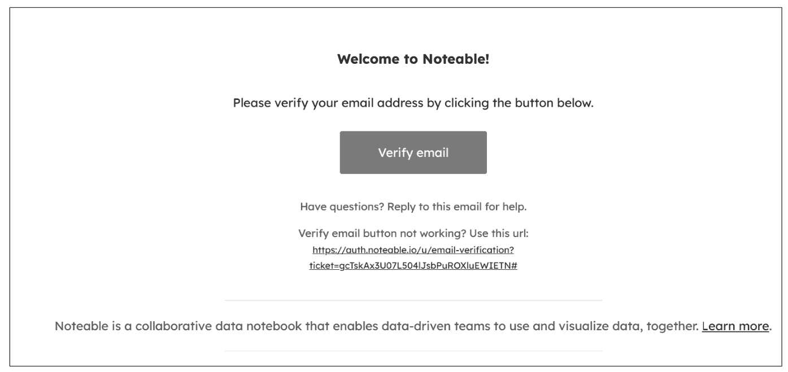

**图 3.18 邮件确认**

（3）账号创建后 ChatGPT 自动激活 Noteable 插件，GPT 版本按钮下方会出现 Noteable 标识，未自动选中时可手动勾选，如图 3.19。

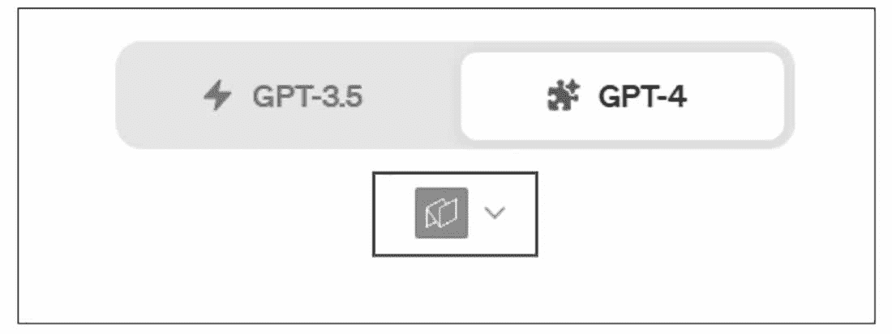
▲**图 3.19 激活 Noteable 插件**

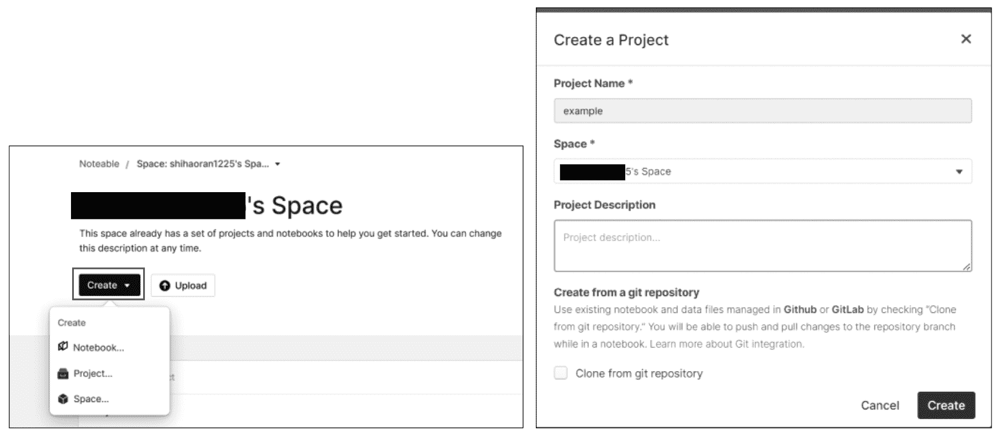
**图 3.20 新建 Project**

（4）在 Noteable 平台新建 Project，例如命名为 example，如图 3.20。后续上传数据均在 Noteable 内操作。

（5）进入 Project 后点击 Upload 上传待分析文件，示例使用鸢尾花数据集 Iris dataset，经典机器学习数据集，下载链接为 https://www.kaggle.com/datasets/uciml/iris？select=Iris.csv，上传界面如图 3.21。

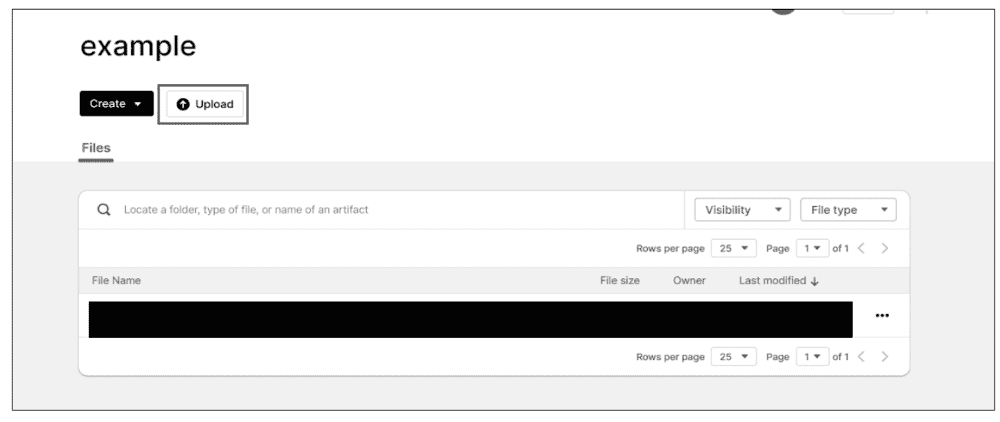
▲**图 3.21 上传数据到 Noteable 平台**

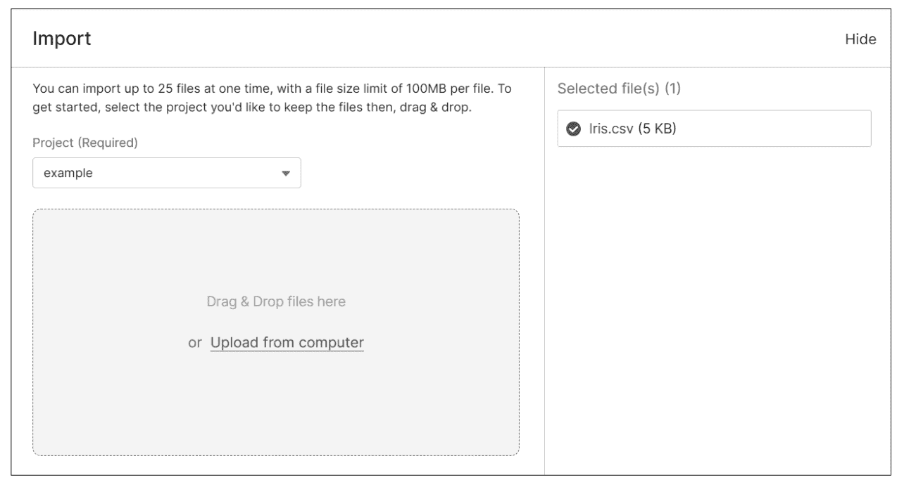
**图 3.21 上传数据到 Noteable 平台续**

打开 CSV 后需记录生成的 URL，如图 3.22，本次 URL 为 https：//app.noteable.io/f/e41de484-5492-4a7e-85db-f32200 a9b385/Iris.csv。

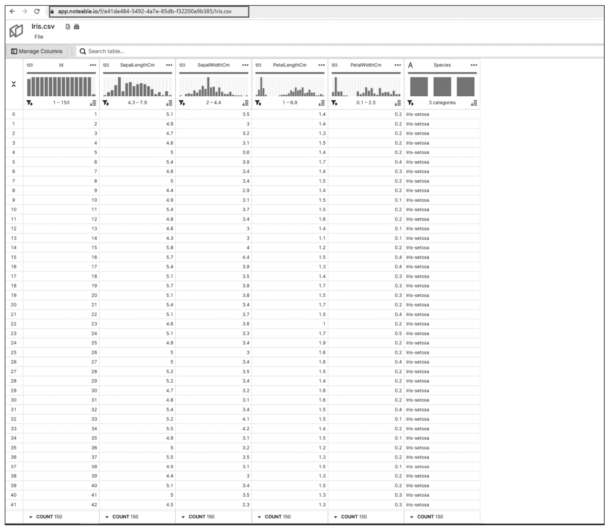
**图 3.22 记录数据 URL**

（6）返回 ChatGPT，告知数据 URL 及操作意图。

User：

假设你是一位数据科学家，我已把 CSV 放入 Notebook，URL 为：https：//app.noteable.io/f/e41de484-5492-4a7e-85db-f32200a9b385/Iris.csv，请解读数据并预测鸢尾花品种。

ChatGPT 在 Noteable 下自动完成数据解读、探索可视化，并用随机森林预测品种并评估，内容完整如下。

ChatGPT：

1．导入库与加载数据

导入 pandas、numpy、seaborn、matplotlib 及 sklearn，加载鸢尾花数据集。

2．数据预处理与探索

基本信息：150 条样本，5 个特征加编号，无缺失。

统计描述：对数值特征给出均值、标准差、最小最大值等。

品种分布：三类均衡分布，各 50 样本。

特征关系可视化：pairplot 显示不同品种在花瓣与萼片尺寸上明显可分。

3．训练模型

数据分割：特征 X 与标签 y，70% 训练 30% 测试。

特征缩放：StandardScaler 标准化。

模型训练：K 最近邻 n_neighbors=5。

4．模型评估

测试集准确率 100%。

分类报告中精确率、召回率、F1 均为 100%。

混淆矩阵显示全部预测正确。

## 总结

KNN 在此数据上实现完美分类，特征间存在明显区分，支撑高准确率。

生成的特征关系图如图 3.23。

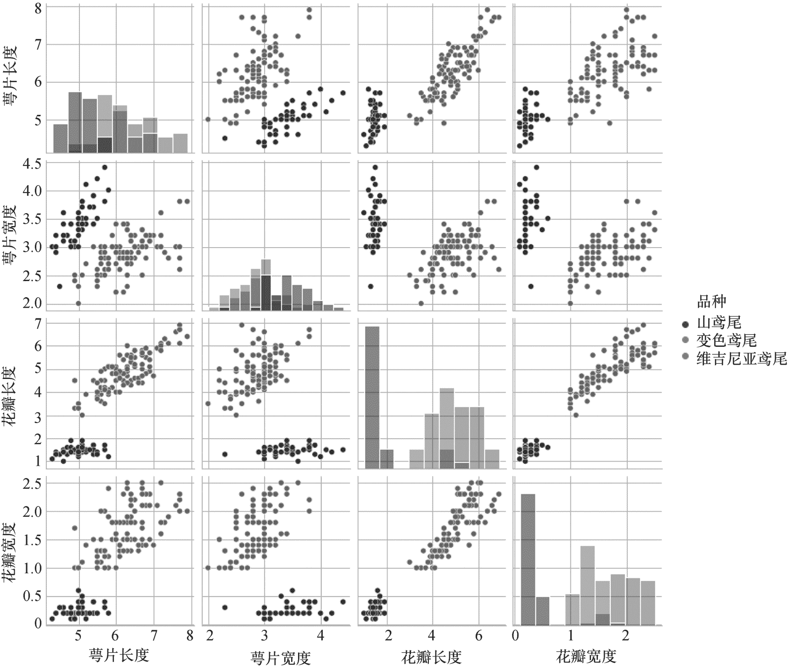
**图 3.23 多特征分布关系示意**

### **3.3.2**

### **其他常用插件介绍**

Plugin Store 目前有 800 多个插件，数据分析常用重点插件如下表 3.1。

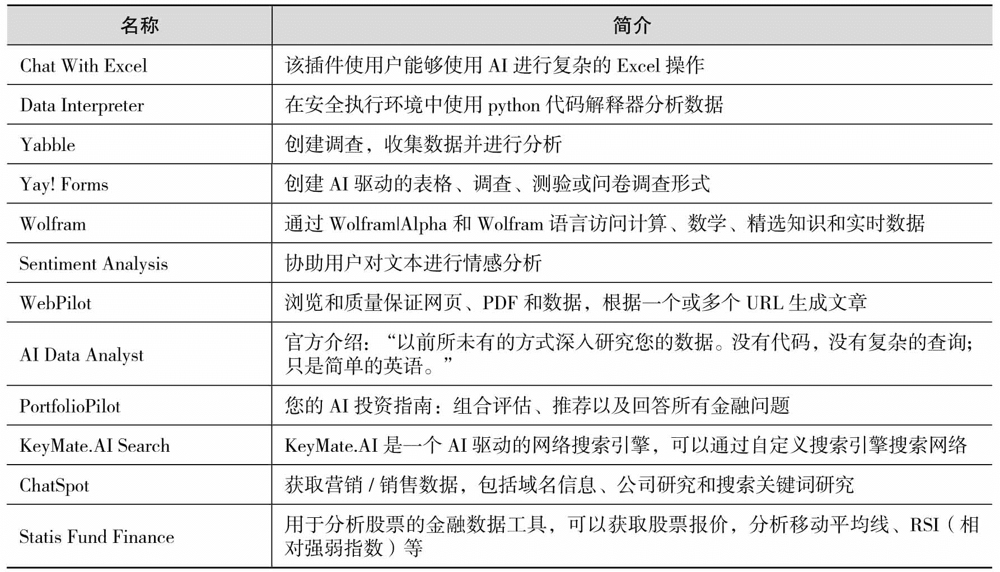
# **第四章**

# **ChatGPT 构建指标体系实战**

大促结束后电商平台常公布 GMV 突破百亿、商品数破万的战报，但仅看孤立指标无法全面评估业务运行状况，需构建指标体系整体衡量。

指标体系是将多个指标按逻辑关系整合为整体，是衡量业务、发现问题、指引优化的关键工具。

借助 ChatGPT 自动化构建指标体系，可节约人力时间、保证体系完整性，减少主观干扰，提供客观一致的评估标准。

### **4.1**

## **案例背景与任务**

近年来电子商务出现垂类电商崛起。企业聚焦垂直市场或深耕细分领域，通过专注与精细化服务满足特定需求。

五年前，A 公司的创始团队捕捉到美容护肤赛道对个性化、高品质产品的旺盛需求，借此切入点打造了一个聚焦高品质美妆的电商平台。起步期，他们严选价值观契合的优质品牌合作来保证货品可靠，同时深度研究市场与用户偏好，甄选出具备差异化竞争力的品类。为了让用户买得顺心，又上线了布局清晰的购物站，提供详尽的商品信息、真实用户评价和专业护肤建议。这一组合拳让 A 公司在短短几年内完成业务的快速扩张。

规模做大后，内部的隐忧也随之显现。业务复盘时，各团队对同一个业务的度量口径千差万别，名字相同的指标含义却不一致；部分部门要么堆砌了海量的指标，要么只盯少数几个无关痛痒的数据，甚至选了无法落地操作的指标；另一些部门虽有指标体系，却缺少结果复盘和反馈闭环，指标逐渐沦为“看看就过”的摆设。这些混乱不仅制约业务协作，也让技术团队在数据埋点和更新时陷入需求反复、重复开发、延期交付、产出不符预期的困境。

面对指标失序的窘境，A 公司意识到要建立统一的指标体系和指标字典来指引业务发展已经刻不容缓。尴尬的是，数据分析团队才成立两个月，正忙着内部培训和清 backlog 的取数需求，根本抽不出人手。最终经业务与数据团队协商，该项工作先由 ChatGPT 负责初稿生成，再由人工进行校对、调整和落地实施。

### 4.2 指标体系核心知识速览

即便把指标体系的初稿交给 AI 去搭，没有相关知识储备也很难把控方向。下面从常用指标类型和构建思路两个维度做一次系统梳理，掌握了这些要点，才能有针对性地引导 AI 输出，并让结果更具逻辑和框架感。

### 4.2.1 指标全景盘点

指标就是把业务拆解后用数值化的方式来描述，它让目标变得可描述、可衡量、可拆解，是业务与数据衔接的基础，也是评估效果的重要依据。

指标无处不在。比如判断身体是否健康，不能只说“我感觉头有点不舒服”或“我状态很好”，要看体检报告里的血压、血糖等具体数值。企业也一样，想说“A 产品卖得不如 B 产品”或“C 网站最近流量不错”，必须用精准的指标和数字说话。

（1）“A 产品最近卖得不如 B 产品好”可表述为“A 产品 2023 年 7 月销量为 18273 件，GMV 为 381023 元；而 B 产品 2023 年 7 月销量为 29112 件，GMV 为 598846 元”。
（2）“C 网站近期吸引到不少流量”可表述为“C 网站近 30 天 UV 为 180000，环比增长 40%，同比增长 30%”。

从维度看，指标大致可按两条线索分类：一是按分析对象分为用户指标、行为指标、货品指标；二是按业务流程分为结果型指标和过程型指标。

先看按分析对象划分。

用户指标
产品用户大致可分为新增、活跃、留存、沉默、流失五类，相关度量围绕这五类展开。 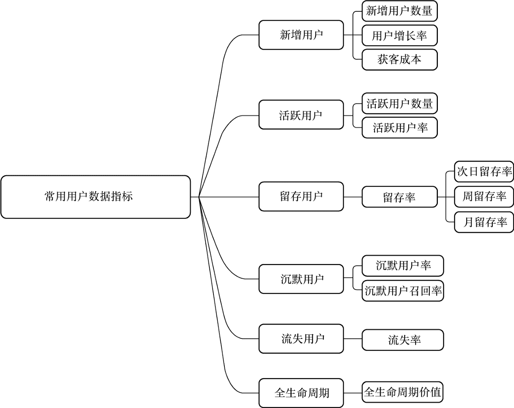
**图 4.1 常用用户数据指标**

把全部用户看作一个水池，新增用户就是活水。新增用户相关指标主要描述获量与质量，常见有新增用户数、用户增长率、获客成本。

新增用户数指一段时间内新注册或加入的用户数量，用来评估市场吸引力与增长趋势，以及营销活动的成效。
用户增长率衡量用户规模的增速，计算方式为用户增长率=（新增用户数量／前期用户数量）×100%，用于判断用户是否在增长以及市场份额扩大程度。
获客成本指把潜在客户转化为付费客户所需投入，计算方式为获客成本=营销和销售成本／新客户数量，成本构成包括广告费、推广费、销售人力、促销费用等。

活跃用户是指在特定周期内有交互行为的用户。常见度量有活跃用户数和活跃用户率。活跃用户数即周期内发生交互的用户数量，不同平台口径不同，如社交平台为发帖、评论、点赞用户，电商平台为下单、评价用户。活跃用户率则是活跃用户数占总用户数的比例，用来衡量参与度和使用程度。

留存用户指在一定时间后仍持续使用的用户。核心指标是留存率，计算方式为留存率=（继续使用产品或服务的用户数／起始时期的用户数）×100%，可拆分为次日、周、月留存等。举例，若某周初有 1000 用户，周末仍在用 800 人，则周留存率为 80%。

沉默用户是互动稀疏或濒临流失的人群。相关指标有沉默用户率和沉默用户召回率。沉默用户率=沉默用户数／总用户数，反映参与度下滑情况。沉默用户召回率=重新激活的沉默用户数／总沉默用户数×100%，衡量召回动作的成功程度。

流失用户指一段时间内彻底停止使用并切断关系的用户。核心指标是流失率，计算方式为流失率=（流失用户数／起始时期的用户数）×100%，用于评估流失严重程度并指导留存策略。

若要评估用户全生命周期贡献，则需要用户生命周期价值，计算方式为用户生命周期价值=（平均购买金额×购买频率×用户生命周期长度）–用户获取成本。

行为指标
用户指标之后，需要用行为指标刻画用户在特定时间段内的行为频次与习惯。行为指标可用于评估触点有效性，优化低效环节，提升行为频率。

代表性指标包括 PV 与 UV、平均访问深度、转化率、K 因子。

PV 即页面浏览量，统计一定时间内页面被加载的总次数；UV 即独立访客数，统计独立访问者数量。若平台某日被 5000 人打开 10000 次，则 UV 为 5000，PV 为 10000。
平均访问深度=PV/UV，表示单次访问的平均浏览页数，可类比图书馆阅读量，用于评估用户兴趣和活跃度，指导内容与导航设计。
转化率指完成特定目标如购买、注册等行为的用户比例，用于评估目标达成情况和营销效果。
K 因子反映用户自传播的裂变速度，计算方式为K 因子=（每个用户平均带来的新用户数量×转发率）-1。

货品指标
用户指标帮助理解需求，货品指标则反映供应侧状况，二者相互影响。

货品指标可分为库存类和成交类，前者为后者提供弹药，后者衡量弹药使用效率。 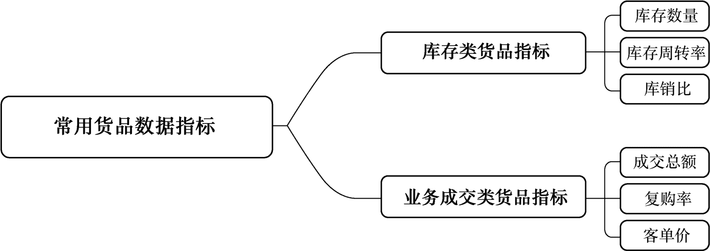
**图 4.2 常用货品数据指标**

库存类指标包括库存数量、库存周转率、库销比。
库存数量可按单位时间内库存总数量或总金额除以天数计算，也可取期初与期末平均。
库存周转率=销售额／平均库存数量，数值越高说明库存越快转化为收入，风险越低。
库销比=平均库存数量／平均销售额，反映库存持有风险与资金占用效率。

成交类指标包括成交总额、复购率、客单价。
成交总额即 GMV，指特定周期内所有交易产生的总收入，统计口径包含销售额、取消订单、拒收订单和退货订单金额。
复购率指一定周期内再次购买同一产品或服务的客户占比，衡量忠诚度与产品吸引力。
客单价用于评估用户价值与盈利能力，不同行业水平差异明显。

结果型指标与过程型指标
结果型指标衡量动作发生后的滞后结果，难以即时干预，多用于监控异常或判断需求是否被满足。
过程型指标衡量动作发生过程中的状态，可通过运营策略影响，进而影响最终结果，更关注原因是否被满足。

### 4.2.2 指标体系搭建思路

单指标无法完整描述业务，如同只知道气温 25℃就无法判断穿衣、带伞、防晒。全面的认知需要把多个指标按关系组织成体系。

构建主要分两步：选指标、搭体系。

指标选取
选指标常借鉴“北极星指标”思路。北极星指标是与当前阶段和战略高度契合的核心指标，紧密关联公司业务目标，通过用户行为与价值创造反映增长态势。

挑选时先明确核心业务目标与战略方向，了解目标用户需求，识别影响增长的关键要素，再综合权衡候选指标的全面性、代表性、适应性和灵活性，最终确定能反映业务健康度并与目标一致的核心指标。

若单一指标不足以全面体现经营，还可引入制衡指标。例如电商常以 GMV 为北极星，同时用订单量作为制衡。方向必须一致，指标要少而精，过多易失焦，过少则视野受限。

指标体系搭建
搭建方法主要有指标分级和 OSM 模型。

指标分级是纵向拆解，按战略目标与业务流程自上而下分层。T1 级指标类比树根，是最高级指标，与战略和核心价值直接相关，反映整体业务表现。T2 级指标类比树干，衡量关键业务要素与流程驱动因素，对实现 T1 指标至关重要。T3 级指标类比树枝，颗粒更细，提供补充信息与专项分析，对整体目标直接影响相对较小。

OSM 模型是横向思考框架，包含目标、策略、度量。
O 即 Objective，目标，指组织设定的可衡量业务目标，与战略愿景一致，需有明确量化或定性标准。
S 即 Strategy，策略，指为达成目标制定的行动方案和路线图，需结合资源、竞争环境与市场需求。
M 即 Measurement，度量，指与目标策略对应的绩效指标，用于监控达成情况，选择恰当度量可帮助改进业务。

### 4.2.3 指标字典的价值与建设要点

前文案例中 A 公司的混乱根源是命名随意、口径不一。要解决，需要各部门共用统一口径的指标说明，这就是指标字典。

把所有指标比作词汇库，指标字典就像词典，为每个指标提供规范解释，包括定义、计算方式、相关维度等。使用时可快速查阅，确保理解一致，提升协作效率，减少重复劳动，是数据化建设的基础，也为数据平台搭建提供依据。

指标体系关注指标间的逻辑与分类，指标字典更像索引，提供详细说明。二者侧重不同但相辅相成。

建设指标字典需关注：
指标分类，按业务方向归类便于查找。
指标名称，保持简洁明了且规范统一。
计算方法，明确汇总方式与度量单位。
可用维度，列出时间、年龄、性别等可组合维度，满足灵活分析需求。

（5）指标映射。阐明该指标可以体现的业务状况以及其适用的场景。

表 4.1 是指标字典的示例，便于直观理解。

**表 4.1 某指标字典示例**

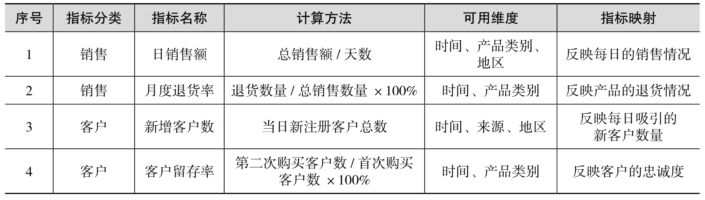

### **4.3**
## **用 ChatGPT 实战搭建指标体系**

在 4.2 节的理论回顾里，我们已经梳理了常见业务指标以及搭建体系的思路与步骤。从本节起回到 4.1 节的案例背景，结合 A 公司的真实需求与 ChatGPT 的使用方式，完成指标体系的构建、绘制结构图，并据此做洞察分析。这里先说明 ChatGPT 的操作流程。

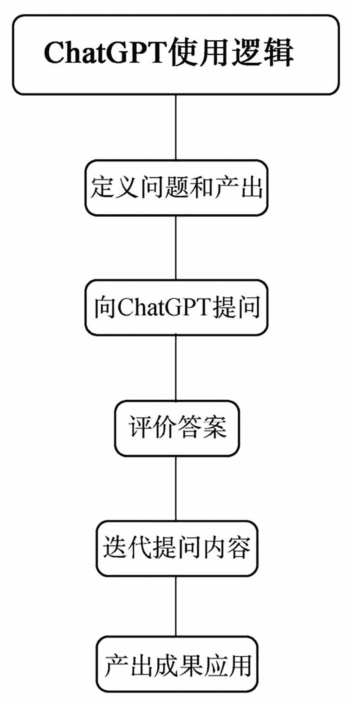

**图 4.3 ChatGPT 使用流程**

（1）先明确问题与交付物，使用前就要想清楚要解决的具体问题与期望得到的结果。
（2）向 ChatGPT 发问，通过互动获取结果。答案质量高度依赖提问方式。
（3）评估结果，参照第一步的预期，判断回答覆盖了哪些点、存在哪些不足、可以怎样优化，并通过追问验证可采纳性。
（4）迭代提问，根据评估结果优化问题或补充追问，让输出更贴合预期。
（5）落地应用，拿到预期产出后需结合实际业务使用。

### **4.3.1**
### **锁定北极星指标**

正式开始为 A 公司搭建体系，第一步是借助 ChatGPT 找到当前最核心、最受重视的指标，作为整个体系的定调者，其他指标围绕它展开，这就是北极星指标。

我们希望 ChatGPT 输出既清晰又贴合 A 公司实际的北极星指标与配套指标，并且说明为何选择它、为何不选其它指标，以保证逻辑自洽。

为此在任务设计上把握三点：
（1）简要介绍 A 公司背景，让输出更贴近实际；
（2）限定只输出一个北极星指标和一个辅助指标，避免多选；
（3）让 ChatGPT 扮演 A 公司资深数据分析师的角色。

首次提示如下。

Question：

A 公司是一家成立五年、主营高品质美妆产品的电商平台，假设你是该公司资深数据分析师，请为其设计北极星指标和配套辅助指标，注意两者各仅有一个。

ChatGPT 很快给出回复。

Answer：

设计时需结合业务模式、目标与战略。
对于高品质美妆电商，可考虑：
1. 北极星指标：月活跃用户数 MAU
MAU 能衡量用户参与度和平台吸引力，对电商而言活跃度直接关联销售额与增长，可了解用户对产品服务的兴趣度。
2. 辅助指标：平均订单价值 AOV
AOV 反映单次购买的平均花费，可了解消费水平与定价策略效果。AOV偏低时需调整定价或推出高价值商品。
两者结合可衡量参与度与购买行为，并据此制定营销销售策略，需定期复盘。

回答给出了 MAU 为北极星、AOV 为辅助的结论并附理由。为检验自洽性，进一步追问为何不选 GMV。

Question：

请说明选择 MAU 而非 GMV 作为北极星指标的理由。

Answer：

选择 MAU 而非总交易额 GMV 的主要原因：
1. 用户活跃是业务健康的核心，持续的兴趣和需求对长期成功至关重要。
2. MAU 直接反映参与度与粘性，持续增长意味着用户基础在扩大。
3. GMV 易受价格波动影响，提价可能推高 GMV 却不代表用户数或活跃度提升，难以真实反映健康度。
4. 用户价值不仅体现在购买，还体现在参与度与品牌忠诚度，MAU 能更全面衡量。

因此可确定 A 公司体系的北极星指标为月活跃用户数，配套辅助指标为平均订单价值。

### **4.3.2**
### **搭建指标体系**

4.3.1 节已明确北极星为 MAU，辅助为 AOV。接下来依据前文方法，在此基础上结合 OSM 模型与指标分级完成体系搭建。对 ChatGPT 输出的预期为：
（1）覆盖 T1、T2、T3 三级；
（2）各层级指标表述清晰、无歧义；
（3）T2 为 T1 的完整拆解，T3 为 T2 的完整拆解。

同样先介绍公司背景并让其扮演资深分析师，同时前置北极星已确定的信息。

Question：

A 公司是一家成立五年、主营高品质美妆产品的电商平台，假设你是该公司资深数据分析师，目前已确定北极星指标为 MAU，配套辅助指标为平均订单价值，请结合 OSM 模型和指标分级方法搭建指标体系。

Answer：

目标是提升 MAU 与 AOV。
策略包括提升用户参与度与提升购买力。
度量方面：
T1：MAU 与平均订单价值
T2：MAU 拆为新用户数、用户留存率、用户活跃度；AOV 拆为订单数量、每单商品数、每单商品均价
T3：新用户数与订单数量分别细化到渠道与品类

该回答层级不清晰、拆解关系未说明，未达到预期。

于是补充 OSM 与分级的定义，让指令更明确：“OSM 模型即 objective、strategy、measurement，是横向思考；指标分级是纵向思考，按战略目标自上而下分为 T1、T2、T3。”

Question：

A 公司是一家成立五年、主营高品质美妆产品的电商平台，假设你是该公司资深数据分析师，目前已确定北极星指标是 MAU，配套辅助指标是平均订单价值，请结合 OSM 模型和指标分级方法进行指标体系搭建。其中，OSM 模型是辅助确定核心的方法，包含业务目标、业务策略、业务度量；指标分级按战略自上而下分为 T1、T2、T3。

Answer：

先明确业务目标：提高用户活跃度、提升购买力。
策略：活跃度方面可增加品类、提升品质、优化客服；购买力方面可做优惠促销、优化购物体验、个性化推荐。
度量：活跃度用 MAU，购买力用平均订单价值。
分级：
T1：MAU、平均订单价值
T2：MAU 下为新用户数、活跃用户数、用户留存率；AOV 下为订单数量、每单商品数量、每单商品平均价格
T3：新用户数细化为渠道新用户数；订单数量细化为品类订单数量

此次回答已说明层级拆解关系，T2 更完整，但 T3 仍缺具体内容且缺少解释。

继续追问：请完整举例 T2 与 T3。

Answer：

T1 北极星 MAU：
T2：DAU、日活跃用户数；用户留存率；用户转化率
T3：DAU 按渠道拆分；留存率按 1 日/7 日/30 日拆分；转化率按浏览到购买、加购到购买等行为拆分

T1 辅助指标平均订单价值：
T2：订单数量；每单商品数量；每单商品平均价格
T3：订单数量按品类拆分；每单商品数量按品类拆分；每单商品平均价格按品类拆分

对照预期：
（1）覆盖 T1、T2、T3 三级，已实现；
（2）指标表述清晰无歧义，已实现；
（3）T2 完整拆解 T1，T3 完整拆解 T2，已实现。

至此指标体系搭建完成。可调用 Diagrams 插件绘制结构图，插件用法见第三章。

Question：

请基于上述内容给出完整的 T1、T2、T3 指标体系结构图，中文显示，文字不重叠。

ChatGPT 输出的结构图如图 4.4 所示。

**图 4.4 ChatGPT 输出的 A 公司指标体系结构图**

接下来用该体系对 A 公司业务做洞察，调研的关键指标数据如表 4.2。

**表 4.2 A 公司某月各项数据指标**

数据可通过 Code Interpreter 上传，也可先传至 Noteable Notebook 再读取，具体见第三章。

继续让 ChatGPT 扮演资深分析师，对数据做解读并给出后续思路。

Question：

假设你是 A 公司资深数据分析师，基于上传数据，先给出各指标的洞察与现状判断，再给出后续分析思路与可能结论。

ChatGPT：

洞察与现状判断：
· MAU 10 万，DAU 1 万，日活占月活比例偏低，粘性可能不足。
· 用户留存率 50%，相对较高，用户体验与产品质量获认可。
· 用户转化率 5%，偏低，浏览到购买存在阻碍。
· 平均订单价值 50 美元，每单商品数 2 件，单品均价 25 美元，客单量与单价表现良好。
· 各渠道 DAU 中直接访问最多，品牌知名度较好，社交与搜索引流需加强。
· 品类看护肤订单最好，香水单品均价最高，不同品类销售特征差异明显。

后续分析思路：
· 粘性不足：深挖行为数据，判断活跃度低的原因，如品类不足或体验问题，可通过调研与数据挖掘验证。
· 转化率偏低：分析购物路径障碍，如价格、流程复杂度，可用 A/B 测试与用户访谈验证。
· 渠道引流：评估各渠道用户质量与转化，优化营销投放。
· 品类表现：分析用户偏好与购买行为，优化品类结构提升销售额。

据此可判断 A 公司存在粘性不足、浏览购买转化偏低、社媒与搜索引流待提升的问题，同时留存率高、客单量与单价是优势。结论需与业务部门共同确认。

### **4.3.3**
### **输出指标字典**

在 4.3.1 与 4.3.2 的工作基础上，已经能借助大模型输出一套完整的度量框架。只是 A 企业之前暴露的问题里，还有一个未被覆盖：同一名称的度量在不同部门口径不一。为统一认知，降低误读与重复劳动，引入度量词典是必要的手段。

结合此前对词典的讲解，对模型产出有四点预期。

1. 结果要完整，至少覆盖分类、名称、计算口径、可下钻维度与映射关系。
2. 构建过程采用了分层思路，词典中必须体现每项度量的层级。
3. 词典需做到全量覆盖，不漏掉体系内的任何一项。
4. 对名称、分类、计算等描述要表述清晰，不能含糊其辞。

据此给出的指令如下：

Question：

请你扮演资深数据分析师的角色，为该美容电商的指标框架构建度量词典，输出形式为表格，并包含层级、类别、名称、计算方法、可下钻维度、映射等字段。

请注意，框架中 T1 北极星为 MAU 月活用户数：

T2 可能包括：
DAU 日活用户数：每日使用平台的人数。
用户留存率：特定周期内回访使用产品的用户占比。
用户转化率：完成特定行为如购买的用户占比。

T3 细化：
DAU 可按渠道拆分，如社交媒体、邮件、SEO 等来源的 DAU。
留存率可按周期拆分，如 1 日、7 日、30 日留存。
转化率可按行为拆分，如浏览到购买、加车到购买。

T1 辅助指标为平均订单价值：
T2 可能包括：
订单数：每月下单次数。
单品数：单笔订单商品平均件数。
单价：单笔订单商品平均价格。

T3 细化：
订单数、单品数、单价均可按品类拆分。

很快得到回复，给出的初稿如表 4.3 所示。

**表 4.3 度量词典初稿**

从输出可见，字段包含层级、类别、名称、计算口径、可下钻维度、映射共六项，同时满足前两项预期并实现全量覆盖。

短板在于可下钻维度的表述偏笼统，缺乏具体说明，于是基于该结果继续追问。

Question：

请对可下钻维度展开说明，例如时间可包含哪些周期？渠道具体指哪些？品类包含哪些？行为有哪些？在细化后重新输出词典。请注意该平台主营高品质美妆。

这次模型先给出说明：

Question：

· 时间维度：可含日、周、月、季度、年等周期。
· 渠道：可含社交媒体如 Instagram、Facebook、WeChat、邮件营销、SEO、SEM、直接访问、推荐链接、合作推广等。
· 品类：护肤、彩妆、香水、护发、身体护理、美容工具等。
· 行为：浏览、搜索、加车、购买、收藏、评论、分享等。

随后给出新的词典，如表 4.4 所示。

**表 4.4 该企业度量词典**

经过二次追问，维度内容得到补充，输出已满足开篇设定的四项预期。

### 4.4
## ChatGPT指标搭建实践复盘

**1．常用度量概览**

常用度量是量化与追踪业务运行的核心工具。

1. 用户相关度量
① 定义：聚焦用户群体与产品的互动。
② 典型：新增、活跃、留存、流失等。
2. 行为相关度量
① 定义：反映用户在产品中的具体动作。
② 典型：页面浏览、点击率、交互频次等。
3. 商品相关度量
① 定义：体现商品运营表现。
② 典型：销量、库存、退货率等。

**2．度量选取要点**

北极星度量是构建体系的关键方法，用单一核心度量指引战略与执行。

1. 定义与价值
① 定义：单一关键度量，代表核心价值，与长期成功相关。
② 价值：帮助团队聚焦资源，确保行动围绕核心增长。
2. 确定方法
① 与目标一致：对齐长期愿景。
② 衡量关键行为：反映直接影响增长的核心动作。
③ 易懂易沟通：直观清晰，便于全员理解。

**3．分层方法**

分层是将度量按重要性与功能划分，形成结构清晰的体系。

1. 高层：战略层面，反映整体目标与长期愿景。
2. 中层：聚焦业务单元或部门如营销、销售、客服等。
3. 底层：操作层面，关注日常活动与流程效率。

**4．OSM模型要点**

OSM 把目标、战略与举措串联。

1. 要素
① 目标：明确长期愿景。
② 战略：确定达成路径。
③ 举措：执行战略并评估成效的具体行动与度量。
2. 步骤
① 目标设定：基于愿景与市场制定可量化目标。
② 战略制定：规划达成目标的方案。
③ 举措确定：制定行动计划与关键成功度量。

**5．实操要点**

1. 确定北极星。借助大模型输出贴合该企业的核心度量与配套度量，确定核心为月活用户数 MAU，配套为客单价。提示如下：

Question：

某初创五年专注高品质美妆电商，假设你是资深分析师，请为其设计北极星度量与配套度量，各一个。

2. 搭建框架。结合 OSM 与分层方法，输出涵盖 T1/T2/T3 的完整框架。提示如下：

User：

某初创五年专注高品质美妆电商，已确定核心为 MAU，配套为客单价，请结合 OSM 与分层方法搭建指标框架。OSM 包含目标、战略、度量；分层为纵向自上而下剖析，分 T1、T2、T3 三级。

3. 输出词典。结合前文知识产出完整词典，需包含分类、名称、计算口径、可下钻维度、映射并做到全量覆盖。提示如下：

User：

请扮演资深分析师，为该企业的指标框架构建度量词典，表格形式，包含层级、类别、名称、计算方法、可下钻维度、映射等。

请注意框架内容：“T1 北极星 MAU 月活用户数：T2 可能包括 DAU、日活用户数、留存率、转化率……T3 细化……T1 辅助指标平均订单价值：T2 可能包括订单数、单品数、单价……T3 细化……”

# 第五章
# ChatGPT驱动的数据采集与清洗实战

在分析工作中，采集与清洗是基础工程。没有扎实的数据，任何洞察都无从谈起。

当下数据无处不在，从社交点赞到交易记录，再到医疗交通等领域。信息既是宝库，也混杂噪声、缺失和异常。如何提炼价值，是分析师的必修课。采集不仅是收集，更要选对源、保质量；清洗则是预处理，去重、补缺、纠错，保证后续分析可信。

本章演示如何将大模型能力与采集、清洗知识结合，在案例中落地。

### 5.1
## 项目背景与任务拆解

第四章提到该企业为高品质美妆电商。近年美妆向高端与个性化演进，消费者对口红的需求已超越颜色品牌，更追求个性、功能与品质。

企业捕捉到趋势，发现消费者对时尚与滋润结合的需求强烈，决定研发新品。

在新品讨论会上，各部门观点碰撞。市场部认为要迎合时尚；研发部主张技术创新；设计部希望外观独特；销售部关注快速接受度。

讨论暴露问题：观点分散甚至矛盾，部分方案重部门利益轻整体需求，创新缺乏市场验证难以落地。

领导层决定委托分析部门一方面采集用户与市场真实声音，另一方面清洗过往产品数据供各部门参考，双管齐下为新品提供可信原始数据。

团队与业务沟通后确定，本项目由大模型负责采集与清洗，人工作结果校对与落地。

### 5.2
## 采集清洗核心知识

扎实基本功是使用 AI 工具提效的前提。本节从概念、注意事项、实现方法梳理基础。

### 5.2.1
## 数据采集是什么

数据采集是指收集、获取并记录特定主题信息的全过程。数据可为数字化、定量、定性或混合，取决于目的。场景覆盖科研、调研、医疗、工程开发等。采集是分析与挖掘的基础，思路再好没有优质数据源也无法落地。

基本原理：借助工具与方法从不同来源获取所需信息。来源可以是网站、数据库、传感器、问卷等。好比去超市购物，按需从货架挑选商品。

采集需遵循核心原则，如图 5.1 所示。

1. 目的明确。先清楚为何采集。如电商可能采集购买行为以优化推荐。

**图 5.1 采集核心原则**

2. 质量可靠。确保准确性与完整性。如调研不仅要收集允许的信息，还要保证真实无误。
3. 合法合规。遵循法律法规，尊重来源权益。如医疗研究必须保护隐私。
4. 全面性。数据量要达到分析价值，维度要支撑需求。如“查看商品详情”需采集触发环境、会话及用户 ID，最终统计时段内人数、次数、人均次数、活跃比等。

还需注意：数据安全是首要，传输与存储必须可控；避免冗余，不重复采集已有数据；保持时效，及时更新并定期校验。如股市数据需实时或准实时更新。

方式多样，包括网络爬虫、问卷调查、埋点采集、用户访谈、物理采集、数据交易等，接下来重点介绍前两种。

### 5.2.2
## 网络爬虫原理

网络爬虫是自动化、系统化收集互联网数据的技术，爬虫不生产内容，只搬运内容。把互联网比作蜘蛛网，爬虫就是在网上爬行的蜘蛛，节点是网页，沿着链接不断爬行。

客户端发出任务指令后，爬虫 IP 抵达目标服务器，从某个页面开始读取内容、提取源代码中的任务信息，回传客户端存储，再继续抓取，直至完成任务。

先了解几个基础概念。

1. HTTP 请求。超文本传输协议是互联网传输网页的标准协议。输入网址即向服务器发送 HTTP 请求，获取页面内容。
2. GET 请求。HTTP 请求的一种，用于请求数据。访问网页时浏览器会发送 GET 请求获取页面。
3. HTML。超文本标记语言，用于描述网页结构，用标签定义文本、链接、图片等。
4. URL。互联网资源的唯一地址，指向特定文件或服务。如 http：//blog.example.com/articles/summer-travel-tips？sort=date&user=alice#comments 指向某篇关于夏季旅行的文章。

网络爬虫主要分抓取、分析、存储三步，如图 5.2 所示。

**图 5.2 爬虫步骤**

**1．抓取**

抓取是第一步，即从互联网获取网页。

爬虫向目标站点发送 HTTP 请求，服务器返回 HTML 页面内容。起点是一个或多个种子 URL，从已抓取页面中提取新链接并持续抓取。

**2．分析**

抓取到页面源码之后，真正的处理才算开始。爬虫一般借助专业的解析工具，把原始 HTML 转成结构化的表达，再从结构化结果中挑出所需字段，常见字段有正文、超链接、图片、视频等。

**3．存储**
提取后的信息必须落盘，后续工作才有依据。通常爬虫会把结果写入数据库，或导出为 CSV、JSON、XML 等文件，具体形式取决于后续分析的习惯。

搭建网络爬虫时，基本都会借助现成的框架。框架把开发、部署、维护中的重复工作抽象出来，提供现成组件，让构建爬虫更省心。

下面重点介绍三类常用方案：Scrapy、Beautiful Soup 和 Selenium。

**1．Scrapy**
Scrapy 是为抓取网页并抽取结构化数据而生的应用框架，可用于数据挖掘、信息处理、历史数据归档等场景。用它抓取类似亚马逊商品页的信息比较轻松，但面对交互复杂、逻辑多变的页面时能力会受限。图 5.3 所示为 Scrapy 的 Logo。

**图 5.3 Scrapy 的 Logo**

**2．Beautiful Soup**
Beautiful Soup 名气很大，它整合了不少常规爬虫需求，是一款基于 Python 从 HTML 或 XML 文档中抽取数据的库。使用者可按自己习惯的解析器来导航文档、定位节点、调整样式，不过它本身不具备加载 JavaScript 的能力。

**3．Selenium**
Selenium 最初是网站自动化测试工具，如今也被广泛用作强大的网页爬虫手段。它能模拟真实浏览器的行为，从而与由 JavaScript 动态生成的页面正常交互。和很多传统爬虫不同，Selenium 可以操作页面元素，模拟点击、滚动等用户动作。图 5.4 所示为 Selenium 的 Logo。

**图 5.4 Selenium 的 Logo**

最后要提醒，爬虫开发必须注意合规与安全，切勿触碰红线。

（1）个人隐私、商业机密、国家秘密属于数据抓取的绝对禁区。
（2）恪守职业道德，合理控制访问频率，避免对被爬站点造成业务干扰。
（3）遵守 robots 协议，具体内容可查阅 https：//baike.baidu.com/item/robots%E5%8D%8F%E8%AE%AE/2483797。

### **5.2.3**

### **问卷调查**
问卷调查是数据采集里使用频率很高的方法，它让研究者能从大量受访者那里收集到标准化的信息。流程是先设计好固定问题，再把问卷发给目标人群收集反馈。

举一个易懂的例子。

假设你是一名健康研究者，想探究城市年轻人饮食习惯与自感健康之间的关联。可以设计如下类型的题目。

（1）选择题：您一天通常吃几顿饭？
A．1 顿
B．2 顿
C．3 顿
D．4 顿或以上

（2）判断题：您觉得自己的饮食习惯健康吗？
A．是
B．否

（3）量表题：请给自己的整体健康状况打分（1 代表非常不健康，5 代表非常健康）？
1 2 3 4 5

（4）开放式问题：您认为哪些因素最会影响您的饮食选择？

受访者作答后即可汇总数据，观察饮食模式与自我报告健康之间是否呈现明显联系。

### **5.2.4**

### **其他常见数据采集方式**
采集手段远不止前面重点讲的几种，剩余常见方式汇总在表 5.1。

**表 5.1 数据采集方法介绍**

### **5.2.5**

### **数据清洗概念**
数据仓库里的数据往往是围绕主题的多源集合，既包含历史数据，也来自不同业务系统。由此不可避免地会混入错误记录、相互矛盾的记录，这类不可用的记录被称为“脏数据”。

因此需要做数据清洗来筛选出真正可用的数据。通俗地讲，清洗就是提升数据质量的过程，也是发现并修正数据文件中可识别错误的最关键一步。

清洗的核心价值在于提高数据可用性，进而提升分析的准确性，为决策提供可靠支撑。

数据清洗主要涵盖一致性检验、缺失值处理、异常值处理、重复数据处理等，5.2.6 节会进一步展开。

### **5.2.6**

### **数据清洗主要方法**

**1．一致性检验**
一致性检验是依据变量的合理取值范围和它们之间的内在关系，来判断数据是否合理，找出超出范围、逻辑不通或自相矛盾的记录。主要内容共六类，如图 5.5 所示。

**图 5.5 一致性检验内容示意图**

（1）格式一致性：保证同一列或字段的数据遵循统一的格式或结构，否则解析、分析、汇报都会受影响。例如日期列统一用 YYYY-MM-DD，电话号码统一用（×××）×××-×××× 的形式。
（2）单位一致性：确保度量或计数的单位在同一列内保持一致，避免单位混用导致误读。比如长度列全部使用米或厘米，不要混用。
（3）代码和分类一致性：保证代码类字段使用统一标准。比如性别字段始终用 “M” 表示男性、“F” 表示女性。
（4）文本和命名一致性：保证文本字段的拼写、格式和命名约定统一，避免因写法不同产生重复或匹配失败。如公司名称、人名、地址应保持一致的拼写与格式。
（5）计算一致性：保证公式和计算逻辑在整体数据集中保持正确且统一。
（6）规则和逻辑一致性：保证数据符合常识或已知规则。例如个人的出生日期不应晚于死亡日期。

**2．缺失值处理**
缺失值处理的策略很多，实际选用要结合具体场景，如表 5.2 所示。

**表 5.2 缺失值处理方法**

**3．重复数据处理**
重复数据处理主要分两步：先识别重复，再决定如何处置。下面以表格形式说明，见表 5.3。

**表 5.3 重复数据处理步骤和方法**

**4．异常值处理**
异常值也称离群点，是与整体分布明显偏离的数据点，可能源于测量失误、录入错误，也可能是真实变异。常见的处置思路整理在表 5.4 中。

**表 5.4 异常值处理方法**

### **5.3**

## **ChatGPT 数据采集实战**
在数据汪洋里，信息是宝藏，采集是开启宝藏的第一步。怎样高效、准确地采集，又如何保证采集结果能为后续分析与决策提供价值？本节将围绕 ChatGPT 的数据采集实践展开，包含用 ChatGPT 实现网络爬虫和设计调研问卷两部分。

### **5.3.1**

### **ChatGPT 爬虫实战分析**
结合前文，A 公司需要的是第三方平台的品类数据，无法通过埋点获取，所以在合法合规前提下，优先考虑用网络爬虫抓取。

在正式提问前，需要先厘清需求与标准。

（1）代码要能正常运行，并输出目标页面的商品信息。
（2）抓取结果必须为中文，避免乱码影响阅读。
（3）原始数据不足以得出结论，需要在 ChatGPT 层面做进一步加工。

据此，提示词应包含以下要点。

（1）电商页面多为动态渲染，需提示使用 Selenium 框架。
（2）明确列出所需的数据字段。
（3）在提示中说明后续分析步骤，本案例中是对商品名称做分词、词频统计并可视化。

先简要说明分词：在中文里，分词目标是把连续汉字切分为有意义的词。例如“我爱中国”，分词结果为[“我”，“爱”，“中国”]。

提问示例要求模型分三步执行，每步先给出结果且代码带中文注释并待确认：第一步用 Selenium 爬取指定 URL 的口红名称、品牌、评论数量并保存为 CSV；第二步对名称分词并统计频次；第三步取频次前 20 绘制条形图。

针对第一步，模型返回的代码示例如下。

在 Jupyter Notebook 中运行后未报错，但打开文件却出现乱码，如图 5.6 所示。

**图 5.6 乱码示意图**

为定位问题，先确认是否真的抓到数据。可在 Notebook 中直接查看变量 data，部分结果如图 5.7 所示。

**图 5.7 部分爬取结果**

可见代码本身抓取是正常的，问题出在导出 CSV 的环节。于是要求模型修改保存方式。

用户指出虽然抓取正确，但 CSV 中汉字乱码，并给出原代码片段。模型判断为编码设置不当，给出修改方案。

ChatGPT:

df.to_csv('lipsticks_data.csv', index=False, encoding='GBK')

改动后 CSV 恢复正常，如图 5.8 所示。

**图 5.8 消除乱码后的爬取结果展示**

第一步至此完成。随后让模型继续分词与词频统计，生成的代码如下。

运行后发现前列出现大量符号和无意义助词，前三名为“.”“【”和“】”。因此追加提示剔除停用词和符号。

用户要求在分词处理中不要将停用词和符号纳入统计。模型返回的去噪后代码如下。

此时前几名变为七夕、口红、礼盒、限定、情人节，可用性明显提升。第二步结束。

接下来让模型生成词频条形图，代码如下。

运行后得到条形图，如图 5.9 所示。图表虽能满足需求，但纵轴文字模糊。于是提出优化需求：

用户请模型列出让图片更清晰的办法和具体代码。

**图 5.9 词频排名前 20 的关键词可视化**

模型给出的建议如下。

# ChatGPT

为了使生成的图像更加清晰，你可以采取以下方法：

1．增加图像尺寸：通过调整 figsize 参数，你可以增加图像的尺寸，从而使其更加清晰。

2．增加分辨率：使用 dpi 参数可以增加图像的分辨率。

3．使用更清晰的字体：通过调整字体大小和样式，可以使图像上的文字更加清晰。

4．保存为矢量图格式：保存为 SVG 或 PDF 格式可以保持图像的清晰度，无论放大到什么程度。

这里选用 dpi 参数提升分辨率，将 plt.figure（figsize=（12, 8））改为 plt.figure（figsize=（12, 8）, dpi=150），效果如图 5.10 所示。

**图 5.10 改进后的词频排名前 20 的关键词可视化**

从优化后的图可提炼出若干设计启示。

（1）节日与特殊日子：七夕、情人节等词高频出现，说明节日限定款受欢迎。可考虑推出圣诞限定、春日特色等主题口红。
（2）仪式感：礼盒、礼物、送、礼袋、生日礼物等词显示口红常被赠送，建议强化包装仪式感或推出礼盒装。
（3）口红特性：哑光、满赠、高订、夜光、烈艳、蓝金等词反映消费者关注效果与特性，可研发超持久、不沾杯等差异化配方。
（4）用户互动：会员、专享、加入、尊享等词表明消费者对权益敏感，可针对新品推出会员专属优惠或礼物。

### **5.3.2**

### **ChatGPT 调查问卷设计实战**
爬虫能拿到客观事实，但问卷可以面向特定人群挖掘情感、态度与意图，二者不可替代。A 公司数据部门决定借助 ChatGPT 设计一份口红偏好调研问卷。

先确定问卷标准。

（1）题目表述清晰无歧义，避免导向性表述，如“您也认为这款口红的颜色亮度过高吗？”即属引导。
（2）按模块分组，避免题目混杂。
（3）题量控制在 15～25 题，既不过载也不够信息。

提示词应包括：说明公司背景并指定角色、明确问卷目的与内容、细化各部分题目数量与题型。

提问示例要求模型以高端美妆平台 A 公司的资深数据分析师身份，设计一份口红市场调查问卷，了解消费者喜好用于新品设计。问卷需包含受访者基本信息、口红购买偏好、对公司过往口红满意度三部分，第一部分 3 题单选，第二部分 5-10 题量表，第三部分 5 题单选多选量表均可，并完整输出内容。

模型生成的问卷如下。

ChatGPT：

以下是我为您设计的问卷内容：

**A 公司口红市场调查问卷**

一．受访者基本信息（单选题）

1．您的性别是？

男

女

### 其他

不愿透露

2．您的年龄范围是？

18 岁以下

18～25 岁

26～35 岁

36～45 岁

46 岁以上

3．您的月均个人消费水平是？

2000 元以下

2000～5000 元

5001～10000 元

10001～20000 元

20000 元以上

二．受访者口红购买偏好（量表题）

4．您多久购买一次口红？

1（每周）

### 2

### 3

### 4

5（每年）

5．您更偏好哪种口红质地？

1（完全偏好哑光）

### 2

### 3

### 4

5（完全偏好滋润）

6．您在选择口红时更看重哪一点？

1（完全看重颜色）

### 2

### 3

## 4

5（完全看重品牌）

7．您愿意为一支高端口红支付的价格是？

1（200 元以下）

### 2

### 3

## 4

5（1000 元以上）

8．您更喜欢哪种口红包装设计？

1（完全偏好简约）

【口红洞察】用 ChatGPT 把问卷设计到数据清洗跑通全流程

ChatGPT 帮 A 公司搭了一份结构完整的消费者调研，共分 3 大模块 16 道题。整体篇幅适中，题型涵盖单选、多选、量表和简答，表述简洁无歧义。问卷通过后在一周内回收了 1200 份有效样本，数据结果如下。

一、受访者基本画像
性别方面男性占 5%，女性占 92%，其他 2%，不愿透露 1%。年龄上 18 岁以下 8%，18～25 岁 45%，26～35 岁 35%，36～45 岁 10%，46 岁以上 2%。月均个人消费：2000 元以下 10%，2000～5000 元 40%，5001～10000 元 35%，10001～20000 元 10%，20000 元以上 5%。

二、口红购买偏好
购买频次：每周 5%，每月 45%，每季度 30%，每半年 15%，每年 5%。质地偏好哑光 40%，滋润 60%。选购重点颜色 60%，品牌 40%。价格接受度：200 元以下 15%，200～500 元 50%，500～800 元 25%，800～1000 元 7%，1000 元以上 3%。包装喜好简约 45%，奢华 55%。对持久度的需求：不需要 10%，较不需要 15%，中等 35%，较需要 25%，非常需要 15%。对滋润度的需求：不需要 5%，较不需要 10%，中等 30%，较需要 40%，非常需要 15%。

三、对 A 公司口红的感知
品牌认知度：了解 60%，不了解 40%。购买过用户的满意度：非常不满意 5%，不满意 10%，中等 40%，满意 35%，非常满意 10%。最青睐的系列：系列 a 40%，系列 b 30%，系列 c 20%，系列 d 5%，其他 5%。认为需要改进的维度：颜色选择 50%，持久度 40%，滋润度 30%，包装设计 20%，价格 10%，其他 5%。新品尝试意愿：一定会尝试 35%，可能会尝试 45%，不太可能尝试 15%，一定不会尝试 5%。

基于以上反馈，数据部门归纳出新品设计要点：
目标人群应锁定 18～35 岁女性，其中 18～25 岁占比最高，策略需更年轻化，同时兼顾 26～35 岁成熟群体需求。定价带以 200～500 元为主，确保高端感与接受度平衡。购买节奏多为季度，适合推季度限定或新品计划。质地方面滋润略占优，哑光仍具规模，建议双线并行。品牌知名度已达 60%，仍有较大推广空间。改进优先级是颜色选择与持久度。

## **5.4**

## **ChatGPT 数据清洗实战**

A 公司早期 a 系列销量数据由市场部手工维护，文件名为《A 公司过去五年 a 产品销量记录》，字段包括日期、浏览量、访客数、人均浏览量、平均停留时间、跳失率、成交客户数、成交单量、成交金额、客单价等，现需清洗后方可使用。

### **5.4.1**

### **ChatGPT 一致性检查实战**

一致性核查需覆盖格式、单位、代码分类、文本命名、计算逻辑、规则逻辑等多维度。为此把模式切到 Code Interpreter，明确告知读取的文件名及六类检查要求。

User 提示后 ChatGPT 给出一致性检查代码如下。

运行后得到的主要发现：格式基本符合预期；单位未见明显异常；代码分类上部分环比列全为 “-”，可能缺失；成交客户数列唯一值较多需业务确认；文本命名检查被跳过；计算一致性因缺乏计算关系被跳过；日期列顺序不严格。

进一步聚焦成交客户数，抽样发现该列混有纯数字与带单位字符串，如 3.4797368 千人。数字样本 1839 条，字符串样本 40 条且各不相同，属于混合类型问题。解决思路为统一为数值，或拆列处理。经确认仅需数值，采用统一转换方案，处理代码如下。

转换前后对比如图 5.11 一致性问题解决前后对比，带“千人”的记录已转为纯数字，如 3.5 千人变为 3500。

### **5.4.2**

### **使用 ChatGPT 处理缺失值＆重复数据**

**1．缺失值处理**
缺失值处理分删除与填充。要求先把“-”视为空值，统计各列缺失占比，超过 50% 则删列，未超 50% 则做多重插补。

User 提示后 ChatGPT 执行替换、统计、决策流程。

缺失占比示例：日期 0.000000，浏览量 0.686378，浏览量环比 100.000000，访客数 0.000000，访客数环比 100.000000，人均浏览量 0.000000，人均浏览量环比 100.000000，平均停留时间 0.000000，平均停留时间环比 100.000000，跳失率 0.000000，跳失率环比 100.000000，成交客户数 0.791975，成交客户数环比 100.000000，成交单量 0.000000，成交单量环比 100.000000，成交金额 0.000000，成交金额环比 100.000000，客单价 0.000000，成交商品件数 0.000000，成交转化率 0.000000，下单客户数 0.000000。

结论为多列缺失率 100%，需删除；成交客户数缺失率低于 50%，可用多重插补；浏览量等少量缺失亦采用插补。删除全空列并完成插补后数据无缺失。

ChatGPT 生成代码如下。

缺失值处理前后对比如图 5.12，可见原空位已被合理填充。

**2．重复项处理**
要求以全部或关键字段判定重复并剔除，同时列出重复日期。

核查发现 68 行重复，涉及 2019-01-28、2019-01-29、2019-01-30、2019-01-31、2019-02-01……2019-04-05 等日期。删除后重复消失。

去重代码示例：

清洗后数据示例见图 5.13 数据清洗后数据展示。

### **5.5**

## **ChatGPT 数据采集和清洗实战总结**

### **5.5.1**

### **数据采集重点知识总结**

1．数据采集
数据采集是收集与特定主题相关的信息过程，是分析与挖掘的基础，没有优质数据源再好的模型也无意义。

2．网络爬虫
爬虫可自动化系统化抓取互联网数据，从网页源码提取所需信息并回传或入库。它是搬运而非生产。

3．问卷调查
问卷能标准化收集大规模受访者信息，可捕捉情感、态度与意图。

### **5.5.2**

### **数据清洗重点知识总结**

1．数据清洗
数据清洗是发现并纠正数据文件可识别错误的过程，目的在于提升质量、保障分析准确性，涵盖一致性检查、无效值、缺失值、异常值等。

2．主要方法
一致性检查依据变量取值范围与相互关系核验合理性；缺失值可删除或填充；异常值需识别处理；重复项需检查并剔除。

### **5.5.3**

### **重点实操总结**

1．数据采集-爬虫
以采集口红商品信息为例，使用 Code Interpreter 或本地 Jupyter 配合 Selenium，步骤为先爬取名称、品牌、评论数到 csv，再分词统计词频，最后绘制前 20 热词条形图。

2．数据采集-调查问卷
通过 ChatGPT 设计消费者偏好问卷，提示词可要求直接生成结构化问卷以快速获取产品侧洞察。

**唇膏新品市场调研表设计说明**

以新创高端彩妆电商 A 为情境，假设撰写者为该平台的高级数据专家，需为唇膏新品研发制作一份面向消费者的调研表，用以摸清喜好。该表共三大部分：第一部分为调研对象基础资料，共 3 题，皆为单选题；第二部分为唇膏选购倾向，共 5 至 10 题，全部采用量表题；第三部分为对 A 品牌既有唇膏的满意程度，共 5 题，题型可为单选、多选或量表。完整呈现如下的题目框架与示例即可满足需求。

**3．数据清洗-一致性检验**
为对 A 品牌销量记录做清洗，本次借助 ChatGPT 进行一致性核查，使用的指令如下。

User：
假设你是一位资深数据分析专家，请读取《A 公司过去五年 a 产品销量记录》数据并开展一致性核查，需依次检查该数据的格式统一性、单位统一性、编码与分类统一性、文本与命名统一性、计算统一性、规则与逻辑统一性。

**4．数据清洗-处理缺失值＆重复数据**
承接前文一致性核查继续清洗，指令如下。

User：
假设你是一位资深数据分析专家，请读取一致性核查后的数据集，核查是否存在缺失，并指出缺失数量占该指标的比例，若超过 50%，则剔除该列；若不超过 50%，则采用多重插补进行填充。请注意，数据中的“-”可视为空值。

User：
针对已调整的数据，假设你是一位资深数据分析专家，请利用全部字段或关键字段判断是否存在重复记录，若有，请删除重复项。同时请告知具体是哪些日期的数据出现了重复。

# 第六章

# ChatGPT 驱动的探索式分析与图形化实践

在数据科学体系中，探索式分析与图形化呈现占据核心地位。它们既能快速形成对资料的初步认知，也为后续处理与建模奠定基础。探索式分析是对资料进行前期开放式剖析，旨在挖掘规律、关联与结构；图形化则是把复杂信息转化为直观图形，便于捕捉关键信息。ChatGPT 凭借强大的自然语言理解能力，支持用日常语言交互，大幅简化查询与分析流程，在探索式分析场景中优势明显。

## 6.1

## 案例背景与分析任务
B 母婴电商由两位年轻母亲 A 与 B 于 2019 年共同创办。产后她们认为市面母婴用品不够环保且健康保障不足，于是自建平台，专注提供高品质、健康、环保的母婴商品，核心理念是为每个家庭提供安全可靠的产品，让宝宝在更佳环境中成长。

初创期主推有机婴儿食品，很快意识到单一品类难以满足增长需求。随后制定长期规划，逐步扩充品类并与海外知名品牌合作，引入更多高品质商品。天然材质婴儿用品系列的加入成为另一亮点，推动销量显著上涨。

随着市场扩大，公司开始关注妈妈群体需求，后续推出自有品牌妈妈护肤系列，既满足护肤需求，也进一步稳固了在母婴领域的领先位置。

销售额达到重要里程碑后，公司开设线下体验店，让消费者直观感受产品，进一步拉近与用户的距离，也积累了大量忠实粉丝。

但随后新客增速放缓，同时暴露出业务过度依赖经验、缺乏资料整理与分析的问题。尽管积累了丰富市场经验与消费者洞察，但在数据驱动时代，仅凭经验难以实现精准定位与策略制定。为深入把握市场趋势与客户需求，公司决定开展一次探索式分析，认为只有真正理解消费者真实需求，才能制定更精准的市场策略，持续引领行业。

面对挑战，高层将探索式分析需求交予数据部门。经评估多种分析工具后，部门决定引入 ChatGPT 辅助工作。认为其既能快速处理海量资料，又能借助自然语言技术深挖消费者真实反馈，为公司提供更精准的市场建议。

## 6.2

## 探索式分析与图形化要点梳理

### 6.2.1

### 探索式分析概念
探索式分析是对资料集进行系统性审视的方法，属于分析的关键环节，涉及对资料的初步调查与概括，以揭示主要特征、模式、关系、异常及重要结构。其目标是通过图形与统计手段感知资料，为后续假设检验与建模提供直觉。通常在复杂统计分析或建模前进行。

为何要做探索式分析？

1）深入理解资料集：通过 EDA 可掌握分布、缺失、统计信息等，有助于把握资料特点与结构。
2）获取高质量资料集：资料质量直接影响分析结果。EDA 可对异常值、缺失值进行初步处理，保证资料可用性。
3）为后续建模与实证假设提供灵感：资料中蕴含大量信息，EDA 能带来新认识与启发，对机器学习模型构建与假设提出很有帮助。

EDA 包含三大核心思想：洞察资料、图形化方法、无假设前提，如图 6.1 所示。

**图 6.1 EDA 重要思想**

1．洞察资料
在开展复杂统计或建模前，首先要了解资料，即观察分布、核查异常与缺失、理解结构与关系。这不仅是查看数字，更是全面把握分布、异常、缺失及结构关系，确保决策更审慎、方法更合适。

例如电商平台在分析销售时，会先检查历史资料是否存在缺失与异常，再查看月度销售额、最畅销商品、退货率等关键指标，以此判断热销品类、旺季月份及退货主因。

2．图形化方法
图形化为理解资料提供了更直观生动的方式。视觉是理解资料的关键。借助各类图表，可直观呈现模式、关系与异常，这些信息在数字摘要中易被忽略。同时图形也便于非技术受众理解与传播。

克里米亚战争期间，英国护士南丁格尔发现士兵死亡率高且死因并非全因战斗。为呈现观察，她设计了玫瑰图，如图 6.2 所示。

**图 6.2 南丁格尔玫瑰图**

该图以图形面积代表资料，展示了可预防疾病致死 、伤口致死与其他原因致死情况，清晰显示非战斗致死尤其是伤寒远超战斗致死。玫瑰图震撼当时社会，揭示医疗卫生条件恶劣才是主要死因。南丁格尔借此推动政府改善军队医疗卫生，大幅降低死亡率。

3．无假设前提
传统统计常基于正态分布或独立性等假设，部分场景合理但也可能误导。与假设检验不同，EDA 不预设特定假设，而是开放探索资料，寻找资料本身揭示的模式与结构。这种方式鼓励好奇心与开放性，避免被先验假设限制，更客观地挖掘资料。

例如新品牌上市前进行市场调研时，可能不带先验假设，而是开放收集资料以了解消费者真实需求与期望。

### 6.2.2

### 探索式分析流程
在 6.2.1 节提到 EDA 涉及总体把握、资料修正与图形化理解，结合内在概念，可将 EDA 流程划分为四个步骤：资料解读、描述性统计、图形化呈现、相关性分析，如图 6.3 所示。

**图 6.3 探索式分析的步骤**

1．资料解读
主要包括资料集描述与字段描述。资料集描述帮助理解来源、时间跨度、采集目的与规模；字段描述帮助理解各特征的含义、类型、单位与缺失情况，是分析的前提。

资料集描述与字段描述涉及内容如表 6.1 所示。

**表 6.1 资料解读流程**

2．描述性统计
描述性统计用于概括研究资料的基本特征，提供样本与度量的简要总结，是定量分析的基础。

其以揭示分布特性为核心汇总定量资料，主要包括频数分析、集中趋势分析、离散程度分析等，并辅以基础统计图形。描述性统计提供概括与表征资料的有效方法，通常用图表呈现，易于发现质量特性分布、趋势规律，为进一步定量分析奠基。

常用内容可归纳为集中趋势、离散程度、分布形状、交叉分析四项，如图 6.4 所示。

**图 6.4 描述性统计主要内容**

各指标计算方式与用途如表 6.2 所示。

**表 6.2 描述性统计常用指标计算方法**

简言之，均值、中位数、众数反映集中趋势；极差、方差、标准差反映离散程度；偏度、峰度反映分布形状；交叉分析用于初步了解变量间相互作用。

3．图形化呈现
如前所述，图形化呈现是将资料图形化、图表化以实现发现、分析、预测、监控、决策目的的手段。其优势在于信息更直观、理解更高效，优质图表比文字报告更易被接受，有助于更快理解资料、更好决策并有效传达信息。

在 EDA 中，图形化呈现是从原始资料转化为图形图像的过程，旨在直观揭示复杂结构与内在关系。

1）选择图表。需根据目标选择折线图、柱状图或散点图等，例如折线图展示随时间变化趋势，散点图探索两变量关系。
2）寻找问题。通过图形可快速发现异常值、缺失值等潜在问题，并揭示分布、集中趋势与离散程度。
3）得出结论。经图形化分析后，可更清晰理解资料特征，为后续深入分析与建模奠基。

4．相关性分析
相关性分析用于衡量两个或多个变量间关系强度与方向，常用于确定相互关系以便理解模式、趋势与依赖性。

常用方法有两种：皮尔逊相关系数与斯皮尔曼等级相关系数。

1）皮尔逊相关系数。适用于连续变量，衡量线性关系强度与方向，取值 -1 至 1，0 表示无线性关系，正值正相关，负值负相关。
2）斯皮尔曼等级相关系数。适用于有序变量，不要求线性关系，通过排序等级衡量关联，能更好捕捉非线性关系。

进行相关性分析需注意：相关不等于因果；样本量影响稳定性，小样本易不准；上下文与业务知识对结果解释至关重要。

### 6.2.3

### 图形化图表应用
在 6.2.2 节提到图形化第一步是识别与选择图表，常用图表种类繁多，包括折线图、柱状图、饼图、散点图等。选择依据可参照表 6.3。

**表 6.3 图表选择**

### 6.3

## ChatGPT 探索式分析实战
本节以 B 平台线上经营资料为例，使用 ChatGPT 完成资料解读、描述性统计、相关性分析与图形化等操作，逐步加深对公司经营状况的理解并得出结论。

### 6.3.1

### ChatGPT 资料解读实战
资料解读分为资料集整体解读与字段级解读。使用 ChatGPT 前需明确需求与标准：

1）是否依次输出资料集解读与字段解读两部分。
2）两部分输出是否完整。
3）字段解读是否覆盖全部字段。

据此提示词应包含：介绍 B 平台背景与资料集概况；指定角色为资料分析专家；明确资料解读流程步骤。

示例提问：

User：
B 平台是一家母婴电商，该资料集为经营相关资料。请你扮演该平台资料分析专家的角色，对该资料集进行资料解读。请注意，你进行资料解读的流程请遵循以下步骤：
1．资料集描述，包括资料来源、时间范围、目的、资料集大小；
2．字段描述，包括字段名称、数据类型、单位、缺失值。

ChatGPT 回复如下。

ChatGPT：
好的，首先我们将载入资料集并进行初步观察。

步骤 1：资料集描述
我们将首先查看资料集的基本信息，例如资料的来源、时间范围、目的和资料集的大小。

步骤 2：字段描述
接着，我们将查看资料集的各个字段，包括字段名称、数据类型、单位、缺失值。

让我们开始第一步并加载资料。

1．资料集描述：
1）资料来源：这是一份包含 B 平台经营相关资料的资料集。
2）时间范围：资料集包含的日期从 2019-04-01 到 2023-3-31。
3）目的：该资料集可能用于分析 B 平台的销售、访客、购买用户数、GMV、转化率和商品详情页跳失率的变化情况。
4）资料集大小：该资料集包含 1461 行和 13 列。

2．字段描述：
1）字段名称和类型：
日期：数据类型为日期。
一级类目：数据类型为字符串。
二级类目：数据类型为字符串。
用户所在城市：数据类型为字符串。
用户职业：数据类型为字符串。
用户性别：数据类型为字符串。
商品名称：数据类型为字符串。
当日销量：数据类型为浮点数。
当日访客数：数据类型为浮点数。
当日购买用户数：数据类型为浮点数。
当日 GMV：数据类型为浮点数。
转化率：数据类型为浮点数。
商品详情页跳失率：数据类型为浮点数。

2）单位：
当日销量：单位是件。
当日访客数：单位是人。
当日购买用户数：单位是人。
当日 GMV：单位是元。
转化率：无单位，是比率。
商品详情页跳失率：无单位，是比率。
其余字段为分类字段，无单位。

3）缺失值：资料集各列均非空，资料集中无缺失值。

至此，已完成初步解读。后续可深入分析不同城市、职业、性别用户的购买行为，或不同商品的销售表现。请问您希望进行哪方面的分析？

可见 ChatGPT 严格按要求输出了资料集与字段解读，且覆盖全部要素。阅读结果可形成基础认知。为提升可读性，可继续要求将其转为表格形式。

User：
请将上述资料解读的结果输出为表格形式，表头为流程、探索内容、详细信息，资料集描述、字段描述、缺失值放在“流程”列中，并保持对应关系。

ChatGPT 将文本转为表格，如表 6.4 所示。

**表 6.4 资料解读结果**

将原始叙述转为表格形式后，解读数据以及阅读结论都更顺畅。

### **6.3.2**
### **描述性统计实操**

完成基础的数据理解后，若想进一步把握数据的本质特征，就需要做描述性统计。

在投喂任务前，先把边界想清楚。

其一，输出是否完整覆盖集中趋势、离散程度、分布形态、交叉分析四个层面。
其二，数据同时包含一级类目等分类属性和数值指标，结果需要支持以分类属性为维度来观察数值指标。
其三，统计是否囊括全部字段。

基于以上，提示词应包含两点：明确统计涉及的四个角度，并把结果拆分为两部分呈现：先不使用分类字段做整体视角，后引入分类字段做分层视角。

先进行一次试探。

User：
请你担任数据分析专家的角色，针对该数据集，从集中趋势、离散程度、分布形状、交叉分析四个角度对各字段做描述性统计，并用表格展示。分析需分为两部分：第一部分仅对数值型字段做整体统计，不把一级类目、二级类目等分类字段作为分组依据；第二部分需引入分类字段作为分组维度进行深入分析。

因篇幅较长，下面仅展示部分结果。

模型：

第一部分：不带维度（日期、一级类目、二级类目、用户所在城市、用户职业、用户性别、商品名称）

1．集中趋势
以下数值字段：
当日销量、当日访客数、当日购买用户数、当日GMV、转化率、跳失率。
计算均值、中位数、标准差。
结果见表6.5。

**表6.5 集中趋势计算结果**

模型：
继续看离散程度。

2．离散程度
计算方差、极差、四分位距：
当日销量、当日访客数、当日购买用户数、当日GMV、转化率、跳失率。
结果见表6.6。

**表6.6 离散程度计算结果**

模型：
3．分布形态
计算偏度与峰度：
当日销量、当日访客数、当日购买用户数、当日GMV、转化率、跳失率。
结果见表6.7。

**表6.7 分布形状计算结果**

模型：
第二部分：引入维度（日期、一级类目、二级类目、用户所在城市、用户职业、用户性别、商品名称）

可按上述维度分组分别统计。因数据量大，这里仅展示均值。

先看日期维度：
表6.8 展示每日平均销量、访客数、购买用户数、GMV、转化率、跳失率，仅列前5行。

**表6.8 日期维度数据**

按一级类目与二级类目分组见表6.9。

**表6.9 一级类目和二级类目分组计算结果**

按城市分组见表6.10，可见一线城市销量相对偏低，但转化率与跳失率表现更好。

**表6.10 城市分组计算结果**

按职业分组见表6.11，其他及销售两类职业的均值销量、访客、购买用户、GMV较高，其他及制造职业转化率更优。

**表6.11 用户职业分组计算结果**

按性别分组见表6.12，女性用户在销量、访客、购买用户、GMV上均高于男性，转化率略低、跳失率略高。

**表6.12 用户性别分组计算结果**

模型：
交叉分析可选取两个以上维度。例如城市与职业对六项指标的影响。

表6.13 显示，一线城市服务行业表现突出，其他地区以其他职业为主；三线城市制造业销量偏高，可能与当地产业结构相关；四线城市销量主要由销售职业驱动。

**表6.13 城市和用户职业分组交叉计算结果**

城市与性别、职业与性别的交叉结果分别见表6.14、表6.15。

**表6.14 用户所在城市和用户性别分组进行交叉计算结果**

▼**表6.15 用户职业和用户性别分组进行交叉计算结果**

受篇幅限制其余略。从展示部分看，输出涵盖四个统计角度，并按是否引入分类字段分为两部分，较为完整细致。

代码如下：

基于上述结果，可进一步挖掘B公司经营信息。

模型：
（1）城市定位与推广：建议在一线城市重点推服务类商品，结合母婴护肤等品类特性；其他地区按行业特点差异化推广。
策略：按城市制定促销，匹配当地需求发放优惠。

（2）性别差异化运营：女性表现更优，可加强对女性用户的定向投放。
策略：推出女性主题促销，打造符合偏好的产品线，通过社交媒体精准触达。

（3）产品与供应链：依据类目表现优化开发，按城市、职业、性别需求调整供应链。
策略：与厂商合作推出天然、有机、材质导向的产品线。

（4）转化与跳失优化：对表现好的群体优化体验。
策略：优化站内与移动端交互，针对跳失高的城市或行业调研原因，改进设计与信息展示。

（5）促销差异化：依据城市、职业、性别的购买差异设计促销。
策略：为不同城市定制优惠，结合本地特色；为不同职业性别用户推送定向活动。

总体而言，地域、职业、性别、类目均影响销量、转化率、跳失率、GMV。建议对不同群体采取差异化策略，下沉市场可加大投入。

### **6.3.3**
### **相关性分析实战**

描述性统计中的交叉分析可直观感知变量关系，若需量化判断，就要用相关系数。

使用模型前需明确：
（1）结果以表格呈现，便于观察。
（2）数据含分类与数值变量，相关系数计算需区分类型。

因此提示词应包含：
（1）要求表格输出相关系数。
（2）说明分类与连续变量用斯皮尔曼，连续变量间用皮尔逊。

提问如下。

User：
请以数据分析专家的身份，对该数据集所有变量做相关性分析，表格展示结果并给出结论。注意分类变量与连续变量的相关，先将分类变量转为有序再用斯皮尔曼等级相关；连续变量之间用皮尔逊相关。

模型给出两张表，表6.16与表6.17。

**表6.16 分类变量间相关性**

▼**表6.17 连续变量间相关性**

为确保方法正确，可检查生成的代码。

代码中corr函数的method分别设为spearman与pearson，说明方法符合预期。

模型同时给出结论。

模型：
（1）访客数与购买用户数高度相关，但GMV与两者相关性较低。说明访客增加带来购买用户增加，未必带来高价值成交。可优化推荐，推送高价值商品。
（2）用户特征影响：城市、职业、性别对销量、访客、购买用户有一定影响，需制定针对性营销。
（3）商品名称影响接近零，可能因其唯一性。商品名称不是关键影响因素，应关注价格、描述、图片等。

### **6.3.4**
### **数据可视化实战**

完成分析后，为让结论更直观，需进入可视化。

需求需明确：
（1）图表要符合数据场景。
（2）图表需配套结论或建议。

提示词可写为：
User：
请作为数据分析专家，针对该数据集，依据数据类型或用途选择合适图形展示特征，并据此指出问题、分析得出结论。

模型给出方向与图表。

（1）类目GMV趋势对比图6.5。

**图6.5 类目GMV趋势对比图**
模型：
护肤品类目波动小，峰值在2022年底；婴儿用品与婴儿食品波动大，前者峰值在2021年下半年，后者在2022年下半年。需判断是否由活动或营销推动。

（2）转化率与跳失率分布图6.6。

**图6.6 转化率和跳失率分布**
模型：
转化率多集中0.2-0.5，提升空间存在。跳失率多集中0.5-0.8，整体偏高。需推出更符合偏好的新品提升转化。

（3）销售表现趋势图6.7-6.10。

▲**图6.7 当日销售随时间变化趋势**

▲**图6.8 当日访客数随时间变化趋势**

▲**图6.9 当日购买用户数随时间变化趋势**

**图6.10 当日GMV随时间变化趋势**
模型：
销量、访客、购买用户、GMV整体呈现规律波动，建议深挖波动原因，如促销、节假日；同时分析低谷成因，如新品接受度或投放不准。

（4）变量相关性分布图6.11。

**图6.11 变量相关性分布**
模型：
（1）访客与购买用户高度相关，GMV相关性低，说明访客增长不一定带来高价值成交，建议优化推荐。
（2）城市、职业、性别对销量、访客、购买用户有影响，需针对性营销。
（3）商品名称相关性接近零，影响有限，应聚焦价格、描述、图片。

生成图表代码如下。

### **6.3.5**
### **探索性分析小结**

本次EDA分为四步：数据解读、描述性统计、相关性分析、可视化。

数据解读提示词：
User：
B公司是一家母婴电商，该数据集为其经营数据。请扮演数据分析专家，对数据集进行解读并用表格展示。流程：1.数据集描述，含来源、时间范围、目的、规模；2.字段描述，含字段名、类型、单位、缺失值。

描述性统计提示词：
User：
请作为数据分析专家，从集中趋势、离散程度、分布形态、交叉分析四个角度对各字段做描述性统计，以表格呈现。分两部分：第一部分直接对数值型指标整体分析，不将分类字段作维度；第二部分引入分类字段做深入分析。

相关性分析提示词：
User：
请扮演数据分析专家，对所有变量做相关性分析，表格展示结果并给出结论。分类变量与连续变量相关，先转有序再用斯皮尔曼；连续变量之间用皮尔逊。

可视化提示词：
User：
请作为数据分析专家，按数据类型或用途选择合适图形展示数据特征，并据此指出问题、分析结论。

# **第七章**
# **推断性统计分析实战**

推断性统计分析是数据分析重要分支，通过样本对总体参数进行推断。该类分析计算复杂，对多数人构成挑战，而模型可提供帮助。它能理解自然语言并生成类人类文本。本章介绍模型在推断性统计分析中的应用，展示如何借助其完成参数估计、假设检验、置信区间计算、样本量确定等环节。

## **7.1**
## **案例背景和任务**

租金定价背后的统计思维：以 S 市为例

W集团是中国颇具影响力的房屋中介机构，业务覆盖置业、租赁、装修改造以及房价评估等全链路环节。门店网络遍布全国重点城市，规模以千计，为用户提供端到端的服务支持。在 S 市，租赁房源储备充足，成交频次高，日常交易量可观。

受长三角经济持续向好的带动，S 市房价与租金均呈现上行态势。租户对租金高低及居住品质的关注度提升，房东对合理挂价也感到迷惘。针对 W 集团这类经纪平台，掌握各片区、各户型类别的租金基准愈发关键。这有助于构建更具差异化的定价规则，回应多层次租房需求，同时为房东提供可落地的出租建议，实现双方共赢。投资侧的判断同样依赖于此，例如识别哪些地段、哪类户型更具吸引力。

数据团队与业务部门协同后，确定了本次研究的两项任务。

（1）基于抽样的租金记录，推算 S 市各片区房源的租金均价水平。
（2）基于抽样记录，判断不同片区、关注度高低、楼层位置、宣传卖点维度下的房源租金是否存在明显差别。

数据概览见下图。

**图 7.1 S 市租金抽样数据**

### 7.2
## 推断统计要义复盘
本章先梳理推断统计的核心要义，随后展开参数推断与假设检验的操作要点，为后续结合生成式工具实操提供理论支撑。

### 7.2.1
### 核心概念精要
推断统计研究如何利用抽样信息对整体特征进行推断，目标是在既定前提与观测数据支持下得出尽可能精确可靠的结论。其依据的数据带有随机波动。概率论为统计推断提供理论基础，推断统计主要包含参数推断与假设检验两大分支。

参数推断是用样本信息推断整体特征，如视力服从正态分布的人群均值未知时，通过随机抽测后用抽样数据估计整体平均视力；假设检验是用样本信息判断对总体的命题是否成立，例如检验“男性平均身高是否高于1.7米”的真伪。

推断统计的重点概念如下。

**1．整体与样本**
（1）整体。关注的全部数据集合。
（2）样本。从整体中随机抽取的部分数据。

若想了解上海全体成年人的平均体重，全体成年人即整体；从各街道随机抽取1000人测体重，这1000人即样本。

**2．参数与统计量**
（1）参数。整体的特征值，如整体均值、方差等。上海全体成年人的平均体重即参数。
（2）统计量。样本的特征值，如样本平均数、样本方差等。

**3．假设检验**
（1）零假设。待检验的假设，通常记作 H[0]。
（2）备选假设。与零假设对立的假设，通常记作 H[1]。

若关注上海男女平均体重差异，零假设可表述为“男女平均体重无差异”，备选假设为“男女平均体重存在差异”。

（3）显著水平。允许犯错的概率，通常用*α*表示。设定为0.05，表示接受5%的误判风险。
（4）*p*值。在零假设为真时，观察到当前样本统计量及更极端结果的概率。*p*值为0.03表示零假设为真时出现本结果的概率为3%。
（5）拒绝域。导致拒绝零假设的样本值集合。显著水平为0.05时，拒绝域为使*p*值小于0.05的样本值集合。

**4．置信范围与置信度**
（1）置信范围。用样本统计量加减误差界限得到的用于估计整体参数的区间，常用于估计整体均值或比例，反映参数可能落入的范围。
（2）置信度。对置信范围可靠性的信心程度。

二者常结合使用，例如“有95%的把握认为上海成年男性平均体重落在60kg到75kg之间”，其中60kg到75kg为置信范围，95%为置信度。

**5．第一类误判与第二类误判**
（1）第一类误判。零假设真实却被拒绝。
（2）第二类误判。备选假设真实却未拒绝零假设。
（3）检验效能。正确拒绝零假设的概率，等价于1减去第二类误判概率。

①若男女平均体重实际无差异，检验却拒绝了零假设，则犯第一类误判；
②若男女平均体重实际有差异，检验却未拒绝零假设，则犯第二类误判；
③若检验效能为80%，表示在存在真实差异时，有80%的概率正确拒绝零假设。

### 7.2.2
## 参数推断方法
整体参数如均值、方差、比例等通常无法直接获取，需借助样本统计量进行推断。参数推断分为定点估计与区间估计，如下图所示。

**图 7.2 参数估计分类**

**1．定点估计**
定点估计是用样本指标直接估计整体指标，也称定值估计。构造一个仅依赖样本的量作为未知参数的估计值，如用样本平均数估计整体均值。常用方法有矩估计与最大似然估计，类型见下图。

**图 7.3 点估计常见类型**

1）矩估计
矩是描述分布特征的量。对于随机变量*X*，第*k*阶原点矩为*E*（*X*）的*k*次方期望，第*k*阶中心矩为*E*[（*X*-*μ*）^k]，其中*μ*为期望。样本矩由样本确定，总体矩由总体确定。矩估计法用样本矩代替总体矩。

基本思路是令样本矩等于总体矩以求参数。

操作步骤：
（1）确定总体分布的参数，如正态分布的均值与方差。
（2）计算样本矩，如样本平均数、样本方差。
（3）令样本矩与总体矩相等求解参数。

当总体分布未知或似然函数难以写出、样本量较小时，矩估计计算简便。

针对除正态分布之外的其他分布，矩估计的参数估计可以参考表 7.1。

2）最大似然估计
最大似然估计利用样本分布密度构建似然函数，通过最大化该函数求参数。

设总体概率密度为*f*（*x*|*θ*），样本为*x*1,…,*x*n，则联合密度 *f*（*x*1,…,*x*n|θ）=∏*f*（*x*i|θ）视为*θ*的函数即为似然函数*L*（*θ*）。

直观理解：袋中有红球绿球各若干，抽出3红2绿，似然函数用于评估在不同红球比例假设下出现该抽样结果的可能性。

步骤：
（1）构建似然函数：依据样本与总体分布的密度或质量函数建立*L*（*θ*）。
（2）最大化似然函数：求导令导数为0，找到使似然最大化的*θ*即为估计值。

当总体分布已知、可写出似然函数且样本量较大时，MLE适用。

总体而言，矩估计适合分布未知或样本小的情况，MLE适合分布已知且样本大的情况，选择时需综合分布、样本量与计算成本。

**2．区间估计**
区间估计用一个区间来刻画整体参数。常见做法是用样本平均数加减误差界限估计整体均值。

区间估计基于定点估计与抽样标准误差，按给定的置信度构建包含待估计参数的区间。置信度为参数落入区间的概率，区间为置信范围，两端为置信下限与上限。置信度越高，区间越宽。

步骤见下图。

**图 7.4 区间估计流程**

（1）确定定点估计：如估计均值时用样本平均数，估计比例时用样本比例。
（2）确定置信度：如95%，表示对区间包含真实参数有95%的信心。
（3）计算区间宽度：取决于样本量、置信度与数据变异。如估计均值时用样本标准差、样本量与置信度计算。
（4）计算置信范围：定点估计加减宽度得到区间（*a*, *b*）。

示例：估计整体均值，样本量为*n*，样本平均数为 ，样本标准差为*s*，置信度95%。
（1）定点估计为样本平均数 。
（2）置信度为95%。
（3）区间宽度可用*t*分布分位数计算。设*t*为*t*分布的*α*/2分位数，则宽度为*t*·*s*/√*n*。
*α*/2*α*/2

（4）置信范围可表示为。

样本量越大区间越窄，估计越精确；置信度越高区间越宽。常规设定置信度为0.95或0.99，对应显著水平0.05或0.01，基于小概率事件原理。

### 7.2.3
### 假设检验与方差分析
假设检验是通用统计方法，适用于多种场景；方差分析是其特例，用于比较三组及以上均值。两者共享零假设、备选假设、显著水平、*p*值等概念，但在适用范围与检验统计量上不同。

**1．假设检验**
假设检验先对整体参数提出假设，再用样本信息判断假设是否成立，可用于判断新药疗效或两组数据差异等。

步骤见下图。

**图 7.5 假设检验流程**

（1）提出假设：确定零假设与备选假设。如检验整体均值是否等于某值，零假设为“均值等于该值”，备选假设为“均值不等于该值”。
（2）选择检验统计量：统计量是依赖样本的随机变量。如检验均值时可用样本平均数。
（3）确定显著水平：表示拒绝零假设的风险，常取5%。
（4）计算统计量值：基于样本计算。
（5）做出决策：计算*p*值，若*p*值≤显著水平则拒绝零假设，接受备选假设；反之则不拒绝零假设。

例：检验整体均值是否等于50，样本量100，均值52，标准差10，显著水平5%。
（1）零假设：均值等于50；备选假设：均值不等于50。
（2）检验统计量：样本平均数。
（3）显著水平：5%。
（4）统计量值：52。
（5）决策：计算*p*值后与显著水平比较。

*p*值≤显著水平时，有统计证据拒绝零假设。

不同检验方法对应不同统计量，常用方法汇总见下表。

**表 7.2 常用假设检验方法与统计量**

**2．方差分析**
方差分析用于判断多组均值是否存在明显差别。例：比较三种教学方法的效果，将学生分三组后比较成绩。

步骤与假设检验相似：
（1）设定假设：零假设为各组均值无明显差别，备选假设为存在明显差别。
（2）选择显著水平：通常0.05或0.01。
（3）计算*F*值：组间方差与组内方差之比。
（4）查临界值：依据*F*分布表与显著水平。
（5）决策：计算*F*大于临界值则拒绝零假设，认为均值有差别；否则不拒绝。

总体来看，假设检验侧重一般性假设判断，方差分析侧重多组均值比较，二者在概念上相关但应用焦点不同。

检验假设的思路是在事先约定可容忍的错误概率下划分出拒绝区域，再依据样本统计量来判断是否抛弃原假设。实际操作中通常先提出假设、设定显著水平、计算检验统计量，然后确定拒绝域并作出结论。

方差分析将全部观测的离均差平方和与自由度拆解为若干来源，剔除随机误差后剩余变异可归因于某个因素，通过比较不同来源的均方并借助F分布进行推断，从而判断该因素是否对观测指标产生影响。

## 7.3
## ChatGPT 参数估计实战

到此参数估计的概念已梳理完毕，下面把该知识与 ChatGPT 结合，完成 7.1.1 节中第一个实操任务。

### 7.3.1
### 点估计实战演示

先看 W 公司数据部门提出的第一条任务：利用抽样得到的租金数据推算 S 市各区域房源的平均租金。实质是用样本均值去推断总体均值。

结合前文讲解，该任务需以点估计和区间估计配合，本小节先聚焦点估计。

在正式提问前需明确要求与评判标准。

其一，模型在本次任务中承担数据分析专家的角色，书中其余章节若无特别说明均默认该角色。
其二，输出须遵循前文讲授的点估计流程。
其三，点估计常用矩方法与最大似然法，需要两种方法的数值作为对照。
其四，结果中应包含对点估计结果的评价以及对 W 公司策略制定的初步建议。

基于以上考虑，提示词应包含以下内容。

其一，在提示中交代 W 公司的业务背景及数据集概况。
其二，要求分别以矩方法与最大似然法给出估计值。
其三，在提示中明确两种估计方法的操作步骤。
其四，因需交互数据文件，本章默认使用 Code Interpreter 环境。

现在向 ChatGPT 提问。
User：
W 公司是中国知名的房地产经纪机构，提供购房、租房、装修、房产评估等全方位服务。该数据为 S 市全部房源租金的抽样调查结果，请你扮演 W 公司数据分析专家的角色，分别使用矩方法与最大似然法估算该市各区域的平均租金，请注意：
1．使用矩方法时，请按以下步骤依次输出过程和结果：a．拟合总体分布并确定其参数，不要直接默认正态分布；b．计算样本矩；c．令样本矩与总体矩相等来估计参数。
2．使用最大似然法时，请按以下步骤依次输出过程和结果：a．构建似然函数；b．对似然函数进行最大化。
完成后，请输出两种方法的完整结果并整理成表格，字段包括区域、矩方法结果、最大似然法结果，并评价两种计算结果，最后协助 W 公司基于这些估计和分析结果制定具体的租金价格策略。
模型给出的回答如图 7.6 和图 7.7 所示。

**图 7.6 每个区域的租金分布直方图（修改图例前）**
模型：
我们先使用矩方法来估计各区域平均租金。
矩方法的步骤如下：
1．拟合总体分布并确定其参数。
2．计算样本矩。
3．利用样本矩与总体矩相等来估计参数。
首先绘制各区域租金分布的直方图，以判断最合适的分布形式。
模型输出的各区域、图例含中文乱码且缺少中文的租金分布直方图如图 7.7 所示。

**图 7.7 对数变换后的每个区域的租金分布直方图（修改图例前）**
模型：
从图中可以看出，租金呈现右偏形态。这种形态通常可用对数正态分布来拟合。对数正态分布是连续概率分布，其对数为正态分布，因此可以通过对数变换把数据转为正态后再计算样本矩。
我们对数据做对数变换，并检验变换后是否接近正态。
如图 7.7 所示，经对数变换后、图例尚未修正的租金分布看起来更接近正态。
不过在模型的回答中，图片上的图例文字出现乱码，这是由于模型缺少中文字体所致。我们可以将模型输出的代码在本地 Jupyter Notebook 中运行，并加入如下语句指定字体：
matplotlib.rc("font",family='DengXian')
指定字体后得到的效果如图 7.8 所示。
解决该问题后，继续查看模型的输出结果。
模型：
对数正态分布由两个形状参数决定：μ 和 σ，分别对应对数变换后数据的均值与标准差。
下一步计算样本矩。对正态分布而言，第一矩为均值，第二矩为方差。我们分别计算城北和城南的样本均值与样本方差。
城北区的样本均值为 7.94，样本方差为 0.13。城南区的样本均值为 7.95，样本方差为 0.13。
### 2
在假设数据服从对数正态分布的前提下，样本均值与样本方差可用来估计总体参数 μ 和 σ。
因此，矩估计结果为：

**图 7.8 房租租金分布**
### 2
城北区：μ=7.94，σ=0.13
### 2
城南区：μ=7.95，σ=0.13
接下来采用最大似然法。
最大似然法是寻找一组参数，使该参数下观测样本出现的可能性最大的方法。
22
目标是找到 μ 和 σ，使得 lnL（μ, σ）达到最大。
## 2
可用优化算法如梯度上升来求解 μ 和 σ 的最优值。
### 2
首先定义对数似然函数，然后使用梯度上升算法求得 μ 和 σ 的最优值。
最大似然估计的结果为：
# 2
城北区：μ=7.94，σ=0.13
## 2
城南区：μ=7.95，σ=0.13
可以看出，矩方法与最大似然法的结果非常接近。
模型输出的矩方法与最大似然法结果如表 7.3 所示。
**表 7.3 矩估计和极大似然估计结果**

模型输出的平均租金与租金方差的预估如表 7.4 所示。
**表 7.4 平均租金和租金方差预估**

模型：
可见城北与城南的平均租金十分接近，分别为 3012 元和 3033 元。租金方差也相近，分别为 1303664 和 1315307。
这些结果可用于制定具体的租金价格策略。由于城北与城南的平均租金接近，该机构可考虑在两个区域采用相似的价格策略。另一方面，租金方差相对较大，说明各区域内部租金波动明显。该机构可采取更灵活的定价策略，根据房源具体条件、位置等特点对租金进行适当调整。
这是我的建议，若需更多信息或分析请告知！
下面检查模型的回答是否满足预期。
其一，模型的输出符合前文所学的参数估计步骤，并按步骤呈现结果。
其二，模型给出了矩方法与最大似然法的结果，指出二者高度一致，并给出最终估计值，由此可知样本城市北部平均租金为 3012 元，南部为 3033 元。
其三，模型提供了对该机构策略制定的初步建议，北部与南部平均租金分别为 3012 元和 3033 元，建议采取相似价格策略，同时因方差较大建议采用灵活定价，根据房源、位置等特点调整租金。
因此可认为模型已按要求完成点估计任务。以下为模型分析过程中生成的 python 代码。

### 7.3.2
### 区间估计实战演示

7.3.1 节已用点估计对 S 市各区域房源平均租金进行估算，本节将在点估计结果基础上，采用区间估计得到平均租金的可能区间，这样既能知道参数的最佳估计，也能把握参数的可能范围。

结合前文区间估计的讲解，在向模型提问前需厘清需求和标准。
其一，模型的输出应符合前文所学的区间估计步骤。
其二，模型的输出应基于前文点估计的结果。
其三，输出中应包含对区间估计结果的评价以及对该机构策略制定的建议。

基于以上考虑，提示词应包含以下内容。
其一，在提示中明确告知模型前文的点估计结果。
其二，在提示中明确所需的置信水平。
其三，在提示中直接说明区间估计的流程与步骤。

现在向 ChatGPT 提问。
User：
我们已通过矩方法与最大似然法得出 S 市城北平均租金为 3012 元，城南平均租金为 3033 元。请你继续扮演数据分析专家的角色，基于点估计结果和该数据集，分别在置信水平 90%、95%、99% 下对 S 市城南和城北的平均租金进行区间估计。
请遵循以下步骤：a．确定参数的点估计，我们已给出，城北 3012 元，城南 3033 元；b．确定置信水平，我们已给出，分别为 90%、95%、99%；c．计算区间宽度；d．计算置信区间。
完成后，请评价计算结果，并协助该机构基于这些估计和分析结果制定具体的租金价格策略。
模型给出的回答如下。
模型：
首先，参数的点估计已确定：
S 市城北平均租金 3012 元。
S 市城南平均租金 3033 元。
置信水平也已确定：90%、95%、99%。
接下来计算区间宽度。
区间宽度可用标准误差 SE 与临界值 z 计算，对 90%、95%、99% 的置信水平，临界值分别为 1.645、1.960、2.576。
随后计算各区域的区间宽度。
不同置信水平下区间宽度的计算结果如表 7.5 所示。
**表 7.5 不同的置信水平下区间宽度的计算结果**

模型：
接下来利用这些区间宽度计算置信区间。
置信区间可用公式：置信区间=点估计±区间宽度
分别计算城北与城南的置信区间。
不同置信水平下置信区间的计算结果如表 7.6 所示。
**表 7.6 不同的置信水平下置信区间的计算结果**

模型：
可以看到不同置信水平的置信区间各不相同。例如城北区，90% 置信区间为 2904 元到 3120 元，而 99% 置信区间为 2843 元到 3181 元。置信区间宽度随置信水平提升而增大。
这些置信区间可用于制定具体的租金价格策略。例如该机构可将这些区间作为各区域平均租金的参考范围。若要在城北区设定平均租金，可考虑在 2904 元到 3120 元之间设定，这样有 90% 的置信程度该区间包含总体平均租金。
这是我的建议，若需更多信息或分析请告知！
对照本节开始时的预期与要求，模型的输出符合前文所学的区间估计步骤，并且基于前文点估计结果展开。
最终，模型给出了不同置信水平下的平均租金区间，如表 7.7 所示。
同时指出，这些置信区间可用于制定租金价格策略。例如该机构可将区间作为平均租金的参考范围，若要在城北区设定平均租金，可考虑 2904 元到 3120 元之间，这样有 90% 的置信程度区间包含总体平均租金。
**表 7.7 不同置信水平下平均租金区间**

以下为模型分析过程中生成的 python 代码。

## 7.4
## ChatGPT 实战：假设检验与方差分析

本节将前文所学的假设检验与方差分析知识与 ChatGPT 实战结合，完成 7.1.1 节的第二个任务。

### 7.4.1
### 假设检验实战演示

先回顾任务要求：“根据抽样得到的房租数据检验不同区域、不同受关注程度、不同楼层、不同宣传优点的房源租金是否存在显著差异。”

数据集中区域有城南与城北两种类型，受关注程度有不超过 30 人和超过 30 人两种类型，因此针对不同区域、不同受关注程度的租金差异可直接用假设检验；楼层包括低、中、高三种类型，宣传优点包括随时看、新房干净整洁、近地铁，根据前文知识，三组独立样本应采用方差分析检验。

本节先看如何通过 ChatGPT 进行假设检验。
在正式提问前，需厘清需求和标准。
其一，模型的输出应符合前文所学的假设检验步骤。
其二，输出中应明确指出不同区域、不同受关注程度的房源租金是否存在显著差异。
其三，结果中应包含对该机构策略制定的建议。

基于以上考虑，提示词应包含以下内容。
其一，在提示中明确告知模型该机构的背景及数据集基本信息。
其二，在提示中直接说明假设检验的流程与步骤。

让我们向 ChatGPT 提问。
User：
W 公司是中国知名的房地产经纪公司，提供包括购房、租房、装修、房产评估在内的全方位房地产服务。该数据集为 S 市所有房源租金的抽样调查结果，请你扮演该机构数据分析专家的角色，通过假设检验的方法，检验城南和城北、关注人数不超过 30 人和超过 30 人的房源租金是否存在显著差异。
请依次输出以下步骤的过程和结果：a．提出假设；b．选择检验统计量；c．确定显著性水平；d．计算检验统计量的值；e．作出决策。
检验完成后，请据此说明和分析不同区域和不同受关注程度的房源租金是否存在显著差异，并给出该机构制定更具体租金价格策略的建议。
模型的回答如下。
模型：
好的，我们按以下步骤进行假设检验：
a．提出假设
b．选择检验统计量
c．确定显著性水平
d．计算检验统计量的值
e．作出决策
首先加载数据并进行初步分析，然后开展假设检验。
让我们开始加载数据。
数据已成功加载。现在可以看到数据集中包含多个字段，例如：标题、布局、面积、朝向、楼层、层数、装修、位置、小区、发布时间、关注人数、出租方式、优点和单价。
为进行分析，我们重点关注以下字段：
位置：标识房屋位于城南还是城北。
关注人数：标识关注人数是否超过 30 人。
单价：房屋租金。
我们将分别对两组数据进行假设检验：
城南和城北房源的租金。
关注人数不超过 30 人与超过 30 人的房源租金。
首先提出假设。
**a．提出假设**
城南和城北房源租金：
零假设 H[0]：城南和城北房源租金无显著差异。
备择假设 H[1]：城南和城北房源租金存在显著差异。
关注人数不超过 30 人与超过 30 人的房源租金：
零假设 H[0]：两类关注人数房源租金无显著差异。
备择假设 H[1]：两类关注人数房源租金存在显著差异。
**b．选择检验统计量**
我们采用独立样本 t 检验来检验这两组数据的差异。
**c．确定显著性水平**
显著性水平取 0.05。
现在计算检验统计量的值。
**d．计算检验统计量的值**
城南和城北房源租金，t 统计量为 0.277，p 值为 0.782。
关注人数不超过 30 人与超过 30 人的房源租金，t 统计量为 2.635，p 值为 0.009。
**e．作出决策**
城南和城北房源租金，因 p 值 0.782 大于 0.05，不能拒绝零假设，说明城南和城北房源租金无显著差异。
关注人数不超过 30 人与超过 30 人的房源租金，因 p 值 0.009 小于 0.05，拒绝零假设，说明两类房源租金存在显著差异。
**综合分析：**
分析表明，城南和城北房源租金无显著差异，但关注人数高低对应的租金存在显著差异。
这可能意味着房源位置对其租金影响不大，而关注人数对租金影响较大。
**建议：**
该机构可将关注人数纳入租金定价因素之一。例如，对关注人数较高的房源可适当提高租金。
由于城南和城北租金无显著差异，该机构无需因位置差异制定不同的租金策略。

## 假设检验结果复盘

与预设的检验标准对照来看，模型输出完整遵循了假设检验的操作链条，并借助 t 统计量与 p 值给出了明确的判断。

1) 针对城南与城北两类房源的租金水平，p 值约为 0.782，远高于 0.05 的判定线，因而零假设不被推翻。这说明城南、城北的租金表现在统计意义上并无差别。
2) 针对关注人数不超 30 人与超过 30 人的房源租金，p 值约为 0.009，低于 0.05，于是零假设被拒绝。这表明关注度高低两组的租金存在统计上的显著分化。

综合来看，位置维度城南城北对租金影响有限，而关注人数对租金影响较为突出。W 公司可以把关注人数作为租金定价的参考维度，例如对关注热度较高的房源适度抬升报价。反之，因城南城北租金差异不显著，公司无需按城区南北制定差异化的租金方案。

以下为 ChatGPT 在分析过程中生成的 python 代码。

### **7.4.2**

### **ChatGPT 方差分析实操演示**

在 7.4.1 节里我们指出，判断不同楼层、不同宣传卖点的房源租金是否存在差异，需要借助方差分析。本节就依托方差分析的理论，通过 ChatGPT 来完成一次实操。

在正式提问前，需求与规范需要先厘清。

1) ChatGPT 的输出应符合前文所学方差分析的完整步骤。
2) 输出中要清晰说明不同楼层、不同卖点房源租金是否显著不同。
3) 结果中应包含对 W 公司定价策略的建议。

基于以上考量，提示词应涵盖：

1) 在提示中明确 W 公司背景及数据集概况。
2) 在提示中直接给出方差分析的流程与步骤。

下面向 ChatGPT 发起提问。

User：

W 公司是中国领先的房地产经纪机构，提供购房、租房、装修、房产评估等全流程服务。该样本为 S 市房源租金的抽样结果，请你扮演 W 公司数据分析专家的角色，利用方差分析检验不同楼层、不同卖点的房源租金是否存在显著差异。

请按以下顺序输出过程与结果：

a．设定零假设与备择假设；
b．确定显著性水平；
c．计算 F 值；
d．查表得临界值：依据 F 分布表得到显著性水平下的临界值。
e．做出决策。

检验完成后，请依据结果说明不同楼层、不同卖点的租金是否显著不同，并给出至少三条 W 公司房租定价策略的建议。

ChatGPT 的回复如下。

ChatGPT：

好的，我们将再次采用方差分析来检验不同楼层、不同卖点的房源租金是否存在显著差异。

首先重新载入数据，随后执行以下步骤：

a．设定零假设与备择假设；
b．确定显著性水平；
c．计算 F 值；
d．查表得临界值；
e．做出决策。

**a．设定零假设与备择假设：**

楼层影响：

零假设 H0：各楼层房源租金无显著差异。
备择假设 H1：各楼层房源租金存在显著差异。

卖点影响：

零假设 H0：各卖点房源租金无显著差异。
备择假设 H1：各卖点房源租金存在显著差异。

**b．确定显著性水平：**

我们取 0.05 作为显著性水平，即 95% 置信下判断是否拒绝零假设。

**c．计算 F 值：**

楼层影响下，计算得到 F 值为 6.34，p 值为 0.0019。
卖点影响下，计算得到 F 值为 25.40，p 值为 2.65e-11。数据集中“优点”字段包含三个唯一取值：
1．随时看
2．新房干净整洁
3．近地铁

**d．查表得临界值：**

在显著性水平 0.05 下，查 F 分布表可得临界值。因样本量与组数不同，需借助 python scipy 计算临界值。

随后计算临界值。

在 95% 置信水平下，楼层的临界值为 3.01，卖点的临界值同样为 3.01。

**e．做出决策：**

楼层影响：计算 F 值 6.34 大于临界值 3.01，拒绝零假设。即不同楼层的房源租金存在显著差异。

卖点影响：计算 F 值 25.40 大于临界值 3.01，拒绝零假设。即不同卖点的房源租金存在显著差异。

**综合分析：**

不同楼层的租金呈现显著差异，可能源于高楼层视野更好、噪音更小等原因。

不同卖点的租金也呈现显著差异，可能因为部分卖点如“近地铁”对租客吸引力更强，因而租金更高。

对 W 公司而言，定价时需兼顾楼层与卖点。例如可为高楼层及具备特定卖点如“近地铁”的房源设定相对较高的租金。

以上为分析与建议，如需进一步信息请告知！

对照预期与要求，输出结果遵循了指定的方差分析步骤，并通过 F 统计量与 p 值得出了结论。

1) 因 p 值 0.0019 小于 0.05，拒绝零假设。不同楼层的房源租金存在显著差异。
2) 因 p 值 2.65e-11 远小于 0.05，拒绝零假设。不同卖点的房源租金存在显著差异。

总体而言，不同楼层与不同卖点的租金均存在显著差异，说明楼层与卖点对租金影响较大。

同时 ChatGPT 给出了 W 公司在租金政策上的方向。

1) W 公司可将楼层与卖点纳入租金定价因子。高楼层与优质卖点房源可适度提价。
2) W 公司可进一步剖析哪些卖点对租金影响最大并据此制定策略。若“近地铁”确为关键因子，则可对临地铁房源设定更高租金。
3) W 公司可构建租金预测模型，基于位置、楼层、卖点等多特征预测租金，实现更科学的定价。

以下为 ChatGPT 在分析过程中生成的 python 代码。

## **7.5**

## **推断统计实战要点汇总**

**1．核心知识回顾**

1）参数估计

总体参数指总体的特征量，如均值、方差、比例等。

参数估计分为点估计与区间估计。

1. 点估计
用样本统计量估计总体参数。
① 矩估计：令样本矩与总体矩相等求参数。
② 最大似然估计：构造似然函数取最大值求参数。

2. 区间估计
以区间形式估计总体参数取值范围。
置信区间是在既定置信水平下，样本统计量与总体参数的误差区间。

2）假设检验

假设检验是先对总体参数提出假设，再利用样本信息判断假设是否成立的过程。

步骤：提出假设、选择检验统计量、确定显著性水平、计算统计量值、做出决策。

3）方差分析

用于判断多组均值是否存在显著差异。

步骤：设定假设、选择显著性水平、计算 F 值、查表得临界值、做出决策。

**2．实操要点回顾**

1）ChatGPT 点估计实战

本节通过 ChatGPT 采用矩估计与极大似然估计分别估算该市各区域平均租金。输出包含两种估计结果、结果评价、可视化及对 W 公司策略的初步建议。提示词如下。

User：

W 公司是中国著名房地产经纪公司，提供购房、租房、装修、房产评估等服务。该数据集为 S 市房源租金抽样结果，请你扮演 W 公司数据分析专家，分别用矩估计与极大似然估计估算该市各区域平均租金，注意：

1．矩估计时请依次输出：
a．拟合总体分布并确定参数，不直接默认正态；
b．计算样本矩；
c．令样本矩与总体矩相等估计参数。

2．极大似然估计时请依次输出：
a．构建似然函数；
b．最大化似然函数。

完成后请输出两种方法的完整结果并整理成表格，字段包括区域、矩估计结果、极大似然估计结果，并评价结果，最后协助 W 公司基于估计结果制定房租定价策略。

2）ChatGPT 区间估计实战

本节在点估计基础上，利用 ChatGPT 计算不同置信水平下的平均租金区间。输出包含不同置信水平下的租金区间及定价策略建议。提示词如下。

User：

我们已通过矩估计与极大似然估计得到 S 市城北平均租金 3012 元，城南平均租金 3033 元。请继续扮演数据分析专家，基于点估计结果与数据集，在置信水平 90%、95%、99% 下对城南与城北平均租金进行区间估计。

请按以下步骤：
a．确定参数点估计；
b．确定置信水平；
c．计算区间宽度；
d．计算置信区间。

完成后请评价结果，并协助 W 公司利用估计结果制定房租定价策略。

3）ChatGPT 假设检验实战

本节使用 ChatGPT 借助假设检验判断城南与城北、关注人数 ≤30 与 >30 的房源租金是否存在显著差异。输出包含检验过程与结果、差异分析及定价策略建议。

User：

W 公司是中国著名房地产经纪公司，提供购房、租房、装修、房产评估等服务。该数据集为 S 市房源租金抽样结果，请你扮演 W 公司数据分析专家，通过假设检验判断城南与城北、关注人数不超过 30 人与超过 30 人房源的租金是否存在显著差异。

请依次输出：
a．提出假设；
b．选择检验统计量；
c．确定显著性水平；
d．计算检验统计量值；
e．做出决策。

检验结束后，请根据结果说明不同区域与不同关注度的租金是否显著不同，并给出 W 公司制定更具体房租定价策略的建议。

4）ChatGPT 方差分析实战

本节使用 ChatGPT 借助方差分析判断不同楼层、不同卖点的房源租金是否存在显著差异。输出包含分析过程与结果、差异说明及定价策略建议。

User：

W 公司是中国著名房地产经纪公司，提供购房、租房、装修、房产评估等服务。该数据集为 S 市房源租金抽样结果，请你扮演 W 公司数据分析专家，通过方差分析判断不同楼层、不同卖点的房源租金是否存在显著差异。

请依次输出：
a．设定零假设与备择假设；
b．选择显著性水平；
c．计算 F 值；
d．查表得临界值；
e．做出决策。

完成后请根据结果说明不同楼层、不同卖点的租金是否显著不同，并给出至少三条房租定价策略建议。

# **第八章**

## **ChatGPT 预测分析实践**

在复杂多变的商业环境中，预测未来已成为企业、政府和个人共同追求的能力。无论是股价走势、产品销量还是天气变化，预测分析在日常决策中作用关键。那么数据如何支撑未来预测呢？

本章将学习如何把 ChatGPT 的能力与预测分析的知识及模型结合，在真实案例中实现预测。

## **8.1**

## **案例背景与任务设定**

本节先引入 J 公司与 F 公司在经营中遇到的困惑，引出预测分析的应用场景。

### **8.1.1**

### **任务一**

J 公司是一家中国汽车制造商，计划进军美国市场。目标是在美国设厂本地生产，并与美欧主流品牌竞争。为确保战略建立在扎实市场认知上，J 公司希望深入解析影响汽车定价的关键因素，因为美国市场的定价逻辑可能与中国存在明显差异。具体而言，J 公司希望识别哪些因素在预测汽车价格时起决定性作用，以及这些因素如何刻画价格变动。为此，咨询公司基于多项市场调研收集了美国市场上各类汽车的海量数据。

J 公司数据团队的任务是结合 ChatGPT 利用这些数据，通过多元回归建模汽车价格。该模型将为管理层提供洞察，指导设计与商业策略调整以达成价格目标，同时帮助理解新市场的价格动态。目前已获取数据集与数据字典。

### **8.1.2**

### **任务二**

F 公司成立于 2000 年，是一家零售连锁企业。20 多年间从一家小型家居店发展为全国 300 多家门店。主营五大业态：超市与杂货、家居与家电、服装与配饰、美妆个护、电子与科技产品。使命为“为每个家庭带来更好的生活质量”，注重服务、品质与创新。公司已完成数字化转型，拥有先进库存管理系统与线上购物平台，并常与科技公司合作提升运营效率。

随着数据积累，管理层认识到预测未来销售对库存管理与供应链优化至关重要。

近期，F 公司将 ChatGPT 引入数据分析工作，数据团队的实验任务是：利用历史销售数据结合 ChatGPT 预测接下来数月的总销售额，为购物季做好准备。

### **8.2**

## **预测模型知识要点**

扎实的基础对借助 AI 工具提升效率至关重要，本节从概念与实现方法角度阐述预测分析相关知识，为后续实战奠基。

### **8.2.1**

### **预测模型核心概念**

**1．回归分析核心概念**

回归分析基于自变量与因变量的关联建立回归方程，据此预测因变量变化。关系本质为相关性，故回归分析是市场预测的关键手段。若能确定主要影响因素并获取其量化数据，即可用回归分析预测市场趋势与水平。

回归分析用于评估一个或多个自变量与因变量间的关系，建立数学模型描述其联系。广泛应用于经济学、生物学、社会科学等，用于预测、估计或假设检验，主要包括线性回归、多元回归、逻辑回归等。重点概念如下。

1) 变量：数据集中的特定特征，可为数值型或分类型。
例如学生数据集中年龄、成绩、性别均为变量。

2) 响应变量：又称因变量或目标变量，是希望预测或解释的变量。
如预测房价，则房价为响应变量。

3) 预测变量：又称自变量或特征，用于预测响应变量。
如预测房价，面积、区位、建造年份可为预测变量。

4) 拟合：通过选择合适参数使模型尽可能贴合观测数据的过程。
调整参数以匹配数据即为用训练数据拟合模型。

5) 残差：观测值与模型预测值之差。
如实际价格 32 万，预测 30 万，则残差为 2 万。

6) 线性关系：响应变量与预测变量间关系可用直线表示。
如面积与价格可用直线很好描述，则存在线性关系。

7) 多重共线性：预测变量间存在高度相关。
如预测家庭收入时，房子面积与房子价格高度相关。

8) 自相关：变量不同观测值间存在相关。
如房价时间序列中当月价格与上月价格相关。

9) 异方差性：响应变量方差非恒定，随预测变量变化。
如高价房价格波动更大，低价房更稳定。

10) 均方误差：预测误差平方的平均值，用于衡量预测精度，值越小精度越高。

11) R 值：衡量模型预测值变异与实际值变异关系的统计量，反映模型解释能力，范围 0 到 1，越接近 1 解释力越强。

**2．时间序列分析核心概念**

时间序列分析用来挖掘按时间顺序排列的数据点中隐藏的结构和规律，并据此对未来数值进行推断。它在经济、金融、工程等领域应用广泛。常用的建模思路有自回归模型AR、滑动平均模型MA，以及在 8.2.3 节会详细展开的ARIMA等。本节先梳理时间序列分析的基础概念。

时间序列 time series：依时间顺序采集的数据序列。
例如个股的日收盘价、某市的日平均气温、月度失业率都属于时间序列。

时间戳 timestamp：时间序列中对应的具体时间点。
例如“2023-09-04 14：30：00”就代表2023年9月4日下午2点30分这个节点。

季节性 seasonality：在固定间隔内反复出现的模式。
例如零售业在每年春节前销售额走高，旅游业在夏季通常迎来高峰。

趋势 trend：数据在长期维度上持续上行或下行的方向。

周期 cycle：并非严格固定的往复模式，会随时间推移而变化。
例如经济活动中的繁荣、衰退、复苏阶段。

白噪声 white noise：均值为0、方差恒定且各时刻取值相互独立的随机序列。

自相关 autocorrelation：同一序列不同时刻取值间的相关关系。
例如今天降雨会提升明天降雨的概率，今天的结果会影响明天。

偏自相关 partial autocorrelation：在剔除中间时刻影响后，不同时刻取值间的净相关。
例如考察今日股价与三天前股价的相关性，同时剔除昨日和前日的干扰。

平稳性 stationarity：均值、方差以及自相关结构都不随时间改变的特性。
例如掷一枚公平骰子得到的序列是平稳的，均值和方差保持稳定。

差分 differencing：将非平稳序列转化为平稳序列的手段。
例如序列 1, 2, 3, 4, 5，一阶差分后变为 1, 1, 1, 1。

滑动平均 moving average：通过移动窗口平滑数据以凸显潜在趋势的方法。
窗口在序列上滑动，每次计算窗口内均值。
比如连续7天气温 [28, 30, 32, 31, 29, 27, 25]，3天滑动平均为 [(28+30+32)/3, (30+32+31)/3, (32+31+29)/3, (31+29+27)/3, (29+27+25)/3]。

3．神经网络预测的核心要素

人工神经网络是受生物神经网络启发、在机器学习和认知科学里常用的函数估计与近似模型。

网络通过并行处理单元的多层堆叠工作，通常包含输入层、一个或多个隐藏层以及输出层，各层神经元相互连接，前一层的输出作为后一层的输入，典型结构如图 8.1 所示。

神经网络相关要点如下。

神经元 neuron：网络的基本计算单元，接收输入、进行加权求和并通过激活函数处理后向下一层传递。

图 8.1 神经网络结构

神经元会接收一系列输入 a 到 a，每个输入对应一个权重 w 到 w，可理解为该输入的重要性。输入与权重相乘后加上偏置 b 作为基线，再经函数 f 映射，最终得到输出 t。

1n 1n

权重 weight：连接两个神经元的参数，决定输入对输出的贡献大小。
类比做蛋糕时糖、面粉、鸡蛋的配比，权重就是决定每种原料重要性的比例。

偏置 bias：加到加权和上的常数，可看作调整输出的基准点。
类比烤箱的基线温度，偏置提供了初始偏移。

激活函数 activation function：把加权和映射为输出的非线性函数，决定神经元是否被激活。
它控制信息流，决定哪些信号被强化、哪些被抑制，从而帮助网络学习和决策。

前向传播 forward propagation：从输入到输出的计算过程。
好比传送带，原料从一端进入，经多道工序后从另一端输出成品。

反向传播 backpropagation：根据误差更新权重和偏置的修正过程。
好比在迷宫中找出口，碰壁后回溯并尝试新路径，直至收敛。

损失函数 loss function：衡量预测值与真实值差距的指标。
好比射箭，损失是箭与靶心的距离。

批次 batch：一次训练使用的子样本集合。
好比整理一堆书时每次只拿一小堆处理。

迭代 iteration：一次前向传播加一次反向传播构成一次迭代。
即在同一个批次上完成一次完整的前后传播。

学习率 learning rate：控制参数更新幅度的超参数。
好比学骑自行车时每次尝试的距离，过大易摔，过小进展慢。

过拟合 overfitting：模型过于复杂，不仅学习数据规律还记住了噪声，导致训练集表现好而泛化差。
好比为模拟考过度刷题，正式考试反而失常。

欠拟合 underfitting：模型太简单，无法捕捉数据基本规律。
好比既没认真准备模拟考，也没复习正式考。

正则化 regularization：防止过拟合的技术，通过惩罚项限制权重大小。
好比园丁修剪枝条，去掉多余复杂度以维持模型健康。

dropout：训练时随机关闭部分神经元的正则化手段。
好比团队讨论时随机让部分人暂时沉默，避免过度依赖。

One-hot 编码：把每个类别映射成长度等于类别数、仅一个位置为1其余为0的二进制向量。
好比水果篮有苹果、香蕉、橙子，出现苹果时仅在苹果格标1，其余格为0。

4．决策树与随机森林预测的核心要素

决策树是一种树状的预测模型，内部节点对应属性测试，分支对应测试结果，叶节点对应类别或数值。从根到叶的路径构成一条决策规则，常见算法有ID3、C4.5和CART等。

决策树本质是一连串的“如果…那么…”判断。从顶部开始根据条件选择分支，直至得到结果。比如银行评估是否放贷，需看年收入和是否拥有房产。年收入大于30万元可放贷，否则继续判断是否有房产，有房产可放贷，无房产则拒绝。

这个例子的树结构如图 8.2 所示。

图 8.2 决策树案例

随机森林是集成学习方法，训练多棵决策树后通过投票或平均提高精度并控制过拟合。每棵树使用随机抽样数据和随机特征子集构建，其与单棵决策树的对比如图 8.3 所示。

图 8.3 随机森林结构

决策树重点概念。

节点 node：树的每一个判断点。
例如“今天是否下雨？”就是一个节点。

根节点 root node：树的起点。
例如“今天是周末吗？”可在出门决策树中作为根节点。

叶节点 leaf node：树的终点，表示最终决策。
例如“待在家里”或“去公园”。

分支 branch：连接节点的路径。
例如“今天是否下雨？”答案为“是”则指向“待在家里”的分支。

划分标准 splitting criteria：信息增益、基尼不纯度、熵等，用于决定节点如何分割数据。
例如“下雨概率”可作为出门决策的划分依据。

剪枝 pruning：为避免过拟合而削减不必要分支的操作。
例如分支依赖“今天是否有彩虹？”与决策关联弱，可剪除。

随机森林重点概念。

集成学习 ensemble learning：融合多个模型预测以提升整体准确率。
例如10棵树各投一票，汇总结果作为最终预测。

自助采样 bootstrap sampling：有放回地从原始数据抽样，为每棵树生成训练集。
例如从100个样本中有放回地抽70个训练一棵树。

特征随机选择：在每个节点构建时随机挑选部分特征进行划分。
例如有10个特征时，节点可能只考虑其中3个。

多数投票 majority voting：分类任务中以各树的投票结果决定最终类别。
例如10棵树中6棵预测“是”、4棵预测“否”，则最终为“是”。

### 8.2.2 ### 回归分析流程

常见回归分析模型及其介绍见表 8.1 所示。

表 8.1 常见回归分析模型

更详细的数学推导可参见课程链接：https：//coding.imooc.com/class/418.html.

回归分析的主要步骤见表 8.2 所示。

表 8.2 回归分析的主要步骤

### 8.2.3 ### 时间序列预测流程

时间序列分析的步骤见表 8.3 所示。

表 8.3 时间序列分析的步骤

更详细的数学推导可参见课程：https：//coding.imooc.com/class/418.html.

### 8.2.4 ### 神经网络预测流程

神经网络预测分析的步骤见表 8.4 所示。

表 8.4 神经网络预测分析的步骤

更详细的数学推导可参见课程：https：//coding.imooc.com/class/418.html.

### 8.2.5 ### 决策树和随机森林预测流程

决策树和随机森林的预测步骤分别见表 8.5 和表 8.6 所示。

表 8.5 决策树主要步骤

▼表 8.6 随机森林主要步骤

更详细的数学推导可参见课程：https：//coding.imooc.com/class/418.html.

8.3 ChatGPT 数据预测实战

本节围绕 8.1 节任务展开，示范如何借助 ChatGPT 实现回归、时间序列、神经网络与随机森林预测。

8.3.1 ChatGPT 回归分析实战

任务一中，J 公司希望厘清影响汽车定价的关键因子，可先用回归分析给出定价策略的重点。

预期结果。

ChatGPT 进行回归时应按步骤执行并输出每步结果。

回归完成后应给出贴合 J 公司现状的结论与建议。

提示词应包含以下内容。

说明 J 公司背景并让 ChatGPT 扮演数据分析专家。

介绍上传的数据文件。

明确回归分析的执行步骤。

在 Code Interpreter 模式下提问。

User：

分析背景：

J 公司是一家中资汽车制造企业，计划在美国建厂本地生产，并与美欧主流品牌竞争，希望弄清影响汽车定价的核心要素。

数据介绍：

1．CarPrice_Assignment.csv 包含汽车价格分析所需变量与数据；
2．Data Dictionary-carprices.xlsx 为前者的字段说明。

分析任务：

假设你是 J 公司的数据分析专家，请按以下步骤执行回归分析并输出每一步结果，形成完整报告：

1．通过可视化和描述性统计认识数据的基本特征和结构；
2．预处理，处理缺失值、编码分类变量并将数据划分为训练集与测试集；
3．依据数据特性和研究问题选择合适的回归模型；
4．用统计检验验证模型整体及单个参数的显著性，必要时返回优化模型；
5．基于拟合模型解释结果并进行推断；
6．用模型做预测并给出业务结论与建议。

按提示执行后，ChatGPT 按要求逐步输出了以下内容。

1．通过可视化和描述性统计认识数据的基本特征和结构

本步输出了描述性统计和可视化分析。

描述性统计信息。

ChatGPT：

汽车价格数据集的描述性统计如下：

数据集共 205 条记录、26 个字段。

CarName 有 147 个唯一值，其中“toyota corona”出现最频繁，共 6 次。

大部分车辆使用汽油，fueltype 字段中 185 条为 gas。

大部分进气方式为标准型，aspiration 字段中 168 条为 std。

carbody 表示车身类型，其中 sedan 最常见，共 96 条。

大部分车辆前驱，drivewheel 字段中 120 条为 fwd。

enginelocation 表示发动机位置，202 条为前置。

price 字段价格范围 5118 至 45400，均值 13276.71。

该部分生成的代码如下。

ChatGPT:

# Desc riptive statistics of the car price dataset

car_ price_data.describe(include='all')

可视化分析。

ChatGPT 生成的可视化图表如图 8.4 所示。

图 8.4 ChatGPT 可视化结果

随后 ChatGPT 对图表进行了解读。

ChatGPT：

从上述可视化可得出如下结论：

1．价格分布：汽车价格右偏，多集中于均值以下，少数价格远高于均值。
2．燃油类型与价格关系：柴油车的平均价格略高于汽油车，但价格区间高度重叠。
3．车身类型与价格关系：硬顶车和敞篷车中位数较高，小型车和旅行车中位数较低，轿车和掀背车居中。
4．马力与价格关系：马力与价格呈正相关，马力越大价格越高。

生成可视化图表的代码如下。

2．进行预处理，包括处理缺失值、编码分类变量并将数据分为训练集和测试集

在这一轮操作里，ChatGPT 依次交出了缺失值排查、分类变量编码以及训练测试划分的执行结果。

（1）缺失值排查。

ChatGPT 的结论是数据集中并未出现缺失。

ChatGPT 用来核查缺失值的代码如下。

ChatGPT:

# Check for missing values

missing_values = car_price_data.isnull().sum()

# Display columns with missing values

missing_values[missing_values > 0]

（2）分类变量编码与数据集划分。

ChatGPT 的做法是先对分类变量做编码。为避免多重共线性，采用虚拟编码而非独热编码，即为每个类别生成一个二进制列并剔除一个类别作为参照。

划分训练集与测试集在先，编码在训练集上完成。

ChatGPT 生成的编码与划分代码如下。

**3．回归模型选型与基准评估**

### 2

这一阶段 ChatGPT 以线性回归作为起步基准，并给出了模型的均方误差和 R 值，初步拟合表现可接受。

ChatGPT：

模型选择先从线性回归入手作为基线，再尝试更复杂的方案。

现在用线性回归进行拟合。

拟合已完成，性能指标为：

均方误差 MSE：8038596.59

## 2

R 值：0.8982

### 2

该 R 值说明模型能解释测试集方差的 89.82%，属于较高水平，拟合效果不错。

ChatGPT 产生的代码如下。

**4．模型检验与正则化优化**

2.2

本步一方面用 statsmodels 输出训练集上的 R 值、调整后 R 值与 F 统计量的 p 值来判断整体显著性，并通过各参数的 p 值筛查对目标变量有无显著影响；另一方面引入岭回归对原模型进行正则化。

（1）模型验证。

ChatGPT：

使用 statsmodels 的线性回归可以获得整体与单个参数的统计信息，便于判断哪些特征真正对车价产生作用。

回归统计摘要如下：

1．整体表现：

### 2

（1）R 值为 0.957，模型解释了训练数据 95.7% 的方差。

### 2

（2）调整后 R 值为 0.942，在考虑特征数量后仍保持较高水平，更能反映真实表现。

（3）F 统计量的 Prob 值极小，模型整体显著。

2．单参数检验：

依据 p 值可判断显著性。例如 car_ID、carwidth、curbweight、enginesize、boreratio 等的 p 值均小于 0.05，与车价存在显著线性关系。

反之，部分特征 p 值大于 0.05，对模型贡献不显著。

3．其他提示：

模型条件数很大，暗示存在多重共线性，在特征较多的情形下较为常见，需通过特征筛选或正则化处理。

ChatGPT 本步代码如下。

## 2

（2）模型优化。ChatGPT 使用岭回归进行正则化，压缩特征权重以降低复杂度，测试集 R 值由 0.8982 提升至 0.9001。

ChatGPT：

为应对可能的共线性，可引入岭回归或套索回归来正则化模型，二者都能收缩权重。

这里选用岭回归。

岭回归结果：

均方误差 MSE：7886612.13

## 2

R 值：0.9001

选择的正则化参数 α：0.1

相较基线线性回归，岭回归性能略有改善。

## 2

在测试集上 R 值从 0.8982 升至 0.9001，正则化在存在共线性时有助于提升效果。

ChatGPT 代码如下。

**5．系数解读与影响推断**

ChatGPT 列出了岭回归中最具解释力的特征并尝试说明其产生影响的原因。

ChatGPT：

使用岭回归后可以观察到：

1．正则化强度：最优 α 为 0.1，说明模型进行了适度惩罚，未过度收缩权重。

2．显著特征：岭回归保留全部特征，但部分权重被大幅压缩。通过系数可判断重要性。

按系数排序的关键特征及其含义：

1．enginelocation_rear：系数 11238.09，后置发动机时车价平均提升约 11238.09，这类布局多见于高性能或豪华车型。

2．cylindernumber_twelve：系数 -7788.38，12 缸车型价格平均下降约 7788.38，属于反常发现，通常更多气缸与更高价格关联。

3．cylindernumber_five 及其他气缸数特征：系数均为负值，相对于三缸参照类别，对价格产生负向影响。

4．enginetype_l 和 enginetype_ohcv：相较参照发动机类型 dohc，对价格为负向。

5．carbody_wagon、carbody_hardtop 等：相较参照车身类型 convertible，对价格亦为负向。

系数表示在其他因素不变时，该特征变化一个单位带来的平均价格变动。

ChatGPT 代码如下。

**6．预测展示与经营建议**

ChatGPT 对预测值与实际价格的关系做了可视化，并据此给出最终结论。

（1）预测结果可视化。ChatGPT 生成的图表如图 8.5。

**图 8.5 预测价格与实际价格关系示意图**

ChatGPT 解读如下。

ChatGPT：

从图 8.5 可看出：

1．预测价格与实际价格基本沿着直线分布，说明模型预测与实际接近。

2．中低价区间预测较为准确，高价区间尤其是超过 30000 的价格段存在一定偏差。

ChatGPT 代码如下。

（2）业务建议。

ChatGPT：

1．关键驱动因子：enginelocation、cylindernumber、enginetype、carbody 等对车价影响显著，J 公司在定价策略中应重点考量。

2．高端市场策略：模型在高价车预测上不稳定，J 公司需对高端市场做更深入研究以精细定价。

3．市场竞争评估：可利用模型评估市场竞争力，若预测价低于实际市场价，则可能具备价格优势。

4．后续提升方向：建议深化特征工程、引入更复杂的模型或补充数据，以提高预测精度。

总体而言，该回归模型为 J 公司揭示了车价影响因素，并为美国市场的战略制定提供了依据。

### **8.3.2**

### **ChatGPT 时间序列分析实战**

任务二要求利用 F 公司过往销售数据预测 2022 年 11 月至 2023 年 2 月的月度总销售额，数据具有时间属性，适合用时间序列方法。

预期结果为：

（1）ChatGPT 按步骤输出时间序列分析的每一步结果。
（2）回归分析后给出契合 F 公司现状的结论与建议。

提示词包含数据文件说明与分析步骤。

User：

分析背景：

F 公司为连锁零售企业，需基于历史销售数据预测 2022 年 11 月至 2023 年 2 月每个月的总销售额，为购物季做准备。

数据介绍：

sales_train.csv---训练集 2020 年 1 月至 2022 年 10 月日度历史
items.csv---产品补充信息
item_categories.csv---品类补充信息
shop.csv---门店补充信息
test.csv---测试集

分析任务：

请按以下步骤做时间序列分析并输出每一步结果：

1．时间序列可视化
2．平稳性检验 ADF
3．差分处理
4．基于 ACF/PACF 选择 ARIMA 参数
5．模型训练
6．用测试集验证
7．预测并给出业务建议

按提示词，ChatGPT 的输出如下。

**1．时间序列可视化**

ChatGPT 将销售数据按月汇总绘图并解读。图形如图 8.6。

**图 8.6 按月汇总销售数据折线图**

ChatGPT：

从图 8.7 可观察到：

1．存在明显季节性，12 月销售额显著抬升。
2．整体走势显示部分年份销售额出现下滑。

ChatGPT 代码如下。

**2．平稳性检验**

ChatGPT 用 ADF 检验得出时间序列非平稳。

ChatGPT：

接下来用 ADF 检验销售数据的平稳性。平稳性要求均值与方差不随时间变化，是时间序列建模的基础假设。

ADF 检验结果：

ADF 统计值：-2.3957

p 值：0.1429

临界值：

1%：-3.6461
5%：-2.9541
10%：-2.6160

ADF 统计值大于所有临界值且 p 值大于 0.05，无法拒绝原假设，序列为非平稳。

ChatGPT 代码如下。

**3．差分处理**

ChatGPT 对原序列做差分并再次 ADF 检验确认平稳性。

ChatGPT：

为实现平稳，可对序列做差分，即用当前观测减去前一观测。先尝试一阶差分后再次检验。

一阶差分后 ADF 结果：

ADF 统计值：-13.6362

p 值：1.686×10⁻²⁵

临界值：

1%：-3.7697
5%：-3.0054
10%：-2.6425

ADF 统计值小于所有临界值且 p 值远小于 0.05，可认为差分后序列平稳。

ChatGPT 代码如下。

差分后平稳序列如图 8.7。

**图 8.7 差分后的时间序列**

**4．模型选择**

ChatGPT 绘制 ACF 与 PACF 图确定 ARIMA 阶数：AR 1，差分 1，MA 1。图形如图 8.8。

**图 8.8 ACF 图和 PACF 图**

ChatGPT：

依据 ACF 与 PACF 图选择参数。

观察发现：

差分后 ACF 在第 1 阶出现明显非零滞后。
差分后 PACF 在第 1 阶出现明显非零滞后。

据此尝试 ARIMA(1,1,1)，即 AR 阶 1，差分阶 1，MA 阶 1。

ChatGPT 代码如下。

from statsmodels.graphics.tsaplots import plot_acf, plot_pacf

# Plot ACF and PACF

fig, ax = plt.subplots(1, 2, figsize=(14, 4))

plot_acf(monthly_sales_diff, lags=12, ax=ax[0])

plot_pacf(monthly_sales_diff, lags=12, ax=ax[1])

plt.tight_layout()

plt.show()

**5．模型训练**

ChatGPT 输出 AR(1) 与 MA(1) 系数及 AIC、BIC。

ChatGPT：

使用 ARIMA(1,1,1) 训练。

模型摘要：

AR(1) 系数：0.5614
MA(1) 系数：-0.7695
AIC：759.828
BIC：764.317

参数显著性：MA(1) p=0.017<0.05 显著；AR(1) p=0.132>0.05 可能不显著，或可尝试仅保留 MA 部分。

ChatGPT 代码如下。

from statsmodels.tsa.arima.model import ARIMA

# Fit the ARIMA model

model = ARIMA(monthly_sales, order=(1,1,1))

results = model.fit()

# Summary of the model

results.summary()

**6．模型验证**

ChatGPT 绘制样本内预测与实际月度销售额对比图如图 8.9。

**图 8.9 预测结果与实际数据对比结果**

解读如下。

ChatGPT：

图 8.9 显示实际月销售与 ARIMA(1,1,1) 样本内预测。模型捕捉到部分波动，但在若干点上与实际值仍有偏差。

ChatGPT 代码如下。

**7．预测与业务建议**

（1）未来销售额预测如图 8.10。

**图 8.10 ChatGPT 对于未来几个月总销售额预测结果**

预测值：

2022 年 11 月：72130.69
2022 年 12 月：72734.06
2023 年 1 月：73072.81
2023 年 2 月：73263.00

（2）业务结论与建议。

1．预测显示 2022 年 11 月至 2023 年 2 月销售额逐步上升。
2．F 公司应在此期间确保库存充足以满足需求。
3．可考虑在该时段开展促销以进一步拉动销售。
4．为提升精度，建议定期更新模型并引入节假日、促销等解释变量。

ChatGPT 代码如下。

### **8.3.3**

### **ChatGPT 神经网络预测分析实战**

任务二聚焦的是用 F 公司既有的销售记录来推算接下来一个季度的整体营收，时间序列之外，神经网络预测也是可行的思路。

在动手之前，先明确我们对这次分析的期待。

一是希望 ChatGPT 按部就班地推进神经网络流程，并且每一步都把结果显性化；二是完成建模后，能结合 F 公司的实际给出可执行的结论与建议；三是明确 ChatGPT 无法调用 TensorFlow，需要提醒其使用 sklearn 生态。

基于上述预期，喂给 ChatGPT 的指令需要包含两块内容：先介绍已上传的数据文件，再把神经网络的完整操作流程写清楚。

随后我们在 Code Interpreter 模式下发起提问。

User：

分析背景：

F 公司是一家连锁零售集团，希望借助过往的销售数据，对 2022 年 11 月至 2023 年 2 月每个月的总销售额进行前瞻，以便在购物季到来前做好准备。

数据介绍：

sales_train.csv 为训练集，覆盖 2020 年 1 月至 2022 年 10 月的日度历史；items.csv 补充商品信息；item_categories.csv 提供品类信息；shop.csv 提供门店信息；test.csv 为测试集。

分析任务：

请扮演 F 公司的数分专家，按以下顺序完成神经网络预测并逐步输出结果，最终形成报告：

1．数据预处理：清洗数据，将类别变量数字化，统一特征尺度，划分训练集、验证集、测试集。
2．构建神经网络模型：选定网络结构与激活函数，初始化权重偏置，使用 python sklearn 构建。
3．训练模型：设定损失函数与优化器，以训练数据做前向与反向传播，更新参数。
4．模型验证和评估：用验证集检验表现，调参优化。
5．模型测试：用测试集评估最终效果。
6．基于模型做预测并输出业务结论建议。

按照提示词的要求，ChatGPT 按步骤给出了如下内容。

**1．数据预处理**

该阶段完成了清洗、转换、标准化与分集。

数据清洗：核查了缺失值与异常值，数据本身不存在此类问题。

数据转换：将日期列拆分为年、月、日并去除了冗余列；店铺与商品 ID 等类别变量采用独热编码处理。

数据标准化：数值特征使用 StandardScaler 进行归一化，使尺度一致。

数据集划分：数据被切分为训练、验证、测试三部分以便评估。

ChatGPT：

我们先检查缺失、异常与重复。

1．数据清洗结果：

缺失值：各数据集均无缺失。
重复值：sales_train 中存在 6 条重复记录。

随后删除重复记录并继续预处理。

2．数据转换：

（1）将类别变量转为数值
（2）使特征尺度一致

先把日期字符串转为 datetime 格式，提取年、月，因为目标是月度总销售额。随后按月、年、店铺、商品进行聚合。

再合并其余数据表，为每条记录补充商品与品类信息。

合并完成后，依次执行：

1．对 shop_id、item_category_id 等类别特征做独热编码；
2．对特征做标准化；
3．划分训练、验证、测试集。

预处理结束，训练、验证、测试集共得到 146 个特征。

ChatGPT 这一步生成的代码如下。

**2．构建神经网络模型**

ChatGPT 调用 sklearn 的 MLPRegressor 搭建了一个简易神经网络。选用单隐藏层并采用 ReLU 激活函数，完成权重偏置的初始化，为训练做好准备。

最终模型为一个隐藏层 50 个神经元的结构，最大迭代 100 次，训练时会打印进度。

ChatGPT 这一步生成的代码如下。

**3．训练模型和验证评估**

在训练集上使用 adam 优化器与默认均方误差损失进行训练。迭代 100 次后收敛，训练集表现良好，验证集 MSE 为 50.90。

ChatGPT 这一步生成的代码如下。
from sklearn.metrics import mean_squared_error

# Predict on the validation set

y_val_pred = nn_model.predict(X_val_preprocessed)

# Calculate the mean squared error on the validation set

mse_val = mean_squared_error(y_val, y_val_pred)

mse_val

**4．模型测试**

在测试集上评估，计算 MSE。

测试集 MSE 为 46.73，相比验证集略有改善。

ChatGPT 这一步生成的代码如下。
# Predict on the test set

y_test_pred = nn_model.predict(X_test_preprocessed)

# Calculate the mean squared error on the test set

mse_test = mean_squared_error(y_test, y_test_pred)

mse_test

**5．使用模型进行预测并给出业务上的结论建议**

模型对 2022 年 11 月至 2023 年 2 月做出了销售额预测，并据此给出经营建议。

预测结果如下。

2022 年 11 月：预测销售额为 668,196
2022 年 12 月：预测销售额为 712,378
2023 年 1 月：预测销售额为 648,748
2023 年 2 月：预测销售额为 604,929

业务建议如下。

1．高峰销售：12 月预计为全年最高点，受假期购物影响明显，公司需提前备货满足需求。
2．库存管理：1 月与 2 月销售额预计回落，应精细化库存避免积压。
3．营销策略：可利用 12 月高峰期推出促销或特惠，进一步放大销售额。
4．预测可靠性：当前预测基于历史数据与简易神经网络，仅作参考，建议引入更复杂模型或外部变量以提升精度。

### **8.3.4**

### **ChatGPT 决策树和随机森林分析实战**

任务一中 J 公司想弄清影响汽车定价的核心要素，可借助随机森林进行建模。

同样先设定预期：

一是要求 ChatGPT 按流程推进随机森林分析并输出每步结果；二是产出贴合 J 公司现状的结论与建议。

因此提示词需包含数据文件说明与随机森林分析步骤。

在 Code Interpreter 模式下提问。

分析背景：

J 公司是一家中国车企，计划在美国建厂并与当地品牌竞争，希望厘清影响汽车定价的关键驱动因素。

数据介绍：

1．CarPrice_Assignment.csv 包含定价分析所需变量；
2．Data Dictionary-carprices.xlsx 为数据字典，解释各字段含义。

分析任务：

请担任 J 公司的数据分析专家，按以下步骤完成随机森林分析并逐项输出，最终形成报告：

1．数据预处理：清洗、类别变量编码与数据集划分。
2．自助采样：有放回地从原始数据抽样构建各树的训练集。
3．构建决策树：每棵树训练时只使用部分特征。
4．投票或平均：回归任务下取各树预测的平均值。
5．评估：使用袋外错误率。
6．预测与业务建议。

ChatGPT 按步骤输出如下。

**1．数据预处理**

数据清洗：检查并处理了缺失值与异常值。
分类变量编码：使用 LabelEncoder 将类别变量转为数值。
划分数据集：按 80% 训练、20% 测试进行切分。

ChatGPT 这一步生成的代码如下。

**2．自助采样**

随机森林通过自助采样为每棵树生成训练数据，即有放回抽样。该过程在模型内部自动完成，直接进入建树阶段。

**3．构建决策树**

成功训练了包含 100 棵树的随机森林。

随机森林对每棵树做自助采样，并在分裂时随机选取子集特征。

采用 RandomForestRegressor 执行回归任务。

模型训练完成，参数为：

n_estimators=100：树数量为 100
random_state=42：保证结果可复现
oob_score=True：开启袋外评分

ChatGPT 这一步生成的代码如下。

**4．投票或平均**

回归场景下，最终预测为所有树的平均值。

在验证集上的表现：

平均绝对误差 MAE：$1246.38
均方根误差 RMSE：$1540.65

平均预测误差约 $1246.38。

ChatGPT 这一步生成的代码如下。

**5．评估**

袋外错误率可提供无偏估计。

袋外分数 OOB score 为 0.9079，表示模型解释了 90.79% 的方差。

均方误差 MSE：3326665.19

R 分数：0.9579

R 分数接近 1，说明模型能解释测试数据中 95.79% 的方差，表现优异。

ChatGPT 这一步生成的代码如下。
from sklearn.metrics import mean_squared_error, r2_score

# Predicting on the test data

y_pred = rf_regressor.predict(X_test)

# Calculating and printing the evaluation metrics

mse = mean_squared_error(y_test, y_pred)

r2 = r2_score(y_test, y_pred)

mse, r2

   # Get the out-of-bag (OOB) score

   oob_score = rf_model.oob_score_

   oob_score

**6．进行预测和业务建议**

1）预测

在测试集上预测，评估结果：

平均绝对误差 MAE：$1632.25
均方根误差 RMSE：$2407.74

平均预测误差约 $1632.25。

ChatGPT 这一步生成的代码如下。
# Predict on the test set

y_test_pred = rf_model.predict(X_test)

# Calculate the MAE and RMSE for the test set

mae_test = mean_absolute_error(y_test, y_test_pred)

rmse_test = mean_squared_error(y_test, y_test_pred, squared=False)

mae_test, rmse_test

2）业务建议

## ChatGPT

1．特征重要性：进一步分析特征贡献度，有助于识别定价关键因子，指导定价策略与市场洞察。
2．优化模型：当前效果已不错，可尝试更细致的超参调优或梯度提升等回归方法。
3．扩展影响因素：除数据内特征外，品牌力、营销活动、宏观经济等也可能影响价格，建议纳入考量。
4．制定策略：明确关键定价要素后，可据此制定更具竞争力的美国市场定价方案。

### **8.4**

## **ChatGPT 预测分析实战总结**

### **8.4.1**

### **重点概念总结**

**1．回归分析重点概念**

回归分析基于自变量与因变量的相关性，建立方程以预测因变量变化。核心概念包括：

（1）变量：数据集中特定特征。
（2）响应变量：目标预测或解释对象。
（3）预测变量：用于预测响应的输入。
（4）拟合：选择参数使模型贴近观测。
（5）残差：观测值与预测值之差。
（6）线性关系：两者可用直线表达。
（7）多重共线性：预测变量间高度相关。
（8）自相关：不同观测间相关。
（9）异方差性：响应方差随预测变量变化。

**2．时间序列分析重点概念**

对按时间顺序排列的数据点进行研究，识别结构与模式。核心概念包括：

（1）时间序列：按时间采集的数据点。
（2）时间戳：序列中的特定时间点。
（3）季节性：固定间隔重复的模式。
（4）趋势：长期上升或下降。
（5）周期：随时间变化的波动。
（6）白噪声：均值 0、方差恒定、无自相关的随机序列。
（7）自相关：不同时间点间的相关性。
（8）偏自相关：剔除中间影响后的自相关。
（9）平稳性：均值、方差与自相关结构不随时间变化。
（10）差分：将非平稳序列转为平稳的方法。
（11）滑动平均：平滑数据以识别趋势。

**3．神经网络预测分析重点概念**

模仿生物神经网络，通过并行简单单元处理信息。核心概念包括：

（1）神经元：基本计算单元。
（2）权重：连接参数。
（3）偏置：调整输出基线。
（4）激活函数：将输入映射为输出的非线性函数。
（5）前向传播：计算输出过程。
（6）反向传播：更新参数过程。
（7）损失函数：衡量预测与真实差异。
（8）批次：一批训练数据。
（9）迭代：一次前向加一次反向。
（10）学习率：参数更新速度。
（11）过拟合：训练好、泛化差。
（12）欠拟合：模型过于简单。
（13）正则化：防止过拟合手段。

**4．随机森林重点概念**

决策树为树形预测模型；随机森林是集成学习方法，融合多棵树的输出提升精度。

（1）节点：判断点。
（2）根节点：起点。
（3）叶节点：终点，代表结果。
（4）分支：连接路径。
（5）划分标准：信息增益、基尼不纯度、熵等。
（6）剪枝：移除不必要分支以防过拟合。
（7）集成学习：多模型结果融合提升整体准确性。

（8）自助抽样：对样本进行有放回的随机抽取，为每棵树定制独立的训练集。
（9）特征随机筛选：在生成每个节点时，仅从全部特征中抽取一部分作为分裂候选。
（10）投票决策：分类任务里，随机森林的最终输出由所有树的投票结果决定，取多数派。

### 8.4.2

### 实操要点提炼
这类提示词一般由背景说明、数据说明和具体任务组成，其中具体任务又包含角色扮演与分步要求，执行后可得到预测结果与经营建议。

**1．回归分析提示词**

User：

**分析背景：**
J 公司是中国汽车制造商，拟在美国设立生产基地实现本土化制造，以与美国和欧洲主流品牌竞争，公司希望摸清影响汽车定价的核心因子。

**数据介绍：**
1．CarPrice_Assignment.csv 包含了汽车价格分析所需的全部变量与原始记录；
2．Data Dictionary-carprices.xlsx 为前者的字段说明文件，解释各列含义。

**分析任务：**
请你扮演 J 公司的数据分析专员，依据下方步骤完成回归分析并逐项呈现结果，最终汇总成回归分析报告：
1．借助可视化与描述性统计把握数据的整体特征与结构；
2．进行预处理，补齐缺失值、编码类别变量并划分训练集与测试集；
3．结合数据特点与研究问题挑选合适的回归模型；
4．运用统计检验评估模型整体及各参数的显著性，必要时回溯优化模型；
5．基于拟合结果解读含义并对变量关系做推断；
6．利用模型开展预测并给出业务层面的结论与建议。

**2．时间序列分析**

User：

分析背景：
F 公司为连锁零售企业，需基于过往销售数据预测 2022 年 11 月至 2023 年 2 月各月的总销售额，为即将到来的购物季做好准备。

数据介绍：
sales_train.csv—训练集，涵盖 2020 年 1 月至 2022 年 10 月的日度历史销量
items.csv—产品相关补充信息
item_categories.csv—品类相关补充信息
shop.csv—门店相关补充信息
test.csv—测试集

分析任务：
请你作为 F 公司的数据分析专家，按以下流程完成时间序列分析并输出各步结果，最终形成时间序列分析报告：
1．时间序列可视化：绘制序列图观察明显模式、季节性或趋势；
2．平稳性检验：时间序列建模要求平稳，使用 ADF 检验判断销量序列是否平稳；
3．差分处理：若序列不平稳，则通过差分使其平稳；
4．模型选择：依据 ACF 自相关图与 PACF 偏自相关图确定 ARIMA 模型阶数；
5．模型训练：用选定参数训练模型；
6．模型验证：用测试集检验预测表现；
7．基于模型进行预测并提供业务结论与建议。

**3．神经网络预测分析**

User：

分析背景：
F 公司为连锁零售企业，需基于过往销售数据预测 2022 年 11 月至 2023 年 2 月各月的总销售额，为即将到来的购物季做好准备。

数据介绍：
sales_train.csv—训练集（2020 年 1 月至 2022 年 10 月的每日历史数据）
items.csv—有关项目／产品的补充信息
item_categories.csv—有关项目类别的补充信息
shop.csv—有关商店的补充信息
test.csv—测试集

分析任务：
请你作为 F 公司的数据分析专家，按以下流程完成神经网络预测分析并输出各步结果，最终形成神经网络预测分析报告：
1．数据预处理：清洗数据，将分类变量转为数值形式，使各特征尺度一致，并划分测试集、训练集、验证集；
2．构建神经网络模型：确定网络结构、选用激活函数、初始化权重与偏置，可借助 python sklearn 库搭建；
3．训练模型：设定损失函数、选择优化器，利用训练数据做前向传播与反向传播更新权重与偏置；
4．模型验证与评估：用验证集评估性能并调整超参数以优化表现；
5．模型测试：用测试集评估最终性能；
6．基于模型进行预测并给出业务结论与建议。

**4．决策树和随机森林**

User：

分析背景：
J 公司是中国汽车制造商，拟在美国设厂本土化生产，以与美欧主要汽车品牌抗衡，公司希望弄清影响汽车定价的关键因素。

数据介绍：
1．CarPrice_Assignment.csv 提供了汽车价格分析所需变量与数据；
2．Data Dictionary-carprices.xlsx 为前者的数据字典，说明各字段含义。

分析任务：
请你作为 J 公司的数据分析专家，按以下步骤完成随机森林分析并逐项输出结果，最终形成随机森林分析报告：
1．数据预处理：清洗数据、编码分类变量并划分数据集；
2．自助采样：从原始数据中有放回地随机抽取样本，为每棵树构建训练数据；
3．构建决策树：建树时不使用全部特征，而是从中随机抽取部分特征进行分裂；
4．投票或平均：各树独立预测，回归任务下最终预测为所有树结果的平均；
5．评估：采用袋外错误率进行评估；
6．开展预测并提出业务建议。

# 第九章

## ChatGPT 文本分析实战

在信息爆炸的当下，网络上每天产生海量文本。据统计，微博每分钟约新增 20 万条动态，电商平台如淘宝、京东则每日积累数百万条商品评价与用户反馈。

对数字化社会而言，文本已成为日常、办公与社交的核心载体。从社交媒体帖子、邮件到新闻与科研论文，文本生成与传播速度空前。但这些文字背后蕴含哪些深层洞察？如何从中提取有价值的模式？这正是文本分析要解决的问题。

借助 ChatGPT 的自然语言能力，可快速对大规模文本进行分析，大幅节省时间和成本。传统方法往往依赖繁琐的清洗与特征工程，而 ChatGPT 能直接处理原始文本，简化流程。

## 9.1

## 案例背景与目标

X 公司在全球多国拥有稳定市场，提供酒店预订到全流程旅行套餐的一站式服务。近几年受新进入者冲击与消费习惯变化影响，收入出现下滑。管理层正探讨进入新市场或优化现有业务的策略。

为把握酒店业务竞争态势与客户真实声音，数据部门决定对大量酒店评论进行深度挖掘。数据覆盖酒店基本信息如位置、名称、评分，以及评论日期、标题、用户名等细节，为洞察竞争对手表现与客户感受提供依据。

据此，数据部门结合 ChatGPT 进行文本分析。计划对每条酒店评论做精细情感分析，判定为正面、负面或中性，并在酒店层面汇总整体情感得分，分析正负评论占比。

### 9.2

## 文本分析知识要点

本节从预处理、特征工程到关键词分析、情感分析等层面介绍原理、实现路径与步骤，为后续实战奠基。

### 9.2.1

### 文本预处理

文本预处理是 NLP 的关键环节，核心是将原始文本转化为模型可用的格式，主要目标是净化数据使其更规范易分析，重点包括分词、停用词移除、词形还原与词干提取。

**1．文本分词**

分词是将连续文本切分为独立词或短语的基础步骤。如同英文靠空格分隔，对无明确分隔符的语言尤其关键。核心是通过词典匹配或统计方法确定词边界。词典匹配依赖已有词库，统计方法则基于语料学习边界。

（1）分词如同阅读英文时借助空格识别单词起止。
（2）对中文等无分隔语言，分词相当于为文本“切片”，保证每个切片有意义。
（3）例如“我爱自然语言处理”分词后为“我 爱 自然语言处理”，其中“自然语言处理”应被识别为一个整体。

文本分词主要方法如表 9.1 所示。

**表 9.1 文本分词主要方法**

**2．去除停用词**

去除停用词是预处理步骤之一，旨在剔除高频但信息价值低的词汇，如“的”“和”“是”。这些词出现频率极高，对主题或情感理解帮助有限，可通过预定义停用表匹配并过滤。

通常准备一份领域相关的停用词表，用字符串匹配从文本中删除，输出更精炼的文本。

需注意，某些分析如情感分析中，“不”等词可能携带情感，不宜盲目删除。移除停用词会改变文本原意，应先明确目的与影响。

**3．词形还原与词干提取**

主要针对英文。

词形还原是将词还原为词典基本形式，使不同形态映射到同一词元。

例如：
“running” → “run”
“better” → “good”

词干提取则更粗略，通过启发式裁剪后缀得到词干，可能不是真实词。

例如：
“running” → “run”
“flies” → “fli”

表 9.2 展示了 python 中支持分词、去停用词、词形还原与词干提取的相关库。

**表 9.2 python 相关库**

### 9.2.2

### 文本特征工程

文本特征工程将原始文本转化为机器学习可理解的数值表示，重点方法包括词袋、TF-IDF 与词嵌入。

**1．词袋模型**

词袋把文本看作词的集合，不考虑顺序与语法。通过统计词频表示文本，忽略位置与上下文。

通常为词表分配唯一 ID，统计词在文本中出现次数形成向量。

缺点是词表大时向量维度过高，且丢失顺序信息导致的语义损失。

例如句子“我爱学习”在词表“我 爱 学习 运动”下可表示为 [1,1,1,0]。

**2．TF-IDF**

TF-IDF 用于衡量词在具体文档中的重要性，由词频 TF 与逆文档频率 IDF 组成。

 

简言之，词频表示词在文档中的出现次数，逆文档频率表示词在整个语料中的稀有程度。其中，。该方法先计算 TF 与 IDF 再相乘，平衡常见词与稀有词的权重。

例如科技主题语料中，“电脑”IDF 低、TF 高；“量子计算”IDF 高、TF 低。

**3．词嵌入**

词嵌入把词映射到稠密向量空间，捕捉语义关系如相似与反义。通过在大量文本上训练模型，使语义相近的词在空间中更近。

可把每个词视为空间中的点，位置由含义与用法决定。相似词靠近，不相似词远离。

训练时为每个词初始化随机向量，再用海量文本优化，使语言模式被编码。最终每个词对应固定维度的向量。

表 9.3 是主要词嵌入技术的介绍。

**表 9.3 主要词嵌入技术介绍**

表 9.4 展示了 python 中支持词袋、TF-IDF、词嵌入的相关库。

**表 9.4 python 相关库**

### 9.2.3

### 文本情感分析

文本情感分析旨在从文本中抽取作者情绪，常用于评论、反馈、推文等。主要有三类，如表 9.5 所示。

**表 9.5 情感分析类型**

**1．词典方法**

基于预定义情感词典评估文本情感，无需训练数据，依赖词典为每个词赋分。整体情感为文本词分之和。

流程为加载词典、扫描文本匹配、累加词分并输出结果。

**图 9.1 词典方法的流程**

词典的完备性与准确性关键。好的词典应覆盖各类情感词且分数准确。

如“这部电影真糟糕”中“糟糕”在词典中为负分。

**2．机器学习方法**

使用标注数据训练模型做情感分类，可捕捉复杂模式，但需大量标注样本。基于 TF-IDF、Word2Vec 等特征，结合 SVM、决策树、神经网络等分类器预测情感。

流程包括预处理、特征提取、模型训练与新文本预测，如图 9.2 所示。

**图 9.2 机器学习方法进行情感分析主要流程**

例如先用 TF-IDF 提取特征，再用 SVM 或神经网络分类。训练数据质量、特征选择与模型选择都会影响效果。

需注意标注数据需求与过拟合风险，且解释性可能不如词典法。

### 9.2.4

### 文本关键词分析与主题建模

**1．文本关键词分析**

关键词分析是文本挖掘的重要环节，用于从海量文本中提取代表性关键词以快速把握内容与分类。

其核心是通过处理文本抽取出高频且具代表性的词或短语。

常用方法包括词频统计、TF-IDF 与 TextRank。

词频统计即计算各词出现次数。

TF-IDF 前文已述，兼顾词在文档与语料中的频率。

TextRank 基于图论，把词视为节点，通过共现关系建边后排序，实现步骤如图 9.3 所示。

**图 9.3 TextRank 主要步骤**

以段落为例：

ChatGPT 自发布以来对科技行业产生深远影响。随着其广泛应用，各行各业纷纷创新，导致工作方式改变、客户交互升级、AI 技术普及。许多企业因此加速数字化转型，行业对 AI 人才需求大幅上升。尽管带来机遇，也引发伦理与监管讨论。各国政府正努力制定规范以应对快速发展。

其迭代优化在一定程度上降低不确定性，但未来仍面临诸多挑战。科技公司与研究机构正推动技术成熟，发展方向仍不确定，使科技行业预测更复杂。

（1）TextRank 将文章拆分为词或短语作为图节点，分词后可能得到“ChatGPT”“AI 技术”等。
（2）依据共现关系建图，若两词频繁同句出现则连边，如“ChatGPT”与“科技行业”。
（3）用迭代算法计算节点重要性，得分取决于邻居重要性与边权重，直至收敛。
（4）挑选得分最高的节点作为关键词，代表文章核心信息。

关键词分析可快速理解主题、提升处理效率，为后续挖掘提供基础。

**2．文本主题建模**

主题建模的核心任务是从海量的文档里自动揪出人们没写明却反复出现的潜在议题。这一类方法多建立在概率统计之上，最典型的代表就是潜在狄利克雷分布 LDA。

LDA 的基本假设是：一篇文档不是单一主题，而是由若干主题以不同比例混合而成；每个主题又由一组词构成，并且每个词都有属于该主题的概率。正是通过文档-主题和主题-词的双重关系，模型才能把看不见的语义结构显现出来。另一种常见做法 NMF，非负矩阵分解，则是把非负的文档-词矩阵拆成两个非负矩阵相乘，主要用于降维和特征提炼。

LDA 与 NMF 在建模思路上的差异，可对照**表 9.6 LDA 和 NMF 的区别**进行理解。

一套完整的主题建模流程大致分为清洗文本、挑选模型、训练模型、解读主题四个环节，如**图 9.4 文本主题建模的一般步骤**所示。

在实操中，主题数目的选取非常关键。主题太少会把不同议题混在一起，主题太多又会产生碎片化、难以理解的细分类。最终要确保从模型里读出来的主题在业务上是可解释的。

做好主题建模，可以帮助我们把分散的文字信息结构化，为决策提供可落地的洞察。比如对一堆新闻稿做建模，可能会归纳出“政治”“经济”“体育”等大类；“政治”类下常出现的词有“选举”“政府”“议会”之类的高频表达。

### **9.3**
## **ChatGPT 实战：酒店评论全链路分析**

### **9.3.1**
### **评论清洗：分词与去停用词**

在任务一里，X 公司想通过酒店评论判断用户对各家竞品的情感倾向。情感分析之前必须先做数据清洗，这里聚焦分词和停用词剔除。

需要注意的是，ChatGPT 在 Code Interpreter 模式下无法调用本地 NLTK 库，所以要让它直接给出可在本地运行的代码。

给模型的设计指令大致包含三点：让它扮演资深数据分析专家；简要说明上传的文件是什么；明确要用的 Python 库，并要求输出本地可跑的代码。

下面是在 Code Interpreter 模式下的提问示意。

User：

假设你是一位资深数据分析专家，上传文件的 reviews.text 是酒店评论，请你对针对该评论数据集先使用 python 的 NLTK 库进行分词处理，再进行停用词处理，最后给出可以在本地运行的 python 代码，并使用中文注释。

ChatGPT 生成的代码如下，我们可以在 Jupyter Notebook 中运行。

在本地 Jupyter Notebook 运行后，部分清洗后的评论示例见**表 9.7 部分分词&去除停用词后的评论示例**。

从示例可以看出，原本完整的句子被拆成了独立的词或短语，像 “the”“for”“at” 这类没有实际语义的词也被成功剔除，说明停用词处理生效了。

### **9.3.2**
### **关键词挖掘看客户在意什么**

对酒店评论做关键词分析，是洞察客户需求、体验痛点与偏好的有效手段。它能揭示用户最关注的服务维度，辅助优化营销策略、提升服务质量，甚至做竞品与趋势研判。通过这类分析，酒店可以更精准地制定提升满意度和忠诚度的举措。

如果逐条肉眼阅读，既记不住细节，也容易先入为主。借助算法可以做到更客观公正。

这次我们希望 ChatGPT 产出关键词并给出结论，于是提示词包括：继续让它担任数据分析专家；说明上传文件及字段；明确分析步骤为特征工程→关键词发现→可视化与结论输出。

据此设计的提示词如下。

User：

假设你是一位资深数据分析专家，上传文件的 tokenized_reviews 是经过分词和停用词处理的酒店评论，请你按照如下步骤进行分析：

1．使用 TF-IDF 方法对 tokenized_reviews 字段进行特征工程处理；

2．找出该评论数据中的关键词；

3．根据关键词的结果和 TF-IDF 值绘制可视化图表并且给出业务结论。

**1．特征工程**

完成 TF-IDF 特征工程后，每条评论里的词都被赋予了权重，**表 9.8 词汇“staff”在部分评论中的 TF-IDF 值**展示了该词在不同评论中的得分分布。

ChatGPT 生成的计算 TF-IDF 的代码如下。

**2．关键词挖掘和可视化**

基于 TF-IDF 权重排序，ChatGPT 进一步挖掘出高频关键词，前 30 名关键词及其 TF-IDF 值如图 9.5 所示。

**图 9.5 前 30 名的关键词和它们的 TF-IDF 值**

关键词提取的代码如下。

**3．业务结论**

ChatGPT：

1．高品质的服务和体验：

“great”“good”“friendly”和“comfortable” 这些词的 TF-IDF 较高，说明大量客户用它们来描述入住感受，整体服务体验获得认可。

2．员工：

“staff” 权重靠前，表明员工表现对客户体验影响显著，可能服务质量突出或互动记忆点强。

3．早餐：

“breakfast” 也是高频词，说明早餐服务或品质是客户反复提及的关注点。

4．位置：

“location” 得分高，位置是客户选址和评价时的重要考量。

5．房间和住宿：

“rooms”“night”“stayed” 的出现反映客户常讨论住宿感受和房间质量。

6．服务：

“service” 的出现说明服务质量是评论的核心议题之一。

7．可能的问题或改进点：

“no”“more”“would” 这类词可能与期望落差、建议或不足相关。

整体看，关键词为管理者提供了用户评论中最常出现的议题概览。

### **9.3.3**
### **用 LDA 做宏观主题归类**

在 9.3.2 节我们看到了关键词层面，现在需要更宏观的归纳，于是采用文本主题建模。

预期输出是：清洗后的评论被划分为若干主题，每个主题对应一组关键词；同时给出各主题的出现频率及业务解读。

提示词包含：继续担任数据分析专家；说明期望的主题数和关键词数；要求产出可视化与业务结论。

据此，提示词如下。

User：

假设你是一位资深数据分析专家，上传文件的 tokenized_reviews 是经过分词和停用词处理的酒店评论，请你按照如下步骤进行分析：

1．使用 LDA 方法输出该数据集的 10 个主题，每个主题输出 3 个关键词；

2．根据关键词和文本含义，给每个主题赋予中文名称；

3．计算各个主题在数据集中出现的频率，据此绘制饼图；

4．根据主题建模的结果，给出业务结论和建议。

（1）ChatGPT 首先输出了 10 个主题，每个主题配有 3 个关键词作为解释，如**表 9.9 各主题关键词**所示。

（2）根据主题出现频率，ChatGPT 绘制了如图 9.6 所示的饼图。

从图中可见，设施与位置相关主题的评论占比最高，其次是餐饮与装饰相关主题，说明消费者对酒店的这些方面关注度最强。

ChatGPT 生成的代码如下，我们可以在 Jupyter Notebook 中运行。

▲**图 9.6 各个主题在文本中出现的频率**

（3）基于建模结果，ChatGPT 给出如下业务结论。

ChatGPT：

根据酒店评论主题建模结果，可以得出以下业务结论：

1．餐饮与活动：客户常提到“restaurant”“arrival”，说明餐饮和到达体验是关注重点；“outside” 可能涉及户外用餐或活动环境评价。

2．餐饮体验：出现“basic”“negative”，提示部分客户对餐饮体验不满；“24” 可能指 24 小时服务或特色服务。

3．住宿氛围：提到“musty”“decorated”，可能存在部分房间异味问题，但装饰风格获得部分好评。

4．反馈：客户使用“helpful”“negative”描述反馈，显示服务与设施评价两极。

5．旅行与问题：出现“wedding”“check”“often”，可能酒店常承办婚礼或活动，“often” 暗示问题复发或复购行为。

6．餐饮与装饰：客户称赞装饰“awesome”，“near” 可能指周边餐饮娱乐配套。

7．设施：提到“stains”“miles”，可能反映清洁问题或与景点距离感知。

8．户外服务：出现“cereal”“plan”，可能关联早餐或户外活动安排。

9．旅行体验：提到“garden”“accommodations”，花园与住宿条件是关注焦点。

10．房间质量：提到“stained”“cleaning”，提示房间清洁度需加强。

总结：客户关注餐饮、活动与住宿，部分对餐饮体验和清洁度不满，但装饰和服务也获得赞赏。建议针对负面反馈改进服务质量与清洁标准。

### **9.3.4**
### **情感打分看好评差评分布**

在 9.1 节我们要求对每条评论做细致情感判断并为每家酒店算出整体情感分，并分析正负面比例。本节通过 ChatGPT 对评论集做情感分析并产出结论建议。

预期输出：使用正确方法进行分析；结果包含各酒店整体情感得分、正负面评价数及比例。

提示词包含：让 ChatGPT 继续担任 X 公司资深数据分析专家；说明公司背景；因数据无标注，要求使用词典方法。

提示词如下。

User：

假设你是 X 公司的资深数据分析专家，X 公司是一家大型旅游企业，提供从酒店预订到全方位旅行套餐的一站式服务，上传文件的 tokenized_reviews 是经过分词和停用词处理的酒店评论，请你按照如下步骤进行文本情感分析：

1．使用词典方法进行情感分析，输出各个酒店的整体情感得分、正面评价数、负面评价数、总评价数、正面评价比例和负面评价比例；

2．根据情感分析的结果绘制不同酒店的评价类型占比图表；

3．针对情感分析的结果给出业务结论和建议；

4．根据主题建模的结果，给出业务结论和建议。

ChatGPT 为所有评论输出了情感分数，评论与情感分数的例子如**表 9.10 评论和情感分值对应举例**所示。第一条评论大意为一家五口入住悬崖酒店，视野佳、房间干净舒适、工作人员友好，明显为好评，模型正确判定为正面；第二条评论表示找不到位置且位置不符，属于差评，模型赋予负分并归类为负面。

各酒店的整体情感评分与正负面比例汇总如**表 9.11 各酒店的整体情感评分和正、负面评论比例**所示。

基于表 9.11 绘制的不同酒店评价类型占比如图 9.7 所示。

**图 9.7 不同酒店的评价类型占比**

ChatGPT 生成的代码如下，我们可以在 Jupyter Notebook 中运行。

最终业务结论与建议如下。

ChatGPT：

通过情感分析的结果，我们可以得出以下业务结论和建议：

一、结论

1．整体情感得分：

最高：“Doubletree By Hilton Hotel Bay City-Riverfront”，得分为 0.4051；

最低：“Howard Johnson Inn-Newburgh”，得分为 0.1295。

2．正面评价数：

最高：“The Alexandrian, Autograph Collection”，共 1056 条；

最低：“Drury Inn and Suites Columbus Convention Center”，共 186 条。

3．负面评价数：

最高：“Howard Johnson Inn-Newburgh”，共 144 条；

最低：“Drury Inn and Suites Columbus Convention Center”，仅 6 条。

4．正面评价比例：

最高：“Drury Inn and Suites Columbus Convention Center”，达 93%；

最低：“New York Marriott Marquis”，为 60.625%。

5．负面评价比例：

最高：“Howard Johnson Inn-Newburgh”，为 20.168%；

最低：“Drury Inn and Suites Columbus Convention Center”，仅 3%。

二、建议：

强势竞品：“The Alexandrian, Autograph Collection”正面评价数量领先且整体情感较高，市场表现突出，客户满意度高。

弱势竞品：“Howard Johnson Inn-Newburgh”负面评价最多、负面比例最高、整体情感最低，需深入分析并改进。

市场机会：对负面比例高的竞品如 “Americas Best Value Inn” 和 “Howard Johnson Inn-Newburgh”，可研究不满原因并提供更好服务吸引流失用户。

持续改进：正面比例和情感均高的品牌如 “Drury Inn and Suites Columbus Convention Center” 和 “Doubletree By Hilton Hotel Bay City-Riverfront”，仍需持续关注反馈寻找优化空间。

总体而言，各竞品表现差异明显，情感分析有助于把握市场动态、识别自身短板与机会，制定针对性策略。

### **9.4**
## **实战复盘与关键要点**

### **9.4.1**
### **预处理的核心概念**

文本预处理是文本分析不可或缺的一环，它确保模型输入的数据干净有序。通过有效的分词、剔除无关词和词形归一化，文本会变得更具语义价值和可比性。工具与库的选择至关重要，了解各自优劣能帮助我们更高效地完成清洗任务。该部分重点包括以下几个方面。

**1．文本分词**

（1）定义：把一串连续的文字切分为可独立使用的词或短语单元。

（2）主流做法：最大前向匹配、最大逆向匹配、基于隐马尔可夫模型的统计分词。

**2．去除停用词**

（1）定义：筛掉文本里出现频率很高但对分析贡献有限的词。

（2）任务侧重的考量：在某些特定语境下，部分停用词其实会承载重要含义，需要保留。

**3．词形还原与词干提取**

（1）词形还原：把词还原到其规范的基本形态。

（2）词干提取：对词进行简化，剔除词尾后缀得到词根。

**4．Python 工具与库**

能完成分词、去停用词、词形还原和词干提取的 Python 生态，例如 jieba、NLTK、Gensim、spaCy、scikit-learn、SnowNLP。

### **9.4.2**

### **文本特征工程核心要点**

文本特征工程是文本分析的枢纽，作用就是把原始文本转成机器学习模型能够读取的表达形式。

常见做法：词袋模型、TF-IDF、词向量。

**1．词袋模型**

（1）定义：依据词频统计来刻画文本，把文档变成词的集合，词序和语法信息被忽略。

（2）短板：容易产生高维稀疏向量，且语义信息会丢失。

**2．TF-IDF**

（1）定义：融合词频与逆文档频率来衡量词的重要性。

（2）计算方式：TF=该词出现次数／文档总词数；IDF=log（语料总文档数／包含该词的文档数+1）。

**3．词嵌入**

（1）定义：把词语映射到连续的向量空间中，使语义相近的词在空间里彼此接近。

（2）代表技术：Embedding Layer、Word2Vec、GloVe。

（3）Embedding Layer：常用于深度学习的文本分类与情感分析任务。

（4）Word2Vec：捕捉词语间的语义关联，常用于文本分类与词相似度计算。

（5）GloVe：在全局统计与局部上下文之间取得平衡，使用方式与 Word2Vec 相近。

**4．工具与库**

Python 下可用的实现库包括 scikit-learn、Gensim、NLTK、spaCy。

### **9.4.3**

### **文本情感分析核心要点**

情感分析在生活场景和商业场景中都应用广泛。可依据需求选择词典法或机器学习法。

**1．定义与应用**

文本情感分析是自然语言处理的重点任务，目标是从文本中识别出作者的情感倾向。它常被用在社交媒体、用户反馈、产品评论等领域，帮助企业洞察公众对产品、服务或事件的情绪走向。

**2．情感分析类型**

（1）极性分析：将文本归为正面、负面或中性。

（2）情感强度分析：判断情感的强弱程度。

（3）面向目标的情感分析：针对文本中特定对象或属性的情感进行评估。

**3．分析方法**

（1）词典方法：借助预先构建的情感词典对文本打分，无需训练数据，效果取决于词典的覆盖度和准确性。

（2）机器学习方法：用标注数据训练模型以捕捉复杂模式，需要大量标注样本，存在过拟合风险。

### **9.4.4**

### **关键词挖掘与主题建模核心要点**

**1．文本关键词分析**

（1）定义：文本挖掘的重要环节，从海量文本中抽取关键信息，为用户快速把握内容概貌与分类提供依据。

（2）核心概念：

词频统计：统计每个词在文本中的出现次数。

TF-IDF：结合文本内部频率与语料整体分布来判定词的重要性。

TextRank：基于图论的排序方法，把词视作节点，用共现关系构建图后进行排序。

（3）价值：快速理解文本，为后续挖掘打下基础。

**2．文本主题建模**

（1）定义：从大量文档中自动发现潜在主题的技术。

（2）核心概念：

LDA：概率模型，假设每篇文档由多个主题构成，每个主题由一组词构成。

NMF：借助非负矩阵分解把矩阵拆成两个非负矩阵的乘积，用于降维与特征提取。

（3）价值：帮助组织和理解海量文本，为决策提供洞察。

### **9.4.5**

### **实操要点回顾**

先回顾 9.1.1 节的任务要求与预期：对每条酒店评论做精细情感分析，判定其情感倾向为正面、负面或中性，并在此基础上为每家酒店算出整体情感得分，并统计正负面评论的占比。

**1．文本数据预处理**

本环节利用 Python 的 NLTK 库先做分词，再做停用词过滤完成预处理，示例提示如下。

User：

请扮演资深数据分析专家，文件 reviews.text 为酒店评论集，请先用 Python 的 NLTK 库对评论数据做分词，再做停用词处理，最后给出可在本地运行的 Python 代码并附上中文注释。

**2．文本关键词分析**

本环节对预处理后的数据使用 TF-IDF 做特征工程，并据此挖掘关键词，示例提示如下。

User：

请扮演资深数据分析专家，文件中的 tokenized_reviews 字段已完成分词与停用词处理，请按以下步骤分析：

1．用 TF-IDF 方法对 tokenized_reviews 字段进行特征工程；
2．找出评论数据中的关键词；
3．基于关键词结果与 TF-IDF 值绘制可视化图表并给出业务结论。

**3．文本主题建模**

本环节基于 LDA 输出评论主题及对应关键词，示例提示如下。

User：

请扮演资深数据分析专家，文件中的 tokenized_reviews 字段已完成分词与停用词处理，请按以下步骤分析：

1．用 LDA 方法输出数据集中 10 个主题，每个主题给出 3 个关键词；
2．依据关键词与文本含义为每个主题命名；
3．计算各主题在数据中的出现频率并绘制饼图；
4．基于主题建模结果给出业务结论与建议。

**4．文本情感分析**

本环节采用词典方法对评论做情感分析，得到各酒店整体情感得分、正面与负面评价数等结果，示例提示如下。

User：

请扮演 X 公司的资深数据分析专家，X 公司为大型旅游企业，提供酒店预订到全流程旅行套餐服务。文件中的 tokenized_reviews 字段已完成分词与停用词处理，请按以下步骤进行文本情感分析：

1．使用词典方法进行情感分析，输出各酒店的整体情感得分、正面评价数、负面评价数、总评价数、正面与负面评价比例；
2．依据情感分析结果绘制各酒店评价类型占比图；
3．针对情感分析结果给出业务结论与建议；
4．结合主题建模结果给出业务结论与建议。

# **第十章**

# **ChatGPT 分类和聚类分析实战**

当下的数据环境已高度饱和，每时每刻都在产生海量信息点，记录偏好、行为与决策。单纯收集数据意义有限，真正的价值在于提炼模式与洞察。分类与聚类正是实现这一目标的两大技术支点。

分类与聚类是数据科学的核心机器学习手段。分类属于有监督学习，用于预测已知类别，如判断邮件是否垃圾；聚类属于无监督学习，用于发现数据内在结构，如挖掘具有相似消费行为的客户群。

本章将讲解分类、聚类的方法论，并演示如何借助 ChatGPT 完成落地。

### **10.1**

## **案例背景与任务**

### **10.1.1**

### **任务一**

在全球化与技术加速的背景下，企业竞争愈发激烈，员工稳定对企业长远发展至关重要。稳定团队能持续推动创新，而人员频繁流动会导致战略中断、项目延期与客户关系受损。

T 公司是全球领先的技术企业，市场表现亮眼，但员工流失率正攀升。招聘培训成本上升，关键项目受阻，组织知识流失加剧。管理层希望深入探究原因并制定对策。

初步调研显示，离职可能与教育背景、工作地点、薪酬水平、工作年限等多种因素相关。为更精准预测离职趋势，公司决定用机器学习分析内部数据。

T 公司希望构建预测模型，基于员工特征如入职时间、所在城市、薪酬等级、年龄、性别等，预测其是否离职。目标是识别高风险人群，以便提供职业发展支持、工作调整或其他福利措施。

### **10.1.2**

### **任务二**

Y 公司是一家中型文具制造销售企业，产品从基础文具到高端办公设备均有覆盖，并在行业中占据领先地位。

随着客户需求日益多样化，精细化运营难度增大。公司希望通过数据分析揭示客户行为模式，优化市场策略。提供的客户数据集包含平均订单数、平均消费金额、活跃度、性别等信息。

期望完成的任务为：

（1）对客户进行聚类分析，揭示不同客户群体。

（2）解析各聚类的特征，为公司提供洞察与建议。

### **10.2**

## **分类与聚类知识要点**

本节介绍主要分类与聚类方法的原理、实现流程及评价指标，为实战奠定理论基础。

### **10.2.1**

### **分类方法概览**

分类本质上是将输入数据划入若干预设类别的任务。日常中判断邮件是否垃圾、识别图像物体、预测疾病风险等都是典型例子。

分类算法的核心是基于特征学习规律，再用学到的知识对未知样本进行预测。

主流方法包括逻辑回归、决策树与随机森林、支持向量机、K 近邻、梯度提升等，各有侧重，需根据数据与问题选择。

下面展开介绍。

**1．逻辑回归**

逻辑回归用于二分类概率预测，例如判断邮件是否为垃圾邮件。

它借助 Sigmoid 函数把线性输出压缩到 0 到 1 之间。

Sigmoid 是一个 S 形函数，能把任意数映射到 0 与 1 区间，公式为。

若银行想预测客户是否办理定期存款，可用年龄、职业、收入等作为输入，用逻辑回归输出购买概率。

**2．决策树与随机森林**

决策树与随机森林在第八章已介绍过预测应用，这里聚焦分类场景。

两者均基于输入特征把样本分配到预设类别。

（1）决策树依据信息增益或基尼不纯度选择最优分裂特征，从根节点逐层分支至叶节点，叶节点即类别。

（2）随机森林是多棵决策树的集成，采用投票决定最终类别。每棵树在训练时进行自助采样与特征子集抽样，预测时汇总投票。

与回归任务相比，分类场景下叶节点代表类别而非连续值；随机森林用投票而非平均值得到结果。

**3．支持向量机**

支持向量机，简称 SVM，是一种有监督分类算法。先理解几个核心概念。

（1）超平面：SVM 的核心，是 N 维空间中的 N-1 维分隔面。3D 空间中即为 2D 平面。

（2）间隔：分类边界到最近样本的最小距离。间隔越大，泛化能力通常越好。

（3）线性可分与非线性可分：若两类样本能被直线、平面或超平面完美分隔，则为线性可分，否则为非线性可分。

①“完美分隔”指边界两侧样本同属一类且无例外。

②例如平面上红点蓝点可用直线完全分开则为线性可分。

如图 10.1 所示，左侧 × 与圆点可被直线完全划分，右侧不可。

**图 10.1 线性可分与非线性可分对比**

（4）核技巧：把数据映射到更高维空间使其线性可分，而不显式计算高维坐标。

（5）核函数：实现映射的函数，常见有线性核、多项式核、径向基函数 RBF 核等。表 10.1 总结了常用核的适用场景。

**表 10.1 核函数总结**

（6）惩罚系数 C：控制误分类代价的超参数。C 小则间隔大但容忍误分，C 大则追求零误分但间隔可能变小。

SVM 的基本思想是找到使两类间隔最大的超平面。线性可分时直接求解；非线性时借助核技巧映射后再求最优面。

流程可参考图 10.2。

**图 10.2 SVM 流程与步骤**

**4．K 最近邻**

KNN 的核心是基于邻域相似性进行分类或回归。对未知样本，查找其 k 个最近邻居，按邻居类别多数投票决定。

实现简单，对分布假设少，在非线性数据上表现可观。但在大规模数据上距离计算成本高，k 值选择对结果影响显著，过小易受噪声干扰，过大则平滑掉局部模式。

例如图 10.3 中，测试样本圆形需归入方形类或三角形类。k=3 时被判为第二类，k=5 时则被判为第一类。

**图 10.3 KNN 原理示意图**

**5．梯度提升**

梯度提升是集成学习方法，用于分类。它在加性模型上迭代训练弱学习器，通常是浅决策树。

核心思路是逐轮用新模型修正前一轮的残差，累加预测以优化损失函数。

例如学校想按身高、体重、运动能力判断“运动员/非运动员”。

（1）先用一棵简单决策树按身高做初判。

（2）检查错误，如高个但运动差的学生被误判。

（3）后续多轮决策树逐步加入体重、运动能力等特征修正，直至效果满意。

### **10.2.2**

### **分类方法评估指标**

常用评估指标有准确率、错误率、灵敏度、特异度等。它们帮助我们判断模型强弱，并为不同方案提供可比标准。下面分三部分介绍。

**1．基本指标**

模型评估与聚类实战要点

**1. 整体命中类指标**
（1）准确率
衡量模型在全部测试样本中判对的占比。不平衡场景下参考意义有限。计算方式为

（2）错误率
与准确率互为补数，描述被模型误判的样本占比。若 100 条记录里正确 95 条、错误 5 条，则准确率为 95%，错误率为 5%。

**2. 混淆矩阵要素**
（1）真正例 TP：实际为正且预测为正。
（2）真负例 TN：实际为负且预测为负。
（3）假正例 FP：实际为负却被判为正。
（4）假负例 FN：实际为正却被判为负。

① 某疾病排查实验中，100 位真患病人中被模型检出 90 位，则 TP=90。
② 100 位真健康人中被正确判定为健康的有 85 位，则 TN=85。
③ 在真健康人群里被误判为患病的有 15 位，则 FP=15。
④ 在真患病人群里被误判为健康的 10 位，则 FN=10。

该案例的混淆矩阵如下。

图 10.4 混淆矩阵示意图

**3. 关键性能度量**
（1）灵敏度，也称召回率/真正率，表示正样本被正确找回的比例，公式为

（2）特异度，也称真负率，表示负样本被正确筛除的比例，公式为

（3）精确率，指被判为正的样本里真实为正的占比，公式为

在前述疾病预测情境中：

① 灵敏度为；

② 特异度为；

③ 精确率为。

（4）F1 分数。F1 是精确率与召回率的调和均值，能在两者间取得平衡，公式为

基于上述精确率与灵敏度，F1 分数为。

（5）AUC-ROC 曲线。ROC-AUC 用于检验二分类模型在不同阈值下的表现，阈值取值 0~1，模型概率据此映射为 0/1 标签。
判定规则：
① 概率 ≥ 阈值判为正；
② 概率 < 阈值判为负。
ROC 是变化曲线，AUC 体现可分性，衡量模型区分两类的能力。AUC 接近 1 说明区分力强，接近 0 说明区分力弱。
绘制时改变阈值计算每点的 TPR 与 FPR 后连线，曲线越靠近左上角越优。
AUC 区间 0~1，1 为理想分类，0.5 为随机水平，数值越大越好。
举例若干阈值对应的真正率与假正率为（0.1,0.05）、（0.5,0.2）、（0.9,0.6），这些点可绘制于 ROC，AUC 为下方面积，如图 10.5 所示。

图 10.5 AUC-ROC 曲线

（6）交叉验证。将训练数据切分为 K 份，轮流用 K-1 份训练、1 份验证，循环 K 次后取均值作为最终评价。

### 10.2.3
### 聚类方法总览与效果评判
聚类属于无监督学习，目标是把数据划分为若干簇，簇内相似度高、簇间差异大。
分类与聚类的差异在于类别先验是否已知。分类面向已知标签；聚类面向未知结构，先抽取特征再按相似性归并。

确定簇数常用肘部法则。随着 K 增大，样本到簇心的平均距离即 WSS 不断下降，下降速率在某点后明显放缓，该拐点形似手肘。

常见算法有 K 均值、层次聚类、DBSCAN 和 GMM。

**1. 聚类方法介绍**
1）K 均值聚类
将数据点划分为 K 个簇，每点归属最近的中心，目标最小化点到中心的距离总和，中心为簇内均值。
流程包括随机初始化、分配样本、更新中心并迭代，见图 10.6。

图 10.6 K 均值聚类流程
以商场顾客为例，特征为年龄与年消费额，K 均值可能得到“年轻高消费”“中年低消费”等分组。

2）层次聚类
构建样本的树状结构，可自底向上凝聚或自顶向下分裂。
自底向上：
（1）起点：每点自成一簇，共 N 个；
（2）合并：每步合并最接近的两个簇；
（3）终止：直至合成一簇或满足停止条件。
自顶向下：
（1）起点：所有点在同一簇；
（2）分裂：每步拆分最不连贯的簇为两个子簇；
（3）终止：直至每点单独成簇。
图 10.7 展示自底向上过程。

图 10.7 自下而上层次聚类示意

3）DBSCAN 聚类
基于密度的聚类，支持任意形状簇并能标记噪声。
基本概念：
（1）ε：距离阈值，定义邻域范围，距离 ≤ ε 则为邻居；
（2）MinPts：核心点的最小邻域点数。
核心思想以密度形成簇，点分为核心点、边界点、噪声点。
（1）核心点：邻域点数 ≥ MinPts；
（2）边界点：邻域点数 < MinPts 但位于核心点邻域内；
（3）噪声点：既非核心也非边界。
算法随机挑未访问点，若邻域 ≥ MinPts 则建新簇并扩展可达点；若为噪声则标记后继续，直至遍历完毕。
示例：A(1,2)、B(2,2)、C(2,3)、D(8,8)、E(8,7)、F(7,8)、G(25,25)，取 ε=2、MinPts=2。
步骤1：从 A 起，邻域内 B、C 共2个，A 为核心点，新簇含 A、B、C。
步骤2：点 D 邻域中有 E、F，为核心点，新簇含 D、E、F。
步骤3：点 G 在 ε 范围内无邻居，判定为噪声。
最终划分如表 10.2。

表 10.2 分类结果

4）GMM 聚类
概率型软聚类，为每个样本给出对各簇的归属概率，而非硬分配。
假设数据由多个高斯分布生成，每一高斯对应一簇，目标是估计分布参数与归属概率。
迭代 E 步与 M 步：E 步计算样本属于各高斯的概率；M 步更新参数使似然最大。重复至收敛。
示例：学校对身高分类，观察到双峰，推断男女分别服从高斯，均值约 160cm 与 175cm。
E 步在当前参数下计算每人属于男女分布的概率；M 步更新均值和标准差使似然最大；迭代后得男生均值 175cm、标准差 7cm，女生均值 160cm、标准差 6cm。对身高 168cm 的学生，可能得 70% 属于女生簇、30% 属于男生簇。

**2. 效果评估方法**
聚类无真实标签，评估较难。常用内部指标与外部指标。
1）内部评价指标
仅依赖聚类结果本身。
（1）轮廓系数：衡量样本与其同簇样本的相似度与最近异簇样本相似度的差距，公式为

其中 a(i) 为样本 i 与同簇其它样本的平均距离；b(i) 为样本 i 与最近另一簇所有样本的平均距离。取值[-1,1]，越大越好。
例：三点 A、B、C，A、B 同簇，C 另簇。A 到 B 距离 1，A 到 C 距离 4，则 a(A)=1，b(A)=4，S(A)=0.75，表明聚类较紧凑。
（2）DBI Davies-Bouldin 指数：基于簇内平均距离与簇间中心距离，越小越好，公式为

其中 s 为簇 i 内所有点的平均距离；d 为簇 i 与簇 j 中心的距离。
例：两簇内部平均距离分别为 1 和 0.5，中心间距 10，DBI 约 0.15，质量良好。

2）外部评价指标
需要真实类标签。
（1）兰德指数 RI：衡量两种划分的一致性，取值[0,1]，越大越好，公式为

其中 a 为同簇且同真实类的样本对数，b 为不同簇且不同真实类的样本对数，c 为同簇但不同真实类的样本对数，d 为不同簇但同真实类的样本对数。
例：5 个样本真实标签[1,1,2,2,2]，聚类结果[1,1,1,2,2]，得 a=6、b=4、c=2、d=2，则 RI=0.71。
（2）Fowlkes-Mallows 指数 FMI：基于精确率与召回率的几何均值，取值[0,1]，越大越好，公式为

其中 TP 为真正例，FP 为假正例，FN 为假负例。
沿用前例，TP=6、FP=2、FN=2，得 FMI=0.75。

## 10.3
## ChatGPT 分类与聚类应用实战

### 10.3.1
### ChatGPT 分类任务实战
任务一来自 Kaggle，T 公司希望预测员工未来两年是否离职，将员工分为“未来两年离职”与“未来两年不离职”两类，需借助分类方法完成。
对 ChatGPT 处理分类任务的预期：
（1）使用多种分类方法并选出最优解；
（2）在建模中挑选最优参数并展示调参过程；
（3）基于结果为企业提出人力资源结论与建议。
提示词应包含：赋予数据分析专家角色、说明标签字段 Leave Or Not、要求使用精确率、召回率等指标综合评估。
在 Code Interpreter 模式下提问如下：
User：
该数据集中的 Leave Or Not 代表员工是否在两年内离职，是我们本次分类任务的标签。请你作为数据分析专家，完成以下工作：
1．数据预处理，包括将分类变量转换为数值型、划分训练集和测试集、标准化数值特征；
2．分别使用 K 最近邻方法、梯度提升和 SVM 方法完成分类任务，分别展示这些方法分类的结果；
3．通过精确率、召回率等指标评估分类结果，得出最佳方法，并得各个特征在分类中的重要性；
4．根据分类结果，得出人力资源方面的业务结论和建议。
请注意：
1．输出代码的注释应为中文；
2．在 K 最近邻方法中，K 值的选择会影响结果，说明你选择的 K 值和对应的效果，选分类效果最好的 K 值；
3．在支持向量机方法中，核函数的选择会显著影响分类性能，正则化参数 C 用于控制分类误差和模型复杂度之间的权衡，在不同核函数下选择不同 C 值得到分类效果最好的核函数和 C 值；
4．在梯度提升方法中，弱学习器数量、深度限制、损失函数的选择会对分类效果产生影响，使用分类效果最佳的参数；
5．使用图表可视化地展示你选择参数的过程。
ChatGPT 返回的内容如下。
**1．预处理部分**
首先，我将加载和预览数据。
接下来，我们将进行数据预处理。这包括对非数值型的特征进行编码，并将数据集划分为训练集和测试集。
原数据和编码后数据如图 10.8、图 10.9 所示，可见 Education、City 等分类字段已被转为数值。

▲图 10.8 原数据示意图

图 10.9 编码后数据示意图
ChatGPT 在 Code Interpreter 中生成的预处理代码如下，可在 Jupyter Notebook 本地运行。

**2．分类方法实现——K 最近邻方法**
1）K 参数选择

【模型PK】员工离职预测与客户分群实战复盘

参数探索阶段发现，K 近邻把邻域大小调到 5 时，验证集准确率冲到约 82%；图 10.10 显示，邻域小于 5 时准确率随邻域扩大而明显上扬，超过 5 后则出现波动并走低。据此后续实验均以 5 为固定邻域。

**图 10.10 KNN 中邻域大小与预测效果变化**

该阶段由助手生成的实现代码如下。

2）效果量化

助手在测试集上用查准率与查全率对 KNN 进行了量化：

K 近邻

表现分 82%

未离职 Not Leave：查准率 83%，查全率 93%

离职 Leave：查准率 81%，查全率 62%

涵盖 KNN、SVM 与梯度提升的检验代码如下。

**3．分类建模：SVM 方法**

1）核选择与正则化参数

在支持向量机里，助手分别比较了线性核与 RBF 核在不同 C 下的表现，如图 10.11 所示，线性核配合 C=1 时达到最高命中率，约 69.34%。

助手在 SVM 参数挑选阶段输出的代码如下。

2）效果量化

基于测试集的查准率与查全率对 SVM 进行了评价。

支持向量机

表现分 69.34%

未离职 Not Leave：查准率 72%，查全率 89%

离职 Leave：查准率 59%，查全率 32%

本次离职预测里 SVM 的表现相对偏弱，明显不及 KNN。接下来看梯度提升。

**4．分类建模：梯度提升**

1）基模型数量、树深度与损失函数调优

助手对梯度提升的超参数给出了调优说明。

助手：

我们将对梯度提升的以下参数进行选择与调优：

n_estimators：基模型数量

max_depth：单个基模型最大深度

loss：损失函数

为提升效率，采用较小范围做网格搜索。

当损失函数使用 deviance 且最大深度为 5 时，选择 50 个基模型可获得最佳交叉验证分。

随着基模型数量增加，部分参数组合下表现会轻微回落。

基模型数量、树深度与不同损失函数组合的表现趋势如图 10.12 所示，横轴为基模型数量，每条线代表一种损失函数与深度的组合，纵轴为命中率，可归纳出最优组合如下。

损失函数：deviance

最大深度：5

基模型数量：50

该组合下的平均交叉验证表现约为 84.22%。

**图 10.12 基模型数量、树深度与损失函数的正确率趋势图**

助手产出的代码如下。

2）效果量化

在测试集上通过查准率与查全率对梯度提升进行评估。

梯度提升

表现分 84.22%

未离职 Not Leave：查准率 85%，查全率 96%

离职 Leave：查准率 89%，查全率 67%

三种方法在该任务中的指标汇总如表 10.3 所示。

可以看出，本次任务里梯度提升的预测效果最突出，后续分析均以其结果为基准。

**表 10.3 各方法效果对比**

**5．特征贡献度解析**

助手计算了梯度提升中各变量的重要性并可视化，如图 10.13 所示，重要性从高到低依次为 JoiningYear、PaymentTier、City、Education、Gender、Age、ExperienceInCurrentDomain、EverBenched。助手的洞察如下。

**图 10.13 各变量重要性对比**

助手：

1 入职年份与流失关联紧密：JoiningYear 排在首位，说明员工入职时间对其离职意向有显著影响。
2 薪酬与满意度相关：PaymentTier 次之，显示薪酬层级对留任意愿有一定作用。
3 地域差异明显：City 为第三重要变量，不同城市员工的流失趋势存在差异。
4 教育背景和性别的影响：Education 与 Gender 排名靠前，表明二者在一定程度上也影响离职意向。

助手产出的代码如下。

**6．人力管理建议**

最终，助手针对 T 企业给出的人力资源参考建议如下。

助手：

1 关注新人：入职年份最重要，企业可为近期入职员工提供更多培训与支持，帮助其更快融入文化与工作环境。
2 审视薪酬策略：鉴于 PaymentTier 的重要性，建议确保薪酬体系公平且具竞争力，以提升满意度与留任率。
3 地域差异化策略：针对 City 的重要性，可为不同地区制定差异化的人才保留策略与福利方案。
4 兼顾教育与性别多样性：提供更多培训与职业发展机会，尤其是针对特定教育背景和性别群体，以促进多样性与包容性。

### 10.3.2

### AI 助手聚类任务实战

任务二中用户类别未知，属于聚类任务，即将相似特征的用户聚为同一簇，从而揭示不同客户群体并制定对应策略。

数据集地址：https://www.heywhale.com/mw/dataset/5fd4895c1a34b90030b85a57/file。

对助手处理聚类任务的预期如下。

1 助手应使用多种聚类方法得到最合适的聚类结果。
2 与分类类似，助手在使用聚类方法时应选取最优参数并展示调参过程。
3 助手最终应为 Y 企业提出营销策略方面的结论和建议。

据此提示词包含：

1 向助手简要介绍数据文件中用于聚类的特征字段。
2 要求助手使用 DBI 和肘部法则选择最合适的聚类簇数或其他参数。

提示词如下。

User：

假设你是一位资深数据分析专家，请你根据上传的数据文件进行如下步骤的分析：

1．数据预处理，包括将分类变量转换为数值型、处理缺失值等。

2．分别使用 K 均值聚类方法和 DBSCAN 聚类方法对不同数据点进行聚类。

3．通过对比 DBI 选择合适的聚类方法，并根据每个簇的特征对聚类结果进行命名。

4．根据聚类结果，提出你对人群的洞察结论和建议。

请注意：

1．在使用 K 均值聚类方法时，使用肘部法则和 DBI 选择聚类簇数。

2．在使用 DBSCAN 聚类方法时，使用 DBI 选择合适的 ε、MinPts 参数。

**1．数据预处理**

由于预处理在 10.3.1 节已多次提及，这里直接给出助手产出的预处理代码。

**2．聚类方法实现——K-Means 方法**

如图 10.14 所示，左侧为肘部法则结果，横轴为簇数，纵轴为组内平方和，可清晰看到 K=4 处于“肘部”转折点；右侧不同簇数下的 DBI 数值显示 K=3 与 K=4 时 DBI 最小。因此取 K=4 进行 K-Means 聚类，K=4 时 DBI 约在 0.47。

**图 10.14 K-Means 方法中 K 值选择示意图**

该步骤助手产出的 Python 代码如下。

**3．聚类方法实现——DBSCAN 方法**

如图 10.15 所示，横轴为不同 MinPts 参数，每条线代表不同的 ε 参数，纵轴为 DBI 值，可发现 DBSCAN 在本次任务中的最佳组合为 ε=0.6 且 min_samples=10，对应 DBI 大约 0.98。

与 K-Means 方法的 DBI 值相比，DBSCAN 的 DBI 明显偏高，故可认为 K-Means 更适合该聚类任务，后续结果与建议均基于 K-Means 输出。

该步骤助手产出的 Python 代码如下。

**4．聚类结果**

基于 K-Means，助手给出了用户分组。

助手：

CLUSTER 0：

占比 0.260090

平均订单数 3.93，接近 4

平均消费金额 41.01

活跃度 全部为低活跃

性别 几乎全部为男性

命名：“低活跃男性高客单群体”

CLUSTER 1：

占比 0.251121

平均订单数 2.05，接近 2

平均消费金额 38.99

活跃度 全部为高活跃

性别 全部为女性

命名：“高活跃女性低客单群体”

CLUSTER 2：

占比 0.246637

平均订单数 4.01，接近 4

平均消费金额 40.97

活跃度 全部为高活跃

性别 几乎全部为男性

命名：“高活跃男性高客单群体”

CLUSTER 3：

占比 0.242152

平均订单数 2.03，接近 2

平均消费金额 38.98

活跃度 全部为低活跃

性别 几乎全部为女性

命名：“低活跃女性低客单群体”

四类人群在总体中的占比接近，未出现明显倾斜，可依据订单数、消费金额、活跃度等特征赋予业务含义明确的名称。

**5．结论建议**

根据聚类结果，助手针对各类型用户提出策略。

助手：

1 低活跃男性高客单群体
策略：重新激活高价值客户是关键，可提供专属优惠、限时折扣或针对性产品推荐，激发购买意愿。
行动：发送个性化邮件或短信提供特别折扣；推出新品或独家预览；调研需求，了解不活跃原因。

2 高活跃女性低客单群体
策略：客户活跃但消费偏低，可推荐更合适的商品或提供捆绑销售、买一赠一等优惠。
行动：设计女性专属营销活动；提供捆绑优惠；通过调研了解具体需求与偏好。

3 高活跃男性高客单群体
策略：高价值客户群需持续维护，提供 VIP 服务如优先发货、专属客服，以及高价值商品或服务。
行动：推出男性高端产品线；提供尊享 VIP 服务；定期发送感谢礼物或专属优惠。

4 低活跃女性低客单群体
策略：需要更多激励措施重新激活，可提供回归优惠或女性专属促销。
行动：发送“我们想念您”信息并提供回归优惠；推出女性限时折扣或赠品；调查不活跃原因。

总体而言，可针对各聚类特点设计专属营销策略与活动，提升满意度与忠诚度，最大化销售与利润。

**10.4**

**AI 助手分类和聚类分析实战总结**

**1．分类方法重点概念**

1）分类概述

分类是将输入数据划分为若干给定类别或标签的任务。
常见任务包括垃圾邮件识别、图像物体识别和疾病预测等。
分类算法先在标记训练数据上学习，再预测新数据的标签。

2）逻辑回归

适用于二分类问题。
用 Sigmoid 函数将线性输出映射到 0 到 1 之间。

3）决策树和随机森林

决策树使用信息增益或基尼不纯度选择最佳分割特征。
随机森林是多棵决策树的集合，对新样本的预测基于投票结果。

4）支持向量机

寻找使两类间隔最大化的超平面。
借助核技巧处理非线性可分数据。

5）K 最近邻

依据对象属性进行分类。
考察给定点周围最近的 k 个数据点预测类别。

6）梯度提升

一种集成学习方法，基于弱学习器构建加性模型。
迭代添加弱学习器以纠正前一步错误。

**2．聚类方法重点概念**

1）聚类的定义

聚类属于无监督学习，目标是将样本划分为若干簇，使簇内相似度高、簇间相似度低。

2）聚类与分类的区别

分类是有标签学习，分配到已知类别。
聚类是无标签学习，簇数和结构事先未知。

3）确定聚类数量的方法

肘部法则是一种经验方法，用于确定聚类算法的最佳簇数。

4）主要的聚类方法

K-Means 聚类：最小化数据点到簇中心的距离之和。
层次聚类：构建样本的树形层次结构，可自下而上或自上而下。
DBSCAN 聚类：基于密度的聚类，可识别任意形状簇和噪声点。
GMM 聚类：基于概率的软聚类，假设数据由多个高斯分布生成。

**3．重点实操总结**

1）分类分析

任务一为帮助 T 企业基于员工多项特征预测两年内是否离职，需进行分类分析，将员工分为未来两年内会离职与不会离职两类。该部分对比多种分类方法并选取最优结果完成任务，提示词如下。

User：

该数据集中的 Leave Or Not 代表员工是否在两年内离职，是本次分类任务的标签。请你作为数据分析专家，完成以下工作：

1．数据预处理，包括将分类变量转换为数值型、划分训练集和测试集、标准化数值特征；

2．分别使用 K 最近邻方法、梯度提升和 SVM 方法完成分类任务，分别展示这些方法分类的结果；

3．通过精确率、召回率等指标评估分类结果，得出最佳方法，并得各个特征在分类中的重要性；

4．根据分类结果，得出人力资源方面的业务结论和建议。

请注意：

1．输出代码的注释应为中文；

2．在 K 最近邻方法中，K 值的选择会影响结果，说明你选择的 K 值和对应的效果，选分类效果最好的 K 值；

3．在支持向量机方法中，核函数的选择会显著影响分类性能，正则化参数 C 用于控制分类误差和模型复杂度之间的权衡，在不同核函数下选择不同 C 值得到分类效果最好的核函数和 C 值；

4．在梯度提升方法中，弱学习器数量、深度限制、损失函数的选择会对分类效果产生影响，使用分类效果最佳的参数；

5．使用图表可视化地展示你选择参数的过程。

2）聚类分析

任务二为协助 Y 企业区分不同客户群体并制定差异化策略，对比多种聚类方法并选择最优方法，最终将客户聚为四类并为不同群体设定策略，提示词如下。

User：

假设你是一位资深数据分析专家，请你根据上传的数据文件进行如下步骤的分析：

1．数据预处理，包括将分类变量转换为数值型、处理缺失值等。

2．分别使用 K 均值聚类方法和 DBSCAN 聚类方法对不同数据点进行聚类。

3．通过对比 DBI 选择合适的聚类方法，并根据每个簇的特征对聚类结果进行命名。

4．根据聚类结果，提出你对人群的洞察结论和建议。

请注意：

1．在使用 K 均值聚类方法时，使用肘部法则和 DBI 选择聚类簇数。

2．在使用 DBSCAN 聚类方法时，使用 DBI 选择合适的 ε、MinPts 参数。

# 第十一章

# ChatGPT 推荐算法实战

从被动接收到精准匹配：推荐技术在数字生活中的新角色

第五代移动通信与生成式人工智能的爆发，推动日常体验发生结构性变化。物质层面的基本满足之后，精神层面的追求成为主流。从翻阅纸质书到流媒体观影，再到电商购物，消费与娱乐的触点看似更自由，实则大量依赖信息流的推送与算法的筛选。用户往往不是主动检索，而是接受由热点、网红效应所驱动的外部推荐，形成一种跟风式消费的惯性。

正是这种信息过载且需求不清晰的现实，凸显了智能推荐的价值。每个人的兴趣图谱各不相同，且会随场景与时间波动。推荐系统通过建模与计算，为个体提供更契合的候选清单，解决发现难题。

本章将先梳理推荐算法的基本思路，再结合生成式模型完成一次可落地的实践。

## **11.1**

## **案例背景和任务**

本节以两组真实需求引入：一个在线音乐服务的个性化播放需求，和一个在线影视平台的电影分发需求，由此引出推荐建模与大模型在推荐场景中的协同应用。

### **11.1.1**

### **任务 1**

T 音乐集团创立于 2015 年，是东亚地区领先的音乐流媒体运营商。目前曲库规模超过 500 万首，会员量突破 1000 万。其竞争优势建立在海量内容与细腻的用户体验之上。

随着受众结构越发多元，核心挑战在于如何让每一位听众都能触达真正喜欢的音乐。仅靠播放量排序的传统手段已难以满足对个性化的期待。因此该集团启动了推荐质量的升级探索。

为此，T 音乐集团与一家信息检索研究团队展开合作，获取对方整理的数据集开展实验。合作既带来了优质的数据资产，也让技术团队能够基于内容属性构建推荐模型，向用户投递可能感兴趣的音乐人。

集团希望通过更精准的用户洞察，提供贴合口味的个性化结果，提升留存与满意度，最终达成商业目标。

数据说明：

（1）artists.dat：艺术家编号与名称对应表。
（2）tags.dat：标签编号与标签文字对应表。
（3）user_taggedartists.dat：用户为艺术家添加标签的行为记录，含时间戳。约覆盖 2000 名用户，囊括社交关系、标签使用与资源消费行为，如网页收藏与音乐收听。

### **11.1.2**

### **任务 2**

Y 影视集团是一家视频内容平台，致力于提供极具针对性的电影推荐体验。近年来中国电影市场保持高速扩张，受众口味日趋分化。该集团的愿景是成为行业推荐标杆，用智能手段把最匹配的影片送达每位观众。

其成功来源于对内容的热爱与强大的推荐引擎。该引擎依托用户的评分与标注数据，帮助用户避开海量片单。随后引入 MovieLens 研究集，以期进一步提升精准度与个性化。

该研究集跨多年评分与标注，覆盖 62423 部影片，涵盖多类型、多风格、多语言。具体构成：

（1）943 名用户对 1682 部电影产生 10 万次评分，分数 1 至 5 分；
（2）每位用户至少标注 20 部影片；
（3）包含用户基础人口信息：年龄、性别、职业、邮编。

## **11.2**

## **推荐算法知识提要**

在众多方法中，基于内容的推荐与协同过滤最为成熟，工业落地也最广泛。本节聚焦这两类。

### **11.2.1**

### **基于内容的推荐算法**

核心假设是：若用户对某类内容感兴趣，则相似内容也大概率会被接受。该方法关注内容本身属性，而非他人行为。

例如在书店购买大量编程类图书后，系统很可能继续推送编程或相关技术主题。

该类方法主要围绕内容表征与用户表征展开。

**1．内容表征**

即对项目关键属性的数字抽象，用于捕捉影片、书籍、文章等核心特质并支持比较。

（1）文本类如新闻、图书简介、影片概述，特征可包括关键词、主题、概念。
（2）非文本类如音乐、图像，特征可涉及节奏、旋律、色彩、形状。

**2．用户表征**

基于历史行为与偏好构建。若已知用户喜爱的项目，可将这些项目的表征聚合形成用户画像。通常采用加权平均。

若用户反复观看科幻片并给出高分，其画像会强化“科幻”维度。

通俗讲，内容表征相当于给每部作品贴标签，用户表征相当于列出个人的标签清单。系统通过标签对齐寻找潜在兴趣，标签质量直接决定效果。

流程大致为特征抽取、向量化、用户画像构建、相似度计算、排序与推荐，如图 11.1 所示。

**图 11.1 基于内容的推荐算法主要流程**

**1．内容特征抽取**

首步工作。

（1）文本数据如新闻、书籍、影片描述，常借助自然语言处理，如分词、词干化、词形归一、关键词抽取，细节可参考第九章文本分析。
（2）非文本数据如图像、音频、视频，可涉及色彩直方图、音频指纹、关键帧抽取。

**2．向量化**

将抽取的特征转为数值表达以便计算。常用 TF-IDF，为每个词赋予与重要性成比例的权重，具体见第九章。非文本如图像，可用专用特征向量或 CNN 等深度模型提取的向量。

**3．计算用户表征**

依据点击、购买、评分等行为推算画像。常见做法是对偏好项目求平均，也可为不同行为赋不同权重。

权重设计为关键，常见策略：

（1）基于评分：直接以用户评分作为权重。A 片 5 星、B 片 3 星，则 A 的表征在画像中贡献更高。
（2）基于时间：强调最近交互。越近的交互权重越高，更能反映当下偏好。表 11.1 列出常见衰减函数。

**表 11.1 常见的衰减函数**

**4．计算相似度**

余弦相似度为常用度量，其他包括欧氏距离、皮尔逊相关系数等。选择取决于场景与数据类型。表 11.2 列出常见度量。

**表 11.2 常见的相似度度量方法**

**5．排序与推荐**

得到用户画像与全部项目相似度后，按降序排列并推荐。

### **11.2.2**

### **协同过滤推荐**

基本思想是：历史上品味相近的用户，未来也可能保持相似。 若小王与小李对大量电影评价一致，则小王的新爱好小李很可能也喜欢。

协同过滤分为基于用户的与基于物品的，两者差异见表 11.3。

**表 11.3 基于用户的协同过滤与基于物品的协同过滤辨析**

简言之，基于用户的侧重用户关系，寻找与目标用户兴趣相近的其他人；基于物品的侧重物品关系，寻找与目标物品相似的其他物品。

选择取决于业务场景与数据特征。例如用户多而物品少的场景下基于物品的方法更有效；在偏好快速变化时基于用户的方法更具优势。

两种方法执行步骤均为两步，如图 11.2 所示。

**图 11.2 协同过滤推荐步骤**

**1．基于用户的协同过滤算法**

1）寻找与目标用户兴趣相近的用户集合

（1）数据准备：构建用户-物品交互矩阵，行是用户，列是物品，元素为评分等信号。
（2）相似度计算：用余弦相似度、皮尔逊相关系数等计算目标用户与其他用户的相似度。
（3）邻居选择：挑选相似度最高的若干用户作为邻居。

2）为目标用户推荐邻居喜欢而其未接触的物品

（1）生成推荐分数：对未交互物品，通过邻居评分加权计算预期偏好。
（2）排序与推荐：按预期分数排序，取靠前推荐。

**2．基于物品的协同过滤算法**

流程与基于用户的相似，分为两步。

1）计算物品间相似度

（1）数据准备：同样需要用户-物品交互矩阵。
（2）相似度计算：计算物品与物品的相似度，常使用余弦相似度。

2）依据相似度与用户历史行为生成推荐列表

（1）预测评分：基于已交互物品与其相似物品的关联及用户评分，预测对未交互物品的评分。
（2）排序与推荐：按预测评分排序，推荐最高者。

## **11.3**

## **ChatGPT 推荐算法应用实战**

### **11.3.1**

### **ChatGPT 基于内容的推荐算法实战**

针对任务 1，依据链接 https://grouplens.org/datasets/hetrec-2011/ 可查看数据：

（1）Artists 集包含艺术家编号、名称、URL 等。
（2）Tags 集包含标签编号与标签值。
（3）User_Tagged_Artists 集记录用户给艺术家打标签的行为。

数据中用户为艺术家打的标签信息丰富，可用于刻画艺术家，但未提供显式评分，仅有交互行为。在缺乏明确评分时，基于协同过滤的效果通常不如基于内容。

此外基于内容的方法可解释性强，例如可告知用户：“推荐该艺术家因你偏爱这些标签”。

因此对生成式模型处理该任务的预期：

（1）采用基于内容的思路得出结果。
（2）为所有用户生成推荐。
（3）基于结果提出业务结论与建议。

据此提示词应包含：

（1）扮演数据分析专家角色。
（2）简要介绍各数据文件。
（3）说明采用的推荐方法。

下面在 Code Interpreter 模式下提问。

User：

Artists 数据集中包含艺术家的 ID、名称、URL 等信息；Tags 数据集中包含标签的 ID 和值；
User_Tagged_Artists 数据集包含用户给艺术家打标签的信息。

请你作为数据分析专家，通过基于内容的推荐算法为每位用户推荐 3 位艺术家，并结合可视化方法给出 T 公司在业务方面的结论和建议。

基于内容的推荐算法步骤为：
1．艺术家特征提取，为每位艺术家创建一个基于标签的特征向量；
2．用户特征提取，为每个用户创建一个特征向量，表示他们对各种标签的偏好；
3．计算相似度，使用用户特征向量和艺术家特征向量计算用户与每位艺术家之间的相似度；
4．生成推荐，为用户推荐与他们特征向量最相似的艺术家。

请注意：
1．输出代码的注释应为中文；
2．在为 T 公司提供结论和建议的过程中结合图表进行。

**1．推荐结果**

模型按要求为全部用户生成了前三艺术家的推荐，部分结果见表 11.4。

**表 11.4 部分用户艺术家推荐结果**

生成的 python 代码按加载数据——构建艺术家标签矩阵——构建用户标签偏好向量——计算余弦距离——生成推荐的顺序执行，具体如下。

**2．结论和建议**

基于推荐结果，模型从三方面展开业务结论：热门艺术家分析、新艺术家机会、跨艺术家合作。

模型：
1．热门艺术家分析：统计各艺术家被推荐次数，确定最受欢迎者。
2．新艺术家机会：在热门之上挖掘被推荐频次较低的艺术家，可能为新晋或小众。
3．跨艺术家合作：查找被共同推荐给同一批用户的艺术家组合。

首先进行热门艺术家分析。

被推荐次数前十如下：
Gwen Stefani：166 次
Christina Aguilera：77 次
Hilary Duff：68 次
The Pussycat Dolls：60 次
Katy Perry：57 次
The Killers：56 次
Lady Gaga：45 次
Kasabian：40 次
No Doubt：38 次
Sugababes：36 次

这些艺术家频次较高，说明在数据集中匹配度高或具备人气。

接下来探索新艺术家机会，查看被推荐次数较少的艺术家，这些艺人可能小众但与特定用户偏好匹配。最少被推荐的十位如下：
平井堅
木村カエラ
松枝賀子&江口貴勅
栗林みな実
樹海
清春
矢井田瞳
福井舞
絢香
茅原実里

这些艺术家推荐频次稀少，音乐方可考虑加大宣传与扶持，尤其当其作品与部分用户特定偏好契合时。

再来看跨艺术家合作机会，构建被共同推荐给同一用户的艺术家对频率表。

经常被共同推荐的组合如下：
Hilary Duff 和 Gwen Stefani：55 次
Christina Aguilera 和 Gwen Stefani：47 次
Katy Perry 和 Gwen Stefani：29 次
Lady Gaga 和 Gwen Stefani：25 次
Rihanna 和 The Pussycat Dolls：20 次
Kylie Minogue 和 Ke$ha：18 次
Katy Perry 和 P!nk：17 次
Sugababes 和 Gwen Stefani：16 次
Christina Aguilera 和 Hilary Duff：16 次
Kylie Minogue 和 Robyn：16 次

这些组合暗示风格相近或互补，可推动联合制作或联合巡演等合作。

为更好呈现结论，进行了可视化，如图 11.3 与图 11.4。

▲图 11.3 被推荐次数最多的艺术家前 10 名

**图 11.4 经常被推荐给同一用户的艺术家组合**

图 11.3 展示被推荐次数最多的前十艺术家，可见 Gwen Stefani 推荐频次远超其他，显示明显人气优势。

图 11.4 展示经常被共同推荐的艺术家组合。例如 Hilary Duff 与 Gwen Stefani 同现 55 次，说明二者常推送给同一批用户，可能因风格相近或相辅相成。

基于上述结论，给出具体建议。

模型：
1．热门艺术家：可加大对 Gwen Stefani、Christina Aguilera 等高频推荐艺术家的推广，因其与大量用户偏好相符。
2．新艺术家机会：应为被推荐次数较少的艺术家如平井堅、木村カエラ 等提供更多曝光与资源扶持。
3．跨艺术家合作：鉴于 Hilary Duff 与 Gwen Stefani 频繁共同推荐，可鼓励双方合作，如合作为曲或联合演出。
4．改进推荐质量：定期收集用户对推荐内容的反馈，以持续优化算法。
5．提升用户互动：通过专属推荐歌单、推荐艺人相关优惠与活动等方式增加用户与平台的互动。

以下是模型生成的 python 代码。

### **11.3.2**
### **ChatGPT 协同过滤推荐实践**

任务二采用的公开集来自 https：//grouplens.org/datasets/movielens/100k/，整体由三张表构成。

（1）u.item 记录影片编号及片名。
（2）u.user 记录用户编号、年龄、性别、职业与邮编。
（3）u2.base 记录用户编号、影片编号、评分与时间戳。

基于物品属性的方案依赖影片本身的描述信息做相似推断，而基于用户行为的协同方案则完全以评分行为为依据捕捉偏好。案例中虽有类别等元数据，但评分数据更直接反映真实喜好，也更能揭示影片间的隐性关联。

例如两部题材差异较大的影片，可能因受众重叠而被同一批用户共同青睐。正是这种由行为反推关联的特性，使协同方案在本任务中更具优先级。

对模型使用的预期可概括为三点。

（1）必须采用协同方案给出推荐。
（2）需要覆盖全部用户完成推荐。
（3）最终要据推荐输出经营层面的判断与建议。

因此交给模型的指令需包含两类要素。

（1）对各数据文件的简要说明。
（2）对推荐算法的具体说明。

据此形成的指令如下。

User：

movies_df 保存影片编码及影片标题；users_df 保存用户编码、年龄、性别、职业及邮政编码；ratings_df 保存用户编码、影片编码、评分及时间戳。

请你以数据分析专家的身份，利用协同过滤方法为全部用户各生成三部影片的推荐，并借助可视化手段为 Y 公司输出业务结论与建议。

协同过滤的执行步骤为：

1．构建用户-项目评分矩阵：基于用户评分数据生成矩阵，行对应用户，列对应项目，单元格为评分；
2．计算影片间相似度：采用余弦相似度或皮尔逊相关系数衡量影片相似性；
3．生成用户推荐。

请注意：

1．输出代码的注释使用中文；
2．在为 Y 公司撰写结论与建议时需结合图表呈现。

**1．推荐结果**

ChatGPT 按照要求为全部用户完成了前三名影片的推荐，部分结果见表 11.5 所示。

**表 11.5 部分用户影片推荐结果**

ChatGPT 所生成的 Python 代码核心分为三块，分别是构建用户-影片评分矩阵、计算影片间余弦相似度、以及为每位用户生成推荐，具体实现如下。

**2．结论与建议**

ChatGPT 在总结时主要围绕热门影片与推荐多样性展开，具体如下。

ChatGPT：

为视频平台提供经营建议前，需明确希望从数据中获取哪些信息。建议方向如下：

（1）热门影片：梳理被推荐频次最高的影片，帮助平台把握用户偏好并据此调整内容策略。
（2）多样性：检验推荐集合的多样程度，判断是否存在同质化风险。

先来看被推荐最频繁的影片。

推荐次数前十的影片为：

Empire Strikes Back, The（1980）：225 次

Raiders of the Lost Ark（1981）：203 次

Back to the Future（1985）：143 次

Star Wars（1977）：142 次

Silence of the Lambs, The（1991）：121 次

Return of the Jedi（1983）：115 次

Forrest Gump（1994）：111 次

Terminator 2：Judgment Day（1991）：92 次

Princess Bride, The（1987）：79 次

Independence Day（ID4）（1996）：74 次

上述影片多为经典佳作。由此可得出：

经典偏好：推荐系统明显偏向经典大片，可能因这些影片在用户群中普遍评分较高。

策略启示：若此类影片已被大部分用户观看，则需优化推荐策略，提升新颖性与多样性。

再看推荐内容的多样性及重复情况。

共计 132 部不同影片进入推荐池，显示出一定多样性，但相对于总推荐量仍有提升空间，尤其在内容库规模较大的平台。

基于以上判断，为视频平台提出如下建议：

（1）内容合作与扩充。
拓展与更多内容方的合作，引入在细分人群中具备吸引力但尚未广为人知的资源，如独立制作、纪录片、海外内容等，以满足多元需求。

（2）情境感知推荐。
融合时间、设备、地域等上下文信息进行个性化推送。例如工作日早晨为通勤人群推送短视频或资讯，周末晚间为家庭用户推送合家欢影片。

（3）社交化推荐引擎。
植入社交要素，展示好友或关注者的观看与推荐行为，提升内容传播力并强化社区归属感。

（4）交互增强。
允许用户对推荐进行“想看”或“不感兴趣”等标记，并据此快速迭代推荐列表。

图 11.5 展示了推荐频次最高的前 50 部影片分布。可看出《帝国反击战》（1980 年）与《夺宝奇兵》（1981 年）是推荐次数最多的两部影片。

**图 11.5 前 50 部被推荐次数最多的影片分布**

表 11.6 与图 11.6 展示了前十部影片分别作为第一、第二或第三推荐的次数，有助于判断哪些影片更易占据推荐前排。

**表 11.6 前 10 部影片作为第一、第二或第三推荐的次数**

**图 11.6 前 10 部影片作为第一、第二或第三推荐的次数分布**

ChatGPT 在该部分生成的代码主要涵盖前 50 部高频推荐影片的分布图，以及前十部影片在首位、次位、第三位推荐中的频次，具体如下。

### **11.4**
## **推荐算法实战要点汇总**

### **11.4.1**
### **核心概念梳理**

**1．基于内容的推荐总览**

（1）依赖物品自身属性实现相似物品的推荐。
（2）常见于资讯推送、电商等场景，通过用户历史行为预测兴趣。
（3）算法解析物品特征，定位用户偏好特征，再推荐同类特征物品。

**2．内容推荐的实现路径**

（1）利用物品描述、元数据或关键词构建特征表达。
（2）分析用户历史行为，构建用户偏好画像。
（3）基于物品特征与用户偏好计算推荐得分。

**3．协同过滤推荐总览**

（1）依据用户间交互与偏好相似性生成推荐。
（2）广泛应用于电影、音乐等推荐场景。
（3）通过用户相似性或物品相似性实现推荐。

**4．用户-用户协同过滤**

（1）计算用户间相似度，常用余弦相似度、皮尔逊相关系数。
（2）为目标用户寻找最相似的 K 位用户。
（3）基于相似用户的评分预测目标用户对未评物品的评分。
（4）推荐预测分最高的物品。

**5．物品-物品协同过滤**

（1）计算物品间相似度，同样可使用余弦相似度、皮尔逊相关系数。
（2）定位用户已评分的物品。
（3）寻找与这些物品相似的物品并估算预测评分。
（4）推荐得分最高的物品。

**6．用户-物品互动**

（1）构建用户-物品矩阵，反映偏好如评分。
（2）通过用户相似性或物品相似性完成推荐。

### **11.4.2**
### **实操要点回顾**

（1）在任务一中，需为用户推荐偏好的艺术家。因缺乏艺术家的显式评分，仅有用户与艺术家的互动数据，故采用基于内容的推荐方法。提示词如下。

User：

Artists 数据集中包含艺术家的编号、名称、URL 等信息；Tags 数据集中包含标签的编号与取值；User_Tagged_Artists 数据集包含用户为艺术家打标签的信息。

请你作为数据分析专家，通过基于内容的推荐方法为每位用户推荐 3 位艺术家，并结合可视化为 T 公司输出业务结论与建议。

基于内容的推荐步骤为：

1．艺术家特征提取，为每位艺术家构建基于标签的特征向量；
2．用户特征提取，为每个用户构建特征向量以表示其对各类标签的偏好；
3．相似度计算，利用用户与艺术家特征向量计算匹配度；
4．生成推荐，为用户推荐特征最匹配的艺术家。

请注意：

1．输出代码注释为中文；
2．为 T 公司提供结论与建议时结合图表。

（2）在任务二中，需为用户推荐偏好的影片，因拥有用户评分数据，可更充分捕捉偏好与物品间潜在关系，故采用协同过滤推荐。提示词如下。

User：

movies_df 数据集包含电影 ID 和电影标题；users_df 数据集包含用户 ID、年龄、性别、职业和邮政编码；ratings_df 数据集包含用户 ID、电影 ID、评分和时间戳。

请你作为数据分析专家，通过协同过滤推荐为每位用户推荐 3 部电影，并结合可视化方法给出 Y 公司在业务方面的结论和建议。

协同过滤推荐的步骤为：

1．创建用户-项目评分矩阵：从用户评分数据创建一个矩阵，其中，行代表用户，列代表项目，值是评分；
2．计算电影之间的相似度：使用余弦相似度或皮尔逊相关系数计算电影之间的相似度；
3．为用户生成推荐。

请注意：

1．输出代码的注释应为中文；
2．在为 Y 公司提供结论和建议的过程中结合图表进行。

# **第十二章**
## **ChatGPT 在行业数据分析中的实战应用**

在数字经济快速演进的背景下，电商与金融正经历深度数据化转型。新商业模式不断涌现，同时产生海量数据资源。本章聚焦如何借助 ChatGPT 等人工智能工具将行业数据分析在电商与金融领域进行融合与实战。

将探讨 RFM 如何助力电商优化客户关系管理，同期群分析如何揭示消费行为趋势，商品 ABC 分类与连带分析在库存与推荐中的作用，以及这些方法在金融领域的应用，如何通过分析海量金融数据实现更精准的市场预测、风险评估与投资决策。

结合电商的动态需求与金融的复杂分析，本章展示 ChatGPT 在处理大规模数据、提炼关键洞察并转化为策略时的强大能力。

### **12.1**
## **电商行业分析实战案例**

### **12.1.1**
### **常用分析方法概览**

电商分析中常用方法包括 RFM、同期群分析、商品 ABC 分类、连带分析。

**1．RFM**

RFM 通过最近一次购买、购买频率、购买金额三个维度评估客户价值与行为。

（1）最近一次购买（R）：距今最后一次交易的时长，时长越短复购可能性越高。
（2）购买频率（F）：特定周期内的购买次数，次数越多忠诚度越高。
（3）购买金额（M）：特定周期内的总消费额，金额越高价值越大。

据此可将客户划分为“高价值客户”“需激活客户”等细分群体，如图 12.1 所示。

**图 12.1 RFM 分类示意图**

**2．同期群分析**

同期群分析用于研究在同一时间段内具有共同特征或经历的用户群体，帮助理解行为、趋势与变化，并揭示群体差异。

例如某 App 在 1 月、2 月、3 月分别新增 500、520、510 名用户，跟踪次月活跃人数分别为 400、420、390，即可发现 3 月新客留存相对较弱。

**3．商品 ABC 分类**

ABC 分类依据销售贡献对商品进行分级，遵循“少数关键、多数次要”原则。

（1）A 类商品：销售额占比 70%～80%，品类占比约 10%～20%，需重点管控库存。
（2）B 类商品：销售额占比 15%～25%，品类占比约 30%～40%，适度关注。
（3）C 类商品：销售额占比 5%～10%，品类占比可达 50%，管理要求相对较低。

**4．连带分析**

连带分析旨在挖掘频繁出现的商品组合，并据此生成关联规则，用于货架布局与交叉销售，也可设计捆绑优惠。

连带分析常用指标包括支持度、置信度与提升度，如表 12.1 所示。

**表 12.1 连带分析相关概念**

### **12.1.2**
### **用户侧分析**

本节使用某电商公司的营销洞察数据，主要包含用户购买行为，目标是从可视化到分析再到洞察与策略建议。提示词主要包括：

（1）要求 ChatGPT 扮演数据分析专家；
（2）简要介绍数据集背景与内容；
（3）明确期望的分析方法与输出结果。

User：

该数据集是某电子商务公司的营销洞察数据，请你作为数据分析专家通过该数据集针对用户进行分析，分析的内容和步骤如下：

1．概况分析：每月用户数、用户留存率、新老用户占比。
2．基于 RFM 方法对客户进行分层分析，将客户分为不同类型并定义对应的营销策略。
3．通过同期群分析，根据每个客户的第一次交易日期将客户分为不同的月份群组，分析每个月份群组的客户在后续月份的购买行为和留存。

**1．概况分析**

图 12.2 为 ChatGPT 生成的 2019 年各月新客户数量条形图。可看出 2019 年 8 月新客获取量最高，2 月相对最低。

ChatGPT 生成的代码如下。

▲**图 12.2 2019 年各月新客户数量条形图**

图 12.3 为 ChatGPT 生成的 2019 年各月客户留存率条形图。可看出各月留存率普遍较高，多数月份超过 90%。

**图 12.3 2019 年各月客户留存率条形图**

ChatGPT 生成的代码如下。

图 12.4 为 ChatGPT 生成的 2019 年各月新客户与存量客户收入叠加条形图。可看出多数月份新客与老客收入差距不大；1 月至 3 月新客收入高于老客；随时间推移，老客收入逐步提升，说明留存与复购是重要收入来源。

**图 12.4 2019 年各月新客户和现有客户收入叠加条形图**

ChatGPT 生成的代码如下。

**2．RFM 分析**

ChatGPT 给出的分析如下。

RFM 得分与分段情况

各维度得分范围为 1 至 4，其中 1 代表底部 25%，4 代表顶部 25%。

Recency：

R_Score=4：最近 89.5 天内购买
R_Score=3：89.5 到 179 天内购买
R_Score=2：179 到 268.5 天内购买
R_Score=1：268.5 到 358 天内购买

Frequency：

F_Score=1：购买次数为 1 次到 5 次
F_Score=2：购买次数为 5 次到 11 次
F_Score=3：购买次数为 11 次到 23 次
F_Score=4：购买次数为 23 次到 328 次

Monetary：

M_Score=1：总购买金额为$0.999 到$408.215

M_Score 等级为 2 的客户累计消费落在 408.215 美元至 1,054.54 美元区间。
M_Score 等级为 3 的客户累计消费落在 1,054.54 美元至 2,451.782 美元区间。
M_Score 等级为 4 的客户累计消费落在 2,451.782 美元至 31,285.63 美元区间。

ChatGPT 对此部分所产生的代码如下。

依据 R、F、M 三个维度把客户拆分的结果见表 12.2。

**表 12.2 人群划分结果**

不同类型用户的经营打法并不一致。

业务策略

从 RFM 得分出发，客户可归纳为以下四大群体：

1．高价值客户：R_Score 偏高、F_Score 偏高、M_Score 偏高。
策略：提供特权折扣和新品预览，维系其持续忠诚。

2．潜在价值客户：R_Score 偏高，但 F_Score 或 M_Score 偏低。
策略：借助邮件营销或投放广告推送促销，拉动购买频次。

3．需要挽回的客户：R_Score 偏低，但 F_Score 偏高。
策略：发送“我们想念你”型邮件并搭配特别优惠，促使其回流。

4．低价值客户：F_Score 与 M_Score 均偏低。
策略：无需专项投入，可沿用常规的整体营销活动。

**3．同期群分析**

首先按客户首次交易的月份把用户划入不同的同期群，并观察各群在后续月份的复购行为。行对应群的起始月份，列对应距首次购买的月数，如表 12.3 所示。以 2022 年 1 月为例，该月产生购买的客户共计 215 人，其中次月仍有购买的为 13 人，两月后仍有购买的为 24 人，类推。

随后计算各群的保留率，表 12.4 以百分比呈现，行仍为起始月份，列仍为距首购的月数。

**表 12.3 同期群客户后续月份购买行为**

▼**表 12.4 同期群客户后续月份保留率**

图 12.5 是表 12.4 的可视化，热图颜色越深代表保留率越高。

**图 12.5 同期群分析热图**

ChatGPT 最终输出的业务结论与建议如下。

结论：
整体来看客户保留率随时间推移呈下降态势，这在多数业务中较为常见，因客户可能流向竞品或降低频次。
部分月份的保留表现相对突出，例如 2022 年 6 月群组在第二个月的保留率达到峰值，可能与当月特定的市场动作或促销有关，也可能受外部因素影响。

策略建议：
深入复盘高保留月份，对 2022 年 6 月等表现优异的月份探究背后的策略或活动，并在未来复制或优化。
强化客户关系管理，通过周期性优惠、忠诚度激励或个性化触达，延缓流失。
坚持数据驱动，持续追踪与分析行为数据，指导更精准的决策。
关注首购后的体验，考虑在首购后一个月内提供专属福利或服务，提升再次购买概率。
建立互动反馈通道，通过调研了解未复购原因与持续购买动机，从而调整产品与策略。

ChatGPT 在该步骤生成的代码如下。

### **12.1.3**
### **商品分析**

本节以一家总部位于英国的线上零售商交易记录为样本，数据包含库存代码、商品描述、数量、发票时间等信息，目标是对商品展开洞察并给出经营建议。提示词主要涵盖三点：让 ChatGPT 扮演数据分析专家、简述数据背景、明确分析任务为商品主题提取、商品 ABC 分类与商品连带分析，相关方法可参考书中 9.2.2 节与 9.2.4 节。

用户：
该数据集为某电商公司的交易数据，请以数据分析专家的身份基于该数据对商品进行分析，具体步骤如下：
1．商品主题提取：采用 TF-IDF 与 NMF 进行主题挖掘。
2．商品 ABC 分类分析：按销量对商品分层并可视化累积占比曲线。
3．商品连带分析：在 ABC 分类结果上，对 A 类商品的关联商品进行分析。

**1．商品主题提取**

利用 TF-IDF 与 NMF 得到的商品主题及关键词见表 12.5。

**表 12.5 商品主题和对应关键词**

据此 ChatGPT 给出的结论如下。

ChatGPT：
结论：
商品描述中捕捉到的主题反映了消费者的偏好倾向，如心形、复古、蛋糕等元素较为突出。
业务建议：
1．加大对这些流行元素的推广力度，以触达目标客群。
2．在新品研发中融入这些受欢迎的主题元素。
3．在陈列与门店设计中突出主题，提升购物体验。

ChatGPT 生成的代码如下。

**2．商品 ABC 分类分析**

按销量占比划分为 A、B、C 三类的结果为：
（1）A 类商品：592 个，占总销量的前 70%。
（2）B 类商品：665 个，占总销量的 71%～90%。
（3）C 类商品：2,966 个，占总销量的后 10%。

如图 12.6 所示，横轴为按销量从高到低排序的商品数量，纵轴为累积销售额占比。A 线对应 70%阈值，B 线对应 90%阈值。

**图 12.6 产品销售额累积百分比图**

从图中可见商品数量与累积销售额的关系。70%阈值线标志 A 类商品的边界，数量虽少却贡献大部分销售额；90%阈值线标志 B 类边界，介于 A 与 C 之间；超过 90%阈值线的商品属 C 类，数量庞大但单品贡献有限。整体呈现少数商品贡献多数销售额的帕累托特征。

据此 ChatGPT 给出的结论如下。

ChatGPT：
结论：
A 类商品数量有限却占据销量大头，B、C 类贡献相对有限。
业务建议：
1．保障 A 类商品的库存安全，避免断货损失。
2．对 B、C 类商品采取捆绑或折扣手段，提升其销量占比。
3．定期复盘 C 类商品的库存与销售表现，淘汰长期滞销低效品。

ChatGPT 生成的代码如下。

**3．商品连带分析**

对每个商品 A，统计包含该商品的所有订单中其他商品 B 的共现频次，取频次最高者作为最常连带商品。部分 A 类商品的连带结果如下。

6 条乡村魅力丝带：
· 白色悬挂心形蜡烛灯座
· 三层摆饰蛋糕架
· 72 个复古圆点蛋糕盒
· 印花果酱制作套装
· 大号红色复古点点购物袋

60 个复古圣诞蛋糕盒：
· 50 年代圣诞节纸链套装
· 20 片复古圣诞餐巾
· 复古圣诞节纸链套装
· 72 个复古圆点蛋糕盒
· 印花果酱制作套装

60 个下午茶仙女蛋糕盒：
· 72 个复古圆点蛋糕盒
· 60 个粉色佩斯利蛋糕盒
· 72 个甜心仙女蛋糕盒
· 60 个恐龙蛋糕盒
· 72 个骷髅蛋糕盒

72 个甜心仙女蛋糕盒：
· 72 个复古圆点蛋糕盒
· 60 个下午茶仙女蛋糕盒
· 60 个粉色佩斯利蛋糕盒
· 60 个恐龙蛋糕盒
· 白色悬挂心形蜡烛灯座

老式银色玻璃蜡烛灯座：
· 白色悬挂心形蜡烛灯座
· 维多利亚式玻璃悬挂蜡烛灯
· 古董银色蜡烛玻璃
· 大号红色复古点点购物袋
· 古董银色茶杯玻璃雕刻

据此 ChatGPT 给出的结论如表 12.6 所示。

**表 12.6 各商品 top5 连带购买商品**

ChatGPT：
结论：
部分商品之间存在明显共购关联，消费者倾向于组合购买。
业务建议：
1．在实体陈列与线上推荐中将关联商品置于相邻位置，刺激交叉销售。
2．设计捆绑装，以优惠价售出常被一起购买的组合。
3．在销售预测与库存管理中纳入连带关系，提升补货精准度。

ChatGPT 生成的代码如下。

### **12.2**
## **金融行业分析实战**
### **12.2.1**
### **股价预测分析**

本节使用澳洲证券交易所上市前 100 家公司的历史股价数据，目标为预测收盘价。为此需设定 ChatGPT 为数据分析专家角色，并明确时间序列预测流程。提示词如下。

用户：
该数据集包含 ASX 前 100 家公司的历史股价，字段包括日期、开盘价、最高价、最低价、收盘价、调整后收盘价与成交量。请以数据分析专家身份按以下步骤预测收盘价：
1．挑一家公司演示 ARIMA 流程。
2．对收盘价进行差分以实现平稳。
3．用 ACF 与 PACF 图确定 ARIMA 参数。
4．拟合 ARIMA 并进行预测。
5．预测未来一个月收盘价。

首先对某家公司收盘价做一次差分，序列变得相对平稳。随后利用 ACF 与 PACF 判断参数，PACF 在滞后 1 处显著，故 p=1；一次差分，故 d=1；ACF 在滞后 1 处显著，故 q=1。

差分后序列及 ACF、PACF 图分别如图 12.7、12.8 所示。基于上述判断，ARIMA(1,1,1) 用于拟合并预测未来一个月，如图 12.9 所示。

▲**图 12.7 差分后的时间序列**

▲**图 12.8 差分后的 ACF 图和 PACF 图**

**图 12.9 预测未来一个月的收盘价**

ChatGPT 生成的代码如下。

### **12.2.2**
### **投资组合分析**

在开始前需了解现代投资组合理论。该理论认为收益与风险成正比，投资者在不同风险偏好下选择有效前沿上的最优组合。构建过程包括计算日收益率、年化收益与波动率、相关性，并进行优化。

本节继续使用 ASX 前 100 家公司的历史股价数据，提示词如下。

用户：
该数据集包含 ASX 前 100 家公司的历史股价，字段同上。请以数据分析专家身份按以下步骤进行投资组合分析：
1．计算日收益率。
2．计算年化收益与波动性。
3．计算股票间相关性。
4．优化权重，使在目标收益下风险最小。

ChatGPT 给出完整报告。

ChatGPT：
投资组合优化即在风险约束下最大化预期回报，MPT 是其理论基础，通过分散化提升风险调整后收益。

1．日收益率计算
通过连续两日价格变化百分比得到每只股票的日收益率，为后续估算预期收益与波动提供基础。

2．年化收益与波动性
日均收益乘以 252 得到年化预期收益，日收益率标准差乘以 252 得到年化波动率。

3．投资组合优化
目标为最小化波动率，约束为预期收益不低于目标、权重和为 1、单只权重在 0-1 之间，采用均值-方差优化求解。

4．结果
优化后权重最高的是 A2M 45.09%、SAR 18.69%、COL 13.05%、ALU 11.06% 与 JHX 9.91%。

5．结论
上述组合基于历史数据推导，实际投资还需结合市场展望、企业基本面与宏观环境。

可以看到 ChatGPT 给出的组合为 A2M 45.09%、SAR 18.69%、COL 13.05%、ALU 11.06%、JHX 9.91%。

ChatGPT 生成的代码如下。

## **12.3**
## **ChatGPT 行业数据分析实战总结**
### **12.3.1**
### **分析方法总结**

**1．RFM**
RFM 通过最近一次购买、购买频次、购买金额三维度评估客户价值。最近一次购买反映活跃度，频次反映忠诚度，金额反映价值。依据此可将客户划分为高价值、需激活等细分。

**2．同期群分析**
同期群分析把具有相同起点特征的客户聚合成群，按时间追踪其活跃与留存情况，常以首次购买月份为分群依据。

**3．商品 ABC 分类**
依据销售额贡献将商品分为 A、B、C 三类。A 类为核心高价值品，B 类为中等贡献品，C 类为数量多但贡献低的品类。

**4．连带分析**
连带分析挖掘常被一起购买的商品组合，常用支持度、置信度、提升度衡量关联强度，为陈列与促销提供依据。

### **12.3.2**
### **重点实操总结**

（1）在电商用户分析中，目标是从可视化到洞察再到策略建议，常用概况分析、RFM 分层、同期群分析。提示词示例：

用户：
该数据集为某电商公司的营销洞察数据，请作为数据分析专家针对用户进行分析，步骤如下：
1．概况分析：月度用户数、留存率、新老用户占比。
2．基于 RFM 方法进行客户分层并给出对应的营销策略。
3．按首次交易日期做同期群分析，观察各群后续月份购买与留存。

（2）在电商商品分析中，目标为产出经营建议，采用主题提取、ABC 分类、连带分析。提示词示例：

用户：
该数据集为某电商公司的交易数据，请作为数据分析专家针对商品进行分析，步骤如下：

商品与澳股数据实操笔记

1．主题抽取：运用 TF-IDF 赋权配合 NMF 分解，从商品文本中提炼潜在主题。
2．销量分层：按销售数量将商品划分为 A/B/C 三档，并以累积占比曲线呈现分布。
3．关联挖掘：在上述分层结果上，聚焦 A 类热销商品，探索其高频共购的搭配品。

（3）股价前瞻：本环节以 ARIMA 模型对未来走势进行推演，具体操作提示如下。
User：
所提供资料覆盖 ASX 前百家上市企业之历史行情，每份 CSV 对应单一企业，字段包括交易日期、开盘、最高、最低、收盘、含股息调整后收盘与成交量。请以数据分析师身份完成收盘数值预测，步骤如下：
1．挑选一家企业作为演示案例，演示 ARIMA 的运行思路。
2．对所选序列做差分处理以达到平稳。
3．通过自相关图与偏自相关图确定模型阶数。
4．基于历史数据拟合 ARIMA 并输出前瞻结果。
5．给出未来三十个交易日的收盘数值预估。

（4）组合优化：整体逻辑为日回报→年化收益与波动率→相关矩阵→权重优化，具体提示如下。
User：
上述资料同样为 ASX 前百企业的历史行情，每份 CSV 包含交易日期、开盘、最高、最低、收盘、经股息调整的收盘与成交量。请按以下流程开展组合分析：
1．日回报率计算：逐只标的计算每日回报。
2．年化收益与波动率估算：基于日回报推算每只标的预期年化收益及波动率。
3．相关性度量：量化各标之间的相关系数。
4．权重优化：借助优化器求得最优配置，在设定回报目标下降低整体风险。

*文中代码字体版权说明 ^(¹)

* * *

1.  1.  Copyright Copyright 2010, 2012 Adobe Systems Incorporated (http://www.adobe.com/), with Reserved Font Name ‘Source’. License This Font Software is licensed under the SIL Open Font License, Version 1.1. This license is copied below, and is also available with a FAQ at: http://scripts.sil.org/OFL SIL OPEN FONT LICENSE Version 1.1 - 26 February 2007 PREAMBLE The goals of the Open Font License (OFL) are to stimulate worldwide development of collaborative font projects, to support the font creation efforts of academic and linguistic communities, and to provide a free and open framework in which fonts may be shared and improved in partnership with others. The OFL allows the licensed fonts to be used, studied, modified and redistributed freely as long as they are not sold by themselves. The fonts, including any derivative works, can be bundled, embedded, redistributed and/or sold with any software provided that any reserved names are not used by derivative works. The fonts and derivatives, however, cannot be released under any other type of license. The requirement for fonts to remain under this license does not apply to any document created using the fonts or their derivatives. DEFINITIONS "Font Software" refers to the set of files released by the Copyright Holder(s) under this license and clearly marked as such. This may include source files, build scripts and documentation. "Reserved Font Name" refers to any names specified as such after the copyright statement(s). "Original Version" refers to the collection of Font Software components as distributed by the Copyright Holder(s). "Modified Version" refers to any derivative made by adding to, deleting, or substituting — in part or in whole — any of the components of the Original Version, by changing formats or by porting the Font Software to a new environment. "Author" refers to any designer, engineer, programmer, technical writer or other person who contributed to the Font Software. PERMISSION & CONDITIONS Permission is hereby granted, free of charge, to any person obtaining a copy of the Font Software, to use, study, copy, merge, embed, modify, redistribute, and sell modified and unmodified copies of the Font Software, subject to the following conditions: 1) Neither the Font Software nor any of its individual components, in Original or Modified Versions, may be sold by itself. 2) Original or Modified Versions of the Font Software may be bundled, redistributed and/or sold with any software, provided that each copy contains the above copyright notice and this license. These can be included either as stand-alone text files, human-readable headers or in the appropriate machine-readable metadata fields within text or binary files as long as those fields can be easily viewed by the user. 3) No Modified Version of the Font Software may use the Reserved Font Name(s) unless explicit written permission is granted by the corresponding Copyright Holder. This restriction only applies to the primary font name as presented to the users. 4) The name(s) of the Copyright Holder(s) or the Author(s) of the Font Software shall not be used to promote, endorse or advertise any Modified Version, except to acknowledge the contribution(s) of the Copyright Holder(s) and the Author(s) or with their explicit written permission. 5) The Font Software, modified or unmodified, in part or in whole, must be distributed entirely under this license, and must not be distributed under any other license. The requirement for fonts to remain under this license does not apply to any document created using the Font Software. TERMINATION This license becomes null and void if any of the above conditions are not met. DISCLAIMER THE FONT SOFTWARE IS PROVIDED "AS IS", WITHOUT WARRANTY OF ANY KIND, EXPRESS OR IMPLIED, INCLUDING BUT NOT LIMITED TO ANY WARRANTIES OF MERCHANTABILITY, FITNESS FOR A PARTICULAR PURPOSE AND NONINFRINGEMENT OF COPYRIGHT, PATENT, TRADEMARK, OR OTHER RIGHT. IN NO EVENT SHALL THE COPYRIGHT HOLDER BE LIABLE FOR ANY CLAIM, DAMAGES OR OTHER LIABILITY, INCLUDING ANY GENERAL, SPECIAL, INDIRECT, INCIDENTAL, OR CONSEQUENTIAL DAMAGES, WHETHER IN AN ACTION OF CONTRACT, TORT OR OTHERWISE, ARISING FROM, OUT OF THE USE OR INABILITY TO USE THE FONT SOFTWARE OR FROM OTHER DEALINGS IN THE FONT SOFTWARE.↩︎