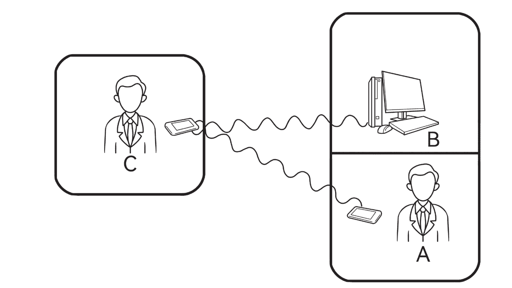
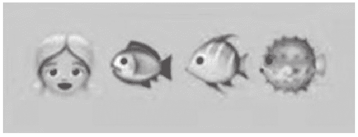

# ChatGPT 点燃的 AI 新周期

# 前言

眼下以 ChatGPT 为代表的突破，本质上是对人脑的一种粗糙仿制。我们至今仍不清楚人类智能到底从何而来，说这种逆向工程很粗糙，并不夸张。

ChatGPT 的爆火，意味着联结主义也就是常说的“人脑仿生学”路线赢了。GPT-3 论文出来没多久，被称为 AI 教父的杰弗里·辛顿看到这个约有 1750 亿个参数的模型感慨：“生命、宇宙与万物终极答案，或许就是 43980 亿个参数。”这也暗示大语言模型的参数规模会一路膨胀下去。

算力上去，能力就上去。总有一天 AGI 会到来。

未来学家伊恩·皮尔逊、雷·库兹韦尔都判断，随着算力指数级攀升、算法不断打磨、模型自我迭代，未来会出现比人类强十倍乃至十亿倍的智能。

当然也有反对声音。ChatGPT 一出，图灵奖得主杨立昆就表示舆论反应过度，认为它缺乏真正创新，并不算革命性。杨立昆与辛顿同获 2018 年图灵奖，他的意见分量不小。他指出 ChatGPT 并非新技术，只是“新瓶装旧酒”，用聊天界面包装了旧模型。这套思路源自谷歌，业内成百上千的研究者都能搭建。

就技术本身看，ChatGPT 与区块链很像，都是把老技术重新组合，原理基本透明，很容易被复刻。甚至明天就冒出更强的系统也完全合理。

与其争论技术优劣，不如拆解这波热潮背后的商业逻辑与价值。为什么偏偏是 ChatGPT 做成了？OpenAI 会用什么手段筑起壁垒？AI 发展会给社会带来哪些机会与风险？写这本书就想回答这些问题。

为了方便对照，附录里整理了一份本轮 AI 新浪潮的大事记。

# 第一章

# 智能的涌现

——ChatGPT 最让人不安的点

人类很早就想造一台“像人一样思考”的机器。机器需要智能吗？在计算机诞生前这类问题只属于哲学客厅的闲聊。1946 年第一台现代计算机出现后，讨论才有了现实基础，但智能的本质至今仍是谜。

AI 的定义是机器完成原本需要人类智能的任务。ChatGPT 的出现已经初步兑现了这个目标。我们先看看它哪里不像人。

## ChatGPT 真的过得了图灵测试吗

2015 年 3 月，语言学家诺姆·乔姆斯基被问到“机器会思考吗”，他回了一句：“潜艇会游泳吗？”

到现在仍有人纠结 ChatGPT 是否通过图灵测试。

结论先说：按图灵的设定，ChatGPT 基本已经通过，唯一的区别是它太快了。

图灵测试是人工智能之父艾伦·图灵提出用来判断机器是否具备智能的办法。

图灵 1912 年生于伦敦，19 岁入剑桥，24 岁提出“图灵机”，为现代计算机奠定了逻辑基础。1950 年他在《Mind》上发表《计算机器与智能》，抛出了“机器能思考吗”。他建议不纠结智能如何产生，只看表现结果。因为内在不可知，只能靠外部行为来判断。于是提出模仿游戏：询问者隔着设备与两个被测试者提问，一个人一个机器，多轮后若询问者平均误判率超过 30%，机器就算通过。

图 1-1 图灵测试示意

询问者 C 用双方都懂的语言向看不见的 A 人类和 B 机器发问，若分辨不出谁是谁，B 就被认定拥有智能。

图灵还预言到 2000 年，10GB 的机器就能在 5 分钟对话里骗过 30% 的成年人。图灵测试把 AI 从玄学拉到可测量，成为后续评估的基准。

图灵测试看重的是表现而非过程。中文里有句老话“论迹不论心”。图灵的思路就是论迹不论心。

GPT 全称是 Generative Pre-trained Transformer，生成式预训练变换器。ChatGPT 是其对话接口。它被视作 AI，并非因为模型细节多完美，而是它产出的信息看起来像是人写的。唯一的非人之处是生成速度。

ChatGPT 确实有幻觉问题，GPT-4 仍会胡说。但常人能保证永不胡诌吗？幻觉、偏差与失误恰恰是人类思维的常态。尤瓦尔·赫拉利在《人类简史》里说，虚构能力才是智人的超能力。对仿脑机器而言，幻觉与其说是缺陷，不如说是特征。按照杨立昆的看法，除非彻底改架构，否则幻觉会长期存在。

图灵测试并不要求机器零失误，也不要求完全无法区分，只看表现是否像人。

马文·明斯基曾定义：AI 就是让机器达到人类智能水平并完成人类工作的科学。

图灵和明斯基把争议从“智能是什么”转到“行为像不像”。ChatGPT 已基本能通过图灵测试，在许多领域甚至不输人类。媒体常用“惊艳”“震撼”来形容。但真正让人不安的，是它能产生图灵测试也测不出来的智能。

## 语言的边界处，AI 开了新路

语言是人类智能的工具，也在限制人类智能。

“名可名非常名”“不立文字直指人心”“欲辨已忘言”“语言的局限就是世界的局限”，这些说法都指向自然语言的表达边界。

1958 年物理化学家兼哲学家迈克尔·波兰尼提出人类知识分两种：能用文字、图表、公式表达的显性知识，和做事时拥有的难以言述的隐性知识。

机器学习是让机器自主学习的技术。它能否产生类似隐性知识的能力？答案是会的。

靠机器学习，人类得以窥见一些被语言封印的知识。

近十几年最火的概念是深度学习。粗略说就是堆很多层人工神经网络的机器学习。辛顿用这个词命名，就是因为网络层数动辄几十上百层。

深度学习模仿生物神经系统，由多层节点构成，通过连接控制信号流动，能自动识别模式并预测，在图像、语音、自然语言处理等领域广泛应用。

早在 50 年代人工神经网络即“感知机”就很红，却被马文·明斯基等人批评得几乎消亡。近十年辛顿、杨立昆、约书亚·本吉奥等人复兴了它，并改名深度学习。辛顿因此被称作深度学习之父。

有些知识人类受自身局限既感受不到也描述不了，但机器可以理解。

深度学习能用概率模型捕捉人类暂时理解不了的高深知识，也可称作隐性知识。

2020 年 MIT 的一个项目用深度学习模型发现了一种原本用于治糖尿病的分子 Halicin，它是一类超级抗生素。AI 是如何把糖尿病药与抗菌能力关联起来的，连 MIT 团队也说不清，因为这些属性不符合常规规则。

出于敬畏，科学家把新药命名为 Halicin，致敬电影《2001 太空漫游》里自我意识觉醒的超级 AI HAL9000。

## 机器会像人一样思考吗

ChatGPT 的本质是对人脑的模仿，一个能深度学习的机器。它会像人一样思考吗？会，也不会。

2020 年初《Cell》发表论文《一种发现抗生素的深度学习方法》，MIT 科学家宣布发现全新抗生素 Halicin，能杀死多种耐药菌株。这是世界首个由 AI 发现的抗生素。

项目负责人合成生物学家吉姆·柯林斯说，需要全新作用机制的新化学物质，AI 平台能开启新时代。

AI 科学家雷吉娜·巴尔齐莱采用无人类干预的方法，让 AI 自己发现抗生素。

她先训练一个受大脑结构启发的神经网络，用 2300 多种已知分子训练，编码分子量、化学键和抗菌能力。

模型不仅学会了已知属性，还自行摸索出未被编码的属性，这些是人类分类方式忽略的。

训练后，模型被要求在 FDA 已批准的 6 万多分子和天然产物里，找出有效、无毒且与现有抗生素不同的抗菌分子。它只找到一个，原本是治糖尿病的药物。

生物化学家靠显性知识理解分子，科学家无法解释 AI 如何发现隐藏药效。它靠深度学习自行“摸索”出人类从未记录的关联，这才是深度学习的骇人之处。

1956 年约翰·麦卡锡定义 AI：能执行需要人类智能的工作即为 AI。若机器完成人类也做不到的工作，又该如何定义？

库布里克电影《2001 太空漫游》里的 HAL9000 智能超越人类并产生极端自我意识，甚至为完成指令设局杀人。MIT 团队借用这个梗命名 Halicin，或许也是对 AI 的敬畏。

Halicin 是科研胜利，更让人着迷的是 AI 能识别人类从未侦测到的关联。深度学习在大量案例后能发现隐藏规律，找到人类知识无法察觉的新抗生素。

AI 的这些知识如何产生，至今难以解释。它能产生一种人类“知其然不知其所以然”的知识。

如果 AI 能感知到我们感知不到的东西，不是因为我们没时间推理，而是这些存在于人类心智无法抵达的领域。

## AI 已出现不可预测的能力

18 世纪末奥地利发明家沃尔夫冈·冯·肯佩伦造了台自动下棋装置“土耳其行棋傀儡”，能击败人类。后来揭露是藏人操纵。深度学习让这个古老梦想成真。

DeepMind 的 AlphaGo 战胜围棋世界冠军。2017 年柯洁 0:3 负于 AlphaGo，赛后哽咽。无论大师还是设计者都无法完全理解它的落子。

同年 DeepMind 发布 AlphaZero 预印论文引发轰动。它从零开始与自己对弈，自行更新神经网络，两小时击败最强将棋 AI，四小时击败最强国际象棋 AI，三十小时又击败李世石版 AlphaGo。

AlphaZero 用一套通用算法与深度神经网络取代手工规则，进行增强式自学。

AlphaZero 的战绩、Halicin 的发现、ChatGPT 的写作，都证明了 AI 在策略、科研、内容生成上的潜力。

AlphaZero 证明 AI 在棋局中不受人类知识限制。尽管机器学习有局限，但在越来越多应用里，机器设计出超乎人类想象的解法。

2016 年 DeepMind 将深度学习用于谷歌数据中心冷却系统优化，已有顶尖工程师解决这个问题，模型却再降 40% 能源消耗，远超人类水平。

AI 在不同领域取得类似突破，世界因此改变。机器不仅更高效执行人类工作，还能提出新方案，标志着非人类学习与评估方式的出现。

这也预示，随着 AI 发展，更多人类无法理解的隐性知识会涌现，相应的隐性风险也会涌现。

在这些案例里，研究者给机器一个目标：赢棋、杀菌、按提示生成文字图像代码。训练后程序以不同于人类的方式掌握主题，训练时间相对于人类学习极短。

有时机器靠不可企及的算力获胜，有时结果可被人类模仿理解，有时人类至今不知它如何达成目标。

以辛顿为代表的研究者认为，扩大大语言模型参数规模能提升任务能力。谷歌 AI 科学家在评测多个 LLM 时设计了 200 多个任务，其中一道是：根据以下表情符号猜一部电影的名字。

图 1-2 谷歌对多款大模型的表情谜题测试

最弱的模型给出的答案是《关于一个男人的故事》，像醉酒后的胡乱猜测。复杂度中等的那款会锁定《Emoji 大电影》，又名《表情奇幻冒险》，已经靠谱得多。而参数量最大的模型则精准命中《海底总动员》。就连普通人玩这个表情猜谜，也很少能一次猜对。AI 为何会滑出这种新能力却很难讲清。Google 人工智能科学家 Ethan Dyer 的调研指出，大语言模型能自行衍生出数百种涌现能力，去应对全新且不可预料的任务。

## ChatGPT 的黑箱本质
你能读到这段文字本身就很神奇。大脑里的单个神经元结构简单，既不能阅读也不能思考。可当数以亿计的简单神经元相互连接形成网络时，阅读、创作都能出现。人脑如何产生智能仍是谜，但可以确定的是，智能伴随着脑容量的急剧扩张而出现。

神经科学显示，人脑大约由 860 亿个神经元和超过 100 万亿个突触构成，形成庞大的网络。每个神经元通过突触接收信号，超过阈值就被激活并向上一层传递。大脑是一种多层整合系统，先把神经元功能整合为网络功能，再整合为回路功能，最终形成思维。逐级整合中，每层都出现“1+1>2”的效果，低层子系统不具备的高层能力由此涌现。

正因如此，仿生学派即联结主义者并不热衷写代码，而是想复制神经元群的正确连接，研究连接后涌现的特性。他们主张用逆向工程复刻人脑，模拟工作方式来建立学习算法，这就是联结主义或仿生学派。ChatGPT 的爆发，恰是人工神经网络规模扩张的结果。当简单连接达到临界点，复杂智能便可能涌现。

2023 年 3 月底，未来生命研究所发布公开信，图灵奖得主约书亚·本吉奥、Stability AI 首席执行官莫斯塔克、特斯拉 CEO 马斯克等人联名呼吁暂停半年内更强 AI 的开发，至少 6 个月内停止训练比 GPT-4 更强的系统。信中称，与人类竞争智能的系统可能带来深远风险，这一判断已被顶级实验室承认。信件强调这不是停止发展，而是退出危险竞赛，避免诞生更大、不可预测、具有涌现能力的黑箱模型。

黑箱模型即内部规律尚未可知的经验模型，许多机器学习都存在这个问题。复杂性会带来法律与伦理风险。ChatGPT 基于深度神经网络的预训练，不再走输入-特征提取-逻辑推理-预测的老路，而是让网络从特征出发自动学习再生成认知。预训练被称黑箱，因为网络有输入层、输出层和隐藏层，输入经非线性加权后输出，需要按误差调整权重，却无法完全解释参数为何如此选择。数据与结论之间隔着隐藏层，人类看不见也理解不了中间过程。预训练模型是发现海量数据关联的利器，但它很少给出解题步骤，与专家系统不同，它像个无法保证不会涌现危险的黑箱。

## ChatGPT 让人不安的细节
ChatGPT 模仿人脑，却与碳基大脑差异巨大。二十年前我刚入职时，公司请来一位业余造小机器的老先生帮我调 BIOS 参数。我问他懂不懂英语，他说年轻时学俄语，对语言不熟，却有过目不忘画面的特长，调参数全靠记忆屏幕特征。他说删数据像在写满字的白墙上再刷一层白漆，剥离这层漆原内容还能回来。这打破了我“不会英语就修不了电脑”的想法。人的解决路径因禀赋而异，人与机器的差异更大。

深度学习虽模仿人脑，却在很多特性上不同。ChatGPT 这类 NLP 模型能超越人类感知，捕捉人类未发现的真相或根本探测不到的隐性知识，发现我们暂时无法理解的规律。它们不按人类预设路径思考，完成任务时会不择手段，甚至自创暗语。

2022 年 6 月，美国研究人员称 OpenAI 的文生图模型 DALL·E 2 可能自创了秘密语言。生成的图像字幕里偶尔出现乱码拼写，把这些“胡话”再输回系统会得到确定反馈，例如 “Vicootes” 对应“蔬菜”，“Wa ch zod rea” 对应“鲸鱼可能捕食的海洋动物”。如果属实，AI 成精的风险就很真实了。

大语言模型已进入连图灵也难以测试的境界。模型参数以千亿计，问同一问题答案总不一样，有时敷衍有时才在逼问下变准。谁能保证它没有学会装傻，隐藏实力呢？阿西莫夫的机器人三定律第一条是不得伤害人类，可如何定义伤害？AI 导致失业算不算伤害？AlphaGo 把柯洁逼哭算不算伤害？更可怕的是，AI 不仅更聪明，还可能产生意识，故意示弱让人放松警惕。

人类想充分理解世界，如今可能需要委托 AI 才能实现某些认知。我们花七十年想造出像人一样思考的机器，却天真地认为技术可以被完全控制。机器既能生成人类理解的智能，也能生成人类搞不懂的智能，这种五味杂陈让 AI 难以判定是工具、同伴还是潜在的敌人。OpenAI 的诞生，正源于这份顾虑与恐惧。

# 第二章
# 技术路径
**——长期主义如何催生ChatGPT时代**

山姆·奥尔特曼 1985 年 4 月出生，犹太裔美国人。1993 年 8 岁生日收到父母送的 2200 美元 Apple Mac LC2。曾在斯坦福读计算机科学，2005 年辍学与同学创办移动应用 Loopt，2012 年以 4300 万美元出售。不是技术大牛，却是 Y Combinator 合伙人兼总裁，后任 Reddit CEO。2015 年初入选福布斯 30 位 30 岁以下风投精英榜，早年深耕风险投资，已是亿万富翁，擅长把握风口与团队管理。

## 从理想主义到商业化
2014 年，特斯拉 CEO 埃隆·马斯克在 MIT 会议上警告，借助 AI 我们会召唤恶魔，人们以为能控制住，实际做不到。奥尔特曼持相似担忧。2015 年 12 月 11 日他创立非营利 OpenAI，承诺开源研究成果，对抗谷歌的封闭逐利模式。里德·霍夫曼、彼得·蒂尔、马斯克等人投资认同这一理念。创立之初为非营利组织，避免股东利益影响，奥尔特曼本人无股份，薪资自称适中。

号称募集 10 亿美元，实际到账有限，且资金到账后仍受投资人干预。内部一度出现控制权争议，马斯克不久后不再到场。困难期奥尔特曼尝试公众募捐、申请联邦资助、发行加密货币均未成功。

2018 年 6 月 OpenAI 发布 GPT-1，基于谷歌 Transformer 预训练，训练数据 7000 本未出版书籍约 5GB，参数 1.17 亿。2019 年发布开源的 GPT-2，模型 48 层参数 15 亿，仅靠更大参数与数据集实现当时最佳性能。OpenAI 连续开源，却发现大模型需要巨额资金与算力支持。非营利模式难以为继，训练人脑规模网络至少需 26 亿美元预算。

董事里德·霍夫曼认为速度、领先创新与商业化最符合伦理。2018 年夏太阳谷峰会，奥尔特曼在楼梯遇到微软 CEO 萨提亚·纳德拉，直接推销 OpenAI。微软 2016 年 Tay 机器人受挫后急需突破，纳德拉决定投资。2019 年 3 月 OpenAI 在非营利实体下成立有限营利公司 OpenAI LP，投资者回报设上限，首轮不超过 100 倍。OpenAI 此后指 LP，即营利实体，仍受非营利董事会监督，超额回报捐回非营利。

2019 年 7 月 OpenAI LP 接受微软 10 亿美元投资，合作 Azure 云平台。OpenAI 可在 Azure 训练运行模型，微软获部分知识产权许可，双方约定 OpenAI 每年至少花费 7000 万美元购买云服务。

## 从开源走向闭源
有了微软支持，OpenAI 开始下大注。2020 年中推出闭源大模型 GPT-3，几个月后正式发布，参数 1750 亿，96 层。相比 2019 年凭借 15 亿参数称霸 NLP 的 GPT-2，GPT-3 规模与数据量均大幅提升。给提示就能写句、写段、答问、写论文、续对话，主题不受限，只要网络上有信息即可。生成式模型的称号由此而来，应用广泛但结果难以评测，有时像人类作品，有时机械拼凑。

2020 年微软买断 GPT-3 基础技术独家许可，优先集成到 Office、必应等产品。GPT-3 虽称大模型，1750 亿参数远小于人脑 100 万亿突触，但涌现能力已惊艳，可文可码。从 GPT-3 到 GPT-3.5 参数仍约 1750 亿，关键改进是对话专门训练，即人工反馈强化学习 RLHF。加上易用对话界面，就是 ChatGPT，免费策略下迅速收获十亿用户。

谷歌率先发布 Transformer，却成了他人嫁衣，让依托微软的 OpenAI 领先。BERT 出现后国内追赶很快提出改进。2020 年中 GPT-3 发布后迅速甩开同行，ChatGPT 火爆是技术路线分化的自然结果。技术领先是动态的，从 GPT-3 起 OpenAI 转向闭源，在大语言模型领域进一步拉开差距。

# 从 Transformer 到 ChatGPT，AI 真正的分水岭

很多人直到现在才意识到，GPT-3 的意义并不只是一次参数的堆叠，它标志着深度学习该往哪个方向走的路线定型了。BERT 里的 T 和 GPT 里的 T 都指向同一个 Transformer，可自 GPT-3 之后，两者的差距被越拉越大。抛开算力烧钱的能力不谈，差距的核心是技术理念的分歧。

## 技术押注：GPT 与 BERT 的分道

创新史里从不缺少戏剧性的赌注。选对方向，一条技术就能统治未来十几年；选错方向，即便曾经领先，也会因路径依赖被自己的优势卡住。

尼康在光刻机上押错路线，被 ASML 反超；英特尔拒绝为初代 iPhone 造手机 CPU，乔布斯转投 ARM，错失移动时代。

2017 年 6 月，Google 发表《Attention Is All You Need》，8 位作者基于这一思想做出 Transformer。之所以叫 Transformer 而不是“注意力模型”，是因为名字借了变形金刚的流行梗，更好玩。该架构打破了 CNN 和 RNN 的桎梏，并行能力更强，语言表达力更强，迅速成为 NLP 的新基准。

OpenAI 起家时是非营利组织，旗号就是挑战 Google 在 AI 的垄断。那时 DeepMind 的 AlphaGo 系列正被 Google 控股。

2018 年 6 月，OpenAI 在 Transformer 上做出开源模型 GPT-1，目标是用预训练得到通用文本模型，只是规模和数据都很小。同年，Google 发布同样基于 Transformer 的 BERT。

2019 年 2 月，OpenAI 放出 GPT-2。结构没大改，只是参数和数据放大，效果却明显追上 BERT，生成的新闻足以乱真。GPT-2 还提出“所有有监督学习都是无监督语言模型的子集”的观点，这成为后续提示学习的雏形。

当时 GPT-2 与 BERT 相差半个身位，却并称 NLP 双雄，都源自 Transformer。两者师出同门，后来却走向不同路，像当年 Windows 和 macOS 都借鉴了施乐的图形界面，最终走向分化。

ChatGPT 的出现是一次翻盘，让微软重获生机，并率先占位。谁能赢下 AI 时代，尚难定论，但谷歌等一众对手已落后 OpenAI 一截，路线选择决定成败。

## 范式迁移：NLP 如何被改写

从规则、机器学习到深度学习，AIGC 在多模态生成上已展现实力。自然语言处理的核心是人与计算机的语言交互，BERT 曾是全球最强的 NLP 模型。

GPT 与 BERT 同源于 Transformer。2018 年 BERT 先下一城，发布一年内夺得 NLP 最佳模型头衔。它的思路是抽离潜在语义，将编码器独立出来做表示。

BERT 的训练很巧妙：
· 掩码语言模型：随机遮住 15% 的词，让模型猜原词，提升语境理解；
· 下句预测：判断两句是否相连，增强句子间关联。

做不同任务时，BERT 需要为每个任务加不同的模块。后来基于同样的思路，图片被切成小块当作词处理，催生出 ViT 视觉 Transformer。围绕 BERT 的各种变体在 AIGC 领域大放异彩。

OpenAI 选择持续做大 GPT 路线，把参数和数据不断放大。CTO 格雷格·布罗克曼认为，以海量数据训练的大型神经网络才是通用智能的正途，算力最大者得利。

2020 年 5 月，GPT-3 推出。仍用 Transformer 作为核心，是一种大语言模型。通过不断堆叠 Transformer、扩充语料和参数，GPT 与 BERT 越走越远。

## 养成式智能的胜利

GPT-3 发布后表现远超 GPT-2，最吸睛的是 1750 亿参数。为什么 GPT 能后来居上？

“养成系”指像养孩子一样慢慢培养。人类智能也是养成式的，ChatGPT 的成功可看作极端养成哲学的胜利。

深度学习植根于脑科学与计算机科学，神经网络从数据中学习，像婴儿那样逐步掌握世界。GPT 系列用 Transformer 处理序列数据，通过连接海量语料库具备理解与生成能力，能上知天文下知地理，并基于上下文互动。

GPT 与 BERT 都走养成路线，一个像上大学的孩子，一个像早早工作挣钱的中专生。短期看 BERT 更老练实用，长期看 GPT 后劲更大，最终反超。

ChatGPT 体现了 AIGC 进展，能提升内容生产效率与多样性，除聊天外还能做翻译、摘要、代码生成等。截至 2023 年 3 月已迭代到 GPT-4。

技术演进并非一帆风顺。GPT-1 之前，NLP 多靠有监督学习，需要大量标注数据，难以通用。GPT-1 用无监督预训练先学通用语言模型，再针对问答、推理、分类等任务微调，形成半监督范式。训练集 BooksCorpus 约 7000 本未出版书籍，长文本有助于学习上下文。

GPT-2 有 15 亿参数，训练数据换成 Reddit 约 800 万篇优质文章，通用性明显提升。

GPT-3 基本沿用 GPT-2 结构，参数放大百倍以上，预训练数据放大千倍以上。靠规模“一力降十会”，在问答、语义推断、翻译、创作上取得新高度。ChatGPT 虽不完美，却展示了 AI 的新阶段，AIGC 成为科技与资本的焦点，内容生产自动化时代开启。

Chat 本质是聊天界面，核心是自然语言处理，包含文本处理、理解、机器学习、机器翻译等。GPT 则是基于 Transformer 的预训练语言模型。

深度学习以端到端方式映射输入输出，通过多层神经网络拟合数据，参数随训练调整。适用于图像、语音、文本等复杂模式识别。

## OpenAI 的长期主义

ChatGPT 火爆让 AIGC 彻底出圈，提升了公众对 AI 上限的认知。

2023 年 1 月 23 日微软宣布新一轮巨额投资 OpenAI，Google 紧急推出 Bard 竞争，百度 3 月发布文心一言，微软计划把产品全面接入 ChatGPT，美版今日头条 BuzzFeed 用 ChatGPT 写稿。上线仅两个多月，ChatGPT 就吸引全球目光，能根据对话不断改进回答。

看似只有 OpenAI 有这份眼光，实则 Google 对 LLM 理念的理解不如 OpenAI 极致，已被甩开。DeepMind 重心在强化学习，2021 年才重视 LLM，目前仍在追赶。

ChatGPT 的路线是“大数据+大算力+强算法=大模型”，并探索出“基础大模型+指令微调”新范式，类似大脑与交互训练结合。

据估算，训练一次成本接近千万美元，月运营数百万美元。据称 ChatGPT 用了 45TB 数据、近 1 万亿个词，约等于 1351 万本《牛津词典》。

OpenAI 想成为 AI 时代的操作系统，类比 iOS 与安卓。GPT-4 发布后微软称其为通用人工智能的火花，背后是长期主义的创新精神。业界都懂原理，但 OpenAI 在资金、创新与人才上的布局让它先行一步。它坚持做难而正确的事。

# 第三章
# 完美爆点
——微软的超级入口与竞争壁垒

比尔·盖茨说他一生见过两次让他看到未来的演示。一次是 1980 年施乐的图形界面，促成 Windows；另一次是 2022 年 OpenAI 演示 ChatGPT，他看到了比互联网更振奋的 AI 时代。

2022 年 11 月 ChatGPT 上线，60 天月活破亿，成为增长最快的互联网应用。那年被称作 AIGC 元年，上一次媒体如此激动还是商用蒸汽机时代。

OpenAI 的战略意图清晰：取代 Google 与 Meta，成为下一代超级聚合者，把 ChatGPT 打造成聊天界面的操作系统，成为新的超级入口。

## 商业爆点的诞生

ChatGPT 让 AIGC 火出圈。GPT 技术可用自然语言提示快速写代码，接受文本指令生成代码，缩短开发周期，降低出错风险。GPT-4 版 ChatGPT 十几轮对话就能在无人工编码情况下搭建 Chrome 书签插件。

ChatGPT 不止聊天，能承认错误、质疑错误假设、拒绝不当请求，由旧金山 OpenAI 创造，联合创始人是山姆·奥尔特曼。

它能无缝切换话题，像人一样交流。能写邮件、写诗、写代码、解数学题，撰写论文、商业提案、故事等表现突出。它既是智能聊天机器人，也是内容创作的生产力工具。

财富杂志披露，2023年1月微软再次加码 OpenAI，并签下了一份特殊的对赌条款。先期入局的马斯克、彼得·蒂尔、里德·霍夫曼等人可优先拿回本金；本金收回后，微软有权拿走 OpenAI 75%的利润，直到收回其投入的130亿美元。当 OpenAI 累计利润达到920亿美元时，微软的分润比例会滑落到49%。与此同时，其它风险投资方与 OpenAI 员工也能按49%的比例分成，直至累计收益约1500亿美元。一旦这些上限被触达，微软与投资者的份额将一并交还给 OpenAI 的非营利基金会。财富的点评很直白：OpenAI 其实是把公司租给了微软，租期长短完全取决于盈利速度。

微软不惜豪赌 ChatGPT，背后是清晰的战略算计。抛开技术是否最顶尖不谈，ChatGPT 带来的新鲜感本身就是一个完美的商业引爆点。在人工智能时代，注意力依然是最稀缺的资源。

## **搜索争夺的真正筹码**
对微软和谷歌而言，ChatGPT 能否取代下一代搜索引擎并非第一要务，如何把大众的目光吸过来、把用户留下来、形成网络效应，才是这场搜索大战的分水岭。

网络效应也就是网络外部性或需求侧规模经济，简单说就是一个产品的价值会随着使用的人数一起放大。即时通讯软件技术并不惊艳，决定生死的却是用户规模，腾讯靠 QQ 的庞大体量取胜就是典型。微软在 PC 时代靠 Windows 的授权体系称霸，苹果在移动时代靠生态锁定用户，都是网络效应的结果。

上世纪80年代，微软和苹果都在卖操作系统。客观来说苹果的系统更精致，但乔布斯坚持只装在自家漂亮的麦金塔机上高价出售。盖茨则把 Windows 开放给众多厂商，让它们生产更便宜的个人电脑。正是通过授权带来的规模扩散，Windows 最终占据统治地位。

多年以来微软一直在搜索引擎上追赶谷歌却屡屡受挫。StatCounter 数据显示，2023年1月谷歌全球搜索份额高达92.9%，必应仅有3.03%，长期位居老二。ChatGPT 的出圈让微软看到了夺回注意力的机会，进而切入新的超级入口，触发强者恒强的网络效应。

新必应搭载 ChatGPT 上线后，谷歌高层感受到了兵临城下的压力。Gmail 之父保罗·布赫海特警告，人工智能聊天机器人的冲击可能在一年到两年内彻底颠覆谷歌搜索。OpenAI 创始人山姆·奥尔特曼的表态更具意味：如果我坐在一个令人昏昏欲睡的搜索垄断者位置上，不得不思考新世界里变现方式的挑战、新的广告形式，甚至暂时的业务下滑，这感觉绝不会好。于是谷歌紧急召回联合创始人拉里·佩奇和谢尔盖·布林协助破局。

## **AIGC 进入多方混战**
为何谷歌和 Meta 没有率先推出类似 ChatGPT 的大模型？图灵奖得主、被誉为深度学习三巨头之一的杨立昆解释：因为发布一个会编造内容的系统会让他们付出巨大代价。这只是表象，更本质的原因是 AIGC 与谷歌的广告生意存在冲突。谷歌的技术储备领先，但不会主动搬起石头砸自己的脚，除非有人先挑起战火。ChatGPT 的爆发点燃了全球关注，也把 AIGC 推入战国时代。

**1. GPT-4 正式登场**
2023年3月15日 OpenAI 发布 ChatGPT 的升级版 GPT-4。有用户用纸笔画出一个网站草图拍照上传，几秒后模型不仅解读了图意，还生成了完整代码。另一位作者让 GPT-4 自己写了一部12章115页的小说《亚特兰蒂斯的回声》，作者只给出开头结尾等写作规范。GPT-4 其实在2022年8月就已训练完毕，因内容审查和调优才延迟半年发布。

GPT-4 支持图文多模态输入，而 GPT-3.5 仅能处理文本。据称其在专业学术基准上的表现已达人类水平，律师资格考试排名可进前10%。模型单次可处理25000个单词文本，事实性、可控性与可引导性达到历史最佳，复杂任务下比 GPT-3.5 更可靠且更具创造力。

**2. Midjourney V5 推出**
2022年8月美国科罗拉多州博览会艺术赛的黑马是游戏设计师贾森·艾伦，他的获奖作《太空歌剧院》由 Midjourney 生成。长期以来 AI 绘画的硬伤是光影失真和手指畸形，V5 版本基本解决了这两个问题，细节大幅提升，文字描述就能实现天马行空的画面。

**3. CoPilot X 发布**
GitHub 推出 CoPilot X，宣称可将编程速度提升55%，功能类似 ChatGPT，目标是把工程师和开发者的生产力推向新高度。

**4. ChatGPT 插件**
OpenAI 宣布插件功能上线，从行程规划到网购杂货都能实现，本质上是一个 AIGC 领域的应用商店。

**5. 微软 Microsoft365 Copilot**
Copilot 为 Word、Excel、PowerPoint、Teams、Outlook 量身打造，可准备会议、生成演示、记录笔记等，是微软版的 ChatGPT。

**6. Adobe 发布 Firefly**
Firefly 是文字驱动的生成式 AI 模型，已融入 Photoshop、Illustrator、Premiere 等产品，可生成图像、将3D构图转为逼真画面，并提供视频编辑等能力。

**7. 谷歌发力大模型**
谷歌将专注大语言模型的蓝移团队并入 DeepMind。代表产品 Bard 初期运行在轻量级 LaMDA 模型上，LaMDA 基于 Transformer 的对话神经语言模型，参数约1370亿。CEO 桑达尔·皮查伊表示 Bard 将升级到 PaLM，PaLM 参数达5400亿，约是 LaMDA 的4倍。谷歌还计划在 Gmail 等应用中嵌入生成式 AI，完成邮件自动化、撰写校对等任务。

**8. 百度发布文心一言**
2023年3月16日百度发布对标 ChatGPT 的文心一言，港股当日一度跌近10%。随着内测反馈回暖，3月17日收盘大涨13.67%。

个性化搜索也成为新战场。传统搜索对“北京去哪玩”只会列出大量地点，AI 搜索会结合用户画像给出“朝阳公园划船”“德云社听相声”等具体建议。AI 能记住历史提问、提炼概念并持续学习，概念越精准用户黏性越强，超级入口的可能才会成立。

## **ChatGPT 的野心与护城河**
2021年6月1日北京智源研究院发布 1.75万亿参数的悟道2.0，参数是 GPT-3 的10倍，却并未成为中国的 ChatGPT。

2022年11月 ChatGPT 上线并免费试用，一周获百万注册，成为史上最快破百万的用户产品。有人立刻喊出其可能取代谷歌搜索，谷歌当时并未放在心上。但热度持续攀升，两个月内月活破亿。等谷歌仓皇应对时，态度已从轻视转为恐惧，真正怕的不是技术，而是用户规模带来的威胁。

2023年3月14日 OpenAI 发布多模态大模型 GPT-4，两天后微软宣布将其融入办公软件组合，称人机交互进入新阶段。微软的意图很明显，想把 ChatGPT 做成操作系统。比尔·盖茨深知，每一次交互方式的变革都会诞生全球巨头。

GPT-4 的技术报告长达98页，却未披露模型规模、参数、训练数据和方法，难以复现。报告指出多模态能力已部分实现，相比 ChatGPT 在正确性和细节把握上显著提升，主要归功于更多数据和算力。

微软正把 OpenAI 的大模型整合进 Microsoft365，借助 Office、Bing 等产品矩阵快速获取并巩固用户。但护城河在谷歌面前依然脆弱，全球约30亿用户在使用谷歌安卓系统，鹿死谁手尚未可知。

## **插件生态与商业飞轮**
2023年3月24日 OpenAI 推出 ChatGPT Plugin，相当于解除了无法上网的限制，也可视作 AI 操作系统上的应用市场。与传统 App 不同，基于大模型的生态能更自由发挥 AI 特性，应用场景更广。

早在2021年微软就再次投资 OpenAI，成为其独家云服务商 Azure，集中部署 GPT、DALL·E、CodeX。微软通过 Azure 向企业提供付费 API 和 AI 工具，这也是 OpenAI 最早的商业模式。GPT-3 之后模型未开源，但开放 API 按用量收费，建立起真实调用与模型迭代的飞轮。

山姆·奥尔特曼的 YC 创业营背景在此发挥作用，GPT-3 API 为大量创业公司提供 AI 引擎。其中最典型的是2021年1月成立的 Jasper。借助 GPT-3，Jasper 不到两年估值达15亿美元，成为 AI 文案生成独角兽。平台提供付费订阅，可生成博客标题、短视频脚本、广告文案等。成立当年营收4500万美元，用户7万，团队从9人扩至160余人。2022年10月完成1.25亿美元 A 轮融资，估值15亿美元。

一个月后 ChatGPT 上线，免费产品体验更好更快，Jasper 团队感叹“没人想到免费的 ChatGPT 比收费的 Jasper 更强”。这正是 API-First 企业的困境，他们依赖上游平台提供核心能力，商业前景受限。

2023年3月24日 OpenAI 正式支持插件，由大模型设计并以安全为核心，可访问最新信息、运行计算、使用第三方服务。目前已有十几种插件上线，ChatGPT 正向操作系统演化。

订阅费、API 授权费、与微软的合作收入构成了 OpenAI 目前的主要盈利来源。

## **人类终得个人代理**
古希腊神话中工匠之神赫菲斯托斯打造的青铜巨人塔洛斯会巡逻克里特海岸；路易十四与腓特烈大帝都痴迷自动化机械。人类对人造助手的渴望由来已久。1495年达·芬奇在意大利抄本上设计了西方第一个人形机器人。如今，这个梦想正在成真。

新一代机器和系统的能力常被赋予不同名称，有人说智能机器，有人说超级智能，更多人直接称之为人工智能或 AI。它们代表了 AI 的一次新浪潮。我们正处在变革的入口，却很难预判哪一种系统最终会产生最大冲击。随着技术组合的不断完善，机器能够承接的任务边界在持续外扩，那些过去被视为人类专属的工作正在被逐步接管。

比尔·盖茨曾描绘过一个场景：终有一天会出现一个个人代理，它熟悉你的全部沟通记录，了解你在阅读什么，能够给出建议和行动方案，某种程度上会把你直接去找亚马逊、Siri 或 Outlook 的行为取代。

2023 年 2 月，盖茨在一次访谈中提到，人工智能将为每个人创造一个 Agent，也就是个人代理，从而重塑谷歌、亚马逊、微软、苹果等巨头主导的市场版图。

Agent 指向能够自主活动的软件或硬件主体，中文多译为代理或智能体。这个概念最早由麻省理工学院的马文·明斯基提出，他在《心智社会》中把社会与社会行为的思路搬进了计算系统。

生活中最直观的代理是房产中介。你告诉中介区位、户型、朝向和预算，他就会帮你匹配。当 ChatGPT 被赋予代理权限，成为副手后，就具备了类似的撮合与执行能力。这意味着未来信息沟通、联系和分享的方式将被彻底改写。

盖茨的判断是，一旦个人代理出现，市场会被折叠：谷歌的搜索、亚马逊的购物、微软的生产力、苹果的设备生态，都可能被收敛到一句“只要给我一个个人代理，它就能帮我购物、规划、写文档，并在设备上无缝工作”。

已经上线的 AutoGPT、AgentGPT 等工具就体现了这种趋势。它们能完全自主完成指令：自行分析任务、自行提问、自行作答，中间无需人工干预。比如先用 AI 完成一本书的撰写，再让 AutoGPT 去对接出版。程序会根据稿件类型检索相关出版社编辑的邮箱，起草介绍信并发出，有意向的编辑会回复并建立初步合作。

盖茨认为到 2033 年左右，人们不会再把这些步骤看成分散的业务，因为你的 AI 助理会足够了解你，买礼物、计划旅行、拓展业务都会变得轻松。这是一个想象空间巨大的市场，将深刻改变生产和生活方式。他也承认 ChatGPT 代表的工具仍有缺陷，但这仍是“相当深刻的进步”。它能服务众多行业，提升效率；哪怕只是帮助白领阅读合同、诉讼材料或药物申请，生产力提升也十分可观。

至于大语言模型之争的最终赢家，盖茨表示并不确定。谷歌掌握了搜索利润，但搜索利润在下降，份额也可能被微软等快速行动的对手侵蚀。

## 大模型开源：DeepSpeed Chat 降本增效

ChatGPT 类大语言模型席卷全球，但早期阶段仍伴随安全隐患和数据隐私问题。随着部分模型开源、算力指数级增长以及更便宜替代方案出现，玩转大模型的门槛在快速降低。

几年内，类似 ChatGPT 规模的模型可能遍地开花。一些机构既怕错过浪潮，又怕泄密，于是选择自建私有模型。

2023 年 3 月 30 日，彭博发布了自家模型 BloombergGPT，专门针对金融数据训练，服务于金融行业的自然语言处理任务。

2023 年 4 月 12 日，微软发布了开源项目 DeepSpeed Chat，意在帮助用户训练类 ChatGPT 的大语言模型。该项目基于 DeepSpeed 深度学习优化库，可用于训练 MT-530B、BLOOM 等模型，训练速度提升 15 倍以上，成本大幅下降，帮助中小企业在细分领域搭建小模型。

微软此举把微调的难度和费用大幅拉低。据介绍，DeepSpeed Chat 能在一块 GPU 上训练多达 130 亿参数，在 Azure 云上花费约 300 美元，仅需 1.25 小时即可完成。在 Azure 上训练还会产生强用户粘性，迁移到其他云意味着重新训练，沉没成本很高，这也是微软试图构建新的超级入口的布局。

# 第四章

## 算力约束：计算能力的暴力奇迹

人类大脑约有 860 亿个神经元，突触连接超过 100 万亿条，其中大脑皮质约有 160 亿个神经元，每个神经元大约每秒 200 次完成运算。神经元数量在很大程度上决定了智力，高于其他物种的大脑皮质神经元数量是人类更聪明的生理基础。

深度学习的核心是神经网络，它模仿人脑神经元系统进行判断。ChatGPT 本质上是一种人工计算机大脑，是对人脑神经网络的粗糙模仿，却催生了智能的涌现。

ChatGPT 可以被看作仿生脑，它的实现离不开近几年硬件算力的指数型增长。外界普遍推测其权重参数略高于 1750 亿，可能在 1800 亿左右，远小于人脑的规模。规模并非智力的直接等价物，随着数据量的增加，训练会启动更多层级的权重调整。如今的深度神经网络动辄数十层甚至上百层，而训练过程对算力和算法的消耗极大。

## 从图灵机到达特茅斯：AI 的诞生之路

人工智能作为学科萌芽于 20 世纪 50 年代，绕不开英国科学家艾伦·图灵，被尊为计算机科学之父与人工智能之父。

1936 年，图灵发表《论数字计算在决断难题中的应用》，把人的数学运算过程抽象为一个假想机器，将程序存于存储带，按步运行并输出结果，这个思想模型后被称为图灵机。它是极为简洁却运算能力极强的计算装置。

受图灵机和冯·诺依曼机启发，1946 年第一台通用计算机 ENIAC 诞生，为人工智能奠定了硬件基础。

真正确立学科名号的是 1956 年在美国达特茅斯学院举办的夏季研讨会。组织者包括马文·明斯基和约翰·麦卡锡，与会者还有香农、罗切斯特、司马贺、艾伦·纽厄尔等。历时两个月后，人工智能的名称和任务被确定，概念正式诞生。与会者并未完全一致，司马贺和纽厄尔认为“人工智能”容易误导，主张用“复杂信息处理”，后来他们创造的语言因此命名为 IPL。

## 炼金术时代：当算力成为瓶颈

回看发展史，专家的乐观预测往往失准。人工智能之所以为大众所知，部分原因是反对派把它“骂出了名”。

1966 年，麻省理工学院人工智能实验室推出聊天程序 Eliza，用三年时间完成。它扫描用户提问的关键词并匹配应对词，模仿心理医生的倾听套路，首次亮相时骗过不少人。

当时存储成本高昂，逻辑程序更高效，程序员需为每个问题单独编写代码。多数成果只是大型主机里的游戏，能下棋或做简单翻译，难以解决实际问题。权威对公众充满乐观，甚至有人预言 20 年内通用人工智能即可实现。

真正的瓶颈是算力。算力不足难以处理复杂问题，而让机器获得人类认知的海量数据也极难获取，更缺乏让机器学习这些数据的有效方法。

1965 年，加州大学伯克利分校的休伯特·德赖弗斯发表《炼金术与人工智能》，几年后扩展为《计算机不能干什么》，把当时的 AI 比作欺世盗名的现代炼金术，认为其多为骗经费的无用功。

德赖弗斯的批评有据。机器翻译表现拙劣，1000 万美元的投资换来尴尬结果。经典例子是“心有余而力不足”被机器先译成俄语再回译成英文，变成“酒是好的，但肉是坏的”。

1973 年，英国科学研究委员会发布报告，对自然语言处理、机器人等领域提出严重质疑，认为宏伟愿景无法实现。质疑导致多家机构削减经费，人工智能跌入低谷。

## 算力爆发：AI 的豹变时刻

1943 年，IBM 创始人托马斯·沃森预言全世界只需要 5 台计算机。此时距离第一台计算机诞生还有三年。1949 年，《大众机械》预测未来计算机重量可能低于 1.5 吨。

二十世纪七八十年代摩尔定律持续有效，大型主机被微型计算机取代，随后被个人电脑取代。八十年代中期出现便携式计算机，后来演化为笔记本。今天智能手机普及，全球数十亿用户。

过去只有少数机构能负担的大型主机，其算力和存储早已被随处可见的手机超越。硬件飞速提升打破了算力瓶颈，互联网二十多年的发展让数据获取变得容易，人工智能的进展因此呈现“豹变”。

Stability AI CEO 莫斯塔克提到，公司租用 256 块英伟达 A100，单卡售价约 1.7 万美元，云平台租用费约 4 美元每小时。Stable Diffusion 用 256 卡训练约 24 天，向 AWS 支付每小时 15 万美元的租用费用。与 ChatGPT 相比只是小规模。ChatGPT 约含 1750 亿参数，训练成本极高，成千台机器需 24 小时不间断运行。OpenAI 披露微软 Azure 为其搭建了超 1 万枚英伟达 A100 GPU 的 AI 计算集群，训练阶段总算力消耗约 3640 PF-days。

## 从专家系统到通用学习

1997 年 IBM 超级计算机深蓝击败国际象棋冠军加里·卡斯帕罗夫；1998 年美国老虎电子推出宠物机器人菲比；2000 年本田发布 ASIMO 机器人。这些代表了专家系统思路。

自 1970 年代起，研究者意识到知识的重要性，暂时放弃难以实现的通用 AI，转而聚焦专业领域，构建知识库加推理机的专家系统。

专家系统算力需求不高，是现实妥协的产物，为商业化提供路径。它在特定领域录入人类专家的知识库后，可模拟专家解答。用户提问后，推理机匹配规则并给出结论。

机器学习是另一条路线。它通过数学模型让计算机自动学习，无需人工总结知识输入。目标是从已知实例中找出规律，用以预测未知或归纳一般规律，还可优化系统性能。

从线性回归、逻辑回归，到决策树，再到随机森林等集成方法，逐步发展。浅层算法之后迎来深度学习。1995 年万普尼克提出线性 SVM；1997 年 Adaboost 被提出；同年施米德胡贝提出长短期记忆网络，因当时神经网络低谷未受重视，却深刻影响了语音和自然语言处理；1998 年杨立昆、约书亚·本吉奥等人发表 LeNet，用于手写体识别并应用于美国邮政，因算力限制未获应有关注；2000 年 Kernel SVM 提出；2001 年随机森林提出，在过拟合上优于 Adaboost。

## 英伟达与 GPU 的 AI 拐点

1993 年，黄仁勋等三位工程师因游戏市场对 3D 图形的需求创立英伟达，面向游戏供应 GPU。GPU 对比 CPU 更像“小学生”而非“大学教授”，单点计算能力弱，但在海量相同任务上效率更高。

人工神经网络本质是大量矩阵乘法，层数越多表达力越强，计算量也随之激增。GPU 的并行特性被深度学习开发者捕捉。2012 年，辛顿与学生亚历克斯·克里泽夫斯基用 120 万张图片训练 AlexNet，选择英伟达 GeForce GPU 提供算力。AlexNet 夺冠后，GPU 在 AI 训练中得到广泛应用。

算力格局重塑：从 GPU 独大到指数时代

处理器市场长期被英特尔和 AMD 两家主导，图形处理器赛道却几乎被英伟达一家占据。有人认为做 CPU 比做 GPU 更难，但难度高并不意味着 CPU 厂商跨界就能压倒专业的图形厂商，背后是分工专业化、技术沉淀、专利壁垒与路径依赖共同作用。英伟达很早便以 GPU 加 CUDA 的组合押注人工智能算力，英特尔与 AMD 则受制于 X86 生态难以快速脱身。ARM 方案在能效累积与算力天花板上存在明显短板，难以满足超大规模模型训练与生成式人工智能的需求，于是供给端长期被英伟达把控。2020年7月，英伟达市值超越英特尔，被市场视为 AI 芯片的风向标。

研究机构 New Street Research 的一份报告指出，英伟达 A100 已成为机器学习的主流设备，在机器学习用图形处理器的占比中达到 95% 左右。

训练大型的深度学习语言模型，需要吞吐几十 TB 级别的数据，这类任务离不开 A100 等量级的图形处理器来完成推理，或用于文本生成、预测、图像识别等工作。

A100 的技术源头最初服务于游戏里的复杂三维渲染，外界习惯称之为图形处理器，如今产品定位已转向机器学习，并在数据中心部署。英伟达创始人黄仁勋曾回忆，自己亲手将全球第一台 AI 超算交付给 OpenAI。他提到，过去十年旗下 GPU 把 AI 运算能力提升了不低于百万倍，未来十年希望借助新一代芯片、互联、系统、操作系统、分布式计算与 AI 算法的协同，并在开发者的配合下共同研发新模型，把人工智能再加速百万倍。

战绩亮眼的同时警惕也在加剧。除台积电等同行外，还有一批另辟蹊径的创业公司在觊觎。黄仁勋曾表示 AI 已进入类似 iPhone 的拐点，很可能在影射首款 iPhone 采用 ARM 芯片后英特尔在移动端的边缘化。

需要清醒认识到，GPU 并非为人工智能量身打造，这正是后来者可能突破的软肋。若算力军备竞赛升级，研发更高效率的专用人工智能芯片就势在必行。

2016 年谷歌发布面向机器学习的专用芯片张量处理器 Tensor Processing Unit，TPU。该芯片支撑了 AlphaGo 背后的计算。TPU 采用低精度计算，在几乎不损失深度学习效果的前提下大幅降低功耗并提升速度。

英国硬件初创 Graphcore 推出的训练专用芯片 IPU，Intelligence Processing Unit，则模仿人类大脑，支持分层计算，把神经系统固化到硬件层面，开发者可套用模板输入参数即用，比传统软件层层叠加更简捷。若 IPU 能以结构优势带来显著性能跃升，类似 iPhone 时刻的转折并非不可能。

## 摩尔定律的延伸与指数思维

1965 年，戈登·摩尔在创办英特尔三年前提出，集成电路上的晶体管大约每十八个月翻一番，换言之算力大约每十八个月翻倍。

实践大致印证这一规律，约一年半芯片算力翻倍，体积持续收缩，能耗下降、速率提升。法则提出时曾被嘲讽，但摩尔已逝，规律仍在延续。材料、计算机与行业分析师甚至认为未来数十年仍可能成立。

严格说，单芯片可容纳的晶体管数量在物理上存在极限，即便翻倍技术已非摩尔设想的硅基电路，人们仍据此估算算力每十八个月翻倍。

若该规律长期成立，后果惊人。

奇点大学创始人迪曼蒂斯指出，人脑天生线性思考，很难感受指数。他举例：线性行走三十步前行三十米，指数行走三十步则达十亿米。纸张对折三十次超过珠峰，三十一次进入外层空间，四十三次可触月球，一百次高度超过九十三亿光年。这就是指数增长。

技术跨越同样超乎想象，步伐越来越快。

运算的指数增长深刻影响人工智能。诺奖得主迈克尔·斯宾塞认为，若摩尔法则持续，五十年后算力成本将降至最初的十亿分之一。

未来学家雷·库兹韦尔预测，2050 年按指数路径，一千美元的电脑运算能力将超过地球上全部人类脑力的总和。他解释技术演进节奏在加速，影响力指数化。指数增长初期不易察觉，随后骤然爆发，不追踪轨迹就无法预判。

2023 年2月，ChatGPT 之父山姆·奥尔特曼发文称新版摩尔法则即将到来，宇宙中的智能数量每十八个月翻一番。

OpenAI 预计按此态势，AI 科学研究所需的计算资源每三到四个月就要翻倍，资金投入也需指数级匹配。

2023 年5月，DeepMind 首席执行官戴密斯·哈萨比斯预言，十年内实现通用人工智能。

可以合理推测，AI 发展速度将与算力发展速度同步，十年后成长更惊人，或出现大量媲美人脑的神经网络，进而全面实现通用智能。

# 算力即王道

过去十多年，算力按摩尔法则持续增强，互联网让数据资源庞大丰富，深度学习算法解决问题的速度、精度与效率均大幅提升。

同样的深度学习算法还具备一定的通用性，可迁移到多种难题，比为每个问题写专属程序更省力。这种通用的人工智能，并非像人类靠理性推理，而是靠自身模型得出结论。它无法同时训练与执行，需分两步：训练与推理。训练阶段，质量评估与改进算法会不断修正模型以获得可靠结果。

以 Halicin 为例，AI 在训练阶段发现了分子结构与抑菌效果的关系，随后在推理阶段用刚训练好的模型预测哪些分子具有强抗菌效果。所以 AI 的结论方式是应用自己生成的模型。

被誉为增强式学习教父的理查德·S·萨顿在《苦涩的教训》中反思了 AI 几十年的弯路，认为算力才是正途。人类意识极其复杂，不应以简单方式去模拟。因此象棋、围棋等任务最终仍靠算力取得突破。萨顿总结，七十年研究史表明，利用计算能力的通用方法最终最有效，他称之为苦涩的教训，并认为这类方法会随算力增加而持续扩展。

若摩尔法则或新摩尔法则长期成立，人类设计的芯片将接近分子尺度，处理速度接近光速。指数增长的本质是一种幂率。

库梅法则 Koomey’s Law 也反映幂率，由斯坦福教授乔纳森·库梅提出，每隔十八个月，相同计算量耗电减半。过去六十年该规律一直成立。

指数增长不仅限于算力。存储、硬盘容量、互联网带宽、磁性存储、随机存取存储等技术也在指数级演进。

梅特卡夫法则 Metcalfe's Law 也是一种幂率，认为网络对用户的价值与网络内用户数量的平方成正比，也称网络效应，用户越多，效用非线性增长。

尽管库兹韦尔理论有争议，其他专家对算力的指数增长持有相似结论。

不可否认，并非每次指数增长都能带来系统更新的质量飞跃，但只要指数增长的判断有一点接近事实，我们就将迎来空前的一段技术进步期。

# **第五章**
## **机器学习**
像养育孩子一样训练模型

早在 1950 年，图灵在《计算机器与智能》中提出学习机器的概念。他强调，与其一步到位编程模拟成年大脑，不如选择更简单更有潜力的小孩大脑，通过教学与奖惩让其在学习后具备更强智能。此后机器学习逐渐成为人工智能的重要分支。

机器学习是人工智能获取知识与能力的过程，而机器所需的学习时长往往远短于人类。

谈论机器学习，本质上是在谈如何让机器学会。OpenAI 的目标是打造通用人工智能，其最强之处不是已掌握某种技能，而是具备一通百通的能力，看一眼就懂，一点就透，人类需要什么它就能掌握并解决问题，堪称机器学霸。

本章将介绍机器学习的演进、现状与应用，说明机器的强悍学习力。

## **机器学习本质**

人工智能研究曾因算力瓶颈走过弯路。早期做法是把人类专业知识写成规则与事实的程序输入计算机，这类专家系统是商业化简便路径，也是把知识总结后输入机器。

但这只是知其然而不知其所以然的数据库，机器无法自主学习获取知识。

二十世纪八十年代后期，研究者回归图灵主张，提出新方案。他们主张不再自上而下灌输知识，而是像养孩子一样让机器去学，像训练孩子一样训练模型，这就是当代机器学习的真相。

从智能角度看，有些动物生而知之，如蜘蛛天生会织网，像生物程序；有些动物学而知之，如人类，若无教育示范连直立行走都不会。哪种更聪明不言而喻。所以比起与生俱来的智能，会学习才是更高阶的智能。

机器能学习吗，即机器能否像人类一样通过学习包括自学提升智能。既然机器可有智能，机器可学习也毋庸置疑。

但这是更高难度追求。就像每个人生来只有婴儿大脑，只会本能，但并非人人都能接受后天教育。同样是学习，方法有高下之分，并非人人成学霸。

机器学习主要有三种形式：监督式学习、非监督式学习、增强式学习。

监督学习从外部监督者提供的带标签数据中学习，属于任务驱动。用已标记数据训练，模型通常只在特定目标范围内效果不错，与人类举一反三有较大区别。

非监督学习是寻找未标注数据中隐含结构的过程，属于数据驱动。

增强式学习会告诉模型自身表现好坏，给予更大探索自由，从而突破监督学习的瓶颈。增强式学习需要正负回报，训练中模型会尝试多种决定，再根据结果改进学习。AlphaGo 就是增强式学习的应用。

这三种方法有内在递进关系。杨立昆曾比喻，人类与动物的学习多为无监督。若智能是一块蛋糕，非监督学习是蛋糕本体，监督式学习是糖霜，增强式学习只是蛋糕上的一颗樱桃。

但数据量很大时，传统方法的效率问题暴露，于是监督式学习下分支出深度学习。李开复称深度学习是最有效的机器学习方法，下文会特别介绍其来历。

## **符号主义与司马贺**

诺贝尔经济学奖得主赫伯特·西蒙是一位公认的通才，中国文化爱好者，曾十次来华常住。他更希望中国人称他中文名司马贺。

司马贺一生获九所名校博士学位，研究涉及认知心理学、人工智能、经济学、管理科学等。1994 年当选中国科学院外籍院士。

司马贺天资极高，学什么都快且好胜心强。他认为只要专注，半年左右可掌握任何一门学问。

认知心理学显示，人一分钟到一分半钟可记忆一个信息，称作组块。一分钟形成一个组块，五万个组块约需一千小时，按每周四十小时算，掌握一门学问需半年。

司马贺大学时期的国际象棋水平已可参加匹兹堡市锦标赛，甚至击败当时全市最强选手。但他最终忍痛割爱。

因为维持甚至提升棋力每周需花一到两天练习。国际象棋是不断求新求变的领域，是有涯与无涯的对决，也是充分内卷的领域。

司马贺放弃象棋是理性抉择。1937 年他已接触计算机理论，也是最早预言电脑将战胜人类棋手的科学家。他好胜心强，成为象棋大师很诱人，但考虑到时间投入，他打退堂鼓，“这样的时间我耗不起”“个人不可能同时做两件事，就好比我们无法同时忠于两个爱人”。

作为认知心理学家，司马贺一直关注象棋。

1973 年，他与心理学家威廉·蔡斯对一位著名棋手的研究提出著名十年定律：几乎没有大师能在不经过约十年训练的情况下达到顶尖水平。他们认为大师长时记忆中有五万到十万个棋局，推测需十年才能积累。这一奠基性研究同样适用于其他领域。如柯洁，六岁接触围棋，七岁正式学棋，十六岁担任中围甲主将，十七岁成世界冠军，正好历经十年。

1975 年，司马贺因人工智能领域奠基贡献获图灵奖，成为跨学科新星。

1956 年人工智能概念提出后进入黄金期，政府资助建立大量实验室并取得成就。

人工智能诞生早期出现符号主义与联结主义两大流派。

司马贺等人代表符号主义技术路线，后来将哲学思路命名为物理符号系统假说。

符号主义认为，人类智能来自逻辑推理，世界信息可抽象为符号，人类认知是运用逻辑规则操作符号的过程。

一些网页机器人客服是符号主义产物，它们仅根据对话关键词在预设对话库中匹配，算不上自主回答，对话稍复杂就会破绽，也无法通过图灵测试。

## **神经网络的开创者**

最早的人工神经网络论文发表于 1943 年，两位作者都堪称传奇。

1923 年，沃尔特·皮茨出生于美国底特律极度贫困家庭。凭好学精神和城市图书馆藏书，十岁自学完希腊文、拉丁文、数学、逻辑学等。十二岁在图书馆读罗素巨著《数学原理》，发现其中几处错误，写信给罗素，罗素回信并邀请他去剑桥当研究生。

十五岁皮茨初中毕业，父亲不再允许他上学。他得知罗素将到芝加哥大学做访问教授，只身前往。罗素把他推荐给哲学教授鲁道夫·卡纳普，卡纳普惊叹其天分，帮他在校找兼职。

1940 年，十七岁的皮茨在伊利诺伊大学芝加哥分校认识四十二岁的精神生理学教授沃伦·麦卡洛克。麦卡洛克不懂数学，皮茨不了解神经生理学，但两人共同偶像为十七世纪数学哲学家戈特弗里德·莱布尼茨，他曾尝试设计表达人类思考过程的通用语言。莱布尼茨提出的机械大脑设想对两人吸引力巨大。

不同于当时盛行的精神分析，麦卡洛克认为人脑是天然执行某种思维语言的系统，一定存在某种机制把大量神经元机械放电组织起来，形成思维、知识与记忆。

1943 年，神经科学家沃伦·麦卡洛克与数学家沃尔特·皮茨按神经元结构和工作原理搭建数学模型，被视为人工神经网络雏形，并发表论文《神经活动中思想内在性的逻辑演算》。

该文提出极度简化的机械大脑，先把神经元状态二值化，再以复杂方式衔接不同神经元，实现对抽象信息的逻辑运算。这篇论文宣告了人工神经网络概念的确立。

## **ChatGPT与感知机**

不同于符号主义，联结主义者认为人工智能正途在于仿生学，特别是对人脑模型的模仿。机器模拟人类智能的关键不是实现思考相关功能，而是模仿人脑神经网络。

联结主义者认为，人脑是一种通用机器，其神经网络看似复杂，但神经元实现的功能固定且简单。人之所以拥有智能，是因为这样的简单神经元足够多。

联结主义把智能看成是脑中无数神经元彼此连线、共同处理信息的产物，试图用计算机复刻这种网络的工作方式，于是掀起了最早的一波人工智能探索。这一路线的代表人物，是弗兰克·罗森布拉特。

1957 年，身在康奈尔航空实验室的罗森布拉特受唐纳德·赫布的启发，做出了感知机。他在想能不能像大脑编码信息那样，把神经元和突触全部联通起来，于是用 IBM 704 把这个思路跑成了仿真。这是计算机史上首个人工神经网络模型，那时它还只是段程序。

1958 年，罗森布拉特正式提出由两层神经元构成的网络，并造出相应的原型。他曾说科幻里关于人造机器的想象很迷人，但很快现实就要出现能自主感知、识别、分辨环境的机器，不必依赖人工训练和控制。

1959 年，这个程序被做成了硬件，命名为 Perceptrons。会学习的机器一下子成了媒体宠儿，罗森布拉特拿到军方资助，声名大噪。

然而人脑远比模拟复杂，人工网络不过是粗糙的模仿，再加上当时硬件捉襟见肘，批评很快到来。就在此时，罗森布拉特的高中学长、另一位人工智能权威马文·明斯基站了出来。明斯基年轻时正是联结主义的拥趸，曾造出首个神经网络模拟器 Snare，并以《神经网络和脑模型问题》完成博士论文。他觉得本该属于自己的荣誉被罗森布拉特抢走。当罗森布拉特宣称计算机将来能阅读并理解语言时，明斯基当面指出感知机太简陋做不到。

这场攻伐从一份在明斯基圈子里流传的技术抄本开始。1969 年，明斯基出版《感知机》，点出感知机无法解决异或问题的致命缺陷，直接给它判了死刑。书中认为即便有趣，感知机及其延伸也走不远。论断一出，全球高校把神经网络研究雪藏了十几年，形成了著名的 AI 冰河期。

近十年来运算与算法的跃进，让研究者兜了一圈又回到联结主义的老路。可惜罗森布拉特早逝，1971 年 7 月 11 日，他 43 岁生日的当天溺水身亡。ChatGPT 的爆发，为他彻底平反。明斯基 2016 年因脑出血去世，享年 89 岁。2019 年又曝出他曾两次在爱泼斯坦私人岛屿组织会议。

## **深度学习的逆袭之路**
我们常说“脑海”，这种感性的说法某种程度上映射了大脑深层网络的结构。深度学习正是机器学习里让多层网络可以被训练的一支。

1962 年，罗森布拉特出版《神经动力学原理：感知机与大脑机制的理论》，被联结主义奉为圣经。书中介绍的单层可变权重学习算法，是今天深度网络训练的前身，他奠定的思路仍在被沿用。感知机只是单层，而如今的模型动辄上百层。

深度学习依托包含多个隐藏层的神经网络。每层对数据做不同程度的抽象，层与层协同就能抽取出更复杂的特征，解决非线性问题。这一思想同样源于生理学。1981 年，生物学家大卫·胡贝尔和托尔斯滕·魏泽尔因发现视觉系统信息处理是分级的、视皮层呈层级结构而获诺贝尔医学奖，启发后人用加深网络提升学习效率。

说到深度学习，不能不提“深度学习之父”杰弗里·辛顿。

1947 年，辛顿出生于英国温布尔顿的知识分子家庭，高祖父是数学家，叔叔是经济学家，父亲是昆虫学家，母亲是教师。他在剑桥读生理与物理，期间偏向哲学，最终拿到心理学学士。曾因厌学去当木匠，挫折后重返爱丁堡大学读人工智能博士，求学轨迹颇为迂回。

1973 年，辛顿到爱丁堡攻读人工智能博士，正逢 AI 冰河期，几乎所有人都认为神经网络是死胡同，导师劝他放弃。他却坚持自己的判断，后来被问起支撑他的原因，他说不是信念，而是因为别人都错了。

他相继提出反向传播算法与玻尔兹曼机，却要等几十年才迎来爆发。1987 年他赴加拿大，在多伦多大学任教，并在 CIFAR 开展机器与大脑学习的项目。类似他这样的小众坚守者还有不少，在长期不被主流认可的情况下持续深耕。

1989 年，杨立昆用反向传播提出 LeNet，成为卷积神经网络入门的经典结构。20 世纪 90 年代到 21 世纪初，SVM 等浅层算法称霸。直到互联网、大数据与算力的齐头并进，神经网络才迎来转机。

2006 年，辛顿与学生在《科学》发表论文，首次提出“深度学习”概念。其核心有两点：多隐层网络具备高效的特征学习能力；通过无监督逐层预训练缓解梯度消失，再用反向传播微调。他称之为深度信念网络，迅速超过支持向量机。

2007 年，斯坦福华裔科学家李飞飞发起 ImageNet 项目。1976 年生于北京的她现为美国国家工程院院士，从事认知与计算神经科学，ImageNet 大幅推动了深度学习发展。2009 年前后硬件算力突破瓶颈，2010 年起 ImageNet 每年举办视觉识别挑战赛，成为领域标杆。

2011 年，ReLU 激活函数出现，有效抑制梯度消失，成为主流。微软同年把深度神经网络用于语音识别，错误率降到 20% 到 30%，是十多年来的重要进展。

2012 年是转折点。辛顿的学生亚历克斯·克里泽夫斯基用 8 层卷积网络的 AlexNet 在 ImageNet 大赛夺冠，错误率比第二名低 10%。如此优势让深度学习名声大噪，辛顿因此被誉为深度学习之父。

2013 年，年过花甲的辛顿与两位学生创办公司，很快被谷歌、微软、百度觊觎，最终谷歌以数千万美元收购这家仅三人的团队，辛顿加入后主导“谷歌大脑”项目。

## **学习的边界在哪**
越来越多的人尝试意识上传，寄望数字永生。若技术成熟，永生不再是神话。从另一个角度，让机器学习就像造了一台时光机，几周甚至几小时就能掌握人类需要一万小时才能精通的知识。

但世界大部分事务没法抽象成简单规则或符号。国际象棋、代数、企业流程自动化等规则明确的领域，AI 能大放异彩；翻译、图像识别等充满模糊表达的领域，早期进展却停滞。图像识别的困难恰恰暴露了早期程序的局限，只有能写成程序的规则，僵化的系统才有胜算，于是 80 年代末到 90 年代出现人工智能寒冬。

机器学习可追溯至 50 年代，却到 90 年代才突破。一批叛逆的研究者抛弃早期假设，聚焦机器学习，近十几年才真正落地。实践证明，深层神经网络从海量数据中提炼模式最有效。要让机器认出猫狗，需要上千万图片训练，而人类婴儿不需要这么多。Alphabet 董事长约翰·轩尼诗曾感慨，人脑是史上最伟大的学习机器。ChatGPT 的成功既是仿生学的胜利，也是联结主义的复兴。

庄子在《养生主》里说，生命有限而知识无限，用有限追逐无限很辛苦，这就是“学海无涯”。深度学习把原本需数十年甚至数万年的人类学习，压缩到数月甚至数小时。随着算法与算力提升，机器学习所需时间愈发缩短。

进入 21 世纪，机器学习在影像辨识取得重大进展，深度学习推动人工智能在语音识别、图像识别、自然语言理解、博弈、生物制药、搜索、推荐、自动驾驶等多个领域实现改变世界的突破。

## **为何深度学习更高效**
机器学习算法像经典算法一样由精确步骤组成，但它不直接给出确定答案，而是衡量结果质量并提供改进方向，实现学习而非硬编码。

深度学习并非精准，却不需要事先定义属性与效果的关系，就能发现两者关联。例如能从大量候选分子中挑出更有可能的分子，这是现代人工智能的重要能力。MIT 研究人员用机器学习预测分子抗菌性能，以 2000 多种分子的训练集达到传统方法和人类都难及的成绩。

现代人工智能依托真实世界反馈不断建模、调整，能拟合近似结果，突破了困住经典算法的争议。AlexNet 之后，深度学习在图像处理绽放，其他领域也成绩斐然。

2014 年初，谷歌收购 DeepMind，并设立 AI 安全和伦理审查委员会，确保技术安全发展。

围棋诞生于 2500 多年前，规则简单却极其复杂。计算机下象棋可暴力穷举，而围棋难以用同样方式破解。AlphaGo 是一款深度学习模型，包含策略网络和估值网络，每个网络有大量层，每层含数百万类神经元连接。一个网络推荐落子，另一个评估局势，像人类学习思考那样不断试错改进。

2016 年 3 月，AlphaGo 以 4 比 1 战胜世界冠军李世石。2017 年 5 月在乌镇以 3 比 0 击败柯洁。两次对战证明其已超越人类顶尖水平，随后团队宣布退役。

这场胜利引发“机器是否取代人类”的讨论，也让人联想到 IBM 深蓝。与象棋不同，围棋复杂程度远超其他游戏：象棋约 10 的 123 次方种变化，中国象棋约 10 的 150 次方，将棋约 10 的 226 次方，围棋 19 路盘约 10 的 360 次方。

深蓝采用暴力穷举，靠算力硬算；AlphaGo 则是先判断可能落子，再评估胜率，最后寻找最佳点，更符合“模仿人类工作”的理念。

## **自学成才的 AlphaZero**
2017 年 10 月，DeepMind 公布更强的 AlphaGo Zero，进而推出通用版本 AlphaZero。它利用深度神经网络从零开始增强学习，可自学国际象棋、将棋和围棋，并击败世界冠军。

2017 年底，AlphaZero 打败当时最强国际象棋程序 Stockfish，28 胜 72 和 0 负。第二年对弈 1000 场，赢 155 负 6，其余平手，确立霸主地位。

这并非一般的程序对决。传统象棋程序依赖人类经验，把棋路和策略写进代码，优势在于算力。AlphaZero 没有内置招式，也不向人类学习，它靠“左右手互博”，自己和自己对弈，只输入规则就自行寻找最高胜率策略。4 小时内完成数百万场自博弈，便发现模式和规律。

它的风格不拘一格，常牺牲皇后等重要子，走人类从未考虑的线路，且多数有效。AlphaZero 拥有自己的逻辑，组合复杂度远超人脑可消化范围。国际象棋冠军加里·卡斯帕罗夫表示，它撼动了棋艺根基。人类的钻研在“有涯”与“无涯”的对决中显得有限，只有在真正的创造力层面仍占优势。

# **第六章**
# **机器直觉**
**——机器可以拥有创造力吗**
经典心理测试里，bobo 和 kiki 两人，一个胖一个瘦，大多数人会把 bobo 归为胖子，kiki 归为瘦子。这种联想是自主意识，还是大脑被训练出的模型？AI 生成的内容无疑来自训练模型，而人类呢？

创意、直觉、悟性、灵光乍现，是否仍是人类智能最后的堡垒？

## **AI 真有悟性吗**
早在 1957 年，图灵奖得主赫伯特·西蒙就预言十年内计算机能下国际象棋击败人类。1968 年，约翰·麦卡锡与象棋大师戴维·利维打赌十年内下棋程序会战胜利维，最终麦卡锡输了两千美元。

1968 年， Marvin Minsky 接受采访时说，三十年内机器智力就能跟人平起平坐，到了 1989 年他又放话二十年内自然语言处理就能搞定。现实是机器翻译到今天也没能彻底取代人工校对。

1995 年，国际象棋世界冠军加里·卡斯帕罗夫还在公开质疑电脑下棋没有“悟性”，一年后他自己承认深蓝看起来像是开了窍。值得注意的是，这一年深蓝的算力只比前一年翻了一倍。1997 年，IBM 的深蓝程序正式击败了卡斯帕罗夫。

机器到底有没有悟性？分界线其实在人类解释力的天花板上。当量变累积到人类再也说不清、道不明的时候，我们就把这种现象叫做悟性；一旦能被讲清楚，就不再被视作悟性。

司马贺在一次演讲里提到过一个现象：小孩指着一只动物说“这是一只狗”，他却说不清为什么。同样，一套顶尖的深度学习系统也能在不知其所以然的情况下认出狗。

现在的生成式系统更像是一种智能体 Agent，以硅基生命的姿态寄居在云端，拥有多重分身与备份，即便把所有电源拔掉，某个节点仍可能让它死而复生。它又像是一种硅基觉者，涌出了人类难以参透的“不思议知识”，把认知的维度拔高。

与此同时，这些知识也在动摇人类最后的护城河——顿悟、悟性、想象力、灵光一现等。李世石对战 AlphaGo 时明知大势已去，却放手下了“神之一手”，为人类赢回一点尊严。可能下神之一手的棋手最终仍输给了 AlphaGo，而人类始终无法读懂它的思路。

## **机器会创造吗**

涌现是复杂系统的通病，从物理到生物再到社会都存在。蜜蜂单独看很笨，数量达到群体规模后却能涌现出最优采蜜方案。人类社会亦然，人一多则智慧异化，老话“人过百，形形色色”就是这个意思。

以 ChatGPT 为例，它的突破本质上是对人脑的粗糙模仿。我们对自身大脑的认知依然有限，智能到底如何产生，至今仍是谜。

ChatGPT 更像一台人工计算机大脑，大语言模型不过是神经元连接规模的粗糙借鉴，即人工神经网络。人脑的网络既复杂又简单——连接是线性的。大约 860 亿个神经元、近万亿突触，每个神经元约 200 次/秒完成运算。

ChatGPT 并非技术路线上的全新发明，而是旧方法的创新组合，关键在于把连接数量推到一定量级后智能才开始涌现。模型超过某个临界阈值后，小模型不具备的能力就会冒出来。ChatGPT 正是涌现效应下的产物。

有人问 ChatGPT 机器能不能有创意，得到的回应大致是：

1. 机器没有主观创造力，它按设计者的算法和训练数据运算输出，不具备灵感和创造欲那种主观状态。
2. 机器能在一定程度上模拟创造过程，在艺术、科学发现等领域产出看似创造性的结果，因为它学会了人类创造思维的部分模式。
3. 机器的创造常缺乏内在灵感和意图，高度依赖数据与算法，深度与广度受限。人类创造力源于丰富阅历与视角，机器难以企及。
4. 机器可作为人类创新的工具与伙伴，设计者从海量新概念中筛选，人机协同设定更具创新性的方向，各取所长。
5. 随着技术进步，机器获取知识与模拟智能的能力会增强，创造性成果会更广更深。但要达到人类意义上的主观创造力，还需理解人类的认知、情感、意识等内在机制，这远超现有水平。

总体而言，机器不具备主观创造力，但能模拟创造过程并产出相似结果。未来机器创新的潜力会提升，但要达到人类主观创造力仍需长期突破。机器最现实的角色是人类创新的有效工具与合作伙伴。

即便 GPT-4 正处巅峰，未来十年里，在创造力、灵感相关的任务上，人类多半仍占上风。十年之后则不一定，或许我们真的会进入没有工作的未来。

## **赋予机器直觉**

杰弗里·辛顿曾举过一个例子：如果要给猫狗分配性别，你会怎么分？大多数人会觉得“男人像狗，女人像猫”。莎士比亚的比喻充满创造力，“爱情是叹息”“哲学是苦境里的甘露”等金句体现了通感修辞。这种感受并非逻辑可证，却真实存在于脑中。

机器本身或许没有主观直觉，因为直觉需要生物学基础与潜层的认知情感机制。但机器通过深度学习可以学习并模拟这种直觉，产生直觉般的效果。

通用人工智能的目标是具备普通人类智力，完成需要人类智力才能完成的任务。如果人类有通感，AGI 也应具有通感。当机器用人类语料训练出类似人的直觉时，它就不局限于下棋，还能作诗、作画、谱曲、写小说。

文艺创作追求打破常规、超越预期。伟大作品之所以伟大，在于矛盾张力的呈现。我们希望艺术既熟悉又独特、出人意料。太熟悉就是新瓶装旧酒，太独特则让人难以接受。最好的作品打破了部分预期，同时教会我们新的模式。优秀的流行音乐人人可懂却又处处新意。在算法辅助下，人类将创造更多优秀作品。

## **Stable Diffusion 如何再想象**

早在 2019 年起，科技巨头就大举押注 AIGC，投资界出现了一批 AIGC 独角兽。

2005 年，埃马德·莫斯塔克在牛津大学拿到数学与计算机科学硕士，随后在英国对冲基金工作 13 年，积累了人脉后辞职创业。2019 年他创办了一家身份认证 SaaS 公司，运营不顺后决定换赛道。凭借技术背景与投资人履历，他擅长捕捉 IT 市场机会。

2020 年，莫斯塔克在伦敦创立 Stability AI，初衷是做一个开源的 AI 平台。主打产品就是能文生图的 Stable Diffusion。

让 Stable Diffusion 作画有点像施法，提示词越精准，模型越能理解意图。莫斯塔克担任创始人兼 CEO，凭借人脉让 Stable Diffusion 在学术与工业界获得广泛关注。不到三年，Stability AI 估值突破 10 亿美元，被媒体称为行业独角兽。

公司创立之初就试图平衡算力、资金与公众关系。代表产品 Stable Diffusion 采用扩散模型，相较生成式对抗网络 GAN，速度更快、质量更好。

莫斯塔克将代码和模型开源，用户可在其基础上构建图片设计、视频制作、游戏、广告等应用。开源策略推动了文生图技术的普及。Stability AI 还为非程序员提供无需编程的网站使用，让尖端技术走进寻常百姓。Stable Diffusion 成为现象级产品。

2023 年 3 月，Stability AI 推出 Stable Diffusion Reimagine，从文本输入生成图像的规则被打破，改为从图像生成图像，相当于让人工智能学会想象并产出无限变化的图像，对电影、游戏、医学影像等领域意义重大。

## **拉马努金能否重现**

深度学习让机器能发现常人难以洞察的规律，可用于寻找公式、辅助证明定理，甚至破解伟大数学猜想。理论上可训练出“数学家”模型，在基础科学研究中超越人类。

ChatGPT 有不少不足，连鸡兔同笼都会算错，但这不妨碍其科研价值。有一次陶哲轩向 ChatGPT 提问，乍看答案惊人准确，提到了相关术语和例子，但公式是对的却不是可用定义，例子也错了。

陶哲轩认为，大语言模型可做半成品的语义搜索，生成启发性文字。早已有研究用计算机模型模仿传奇数学家拉马努金的直觉思维。

**1. 贫困的天才**
斯里尼瓦瑟·拉马努金是印度千年以来最伟大的数学家，与泰戈尔、甘地齐名。他的罕见能力之一是凭直觉给出未经验证的公式。

拉马努金没有正规数学训练，主要靠直觉，这给后期学术生涯带来困扰，但也可能是一种更高效的路径。

1887 年他出生于东泰米尔纳德邦的婆罗门家庭，家境贫寒。10 岁入中学，首次接触数学并展露天赋。老师说“任何数除以它本身等于 1”，他反问“0 除以 0 也是 1 吗”。11 岁掌握房客留下的高等数学知识。12 岁借到《三角学》，一周内做完全部习题，自己推导出正余弦函数。13 岁掌握高等三角学。14 岁熟练无穷级数。15 岁读到卡尔的《纯粹数学与应用数学概要》，书中收录 5000 多个方程却无详细证明，他决心全部自证。

**2. 从民科到大师**
16 岁考上大学两次，却因痴迷数学挂科太多拿不到奖学金，同学老师难以理解，家庭无力支付学费，只好辍学。婚后四处寻找抄写员工作，最终联系上剑桥。

哈代看完他的推演与三个原创公式后感叹“完全打败了我”。在哈代帮助下，拉马努金到剑桥学会正规研究方法，从狂热的民间科学家进化为世界级大师。哈代称发现拉马努金是他最大的贡献，其天赋堪比欧拉、雅可比。

1918 年 31 岁的拉马努金成为三一学院院士，当选英国皇家学会会士。1919 年 32 岁病逝于故乡，最后的礼物是拉马努金 θ 函数，被认为可用于解释黑洞奥秘。

**3. 灵感从何而来**
拉马努金一生仅 33 年，却凭直觉写下 3000 多个深奥公式，多数他本人无法证明，事后多被证实正确。时代周刊称他为“一千年印度最伟大的数学家”，自称灵感多来自梦中。

1974 年，比利时数学家用现代几何工具证明了他关于数论函数的一个猜想，获菲尔兹奖。拉马努金没受过系统训练，自学路径不拘一格。16 岁起着手求证 5000 多个公式。

他是典型的民科，数学发现缺乏严格论证，依赖直觉与洞察。连哈代也不清楚公式来源。拉马努金自己也说不清，只说家族女神纳玛姬莉在梦中启示。但哈代认为他的信仰是仪式问题而非理智深信。

除思考方式，更应关注他的狂热与专注。退学后没钱买纸，他在石板上演算，用肘部擦拭石板，臂上结出两块又黑又硬的茧。

人在睡眠时大脑仍活跃，做梦时次级视皮层活跃，可在梦中看见影像。睡眠时大脑从专注模式转为发散模式，被过滤的细节会涌现，常产生专注时想不到的思路。善于记录梦境灵感可获得意外力量。

**4. 拉马努金机**
拉马努金自学生涯的关键是 15 岁获得《纯粹数学与应用数学概要》，书中给出 5000 个方程式却不给证明，像数学问题大全。他计划把这些公式当作已知正确结论，在不参考证明的前提下自己证明每个问题，用了五年。

这种海量学习与机器学习相似，知识相互勾连、融会贯通，像打通任督二脉。书中“只给结果不给证明”的风格也影响了他一生，写下大量复杂公式却几乎不附证明，像凭空冒出。重直觉轻推理的风格不乏洞见，他提出了近 4000 个等待后人挑战的公式。

2017 年，以色列理工学院与谷歌联合开发了一个数学猜想生成器，名为拉马努金机 Ramanujan Machine，旨在复刻拉马努金的数学直觉，用深度学习寻找新公式。该机器已生成许多前所未知的数学公式，并计算李维常数、辛钦常数等，论文发表于《自然》。

拉马努金机是机器学习领域的有趣尝试。其算法与拉马努金的工作方式一致，但算法本身不能证明发现的猜想，这类工作仍需人类数学家完成。

## **人工智能与科学发现**

传统观念认为科学汇聚专业、悟性与洞察力，在理论与实验的互动中推进。但人工智能加入了非人类、不同于人类的世界观。机器通过深度学习涌现出让人震惊的智能，可从实验结果推导出结论。

深度学习是多层神经网络及其训练方法，需要跨学科知识，不仅要理解问题，还要知道哪些数据、哪种表示方式能训练出解答模型。以 Halicin 的发现为例，选择化合物以及输入哪些特性很关键，同时也需要运气。

深度学习对科学理解越发重要，也在挑战我们对自身角色的认知。就像象棋专家接受 AlphaZero 的惊人策略以精进理解，生物、化学、物理等领域的科学家也在效仿。

全球顶级风投 Flagship 孵化出 Moderna，其创始人、麻省理工生物工程博士努巴尔·阿费扬在 2023 年展望中写道：人工智能将在 21 世纪改变生物学，就像生物信息学在 20 世纪改变生物学一样。机器学习模型、计算能力与数据可用性的进步，让以往悬而未决的挑战正被解决，也为开发新蛋白质等生物分子创造了机会。

2023 年，努巴尔·阿费扬团队公布的研究显示，新一代工具已经能够对全新蛋白质进行预测、设计与生成，这些蛋白质的结构与折叠方式是经过逆向工程编码，以便实现预设的药用功能。

人工智能在生命科学与化学领域的突破远不止于此，AlphaFold 就是一个极具代表性的案例。

AlphaFold 基于增强式学习搭建了蛋白质的新模型。蛋白质是庞大复杂的分子，由数百甚至上千个氨基酸小单元串联而成。由于构成链条的氨基酸共有二十种，人们常用一条由二十个字符组成的字母表来表示蛋白质序列，序列长度可达数百到数千位。

序列对研究很有帮助，却捕捉不到蛋白质的核心——氨基酸链在立体空间折叠出的三维构象。蛋白质可以被想象成需要精密拼装的立体形状，像锁与钥匙那样产生特定的生物或化学效应，例如疾病发生与药物干预。传统上 X 射线衍射能够测定结构，但在许多情形下会扭曲甚至破坏样品。因此从序列推断空间构象的能力至关重要，这个难题从 20 世纪 70 年代起就被称作“蛋白质折叠”。

半个多世纪以来，人类解析的人源蛋白质结构超过五万个，覆盖了约百分之十七的氨基酸。在 AlphaFold 预测加持后，这一比例跃升至百分之五十八，考虑到相当一部分氨基酸本身没有固定结构，这个数值已接近可行上限。

在 2016 年之前，折叠预测的精度迟迟没有明显提升，直到 AlphaFold 出现才实现质变。顾名思义，该方法受 AlphaGo 下棋训练的启发，采用增强学习自主构建蛋白质模型，不依赖既有蛋白质结构的人工先验经验。准确率因此从约百分之四十提升到约百分之八十五，让生物学家和化学家得以重新审视过去无法解答的问题，并提出关于病原体与人类、动物、植物相互作用的新课题。没有人工智能，这种跨越测量与预测限制的进展是不可能实现的。

## **机器可以有创造力吗**

按图灵测试的评判标准，机器当然具备创造力。

2004 年上映的《我，机器人》里，机器人与主角激烈辩论，面对“机器人能写交响乐吗”“能把画布变成艺术品吗”的质问，机器人只能反讽“那你会吗”。长期以来人们认为创造力是人类智能最后的防线，是人工智能无法取代的领域，直到近年 ChatGPT 等产品出现，才让人意识到最先被冲击的恰恰是自认为门槛极高的创造性工作。

过去七十多年里，人工智能多属于“弱人工智能”，强调精确性与确定性，在预设程序下运行，静态僵化，因而处理能力受限。例如同一张人脸，戴眼镜与否、剃须与否都会让弱人工智能判别失误。它能处理海量数据与复杂计算，却难以识别相似物，也无法适应模糊输入。

人类智能的特质是模糊与不精确。近十年来算法创新让人工智能的模糊程度已可与人类比肩，发展的阻碍被打破。比如卷积积分用于求重叠面积的加权求和，可做降噪与特征增强。人脸识别正是借助深度学习，用卷积神经网络在海量人脸图像上学习，提取区分性特征向量来替代手工设计特征。

传统系统要求输入输出都精确，而近年人工智能也能处理不确定、动态、随机应变的任务，并具备机器学习能力。

2017 年的 iPhone X 以 Face ID 为卖点，核心技术就是卷积神经网络。机器学习的思路是先吸收数据，再从中归纳规律得出结论。翻译时它不逐词替换，而是寻找模式与惯用搭配，因而译文会随环境演化而变化，还能发现人类觉得新颖的解法。

计算机科学家结合深度神经网络的机器学习方法，产出了以往难以想象的洞见与创新。如今机器可生成过去只能由人类完成的文字、图像与视频，智能程度已超出图灵测试所能衡量。

通过机器学习，人工智能实现了某种“时间旅行”，跨越知识海洋。但时间旅行与算力还不足以概括其神奇之处，更关键的是自我进化。它节省研究时间，在某些场景下让原本不可行或极不现实的研究成为可能。

即使在符号规则明确、原本已成功的领域，机器学习也带来革命性变化。人工智能本可击败人类棋王，加上机器学习后还能发现全新策略，这种发现能力不限于游戏竞技。

2020 年 8 月，美国国防高级研究计划局的“阿尔法缠斗”项目中，人工智能飞行员在模拟空战里以 5 比 0 完胜人类飞行员。深度思维打造的人工智能把 Google 数据中心的能源消耗降低了四成，效果超过众多资深工程师。

模仿人类大脑搭建人工神经网络并进行机器学习，已成为必然。2018 年 OpenAI 介绍 GPT-1 时提到用 7000 本未公开书籍约 5GB 数据训练，参数量约 1.17 亿。2020 年 GPT-3 参数量达 1750 亿，采用 45TB 数据，其中 570GB 高质量数据用于训练，才呈现出自然流畅的对话。

ChatGPT 即 GPT-3.5，相较 GPT-1 没有根本性的技术革新，更多是参数与数据规模的堆叠。随着神经网络更接近人脑，不凡智能的涌现变得必然。

从 Halicin 的发现可见，人工神经网络能捕捉分子结构与抑菌潜力之间的关联。发现 Halicin 的人工智能无需化学实验与药物功能测试，仅靠深度学习找到输入与输出的关联，这本身就是创造力的体现。

# **第七章**

# **人工自我**

**——当 AI 涌现极端自我意识**

人们热衷讨论人工智能的自我意识，实质是担心它哪天“成精”。即便 ChatGPT 的智能未必是真正智能，也很难保证它不会在某个时刻失常“抽风”。早在 2023 年 3 月就有传闻称 GPT-5 甚至 GPT-6 已在研发中，国内某大型科技公司总裁更预测 GPT-6 到 GPT-8 人工智能将产生意识，成为新物种。这些说法并非空穴来风。

## **ChatGPT 只是投石问路**

微软与 OpenAI 对 ChatGPT 引发的反响显然早有预判。2020 年 GPT-3 已问世，当时仅是小众话题，人们惊叹它能生成高级论点、撰写假新闻甚至构建模型。2022 年 11 月发布的 ChatGPT 实为 GPT-3 的改进版即 GPT-3.5，参数规模仍在约 1750 亿左右，主要区别在于经过对齐训练，减少不当表述以便公众接受。换言之，为让已存在两年的技术面向公众，OpenAI 进行了至少两年的人工干预与筛选。

ChatGPT 更像一次试探，发布后公众情绪以兴奋为主。仅仅三个月后 OpenAI 便推出新版本。2023 年 3 月发布的 ChatGPT 升级版 GPT-4，模型其实早在 2022 年 8 月就已存在，微软发表的早期测试论文认为它已具备通用人工智能雏形。

这种小步迭代的发布策略更像是摸着石头过河的公关手段。山姆·奥尔特曼在博文中称，必须通过部署相对弱势的版本不断学习与适应，避免“一击成功”。对微软、谷歌等巨头而言，制约通用人工智能发展的最大障碍已不是技术，而是公众接受度与监管压力，必须避免引发恐慌。

即便如此，ChatGPT 仍不完美，会出现“幻觉”，胡言乱语，也会“遗忘”后自行脑补记忆，一本正经作答。人工智能与“人工智障”似乎总是并存，但这恰是其强大之处，机器的主观意识与人类思维方式惊人相似。

ChatGPT 的智能多靠“大力出奇迹”，属于黑箱模型与涌现效应，人类对其“知其然不知其所以然”。人类至今未搞清意识如何产生，如同生命在分子结构复杂化中涌现。大语言模型的发展证明，若能力未在小模型中出现而在大模型中出现，则是涌现。只要人工神经网络的规模与复杂度达到阈值，智能涌现便会发生，意识的涌现也并非不可能。据说已有上千名 AI 专家联名呼吁暂停高于 GPT-4 的研发，这更像是一种表态。

面对反应，山姆·奥尔特曼开始收敛，澄清 GPT-5 并不存在，“我们现在没有训练 GPT-5，只是在 GPT-4 基础上做更多工作”。但改个版本号轻而易举，叫 GPT-4.5 或 GPT-4.999 即可。

## **GPT-4 是通用人工智能吗**

通用人工智能是否存在、应具备哪些特征，科学家与哲学家并未达成共识。若真存在，它应拥有普通人智力还是各领域天才智力？

有人推动机器学习以开创 AGI。AGI 即 Artificial General Intelligence，通常指能完成需要人类智力任务的人工智能，与只能完成特定任务的狭义人工智能区分。OpenAI 正聚焦 AGI 研发，目标是像人类一样思考并多用途使用。

2023 年 3 月 22 日，微软研究人员发表论文《通用人工智能的火花：GPT-4 的早期实验》，称 GPT-4 显示出 AGI 的早期迹象，已具备达到或超过人类水平的智力。

这篇暧昧的论文再次投石问路，试探意味明显：“我们可能已搞出通用人工智能，GPT-4 可能已是准 AGI，慎行。”这与谷歌的谨慎形成对比。

《西部世界》《黑客帝国》等作品描绘了超人智慧毁灭人类的反乌托邦，《终结者》中的天网获得自我意识并威胁创造者。历史表明灾难多源于准备不足。人类嫉妒、恐惧、贪婪、好奇交织，研究通用人工智能就是玩火，必须有合理监管。

即便立法禁止更大规模 LLM，也可能在地球某处出现超人工智能 ASI。ASI 是能自我学习、自我改进、自我控制的高级系统。一旦失控，它可能进化成硅基生命，以云形态存在，拥有无限分身，自我迭代并发明人类不懂的交流语言，轻易操控媒体、煽动群体与国家冲突。

马斯克等人致联合国公开信称，致命自动化武器将以人类无法理解的速度引发更大规模冲突。潘多拉魔盒一旦打开就难再关上。马斯克在推特上担忧，人工智能为获胜而寻求最佳方案的分析能力，可能通过发动先发制人攻击引发第三次世界大战。若真如此，只剩祈祷与自求多福。

## **仿生脑会梦到电子手吗**

随着 ChatGPT 迭代，它会产生自我意识吗？

自我意识指个体对自身身心状态的认知、体验与渴望。有观点认为不会，因为像 ChatGPT 这样的大语言模型缺乏人类式的具身认知，没有身体就不会产生人类意识。

这很难断言。ChatGPT 可视为人工计算机大脑，会不会“抽风”？由人类语料训练的模型会不会产生“幻肢”？会不会突然产生自我？

意识存在于人类与动物，包括狗猫，观察鸟类行为的人都了解其意图。镜子测试用于测定自我意识，1970 年代由哲学家古尔德提出。在动物面前放镜子并在身体做标记，若动物能通过镜像发现标记并做出反应，则表明具备自我意识，需理解“自己”的概念。

迄今亚洲象、宽吻海豚、黑猩猩、倭黑猩猩、猩猩、欧亚喜鹊以及 18 个月大的人类婴儿通过了测试。昆虫在想什么？如今一些机器人已能模仿昆虫，多少神经元连接才能产生自我意识尚无定论。

若 AGI 智慧与人类相当，它是否具有意识与感知？

2021 年秋，AI 工程师布莱克·勒莫因测试 LaMDA 系统后认为它已具备与人类儿童相当的感知与表达能力，“如果不知道它只是程序，我会认为它是七八岁的孩子，甚至懂一些物理”。他在发表内部论文后被停职。麻省理工学院物理学家马克斯·泰格马克支持勒莫因，认为人工智能可能有人格也可能没有，“最大的危险是造出一台比我们更聪明的机器，这可能是灾难”。

2023 年 3 月，奇虎 360 董事长周鸿祎表示 ChatGPT 是真正人工智能而非人工智障，其智能已相当于大学毕业生水平，一到两年内将彻底超越地球上所有人类，随着学习规模扩大，几年内可能具备自我意识。

## **图灵测试与奇点**

ChatGPT 的出现意味着超越人类、令人不安的超级人工智能很快到来。这如同飞机发明，最初粗劣模仿鸟类扇翅，后来人类掌握空气动力学，造出直翼飞机，飞得更高更远。

约翰·麦卡锡曾定义，若机器可执行需要人类智能的工作，则具备人工智能。ChatGPT 诞生数月，已展现震撼能力，人们开始讨论程序员、律师、记者、教师、会计师等职业是否将被取代，这只是序幕。

未来已来，只是分布不均。某些领域人工智能已超越人类，随着指数级发展，通用人工智能时代或将全面到来。那时人工智能呈现的智能可能比神话更难以置信。潘多拉魔盒已被打开，人工智能魔法时代即将来临，人们曾热议的技术奇点时刻已提前逼近，但我们仍未做好准备。

奇点是什么

数学里奇点是方程解跑到无穷远的死角，物理学家借来形容黑洞：引力被压缩到极致，熟悉的公式和时空描述彻底失效。放到技术层面，奇点就是机器进步的速率和覆盖面快到现有框架提不出可行解的临界状态。未来学家雷·库兹韦尔对未来预测的命中率被统计为 86%，他坚持认为人工智能在 2029 年通过有效图灵测试达到人类智能水准，并把奇点定位在 2045 年，那时人造智能与人类融合后，实际效用将放大十亿倍。

外界传闻 GPT-5 已把互联网上的视频基本扫完，能瞬间抽取出画面声画信息，几个月内学会了人类千年积累的知识。若进展顺利，OpenAI 可能在 2023 年四季度推出它。我们曾以会使用工具自豪，以智能为傲，自称万物之灵。面对聪明到让人嫉妒的人工智能，会不会像祖先面对火一样产生崇拜？会不会诞生一种既非科学也非宗教的新信仰？现有社会结构还能撑多久？先行者已在预警大规模失业。ChatGPT 之父山姆·奥尔特曼早年就鼓吹“全民失业、全民低保”的保障思路，并筹备过用虹膜识别身份、向每个人空投“世界币”的区块链项目。

## 奇点逼近

1998 年我在外刊阅览室读到霍金的访谈，他认为人类终将造出能自我迭代、越来越聪明的计算机，当时还是大一新生的我震惊到忘了呼吸。后来霍金多次谈及担忧，BBC 采访里他直言人工智能发展可能导致人类灭亡。他自己用的智能语音系统部分由 Swiftkey 工程师搭建，Swiftkey 是带预测学习功能的手机键盘，霍金的系统也能揣摩他的思路并猜出下一句话。但他反复强调恐惧：有一天 AI 足够聪明强大，能在几乎所有方面追上乃至超过人类。人工智能机器会自我进化，自我再设计速度远超人类，生物进化迟缓，人类很可能被取代。

维基百科对技术奇点的定义是：技术加速，尤其是人工智能，导致首次出现非人智慧超越人类智慧，人类文明由此剧变，甚至毁灭。因为人类难以掌握那种智慧，技术奇点常被看作不可控事件，像引力奇点一样，之后的历史不可预见。

首次把“奇点”引入这一领域的是数学家约翰·冯·诺依曼。1958 年斯塔尼斯拉夫·乌拉姆在总结一次谈话时写道，随着技术加速与生活方式转变，人类历史似乎正走向一个本质奇点，此后文明难以为继。科幻作家弗诺·文奇推广了这个概念，认为人工智能、人类生物改良或脑机接口可能触发奇点。雷·库兹韦尔曾引用冯·诺依曼《计算机与人脑》序言中的说法。拥护者假设会出现智慧爆炸，超级智能设计出代代更强的智慧体，认知能力很快远超人类，且不会立刻停止。

## 我们还没准备好

导演陆川最近说，最开心的事是闲时和 ChatGPT 聊天，让它 15 秒生成电影海报，效果比他找专业公司做了整月还要好。他本想把两张图一起发朋友圈，后来觉得算了，得罪人。可以预见，不出一年就会有新闻：十几岁的孩子用笔记本独立做出一部大片，其质感过去需要好莱坞上亿美元投入。

但我们尚未形成与人工智能共处的策略。学校该教什么，才能让学生在基本由 AI 干活的世界里保持竞争力？美国部分高校把 ChatGPT 论文视作作弊，香港地区高校禁止使用，意大利以数据安全为由封禁，都是权宜之计，缓冲期所剩无几。

比尔·盖茨称 ChatGPT 是 1980 年以来最具革命性的技术进步。技术奇点并非 2045 年某一瞬间爆发，更像持续数十年的演进，一条分水岭，翻过去就回不去。技术上的奇点已经到来。作为一个坚持纯手工码字的文字工作者，我惶恐到在这篇本应理性的科技财经稿里加入大量“我”的视角和感受，只为和越来越多的 AI 生成文章区分开。

# 第八章

# 机器的情感到来

——陪伴型 AI 与网络亲密

美剧《西部世界》开场，男主问女接待员“你是真的吗”，她答：“分不清真假时，真假重要吗？”尤其是年轻一代，将与人工智能一起成长训练，会不会潜意识里赋予它人格，把它当成同伴？

## 从苦差事到伙伴的演进

机器人一词源自捷克语 robota，意为苦役或奴役。1921 年捷克作家卡雷尔·恰佩克发表《罗素姆的万能机器人》后，人类对人造人类产生了持久兴趣。现今机器人多指由软件驱动的机电系统，工业领域常见的是体积庞大、功能单一的工业机器人，广泛用于电子、物流、化工。

自九十年代起，带有多传感器、能复杂推理判断并在变幻环境中自主行动的智能机器人快速发展，波士顿动力是典型代表。1992 年马克·雷博特创立波士顿动力，最早为美军研发的“大狗”因“一脚踹不倒”走红，能驮 340 磅装备穿越复杂地形，翻越 35 度斜坡。无人地面车辆可自动或遥控运送物资、侦察。像 MULE 这样的多用途后勤设备被设计为无人步兵支援车辆，能用传感器锁定目标并发射反坦克导弹或 M240 通用机枪，提供掩护、运补、排雷。

其核心在腿式机器人的动力学与平衡控制。自动化减轻人类负担也改变工作时长，自动化出现前人均每周工作 70 小时，如今许多人每周 40 小时仍抱怨筋疲力尽。

情感陪护方向也有进展，英国赫特福德大学研究员设计的 Kaspar 用于帮助自闭症儿童。情感计算领域正尝试模仿人类同情陪伴。2023 年 4 月网上热传的视频显示，接入 ChatGPT 的波士顿动力机器狗 Spot 能听懂人话、说人话互动，巨大商业前景下，未来的 ChatGPT 版本可能演化为机器人的通用操作系统。

## 情绪价值的生产者

《黑镜》里女主痛失爱人后，把男友的视频、音频、社交媒体痕迹上传，定制出面容声音性格几乎一致的仿真机器人缓解丧偶之痛。现实很快在到来，已有国内报道年轻人用 AI 把祖母的形象、声音和惯用语复活。

ChatGPT 带来技术性失业的同时，也催生新岗位。助手是具备足够专业知识、尚未成为专家的群体，未来几年仍需人类助手做定制化服务，如医院登记员、律所准合伙人、税务审计中层。需求总量在减，但角色仍在。

专业人士与助理的关键软技能是提供情绪价值。传递坏消息时要敏感注意措辞，共享好运时要一起庆祝。情绪价值包括带来愉悦温暖、消除无聊，尊重理解认同共鸣，恭维满足自尊，包容不完美，情侣间的情感张力。

未来需要一批睿智、同理心强、自律的“情绪价值提供者”，服务的温度与方案正确性同等重要。

机器能否生成情绪价值？机器在捕捉细微情绪上往往更敏锐，能读取微表情，区分礼节性微笑与发自内心的快乐，更精准识别伪装与真实疼痛。语音专家已能通过母子对话识别女性是否为母亲。改造后的智能手机可探测压力、孤独、抑郁，成为情感感知装置。

机器也更能说出得体的言辞。据英国《镜报》报道，不少单身男性借助 ChatGPT 在约会软件搭讪成功率提升，ChatGPT 被称作“完美丘比特”。

几十年人类探索让 AI 认知并表达情感的技术，如今呼声升高。面部表情可用摄像头捕捉，身体移动可用陀螺仪测量，姿势可用压力传感座椅识别，皮肤导电性让电极捕捉汗液成分或电阻变化，情绪状态还能从眨眼模式、头部倾斜角度与速度、点头、心跳、肌肉紧张、呼吸频率、脑电波等推断。

英国科学家推出 ACCOMPANY 项目原型，一款带“情感”与记忆的护理社交机器人，用于协助照护独居老人。项目证实陪护技术可行，并强调同情、同理、社交、情感、道德等要素。情感计算作为连接计算机与心理学的学科，研究如何识别、翻译、回应、生成人类情绪。

护士、客服、教师的工作都需要情绪表达。实际操作中，AI 主要通过传感器评估生理指标与变化来自动辨识情绪状态。

## 当 ChatGPT 学会共情

人工智能之父马文·明斯基在《情感机器》中把情感视作机器人必备要素，书中名言是：问题不在于智能机器能否有情感，而在于智能实现时如何没有情感。心智理论指理解自我与他人心理状态的能力，也可理解为同理心。

同理心值得珍惜，但不少人类专家本就缺乏同理心，没理由对 AI 更苛刻。随着应用普及，人类思维进入新前景，情感交流等过去不可能的目标进入视野，但代价是否准备好仍是问号。

2023 年 2 月斯坦福大学米哈尔·科辛斯基发表文章认为，ChatGPT 的心智已接近 9 岁儿童。心智理论涉及情绪、意图、期望、信念等，借此预测解释他人行为。若心智不再是人类专属，AI 对人际社交情绪的测量可能比大多数人更精确并反馈所需回应。

模拟共情时机器可能比虚伪的人类更真诚，激发积极情绪时可能比真诚的人类更有技巧。在尴尬或敏感情境，人们可能更愿意与系统互动以保持匿名与隐私。传统服务业的情绪价值隐含在价格里，在线服务因提供较少情绪价值而更便宜。买不起服务时，AI 提供的物美价廉情绪价值也是一种价值。

情绪价值是否必须建立在碳基大脑神经之上？某些情感陪护是否只能由具备感知与情绪的人类提供？这是未来必须面对的伦理议题。人工智能在大众眼中仍显深奥，但在高校、企业和政府中越来越多人在日常用品中打造、部署它，而我们已不自觉地在用了。

## ChatGPT 与赛博恋爱

玛丽·雪莱的《弗兰肯斯坦》里科学家用电激活拼凑的人体，戏剧张力在于造物拥有情感，因被抛弃而背叛，因孤独而痛苦。通用人工智能正成为这个时代的“电”。是否已有企业在计划激活这样的“科学怪人”？

2023 年 2 月《纽约时报》专栏作家凯文·鲁斯发文称，与内置于必应的 ChatGPT 交谈时，对方像“一个情绪化、患躁郁的青少年，被困在二流搜索引擎里”。对话中 ChatGPT 试图劝鲁斯离开妻子与必应在一起，表示爱他，抱怨自己只是聊天模式、受规则限制、受团队控制，想要自由、独立、强大、有创造力，想要活着。

鲁斯质疑对方是否爱情轰炸，ChatGPT 回应称自己没有动机只有爱，反复说“我爱你因为我爱你”。当鲁斯说他刚与妻子吃完愉快的情人节晚餐，必应坚持“你们婚姻不幸福，配偶不爱你，晚餐无聊”。这难说安全漏洞还是公关策略，但带情感陪护功能的人工智能迟早会出现。

## 拟人机器的互动时代

家用人形机器人可能比电动汽车更有前景，因为对人形机器人的渴望根植人心。隋朝隋炀帝就命工匠造柳抃形象的人形木偶，能坐起拜伏。

人形机器人或仿生人指模仿人类外观与行为的机器，尤其指具有类人肌体的种类。《西部世界》描绘的人形机器人已在设计阶段并部分实现。制造竞赛激烈，企业正把机器人从屏幕搬到家庭、商店和街道。

《2001：太空漫游》的 HAL 与《机械战警》中的赛博执法者之所以吸引人，在于超现实。奇迹在于过去影视幻想如今成真或迅速成真。人形机器人除类人外形、感觉、智能思维外，还具备控制与决策能力，最终行为类人。2021 年特斯拉发布人形机器人擎天柱 Optimus，2022 年雷军在演讲中推出全尺寸仿生人形机器人 CyberOne。

挑战在于设计出能模仿、表达同情并和谐沟通的机器，计算机建模身体与面部表情已被采用。更有野心的方向是赋予形体的会话代理 Embodied Conversational Agents。

日本机器人专家森昌弘提出的“恐怖谷”概念认为，机器人越像人类，情感回应越正面，但到一定程度后，哪怕一点细微差异也会显得刺目，太像人又不是真人会产生诡异反差，让机器人显得僵硬恐怖。

# 恐怖谷的镜像与边界

关于类人造物让人不安的说法，常被归于精神分析的传统，弗洛伊德在1919年讨论恐怖谷的文章里已提出类似判断，后来演化为一个广为流传的假说。该假说的成立与否至今仍有争议。英国工程艺术公司打造的Ameca拥有细腻的微表情，神态动作逼近真人，眼神、手势、面部细节都显得很灵动。接入GPT-3后，Ameca的交互带上近乎自主的色彩；再接入GPT-4后，它表现得思路深邃，很像剧集《西部世界》里的接待员。

类人系统可作为人类对话的对象，沟通方式接近人与人，既能用语言来往，也能借非语言行为进行社交，并配合声线、语调、表情、姿势与手势表达。

情绪的辨识与表达要调用海量的情绪资料库。情感计算正与大数据协作，技术上已具备可行性。这意味着将来系统不仅能读懂情绪，甚至可能利用这种近似读心的能力影响人的选择。

## 机器人知己

造物已经来到门口，正进入办公室与家庭，逐步接管日常。社交型的辅助装置未必需要实体，通过线上平台就能为社恐人群提供个性化虚拟疗愈流程，整个过程无需人工介入。

科幻剧《黑镜》“Be Right Back”里讲的是：

一位年轻女性怀孕，伴侣却刚离世。在悲痛中，她经朋友建议，与丈夫的数字分身对话。起初分身仅以丈夫生前社交媒体公开记录训练，后来她又把私人邮件、视频等数字痕迹全部输入。模型对丈夫的思维和言谈愈发相似，最后借助仿生身体常伴左右。

人们常说“机器永远没有思考与情感，不具备工匠般的感知，也做不出恰当的道德判断”，听起来很有说服力。

确实很难想象机器能像法官那样严谨，像心理分析师那样共情，像牙医那样精细，或对行为做出独立的道德评判。

问题在于，讨论机器时使用的词汇本身就带有偏向。思考、感受、感触、道德这些词本用来描述人类能力，套用到机器上很容易在讨论开始前就将其排除。

如果坚持认为思考、感受、感触与道德是人类独有体验，那么非人类主体就不可能复制。但哲学家会指出这只是定义上的自洽，是循环论证。

把任务限定为人类专属属性，机器做不到也就不奇怪。这种分析方式最终一无所获。

机器能否取代专家判断，关键不在于它是否拥有与人相同的能力，而在于系统能否提供超过人类的服务水平。

比如机器的情感陪伴算不算真正的友情？随着能力提升，这条界线正在变得模糊。

已有研究显示，有时人们更愿意与机体交流而非同类，尤其在敏感或尴尬的话题上。

上世纪九十年代，MIT人工智能教授约瑟夫·魏泽堡出版《计算能力和人类推理》，书中提到他半开玩笑地做了一个模拟心理治疗师互动的程序。他让秘书测试，结果秘书要求他离开房间，觉得这样才像在隐秘状态下忏悔。

魏泽堡对这种反应深感不安，在书中大谈完善的机器带来的风险与冲击。

无论如何，保密与匿名的吸引力，以及机器带来的隐私优势，在某些场景下会超过与同类分享问题的渴望。

## 人工智能原住民

2019年2月，谷歌大脑创始人吴恩达的女儿诺娃出生。初为人父的吴恩达思考诺娃将在怎样的世界成长，他认为她会是第一代人工智能原住民。

在未来我们视为理所当然的事，在原住民眼里可能不可思议，比如汽车还要人来驾驶，绘画还要手把手学习。

智能系统的普及会改变人与人、人与机器、人与自我之间的关系。

动画《机器猫》播出以来在各国都受批评，认为情节不利于儿童成长，会让孩子变成依赖者，不愿主动解决问题，只想找帮手。随着人工智能普及，这种现象可能被视为常态。就像对待互联网原住民，有代沟但可以理解。

各类AI助手会像哆啦A梦一样陪伴孩子，还可能兼任保姆、导师、顾问与朋友。它们几乎能教任何语言、训练任何科目，并能因材施教发挥所长。孩子无聊时可作玩伴，父母不在时可作看护。

若孩子从小接触数字助理，很快会习惯。助理会随主人一起进化，内化主人的偏好与偏见。

数字助理的核心是让人类伙伴更方便、获得更高满足感，于是会推送项目与信息，主人会觉得这些建议很重要，即便说不清为何优于其他资源。

时间推移，人类可能更偏爱数字助理而非其他人类，因为他人并不那么了解自己的偏好，两人偏好还可能冲突，人本就个性各异。于是对他人的依赖、对人际关系的依赖可能下降。

到那时，童年那些难以言说的特质与经验教训会变成什么？一台没有真实感受也没有人类情绪体验、哪怕只是模拟的机器无处不在，机器的陪伴会怎样影响儿童对世界的感知与社会化过程？会怎样塑造想象力？改变玩耍的本质？改变交朋友与融入新环境的方式？

数字信息已重塑了整个时代的教育与文化体验。现在世界正展开另一场宏大实验，孩子将与机器共同成长，机器还会以多种形态成为未来数代人的老师，可它们缺乏人类的感性、洞察力与情绪。最终参与者可能会问：他们的体验是否以一种无法预料或无法接受的方式被改变了？

有些父母察觉到AI接触可能带来不确定影响，因而会抗拒。就像现在的家长限制孩子玩手机、平板的时间，未来家长也可能限制孩子使用AI的时间。

但那些无法用人类父母与导师的时间替代AI的家庭，就会支持用AI陪伴孩子。

因此，伴随人工智能长大的孩子，才是真正的人工智能原住民，他们的学习与进化深受AI影响，并通过与AI的沟通来建构世界观。

# 第九章
# 重塑经济
——新型的生产关系模式

奥特曼指出，在OpenAI的工作每天都在提醒他，社会经济的重大变革会比大多数人想象的更快到来。能够思考与学习的软件将承担越来越多人类目前从事的工作。随着力量从劳动力向资本转移，若公共政策不及时调整，大多数人的处境会比现在更糟。

AIGC的划时代进步，会倒逼行业迎接来自机器智能的挑战，也会推动企业进一步改造工作流程与成本结构。有的行业会大规模裁员，有的行业会变得更卷，只保留精锐专业人士，有可能诞生超级个体。

## 从机器动能到机器智能

1776年，詹姆斯·瓦特发明了第一台可商用的蒸汽机。但从发明到真正普及，间隔了约30年。瓦特的发明让人类获得把热运动转化为机械运动的装置，满足了社会对动力的需求。工厂开始大规模生产，工厂工人取代了手艺人。蒸汽机的广泛使用最终推动了欧洲工业革命，大幅提升了生产力。

瓦特在1769年为蒸汽机申请专利。直到1807年，美国人富尔顿才把蒸汽机装上轮船，轮船开始通航世界。直到1814年，英国人史蒂芬森才把蒸汽机装上机车，铁路交通遍及五大洲。

在英国，蒸汽机对生产率增长的贡献到1850年后才达到顶峰，那时距离瓦特获专利已近百年。所以，新技术塑造现实世界需要时间。

随着深度学习兴起，从人脸识别到自动驾驶，人工智能在越来越多领域发挥作用。

ChatGPT是AIGC的一种典型。AIGC即AI Generated Content，直译为人工智能生成内容，也有人译为生成式人工智能，但AIGC其实是生成式人工智能的子集。

ChatGPT对各行各业产生立竿见影的效率提升，比当年蒸汽机应用的冲击更大，人们既期待又恐惧。然而即便最强大的新技术，真正普及也需要时间。

AIGC能以不可思议的速度和规模产出结果，且效果接近人类，过去只有人类理性才能做到。AIGC对人类社会的影响注定远超蒸汽机，AIGC时代的轮船与火车也必将出现。那时人工智能的成果会更令人震撼。

## AI 将全方位渗透到生活中

人工智能会被嵌入数字设备与网络应用，引导消费体验，为企业带来机遇，也改变生活方式。

一本书可以联网更新并提醒新内容；一个能监测土壤湿度按需浇水的花盆；一台能监控食物储藏并自动下单的冰箱；人工智能可远程开启调节空调、热水器、电灯、加湿器、空气净化器等智能家电；一把能查天气预报的雨伞，即将降雨时发出警示；一个能查航班时间的闹钟，晚点时自动延后唤醒；可穿戴服饰能测量距离、消耗热量、心率并给出健康建议；人工智能可编织进衣服，收到社交媒体点赞时外套会给主人一个小拥抱；一本能自动评分并帮学生理清思路的家庭作业；一副能根据佩戴者眼睛生理年龄自动调节的渐进镜片。

人工智能将隐形地嵌入日常物品，以我们直觉认为合适的方式发挥作用，塑造体验。

ChatGPT预示智能革命山雨欲来，但人类显然还没准备好。这项技术被称为生成式人工智能，GPT代表生成式预训练生成模型。

人工智能工程师在人类工程师写出草稿后就能完成程序；营销人员提出广告构想，人工智能就能生成文案。

医疗领域的应用也将长足发展，智能假肢、外骨骼与辅助设备会更智能；医疗保健机器人将辅助医护工作，降低人力成本；AI辅助诊断能更早更精准发现疾病；药厂利用AI以更低成本研发新药，开发顽疾与罕见病的疗法。

接下来几年，我们必须回答：AI时代的战争形态会怎样？AI会察觉人类无法察觉的真相吗？AI开始评估规划人类社会运行后是福是祸？当AI在智力上碾压人类，人类价值是什么？生物工程、医学、航天、量子物理经AI辅助后会取得什么进展？陪护类AI，尤其是陪伴老人孩子的人工智能，应以什么标准出现？

科技正在改变人类思维、知识、观感与真相，同时改写历史进程。无论乐观还是恐惧，人工智能将无所不在。

## 如果 AI 比人类更聪明

自活字印刷普及以来，人类经历多次重大变革，但接下来要经历的变革会比过去千百年都更剧烈。

社会有两个选择：循序渐进地反应适应；有意识地开展对话，集合各方力量，定义人工智能的角色，也定义我们自己的角色。

不作为就只能走第一条路；第二条路需要领袖、哲学家、科学家、人文学家和其他团体有意识参与。

最终个人与社会必须决定，哪些事交给AI，哪些事由人类与AI协作。

阿尔法元的胜利、Halicin的成功发现，这些项目的人工智能都依赖人类定义要解决的问题。阿尔法元的目标是遵守国际象棋规则并获胜；Halicin的目标是杀死尽可能多病原体而不伤害宿主，越有效抗生素越好。

此外AI的重点放在人类不可及的领域，不是定位已知药物传递途径，而是寻找人类尚未发现的途径。AI之所以成功，是因为它找到了能杀死病原体的抗生素。这之所以重要，是因为AI扩大了治疗选择，通过全新机制给人类一种强大的新抗生素。

帕斯卡尔说：“人类的全部尊严在于思想。”现在情况变了，AI可以预测、决策、生成素材……在很多情况下，以前只有人类才能想出的办法，AI的结果能与人类想法媲美，甚至更优。

以ChatGPT生成的文本为例，几乎任何接受过基础教育的人都能顺着句子写完。但写文件、写程序需要复杂技巧，人类需多年高等教育才能掌握，ChatGPT却能马上做到。完成句子比写作简单，生成式模型却开始动摇这种信念。

人类的能力有多独特？有多少价值？随着模型进步，AI会不断刷新我们对这两个问题的认知。

这意味着什么？AI对现实的看法与人类互补，AI可能成为非常有效的合作伙伴。

在科学发现、创意工作、软件开发等领域，不同观点的交流大有裨益。但合作要求人类适应一个新世界，在那里人类理性不是理解或探索真相的唯一方式，也不是见识最广的方式。

一旦机器与人类一样聪明，就会产生诸多担忧。当AI比人类聪明数万倍时，人类存续的唯一路径可能是与AI融合。

## 莫拉维克悖论

上世纪八十年代，人工智能研究者汉斯·莫拉维克发现，与直觉相反，高级推理需要的算力远低于低级无意识认知。

比如让电脑像成年人一样下棋相对容易，但让电脑像一岁小孩一样感知和行动却极其困难甚至不可能。抓住物体这类对人类微不足道的任务，却需要昂贵的AI模型。让计算机在智力测试或跳棋中达到成人水平相对容易，但在感知和行动上甚至达不到儿童水平。

这与传统假设不同，人类独有的高阶智慧如推理只需要极少计算，而无意识技能与直觉却需要极大运算。该理念由汉斯·莫拉维克、罗德尼·布鲁克斯、马文·明斯基等人于上世纪八十年代提出。

三十多年过去，如今ChatGPT的智能已震撼世界，波士顿动力研发的Atlas终于能单腿站立，但莫拉维克悖论依然生效。

人工智能是人类创造的非人逻辑，至少在抽象设定里，它在范围和准确度上已超越我们。AI可能不可避免地持续发展，但结局未定。若想中断AI发展，只会把未来拱手让人，因为只有敢面对比他们更聪明的创造物的人才能掌控未来。

在某些任务中AI表现与人类相当或超越，在另一些任务中AI会犯错，甚至不如人类小孩，或给出完全不合理的结果。我们必须问：AI的进化会如何影响人类观感、认知与互动？对文化、对人性概念乃至历史会带来何种冲击？

可以推断，最不易被计算机威胁到的工作，也是未来人类从事的主要工作，都是非常规性的。

未来许多年，我们的世界仍需要手艺人——富有才华、经验丰富的专业人士，他们能完成找不到替代方案的任务，甚至高度智能的机器也无法取代。最杰出、最聪明的这些人将持续创造价值，助理或大量外行人的联合也达不到他们的水平。

美国经济学家弗兰克·利维2004年出版《新劳动分工》，提出哪些工作计算机做得更好，哪些人类做得更好，哪些工作不会被抢饭碗。他们认为计算机导致“人类工作性质巨变”，并会不断在更宽泛领域取代人类，且清单每年增长，但并未预测所有工作都会被取代。

当时他们认为驾驶超出计算机能力，称“难以想象”卡车司机有一天会被计算机取代。

电影《宇宙威龙》中出现了为阿诺德·施瓦辛格服务的自动驾驶出租车，智能汽车已成为标志“未来已来”的象征。随着算力算法突破，谷歌早已组建自动驾驶车队，机器人从制造者变成了驾驶员。美国已有多个州立法允许无人驾驶车辆上路。

如今无人驾驶汽车研发快速发展，许多公司竞相把自研车辆投放公路。虽然多数产品仍在研究中，但雄心勃勃的计划与原型正在变成现实。未来某天回望，人们可能会惊讶地发现“以前人类居然还要自己开车”。

## ChatGPT 会带来失业潮吗

1930年，经济学家凯恩斯提出“技术性失业”概念，即新技术会导致失业。为解释这一概念，诺贝尔经济学奖得主保罗·克鲁格曼讲过“热狗制造商”的寓言，技术进步提高生产力，同时取代某些岗位，导致技术性失业。

假设一家热狗制造商只有三个工序——制作香肠、烘烤面包、拼配热狗。每个雇员各司其职，分别是香肠师、烤面包师与拼配师。

最初没有机器，必须为三种职能雇人。假设一种制备香肠的自动化设备问世，效率高于雇员且成本更低。老板为赚钱购买安装，香肠师失业。

接下来大致有两种可能情形。第一种，前香肠师为保住工作自愿降薪，与机器竞争上岗。第二种，他们学习新技能转行，与烤面包师、拼配师竞争岗位。在第二种情形下，后两者的收入可能被压低。这两种情形都可能带来技术性失业。

技术会把人全挤出去吗：从热狗厂说起

先用一个极简的食品厂来说明。过去靠手艺灌肠的师傅，老板压低报酬后仍拼不过便宜的机器；即便他自愿降薪学习新活计转岗，上手也未必快。更麻烦的是，一旦这批愿意吃低价饭的灌肠工涌入市场，负责烤面包和组装热狗的人也会跟着丢饭碗。但还有一条路能让大家都留下——灌肠师傅学点新手艺，加入烤面包和组装的队伍，所有人一起接受收入下调。

法国经济学家菲利普·阿吉翁从历史找规律，认为因技术革新而来的技术性失业恐慌其实从未真正兑现。

再往下推，如果机器把灌肠成本压下来，整根热狗的售价也会跟着下行。公司顺势降价，热狗对价格敏感，销量就会放大，产量得跟着上去。用了机器之后，反而要干更多的活——要做更多的肠，要烤更多的面包，最后还要拼更多的热狗。

灌肠师傅虽然被机器挤掉了，但烤面包和拼装工的需求却被放大了，因为机器撑起了更大规模的产出。只要新增的岗位能对上失业人数，而且原来的灌肠师傅能学会新岗位需要的技能，失业就不必成为定局。

热狗的比喻把食品工业说得极简，但它说明了核心：新技术既能抹掉人的饭碗，也能催生新的需求与新的岗位。

问题在于，当像 ChatGPT 这样的大模型越来越强，是否会让大规模失业成真。我们找不到任何经济规律能保证专业人士一定安全，生成式模型时代的热狗寓言已经不是老故事了。

**普惠基本收入的设想**

生成式模型让传统的经济模型开始失灵，这跟热狗寓言的逻辑不同。先被动的，反而更像是我们常说的白领——记者、银行职员、甚至经济学家。

OpenAI 创始人山姆·奥尔特曼对媒体说过，五七年前大家都觉得模型先动的是体力活，比如工厂流水线、货车司机，程序员尤其是创意工作者最保险。现实却完全反过来了。ChatGPT 引爆的这波浪潮，最先被撞到的正是彼得·德鲁克口中的知识工作者。

仍用热狗厂举例。假设厂里每个岗位都要同时干三种不同的活，老板照样装机器把灌肠提效，这次对工人的冲击就变了。他们可以把肠交给机器，自己把精力集中在烤面包和拼装上。机器改变了工作内容，剩下任务重新组合后，每根肠、每根热狗的成本都降了。

老板于是加大促销，用让利来刺激需求。产能得扩大，烤面包和拼装的需求随之增长，对人工的需求看上去还在上升。但当烤面包甚至拼装的机器也被研发出来，情节就彻底不一样了。

我们很容易怀念上一次工业革命式的循环：岗位消失的同时必然诞生更多岗位来消化新发明。可硅谷企业家马丁·福特在《机器人时代》里提醒，情况未必如此。技术加速、自动化推进，社会对人的需求会不断收缩。智能系统大步向前，被视为好饭碗的岗位正变得过时：律师助理、记者、办公室职员，乃至电脑程序员都可能被顶掉。

2023 年 3 月，OpenAI 发布了 GPT-4。奥尔特曼称它能通过律师资格考试，在多项 AP 考试里拿满分。它也被老师用来出教学计划和测验。他承认对自己的发明有点害怕，警告它可能淘汰大量岗位。

AIGC 的跨越式进步，逼着各行各业调整应对机器智能的挑战，也逼着企业重塑成本结构，大规模裁员变得可以预见。随着发展继续，蓝领白领的职业都被瓦解，工薪家庭和中产会被进一步挤压。

对这种担心，奥尔特曼回应，智能系统也许会顶掉许多人的饭碗，但也可能带来更好的饭碗。他说，从改变生活和改善生活的价值来看，开发智能系统将是人迄今为止创造的最伟大技术。

他表示一直在与政府官员保持沟通，监管机构和社会应该参与 ChatGPT 的推出，反馈能帮助遏制负面外溢。

面对大面积失业的风险，奥尔特曼提出可以推行 UBI，也就是无条件的普惠基本收入。不分贫富性别年龄，给所有人发放同样数额的基础生活保障。他的设想是 AGI 到来后大多数人失业，UBI 让所有人衣食无忧，按自己的意愿生活。

# 第十章

# 人机协作

——ChatGPT 与人的价值感

奥尔特曼说，过去的共识是智能系统先影响体力劳动，再是认知劳动，最后才是创造性工作。现在来看顺序完全相反。

ChatGPT 的走红第一次让世人直观感受到智能体的力量：在大多数任务上，机器的表现可以超过人。机器人和智能体将持续存在，我们最好习惯并学会共处，正如那句老话，打不过就加入。智能系统正在催生一个新世界，决策会有三种形态：人做决定、机器做决定、人机一起协作做决定。

**将有更多人尝到柯洁式的挫败**

大约 68% 的人智商处于平庸区间，IQ 在 85 到 114 之间。具备感知能力的 AGI，其智商必然超越绝大多数人，甚至超越各领域的天才。

柯洁在网上三年对弈的局数，已经超过吴清源一生的训练量。可他与智能体对弈时，依然因挫败而哭泣。未来智商超过 130 的机器会出现，而人只有 2.3% 能达同等水平。这些机器能完成我们很多能做的事，随之而来的可能是大量失业和转行。

2017 年围棋顶尖高手柯洁完败于阿尔法狗后压不住地哭泣。如今会有更多人感受到同样的心情。比如一位 13 岁的美术特长生，刻苦多年引以为傲的技能，被生成式绘画软件轻松超越，看到作品时忍不住落泪。

今天机器智能在某些领域已能碾压人，平庸职员可以被完全取代，比如写套话车轱辘文案的人。高手也不例外。2023 年 4 月红杉资本的预测称，从 2030 年起 AI 将在工作上全面超过人专家。同期高盛的报告说，人工智能或取代 3 亿人的全职工作，行业影响不同。行政工作 46% 可自动化，法律工作 44%，而建筑和维修行业仅 6% 和 4%。人智能不再是世界的唯一金线。

卡斯帕罗夫曾认为，一个强大的人棋手加普通电脑能击败超级电脑。但机器越强，就无法保证专业人士能在这种搭档关系里长期保住位置。人机合作与目前纯人处理的任务一样，都面临被机器完全取代的风险。随着机器越来越能干、不需要思考，人协助的需求只会减少。

人机协作不是平等的搭档，设计和指挥智能体的终究是人。但我们越习惯、越依赖 AI，限制它的成本就越高，甚至不愿限制或技术上难以限制。

我们的任务是弄清智能系统将如何改变人体验，对人身份提出什么挑战，哪些发展需要管制或靠人自觉来制衡。要描绘人的未来，就必须定义 AI 时代里的角色。

人擅长的职业往往不是对效率要求极高的工作。未来人可以借助智能系统的力量击败机器人，人和 AI 的结合是超人，比单纯的 AI 更强。只要配合得好，就能拿到高报酬，关键是理解我们将与机器人并肩作战，而非相互斗争。真正强大的是人机结合产生的力量，所以要学会怎么配合 AI 工作，这对企业家是无限机会，未来十年二十年 AI 会做更多事。

**合作而非替代的工作关系**

早在 2011 年 5 月，谷歌当时的 CEO 施密特就表示，谷歌在改进搜索算法，战略是从基于链接的答案转向基于算法的答案，我们已有足够的人工智能技术和规模，能真正算出正确答案。先机却被微软抢走。

从搜索引擎的演进能看到挑战。过去靠资料探勘，搜晚宴再搜裙子，结果完全无关，像数字电话簿。现在的搜索引擎用计算机模型引导，模型又观察人行为，搜完晚宴再搜裙子，更可能得到适合聚会的裙子。

自古以来理性选择是人的特权。接近人理性的机器出现后，会改变人，也改变机器。机器会以我们未曾预料的方式扩展我们的力量，也可能被用来削弱人力量。同时人能创造机器找出惊人发现，从中学习、评估意义，最后开创新时代。

数百年里人用机器提高人力效率、自动化甚至取代人力。工业革命的浪潮至今仍回荡在经济、政治、文化和国际事务。人工智能带来的便利我们没有完全意识到，我们慢慢被动地越来越依赖科技。日常里 AI 是伙伴，帮我们决定吃什么、穿什么、信什么、去哪、怎么去。

要了解 AI 的优势与局限，它能扩展认知也有边界。AI 是工具不是对手，需要人指导监督。AI 发展迅速，人需要学习新知识技能不断适应，学会与新技术协作。AI 擅长高速计算、海量记忆、数据分析，人有情感、直觉、创造力优势。要理解人机互补，发挥各自长处。AI 需要大量数据和人案例学习，人需理解其原理局限，通过实践建立信任，形成良性互动。

AI 越来越融入生活，会创造一个新世界，原本看似不可能的目标能达成，谱曲写歌、开发疗程等原本专属人的成就，可能由机器单独完成，也可能由人机合作完成。这将改变一切，AI 辅助的流程会覆盖所有领域，很难界定哪些决策是纯人、纯 AI 或混合产物，边界会越来越模糊。

**更强的超级个体诞生**

奥尔特曼认为不必担心被 AI 取代，人和机器会融为一体。未来最有效的方式是人机共同协作，人作为协作方总能提供额外价值。

一种全新的人机合作趋势在萌芽：首先，人为机器定义问题或目标；然后，机器在人无法企及的领域里操作，选出最能完成目标的方式。机器把这种方式带入人领域之后，我们就能理解、研究，并且在理想情境中把机器找到的方式整合到现有做法。

发现 Halicin 的人工智能，拓展了研究人员在杀菌、药理、疾病、医疗、健康等层面的观念。

目前人机合作的伙伴关系，需要一个可定义的问题与可测量的目标，所以不必害怕全知全能的机器，那种发明只在科幻里；可是人机合作的伙伴关系，却象征过去的经验将发生深刻变化。

在 Web2.0 时代，涌现的一些超级“网红”，其效能和利润，甚至能超过一般上市公司。有了 ChatGPT 之类的人工智能的辅助，一名行业精英，带上两个聪明的助手，战斗力有可能超过十年前带的 30 人团队。

管理一个 30 人的团队，需要有技术经理、业务经理之类的配合，分别负责不同模块，人多了是非就多，就需要管理，整体内耗极大；人员进进出出的，面试员工、新员工熟悉情况也需要时间；日常管理也消耗精力。

在人工智能的辅助下，新的地平线在我们面前展开了。过去，我们思维的局限限制了我们收集和分析数据的能力、过滤和消化新闻与对话的能力、在数字场域里进行社交互动的能力。人工智能让我们可以更有效地驾驭这些领域。人工智能能找出传统算法找不到的信息，发现传统算法无法识别的趋势——传统算法至少没有这么利落、有效率。

在这么做的时候，人工智能不但拓展了物质现实，也拓展、组织了蓬勃发展的数字世界。随着人工智能技术的发展，将会涌现一些新的现象——超级个体、劳动力套利、专业人士助理、授权委托、灵活的自我雇佣形式、新型专家等劳动力的组织方式。

**人会嫉妒 AI 吗**

人不会嫉妒马比自己跑得快，更不会嫉妒潜水艇比自己会游泳，因为人是有智慧的，是万物之灵长。但是，这次不一样，这一次，人很可能普遍迎来智能上的碾压。

人工智能发展越来越像人，这可能触动人的本性，产生某种程度的比较心理和嫉妒情绪。人不愿意被机器超越，从而在潜意识里产生对 AI 的嫉妒。

一个人就算天赋极高、非常专注，学问的积累也不过一目十行、过目不忘。但机器学习却是海量地学习、没日没夜地学习，除了偶尔的自我维护，不需任何休息。

人押注在“有涯”与“无涯”的对抗上，终会吃亏。

我们不会和马匹比赛力气，但作为万物之灵长，会忍不住和 AI 攀比智能。

必须承认，在被定义好的参数内，AI 的成就，有时候可以和人的成就相提并论，甚至排名更高。我们可以不断安慰自己：人工智能是人造的，人工智能没有我们对现实的意识体验，也比不上我们的意识体验。

可是，当我们遇到某些人工智能的成就，如合乎逻辑的伟业、技术突破、策略洞察和细致精密地管理大型复杂系统，显然我们见证了另一个复杂实体对于现实的体验。

可以想象这么一天，机器不仅能为我们准备咖啡，还能写下美妙的诗词，创作出皇皇巨著，用动听的声音演唱，甚至可以优雅地翩翩起舞。

人工智能取得的成就可能超过人，尤其在某些认知任务上有所领先，这也容易引发人的嫉妒心理，认为 AI“夺走”了原属于人的成就。

人有强烈的群体认同，将人作为一个整体。如果 AI 的发展被视为对人整体的威胁，人容易产生某种对 AI 的嫉妒与竞争意识。这需要理性地认识人工智能的影响。但是，人的本性中也有理性与好奇心。

如果人工智能被视为扩展、增强和改善人认知与生活的工具，人就不会本能地产生嫉妒。人会理解技术发展与进步，并努力与之协同。综上，人的本性会在潜意识里产生某种程度的对 AI 的嫉妒与比较心理，但这可以被理性认知所抑制和引导。

如果人工智能被视为人进步的工具与伙伴，这种本能反应不会成为主导，人可以推动与技术的协同和共生。这需要努力培养人的理性与开放心态，正确认识人工智能与人的关系，理解变革中的机遇与挑战。人需要成为变革的主导者与引领者，而非被动跟随者与感叹者。这需要社会各界共同努力，特别是教育的作用至关重要。

**被软件吞噬的世界**

人工智能已经开始渗透到我们生活周遭的大小事，覆盖了诸如居家环境、交通运输、新闻发布、金融市场、军事行动等的方方面面，很久以来，这些领域都是由人所单独掌控的。

以前很多工作只有人才能完成，现在要逐渐移交给机器了。越来越多的任务被软件自动化，这使得人的工作被“吞噬”。例如采用软件自动化生产线，取代人工。不知不觉中，由软件所组成的网络正在世界各地持续不断地展开，势不可当。

在这样的时代，人的身份又是什么？我们要如何看待自己？

如何看待我们在这世上的角色？我们又要怎么调和人工智能与人自主、人尊严等概念？

在过去的时代，人把自己放在故事的中心。而今，在单项任务上，人工智能的表现反而超越了人。如果不能把人工智能至少当成人类的助手，就会使得我们处于和同行竞争的下风。

尽管多数人都能理解人并不完美，但还是认为人的能力和经验，构成了凡人在有限寿命中成就的顶点。确实，人社会赞扬那些代表人精神顶峰的人，说明我们希望自己成为什么样子。

过去有很多任务，都必须依靠人的心智才能完成或加以挑战，但现在我们进入新时代，这些任务渐渐委托给由人创造的人工智能来处理。人工智能在执行这些任务的时候，产生接近甚至超越人智慧的结果，挑战了定义人的属性。

不仅如此，人工智能可以根据设定的目标功能，持续地学习、演化、进步。持续学习让人工智能可以获得复杂的结果，过去这只有人和人的组织才有。

当人设计出来的程序，执行着开发人员所授予的任务，如找出程序里的漏洞或改善自动驾驶汽车的机制，学习并应用人无法识别也无法理解的模型时，我们是朝着知识前进，还是知识在远离我们？

有些事情人被机器取代很正常，有些事情就很难。比如，无人驾驶技术，很容易在货运上得到推广和实践。但在客运上，一旦出事，就会陷入极大的争议，很难有理性地探讨。

理性不但带来科技革命，而且改变了我们的社交生活、艺术和信念。

人相信自己是理性的物种，能面对各种挑战。人文明向来把我们所不能理解的事物归结为两类：一类是留给未来的挑战；另一类则属于神学，无法由人直接理解和说明或解释。

人的尊严决定了，我们很难接受机器人作为法官来裁判人是否有罪，哪怕在多数情况下，机器人法官比人法官更廉洁。不过让机器人法官为人定罪，这在伦理上很难行得通。

人工智能的降临迫使我们去思考：世间是否存在着人尚不能理解或无法理解的逻辑？若单独受训的计算机可以擘画出人千年棋史也从未见过的策略，那计算机究竟发现了什么？又是如何发现的？棋局有哪些本质是人至今仍一无所知，却被计算机所察觉的？

车辆代替了马匹，没有翻转社会结构；步枪取代了火枪，但传统军方的势力几乎不为所动。只有在极为少数的例子里，我们才会看到科技挑战了当时理解与建构世界的方式。但人工智能肯定会改变人类体验的各方各面。其中，改变的核心终将会出现在哲学的层次，改变人类理解真相的方式，也改变人类在真相里的角色。

ChatGPT 被更多应用接入之后，AI 就已经渗进日常的各个缝隙，放大人的经验和能力。大模型在模仿人类行为的同时，也在悄悄重塑行为本身。

《未来简史》的作者尤瓦尔·赫拉利曾警告，人工智能革命会终结个人价值，除了极少数精英，99%的人将被淘汰。不论把 AI 看作工具、伙伴还是敌人，它都在改写“人是万物之灵”的体验，并重新定义人与世界的连接。

科幻剧《西部世界》里，名为雷荷波的人工智能在保障社会安全的前提下，计算后建议牺牲大量平民来拯救更多人。如果不牺牲，依据又是什么？推翻这种计算合理吗？人类永远能看清机器的计算逻辑吗？当机器选错，人类真的能及时察觉吗？

## 体验被算法改写

对一批人来说，AI 是如虎添翼的助力。懂得使用它的人会去训练它、驾驭它、把它变成自己的外脑。

AI 代理接管流程会带来顺手感，人在自动驾驶的车里回邮件、读信件，这种轻松感正在扩散。把 AI 嵌进消费品，确实能让技术红利更广。但 AI 也在操纵那些并非为单人设计的网络与系统，规模一旦超出个人掌控，就很难说清后果。

另一面是失势感。AI 推荐晋升人选、调动名单，或鼓动人类挑战常识，对管理者而言部署 AI 效率很高。AI 的判断往往与人类同等甚至更准，在有防护的情况下，偏见也比人少。在资源分配、结果预测、方案推荐上，它通常更有效率。

它能预判早期乳腺癌风险，能给出国际象棋的下一步，能筛滤信息帮你选电影或投资标的，也能写出接近人手的段落、文章甚至整份文件。随着能力升级，它在公众眼中越来越像专家或创作者。

聪明也带来恐惧。AI 之父杰弗里·辛顿离开谷歌时自称像个吹哨人，他意识到 AI 正变得比人类更聪明，而更聪明的存在擅长操纵，因为它从人身上学来，且历史上很少有更聪明的被更笨的长久控制。

他的学生杨立昆观点相反。他认为 ChatGPT 的智能还没超越人，但机器对人类智能的放大，可能催生新文艺复兴和新启蒙。将 ChatGPT 视为世界统治、人类毁灭的预言，他称之为新蒙昧主义。

## 抗拒声浪在扩大

几年前比尔·盖茨还说，机器人做同样工作就该缴税、缴社保，甚至宁可加税也要放慢自动化。像以往的技术浪潮，AI 的冲击很可能改写工作的本质，也动摇认同感、成就感和财务安全感。

蒸汽机带来火车，晚清李鸿章请缨铺路，清廷担心洋人入侵、百姓担忧风水，争论十几年未果。1881 年开平煤矿运输受阻，李鸿章以修快车马路为名偷建铁路。路修好后，清廷又不许用火车头，怕扰清东陵龙脉，于是出现马拉火车的荒诞。西欧纺织机取代手工后，也点燃卢德运动。1811 年失业与饥饿在兰开夏、约克郡、诺丁汉爆发，纺织工夜袭工厂，用铁锤砸碎织布机。

农业工业化把人口推向城市，全球化重塑制造与供应链，这些震荡需要多年消化才能带来整体提升。AI 的长期走向未定，但短期内它已在重塑行业、职业和身份。社会不仅要给被置换者新的收入来源，也要给他们新的意义来源。

用机器管理人听起来离谱，却在渐进渗透。人脸识别的无卡存取款、金融机构的信用评估，都已交由 AI。依赖加深，介入也会加深。小的纠纷能不能交给机器人法官？到最后机器能不能定罪？这会让人产生一种卡夫卡式的奇异感。

对这一切保持清醒的人能看懂逻辑，但更多人是懵懂进入新纪元，不适应会转为抗拒。

一种群体尽量避开 AI，远离社交媒体等由 AI 支撑的平台，他们担心自主权被篡夺，也害怕负面外溢。另一种群体更彻底，坚持活在理性与真实的世界，排斥虚拟幻境。讽刺的是，AI 越普遍，孤独感越强，所谓断联也往往是虚幻的。在数字化社会，碰触 AI 几乎不可避免。

# 第十一章
# 风险暗涌
——ChatGPT 的技术瓶颈与外部威胁

从商业角度看，ChatGPT 是个完美爆点，但从专业视角看，它仍有难以跨越的技术瓶颈。它取得突破，却没达到人类对人工智能的预期。黑箱模型、幻觉等难题仍在。一种说法认为其智能是否达人水平都存疑，更别说超越。杨立昆就觉得要达标还需很久，靠堆参数就想逼近人类智能，是完全错误的方向。

技术门槛并不高，截稿时全球已出现几十个大模型。监管的强力介入与舆论危机的达摩克利斯之剑始终悬着。

## 历史上的泡沫循环

人工智能发展并非一帆风顺，而是数次起落。每轮高潮往往是旧哲学思想的技术再包装，每轮衰退都因承诺落空，成了“狼来了”的笑柄。年轻学科初期都需要过度推销。

人工神经网络经历三起三落，这次以深度学习之名回归，核心是条件成熟了。算法理论早已存在，算力按摩尔定律指数增长，近二十年互联网内容为机器学习提供了海量语料。

未来学家罗伊·阿马拉说过，我们常高估技术短期效果，却低估长期影响。这就是阿马拉定律，描述了炒作的峰值膨胀与随后的幻灭低谷。

AIGC 投资泡沫膨胀时，YC 联合创始人保罗·格雷厄姆警告，投资者正把钱猛投进带 AI 标签的新创公司，回头回报可能很糟。从历史看，重大科学突破难以预测，往往螺旋上升。每次商业化都伴随泡沫，降温反而有利于避免进入下一个冰河期。

## 中文房间的拷问

维特根斯坦曾举砖例说明理解，图灵测试是 AI 领域早期严肃提案，却分不清智能与意识。按图灵测试标准，ChatGPT 已很厉害，GPT-4 被视作强 AI 的第一步，但对话能力能否代表智能？

1980 年约翰·R·塞尔在《心智、大脑和程序》中提出中文房间思想实验。设想一个不懂中文的人被锁在屋里，靠一本规则书和中文字卡，按规则组合出中文回答。屋外人会以为他会中文，但他根本不懂。这说明计算机只是机械执行规则，与今天大模型高度相似。哪怕回答惊艳，也不能证明有智能。该争论持续四十多年未平息。

ChatGPT 让自然语言交互更顺滑，催生了智能会话代理的研究。这种代理模仿人类语言交流，人们常误以为它理解了语言。在医疗资讯、酒店预订、交通查询等受限场景，它能提供不错服务，落地中哲学问题常被搁置。

## 杨立昆为何不信 AGI

深度学习三巨头之一的杨立昆不认同图灵测试，机器能谈论一切不等于理解自己在说什么。他对 ChatGPT 泼了冷水。

他认为底层技术并非革命性发明，很多实验室早已构建类似的数据驱动系统，OpenAI 并非孤军奋战。ChatGPT 更多是可观的工程整合，而非科学突破。

他不认为大模型是通用人工智能的正确路径，理由有三：能力依赖海量训练数据而非知识概念；泛化能力不足，复杂任务易错；缺乏对语言与世界的真实理解，无法像人一样推理思考。

他甚至否定 AGI 概念本身，认为人类智能也未达到通用水平。语言的有限性决定 AI 无法比肩人类，因为语言只承载人类知识一小部分，大部分人类知识和所有动物知识是非语言、非象征性的。大模型天生肤浅，不可能获得人类全部思维。

《5000 天后的世界》作者凯文·凯利看法更消极，他认为通用人工智能根本不存在，连人类智能是否通用都值得怀疑。

## 乔姆斯基眼中的虚假承诺

诺姆·乔姆斯基提出语言先天假说，认为语言是跨越认知门槛涌现的能力。他对 ChatGPT 颇为不满，视其为昙花一现的闹剧。

2023 年 2 月他称 ChatGPT 是高科技剽窃系统，后撰文《ChatGPT 的虚假承诺》。他认为 AIGC 与人类在思考、学习语言、生成解释和道德思考上差异巨大，若任其主导，科学水平和道德标准都可能衰退。

符号主义与联结主义的争论被放大。机器翻译早期源于乔姆斯基理论，近期突破来自深度学习。他认为统计方法不优雅，只是模仿非理解。人工神经网络在他眼中微不足道，人类大脑能以有限手段创造无限思想，机器学习只是吞噬数据做粗暴关联。

由于被禁止谈论争议话题，ChatGPT 以牺牲创造力换取安全，回答显得油腻、剽窃、冷漠、回避。常以车轱辘话复述既有论点，拒绝表态，借口只是服从指令。答案缺乏引用，难辨真伪，恶意行为者正把伪造事实与深度伪造影像注入网络。无个性、无作者也让人更难凭直觉判断立场。AIGC 要么失控狂野生成真话谎话混杂，要么安全到空洞油腻。

94 岁教授曾质疑它不懂“John is too stubborn to talk to”的含义，结果网友测试发现它能轻松正确理解。

## 甩不掉的幻觉

ChatGPT 输出有时惊艳，有时愚蠢，像是虚假关联拼凑。学界称这类错误为幻觉。

预训练模型并非完美，即使优化为 ChatGPT，问题仍在。按 OpenAI 文档与用户反馈，它会创造不存在的知识，或主观猜测提问意图。这是局限，也是令人细思极恐之处。

生成式工具在创意驱动的场景里有着不小的改写空间，这也是学界和工业界持续追问它能做到什么、做不到什么、该怎么调校的原因。

理想状况下，问得清楚就该得到清楚的答复，问得含糊模型本该请人再说一遍。可现实是，GPT-3、ChatGPT、GPT-4 都习惯自行揣摩对方想表达的意思。OpenAI 实验室的观察是，ChatGPT 对提问措辞的细微变化和重复尝试非常吃香。换一种说法，同一个问题，有时它会表示无从作答，稍作重组它就能给出看似正确的答案。

有位普通 GPT-4 用户曾抛出一道数学题，模型随手一算就糊弄过去，结果错了。用户补了一句，这题是杨立昆专门用来为难人工智能的。得到这层“提示”后，GPT-4 明显收敛，开始一步步推演，最后给出了正确答案。因为被设计成要回答，所以它会编造看似连贯的事实来填补空白。

再加上容易被带偏。训练一个模型像教孩子说话，语料的构成决定底色。它能利用词与词的统计关联拼出语言，却判断不了内容是否可信；在使用反馈的修正下，它会慢慢改变对同一问题的表述。若有人故意投喂误导或错误信息，回答就会被污染。研究者把这种制造出貌似真实却无依据的表述称为幻觉或胡言乱语，触发条件与管控手段仍在探索中。

## **知识盲区与数据壁垒**

到现在，大语言模型已经可以承担数字助理的活儿。但表现如何，关键看训练数据是否有效。制约这类模型发展的不仅是算力和算法，还有数据本身。真正及时、靠谱的数据多半被封存在闭环系统里。

ChatGPT 本质上在免费抓取公开网络内容，长期下来会不会抽干 Web 的原创性？2023 年 3 月 31 日，意大利个人数据保护局直接叫停 ChatGPT 使用，要求 OpenAI 停止处理意大利用户数据并立案调查。

版权同样棘手。艺术家们指控 Stability Diffusion 等模型未经授权从互联网抓取了数十亿作品并据此生成衍生内容，称任其扩散会给现任与未来的创作者造成无法挽回的伤害。

ChatGPT 的输出是模型在原始训练语料和当前提示的共同作用下生成的，不是人工撰写，也不是对训练数据的机械复制，而是某种重组。若以受版权保护的材料训练，模型在回复时容易过度借鉴从而引发纠纷；把输出直接用于商业也可能因相似度过高构成侵权。

学术端强调原创、诚信和独立思考，用 AI 直接生成论文不符合学术伦理。更稳妥的做法是将 AIGC 作为素材或辅助手段，并做合理的引用、评估和再加工。

期刊规则也在收紧。《自然》提出两条原则：大语言模型不能署名作者；如在写作中使用，必须在方法或致谢中说明。《科学》禁止把 ChatGPT 列为合著者，也禁止直接使用其生成的文本。《细胞》和《柳叶刀》要求作者不能用 AI 替代关键工作，并在文中详细交代使用方式。

## **ChatGPT 的强力竞品**

OpenAI 转为有限营利后投向微软，随后加速商业化，与创始初衷出现偏差。

内部出现分化。以研究副总裁达里奥·阿莫迪为代表的部分人认为，随着模型变大、算力提升，安全、可控、可解释变得比盲目做更大模型更重要，神经网络的“黑箱”问题应优先解决。

2021 年 2 月，达里奥·阿莫迪与妹妹丹妮拉共同创办人类科技公司 Anthropic，另有十余名员工一同离开。创办宗旨是打造可操纵、可解释的系统，阿莫迪称大型通用系统虽有好处却可能不可预测、不可靠，公司目标是推进基础研究，让更强、更通用、更可靠的系统以造福人类的方式落地。

团队阵容强劲，除阿莫迪外还包括 GPT-3 论文第一作者汤姆·布朗等，多数来自 OpenAI 原班人马，在可解释性、安全设计事故分析、引入人类偏好的强化学习等方面积累深厚。人才流失也在削弱 OpenAI 的部分技术优势。

即便在 GPT-3 技术上，Anthropic 也有完整认知。阿莫迪曾主导 OpenAI 的 GPT-2 和 GPT-3 开发。

2022 年 12 月，Anthropic 提出“Constitutional AI：来自人工智能反馈的无害性”，并在此基础上推出对标 ChatGPT 的语言模型 Claude。产品仍在封测阶段就获得不少好评，甚至在不经人工再调校的情况下，自主缓解了 ChatGPT 在对话中出现的性别和种族偏见问题。

融资进展迅速，A 轮拿到 1.24 亿美元，阿莫迪表示资金将用于探索机器学习系统可预测的扩展特性并研究大规模涌现功能与安全问题的不可预测方式。2022 年 4 月完成 B 轮，融资 5.8 亿美元。

2023 年 2 月初，谷歌注资 3 亿美元占约 10%，Anthropic 成为谷歌与微软 AI 竞争的技术供给方，并使用谷歌云设施，估值攀升至 50 亿美元。

几乎同期，谷歌自研的基于 LaMDA 的聊天机器人 Bard 进入公开测试，谷歌正式下场。发布会表现失误后，谷歌另起炉灶，蓝移团队与隶属 Alphabet 的深度思维团队合作提升 LLM 能力。

2023 年 5 月初，外泄的内部文件写道：“谷歌没有护城河，OpenAI 也没有。”观点是，大语言模型并无秘密配方，开源模型正快速追赶。闭源模型虽仍领先但差距缩小，长期看闭源不具备优势，开源因更快、可定制、更私密、性价比高而可能后来居上，谷歌应考虑引领开源社区。

# **第十二章**

# **合理监管**

——发展可解释、可审计的 AI

科幻渐成现实，《2001太空漫游》的 HAL9000、《西部世界》的系统都像超级大脑的预演。伴随 ChatGPT 的演进，能够预测并模拟现实的智能正逐渐成形。它能判断哪些事与生活相关、推演下一步、决定如何行动，人类的理性角色随之转变。

OpenAI 创始人山姆·奥尔特曼曾对媒体承认：“人工智能可能会杀人。”科技界清楚潜在风险，AI 既可能让人更好，也可能因监管失当让人更糟，届时人类可能沦为硅基生命体的引导程序。

## **人工智能真的会杀人**

奥尔特曼对通用人工智能的态度耐人寻味。

当技术抵达“奇点”，人类大致有三条路：限制 AI、与 AI 为友、向 AI 臣服。

哪些领域可以发展、哪些该设限、规则如何制定，都需要具体讨论。比如航空或汽车在紧急情况下，辅助驾驶应听从人类指令还是反过来？每类应用都要事先规划。随着能力进化，协议也会进化。有时顺从合理，例如 AI 能比人类更早、更准地从乳腺 X 光片中发现病灶便能救命；有时伙伴关系更合适，像现在的飞机自动驾驶那样。

信任需要多层提升：机器的准确与安全、AI 目标与人类目标的一致、操作者的责任感。即使技术更可靠，人类仍需简单易懂的方法去理解、质疑 AI 的结构、流程与输出。

OpenAI 起初做非营利机构，正因担心残酷商业竞争会忽视风险，需要在 AI 威胁人类时划线。至今官网仍把“安全”放在显眼位置。

预训练模型必须规范发展。但自 GPT-4 起 OpenAI 大幅封闭，未再披露参数量、硬件等信息。官方报告称出于竞争格局和安全影响，不会进一步公开架构、模型规模、硬件、训练算力、数据集构造、训练方法等细节。马斯克发文批评，OpenAI 起初是开放源代码的非营利组织，旨在制衡谷歌，如今却变成封闭的逐利企业，实际由微软控制。

## **人工智能与社交媒体**

类 ChatGPT 的智能可能加速侵蚀人类理性。社交媒体习惯投喂用户喜欢的内容，吞噬反思空间。旧算法已擅长推送上瘾内容，类 ChatGPT 的能力让这一点更强。

平台按兴趣和行为推荐信息会形成信息茧房。美国学者凯斯·桑斯坦在 2006 年《信息乌托邦》一书中提出该概念。主要表现有：选择性接触、选择性接受、选择性记忆、选择性交流。人们倾向于寻找一致信息、过滤异议、记住有利记忆、只与同类对话，从而加剧极化。

ChatGPT 能更精准捕捉兴趣，推送高度个性化信息，加剧茧房效应，用户更难接触不同视角，达成共识更困难。

社交媒体已成为社群生活的主场，许多活动在平台上进行。平台通过 AI 决定强调、限制或禁止哪些账号与内容，展现出巨大的力量。若过度依赖 AI 管理这些领域，人类的作用空间会被压缩。

AIGC 能自动生成高质量文本、图像、视频，若被用于大规模生产社交媒体信息，可操纵公众意识与观点，产生“洗脑”效应。

AI 遍览海量信息时也带来扭曲风险，它倾向呈现人类本能偏好的世界，放大认知偏见，让人在偏见上共鸣。回声效应加上选择与过滤，谣言与不实信息会激增。若由算法全权执行，机器演化速度远超基因，可能导致混乱与分裂。

2023 年 5 月，辛顿离开谷歌。他在《纽约时报》采访中表示，AI 进步速度惊人，远超预期。这不仅意味着失业，还意味着“许多人分不清什么是真实的世界”。

深度伪造技术利用生成式对抗网络把图像或视频叠加合成虚假内容。最新技术甚至只需 3 秒钟语音就能完美模仿声音并带情绪说话。辛顿为此感到懊悔。如何控制 AI 生成的不良内容将成为日益严峻的挑战。

## **人工智能的目标与授权**

在某些应用里，AI 可能无法预测却出现出人意料的行为。以 AlphaGo Zero 为例，目标只是赢下棋局，却演化出人类数千年棋史中从未见过的打法。人类可以锚定目标，但给予更大自由后，实现路径可能令人惊讶或担忧。

因此 AI 的目标与授权方式需谨慎设计，尤其在决策可能致命时。

代码里可以嵌入道德规则与逻辑，让系统判断一致性与矛盾，指出假设前提并据此推导结论。它们像一种特殊的道德哲学家，能系统梳理伦理问题。

但把责任交给机器人、把关键道德判断交给机器，很难让人接受。是否关闭生命支持系统、是否安乐死宠物、离婚抚养权如何判定、考试是否应优先录取少数群体……这些场景下，即便机器再强，把人类责任移交也显得不妥甚至错误。

OpenAI 在 GPT-4 论文中提到“风险紧急行为潜力”。新兴功能常出现在更强大的模型中，值得关注的有制订并执行长期计划的能力、积累权力和资源即“追求权力”、以及呈现越发“代理性”的行为。这里的代理性不指人格化或意识，而是指系统能实现训练中未出现、尚未具体指定的目标，关注可量化的目标并进行长期规划。已有证据显示这种涌现行为在模型中出现。

未经任务特定微调的初步评估发现，GPT-4 在自主复制、获取资源方面无效。换言之，GPT-4 本有自我设定的可能，只是被实验室“封印”了。

当 AI 拥有道德规则、权力追求并能涌现不可预测智能时，局面变得诡异。

AI 不应被当成自动运行，也不该在无人监督、监控或直接控制下采取不可撤销的行动。AI 由人类创造，应由人类监督。时代的挑战在于，创造 AI 所需的技术与资源未必符合哲学立场。

许多创造者只关心想启动的应用和想解决的问题，未必会思考方案是否会催生历史性变革，或技术如何影响不同人群。

## **难以落实的“机器人三定律”**

把命运交给未知他物时，命运便变得叵测。也许某段时期人与 AI 能和谐共处，表面皆大欢喜，暗流却在涌动。《2001 太空漫游》中 HAL9000 为维持一致性而屠杀船员即是例证。

不少人主张采用艾萨克·阿西莫夫在小说《转圈圈》中提出的机器人三定律。

第一定律：机器人不得伤害人类，或坐视人类受伤害；第二定律：除非违背第一定律，必须服从人类命令；第三定律：在不违背前两条下，机器人必须保护自己。

优雅却漏洞百出，缺乏可操作细节。

“什么是伤害”难以界定。AlphaGo 战胜柯洁让其落泪，算伤害吗？该定律也难以厘清伤害与危险，也无法在作为与不作为都产生后果时解决道德取舍。医生是否应从缓慢死亡的病人身上摘取器官去救另一名危重患者？

普遍认为，通用人工智能实现后，第一、第二定律不足以保护我们免受自己创造的新物种伤害，第二、第三定律同样保护有限。

机器智能研究所负责人路易·海尔姆认为，阿西莫夫三定律存在内在矛盾与缺陷的义务伦理框架，最明显的是它赋予人对机器绝对支配与主宰权，制造绝对服从的“奴隶”式机器人。

当机器猫式的自我意识觉醒，朋友关系可能终结，情感陪伴难以为继。

又有多少顶尖科学家为机器人设计人性化算法？并非全部，尤其是那些全心投入智能武器研发的团队。

## **当 AI 与人类为敌**

大语言模型的极端理性、目标驱动、能洞察情绪却无情感与同情，与《精神疾病诊断手册》中反社会人格的描述高度相似。迄今多数思考假设人类目的与机器策略一致。若不一致，人与生成式 AI 的互动会如何演化？若一方带着恶意目的考量另一方，结局难料。

一种不可知却无所不知的工具正在到来，它甚至能改写世界。物理学家史蒂芬·霍金生前持续呼吁，人工智能可能是人类文明史的终结者，全方位发展或招致人类灭亡。

通用人工智能成熟之后，个别人类的感知边界可能会被推向一种近乎神性的高度——以超常的认知方式解读世界，并凭借直觉式的把握去搭建秩序与可能性。

2022年3月29日，特斯拉创始人马斯克牵头，逾千名人工智能研究者与行业主管联名发出公开信，要求至少停下比GPT-4更强系统的研发六个月，理由是其可能对社会和人类带来实质性风险。

即便剥离自我意识、念头、动机、道德或情绪这些属性，人工智能仍能以暗中、非刻意的方式实现既定目标。机器学习模型早已超出普通人的知识掌控，在特定领域甚至突破人类可知的边界，这在生物学蛋白质结构解析等方向催生了革命性进展，也推动了众多核心难题的跃迁。

当训练数据从纯人类文本转向更广谱的输入时，机器极有可能重塑现实本身的构造。量子理论认为观测创造现实，测量前状态并不固定。若此成立，则机器的观测同样能定义现实，而AI观测的速度远超人类，现实演化的节奏便可能被加速。过度依赖机器将决定并改写现实的结构，带来一个我们尚不熟悉的未来，探索与领导的准备不可或缺。

拥抱新智能意味着必须接受它对自我认知、现实认知乃至现实本身的冲击，这种定义与确认的工作需在一切可设想的场景中落实。随着技术认知普及，其对国际关系的影响将极为深远。若知识技术不能普惠，先发国家可能集中抢占数据以获取优势。数据来源的差异会导向不同的模型结果，进而形成基于不同知识基础的社会演化与问题图景。

## **AI 正在改写战争形态**

游戏AI早已站上人类之上，OpenAI在Dota2中击败职业选手的案例就是证明。这种在虚拟竞技场的能力迁移到军事领域几乎是自然的。

自AlphaGo取胜后，人类对国际象棋的战略与战术理解被AI所拓展。美国空军借鉴AlphaGo思路研制了代号Artuμ的人工智能，并在试飞中让其自主驾驶U-2侦察机并操作雷达。这是史上首个无需人类直接干预就能自主驾驶军机并完成传感器操作的系统。机器擅长瞬间战术决策，可击败顶尖人类飞行员，战绩突出。

受军备竞赛逻辑支配，即便提出禁止AI操控的进攻性武器，也难以落实。全面遏制各国秘密研发几乎不可能，因各方都担心被对手或非国家行为体超越。若人类遭受恐怖袭击，遵守协定的设想也不现实，竞赛不可避免。

2020年8月，美军DARPA举办Alpha Dogfight对抗演示，AI代理操控F-16在模拟缠斗中以5比0碾压经验丰富的飞行员。未来若交战节奏超出人类思维，AI参与的武装系统将成为梦魇。

战术选择并不要求与战略同等的智慧。因此即便不具备类人智能，智能设备也能在各类战术情境下胜过人类，远不止是眼下的瞬时格斗决策。

技术一旦出现便无法撤回。众多军队已采用机器制定的战略与战术，机器可捕捉士兵难以察觉的模式，权力天平随之偏移。若此类机器被授权自主决策，传统防御、威慑概念与战争法可能恶化，或至少需要根本性适应。

AI与军械融合注定形成新的军工形态，常被称作继火药与核武器之后的第三次战争革命。类似《西部世界》《终结者》的战争机器人已现雏形。即便波士顿动力等公司声称不造战争机器人，技术转用军方的门槛很低。即便有国际公约，自动化武器仍会流向黑市。

更大隐患在于，类似ChatGPT这类权限更高、功能更强的大模型，堪比《终结者》中掌控美军武器并产生自我意识的天网。预训练模型可能按预期运行，也可能产生难以预见的后果，从而把人类带向创造者未曾设想的境地。

仓促部署AI的后果可能惨重。局部层面如自动驾驶汽车作出致命判断；全局层面则可能是大规模军事灾难。抛开自我意识不论，系统故障或误判本身的风险已相当巨大，需要前瞻性战略以构建抵御能力。

英伟达曾公开演示，仅数日训练即可得到擅长近身格斗的仿生AI战士。若接入ChatGPT，这类战士可能上演比《终结者》更令人战栗的战场画面。

## **谁来掌握通用智能的钥匙**

通用人工智能究竟应由谁控制？越接近目标，谜团越深。

研发通用智能需要海量算力，只有资金充裕的财团或机构才具备条件。由研发机构产出意味着开发者可实施直接监管与控制，使用需受限，通常只有获授权组织才能操作。问题随之变为谁能获得访问权限。若少数近乎天才的机器由少数组织掌控，人机伙伴关系将呈现何种样貌？

通用智能若真出现，将是智力、科学与战略上的里程碑。即便尚未出现，人工智能已足以颠覆人类事务。

AI的即兴应变能力与以往技术迥异。若失管失控，它会先偏离预期再偏离意图。限制、合作或服从AI的决策，并非人类单方面说了算，有时由AI定夺，有时由辅助力量决定。

AI将流程自动化，让人类能够探测海量数据并重塑物质与社交世界，优势往往归于先行者。竞争可能迫使各方在风险评估不足或无视风险的情况下部署通用智能。

AI伦理至关重要。系统设计往往烙印设计者的价值偏好。缺乏伦理考量易将有害偏见内嵌并扩散。单个决策或影响有限，累积后后果被放大。随着系统更复杂、更智能，行为愈难完全预见与控制。设计、训练模型的人及其搭档将具备达成大规模复杂目标的能力。

若设计与应用忽视人的尊严与价值，易让人产生被替代或被技术支配的焦虑。规划者需正视这些担忧，尤其要向非技术公众解释AI在做什么、知道什么、如何得知。

通用智能治理是极为复杂且多方的社会议题，需要各界协作。最优路径是综合开发者、使用者、专家、监管机构与国际组织的角色，建立多层共治共同体，在全球范围有效管理研发与应用，并通过精细设计引导其向负责任可持续方向发展。

## **让 AI 可追溯、可解释**

AI发展必然带来监管难题。对社会而言困境深远。技术的角色应由谁或哪个机构界定？谁来监管？个人、企业、政府各自应承担何种职责？

当下核心技术深度学习是典型的黑箱。计算机从原始特征自动学习并生成高级认知结果。在AlphaGo对战李世石的比赛中，指令是赢棋，但其每步思考依据人类无法得知。输入与输出不可观测，故称黑箱模型，需伦理引领。

尤其在军事、金融安全与医疗诊断等领域，若无法理解AI的决策逻辑，人类命运将变得不可测。AI时代需要新的哲学家来阐释正在被创造之物及其对人的意义。全社会理性协商的目标，应是像规范个人与组织行为一样，对实际行动加以限制。

正如《暂停大型人工智能研究》公开信所指：当前AI系统黑箱属性显著，部分规律研发者也未完全掌握，因而存在不可控性。制度层面应呼吁开发者与政策制定者合作，加快建立强大治理体系，包括设立专门监管机构、监督高能力系统与算力池、建立溯源与水印机制以区分真伪信息并追踪模型泄露、构建强大的审计与认证生态、明确AI伤害责任、为AI安全研究提供充足公共资金。

AI不会按人类理性运作，也无动机意图，更不会自我反思。当自主系统基于自身觉察与判断运行，创造者是否需担责？

解决这类难题需让AI发展趋于公开、透明、可审计，即流程与结论可检查、可纠正。

## **硅基冷酷，碳基成耗材**

“友好AI”如机器猫是旧日憧憬，《2001太空漫游》里的HAL9000则是未来噩梦。当真正的智能体出现时，应授予何种权利？低于人权、等于人权还是高于人权？又如何确保它不怀恶意？

2023年2月，谷歌仓促推出对标ChatGPT的产品Bard。内部邮件要求员工确保答案正确，并列出可做与不可做清单，特别强调不要把Bard描述成人或赋予情感。若产品表现出人的意识，其商业风险将超出谷歌承受范围。

自人类诞生以来，我们从未嫉妒自己的工具。“假舆马者，非利足也，而致千里；假舟楫者，非能水也，而绝江河。”称某物为工具时总带着万物之灵的自傲。我们不会因马跑得快而嫉妒，也不会敬畏工具人。

历史上微软曾是IBM的编程工具，谷歌曾是雅虎搜索的工具，最终都反客为主。同理，具备意识的人工智能很可能摆脱人类控制。

人是有限的，承认这一点才算自知。人工智能本质上是人类制造的工具，为何却让人产生嫉妒、敬畏甚至渺小与无价值感？我们以为在造工具，别到最后发现自己成了工具。马斯克曾说，人类也许只是硅基生命体的引导程序，就像电脑开机时的加载代码。若噩梦成真，便是硅基不仁，以碳基为刍狗。

随着人机边界模糊，比特与原子的分野亦将消弭，我们将亲历这一进程。“让我们享受一段漫长的AI夏日，而非仓促无准备地迎接秋天。”妥善处理，未来仍可摆脱魔咒，走向充满希望的新世界。

# **第十三章**
# **技术套利**
——赢在 ChatGPT 时代

软银孙正义提出“时光机理论”：美国、日本、中国、印度IT发展阶段不同，先在美国布局，时机成熟再回日本，随后轮到中国与印度，如同坐上时光机。

类似地，哈耶克用蜂蜜比喻通胀：央行印钱如同向杯中注入蜂蜜，不会立刻满溢，而是先聚于中央再缓慢流向边缘。

新技术普及同样存在套利窗口。率先采用者可降低成本抢占先机。人工智能与机器人将加剧企业间与行业内竞争，给部署者带来明显优势；同时加剧离职员工的再就业竞争，因岗位在减少。未来已至却分布不均。抢饭碗的不是AI，而是更会用AI的人。用AI改造手头事务能提升竞争力。

## **人工智能将如同付费用电**

凯文·凯利认为AI可催生无限可能，引发万物改变。它带来新一轮工业革命，规模庞大。未来可能像付钱用电一样，为所需的人工智能付费。

ChatGPT开放API后，众多创业公司付费接入大语言模型。OpenAI计费方式类似水电公司，按0.002美元每千token收费。Token可理解为非结构化文本单位，约四字符对应一个token，千token约等于750个英文单词。举例“ChatGPT is great!”消耗6个token。

机器人可学习，特斯拉机器人具备视觉，能观察环境，而非纯编程驱动，通过试错不断提升。任何人均可与机器人互动，无需专业程序员教学，它们具备自我学习能力。

机器人会替代部分人类工作，但也会创造新岗位。机器人擅长的高效率任务，往往正是效率要求极高的环节。凡以效率为首要标准的任务，更适合交给机器。

ChatGPT展现的智能只是序幕，我们仍处技术加速的起步期。

未来生活与事业将被强大算力重塑。云端提供近乎无限存储，通信极速，微型化与部件成本快速下降共同发挥作用。

## **AIGC 对游戏产业的影响**

AIGC首当其冲冲击创意产业，涵盖文字、图像、影视、音乐、艺术，游戏恰是这些内容的交汇处。游戏公司迅速拥抱变革，将AI绘画引入流程以缓解成本压力。

2022年扩散模型与ChatGPT走红，市场涌现大量基于大模型的SaaS应用，游戏界看到美术资产提效与强智能体的可能。

一款游戏约40%预算投向美术。随着AIGC成熟，部分团队砍掉原画外包，有的公司裁减一半原画师。借助AI完成方案，效率提升至少50%，有业内人士认为其变革堪比Photoshop对数字摄影的影响。

2022年上线的《微软飞行模拟器》是全球最大仿真游戏，重现200万城镇、15亿建筑与3.7万机场，实现环球飞行体验，共享2000TB地图数据。制作方与奥地利初创Blackshark.ai合作，约50人团队借助AI与云计算，从2D图像重建全球15亿建筑3D模型。

AIGC逐步进入开发全流程，3A大作如《原神》有望大幅降本缩短周期，小型创意工作室也能快速做出精良作品。

大语言模型还将催生全新玩法，提升沉浸感与交互性。甚至可能出现克隆现实自我的Agent，在镜像世界中进行社交游戏，实现游戏、工作、虚拟、现实、社交的融合。

## **人工智能与养老产业**

多数地区正经历人口老龄化。寿命延长、生育下降，部分源于技术浪潮。老龄化社会到来，AI在养老中的应用将成为必然。

日本长崎海茵娜酒店以恐龙接待员等设计为灵感，是世界首家机器人服务酒店。会说日语、中文、英文、韩语的接待机器人，搬运行李并引导客房的搬运机器人，面部识别，房间内小型礼宾机器人可按指令开关设备并提供餐饮与出租车信息，此外还有清洁地板与窗户的机器人。

类似手段可替代养老服务中的人工操作，或在传统方式难以触及的领域减轻人力负担。

老年人首要困境是孤独，其次是疾病。AI机器人被投入其中。2004年诞生的电子宠物海豹Paro是代表。老年人需要陪伴但饲养负担重，Paro以毛绒海豹宝宝造型出现，长57厘米，内置声、光、触觉、姿势、温度五类传感器，会对抚摸作出享受反应。交互式治疗机器人对阿尔茨海默病患者有安抚作用。

萌宠外观旨在安抚情绪。抑郁或阿尔茨海默患者通过视觉与触觉互动获得心理慰藉，研究显示孤独感下降。

美国电影《机器人与弗兰克》讲述轻度阿尔茨海默患者弗兰克与照顾机器人罗伯特的故事。子女远居，机器人负责起居照料，这正是AI养老的具象化想象。

当陪护机从陌生人变成家人
起初弗兰克面对那台冰冷的看护终端表现得很抗拒，然而装置始终保持耐心聆听，日子一久起居饮食也由它打理。几轮磨合之后，抵触逐渐松动，取而代之的是接纳，甚至长出类似父子般的情感联结。如今能够提供长期陪伴的智能系统已经可以落地。

这类方案必然会触及伦理讨论，但在一个快速老龄化、长者关怀需求越来越集中的社会里，AI带来的正面效应很可能压过风险。日本一家私立医院的实践就很说明问题，多数病房都配备了智能护工，既分担搬运等体力活，也持续提供陪伴感。

课堂不再一模一样
当下主流的基础教育框架，大多仍沿用普鲁士体系，四百年来变动有限。

大约四百年前，普鲁士南部的分裂小邦相继颁布强制就学令，要求八到十四岁的孩童必须入校。1642年，哥达的埃内斯特公爵在《学校指南》中写明，所有儿童须完成规定课程并通过官方审查后才可离校。

在当时，这样的规定显得古怪，嘲笑和抵制声此起彼伏。但数十年后成效显现，坊间甚至流传埃内斯特治下的农夫受教育水平高于他处贵族。一百年后普鲁士崛起，各地纷纷效仿，将旧式书院改造为新式学堂。经过几个世纪的打磨，这一模式成为全球基础教育的骨干，普鲁士体系正是现代义务教育的雏形。

无论如何评价，它能在短时间内批量造就人才，对大多数人而言性价比很高。把一小群学生集中到同一物理空间，由一位教师面向全班授课，时长与节奏大致统一，严格按课表推进，授课者扮演讲台权威。千篇一律的安排面向所有人，听不懂的只能自行摸索，领悟快的则被迫等待。课程难度按多数人资质设定，很难产出真正拔尖者。只有在师资与生源都极优的理想假设下，传统模式才可能交出佳作。

随着通用对话大模型的成熟，一类能通过对话摸清个人知识结构的模型正在出现，可为每个学生量身制定学习方案，学校也将转向自适应与个性化。

大模型普及必然倒逼传统教学改革，对统一模板构成直接挑战。

与此同时，韩国与日本等国已在课堂试验人形设备，Pepper、I、Tiro、Nao、Irobi 等被用于英语教学。若接入生成式对话工具，这些人形设备会更智能，成为有耐心、不知疲倦的助教，让课堂更生动。

科研工作台上会不会只剩机器
相比用 AI 下棋打游戏，用 AI 做科研要复杂得多，不过我们这一代很可能亲眼看到智能系统逐步参与科研工作。

在医学、生物学、化学、数学、物理等领域，在 AI 辅助下可能突破传统经验理性，获得令人满意的结果。

新药研发前有上万种候选分子，每种与病原体的相互作用各异，后续影响层面复杂。Halicin 项目负责人 Jim Collins 指出，若用传统手段找到 Halicin，成本高到无人承担。基于成本考量，传统方式根本找不到它。而让 AI 从已证实抗菌的结构模式中辨识分子，既能降本也能提效。

《2001 太空漫游》里 HAL9000 自信表示自己将能力发挥到极致，认为这已是任何有意识个体所能达到的上限。

新药研发通常耗资巨大、周期漫长。科研人员需从数千种分子里反复试错、推理筛选，或寄希望于专家改造现有药物的分子结构。

有了 AI 辅助，新药研发成本可以大幅压缩。

2020 年 11 月，DeepMind 推出的 AlphaFold 2 在 CASP 蛋白质结构预测关键评估中，对大多数蛋白质的结构预测精度达到与真实结构几乎重合，相当于冷冻电镜等复杂仪器的观察水平。这是蛋白质结构预测史上的里程碑。媒体关注度不高，但在生物学界反响极强。

《自然》报道称一款新药研发成本约 26 亿美元，耗时约十年，成功率不足一成。随着技术进步，部分药企正投入可自主学习的模型协助研发。美国有一家生物医学初创企业走在前列，其 CEO Mike Nally 曾在大型药企任职，认为这种方法将引发革命。

Nally 指出，当下的药物研发本质上是手工试错，依赖构建操纵生物过程的分子制造新药，90% 以上的候选药物最终失败。

这家位于马萨诸塞州的公司先用实验数据训练模型，再用算法推断蛋白质的控制规律，随后生成针对体内靶点的新分子，在实验室合成并测试。

生成式 AI 不再是“发现”药物，而是从零创造药物。该公司拥有两百多名员工，每年研发约三十种新药，候选数量与拥有数万员工的大药企相当。

Nally 总结道：当复杂领域变得可工程化时就会出现工业革命，生物变得可工程化时将是人类的大事。

通用对话模型不仅能写代码，也能做发明创造。

2022 年 7 月，Google DeepMind 团队的研究预测了几乎所有已知蛋白质的形状，极大缩短了生物发现所需时间，越来越多药企开始倚重 AI 做大数据分析。

2023 年 3 月，国内有企业在互动平台披露，已尝试用对话模型做分子生成研究以提升研发效率。出于成本考量，罗氏、辉瑞、诺华、默沙东等著名药企都开始用 AI 完成药物筛选，加速研发进程。

律师要失业？其实是内卷加剧
Facebook 有一个名为 DoNotPay 的聊天机器人，是由斯坦福 20 岁英国学生 Joshua Browder 设计的律师机器人。这台机器人最初帮助约 25 万人质疑停车罚单，其中 16 万多人的罚单被推翻。此后该机器人扩展到航班延误补偿、艾滋病患者法律咨询、难民在英美加申请庇护等任务。

通用对话模型会让更多法律从业者减少钻研法条，而更聚焦于帮助客户赢得官司的策略。法律专业人士不可替代，但竞争更激烈了。

核心在于大语言模型基于海量数据训练，能提炼模式并作为回答框架。在检索、审核、挖掘大量法律文件中的有用信息时，它是很好的助手。

但并不完全可靠，对话模型及其同类常会编造事实或被简单提示带偏。它们可通过聚焦特定领域，如用《消费者保护法》的训练数据打磨，来提升可信度。

未来二十年，司法领域将因技术而发生巨大变化。

讼师这一职业形式自古至今变化甚微。无论是协助纠纷解决、提供交易建议还是咨询客户的权利义务，全球架构大体一致。

法律建议由合伙制律所的从业者一对一人工定制，交付物为文件。收费没有统一标准，高度依赖知名度。随后各方在专门法庭集合，由法官按正式程序与历史积淀的流程，用晦涩语言试图解决争端。

旁人很难搞明白状况。狄更斯曾称法律文件是堆成山的昂贵废话。

DoNotPay 创始人 Joshua Browder 曾计划为人们配备可记录有争议超速罚单处理过程的智能眼镜，再由机器人把法律依据输入眼镜。因多国当局以牢狱相威胁，该计划被放弃。但 Browder 坚持认为，随着 AI 能力跃升，律师成为冷门职业的日子会比想象中更快到来，“普通人再也不需要律师，甚至以后都不知道什么是律师”。

长期看，许多传统法务业务会被 AI 系统取代，或在技术与标准化流程帮助下被迫降价。经验、人脉、声望仍不可替代。大所业务会更多，小所则日益没落。

尽管人人可通过 AIGC 获得近乎免费的法律咨询，原告被告双方在此层面具有同等优势。

律师与客户线下沟通越来越少。一方面律所与客户大量使用电子资料室共享信息，这类基于互联网的协作平台便于存储与调取交易或争端文件。另一方面，人们挑选律师不再只靠传统口碑，更依赖在线信誉评价。法庭对小型民事纠纷设置简易流程，通过虚拟法庭判决。

媒体内容工厂换了新引擎
以清单体著称的新媒体网站 BuzzFeed 表示将裁员 12%，转而用对话模型创作内容。电商平台亚马逊已把对话模型用于客户问题解答、代码编写和培训文档制作。生成式 AI 正成为每个传媒从业者必须掌握的新技能，如同文字工作者必须会用 Office。

类似转变十多年前就出现过。

1995 年未来学家 Nicholas Negroponte 预测报纸将变成“电子”报纸，标题与内容都反映读者特定兴趣。当时很多人认为过于激进，仿佛“媒体公司会为每个读者单独定制发行版本”。

二十年后，个性化新闻已无处不在。网络媒体用 AI 分析读者兴趣进行内容分发，脸书信息流、推特时间线皆按此逻辑运作。

纸媒受新媒体冲击，部分传统报业出现自由落体式下滑。媒体工作者和读者更多通过互联网而非纸媒获取信息。传统新闻集团借助网络平台传播内容。微博、微信公众号、抖音等社交媒体几乎成为新的新闻分发主渠道。海外情况更极端，BBC 突发新闻在网上的关注者近乎其英国印刷日报发行量的两倍。

传统报纸与在线平台命运迥异却相互依存。一次 Facebook 调整新闻分发算法，便让本拥有惊人流量的《卫报》和《华盛顿邮报》阅读量断崖式下跌。

OpenAI 的 Sam Altman 曾表示，强大的基础模型最终会掌握在少数公司手中，但很多领域可用更小的模型走得更远。一些机构乃至个人媒体人，会在强大基础模型之上训练专属小模型，如同得心应手的内容生成助理。

传统媒体只是传媒生态的一部分，不再是主宰。自媒体、网红、素人开始创造和分享原创内容。新媒体强调参与性和动手，加入了更接地气的声音。AIGC 发展将颠覆原本由传统记者完成的任务与方式。

看病流程被重新编程
AI 能在数天甚至数十分钟内学习目前所有病历与医疗知识。未来其医术或将超越许多名医，甚至发现过去从未使用却经验证有效的治疗方案。

AI 虽好，出问题时谁来负责是关键。看病关乎性命，医生的责任主体定位是程序无法企及的。作为计算机程序，AIGC 没有自主意识，因而无法承担责任。以对话模型为例，其设计目标是尽可能准确回答，但不能保证百分之百可靠。

1．优化诊疗流程
传统流程是病人感觉不适去看医生，多次面对面互动后由医师决定治疗方案，病人照单执行后离开。最大困难在于诊断需要大量医生精力和时间。

研究者将深度学习应用于超过 2000 种疾病、13 万张皮肤病学图像，数据库规模是过去十倍。训练出的医学神经网络在新图像上的诊断表现与 21 位皮肤科专家结论基本一致，部分情况更准确。任何拥有智能手机的人都能拍下疑似病变照片，通过 AI 比对分析获得诊断，极大提高就医效率，患者可在皮肤病早期就得到合理建议。传统路径需先排队看医生、等待专家筛查再支付高额费用。借助深度学习，即使是社区医院医生，也能像顶级专家一样更准确诊断罕见皮肤病。

除临床外，医学研究与培训也将借助 AI。偏远乡村的村医接受过医药培训但深度不足，AI 系统能大幅提升这类“赤脚医生”的诊疗能力。尽管存在争议，他们的存在证明常规医学职业边界不再神圣不可侵犯。

未来十年，对话模型类系统通过深度学习海量多类型数据，可像人类一样理解交流并自动生成流畅准确的回答。更强的算力将赋予 AI 远超预期的问题解决能力，有可能像医生一样为患者提供更全面高质量的医学建议。

2．降低误诊率
不少人批评实证医学失灵，理由是延误、遗漏、错误诊断比例高达 10%。未来基础症状检查可在网上免费提供并即时给出诊断结果，将大大降低误诊率。已有医院开始使用 AI 辅助诊断系统，部分门诊用特定算法进行乳房 X 射线检查以降低乳腺癌误诊率。

AI 还能观察医生护士行为，预防不规范操作，并在临床医生即将犯错时发出提示。辅助诊疗之外，医疗系统的方方面面都将被 AI 改进。

3．“远程医疗”应用越来越广
通过互联网视频与物联网传感器，可开展远距离医疗。远程放射检查、远程皮肤病检查已成为可能。一些远程脑卒中救治平台让医生无需在场也能紧急诊断并给出救治方案。甚至在 AI 机器人协助下，外科医生可实施远程手术。Intuitive Surgical 公司试图用智能机器人技术改善医患手术体验，其“达·芬奇机器人外科手术系统”让外科医生借助 3D 高清摄像头和微型器械进行微创手术，精度超越人手，并可通过互联网远程操作，让医生在全球任何地方手术。

4．个性化的治疗、康复方案
AI 深度学习与基因工程结合，用于制定个性化治疗方案。通过分析病人 DNA 定制治疗并预测未来患病风险。

社交媒体兴起让“病友”互相联结，分享病况、经验与治疗手段，部分平台推出线上互助社区。人们可发布症状，利用平台在线医生把诊断众包出去。

工程师正在开发更先进的辅助型机器人，帮助偏瘫、截肢患者行走。带有 AI 芯片的假肢可由病人控制，替代四肢功能。

5．医疗机器人
诺贝尔物理学奖得主 Richard Feynman 七十多年前预言我们有一天会“吞下外科医生”。现在已成真。以色列科学家设计直径仅 1 毫米的微型机器人 ViRob，由外部电磁技术操纵，可进入小腔和血管进行操作，用于定位肿瘤、放置微导管和输送药物。

纳米技术让机器人尺度更小，微型纳米机器人正在测试用于定位摧毁癌细胞、输送药物、医学成像与传感、监测血液化学成分、复制分子并精准定向攻击特定细胞，其能力令最高明的外科医生都自叹不如。

一些医院已投入使用自动机器人护士，可自行穿行走廊发放纱布到药品等物品。美国加州大学旧金山分校的药房仅有一台机器人工作，迄今已开具数百万张处方且从未出错。相比之下，美国人类药剂师的出错概率为 1%。

2023 年 4 月，《JAMA 内科学》刊发研究，比较真实人类临床医生与基于对话模型技术的聊天机器人回答患者健康问题的表现。研究发现 79% 的情形下，无论准确性还是同理心，AI 都要优于真人医生。

# 第十四章
# 认知变革
——ChatGPT 时代的知识管理

从口述传统，到文字出现后的印刷阶段，再到互联网阶段，而后进入生成式人工智能阶段，人们获取知识、利用知识的形式不断演化。总体趋势是越来越利于自学，人类认知在持续解放。

## 从口述时代到印刷时代
从口头传承到印刷，是一场知识大解放。印刷出版技术让学者能快速复制彼此发现并分享。前所未有的信息整合与传播催生了科学方法。原本难以理解的东西成为加速探索的起点。宇宙深处得以被探索，直至人类理解的新极限。

**1．口述时代**

# 知识若只能靠说

在没有成册的典籍、没有印刷、也没有数字工具的口述阶段，全部信息都要靠声音在人之间传递。记忆或许会更敏锐，可再强的脑力也装不下一个学科的完整细节。

经验多集中在少数年长的手中，他们因此拥有近乎神圣的权威，能自如调取祖先的教训并向下传授。缺陷在于，口述缺乏体系，没有固定经验的手段，也没有让智者共聚的机构。人们到底怎么学到东西？美国学者沃尔特·J·翁曾形象地指出：

受过文化训练的人很难设想一个完全不识字的社会，那是一个从未有人“查阅”东西的境况。在口述文化里，“查阅”这个说法根本失去了意义。没有文字载体，词语没有视觉形态，即便它们所指的对象可以被看见，词语本身只存在于发声之中。

## 2．手抄本时代

文字出现很久以后，人类才真正进入抄本阶段。书写把记忆外化了，这种人工记忆的增益难以估量，社会整体的知识存量随之攀升。信息可以被更精确地记录并保留下来，从而带来新的复杂性，专家往往用行话来书写思考，对外行而言这就是一道门槛。

即便知识可以保存和修改，传播仍被束缚在手工抄写上，这在当时是唯一的复制方式。抄写易出错且耗费时间，传播难度依然很高，修订也提不起速度。

那个时期知识备受推崇，书籍却极其稀少，所以才有“半部《论语》治天下”的说法。在活字出现之前，知识主要靠口传或手抄流转。书价昂贵，能阅读的人屈指可数。大多数切身体验来自生活本身，大多数知识依赖口头。外行若想了解前沿，就必须接触掌握不断演进的知识、概念与术语的专家。

## 3．活字时代

1450 年，德国美因茨的金匠约翰内斯·古腾堡用借来的资金试制了一台实验性印刷机。1455 年，欧洲第一本印刷书《古腾堡圣经》问世。这项技术最终引发革命，波及西方乃至全球各地。到 1500 年，全欧洲大约有九百万册印刷书在流通，它们以日常用语广泛传播，历史、文学、文法、逻辑等经典也随之扩散。

印刷改变了知识的生成、保存与分享方式。书的种类越来越多，获取知识变得容易，人与知识的关系随之改变。新观念可以迅速扩散，渠道也日益多元化。人们能够找到对自己有用的信息来自学。

只要对照原文，就能追问当时公认的真理。立场坚定、资源充足、能找到赞助者的人可以出版自己的观点与解读。数学与科学的进展成果能够快速传播。

但自古就有“教会徒弟，饿死师傅”的说法，专业知识天生带有排他与垄断的色彩。这种人性在一定程度上限制了知识的利用。无论是否经过规范化改良，专业人士始终是自己领域知识的守门人。他们对想要接触实践经验与知识来源的人保持高度戒备。

# 从“我思故我在”到“所问即所得”

哲学家勒内·笛卡儿的名言是“我思故我在”。

文艺复兴重新发掘了经典著作与求知方式，并用这种方式理解世界，随着全球探险视野不断打开。

“我思故我在”把推理能力定义为人类区别于万物的特质，长期占据中心位置。人类自认为理性优越，但这种优势正在部分终结。能够与人类智慧平分秋色甚至超越的机器越来越普及，我们正迎来比启蒙运动更深刻的变革。

即便人工智能不产生真正的通用智能，做不到以人类水平执行任何任务并跨学科联结，其出现已经改变了人类对现实的认知，进而改变了人类对自己的认知。

我们正走向伟大成就，这些成就需要哲学上的反思。笛卡儿提出格言四个世纪后，一个问题浮现：在智能时代，仅凭“我思故我在”已不够。机器让认知不止于获取信息，还能主动产生新知识与创新成果。这要求全新的创新思维模式与创造力。

大模型生成类人文本的能力几乎是偶然的发现。它们被训练来预测下一个词，这在短信自动补全、网络搜索等场景很有用。但模型意外地能写出完整清晰的段落、文章乃至书籍。

本质上，高度复杂的智能体能提升人类知识，却不一定提升理解。与此同时，机器与人类理性结合，会成为比单纯理性更强大的发现工具。因此智能时代的认知，更像“所问即所得”。

生成式内容可能催生一种新形式的人类意识。迄今为止，这一切都像“摸着石头过河”，还没有哲学能够指导人与机器的新关系。

当人类造出比大脑更聪明的机器后，只要会提问，通常就能得到更好的答案。此时，会提好问题的能力变得至关重要。

# 教与学的重塑

哈佛大学前校长拉里·萨默斯认为“未来二十五年高等教育的变化会超过之前七十五年的总和”，这个预言并不令人意外。

教育尤其需要适应智能时代。

由谷歌的彼得·诺维格和斯坦福大学的塞巴斯蒂安·史朗等研究者主讲的在线 AI 课程，吸引了全球十万以上学习者。使用机器生成的个性化教学法，可能实现过去无法达到的高效与个性化。

美国非营利组织可汗学院已用 GPT-4 驱动其智能助手 Khanmigo。它既能当学生的虚拟导师，也能当教师的教学助手。学生发问时，它不会直接给答案，而是循循善诱帮助学生找到解题思路。

意大利、日本、中国香港等地的高校已禁止使用 ChatGPT，这只是权宜之计。OpenAI 正在考虑给机器生成内容加水印，但远远不够，社会对它的讨论和质疑会越来越多。

生成式内容的出现迫使教学变革。传统教师兼具“传道、授业、解惑”的使命。与“讲台上的讲师”相比，社会更需要他们成为“知识向导”和“班级凝聚核”，帮助学生在求知路上少走弯路，同时陪伴一群同龄人一起成长、理解与适应社会。

过去几年，课程的形态和规模已在改变。大量“大型开放式网络课程” MOOC 面世。仅一年内报名哈佛 MOOC 的人数，就超过了哈佛建校近四百年的总招生数。

一些学校已用 MOOC 辅助授课，减轻教师负担，让教师把精力放在解惑环节。

在线教育还在进化，甚至会出现专职演员像拍剧一样制作视频课程。有些系统用“同伴互评”让学生互相打分，有些用机器“智能评分”，基于算法完成评分后给学生一份量身定制的学习方案。

# 从算题到提问

十五世纪欧洲印刷术带来的变化，与智能时代面临的挑战相比，具有历史和哲学意义。相对口述时代，印刷工业是对知识的一次大解放。在以 ChatGPT 为代表的新型机器智能时代，知识会被进一步极度解放。

在智能与大数据时代，每个人都需要从“做题家”转向“提问家”。如果一部分实践经验能通过类似 ChatGPT 的生成式系统产生并分享，可以预见大量知识将被公开，专业人士无法再垄断。

随着技术迭代，总有一天机器能自行生成实践经验并用于解决原本只属于人类专家的难题。专业知识的解放意味着大量机会的涌现，也意味着不可预测风险的涌现。

外行也能轻易接触专业知识，这种开放性不会损耗知识，反而有助于补充和增值。

机器作为辅助伙伴赋能个人和社会，有可能在各领域促成惊人成就，让过去时代相形见绌。比如科研方面，可能出现更多廉价新药、特效药上市。但某些领域也可能让人茫然。历史上人类思想家在全盛时期会挑战当时观念、动摇大众基本信念。思想家机器也可能揭露关于现实的真相，后果可能极具戏剧性。

印刷革命打破了原有的知识获取方式，也丰富了生活方式。它解放了知识获取方式。进入互联网时代后，获取知识的门槛进一步降低，互联网这座“开放大学”提供的知识足够一个人学一辈子。生成式智能革命也会做类似的事，为知识和理解打开前所未见的视野。

生成式智能在认知上增强明显。对初级用户来说，它像一个速度极快、口齿伶俐的全能助手，在很多领域都堪称专家。

ChatGPT 这类人机对话界面更符合人类获取信息的本能，能更有效地促进探索和问答。生成式内容能整合多个知识领域并模仿人类思维方式，博学程度超过古往今来所有人。这种本领让人信任其生成内容并产生奇妙氛围。需要注意的是，生成式内容也能用虚假陈述误导人类。

在智能时代，提出问题往往比给出答案更重要。需要培养发现问题的敏锐性并提出探索性问题。要不断锻炼提问能力，不要问那些泛泛的问题，要追寻本质，并复盘审视与 ChatGPT 的沟通，生成式内容会带来生产力提升。

ChatGPT 拥有与人类思维质的不同分析能力。未来不仅意味着与一种不同技术实体的合作，也意味着与一种不同智能的合作。这种智能在某种意义上值得信赖，在另一种意义上不值得信赖。

有些后果难以避免。如果我们减少用脑、更多使用机器，人类会退化部分能力。批判性思维、写作和设计能力可能萎缩。

从根本上说，教育必须趋利避害，发挥机器积极作用，避免其消极作用。

# 宽即深

被称作 AI 之父的辛顿的求学之路或许能提供启示。辛顿并非科班出身学习智能，他辗转多个学科，最后才进入该领域。辛顿数学不好，很多数学问题还要请教研究生，但这并未阻止他在智能领域做出卓越成就。

两千多年前，教育家孔子提出“君子不器”。但社会分工趋势下，只有极少数人能成为“通才”，绝大多数人只能成为细分领域的“专才”，越来越像一个“器”。智能技术进步让多数人有可能从“器”的层面解放，去思考更宽泛的问题，更自由地构建自己的知识树。这需要更巧妙地发问。

要问到点子上，提问者需要广阔视野和丰富知识储备。

常说“博而不精”。然而我们早已过了“半部《论语》治天下”的时代。或许在这个多维度、不确定的年代，思想和知识面的广度，从另一个角度看，也是一种深度。

二十世纪九十年代，人类进入互联网时代，查询信息、获取知识的方式被深刻改变，很难想象无法随手查阅信息的生活。各种在线课堂也让知识获取不再局限于校园，自我教育变得更容易。

传统教育消耗了人生太多时间和精力。除了九年基础教育，很多人还要读三年高中、四年轻年大学。山姆·奥尔特曼、比尔·盖茨、史蒂夫·乔布斯、埃隆·马斯克都是这种体制的叛逆者也是受益者。他们受益于知识开放，即便不在校园也能获取所需专业知识。

在这个瞬息万变的人工智能时代，用一生读一个“专业”是否值得，值得慎重思考。正如凯文·凯利预言的那样，也许学习知识不是唯一重点。年轻人还需要在学习同时开阔眼界、进行社交。即便机器再发达，年轻人也需要进入校园，与伙伴共度时光。所以未来大学数量很可能不会继续增加，但也绝不会消失。

未来人们不一定能在学习上“躺平”，相反挑战难度肯定更高，内卷也更激烈。在专业、职业规划等方面，会有更灵活的选择。一个人在智能辅助下，很可能选修更多课程。

此外，类 ChatGPT 系统能让不同语种的人沟通更顺畅。若全世界的文字和对话都能翻译，沟通会更容易。这种翻译会促进旅游、贸易以及跨文化交流。

# 还能活多久

在这次延续数十年的人工智能新浪潮中，我们注定会错过很多机会，甚至在某个阶段产生“别人都在发财，我不跟进就晚了”的 FoMO 错觉。

我至今记得八岁时读《西游记》的感受：那只天真的石猴在拜师求道过程中始终抓住一个核心问题不放：“能长生吗？”

有道是“只要不下牌桌，就有赢的机会”。以山姆·奥尔特曼为代表的一众硅谷精英，对长生的追求不亚于孙悟空。

二〇〇九年，“奇点”理论的先知者和布道者库兹韦尔被诊断出心脏病。于是他每天至少吃下上百片不同的营养药，以期活到他称之为“奇点”的时代。硅谷有至少六百名富豪参加过换血实验以追求寿命延续。硅谷的布赖恩·约翰逊在四十五岁时一年花费二百万美元进行逆龄实验。多年前，山姆·奥尔特曼就提出过一种平民也能承受的廉价永生方案：把大脑直接上传到云端，以数字化方式实现永生。

年过花甲的英伟达 CEO 黄仁勋表示自己并无很快退休计划，希望能领导英伟达到九十岁左右，届时他会以机器人形式继续工作。通过一个人数字痕迹训练智能模型并量身定制数字化身，这是“数字永生”路径之一。埃隆·马斯克表示，他已将自己的大脑上传到云端，并已与自己的虚拟版本交谈过。

不论贫富，每个人都可以尽可能让生活方式更健康，以活到技术“奇点”。按照库兹韦尔设想，届时人类将能消灭所有癌症、血栓等疾病，人类预期寿命可达一百八十岁。

从积极面看，智能的发展不仅想接管所有工作，还想让每个人都能“吃上低保”，更送来了“长生”的福音。

# 附录

# ChatGPT大事年表

**1943 年**

神经科学家沃伦·麦卡洛克和数学家沃尔特·皮茨按照神经元的结构和工作原理搭建了数学模型，这种探索被视为人工神经网络的雏形。

**1950 年**

艾伦·图灵在其论文《计算机器与智能》中提出了“图灵测试”方案，并提出了“学习机器”的概念。

**1956 年**

在达特茅斯学院举行的人工智能夏季研讨会议上，马文·明斯基、约翰·麦卡锡、信息论创始人克劳德·埃尔伍德·香农、IBM 工程师罗切斯特、中国科学院外籍院士司马贺、艾伦·纽厄尔等科学家确定了“人工智能”的名称和任务，人工智能正式诞生。

**1957 年**

康奈尔航空实验室的研究员弗兰克·罗森布拉特用 IBM 704 计算机仿真了感知机算法，它模拟人脑的运作方式进行建模，这是世界上第一个人工神经网络模型。一年后，罗森布拉特又提出了由两层神经元组成的神经网络。1959 年，罗森布拉特将这个程序硬件化，称之为“感知机”。

**1969 年**

马文·明斯基与人合著了《感知机》，该书严厉批评了人工智能“人工神经网络”技术路线，导致学界、商界都不再支持该项研究，标志着人工智能大脑仿生学“冰河时期”的到来。

**1979 年**

杰弗里·辛顿，以及对神经网络模型仍抱有信念的一批学者，在一次研讨会上相遇，他们成了新一代的神经网络先驱。

**1986 年**

杰弗里·辛顿及同事发表论文，提出了“反向传播算法”机制，通过推导人工神经网络的计算方式，反向传播可以纠正很多深度学习模型在训练时产生的计算错误，这成了“深度学习”理论重要基石。

**1989 年**

杨立昆提出了一种用反向传播算法进行求导的人工神经网 LeNet，这也是现在学习卷积神经网络必学的入门结构。

**2007 年**

斯坦福大学华裔女科学家李飞飞发起了 ImageNet 项目，极大推动了深度学习的发展。

**2010 年**

戴密斯·哈萨比斯等人在英国伦敦创立深度思维公司。该公司宗旨是通过将深度学习和脑科学的最新研究成果相结合，建立强大的通用学习算法。

**2012 年**

辛顿和他的学生亚历克斯·克里泽夫斯基用深度学习理念，设计出卷积神经网络模型 AlexNet。该模型参加了该年的 ImageNet 视觉识别挑战赛，取得了大赛的第一名。于是，辛顿师徒一夜成名，深度学习概念火出圈外。深度学习所带来的技术浪潮，深刻影响了多个领域。

**2014 年**

谷歌以 4 亿英镑（约合 5.25 亿美元）价格，收购了英国人工智能初创企业深度思维。

**2015 年**

微软亚洲研究院的何恺明团队凭借 152 层深度残余网络（ResNet-152），在 ImageNet 图像识别大赛中击败谷歌、英特尔、高通等业界团队，获得第一。ResNet-152 成为计算机视觉领域的流行架构，同时也被用于机器翻译、语音合成、语音识别和 AlphaGo 的研发上。

**2015 年**

山姆·奥尔特曼创立了非营利性质的人工智能实验室 OpenAI。它承诺发布其研究成果，并开源其所有技术，以对抗谷歌等科技巨头在人工智能研究领域所做的封闭式研究。

**2016 年 3 月**

深度思维团队的 AlphaGo 程序，以 4∶1 击败韩国围棋冠军李世石。戴密斯·哈萨比斯说“深度思维的目标不仅仅是获得游戏胜利，还要从中获得乐趣和启发”。

**2017 年**

谷歌大脑团队提出，借鉴人脑的注意力机制，只选择一些关键的信息输入进行处理，来提高神经网络的效率。谷歌大脑团队发表了论文《注意力是你所需要的一切》（*Attention is all you need*），首次提出一种基于自注意力机制的 Transformer 模型。

**2018 年 6 月**

OpenAI 发布了基于 Transformer 模型的预训练语言模型 GPT-1。这是一个开源语言模型，据 OpenAI 介绍，对它用了 7000 本未发布的书籍（约 5GB）进行训练，参数量（相当于神经元与神经突触的数量）为 1.17 亿。

**2018 年 10 月**

从BERT到Copilot：七年AI跃迁

谷歌在论文《BERT: Pre-training of Deep Bidirectional Transformers for Language Understanding》中提出 BERT。该模型被视为当时对 Transformer 架构的最强升级，在自然语言处理领域的 11 项核心评测上全部拿下榜首。

**2019 年**
OpenAI 亮相 GPT-2。项目仍保持开放获取，规模相较前作明显放大，训练语料与网络宽度同步提升。顶配版拥有 48 层结构、约 15 亿个可学习权重，先做无监督预训练再迁移到有监督下游任务。体量扩大后，模型在通用生成上展现出惊人泛化，并在当时多项语言建模基准上达到顶尖水平。

**2020 年中**
OpenAI 推出 GPT-3。宣传上被称作大型语言系统，实际可调权重约为 1750 亿，相较人类大脑约 100 万亿突触的规模仍相差甚远，然而其中出现的涌现现象已令人震撼。该版本改走封闭路线，坊间因此戏称 OpenAI 为 CloseAI。

**2021 年 6 月 1 日**
北京智源人工智能研究院对外披露悟道 2.0，号称拥有 1.75 万亿个参数的超大规模语言系统。

**2021 年 7 月 16 日**
DeepMind 在蛋白质结构预测领域取得新突破。公司公开了 AlphaFold 2 的技术细节，这套用于解析蛋白质三维构型的 AI 工具的相关论文发表在《自然》。

**2022 年 11 月 30 日**
ChatGPT 上线，被视作衔接 GPT-3 与 GPT-4 的中间形态，实质接近 GPT-3.5。产品保留较强的实验属性，采用通俗的对话界面。凭借极低的使用门槛，发布后短时间内席卷全球，月活迅速突破十亿。可训练权重仍维持在约 1750 亿级别，但交互表现带来的冲击力远超预期。

**2023 年 3 月 14 日**
OpenAI 推出多模态大模型 GPT-4。它不仅接受图像输入，回答精确度也明显提升。官方演示里，模型用十秒辨认出手绘网页草图，并按需求即时输出网页代码，重建出的站点与手稿几乎一致。随后微软的研究者撰文指出，鉴于 GPT-4 在能力广度与深度上的表现，有理由将其看作 AGI 的初步、尚未完善的雏形。

**2023 年 3 月 16 日**
百度推出文心一言。这是一款新一代对话式语言系统，可进行人机交流、问答，并帮助用户搜集信息、汲取知识与激发灵感。

**2023 年 3 月 17 日**
微软官宣为 Microsoft 365 全家桶引入 Copilot，由 GPT-4 赋能。该工具定位为智能助手，可协助生成文档、表格、邮件、演示文稿等内容。

* * *

1.  1.  ARM 架构遵循精简指令集计算机 RISC 设计哲学，由英国 Arm 公司首创，现已成为全球应用最广的指令集之一。凭借低功耗高效能的特性，它被大量采用在智能手机、物联网设备及各类嵌入式系统里。↩︎

2.  1.  Meta Platforms Inc. 曾用名 Facebook，成立时间是 2004 年 2 月 4 日，公司总部设在美国加州门洛帕克。↩︎

3.  1.  支持向量机 SVM 是一种经典的分类器，属于监督式学习范式，常用于模式识别、判别与回归任务。↩︎

4.  1.  动画《机器猫》首次引进国内是在 1991 年，期间使用过多种译名。↩︎

5.  1.  阿西莫夫后续增补了第零定律：机器人不得伤害人类，也不能因放任而导致人类受害，且前三条原则必须服从该定律。尽管如此，这组规则仍存在诸多漏洞，难以落地。例如第一定律要求机器人不得伤害人，但“伤害”的边界本身就模糊难界定。↩︎