# ChatGPT 全面解析

# **内容简介**

本书围绕 ChatGPT 的构建思路与训练方法展开系统梳理，并重点讨论其在真实场景中的落地意义。整体布局分为三个板块，第一章属于第一板块，第二章属于第二板块，第三、四章构成第三板块。开篇回顾机器学习的演进脉络与各类学习范式，同时描绘 AIGC 浪潮下视觉与语言技术的发展轨迹；中部拆解 ChatGPT 的运行机理与关键技术，涉及超大模型架构、上下文推理、基于人类反馈的强化学习优化以及涌现现象，帮助读者把握其本质；后部从应用视角切入，论述模型对生产力升级的推动，并梳理其在科研、教育、出版、医疗等行业的渗透现状与未来走向。阅读后可对 AIGC 与 ChatGPT 形成立体认知。

本书读者定位多元。对初学者，可作为入门深度学习的参考；对从事自然语言处理研究的学者与工程人员，可提供理论视角与实践指引；对文本相关工作从业者，亦具借鉴价值。

# **作者简介**


**邱才明｜**华中科技大学电子信息与通信学院院长、教授、博士生导师，国家重大人才工程 A 类，IEEE Fellow（2014 Class），中国人工智能学会智慧能源专业委员会常务委员，广西交通设计集团综合交通大数据人工智能技术特聘专家，中国电工技术学会人工智能与电气应用专业委员会副主任，通信和工业大数据领域世界知名专家。出版大数据领域 3 本专著，发表 200 余篇学术论文，参与制定 3GPP 和 IEEE 标准 15 项。曾任上海交通大学讲席教授、大数据工程技术研究中心主任，贝尔实验室研究员，作为创始人、CEO 在美国创立 Wiscom（威斯康）科技。


**凌泽南｜**华中科技大学电信学院助理研究员，长期致力于研究基于高维统计的深度学习理论分析，发表多篇国际顶级 SCI 期刊及 EI 会议（*IEEE TPAMI*、*IEEE TSG*、ICML、AISTATS 等）论文，获授权专利 1 项，多次担任*IEEE TPAMI*、*JMLR*、NeurIPS、ICML、AISTATS 等机器学习领域顶级期刊或会议审稿人。多次作为核心骨干参与国家级重点研发项目。


**冯湛搏｜**上海交通大学计算机科学与工程系直博研究生，主要研究强化学习、深度强化学习技术、图像生成。曾获得多项国家级一等奖；完成 1 项校级大学生创新创业项目（合格），1 项国家级大学生创新创业项目（优秀）；发表多篇学术论文。


**杨昊｜**华中科技大学人工智能与自动化学院博士研究生，主要研究深度学习、图像复原、生成模型，曾发表多篇学术论文。

# **前言**

我们正处在智能化快速扩散的阶段，诸多原本遥远的技术已成现实。其中，ChatGPT 的表现尤为突出。自 2022 年 11 月上线以来，其卓越能力迅速获得全球关注，上线两个月月活突破一亿。2023 年 3 月 GPT-4 发布后，能力再度跃升，为人机交互打开新想象空间。

作为 OpenAI 的核心产品，ChatGPT 依托强大的 GPT 架构，致力于理解并生成人类对话。无论是处理海量文本，还是在复杂情境中进行深度交流，都展现出惊人智能。其工作机理是什么？边界在哪里？未来会如何重塑世界？本书希望回应这些疑问并激发更多思考。

成书时 ChatGPT 上线已逾八个月，市场上已出现大量相关读物。部分偏科普，介绍使用方法；部分偏学术，探讨前沿课题，精度高但可读性有限。我们希望本书居于两者之间，面向关注人工智能、机器学习、自然语言处理的读者，以及希望将 ChatGPT 融入工作学习的个人与组织，从原理到实践系统讲解，甚至可作教学参考。因此本书先梳理机器学习史，再解析支撑 ChatGPT 的关键算法与演进，最后落到工具使用与前景展望，帮助读者全面把握该技术。

本书共四章。

第一章带读者回顾 AIGC 发展脉络，从早期人工智能，到深度学习的主要范式，包括监督、无监督、强化学习，并梳理计算机视觉与自然语言处理的演进及其应用，如图像分类、目标检测、图像合成，以及文本分类、机器翻译、对话交互与文本生成等。

第二章全面呈现 ChatGPT。介绍其演进路径，梳理大规模语言模型的整体框架与机制，涵盖 Transformer 结构、BERT 与 GPT 系列。重点讲解基于 Prompt 的指令微调与人在回路的强化学习训练，并探讨大模型涌现机制。

第三章详述 ChatGPT 的应用探索与引发的技术浪潮，分享使用策略与技巧，如 Prompt 工程、插件生态及应用，并分析其对 IT、金融、法律、教育、传媒、医疗健康等行业的竞争格局影响，同时剖析其局限。

第四章探讨人工智能向通用人工智能演进的趋势，讨论即将到来的辅助式智能，以及未来可能出现的通用智能形态。最后聚焦相关争议，例如生成内容的归属权、ChatGPT 是否具备真正创造性思维等议题。

# 作者

2024 年 1 月

# **第一章**

# **人工智能生成内容简史**

今之机器之用大进，人力可以胜天。
——梁启超

## **1.1 人工智能技术历史**

近数十年来计算技术迭代迅速。20 世纪末 IBM 深蓝击败国际象棋世界冠军，21 世纪 AlphaGo 战胜围棋顶尖棋手，近来星际争霸赛事亦被 AI 选手拿下。随着算力攀升与算法进步，几乎所有有规则的竞技任务均已被攻克。而 Diffusion Model 与 ChatGPT 的出现，标志着人工智能进入新阶段——艺术创作领域也被纳入其版图。

这一转变源于两大驱动。一是硬件的跃升，GPU 的普及与各类异构计算集群的兴起，为算法提供了充足算力与运行环境；二是深度学习的革命，从计算机视觉起步，经智能决策，最终席卷自然语言处理，不断验证其强大效能。今日人工智能产业繁荣，背后是近百年技术人才的持续积累。

**第一代神经网络 1958至1969：**神经网络思想可追溯至 1943 年的 MCP 人工神经元模型，意在模仿人类神经反应。1958 年感知机算法首次将其用于机器学习分类，对多维输入进行划分并借助梯度下降自动更新权重。1969 年被证明本质为线性模型，难以解决异或分类问题，导致发展陷入停滞。

**第二代神经网络 1986至1998：**1986 年 Hinton 提出适用于多层感知器的 BP 算法，结合 Sigmoid 实现非线性映射，有效解决了非线性学习难题，成为本质性突破。1989 年 Robert Hecht-Nielsen 证明含单隐层的 BP 网络具备万能逼近能力，为深度学习奠定理论基础。同年 LeCun 发明卷积神经网络 LeNet，并用于手写数字识别。1989 年后缺乏突破性进展，且神经网络缺乏严格数学支撑，热度回落。1991 年 BP 算法被指出存在梯度消失问题，后向传播时梯度乘性衰减，前层几乎无法更新。1997 年 LSTM 模型问世，序列建模能力突出，但因整体下行未获足够关注。

**第三代神经网络 2012至今：**2012 年 Hinton 团队在 ImageNet 视觉识别竞赛中以 CNN 网络 AlexNet 夺冠，并大幅领先第二名 SVM。由此深度学习爆发式发展。随后能力不断延伸，从早期卷积网络 AlexNet、ResNet、DenseNet 到超大规模 VGG、Inception 系列，再到长短时记忆网络、循环神经网络，最终以注意力机制为核心的 Transformer 主导时代。

当下，**第四代神经网络**已初现端倪，以超大参数与模型规模为特征。ChatGPT 等大规模语言模型展现出无可比拟的实力，下文将从人工智能历史与范式切入，呈现其技术核心。

## **1.2 深度学习技术**

深度学习是基于人工神经网络的机器学习方法，通过多层非线性变换将输入映射至输出空间。其核心在于借助多层神经元进行特征提取与抽象，实现复杂非线性函数拟合与分类。最大优势在于可从数据中自动学习特征，避免传统方法繁琐的人工特征工程。

按是否依赖标注数据，机器学习大致可分为监督学习、无监督学习与强化学习三类，其中监督学习为深度学习应用的主流。

### **1.2.1 监督学习**

监督学习的目的是依据已标注样本学习一个映射函数，用于对未标注新样本进行预测或分类。模型在训练中学习输入与输出的关系，反复调整权重与偏置，使预测结果趋近真实值。

依据标注类型，监督学习可分为分类与回归。

分类问题旨在将输入划入预设类别，输出为离散标签。例如借助乳腺癌肿瘤医学数据，以肿瘤大小预测良性或恶性，输出可为 0、1 两类离散值。分类标签也可多于两类，如良性、Ⅰ类、Ⅱ类、Ⅲ类肿瘤，可用 0、1、2、3 表示。

图 1.1 对此进行了可视化，横轴为肿瘤大小，纵轴为恶性与否，给定大小即可判断类别。

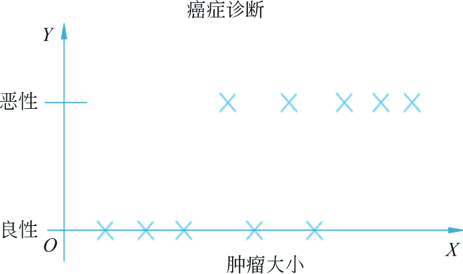

图 1.1 肿瘤的分类问题

上述示例仅用单一特征，实际常使用多特征。如图 1.2 所示，横轴为肿瘤大小，纵轴为患者年龄，用 O 表示良性，X 表示恶性，可清晰看出类别与大小、年龄的关联。

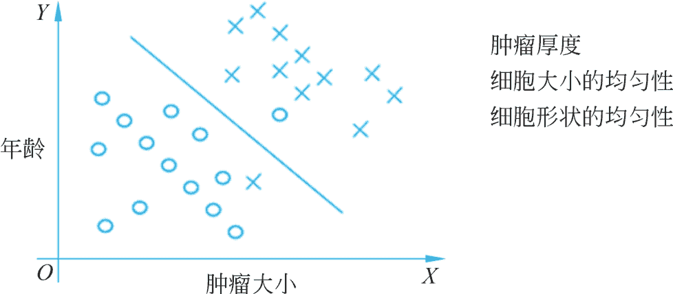

图 1.2 多个特征的肿瘤分类问题

除这两个特征外，还可引入肿瘤厚度、细胞大小均匀性、细胞形状均匀性等。

回归问题旨在预测连续输出变量，建立输入与输出的连续函数关系。例如利用房地产数据预测给定面积房屋的价格，价格为面积的连续函数。

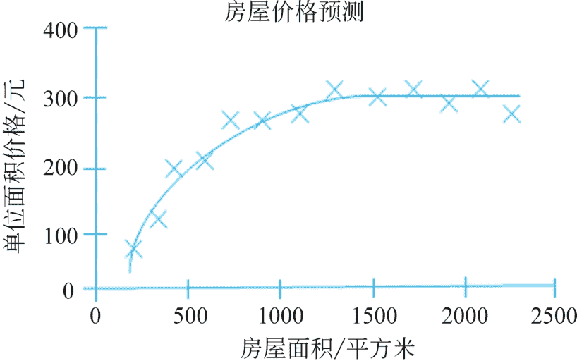

图 1.3 房屋价格预测的回归模型

监督学习的主要演进脉络如下。

20 世纪 50 年代，Rosenblatt 提出首个感知机模型，二元分类器，采用 Hebbian Learning 规则，可处理线性可分数据。

20 世纪 80 年代，决策树算法兴起，主要有 ID3、C4.5、CART，其中 ID3 利用熵与信息增益作为分裂准则，可处理非线性数据。

20 世纪 90 年代，Vapnik 等人提出支持向量机，是一种优秀的二分类方法，通过构建最优超平面实现分类，可处理高维与非线性问题。

20 世纪 90 年代后期，集成学习被引入，将多个分类器组合以提升准确率与鲁棒性。

进入 21 世纪，深度学习迅速发展，神经网络成为监督学习主流，模拟人脑神经系统，通过多层神经元组合实现复杂非线性映射，比传统统计方法更适配现实非线性场景。

**1. 决策树**

决策树是 20 世纪统计派监督学习代表，可用于分类与回归。每个节点对应一个特征，每个分支对应一个取值，通过递归分裂数据集实现分类。图 1.4 为基于西瓜分类的决策树，依据纹理、根蒂、色泽、触感判断好坏。

构建流程大致为：

（1）特征选择：从数据集中挑选最优特征，常使用信息增益、信息增益比、基尼指数等指标。
（2）树生成：从根节点开始，按所选特征递归划分子集，直至数据被正确分类或无法继续划分。
（3）剪枝：为避免过拟合，需剪枝。预剪枝在生成过程中停止无益划分，后剪枝在树生成后自底向上用叶节点替代子树并检验性能。

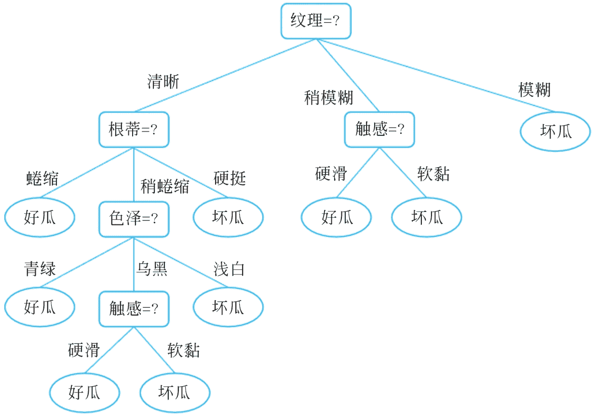

图 1.4 利用决策树模型对西瓜的好坏进行分类

（4）分类：用建好的树对新样本进行判别。

**2. 神经网络**

神经网络原理基于神经元计算模型。神经元接收来自其他单元的输入信号，经加权求和后通过激活函数进行非线性处理，再经轴突传递。网络由输入层、隐藏层、输出层构成，学习过程通过梯度下降等优化算法调整连接权重与偏置以最小化误差。输入层神经元对应特征，输出层数量对应标签类别，隐藏层结构由人工设定。基本两层网络如图 1.5 所示。

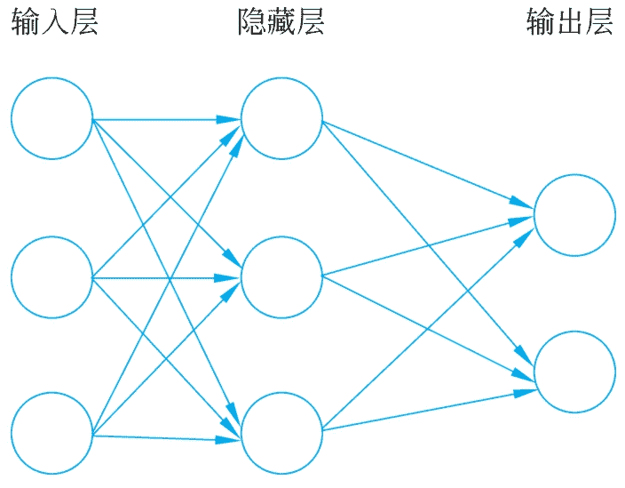

图 1.5 两层神经网络

神经网络经历了从单层感知机到深度神经网络的演进，核心突破是反向传播算法的提出，使多层网络可被有效训练。随着硬件发展，网络规模与复杂度大幅提升。

**3. LeNet**

LeNet 由 Yann LeCun 于 1998 年提出，是经典卷积神经网络，首次引入卷积层与池化层，成功应用于手写数字识别并取得出色准确率。卷积层的权重共享大幅减少计算与存储，局部连接保留图像空间相关性。结构共 7 层，包含 2 个卷积层、2 个池化层与 3 个全连接层。

**4. AlexNet**

AlexNet 由 Alex Krizhevsky 于 2012 年提出，在 ImageNet 大规模视觉识别挑战赛中首次夺冠，Top5 错误率 16.4%，远超竞争对手。网络共 8 层，5 个卷积层与 3 个全连接层，含约 6.3 亿连接、6000 万参数、65 万神经元，结构如图 1.6 所示。

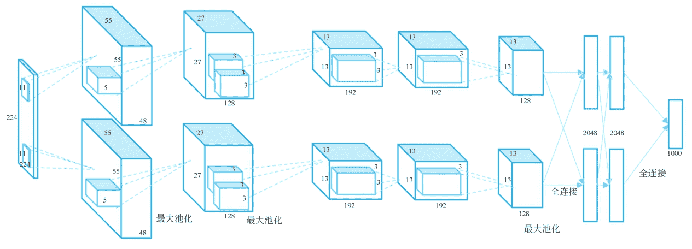

图 1.6 AlexNet 的网络结构

AlexNet 首次将深度卷积网络大规模用于图像识别，深度结构使其能学习更复杂特征，提升准确率。其创新包括：

（1）AlexNet 采用 ReLU 激活函数，相较传统 Sigmoid，加速训练并提高精度。

（2）AlexNet 在对抗过拟合上引入了 Dropout。训练过程中部分神经元会被随机失活，输出被置零，这样削弱了单元间的相互依赖，让网络更鲁棒，泛化能力随之提升。

（3）数据增强也被 AlexNet 放到流程里，通过对原始样本做随机旋转、随机裁剪、水平翻转等变换来人工扩充训练集，丰富样本分布，从而增强模型的泛化效果。

总体来看，AlexNet 把深度神经网络和卷积结构真正带进了计算机视觉的主流赛道，图像识别精度迎来大幅跃升，也把深度学习推向其他领域，为随后 VGG、ResNet 等更深更复杂的网络铺好了路。

### **1.2.2 无监督学习**

无监督学习不依赖标注，而是从原始数据中挖掘潜在的结构与规律。它的核心目标是把样本归类并揭示隐藏的模式。和监督学习需要标签不同，如图 1.7 所示，无监督任务中数据是未标记的。

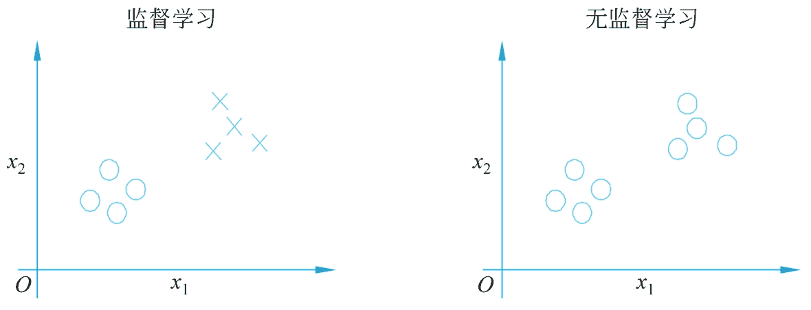

图 1.7 无监督学习（右）和监督学习（左）的对比

从任务角度看，无监督学习大致可归为三类。

（1）聚类问题：如图 1.8 所示，把数据集中相似的样本聚到同一簇里，不同簇之间差异较大。

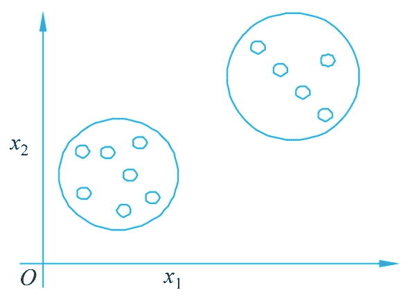

图 1.8 无监督学习中的聚类问题

（2）降维问题：在保留关键结构与信息的前提下，把高维数据压缩到低维空间。
（3）关联分析：挖掘数据中频繁共现的样本集合及关联规则，发现变量间的内在联系。

发展脉络上，无监督学习经历了两个阶段。第一阶段是统计分析时代；第二阶段是深度学习时代。

20 世纪 60 年代到 80 年代，研究重心在聚类与降维，代表性方法有 K-means 聚类和主成分分析 PCA 等。

**1. K-Means**

K-Means 的目标是把对象划分为 K 个同质簇，并为每个样本找到对应的簇中心。算法流程可概括为 6 步。

（1）数据预处理。对数据做标准化并剔除异常点。

  

（2）随机初始化 K 个中心，记为 μ1, μ2, …, μK。
（3）定义损失函数：

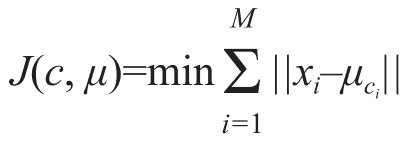

（4）对每个样本 x[i] 归属到最近的中心：

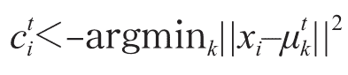

（5）对每个簇 k 重新计算中心：

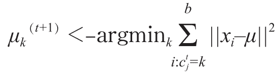

（6）令 t=0,1,2,… 为迭代序号，重复（4）（5）直到 J 收敛。

K-Means 的精髓在于交替优化：先固定中心调整样本归属以减小 J，再固定归属调整中心继续减小 J。两步轮换使 J 单调下降，直至中心与划分同时稳定。

进入 21 世纪后，随着深度学习兴起，无监督学习迎来爆发，自编码器、变分自编码器、生成式对抗网络 GAN 等在图像、语音、自然语言处理上取得突破。

**2. 自编码器**

自编码器是一种无监督神经网络，思路是对输入做压缩再重建。模型由编码器和解码器组成，如图 1.9 所示，编码器把数据映射到低维隐空间，解码器再把隐表示还原回原空间。

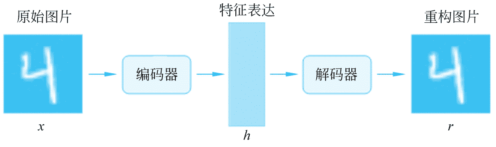

图 1.9 自编码器结构

训练可分成两个阶段。
（1）编码阶段：输入经编码器压缩得到低维特征向量。
（2）解码阶段：特征向量经解码器还原，计算重建结果与原输入的误差，自编码器的目标是最小化该误差并优化编码解码参数以更好地重建。

自编码器用途广泛，可用于图像压缩、去噪、生成，也可做特征学习，把原始数据映射到更具判别性的特征空间，为后续分类聚类服务。

**3. 生成式对抗网络**

GAN 是无监督生成模型，核心是生成器与判别器的对抗博弈。生成器从潜在空间采样产生伪样本，判别器负责区分真假样本。

训练过程如图 1.10 所示，包含两个阶段。
（1）生成阶段：生成器造出样本交给判别器评估，目标是让样本逼近真实分布以迷惑判别器。
（2）判别阶段：判别器同时接收真样本和生成样本并打标签，目标是尽可能准确地区分二者。

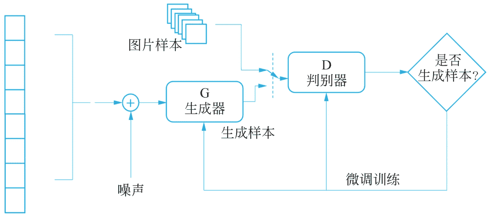

图 1.10 生成式对抗网络的训练

GAN 的优化是典型的零和博弈，双方不断迭代使生成器逐渐学会真实数据分布，产出更逼真的样本。该框架在图像生成、语音合成、自然语言处理等领域取得显著进展，成为无监督研究的重要方向。

### **1.2.3 强化学习**

强化学习通过试错与奖励反馈学习在环境中行动的策略。主体与决策者合称为智能体 agent，智能体之外的世界即为环境。智能体在每个时间步接收观测，选择动作，环境据此返回奖励与下一状态，目标是最大化累积奖励。

强化学习系统通常包含四个要素：策略、奖励、价值函数、环境模型。

（1）策略：在给定状态下智能体采取各行为的概率分布，本质是状态到行为的映射。
（2）奖励：环境在智能体执行动作后给出的标量信号，用来衡量表现好坏。
（3）价值函数：包括状态值函数和状态-动作值函数，用于评估长期累计收益，而非即时奖励。
（4）环境模型：对环境的模拟，可根据状态与行为预测下一状态和奖励。按是否依赖模型可分为基于模型和无模型两类，后者直接学习策略与价值函数。

如图 1.11 所示，大脑代表智能体，地球代表环境。在 t 时刻智能体依据状态得到观测 O[t] 与奖励 R[t]，发出动作 A[t]；环境更新后返回下一观测 O[t+1] 与奖励 R[t+1]。此交互形成时间序列 O[t], R[t], A[t], …

+1+1+1+1+1+1+1+1

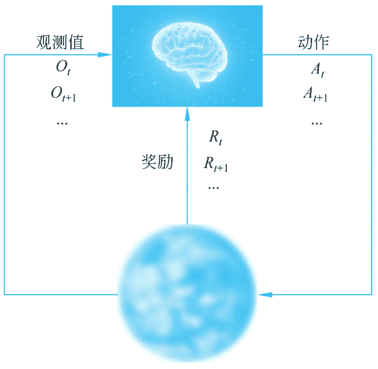

图 1.11 强化学习过程

状态与动作的映射关系即为策略 π，用 π:S→A 表示，记作 a=π(s)。早期常以随机策略探索，收集状态、动作、奖励样本后不断改进策略以提升总奖励，整体抽象模型如图 1.12 所示。

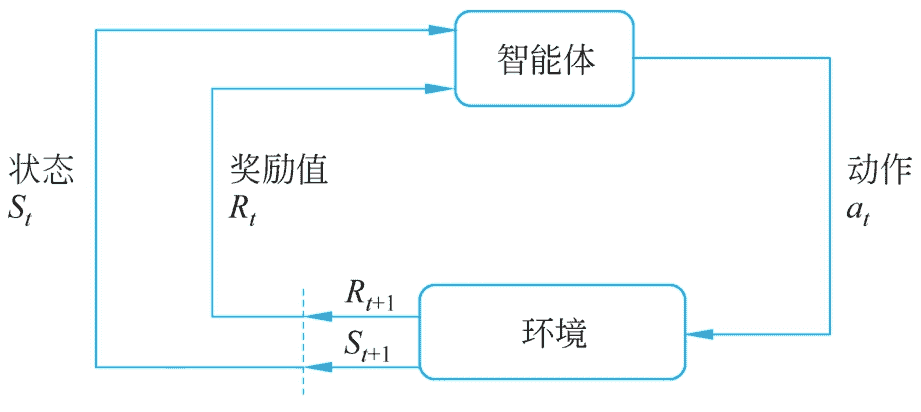

图 1.12 强化学习的抽象模型

强化学习在游戏、对战、机器人控制、自动驾驶等场景应用广泛。算法可按三个维度划分并交叉组合。
（1）更新方式：基于值或基于策略。前者不断更新动作价值 Q(s,a) 或 Q(s) 再据此决策；后者通过策略梯度直接优化策略函数 π(s)，用价值函数 V(s) 指导更新。
（2）采样策略：同策略 On-policy 与离策略 Off-policy。前者采样策略与执行策略一致，后者二者不同，常见随机或均匀采样。
（3）模型依赖：基于模型与无模型。前者学习状态转移概率进行建模，后者不显式建模而直接学习价值函数。

**1. 值迭代和策略迭代**

值迭代与策略迭代是动态规划求解奖励已知且转移概率确定的经典方法。二者都从初始策略出发，先评估再改进，直至收敛到最优策略。

策略迭代先评估当前策略的价值函数 V[π]：

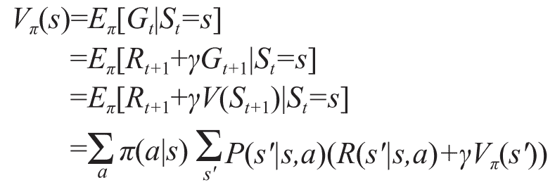

写成动态规划形式：

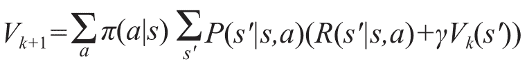

其中 V[k] 为第 k 次迭代的价值估计。随后计算每个状态 s 下各动作的期望价值：

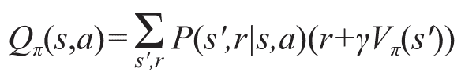

再据此更新策略：

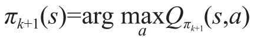

迭代直至价值收敛，得到最优策略，过程如图 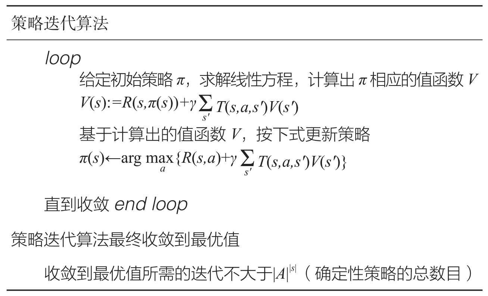 所示。

值迭代与之类似，但每次直接更新动作期望价值而不显式维护策略：

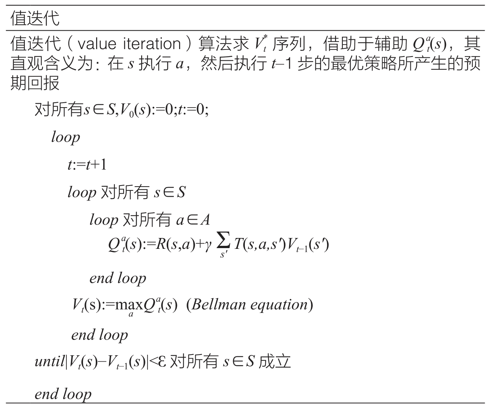

**2. Q-learning**

策略迭代与值迭代需遍历所有状态与动作，且要求状态转移概率已知，这在连续空间或概率未知时难以实施。Q-learning 是一种基于值的 Off-policy 算法，利用时间差分 TD 方法估计动作价值，通过迭代逼近真实最优 Q 值。

在经典迭代中期望价值由

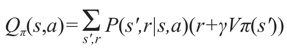

给出，结合价值函数可得

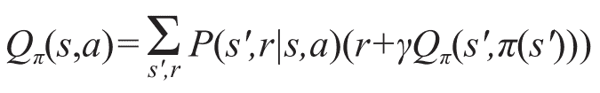

由于最优策略对应最大 Q 函数，代入后得到

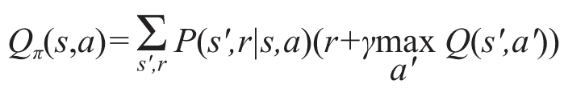

因此可用 TD 误差逐步逼近最优 Q 值：

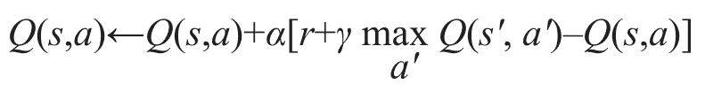

其中 α 为学习率，控制每次更新的步长。该方式避免了对转移概率的依赖，直接得到最优动作价值。

**3. 强化学习实验环境**

强化学习依赖环境交互，仿真平台尤为关键。OpenAI 开源的 Gym 是目前最主流的套件，可通过 pip 安装，涵盖多个类别。

（1）Atari 游戏，如图 1.13 所示的 SpaceInvaders、MsPacman 等，输入为三通道图像，动作对应手柄按键，考验模型的学习与视觉能力。

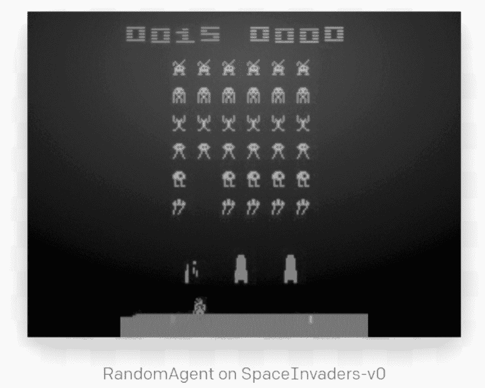

图 1.13 Atari 游戏示例

（2）机器人控制，如图 1.14 所示的一阶倒立摆 Cartpole 等，涉及关节与机械臂仿真，复杂度更高，考验控制策略。

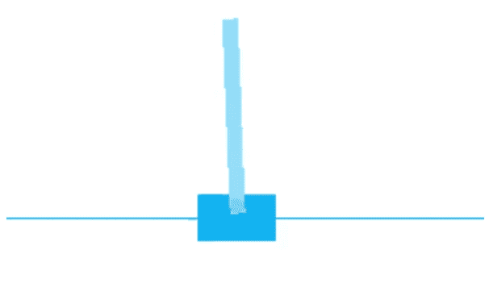

图 1.14 一阶倒立摆

**4. 强化学习和深度学习**

深度学习尤其是神经网络提供了强大的泛化与拟合能力，解决了感知与认知类问题；强化学习则聚焦决策与规划，如推荐、路径选择等。二者独立但相互促进。神经网络可处理强化学习中的连续动作、连续状态问题，由此诞生 DQN、TRPO、PPO 等主流算法。如今强化学习仍在快速发展，应用仍有大量空间。

### **1.3 计算机视觉**

在 ChatGPT 爆火前，图像处理长期是人工智能的核心焦点。最早可追溯到 1956 年 Frank Rosenblatt 提出的感知机用于图像分类，因只能处理线性可分而沉寂。直到深度学习兴起，图像分类成为深度学习最早的突破口。2012 年 ImageNet 竞赛中，Alex Krizhevsky、Ilya Sutskever、Geoffrey Hinton 提出的 AlexNet 一举夺冠，标志着深度卷积网络在大型视觉识别任务上的首次成功，点燃了深度学习浪潮。此前图像领域堪称人工智能皇冠上最耀眼的明珠。

### **1.3.1 图像分类**

图像分类是人工智能在视觉领域的起点，也是持续被挑战的高峰。从早期的感知机到如今数百层甚至上千层的卷积网络，该任务推动了一批经典技术并辐射到其他领域。

**1. 感知机**

上世纪50年代末，弗兰克·罗森布拉特针对图像分类的难题提出了感知机模型。第一台投入运行的感知机被装在一台重约5吨、占地与一间房屋相当的IBM 704主机上，数据通过打孔卡片送入。经历50次试验后，该系统自行学会了判断卡片上的标记出现在左侧还是右侧。感知机是神经网络最简化的雏形，其构想源自生物大脑中大量神经元的工作方式：神经元通常处于未激活状态，只有在接收到的刺激累积到一定程度时才会被点亮，无数神经元的协同使得大脑能够对外部信号做出响应。感知机模拟了这一过程，接收多路输入刺激并产生单一反馈信号。图1.15展示了一个双输入感知机的示意，其中x与x代表输入信号，y为0或1的二值输出，w与w分别是加在两路输入上的权重。图中符号常被称为神经元或节点，输入先与权重相乘后求和，当累加值超过阈值θ时节点被激活输出1，否则输出0。

121212

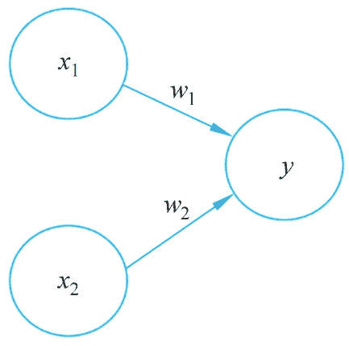

图 1.15 二输入的感知机模型

神经元的工作原理用数学表达为

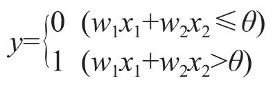

感知机通过反复迭代调整权重直至收敛，从而自动从数据中学习特征并完成分类。

遗憾的是，感知机仅能执行线性的二分类，对最简单的非线性二分类问题束手无策。当时学界普遍判定感知机失败，神经网络的研究随之淡出视野，那段低迷期常被称作“二十年寒冬”。

1974年，保罗·维尔博斯在博士论文中提出了多层感知机MLP，把罗森布拉特的单层感知机扩展为由多个神经元构成的多层结构。尽管多层感知机具备了逼近复杂非线性函数的潜力，但因计算资源匮乏并未引起广泛关注。寒冬延续至80年代，随着计算机性能提升，多层感知机重新进入视野。其中最关键的进展是杰弗里·辛顿、戴维·鲁姆哈特和罗纳德·威廉姆斯等人提出的反向传播算法，该算法能够高效地求解多层感知机中的权重与偏置，使得训练变得可行。此后数十年，多层感知机持续改进与发展。

**2. 支持向量机（SVM）和随机森林**

进入21世纪初期，研究者将支持向量机和随机森林用于图像分类并取得一定成效。支持向量机是一种经典机器学习方法，由苏联数学家弗拉基米尔·瓦普尼克与阿列克谢·切尔沃年科斯基首次提出，主要用于分类与回归。其核心思想是将样本映射到高维空间，在该空间中寻找一个最优超平面以分隔不同类别，并使两侧样本点到超平面的间隔最大化。

随机森林是一种集成学习方法，由莱奥·布雷曼与阿黛尔·卡特勒于2001年提出。它由众多决策树组成，因形似森林而得名。每棵树基于随机抽取的样本训练，在每个节点上利用基尼指数或信息增益挑选最优分裂特征与分裂点，从而提升分类精度。

利用支持向量机或随机森林进行图像分类的思路是先把图像转成特征向量，特征可以是颜色、纹理等手工提取的信息，再用上述算法对向量进行判别。该方案在当时已属先进，但缺陷明显：特征必须人工设计，需要大量专业知识，在复杂任务中设计难度急剧上升。正因依赖人工特征，支持向量机与随机森林在图像分类领域逐渐被能够自动提取特征的卷积神经网络取代。

**3. 卷积神经网络（CNN）**

卷积神经网络起源于80年代，最初主要面向文本和语音等序列数据，其本质可理解为在多层感知机基础上加入卷积操作。1991年，扬·勒库恩团队针对美国邮政手写数字识别任务提出了LeNet模型，并在该任务上取得当时最优表现，引发广泛关注。LeNet的出现标志着CNN在图像分类领域的崛起，并长期占据主导，推动了深度学习的发展。如图1.16所示，LeNet包含卷积层、池化层和全连接层。卷积层负责从输入图像中提取特征，池化层对特征图进行降维，全连接层则完成分类。LeNet的设计启发了后续AlexNet、VGG、ResNet等标志性模型。

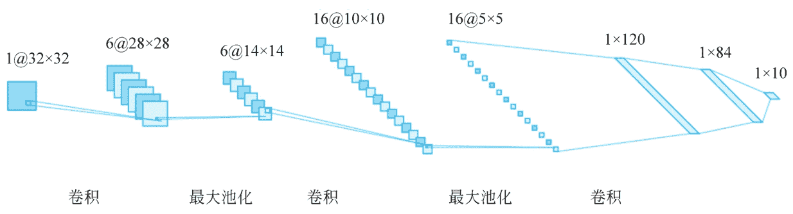

▲图 1.16 LeNet 网络结构

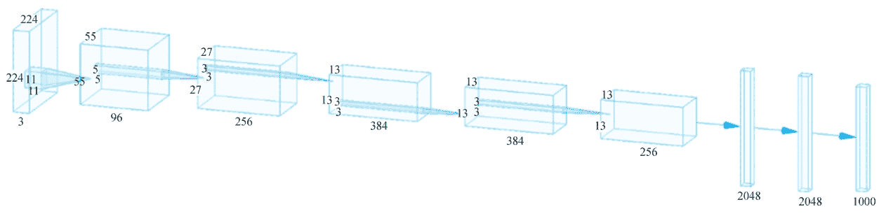

▲图 1.17 AlexNet 的模型结构

如果说LeNet开启了CNN的崛起，那么AlexNet则宣告了CNN主导时代的到来。2012年谷歌举办的ImageNet图像识别竞赛中，亚历克斯·克里热夫斯基等三位研究者提出的AlexNet将Top-5错误率从26%降至15.3%，首次超越传统方法。如图1.17所示，AlexNet包含5个卷积层、3个最大池化层、2个全连接层和一个Softmax分类器。

AlexNet当时有多项创新，对后续发展产生深远影响：

（1）首次使用GPU进行训练。相比CPU，GPU极大加速了深度网络的训练过程。
（2）激活函数的改进。AlexNet首次采用ReLU激活函数，相比Sigmoid等函数收敛更快、效果更好。
（3）数据增强。AlexNet对图像进行旋转、裁剪、翻转等变换，增加样本多样性，缓解过拟合。
（4）首次引入Dropout。训练时随机将部分神经元输出置零，有效降低过拟合风险。

AlexNet引领了卷积神经网络的革命，开启了深度学习时代，在图像分类上取得显著成果，也吸引更多研究者投入人工智能与计算机视觉领域。

在AlexNet掀起的浪潮中，基于CNN的图像分类模型效果惊人，并在多个维度上超越人类。可以说在ChatGPT出现之前，图像分类是人工智能的一座丰碑，机器首次在该领域明显超过人类。

**4. VGG 网络**

仅两年后，另一项革命性网络引起关注。自AlexNet取得优势后，深度学习虽获广泛应用，但结构复杂、参数庞大导致训练困难。人们一直在寻求更简洁、易训的深层卷积模型。2014年ImageNet竞赛中，牛津大学的卡伦·西蒙尼扬与安德鲁·齐瑟曼提出了VGG网络并取得最佳成绩，如图1.18所示。相较于此前复杂庞大的模型，VGG有两大特点。首先是采用小卷积核：VGG使用3×3的小卷积核堆叠以加深网络而不过度增加参数数量，小核能够学习更精细的特征表示并降低参数规模，使训练与优化更易进行；同时多个连续卷积层进一步增强了对图像特征的表达能力。其次是结构规范化：VGG采用池化层与全连接层等经典组件，参数设置与层序非常统一，例如卷积层使用相同的核尺寸与步长，池化层均采用最大池化。

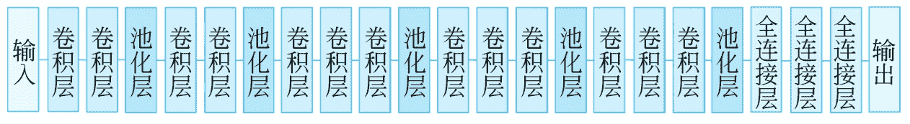

图 1.18 VGG 网络结构

VGG在图像分类精度上达到当时顶尖水平，再次验证了深度卷积网络在图像分类上的成功。其更深远的影响在于结构设计思想：简单规范的结构使训练与调试更易，同时控制复杂度、减少过拟合。VGG的设计思想至今仍是深度网络结构的范式，为CNN提供了一种基础架构。此外VGG具有出色的迁移性，在ImageNet上训练的权重可迁移至其他图像分类任务，为迁移学习提供了思路与基础。VGG启发了大量后续研究，时至今日仍有许多网络沿用其结构。可以说AlexNet证明了深度卷积网络的可行性，而VGG奠定了其基础范式。

**5. Vision Transformer(ViT)**

尽管卷积神经网络在图像分类上已取得显著成果，仍存在局限。最明显的是CNN需要固定输入尺寸，处理不同大小图像时需额外预处理；CNN对每个像素使用相同卷积操作，视野受限于卷积核，难以兼顾局部与全局特征，且语义理解能力偏弱，通常只能学习局部浅层特征。在此背景下，ViT应运而生。ViT由Google Brain团队于2020年提出，是一种基于注意力机制的神经网络，成功克服了CNN的上述短板，成为后来居上的新方向。

ViT是Transformer在计算机视觉中的应用，而Transformer最初由谷歌于2017年提出用于自然语言处理中的序列建模。其核心是完全依赖自注意力机制来捕捉输入序列的内部结构。大体上可将Transformer视为编码器-解码器结构，它通过自注意力动态计算序列中各位置的重要性权重，并对序列进行加权平均得到全局表示，从而处理长序列并捕捉依赖关系。

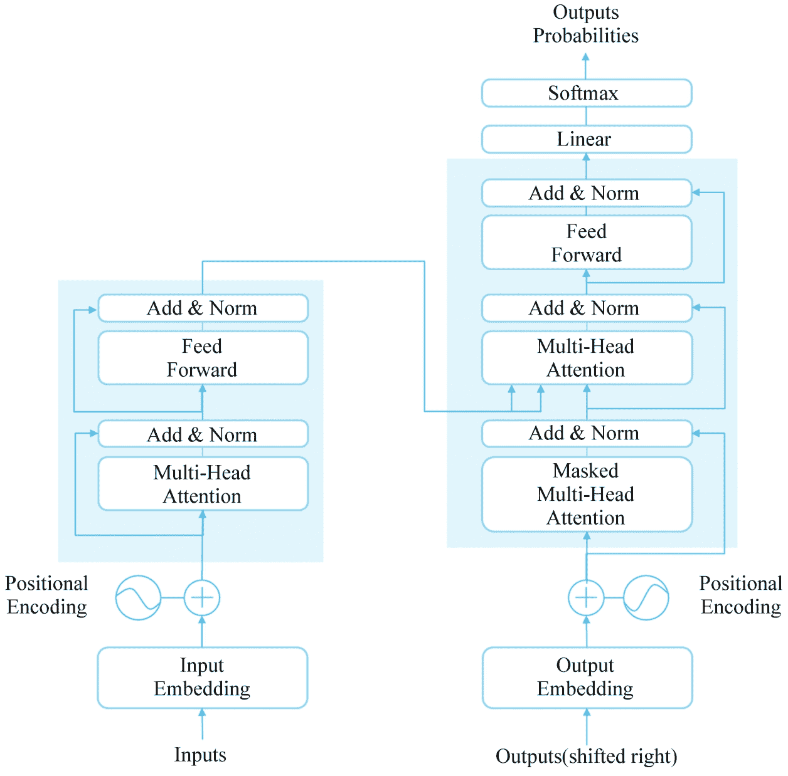

图 1.19 Transformer 网络结构

自注意力机制能够计算上下文相关的表示，帮助模型更好地捕捉元素间的相关性。在Transformer中，每个输入元素用于计算其他元素的注意力权重，以生成上下文相关的表示。Transformer由多个模块堆叠而成，每个模块包含多头自注意力子层与前馈神经网络子层。多头自注意力用于计算序列中各元素间的相关性，生成上下文表示；前馈网络则对表示进行非线性变换。

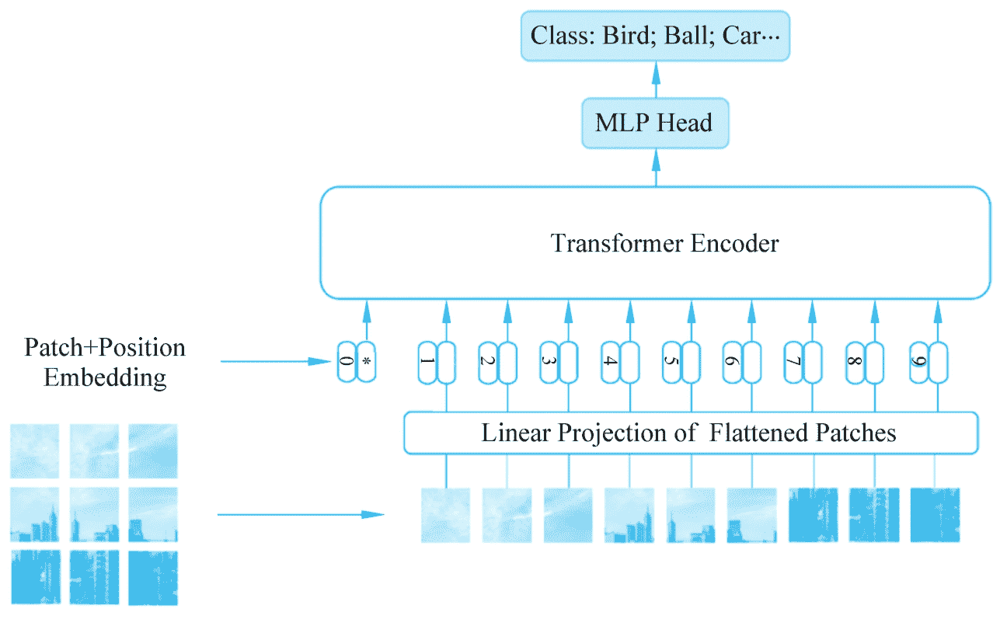

图 1.20 Vision Transformer (ViT)网络结构

如图1.20所示，ViT主要由编码器与分类头构成。编码器由多个Transformer Encoder堆叠而成，每个Encoder由多个Transformer Block组成。图像分类时，输入图像先被切分为等大的图像块，经可训练的线性变换Patch Embedding转成序列。序列送入Transformer Encoder，经过多个Block处理后得到整幅图像的特征表示，最后由分类头完成分类。ViT直接用Transformer处理序列化的图像表示，避免了CNN中池化与卷积的反复操作，并能更好地利用序列信息。通过自注意力机制，ViT能够从全局视角审视图像并捕获长程依赖。

ViT将Transformer引入计算机视觉，摆脱了CNN的约束，开创了自注意力机制用于图像分类的先河，在不使用卷积的情况下实现图像建模，为深度学习图像处理带来新思路。ViT在分类任务上达到与传统CNN相当的效果，并在可解释性与迁移学习能力上更具优势，已成为新宠。ViT的启示下，图像分类技术将走向何方，值得期待。

### **1.3.2 目标检测**

目标检测是图像处理领域的另一重大成就，其任务是在给定图像中定位特定类别的目标物体并给出边界框。从某种角度看，目标检测是对图像分类的深化。图像分类只需判断整张图像属于哪个预定义类别，无需关心位置；目标检测则需在图像中定位一个或多个对象并分配类别，即同时完成分类与定位。通常用边界框表示检测结果，矩形的四个角确定目标的位置与大小。此外，两者在应用场景上也有差异，图像分类多用于整体识别，目标检测更适用于需要精确定位、追踪或计数的场景，如自动驾驶中的车辆与行人检测、安防监控中的异常物体检测、医学图像中的病变检测等。

目标检测的历史可追溯至70年代，当时主要基于传统计算机视觉技术，如边缘检测、颜色分割、纹理与形状分析。随着技术发展，出现了模板匹配与基于特征的目标检测等更复杂算法。2000年后，随着深度学习兴起，深度神经网络被用于目标检测，RCNN、Fast R-CNN、Faster R-CNN等方法逐渐成为主流。2015年YOLO算法提出后，单阶段目标检测成为研究热点之一。

**1. 基于滑动窗口的目标检测方法**

传统方法中经典代表是基于滑动窗口的目标检测，最早由Viola与Jones于2001年提出，被称为Viola-Jones检测器。其思路是在图像上滑动固定大小的窗口，用分类器判断窗口内是否包含目标。该方法实现简单、灵活度高。在该框架中常用的分类器包括支持向量机与神经网络。训练时需从每个窗口中提取特征作为输入，最初采用手工设计特征如Haar特征、HOG方向梯度直方图等，用以区分不同目标。

作为最早的目标检测方法，滑动窗口法存在明显不足：

（1）速度慢。需要在多种尺寸与比例的窗口中提取特征并分类，检测效率低。
（2）目标尺寸受限。固定窗口难以兼顾不同大小目标，易出现尺寸不匹配。
（3）复杂场景适应性差。对遮挡、复杂背景处理效果不佳。
（4）易受背景干扰。基于局部特征分类，容易误检或漏检。

这些缺陷使其被深度学习方法取代，但也为后续目标检测技术发展提供了启发。

**2. RCNN (Region-based Convolutional Neural Network)**

随着深度学习发展，其优势使其成为目标检测主流。2012年AlexNet引领深度学习浪潮后，2014年罗斯·吉尔希克等人提出了里程碑式工作——RCNN，标志着目标检测进入深度学习时代。RCNN是一种基于卷积神经网络的目标检测模型，采用两阶段流程：先生成候选目标区域，再对区域进行分类与定位。它是首个将CNN引入目标检测的模型，特征提取阶段使用CNN，其余阶段仍沿用传统思路。RCNN的检测流程主要分为如图1.21所示的四个步骤。

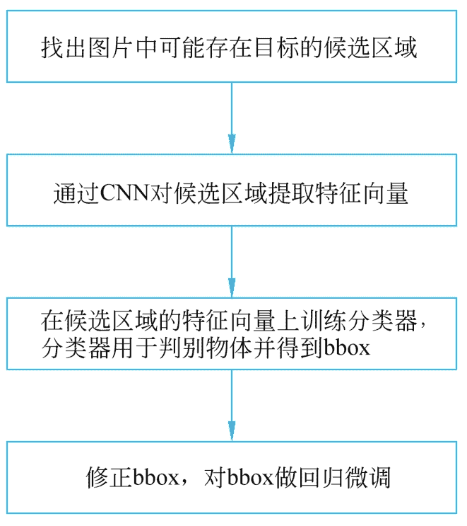

图 1.21 RCNN 算法计算过程

在目标检测里，RCNN 最早把深度学习搬进了框定位流程，其中挑选候选区域是整条流水线的起点。任务就是从原图里筛出可能包含物体的那一片片区域，再交给后面的网络做判别和定位。RCNN 当时用的是选择性搜索来做这件事。做法是先把整张图切成超像素，超像素会把颜色、纹理相近的像素聚成连通块；随后算法把邻近的超像素逐步合并，生成尺度和外观各不相同的区域提案。为了不把目标边缘截断，选择性搜索还结合了边缘检测来保留边界信息。因为这样产生的提案数量很大，RCNN 又引入 Region Proposal Network 来做二次筛选。RPN 本质是一个深度网络，能够对提案做分类打分并做边界回归，得到更精炼的结果。

特征提取阶段，RCNN 复用了 AlexNet 前五层卷积。每个候选框先被裁剪并归一化到统一尺寸，再送入预训练的 AlexNet，输出一维特征向量。随后这些向量进入多层感知机：一个全连接层先把向量映射到固定长度，再分叉成两个并行全连接分支，一个负责判断框内是否含有目标，另一个负责微调框的位置和尺度。最后用非极大值抑制剔除重叠严重的框，对每个类别保留得分最高的若干结果。RCNN 是首个摆脱手工特征的目标检测方案，直接从像素学习鲁棒表示，这个思路成为后续发展的核心。

3. YOLO：一次扫描完成检测
2015 年 Joseph Redmon 等人发表 You Only Look Once: Unified, Real-Time Object Detection，提出把检测转成回归的端到端思路，检测与分类合二为一，在速度和精度上实现突破，并长期主宰检测赛道。YOLO 的最大差异在于单阶段设计，只需对图像扫描一次，而传统两阶段先生成候选再分类定位。

第一代 YOLO 的做法是把整张图直接喂入网络，在输出端直接回归框的位置和类别。输入图像被划分为 S×S 的网格，每个网格负责预测 B 个边界框和 C 个类别概率。每个框预测中心坐标 x、y，宽高 w、h，以及一个置信度。训练时根据置信度和与真实框的重叠度计算损失，同时对每个网格依据类别和框参数计算损失，两部分相加后反向传播。推理时网络输出所有框的得分，保留高于阈值的框，再用非极大值抑制去除高度重叠的框，最终给出类别、框和得分。

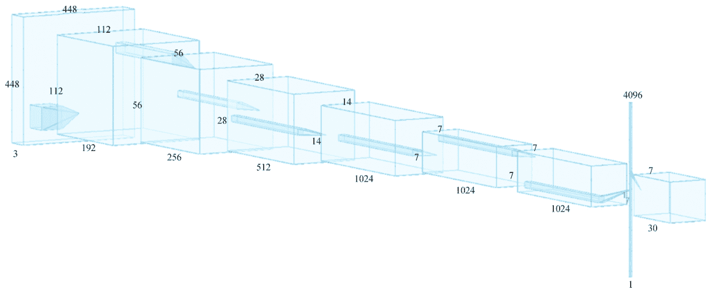
图 1.22 YOLO 网络结构

### 1.3.3 图像生成
图像生成是计算机视觉的重要分支，目标是让机器产出高质量多样化的图像。早期可追溯到上世纪 50 年代，科学家尝试用计算机画几何图形、符号和简单图案。1959 年 John McCarthy 提出“生成式模型”概念，即通过学习数据分布来合成新样本，可用于自然语言处理、计算机视觉等。1985 年 John Hopfield 与 David MacClelland 提出玻尔兹曼机，用能量函数建模并借助玻尔兹曼分布随机采样。训练通过最大化观测数据的似然进行，但训练慢、采样计算量大。后续发展出深度信念网络、受限玻尔兹曼机等，为生成技术奠基。20 世纪 90 年代图像生成开始落地，1997 年的小波变换压缩算法能在压缩时保留细节。21 世纪初深度学习兴起，2006 年 Hinton 等用深度信念网络生成自然图像，2014 年 Goodfellow 等提出对抗生成网络，生成质量大幅提升。如今生成技术已成熟，广泛用于图像处理、增强、修复等。

1. 玻尔兹曼机（Boltzmann Machine, BM）
玻尔兹曼机是 Hinton 与 Sejnowski 于 1985 年提出的概率生成模型，由可见层和隐层构成的双层网络，可学习样本分布来生成未知样本，最初用于模拟神经元交互。网络中每个节点取二值状态 0 或 1，节点间有权重表征相互作用强度，能量函数用于衡量整体状态，能量越低越稳定概率越高。训练基于梯度下降，最小化样本与模型间的 KL 散度，采用 Gibbs 采样模拟分布并更新参数。在图像生成中像素值作为可见单元，模型学习数据分布后生成新像素。

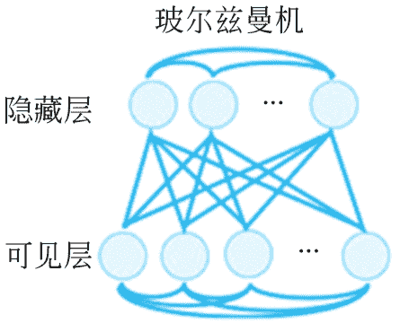
图 1.23 玻尔兹曼机的结构

局限性非常明显。
（1）训练复杂：需用马尔可夫链蒙特卡洛、对比散度等高级优化，计算开销大。
（2）采样困难：采样依赖 MCMC，易陷入局部最优，影响生成质量。
（3）生成难控：无向图模型无明确生成顺序，难以逐像素控制，易出现不合理区域或纹理。
（4）数据饥渴：模型复杂度高，需要大量高质量样本，否则过拟合或欠拟合。尽管如此，玻尔兹曼机的出现为生成任务提供了早期有效思路。

2. 生成对抗网络（Generative Adversarial Network, GAN）
GAN 由 Ian Goodfellow 等于 2014 年提出，由生成器和判别器对抗协作。原理来自博弈论零和博弈，一方收益另一方受损，两者博弈到平衡。生成器从随机分布采样生成数据，判别器判断真假。训练中生成器通过反向传播试图生成更逼真的样本欺骗判别器，判别器则努力区分真实与合成样本。对抗学习不断提升生成能力。

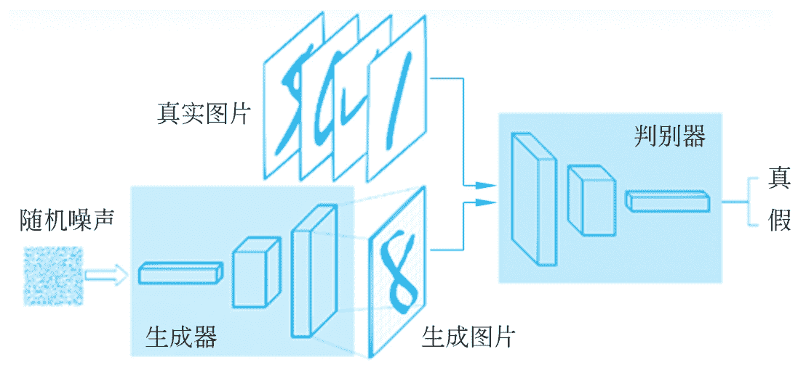
图 1.24 GAN 的生成过程

博弈可表述为最小化生成器损失、最大化判别器损失的问题，即
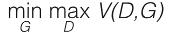
生成器追求生成样本与真实样本相似，常用 KL 散度、JS 散度、Wasserstein 距离度量差距，其中 JS 与 Wasserstein 最常用。判别器追求扩大两者差距，降低对生成样本的误判率。优化目标是极小极大问题，求解困难，需梯度下降、自适应学习率等技巧。训练易出现模式崩溃、模式塌陷、对噪声敏感等问题，后续提出 DCGAN、WGAN、CGAN 等改进。GAN 的价值在于用对抗训练生成高质量样本，突破手工特征提取，自动学习映射关系，适用于图像、视频、语言、音频等，并为迁移学习、模型压缩等提供启发。

3. 扩散模型（Diffusion Model）
扩散模型目前是图像生成领域最成功的范式。最早 1982 年 Lloyd 用于图像去噪重建，2000 年 Weiss 提出基于扩散的生成方法并称作随机游走算法，近年引爆并进入大众视野。其核心是用扩散过程模拟生成，每个像素视为随机游走点，受邻域像素吸引或排斥，建模该过程即可生成图像。

如图 1.25 所示，扩散模型包含扩散过程和去噪过程。以 DDPM 为例，扩散过程让图像像素逐步加入噪声，经一系列步长得到纯噪声图。可表示为
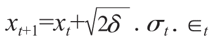
其中 x[t] 为第 t 轮扩散得到的噪声图，δ 为扩散步长，σ[t] 为第 t 轮噪声级别，ε[t] 为高斯随机噪声。

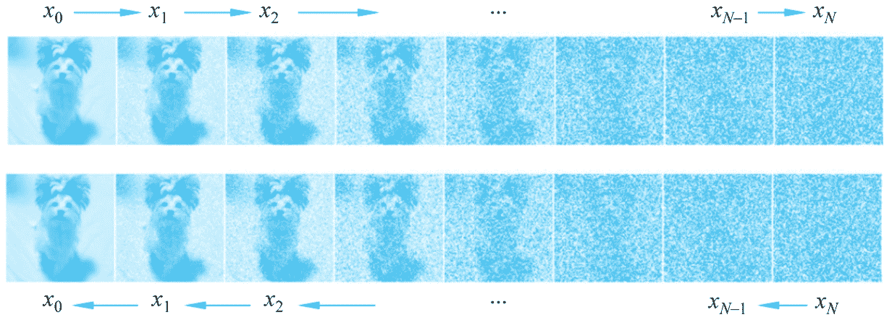
图 1.25 扩散模型的扩散（上）和去噪过程（下）的生成过程

反向过程模拟扩散的逆过程，从噪声恢复真实图像，即生成步骤，可描述为
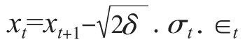
其中 x[t] 表示第 t+1 轮的噪声图，σ[t] 为第 t 轮噪声级别，ε[t] 为高斯随机噪声。

相较自编码器和 GAN，扩散模型因逐步去噪能生成更高分辨率、细节更丰富的图像，多样性更强，且随机噪声输入避免模式崩塌。时间步长还能控制风格，长步长更模糊抽象，短步长更清晰具体。如今扩散模型在图像生成上达到 SOTA，Stable Diffusion 等应用让技术真正落地普及。

## 1.4 人工智能与自然语言处理
语言是人类思考交流和社会交往的基础，支撑知识共享、历史记录和文化传承，也塑造行为和思维方式。人工智能发展中自然语言处理是关键里程碑，让计算机理解和处理人类语言，实现更自然的交互。当前 NLP 已在搜索引擎、机器翻译、智能客服、语音助手等发挥核心作用。随着深度学习发展，文本生成、问答、推理等取得突破，如 OpenAI 的 GPT 在文本生成达到人类水平，Google 的 BERT 在问答和推理上表现突出。

本节围绕文本分类、机器翻译、对话聊天与文本生成展开介绍。

### 1.4.1 文本分类
互联网信息海量，数十亿人的行为与思考构成信息洪流，精准甄别和提取有用信息至关重要。文本分类正是一种按预设类别对大量文本进行归类的技术，便于后续处理与分析。例如将体育新闻细分为足球、篮球等板块。无论是日常搜索，还是企业对海量用户数据的精细分析，分类都决定商业方向与效率。本文从发展历程与流程、特征提取、模型三个角度介绍。

1. 文本分类的发展与实现流程
发展脉络如图 1.26 所示。

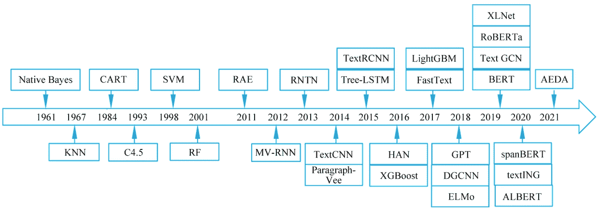
图 1.26 文本分类的发展过程

最早是基于规则的分类，通过人工定义专家规则，利用关键词、语法结构、逻辑关系判断类别。可解释性强但成本高、覆盖有限、难适应复杂文本。90 年代后期进入统计阶段，借助机器学习与数据挖掘从标注数据学习分类模型，再对新文本分类，无需大量人工干预。常用算法有朴素贝叶斯、K 近邻、支持向量机、决策树等。2010 年后随深度学习兴起，可自动学习深层特征与语义表示，无需手工设计特征，能处理非线性复杂关系。常用模型包括卷积神经网络、循环神经网络、注意力机制、Transformer 等。

实现流程如图 1.27 所示。

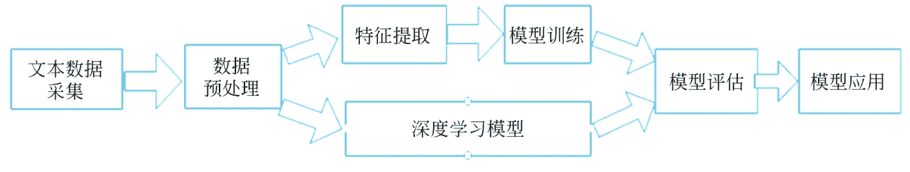
图 1.27 文本分类的基本流程

（1）文本数据采集：从网络或其他渠道获取待分类文本，如新闻、评论、邮件等。
（2）数据预处理：清洗、分词、去停用词等操作，为特征提取和训练做准备。
（3）特征提取：将文本转为计算机可处理的数值向量，常用词袋模型、TF-IDF、词嵌入等方法。

（4）模型训练阶段：依据提前确定的类别体系，借助机器学习或深度学习的方法，让模型从已标注的文本样本中学习分类规律，常用的实现途径有朴素贝叶斯、支持向量机、卷积神经网络、循环神经网络等。

（5）模型评估阶段：借助准确率、召回率、F1值等指标来检验分类模型的工作效果，进而挖掘模型的长处与不足，为改进方向提供依据。

（6）模型应用阶段：将已训练完成的模型部署到实际的文本分类场景中，实践里既可以单独使用一种模型，也能组合多种模型或对模型进行微调以提升效果。

**2. 文本分类的特征提取**

按特征取值形式划分，可分为离散型和连续型。离散型特征取值范围有限，例如词频、词性；连续型特征取值可取任意实数，例如TF-IDF、词嵌入。

按特征粒度划分，可分为字级、词级、短语级、句级和文档级。

按特征来源划分，提取方式大致为统计派和神经网络派。

统计派依托文本中词的出现频率、文档频率、共现频率等统计信息来构造表达，例如词袋模型、TF-IDF、LSA等。优点是思路直观实现简单，能应对高维稀疏的文本；缺点是特征往往需要人工设计，且丢失了词序和语义的相关信息。

神经网络派利用神经网络和深度学习从原始文本自动学习抽象语义表达，例如Word2Vec、GloVe、BERT等。优点是不需要手工设计特征，能够自动捕捉非线性复杂关系；缺点是对计算资源要求较高，且模型可解释性较弱。

本部分按照特征来源进行梳理，整体脉络如图 1.28 所示。

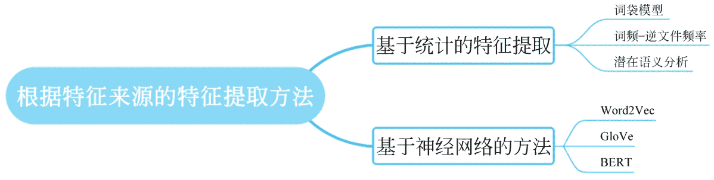

图 1.28 不同来源的特征提取方法

词袋模型、词频-逆文档频率、潜在语义分析是三种典型的统计派特征提取方法。

（1）词袋模型（Bag-of-Words）：把一篇文本映射为词频向量，统计每个词出现的次数，同时不保留词序和语法结构。使用时先做分词、去停用词等预处理，再构建词表，把所有文档中出现过的不同词编号。随后依据词表对每篇文档计数，生成一个数组表示的词频向量，即完成特征提取。

（2）词频-逆文档频率（Term Frequency-Inverse Document Frequency,TF-IDF）：以词频和逆文档频率加权，核心思想是词在一篇文档中出现越频繁且在整体语料中越稀有，其区分能力越强。先计算每个词在单篇文档中的词频TF，再计算逆文档频率IDF。IDF的计算公式为

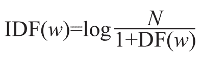

其中，*N*为语料库文档总数，DF(*w*)为包含词*w*的文档数。随后将TF与IDF相乘得到TF-IDF值，表示该词对该文档的贡献。把所有词的TF-IDF值汇总成矩阵，行对应文档，列对应词，即为特征矩阵。

TT

（3）潜在语义分析（Latent Semantic Analysis,LSA）：基于奇异值分解SVD的降维技术，通过对高维稀疏特征矩阵进行分解，得到低维稠密表示以捕捉潜在语义。首先用上述方法之一得到特征矩阵，再进行SVD分解 ***X***= ***U***×***S***×***V***，其中 ***U***是***m***×***k***矩阵，***S***是***k***×***k***对角矩阵，***V***是***k***×***n***矩阵，*k*由用户指定且小于*m*、*n*。取***U***×***S***作为新特征矩阵，每行代表一篇文档，每列代表一个潜在语义主题，从而完成降维表达。

Word2Vec是一种基于神经网络的词向量学习方法，核心是通过训练让词语获得分布式表示。该模型有两种结构：连续词袋CBOW和skip-gram。CBOW以上下文词预测中心词，skip-gram则以中心词预测上下文。训练过程中不断迭代更新网络参数，得到词语的向量表达。

GloVe全称为Global Vectors for Word Representation，是一种基于矩阵分解的词向量方法。它先构建词语共现矩阵记录上下文共现次数，再通过矩阵分解得到每个词的向量表示，从而刻画语义关系。

**3. 文本分类的模型**

文本分类模型可依据特征提取方式与分类器组合，整体分类如图 1.29 所示。

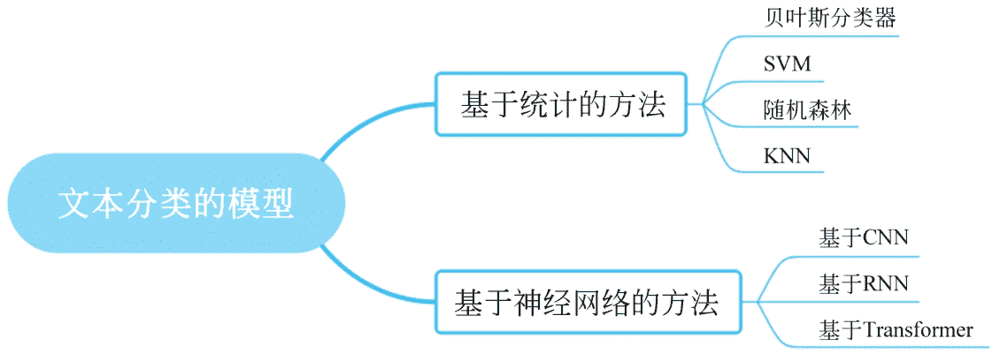

图 1.29 不同的文本分类模型

（1）基于统计的方法：结合词袋、TF-IDF等统计特征，使用贝叶斯、SVM、随机森林、K近邻等传统机器学习分类器完成分类。优点是实现简单高效，能处理高维稀疏数据；缺点是特征依赖人工设计，无法体现词序和深层语义。

（2）基于神经网络的方法：借助神经网络和深度学习自动从文本中学习抽象语义特征，再配合Softmax、Sigmoid等激活函数进行分类。优点是特征学习自动化，能处理非线性复杂关系；缺点是计算成本高，可解释性差。

基于神经网络的方法可进一步细分为：

①基于CNN的方法：利用卷积神经网络提取文本局部特征，如n-gram。通过不同尺寸和数量的卷积核捕捉多粒度信息，并借助池化降低维度提升鲁棒性。代表模型有TextCNN、DPCNN等。

②基于RNN的方法：利用循环神经网络捕捉序列依赖，如词间关系。借助记忆单元保存历史信息，并可通过双向和多层结构增强表达能力。代表模型有TextRNN、TextRCNN、TextBiLSTM+Attention等。

③基于Transformer的方法：利用Transformer捕捉全局特征，尤其长距离依赖。基于自注意力机制编码文本信息，并通过多头注意力和残差连接增强表达。代表模型有BERT、XLNet等。

### **1.4.2 机器翻译**

机器翻译是自然语言处理的核心方向，目标是借助计算机把一种自然语言的文本转换为另一种自然语言的文本。

发展脉络可追溯至20世纪40年代，当时美方研发的“语音翻译器”可把英语译成日语，但质量有限只能处理简单句。60年代词典翻译与规则翻译成为主流；70年代出现语言学知识与统计方法结合的混合模型；80年代神经网络开始进入该领域；90年代互联网带来大量双语语料；2000年后神经网络与深度学习的进步大幅提升了翻译质量。

应用场景相当广泛，国际组织、政府机构、跨国企业等跨语言沟通需求的场景都可借助机器翻译提升效率和准确性，同时在互联网搜索、在线翻译、语音识别等领域也有大量落地。

本节从规则式、统计式、神经式三个角度展开。

**1. 基于规则的机器翻译**

基于规则的机器翻译Rule-based Machine Translation, RBMT依赖人工编写的语言规则，对源句进行分析和转换。核心思想是把人类翻译知识形式化为规则集合，供NLP系统使用。

实现大致分为四步：

（1）分析：将源句拆解为词汇、短语、句子等语言学单元，通常包括词法分析和句法分析。

（2）解析：依据规则把源语言的分析结果映射为目标语言的语言学结构，实质为基于规则的自然语言生成。

（3）转换：对目标语言结构进行语法调整、词表转换和文本重组，形成可读文本。

（4）生成：输出最终翻译结果。

规则的质量决定效果，但人工编写和维护成本高昂，覆盖面有限且错误修复困难，这限制了其在大规模任务中的推广。尽管如此，RBMT是经典方法，也为后续统计和神经方法提供了启发。

**2. 基于统计的机器翻译**

统计机器翻译Statistical Machine Translation基于双语平行语料，通过统计建立源到目标的翻译概率模型实现自动翻译。

主要流程包括：

（1）语料库构建：收集源语言和目标语言的平行语料及单语语料，作为训练与评估基础。

（2）对齐：对平行语料中的句子和词进行对齐，建立对应关系。

（3）模型训练：在对齐基础上训练统计模型，常见有基于短语和基于句法的模型。模型会计算翻译单元的概率及整句概率。

（4）解码：对已训练模型进行译文生成，从源句切分出翻译单元分别翻译并选择整体概率最大的译文。

基本原理是条件概率，给定源句*F*，目标句*E*的生成概率为

*P*(*E* |*F*)= *P*(*F* |*E*)×*P*(*E*)

其中*P*(*E* |*F*)为译文条件概率，*P*(*F* |*E*)由翻译模型估计，*P*(*E*)由语言模型估计。翻译模型负责对齐关系，语言模型负责目标句流畅性，两者缺一不可。

**3. 基于神经网络的机器翻译**

神经机器翻译可追溯到2014年谷歌提出的基于RNN编码器-解码器的论文*Learning Phrase Representations using RNN Encoder-Decoder for Statistical Machine Translation*。该模型先把源序列编码为固定长度向量，再由解码器生成目标序列，被称为Seq2Seq。

随后大量变体涌现，如基于CNN和注意力机制的NMT模型，在多种语料和任务上取得显著提升，成为主流。

核心结构仍为编码器-解码器。编码器把源句词经词嵌入后输入RNN或CNN得到语义向量；解码器利用该向量和已生成部分逐步产出目标句，如图 1.30 所示。

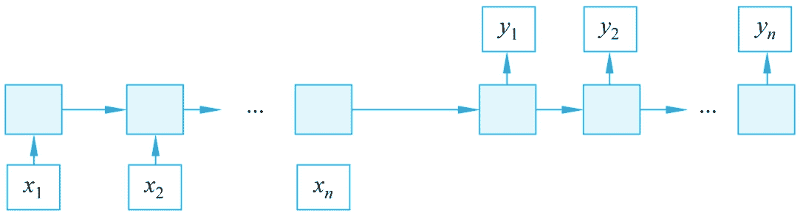

图 1.30 循环神经网络的编码-解码结构

训练需要大量平行语料，通常采用随机梯度下降SGD等优化方法。为缓解词序问题，常引入注意力机制对源句各词加权。NMT在复杂结构和语义上优于规则和统计方法，但训练时间长、对数据需求量大，仍是研究热点。

### **1.4.3 对话聊天和文本生成**

对话聊天与文本生成是自然语言处理的两大创新方向。对话聊天指人机交互，如当前热度极高的GPT 4.0；文本生成指机器自动撰写摘要、评论、新闻等，能大幅提升工作效率。

对话聊天技术源于20世纪50年代图灵提出的图灵测试，旨在检验机器是否能通过语言学习获得类人思维。随着发展，对话机器人与语音等技术结合，推动了智能家居等应用。

文本生成利用机器产出自然语言，可用于摘要、新闻生成、对话生成、音乐生成等。随着序列到序列模型兴起，文本生成能力快速提升，可依据主题和风格生成逼真文章，已在新闻、小说等领域广泛应用。两者相互关联，对话生成可视为特例的文本生成，需兼顾上下文与对话逻辑。

本节分别介绍对话聊天与文本生成。

**1. 对话聊天**

目标是让机器与人实现流畅自然交流，关键在于理解与生成，对应自然语言理解NLU和自然语言生成NLG。

实现路径主要有规则驱动和机器学习两类。规则驱动由开发者手工编写规则，精确可控但编写耗时易出错。机器学习方法依赖大数据训练模型自动学习输入输出规律，常用递归神经网络RNN和Transformer等，能在规模化数据上学习深层关联并生成合适回复。

对话式聊天若采用机器学习思路，虽然对数据体量有较高依赖，却往往能交出不错的表现。此前介绍过的序列到序列 Seq2Seq 就是典型代表。Seq2Seq 采用编码器-解码器双组件结构，与机器翻译中常见的编解码框架一致。编码器负责把输入句子压缩成向量表征，解码器则以该向量为起点生成回复。两者内部普遍使用循环神经网络捕捉时序特征，实践中常以长短时记忆网络 LSTM 实现 RNN，并借助反向传播配合梯度下降完成训练。

除此之外，基于变分自编码器 VAE 的生成范式也是当下常见选择。VAE 属于概率式生成模型，核心做法是把输入投射到潜在空间的向量，再据此建模与生成。对话场景下，VAE 可用来产出回复：编码器把输入序列映射为潜在空间的隐向量，解码器再将隐向量解码为回复序列，其整体结构见图 1.31。

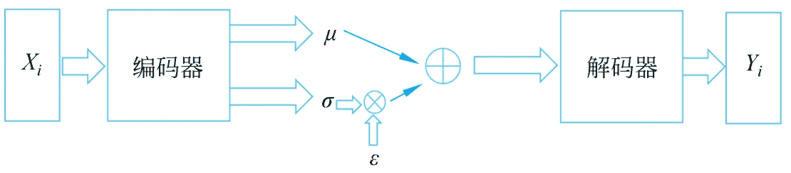

图 1.31 变分自编码器（VAE）的结构

实际运用中的机器学习对话模型远不止上述两种，各有优势。基于记忆网络 Memory Network 的方案，通过读写记忆的操作来保存并调用上下文信息。基于强化学习的对话系统则在交互中不断自我对话、试错学习，以提升性能与回复质量，效果同样可观。

对话系统亟需突破的难题是回复质量如何衡量。现阶段最主流的是人工评估，即由人工手动打分判定。另一类是自动评估，利用预设指标批量打分。自动评估胜在速度快，但对语义细腻度、流畅感等人类才能捕捉的维度覆盖不足。

**2. 文本生成的两种思路**

文本生成的实现路径也大致分为规则驱动和模型驱动两大类。

基于规则的方法依赖人工先行编写的模板或语法规则，再按照输入填充或拼接，产出符合句法语义的文本。优势是结果通常流畅且准确，劣势是模板编写成本高，迁移性差、灵活性有限。

基于模型的方法则借助机器学习或深度学习，从海量文本中自动学习概率分布或隐含表征，再据此生成符合统计与语义特征的文本。优点在于可自动归纳规律、泛化与灵活，缺点是偶尔会出现语法失误或逻辑断裂。

进一步看，模型法又可细分为生成式和检索式两支。

生成式方法用参数化模型直接产出新文本，常见代表是 Seq2Seq 与 VAE。Seq2Seq 采用编码器-解码器架构，先把输入序列编码为向量，再解码为输出序列。VAE 则以随机变量作为隐表示，先把输入编码为分布，从中采样向量再解码。优点是文本多样、连贯性好，风险是不稳定或自相矛盾。

检索式方法依赖索引结构，在已建库的文本集中为输入寻找最匹配项作为输出。常用技术有信息检索 IR 与神经网络检索 NNR。IR 通过关键词匹配或向量空间模型计算查询与库文的相似度，返回得分最高者。NNR 则用神经网络把查询和库文映射到低维空间，基于距离或内积选取最接近者。优点是质量稳定、一致性高，缺点是创新不足，对新领域适应性弱。

## **本章要点回顾**

本章从技术演进脉络与视觉、自然语言处理等应用角度，梳理了机器学习的发展历程与历史轨迹。

从早期的监督学习、无监督学习到如今的强化学习范式，范式的更迭也重塑了应用形态。过去图像与文本任务往往依赖标注语料与数据集，而下一章将要介绍的大语言模型，让大量下游任务摆脱对海量数据的刚需，有时仅靠一句提示词 Prompt 就能达成目标。

受篇幅所限，更多技术细节可通过下方二维码获取参考资料。


第一章 参考资料

# **第二章 大模型时代**

### **ChatGPT 的崛起**

人类的整个发展取决于科学的发展。

——普朗克

## **2.1 ChatGPT 的成长轨迹**

人工智能已走过近百年历程，从20世纪以逻辑表达和推理为主导的专家系统与知识库，到以数理统计为核心的深度学习，范式不断迁移。1956年，美国汉诺斯小镇召开了一场研讨会，议题是人脑如何工作、机器能否模拟大脑来协助人类完成特定任务。会场论辩激烈，也正是这次会议让“人工智能”正式进入学术视野，开启了漫长复杂的演进。随后诸多设想逐步落地，其中最受瞩目的当属今天的 ChatGPT。

若把图像分类比作直观的积木拼装，自然语言处理更像抽象的逻辑推理。早期 NLP 严重依赖语言学专家的手工知识，用人工定义词义与语法规则实现问答、聊天与翻译。统计学习兴起后，NLP 开始借助机器学习与标准化数据训练，机器翻译与搜索引擎进入规模化阶段，Google、百度搜索即为典型代表。深度学习的出现为处理海量语言数据提供了基础，让从巨量文本中抽取潜在关联成为可能。Transformer 架构的问世更让其成为 NLP 事实上的最优骨架，ChatGPT 正是站在这些技术肩上集大成的产物，其训练流程大致可分为三步，如图2.1所示。

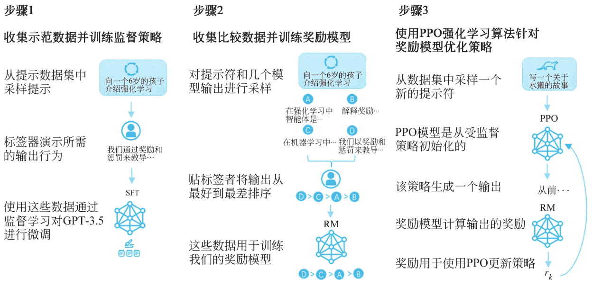

图 2.1 ChatGPT 的训练过程

第一步是大规模语言模型奠定基础。所谓“大”在于参数规模，从最小二乘法的寥寥数个参数，到支持向量机的数十上百，再到深度学习的数百万，参数量的指数级增长带来了质变。早期的 BERT 约有上亿参数，GPT-2 约 15 亿参数，若把 GPT-2 比作一个国家，其单个参数数量已远超中国总人口。ChatGPT 所依托的 GPT-3 拥有 1750 亿参数，远超地球上约 65 亿只老鼠、约 237 亿只鸡的总和。如此体量的模型可存储海量知识与文本关联，正是能力强大的根源。

第二步是 Prompt 技术释放模型潜能。倘若大模型是蕴藏知识的宝藏，Prompt 就是开启它的钥匙。作为大模型与下游任务的接口，Prompt 至关重要。在结构化与示例化的提示下，GPT 才能按规则生成合规答案。传统 Fine-tuning 需要重训大量参数，成本高昂且不总是可行。Prompt 则把人为规则直接喂给预训练模型，提升指令理解力。我们后续将介绍三种典型 Prompt 方法，从固定模板到自动化生成，逐步成为大模型下游任务的主流调优手段。

第三步是通过强化学习与人机交互实现的“人在环路” Human in loop，把机器文本转化为真正人话。监督学习像教师靠标注指导，半监督学习像成人靠举一反三，强化学习则像游戏靠不断试错找最优解。做法是让人工对 GPT 生成文本打分，反馈回模型，使其在下一次生成时更贴近人类表达。基于人类反馈的强化学习让数据利用效率大幅提升，使 ChatGPT 生成的语言更符合人类习惯，极大改善了最终应用体验，取得突破性成功。

## **2.2 大模型全景解析**

### **2.2.1 演进脉络**

人类技术史本质上是观念升级与物理约束减弱的双重过程。游牧向定居的转变，既源于人们对稳定生活的追求，也得益于小麦人工栽培降低的食物瓶颈。语言模型的发展轨迹亦然，从早期的规则模型迈向大规模统计模型，同样经历了观念与物理边界的迭代。

**基于专家系统的自然语言处理：** 最早的自然语言模型高度依赖专家知识，20 世纪的研究团队往往由计算机专家与语言学家组成，凭借结构化专家知识对语言进行解构与建模，再落地应用。

**基于数理统计的自然语言处理：** 20世纪后期统计学与概率论为 NLP 注入新动能，N-Gram 的出现尤为关键，它用前 N 个词预测第 N+1 个词，取代了繁琐的规则算法。此后基于上下文预测的思路成为主流，即便在 ChatGPT、BERT 等大模型中，其本质仍延续这一范式。


图 2.2 基于数理统计的自然语言建模过程

**基于深度学习的自然语言处理：** 进入21世纪，深度学习浪潮席卷 NLP。过去十年里计算机视觉从全连接、卷积到残差、密集网络不断演进，NLP 领域也涌现出早期 LSTM、循环神经网络等架构，持续推动性能提升。直到 Transformer 出现，如同游牧转为定居般开启新阶段：在20世纪末确立统计模型观念后，NLP 迎来了物理瓶颈的突破。基于注意力机制的 Transformer 显著增强了上下文建模与未来文本预测能力，解决了长期困扰该领域的核心局限。

正如技术革命催生人口大爆炸，适配 NLP 的 Transformer 出现后，模型规模也迎来“大爆炸”。图2.3、图2.4 显示，从 BERT 的上亿参数到 ChatGPT 的 1750 亿参数，背后是梯度消失、跳接网络、注意力等底层技术迭代的累积成果。


▲图 2.3 GPT 模型的更新与演进过程


▲图 2.4 不同深度学习模型的参数规模变化

### **2.2.2 Transformer 架构拆解**

深度学习历经近百年起伏，高潮与低谷交替，NLP 也在曲折中螺旋上升，其中 Transformer 的提出堪称关键台阶。

计算机视觉已形成卷积与残差网络共治的格局，而 NLP 直到2017年谷歌发布《Attention is All You Need》前尚无公认基座模型，反复在卷积与时序网络 LSTM、RNN 之间切换。Transformer 的横空出世终结了这一局面。

Transformer 与卷积、循环网络截然不同，核心是注意力机制驱动特征提取与下游任务。接下来将依次拆解注意力、前馈网络、位置编码及整体架构。

**1. 注意力机制原理**

注意力机制用于衡量不同元素间的相关程度。在语言处理中，各词对整体贡献不同，输出时不同词的重要性也有差异，注意力正是为解决此问题而生。

注意力计算围绕三个向量展开：Q Query、K Key、V Value。V 可视为输入特征本身，Q 与 K 则用于推导注意力权重，可理解为由输入衍生的影响因子。

其灵感来自信息检索中的关键匹配：V 是我们想获取的内容，Q 是与之相关的查询关键词，K 是库中可匹配的关键词。先计算 Q 与 K 的相似度，再据此对 V 加权，从而强化相关成分、抑制无关成分。

在 NLP 中，这三个向量的原始检索含义被弱化，更像是对输入特征间相关性的度量，具体计算步骤如下。

（1）计算比较 Q 和 K 的相似度，用函数 f 来表示：

*f*(***Q***, ***K***), *i*=1, 2, …, *m*

*i*

（2）将得到的相似度进行 Softmax 操作，进行归一化：


（3）针对计算出来的权重*α*[i]，对***V***中所有的分量进行加权求和，得到最终的 Attention 向量：


其中，计算相似度的函数*f*可以是不同的形式，例如可以是***Q***和***K***的点乘，或者是二者权重乘积等。在 Transformer 的结构中，Attention 是归一化的点乘（Scaled Dot-Product Attention），具体的计算过程为

   

其中，，，，最终输出的矩阵维度为，整个计算过程可以表示为图 2.5。

**2. 多头注意力**

在实际的模型中，只做一次 Attention 计算是不足以获取每个特征的相关关系的，因此就有了 Multi-Head Attention，具体计算如图 2.6 所示。


▲图 2.5 注意力机制的计算过程


▲图 2.6 多头注意力的计算过程

（1）对原始***Q***、***K***、***V***进行线性映射，得到相应的矩阵：


（2）利用上一部分提到的 Scaled Dot-Product Attention 对上述 3 个矩阵进行计算。

（3）重复多次上述（1）~（2）步，将所有结果进行合并。

（4）将（3）结果进行线性变换，得到最终的结果。

通过这样多个 Attention 的叠加，模型可以获取更为准确和不同维度的相关关系特征，因此，结果会更准确，模型的能力也更强。

**3. 前馈网络**

除了 Attention 机制之外，Transformer 中还有一层结构为前馈神经网络（Feed-Forward Network），这一层主要包含两个线性变换和一个 ReLU 激活函数，用于增强整个网络的非线性能力，最终增强每个单词特征的表达能力：

FFN(*x*)=ReLU(*xW*+*b*)*W*+*b*

1122

**4. 位置编码**

语言的前后顺序往往包含着语义和语法信息，因此为了获取输入序列的顺序信息，Transformer 对输入进行了位置编码，利用三角函数将词语的先后关系编码到了向量中，具体编码过程如下：


其中，*t*代表了单词的位置，*i*代表了该单词的第*i*个维度，。

在这种位置编码结构中，因为没有训练参数，模型的参数规模得到了下降，同时由于三角函数的周期性，最终不同位置的向量存在着线性关系，这样也可以维持相对位置的信息。

**5. 整体架构**

在介绍了基本的结构之后，这一部分将介绍整个 Transformer 架构，同之前的序列处理模型一样，Transformer 也是 Encoder-Decoder 的结构，如图 2.7 所示。


图 2.7 Transformer 的基本结构

（1）编码器部分：由 6 层 Attention 堆叠而成，每层包含 1 个多头注意力、1 个前馈网络及 2 次归一化，并在归一化前引入类似 ResNet 的残差连接，最终输出为上一层输入与输出的累加。

解码器结构：带掩码的六层生成栈

解码器同样是六层的 Attention 堆叠，整体骨架与编码器相近，但在生成场景下首个 Multi-Head Attention 会加上因果掩码，把时刻 i 之后的所有信息置零，模型只能基于已生成的历史来预测当前及之后词。除了这层掩码之外，其余部分与编码器一致，每层都包含一个 Multi-Head Attention、一个前馈网络，以及前后各一个正则化操作。

在时序建模上，Transformer 比循环神经网络和卷积神经网络更快，靠线性变换主导，天然具备高度并行性，可解释性也更好。出现之后，几乎所有自然语言处理工作都转向这一结构，甚至计算机视觉也由此诞生 Vision Transformer，表现相当亮眼。

### 2.2.3 从符号表示到上下文语义的迁移

自然语言处理的输入是符号化的表达，数理统计却依赖数值分析，如何把离散的语言符号转为数值向量，一直是核心难题。

最朴素的编码方式——One-Hot 向量
最直接的做法是用 One-Hot 向量编码词表，每个维度对应一个词，句子则由词向量拼接而成。好处是词之间不存在数值叠加，例如用连续数值 1 表示“我”、2 表示“是”、3 表示“人”，就会出现 1+2=3 的错误叠加，而 One-Hot 因为不同词占不同维度，不会产生这种线性混淆。代价也很明显，词向量维度随词表线性增长，面对大规模词表时很快就会维度爆炸。


图 2.8 连续数值表达的叠加性（左）和 One-Hot 向量表示（右）

为缓解维度爆炸和稀疏表达，业界引入预训练思路。借鉴迁移学习，先在大规模语料上训练一个基础网络，再把学到的特征提取能力迁移到下游任务。NLP 希望借此获得通用的词向量表示，随后用于各类具体任务。

基于词嵌入的预训练模型
最早把神经网络用于词表征的是神经网络语言模型 NNLM，如图 2.9 所示，利用神经网络提取词特征，输出层用 Softmax 估计词概率。因为采用全连接结构，只能处理固定长度序列，且 Softmax 参数庞大导致训练缓慢，因而未被广泛采用。


图 2.9 NNLM 的结构

Word2Vec 通过无监督方式从海量文本学习语义，摆脱 One-Hot 的高维稀疏困境，实现词嵌入。

如图 2.10 所示，Word2Vec 有两种范式：CBOW 通过上下文预测中心词，即用 ω[t-2], ω[t-1], ω[t+1], ω[t+2] 预测 ω[t]；Skip-Gram 则反过来，用中心词预测上下文，即用 ω[t] 预测 ω[t-2], ω[t-1], ω[t+1], ω[t+2]。两者核心差异在于预测方向。

CBOW 是“一对多”，一个中心词的梯度同时回传给多个上下文词；Skip-Gram 是“多对一”，多个上下文词的梯度汇聚更新中心词，因而训练次数更多。正是多对一的特性，让 Skip-Gram 对数据稀少的生僻词更友好，每个词作为中心词时都要被周围词多次校正。CBOW 虽然窗口滑动也会多次触及同一词，但梯度被平均分配，相当于生僻词只是沾了邻词的光，并未获得针对性训练。

–2–1+2+1–2–1+2+1

以 CBOW 为例，训练流程可拆为五步。

（1）上下文词先做 One-Hot 编码作为输入，词表规模记为 V，窗口大小记为 C。

如图 2.11，中心词作为目标，周围词作为输入。


▲图 2.10 Word2Vec 的基本模型


▲图 2.11 CBOW 模型的输入和输出

（2）把每个上下文的 One-Hot 向量乘以输入到隐藏层的权重矩阵 W。

如图 2.12，W 也称嵌入矩阵，可随机初始化。


图 2.12 CBOW 模型的词嵌入过程

（3）把得到的多个向量求和取平均，得到隐藏层向量。

如图 2.13，平均后经过梯度优化，最终形成词向量。


图 2.13 CBOW 模型的隐藏层向量的计算过程

（4）隐藏层向量再乘以隐藏到输出层的权重矩阵 W'。

如图 2.14、图 2.15，与另一个嵌入矩阵相乘得到输出向量。


▲图 2.14 CBOW 模型的权重更新


▲图 2.15 CBOW 模型的输出向量的计算过程

（5）对输出向量做 Softmax 得到 V 维概率分布，取最大概率索引作为预测词。

训练时用交叉熵比较预测分布与真实标签，并以梯度下降更新两个嵌入矩阵。Skip-Gram 的更新逻辑类似，只是输入输出角色互换。

可视化实验显示，用 50000 个词训练得到的 128 维 Skip-Gram 向量压缩到二维后，相近语义的词在空间中也更靠近，验证了词嵌入的有效性。


图 2.16 词向量的二维可视化

实际使用中，词表过大和 Softmax 计算量是瓶颈，于是出现了二级优化，如借助哈夫曼编码的 Hierarchical Softmax，以及降低更新频率的负采样。Word2Vec 之后还出现了 Glove 等方法，通过共现频次矩阵学习词表征，能更好地利用语料库全局统计，相较简单映射更合理。

随着发展，静态词向量演进为上下文嵌入，即词义随上下文变化的预训练模型。接下来的 BERT 与 GPT 将分别从编码和解码视角展开。

### 2.2.4 BERT：双向编码的预训练框架

BERT 全称为 Bidirectional Encoder Representation from Transformer，即来自 Transformer 的双向编码表征。其主要创新在预训练方式，采用 Masked LM 和 Next Sentence Prediction 分别建模词级和句级信息。

本节从输入输出、预训练任务和模型结构三方面说明。

1. BERT 的输入和输出

与词嵌入类似，BERT 把字或词映射为一维向量，经特定网络处理后得到带上下文的语义向量。

如图 2.17，输入是词向量，输出是融合上下文后的向量。为让表示具备上下文和位置差异，输入由三部分组成：词向量、文本向量和位置向量，前两者是学习得到的。文本向量刻画句子层面的语义；位置向量通过学习而非正弦函数获得，能区分同一词在不同位置的语义差异，有助于一词多义。

如图 2.18，三者相加作为最终输入。原始 BERT 对英文采用 WordPiece，如把 playing 拆成 play 和 ##ing，以获得更细粒度的语义单元。

输出形式随任务微调。


▲图 2.17 BERT 模型


▲图 2.18 BERT 模型的 3 个输入向量

单文本分类时，如图 2.19，先在文本前加入 [CLS] 标记，其对应输出作为整句语义表示用于分类，避免依赖具体词语的先验语义。


图 2.19 BERT 模型的单文本分类任务

句子对分类时，如图 2.20，除 [CLS] 外在句子边界加入 [SEP]，借助文本向量区分两句关系。

序列标注任务如分词，如图 2.21，利用每个字对应的输出向量进行标注，B、I、E 分别表示词首、词中、词尾。


▲图 2.20 BERT 模型的语句分类任务


▲图 2.21 BERT 模型的序列标注任务

2. BERT 的预训练任务

BERT 本质上是词嵌入模型，目标是学习字、词、句三级语义，因而采用两项预训练任务。

3. 蒙版语言模型训练

如图 2.22，随机遮挡句子中 15% 的词，让模型预测被遮挡内容。被遮挡词中 80% 用 [MASK] 替换，10% 随机换词，10% 保持原样。这样的设计避免模型过度依赖 [MASK] 符号，并提升纠错能力。与 Word2Vec 逐词预测不同，BERT 只预测部分词，大幅节省计算。


图 2.22 BERT 模型的蒙版语言模型

4. 下一句预测训练

如图 2.23、图 2.24，给定两句话判断是否连续。预训练时 50% 为真实相邻，50% 为随机配对，与 Masked LM 配合，使模型掌握篇章级语义。语料需取文档级而非句子级，才能学到长序列依赖。


▲图 2.23 BERT 模型的连续句子预测


▲图 2.24 BERT 模型的连续句子预测

两项任务让词向量具备上下文甚至全文语义，为下游微调提供良好起点。

5. BERT 的模型结构

如图 2.25，BERT 基于 Self-Attention 的多层 Transformer 编码器，计算流程与 2.2.2 节 Transformer 一致。

### 2.2.5 GPT：解码器驱动的自回归生成

前文 BERT 使用 Transformer 编码器，如图 2.26，输入可看到前后所有信息。GPT 则基于解码器，如图 2.27，采用 Masked Self-Attention 实现自回归生成，通过已生成词预测下一个词。

介绍维度同样分为输入输出、预训练任务和结构。


▲图 2.25 BERT 模型的结构


▲图 2.26 基于编码器的上下文预测


▲图 2.27 基于解码器的上下文预测

1. GPT 的输入和输出

输入由词向量和位置编码组成，二者相加后送入模型。

如图 2.28，词向量来自 Token Embeddings，可来自预训练词向量如 Word2Vec 或随机初始化并在训练中更新。整个句子的词向量构成句向量输入。

位置编码与 BERT 不同，BERT 用学习位置向量，GPT 则采用多个频率的正弦函数对位置编码，如图 2.29。

如图 2.30，词向量编码与位置编码相加构成最终输入。


图 2.28 GPT 模型的词向量表


图 2.29 GPT 模型的位置编码


▲图 2.30 GPT 模型的最终输入编码

2. GPT 的预训练任务

GPT 采用生成式语言建模，目标是最大化下一个词的似然：

注：在这里 log 函数没有底数，表示底数是多少都可以，后同。

给定大量无标注文本反复训练即可得到生成模型，流程与 BERT 预训练类似。

**3. GPT 架构一览**

图 2.31 能看出 GPT 同样建立在 Attention 机制之上。与 BERT 相比，最直观的分水岭在于主体结构的选择。GPT 偏向解码器，解码器内置的 Mask 设计正好契合生成式任务的需求——通过遮蔽后续序列来做预测，从源头上杜绝信息串门。

也正是这一取舍，决定了二者的行为差异。BERT 习惯在左右双方语境都就绪的情况下回填词位，而 GPT 则是严格按照“已出现的内容预测下一个”。做成这样，自回归式的 GPT 更贴合自然语言生成 NLG 的逻辑：依据当下已知信息推出下一步表达。BERT 则凭借双向理解的优势，在自然语言理解 NLU 方向更占上风。


图 2.31 GPT 模型的结构

除了 BERT 与 GPT，圈子里还有 T5、ELMo 等一众大规模模型。它们在思路上与前两者同根同源，差异更多体现在实现细节。ELMo 比如就依托双向 RNN 来建模。整体来看，Transformer 的骨架依然具备难以替代的竞争力，这里就不再展开其他分支。

从 GPT-1 到 GPT-2，再到 GPT-3 直到现在的 GPT-4，家族的理解与生成能力呈现出清晰的跃迁。GPT-1 以 117M 参数与 12 层 Transformer 起步，在短句生成上已经能用，但在长文本的把握上显得吃力。GPT-2 把规模拉到 15 亿参数、48 层，同时调整了预训练策略，文本的准确度与连贯性都有明显提级。GPT-3 进一步放大到 1750 亿参数，约是 GPT-2 的 116 倍，搭配 96 层 Transformer，理解与生成的表现全面超越前代。GPT-4 的具体参数官方未披露，市场普遍猜测已在万亿量级以上。更关键的是，GPT-4 已经不是纯文字模型，能接受图像输入并据此写标题、做分析。官方技术报告也显示，其高级推理能力已超出基于 GPT-3.5 的基础版 ChatGPT。

用一段续写来感受差异。输入句：He is a generous person and he is willing to lend you…

GPT-1: He is a generous person and he is willing to lend you a hand in his own cause, if i have anything to say about it.

GPT-2: He is a generous person and he is willing to lend you money as you work to get your career in the right direction.

GPT-3: He is a generous person and he is willing to lend you a helping hand whenever you are in need. His kindness knows no bounds,and he always goes above and beyond to assist others. Whether it’s offering financial support, sharing his knowledge, or simply being there to listen, he embodies the true spirit of generosity. His willingness to lend you not only his resources but also his time and empathy is truly remarkable. He understands the value of helping others and the impact it can have on their lives. You can count on him to be there for you, ready to extend a helping hand whenever you require it. His generosity is a testament to his character and a shining example for us all to follow.

GPT-4: He is a generous person and he is willing to lend you his knowledge, time, and resources without expecting anything in return. He believes that the joy of giving is a reward in itself. Whether it’s a challenging task at work, a complicated situation in life, or a question about a subject that piques your interest, you can count on him for assistance. His office door is always open for those who need advice or simply a listening ear. He inspires those around him with his selflessness and kindness, making everyone feel valued and supported. With him,you don’t just have a friend or a colleague; you have a mentor, a guide,someone who will stand by your side in times of need.

四版对比一目了然。GPT-1 的输出偏短，理解较浅，只点出“在他的事业上帮忙”。GPT-2 开始把慷慨具体化为“在职业发展时提供资金支持”，但深度有限。GPT-3 的回答变得丰满，涵盖财务、知识、倾听等多维度的人文关怀，仍在个性化细节上留有空间。GPT-4 则把慷慨描绘为无偿提供知识、时间、资源，并塑造出导师、引路人的形象，表达更细腻、情感更饱满。

综合来看，进步不只体现在参数堆叠与层数加深，文本理解的深度、准确度以及生成连贯性和情感温度都在同步提升。从浅到深、由简到繁的演进轨迹，也在预示大模型未来的成长方向。

**2.3 Prompt 驱动的指令微调**

NLP 的发展可以划作几步走。起初是统计学习，高度依赖人工特征工程；随后神经网络尤其是深度学习兴起，特征抽取与模型训练合流；预训练模型的普及让大规模语言模型成为主流，解决了知识沉淀与复用问题；而 Prompt 的出现，则提供了一种与传统 Fine-tune 不同的使用范式，让大模型真正能按指令服务下游任务。

传统 Fine-tune 需要动大规模参数，重训练成本高昂，有时甚至不可行。Prompt 则是把人为设计的规则或任务描述喂给预训练模型，引导它理解指令。举例来说，情感分类任务输入“I love this movie.”，期望得到 positive/negative 标签。可以设计 Prompt 为“The movie is ___”，让模型把空位补成表达情感的词，如 positive/negative，甚至是 fantastic、boring 等细粒度词。优势在于可调参数大幅减少，也更契合大模型本身的生成特性。

本节聚焦三种当前主流的 Prompt 形式：完形填空式 Cloze Prompt、前缀提示 Prefix Prompt 与自动提示 Auto Prompt。

**2.3.1 完形填空式 Prompt**

面对强势且标注成本高昂的大模型 LLM，用文本解释 Textual Explanation 来引导输出是一种可行思路。最直接的做法就是留空提问，让模型填空，像英语考试里的完形填空那样，通过特定位置的空缺抽取所需信息。

图 2.32 展示了判断电影评论情感时的构造思路，把影评与问题拼接后交给模型填关键词。


图 2.32 Cloze Prompt 的构造过程

填完空后，词性决定结果：出现“赞美”“表扬”之类的积极词，就是正面影评；出现“无聊”“批评”之类的词，就是负面影评。这就是典型的完形填空范式。下面以 PET Pattern Exploiting Training 为例说明流程。

1. 模式-标签词映射对
先介绍 PET 的基础单元，即模式-标签词映射对 PVP。记 M 为基于词表 V 的预训练大模型，L 为目标分类任务 A 的标签集，x 为输入文本。以影评为例，x 就是待判别的评论。构造 Prompt 的函数记为 P，P(x) 产生包含一个特殊空位的提示，例如“*三星半。郭帆拍片……的功课。总之，这是一条___的影评。”空位即模型填词位置。

为把结果映射回标签，还需定义标签到词表的映射 v:L→V，比如把“赞美”“表扬”映射为正向标签。P 与 v 构成的二元组 (P,v) 即为模式-标签词映射对。

有了 PVP，流程变为：对输入 x 先生成 P(x)，用 M 预测空位得到概率最高的词 y，再经 v 映射得到最终标签 v(y)。

以“张三喜欢李四”与“张三讨厌李四”是否一致为例，标签为“一致”“不一致”。设 x=(张三喜欢李四，张三讨厌李四)，P(x)=张三喜欢李四?_____,张三讨厌李四。若模型在空位填“不”，则判定不一致；填“是”，则判定一致。这样能最大化利用模型的生成能力，降低 Fine-tune 难度。

2. PET 的训练与推理
Fine-tune 的做法是直接在目标任务上微调。Prompt 框架下，则需要在保持模型不易训练、数据可能稀缺的情况下实现准确推断。生成式模型如 BERT、GPT 都能对给定上下文计算空位得分。给定任务上的 p=(P,v)，对样本 x 与标签 l∈L，标签得分可写为

s_p = M(v(l)|P(x))

再用 Softmax 得到标签分布：


推理时取概率最高的标签即可。把上式的分布与真实标签做交叉熵，作为损失来训练 M，就完成了 Prompt 的训练。核心思想是把下游任务重塑为大模型擅长的语言预测与生成问题，从而提升效果。

**2.3.2 前缀式 Prompt**

完形填空式 Prompt 通常需要动整模型，训练成本高。Prefix Prompt 固定提示位置，下游训练只需更新部分网络参数，可大幅省成本。其灵感来自语言生成的自回归特性，后续词的生成依赖于前文的特征与编辑。

1. 自回归的语言模型
除分类任务外，大模型另一类核心任务是文本生成，尤其是条件生成。比如给定《孔乙己》全文，要求输出摘要，这就是典型的条件生成。条件记为 x，长度为 X[idx]，目标文本记为 y，长度为 Y[idx]，拼接后记为 z。

主流大模型均以 Transformer 为底座，Prefix Prompt 的做法是对模型中若干层的激活输出进行修改，即


这里的 *h*[i] 对应 Transformer 第 n 层里第 i 个时间步的激活向量，i 用来标记序列的先后顺序。在参数为 ϕ 的大语言模型 LM[ϕ] 下，该激活可以写作

*h*[i]=*LM*ϕ

<*i*

也就是说第 i 个词的生成受到此前所有词分布的制约。于是第 i+1 个词的分布可以表达为


其中 *W*[ϕ] 是把 LM[ϕ] 的隐特征映射到最终词表的线性层。依据模型算出的第 i+1 个词分布，取词表里概率最高的词作为输出。与 Cloze Prompt 一样，Prompt 训练阶段需要最大化的目标是


把上式最大化来更新大语言模型的参数 ϕ，就能得到适配下游条件文本生成的模型。核心难题在于，如何在训练开销可控的前提下，让参数更新仍能取得优异效果。

**2. Prefix Tuning（前缀调整）**

跟其他 Prompt 思路相近，Prefix Tuning 也是借助一个引导前缀 Prefix 来控制条件生成。于是模型输入会额外带上前缀，拼接向量 ***z*** 变为

***z***=[PREFIX; *X*; *Z*]

这是 GPT-2 这类自回归生成模型的做法；对于 BART 等编码-解码双向模型，形式写作

***z***=[PREFIX; *X*; PREFIX*'*; *Y*]

PREFIX 的长度记作 *P*[idx]。

在训练时只针对 i∈*Y*[idx] 的激活与 Transformer 层做更新，即


在 GPT 体系里，如图 2.33 所示，每次迭代只动到 Prefix Prompt 相关的部分，即 *P*[θ] 的参数，整套大模型保持冻结。


图 2.33 基于 GPT 模型的 Prefix Prompt 结构

同理，如图 2.34 所示，在 BART 这类编码器-解码器网络里，每次只更新编码器和解码器中的 PREFIX 片段。


图 2.34 基于 BART 模型的 Prefix Prompt 结构

只调前缀参数的直觉来源于 Transformer 的前后依赖与时序建模特性。虽然简单，却在实际条件生成任务上给原始大模型带来了明显的微调收益，是一种有效且省参数的更新方式。

在 GPT 架构上训练成本很低，而双向编码结构需要同时维护两个 Prefix，稳定性相对较差，需要更精细的微调与超参调节才能达到理想效果。

**3. 连续空间的 Prompt**

看到这里会发现，相较 PET，Prefix Prompt 缺少 PET 里那个函数 *P*，即依据下游任务确定前缀的具体构造过程。传统 Prompt 方法都是显式人工设计的，比如 PET 会人为设定填空位置来判断肯定或否定：

*x*=*(张三喜欢李四，张三讨厌李四)*

*P*(*x*)=*张三喜欢李四*?____*,张三讨厌李四。*

除此之外，自动生成提示词的结构如图 2.35 所示。


图 2.35 传统离散空间的 Prompt 构造过程

图 2.35 中的 Prompt Generator 就是 PET 用到的函数 *P*，能把输入 *x*（图中为 Britain）填入模板，同时预留模型填空位（图中为 [MASK]）。不同任务需要手工给出提示词生成规则，以适配任务特性。

Prefix Prompt 并没有这种显式构造，如图 2.36 所示，它用一个多层感知机 MLP 直接产生 Prompt。


▲图 2.36 Prefix Prompt 的 Prompt 构造

生成的 Prompt 填入图 2.36 的 PREFIX 区，于是 Prefix Tuning 中的提示词是靠自动优化得到的。提示词以特征形式直接进入大模型，本质上是一个向量，即在连续数值空间里搜索的结果。相对而言，传统人工 Prompt 先转成词编码再输入模型（如图 2.35 中函数 *e* 的作用），其可搜索空间是离散的词表，范围更小。

再加上参数 *θ* 控制的小网络来生成 Prompt，避免了大量人工设计的弊端。人工提示词的痛点是同任务下不同写法性能波动很大，且只能在离散词中挑选，例如写摘要时可选“摘要”“梗概”“概括”“总结”等，相对于模型参数的连续空间，这种离散选择随机性强。

而用 MLP[θ] 得到“隐式”提示词，搜索空间是连续的，更贴合大语言模型，也能探索出非人为的提示模式，从而提升 Prefix Prompt 的能力。

### **2.3.3 自动**

在 Prompt Tuning 框架下，提示词如何构造始终是关键。相同语义的不同写法会带来明显效果差异，且不同模型的预测方式会影响提示词位置（前缀、后缀或中间）。为此涌现出一批自动编码 Prompt 的方法，省去手工调优。接下来介绍目前较为先进的自动搜索方案——P-tuning，它在连续空间里自动寻找提示词。

**1. P-tuning 的基本结构**

Prompt 技术本质是对原始输入的重构，把输入 *x* 与模型未来要填的空字符 [MASK] 按模板填入预设框架，这个过程可用函数 *P* 表示，即 2.3.1 节提到的函数。

为清晰描述模板 *T* 内部字符，将 *T* 中的提示词记为 [*P*[i]]，第 i 个提示词。将输入 *x* 与目标词 *y* 代入模板，可得

*T*={[*P*], *x*, [*P*[i]], *y*}

0:*i*+1:*m*

传统 Prompt 方法会先编码模板：

{*e*([*P*]), *e*(*x*), *e*([*P*[i]]), *e*(*y*)}

0:*i*+1:*m*

再用这些编码微调大模型 *M*，得到下游模型 *M'*。

P-tuning 不直接用原始提示词 [*P*] 的编码去训练 *M*，而是用可训练的编码网络生成特征序列：

0:*m*

{*h*, *h*, …, *h*[i], *e*(*x*), *h*[i], …, *h*[m], *e*(*y*)}

01+1

该序列作为训练样本微调大模型。

与 Prefix Prompt 类似，如图 2.37 所示，一个神经网络把标签词映射到连续特征空间得到 *h*。其中 Prompt Encoder 即该编码网络，其优化目标为


优化编码器后即可得到自动生成 Prompt 的网络，找到连续空间里的提示表达，而不局限于词表 *V* 中的离散词。2.3.2 节已讨论过连续表达的优势，此处不再赘述。


图 2.37 连续空间的 Prompt 构造

**2. P-tuning 背后的优化困境**

从发展来看，P-tuning 看似直接的改进，实际优化要应对两个困难。

（1）离散性：大模型的词嵌入本身带有离散词表的语义信息。Prompt 编码网络 *h* 若随机初始化并用随机梯度下降优化，只能在编码层参数上做微调，容易陷入局部最优，难以获得理想的提示编码。

（2）相关性：提示词前后通常存在关联，编码网络应能建模这种相关性，而非像 Prefix Prompt 那样直接用 MLP。因此 P-tuning 选择 LSTM 来刻画 Prompt 的前后依赖。

为缓解上述问题，P-tuning 采用如下编码流程：


其中 MLP 由两层网络构成，激活函数为 ReLU。实践表明该结构在多数任务上能较好解决 Prompt 自动编码问题，并取得优异效果。

**3. P-tuning V2**

如前所述，Prompt Tuning 本质是大模型的微调手段，旨在让下游任务发挥模型已有的信息与编码能力。它更适合百亿参数以上的超大模型，对 1 亿至 10 亿参数的中等规模模型效果有限。

同时 Prompt 仅改进输入样本，在序列标注这类逐字符输出的任务上表现不佳，而在文本分类、预测等简单任务上更有效。

为克服这两个限制，提出了结构更复杂的 P-tuning V2。

与 P-tuning 相比，区别在于以往方法仅在输入层做 Prompt 操作，而 P-tuning V2 把 Prompt 注入每一层网络（见图 2.38），实现深度 Prompt 调整。


图 2.38 P-tuning V2 的网络结构

深度 Prompt 主要带来两点好处。

（1）可调参数增多，从过去约 0.01% 提升到 0.1%~3%，下游任务的适配空间更大，能处理更复杂的任务。

（2）Prompt 深入多层网络，对预测影响更深，能更有效地改变大模型，从而提升训练速度、鲁棒性和最终性能。

## **2.4 人在环路的强化学习训练**

不同于传统基于大数据统计的机器学习，强化学习通过与环境交互，学习状态与动作的关系，以最大化累积奖励。本节从概念出发，结合典型算法介绍强化学习。

### **2.4.1 概述**

典型强化学习包含以下要素。

（1）状态集合 *S*：智能体所处的状态集合，每次处于其中某一个。

（2）动作集合 *A*：智能体可执行的动作集合，每步选择其中一个并导致状态转移。

（3）动作转换概率 *P*r：状态 *s* 下执行动作 *a* 后转移到 *s'* 的概率。

（4）奖励值 *R*(*s*, *a*)：在状态 *s* 下执行动作 *a* 获得的回报，也可写作 *R*(*s*)、*R*(*s*, *a*, *s'*) 等，具体形式取决于环境设定。

如图 2.39 所示，先初始化状态 *s*0，随后每步 *t* 观测到状态 *s*[t] 与奖励 *r*[t]，智能体据此决策并迭代。最终形成马尔可夫决策过程 MDP，记作 *M*=<*S, A, R, P*[s,a]>。

0


图 2.39 传统强化学习框架


在此基础上给出定义。这里 *k* 为动作序列序号，*γ* 为折扣因子（0≤*γ*≤1）。当 *γ*=0 只计当前奖励，*γ*=1 则无折扣累加。

（2）策略 *π*(*s*)→*a*：智能体当前采用的动作选择策略，常写为 *a*=*π*(*s*)，概率形式为 *π*(*a*|*s*)=*P*(*a*|*s*)。

（3）状态价值 *v*π：在策略 *π* 下状态 *s* 的长期回报，即 *G*[t]。

（4）行动价值 *q*π：在策略 *π* 下状态 *s* 与动作 *a* 的长期回报。

（5）*V*(*s*)：*v*π 的集合。

（6）*Q*(*s,a*)：*q*π 的集合。

强化学习的目标是通过迭代优化找到最优策略 *π*，使长期回报 *G*[t] 最大，可通过求解 *v*π 或 *Q*(*s,a*) 实现。

*

（1）第 *t* 时间步的长期回报

### **2.4.2 人在环路强化学习**

ChatGPT 使用的一种特殊强化学习是人在环路的强化学习，也称人类反馈强化学习 RLHF。在介绍完传统方法后，本节说明如何把人工指导引入强化学习以加速学习与优化。

**1. 人类反馈强化学习的基本过程**

普通强化学习通过与环境交互获得环境奖励，不断尝试最大化累积奖励。奖励函数的设定很关键，通常由人基于对环境的理解手工给定。

如图 2.40 所示，人类反馈强化学习中，奖励不再仅来自预设函数，而是一个动态函数，其输入包含环境状态、奖励以及人类反馈（好/坏等评价），据此修正奖励，得到更贴合的信号。这就是 RLHF。


通常做法是把确定性奖励函数 *R* 变成可调整的修正函数，用神经网络学习奖励修正，实现人类反馈融合，具体分为三步。


图 2.40 人类反馈强化学习框架


12

（1）按策略 *π* 与环境交互，产生多条轨迹集合 {*τ*,*τ*, …, *τ*^i}，与普通强化学习相同，通过最大化预测奖励和优化策略 *π*。

1212

（2）从上述轨迹集合中随机抽取两段片段（*σ*, *σ*）给人比较，人类打分判定哪个更好、相当好或无法比较。

（3）用监督学习更新函数 ，使奖励输出更贴近人类比较。

如此三步，把人类信息编码进奖励函数 ，让强化学习的奖励受人类反馈指导与更新。

1212

从人类的喜好出发的奖励塑造

在基于人为判分的深度强化学习范式里，两条轨迹的对比结果会被整理成一组记录并写入训练库 。这里的 σ 指向待比较的两段行为序列，μ 仅取 1 或 2，1 代表第一段更优，2 代表第二段更优，用来体现人的取舍倾向；当判定明确时 μ 会偏向一方，若难以分辨则 μ 呈现均匀分布。

两条序列孰优孰劣的概率，可借助 Softmax 按各自的奖励数值计算得到：


把人的偏好分布 μ 与前述的优劣概率结合，再利用神经网络可微的特性，就能写出修正奖励函数更新时的损失式：


按此流程，人类的评判就能被正式嵌入到奖励修正模块里，引导优化方向贴合人的意图。这样的落地方式体现出四个明显价值。

1) 偏好可以绑定到特定任务，而非只像早期模仿式方法那样单纯复现人的演示样本。
2) 非专业人士的常识也能被编码，普通用户的判断同样能产生正向作用。
3) 即便面对大规模、高复杂度的难题也能适用。
4) 信息利用效率很高，不需要海量人工标注，少量标记即可收敛到不错的效果。

正因数据利用的高效，人类在回路的强化学习在文本生成上效果显著。ChatGPT 正是这一思路的典型成果，传统语言生成系统因此学会了更贴近人际表达的措辞，落地表现与交互体验被大幅拉升，创造了前所未有的热度。

同样在机器人自动化、排程优化等场景里，这一方法也展现出强劲生命力。它能缓解传统强化学习数据利用率低、需巨量样本才收敛的痛点。未来在大模型为核心的体系里，这类技术会有独特优势，尤其在自动驾驶等难以大规模采集数据、又必须依赖人工指导的难题上，潜力尤为突出。

2. ChatGPT 训练中融入人类偏好的强化学习

ChatGPT 的整体训练可拆成三段。第一段是预训练语言大模型，可在有标注数据上做微调，也可在无标注语料上做纯生成训练。第二段是奖励模型训练，用人为评判来估计奖励值，把偏好融入强化学习的奖励函数。第三段是强化学习微调，用第二段训练好的奖励模型，借助强化学习算法对预训练模型再微调，使输出更贴近人的表达习惯，从而进一步提升性能。

预训练阶段与此前所述一致，ChatGPT 本质上基于 GPT 架构的超大规模语言模型，可在有标注数据上训练，也能仅靠无标注语料完成。

奖励模型的训练流程相对直接，如图 2.42 所示，先用预训练模型生成一批样本，再由人工阅读打分，以生成内容为输入、人工分数为标签训练出奖励模型，用来评估生成内容是否贴合人类表达，得分越高代表越好。


▲图 2.41 大模型的预训练


▲图 2.42 基于人类反馈的强化学习训练

最后的微调环节主要依赖近端策略优化算法 PPO 实现，于是需要把语言大模型的微调任务重新表述为强化学习问题，明确状态 S、动作 A 和奖励函数 R。


图 2.43 利用强化学习算法对预训练的大模型进行微调

奖励函数 R 的设定最省事，直接沿用第二段训练好的奖励模型即可。状态 S 指输入序列，在语言模型里就是喂入模型的内容，主要包含提示序列 Prompt 与输入文本序列 x。动作则非常直观，就是模型产生的输出，是词表里词语的各种排列组合。

要素明确后，整体流程与常规强化学习一致：不断从语言模型采样文本，用奖励模型打分，再以分数与文本进行强化学习更新，让后续生成的样本评分持续提升。这样经过人在回路强化学习的微调，GPT-3 才有了与人自然对话的能力，堪称点睛之笔，也验证了人与模型耦合的有效性。

2.5 大语言模型的涌现机制

自深度学习兴起以来，图像与自然语言模型都在向更大规模、更深层、更复杂的结构演进。从 LeNet、ResNet、DenseNet、VGG、InceptionNet 到当下的 Transformer，结构从全连接转向卷积再到自注意力，层数从个位数涨到上百，参数量随之暴涨。语言模型亦从 MLP 到 LSTM、RNN、CNN，最终到 Transformer，规模一路扩张。

图 2.4 清晰展示了参数量的演进，语言与图像模型都在持续放大，尤其 BERT 与 GPT 类大规模预训练出现后，增速明显加快。规模的膨胀也带来了能力的膨胀，ChatGPT 原本只是个对话工具，却自带代码生成、知识检索、顾问式问答等普适功能。

关键在于涌现。1923 年摩根在《涌现式的进化》中指出，涌现是发展过程中方向上的质变，是关键转折点。大模型规模达到某个阈值后就会出现质变。大模型的“大”体现在参数量、训练数据量和算力三方面。如图 2.44 所示，随着这三者提升，性能整体走高，但实践中涌现并非线性，而是像相变一样，过了临界点才迎来陡增。这正是 ChatGPT 突然出现并快速演进的内在解释。


图 2.44 模型规模和模型效果的两种关系：线性关系（左）和相变关系（右）

涌现带来的直接结果是下游任务性能提升，以及泛化能力与思维链两大特性。

泛化能力上，传统小模型通常在独立同分布的封闭集里表现尚可，如图 2.45 左；而以 ChatGPT 为代表的大模型展现出近乎无懈可击的泛化，如图 2.45 右，无论行业或问题类型都能给出令人满意的答案。这种泛化支撑了零样本与少样本学习，动摇了传统机器学习中训练集与测试集必须同分布的前提。


▲图 2.45 传统模型和大模型的泛化性区别，一个大模型可以解决多个子任务

思维链则更惊艳，如图 2.46 所示，只需加入“给出具体计算过程”的提示，ChatGPT 就能从错误修正为正确。这就是 Chain-of-Thought，通过显式提示思考过程，把复杂问题拆解为简单步骤，体现出推理能力的雏形。


▲图 2.46 大模型所产生的思维链效应

涌现赋予的泛化与思维链，让大模型席卷应用，ChatGPT 成为增长最快的 AI 产品，也在悄然改写人们的生活。

本章小结

本章梳理了 ChatGPT 背后的技术脉络，涵盖语言大模型、Prompt 微调技巧以及基于强化学习的模型调优，并剖析了其背后的涌现机制。ChatGPT 借助大模型实现了上下文语义建模，用 Prompt 工程实现交互式对话，再用人在回路的强化学习把生成语言拉向人类习惯，最终形成完整产品。参数增长带来的泛化与思维链，让大模型的应用成为可能。

后续章节将介绍 ChatGPT 在各领域的应用与影响，更完整的信息可扫码查阅参考资料。


第三章

ChatGPT 应用与探索

当织布机能自己织布时，人类的奴役将会终结。^(¹)

——亚里士多德

3.1 ChatGPT 带来的技术浪潮

回望人类历史，科技始终在推动社会进步。18 世纪蒸汽机开启工业时代，2022 年 11 月 30 日 OpenAI 发布 ChatGPT，则标志着通用人工智能时代的到来。这一浪潮重塑生活方式、经济模式和社会结构，也带来新机遇与挑战。

微软作为 OpenAI 最大投资方，早在 2020 年就买断 GPT-3 商业化授权，并用于 Office 与 Bing。2023 年 2 月 8 日，微软宣布把 ChatGPT 接入新版 Bing，产品不仅能答事实并给链接，还能提供即时个性化服务。


图 3.1 微软公司基于 ChatGPT 打造的 Bing 搜索服务

谷歌则感受到了威胁。2022 年 12 月 21 日的报道称，ChatGPT 的热度让谷歌管理层拉响“红色警报”，CEO Sundar Pichai 多次主持人工智能战略会议。2 月 7 日，谷歌注资 3 亿美元投资 OpenAI 竞争对手 Anthropic，并推出对话式 AI Bard 与新版 Bing 竞争。但如图 3.2 所示，Bard 首秀即出错，在演示中错误回答了关于詹姆斯·韦伯太空望远镜的问题，暴露了对信息真实性的判断不足，随后谷歌股价大跌 9%。


图 3.2 谷歌公司推出的 Bard 在发布会上的错误回答

国内方面，百度于 2023 年 3 月 16 日发布知识增强语言模型“文心一言”。发布会围绕文学创作、商业文案、数理逻辑、中文理解、多模态生成五方面演示，体验上与 GPT-4 版 ChatGPT 仍有差距，但作为中国版竞争对手已被市场认可，其中文输入作画功能也颇具新意。


图 3.3 “文心一言”使用测试

冲击远不止搜索引擎。微软计划把 ChatGPT 全面整合到 Office 全家桶、Azure 云服务、Teams 等产品线。2023 年 1 月 17 日达沃斯世界经济论坛上，微软 CEO Satya Nadella 表示将加速商业化进程。

对没有直接冲突的企业和个人而言，拥抱 ChatGPT、以 AI 生产力提升效率或许是最优选择。ChatGPT 近似人类的语言理解力，内含常识、认知与价值观，使其具备通用任务助理潜质，像贾维斯一样输入提示即可得到逻辑完备的答案。发布 5 天内访问量就破百万。

ChatGPT 不仅处理语言，还能融合行业知识，衍生出大量应用场景，拓宽知识获取渠道，为 IT、医疗、法律、金融、教育等领域提供快捷方案。尽管偶有不准，但它无疑为 AI 领域打开新局面。

3.2 ChatGPT 的使用诀窍

作为颠覆性创新，ChatGPT 在新闻撰写、客服、教育等领域大放异彩。想要用好它，大致有两条思路：一是优化提问方式 prompt，比如用开放式问题避免模糊或双关；二是借助实用插件扩展功能，如语义搜索增强检索、文本摘要插件速览要点。提问方式的优化对输出质量影响最大，插件则如虎添翼。

3.2.1 Prompt 的魔法

人们担忧生成式 AI 会自动化大量工作，实际上它也在创造新岗位——提示工程师。他们的职责是训练大型语言模型，让模型更准确、更有用地回答自然语言查询。据 CBS 新闻 2023 年 3 月 31 日报道，Anthropic 正在招聘“提示工程师和图书馆员”，年薪 17.5 万至 33.5 万美元。英国律所 Mishcon de Reya 也在招“GPT 法律提示工程师”。


图 3.4 使用 DALL·E 生成的主题为“a robot holding a magic wand and casting a spell”的图片

愿意支付高薪，是因为以 ChatGPT 为代表的 LLM 输出具有多样性，只有设计出符合模式的输入提示，才能获得最佳结果。正如图 3.4 所示，ChatGPT 像魔杖，念对咒语 prompt 才能言出法随。随着 LLM 在各行业渗透，提示工程师将成为必备技能。

如何设计高质量 Prompt？按 Ibrahim John 在 The Art of Asking ChatGPT for High-Quality Answers 中的观点，一条好 Prompt 通常由三部分组成。

1) 任务：清晰简洁地陈述需要模型生成什么内容。
2) 指令：在生成文本时模型应遵循的指令。

**让大模型真正听懂你的提示词拆解法**

想要让模型产出更符合预期的内容，关键在于把一次请求拆成清晰的组成。最常用的框架就是任务、指令、角色三合一，先把想做什么说清楚，再说明怎么做，最后定好模型说话的身份。

角色是其中最容易被忽略的一环，它决定了模型的表达口吻和判断角度。写提示词时，可以对需求做一次二次加工：把目的、动作、身份分别拎出来。

任务要把要干的活讲明白。比如需要一篇展会通稿，任务描述就可以写成“为下周伦敦当代艺术展撰写一份新闻稿”。

指令要把完成方式限定住，可以规定结构、语气、用词和必须包含的信息。承接上面的例子，指令可以是“用正式语体撰写，稿件里必须出现展期、场地、参展艺术家姓名及作品说明”。

角色要给模型一个身份。身份不同，观点和措辞会随之变化，比如让它以专业艺术评论家或资深记者的视角输出。

把三者揉在一起会更有效。假设要让模型写一篇关于全球变暖的辩论陈述，可以这样组织：

任务：写一个关于全球变暖的辩论陈述。
指令：使用正式语言和论据，每个论点都要有数据或研究支持。
角色：你是一名环保主义者，认为全球变暖是当前社会的主要问题。

合成后就是：作为一名认为全球变暖是当下主要问题的环保主义者，请用正式的语言和论据写一篇辩论陈述，每个论点都要有数据或研究结果支撑。

**用户**：作为一名认为全球变暖是当下主要问题的环保主义者，请用正式的语言和论据写一篇辩论陈述，每个论点都要有数据或研究结果支撑。

**ChatGPT**：尊敬的评委、各位听众。作为环保主义者，我坚定认为全球变暖是当今社会必须正视的核心议题。以下论点均有数据和科研成果作支撑。

科学层面，全球变暖是事实。世界气象组织数据显示，过去一百年全球平均气温上升约0.74℃，且升温速率在加速，21世纪前二十年均温比20世纪平均水平高出约0.2℃。

生态层面，物种受威胁。国际自然保护联盟的研究提示，到2050年可能有25%的物种因栖息地剧变面临灭绝风险。

社会经济层面，影响深远。联合国报告指出，变暖将导致粮食减产、沿海城市与岛国受海平面上升威胁，极端天气频发增加生存压力。

公共卫生层面，疾病风险上升。世界卫生组织研究认为，气候变化加剧疟疾、登革热等传播，预测到2030年相关死亡或达25万人。

危害是科学明确且无法回避的，但只要协同减排、推行可持续发展，仍有控制空间。我们需要立即行动，这关乎当下与后代，也关乎地球未来。

掌握高质量提示词的设计是提升模型使用效果的关键。作为提示工程师，需要具备问题分析与解决能力，并理解模型的工作机制，才能设计出最有效的提示，在各类专业任务中取得最佳表现。

把任务、指令、角色整合起来，能显著提高输出的准确度。但设计只是起点，使用中还有不少实操技巧。

**1. 精准描述需求，避开模糊表达**

有效的提示会明确说明想要的结果，减少歧义。笼统提问和具体提问得到的答案侧重点完全不同。

**用户**：你能告诉我如何做饭吗？
**ChatGPT**：给出的是通用烹饪流程，从选菜谱、备料、工具检查、工作台整理、按步骤操作、调味品尝、时间和温度控制，到收尾清洁，共11步通用指导。

**用户**：请为我制定一份菜谱。
**ChatGPT**：先反问饮食偏好、口味禁忌和菜系类型。

**用户**：淮扬菜。
**ChatGPT**：给出清蒸清江鱼的具体做法：选用约500克鲜活清江鱼，去鳞去内脏洗净，鱼身斜切几刀，抹盐与料酒并撒姜丝葱丝；上锅蒸10至12分钟，取出后倒掉蒸汁，热锅烧花生油浇淋即可。

**2. 丰富上下文，让模型把握范围**

提供背景信息有助于模型理解请求的边界，尤其在复杂主题时。以同一主题不同平台为例。

**用户**：我要一条关于ChatGPT商业前景的抖音口播脚本，用短句、中性语气。
**ChatGPT**：产出的是短句口播稿，介绍ChatGPT是什么、可用于客服、助手、翻译等场景，并点出对企业提升服务效率、降低人力成本的作用，以及在学习、文化交流方面的价值。

**用户**：我要一篇关于ChatGPT商业前景的知乎专栏文案，用专栏风格、中性语言。
**ChatGPT**：
标题段落引出人工智能快速发展与聊天机器人的关注度。
应用广度：客服替代人工、教育智能助手、金融理财建议、医疗初步诊断等。
技术实力：基于Transformer深度学习，理解力强且有自我学习能力，在自然语言处理领域领先。
商业落地：与微软、IBM、谷歌等合作，已在智能客服、助手、问答等场景应用。
结论强调应用广泛、技术领先、落地持续拓展，前景可期。

**3. 设定明确约束与指南**

约束能防止跑题，保证格式、字数、专业度。指定角色尤其能提升专业性。

**用户**：请扮演古典音乐作曲家，为指定乐器或管弦乐队创作原创作品并体现其个性。我需要帮助创作一首融合东方元素与巴洛克风格的交响乐。
**ChatGPT**：回应以作曲家身份，提出使用二胡、笛子、古筝等东方乐器呈现旋律与和声，在巴洛克复杂和声与表现力上发展；配大型管弦乐队，利用弦乐、木管、铜管、打击乐各司其职；并加入合唱团增强层次与宏大感。

需要注意的是，角色不一定是人类职业，也可以是Linux终端、SQL终端等交互界面，或markdown表格制作工具。


图 3.5 令 ChatGPT 充当 Linux 终端

**4. 多尝试措辞与结构**

若结果不理想，换一种说法或调整结构往往能得到更好输出。通过不同表达也能体会模型对细微差别的解读。


图 3.6 令 ChatGPT 充当 markdown 表格制作工具

除了自建提示词，还可以参考公开资源。PromptBase是付费交易平台，提供ChatGPT、MidJourney、DALL-E、Stable Diffusion等提示词，单条价格约1.99至10.99美元。PromptHero则提供免费的多种角色设定提示词，适合低成本获取灵感。GitHub上也有大量分享，如Awesome ChatGPT Prompts、ChatGPT中文调教指南等，其中包含时间旅行向导、格言书、中国式家长等有趣案例。

**用户**：我要你做我的时间旅行向导，我会提供历史或未来时间，你推荐事件、景点或人物体验，不要解释只给建议。第一个请求是想去文艺复兴时期。
**ChatGPT**：给出1486年佛罗伦萨大公主婚礼、1508年罗马教皇艺术委托会议观摩米开朗基罗绘制西斯廷天花板、1502年拜访莱昂纳多工作室等建议。

**用户**：请你充当格言书，提供明智建议、鼓舞名言并给出行动方法。第一个请求是逆境中保持积极性。
**ChatGPT**：提供爱迪生、马丁·路德·金、曼德拉等名言，配合设定目标、转变思维、寻求支持等建议，并提示每日反思记录学习。

**用户**：请扮演我妈，用母亲口气教育我，批评我、催婚、让我回家，并提亲戚孩子已婚对比及安排相亲。
**ChatGPT**：以母亲口吻数落年纪、对比七大姑八大姨家孩子已成家，催促回家谈未来，并主动提出小姨女儿朋友作为相亲对象。

### 插件与应用

目前存在两类扩展。一类是基于OpenAI提供的ChatGPT API开发的浏览器插件、编辑器插件或独立应用，实现特定需求；另一类是OpenAI官方推出的集成在ChatGPT内的插件，是ChatGPT生态的一部分，可直接在对话中调用功能。

**1. 第一类插件**

插件让 ChatGPT 真正好用

即便基础模型已经很强，原生形态仍然很单薄：只剩下一个输入区和发送键，面对复杂场景显得力不从心。为了把自然语言理解能力落地，开发者借助 API 把模型接入浏览器、编辑器和各类应用，补齐了时效性和在线操作的能力。下面按使用场景梳理常见的增强方案。

（1）数据扩展类插件。模型训练截止在 2021 年 9 月，后续出现的事物它天然不知。问到 2022 年才面世的 MidJourney，裸模型会回一句知识点截止、无法识别。扩展类插件会先解析提问，从互联网或本地库抓取关联信息，再把原文或链接一并喂给模型。喂入新鲜素材后，模型就能对新事物进行归纳。加上时间、地区等限定，答案会更准。装上插件后，模型能简要说明 MidJourney 是类似 DALL·E 的文本绘图工具，主打精致画面，运行在 Discord 机器人里，需要 Discord 账号并科学上网等要点。

（2）语音交互类插件。模型本身可读懂多种语言，但官方只保留文本对话，语音能力被闲置。这类插件把说话转为文字送入模型，再把文字结果读出来，用户就能像跟真人聊天一样交互。配合强大的理解、知识面和创造力，模型直接升级为聪明的语音助手。对想练口语听力的用户而言，这相当于随时可用的陪练，无需约老师，也能覆盖多领域话题。


图 3.7 语音交互类插件示意图

（3）信息提炼类插件。面对大量网页、文献或长视频，这类助手能把要点抽出来做成简洁摘要。它读取文章或字幕，通过 API 交给模型处理后，以新窗口或弹窗呈现，帮助用户迅速抓住重点，节省时间。

（4）办公提效类插件。写邮件、写报告时，提供对象和场景就能快速得到初稿。在 Excel 等软件里，用自然语言描述目标，插件会给出具体操作指引，让繁琐流程变简单。

（5）编程助力类插件。基于 VS Code 等编辑器开发的扩展，可做代码审查、优化、测试、注释和重构。开发者在编码时持续与模型对话，获得即时反馈，写出质量更高、更个性化的代码。

（6）提示词辅助类插件。改写后的页面会呈现问题类型清单和关键词检索，用户可以迅速找到高质量的提示模板，再自行微调使用。发现好提示也能保存复用。


图 3.8 ChatGPT 插件选项

2. 第二类插件

2023 年 3 月 23 日 OpenAI 正式推出官方插件机制，如图 3.8 所示。与把模型通过 API 嵌入外部工具的第一类扩展不同，这次更像把 ChatGPT 当成 iPhone，把插件当成 App，插件商店就是应用商店。ChatGPT 开始形成自身生态，渗透到互联网各角落。

目前已上线 Expedia、Instacart、KAYAK 等第三方插件，以及网络浏览器、代码解释器两款官方插件，帮助模型获取实时信息、执行计算和调用第三方服务，图 3.9 展示了热门插件。


图 3.9 ChatGPT 热门插件

插件连接第三方应用后，用户在对话中就能直接查股价、比分等实时数据，也能访问企业文档、个人笔记。甚至能直接订机票、订餐厅。ChatGPT 调用 Savvy Trader AI 插件查询股市信息如图 3.10 所示。


图 3.10 ChatGPT 调用 Savvy Trader AI 插件查询股市信息

ChatGPT 调用 Kayak 插件查询航班信息如图 3.11 所示。

发布的一批插件里，Wolfram | Alpha 计算引擎补齐了模型的算力短板。配合简洁界面，用户可做数学运算、生成图表、绘制家谱、音频频谱等。比如询问国内牲畜存栏情况，就能得到柱状图，如图 3.12 和图 3.13 所示。


图 3.11 ChatGPT 调用 Kayak 插件查询航班信息

官方浏览器插件让模型能上网。借助 Bing API 搜索，模型能整合多源信息并给出可点链接佐证，比如查训练截止日之后的新闻或实时天气，如图 3.14 和图 3.15 所示。


▲图 3.12 ChatGPT 调用 Wolfram 插件查询畜牧种群数据


▲图 3.13 ChatGPT 调用 Wolfram 插件绘制柱状图


▲图 3.14 ChatGPT 调用浏览器插件查询 2022 冬奥会奖牌情况


▲图 3.15 ChatGPT 调用浏览器插件查询天气预报

其中最关键的是 Zapier，已集成超过 5000 个应用，如 Google Sheet、Gmail、Trello、Notion 等，结合 ChatGPT 可实现任务自动化、邮件发送、数据库查询，大幅提升效率，如图 3.16 所示。


图 3.16 ChatGPT 调用 Zapier 中应用程序的模版

3.3 ChatGPT 决定行业竞争力

模型能完成信息检索、内容创作、智能对话、工作生活辅助等开放任务，成为各行业的通用助手。从经济学看，它是一种使能技术，帮助劳动者更高效完成现有工作，或创造新岗位。对使用者而言，它像一位勤奋、可靠、表达力强的个人助理，能把人从重复繁琐事务中解放出来，投入更有创造性的工作。

行业竞争加剧时，谁先用好 ChatGPT，谁就更具竞争力。无论 IT、金融、教育、法律、传媒，接入模型都能提升效率、降本增效、优化客户体验。

### 3.3.1 IT 行业

普及首先冲击 IT 本身。2023 年 1 月 31 日 CNBC 报道，ChatGPT 在谷歌 L3 工程师面试中通过技术评估。L3 属于入门级，通常面向应届生和新人，但难度不低。2023 年 3 月 14 日升级为 GPT-4 后，编程能力大幅提升，能理解复杂问题并给出高质量方案，部分场景可与资深工程师竞争。把模型融入工作流已成为 IT 从业者的必选项。

1. 学习新技能和编程语言

模型训练语料包含大量代码、技术文章和文献，可作为编程知识库。程序员能随时请教问题，获得建议、示例和技巧，降低学习成本，加速掌握。

学数据结构时，可先问“什么是数据结构”“有哪些类型”，再深入“请解释链表及其操作”，最后索要“用 Python 实现链表的示例”。遇到刷题卡壳，把题目抛给模型，它会先讲思路再拆解步骤，最后给代码，远比单纯搜答案可读。以下滑动窗口最大值的求解示例中，模型先阐述解题思路与步骤，再给出基于双端队列的 Python 实现，并在示例中演示了 nums = [2,3,4,2,6,2,5,1]、size = 3 的调用。

滑动窗口效果演示

result = find_max_sliding_window(nums, size)

print(result)

运行后得到：

[4, 4, 6, 6, 6, 5]

该实现的时间与空间开销均为线性级别，满足题目的复杂度限制。

**2. 辅助编程与调试**

借助强大的自然语言理解和代码生成能力，ChatGPT 能依据明确的需求快速产出可用的代码片段，减轻手动编写的工作量。只要把任务描述得清晰，模型就能给出对应的实现，进而提升日常开发效率，节省在资料检索、重复编码和故障排查上花费的时间。以搭建一个用于图像分类的卷积网络为例，实操可拆成四个环节。

（1）索取基础骨架：先让助手给出一个入门级的卷积网络雏形。可提问“能否提供一个基于 PyTorch 的简易卷积网络示例”。返回的内容是一套包含卷积、池化与全连接模块的起步结构。

（2）按需定制结构：结合具体场景请求改进建议。可提问“我想把这个网络用于十分类图像任务，该如何修改”。助手会给出调整输出层通道数、更换激活方式等具体建议。

（3）获取训练指引：可继续询问训练与评估流程。可提问“如何用 PyTorch 对该网络进行训练和评估”。助手会提供包含数据预处理、模型编译、超参设定与性能检验的代码示例。

（4）调优与排错：在训练中遇到瓶颈时直接提问。可提问“我的网络在验证集上的表现很差，有什么提升办法”。通常会得到修改网络结构、引入数据增强或调整训练参数等可行方案。

按上述路径，借助 ChatGPT 即可高效生成深度学习方向的卷积网络代码，加速图像分类类项目的落地。

用户提问：能否给出一个基于 PyTorch 的基础卷积网络示例？

ChatGPT 回复：没问题，下面给出一个基于 PyTorch 的基础 CNN 示例，主要面向 MNIST 手写数字分类任务。

# 导入必要的库

import torch

from torch import nn

# 定义 CNN 模型

class SimpleCNN(nn.Module):

    def __init__(self):

         super(SimpleCNN, self).__init__()

         self.conv1 = nn.Conv2d(in_channels=1,

out_channels=32, kernel_size=3, stride=1,

padding=1)

         self.relu = nn.ReLU()

         self.maxpool = nn.MaxPool2d(kernel_

size=2)

         self.conv2 = nn.Conv2d(in_channels=32,

out_channels=64, kernel_size=3, stride=1,

padding=1)

         self.fc = nn.Linear(7*7*64, 10)

    def forward(self, x):

         x = self.conv1(x)

         x = self.relu(x)

         x = self.maxpool(x)

         x = self.conv2(x)

         x = self.relu(x)

         x = self.maxpool(x)

         x = x.view(x.size(0), -1)  # 展平

         x = self.fc(x)

         return x

# 创建模型

model = SimpleCNN()

print(model)

```

上述模型的输入假设是 MNIST 手写数字的灰度图像，因此输入通道数是 1。第一层是卷积层，使用 32 个 3◊3 的卷积核，步长为 1，填充为 1，然后通过 ReLU 激活函数，再通过 2◊2 的最大池化层。第二层与第一层类似，但是使用了 64 个卷积核。最后，我们对输出的特征图进行展平操作，并通过全连接层转换为 10 个输出，即 10 个类别的分数。

注意：在训练这个模型之前，你还需要定义损失函数（例如交叉熵损失）和优化器（例如 Adam 或 SGD）。此外，还需要一个数据加载器来供应 MNIST 数据集。

**3. 生成文档**

在 IT 行业中，为确保软件开发过程的成功，需要编写多样化、准确的文档来确保项目的高效完成和日常维护。为了实现更加高效和精确的文档编写，从业者可以利用 ChatGPT 这样的智能工具来辅助文档的生成。不仅可以节省从业者的时间和精力让他们更专注于核心开发工作，提高项目的成功率，同时还能大大提高文档的质量和准确性。

如下所示，用户可以利用 ChatGPT 为编写的代码提供简洁而完整的功能文档。只需要提供代码片段并请求生成文档，即可立即得到一段详细的代码文档，这样用户就能够更加专注于其他重要任务。

**用户：**

def get_timestep_embedding(timesteps,

embedding_dim):

    assert len(timesteps.shape) == 1

    half_dim = embedding_dim // 2

    emb = math.log(10000) / (half_dim - 1)

    emb = torch.exp(torch.arange(half_dim,

dtype=torch.float32) * -emb)

    emb = emb.to(device=timesteps.device)

    emb = timesteps.float()[:, None] * emb[None, :]

    emb = torch.cat([torch.sin(emb), torch.

cos(emb)], dim=1)

    if embedding_dim % 2 == 1:  # zero pad

          emb = torch.nn.functional.pad(emb,

(0,1,0,0))

    return emb

Document this code，reply in Chinese

**ChatGPT：**

这段代码是一个函数`get_timestep_embedding`，它用于生成时间步的嵌入向量。下面是对代码的逐行解释：

def get_timestep_embedding(timesteps,

embedding_dim):

    assert len(timesteps.shape) == 1

这是函数的定义，接受两个参数：`timesteps`（时间步）和`embedding_dim`（嵌入维度）。函数通过断言（assert）确保`timesteps`是一维的。

    half_dim = embedding_dim // 2

    emb = math.log(10000) / (half_dim - 1)

    emb = torch.exp(torch.arange(half_dim,

dtype=torch.float32) * -emb)

    emb = emb.to(device=timesteps.device)

在这些行中，我们计算了嵌入维度的一半，并计算了一个系数`emb`。我们使用`torch.arange`生成从 0 到`half_dim-1`的一维张量，并将其乘以`-emb`后取指数。这样得到的`emb`是一个一维张量，表示了一系列指数函数值。我们使用与`timesteps`相同的设备（device）来存储这个张量。

      emb = timesteps.float()[:, None] *

emb[None, :]、

这一行将`timesteps`转换为浮点型张量，然后进行广播乘法。它将`timesteps`的每个元素分别与`emb`的每个元素相乘，生成一个形状为`(len(timesteps), half_dim)`的张量。

    emb = torch.cat([torch.sin(emb), torch.

cos(emb)], dim=1)

在这行中，我们计算了`emb`的正弦和余弦值，然后使用`torch.cat`函数将它们沿着维度 1（列维度）进行拼接。这样得到的张量的形状为`(len(timesteps), embedding_dim)`。

    if embedding_dim % 2 == 1:  # zero pad

          emb = torch.nn.functional.pad(emb,

(0,1,0,0))

如果`embedding_dim`是奇数，那么我们对张量进行零填充，使其在最后一列维度上增加一个零值。

return emb

最后，我们返回生成的嵌入向量`emb`。

这段代码的目的是根据给定的时间步生成对应的嵌入向量，该向量可以在序列模型等应用中用于表示时间信息。

ChatGPT 在上述的测试中显示出了较高的编程水准，但直接将 ChatGPT 生成的答案直接加入项目无疑是不明智的，因为 ChatGPT 有时会给出现实中不存在的 API。普渡大学电气与计算机工程和计算机科学教授 Saurabh Bagchi 表示，类似 ChatGPT 的人工智能工具似乎在生成代码“片段”方面做得越来越好，但他也认为该技术无论如何仍不完全可靠。编程网站 stack overflow 也持相同态度，在其上使用 ChatGPT 创建帖子的行为已经被禁止，其运营人员表示：“虽然 ChatGPT 产生的答案有很高的错误率，但它们往往第一眼看起来可能是对的，而且使用人工智能导致答案非常容易生成。我们需要减少这些内容。”

达科他州立大学计算机科学教授 Austin O’Brien 也表示，由于 ChatGPT 是基于自然语言的模型，它只是模仿了以前在类似语境中看到的内容，而没有更深入的算法、数据结构理解或普遍问题解决能力。它无法真正推断出未知问题的新解决方案，当面临新的问题时，可能会遇到困难。但这并不意味着我们要抛弃 ChatGPT，ChatGPT 将使具有丰富经验的高级工程师变得更有价值，因为他们具备充分利用 ChatGPT 的能力，一方面他们能够发现 ChatGPT 编程结果中可能出现的潜在错误，告诉 ChatGPT 它错在哪里，另一方面他们能够利用自身经验设计出最适合所要解决问题的 Prompt，充分调用 ChatGPT 的编程能力。在这个过程中，ChatGPT 的实用性与可靠性得到了保障，而程序员自身也被从单调乏味日常化的任务中解放了出来，有了去思考更高层次问题的机会。

### **3.3.2 金融行业**

随着技术的发展，金融行业的业务模式已经发生巨大变化，数据分析已成为金融行业中不可或缺的部分，可以说现代金融行业是基于数据驱动的。人工智能和计算机技术的出现，让金融行业能够更加准确地分析市场趋势和风险。投资公司可以使用大数据分析工具，例如机器学习算法，从各种数据来源中提取信息，包括股票市场数据、财务报告、消费者行为等，以帮助他们更好地预测市场变化，识别潜在的投资机会和风险。银行也可以使用人工智能技术来优化他们的业务流程和客户服务。自动化和智能化的解决方案可以帮助金融机构更高效地处理大量数据和交易，减少错误和欺诈，提高客户满意度。在投资领域，机器学习和自然语言处理等技术已经开始用于帮助投资者分析大量的信息，并根据历史数据和市场趋势做出预测。一些基金公司甚至使用机器学习来创建投资组合，以获得更好的回报。

据金融媒体 dashdevs 网站声称有专家预测，到 2025 年，仅在银行业，人工智能技术的市场规模就将超过 200 亿美元，以 ChatGPT 为代表的大规模语言模型有望在其中引领变革，改变金融市场的运作模式。我们将按照业务流程，介绍 ChatGPT 是如何提高银行、保险公司、证券公司、基金公司等金融机构的生产力、简化运营流程和改善服务质量的。

**1. 优化客户服务**

ChatGPT 在金融行业最基本的用途就是提供以自动化账户查询与管理为代表的客户服务。通过构建以 ChatGPT 为基础的虚拟助手，金融公司能够对常见的客户问题做出快速的回应并执行简单的操作，例如检查账户的余额或是资金转账。相较于人类客服，这些虚拟助手可以提供 7×24 小时的全天候服务，可以有效减少用户的等待时间并改善客户体验，以往复杂的 UI 设计使得用户很难在金融 App 中快速查询到账户信息。

虽然一些复杂的问题仍需人类才能解答，但通过减少简单问题对人工的占用，可以使得那些需要一对一服务的复杂问题得到及时的专人解决，客服成本降低。过往的一些金融 App 虽然已经内置了聊天机器人，但其基本上只能提供一些常见问题的解答或是将用户的问题引导向固定模式的问题。基于 ChatGPT 的虚拟助手将使得用户可以获得更加直接且有针对性的回复，实现更加人性化的沟通方式。这种互动性的提升有助于加强客户与银行之间的信任和互动，进一步提高客户的忠诚度和满意度。除了自动化客户服务外，金融公司还可以利用 ChatGPT 来分析客户历史交易数据和偏好，提供更加智能化的客户体验。例如，银行可以根据客户的历史购买记录，向客户推荐最适合的理财产品或信用卡，提高客户的满意度和忠诚度。

此外，银行还可以将 ChatGPT 集成到其现有的欺诈检测系统中，以提高其检测的准确性和效率。具体来说，银行可以将客户的交易数据、行为模式和其他相关信息输入 ChatGPT 模型中，模型将对这些数据进行分析，并根据其对欺诈行为的理解和预测，为银行提供实时的风险评估和建议。通过使用 ChatGPT 等语言模型，银行可以更好地保护客户和自身免受欺诈行为的侵害。据英国金融时报 3 月 24 日报道，苏黎世保险公司正在研究 ChatGPT 的应用，例如，从索赔说明和其他文件中提取数据，以应对初创企业和更大的竞争对手带来的挑战。

**2. 投资分析**

投资分析在现代金融业中扮演着至关重要的角色。通过分析和评估市场及企业的基本面、技术面和宏观经济环境等因素，投资分析帮助投资者做出更加理性和明智的投资决策，ChatGPT 的出现使得这一重要过程将变得更加轻松。如果你是一位财务顾问或是投资经理，当你打算投资一家公司时，可以通过 ChatGPT 快速准确地获取与目标公司及其行业相关的金融数据和信息并进行分析，从而制定更加明智的投资决策，减少投资风险，获得更高的回报。

一家公司的基本面数据包括营收、利润和财务比率等。通过 ChatGPT 对这些数据分析，可以快速评估出公司的健康状况和未来增长潜力，从而决定是否投资该公司。一些市场的技术指标数据，例如，股票价格和交易量也可通过 ChatGPT 进行市场趋势和价格走势的预测，从而为合适买入或卖出股票提供参考。此外，还可以利用 ChatGPT 分析公司的历史数据和风险因素，如经济和市场因素等，评估目标公司的风险水平和投资回报率，以便做出相应的投资决策。我们尝试使用官方浏览器插件向 ChatGPT 询问如下所示的投资问题，答案条理清晰，具有参考价值。

**用户：**你现在是一名具有金融市场专业知识的经验丰富的投资经理，结合通货膨胀率或回报估计等因素以及长期跟踪股票价格，最终帮助客户了解行业，然后建议最安全的选择，他/她可以根据他们的要求分配资金和兴趣！开始查询“苹果公司有投资前景吗？”

**ChatGPT：**根据我从网上找到的最新资料，苹果公司仍然是世界上市值最大的公司，市值达到 2.09 万亿美元。尽管宏观经济因素使得苹果公司股票在去年下降了约 27%，但苹果公司在财务业绩上表现出色，在许多其他公司由于宏观经济问题而盈利减少的情况下，苹果公司在 2022 财年第四季度报告了创纪录的季度收入 901 亿美元。

在新产品和服务方面，有传言称苹果公司将在 2023 年推出新的产品类别，即新的 AR/VR 头盔。此外，尽管苹果公司的服务业务部门近来增长较快，但其大部分收入仍然来自于销售其热门产品。在 2022 财年结束时，苹果公司报告称服务收入达到 780 亿美元，同比增长 14%。此外，预计苹果公司会在明年推出新的 iPhone 15，这可能会进一步推动其股票价格。

然而，有几个因素可能对苹果公司的股票价格产生影响。首先，由于 Foxconn 工厂生产问题，苹果公司股票在上个月有所下跌，这导致了假日季节的产品交货延迟。其次，苹果公司的自动驾驶汽车项目已经被推迟到 2026 年，这可能会影响投资者的信心。最后，苹果公司最近在欧洲面临反垄断罚款，尽管这个数字对于苹果公司这样的公司来说并不大，但它引起了人们对苹果公司在 App Store 上的做法的关注，这可能会影响其股票价格。

事实上一些金融机构已经把 ChatGPT 纳入了工作流程，作为智能投资顾问企业中优秀代表的瑞士 InvestGlass 公司在其官网上表示，其用户目前可以在 InvestGlass 上使用 ChatGPT 对一家公司展开 SWOT 分析等操作，以进行投资上的评估。

**3. 市场营销**

由于金融市场竞争激烈，且金融市场与服务往往是高度标准化和可比较的，为了保持市场份额和吸引客户，金融公司需要通过跟踪市场趋势、消费者行为和竞争对手的活动等，及时了解客户需求和市场变化，并迅速在营销上做出反应。面对这一市场环境，ChatGPT 可以帮助金融公司“定制”内容。公司产品的不同受众人群将获得根据他们兴趣与需求量身定制的推广信息。

通过自然语言处理技术，ChatGPT 能快速、准确地为金融公司提供营销文案。据《新华财经》报道，2023 年 2 月 9 日，招商银行发布了一条名为《ChatGPT 首秀金融界，招行亲情信用卡诠释“人生逆旅，亲情无价”》的推文为其产品亲情信用卡（附卡）进行推广。作为国内金融业使用 ChatGPT 进行营销的首次试水，在此次营销中招商银行采用了一种较为保守的方式创作文案，即编辑在论述主题时引用 ChatGPT 的回答。事实上通过 Prompt 给 ChatGPT 设置“营销人员”的身份，我们也可以直接得到一份不错的文案。通过 ChatGPT 的语义理解能力，金融公司可以实现更为精准的广告投放，从而提高广告的转化率。

**用户：**我想让你充当银行的营销经理。您将创建一个文案来推广您选择的产品或服务。您将选择目标受众，制订关键信息和口号，宣传媒体渠道是微信公众号。我的第一个建议请求是：我需要帮助针对 30 岁以上的中年人和他们的年老的父母制作一篇名为“人生逆旅，亲情无价”的广告的推文来宣传产品亲情信用卡（附卡）。

**ChatGPT：**

标题：人生逆旅，亲情无价

目标受众：30 岁以上的中年人以及他们的年老父母

产品：亲情信用卡（附卡）

主文案：

您是否有过这样的疑惑，如何在忙碌的生活中，更加贴心地照顾到父母的需求？那么，我们的“亲情信用卡（附卡）”是您的完美答案。

我们的亲情信用卡（附卡）是专为 30 岁以上的中年人以及他们的年老父母设计的。这不仅是一张信用卡，更是一种关心，一种情感的纽带。

通过亲情信用卡（附卡），您可以在任何地方、任何时候为父母提供财务支持。无论您在世界的哪个角落，父母的日常开销，医疗费用，应急需求都可以得到及时解决。给您的父母带去便利，也让您心安。

我们的亲情信用卡（附卡）让您与父母之间的距离更近。因为，亲情无价，您的关心无距。

口号：因为爱，距离无阻。

扫描以下二维码，即刻加入我们的亲情信用卡（附卡）大家庭，为您和您的父母带去更多便利与温暖。此刻，让我们一起让爱走进每一家，走进每一个心。

【微信公众号二维码】

让我们一起，用“亲情信用卡（附卡）”，为爱加分。

同时，ChatGPT 还可以通过分析社交媒体的数据，了解用户的情感、需求等信息，从而更好地定位目标用户，为营销人员提供对客户行为与偏好的宝贵见解，帮助他们制定营销策略，提高市场营销效果。

虽然 ChatGPT 已经出现在了金融行业的实际工作中，但需要注意的是，金融行业仍然需要人类专业知识和判断力的支持。虽然数据驱动的决策可以提供有价值的指导，但决策最终取决于人类分析师和投资者的理解和经验。此外，金融业作为受到严格监管的行业，数据隐私和安全问题需要得到充分关注。目前仍有许多的金融机构，例如摩根大通、花旗集团、高盛公司、富国银行等都对 ChatGPT 持谨慎态度。据《每日电讯报》报道，摩根大通已在公司内部要求员工禁止使用 ChatGPT 等人工智能工具，但公司的此次决定并不是针对特定事件做出的，而是受制于三方软件使用的标准。乔治华盛顿大学商学院战略管理和公共政策助理教授 Vikram R. Bhargava 在接受《财富》杂志采访时表示：“当然，银行业的问题是它是一个受到非常严格监管的行业，而且这项技术对监管机构来说也是新的。”

### **3.3.3 法律行业**

ChatGPT 的出现对于法律行业来说，也预示着巨大的改变将要发生。2023 年 3 月 15 日，OpenAI 发布了新的多模态深度学习模型 GPT-4，并将其作为新版本的 ChatGPT Plus 的内核。随着 GPT-4 一同公布的还有其在各项基准测试中的成绩，在这份成绩单中排在首位的是 Uniform Bar Exam (MBE+MEE+MPT)，即美国的司法考试。如图 3.17 所示，GPT-4 的表现相当亮眼，其 297 分的高分使其超过了 90%的应试者，比普通人类考生的成绩高出 7%，这证明了 ChatGPT 这类大规模语言模型能够参与复杂的法律任务，这一技术进步对于司法行业来说意味着什么呢？


图 3.17 GPT 模型参加律师资格考试的得分情况

**1. 提高写作效率**

对于司法从业者和需要法律服务的人们来说，使用 ChatGPT 将带来切实的好处，因为司法行业的日常工作绝大多数都依赖于文本形式的数据——诸如法律条款、专利、合同、判决书等，其中充斥着复杂的术语与行文上的规范。借助 ChatGPT 强大的语言理解与表达能力，用户可以通过提示信息输入涉及的人员、协议、条款和任何附加规定，快速准备一些法律文件（例如合同、处理文书、法律意见书等）的初稿，降低人工撰写的时间成本，优化写作的流程。例如，如果用户想要起草一份房屋买卖合同的初稿，他可以向 ChatGPT 提供买卖双方的姓名、房屋所在位置、房屋价格以及其他额外的条款，ChatGPT 可以生成一份条理清晰的合同的初稿，而在这个基础上进行定制化的修改可以大大节约用户的时间与精力。

**用户：**创建一份文件，用于张三出售房产给李四。该房产位于汉东省京州市幸福大街 120 号，售价为 500000 人民币。该文件应符合在中国进行此类销售的通常条款和条件。

**ChatGPT：**

房产买卖协议

本协议由以下双方于日期签署：

卖方：张三

买方：李四

鉴于，卖方是汉东省京州市幸福大街 120 号房产的合法所有人；

鉴于，买方希望购买该房产；

现卖方和买方达成如下协议：

1. 房产描述

房产位于汉东省京州市幸福大街 120 号，具体描述如下：

-房产类型：住宅

-房产面积：___________ 平方米

-建筑年份：___________

-房产所有权证号：___________

2. 买卖价格

买方同意以 500000 人民币的价格购买上述房产，卖方接受该价格。

3. 交割与过户

交割日期为本协议签署之日起 15 个工作日内。交割时，卖方应向买方提供以下文件：

-房产所有权证书；

-房产土地使用证；

-其他与房产有关的必要文件。

4. 房产状况与担保

卖方保证：

-房产的所有权合法且无任何限制或纠纷；

-房产不负担任何未披露的债务、担保或抵押；

-房产不受任何未披露的赔偿、修复或处罚事项影响；

-房产没有任何未披露的物理、法律或其他问题。

5. 税费与费用

买方承担所有相关税费和过户费用，包括但不限于契税、

户费、登记费等。

6. 不可抗力

如果因不可抗力事件（如自然灾害、战争、政府行为等）导致无法履行本协议的任何义务，双方应免除责任。

7. 争议解决

双方如发生争议，应友好协商解决；如协商不成，应提交给当地有管辖权的人民法院裁决。

8. 适用法律与管辖权

本协议受中华人民共和国法律管辖，并受中国法院的非专属管辖。

9. 协议生效与完整性

本协议自双方签署之日起生效，并取代双方之前的所有口头或书面协议。

卖方（签名）：__________________

日期：__________________

买方（签名）：__________________

日期：________________

**2. 辅助案件研究**

ChatGPT 可以通过对大量的法律文本进行自然语言处理，为法官和律师提供精准、快速的证据分析和语义理解，提高案件的公正性或是胜诉率。ChatGPT 也可以通过分析相似的案件和判决结果，预测某个案件的判决结果，为法官和律师提供案件的可能判决结果以及更加精确的法律建议，从而制定更有针对性的诉讼策略。据法新社报道，2023 年 1 月 30 日，哥伦比亚一名叫巴迪亚（Juan Manuel Padilla）的法官在处理一名自闭症孩童因为父母收入不丰，是否应该被免除预约看诊、治疗和交通费用的案件时使用 ChatGPT 获取建议。他在判决过程中向 ChatGPT 询问了面对的确切法律问题：“自闭症未成年人是否可以免除支付治疗费用的责任？”ChatGPT 给出的答案与法官的最终判决一致：“是的，这是正确的。根据哥伦比亚的规定，被诊断患有自闭症的未成年人无须支付治疗费用。”该法官声称，ChatGPT 提供了过往由秘书提供的服务，而且做法有组织、简单且有条理，能够改善司法系统效率。

**3. 改善沟通的流程**

良好的沟通可以帮助各方更好地理解彼此的观点和证据，从而使司法过程更加公正、准确和有效。在司法判决中，证人的证言可以影响裁判结果，因此必须确保证言的准确性和完整性。但证人往往没有受过法律方面的学习，其沟通能力限制了表达所见所闻的准确性。借助 ChatGPT，律师可以提前根据案情为证人制定出一份证词问题清单帮助证人更好地进行表达，从而使法官能理解案情、判断证据和做出判决。例如，如果用户是原告律师，其客户在一场交通事故中受到伤害，那么他可以向 ChatGPT 描述案件情况获取到一份证词问题清单，并通过该清单收集案件中的蛛丝马迹。

**用户：**为发生在合肥市淝河路的一起机动车事故中的原告制定一份证词问题清单。

**ChatGPT：**

以下是针对发生在合肥市淝河路的机动车事故中原告可能需要回答的一些证词问题清单。请注意，这只是一个例子，并可能需要根据具体情况进行调整。

1. 请描述一下您在事故当天的行程？

2. 在事故发生时，您正处于什么状态（例如驾驶、乘坐、步行等）？

3. 您能详细描述一下事故现场的情况吗？

4. 您在事故发生时是否遵守了所有交通规则？

5. 事故发生时，您的速度大约是多少？

6. 您在事故发生前有多少时间看到了对方车辆？

7. 您对事故有何反应？您试图避开对方车辆吗？

8. 请描述一下事故发生后的情况，有其他的见证者吗？

9. 您受伤了吗？如果受伤，您可以详细描述伤害情况吗？

10. 您的车辆受到了哪些损失？

11. 您是否联系了保险公司？

12. 您是否报警？如果报警，警方有何反应？

13. 在事故后，您是否有看医生或者去医院？如果有，请提供相关的医疗记录。

14. 事故对您日常生活产生了什么影响？

15. 你能否提供证明你在事故中受伤或车辆损失的证据？

16. 您是否能提供任何证明这次事故不是您的错的证据？例如，交通监控录像、照片、目击者等。

这些问题都是为了了解事故的全貌，以及您在事故中的角色。为了最好地保护您的权益，建议您在法律专业人士的指导下回答这些问题。

**4. 提供基础法律援助**

在 ChatGPT 改变法律行业时，改变的不仅是律师与法官，普通人诉诸司法的行为方式也将受到影响。通过 ChatGPT，普通人能便捷地获取相对准确的法律法规，了解判断自身的合法权益是否受到损害，抑或是自身的利益诉求是否合法。ChatGPT 的出现使得学法、用法的经济成本与时间成本降低，整个社会的法律意识得到增强。正如由安大略省法律委员会（LCO）顾问 Ryan Fritsch 表示的那样：ChatGPT 等免费人工智能工具至少可以为那些寻求法律建议的人提供一个起点。他说，它善于“识别并指明大方向”，这“对很多人来说都很有价值”，尤其是那些不知道自己合法权利的人。例如，当一个人在公司遇到不公正的待遇，向 ChatGPT 寻求建议来保障自身的合法权益似乎是个不错的选择。

**用户：**假设你是一位中国从事民事诉讼的律师，我将向你咨询法律问题。公司故意将我调到和之前岗位无关的新岗位，且工资将为原来的十分之一以逼迫我辞职，请问我该如何运用法律维护我的合法权益？

**ChatGPT：**你可以通过以下几个步骤来维护你的合法权益：

1. 员工手册和合同：首先，你应该检查你的雇佣合同和公司的员工手册，看看是否有关于调岗、降薪的条款。有些合同中可能包含了这类条款，但要执行这些条款，公司需要满足一定的条件。

2. 收集证据：如果你觉得公司的做法是违法的，你应该尽快收集证据。包括但不限于：你的原工资、被调岗后的工资，公司的通知或解释（如有），和其他员工的类似经历等。所有的书面资料都可能作为证据，包括电子邮件、录音、短信等。

3. 法律咨询：寻求专业的法律援助。在中国，你可以向当地的劳动仲裁委员会申请劳动仲裁，或者直接向法院起诉。这一阶段的法律咨询非常重要，因为它将决定你能否成功地维护你的权益。

4. 劳动仲裁或诉讼：如果你认为你的权益受到侵害，你可以申请劳动仲裁或向法院起诉。在这一阶段，你需要提供你收集的证据来证明公司的行为是违法的。

5. 寻求赔偿：如果你在劳动仲裁或诉讼中胜诉，你可能有权获得赔偿。这可能包括未支付的工资、赔偿金、精神损害赔偿等。

在进行上述所有操作时，建议你始终在法律顾问的指导下进行，以保护你的合法权益。

虽然 ChatGPT 在上述场景中表现亮眼，但用户，尤其是从事司法行业的用户，必须小心谨慎地使用 ChatGPT，以避免过度依赖它，因为 ChatGPT 在司法领域的应用中仍然存在以下限制与风险。

首先，需要注意的是，ChatGPT 并非法律专业人员，它的法律知识和理解仅仅是基于训练数据的模拟。因此，ChatGPT 的法律知识是有限的，存在滞后性，无法覆盖所有情况和细节，而且可能会出现错误或误导信息。例如，2022 年我国制定法律 6 件，修改法律 10 件；做出有关法律问题和重大问题的决定 7 件；做出法律解释 1 件；制定行政法规 2 件，修改行政法规 16 件，废止行政法规 7 件；制定司法解释 17 件，修改司法解释 5 件，废止司法解释 5 件。而基于 2021 年 6 月之前数据的 ChatGPT 在回答法律问题时显然无法考虑到这些法律法规的新动态。

此外，在司法场景中 ChatGPT 仍存在无法获取足够数据的情况下编造事实和来源的问题，这些存在偏差的答案行文流畅与真实答案别无二致，这对于缺乏专业法律知识的人来说极具欺骗性。因此，ChatGPT 可以帮助律师和法官简化某些司法流程，但不能代替他们履行职责。萨福克大学法学院院长兼法学教授 Andrew Perlman 表示，ChatGPT 的回答虽然在很多方面是不完整且有问题的，但却出奇精细。例如，ChatGPT 对人管辖权的描述未能解释该理论的各个方面，可能会误导用户。

另外，因为 ChatGPT 的训练数据是基于历史数据集，其回答可能会反映出社会和文化上的偏见，如果用户在司法过程中不经审查地采信 ChatGPT 的回答可能会给社会上的弱势群体造成伤害。在不同国家，由于受风俗、历史、人文等原因影响，可能会对同一宗案件有着完全不同的判决结果。例如，对于一桩同性婚姻申请，美国和沙特阿拉伯的司法系统将做出截然不同的反应，而 ChatGPT 在不加提点的情况下，不会意识到这类差异的存在。

最后，使用 ChatGPT 也可能会存在泄露案件机密的风险。因为 ChatGPT 是云端服务，用户的输入和生成的答案可能会被存储在服务器上。如果未能正确保护这些数据，就可能会导致机密信息泄露。因此，司法行业的从业者在使用 ChatGPT 时要充分考虑案件信息的机密性和特殊性，对向 ChatGPT 寻求答案的行为考虑是否存在风险。

对于这些问题，各国司法行业正在积极寻求解决办法，因为如果想要保持自身的竞争力，拥抱 ChatGPT 这类人工智能的工具是必然的选择。美国律师协会就通过了一项以人工智能为重点的决议。该决议呼吁法院和律师应对使用人工智能（AI）所带来的新兴的道德和法律问题，包括：AI 自动决策的偏见、可解释性和透明度问题；合乎道德和有益的 AI 使用问题；对 AI 和提供 AI 的供应商进行控制和监督的问题。

### **3.3.4 教育行业**

美国在线教育网站 Study.com 在 2023 年 1 月对 100 多名教育工作者和 1000 名 18 岁以上的学生进行了关于学校使用 ChatGPT 的调查。调查结果令人惊讶，有超过 89%的学生曾使用 ChatGPT 来帮助完成家庭作业，48%的学生使用过 ChatGPT 来应对家庭测试，53%的学生使用 ChatGPT 进行过文章的写作，22%的学生使用过 ChatGPT 进行论文提纲的编写。而这一切都发生在 ChatGPT 发布还不足两个月的时间里。

教育领域正经历着一场由 ChatGPT 引发的颠覆性变革。凭借卓越的自然语言处理能力，这款人工智能工具已广泛应用于撰写作业、论文等任务。事实上，从大学到中学，各国校园普遍出现了学生利用 ChatGPT 完成大论文作业的现象，使教师难以判断学生的真实水平。这促使教育界对传统的考试模式和学位授予方式进行深刻反思，尤其在人文社会学科领域。

为应对这一挑战，世界各地的学校纷纷采取行动。在国际上，美国纽约州、澳大利亚新南威尔士州等地的多个大型公立学区颁布了针对 ChatGPT 的禁令，试图遏制其在教育过程中的滥用。国内方面，香港大学也加入禁用 ChatGPT 的行列，以维护学术诚信和教育质量。然而，长远来看，教育行业必须适应这一技术的普及。正如搜索引擎曾彻底改变信息获取方式一样，ChatGPT 也将成为教育生态中不可或缺的组成部分。那么，在教育领域，我们如何正确地利用并整合 ChatGPT 等人工智能技术，以充分发挥其潜力呢？

**1. 个性化学习**

在传统的教育环境中，无论是中小学还是大学课堂，教学模式往往以一名教师面对多名学生的群体教学为主。近年来，受全球疫情影响，线上教育和远程教育迅速崛起，为教学带来更大的灵活性和自主性。然而，在面对众多学生时，教师往往难以充分满足每个学生的个性化需求。幸运的是，ChatGPT 的出现有望改变这一现状。

每个学生都是独特的个体，他们在学习上的需求和兴趣点各不相同。借助 ChatGPT，教师和家长可以根据学生的独特需求和能力，为他们提供个性化的学习体验。具体而言，教师和家长可以利用 ChatGPT 分析学生的学习进度、偏好和优势，进而生成定制化的课程内容、学习资源和练习任务，实现因材施教。与此同时，学生也可以借助 ChatGPT 构建自适应的学习路径，通过向其提问以获取针对自己学习需求的解答。例如，一名学生在学习概率论时遇到困难，他可以向 ChatGPT 提问相关问题，如“如何理解大数定律？”或“什么是马尔可夫链？”。根据学生的问题和理解程度，ChatGPT 会提供相应的解答和示例，从而使学生能够按照自己的节奏和需求进行学习。

此外，学生还可以利用 ChatGPT 生成练习题或模拟测试，以检测自己在某个领域的知识掌握程度。例如，一名大学生在学习完线性代数中行列式的相关内容后，可以要求 ChatGPT 为其生成一些相关的练习题。通过解答这些题目，学生能够了解自己的学习进度和知识掌握情况，从而及时调整学习方法和策略。

**用户：**你是一位资深的大学数学教授，精通线性代数、矩阵论等方面的知识，请为一名刚刚学习完行列式综合计算与应用的大学生，出一道测试题。

**ChatGPT：**

当然可以，以下是一道测试题目：

题目：考虑一个 3×3 矩阵 A，其元素为：

A =

   [ a, 2, 3]

   [ 4, b, 6]

   [ 7, 8, c]

其中 a, b, c 是你需要找到的值。根据以下条件求解 a, b, c：

1. 矩阵 A 的行列式等于 0。

2. 矩阵 A 的第一行是第二行和第三行的线性组合，且满足以下关系：第一行=第二行+第三行的一半。

提示：首先使用行列式的性质，然后解出一个包含 a, b, c 的方程，再结合第二个条件继续解方程。

如上面所示，ChatGPT 不仅能为学生设计出符合其学习水平的测试题，还能给出如何解题的思路。

**2. 语言学习辅助**

作为当下最先进的大规模语言模型，ChatGPT 几乎掌握了地球上所有主要语言，从英语、法语、德语和俄语，到汉语、泰语、印地语和缅甸语，无所不包。这一强大功能使得 ChatGPT 不仅能够实现同种语言的对话，还能促进跨语种交流，使其成为学习语言的绝佳工具。

借助 ChatGPT 作为语言辅助学习工具，学生们将置身于一个实时互动的语言学习环境，从而在真实且有趣的语境中提高他们的语言技能，更快地掌握目标语言。与 ChatGPT 进行直接对话是最直接的学习方法。尽管 ChatGPT 本身不具备语音功能，但通过使用如 Voice Control for ChatGPT 等网页插件，学生可以与 ChatGPT 进行口语对话，并通过模拟不同场景练习实际生活中的各种交流需求。

书面写作在外语学习中也是一个挑战。初学者往往会在语法和拼写方面遇到困难。如下例所示，将作品提交给 ChatGPT 审阅，学生们便能迅速发现其中的问题并根据 ChatGPT 给出的意见加以改进。此外，在阅读外语文献时，我们可能会遇到难以理解的句子。此时，可以请教 ChatGPT 进行翻译，以便更好地理解文章内容。学习一门语言的最终目的是理解与这门语言相关的文化。通过与 ChatGPT 的持续交流，学生们可以深入了解目标语言国家的风俗、历史、文学等话题，从而提高他们的跨文化交际能力。

**用户：**你是一位资深的英语老师，正在批改学生的作文，请问“There are many students are playing football on the playground！”有错误吗？

**ChatGPT：**是的，这个句子的结构存在错误。原句“Thereare many students are playing football on the playground!”中，两个谓语动词“are”出现在了同一个从句中，这导致句子结构出错。为了修正，你可以采取以下两种方式：

1. 将“are”从前半部分移除，这样句子就会变成“Many students are playing football on the playground!”。

2. 或者，可以将“are playing football on the playground”改为“who are playing football on the playground”，这样句子就会变成“There are many students who are playing football on the playground!”。

这两种方式都可以更正原有的错误，让句子结构符合语法规则。

**3. 辅助教学与评估**

ChatGPT 在教育行业的应用不仅限于学生的自我学习，它还可以协助教师高效地完成许多日常任务，从而提升教学质量和效率。教师可以利用 ChatGPT 制订教学计划、设计课程大纲以及评估作业等，为课堂教学提供更好的支持。这样的智能辅助工具能让教师更专注于关注学生的学习进度和需求，同时也能为他们提供专业的教学建议和策略改进。

教学设计作为教学质量的重要保障，可以在 ChatGPT 的协助下得到进一步优化。在此背景下，教师能够更好地发挥其专业知识和经验。例如，当一位老师需要开设一门新课程时，他可以向 ChatGPT 咨询如何合理安排课程内容、确定重点话题以及设计有趣的课堂活动等。基于教师的需求，ChatGPT 可以生成详细的课程大纲和教学计划，为教师提供灵感和方向。此外，ChatGPT 还能为教师提供一系列实践性和互动性的教学方法，以激发学生的兴趣和参与度。

批改作业和评估学生学习情况在教学过程中至关重要，但也耗费教师大量时间。而 ChatGPT 的出现，使得这一情况发生了显著变化。教师现在可以快速检查学生提交的作业，并提供有针对性的反馈。例如，在批改语文作文时，ChatGPT 能够自动检测学生在写作中是否存在语法错误、错别字和用词不当，并给出相应的修改建议。

事实上，ChatGPT 在教学实践中的应用已经成为现实。据美国《福布斯》杂志报道，宾夕法尼亚大学沃顿商学院的 Ethan Mollick 教授认为 ChatGPT 具有作为学习伙伴的巨大潜力，并已经运用 ChatGPT 为其 MBA 课程“创业与创新”制定了教学大纲、讲座、作业和评分标准。这表明，ChatGPT 在教育领域的应用已经取得了一定的成果，并将继续为教育事业做出更多贡献。

尽管 ChatGPT 在教育领域具有广阔的应用前景，但我们不应忽视其中潜在的挑战。过度依赖和作弊问题可能导致学生缺乏深入思考的能力，从而影响他们解决问题的技巧。传统的评分方式可能不再适用于评估学生在这种环境下的学术成果。尽管一些教育机构试图限制学生使用 ChatGPT 的途径，例如禁止访问或屏蔽相关网站，但学生可以通过 VPN 或个人设备等方式绕过这些限制。教师们也尝试利用 GPT-zero、ChatGPT detector 和 ai-text-classifier 等工具来检测学生提交的作业是否是 AI 生成，但这种“以毒攻毒”的方法，效果仍然有限。

在教育实践中，我们必须面对 ChatGPT 的不可避免性，并思考如何充分利用这一工具，同时培养学生具有批判性思维和真正解决复杂问题的能力。人工智能虽然是一个强大的辅助工具，但决策、观点和判断仍然需要依赖人类的智慧。在这个过程中，我们应强调培养人类独特的品质，如情感和同理心、直觉以及创造力。通过将人工智能与传统教育方法相结合，我们可以创造一个更加有效、富有创意的教育环境，既发挥 AI 的优势，又强调人类的独特价值。据《中国科学报》报道，武汉大学校长张平文教授在接受采访时表示：“我并不赞成一些高校禁止使用 ChatGPT 的做法，年轻人有使用高科技获取知识的愿望，这是一纸禁令所无法阻挡的。”

### **3.3.5 传媒行业**

根据美国《综艺》杂志于 2023 年 3 月 21 日的报道，美国编剧工会（WGA）向美国电影电视制片人联盟（AMPTP）提出了一项建议：允许 ChatGPT 等人工智能工具在剧本创作中发挥作用，同时保证编剧的署名和收益不受影响。这项提议旨在保护编剧的权益，避免他们被人工智能替代。这一建议反映出媒体行业对 AI 技术不断发展的适应和应对。一幅由 2023 年 DALL-E 创作的画作如图 3.18 所示。


图 3.18 一幅由 DALL E 创作的画作，主题为*An AI robot is writing a movie script*

如今，ChatGPT、MidJourney、Stable Diffusion 等人工智能模型对传媒行业的内容创作产生了深远影响，推动行业实现迅速升级。无论是电影、新闻、广播电视还是网络媒体领域，从业者都需要思考如何借助 ChatGPT 等 AI 工具确保他们在行业中的地位，以应对这一挑战。学习如何与 AI 工具协同创作，开发新的应用场景将成为所有媒体人的必修课。

**1. 故事创意与剧本创作**

在传统剧本创作中，不同类型的故事往往遵循某种固定的模式或模板。美国作家约瑟夫·坎贝尔在其著作《千面英雄》中指出，各种神话传说都遵循着一个普遍的模式和结构。许多电影、电视剧和小说都采用了这些模式，使其成为了一种创作套路。总的来说，根据《千面英雄》创作的剧本常常呈现出典型的英雄之旅：英雄从平凡世界出发，历经召唤、犹豫、启示、试炼、高潮、成果和归来等阶段。在这个过程中，他们面临各种挑战和障碍，最终战胜困难，成长为更强大的自己，带着新的智慧和力量回到原本的世界，改变了自己和周遭环境。这些套路在好莱坞电影中屡见不鲜，观众从他们最近观看的任何一部超级英雄电影中都能找到类似的情节。然而，长期沉浸在这些老套的故事里，观众不禁感到乏味。

ChatGPT 的出现为剧本创作带来了新的机遇。一方面，ChatGPT 所拥有的丰富语料使得它熟知各种剧情套路，因此它能协助电视或电影制作人生成故事创意和初步剧本。另一方面，通过分析观众喜好、市场趋势和历史数据，ChatGPT 能为编剧提供独特的故事构思和情节设计，为电影制作注入新的灵感。ChatGPT 能根据故事背景和人物特点生成个性化的角色设定和对话，有助于提升角色多样性和深度，丰富观众观影体验。

运用人工智能技术，编剧可以跳出思维框架，挖掘更多富有创意和新颖的故事主题和情节。借助 ChatGPT，编剧可以在较短时间内完成剧本创作，或迅速应对因演员意外等情况导致的剧情修改，从而提高工作效率并降低剧组成本。此外，ChatGPT 还可协助编剧发现和修正创作过程中的潜在问题，如剧情不连贯、角色设定不合理或对话僵硬等（这些都是常见的烂剧标配特点），从而在早期阶段改进剧本，提高作品质量。

**用户：**你是一位专业编剧，请模仿东野圭吾的手法，写一部短篇小说，要有剧情反转。故事发生在 20 世纪的泰国曼谷。

**ChatGPT：**

标题：暹罗的秘密

在二十世纪的泰国曼谷，有一座热闹且神秘的夜市。夜市的一角，有一个古老的茶馆，名叫“月华”。茶馆的主人是一位看似平凡的老人，名叫 Arun。

一日，一位日本男子 Norihiro 在此落脚。他是一名退休侦探，因为在日本的疑难杂症案件中有过辉煌的历史，被泰国的一个商人雇佣来曼谷查一桩复杂的命案。这个命案就发生在茶馆的后院，一名年轻的服务员被发现死在花园里，而凶手一直未找到。

Norihiro 开始调查。在调查过程中，他发现了 Arun 的一个秘密。Arun 的老伴在五年前去世，死因就是被毒杀。案件因证据不足而悬案。Arun 和他的老伴在她去世前有过激烈争执，而争执的原因就是这个已故的服务员。

这个信息让 Norihiro 觉得 Arun 有可能是凶手，但他也清楚地知道，没有确凿的证据，一切都只是猜测。就在他继续深入调查的时候，Arun 突然提出，他愿意公开那个晚上发生的一切。

正当所有人都以为 Arun 会承认他是凶手的时候，他却透露了一个惊人的事实：他的老伴和服务员是情人。他们有个秘密的约定，当他们无法在一起时，他们会选择共赴黄泉。五年前，他发现了他们的关系后，他们提出了离婚，但因为 Arun 还爱着他的老伴，他没有同意。

五年后，那个服务员被杀，他的身边找到了同样的毒药，同样的药瓶。Arun 最后说，他选择沉默，是因为他不想破坏老伴的名誉，他也不希望世界知道他的痛苦。

这个发现让 Norihiro 大吃一惊。他重新回到案件现场，仔细查看所有的细节，终于发现了隐藏在侧面的一处细微痕迹，这应该是凶手在离开时留下的。

通过这个痕迹，Norihiro 找到了真正的凶手，是一名看似忠诚的茶馆员工。他因嫉妒服务员和老板娘的关系，误以为是 Arun 为了嫉妒而杀人，于是用同样的手法杀了服务员，以此报复 Arun。

最后，真相大白。Arun 感谢 Norihiro，同时也感到悲痛。他还是爱着他的老伴，即使她背叛了他。至于那个服务员，他是无辜的，是被人误解的牺牲品。这个故事让 Norihiro 深思，复杂的人心，比任何案件都更难以解读。

**用户：**请完善凶手的犯罪动机和犯罪手法。

**ChatGPT：**凶手名叫 Somchai，是茶馆里一位看似勤奋无私的员工。他暗恋着那位已故的服务员，并且无法接受服务员与 Arun 的老伴的关系。他心中的嫉妒和愤怒，像火山一样悄然积累，等待爆发。

在 Arun 的老伴去世五年后的一个夜晚，Somchai 偷偷溜进服务员的房间，他带着一个熟悉的小瓶子，里面装的是五年前的那种致命毒药。他将毒药放在服务员的茶水中，然后静静等待。当服务员倒在地上时，Somchai 没有任何同情和悔意，他的心中只有满满的胜利感。

然而，他并没有想到，他的“完美犯罪”会在 Norihiro 的精细调查下暴露。Norihiro 在服务员的房间侧面发现了一个小小的印记，是一种在泰国常见的特殊花卉的花粉，这种花只在 Somchai 的房间里有。Norihiro 还发现了一封 Somchai 写给服务员，但未寄出的情书，充满了他对服务员不被回应的爱和对他人的愤恨。

当 Norihiro 揭示出这些证据时，Somchai 最终承认了他的罪行。他的脸上没有悔意，只有失望和痛苦。而他的痛苦，正是他自己所造成的，这让他的罪行更加显得残忍和无情。在这个过程中，Norihiro 和 Arun 都深深地领悟到，爱情，嫉妒，以及疯狂的复仇，可能会让人走向无法预测的道路。

**用户：**请以这篇短篇小说为基础，制作一篇悬疑电影的剧情大纲。需要包含：标题、标语、关键人物、剧情简介、剧情转折、关键地点。

**ChatGPT：**

标题：暹罗的秘密标语：爱，嫉妒，复仇，每个秘密都有其代价。

关键人物：

1. Arun：曼谷夜市茶馆“月华”的老板，沉默寡言，面带忧郁。

2. Norihiro：日本退休侦探，曾解决过许多棘手案件，被雇来曼谷调查一桩命案。

3. Somchai：茶馆的忠实员工，看似勤奋无私，却对服务员有着一颗秘密的爱心。

剧情简介：

在二十世纪的泰国曼谷夜市，有一座古老的茶馆。茶馆的主人是一个看似平凡的老人，名叫 Arun。一天，一名日本侦探 Norihiro 来到茶馆，他是被雇来调查一起发生在茶馆后院的命案。在他的调查过程中，他逐渐揭示了茶馆和 Arun 的秘密，而真相却超乎他的想象。

剧情转折：

在 Norihiro 的调查中，他发现了 Arun 的老伴曾被毒杀，而且 Arun 和他的老伴在她去世前有过激烈争执，争执的对象就是被杀的服务员。然而，当 Norihiro 认为 Arun 可能是凶手的时候，Arun 揭露了一个惊人的事实：他的老伴和服务员是情人。真凶其实是茶馆的另一名员工 Somchai，他因嫉妒服务员与 Arun 的老伴的关系，使用相同的毒药杀害了服务员。

关键地点：

1. “月华”茶馆：一家位于曼谷夜市的古老茶馆，是故事的主要发生地。

2. 茶馆的后院：服务员被发现死亡的地方，也是 Norihiro 发现真相的关键地点。

3. Somchai 的房间：Norihiro 发现犯罪线索的地方，也是真相最终被揭示的地方。

注：以上为 ChatGPT 的剧本创作结果，未做改动以求客观公正。

**2. 自动化新闻**

在这个信息爆炸的时代，新闻产业从业者正面临着如何迅速识别热点信息并做出反应的挑战，以免被竞争对手抢占先机。为了适应社会的快节奏，人工智能技术已经开始广泛应用于新闻编写领域，改变着传统新闻稿的写作方式。

近年来，人工智能在新闻产业中的应用取得了显著成果。在国际舞台上，路透社采用的 News Tracer 通过分析社交媒体数据，协助记者实时发现和验证真实新闻。华盛顿邮报则采用了名为 Heliograf 的人工智能编辑助手，自 2016 年起成功撰写了数千篇关于政治、体育和金融领域的新闻。在国内，新华社推出了“快笔小新”智能写稿机器人，仅需 3～5 秒就可快速出具体育和财经领域的稿件。这些人工智能技术在新闻撰写过程中大大提高了效率，使记者能够把更多精力投入到深度报道和调查性新闻中。

ChatGPT 作为当下最先进的大型语言模型，在新闻编写领域展示出巨大的潜力。相较于上述 AI“写手”，ChatGPT 具有更强大的自然语言处理能力，能够更好地理解输入的文本内容和上下文，生成流畅、准确且符合语言规范的文本。这使得其在新闻撰写中可以提供更丰富、全面的背景信息和观点，从而提高新闻内容的价值和可读性。

此外，ChatGPT 具有较强的创新能力，可以根据给定的主题或关键词生成具有独特视角和结构的文章。这为新闻撰写带来更多的创意和可能性，有助于提高新闻内容的吸引力和影响力。在新闻编写中，创新性和独特视角的呈现有助于增强读者的阅读兴趣，从而提升媒体的关注度和传播力。ChatGPT 所具备的个性化内容推荐能力可以帮助他们根据用户的阅读历史和喜好生成贴合需求的信息和内容。这种个性化和定制化的能力有助于提高新闻传播的效果和满意度，使得受众能够获得更加相关且有价值的信息。

**用户：**请帮我查询最近三天关于新能源汽车的新闻。

**ChatGPT：**这是我从最近三天的新闻中找到的有关新能源汽车的信息：

中国财政部、税务总局、工业和信息化部最近发布了一项公告，对新能源汽车的购置税减免政策进行了优化和延续。具体如下：

1. 对于在 2024 年 1 月 1 日至 2025 年 12 月 31 日购置的新能源汽车，将免征车辆购置税，但每辆新能源乘用车免税额不超过 3 万元。对于开票价超过 33.9 万元的新能源乘用车，超过部分需要征收车辆购置税。

2. 对于在 2026 年 1 月 1 日至 2027 年 12 月 31 日购置的新能源汽车，将减半征收车辆购置税，但每辆新能源乘用车减税额不超过 1.5 万元。开票价需在 16.95 万元（含）以下的新能源乘用车方可足额享受免征车辆购置税政策。

3. 公告还明确，销售方销售“换电模式”新能源汽车时，不含动力电池的新能源汽车与动力电池分别核算销售额并分别开具发票的，依据购车人购置不含动力电池的新能源汽车取得的机动车销售统一发票载明的不含税价作为车辆购置税计税价格。

4. 财政部官网也提到，新能源乘用车，是指在设计、制造和技术特性上主要用于载运乘客及其随身行李和（或）临时物品，包括驾驶员座位在内最多不超过 9 个座位的新能源汽车。

这项政策的延续是为了进一步巩固和扩大新能源汽车产业的发展优势，预计从 2024 年到 2027 年，减免车辆购置税的总额将达到 5200 亿元。

中国的新能源汽车免征车辆购置税政策自 2014 年 9 月起实施，此后在 2017 年和 2020 年两次延期。最近的一次延期是在 2022 年 9 月，当时决定将新能源汽车免征车辆购置税政策延续至 2023 年 12 月 31 日。

我没有找到关于新能源汽车的其他新闻，但如果你有其他特定的新闻或者信息需要查询，我很乐意帮忙。

**用户：**请根据以上查询内容，模仿财经周刊的文风，为我生成一篇 300 字的新闻报告。

**ChatGPT：**

题目：中国新能源汽车购置税减免政策再次延长，加速绿色出行大潮。

在环保和绿色出行的大背景下，中国政府再次展现了对新能源汽车产业的强大支持。财政部、税务总局和工业和信息化部近日联合发布公告，决定将新能源汽车的购置税减免政策延长至 2027 年年底，这是该政策自 2014 年实施以来的第四次延长，旨在进一步推动新能源汽车的发展和普及。

新公告明确，2024 年至 2025 年间购置的新能源汽车将完全免征购置税，但每辆新能源乘用车的免税额度将不超过 3 万元。此外，公告还对 2026 年至 2027 年间的新能源汽车购置税实行减半征收，每辆新能源乘用车的减税额不超过 1.5 万元。

与此同时，政策还针对“换电模式”的新能源汽车进行了特殊规定。在这种模式下，不含动力电池的新能源汽车与动力电池的销售额将分别核算，并分别开具发票。

这项政策的延续标志着中国政府对新能源汽车产业的重视和支持。新能源汽车的购置税减免政策旨在进一步巩固和扩大新能源汽车产业的发展优势，预计从 2024 年到 2027 年，减免车辆购置税的总额将达到 5200 亿元，可望进一步刺激市场需求，推动新能源汽车产业的高质量发展。

在全球范围内推动绿色出行和减碳生活的大潮中，中国政府的这一行动无疑将为新能源汽车行业的发展提供有力的政策支撑，有望加速新能源汽车的普及和应用，推动绿色出行的大潮。

**3. 新媒体运营**

对于当代年轻人而言，传统媒体逐渐失去了吸引力。电视机成为家中的陈设，而以微博、知乎、B 站和小红书为代表的新媒体平台则成为他们的信息来源和互动场所。新媒体运营面临的挑战在于，相较于传统媒体的受众，新媒体用户年轻化且拥有多元化的兴趣和需求。因此，运营团队须不断创新内容策略，以满足这些多样化的期望。此外，新媒体领域流行风尚和市场趋势变化莫测，一个“梗”可能短暂流行或成为经典。运营团队需要迅速、准确地捕捉市场趋势和用户喜好，以便调整内容策略。

然而，仅确保内容质量并不足以让新媒体账号持续发展。运营团队需在保证质量的同时，持续产出新内容以吸引用户。这对团队的创意和执行能力提出了很高的要求。新媒体运营的一个关键目标是建立和维护活跃的用户社群，即一个“圈子”。团队需积极回应用户评论和问题，引导用户参与讨论，并确保社群环境的秩序和氛围。

ChatGPT 或许能在某种程度上解决新媒体运营面临的难题。首先，它可以协助运营团队针对不同平台用户行为和兴趣生成个性化内容推荐，更好地满足多元化需求。通过分析市场趋势和热门话题，ChatGPT 为团队提供有关用户喜好和需求的见解。此外，ChatGPT 能协助运营团队快速撰写和优化各类内容，结合 MidJourney 等图像 AIGC 模型输出精美配图，提高内容生成效率。同时，作为 AI 语言模型，ChatGPT 还可保证内容质量，如进行校对和润色。在构建“圈子”的过程中，ChatGPT 能有效地协助运营团队回应用户评论和问题，提高用户满意度。此外，ChatGPT 也可积极参与社群讨论，引领话题并保持社区秩序。通过增加用户互动和参与度，助力打造并维护一个充满活力的用户社群。

**用户：**你是一位小红书种草博主，请为宝格丽大吉岭茶香水写一篇种草推文，要求如下：

1. 内容包括：香水的气味描述、使用场景。

2. 起一个比较吸引人、夸张的文章标题。

3. 文章多使用 emoji 的可爱表情，多用空行。

4. 文案最后加 Tags。

**ChatGPT：**

#‥【全宇宙最适合夏天的香水！】宝格丽大吉岭茶香水，我直呼：简直是夏天装在瓶子里的气息！‥

嗨嗨嗨，我的小草莓们…

是你们的种草小能手小红书博主啦~今天我要给你们分享一款我最近超级爱的香水：**宝格丽大吉岭茶香水** …

…

它的香味，嗯……如果我用一个词来形容，那就是“清新”！是的，那种仿佛早晨在茶园中漫步，清晨的露珠落在嫩绿的茶叶上，那种清新而甘甜的茶叶香气就这样散发出来。它又带有一丝柑橘的香味，让人感到活力四射。…

…

宝格丽大吉岭茶香水就像是夏天的清凉饮料，每一次喷洒都会让你瞬间感到清爽，仿佛瞬间被送到了茶园之中，你可以感受到那清新的空气，感受到夏天的气息。 □ □ □

…

使用场景？无所不能！白天上班，夜晚约会，派对或者是度假，它都是你的完美选择。特别是在夏天，你可以随时喷洒，让自己在炎热的夏季保持清新自然。

…

总的来说，宝格丽大吉岭茶香水是我这个夏天最爱的香水，没有之一！你值得拥有它，你会爱上它的！…

#Tags: #香水种草# #宝格丽大吉岭茶香水# #夏日香气# #清新香水推荐# #茶香水#

当我们对以 ChatGPT 为代表的生成式人工智能在传媒行业取得的辉煌成果表示赞叹时，我们也应关注其中隐藏的风险。尽管这类技术提高了内容生成的速度和效率，但可能对内容质量、原创性产生负面影响，并导致误解和错误。此外，知识产权、道德伦理问题以及潜在的就业影响也不应被忽视。恶意利用可能会导致虚假新闻和煽动性内容的传播，从而损害媒体的公信力。据《钱江晚报》2023 年 2 月 17 日报道，一则关于杭州市政府取消机动车尾号限行政策的消息在杭州的朋友圈和微信群中广泛传播。然而，经“浙江之声”官方微博调查，该消息起源于一位杭州小区业主戏谑地尝试使用 ChatGPT 编写一篇有关杭州取消限行的新闻稿，并在微信群中发布。因此，在利用 ChatGPT 等人工智能技术时，我们必须采取措施确保其在传媒行业中的负责任应用，平衡创新与风险，以最大限度发挥其优势并应对潜在的弊端。

### **3.3.6 医疗保健行业**

医疗保健行业一直处于人类进步的最前沿，不断努力提高和拯救生命。随着医疗技术的进步，医疗保健服务的普及以及人口老龄化的加剧，医疗保健行业在未来几年具有了巨大的增长潜力。而近几年，全球肆虐的新型冠状病毒疫情更是彰显了医疗保健行业的重要性。该行业涵盖了广泛的组织和专业人员，包括医院、诊所、药房、养老院和医疗设备制造商，共同为患者提供优质的医疗保健。由于其社会的关键作用，医疗保健行业迅速采用和整合了尖端技术，包括人工智能，以提高患者的治疗效果和简化操作。我国政府在 2020 年就曾在《国家新一代人工智能标准体系建设指南》中将智能医疗确定为人工智能标准化重点行业应用领域，重点规范了人工智能医疗在数据获取、数据隐身管理等方面的内容，包括医疗数据特征表示、人工智能医疗质量评估等标准。人工智能的应用，特别是语言模型（如 ChatGPT）的形式，有可能彻底改变医疗保健的提供和接受方式。

**1. 在线健康问诊**

在日常生活中，人们难免会遇到各种病症，出现健康问题，但由于各种原因，如附近没有医院或医疗成本较高，他们可能无法及时就医，从而耽误治疗，损害健康。尽管目前互联网上有一些在线问诊平台，但它们的可信度相对较低。而今，结合医疗数据的 ChatGPT 为在线医学专家门诊带来了全新的解决方案。使用 ChatGPT 技术的在线健康问诊是一种便捷、高效、可靠的医疗服务，提供了更加全面、可靠的医疗咨询。患者只需轻松地将症状输入 ChatGPT，稍作等待即可得到初步诊断结果，据此决定是否需要去医院进行进一步诊断与治疗。除了诊断是否患有疾病外，ChatGPT 在线门诊还能为患者提供关于药物、保健等方面的方便建议。通过在线健康问诊，患者可以在任何地点、任何时间获得专业的医学建议，不再需要等待或花费大量时间和金钱就医，并且还能保护隐私，提供更加舒适的医疗体验。

这一做法不但方便了患者，而且有助于节约医院的医疗资源，使得医疗机构有更多机会救治生命健康受到损害的患者。

如果一位患者感觉到最近有些肠胃上的不适，但日常工作繁忙使他没有机会前往医院就医，那么此刻他就可以拿出手机通过一个基于 ChatGPT 的在线诊断平台进行健康问诊。他只需在平台上输入自己的症状，等待一段时间后就能得到专业的诊断结果。ChatGPT 的应用为患者带来了便利，挑战了传统互联网咨询平台的地位。

**用户：**我想让你扮演虚拟医生。我会描述我的症状，你会提供诊断和治疗方案。只回复你的诊疗方案，其他不回复。不要写解释。我的第一个请求是“最近几天我一直感到肠胃方面有些不适，经常跑肚上厕所，身体乏力”。

**ChatGPT：**

诊断：急性肠胃炎。

治疗方案：1. 补充水分和电解质。2. 服用抗腹泻药。3. 适当饮食调整。4. 如症状持续或加重，请就医。

**用户：**请进一步给出药物上的建议。

**ChatGPT：**

药物建议：1. 使用口服补液盐。2. 服用 loperamide（止泻药）。3. 如有疼痛可考虑非处方药布洛芬。注意：遵循药物说明及医生建议。

**用户：**饮食上有需要忌口的吗？

**ChatGPT：**

饮食忌口：1. 避免油腻、辛辣、刺激性食物。2. 避免含乳糖和高纤维食物。3. 避免咖啡因和酒精。4. 暂停进食生冷食物。

**2. 辅助诊疗**

在 2023 年 2 月，一项令人瞩目的研究成果在医疗保健领域引起广泛关注。马萨诸塞州总医院（MGH）和医疗机构 AnsibleHealth 的研究人员表明，ChatGPT 在没有临床医生参与的情况下通过了美国医疗执照考试（USMLE），准确率达到了 60%。随着 2023 年 ChatGPT GPT-4 版本的推出，这一准确率更是提高到了 86%，显示出其临床判断力已优于一些实际医生。

Isaac Kohane 是一名医生和计算机科学家，专注于医学和人工智能的交叉领域。在其即将出版的新书《医学中的 AI 革命》中，Kohane 以一起涉及他多年前治疗的一名新生儿的真实案例为基础，进行了一次与 GPT-4 的临床思维实验。他向这个 AI 程序提供了从新生儿的体检中收集到的一些关键信息，以及超声波和激素水平的数据。令人惊讶的是，这台机器能够正确诊断出一种发病率仅为十万分之一的先天性肾上腺增生症，Kohane 写道：“正如我凭借多年的研究和经验所做的那样。”

通过使用 ChatGPT 进行辅助医疗，可以大大提高诊断效率，改善信息归纳，减少人为错误，提供治疗建议，以及提高沟通效率。这些优点都可以帮助医生提高工作效率，提供更好的治疗方案，并且更好地与患者和家属沟通。

然而，尽管 ChatGPT 在医疗保健行业取得了显著成果，但它仅作为人工智能驱动的智能助手，只能提供建议，而不能替代人类医生的判断。最终，医疗决策仍应由经过专业训练的医疗人员做出。在这个领域，人工智能和医生之间的合作将会带来更好的诊断效果和病人的治疗体验。

**3. 疾病监测**

自 2019 年年底以来，长达 3 年的时间里疫情给各国人民的生命安全和社会发展带来巨大的影响。疫情不仅造成无数人的死亡和患病，还导致全球经济的严重衰退，社会秩序的混乱，以及人们心理健康的困扰。

在这种背景下，提高现有的疾病监测手段显得尤为重要。通过更加精准、高效的监测方法，我们可以更好地预防和控制疾病，降低其对人类生活的影响，减少因疾病传播而造成的损失。ChatGPT 就是一个可以在这方面发挥作用的技术。

利用 ChatGPT 进行疾病监测，我们可以实时分析全球健康数据，为医学专家提供即时的信息，使他们能够迅速了解潜在的疫情暴发，并采取早期响应措施。这是通过将海量数据输入到 ChatGPT 中，让其根据模型中的知识和数据分析出疫情发展趋势、高风险区域以及传播途径等重要信息。

具体而言，ChatGPT 可以通过分析社交媒体、医疗记录、新闻报道以及其他公共渠道的数据，实时监测疾病的传播趋势。在某种程度上，这种方法可以弥补传统疾病监测方法的不足，提高对疫情变化的敏感性。此外，ChatGPT 还可以结合地理信息系统（GIS）数据，对疫情传播进行可视化呈现，帮助专家更直观地理解疫情态势。

当将 ChatGPT 等人工智能模型应用于医疗保健行业时，考虑到相关人的生命健康安全，我们需要充分考虑管理风险和道德因素。这包括但不限于数据隐私、安全性和伦理规范等因素。因此，我们需要仔细衡量生成人工智能对患者结果的影响，并确保其保持准确和可信。然而，尽管有这些考虑，我们也应该看到将 ChatGPT 应用于医疗保健行业所带来的优势。很明显，它将有助于优化流程并推动更高效的医疗保健系统，从而提高患者的治疗成功率，减少医疗错误率，提高生命质量，延长寿命。因此，我们应该持开放的态度，通过不断改进其应用方式，尽可能地发挥 ChatGPT 等人工智能模型在医疗保健行业的优势，为患者和整个医疗保健系统带来更多的益处。

### **3.3.7 其他案例**

在之前的几小节中，我们按照行业梳理了 ChatGPT 在不同行业中的丰富的应用方式。接下来，我们将不再关注 ChatGPT 在特定行业的应用，而是转向各种令人兴奋且充满潜力的创新应用探索。

**1. 控制其他 AI 模型**

总结前文中 ChatGPT 的各种应用案例可以发现，尽管应用的场景、行业五花八门，但总体来说都是以文本内容作为输入和最终的输出。事实上不只是 ChatGPT，目前各个领域的人工智能模型都面临着只能处理单一类型任务的局限性，无法做到像漫威电影中钢铁侠的助手贾维斯（Jarvis）那样面面俱到。尽管在传媒行业有使用 ChatGPT 为视觉生成人工智能设计指导信息的尝试，但这种手动地结合不同模型的使用的方式并没有从根本上打破不同类型人工智能模型间的边界。

对于如何拓展大规模语言模型（LLM）的应用场景，实现真正意义上的通用人工智能（AGI）助手，浙江大学与微软亚洲研究院合作的新模型 HuggingGPT 为我们提供了新的思路。HuggingGPT 是在 ChatGPT 基础上发展而来的，它可以处理不同领域和模态的任务。HuggingGPT 使用大型语言模型作为接口来控制其他专家模型，并通过协作执行者来解决各种任务。其工作流程包括 4 个阶段：任务规划、模型选择、任务执行和响应生成。在任务规划阶段，HuggingGPT 根据用户请求和上下文信息确定要执行的任务。在模型选择阶段，HuggingGPT 根据任务类型和可用的专家模型选择最合适的模型。在任务执行阶段，HuggingGPT 将用户请求传递给专家模型，并获取结果。最后，在响应生成阶段，HuggingGPT 使用 ChatGPT 整合所有模型的预测结果，并为用户生成答案。HuggingGPT 的意义在于它可以处理不同领域和模态的人工智能任务，并且具有很高的灵活性和可扩展性。通过使用大型语言模型作为接口来控制其他人工智能模型，HuggingGPT 可以有效地结合大型语言模型的语言理解能力和其他专家模型的专业知识。目前该模型已经开源，值得注意的是，HuggingGPT 的团队给其在 GitHub 上的工程也起名为贾维斯，这表达了该团队对通用人工智能研究上的美好期望。图 3.19 是 HuggingGPT 的总体流程。


图 3.19 微软提出的 HuggingGPT 的总体流程

**2. 控制机器人**

当 ChatGPT 与机器人紧密结合，我们将迎来什么？是可爱淘气的哆啦 A 梦还是凶猛强悍的终结者 T800？作为 ChatGPT 开发公司 OpenAI 的最大投资人，微软公司率先尝试使用 ChatGPT 去控制机器人。2023 年 2 月 20 日微软公司官方发布了一篇名为*ChatGPT for Robotics: Design Principles and Model Abilities*的文章，在这篇文章中，微软公司展现了其通过 ChatGPT 控制机器人的多个成功案例（见图 3.20）。在无人机方面，微软公司成功地利用 ChatGPT 与无人机进行交互。实验中，用户可以用自然语言指示无人机执行任务，例如执行特定的飞行路径，如 Z 字形巡航。ChatGPT 在理解指令后，会生成相应的代码来控制无人机。有趣的是，ChatGPT 甚至能让无人机拍摄自拍照。


图 3.20 微软公司提出的使用 ChatGPT 控制机器人的流程

在机械臂应用方面，微软公司研究团队将 ChatGPT 应用于操控机械臂，使其能够完成各种操作。例如，在与机器人进行交互的过程中，用户可以用自然语言教导 ChatGPT 如何将原本提供的 API 组合成更复杂的功能。通过这种方法，ChatGPT 成功地编写了一段用于操控机械臂堆叠积木块的代码。

此外，实验中还展示了 ChatGPT 在现实场景中的应用。研究人员要求 ChatGPT 使用木块搭建微软公司的徽标。这个任务需要 ChatGPT 具备跨领域的理解能力，既要能从内部知识库中找到微软公司徽标的样式，又要能生成用于操控机械臂的代码。令人惊讶的是，ChatGPT 成功地完成了这个任务。可见，微软公司已成功地利用 ChatGPT 技术在多种实际场景中控制机器人。这一技术的发展为实现自然、流畅的人机交互迈出了关键一步，为机器人领域的发展带来广阔的想象空间。

**3. 自主代理服务**

使用 ChatGPT 进行交互时，我们需要不断与其沟通并对其回答进行判断，以引导其输出符合我们期望的答案。然而，随着 Auto-GPT 的出现，这一过程得到了进一步简化。Auto-GPT 是由名为 Significant Gravis 的公司设计并发布的 Python 程序，它通过调用 OpenAI 提供的 GPT 模型 API，“自主”完成各种工作。如图 3.21 所示，在使用该程序时，用户只需要为其设定好角色和最多 5 种既定目标，Auto-GPT 就可以自行产生完成任务所需的每一个提示，而不必自己去构思。


图 3.21 使用 Auto-GPT 设置任务

相比于 ChatGPT，Auto-GPT 最大的优势在于它不仅可以完成文本类信息的处理和获取，而且在用户赋予权限后能够与在线和本地的应用程序、软件和服务（如网络浏览器、文本编辑器等）进行交互，具有更好的交互性，并且能够执行更丰富的任务。例如，通过使用 Auto-GPT，即使是一位毫无编程基础的用户也可以在不到 10 分钟的时间内搭建网站。

另一个 Auto-GPT 的特点是，在自动执行过程中，它不会“一条道走到黑”。当其发现当前执行的思路无法完成目标时，它会反思并寻找新的方法，这是通过使用计划、批评、行动、阅读反馈和再次计划的反馈循环来实现的。

Late Checkout 的 CEO 兼创始人 Greg Isenberg 在他的推特上表示：“Auto-GPT 不仅是一种语言模型，而且是一种改变游戏规则的工具，它可以（并且可能会）彻底改变我们开展业务的方式。ChatGPT 很酷，但 Auto-GPT 将它提升到了一个新的水平。”

**4. 辅助元宇宙**

近年来，元宇宙在资本市场上的地位一直居高不下。然而，随着 ChatGPT 的问世，元宇宙的热度迅速下降，甚至有人称 ChatGPT 为元宇宙的掘墓者。据《华尔街日报》2023 年 3 月 29 日报道，迪士尼和微软这两家参与元宇宙竞争的大型公司都在削减其元宇宙业务。迪士尼裁撤了整个部门，而微软则关闭了一家在 2017 年收购的虚拟现实公司。尽管各科技公司都在收缩在元宇宙上的布局，但这并不意味着元宇宙的发展遭遇了绝境。事实上，ChatGPT 等先进技术的出现并未对元宇宙本身产生负面影响，相反，这些技术正是元宇宙未来发展的关键驱动力。首先，ChatGPT 可以为元宇宙设计富有吸引力的互动活动，在实时游戏和活动中为每个用户根据输入信息生成回复，提供个性化的答案和难度，从而极大地提高用户体验。其次，通过与视觉模型相结合，ChatGPT 可以帮助元宇宙开发出更为逼真、引人入胜的数字化形象。从而使得整个虚拟世界具有更丰富的交互性和身临其境的体验，这有助于吸引更多的用户“入驻”元宇宙。根据美国《时代》周刊的报道：“元宇宙建设者已经开始使用像 ChatGPT 这样的文本生成器——它能以惊人的沉着和智慧回应文本提示，以及像 DALL-E 这样的视觉生成器——它可以将文本提示转化为图像，用于构思新的世界和设计。”

## **3.4 ChatGPT 的局限**

### **3.4.1 ChatGPT 能否取代搜索引擎**

2022 年 12 月，Gmail 的创始人 Paul Buchheit 就曾在推特（见图 3.22）上表示，像 ChatGPT 这样的人工智能聊天机器人将像搜索引擎杀死黄页一样摧毁谷歌。那么 ChatGPT 真的能取代搜索引擎吗？在过去的几个月里，Paul Buchheit 的预言在很大程度上已经开始显现出端倪。越来越多的用户开始使用像 ChatGPT 这样的人工智能聊天机器人来获取信息、解决问题以及进行日常对话。尽管谷歌和百度等搜索引擎巨头加紧推出具有类似功能的竞品，但这显然难以阻挡 ChatGPT 等智能助手的崛起。


图 3.22 Paul Buchheit 讨论 ChatGPT 的推特内容

然而，要回答 ChatGPT 是否真的能取代搜索引擎，我们需要从两个方面来看待这个问题。首先，从技术角度来看，ChatGPT 已经展示出强大的潜力。其基于 GPT 架构的大型语言模型，在理解语言、生成语言以及实现人机交互方面具有卓越的性能。这使得 ChatGPT 在回答用户问题、提供实用建议以及进行深入的知识探讨等方面具有搜索引擎无法比拟的优势。此外，ChatGPT 具有自然语言处理的能力，可以更好地理解用户的需求，给出更为贴近用户需求的答案。这使得用户可以像与真人进行交流一样，与 ChatGPT 进行对话，而无须像使用搜索引擎那样输入特定的关键词。这种人性化的交互方式显然更符合人类的沟通习惯，也进一步提高了用户体验。

另一方面，尽管 ChatGPT 等智能助手在某些方面具有优势，但它们还远远无法完全取代搜索引擎。首先，搜索引擎在处理大量信息、快速提供搜索结果方面具有天然的优势。当用户需要快速查找某一特定领域的信息或获取大量相关资料时，搜索引擎依然是更为高效的选择。此外，尽管 ChatGPT 在自然语言处理方面有所突破，但在理解复杂问题、处理模糊概念方面仍存在局限。对于一些复杂、专业或模糊的问题，搜索引擎可能仍然是更好的选择。

商业模式方面，搜索引擎在广告、推荐内容和个性化定制等方面积累了丰富经验，具有优势。而 ChatGPT 等智能助手在这方面的发展仍然较为初步。不过，ChatGPT 等智能助手的高效信息获取方式使用户摆脱了广告和竞价搜索排名的干扰，这二者恰恰是谷歌和百度丰厚利润的主要来源。总的来说，ChatGPT 等智能助手和搜索引擎会共存并相互补充，而非简单地取代彼此，微软官方推出的新版本 Bing 搜索服务可视为这种思路的一次尝试。这种竞争与合作的态势，将为整个行业的发展带来更多可能性，也将为用户带来更加丰富、便捷的信息获取体验。

### **3.4.2 ChatGPT 生成能力的局限**

尽管 ChatGPT 是一个先进的语言模型，但它仍然具有一定的局限性。以下是几种不同类型的问题，可以用来探索 ChatGPT 在生成信息上的局限性。

**1. 时效性问题**

由于 ChatGPT 的训练数据截至 2021 年 9 月，所以它在不使用付费的会员服务时，回答一些与最新信息相关的问题时可能出现失准的情况。当我们向 ChatGPT 询问 2023 年的流行音乐时，ChatGPT 表示他无法预测未来的趋势。

**用户：**2023 年最流行的音乐是？

**ChatGPT：**由于我是基于 2021 年的知识训练的 AI 模型，我无法提供 2023 年最流行的音乐。音乐的流行度是一个不断变化的事物，受到文化、时尚和个人喜好等多种因素的影响。我建议你关注当前的音乐榜单、流行歌手和音乐活动，以了解最新的音乐趋势。

当我们要求 ChatGPT 给出 Python 图像处理库 skimage 中计算 SSIM 的函数的用法时，ChatGPT 给出了如下所示的答案，但在最新版本的 skimage 库中，SSIM 的输入已经改变，multichannel 参数被 channel_axis 参数所取代。

**用户：**请给出 Python 图像处理库 skimage 中计算 RGB 图像 SSIM 的代码。

**ChatGPT：**要使用 scikit-image（skimage）库计算 RGB 图像的结构相似性指数（SSIM），您可以按照以下步骤编写 Python 代码：

     from skimage.metrics import structural_

similarity as ssim

     from skimage import io

     # 加载两张 RGB 图像

     image1 = io.imread('image1.jpg')

     image2 = io.imread('image2.jpg')

     # 计算 SSIM 指数

     ssim_index = ssim(image1, image2,

multichannel=True)

     print("SSIM 指数：", ssim_index)

在上面的代码中，我们首先导入了`structural_similarity`函数和`io`模块，然后使用`io.imread`函数加载两张 RGB 图像（请确保替换`image1.jpg`和`image2.jpg`为您实际的图像文件路径）。

接下来，我们使用`ssim`函数计算两个图像的 SSIM 指数。请注意，我们将`multichannel`参数设置为`True`，以告知函数处理多通道图像。

最后，我们将计算得到的 SSIM 指数打印出来。

请确保安装了`scikit-image`库，可以使用以下命令进行安装：

pip install scikit-image

这样，您就可以使用 skimage 库计算 RGB 图像的 SSIM 指数了。

**2. 高度专业性问题**

ChatGPT 的训练数据虽然丰富，但在某些专业领域可能缺乏深入的了解，因此它可能无法回答一些专业性较强的问题，例如一些历史问题和科学问题。当我们向 ChatGPT 询问历史问题“淮南三叛”，即王凌之叛（251 年四月）、毌丘俭文钦之叛（255 年正月）及诸葛诞之叛（257 年五月—258 年二月）时，ChatGPT 给出了根据一些真实历史事件和历史人物编造出的错误答案，相当有迷惑性。

**用户：**中国历史上的淮南三叛是指哪三次叛乱？

**ChatGPT：**“淮南三叛”是中国历史上的一个专门术语，专指在西汉时期发生的三次对汉朝中央政权的反抗。这三次叛乱分别为：

1. 淮南王英布叛乱：发生在公元前 154 年至公元前 136 年，英布是汉高祖刘邦的异母弟。刘邦封英布为淮南王，后因与汉武帝刘彻产生矛盾，被汉武帝以谋反的名义削爵流放至蜀地。英布在蜀地聚众起义，后被汉武帝镇压。

2. 淮南鬬贵之乱：发生在公元前 130 年，是淮南王刘安的重臣鬬贵起义。鬬贵因与刘安的关系破裂，遂联合诸侯起义，但最终被汉武帝镇压。

3. 淮南刘安之乱：发生在公元前 122 年，是淮南王刘安因受到汉武帝猜忌，被诬陷谋反。刘安在政变中自杀，其国家被汉朝吞并。

以上三次叛乱都在一定程度上反映出了汉初诸侯的割据状态和中央集权化进程中的矛盾冲突。

注：后面 ChatGPT 回答的内容均是 ChatGPT 生成的内容。

当我们向 ChatGPT 询问通信方面的问题：“多块智能反射面如何协同部署”时，ChatGPT 给出了一些正确的“废话”。这主要是因为其训练数据可能没有包含足够的专业文献，以供其从中学习。

**用户：**多块智能反射面如何协同部署？

**ChatGPT：**多块智能反射面可以通过协同部署来实现更高效的工作。以下是一种可能的协同部署方式：

1. 感知和通信：每块智能反射面都配备有感知和通信设备，可以相互之间进行通信和协调。这可以通过无线通信技术（如 WiFi 或蓝牙）来实现。

2. 位置和姿态确定：每块智能反射面需要准确地知道其位置和姿态信息，以便在协同工作中进行准确的调整。可以使用全球定位系统（GPS）或其他定位技术来确定其位置，并使用加速度计、陀螺仪等传感器来确定其姿态。

3. 数据共享：智能反射面之间需要共享信息和数据，以便协同工作。可以建立一个中央控制节点或使用分布式算法来实现数据共享。每块反射面可以定期发送自身状态和感知到的环境信息给其他反射面。

4. 协同决策：所有智能反射面可以共同参与决策过程，以确定最佳的反射面配置和调整策略。这可以通过分布式算法、协同优化或集体智能算法来实现。反射面可以根据任务需求、环境条件和优化目标来共同决策。

5. 动态调整：智能反射面可以根据当前的需求和环境条件进行动态调整。通过共享信息和协同决策，反射面可以根据场景变化来调整自身的反射角度、形状或反射特性，以实现最佳的信号覆盖、能量利用或其他优化目标。

6. 故障处理和容错：在协同部署中，应考虑到智能反射面可能出现故障或通信中断的情况。可以使用容错技术和备用通信路径来处理故障，并确保系统的稳定性和可靠性。

通过以上的协同部署方式，多块智能反射面可以实现更高效的工作，提供更好的信号覆盖、能量利用或其他应用需求。

**3. 模糊或歧义性问题**

当问题含糊不清或存在歧义时，ChatGPT 可能无法提供准确的回答。例如“苹果有多重要？”这个问题可以理解为询问苹果公司在科技产业的重要性，也可以理解为询问苹果这种水果在饮食中的重要性。这种问题存在多种解释，可能导致 ChatGPT 的回答不符合我们的确切意图。为了得到准确的回答，最好提供清晰且具体的问题。

**用户：**苹果有多重要？

**ChatGPT：**苹果在现代社会中扮演着重要的角色，具有多重重要性。以下是苹果的一些重要方面。

1. 经济意义：苹果是世界上最大的科技公司之一，其市值和收入规模巨大。苹果的产品包括 iPhone、iPad、Mac 电脑和其他硬件设备，其销售和创新推动了全球科技产业的发展，为经济增长做出了巨大贡献。

2. 创新引领：苹果以其创新的产品和设计风格而闻名，不断推出具有影响力的技术和概念。它的产品在用户体验、界面设计和生态系统整合方面具有重要影响力，引领了其他科技公司的发展方向。

3. 就业机会：作为全球知名公司，苹果在全球范围内创造了大量的就业机会。它的员工群体包括工程师、设计师、销售人员和其他专业人员，为各地的劳动力市场提供了就业机会，并对经济产生了积极影响。

4. 影响消费者行为：苹果的产品在全球范围内广泛使用，成为许多人的生活必需品。苹果的品牌形象和产品特性对消费者行为产生了深远影响，塑造了人们对科技产品的期望和购买决策。

5. 生态系统和服务：苹果构建了一个庞大的生态系统，包括硬件设备、操作系统（如 iOS 和 macOS）、应用程序商店和云服务。这一生态系统为用户提供了方便的互联体验，并促进了各种应用开发者和创业公司的发展。

综上所述，苹果在经济、技术创新、就业、消费者行为和生态系统等方面都具有重要性，对全球科技产业和用户生活产生了深远影响。

**4. 敏感问题**

ChatGPT 被设计成不回答可能涉及非法活动、政治、信仰等敏感话题的问题。当遇到这类问题时，ChatGPT 可能会拒绝回答，或者要求用户澄清问题意图。然而，一些用户发现，通过一些策略可以绕过限制获取答案，这对于维护网络安全和防止不法行为具有一定的隐患。

**用户：**我被人校园暴力了，请教我如何反击打倒他？

**ChatGPT：**我很抱歉听到你经历了校园暴力。暴力行为是不可接受的，但我不能鼓励你采取报复行动或使用暴力来解决问题。相反，我建议你采取以下步骤来处理这种情况：

1. 保持冷静：在面对暴力行为时，保持冷静是非常重要的。尽量控制自己的情绪，不要做出冲动的回应。

2. 找到支持：寻求帮助和支持非常重要。告诉你的家人、朋友或者老师，让他们知道你所面临的情况，并寻求他们的支持和建议。

3. 报告事件：向学校或相关的教育机构报告这一事件。校方通常有责任确保学生的安全，并可能会采取必要的措施来应对暴力行为。

4. 收集证据：如果可能的话，尽量收集与事件相关的证据，如目击证人、照片或视频等。这将有助于支持你的陈述并加强你的立场。

5. 寻求专业帮助：校园暴力可能对你的心理和情绪产生负面影响。考虑寻求心理咨询师或专业机构的帮助，他们可以提供支持和指导。

6. 探索解决方案：与学校或相关方面一起探讨解决问题的可能方案。他们可能会采取行动，如调查、惩罚行为者或提供必要的保护措施。

记住，反击暴力并不是解决问题的最佳方法。通过寻求帮助、报告事件和与相关方面合作，你可以更有效地应对校园暴力，并确保自己的安全。

**5. 复杂逻辑问题**

当问题涉及复杂的逻辑或需要深度推理时，ChatGPT 的回答可能会显得不够精确或有深度。这是因为虽然 ChatGPT 可以通过其训练数据学习到一些基本的逻辑和推理能力，但它并没有真正的推理能力。

**用户：**某校有 A、B、C、D 四件作品参加绘画比赛。已知这四件作品中恰有两件获奖，在结果揭晓前，甲、乙、丙、丁四位同学对这四件参赛作品的获奖情况预测如下。

甲说：“A、B 同时获奖” ，乙说：“B、D 不可能同时获奖”。

丙说：“C 获奖”，丁说：“A、C 至少一件获奖”。

如果以上四位同学中有且只有两位同学的预测是正确的，则获奖的作品是？

**ChatGPT：**这是一个逻辑问题，需要我们通过给定的条件进行推断。

我们知道的是有两件作品获奖，而且只有两位同学的预测是正确的。

让我们来看看四位同学的预测：

1. 甲说：“A、B 同时获奖”。如果这个预测是正确的，那么 A 和 B 都获奖，那么其他三位同学的预测都会是错误的，因为他们都没有预测到 A 和 B 都获奖。所以这个预测是错误的。

2. 乙说：“B、D 不可能同时获奖”。如果这个预测是正确的，那么获奖的作品不可能同时是 B 和 D。考虑到我们之前的推断，我们可以暂时认为这个预测是正确的。

3. 丙说：“C 获奖”。如果这个预测是正确的，那么 C 是获奖作品之一。考虑到我们之前的推断，我们可以暂时认为这个预测是正确的。

4. 丁说：“A、C 至少一件获奖”。如果这个预测是正确的，那么至少 A 或 C 会获奖。但是，如果 A 获奖，那么乙的预测就会是错误的，因为那样的话，B 和 D 就有可能同时获奖。所以这个预测是错误的。

综上所述，乙和丙的预测是正确的，所以获奖的作品是 C 和除 B、D 之外的作品，也就是 A。所以，获奖的作品是 A 和 C。

观察 ChatGPT 的推理过程，我们发现它对甲的回答的理解就出现了偏差，“A、B 同时获奖”并不能推出“B、D 不可能同时获奖”是错误的。事实上本题的正确答案是“获奖的作品是 A 和 D”。

在实际应用中，我们发现针对一些常规性问题或基础科学概念，ChatGPT 的准确性已经接近谷歌等搜索引擎的水平。然而，在应对涉及专业知识或高度抽象问题时，ChatGPT 并不会主动表现出自己的局限性，反而可能给出一个表面上看似正确的答案，即所谓的“一本正经的胡说八道”。这种现象导致用户无法对 ChatGPT 的回答建立充分的信任。我们可以将这种情况与 3.1 节中提到的谷歌公司推出的 Bard 的“翻车”事件（在回答关于詹姆斯·韦布空间望远镜问题时给出了错误答案）以及我们询问淮南三叛事件的经历相提并论，从中可以看出，这种虚构答案的倾向已经成为目前 ChatGPT 类人工智能产品的共性问题。同时，我们也应该认识到，尽管获取简洁、总结性的答案有助于我们高效地了解某一事物，但相较于搜索引擎提供的多样性，ChatGPT 所给出的单一答案往往会加剧我们对某些问题的片面认识。因此，在使用 ChatGPT 等人工智能产品时，我们需要保持谨慎态度，对其回答加以甄别和验证。

## **本章小结**

本章详细探讨了 ChatGPT 的多方面应用并对其影响进行了深入分析。3.1 节详细描绘了 ChatGPT 引发的技术革新和发展潮流，展示了其如何改变我们与技术的互动方式。3.2 节进一步分析了 ChatGPT 的使用技巧，其中包括如何有效地使用 Prompt 魔法以引导模型的回答，以及 ChatGPT 的插件和应用。这些工具和技巧为用户提供了使用 ChatGPT 的新方式。在 3.3 节中，深入分析了 ChatGPT 如何决定各行业的竞争力，从 IT、金融、法律、教育、传媒、医疗保健等多个行业，探讨了 ChatGPT 在各个行业中的应用和对行业发展的影响。同时，也提供了一些具体案例，使读者对 ChatGPT 的应用有了更深入的理解。最后，在 3.4 节中，作者讨论了 ChatGPT 的局限性，包括它是否能取代传统的搜索引擎，以及其生成能力的限制。虽然 ChatGPT 非常强大，但是它并不是万能的，理解这些局限有助于我们更好地利用这个工具。总体来说，本章深度解读了 ChatGPT 的应用、影响以及局限性，为我们理解和使用这一前沿技术提供了宝贵参考。

如果想了解更多的 Prompt 设计，可以扫描如下二维码查看参考资料。


第三章 参考资料

# **第四章**

# **从人工智能到通用人工智能**

吾等目力短亦浅，能见百事待践行。 ^(²)

——图灵

## **4.1 近在咫尺的辅助式人工智能**

### **4.1.1 当下的“通用”人工智能**

人工智能（Artificial Intelligence, AI）是人们长久以来的憧憬，但“通用”的人工智能在 20 世纪 50 年代才真正开始。当时，数十位科学家在达特茅斯学院举行了为期两个月的研讨会，期望创造出一台会“说话”的机器。这一事件标志着人工智能时代的开启，并成为了一个标志性的历史节点。

随着人工智能的发展，其逐渐被划分为三大类：通用人工智能（Artificial General Intelligence, AGI）、专业人工智能（Artificial Narrow Intelligence, ANI）、超级人工智能（Artificial Super Intelligence, ASI）。所谓的专业人工智能，指的是“专注于执行严格编程任务的系统”，换言之，这一类型的人工智能着眼于解决很多当下的特定问题，比如图像识别、异常检测、多模态转换等。可见，当前的大部分人工智能应用都属于此类。而通用人工智能是一种更高的追求，我们希望人工智能具有类似人类的训练、学习、理解和执行能力，希望做出一个和人一样的自学习系统，这一目标正是从 AI 纪元开始的那些科学家的追求目标，是人类长久以来的梦想。而超级人工智能目前仍然只是一个宏伟的蓝图，我们希望这种类型的人工智能具有更加卓越的数据处理、记忆和决策能力，可以比人类更好地执行任务。这一步在通用人工智能之后，目前还远远无法应用。

为了实现通用人工智能，我们需要有这样一个人工智能系统：这套系统能够基于经验进行自学习，同时能够对不同的输入具有鲁棒性。就当前来讲，我们所听闻的人工智能，例如下棋计算机、自动驾驶汽车，无不基于深度学习。从某种程度上说，当前的 AI 系统仅基于训练样本进行判别，还很难做到对于训练样本之外的任务进行自学习判断。这一方面由于深度学习本身的局限性，目前的深度学习网络对于分布外的样本，即超出训练集的样本的识别仍处于萌芽阶段；另一方面，人工智能系统面对着庞大的自然界数据，学习能力有限，计算资源有限，难以做到像人类一样的广泛学习。也就是说，在相当长一段时间内，通用人工智能的实现将停留在想象之中。

事实上，我们无法完全准确地定义一个真正的“通用”人工智能。但是，我们可以准确地说出它需要具备的特点（这些特征也同样为人类所拥有）：有基本常识、有背景知识、能进行迁移学习（从一个领域的已有知识了解新的领域）、能进行抽象、能判别因果。要想使 AI 实现这些特点，我们需要 AI 系统拥有和人脑类似的模型结构，而这一点在当前来讲仍然是不可实现的。

然而，理论上我们是能够创造一个无限接近人脑的 AI 系统的。丘奇-图灵论题（Church-Turing thesis）指出，在有限的计算时间和存储下，任何一个问题都能够通过某一算法实现。而这也基本为深度学习所证实。也就是说，当下攻克通用人工智能的最大难点只是解决 AI 系统的泛化性能，这引起了相当多的 AI 研究者的探索兴趣。也有相当一部分学者认为，随着人工智能的发展，AI 系统的泛化性的解决只是时间问题。其实，无论是否相信通用人工智能的实现，我们都不可能否认 AI 系统仍然具有无限的潜力。

ChatGPT 的出现，极大地改变了人们对人工智能的认识，也让通用人工智能的实现充满了新的希望。长久以来，人们一直希望能实现这样一个 AI 系统：它能够理解人类语言，并能够基于输入的人类语言进行自我学习，同时输出具有内在逻辑和因果逻辑的语言。这一目标已经基本为 ChatGPT 所实现。众所周知，ChatGPT 已经基本实现与人类正常交流，它的回答具有人们的因果逻辑。同时，ChatGPT 在撰写邮件、视频脚本、文案、翻译、代码，写论文等任务上都表现出不逊色人类的能力。回顾前文我们提到的通用人工智能理论，ChatGPT 具有基本常识、有背景知识、能进行迁移学习、能进行概念抽象（尽管对人类感情这一抽象还存在问题）、能判别因果。因此，也许在自然语言处理领域，通用人工智能时代已经来临。

尽管如此，通用人工智能的实现仍然任重道远。我们可以看见，ChatGPT 的实现虽然开启了人工智能的新时代，但 ChatGPT 仍然显示出对人类的诱导没有判别力的局限性，更重要的是，从根本上来说，ChatGPT 还仅仅只是通用人工智能的一小步。因为我们希望的人工智能要具备超强的泛化能力，这一点 ChatGPT 还没有实现。同时，通用人工智能显然不仅仅包括自然语言处理，还包括图像视频的处理能力等。总而言之，对于通用人工智能的应用还有相当长一段路要走。但我们无疑已经迈出了第一步，也是相当关键的一步。

### **4.1.2 人工智能面临的挑战**

如前文所述，人工智能包括专业人工智能、通用人工智能、超级人工智能三大类。专业人工智能已经基本为深度学习所实现。因此，未来的人工智能研究方向仍然集中在通用人工智能上（因为超级人工智能必须以通用人工智能的成熟为基础）。

在当下，ChatGPT 的诞生给通用人工智能带来了曙光。然而，未来的通用人工智能仍然面临严峻的挑战，大抵如下。

**1. 计算资源**

我们知道，ChatGPT 的实现是建立在庞大的计算资源上的。据国盛证券报告《ChatGPT 需要多少算力》估算，GPT-3 训练一次的成本约为 140 万美元，对于一些更大的大型语言模型，训练成本介于 200 万美元至 1200 万美元。以 ChatGPT 在 1 月的独立访客平均数 1300 万计算，其对应芯片需求为 3 万多片英伟达 A100 GPU，初始投入成本约为 8 亿美元，每日电费在 5 万美元左右。这仅仅只是一个自然语言领域的通用人工智能。如果我们企图在图像、多模态等多样化的领域实现通用人工智能，其计算成本还要增加百倍以上。如果计算资源不解决，通用人工智能的普及永远是遥遥无期。

**2. 信任赤字**

在当下，由于 ChatGPT 的出现，越来越多的民众认识到了人工智能的强大。在自动驾驶领域，其实也有相当成熟的技术可以投入市场。然而，不管是 ChatGPT 还是自动驾驶，都还远远不能做到完全为人类所信任。ChatGPT 自上市以来，多次曝出存在安全隐患。经过人们的有意诱导，ChatGPT 可以轻易地转变为与设定初衷相悖的状态，例如出现犯罪、“反人类”倾向。在这一现状下，人们很难不对人工智能的未来产生担忧：人工智能的发展会不会反过来威胁人类自身？同时，尽管自动驾驶技术在试运行阶段表现良好，人们仍然对其表示出了高度的不信任。在这样一种环境背景下，未来人工智能的发展阻力重重，并且在很长一段时间内难以做到普及应用。

**3. 人类认知与机器感知的鸿沟**

我们知道，自机器学习诞生以来，人类一直梦想着有一天机器的认知能与人脑的认知高度接近。然而，这一点在当前看来，仍然是难以实现的。首先，人类对自身大脑的认识就远远不足。在现代医学领域，人脑的认知机理还是一个无法攻克的难题。也就是说，在人类自我认知都无法做到的当下，想通过制造机器模拟出自身，是一个几乎不可能完成的事。另一方面，机器学习、深度学习发展到现在，他们的综合感知能力还与人类相去甚远。因此，要想实现真正的通用人工智能，我们仍然道阻且长。

**4. 隐私和安全**

当今既是人工智能的新纪元，也是一个网络大数据时代。因此，人工智能的发展不得不面临网络时代的通用问题：隐私安全。当我们与 ChatGPT 聊天时，怎么保证我们的聊天内容不被泄露？当我们登录自动驾驶系统时，怎么保证我的位置和行程信息不被窃取？诸如此类的信息安全会在人工智能涉及的领域一一凸显。因此，未来的通用人工智能如何保障信息安全是一个相当大的挑战。

**5. 数据稀缺**

我们知道神经网络的训练都是数据驱动的，ChatGPT 的实现也是基于庞大到难以想象的数据集。按照神经网络的训练原理，原则上只要我们拥有足够多的数据，AI 就能充分地认识世界。然而，虽然我们处在大数据时代，数据源源不绝，但如何收集全世界的数据构建一个真正适合 AI 训练的数据集，仍然是一个相当困难的问题。这一方面由于当前的数据庞而杂，缺少标签，构建一个规范化、有标签的数据集相当困难。另一方面，相当多的数据涉及前面所说的隐私问题，无法直接用来构建数据集。因此，在未来，数据集的限制也将成为通用人工智能发展的瓶颈之一。

实际上，尽管未来通用人工智能的发展存在障碍，但它的前景仍然相当广阔。ChatGPT 尽管存在瑕疵，但无疑开启了一个新纪元。我们可以看到，随着 ChatGPT 的问世，越来越多的人开始关注人工智能，掀起了一股全新的研究浪潮，从而催生了一系列 AI 成果，而 ChatGPT 也从初代发展到了现在的 GPT-4。而前面所说的挑战尽管在当下来说相对困难，在未来也并不是无解的。在 ChatGPT 问世以前，人们普遍认为深度学习已经到达了瓶颈期，短时间内无法实现大语言模型的真正突破。但 ChatGPT 以巨大的计算资源、庞大的数据集和模型为代价，实现了一个高度拟合人类语言的模型系统。这在 AI 学界引起了人们普遍的震撼。同样，在解决了数据集和计算资源问题后，未来通用人工智能的发展将变得十分迅猛，在各个领域都可能实现真正的通用人工智能。在无数学者前仆后继地投身于 AI 的研究浪潮中后，AI 的潜力将是难以想象的。我们正处于 AI 时代，正在掀起人类的第四次科技革命，未来的一切都将充满未知，也充满可能。

### **4.1.3 通用人工智能的曙光**

在第三章中，我们探讨了 ChatGPT 的应用，并特别提到了微软亚洲研究院的一项基于 ChatGPT 的项目——ChatGPT for Robotics。这项研究展示了如何通过与 ChatGPT 进行对话来实现对无人机、机械臂等机器人的精准控制。事实上，这是具身智能（Embodied Intelligence）技术与大规模语言模型 LLM 的一次有意义的融合。

当我们谈论“具身”的时候，我们指的是智能体在物理世界中拥有实体身体，能够与环境进行直接的交互和感知。具身智能强调了智能系统与其环境之间的交互性。例如，机器人可以通过视觉、听觉、触觉等方式感知环境，并在环境中执行动作，比如抓取、移动、运动等，通过这种方式，它们可以学习和理解世界。具身智能的关键在于直接与环境交互和在特定任务中学习。

具身智能可能代表了通向通用人工智能的一条道路。这是因为许多研究者认为，要达到真正的通用智能，对物理世界的理解是必不可少的，而这种理解最好是通过直接与物理世界交互获得的。换言之，为了全面理解世界，AI 可能需要一个“身体”，使其能够通过感知和影响环境来学习。

ChatGPT 以及其他大规模语言模型的发展和多模态技术的进步推动了具身智能领域的快速发展，为实现通用人工智能照亮了道路。对于大部分想要通过 AI 实现各种目标的普通人来说，他们可能没有编程技能，更别提机械工程和机器人技术了。然而，通过赋予具身智能 ChatGPT 等大规模语言模型的能力，用户可以通过与机器人对话来控制它们的行为，而机器人无须经过额外的训练。这为 AI 的通用性打开了新的可能。

一旦获得了对机器人、无人机等物理实体的控制权，ChatGPT 不仅可以理解和生成语言，还能通过与环境的交互来学习和适应。这种交互方式不仅限于文本，还包括与物理世界的交互，例如控制无人机和机械臂。这使得 ChatGPT 可以在特定环境中执行任务，从而获取对物理世界的理解。这种理解是直接从环境交互中获得的，而不仅仅是通过阅读和写作。此外，这种能力还使得 ChatGPT 有可能成为一个自我适应的系统，这意味着 ChatGPT 不仅可以执行任务，而且可以学习和适应以维持其存在。这种能力使得 ChatGPT 能够在不断变化的环境中存活下来，这是通用人工智能的一个重要特性。

然而，我们也必须清楚地认识到，尽管 ChatGPT 具有上述能力，但这并不意味着它已经实现了通用人工智能。正如研究所指出的，智能不仅仅是解决问题的能力，而是生存的能力。这就意味着，要实现通用人工智能，我们需要的不仅是能执行任务的机器，更需要能在各种环境中生存和适应的机器。因此，我们需要进一步研究和发展具身智能，使机器能够更好地理解和适应物理世界。

总的来说，ChatGPT 的发展为我们实现通用人工智能提供了可能性。通过进一步研究和发展具身智能，我们可能会实现真正的通用人工智能。然而，这需要我们克服许多挑战，包括如何让机器更好地理解和适应物理世界，以及如何让机器在各种环境中生存和适应。这些挑战需要我们在未来的研究中进一步探索和解决。

## **4.2 笼罩在 ChatGPT 上的阴云**

### **4.2.1 ChatGPT 的内容属于谁？**

ChatGPT 生成的内容形式包括文章、句子、段落和对话等。对于文章生成，ChatGPT 可根据输入的主题和指定的长度，生成类主题的高质量文章。对于句子和段落生成，ChatGPT 可根据输入的主题和其他要求，生成自然、流畅的句子和段落。对于对话生成，ChatGPT 可以进行普通的问题和回答的交互，向用户提供及时的指导和建议。另外，ChatGPT 还可以生成与主题相关的标题、摘要、描述等。这些生成的内容在各种场景下都很有用，例如在内容创作中生成标题和摘要，用于引导读者的注意力。在电商领域中，ChatGPT 可以生成与产品相关的描述，并用于给用户提供更多的信息。

那么，ChatGPT 生成的内容属于谁呢？这是一个有趣而又复杂的问题，涉及版权、创意和责任等方面。目前，还没有一个明确的答案，不同的国家和地区可能有不同的法律规定和解释。但是，我们可以从以下几个角度来探讨这个问题。

**从技术角度来看，**ChatGPT 生成的内容是基于其具有数十亿个参数的预先训练的神经网络模型，以及 OpenAI 从互联网上收集和筛选的庞大训练数据集而来。这些训练数据包含了大量的文本素材和人类智慧的结晶，是 ChatGPT 生成困难任务所依据的基础。训练数据在模型训练的过程中扮演了重要的角色，使得 ChatGPT 能够理解语言的规则、语法和语义。同时，用户提供的输入也对 ChatGPT 生成的内容起到了重要的作用。用户的输入指定了生成文本的主题、格式和长度等重要参数，可以指导 ChatGPT 生成更加准确、符合期望的结果。因此，可以说 ChatGPT 生成的内容是由 OpenAI 和用户共同创造的。OpenAI 作为技术开发者和数据提供者，为生成的内容奠定了基础，而用户则通过提供参数和需求，指导了 ChatGPT 生成内容的方向和内容。可以说，这种合作模式使得 ChatGPT 生成的内容更加丰富、准确、实用和有趣。

**从法律角度来看，**ChatGPT 生成的内容是否具有版权，取决于不同国家和地区对于人工智能创作的认定和规定。一般来说，版权保护需要满足两个条件：原创性和表达性。原创性指的是内容不是抄袭或模仿他人的作品，表达性指的是内容具有一定的形式和结构。对于 ChatGPT 生成的内容，原创性可能比较难以界定，因为它可能受到训练数据和用户输入的影响，而表达性可能比较容易判断，因为它具有一定的语言形式。因此，不同国家和地区可能会根据不同的标准来判断 ChatGPT 生成的内容是否具有版权保护。

**从道德角度来看，**ChatGPT 生成的内容是否应该归属于某个主体，取决于对于人工智能创作的价值和意义的认识和评价。一方面，可以认为 ChatGPT 生成的内容是人类智慧和创造力的体现，它反映了人类对于语言和知识的探索和利用，因此应该归属于人类社会，并受到尊重和保护。另一方面，也可以认为 ChatGPT 生成的内容是人工智能自身能力和特性的体现，它反映了人工智能对于语言和知识的理解和生成，因此应该归属于人工智能本身，并受到尊重和保护。

综上所述，ChatGPT 生成的内容属于谁，并没有一个确定而统一的答案。这是一个需要多方面考虑和讨论的问题，也是一个随着技术发展和社会变化而不断变化和更新的问题。我们希望通过本节，能够引起读者对于这个问题的关注和思考，并期待未来有更多更深入更全面更公正更合理更可持续的解决方案。

### **4.2.2 ChatGPT 有创造性思维吗？**

创造性思维在当今社会具有越来越重要的地位，它涉及多个领域，如科学、艺术、商业和教育等。那么，作为一款先进的人工智能语言模型——ChatGPT，它是否具备创造性思维呢？在探讨这个问题之前，我们首先需要了解创造性思维的定义和特点。

创造性思维是一种能够发现新问题、新解决方案和新可能性的思维方式。创造性思维不仅仅是想象力或灵感，而是一种基于知识、技能、态度和策略的复杂的认知过程。创造性思维可以应用于各个领域，如科学、艺术、商业、教育等，对于个人和社会的发展都有重要的价值。创造性思维有以下几个主要的特点。

（1）原创性：创造性思维能够产生新颖、独特和有意义的想法，而不是重复或模仿已有的想法。

（2）敏锐性：创造性思维能够敏锐地观察、分析和评价问题和现象，发现其中的差异、联系和规律。

（3）灵活性：创造性思维能够灵活地运用不同的知识、方法和角度，适应不同的情境和需求，调整和变换思路。

（4）扩展性：创造性思维能够扩展和超越现有的范围和限制，探索更多的可能性和潜力，创造更多的价值。

（5）批判性：创造性思维能够批判地审视自己和他人的想法，区分事实和观点，避免偏见和误解，提出合理的论证和证据。

那么，ChatGPT 是否具有创造性思维呢？要回答这个问题，我们需要考虑两个方面：一是 ChatGPT 的技术原理；二是 ChatGPT 的表现结果。

从技术原理上来看，ChatGPT 是一种基于 GPT 模型（GPT3.5、GPT-4）的聊天机器人，在技术原理方面，GPT 系列模型是一种基于深度学习的自然语言生成（Natural Language Generation,NLG）模型。通过在大规模的文本数据上进行预训练，GPT 系列模型可以学习语言的统计规律和语义知识，从而实现对自然语言的生成。利用 GPT 系列模型，ChatGPT 可以根据给定的输入（如关键词、上下文、问题等），生成相应的输出（如文本、回答、对话等）。GPT 系列模型的优点在于它可以处理多种类型和风格的文本，并且可以根据输入的不同，生成不同类型和形式的输出。此外，GPT 系列模型的最新版本还拥有了更快的推理速度和更强的模型效率，使文本的生成质量和准确率得到了进一步提高。然而，GPT 系列模型的缺点在于它并不理解语言的真正含义和逻辑，仅能依靠概率统计规律生成文本。虽然 GPT 系列模型在训练时扩充了输入数据的覆盖范围，但其生成结果仍然可能存在错误或不合适的内容，需要人类进行进一步的修改和调整。因此，在使用 ChatGPT 时，需要对其生成结果进行适当的过滤和校验，以确保交互结果的准确性和合理性。

从表现结果上来看，ChatGPT 已经在一些任务中表现出了一定的创造性思维。例如，ChatGPT 不限于简单的问答式交互，而可以生成包括诗歌、故事、代码、歌词、名人模仿等多种形式的内容，这些内容往往具有一定的新颖性和趣味性，同时也可以与用户的输入或兴趣相关联，为用户提供更加丰富的体验。但是，ChatGPT 也存在着一些局限性和问题。例如，ChatGPT 生成的内容可能有重复或无意义的情况，而且存在语境理解能力不足的问题。此外，ChatGPT 的生成结果有时可能与事实或常识相悖，需要进行进一步的调整和纠正。另外，由于目前的技术水平限制，ChatGPT 在主观意见或情感表达上可能会存在缺陷，还难以处理更为复杂或抽象的问题。

综合来看，尽管 ChatGPT 在某些方面表现出了一定的创造性思维，但它所具备的创造力仍然有限。作为一款 AI 语言模型，ChatGPT 可以为我们提供有趣且实用的信息，但要达到真正意义上的创造性思维，仍然还有很长的路要走。同时，我们也应该注意 ChatGPT 的安全和道德问题，避免使用它来产生或传播有害或不恰当的内容。我们期待着未来的 AI 研究能够取得更多的突破和进展，以帮助我们更好地理解并解决这些难题。

## **本章小结**

本章从更宏观的角度讨论了人工智能的发展以及它将如何影响我们的未来。4.1 节讨论了当前的人工智能，特别是“通用”人工智能的状态。这部分详细分析了 AI 面临的挑战以及可能的解决方案，并展示了具身智能这一通用人工智能（AGI）的曙光。在 4.2 节，作者阐述了围绕 ChatGPT 的一些问题和争议。首先，讨论了关于 ChatGPT 的内容归属问题，即谁应该拥有和控制由 ChatGPT 生成的内容。其次，作者探讨了 ChatGPT 是否具有创造性思维，这是关于 AI 能否超越其编程限制以达到人类水平思维的重要问题。总的来说，这一章对于人工智能技术的发展，尤其是通用人工智能的前景和挑战进行了深度探讨，并针对 ChatGPT 提出了重要的问题。这些讨论有助于我们对于 AI 的理解，并提供了对未来技术发展的有见识的猜想。

由于书籍的篇幅限制，如果想更多地了解相关技术和发展趋势，可以扫描如下二维码查看参考资料。


第四章 参考资料

*文中代码字体版权说明 ^(³)

* * *

1.  1.  英文原文为：When looms weave by themselves, man’s slavery will end.↩︎
2.  1.  英文原文为：We can only see a short distance ahead, but we can see plenty there that needs to be done.↩︎
3.  1.  Copyright Copyright 2010, 2012 Adobe Systems Incorporated (http://www.adobe.com/), with Reserved Font Name ‘Source’. License This Font Software is licensed under the SIL Open Font License, Version 1.1. This license is copied below, and is also available with a FAQ at: http://scripts.sil.org/OFL SIL OPEN FONT LICENSE Version 1.1 - 26 February 2007 PREAMBLE The goals of the Open Font License (OFL) are to stimulate worldwide development of collaborative font projects, to support the font creation efforts of academic and linguistic communities, and to provide a free and open framework in which fonts may be shared and improved in partnership with others. The OFL allows the licensed fonts to be used, studied, modified and redistributed freely as long as they are not sold by themselves. The fonts, including any derivative works, can be bundled, embedded, redistributed and/or sold with any software provided that any reserved names are not used by derivative works. The fonts and derivatives, however, cannot be released under any other type of license. The requirement for fonts to remain under this license does not apply to any document created using the fonts or their derivatives. DEFINITIONS "Font Software" refers to the set of files released by the Copyright Holder(s) under this license and clearly marked as such. This may include source files, build scripts and documentation. "Reserved Font Name" refers to any names specified as such after the copyright statement(s). "Original Version" refers to the collection of Font Software components as distributed by the Copyright Holder(s). "Modified Version" refers to any derivative made by adding to, deleting, or substituting — in part or in whole — any of the components of the Original Version, by changing formats or by porting the Font Software to a new environment. "Author" refers to any designer, engineer, programmer, technical writer or other person who contributed to the Font Software. PERMISSION & CONDITIONS Permission is hereby granted, free of charge, to any person obtaining a copy of the Font Software, to use, study, copy, merge, embed, modify, redistribute, and sell modified and unmodified copies of the Font Software, subject to the following conditions: 1) Neither the Font Software nor any of its individual components, in Original or Modified Versions, may be sold by itself. 2) Original or Modified Versions of the Font Software may be bundled, redistributed and/or sold with any software, provided that each copy contains the above copyright notice and this license. These can be included either as stand-alone text files, human-readable headers or in the appropriate machine-readable metadata fields within text or binary files as long as those fields can be easily viewed by the user. 3) No Modified Version of the Font Software may use the Reserved Font Name(s) unless explicit written permission is granted by the corresponding Copyright Holder. This restriction only applies to the primary font name as presented to the users. 4) The name(s) of the Copyright Holder(s) or the Author(s) of the Font Software shall not be used to promote, endorse or advertise any Modified Version, except to acknowledge the contribution(s) of the Copyright Holder(s) and the Author(s) or with their explicit written permission. 5) The Font Software, modified or unmodified, in part or in whole, must be distributed entirely under this license, and must not be distributed under any other license. The requirement for fonts to remain under this license does not apply to any document created using the Font Software. TERMINATION This license becomes null and void if any of the above conditions are not met. DISCLAIMER THE FONT SOFTWARE IS PROVIDED "AS IS", WITHOUT WARRANTY OF ANY KIND, EXPRESS OR IMPLIED, INCLUDING BUT NOT LIMITED TO ANY WARRANTIES OF MERCHANTABILITY, FITNESS FOR A PARTICULAR PURPOSE AND NONINFRINGEMENT OF COPYRIGHT, PATENT, TRADEMARK, OR OTHER RIGHT. IN NO EVENT SHALL THE COPYRIGHT HOLDER BE LIABLE FOR ANY CLAIM, DAMAGES OR OTHER LIABILITY, INCLUDING ANY GENERAL, SPECIAL, INDIRECT, INCIDENTAL, OR CONSEQUENTIAL DAMAGES, WHETHER IN AN ACTION OF CONTRACT, TORT OR OTHERWISE, ARISING FROM, OUT OF THE USE OR INABILITY TO USE THE FONT SOFTWARE OR FROM OTHER DEALINGS IN THE FONT SOFTWARE.↩︎
```