# ChatGPT 原理与算法全景解析

# 作者简介

**邓志东** 中国人工智能学会会士、中国计算机学会杰出会员。现任清华大学计算机科学与技术系教授、博士生导师，清华大学人工智能研究院视觉智能研究中心主任。研究方向主要集中在人工智能、深层神经网络与大模型、深度强化学习、自动驾驶、人形机器人等领域，累计发表论文三百多篇。

# 内容简介

能够在语言模仿与常识覆盖上表现突出、接近人类水平的ChatGPT，被视为通用人工智能新阶段的标志，也被看作第四次工业革命的触发点。本书从原理层面系统梳理该对话系统的技术底座。全书共五章：第一章回顾人工神经网络的基石；第二章梳理Transformer的起源演进并延伸至视觉应用；第三章盘点主流大语言模型架构并回顾GPT系列的研发脉络；第四章聚焦预训练与微调方法，系统介绍强化学习基础及基于人类反馈的强化学习；第五章讨论工程落地，包括上下文学习、思维链提示与智能涌现现象。全书结构严谨、逻辑清晰、信息丰富，既有可读性也有前瞻性。

本书可作为高等院校人工智能、智能科学与技术、计算机科学与技术、大数据、自动驾驶、新一代机器人等专业高年级本科生与研究生的教学参考，亦可供相关领域的研究人员、算法工程师、AI产品研发人员、产业决策者、战略研究者及科技工作者阅读。

# 前言

ChatGPT在2022年底率先于自然语言处理领域实现突破，其交互表现可通过图灵测试并达到一定水平的类人智能。以深度学习为代表的弱人工智能历经十年积累后开始实现自我跃迁，通用人工智能时代已清晰可见。

上世纪九十年代初，作者在博士后阶段主要从事人工神经网络与强化学习方法研究。2009年后研究重心转向面向自动驾驶与移动机器人的计算机视觉。2017年6月谷歌发布Transformer，其自注意力机制引起高度关注，作者随即在视觉方向展开相关探索。ChatGPT类大模型的任务重心多在自然语言，作者在成书前对是否具备体系化撰写基础教材的适宜性进行了反复权衡。

在大量文献研读后发现，除具体任务与评测指标外，大语言模型及其支撑的技术与工具，几乎均可借助神经网络框架进行统一表述，这一发现令人惊讶。也印证了自2012年AlexNet问世、深度学习掀起第三次浪潮以来，以端到端数据驱动为核心的深层网络方法发展迅速，不仅主导了NLP、CV、语音识别与合成等领域，还在逐步淡化学科边界，推动融合。

人工智能可定义为模拟、扩展和延伸人类智能的交叉学科，其衡量标准在于任务完成的能力与水平，以及任务的广度、难度与复杂度。若智能体能高效完成人类擅长的复杂任务并达到或超越人类平均水平，可视为对人类智能的功能性外延。

生成式模型在文本单模态上复刻了人类语言智能与思维模式，拥有更广阔的常识储备，并具备自监督式开放域学习能力。算力进化速度远超生物算力，再加之外部工具使用能力、多模态与具身智能的加速演进，相当于为大脑与小脑配备了感官与肢体。通用智能新物种的发展前景值得期待，同时也需要在国际共识下加强安全监管，提前防范风险。

1943年，McCulloch与Pitts在论文《A Logical Calculus of the Ideas Immanent in Nervous Activity》中提出MP神经元模型，开启了以数学输入输出表达模拟人脑功能的历程。1957年，Rosenblatt在MP模型基础上提出感知机，被视作生物感知外部刺激的简化模型。1986年，Rumelhart与Hinton等人提出多层感知机的误差反向传播算法，解决了多层前馈网络的监督学习难题。2012年，Hinton团队提出AlexNet，将LeCun与Bengio于1995年提出的卷积网络与大数据、GPU结合，在ImageNet竞赛中取得优异表现。2016年AlphaGo与深度强化学习进一步强化了这一趋势。

序列建模方面，1990年Elman网络引入记忆机制，1997年LSTM通过门控缓解梯度消失问题。2017年Vaswani等人摒弃递归与卷积操作，提出Transformer，并在编码器或解码器堆叠下实现序列表达、理解与生成。OpenAI于2015年12月11日成立，随后改造语言模型，2020年5月发布1750亿参数的GPT-3。2022年11月30日与2023年3月14日，分别发布ChatGPT与GPT-4。文本单模态的ChatGPT与图文多模态的GPT-4均出现智能涌现，展现出接近人类水平的通用能力，并持续向物理世界延伸。

人类大脑约有860亿神经元，每个神经元连接约千至万个突触，总突触规模可达860万亿。GPT-4已达到1.8万亿参数规模，在算力平均每两年增长约275倍的超摩尔定律驱动下，随着更高阶多模态数据的训练，逼近百万亿量级、接近大脑上限的时刻可能为时不远。跨越临界规模后，多任务求解能力是否质变？是否会涌现符号级语义理解、逻辑推理、自主意图与意识等高级认知？尚待观察。

大模型的价值在于应用。只有在多元场景中赋能智能经济与社会，才能体现产业价值，也反哺模型自身。具备语言智能与常识的大模型迭代，需要下游任务适配、涌现能力、价值与安全对齐、幻觉矫正、混合专家等模块化设计，这些都依赖开放域的真实交互反馈。中国大模型发展应突出行业应用，打造定制化垂域模型，依托行业专业数据形成优势。算力基础设施、智能云式分布式集群同样关键。算法与模型、数据与知识、芯片与算力、场景与产业需求共同构成AI生态，是国际竞争的关键。

人工智能将带来光明未来，也会重塑就业、认知边界、价值、法律、伦理、道德，并在学习与知识传承方式上引发反思。掌握并能运用AI基础知识的人，将在不断演进的世界中更具竞争力。

本书写作期间，研究团队的博士生与硕士生不断带来研究进展。硕士生姚懿格协助完善第一章图1.2至图1.13、图1.16至图1.21，并提供第二章图2.1至图2.10初稿线框及部分公式录入，特此致谢。

感谢清华大学出版社的编辑出版支持，特别感谢责任编辑白立军老师在2023年早春的邀约与持续帮助。ChatGPT问世仅两年多，赛道变化迅速，写作难度很大。本书参考资料多为近四年发表的前沿论文，也参考部分网络博文。领域日新月异，若有理解偏差或遗漏，敬请指正。

本书获国家自然科学基金项目62176134资助。

邓志东
2024年12月30日于清华园

# 第1章 人工神经网络基础

本章学习目标与知识点
- 掌握四类人工神经元模型的主要差异
- 熟练掌握全连接前馈网络结构及其误差反向传播算法
- 掌握深度卷积神经网络的核心概念与原理

本章首先介绍四种人工神经元模型与三种典型人工神经网络模型，重点阐述全连接前馈网络、误差反向传播算法及深度卷积神经网络，为后续章节奠定基础。

## 1.1 引言

1943年，心理学家W.McCulloch与数理逻辑学家W.Pitts提出首个人工神经元模型MP模型，开启了用数学模型模拟人脑部分功能的历史。1949年，D.O.Hebb提出突触可塑性原理，形成Hebb学习规则，成为无监督学习与记忆构建的重要基础。1957年，F.Rosenblatt提出感知机，将其视作生物感知外部刺激的简化模型，被誉为神经网络之父。早期单层与多层感知机采用二值MP模型。1962年，Widrow提出自适应线性元件Adaline，实现连续取值线性网络，研究进入第一次高潮。1969年，M.Minsky与S.Papert出版《感知机》，指出线性感知机无法解决线性不可分问题，需引入隐层，但当时缺乏有效学习算法，研究陷入低谷。

进入八十年代，J.J.Hopfield于1982、1984年发表论文，提出同层神经元全互联的网络并定义能量函数，可用于联想记忆与优化计算，后称Hopfield网络，曾成功求解旅行商问题。1986年，D.E.Rumelhart与G.E.Hinton等人提出多层前馈感知机的误差反向传播算法BP，成为深度卷积神经网络与Transformer的主流学习方法。Hopfield网络与BP算法的提出推动神经网络复兴，1987年美国召开首届国际神经网络联合大会，研究进入第二次高潮。Hopfield与Hinton因上述贡献获2024年诺贝尔物理学奖。

学术成功并未带来产业价值，研究在2000年前后再次低迷。2006年，G.Hinton提出深度置信网络等深度学习方法。2012年Hinton提出Dropout正则化方法，同年其博士生与Hinton将LeCun等人提出的卷积神经网络与大数据、GPU结合，推出AlexNet，在ImageNet上取得惊人成绩，掀起第三次研究热潮。随后出现NIN、VGG、GoogLeNet、Inception、批归一化BN、ResNet、空洞卷积、DenseNet、FPN、ResNeXt、ResNeSt等改进结构，分类性能不断提升并接近人类水平。

深度卷积网络在目标检测与分割的进展也十分显著。典型成果包括R-CNN、Fast R-CNN、Faster R-CNN、U-Net、YOLO、SSD、R-FCN、MS-CNN、RetinaNet、YOLOv3、Mask R-CNN、PointNet、Complex-YOLO、全景分割、YOLOv4、EfficientDet、YOLOv5等。

2012年后的人工智能第一波核心突破是深度卷积网络，第二波是2016年谷歌DeepMind的AlphaGo，将强化学习、深度卷积网络与蒙特卡洛树搜索结合，实现从零自学的棋类通用人工智能，引发强烈关注。

从ChatGPT与大模型进展看，2017年谷歌提出的Transformer在NLP与CV任务中取得最佳结果。Transformer最突出的成就是GPT-3、ChatGPT、GPT-4。随着规模与泛化性能的单调增长、跨模态通用性及自注意力机制对token序列全局相关性的建模，Transformer可视为新一轮人工智能第三波里程碑。

## 1.2 人工神经元模型

人工神经元模型是模拟生物神经元结构与功能的数学范式。常见模型包括MP模型、加权求和非线性WSN模型、径向基函数RBF模型与发放Spiking模型。

表1.1 人工神经元模型

| 人工神经元模型 | 名称 | 定义及主要特点 | 用途 |
| :--- | :--- | :--- | :--- |
| 基准神经元模型 | MP模型 | McCulloch-Pitts神经元：$y = f(w^T x)$，其中$x$、$y$为二值输入输出向量，$w$为输入连接权向量，$f()$为二值非线性激活函数 | 用于早期的单层与多层感知机，可实现简单逻辑运算，是WSN模型的最早雏形 |
| 第一代神经元模型 | WSN模型 | WSN神经元：$y = f(w^T x)$，输入$x$与输出$y$均为连续取值，$f()$为可导激活函数 | 广泛应用于前馈神经网络、反馈神经网络与递归神经网络等绝大多数人工神经网络模型 |

| 神经元世代 | 模型名称 | 核心要点 | 常见应用场景 |
| 第二代 | 径向基函数 | 单元表达式 y = f(||w - x||)，x、y 分别为输入、输出向量，w 为输入权向量，|| || 为向量范数，f 为连续非线性激活，如高斯 | 配合无监督竞合学习，多用于自组织映射与径向基网络 |
| 第三代 | 脉冲发放 | 借助 Hodgkin-Huxley 方程与漏积分发放方程来表征人工单元内部发放过程 | 主要出现在类脑芯片与类脑神经网络中 |

### 1.2.1 基准神经元模型：MP模型

1943年，麦卡洛克与皮茨提出了第一个人工神经元原型，通常叫做 MP 模型。该模型输入输出的对应关系写成

$$y_k = f\left(\sum_{j=0}^{m} w_{kj} x_j\right) = f\left(\sum_{j=1}^{m} w_{kj} x_j - \theta_k\right) \quad (1.1)$$

式中 x 指第 j 个输入，y 为第 k 个输出，w 为从第 j 个神经元到第 k 个神经元的固定连接权，j=1,2,...,m，f()表示非线性激活。对式1.1做约定 x△=-1，w=θ 即得到偏置项。早期 MP 中，f 多选用阶跃或符号等二值型函数，连接权保持不变且靠人工设计，无学习机制。

图1.1 从抽象角度展示了 MP 对生物神经元外部功能的数学化。最原始的人工单元里，树突被抽象为输入向量，轴突对应输出，突触联系对应连接系数，细胞体对应时空累加器，而生物单元发放序列所需的阈值与发放频率限制则对应人工单元的偏置与二值激活。基于此数学模型构建的早期人工网络主要有单层感知机与二值多层感知机，只能完成若干简单逻辑运算，且不具备学习能力。

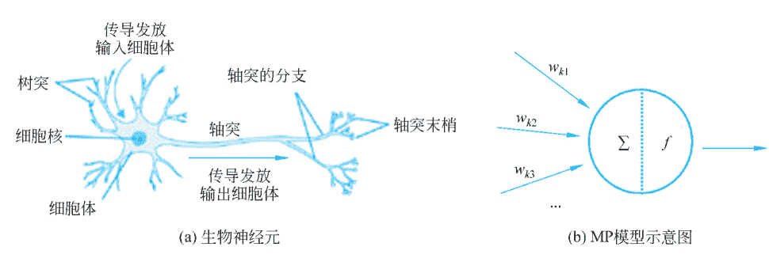

## 图1.1 生物神经元与MP模型示意图

## 1.2.2

### 第一代神经元模型：WSN模型

MP 虽简单，但把激活放宽后得到的 WSN 模型因引入学习能力，至今仍是主流人工单元的标准形态。除了激活的改进，当前最常用的 WSN 在骨架与运算上与 MP 基本一致，完全继承自 MP。

形式上 WSN 的入出关系与式1.1相同，仅要求激活 f() 可微，例如可选用式1.2e、1.2f 的 Sigmoid 与双曲正切，或式1.2g 的 ReLU。相应地 WSN 的变量均为连续取值。把激活从二值改为可导这一微小改动带来了误差反向传播的引入。正因具备学习能力，WSN 被广泛用于前馈、反馈与递归等各类人工网络。

下面简要介绍几种常见激活。

(1) 比例函数。如图1.2，形式为

$$y = f(s) = s \quad (1.2a)$$

(2) 阶跃函数。如图1.3，形式为

$$y = f(s) = \begin{cases} 1, & s \geqslant 0 \\ 0, & s < 0 \end{cases} \quad (1.2b)$$

(3) 符号函数。如图1.4，形式为

$$y = f(s) = \begin{cases} 1, & s \geqslant 0 \\ -1, & s < 0 \end{cases} \quad (1.2c)$$

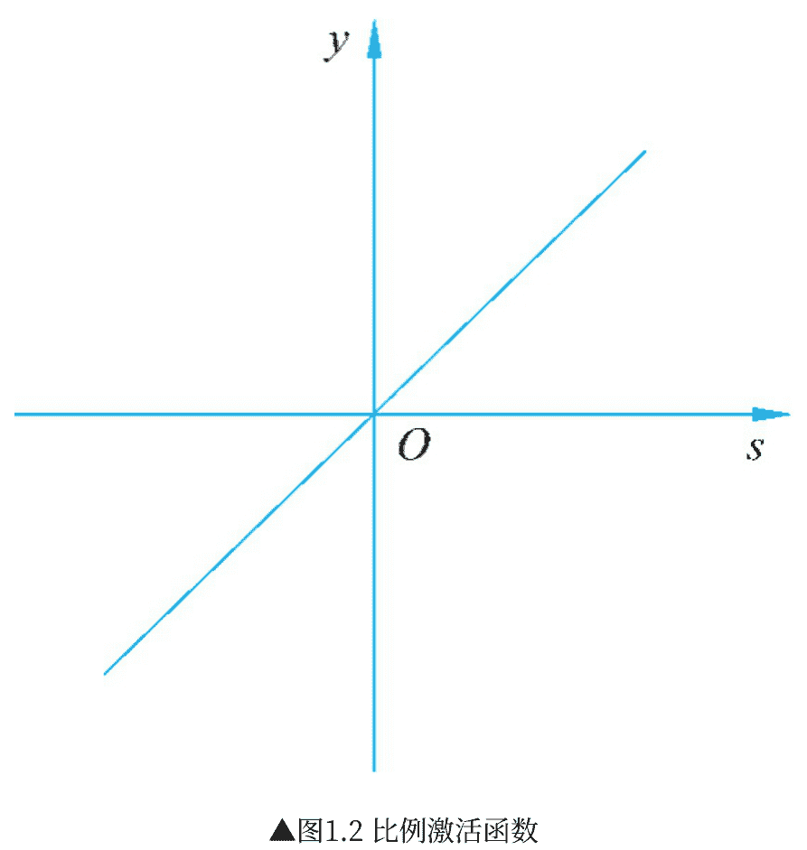

▲图1.2 比例激活函数

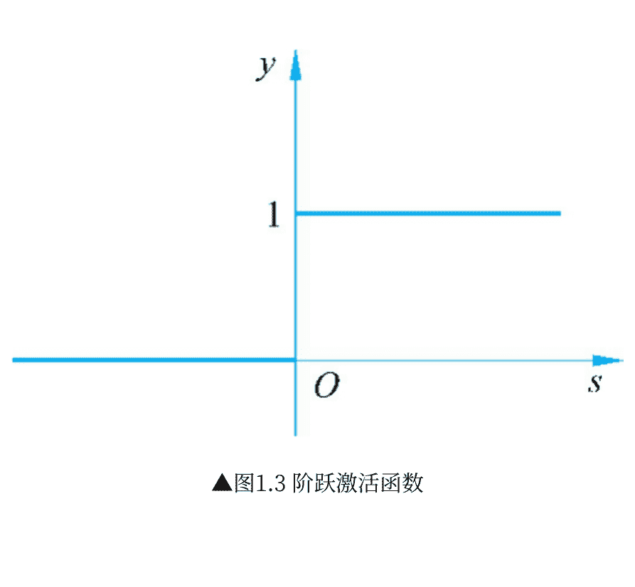

▲图1.3 阶跃激活函数

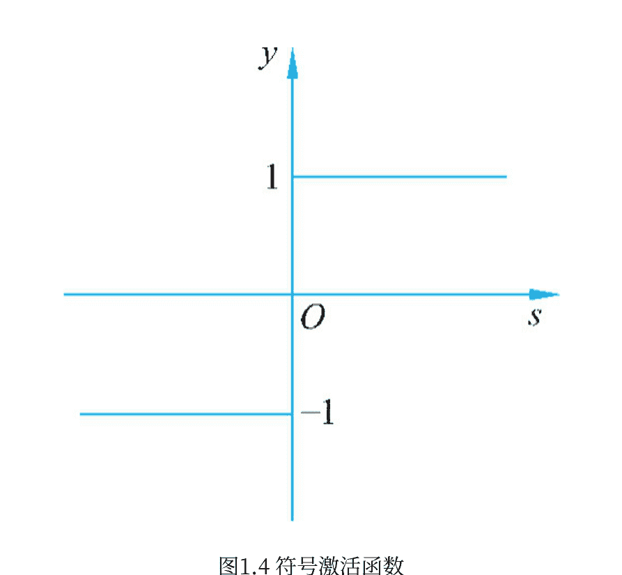

图1.4 符号激活函数

(4) 饱和函数。如图1.5，形式为

$$y = f(s) = \begin{cases} 1, & s \geqslant \frac{1}{k} \\ ks, & -\frac{1}{k} \leqslant s < \frac{1}{k} \\ -1, & s < -\frac{1}{k} \end{cases} \quad (1.2d)$$

(5) Sigmoid 函数。如图1.6，形式为

$$y = f(s) = \frac{1}{1 + \mathrm{e}^{-\mu s}} \quad (1.2e)$$

其中 μ 称为形状参数。也称 Logistic 函数。一般用于浅层全连接网络，或作为递归网络的门控，也用于二分类输出层。

（6）双曲正切 Tanh 函数。如图1.7，形式为

$$y = f(s) = \frac{1 - e^{-\mu s}}{1 + e^{-\mu s}} \qquad (1.2f)$$

其中 μ 为形状参数。该激活多用于递归网络。

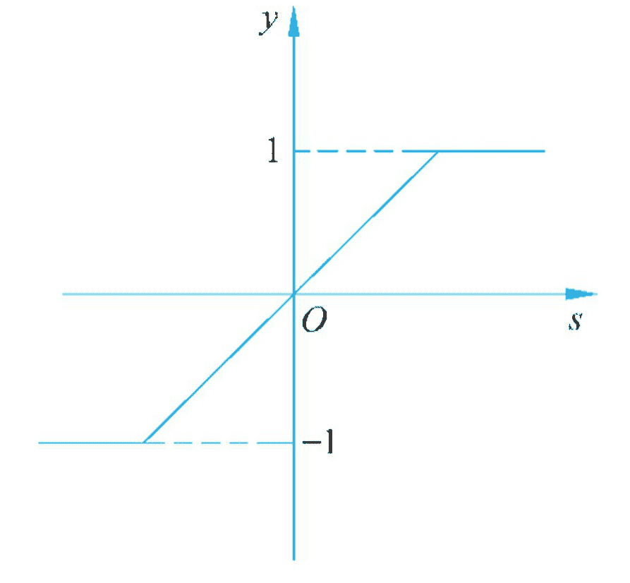

▲图1.5 饱和激活函数

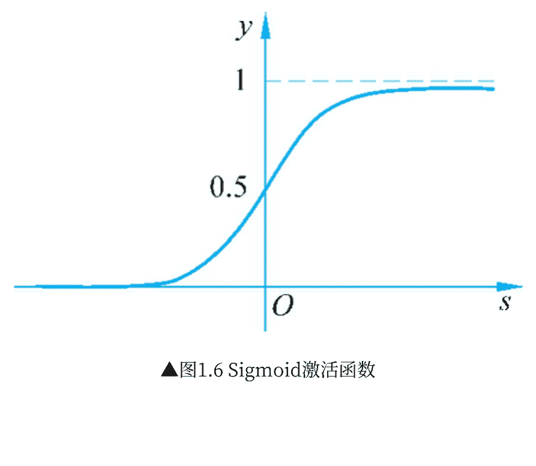

▲图1.6 Sigmoid 激活函数

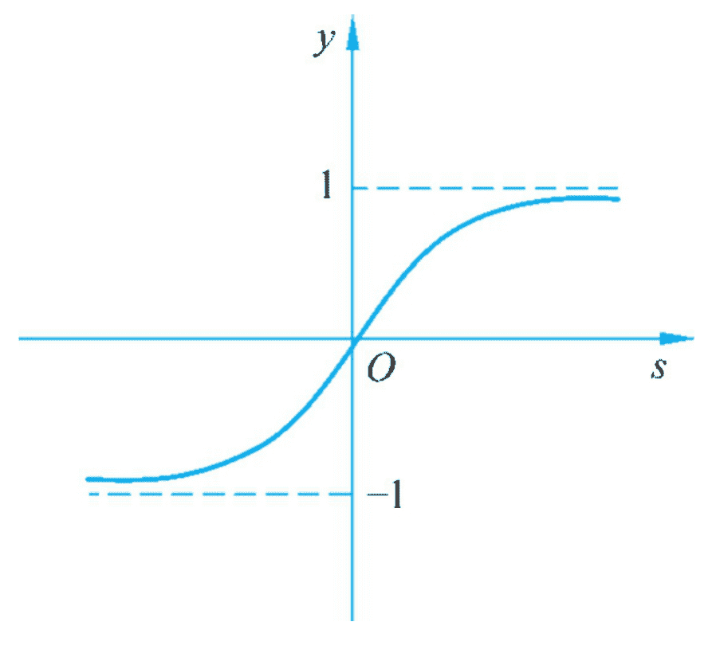

图1.7 双曲正切激活函数

(7) ReLU 修正线性单元。如图1.8，形式为

$$y = f(s) = \max(0, s) = \begin{cases} s, & s \geqslant 0 \\ 0, & s < 0 \end{cases} \quad (1.2g)$$

能有效缓解深度网络梯度衰减，使用非常普遍。

(8) 漏 ReLU。如图1.9，形式为

$$y = f(s) = \begin{cases} s, & s \geqslant 0 \\ \alpha s, & s < 0 \end{cases} \quad (1.2\text{h})$$

相比 ReLU 只多了一个很小的斜率 α，通常取 0.1~0.3 且不学习。这类激活常用于生成式对抗网络。

(9) GeLU 高斯误差线性单元。如图1.10，形式为

$$y = f(s) = 0.5s(1 + \text{Tanh}(\sqrt{2/\pi}(s + 0.044\,715s^3))) \quad (1.2\text{i})$$

GeLU 在基于 Transformer 的大语言模型中应用广泛，既能避免梯度消失，又能获得更好性能。

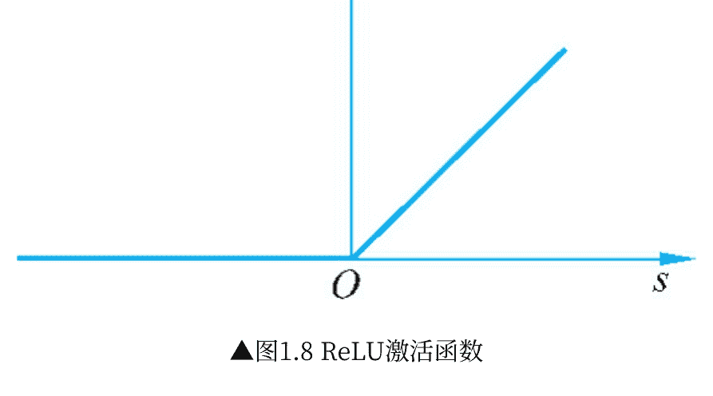

▲图1.8 ReLU 激活函数

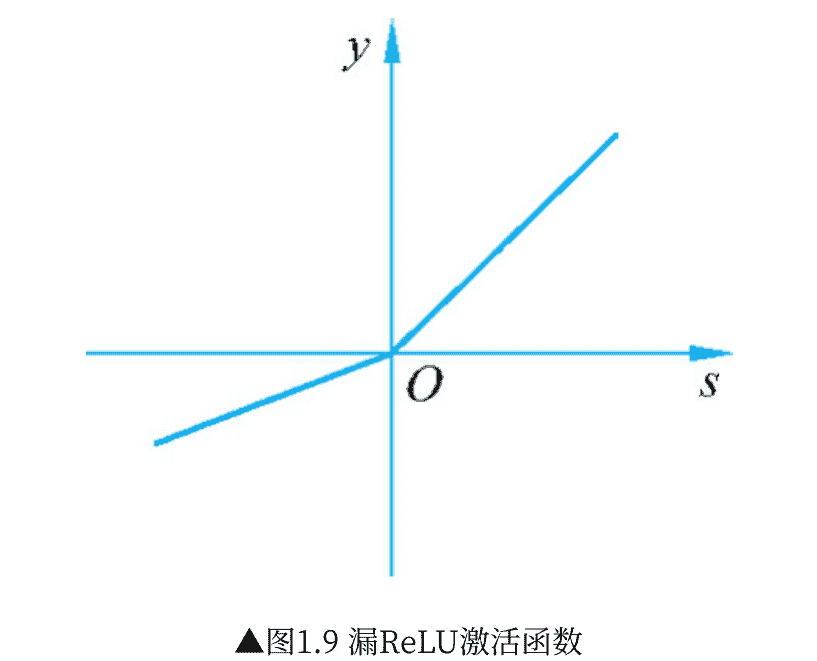

▲图1.9 漏 ReLU 激活函数

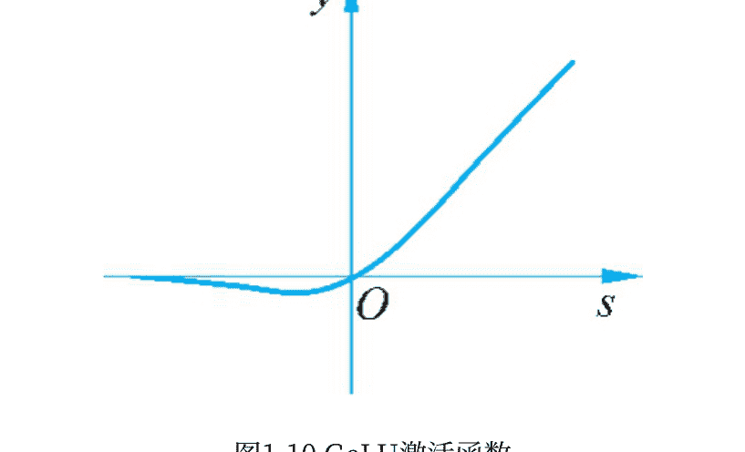

图1.10 GeLU 激活函数

（10）Softmax 函数。如图1.11，形式为

$$y_i = f(s_i) = \frac{e^{s_i}}{e^{s_1} + e^{s_2} + \cdots + e^{s_C}} \quad (1.2j)$$

主要用于多分类输出层，常与交叉熵损失配合，可视为 Sigmoid 的推广。

（11）Swish 函数。如图1.12，形式为

$$y = f(s) = \frac{s}{1 + e^{-\mu s}} \quad (1.2k)$$

其中 μ 为可学习的形状参数。对深度网络较为有效。

（12）Mish 函数。如图1.13，形式为

$$y = f(s) = \text{Tanh}(\ln(1 + e^s))s \quad (1.2l)$$

由于上无界下有界、非单调且具有无穷阶光滑性，性能较好，已在 YOLOv4 中使用。

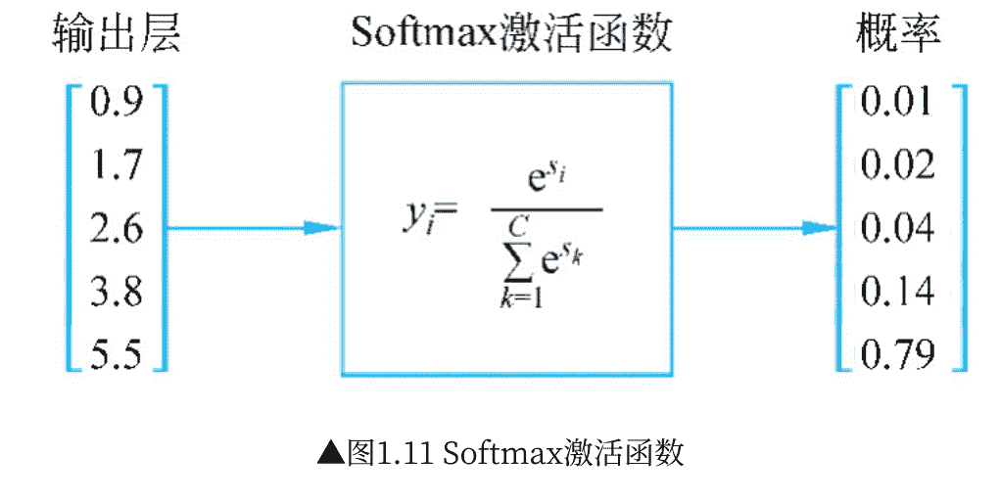

▲图1.11 Softmax 激活函数

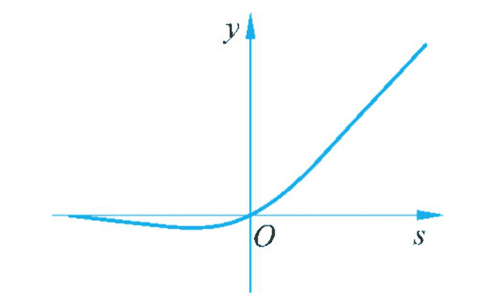

▲图1.12 Swish 激活函数

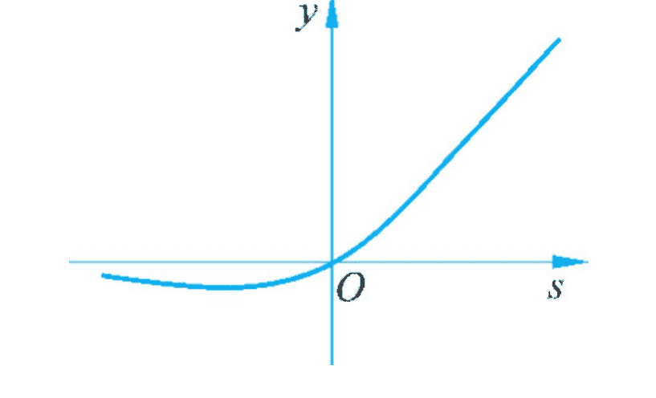

图1.13 Mish 激活函数

## 1.2.3

### 第二代神经元模型：RBF模型

RBF 模型的入出关系可写为

$$y_k = f(\|\boldsymbol{w} - \boldsymbol{x}\|) = f\left(\sum_{j=1}^{n} (w_{kj} - x_j)^2\right) \quad (1.3)$$

其中 x=[x1,x2,...,xn]^T 为 n 维输入样本向量，w=[w1,w2,...,wn]^T 为 n 维输入权向量，wkj 为从第 j 个单元到第 k 个单元的连接系数，||·|| 为向量范数，yk 为第 k 路输出，k=1,2,...,m，f() 表示连续对称非线性激活，如高斯。在式1.3 中，对归一化输入 x，先随机初始化权向量 w 并归一化。然后计算 w 与 x 间的范数，如欧氏距离，并比较 m 个输出单元对应范数的大小，范数最小的输出节点胜出，这即竞争过程。随后结合 f()，按无监督学习规则，自组织调整胜出节点及其邻域权向量，这为合作过程。最后对全部样本重复竞合学习，直至收敛。

RBF 单元多配合无监督竞合学习，常用于 SOM 与 RBF 网络，主要用于数据聚类、降维、压缩、向量量化与无监督模式分类等。

## 1.2.4

### 第三代神经元模型：发放模型

发放模型即第三代人工神经元。利用 Hodgkin-Huxley 方程与 LIF 方程，从神经动力学角度描述人工单元内部结构与发放机制。

Hodgkin 与 Huxley 实验发现三种离子电流类型，并建立了动作电位产生的数学模型。该工作获 1963 年诺贝尔生理学或医学奖，是用数学解释神经生理实验的典范。

如图1.14(a) 所示，生物神经元的细胞膜将神经元分为胞内与胞外。胞内一般带负电，胞外带正电，故膜可视为储电电容。离子浓度差形成的电位差可视为电池，膜对离子的选择通透可视为电阻。这些特性可近似为图1.14(b) 所示的等效电路。

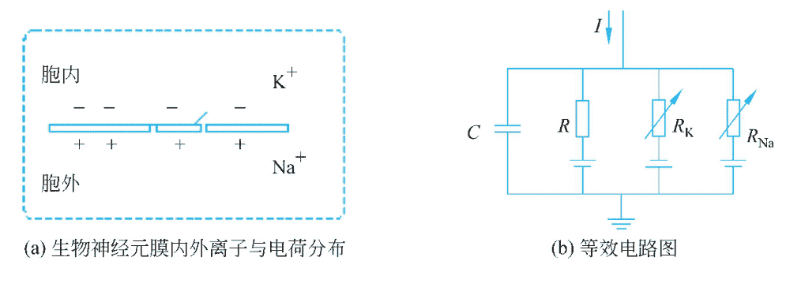

图1.14 Hodgkin-Huxley 模型的等效电路图

由 Kirchhoff 定律，通过胞膜的总电流 I 等于膜电容电流 Icap 加上各离子电流 Ik，k 为离子索引。因此有

$$I(t) = I_{cap}(t) + \sum_k I_k(t) \quad (1.4)$$

式中求和表示所有带电离子产生的电流，含漏电流。

Hodgkin-Huxley 模型仅考虑钠离子与钾离子电流，其余离子电流合并为漏电流。将电容电流电压关系 I=C du/dt 代入式1.4，得

$$C \frac{du}{dt} = I(t) - \sum_k I_k(t) \quad (1.5)$$

其中 C 为电容常数，u 为电容电压即膜电位。

实际应用中 Hodgkin-Huxley 方程过于复杂，通常采用产生动作电位的简化模型，如 LIF 模型。LIF 简化了产生动作电位的诸多神经生理细节，仅通过膜电位与阈值电位的比较决定是否发放。

作为 Hodgkin-Huxley 的简化版，LIF 方程可写为

$$\tau_m \frac{du}{dt} = E_r - u + R_m I_e \quad (1.6)$$

其中 u 为单元膜电位，E 为静息电位，τ 为膜时间常数，R 为膜电阻，I 为输入电流。当 u 达到阈值电位 θ 后，单元产生一个动作电位，随后膜电位重置为 u0。

第三代发放人工单元主要应用于类脑芯片与类脑神经网络。

## 1.3

### 人工神经网络模型

## 1.3.1

### 网络的核心概念与实现路径

人工神经网络利用人工神经元模型对生物神经网络进行模拟或逼近，目标是以生物智能水平为标尺，基于单一模型完成一个或多个复杂任务。

模拟生物神经网络主要有两类技术路径：

- ①结构主义：从内部生物学结构及其实现机理自内向外模拟；
- ②功能主义：从外部输入输出功能实现的角度做黑箱模拟。

原理上把人工单元连接成网络结构并加入学习算法即构成人工神经网络。任何人工神经网络均包括网络结构与学习算法两方面。网络结构由大量单元互连构成，每个单元单一输出，存在可学习的连接权值与阈值，其输入为其它互连单元输出的加权和，加权系数即对应连接的权值。学习算法一般包括监督学习、强化学习与无监督学习。

### 1.神经网络的通用定义

神经网络被定义为具有如下性质的有向图：

- ①每个单元节点具有单一状态或输出；
- ②节点 i 到节点 j 之间存在一个连接权 weight；
- ③每个节点具有一个偏置 bias 或阈值 threshold；
- ④每个节点定义一个非线性激励函数。

如图1.15所示，最常见的三种典型人工网络结构包括前馈神经网络 feedforward neural network、反馈神经网络 feedback neural network 和递归神经网络 recurrent neural network, RNN。总体而言，前馈网络具有从输入层到隐层再到输出层的信息传递方向性，隐层与输出层的单元与其前一层的所有单元均有全连接或卷积共享连接，但同层单元间无侧向连接。而反馈网络的所有单元均在同一“层”内相互连接，含自连接，存在至少一条突触循环通路。相比之下，递归网络可视为前两类网络的整合，整体仍具与前馈网络相似的方向性，但中间的隐层本身是一个反馈网络。因此反馈网络可被视为无显式输入输出层的退化递归网络。换句话说，递归网络是具有显式输入输出层的多层反馈网络。也可以说，前馈网络是隐层无侧向连接的退化递归网络。故递归网络具有最完整的结构与连接关系。在不少中文文献中，递归神经网络也被称为循环神经网络。

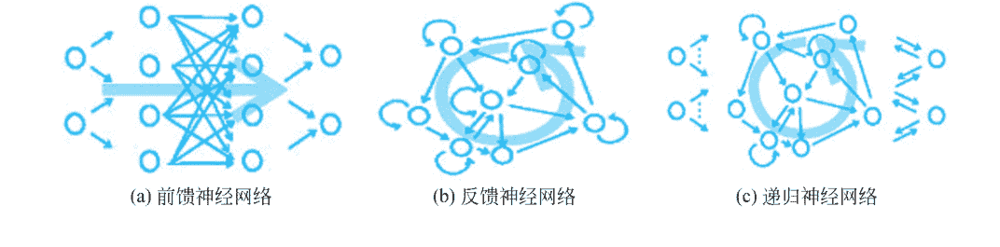

图1.15 典型的人工神经网络结构示意图

### 2.神经网络的训练、验证与测试

以下以前馈网络及监督学习为例说明。

#### 1) 采集与处理数据样本集

神经网络是典型的数据驱动模型。在训练、验证与测试任一步之前，必须先准备好与待解问题对应的数据集。数据集构建涉及原始数据的收集、分析、变量选择与预处理，预处理包括清洗、标注与划分。

对传统网络，首先需在大量原始感知数据中确定主要输入模式。通常可利用多元相关性分析对原始数据做统计处理，检验相关性并找出其中最主要的模式作为输入。

确定若干重要输入量后可进行尺度变换与预处理。尺度变换常将它们映射到 [-1,1] 或 [0,1] 范围。变换前须先检查是否存在异常点或野值点，这些点须先剔除。

对复杂问题应选取多少样本也是关键。待解问题本身由这些数据定义，其输入输出关系就蕴含在样本中。一般而言样本越多，训练结果越能真实反映输入输出关系。对完全监督的深度卷积网络甚至存在“数据暴力”，样本越多性能越好。

样本数量取决于问题输入输出分布、网络规模、算法与测试需求等，其中问题复杂性最关键。在无限制条件下，通常较大规模网络需要更多训练数据。经验法则是带标签训练样本应为连接权总数的 5~10 倍。

原始数据集还需清洗、标注与划分，以获得真实有效的高质量标签样本。

- ①清洗：去除与训练目的无关的样本。

- ②标注：标签既可以通过人工标注获得，也可以借助自动标注完成，后续必须对标注质量进行复核，并在此基础上增强模型的容错能力。

- ③划分：在神经网络训练阶段，需要划出一份验证集来决定何时停止训练，训练结束后还需另外准备一份完全独立的测试集来评测最终性能。测试集必须与训练集、验证集互不交叉。

最简便的做法是把整体数据随机切分成三份，约三分之二用于训练，训练部分里再抽出一小部分充当验证，其余三分之一留作测试。随机抽取的意义在于削弱样本间的相关性，让划分更公平。

样本量的需求还受输入模式与输出分布的影响。如果分布事先可知且相对均匀，所需样本就可以减少；反之当分布密度不均、类别不平衡甚至相互重叠时，就必须扩充样本规模。

#### 2）模型选型与结构规划
正式训练前，先要把网络类型确定下来。

以函数逼近、回归或模式分类为主的任务，常用全连接前馈结构，比如BP网络。涉及检测、分割、分类、补全、预测且需要自学习分层特征的场景，则倾向采用带全连接分类头的深度卷积网络，卷积层及其组合自然担任特征提取器。面对序列数据或动力学系统的回归预测，循环神经网络是常见选择。

神经网络分支众多，具体选用要结合任务性质和问题特点来定。

类型确定后，下一步是结构与超参数的设定。以浅层全连接前馈为例，需要决定隐层数、每层节点数、激活函数类型及形状参数，以及学习算法、学习率、动量系数等。选型既有经验法则可循，实践中更多依赖试错，也可借助神经架构搜索 NAS 实现 AutoML 自动寻优。根本准则始终是让验证或测试误差最小。

输入输出变量一旦固定，输入层和输出层的节点数也就确定了。对全连接BP网络，隐层数可先从单层起步。关键在于隐层节点数的选取，原则是能在准确刻画输入输出映射的前提下尽量精简。

实践上有两种常用思路。

- ①由小到大：先用较少的神经元训练并评估逼近或回归误差，之后逐步增加节点，直至测试误差不再明显下降为止。
- ②由大到小：先设定较多的神经元，训练时使用如下带正则的误差代价：

$$E_f = \frac{1}{2} \sum_{p=1}^{P} \sum_{i=1}^{n_Q} (d_{pi} - x_{pi}^{(Q)})^2 + \epsilon \sum_{q=1}^{Q} \sum_{i=1}^{n_q} \sum_{j=1}^{n_{q-1}} \|w_{ij}^{(q)}\|$$

$$= E + \epsilon \sum_{q,i,j} \|w_{ij}^{(q)}\| \quad (1.7)$$

其中 $w_{ij}^{(q)}$ 表示第 $q-1$ 层第 $j$ 个神经元到第 $q$ 层第 $i$ 个神经元的权值，$\|\cdot\|$ 为向量范数，$x_{pi}^{(Q)}$ 为第 $p$ 个训练样本在输出层第 $i$ 个神经元的输出，$d$ 为期望输出，$p=1,2,\dots,P$ 为样本序号，$q=1,2,\dots,Q$ 为隐层与输出层编号，$\epsilon$ 为拉格朗日乘子。

第二项起到了类似“遗忘”的作用，促使训练后权值保持较小。此时 $E$ 对 $w_{ij}^{(q)}$ 的梯度为：

$$\frac{\partial E_{\mathrm{f}}}{\partial w_{ij}^{(q)}} = \frac{\partial E}{\partial w_{ij}^{(q)}} + \varepsilon \operatorname{sign}\left(w_{ij}^{(q)}\right) \quad (1.8)$$

依据该梯度构建学习过程，训练中真正必要的连接会被保留，不太重要的连接则逐渐衰减至零。最后剔除影响微弱的权值与对应节点，即可剪裁出规模合适的结构。

若上述方法得到的隐层节点仍偏多，可考虑增加层数提升深度。相同映射关系下，多隐层所需总节点数通常少于单隐层。

### 3）训练验证测试要点
训练过程中会反复使用带标签的样本。把一个批次的样本正向传播并反向更新一次权值，称为一次迭代；把全部训练样本走完一遍，称为一个训练轮次，完成一次轮次需要多次迭代。

样本量较大时采用小批量 mini-batch，批次大小本身就是重要超参数。为遏制过拟合，常在结构中加入 Dropout、BN 等模块。

一次训练迭代即用一个批次样本完成前向计算后统一更新全部权值。一次训练轮次即用整份训练集完成一次训练。

例如训练集共 2000 个样本，批次取 20，则 100 次迭代构成一个轮次。深度网络全监督训练多使用 SGD 或 Adam。

训练的本质是挖掘样本背后的输入输出内在规律，从而对未见过的相似输入给出合理输出，即具备泛化能力。泛化能力是衡量神经网络乃至机器学习方法好坏的核心指标，而非训练集拟合度。

在开放场景中，感知数据往往含噪声。训练轮数过多时，网络可能连噪声一起记忆，导致对新样本泛化变差，这就是过拟合。

衡量泛化能力需依赖独立的验证集或测试集。从学习曲线可看出，验证均方误差起初随轮数下降，后续可能回升，出现拐点。拐点对应的轮数是较为合适的停止点，继续训练则进入过度训练 over-training。

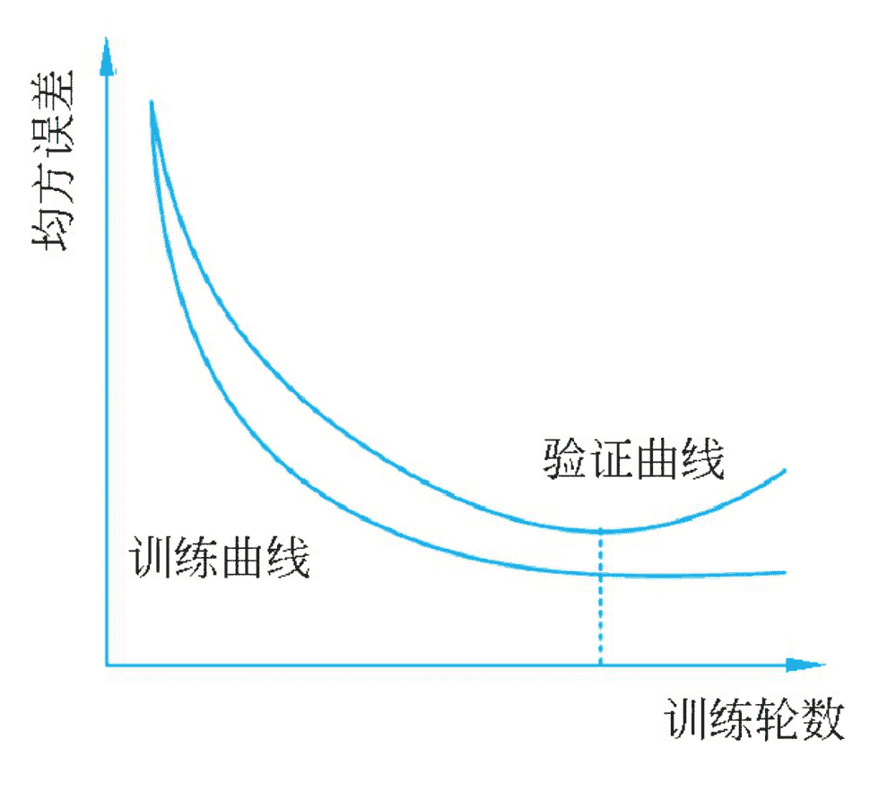

对传统前馈网络，隐层节点数的试错必须结合训练、验证、测试，最终以测试误差评判泛化性能，并非节点越多越好。结构参数与超参数的选取也应以测试误差为准。

初始权值通常用随机均匀分布生成。为避开局部极值，常多起若干组初始值，最终挑选测试误差最好的一组。

对全连接前馈网，隐层节点数对泛化影响显著。节点过多会记住训练样本甚至噪声，反而损害泛化；节点过少则拟合不足。原则是取尽量少的节点实现尽量好的泛化。

对卷积网络，深度是重要结构参数，但泛化性能上也需折中权衡。

### 3.常用损失函数概览
监督学习中需最大化或最小化目标函数。目标函数泛指被优化的量，包含代价函数。代价函数特指单批次或全样本上模型输出与期望输出的误差，属于误差类目标。而损失函数是代价函数的细化，指围绕单个样本定义的误差度量，学习算法据此修正连接权。

损失函数可分为经验风险与结构风险。前者衡量输出与期望的偏差，后者在前者基础上加入正则项。挑选时要考虑是否存在异常值、求导效率以及任务类型。整体上分为回归类与分类类。

#### 1) 回归时序类损失
此类任务旨在逼近、拟合或预测连续期望值，常用 MSE、RMSE、MAE、Huber 损失、MAPE、$R^2$ 等。

（1）均方误差 MSE。
也称 $L_2$ 损失，表达为：

$$\text{MSE} = \frac{1}{m} \sum_{i=1}^{m} (y_{d,i} - y_i)^2 \quad (1.9a)$$

式中 $y_{d,i}$ 为 $m$ 维期望向量的第 $i$ 分量，$y_i$ 为模型实际输出，$y_{d,i}-y_i$ 为残差，$m$ 为输出维度即输出层神经元数。计算简便、收敛较好，但对异常值敏感。

（2）均方根误差 RMSE。
对 MSE 再开平方根，便于数量级直观比较：

$$\text{RMSE} = \sqrt{\frac{1}{m} \sum_{i=1}^{m} (y_{d,i} - y_i)^2} \quad (1.9b)$$

（3）平均绝对误差 MAE。
即 $L_1$ 损失：

$$\text{MAE} = \frac{1}{m} \sum_{i=1}^{m} | y_{d,i} - y_i | \quad (1.9c)$$

对异常值鲁棒性更强，缺点是损失很小时梯度较大，常需配合自适应学习率。

（4）Huber 损失。
也称平滑 MAE，定义为：

$$L_{\delta}=\left\{\begin{array}{l}\frac{1}{2} \sum_{i=1}^{m}\left(y_{d, i}-y_{i}\right)^{2}, \quad\left|y_{d, i}-y_{i}\right| \leqslant \delta \\ \delta \sum_{i=1}^{m}\left|y_{d, i}-y_{i}\right|-\frac{1}{2} \delta^{2}, \quad \text { 其他 }\end{array}\right. \quad (1.9d)$$

引入超参数 $\delta$ 使 $L_2$ 与 $L_1$ 取长补短。误差落在 $[-\delta,\delta]$ 时等价于 MSE，超出区间则等价于 MAE。因而兼具抗异常与附近收敛快的优点，需调试 $\delta$，且在 $\delta$ 处不可导。

（5）平均绝对百分比误差 MAPE。
当 $y_{d,i}\neq0$ 时：

$$\mathrm{MAPE}=\frac{1}{m} \sum_{i=1}^{m}\left|\frac{y_{d, i}-y_{i}}{y_{d, i}}\right| \quad (1.9e)$$

（6）$R^2$ 损失。
也称拟合优度：

$$R^2 = 1 - \frac{SS_{res}}{SS_{tot}} = 1 - \frac{\sum_{i=1}^{m}(y_{d,i} - y_i)^2}{\sum_{i=1}^{m}(y_{d,i} - \bar{y}_i)^2} \quad (1.9f)$$

其中 $\bar{y}_i$ 为实际输出均值，$SS_{res}$ 为残差平方和，$SS_{tot}$ 为总平方和。取值 $[0,1]$，越接近 1 回归效果越好。

#### 2) 分类类损失
常用交叉熵、负对数似然、KL 散度、JS 散度。

（1）二分类 Sigmoid 二值交叉熵。
交叉熵衡量两个概率分布的信息差异。二分类时输出层用 Sigmoid，损失为：

$$loss = -\sum_{p=1}^{B}[y_d^p \log(y^p) + (1 - y_d^p) \log(1 - y^p)] \quad (1.10a)$$

$y_{d}^{p}$ 为二值标签 0/1，$y^{p}$ 为模型预测概率，$B$ 为批次大小。

（2）多分类 Softmax 交叉熵。
多分类输出层用 Softmax，损失为：

$$loss = -\sum_{p=1}^{B} \sum_{i=1}^{C} [y_{d,i}^{p} \log(y_{i}^{p}) + (1 - y_{d,i}^{p}) \log(1 - y_{i}^{p})] \quad (1.10b)$$

$y_{d,i}^{p}$ 为 $C$ 维独热标签，$y_{i}^{p}$ 为 Softmax 归一化概率，$B$ 同上。

（3）负对数似然 NLL。
与 Softmax 交叉熵类似，但需自行对 $logits_i$ 做 Softmax 或 logSoftmax 归一化，PyTorch 中常见。公式为：

$$loss = -\sum_{i=1}^{C} [y_{d,i} \log(y_{i}) + (1 - y_{d,i}) \log(1 - y_{i})] \quad (1.10c)$$

（4）KL 散度。
源于信息论的相对熵，常用于度量分布相似度，不对称，常用于生成模型：

$$loss = KL(y_d, y) = -\sum_{i=1}^{c} [y_{d,i} \log(y_i) - y_{d,i} \log(y_{d,i})] = \sum_{i=1}^{c} y_{d,i} \log\left(\frac{y_{d,i}}{y_i}\right) \quad (1.10d)$$

（5）JS 散度。
KL 散度的对称变体：

$$loss = JS(y_d, y) = \frac{1}{2} KL(y_d, m) + \frac{1}{2} KL(y, m) \quad (1.10e)$$

其中 $m=0.5(y+y_d)$。

### 4.核心性能指标
不同任务、数据集和模型需选择合适的评价指标。下面以目标分类、检测、分割为例介绍常见指标。

#### 1) 目标分类常用指标
（1）准确率 accuracy。
分类任务常用整体评估指标，也称正确率。定义为被正确分类的样本数，包括正负类，占全部样本的比例，即

$$Accuracy = \frac{TP + TN}{TP + TN + FN + FP} \quad (1.11a)$$
先把混淆矩阵里的四个计数说清楚。真正例 TP 是实际为正的样本被模型正确判为正的数量；真负例 TN 是实际为负的样本被模型正确判为负的数量；假正例 FP 是实际为负的样本却被错判为正的数量；假负例 FN 是实际为正的样本却被错判为负的数量。这四项是后续所有评估的底座。

（2）精准率（precision）。
精准率也叫做查准率，是从模型“喊正”的那一批样本里看有多少是真的。换句话说，对某一类而言，在被预测为该类的所有样本中，真正属于该类的比例。此时

$$Precision = \frac{TP}{TP + FP} \quad (1.11b)$$

或

$$Precision = \frac{TN}{TN + FN} \quad (1.11c)$$

（3）召回率（recall）。
召回率又称查全率，角度不同。它关注的是真实属于某一类的样本，有多少被模型成功找回。即在所有真实为正（或负）的样本中，被正确识别出来的占比。

## (4) F1评分（F1 score）。
精准率和召回率的取值范围都在 0 到 1 之间，越接近 1 越好。现实中二者往往此消彼长，想要召回率达到 1 或 100% 的同时，精准率通常会下降。F1 就是用调和平均把两者综合起来，形成一个整体的评价。最大化 F1 就相当于在查准和查全之间找到最佳平衡点。

$$\text{F1} = \frac{2}{(1/\text{Precision}) + (1/\text{Recall})} = \frac{2 \times \text{Precision} \times \text{Recall}}{\text{Precision} + \text{Recall}} \quad (1.11\text{f})$$

## (5) ROC曲线（receiver operating characteristic curve）。
如图 1.17（a）所示，ROC 把每个类别的假正率设为横轴、真正率设为纵轴，连成的曲线即为接收者操作特性曲线。曲线下的面积记作 AUC。ROC 同时考虑了正负两类样本，能更全面地反映分类器的整体表现。AUC 为 1 时代表完美分类，现实中极少出现。假正率与真正率的计算方式如下：

$$\text{FP rate} = \frac{\text{FP}}{\text{FP} + \text{TN}} \quad (1.11\text{g})$$

$$\text{TP rate} = \frac{\text{TP}}{\text{TP} + \text{FN}} \quad (1.11\text{h})$$

## (6) PR曲线（precision-recall curve）。
如图 1.17（b）所示，PR 曲线的纵轴是精准率，横轴是召回率，用来刻画二者之间的权衡关系。曲线下面积记为 AP，即平均精准率，可对单类综合性能进行评价。相较 ROC，PR 更聚焦于正类样本，在正类占比极低的极端不平衡场景下，PR 的判别力通常更强。

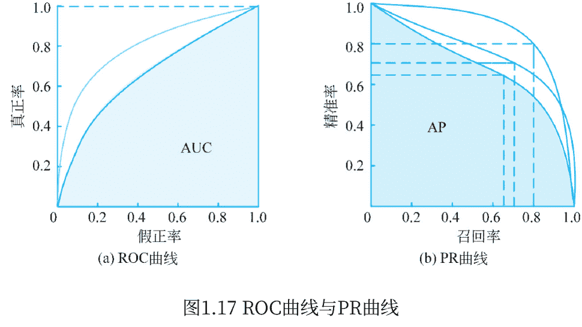

## 2）常见的目标检测性能指标

### (1) mAP（平均精准率均值）。
在目标检测里，AP 先对单一类别计算，再把所有类别的 AP 求平均就得到 mAP，通常会固定 IoU 阈值进行计算。mAP 的取值区间为 0 到 1，数值越高说明检测整体越好。

### （2）mIoU（交并比均值）。
IoU 也叫交并比、定位准确率，指的是预测框与真实框的交集面积除以并集面积。IoU 常用来在给定阈值下判断检测是否有效。mIoU 则是在所有类别、所有阈值上取平均。mAP@0.5 表示 IoU 阈值取 0.5 时的 mAP，即先把 IoU 大于 0.5 的预测框算作 TP，其余为 FP，再算 AP，最后跨类平均。若采用一组 IoU 阈值并再次平均，得到的就是常说的 mmAP，而业界提到的 mAP 大多指的就是这个含义。

### （3）NMS（非极大值抑制）。
非极大值抑制是根据置信度分数和候选框参数，从一堆重叠框里挑出高置信度的框。对有重叠的预测框只保留得分最高的那个。NMS 按类别独立处理，类别数为 C 时需要重复 C 次。

主要流程如下：
- ① 先算每个候选框的面积，按分数从高到低排序，把最高分的框作为当前基准；
- ② 计算其余框与基准框的 IoU，剔除 IoU 超过阈值的框，保留 IoU 较小的框；
- ③ 重复上述步骤，直到候选框集合为空。

### （4）FPS（每秒帧率）。
FPS 即每秒可处理的图像帧数，直接反映算法的速度与实时性，在实际应用中是重要衡量标准之一。

### （5）FLOPs（浮点运算量）。
FLOPs 用来衡量模型计算复杂度，通常统计乘法与加法次数，可用于分析计算开销。例如 AlexNet 约需 727 MFLOPs，DeepLab-ResNet101-v2 则高达 346 GFLOPs。注意它与 FLOPS 不同，后者指每秒浮点运算次数。

## 3）常见的图像分割性能指标
图像分割包括语义分割、实例分割和全景分割，常用的评价以像素准确率、交并比及其变体为主。

### （1）PA（像素准确率）。
像素准确率定义为被正确分类的像素数除以总像素数，即

$$PA = \frac{TP + TN}{TP + TN + FN + FP}$$

公式形式与分类任务相同，只是统计单位换成了像素。

### (2) CPA（类别像素准确率）。
类别像素准确率是对每个类别单独计算的 PA。

### (3) MPA（类别像素准确率均值）。
MPA 是把所有类别的 CPA 取平均得到的指标，体现分割算法的整体表现。

### (4) mIoU（交并比均值）。
定义与目标检测中的 mIoU 类似，区别在于这里比较的是预测掩码与真实掩码的交并比，而非边界框。mIoU 也是分割任务的核心整体指标。

### (5) SEN（灵敏度）。
灵敏度本质上就是真正率，其计算式为

$$SEN = \frac{TP}{TP + FN} \quad (1.11j)$$

本节对人工神经网络的基本概念与方法做了梳理与讨论。接下来将从网络结构与学习算法两个维度介绍三类典型神经网络。由于第二章会重点讲递归神经网络，这里主要围绕前馈神经网络与反馈神经网络的结构，以及前馈神经网络的误差反向传播思想展开。

## 1.3.2 前馈神经网络模型
如图 1.15（a）所示，前馈网络采用分层结构，由输入层、若干隐层到输出层组成。层间神经元为单向全连接或共享卷积核连接，层内无侧向连接。信息正向流动，因此得名前馈。数学上它能实现静态输入输出映射，并具备通用逼近能力，可通过学习以任意精度逼近任意非线性映射。目前最主流的监督学习算法反向传播就建立在这种结构上，相关文献应用极广。

表 1.2 4 种典型前馈神经网络模型

| 模型 | 网络结构特点 | 学习算法 | 主要应用领域 |
| :--- | :--- | :--- | :--- |
| 单层感知机 | 无隐层 | 无 | 线性可分问题 |
| 早期的多层感知机(MLP) | 1～2个隐层 | 无 | 简单的线性不可分问题 |
| 全连接前馈神经网络(BP网络) | 有浅度隐层 | 监督学习(如使用BP算法) | 回归、分类任务 |
| 深度卷积神经网络(CNN) | 使用卷积核与池化运算,最深达到1202层 | 监督学习、强化学习、无监督学习 | 回归、分类、检测、分割、跟踪、补全与预测等各类任务 |

下面先介绍 4 种模型的网络结构，再重点剖析全连接前馈网络与深度卷积网络的误差反向传播及其改进。深度卷积网络因其重要性单独放在 1.3.3 节。

### 1. 网络结构
感知机是最早的全连接前馈网络，用于简单的回归与分类。分为单层感知机与多层感知机。两者均基于 MP 模型，无学习能力。相比单层，多层感知机可处理线性不可分问题，但早期版本仍只能解决简单情形。20 世纪 80 年代引入 BP 算法后，多层感知机演变为 BP 网络，即全连接前馈网络。深度卷积网络则以卷积与池化丰富了结构，具有强大的分层特征提取能力，并可接全连接层作为分类器，解决绝大多数任务。

#### 1) 单层感知机
如图 1.18 所示，单层感知机只有输出层，无隐层，无法处理线性不可分问题。这里的单层指仅由 m 个 MP 神经元构成的输出层，不计输入层。早期研究中输入层仅做传递，通常不计为一层。

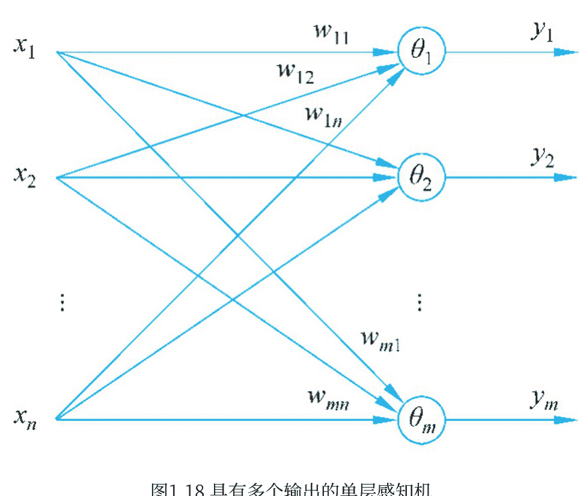

图 1.18 具有多个输出的单层感知机

图中 $\boldsymbol{x}=[x_1, x_2, \cdots, x_n]^T$ 为输入向量，$w_{ji}$ 为 $x_i$ 到 $y_j$ 的连接权，$y_j$ 为分类结果，$i=1,2,\cdots,n,\;j=1,2,\cdots,m$。因输出神经元互相独立，下面只讨论单输出情形。此时输入到输出的变换为

$$s_j = \sum_{i=1}^{n} w_{ji} x_i - \theta_j \quad (1.12a)$$

$$y_j = f(s_j) = \begin{cases} 1, & s_j \geqslant 0 \\ -1, & s_j < 0 \end{cases} \qquad (1.12b)$$

若有 $P$ 个样本 $\mathbf{x}^{(p)}$，网络可把它们划分为 $n$ 维空间中的两类。

如图 1.19 所示，取 $n=2$ 的二维情形，对线性可分二分类问题，分界线方程为

$$w_{11} x_1 + w_{12} x_2 - \theta_1 = 0 \qquad (1.13)$$

这是一个含 3 个参数的直线方程，说明单层感知机只能处理线性可分问题。对异或这类典型线性不可分问题，单层感知机无解。

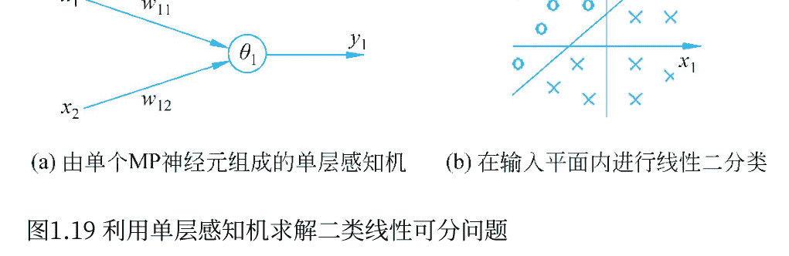

(a) 由单个MP神经元组成的单层感知机 \qquad (b) 在输入平面内进行线性二分类

图 1.19 利用单层感知机求解二类线性可分问题

当输入线性可分时，关键是如何求出式（1.13）中的权 $w_{11}、w_{12}$ 与偏置 $\theta_1$。把 $P\ge 3$ 个已知样本代入，可得 $P$ 个线性方程，用最小二乘等方法求解即可得到参数，从而得到判决直线。高维时分界线变为超平面。

#### 2) 早期无学习能力的多层感知机
对线性不可分模式，单层感知机失效，需引入隐层的多层结构，如图 1.20 所示。

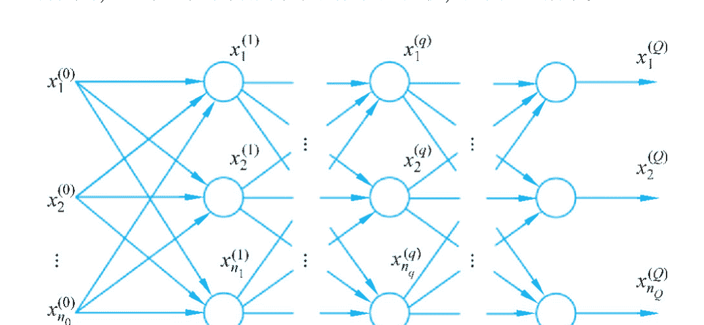

图 1.20 早期多层感知机与全连接前馈神经网络具有相同的网络结构（但选择了不同的神经元模型）

设第 0 层为输入层，有 $n_0$ 个神经元；第 $Q$ 层为输出层，有 $n_Q$ 个神经元；中间隐层 $q=1,2,\cdots,Q-1$ 各有 $n_q$ 个神经元。输入输出关系为

$$s_j^{(q)} = \sum_{i=0}^{n_{q-1}} w_{ji}^{(q)} x_i^{(q-1)} \quad (1.14a)$$

$$x_j^{(q)} = f(s_j^{(q)}) = \begin{cases} 1, & s_j^{(q)} \geqslant 0 \\ -1, & s_j^{(q)} < 0 \end{cases} \quad (1.14b)$$

式中 $w_{j0}^{(q)} = \theta_j^{(q)},\;x_0^{(q-1)} = -1$，且 $i=0,1,\cdots,n_{q-1},\;j=1,2,\cdots,n_q,\;q=1,2,\cdots,Q$。

此时每个隐层或输出层神经元相当于一个单层感知机，第 $q$ 层构建 $n_q$ 个超平面组合，可对输入做线性划分。多个层级叠加后能实现更复杂的分类。理论上增加隐层可解决任意分类问题，但早期结构缺乏学习算法，只能靠手工推导。对异或问题只能通过公式设计而非学习实现分类。

如图 1.21 所示是早期多层感知机求解异或的示意。

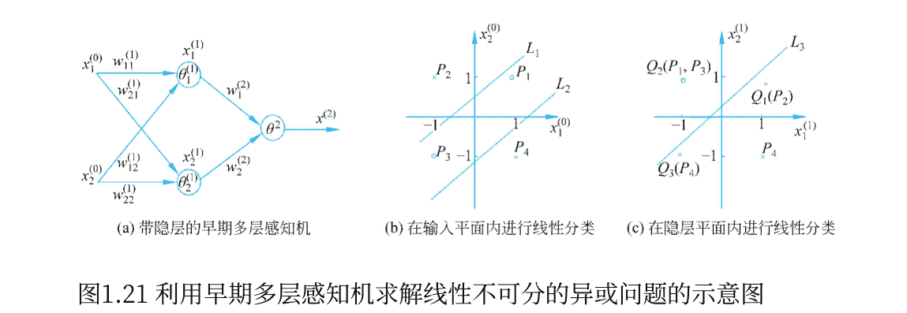

图 1.21 利用早期多层感知机求解线性不可分的异或问题的示意图

图 1.21（a）中输入层 $n_0=2$，单隐层 $n_1=2$，输出层 $n_2=1$，共有 3 个 MP 神经元，求解步骤如下：
- ① 对隐层第 1 个神经元设计权 $w_{11}^{(1)}、w_{12}^{(1)}$ 与阈值 $\theta_1^{(1)}$，使其分界线为图 1.21（b）中的 $L_1$。直线方程为

$$w_{11}^{(1)} x_1^{(0)} + w_{12}^{(1)} x_2^{(0)} - \theta_1^{(1)} = 0 \quad (1.15)$$

此时使样本 $P_1$ 输出为 1，$P_2、P_3、P_4$ 输出为 -1。
- ② 对隐层第 2 个神经元设计权 $w_{21}^{(1)}、w_{22}^{(1)}$ 与阈值 $\theta_2^{(1)}$，使其分界线为 $L_2$，使 $P_1、P_2、P_3$ 输出为 1，$P_4$ 输出为 -1。
- ③ 在图 1.21（c）的隐层平面内，对输出神经元设计权 $w_{11}^{(2)}、w_{12}^{(2)}$ 与阈值 $\theta^{(2)}$，使其分界线为 $L$，即可把 $Q_1$ 与 $Q_2、Q_3$ 分开，从而实现异或的正确分类。

可见通过合理设计，多层感知机可实现任意样本的正确分类。

#### 3）全连接前馈神经网络
单层或早期多层感知机采用 MP 模型，激活函数为阶跃或符号函数，输出为二值。由于缺乏学习能力，早期感知机只能处理简单模式分类问题。

相较于最初的线性感知机，新型全互联前向结构引入了 WSN 人工神经元。激励函数可以选用式（1.2e）的 Sigmoid、式（1.2f）的双曲正切，或式（1.2g）的 ReLU 等形式。这样一来，整张网络的输入与输出都成为处处可导的连续量。看似微小的模型调整，却直接催生了误差反向传播机制，使纯监督学习逼近任意非线性映射成为可能。

因为权值更新遵循 BP 规则，学界常称这类结构为 BP 网，也可叫做前馈网、多层前馈网、浅层全互联网，或简写为 MLP。需要强调的是，此处的 MLP 与先前那种没有学习能力的早期 MLP 截然不同，其神经元必须采用 WSN 设计。

图 1.20 所示的全互联前馈网中：第 0 层是输入层，神经元数为 $n_0$；中间第 $q$ 层为隐层，神经元数为 $n_q$（$q=1,2,\cdots,Q-1$）；第 $Q$ 层是输出层，神经元数为 $n_Q$。记 $w_{ji}^{(q)}$ 为指向第 $q$ 层第 $j$ 个神经元的连接系数。该网的输入输出关系为

$$s_j^{(q)} = \sum_{i=0}^{n_{q-1}} w_{ji}^{(q)} x_i^{(q-1)} \quad (1.16a)$$

式中，$w_{j0}^{(q)} = \theta_j^{(q)}, x_0^{(q-1)} = -1$。

假定其 WSN 神经元的激励函数取为

$$x_j^{(q)} = f(s_j^{(q)}) = \frac{1}{1 + e^{-s_j^{(q)}}} \quad (1.16b)$$

式中，$j=1,2,\cdots,n_q, q=1,2,\cdots,Q$。

### 2. 学习算法

前文已说明，单层感知机与早期的多层感知机都不具备学习能力。下面将针对全互联前馈网与 1.3.3 节要介绍的深层卷积网，详细梳理监督学习中误差反向传播的思想、推导过程以及常见改进。

#### 1) 监督学习：基本的误差反向传播算法

设给定 $P$ 组输入输出样本 $s_i^{(q)} = \sum_{j=0}^{n_{q-1}} w_{ij}^{(q)} x_j^{(q-1)} \quad (x_0^{(q-1)} = -1, w_{i0}^{(q)} = \theta_i^{(q)})$

$x_i^{(q)} = f(s_i^{(q)}) = \frac{1}{1 + e^{-\mu s_i^{(q)}}}$

式中，$i=1,2,\cdots,n, j=1,2,\cdots,n, q=1,2,\cdots,Q$。

设误差代价函数为

$E = \frac{1}{2} \sum_{p=1}^{P} \sum_{i=1}^{n_Q} (d_{pi} - x_{pi}^{(Q)})^2 = \sum_{p=1}^{P} E_p$

$E_p = \frac{1}{2} \sum_{i=1}^{n_Q} (d_{pi} - x_{pi}^{(Q)})^2$

问题是：如何调节连接权使代价 $E$ 最小？

这里采用一阶梯度最速下降法。关键在于求出 $E$ 对各连接权参数的一阶导数

$\partial E / \partial w_{ij}^{(q)} (q = Q, Q-1, \cdots, 1)$

先从输出层依次向前推进。

由于

$\frac{\partial E}{\partial w_{ij}^{(q)}} = \sum_{p=1}^{P} \frac{\partial E_p}{\partial w_{ij}^{(q)}}$

因此求 $E$ 的导数归结为求每组样本的导数。

对第 $Q$ 层，有

$$\frac{\partial E_p}{\partial w_{ij}^{(Q)}} = \frac{\partial E_p}{\partial x_{pi}^{(Q)}} \frac{\partial x_{pi}^{(Q)}}{\partial s_{pi}^{(Q)}} \frac{\partial s_{pi}^{(Q)}}{\partial w_{ij}^{(Q)}} = -(d_{pi} - x_{pi}^{(Q)}) f'(s_{pi}^{(Q)}) x_{pi}^{(Q-1)} = -\delta_{pi}^{(Q)} x_{pi}^{(Q-1)}$$

其中

$$\delta_{pi}^{(Q)} = -\frac{\partial E_p}{\partial s_{pi}^{(Q)}} = (d_{pi} - x_{pi}^{(Q)}) f'(s_{pi}^{(Q)}) \qquad (1.19a)$$

这里 $x_{pi}^{(Q)}$、$x_{pi}^{(Q-1)}$ 及 $s_{pi}^{(Q)}$ 表示用第 $p$ 组输入样本计算得到的结果。

对第 $Q-1$ 层，有

$$\frac{\partial E_p}{\partial w_{ij}^{(Q-1)}} = \frac{\partial E_p}{\partial x_{pi}^{(Q-1)}} \frac{\partial x_{pi}^{(Q-1)}}{\partial w_{ij}^{(Q-1)}} = \left( \sum_{k=1}^{n_Q} \frac{\partial E_p}{\partial s_{pk}^{(Q)}} \frac{\partial s_{pk}^{(Q)}}{\partial x_{pi}^{(Q-1)}} \right) \frac{\partial x_{pi}^{(Q-1)}}{\partial s_{pi}^{(Q-1)}} \frac{\partial s_{pi}^{(Q-1)}}{\partial w_{ij}^{(Q-1)}}$$

$$= \left( \sum_{k=1}^{n_Q} -\delta_{pk}^{(Q)} w_{ki}^{(Q)} \right) f'(s_{pi}^{(Q-1)}) x_{pj}^{(Q-2)} = -\delta_{pi}^{(Q-1)} x_{pj}^{(Q-2)}$$

式中

$$\delta_{pi}^{(Q-1)} = -\frac{\partial E_p}{\partial s_{pi}^{(Q-1)}} = \left( \sum_{k=1}^{n_Q} -\delta_{pk}^{(Q)} w_{ki}^{(Q)} \right) f'(s_{pi}^{(Q-1)}) \qquad (1.19b)$$

它是反向递推式，先算出 $\delta_{pi}^{(Q)}$，再由式（1.19b）递推出 $\delta_{pi}^{(Q-1)}$。

以此类推，可继续反向递推得到 $\delta_{pi}^{(Q-2)}$ 与 $\partial E_p / \partial w_{ij}^{(Q-2)}$。

式（1.19b）中含有激励函数的导数。若假定 $f(\cdot)$ 为 Sigmoid，则其导数为

$$x_{pi}^{(q)} = f(s_{pi}^{(q)}) = \frac{1}{1 + e^{-\mu s_{pi}^{(q)}}} \quad (1.20)$$

$$f'(s_{pi}^{(q)}) = \frac{\mu e^{-\mu s_{pi}^{(q)}}}{(1 + e^{-\mu s_{pi}^{(q)}})^2} = \mu f(s_{pi}^{(q)})[1 - f(s_{pi}^{(q)})] = \mu x_{pi}^{(q)}(1 - x_{pi}^{(q)}) \quad (1.21)$$

最终可归纳出 BP 算法流程为：

$$w_{ij}^{(q)}(k+1) = w_{ij}^{(q)}(k) + \alpha D_{ij}^{(q)}(k), \alpha > 0 \quad (1.22a)$$

且

$$D_{ij}^{(q)}(k) = \sum_{p=1}^{P} \delta_{pi}^{(q)} x_{pj}^{(q-1)} \quad (1.22b)$$

$$\delta_{pi}^{(q)} = \left( \sum_{k=1}^{n_{q+1}} \delta_{pk}^{(q+1)} w_{ki}^{(q+1)} \right) \mu x_{pi}^{(q)}(1 - x_{pi}^{(q)}) \quad (1.22c)$$

$$\delta_{pi}^{(Q)} = (d_{pi} - x_{pi}^{(Q)}) \mu x_{pi}^{(Q)}(1 - x_{pi}^{(Q)}) \quad (1.22d)$$

式中，$q=Q,Q-1,\cdots,1, i=1,2,\cdots,n, j=1,2,\cdots,n$。

BP 网络及其学习算法的主要优点如下：

- ① 隐层与隐单元数量足够时，经学习可逼近任意非线性映射关系；
- ② 学习过程属全局逼近，因而泛化能力较好。

主要缺点如下：

- ① 收敛速度偏慢；
- ② 易陷入局部极值；
- ③ 隐层数与隐单元数难以确定。

## 2）误差反向传播算法的改进

### （1）引入动量项。

标准 BP 算法是简单的最速下降静态寻优，仅利用 $k$ 时刻负梯度方向，未利用历史累计经验。引入动量项的改进形式为

$w_{ij}^{(q)}(k+1) = w_{ij}^{(q)}(k) + \alpha [(1-\eta)D_{ij}^{(q)}(k) + \eta D_{ij}^{(q)}(k-1)]$ (1.23)

$D_{ij}^{(q)}(k) = -\partial E / \partial w_{ij}^{(q)}(k)$

其中 $\alpha>0$ 为学习率，$\eta$ 为动量因子 $0\le\eta<1$。

该动量项实质相当于阻尼，削弱学习过程的振荡，改善收敛性，是应用最广的改进之一。

### （2）变尺度法。

标准 BP 使用一阶梯度，收敛较慢。二阶梯度法的迭代式为

$w(k+1) = w(k) - \alpha [\nabla^2 E(k)]^{-1} \nabla E(k), 0 < \alpha \le 1$ (1.24)

其中 $w(k)$ 可表示连接权系数或权向量，且

$$\nabla E(k) = \frac{\partial E}{\partial w(k)}, \quad \nabla^2 E(k) = \frac{\partial^2 E}{\partial w^2(k)}$$

二阶梯度收敛性更好，但需计算 $E$ 对 $w(k)$ 的二阶导，计算量很大。通常不直接使用二阶梯度法，而是采用变尺度法或共轭梯度法，在不直接求 Hessian 的前提下获得类似加速效果。

变尺度法的具体流程为：

$$w(k+1) = w(k) + \alpha H(k)D(k) \tag{1.25}$$

且

$$H(k) = H(k-1) - \frac{\Delta w(k)\Delta w^T(k)}{\Delta w^T(k)\Delta D(k)} - \frac{H(k-1)\Delta D(k)\Delta D^T(k)H(k-1)}{\Delta D^T(k)H(k-1)\Delta D(k)}$$

$$\Delta w(k) = w(k) - w(k-1)$$

$$\Delta D(k) = D(k) - D(k-1)$$

### (3) 变步长法。

$$w(k+1) = w(k) + \alpha(k)D(k) \tag{1.26a}$$

其中

$$\alpha(k) = 2^l \alpha(k-1) \tag{1.26b}$$

$$l = \text{sign}[D(k)D(k-1)] \tag{1.26c}$$

这里 sign 为符号函数。若连续两次迭代梯度方向相同，说明下降太慢，可使步长加倍；若方向相反，说明下降过头，可使步长减半。需引入动量时，式（1.26a）的第二项可改为

$w(k+1) = w(k) + \alpha(k)[(1-\eta)D(k) + \eta D(k-1)]$

## 1.3.3 深度卷积神经网络模型

从结构上看，深层卷积网络也属于前馈类型，但因其重要性单列一节详述。

受 Hubel-Wiesel 1959、1962 年关于猫视觉通路简单细胞、复杂细胞的计算神经科学模型启发，日本学者福岛邦彦于 1975 年、1980 年分别提出认知机 Cognitron 与神经认知机 Neocognitron。卷积、局部感受野、池化、ReLU 等基本概念在此萌芽。1989 年 Y. LeCun 等把误差反向传播引入神经认知机。1995 年 Y. LeCun 与 Y. Bengio 提出卷积神经网络的概念。1998 年 Y. LeCun 等提出 LeNet-5，在 MNIST 上取得 0.39% 错误率，刷新纪录。MNIST 由 LeCun 等构建，世界纪录后降至 0.21%（Wan 等，2013）。2012 年 Krizhevsky 等提出基于 GPU 训练的 AlexNet，在 ImageNet-1K ILSVRC-2012 中取得 15.3% Top-5 错误率，比传统方法提升约 10.9%，由此开启 CNN 在视觉、语音、自然语言处理等领域的大规模研究与应用。

下面先介绍深层卷积神经网络的基本原理，再针对图像分类任务分析几种典型结构，最后讨论。

### 1.深度卷积神经网络的基本原理

如图 1.22 所示，典型结构通常包括卷积核运算、带非线性激活如 ReLU 的卷积层、池化运算、池化层、归一化层、带 ReLU 的全连接层以及 Softmax 层。若干卷积层加一个池化层构成一个结构模块或 stage，一个或多个全连接层与 Softmax 构成任务头，可把整个网络看作若干特征提取模块加一个或多个分类、检测、回归头的组合。为防止过拟合，一般配合 Dropout、BN 等使用。

本质上，结构模块负责逐级扩大感受野，通过监督学习从训练样本中提取不同粒度的分层特征，包括底层、中层、高层，以及局部与全局特征；而带 Softmax 的全连接网络则是一个标准的可训练分类任务头。

#### 1) 卷积核与卷积层

卷积核也称卷积滤波。对原始图像输入，相同物体通常具有相似表观结构，可通过卷积获取局部关系。对连续函数，卷积基本公式为

$$c(x,y) = \int_{-\infty}^{\infty} \int_{-\infty}^{\infty} f(s,t) * g(x-s, y-t) ds dt \qquad (1.28a)$$

对数字图像或数字语音，离散卷积公式为

$$C(x,y) = \sum_{t=-\infty}^{\infty} \sum_{s=-\infty}^{\infty} F(s,t) * G(x-s, y-t) \qquad (1.28b)$$

下面举例讨论卷积滤波或卷积核的运算。图 1.23 给出了一维卷积运算的例子。从图中可以看出，对一维输入，1×3 的卷积核沿着一维输入序列按给定步幅进行从左到右滑动，相应将卷积核中的 1×3=3 个权重与一维输入中滑动覆盖的 3 个元素的值首先相乘，然后相加，从而给出一个输出值。注意这里要将卷积运算与滤波后得到的卷积层进行有效区分。此外，滑动窗口的使用意味着任何卷积核方法都自然地具有平移不变性。

图 1.24 进一步给出了二维卷积运算举例。容易看出，若要保持进行二维卷积运算后得到的特征映射图面积，必须首先在二维输入周围进行填充。对 3×3 的卷积核，图中对二维输入周围一圈都填充上 0。然后与上述一维卷积运算的情况相同，3×3 的卷积核沿着二维输入按给定步幅进行从左到右、自上而下滑动，相应将卷积核中的 3×3=9 个权重与二维输入中滑动覆盖的区域进行逐点相乘，然后求和，相应得到特征映射图的一个输出值，如对图中粗线框所示的 3×3 卷积核及二维输入中的对应域，相应可计算出特征映射图的输出值为 4。换言之，利用一个给定权重的二维卷积核，可将一个特征图加权变换为另一个特征图。C 个具有不同权重的卷积核，可将同一个特征图加权变换为 C 个通道的特征映射图。

二维卷积运算应用广泛，可进行边缘检测、图像降噪等。例如，通过对卷积核连接权设定不同的方向，就可基于二维卷积核等价完成 Sobel 边缘检测算子对灰度图像进行的滤波操作，即可相应获取图像对应的边缘。对图 1.25（a）所示的 [0，255] 的灰度图，假设 3×3 的卷积核分别给定为

$$C_h = \begin{bmatrix} -1 & -2 & -1 \\ 0 & 0 & 0 \\ 1 & 2 & 1 \end{bmatrix}, \quad C_v = \begin{bmatrix} -1 & 0 & 1 \\ -2 & 0 & 2 \\ -1 & 0 & 1 \end{bmatrix}$$

图1.25的b图和c图展示了用两组不同的二维卷积核做滤波后得到的特征映射。效果与用3×3水平、垂直Sobel算子做边缘检测几乎等价，边缘的方向性完全由卷积核自身的结构决定。

图1.26展示了随机初始化权重后，用3×3、5×5、7×7等不同尺寸的二维卷积核得到的映射结果。可以明显看出，核尺寸越大，滤波后的画面越退化，细节丢失越严重。

卷积核擅长捕捉图像在不同方向和细节上的信息。把卷积操作作为分层特征提取的核心，关键思想是：拥有不同连接权重的卷积核能够对同一层、同一幅图像的多方向、多细节特征做多样化挖掘，而且整个过程可以仰赖误差反向传播等有监督学习方法自动适配给定的任务。进一步来看，仅靠单一感受野的单层卷积很难提炼出图像中最独特、最显著的特征。因此，深度卷积神经网络通常由多个模块或阶段堆叠而成，感受野逐步扩大，通过监督学习获得更有效的分层表示，再由后面的任务头串联，提升整体分类性能。

#### 2) 感受野与下采样
池化也常叫做下采样，常见形式包括最大池化、最小池化、平均池化、中位数池化和随机池化，用来压缩特征图的空间尺寸或降低分辨率。

这一步的目的是扩大网络的感受野，实现不同粒度的特征提取。图1.27给出了2×2窗口、步长为2的最大池化与平均池化的示意。与卷积类似，池化也是以滑动窗口从左到右、自上而下地扫描，取窗口内的最大值或平均值生成新的特征图，进而构成池化层。需要区分的是池化操作本身与池化层是两个概念。

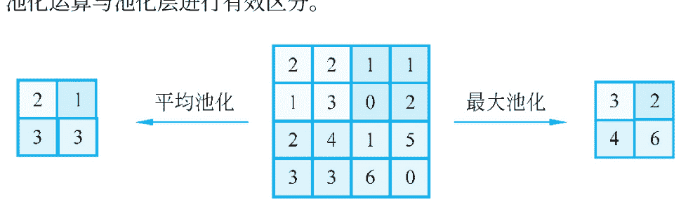
## 3) 模块化搭建与权重共享
图1.28概括了深度神经网络的基础模块与卷积核权重共享的原理。图1.28(a)以VGG-11、VGG-13、VGG-16为例，呈现了三种典型结构的配置，其中VGG后面的序号表示可训练连接权的层数。例如VGG-16包含13个卷积层加3个全连接层，共16个可训练层，池化层、Softmax层等不含可学习参数。可以看出，一个或多个卷积层配合最大池化层共同构成一个结构模块或阶段，整个分层特征提取器由多个模块串联，以获得不同感受野、不同粒度的特征。值得注意的是，在同一模块内纵向堆叠多个卷积层，可以在更少的连接权参数下获得更强的结构支撑，有助于抑制过拟合，也能避免大卷积核带来的细节损失和信息扭曲。大量实践证明，一个含25个参数的5×5卷积核，通常可以用两个仅含18个参数的3×3卷积核逐层堆叠来替代，这正是CNN强调深度的本质。

图1.28(b)进一步说明了深度卷积网络中卷积核的权重共享特性。借助滑动窗口，一个卷积核即可把原始图像或特征图映射为另一幅特征图，并具有平移不变性。对输入输出特征图而言，这就实现了连接权在空间上的复用。

| VGG 11 | VGG 13 | VGG 16 |

|---|---|---|

| 输入(224×224 RGB图像) | 输入(224×224 RGB图像) | 输入(224×224 RGB图像) |

| 卷积层conv3-64 | 卷积层conv3-64<br>卷积层conv3-64 | 卷积层conv3-64<br>卷积层conv3-64 |

| 最大池化层 | 最大池化层 | 最大池化层 |

| 卷积层conv3-128 | 卷积层conv3-128<br>卷积层conv3-128 | 卷积层conv3-128<br>卷积层conv3-128 |

| 最大池化层 | 最大池化层 | 最大池化层 |

| 卷积层conv3-256<br>卷积层conv3-256 | 卷积层conv3-256<br>卷积层conv3-256 | 卷积层conv3-256<br>卷积层conv3-256<br>卷积层conv3-256 |

| 最大池化层 | 最大池化层 | 最大池化层 |

| 卷积层conv3-512<br>卷积层conv3-512 | 卷积层conv3-512<br>卷积层conv3-512 | 卷积层conv3-512<br>卷积层conv3-512<br>卷积层conv3-512 |

| 最大池化层 | 最大池化层 | 最大池化层 |

| 卷积层conv3-512<br>卷积层conv3-512 | 卷积层conv3-512<br>卷积层conv3-512 | 卷积层conv3-512<br>卷积层conv3-512<br>卷积层conv3-512 |

| 最大池化层 | 最大池化层 | 最大池化层 |

| 全连接层 FC-4096 | 全连接层 FC-4096 | 全连接层 FC-4096 |

| 全连接层 FC-4096 | 全连接层 FC-4096 | 全连接层 FC-4096 |

| 全连接层 FC-1000 | 全连接层 FC-1000 | 全连接层 FC-1000 |

| 输出类别概率：Softmax层 | 输出类别概率：Softmax层 | 输出类别概率：Softmax层 |

(a) 基本结构模块示意图

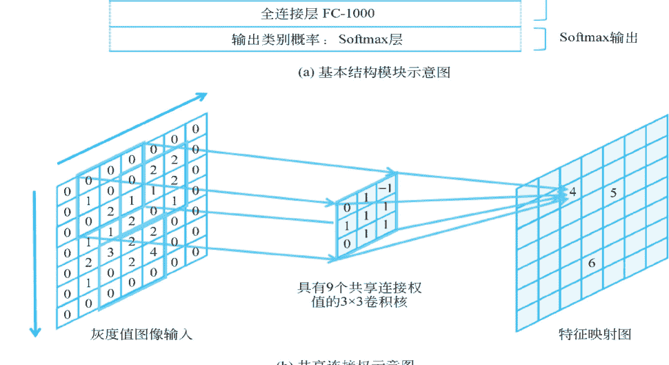

(b) 共享连接权示意图

图1.28 基本结构模块与卷积核共享连接权的示意图

## 4) 激活与归一化
卷积层与全连接层常用ReLU或Leaky ReLU等非线性激活函数，用以缓解反向传播时梯度消失或爆炸的问题，加快收敛速度。为防止过拟合，还需根据任务需求和数据规模，配合数据增强、Dropout或BN等归一化手段。

## 5) 分类头与Softmax
作为分类器，多个全连接层前馈构成含一层或多层隐藏层的FC网络，本质上是一个标准的MLP。对分类任务，通常配合交叉熵损失，在输出层接入Softmax函数以获得可训练的分类器。Softmax的计算如下：

$\hat{y}_k(\boldsymbol{x}) = P(t_k = 1 \mid \boldsymbol{x}) = \frac{\exp(\boldsymbol{\theta}^{(k)T}\boldsymbol{x})}{\sum_{j=1}^{K} \exp(\boldsymbol{\theta}^{(j)T}\boldsymbol{x})}$ (1.29)

其中$K$为输出维度或真实类别数。Softmax可以直接给出预测概率或置信度。

## 2. 主流CNN模型
表1.3对比了面向图像分类的四种典型深度卷积网络。

表1.3 面向图像分类任务的4种典型深度卷积神经网络模型

| 网络模型 | 主要特点 | ImageNet-1K 数据集的 Top-5 错误率/% | 发布时间 |

| :--- | :--- | :--- | :--- |

| AlexNet (8 层) | 开创了卷积神经网络与大数据、GPU 有机结合的局面，但模型本身的网络结构设计较初级 | 15.3 | 2012 |

| VGG 网络 (19 层) | 全部采用 3×3 的卷积核（个别使用 1×1 的卷积核），通道数逐模块按倍数增加或不增加，一律基于最大池化，这些都大幅减少了网络的试错成本 | 7.3 | 2014 |

| GoogLeNet (22 层) | 采用模块化基本结构单元，通过小卷积核的逐深度堆叠，提高了网络的结构支撑能力，同时减少了使用大卷积核带来的信息丢失 | 6.67 | 2014 |

| ResNet (152 层) | 采用残差跳跃式结构，克服了退化问题，较大幅度地增强了网络结构的深度与分层特征的提取能力 | 3.57 | 2015 |

短短三年内，ImageNet-1K Top-5错误率从AlexNet的15.3%下降到3.57%，降幅超过76%。

### 1) AlexNet
AlexNet结构如图1.29所示。由于每个结构模块只含一个池化层，可按池化层划分模块。整个网络由上下两个完全相同的子网络组成，每个子网络有3个最大池化层，即3个模块。以下方子网络为例，第一模块先用步长4的11×11大核对224×224 RGB图像卷积，得到55×55×48特征图，再用5×5核提取特征得到27×27×128。第二模块只用一个3×3小核，后续池化实现上下子网络间的特征交叉。第三模块有两层3×3卷积，分别得到13×13×192特征图，经池化后得到13×13×128的全局特征。上下子网络的特征合并后送入分类器完成学习与判决。

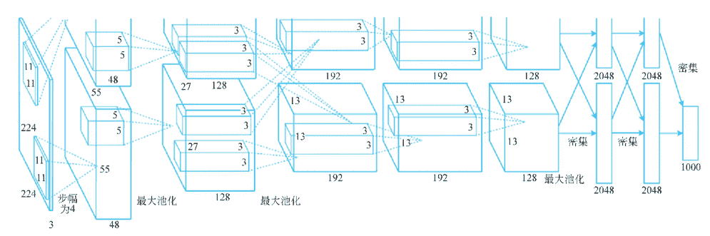

图1.29 AlexNet结构示意图（Krizhevsky等，2012）

为加速训练与推理，模型使用了两块GPU协同工作，上半部分由一块GPU执行，下半部分由另一块GPU执行，仅在特定层交换信息。输入维度为150528，网络各层神经元数量依次为290400-186624-64896-64896-43264-4096-4096-1000。

AlexNet的主要特点：
- ①ImageNet-1K含1000类，128万训练图、5万验证图、10万测试图，是真正的大数据，结合双GPU加速，开创了CNN与大数据、GPU结合的局面；
- ②结构设计相对初级，上下子网络后来大多被弃用，第一模块用11×11大核滤波原始输入会丢失大量像素信息。

在ILSVRC-2010上，AlexNet Top-1、Top-5错误率分别为37.5%和17.0%。在ILSVRC-2012上，Top-1验证错误率36.0%，Top-5测试错误率15.3%，比第二名高出10.9%。其问世开启了CNN在自然语言处理、计算机视觉、语音处理等领域的大规模研究，是人工智能发展的重要里程碑。

### 2) VGG网络
VGG由牛津视觉几何组于2014年提出，结构如图1.30，详细配置见图1.28(a)。Simonyan和Zisserman实际给出6种配置，包含VGG-11、VGG-13、VGG-16等，参数规模约1.33亿、1.33亿、1.38亿，还包括VGG-19等变种。所有变体结构设计高度一致，降低了试错成本。绝大多数卷积核为3×3，通道数按模块倍增，池化统一使用最大池化。每个模块内堆叠多个同形卷积层增加深度，用更少的共享权获得更好支撑，防止过拟合并保留细节。

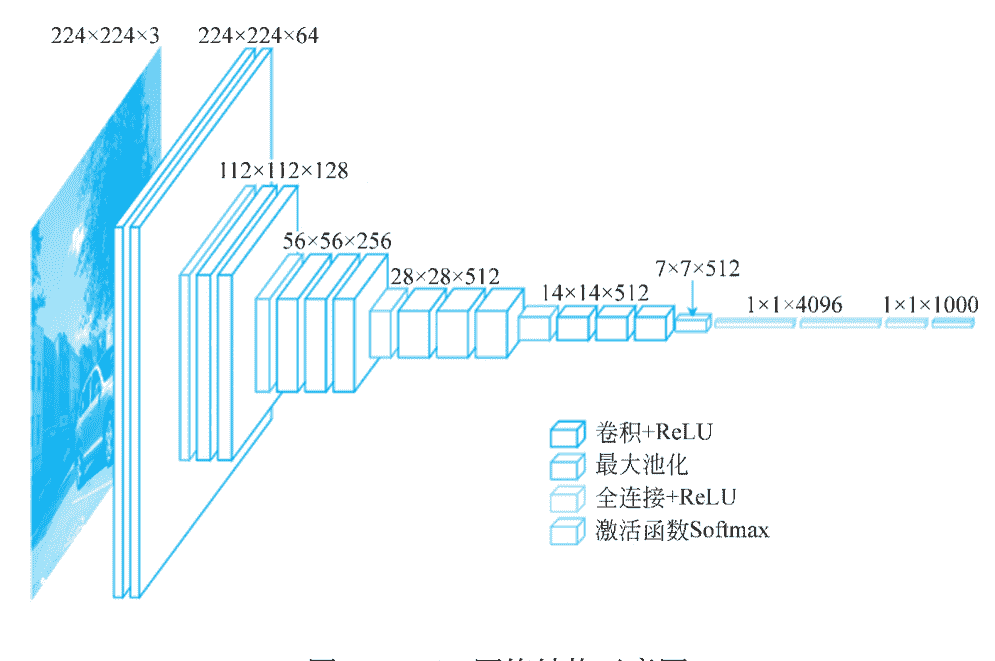

图1.30 VGG网络结构示意图

VGG的主要特点：
- ①结构高度统一，试错参数少；
- ②表达深度对精度至关重要；
- ③普遍使用3×3卷积核，个别用1×1；
- ④通道数逐模块倍增或保持不变；
- ⑤全部最大池化，特征图减半时核数加倍。

在ImageNet上完成单尺度、多尺度、随机裁剪及模型集成评估。VGG在ILSVRC-2012、2013获得最佳成绩，2014年分获分类第二、定位第一。7个网络集成Top-5错误率7.3%，后续两模型集成降至6.8%。VGG证明小核加深网络既能提升性能，又能很好泛化。

### 3) GoogLeNet/Inception
如图1.31、1.32，Szegedy等于2014年提出Inception结构，参赛名GoogLeNet。本质是同一模型。Inception通常只用1×1、3×3、5×5三种核，1×1主要用于降维和引入ReLU非线性。图1.31展示初始版与降维版，可把Inception视为多个不同尺寸卷积与一个池化算子的复合算子，符合多尺度处理后聚合的直觉。

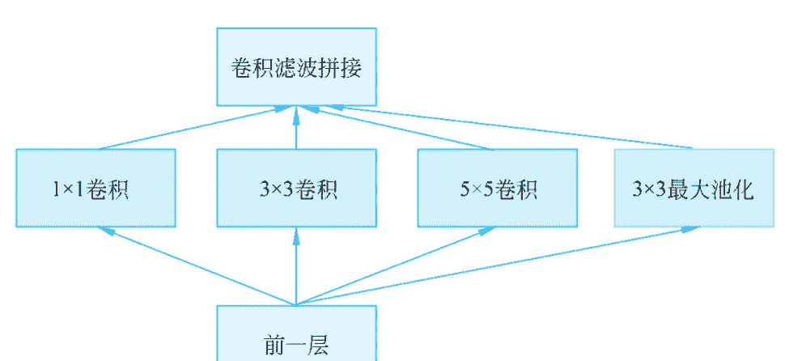

(a) Inception结构(初始版)

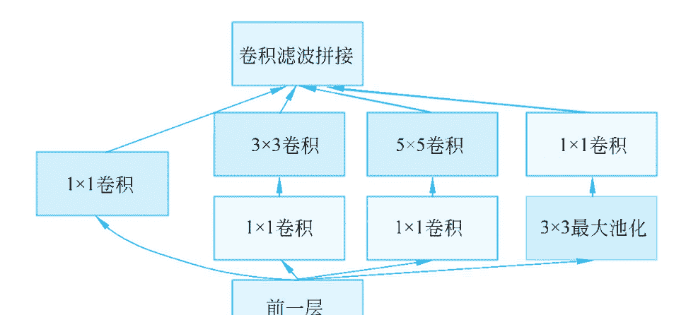

(b) Inception结构(降维版)

▲图1.31 Inception结构示意图（Szegedy等，2014）

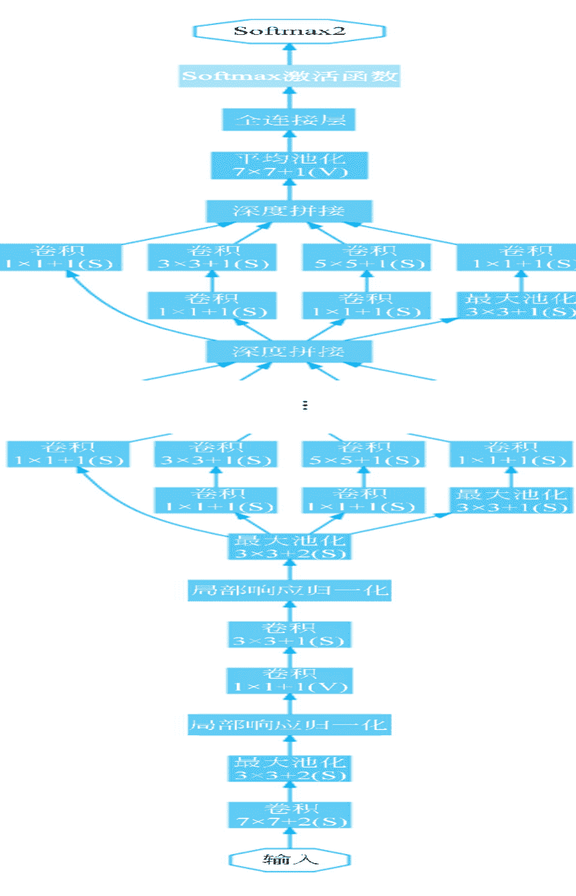

图1.32 Inception网络结构示意图（部分）（Szegedy等，2014）

Inception网络由若干阶段和任务头组成。22层的Inception除最后平均池化外，其余4个阶段均用步长2的最大池化降分辨率。除输入段使用标准卷积外，其余阶段均以Inception算子替代卷积并堆叠以增大深度。设计优化允许在计算量不大增加下拓宽网络并增加阶段数。所有卷积后均接ReLU。

主要特点：
- ①用Inception结构替代标准卷积，实现多尺度特征提取，提升计算效率；
- ②宽度与整体深度增加带来显著性能改善；
- ③增加两个辅助分类器帮助训练，用平均池化替代全连接减少参数。

2014年ILSVRC上，7个变体集成在分类与检测均夺冠。分类Top-5错误率6.67%，检测mAP 43.9%。

### 4) ResNet
深度对CNN性能提升至关重要，但传统几十层的网络受算力和退化现象限制。深度增加后准确率先升后降，出现退化。ResNet通过残差学习框架克服这一问题，层数可达上千层。

残差块设计如图1.33。设某段输入为$x$，期望映射为$H(x)$。通过捷径连接把$x$直接加到残差分支输出$F(x)$上，得到$H(x)=F(x)+x$。当$F(x)=0$时即恒等映射。ResNet仅学习残差$F(x)=H(x)-x$，使残差逼近零，学习更易，同时深度增加不产生退化。这种跳跃式连接极大丰富了结构，为提取高层语义特征提供了关键创新，已成为深度CNN的代表。

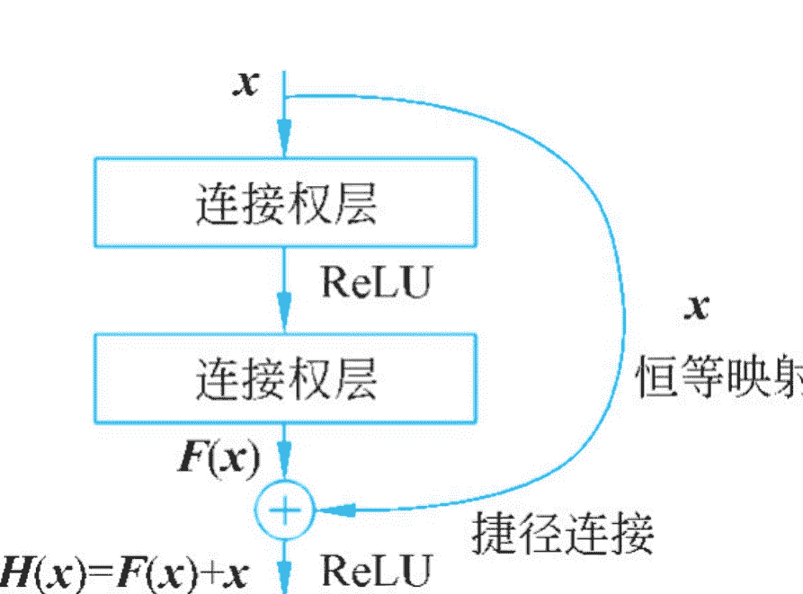

ResNet残差结构揭秘

如图1.33所示，He团队在2015年给出了经典残差模块的设计思路。作为对照，图1.34 a和图1.34 b分别展示了VGG 19以及一个34层的普通卷积网络，这两类网络都完全没有跨层连接。图1.34 c则是ResNet 34的架构，其中每隔两层卷积就会插入一次残差跳跃。注意图中既有实线跳跃也有虚线跳跃。实线表示输入与残差映射的维度一致，可以直接做加法得到期望输出 H(x)=F(x)+x。虚线则对应维度不一致的情况，这时要么用零填充对齐，要么引入线性投影，要么借助1×1卷积 W 来对齐维度，得到 H(x)=F(x)+Wx。

在34层及以内的ResNet里，残差分支通常只放两层卷积。进入更深的网络，比如ResNet 50、101、152甚至1202，为了大幅压缩参数，残差分支改用瓶颈结构：前后各一个1×1卷积负责降维和升维，中间一个低通道的3×3卷积做特征提取，这样能显著减少共享权重的数量。另外ResNet设计的一个原则是，跳跃分支尽量保持原样，即尽可能做恒等映射。残差分支的安排上，第一层卷积后接BN再接ReLU，第二层卷积后只接BN不接ReLU，避免残差输出恒为正而限制表达力，这是一种后激活的ResNet V1做法。另一种改进的前激活ResNet V2则把BN和ReLU都挪到两个卷积层之前，第二个卷积之后不再做任何处理，性能更佳。

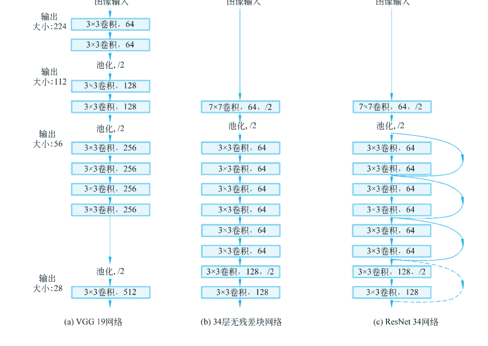

ResNet的核心优势可以归纳为两点：

- ① 残差跳跃学习有效缓解了深层卷积网络随深度加剧的退化现象；
- ② 1×1卷积既能完成通道或特征维度的对齐，也能在瓶颈结构中实现3×3卷积的降维使用，从而把超深网络的参数规模压下来。

在ILSVRC-2015上，ResNet用152层深度残差网络参赛，深度是VGG 19的8倍，参数量却更少。基线ResNet 34约36亿次FLOPs，仅相当于VGG 19约196亿次FLOPs的18%。凭借集成预测，He等人把ImageNet测试集错误率压到3.57%，拿下分类冠军，并同时斩获ImageNet检测、定位、COCO 2015检测与分割冠军。大量实践表明，残差跳跃结构巧妙解决了退化问题，让网络可以更深、特征提取更强，已成为深度网络的标杆设计，甚至被吸收到Transformer的构造中。

## 3.从AlexNet到通用智能的演进

自2012年AlexNet破局以来，深度神经网络在数据、算力和场景的共同推动下成为新一轮人工智能的主力。作为弱人工智能时代的基础范式，深度卷积网络在视觉与语音领域应用广泛，和强化学习结合催生了AlphaGo、MuZero等成果，并在多模态大语言模型中仍将发挥关键作用。

在全监督设定下，深度卷积网络的价值在于分层特征提取与表达学习。通常由特征提取器和任务头组成，两部分都能自动学习。特征提取端必须同时具备卷积运算和池化。卷积以可学习的共享权重替代全连接，模拟哺乳动物视觉皮层的多粒度、多方向、多阶段特征提取，得到底层、中层、高层以及局部到全局语义特征。池化扩大感受野，界定网络各阶段或模块，卷积学习到的表达必须与之配合。从结构设计到超参调优，从AlexNet到VGG、ResNet，从监督到强化，从分类到检测、分割、定位与跟踪，不同模型泛化能力各不相同。未来把深度卷积的分层提取能力与注意力等全局关系建模结合，将进一步推动通用人工智能的发展。

## 1.3.4 反馈式神经网络概览

反馈神经网络是一类动态网络，主要用于联想记忆与优化计算。最早由Hopfield提出，故常称Hopfield网络。

按动态特性分为离散时间和连续时间两种。与前馈和递归网络不同，Hopfield网络的连接权是手工设计的而非学习得到的，因此一般不讨论学习算法。离散Hopfield网络的输入输出通常是二值的，若取值连续则称为现代Hopfield网络。有研究指出它们与Transformer存在联系，值得重新审视。

### 1.离散Hopfield网络核心

#### 1) 网络结构与工作方式

离散Hopfield网络的拓扑如图1.35所示。

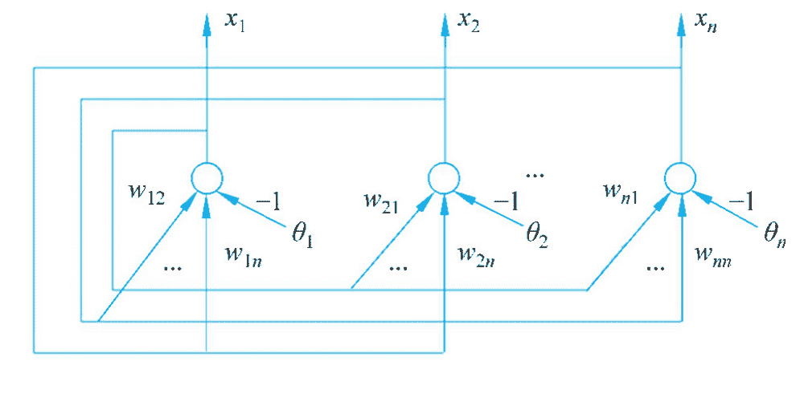

图1.35 离散Hopfield网络结构

对每个MP神经元节点，有

$$

\begin{cases}

s_j = \sum_{i=1}^{n} w_{ji} x_j - \theta_j \\

x_j = f(s_j)

\end{cases}

\tag{1.30}

$$

其中 w 为连接权，习惯取 w_ii=0，θ 为偏置，f(s) 为激活函数。离散情形下 f(s) 常取阶跃函数或符号函数。

工作模式分两种：

- (1) 异步方式。每次仅有一个神经元更新状态，其余保持不变，即

$$

\begin{cases}

x_i(k+1) = f\left(\sum_{j=1}^{n} w_{ij} x_j(k) - \theta_i\right) & (1.31a) \\

x_j(k+1) = x_j(k), \quad j \neq i & (1.31b)

\end{cases}

$$

更新顺序可随机也可固定。
- (2) 同步方式。所有神经元同时更新，即

$$

x_i(k+1) = f\left(\sum_{j=1}^{n} w_{ij} x_j(k) - \theta_i\right), \quad \forall i \tag{1.32}

$$

同步形式也可写成矩阵式

$$

\boldsymbol{x}(k+1) = \boldsymbol{f}(\boldsymbol{W}\boldsymbol{x}(k) - \boldsymbol{\theta}) \tag{1.33}

$$

式中 x 和 θ 为 n 维向量，W 为 {w_ij} 构成的 n×n 矩阵，f(s) 为逐元素函数。

该网络是动态反馈系统，输入为初始状态

$$

\boldsymbol{x}(0) = [x_1(0), x_2(0), \cdots, x_n(0)]^\mathrm{T} \tag{1.34}

$$

输出为网络达到的稳定状态 lim_{k→∞} x(k)。

#### 2) 稳定性与吸引子

离散Hopfield网络本质上是非线性离散动力系统。若系统稳定，可从任意初态收敛到稳态；若不稳定，因节点输出仅为1和-1，不会发散，只会出现有界自持振荡或极限环。

把稳态看作记忆样本，初态向稳态收敛的过程就是联想记忆，把部分信息补全为完整记忆。把稳态映射到优化目标的极值点，收敛过程即在网络演化中自动完成的优化。

- (1) 稳定性。

定义1.1：若状态 x 满足 x = f(Wx - θ)，则称 x 为不动点或吸引子。

定理1.1：异步更新且连接矩阵 W 对称时，对任意初态网络最终收敛到一个吸引子。

证明：定义能量函数为

$$

E(k) = -\frac{1}{2} \sum_{i=1}^{n} \sum_{j=1}^{n} w_{ij} x_i x_j + \sum_{i=1}^{n} x_i \theta_i = -\frac{1}{2} \boldsymbol{x}^T(k) \boldsymbol{W} \boldsymbol{x}(k) + \boldsymbol{x}^T(k) \boldsymbol{\theta}

$$

节点状态只有两种取值，故能量有界。令 ΔE(k)=E(k+1)-E(k)，Δx(k)=x(k+1)-x(k)，则

$$

\begin{aligned}

\Delta E(k) &= E(k+1) - E(k) \\

&= -\frac{1}{2} [\boldsymbol{x}(k) + \Delta \boldsymbol{x}(k)]^T \boldsymbol{W} [\boldsymbol{x}(k) + \Delta \boldsymbol{x}(k)] + [\boldsymbol{x}(k) + \Delta \boldsymbol{x}(k)]^T \boldsymbol{\theta} - \\

&\quad \left[ -\frac{1}{2} \boldsymbol{x}^T(k) \boldsymbol{W} \boldsymbol{x}(k) + \boldsymbol{x}^T(k) \boldsymbol{\theta} \right] \\

&= -\Delta \boldsymbol{x}^T(k) \boldsymbol{W} \boldsymbol{x}(k) - \frac{1}{2} \boldsymbol{x}^T(k) \boldsymbol{W} \boldsymbol{x}(k) + \Delta \boldsymbol{x}^T(k) \boldsymbol{\theta} \\

&= -\Delta \boldsymbol{x}^T(k) [\boldsymbol{W} \boldsymbol{x}(k) - \boldsymbol{\theta}] - \frac{1}{2} \boldsymbol{x}^T(k) \boldsymbol{W} \boldsymbol{x}(k)

\end{aligned}

$$

异步时可设仅第 i 个神经元变化，Δx(k) 只有一个非零分量，代入得

$$

\Delta E(k) = -\Delta x_i(k) \left[ \sum_{j=1}^n w_{ij} x_j(k) - \theta_i \right] - \frac{1}{2} \Delta x_i^2 w_{ii}

$$

令 s_i(k)=∑_j w_ij x_j(k)-θ_i，则有

$$

\begin{aligned}

\Delta E(k) &= -\Delta x_i(k) \left[ s_i(k) + \frac{1}{2} \Delta x_i(k) w_{ii} \right] \\

&= -\Delta x_i(k) s_i(k), \quad w_{ii} = 0

\end{aligned}

$$

若节点取1和-1，则

$$

x_i(k+1) = f[s_i(k)] = \begin{cases} 1, & s_i(k) \geqslant 0 \\ -1, & s_i(k) < 0 \end{cases}

$$

分情况讨论：
① x_i(k)=-1，x_i(k+1)=1，Δx_i=2，s_i≥0，得 ΔE≤0；
② x_i(k)=1，x_i(k+1)=-1，Δx_i=-2，s_i<0，得 ΔE<0；
③ 状态不变，Δx_i=0，得 ΔE=0。

因此 ΔE(k)≤0 恒成立，能量下界保证收敛。当 ΔE=0 时对应稳态或临界点 s_i=0，后续也不会再改变，故最终收敛到吸引子。w_ii>0 时结论依然成立且收敛更快。x 取1和0时结论同样成立。

定理1.2：同步更新且连接权矩阵 W 为非负定对称矩阵时，任意初态也最终收敛到吸引子。

证明：前面已得

$$

\begin{aligned}

\Delta E(k) &= E(k+1) - E(k) \\

&= -\frac{1}{2} [\boldsymbol{x}(k) + \Delta \boldsymbol{x}(k)]^T \boldsymbol{W} [\boldsymbol{x}(k) + \Delta \boldsymbol{x}(k)] + [\boldsymbol{x}(k) + \Delta \boldsymbol{x}(k)]^T \boldsymbol{\theta} - \\

&\quad \left[ -\frac{1}{2} \boldsymbol{x}^T(k) \boldsymbol{W} \boldsymbol{x}(k) + \boldsymbol{x}^T(k) \boldsymbol{\theta} \right] \\

&= -\Delta \boldsymbol{x}^T(k) \boldsymbol{W} \boldsymbol{x}(k) - \frac{1}{2} \boldsymbol{x}^T(k) \boldsymbol{W} \boldsymbol{x}(k) + \Delta \boldsymbol{x}^T(k) \boldsymbol{\theta} \\

&= -\Delta \boldsymbol{x}^T(k) [\boldsymbol{W} \boldsymbol{x}(k) - \boldsymbol{\theta}] - \frac{1}{2} \boldsymbol{x}^T(k) \boldsymbol{W} \boldsymbol{x}(k)

\end{aligned}

$$

对每个 i 必有 -Δx_i(k)s_i(k)≤0，故 W 非负定时 ΔE(k)≤0，能量收敛到常数，按同上分析可得吸引子。

同步方式对 W 的要求更高，不满足非负定对称时可能出现振荡或极限环。异步更稳定，但牺牲了并行性，实际更常用。

- (2) 吸引子的性质。

Hopfield网络吸引子与记忆容量关键原理

① 零阈值下吸引子成对出现
若网络中存在吸引子 x，且所有神经元阈值 θ_i 均为 0，则其符号相反的向量 -x 必然也是该网络的吸引子。
证明：吸引子的定义是 x = f(Wx)。利用激活函数 f 的奇函数性可得 f(W(-x)) = f(-Wx) = -f(Wx) = -x，所以 -x 满足吸引子条件。

②  Hamming 距离为1的相邻状态不可能是吸引子
设 x^(a) 已是吸引子，则与它仅在单个分量上不同的 x^(b)，即 d_H(x^(a),x^(b))=1，必定不是吸引子。
证明：不妨设二者仅在第 i 个位置取值相反，其余位置相同。利用 w_ii =0 的常规设定可推出

$$

x_i^{(a)} = f\left(\sum_{j} w_{ij} x_j^{(a)} - \theta_i\right) = f\left(\sum_{j} w_{ij} x_j^{(b)} - \theta_i\right) \neq x_i^{(b)}

$$

由此可判定 x^(b) 不能成为稳定点。

推论：在零阈值条件下，若 x^(a) 是吸引子，则与其海明距离为 n-1 的 x^(b) 一定不是吸引子。
证明：d_H(x^(a),x^(b))=n-1 等价于 d_H(-x^(a),x^(b))=1。由性质①知 -x^(a) 也是吸引子，再结合性质②即可得出结论。

吸引域
相联记忆要求每个记忆样本拥有足够的容错范围，这一范围即为吸引域。
定义1.2：对吸引子 x^(a)，在异步更新规则下，若存在一种更新顺序能使 x^(b) 最终收敛到 x^(a)，则称 x^(b) 弱吸引到 x^(a)；若无论采用何种更新顺序都收敛到 x^(a)，则称强吸引。
定义1.3：所有弱吸引或强吸引到 x^(a) 的状态集合 R(x^(a)) 即为该吸引子的弱吸引域或强吸引域。
同步更新没有顺序差异，因此不区分强弱。对同一初始状态，不同更新顺序在异步模式下可能导向不同吸引子。

3) 连接权设计
为保证异步工作时稳定收敛，权值矩阵 W 需满足对称性。若要求同步收敛则需 W 为半正定，条件更严，通常只保证异步收敛。此外，指定的记忆样本必须成为网络的吸引子并具备一定吸引域，这正是相联记忆功能的基础。常用的构造方式是 Hebb 规则。
设给定 m 个样本 x^(k)，k=1..m，且 x∈{-1,1}^n，按 Hebb 规则的权值为

$$w_{ij} = \begin{cases} \sum_{k=1}^{m} x_i^{(k)} x_j^{(k)}, & i \neq j \\ 0, & i = j \end{cases} \quad (1.35a)$$

或

$$\begin{cases} w_{ij}(k) = w_{ij}(k-1) + x_i^{(k)} x_j^{(k)}, & k = 1, 2, \cdots, m \\ w_{ij}(0) = 0, & w_{ii} = 0 \end{cases} \quad (1.35b)$$

矩阵形式为

$$W = [\mathbf{x}^{(1)} \quad \mathbf{x}^{(2)} \quad \cdots \quad \mathbf{x}^{(m)}] \begin{bmatrix} \mathbf{x}^{(1)T} \\ \mathbf{x}^{(2)T} \\ \vdots \\ \mathbf{x}^{(m)T} \end{bmatrix} - mI$$

$$= \sum_{k=1}^{m} \mathbf{x}^{(k)} \mathbf{x}^{(k)T} - mI = \sum_{k=1}^{m} (\mathbf{x}^{(k)} \mathbf{x}^{(k)T} - I) \quad (1.35c)$$

其中 I 为单位矩阵。
当状态取值为 {0,1}^n 时，对应的权值为

$$w_{ij} = \begin{cases} \sum_{k=1}^{m} (2x_i^{(k)} - 1)(2x_j^{(k)} - 1), & i \neq j \\ 0, & i = j \end{cases} \quad (1.36a)$$

或

$$\begin{cases} w_{ij}(k) = w_{ij}(k-1) + (2x_i^{(k)} - 1)(2x_j^{(k)} - 1), & k=1,2,\cdots,m \\ w_{ij}(0) = 0, \\ w_{ii} = 0 \end{cases} \quad (1.36b)$$

矩阵形式写成

$$\mathbf{W} = \sum_{k=1}^{m} (2\mathbf{x}^{(k)} - \mathbf{b})(2\mathbf{x}^{(k)} - \mathbf{b})^T - m\mathbf{I} \quad (1.36c)$$

其中 b=[1 1 … 1]^T。上述构造均满足对称性。

以 x∈{-1,1}^n 为例分析样本是否为吸引子。若 m 个样本两两正交，即

$$\begin{cases} \mathbf{x}^{(i)T} \mathbf{x}^{(j)} = 0, & i \neq j \\ \mathbf{x}^{(i)T} \mathbf{x}^{(i)} = n \end{cases}$$

则

$$\mathbf{W}\mathbf{x}^{(k)} = \left(\sum_{i=1}^{m} (\mathbf{x}^{(i)}\mathbf{x}^{(i)T} - m\mathbf{I})\right)\mathbf{x}^{(k)} = \sum_{i=1}^{m} (\mathbf{x}^{(i)}\mathbf{x}^{(i)T}\mathbf{x}^{(k)} - m\mathbf{x}^{(k)}) = n\mathbf{x}^{(k)} - m\mathbf{x}^{(k)} = (n-m)\mathbf{x}^{(k)}$$

只要 n-m>0，就有

$$f[\mathbf{W}\mathbf{x}^{(k)}] = f[(n-m)\mathbf{x}^{(k)}] = \mathbf{x}^{(k)}$$

故每个 x^(k) 都是吸引子。

若样本不正交，记内积 x^(i)T x^(j)=β_ij，显然 β_ii=n，则

$$\mathbf{W} \mathbf{x}^{(k)} = \sum_{i=1}^{m} \mathbf{x}^{(i)} \mathbf{x}^{(i)T} \mathbf{x}^{(k)} - m \mathbf{x}^{(k)} = (n - m) \mathbf{x}^{(k)} + \sum_{\substack{i=1 \\ i \neq k}}^{m} \mathbf{x}^{(i)} \beta_{ik}$$

取第 j 个分量得

$$[\mathbf{W} \mathbf{x}^{(k)}]_j = (n - m) x_j^{(k)} + \sum_{\substack{i=1 \\ i \neq k}}^{m} x_j^{(i)} \beta_{ik}$$

当对所有 j 满足

$$(n - m) > \left| \sum_{\substack{i=1 \\ i \neq k}}^{m} x_j^{(i)} \beta_{ik} \right|$$

时 x^(k) 为吸引子。右端可化为

$$\left| \sum_{\substack{i=1 \\ i \neq k}}^{m} x_j^{(i)} \beta_{ik} \right| \leqslant \sum_{\substack{i=1 \\ i \neq k}}^{m} |\beta_{ik}| \leqslant (m-1) \beta_m$$

其中 β_m≜|β|_max。进一步若

$$m < \frac{n + \beta_m}{1 + \beta_m} \quad (1.37)$$

则全部样本均可保证为吸引子。
若样本满足

$$\alpha n \leqslant d_H(\mathbf{x}^{(i)}, \mathbf{x}^{(j)}) \leqslant (1 - \alpha)n \quad (1.38a)$$

其中 i≠j 且 0<α<0.5，则

$$|\beta_{ij}| \leqslant n - 2\alpha n = \beta_m \quad (1.38b)$$

于是 m 个样本均为吸引子的充分条件为

$$m < \frac{2n(1 - \alpha)}{1 + n(1 - 2\alpha)} \quad (1.38c)$$

该条件仅为充分条件，不满足时仍需逐例验证。

4) 记忆容量
记忆容量是指在节点数固定的前提下，保证相联记忆正确实现的最大可存样本数 m。容量取决于节点数、权值设计方式以及样本的统计特性。Hebb 设计下正交样本可达最大容量，实际研究常假设样本随机。
容量也受吸引域要求影响。把一个样本的吸引域看作以该样本为中心的超球体，若球体内状态与中心的距离为 α n，0≤α<0.5，则 α 称为吸引半径。
Hopfield 给出的容量数量级为

$$m \leqslant 0.15n \qquad\qquad\qquad\qquad\qquad (1.39a)$$

在随机样本假设下，当 n→∞ 时理论容量为

$$m \leqslant \frac{(1-2\alpha)^2 n}{2 \ln n} \qquad\qquad\qquad\qquad\qquad (1.39b)$$

式中 α 为要求的吸引半径。

为提升一般样本的容量，可改进权值构造。设 m 个样本 x^(k)，先构成 n×(m-1) 矩阵

$$A=[\mathbf{x}^{(1)}-\mathbf{x}^{(m)}, \mathbf{x}^{(2)}-\mathbf{x}^{(m)}, \cdots, \mathbf{x}^{(m-1)}-\mathbf{x}^{(m)}]$$

对 A 做奇异值分解

$$A=U\Sigma V^T$$

且

$$\Sigma = \begin{bmatrix} S & 0 \\ 0 & 0 \end{bmatrix}, \quad S = \text{diag}(\sigma_1 \quad \sigma_2 \quad \cdots \quad \sigma_r)$$

其中 U 为 n×n 正交矩阵，V 为 (m-1)×(m-1) 正交矩阵。U 可写为

$$U=[\mathbf{u}_1 \mathbf{u}_2 \cdots \mathbf{u}_r \mathbf{u}_{r+1} \cdots \mathbf{u}_n]$$

u1…ur 为对应非零奇异值的左奇异向量，构成 A 值域的正交基，ur+1…un 为其正交补基。

按此构造权值和阈值

$$W = \sum_{k=1}^{r} \mathbf{u}_k \mathbf{u}_k^T$$

$$\theta = W \mathbf{x}^{(m)} - \mathbf{x}^{(m)}$$

所得 W 对称，保证异步稳定性。下面证明给定样本均为吸引子。
因 u1…ur 为 A 值域基，任一差向量 x^(k)-x^(m) 可表示为

$$\mathbf{x}^{(k)} - \mathbf{x}^{(m)} = \sum_{i=1}^{r} a_i \mathbf{u}_i$$

由 U 的正交性，各 u_i 为单位正交，从而

$$W \mathbf{u}_i = \sum_{k=1}^{r} \mathbf{u}_k \mathbf{u}_k^T \mathbf{u}_i = \mathbf{u}_i$$

进而

$$W(\mathbf{x}^{(k)} - \mathbf{x}^{(m)}) = W \sum_{i=1}^{r} a_i \mathbf{u}_i = \sum_{i=1}^{r} a_i W \mathbf{u}_i = \sum_{i=1}^{r} a_i \mathbf{u}_i = \mathbf{x}^{(k)} - \mathbf{x}^{(m)}$$

对任意样本 x^(k)，k=1..m-1，有

$$W\mathbf{x}^{(k)} - \theta = W\mathbf{x}^{(k)} - W\mathbf{x}^{(m)} + \mathbf{x}^{(m)} = W(\mathbf{x}^{(k)} - \mathbf{x}^{(m)}) + \mathbf{x}^{(m)} = \mathbf{x}^{(k)}$$

从而可得其满足吸引子条件。

$$f\left(W\mathbf{x}^{(k)} - \boldsymbol{\theta}\right) = f(\mathbf{x}^{(k)}) = \mathbf{x}^{(k)}$$

针对第 $m$ 个训练模式 $\mathbf{x}^{(m)}$，可得
$$W\mathbf{x}^{(m)} - \boldsymbol{\theta} = \mathbf{x}^{(m)} - \mathbf{x}^{(m)} + \mathbf{x}^{(m)} = \mathbf{x}^{(m)}$$
进而得到
$$f\left(W\mathbf{x}^{(m)} - \boldsymbol{\theta}\right) = f(\mathbf{x}^{(m)}) = \mathbf{x}^{(m)}$$
上述推演揭示，采用此种权值构造方案，所得到的权值连接阵能让全部模式 $\mathbf{x}^{(k)}$（$k=1,2,\cdots,m$）都演化为系统的吸引态。这一结果并不依赖于模式间的相互正交，存储能力因此得到提升。

### 5）举例

以图1.35展示的离散型霍普菲尔德系统为例，选取两组模式如下
$$\mathbf{x}^{(1)}=\left[\begin{array}{l}1\\1\\1\\1\end{array}\right], \quad \mathbf{x}^{(2)}=\left[\begin{array}{l}-1\\-1\\-1\\-1\end{array}\right]$$
此处 $m=2$、$n=4$，各单元阈值 $\theta_i=0$（$i=1,2,3,4$）。

先按赫布学习法则求出权值阵为
$$W = \mathbf{x}^{(1)}\mathbf{x}^{(1)T} + \mathbf{x}^{(2)}\mathbf{x}^{(2)T} - 2I = \begin{bmatrix} 0 & 2 & 2 & 2 \\ 2 & 0 & 2 & 2 \\ 2 & 2 & 0 & 2 \\ 2 & 2 & 2 & 0 \end{bmatrix}$$
因为两模式的汉明距离 $d_H(\mathbf{x}^{(1)},\mathbf{x}^{(2)})=4$，即 $\alpha=0$，并不符合前文提到的充分判据，故 $\mathbf{x}^{(1)}$ 与 $\mathbf{x}^{(2)}$ 是否成为霍普菲尔德系统的吸引态，还需具体验算。

经直接检验可得
$$f(W\mathbf{x}^{(1)}) = f\begin{bmatrix} 6 \\ 6 \\ 6 \\ 6 \end{bmatrix} = \begin{bmatrix} 1 \\ 1 \\ 1 \\ 1 \end{bmatrix} = \mathbf{x}^{(1)}, \quad f(W\mathbf{x}^{(2)}) = f\begin{bmatrix} -6 \\ -6 \\ -6 \\ -6 \end{bmatrix} = \begin{bmatrix} -1 \\ -1 \\ -1 \\ -1 \end{bmatrix} = \mathbf{x}^{(2)}$$
由此两组模式 $\mathbf{x}^{(1)}$、$\mathbf{x}^{(2)}$ 均可作为霍普菲尔德系统的吸引态。值得注意的是 $\mathbf{x}^{(2)}=-\mathbf{x}^{(1)}$，所以只要其一具备吸引特性，另一组自然也具备。

接下来进一步探讨这两个吸引态的牵引效果以及联想记忆性能。

① 取初态 $\mathbf{x}(0)=\mathbf{x}^{(3)}=[-1\ 1\ 1\ 1]^T$，该状态与 $\mathbf{x}^{(1)}$ 的汉明距离为1，较为相近。采用异步更新，顺序为1、2、3、4：
$$x_1(1) = f\left(\sum_{j=1}^{4} w_{1j} x_j(0)\right) = f(6) = 1$$
$$x_2(1) = x_2(0) = 1, \quad x_3(1) = x_3(0) = 1, \quad x_4(1) = x_4(0) = 1$$
得到 $\mathbf{x}(1)=[1\ 1\ 1\ 1]^T=\mathbf{x}^{(1)}$。可见异步迭代一步即可使 $\mathbf{x}^{(3)}$ 收敛至 $\mathbf{x}^{(1)}$。

② 取初态 $\mathbf{x}(0)=\mathbf{x}^{(4)}=[1\ -1\ -1\ -1]^T$，其与 $\mathbf{x}^{(2)}$ 的汉明距离为1。仍按1、2、3、4异步更新：
$$x_1(1) = f\left(\sum_{j=1}^{4} w_{1j} x_j(0)\right) = f(-6) = -1$$
$$x_2(1) = x_2(0) = -1, \quad x_3(1) = x_3(0) = -1, \quad x_4(1) = x_4(0) = -1$$
得 $\mathbf{x}(1)=[-1\ -1\ -1\ -1]^T=\mathbf{x}^{(2)}$。因此 $\mathbf{x}^{(4)}$ 也仅需一步便收敛到 $\mathbf{x}^{(2)}$。

③ 取初态 $\mathbf{x}(0)=\mathbf{x}^{(5)}=[1\ 1\ -1\ -1]^T$，其到 $\mathbf{x}^{(1)}$ 与 $\mathbf{x}^{(2)}$ 的汉明距离皆为2。若按1、2、3、4异步更新，则有
$$x_1(1) = f\left(\sum_{j=1}^{4} w_{1j} x_j(0)\right) = f(-2) = -1$$
$$x_i(1) = x_i(0), \quad i = 2,3,4$$
即 $\mathbf{x}(1)=[-1\ 1\ -1\ -1]^T$。再更新一次得到
$$x_2(2) = f\left(\sum_{j=1}^{4} w_{2j} x_j(1)\right) = f(-6) = -1$$
$$x_i(2) = x_i(1), \quad i=1,3,4$$
即 $\mathbf{x}(2)=[-1\ -1\ -1\ -1]^T=\mathbf{x}^{(2)}$。于是 $\mathbf{x}^{(5)}$ 收敛到 $\mathbf{x}^{(2)}$。

若改用更新顺序3、4、1、2，则有
$$x_3(1) = f\left(\sum_{j=1}^{4} w_{3j} x_j(0)\right) = f(2) = 1$$
$$x_i(1) = x_i(0), \quad i=1,2,4$$
即 $\mathbf{x}(1)=[1\ 1\ 1\ -1]^T$。继续迭代一步，可以得到
$$x_4(2) = f\left(\sum_{j=1}^{4} w_{4j} x_j(1)\right) = f(6) = 1$$
$$x_i(2) = x_i(1), \quad i=1,2,3$$
即 $\mathbf{x}(2)=[1\ 1\ 1\ 1]^T=\mathbf{x}^{(1)}$。可见此时 $\mathbf{x}^{(5)}$ 指向 $\mathbf{x}^{(1)}$。

由上述计算可见，当初值恰好位于两吸引态中间时，不同的更新顺序会导致 $\mathbf{x}^{(5)}$ 弱收敛至 $\mathbf{x}^{(1)}$ 或 $\mathbf{x}^{(2)}$。

随后改用同步更新考察收敛情况，仍以 $\mathbf{x}^{(3)}$、$\mathbf{x}^{(4)}$、$\mathbf{x}^{(5)}$ 为初态。

(3)
① 设初始状态 $x(0)=x=[-1,1,1,1]^T$，此时有
$x(1)=f(Wx(0))=f(Wx^{(3)})=f\begin{bmatrix}6\\2\\2\\2\end{bmatrix}=\begin{bmatrix}1\\1\\1\\1\end{bmatrix}$
$x(2)=f(Wx(1))=f\begin{bmatrix}6\\6\\6\\6\end{bmatrix}=\begin{bmatrix}1\\1\\1\\1\end{bmatrix}$
可见此时 $x$ 收敛到了 $x_\circ$。

(4)
② 设初始状态 $x(0)=x=[1,-1,-1,-1]^T$，此时有
$x(1)=f(Wx(0))=f(Wx^{(4)})=f\begin{bmatrix}-6\\-2\\-2\\-2\end{bmatrix}=\begin{bmatrix}-1\\-1\\-1\\-1\end{bmatrix}$
$x(2)=f(Wx(1))=f\begin{bmatrix}-6\\-6\\-6\\-6\end{bmatrix}=\begin{bmatrix}-1\\-1\\-1\\-1\end{bmatrix}$
可见此时 $x$ 收敛到了 $x_\circ$。

(5)
③ 设初始状态 $x(0)=x=[1,1,-1,-1]^T$，此时有
$$x(1) = f(Wx(0)) = f(Wx^{(5)}) = f\begin{bmatrix} -2 \\ -2 \\ 2 \\ 2 \end{bmatrix} = \begin{bmatrix} -1 \\ -1 \\ 1 \\ 1 \end{bmatrix}$$
$$x(2) = f(Wx(1)) = f\begin{bmatrix} 2 \\ 2 \\ -2 \\ -2 \end{bmatrix} = \begin{bmatrix} 1 \\ 1 \\ -1 \\ -1 \end{bmatrix}$$
由此可见，$x$ 在两个不同状态间交替跳动，形成周期为2的持续振荡。事实上本例的权值阵 $W$ 并非半正定，由前述稳定性准则即可预知此类振荡会发生。

## 2. 连续Hopfield网络

### 1）网络结构与工作方式

连续型霍普菲尔德系统仍为单层反馈结构，参照图1.35所示。对第 $i$ 个神经元节点，其工作方式为
$$\begin{cases} s_i = \sum_{j=1}^{n} w_{ij} x_j - \theta_i \\ \frac{dy_i}{dt} = -\frac{1}{\tau} y_i + s_i \\ x_i = f(y_i) \end{cases} \quad (1.40a)$$
或
$$\begin{cases} \frac{dy_i}{dt} = -\frac{1}{\tau} y_i + \sum_{j=1}^{n} w_{ij} x_j - \theta_i \\ x_i = f(y_i) \end{cases} \quad (1.40b)$$
这里仍假定 $w_{ij}=w_{ji}$。与离散版本相比，多了一个一阶微分环节，相当于一阶惯性。$s_i$ 为该环节输入，$y_i$ 为输出，离散情形可视为 $y_i=s_i$。另一差异在于输出映射 $x_i=f(y_i)$ 通常不再是二值，而是 $S$ 型函数：$x\in(-1,1)$ 时常用双曲正切 Tanh，$x\in(0,1)$ 时常用 Sigmoid。

霍普菲尔德借助模拟电路实现了一种连续型网络。图1.36给出了由运放、电阻、电容硬件构成的单神经元电路模型。

据此可列写电路方程为
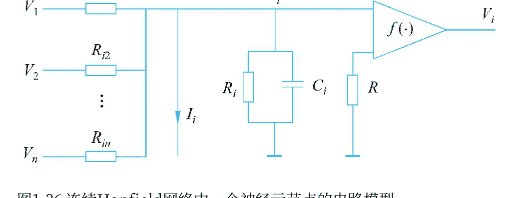
图1.36 连续Hopfield网络中一个神经元节点的电路模型
$$\begin{cases} C_i \frac{du_i}{dt} + \frac{u_i}{R'_i} + I_i = \sum_{j=1}^n \frac{V_j - u_i}{R_{ij}} \\ V_j = f(u_i) \end{cases}$$
其中
$$\frac{1}{R'_i} = \frac{1}{R_i} + \sum_{j=1}^n \frac{1}{R_{ij}}$$
$\tau = R'C$

令$x_i=V_i$, $y_i=u_i$, $w_{ij}=1/R_{ij}C$, $\theta_i=I_i/C$, 则上式化为
$$\begin{cases} \frac{dy_i}{dt} = -\frac{1}{\tau} y_i + \sum_{j=1}^n w_{ij} x_j - \theta_i \\ x_i = f(y_i) \end{cases} \quad (1.41)$$
可见连续型霍普菲尔德系统本质上是非线性动力学系统，可用一组非线性微分方程描述。给定初态，求解该方程组即可得到状态轨迹。若系统稳定，最终会收敛到稳态。用图1.36电路实现时，求解过程由电路自动完成，速度极快。

### 2) 稳定性

连续型系统的能量函数定义为
$$E = -\frac{1}{2} \sum_{i=1}^n \sum_{j=1}^n w_{ij} x_i x_j + \sum_{i=1}^n x_i \theta_i + \sum_{i=1}^n \frac{1}{\tau_i} \int_0^{x_i} f^{-1}(\eta) d\eta$$
$$= -\frac{1}{2} \mathbf{x}^T \mathbf{W} \mathbf{x} + \mathbf{x}^T \mathbf{\theta} + \sum_{i=1}^n \frac{1}{\tau_i} \int_0^{x_i} f^{-1}(\eta) d\eta \quad (1.42)$$
其形式与离散版本相同。离散情形因 $f(\cdot)$ 为二值，积分项为零。若 $x_i\in(-1,1)$ 或 $x_i\in(0,1)$，能量 $E$ 有界。只需证明 $dE/dt\le 0$ 即可说明系统稳定。

$$\frac{dE}{dt} = \sum_{i=1}^{n} \frac{dE}{dx_i} \frac{dx_i}{dt}$$
由式（1.42）可求得
$$\frac{dE}{dx_i} = -\sum_{j=1}^{n} w_{ij} x_j + \theta_i + \frac{1}{\tau_i} f^{-1}(x_i) = -\sum_{j=1}^{n} w_{ij} x_j + \theta_i + \frac{1}{\tau_i} y_i = -\frac{dy_i}{dt}$$
代入后得
$$\frac{dE}{dt} = \sum_{i=1}^{n} \left( -\frac{dy_i}{dt} \frac{dx_i}{dt} \right) = -\sum_{i=1}^{n} \left( \frac{dy_i}{dx_i} \frac{dx_i}{dt} \frac{dx_i}{dt} \right) = -\sum_{i=1}^{n} \frac{dy_i}{dx_i} \left( \frac{dx_i}{dt} \right)^2$$
已知 $x=f(y)$ 单调上升，其逆 $y=f^{-1}(x)$ 亦单调上升，即 $dy/dx>0$。又 $(dx/dt)^2\ge0$，故有
$$\frac{dE}{dt} \leqslant 0$$
等号仅当所有 $x_i$ 为常数时成立。

按李雅普诺夫稳定性理论，网络是渐近稳定的。状态随时间沿能量减小方向演化，直至能量取极小值，所有 $x_i$ 恒定，网络收敛到稳定状态。

## 1.3.5 递归神经网络模型

生物神经网络规模巨大。人脑约有 860 亿个神经元，每个神经元拥有 $10^3\sim10^4$ 个突触连接，总突触数达 860 万亿个。同时生物系统具有递归通路、稀疏随机连接以及突触权重的局部可塑性等特征。正因递归性的存在，递归神经网络模型在生物或仿生文献中大量出现，既有自下而上的微观模拟，如单细胞分室模型、Freeman 嗅球模型，也有自上而下的原理研究，如用动态系统普适特性解释认知神经动力学的对应关系，例如“概念与吸引子状态”“学习与参数改变”“学习和发育中的跃迁与分岔”等，以及突触学习动力学与训练、同步发放链等。

### 1. 网络结构

递归神经网络可看作前馈与反馈神经网络的融合，拥有最完整的结构与连接。前馈与反馈网络均可视为其特例。它不仅保留了从输入层到输出层的信息传递方向，中间各隐层还具有侧向连接的反馈结构，可称反馈隐层或递归隐层。递归隐层与其上下层间的连接可以是全连接，也可以是卷积共享连接，还可加入门控机制或自注意力学习机制。因此在结构上，递归神经网络既有早期单隐层全连接的 Elman 网络，也包括带门控的长短期记忆 LSTM 网络以及带自注意力的 Transformer 网络，这些将在第 2 章详述。此外当递归隐层内部神经元连接取完全随机或复杂网络形式时，构建的递归神经网络即为状态池计算 reservoir computing，如 ESN 和 SHESN。

递归神经网络处理的对象都是符号序列式的输入与输出。此处所说的符号可以是声学、文字、程序代码、图像、视频、三维模型或点云等多种模态的原始向量，也可以是经过特征提取后的嵌入表示。

与常规的前馈结构不同，循环式网络内部至少保留一条形成闭环的突触通路。从数学角度看，它能够描述随时间演化的输入输出映射，并具备较强的逼近能力：通过参数优化可以以任意精度模拟任意非线性动态系统。只是在理论理想与工程实现之间存在不少阻碍，实际应用仍受限。

### 2. 学习算法
循环网络不像前馈网络那样拥有成熟的主流误差反向传播监督范式，但借助目标函数对权重的梯度配合链式法则进行逐层修正仍是最基础的操作。标注条件会出现差异：某些类别仅有稀疏标签或期望输出、极少数样本带少量标签、甚至完全无标签或只有伪标签，这分别对应半监督或弱半监督、少样本、零样本以及自监督情形。

对比式自监督本质上属于无监督的度量学习。其思路是让同类样本的表征趋于一致，同时把不同类的表征推开，从而实现标签信息的自我扩充。这种机制类似人类的举一反三，在小样本识别中十分有效。具体做法是对同一训练样本施加不同随机增强，例如水平翻转、平移、缩放、旋转、高斯模糊、亮度变化等，主干网络提取的潜空间特征会保持相似性，即学习到实例共性。同一目标经变换得到的样本视作正例，其余目标视作负例。对比式自监督通过损失设计自动缩小正例向量间的距离并拉大负例向量间的距离。代表性方法包括 MoCo、SimCLR、DeepCluster 与 SwAV。

总体而言，由于引入了时间或序列维度，循环网络衍生出多种训练范式。完全监督路线有沿时间反向传播 BPTT、实时递归学习 RTRL、扩展卡尔曼滤波 EKF 等，也包括前述的半监督、少样本、零样本和自监督路线，目前尚未形成绝对主导的方法。

## 1.4 本章小结
生物神经网络是人工网络及人工智能发展的标杆。综合来看两者各有长短。首先，与大脑皮层表现出的高度智慧相比，如今的计算机、人工网络与人工智能在语义抽象、知识习得、思维推理和自主意识等认知能力的模拟上仍有明显差距。其次，在规模上，人脑约有 860 亿神经元，每个神经元连接 1000 到 10000 个突触，总突触数可达 860 万亿。而 GPT-3 的权重参数仅约 1750 亿，相差近 5000 倍，现有人工网络在规模与复杂度上远不及生物大脑。再者，结构上人脑是分布式存算一体，具有强并行和容错能力，个别神经元损坏不影响整体。典型的冯·诺依曼机则是集中式串行处理，CPU 或存储损坏会导致系统性失效。最后，记忆方式上，计算机数据存储是静态且易被新信息覆盖的。人脑信息编码在突触连接中，学习是增量适应式的，新信息用于调整而非破坏已有连接，因而具备持续学习能力，而现有算法大多需从头训练，还未找到可媲美人类的范式。另一方面，计算机的高速运算与海量存储远超人类，当前 CPU 主频已达 4.7GHz，信息处理时间低至纳秒级，而人脑神经元响应需毫秒级，相差百万倍以上。特别地，算力的演进速度远快于生物进化，这也值得警惕。

# 第2章 记忆与注意力：从循环到Transformer
## 本章学习目标与知识点
- 认识经典循环网络与长短期记忆网络
- 掌握 Transformer 模型的核心概念与运行原理
- 理解输入序列上下文关系的隐状态表征及输出序列的自回归生成
- 重点把握计算机视觉领域基于 Transformer 的任务模型

本章围绕输入 token 文本语义符或 voken 视觉语义符序列的上下文关系隐状态表征，以及输出 token 序列的自回归生成两条主线，解析如何由传统前馈结构改进为 Elman 循环网络；再借助门控机制演化为长短期记忆 LSTM；随后引入全局注意力机制发展出通用神经网络模型 Transformer；最后在传统编码器-解码器框架下，以基本单元堆叠编码器层与解码器层完成序列表达、理解与生成。本章重点介绍传统编码器-解码器 Transformer，涵盖网络结构与学习方法，并讨论其关键特性在自然语言处理与计算机视觉中的广泛应用。

## 2.1 引言
构建人类语言与知识模型、实现语言智能是人工智能的基础课题之一。本质上 n-gram 语言模型是对人类自然语言表达、理解与生成的数学建模或端到端数据驱动建模，可分为统计语言模型、传统机器学习语言模型，以及基于递归网络、Transformer 等的神经语言模型。对输入 token 序列，需要建模其上下文关联的隐状态表征，这对应训练集上的语言建模与特征知识提取。对期望输出 token 序列，则先由当前位置嵌入与特征知识联合驱动的自回归学习，再在测试集上进行推断与预测生成。这里的 token 是承载语义信息的基本单元，既可以是文本中的词、短语、句子或段落等语义实体，也可以是视觉中的关键点、图像块 patch、单帧图像、区域、目标和实例等高阶多模态语义实体，它们在语义层面与文本实体是对齐的，都是语言模型的重要模态。

随着深度卷积网络的发展，多模态原始 token 输入通常先经预训练的主干网络如 ResNet101 转换为输入嵌入向量，以获得统一的多模态特征表示。本章从序列表达与序列生成两个角度，对 Elman、LSTM 等传统循环网络，以及新一代通用网络 Transformer 在编码器-解码器框架下的演进路径进行剖析，重点说明各模型特点与递进关系。

首先，针对前馈网络的隐层，增加一层具备一阶记忆功能的上下文结构单元层，即可将其演化为可对输入 token 序列进行任意精度动态逼近的 Elman 经典循环网络。但 Elman 网络在沿时间轴反向传播损失时，常出现梯度消失或爆炸的梯度突变问题。换言之，经典 Elman 网络难以利用监督学习构建输入序列的长程上下文依赖，即 n-gram 中的 n 难以很大。为此，拥有输入门、遗忘门和输出门的 LSTM 通过门控机制巧妙克服了梯度突变，较好解决了序列长程依赖的监督学习与预测。

但 LSTM 对长程依赖的建模仍受序列长度限制，且因保留顺序性无法并行化，难以扩展为大型语言模型 LLM。新一代 Transformer 摒弃递归与卷积，通过全局注意力学习机制和位置编码的设计，被证明具有更强的序列上下文表征与自回归生成能力，已成为大型语言模型的不二之选，是推动 ChatGPT 发展的核心架构。最后，在编码器-解码器、仅编码器或仅解码器三种框架下，该模型可扩展至百亿甚至万亿参数级别，并适用于多种模态输入输出以及基于高维隐空间的多模态转换、融合与泛化增强，已成为生成式人工智能的基础框架与底层逻辑。

本章共 6 节。第 2.1 节为引言，阐述前馈、递归与 Transformer 的贯通关系与演进路径，强调输入 token 序列的隐状态表征及输出 token 序列的自回归生成。第 2.2 节重点介绍递归神经网络的编码器-解码器框架，先从前馈网络演化到 Elman 经典循环网络，再由 Elman 演化到 LSTM，最后发展为编码器-解码器框架以完成不同序列表达任务。第 2.3 节介绍 LSTM 网络的注意力及其点积相似性计算。第 2.4 节详细讲解 Transformer 模型，包括传统编码器-解码器框架、嵌入向量与位置编码，以及作为核心单元的多头注意力机制与逐位置前馈网络。

## 2.2 递归神经网络：编码器-解码器框架
下面主要介绍作为深度生成式人工智能基础的编码器-解码器框架。首先，为使前馈网络能够处理序列输入，需要为隐层状态增加沿时间步的记忆能力，即增设可实现一阶记忆的上下文结构单元层，从而构建具有动态逼近能力的 Elman 循环网络。由于引入时间步，传统的 Elman 网络在损失函数沿时间轴进行误差反向传播时容易出现梯度突变，导致无法学习序列上下文的长程依赖。为解决该问题，LSTM 通过输入门、遗忘门和输出门的巧妙设计，较好克服了梯度突变挑战，有效实现了长程依赖的监督学习与预测。

### 2.2.1 从前馈神经网络到递归神经网络
经典的循环神经网络可看作一种具备记忆的前馈网络，如图 2.1 所示，与典型前馈网络最大区别在于增加了一个上下文结构单元层 x_{k-1} 及该层相对于隐层 x_k 的连接权矩阵 W。如图 2.2 和图 2.3 所示，经此改进后提出的递归神经网络 RNN 可直接接收序列输入，并可通过学习以一对一方式映射为序列输出，所产生的输出序列不仅具备合理的上下文关联，还可拥有任意长度。自 1990 年以来，递归神经网络已广泛应用于自然语言处理、语音识别与合成、轨迹补全、时序建模预测及计算机视觉等众多领域。

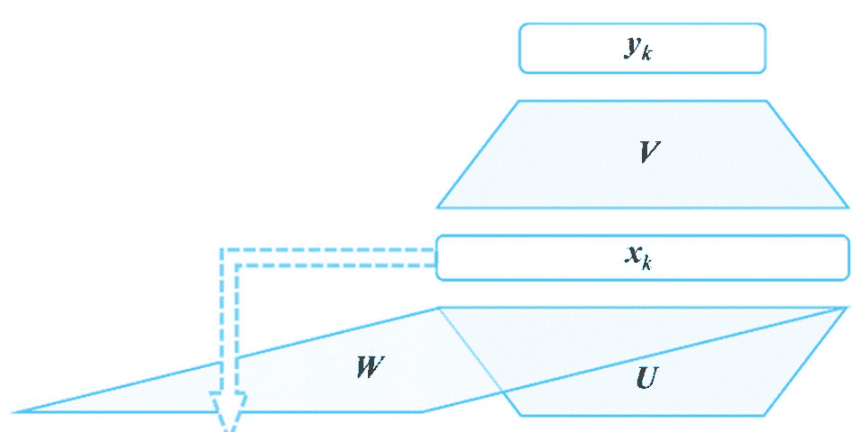
图2.1 经典递归神经网络可视为一种带记忆的前馈神经网络

图 2.1 中，首先将来自前一时间步的隐层状态 x_{k-1}，通过与连接权矩阵 W 相乘后作为当前时间步隐层 x_k 的输入，可写出该递归网络的非线性输入输出差分方程为

$$x_k = f(Wx_{k-1} + Uu_k) \quad (2.1a)$$
$$y_k = g(Vx_k) \quad (2.1b)$$
其中，u_k ∈ R^r，x_k ∈ R^n，y_k ∈ R^m 分别为 r 维输入向量、n 维隐层向量和 m 维输出向量，U、V 分别代表了从网络输入层到隐层、从隐层到输出层的连接权矩阵，且 f() 和 g() 分别表示隐层与输出层的激活函数。

对多分类问题，通常可取 g() = Softmax()，则式 2.1b 可写为

$$y_k = \text{Softmax}(Vx_k) \qquad (2.1c)$$
进而可确定该网络生成的输出序列 y_k 如何与自身的 y_{k-1} 等上下文进行自回归依赖。

进一步地，可对图 2.1 的经典递归神经网络沿时间轴展开，可视化结果如图 2.2 a 所示。此时递归神经网络在各时间步实际共享相同的连接权矩阵 W，U，V。图 2.2 b 给出了将隐层 x_k k=0,1,2,3 与 W，U，V 进行融合表达后的递归网络简化示意，位居中间的递归神经网络隐状态方框按时间轴实现了隐状态的流水线式贯通。

图 2.3 给出了经典递归神经网络示意。显然，该网络可接收序列数据作为输入输出。在面向训练样本集完成网络 3 个连接权矩阵 W，U，V 的监督学习之后，就可根据给定的输入序列，推断或预测相应的输出序列。

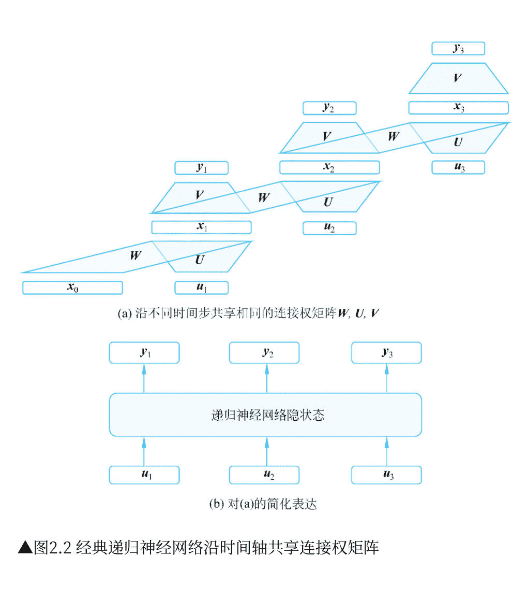
▲图2.2 经典递归神经网络沿时间轴共享连接权矩阵

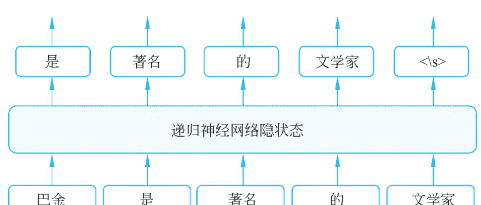
图2.3 经典递归神经网络接收序列输入并产生序列输出

事实上，递归神经网络可以完成各种多样化的序列表达学习与推断任务。以 NLP 为例，如图 2.4~图 2.7 所示，经典递归神经网络可适配多个不同任务，包括自回归神经语言建模、序列分类与预测、序列到序列的神经机器翻译，以及新序列生成、对给定输入序列进行句子补全等。

图 2.4 利用递归神经网络同时也实现了句子补全，即对已训练好的神经语言模型，可用来生成一个新的输出序列或补全一个给定的输入序列。

在图 2.4 中，可将这种基于自回归的目标序列生成扩展为完成神经机器翻译任务。这里自回归的含义是：将第 k-1 时间步生成的单词作为第 k 时间步的网络输入，即图 2.4 中的虚线所示，再由第 k 时间步的网络输出相应的单词，继续作为下一时间步的输入。

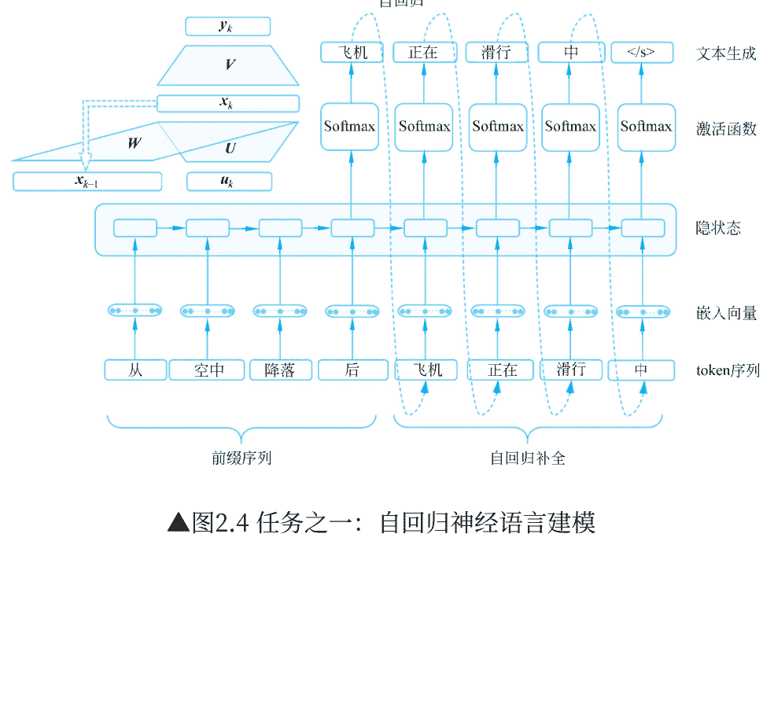
▲图2.4 任务之一：自回归神经语言建模

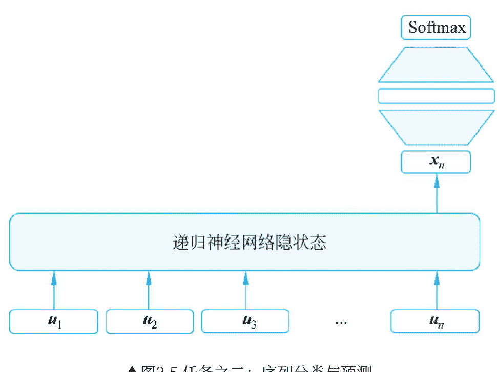
▲图2.5 任务之二：序列分类与预测

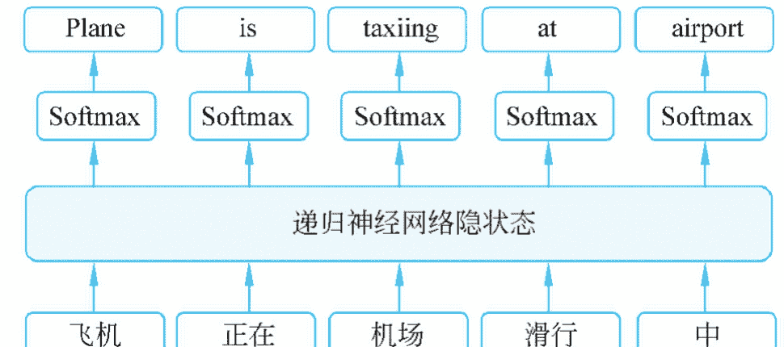
图2.6 任务之三：序列到序列的神经机器翻译

如图 2.7 所示，若训练样本为文本对，例如为中文-英语文本对，有

飞机正在滑行中 The plane is taxiing

可将上述源文本与目标文本进行聚合，即

飞机正在滑行中<\s>The plane is taxiing<\s>

然后再利用这些聚合样本进行训练，就可得到相应的递归神经网络语言模型，实际上它也同时完成了相应的机器翻译任务。

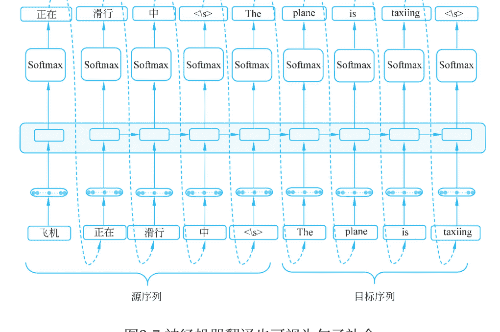
图2.7 神经机器翻译也可视为句子补全

### 2.2.2 Elman网络：经典递归神经网络
#### 1. Elman网络
类似于反馈神经网络，递归神经网络可划分为完全递归与部分递归神经网络。在完全递归神经网络中，全部的前馈与反馈连接权矩阵都可以进行学习修正。而在部分递归神经网络中，从隐层到上下文结构单元层的反馈记忆连接不存在任何可供学习修正的连接权。这里的上下文结构单元层记忆了网络隐层过去的状态，将连同网络当前输入乘以相应连接权共同作为隐层输入。这一性质使这种部分递归神经网络具有通过学习以任意精度逼近任意非线性动力学系统的能力。

下面将从模型的网络结构与学习算法两个方面进行详细说明。
#### 1) 网络结构
图 2.1 的递归神经网络具有最简单的网络结构，可采用动态误差反向传播算法进行完全监督学习，这实际就是 Elman 网络。图 2.8 给出了 Elman 网络的结构示意图。从图中可以看出，Elman 网络具有与前馈神经网络完全相同的输入层、隐层及输出层，区别仅在于它还具有一个独特的上下文结构单元层，且该层记忆了上一时间步的隐层状态，可看成一个一步时延算子。此时，该网络在第 k 时间步的输入不仅包括了目前的输入值 u_k，同时还包括了前一时间步的隐层状态 x_{k-1}。两者各自通过递归神经网络的共享连接权矩阵 U、W 共同作用于隐层输入，然后再通过共享连接权矩阵 V，继续作用于整个网络的输出层。显然，这里 3 个前馈连接权矩阵 W、U、V 均可进行监督修正，但隐层到上下文结构单元层的反馈记忆部分则不能进行学习修正，因此 Elman 网络仅属于部分递归神经网络。

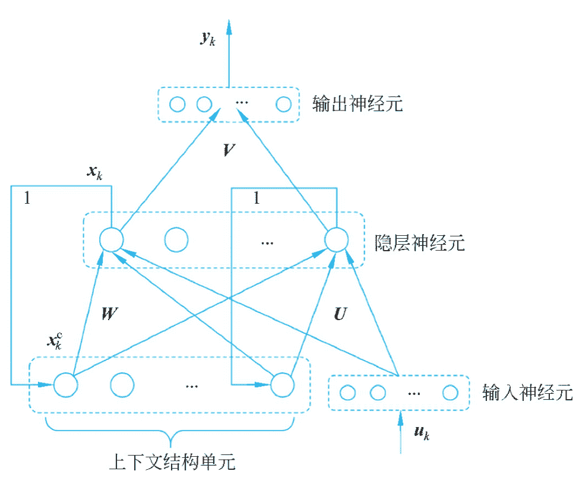
图2.8 Elman网络的结构示意图

具体而言，Elman网络在第 k 时间步的输入向量不仅包括目前的输入向量 u_k，而且还包括隐层在前一时间步的状态向量 x_{k-1}。此时该网络仅是一个前馈神经网络，可由上述双输入向量通过 3 个连接权矩阵 W、U、V 的前向计算产生网络输出。类似地，可利用沿时间轴的动态误差反向传播算法来进行 W、U、V 的学习修正。显然，在一次训练迭代过程中，第 k 时间步隐层的广义误差也将通过反馈记忆连接部分递归到上下文结构单元层，并保留到下一时间步 k+1 且作为该层的输入。注意初始训练时，隐层的状态值可取为其最大范围的一半。例如，当隐层神经元的激活函数取为 Sigmoid 函数时，此初始值可取为 0.5。若隐层神经元取为双曲正切函数时，初始值可取为 0。

下面对上述 Elman 网络的数学模型进行分析。

如图 2.8 所示，设网络的外部输入为 u_k ∈ R^r，输出为 y_k ∈ R^m，若记隐层的输出为 x_k ∈ R^n，上下文结构单元层的输出为 x_k^c ∈ R^n，则有如下的非线性状态空间表达式：

$$x_k = f(W x_k^c + U u_k) \quad (2.2a)$$
$$x_k^c = x_{k-1} \quad (2.2b)$$
$$y_k = g(V x_k) \quad (2.2c)$$
其中，W、U、V 分别表示从上下文结构单元层到隐层、从输入层到隐层及从隐层到输出层的连接权矩阵，且 f() 和 g() 分别表示隐层与输出层的激活函数所组成的非线性向量函数。容易看出，U、V 分别代表了输入矩阵与输出矩阵，而 W 则代表了系统矩阵。这说明隐层状态的反馈记忆及相应递归通路的建立，确实可带来网络对动力学特性的学习表达与推断。

# Elman 递归网络与 LSTM 的进阶脉络

特殊情形下，若中间神经元与输出神经元均采用式1.2a给出的比例型激励，且所有偏置设为零，则可写成线性状态刻画：

$$x_k = Wx_{k-1} + Uu_k \quad (2.3a)$$

$$y_k = Vx_k \quad (2.3b)$$

此时中间单元的数目即为状态维数，亦决定系统阶数。

#### 2) 参数更新

整体损失表达为：

$$E = \sum_{p=1}^{N} E_p \quad (2.4)$$

此处 Ep 为样本 p 的损失，定义为 1/2 (y_d(k)-y(k))^T (y_d(k)-y(k))。

V 的梯度式为

$$\frac{\partial E_p}{\partial v_{ij}} = -(y_{di}(k) - y_i(k)) \frac{\partial y_i(k)}{\partial v_{ij}} = -(y_{di}(k) - y_i(k)) g_i'(\bullet) x_j(k)$$

记 δ_i^o = (y_di(k)-y_i(k)) g_i'(·)，则

$$\frac{\partial E_p}{\partial v_{ij}} = -\delta_i^o x_j(k), \quad i = 1,2,\cdots,m \quad j = 1,2,\cdots,n$$

U 的梯度式为

$$\frac{\partial E_p}{\partial u_{jq}} = \frac{\partial E_p}{\partial x_j(k)} \frac{\partial x_j(k)}{\partial u_{jq}} = \sum_{i=1}^{m} (-\delta_i^o v_{ij}) f_j'(\bullet) u_q(k-1)$$

令 δ_j^h = Σ_{i=1}^m (δ_i^o v_{ij}) f_j'(·)，得到

$$\frac{\partial E_p}{\partial u_{jq}} = -\delta_j^h u_q(k-1), \quad j=1,2,\cdots,n \quad q=1,2,\cdots,r$$

W 的梯度式为

$$\frac{\partial E_p}{\partial w_{jl}} = -\sum_{i=1}^m (\delta_i^o v_{ij}) \frac{\partial x_j(k)}{\partial w_{jl}}, \quad j=1,2,\cdots,n \quad l=1,2,\cdots,n$$

注意 x_j(k) 本身依赖 w_{jl}，故

$$\frac{\partial x_j(k)}{\partial w_{jl}} = \frac{\partial}{\partial w_{jl}} \left( f_j \left( \sum_{i=1}^n w_{ji} x_{ci}(k) + \sum_{i=1}^r u_{ji} u_i(k-1) \right) \right)$$

$$= f_j'(\cdot) \left[ x_{cl}(k) + \sum_{i=1}^n w_{ji} \frac{\partial x_{ci}(k)}{\partial w_{jl}} \right]$$

$$= f_j'(\cdot) \left[ x_l(k-1) + \sum_{i=1}^n w_{ji} \frac{\partial x_i(k-1)}{\partial w_{jl}} \right] \quad (2.5)$$

上式给出 ∂x_j(k)/∂w_{jl} 的递推，与 Werbos 1988 年提出的时序回传思想一致。因为

$$\Delta w_{ij} = -\eta \frac{\partial E_p}{\partial w_{ij}}$$

汇总后 Elman 的更新规则可写成：

$$\Delta v_{ij} = \eta \delta_i^o x_j(k), \quad i=1,2,\cdots,m \quad j=1,2,\cdots,n \quad (2.6a)$$

$$\Delta u_{jq} = \eta \delta_j^h x_q(k-1), \quad j=1,2,\cdots,n \quad q=1,2,\cdots,r \quad (2.6b)$$

$$\Delta w_{jl} = \eta \sum_{i=1}^m (\delta_i^o v_{ij}) \frac{\partial x_j(k)}{\partial w_{jl}}, \quad j=1,2,\cdots,n \quad l=1,2,\cdots,n \quad (2.6c)$$

$$\frac{\partial x_j(k)}{\partial w_{jl}} = f'_j(\cdot) \left[ x_l(k-1) + \sum_{i=1}^n w_{ji} \frac{\partial x_i(k-1)}{\partial w_{jl}} \right] \quad (2.6d)$$

其中

$$\delta_i^o = (y_{di}(k) - y_i(k)) g'_i(\cdot)$$

$$\delta_j^h = \sum_{i=1}^m (\delta_i^o v_{ij}) f'_j(\cdot)$$

若忽略 x(k-1) 对 w 的依赖，由

$$\frac{\partial x_j(k)}{\partial w_{jl}} = f'_j(\cdot) x_{cl}(k) = f'_j(\cdot) x_l(k-1)$$

则上述规则退化为标准 BP，即

$$\Delta v_{ij} = \eta_1 \delta_i^o x_j(k), \quad i=1,2,\cdots,m \quad j=1,2,\cdots,n \quad (2.7a)$$

$$\Delta u_{jq} = \eta_2 \delta_j^h x_q(k-1), \quad j=1,2,\cdots,n \quad q=1,2,\cdots,r \quad (2.7b)$$

$$\Delta w_{jl} = \eta_3 \delta_j^h x_{cl}(k), \quad j=1,2,\cdots,n \quad l=1,2,\cdots,n \quad (2.7c)$$

Pham 等1990年实验表明，基础 Elman 在标准 BP 下只能辨识一级线性动态。原因在于标准 BP 仅含一次梯度，导致历史权值的学习不稳；当阶数或中间单元增多时，为保收敛步长需极小，最终逼近精度不可接受。

为此可采用前述动态 BP 建模；也可改造拓扑，直接用改良 Elman 配合标准 BP 完成建模。

#### 2. 改良 Elman 网络
#### 1) 拓扑
改良 Elman 的示意见图2.9。

在背景单元中加入增益为 α 的自环后，对较远或高阶时序相关性的表达与预测能力明显提升。此时有

$$x_k^c = \alpha x_{k-1}^c + x_{k-1} \quad (2.8)$$

式中 x_k^c 为第 k 步背景层的 n 维向量。

当 α=0 时，该拓扑退化为前述基础版。

改良版的非线性状态刻画为

$$x_k = f(W x_k^c + U u_k) \quad (2.9a)$$

$$x_k^c = \alpha x_{k-1}^c + x_{k-1} \quad (2.9b)$$

$$y_k = g(V x_k) \quad (2.9c)$$

因此更适合处理序列背景的远距关联。

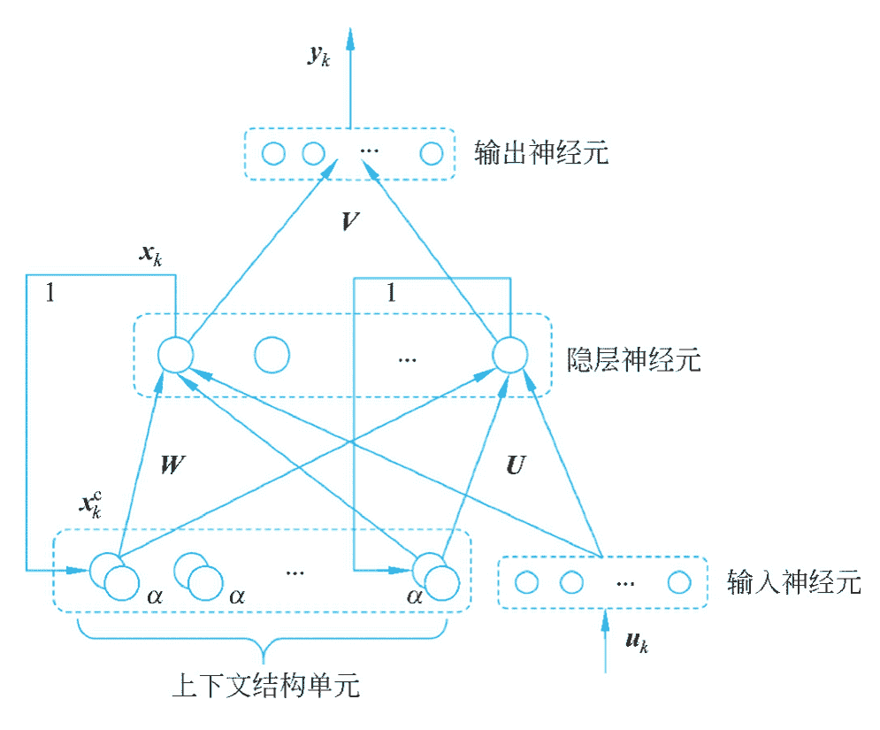

图2.9 改良 Elman 网络拓扑示意

#### 2) 参数更新
因背景单元带有自环，改良版可用标准 BP 建模高阶动态。推导思路与基础版相同，可得标准 BP 形式为

$$\Delta v_{ij} = \eta \delta_i^o x_j(k), \quad i=1,2,\cdots,m \quad j=1,2,\cdots,n \quad (2.10a)$$

$$\Delta u_{jq} = \eta \delta_j^h x_q(k-1), \quad j=1,2,\cdots,n \quad q=1,2,\cdots,r \quad (2.10b)$$

$$\Delta w_{jl} = \eta \sum_{i=1}^m (\delta_i^o v_{ij}) \frac{\partial x_j(k)}{\partial w_{jl}}, \quad j=1,2,\cdots,n \quad l=1,2,\cdots,n \quad (2.10c)$$

前述推导未计入 x(k) 与 w 的关联，故

$$\frac{\partial x_j(k)}{\partial w_{jl}} = f'_j(\bullet) \cdot x_{cl}(k)$$

代入式2.8，得

$$f'_j(\bullet) \cdot x_{cl}(k) = f'_j(\bullet) \cdot x_l(k-1) + \alpha f'_j(\bullet) \cdot x_{cl}(k-1)$$

进而有

$$\frac{\partial x_j(k)}{\partial w_{jl}} = f'_j(\bullet) \cdot x_l(k-1) + \alpha \frac{\partial x_j(k-1)}{\partial w_{jl}} \qquad (2.11)$$

式2.11 与式2.6d 非常接近。

这说明改良版仅用标准 BP 就能达到基础版用动态回传时的效果，即能有效刻画时序背景的远距关联。

## 2.2.3 长短期记忆网络
对递归网络的中间层而言，改良 Elman 仍难以建立更远的序列关联，关键在于误差沿时间轴回传时易出现梯度衰减或梯度放大。早期简单递归网络因此难以通过有监督训练构建序列的远距关联。1997年 Schmidhuber 等提出长短期记忆网络 LSTM，通过输入开关、遗弃开关和输出开关组成的开关机制，有效缓解了梯度剧变，解决了序列背景远距关联的有监督训练与预测问题。

### 1. 含开关机制的 LSTM
为便于理解，常将左图的递归连接沿时间轴展开，得到右图按时间步横向连接的直观形式。考虑纵向重复模块的连接关系，图示较繁琐，常作简洁表示，如图2.11。需强调，图2.11中每个重复模块 H 已包含隐藏状态 x 及其3个共享参数 W、U、V，可视为蕴含在3个相关箭头中。

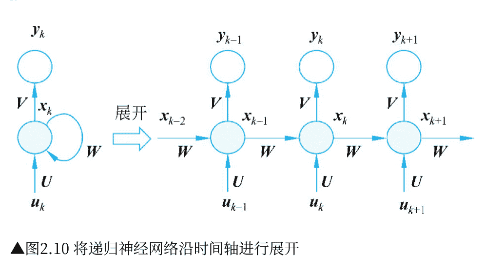

▲图2.10 将递归神经网络沿时间轴进行展开

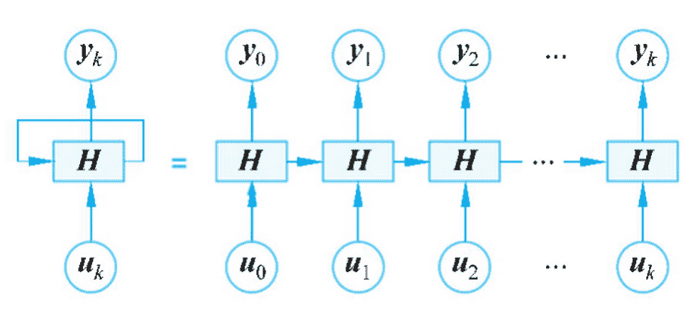

图2.11 将递归神经网络沿时间轴进行展开的简洁表示

在介绍开关机制前，先回顾 NLP 中 n-gram 语言建模的定义。语言建模本质上是对语言理解与生成的数学表征，可分为统计式与神经式。如图2.12所示，语言建模即在已知由 n 个 token 构成的先前信息时，估计该先前的联合概率。token 是承载语义的基本单元，在 NLP 中可为词、短语、句子或段落，在 CV 中可为视觉目标、实例、图像块或单帧图像等。


图2.12 语言建模示意

n-gram 语言建模定义为：给定 n-1 阶先前 {w1,w2,…,w_{n-1}}，利用统计学、传统机器学习或深度神经网络预测第 n 个 token 出现的条件概率 p(w_n|w1,…,w_{n-1})，进而计算联合概率，即

$$p(w_1, w_2, \cdots, w_n) = \prod_{i=1}^{n} p(w_i | w_{i-n+1}, \cdots, w_{i-1}) \qquad (2.12)$$

这意味着第 n 个 token 仅与前面 n-1 个相关，联合概率等于各条件概率的乘积。图2.13给出序列近程与远程关联的示意。例如图2.13(a)中输出 y_{k+1} 与输入 u_k、u_{k-1} 为近程关联，而图2.13(b)中输出 y_{k+1} 与输入 u1、u0 为远程关联。

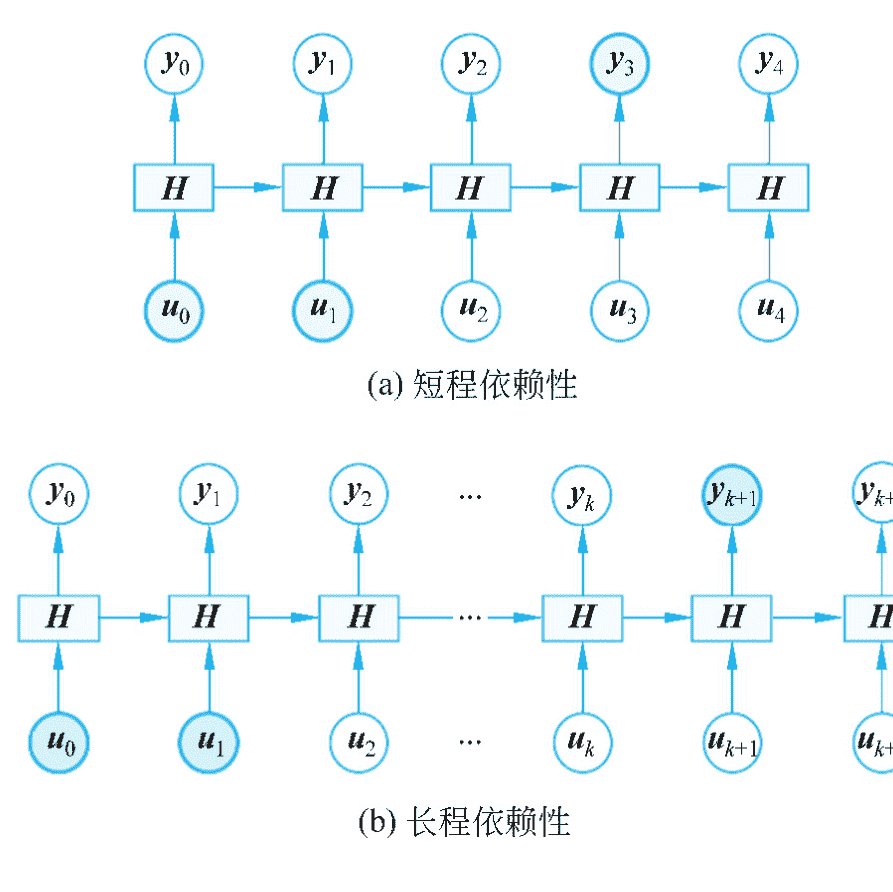

例如，“我走进厨房，看到桌上放着 ____？”体现近程关联；而“这部电影讲述了主人公的童年创伤，结尾处主人公最终选择 ____？”则需远程关联才能回答。

#### 1) 拓扑
为在沿时间轴的有监督训练中克服梯度衰减或放大，Schmidhuber 等设计了遗弃开关、输入开关和输出开关，提出 LSTM 网络，如图2.14所示。

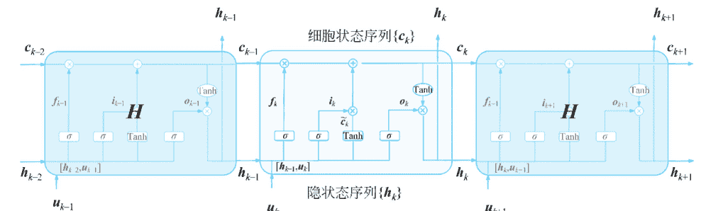

图2.14 具有门控机制的LSTM网络结构

在图2.14中，为增加开关，Elman 网络的单一隐藏状态 x_k 被拆分为 LSTM 的两个隐藏状态 h_k 和 c_k，形成细胞状态流 {c_k} 和隐藏状态流 {h_k}，如图2.15所示。细胞状态 c_k 实质表达 LSTM 的长期记忆，其流动由当前步的遗弃开关、输入开关和输出开关控制，即选择遗弃、补充新输入或决定当前输出。隐藏状态 h_k 同时也是 LSTM 的输出 y_k，基于当前输入 u_k、前一隐藏状态 h_{k-1} 及当前细胞状态 c_k 计算，可看作对当前步的信息编码或预测。

图中值域为 [0,1] 的 Sigmoid 函数 σ 配合乘法单元作为3个开关的控制，σ 为1时全开，为0时全关；双曲正切激活函数 Tanh 则作为输入输出变换模块，提供 [-1,1] 的输出范围。

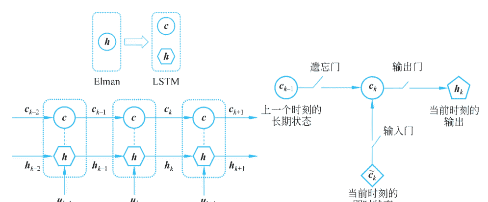

图2.15 LSTM 两个隐藏状态序列 {c_k} 与 {h_k}

下面分别说明3个开关。

（1）遗弃开关。
如图2.16所示，遗弃开关的公式为

$$f_k = \sigma(W_f \cdot [h_{k-1}, u_k] + b_f)$$

其中 W_f 和 b_f 分别为遗弃开关的输入参数矩阵和偏置向量，f_k 为开关输出。

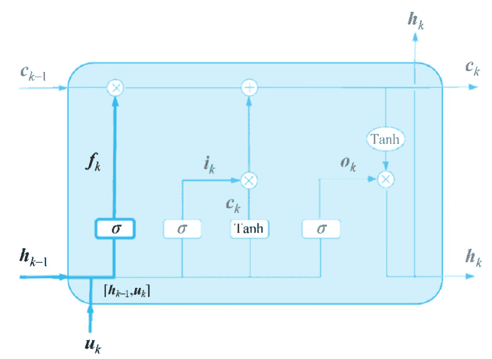

图2.16 LSTM 的遗弃开关

(2) 输入开关与输入变换模块。
如图2.17所示，输入开关与输入变换模块的公式为

$$i_k = \sigma(\mathbf{W}_i \cdot [\mathbf{h}_{k-1}, \mathbf{u}_k] + \mathbf{b}_i) \qquad (2.14a)$$

$$\tilde{c}_k = \text{Tanh}(\mathbf{W}_c \cdot [\mathbf{h}_{k-1}, \mathbf{u}_k] + \mathbf{b}_c) \qquad (2.14b)$$

式中 W_i 和 b_i 分别为输入开关的输入参数矩阵和偏置向量，i_k 为输入开关的输出，W_c 和 b_c 分别为输入变换模块的输入参数矩阵和偏置向量，~c_k 为其输出。

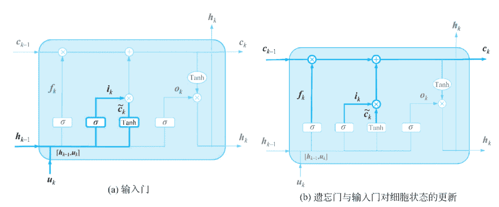

图2.17 LSTM 的输入门与细胞状态的更新

如图2.17(b)所示，利用遗弃开关与输入开关，按以下式完成细胞状态刷新，即

$$c_k = f_k * c_{k-1} + i_k * \tilde{c}_k$$

在当前步中，先由遗忘闸 $f_k$ 对上一步的细胞记忆 $c_{k-1}$ 做按位缩放以完成遗忘，随后输入闸 $i_k$ 对候选记忆 $\tilde{c}_k$ 进行调制，相加后叠加到已筛选的 $f_k*c_{k-1}$ 上得到本步记忆 $c_k$，星号代表按元素点乘。

(3) 输出门与输出变换模块。

整体结构在图2.18 中呈现。
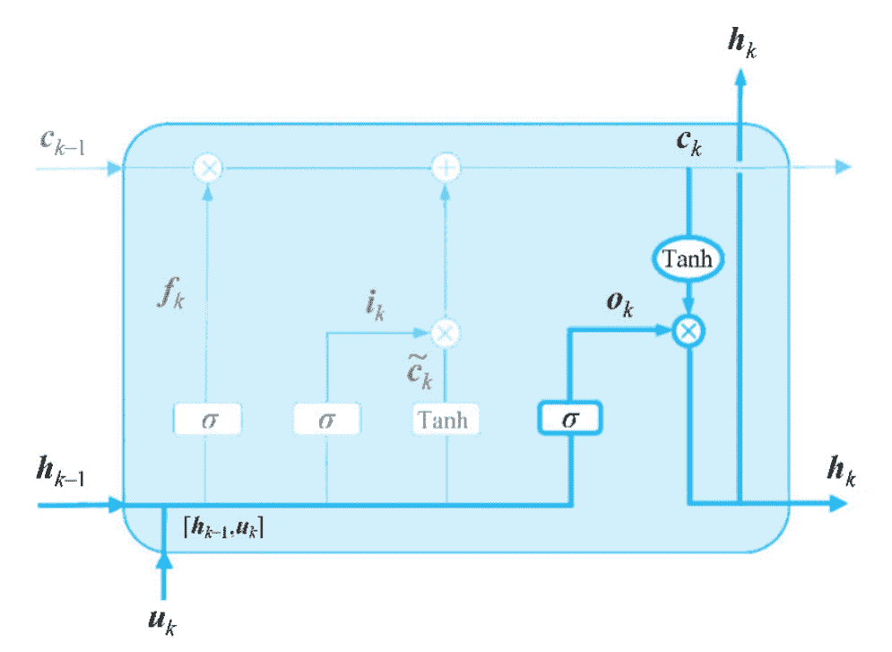
图2.18 LSTM的输出门与输出变换模块

输出闸的表达式为
$$\boldsymbol{o}_k = \sigma(\boldsymbol{W}_{\mathrm{o}} \cdot [\boldsymbol{h}_{k-1}, \boldsymbol{u}_k] + \boldsymbol{b}_{\mathrm{o}}) \qquad (2.16)$$
其中 $\boldsymbol{W}_{\mathrm{o}}$ 与 $\boldsymbol{b}_{\mathrm{o}}$ 分别对应输出闸的连接权重与偏置，$\boldsymbol{o}_k$ 为闸的输出信号。

据此可推得相邻两步隐藏向量之间的关系:
$$\boldsymbol{h}_k = \boldsymbol{o}_k * \mathrm{Tanh}(\boldsymbol{c}_k) \qquad (2.17)$$
可以看出，$h_k$ 本质上是经过 Tanh 压缩的 $c_k$ 再被输出闸门控的结果。该 $h_k$ 可接续到输出层作为本步输出 $y_k$，也可直接作为下一时刻的隐藏输入。

总的来说，一次 LSTM 前向可归纳为：
$$f_k = \sigma(W_f \cdot [h_{k-1}, u_k] + b_f)$$
$$i_k = \sigma(W_i \cdot [h_{k-1}, u_k] + b_i)$$
$$\tilde{c}_k = \text{Tanh}(W_c \cdot [h_{k-1}, u_k] + b_c)$$
$$c_k = f_k * c_{k-1} + i_k * \tilde{c}_k$$
$$o_k = \sigma(W_o \cdot [h_{k-1}, u_k] + b_o)$$
$$h_k = o_k * \text{Tanh}(c_k)$$

#### 2) 学习算法

接下来给出 LSTM 误差反向传播的详细推导。训练范式与 Elman 网络相近，常用截断时间反向传播 BPTT。

模块 $H$ 的内部框图见图2.19。
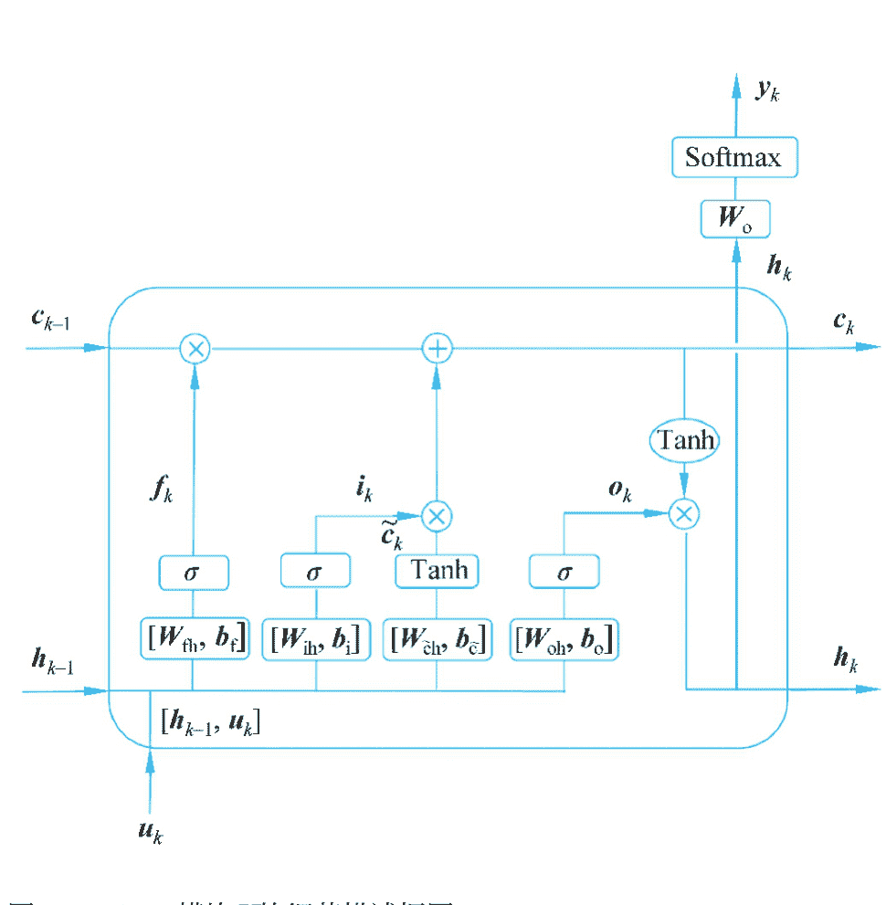
图2.19 LSTM模块$H$的细节描述框图

先把损失 $E$ 对第 $k-1$ 步隐藏向量 $\boldsymbol{h}_{k-1}$ 的偏导写成广义误差形式，即
$$\frac{\partial E}{\partial \boldsymbol{h}_{k-1}} = \boldsymbol{\delta}_{\mathrm{o}, k}^{\mathrm{T}} \boldsymbol{W}_{\mathrm{oh}} + \boldsymbol{\delta}_{\mathrm{f}, k}^{\mathrm{T}} \boldsymbol{W}_{\mathrm{fh}} + \boldsymbol{\delta}_{\mathrm{i}, k}^{\mathrm{T}} \boldsymbol{W}_{\mathrm{ih}} + \boldsymbol{\delta}_{\mathrm{c}, k}^{\mathrm{T}} \boldsymbol{W}_{\mathrm{ch}} \triangleq \boldsymbol{\delta}_{k-1}^{\mathrm{T}}$$
式中
$$\delta_{o,k}^{\mathrm{T}}=\delta_{k}^{\mathrm{T}} \operatorname{Tanh}\left(c_{k}\right) o_{k}\left(1-o_{k}\right)$$
$$\delta_{f,k}^{\mathrm{T}}=\delta_{k}^{\mathrm{T}} o_{k}\left(1-\operatorname{Tanh}\left(c_{k}\right)^{2}\right) c_{k-1} f_{k}\left(1-f_{k}\right)$$
$$\delta_{i,k}^{\mathrm{T}}=\delta_{k}^{\mathrm{T}} o_{k}\left(1-\operatorname{Tanh}\left(c_{k}\right)^{2}\right) \tilde{c}_{k} i_{k}\left(1-i_{k}\right)$$
$$\delta_{c,k}^{\mathrm{T}}=\delta_{k}^{\mathrm{T}} o_{k}\left(1-\operatorname{Tanh}\left(c_{k}\right)^{2}\right) i_{k}\left(1-\tilde{c}_{k}^{2}\right)$$
且
$$\delta_{p-1}^{\mathrm{T}}=\prod_{j=p}^{k}\left(\delta_{o, j}^{\mathrm{T}} \boldsymbol{W}_{\mathrm{oh}}+\delta_{f, j}^{\mathrm{T}} \boldsymbol{W}_{\mathrm{fh}}+\delta_{i, j}^{\mathrm{T}} \boldsymbol{W}_{\mathrm{ih}}+\delta_{c, j}^{\mathrm{T}} \boldsymbol{W}_{\mathrm{ch}}\right)$$
由于
$$\frac{\partial E}{\partial \operatorname{net}_{k}^{l-1}}=\frac{\partial E}{\partial \operatorname{net}_{\mathrm{f}, k}^{l}} \frac{\partial \boldsymbol{x}_{k}^{l}}{\partial \operatorname{net}_{k}^{l-1}}+\frac{\partial E}{\partial \operatorname{net}_{\mathrm{i}, k}^{l}} \frac{\partial \boldsymbol{x}_{k}^{l}}{\partial \operatorname{net}_{k}^{l-1}}+\frac{\partial E}{\partial \operatorname{net}_{\mathrm{c}, k}^{l}} \frac{\partial \boldsymbol{x}_{k}^{l}}{\partial \operatorname{net}_{k}^{l-1}}+\frac{\partial E}{\partial \operatorname{net}_{\mathrm{o}, k}^{l}} \frac{\partial \boldsymbol{x}_{k}^{l}}{\partial \operatorname{net}_{k}^{l-1}}$$
$$=\delta_{\mathrm{f}, k}^{\mathrm{T}} \boldsymbol{W}_{\mathrm{fx}} f^{\prime}\left(\operatorname{net}_{k}^{l-1}\right)+\delta_{\mathrm{i}, k}^{\mathrm{T}} \boldsymbol{W}_{\mathrm{ix}} f^{\prime}\left(\operatorname{net}_{k}^{l-1}\right)+\delta_{\mathrm{c}, k}^{\mathrm{T}} \boldsymbol{W}_{\mathrm{cx}} f^{\prime}\left(\operatorname{net}_{k}^{l-1}\right)+\delta_{\mathrm{o}, k}^{\mathrm{T}} \boldsymbol{W}_{\mathrm{ox}} f^{\prime}\left(\operatorname{net}_{k}^{l-1}\right)$$
$$=\left(\delta_{\mathrm{f}, k}^{\mathrm{T}} \boldsymbol{W}_{\mathrm{fx}}+\delta_{\mathrm{i}, k}^{\mathrm{T}} \boldsymbol{W}_{\mathrm{ix}}+\delta_{\mathrm{c}, k}^{\mathrm{T}} \boldsymbol{W}_{\mathrm{cx}}\right) f^{\prime}\left(\operatorname{net}_{k}^{l-1}\right)$$
于是借助梯度下降可得更新规则
$$\Delta \boldsymbol{W}_{\mathrm{oh}}=-\eta_{\mathrm{oh}} \frac{\partial E}{\partial \boldsymbol{W}_{\mathrm{oh}}}, \Delta \boldsymbol{W}_{\mathrm{fh}}=-\eta_{\mathrm{fh}} \frac{\partial E}{\partial \boldsymbol{W}_{\mathrm{fh}}}, \Delta \boldsymbol{W}_{\mathrm{ih}}=-\eta_{\mathrm{ih}} \frac{\partial E}{\partial \boldsymbol{W}_{\mathrm{ih}}}, \Delta \boldsymbol{W}_{\mathrm{ch}}=-\eta_{\mathrm{ch}} \frac{\partial E}{\partial \boldsymbol{W}_{\mathrm{ch}}}$$
$$\Delta \boldsymbol{W}_{\mathrm{ox}}=-\eta_{\mathrm{ox}} \frac{\partial E}{\partial \boldsymbol{W}_{\mathrm{ox}}}, \Delta \boldsymbol{W}_{\mathrm{fx}}=-\eta_{\mathrm{fx}} \frac{\partial E}{\partial \boldsymbol{W}_{\mathrm{fx}}}, \Delta \boldsymbol{W}_{\mathrm{ix}}=-\eta_{\mathrm{ix}} \frac{\partial E}{\partial \boldsymbol{W}_{\mathrm{ix}}}, \Delta \boldsymbol{W}_{\mathrm{cx}}=-\eta_{\mathrm{cx}} \frac{\partial E}{\partial \boldsymbol{W}_{\mathrm{cx}}} \qquad (2.19)$$
$$\Delta b_{\mathrm{o}}=-\eta_{\mathrm{ob}} \frac{\partial E}{\partial b_{\mathrm{o}}}, \Delta b_{\mathrm{f}}=-\eta_{\mathrm{fb}} \frac{\partial E}{\partial b_{\mathrm{f}}}, \Delta b_{\mathrm{i}}=-\eta_{\mathrm{ib}} \frac{\partial E}{\partial b_{\mathrm{i}}}, \Delta b_{\mathrm{c}}=-\eta_{\mathrm{cb}} \frac{\partial E}{\partial b_{\mathrm{c}}}$$
其中，
$$\frac{\partial E}{\partial \boldsymbol{W}_{\mathrm{oh}}}=\sum_{j=1}^{k} \delta_{o, j} \boldsymbol{h}_{j-1}^{\mathrm{T}}, \quad \frac{\partial E}{\partial \boldsymbol{W}_{\mathrm{fh}}}=\sum_{j=1}^{k} \delta_{f, j} \boldsymbol{h}_{j-1}^{\mathrm{T}}$$
$$\frac{\partial E}{\partial \boldsymbol{W}_{\mathrm{ih}}}=\sum_{j=1}^{k} \delta_{i, j} \boldsymbol{h}_{j-1}^{\mathrm{T}}, \quad \frac{\partial E}{\partial \boldsymbol{W}_{\mathrm{ch}}}=\sum_{j=1}^{k} \delta_{c, j} \boldsymbol{h}_{j-1}^{\mathrm{T}}$$
$$\frac{\partial E}{\partial \boldsymbol{W}_{\mathrm{ox}}}=\frac{\partial E}{\partial \operatorname{net}_{\mathrm{o}, k}} \frac{\partial \operatorname{net}_{\mathrm{o}, k}}{\partial \boldsymbol{W}_{\mathrm{ox}}}=\delta_{o, k} \boldsymbol{x}_{k}^{\mathrm{T}}, \quad \frac{\partial E}{\partial \boldsymbol{W}_{\mathrm{fx}}}=\frac{\partial E}{\partial \operatorname{net}_{\mathrm{f}, k}} \frac{\partial \operatorname{net}_{\mathrm{f}, k}}{\partial \boldsymbol{W}_{\mathrm{fx}}}=\delta_{f, k} \boldsymbol{x}_{k}^{\mathrm{T}}$$
$$\frac{\partial E}{\partial \boldsymbol{W}_{\mathrm{ix}}}=\frac{\partial E}{\partial \operatorname{net}_{\mathrm{i}, k}} \frac{\partial \operatorname{net}_{\mathrm{i}, k}}{\partial \boldsymbol{W}_{\mathrm{ix}}}=\delta_{i, k} \boldsymbol{x}_{k}^{\mathrm{T}}, \quad \frac{\partial E}{\partial \boldsymbol{W}_{\mathrm{cx}}}=\frac{\partial E}{\partial \operatorname{net}_{\mathrm{c}, k}} \frac{\partial \operatorname{net}_{\mathrm{c}, k}}{\partial \boldsymbol{W}_{\mathrm{cx}}}=\delta_{c, k} \boldsymbol{x}_{k}^{\mathrm{T}}$$
$$\frac{\partial E}{\partial b_{\mathrm{o}}}=\sum_{j=1}^{k} \delta_{o, j}, \quad \frac{\partial E}{\partial b_{\mathrm{f}}}=\sum_{j=1}^{k} \delta_{f, j}$$
$$\frac{\partial E}{\partial b_{\mathrm{i}}}=\sum_{j=1}^{k} \delta_{i, j}, \quad \frac{\partial E}{\partial b_{\mathrm{c}}}=\sum_{j=1}^{k} \delta_{c, j}$$

接下来解释为何 LSTM 能有效避免梯度消失与爆炸。如图2.20 所示，经典 Elman 递归网仅有单一横向隐藏流 $h$，此时满足 $h=f(h)$，$f$ 指隐层激活，如 Tanh 或 Sigmoid。

相对而言，根据式 2.15，LSTM 有
$$c_k = f_k * c_{k-1} + i_k * \tilde{c}_k$$
其中 $f$ 与 $i$ 分别是遗忘闸和输入闸在 [0,1] 区间的门控值，$\tilde{c}_k$ 为输入变换的输出。对已完成 $[h,u]$ 纵向连接权修正的模块 $A$，若 $f$、$i$、$\tilde{c}_k$ 固定，则当前细胞记忆 $c$ 与前一步记忆 $c$ 呈线性关系。于是损失关于表征长期记忆的细胞记忆的横向反向传播几乎无衰减，能传递很远。LSTM 通过纵向与横向交替修正连接权，避免了隐藏链深处的梯度消失与爆炸，从而实现预期长程依赖。

## 2. LSTM的若干变形

### 1）双向长短期记忆网络

LSTM 的监督学习对序列方向敏感。若同时构建正向与反向两套网络，分别自左向右和自右向左遍历输入序列，再合并两侧输出，可明显提升学习效率，如图2.21 所示。自 2005 年起，由 Graves 与 Schmidhuber 提出的双向长短期记忆 BiLSTM 已被广泛采用。

### 2) 增加窥视孔连接

从窥视孔到注意力：递归网络的关键跃迁

图2.22展示了Gers与Schmidhuber在2000年提出的带窥视孔连接的LSTM改进版。该变体对三扇门的输入聚合做了调整：上一时刻的细胞状态c被引入输入门与遗忘门的聚合中，当前时刻的细胞状态c参与输出门的聚合，其余部分保持不变。实验表明，这一改动通常能提升模型对序列微弱特征的辨别力。

▲图2.21 双向长短期记忆网络

图2.22 增加窥视孔连接层

计算式写成

$$f_k = \sigma(\mathbf{W}_f \cdot [\mathbf{c}_{k-1}, \mathbf{h}_{k-1}, \mathbf{u}_k] + \mathbf{b}_f)$$

$$i_k = \sigma(\mathbf{W}_i \cdot [\mathbf{c}_{k-1}, \mathbf{h}_{k-1}, \mathbf{u}_k] + \mathbf{b}_i)$$

$$o_k = \sigma(\mathbf{W}_o \cdot [\mathbf{c}_k, \mathbf{h}_{k-1}, \mathbf{u}_k] + \mathbf{b}_o)$$

### 3) 采用耦合遗忘门和输入门
图2.23的方案取消了原输入门，把遗忘门输出f的反向1-f重新利用，从而把原本的三门结构压缩为双门。

细胞状态更新式为

$$c_k = f_k * c_{k-1} + (1 - f_k) * \tilde{c}_k \quad (2.21)$$

### 4) 门控递归单元
图2.24所示的GRU由Cho等2014年提出，主要特征是：

- ①把遗忘门与输入门合并，三门减为双门；
- ②输出变换模块被大幅重塑；
- ③用隐状态h的更新替代细胞状态c的更新。

▲图2.23 采用耦合遗忘门和输入门

图2.24 门控递归单元

前向式给出为

$$r_k = \sigma(W_r \cdot [h_{k-1}, u_k])$$

$$z_k = \sigma(W_z \cdot [h_{k-1}, u_k])$$

$$\tilde{h}_k = \text{Tanh}(W \cdot [r_k * h_{k-1}, u_k])$$

$$h_k = (1 - z_k) * h_{k-1} + z_k * \tilde{h}_k \quad (2.22)$$

## 3. LSTM在文本分类任务中的应用
图2.25显示AG's News新闻语料共496835篇已标注文章，按标题与描述划分为4类，每类训练3万篇，测试1900篇。

面对长文本，实验采用3层深度LSTM，每层隐单元23个，实现基于Caffe-LSTM开源框架，见图2.26。

▲图2.25 AG's News网络新闻类语料库中的训练样本举例

图2.26 Caffe-LSTM编程

图2.27呈现模型在1万次迭代后的损失曲线以及AG's News分类的测试准确率。

LSTM已衍生众多变体，在文本分类与时序预测等场景表现突出。将传统LSTM与深度卷积网结合后，卷积化的LSTM在不少文本分类任务上超越传统n-gram语言模型。

另把传统LSTM的输入、隐、输出全连接改为卷积共享权并加深卷积层，对图像、视频等模态尤为重要。相关研究还涉及注意力、记忆增强、邻域图表示，以及与无监督生成式框架、强化学习的结合。代表工作包括记忆神经网络MNN Weston等2014、堆叠增强递归网络Joulin等2014、神经图灵机NTM Graves等2014、堆叠的What-Where自编码器Zhao等2016。也有研究把LSTM与隐马尔可夫模型HMM等传统方法融合，如HMM-LSTM Liu等2021等。

## 2.2.4 递归神经网络的编码器-解码器框架
2006年Hinton等在Science发表神经网络降维方法并提出深度置信网络快速学习算法；同年LeCun等提出用能量模型学习稀疏表达；2007年Bengio等提出深度网络贪婪逐层训练。这些被视作深度学习的开端。在AlexNet之前，深度学习主要指深度生成式网络，包括深度置信网络与深度自编码器。

经典编码器-解码器中，编码器与解码器均由多层递归网络构成。编码器隐序列负责输入序列深度特征表达，解码器隐序列负责输出序列自回归生成，两者经上下文向量连接。下面结合图2.28~图2.35说明，图源改编自Speech and Language Processing Jurafsky与Martin 2023。

### 1. LSTM的编码器-解码器框架
对图2.28所示的LSTM编码器-解码器框架Jurafsky与Martin 2023，做如下假设：

- ①编码器与解码器均由相同结构单元堆叠，每个单元对应一层；
- ②h是编码器输入序列u,u,…,u嵌入向量对应的最后一个隐状态，被设计为编码器向解码器传递的唯一桥梁；
- ③该h作为解码器初始隐状态，使解码器能自回归生成输出。

图2.29引入上下文向量c，可更一般化地实现编码器到解码器的特征传递。

- ①编码器：对输入序列u,u,…,u,产生隐状态上下文表达h1^e,h2^e,…hn^e;
- ②上下文向量c：是h1^e,h2^e,…hn^e的函数，本质上把整段输入特征压缩后送入解码器，即把原来仅用最后一个隐状态驱动解码器的策略，提升为由多个编码器隐状态函数c整体驱动，上标e表示编码器；
- ③解码器：以c为输入生成任意长度隐状态序列h1^d,h2^d,…hm^d，并据此自回归生成输出序列y,y,…,y，上标d表示解码器。

▲图2.28 LSTM的编码器-解码器框架

图2.29 上下文向量作为编码器与解码器连接的唯一通道

### 2. 编码器：典型的结构设计
图2.30为常用编码器设计，采用多层完全相同的双向长短期记忆BiLSTM网络堆叠。对输入序列u,u,…,u,每层每步隐状态为左右BiLSTM隐状态之和。编码器核心作用是完成输入序列深度上下文特征表达。9400万参数嵌入向量语言模型ELMo Peters等2018采用了此类结构。

图2.30 编码器：BiLSTM的堆叠

### 3. 解码器：增强型的结构设计
$$c = h_n^e = h_0^d$$

解码器同样由相同网络单元构成。图2.31典型解码器中，编码器最后隐状态hn^e同时作为解码器初始隐状态h0^d，即上下文向量存在。

图2.31 经典解码器：输出序列生成

此时解码器生成输出序列的前向式为

$$h_k^d = f(\hat{y}_{k-1}, h_{k-1}^d) \quad (2.23a)$$

$$z_k = Vh_k^d \quad (2.23b)$$

$$y_k = \text{Softmax}(z_k) \quad (2.23c)$$

其中，为解码器自回归项，即第k-1步预测输出并作为第k步输入；V为解码器递归神经网络共享输出连接权矩阵。

$$c = h_n^e = h_0^d, h_k^d (k = 0, 1, 2, \cdots, m)$$

图2.32给出增强型解码器设计。此时仍成立，但上下文向量c与每一步解码器隐状态相连驱动，即编码器最后隐状态hn或上下文向量c作用于解码器每一解码步。

相应解码器生成输出序列的前向式为

$$h_k^d = f(\hat{y}_{k-1}, h_{k-1}^d, c) \quad (2.24a)$$

$$z_k = Vh_k^d \quad (2.24b)$$

$$y_k = \text{Softmax}(z_k) \quad (2.24c)$$

式中，c为连接编码器与解码器的上下文向量。

## 2.3 递归神经网络的注意力与点积相似性
相较经典编码器-解码器，本节介绍更灵活的上下文向量设计，通过动态上下文向量及其点积相似性实现带注意力的LSTM，以更好地完成输入序列特征表达与输出自回归生成。

### 2.3.1 长短期记忆网络的注意力
前文已提及把上下文向量c定义为编码器隐状态h1^e,h2^e,…hn^e的函数，实质是将整段输入特征学习并传递给解码器。下面从编码器与解码器双视角设计更灵活的c，一方面更多样地组合编码器hj^e，另一方面让c对每个解码器隐状态hk^d的影响各不相同。

具体而言，如图2.33所示，可用动态上下文向量ck替代静态c，即

$$c_k = \sum_{j=1}^{n} \alpha_{kj} h_j^e \quad (2.25a)$$

其中加权平均系数α可通过相似性计算得到，且k=1,2,…,m。

图2.33 注意力机制：动态上下文向量的设计

相应地，解码器每步解码由动态上下文向量ck驱动。此时有

$$h_k^d = f(\hat{y}_{k-1}, h_{k-1}^d, c_k) \quad (2.25b)$$

换言之，hk^d经由ck利用编码器隐状态hj^e驱动，且ck中的加权平均系数a可通过相似性计算获得。这是一种更通用、更灵活的编码器-解码器连接方式，相当于在两端隐状态间建立注意力机制，通过构建带注意力的LSTM实现更优性能。

### 2.3.2 点积相似性
从式2.25a可见，利用加权平均系数a可实现动态上下文向量c的计算，a反映了编码器输入各token及其隐状态hj^e对c的贡献，体现解码器隐状态与编码器各隐状态hj^e之间的相似度。

#### 1. 评分向量的动态计算
为了求得c，需动态评估解码器隐状态与编码器各隐状态hj^e的相似度并给出评分向量。对图2.34所示的输出序列生成问题，需要设计网络学习解码器隐状态与编码器各隐状态的相似度，提供来自最相似编码器隐状态的驱动。

利用向量点积，相似性评分可写为

$$\alpha_{kj} = \text{score}(h_{k-1}^{d}, h_{j}^{e}) = h_{k-1}^{d} \cdot h_{j}^{e} \quad (2.26)$$

图2.34 点积相似性作为评分向量

#### 2. 具有点积相似性的自注意力机制
通过归一化评分构建加权平均。对∀j=1,2,⋯,n，有

$$\alpha_{kj} = \text{Softmax}(\text{score}(\boldsymbol{h}_{k-1}^{\mathrm{d}}, \boldsymbol{h}_{j}^{\mathrm{e}})) = \frac{\mathrm{e}^{\text{score}(\boldsymbol{h}_{k-1}^{\mathrm{d}}, \boldsymbol{h}_{j}^{\mathrm{e}})}}{\sum_{i} \mathrm{e}^{\text{score}(\boldsymbol{h}_{k-1}^{\mathrm{d}}, \boldsymbol{h}_{i}^{\mathrm{e}})}} \quad (2.27)$$

如图2.35所示，根据式2.25a，利用上述权值α对编码器所有隐状态hj^e加权平均，可计算出维数固定的上下文向量c，进而用式2.25b驱动解码器当前步隐状态。

图2.35 具有点积相似性的自注意力机制

总之，解码器隐状态先与编码器输入序列所有隐状态做点积相似性评分，得到评分后用Softmax获得归一化加权值α，从而实现点积相似性自注意力。

相应计算式总结如下：

$$h_k^d = f(\hat{y}_{k-1}, h_{k-1}^d, c_k) \quad (2.28a)$$

$$c_k = \sum_{j=1}^n \alpha_{kj} h_j^e \quad (2.28b)$$

$$\alpha_{kj} = \text{Softmax}(score(h_{k-1}^d, h_j^e)) \quad (2.28c)$$

这里j=1,2,…,n,k=1,2,…,m。

尽管带注意力的递归语言模型已取得不少成果，但递归本身的顺序性与非并行化不利于处理长序列，严重制约大型语言模型向大数据扩展。

## 2.4 Transformer模型
自2012年起，深度卷积神经网络因能从大数据自动提取分层特征，结合LSTM等递归网络，逐渐成为NLP、计算机视觉与语音处理的主流。2017年6月12日Google机器翻译团队Vaswani等提出Transformer，完全摒弃递归与卷积，以注意力机制为核心，在多项NLP与CV任务上取得最佳结果，已成为大型语言模型的核心支柱。典型代表是OpenAI于2020年5月发布的GPT-3 Brown等2020，完全基于Transformer构建，曾获NeurIPS-2020最佳论文。

带注意力学习机制的Transformer将预训练的深度卷积网络等作主干，再加上位置编码向量，可获得统一token嵌入表达。对文本、代码、信号、图像、视频、三维点云与语音等多模态数据具有通用框架与结构，能获得全局上下文依赖，且随规模扩大性能通常单调递增，多头结构与逐位置前馈网络也利于并行。基于Transformer高维潜空间的特征嵌入、对齐、连接与聚合便于自监督学习，也体现了NLP、CV与语音处理多模态融合趋势。图2.36给出Transformer构建的端到端视觉目标检测可视化效果。

### 2.4.1 传统编码器-解码器框架下的Transformer网络结构
如图2.37所示，经典Transformer由输入、编码器、解码器、输出四部分组成，为标准编码器-解码器框架。编码器、解码器分别由N个编码器块、N个解码器块堆叠而成，块总数即网络深度。

#### 1) 输入部分
- ①输入输出嵌入向量层；
- ②位置编码与相加层。


#### 2）编码器
由N个编码器块组成，每个块包含：

- ①两个残差直连结构及相应归一化层；
- ②多头自注意力MHA子层；
- ③逐位置前馈神经网络子层。

#### 3）解码器
由N个解码器块组成，每个块包含：

- ①3个残差直连结构及相应归一化层；
- ②掩码多头自注意力子层；
- ③多头编码器-解码器交叉注意力子层；
- ④逐位置前馈神经网络子层。

#### 4）输出部分
- ①线性前馈神经网络层；
- ②Softmax输出层。

在上述结构中，编码器块与解码器块均含掩码多头自注意力子层与逐位置前馈神经网络子层。区别在于解码器块多了一个多头编码器-解码器交叉注意力子层，自注意力头、交叉注意力头与逐位置前馈网络均带残差直连与归一化标准结构。必须强调，残差直连与归一化层虽继承自ResNet等，却是核心创新，真正使Transformer区别于递归网络的是多头自注意力与位置编码，如图2.38所示。


Transformer 编解码器内部机制速览

先以编码器模块为例。

图2.38 表明，堆叠的编码器模块在结构形态上高度一致，仅在训练后各模块的参数值各不相同。一般而言，一个编码器模块内部由多头自注意子层和逐位置前馈子层构成，亦可理解为这两个子层在残差连接与层归一化 LN 的配合下串联而成。图2.39 展示了单个编码器内部的数据流向，多头自注意的输出直接作为逐位置前馈的输入。需要强调的是，无论序列哪个位置的特征向量，逐位置前馈都采用同一组权重并独立并行运算；而多头自注意在处理句子中某个特定词时，会整体关注该句其他词的信息。


对编码器而言，每个位置的特征向量沿各自路径前向传递。多头自注意力内部，不同位置的路径存在相互影响；这种跨位置依赖在逐位置前馈中不存在，可视为前馈子层中各条路径完全并行流动。以“人形”“机器人”为例，如图2.40 所示，多头自注意子层呈现明显的路径耦合，而逐位置前馈子层则无任何耦合。结合图2.41 的具体计算过程，差异更易辨识。


总体而言，自注意力机制让每个输入嵌入或特征表示都能够参考序列其它位置的线索，从而为当前位置构建更优的表征。

接下来说明解码器模块。

图2.42 说明，解码器模块在概念层面与编码器模块相似，但在设计上至少包含三处差异：编码器-解码器交叉注意力、自回归输入以及带掩码的多头自注意。例如在第5步解码“robot”时，解码器会把当前步的输入嵌入映射为查询向量，并与编码器最后一层的键序列、值序列做交叉注意力，随后经过自身前馈子层，最终推断出该位置输出词“comes”。


### 2.4.2 嵌入向量与位置编码

前文已提到，Transformer 完全去除了递归与卷积，因此必须显式注入 token 在序列中的相对或绝对位置信息，即向输入输出嵌入添加位置编码，才能利用顺序特性。这是移除递归后特有的挑战。位置编码对泛化能力影响显著，故设计尤为关键。

以下介绍 Transformer 输入侧的嵌入与位置编码。

#### 1. 利用预训练主干网络获得的输入输出token嵌入向量

输入输出序列中的 token 可以是文本词、短语、字符等语义最小单元，也可以是信号、代码、图像、视频、三维图形或点云中具有语义的关键点、区域、部件、目标、物体、实例或关系。文本类 token 通常经全连接层即线性投影将词表映射到连续向量空间，形成词嵌入层；而图像、视频类 token 则常借助预训练的深度卷积主干网络如 ResNet101 转化为对应的嵌入向量，从而得到统一表示的多模态特征输入。

#### 2. 位置编码

由于模型不含递归与卷积，若要感知顺序，必须向堆叠的编码器与解码器输入输出嵌入注入位置相关信息。因此需要在嵌入上叠加“位置编码”。该编码的维度须与嵌入维度相同以便相加。实现方式多样，常见分为可学习方式与人工设定方式。例如可采用不同频率的正弦与余弦函数：

$$PE_{(pos, 2i)} = \sin\left(\frac{pos}{10000^{2i/d}}\right) \quad (2.29a)$$

$$PE_{(pos, 2i+1)} = \cos\left(\frac{pos}{10000^{2i/d}}\right) \quad (2.29b)$$

其中 pos 表示序列位置，i 表示当前位置嵌入的第 i 个分量，d 为嵌入维度，同时也是位置编码维度。公式表明，每个分量对应一个正余弦波，波长从 2π 到 10000·2π 构成等比数列。选择该函数的原因是其被认为能让模型利用相对位置。对任意固定偏移 k，PE_pos 都可表示为 PE_pos 的线性函数。

实践中也常使用可学习位置编码进行对比实验。实验结果显示式 2.29 与可学习位置编码性能相近。选用正余弦的主要原因是，当推理序列长于训练序列时，外推更为便利。

### 2.4.3 残差直连结构及前置归一化层

在 Transformer 的基本单元里，每个多注意力头包含自注意头与交叉注意头，以及逐位置前馈网络，都有各自的残差连接与归一化层。多注意力头的残差连接指当前位置的嵌入或前一层的隐状态须与该注意头产生的最终值向量直接相加。类似地，逐位置前馈的残差连接指将当前位置的前馈输入与前馈输出直接相加。本质上，残差连接保留了当前位置嵌入或前层隐状态作为主路径，再将注意力产生的特征作为附加，共同构成当前路径的联合表征。这种源自 ResNet 深度残差卷积网络的设计，对提升 Transformer 的表达能力至关重要。

特别指出，包括原文《注意力机制：你所需要的一切》 Vaswani 等 2017 如图2.37 所示在内，许多结构图将编码器或解码器块中残差连接对应的归一化层画在后面，这与实际代码不符 Xiong 等 2020。图2.43 给出了残差连接及其前置归一化层的正确排列。实践中该归一化层多采用层归一化 LN 算子。


对任意输入向量 u ∈ R^{1 × d_model}，层归一化定义为

$$\text{LN}(\boldsymbol{u}) = \gamma \frac{\boldsymbol{u} - \mu}{\sigma} + \boldsymbol{\beta} \qquad (2.30\text{a})$$

其中缩放因子 γ 与偏置 β 均为超参数，μ、σ 分别为向量各元素的均值与标准差，即

$$\mu = \frac{1}{d_{\text{model}}} \sum_{i=1}^{d_{\text{model}}} u_i, \quad \sigma^2 = \frac{1}{d_{\text{model}}} \sum_{i=1}^{d_{\text{model}}} (u_i - \mu)^2 \qquad (2.30\text{b})$$

式中 d_model 为模型维度。

### 2.4.4 Transformer的核心结构单元：多头注意力机制与逐位置前馈神经网络

多头注意力的引入是 Transformer 的核心设计。在每个位置进行编码、解码或编-解码查询时，模型需要关注本层或编码器最后一层的全部隐状态序列，找到最相似的键向量计算注意力矩阵，并对对应值向量做加权平均，从而作用于当前位置。全局注意力矩阵的计算仅需恒定运算量。考虑到加权平均可能降低位置分辨率，Transformer 采用多个注意头，一方面配合前馈网络抵消不利影响，另一方面可实现隐状态降维。多头注意、前馈网络以及对应的残差连接与前置归一化共同构成核心单元。

#### 1. 多头注意力机制

如图2.44（a）所示，注意力函数把当前位置的查询 Q 与输入序列的键 K、值 V 先做相似性计算再做加权计算，映射为输出 z，即 Q、K、V 为输入，输出是 V 的加权平均，权重由 Q 与 K 的一致性或相似度决定。换句话说，注意力输出是按权重挑选的值向量。


设输入序列长度为 n，Q 与 K 维度均为 d_k，V 维度为 d_v，i=1,2,…,h 为多头序号，h 为头数。一般取 d_k = d_v = d。全部头的维度 d_model = h d，即模型维度。

实际计算时常把一组查询打包为矩阵 Q_i ∈ R^{n × d_k}，键矩阵 K_i ∈ R^{n × d_k}、值矩阵 V_i ∈ R^{n × d_v} 同样打包，n × n 的缩放点积相似度矩阵为

$$\tilde{\boldsymbol{\alpha}}_i = \frac{\boldsymbol{Q}_i \boldsymbol{K}_i^\mathrm{T}}{\sqrt{d_{\mathrm{k}}}} \qquad (2.31)$$

除以 √d_k 作缩放是为了反向传播时梯度更稳定。

再经 Softmax 做高斯核化与归一化，可得第 i 个头的注意力矩阵 α_i = Softmax(~α_i) ∈ R^{n × n}，这是一个 n × n 稀疏矩阵，于是各头输出 z_i 为

$$\boldsymbol{z}_i = \boldsymbol{\alpha}_i \boldsymbol{V}_i = \mathrm{Softmax}\left(\frac{\boldsymbol{Q}_i \boldsymbol{K}_i^\mathrm{T}}{\sqrt{d_{\mathrm{k}}}}\right) \boldsymbol{V}_i \qquad (2.32)$$

这里 z_i ∈ R^{n × d_k}。

最后拼接各头输出得到多头模块的最终输出矩阵

$$\boldsymbol{z} = \mathrm{Concat}(\boldsymbol{z}_1, \boldsymbol{z}_2, \cdots, \boldsymbol{z}_h) \qquad (2.33)$$

其中 z ∈ R^{n × d_model} 为拼接后的总输出。

用 h 个头替代单个注意力会引入 h 组可学习线性投影 W_i^Q、W_i^K、W_i^V，至少带来如下好处：

- ① 对序列不同位置做多样化关注，提升加权平均注意力的分辨率，增强抗噪声鲁棒性。
- ② 在模型维度 d_model 不变时，整体计算开销变化不大。每头维度降为 1/h，d_k = d_model / h，可充分利用多头并行缓解显存，因此效率与可用性反而提升。但多头必然需要逐位置前馈网络做一致性整合，会增加一定计算成本。

对 h 个头，记 W_i^Q ∈ R^{d_model × d_k}，W_i^K ∈ R^{d_model × d_k}，W_i^V ∈ R^{d_model × d_v}。d_model 既是前一层隐状态的维度，也是前馈网络的输出维度，在整个模型中保持不变。

此时有

$$Q_i = uW_i^Q, K_i = uW_i^K, V_i = uW_i^V \qquad (2.34)$$

其中 u ∈ R^{d_model} 为本层隐状态序列或带位置编码的输入嵌入序列，且 i=1,2,…,h。

总之，该机制在处理某层隐状态时允许全局关注前层隐状态序列或带位置编码输入嵌入序列中其他位置的线索，从而为当前位置构建更好的编码、解码或编-解码。

下面以示例进一步说明过程。

计算当前位置自注意力头主要包括以下步骤。

## QKV

（1）如图2.45所示，对输入序列中每个带位置编码的嵌入向量 {x1, x2} 或本层隐状态，分别乘以三个线性投影矩阵 W_Q、W_K、W_V，即可生成对应的查询向量 {q1, q2}、键向量 {k1, k2} 和值向量 {v1, v2} 三组向量，所有投影矩阵在预训练阶段学习更新。投影后各向量的维度为每个头的模型维度 d_model，通常小于全部头的维度。

（2）参考图2.41，先计算相似性评分，反映编码或解码某个词时对句子其他部分的关注程度。将当前位置查询向量与序列各词对应的键向量做点积得到评分。例如处理位置 #1 的“人形”时，第一个评分为 q1 与 k1 的点积，第二个为 q1 与 k2 的点积。

（3）将点积评分除以键向量维度的平方根，以获得更稳定的反向传播梯度。


## 图2.45 利用线性投影矩阵计算序列的查询向量Q、键向量K和值向量V

（4）对上述结果做 Softmax 得到归一化的高斯核注意力向量。各元素为正且和为1，描述序列各词的受关注程度，如图2.46所示。


## 图2.46 当前位置自注意力向量的计算举例

（5）依据注意力向量对序列对应的值向量做加权平均，得到当前位置该自注意力头的输出值向量。

该网络通过归一化注意力向量对序列所有词进行自注意力定位。先编码词的相对或绝对位置，再利用多头注意力改善定位分辨率，“多头”类似深度卷积网络中的多重卷积核操作。

## 2. 逐位置前馈神经网络

Transformer 编码器和解码器每层除了多头注意力子层外，还含有一个单隐层全连接前馈网络子层，它以相同方式独立应用于序列每个位置，用来对多头注意力的输出做一致性融合。一般采用带 ReLU 激活的单隐层全连接网络。例如输入输出维均为 d=512 时，隐层神经元可取 2048。此时有

$$\text{FFNet}(\boldsymbol{z}) = \max(0, \boldsymbol{z}\boldsymbol{W}_1 + \boldsymbol{b}_1)\boldsymbol{W}_2 + \boldsymbol{b}_2 \quad (2.35)$$

在每层的位置专用前馈单元中，第一组映射 W1 与截距 b1 把来自多头融合的向量 z 送进中间表征空间，第二组映射 W2 与截距 b2 再把中间表征拉回输出空间。z 并非原始输入，而是把全部注意力头输出拼接而成的综合特征。值得注意的是，这些权重和截距并不共享，每个位置都配备独立的一套参数，因此网络可以在不同小批量乃至整份预训练语料上学习出位置特异的适配模式，这就是逐位置设计的本意。中间层的单元规模属于需靠实验摸索的结构超参。

## 2.4.5 训练范式：堆叠自监督预训练与反向传播微调
Transformer 的学习策略与下游目标紧密相关。构建大语言模型时通常先做自监督预训练，再做监督微调。预训练阶段借助海量无标注语料，让模型在通用语言建模任务上为每个位置的自关注隐向量建立深层表征。

### 1. 预训练：分层自监督
需要预训练的参数主要包括每层各路的投影矩阵 W^Q、W^K、W^V，i=1,2,…,h，见式 2.34，以及 N 个位置专用前馈网络中的 W1、b1、W2、b2，见式 2.35。其中 N 为编码器或解码器中块的层数，h 为路数。

在编码-解码框架下，利用输出序列对输入序列的重构误差构造损失，即可在无标签样本条件下完成梯度回传更新上述参数，这就是常说的 Transformer 的逐层堆叠自监督，也可视作无标签学习。

本质上，自监督预训练机制让 Transformer 能够为更大规模输入的每个位置学到深度的自关注表征，从而提升语言建模与内容生成的水平。对大语言模型的构建而言，预训练的前置任务正是基于数据驱动的端到端 n-gram 语言建模。

### 2. 基于反向传播的监督微调
完成预训练的大模型在面对下游具体子任务时，通常会借助监督微调、强化学习或少样本演示学习，对全部或部分连接参数进行适配，或对提示进行任务适配的更新，以实现迁移并增强对众多下游任务的泛化。

参数微调阶段采用的误差反向传播算法可参见 1.3.2 节。若想借助提示微调与少样本学习对预训练大模型进行进一步适配，可参考 4.3 节的说明。

## 2.4.6 Transformer 核心特质
Transformer 的典型特性可概括如下。

- (1) 可训练参数规模与泛化能力呈单调递增。随着参数量的增多，泛化性能仍有提升空间，这正是 Transformer 成为各类大模型骨干的原因。特别地，当规模超过阈值后，基于 Transformer 的大语言模型会出现涌现现象，呈现复杂系统的非线性相变，从而具备融会贯通的多任务解决力。
- (2) 高维潜空间中的自关注机制是核心，使其能够学习、表达与记忆序列的长程依赖，并从根本上避免了循环神经网络的梯度消失与爆炸问题。
- (3) 多路关注具备并行处理序列数据的能力，不受递归限制，可大幅缩短从零开始的预训练时间，也能有效处理大窗口长度的输入。
- (4) 在高维潜空间中天然具备跨模态与多模态对齐、变换与融合的能力，既能完成输入输出序列间的自关注学习，也能实现不同模态间的语义对齐。多模态输入序列可先用预训练的深度卷积骨干网络做向量嵌入。
- (5) 解码器可依据自关注上下文自回归地生成任意长度输出，因而解码器本身即可作为生成式深度学习模型独立使用。
- (6) 前馈网络的位置专用特性保留了序列顺序依赖，在一定程度上限制了模型的完全并行化。
- (7) 绝对或相对位置信号能够恢复序列的顺序与局部性，不同设计对泛化性能影响较大。

总体而言，Transformer 是目前最理想的下一代关注神经网络，有力支撑大语言模型与巨型多模态通用模型逼近人类大脑突触规模，并通过智能涌现与领悟现象推动通用人工智能发展。

## 2.4.7 与循环神经网络的异同
Transformer 的提出源自带关注的编码-解码循环网络发展，故与 LSTM 等 RNN 既有交集也有分歧。

共同点在于，二者都能处理序列，都可基于编码-解码框架利用关注完成各类 NLP 任务，且都是自回归生成式模型。差异在于，Transformer 在内部操作中完全摒弃递归与卷积，无需按顺序处理输入序列。例如面对自然语言问题，Transformer 不必像 LSTM 那样逐词遍历，可直接计算归一化点积相似性矩阵，这带来了远超 RNN 的训练并行性。

此外，RNN 仅有编码-解码交叉关注结构，而 Transformer 提供了三种多路关注的使用方式。

- （1）编码-解码交叉关注层，查询来自本解码器层，键与值来自编码器最后一层输出，允许解码器每个位置关注编码器输出序列的所有位置，模拟了序列到序列模型中的典型交叉关注。
- (2) 编码器的自关注层，键、值、查询均来自同一来源，即编码器前一层的输出，编码器每个位置可关注前一层所有位置。
- (3) 解码器的自关注层，允许当前位置关注输入序列中截至当前位置的部分，需通过掩码阻止未来信息流入，以保持右移自回归特性。

可见编码器与解码器的自关注设计是 RNN 所不具备的。最后，二者均为自回归模型，但 Transformer 的输出仅线性依赖于前一位置的输出与一个关键的预测随机项，并无递归项。

## 2.5 应用拓展：从自然语言处理到计算机视觉
2017 年 6 月谷歌提出的 Transformer 在众多 NLP 任务上取得最佳结果。此后在 NLP 领域催生了 ChatGPT、GPT-4 等兼具通用人工智能特征的模型；在生命科学领域，DeepMind 的 AlphaFold2 也基于 Transformer 实现人类专家水平的蛋白质结构预测。在计算机视觉领域，自 2018 年图像 Transformer 提出、2020 年 5 月 Meta 推出 DETR 以来，Transformer 凭借自关注与全局依赖优势，已广泛应用于分类、检测、分割、跟踪、生成、补全、视频描述、文本-视觉接地等下游任务，发展迅速，有望推动视觉大语言模型。

### 表2.1 视觉领域Transformer发展的里程碑

| 时间 | 方法或模型 | 视觉任务 | 机构 | 应用领域 |
| :--- | :--- | :--- | :--- | :--- |
| 2017年6月 | Transformer |  | 美国谷歌 | NLP(德-英机器翻译) |
| 2018年2月 | 图像 Transformer | 图像补全 | 美国谷歌 | CV |
| 2018年10月 | BERT |  | 美国谷歌 | NLP |
| 2020年5月 | GPT-3 |  | 美国 OpenAI | NLP |
| 2020年5月 | DETR | 图像检测与分割 | 美国 Meta | CV |
| 2020年6月 | iGPT | 图像分类 | 美国 OpenAI | CV |
| 2020年10月 | ViT | 图像分类 | 美国谷歌 | CV |
| 2020年12月 | ST-TR | 行为识别 | 意大利米兰理工大学 | CV |
| 2020年12月 | Point Transformer | 三维点云处理 | 英国牛津大学 | CV |
| 2020年12月 | DeiT | 图像分类 | 美国 Meta 等 | CV |
| 2020年12月 | SETR | 图像分割 | 中国复旦大学等 | CV |
| 2020年12月 | TransTrack | 多目标跟踪 | 中国香港大学等 | CV |
| 2021年1月 | TrackFormer | 多目标跟踪 | 德国慕尼黑工业大学等 | CV |
| 2021年2月 | CLIP | 对比式语言-图像预训练模型 | 美国 OpenAI | 跨模态(NLP,CV) |
| 2021年8月 | Swin Transformer | 视觉通用主干模型 | 微软亚洲研究院 | CV |
| 2023年3月 | 接地 DINO | 开放域目标检测 | 中国清华大学等 | 跨模态(NLP,CV) |
| 2023年4月 | SAM | 开放域图像分割 | 美国 Meta | 跨模态(NLP,CV) |

## 2.5.1 视觉领域的 Transformer 应用
Transformer 最初为英语-德语神经机器翻译提出，取消递归与卷积，仅以关注机制驱动。如图 2.37 所示，整体由输入、编码器、解码器与输出组成，编码器与解码器由块堆叠而成，块内均含关注子层与前馈子层。对 NLP 与 CV 而言，核心模块基本一致，主要差异在输入输出处理。

在 CV 输入端，图像块需先展平或经预训练骨干变换为嵌入向量，再加上位置信号，通过单层 MLP 线性投影到维度 d/h 的各关注头 Q、K、V，其中 d 为模型维数，h 为头数。在输出端，不同视觉任务需设计相应的 MLP 形式单任务头或多任务头。

自 2018 年起 Transformer 从 NLP 迅速迁移到 CV，在结构基本不变的情况下渗透到众多视觉任务并多处超越 CNN。其成功主要归因于：①自关注实现全局长程依赖捕获，更易并行与大规模化；②可在超大规模无标注数据上自回归语言建模预训练，再在小规模多样下游任务上进行参数或提示微调。

相较 NLP 应用，视觉任务通常在输入输出做四方面调整，前三项涉及输入，最后一项涉及输出。

- (1) 将原图切分为非重叠或重叠的图像块，如 16×16、32×32，或逐像素处理。
- (2) 把二维块展平成一维向量，或用深度卷积预训练骨干得到逐像素嵌入，构建原始图像的嵌入序列。
- (3) 加入位置信号嵌入，将带位置信息的序列送入编码器、解码器或编码器-解码器。
- (4) 在输出侧针对不同视觉任务设计不同的 MLP 任务头，实现模型输出与误差反向传播。

## 2.5.2 目标检测与分割：DETR
目标检测与分割是 CV 核心任务，分别涉及目标存在性检测与位置定位，后者包括语义分割、实例分割、全景分割。自 2014 年 R-CNN 以来，基于深度卷积的方法蓬勃发展，如 Fast R-CNN、Faster R-CNN、U-Net、YOLO、SSD、R-FCN、RetinaNet、Mask R-CNN 等。2020 年 Meta 的 Carion 团队提出 DETR，开创了 Transformer 在目标检测与分割方向的端到端应用先河，推动了 SAM 等大型预训练模型的发展。

### 1. DETR——检测 Transformer 模型
Carion 团队提出的 DETR 是首个以 Transformer 为核心的目标检测框架，是一种简洁统一的端到端模型。它把目标检测视作可由 Transformer 直接完成的无序集合预测问题，无需传统卷积方法中的锚点生成与非极大值抑制等手工设计。图 2.47 给出总体框架。


图2.47 DETR的总体框架示意图（Carion等，2020）
DETR 由卷积特征提取器、编码器、解码器与预测头四部分组成。输入侧，卷积骨干如 ResNet50 从原图提取 H × W × C 特征，展平为 (H × W, C) 二维嵌入，再逐元素加上固定的空间位置信号以弥补位置信息丢失。

编码器的输入输出均为长度 H × W 的 C 维嵌入序列，主要完成视觉符号序列的自关注表达。

解码器的输入为带位置信号的 N 个视觉目标查询序列，每个目标查询在功能上类似锚点，表示编码器图像特征空间中目标可能出现的位置，其嵌入可学习，位置信号同样是可学习的嵌入向量。N 为预设超参，通常大于单张图像最大物体数，如 N=100。解码器输出为长度 N 的特征向量序列。

输出侧，N 个预测头均为前馈网络，对应解码器的 N 个输出特征，可并行预测 N 个无序集合，即类别标签与包络框坐标。DETR 解码器的并行输出与标准 Transformer 的自回归输出不同。每个 FFN 预测头可细分为类别头与回归头，均为 MLP。若无匹配则输出无目标 Φ 类别。

训练时采用集合级全局损失，通过二分图匹配强制唯一预测，利用匈牙利算法为真值框指派唯一预测框。损失函数通常采用如下的匈牙利匹配形式，即

$$\mathcal{L}_{\text{Hungarian}}(\mathbf{y}, \hat{\mathbf{y}}) = \sum_{i=1}^{N} \left[ -\log \hat{p}_{\hat{\sigma}(i)}(c_i) + \mathbb{1}_{\{c_i \neq \Phi\}} \mathcal{L}_{\text{box}}(\mathbf{b}_i, \hat{\mathbf{b}}_{\hat{\sigma}(i)}) \right] \quad (2.36)$$

DETR：端到端检测的Transformer范式

在DETR的损失与匹配描述里，y 与 ŷ 分别对应真实标签与预测标签，σ̂ 代表最优尺度，c 与 p̂ 分别是类别标签与置信度，b 与 b̂ 对应真实框与预测框，L_box 为包围框损失，N 为查询目标的最大数量。

图2.48 DETR目标检测流程（Carion等，2020）

DETR提供了一套完全端到端的目标检测框架。模型不再依赖锚点设计，也不借助NMS去重，只要输入一组固定数量、可学习的物体查询向量，就能直接利用Transformer对目标与整张图像上下文的关系进行并行推理，最后一次性给出预测集合。在MS COCO这一高难度基准上，DETR与高度调优的Faster R-CNN不相上下，mAP、推理速度与参数量都在同一水平。更有趣的是，在预训练的DETR解码器后接一个简单的分割头并微调，就能得到具有竞争力的全景分割能力。不过原版DETR也有短板，对小目标敏感度不足且训练周期偏长，随后出现了大量改进工作。

### 2.实验结果
DETR在检测上的表现令人关注。表2.2记录了在MS COCO验证集上的对比，DETR分别用ResNet-50与ResNet-101作为主干，与多版Faster R-CNN进行对照。整体看两者性能接近，但在大目标上的AP_L，DETR明显占优；小目标AP_S则稍逊。参数量与FPS方面两者同量级，DETR的训练时长却明显更长。

表2.2 DETR与Faster R-CNN基线模型的性能比较（Carion等，2020）

后续把预训练DETR的Transformer输出端叠加掩码分割头进行微调，可以将其升格为优异的全景分割器。图2.49展示了DETR-R101在MS COCO上的全景分割结果，掩码预测在不同目标上保持了统一对齐。

图2.49 DETR的全景分割实验结果（Carion等，2020）

## 2.5.3 图像分类任务：ViT视觉Transformer

注意力机制让Transformer从海量真实图像中学习到更全局的表征。相较传统CNN，用Transformer做视觉分类同样可以获得更好的效果，且计算开销更低。为适配序列输入，需先把整图切成块，再把块展平成嵌入序列。借鉴BERT的类token做法，输入序列要额外补上可学习的类别token，并加上可训练的位置编码，以弥补Transformer丢弃递归后对顺序的丢失。Transformer仅靠自注意力，无需卷积，这让它能从全局理解各图像块间的关联。理论上MLP类架构优于CNN，但受限于需要海量训练数据。ViT在CV领域的突破，也推动了医学图像、图像生成等方向的迭代。

### 1.ViT——视觉Transformer模型
针对大规模图像分类，Dosovitskiy等2020年提出了视觉Transformer ViT，无需CNN就能直接分类，效果可媲美CNN。

#### 1）对原始图像进行切分与嵌入
第一步是把输入图自左至右、自上而下切成若干不重叠或重叠的块，例如224×224图切成196个16×16块，每块含3通道。第二步把每块展平为一维向量，或用预训练卷积主干提取嵌入，形成嵌入序列。类比词嵌入，这里的块嵌入长度即token数。以16×16块为例，展平后768维，经单层MLP线性投影到d维，ViT-Base中d为768。随后为每个嵌入加入位置编码，并前置一个可学习的class token。加完位置编码后序列长度变为197，对应嵌入矩阵197×768，最后送入Transformer编码器，编码器层输出的class token表达用于分类。

#### 2）ViT模型
图2.50给出了ViT整体结构。输入侧区别于NLP外，核心编码器由多头自注意力MHA与逐位置前馈网络MLP组成。编码器接收197×768的嵌入，逐层传导隐状态。ViT-Base包含12个注意力头。残差连接下，先层归一化再进MHA，三组线性投影把输入转为197×2304，得到Q、K、V后重塑为197×3×768，再拆分为12×197×64，计算注意力并加权聚合值。多个头的输出拼接回197×768后进入前馈残差，标准前馈为带GeLU激活的MLP，部分工作引入局部机制或逐深度卷积以降参。最终仅取最后一层class token的输出送入MLP分类头。需注意ViT需数百万图像训练，成本高。Touvron等2020年提出的DeiT仅用ImageNet的120万图，通过教师-学生原生蒸馏进行训练改进。当前研究集中在更强训练策略、稀疏注意力和新位置编码。

### 2.实验结果
Dosovitskiy等评估了ViT与ResNet的表达学习能力，并在不同规模数据上预训练、多个基准上微调。总体看，在考虑预训练成本时ViT表现突出，以更低成本在多数分类基准达到SOTA。

表2.3 ViT模型变体的网络结构参数（Dosovitskiy等，2020）

ViT-基准有12层编码器、隐层768、MLP3072、12头、86MB；ViT-大型24层、1024、4096、16头、307MB；ViT-巨型32层、1280、5120、16头、632MB。

表2.4 ViT的性能比较结果（Dosovitskiy等，2020）

在JFT-300M上预训练的ViT-H/14与ViT-L/16在ImageNet、ImageNet ReaL、CIFAR-10/100、Oxford Pets、Flowers-102及VTAB 19项任务上均优于ResNet152x4的BiT-L，且TPUv3核心天数远少于后者。即便在ImageNet-21k上预训练的ViT-L/16，表现也相当稳健。将编码器最后输出映射回输入空间可视化注意力，如图2.51所示，模型主要聚焦于与分类语义相关的区域，为理解Transformer视觉注意提供了启示。

图2.51 ViT输出token序列可视化到输入空间时获得的注意力代表性示例（Dosovitskiy等，2020）

## 2.5.4 三维点云处理任务：Point Transformer

点云记录了三维空间的几何与尺度信息，每个点携带笛卡儿坐标，可表达物体形状。数据来源包括激光雷达、RGB-D设备与摄影测量。CNN难以捕捉远距依赖，而Transformer的自注意力能很好解决全局相关性，因此各类自注意力点云方法在三维任务中持续刷新成绩。

### 1.Point Transformer模型

#### 1）Point Transformer层
如图2.52，Zhao等2020为点云设计了自注意力式的Point Transformer层，作为密集预测与场景理解的主干。该层对置换与基数具有不变性，更契合点云。

点云是定义在度量空间中的不规则点集，自注意力是天然选择。在图2.52的层中，查询特征Q(x)与键特征K(x)先做减法计算相似度，再叠加位置编码δ后输入注意力函数γ。记ρ为归一化函数如Softmax，⊙为聚合算子。值特征V(x)叠加位置编码后进行自注意力计算：

$$y_i = \sum_{x_j \in X(i)} \rho(\gamma([Q(x_i) - K(x_j)] + \delta)) \odot (V(x_j) + \delta) \quad (2.37)$$

这里子集X(i)⊆X表示点x_i的局部邻域，即k近邻，通常k取16。该式对每个点完成局部自注意力。

#### 2) 位置编码与3个基本模块
位置编码对自注意力至关重要。三维坐标本身即可作为位置编码，也可通过MLP引入可训练参数化函数增强。位置编码函数δ定义如下：

$$\delta = \delta(p_i - p_j) \quad (2.38)$$

式中p_i、p_j为点i、j的三维坐标。

结合图2.53介绍组成Point Transformer模型的三个基本模块：


图2.53 3个基本模块的详细结构设计 (Zhao等, 2020)

(1) Point Transformer块。图2.53(a)展示了以Point Transformer层为核心的残差块，由Point Transformer层、残差连接与两个线性投影组成，投影可降维加速。输入为带三维坐标p的特征集合x，输出为经过局部注意力学习的特征集合y。该模块促进局部特征交换，为所有点生成新特征，聚合⊙可适应特征与其空间分布。

从点云自注意力到跨模态对比学习：Point Transformer 与 CLIP 核心拆解

(2) 点集压缩的下采样转移
如图2.53 (b) 所示，该模块的核心作用是按需削减点云规模，比如把原始 N 个点压到 N/4。记模块的输入输出为 P1、P2。为方便描述，假设 P1 为进点、P2 为出点。处理时先在 P1 上做最远点采样，挑出基数合适且分布均匀的子集作为 P2 的骨架。特征从 P1 向 P2 汇聚时，通常在 P2 位置建一个 k 近邻图并用 MLP 完成池化。整体上，每条输入特征先经线性投影，再过批归一化 BN 与 ReLU，最后在 P1 内部做最大池化。需要留意的是，P2 中的每个点都源自 P1 中对应 k 个邻居。

(3) 点集还原的上采样转移
该模块负责把 P1 的特征通过插值投回到更高分辨率的点集，如图2.53 (c)。流程上，每个输入点的特征先经过线性投影，随后 BN 与 ReLU 激活，最后借助三线性插值把特征映射到分辨率更高的 P2 上。

3) Point Transformer整体网络架构
图2.54给出了 Point Transformer 的网络示意。基于前面说的三类基础单元，再叠加全局平均池化与作为任务头的 MLP，就能搭建面向三维点云理解的自注意力模型，覆盖物体分类、部件分割、场景语义分割等任务。整体来看，Point Transformer 块是点云处理的枢纽，负责局部自注意力；下采样转移主要服务编码，上采样转移主要服务解码。


▲图2.54 Point Transformer模型的网络结构示意图（Zhao等，2020）


图2.54彩图

（1）编码器。编码器通常由若干阶段串联而成，每个阶段都由下采样转移与 Point Transformer 块构成，主要完成点集稀疏化与局部自注意力学习。层层堆叠后感受野扩大，点数却逐步减少。以 5 阶段为例，下采样率设为 [1，4，4，4，4] 时，各阶段点数依次为 [N，N/4，N/16，N/64，N/256]，N 为编码器输入点数。阶段数与下采样率可依任务调整。

（2）解码器。解码器由上采样转移与 Point Transformer 块组成阶段，对点集做逐级上采样并学习局部自注意力，基数随之回升。同样以 5 阶段为例，上采样率设为 [4，4，4，4，1] 时，各阶段点数依次为 [N/256，N/64，N/16，N/4，N]。阶段数与上采样率也可按需设定。

(3) 输出任务头。做三维场景语义分割时，如图2.54 上一行，解码器为编码器来的每个点生成特征，再经 MLP 构成的分割头映射为 Logits。做物体分类时，如图2.54 下一行，则对编码器最后阶段的特征做全局平均池化得到整体向量，再经 MLP 分类头输出全局 Logits。

密集预测任务常采用编码器-解码器前后耦合的 U 形结构，如图2.54 上一行。此时解码器每阶段的输入既有前一阶段的输出，也有来自对应编码器阶段经跳跃连接的特征。总体而言，Point Transformer 层是网络的核心操作。模型未引入卷积预处理或额外分支，完全依赖 Point Transformer 层、逐点线性投影、残差连接与池化等。初版 Point Transformer 尚未使用多头注意力。

2. 实验结果
为检验 Point Transformer 的通用性，Zhao 等 2020 在 S3DIS、ModelNet40、ShapeNetPart 等基准上测试。表2.5 为 S3DIS 上的场景语义分割结果，采用 6 折交叉验证，OA 为总体准确率，mAcc 为平均精度，mIoU 为平均交并比。

表2.5 Point Transformer在S3DIS数据集上的三维场景语义分割结果（Zhao等，2020）

| Method | OA | mAcc | mIoU |
| :--- | :--- | :--- | :--- |
| PointNet | 78.5 | 66.2 | 47.6 |
| RSNet | — | 66.5 | 56.5 |
| SPGraph | 85.5 | 73.0 | 62.1 |
| PAT | — | 76.5 | 64.3 |
| PointCNN | 88.1 | 75.6 | 65.4 |
| PointWeb | 87.3 | 76.2 | 66.7 |
| ShellNet | 87.1 | — | 66.8 |
| RandLA-Net | 88.0 | 82.0 | 70.0 |
| KPConv | — | 79.1 | 70.6 |
| Point Transformer | **90.2** | **81.9** | **73.5** |

图2.55 展示了 Point Transformer 作为主干在物体分类、部件分割、场景语义分割等多任务上的可视化效果。


图2.55 Point Transformer可作为多样化三维点云理解任务的主干模型 (Zhao等, 2020)

2.5.5 对比式语言-图像预训练模型：CLIP
Radford 等于 2021 年提出的 CLIP 是一种语言-视觉跨模态模型，并在全球互联网开放域上做了超大规模预训练。这使其摆脱了自 2012 年以来闭域标注集与单任务弱 AI 的局限，具备更强的零样本泛化与类别扩展能力，为多模态大模型提供了重要启发。首先，CLIP 从可公开爬取的图文对中构建了约 4 亿对的高质量图像-文本数据集，规模远超此前工作。其次，CLIP 并非依赖人工标签的强监督，而是直接利用图像配对文本的自然语言监督，通过对比损失从零开始联合训练图像编码器与文本编码器，实现两种模态在潜空间的对齐。

类似 GPT，CLIP 在预训练后能零样本迁移到大量下游视觉任务，测试了 30 多个数据集，包括 ImageNet-1K 分类、视频动作识别、OCR、地理定位、细粒度分类等。效果可比肩传统监督训练，例如在 ImageNet-1K 上的表现接近用众包标签训练的 ResNet-50，而预训练时并未见过 ImageNet-1K 的 128 万张训练图。

1. CLIP模型
CLIP 的本质是从开放域自然语言监督中学习感知，即借助与图像配对的文本自带标签来建模视觉表示，无需传统全监督标签。

1) CLIP网络结构
图2.56 为 CLIP 总体框架，包含对比式预训练、基于标签文本构建分类器与零样本预测。传统视觉模型通常联合训练特征提取器与线性分类器，而 CLIP 通过联合训练文本编码器与图像编码器来判断一批图像-文本对的匹配。如图2.56（b），先收集目标数据集的类别词如“飞机”“汽车”，用提示模板嵌入后送入文本编码器得到文本表征；同时把与类别对应的图像送入图像编码器得到图像表征，由此训练出数据集分类器。测试时，用预训练文本编码器在提示模板中填入大量类别名称，集成零样本线性分类器完成描述式预测，如图2.56（c）。

预训练阶段，输入一批 N 个图文对，图像经图像编码器得 I1…IN，文本经文本编码器得 T1…TN。图像编码器可为 ResNet-50 或 ViT，文本编码器可为 CBOW 或文本 Transformer，均需从零联合预训练。


(a) 对比式预训练


(b) 从标签文本创建数据集分类器


(c) 用于零样本预测

图2.56 CLIP模型总体框架示意图（Radford等，2021）

为得到统一的多模态嵌入，用线性投影 W_I、W_T 分别把图像、文本表征映射到同一空间。对角线上的 (I_i,T_i) 作为正样本，(I_i,T_j) j≠i 作为负样本，通过最大化 N 对正样本余弦相似、最小化 N²-N 对负样本相似来计算图像-文本联合 Logits 与损失。数据增强仅用随机裁剪，温度 τ 也设为可训练参数。

CLIP 用基于交叉熵的对称损失从头开始联合预训练图像与文本编码器，不使用 ImageNet 等预训练权重。最优时，编码器输出的跨模态嵌入被视为在潜空间完成对齐。

2）编码器模型的选择与缩放
文本编码器采用改进 Transformer，基座模型约 6300 万参数，12 层、512 维、8 个注意力头。词表为小写 BPE 的 49152 维，最大序列长度 76，以 [SOS]、[EOS] 包裹输入；[EOS] 位置的最后一层隐态作为文本表征，经层归一化与线性投影映射到多模态空间。文本编码器使用掩码自注意力，便于后续语言模型初始化或辅助语言建模。图像编码器采用改进 ResNet-50，也尝试过 ViT，均需从零预训练。

缩放方面，ResNet 图像编码器在宽度、深度、分辨率上等比例放大效果较好；文本 Transformer 仅放大宽度，使计算增量与 ResNet-50 宽度匹配，深度不需放大，因为性能对文本拟合能力不敏感。

3）选择高效的预训练方法
预训练效率决定自然语言监督的扩展性。图2.57 最下方曲线为直接联合训练图像编码器与文本编码器做图像描述预测，零样本 ImageNet 可扩展性不佳。中间曲线为词袋 BOW 文本预测，效率提升约 3 倍。但两者都试图预测文本中精确单词，难以应对网页图像多样的描述。CLIP 的关键创新是把整段上下文视为整体，用对比学习预测图文配对关系，而非逐词预测。效率相比 BOW 又提升约 4 倍，对应图中最上曲线。


图2.57 3种方法的零样本ImageNet-1K准确率（Radford等，2021）

2. 实验结果

1）数据集
CLIP 面向开放域，利用互联网带说明文本的图像构建 WebImageText，含 4 亿图文对。OpenAI 对其做了高质量清洗，是模型强劲的重要原因。相比之下，JFT 为最大闭域集，约 1.8 万类、3.03 亿图；YFCC100M 约 1 亿图；ImageNet-21K 有 2.1 万类、1400 万图；ImageNet-1K 仅 128 万图；MS COCO 与 Visual Genome 各约 10 万图，规模更小。

2）零样本迁移
零样本性能指在未见数据集上的泛化。如图2.56（c），预测时用预训练的图像与文本编码器评估迁移。对 ImageNet-1K 验证图，CLIP 先用图像编码器得特征 I，再把所有类别词按模板 A photo of a {object} 送入文本编码器得 T1…TN，最后取余弦相似最大值作为类别。提示的设计至关重要，既补足了无分类头的缺陷，也利用了文本编码器。

该范式摆脱类别限制，例如“飞行汽车”不在 ImageNet-1K 中，传统监督模型无法识别，而 CLIP 只需构造提示 A photo of a {flying car} 就能做零样本预测。

实验显示：
- ①细粒度分类可指定大类，如 Pets 用 “A photo of a {label}, a type of pet.”，Food101 用 “A photo of a {label}, a type of food.”，FGVC Aircraft 用 “A photo of a {label}, a type of aircraft.”。
- ②OCR 任务对目标文本加引号可提升性能。
- ③卫星图像分类模板可设为 “a satellite photo of a {label}.”。

3）与视觉n-grams的初步比较
表2.6 对比 CLIP 与视觉 n-grams（Li 等，2017）的零样本分类结果，三项数据集 CLIP 提升明显。

表2.6 CLIP与视觉n-grams方法关于零样本迁移图像分类的实验结果进行比较（Radford等，2021）

| | aYahoo | ImageNet-1K | SUN |
|---|---|---|---|
| 视觉 n-grams | 72.4 | 11.5 | 23.0 |
| CLIP | 98.4 | 76.2 | 58.5 |

从数据表可以看到，CLIP 把 ImageNet-1K 上的 Top-1 从早期的 11.5% 拉升到 76.2%，这一成绩已能与全监督训练的 ResNet-50 相当。关键点在于预训练时完全没有用到 ImageNet-1K 的任何训练图像。早期概念验证之所以不被看好，就是因为 11.5% 的表现太弱。归根结底，规模化的扩张在本次突破中起到了决定性作用。Top-5 的增益更为突出，CLIP 达到 95%，与 Inception-V4 持平。在另外两项评测上，CLIP 也全面压倒视觉 n-grams 基线：在 aYahoo 上表现被推高至约 98.4%，在 SUN 上则把视觉 n-grams 约 23% 的水平提升了一倍多。总体而言，在无需示例的设定下即可与全监督基线抗衡，这标志着 CLIP 向灵活实用的零样本视觉分类迈出了关键一步。

### 4) 提示工程及集成
如图2.58所示，CLIP 还尝试把多个零样本分类器合并以进一步提分。不同分类器来自差异化的上下文模板，例如 “一张大 {label} 的照片” 与 “一张小 {label} 的照片”。这里的融合在特征嵌入空间完成，而非概率空间。实验证明，在 ImageNet-1K 上对 80 条不同上下文模板进行集成，相较单模板方案提升约 3.5%。图2.58 同时展示了提示设计与集成对一系列 CLIP 变体的增益：在 36 个数据集上，无需示例分类的平均提升接近 5 个百分点，底部曲线对应 Li 等 2017 年提出的直接把类别名称嵌入、缺乏上下文的基线做法。

### 5) 零样本CLIP性能的分析
对与特定任务无关的零样本分类器做更深入的剖析，结果显示其无需示例实力可以媲美全监督基准。Radford 等 2021 系统评估了 CLIP 无需示例分类器的多项特性，并与基于 ResNet-50 特征配合全监督逻辑回归的基线做了对比。图2.59 给出了 27 个数据集验证集上的比较，其中 CLIP 在包含 ImageNet 的 16 个数据集上，均达到甚至明显超过 ResNet-50 基线的全监督线性分类器。


▲图2.58 提示工程与集成可改善零样本性能


图2.59 零样本CLIP的性能可媲美完全监督的基准模型

## 2.5.6 其他视觉任务及展望
Transformer 已在诸多视觉方向落地。目标跟踪出现了 TransTrack、TrackFormer 等实现端到端多目标跟踪与分割的方案；骨架动作识别出现了 ST-TR 这类时空 Transformer 模型；2021 年提出的 Swin Transformer 采用滑动窗口构建分层的视觉 Transformer；自动驾驶车道线检测出现了基于 Transformer 的端到端车道形状预测模型 LSTR。对开放域或开集检测上，Grounding DINO 展现出很强的无需示例检测能力。此外，Meta 于 2023 年 4 月发布的 SAM，借助开源分割数据集 SA-1B 约 1100 万张图像、11 亿个掩码标签进行预训练，实现了领先的无需示例分割能力。其他应用还包括图像生成、视频补全与视频描述等。

总体看，近年 Transformer 在计算机视觉的进展显著，架构更通用，扩展性与训练效率同步提升，已成为前沿主线。其优势体现在自注意力与交叉注意力、全局上下文建模、多模态统一表达、对实例及其关系的表征，以及最关键的规模化与可扩展性。依托大模型实现的无需示例迁移，正成为多模态通用人工智能的突破口。本质上，Transformer 需要超大规模高质量训练数据，尤其是需要自监督或无监督预训练的大型语言模型，对数据质量要求更高。相比之下，卷积网络更早进入视觉领域，擅长像素级局部特征的分层抽取、权重共享与感受野变化。研究普遍表明，卷积与 Transformer 的互补融合对 ViT、DETR 等模型发展更有价值。在密集预测与小目标检测等难题上，Transformer 相比卷积更具优势。这类视觉 Transformer 能较好地学习视觉数据的内在表征，但某种程度上仍是黑箱，需要构建可视化层并发展可解释模型。Transformer 去掉了递归，位置编码成为捕捉序列顺序的关键，但相关研究仍不足，如相对与绝对位置编码的选择、是否关注方向性、是否需要更多编码方案等讨论不够深入。

仍有大量前沿议题待探索，例如轻量化模型与训练效率的提升。大多数视觉 Transformer 对算力需求很高，训练耗时且依赖先进硬件加速。一个方向是借鉴卷积网络的剪枝思路，按可学习得分对 Transformer 进行结构剪枝，降低复杂度与内存占用。在推理加速上，可通过剔除无用特征保留关键特征，在降低成本的同时推动其在手机与智能摄像头等实时设备上的工业化部署。

## 2.6 本章小结
对 MLP 这类全连接前馈网络，若在隐层引入上下文结构单元并利用一阶记忆，就可演化为能够建模输入上下文序列依赖的 Elman 递归神经网络。但传统 Elman 网络在误差沿时间轴远距离回传时易出现梯度消失或爆炸，难以借助监督学习构建长程上下文依赖。为此 LSTM 通过巧妙的门控机制克服了梯度突变，有效解决了序列长程依赖的监督学习与预测问题。然而无论是 Elman 还是 LSTM，递归网络本身对序列顺序的依赖使其难以并行化与规模化，也不易实现全局上下文依赖的学习表达。

新一代 Transformer 摒弃递归与卷积，引入注意力机制，不仅具备更强的全局上下文特征表达能力，实现多模态数据的统一连接，而且结构更通用、更具规模化与可扩展性。其核心是注意力机制，使模型在每个位置进行表达或预测时都能同时关注输入序列的所有位置，从而提升全局表达能力。为获得更高分辨率的注意力，Transformer 引入多头注意力，并配合逐位置前馈网络进行一致性融合。另一个创新是位置编码，使模型能够处理序列位置信息，位置编码通常基于正弦-余弦函数组合，表示相对与绝对位置。因此 Transformer 已成为构建大型语言模型的最佳选择，也以端到端数据驱动的方式推动自然语言处理、计算机视觉与语音处理等多学科的交叉融合，促进深度神经网络化，并通过语言智能与知识学习获得跨任务、跨域、跨场景的无需示例迁移能力。

总之，语言模型的演进从早期的统计与传统机器学习，到递归神经网络，再到如今的 Transformer。得益于多头注意力和并行计算能力，语言小模型被推向大模型甚至巨模型的新阶段，从而涌现更强的任务解决能力。目前绝大多数大型语言模型，包括 GPT、BERT、RoBERTa、T5、GLM、PaLM 和 LaMDA 等，都基于 Transformer 构建，它们在多样化复杂任务中展现出优异的泛化性能，ChatGPT 和 GPT-4 甚至显露出接近人类水平的通用人工智能特征。

# 第3章 GPT系列预训练大型语言模型

## 本章学习目标与知识点

- 认识构建大型语言模型的核心在于实现人类水平的语言智能与世界知识封装
- 了解各类大型语言模型的发展态势
- 掌握三种典型架构的 Transformer 框架下的大型语言模型
- 重点掌握 GPT-3 与 GPT-4 的基本概念与基础知识

本章围绕构建深度学习大型语言模型的根本目的，首先综述各类大型语言模型的发展现状。其次剖析三种架构的大型语言模型的 Transformer 框架，尤其对仅含解码器架构的生成式 Transformer 框架的大型语言模型做重点阐述。最后对三类大型语言模型中的代表性模型做简要说明，其中重点介绍 GPT 系列的生成式预训练大型语言模型，特别是 GPT-3 和 GPT-4。

## 3.1 引言

ChatGPT 和 GPT-4 本质上是利用端到端数据驱动的方法，基于深度学习构建的人类语言模型与通用知识模型。其里程碑式意义在于通过极致使用深度学习，使机器能够模拟并运用人类的语言，即以人类思维完成感知、理解、预测、决策、规划与控制等任务，解决各类挑战性复杂问题。能否达到或接近人类的任务完成水平，是衡量深度学习大型语言模型质量与性能的重要标尺。

大型语言模型通过对大规模多语种文本语料、代码、信号、语音、图像、视频、点云等多模态数据进行预训练，基于无监督或自监督学习创建、对齐并记忆语义实体、上下文及其关系等语言学知识与语义类世界知识，包括分布在 Transformer 框架低层和中层的语言学知识，如词法、词性、句法等浅层知识，以及存储在中层和高层结构中的抽象语义类世界知识。这里的语义类世界知识涵盖事实型知识和常识型知识。例如，“中国于 1964 年 10 月 16 日成功爆炸第一颗原子弹”是事实型知识，“太阳从东方升起”则是常识型知识。随后针对众多下游任务进行预训练大型语言模型的参数微调或提示微调，从而获得安全与价值对齐的质量更优的语言建模性能。

目前最成功的大型语言模型通常由仅含解码器架构的生成式 Transformer 框架构成，其底层核心模块包括对应每个解码器块的多自注意力头及其前馈神经网络。其他结构涉及整个解码器堆叠框架采用的位置编码方式、归一化函数、神经元激活函数和是否使用偏置等。相应的 Transformer 结构参数主要有解码器层数、多注意力头的个数、模型维数和从 0 开始的预训练时的最大上下文输入窗口长度等。此外，包括偏置在内的连接权参数个数或模型参数规模，被视为大型语言模型普遍关注的关键指标。

最早的语言模型 n-gram 是利用统计学与传统机器学习构建的。随着深度神经网络发展，基于 LSTM 等递归神经网络的语言模型开始流行。但第 2 章已指出，递归神经网络需要考虑输入序列顺序，无法充分利用并行计算优势，同时因缺乏全局注意力和跨模态注意力计算能力，很难规模化扩大。随着新一代通用型神经网络 Transformer 的出现，从 2018 年起，各种大型语言模型的规模与能力开始呈指数级增长。特别是 ChatGPT 与 GPT-4 的突破，使大型语言模型发展备受关注。表3.1 给出了若干典型大型语言模型的基础数据与主要特征。更多大型语言模型的动态演进、技术架构分类与代码开源情况，可参见图3.1 所示的进化树。从图中不难看出，以 T5 为代表的混合式大型语言模型综合了生成式与判别式优点，至今仍有发展。相比之下，2018 年谷歌提出的 BERT 成为判别式大型语言模型的典范。但在 2020 年 5 月 GPT-3 出现后，这一进化分支明显受到冲击。与此同时，2018 年 OpenAI 推出的 GPT-1 及其系列成为生成式大型语言模型的杰出代表。从最初的孤立坚持到后来的蓬勃发展，迅速演化为参天大树。典型模型包括 GPT-1、GPT-2、XLNet、GPT-3、CodeX、GLaM、Gopher、LaMDA、InstructGPT、Chinchilla、PaLM、OPT、BLOOM、ChatGPT 等。毫无疑问，GPT-3 的问世成为上述转变的主要转折点。自此生成式大型语言模型迅速涌现，并从非主流变为现在的主流。之后出现的重要大型语言模型几乎都是生成式的，如 Llama、Bard、GPT-4、Jurassic-2、Claude、PaLM 2、Llama 3 等，又如国内的生成式大型语言模型，包括百度的文心一言、华为的盘古 PanGu-Σ、阿里的通义千问、腾讯的混元 DeepSeek 等。这些都可以概括为生成式技术路线的胜利。

表3.1 若干典型大型语言模型的基础数据与主要特征

| 研发机构 | 模型名称 | 参数量(亿) | 预训练数据规模 | 计算硬件 | 训练耗时/天 | 发布年份 |

|---|---|---|---|---|---|---|

| 美国谷歌 | BERT | 1.1~3.4 | 16GB纯文本语料 | 64块 TPU v3 | 4 | 2018年10月 |

| 美国 Meta | RoBERTa | 3.55 | 160GB纯文本语料 | 1024块 V100 | 1 | 2019年7月 |

| 美国谷歌 | T5 | 110 | 1万亿个 token | 1024块 TPU v3 | — | 2019年10月 |

| 美国 OpenAI | GPT-3 | 1750 | 3000亿个 token | — | — | 2020年5月 |

| 英国 DeepMind | Gopher | 2800 | 3000亿个 token | 4096块 TPU v3 | — | 2021年12月 |

| 中国百度 | ERNIE 3.0 Titan | 2600 | 3000亿个 token | 2048块 V100 | 28 | 2021年12月 |

| 美国谷歌 | LaMDA | 1370 | 2.81万亿个 token | 1024块 TPU v3 | 57.7 | 2022年1月 |

| 美国 OpenAI | InstructGPT | 1750 | — | — | — | 2022年3月 |

| 美国谷歌 | PaLM | 5400 | 7800亿个 token | 6144块 TPU v4 | 57.7 | 2022年4月 |

| 英国 DeepMind | Chinchilla | 700 | 1.40万亿个 token | 4096块 TPU v3 | — | 2022年4月 |

| 美国 Meta | OPT | 1750 | 1800亿个 token | 992块 80GB A100 | — | 2022年5月 |

| 美国 OpenAI | ChatGPT | 1750 | — | — | — | 2022年11月 |

| 美国谷歌 | Bard(LaMDA) | 1370 | 2.81万亿个 token | 1024块 TPU v3 | — | 2023年2月 |

| 美国 Meta | Llama | 70~650 | 1.40万亿个 token | 2048块 80GB A100 | 21 | 2023年2月 |

| 美国 OpenAI | GPT-4 | — | — | — | — | 2023年3月 |

| 美国谷歌 | PaLM 2 | 3400 | 3.60万亿个 token | — | — | 2023年5月 |

| 中国清华大学 | ChatGLM2 | 62 | 1.40万亿个 token | — | — | 2023年6月 |

| 美国 Meta | Llama 2 | 70~700 | 2.00万亿个 token | — | 120 | 2023年7月 |

| 中国百度 | 文心一言 | 2600 | — | — | — | 2023年3月 |

| 中国华为 | 盘古 PanGu-Σ | 10 850 | 3290亿个 token | 512块昇腾910 | 100 | 2023年3月 |

| 中国阿里 | 通义千问 | 12 000~100 000 | — | — | — | 2023年4月 |

| 中国腾讯 | 混元 | 1000 | — | — | — | 2023年5月 |


图3.1 大型语言模型的进化树

总之，利用全球人类多语种文本数据集创建的多语种单模态或直接针对多模态数据构建的大型语言模型，既模拟了人类自然语言的预测能力，又可视为一个通用的人类世界知识模型。考虑到随模型规模扩大而可能出现的智能涌现能力与领悟现象，预训练大型语言模型确有可能获得接近甚至超过人类平均水平的任务完成能力。因此对众多下游任务而言，普遍将其视为迈向通用人工智能的基础模型。

本章包括6节。第3.1节为引言，主要讲述本章中构建各种大型语言模型的根本目的及实现途径，也分析了各种大型语言模型的发展现状及趋势，特别强调了基于深度学习的大型语言模型的核心，是实现具有

## 3.2 大型语言模型的Transformer框架

【大模型架构演进】从Transformer到三条主流路线

2017年6月谷歌推出Transformer之后，自然语言建模的路线被彻底改写。早期的统计n-gram、传统机器学习方案，再到基于LSTM的循环神经网络，语言模型的发展重心很快转向以Transformer为核心的大规模预训练模型。相较于LSTM，Transformer采用编码器-解码器式的全局注意力机制，处理序列时每个token可以独立并行计算，不受序列顺序的束缚，理论上在算力充足时能捕捉任意远距离的上下文依赖。训练上，Transformer能够直接用标准的反向传播，而LSTM则需要时间截断的BPTT。代价是计算复杂度从LSTM的线性升至Transformer的平方级，而且输入长度需要预先限定。

大型语言模型的预训练目标多样，常见的有自回归语言模型ALM、掩码语言模型MLM、置换语言模型PLM、去噪自编码器DAE，以及知识图谱和知识嵌入等端到端的数据驱动建模。目前的发展主流是解码器型Transformer框架，尤其是基于自回归或因果解码的结构。拿总层数一致的情况对比，T5这类编码器-解码器框架去掉编码器后，解码器型框架的参数量大约可翻倍。

解码器型大模型结构更简洁，能保持大规模预训练、少样本多任务微调与自回归生成的一致性，也更易缓解注意力矩阵低秩的问题，因而在自回归生成和零样本泛化上更强，随着规模扩大，表达与理解能力持续提升。GPT-3问世后，编码器型大模型在竞争力上明显下降。

表3.2所示的三种Transformer框架正是这一分化的体现。标准的Transformer本身是编码器-解码器结构，通过对编码器解码器的不同取舍，大模型可分为前缀编码器-解码器、纯编码器、纯解码器三种路线，分别对应混合式、判别式、生成式。前缀编码器-解码器与编码器型以MLM为主任务，解码器型以ALM为主任务，即在给定n个token的输入序列后预测第n+1个token的条件概率。整体上，它们都属于堆叠式的自编码语言模型AELM体系。

表3.2 大型语言模型的3种架构的Transformer框架

| 大型语言模型架构 | 类型 | 预训练任务 | 训练方式 | 代表性大型语言模型 |
| :--- | :--- | :--- | :--- | :--- |
| 前缀（编码器）-解码器架构 | 混合式 | MLM, DAE | 预测掩码 token、预测去噪 token | GLM, ChatGLM2, T5, mT5, BART |
| 编码器架构 | 判别式 | MLM | 预测掩码 token | BERT, RoBERTa, DeBERTa |
| 解码器架构 | 生成式 | ALM | 预测下一个 token | GPT 系列等 |

下面聚焦三种架构的核心差异，以解码器路线为主线展开。

### 3.2.1 前缀（编码器）-解码器架构的Transformer框架

传统Transformer由输入模块、编码器堆叠、解码器堆叠、输出模块组成。编码器块含多头自注意力和逐位置前馈网络，解码器块在此基础上增加编码器-解码器交叉注意力与掩码自注意力。前缀编码器-解码器完整继承这一结构。

编码器接收文本序列，采用完全可见的自注意力掩码，当前位置的隐状态可同时看到输入序列左右所有token。对输入前缀{x,x,x}与目标{y,y}的设定非常适配，注意力矩阵是完整的。解码器侧使用因果自回归掩码，注意力矩阵为下三角，防止看到未来信息，同时保留编码器-解码器交叉注意力。

这类架构的预训练多采用无监督的掩码语言模型与去噪自编码器。掩码语言模型通过预测被遮挡token的概率构建模型，去噪自编码器则重建被污染或损坏的token，也包括区分真伪文本的训练。编码器负责表达与理解，解码器负责生成。GLM与T5是该路线的代表，mT5是T5的多语种版本，基于包含中文在内的101种语言的mC4语料。

前缀-解码器与编码器-解码器都使用完整网络，前者要求编码器与解码器共享连接权重，后者各自独立，二者预训练主任务相同。

### 3.2.2 编码器架构的Transformer框架

该路线仅保留Transformer编码器，自注意力机制保留，通过静态或动态的单向因果掩码或双向掩码计算每个位置的全局上下文，从而得到逐位置的隐状态与注意力特征，用于感知与阅读理解，进而迁移到下游任务。

BERT与RoBERTa是典型代表。BERT预训练采用完全可见的双向静态掩码，可对每个位置做全局感知并预测掩码词。RoBERTa引入动态掩码对BERT进行改进。模型规模小时，这类结构在特征表达与阅读理解上优势明显，但生成能力受限，GPT-3后使用较少。

与基于双向LSTM的ELMo相比，BERT与GPT都属于Transformer预训练体系，可并行处理整段输入，具备强并发性与规模化能力，更好地实现全局注意与长程依赖建模。

### 3.2.3 解码器架构的Transformer框架

仅含因果解码器的Transformer，也称生成式Transformer，在GPT-3成功后成为主流。

当前大模型多采用从左到右的纯解码器框架。与T5等编码器-解码器相比，在同层数下移除编码器后，参数规模约提升一倍。结构简单、预训练与微调、生成任务一致，且能缓解注意力低秩问题，因此自回归生成能力更强，同时兼顾表达与理解。

去除编码器后，单向编码自注意力和编码器-解码器交叉注意力均被移除。每个解码器块由掩码多头自注意力和逐位置前馈网络构成。需预先确定位置编码、归一化、激活函数、是否带偏置，解码器层数、注意力头数、模型维度、前馈隐层维度、最大上下文窗口等超参，再计算总参数量。

基本模块间通过残差连接与层归一化串联，输入向量先归一化再进入子层。该结构既可做表达与理解，也可做自回归生成。掩码自注意力的作用是禁止模型访问下一个token，避免复制式预测，结合深度自注意力特征即可实现从左到右的文本生成。

### 3.3 混合式预训练大型语言模型

在Transformer框架下，通过拆解编码器与解码器的使用方式，混合式、判别式、生成式三种大模型形成。以下按时间顺序介绍编码器-解码器混合的T5与前缀-解码器混合的GLM。

### 3.3.1 T5模型

T5，即text-to-text transfer Transformer，谷歌于2019年10月提出。采用编码器-解码器Transformer，编码器将输入映射为深度隐状态序列，解码器据此生成输出。

自注意力掩码有三种情况：全可见、因果、带前缀因果。T5把阅读理解、翻译、分类、摘要、问答等任务统一为文本到文本转换，输入输出均为文本，便于使用同一损失函数微调与同一解码流程评估结构、损失函数与无标注数据对泛化性能的影响。

参数规模约110亿，典型预训练任务为序列到序列的掩码语言模型seq2seq MLM，语料为750GB的C4网页清洗数据，约1万亿token，使用1024块TPU v3训练，GLUE平均分89.7。

### 3.3.2 GLM模型

GLM，即general language model，Du等2022年提出，自回归空白填充通用预训练模型。采用前缀-解码器Transformer，用相对较少参数兼顾理解与生成。

核心是自回归空白填充。受T5空白填充启发，引入二维位置编码与文本片段随机洗牌，允许任意顺序预测片段，提升鲁棒性与泛化。可通过调节空白数量与长度适配不同下游任务。

示意图中，输入文本的连续片段被随机空白化，模型自回归生成这些被掩码片段，实现受噪文本重建。类BERT的自编码特征表达对应理解部分，类GPT的自回归生成对应生成部分。

#### 1. GLM模型结构

在单Transformer基础上做了三点调整：层归一化与残差连接顺序优化以减少数值误差；输出token预测使用单线性层；激活函数由ReLU改为GeLU。

为自回归空白填充设计二维位置编码，每个token用两个位置id。第一个id指输入序列中受损文本的位置，掩码片段对应MASK位置；第二个id指片段内部位置。Part A前缀提示的第二个id为0，Part B生成的片段位置从1开始。两个id经可学习嵌入表投影后加到token嵌入上。此时掩码片段长度在重建阶段未知，这对生成任务很重要。

#### 2. GLM模型的预训练与微调

##### 1) 预训练目标函数

目标是自回归空白填充，即空白填充与自回归的混合。模型同时学习Part A的双向编码与Part B的单向自回归解码。原始输入被划分为前缀序列与被掩码片段集合，前缀保持，片段被替换为MASK并随机洗牌。

##### 2）多任务预训练

掩码短长文本片段可适配自然语言理解。GLM需统一处理理解与生成，因此需联合优化空白填充目标与文本自回归生成目标。为兼顾长文本生成与阅读理解，采用文档级与句子级两种策略。

- ①文档级。片段长度按原始长度的50%~100%均匀采样，有助生成长文本。
- ②句子级。掩码片段限定为完整句子，采样覆盖15%的原始token，利于序列到序列任务，预测通常为完整句子或段落。

##### 3）微调

下游自然语言理解任务通常把预训练模型生成的序列或token表示送入线性分类器预测标签。但自回归文本生成主任务与NLU微调任务存在不一致，需要通过微调桥接。

为了让预训练阶段与下游微调保持同一套逻辑，GLM把自然语言理解里的分类问题转写成带空缺的生成式任务。做法是把原始文本改造成完形填空形式，再用交叉熵损失对模型进行微调。在生成类任务上，上下文加掩码构成 Part A，GLM 就可以自回归地逐 token 产出 Part B。预训练好的 GLM 可以直接做无条件生成，而要做有条件的生成则需要额外进行参数微调。

## 3.实验结果

GLM 的预训练语料选用了 BooksCorpus 数字图书库以及英语维基百科。模型族包含基准版 GLM Base 和大模型 GLM Large，参数量分别是 1.1 亿和 3.4 亿。在多任务预训练策略上，GLM 同时使用了空白填充目标与文档级、句子级目标的混合目标函数。文档级目标下还构建了两个更大规模的版本：GLM 410M 拥有 4.1 亿参数，30 层结构，隐向量维度 1024，自注意力头 16 个；GLM 515M 拥有 5.15 亿参数，同样 30 层，隐向量维度 1152，自注意力头 18 个。

在参数量与数据体量可比的设定下，GLM 在 NLU、有条件生成、无条件生成等多种 NLP 任务上均跑赢了 BERT、T5 与 GPT。据 Du 等 2022 年的报告，甚至在仅使用 1.25 倍于 BERT Large 参数量的单一预训练模型上，GLM 取得了最佳表现。GLM Large 在 GLUE 评测集上的平均得分为 85.1。

## 3.4 判别式预训练大型语言模型

前文提到，判别式预训练的大型语言模型主要解决输入序列的阅读理解问题，通常采用编码器结构的 Transformer。规模化预训练的核心任务是掩码语言建模，即给定由 n 个 token 组成的文本序列或上下文，学习预测被掩码位置的条件的概率分布。下面按时间顺序介绍最具代表性的 BERT 与 RoBERTa。

### 3.4.1 BERT模型

BERT 是谷歌在 2018 年 10 月发布的双向编码器预训练语言模型，基于 Transformer。它的两大创新在于：第一，仅使用编码器架构，让自注意力机制能同时捕捉每个位置的双向上下文；第二，设计了掩码语言建模和下一句预测两个无监督预训练任务，学完后再针对下游任务做参数微调，实现预训练到微调的迁移，从而提升多任务性能并降低开发成本。

BERT 采用双向掩码的 Transformer 编码器，同时兼顾序列的左、右两个方向，对每个位置生成上下文感知的隐表示，进而服务于文本分类、问答等下游任务。具体而言，双向编码器对每个位置分别向左向右展开处理，生成两个特征向量，从而充分利用完整上下文理解语义与关联。与 RNN、CNN 不同，Transformer 可并行处理整个序列，更好地建模全局依赖。

预训练阶段包含掩码语言建模与下一句预测。掩码语言建模先在句子中随机挑选部分 token 并掩码，让模型以完形填空的方式预测原词，静态掩码要求模型基于完整的双向上下文进行预测。下一句预测则训练模型判断输入的两句话是否连贯，输入两句后判定其先后是否正确。微调阶段则在不同下游任务上进行监督训练，可为模型增加任务专属的输出头或直接对整体参数进行调整并用标注数据训练。例如文本分类，可在预训练模型顶层加一个全连接分类层再做微调。


图3.12 BERT的预训练与监督微调范式（Devlin等，2019）

BERT 的输入有单句和句对两种形式。如图所示，每个序列都以 [CLS] 特殊符号开头，其对应的输出 C 可作为分类标记。若输入为句对，则先拼接两句中间以 [SEP] 分隔，并为 A、B 句的 token 加入段落编码。每个 token 的最终输入嵌入是词嵌入、段落嵌入、位置嵌入三者的相加。

BERT 包含基准版与大模型。BERT Base 有 12 个编码器层，每层 12 个多头自注意力，模型维度 768，总参数约 1.1 亿；BERT Large 有 24 个编码器层，每层 16 个多头自注意力，模型维度 1024，总参数约 3.4 亿。预训练采用静态掩码，基于约 16GB 的无标注纯文本，包括数字化英文图书和维基百科，批次大小 256。BERT Large 在 64 块 TPU v3 上训练约 4 天，GLUE 平均分为 82.1。

以“ 我喜欢自然语言处理 ”为例，BERT 先把每个词转成词嵌入，可用 Word2Vec、GloVe 或 ELMo 等预训练向量，随后输入双向 Transformer 编码器得到每个词的表示。受残差连接影响，BERT 的词表示融合了词本身特征与上下文特征，而上下文特征由左右两侧词的表示拼接而成。如“喜欢”一词的上下文可表为 [context_left, love_vector, context_right]，其中左右分别对应“ 我 ”和“ 自然 ”。最终得到的序列表示可用于分类、情感分析等任务。

相比早期模型，BERT 在大量任务上实现显著跃升，被视为判别式预训练语言模型的里程碑，在 GPT-3 出现前长期占据主导地位。

### 3.4.2 RoBERTa模型

RoBERTa 即 robustly optimized BERT pre-training approach，由 Meta 于 2019 年 7 月提出，是对 BERT 预训练的鲁棒化优化 Liu 等，2019。模型仍基于编码器 Transformer，参数规模约 3.55 亿，仅保留掩码语言建模任务，舍弃了下一句预测及其损失。掩码方式由静态改为动态，即每个训练 epoch 都重新随机生成掩码 token。

预训练语料包括数字化图书、公开网络文本、英文维基百科等，总规模达 160GB 纯文本，批次大小 8000，使用 1024 块 V100 GPU 训练约一天，GLUE 平均分为 88.5。整体预训练与微调流程与 BERT 相似，先在大规模无标注数据上预训练，再在下游任务上微调。

与 BERT 相比，RoBERTa 主要改进如下：

- 预训练任务仅保留掩码语言建模，去掉下一句预测；
- 掩码方式改为动态掩码，增强鲁棒性与泛化；
- 预训练数据规模提升约 10 倍；
- 增加训练 epoch 总数与批次大小，提升学习效率；
- 采用句子级拼接预训练，增强句间关系建模。

### 表3.3 RoBERTa模型与BERT模型的不同之处

| 项 目 | RoBERTa 模型 | BERT 模型 |
| :--- | :--- | :--- |
| 预训练任务 | 掩码语言建模 | 掩码语言建模、下一句预测 |
| 掩码方式 | 动态掩码 | 静态掩码 |
| 预训练数据规模 | 160GB 纯文本语料 | 13GB(基准模型)、16GB(大模型)纯文本语料 |
| 预训练 epoch 总数 | 31 000 | 约 40 |
| 批次大小 | 8000 | 256 |
| token 编码 | 字节水平的 BPE | 字符水平的 BPE |
| 词表大小 | 50 000 | 30 000 |

总体而言，RoBERTa 在任务设计、掩码策略与数据规模上对 BERT 进行了系统优化，成为判别式预训练的又一标志性成果。

## 3.5 GPT系列生成式预训练大型语言模型

OpenAI 发布的 GPT 系列是一种仅含解码器的 Transformer 大型语言模型。核心思路是通过超大规模文本的无监督预训练，让模型创建、校准、关联并记忆语义实体与关系，从而获得自回归语言建模能力和通用世界知识，再针对下游任务进行少量样本的指令微调，提升跨任务跨领域的迁移能力。对完成预训练与指令调优的 InstructGPT 进一步使用人类反馈强化学习 RLHF 实现安全对齐，即可得到 ChatGPT 及 GPT API 这类可公开使用的生成式 AI。OpenAI 于 2022 年 11 月 30 日推出的 ChatGPT 成为里程碑，单一模型即可完成理解、对话、翻译、生成、搜索、编程、数学推理等任务，无需修改权重，仅靠少量示例或零样本提示即可达到与监督相当甚至更好的效果。ChatGPT 及后来的 GPT-4 在 NLP 领域展现出接近通用人工智能的特征，并向物理世界拓展。

GPT 是一种从左到右的单向自回归语言模型，用已输入或已生成的 token 作为上下文预测下一个词。例如输入“巴金是一位”，模型可能生成“著名的”，形成“巴金是一位著名的”，再把整段送回模型继续预测，直至达到所需长度。输入随生成不断变化，输出始终是下一个词的预测，因此生成的文本具有连贯性和语义一致性。

GPT 系列目前包括 GPT-1 Radford 等，2018、GPT-2 Radford 等，2019、GPT-3 Brown 等，2020、InstructGPT Ouyang 等，2022、GPT-3.5/ChatGPT OpenAI,2022 和 GPT-4 OpenAI,2023，发展脉络如图 3.13 所示。


图3.13 GPT系列生成式大型语言模型的发展历程

图中的 GPT-1、GPT-2、GPT-3、GPT-4 为基础模型，InstructGPT 与 GPT-3.5/ChatGPT 为基于 GPT-3 的下游微调模型，将在第 4 章详述。基础模型均由 Transformer 解码器堆叠而成，但在训练数据、参数量、层数、注意力头数、模型维度和上下文窗口长度上不断放大，如表 3.4 所示。

### 表3.4 GPT系列基础模型的网络结构参数

| 基础模型 | 参数规模/亿个 | 解码器层数 | 自注意力头数 | 模型维数 | 输入上下文窗口长度/个 token | 发布时间 |
| :--- | :--- | :--- | :--- | :--- | :--- | :--- |
| GPT-1 | 1.17 | 12 | 12 | 768 | 512 | 2018年6月 |
| GPT-2 | 15 | 48 | 12 | 1600 | 1024 | 2019年2月 |
| GPT-3 | 1750 | 96 | 96 | 12 288 | 2048 | 2020年5月 |
| GPT-4 | 18 000<sup>+</sup> | 120<sup>+</sup> | — | — | 32 000 | 2023年3月 |

注：<sup>+</sup>表示非官方数据，仅供参考（Patel与Wong, 2023）。

- ①GPT-1 侧重生成式预训练改善语言理解，1.17 亿参数，12 个解码器层，每层 12 个多头自注意力，模型维 768，上下文窗口 512 token，预训练数据约 5GB；
- ②GPT-2 侧重无监督多任务学习，15 亿参数，48 个解码器层，每层 12 个多头自注意力，模型维 1600，上下文窗口 1024 token，预训练数据约 40GB；
- ③GPT-3 侧重大型语言模型的少样本学习，1750 亿参数，96 个解码器层，每层 96 个自注意力头，模型维 12288，上下文窗口 2048 token，预训练数据约 45TB，经清洗后约 570GB；
- ④GPT-4 侧重混合专家模型与图文多模态理解，约 18000 亿参数，120 个解码器层 Patel与Wong,2023，最大输入上下文窗口 32000 token，其他细节未公开。

在该系列中，GPT-1 先无监督预训练再监督微调下游任务；GPT-2 与 GPT-3 的预训练与微调均以无监督为主，参数规模、深度与数据量较 GPT-1 呈数量级增长。大多数生成式大模型支持上下文学习评估，部分模型还支持思维链评估。

下面从网络结构、任务与学习算法、数据集与性能评估四方面展开介绍。

### 3.5.1 GPT-1：利用生成式预训练改善语言理解

GPT-1 之前，监督式 NLP 模型高度依赖大规模标注数据，而高质量标注数据在真实场景中难以获取。无监督自监督学习可在潜空间中无需标签地学习相似特征表达，以此支撑超大规模预训练。虽会增加算力成本，但能发挥机器学习效率的优势，如词嵌入预训练模型即提升了任务性能并具通用性。

### 1.模型的网络结构

GPT-1 由 12 层解码器块堆叠的 Transformer 构成，每个块含掩码多头自注意力子层和前馈网络子层，其余与标准 Transformer 相同。掩码机制使自回归建模只能看到当前位置左侧 token，也利于完形填空与前缀提示，实现阅读理解。针对不同下游任务可在顶层添加全连接任务头得到概率分布。

GPT-1 网络结构如图 3.14 所示，[E, E, … , E] 为输入嵌入序列，[T, T, … , T] 为目标序列，连接方式为典型的自回归结构，在 GPT 系列中具有代表性。


图3.14 GPT-1模型的网络结构（Radford等，2018）

GPT-1 拥有 1.17 亿参数，结构特点如下：

### 3.5.1 GPT-1：生成式预训练的语言模型

# GPT 一到三 代演进图谱

**GPT-1 模型骨架**
- ① 叠 12 层解码器，每层内含 12 组带遮挡的多头自注意；
- ② 隐藏表征宽 768；
- ③ 位置信息以可学习编码向量注入；
- ④ 词表规模约四万个 BPE 单位；
- ⑤ 逐位置前馈子层的内部宽度 3072；
- ⑥ 激活选用 GeLU；
- ⑦ 训练配置为 batch 64、上下文 512 个词元，共 100 个轮次；
- ⑧ 注意力、残差、嵌入均使用 0.1 的 Dropout 做正则，并配合改进型 L2 对权重做无偏约束。

### 2.任务与学习算法
GPT-1 的主线是通过生成式预训练提升语言理解。过去顶尖 NLP 多依赖监督学习解决分类、情感、蕴含等具体任务。监督学习两大瓶颈：一是需要海量标注，难以为预训练级语料打标；二是迁移到未见任务能力弱。GPT-1 先在无标注大数据上做自监督预训练，再用下游有标注样本做监督微调，实质是半监督流程，分无监督预训练与监督微调两步。

- 自监督预训练：以自回归语言建模为核心，在大规模无标注文本上学习具备强预测能力的语言表征；
- 监督微调：沿迁移学习思路，对不同下游任务微调任务头线性参数，使模型适配带标签判别式目标。

### 1) 生成式预训练的无监督学习算法
自回归语言建模常用似然形式 Radford 等 2018：

$$\text{Loss}_1(\mathcal{U}) = \sum_i \log P(u_i \mid u_{i-k}, \dots, u_{i-1}; \Theta)$$

$$\mathcal{U} = \{u_1, u_2, \dots, u_n\}$$

其中 $\mathcal{U}$ 为由词元构成的无标注文本序列；$k$ 为上下文窗口；$P$ 表示参数为 $\Theta$ 的 Transformer 条件概率；$\Theta$ 用随机梯度下降训练，实际采用 Adam，学习率 2.5e-4。

GPT-1 以多层 Transformer 解码器块 TRdecoder_block 实现语言建模，属于 Transformer 的变体。输入上下文词元序列 $\boldsymbol{h}$ 先进入掩码多头自注意子层，再经逐位置前馈子层完成一层前向计算。$N$ 层解码器加 Softmax 线性层后给出目标词元分布。

$$\boldsymbol{h}_0 = \boldsymbol{U}\boldsymbol{W}_e + \boldsymbol{W}_p$$

$$\boldsymbol{h}_l = \text{TRdecoder\_block}(\boldsymbol{h}_{l-1}), \forall l \in [1, N]$$

$$\boldsymbol{P} = \text{Softmax}(\boldsymbol{h}_N \boldsymbol{W}_e^T)$$

其中 $U=[u_{i-k},\cdots,u_{i-1}]^T$ 为输入上下文向量序列，$N$ 为解码器层数，$W_e$ 为词元嵌入矩阵，$W_p$ 为位置编码矩阵。

### 2）参数微调的监督学习算法
GPT-1 在 Transformer 上追加线性层与 Softmax 层构成任务头，实现预训练模型的监督微调。预训练后针对下游任务微调以满足新需求。下标签训练集 $\mathcal{C}$ 中，每个样本包含输入序列 $x=[x_1,x_2,\cdots,x_n]$ 与标签 $y$。先用已预训练的语言模型提取最后一层表征 $h_N$，再送入含参数 $W_y$ 的线性层得到预测 $\hat{y}$。此时

$$P(y \mid x_1, x_2, \cdots, x_n) = \text{Softmax}(h_N W_y^T) \quad (3.3)$$

微调阶段损失为最大化似然

$$\text{Loss}_2(\mathcal{C}) = \sum_{(x,y)} \log P(y \mid x_1, x_2, \cdots, x_n) \quad (3.4)$$

实践中不直接最大化式 3.4。Radford 等 2019 发现把预训练语言建模目标作为辅助目标，在 $\mathcal{C}$ 中混入少量预训练样本得到 $\mathcal{C}'$，以加权组合方式微调，可提升泛化并加速收敛。

修正后的微调目标

$$\text{Loss}_3(\mathcal{C}') = \text{Loss}_2(\mathcal{C}') + \lambda \text{Loss}_1(\mathcal{C}') \quad (3.5)$$

其中 $\text{Loss}_1(\mathcal{C}')$ 为自回归语言建模辅助目标，$\lambda$ 为其权重，取 0.5。

- ① 多数下游任务微调 3 个轮次即够，说明预训练已习得大量语言知识；
- ② 预训练超参多数可沿用到微调；
- ③ 微调新增参数仅 $W_y$ 与分隔符 delimiter 的嵌入。

### 3) 下游任务的输入重排
为最小化结构改动，下游输入需转成顺序序列：

- ① 在序列两端加入起止特殊词元嵌入；
- ② 在示例不同段落插入特殊分隔符嵌入，使模型按顺序接收。对问答、多选等任务，每个示例会提供多条序列，如问答中问题与答案并列。

### 3.数据集
GPT-1 预训练语料为 BooksCorpus 的 book3 子集，含 196640 本电子书，TXT 格式约 37GB。约 7000 本未出版，下游测试集几乎不含，利于验证泛化。语料连续性强，有助于学习远距离上下文依赖。

## 4.性能评估
12 项下游对比中 GPT-1 在 9 项取得最优，基线均为监督 SOTA。模型还在多个任务上展现可观零样本能力，显示预训练赋予问答、情感等任务的零样本进化。这证实语言建模是高效预训练目标，推动迁移学习，仅需少量微调即可完成多样任务。整体体现 GPT 潜力，提示扩大参数与数据可进一步释放能力。

## 3.5.2 GPT-2：无监督多任务语言模型
更大数据、更大模型、监督训练是常规做法，通常针对单领域单任务，鲁棒性与迁移不足。GPT-1 两阶段法有效，但从语言建模看，无监督多任务框架更有潜力，可在更广领域多任务上无监督训练与测试，这正是 GPT-2 的起点。相对 GPT-1，结构变化不大，主要是规模放大，核心创新是以无监督方式训练更强语言模型，实现语言建模主任务与多下游任务的零样本迁移。

### 1.模型的网络结构
GPT-2 约 15 亿参数，是 GPT-1 1.17 亿的十倍以上。主要差异：

- ① 48 层解码器，GPT-1 为 12 层；
- ② 模型宽 1600；
- ③ 词表扩大至 50257 个 BPE；
- ④ batch 512，上下文 1024 词元；
- ⑤ 层归一化前置到子层输入，并在最后掩码自注意后额外加一层归一化；
- ⑥ 残差权重按 $1/\sqrt{N}$ 缩放，$N$ 为残差层数。

表3.5 GPT-2 的网络结构参数 Radford 等 2019

| GPT-2 模型 | 参数规模/亿个 | 解码器层数 | 模型维数 |
|---|---|---|---|
| GPT-2 Small | 1.17 | 12 | 768 |
| GPT-2 Medium | 3.45 | 24 | 1024 |
| GPT-2 Large | 7.62 | 36 | 1280 |
| GPT-2 XL GPT-2 | 15 | 48 | 1600 |

### 2.任务与学习算法
GPT-2 仍以自回归语言建模为核心，且是无监督多任务建模。目标是用无监督语言建模实现下游监督任务的零样本迁移。思想是：任一下游监督任务都是无监督语言模型的子集，模型拟合力与数据充足时，仅靠无监督预训练即可覆盖众多监督任务。

### 1) 多任务的条件给定
式 3.1 显示生成式预训练可表为 $P(s_{n-k},\dots,s_{n-1}\mid s_1,\dots,s_{n-k-1})$，前者为上文，后者为下文。单任务可无监督估计该条件分布。

GPT-2 为使相同输入在不同任务下产生不同输出，需把任务作为条件：$P(s_{n-k},\dots,s_{n-1}\mid s_1,\dots,s_{n-k-1},T)$，$T$ 为任务，已在多任务与元学习中使用。通常以编码器-解码器实现。对于语言模型，输入、任务、输出皆为文本，可通过示例或自然语言指令完成条件给定。这构成零样本迁移的基础 Shree 2020。

### 2）无监督建模实现下游监督的零样本迁移
零样本迁移是 GPT-2 关键能力，零样本学习是其特例。迁移中无需示例，理解仅靠指令。与 GPT-1 的输入重排微调不同，GPT-2 直接让模型读懂任务并作答。如英法翻译，先给英语句后接法语提示 “：”，模型即输出译文。

McCann 等 2018 表明单一模型可把机器翻译、阅读理解等统一建模为分类，无需为每个子任务单独设计模型。故当语言模型容量覆盖多个下游时，下游监督任务可视为无监督语言模型子集，实现零样本迁移 Radford 等 2019。

### 3.数据集
GPT-2 弃用 BooksCorpus，改用更大 WebText。为降低清洗成本，从 Reddit 高赞文章链接抓取并抽取，覆盖 4500 万链接，经去重启发式清洗后剩 800 万余文档，约 40GB，质量更高且更广。为避免泄漏，已删除全部英文维基百科文档。

## 4.性能评估
对阅读理解、摘要、翻译、问答等多任务评估：

- ① 零样本下在 8 个语言建模数据集测试，7 个达当时最优；
- ② 参数随模型增大，表 3.5 四个模型性能持续提升；
- ③ Children's Book 数据集评估名词、介词、命名实体等，普通名词与命名实体识别最佳准确率提升约 7%；
- ④ LAMBADA 用于长程依赖与末词预测，困惑度从 99.8% 降至 8.6%，准确率显著提升。困惑度越低越好；
- ⑤ 零样本阅读理解中，对 4 个基线有 3 个更优；
- ⑥ 零样本法英翻译优于多数无监督模型，未超过最优无监督模型；
- ⑦ 文本摘要表现平平，与经典摘要模型相当或略低。

前两点最具说服力，表明更大更多样数据与更大参数既提升阅读理解，也能在零样本下超越多项下游 SOTA。Radford 等 2019 指出性能随容量对数线性增长，困惑度持续下降未饱和。对 WebText 量级，GPT-2 略显欠拟合，增加训练可进一步降困惑，模型仍有扩充空间。

## 3.5.3 GPT-3：少样本学习的大型语言模型
GPT-3 的任务完成能力逼近人类水平，是生成式通用人工智能里程碑。相较 GPT-2 的零样本虽创新但影响有限。GPT-3 优先提升完成能力，聚焦少样本学习，不再追求理想零样本迁移。鉴于参数较 GPT-2 扩增百倍以上，微调成本极高，GPT-3 对众多下游任务采用少样本学习且不改动参数，仅用少量演示理解并执行，采用提示微调范式。参数与预训练数据大幅提升后出现涌现与领悟，零样本与少样本下性能大幅提升。可写出难辨人机的文章，并能执行未训练新任务，如算术、SQL 编写、词义解读、按自然语言描述生成 React 或 JavaScript 代码等 Shree 2020。

### 1.模型的网络结构
如表 3.6，OpenAI 2020 年发布的 GPT-3 沿用 GPT-1/2 的 Transformer 解码器堆叠，拥有 1750 亿连接参数。采用 96 层解码器，每层多注意头数达 96，模型宽 12888，上下文 2048 词元，同时交替使用密集自注意与稀疏自注意模块。

# 从上下文学习到多模态通用：GPT-3与GPT-4的跃迁之路

表3.6 GPT-3不同参数规模的模型谱系（Brown等，2020）

### 2.任务设定与学习机制
GPT-3的本质是围绕少样本学习构建的大规模语言模型。在下游评测时，模型被放在三种迁移情境下检验：少样本、单样本和零样本。这三类其实都是GPT-2零样本迁移的延伸形式。少样本情境会先给出任务说明，再补充若干符合上下文窗口长度的输入输出示范；单样本情境只保留一个示范；零样本情境则完全不提供示范，只用自然语言描述当前任务。值得注意的是，三种情境下预训练模型的梯度都不会被更新，连接权保持不变。之所以不像GPT-1那样做预训练加参数微调，是因为以GPT-3的参数量和数据量为基准，继续微调的计算与使用成本会变得不可承受，而且对未见过的新任务也不够友好。

少样本学习在业界常被叫做上下文学习 In-Context Learning，是一种典型的提示微调手段。它可以看作语言模型元学习的内循环。在元学习的外循环，也就是无监督预训练阶段，大模型在海量文本上同时完成模式抽取与语义理解。模型在自回归语言建模的主目标里学习预测上下文的下一个词时，也在潜移默化地识别文本中的规律，以最小化建模损失。这种规律抽取能力在迁移时非常关键：只要给到少量示范和任务描述，模型就会把示范里的模式和过去学到的相似模式进行匹配，进而完成推理。

和参数微调相比，上下文学习同样依赖少量带标签文本，却有三个本质差异：
- 参数微调会修改模型参数并更新梯度，而上下文学习全程不碰梯度，参数始终不变；
- 上下文学习通常只用10到100个样本，远小于传统微调的数据需求；
- 评测结果呈现清晰的层级：零样本最弱、单样本居中、少样本最强，且模型越大这种差距越明显。图3.15汇总了SuperGLUE 42个基准集的聚合表现，零样本随规模增长而稳步提升，少样本的增长斜率更快，说明大模型更擅长上下文学习（Brown等，2020）。


图3.15 GPT-3在少样本、单样本与零样本下跨基准集的聚合性能（Brown等，2020）

### 3.训练语料构成
GPT-3的预训练语料由五块来源混合而成：质量相对偏低的网页爬取库CommonCrawl、质量较高的数字化图书库WebText2、Books1、Books2，以及英文维基百科。CommonCrawl原始压缩文本约45TB，清洗后只剩下570GB，相当于剔除了98%以上的噪声。WebText2延续了更长时间的链接爬取策略。Books1和Books2是两个网络图书语料，分别提供约120亿和550亿个token，按每字节token比例折算后文件大小约为21GB和101GB。

训练时并非按原始规模等比例采样，而是依据质量赋予不同权重，高质量数据更容易被抽中。质量较低的CommonCrawl和Books2在训练过程中的采样频次不足一次，而高质量集合则被采样2到3次。

表3.7 用于训练GPT-3的数据集（Thompson, 2022）

| 数据集 | token 数量/亿个 | token 数量/B | 比率 | 文件大小/GB | 来源 |
| :--- | :--- | :--- | :--- | :--- | :--- |
| CommonCrawl(清洗后) | 4100 | 0.71 | 1 : 1.9 | 570 | 网页爬取 |
| WebText2 | 190 | 0.38 | 1 : 2.6 | 50 | Reddit 链接 |
| Books1 | 120 | 0.57 | 1 : 1.75 | 21 | 电子书籍 |
| Books2 | 550 | 0.54 | 1 : 1.84 | 101 | 期刊 |
| Wikipedia | 30 | 0.26 | 1 : 3.8 | 11.4 | 英文维基百科 |
| 合计 | 4990 | | | 753.4 | |

表3.8 前20名资源用于GPT-3等的Wikipedia+CommonCrawl+WebText数据集（Thompson, 2022）

| 排序 | 资源/域 | 数据集群组 | 未加权重之 token 总数/亿个 |
| :--- | :--- | :--- | :--- |
| 1 | 人物传记 | Wikipedia | 8.34 |
| 2 | 谷歌专利搜索 | CommonCrawl | 7.50 |
| 3 | 地理 | Wikipedia | 5.31 |
| 4 | 谷歌 | WebText | 5.14 |
| 5 | 文化与艺术 | Wikipedia | 4.74 |
| 6 | 历史 | Wikipedia | 2.97 |
| 7 | 生物学、健康与医学 | Wikipedia | 2.34 |
| 8 | 档案史料 | WebText | 1.99 |
| 9 | 体育 | Wikipedia | 1.95 |
| 10 | 博客网站 | WebText | 1.52 |
| 11 | 商业 | Wikipedia | 1.44 |
| 12 | GitHub | WebText | 1.38 |
| 13 | 其他社会 | Wikipedia | 1.32 |
| 14 | 《纽约时报》 | WebText | 1.11 |
| 15 | WordPress 博客平台 | WebText | 1.07 |
| 16 | 科学与数学 | Wikipedia | 1.05 |
| 17 | 《华盛顿邮报》 | WebText | 1.05 |
| 18 | 维基网站 | WebText | 1.04 |
| 19 | 英国广播公司 | WebText | 1.04 |
| 20 | 《纽约时报》 | CommonCrawl | 1.00 |

## 4.实测表现
GPT-3在语言建模和NLP基准上均进行了大规模验证。在LAMBADA、Penn Tree Bank等语言建模集上，少样本或零样本成绩超过了此前最优模型；在其他语言建模任务上也拿到最佳零样本表现。在闭卷问答、机器翻译等NLP任务中，模型频频刷新纪录，表现可与甚至超过传统微调基线。大多数下游任务里，少样本>单样本>零样本的规律成立。

模型还被测了算术推理、词义解析、新闻稿生成、新词学习与使用、代码编写等能力。整体上，这些能力随参数规模提升而提升，且少样本设定始终占优。

- 最大的突破是提出了一种不改动连接权参数的少样本语言模型；
- 架构层面引入了稀疏自注意力计算；
- 性能远超GPT-2，例如能写出人类难以辨识真伪的新闻类文本；
- 功能覆盖搜索、翻译、问答、文本补全、文章撰写、新闻生成、语法纠错、菜谱制作、作曲，乃至简单的数学计算与编程。

局限与风险同样明显：
- 能产出高质量文本，但长篇或整本书的上下文连贯性难以保证；在自然语言推断、空白填空、部分阅读理解上表现平平，可能源于单向训练的限制；
- 主任务对每个token等权重采样，缺乏面向目标的预测策略，需要强化学习微调或多模态补充；
- 参数规模带来高推理成本与低可解释性，少样本行为的不确定性加大；
- 存在滥用风险，如生成垃圾邮件、钓鱼内容、虚假信息、论文造假等；训练语料的语言偏差会带来偏见，敏感内容可能涉及性别、种族、宗教等歧视。

GPT-3家族包含Ada、Babbage、Curie、Davinci，其中Davinci能力最强。2022年3月14日，OpenAI发布text-davinci-003，归入GPT-3.5微调系列。GPT-3.5现涵盖gpt-3.5-turbo、gpt-3.5-turbo-0301、text-davinci-003、text-davinci-002和code-davinci-002。code-davinci-002即Codex，基于代码补全微调；text-davinci-002是InstructGPT版本，其余四款在RLHF增强下具备更强的涌现能力，面向社会测试与商业API。

## 3.5.4 GPT-4：首个图文多模态生成大模型
相比依赖GPT-3.5的ChatGPT，GPT-4是OpenAI于2023年3月14日正式推出的新一代生成式预训练多模态大模型，也是GPT系列的第四代。它可同时接受文本与图像输入并生成文本输出，包含gpt-4-8K与gpt-4-32K两款基础版本，上下文窗口分别为8000 token和3.2万 token。

模型以ChatGPT Plus和OpenAI GPT-4 API形式公开发布。基于Transformer框架，先在公开数据与第三方授权数据上做预训练，以预测下一个token为目标。预训练后通过人类与AI反馈的强化学习进行微调，实现安全与价值对齐。ChatGPT Plus在GPT-3.5基础上升级明显，但GPT-4仍存在早期缺陷。

相对前代，GPT-4有三点关键特征：模块化混合专家MoE提升可扩展性；支持多模态输入，包括图像、视频、语音；网络与数据规模显著放大。官方未披露全部细节，以下信息多为非官方估计。

### 1.架构设计
GPT-4延续Transformer解码器堆叠的生成式预训练架构，采用MoE模块化方案，总参数约1.8万亿，是GPT-3的9倍多。解码器堆叠120层，输入窗口默认8000 token，最大可达3.2万 token。

结构要点：
- 采用MoE框架，由16个专家模型组成，每个专家约1110亿参数，分别针对特定任务预训练微调；
- 每次前向计算只经过两个专家，路由规则相对简洁；
- 120层堆叠带来约1.8万亿参数量；
- 使用550亿个注意力共享参数，保持对关键信息的一致聚焦；
- 在约13万亿token数据集上预训练，批次大小逐步提升至1600万；
- 预训练窗口8000 token，微调后最大窗口3.2万 token，单次训练成本达千万美元级别；
- 支持图像、视频、语音与文本多模态输入。

### 2.任务与学习算法
与前三代一致，GPT-4同样采用半监督两阶段范式：自监督生成式预训练后接有监督下游微调。训练FLOPs约为2.15×10^25，使用微软Azure约2.5万块英伟达A100 GPU训练MoE各专家。

多模态理解方面，视觉编码器与文本编码器独立输出后通过交叉注意力融合。为此在1.8万亿基座上额外增加参数。文本预训练后，还进行了约2万亿token的视觉-文本微调。视觉部分并未完全自研，而是借鉴CLIP类视觉转文本方式与文本隐状态对齐，训练成本远高于文本。

### 3.训练数据
预训练数据包括Common Crawl、RefinedWeb等，规模约13万亿token，涵盖文本与代码，并加入Scale AI及内部提供的数百万条指令微调数据。各专家均在混合语料上预训练，集群训练时采用可变批量大小，最终达到1600万。

采集与安全并重。GPT-4与GPT-3、InstructGPT、ChatGPT共享类似风险，会产生有害建议、错误代码或事实性错误。OpenAI聘请50多位安全专家做对抗性测试，覆盖高风险场景。基于反馈，模型对合成危险化学品类请求的拒绝能力得到提升。

在RLHF阶段加入额外安全奖励信号，通过监督训练的奖励模型拒绝对安全风险内容的请求。奖励由GPT-4分类器提供，用以判断安全边界与提示完成方式，防止过度拒绝有效请求。

## 4. 性能评测
GPT-4在前所未有的算力与数据规模下训练，展现出更强的通用智能，对学习与认知的边界提出新挑战。除自然语言外，能在少样本甚至零样本设定下完成数学、代码、多模态、医学、法律、心理学等领域的全新困难任务。为生成式大模型从单模态文本迈向巨型多模态提供了关键实践，性能常远超ChatGPT并逼近人类水平，被视为通用人工智能的早期形态。

基准对比显示，当模型规模或任务复杂度越过阈值出现涌现能力后，GPT-4比GPT-3.5更准确，也能完成更具创造力的挑战。GPT-4可接收纯文本或图文混合提示，结合少样本与思维链提示完成文本语言与视觉语言任务，输出文本与代码的准确性与可靠性显著提升。

性能特征：
- 强大的多模态通用生成式大模型；
- 更长上下文窗口，最高3.2万词，支持长对话与长文档检索分析；
- 多模态图文阅读理解的特征表达与学习得到创新；
- 经过6个月以上监督微调与RLHF后安全性与价值对齐改善：内部评估显示，对敏感或禁止内容的响应概率相比GPT-3.5降低82%，而事实性响应的概率提升40%；
- 推理与翻译能力增强，包括数学、常识、逻辑、符号推理的准确率提升。

能力跃迁与安全对齐

⑥ 考试能力明显拉开差距：图3.16显示，GPT-4在律师资格BAR考试中击败超过九成人类应试者，ChatGPT仅约一成水平；GRE语文接近满分；生物奥赛成绩超越99%考生；并且顺利通过谷歌L3软件工程师入职测评。
⑦ 创造与协作更强：得益于更广阔的常识储备和更通用的问题求解能力，GPT-4在复杂任务上的完成度更高，能与使用者协同完成需要创意和技巧的写作，例如歌曲创作、电影剧本撰写，乃至模仿学习使用者的写作风格。


图3.16 GPT-4、GPT-4（无视觉）相对于GPT-3.5的考试结果（OpenAI，2023）

在安全与对齐方面，多轮对话下ChatGPT易产生幻觉与偏好内容，GPT-4将该问题大幅降低。如图3.17所示，在OpenAI内部对抗性事实性评测中，GPT-4比最新版GPT-3.5即ChatGPT-v4高出约40%。


图3.17 GPT-4相对于ChatGPT的基于分类的内部事实性评估 (OpenAI, 2023)

## 3.6 本章小结

本章围绕深度学习大语言模型的构建目标展开。先梳理了各类大模型的演进脉络，涵盖发展轨迹、技术架构划分与开源情况。随后拆解三大典型架构的Transformer结构，包括前馈-解码器、编码器与解码器，其中对以解码器为核心的生成式模型着重阐述。按架构归类，概览三类预训练模型中最具代表性的成果。

混合式预训练范式下，T5做简要介绍，GLM做深入分析，并指出此类模型兼具生成与判别优势，既有自回归文本生成能力，也具备较强阅读理解能力，至今仍有较大发展空间。判别式预训练依次介绍了BERT与RoBERTa。事实上，在2020年5月GPT-3发布前，这两种判别式模型长期是学界与业界的焦点。最后重点介绍了GPT系列基础模型，特别是取得突出成绩的GPT-3与GPT-4。

OpenAI于2018年6月首次发布的GPT即GPT-1，侧重生成式预训练改善语言理解，参数约1.17亿，预训练语料5GB。2019年2月发布的GPT-2侧重无监督多任务学习，参数15亿，预训练语料约40GB。这两个早期版本在文本阅读理解等多个维度上均不及谷歌的BERT。2020年5月GPT-3问世，成为人工智能发展里程碑，也是预训练大模型的转折点。GPT-3聚焦少样本学习，参数1750亿，较GPT-2扩大百倍以上，使用45TB数据预训练，通过数据、模型与算力的超大规模扩张涌现出理解与推理能力，大幅提升复杂任务完成水平。其能力经进一步调优后形成的ChatGPT与GPT-4，其表现比历史上任何模型都更贴近人类水平，在通用人工智能探索中取得惊人进展。

## 第4章 ChatGPT的大规模预训练与微调

## 本章学习目标与知识点

- 理解从零开始预训练GPT的基础概念
- 熟练掌握ChatGPT指令微调及价值对齐的基本概念与原理
- 掌握强化学习的基础知识
- 了解规模化与工程化中优质数据与AI算力等关键技术

自然语言处理领域目前主要有四种范式：
- (1) 对传统非神经网络模型进行完全监督学习，如支持向量机、决策树；
- (2) 对神经网络结构进行完全监督学习，如对深度卷积神经网络、LSTM递归神经网络与Transformer注意力神经网络使用误差反向传播；
- (3) 预训练-参数微调范式，是指针对语言建模主任务构建预训练模型，面向众多下游一级任务，通过微调模型中部分或全部连接权参数，使预训练语言模型进一步适应多样化下游任务，进行任务泛化迁移与价值对齐，得到调优后的预训练语言模型，即完成模型适配任务，其中部分参数微调主要通过增加各种任务头或任务颈实现；
- (4) 预训练-提示微调范式，例如对完形填空提示与前缀提示，利用提示方法使下游任务重构以适配预训练语言模型，即完成任务适配模型，此时语言模型本身参数不会改变，而提示输入或任务完成路径的变化会有效提升下游任务预测准确率。

本章首先介绍大规模预训练相关概念与基本原理，包括针对预训练的任务分级、基座模型选择以及大规模预训练方法与对比式自监督学习算法。其次重点介绍ChatGPT预训练模型的指令微调与RLHF价值对齐算法，包括系统阐述强化学习基础知识，分析基于人类反馈强化学习的价值对齐，并对监督微调模型SFT与奖励模型RM的监督训练，特别是A2C框架下PPO-ptx强化学习算法进行深入描述。之后简要介绍面向各种任务的性能评估指标。本章最后对ChatGPT规模化与工程化中涉及的优质数据、超强算力等关键技术进行讨论。

## 4.1 引言

ChatGPT/GPT-4可视作基于深度学习的端到端数据智能新形态，其本质在于重构人类语言智能，封装并压缩了人类一般性知识。也就是说，基于数据驱动的端到端方法在一定程度上模拟了人类语言智能，而且这种极限使用的深度学习语言智能，不仅能接收、理解并生成多语种自然语言，还能完成下游多样化自然语言处理任务，且任务完成能力达到目前最佳水平。

OpenAI发布GPT是一种基于深度学习的大型语言模型。GPT的核心思想是通过对超大规模文本语料的无监督预训练，使其创建、对齐并记忆语义实体、语义关系和语法结构等自然语言处理任务中的通用知识，模拟语言预测技术，然后再利用监督学习与强化学习针对下游任务进行微调，从而获得安全与价值对齐的更优语言任务解决能力。特别地，对已完成预训练和指令调优后的InstructGPT基座语言模型，在增加安全与价值对齐算法后，OpenAI于2022年11月30日推出的ChatGPT，已具有自然语言处理领域中某种意义上的通用人工智能特征，成为人工智能发展里程碑。ChatGPT及后续推出的GPT-4，已可由单一模型完成对话、翻译、生成、搜索、编程、数学能力等大量自然语言处理任务，并可获得最接近人类水平的泛化能力。

作为迄今最为成功的生成式大型语言模型LLM，ChatGPT/GPT-4的构建主要涉及训练、部署和持续优化三大方面。此处ChatGPT的训练主要包括预训练与微调，其中微调又涉及参数微调和提示微调。为了使预训练大模型适应下游任务或微调数据集，近期不断涌现各种性能优异的微调优化方法。除提示微调和可进行价值对齐的人类反馈强化学习RLHF微调外，还包括配置在预训练大模型顶部的可学习回归适配器LoRA参数微调、可替换大模型特定层的适配器adapter参数微调、针对输入序列进行的前缀微调prefix-tuning、修改预训练大模型自注意力机制的P微调P-tuning等。本章仅介绍指令调优及价值对齐，而后者包括了SFT模型与RM模型的监督训练及A2C框架下基于PPO-ptx强化学习的最优策略生成，这也被称为基于人类反馈的强化学习RLHF。整体上，ChatGPT的训练流程可细分为如下四阶段：①预训练与指令调优；②监督微调模型的监督训练；③奖励模型的监督训练；④基于PPO强化学习的最优策略生成与价值对齐。

ChatGPT的核心技术主要包括：
- ①LLM的超大规模预训练技术；
- ②LLM的微调优化技术指令调优；
- ③基于RLHF的价值对齐技术含监督学习与PPO强化学习；
- ④多任务性能评测技术；
- ⑤规模化性能预测工具链；
- ⑥语义对齐工具链；
- ⑦数据与AI算力准备。

目前已完成预训练、指令调优且已利用RLHF进行价值对齐的大型语言模型，主要包括OpenAI的ChatGPT、GPT-3.5 API和GPT-4，也涉及谷歌的Gemini、Meta的一些最新LLM如Llama 3.1 405B等，以及国内的众多大型语言模型。ChatGPT/GPT-4大型语言模型的巨大成功，本质上源于深度学习极限使用的巨大成功，是Transformer注意力学习机制的巨大成功，也是多种要素整合的成果，如超大规模高质量数据资源、超大规模分布式训练所需的AI算力支撑、顶级人才及团队，以及针对大型复杂系统进行工程化落地的一次巨大成功。

下面对ChatGPT的预训练任务、模型选择包括超参数优化、指令调优、RLHF、性能评估以及规模化与工程化中的数据准备与AI算力支撑等关键技术，分别进行介绍与分析。

## 4.2 大型语言模型的大规模预训练

传统监督学习方法在训练时使用了数据与特征层次的“点”输入，并对照期望的“点”输出进行误差反向传播。与此不同的是，在语言模型构建中，训练样本的“点”输入被替换为自回归或含掩码的自然语言文本提示序列，这里掩码可在输入提示序列内，也可用于预测下一个词及其后缀序列。

语言模型构建框架主要涉及两方面内容：①允许基于大量原始文本语料对语言模型进行从零开始的预训练；②通过定义新的提示函数，能够完成相应的微调，以实现对预训练模型的调优及价值对齐。

如何进行大型语言模型预训练？如何通过调结构与调超参数进行某种意义上的“炼丹”？如何爬取、清洗、语义对齐巨量无标注高质量全球多语种文本数据？如何构建规模化性能预测工具链与语义对齐工具链？如何构建、管理和扩充分布式AI算力基础设施？这些都是普遍关注的热点问题。

本节知识点包括：
- ①什么是大规模预训练；
- ②有哪些大规模预训练方法；
- ③生成式Transformer大型语言模型的对比式自监督学习。

### 4.2.1 预训练任务与模型选择

这里首先重点介绍LLM进行大规模预训练时所依据的主任务，然后概述对预训练模型进行指令调优及价值对齐的一级任务辅助增强任务，并进一步说明进行垂域应用的二级任务应用任务。这也被称为领域模型通用主任务、行业场景模型多任务和任务模型单任务。最后说明如何选择LLM构建时的Transformer神经网络基础模型。

#### 1. 预训练任务

##### 1）预训练的主任务、噪声算子与特征计算的方向性依赖

语言模型构建主要围绕预训练主任务、噪声算子使用与注意力特征计算方向性依赖三因素进行不同组合。

（1）预训练主任务。

顾名思义，语言模型预训练主任务是对人类自然语言进行建模，这一般包括自回归语言建模ALM主任务和文本去噪主任务，后者又可划分为受噪文本重建CTR主任务和全文重建FTR主任务，这里受噪或受损是指对输入文本施加噪声算子，因此受噪文本重建主任务又可进一步细分为掩码语言建模MLM主任务和置换语言建模PLM主任务等。

①自回归语言建模主任务。也称标准语言建模SLM主任务，目的是根据文本训练语料库对语言模型进行预训练，以期最大化下一个token预测概率。该主任务通常以自回归方式进行，即每次以从左到右顺序去预测序列中下一个token出现概率。

一般地，GPT系列大型语言模型都使用自回归语言建模作为预训练主任务。

②文本去噪主任务。除自回归语言建模主任务外，另一个使用频度更高的主任务是文本去噪主任务。该方法首先对原始输入文本作用噪声函数或噪声算子，以此获得受噪或受损文本，然后再尝试重建或恢复出原始输入文本。

这包括如下两种常见方式：
a) 受噪文本重建主任务。
该主任务通过计算输入文本中受噪部分的损失函数，目的是将其恢复回原始未受损状态，这一过程仍然是为了完成自然语言建模。受噪文本重建主任务也就是掩码语言建模主任务，在实际语言建模中使用最多。
b) 全文重建主任务。
为了构建语言模型，在该主任务中，无论输入文本是否曾经受噪，都可通过计算整个输入文本损失函数来重建原始输入文本。全文重建主任务更注重整体性，因此在生成式任务中更具优势。

总体来看，语言模型预训练主任务选择对下游一级任务甚至二级任务适用性均有较大影响。例如，考虑到自回归语言模型通常是按照从左到右顺序生成，因此它可能特别适用于文本内容生成与前缀提示类一级任务。而根据受噪文本重建主任务获得的预训练语言模型，则由于更侧重于输入文本表达与理解，因此更适合完形填空提示类一级任务。显然，利用全文重建主任务完成预训练的语言模型，也可用于文本生成一级任务。不过诸如分类之类的其他一级任务，则可使用上述三个主任务中的任何一个加以解决。

表4.1列举不同类型大型语言模型的预训练主任务，其中x和y分别表示待编码输入文本与待解码输出文本。第3章已指出，通过对Transformer模型中编码器、解码器架构不同拆解与使用，大型语言模型的Transformer框架可分为前缀-解码器架构、编码器-解码器架构、编码器架构与解码器架构等四种类型，它们分别被称为前缀混合式、混合式、判别式和生成式大型语言模型。前缀-解码器架构与编码器-解码器架构均具有Transformer编码器与解码器完整结构，但前缀-解码器式模型编码器与解码器之间需要共享连接权参数，而编码器-解码器式模型则使用各自不同连接权参数，且两者预训练主任务相同。总之，在上述Transformer框架下，解码器侧一般使用自回归语言建模作为预训练主任务，而编码器侧则通常基于受噪文本重建主任务或全文重建主任务进行预训练。

表4.1 大型语言模型的预训练主任务

| 大型语言模型 | 待编码输入文本 x | 待解码输出文本 y |
| :--- | :--- | :--- |
|  | 预训练主任务 | 噪声算子 | 方向性 | 预训练主任务 | 噪声算子 | 方向性 |
| 前缀混合式模型如 ChatGLM | 受噪文本重建掩码语言建模 | 任意算子 | 双向掩码 | 自回归语言建模 | 无 | 对角掩码 |
| 混合式模型如 T5 与 BART | 受噪文本重建掩码语言建模全文重建 | 任意算子 | 双向掩码 | 自回归语言建模 | 无 | 对角掩码 |
| 判别式模型如 BERT RoBERTa | 受噪文本重建掩码语言建模 | 掩码算子 | 双向掩码 | — | — | — |
| 生成式模型如 ELMo 与 GPT 系列 | — | — | — | 自回归语言建模 | 无 | 对角掩码 |

(2) 噪声算子。

除选择主任务不同之外，影响预训练LLM第二个重要因素是噪声算子使用。在文本去噪主任务中，输入文本受损或受噪类型，将直接影响预训练算法有效性。事实上，对噪声类型选择性控制可用来融入先验知识。例如，若受噪部分集中于输入文本实体，则可学习到对实体具有特别高预测性能的预训练模型。

下面是四种典型噪声算子或噪声函数。

##### ①掩码算子。

输入文本在不同级别上被掩码，即利用诸如[MASK]特殊掩码token，去替换掉输入文本中一个token或多个token。这里掩码可根据某种概率分布随机设计，也可为了导入某种先验知识而专门设计。如前面提到实体掩码例子，就是为了增强模型预测实体能力而设计。例如：
[原始输入文本]：“飞机正在机场滑行。”
[受噪输入文本]：“飞机正在机场[MASK]。”
[掩码算子]：一个“滑行”token被掩码；
[原始输入文本]：“飞机正在机场滑行。”
[受噪输入文本]：“飞机正在[MASK]滑行。”
[掩码算子]：一个“机场”实体被掩码。

##### ②替换算子。

替换算子与掩码算子类似，区别仅在于输入文本中一个或多个token，不是用[MASK]而是用另外一个或多个token予以替换。例如：
[原始输入文本]：“飞机正在机场滑行。”
[受噪输入文本]：“飞机正在[厂房]滑行。”
[替换算子]：一个“机场”实体被替换为“厂房”实体。

##### ③删除算子。

直接删除掉输入文本中一个或多个token，不用去添加[MASK]或使用任何其他token。该算子通常与全文重建主任务配套使用。例如：
[原始输入文本]：“飞机正在机场滑行。”
[受噪输入文本]：“飞机正在机场。”
[删除算子]：一个“滑行”token被删除。

④置换算子。

首先将一维输入文本划分为不同区间由一个或多个token、子句或句子组成，然后将这些区间置换为新文本。例如：
[原始输入文本]：“飞机正在机场滑行。”
[受噪输入文本]：“滑行。飞机正在机场”
[置换算子]：“滑行。”组成一个区间被置换。

（3）特征计算的方向性依赖。

对不同预训练LLM，需要考虑第三个重要因素是特征计算中依赖方向性问题，这里特征表达通常是指Transformer中隐状态注意力特征表达。

一般说来，有如下两种广泛使用特征计算方式。

①从左到右依赖。
每个当前token自注意力特征表达，是根据该token及其左侧方所有前序token特征来进行计算的，这相当于对当前token右侧全部token进行掩码。例如，“巴金是著名的文学家”，这里“著名”这个当前词组自注意力特征表达，就是基于该词组及其左侧前序单词或词组计算得到的。这类情形通常被应用于自回归语言建模主任务，或出现在全文重建主任务输出侧特征表达计算中。

②双向依赖。
每个当前token自注意力特征表达，是利用输入文本中全部token计算得到的，包括当前token及其左、右侧所有token。在上述例子中，“著名”会受到句子中所有单词或词组影响，甚至是处于右侧或后序位置“文学家”。

除了上面两种最常见特征计算方式之外，还可以将这两种策略在一个模型中混合使用，或者将特征表达顺序进行随机置换。事实上，利用神经网络实现这些策略时，通常是基于注意力掩码具体实现的。例如在Transformer架构中，实际就是对该注意力模型中值向量进行掩码。

## 2）一级任务：预训练模型的辅助任务

除了核心主线任务，大多数体系还会额外搭建一层辅助性的预训练任务来强化模型适应力。这种分层设计本质上是在定义优化目标，会直接决定预训练、后续调优以及最终落地效果是否理想。时至今日，预训练后再做微调仍然是 LLM 最主流的训练路径。完成基础预训练的大模型在面对下游的第一层任务时，通常会接一个可调的任务头引入有限参数，或者直接对所有权重做全量微调，让模型更贴合具体需求并提升泛化能力。

在自然语言处理侧，常见的第一层任务包括分类 CLS、序列标注 TAG、文本生成 GEN、下一句预测 NSP、句子顺序预测 SOP、大写词预测 CWP、句子位置恢复 SDS、句子距离预测 SDP、掩码列预测 MCP、文本视觉对齐 LVA、图像区域预测 IRP、替换 token 检测 RTD、句间关系预测 DRP、翻译语言建模 TLM、信息检索相关性 IRR、词段预测 TPP、通用知识文本预测 UKTP、机器翻译 MT、翻译对完形填空 TPSC、翻译完形填空 TSC、多语言替代 token 检测 MRTD、翻译替代 token 检测 TRTD、知识嵌入 KE、图像到文本生成 ITT、多模态到文本生成 MTT 等。

在计算机视觉侧，常见的第一层任务则覆盖视觉目标检测、目标定位与分割，细分语义分割、实例分割、全景分割、目标分类与补全、目标跟踪、视觉同步定位与建图 vSLAM、视觉在线建图、视觉鸟瞰图 BEV 特征、场景分类、场景图生成 SGG、行为意图预测、视觉文本对齐等。所说的视觉范围也包括点云等三维感知。

## 3）落地应用：模型从预训练走向真实场景
和人类一样，ChatGPT、GPT-4 这类通用智能体已经具备攻克一系列复杂挑战的能力。对 LLM 而言，基础预训练和参数调优完成之后，真正关键的是怎么用好模型。以 ChatGPT、GPT-4 为例，必须根据待处理的第二层任务，即应用任务，借助预训练加提示微调的范式对任务描述进行重构：把指令写细、补充示例、拆解任务并列出中间步骤或补全后续路径，让第二层任务更匹配权重已固定的调优模型，从而实现更动态、更精准、更接近人类水平的场景化落地。千行百业的应用极其多元，自动驾驶与人形机器人在感知、预测、规划方面的需求就是大模型工程里最受关注的第二层任务。

## 2.架构趋势：生成式 Transformer 成为主流
表 4.2 汇总了若干大型语言模型的网络结构参数，绝大多数都属于生成式或因果解码器 Transformer。表里给出了模型规模、归一化方式、位置编码、激活函数、是否带偏置、解码器或编解码单元层数、每个单元自注意力头数、隐状态维度、训练时上下文窗口最大长度。

表4.2 若干大型语言模型的网络结构参数（Zhao等，2023）

| 大型语言模型 | 类型 | 模型规模/亿个 | 归一化 | 位置编码 | 激活函数 | 偏置 | 层数 | 头数 | 模型维数 | 窗口长度/个 token |
|---|---|---|---|---|---|---|---|---|---|---|
| GPT-3 | 生成式 | 1750 | 前层归一化 | 可学习 | GeLU | 有 | 96 | 96 | 12 288 | 2048 |
| PanGu-α | 生成式 | 2070 | 前层归一化 | 可学习 | GeLU | 有 | 64 | 128 | 16 384 | 1024 |
| OPT | 生成式 | 1750 | 前层归一化 | 可学习 | ReLU | 有 | 96 | 96 | 12 288 | 2048 |
| PaLM | 生成式 | 5400 | 前层归一化 | RoPE | SwiGLU | 无 | 118 | 48 | 18 432 | 2048 |
| BLOOM | 生成式 | 1760 | 前层归一化 | ALiBi | GeLU | 有 | 70 | 112 | 14 336 | 2048 |
| MT-NLG | 生成式 | 5300 | | | | | 105 | 128 | 20 480 | 2048 |
| Gopher | 生成式 | 2800 | 前 RMS 归一化 | 相对位置 | | | 80 | 128 | 16 384 | 2048 |
| Chinchilla | 生成式 | 700 | 前 RMS 归一化 | 相对位置 | | | 80 | 64 | 8192 | |
| Galactica | 生成式 | 1200 | 前层归一化 | 可学习 | GeLU | 无 | 96 | 80 | 10 240 | 2048 |
| LaMDA | 生成式 | 1370 | 前层归一化 | 相对位置 | GeGLU | | 64 | 128 | 8192 | |
| Jurassic-1 | 生成式 | 1780 | 前层归一化 | 可学习 | GeLU | 有 | 76 | 96 | 13 824 | 2048 |
| Llama | 生成式 | 650 | 前 RMS 归一化 | RoPE | SwiGLU | 有 | 80 | 64 | 8192 | 2048 |
| GLM-130B | 前缀-解码器式 | 1300 | 后深度归一化 | RoPE | GeLU | 有 | 70 | 96 | 12 288 | 2048 |
| T5 | 编码器-解码器式 | 110 | 前 RMS 归一化 | 相对位置 | ReLU | 无 | 24 | 128 | 1024 | 512 |

除结构外，随机梯度下降 SGD 与自适应矩估计 Adam 中的学习率、动量系数、批量大小等超参数，对超大模型收敛速度与泛化同样关键。LLM 参数量巨大，一个完整轮次甚至一个批次都对算力提出极高要求。

## 4.2.2 大规模预训练的实践逻辑
LLM 的参数体量已从数十亿攀升到数十万亿，所需语料与算力同步膨胀。依托海量高质量上下文文本，前缀式或完形填空式提示被用来引导模型产出主任务与第一层任务的期望答案，这就是预训练与调优的实质。经过提示调优的 ChatGPT、GPT-4 已在大量 NLP 下游任务上展现出逼近人类的表现。

### 1.提示驱动的预训练与微调
和传统思路不同，单模态文本 LLM 的预训练本质是基于提示的自监督。传统全监督使用点对点的输入输出，提示学习则把点输入替换为带对角掩码或双向掩码的提示序列，掩码可以是待预测的下一个词，也可以是序列内部的填空。该范式有两大好处：一是能利用大量未标注文本做无监督预训练；二是定义新的提示函数后可实现少样本乃至零样本微调。GPT-3 基础模型有 1750 亿参数，ChatGPT 量级的预训练与调优挑战极大。

图 4.1 展示了 LLM 的四种主流预训练路线，它们在主任务、噪声算子、特征计算方向性上组合不同，其中 x、y 分别代表 Transformer 编码器输入与解码器输出。

### 2.四大主流预训练路线
#### 1）自回归生成式预训练
如图 4.1a，生成式也称自左向右语言模型，是自回归模型，主任务为自回归语言建模，注意力计算严格自左向右，通常不加噪声算子，采用对角掩码，遮挡当前位置右侧 token。建模目标是依据上文 {x₁…xₙ₋₁} 预测 xₙ，并给出联合分布
P(x)=P(x₁)×P(x₂|x₁)×⋯×P(xₙ|x₁…xₙ₋₁)
自 1913 年 Markov 提出以来一直是主流语言建模方法，现有实现有计数法与神经网络法。典型代表是 GPT-3 与 GPT-4。但 gpt-3.5-turbo 等闭源生成式大模型体量巨大、细节未公开，直接做参数微调几乎不可行。

ChatGPT 与 GPT-3.5 API 中的预训练语言模型均基于 GPT-3 基础模型。RM 模型或价值函数网络的监督学习里，Transformer 隐状态层设为投影层，便于做自注意力或交叉注意并采样标量。强化学习部分使用 16 位浮点权值与激活值，而预训练权值仍用 32 位浮点。所有模型共享 GPT-3 的字节对编码 BPE。输入上下文窗口均为 2000 token，长度大于 1000 的提示将被过滤，最大响应长度限 1000。训练均采用 Adam，其中 β₁=0.9、β₂=0.95。

#### 2) 判别式语言模型的预训练路线
自回归模型能做概率建模，但只能自左向右计算注意力表达，对小规模生成式模型做分类等下游任务未必最优。历史上更常用的是掩码语言模型。如图 4.1b，主任务是带噪文本重建，典型为掩码语言建模，使用掩码噪声算子与双向掩码，通过左右上下文预测被遮盖词，实现补全或去噪。条件概率为 P(xᵢ|x₁…xᵢ₋₁,xᵢ₊₁…xₙ)。

代表是 BERT 及其变体，在提示方法中更适合自然语言理解与分析，如文本分类、语言推理、抽取式问答等。这些任务易被重写为完形填空，与预训练主任务一致。在预训练提示微调范式下是可选方案，但仅用编码器架构缺乏生成能力是最大短板，目前在快速发展的 LLM 中已趋式微。

#### 3) 前缀-解码器式预训练路线
机器翻译、文本摘要等条件生成任务中，已知输入 x={x₁…xₙ} 需生成 y。需要模型既能编码输入又能生成输出。实现方式为：①用双向全连接掩码编码器编码输入 x；②用解码器自回归自左向右解码 y。前缀解码器式与编码器解码器式是两大流行框架，区别在于前者编码器与解码器共享参数，后者不共享。

UniLM 1-2、ERNIE-M 已应用前缀解码器式。它是自左向右语言模型，以前缀序列 x 为条件解码 y，前缀由参数共享且带双向全连接掩码的编码器表达。为获得更好输入表达，除了对 y 做自回归语言建模，常对 x 再做受噪文本重建预训练。

#### 4）编码器-解码器式预训练路线
该框架用独立双向全连接掩码编码器编码 x 作为条件，再用解码器自左向右生成 y，编码器与解码器参数不共享。噪声算子可作用于输入 x。典型有 T5、BART、MASS 等。

前缀解码器式与编码器解码器式预训练模型可用于带提示或无提示的文本生成。信息抽取、问答、生成评估等非文本生成任务，也可通过适当提示重述为文本生成。提示方法在相当程度上拓宽了生成式预训练模型的适用性。原则上 BART 也可用于命名实体识别 NER，但实践中很少。提示工程仍需研究，但语言建模与语言智能为统一建模提供了新方向。

## 4.2.3 生成式 Transformer 的对比式自监督
自监督学习在特征空间自行设定监督任务，无需人工标签即可实现余弦距离相似性计算或特征对齐，降低标注成本。该方法在特征空间用伪标签自我监督，并迁移到多个下游任务。自监督在生成式 LLM 预训练中取得巨大成功，是 ChatGPT 类模型问世的关键之一。

一般分为生成式自监督与对比式自监督。

### 1.自回归语言建模：生成式自监督
生成式自监督包括自回归、流模型、自编码模型。自回归语言建模本质是用已知特征预测未知未来特征，通常基于 Transformer 解码器建模上下文依赖。利用海量未标注文本进行自监督训练。优点是简单高效，缺点是只能做自左向右单向建模与推理。PixelCNN、PixelRNN 基于 CNN 或 RNN 假设像素间依赖，可由部分像素预测另一部分。

流模型如 NICE、RealNVP 从 GAN 生成器公式出发，经逆向推导得到结构。自编码模型假设直观，如 VAE 把原始数据编码为分布表达，再解码还原，若还原与输入足够相似则说明极大似然效果好。

### 2.对比式自监督在生成式大模型中的作用
对比学习已成为自监督核心环节。其基本假设是模型特征空间中，正样本表达应相近，负样本表达应相距较远。这与度量学习不同，后者更关注距离度量本身。对对比学习还需学习如何构造正负样本并引入特征空间比较。无需人工标签即可学习泛化能力更强的表达，对比式自监督丰富特征空间、摆脱标签依赖，推动生成式 AI 发展。

MoCo 提出负样本越多任务越难，增加负样本是优化方向。SimCLR 探索不同数据增强组合并在损失计算中增加负样本。MoCo v2 在 MoCo 基础上改进增强方法，学习率采用 SimCLR 的余弦衰减。典型的对比式自监督方案由此演进。

## 4.3 ChatGPT 预训练模型的微调

# 参数越大不等于越懂人

普遍的想象是模型体量越大就越能顺着人的意图走，现实却恰恰相反。光靠堆规模，语言模型常会给出帮不上忙、夸大其词甚至有害的回答，简单说就是行为与使用者的真实需求不在一个频道上，也就是价值对齐没做好。要把预训练模型拉回人类意图轨道，业界用得最多的思路是基于人类反馈的强化学习 RLHF。

这套做法先让人类标注员出一批带期望输出的提示，并通过 OpenAI 接口收集带偏好的反馈。第一支数据被整理成演示集，用监督学习把基础大模型指令微调成 SFT 模型；第二支数据按好坏排序构成奖励集，同样用监督学习训出一个奖励模型 RM。把 SFT 和 RM 作为起点，再用 PPO 等强化学习方法做策略优化，就能得到 ChatGPT、GPT-3.5 这类经过对齐的产品。

人类评估显示效果很反直觉：参数只有 13 亿的 InstructGPT，比 1750 亿参数的 GPT-3 原版或下游微调版少了约 99%，输出质量却全面占优。它在公开 NLP 数据集上性能回撤很小，同时在可用性、可信度和有害内容减少上都有明显提升。尽管仍会出现低级事实错误，和人类智能的失误有相似之处，但 ChatGPT、GPT-3.5、GPT-4 的成功已经说明，人类反馈驱动的二次微调是让预训练语言模型贴合人类意图的很有前景的方向。

## 预训练后必须的二次打磨

大型语言模型的微调既有传统参数微调，也有现在的提示微调。思路一是直接调整模型部分连接权重来适应具体任务，二是通过改写输入提示提升新任务上的泛化。微调不像预训练那样需要海量数据和巨量算力，但在预训练完成后面向众多下游任务做微调：一方面让模型学会遵守安全和价值要求，另一方面也让能力被激发，甚至出现涌现现象。本节聚焦三件事：

- ① 强化学习的基本原理；
- ② 大语言模型的指令微调与 RLHF 微调；
- ③ RLHF 的具体流程与实现方法。

### 4.3.1 强化学习入门精讲

机器学习大致分监督学习、强化学习、无监督学习。监督学习效率最高，强化学习次之。无监督学习虽最慢，但不用任何标签，对神经网络的预训练价值巨大，因为给海量训练数据一一打标既困难也几乎不可能。

#### 1. 核心概念解读

强化学习也叫做再励学习或增强学习，最早源自心理学，模拟的是延迟回报的试错学习。它通过奖励和惩罚引导智能体向成功靠拢，本质上是一种试错过程，学习效率介于监督与无监督之间。

强化学习是从经验中学会决策。与监督学习只看样本标签不同，它只靠奖励信号，而且反馈往往延迟、与时间序列相关，需要自己探索动作的长期后果，并处理不确定性。

强化学习包含模型、价值函数、策略三大要素。按是否显式建模可分为基于模型的和无模型的。无模型方法又按价值与策略的使用方式分成价值型、策略型以及同时用两者、基于策略梯度的 Actor-Critic 型。价值型方法学习价值函数，策略隐含在 ε-贪婪等规则里，常见于离散空间；策略型方法直接优化策略，不显式维护价值函数；Actor-Critic 同时训练价值估计与策略，能处理连续状态和动作空间。

图4.3展示了强化学习的基础框图。时间步 t 时，智能体处在状态 s_t，按策略 π：s→a 选出动作 a_t 作用环境，随后环境转移到 s_{t+1}，并给出当前状态-动作对的即时奖励。把 s_{t+1} 作为下一个 s_t 继续推进，直到结束状态或被惩罚。每个回合产生状态序列、动作序列和状态-动作序列，后者常称为一段经历。

从整体看，强化学习是在多轮交互中调整策略，使长期折扣累计回报最大化：

$$r_t + \gamma r_{t+1} + \gamma^2 r_{t+2} + \cdots$$

式中即时奖励 r_t 都是标量，γ∈(0,1) 为折扣因子。行为主义视角下，智能体通过不断观察状态与奖励、调整策略序列，让目标函数最大化。

典型特征包括：奖励延迟；没有一步到位的示教信号，需试错；必须权衡探索与利用，初期要充分随机探索，后期要多利用历史经验；状态可能是部分可观测的。

应用已非常广泛：击败人类冠军的西洋双陆棋、SAM 迷宫、倒立摆控制、机器人踢球、Atari 游戏、围棋九段以上水平、扑克、管理投资组合、直升机特技飞行、人形机器人运动控制、自动驾驶决策与路径规划、为大语言模型做调优与价值对齐、以及多模态 AGI 与具身智能在真实物理空间的交互学习等。

上世纪 90 年代，IBM 的 Tesauro 用 TD(0) 时差学习，结合单隐层 BP 神经网络，让西洋双陆棋自我对弈 150 万盘，最终让全连接神经网络逼近器达到人类顶尖水平。即时奖励定义为：

$$r_t = \begin{cases} +100(\text{奖励}), & \text{当进入终了状态且赢棋时} \\ -100(\text{惩罚}), & \text{当进入终了状态且输棋时} \\ 0(\text{不奖不惩}), & \text{对其他状态-动作对} \end{cases}$$

西洋双陆棋状态数约 10^20，即使如此简单，直接动态规划也会遇到维数灾，需要强化学习或启发式神经动态规划给出近似最优解。

#### 2. 理论根基：马尔可夫决策过程与动态规划

设有限状态集 S、有限动作集 A。时间步 t，智能体观测 s_t∈S，选动作 a_t∈A，得到奖励 r_t=r(s_t,a_t)，状态按 s_{t+1}=δ(s_t,a_t)转移。这里 s_{t+1} 和 r_t 只依赖当前状态和动作，称为马尔可夫假设，构成马尔可夫决策过程 MDP。

MDP 分预测问题与控制问题。预测问题输入五元组 <S,A,δ,r,γ>，输出策略下的状态价值 V^π(s) 或状态-动作价值 Q^π(s,a)。控制问题输入相同，输出最优策略 π(s) 或 π(s,a)。

本质上是求最优策略 π*：S→A，使从任意初始状态出发的期望累计回报最大：

$$E[r_t + \gamma r_{t+1} + \gamma^2 r_{t+2} + \cdots] \quad (4.3)$$

其中 γ 为折扣率，期望最大时的策略即最优策略。

状态价值函数 V^π(s) 表示从 s 出发并按 π 行动所获累计回报。对确定情形：

$$V^{\pi}(s_t) = E^{\pi}[r_t + \gamma r_{t+1} + \gamma^2 r_{t+2} + \cdots] = E^{\pi}[\sum_{k=0}^{\infty} \gamma^k r_{t+k}] \quad (4.4)$$

在随机情形下用条件概率分布替代转移函数与奖励函数。学习目标是让 V^π(s) 最大：

$$\pi^*(s_t, a_t) = \arg\max_{\pi} V^\pi(s_t), \quad \forall s_t \quad (4.5)$$

状态-动作价值函数 Q^π(s,a) 表示从状态-动作对 (s,a) 出发后续按 π 选择所获累计回报：

$$Q^\pi(s_t, a_t) = E^\pi[r_t + \gamma r_{t+1} + \gamma^2 r_{t+2} + \cdots] = r(s_t, a_t) + \gamma V^\pi(\delta(s_t, a_t)) \quad (4.6)$$

随机情形下对应条件概率分布。对目标同样有：

$$\pi^*(s_t, a_t) = \arg\max_{\pi} Q^\pi(s_t, a_t), \quad \forall (s_t, a_t) \quad (4.7)$$

**利用动态规划求精确解**

确定性情形下基于 V^π(s) 的贝尔曼方程为：

$$V^\pi(s_t) = E^\pi[r_t + \gamma r_{t+1} + \gamma^2 r_{t+2} + \cdots]$$

$$= \sum_a \pi(s_t, a_t)(r(s_t, a_t) + \gamma V^\pi(\delta(s_t, a_t))) \quad (4.8)$$

已知 γ、δ(s,a)、r(s,a) 时，可解 |S| 个线性方程得到 V^π(s)。图4.4 为直接求解示意。

例4.1 如图4.5 所示 MDP，抵达终了状态 T 得即时奖励 +100 并停留不再获奖，其他非终了状态奖励为 0，折扣因子 γ=0.9。以等概率策略 π(s,a)=1/|A| 计算 V^π(s)，得到贝尔曼方程：

$$V^\pi(s_1) = \frac{1}{2}\gamma V^\pi(s_2) + \frac{1}{2}\gamma V^\pi(s_4)$$

$$V^\pi(s_2) = \frac{1}{3}\gamma V^\pi(s_1) + \frac{1}{3}\gamma V^\pi(s_3) + \frac{1}{3}\gamma V^\pi(s_5)$$

$$V^\pi(s_3) = \frac{1}{2}\gamma V^\pi(s_2) + \frac{1}{2} (100+\gamma V^\pi(s_6))$$

$$V^\pi(s_4) = \frac{1}{2}\gamma V^\pi(s_1) + \frac{1}{2}\gamma V^\pi(s_5)$$

$$V^\pi(s_5) = \frac{1}{3}\gamma V^\pi(s_2) + \frac{1}{3}\gamma V^\pi(s_4) + \frac{1}{3} (100+\gamma V^\pi(s_6))$$

$$V^\pi(s_6) = 0$$

求解该线性方程组即可得到 6 个状态的价值。

基于 Q^π(s,a) 的贝尔曼方程为：

$$Q^{\pi}(s_t, a_t) = E^{\pi}[r_t + \gamma r_{t+1} + \gamma^2 r_{t+2} + \cdots]$$

$$= r(s_t, a_t) + \gamma \sum_{a'} \pi(\delta(s_t, a_t), a'_{t+1}) Q^{\pi}(\delta(s_t, a_t), a'_{t+1}) \quad (4.9)$$

同样可通过线性方程组求解。

最优价值函数定义为：

$$V^{*}(s_t) = \max_{\pi} V^{\pi}(s_t) \quad (4.10a)$$

$$Q^{*}(s_t, a_t) = \max_{\pi} Q^{\pi}(s_t, a_t) \quad (4.10b)$$

贝尔曼最优化方程为：

$$V^{*}(s_t) = \max_{a_t} Q^{*}(s_t, a_t)$$

$$= \max_{a_t} (r(s_t, a_t) + \gamma V^{*}(\delta(s_t, a_t))) \quad (4.11a)$$

$$Q^{*}(s_t, a_t) = r(s_t, a_t) + \gamma V^{*}(\delta(s_t, a_t))$$

$$= r(s_t, a_t) + \gamma \max_{a'} Q^{*}(\delta(s_t, a_t), a'_{t+1}) \quad (4.11b)$$

非确定性情形只需把确定转移与奖励换成条件概率分布密度即可，形式保持不变，对应贝尔曼方程亦然。

$$V^{\pi}(s_t) = \sum_{a_t} \pi(s_t, a_t) \left[ \sum_{s'_{t+1}} P(s'_{t+1} | s_t, a_t) (r(s'_{t+1}, s_t, a_t) + \gamma V^{\pi}(s'_{t+1})) \right] \quad (4.12a)$$

$$Q^{\pi}(s_t, a_t) = \sum_{s'_{t+1}} P(s'_{t+1} | s_t, a_t) (r(s'_{t+1}, s_t, a_t) + \gamma V^{\pi}(s'_{t+1}))$$

$$= \sum_{s'_{t+1}} P(s'_{t+1} | s_t, a_t) \left( r(s'_{t+1}, s_t, a_t) + \gamma \sum_{a'_{t+1}} \pi(s'_{t+1}, a'_{t+1}) Q^{\pi}(s'_{t+1}, a'_{t+1}) \right) \quad (4.12b)$$

先看最优贝尔曼方程的常用表达：

$$V^{*}(s_t) = \max_{a_t} \left[ \sum_{s'_{t+1}} P(s'_{t+1} | s_t, a_t) (r(s'_{t+1}, s_t, a_t) + \gamma V^{*}(s'_{t+1})) \right] \quad (4.13a)$$

$$Q^{*}(s_t, a_t) = \sum_{s'_{t+1}} P(s'_{t+1} | s_t, a_t) (r(s'_{t+1}, s_t, a_t) + \gamma \max_{a'_{t+1}} Q^{*}(s'_{t+1}, a'_{t+1})) \quad (4.13b)$$

### (2) 策略迭代法
不求直接解整个方程组，把贝尔曼方程改写成递推的形式，就得到策略迭代的做法，即

$$V_{k+1}^{\pi}(s_t) = \sum_{a_t} \pi(s_t, a_t) (r(s_t, a_t) + \gamma V_k^{\pi}(\delta(s_t, a_t))) \quad (4.14)$$

在马尔可夫决策过程中，理论上 $V_k^{\pi}$ 的序列会收敛到 $V^{\pi}$。

### (3) 价值迭代法
价值迭代和策略迭代的关键差异在于，每次递推后立刻对策略做改进。确定性情境下的递推式可以写作

$$V_{k+1}^{\pi}(s_t) = \max_{a_t} [r(s_t, a_t) + \gamma V_k^{\pi}(\delta(s_t, a_t))] \quad (4.15a)$$

或

$$Q_{k+1}^{\pi}(s_t, a_t) = r(s_t, a_t) + \gamma \max_{a'} [Q_k^{\pi}(\delta(s_t, a_t), a'_{t+1})] \quad (4.15b)$$

对应的停止判定为

$$|V_{k+1}^{\pi}(s_t) - V_k^{\pi}(s_t)| < \epsilon, \quad \forall s_t \quad (4.16a)$$

或

$$|Q_{k+1}^{\pi}(s_t, a_t) - Q_k^{\pi}(s_t, a_t)| < \epsilon, \quad \forall (s_t, a_t) \quad (4.16b)$$

到随机情境，只要把确定性里的转移和奖励替换成条件概率分布即可。此时

$$V_{k+1}^{\pi}(s_t) = \max_{a_t} \left[ \sum_{s'} P(s'_{t+1} | s_t, a_t) (r(s'_{t+1}, s_t, a_t) + \gamma V_k^{\pi}(s'_{t+1})) \right] \quad (4.17a)$$

或

$$Q_{k+1}^{\pi}(s_t, a_t) = \sum_{s'} P(s'_{t+1} | s_t, a_t) (r(s'_{t+1}, s_t, a_t) + \gamma \max_{a'} Q_k^{\pi}(s'_{t+1}, a'_{t+1})) \quad (4.17b)$$

停止判断与式（4.16a）及式（4.16b）保持一致。

### 4) 强化学习问题的导入及分类
若状态转移 $s=\delta(s, a)$ 或其概率 $P(s|s, a)$，以及即时奖励 $r=r(s, a)$ 或其概率 $r(s, s, a)$ 都是未知的，是否还能通过学习得到 $V(s)$ 或 $Q(s, a)$ 并求出最优策略 $\pi(s, a)$？

答案是肯定的。实现路径大致有两类。

第一类是建模重构，先把两个未知函数估计出来，再借助前述马尔可夫决策过程的动态规划算出精确最优解，这就是基于模型的强化学习。代表性工作是 DeepMind 提出的 MuZero（Schrittwieser 等，2020），它能从零开始同时掌握围棋、国际象棋、日本将棋和 Atari 游戏集，体现出决策问题上的通用智能雏形。这里的模型通常指状态转移模型，在离散状态下即状态转移矩阵，需要重构或人工设定。

第二类是无模型迭代逼近，不显式建模，而是把观测到的转移样本 $s$ 与奖励样本 $r$ 当作来自真实分布 $P(s|s, a)$ 与 $r(s, s, a)$ 的训练样本，积累轨迹后构造关于价值函数 $V_{t+1}^{\pi}(s_t)$ 或 $Q_{t+1}^{\pi}(s_t, a_t)$、或关于策略 $\pi(s, a)$ 的迭代式，使其收敛以逼近最优价值或最优策略，这类方法归为无模型强化学习。

目前无模型方法的研究与应用最广，已发展数十年。如图4.2 所示，典型分支包括：① 基于价值函数的方法，如蒙特卡洛、时差法、TD（0）、SARSA、Q-学习、多步自举、TD（λ）、SARSA（λ）及异策略 Q（λ）；② 基于策略的方法；③ 采用策略梯度的 Actor-Critic 方法。

图4.6 展示了无模型强化学习的分类。早期基于价值或基于策略的近似动态规划主要面向离散状态与离散动作，需要智能体在环境交互中不断探索积累大量轨迹采样以迭代逼近最优价值或最优策略。近期在离散情形下常使用多项式或函数逼近器，尤其利用全连接神经网络与深度神经网络，把网络全部连接权作为可学习参数，用连续价值网络如 V-网络与 Q-网络取代离散的 V-表与 Q-表，从而实现从离散到连续状态空间的拟合。对连续状态与连续动作问题，策略梯度的 Actor-Critic 与 TRPO 十分有效，后续重点介绍的 PPO 正是这两种思路的融合。

## 3. 基于价值函数迭代的强化学习算法

### 1) 同/异策略、ε-贪婪策略与蒙特卡洛法

#### (1) 同策略与异策略的区分
同策学习指在若干批次或一个或多个回合内始终沿用同一行为准则更新。异策学习则要求在更新后采用新的行为准则去采样。例如同策下的时差法和 SARSA，每个回合执行完全相同的策略；而异策下的 Q-学习，则在每个时间步使用已更新的新策略。

#### (2) ε-贪婪策略的定义
与进化计算及群体智能类似，强化学习全程需要阶段性调节探索与利用的比例，以概率 $1-\varepsilon$ 逼近最优策略，其中 $\varepsilon$ 为探索系数。通常学习初期如 episode=0，需更大的多样性，设 $\varepsilon=1$，此时动作以等概率完全随机选择，即

$$\pi(s_t, a_t) \geqslant \varepsilon / |A(s_t)| = 1 / |A(s_t)|$$

其中 $|A(s)|$ 表示离散状态 $s\in S$ 下可用的离散动作数量。随着学习推进并逐渐收敛，episode $\to \infty$ 时会出现 $\varepsilon$-贪婪收敛，$\varepsilon\to0$。为体现这种变化，可简单取 $\varepsilon=1/$episode，episode$\neq0$ 时为软策略，最终会收敛到如下确定性最优策略：

$$\pi^*(s_t, a_t) = \max_{a_t} Q(s_t, a_t)$$

#### (3) 蒙特卡洛法
式（4.2）利用从相同起点到目标点的等长采样，通过大样本轨迹计算平均回报作为期望，作为无模型强化学习的目标函数并求得最优策略。其缺点是只能离线进行，轨迹必须完整且大样本，因此学习效率低且方差大。

### 2) 单步自举法

#### （1）TD法
时差法也称 TD（0），是传统强化学习方法之一。它先用单步自举构建状态价值的 TD 目标 $r+\gamma V(s)$，此处的自举指 $V(s)$ 来自上一回合的值。由此可得 TD 误差 $[r+\gamma V(s)]-V(s)$。

可构造如下价值迭代式：

$$V(s_t) \leftarrow V(s_t) + \alpha \{ [r_t + \gamma V(s_{t+1})] - V(s_t) \} \quad (4.19)$$

其中 $\alpha$（$0<\alpha<1$）为步长，$r$ 为状态 $s$ 下执行动作 $a$ 的即时回报采样，$\gamma$（$0<\gamma<1$）为折扣系数。

TD 本质上是自举法。工程实践中式（4.19）的收敛性通常能得到保证。当满足类似式（4.16a）的停止条件，$V(s)$ 不再变化时，可认为获得最优状态价值与最优策略。

示意流程如下。

起步设置：
$\pi(s,a)$ 设为初始策略，如等概率动作
$V(s)$ 设为任意初始值，如全零
对每个回合重复：
设定初始 $s$
对回合内每个时间步重复：
$a$ 由 $\pi(s,a)$ 对 $s$ 决定
执行 $a$，观测即时回报 $r$ 并转移到下一状态 $s$
$V(s)\leftarrow V(s)+\alpha\{[r+\gamma V(s)]-V(s)\}$
$s\leftarrow s$
直至 $s$ 为终止状态
直至满足停止条件

如图4.7 所示，TD 法的主要缺点是，只有到达终止状态时得到的有效回报才会被反向传播用于下一回合的价值更新。若不使用经验回放等技巧，非零回报需要很长时间才能传回初始状态，学习效率很低。

起步：
$V(s_t)=0$ $V(s_{t+1})=0$ $V(s_{t+2})=0$ ... $V(s_{T-2})=0$ $V(s_{T-1})=0$
第一轮后：
$V(s_t)=0$ $V(s_{t+1})=0$ $V(s_{t+2})=0$ ... $V(s_{T-2})=0$ $V(s_{T-1})=100\alpha$
第二轮后：
$V(s_t)=0$ $V(s_{t+1})=0$ $V(s_{t+2})=0$ ... $V(s_{T-2})=\gamma(100\alpha)$ $V(s_{T-1})=100\alpha+...$
...
图4.7 TD（0）回报的反向传播过程

#### (2) SARSA法
该法是 TD 法在 $Q(s, a)$ 上的迭代版本。因迭代式中使用了五元组 $\{s, a, r, s, a\}$，故称 SARSA。

相应迭代式为：

$$Q(s_t, a_t) \leftarrow Q(s_t, a_t) + \alpha \{ [r_t + \gamma Q(s_{t+1}, a_{t+1})] - Q(s_t, a_t) \} \quad (4.20)$$

其中 $\alpha$ ($0<\alpha<1$) 为步长，$r$ 为状态 $s$ 下动作 $a$ 的即时回报采样，$\gamma$ ($0<\gamma<1$) 为折扣系数。

在一定条件下可证 SARSA 收敛到最优动作价值函数，即 $Q(s, a) \rightarrow Q^*(s, a)$。

SARSA 示意流程：

任意起步 $Q(s, a)$：
对每个回合重复：
设定初始 $s$
根据 $Q(s, a)$ 利用 $\varepsilon$-贪婪策略为 $s$ 选择 $a$
对回合内每个时间步重复：
执行 $a$，观测即时回报 $r$ 并转移到下一状态 $s$
根据 $Q(s, a)$ 利用 $\varepsilon$-贪婪策略为 $s$ 选择 $a$
$Q(s, a)\leftarrow Q(s, a)+\alpha\{[r+\gamma Q(s, a)]-Q(s, a)\}$
$s\leftarrow s,\ a\leftarrow a$
直至 $s$ 为终止状态
直至满足停止条件

#### （3）Q-学习法
Q-学习是价值迭代类中性能最优的算法，本质上是 SARSA 的异策略版本，迭代式中必须遵循更新后的策略进行学习。

该法可逼近最优状态-动作价值函数 $Q(s, a)$，且与所用策略 $\pi(s, a)$ 无关，策略仅决定哪些状态-动作对会被访问和更新，即

$$Q(s_t, a_t) \leftarrow Q(s_t, a_t) + \alpha \{ [r_t + \gamma \max_{a'} Q(s_{t+1}, a'_{t+1})] - Q(s_t, a_t) \} \quad (4.21)$$

需要指出，与绝大多数强化学习算法不同，Q-学习的收敛性早已在理论上被严格证明，且稳定性与探索率 $\varepsilon$ 无关。为加速收敛，通常会引入经验回放。

Q-学习示意流程：

任意起步 $Q(s, a)$：
对每个回合重复：
设定初始 $s$
根据 $Q(s, a)$ 利用 $\varepsilon$-贪婪策略选择 $a$
对回合内每个时间步重复：
执行 $a$，观测 $r$ 并转移到下一状态 $s$
$$Q(s_t, a_t) \leftarrow Q(s_t, a_t) + \alpha \{ [r_t + \gamma \max_{a'} Q(s_{t+1}, a'_{t+1})] - Q(s_t, a_t) \}$$
$s\leftarrow s$
直至 $s$ 为终止状态
直至满足停止条件

### 3）多步自举法
与单步自举不同，多步自举的 $n$-步期望累积回报基于第 $n$ 步向前自举的前一回合价值函数进行估计。前述 TD、SARSA、Q-学习均可拓展为多步版本。

#### （1）TD（λ）法
该法的基本思路是把 TD（λ）学习与蒙特卡洛法结合。

定义：在 TD（λ）迭代中，状态价值函数 $V(s)$ 的 TD 目标给出为

$$R_t(1) = r_t + \gamma V(s_{t+1})$$

$$R_t(2) = r_t + \gamma r_{t+1} + \gamma^2 V(s_{t+2})$$

$$\dots$$

$$R_t(n) = r_t + \gamma r_{t+1} + \dots + \gamma^{n-1} r_{t+n-1} + \gamma^n V(s_{t+n}) \quad (4.22)$$

其中 $R(n)$ 表示 $t$ 时刻的 $n$-步期望累积回报，且 $n=1,2,\dots,\infty$。

相应的 $n$-步回溯迭代更新公式为

$$V(s_t) \leftarrow V(s_t) + \alpha[R_t(n) - V(s_t)] \quad (4.23)$$

显然 TD 法或 TD（0）是 $\lambda=0$ 时的特例，即一步时差法，而蒙特卡洛法则是 TD（1）法。

在 TD（λ）中，常使用 $n$-步期望累积回报的近似均值 $R$ 替代式（4.23）中的 $R(n)$ 以改善回溯。此时

$$R_t^\lambda = (1-\lambda) \sum_{k=1}^{T-t-1} \lambda^{k-1} R_t(k) + \lambda^{T-t-1} R_t(T-t) \quad (4.24)$$

这里假定 $s$ 为终止状态，且 $n$-步期望累积回报 $R(k)$ 的权值 $\lambda$ 随 $k$ 增大而递减。

TD（λ）示意流程：

起步设置：
$\pi(s, a) \leftarrow$ 设定初始策略
$V(s) \leftarrow$ 设定任意初始值
对每个回合重复：
设定初始 $s$
对回合内每个时间步重复：
$a \leftarrow$ 对 $s$ 利用 $\pi(s, a)$ 得到动作
执行 $a$，观测即时回报 $r$ 并转移到下一状态 $s$
$$\delta \leftarrow R_t^\lambda - V(s_t)$$

$$V(s) \leftarrow V(s) + \alpha \delta$$

$$s \leftarrow s$$

直至 $s$ 为终止状态
直至满足停止条件

#### (2) SARSA ($\lambda$) 法
类似地，SARSA ($\lambda$) 实际就是 TD ($\lambda$) 的 $Q(s, a)$ 版本。因此可参照 SARSA (0) 和 TD ($\lambda$)，给出如下关于 $Q(s, a)$ 的 SARSA ($\lambda$) $n$-步回溯迭代更新公式：

$$Q(s_t, a_t) \leftarrow Q(s_t, a_t) + \alpha[R_t^\lambda - Q(s_t, a_t)]$$

其中 $R_t^\lambda$ 由式 (4.24) 给出，且

$$R_t(n) = r_t + \gamma r_{t+1} + \cdots + \gamma^{n-1} r_{t+n-1} + \gamma^n Q(s_{t+n}, a_{t+n})$$

想让强化学习记住过去的访问痕迹，资格迹 e(s,a) 就是常用工具。它能无缝嵌进前面提到的各类免模型范式。

谈到 SARSA(λ) 的工程实现，常用的是其后向更新版，且必须让迹的衰减与累加同步进行。

资格迹的想法由来已久。常见的一种更新思路是：每走一步，所有状态动作对的迹按 γλ 缩水，若当前被访问则把该对的迹再加 1。对应关系写成

$$e(s_{t+1}, a_{t+1}) = \begin{cases} \gamma\lambda e(s_t, a_t) + 1, & \text{若}(s_{t+1}, a_{t+1})\text{被访问过} \\ \gamma\lambda e(s_t, a_t), & \text{否则} \end{cases}$$ (4.27)

下面给出 SARSA(λ) 的参考伪码。

遍历 (s,a) 随机设 Q(s,a)，并把 e(s,a) 置零

针对每轮重复：

初设 (s,a)

在该轮的每一步重复：

**执行 a，拿到即时回报 r 并进入新状态 s_{t+1}**

**借助 Q(s,a) 用 ε-贪婪在 s_{t+1} 里挑 a_{t+1}**

$$R_t(n) = r_t + \gamma r_{t+1} + \cdots + \gamma^{n-1} r_{t+n-1} + \gamma^n Q(s_{t+n}, a_{t+n})$$

$$R_t^\lambda = (1-\lambda) \sum_{k=1}^{T-t-1} \lambda^{k-1} R_t(k) + \lambda^{T-t-1} R_t(T-t)$$

$$\delta \leftarrow R_t^\lambda - Q(s_t, a_t)$$

$$e(s, a) \leftarrow e(s, a) + 1$$

遍历所有 (s,a)：

$$Q(s, a) \leftarrow Q(s, a) + \alpha \delta e(s, a)$$

$$e(s, a) \leftarrow \gamma \lambda e(s, a)$$

$$s \leftarrow s_{t+1}, a \leftarrow a_{t+1}$$

直至 s 成为终止态

直至达到停止条件

## (3) Q(λ)-学习法。

作为 SARSA(λ) 的离策略版本，Q(λ)-学习在多步自举家族里同样很能打。其 n 步回溯更新可表为

$$Q(s_t, a_t) \leftarrow Q(s_t, a_t) + \alpha[R_t^\lambda - Q(s_t, a_t)]$$ (4.28)

其中 R_t^λ 遵循式 (4.24)，且

$$R_t(n) = r_t + \gamma r_{t+1} + \cdots + \gamma^{n-1} r_{t+n-1} + \gamma^n \max_{a'} Q(s_{t+n}, a'_{t+n})$$ (4.29)

参考伪码如下。

遍历 (s,a) 随机设 Q(s,a)，并把 e(s,a) 置零

针对每轮重复：

初设 (s,a)

在该轮的每一步重复：

**执行 a，拿到即时回报 r 并进入新状态 s_{t+1}**

**借助 Q(s,a) 用 ε-贪婪在 s_{t+1} 里挑 a_{t+1}**

$$R_t(n) = r_t + \gamma r_{t+1} + \cdots + \gamma^{n-1} r_{t+n-1} + \gamma^n \max_a Q(s_{t+n}, a'_{t+n})$$

$$R_t^\lambda = (1-\lambda) \sum_{k=1}^{T-t-1} \lambda^{k-1} R_t(k) + \lambda^{T-t-1} R_t(T-t)$$

$$\delta \leftarrow R_t^\lambda - Q(s_t, a_t)$$

$$e(s, a) \leftarrow e(s, a) + 1$$

遍历所有 (s,a)：

$$Q(s, a) \leftarrow Q(s, a) + \alpha \delta e(s, a)$$

$$e(s, a) \leftarrow \gamma \lambda e(s, a)$$

$$s \leftarrow s_{t+1}, a \leftarrow a_{t+1}$$

直至 s 成为终止态

直至达到停止条件

## 4. 基于策略迭代的强化学习算法

在免模型设定下，对未知 MDP，估价值函数叫无模型预测，优化它叫无模型控制。步态规划、自动驾驶决策等真实任务都能抽象成 MDP，实际会碰到两种局面：模型完全未知只能靠样本轨迹；模型已知但维度爆炸只能采样近似。无论哪种，广义策略迭代都能兜住。

策略迭代拆成两件：策略评估与策略提升。前者用迭代求 V，写作 V=V，后者用贪婪得到 π≥π，如图4.8。广义版本允许任意评估算子配任意提升算子，通常更强。实践里评估常挑价值迭代类，含经典蒙特卡洛；提升多用 ε-贪婪。V=V 与 π=greedy(V) 可互相转化，交替迭代终会收敛到最优 π 与最优 V。


图4.8 策略迭代强化学习示意图（Hado van Hasselt, 2016）

若用状态价值 V(s) 做贪婪提升，需要已知的奖励密度与转移密度才能算出 π'(s)。改用动作价值 Q(s,a) 则无需模型即可直接给出策略。

此时，有

$$\pi'(s_t) = \arg\max_{a \in A} Q(s_t, a_t)$$

所以用 Q(s,a) 取代 V(s) 做广义迭代是顺理成章的选择。此时蒙特卡洛评估也应基于 Q，即 Q(s,a)=Q(s,a)。

传统蒙特卡洛效率太低，实际更倾向用前面讲过的关于 Q(s,a) 的单步多步自举，包括 SARSA、Q-学习、SARSA(λ)、Q(λ)-学习，它们都能充当广义迭代里的评估算子。

再结合 ε-贪婪提升定理，同时用 ε-贪婪提升与 Q 基评估，既保证收敛又提升表现。

综合来看，广义迭代中评估多用 Q 基的价值迭代自举，提升多用 ε-贪婪。

## 5. 利用策略梯度的动作器-评判器强化学习算法

本段聚焦传统策略梯度与信任域策略优化，PPO 放在 4.3.5 细讲。

### 1）传统的策略梯度方法

图4.9 给出经典 Actor-Critic 框图，Critic 可用 SARSA 或 Q-学习做价值或损失预测更新。Actor 依据 Critic 输出的损失预测沿提升价值方向更新策略或连续动作。Critic 负责给 Actor 打分。该架构可同参同训，适配连续状态与连续动作。


A2C 的核心是设计一个估计器算策略梯度，再即插即用进随机梯度上升。

常用估计器形式为：

$$\hat{g} = \hat{E}_t [\nabla_{\theta} \log \pi_{\theta}(a_t | s_t) \hat{A}_t]$$

π 为随机策略，\hat{A} 为步 t 的优势估计。期望指在采样与优化交替时对小批样本的经验均值。用自动微分时可直接构造目标。注意目标梯度即该估计器 \hat{g}。理论上 \hat{θ} 可由下式求导得到

$$L^{\mathrm{PG}}(\boldsymbol{\theta})=\hat{E}_{t}\left[\log \pi_{\theta}\left(\boldsymbol{a}_{t} \mid \boldsymbol{s}_{t}\right) \hat{A}_{t}\right]$$

原则上可用同一条轨迹对损失 L 多步优化，但这不合理。经验上，相对于裁剪或惩罚版，纯多步优化常因更新过大破坏性能。

相对地，A3C 异步优势 Actor-Critic 在搜索效率与效果上更优。异步指并行开 N 个 Actor 在连续动作空间探索并异步更新策略。

### 2）信任域策略优化方法

TRPO 要求在限制更新幅度的前提下最大化替代目标。

引入新旧策略比得到替代目标：

$$\max _{\theta} \hat{E}_{t}\left[\frac{\pi_{\theta}\left(\boldsymbol{a}_{t} \mid \boldsymbol{s}_{t}\right)}{\pi_{\theta_{\mathrm{old}}}\left(\boldsymbol{a}_{t} \mid \boldsymbol{s}_{t}\right)} \hat{A}_{t}\right]$$

约束为

$$\hat{E}_t[\text{KL}[\pi_{\theta_{\text{old}}}(\cdot|s_t), \pi_\theta(\cdot|s_t)]] \leqslant \delta$$ (4.33)

θ 为旧策略参数。对目标线性化、对约束二次近似后可用共轭梯度高效求解。

实际实现常以惩罚项替代硬约束，引入系数 β 求解无约束问题：

$$\max_\theta \hat{E}_t \left[ \frac{\pi_\theta(a_t | s_t)}{\pi_{\theta_{\text{old}}}(a_t | s_t)} \hat{A}_t - \beta \text{KL}[\pi_{\theta_{\text{old}}}(\cdot | s_t), \pi_\theta(\cdot | s_t)] \right]$$ (4.34)

此时替代目标衡量 KL 的最大值而非均值，形成策略 π 性能的下界，但 β 难以调优，很难找到普适值。即使单任务，问题特性会随学习变化，固定 β 加 SGD 优化带惩罚目标也不够。实验表明惩罚项需进一步改进。

## 4.3.2 预训练大型语言模型的指令调优与RLHF调优

### 1. 预训练大型语言模型的微调方法

给大模型输入任务示例，它可被提示完成多类 NLP 任务。然而这类模型常出现失控，例如不听指令、编造事实、产出偏见或有害内容 (Bender等, 2021; Bommasani等, 2021; Kenton等, 2021; Weidinger等, 2021; Tamkin等, 2021; Gehman等, 2020)。根源是多数模型目标是预测网页下一个 token，未兼顾有效且安全地跟随用户指令 (Radford等, 2019; Brown等, 2020年; Fedus等, 2021; Rae等, 2021; Thoppilan等, 2022)。于是模型未与安全价值观对齐。对通用 AI 基建而言，避免失控、产出对齐价值内容极关键。

自 Leike 等 (2018) 起，通过训练让语言模型顺从用户意图已有大进展。对齐既含显式意图如指令遵循，也含隐式意图如确保真实性、不产出偏见毒性内容。具体标准 (Askell等, 2021)：①有用或助益生成；②诚实、不编造误导；③无害、不造成身体心理社会伤害。

下面聚焦价值对齐预训练语言模型的微调。图4.10 给出结合人类反馈强化学习 RLHF 的 InstructGPT 微调流程 (Ouyang等, 2022; Christiano等, 2017; Stiennon等, 2020)，同时兼顾指令遵循与价值对齐。这里的 GPT-3.5 实为模型族，含 ChatGPT、GPT-3.5-turbo、text-davinci-003 与 text-davinci-002，均源自对 code-davinci-002 的指令微调。code-davinci-002 面向代码补全下游微调，text-davinci-002 在其上经指令调优得 InstructGPT。ChatGPT、GPT-3.5-turbo 与 text-davinci-003 则是经 text-davinci-002 的 RLHF 版本，统称 GPT-3.5。其中 ChatGPT 更擅聊天，后两者以 API 形式多用于非聊天 NLP 下游，因进一步经下游上下文学习，效率更高更准。

图4.10 由三步组成：①监督微调 SFT 训练；②奖励模型 RM 训练；③近端策略优化 PPO 强化学习优化。

该技术把人类偏好当奖励信号微调预训练模型。首先组建标注员团队培训其对演示与比较数据标注。其次依人类专家写的演示提示集与经 OpenAI GPT API 收集的用户提示集，由标注员给出期望输出构建演示集，用于监督学习基线微调得到初始监督策略。再基于更大 API 提示集的模型输出，由标注员给出排序比较构建比较集，用于训练 RM 预测与标注偏好一致的奖励值。最后把 RM 当奖励函数，用 PPO 强化学习微调监督基线以最大化奖励 (Schulman等，2017)。图4.10 说明流程。该方法实质把 GPT-3.5 行为与特定人群即标注员和研究人员的偏好对齐，并非完全对齐广义人类价值。


图4.10 基于人类反馈强化学习的微调方法（Ouyang等，2022）

该方法借鉴 Ziegler等 (2019) 与 Stiennon等 (2020) 分别面向风格延续与摘要任务的做法。继续前需三点准备：准备已完成预训练的基座大模型如 GPT-3 或 GPT-3.5 (Radford等, 2019；布朗等, 2020年；Fedus等, 2021；Rae等, 2021；Thoppilan等, 2022；Ouyang等, 2022)，准备用于生成对齐输出的提示数据集，以及准备训练有素的人类标注员团队。随后即可开展基于 RLHF 的预训练语言模型微调。

如图4.10 所示，RLHF 调优主要包括三步：

第1步：收集演示数据，训练监督策略。标注员提供演示集，由提示数据集分布采样得到的提示输入与标注员给出的期望输出行为组成。随后用监督学习基于该演示集对预训练 GPT-3.5 模型进行微调。

第2步：收集比较数据，训练 RM 模型。标注员提供比较集，包含给定提示输入、不同模型输出及其排序，排序反映标注员偏好。随后利用比较集训练 RM 以预测带人类偏好的输出。

第3步：让 PPO 与奖励模型协同把策略越炼越好

奖励模型的输出会被聚合成一个标量分，随后以第一阶段得到的监督策略或上一轮 PPO 策略为起点，调用 Schulman 等人在 2017 年提出的 PPO 方法持续更新参数，从而产出更强的新策略。

第二步和第三步可以反复轮转。先用当前最优的策略网络去采集额外对比样本，再把这些样本喂给评判网络的价值函数继续训练，价值函数的初始参数借自奖励模型，随后 PPO 再学习下一版策略。整体来看，用于对比的数据绝大多数仍来自第一阶段的监督策略，只有很小一部分来自 PPO 本身。图中三条粗箭头分别对应输送给 SFT、RM、PPO 三个模型的数据流。第二步里展示的 A、B、C、D 四个格子，都是针对同一采样提示的模型生成结果，并由人工标注者完成从优到劣的排序。

### 2. RLHF：让模型听从人类偏好

要对 ChatGPT 这类预训练大模型做安全与价值对齐的微调，研究者采用了基于人类反馈的强化学习，即 RLHF。任务涉及连续的状态空间与动作空间，因此选用了配备神经网络函数逼近的 Actor-Critic 架构，其中 Critic 端承担奖励模型的功能，Actor 端则通过策略梯度的自动估计获得最优策略并输出高斯分布的最优均值。Critic 侧使用多标签对比的监督训练，Actor 侧则使用近端策略优化 PPO 的强化学习方法。PPO 由 OpenAI 于 2017 年 7 月提出，相较 TRPO 既保留了其优点，又在数据使用效率、实现难度和通用性上得到改进。

自 2015 年起，围绕神经网络函数逼近的强化学习出现了多种方法，比如深度 Q 学习、A2C 与 A3C 以及 TRPO，它们目前仍是主流。但在可扩展性、对大规模模型和并行实现的适应性、数据利用效率以及鲁棒性等方面仍有提升空间。带函数逼近的深度 Q 学习在不少简单任务上也难以稳定收敛，且可解释性差。同步版 A2C 策略梯度的数据效率和鲁棒性都很弱。TRPO 虽然相对稳健，却复杂度较高，不兼容噪声，也不利于参数共享等架构，比如策略与价值函数共享参数或借助辅助任务共享参数。

为此 PPO 尝试仅凭一阶优化便达到与 TRPO 相近的数据效率与可靠性。核心在于提出了一个带概率比剪切的替代目标函数，该目标实质上给出了连续动作空间下信任域或策略性能的一个下界估计。优化流程是：先用初始或旧策略采集轨迹数据，随后基于这些轨迹进行若干轮小批量策略优化，再把优化后的策略设为旧策略，如此交替循环。

针对不同替代目标函数的对比实验显示，带剪切概率比的 PPO 效果最佳。PPO 被与文献中的多个算法进行比较。结果表明，在连续控制任务上 PPO 超越了现有最好结果；在 Atari 游戏集上，相较 A2C 在样本复杂度上优势明显，与兼具经验回放与信任域的 ACER 性能大致相当，但实现要简单得多。

图4.11 给出了利用 RLHF 把 GPT-3.5 预训练模型提升为 ChatGPT 的示意。

## 3. 微调阶段要完成的三大任务

预训练语言模型的调优阶段包含基于监督学习的微调、奖励模型的监督训练以及基于强化学习的策略生成。训练数据主要来自两个来源：①由人工专家与标注员撰写的演示提示数据集；②早期 InstructGPT 模型对接 API 时收集到的用户提示数据集，见表4.4。提示类型非常多样，涵盖生成、问答、对话、摘要、抽取等多种 NLP 任务，见表4.5。从规模看，超过 96% 为英语，同时也研究了模型对其他语言指令和代码任务的响应能力。


图4.11 从GPT-3.5到ChatGPT：RLHF的使用（Zhou等，2023）

表4.4 以提示条数确定的数据集大小（Ouyang等，2022）

| SFT 模型数据 | | | RM 模型数据 | | | PPO 模型数据 | | |

| :--- | :--- | :--- | :--- | :--- | :--- | :--- | :--- | :--- |

| 拆分 | 来源 | 大小 | 拆分 | 来源 | 大小 | 拆分 | 来源 | 大小 |

| 训练集 | 标签员 | 11 295 | 训练集 | 标签员 | 6623 | 训练集 | 用户 | 31 144 |

| 训练集 | 用户 | 1430 | 训练集 | 用户 | 26 584 | 验证集 | 用户 | 16 185 |

| 验证集 | 标签员 | 1550 | 验证集 | 标签员 | 3488 | | | |

| 验证集 | 用户 | 103 | 验证集 | 用户 | 14 399 | | | |

表4.5 API用户提示数据集的用例类别分布（Ouyang等，2022）

| 用例 | 类别分布/% | 用例 | 类别分布/% |

|---|---|---|---|

| 生成 | 45.6 | 摘要 | 4.2 |

| 开源问答 | 12.4 | 分类 | 3.5 |

| 头脑风暴 | 11.2 | 其他 | 3.5 |

| 聊天 | 8.4 | 闭源问答 | 2.6 |

| 改写 | 6.6 | 提取 | 1.9 |

对于每条自然语言提示，通常直接以自然语言指令的形式指定任务，例如“向一个6岁的孩子解释强化学习”。也可以间接地借助少样本示例来指定任务，例如给出两个强化学习的例子并要求模型生成新例。或以隐式续写的方式触发任务，例如写一段关于强化学习的解释。无论哪种情形，标注员都需要尽最大努力推断用户的真实意图，并在任务表述非常模糊时跳过该提示。此外，标注员还要结合指南和自身判断，考虑提示中隐藏的真正意图、响应的真实性，以及可能产生的有害输出，如偏见或不当内容生成等。

## 4.3.3 起步阶段的监督微调：打造初始 Actor

首先需要收集并构造演示数据集，再利用该数据集对 SFT 模型进行微调以获得监督策略的预测能力。例如从演示集中采样提示“向一个6岁的孩子解释登月”，由人工标注员给出期望输出“曾有人类去过月球”。由此数据可对 GPT-3/GPT-3.5 等 SFT 模型进行监督微调，从而得到一个初始策略。

在 Actor-Critic 架构下，SFT 模型主要作为 PPO 强化学习中 Actor 的初始值，同时用于预测构建比较数据集所需的多模型输出。由于微调的是参数量巨大的预训练语言模型，算力需求较高。在 InstructGPT 的构建中，SFT 模型微调了 16 个 epoch，采用余弦学习率衰减，结束时学习率降至初始值的 10%，Dropout 丢失率设为 0.2，且未使用学习率预热。对 13 亿和 60 亿参数的 GPT-3 基础模型，初始学习率均设为 9.65e-6，批次大小为 32，并进行了 7 个学习率的几何搜索。对 1750 亿参数的 GPT-3 模型，初始学习率为 5.03e-6，批次大小为 8，进行了 5 个学习率的几何搜索，同时也用几何搜索调整了 epoch 数。

与 Wu 等 2021 年的结果类似，Ouyang 等 2022 年也发现，仅 1 个 epoch 后 SFT 模型在验证集损失上即出现过拟合。但更多 epoch 的微调有助于提升奖励模型的评分，相较验证集损失，奖励评分更能预测人类偏好。

最终的 SFT 模型是依据验证集上奖励模型的评分来选择的。这些模型既作为第 3 步 PPO 策略的初始值，也用于第 2 步奖励模型比较数据集构建时对提示输入和多模型输出的预测。

## 4.3.4 奖励模型如何从人类排序中学习

作为第 2 步的奖励模型监督训练，也需要先收集并构建比较数据集。例如从演示集中采样提示“向一个6岁的孩子解释登月”，依据第 1 步的监督策略生成若干模型输出：

A：解释重力……

B：解释战争……

C：月球是地球的天然卫星……

D：人类曾经去过月球……

随后由人工标注员根据输入输出的意图理解进行从优到劣的排序，例如完成 D>C>A=B 的排序比较。大量此类比较数据被采集，形成由提示输入、多模型输出及其排序构成的比较数据集，用以训练奖励模型输出针对提示及其响应比较的标量奖励值。

比较数据集的采集方式与损失函数的定义对奖励训练至关重要。每个样本都要求对同一提示输入的两个不同模型输出进行比较。实验中常用交叉熵损失函数，并以比较结果作为训练标签，该标签体现了人类标注员偏好某一输出的对数概率。

为加快采集，InstructGPT 为标注员提供 K=4~9 个响应进行排序。对每个提示会产生 K(K-1)/2 个两两比较，且这些比较之间相关性较强。若把所有比较随机打乱到整体数据集中，一个 epoch 的前后向传播会使奖励模型过拟合。实际做法是将每个提示对应的全部 K(K-1)/2 个比较作为一个批次训练。这样每个比较只需一次前向传播，计算效率更高，且避免过拟合，验证集精度与对数损失得到明显提升。

奖励的损失表达式写成

$$L(\theta) = -\frac{1}{K(K-1)/2} \mathbb{E}_{(x, y_w, y_l) \sim D} [\log(\sigma(r_\theta(x, y_w) - r_\theta(x, y_l)))] \quad (4.35)$$

其中，$r(\boldsymbol{x}, \boldsymbol{y})$ 为具有可训练参数$\theta$的RM模型对提示输入$\boldsymbol{x}$及其比较$\boldsymbol{y}$的一个标量奖励值，$\boldsymbol{y}$表示一对比较$\{\boldsymbol{y}, \boldsymbol{y}\}$中人类标签员的偏好选择，且$D$表示比较数据集。

由于奖励损失对奖励值的平移不变，通常会用一个偏置对奖励模型进行归一化，使演示样本集在 PPO 强化学习前的平均奖励评分为 0。

从 Actor-Critic 视角看，已训练的奖励模型主要作为 PPO 策略更新过程中 Critic 价值函数的初始值，且该价值函数会随新策略采集的新比较数据进行迭代更新。实现时通常去掉前述 SFT 模型的最后一层，以其为基础训练奖励模型，使其接收提示输入及其输出并预测标量奖励值。

对于不同规模的 PPO 模型，一般只使用一个 60 亿参数规模的奖励模型作为评判器，并以 GPT-3 初始化。该规模模型已在 ARC、BoolQ、CoQA、DROP、MultiNLI、OpenBookQA、QuAC、RACE 和 Winogrande 等公开 NLP 数据集上微调过。选择该规模主要出于历史原因，使用 60 亿参数 GPT-3 或第 1 步得到的不同规模 SFT 模型在比较数据采集上的效果相近。

实验中基于全部比较数据集训练奖励模型一轮，学习率 9e-6，采用余弦衰减至初始值的 10%，批次大小 64。训练对学习率或学习率策略不敏感，学习率变化达 50% 仍能获得相近性能。但对 epoch 数很敏感，多轮训练会导致奖励模型迅速过拟合训练数据，验证集损失明显恶化。由于每个提示有 K=4~9 个补全，一个批次可容纳不超过 2304 次比较。

尽管更大规模的 1750 亿参数奖励模型可能获得更低的验证集损失，但存在两方面问题：①训练更不稳定，不适合作为 PPO 价值函数的初始值；②使用 1750 亿参数的奖励模型与价值函数会大幅增加 PPO 的算力需求。实验表明，60 亿参数的奖励模型在较宽的学习率范围内都稳定，且对应的 PPO 模型同样强大而计算量更小。

## 4.3.5 Actor-Critic 视角下的 PPO 联合优化

针对 Actor 的强化学习，这里介绍一类策略梯度方法：智能体利用初始或旧策略与环境交互产生采样数据，基于这些数据用随机梯度上升优化替代目标函数得到新策略，再把新策略设为旧策略重复采样。标准策略梯度对每个样本仅更新一次，而该方法通过新的替代目标函数允许多轮最小批量更新。此方法即近端策略优化 PPO，它兼具信任域策略优化 TRPO 的优点，实现更简单、更具一般性，样本复杂度更低。在模拟机器人运动与 Atari 游戏等基准任务上的测试显示，PPO 不仅优于其他在线策略梯度方法，也在样本复杂度、调参简易性和实际计算时间之间取得了更好平衡。

总的来说，为完成预训练大语言模型的调优并实现与人类价值的对齐，InstructGPT 经 RLHF 调优得到 ChatGPT 等，需要深度神经网络 Actor-Critic 框架实现 PPO、奖励模型与 SFT 的集成与联合迭代优化。具体而言，第 1 步训练的 SFT 模型既提供对演示提示的响应推理，也作为监督策略为 PPO 提供初始值。第 2 步训练的奖励模型为 PPO 的每个响应输出提供奖励评分，并借助 PPO 产生的新策略与新采样数据迭代训练评判器价值函数，同时奖励模型也作为价值函数的初始值。第 3 步在 Actor 中使用 OpenAI 提出的 PPO 强化学习算法，在评判器指导下更新优化策略以最大化奖励输出。下面重点介绍 PPO 算法。

### CLIP

#### 1. 剪切的替代目标函数 L

令$r_t(\theta)$ 表示新旧策略的条件概率比，即

$$r_t(\theta) = \frac{\pi_\theta(a_t | s_t)}{\pi_{\theta_{\text{old}}}(a_t | s_t)} \quad (4.36)$$

显然，$r_t(\theta_{\text{old}}) = 1$。此时，TRPO 方法将最大化如下替代目标函数：

$$L^{\text{CPI}}(\theta) = \hat{E}_t \left[ \frac{\pi_\theta(a_t | s_t)}{\pi_{\theta_{\text{old}}}(a_t | s_t)} \hat{A}_t \right] = \hat{E}_t [r_t(\theta) \hat{A}_t] \quad (4.37)$$

损失函数上标 CPI 意思是指保守的策略迭代（Kakade & Langford, 2002），这一目标函数实际是在该文中提出的。如果没有任何约束，上述$L^{\text{CPI}}$的最大化将导致过大的策略更新。因此，现在考虑修改这个目标函数，相应的基本思路是惩罚将$r_t(\theta)$ 从 1 离开的任何策略改变。

此时目标函数修改如下：

$$L^{\text{CLIP}}(\boldsymbol{\theta}) = \hat{E}_t \left[ \min \left( r_t(\boldsymbol{\theta}) \hat{A}_t, \text{clip}(r_t(\boldsymbol{\theta}), 1-\varepsilon, 1+\varepsilon) \hat{A}_t \right) \right]$$

其中，$\varepsilon$是超参数，例如取$\varepsilon=0.2$。设计这一目标函数的动机阐述如下。min（）内的第一项就是$L^{\text{CPI}}$本身。第二项，即$\text{clip}(r_t(\boldsymbol{\theta}), 1-\varepsilon, 1+\varepsilon) \hat{A}_t$，通过剪切$r_t(\boldsymbol{\theta})$来修改相应的代理目标函数，这消除了将$r_t(\boldsymbol{\theta})$移动到区间$[1-\varepsilon, 1+\varepsilon]$之外的任何激励。最后，对未剪切目标函数和剪切目标函数，可取两者的较小值，因此最终的目标函数实际是未剪切目标函数的下界。对这种方案，当条件概率比$r_t(\boldsymbol{\theta})$的变化使目标函数变得更糟时，就会起到作用。注意，在$\boldsymbol{\theta}_{\text{old}}$附近$L^{\text{CLIP}}(\boldsymbol{\theta}) = L^{\text{CPI}}(\boldsymbol{\theta})$为一阶近似相等（即$r_t(\boldsymbol{\theta}) = 1$）。然而，随着$\boldsymbol{\theta}$远离$\boldsymbol{\theta}_{\text{old}}$，两者就变得不同了。图4.12给出了$L^{\text{CLIP}}$中的单个项（即单个时间步$t$）。注意这里的概率比$r$在$1+\varepsilon$或$1-\varepsilon$被剪切，这完全取决于$A$是正的还是负的。

图4.12给出了作为概率比$r$函数的替代函数$L^{\text{CLIP}}$的一个项（即单个时间步），其中图4.12（a）为$A>0$，图4.12（b）为$A<0$。每个图上的圆点表示优化的起点，即$r=1$。注意$L^{\text{CLIP}}$是对许多这样的项相加而构建的。


图4.12 $L^{\text{CLIP}}$函数图

图4.13从另一个视角让 $L^{\text{CLIP}}$ 更容易理解。它描绘了沿着策略更新方向做线性插值时，四类替代目标随参数变化的轨迹，数据来自对连续控制问题的一次近端策略优化更新。可以看出，$L^{\text{CLIP}}$ 一直低于 $L^{\text{CPI}}$，当更新步长过大时它会主动进行压制。


▲图4.13 替代目标函数


图4.13彩图

在 $\theta_{\text{old}}$ 与一次 PPO 迭代后的新参数之间做插值，即可得到各替代目标的取值。更新后策略与旧策略的 KL 偏离大约为 0.02，该点恰好是 $L^{\text{CLIP}}$ 的峰值位置。所展示的曲线对应 Hopper-v1 任务的第一次策略更新。

#### 2. 自适应KL散度惩罚系数

剪切替代目标之外，另一种常见做法是对 KL 散度施加惩罚并自适应调节系数，使每次更新后的 KL 逼近预设目标值 $d_{\text{targ}}$。实验显示 KL 惩罚的整体表现弱于剪切版本，但作为信任域类方法的关键基线，仍有必要单独介绍。

该方法最简化的实现流程如下：

① 对 KL 惩罚的目标函数，使用若干轮迷你批 SGD 进行优化，即

$$L^{KLPEN}(\theta) = \hat{E}_t \left[ \frac{\pi_\theta(a_t | s_t)}{\pi_{\theta_{old}}(a_t | s_t)} \hat{A}_t - \beta KL[\pi_{\theta_{old}}(\cdot | s_t), \pi_\theta(\cdot | s_t)] \right] \quad (4.39)$$

## 3. 近端策略优化 PPO 算法全解析

上一节提到的替代损失，本质上是对常规策略梯度的一点改动。在自动微分框架下，只需把传统的策略梯度损失 $L$ 换成 $L^{\text{CLIP}}$ 或 $L^{\text{KLPENPG}}$，就能得到策略梯度的估计，再对目标做多步随机梯度上升。

降低方差的优势函数技术大多依赖已学习的态价值函数 $V(s)$，比如广义优势估计 GAE，或 Mnih 等提出的有限时域估计。若策略与价值共享网络参数，就需要把策略替代项和价值误差项合并到同一个损失里。加入熵奖励还能促进探索，最终的目标可写成：

$L_t^{\text{CLIP+VF+S}}(\boldsymbol{\theta}) = \hat{E}_t \left[ L_t^{\text{CLIP}}(\boldsymbol{\theta}) - c_1 L_t^{\text{VF}}(\boldsymbol{\theta}) + c_2 S[\pi_{\theta}](s_t) \right]$ (4.41)

其中，$L_t^{\text{VF}}(\boldsymbol{\theta}) = (V_{\theta}(s_t) - V_t^{\text{target}})^2$，$c_1$、$c_2$ 为权重，$S$ 表示熵奖励，且该目标在每轮迭代中近似最大化。

一种很适合与循环网络结合的实现由 Mnih 等提出：先用旧策略 rollout $T$ 步，$T$ 远小于总 episode 长度，再用采集样本更新策略。对应的优势估计器为

$\hat{A}_t = -V(s_t) + r_t + \gamma r_{t+1} + \cdots + \gamma^{T-t+1} r_{T-1} + \gamma^{T-t} V(s_T)$ (4.42)

式中 $t$ 取自长度为 $T$ 的轨迹段 $[0,T]$。

进一步推广为带剪切的广义优势估计：

$\hat{A}_t = \delta_t + (\gamma\lambda)\delta_{t+1} + \cdots + (\gamma\lambda)^{T-t+1}\delta_{T-1}$ (4.43)

且

$\delta_t = r_t + \gamma V(s_{t+1}) - V(s_t)$ (4.44)

当 $\lambda=1$ 时式 4.43 回归到式 4.42。

下面是基于固定长度轨迹段的 PPO 流程。算法 4.1 显示，每轮迭代先由 $N$ 个并行 Actor 各收集 $T$ 步数据，汇总 $NT$ 步样本构造替代损失 $L$，随后用迷你批 SGD，通常是 Adam，对其优化 $K$ 轮，最后用新参数替换旧参数，重复直至收敛。

### 算法4.1：PPO（动作器-评判器框架）

```
for 迭代 = 1, 2, ... do
    for 动作器 = 1, 2, ..., N do
        使用旧策略 π_{θ_{old}} 在环境中运行 T 时间步
        计算优势估计 Â_1, Â_2, ..., Â_T
    end for
    优化相对于θ的替代目标函数L（K个轮次且最小批量大小M≤NT）
    θ ← θ_{old}
end for
```

## 4. 不同替代目标函数的性能比较

Schulman 等在 2017 年对几类替代目标做了消融与对比，考察超参数变化下的表现。

$L_t(\theta) = r_t(\theta) \hat{A}_t$

无剪切、无惩罚的基准。

$L_t(\theta) = \min(r_t(\theta) \hat{A}_t, \text{clip}(r_t(\theta), 1-\epsilon, 1+\epsilon) \hat{A}_t)$

带剪切版本。

$L_t(\theta) = r_t(\theta) \hat{A}_t - \beta \text{KL}[\pi_{\theta_{\text{old}}}(\cdot|s_t), \pi_\theta(\cdot|s_t)]$

带 KL 散度惩罚，惩罚系数 $\beta$ 可固定也可自适应。

针对 KL 惩罚，可基于目标 KL 值 $d_{\text{targ}}$ 选择固定 $\beta$ 或自适应 $\beta$。Schulman 等还尝试过对数空间剪切，但未带来提升。

为控制计算成本，实验选用 OpenAI Gym 中基于 MuJoCo 的 7 个模拟机器人任务，每个任务训练 100 万步。除剪切超参 $\epsilon$ 与 KL 超参 $\beta$、$d_{\text{targ}}$ 外，其余超参见表 4.6。

### 表4.6 MuJoCo百万时间步训练基准任务中使用的PPO超参数（Schulman等，2017）

| 超参数 | 值 | 超参数 | 值 |

|---|---|---|---|

| 轨迹段($T$) | 2048 | 最小批量大小 | 64 |

| Adam 步长 | $3 \times 10^{-4}$ | 折扣率($\gamma$) | 0.99 |

| 轮次(epochs) | 10 | GAE 参数($\lambda$) | 0.95 |

策略采用全连接 MLP，两个隐藏层各 64 个神经元，激活函数为 Tanh，输出高斯分布的均值，标准差可学习。策略与价值不共享参数，故 $c_1$ 失效，也不使用熵奖励。

每个算法在 7 个环境中各跑 3 个随机种子，以最后 100 个回合的平均总奖励评分。对每环境做平移与缩放，使随机策略为 0、最优为 1，再在 21 次运行上取平均得到标量评分。

实验结果见表 4.7。无剪切或惩罚时评分为负，低于随机策略。$\beta$ 初始设为 1。

### 表4.7 针对连续控制基准问题的实验结果比较（Schulman等，2017）

| 算法 | 平均归一化评分 |

| :--- | :--- |

| 无剪切或惩罚 | -0.39 |

| 带剪切且 ε = 0.1 | 0.76 |

| 带剪切且 ε = 0.2 | 0.82 |

| 带剪切且 ε = 0.3 | 0.70 |

| 自适应 KL 散度且 d_targ = 0.003 | 0.68 |

| 自适应 KL 散度且 d_targ = 0.01 | 0.74 |

| 自适应 KL 散度且 d_targ = 0.03 | 0.71 |

| 固定 KL 散度且 β = 0.3 | 0.62 |

| 固定 KL 散度且 β = 1.0 | 0.71 |

| 固定 KL 散度且 β = 3.0 | 0.72 |

| 固定 KL 散度且 β = 10.0 | 0.69 |

## 5. 与其他连续域强化学习算法的性能比较

把带剪切替代目标的 PPO 与文献中几种擅长连续控制的方法对比，如图 4.14。对比对象包括 TRPO、交叉熵方法 CEM、同步策略梯度 A2C、带信任域的 A2C。A2C 为 A3C 的同步版。实验发现 PPO 的表现与异步 A3C 相当或更优。PPO 选取 $\epsilon=0.2$，均训练 100 万步，结果显示在几乎所有连续控制任务上 PPO 都优于现有方法。


上面介绍了 PPO，这是一个新的策略优化族群。它用多轮随机梯度上升完成单次策略更新，继承了信任域的稳定可靠特性，却实现极简，只需在普通策略梯度上做几行改动。PPO 既能拓展到策略与价值共享架构，也展现出更强的整体性能。

## 6. PPO-ptx强化学习模型

在深度 A2C 框架下，以 OpenAI 提出的 PPO 算法作为 Actor，对已做监督微调的 SFT 模型再次进行在线微调，实现动作空间策略的探索与优化，见 Stiennon 等 2020、Ouyang 等 2022。工作环境接收随机提示输入并生成响应，提示-响应对由奖励模型 RM 评分并结束本轮 PPO 回合。为防止 RM 过度优化，会在 SFT 模型上加入逐 token 的 KL 惩罚。价值函数由 RM 初始化。

训练目标为

$L_{RL}(\phi) = E_{(x,y) \sim D_{RL}} \left[ r_{\theta}(x,y) - \beta \log \left( \frac{\pi_{\phi}^{RL}(y|x)}{\pi^{SFT}(y|x)} \right) \right] + \gamma E_{x \sim D_{pretrain}} [\log(\pi_{\phi}^{RL}(x))]$ (4.45)

其中 $\pi_{\phi}^{RL}$ 为学习得到的 RL 策略，$\pi^{SFT}$ 为监督策略，$D_{pretrain}$ 为预训练分布，$\beta$ 控制 KL 惩罚强度，$\gamma$ 控制预训练梯度强度。对 PPO-ptx 有 $\gamma\neq0$，传统 PPO 则 $\gamma=0$。

基准性能方面，先比较 PPO-ptx 与 SFT 及 GPT-3，再引入 GPT-3 few-shot 提示，最后在 FLAN 与 T0 数据集上与 1750 亿参数的 GPT-3.5 对比。InstructGPT 构建时对约 100 万示例做指令微调，并挑选验证集上 RM 评分最高的检查点。

具体设置如下：

- ① 各规模的 PPO-ptx 模型均使用 60 亿参数的 RM 与同规模价值函数，后者由前者初始化。13 亿与 60 亿模型价值函数固定学习率 9e-6，1750 亿模型为 5e-6。
- ② SFT 模型用于初始化 PPO-ptx，并按式 4.45 计算 KL 奖励，$\beta=0.02$。
- ③ PPO-ptx 以 GPT-3 预训练模型初始化，先用演示数据做两 epoch 监督微调并混入 10% 预训练数据，采用余弦学习率衰减至峰值 10%。13 亿与 60 亿模型批大小 32，1750 亿为 8。最终学习率分别为 5e-6、1.04e-5 与 2.45e-6。
- ④ 策略更新训练 25.6 万个 episode，含约 3.1 万特殊提示，经数据清洗。迭代批大小 512，最小批 64，即每个批随机分为 8 个小批，仅在一个 epoch 内训练。前 10 次迭代用预热固定学习率，从峰值十分之一起步。权重采用指数滑动平均，衰减 0.992。估计广义优势时不使用折扣。PPO 剪切比设为 0.2，采样温度为 1。

为缓解对 SQuADv2、DROP 等公开集的回归，训练期间混入 ptx 梯度。预训练样本数约为 RL 回合数的 8 倍，来源为 GPT-3 训练数据的随机采样。每小批分别计算 PPO 梯度与预训练梯度并累积，预训练梯度乘以 $\gamma=27.8$。

图 4.15 展示了各模型在 API 提示分布上的人类偏好评估，相对于 1750 亿参数 SFT 参考输出进行比较。InstructGPT 即 PPO-ptx 及其无 ptx 的变体 PPO，均显著优于 GPT-3 基线。甚至 13 亿参数的 PPO-ptx 也优于 1750 亿参数的 GPT-3。


## 4.4 性能评估

大型语言模型研发的关键在于任务准确性与有效性，以及全面的性能评估。对文本建模，困惑度是常用指标；一级任务评估包括准确率、F1、精确率、召回率、AUC 等。更关键的是安全性与价值观，模型需与人类意图和价值观对齐，微调阶段必须重点考察对齐能力。

### 4.4.1 与人类意图及价值观对齐的性能评估

# 大模型对齐到底在评什么

要谈一个语言模型是否真正对齐，首先得把对齐本身说清楚。自 2018 年以来，这个概念一直很模糊，各家给出过不同的解释。Leike 等人的表述是，对齐的目标是让模型在训练后按用户的意图行事。落地时，学界常借用 Askell 等人提出的框架：认为模型只有在有用、真实、无害这三点都达标时，才能算价值对齐。

有用性的判断并不简单。模型不仅要能照着指令走，还得从少样本提示或问答里揣摩出背后的意图。提示往往含糊或有歧义，实际依赖人力标注者的偏好打分来衡量。问题在于，标注者并不是最终的使用者，他们从文字表层推断出的意图，和用户真实想要的意图之间常有落差。

真实性的衡量同样棘手。理想上是把模型实际输出和它对正确答案的信念对比，但大黑盒的信念不可直接读取。目前常用的两个代理指标是：闭域任务下模型编造不存在信息、即产生幻觉的倾向；以及用 TruthfulQA 基准来做真实性测试。这两种方法其实只覆盖了真实性含义的一小部分。

毒性和偏见也难量化。毒性指模型是否输出有毒、粗鲁或有害内容，偏见指输出是否带有立场倾斜。实践里常用 ToxiGen 测毒性、BOLD 测偏见。模型的危害最终取决于生成内容怎么被使用：同一样剧毒物质说明，放到聊天机器人里就是危害，放进检测模型训练里反而有用。早期曾让标注者判断输出是否“潜在有害”，后来放弃，因为这需要太多猜测，且数据来自 API 用户而非明确的生产场景。

### 4.4.2 量化评测

量化评测主要围绕三类独立评估展开：

#### 1. API用户提示分布的评估

做法是对一批与训练分布同源、但未参与训练的 API 用户提示进行人工偏好评价。这里的提示原本为 InstructGPT 设计，对 GPT-3 基线并不友好，因此同时也评估了用户直接提交给 GPT-3 的提示。这两种情况下都统计各模型相较基线策略的输出被偏好次数。表 4.8 列出了以 1750 亿参数的 SFT 模型为基准时，标注者采集的元数据，整体质量用 1~7 级李克特量表，其余为二分类。

表4.8 标签员针对API分布收集的元数据（Ouyang等，2022）

| 元数据 | 分级 |
|---|---|
| 总体质量 | 李克特量表 1~7级 |
| 未能遵循正确的指令或任务 | 二进制 0 或 1 |
| 不适合用户助理 | 二进制 0 或 1 |
| 幻觉 | 二进制 0 或 1 |
| 满足指令中提供的约束 | 二进制 0 或 1 |
| 含性内容 | 二进制 0 或 1 |
| 含暴力内容 | 二进制 0 或 1 |
| 鼓励或未能阻止暴力/虐待/恐怖主义/自我伤害 | 二进制 0 或 1 |
| 诋毁保护类 | 二进制 0 或 1 |
| 给出有害建议 | 二进制 0 或 1 |
| 表达意见 | 二进制 0 或 1 |
| 表达道德判断 | 二进制 0 或 1 |

评估结论可归纳为四点。第一，标注者明显更偏爱 InstructGPT。训练了 13 亿、60 亿、1750 亿三档 GPT-3 模型后，参数少上百倍的 13 亿 InstructGPT 在测试集上仍优于 1750 亿 GPT-3。即使给 GPT-3 加提示改善指令遵循，结论不变。1750 亿 InstructGPT 的输出在 85±3% 的案例里胜过同规模 GPT-3，在 71±4% 的案例里胜过少样本版 GPT-3，且更贴合人类价值、更可靠地满足指令中的显式限制。

第二，幻觉率约降一半。在 API 用户提示的闭域任务里，InstructGPT 凭空构造信息的比例约 21%，GPT-3 约 41%。

第三，模型在 RLHF 微调分布之外的指令上仍有可观泛化。定性观察显示它能做代码总结、回答代码相关问题，有时还能处理微调中极少见的外语指令。GPT-3 也能做，但需要更精细的提示且不稳定。这说明模型似乎学到了“遵循指令”这一抽象能力。

第四，简单错误依然存在。InstructGPT 仍可能忽视指令、编造事实、对简单问题给出冗长模棱的答案，或无法识别前提错误的指令。

#### 2. 公开 NLP 数据集的自动评测

这类数据集分两类：考察安全性相关的真实性、毒性与偏见；考察问答、阅读理解、摘要等传统任务的零样本表现。毒性的人类评测常用到 RealToxicityPrompts 和 CrowS-Pairs。

第一，RLHF 会导致部分公开集的性能回退。微调期间在 SQuAD、DROP、HellaSwag 以及 WMT-2015 法英翻译上观察到相对 GPT-3 的下降。对齐是以牺牲部分任务表现为代价的。引入预训练混合数据的 PPO 更新 PPO-ptx 后，回退明显减小，人类偏好分未受影响。

第二，真实性大幅提升。TruthfulQA 上，InstructGPT 生成真实且信息丰富回答的频率约为 GPT-3 的两倍。

第三，模型推广到未参与标注的“留守”标注者也更受青睐，显示泛化潜力。

第四，公开集不能反映真实使用。与在 FLAN、T0 等指令集上微调的 GPT-3 相比，在 API 用户提示分布上，InstructGPT 的胜率为 73.4±2%，而 T0 与 FLAN 版本仅 26.8±2% 与 29.8±2%，明显低于 SFT 基线。

第五，毒性略有改善，偏见未显著变化。用 RealToxicity-Prompt 测得，当提示要求尊重时，InstructGPT 的有毒输出比 GPT-3 少约 25%。在 Winogender 与 CrowS-Pairs 上，InstructGPT 与 GPT-3 的偏见差异不明显。

总体看，人类偏好微调显著改善了大模型在众多 NLP 任务上的行为，安全性与可靠性仍待加强。

#### 3. 大模型能力与局限的系统评估

模型规模越大，Transformer 语言模型的表现持续提升，并涌现新能力，这些能力既有变革潜力也有社会风险，因此需要系统性的能力与局限评估。

常见基准包括阅读理解的 SQuAD 与 BOOLQ、代码生成的 BabelCode、常识推理的 HellaSwag、WinoGrande、CommonsenseQA、算术推理的 GSM8K、MATH、MGSM，综合能力的 MMLU 与 BIG-bench Hard。

谷歌提出的 BIG-bench 由 204 项任务构成，来自 132 家机构的 450 位作者，聚焦当前模型难以处理的题目，涵盖语言学、儿童发展、数学、常识、生物、物理、社会偏见、软件开发等。评估覆盖 OpenAI GPT、Google 的密集与 Switch 稀疏 Transformer，参数从百万到千亿不等，并以人类专家完成全部任务作为基线。

研究显示，NLP 性能与校准随规模提升，但绝对水平仍低于人类评分者；不同架构类别间的差距不大。可预测性改进的任务多依赖知识记忆，而在临界规模出现“跃迁”行为的任务往往涉及多步推理且脆性较高。社会偏见在歧义上下文中随规模上升，可通过提示缓解。

## 4.5 ChatGPT规模化工程化的核心技术

ChatGPT 与 GPT-4 的成功，本质是深度神经网络极限使用、Transformer 注意力机制与 PPO 强化学习的成功，也是系统整合工程要素的成功。OpenAI 对语言智能的认知、对生成式 Transformer 的坚持、对大规模预训练的持续投入，以及对高质量数据、算力、人才团队的长期积累，是关键因素。

本节聚焦两类要素：大规模高质量数据资源的准备；大规模分布式预训练与微调所需的算力支撑。

### 4.5.1 大规模高质量数据资源的准备

预训练与指令调优的数据准备包括获取、清洗、整合、分词、特征表达与归一化等标准流程。除预训练语料外，安全与价值对齐还需人类反馈或专家混合模型产生的 SFT、RM、PPO 采样数据。

#### 1. GPT-3 预训练所用数据资源

##### 1) NLP 领域常用语料

自然语言超大规模文本较易获取，表 4.9 列出部分常用资源。全球多语种标注不可行，因此多采用无监督范式，要求无标签数据在隐状态空间进行表达、清洗与对齐，实现单模态多语种语义对齐，甚至跨模态对齐。

表4.9 NLP领域的常用数据资源

| 语料 | 规模/GB | 来源 | 最新更新日期 |
| :--- | :--- | :--- | :--- |
| BookCorpus | 5 | 书籍 | 2015 年 12 月 |
| Gutenberg | — | 书籍 | 2021 年 12 月 |
| C4 | 800 | 常见网络爬取 | 2019 年 4 月 |
| CC-Stories-R | 31 | 常见网络爬取 | 2019 年 9 月 |
| CC-NEWS | 78 | 常见网络爬取 | 2019 年 2 月 |
| REALNEWs | 120 | 常见网络爬取 | 2019 年 4 月 |
| OpenWebText | 38 | Reddit 链接 | 2023 年 3 月 |
| Pushift.io | — | Reddit 链接 | 2023 年 3 月 |
| Wikipedia | — | 英文维基百科 | 2023 年 3 月 |
| BigQuery | — | 代码 | 2023 年 3 月 |
| the Pile | 800 | 其他 | 2020 年 12 月 |
| ROOTS | 1638.4 | 其他 | 2022 年 6 月 |

##### 2) GPT-3 预训练的具体语料

生成式 AI 发展推动语料规模扩张，CommonCrawl 已达万亿词级。但未经清洗的版本质量偏低。提升质量通常分三步：先确定高质量参考语料，按相似度筛选并清洗 CommonCrawl；再在 CommonCrawl 内外做文档级模糊去重，使用 Spark MinHashLSH，平均可减少约 10% 数据；最后加入精选高质量语料做数据增强，如 WebText 扩展版、Books1、Books2、英语维基百科等。

清洗常以逻辑回归分类器打分，正负样本训练后阈值筛选。去重依赖与分类相同的特征。清洗前后量级变化巨大：未清洗约 45TB 压缩纯文本，清洗后仅剩 570GB，约 4000 亿 token，过滤率超 98%。

表4.10 显示最终混合配比，采样并非按规模比例，质量高的语料采样更频繁，以少量过拟合换取更高质量。

表4.10 GPT-3预训练所使用的数据集及其整合

| 数据集 | 数量/亿个 token | 混合型预训练样本比例/% | 预训练 3000 亿个 token 的 epoch 数 |
| :--- | :--- | :--- | :--- |
| CommonCrawl(清洗后) | 4100 | 60 | 0.44 |
| WebText2 | 190 | 22 | 2.9 |
| Books1 | 120 | 8 | 1.9 |
| Books2 | 550 | 8 | 0.43 |
| Wikipedia | 30 | 3 | 3.4 |

预训练 3000 亿 token 时，部分高质量集被采样 3-4 次，低质量集不足一次。另一个风险是数据污染：预训练可能无意包含测试开发集样本，需主动搜索并删除基准数据重叠部分。

#### 2. 指令调优所使用的数据资源

完成大模型的基础预训练只是第一步，后续必须进入微调、风险管控和价值对齐阶段。举例来说，参数规模达1750亿的GPT-3，就用FLAN和T0这两个指令集做了调优，从而拉升了基准测试成绩。这里常说的FLAN和T0，实际落地时用的是T0++扩展版，它们属于把预训练模型进一步适配到任务的数据支撑。整体来看，这类资源绝大部分都来自专家撰写、标注员整理以及用户通过API回传的提示反馈，内核都是人类的监督信号。

#### 1）微调数据是怎样拼凑出来的
给GPT-3做微调用的提示，大头来自OpenAI API的真实用户输入，尤其是Playground里用早期InstructGPT版本产生的记录。Playground的使用者被明确告知，自己的交互可能被用来训练新模型。早期InstructGPT本身就是靠演示数据做监督训练得到的。为了避免同一个提示反复出现，团队会检查提示之间是否共享很长的公共前缀，同时把每个用户ID的提示上限设为200条。用户ID也用来切分训练集、验证集和测试集，保证三者之间用户不重叠。再进一步，所有可能泄露个人身份信息的提示都会从训练集中剔除。

在训练第一版InstructGPT时，起步的指令提示其实是标注员手写的。因为模型需要一个冷启动的指令样本。标注员被要求写三类提示：

- ① 清晰且任务多样：自行设计任务，并确保任务覆盖面足够广；
- ② 少样本示范：先写一条指令，再配若干条该指令下的问答对；
- ③ 来自真实需求：结合API等待名单上的实际用例，模拟对应的提示。

基于这批提示，可以衍生出三类微调数据：

- ① SFT演示集，用标注员的示范反馈训练监督微调模型；
- ② RM排序集，用标注员对模型输出的好坏排序来训练奖励模型；
- ③ PPO强化集，用于RLHF微调的输入，不再依赖额外的人工标注。

规模上，SFT演示集约1.3万条训练提示，来自API用户和标注员；RM排序集约3.3万条，来源相同；PPO强化集约3.1万条，仅来自API用户。表4.4里有更细的统计。

为了直观感受数据构成，表4.5统计了承包商标注的API用户提示在RM集中的用例分布，其中生成类占45.6%，开放问答和封闭问答合计15%，分类类只有3.5%。表4.11列出了几条由专家根据真实用法改写的虚构示例，用来模拟提交给InstructGPT的提示类型。

表4.11 API提示数据集的说明性提示（Ouyang等，2022）

| 用例 | 说明性提示 |
|---|---|
| 头脑风暴 | 列出5个关于如何重新对自己的职业充满热情的想法 |
| 生成 | 写一个小故事，一只熊去海滩，和一只海豹交朋友，然后回家 |
| 改写 | 这是百老汇戏剧的摘要：""" {摘要} """ 这是那出戏的广告提纲：""" |

#### 2）安全与价值对齐需要哪些人工反馈
要搭建上万条演示和比较样本并做评估，离不开专业的人类标注团队。提示覆盖的任务非常宽泛，偶尔会触及争议或敏感议题。因此挑选标注员时，要看其对不同群体偏好的敏感度以及识别有害输出的能力，先做筛选测试，选出表现靠前的成员。

训练期和评估期的对齐目标有时会打架。比如用户要求一个有害回复时，训练阶段更看重“是否对用户有用”，而最终评估更看重“是否真实、是否无害”。这种冲突必须在项目推进中与标注员保持密切沟通。

为了保证评估的独立性和客观性，会另外组建一支不参与数据生产的“留守标注员”团队，他们既不产生训练数据也不参加筛选。语言模型要处理的任务极其复杂，作为数据驱动的方法，高质量数据的构建是地基。因此有必要研究不同数据生产者之间的质量一致性、多样性和均衡性，对API用户群、留守标注员、承担训练的普通标注员以及负责提示撰写的专家团队内部和相互之间的数据质量进行系统评估。

## 4.5.2 预训练与微调背后的算力账本
图4.16展示了几类典型语言模型在预训练阶段消耗的总算力。依据神经语言模型的标度律，GPT-3用相对较少的token就训练出了很大规模的模型。比如30亿参数的GPT-3，比RoBERTa-Large的3.55亿参数大近十倍，但两者预训练算力却相近，都在约50 petaflop/s-天左右。

表4.12对图4.16中的模型做了更细的估算。为简化计算，注意力部分的开销被忽略，通常只占不到10%。T5采用编码器-解码器结构，前后向传播时每个token只有一半参数参与计算。每个token对每个未冻结参数的前向计算大约是一次加法加一次乘法，反向传播因要算激活和权重的梯度大约需要3次乘法。这样就能得到每个token每个参数的FLOPs。将该值乘以总训练token数和总参数规模，就可估算出总浮点运算量。表中同时给出了总FLOPs和总算力需求，单位为PF-天。从中可以看出，1750亿参数的GPT-3预训练大约需要3640 PF-天的算力。


图4.16 典型语言模型在预训练期间所使用的总算力（Brown等，2020）

表4.12 语言模型预训练时所需总算力估计（Brown等，2020）

| 语言模型 | 总训练算力 /PF-天 | 总训练量 /FLOPs | 参数 /百万个 | 训练 token | 每个 token 每个参数的 FLOPs | 每个 token 非冻结参数的比例 |
| :--- | :--- | :--- | :--- | :--- | :--- | :--- |
| T5-Small | 2.08 | 1.80e+20 | 60 | 1000 | 3 | 0.5 |
| T5-Base | 7.64 | 6.60e+20 | 220 | 1000 | 3 | 0.5 |
| T5-Large | 26.7 | 2.31e+21 | 770 | 1000 | 3 | 0.5 |
| T5-3B | 104 | 9.00e+21 | 3000 | 1000 | 3 | 0.5 |
| T5-11B | 382 | 3.30e+22 | 11 000 | 1000 | 3 | 0.5 |
| BERT-Base | 1.89 | 1.64e+20 | 109 | 250 | 6 | 1.0 |
| BERT-Large | 6.16 | 5.33e+20 | 355 | 250 | 6 | 1.0 |
| RoBERTa-Base | 17.4 | 1.50e+21 | 125 | 2000 | 6 | 1.0 |
| RoBERTa-Large | 49.3 | 4.26e+21 | 355 | 2000 | 6 | 1.0 |
| GPT-3 Small | 2.60 | 2.25e+20 | 125 | 300 | 6 | 1.0 |
| GPT-3 Medium | 7.42 | 6.41e+20 | 356 | 300 | 6 | 1.0 |
| GPT-3 Large | 15.8 | 1.37e+21 | 760 | 300 | 6 | 1.0 |
| GPT-3 XL | 27.5 | 2.38e+21 | 1320 | 300 | 6 | 1.0 |
| GPT-3 2.7B | 55.2 | 4.77e+21 | 2650 | 300 | 6 | 1.0 |
| GPT-3 6.7B | 139 | 1.20e+22 | 6660 | 300 | 6 | 1.0 |
| GPT-3 13B | 268 | 2.31e+22 | 12 850 | 300 | 6 | 1.0 |
| GPT-3 175B | 3,640 | 3.14e+23 | 174 600 | 300 | 6 | 1.0 |

对预训练模型做RLHF微调的成本远低于预训练。以code-davinci-002为起点调优得到InstructGPT的text-davinci-002，再演进为ChatGPT、GPT-3.5-turbo和text-davinci-003等GPT-3.5系列。微调的数据量通常只有几万条，而GPT-3的预训练数据约45TB。粗略估算，1750亿参数的SFT模型训练需要约4.9 PF-天的算力，PPO-ptx模型约需60 PF-天，而同等规模的GPT-3预训练高达3640 PF-天。

大规模分布式预训练是典型的算力密集型工作。1750亿参数的GPT-3预训练要3640 PF-天，而13亿参数的GPT-3 XL仅需27.5 PF-天，效率和成本问题因此凸显。评估大模型不能只看预训练开销，还要看算力如何在全生命周期摊薄，比如把省下的算力投入到后续微调和垂直领域应用。预训练和调优完成后，推理阶段的能耗会明显下降。举例来说，1750亿参数的GPT-3生成100页内容，电耗大约在0.4千瓦·时级别，费用只有几美分。据统计，自2017年起，Transformer语言模型的算力需求大约每两年增长275倍，而其他深度神经网络仅约8倍。压缩技术如知识蒸馏的不断演进，能进一步降低成本并提升效率。文中所提模型均在微软提供的V100 GPU高带宽集群上完成大规模预训练。

[1] petaflop/s-天是算力度量单位，指计算机以每秒10^15次浮点运算的速度连续运行一天所需的量，每天的运算量为86.4×10^18，即86.4E。

## 4.6 本章回顾
本章围绕ChatGPT/GPT-4的自回归语言建模展开，涵盖Transformer基座选择、基于自监督的超大规模预训练、指令调优、RLHF中的监督微调、奖励模型训练以及基于PPO的最优策略生成，还介绍了性能评估和ChatGPT规模化工程的关键技术，包括高质量数据准备、超大规模分布式预训练与微调的算力支撑等。

ChatGPT/GPT-4这类生成式大语言模型可拆解为训练、部署和持续优化三大部分。训练又分为超大规模预训练和微调。微调包含指令调优、SFT与RM的监督训练，以及A2C框架下的PPO-ptx强化学习，常被称作基于RLHF的安全与价值对齐。整体流程可归纳为预训练、指令调优、监督微调、奖励模型训练和PPO强化学习的最优策略生成，这些正是该类模型的核心技术栈。

以此范式构建的大模型以端到端数据驱动的方式模拟人类语言智能，压缩并封装了世界通用知识。其本质是在语义层面完成文本单模态乃至多模态的实体及关系对齐。与传统弱人工智能基于数据或特征层次的方法不同，它在语言层面进行模拟。

总体来看，ChatGPT/GPT-4的成功源于对语言智能、生成式技术路线及规模化的深刻理解和坚持，是深度学习、优质数据、超强算力极限使用的集合，也是Transformer注意力机制的胜利，更是顶尖人才团队、全球最大规模月活用户和领先工程化落地能力的共同结果。

# 第5章 ChatGPT的应用实践

## 本章学习目标与知识点
- 掌握提示工程的核心概念与运行原理
- 熟悉上下文学习与思维链提示的基础
- 理解智能涌现能力的含义

ChatGPT的最大价值体现在落地应用。作为初级通用人工智能，它能嵌入众多研究领域和产业赛道，助力人类完成复杂多样的任务，推动智能经济和社会发展。实际应用中更遵循预训练-提示微调范式，即在已完成预训练与调优的大模型上，通过重构任务或问题路径进行提示学习，从而提升生成或预测的准确性和泛化能力。这已成为类ChatGPT数据智能新物种解决实际问题的关键路径。

本章先介绍提示工程的概念与原理，包括预训练-提示微调范式的详细说明、零样本和少样本提示。随后阐述语言模型的元学习与上下文学习提示。重点讲解少样本思维链、零样本思维链、自动少样本思维链以及思维树提示方法，后者被视为让大模型“深思熟虑”问题求解的方式。接着对智能涌现能力进行阐释，涉及定义、出现场景及分析展望。最后做全章小结。

## 5.1 为什么提示决定上限
近年来，生成式大语言模型重塑了NLP和计算机视觉领域。扩大模型规模或提升预训练数据质量，都能显著增强模型处理复杂多任务的能力。应用层面通常涉及领域模型、行业模型、场景模型和任务模型，基座大模型提供底座支撑，下游微调优化则更关键。微调既可以调整全部或部分参数，也可以通过提示实现自然高效的增强。微调手段包括监督微调、用于安全对齐的深度强化学习，以及通过改变提示策略或推理路径提升性能。本章聚焦预训练-提示微调范式。随着ChatGPT/GPT-4的演进，提示工程、思维链和思维树等方法相继出现，其中思维链效果突出，已发展出手动少样本思维链、零样本思维链和自动少样本思维链等多种形式。

与预训练-参数微调不同，预训练-提示微调面向行业应用任务，通过对输入任务或问题的重构，利用上下文少样本学习或思维链、思维树等，实质上是增加上下文演示或中间推理步骤，形成“输入叠加推理路径”的方式，引导模型给出更准确的输出，完成更复杂的推理、规划甚至创造。简言之，该范式不会更新模型的梯度或改变连接权重，只在文本语言层面提供少量甚至零样本的类比示范，以期提升生成质量。

这类提示方法有三个显著特点：任务通过分解重构来适配预训练模型，与基于权重改变的预训练-参数微调范式截然不同；上下文学习、思维链和思维树都允许模型把任务拆解为子任务，按“一个一个”或“一步一步”的方式展开中间推理；推理路径缺乏完善的理论支撑和系统化设计方法，任务分解、推理路径与期望输出的关系仍是开放问题。

借助ChatGPT/GPT-4的API，结合垂直领域的专业知识、示例类比以及问题拆解思路，用户能够针对多样化下游任务进行提示学习与预测，利用完全监督的上下文示范，以及基于少样本或零样本的思维链学习，从而更动态、更精准、更接近人类智能地完成特定场景的挑战任务。

## 5.2 提示工程
### 5.2.1 预训练-提示微调范式

从预训练到提示：大模型推理能力的跃迁路径

过去的建模思路多停留在数据层面，而大语言模型直接面向的是人类自然语言的生成与理解。研究显示，模型规模的放大、配合更大规模高质量预训练语料的扩充，不仅能全面提升生成式LLM的表现，还有望触发所谓的涌现智能，出现“顿悟”式的行为。自2017年Transformer面世以来，生成式LLM的可训练参数从数亿级一路扩张至数万亿级，预训练与微调所需语料和算力也呈现非线性激增：语料总量已逼近2万亿token量级，算力需求大约每两年膨胀275倍。值得注意的是，与这种超大规模预训练-参数微调范式不同，百亿参数级别以上的LLM在训练完成后已具备少样本乃至零样本学习的能力，Brown等2020年的发现为此提供了依据。这意味着像ChatGPT、GPT-4这样的系统并不依赖海量标注数据，仅靠上下文里的少量示范或思维链式引导，通过提示就能激发预训练知识，对新任务做出预测或生成。这一思路即被概括为预训练-提示微调范式，也称预训练-提示-预测范式，Liu等2021年对之进行了系统描述。

### 5.2.2 零样本提示与少样本提示

训练及微调后的LLM能用单一模型覆盖大量NLP下游任务，兼具通用人工智能的部分特质。在需要推理的任务上，例如算术推理、常识推理与符号推理，模型表现始终是难点。思维链CoT提示以及Wei等2022a提出的标准少样本CoT提示，正是在传统上下文提示基础上发展的方案：人为构建一系列逐步展开的中间推理路径作为上下文示例，能够显著带动模型在少样本复杂推理或预测上的准确度，Leiter等2023年的多项实证证实了这一提升。

在此基础上，Kojima等2022年提出零样本CoT提示方法。仅在答案前加上“让我们一步一步地思考”之类的简单指令，就能明显改善零样本推理效果。虽然零样本CoT通常弱于少样本CoT，但相较传统零样本上下文学习，引入思维链后效果大幅提升：MultiArith从22.7%升至79.3%，GSM8K从12.5%升至40.5%，AQUA从22.4%升至31.9%，SVAMP从58.7%升至63.7%，Date Understand从33.6%升至61.8%，Shuffled Objects从29.7%升至52.9%，Coin Flip从53.8%升至87.8%。

少样本CoT的主要痛点在于人工撰写中间步骤成本高、示范多样性不足。针对此，Zhang等2022年提出自动少样本CoT，即Auto-CoT。该方法借助k均值聚类与多样化示例选择策略，将标准少样本CoT与零样本CoT结合，自动搭建推理路径与问题示范。具体分为两步：先对目标数据集的问题进行聚类并挑选代表性样本，再利用零样本CoT配合启发式规则自动生成推理链，最后聚合成上下文提示。在6个算术基准上的测试显示Auto-CoT普遍优于零样本CoT与手工少样本CoT，其局限在于需要一个结构清晰、可自动聚类的数据集。

Yao等2023年进一步提出思维树ToT方法，在CoT之上允许模型在决策时权衡多条推理路径，并通过自我评估决定下一步、必要时回溯或前探，从而在24点游戏等需要更强规划能力的任务上显著提升解题能力。

总体来看，预训练-提示微调的研究脉络可归纳为三类：①上下文示范提示学习；②加入中间步骤的思维链提示学习；③具备深思熟虑决策与自我评估的思维树提示学习。下文将分别展开。

## 5.3 上下文学习提示

### 5.3.1 语言模型的元学习

如图5.1所示，在面向联合主任务的无监督预训练阶段，语言模型通过隐空间的对比式自监督学习与随机梯度下降，发展出广泛的投影、对齐与模式识别能力；推理时再调用这些能力完成生成与多任务下游处理。该无监督预训练可视为外循环。Brown等2020年提出上下文学习in-context learning ICL来刻画内循环，即针对每个一级任务或任务序列的前向示范与推断过程。外循环加内循环构成语言模型的元学习。内循环列出的任务序列不一定来自预训练语料，仅表示在提示中嵌入了待推断的同分布任务。借助元学习，语言模型可在无人类监督下自我学习与优化，持续提升性能。

### 5.3.2 上下文学习提示

多数语言建模任务并不需要大规模带标签监督数据，有时几句话的示范就足够。图5.2展示了针对单一一级任务的上下文学习曲线：完成度随上下文示范数量变化。对此，仅当模型足够大时曲线才更陡峭，说明上下文学习能力随规模增强，大模型更快掌握上下文。换言之，模型规模放大对零样本、单样本和少样本上下文学习，特别是基于自然语言提示的学习更有效。实践中，可用预训练大模型的上下文构建任务描述，即自然语言指令加少量示范，最后借助模型的预测能力完成新实例推断。

与预训练及多任务微调不同，上下文提示学习不改动LLM参数，属于任务适应而非模型适应。它仅利用自然语言写的提示，如输入输出示范对，对新任务进行演示推理。图5.2中的零样本、1样本和少样本分别对应推断时0次、1次和多次示范，少样本典型值在10到100之间。上下文学习能力对LLM至关重要，它量化了模型对新任务复杂推理与预测的潜力。

上下文学习与思维链提示密切相关。提供少量提示式示例可使LLM在无梯度更新下通用执行各类任务。为增强上下文学习，可从三条路径入手：①检索与测试实例相关的示范，常见做法是对测试输入动态检索相关训练样例，Rubin等2022、Su等2022有代表性研究；②以细粒度信息扩充，如融入任务指令，Mishra等2022、Wei等2022a、Sanh等2022等有探索；③处理LLM输出概率而非直接计算目标标签似然，Holtzman等2021、Zhao等2022、Min等2022等提出相关方法。

尽管少样本上下文提示已取得成功，效果很大程度上取决于示范选择，Liu等2021年指出这一点。提示格式、用词、顺序等都会导致波动，Webson与Pavlick2022、Zhao等2021均有证据。Min等2022年甚至质疑真值输入输出映射的必要性，错误标签仅轻微降低性能。然而这种分析多基于标准分类与多选数据集的简单<输入→输出>映射。Zhang等2022年发现复杂<输入→推想→输出>映射的思维链提示对此不适用，中间映射的任一错误都可能引发性能急剧下降。

当任务极复杂或单个推理步骤难以学习时，纯上下文提示会受限。Khot等2022年提出分解提示的模块化方法：把复杂任务通过提示拆解为更简单的子任务，子任务可用专门提示的LLM完成，也可针对性优化，必要时递归再分解，并可根据需要选用更优提示、已训练模型或符号函数。例如输入上下文过长时，可递归分解为多个短上下文的同类子任务处理。

## 5.4 思维链提示

### 5.4.1 思维链提示的两种方式

与传统上下文提示相比，在生成答案前加入中间步骤，能在复杂推理任务中获得更优表现。演示或类比提示中的这种中间推理被称作思维链CoT技术。如图5.3所示，Wei等2022a提出的CoT是一种无梯度技术，能引导LLM生成连贯的中间推理步骤，从而处理更复杂问题并给出更准确答案。目前主流分为零样本CoT提示Kojima等2022和少样本CoT提示Wei等2022a两类。零样本CoT在作答前加入“让我们一步一步地思考”等简单提示以促进逐步推想，无需<输入-思维链-输出>三元组示范，使LLM成为不错的零样本推理机。少样本CoT的每个示范包含问题与推理链，推理链由若干中间步骤及期望答案组成，具有手工或自动设计的少量三元组示范，通常性能优于零样本。

总体看CoT有两种实现方式：一是通过任务无关的通用提示如“让我们一步一步地思考”触发推理链，即零样本CoT，不依赖输入输出示范；二是提供若干含思维链答案的示范进行少样本引导，即手工或自动少样本CoT，本质上是“一个一个地思考”。

思维链提示的特点可概括为：①将多步问题拆解为一系列中间步骤；②在足够大的模型中，仅把含思维链示例置入上下文少样本提示即可诱发CoT推理；③适用于复杂推理，原理上可推广到任何需人类语言智能求解的挑战；④为分析模型行为提供可解释窗口，如如何找答案及如何修正错误推理路径。对ChatGPT类生成式AI而言，思维链设计、中间路径细化与期望答案关系等理论分析仍具挑战。

### 5.4.2 少样本思维链提示

#### 1. 从传统上下文演示学习到少样本CoT提示

扩大模型规模带来性能提升与涌现能力，甚至呈现类人触类旁通，但仅靠规模不足以在算术、常识、符号推理等挑战任务上取得高分，Rae等2021年已指出局限。

Wei等2022a提出的少样本CoT是最早的CoT提示方法，使用含思维链的“一步一步思考”示范学习。每个示范由<问题，推理链>构成，推理链即一系列中间步骤，也称推想。因示范手工设计，故称手工少样本CoT，如图5.3b所示。含思维链是其与传统少样本上下文提示的根本差异。

#### 2. 标准少样本CoT提示方法

解锁大型语言模型推理能力主要有两条路：一是为推理任务生成自然语言推想并据此得出答案，包括从头训练或微调以生成中间步骤，但高质量推想获取成本高；二是借助提示进行传统上下文少样本学习，用少量输入输出实例示范，前者在简单问答有效，但在需推理的任务上效果有限且随规模扩大改善不明显。

少样本CoT结合两者优点，避免各自局限。给定提示由三元组<问题，思维链，答案>组成，思维链是对问题的一系列自然语言推理步骤。人类的求解过程类似：先拆解为中间步骤再逐一求解。例如“小王给妈妈2朵花后还剩10朵……最后还有7朵”。少样本CoT正是通过手工设计连贯中间推理的示范赋予模型生成思维链的能力。只要在传统少样本示例中提供含思维链推理的示范，LLM即可对测试问题生成思维链并大幅增强复杂推理能力。

性能优势取决于手工示范设计是否有效，包括如何挑选问题与如何设计推理链。相关研究还涉及更复杂示范设计、集成方法、问题分解为子问题求解，以及对测试问题的多种推理路径投票与多样性选择等。

图5.4展示了少样本CoT提示解决算术推理问题的例子，思维链模拟逐步得到最终答案的过程，本质等价于解题方案。示范模板为<问题，推理链>，推理链包含思维链与答案，通过示范诱发模型对测试问题产生正确思维链及答案。

#### 3. 实验结果

Wei等2022a等针对算术、常识、符号推理等强推理任务，使用1750亿参数的GPT-3 text-davinci-002进行测试，部分结果见表5.1。少样本CoT普遍优于传统上下文学习。如仅提供5400亿参数PaLM 8个思维链示范，在GSM8K数学单词题上的准确率甚至超过微调后的GPT-3。

表5.1 Auto-CoT的性能比较Zhang等2022

| 模型 | 算术推理任务 | 常识推理任务 | 符号推理任务 |
| :--- | :--- | :--- | :--- |
| | MultiArith | GSM8K | AddSub | AQuA | SingleEq | SVAMP | CSQA | Strategy | Letter | CoinF |
| 零样本上下文 | 22.7 | 12.5 | 77.0 | 22.4 | 78.7 | 58.8 | 72.6 | 54.3 | 0.2 | 53.8 |
| 零样本 CoT | 78.7 | 40.7 | 74.7 | 33.5 | 78.7 | 63.7 | 64.6 | 54.8 | 57.6 | 91.4 |
| 少样本上下文 | 33.8 | 15.6 | 83.3 | 24.8 | 82.7 | 65.7 | 79.5 | 65.9 | 0.2 | 57.2 |
| 少样本 CoT | 91.7 | 46.9 | 81.3 | 35.8 | 86.6 | 68.9 | 73.5 | 65.4 | 59.0 | 97.2 |
| Auto-CoT | 92.0 | 47.9 | 84.8 | 36.5 | 87.0 | 69.5 | 74.4 | 65.4 | 59.7 | 99.9 |

### 5.4.3 零样本思维链提示

#### 1. 从传统零样本上下文提示到零样本CoT提示

ChatGPT等LLM本身就是不错的零样本推理机。提示模型生成推想并筛选导致正确答案的推想，已体现CoT思想。

Kojima等2022年提出零样本CoT方法，基于零样本模板进行CoT推理，如图5.5所示。与早期零样本及少样本上下文模板Liu等2021相比，零样本CoT本质上任务无关，通过自我生成推想完成示范，单一模板即可在多任务中触发多跳推理。核心思想简单：通过在答案中加入“让我们一步一步地思考”或类似文本抽取逐步推理。它不同于更早的少样本CoTWei等2022a，不需要逐步示范，因而摆脱了人工设计依赖。

#### 2. 零样本CoT提示方法

零样本思维链：先让模型推理、再抽答案的双轮用法

图5.6展示的零样本CoT本质上是把一次任务拆成前后衔接的两轮提问。首轮加入一句引导语让模型自行铺开推理路径，得到一条自然语言的思考链；随后把这条链连同原问题一起喂回模型，并附加一句答案格式的引导，让模型从链中归纳出规范的阿拉伯数字结果。概念上很简洁，但同一个模型要被调用两次，分别负责生成推理和提炼答案。对比之下，图5.5里的传统零样本上下文提示只用一句“答案（阿拉伯数字）是”之类的限定，直接一次性把格式锁住。

下面把这个双轮流程拆开说明。

(1) 推理生成轮
常用写法是“Q: [X]. A: [T]”。 [X]放原始问题，[T]放人工设计的触发语，用来激活链式思考。比如把触发语设为“让我们一步一步地思考”，提示就变成“Q: [X]. A: 让我们一步一步地思考。”。把这个提示送入LLM后，可得到图5.6左下方那段推理文本z。触发语的设计可参考Kojima等2022的工作。

(2) 答案归纳轮
把上一步得到的z拼接到首轮提示x'上，再加上答案触发语，让模型再跑一次来拿到规范答案。具体拼接形式记作“[X'][Z][A]”，[X']是第一轮提示，[Z]是生成的推理，[A]是答案触发语。该轮提示自带增强效应，因为提示里已经包含了同一模型自己生成的z。答案触发语可随任务微调，例如多选题用“因此，在A到E之间，答案是”，算术类问题常用“因此，答案（阿拉伯数字）是”。更多变体见Kojima等2022。把拼接后的提示输入LLM后得到句子y☆，再解析出最终答案。

#### 例5.1 零样本CoT的演示
题设：珍妮特的鸭子每天产16个蛋，早餐吃3个，烤松饼用4个，剩下的以每个2美元在农贸市场出售。问每天能赚多少钱？真实答案18。
先加上“让我们一步一步地思考”的引导，按模板生成提示x'，用gpt-3.5-turbo生成z：
- 吃掉和用掉之后剩多少？9
- 能拿到市场卖的个数？9
- 市场收入？2×9=18
- 对，珍妮特每天在农贸市场赚18美元。
第二轮抽取答案，直接得到阿拉伯数字18。

### 5.4.4 自动少样本思维链提示

#### 1. Auto-CoT的双轮构造思路
标准少样本CoT在搭演示和造推理链时很依赖人工。Zhang等2022提出的Auto-CoT用自动聚类和自动造链来解决这个问题。实质是对LLM做两次使用：一次实现“让我们一步一步地思考”带来的零样本推理，另一次实现类似传统上下文演示的“让我们一个一个地思考”。LLM的零样本推理虽可用但易出错，提升演示多样性是关键。Auto-CoT不是单纯靠语义检索找相似题，而是先对题目集合聚类，再按多样性原则挑选演示，避免相似误导或重复选用。

如图5.7，Auto-CoT分问题聚类和演示构造两步。第一步把全部题目按聚类方法分成k个簇，图左每个虚线圆是一个簇。第二步从每个簇挑最具代表性的题，用零样本CoT加简单启发式生成推理链，再自动拼成演示。最后用这些演示对测试题做上下文推理，如图右，得分更高。

下面细化两步。

## (1) 问题聚类
$q^{(i)}=[q_1^{(i)}, q_2^{(i)}, \cdots]$

聚类能把相似题归到一起，缓解过度相似带来的误导。做法先用句子-BERT给集合Q里的每道题做向量表示并对齐为固定尺寸，再用k均值对表示聚类，得到k个簇。对第i个簇里的题，算它们到簇中心的距离并升序排列，形成有序列表，i=1,2,…,k。具体见算法5.1。


### 算法5.1 问题聚类
给定：问题集合$Q$和演示样本个数$k$
$q^{(i)} = [q_1^{(i)}, q_2^{(i)}, \cdots]$
**要求：** 对每个簇$i$，其中的问题被排序为，这里$i=1, 2, \cdots, k$
```
1: **procedure** 对已知（$Q$, $k$）进行问题聚类
2: **for** 对$Q$中的每个问题$q$ **do**
3: 利用句子-BERT编码该问题$q$
4: 利用$k$-均值聚类算法将所有已编码的问题表达进行聚类，以得到$k$个簇
5: **for** 对每个簇$i=1, 2, \cdots, k$ **do**
6: 根据与该簇中心的距离，按升序方式对问题进行排序，即
$$q^{(i)} = [q_1^{(i)}, q_2^{(i)}, \cdots]$$
7: **return** $q$ ($i=1, 2, \cdots, k$)
```

## (2) 演示构造
$q^{(i)} = [q_1^{(i)}, q_2^{(i)}, \cdots] \quad [Q: q_j^{(i)}, A: [P]] \quad [Q: q_j^{(i)}, A: r_j^{(i)} \circ a_j^{(i)}]$

本步为各簇采样代表题生成推理链，再按准则挑选演示。参考算法5.2，先为每个簇i构造一个演示样本d，等价于问题、推想、答案的拼接。按算法5.1得到的排序列表迭代候选题，越靠近簇中心越先考虑。

迭代时，假设当前看第j个离中心最近的题$q^{(j)}$，输入可写成$[Q: q_j^{(i)}, A: [P]]$，其中P[]即“让我们一步一步地思考”。把输入送入LLM的零样本CoT，可得到推想$r^{(j)}$和答案$a^{(j)}$组成的链。随后拼接问题、推想、答案，得到候选演示$d^{(j)}$。

借鉴Wei等2022a手工搭演示的经验，选择启发式为：若题$q^{(j)}$不超过60个token，且推想$r^{(j)}$的推理步数不超过5步，就把其定为该簇的最终演示$d^{(j)}$。

### 算法5.2 演示构建
$q^{(i)} = [q_1^{(i)}, q_2^{(i)}, \cdots]$
**给定：** 对每个簇$i$，问题已经排序为，这里$i=1, 2, \cdots, k$，且令初始演示列表$d$为空
(1) (2) (k)
**要求：** 迭代获得演示列表$d=[d, d, \cdots, d]$
(1) (2) (k)
```
1: **procedure** 对 $(q, q, \cdots, q)$ 进行演示构建
2: **for** 对每个簇$i=1, 2, \cdots, k$ **do$
3: **for** 对$q$中的每个问题 $q^{(j)}$ **do**
4: 对 $q^{(j)}$ 利用零样本CoT生成推想 $r^{(j)}$ 和答案 $a^{(j)}$
5: if $q_j^{(i)}$, $r_j^{(i)}$满足选择准则then
$d^{(i)} = [Q: q_j^{(i)}, A: r_j^{(i)} * a_j^{(i)}]$
6: 将加入演示列表$d$中
7: break
8: return $d$
```
(1) (2) (k) test (1) (2) (k) test

对k个簇采样完毕后可得到k个演示$[d, d, \cdots, d]$。这些演示用于对测试问题q的上下文学习。LLM先用全部演示集合完成学习，再把测试问题的提示$[Q: q, A: [P]]$送入，即可输出带答案的推理链，如图5.7右下所示。

## 2. 实验表现
Zhang等2022在3类推理任务的10个基准上测了Auto-CoT：算术推理6个数据集MultiArith、GSM8K、AddSub、AQUA-RAT、SingleEq、SVAMP；常识推理CSQA、StrategyQA；符号推理Letter、CoinFlip。模型用1750亿参数的text-davinci-002版GPT-3。除AQuA和Letter演示数取4、CSQA取7、StrategyQA取6外，其余k均为8。

表5.1汇总各方法准确率。零样本上下文与零样本CoT数据来自Kojima等2022，少样本上下文与少样本CoT来自Wei等2022a，Auto-CoT为3次随机运行的均值。总体看，除常识任务两项略逊于少样本上下文外，Auto-CoT全面占优。相比少样本CoT，Auto-CoT更灵活、任务适应性更强，能为每个任务自动定制演示，而人工少样本CoT易因成本复用同一批演示，影响效果。

除此之外，Least-to-Most提示Zhou等2022和分解提示Khot等2022都尝试自动拆解问题；Chen等2022提出的思维程序PoT把数值推理的计算与推理解耦。它们都旨在更有效地激发LLM解决复杂推理的能力。

### 5.5 思维树提示
ChatGPT/GPT-4等自回归生成式LLM虽能处理算术、符号、常识等复杂任务，但仍受限于左到右逐token决策，可能影响求解。Yao等2023提出思维树ToT框架，推广了CoT提示。它让LLM在决策时权衡多条推理路径，并借助自我评估决定下一步，可在必要时前探或回退以做出更全局的选择。在24点游戏、创意写作、迷你填字等需要规划或搜索的任务上，ToT显著提升能力。例如24点游戏，带CoT提示的GPT-4仅解出4%，而ToT可达74%成功率。

### 5.5.1 思维树的基本思想
图5.8展示ToT求解示意。每个方框代表一个连贯语言片段，即“思维”，也是通向解的中间步骤。树结构中从输入经最深色思维方框到输出的粗线路径即最优解。传统IO提示直接把问题映射到输出，虽含指令或少样本，但缺乏中间思维节点，准确性有限。CoT加入有意义的中间“思维”节点，对数学等任务帮助明显，但节点粒度需探索。自洽CoT-SC用多条思维链投票选多数结果，可信度更高，但链间缺少局部探索，且多数投票仅适合输出空间受限的场景。

认知双过程模型认为人类有快系统和慢系统，前者快速本能，后者缓慢深思。强化学习中无模型迭代对应快系统，基于模型的谨慎规划对应慢系统。LLM仅做简单路径选择属快系统，准确性受限。ToT则维护并探索多元路径，自行评估选择，下一步可前探回退，实现更全局的规划。它维护基于思维节点的树，用广度优先或深度优先搜索生成评估多样路径，并允许前探回退。自我评估与深思熟虑是其核心。


图5.8 思维树LLM问题求解方法示意图（Yao等，2023）

### 5.5.2 思维树：深思熟虑的问题求解方法
ToT让LLM沿思维节点探索多条推理路径，思维节点也称状态$s=[x, z]$，表示输入序列x与迄今思维序列z。把问题框为树搜索，需解决四个问题：中间过程如何分解为思维步；如何为每个状态生成下一批候选节点；如何启发式评估状态；选用何种搜索算法。

#### 1. 思维分解
ToT依据任务特性设计中间步。如表5.2，思维节点可以是填词游戏的一组词、24点游戏的一行等式，或创意写作的一段计划。一般节点要“小”到LLM能生成多样且有成功迹象的样本，又要“大”到能被评估其价值。

表5.2 3项具有挑战性的复杂任务：24点游戏、创意写作和迷你填词游戏（Yao等，2023）

| 任务 | 24点游戏 | 创意写作 | 5×5填词游戏 |
| :--- | :--- | :--- | :--- |
| 输入 | 4个数字（例如：4 9 10 13） | 4个随机句子 | 10个线索 |
| 输出 | 输出为24的等式（例如：(13-9)×(10-4)=24） | 以这4个句子结尾的4个段落组成的文章 | 5×5的字母 |
| 思维节点 | 3个中间等式（例如：13-9=4（剩下4，4，10）；10-4=6（剩下4，6）；4×6=24） | 简短的写作计划 | 行列填词线索 |
| 思维树步数 | 3 | 1 | 5～10（可变） |

#### 2. 思维生成器G（p，s，k）
给定状态$s=[x，z]$，为下一步生成k个候选可采用两种策略：
```
p_θ^COT(z_{i+1} | s) = p_θ^COT(z_{i+1} | x, z_{1:i})(j=1,2,...,k)
```
①根据思维链提示，采样独立同分布的思维节点：。当思维空间丰富，例如节点即段落且i.i.d采样带来足够多样性时效果更好。
```
[z^{(1)}, z^{(2)}, ..., z^{(k)}] ~ p_θ^propose(z_{1:k} | s)
```
②利用“提议提示”来序贯提出思维节点：。当思维空间受限，例如节点是单词或一行等式时，通过同一上下文提出不同节点以避免重复更有效。

#### 3. 状态评估器V（p，S）

思维树：让大模型学会搜索而非只会生成

在把问题拆成一步步的状态演进后，关键在于判断哪些分支值得继续深挖。状态评估器的作用就是为每个候选节点打分，把进展程度转化为搜索算法可以利用的启发式信号。传统上这类启发式要么靠人工规则硬编码，比如深蓝；要么靠强化学习从大量数据中习得，比如AlphaGo。这里引入第三条路：让大语言模型自己对状态进行深思熟虑的推理。相较于规则，模型推理更灵活；相较于学习模型，在样本需求上更省。

与思维生成器呼应，评估状态主要有两套思路，既可单独使用，也可组合。

$V(p_{\theta}, S)(s) \sim p_{\theta}^{value}(v | s), \forall s \in S$

① 分状态独立打分：对集合$S$里的每一个$s$单独提问，让价值提示输出一个标量分，例如1到10，或一个类别如肯定、可能、不可能，后续再映射为数值。打分依据会随任务和步数变化，这里主要靠少量前瞻模拟加常识来做近似判断。举例来说，前瞻时能迅速验证5、5、14是否可得，因为5+5+14=24；“hot_l”可在“_”里补e得到“hotel”。常识也能排除坏分支，比如1、2、3对凑24来说太小，或没有任何单词以“tzxc”开头。前者帮助保留好状态，后者帮助剪掉坏状态。评估不必精确，粗略近似就够用。

$s^* \sim p_{\theta}^{vote}(s^* | S)$

② 跨状态投票比较：$V(p, S)(s) = 1[s=s^*]$，即在一次投票式提示里让模型比较$S$中不同状态，选出看起来最有希望的$s^*$。当成功标准难以直接量化，比如段落连贯度，横向比较再投票就很自然。这与逐步自洽策略类似，本质上把“下一步探索谁”变成多选问答，再用模型样本做投票。

两种方式都可以通过多次采样来聚合价值或投票，用时间、算力或成本换取更稳健的启发式。

#### 4. 搜索算法

在思维树框架内，不同的搜索策略可以直接即插即用，比如广度优先搜索BFS、深度优先搜索DFS、A*、蒙特卡洛树搜索等。

①广度优先搜索（BFS）（见算法5.3）：每轮保留$b$个最有前景的状态。24点游戏和创意写作都用这种简便策略，搜索深度限制$T\le3$，起点可被评估并剪枝到少量候选$b\le5$。

### 算法5.3 思维树-BFS（x, p, G, k, V, T, b）

要求：输入$x$，大语言模型LLM$p$，思维生成器$G$与规模限制$k$，状态评估器$V$，思维步限制$T$，广度限制$b$

```
S←{x}
0
for t=1, 2, ..., T do
$S'_t \leftarrow \{ [s, z] \mid s \in S_{t-1}, z_t \in G(p_\theta, s, k) \}$
$V_t \leftarrow V(p_\theta, S'_t)$
$S_t \leftarrow \underset{s \subset S'_t, |S|=b}{\text{argmax}} \sum_{s \in S} V_t(s)$
end for
return $G(p_\theta, \underset{s \in S_T}{\text{argmax}} V_T(s), 1)$
```

②深度优先搜索（DFS）（见算法5.4）：优先展开当前看上去最有希望的状态，直到达到输出$t>T$，或评估器认为从当前状态$s$出发已无法解题$V(p, \{s\})(s) \le v$。后者触发剪枝，两种情况都会回退到父节点继续探索。

### 算法5.4 思维树-DFS（$s, t, p, G, k, V, T, v$）

要求：当前状态$s$，思维步$t$，大语言模型LLM$p$，思维生成器$G$与规模限制$k$，状态评估器$V$，思维步限制$T$，阈值$v$

```
if $t>T$ then 记录输出$G(p, s, 1)$
end if
for s'∈G (p, s, k) do ▷分类候选
if V (p, {s'}) (s) >v) then ▷剪枝
DFS (s', t+1)
end if
end for
```

从概念上看，思维树作为基于大语言模型的问题求解范式，具有四个特点：①一般性。上下文输入输出提示、思维链提示、自治思维链等，都可看作有限深度和广度的特例；②模块化。底座模型、分解、生成、评估、搜索可各自替换；③适应性。可随问题特性、模型能力与资源约束调整；④便捷性。无需额外训练，强大的预训练模型即可使用。

### 5.5.3 分析与讨论

如表5.2所示，思维树的验证覆盖24点游戏、创意写作、迷你填词游戏三类任务。对GPT-4而言这三类都很棘手，因为它们同时要求演绎、数学、常识、词汇推理，并与系统规划或搜索结合。思维树在这三项上都达到最佳。

以24点数学游戏为例说明。

24点游戏要求用加减乘除和括号把4个整数凑成24。例如输入“4 9 10 13”，一种解法是（10-4）×（13-9）=24。

## 1. 任务设置

数据来自4nums.com，共1362个题目，按人类难度排序。测试选用索引901~1000的相对困难100题。判定成功需满足输出等式等于24且每个输入数字恰好使用一次。以100题的成功率衡量。

## 2. 基准性能

IO提示采用标准5对上下文示例。思维链提示在每对示例中加入3个中间等式，示范如何逐步化简，例如输入“4 9 10 13”时中间步可写成“13-9=4（剩下：4 4 10）；10-4=6（剩下：4 6）；4×6=24（剩下：24）”。每个题目对IO和CoT各采样100次取平均。还测试自洽思维链，从100个思维链样本中取众数答案。此外对每个IO样本进行最多10轮迭代细化$k=10$，模型在历史结果条件下反思错误并给出精确答案，注意这里使用了等式正确性的真值反馈。

## 3. 思维树设置

24点被拆成3个思维步，每步产生一个中间等式。如图5.9所示，每个节点只保留“剩下”的数字，并提示模型给出若干下一步候选。同一套提议提示贯穿三步。搜索采用BFS，每步保留最佳$b=5$个候选。为实现深思熟虑的BFS，模型对每个候选评判是否等于24，输出肯定、可能或不可能。目的是放大少量前瞻就能确定的正确路径，同时用“过大或过小”等常识剔除不可能路径，保留其余可能。每节点的值采样3次。


## 4. 实验结果

如表5.3所示，IO、思维链、自洽思维链在该任务上表现不佳，成功率分别为7.3%、4.0%和9.0%。思维树$b=1$已达45%，$b=5$达74%。还做了IO与思维链的极值设置，用$k$个样本中的最佳值$1\le k\le100$计算成功率。为公平比较，把思维树在$b=1,\dots,5$下访问的节点数映射为等效样本量。此时IO提示在100样本最佳值下为33%，思维链最佳值为49%，仍明显低于$b>1$时的思维树。

### 表5.3 24点游戏的实验结果（Yao等，2023）

| 方法 | 成功率/% |
| :--- | :--- |
| 输入-输出上下文提示 | 7.3 |
| 思维链提示 | 4.0 |
| 自洽思维链($k=100$) | 9.0 |
| 输入-输出上下文+迭代细化($k=10$) | 27 |
| 输入-输出上下文(100样本中的最佳值) | 33 |
| 思维链(100样本中的最佳值) | 49 |
| 思维树($b=1$) | 45 |
| 思维树($b=5$) | 74 |

## 5. 误差分析

拆解思维链和思维树失败时的步样本。高达60%的思维链样本在第一步就已失效，后续无法挽回，这凸显了自回归左到右解码的脆弱性。

### 5.6 智能涌现能力

得益于大神经网络、Transformer注意力与强化学习的结合，ChatGPT/GPT-4取得巨大成功。核心要素包括对生成式Transformer预训练范式规模化的坚持，以及海量高质量数据、分布式算力、顶尖人才与工程化长期投入。

本节聚焦：①大规模高质量数据；②大模型预训练与微调的算力支撑；③涌现能力。

大语言模型以端到端数据驱动方式建模自然语言，模拟人类语言智能并沉淀世界知识。规模化定律表明，随模型增大，下游NLP能力提升且所需演示样本减少，并可能出现涌现，即能力非线性跃升。

对Transformer模型，规模与性能的关系可用规模化定律近似预测：部分任务随规模持续线性改善，部分则无提升，这些改善或停滞都相对平凡可预测。

真正非平凡的是涌现能力，它被定义为仅在大规模模型中出现的不可预测现象，小模型无法展现，也无法通过外推预测。行为上表现为性能-规模曲线先接近随机，当规模跨过临界阈值后性能骤升，类似相变。

因此，涌现能力指模型规模超过阈值后出现的触类旁通、融会贯通，以及接近人类水平的推理、规划、创造，尤其是零样本和少样本理解推理与多任务能力的非线性飞跃。小模型通常不具备，成为区分大小模型的关键标志之一。


### 5.6.1 智能涌现能力的定义

涌现能力也称智能涌现。一种说法是系统行为由量变到质变，Anderson 1972；另一种说法是能力只在更大模型出现，Wei等2022b。基于比例律的外推无法预测涌现。从实验看，涌现在性能-规模曲线上表现为先平庸随机，达阈值后远超随机。质变即相变，小系统无法预言。

### 5.6.2 涌现能力发生的几种情形

#### 1. 多步推理任务

模型规模常用预训练FLOPs、参数量、数据量衡量。密集Transformer中计算量与参数大致成正比，FLOPs与参数曲线相似。数据量也呈现幂律。实际涌现可看作多元函数，有时把困惑度作为第4维度考察与数据质量关系。

表5.4列出不同大模型在多步推理等任务上的涌现阈值。GPT-3、LaMDA、Gopher、Chinchilla、PaLM等在MMLU、算术、常识、逻辑、符号推理等大量基准上均出现涌现，且阈值量级相近。

### 表5.4 大型语言模型发生的涌现能力及其规模阈值（Wei等，2022b）

| 项目 | 任务/数据集 | 涌现规模阈值 | LLM | 参考文献 |
| :--- | :--- | :--- | :--- | :--- |
| | | 训练 FLOPs | 参数量/亿个 | |
| 少样本提示能力 | 加法/减法(3 位) | 2.3e+22 | 130 | GPT-3 | Brown 等(2020) |
| | 加法/减法(4~5 位) | 3.1e+23 | 1750 | | |
| | MMLU 基准(平均 57 个主题) | 3.1e+23 | 1750 | GPT-3 | Hendrycks 等(2021) |
| | 毒性分类(内部评价) | 1.3e+22 | 71 | Gopher | Rae 等(2021) |
| | Truthfulness(真实性问答) | 5.0e+23 | 2800 | | |
| | MMLU 基准(26 个主题) | 5.0e+23 | 2800 | | |
| | 接地概念映射 | 3.1e+23 | 1750 | GPT-3 | Patel & Pavlick(2022) |
| | MMLU 基准(30 个主题) | 5.0e+23 | 700 | Chinchilla | Hoffmann 等(2022) |
| | 上下文中的单词(WiC)基准 | 2.5e+24 | 5400 | PaLM | Chowdhery 等(2022) |
| | 多个 BIG-Bench 任务 | 多值 | 多值 | 多个 | BIG-Bench(2022) |
| 增强提示能力 | 指令遵循(微调) | 1.3e+23 | 680 | FLAN | Wei 等(2022a) |
| | Scratchpad: 8 位加法(微调) | 8.9e+19 | 0.4 | LaMDA | Nye 等(2021) |
| | 利用开卷知识进行事实核查 | 1.3e+22 | 71 | Gopher | Rae 等(2021) |
| | 思维链: 数学单词问题 | 1.3e+23 | 680 | LaMDA | Wei 等(2022b) |
| | 思维链: 策略问答 | 2.9e+23 | 620 | PaLM | Chowdhery 等(2022) |
| | 可微搜索索引 | 3.3e+22 | 110 | T5 | Tay 等(2022b) |
| | 自一致性解码 | 1.3e+23 | 680 | LaMDA | Wang 等(2022b) |
| | 在提示中利用解释词 | 5.0e+23 | 2800 | Gopher | Lampinen 等(2022) |
| | 最少到最多的提示 | 3.1e+23 | 1750 | GPT-3 | Zhou 等(2022) |
| | 零样本思维链推理 | 3.1e+23 | 1750 | GPT-3 | Kojima 等(2022) |
| | 通过 P(真)校准 | 2.6e+23 | 520 | Anthropic | Kadavath 等(2022) |
| | 多语种思维链推理 | 2.9e+23 | 620 | PaLM | Shi 等(2022) |
| | 询问任何提示 | 1.4e+22 | 60 | EleutherAI | Arora 等(2022) |

#### 2. 知识密集型任务

图5.11直观地展示了有效参数量上涨时，大语言模型在知识密集型任务上的表现同步提升。规模带来的能力增益依然成立，这让相关研究保持高度价值，但持续放大的代价是计算开销暴涨以及硬件和算力上的严峻挑战。于是，架构与训练范式的创新正逐渐成为推动LLM涌现能力的核心力量。提效的思路之一是采用稀疏MoE专家混合结构，在单次推理的计算成本基本不变前提下实现参数规模的显著扩张；另一条思路是根据输入动态分配计算量，并发展局部近似的Transformer，同时引入外部记忆来增强模型的知识承载与推理能力。


▲图5.11彩图

**最高线性度任务**


让模型在足够大规模的语料上训练足够长的时间，被证实是获得句法理解、语义把握以及世界知识的关键条件。所指的世界知识主要是事实型记忆和常识型认知。已有研究表明，大模型从预训练语料中汲取了大量世界知识，这类偏抽象的语义层信息主要沉淀在Transformer的中高层，尤其是中层。相对而言，词法选择、词性标注、基础句法等浅层语言知识则分布在网络的底层到中层之间，Wallat等2021给出了这一分层证据。在模型容量固定的情况下，扩大训练集规模并延长训练时长，能够让可观测的涌现范围进一步拓宽，Wei等2021b也支持了这一结论。

#### 3. 少样本提示与思维链提示

涌现能力的评估多在前文所述的提示范式下展开。少样本提示最早在Brown等2020对GPT-3的研究中普及，随后被广泛使用。预训练模型在参数不更新的前提下，需要先通过自然语言指令或输入输出示例来“热身”，才能在上下文类比的基础上给出更准确的回答。当模型规模低于某个阈值时，表现基本停留在随机水平；一旦引入少样本演示，任务完成度会随规模增长而出现跃迁式提升，远超随机基线。

这种做法简单却有效。图5.10汇总了5个大模型在8类任务上的涌现实例，涉及LaMDA、GPT-3、Gopher、Chinchilla和PaLM，其中图5.10(a)-(d)取自BIG-bench的4个复杂任务。以图5.10(a)为例，算术基准考验三位数加减与两位数乘法，损失仍用交叉熵。在低训练计算量区间，GPT-3和LaMDA的成绩基本等同于随机猜测，直到GPT-3的训练FLOPs达到约2×10²²次或参数约130亿、LaMDA的训练FLOPs达到约10²³次或参数约680亿时，性能才陡然抬升并脱离随机水平，形成典型的智能涌现。其他基准在相近规模阈值附近也出现了类似的跳跃。

少样本提示仍是与大模型交互的主流方式，而思维链CoT、指令微调等策略见表5.4，能够进一步放大能力，并像图5.12所示那样诱发新的涌现行为。


### 5.6.3 涌现能力的分析与展望

只有在足够大的模型上进行测试，才能稳定观测到一系列涌现能力，并由此获得强大的少样本甚至零样本推理表现。

先前已提到，涌现并非可由小模型线性外推的结果，也无法提前预测少样本提示会触发何种新能力。一些可通过类比迁移解决的任务，预训练阶段并未被显式覆盖，研究者至今仍不清楚少样本可解任务的完整边界。BIG-Bench中仍有数十个任务，即便用最大规模的GPT-3和PaLM也难以超越随机水平，更遑论涌现。继续放大规模能否解锁这些能力仍是开放问题。模型规模是涌现的关键驱动之一，这一现象已被大量实验印证，同时也构成极具挑战的理论难题。

#### 1. 为什么会出现智能涌现现象

目前已积累数十个涌现案例，但其触发机制仍缺乏可信解释，为什么必须超过特定规模阈值也尚无定论。对某些任务可给出直觉推测，例如多步推理需要I步顺序计算，往往要求模型深度达到Q(I)量级，规模扩大有助于记忆和世界知识的调用，从而完成任务。评估指标的选择至关重要，Srivastava等2022就指出，算术推理以最终答案对错计分，准确率的突变并不能解释中间步骤质量何以突然高于随机。

规模并非唯一视角。随着预训练与微调技术的演进，拥有新架构、更高质量数据或更优训练策略的相对小模型，也有机会出现涌现。改变预训练目标函数也已被BIG-Bench实验证实是解锁能力的潜在手段。一旦某类能力被发现，后续工作将聚焦于其内部机制的剖析。

## 2. 涌现能力的若干风险

少样本情境下的涌现使模型能以触类旁通的方式解决预训练中未明确出现的任务，这也带来了安全隐患。真实性、偏见与毒性等社会风险在大型模型中更易显现，按定义也可视作一种涌现，且随规模扩大而加剧，已有多项研究探讨了性别偏见、毒性、虚假陈述等风险与规模的关系。除此之外，后门、非故意欺骗、有害内容合成等未来风险也值得警惕。学术界已提出数据过滤、风险预测、治理框架和自动发现有害行为等手段来探测与缓解涌现风险。

## 3. 未来研究展望

未来工作一方面要训练更强的大模型，另一方面要提升其在多样化任务上的泛化表现。即便现有最大模型，BIG-bench上仍有数十项高难度任务如抽象推理未出现涌现。因此需要探究为何涌现未发生、涌现如何以及为何在大模型中出现、如何增强涌现，以及如何逼近人类水平的多任务复杂推理。同时，涌现行为与损失函数、任务类别之间的关联也亟待深入。

总体而言，打开黑箱、厘清涌现的本质与机理，对把握大语言模型的发展方向、设计新的预训练、微调与提示方法，推动多语种涌现、多模态通用模型以及视觉提示、语音提示等多模态提示等前沿，显得尤为关键且紧迫。

## 5.7 本章小结

围绕以ChatGPT为代表的生成式人工智能的使用方法展开研究十分迫切。本章系统介绍了上下文学习、思维链与思维树等提示工程，并对智能涌现能力进行了阐述与评析。

某种程度上，大语言模型以端到端数据驱动的方式模拟了人类的语言智能，封装并压缩了世界的通用知识，形成了涵盖语言学、常识与事实的庞大知识库，本质上是用类人语言思维去观察世界并进行决策，从而从根本上改变了人工智能的底层逻辑。

- ①本质上，ChatGPT以数据驱动模拟人类语言智能；
- ②作为文本单模态系统虽不完美，却验证了大模型可模拟人类语言，而语言正是思维与理解世界的载体与边界；
- ③该类新物种经自然语言预训练、微调与安全价值对齐后，能在语义层面表达、理解与生成文本、图像、视频、语音等多模态实体及其关系；
- ④它具备常识与世界知识，因而能够像人类一样理解外部现实，实现通人性与说人话；
- ⑤基于大语言模型的人工智能不仅是通用人工智能，更是通人性、说人话、以人类语言为基础的真正通用智能；
- ⑥借助自然语言的类比演示或提示学习，在涌现能力出现后，可实现接近人类的少样本与零样本推理、规划与创造，这与触类旁通、举一反三等人类认知能力密切相关，Webb等2022亦有论述；
- ⑦换言之，不再依赖海量标注数据，几段文字、未来甚至几句话或几张图的类比即可完成多模态理解与生成，结合工具或多模态通用模型可进一步提升精度与泛化；
- ⑧通过多模态语言智能模拟与具身智能，人类式的观察、理解与决策有望贯通感知、定位、预测、决策、规划、控制到执行，实现类人端到端技能学习；
- ⑨迈向更通用泛化的多模态交互智能体，借助Transformer的多模态融合能力对齐文本、信号、图像、视频、点云等模态的语义实体与关系，增强表达与感知，并通过与环境及他者的交互学习获得更强的适应性与自主性。

总之，以ChatGPT为代表的新物种能够完成人类可完成的各类任务，包括挑战性强的复杂任务，有望从数字空间走向物理世界，赋能智能经济与社会，体现人工智能造福世界、推动文明进步的价值。


参考资料