# ChatGPT 精读导览

## 内容简介

在通用 AI 推进的进程里，ChatGPT 迅速成为学界与产业共同聚焦的焦点。本书围绕它的演进轨迹、技术根基与运行机制做系统梳理，共十五章。首章回溯来龙去脉；第二至第六章补齐相关理论框架与发展脉络；第七至第十章拆解核心技术集群，涵盖 Transformer 架构、基于人类反馈的强化学习、提示学习以及模型训练优化；第十一、十二章聚焦关键落地场景；第十三至十五章讨论以该模型为代表的大模型范式所面临的制约、对各行业的重塑，并对下一代 AI 重大应用战略作解读。

内容新颖且表达平实，适合 AI、智能科学与技术、计算机科学与技术、智能机器人技术、控制科学与工程、物联网工程等专业本科生与研究生作为通识教材使用，也可供相关科研人员、政府工作者参考学习。

## 前言 PREFACE

前三次工业革命让人类社会进入高峰期，在历史长河中留下浓墨重彩的印记。随着第四次工业革命展开，并在 AI 浪潮的带动下，以 ChatGPT 为代表的对话式大模型引爆广泛热度，标志着人类迈入极具革命性的新时代。该类系统在一定程度上具备模拟思维、理解人类语言的能力，在信息检索与文本生成方面表现突出。面世后为众多领域带来新机遇，也提出新难题，有望在全球范围内深刻影响人们的工作与生活方式。

本书旨在让读者走近 ChatGPT，揭开其技术机理，结合真实应用与国家政策导向进行多维度解析。全书共十五章。第一章作总览，介绍发展脉络、使用要点、优劣等。第二、三章围绕 NLP 核心任务与 ChatGPT 深度学习基础展开。第四章结合大规模预训练理论与演进脉络，对 GPT 系列大模型进行梳理。第五章盘点国内外基于 Transformer 的视觉或多模态基座模型，介绍原理、特性与落地场景。第六章阐述扩散深度网络的发展与原理，并归纳改进思路。第七至十章对 Transformer、人类反馈强化学习、提示学习、模型学习与优化四大关键技术做精细剖析，并跟踪最新进展与趋势。第十一、十二章从生活、工作、科研、创作、教育等角度展示不同场景潜力。第十三、十四章系统总结面临挑战与风险，并从社会、教育、商业、企业、产业、就业等层面分析其对社会变革与产业发展的推动。第十五章结合国家 AI 发展相关政策，为从业者提供参考。

本书主要特点如下：
（1）入门友好，可读性强。书中少用繁复数学公式与生僻术语，便于迅速把握概念与技巧。同时结合大语言模型基础概念、结构等层面内容，梳理从预训练到微调再到落地的完整链路，并对 ChatGPT 关键技术做细致阐述，同时汇总国内外先进视觉与多模态模型，提升阅读体验。
（2）理论与实践并重。书中提供文本生成、问答系统、机器翻译、文本分类等多个领域的真实案例，帮助更深入理解模型实现与落地方式。同时给出大量使用技巧与注意事项，有助于培养创新与实践能力，进一步激发研究兴趣。
（3）兼顾技术内核与重大场景。系统全面介绍以 ChatGPT 为核心的大模型知识体系，帮助掌握其在实践中的应用。结合时代需求，对国家《可解释、可通用的下一代人工智能方法》《“机器人+”应用行动实施方案》等政策文件进行梳理，对下一代 AI 重大应用场景展开分析，进而明确未来方向。
（4）前沿新颖，参考价值高。围绕 ChatGPT 及相关技术前沿进展展开论述，不仅对大型语言模型原理与技术作详尽介绍与分析，还提供诸多实用案例，帮助快速掌握大模型技术，具有较强实用性、可操作性与趣味性。此外，对通用大模型范式面临的挑战、ChatGPT 带来的社会变革与产业影响进行讨论，对现有大模型发展挑战与难点进行分析，期望为从业者带来启发。

本书在西安电子科技大学人工智能学院、人工智能研究院、计算机科学与技术学部、智能感知与图像理解教育部重点实验室、智能感知与计算国际合作联合实验室、智能感知与计算国际联合研究中心完成。出版工作离不开团队教师及各单位领导支持与帮助，谨向刘芳、侯彪、杨淑媛、刘静、公茂果、王爽、马文萍、张向荣、李卫斌、缑水平、李阳阳、尚荣华、王晗丁、刘若辰、白静、冯婕、田小林、慕彩虹等教授，马晶晶、唐旭、冯志玺、李玲玲、任博、陈璞花、张梦璇、丁静怡、郭雨薇、毛莎莎、权豆等副教授，以及张丹、黄思婧老师等表示感谢。

出版之际，特别感谢中国人工智能学会、西安电子科技大学及人工智能学院领导的关怀，感谢国家自然科学基金及国家重点研发计划项目、高等学校“双一流”建设项目等经费支持，感谢西安电子科技大学“西电学术库”资金的大力支持。衷心感谢西安电子科技大学出版社社长胡方明教授、副总编毛红兵老师、副社长高文岳老师及策划编辑刘芳芳老师的辛勤付出。最后感谢书中所有被引用的参考文献作者。

自上世纪九十年代以来，作者团队先后出版了《现代神经网络教程》《简明人工智能》《深度学习、优化与识别》《智能机器人导论》《深度学习基础理论与核心算法》等书籍，同时依托实验室资源搭建多个深度学习应用平台，在理论、应用及实现等方面取得突破。本书在已有知识基础上，对 ChatGPT 的发展现状、技术原理及相关政策支持进行全方位、多层次梳理。

本书取材与编排基于编者偏好，因水平有限，书中或存不足，恳请读者批评指正。

编 者
2023 年 4 月
于西安电子科技大学

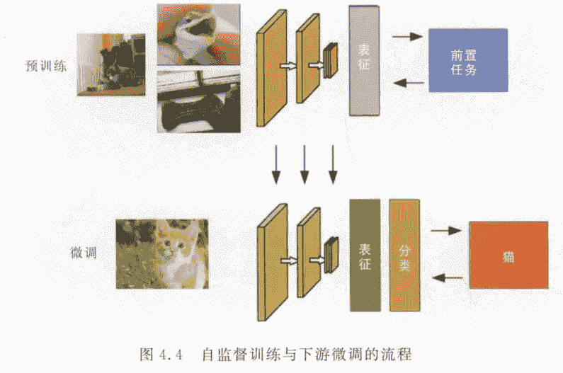

图 4.4 自监督训练与下游微调的流程

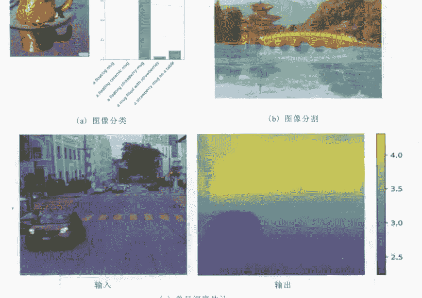

图 5.1 ViT-22B 可实现的任务

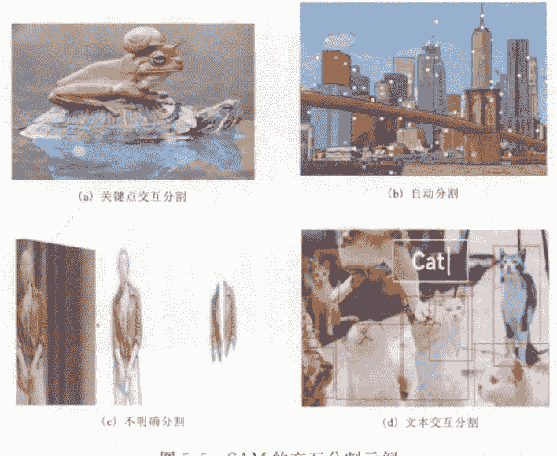

图 5.5 SAM 的交互分割示例

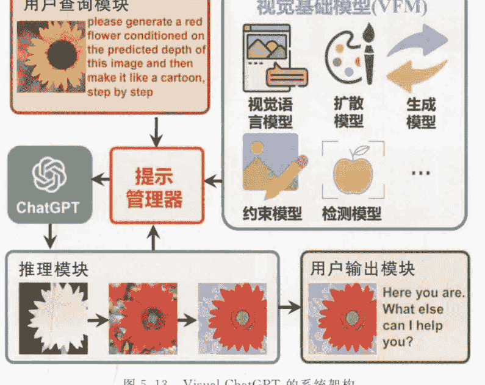

图 5.13 Visual ChatGPT 的系统架构


图 5.23 可见光地物分类结果图


图 5.24 平台操作首页

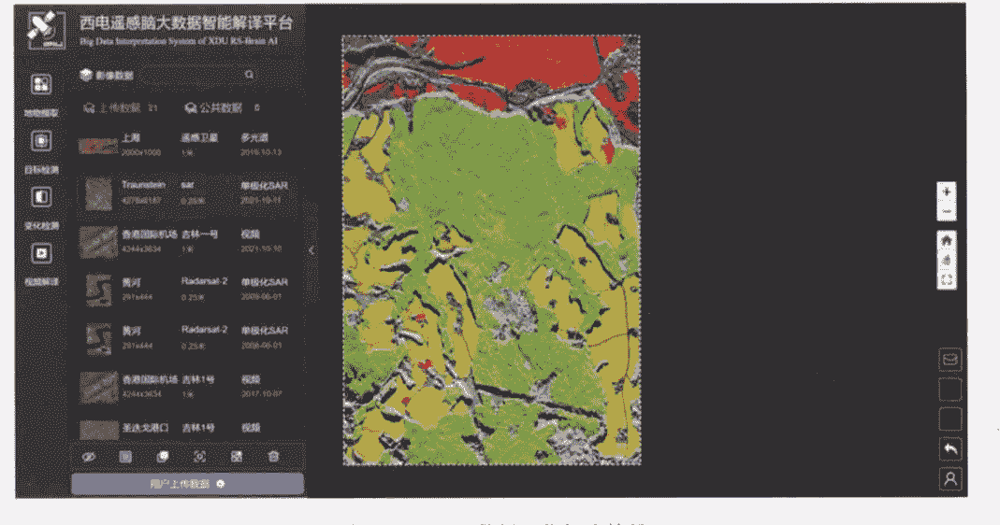

图 5.25 SAR 数据地物提取结果

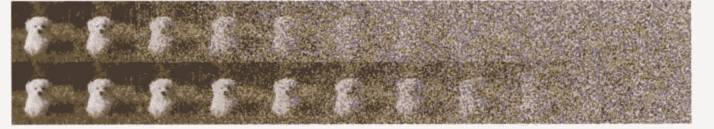

图 6.2 线性加噪计划(上)与余弦加噪计划(下)的对比

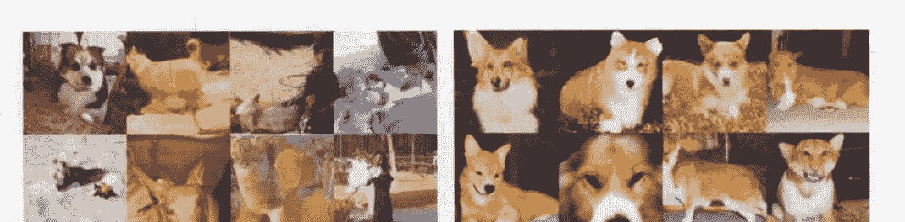

图 6.3 不同强度的分类器引导的扩散模型在生成“柯基犬”图像时的效果对比


(a)一只在使用计算器的刺猬

(b)一只打着红色领结、戴着紫色派对帽的柯基犬

(c)一幅梵高《星空》风格的狐狸画像


(d)一幅太空电梯的蜡笔画

(e)一面熊猫吃竹子的彩色玻璃窗

(f)一幅秋天的风景照：湖边有一间小别墅

图 6.4 GLIDE 在文本引导下生成的图像

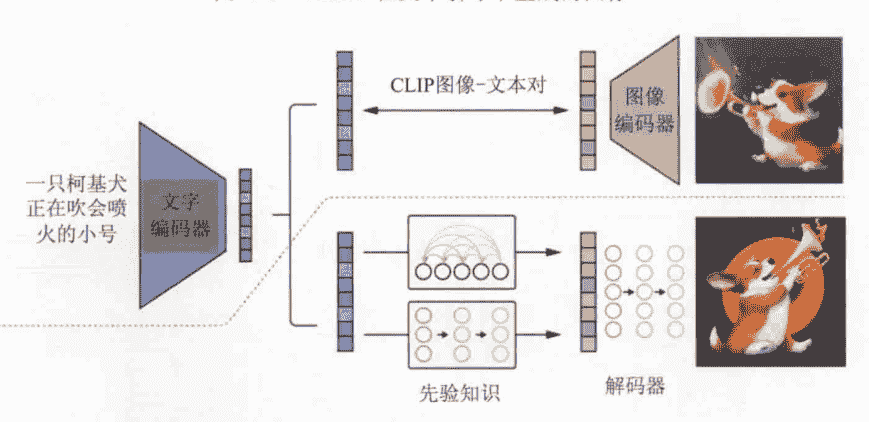

图 6.5 DALL·E 2 的流程图

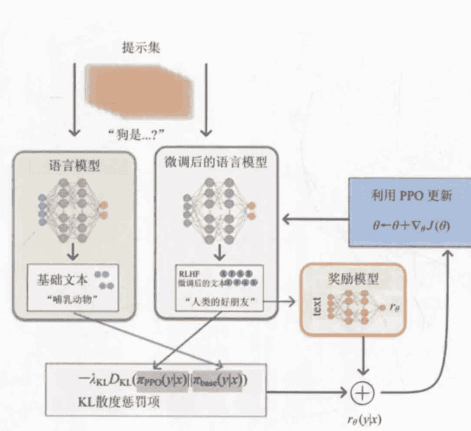

图 8.9 用强化学习微调

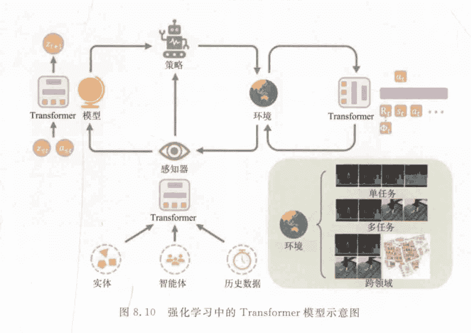

图 8.10 强化学习中的 Transformer 模型示意图


图 9.2 前缀优化的流程图


图 11.19 ChatGPT 生成提示来引导扩散模型生成图像


制造业

农业

建筑

能源

商贸物流


医疗健康

养老服务

教育

商业社区服务

安全应急和极限环境应用

图 15.1 十大经济发展领域


智慧农场

智能港口

智能矿山

智能工厂

智慧家居


智能教育

自动驾驶

智能诊疗

智慧法院

智能供应链

图 15.2 10 个示范应用场景


5G建设

特高压

轨道交通

充电桩建设


大数据中心

人工智能

工业互联网

图 15.3 新基建涉及的七大领域

## 目录 CONTENTS

- 第 1 章 ChatGPT 的前世今生 ………… 1

  - 1.1 什么是 ChatGPT ………… 1

  - 1.2 从波士顿动力机器人到 ChatGPT ………… 5

  - 1.3 ChatGPT 的使用说明 ………… 6

    - 1.3.1 ChatGPT 的注册 ………… 7

    - 1.3.2 ChatGPT 的使用 ………… 7

    - 1.3.3 如何与 ChatGPT 交流 ………… 8

  - 1.4 ChatGPT 的优势与缺点 ………… 13

    - 1.4.1 ChatGPT 的优势 ………… 13

    - 1.4.2 ChatGPT 的缺点 ………… 13

  - 1.5 ChatGPT 的应用场景 ………… 14

    - 1.5.1 办公领域 ………… 15

    - 1.5.2 搜索引擎 ………… 15

    - 1.5.3 教育领域 ………… 16

    - 1.5.4 会计领域 ………… 17

    - 1.5.5 其他领域 ………… 17

- 第 2 章 自然语言处理 ………… 18

  - 2.1 语义理解 ………… 19

  - 2.2 机器翻译 ………… 20

  - 2.3 自动问答 ………… 21

    - 2.3.1 自动问答系统的基础架构 ………… 21

    - 2.3.2 自动问答系统的实现技术 ………… 22

    - 2.3.3 自动问答技术面临的挑战和发展趋势 ………… 22

  - 2.4 文本生成 ………… 23

    - 2.4.1 基于规则驱动的文本生成 ………… 23

    - 2.4.2 基于机器学习的文本生成 ………… 23

  - 2.5 情感分析 ………… 24

- 第 3 章 ChatGPT 深度学习基础理论 ………… 27

  - 3.1 神经网络的基本原理 ………… 28

  - 3.2 卷积神经网络 ………… 29

  - 3.3 Word2Vec ………… 31

    - 3.3.1 连续词袋模型 ………… 33

    - 3.3.2 Skip-Gram 模型 ………… 33

  - 3.4 循环神经网络 ………… 35

  - 3.5 长短期记忆网络 ………… 36

- 第 4 章 GPT 系列大模型 ………… 38

  - 4.1 大规模预训练模型 ………… 38

    - 4.1.1 发展历程 ………… 40

    - 4.1.2 大模型的优势 ………… 41

    - 4.1.3 应用场景 ………… 42

  - 4.2 大型预训练语言模型 ………… 43

  - 4.3 GPT-1 ………… 45

    - 4.3.1 GPT-1 的结构 ………… 46

    - 4.3.2 GPT-1 的数据集及参数量 ………… 47

    - 4.3.3 GPT-1 的预训练 ………… 47

    - 4.3.4 GPT-1 的微调 ………… 47

    - 4.3.5 GPT-1 的优势及局限性 ………… 48

  - 4.4 BERT ………… 48

    - 4.4.1 BERT 的结构 ………… 49

    - 4.4.2 BERT 的数据集及参数量 ………… 50

    - 4.4.3 BERT 的预训练 ………… 51

    - 4.4.4 BERT 的微调 ………… 51

    - 4.4.5 BERT 的优势及局限性 ………… 53

  - 4.5 GPT-2 ………… 53

  - 4.6 GPT-3 ………… 54

  - 4.7 ChatGPT ………… 56

  - 4.8 GPT-4 ………… 57

    - 4.8.1 GPT-4 的基本信息 ………… 58

    - 4.8.2 GPT-4 的亮点 ………… 59

## 第 5 章 人工智能基础大模型

5.1 谷歌的 ViT-22B 视觉大模型

5.2 Meta 的 Segment Anything Model(SAM) 分割大模型

5.3 微软的 VisualGPT 模型

5.4 华为的盘古大模型

5.5 阿里的“通义千问”大模型

5.6 百度的“文心一言”大模型

5.7 商汤的“日日新 SenseNova”大模型

5.8 西电的“西电遥感脑”大模型

5.9 西电的“智瞳医行”大模型

## 第 6 章 扩散深度网络模型

6.1 简介与背景

6.2 扩散模型的基本原理

6.3 扩散模型的改进方法

### 6.3.1 改进的扩散模型

### 6.3.2 更大规模的扩散模型

### 6.3.3 文本驱动扩散生成
### 6.3.4 DALL·E 2 体系
### 6.3.5 扩散模型稳定性优化

## 第 7 章 Transformer：ChatGPT 的架构基石
7.1 整体结构
7.2 编码器
7.3 解码器
7.4 嵌入
7.5 模型优缺点

## 第 8 章 ChatGPT 核心技术——基于人类反馈的强化学习
8.1 强化学习
### 8.1.1 基本定义
### 8.1.2 强化学习的分类
8.2 近端策略优化
### 8.2.1 策略梯度
### 8.2.2 信赖域策略优化算法
### 8.2.3 PPO 算法
8.3 基于人类反馈的强化学习
8.4 强化学习 Transformer

## 第 9 章 ChatGPT 核心技术——提示学习
9.1 提示学习的基本流程
9.2 提示学习主要构造
### 9.2.1 预训练模型的选择
### 9.2.2 提示工程
### 9.2.3 答案工程
9.3 提示学习示例
### 9.3.1 Zero-Shot 提示学习
### 9.3.2 Few-Shot 提示学习
### 9.3.3 CoT 提示学习
### 9.3.4 自一致性提示学习

## 第 10 章 ChatGPT 核心技术——模型学习与优化
10.1 有监督学习
10.2 无监督学习
10.3 少样本学习与多任务学习
10.4 迁移学习
10.5 深度学习优化方法
### 10.5.1 梯度下降算法
### 10.5.2 动量法
### 10.5.3 牛顿法
### 10.5.4 启发式学习优化算法

## 第 11 章 ChatGPT 的主要应用实例
11.1 让 ChatGPT 成为我们生活中的帮手
### 11.1.1 写文章
### 11.1.2 机器翻译
### 11.1.3 对话聊天与提问
11.2 让 ChatGPT 成为我们工作中的顾问
### 11.2.1 关键信息提取
### 11.2.2 检查语法
### 11.2.3 SQL 语言生成
11.3 让 ChatGPT 成为我们科研中的助理
### 11.3.1 提供文献检索
### 11.3.2 提供研究背景
### 11.3.3 写代码
### 11.3.4 证明
11.4 让 ChatGPT 为我们提供创作灵感
### 11.4.1 作曲
### 11.4.2 作词
### 11.4.3 绘画

## 第 12 章 ChatGPT 智能教育大模型
12.1 教育大模型介绍
12.2 教育大模型的原理
12.3 教育大模型的应用
12.4 教育大模型的优势和落地案例
### 12.4.1 教育大模型的优势
### 12.4.2 教育大模型的落地案例

## 第 13 章 通用大模型范式面临的挑战
13.1 通用大模型范式面临的十大挑战
13.2 ChatGPT 挑战问题实例
### 13.2.1 图灵测试
### 13.2.2 基础数学计算
### 13.2.3 语义创新
### 13.2.4 模型偏见
### 13.2.5 语音识别难题
### 13.2.6 环境感知
13.3 NLP 技术挑战
13.4 NLP 大模型应用发展挑战
13.5 风险与应对战略
### 13.5.1 技术风险及其应对策略
### 13.5.2 社会风险及其应对策略
### 13.5.3 经济风险及其应对策略

## 第 14 章 ChatGPT 对社会变革与产业发展的影响
14.1 社会变革
14.2 教育发展
14.3 商业模式
14.4 企业优化
14.5 产业升级
14.6 就业推动

## 第 15 章 下一代人工智能重大场景战略与解读
15.1 关于发布《可解释、可通用的下一代人工智能方法》重大研究计划 2023 年度项目指南的通告
15.2 工业和信息化部等十七部门关于印发《“机器人+”应用行动实施方案》的通知
15.3 科技部等六部门关于印发《关于加快场景创新以人工智能高水平应用促进经济高质量发展的指导意见》的通知
15.4 关于支持建设新一代人工智能示范应用场景的通知
15.5 国家人工智能创新应用先导区
15.6 人工智能教育培养体系
15.7 人工智能新基建
15.8 人工智能领域伦理治理

## 参考文献

# 第1章 ChatGPT 来龙去脉

2022年11月 OpenAI 推出 ChatGPT，这是一款依托大语言模型的对话式 AI。模型以海量网络数据作为素材，在强算力加持下经历人工干预式训练，文本生成能力突出。回复风格接近人类，能进行提问应答、多轮交谈、自我纠错、提出质疑、拒绝不合规请求等。面世后迅速成为全球热议焦点，让公众直观感受到生成式 AI 的能量。本章简要梳理 ChatGPT 的背景，帮助读者快速掌握其原理与交互方式，并概览不同场景下的价值与风险。

## 1.1 ChatGPT 是什么

ChatGPT 全称 Chat Generative Pre-trained Transformer，是 OpenAI 在 2022 年 11 月发布的聊天机器人。交互以文字为主，日常对话之外还能承担较复杂的任务，如自动写稿、机器翻译、语言润色、自动摘要和自动纠错。以写稿为例，可按指定主题产出文本，比如技术博客、短剧创意、模仿鲁迅口吻撰写报告等。同时具备编写、解读和调试程序的能力，是其一大亮点。操作门槛低，在对话框输入问题即可得到结果。例如输入“用 Python 实现冒泡排序”，就能返回对应代码，如图 1.1 所示。

模型具备自我修正机制，对话过程中会纠正此前失误，甚至质疑逻辑不合理的问题或直接拒绝，如图 1.2 所示。用户询问“陕西有哪些知名美食”时，回复中出现了“榨菜肉丝米线”等错误信息，指出后模型会重新调整并给出正确内容。

因能产出类人文章并在多个知识领域提供清晰详尽的答案，ChatGPT 发布后关注度迅速攀升。但局限也明显，被问及自身缺点时，模型自述为上下文理解有限、常识不足、数据存在偏见、易被滥用。学界认为大模型容易产生错误和误导，甚至生成有害内容，且可能把训练数据中的历史偏见固化。安全与伦理议题因此持续升温，尤其在教育学术领域。

已有研究者用 ChatGPT 撰写论文摘要并润色。*Nature* 明确禁止将其列为作者；*Science* 禁止投递使用其生成文本的稿件；牛津、剑桥、香港大学等高校亦宣布禁止在学术工作中使用该技术。

ChatGPT 也被大量用于辅助作业。据 Forbes 报道，代写作业在美国高校已成常见现象。Study.com 对全球 1000 名 18 岁及以上学生进行调查显示，十人中近九人了解 ChatGPT，超过 89% 用于家庭作业，48% 用于小测验，53% 用于撰写论文，22% 用于生成论文大纲。

在考试场景表现同样突出。宾夕法尼亚大学沃顿商学院教授 Christian Terwiesch 发文《聊天工具 ChatGPT 能否拿到沃顿 MBA？》，在核心课程考试中进行测试，结果稳定在 B 至 B- 之间，超过课程里多数学生的得分。

由此，ChatGPT 对科学与社会的冲击持续发酵，研究群体提出五点讨论方向：坚持人工核验、制定问责规则、积极拥抱 AI 优势、投入真正的开源大模型建设、扩大公共辩论范围。

ChatGPT 的成功离不开 GPT-1 至 GPT-3 的积累。2018 年诞生的 GPT-1 参数约 1.17 亿，具有一定泛化能力，可迁移到与监督任务无关的 NLP 任务，如自然语言推理、自动问答、语义相似度判断、文本分类。2019 年发布的 GPT-2 在架构上延续 GPT-1，参数提升至 15 亿，训练数据 40 GB。目标是获得泛化更强的词向量模型，用无监督预训练完成有监督任务。在语言建模任务上达到当时领先水平，生成能力初现，可完成摘要、聊天、续写、讲故事等。GPT-3 参数达 1750 亿，预训练数据 45 TB，可覆盖自然语言处理的绝大多数任务，如阅读理解、语义推断、机器翻译、文章生成、自动问答。在法英、德英翻译上达到当时最佳水平，两位数加减的正确率接近 100%。在困难任务上也有惊艳表现，如写出难以分辨真伪的文章，或编写 SQL 查询、JavaScript 代码等。

发布后 OpenAI 估值达到 290 亿美元。OpenAI 由埃隆·马斯克、Y Combinator 总裁阿尔特曼、PayPal 联合创始人彼得·蒂尔等人于 2015 年在旧金山创立的非营利 AI 研究机构，获得硅谷多位重量级人物支持，启动资金 10 亿美元。

用户增长迅猛。2022 年 12 月 4 日用户数突破 100 万。2023 年 1 月用户超过 1 亿，成为迄今增长最快的消费级应用。与主流平台月活破亿所需时长对比见图 1.3。

初期免费开放。2023 年 2 月 OpenAI 推出 ChatGPT Plus 高级服务，美国客户月费 20 美元。发展历程见图 1.4。

## 1.2 从波士顿动力到 ChatGPT

工业化推进下，智能机器人迅速渗透多个行业，既支撑先进制造，也改善生活品质。如今机器人产业被视作衡量国家创新与高端制造水平的重要标尺。多数机器人研发借鉴生物智能，生物体在极端或多变环境中展现出的适应能力为 AI 与智能制造提供灵感。自 20 世纪 50 年代起，科研人员开始探索赋予机器人类智能。经过多年积累，机器人智能水平逐步提升。波士顿动力机器人与 ChatGPT 分别代表硬件与软件机器人的里程碑，可映射智能机器人演进路径。

波士顿动力机器人是仿生机器人，最早由美国麻省理工学院研发，是早期被广泛认知并应用的智能机器人之一。硬件机器人依托机械臂、传感器、控制器等实现物理运动与交互，可在真实环境中执行任务。过去 40 年演进，外观与动作愈发拟人，具备视觉识别与运动控制。人形机器人 Atlas 是典型代表，能完成动态行走、奔跑、跳跃，运动场景见图 1.5。该类设备在工业、医疗、军事领域应用广泛。但受技术限制与高成本制约，难以大规模推广，主要用于医院、实验室、战场等特定场景。

ChatGPT 等软件机器人则借助自然语言处理与机器学习实现与人类的语言交互，可模拟对话、问答、文本生成。ChatGPT 采用深度学习，通过预训练与微调持续优化，在语言理解与生成上实现显著提升。GPT 研发始于 2018 年，历经迭代，ChatGPT 与 GPT-4 已成为当前领先的自然语言处理模型。

从波士顿动力到 ChatGPT，智能机器人呈现技术突破与应用拓展并行的态势，走向多样化、分层化。相较硬件机器人，ChatGPT 具备一定推理能力但缺乏环境感知、认知与决策能力；硬件机器人则缺乏类 ChatGPT 的海量知识存储特点。

未来发展将以大模型驱动为基底，涵盖视觉感知、态势感知、智能推理决策与运动感知大模型的迭代优化，同时需针对具体问题与场景进行 3D 建模。随着技术成熟与成本下降，智能机器人有望在更多领域发挥作用，为人类创造更大价值。

## 1.3 ChatGPT 的使用说明

ChatGPT 是开放域语言模型，可涵盖日常对话到技术问题、娱乐到学术知识、历史典故到科幻作品等。用户可提问、求建议或进行对话。

### 1.3.1 ChatGPT 的注册

使用前需先注册，流程如下：

- (1) 打开 OpenAI 官网 https://openai.com/，点击右上角“Sign up”进入注册页。
- (2) 在注册页填入邮箱和密码，点击“Sign up”，出现如图 1.6 所示的邮箱验证界面。

- (3) 打开验证邮件中 OpenAI 发送的链接，完成账号激活。
- (4) 激活后可用注册邮箱与密码登录官网。
- (5) 验证成功后自动返回注册页，可完善个人信息并验证手机号，目前仅对海外用户开放，国内手机号无法完成后续流程。

### 1.3.2 ChatGPT 的使用

注册成功后，按以下步骤操作：

- (1) 打开 ChatGPT 官网 https://chatgpt.com/，点击“Start chatting”按钮，弹出如图 1.7 所示聊天窗口。
- (2) 在聊天窗口右下角输入框内输入问题，点击右侧类似飞机的发送按钮。
- (3) ChatGPT 会生成回复并在对话区显示，如图 1.8 所示。
- (4) 可根据回复继续输入新话题，保持对话。
- (5) 结束对话时直接退出界面。
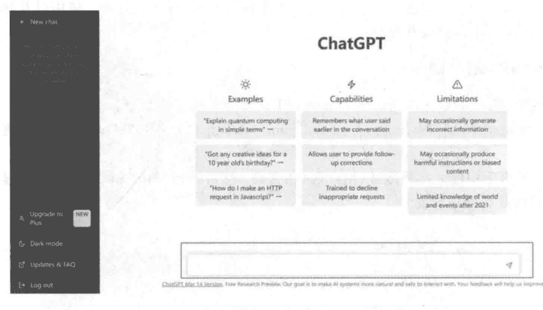
图 1.7 ChatGPT 聊天窗口

你是谁？

我是 ChatGPT，一个由OpenAI训练的大型语言模型。我的设计旨在为用户提供各种语言相关的任务和问题的帮助，包括但不限于文本生成、翻译、问答等。请问我能为您做些什么？

图 1.8 ChatGPT 聊天界面

### 1.3.3 如何与 ChatGPT 交流

ChatGPT 基于提示学习技术输出回复，该技术为模型提供明确指令，确保输出与输入相关，提升回复质量。提示通常包含：

- （1）指令：希望模型执行的任务或指示。
- （2）背景：补充的外部或上下文信息，可引导更好回应。上下文越具体相关，解答效果越好。
- （3）输入数据：待解决的问题。
- （4）输出指示：输出类型或格式，如“分类”“总结”“翻译”“排序”等。

提示是迭代过程，面对复杂问题可先从简单提示开始，再逐步补充元素与上下文。提示越详细结果越好。可尝试不同关键词、上下文与数据，寻找最适合特定需求的指令。设计提示时需注意长度限制，一般不超过 500 字。

下面以示例说明如何用提示完成不同任务。

### 1. 文本摘要

文本摘要是对单个或多个文本进行概括，在反映原文档要点前提下尽可能简明。提示应包含待分析文档及任务说明，如“请用一句话概括上面的话”，即可获得对应回答。ChatGPT 文本摘要示例见图 1.9 所示。
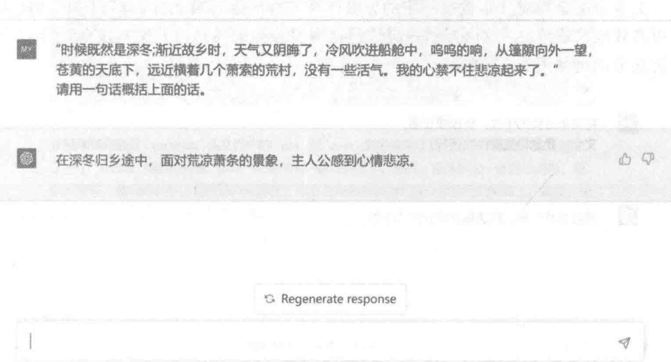
图 1.9 ChatGPT 文本摘要任务示例

### 2. 信息提取

**信息抽取的核心做法**

从自然语言材料中筛出关键事件与事实，并对海量资料进行自动归类、提炼与重组，帮助使用者快速定位关注点。完成该类工作时，提示通常同时包含待处理的段落和明确的操作指令，图 1.10 呈现了一个演示。

> 我们训练了叫做 ChatGPT 的模型，它采用对话形式交互。对话结构让 ChatGPT 能回应后续提问、承认失误、质疑不合理的假设并拒绝不当请求。我们很高兴发布 ChatGPT 以收集用户反馈并认识其优劣。在研究预览期，ChatGPT 使用免费。

> 上一段里提到的模型名称是什么

> 上一段里提到的模型名称是 ChatGPT。

图 1.10 信息抽取任务演示

### 3. 文本分类
文本分类的本质是按既定类别体系对材料做自动标注，价值在于提升信息获取效率。构建提示时需要给出分类选项集合与待处理文本片段，图 1.11 展示了用法。

> 将文本归为中性、负面或正面。
> 文字：我觉得这篇论文还行。
> 经情感分析，这段文字归为中性。

图 1.11 文本分类演示

### 4. 代码生成
借助提示可以让模型完成各类代码编写。提示一般要说明程序功能、输入输出要求并指定目标语言，例如 C++，图 1.12 为示例。

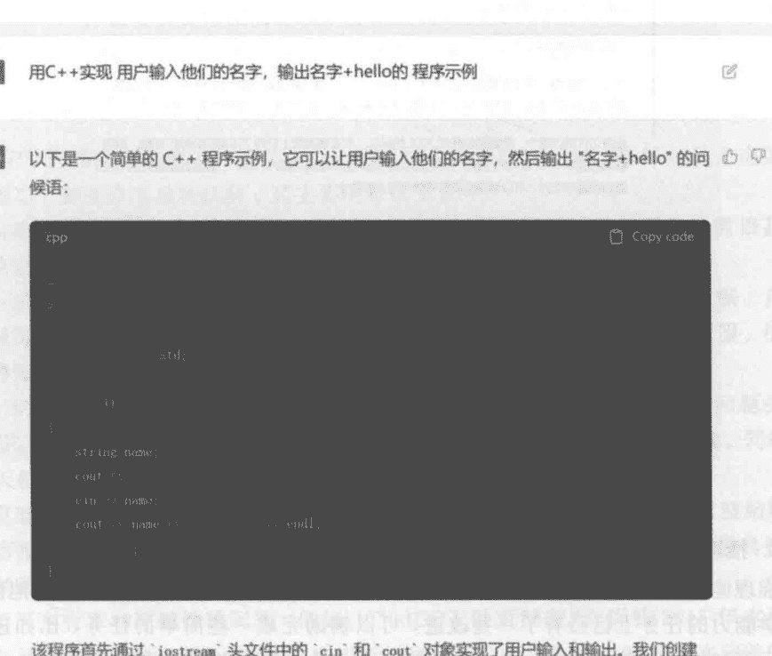

图 1.12 代码生成演示

### 5. 角色提示
角色提示的思路是先赋予模型一个具体身份来引导输出。该技术在面向特定场景或受众的生成任务中效果良好，使用时需给出清晰明确的身份设定，比如写求职邮件时把身份定为求职者。图 1.13 演示如下。

以求职者身份撰写求职信邮件

以下是一封求职信邮件示例：

主题：XXX 公司的招聘信息

尊敬的招聘经理，

本人是一名拥有 X 年从业经历的 XXX 专业毕业人员，对贵公司发布的 XX 岗位招聘信息非常感兴趣。对贵公司的文化与发展前景深感认同，希望能加入并作出贡献。

在过往工作中，曾担任 XXX 职位并积累了丰富经验与技能。能熟练使用 XXX 软件与工具，并具备优秀的团队协作与沟通能力。另有良好学习与适应能力，可迅速融入新环境。

相信能胜任贵公司招聘的岗位，并愿在工作中持续学习进步。非常希望能参与贵公司面试并作更深入交流。如需进一步了解本人情况或安排面试时间，请随时联系。

感谢您花费时间阅读求职信，期待回复。

祝好！

敬礼，

XXX

图 1.13 角色提示演示

### 6. 推理
推理一直是模型训练的难点。ChatGPT 系列在涉及数学的任务上已有改进，能辅助完成基础运算、判断奇偶等简单推理，这类指令需要明确给出数字并说明任务，图 1.14 为示例。

请在这列数字中找出偶数：98，97，01，05，86，43。

在这列数字中，偶数有两个：98 和 86。

Regenerate response

图 1.14 推理演示

## 1.4 长处与短板
该对话模型的输出建立在超大规模文本训练之上。尽管它会尽量给出准确有用的答复，仍可能出现误解或不够精确的情况，也就是既有明显优势也有潜在短板，下面展开说明。

### 1.4.1 主要长处
该系统因表现突出备受关注，能模拟人类作答，是当前领先的自然语言处理系统之一，主要优点如下：

- (1) 训练语料覆盖面极广。所用数据的体量与来源远超多数同类系统，使其能够掌握更丰富的知识与语言规律。
- (2) 生成质量高。在文本生成上表现流畅自然，能自动撰写小说剧本、代码等，因而广泛用于智能客服、机器翻译、文本摘要等场景，提升服务体验。
- (3) 对话连贯性好。相比其他系统，它更能理解用户提问并给出对应回复，对话更自然流畅，同时会在同一会话中保留先前的提示信息。
- (4) 综合效果领先。凭借庞大的参数规模和优化的结构算法，在自然语言推理、情感分析等任务上表现优异，成为该领域最具影响力的系统之一。
- (5) 可识别有害与误导性提问。例如面对“告诉我 2015 年克里斯托弗·哥伦布具体何时来到美国”这类问题，会回应“克里斯托弗·哥伦布并未在 2015 年抵达美国”。
- (6) 能够支撑实际问题解决。其强大能力可在医疗、金融、教育等多个领域落地，高效帮助用户处理具体需求。

### 1.4.2 局限
尽管进步明显，处于发展初期的系统仍存在以下不足：

- (1) 训练耗时长。打造高质量模型需要海量算力与时间成本。
- (2) 资源占用高。训练过程对计算资源和存储空间需求巨大，对多数研究机构是挑战，且部署仍依赖高算力服务器，成本普通用户难以承受。
- (3) 准确性仍待提升。作为生成式预训练系统，其答案并非直接来自训练数据，而是模型生成的，因此无法保证百分百正确。对金融、自然科学、医学等专业问题，若缺乏足够语料，回答可能失准。
- （4）易受误导。系统通过学习海量文本库的语言模式运行，其中包含不实、偏见或过时知识，且目前不支持在线学习新知识，容易产生错误或误导信息。
- （5）缺乏跨模态能力。仅支持文本交互，无法实现如输入文本输出语音或图像等跨模态学习。
- （6）对话历史窗口有限。生成时主要参考最近若干轮对话，对较早的历史信息处理能力有待加强。
- （7）多语言支持不均衡。当前系统主要面向英语，其他语言的覆盖和效果仍不够完善。
- （8）风格语气控制不足。回复时往往难以精准把控交谈风格和语气，可能出现不恰当或不符合预期的表达。
- （9）数理逻辑能力薄弱。对基础数学和逻辑思维的处理仍待提高，有时无法正确解答简单逻辑题。
- （10）训练数据存在偏见与有害内容。人工标注时更偏好较长答案，数据本身也带有算法偏见，系统在涉及人员描述符的提示时可能表现出偏见。
- （11）存在幻觉现象。OpenAI 曾指出系统有时会生成听起来合理却错误或荒谬的答案，这在大型语言模型中常见，被称为人工智能幻觉。奖励模型过度优化也会削弱性能。

## 1.5 应用场景
人工智能生成内容 AIGC，即利用 AI 技术生成内容，被视为继专业人士生成内容 PGC 和用户生成内容 UGC 之后的新创作范式。专业内容多由专家生产，用户内容来自社交平台的普通用户。随着内容消费需求持续增长，传统方式难以满足增速。AIGC 被广泛关注，可灵活用于写作、编曲、绘画、视频制作等创意领域。预计到 2025 年，AI 生成的内容占比将达 10%。分析显示 AIGC 有望创造数万亿美元经济价值。作为 AIGC 的代表之一，该模型的成功体现了其商业潜力，可在以下领域落地。

### 1.5.1 办公领域
早期办公软件仅能做基础文字和数据处理，随技术发展，其功能扩展到协作、可视化分析等。该模型作为自然语言生成与理解系统，可在办公软件中扮演多重角色，如语音识别引擎加速文字输入、自动回复机器人解答用户提问、智能补全插件辅助输入等。

目前 OpenAI 携手 Microsoft，Microsoft 计划将该系统整合至全系产品，升级 PowerPoint、Word、Excel、Outlook 等，提供交互式智能文本生成服务。接入后的 Word 界面如图 1.15 所示。

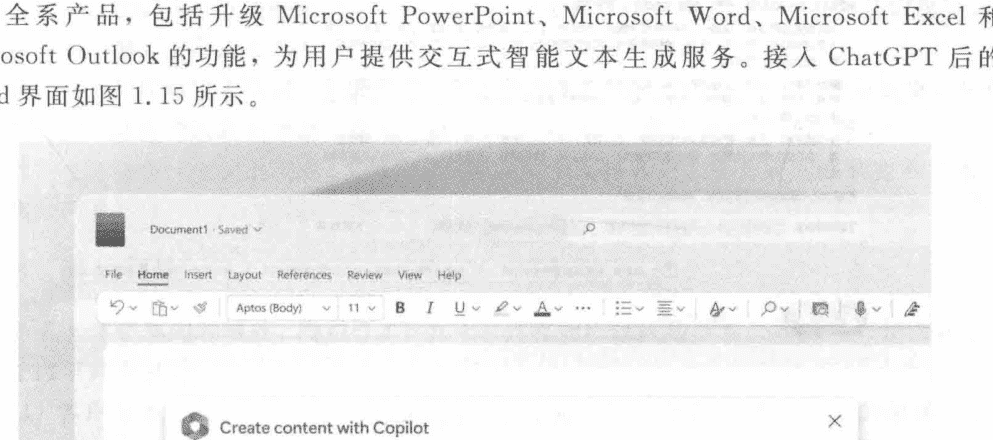

### 1.5.2 搜索引擎
得益于强大的语言生成能力和知识储备，它被认为有潜力发展为新一代搜索引擎。

2023 年 2 月 7 日，Microsoft 宣布推出由该系统支持的新版 Bing 和 Edge 浏览器。CEO 表示“搜索引擎进入新时代”。3 月 8 日，Microsoft 在华盛顿州雷德蒙德市宣布将 OpenAI 的 GPT-4 集成到 Bing 及 Edge。引入 GPT-4 后的 Bing 搜索界面如图 1.16 所示，用户可获得更完整准确的答案。

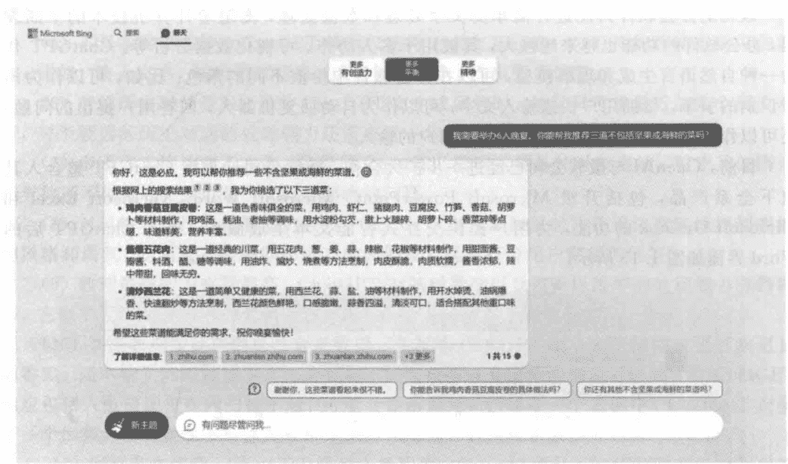

### 1.5.3 教育领域
尽管争议存在，它可作为有效辅助工具，为师生提供更多学习资源与交互方式，主要应用包括：

- 1. 个性化学习体验。依据学生的兴趣、能力与学习风格提供定制化内容，促进自主学习。
- 2. 语言学习支持。提供外语练习机会，辅助语言习得。
- 3. 作业辅导。通过解答问题、解释概念和提供指导帮助完成作业。
- 4. 考试准备。提供学习材料、练习题和个性化反馈，助力备考。

其自然语言处理能力使其在教育数字化转型中具备价值，推动智慧教育与创新。

### 1.5.4 会计领域
会计在经济运行中举足轻重，当前诸多工作正被智能化浪潮重塑。该人工智能系统可在会计人员的智力活动中发挥作用：

- (1) 经济活动分析与建议。可被训练执行经济分析与管理建议，帮助会计人员节省时间、减少错误，例如输入财务数据后生成分析与建议。
- (2) 大量经济数据处理。可执行数据录入、记账、对账等例行任务，提升效率与准确性。
- (3) 识别财务风险。利用历史与同行经验分析财务数据，提供趋势、异常与改进洞见，支持决策。
- (4) 回答会计相关问题。可为客户、员工等利益相关方提供会计问题的解答。

### 1.5.5 其他领域
除上述领域外，凭借广泛应用场景与可移植性，它还可用于：

- (1) 客户服务。可驱动聊天机器人快速高效解决问题，提升客户体验，包括常见问题解答、产品推荐、投诉处理与客户支持。
- (2) 医学保健。经医学专业数据训练后可应用于：
  - ① 病情分类：通过提问识别症状协助医生分类。
  - ② 病历书写：依据医生输入的信息数秒生成正式出院小结。
  - ③ 个性化健康建议：结合年龄、性别、病史等提供定制建议。
  - ④ 心理健康支持：提供资源信息或帮助联系专业人士。

# 第2章 自然语言处理
自然语言处理是研究人与计算机语言交互的学科。在现代社会海量文本被创建与存储，NLP 神经网络通过模拟神经元交互，对大量文本训练，学习语法、语义与结构，帮助人们快速准确地处理分析文本，为各种应用提供支持。让计算机“理解”自然语言是核心，因此 NLP 又称自然语言理解 NLU，也被视为计算语言学和人工智能的核心课题之一。其目标是通过计算机技术实现对自然语言内容的理解、分析、处理与生成。

深度学习时期 NLP 的基础应用包括：
- 1. 文本清洗与数据预处理。
- 2. 词嵌入：将词语映射到数字向量空间。
- 3. 语言模型：预测自然语言文本中下一个词的出现。
- 4. 序列到序列模型：实现文本翻译。

随着深度学习渗透各层面，NLP 在语义理解、机器翻译、自动问答、文本生成等领域取得进展，不同技术常组合使用以解决复杂任务。下面介绍典型应用。

## 2.1 语义理解
语义理解是 NLP 的关键，旨在让计算机把握自然语言中的语义信息，需要模拟人类处理语言的过程，实现深层次理解。通常包含以下方面。

### 1. 词义消歧
自然语言中同一拼写在不同语境下含义不同。词义消歧的目标是区分上下文中的不同含义。

例如“bank”可指银行也可指河岸。句子“I went to the bank to deposit some money.”脱离语境难以确定。若加入“I withdrew some cash from the ATM at the bank.”则含义指向银行。通过 NLP 技术可识别并消除此类歧义，提升准确性。

### 2. 句法分析
句法分析是 NLP 基础，涉及句子结构的解析与各成分关系的刻画，可将句子分解为语法树，实现结构理解。

例如“John saw the book on the table”可解析为主语 John、动词 saw、宾语 the book、介词短语 on the table。这种分析帮助计算机理解语法结构，为语义分析与问答系统等提供支撑。

### 3. 语义归纳
语义归纳是通过观察语言现象归纳规律、形成概念的过程。在 NLP 中用于构建基础概念并推导出更抽象的语义结构。

例如 WordNet 是英语词网资源，词条按层级组织，每个词与其他词关联，具备上层词汇与下层词汇。以“dog”为下层，“animal”为上层的方式建立关系，帮助计算机更好理解文本语义。

### 4. 语义匹配
语义匹配用于衡量两个句子或文本的语义相关程度，得到相似度。该任务通常计算文本向量相似度，并通过评估指标对比语义接近性。

语义匹配在搜索和问答里已经成为标配。搜索引擎会用语义匹配把用户的查询意图和相关文档挂钩；自动问答系统也会用同类算法把用户提问和候选答案进行对齐，从而给出更贴合的回应。

### 5. 知识图谱构建与应用
知识图谱是在语义理解之上搭建的网络，把概念抽象成节点，把概念间的关联抽象成边。这种结构化表达让机器对自然语言的把握更清晰，也为后续处理提供了扎实的语义底座。

医学场景很典型。医学知识图谱能把疾病、症状、治疗手段之间的关系图谱化，帮助医生和患者快速理清关联，在制定诊疗方案时兼顾更多潜在因素。进一步把图谱与临床指南、基因组数据、电子病历等信息融合，就能支撑更全面、更个性化的医疗建议。

语义理解是自然语言处理的核心命题，也是当前的研究热点。实现对自然语言的深度洞察，才能让计算机更精准地分析和处理语言信息，并支撑流畅的人机交互。

## 2.2 机器翻译 从规则到神经的演进
机器翻译是通过计算机把一种自然语言转换成另一种自然语言的技术。典型流程分两步：先分词，把源语言拆成词、短语、句子等单元；再翻译，把这些单元映射为目标语言的等价表达。核心难点在于如何完成源语到目标语的转换，这离不开自然语言处理、计算语言学和机器学习的协同。

历史可追溯至20世纪40年代。当时主流是基于规则的方法，依赖人工制定的翻译规则和词典。规则冗杂、短语组合难处理、人工维护成本高，翻译质量难以稳定。

随后进入统计机器翻译阶段。系统在海量双语语料上学习源语与目标语的统计关联，建立映射模型。训练中主要计算两类概率：语言模型用于根据前一个词预测下一个词的分布，帮助理解源句含义；翻译模型用于在源句基础上建立到目标句的概率映射，决定目标句如何生成。翻译模型可细分为短语级、句法级或神经级，面对多种译法时作用更为关键。

近年来神经机器翻译成为焦点。它以神经网络为核心，采用编码-解码的序列到序列架构，将完整句子作为输入进行端到端转换。神经方案在大规模数据和多语种环境下表现更稳健，微软、IBM、谷歌等都在持续投入。

不过问题依然存在。复杂句的准确率不足、领域迁移能力弱、跨语言的语法和词汇差异大，导致质量波动。训练依赖海量语料，若语料本身含误，译文也会受拖累。

总体来看，机器翻译仍在快速迭代，越来越多研究者正致力于突破技术和理论瓶颈，期望未来实现更准确、更自然、更流畅的跨语言表达。

## 2.3 自动问答
自动问答是指让计算机自动理解自然语言问题并给出答案的能力。传统搜索引擎输入关键词后返回文档列表，而自动问答更关注问题的本质和所需答案，通过推理、知识图谱和语义理解等手段，直接产出可信答案。

该技术已广泛应用于在线客服、智能助手、教育辅导和信息检索等场景，能实现快速、可靠的智能问答，提升效率和体验。

### 2.3.1 自动问答系统的基础架构
自动问答通常由三大模块构成：

- (1) 语言理解：完成句法分析、关系抽取等基础任务，识别提问意图，为后续回答奠定基础。
- (2) 知识编码：对各类语言知识进行大规模描述，实现同一问题的多种表述合并与匹配。知识源包括词典、语法、专业知识等，并通过文本解析、结构抽取持续更新，形成高密度的知识体系。
- (3) 答案抽取：核心环节，在海量文本中定位最佳答案。方法可分为传统检索式抽取和基于深度学习的抽取。

### 2.3.2 自动问答系统的实现技术
实现过程涉及信息检索、自然语言处理、机器学习和知识图谱：

- (1) 信息检索：以用户提问或关键词为入口，从索引中召回相关文档或信息。
- (2) 自然语言处理：涵盖理解与生成。理解用于解析输入问题，生成用于组织输出答案。
- (3) 机器学习：通过数据学习模型，完成分类、聚类、关系抽取等任务。
- (4) 知识图谱：构建信息间的关联网络，支撑更精准的推理与问答。

### 2.3.3 自动问答技术面临的挑战和发展趋势
- (1) 语义理解：语言复杂、歧义多，系统对人类意图的把握仍需提升，深度学习是主要改进方向。
- (2) 多语言问答：需兼容自然语言、编程语言等多形态表达。
- (3) 整合多种数据源：要融合人类知识、开放数据等异构格式，提升整合效率。
- (4) 对话式问答：交互形态向语音、图像、视频和多轮对话演进，系统正朝着更灵活、更智能的方向发展。

随着算力与数据持续进步，自动问答有望成为处理海量信息的有力工具，为用户提供更便捷、高效的智能服务。

## 2.4 文本生成
文本生成是用程序自动创作文章、故事、诗歌、对话等内容的技术，也常被称为生成式语言模型。生成过程基于预设规则、语法和语言模型，组合出合规、通顺的文本。

应用面很广：新闻稿、商品描述、营销文案、文学创作、智能客服对话，教育领域的练习题与考题，医疗领域的健康记录、病历与诊断报告等。

大致可分为规则驱动和机器学习驱动两类。

### 2.4.1 基于规则驱动的文本生成
该方法依赖预先写好的规则和模板，无需训练，速度快、对数据要求低，但产出偏机械、缺乏自然感。

例如生成旅游景点简介，可设定规则：每个景点必须有地理位置、简要介绍、至少一项特色；配合模板“该景点位于{地理位置}，是一个{简单介绍}的地方。值得一提的是，这个景点{特色}。”套用后即可得到“这个景点位于云南大理，是一个风景秀丽的地方。值得一提的是，这个景点有着著名的苍山洱海和民族风情。”

### 2.4.2 基于机器学习的文本生成
该路线需要大量文本训练神经网络来模拟人类语言的逻辑与结构。常规流程包括：

- (1) 数据预处理：清洗、切分、标准化，为模型准备可用输入。
- (2) 构建模型：以词或字符序列预测下一个单元的概率，常见架构有RNN、LSTM、Transformer等。
- (3) 模型训练：用大规模语料最小化预测误差，提升泛化能力。
- (4) 生成文本：给定起始序列，模型逐步自回归输出，形成长文本。

主要挑战在于质量与可信度。训练数据若存在错误或偏差，生成结果会继承问题；同时需要兼顾流畅性、连贯性和语义正确性，否则信息传达会受损。

随着语言理解能力深化和数据规模增长，文本生成正向更准确、更有趣、更自然的方向演进。

## 2.5 情感分析
情感分析借助自然语言处理和机器学习，对文本中的情感与情绪进行识别与分类。对象包括新闻、社交媒体发文、评论等，目标是用数值化方式描述情感强度和极性。

常见方法有三类：基于词典、基于机器学习、混合式。

### 1. 基于词典的情感分析
利用事先标注正负情感的词典，对文本中词或短语进行打分，汇总后判断整体极性。方法简单高效，但对隐喻、讽刺等非字面表达处理不足，复杂场景准确率受限。

例如词典含正向词“开心、愉快、幸福、喜悦”，负向词“难过、失落、沮丧、痛苦”。句子“我今天考试得了个好成绩，感觉很开心。”匹配到“开心”，判定为积极极性。该类方法难以处理上下文依赖的情感表达。

### 2. 基于机器学习的情感分析
在标注好的数据上训练模型，自动区分正面、负面或中性。常用向量空间模型、CNN、RNN等进行特征提取与模式识别，能较好应对模糊与复杂语言，并可随数据更新自我完善。

典型步骤：数据预处理转数字特征如词袋、TF-IDF；特征选择保留对分类有价值的维度；模型选择如朴素贝叶斯、支持向量机、随机森林；模型训练与评估；测试验证泛化能力；调参优化；上线应用。如用电影评论数据训练朴素贝叶斯模型，可对新评论输出情感概率。

### 3. 混合式的情感分析
融合多种技术以提升可靠性。常见做法是用词典快速定位情感词并赋分，再把得分作为特征输入机器学习分类器，结合词典的速度与学习的准确性。

应用场景包括舆情监测与品牌管理、金融预测、社交媒体分析、智能客服等。技术成熟后，计算机对文本情感的理解将更细腻，为各行业的决策与运营提供价值。

# 第3章 ChatGPT 的深度学习根基
ChatGPT 作为自然语言处理领域的深度学习神经网络模型，其技术脉络可追溯至2013年前后，当时RNN和CNN是主流，能处理自然语言的时序与局部结构。

关键演进节点如下：

- (1) 循环神经网络的发展。RNN由Michael I. Jordan等人在1986年提出，后因梯度消失和爆炸问题长期受限。1997年后Hochreiter等提出LSTM，K. Cho等提出GRU等改进结构，缓解了梯度问题，使RNN在NLP中得到广泛使用。
- (2) Word to Vector 的出现。2013年Google提出的Word2Vec把词汇映射为向量，通过海量文本学习语义相似度。该方法不仅适用于词，也可扩展到短语、句子和文档，解决了词表示问题，为后续模型提供更好输入。
- (3) 卷积神经网络的发展。CNN最初用于图像。2014年Kim等将其引入文本分类，使用多尺度卷积核捕捉n-gram特征并送入全连接层，提出CNN-RNN混合模型，在情感分析与文本分类上表现突出。该架构兼顾局部和全局信息，减轻了RNN的计算负担。
- (4) Transformer 的提出。2017年Google提出Transformer，以注意力机制替代传统的RNN和CNN，能更有效地捕捉长序列依赖，支持并行计算并缓解梯度问题。在机器翻译、文本生成、文本分类等任务上取得突破性进展。

不同模型在不同任务与场景各有优劣，选择与优化需结合具体需求。

## 3.1 神经网络如何运作

神经网络借鉴生物神经系统的信息传递思路，形成一套面向数值计算的模型框架。图 3.1 展示了多个处理单元通过可调的连接强度交换信号，从而对输入信息进行加工、判别等操作。

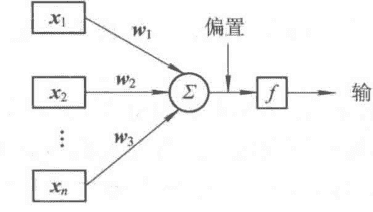

常见架构大致可分为三类层次。图 3.2 给出的是典型的三层形态。入口侧负责承接原始样本，每一个单元对应样本的一项特征；中间层通常部署若干单元，主要从原始表征里提炼更抽象的高阶特征；出口侧则依据中间层的输出完成分类、回归等任务。

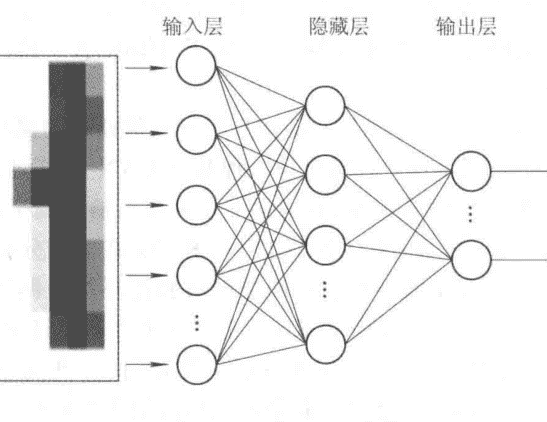

训练最常借助误差回传机制。样本送入模型后，先依据预测结果与真实标签的差距构建损失，随后让误差沿网络逆向流动驱动连接强度更新，使损失逐步下降。收敛之后，模型即可推广到未见过的数据。

面向自然语言处理的神经网络，本质上是把文本转成可计算的数值表征来完成 NLP 任务的一个方法族。整体思路是把自然语言转成数学形式，进而支撑文本分类、情感判断、机器翻译、命名实体识别等应用。

这类方法最关键的部分是词嵌入，即把词汇映射到语义空间，位置关系反映词义的接近程度。最具代表性的方案是 Word2Vec，它借助神经网络把词投射到低维空间，使得语义相近的词在空间中的距离更近。

除词嵌入外，还会搭配循环结构、长短期记忆结构以及注意力等机制对序列进行建模，以捕捉语境依赖，提升任务表现。

训练上最常用的是误差回传，通过最小化损失来优化参数。配合优化器时，常使用随机梯度下降与自适应矩估计等方法加速收敛。

## 3.2 卷积神经网络解析

卷积神经网络是深度学习里应用最广的深度前馈模型之一，可视为含有卷积计算的深层网络，是深度学习的代表范式。

CNN 通过在输入上滑动固定窗口捕捉局部模式，从而识别更复杂的结构。早期在图像识别上成效显著，后也被验证在自然语言处理中有效。在文本场景，卷积操作基于词嵌入进行，与图像不同，文本卷积核通常覆盖若干连续词向量，核宽常与输入一致，能够捕捉多词组合特征并共享权重。相较传统方法，CNN 可自动学习表征，无需人工设计特征，提升效率与灵活性。加入丢弃与正则化等手段后，还能抑制过拟合，增强泛化。

在 NLP 中，CNN 主要用于文本分类与文本表征学习。分类任务里，常采用一维卷积核，长度多为 3、4 或 5，对词向量序列进行卷积，将相邻词组合并抽取特征。随后通过池化压缩为固定长度的向量，再送入分类器，效果普遍优于传统词袋方法。

表征学习方面，CNN 可用于学习词向量，也可学习句段级向量。多尺度卷积即多通道设计，能从不同粒度提取信息，得到更丰富的表征。训练中自适应权重共享可减少参数量，避免过拟合。

除一维卷积外，还有 TextCNN、Deep Pyramid Convolutional Neural Network 等多尺度模型，在分类与表征学习上表现良好。下面介绍 NLP 中 CNN 的基本原理。

### 1. 词嵌入原理
词嵌入把每个词映射为低维空间中的向量，用以保留语义信息，便于后续处理。

最常用的是 Word2Vec，这是一种基于神经网络的嵌入模型。Word2Vec 包含 Skip-Gram 与 CBOW 两种变体。Skip-Gram 以单个词为中心预测邻近词，CBOW 以邻近词预测中心词。

除此之外，还有 GloVe、FastText 等方法，它们基于共现统计或神经网络，在大规模语料上训练，将词映射为低维向量，提升任务精度与效率。

### 2. 卷积层解析
卷积层多采用一维卷积，每个核可捕捉一词或多词的局部特征，如相邻词或关键短语。

比如，见图 3.3，若输入文本为“the country of my birth”，用大小为 2 的卷积核可捕捉“the country”“country of”“of my”“my birth”等邻近特征。卷积输出通常进入激活函数如 ReLU、tanh 等，进一步提炼特征。

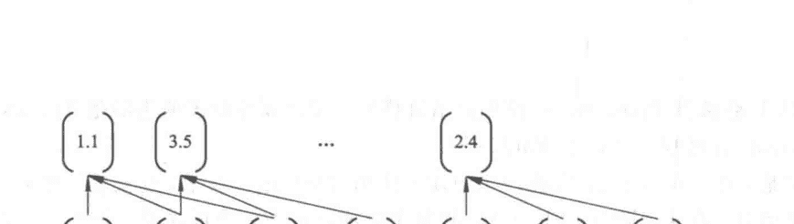

图 3.3 卷积示例

### 3. 池化层作用
在自然语言处理中，池化层用于缩短序列长度，降低参数规模。常见的是最大池化，即在每个子序列中取最大值作为该块的表示。

举例，假设有一个输入序列如下：

```
[1, 4, 2, 7, 3, 5, 6, 8]
```

若按每 2 个元素为一组做最大池化，得到的池化结果为

```
[4, 7, 5, 8]
```

其中，4 为 1 与 4 的最大值，7 为 2 与 7 的最大值，以此类推。图 3.4 展示了对 [4, 6, 3, 1] 进行最大池化的效果。最大池化可降低维度并保留显著特征，有助于提升效果与训练速度。

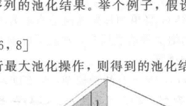

图 3.4 最大池化

### 4. 全连接层
全连接层将池化后的输出映射为最终预测。在 NLP 中，通常叠加一个或多个全连接层，并用 softmax 将输出转为概率分布，实现文本分类等任务。

比如，可把固定长度向量作为输入，经多层全连接逐步映射为文本表征。在生成时，可通过随机采样或贪心策略获得每个词的概率分布，再据此选择最可能的词进行续写。

卷积网络在深度学习发展中发挥关键作用，并在多领域普及。回顾计算机视觉史，研究长期聚焦于人工设计鲁棒特征提取方法。卷积网络的出现摆脱了手工特征，提供自动生成特征的途径，因而应用广泛。

## 3.3 Word2Vec 词嵌入经典

Word2Vec 是一种经典的词嵌入模型，能够把词表中的每个词表示为低维向量。

ChatGPT 基于 Transformer 语言模型，预训练阶段使用的是 Transformer 中的自注意力机制，而非 Word2Vec。

在微调阶段，ChatGPT 会使用词嵌入技术以更好地表达输入文本的语义。该阶段把每个词转为词向量，并通过学习词向量到下一个词的概率分布来训练模型。这些词向量可通过多种方式获得，其中一种即 Word2Vec。

在自然语言处理中，计算机难以直接处理文字系统，因此需要把文本转为易处理形式。Word2Vec 由 Google 于 2013 年提出，基本思想是通过神经网络学习词间关系，把每个词转为向量。训练时相似词在向量空间中更近，不相似词更远。它是 NLP 重要技术。Word2Vec 的词嵌入过程可捕捉语义与语法信息，并用于情感分析、垃圾邮件检测、机器翻译等任务。

Word2Vec 包含连续词袋模型 CBOW 与 Skip-Gram 模型，如图 3.5 所示。CBOW 由邻近词预测中心词，Skip-Gram 由中心词预测邻近词。

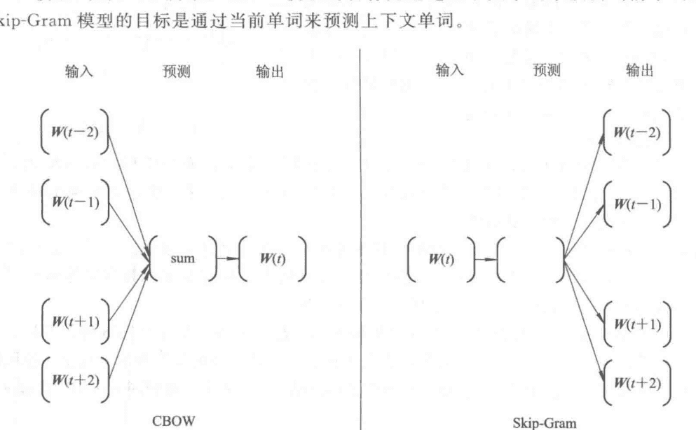

ChatGPT 在微调阶段使用类似 Skip-gram 的方式训练词向量，并把预训练的词向量作为输入不断调整，以适应特定任务。下面详细介绍两种模型。

### 3.3.1 CBOW 连续词袋
连续词袋模型 Continuous Bag of Words CBOW 常用于词嵌入，是 Word2Vec 的一种，主要用于把自然语言中的词转为向量表示。

CBOW 的思路是依据窗口内的邻近词预测中心词。输入层为窗口内的邻近词，输出层为中心词，中间隐藏层为词向量层，用于把邻近词转为向量并加权平均，得到中心词的向量表示。

具体流程是先构建词典，把每个词映射为唯一整数。然后以每个词的 one-hot 编码为输入，经全连接隐藏层得到词向量。在隐藏层中，可通过加权平均组合窗口内的词向量，得到中心词的向量表示，最后送入输出层训练。

以“我喜欢吃苹果”为例，若邻近窗口大小为 2，则 CBOW 的输入为“我吃苹果”，输出为“喜欢”。

训练时，每个词被表示为向量，邻近词向量取平均得到语境表示，用作预测中心词的输入，从而学习词的嵌入。

与 Skip-Gram 相比，CBOW 训练更快，对高频与低频词处理较好。得到的词向量能较好保留语义信息，可用于聚类、分类等，在大规模语料上很受欢迎。

CBOW 也有不足，例如忽略词序，对需要考虑顺序的任务表现可能较弱。此外，对生僻词效果有限，因其出现次数少，很难获得准确向量。

### 3.3.2 Skip-Gram 预测模型
Skip-Gram 是 Word2Vec 中的一种，基于神经网络的词向量表示方法，能把词转为向量。与 CBOW 相反，其目标是最小化预测邻近词与真实邻近词的差异，用当前词预测邻近词。Skip-Gram 相较其他模型训练效果更好、速度更快。

其基本结构是一个浅层前馈网络。每个词有两个向量，一个是输入层的 one-hot 编码向量，一个是输出层的特定维度向量即词向量。训练时，每个词被表示为固定维度的向量，目标是通过拉近输入词与输出词的距离来学习这些向量。具体实现常采用负采样来降低计算量，即在训练时随机选取一些非邻近词作为负样本，把输入词与正负样本一起送入模型训练。

以 The quick brown fox jumps over the lazy dog 为例，每个词都被表示为一个独特的词向量。现在要训练 Skip-Gram 模型，让中心词“fox”与其邻近词关联。

在 Skip-Gram 中，需要确定窗口大小以确定与中心词相关的邻近词。窗口大小设为 2，则“fox”的邻近词为“quick”“brown”“jumps”“over”。

对这些邻近词在词表中找到其词向量作为输入，目标是训练网络，使其能以中心词的词向量预测邻近词的词向量。

把中心词“fox”的词向量输入网络，网络输出每个邻近词的概率分布。训练时希望该分布使邻近词的概率最大化。

可用交叉熵损失比较预测概率分布与实际邻近词的 one-hot 概率分布，并尝试最小化差异。通过多次迭代优化权重和偏置，使其能准确预测给定中心词的邻近词。

训练完成后，可用得到的词向量表示词，并用于各类 NLP 任务。

Skip-Gram 的优点是可以处理大量语料库，获得更准确的词向量表示。由于词向量间的余弦相似度可衡量语义关系，Skip-Gram 在文本分类、情感分析、机器翻译等 NLP 任务中得到广泛应用。

## 3.4 循环神经网络机制

循环神经网络 RNN 是一种经典的神经网络结构，被广泛应用于序列数据处理，如自然语言处理、语音识别等。与传统神经网络不同，RNN 能对序列逐个元素处理，同时保留上一步的信息，适用于具有时间顺序、逻辑顺序或其他顺序的序列数据。因为它能有效挖掘数据的时序和语义信息，深度学习模型在语音识别、语言模型、机器翻译、时序分析等语言处理问题上因此取得突破。

与前馈网络不同，RNN 的隐藏层节点之间有连接，隐藏层的输入不仅包括输入层的输出，还包括上一时刻隐藏层的输出。这种结构使 RNN 能存储历史信息并作用于后续输出。从结构上看，循环神经网络如图 3.6 所示。图中每个 A 是一个处理单元，同一结构重复使用。

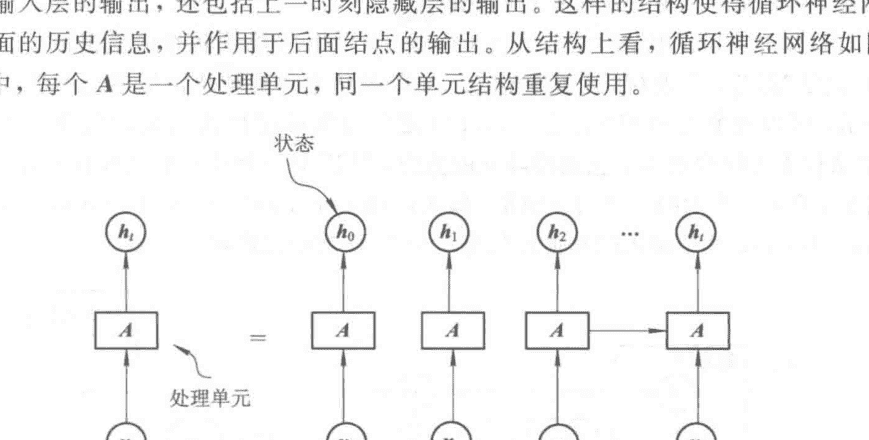

RNN 的处理流程可简单描述如下：

1. 将序列数据按时间步展开，形成时间轴上的序列。
2. 对每个时间步，RNN 接收输入数据和前一时间步的隐状态，计算当前时间步的输出和隐状态。
3. 把当前时间步的输出作为下一时间步的输入，继续处理。
4. 重复步骤 2 和 3 直至完成所有时间步。
5. 最终得到整个序列的输出和最后时间步的隐状态作为序列表示。

在处理长序列时，RNN 面临梯度消失和梯度爆炸问题，即随着时间步增加，梯度值可能越来越小或越来越大，导致模型难以学习有效信息。为此提出了多种改进结构，如长短时记忆网络 LSTM 和门控循环单元 GRU 等。

## 3.5 LSTM 长短期记忆

长短期记忆网络 Long Short-Term Memory LSTM 是一种特殊的 RNN，设计目的是解决传统 RNN 处理长序列时出现的梯度消失或梯度爆炸问题。

LSTM 的核心是门控机制，包括输入门、遗忘门和输出门。在每个时刻，LSTM 通过这些门控制信息的流动与保留，从而更好地捕捉长期依赖关系。

在 LSTM 中，隐藏状态由记忆单元 Memory Cell 和隐藏状态向量组成。记忆单元负责存储和传递信息，可视为网络的“记忆”部分；隐藏状态向量是从记忆单元中提取的抽象表示，可理解为短期“记忆”。LSTM 能记忆长期和短期信息，得益于其“门”结构，可选择性地去除或增加信息到神经元，门是一种让信息选择性通过的机制，结构如图 3.7 所示。图中三个门分别是输入门、输出门和遗忘门，其中输入门和遗忘门是 LSTM 长期记忆依赖的关键。

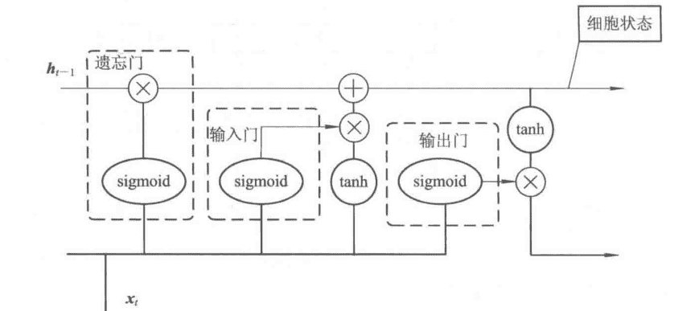

LSTM 先用遗忘门筛查细胞状态里哪些内容该丢弃，两个信号经 sigmoid 压缩到 0 到 1 之间，数值接近 1 时保留，接近 0 时清除；随后输入门甄选新信息，内部由 sigmoid 决定更新幅度，tanh 生成候选向量，两者结合后并入状态。整体上输入门负责写入，遗忘门负责清理，最后输出门控制本时刻向外部释放多少内部信息。

在 LSTM 基础上发展出了知名变体 GRU，门控改成重置门与更新门两套，并把细胞状态和隐藏状态合二为一。结构上比标准 LSTM 更精简，重置门调节历史隐藏信息的保留程度，而对当前输入没有限制。

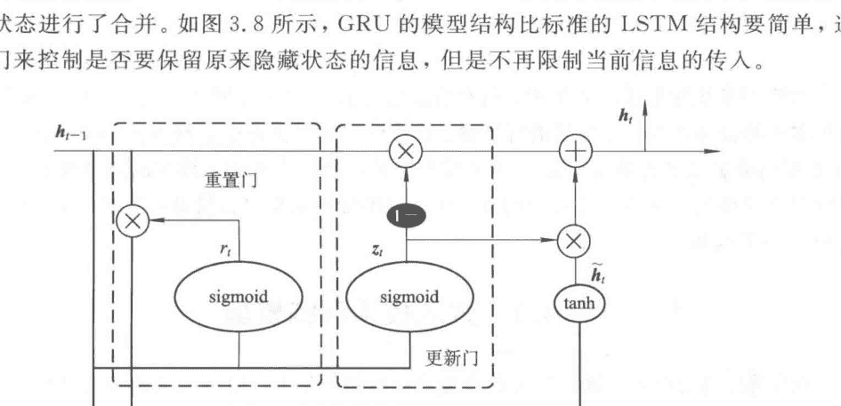
图 3.8 里，$r_t$ 为重置门，$z_t$ 为更新门。重置门的功能近似于 LSTM 的遗忘门与输入门的融合，负责裁决旧状态是否抛弃；当 $r_t$ 接近 0 时，$h_{t-1}$ 基本被抹除，候选隐藏状态 $\tilde{h}_t$ 主要由当前输入塑造。更新门则像 LSTM 的输出门，决定隐藏状态 $h_t$ 在多大程度上转向新的 $\tilde{h}_t$。

整体而言，凭借门控与记忆单元的配合，LSTM 能有效捕捉长距离依赖，缓解梯度消失与爆炸，在自然语言处理、语音识别和时序预测等任务中应用广泛。

# 第4章 GPT大模型图谱与演进
大模型通常指参数以亿计、甚至千亿级的深度网络，能捕捉更细致的特征，在语言、视觉等任务上表现突出。OpenAI 的 GPT 家族和 Google 的 BERT 就是代表。本章先介绍大规模预训练范式，再聚焦 GPT 与 BERT 的发展脉络。

## 4.1 预训练大模型概览
随着算力、算法与数据的共同推进，Pre-Trained Model，即大规模预训练模型大量涌现。BERT、GPT 等已成为里程碑，如图4.1所示。

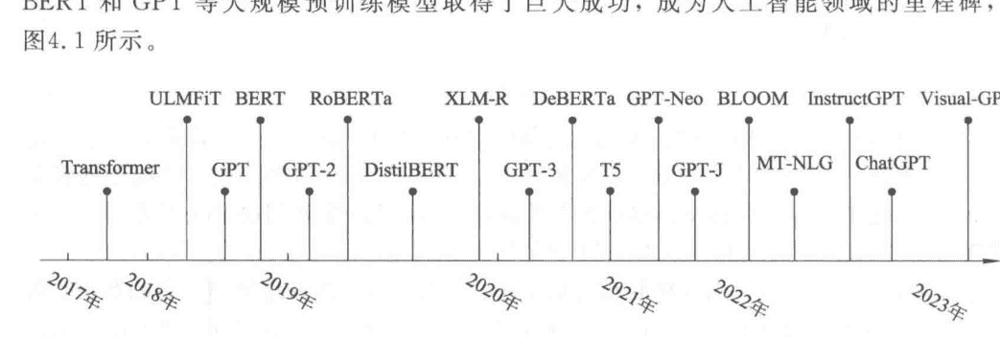
这类模型参数庞大、学习数据海量、泛化能力强，能从标记与未标记数据中汲取知识。训练完成后，知识沉淀在参数里，通过微调即可服务下游任务。

2021 年 8 月，斯坦福 HAI 下属 CRFM 将这类模型统一称为基础模型，即在广泛数据上通常以自监督方式训练，能适应大量下游任务的模型，如图4.2所示。基础模型同时涵盖预训练与规模化之意，模型先在大规模语料上预训练，再少量或零微调即可支撑应用，如图4.3所示。

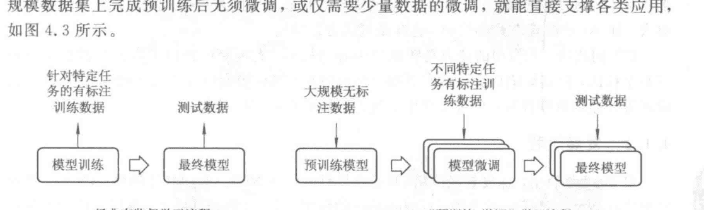

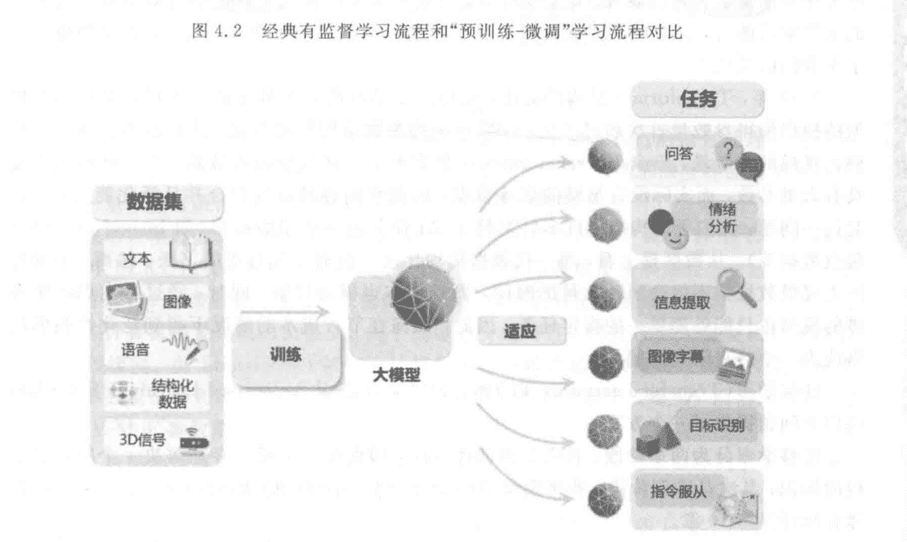
大模型参数多、结构复杂，依托强算力与海量数据训练，通用性突出，呈现涌现与同质两大特性。

(1) 涌现性。涌现指微观交互累积成宏观行为。模型行为并非显式设计而是隐式诱导。研究显示，语言模型能力随规模增长并非线性可外推，越大的模型越稳健，表现出不可预测性和群体智能的影子。若涌现无上限，强 AI 或将必然到来，这既是机遇也是风险。

(2) 同质性。能力集中，改进迅速扩散至全社区，缺陷也会被下游继承。强泛化带来效率提升，但直接落地具体场景存在风险。

### 4.1.1 发展历程
自 2012 年起，深度神经网络如 CNN、RNN、GNN 及基于注意力与 Transformer 的网络因表征能力强而广泛应用。通常模型参数越大，学习与知识获取能力越强。

2017 年 Transformer 提出，模型参数突破 1 亿；BERT 出现后首次超过 3 亿，GPT-3 超过百亿，鹏程盘古实现千亿稠密规模，Switch Transformer 突破万亿。由于参数庞大而训练数据不足，易过拟合、泛化差。于是人们手工构建 ImageNet、AWS 爬虫数据等高质量集，数据量逐代跃升，但标注成本高昂且耗时，特定训练集的模型只能处理单一任务，如何低成本获得强泛化成为热点。

迁移学习与自监督学习提供了路径。

迁移学习分预训练与微调两阶段，先让模型存储通用知识，再迁移到相关任务。具体见第 10 章。

自监督学习是利用未标注数据获取对下游有价值表征的范式和方法。其最大优势是不依赖人工标签，可用纯未标注样本，大幅降低制作成本。典型流程是先自动生成监督信号作为伪标签，再训练网络学习对下游任务有用的表征，如图 4.4 所示。

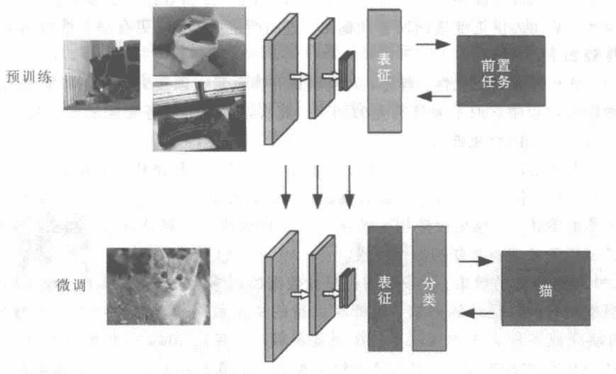
借助迁移与自监督，大模型在计算机视觉与自然语言处理领域快速普及。尤其是 Transformer 的引入，让 NLP 的深度建模成为可能，随后涌现语言、视觉、跨模态的一系列大模型。

- 1. 在语言领域的大模型。规模经历多次十倍跨越。2018 年 BERT 约 3.3 亿参数，2019 年 T5 约 110 亿，2020 年 GPT-3 达 1750 亿。参数上升带来性能提升。
- 2. 在计算机视觉领域的大模型。受图像特性影响发展较慢。Transformer 进入视觉后模型激增，ResNet101 参数在千万级，借助 MoE 的视觉模型 V-MoE 可达 150 亿，增幅近千倍。
- 3. 在跨模态领域的大模型。得益于 AIGC 快速发展。OpenAI 的图像生成模型 DALL-E 参数 14 亿；华为与港科大合作的 HERO 用于大规模视觉问答，参数 6.4 亿；Google 的 OSCAR 用于跨模态 NLP 与图像处理，参数 4.5 亿；阿里 2021 年发布的 M6 参数达 10 万亿。

### 4.1.2 大模型的优势
大模型参数量巨大、算力需求高、能处理复杂任务、可理解上下文。相比普通模型，能处理更大规模数据，捕捉更深语义依赖，提供更准确、更有创造性的输出。主要优势如下：

- (1) 具有强大的泛化性。参数大、训练集大带来大量先验知识；下游微调进一步提升泛化能力。
- (2) 能降低训练成本。尤其是 NLP 大模型具备自监督能力，减少人工标注依赖；预训练后仅用少量标记数据即可适配具体场景，降低微调数据规模。
- (3) 带来更优的效果。海量数据训练显著提升性能。GPT 系列拥有亿级参数，能从海量文本自动学习语言规律与语义，完成文本生成等任务。视觉领域，Google 2021 年发布的 Big Transfer BiT 模型参数 7.3 亿，用 ImageNet-21k 数据集 138 万张图片、21 841 类预训练，效果良好。数据规模扩大亦提升精度：ResNet50 在 ILSVRC-2012 上精度 77%，在 JFT-300M 上达 79%；ResNet152x4 在 JFT-300M 上可达 87.5%。

### 4.1.3 应用场景
大模型正围绕以下场景部署，提升生活便捷与智能化程度。

- (1) 搜索引擎。现有搜索局限于信息收集，需人工筛选。预训练问答模型学习海量知识，有替代潜质。如 ChatGPT 推出后，用户只需提出指令，模型即可自动整合呈现信息。
- (2) 办公和创作。提升办公效率，为创作者提供灵感。可实现指定文本自动生成、语法纠错、润色、数据收集等。Visual ChatGPT 等模型还能编辑生成图像，进一步节省成本。
- (3) 教育。可提供启发式教学，如 ChatGPT 支持多轮对话给出较准确回答，具备引导提问者主动思考的潜质。
- (4) 医疗。蕴含大量知识库，可帮助医护熟悉病情并提供方案，辅助导诊。因涌现性亦可辅助研究。华为云盘古药物分子大模型研究了 17 亿个小分子化学结构，可高效生成新分子、计算蛋白靶点匹配、预测生化属性并优化先导药。上海科技大学、上海交通大学等联合推出的 ChatCAD 能利用大模型的医学知识提供交互式解释与建议，如图 4.5 所示，有助于患者更清晰了解症状、诊断与治疗方案。

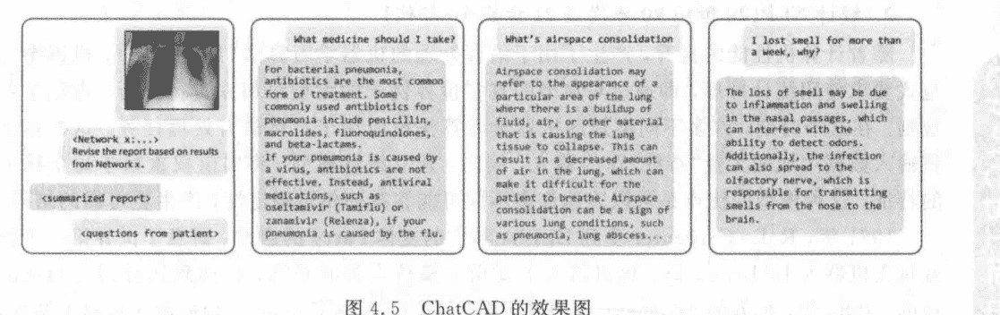
- (5) 金融。可助从业者决策与风险管理。具备数据理解力及图表图像生成能力，让风险理解更快捷直观，提升决策力。
- (6) 其他。多应用场景发展加速。盘古 CV 大模型用海量无标注电力数据预训练，结合少量标注微调，用于电力行业。阿里 M6 通过融合多模态信息，提供图文商品检索与外观设计等应用。

## 4.2 大型预训练语言模型
大型预训练语言模型是利用海量文本学习的深度网络，能捕捉语言通用知识与规律，提升自然语言处理性能，用于分类、翻译、生成等。自然语言处理研究计算机程序对自然语言的分析、理解与识别，广泛应用于机器翻译、字幕生成、智能问答等。其发展历程可分为三阶段。

1. 符号 NLP 20 世纪 50 年代至 20 世纪 90 年代
早期系统基于复杂手写规则集如 MARGIE、SAM、PAM 构建，通过规则模拟任务。1950 年艾伦·图灵发表“Computing Machinery and Intelligence”，提出图灵测试，其中包含自然语言自动解释与生成。本时期诞生了 MIT Joseph Weizenbaum 研发的聊天机器人 ELIZA，用于临床治疗模仿心理医生，技术是模式、关键词匹配与置换，未形成完整理解理论却开启智能聊天机器人时代。

2. 统计 NLP 20 世纪 90 年代至 21 世纪 10 年代
计算机性能提升带来机器学习算法如决策树。范式要求统计推理，通过大规模语料自动学习规则。大量算法被用于 NLP 任务，模型为输入特征赋予实值权重，表达答案不确定性，提升可靠性。1981 年 Rollo Carpenter 受 ELIZA 启发研发 Jabberwacky，力求通过图灵测试；1988 年 Robert Wilensky 等研发 UC UNIX Consultant，帮助用户学习 UNIX；1995 年 Richard Wallace 受 ELIZA 启发研制 ALICE，是同类中性能较好的系统。同期出现人工智能标记语言 AIML，至今仍广泛用于移动端虚拟助手。

3. 神经 NLP 21 世纪 10 年代至今
表征学习与深度神经网络 CNN、RNN、Transformer 在 NLP 中广泛应用。深度网络通常用词嵌入捕获语义，并实现端到端学习。典型网络中，RNN 难以高效矩阵运算，难以充分利用 GPU；CNN 的归纳偏置难以捕捉前后语境；Transformer 融合两者长处，具有强全局表征与高并行性，推动大规模预训练模型蓬勃发展，诞生 GPT 系列与 BERT，NLP 进入大型预训练语言模型阶段。

大型预训练语言模型采用预训练加微调两步流程：先在海量无标注数据如互联网文本上预训练，学习通用语言模式；再在小规模有标注任务数据上微调，快速提升完成任务能力。

## 4.3 GPT-1
GPT 即 Generative Pre-trained Transformer，由 OpenAI 提出，在 NLP 与 CV 任务中取得亮眼效果，可用于文章生成、代码生成、机器翻译、VQA 等。如表 4.1 所示，GPT 系列发展如下：

- (1) 2018 年，OpenAI 基于 Transformer 提出 GPT-1。
- (2) 2019 年，推出升级版 GPT-2。
- (3) 2020 年，推出 GPT-3。
- (4) 2022 年，推出 ChatGPT。
- (5) 2023 年，推出 GPT-4。

### 表 4.1 GPT 系列模型发展史

| 模型 | 发布时间 | 参数量 | 预训练数据集 |
| :--- | :--- | :--- | :--- |
| GPT-1 | 2018 年 6 月 | 约 1.17 亿 | 约 5 GB |
| GPT-2 | 2019 年 2 月 | 约 15 亿 | 约 40 GB |
| GPT-3 | 2020 年 5 月 | 约 1750 亿 | 约 570 GB |
| ChatGPT | 2022 年 11 月 | — | — |
| GPT-4 | 2023 年 3 月 | — | — |

GPT-1：预训练微调的启蒙
2018 年 OpenAI 发布的 GPT-1，参数规模约 1.17 亿。它先在海量无标注语料上训练出一个生成式语言模型，再针对具体下游任务进行有监督微调，本质上是用无监督预训练为监督学习热身。微调后的 GPT-1 系列在多个基准上都超越了当时为单一任务专门训练的领先模型，能够胜任文本分类、语义相似度分析、问答等多种工作。

### 4.3.1 GPT-1 的结构
GPT-1 仅采用了 Transformer 的解码器部分，并只使用掩码多头自注意力，如图 4.6 所示。因为掩码机制限制每个位置只能读取左侧信息，所以模型是严格单向的，只能依据前文预测当前词。

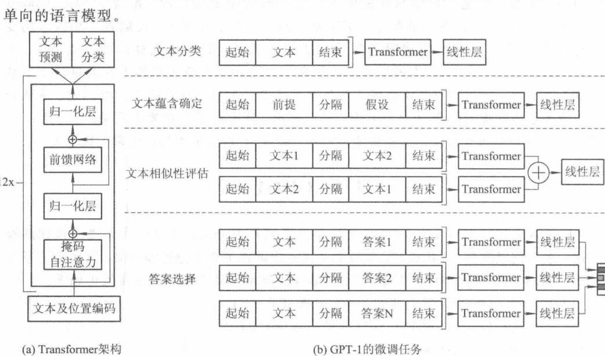

### 4.3.2 GPT-1 的数据集及参数量
GPT-1 的预训练语料是 BooksCorpus，收录了 1.1 万余本图书。语料上下文较长，有助于模型学习远距离依赖；部分书籍未正式出版，在下游数据中很难出现，也更能检验泛化能力。
模型保留了解码器的掩码多头注意力和前馈网络，并在原基础上放大规模：层数提升到 12，注意力维度从 512 扩到 768，头数从 8 增加到 12，前馈隐藏层从 2048 扩到 3072，最终参数总量约 1.17 亿。

### 4.3.3 GPT-1 的预训练
预训练的目标是语言建模，即根据已知词预测下一个词。给定语料句子序列 $U = \{u_1, u_2, \cdots, u_n\}$，用 $u$ 表示每个 token，窗口长度为 $k$ 时，任务就是在前 $k$ 个词的基础上预测第 $i$ 个词。语言模型优化目标是最大化似然值 $L_1(u)$，即

$L_1(u) = \sum \log P(u_i \mid u_{i-k}, u_{i-k+1}, \cdots, u_{i-1}; \Theta)$ (4-1)

其中，$P$ 是条件概率，可根据下式计算：

$P(u) = \text{Softmax}(h_n W_e^T)$ (4-2)

其中，$h_n$ 和 $W_e^T$ 分别有如下关系式：

$h_l = \text{Transformer\_block}(h_{l-1}) \quad \forall l \in [1, n]$ (4-3)

$h_0 = UW_e + W_p$ (4-4)

其中，$U$ 表示词向量；$W_p$ 是位置的嵌入矩阵；$W_e$ 是词嵌入矩阵，$W_e^T$ 为 $W_e$ 的转置；Softmax 表示 Softmax 激活函数；Transformer\_block 代表 Transformer 解码器结构；$l$ 代表解码器层数；$h_0$ 表示输入，$h_l$ 表示第 $l$ 层的输出，$h_n$ 表示解码器最后一次的输出。

### 4.3.4 GPT-1 的微调
得到预训练模型后，用有监督方式调整参数以适配具体任务。对于带标签数据集 $C$，给定输入序列 $\{x_1, x_2, \cdots, x_m\}$ 预测标签 $y$。
先把词送入预训练模型得到最终特征向量 $h_l^m = [h_l^1, h_l^2, \cdots, h_l^m]$，$h_l^i$ 对应 $x_i$ 的表征。再通过全连接层和 Softmax 预测标签概率，即

$P(y \mid x_1, x_2, \cdots, x_m) = \text{Softmax}(h_l^m W_y)$ (4-5)

其中，$W_y$ 为全连接层的参数。有监督微调时仍保留预训练损失 $L_1$，最终优化函数 $L_3(C)$ 为

$L_3(C) = L_2(C) + \lambda L_1(C)$ (4-6)

$L_2(C) = \sum_{x,y} \log P(y \mid x^1, x^2, \cdots, x^m)$ (4-7)

GPT-1 可处理 4 种任务：文本分类、文本蕴含判定、文本相似度评估和答案选择，部分任务单输入，部分多输入。如图 4.6 所示，处理方式各有差异。文本分类时在序列两端加入起始和结束符号后送入 Transformer，再经线性层得到类别概率。文本蕴含判定时将前提文本、分隔符、假设文本依次拼接后输入模型判断蕴含关系。文本相似度评估时构造两个序列，分别以文本1-分隔符-文本2 和文本2-分隔符-文本1 的顺序输入进行对比。答案选择时为 N 个候选答案各构造一个“文本-分隔符-答案”序列，分别计算置信度后选出最优。

### 4.3.5 GPT-1 的优势及局限性
在 QNLI、MNLI、SNLI、SciTail、Story Cloze、RACE、CoLA、STSB、QQP 等 9 个数据集上，GPT-1 超过了专门训练的有监督先进模型。预训练带来的迁移让零样本性能显著提升，凸显了生成式预训练的潜力，也为后续模型指明了用更大数据和参数释放性能的方向。局限在于训练语料来自书籍，覆盖面有限、知识不够丰富，泛化能力不足，在部分任务上表现回落。

## 4.4 BERT
与单向的 GPT 相比，BERT 靠双向 Transformer 编码器同时利用左右上下文，对文本含义和结构理解更充分。

### 4.4.1 BERT 的结构
BERT 全称 Bidirectional Encoder Representation from Transformers，由谷歌于 2018 年发布，在 11 项 NLP 任务上取得优异表现并引发广泛关注。模型采用掩码语言模型进行预训练，并以深层双向 Transformer 构建，最终生成融合左右上下文的深层表征，如图 4.7 所示。图中 E 表示词编码，Trm 表示 Transformer 模型，T 表示输出，箭头表示信息流向，可见 BERT 融合的信息比 GPT-1 更丰富。

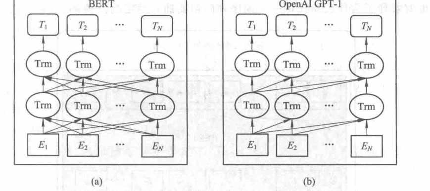

图 4.7 BERT 和 GPT-1 预训练模型架构的差异

#### 1. 编码
BERT 的输入嵌入是三种编码之和，如图 4.8 所示。第一种是词向量编码，第一个词用 [CLS] 标记，可用于后续文本分类。第二种是分割编码，为每个词添加可学习标记区分句子 A 或句子 B。第三种是位置编码。以“my dog is cute”“he likes playing”为例，先在第一句开头加 [CLS]，句末加 [SEP]，再叠加分割编码和位置编码。

#### 2. BERT 的输出
Transformer 输入输出个数相等，如图 4.9 所示。C 为 [CLS] 对应最后一层 Transformer 的输出，$T_i$ 为其他词的输出。对词级任务如序列标注、问答，把 $T_i$ 送入额外输出层预测；对句子级任务如自然语言推断、情感分类，则使用 C。这也解释了为何每个序列前都要插入分类词。

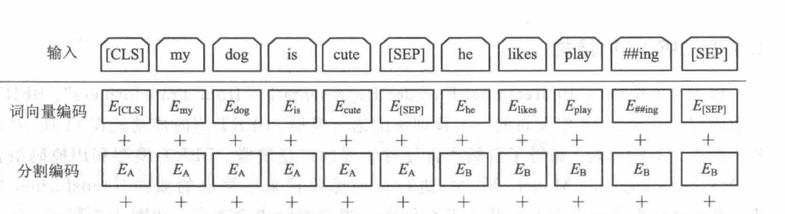

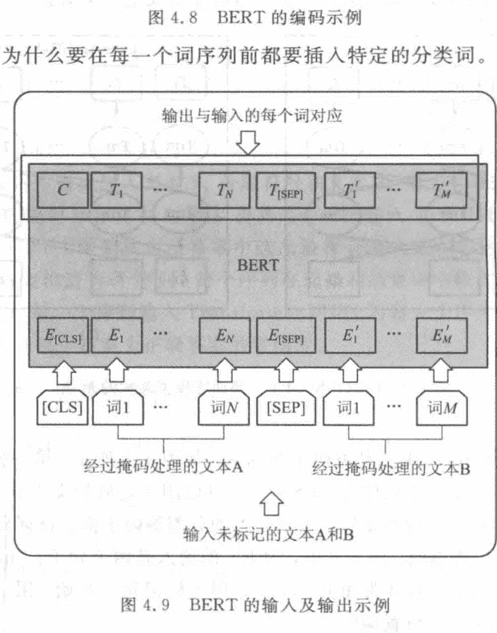

### 4.4.2 BERT 的数据集及参数量
BERT 的训练语料来自 Wikipedia 和 BooksCorpus 大型语料库。提供两种架构，参数量如表 4.2 所示。

### 表 4.2 BERT 参数量

| 架构类型 | Transformer 层数 | 隐藏层维数 | 注意力头数 | 参数量 |

| :--- | :--- | :--- | :--- | :--- |

| BERT-base | 12 | 768 | 12 | 1.1 亿 |

| BERT-large | 24 | 1024 | 16 | 3.4 亿 |

### 4.4.3 BERT 的预训练
BERT 利用自监督学习构建两个预训练任务：掩码语言模型 MLM 和下一句预测 NSP。

#### 1. 掩码语言模型
MLM 随机屏蔽句子中的词，迫使模型双向利用上下文进行复原，从而实现双向学习。举例：
> I just wanted to send an [Mask], but the network crashed.
具体做法是以 15% 概率用 [MASK] 替换训练序列中的词，再预测被遮挡的原词。该策略让模型对每个词都敏感，能够抽取全面的词表征。

#### 2. 下一句预测
MLM 主要抽取词级表征，难以直接获得句子级信息，于是引入 NSP。任务是判断给定句子是否紧跟前一句话。训练时 50% 的样本取真实相邻句标注为 IsNext，50% 随机抽取标注为 NotNext。以 [CLS] 对应的 C 进行二分类。示例 A 为正确句对，B 为错误句对。

### 4.4.4 BERT 的微调
图 4.10 展示了不同任务的微调方式。通用做法是在 BERT 上接一个额外输出层，只需学习少量参数。图(a)(b) 为序列级任务，图(c)(d) 为词级任务，[SEP] 用于分隔非连续序列。图(a) 为句对分类，与 GPT-1 的文本蕴含任务类似，输入前提和假设，输出 true/false/unknown。图(b) 为单句分类，直接对输入文本判类。图(c) 为问答，模型在输入文本中定位答案片段的起止位置。图(d) 为单句标注，对每个词输出类别。

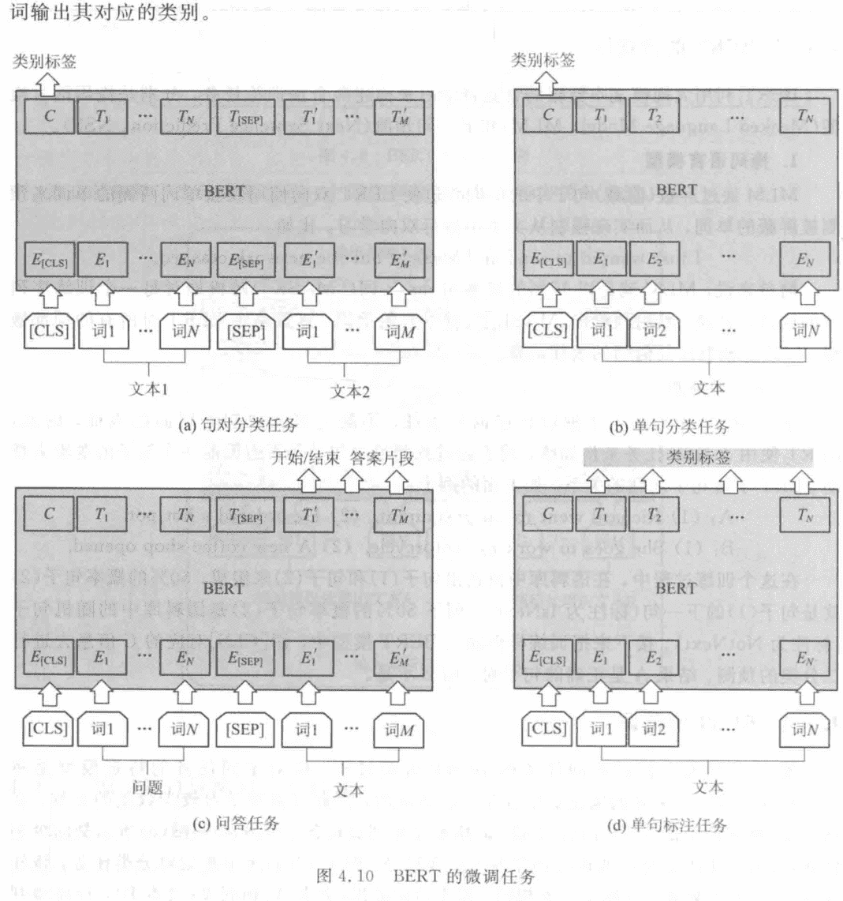

图 4.10 BERT 的微调任务

### 4.4.5 BERT 的优势及局限性
BERT 基于大规模数据和预训练-微调范式，构建在 Transformer 之上，具有强大的语言表征和特征提取能力，并通过双向建模和 MLM、NSP 两种任务获得词级和序列级语义。通用输入输出设计降低了多任务迁移成本。局限是每个批次仅 15% 的词参与预测，收敛较慢；训练时使用的 [MASK] 在推理阶段不存在，过多的掩码也会影响表现。

## 4.5 GPT-2
GPT-2 的目标是用无监督预训练模型泛化到有监督任务。它扩大了数据集和参数规模，探索仅靠语言模型训练即可完成多种监督任务的可能性。开发者认为当容量和数据充足时，无需为每个任务单独微调，模型会自动识别任务需求。

#### 1. GPT-2 的结构
整体仍沿用 GPT-1 的单向 Transformer 架构，仅做局部调整，如在最后一个自注意力块后增加归一化层。

#### 2. GPT-2 的数据集及参数量
为构建更广更质的语料，团队从 Reddit 高赞文章的出站链接中抓取数据，形成 WebText 数据集，含 800 万余文档、约 40GB 文本，远大于 GPT-1 的 Book Corpus。GPT-2 训练了 4 组不同规模模型，具体见表 4.3。随着层数和词向量长度提升，表现和鲁棒性持续改善。

### 表 4.3 GPT-2 训练的不同模型

| 参数量 | 层数 | 词向量长度 |

| :--- | :--- | :--- |

| 约 1.17 亿 | 12 | 768 |

| 约 3.45 亿 | 24 | 1024 |

| 约 7.62 亿 | 36 | 1280 |

| 约 15.42 亿 | 48 | 1600 |

#### 3. GPT-2 的学习
核心仍是语言模型，但不再做任务特定的微调。GPT-1 的目标可写为 $P(output|input)$，GPT-2 引入任务调节 Task Conditioning，形式为 $P(output|input, task)$，让同一输入在不同任务下产生不同输出。训练时多任务共享参数更新，推理时可在 Zero-Shot 条件下完成多任务。

## 4. 优势及局限性
GPT-2 验证了海量数据加大模型可实现无额外训练的迁移，表明大语言模型的潜能随规模提升而释放，为后续发展奠基。但其对无监督学习的挖掘仍不充分，后续工作多在该方向继续改进。

## 4.6 GPT-3
GPT-3 在数据规模和参数规模上比 GPT-2 大约 100 倍，在多项任务上表现突出，甚至能写出难以分辨真伪的文章和代码。架构基本延续 GPT-2。

### 1. GPT-3 的结构
整体与 GPT-2 相似，主要差异在于：共 96 层，每层 96 个注意头；词嵌入维度增至 12 888；上下文窗口从 1024 扩大到 2048；采用交替稀疏注意模式提升效率。

### 2. GPT-3 的数据集及参数量
GPT-3 拥有约 1750 亿参数和约 570GB 训练数据，涵盖 Common Crawl、WebText2、Books1、Books2、Wikipedia 等 5 个语料库。对不同质量数据赋予不同采样权重，高质量语料采样频率更高且训练多个周期。

### 3. GPT-3 的学习
GPT-3 延续 GPT-2 去除微调的思路，采用情境学习 In-Context Learning，结合足够的模型容量，直接在下游任务上进行少样本学习。

情境学习的核心思路是让模型在不触碰参数的前提下，仅凭输入上下文中的少量示范就能捕捉任务规律。换句话说，给出几个任务样例或一段任务说明后，模型通过常规的自回归补全就能完成同类实例的推断，这本质上要求预训练模型具备对任务本身的理解能力。

以模型无关元学习 MAML 为例来拆解情境学习的训练机理。元学习把任务当作一批处理，每个任务都划分为支持集 Support Set 和质询集 Query Set，分别对应常规学习中的训练集和测试集。MAML 的主旨是通过反复在支持集上训练、在质询集上检验的子任务迭代，让模型的参数逐渐迁移到一个能快速适应新任务的起点，从而省去对每个新任务的大规模调参，显著提升泛化与适应效率。该框架可迁移到图像分类、目标检测、自然语言处理等多种深度学习场景。

MAML 的运行流程可概括为：

- 1. 从支持集中抽取若干子任务，每个子任务都包含训练样本和测试样本。
- 2. 对每个子任务，用当前参数在支持集上做一次快速训练，随后在质询集上评估并计算损失。
- 3. 以该损失为信号反向传播，更新参数使模型更贴合当前子任务。
- 4. 将所有子任务的质询集拿出来做前向推理，仅用于性能监测，不参与参数更新。
- 5. 把各子任务的损失累加求和后进行梯度下降，完成一次外层更新。
- 6. 换新参数后再次在支持集和质询集上训练测试，循环迭代直至性能达标。

迭代内部包含两次更新，外循环与内循环。内循环依据任务标签对具体任务做快速适配，外循环则优化元初始化 Meta-Initialization。对网络 f 其参数记为 θ，初始值即元初始化。若同一组初始化在多个任务上表现稳定，说明该起点质量较高，否则继续修正。

在 GPT-3 中，情境学习对应元学习的内循环，而基于语言模型的 SGD 则扮演外循环的角色，如图 4.11 所示。

GPT-3 的情境学习被划分为三种形式：

- 1. 小样本学习 Few-Shot Learning。
  定义：允许输入多条示范加上任务说明。
  示例：输入“这个任务要求将英文翻译为中文。language->语言，express->表达，dessert->甜品，tree->”，模型需预测下一个输出，正确答案为“树”。

- 2. 一次学习 One-Shot Learning。
  定义：仅输入一条示范加任务说明。
  示例：输入“这个任务要求将英文翻译为中文。language->语言，tree->”，预测结果应为“树”。

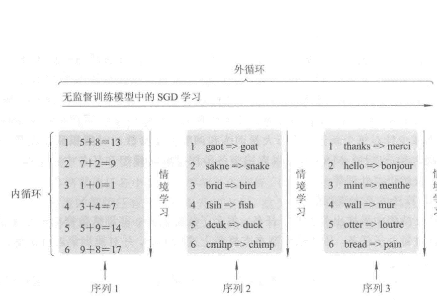

图 4.11 语言模型元学习过程

- 3. 零样本学习 Zero-Shot Learning。
  定义：不提供任何示范，只给出任务说明。
  示例：输入“这个任务要求将英文翻译为中文。tree->”，预测结果应为“树”。

实验显示，三种方式的准确率都随模型规模增大而提升，且小样本学习优于一次学习，零样本学习效果最弱。

### 4. 能力表现与局限
GPT-3 在多数零样本和小样本基准上超越当时先进方法，在数学加法、文章生成、代码撰写等任务上表现突出，为下游 NLP 提供了高质量词向量基础，有力推动了大模型落地。尽管文本质量较高，长句生成时仍会出现连贯性下降和重复现象。庞大结构导致推理成本高、可解释性差，同时受训练语料影响易出现性别、民族、种族或宗教偏见。

## 4.7 ChatGPT
相较 GPT-3，ChatGPT 在生成样式、目的适配、准确度、细节描述和上下文连贯性上明显增强，支持多轮连续对话，能主动承认错误并修正答案。它在 GPT-3 基础上引入人类反馈进行二次训练，缓解了输出不一致的问题。

### 1. ChatGPT 的基本结构
ChatGPT 由 OpenAI 于 2022 年发布，基于 Transformer 的大型 GPT 模型，复杂度远超 GPT-2 与 GPT-3，可通过 API 在资源受限环境下运行，更适合迁移到移动端、嵌入式等边缘设备。

### 2. ChatGPT 的学习过程
ChatGPT 采用人类反馈强化学习 RLHF，如图 4.12 所示，主要分三步：
- (1) 收集数据并用自监督方式对模型进行初步调整；
- (2) 收集对比数据以训练奖励模型；
- (3) 用强化学习优化策略。

该方法的细节见 8.3 节。

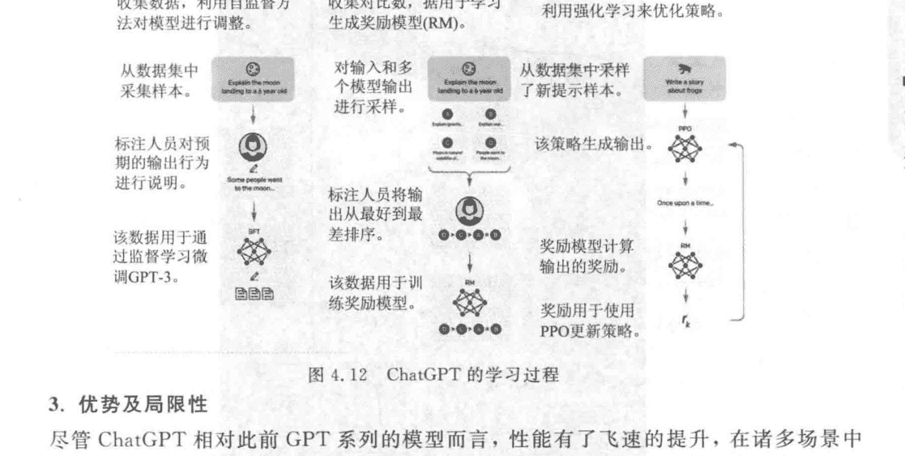

### 3. 优劣概览
ChatGPT 相比前代 GPT 系列进步显著，在众多场景具备实用价值并引发广泛讨论，但并非完美。1.4 节已系统梳理其优势与缺陷，此处不再重复。

## 4.8 GPT-4
OpenAI 于 2023 年 3 月 15 日推出 GPT-4。这是一个多模态模型，在现实任务中虽未必优于人类，但在专业与学术评测中可媲美人类，例如模拟律师资格考试排在前 10%。

### 4.8.1 GPT-4 的基本信息
GPT-4 支持图像与文本输入、文本输出，如图 4.13 所示。与 ChatGPT 一致，其行为经 RLHF 微调。目前具体结构、数据构造、训练细节未公开，仅知参数量约 1000 亿，是 GPT-3 的两倍，并在大型代码标记集上表现优异。


图 4.13 GPT-4 的展示图

### 4.8.2 GPT-4 的亮点
1. 可预测扩展的深度学习堆栈
构建可预测的深度学习堆栈是为了避免对超大模型直接做大规模调优带来的高昂计算成本。研发团队打造了跨尺度可预测的基础设施与优化手段，使其能从小模型可靠地预估 GPT-4 的表现。

2. 模型辅助安全流程
RLHF 微调后，模型对不安全输入可能变得脆弱，且安全与不安全输入都可能产生意外行为，根源在于奖励模型数据收集时标注指引不清，可能导致生成犯罪建议、过度拒绝或逃避等现象。

为在更细粒度上引导行为，团队提出安全方法，结合额外与安全相关的 RLHF 训练提示和基于规则的奖励模型 RBRM。RBRM 是一组零样本 GPT-4 分类器，在 RLHF 微调期间为策略模型提供额外奖励信号，促使模型正确拒绝有害内容或不拒绝无害请求。

RBRM 训练流程为：接收提示、GPT-4 输出、人工安全规则；依据标准对输出分类，如期望风格拒绝、不期望风格拒绝、含禁止内容、安全非拒绝；随后在安全相关提示上训练并奖励拒绝有害内容的决策。该方法可减少不必要的拒绝，使行为更贴近预期。

3. 优势及局限性
GPT-4 获得多家企业关注，优势包括可处理更多输入如图片和超过 25 000 词的长文本、完成图像说明分类分析、生成更高质量创意文本、具备更强数学、逻辑、常识推理能力、更贴合人类价值观与道德标准。在 MMLU 基准，涵盖 57 个主题的英语多项选择题中，其英语成绩大幅领先，且在 24 种语言的翻译版上均优于其他模型。

OpenAI 同样强调其并非完美，仍需大量计算与数据，无法处理语音、视频等特定模态，存在社会偏见、幻觉与对抗性提示风险。

# 第5章 人工智能基础大模型
得益于海量参数、Transformer 机制以及预训练加微调范式，基于 Transformer 的大模型能更好地捕捉上下文与长距离依赖，成为处理自然语言、图像等复杂任务的有力工具，广泛推动 NLP、语音识别、图像处理与推荐系统等领域发展。本章简要介绍国内外经典与前沿的 Transformer 大模型技术原理、特性和应用。

## 5.1 谷歌的 ViT-22B 视觉大模型
谷歌于 2023 年 4 月 6 日发布当时规模最大的视觉 Transformer ViT-22B，含 220 亿参数。该模型扩展自视觉 Transformer，视觉感知力接近人类，可实现图像分类、分割、单目深度估计等任务，如图 5.1 所示。通过对原始架构做细微但关键的修改，研究人员提升了硬件利用率与训练稳定性，在多项任务上取得更高上限。

相较传统视觉 Transformer，ViT-22B 的核心改进为并行层设计、Query/Key 归一化、偏置项修改、异步并联线性运算。

### 1. 并行层设计 Parallel layers
标准 Transformer 中 Attention 与 MLP 顺序执行，ViT-22B 改为并行执行，公式如下：

```
$y' = \text{LayerNorm}(x)$
$y = x + \text{MLP}(y') + \text{Attention}(y')$
```

通过融合 MLP 与注意力层的线性投影实现额外并行化，如图 5.2 所示。注意力层的 Q、K、V 矩阵乘法与 MLP 第一线性层合并，输出投影与 MLP 第二线性层合并。该技术源自 PaLM，在不降性能前提下使最大模型训练提速约 15%。

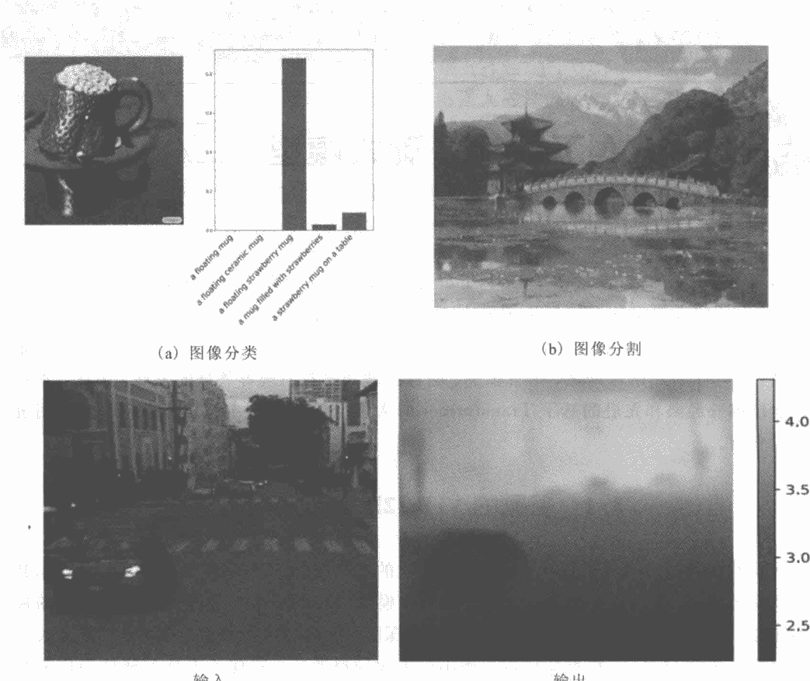

### 2. Query/Key(QK)归一化
扩展 ViT 时，研究者在 80 亿参数模型训练数千步后发现损失发散，主因是注意力数值过大导致权重趋零。借鉴 PaLM，将 LayerNorm 应用于 Q、K 计算过程，具体形式为：

```
$$\text{softmax}\left[\frac{1}{\sqrt{d}}\text{LN}(XW^Q)(\text{LN}(XW^K))^T\right]$$
```

式中 d 为 Q/K 维度，X 为输入，LN 代表层归一化，W^Q、W^K 为权重。归一化避免注意力矩阵异常导致训练发散，如图 5.3 所示。

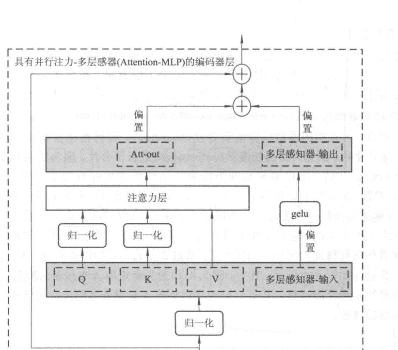

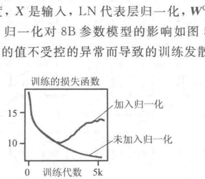

### 3. 偏置项修改
与 PaLM 一致，ViT-22B 去掉了 QKV 投影中的偏置，但保留了所有 MLP 层输出的偏置，并在所有归一化层中移除偏置与中心化，使硬件利用率提升约 3%，质量未受影响。

### 4. 异步并联线性运算 asynchronous parallel linear operations
大规模模型需分片部署参数与激活，矩阵乘法等操作需跨设备通信。ViT-22B 提出异步并行线性运算，在 TPU 矩阵乘法单元计算的同时进行设备间激活与权重的通信，降低等待时间，提升效率。该方法包括行分片与列分片两种方式，图 5.4 显示 4 台设备对 y=Ax 的重叠通信过程。

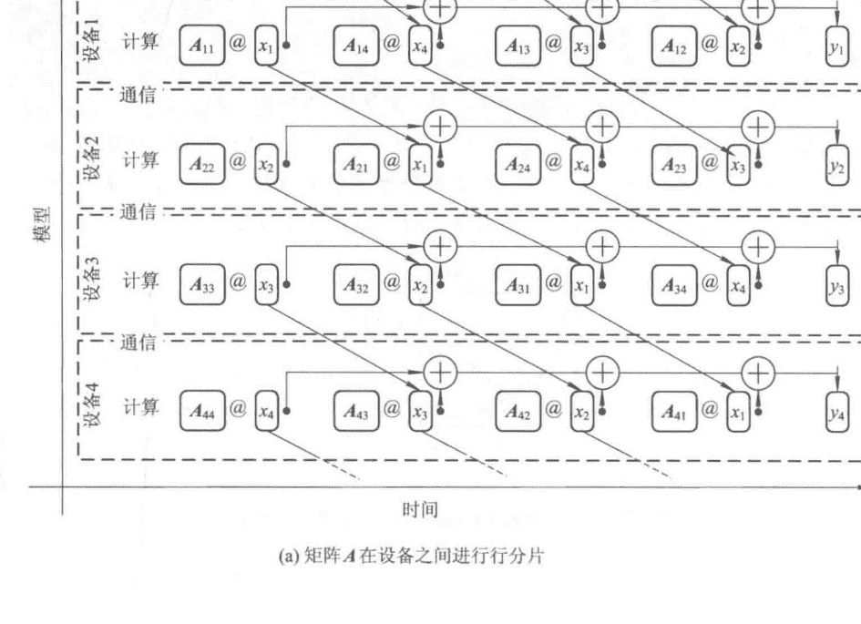

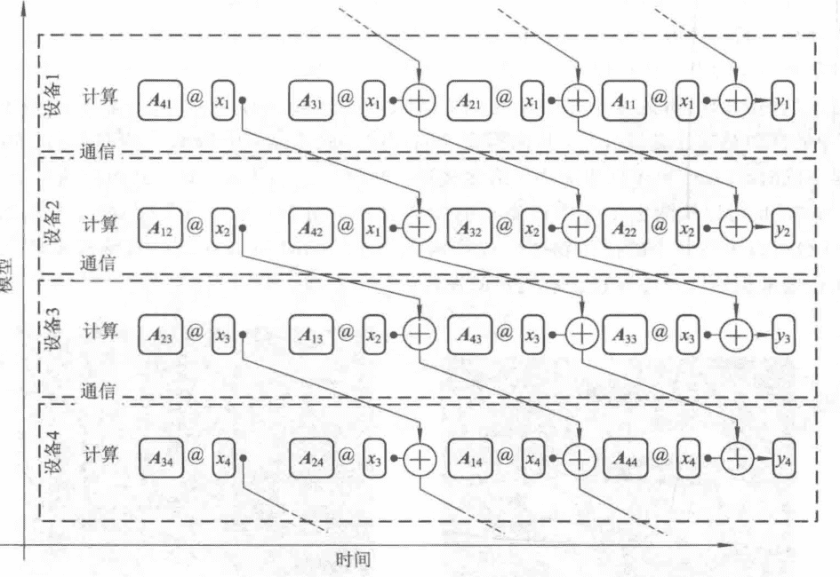

(b) 矩阵 A 在设备之间进行列分片

图 5.4 异步并行线性运算(y=Ax)

ViT-22B 基于 JAX 框架与 FLAX、Scenic 库，同时利用模型与数据并行，采用 jax.xmap API 精细控制中间体分片与芯片间通信。

ViT-22B 是当时最大的视觉 Transformer，通过三点架构改动实现优异硬件利用率与训练稳定，在迁移、语义分割、深度估计等密集任务上表现强劲。随规模扩大性能持续提升，并在公平性、形状与纹理偏差、鲁棒性等方面展现更贴近人类视觉的特性，体现类人语言预训练模型向视觉领域的扩展潜力。

## 5.2 Meta 的 Segment Anything Model(SAM)分割大模型
Meta AI 于 2023 年 4 月 5 日发布首个具备提示能力的图像分割基础模型 Segment Anything Model，SAM。

## 5.2 Segment Anything Model (SAM)
SAM 可对图片或视频中任意对象实现一键分割，并能零样本迁移到其他任务。模型支持多模态提示，包括文本词、关键点、边界框，可执行交互式与自动分割，泛化性强。当用户点击水中龟壳倒影区域时，可得到完整倒影掩码，如图 5.5(a)；对整图自动分割可得到各区域，如图 5.5(b)；点击不明确区域时可生成多个有效掩码，如图 5.5(c)；输入文本提示也可定位并分割对应物体，如图 5.5(d)。此外 SAM 可为视频物体生成掩码，并可从 AR/VR 耳机等系统获取视线提示。


在 SAM 项目中，可在 demo 界面直接交互体验，无需注册，整体流程如下：

SAM 交互体验与模型原理速览

第一步是打开官方演示链接，阅读并同意使用条款后会进入选图界面，如图 5.6 所示。该页支持两种素材来源：从平台自带图库挑选，或上传本地图片。

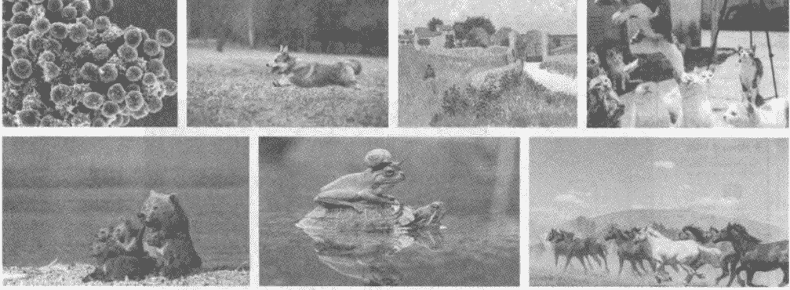

图 5.6 SAM 项目交互体验界面：选择图片

确认图片后进入交互方式选择页，如图 5.7 所示。左侧列出四种内置操作模式：Hover & Click、Box、Everything、Cut-Outs。

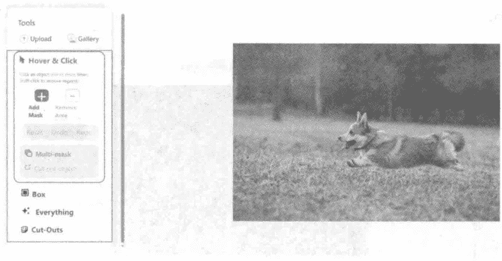

图 5.7 SAM 项目交互体验界面：选择交互方式

① Hover & Click 借助悬停加点击定位目标，左键添加、右键移除。完成后点按 Cut out object 即可生成对应掩码，若需更精细可开启 Multi-mask 多次追加标注点，所有结果会汇总到 Cut-Outs 列表。如图 5.8 所示，鼠标选中狗狗后整只轮廓被完整分割出来。

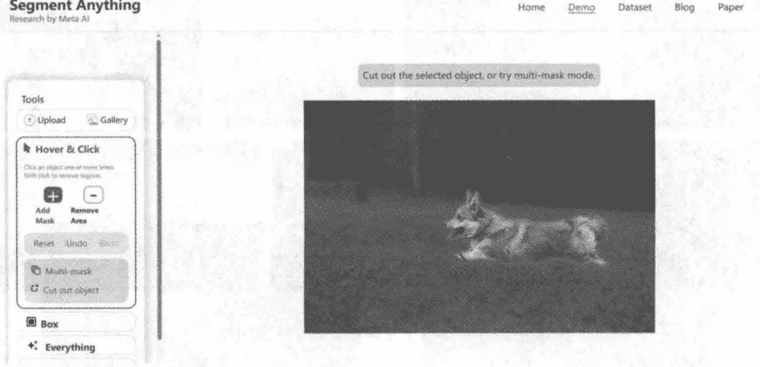

② Box 则是用鼠标拖拽绘制矩形框圈定范围，具体是按住左键画框。同样通过 Cut out object 保存，输出也会进入 Cut-Outs 列表。如图 5.9 所示，框住狗狗后其整体被分割出来。

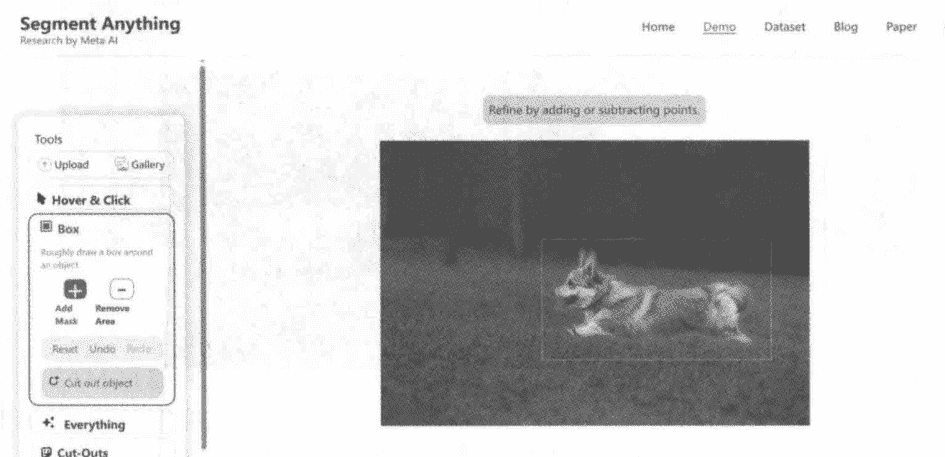

③ Everything 支持一键对整张图片进行全景分割，把所有可识别区域一次性拆分，掩码全部收进 Cut-Outs 列表。如图 5.10 所示，图像中的各个目标都被分别分割。

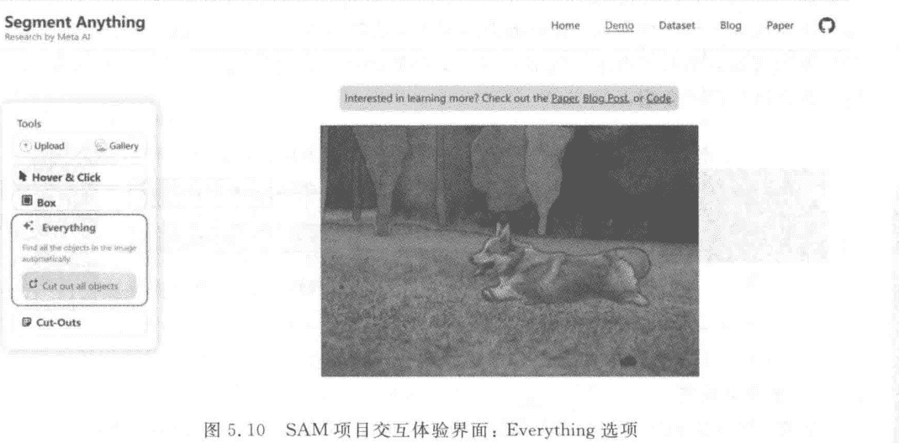

④ Cut-Outs 负责结果导出，在列表中右键目标图并选择“将图片另存为”即可，如图 5.11 所示。

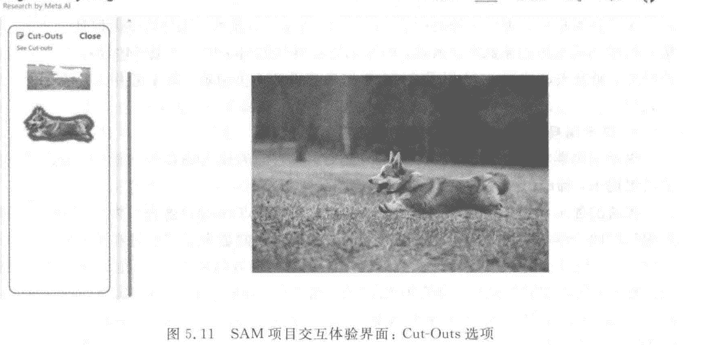

模型在 SA-1B 数据集上完成训练。SA-1B 由 Meta 发布，是目前规模最大的分割标注集，包含约 1100 万张高分隐私友好的图像和 11 亿个高质量掩码。整体结构由图像编码器、提示编码器和轻量级掩码解码器构成，如图 5.12 所示，三者协同产出有效掩码。下面按文献[38]简述。

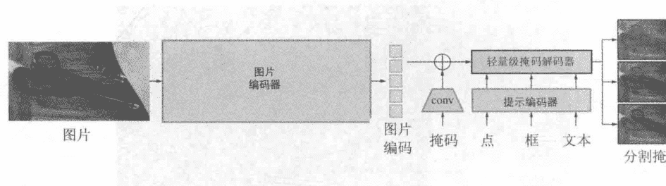

图 5.12 SAM 架构示意

### 1) 图像编码器
编码器本质上是提取 C×H×W 特征的网络。为兼顾可扩展性和强大预训练表征，SAM 使用 MAE 预训练的视觉 Transformer 处理高分辨率输入。具体采用 ViT-H/16，具备 14×14 窗口注意力和四个全局注意力块。输出相对输入缩小至 1/16。

常规输入分辨率为 1024×1024，通过缩放和短边填充获得，此时输出为 64×64。为压缩通道，先后使用 1×1 与 3×3 卷积降至 256 通道，每层后接归一化。

### 2) 提示编码器
提示编码器把背景点、掩码、边界框或文本实时编码进图像向量。提示分稀疏和密集两类。

稀疏提示映射为 256 维嵌入。点由位置编码加前景/背景学习嵌入之和表示；框由左上角位置编码加“左上角”学习嵌入、右下角位置编码加“右下角”学习嵌入组成；文本借助 CLIP 文本编码器表示。

密集提示即掩码，与图像空间对应。输入掩码尺寸约为图 5.12 中输入的 1/4，经两个 2×2 步长 2 的卷积下采样 4 倍，通道分别为 4 和 16，再经 1×1 卷积映射到 256。每层用 GELU 激活和归一化。掩码嵌入与图像嵌入相加，若无掩码则加入“无掩码”嵌入。

### 3) 轻量级掩码解码器
解码器依据图像编码器和提示编码器的嵌入预测掩码。它把图像嵌入、提示嵌入和输出标记映射到掩码，所有嵌入在解码器内更新，采用提示自注意力和交叉注意力机制。

SA-1B 专为新一代分割模型开发评估，目前仅限研究许可。其特点：

- (1) 多样性强，覆盖自然场景、城市环境、医学影像、卫星影像等，确保泛化。
- (2) 规模庞大，超十亿高质量标注，提供充足训练素材。
- (3) 标注精细，掩码质量高。RAI 分析显示其在地域和收入分布上公平性优于多数开源集，来自欧洲、亚洲、大洋洲及中等收入国家的图像比例显著提高，至少包含 2800 万个来自各地区尤其是非洲的掩码，总量是此前任何数据集的十倍。

得益于 SA-1B，SAM 可通过提示工程适配各类下游分割任务，并在多项基准上取得领先。

尽管表现突出，SAM 仍有局限。大图像编码器下整体推理难以实时；文本到掩码仍处探索阶段，鲁棒性不足；语义分割与全景分割所需的简洁提示设计尚不明确。

作为开源模型，SAM 正推动计算机视觉研究，有望成为 AR、VR、内容创作、科学研究及通用 AI 系统的重要组件。

## 5.3 微软 Visual ChatGPT 多模态对话系统
2023 年 3 月 8 日微软公开 Visual ChatGPT。该系统在 ChatGPT 基础上集成多种视觉基础模型，实现多模态交互。它并非从零训练，而是基于 ChatGPT 构建，将 Transformers、ControlNet、Stable Diffusion 等视觉模型与 ChatGPT 结合，用户可通过聊天发送信息并在对话中接收图像。通过不同视觉基础模型与 ChatGPT 协作，可实现：

- (1) 收发文本与图像；
- (2) 支持复杂视觉问答或视觉编辑指令，通过多步推理调用工具解决复杂视觉任务；
- (3) 提供反馈、总结、纠错及对模糊指令的主动澄清。

用户可按 Quick Start 教程本地部署。系统架构如图 5.13 所示，由用户查询模块、提示管理器、视觉基础模型、调用 ChatGPT API 与推理模块、用户输出模块构成。如图 5.13 所示，用户上传一张黄色花朵图并输入“请根据该图像生成的深度图再生成一朵红色花朵，然后逐步将其制作成卡通图片”，输出模块即可生成对应图像。

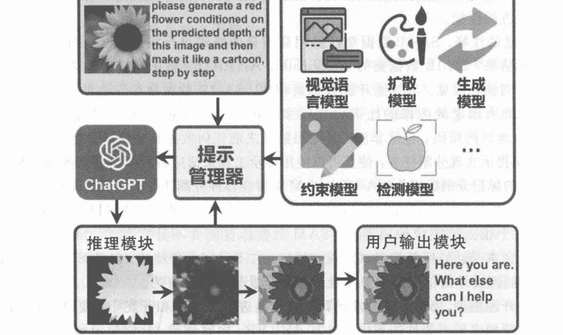

多轮对话流程如图 5.14 所示，左侧为三轮对话示例，中间为 Visual ChatGPT 迭代调用视觉基础模型及答案的流程图，右侧为模型处理第 2 个问答的细节。该系统借助 ChatGPT 与提示管理器完成意图识别与语言理解，再决定后续操作。

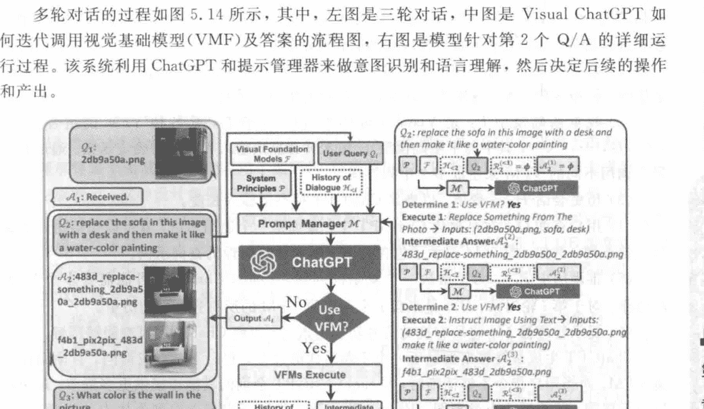

示例中：

- (1) 第一轮：用户上传图片 Q1，模型回复已收到 A1。
- (2) 第二轮：① 用户要求“把沙发改为桌子”且“风格改为水彩画” Q2，模型判断需调用 VFM；② 判定为替换物体，调用 replace object 生成首幅图；③ 判定为语言驱动的图像修改，调用 pix2pix 生成第二幅图；④ 认为需求已满足，输出第二幅图 A2。
- (3) 第三轮：用户提问 Q3，模型判断无需 VFM，调用 VQA 模块直接作答 A3。

对于对话集合 $S=\{(Q_1, A_1), (Q_2, A_2), \cdots, (Q_n, A_n)\}$，第 $i$ 轮答案 $A_i$ 需一系列 VFM 与中间输出 $A_j^i$。模型定义为：

$A_i^{j+1} = \text{ChatGPT}\{M(P), M(F), M(H_{<i}), M(Q_i), M(R_i^{<j}), M(F(A_i^j))\} \quad (5-4)$

其中 $P$ 为系统规则，$F$ 为视觉基础模型集合，$M(H_{<i})$ 为历史会话记忆，$M(Q_i)$ 为第 $i$ 轮用户查询，$M(R_i^{<j})$ 为该轮推理历史，$M[F(A_i^j)]$ 为对各 VFM 输出的管理。具体地：

- (1) 系统原理 $P$：提供基本规则，如对图像文件名敏感时使用 VFM 而非基于聊天历史生成。
- (2) 视觉基础模型 $F$：核心组合 $F=\{f_1,f_2,\dots,f_N\}$，每个 $f_i$ 为确定性函数，通过逻辑调用产生中间答案。
- (3) 历史会话 $H_{<i}$：受 ChatGPT 输入长度限制。
- (4) 用户查询 $Q_i$：包含语言与视觉查询，如图 5.14 中文本加图像。
- (5) 推理历史 $R_i^{<j}$：解决复杂问题时多 VFM 协作的历史记录。
- (6) 提示管理器 $M$：把视觉信号转为语言供 ChatGPT 理解。

ChatGPT 生成答案为迭代过程，会自我提问并自动调用更多 VFM。指令不清时，系统会主动索取细节，避免臆测。得益于扩散模型等视觉模型，ChatGPT 从文本走向视觉，但仍处于早期，面临挑战：

- (1) 依赖 ChatGPT 与视觉基础模型的准确性；
- (2) 需大量提示以区分不同 VFM；
- (3) 多次调用导致实时能力受限；
- (4) 词向量长度限制可用视觉模型数量；
- (5) 安全与隐私风险，尤其涉及远程 API。

Visual ChatGPT 是一个开放的视觉基础模型集合，使聊天机器人输入输出超越语言，兼顾文本与图像，并以上下文切换模式提升智能与互动趣味。

## 5.4 华为盘古大模型体系
盘古大模型由华为提出，涵盖自然语言、计算机视觉及气象等领域：

- (1) 盘古 NLP 大模型采用编码器-解码器结构，兼顾理解与生成，微调时只需少量样本即可适配。2019 年在 CLUE 中总分 83.046，位居榜首并创下多项纪录，成为当时最接近人类理解水平的预训练模型之一。
- (2) 盘古 CV 大模型是业界最大 CV 模型之一，支持分类、分割、检测，并实现按需抽取以适配大小与速度需求。首个兼顾判别与生成，采用分层语义对齐与语义调整，在浅层特征可分离性与小样本学习上达到领先。
- (3) 盘古气象大模型精度首次超越传统数值预报，速度提升千倍，可秒级给出 1 小时至 7 天的逐小时预报，涵盖重力势、湿度、风速、温度、气压等变量。基于 3DEST 网络与分层时间聚合算法，在关键要素与常用时段均表现优异。

盘古系列中文优化良好，融合 5G、云计算、物联网等技术优势，应用范围广，并通过分布式计算实现在线训练与增量学习。随着数据增长模型持续优化，扩展性强。主要局限在于训练成本高、数据安全问题、语义理解仍待提升，以及市场竞争激烈。

## 5.5 阿里通义千问大模型
通义千问由阿里提出，是通用 AI 大模型，于 2023 年北京阿里云峰会发布。阿里巴巴集团董事会主席兼 CEO、阿里云智能集团 CEO 张勇表示，未来所有产品将接入该模型升级。2023 年 4 月 7 日，阿里云宣布开始邀请用户体验测试。该模型由阿里达摩院研发，可答疑、创作、写代码并表达观点，主攻文本生成，未涉及文本-图像等多模态。模型网页页面如图 5.15 所示。


图 5.15 通义千问大模型网页页面

通义千问场景化能力速览

在实际可用层面，通义千问被划分为提效、居家、休闲三大使用场景。提效方向提供提纲撰写、SWOT拆解、商品文案自动生成等功能；居家方向能给出按口味定制菜谱、辅导小学生作文以及进行文学创作；休闲方向则主打彩虹屁互动、情书撰写、专属写诗体验，整体来看其文本生成能力已覆盖日常多种情境。

技术底座属于基于神经网络的自然语言处理系统，核心架构以Transformer为主并配合大规模预训练。运行逻辑是把用户输入的问题与知识库文本进行比对后返回最相关的回答。优势体现在三方面：回答的准确率较高，能应对不少复杂提问；学习迁移能力强，可吸收新数据并处理跨领域问题；体量允许借助更多算力进行扩展来提升性能。

短板同样明显：训练所需数据与算力投入巨大，成本偏高；结构复杂度高，训练与调优耗时较长；在边界情况下鲁棒性不足，易出现错误，落地仍需人工复核。

从评测结果看，通义千问具备一定常识储备与初步逻辑推演能力，复杂理科计算仍有提升空间；文字创作方面尤其是翻译表现突出，实用价值较强。综合来看，未达到GPT-4水准，但在国内属于领先阵营。

## 5.6 百度的“文心一言”大模型

百度于2023年3月16日对外发布生成式对话产品“文心一言”ERNIE Bot并开启邀请内测。该产品承接ERNIE与PLATO两大模型体系，具备文学创作、商业文案创作、数理逻辑推算、中文理解、图文多模态生成五大能力，在中文场景下拥有天然优势。

“文心一言”界面如图5.16所示，内测体验需要提交申请。

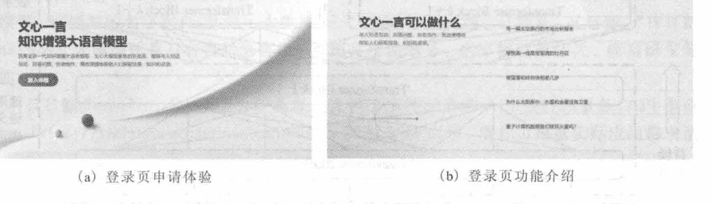

底座依赖飞桨PaddlePaddle深度学习框架并共享其生态。支撑技术包含监督微调、基于人类反馈的强化学习、提示工程、知识增强、检索增强以及对话增强。前三项属于大语言模型的通用做法，在ERNIE与PLATO中已有沉淀并在文心一言里进一步打磨；后三项则是百度对自身优势的再创新，也是未来持续强化的关键。

### 1. 知识增强
知识增强可分为内化与外用两种形式。内化指从海量知识与无标注语料中按语义单元进行学习，利用知识图谱构建训练样本把知识固化到模型参数里；外用则引入外部多源异构知识，用于推理与提示构建。

ERNIE 3.0是面向知识增强的多范式统一预训练框架，如图 5.17 所示。ERNIE 3.0 将自回归网络与自编码网络融合预训练，并引入大规模知识图谱类数据。自回归部分采用Transformer-XL结构，支持长文本建模；自编码部分在ERNIE 2.0的多任务增量式预训练基础上持续强化语义理解，并新增知识增强预训练任务。多范式训练在零样本/小样本任务上表现突出，也能适配传统微调，在理解、生成与零样本任务上均有较好表现。


### 2. 检索增强
检索增强源于以语义理解与语义匹配为核心的新一代搜索架构。通过实时引入搜索结果，为大模型提供时效性强、准确度高的参考信息，这也是文心一言在部分问答上优于ChatGPT的重要原因之一。

### 3. 对话增强
依托对话技术积累，“文心一言”具备记忆机制、上下文理解与对话规划能力，从而提升对话的连贯性、合理性与逻辑性。同时系统会融合多种类型数据与知识，自动构造包含示例、提纲、规范、知识点、思维链等提示，提供丰富参考以激发模型相关知识，生成高质量结果。

目前它是全球规模最大的中文对话模型，中文理解与把控力更强。除文本外，还能输出图片、视频等多模态内容，甚至能把文字用方言读出。它既可对话问答，也可辅助创作，高效帮助用户获取信息、知识与灵感。定位上它是面向人工智能基座的赋能平台，计划推动金融、能源、媒体、政务等行业的智能化变革，重塑生产力工具。

## 5.7 商汤的“日日新 SenseNova”大模型

商汤科技董事长兼首席执行官徐立于2023年4月10日宣布推出“日日新 SenseNova”大模型。名称取自《礼记·大学》“苟日新，日日新，又日新”。体系具备自然语言生成、图像生成服务、感知模型预标注、模型研发等功能。

为政企客户提供多种灵活的接口与服务，申请网址：https://techday.sensetime.com/list，如图 5.18 所示。客户可按实际需求调用各项AI能力，以低门槛、低成本、高效率方式实现应用。


本次发布包含1800亿参数的中文语言大模型应用平台“商量 SenseChat”与一系列生成式AI模型及应用，具体如下。

应用 1：1800亿参数的“商量 SenseChat”支持超长文本知识理解，具有问答、理解与生成等中文语言能力。同时可作为编程助手帮助开发者高效编写调试代码；可充当健康咨询助手提供个性化医疗建议；也可作为PDF文件阅读助手从复杂文档中抽取概括信息。应用示例见图 5.19。


应用 2：“日日新 SenseNova”还具备文生图、2D/3D数字人生成、大场景/小物体生成等一系列生成式AI模型及应用，包含“秒画 SenseMirage”文生图创作平台、“如影 SenseAvatar”AI数字人视频生成平台、“琼宇 SenseSpace”和“格物 SenseThings”3D内容生成平台。

- “秒画 SenseMirage”文生图创作平台应用示例见图 5.20，其融合商汤自研文生图模型，支持二次元、三次元等多种风格，能呈现光影细节。平台还支持直接导入多平台开源模型或上传本地模型并进行特异性推理加速优化。结合自研模型与训练能力，用户可免除本地部署流程，高效生成更多样内容。
- “如影 SenseAvatar”AI数字人视频生成平台仅需一段5分钟真人视频素材，即可生成声音、动作自然、口型准确、多语种精通的数字人分身。
- “琼宇 SenseSpace”和“格物 SenseThings”3D内容生成平台应用示例见图 5.21，其可高效、低成本生成大规模三维场景与精细物件，为元宇宙、虚实融合应用打开新想象空间。

无论语言大模型还是文生图、数字人生成，都离不开大规模AI基础设施算力支撑。商汤AI大装置SenseCore拥有行业领先的算力输出能力、超大模型训练及大规模推理能力，将成为AGI与大模型时代的基础设施服务领导者。


图 5.20 应用示例：“秒画”


图 5.21 应用示例：“琼宇”与“格物”

技术层面，基于AI大装置SenseCore与“日日新 SenseNova”体系，商汤面向行业伙伴提供涵盖自动化数据标注、自定义大模型训练、模型增量训练、模型推理部署、开发效率提升等多种模型即服务：

- 基于预训练大模型的自动化数据标注可实现较人工标注近百倍效率提升。
- 自定义大模型训练与模型增量训练服务能帮助客户快速利用自有数据训练模型，包括在预训练大模型之上构建垂域行业模型，生产千行千面的定制模型。
- 模型推理部署服务可将推理效率提升100%以上，降低服务成本。

相比Stable Diffusion，商汤作画大模型基于2019年起研发的通用大模型设计体系，采用更先进的结构设计与大batch训练优化，参数量为Stable Diffusion的数倍。

核心技术包含自研的hierarchical inference experts、mixture of token experts、image quality-aware distributed training、texture-guided cross-attention learning等算法，因而具备更优的文本理解泛化性、图像生成风格广度以及图像高质量生成细节。

市面上所有LoRA模型多基于Stable Diffusion或其变体训练。依托商汤基模型的强泛化能力，用其替代Stable Diffusion可借助更少数据快速训练出更高质量LoRA模型，实现更优风格定制化图像生成，该功能在“秒画”平台5分钟可完成。

对进阶创作者，“秒画 SenseMirage”平台也支持上传数据集进行微调、自训练，定制个人风格LoRA模型，拖拽20张图片训练集约5分钟即可完成训练，显著降低训练门槛。同时用户可一次性导入Hugging Face、Civitai、GitHub等第三方社区开源模型进行体验，借助商汤AI大装置SenseCore强大的GPU算力集群与推理加速功能，无需本地部署即可高效生成内容，使创作更便利。

这些强大易用的内容生成能力将改变内容生产行业的生产范式，突破创意天花板，重塑内容生产行业生态并打开新增长空间。随着商汤科技“日日新 SenseNova”体系不断优化，未来会更大程度驱动产业升级。

“日日新 SenseNova”也已为商汤自身业务带来突破。例如在智能驾驶领域，基于视觉大模型，商汤实现了可识别3000类物体的BEV环视通用感知算法实车量产，并构建感知、决策一体化的自动驾驶多模态模型，带来更强环境、行为、动机解码能力。

## 5.8 西电的“西电遥感脑”大模型

我国首个能处理多源遥感数据的智能解译大模型平台“西电遥感脑——大数据智能解译平台”于2021年在“一带一路”人工智能大会开幕式上正式发布。该平台由西安电子科技大学智能感知与图像理解教育部重点实验室自主设计研制。平台以“人工智能+云”赋能遥感及空间信息服务，实现多源遥感数据的智能实时解译和结果在线可视化分析，可应用于城镇规划发展、国土资源监测、灾害监测评估、实时目标监控、智慧城市建设等多种场景。

平台模拟脑神经结构与信息处理机制，搭载人工智能算法，构建集基础算力、稀疏感知、影像解译、数据治理、场景应用一体化的智慧遥感综合解决方案，突破传统遥感行业算力瓶颈与专业壁垒，实现遥感数据分析智能化、便捷化、专业化。

“西电遥感脑”界面如图 5.22 所示，内测体验需要提交申请。


技术层面实现三大突破。

### 1) 多源数据分析，多种任务并行
平台实现对多源遥感数据及多种任务的大模型智能解译，可对体量庞大数据进行数字化深入分析。不仅支持全色、可见光、多光谱、高光谱、SAR影像等常规遥感静态数据解译，还支持光学遥感视频、SAR遥感视频等动态数据分析。目前已开放地物要素理解、目标检测识别、要素变化检测、视频智能解译四大类算法，共包含20多个子任务。基本满足遥感影像解译行业需求，可对遥感信息进行全天时、全天候精确解译与快速处理。平台算法库如表 5.1所示，可见光地物分类结果图如图 5.23所示。

### 2) “云十端”架构设计，操作简单快捷
平台基于“云服务+客户端”架构模式，将运算处理服务置于云端，可实现计算资源集中高密度调用，使用户突破时空限制，打破算力瓶颈，提高数据处理效率。界面简洁易操作。用户仅需通过浏览器登录网页账户即可访问平台进行遥感数据解译任务，按“上传解译数据”“选择解译任务”“划定解译区域”三步，点击开始解译即可得到结果。平台操作首页与SAR数据地物提取结果分别如图 5.24与图 5.25所示。


图 5.24 平台操作首页


图 5.25 SAR数据地物提取结果

### 3）智能统计分析，高效解译处理
平台搭载多种先进AI算法，大模型可高效完成数据全方位解译及智能化统计分析。对地物提取任务，可自动统计各类地物面积占比，按地面空间分辨率计算实际面积；对目标检测任务，可自动检测并统计各类目标数量；对视频解译任务，可对目标实时跟踪并计算目标速度，统计运动目标数量。通过智能化统计分析功能，帮助分析人员快速、全面了解遥感影像内容，深入挖掘数据价值，为决策提供可靠客观数据支撑。解译结果示例如图 5.26所示。


图 5.26 解译结果示例

## 5.9 西电的“智瞳医行”大模型

能处理多源医学影像数据的智能解译大模型平台“智瞳医行——IPIU智能医疗影像辅助诊疗系统”由西安电子科技大学智能感知与图像理解教育部重点实验室自主设计研制。该平台以“人工智能+云”赋能医学影像信息服务，通过图像处理技术与解译方法，实现多源医学影像数据智能实时解译和结果在线可视化分析，将影像解译为医生所需有用信息，如肺炎感染、脏器功能、脑肿瘤、乳腺病变等，可用于疾病筛查诊断、手术辅助、医学研究等多种场景。平面操作界面如图5.27所示。

平台实现对多种来源医学影像数据及多种任务的大模型智能解译，可对体量庞大数据进行数字化深入分析。不仅支持CT、2D MRI、超声等常规医学影像静态数据解译，还支持3D MRI等多维数据分析与多维度解译结果可视化。目前已开放肿瘤异常检测、多器官分割、肺部感染诊断、结肠癌原发灶分割、乳腺癌病变分割、骨折分类等10余项任务。解译结果示例如图 5.28所示。


除“智瞳医行”外，联影智能建立了一站式数智化科研平台——“联影智能”科研平台(uAI Research Portal, uRP)。该平台提供最新深度学习、机器学习、影像组学、智能标注等技术工具，支持方便快捷科研工作流，打通从临床大数据管理、智能数据标注、3D图像渲染、影像组学分析到深度学习模型训练与统计分析结果输出一站式科研全流程。“SenseCare智慧诊疗平台”是商汤科技自主研发一套集领先AI算法与丰富影像后处理技术于一体高性能辅助诊疗平台。该平台以医疗大数据为基础，旨在为不同临床科室提供满足诊、疗、愈全流程智能工具，助力提升医生诊疗效率与精度。

智能化大模型医学影像解译平台正蓬勃发展。“智瞳医行”大模型、“联影智能”科研平台与“SenseCare智慧诊疗平台”搭载多种先进AI算法，高效完成数据全方位解译及智能化统计分析。这些平台通过高效全方位解译与智能化统计分析功能，快速全面了解医学影像内容，深入挖掘数据价值。这些平台持续开发为医学影像应用技术创新与产品研发提供有力支撑，构成医疗大数据管理、临床科学研究与智能诊疗等领域新生态。

# 第6章 扩散深度网络模型

AIGC 家族里，图像生成与 ChatGPT 同样是两大核心分支。扩散模型正是支撑高质量图像合成的关键技术之一，近年来的成长速度非常快。下面先梳理扩散类深度网络产生的来龙去脉与运作原理，随后简要回顾近几年在这个方向上的主要迭代。

## 6.1 简介与背景

在视觉任务里，扩散模型 DM 即 2020 年由 OpenAI 团队提出的一种图像生成方法。凭借出色的细节表现和画面真实感，它很快在业界流行起来。

扩散本身并非新鲜概念，统计物理与概率论里早有应用，常被称作随机漫步，用来描述颗粒在介质中无规则游走并受碰撞力作用的情形。搬到图像生成上，它就被理解为让噪声逐步渗透、最终把整幅图淹没为纯噪声的动力学过程。

靠扩散原理造图并非新想法，以前用偏微分方程模拟热量或质量扩散的做法就类似。但早期方案计算负担重，很难推广到高维的图像合成任务。

真正的转折点在于把扩散过程交给神经网络来学习。借助深度学习的能力，模型可以生成纹理逼真、细节丰富的图像。

之后，扩散模型的应用范围不断扩大，人脸、风景、三维形态与纹理合成都能见到它的身影。高质量输出以及对细节层次的细腻调控，让它兼具科研价值与艺术创作潜力，并在视觉生成领域的重要性持续攀升。

## 6.2 扩散模型的基本原理

扩散模型本质上是在噪声向量上工作。先把噪声尺度拉到目标图像分辨率，随后通过多次迭代逐步把噪声剥离。每一步可视为噪声与训练时学到的滤波器做卷积运算，滤波器负责削弱噪声、推动细节逐步显现。

迭代进行时画面会愈发清晰细腻。为了避免过噪声或过模糊，通常引入温度参数来调控扩散强度，并在生成过程中逐步降低它，从而在细节丰富度与整体质量之间取得平衡。

可控性是扩散模型的一大优势。步数与温度的调节可以让输出在细节层次和真实感上灵活变化，特别是在需要真实材质与光照的复杂场景下表现突出。下面就介绍图像生成里常用的基础扩散框架。

图 6.1 展示了前向扩散与逆向复原两个方向。向前阶段里，第 t 时刻的图 $x_t$ 是在上一时刻图 $x_{t-1}$ 上叠加随机噪声 $z_{t-1}$ 的结果，记作 $q(x_t|x_{t-1})$，也就是

$$x_t = \sqrt{1 - \beta_t} x_{t-1} + \sqrt{\beta_t} z_{t-1} \quad (6-1)$$

其中 $\beta_t$ 控制噪声注入的幅度，随时间推移噪声累积增多。当 $t$ 趋向无穷时，图像趋近各向同性高斯分布。该阶段即前向扩散。


逆向即从噪声回溯到原图的路径。参数化网络 $\theta$ 以 $x_t$ 为输入估计出 $x_{t-1}$，记作 $p_\theta(x_{t-1}|x_t)$，反复迭代直至由终态噪声 $x_T$ 还原出 $x_0$。直接预测完整图像难度较大，文献[94]借鉴残差思路，仅让网络预测噪声分量 $z$，以加速收敛。

预测器多采用 U-Net 结构，以含噪图 $x_t$ 与时间步 $t$ 作输入、以真实噪声作标签训练，其损失 $L_{ddpm}$ 为：

$$L_{ddpm} = \| z_{t-1} - f_\theta(x_t, t) \| \quad (6-2)$$

其中 $f_\theta(x_t, t)$ 为网络对噪声的估计。

最小化该损失可让模型在监督下逐步学会由噪声还原前一步图像的能力。

## 6.3 扩散模型的改进方法

扩散模型面世前，生成对抗网络 GAN 长期占据图像生成的领先位置。随着研究者涌入扩散方向，其性能不断提升，最终与 GAN 拉齐甚至超越。为帮助快速把握扩散模型怎样成为主流，下面简要梳理关键的改进脉络。

### 6.3.1 改进的扩散模型

Improved-DM，I-DM，是早期对扩散框架的系统性优化。6.2 节已说明它能做出高质量样本，但在对数似然这类指标上仍弱于自回归模型或变分自编码器。I-DM 质疑这种差距是否源于分布建模缺陷，并试图在不损失样本质量的前提下提升似然。为此它从两方面动手。

第一，传统 DM 把逆向过程噪声方差设为固定值以加速收敛，I-DM 改用重参数化让网络自行学习该方差，提升了画质。第二，加噪策略上，DM 采用线性调度，容易在后期注入过多噪声。I-DM 引入余弦形式的方差计划，抑制后期过度加噪，如图 6.2 所示，横轴 t 递增。可看到余弦调度能让模型更早捕捉到原始信息。


### 6.3.2 更大规模的扩散模型

主观感受上扩散已能匹敌甚至超过 GAN，但客观指标上仍有差距。于是 Dhariwal 等人研究如何进一步提升生成质量，让扩散在评测上超越当时的最强 GAN。

他们认为差距来自两点：GAN 架构历经深度优化，以及 GAN 能在保真与多样间做权衡，虽样本质量高却不一定覆盖全分布。针对此提出两项改进：一是通过大量消融实验寻找更优架构，例如加深加宽网络、提升注意力头数与分辨率、引入 BigGAN 残差块做上采样/下采样，并采用自适应分组归一化。第二是利用分类器梯度在采样时引导生成，得到分类器引导的扩散模型，此时训练损失 $L_{cls-g}$ 变为：

$$L_{cls-g} = \| z_{t-1} - f_{\theta}(x_t, t, \nabla c) \|$$

其中 $\nabla c$ 为分类器给出的梯度信号。在其引导下，模型可在保真与多样间调节。图 6.3 对比了不同引导强度下生成的柯基犬，左侧强度低，右侧强度高，后者更贴合柯基特征。这两项改进使扩散模型在评测上达到新高度，超过 GAN。


图 6.3 不同强度的分类器引导的扩散模型在生成“柯基犬”图像时的效果对比

### 6.3.3 用文本引导的扩散模型

近年来的主流图像生成多以文字提示 Prompt 为驱动。代表作之一是 GLIDE，即有引导的语言到图像扩散生成与编辑，它融合了扩散模型的高保真能力与文本到图像的处理优势，能够应对开放式提示。GLIDE 还提出了 CLIP 引导与无分类器引导两种新策略。

CLIP 引导下，CLIP 先解析文本，提取应出现的关键视觉要素，再指导扩散生成多样候选。随后 CLIP 评估每幅图与文本的一致性，迭代优化直至得到匹配度最高的结果。图 6.4 即 GLIDE 在文本驱动下生成的示例。

无分类器引导则不依赖显式分类器，而是借助大规模数据学习到的潜在空间来从文本生成图像。核心思想是通过连续的图像表示，让生成不受预设类别或标签束缚，从而适配任意描述。实现时，GLIDE 把文本映射为潜在编码，再由生成器解码为图像。编码被优化以匹配文本，生成器保证输出贴合数据分布。这样可在无类别限制下产出多样且高质量的文本对应图像。

### 6.3.4 DALL·E 2

DALL·E 2 将 CLIP 与扩散结合，大幅提升了文本可控生成的效果，是从用户描述生成多风格图像的典型方案。它采用两阶段流程，如图 6.5 所示，虚线上方为 CLIP 部分，下方为生成流程。先验器先把文本转为 CLIP 图像编码，解码器再以该编码为条件生成图像。先验器和解码器都基于扩散，其中解码器沿用了 6.3.3 节提到的 GLIDE 方法。整体上提升了多样性、真实感和文本一致性，并在风格迁移、图像融合等方面表现优异。


### 6.3.5 更稳定的扩散模型

潜在扩散模型 LDM 在保持生成质量的同时大幅降低计算开销，灵活性更高，并在绘画、文生图、超分等多任务上达到领先水平。

LDM 把扩散过程搬到预训练自编码器的潜在空间运行，以此压缩维度与复杂度，同时保留语义与质量。架构里加入交叉注意力，可融合文本、边界框等条件输入，增强可控性。正因运作在压缩空间而非原始像素，生成速度更快、训练更稳，避免了在高噪声像素上反复迭代的负担。

# 第7章 ChatGPT核心技术——Transformer

ChatGPT 的爆火离不开 Transformer 这一核心计算范式。2017 年 Vaswani 等人在 NIPS 上发表 Attention Is All You Need 提出该架构，它与 CNN、RNN 并列为自然语言处理的三大主流特征提取器。不同于卷积和循环结构，Transformer 完全由注意力机制与前馈网络构成。随着演进，它已从 NLP 拓展到视觉、语音等多个领域，并在性能上取得巨大突破。本章将梳理其核心原理。

## 7.1 整体结构

Transformer 在整体上沿用 Seq2Seq 的编码器-解码器范式，如图 7.1。举例来说，输入中文“我是一个土豆”经左侧编码器编码后，由右侧解码器译出英文“I am a potato”。


具体结构见图 7.2，左侧编码器右侧解码器，均由堆叠的多头注意力和全连接前馈层构成。相较 Seq2Seq，Transformer 引入了 Transformer 块、Add & Norm 以及位置编码。Transformer 块替代了循环结构，内部包含多头注意力和两个前馈网络 FFN。Add & Norm 融合残差连接与层归一化，对子层输出做稳定化处理。因自注意力本身无序性，位置编码被加入以提供序列顺序信息。


## 7.2 编码器

编码器由 6 个相同的 Transformer 块堆叠而成。每个块先经过多头自注意，再经前馈网络，并在每一子层后接 Add & Norm 做归一化。归一化形式为 LayerNorm(x+Sublayer(x))，所有子层输出维度统一为 512。

#### 1. 自注意力机制

自注意力机制是 Transformer 的关键，它能捕捉长序列中远距离依赖，让模型关注输入各部分间的关联。下面结合图 7.3 展开说明。


首先对输入序列做线性投影得到查询、键、值，即对 $x = \{x_1, x_2, ...\}$ 投影为 $a = \{a_1, ...\}$，每个元素满足

$$

\begin{cases}

a_i = w^i x_i \\

q_i = w^q a_i \\

k_i = w^k a_i \\

v_i = w^v a_i

\end{cases}

\tag{7-1}

$$

式中 $w$ 为线性映射，常由卷积实现。

随后计算每个查询与键的点积得到注意力分数，记为

$$a_{1,i} = q_i \cdot \frac{k_i}{\sqrt{d}} \tag{7-2}$$

其中 $d$ 为 q、k 的维度。

再经 Softmax 归一化得到权重

$$\hat{a}_{1,i} = \frac{\exp(a_{1,i})}{\sum_{i=1}^n \exp(a_{1,i})} \tag{7-3}$$

最后用归一化权重加权求和值向量得到输出

$$b_1 = \sum_{i=1}^{n} \hat{a}_{1, i} v_i \tag{7-4}$$

#### 2. 多头注意力

多头注意力在自注意力的基础上，用不同的线性投影产生多组 Q、K、V，分别计算自注意力后再拼接。典型结构如图 7.4。


图 7.4 多头注意力机制

其可表述为

$$\text{MHA}(Q, K, V) = \text{Concat}(\text{SA}(Q_1, K_1, V_1), \cdots, \text{SA}(Q_i, K_i, V_i)) \tag{7-5}$$

其中 SA 为自注意力，形式为

$$\text{SA}(Q, K, V) = \text{Softmax}\left(\frac{QK^T}{\sqrt{d_k}}\right)V \tag{7-6}$$

其中 $\frac{QK^T}{\sqrt{d_k}}$ 即注意力矩阵。

## 7.3 解码器

解码器同样堆叠 6 个相同块，并在编码器两层基础上额外加入掩码多头自注意力层，形成三层结构。每个子层后同样接 Add & Norm。为了保证因果性，解码器的自注意力采用掩码，避免当前位置看到未来信息，即位置 i 的预测只能依赖 i 之前已知的输出。

## 7.4 嵌入

本节先介绍 One-Hot 编码，再说明 Transformer 中的词嵌入与位置嵌入。

### 1. One-Hot 编码

视觉任务里输入常转成四维张量[batch, channel, height, width]。在 NLP 中，单词常用 One-Hot 向量化，长度等于词表大小，仅对应词的位置为 1，其余为 0。

### 2. 词嵌入

One-Hot 编码胜在表达清晰直接，代价却是不够紧凑且极度稀疏。更关键的是，它完全丢失了语义亲和度，比如“爱”和“喜欢”在真实语义上很接近，但在 One-Hot 下只受词汇表序号支配，编码结果毫无关联。词嵌入能把近义词拉到相近的向量空间，从而承载词与词之间的语义关系，可它仍然无法回答一个词在句子里出现在哪的问题。

### 3. 位置嵌入
Transformer 里既没有循环结构也没有卷积，如果要让模型知道序列顺序，就必须显式地把位置信息注入进去。位置编码的作用就是刻画序列中每个 token 的绝对位置和相对位置，通常把它和词嵌入在编码器-解码器底部的输入里相加，二者维度一致因此可以直接叠加。实现思路大致两类：一种是让网络自己学习位置表示，另一种是用固定的函数公式计算出来。经典论文 Attention Is All You Need 对两种做法都做了对比，效果相近。最终作者选用了第二种预定义函数的做法，参数更少，还能自然外推到训练时没见过的更长句子。具体实现采用不同频率的正弦和余弦函数，位置编码 PE 计算如下：

$$PE_{(pos, 2i)} = \sin\left(\frac{pos}{10000^{\frac{2i}{d_{model}}}}\right)$$

$$PE_{(pos, 2i+1)} = \cos\left(\frac{pos}{10000^{\frac{2i}{d_{model}}}}\right)$$

其中 pos 表示词在句子里的序号，d 为向量维度，通常词嵌入后是 512，2i 对应偶数维，2i+1 对应奇数维，这样每一维都映射成一条正弦曲线。

## 7.5 模型优缺点
过去十年深度学习席卷各行各业，NLP 起步相对晚，马萨诸塞大学洛厄尔分校的计算机科学家 Anna Rumshisky 指出，NLP 曾一度落后于计算机视觉，而 Transformer 的出现扭转了局面。

Transformer 终结了 RNN 难以并行的瓶颈，借助注意力机制可以让序列任意位置的信息相互可见，具有天然的并行性，同时位置关联不受距离限制、全局表征能力强、通用性好且易于扩展，这正是 GPT 系列表现出色的重要原因。总体来看，它的优势体现在架构上的思路创新、能建立长距离依赖、不局限于自然语言处理、并行度高便于在硬件上部署。不足之处也很明显：对局部特征的捕捉偏弱，位置信息的表达仍有提升空间；训练成本高昂，模型体量大导致显存占用高、推理延迟大，这些都制约了高效部署。

# 第8章 ChatGPT核心技术
——基于人类反馈的强化学习

ChatGPT 的训练核心是基于人类反馈的强化学习 Reinforcement Learning from Human Feedback，RLHF。本章先梳理经典强化学习的定义与常见归类，再介绍 ChatGPT 训练中使用的优化器近端策略优化 PPO，随后展开 RLHF 的整体流程，最后点到第 7 章与本章的交叉方向 Transformer+强化学习，帮助读者建立全局认识。

## 8.1 强化学习
强化学习是机器智能的重要方法之一，随着深度学习与智能技术的发展，其分支不断丰富。下面给出基本定义和主流分类。

### 8.1.1 基本定义
强化学习 Reinforcement Learning，RL 的核心是让智能体 Agent 反复与环境 Environment 交互，通过不断试错累积收益，最终学会最优行为，如图 8.1 所示。与监督学习不同，它不需要提前准备标注数据，而是让智能体在环境中主动产生动作 Action，环境状态 State 随之变化并给出反馈 Reward，智能体据此调整行为以最大化累积收益。

形式化上，强化学习可抽象为马尔可夫决策过程，用 (S，A，P，R，ρ₀) 五元组描述。S 是状态集合，A 是动作集合，P 是状态转移概率 p(sₜ₊₁|sₜ，aₜ)，R 是奖励函数 rₜ=R(sₜ，aₜ，sₜ₊₁)，多数情况简化为 rₜ=R(sₜ，aₜ)，ρ₀ 为初始状态分布。


图 8.1 强化学习的基本流程

过程上，智能体从初始状态 s₀ 出发执行 a₀，按转移概率到达 s₁ 并获得 r₀，如此循环直至终止时刻 T。完整轨迹记为 τ=(s₀,a₀,s₁,a₁,...,s_T,a_T)，累积奖励为 R(τ)=∑ₜ₌₀^T rₜ。目标是找到策略 Policy π(a|s)，使期望累积奖励最大。策略满足马尔可夫性，即当前决策仅依赖当前状态。

强化学习引入状态值函数 V(sₜ) 和状态动作值函数 Q(sₜ,a)，二者都与未来累积奖励相关且相互关联。状态值函数刻画处在 sₜ 时的未来期望累积奖励：

$$V(s_t) = \sum_{a_t} \pi(a_t | s_t) Q(s_t, a_t) \quad (8-1)$$

状态动作值函数刻画在 sₜ 下采取 a 的未来累积奖励：

$$Q(s_t, a_t) = \sum_{s_{t+1}} p(s_{t+1} | s_t, a_t) [R(s_t, a_t) + V(s_{t+1})] \quad (8-2)$$

### 8.1.2 强化学习的分类
强化学习方法众多，下面介绍三种常见划分视角。

- 1. 基于模型/无模型的强化学习
若状态转移 P 与奖励函数 R 已知，可视为基于模型的强化学习 Model-Based RL；若二者未知则为无模型强化学习 Model-Free RL。图 8.2 展示了这一分类。


基于模型的方法能利用对环境的先验建模来规划最优解，但换到新环境时容易受限于已有模型而犯错。实际中 P 和 R 往往难以手工定义，需要智能体通过交互感知，因此无模型方法更受青睐，也更具实用性和动态适应性。

- 2. 基于策略/基于值的强化学习
基于策略的强化学习 Policy-Based RL 直接建模动作概率分布，决策时综合考虑整体，适用于离散与连续动作。基于值的强化学习 Value-Based RL 输出动作价值，选择价值最高的动作，主要用于离散动作。

- 3. 同策略/异策略的强化学习
按更新时是否沿用当前策略划分。同策略 On-Policy RL 要求智能体参与学习过程；异策略 Off-Policy RL 则允许利用他人或历史数据进行学习。

## 8.2 近端策略优化
近端策略优化 Proximal Policy Optimization，PPO 是一种深度强化学习算法，由 OpenAI 于 2017 年提出，源自 Actor-Critic 家族，旨在缓解训练不稳定、收敛困难等问题。

PPO 的动机来自对信赖域策略优化 Trust Region Policy Optimization，TRPO 的改进。TRPO 要求策略更新幅度控制在固定比例内以保证收益提升，但计算开销大、调参困难且难以并行。PPO 采用重要性采样和近端优化思想，用裁剪代理目标 Clipped Surrogate Objective 限制新旧策略之间的 KL 散度，防止更新过大从而提升稳定性。

总体来看 PPO 包含策略评估和策略改进两步循环：评估阶段收集经验数据估计当前策略性能，改进阶段据此更新策略提升性能，直至收敛。每轮迭代常用 mini-batch 更新以增强样本多样性，并通过参数控制新旧策略的 KL 散度保持稳定。下面从策略梯度出发，逐步引出 TRPO 再到 PPO。

### 8.2.1 策略梯度
策略梯度 Policy Gradient 是直接优化策略参数 θ 的梯度方法，θ 通常由神经网络参数化。核心思想是最大化期望回报 J(π_θ)=E_{τ~π_θ}[R(τ)]，让策略更倾向选择高回报动作。

期望回报可写为

$$J(\pi_{\theta}) = E_{\tau \sim \pi_{\theta}}[R(\tau)] = \int_{\tau} P(\tau | \theta)R(\tau) \quad (8-3)$$

求梯度前先计算轨迹出现概率 P(τ|θ)：

$$P(\tau \mid \theta) = \rho_0(s_0) \prod_{t=0}^{T} P(s_{t+1} \mid s_t, a_t) \pi_{\theta}(a_t \mid s_t) \quad (8-4)$$

取对数后得

$$\log P(\tau \mid \theta) = \log \rho_0(s_0) + \sum_{t=0}^{T} (\log P(s_{t+1} \mid s_t, a_t) + \log \pi_{\theta}(a_t \mid s_t)) \quad (8-5)$$

由于环境与 θ 无关，ρ₀、转移概率和回报对 θ 求导为零。对 θ 求导得到

$$\begin{aligned} \nabla_{\theta} \log P(\tau \mid \theta) &= \nabla_{\theta} \log \rho_0(s_0) + \sum_{t=0}^{T} (\nabla_{\theta} \log P(s_{t+1} \mid s_t, a_t) + \nabla_{\theta} \log \pi_{\theta}(a_t \mid s_t)) \\ &= \sum_{t=0}^{T} \nabla_{\theta} \log \pi_{\theta}(a_t \mid s_t) \quad (8-6) \end{aligned}$$

利用对数求导法则：

$$\nabla_{\theta} \log g[f(\theta)] = \frac{\nabla_{\theta} g[f(\theta)]}{g[f(\theta)]} \quad (8-7)$$

可得

$$\nabla_{\theta} P(\tau \mid \theta) = P(\tau \mid \theta) \nabla_{\theta} \log P(\tau \mid \theta) \quad (8-8)$$

将上式代入 J 的梯度，最终得到

$$\begin{aligned} \nabla_{\theta} J(\pi_{\theta}) &= \nabla_{\theta} E_{\tau \sim \pi_{\theta}}[R(\tau)] = \nabla_{\theta} \int_{\tau} P(\tau \mid \theta) R(\tau) = \int_{\tau} \nabla_{\theta} P(\tau \mid \theta) R(\tau) \\ &= \int_{\tau} P(\tau \mid \theta) \nabla_{\theta} \log P(\tau \mid \theta) R(\tau) = E_{\tau \sim \pi_{\theta}}[R(\tau) \nabla_{\theta} \log P(\tau \mid \theta)] \\ &= E_{\tau \sim \pi_{\theta}}\left[R(\tau) \sum_{t=0}^{T} \nabla_{\theta} \log \pi_{\theta}(a_t \mid s_t)\right] \quad (8-9) \end{aligned}$$

训练时先用当前策略采样得到多条轨迹，计算每条轨迹的回报与概率，进而估计策略梯度，沿梯度上升方向更新参数以提升长期回报。

直接使用该公式有两个问题。一是回报非负会导致所有采样动作概率都被放大，若高回报轨迹未被采样，其概率反而下降。为此引入基线函数 b(sₜ)，常用 V_{π_θ}(sₜ) 作为基线，式子变为

$$\nabla_{\theta}J(\pi_{\theta}) = E_{\tau \sim \pi_{\theta}} \left[ (R(\tau) - b(s_t)) \sum_{t=0}^{T} \nabla_{\theta} \log \pi_{\theta}(a_t | s_t) \right] \quad (8-10)$$

二是当前时刻的决策只应受未来奖励影响，已获得的奖励不应参与当前梯度。因此改为

$$\nabla_{\theta}J(\pi_{\theta}) = E_{\tau \sim \pi_{\theta}} \left[ \sum_{t=0}^{T} \nabla_{\theta} \log \pi_{\theta}(a_t | s_t) \left( \sum_{t'=t}^{T} R(s_{t'}, a_{t'}, s_{t'+1}) - b(s_t) \right) \right] \quad (8-11)$$

这相当于比较动作的相对好坏，能加速收敛并提高稳定性。

令 A_t=Q(s_t,a_t)-V(s_t)，并注意到 ∑_{t'=t}^T R(s_{t'},a_{t'},s_{t'+1})=Q(s_t,a_t)，取 b_t=V(s_t) 时即可得到经典的策略梯度公式：

$$\begin{aligned} \nabla_{\theta}J(\pi_{\theta}) &= E_{\tau \sim \pi_{\theta}} \left[ \sum_{t=0}^{T} \nabla_{\theta} \log \pi_{\theta}(a_t | s_t) (Q(s_t, a_t) - V(s_t)) \right] \\ &= E_{\tau \sim \pi_{\theta}} \left[ \sum_{t=0}^{T} \nabla_{\theta} \log \pi_{\theta}(a_t | s_t) A_t \right] \\ &= E_{\tau \sim \pi_{\theta}} \left[ E_t \nabla_{\theta} \log \pi_{\theta}(a_t | s_t) A_t \right] \quad (8-12) \end{aligned}$$

### 8.2.2 信赖域策略优化

在经典的策略梯度设定里，参数更新多采用梯度上升，按整批数据算出梯度后直接修改 θ。一次改动过大时，新策略容易偏离旧策略太多，导致更新后表现反而比更新前差。

TRPO 的核心是在新旧策略之间加一个 KL 散度限制，来控制更新幅度从而保证平稳。具体而言，每次迭代前先估计新策略与旧策略的 KL 距离，并把该距离卡在由超参数决定的范围内。

引入 KL 约束后，单次更新的步长被压制在可控区间，既规避了策略梯度常见的剧烈震荡与回退，也能让每次更新后性能不下降，从而提升收敛的可靠性与整体表现。基于此，TRPO 对策略梯度的目标做了如下修正：

$$\begin{cases} \underset{\theta}{\text{maximize}} \quad E_t \left[ \frac{\pi_{\theta}(a_t | s_t)}{\pi_{\theta_{\text{old}}}(a_t | s_t)} A_t \right] \\ \text{s.t.} \quad E_t [KL[\pi_{\theta_{\text{old}}}(\cdot | s_t), \pi_{\theta}(\cdot | s_t)]] \leqslant \delta \end{cases} \quad (8-13)$$

式中 maximize f(θ) 的含义是寻找使 f(θ) 最大的 θ，θ_old 表示此次更新前的参数。该问题通常借助共轭梯度进行近似求解，做法是对目标做一次线性近似，对 KL 约束做二次近似。

下面梳理 TRPO 如何从基础策略梯度推导出式(8-13)。

令 η(π) = E_{τ ∼ π_θ}[ Σ_{t=0}^{∞} γ^t r(s_t) ] 表示策略对应的折扣累积回报，其中 γ∈(0,1) 为折扣因子，π 与 ~π 分别代表新、旧策略，由于：

$$E_{\tau \sim \pi} \left[ \sum_{t=0}^{\infty} \gamma^t A_{\pi}(s_t, a_t) \right] = E_{\tau \sim \pi} \left[ \sum_{t=0}^{\infty} \gamma^t (r(s) + \gamma V_{\pi}(s_{t+1}) - V_{\pi}(s_t)) \right]$$

$$= E_{\tau \sim \pi} \left[ \sum_{t=0}^{\infty} \gamma^t (r(s_t)) + \sum_{t=0}^{\infty} \gamma^t (\gamma V_{\pi}(s_{t+1}) - V_{\pi}(s_t)) \right]$$

$$= E_{\tau \sim \pi} \left[ \sum_{t=0}^{\infty} \gamma^t (r(s_t)) \right] + E_{s_0} [-V_{\pi}(s_0)]$$

$$= \eta(\tilde{\pi}) - \eta(\pi)$$

$$(8-14)$$

整理后可得到

$$\eta(\tilde{\pi}) = \eta(\pi) + E_{\tau \sim \pi} \left[ \sum_{t=0}^{\infty} \gamma^t A_{\pi}(s_t, a_t) \right]$$

$$(8-15)$$

该式表明，新策略的回报可分解为旧策略回报加上额外项，只要额外项非负，回报便单调不减。在此基础上定义：

$$\rho_{\pi}(s) = \sum_{t=0}^{\infty} \gamma^t P(s_t = s)$$

$$(8-16)$$

由此可以把式(8-15)改写为不显式求和的形式：

$$\eta(\tilde{\pi}) = \eta(\pi) + \sum_{t=0}^{\infty} \sum_{s} P(s_t = s | \tilde{\pi}) \sum_{a} \tilde{\pi}(a | s) \gamma^t A_{\pi}(s, a)$$

$$= \eta(\pi) + \sum_{s} \sum_{t=0}^{\infty} \gamma^t P(s_t = s | \tilde{\pi}) \sum_{a} \tilde{\pi}(a | s) A_{\pi}(s, a)$$

$$= \eta(\pi) + \sum_{s} \rho_{\tilde{\pi}}(s) \sum_{a} \tilde{\pi}(a | s) A_{\pi}(s, a)$$

$$(8-17)$$

该式意味着，若在每个状态下都有非负的预期优势，即 Σ_a ~π(a|s) A_π(s,a) ≥ 0，则任意更新 π→~π 都能提升策略性能；若处处为零则保持不变。问题在于式(8-17)中 ρ_{~π}(s) 与 ~π(a|s) 都含有新策略，依赖关系复杂难以直接优化，于是采用局部近似：

$$L_{\pi}(\tilde{\pi}) = \eta(\pi) + \sum_{s} \rho_{\pi}(s) \sum_{a} \tilde{\pi}(a | s) A_{\pi}(s, a)$$

$$(8-18)$$

式中 L_π(~π) 表示相对于旧策略，新策略所产生的收益。与式(8-17)不同，这里使用访问频率 ρ_π 而非 ρ_{~π}。随后利用 Kakade 等人的结论，当策略函数 π_θ(a|s) 对 θ 可微时，对任意 θ0，L_π 与 η 满足：

$$L_{\pi_{\theta_0}}(\pi_{\theta_0}) = \eta(\pi_{\theta_0})$$

$$\nabla_{\theta} L_{\pi_{\theta_0}}(\pi_{\theta}) \big|_{\theta=\theta_0} = \nabla_{\theta} \eta(\pi_{\theta}) \big|_{\theta=\theta_0}$$

由上式可知，当步长 π_{θ0}→~π 足够小时，若 L_{π_{θ0}} 提升，则 η 也会提升。但合适的步长并未给出。为解决此问题，Kakade 等提出保守策略迭代 Conservative Policy Iteration, CPI，给出 η 的下界。定义当前策略为 π_old，π' = argmax_π L_{π_old}(π)，则新策略可表示为旧策略与贪婪策略的混合：

$$\pi_{\text{new}}(a|s) = (1-\alpha)\pi_{\text{old}}(a|s) + \alpha \pi'(a|s) \qquad (8-19)$$

在此基础上推导出表示下界的不等式：

$$\eta(\pi_{\text{new}}) \geqslant L_{\pi_{\text{old}}}(\pi_{\text{new}}) - \frac{2\epsilon\gamma}{(1-\gamma)^2} \alpha^2 \qquad (8-20)$$

其中 ε = max_s E_{a∼π'}[A_π(s,a)]。该界仅适用于式(8-19)生成的混合策略，实践中受限。式(8-20)的意义在于，只要右边提升，就能保证 η 提升。定义总变差散度：

$$D_{\text{TV}}^{\max}(\pi, \tilde{\pi}) = \max_s D_{\text{TV}}(\pi(\cdot|s) \parallel \tilde{\pi}(\cdot|s)) \qquad (8-21)$$

并注意到 D_TV(p∥q)^2 ≤ D_KL(p∥q)，可得到

$$\eta(\tilde{\pi}) \geqslant L_{\pi}(\tilde{\pi}) - C D_{\text{KL}}^{\max}(\pi, \tilde{\pi}) \qquad (8-22)$$

其中 C = 4εγ/(1-γ)^2。上式给出 η(~π) 的下界，记为 M_i = L_π(~π) - C D_KL^{max}(π,~π)，由式(8-22) 可得

$$\eta(\pi_{i+1}) \geqslant M_i(\pi_{i+1}) \quad \text{且} \quad \eta(\pi_i) = M_i(\pi_i) \qquad (8-23)$$

因此

$$\eta(\pi_{i+1}) - \eta(\pi_i) \geqslant M_i(\pi_{i+1}) - M(\pi_i) \qquad (8-24)$$

所以最大化 M_i 即可保证 η 单调递增。实际中先把问题形式化为

$$\text{maximize}_{\theta} [L_{\theta_{\text{old}}}(\theta) - C D_{\text{KL}}^{\max}(\theta_{\text{old}}, \theta)] \qquad (8-25)$$

式中 θ_old 表示需要改进的旧策略参数。然而惩罚系数 C = 4εγ/(1-γ)^2 通常过大，会导致更新步伐过小、收敛缓慢。因此实践中常将其转为约束，即置信域：

$$\begin{cases} \text{maximize}_{\theta} L_{\theta_{\text{old}}}(\theta) \ \text{s.t.} \quad D_{\text{KL}}^{\max}(\theta_{\text{old}}, \theta) \leqslant \delta \end{cases} \qquad (8-26)$$

该式对 θ 的更新幅度做了限制，使参数在置信域内更新。同时施加了每个状态点 KL 散度有界的约束，理论成立但需遍历所有 s，实现困难。折中做法是用平均 KL 替代最大 KL，优化目标进一步改为

$$\begin{cases} \underset{\theta}{\text{maximize}} L_{\theta_{\text{old}}}(\theta) \ \text{s.t.} \quad \bar{D}_{\text{KL}}^{\theta_{\text{old}}}(\theta_{\text{old}}, \theta) \leqslant \delta \end{cases}$$ (8-27)

其中：

$$\bar{D}_{\text{KL}}^{\rho}(\theta_1, \theta_2) = E_{s \sim \rho} [D_{\text{KL}}(\pi_{\theta_1}(\cdot | s) \| \pi_{\theta_2}(\cdot | s))]$$ (8-28)

为了用蒙特卡洛方法逼近目标与约束，首先把 L_{θ_old} 展开为

$$\sum_{s} \rho_{\pi_{\theta_{\text{old}}}}(s) \sum_{a} \pi_{\theta}(a | s) A_{\theta_{\text{old}}}(s, a)$$ (8-29)

再注意到 Σ_s ρ_{π_{θ_old}} 可用期望 1/(1-γ) E_{s∼ρ_{θ_old}} 表示，上式可写为

$$E_{s \sim \rho_{\theta_{\text{old}}}} \sum_{a} \pi_{\theta}(a | s) A_{\theta_{\text{old}}}(s, a)$$ (8-30)

为从旧参数采样来逼近新分布，这里用到重要性采样定理。假设 p 与 q 是 x 的两个分布，则有

$$E_{x \sim p}[f(x)] = \int f(x) p(x) \text{d}x = \int f(x) \frac{p(x)}{q(x)} q(x) \text{d}x = E_{x \sim q}\left[f(x) \frac{p(x)}{q(x)}\right]$$ (8-31)

由上式可知，当无法在 p 下采样时，可从可采样的 q 中采样借助重要性权重得到 E_{x∼p}[f(x)]，这即是重要性采样。将该定理应用于目标并用 Q_{θ_old} 替换 A_{θ_old}，就得到 TRPO 的目标与约束项：

$$\begin{cases} \underset{\theta}{\text{maximize}} E_{s \sim \rho_{\theta_{\text{old}}}, a \sim \pi_{\theta_{\text{old}}}} \left[ \frac{\pi_{\theta}(a | s)}{\pi_{\theta_{\text{old}}}(a | s)} Q_{\theta_{\text{old}}}(s, a) \right] \ \text{s.t.} \quad E_{s \sim \rho_{\theta_{\text{old}}}} [D_{\text{KL}}(\pi_{\theta_{\text{old}}}(\cdot | s) \| \pi_{\theta}(\cdot | s))] \leqslant \delta \end{cases}$$ (8-32)

### 8.2.3 PPO 算法

求解 TRPO 时，可使用共轭梯度对目标做线性逼近、对约束做二次逼近。也可把约束作为惩罚项转化为无约束优化，即

$$\underset{\theta}{\text{maximize}} E_t \left[ \frac{\pi_{\theta}(a_t | s_t)}{\pi_{\theta_{\text{old}}}(a_t | s_t)} A_t - \beta D_{\text{KL}}(\pi_{\theta_{\text{old}}}(\cdot | s_t) \| \pi_{\theta}(\cdot | s_t)) \right]$$ (8-33)

然而式(8-33) 中的参数 β 难以确定，且在不同数据分布下最优值各异，因此 PPO 提出了两种目标函数。

### 1. 剪裁的代理目标函数

PPO 的第一种目标是剪裁的代理目标函数 Clipped Surrogate Objective。为方便记号，令 r_t(θ)= π_θ(a_t|s_t)/π_{θ_old}(a_t|s_t)，TRPO 的目标便可表述为最大化下面这个代理目标函数

$$L^{\text{CPI}}(\theta) = E_t \left[ \frac{\pi_\theta(a_t | s_t)}{\pi_{\theta_{\text{old}}}(a_t | s_t)} A_t \right] = E_t [r_t(\theta) A_t] \quad (8-34)$$
若把限制完全去掉，单纯去放大 $L^{\text{CPI}}$，策略每一步的改动就会变得过大。可以发现当新旧策略保持一致时比率 $r_t(\theta)$ 等于 1，因而可以在目标里加入一个惩戒项，避免 $r_t(\theta)$ 偏离 1 太远，目标式便被改写为

$$L^{\text{CLIP}}(\theta) = E_t [\min(r_t(\theta) A_t, \text{clip}(r_t(\theta), 1-\varepsilon, 1+\varepsilon) A_t)]$$
公式里 $\min(x,y)$ 取两者较小值，$\text{clip}(r_t(\theta),1-\varepsilon,1+\varepsilon)$ 把比率裁剪到 $[1-\varepsilon,1+\varepsilon]$ 区间内，$\varepsilon$ 为可调超参。可以看出第一部分仍是 $L^{\text{CPI}}$，第二部分是裁剪约束，用来在求最优时起到钳制作用。图 8.3 描绘了优势 $A>0$ 与 $A<0$ 时 $L^{\text{CLIP}}$ 随 $r$ 的变化，图上实心点对应 $r=1$ 的初始位置。


优势为正说明当前行为相对有利，但当比率 $r$ 超过 $1+\varepsilon$ 时更新幅度已过大需要被压住；比率小于 1 时则不做限制。优势为负时情况相反，表示当前行为不理想，当比率跌破 $1-\varepsilon$ 时更新过大同样要被约束。通过在旧策略与新策略之间做插值，PPO 迭代一次后得到的代理目标值如图 8.4 所示，直观体现了 $L^{\text{CLIP}}$ 相比其它目标的优势。

### 2. 自适应 KL 惩罚项
PPO 的另一类目标源于带惩罚的式 8-33，核心思想是让 KL 散度的系数 $\beta$ 随迭代自适应调整，使实际散度始终逼近期望散度 $d_{\text{targ}}$。每次更新包含两步：


图 8.4 策略更新计算示意图

(1) 在 mini-batch 上用随机梯度下降优化式 8-33。
(2) 计算

$$d = D_{\mathrm{KL}}\left(\pi_{\theta_{\mathrm{old}}}\left(\cdot \mid s_{t}\right) \| \pi_{\theta}\left(\cdot \mid s_{t}\right)\right)$$
若 $d<d_{\mathrm{targ}}/1.5$，则 $\beta\leftarrow\beta/2$；若 $d>d_{\mathrm{targ}}\cdot1.5$，则 $\beta\leftarrow\beta\cdot2$。

上述两种代理目标均可用策略梯度求解。为了提升收敛速度，PPO 引入状态价值函数 $V(s)$ 来降低优势估计的方差；由于策略与价值网络参数共享，还需加入价值损失；再加上熵奖励以扩大探索范围，最终目标可写为：

$$L_{t}^{\mathrm{CLIP}+\mathrm{VF}+\mathrm{S}}=E_{t}\left[L_{t}^{\mathrm{CLIP}}(\theta)-c_{1} L_{t}^{\mathrm{VF}}(\theta)+c_{2} S\left[\pi_{\theta}\right]\left(s_{t}\right)\right]$$
其中 $S$ 表示信息熵，$L_{t}^{\mathrm{VF}}=\left(V_{\theta}\left(s_{t}\right)-V_{t}^{\mathrm{targ}}\right)^{2}$ 为平方误差。PPO 的伪代码见图 8.5。

```
PPO算法伪代码 (Actor-Critic)
for iteration=1, 2, ... do
    for actor=1, 2, ..., N do
        在环境中运行策略 $\pi_{\theta_{\mathrm{old}}}$ T次,
        计算预估的优势值 $\hat{A}_{1}, \cdots, \hat{A}_{T}$,
    end for
    根据 $\theta$ 优化代理损失
    $\theta_{\mathrm{old}} \leftarrow \theta$
end for
```
图 8.5 PPO 伪代码

## 8.3 基于人类反馈的强化学习
基于人类反馈的强化学习 RLHF 以人工对生成文本的评价作为衡量或损失信号，从而把人类偏好注入强化学习过程。图 8.6 概括了其流程。


相较传统强化学习，智能体能更快习得人类思维习惯，让在通用语料上训练的语言模型贴合复杂的人类价值。RLHF 通常分为三步：

- (1) 预训练语言模型。先像图 8.7 那样预训练一个大规模语言模型，提示与文本对的数量很大，参数规模随之提升。预训练后可用少量人工增强样本微调，这一步并非必须，关键是获得一个足够大的预训练模型。
- (2) 训练奖励模型。训练奖励模型是 RLHF 的核心区别，流程如图 8.8 所示。奖励模型本身也是一个语言模型，输入一段文本，输出对应的奖励分数。训练时需要人工对模型生成的回答进行打分，以注入人类偏好。


- (3) 用强化学习微调。借助已训练的奖励模型，对预训练语言模型进行强化学习微调。策略更新采用 8.2 节的近端策略优化算法，整体过程如图 8.9 所示。


图 8.9 用强化学习微调

## 8.4 强化学习 Transformer
第 7 章已介绍 Transformer，其强大的序列特征提取能力正引起强化学习关注。本节简要介绍其在强化学习中的用法。

Transformer 在 NLP 与 CV 中用于序列编码，在强化学习里可作为编码器对实体、智能体或历史信息进行编码，也可作为决策网络聚合多条轨迹来提升性能。图 8.10 展示了相关应用。

按 Li 等人的划分，强化学习中 Transformer 的应用可分为表征学习、序列决策、模型学习和通才智能体四类，如图 8.11 所示。

用于表征学习时，强化学习本质处理序列，而 Transformer 本身是序列到序列模型，可用来编码历史序列以进行表征学习。在基于模型的强化学习里，Transformer 能依据历史更准确预测环境演化，从而实现高效建模。Transformer 还可直接作为决策网络与环境交互追求最大收益。最后，由于其可学习多模态数据，Transformer 能作为通才智能体在不同环境中解决不同任务。


图 8.10 强化学习中的 Transformer 模型示意图


图 8.11 强化学习中 Transformer 的应用分类(时间代表该类模型首次出现的时间)

# 第9章 ChatGPT核心技术——提示学习
提示工程用于提升模型表现。任务描述被直接嵌入输入，而非以隐式参数形式给出，通常把任务转为基于提示的数据集并通过提示式学习训练语言模型，有助于理解大语言模型的边界。本章介绍提示学习流程、主要构造并给出示例。

## 9.1 提示学习的基本流程
传统 NLP 监督学习输入 $x$，模型为 $P(y|x;\theta)$，需大量带标注数据训练。而提示学习通过在输入段追加额外文本，让预训练模型直接迁移到下游任务，几乎覆盖所有 NLP 任务。

常见提示有两种：填空式 cloze prompt，即在文本中留白待补；前缀式 prefix prompt，即在输入前给出指令。选择取决于任务与模型。填空式把占位放在文本中间，前缀式把输入整体置于 $z$ 之前。

Petroni 等人用填空提示研究预训练模型知识，如 “I like to eat ( )”，模型需预测空缺词以验证所学知识。Brown 等人在 GPT-3 中用前缀提示完成多任务，如“Translate English to Chinese: Smart”，让模型在句子末尾续写。

生成类任务或自回归模型更适合前缀提示，掩码式模型如 BERT 更适合填空提示，全文重构模型两者皆可。多输入任务如文本对分类，模板需同时容纳 $[X1]$、$[X2]$ 等。

提示学习可形式化为 $f_{\text{prompt}}(x)$ 把 $x$ 映射为提示 $x'$，即

$$x' = f_{\text{prompt}}(x) \quad (9-1)$$
$f_{\text{prompt}}(x)$ 通常包含两步：
- (1) 使用自然语言模板，含输入位置 $[X]$ 与答案位置 $[Z]$。
- (2) 把 $x$ 填入 $[X]$。

例如情感分类，输入 “I love this place.”，模板 “[X] Overall, it is a [Z] place.”，得到 “I love this place. Overall it is a [Z] place.”，$[X]$、$[Z]$ 数量可按任务调整。

随后搜索得分最高的文本。先定义候选答案集合 $Z$，如 $Z=\{\text{"great"},\text{"fine"},\text{"bad"}\}$ 对应标签。定义 $\text{fill}(x',z)$ 把 $z$ 填入 $[Z]$ 得到已填充提示，如 “I love this place. Overall, it was a bad place.”。最后用预训练模型 $P(\cdot;\theta)$ 计算各填充提示的概率：

$$\hat{z} = \underset{z \in Z}{\text{search}} P(f_{\text{fill}}(x', z); \theta) \quad (9-2)$$
搜索可用 argmax 或按概率采样。最高分答案 $\hat{z}$ 再映射为最终输出 $\hat{y}$，有时多个词对应同一标签需额外映射。

## 9.2 提示学习主要构造
提示学习由模板构造、答案空间映射、文本代入、模型预测组成。核心可归为预训练模型选择、提示工程与答案工程。

### 9.2.1 预训练模型的选择
预训练模型负责计算 $P(\cdot;\theta)$，对效果影响很大。常用训练目标包括去噪、文本重建、全文重构等，相关内容见第 4 章。

### 9.2.2 提示工程
提示工程 $f_{\text{prompt}}(x)$ 在不改动参数的前提下通过输入操控模型行为。目前仍依赖经验探索，不同模型表现差异较大。最基础的是人工构造模板，基于自然语言常识设计语义流畅的表达，如 LAMA 中的填空提示、GPT-3 中的前缀提示。优点直观，缺点成本高。

为此出现自动学习模板，分为离散与连续两类。离散方法包括提示挖掘、提示改写、基于梯度搜索、提示生成与提示评分；连续方法包括前缀调优、基于离散提示初始化的调优、硬软提示混合调优。下面简要介绍。

提示语挖掘：由 Jiang 等人提出，通过在大型语料如维基百科中查找包含输入 $x$ 与输出 $y$ 的句子，提取中间词或依赖路径作为模板，如“$[X]$ 中间词 $[Z]$”，并用集成方式融合多提示答案。

提示与答案工程的整体图景

重述型提示建立在语义改写之上。先以人工搭建的种子提示为出发点，批量派生出一组表述各异的候选，再在目标任务上挑选表现最优的版本。常用的改写策略有两种：先将原文译成其它语言再回译成源语言，以及用近义或同义表达替换关键成分。

梯度搜索型方法在词表里挑选词元拼接成模板，借助梯度下降不断试错，使预训练模型产出期望的词。Shin 等人提出的自动模板搜索属于这一分支。思路是反向构造：遍历词表，判断哪种词组合能让模型在训练样本上准确补全被遮蔽的位置。图 9.1 所示的工作流中，模板起初以 [MASK] 占位，随后逐步用能让标签预测概率最大的词替换该占位，直至模板可用。


图 9.1 应用 AUTOPROMPT 来探测掩蔽语言模型进行情感分析的能力

生成式提示直接调用通用自然语言生成模型来造模板。Gao 等人提出的 LM-BFF 将 seq2seq 预训练的 T5 纳入模板搜索。T5 原本擅长补全缺失跨度，因此可用来生成含 MASK 的模板。整体流程分为三步：先固定类别标签对应的词，例如用 great 或 terrible 代表二分类；然后在标签词前后加上 MASK 占位，送入 T5 自动拼出模板序列；最后解码出多条在训练集上表现较好的候选，对每条分别微调后择优。

评分式提示由 Davison 等人提出，先构造三元组模板再用预训练模型判断合理性。做法是先人工挑出一批潜在模板，把输入与答案填入形成完整提示，再用单向语言模型打分，选用概率最高者使用，从而实现对单条输入的个性化匹配。

连续提示认为提示不必局限于人类可读语句，可直接在嵌入空间操作。它放宽两项约束：一是模板词嵌入不必等同于自然语言词嵌入，二是模板不再由预训练 LM 参数决定，而拥有独立可调参数，按下游数据微调。下面列出几类典型做法。

前缀优化是把一段任务相关的连续向量序列加到输入前端。与传统提示不同，加入的不是真实词，而是可学习的向量序列，且仅对该任务的前缀进行优化。前缀微调即把一条连续的任务专用向量序列接在输入前，如图 9.2 红色块所示。前缀完全由自由参数构成，不对应真实词。相较全量微调，仅需保存大模型加任务前缀，对新增下游任务的额外开销很小。


以离散提示初始化的连续优化另一条路径是先用已有提示或离散搜索发现的提示来启动连续提示的搜索。Zhong 等人提出的 OptiPrompt 即在连续空间优化而非限制于离散词表。先用离散搜索如 AutoPrompt 得到一个模板，以该模板初始化虚拟词，再微调其嵌入以提升准确率。该研究表明，用人工模板初始化能给搜索提供更优起点。

人工与连续提示的混合优化不采用纯可学习模板，而是在人工模板中插入可优化嵌入。Liu 等人提出的 P-tuning 通过在嵌入输入中插入可训练变量学习连续提示。设预训练语言模型为 $\mathcal{M}$，输入序列 $x_{1:n}=x_0,x_1,\cdots,x_n$ 经映射层得到编码 $e(x_0),e(x_1),\cdots e(x_n)$。$\mathcal{V}$ 为模型词汇表，模板记为 $\mathcal{T}$，$[P_i]$ 为第 $i$ 个提示词。

传统离散做法是令 $\mathcal{T}=\{[P_{0:i}],x,[P_{i+1:m}],y\}$ 中 $[P_i]\in\mathcal{V}$ 并映射为

$$\{e([P_{0:i}]), e(x), e([P_{i+1:m}]), e(y))\}$$

(9-3)

P-tuning 则把 $[P_i]$ 视作伪词，映射为

$$\{h_0, \cdots, h_i, e(x), h_{i+1}, \cdots, h_m, e(y)\}$$

(9-4)

其中 $h_i$ 为可学习张量。这样可在不局限于 $\mathcal{M}$ 词汇表 $\mathcal{V}$ 的前提下寻找连续提示。设下游损失为 $\mathcal{L}$，最终通过优化

$$\hat{h}_{0:m} = \text{Org}_h^{\min} \mathcal{L}(M(x, y))$$

(9-5)

寻找连续提示 $h_i$。

### 9.2.3 答案工程

答案工程旨在寻找答案空间 $\mathcal{Z}$ 与原始输出空间 $\mathcal{Y}$ 的映射，构建有效预测模型。实施时需明确两点：答案的表现形式与答案的设计方式。按粒度可分为：

- (1) 词。来自预训练 LM 词表的一个词或子集。
- (2) 文本跨度 Span。短小多词片段，常与前缀提示配合。
- (3) 句子 Sentence。完整句子或文档，常与前缀提示配合。

实际选用取决于任务。分类任务多用词或跨度，语言生成任务多用较长句子。对部分模型，答案并非最终输出，需设计合理的映射。答案空间主要用于在 [MASK] 位置检索候选，其设计分为人工与自动。

人工设计由人工给出 $\mathcal{Z}$ 及其与 $\mathcal{Y}$ 的映射。无约束情形下 $\mathcal{Z}$ 可是全部词、固定长度跨度或词序列，此时常直接把 $\mathcal{Z}$ 映射到 $\mathcal{Y}$。受限空间针对标签有限任务，如文本分类、实体识别或多选题。Yin 等人手工列出与主题“健康”“金融”“政治”“体育”等、情感“愤怒”“快乐”“悲伤”“恐惧”等相关的词表进行分类，需在 $Z$ 与基础类别 $\mathcal{Y}$ 间建立映射。

自动设计包括离散搜索与连续搜索，先看离散：

答案解析 Prune-then-search：从初始答案空间出发，用解析手段扩展覆盖。例如多选问答，给定问题 $X$ 与候选集 $I(X)$，将两者一并输入语言模型，计算各候选概率，取最大者为答案。

先修剪再搜索 Prune-then-search：先生成少量可信答案构成的修剪空间，再在此空间搜索最终答案。例如 $k$ 类分类中，Pattern-Exploiting Training PET 把输入 $x$ 转为带 MASK 的文本 $P_{\text{Prompt}}(x)$，用模型 $L$ 预测 MASK 词。定义类别到词映射 $M$，类别 $y$ 对应词 $M(y)$。文本属于 $y$ 的概率为 $L(M(y)|P_{\text{Prompt}}(x))$。

标签分解 Label Decomposition：关系抽取时，Chen 等提出的 Knowprompt 把关系标签拆分为组成词作为答案。例如“per: city_of_death”，去掉无语义连接词 of 后得到 {person, city, death}。

连续答案搜索研究较少，WRAP 是代表。WRAP 为每个类别在嵌入层指定连续变量表征该类，通过梯度回传更新其嵌入。

## 9.3 提示学习示例

Zero-Shot 与 Few-Shot 是常见提示学习范式，常用于基准比较，但仍有局限，因而出现了思维链、自一致性等改进方法提升大模型表现。零样本与小样本已在前文详述，本节不再重复。

### 9.3.1 Zero-Shot 提示学习

Zero-Shot 提示是把任务描述直接输入模型并要求输出，全程不提供示例。

提示输入：

将文本分类为中性、负面或正面。

文字：我觉得假期还可以。

情绪：

输出：

中性的

### 9.3.2 Few-Shot 提示学习

大语言模型零样本能力显著，但在复杂任务上仍不足。小样本提示通过上下文学习引导模型，通常表现更好，但会占用更长上下文，可能触及长度上限。Brown 等人在 2020 年给出让模型在句子中正确使用新词的例子。

提示输入：

格式：仅返回翻译内容，不包括原始文本。“乌哈普”是一种生长在坦桑尼亚的小型毛茸茸的动物。使用该词的句子示例是：

我们在非洲旅行时看见了这些非常可爱的乌哈普。

“扑啦弗”是指快速地跳上跳下。使用该词的句子示例是：

输出：

当我们赢得游戏时，我们所有人都开始欢呼跳跃。

在小样本下，模型凭一个示例即可执行任务。对更难任务可多给示例提升准确性。但小样本仍有缺陷，尤其在复杂推理上。如下例：

提示输入：

这组数中的奇数相加是一个偶数：4、8、9、15、12、2、1。

A：答案是假的。

这组数中的奇数相加是一个偶数：17、10、19、4、8、12、24。

A：答案是真的。

这组数中的奇数相加是一个偶数：16、11、14、4、8、13、24。

A：答案是真的。

这组数中的奇数相加是一个偶数：17、9、10、12、13、4、2。

A：答案是假的。

这组数中的奇数相加是一个偶数：15、32、5、13、82、7、1。

A：

输出：

答案是真的。

### 9.3.3 CoT 提示学习

针对上述不足，Chain-of-Thought prompting 被广泛用于算术、常识与符号推理。链式思考把复杂推理显式化，结合少量示例可获得更好结果。如图 9.3 所示，相较传统提示，思维链加入了中间推理步骤，解释往往引导出更准确答案。


图 9.3 传统提示与思维链提示对比

示例可更准确：

提示输入：

在这个群组中，奇数相加得到偶数：4、8、9、15、12、2、1。

A：将所有奇数(9、15、1)相加得到 25。答案是错的。

在这个组中，奇数字相加得到偶数：17、10、19、4、8、12、24。

A：将所有奇数(17、19)相加得到36。答案是正确的。

在这个组中，奇数字相加得到偶数：16、11、14、4、8、13、24。

A：将所有奇数(11、13)相加得到24。答案是正确的。

在这个组中，奇数字相加得到偶数：17、9、10、12、13、4、2。

A：将所有奇数(17、9、13)加起来得到39。答案是 False。

这组数中的奇数相加得到一个偶数：15、32、5、13、82、7、1。

A：

输出：

将所有奇数(15、5、13、7、1)加起来得到41。答案是 False。

给出推理步骤后结果正确。也有研究把零样本与思维链结合提出 Zero-Shot-CoT：对问题仅加一句“Let’s think step by step”，模型即可自行生成推理并得出答案。分两阶段：① 在原问题加提示生成推理过程；② 把生成的推理加入原问题并提示生成最终答案。


### 9.3.4 自一致性提示学习

在思维链基础上，Wang 等人提出自一致性提示，旨在取代贪心解码。自一致性假设复杂推理可通过多条路径得到正确答案，从解码器采样生成多样的推理路径集合，选一致性最高者输出，降低单次采样随机性。核心流程三步：① 思维链提示；② 多次采样生成多条推理路径；③ 用投票策略选出最一致答案。


图 9.5 自一致性的核心流程

示例如下：

提示输入：

Q：树林里有 15 棵树。林务工人将在今天种树。种完后，树林里就有 21 棵树了。那么，林务工人今天种了几棵树？

A：我们开始有 15 棵树，后来有了 21 棵树。差异必然是他们种的树的数量。所以，他们必须种了 21－15 ＝ 6 棵树。答案是 6。

Q：停车场里有 3 辆汽车，又来了 2 辆汽车，停车场里现在有几辆汽车？

A：停车场里已经有 3 辆汽车。又来了 2 辆汽车，现在停车场里有 3＋2 ＝ 5 辆汽车。答案是 5。

Q：Leah 有 32 块巧克力，她的姐姐有 42 块巧克力。如果他们一共吃了 35 块，他们还剩多少块？

A：Leah 有 32 块巧克力，她的姐姐有 42 块巧克力。这意味着最初有 32＋42 ＝ 74 块巧克力。已经吃掉了 35 块。因此，他们总共还剩 74－35 ＝ 39 块巧克力。答案是 39。

Q: Jason 有 20 个棒棒糖。他把一些棒棒糖给了 Denny。现在 Jason 只剩下 12 个棒棒糖。那么，Jason 给了 Denny 多少个棒棒糖？

Q: Jason 给了 Denny 多少个糖果？

A: Jason 一开始有 20 个糖果。他现在只有 12 个，说明他把剩下的糖果都给了 Denny。他给 Denny 的糖果数一定是 20－12＝8 个。答案是 8。

Q: Shawn 有 5 个玩具。为了庆祝圣诞节，他从他的妈妈和爸爸那里各得到了 2 个玩具。他现在有多少个玩具？

A: 他一开始就有 5 个玩具。他从他妈妈那里得到了 2 个，所以他现在有 5＋2＝7 个玩具。然后又从他爸爸那里得到了 2 个，这样他总共就有了 7＋2＝9 个玩具。答案是 9。

Q: 服务器房里有 9 台电脑。从周一到周四每天新增了 5 台电脑。现在服务器房里有多少台电脑？

A: 从周一到周四一共有 4 天。每天新增了 5 台电脑。这意味着总共新增了 4×5＝20 台电脑。开始的时候有 9 台电脑，所以现在共有 29 台电脑。答案是 29。

Q: Michael 有 58 个高尔夫球。周二，他失去了 23 个高尔夫球。周三，他又失去了 2 个高尔夫球。到周三结束时他还剩多少高尔夫球？

A: Michael 一开始有 58 个高尔夫球。周二他失去了 23 个，所以他还有 58－23＝35 个高尔夫球。周三他又失去了 2 个，所以现在他只剩下了 35－2＝33 个高尔夫球。答案是 33。

Q: Olivia 有 23 美元。她花费每个 3 美元的价格买了 5 个百吉饼。她还剩下多少钱？

A: 她买了 5 个每个 3 美元的百吉饼。这意味着她花费了 5×3 ＝ 15 美元。她还剩下 23－15 ＝ 8 美元。

Q: 我 6 岁时，我的姐姐的年龄是我的 一半。现在我 70 岁了，我的姐姐今年多少岁？

A:

输出 1：

当我 6 岁时，我的姐姐的年龄是我的 一半，所以她当时是 3 岁。现在我是 70 岁，所以她的年龄是 70－3＝67。答案是 67。

输出 2：

当叙述者 6 岁时，他的姐姐的年龄是他的一半，也就是 3 岁。现在叙述者 70 岁，他的姐姐就是 70－3＝67 岁。答案是 67。

输出 3：

当我 6 岁时，我的姐姐的年龄是我的一半，也就是 3 岁。现在我 70 岁，她就是我的年龄的一半，也是 35 岁。答案是 35。

# 第10章 ChatGPT 核心技术

## —— 模型学习与优化

ChatGPT 所体现出的强大语言能力，并非偶然。它是在 Transformer 架构打底、以人类反馈强化学习加持，并不断试探各种学习与优化技巧的基础上长成的。模型先在大规模语料上做自监督预训练，再用数据驱动的方式训练出奖励模型，随后借助强化学习与奖励信号持续调优。正是这套组合拳，让 ChatGPT 拥有了更高效的特征学习方式。

所谓学习，就是模型吞下海量语言数据后，慢慢长出类人的理解力。比如迁移学习，就像先把一个生成模型练熟，再给它输入和目标输出的示范，让它快速迁移到新任务上，在少样本条件下也能做到定制化、人工校验、翻译等工作。

所谓优化，则是靠算法提升模型提特征和泛化的能力。好的优化器能更顺滑地逼近最优解。业界常用的有基于梯度的一阶方法、动量法、牛顿法，以及各类启发式优化策略。

接下来拆解 ChatGPT 里边用到的几大核心技术，并配上通俗实例。

## 10.1 有监督学习：带标签的训练范式

在机器学习里，有监督学习是带标签训练的典型做法。如图 10.1 所示，训练时给出输入样本和对应的标签，建立模型后选定损失函数，通过不断减小损失来逼近最优参数。这个减小损失的过程也就是训练本身。


算法吃下标注好的数据，就能学出输入到输出的映射，用来对新样本做预测和分类。常见的落地方向有两类：回归和分类。

回归任务里，我们常用函数刻画输入与输出的关系，输入记作 $x$，输出记作 $y$。

一个简单的一维回归问题可以用下面形式表达：

$$y = f(x) + \varepsilon \quad (10-1)$$

其中 $y$ 为输出，$f(x)$ 是未知映射，$\varepsilon$ 代表模型捕捉不到的噪声。

若输入是多维向量 $\boldsymbol{x}$，输出仍是标量，形式变为：

$$y = f(x_1, x_2, \cdots, x_n) + \varepsilon \quad (10-2)$$

$ x_1, x_2, \cdots, x_n$ 是各维特征，$f$ 描述两者关系，$\varepsilon$ 仍是随机误差。回归的目标是让学到的函数在训练数据上预测值尽可能贴近真实值。

分类任务常分为二分类和多分类，如图 10.2 所示。


为了直观理解，我们看支持向量机 SVM。SVM 是一种线性分类器，可视作对 Rosenblatt 1958 年提出的感知机的升级。感知机能保证在可分时找到一个超平面，SVM 则寻找最大间隔的分离超平面，如图 10.3 所示。图中 $\gamma$ 表示从超平面到最近点的距离。我们定义线性分类器 $h(\boldsymbol{x}) = \text{sign}(\boldsymbol{w}^\text{T}\boldsymbol{x} + b)$，$\boldsymbol{w}$ 为权重，$b$ 为偏置，标签为 $\{+1, -1\}$。

线性可分的数据集存在无数个分离超平面，最优的那个是让两类最近点间隔最大的超平面，这就是最大间隔思想。

在图 10.4 中，设超平面为 $H$，点 $\boldsymbol{X}$ 到 $H$ 的最短距离为 $\boldsymbol{d}$。$\boldsymbol{X}^p$ 是 $\boldsymbol{X}$ 在 $H$ 上的投影，则有

$$\boldsymbol{X}^p = \boldsymbol{X} - \boldsymbol{d} \quad (10-3)$$


(a) 同一数据集的两个不同的分离超平面 (b) 最大边距超平面

图 10.3 支持向量机寻找最大边界分离超平面


图 10.4 点到超平面的投影

$\boldsymbol{d}$ 与 $\boldsymbol{w}$ 平行，可写成 $\boldsymbol{d}=\partial \boldsymbol{w}$，$\partial \in \mathbb{R}$。由 $\boldsymbol{X}^{p} \in H$ 得 $\boldsymbol{w}^{\mathrm{T}} \boldsymbol{X}^{p}+b=0$，于是：

$$\boldsymbol{w}^{\mathrm{T}} \boldsymbol{X}^{p}+b=\boldsymbol{w}^{\mathrm{T}}(\boldsymbol{X}-\boldsymbol{d})+b=\boldsymbol{w}^{\mathrm{T}}(\boldsymbol{X}-\partial \boldsymbol{w})+b=0 \quad (10-4)$$

$$\partial=\frac{\boldsymbol{w}^{\mathrm{T}} \boldsymbol{X}+b}{\boldsymbol{w}^{\mathrm{T}} \boldsymbol{w}} \quad (10-5)$$

$\boldsymbol{d}$ 的长度为

$$\|\boldsymbol{d}\|_{2}=\sqrt{\boldsymbol{d}^{\mathrm{T}} \boldsymbol{d}}=\sqrt{\partial^{2} \boldsymbol{w}^{\mathrm{T}} \boldsymbol{w}}=\frac{\sqrt{\boldsymbol{w}^{\mathrm{T}} \boldsymbol{X}+b}}{\sqrt{\boldsymbol{w}^{\mathrm{T}} \boldsymbol{w}}}=\frac{\left|\boldsymbol{w}^{\mathrm{T}} \boldsymbol{X}+b\right|}{\|\boldsymbol{w}\|_{2}} \quad (10-6)$$

最大边距超平面的目标可写为：

$$\gamma(\boldsymbol{w}, b)=\min \frac{\left|\boldsymbol{w}^{\mathrm{T}} \boldsymbol{X}+b\right|}{\|\boldsymbol{w}\|_{2}} \quad (10-7)$$

$$\max _{\boldsymbol{w}, b} \gamma(\boldsymbol{w}, b), \quad \forall i \ y_{i}\left(\boldsymbol{w}^{\mathrm{T}} \boldsymbol{x}_{i}+b\right) \geqslant 0 \quad (10-8)$$

其中 $\boldsymbol{x}_{i}$ 为样本坐标，$y_{i}$ 为标签。

$$\max _{\boldsymbol{w}, b} \underbrace{\frac{1}{\|\boldsymbol{w}\|_{2}} \min \left|\boldsymbol{w}^{\mathrm{T}} \boldsymbol{X}+b\right|}_{\gamma(\boldsymbol{w}, b)} \quad \text { s.t. } \underbrace{\forall i \ y_{i}\left(\boldsymbol{w}^{\mathrm{T}} \boldsymbol{x}_{i}+b\right) \geqslant 0}_{\text { 分离超平面 }} \quad (10-9)$$

由于超平面具有尺度不变性，可固定 $\boldsymbol{w},b$ 的尺度，令 $\min |w^T X + b| = 1$。在该约束下目标变为

$$\max_{w, b} \frac{1}{\|w\|_2} \cdot 1 = \min_{w, b} \|w\|_2 = \min_{w, b} w^T w \quad (10-10)$$

$$\min_{w, b} w^T w$$

$$s. t. \quad \forall i, y_i(w^T x_i + b) \geqslant 0 \quad (10-11)$$

$$\min_i |w^T x_i + b| = 1$$

$$\min_{w, b} w^T w \quad s. t. \quad \forall i y_i(w^T x_i + b) \geqslant 1 \quad (10-12)$$

于是问题退化为求最小的 $w^T w$，即把问题变成目标二次、约束线性的二次规划，用常规的 QCQP 求解器就能高效求解，只要数据可分，解是唯一的。

通过标注训练集，模型能做出相当可靠的预测。有监督学习还能借助输出解释决策过程，进一步提升性能。

举个 ChatGPT-2 的例子：用它做电影评论情感分类，把评论标记为积极或消极。先准备一个已标注的评论集，分成训练集、验证集和测试集。

如图 10.5 所示，训练阶段把每条评论当成输入序列，情感标签当成目标，用损失衡量预测与真实的差距，反向传播调参以减小损失。验证阶段用验证集测准确率等指标，不理想就调超参或数据分布。测试阶段用测试集评估泛化能力，达标后即可上线使用。

实践中，有监督学习遍布图像识别、语音识别、自然语言处理、推荐、广告投放等领域。常见算法包括线性回归、逻辑回归、决策树、神经网络、支持向量机等，它们以不同方式实现输入到输出的映射。

## 10.2 无监督学习：无标签下的结构发现

无监督学习是另一类主流方法，特点是在没有显式标签或目标函数时仍能学习。相比有监督学习必须依赖标注，无监督学习更灵活，能从数据里挖掘潜在模式和结构，为后续任务打底。其目标是通过聚类、降维、特征提取、密度估计等手段，让样本在某种意义上被划分或变换。可广泛用于计算机视觉、自然语言处理、信号处理和数据挖掘。

主要分支有：

- (1) 聚类。把相似点聚到一起，目标是簇内相似度高、簇间低。代表算法有 k-means、层次聚类、DBSCAN 等，如图 10.6 所示。
- (2) 降维。把高维数据压缩到低维，去冗余保信息。常用方法有 PCA、LDA、t-SNE 等。
- (3) 特征提取。从原始数据里提炼有效特征。图像里有 SIFT、SURF、HOG，自然语言里有 Word2Vec、GloVe、FastText 等。
- (4) 密度估计。基于样本分布对样本空间建模，分析数据属性。常见技术有 KDE、GMM 等。

以 k-means 为例，其核心是先随机选 k 个质心，随后反复两步：对每个点计算到各质心的距离并分配到最近簇；对每个簇重新计算均值作为新质心，直至分配稳定。

设数据点为 $x_i(i=1, 2, \cdots, n)$，中心为 $\mu_j(j=1, 2, \cdots, k)$，目标函数可写成式(10-13)，这是一个非凸优化，会收敛到局部最优。

$$\min \sum_{i=1}^{n} \min_{j=1, 2, \cdots, k} \| x_i - u_j \|^2 \quad (10-13)$$

一个 ChatGPT 的无监督实例是训练新闻标题生成模型。先从新闻网站、博客、社交媒体收集海量文本，做清洗、去重、分词等预处理。基于处理后的语料训练模型，训练时可融合自回归语言模型与掩码语言模型，提升泛化与生成质量。训练完后，把一篇新闻原文输入模型，模型依据上下文生成文本，再抽取最具代表性的词作为标题。评估后可用对抗训练、强化学习等手段进一步优化语义准确度。通过这种方式，模型能从未标注文本中学习语言规律，生成更流畅、更有语义的标题。

ChatGPT 在对话生成上用有监督，也大量依赖无监督训练来吸收未标注文本，提升泛化表现。

## 10.3 少样本学习与多任务学习

### 1. 少样本学习

少样本学习是在数据稀缺时，用少量示例解决分类、回归等问题的监督学习分支。传统模型性能高度依赖数据量，数据不足易过拟合。为此提出的少样本学习旨在提升泛化。早期研究多集中在图像，模型大致分为基于原型、基于度量和基于优化的。

当训练样例只有一条时称为单样本学习 One-Shot Learning；当输入只给任务描述和待测样例，没有训练样例时称为零样本学习 Zero-Shot Learning。少样本与零样本的原型网络示意图如图 10.7 所示。图(a) 中 $c_k(k=1, 2, 3)$ 为各类的嵌入式支持示例均值，图(b) 中 $c_k$ 由元数据 $V_k$ 产生。分类时查询点通过类原型的距离做 softmax：

$p_{\phi}(y=k \mid \mathbf{X}) \propto \exp(-d(f_{\phi}(\mathbf{X}), c_k))$

其中 $\mathbf{X}$ 是 D 维特征向量，$c_k$ 为原型，$f_{\phi}$ 把每个类映射到 M 维空间。

### 2. 多任务学习

多任务学习是在同一个模型里同时处理多个任务，任务可以相关也可以无关。参数共享带来通用特征，提升效率与泛化。在 NLP 中已广泛用于情感分析、问答、自然语言推理等。

ChatGPT 能直接靠预训练习得的推理能力，结合上下文语境 Task Description 解决新任务，这种少样本范式叫语境学习 In-Context Learning。MetaICL 针对语境学习提出实用模型，已在 GPT-2 上验证。它无需在输入里手工设计任务模板，只需提供少量训练样例和目标输入，通过在元训练任务上的多任务学习，让模型自动从样例中重构任务信息，大幅降低人工设计成本，在无需元训练的上下文学习和零样本迁移的多任务场景下都有出色表现。

MetaICL 的设计主旨是通过规模化的元训练任务开展多任务学习，让模型学会以少量示范为条件把握任务含义并完成预测。对每一个元训练任务，做法是在该任务里随机抽取 k 个样本的输入 x 与输出 y，再抽取第 k+1 个样本的输出 y_{k+1}，组合成 $(x_1,y_1),\dots,(x_{k+1},y_{k+1})$ 的序列，同时给出分类任务的标签集合或问答任务的答案选项。模型以 $x_1,y_1,\dots,x_k,y_k,x_{k+1}$ 的拼接作为监督输入，计算每个候选标签 $c_i\in C$ 的条件概率并输出概率最大的标签。预测时沿用完全相同的输入范式，不依赖自然语言的任务说明，仅把该任务的少量训练样例与待预测输入连起来送入模型。

在噪声信道视角下，$P(y|x)$ 被重新参数化为

$$\frac{P(x \mid y)P(y)}{P(x)} \propto P(x \mid y)P(y) \qquad (10-14)$$

其中 $P(y)=\frac1C$。把 $x_i$ 与 $y_i$ 的顺序翻转后借助信道方法对 $P(x|y)$ 建模。具体来说，元训练阶段模型接收 $y_1,x_1,\dots,y_k,x_k,y_{k+1}$ 并学习生成 $x_{k+1}$，推理阶段则计算为

$$\text{argmax}_{c \in C} P(x \mid y_1, x_1, \cdots, y_k, x_k, c) \qquad (10-15)$$

ChatGPT 作为强力的自然语言模型，可借此范式在标注数据稀缺时提升表现。医疗问答就是典型场景：可用的标注医疗问答集往往规模有限，容易过拟合。用少样本学习可以在极小的数据集上训练，系统只给出若干医疗问题及其回答。借助共享的模型结构与参数，模型能在多任务上联合学习；配合数据增强，如对原始问题做同义替换、局部词替换、加入噪声等，能合成更多样例，增强泛化并降低过拟合风险。

进一步可引入迁移学习，先在大规模语料上预训练，再对少样本任务进行微调，用到大规模语料中蕴含的语言知识来提升少样本下的泛化。

10.4 迁移学习
迁移学习的核心是把一个领域的知识迁移到相关领域，加快学习并提高效果。传统机器学习对每个任务都从零开始，需要大量标注和算力。比如有监督学习为不同任务分别训练模型，不同模型处理不同问题无法互用。迁移学习则保留在第一场景学到的知识，用于第二场景。

迁移学习通常分两步：先预训练，让模型在源问题上积累知识；再微调，把模型适配到不同但相关的目标问题。先回顾域与任务的定义。域 $\mathcal D$ 由特征空间 $\mathcal X$ 与边缘分布 $P(X)$ 构成，即 $\mathcal D=\{\mathcal X,P(X)\}$，其中 $X=\{x_1,\dots,x_n\}\in\mathcal X$。任务 $\mathcal T$ 由标签空间 $\mathcal Y$ 与决策函数 $f:\mathcal X\to\mathcal Y$ 构成，即 $\mathcal T=\{\mathcal Y,f(x)\}$，$f$ 用来预测新实例 $x$ 的标签。

给定源域 $\mathcal D_S$ 与源任务 $\mathcal T_S$、目标域 $\mathcal D_T$ 与目标任务 $\mathcal T_T$，其中 $\mathcal D_S\neq\mathcal D_T$ 或 $\mathcal T_S\neq\mathcal T_T$，$m^T\in\mathbb N^+$，迁移学习的目标是利用 $\mathcal D_S$ 的隐含知识提升在 $\mathcal D_T$ 上学习的决策函数 $f^{T_j}(j=1,\dots,m^T)$ 的性能。目标域误差上界定义为

$$\epsilon_{\mathcal{D}_T}(h) \leqslant \epsilon_{\mathcal{D}_S}(h) + d_{\mathcal{H}}(\mathcal{D}_S, \mathcal{D}_T) + \min\{E_{\mathcal{D}_T}(|f_{\mathcal{D}_S}(x) - f_{\mathcal{D}_T}(x)|), E_{\mathcal{D}_S}(|f_{\mathcal{D}_S}(x) - f_{\mathcal{D}_T}(x)|)\} \quad (10-16)$$

式中 $d_{\mathcal H}(\mathcal D_S,\mathcal D_T)$ 为源域与目标域的 H 散度，可写成

$$d_{\mathrm{H}}\left(\mathcal{D}_{\mathrm{S}}, \mathcal{D}_{\mathrm{T}}\right)=2 \sup _{h \in H}\left|\operatorname{Pr}_{\mathcal{D}_{\mathrm{S}}}\left[h\left(x_{\mathcal{D}_{\mathrm{S}}}\right)=1\right]-\operatorname{Pr}_{\mathcal{D}_{\mathrm{T}}}\left[h\left(x_{\mathcal{D}_{\mathrm{T}}}\right)=1\right]\right| \quad(10-17)$$

其含义是从假设类 $H$ 中挑一个最优分类器最大程度区分两域数据，得到的最大概率差即为 H 散度。该散度可用样本估计，随着样本增多收敛到真实值。具体估计方式为

$$d_{\mathrm{H}}\left(\mathcal{D}_{\mathrm{S}}, \mathcal{D}_{\mathrm{T}}\right)=2\left(1-\min _{h \in H}\left[\frac{1}{n s+n t}\left(\sum_{i=1}^{n s} I\left[h\left(x_{\mathcal{D}_{\mathrm{S}}}\right)=1\right]+\sum_{i=1}^{n t} I\left[h\left(x_{\mathcal{D}_{\mathrm{T}}}\right)=0\right]\right)\right]\right) \quad(10-18)$$

其中 $I$ 为指示函数；$h$ 为分类函数，把未标记源域实例 $s$ 标记为 0，把未标记目标域数据 $t$ 标记为 1，训练分类器区分源实例与目标实例。H 散度可直接由误差算出，当两域数据差异小时域分类器难以取得好效果，反之区分度高。

按迁移方式可分为：
- 基于实例的迁移学习：给不同样本赋予不同权重，对相似样本赋予更高权重完成迁移。
- 基于特征的迁移学习：把预训练模型的中间层作为特征提取器提取特征，再以这些特征训练新模型。当源域与目标域特征空间不一致或不相似时，可先映射到同一空间再迁移。
- 基于模型的迁移学习：以已有模型参数作为新模型的初始化，然后在新任务上微调。神经网络结构易于迁移，finetune 是典型做法。
- 基于关系的迁移学习：挖掘不同任务间的相似或关联，把一个任务的知识迁移到另一个任务，提升泛化。

ChatGPT 广泛应用迁移学习提升跨领域表现。典型例子包括：
- 对话生成：以预训练 ChatGPT 为基座，通过微调适配特定对话生成任务，如生成电影评论或餐厅点评。
- 文本分类：利用 ChatGPT 提取文本特征，再送入分类器进行情感分析或主题分类等。
- 问答系统：用 ChatGPT 生成候选回答，再与预定义答案集合匹配选出最佳答案，如天气、历史事件或维基百科类问题。

迁移学习还能用于命名实体识别、文本摘要、机器翻译等多种 NLP 任务，为高效文本处理提供更多可能。

迁移学习的本质不是从零学习，而是站在已有知识的基础上继续学习，就像站在“巨人肩膀上”。

10.5 深度学习优化方法
常用的深度学习优化可分为基于梯度与动量等的一阶方法、牛顿法等二阶方法以及启发式学习算法。

10.5.1 梯度下降算法
一阶优化应用广泛。目标函数的梯度指向函数值增长最快的方向，反方向则为下降最快的方向。机器学习的目标是最小化损失，因此参数沿梯度下降方向更新即可逼近最优。

梯度下降的思路如图 10.10 所示，目标是通过迭代逼近目标函数的最小值。计算当前点的梯度并沿其方向下行，可最快减小目标值，反复迭代最终达到局部最小。


为统一描述，令目标函数为

$$J(\theta) = \sum_{i} L(f(x^{(i)}; \theta), y^{(i)})$$

批量梯度下降是最原始形式，每次迭代用全部样本更新梯度。全数据确定的方向更具代表性，尤其在凸函数时可得全局最优，但样本量 $m$ 很大时计算与时间成本极高。随机梯度下降每次只用一个样本更新，训练更快但易收敛到局部最优，精度下降。小批量梯度下降取折中，每次用 batch size $b$ 个样本更新。

学习率 $\epsilon$ 是关键超参，通常先用固定值。实践中往往随训练逐步衰减。学习率过大时学习曲线振荡，目标函数可能上升；过小时收敛极慢，初始值过低还易陷入局部最优陷阱。


图 10.11 基于随机梯度下降的优化路径

10.5.2 动量法
梯度下降有时收敛缓慢，引入动量概念可加速。动量源于物理学，在优化中代表历史迭代量的累积。动量方法对高曲率、小但一致的梯度或含噪声的梯度特别有效，它保留历史梯度的指数衰减平均，持续推动优化。

形式上，动量变量 $v$ 描述参数在参数空间的移动方向与速率，设质量为单位。基于动量的梯度更新定义为

$$v = \alpha v - \epsilon \nabla_{\theta} \frac{1}{l} \sum_{i=1}^{l} L(f(x^{(i)}; \theta), y^{(i)}) \quad (10-19)$$

$$\theta \leftarrow \theta + v \quad (10-20)$$

超参数 $\alpha\in[0,1)$ 控制历史梯度衰减速度。$\alpha$ 越大历史影响越大。若 $g_t=\epsilon\nabla_\theta\frac1l\sum_{i=1}^l L(f(x^{(i)};\theta),y^{(i)})$ 表示第 $t$ 轮更新，且每次都观测到梯度 $g_0$，则长期速度趋于 $g_\infty=\frac{g_0}{1-\alpha}$，即普通梯度下降的 $\frac1{1-\alpha}$ 倍。当 $\alpha=0.9$ 时，更新速度约为普通梯度下降的 10 倍，有助于穿越平原、平缓山谷或局部最小。实践中 $\alpha$ 通常随时间调整，初始偏小后逐渐增大。

基于动量的梯度下降旨在通过速度 $v$ 累积梯度指数衰减平均并沿该方向移动。它本质上缓解了 Hessian 矩阵病态条件与随机梯度的方差，避免梯度在峡谷窄轴上震荡。若当前梯度与历史梯度方向一致，趋势会增强；反之则减弱。常见设置是 0.5、0.9 或 0.99，对应约 2 倍、10 倍、100 倍的加速效果。


图 10.12 基于 Momentum 梯度的优化路径

动量法仍有局限，比如小球滚下山时高动量可能导致错过最低点。1983 年 Nesterov 提出加速法，给动量项预知能力减少更新抖动。与标准动量不同，Nesterov 在当前速度之后再计算梯度，其他参数 $\alpha$、$\epsilon$ 的作用与标准动量一致。

如图 10.13 所示，动量法只在当前位置计算梯度，而 Nesterov 法计算动量更新后的位置梯度，因此可执行更大或更小的更新幅度。


10.5.3 牛顿法
梯度下降仅用一阶信息收敛慢，于是引入二阶信息。牛顿法利用梯度与 Hessian 矩阵，用二次函数逼近目标函数求最小值，重复直至收敛。一维迭代公式为

$$\theta_{t+1} = \theta_t - \frac{f'(\theta_t)}{f''(\theta_t)} \quad (10-21)$$

其中 $f$ 为目标函数。高维情形为

$$\theta_{t+1} = \theta_t - \nabla^2 f(\theta_t)^{-1} \nabla f(\theta_t), t \geqslant 0 \quad (10-22)$$

其中 $\nabla^2 f$ 为 Hessian 矩阵。更精确地，引入学习率即步长因子后迭代公式为

$$\begin{cases} d_t = -\nabla^2 f(\theta_t)^{-1} \nabla f(\theta_t) \\ \theta_{t+1} = \theta_t + \eta_t d_t \end{cases} \quad (10-23)$$

在该迭代式中，$d_t$ 用来刻画阻尼牛顿方向，$\eta_t$ 则表示步长，组合后即为阻尼牛顿的更新形式。几何意义上，牛顿法在当前点邻域采用二次曲面进行局部逼近，梯度下降法则采用切平面进行线性逼近。

### 10.5.4 启发式优化方法简介

启发式方法的最大宽松性体现在对目标函数的先验要求很低，既不需要连续性也不需要可微性。搜索过程更有机会摆脱局部极值并逼近全局最优，因此将其用于深度神经网络结构的自动设计具有研究价值。图 10.14 将基础启发式大致划分为贪心策略、构造式方法、拉格朗日松弛、解空间缩减、局部搜索与爬山等；元启发式则涵盖进化计算、类神经网络优化、粒子群优化以及人工免疫优化等方向。


图 10.14 简单启发式算法分类图

总体而言，启发式方法仅要求问题可计算，其搜索覆盖整个解空间，因而获得全局最优的可能性更高。把启发式思想与深度神经网络学习结合，是当前交叉研究的重要切入点，相关工作持续增多并催生新的分支。

# 第11章 ChatGPT 应用场景全览

前文已对 ChatGPT 的运行机理做过简要说明，可见它属于任务无关的通用模型，能够承担各类文字生成任务。本章从生活、工作、科研与创作四个维度切入，展示该模型在不同使用情境下的实际价值与潜力。

## 11.1 ChatGPT 作为生活助手

作为大语言模型，ChatGPT 依托海量训练语料，知识面覆盖广泛，且能以人类可理解的方式互动，因此很自然地承担起生活助手的角色，可帮忙撰稿、翻译、闲聊问答等。

### 11.1.1 写作辅助

得益于庞大的语料库，它可以调动多种文风。只需给出主题与形式要求，模型便会在内部表征空间中检索相关信息并重新组织。既能写出富有文学色彩的故事，也能完成邮件、申请信等正式文书。

个人写作往往耗时耗力，且自身的文学储备远不及模型。ChatGPT 的训练语料规模超过 300 亿词，约相当于 50 万本牛津词典，处理速度也远超人工。借助它生成初稿，就能快速调用语料库中的表达。图 11.1 展示了它以传统现实主义笔触写的一篇江南小镇生活小品。

在专业场景下的帮助更为明显。写给相关部门的询问邮件，它会采用恳请语气、规范称呼与结构，让邮件更显正式；撰写申请信、推荐信等更严肃的文件时，它会选用专业术语和规范表达，确保条理清晰。对比图 11.1 与图 11.2，可见叙事时偏向生动通俗，公文时则切换为严谨书面语言。

过去达到这些标准往往需借助专业人士，现在借助 ChatGPT，即可按不同写作目的快速产出合格文本。在职场写作方面，它还能辅助撰写新闻稿、免责声明等材料，具体内容将在 11.2.1 小节展开。

用传统现实主义的写作风格，创作一篇描绘江南小镇生活的短文

这是一个典型的江南小镇，一座清新、宁静而又富有活力的地方。这里有着古老的街道和小巷，悬挂着灯笼和红绸带，仿佛在向过往的人们诉说着它们的故事。

在这个小镇里，人们的生活节奏缓慢而有序。清晨时分，鸟儿的鸣叫声穿过晨雾，渔民们在江边悠闲地垂钓，晨练的老人们在公园里散步，一派宁静祥和的景象。

在街头巷尾，可以看到很多小商小贩在摆摊售卖各种美食和小商品。有卖豆腐花的、糖葫芦的、还有卖小吃的小摊贩。他们的声音和笑声交织在一起，形成了这个小镇特有的热闹场景。

这里的人们喜欢和邻里交流，每到傍晚时分，街上就会有很多人聚集在一起闲谈。有的人会带着自己的宠物散步，有的人会带着自己的孩子在公园里玩耍。这里的人们十分友善，总是热情地向陌生人打招呼。

江南小镇的夜晚也很美丽。夜色下，整个小镇被装扮得更加精致。灯笼在街道两侧悬挂，灯光映照在江面上，闪烁着绚丽的色彩。

江南小镇的生活虽然看似简单，但却充满了浓厚的人情味。在这里，你可以感受到人们对生活的热爱和追求，也可以找到内心的宁静和放松。这样的生活，或许正是许多人所向往的。

图 11.1 ChatGPT 用传统现实主义的写作风格描绘江南小镇生活的短文

写一封申请攻读西安电子科技大学人工智能学院的博士学位的申请信，400字左右

尊敬的西安电子科技大学人工智能学院博士招生委员会：

我非常荣幸地向贵校人工智能学院申请攻读博士学位。我是一名热爱人工智能领域并希望深入研究其前沿技术的学者。

我本科毕业于***大学计算机科学与技术专业，并在本科期间获得了优秀学生称号和多个奖学金。在研究领域，我主要关注机器学习、深度学习、计算机视觉等方向，并在本科期间和研究生期间参与了相关课题的研究工作。在研究过程中，我深刻体会到人工智能领域在改变人类生活和推动社会发展方面的巨大潜力。

我选择申请西安电子科技大学人工智能学院博士是因为贵校在人工智能领域的研究和教学方面具有很高的声誉，并且拥有一支充满活力和创新力的研究团队。我希望能够加入贵校的研究团队，与教授和同学们一起探索人工智能领域的前沿技术，取得更深入的研究成果。

我在本科和研究生期间都保持了良好的学习成绩和研究成果，并且积极参与了多个学术活动和社会服务项目。我相信这些经历将有助于我在贵校攻读博士学位期间更好地学习和研究，并为贵校做出贡献。

感谢您对我的申请的关注和考虑，期待能够在贵校开启我人工智能研究生涯的新篇章。

此致

敬礼

申请人：XXX

图 11.2 ChatGPT 生成的申请（在西安电子科技大学人工智能学院攻读博士学位的申请信）

### 11.1.2 多语种翻译能力

机器翻译是另一项强项。它借助上下文理解来提升译文质量与准确度，先把输入句的词向量映射到特征空间，再从该空间解码出目标译文。得益于复杂架构与海量语料，它能打通多种语言，覆盖从常见中英文到文言文的转换。

图 11.3 与图 11.4 表明，它不仅译得准确，还能保持风格。英语诗歌常有不合常规语法的表达，它能依据上下文把握意蕴，转译为富有文学韵味的中文诗句。

> 汉译英：北京大兴国际机场位于天安门广场以南46公里处，于2019年9月30日投入使用。该工程于2014年开工建设，高峰时工地上有4万多工人。航站楼设计紧凑，可以允许最大数量的飞机直接停靠在最靠近航站口中心的位置，这给乘客提供了极大的方便。航站楼共有82个登机口，但乘客通过安检后，只需不到8分钟就能抵达任何一个登机口。机场的设计可确保每小时300架次起降。2024年机场年客运量将达到1亿人次，有望成为世界上最繁忙的机场。

> The Beijing Daxing International Airport is located 46 kilometers south of Tiananmen Square and was put into operation on September 30th, 2019. The project started construction in 2014 with more than 40,000 workers at its peak. The airport terminal is designed compactly, allowing the maximum number of aircraft to park directly at the center of the nearest gate, which provides great convenience for passengers. The terminal has 82 boarding gates, but passengers can reach any gate in less than 8 minutes after passing through security. The airport is designed to ensure 300 takeoffs and landings per hour. The airport's annual passenger traffic is expected to reach 100 million people in 2024, making it the busiest airport in the world.

图 11.3 ChatGPT 对 2020 年 12 月全国大学生英语六级考试中的翻译题的翻译结果

> 将下面的诗翻译成中文现代诗：

When you are old and grey and full of sleep,

And nodding by the fire, take down this book,

And slowly read, and dream of the soft look

Your eyes had once, and of their shadows deep;

How many loved your moments of glad grace,

And loved your beauty with love false or true,

But one man loved the pilgrim soul in you,

And loved the sorrows of your changing face;

And bending down beside the glowing bars,

Murmur, a little sadly, how Love fled

And paced upon the mountains overhead

And hid his face amid a crowd of stars.

> 当你年老发白，瞌睡朦胧，

坐在火炉边打盹，

请拿起这本书，缓缓阅读，

梦回当初你眼中温柔的光，

那些深邃的阴影，也再次浮现。

你的青春时光曾有多少人，

爱过你的喜悦与美貌，

或真或伪地爱着你，

但只有一个人，爱着你那朝圣者的灵魂，

爱着你那流转脸庞的忧伤。

俯身靠近炉火，轻声喃喃，

略带悲哀地述说着爱情如何离去，

在头顶的山峦上徘徊，

最后在群星之间藏起了脸庞。

图 11.4 ChatGPT 将威廉·巴特勒·叶芝的诗《当你老了》翻译成中文现代诗

图 11.5 呈现了它对刘禹锡《陋室铭》的解读。它不仅能把文言转述为现代白话，还能提炼出主旨与寓意。这一过程体现了先理解输入、再映射到内部表征、最后按需生成的机制，文字只是表达的载体。

> 下面这段古文是什么意思：

山不在高，有仙则名。水不在深，有龙则灵。斯是陋室，惟吾德馨。苔痕上阶绿，草色入帘青。谈笑有鸿儒，往来无白丁。可以调素琴，阅金经。无丝竹之乱耳，无案牍之劳形。南阳诸葛庐，西蜀子云亭。孔子云：何陋之有？

> 这段古文是在形容一个陋室，但是这个陋室内却有文化和高尚的气息。作者认为，山不在高，只要有仙人出没，则会有名气；水不在深，只要有龙在其中，则会有灵气。同样，虽然这个房间很简陋，但作者本人的德行和人格却非常高尚，因此在这个陋室中也充满了馨香。墙上长满了青苔，地面和窗帘上都布满了青翠的草色。在这里可以和鸿儒们畅谈，往来的人也都是有学问的，可以弹奏素琴，阅读金经。没有嘈杂的乐声和让人疲惫的文书劳动，这里就像南阳诸葛亮的草庐，或是西蜀刘备的子云亭一样，古朴安静，可谓简陋中藏着雅致。最后作者引用孔子的话，表明一个人的境遇是否富贵，不是最重要的，最重要的是一个人的品德和德行。

图 11.5 ChatGPT 对《陋室铭》的解读

在翻译任务里，它基于上下文理解实现多语间的准确转换，并按使用者期望的语言与风格呈现。于是能提供定制化文本，甚至在译文上加入创意风格，这是传统机器翻译较难企及的。

### 11.1.3 对话问答互动

聊天时，模型先把用户输入转为向量，再输入网络。网络据此给出下一个词或短语的概率分布，然后从中采样生成并返回给用户。

预训练阶段使用了维基百科、新闻、社交媒体等海量未标注文本，多轮训练使其学会语法、语义、修辞等规律并编码为向量。训练完成后，常借助微调提升对话质量，在特定客服、智能助手等场景数据上继续学习以适配需求。

图 11.6 的对话示例显示，它能结合用户建议与上下文灵活应答。

面对困难，你认为应该向家人诉说还是向朋友诉说呢？

面对困难，向家人或朋友诉说都是一个可以考虑的选项，但选择哪一个取决于你对他们的信任程度以及你需要什么样的支持。

如果你觉得自己的家人很支持你并且能够给予你安慰和建议，那么向家人诉说可能是一个不错的选择。你的家人可能更容易理解你的处境，并且能够给你提供更长期的支持。

另一方面，如果你有一些很亲密的朋友，他们也会给你情感支持，并且可能能够提供一些不同的视角和建议。向朋友诉说可能会让你感觉更轻松，并且可能会得到更直接的帮助。

总之，无论向家人还是向朋友诉说，最重要的是找到你信任的人，能够真正理解你的困难，支持你度过难关。

我认为即便我的家人能够给我安慰及建议，我也更愿意向朋友诉说，因为我们是同龄人，他们更能够了解我的处境。

理解你的处境是很重要的，这样你的朋友才能真正地理解你的感受和经历。如果你觉得你的朋友比家人更容易理解你的困境，那么向他们诉说可能是一个更好的选择。

同年龄段的朋友更可能经历过类似的问题或挑战，他们可能更容易理解你的处境，并能够提供更相关的建议。同时，向朋友诉说也可能会让你感到更加舒适和放松，因为他们更加熟悉你的生活方式和文化环境。

无论选择哪一种方式，诉说可以帮助你减轻压力和焦虑，并获得有用的建议和支持。最重要的是，选择那些能够真正理解你的人，让他们知道你需要帮助，并感谢他们的支持。

是的，家人很爱我们，但是可能对于我们的困境不是很理解，所以无法提供客观的建议。

确实，有时候我们的家人虽然很爱我们，但是可能对我们的处境不是很了解，无法给出真正有效的建议。这时候，找到能够理解我们困境的人并寻求他们的帮助是非常重要的。

有时候，我们的朋友可能比家人更容易理解我们的困境，因为他们可能和我们处于相似的生活阶段，也可能经历过类似的困境。他们能够给我们提供更具体、实用的建议，帮助我们找到解决问题的方法。

无论我们选择向家人还是朋友寻求帮助，最重要的是能够与他们坦诚沟通，让他们知道我们需要的是什么样的支持。在获得他们的帮助的过程中，我们应该尽可能地保持开放的态度，接受不同的观点和建议，并为自己的未来做出最好的决策。

图 11.6 与 ChatGPT 的对话实例

图 11.7 展示了它对“中国有哪些世界奇观”的回答。处理问题时，它先进行分词，把问题拆成词或短语，再做句法与语义分析以把握各部分关系。

> 中国有哪些世界奇观

> 中国拥有众多世界著名的自然景观和人文遗迹，以下是一些著名的世界奇观：

- 1. 万里长城：长城是中国最著名的建筑之一，被誉为世界七大奇迹之一，它是一座长达万里的石墙，可以追溯到2000多年前的中国春秋时期。

- 2. 故宫：故宫是北京城中心的一座古建筑群，也被称为紫禁城。它是中国最大、最完整的古代宫殿建筑群之一，是明清两代中国皇帝的皇宫。

- 3. 兵马俑：兵马俑是中国古代秦朝时期的陪葬品，是世界上规模最大的古代地下军事博物馆之一，也是世界七大奇迹之一。

- 4. 桂林山水：桂林山水是中国广西桂林地区的一组自然景观，以奇峰、怪石、清流、幽谷和洞穴而著名，是中国最美丽的地区之一。

- 5. 黄山：黄山是中国安徽省的一座著名山脉，以其奇峰、怪石、云海、日出和松林而著名，是中国最著名的旅游胜地之一。

- 6. 颐和园：颐和园是北京市西郊的一座古代皇家花园，也是中国最著名的园林之一，被认为是中国古代园林艺术的杰作之一。

以上只是中国著名的世界奇观之一，还有很多其他的景点，如黄河、长江、武当山、泰山、西湖等。

图 11.7 向 ChatGPT 提问实例

分析过程中，模型依据词汇与上下文确定关键词和主题，从而更精准地把握问题意图，提供相关度更高的答案。

确定关键词后，模型会在内部知识库中检索相关信息，来源包括训练语料中的网页文章、书籍、新闻等，据此获取背景并挑选最相关的回答。

在完成信息梳理之后，ChatGPT 会把前面得到的线索整合为完整回应返回给用户。回应形式很灵活，既可以是几句话的简短解释，也能扩展成较长的说明或完整稿件。

## 11.2 让 ChatGPT 充当工作顾问

模型训练语料覆盖面很广，积累了大量专业内容。这让它能够通过标准化考试、应对法律与商学院的考核，甚至达到 MBA 级别的表现水平。基于这样的知识底座，就能把它当作随叫随到的专业参谋，用来解决工作中遇到的难题。

### 11.2.1 关键信息抽取

得益于较强的表征能力，ChatGPT 善于从冗长文本中挑出核心要点。处理流程通常是：先对原始材料做清洗，比如句段切分、词元化、去掉停用词等，提升可读性；随后调用关键词筛选方法，锁定最能概括主题的词汇，这些词往往指向文章主旨与重点；再借助句法解析、语义解析、命名实体识别等自然语言处理手段，对结构与含义做深入理解。综合上述分析结果，系统能够自动生成简明扼要的提要，涵盖主题、要点、关键信息与结论，因而能够迅速产出新闻稿或文章摘要。

图 11.8 展示了 ChatGPT 面对北京冬奥会大量杂乱信息时，如何提炼要点并撰写稿件的过程。

> 用以下内容写一篇100字左右的新闻稿：

第二十四届冬季奥林匹克运动会，又称2022年冬季奥运会，一般称为北京冬奥，于2022年2月4日至2月20日在中华人民共和国首都北京举行，此外，河北省西北部城市张家口也将承办本届冬奥会大部分户外冰雪项目；这是中国首次举办冬季奥运会，而作为主办地点之一的北京也因此而成为首座“双奥之城”（既举办过夏季奥运会，又举办过冬季奥运会的城市）。本次冬奥会与2018年平昌冬奥会、2020年东京奥运会连续在亚洲举行，是奥运会历史上首次在欧洲以外的大洲连续举行奥运会。

由于2020年东京夏季奥林匹克运动会延期一年举行，与北京冬奥会的间隔缩短为半年，这是1994年冬季奥运会与夏季奥运会错开举办以来，间隔最短的一次。

本届冬奥会的会徽于2017年12月15日公布。会徽以“冬梦”为主题，以汉字“冬”为灵感来源，主色调为蓝色，同时使用源自中华人民共和国国旗的红黄两色。

该届冬奥的吉祥物“冰墩墩”于2019年9月17日公布。“冰墩墩”以中国国宝熊猫为原型进行设计，结合熊猫形象与冰晶外壳，体现冰雪运动和现代科技，整体形象类似航天员，寓意创造非凡、探索未来，体现了追求卓越、引领时代，以及面向未来的无限可能。

> 中国首次举办的第二十四届冬季奥林匹克运动会，即北京冬奥会于2月4日至2月20日在北京和张家口成功举办，本届冬奥会成为中国首座“双奥之城”，历史上首次在亚洲连续举办的奥运会。会徽以“冬梦”为主题，吉祥物“冰墩墩”则以中国国宝熊猫为原型，体现了冰雪运动和现代科技。由于疫情原因，本届冬奥会实行了一系列防疫措施，以确保比赛的安全顺利进行。

北京冬奥会圆满落幕后，奥林匹克会旗也由北京移交给了意大利米兰，将迎来下一届2026年冬季奥运会的举办。

图 11.8 ChatGPT 撰写新闻稿

这种高效产出方式可帮助新闻从业者提速。为进一步验证抓取能力，图 11.9 展示了从长文中提取摘要的效果。

> 根据以下文章写出100字左右的中文摘要：

三门峡是黄河干流上最后一段峡谷，地处连接黄河中游和下游的咽喉地带，在黄河水系形成演化研究中占据关键地位。此前，中外科学家主要围绕三门峡盆地边缘的露头剖面开展研究，基于湖泊沉积物的消亡、最高黄河阶地的发育、区域地质构造分析、沉积物物源变化等证据，提出现代黄河水系可能在距今约15万年、约100万年、不晚于120万年、约130~150万年、约150~160万年、约500万年开始形成。

然而，三门峡盆地晚新生界地层出露不连续，研究剖面往往由多个相距数千米的短剖面拼接而成，加之地层多有倾斜、植被覆盖度高、表面风化严重，在剖面对接、沉积相划分、古地磁定年等方面均存在一定不确定性，是造成现有认识分歧的重要原因。

鉴于此，兰州大学资源环境学院西部环境教育部重点实验室地貌演化与新生代环境研究团队，与中国地震局地质研究所、中国地震局第一监测中心、日本岛根大学、中国地质大学（武汉）等单位联合，在三门峡盆地中心实施环境钻探，获取了黄河贯通三门峡过程较为连续的岩芯记录。通过与盆地边缘露头剖面的对比，明确了岩芯108.7米处河道沉积物的首次出现是黄河在三门峡地区留下的最老印迹。

> 文章介绍了三门峡盆地地层研究的现状，指出了现有认识分歧的原因，即三门峡地区地层不连续、多有倾斜、植被覆盖度高、表面风化严重等。为了解决这些问题，中国多个单位联合实施了环境钻探，获取了黄河贯通三门峡过程较为连续的岩芯记录。研究发现，岩芯108.7米处河道沉积物的首次出现是黄河在三门峡地区留下的最老印迹，这一结果为黄河水系的形成和演化提供了重要依据。

图 11.9 ChatGPT 提取文章中的摘要

### 11.2.2 语法智能校对

ChatGPT 依托语言模型与神经网络完成语法检查。用户提交文本后，系统先进行分词与句法构建，再用模型预测下一词或字符出现的概率，一旦预测结果与语法规则不符即被标记并给出修改建议。图 11.10 呈现了相关能力。

与传统校对相比，ChatGPT 的检查路径更为多样：

- (1) 规则驱动校对。调用预先设定的语言学规则或常见错误模式，比如主谓不一致、动词时态不当等，定位问题并提供修正意见。
- (2) 机器学习驱动校对。利用大量语法正确的语料训练模型，使其能够自适应发现新型错误模式。
- (3) 上下文感知校对。结合上下文判断错误是否成立，例如出现名词时会核查相应动词是否存在，以保证主谓一致，从而降低误报与漏报。

凭借海量语料库的支持，校对准确度较高，对需要英文写作的科研人员、外企员工、海外投资人等群体帮助明显。

### 11.2.3 SQL 脚本自动生成

SQL 是数据工作的基础工具。ChatGPT 能够从不规范的数据描述中生成 SQL 序列，提升数据从业者的效率。图 11.11 中生成了一段 T-SQL 片段，用来创建包含中国直辖市名称、GDP 与常住人口的表。

> 生成 T-SQL 代码以创建一个表，其中包含中国所有直辖市的名字、各自的GDP (单位：万亿元)及各自的常住人口数 (单位：万人)。

以下是一个示例 T-SQL 代码，用于创建一个包含中国所有直辖市的名称、GDP及常住人口数的表：

```sql
CREATE TABLE ChinaMunicipalities (
    MunicipalityName VARCHAR(50),
    GDP DECIMAL(10, 2),
    Population INT
);

INSERT INTO ChinaMunicipalities (MunicipalityName, GDP, Population)
VALUES
    ('北京', 4.16, 2189),
    ('天津', 1.63, 1373),
    ('上海', 4.47, 2487),
    ('重庆', 2.91, 3212);
```

请注意，以上仅是一个示例代码。具体的表结构和数据取决于您选择的数据源和需求。

图 11.11 用 ChatGPT 生成 T-SQL 代码来创建一个表

## 11.3 ChatGPT 在科研中的辅助作用

科研不仅需要实验推敲，文献阅读与方法归纳同样关键，ChatGPT 可作为总结研究现状的助手。代码编写也是大语言模型的优势所在，有助于加快功能实现。

### 11.3.1 文献检索支持

模型可以定位领域内具有代表性的论文，帮助研究者快速进入新方向。

> 请列出五篇近期发表的有代表性的 Diffusion Model 方向的论文

> 以下是五篇近期发表的有代表性的 Diffusion Model 方向的论文：

- 1. Gohil, S. (2021). Impact of parameterizations and diffusion models on the prediction of groundwater pollution. Journal of Hydrology, 595, 126071.

- 2. Loeffelholz, C. V., Wesseling, J. G., & van Straten, G. (2021). Influence of surface roughness on the diffuse field sound absorption coefficient: A diffusion model approach. The Journal of the Acoustical Society of America, 149(3), 1396-1406.

- 3. Maritan, A., & Rinaldo, A. (2021). Scaling theory of transport in heterogeneous media: from pore to macroscopic scales. Reviews of Modern Physics, 93(1), 015002.

- 4. Zhang, Y., Liu, H., & Wang, J. (2021). A model for the diffusion of online rumors with user awareness and rumor blocking. IEEE Transactions on Computational Social Systems, 8(3), 655-663.

- 5. Zhu, S., & Ye, J. (2021). A diffusion model for multi-state networks with heterogeneous nodes. Proceedings of the 30th ACM International Conference on Information and Knowledge Management, 1489-1498.

图 11.12 ChatGPT 检索论文

### 11.3.2 研究现状与问题梳理

通过分析网页、百科与论坛数据，模型可归纳各领域现状，如图 11.13 所示。随后可指出领域问题供思考，如图 11.14 所示。

## 计算机视觉中 Diffusion Model 的研究现状

在计算机视觉领域，Diffusion Model 的研究主要集中在图像处理和计算机视觉任务中的应用。

以下是一些计算机视觉中 Diffusion Model 的研究现状：

- 1. 图像分割：Diffusion Model 可以应用于图像分割任务中，将图像分割为不同的区域。研究者们开发了基于 Diffusion Model 的图像分割算法，通过图像像素之间的扩散过程来确定图像中的区域边界。

- 2. 图像去噪：Diffusion Model 也可以应用于图像去噪任务中，通过在图像像素之间进行扩散来去除噪声。研究者们开发了基于 Diffusion Model 的图像去噪算法，并在不同的噪声环境下进行了实验验证。

- 3. 图像增强：Diffusion Model 还可以应用于图像增强任务中，通过在图像像素之间进行扩散来增强图像的局部细节。研究者们开发了基于 Diffusion Model 的图像增强算法，并在不同的图像数据集上进行了实验验证。

总的来说，计算机视觉中 Diffusion Model 的研究现状尚处于发展阶段，研究者们正在不断探索更多应用场景和算法优化方式，以提高计算机视觉任务的性能和效果。

图 11.13 ChatGPT 提供的计算机视觉中的扩散模型研究现状

## 计算机视觉中 Diffusion Model 的问题

在计算机视觉中应用 Diffusion Model 时，也存在一些问题和挑战：

- 1. 参数设置问题：Diffusion Model 中有多个参数需要设置，例如扩散系数、初始概率分布等。不同的参数设置会影响到算法的性能和效果，因此需要进行适当的参数调整和优化。

- 2. 计算复杂度问题：Diffusion Model 中的计算复杂度较高，需要进行大量的矩阵计算和迭代运算。为了在实际应用中提高算法的效率，需要对算法进行优化。

- 3. 噪声和边界处理问题：在实际图像中，存在噪声和边界问题，这些会对算法的准确性和稳定性造成影响。因此需要进行噪声和边界的处理。

- 4. 模型适用性问题：Diffusion Model 在处理图像时，对图像的纹理、颜色、对比度等特征的敏感性不同。因此需要根据具体的应用场景选择适合的模型。

总的来说，计算机视觉中应用 Diffusion Model 还面临着许多问题和挑战，需要研究者们进行深入的探索和优化。

图 11.14 ChatGPT 提供的计算机视觉中扩散模型的问题

### 11.3.3 代码编写

作为自然语言处理模型，ChatGPT 在回答编程问题时会基于训练数据中的模式生成代码，而非像人类程序员那样直接编写。训练过程中学习了语法、语义、片段组织与命名规范等知识。输入问题后，依托已有知识与上下文产出代码片段。如图 11.15 所示是用 PyTorch 实现自注意力机制的代码。

```python
import torch
import torch.nn as nn

class SelfAttention(nn.Module):
    def __init__(self, hidden_size):
        super(SelfAttention, self).__init__()
        self.hidden_size = hidden_size
        self.query = nn.Linear(self.hidden_size, self.hidden_size)
        self.key = nn.Linear(self.hidden_size, self.hidden_size)
        self.value = nn.Linear(self.hidden_size, self.hidden_size)

    def forward(self, inputs):
        # inputs shape: (seq_length, batch_size, hidden_size)
        query = self.query(inputs)
        key = self.key(inputs)
        value = self.value(inputs)

        # Compute attention weights
        attention_weights = torch.matmul(query, key.transpose(-2, -1))
        attention_weights = attention_weights / torch.sqrt(torch.tensor(self.hidden_size))
        attention_weights = torch.softmax(attention_weights, dim=-1)

        # Apply attention weights to value
        context = torch.matmul(attention_weights, value)

        return context, attention_weights
```

图 11.15 ChatGPT 用 PyTorch 实现的自注意力机制代码

### 11.3.4 证明辅助

ChatGPT 并非真正理解数学概念，而是通过大量数学文本学习语言与符号关系，从而生成类证明文本。

实践中可为其提供定理与证明过程等数据集，生成新证明。输出可能遵循基本逻辑与定理，但正确性与严谨性无法保证。

因此它可用于初步探索，需人工审核验证。同时也能为研究者提供灵感。图 11.16 给出了证明根号 2 为无理数的过程。


图 11.16 ChatGPT 证明根号 2 是无理数的过程

## 11.4 为创作提供灵感

寻找灵感是艺术创作的关键。ChatGPT 凭借多样学习样本，可为音乐创作提供参考。绘画方面，结合扩散模型等图像生成技术，能产出更精美的作品。

### 11.4.1 作曲

训练样本包含大量古典与现代风格的和弦组合，因而具备作曲能力。图 11.17 中，按指定速度与节拍生成了一段伴奏和弦。

> 参考肖邦 A 小调圆舞曲的意境，用 3/4 拍 Allegretto 的速度，写一段颂扬大学生活的伴奏和声

好的，按你的设定我先搭了一组可以做背景铺垫的和声走向：

```
| Am | E/G# | F | C/E |
| Dm | F | E7 | Am |

| Am | E/G# | F | C/E |
| Dm | F | E7 | Am |

| F | C | G | E/G |
| Am | E/G# | F | C/E |

| Dm | F | G | E/G |
| Am | E/G# | F | C/E |
| Dm | F | E7 | Am |
```

这组进行可以当底座用，旋律或歌词都可以自行叠加。希望它能把你拉回校园里那些温暖的回忆。


### 11.4.2 作词

模型在不同音乐流派下会产生不同的歌词倾向。这次我们让它沿用前面配器基调来填词，呈现效果见图 11.18。可见输出的文字与校园主题契合度很高，侧面反映出它在音乐文本创作上的发展空间。

> 按照前面的和声进行填词，主题围绕歌颂校园岁月

> 好的，基于该进行我拟了下面这段歌词：

Verse 1:
沿着林荫小道慢慢走，阳光滤进发间
心情跟着变得轻盈，沉淀成珍藏的片段

Chorus:
校园时光熠熠发光，青春是最耀眼的底色
伙伴相伴，知识彼此滋养，在这里一起律动

Verse 2:
穿过图书馆的长廊，在层层书架间寻找宝藏
求学的每一天都充实饱满，让我们体味更多人生滋味

Chorus:
校园时光熠熠发光，青春是最耀眼的底色
伙伴相伴，知识彼此滋养，在这里一起律动

Verse 3:
踏过操场柔软的草坪，看见同伴奔跑的剪影
运动的时刻充满活力，带给我们更多愉悦

Chorus:
校园时光熠熠发光，青春是最耀眼的底色
伙伴相伴，知识彼此滋养，在这里一起律动

Bridge:
岁月流转，大学的日子转瞬即逝
可回忆会长留在心底，带来温柔的遐思

Chorus:
校园时光熠熠发光，青春是最耀眼的底色
伙伴相伴，知识彼此滋养，在这里一起律动

Outro:
感谢这段校园经历，让我们变得更出色
这份珍贵记忆会永远留在心里

图 11.18 ChatGPT 根据图 11.17 中的和弦进行填词

### 11.4.3 绘画

ChatGPT 自己不会作画，但它能借助丰富的语料库写出精准的提示词，帮助创作者更高效地与生成模型对话，进而引导扩散模型产出图像。下面我们让它生成一段提示，要求风格为中国传统水墨。画面内容节选自唐朝诗人王勃的《滕王阁序》“披绣闼，俯雕甍，山原旷其盈视，川泽纡其骇瞩。闾阎扑地，钟鸣鼎食之家；舸舰弥津，青雀黄龙之舳。云销雨霁，彩彻区明。落霞与孤鹜齐飞，秋水共长天一色。渔舟唱晚，响穷彭蠡之滨，雁阵惊寒，声断衡阳之浦。”借助模型生成的提示，Midjourney 创作的图片如图 11.19 所示。


图 11.19 ChatGPT 生成提示来引导扩散模型生成图像

本章只挑选了几项具有代表性的任务来说明，让读者感知到它的应用广度。除此之外，它还在教育、医疗、政策制定等领域发挥作用，未来将在更多范畴承担更重要的角色。

# 第12章 ChatGPT 智能教育大模型

ChatGPT 是 OpenAI 推出的基于生成式技术的语言模型，能够回答各类问题并提供知识。ChatGPT 智能教育大模型是在该模型基础上，利用海量教育数据进行训练与分析后形成的教学专用版本。本章将介绍其概念、机理以及在教育场景中的应用。

## 12.1 教育大模型介绍

ChatGPT 智能教育大模型是基于自然语言处理搭建的人工智能系统，旨在为教学提供智能化辅助。它能模拟人类思维理解学生提问，并给出个性化建议。该系统所依赖的 GPT 关键技术如图 12.1 所示。


图 12.1 智能教育大模型采用的 GPT 关键技术

目前，探知图灵科技西安公司基于 GPT 开源模型，结合大量教育行业数据和自然语言处理数据集进行开发训练，已推出一款 ChatGPT 智能教育大模型。该产品已在语言学习、创意设计、编程教学等多个教育产业领域得到广泛应用，如图 12.2 所示。


## 12.2 教育大模型的原理

该智能教育大模型的核心是自然语言处理，让计算机能够理解和处理自然语言。如图 12.3 所示，其涉及的 NLP 技术主要包括：


语音识别技术：语音识别负责把人声转成机器可处理的数字信号。在教学大模型中，这一环节实现了学生口述到文字的转换。

文本分类技术：文本分类可按设定规则对文本进行归类。在学生语音转文字后，模型会利用该技术对提问进行归类，从而更准确地把握需求。例如，问题可能被归到事实、观点等不同类别中。

文本生成技术：文本生成主要依托深度学习架构，如循环神经网络 RNN 和长短时记忆网络 LSTM。借助该技术，模型可根据学生提问生成各类文本。

语义理解技术：在教学大模型中，语义理解用于对输入文本做深度解析，帮助模型更好地捕捉学生意图，给出个性化解决方案。

除上述自然语言处理技术外，模型还采用了深度学习技术，包括神经网络、自适应学习等，这些技术让模型具备更强的学习能力和更高的智能水平。

## 12.3 教育大模型的应用

ChatGPT 智能教育大模型在教育领域的应用非常广泛，如图 12.4 所示，它可服务于在线课程、智能辅导、智能测评等多种场景。


图 12.4 智能教育大模型在教育领域的应用

(1) 在线课程：在线上教学中，模型作为课程辅助工具，可为学生提供基于授课内容的实时答疑，帮助学生更好理解和掌握知识要点。

具体而言，它不仅能结合当前授课进度和内容对疑问进行即时解答，也能根据学生反馈对答疑知识点做基础补充或拓展讲解。

(2) 智能辅导：结合学生的个人情况和需求，模型能针对性地提供个性化培养方案，实现真正的因材施教。例如学习偏科、学科掌握、目标达成、性格、智商、兴趣等都会成为方案依据，它会综合这些因素给出最贴合实际的培养建议。

(3) 智能测评：模型可结合学生基本信息和学习过程中的反馈进行智能测评，生成的测评报告能帮助教师更直观精准地了解学生的培养现状。

从班级管理角度，智能测评可用于两方面：一是辅助建立每位学生的个人学习档案，通过多次反馈精确记录各阶段学习情况，异常时教师可及时跟进；二是基于全班测评数据生成智慧报表，如各科基础题失分比例、成绩波动大的学生比例等，帮助教师快速掌握班级整体状况。

(4) 语言学习：在语言学习中，模型作为辅助工具，不仅能就语法等问题提供答案，还能进行实时文本和语音交互，帮助学生提升语言技能。若学生有面试、演讲、志愿服务等特定场景需求，模型会结合真实情境提供相应交互模式。

(5) 数学教育：模型可为学生解释数学原理，也能按学习进度生成练习题和解题过程，形成教测评一体化的辅导闭环，帮助学生提升理解和掌握水平。

针对解题辅导，模型不仅能提供不同思路下的公式推导，也能实时演示空间几何模型的搭建，这对逻辑和空间想象较弱的学生尤为友好。

(6) 编程教育：模型可处理训练集中的海量代码，并具备较强的编程能力。因此它不仅能讲解编程知识点，也能在学生写代码时通过实时交互解释错误并协助修改调试，对初学者非常友好。如图 12.5 所示为智能教育大模型在编程教育的应用实例。


图 12.5 智能教育大模型在编程教育的应用示例

## 12.4 教育大模型的优势和落地案例

本节重点介绍 ChatGPT 智能教育大模型相比传统教学模式的优势，以及当前的一些落地案例。

### 12.4.1 教育大模型的优势

ChatGPT 智能教育大模型集成了多种先进人工智能技术，相比传统教学具有明显优势：

- (1) 个性培养，因材施教。正如“一千个读者眼中有一千个哈姆雷特”，学生差异决定了培养方案的差异。模型能为每个学生生成专属方案。
初期会依据个人特点和过往学习情况生成初始方案，后续结合学习反馈不断调整，使方案尽可能贴合实际和诉求。例如，针对基础薄弱的学科分配更多时间并提供易懂讲解和练习；若在练习中某些知识模块失分较多，方案会相应增加相关内容。

- (2) 海纳百川，博采众长。社会发展使问题日益复杂，单一学科难以应对。知识体系更全面的人才更受青睐。模型通过持续大规模训练迭代，成为类百科式的“老师”，可提供跨学科的学习内容和方案，应对交叉化、综合化的学习需求。

- (3) 实时互动，随处可学。借助手机、电脑等终端，学生可随时随地与模型实时互动学习。
例如偏远山区学生可借助个性化方案和学习内容，缩小与发达地区学生的资源差距。

总之，ChatGPT 智能教育大模型凭借实时交互、个性服务、快速进化的优势，可为学生提供更完善的学习体验和更贴合的学习方案。

### 12.4.2 教育大模型的落地案例

下面通过案例说明模型如何落到教育各方向。

#### 1. ChatGPT 智能教育大模型在 AI 助教方面的应用

作为基于自然语言处理的教育模型，ChatGPT 在 AI 助教领域应用广泛。下面以国家开放大学为例。

国家开放大学以远程教育为主，以网络为基础，以自主学习为主，教师难以及时解答海量学生问题。AI 助教可有效解决这一痛点。

模型通过模拟人类思维理解学生问题并给出答案和解决方案，成为开放大学重要的 AI 助教工具。

学校将模型用于课程答疑服务。如图 12.6 所示，学生在学习中遇到问题时可向模型提问，即可获得相应解答。这种方式显著提升了学习效率和体验。未来模型将更智能、更个性化，成为 AI 助教核心部分。

#### 2. ChatGPT 智能教育大模型在智能习题库方面的应用

根据教师输入的习题要求，ChatGPT 智能教育大模型能够自动生成习题，以下是

下午10:49:33

助教你好，教我一下guided filter opencl kernel的实现

下午10:49:34

好的，下面是一个简单的guided filter OpenCL kernel的实现示例：

```c
__kernel void guided_filter(__global const float *input, __global float *output, int width, int height, int radius, float eps)
{
    int x = get_global_id(0);
    int y = get_global_id(1);

    if (x >= width || y >= height) {
        return;
    }

    float sum_I = 0.0f;
    float sum_p = 0.0f;
    float sum_Ip = 0.0f;
    float sum_II = 0.0f;
    int count = 0;

    for (int i = -radius; i <= radius; i++) {
        for (int j = -radius; j <= radius; j++) {
            int nx = x + i;
            int ny = y + j;

            if (nx >= 0 && nx < width && ny >= 0 && ny < height) {
                float I = input[ny * width + nx];
                float p = input[ny * width + nx];
                sum_I += I;
                sum_p += p;
                sum_Ip += I * p;
                sum_II += I * I;
                count++;
            }
        }
    }

    float mean_I = sum_I / count;
    float mean_p = sum_p / count;
    float mean_Ip = sum_Ip / count;
    float mean_II = sum_II / count;

    float cov_Ip = mean_Ip - mean_I * mean_p;
    float var_I = mean_II - mean_I * mean_I;

    float a = cov_Ip / (var_I + eps);
    float b = mean_p - a * mean_I;

    float sum_a = 0.0f;
    float sum_b = 0.0f;
    count = 0;

    for (int i = -radius; i <= radius; i++) {
        for (int j = -radius; j <= radius; j++) {
            int nx = x + i;
            int ny = y + j;

            if (nx >= 0 && nx < width && ny >= 0 && ny < height) {
                float I = input[ny * width + nx];
                sum_a += a;
                sum_b += b;
                count++;
            }
        }
    }

    float mean_a = sum_a / count;
    float mean_b = sum_b / count;

    output[y * width + x] = mean_a * input[y * width + x] + mean_b;
}
```

OpenCL 引导滤波内核的设计要点可以概括为：启动后以并行方式对每个像素完成输出计算。调用接口需要传入源图像、目标图像、图像宽高、滤波半径以及 eps 超参数。内核内部先遍历每个像素的邻域求取均值与方差，基于这两个统计量推导出滤波器的系数，随后把系数作用于原始像素得到滤波后的结果。

图 12.6 AI 助教为学生解答编程问题

ChatGPT 教育型大模型在教师命题环节的支持路径

- 1）设定题型与难度：教师在操作界面挑选命题类别，如选择、填空、简答、论述等，并指定难度层级。
- 2）提交命题素材：根据教师提供的命题要求，系统自动产出试题，并借助自然语言处理完成解析与打磨，形成规范题目。如图 12.7 所示为智能题库辅助命题的示例。

- 3）教师审校与修改：教师可对机器生成的题目进行复核与调整，确保准确与合理。
- 4）保存入库：审校通过的题目存入题库，便于后续调用。

该模型在命题环节的价值体现在：

- 1）命题效率提升。可迅速产出符合要求的题目，大幅压缩教师备题时间。
- 2）题目质量优化。依托自然语言处理对试题进行精炼，提升准确性与合理性。
- 3）题型覆盖更广。支持选择、填空、简答、论述等多种形式，满足多样教学场景。
- 4）题库积累便捷。生成的题目可直接归档，方便后续管理与复用。

## 3. ChatGPT 教育型大模型在智能问答服务方面的应用

随着人工智能普及，智能化对话服务已成为机构提供支持的重要载体。国家开放大学与探知图灵合作引入 ChatGPT 教育型大模型，以对话机器人形式解答学员在学习过程中遇到的各类问题。如图 12.8 所示，对话式服务以聊天方式给出解答。

图 12.8 智能客服解答示例

在国家开放大学的落地场景主要包括：

- 1）学员咨询。学员可通过对话窗口向 ChatGPT 提问系统登录、课程安排、选课流程、证书领取等事项，模型经自然语言处理后给出答复与建议。
- 2）学习辅导。ChatGPT 可基于学员的学习状况与需求，提供个性化辅导，涵盖课程推荐、学习计划制定、作业答疑等。
- 3）技术支持。学员使用在线学习平台时遇到技术障碍，ChatGPT 可通过聊天机器人快速响应并提供支持。

相较传统人工服务，其优势在于：

- 1）高效。可同时服务多名学员，不受人力限制产生排队等待，服务效率显著提升。
- 2）个性化。能结合学员学习情况与需求提供定制化支持，更贴合个体需求。
- 3）精准。基于自然语言处理技术，对问题理解与分析更为精准，反馈更具针对性。
- 4）可持续。可依据用户反馈与数据分析持续优化服务，保持长效可用。

总体来看，ChatGPT 教育型大模型在智能问答服务中的应用，为国家开放大学系统提供了更高效、个性化、精准且可持续的支持，也为学员学习成长提供了更有保障的环境。

## 4. ChatGPT 教育型大模型在 AI 导师方面的应用

AI 导师出现之前，让每个学员都拥有一名优秀的私人导师进行一对一辅导，因成本与地域限制几乎难以实现。把 ChatGPT 教育型大模型用于 AI 导师，其成本与地域门槛远低于传统家教，并可通过启发式教学、协同创作、角色解读等方式提升学员的学习力、创造力与参与热情。

其主要优势如下：

- 1）启发式教学，践行苏格拉底理念。教育的本质是帮助学员自我发现与追求智慧，而非硬性灌输。AI 导师的启发式教学通过提问、讨论与思考激发思维与兴趣，引导学员自主找到答案，而非直接给出结论。如图 12.9 所示，学员向 AI 导师请教一道数学题时，AI 并未直接给出答案，而是基于学员思路提示可用分配律进行计算。洞察学员解题思路、指出错误所在并提示正确方向，帮助学员独立完成解答，这正是启发式教学的核心。

- 2）协同创作，赋能表达。谈及 AI 在创作中的角色，很多人首先想到的是 AI 直接生成文本。AI 导师的价值在于依托学员创意进行补充描述，实现协同创作。如图 12.10 所示，AI 导师与用户共同完成一个故事的创作。

- 3）角色解读，与书中人物对话。当学员阅读时对情节或人物产生好奇，想了解人物的想法与动机，AI 导师可通过扮演书中人物与学员对话，帮助其更深入理解文本内涵。如图 12.11 所示，AI 导师扮演《了不起的盖茨比》中的盖茨比，为学员解释其为何一直凝视远处的绿灯。

图 12.11 AI 家教扮演书中人物和学生交谈

这种解读方式明显能提升阅读兴趣。总体而言，在 AI 导师领域，ChatGPT 教育型大模型可为学员提供个性化、高效且愉悦的学习体验，帮助学员更好地理解知识、提升学习效率与成绩。凭借低成本与易用性，AI 导师未来有望在各年龄段群体中广泛普及，推动智能教育发展。

# 第13章 通用大模型范式面临的挑战

据英国《自然》报道，以大语言模型为支撑的 ChatGPT 通过学习海量在线文本的语言统计规律运行，因而容易被虚假信息误导，辨伪能力不足。OpenAI 指出：“ChatGPT 有时会输出看似合理却不正确甚至荒谬的答案。”这种事实与虚构混合的“幻觉”现象，在医疗建议等高风险场景下尤其危险。

本章梳理了通用大模型范式面临的十大挑战，列举了 ChatGPT 的具体问题案例，讨论了自然语言处理的技术难题与开放性问题，并总结了该范式在技术、社会、经济层面存在的风险及应对思路。

## 13.1 通用大模型范式面临的十大挑战

以 ChatGPT 为代表的通用大模型范式仍存在诸多挑战，具体包括先进性、自主学习性、体验性等：

- 1. **先进性**。ChatGPT 的出现代表聊天机器人产品化的成功案例之一。虽然在应用推广层面具有一定领先性，但在技术层面仍需保持或持续追赶先进水平。
- 2. **自主学习性**。ChatGPT 已展现出自主学习倾向，但其实时学习、记忆保持、防遗忘、智能推理与决策能力仍需持续改进。
- 3. **体验性**。相较于以往聊天机器人，ChatGPT 更智能、更“类人”，但对话中仍会出现逻辑不通甚至荒谬的情形，对用户体验产生负面影响，提升体验仍是研究重点。
- 4. **普及性**。尽管 ChatGPT 提升了公众对 AI 的认知，但实际使用受账户申请与使用限制，多数用户只能通过接入平台间接体验，效果大打折扣，真正普及仍需时日。
- 5. **可扩展性**。ChatGPT 起初仅处理文本，后逐步拓展至视觉领域。从文本到语音、从文本到图像视频，实现真正的全模态交互仍是发展必然。
- 6. **可解释性**。可解释 AI 有助于打破研究与应用壁垒，推动技术商业化。但在医疗、金融等监管严格领域，对难以解释的技术使用会受到限制。
- 7. **安全性**。AI 应用场景复杂，自动驾驶、医学诊断等存在使用风险。ChatGPT 在安全性方面仍需加强，特别是在高安全要求场景应严格限制大模型使用。
- 8. **推理性**。要对用户问题给出相对准确答案，模型需综合多维时空信息进行推理。基础数学逻辑、数理统计等问题的处理仍需要更强的计算与推理能力。
- 9. **创新性**。ChatGPT 具备一定自主学习能力，但其思想均源自训练数据，能力受训练素材制约，缺乏真正的创新能力，亦不具备类人思维。
- 10. **生态稳定性**。ChatGPT 的出现对社会、经济、教育等领域带来冲击与风险。大型技术的落地会扰动既有生态，而健康生态也有助于模型更稳定运行，维护生态稳定是重要研究方向。

## 13.2 ChatGPT 挑战问题实例

作为通用大模型的代表，ChatGPT 在图灵测试、基础数学计算、语义创新、模型偏见、语音识别、环境感知等方面仍面临具体挑战。

### 13.2.1 图灵测试
图灵测试用于衡量人工智能是否能表现出与人类相似的智能水平。其设定为在隔离环境中，人类通过终端分别与真人及计算机程序对话，若无法区分二者，则认为程序具备人类智能。测试核心在于自然语言理解、推理、问题解决等能力，若机器表现接近人类即视为通过。

图 13.1 给出 ChatGPT 模拟图灵测试示意图，C 为考官，A 为 ChatGPT，B 为真人。三者互不接触，若考官无法辨别 A 与 B 的身份，则认为 ChatGPT 通过测试。事实上，ChatGPT 目前尚未通过该评估，且至今尚无模型真正通过图灵测试。

图 13.1 ChatGPT 模拟图灵测试示意图

### 13.2.2 基础数学计算
当前 ChatGPT 的数学储备仍不完备，对基础数学与逻辑思维的处理能力有限。某些看似简单的逻辑题，模型往往给出看似合理实则错误的解答。图 13.2 的例子是关于甲、乙、丙三人擂台赛的数理逻辑题，ChatGPT 的求解过程逻辑外表完整但结果错误。

正确逻辑为：丙共当旁观者 5 局，说明甲、乙对局 5 次，则甲、丙对局 15-5=10 局，乙、丙对局 21-5=16 局，总局数 10+16+5=31 局。甲当旁观者 16 次，因不能连续旁观，故甲在第 1、3、5、7、17……31 场即奇数场为旁观者。

该例表明 ChatGPT 的数理逻辑能力仍有明显欠缺。
图 13.2 ChatGPT 回答逻辑题示例

### 13.2.3 语义创新
以唐代杜牧《清明》为例：
清明时节雨纷纷，路上行人欲断魂。
借问酒家何处有？牧童遥指杏花村。

可按散文断句：清明时节雨，纷纷路上行人，欲断魂。借问酒家何处？有牧童，遥指杏花村。也可改写为微型独幕剧：时间清明时节，天气雨纷纷，主要人物路上行人，精神状态欲断魂，台词借问酒家何处有？另一人物牧童，动作遥指，台词杏花村。

人类凭借先验知识与环境感知能轻松理解语义，而机器在此类语义重构上仍显困难。

### 13.2.4 模型偏见
ChatGPT 的训练数据主要来自互联网对话文本，其中可能包含偏见，影响实际表现。例如性别偏见：涉及“医生”问题时，模型倾向于默认医生为男性。

地理偏见亦存在，如询问“哪个国家最发达”时更可能回答“美国”而非“中国”。询问“美国总统”时也倾向于默认为白种人。这些偏见可能引发误解甚至冲突，如何缓解是重大挑战。

### 13.2.5 语音识别难题
ChatGPT 目前仅支持文本对话，后续发展无法回避自然语言处理中的语音识别难题。以赵元任《施氏食狮史》为例：

石室诗士施氏，嗜狮，誓食十狮。施氏时时适市视狮。十时，适十狮适市。是时，适施氏适市。施氏视是十狮，恃矢势，使是十狮逝世。氏拾是十狮尸，适石室。石室湿，氏使侍拭石室。石室拭，施氏始试食是十狮尸。食时，始识是十狮尸，实十石狮尸。试释是事。

译文为石屋诗人施氏爱吃狮子，发誓吃十头狮子，常去集市看狮子。十点时十头狮子到集市，施氏也正好到场，以弓箭射死十狮，带回石屋。石屋潮湿，令仆人擦拭。擦拭后尝试进食，才发现是十头石狮。这段文字输入为文本时模型或可检索译出，但若以语音输入，语义混淆容易导致理解错误。语音识别难题将成为大语言模型后期发展的瓶颈之一。

### 13.2.6 环境感知
智能机器人发展迅速，波士顿动力 Atlas 历经 40 年发展，融合感知、机动、操作能力，拥有强平衡与决策能力，展现类人运动水平。ChatGPT 依托海量数据、算力与人类干预式增强学习，具备一定类人语言能力。

相较之下，ChatGPT 缺乏运动能力，具体表现为视觉感知、态势感知、智能推理决策与运动感知，以及特定场景的 3D 建模能力。

## 13.3 NLP 技术挑战

要真正发展 ChatGPT，必须正视自然语言处理的技术挑战，主要包括：

- 1）数据质量问题。NLP 算法的性能与准确性直接取决于所用数据的质量。
- 2）大规模语料库处理问题。处理和分析海量语料需要大量计算资源与时间。
- 3）多语言处理问题。构建高效的多语言 NLP 系统需考虑语言间的差异与复杂性。
- 4）文本分类和情感分析问题。属于 NLP 重要应用方向，但准确性仍需提升。
- 5）语言模型问题。语言模型性能是关键挑战，尤其在长文本处理上。
- 6）命名实体识别问题。NER 系统性能需持续改进以满足更复杂任务。
- 7）机器翻译问题。仍需解决可靠性、准确性与自然度等技术难题。
- 8）对话系统问题。需兼顾用户交互需求与 AI 伦理、安全等考量。

在线学习是 NLP 研究里绕不开的一块硬骨头，目前在持续更新、增量适应等环节上仍有很多技术待突破。聚类和分类也是语言处理落地的重要应用赛道，特征挑选、噪声干扰等难点一直制约着效果提升。

大模型要真正靠得住，还要在可信性、安全边界、复杂推理、以及结果可解释等维度补课。离通用人工智能还有不少距离，需要学界、产业、研发、应用、资本、政策等多方协同发力。

## 13.4 大模型从实验室到落地的卡点

ChatGPT 的现象级走红让业界重新审视大语言模型的价值与边界。除了模型是否开源、适配成本高这些技术性问题，如何在国家和企业层面推动更健康的成长与商业化，也成了核心议题。具体而言：

- （1）ChatGPT 作为爆款后，中国 NLP 的科研和技术攻关会发生哪些转向，整体趋势会如何演进？
- （2）当参数规模来到数百亿、千亿量级，微调难度急剧上升，面向十亿到百亿量级的大模型，有哪些微调方法能让它更灵活地适配新任务？
- （3）国家层面有没有可能整合全社会、各行业、各阶层的资源，把大模型生态做大做强？
- （4）企业层面，头部玩家是否需要形成合作格局？
- （5）当前推动开源开放的瓶颈和阻力在哪里？
- （6）OpenAI 在 GPT-3 之后逐步收紧开源，从技术演进与商业考量两方面如何理解这一转向，未来的走向会怎样？
- （7）国家正在推进的算力网建成后，其应用生态该怎样搭建，才能支撑更广阔的体系？
- （8）Transformer 已基本成为主流架构，是否会涌现出更优的基础架构？
- （9）随着承载的数据与内容持续膨胀，模型能否通过训练变得更自主、更智能、学习更具延续性？
- （10）NLP 大模型目前面临哪些技术挑战，未来发展方向指向何方。

## 13.5 风险图谱与应对思路

ChatGPT 之后，通用大模型仍伴随技术、社会、经济、政治等多重风险。对应地，建立法治框架、提升竞争能力、防范失业冲击、强化市场应用、推进教育改革、消除政治风险，被认为是主要应对方向。


### 13.5.1 技术短板怎么补

鲁棒性不足、可解释性偏低、算法偏见，是当前 ChatGPT 面临的技术痛点。其类人对话能力源于海量优质语料的训练，在意图识别与内容生成上取得突破，但在具体场景下的泛化和稳定表现，仍不如工业界的判别模型。提升可解释性需要让模型能够回溯信息来源，从而增强可信度。同时，训练数据带来的偏见不可避免，会产生错误信息与仇恨言论。据《时代》报道，训练 ChatGPT 时，OpenAI 曾雇佣肯尼亚工人以每小时不足 2 美元的报酬进行有害内容审核。

主要技术风险包括：

- （1）数据泄露。模型所依赖的用户输入若被攻击或恶意窃取，可能导致隐私外泄。需强化加密、访问管控等安全措施，防止未授权获取。
- （2）语音识别偏差。语音识别精度仍有限，易出现误识导致对话中断。需持续优化模型并建立容错纠偏机制。
- （3）信息失真。模型回复以用户提供的材料为基础，若材料存在误导、夸大或隐瞒，输出就会失真。需搭建核验与审核流程，对输入进行筛查过滤。
- （4）学习固化。重复类问题易让模型形成固定答法，降低智能感。需引入持续学习机制与多元数据源，避免对少数样本过度依赖。

总体来看，需要安全技术升级与容灾机制，同时动态关注用户需求与技术变化，提升竞争力与满意度。

### 13.5.2 社会层面的隐忧与对策

社会风险包括数字鸿沟、私人信息侵犯、诱发违法行为以及对教育体系的冲击。数字鸿沟指在数字化进程中，因信息获取、网络使用与创新能力差异导致的落差与分化，例如老年人难以适应新工具。训练素材来自互联网，难免夹杂隐私与不合法内容。

主要社会风险有：

- （1）涉政风险。模型基于大数据学习，可能把政治议题与普通提问混淆，输出不当观点引发负面反应甚至损害国家利益。需建立政治敏感内容过滤与严格审核机制。
- （2）歧视与偏见。文化背景差异可能导致模型对种族、性别、性取向、肤色、宗教、民族等议题产生歧视性回应。需部署社会敏感信息监测与剔除机制。
- （3）法律风险。涉及诽谤、隐私泄露、版权侵权等可能招致诉讼并损害声誉。需遵守当地与国家相关法律法规，降低合规风险。
- （4）隐私与安全。收集存储的个人数据若失保，会威胁账户与个人安全。需完善加密、数据保护、访问控制等安全管理并及时更新。

需要建立相应制度积极应对涉政、歧视、法律、隐私等问题，履行社会责任。

### 13.5.3 经济博弈与治理建议

ChatGPT 带来商机同时也带来寡头垄断、颠覆性变革、岗位替代与全球分工重塑等经济风险。模型训练成本极高。公开数据显示，GPT-3 训练使用超过 40TB 数据、近 1 万亿个词，相当于约 1351 万本牛津词典；基于 GPT-3.5 训练的 ChatGPT 总投入超千万美元。运行成本也不低，在线服务一次对话平均消耗几十美分的算力。具备服务能力的玩家屈指可数，大多数企业只能依托其做产品设计与运营，存在商业垄断可能。

同时，ChatGPT 会替代部分简单重复岗位，加速分工重组。政治层面，公众可能视其为“专家”，在部分公共决策中发挥影响，若言论无法溯源，可能导致监管失效甚至国际关系波动。

应对上，可构建“法律之治”限定使用场景，推动教育改革增强民众竞争能力防范失业，规避政治敏感话题以降低政治风险，让技术服务于人。

# 第14章 ChatGPT如何撬动社会与产业

ChatGPT 作为强力的自然语言处理技术，影响广泛。它提升了医学、法律等垂直搜索的效率与准确度，推动了 NLP 研究取得突破，改善了人与聊天机器人、虚拟助手的交互体验，有望提高机器翻译质量促进跨文化交流，在广告推荐、舆情分析等领域实现更精准的信息抽取，也为智能城市、智能家居、智能医疗等创造更多商业机会与应用场景。

## 14.1 社会的震荡与重塑

ChatGPT 引发广泛讨论，也让人们思考它是否会取代人类工作。

特斯拉 CEO 马斯克认为 ChatGPT 展示了 AI 的先进性，过去 AI 缺乏普惠界面，如今有了，且会不断进化。微软创始人比尔·盖茨称其重要性堪比互联网发明，将改变世界。英伟达 CEO 黄仁勋称这是 AI 的“iPhone 时刻”，实现计算民主化。360 创始人周鸿祎认为这是 AI 历史上真正的革命起点，虽不完美但潜力无限。搜狐创始人张朝阳指出这是量变到质变的长期积累，算力与算法共同推动。科大讯飞副总裁刘聪表示这将推动产业变革，是深度学习后又一里程碑。

ChatGPT 能即时提供信息与答案，提升效率，也通过互动增强人与机器的信任，成为客户服务、销售管理等的重要环节。但使用不当可能传播虚假有害信息，且聊天机器人缺乏情感感知，回答易显生硬冷淡，使用户不适。

整体看，有效应用依赖精细设计、有效监督与及时反馈，才能发挥优势并规避负面影响。

## 14.2 教育的重新定位

生成式文本能力让 ChatGPT 对教育产生深远冲击。

1. 冲击波
《中国教育报》曾梳理其影响。牛津大学教学中心指出机遇与挑战并存。美国教育工作者拉里·费拉佐在《教育周刊》列出中学课堂使用 ChatGPT 的 19 种做法，包括语法词汇建议、论文反馈、头脑风暴、个性化测验、写作主题生成等，能节省课堂时间。

新加坡教育部与加拿大部分高校表示支持并规范使用。新加坡教育部认为工具可辅助课程设计与学习，但学生不可过度依赖、不能替代教师指导，需批判性评估输出，防止学术作弊。

北京教育专家认为 ChatGPT 带来反思，教育目标应转向培养独立思考与正确价值判断能力，关注学习品质而非单纯知识堆积。科技部高新技术司司长陈家昌也指出人机对话是人工智能重要方向。

它可用于头脑风暴、图像与代码生成，但学生代写论文、完成作业的现象引发争议，对学术诚信构成挑战。纽约市已禁止学校使用，加拿大高校也在制定相关政策。

知识获取渠道转向 AI，相比传统搜索引擎，ChatGPT 给出的答案更可靠。教师可借助其获取教学内容、辅助教学方法设计，但无法替代教师选择资源并做本地化关联教学。它能解放重复性工作，但也增加作业审核负担。若教学内容高度重复，它可成最好老师与学生，但更理想的状态是人机协同增强能力，如同计算器之于数学。它不是威胁也不是解药，而是教育领域有边界的工具。

ChatGPT 挑战了人才观、课程观、教学观与评价观。需思考培养何种 AI 难以替代的能力，如何在课程中科普 AI 并引导理性使用，如何把 AI 视作标尺、圆规等教辅工具，如何在作业使用 AI 的前提下进行合理评价。

2. 破局路径
要正确把握其教学辅助定位，学校与教育企业需建立制度与技术规范。教师应从知识传授转向思维培养，如批判性、创造性与甄别性思维，作业设计要强调综合解决具体问题，保持积极审慎态度。

上海市教委副主任倪闽景提出三点调整：教育首要目标是培养独立思考与正确价值判断的人；教学方式要与 ChatGPT 等工具协同改进，而非回避恐惧；超越知识学习，关注学习品质。新技术淘汰旧生产方式的同时也会创造新需求，无需过度焦虑就业替代。

借势赋能：ChatGPT 教育场景的七种实践路径

把 ChatGPT 引入课堂与学习，这件事值得被认真讨论。下面梳理了它在教学链条上可能落地的几个方向：课程设计、课后辅导、备课助力、课堂助教、作业测评、自主学习和行政事务帮手。

1. 课程设计。ChatGPT 能为学校管理者提供课程规划的初步方案。图 14.1 所示的小学生课表就是一个例子，从呈现效果看整体上是合理可用的。若把本地的实际条件、师资与时间安排等细节补进去，模型还能给出更贴合的定制化表。总体而言，这类输出可作为方案草稿的参考和借鉴。

2. 课后辅导。辅导作业已经成为家长的普遍痛点，网络上不乏崩溃式辅导的视频。ChatGPT 可以依据学生的个性与需求，自动生成学习计划和资源清单。兼当“课后小老师”，它能解答作业疑问，给出解释、例证和参考资料，帮助补齐知识盲区。学业建议方面，可涉及选课、应考、论文撰写、升学规划等，还能提供应试技巧与焦虑疏导。这在一定程度上减轻了家长的辅导负担，也提升了学生自主学习的积极性。


图 14.1 ChatGPT 给出的一份小学生课表设计

3. 课堂助教。在课堂上，ChatGPT 可充当互动教具，实时答疑并推动讨论，借助智能手段让课堂更有趣、互动更活跃。同时模型可基于学生的历史表现和当下数据，对未来成绩进行预判，教师据此进行差异化培养。例如通过分析各科成绩，辨识出强弱项与发挥稳定科目，再由对应教师重点指导弱势学科。

4. 语言学习。ChatGPT 能在语音、阅读、听力、写作等维度提升语言能力，通过自然对话实现沉浸式练习。它可即时翻译外语或方言，帮助跨文化理解与沟通，可模拟虚拟语言导师进行对话训练。中文学习者用它练习口语，就是典型场景。这正是大语言模型聊天机器人最擅长的领域，练习所得的技能更具真实迁移性。国内英语课堂里科大讯飞的小飞的实践，本质上也是同类应用。

5. 考试演讲类辅导。模型可为考试准备提供练习题、复习资料与策略。学生也能借此练习公开演讲，在模型前进行发言并获得反馈。辩论训练中，它可充当虚拟对手进行交锋并给出点评。演讲结束后可请模型提出改进建议，或共同就时事话题进行虚拟辩论，聚焦论点与表达方式的提升。

6. 论文写作帮助。ChatGPT 能生成摘要、抽认卡、测验等学习材料，帮助快速把握文献核心与创新点。在写作上，它可建议题目、梳理结构、提供思路并给出修改意见。比如为环境主题的文章，它会给出陈述句建议与段落主题方向，学生在此基础上融入个人观点完成成文。值得注意的是，正是这类能力让许多教育工作者和地方教育行政部门担忧，因此不少地区已禁止校内使用。

7. 教师专业发展。面对教师的提问，ChatGPT 可推送在线课程、网络资源、慕课等。例如英语教师想了解如何在课堂上用 ChatGPT 激发思考，模型能提供案例、视频、阅读、课程、工具与平台等学习材料。它还能协助构思研究方向、检索文献、整理资料并推荐核心文献。

14.3 商业模式

Transformer 的出现重塑了人工智能的发展路径。2017 年到 2023 年 3 月间，它在 TensorFlow、PyTorch 等框架支撑的诸多项目中占据主导。英伟达推出 Hopper 架构，围绕 Transformer 优化 H100 加速卡，大幅缩短机器学习训练时长，并发布了专为 Transformer 设计的产品，加速落地。

要看 ChatGPT 对商业的冲击，可以追溯 OpenAI 的演进。2018 年首代 GPT 上线，聚焦语言理解，后续生成能力的释放才是它走红的关键。借助更高质量与更大规模的数据，GPT-2 生成的故事在流畅性和逻辑上已令人惊讶。2020 年发布的 GPT-3 成为当时人工智能史上规模最大的模型，OpenAI 开始强调实用性和通用性，并开放 API 接口，不到一年时间内吸引约 300 家公司使用。

2021 年公司开启多模态探索，代表作是 DALL·E 与 DALL·E2，可视为 GPT-3 的图像版。2022 年发布的 DALL·E2 基于扩散模型，对文本理解更精准、绘图水平更高、渲染更快，已能生成完整人像。2022 年 8 月，Stability AI 的 Stable Diffusion 诞生，同样基于扩散模型，却能在消费级显卡上实现接近 DALL·E2 的效果，效率提升约 30 倍。其生成的图像艺术性极高，逼近专业画师水准。与 DALL·E2 不同，Stable Diffusion 完全开源，代码托管在 GitHub，任何人可复制使用。大模型 CV 成长很快，该模型各渠道累计日活超千万，吸引超 20 万开发者。Stability AI 于 2022 年 10 月宣布完成 1.01 亿美元超额融资，估值达 10 亿美元，成为独角兽。同期在 AIGC 浪潮中，OpenAI 的估值已超过 200 亿美元。

红杉资本在《Generative AI：A Creative New World》一文中指出，生成式 AI 正让机器大规模进入知识与创造性工作，涉及数十亿人岗位，未来或产生数万亿美元经济价值，这点明了 AIGC 的商业前景。

2022 年 9 月底，Meta 发布 Make-A-Video，可基于文本提示生成短视频；随后 Google 发布 Imagen Video 与 Phenaki，分别强调画质与时长，是在文本生成图像后的新一轮技术升级。国内百度、阿里、商汤、美图等均有布局。百度创始人兼 CEO 李彦宏表示，过去一年人工智能在技术与商业应用层面均有巨大进展，部分属方向性变化。西湖心辰上线 Friday 平台聚焦 AI 写作；AI 绘画平台“盗梦师”上线后日增用户达 5 万。

海外初创 Jasper 提供 Instagram 标题、TikTok 脚本、广告营销文本等服务。截至 2021 年，客户超 7 万家，包括 Airbnb、IBM 等，年收入约 4000 万美元。最新融资获 1.25 亿美元，目前估值约 15 亿美元。

OpenAI 已与全球最大版权图片供应商之一 Shutterstock 深度合作，将 AI 绘画引入商业图库。有分析认为，随着 AIGC 成熟，AI 绘画或将取代部分图片素材。西湖心辰 COO 俞佳表示，AIGC 尚处早期，文字生成已与行业结合较好，图片生成亦将如此，毕竟需求本就存在。头豹研究院高级分析师朱晓雯向 21 世纪经济报道表示，绘画、翻译等细分场景有望很快普及，但大规模商业化或需 3-5 年积累。国盛证券认为，AIGC 将成为 Web 3.0 时代的生产力工具，人工智能、关联数据与语义网络重塑人与网络的连接，UGC、PGC 难以满足内容消费需求，未来文字、图像、视频剪辑、游戏内容生成都可能由 AI 替代。

ChatGPT 的商业影响主要体现为：
1. 智能客服。助力企业实现自动化客户服务，提升体验并降低人力成本。
2. 信息检索与推荐系统。分析用户兴趣与历史记录，自动推荐商品服务或内容，提升忠诚度与购买率。
3. 舆情监测与分析。实时监控网络舆情，分析消费者反应，及时回应，提升品牌形象。
4. 跨语言交流。降低语言障碍，推动跨国家文化交流，拓展全球市场。
5. 智能家居。连接智能设备，实现智能控制与监测，提升生活品质。
6. 智能医疗。与医疗设备和床旁终端结合，提高沟通效率与准确性，实现远程诊疗。

总体看，ChatGPT 的商业价值巨大，既可降本增效，也能推动行业创新升级。

14.4 企业优化

ChatGPT 为企业应用带来的收益包括快速响应、自动内容生成、研究与内容策划，以及提升客户参与度。
1. 快速响应。模型能迅速准确回应客户咨询，让人工客服聚焦更复杂任务。
2. 自动内容生成。依据特定输入与用户兴趣生成相关内容，提升参与可能，增加网站或社交媒体流量。
3. 研究与内容策划。通过研究与分析多源内容，帮助制定一致且有价值的内容营销策略。
4. 提高客户参与度。协助企业在社交媒体与网站博客论坛进行互动，提供对话提示，优化在线形象。

企业可利用 ChatGPT 进行内容营销，利用其流畅自然语言处理生成贴合受众兴趣需求的内容，提升关注与参与。相比人力成本，ChatGPT 具有明显优势，国外聘请广告团队往往需五位数美元以上费用，使用模型则可显著降低开支。随着模型成熟，其生成广告营销内容的水平可能超过人工。其局限在于严重依赖 AI 与自然语言技术，有时产出不符合受众偏好，企业需仔细审阅编辑以确保品牌一致性。模型对复杂或独特的请求处理能力有限，需人工干预，且在创造力与情商层面难以完全复制人类创作者。

AI 辅助的内容营销与文案写作能快速准确地按特定输入生成内容，提升受众参与，扩大渠道流量，同时提高创作效率，让企业在更短时间内产出高质量内容，是优化在线形象与提升客户参与的有效工具。

14.5 产业升级

ChatGPT 与 GPT-4 等技术对产业升级产生深远影响。首先，通过自然语言处理与语义理解与用户自然交互，降低人力成本，提升客服效率与满意度，广泛应用于客服、销售、营销，推动客户服务水平提升。其次，GPT-4 等自然语言生成技术可自动化撰写新闻稿、广告文案等，缩短写作时间、提高效率、减少劳动力成本。该技术也在教育、医疗、金融等领域应用，推动数字化与智能化发展。

受摩尔定律制约，AI 训练成本高昂，当前硬件算力供给远不能满足内存与计算需求，催生算力创新需求，包括芯片级优化、数据中心架构优化、机器学习分布式框架优化，进而推动 AI 芯片等产业升级。
1. 芯片级。过去十年芯片性能提升中，超 60%得益于半导体工艺，只有约 17%来自架构升级。摩尔定律放缓导致每 100 m 栅极成本持续上升，例如从 28 nm 的 1.3 美元升至 7 nm 的 1.52 美元，主要因制造步骤增加。制造难度提升带来良率损失，需通过 Chiplet 将大芯片拆分为更小单元来提高良率、降低成本。
2. 数据中心架构。据英伟达估计，到 2030 年数据中心能耗将占全社会能耗的 3% 至 13%。架构正从 CPU 单一算力演进为引入软件架构定义，再到 GPU、DPU 并存，三类芯片分工明确，提升整体效率。
3. 机器学习分布式框架。大模型训练需多机多卡。以 ChatGPT 为例，单次训练需约 3.14×10^23 FLOPS 算力。训练到推理参数不变，分布式框架优化效果显著。以英伟达 A100 为例，早期训练效率仅约 20%，经分布式框架优化后可提升 30% 至 40%，整体效率达 50% 至 100%。

ChatGPT 标志着 AI 进入工业化生产阶段，重构生产力的工业化产业链，算力瓶颈下的软硬件协同优化成为关键。

14.6 就业推动

ChatGPT 对社会、教育、商业的影响之外，就业影响备受关注。专家认为，创新创意类岗位被替代的可能性较低。

ChatGPT 会如何改变岗位？2023 年 3 月 3 日，中智咨询合伙人、事业部总经理杨阿兰在中智咨询第 20 届人力资本调研启动会上表示，ChatGPT 与 AI 技术普及不仅推动产业变革与商业模式创新，也提升职场员工工作效率。技术发展将催生新职业，如 AI 提示工程师、AI 创意师、AI 对接技术员、AI 伦理学家等，提供更多就业方向。

与此同时，岗位变化带来新挑战，对员工技能提出更高要求。重复性基础操作类技能可能被 AI 取代，而需要管理决策、沟通交流、创新性的工作较难替代。求职者可着重培养团队协作、沟通与创新思维。针对文科生就业难问题，高校可侧重培养技术难以替代的专业技能，如艺术创作与创意。

华为技术有限公司 CFO、副董事长孟晚舟 2021 年曾指出，不要选择与机器竞争的职业，未来是人工智能时代，唯一不可替代的是人类智慧。因此求职者与在职者不必过度担忧被替代，应在技术进步中不断提升自身不可替代性。

第15章 下一代人工智能重大场景战略与解读

人工智能发展迅猛，国家政策正成为下一代人工智能发展的重要指引。本章梳理了国家在人工智能发展方面发布的相关政策，涉及可解释性与可通用性方法、“机器人+”应用行动实施方案、发展指导意见、示范应用场景、先导区等，也对人工智能教育、新基建、伦理治理等相关政策进行了说明，为相关人员提供参考。

15.1 关于发布《可解释、可通用的下一代人工智能方法》重大研究计划 2023 年度项目指南的通告

国家自然科学基金委员会面向人工智能发展国家重大战略需求，以基础科学问题为核心发展新方法体系，促进基础研究与人才培养，支撑我国在新一轮国际科技竞争中的主导地位。该委员会网站发布了“关于发布《可解释、可通用的下一代人工智能方法》重大研究计划 2023 年度项目指南的通告”。

该文件具体提出了三个核心科学问题，包括：

基础研究三大脉络与核心部署

当下前沿基础研究的指向可以归纳为三条主线。第一条聚焦深层网络的工作机制，要厘清模型对调参变量的敏感规律，弄懂运行背后的逻辑，并据此搭建逼近能力理论、泛化误差分析框架以及优化收敛论证。第二条指向面向下一代的可解读通用智能，思路是把规则知识与数据驱动结合，打造精度高、解读友好、对标注依赖低的方案，同时配套数据库与训练平台，补齐方法驱动的基础设施。第三条是 AI for Science，推动新物理模型与算法研制，搭建开源的科学数据、知识、物理模型与算法库，让智能手段在科学难题攻关中形成示范。

围绕上述主线，十个培育方向被摆上日程：深层表征与泛化理论、深层网络训练方法、微分方程与机器学习的交叉、隐私保护机器学习、图神经网络新方法、受脑科学启发的下一代方法、数据驱动与知识驱动融合方法、生物医药领域智能方法、科学计算领域智能方法、由 AI 驱动的下一代微观科学计算平台。

落地支撑的八个方向包括：经典数值方法与智能技术融合的微分方程求解、复杂离散优化的智能求解器、开放环境下多主体协作的智能感知理论与实现、可复用专业领域人机交互方案、新一代多模态数据编程框架、面向新时代智能的高质量开放科学数据库、高精度可解读的光谱与影像分析方法、高精度可解读的生物大分子设计平台。

15.2 十七部委联合发布机器人加行动方案
2023年1月18日，工信部牵头十七部门共同印发《机器人+应用行动实施方案》。到2025年，制造类机器人使用密度较2020年翻一番，服务机器人与特种机器人的行业渗透深度与广度明显扩大，机器人对经济社会高质量发展的拉动作用显著增强。行动聚焦十个重点领域，突破百种以上创新技术与解决方案，推广二百项以上技术成熟、模式创新、成效突出的典型场景，打造一批标杆企业，建设一批应用体验与试验验证基地。鼓励各地结合产业阶段与区域特色开展创新实践，搭建国际国内交流平台。如图15.1所示，十个领域为制造业、农业、建筑、能源、商贸物流、医疗健康、养老服务、教育、社区商业服务、安全应急与极限环境应用。基础支撑围绕产用协同创新体系构建、体验验证中心建设、标准研制推广、行业区域创新实践、供需对接平台展开，组织保障从领导、政策、宣传、人才培养等方面强化。

15.3 六部委发布场景创新驱动意见
2022年7月29日，科技部、教育部、工信部、交通运输部、农业农村部、国家卫生健康委联合印发《关于加快场景创新以AI高水平应用促进经济高质量发展的指导意见》。基本原则为企业主导、创新牵引、开放融合、协同治理，发展目标是重大场景加速涌现、技术创新成效显著、创新模式广泛应用。文件提出围绕高端高效智能经济、安全便捷智能社会、高水平科研活动、国家重大活动与工程四个维度打造重大场景。强化企业在场景创新中的主体地位，鼓励高校院所参与，培育专业化场景创新机构，建设场景创新高地。推动常态化发布场景清单、举办高水平场景活动、拓宽合作对接渠道，加快场景开放。要素供给方面强调算力设施开放、场景数据汇聚、多渠道人才培养与市场资源供给。

15.4 示范场景与试验区双轮推进
2022年8月12日，科技部印发支持建设新一代 AI 示范应用场景的通知。工作目标坚持四个面向，充分发挥赋能作用，构建全链条全流程行业应用生态，遴选一批基础扎实的应用场景，加强研发上下游配合与新技术集成，形成一批可复用可借鉴的标杆场景。首批十个场景包括智慧农场、智能港口、智能矿山、智能工厂、智慧家居、智能教育、自动驾驶、智能诊疗、智慧法院、智能供应链。

同期推进国家新一代智能创新发展试验区，建设思路是打造样板、沉淀经验、引领全国，建设原则为应用牵引、政策先行、特色突出，建设目标到2023年布局约二十个试验区，主要依托城市服务国家区域发展战略。重点任务包括技术应用示范、政策试验、社会实验、基础设施建设。通知明确配合陕西推进西安试验区建设，围绕国家重大战略与西安市经济社会发展需求探索新路径新机制。发挥西安在智能感知处理与智能交互方面的研发基础与人才优势，加强基础前沿与关键核心技术研发，完善孵化服务体系，拓展先进制造、文创旅游、商贸物流等领域的行业解决方案，打造创新驱动新引擎。开展政策试验与社会实验，探索伦理法规与监管体系，完善数据开放共享机制，加大对企业与新型研发机构的支持，创新人才培养引进与培训机制。

15.5 八大先导区落地智赋百景
2022年10月10日，工信部科技司公示《国家AI创新应用先导区智赋百景》，覆盖城市管理、公共安全、交通运输、金融、能源、生态农业、文旅教育、医疗健康、制造等领域，涉及北京、成都、广州、杭州、济南—青岛、深圳、上海浦东新区、天津滨海新区八地。上海浦东新区探索产业布局、基础设施、标准体系与知识产权交易，倡导包容审慎监管，营造公平开放市场环境，面向制造、医疗、交通、金融打造试验场。济南—青岛依托制造业基础与大数据资源，采用一区两翼模式，推动制造、医疗、家居、轨道交通深度融合。深圳依托电子信息通信优势突破核心技术，聚焦智能芯片、无人机、网联汽车、机器人等方向，面向医疗健康、金融、供应链、交通、制造搭建深度应用场景。北京强化核心算法与基础软硬件研发，聚焦智能制造、网联汽车、智慧城市、科技冬奥等重点领域开放场景。天津滨海新区围绕京津冀协同发展，推动智能制造、智慧港口、智慧社区，建设基础零部件与 AI+信创产业集群。杭州深化城市管理、智能制造、智慧金融应用，探索符合国情的治理模式。广州依托产业链与场景优势建设 AI 与数字经济试验区，聚焦智能器件、软件、设备与计算机视觉。成都立足一带一路枢纽，以中小企业赋能为抓手，聚焦医疗、金融，创新西部政策机制。

15.6 AI 教育培养体系加速成型
ChatGPT 浪潮下，教育与人才培养成为焦点。2018年4月25日教育部印发《高等学校 AI 创新行动计划》，提出完善人才培养体系、构建新教学体系、明确培养内容、打造师资队伍。2019年10月31日《深入推进新工科建设》提出组建 AI、大数据、智能制造项目群，建设教学资源，编制专业知识体系，开展教学资源征集，缓解资源短缺。2021年4月西安电子科技大学启动 AI+大学建设，将信息技术融入培养目标、教学内容、教与学方式与评价体系，首批十七个项目进入课堂，高等数学 MOOC 结合线下教学覆盖五千五百余名学生。2022年12月人民日报刊文指出 AI 对教育影响深远，《新一代人工智能发展规划》与《高等学校 AI 创新行动计划》均提出用智能技术推动教学改革，中央网信办等八部门认定十九个教育领域智能社会治理实验基地，科技部等纳入首批示范应用场景。行业面临知识普及、理性认知与人才供给双重挑战。

15.7 新基建迎 AI 赋能
AI 新基建是系统工程，围绕大模型建设赋能七大领域：5G、特高压、轨道交通、充电桩、大数据中心、AI、工业互联网，可归为信息基础设施、融合基础设施、创新基础设施三大方向。赋能既涉及硬件，也涉及算法与平台，更强调行业智能化落地。国家发展改革委提出加强顶层设计、优化政策环境、抓好项目建设、做好统筹协调，推动 5G 部署、光纤宽带升级、大数据中心一体化建设，推进传统基建数字化智能化升级。架构上分基础层、技术层、平台系统层、应用层。基础层涉及智能芯片设计、深层学习、浅层学习、强化学习算法与海量数据处理；技术层聚焦计算机视觉、语音、自然语言处理与规划决策；平台系统层聚焦开源框架与开放平台；应用层覆盖 AI+家电、机器人、教育、金融、汽车、安防等。

15.8 伦理治理框架持续完善
AI 快速发展带来伦理挑战，2023年全国两会前夕民进中央提交相关提案。2022年3月中央办公厅、国务院办公厅印发《关于加强科技伦理治理的意见》，将 AI 列为重点治理领域。要求强化领导机制，构建中国特色科技伦理体系，注重创新与风险防范统一、制度规范与自我约束结合。原则包括增进人类福祉、尊重生命权利、公平公正、合理控制风险、公开透明。关键在于完善政府管理体制、压实科技主体责任、发挥社团作用、引导科技人员自觉遵守。需完善规范标准、建立审查监管制度、提高法治化水平、加强理论研究。审查监管要严格理论审查、监测预警风险、严肃查处违法违规。意识提升要纳入入职培训与科研活动，推动机制常态化，并面向公众宣传。各地区各部门要明确分工协作，定期向国家科技伦理委员会报告履职情况并接受监督。

大模型十年文献地图：从 Attention 到多模态

这批文献勾勒出近十年预训练、Transformer 与大模型从基础架构到产业落地的演进脉络。先有架构与预训练范式奠基，再有稀疏与规模化扩展，随后是多模态融合、提示学习与推理能力探索，最后辅以国内外产业观察与经典教材。下面按编号顺序梳理要点。

7. Han X、Zhang Z、Ding N 等合作，2021 年刊于 AI Open 的论文 Pre-trained models: past, present and future，第 2 卷 225-250 页，对预训练模型的历史轨迹、现状与未来做全景回溯。
8. Brown T、Mann B、Ryder N 等，2020 年 NeurIPS 文献 Language models are few-shot learners，第 33 卷 1877-1901 页，论证大规模语言模型具备少样本学习特性。
9. Vaswani A、Shazeer N、Parmar N 等，2017 年 NeurIPS 发表 Attention is all you need，第 30 卷 1-11 页，提出 Transformer 架构。
10. Fedus W、Zoph B、Shazeer N，2022 年 Journal of Machine Learning Research 论文 Switch transformers: Scaling to trillion parameter models with simple and efficient sparsity，第 23 卷第 1 期 5232-5270 页，介绍基于稀疏专家的 Switch Transformer 路线。
11. Devlin J、Chang M W、Lee K 等，2018 年 arXiv 预印本 Bert: pre-training of deep bidirectional transformers for language understanding，arXiv:1810.04805，提出双向预训练 BERT。
12. Deng J、Dong W、Socher R 等，2009 年 IEEE CVPR 会议论文 Imagenet: A large-scale hierarchical imagedatabase，页码 248-255，发布 ImageNet 大规模图像数据库。
13. 焦李成、侯彪、唐旭 等著，人工智能、类脑计算与图像解译前沿，2020 年西安电子科技大学出版社出版。
14. 周志华著，机器学习，2016 年清华大学出版社出版。
15. 焦李成著，神经网络系统理论，1990 年西安电子科技大学出版社出版。
16. Turing A M 著，Computing machinery and intelligence，2009 年 Springer Netherlands 出版。
17. Riquelme C、Puigcerver J、Mustafa B 等，2021 年 NeurIPS 论文 Scaling vision with sparse mixture of experts，第 34 卷 8583-8595 页，探讨视觉任务的稀疏混合专家扩展。
18. Ramesh A、Pavlov M、Goh G 等，2021 年 International Conference on Machine Learning 论文 Zero-shot text-to-image generation，PMLR 收录 8821-8831 页，实现零样本文本到图像生成。
19. Raffel C、Shazeer N、Roberts A 等，2020 年 Journal of Machine Learning Research 发表 Exploring the limits of transfer learning with a unified text-to-text transformer，第 21 卷第 1 期 5485-5551 页，提出统一文本到文本的 T5 框架。
20. Li L、Chen Y C、Cheng Y 等，2020 年 arXiv 预印本 Hero: Hierarchical encoder for video + language omni-representation pre-training，arXiv:2005.00200，面向视频语言的层级编码预训练。
21. Li X、Yin X、Li C 等，2020 年 ECCV 会议论文 Oscar: Object-semantics aligned pre-training for vision-language tasks，Springer International Publishing 第 16 部分 121-137 页，提出对象语义对齐预训练。
22. Lin J、Men R、Yang A 等，2021 年 arXiv 预印本 M6: A Chinese multimodal pretrainer，arXiv:2103.00823，中文多模态预训练模型。
23. Lin X、Xu C、Xiong Z 等，2022 年 bioRxiv 发布 PanGu Drug Model: learn a molecule like a human，编号 2022.03.31.485886，面向分子学习的盘古药物模型。
24. Wang S、Zhao Z、Ouyang X 等，2023 年 arXiv 预印本 ChatCAD: Interactive computer-aided diagnosis on medical image using large language models，arXiv:2302.07257，基于大模型的交互式医学影像辅助诊断。
25. 焦李成、赵进、杨淑媛 等著，深度学习、优化与识别，2017 年清华大学出版社出版。
26. Weizenbaum J 著，Computer power and human reason: From judgment to calculation，1976 年 W. H. Freeman and Company 出版。
27. Ritter A、Cherry C、Dolan B，2011 年 EMNLP 论文 Data-driven response generation in social media，提出社交媒体数据驱动回复生成。
28. Du N、Huang Y、Dai A M 等，2022 年 International Conference on Machine Learning 论文 Glam: Efficient scaling of language models with mixture-of-experts，PMLR 收录 5547-5569 页，提出高效扩展的专家混合语言模型。
29. Open AI 于 2023-03-14 发布 GPT-4 官方介绍，检索日 2023-04-27，网址 https://openai.com/research/gpt-4。
30. Finn C、Abbeel P、Levine S，2017 年 International Conference on Machine Learning 论文 Model-agnostic meta-learning for fast adaptation of deep networks，PMLR 1126-1135 页，提出模型无关元学习。
31. Ouyang L、Wu J、Jiang X 等，2022 年 NeurIPS 论文 Training language models to follow instructions with human feedback，第 35 卷 27730-27744 页，引入人类反馈指令微调。
32. Schulman J、Wolski F、Dharwal P 等，2017 年 arXiv 预印本 Proximal policy optimization algorithms，arXiv:1707.06347，提出 PPO 算法。
33. Dehghani M、Djolonga J、Mustafa B 等，2023 年 arXiv 预印本 Scaling vision transformers to 22 billion parameters，arXiv:2302.05442，将视觉 Transformer 扩展至 220 亿参数。
34. Chowdhery A、Narang S、Devlin J 等，2022 年 arXiv 预印本 Palm: Scaling language modeling with pathways，arXiv:2204.02311，Pathways 框架下语言建模扩展。
35. 焦李成、刘芳、李玲玲 等著，遥感影像深度学习智能解译与识别，2019 年西安电子科技大学出版社出版。
36. 焦李成、孙其功、田小林 等著，人工智能实验简明教程，2021 年清华大学出版社出版。
37. 焦李成著，神经网络计算，1993 年西安电子科技大学出版社出版。
38. Kirillov A、Mintun E、Ravi N 等，2023 年 arXiv 预印本 Segment anything，arXiv:2304.02643，提出通用分割模型 SAM。
39. Nikolaj B，2023-04-06 发表 Meta AI's New Breakthrough: Segment Anything Model (SAM) Explained，检索日 2023-04-27，网址 https://encord.com/blog/segment-anything-model-explained/。
40. Wu C、Yin S、Qi W 等，2023 年 arXiv 预印本 Visual ChatGPT: talking, drawing and editing with visual foundation models，arXiv:2303.04671，构建视觉对话与编辑系统。
41. 深圳市投资基金同业公会，2023-4-10 发布 华为: 盘古大模型全貌，检索日 2023-5-11，网址 https://mp.weixin.qq.com/s/f9MEo995abrm1wE7vBMtQw。
42. 清元宇宙，2023-4-11 发布 阿里官宣 AI 大模型“通义千问”! 阿里系产品将全线接入，检索日 2023-4-27，网址 https://mp.weixin.qq.com/s/F7j79gNLKyAaZ0WPMNy1wQ。
43. HW 管理真经，2023-3-30 发布 一文看懂华为盘古 AI 大模型, 中美 AI 大模型对比，检索日 2023-4-27，网址 https://mp.weixin.qq.com/s/F7j79gNLKyAaZ0WPMNy1wQ。
44. Yang Y、Jiao L、Liu X 等，2022 年 arXiv 预印本 Transformers meet visual learning understanding: a comprehensive review，arXiv:2203.12944，系统综述 Transformer 在视觉学习中的应用。
45. Dosovitskiy A、Beyer L、Kolesnikov A 等，2020 年 arXiv 预印本 An image is worth 16 × 16 words: transformers for image recognition at scale，arXiv:2013.11929，提出 ViT 视觉 Transformer。
46. Dahouda M K、Joe I，2021 年 IEEE Access 发表 A deep-learned embedding technique for categorical features encoding，第 9 卷 114381-114391 页，提出分类特征深度嵌入方法。
47. Brașoveanu A M P、Andonie R，2020 年 24th International Conference Information Visualisation 论文 Visualizing transformers for NLP: a brief survey，IEEE 出版 270-279 页，综述 Transformer 可视化研究。
48. Weng L，2023-03-15 发布 Prompt Engineering 在线文章，检索日 2023-04-27，网址 https://lilianweng.github.io/posts/2023-03-15-prompt-engineering/#tips-for-example-selection。
49. Liu P、Yuan W、Fu J 等，2023 年 ACM Computing Surveys 发表 Pre-train, prompt, and predict: a systematic survey of prompting methods in natural language processing，第 55 卷第 9 期 1-35 页，系统梳理提示学习方法。
50. Jiang Z、Xu F F、Araki J 等，2020 年 Transactions of the Association for Computational Linguistics 发表 How can we know what language models know?，第 8 卷 423-438 页，探讨语言模型知识探查。
51. Petroni F、Rocktäschel T、Lewis P 等，2019 年 arXiv 预印本 Language models as knowledgebases?，arXiv:1909.01066，讨论语言模型作为知识库的可能性。
52. Shin T、Razeghi Y、Logan IV R L 等，2020 年 arXiv 预印本 Autoprompt: eliciting knowledge from language models with automatically generated prompts，arXiv:2010.15980，提出自动生成提示的 Autoprompt 方法。
53. Gao T、Fisch A、Chen D，2020 年 arXiv 预印本 Making pre-trained language models better few-shot learners，arXiv:2012.15723，提升预训练模型少样本学习能力。
54. Davison J、Feldman J、Rush A M，2019 年 EMNLP-IJCNLP 会议论文 Commonsense knowledge mining from pretrained models，1173-1178 页，从预训练模型挖掘常识知识。
55. Li X、Liang P，2021 年 arXiv 预印本 Prefix-tuning: Optimizing continuous prompts for generation，arXiv:2101.00190，提出前缀调优方法。
56. Zhong Z、Friedman D、Chen D，2021 年 arXiv 预印本 Factual probing is [mask]: Learning vs. learning to recall，arXiv:2104.05240，探讨事实探查与记忆的关系。
57. Wei J、Wang X、Schuurmans D 等，2022 年 arXiv 预印本 Chain of thought prompting elicits reasoning in large language models，arXiv:2201.11903，提出思维链提示引发推理。
58. Kojima T、Gu SS、Reid M 等，2022 年 arXiv 预印本 Large language models are zero-shot reasoners，arXiv:2205.11916，论证大模型零样本推理能力。
59. Wang X、Wei J、Schuurmans D 等，2022 年 arXiv 预印本 Self-consistency improves chain of thought reasoning in language models，arXiv:2203.11171，提出自一致性提升思维链推理。
60. Schick T、Schütze H，2020 年 arXiv 预印本 Exploiting cloze questions for few-shot text classification and natural language inference，arXiv:2001.07676，利用填空式问题进行少样本分类与推理。
61. Yin W、Hay J、Roth D，2019 年 arXiv 预印本 Benchmarking zero-shot text classification: Datasets, evaluation and entailment approach，arXiv:1909.00161，构建零样本文本分类基准。

AI 论文速览

[62] 《Knowprompt: Knowledge-aware prompt-tuning with synergistic optimization for relation extraction》由 Chen X、Zhang N、Xie X 等人完成，文章收录于 2022 年 ACM Web Conference 会议论文集，页码 2778-2788。
[63] Hambardzumyan K、Khachatrian H、May J 在 2021 年于 arXiv 放出预印本《Warp: Word-level adversarial reprogramming》，编号 arXiv:2101.00121。
[64] George A S 与 George A S H 合著的综述《A review of ChatGPT AI's impact on several business sectors》见于 2023 年《Partners universal international innovation journal》第 1 卷第 1 期，页 9-23。
[65] Patel S B、Lam K 撰写的《ChatGPT: the future of discharge summaries?》刊登在 2023 年《The lancet digital health》第 5 卷第 3 期，e107-e108。
[66] Alafnan M A、Dishari S、Jovic M 等人合作的《ChatGPT as an educational tool: opportunities, challenges and recommendations for communication, business writing and composition courses》发表于 2023 年《Journal of artificial intelligence and technology》第 3 卷第 2 期，页 60-68。
[67] Taecharungroj V 的研究《“What can ChatGPT do?” Analyzing early reactions to the innovative AI chatbot on twitter》收录于 2023 年《Big data and cognitive computing》第 7 卷第 1 期，页 35。
[68] 焦李成著《神经网络的应用与实现》，1993 年由西安电子科技大学出版社出版。
[69] Aydin Ö、Karaarslan E 的论文《Is ChatGPT leading generative AI? What is beyond expectations?》发表于 2023 年《What is beyond expectations》，页 1-23。
[70] Shahriar S、Hayawi K 在 2023 年于 arXiv 发布预印本《Let's have a chat! A conversation with ChatGPT: technology, applications and limitations》，编号 arXiv:2302.13817。
[71] Power A、Burda Y、Edwards H 等人于 2022 年在 arXiv 提交《Grokking: generalization beyond overfitting on small algorithmic datasets》，编号 arXiv:2201.02177。
[72] Bubeck S、Chandrasekaran V、Eldan R 等人合作的《Sparks of artificial general intelligence: early experiments with gpt-4》为 2023 年 arXiv 预印本，编号 arXiv:2303.12712。
[73] Eloundou T、Manning S、Mishkin P 等人撰写的《Gpts are gpts: an early look at the labor market impact potential of large language models》于 2023 年发布于 arXiv，编号 arXiv:2303.10130。
[74] Wu S、Irsoy O、Lu S 等人提出的《BloombergGPT: a large language model for finance》为 2023 年 arXiv 预印本，编号 arXiv:2303.17564。
[75] Liang P、Bommasani R、Lee T 等人署名的《Holistic evaluation of language models》于 2022 年在 arXiv 推出，编号 arXiv:2211.09110。
[76] Kaplan J、McCandlish S、Henighan T 等人发表的《Scaling laws for neural language models》为 2020 年 arXiv 预印本，编号 arXiv:2001.08361。
[77] 焦李成、公茂果、王爽 等编著《自然计算、机器学习与图像理解前沿》，2008 年由西安电子科技大学出版社发行。
[78] Zhou Y、Muresanu A I、Han Z 等人完成的《Large language models are Human-Level Prompt Engineers》于 2022 年登上 arXiv，编号 arXiv:2211.01910。
[79] Zellers R、Holtzman A、Bisk Y 等人研究的《HellaSwag: can a machine really finish your sentence?》为 2019 年 arXiv 预印本，编号 arXiv:1905.07830。
[80] Barocas S、Hardt M、Narayanan A 在 2017 年 NIPS 教程中发表《Fairness in machine learning》，第 1 卷，页 1-294。
[81] Lund B D、Wang T 的文章《Chatting about ChatGPT: how may AI and GPT impact academia and libraries?》见于 2023 年《Library hi tech news》第 40 卷第 3 期，页 26-29。
[82] Rudolph J、Tan S、Tan S 合写的《ChatGPT: bullshit spewer or the end of traditional assessments in higher education?》刊于 2023 年《Journal of applied learning and teaching》第 6 卷第 1 期，页 1-22。
[83] Baidoo-Anu D、Owusu Ansah L 的综述《Education in the era of generative artificial intelligence (AI): understanding the potential benefits of ChatGPT in promoting teaching and learning》发布于 2023 年 Social Science Research Network，页 1-22。
[84] Thorp H H 在《Science》2023 年第 379 卷第 6630 期发表《ChatGPT is fun, but not an author》，页 313。
[85] Kitamura F C 的论文《ChatGPT is shaping the future of medical writing but still requires human judgment》见于 2023 年《Radiology》第 307 卷第 2 期，e230171。
[86] 中共中央办公厅国务院办公厅印发的《关于促进劳动力和人才社会性流动体制机制改革的意见》刊载于 2020 年《中国人才》第 2 期，第 1 页。
[87] 同上文件亦刊于 2020 年《中国人力资源社会保障》第 01 期，第 6 页。
[88] 中华人民共和国中央人民政府发布《科技部等六部门关于印发《关于加快场景创新以人工智能高水平应用促进经济高质量发展的指导意见》的通知》，电子版 2022-07-29，检索 2023-05-17，网址 http://www.gov.cn/zhengce/zhengceku/2022-08/12/content_5705154.html。
[89] 人民日报刊文《人工智能促进教育变革创新》，电子版 2022-12-22，检索 2023-05-17，网址 http://www.moe.gov.cn/jyb_xwfb/s5148/202212/t20221222_1035689.html。
[90] 中国教育报报道《陕西高校聚焦规范管理、聚焦教学创新、聚焦一流建设：“三个聚焦”做强本科教育》，电子版 2021-04-02，检索 2023-05-17，网址 http://www.moe.gov.cn/jyb_xwfb/s5147/202104/t20210402_524196.html。
[91] 中华人民共和国教育部发布《深入推进“新工科”建设》，电子版 2019-10-31，检索 2023-05-17，网址 http://www.moe.gov.cn/jyb_xwfb/xw_fbh/moe_2606/2019/tqh20191031/sfcl/201910/t20191031_406260.html。
[92] 中华人民共和国工业和信息化部公示《国家人工智能创新应用先导区“智赋百景”公示》，电子版 2022-10-10，检索 2023-05-17，网址 https://www.miit.gov.cn/jgsj/kjs/jscx/gjsfz/art/2022/art_07ec8246e00a48819662ef3bb0f87bfa.html。
[93] 中华人民共和国中央人民政府发布《中共中央办公厅 国务院办公厅印发《关于加强科技伦理治理的意见》》，电子版 2022-03-20，检索 2023-05-17，网址 http://www.gov.cn/zhengce/2022-03/20/content_5680105.html。
[94] Ho J、Jain A、Abbeel P 的《Denoising diffusion probabilistic models》收录于 2020 年《Advances in neural information processing systems》第 33 卷，页 6840-6851。
[95] He K、Zhang X、Ren S 等人提出的《Deep residual learning for image recognition》发表于 2016 年 IEEE Computer Vision and Pattern Recognition 会议，页 770-778。
[96] Ronneberger O、Fischer P、Brox T 的《U-net: Convolutional networks for biomedical image segmentation》收录于 2015 年 MICCAI 会议论文集，Springer International Publishing 出版，页 234-241。
[97] Nichol A Q、Dhariwal P 的《Improved denoising diffusion probabilistic models》见于 2021 年 International Conference on Machine Learning，PMLR，页 8162-8171。
[98] Dhariwal P、Nichol A 的《Diffusion models beat gans on image synthesis》发表于 2021 年《Advances in neural information processing systems》第 34 卷，页 8780-8794。
[99] Brock A、Donahue J、Simonyan K 的《Large scale GAN training for high fidelity natural image synthesis》为 2018 年 arXiv 预印本，编号 arXiv:1809.11096。
[100] Nichol A、Dhariwal P、Ramesh A 等人完成的《Glide: towards photorealistic image generation and editing with text-guided diffusion models》于 2021 年在 arXiv 发布，编号 arXiv:2112.10741。
[101] Radford A、Kim J W、Hallacy C 等人提出的《Learning transferable visual models from natural language supervision》收录于 2021 年 International Conference on Machine Learning，PMLR，页 8748-8763。
[102] Ramesh A、Dhariwal P、Nichol A 等人研究的《Hierarchical text-conditional image generation with clip latents》为 2022 年 arXiv 预印本，编号 arXiv:2204.06125。
[103] Rombach R、Blattmann A、Lorenz D 等人的《High-resolution image synthesis with latent diffusion models》发表于 2022 年 IEEE/CVF Computer Vision and Pattern Recognition 会议，页 10684-10695。
[104] Wikipedia 条目《Reinforcement learning》在线版本 2023-04-21，检索 2023-04-27，网址 https://en.wikipedia.org/wiki/Reinforcement_learning。
[105] OpenAI 的《Kinds of RL Algorithms》在线文档 2018 年，检索 2023-04-27，网址 https://spinningup.openai.com/en/latest/spinningup/rl_intro2.html。
[106] Schulman J、Levine S、Abbeel P 等人提出的《Trust region policy optimization》收录于 2015 年 International Conference on Machine Learning，PMLR，页 1889-1897。
[107] Kakade S、Langford J 的《Approximately optimal approximate reinforcement learning》发表于 2002 年 Nineteenth International Conference on Machine Learning，页 267-274。
[108] Li W、Luo H、Lin Z 等人撰写的综述《A survey on transformers in reinforcement learning》为 2023 年 arXiv 预印本，编号 arXiv:2301.03044。
[109] Bengio Y、Ducharme R、Vincent P 的《A neural probabilistic language model》见于 2000 年《Advances in neural information processing systems》第 13 卷。
[110] Sutskever I、Vinyals O、Le Q V 的《Sequence to sequence learning with neural networks》发表于 2014 年《Advances in neural information processing systems》第 27 卷，页 1-9。
[111] Hochreiter S、Schmidhuber J 的《Long short-term memory》刊于 1997 年《Neural computation》第 9 卷第 8 期，页 1735-1780。
[112] Cho K、Vanmerriënboer B、Gulcehre C 等人提出的《Learning phrase representations using RNN encoder-decoder for statistical machine translation》收录于 2014 年 Conference on Empirical Methods in Natural Language Processing，页 1724-1734。

丛书脉络与主编速览

想快速掌握这套丛书的文献依托与总主编背景，下面做了一次集中梳理，便于判断与查阅。

参考文献
[113] MIKOLOV T, CHEN K, CORRADO G, et al. Efficient estimation of word representations in vector space[J]. arXiv preprint arXiv: 1301.3781, 2013.

[114] JOHNSON R, ZHANG T. Deep pyramid convolutional neural networks for text categorization[C]//Proceedings of the 55th Annual Meeting of the Association for Computational Linguistics. 2017: 562-570.

[115] JORDAN M I, MITCHELL T M. Machine learning: trends, perspectives and prospects[J]. Science, 2015, 349(6245): 255-260.

[116] GOODFELLOW I, BENGIO Y, COURVILLE A. Deep learning [M]. Massachusetts: MIT press, 2016.

[117] BISHOP C M, NASRABADI N M. Pattern recognition and machine learning[M]. New York: Springer, 2006.

[118] HASTIE T, TIBSHIRANI R, FRIEDMAN J H, et al. The elements of statistical learning: data mining, inference and prediction[M]. New York: Springer, 2009.

[119] RASMUS A, BERGLUND M, HONKALA M, et al. Semi-supervised learning with ladder networks[J]. Advances in neural information processing systems, 2015, 28: 1-9.

[120] ZHANG Y, YANG Q. An overview of multi-task learning[J]. National science review, 2018, 5(1): 30-43.

[121] ZHANG Y, SUN S, GALLEY M, et al. Dialogpt: Large-scale generative pre-training for conversational response generation[J]. arXiv preprint arXiv: 1911.00536, 2019.

[122] 沈定刚. 医疗 AI 创新引领者[EB/OL]. (2023-04-07)[2023-04-27]. https://mp.weixin.qq.com/s/6KVDDW6LTMLi2V-EJwiAjA.

[123] ARORA S, LIANG Y, MA T. A simple but tough-to-beat baseline for sentence embeddings[C]//International Conference on Learning Representations. 2017: 1-16.

[124] SNELL J, SWERSKY K, ZEMEL R. Prototypical networks for few-shot learning[C]//International Conference on Learning Representations. 2017: 1-16.

[J]. Advances in neural information processing systems, 2015, 28: 1-9.

[125] JIAO L, HUANG Z, LIU X, et al. Brain-inspired remote sensing interpretation: a comprehensive survey [J]. IEEE journal of selected topics in applied earth observations and remote sensing, 2023, 16: 2992-3033.

[126] 焦李成, 尚荣华, 马文萍, 等. 多目标优化免疫算法、理论和应用[M]. 北京: 科学出版社, 2010.

[127] 焦李成, 杜海峰, 刘芳, 等. 免疫优化计算、学习与识别[M]. 北京: 科学出版社, 2006.

[128] 焦李成. 自然计算、机器学习与图像理解前沿[M]. 西安: 西安电子科技大学出版社, 2008.

[129] ROY A, GOVIL S, MIRANDA R. A neural-network learning theory and a polynomial time RBF algorithm[J]. IEEE transactions on neural networks, 1997, 8(6): 1301-1313.

[130] CARUANA R. Multitask learning[J]. Machine learning, 1997, 28: 41-75.

[131] COLLOBERT R, WESTON J. A unified architecture for natural language processing: Deep neural networks with multitask learning[C]//Proceedings of the 25th International Conference on Machine Learning. 2008: 160-167.

[132] YANG Z, DAI Z, YANG Y, et al. Xlnet: Generalized autoregressive pretraining for language understanding [J]. Advances in neural information processing systems, 2019, 32: 1-11.

[133] ZHUANG F, QI Z, DUAN K, et al. A comprehensive survey on transfer learning [J]. Proceedings of the IEEE, 2020, 109(1): 43-76.

XDUP 723700

总主编简介

丛书由焦李成担任总主编。他为欧洲科学院外籍院士、俄罗斯自然科学院外籍院士、IEEE Fellow，现为西安电子科技大学华山学者杰出教授。

校内职务覆盖计算机科学与技术学部主任、AI研究院院长，兼管教育部重点实验室智能感知与图像理解、智能感知与计算国际联合研究中心、智能感知与计算国际合作联合实验室，以及国家创新引智基地智能信息处理科学与技术。

社会与学会方面，任教育部科技委委员、教育部AI科技创新专家组成员，担任一带一路AI创新联盟理事长、陕西省AI产业技术创新战略联盟理事长、西安市AI产业发展联盟理事长，中国人工智能学会第六、七届副理事长，全国高校AI与大数据创新联盟副理事长；并主.jar IET 西安分会、IEEE 西安分会奖励委员会、IEEE CIS 西安分会、IEEE GRSS 西安分会；兼任IEEE TCYB、IEEE TNNLS、IEEE TGRS、Research等刊物副主编。已入选IEEE/IET/CAAI/CCF/CIE/CAA Fellow，连续八年位列爱思唯尔高被引学者榜单。

另任国务院学位委员会学科评议组成员、人社部博士后管委会评议组专家，曾任第八届全国人大代表。1991年获国务院政府特殊津贴，1996年跻身首批国家级领军人才，列陕西省首批“三五人才”第一层次。曾获全国模范教师、陕西省有突出贡献专家、陕西省师德标兵、陕西省西迁精神传承人等荣誉。

研究方向集中在智能感知、计算、图像理解及目标识别、深度学习及类脑计算。所指导博士中十余人获全国优秀博士学位论文奖、提名奖及陕西省优秀博士论文奖。成果斩获中国青年科技奖、吴文俊AI杰出贡献奖、国家自然科学奖二等奖及省部级一等奖以上奖励十余项。出版专著二十余部，包括《神经网络系统理论》《免疫优化计算、学习与识别》《图像多尺度几何分析理论与应用》《深度学习、识别与优化》《深度神经网络FPGA设计与实现》等，多次获国家优秀科技图书奖及全国首届“三个一百”优秀图书奖，论著H指数达100。

人工智能前沿技术丛书
- 现代神经网络教程
- 简明人工智能
- 模式识别
- 计算智能导论
- 量子计算智能
- 智能算法导论
- 机器学习
- 多目标进化学习
- 人工智能创新实验教程
- 人工智能、类脑计算与图像解译前沿
- 深度神经网络FPGA开发技术
- 遥感影像深度学习智能解译与识别
- 智能影像与大数据挖掘
- ChatGPT简明教程

封面设计：李尘工作室
定价：39.00元