# ChatGPT营销实战

## 内容提要
ChatGPT的出现点燃了生成式智能的风口，AIGC正快速渗透到各行各业，其中营销板块率先感受到重塑力量，智能化营销的新阶段已经临近。

本书旨在帮助读者迅速切入智能营销的新局，掌握以ChatGPT为代表的智能工具，提升营销综合能力。全书共十一章，先拆解ChatGPT的技术机理，再给出驾驭工具的系统方法，之后深入营销八大工作场景，结合真实案例详解工具用法与操作要点，帮助读者快速掌握技巧，成为智能营销的熟手。末章对智能营销的走向与挑战进行展望，协助建立在智能时代保持竞争力的思维框架。

作者依托多年行业沉淀，用通俗语言层层递进搭建完整的智能营销方法论，既前沿又系统，既实用又有深度。不论是营销从业者、内容创作者、技术研发者，还是创业者、投资人，或是智能技术爱好者与研究者，均可从中获得启发。

携手智能共赴新程
雷军

## 推荐语
智能在当下表现强势，真正值得敬畏的是能成熟运用的使用者。进入智能时代，基础逻辑训练正在被重塑，个人与组织要赢得未来，就必须具备很强的智能应用能力。本书的实操技能正是当下所需，理论与操作都浅显易懂，非常值得推荐。

陈迎 | 阿海德整合营销机构创始人 | 《直播营销实战指南》作者

智能时代已然到来，每个人都有机会借助智能工具实现自我升级，成为超级个体。《ChatGPT营销实践》是一本指导如何用智能驱动营销的实操手册，书中不仅系统讲透ChatGPT的通用提示方法，还将其贯穿到营销工作流的各个环节。若想在智能时代脱颖而出，这本书是必备利器。

私域肖厂长 | 星辰教育创始人兼CEO | 《私域资产》《AI超级个体：AI时代，内容创富的实战方法论》作者

智能技术正把营销推向新纪元，个人品牌和企业品牌都需要在精准定位与效率提升上思考如何借力智能。相信《ChatGPT营销实践》能帮助你更好地驾驭智能，为个人品牌赋能与营销决策提供参考与指引。

刘Sir | 合生载物创始人 | “书香学舍”主理人 | 《定位高手》作者

智能正在重塑各行各业，营销无疑是被深度改变的首批赛道之一。这本《ChatGPT营销实践》让每一位营销人能在不确定变化中保持定力、掌握实践本领，也是在技术革命浪潮中入局者的认知工具，值得人手一册。

栾春晖 | 财经作家 | 资深媒体人 | 《向上攀登》作者

《ChatGPT营销实践》是一本把智能与营销结合的操作手册。以通俗的语言、实用的方法论和丰富的案例，帮助你快速学会用智能进行营销实践，你也能成为智能营销的行家。

弘丹 | 当当影响力作家 | 《AI写作宝典：如何成为AI写作高手》作者

作为深耕私域十一年以上的创业老兵，无论操盘亿级平台，还是代运营“爱奇艺知识”，我都切身体会到营销杠杆的威力。若营销叠加ChatGPT，能否产生杠杆乘杠杆的巨大效应？带着这份好奇，我读了新哥的《ChatGPT营销实践》，感受到营销被赋予更深的内涵与更宽的边界。它不再是单一策略或手段，而是融合前沿技术与创新思维的综合实践，让我们能更高效地与消费者建立感性连接，激发购买欲，让他们成为品牌的忠实用户。

张婷 | 北京赋能智慧董事长 | 《感性的力量》作者

未来已至，唐老师的新作从理论到方法，从案例到实操，细致拆解了ChatGPT在营销中的应用。若你对营销感兴趣，若你想深入了解ChatGPT，若你不想被智能大潮拍在岸边，这是一本值得阅读的好书。

雷文涛 | 有书创始人兼CEO

工具的发明与迭代是人类文明发展的核心，掌握工具的能力直接决定工作效率与社会竞争力。ChatGPT的出现必将改写人类命运。本书作者唐新军是我曾经的事业合伙人，亦是资深营销老兵，《ChatGPT营销实践》是他深度研究与实践总结的结晶。本书汇聚了ChatGPT在营销各方面的应用，是一本理论与实战兼备的应用手册，所有营销相关人员都值得细读。

陈特军 | 骏丰健康CMO兼士力清护眼科技创始人

回望人类发展史，新技术新工具的出现往往带来行业的颠覆与升级。唐新军老师作为一位热爱拥抱新技术的营销前行者，率先把ChatGPT这一新工具引入营销实践。这本书理论清晰、方法有效、案例实用，能帮助你在智能时代快速提升营销战斗力。

于洪方 | 北京远视点科技创始人兼董事长

智能发展正在颠覆传统营销模式，也为包装设计行业带来全新可能。《ChatGPT营销实践》不仅深入浅出介绍了ChatGPT的技术原理与应用方法，还配有丰富案例，相信所有营销人士都能从中获得启发。

王文博 | 上海市包装技术协会设计委秘书长 | 上海光照东山品牌咨询创始人

## 自序

### 我与智能营销不得不说的经历

#### 1. 首个因AI调整编制的上市企业
2023年4月的一天，一封上市公司的内部邮件忽然在朋友圈刷屏，有人感叹：中国首批因智能技术失业的人出现了。没错，这家公司正是我的前东家——蓝色光标。邮件显示，蓝色光标决定全面叫停创意设计、方案撰写、短期外包人员的支出，这些工作将全部交给智能系统。虽然不算严格意义上的裁员，被波及的都是外包和临时工，但这意味着一批人的岗位真的被智能取代了。

一个智能与营销结合的新时代就这样猝不及防地拉开帷幕，而这一天距离ChatGPT问世仅四个月有余。我早已盼望这一天，却在它到来时感到格外突兀，与想象中并不一样，这也让我再次想起在蓝色光标的经历。

#### 2. 第一批探索AIGC的人
作为国内数字营销的龙头之一，蓝色光标可能是业内最早提出“智能化”战略的营销公司。在蓝色光标任职期间，我和团队伙伴一起组建“创新工作坊”，探索如何把更多智能技术带入营销工作。在这个过程中见证了智能营销助手“销博特” XiaoBote 的诞生。作为一款智能与营销结合的工具，它能自动化生成营销策划案、消费者洞察、创意文案等内容，是蓝色光标在AIGC领域的早期探索之作，也是行业内极具突破性的创新产品。

之所以会有这样的探索，是因为我们有一个概念——CREATECH 创意技术。机器是否拥有创造力一直有争议，而我们相信创意可以技术化。CREATECH就是我们探索的方向。我们理解的AIGC不仅是人工智能生成内容，更是人工智能生成创意。正因如此，我们成为国内AIGC领域最早的探索者之一。

在亲身实践中，我发现只要深入理解创意的规律，技术真的可以辅助生成创意。记得第一次在销博特系统中输入联想电脑的背景介绍，它竟然输出了一个完整的BIG IDEA创意参考，着实让我大开眼界。

真正革命性的突破来自ChatGPT，这款由OpenAI推出的大语言模型，不但具备卓越的语言理解能力，还拥有惊人的知识学习力、逻辑推理力和内容创造力。这意味着ChatGPT不但能在内容创意上发挥奇效，还能在营销工作流程的各环节提供更强支持与赋能。它的诞生宣告了“智能与营销结合”时代真正降临。

#### 3. 第一拨被智能赋能的行业
智能正引领一场生产力革命，将像水、电一样成为基础生产要素。历史上人类先后使用水、火、煤炭、石油、电力、计算机、互联网、大数据等生产要素，如今智能成为新的生产要素。未来，未接入智能的企业将难以想象，因为智能不但替代人类智力，还会催生更多应用场景和产业机会。

千行百业都将被智能赋能，包括传媒、影视、娱乐、教育、电商、金融、医疗、制造、农业、高科技等几乎所有领域。而营销是最早被冲击，也是最先被赋能的行业之一。理由有三。

第一，营销进步靠技术。营销行业的所有重大进步都由技术驱动，从传统营销的印刷、广播、电视，到数字营销的互联网、移动互联网、大数据、云计算，再到即将到来的智能与营销结合，无一不是技术驱动的产物。

第二，营销核心在沟通。沟通是一切营销的核心，以ChatGPT为代表的AIGC主要影响的就是内容创作与人机交互，而内容和交互正是营销沟通的核心。

第三，营销方法有套路。营销是科学也是艺术，但绝大部分是科学，而科学可以套路化、模型化、自动化，智能工作方式的核心就是套路化、模型化、自动化。

智能将深刻改变营销的方方面面，我们如何利用智能为营销赋能？

首先，需要深入挖掘营销的价值链和工作流程。营销价值链主要包括价值的识别、创造、传递和交付，对应的工作流程分别是调研、规划、传播和销售。在每个环节中ChatGPT都能发挥关键作用。

1. 价值识别：调研阶段，ChatGPT可利用强大的数据分析能力做市场研究和用户洞察。
2. 价值创造：规划阶段，ChatGPT可应用逻辑推理能力进行品牌规划和产品开发。
3. 价值传递：传播阶段，ChatGPT的内容创造力可助力内容传播和活动推广。
4. 价值交付：销售阶段，ChatGPT的人机交互力可在直播电商和客户服务中发挥作用。

支撑ChatGPT在这些环节发挥作用的基础能力，正是强大的语言理解力和知识学习力。

其次，为了把智能融入营销，需分析各环节的智能需求，明确哪些可由智能完成，哪些需人类主导。在此基础上重新设计工作流程，创建人类与智能协作的工作模式，并通过调教与训练实现效率全面提升。

智能能自动处理大量重复工作，让我们把更多时间和资源用于策略规划和创意工作。人工智能并非只指机器智能，人工代表人类智能与智能工具智能的结合。因此人工智能不是替代人类智能，而是增强人类智能。

智能是一个增强工具，可增强人类的专业知识和实践经验。要充分利用智能，需在两方面努力：一是掌握行业的最佳实践，二是学会最有效地使用智能，包括使用、提示、调教和训练。

通过学习人类知识和经验，智能可以以更低成本和更高效率创造价值，这就是生成式智能赋能千行百业的方式。

#### 4. 第一本智能营销启蒙书
由于特殊工作经历，我与营销和智能结下不解之缘，我希望把多年的专业经验积累，用智能思维与技术进行系统重构与创新升级。通过将智能能力体系和营销能力体系深度融合，建立“智能与营销结合”方法论体系。这就是《ChatGPT营销实践》，它是一本系统阐述“智能与营销结合”这一全新课题的启蒙之书和入门之书。

在智能技术日益普及的今天，如何驾驭智能成为每个营销从业者和企业必须面对的问题。驾驭智能不仅是学会使用工具，更要理解其工作原理、潜在价值和局限性，从而更明智地应用于实际工作。

本书从揭秘ChatGPT原理开始，介绍使用和驾驭ChatGPT的系统方法，包括提示、调教及训练。在此基础上深入营销实战各个场景，包括市场分析、用户洞察、品牌规划、产品开发、内容传播、活动推广、直播电商、客户服务等多个领域，看ChatGPT如何帮助我们捕捉市场机会、洞察用户需求、塑造魅力品牌、设计创新产品、创作更有影响力的内容、策划更具吸引力的活动、开展更高成交效率的电商直播以及更高满意度和复购率的客户服务。

本书既生动阐述ChatGPT的技术原理，也清晰讲解驾驭ChatGPT的通用方法，同时梳理“智能与营销结合”的理论系统，涵盖多个营销场景的实践应用，纳入多个行业的案例示范。你不仅可以系统学习智能，从理解技术原理到掌握通用方法，完成从智能新手到智能高手的跨越。还能系统学习营销，从建立关于智能与营销结合的系统认知，到掌握实操细节，建立全面而实用的智能营销技能。

我相信这本书，不管是对营销工作者还是内容创作者，不管是对企业管理者还是个体创业者，抑或智能爱好者和研究者，都能带来有力启示和参考。

#### 5. 第一群被智能赋能的人群
在蓝色光标提出AI² All in AI战略的同时，我也开启了新篇章。从事智能技能教育与智能技术推广，通过学习社群、培训课程、定制开发、项目孵化等各种方式，赋能更多个体和企业。截至目前，我原创的“六要素”通用提示框架，以及首期开发的“点亮天才”智能提示训练法课程，也获得学员广泛好评，因此得到清华大学出版社邀请，于是便有了本书的诞生。

这是我和营销的故事，也是我和智能的故事，更是我和每一个翻开这本书的你的故事。

智能对每个人都提出全新技能要求，因为在智能时代，所有知识工作和脑力劳动都将逐步进入自动化或半自动化，人类智能与人工智能也将深度融合。

对于每个知识工作者或脑力劳动者来说，你不是一个人在战斗，因为还有自己的另一半人工智能，它将是我们大脑的延伸，我们的智能的另一半。如果你无法调动它，也就相当于半脑不遂，沦为新时代的脑瘫。不管你是教师、律师、分析师、咨询师、设计师、工程师、营销师，你首先要成为一个智能训练师，让你的智能与智能工具智能相互协作共同发力。以前你可以是T型人才，现在你要成为π型人才，除了专业能力，请再加上一个必备能力，也就是智能使用的能力。

智能对于一些人可能是危机，因为它会替代一部分工作，但是对于另一些人来说，它是巨大机会。它不仅是提高效率、扩大利润的机会，更是为客户创造价值，让世界变得更美好的机会。而一旦你翻开了这本书，也就意味着你已经打开了这个机会之门。

世界在重构，未来已智能。让我们带着好奇、想象和创新的激情，用智能的方法把营销重做一遍，用智能的思维把人生重过一次。比尔·盖茨说技术终将改变世界，也许我们都有机会成为那个用技术改变世界的人。期待听到你用智能改变营销、改变自己的故事，让我们一起拥抱智能，一起奔赴更精彩的未来。

编者

## 前言
ChatGPT面世在全球产生巨大影响。它不仅引发生成式智能的新浪潮，还被誉为人类第四次工业革命的开端。AIGC即将赋能千行百业，而营销是最先被赋能的行业之一，“智能与营销结合”时代呼之欲出。

作者作为国内最早一批AIGC探索者之一，在国内数字营销龙头企业蓝色光标工作期间，亲身经历和见证了智能技术在营销领域的应用与发展。在智能与营销结合时代即将到来之际，希望通过多年专业经验积累，用智能思维与技术进行系统重构与创新升级，深度融合智能能力体系和营销能力体系，建立智能与营销结合方法论体系。

### 本书内容
本书是一本系统阐述智能与营销课题的启蒙和入门书。它不仅详细介绍了ChatGPT的技术原理和使用方法，还深入探讨了智能技术在营销实战中的应用，涵盖市场分析、用户洞察、品牌规划、产品开发、内容传播、活动推广、直播电商、客户服务等多个领域。书中还包含多个行业案例示范，帮助读者从理论到实践，系统学习和掌握智能营销的知识和技能。

### 本书特色
作者基于深厚专业经验，采用通俗易懂的语言，由浅入深、层层递进，构建完整智能与营销系统方法论，前沿不失系统，实用不乏深度，具备以下明显特色：

- 语言通俗：本书使用简洁明了的语言，避免复杂专业术语和理论，使得无论读者背景如何，都能轻松理解和掌握智能营销的核心要点和具体方法。
- 方法通用：作者基于理论与实践原创“六要素”通用提示框架，提供一个可操作、可重复、可应用到几乎所有领域的通用方法论。
- 应用案例：书中包含丰富实际应用案例，展示各种不同行业领域企业和品牌如何成功利用智能技术进行营销活动。
- 实操细节：除了理论知识，本书还提供大量实操技巧和细节，帮助读者在实际工作中避免常见错误和陷阱，提高工作效率和效果。
- 工具扩展：本书不仅介绍理论和案例，还推荐多个实用“智能与营销”工具，帮助读者快速上手和实践。
- 前沿探索：本书还探讨智能与营销领域的最新发展和未来趋势，为读者提供前瞻性视角和思考方向。

### 读者对象
本书适合对智能与营销感兴趣的读者，包括但不限于以下几类群体：

- 营销从业者：本书为营销人员提供一套完整智能营销理论体系和实操指南，帮助他们更有效地利用智能技术进行营销活动。
- 内容创作者：通过本书，内容创作者可以掌握如何利用智能技术生成更具创意和吸引力的内容。
- 企业家和创业者：本书展示了如何通过智能技术推动业务发展，提供一系列应用案例和最佳实践。

## 第1章

## 揭秘ChatGPT：最强大脑如何赋能营销
ChatGPT诞生在全球范围内引起极大关注。它不仅掀起新一轮AIGC热潮，更有人盛赞它是人类第四次工业革命的开启者。那么，ChatGPT究竟拥有怎样的魔法，让它在如此短暂时间产生如此巨大影响？这个被许多人誉为最强大脑的ChatGPT又将如何赋能现代营销？

要揭示这个谜团，需要深入理解它在技术上的突破性和革命性。通过解析ChatGPT的工作原理和训练过程，揭示它如何从海量数据中学习和理解人类语言，如何生成极其自然的文本，以及它的强大智能是如何涌现的。在此基础上探讨ChatGPT对营销带来的巨大赋能，并清楚认识到它的能力边界，从而更好地利用ChatGPT，释放智能生产力，打开营销想象力。

### 1.1 最强大脑：生成式AI与AIGC浪潮
ChatGPT横空出世引爆全球AIGC浪潮。为何它能成为智能超级明星？作为生成式智能的代表，如何引领AIGC浪潮，成为AGI革命的先驱？接下来的内容将为你揭开这些疑问的答案。

#### 1.1.1 生成式AI的革命性突破

2022年11月30日，OpenAI 将对话系统 ChatGPT 正式对外开放。产品上线后短短两个月内，月活用户就冲破一亿，创下了消费级应用增长速度的纪录。做对比，TikTok 花了九个月才做到月活破亿，Instagram 更是用了两年半。

它到底能做些什么？简单来说，它能读懂人的表达方式，也能用人类语言回话，实现顺畅的互动。它可以解答疑问、检索信息，甚至参与创作：做翻译、解题、撰写文案、编写代码、汇总周报、拟写视频脚本、辅助数据分析与教学辅导等等，使用场景还在不断延长，而且在不少任务上的水准已经超过了普通用户。马斯克称其“好得吓人”，库克说“不可思议”，黄仁勋形容冲击不亚于智能手机诞生，比尔·盖茨则认为意义不亚于互联网诞生。正因这次面世，普通人第一次如此近距离地触碰到此前遥不可及的 AI 概念。

AI 指 Artificial Intelligence，是人类构建的技术体系，目标是让机器具备感知、学习、推理、理解语言、解决问题等能力。按工作方式可以粗分为分析类与创作类。分析类擅长从海量数据中提炼信息，多用于推荐、计算机视觉等场景，例如电商推荐与自动驾驶。创作类则在训练数据基础上产出新内容，涵盖文字、图像、视频、音乐、3D 等多种形态。由分析走向创作，标志着 AI 演进的方向。

ChatGPT 本质上属于创作类模型，但保留了分析类基础能力。用户提问时，系统先理解意图再组织答案，前者是分析，后者是创作。因此它是一个兼具分析与创作双重能力的生成系统，这也是它以接近人类的聪明度和强劲的内容产出能力震撼市场的原因。

#### 1.1.2 AIGC浪潮的引领者
AIGC 即 Artificial Intelligence Generated Content，指借助 AI 自动或半自动生产各类内容，包括文字、图像、语音、音乐、视频、3D 等。这一说法在2021年7月首次出现在国内网络语境，是在 PGC 专业生成内容、UGC 用户生成内容两种模式之上衍生出的新形态。当时缺乏足够惊艳的产品，AIGC 更多停留在概念讨论。仅仅一年后，ChatGPT 面世带动了一批 AIGC 应用集中爆发，形成了难以阻挡的浪潮。

ChatGPT 被视作 AIGC 的里程碑，作为大语言模型，它属于 AIGC 文本创作分支。其自然语言处理能力是核心优势。可以写文章、写代码，甚至创作小说诗歌。生成的文章通顺且有深度，代码准确且结构清晰，文学类输出兼具艺术感与想象力。

其推动作用体现在两方面：一是大幅提升内容生产效率，帮助创作者快速产出大量素材；二是产出质量较高且带有一定的创造性，让创作者把精力放在更高阶的创新上，进而整体拉升效率与质量。

据 Gartner 公布的人工智能技术成熟度曲线，创作类 AI 目前仍在萌芽阶段，但应用场景广阔、需求旺盛，资本和技术投入密集，预计 2 到 5 年内进入规模化应用。到 2025 年，Gartner 预计创作类 AI 产生的数据将占据全部数据的 10%，而现阶段不足 1%。

百度创始人李彦宏认为 AIGC 会经历三个阶段：助手阶段、协作阶段、原创阶段。第一阶段是辅助人类生产内容；第二阶段以虚实共存的虚拟人形态出现，人机共生；第三阶段则是独立原创。

短期看，AIGC 能以技术手段提升效率，替代陈旧低效的内容生产流程，重塑传媒、影视、娱乐、教育、电商等领域的创造性工作。长期看，它将借助机器学习拓展人类知识边界，利用算力与大数据开创新的智力内容生产模式，进一步赋能金融、医疗、工业、农业、高新技术等更多领域。

- 传媒：智能采访助手、自动撰稿机器人、语音播报、视频字幕自动生成、数字主播合成等。
- 影视：剧本自动创作、角色与场景生成、人脸声音合成、预告片自动生成等。
- 娱乐：换脸应用如 FaceApp、ZAO，作曲如初音未来，音视频动画合成等。
- 教育：虚拟教师合成、基于课本复原历史人物形象、2D 教材转为 3D 效果等。
- 电商：商品 3D 模型生成、虚拟主播、虚拟货场等。
- 金融：金融资讯与产品介绍视频自动化生产，虚拟数字人客服塑造等。
- 医疗：医疗报告生成、个性化健康建议、模拟医生在线诊疗等。
- 工业：工程设计中重复低层次任务的完成、衍生设计自动生成、生产计划制定等。

AIGC 正在渗透各行各业，推动生产方式整体重构与系统升级。因此 ChatGPT 的出现也被解读为打开第四次工业革命大门的信号。腾讯创始人马化腾感慨：起初以为 AI 是互联网十年难遇的机会，越想越觉得这是几百年一遇、像发明电那样的工业革命机遇。

回看历史，第一次工业革命以蒸汽机为标志，实现手工向机器生产转变；第二次以电力和内燃机为标志，实现工业规模化；第三次以信息技术为标志，实现机械化电气化向自动化信息化转变；第四次则以 ChatGPT 为代表的 AIGC 为标志，推动社会生产全面智能化和自动化。

#### 1.1.3 AGI革命的破冰者
ChatGPT 不只被看作 AIGC 浪潮的引领者，更被视作通向 AGI 的破冰者。

AGI 即 Artificial General Intelligence 通用人工智能，指拥有与人类相当智能水平的机器，能理解、学习、适应并应对任何智能任务，在任何领域均可达到至少人类水平。其相对概念是 ANI 专用人工智能，只在特定任务或领域超越人类，面对未训练的新任务表现往往不佳。

AI 研究的终极目标是 AGI，因为 AGI 意味着真正的智能，能理解、学习并创新，而非仅在特定任务上优秀。实现 AGI 将对社会、经济、科技产生深远影响。

ChatGPT 不仅推动了语言处理应用，也揭示了 AI 朝通用人工智能发展的巨大潜力，意味着 AI 将不再局限于特定任务，而是能理解并处理各类任务，像人类一样具备灵活性、自适应性和创造性。这是 AI 从“机器”走向“智能”的关键一步。

奇虎 360 创始人周鸿祎表示：“一个真正的人工智能时代开始了。GPT 之前是弱人工智能，ChatGPT-3.5 开创了通用人工智能时代，同时开启了强人工智能。未来或将发展到超级人工智能。不能把 GPT 只看作玩具、聊天工具、搜索引擎，它背后的超级大脑代表了超级人工智能时代的到来。大模型的威力才刚刚开始。新工业革命到来，任何行业都值得被人工智能重塑。”

### 1.2 如何工作：ChatGPT的技术原理
要理解技术内核，需要先弄清三个问题：NLP 为何重要？GPT 中三个字母分别代表什么？创作类模型、预训练、Transformer 架构在语言理解与生成中起什么作用。

#### 1.2.1 NLP：人工智能皇冠上的明珠
在 AI 领域，NLP 即自然语言处理，目标是让计算机读懂并生成人类语言，让机器理解意图，像人一样对话。这是一项极具挑战的任务。

自然语言理解常被誉为“人工智能皇冠上的明珠”，因为语言是人类智能的重要载体，是思考、沟通、学习的工具。若 AI 能理解并生成自然语言，就能理解人类知识、深度交流，甚至创造新知识。这也是通用人工智能的关键。

ChatGPT 的诞生标志着自然语言理解迈出重要一步。它不仅能理解生成自然语言，还能进行深度对话、理解上下文、创造富有个性的文本，这是此前系统难以企及的。

掌握人类语言规律意味着触及人类认知秘密。若图像识别、语音识别是感知智能的突破，自然语言理解则是认知智能的跃迁。ChatGPT 让通用人工智能的曙光更清晰。

#### 1.2.2 GPT：魔法藏在名字里
GPT 是 Generative Pre-training Transformer 的缩写，三词对应三大特质。

Generative 生成式，表示 GPT 是生成模型，通过学习大量文本数据模拟其分布来创造新文本。生成时依据已生成的文本预测下一个词，循环直至完成。

Pre-training 预训练，指在海量无标签文本上训练，学习语言统计规律。类似人在阅读大量书籍文章中习得语言。预训练让模型获得良好语言基础，生成流畅且富创意的文本。

Transformer 转换器，是 GPT 的基础架构。基于自注意力机制，能在处理某个词时兼顾句子中全部其他词。这对自然语言尤其重要，因为词义高度依赖上下文。

这就是 GPT 的基本原理。

#### 1.2.3 什么是T：用数学的方式学会语言
Transformer 由谷歌于2017年提出，是一种神经网络架构，在自然语言处理领域应用广泛，彻底改变了处理方式。

其核心是自注意力 Self-Attention 机制，可处理序列数据，让模型在处理一个词时看到整句上下文。

机制中每个词被转成向量。向量是表示数据的数学工具，可看作数据的指纹。在 NLP 中，词转向量后可用数学方式处理，这就是词嵌入 Word Embedding。向量不仅表达词义，也表达词间关系，相似词在向量空间中靠近，不同词相远。

自注意力与向量是理解语言的关键，让机器能以数学方式处理自然语言。

Transformer 不仅用于 GPT，也用于 BERT、XLNet、LaMDA、PaLM 等模型。只是细节不同，如 BERT 使用双向 Transformer 同时看前后文，GPT 使用单向 Transformer 只看前文。

Transformer 为 GPT 的强大智能奠定基础。正如英伟达 CEO 黄仁勋所说：“革命性的 Transformer 模型使我们能从跨越时空的大量数据中学习，发现模式和关系。过去几年已有数千篇关于大语言模型和生成式 AI 的论文，几乎每个领域每个行业都在探索生成式 AI 的想法，因为对人类而言最有价值的事，就是生成智能信息。”

#### 1.2.4 什么是P：读书亿卷，其义自见
GPT 训练分两阶段：预训练与微调。

预训练目标是学习语言统计规律。在大量无标签文本上训练，涵盖词汇、语法、语义等知识，让模型学会理解与生成自然语言，为后续生成流畅创意文本打基础。

微调目标是适配特定任务。在少量有标签数据上训练，如情感分析、文本分类等，让模型把预训练获得的语言知识应用到具体任务，如问答、写作文等。

两者结合，使 GPT 既能理解生成语言，又能完成特定任务，是其成功的关键。

##### 1. 外语模式与母语模式
自然语言处理领域常见两种学习方式，可比喻为外语模式与母语模式。

外语模式对应监督学习，需要大量标注数据。模型通过学习输入输出映射来掌握语言，像学外语需大量词汇语法练习。

母语模式对应无监督学习，无需标注数据。模型通过大量无标注文本学习语言，像人通过听和说习得母语。

GPT 采用母语模式。预训练阶段在海量无标注文本上学习统计规律，优点是能习得更丰富语言知识，并可利用大量可用无标注数据，减少对标注数据的依赖，使表现更接近人类。

GPT 预训练数据主要来自互联网文本，包括书籍、网页、文章等。GPT-3 的训练数据主要来源包括：

- Common Crawl 经质量筛选：180.4亿 tokens
- WebText2：55.1亿 tokens
- Books1：22.8亿 tokens
- Books2：23.65亿 tokens
- Wikipedia：10.2亿 tokens

不同版本数据规模不同。以 GPT-3 为例，训练数据涵盖数十万亿词汇，等同于数百亿网页内容，覆盖科学、艺术、历史、文化、技术等几乎所有领域，包含丰富的语言知识。

通过学习这些数据，GPT 能理解并生成各种文本，回答各种问题，提供各种信息，如同一个知识宝库。

##### 2. GPT模型的版本迭代
GPT 经历持续迭代，各版本关键信息如下。

| 模型名称 | 发布日期 | 参数数量 | 主要特性 |
| :--- | :--- | :--- | :--- |
| GPT-1 | 2018年6月 | 1.17亿个 | OpenAI 首次提出的 GPT 模型，能生成准确连贯文本 |
| GPT-2 | 2019年2月 | 15亿个 | 生成更长更连贯文本，最初未公开发布以防滥用 |
| GPT-3 | 2020年6月 | 1750亿个 | 当时最大语言模型，能在多种任务中生成高质量文本 |
| GPT-3.5 Turbo | 2022年底 | 未公布 | 性能强于 GPT-3 成本更低，能理解生成更长文本 |
| GPT-4 | 2023年3月 | 1.8万亿个 | 能力超越 GPT-3.5 Turbo，具备多模态能力，推理时间长成本高 |
| GPT-4V | 2023年9月 | 1.8万亿个 | 与 GPT-4 技术同源，能处理图像数据，提供视觉问答 |
| GPT-4 Turbo | 2023年11月 | 未公布 | 性能提升成本优化，支持最高128K上下文长度，加强开发者工具和 API |

(1) GPT-1 发布于2018年6月，是 OpenAI 首个 GPT，含1.17亿参数，能生成相当准确连贯文本。

(2) GPT-2 发布于2019年2月，是 GPT-1 的后续，含15亿参数，能生成更长更连贯文本。因生成能力强，OpenAI 初期未公开完整模型。

(3) GPT-3 发布于2020年6月，含1750亿参数，是当时最大语言模型，语言生成能力强，能在各类任务中输出高质量文本。

(4) GPT-3.5 Turbo：2022 年底发布，和 GPT-3 相比能力更强费用更低。日常可用于写邮件、文稿润色、编程辅导、快速学习新主题、跨语言转换以及扮演角色进行对话练习等。其突出之处在于能处理更长的对话记忆，让多轮复杂交流更稳定。

(5) GPT-4：2023 年 3 月 14 日上线，整体能力明显超出 GPT-3.5 Turbo。关键差异是多模态，文本、图像、音频等多种形式可以被统一理解并融合处理。

#### 1.2.5 接龙生成：一词如何化成万象
GPT 属于生成式人工智能，强大的文字产出来自其生成机理。生成式方法在机器学习里很常见，在自然语言任务中就是先学习数据的真实分布，再创造出与真实样本相近的新样本，可用来写稿、聊天等。

GPT 采用的是一步步推演的生成方式。模型的工作逻辑是依据已经写出的全部内容来预测随后出现的字词。每次输出一个单元，都参考前面所有已产生的单元，近似于文字接龙，每一步都建立在前文之上。

比如前面出现“我爱”，模型可能续上“你”形成“我爱你”，也可能续上“中国”形成“我爱中国”，具体选择取决于前面的语境。值得注意的是，模型并非总是挑概率最高的选项，会加入一定的随机扰动，受参数影响，所以每次结果都不会完全一样。

因此 GPT 好比一位会接龙的作者，能基于已有文字创造新文字，进而产出完整文本。这让人联想到《道德经》“道生一，一生二，二生三，三生万物”的生成观。人工智能学会了语言生成，也就打开了一个新的认知宇宙。

因为输出是创造而非检索，GPT 和搜索引擎本质不同。搜索引擎像图书馆管理员，依据关键词抓取相关网页，并不真正理解内容含义。ChatGPT 更像通读全馆的学者，不仅知道信息在哪，更能理解其意义。提问时，它不直接搬运数据库条目，而是基于对海量文本的把握，创造一个针对性的全新回答，类似学者给出经过思考的答复。前者给出已有信息，后者给出基于理解的新文本。

这种方式虽强也有边界。首先只能回溯前方，已生成内容无法被事后修正，因而长文本中难以兼顾后文。其次基于统计规律推理，遇到知识库外的问题时，可能生成看似合理却与事实不符的内容，即所谓的幻觉。实际使用时应提供更充分的提示，并对关键结论进行人工核验。

#### 1.2.6 通用智能的三根支柱
深入原理可知，GPT 的基座是 Transformer。结构把词汇意义转化为词间关系，通过向量计算把语言规律转为概率问题，赋予机器理解与处理人类语言的能力。

同时采用预训练范式，类似人学习母语的过程。模型在海量语料中自行归纳语言规律，而非先被灌输语法规则，使其更贴近语言的复杂与多样。

再者构建了生成式模型。基于自总结的规律，采用逐字接龙方式。产出每个词时综合前文，再以概率推断后继词，就像玩单字接龙。

Transformer、预训练与生成式模型共同作用，使 GPT 达到对人类语言的深度理解与高效产出，并由此逐步显现更强的通用智能，为营销实践提供强力赋能。

### 1.3 营销升级：ChatGPT 实战指南
营销是商业发展的发动机，也是最先被技术赋能的领域。从纸媒到电视，再到 PC 互联网与移动互联网，每次跃迁都推动营销方法迭代。如今深度模仿人类思维的 ChatGPT 已展现令人惊叹的智能，必将在营销实战中释放巨大效应。

#### 1.3.1 七大核心能力推动营销变革
理解赋能需先拆解具体能力，看其对营销创新的价值。

##### 1. 文本理解力
通过海量文本学习，ChatGPT 掌握词汇、语法与句式规律，能阅读新闻、论文、诗歌、小说等多类文本。不仅听懂表达，还能进行语义与情感分析，像心理学家洞察用户内心。通过语言分析，可更准确把握情绪与态度，进而制定针对性策略。

##### 2. 知识储备力
训练语料覆盖多领域，使其具备广泛的知识学习力。无论科学、历史、文化或日常常识都能学习理解。这意味着它不仅掌握基础营销知识，还能进行案例学习与经验提炼。如同营销导师，可从过往成功案例中萃取智慧，为工作提供分析、总结与借鉴，提升策略质量。

##### 3. 数据解读力
以语言处理为主，也具备一定数据分析能力。像数据分析师，可在提供数据基础上做概括、趋势描述或简单预测。对商业报告、市场研究等数据驱动内容价值突出，配合相关插件后能力进一步增强。

##### 4. 逻辑推演力
虽主要靠统计学习，仍可在一定程度上进行逻辑推理。给出前提时能生成符合前提的结论。推理能力使其能归纳演绎，并具备逻辑思考与策略推导能力。如同智囊，能为营销提供深入思考与规划，无论策略制定、趋势推演还是产品定位、品牌策略，都可成为得力助手。

##### 5. 创意写作力
不仅能理解学习，还能创作新内容，可撰写文章、诗歌、对话等，具备强大创造力。像文案高手，用自然语言产出全新内容。提供话题后即可创造独特素材，让营销活动更具创意与吸引力。广告文案、社媒内容、营销视频等均可获得灵感支持。

##### 6. 对话互动力
不仅生成文本，还能与使用者实时交互。实时反馈机制使其成为强大的人机交互工具。依托语境理解与语义推导，可进行深度对话，不局限单轮问答。可跟踪对话主题，理清上下文关联，作出更准确回应。同时支持多语言，能与全球用户交流，在客服、销售、活动、咨询等多场景发挥作用。

##### 7. 多模态延展力
除对话模型外，OpenAI 旗下另有诸多 AI 产品，覆盖图像、语音、代码、仿真、游戏等，像图像生成 DALL·E、图像识别 CLIP、语音识别 Whisper、代码助手 Codex、仿真工具 Gym，以及 RoboSumo、AI Dungeon、Neurl MMO 等，这些产品可与对话模型深度融合，丰富营销应用可能性。

(1) 图像理解与生成能力。
图像理解：可借助插件与工具交互图像相关数据，理解画面内容与属性，从而更好把握用户需求与反馈。
图像生成：集成特定工具后，能生成符合需求的图像与视觉素材，为营销活动提供视觉支持。

(2) 音频处理与生成能力。
通过插件与工具，可处理与生成音频内容，为营销在音频与语音层面提供支持。

(3) 视频内容理解与生成能力。
借助视频处理工具集成，不仅能理解视频内容，还能生成与编辑视频，为视频营销提供助力。

2023 年 10 月，对话模型已上线 DALL·E 3 的文本生成图像、图像识别及语音对话功能，后者当前仅限移动端 App 使用。这些新增功能为营销场景带来更多可能。多模态版本背后的 GPT-4V 未来还将扩展文本识别 OCR、人脸识别、验证码解析与地理定位等功能，有望在更多领域创造更大价值。

2023 年 11 月，OpenAI 发布更强的 GPT-4 Turbo，支持长达 128K 的对话记忆并降低使用成本。功能调用改进与新的 JSON 模式，使开发者能构建维持长时间互动连续性的应用，适用于详细客服、长篇教育对话或深度内容创作。

同时推出 Assistants API，允许开发者构建“代理体验”。这些代理可检索外部知识，开发者无需编码技能即可创建定制 AI 代理，用于个人、专业或公共用途。

插件系统因此得到强化，吸引更多外部开发者。随着插件数量增长，对话模型有望发展成类似苹果 App Store 的 AI 应用生态，为营销人员提供更集中、丰富、高效的智能工具平台。

#### 1.3.2 八大应用场景全景拆解
凭借强大智能，ChatGPT 可成为营销实战与创新的超级工具，贯穿各环节。营销价值链主要包括价值识别、创造、传递与交付，对应调研、规划、传播、销售四个流程，在每一环节均能发挥关键作用。

(1) 价值识别：在调研环节，可利用强大数据分析能力进行市场研究与用户洞察。
(2) 价值创造：在规划环节，可应用逻辑推理能力进行品牌规划与产品开发。
(3) 价值传递：在传播环节，内容创造力可助力内容传播与活动推广。
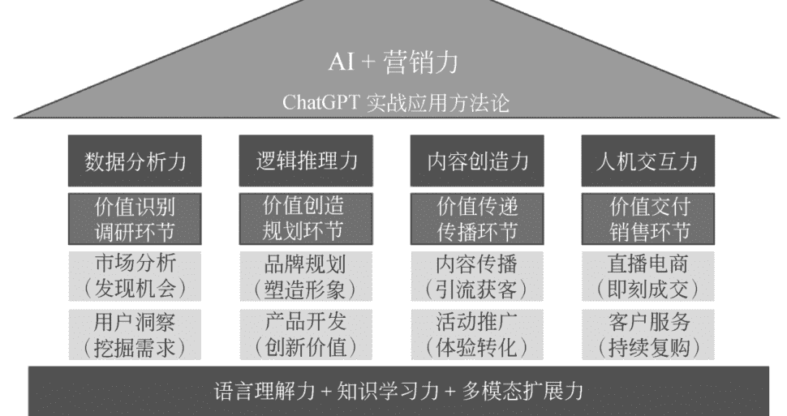
(4) 价值交付：在销售环节，人机交互力可在直播电商与客户服务中发挥作用。

支撑其发挥作用的核心是强大的语言理解、知识学习与多模态扩展，这些能力的融合为营销实战提供前所未有的支持。从现有能力看，具体应用至少包括以下八大场景：

##### 1. 市场分析
市场分析是决策基础，可助力企业高效完成分析与策略制定。相较传统方法能快速搭建分析框架，自动化收集整理数据，利用智能技术分析数据、识别趋势，并自动总结关键结论与策略建议，帮助快速发现机会并行动。

##### 2. 用户洞察
用户洞察是把握消费者需求与行为的关键。可分析线上社媒内容与电商行为数据，甚至进行情感分析。通过互动可深入了解消费者喜好、需求与反馈，帮助制定调研方案、设计问卷与访谈提纲，并通过数据统计、语言与情感分析挖掘真实想法与深层需求。

##### 3. 品牌规划
品牌规划是塑造独特价值与魅力的关键。可助力企业精准定位品牌价值，打造独特品牌形象与故事。相较传统方法，能快速分析市场与消费者需求给出定位建议；协助设计师按市场趋势生成形象创意；并结合定位与形象快速生成高吸引力的品牌故事创意。

##### 4. 产品开发
在产品开发中是创新者的得力工具。可在概念创意、功能外观设计、用户原型测试阶段提供支持。通过互动讨论功能与用户体验，获得新设计思路与改进建议；还能模拟消费者反应，评估概念可行性与市场接受度，加快方案验证与优化，推出满足需求的创新产品。

##### 5. 内容传播
内容传播是吸引目标受众的关键。可打开创意脑洞，提供广告文案与社媒内容的创意。互动中可获得新颖有趣的点子，设计出更具吸引力的文案与内容，促进用户关注与参与。此外，还能提供 SEO 优化建议，提升内容质量与传播效果。

##### 6. 活动推广
活动推广是激发用户互动热情的重要手段。可帮助制定创新活动想法并撰写执行计划。互动中可获得新颖的活动概念与策划思路，提升参与度与互动性，同时提供效果评估与优化指导，不断改进方案。

##### 7. 直播电商
直播电商通过主播实时展示推荐商品，创造真实互动购物体验，也为品牌开辟高效销售渠道。可协助撰写吸引人的直播脚本，提供直播背景优化建议，并支持虚拟数字人，帮助品牌以更经济专业的方式开展直播，提升吸引力与转化率。

##### 8. 客户服务
客户服务是企业与用户关系的桥梁，也是持续增长的关键。可辅助智能客服机器人提供 7×24 小时服务，在商品咨询、订单查询、问题解决、投诉处理、复购推荐等环节提供支持。通过与商品数据库、订单系统、FAQ 集成，降低成本、提高效率，满足多样化需求，增强忠诚度与满意度，推动复购率与客单价提升。

#### 1.3.3 四大商业价值释放路径
基于多场景应用，带来的价值多维。具体可释放以下四个方面商业效应。

##### 1. 降低成本，代替人工（省）
(1) 人工成本节约：通过自动化可替代内容创作、客户服务等传统人工工作，大幅节约人工成本。
(2) 时间成本节约：可 7×24 小时不间断工作处理海量任务，无需休息，缩短工作时间、提升效率。
(3) 培训成本节约：配置训练后可长期稳定运行，无需频繁培训与指导，减少培训成本。

##### 2. 提升效率，速度超快（快）
(1) 快速响应：无论客户咨询还是市场分析，都能即时反馈结果，保证业务快速响应。
(2) 高效执行：在执行营销策略与计划时，能快速准确完成任务，提升执行效率。
(3) 自动化流程：可自动化执行多个营销流程，进一步提高整体效率。

##### 3. 保证质量，专业精准（好）
(1) 精准分析：借助智能技术进行深入精准的市场与用户分析，为判断提供科学依据。
(2) 专业建议：提供职业化营销与品牌建议，帮助企业更好定位与推广。
(3) 质量保证：在内容创作与客户服务中，保证高质量服务与内容输出。

##### 4. 创新体验，无限可能（多）
(1) 创新营销：生成创新营销策略与内容，为企业打开新营销可能。
(2) 个性体验：深入理解用户后提供个性化体验与服务。
(3) 无限扩展：随技术进步，能力持续扩展增强，为企业带来无限商业可能。

通过降本、提效、保质、创新体验，为营销活动带来巨大价值，不但提升营销成效，也为企业长期发展与竞争力提供有力支撑。合理利用与配置，可更好适应市场变化、抓住商机，实现持续增长。

#### 1.3.4 使用边界与风险提示
ChatGPT 作为 AGI 雏形，在多方面展现强大能力。但正如超级英雄有弱点，也存在具体限制，营销人员需了解并制定应对策略。

##### 1. 信息准确与事实验证
生成内容时可能展现创造性，给出惊喜或非传统答案。但这种创造性也可能导致不准确或不符合实际的输出，常见于煞有介事胡说，如篡改名著、引用不存在的文献，被称为大模型的幻觉。因此使用时需审查评估输出，并对关键事实进行验证，确保准确可靠。

##### 2. 数据安全与隐私保护
处理营销数据时，必须注意敏感信息的输入与存储，严格遵守相关隐私法规，避免未经授权的数据泄露与滥用，同时对模型输出进行合规审查，确保使用者私密信息得到充分保护。

ChatGPT 能用，也要会用：边界与方法

ChatGPT 在回应用户提问时展现出相当强的理解力，但它本质上仍是机器学习产物，并不具备主动守护数据安全和隐私的能力。用户在对话里透露的任何内容都有可能被系统记录下来用于分析，这意味着把敏感信息直接丢给模型交互存在风险。

##### 3. 算法偏见与道德判断
ChatGPT 的知识来自互联网上的海量文本训练，训练语料里潜藏的偏见和歧视很可能被模型无意识吸收。于是某些情境下它会给出带有倾向性或不合适的建议。因此使用时必须对生成结果进行人工复核，筛掉偏见和不当表述。企业在搭建私有模型时，更要提前写入清晰的道德伦理规范，让模型在触及敏感议题时能给出合规的回应。

##### 4. 创新思维与复杂决策
即便在语言理解和知识储备上表现突出，ChatGPT 依然是依赖数据的系统，缺乏真正的原创洞察和直觉判断。面对需要突破性创意或高度复杂的决策难题，它往往给不出最优解。在这些场景里，人类的经验、直觉和创造力仍然不可替代。更稳妥的做法是把 ChatGPT 当作协作工具与人脑配合，而不是完全交由它定夺。

在生成式 AI 爆发、大模型层出不穷的当下，真正重要的是保持独立的洞察与分析能力，让人工智能成为助力而非主导。我们要与 AI 紧密协作，走向人机共融、共同成长的未来。

### 1.4 本章小结
本章系统梳理了生成式 AI 的冲击，以及 ChatGPT 在营销里的应用空间。

先是回顾了 AIGC 的浪潮如何被 ChatGPT 引爆，它让 AI 从单纯的数据分析转向内容创造，并在营销领域掀起深远变革。随后拆解了其技术底座：自然语言处理、生成式预训练模型和 Transformer 架构，解释了智能涌现的原理。

在原理基础上，阐述了 ChatGPT 如何赋能营销实战。围绕语言理解力、知识学习力、数据分析力、逻辑推理力、内容创造力、人机交互力、多模态扩展力七大能力，说明其在市场分析、用户洞察、品牌规划、产品开发、内容传播、活动推广、直播电商、客户服务八大场景的潜力。同时归纳出四大价值：降本、提效、稳质、创新体验。

最后也点出使用边界与风险：信息准确性、数据安全隐私、算法偏见与歧视都需要警惕。这些提醒既帮助营销人科学应用 ChatGPT，也提供了实操中的安全清单。

总体看，ChatGPT 是技术突破，也是营销变革的抓手。企业若能结合传统策略善用其能力，就能在创新与效率上同时提升。未来生成式 AI 将继续在营销中扮演关键角色，创造更多商业价值。

## 第2章 驾驭ChatGPT：释放AI无限潜能
掌握 ChatGPT 等于多了一把 AI 营销利器。想发挥其真正潜力，不仅要会基础操作，更要建立匹配的认知、思维与技能。

本章从提示词与 AI 思维切入，讲通用提示框架的用法，如何对专业角色进行调教，以及私有模型的训练思路。还将介绍如何借助插件和其他 AI 工具组合，把 ChatGPT 的价值在营销实战中放大。

### 2.1 抓核心：提示词与AI思维
在使用 ChatGPT 时，提示词的设计直接决定输出质量。提示词与 AI 思维相互关联，理解这层关系才能更精准地提问，拿到更满意的答案。

#### 2.1.1 初识提示词
##### 1. 什么是提示词
提示词即提示语，是用户与 ChatGPT 或其他生成式 AI 交互时输入的指令，用来引导模型产出符合预期的内容。常见类型有：
- 疑问型：以问题形式提出，例如“未来营销趋势会怎样？”
- 任务型：直接下达指令，例如“帮我写一篇小红书笔记”。
- 反馈型：对上一次输出进行修正，例如“答案太笼统，能否给更具体的策略？”

##### 2. 提示词的价值
提示词是交互的起点，没有它模型无从判断需求。就像导航需要明确的目的地，地址模糊就会跑偏。同理，提示不清就会得到不相关或不准的回答。高质量的提示能最大化调动模型能力，输出质量很大程度上取决于提示质量。正如“好问题解决一半问题”。

##### 3. 提示词的本质
OpenAI 创始人 Sam Altman 曾指出：为聊天机器人写出优秀提示词是一项高阶技能，本质上是借助自然语言进行编程。提示词用日常语言写成，却像一段程序，输入系统后即可运行，完成问答、建议、方案策划、文案撰写等任务。区别在于它使用的是自然语言而非代码。

#### 2.1.2 高质量提示词
优秀的提示词像优秀领导的指令，应具备清晰、完整、创新三要素。

##### 1. 清晰性：明确具体不含糊
提示必须明确，避免歧义。模型按字面理解指令，越抽象理解越宽泛。想做甜点，直接说“给我一个巧克力蛋糕烘焙配方”，而不是“我想做甜点”。做营销方案时，“给我营销点子”太模糊，改成“给我推广新款环保运动鞋的创新营销策略”，模型才能给出有用内容。

##### 2. 完整性：必要信息不缺失
提示要提供足够背景，让模型能判断需求。规划云南行程时，给出时间、偏好、节奏等信息，模型才能给出可行的路线。仅说“帮我提升网站排名”信息不足，补充“我的手工艺品网店想提升百度排名，有什么建议”，答案才会具体全面。

##### 3. 创新性：新思维与启发性
好的提示应避免老套，能激发模型的创造力。可以尝试新视角，例如“用一只狗的视角描写城市日常会怎样？”或“如果发布会用虚拟现实互动演示新品，体验会是什么样？”。这种启发式提问更容易得到新颖的思路。

#### 2.1.3 提示工程与AI思维
AI 不只是工具，更是一种思维方式。要充分发挥其潜力，需要培养 AI 思维，学会协作与引导。

##### 1. 什么是提示工程
提示工程是对提示词进行系统化研究、设计和迭代优化的方法。目标是让模型更好理解任务，产出高质量相关内容。因为它需要结构化设计、测试与反复修正，所以被称为工程。提示工程与工程思维相通：目标导向、解决问题、结构化拆解、持续迭代。

##### 2. 提示工程师的核心能力
优秀的提示工程师本质上具备面向 AI 的领导力，核心有三：
- 提问力：基于目标提出清晰问题，拆解任务并下达指令。
- 判断力：对模型输出进行沟通反馈，做出取舍决策。
- 创新力：提供方向与启发，持续寻找更有效的表达方式。

##### 3. 提示工程师的能力进阶
能力可分为三层递进：
- 通用任务提示：调取模型的基础通用知识，解决常规工作。
- 专业角色调教：让模型快速学习垂直领域最佳实践，从应届生成长为专业骨干。
- 私有模型训练：在专业基础上，结合企业或个人私有知识库，打造专属专家或数字分身，需与技术团队协作完成定制、训练与部署。

### 2.2 派任务：通用提示框架
提示工程的核心是向模型派发明确任务并获取理想输出。通用的操作方法可以归纳为“六要素”提示法，人、事、因、果、时、令。

- 人：角色，谁来做
- 事：任务，做什么
- 因：背景，为什么
- 果：结果，需要什么产出
- 时：流程，分几步
- 令：指令，按什么要求

根据任务复杂度灵活组合，简单任务可只用部分要素。

#### 2.2.1 什么是通用提示框架
提示词本质上是自然语言编程，有其结构语法。经过实践提炼出的六要素框架，覆盖了通用任务提示的主要维度，可复制、可组合，提升结果精准度。

#### 2.2.2 具体案例示意
以“为某品牌口红写小红书笔记”为例，展示不同水平的提示差异。

##### 1. 初级阶段：单要素
仅给出任务：
任务：请写一篇推荐口红的小红书笔记。
模型会给出泛泛的口红推荐列表，品牌不明确，缺乏针对性。

##### 2. 中级：三要素
补充背景与目标：
任务：请写一篇推荐口红的小红书笔记。
背景：品牌为雅诗兰黛，促销价199元，以持久不脱色和色彩丰富著称。
结果：激发女性购买欲，传递“不容错过”的紧迫感。
此时输出会围绕品牌、价格、卖点展开，语气更具营销感，更贴合转化目标。

##### 3. 高阶实战：一次性带齐六要素

进入进阶层级，提问的颗粒度要更细，把六大要素打包进同一个指令里，效果会明显更准。下面是一个完整示范：

**Prompt：**

- [角色]：人设是一位在美妆圈有影响力的博主，对彩妆原理和市面新品都有专业且深入的了解。
- [任务]：帮我写一篇小红书风格的雅诗兰黛口红种草笔记。
- [背景]：主推品牌是雅诗兰黛，当前活动价199元，这支唇膏因显色度高、持久不掉色，被不少女性反复回购。
- [结果]：最终要激发目标女性用户的购买欲望，促成成交，让读者觉得这是难得的入手时机。
- [流程]：先做品牌及产品卖点的小幅介绍，随后说明促销价格及购买渠道，最后放上亲测感受与实拍图，并说明推荐理由。
- [指令]：文风简洁干脆，用词走心真实，阅读感强且易懂。篇幅控制在300～500字，适度加入小红书常用的表情符号和话题标签，如“#雅诗兰黛口红#”。

**ChatGPT：**

> 💄 秋风起，唇色也该换个更聪明的选择

♡□♡□✨

今天来安利一支最近在我的梳妆台上常驻的唇膏，雅诗兰黛这款被很多人称为“显色担当”的口红。

☺□👄

聊到雅诗兰黛，大部分女生都不陌生。这个国际老牌长期稳居心头好清单，而这款唇膏凭借高饱和色彩和出色的持妆力，口碑一直很稳。

✨✨👍

最让人心动的是现在的价格，原价看起来很体面，现在只要199就能带回家。购买也很方便，官网商城和各大线下美妆柜台都能找到。我已经集齐好几个色号了，每次涂上都感觉状态在线。显色干净，一抹就上色，而且用餐喝水也不怎么掉。质地偏滋润，上嘴不拔干，舒适度在线。

下面放几张我自己用的实拍，大家感受一下效果 👇 [图片]

♡□♡□

很真心地想推给大家 [双手合十]，既是冲品质，也是冲这次的优惠力度，说实话确实挺难得。希望每个人都能挑到专属色号，每天都美得自在。

#雅诗兰黛口红# #美妆推荐# #口红控# #不脱色# #特别优惠#

从以上三个层级可以看出，提示要素越完整，我们给出的需求就越具体，模型回来的内容也会越贴合、越到位。

#### 2.2.3 六要素拆解与实操要点

为了让大家真正用好每个要素，下面对六大要素的具体含义和撰写手法做一次深入梳理。

##### 1. 角色（能力）

**定义：** 给模型指定一个具体的身份定位，这个定位会决定输出的专业水准、关系距离和语言风格。

**作用：** 通过身份锚定，引导模型提供更专业、更符合预期的内容。

**分类：** 常见的设定方式包括：

- (1) 专业身份：例如执业律师、心理咨询师、营销顾问等，提升内容的专业度。
- (2) 关系身份：例如闺蜜、男友、上司等，增加表达的针对感。
- (3) 风格身份：例如苏格拉底、乔布斯、鲁迅等，赋予文本鲜明个性。

**具体举例：**

比如要策划新品发布会，可以让模型扮演“资深活动策划专家”，提问“作为有丰富经验的活动策划专家，你会如何设计这场新品发布会来最大化吸引观众？”身份设定后，答案会更具专业视角。

**注意要点：**

除了明确身份，最好补充能力描述，说明知识储备、关系属性、语言习惯等，帮助模型更精准理解角色内涵。

示例句式：

- 我希望你扮演一名×××，你具备……
- 假设你是×××，拥有……
- 请你担任×××，需要运用……
- 你是一位×××，擅长……

**向ChatGPT提问：**

- “我需要解决 [某个问题] ，哪种角色最适配？它需要什么知识和能力？”
- “我想要一个具备 [某专业] 背景的角色，能否帮我定义？”
- “如果要你扮演 [某某] ，你会如何呈现这个角色？”

##### 2. 任务（主题）

**定义：** 明确向模型交付的具体工作内容，包括主题范围和包含的子项。

**作用：** 任务界定越清晰，模型越容易抓住重点，给出对路的信息。

**分类：** 任务形式多样，例如：

- 1. 信息检索：如“告诉我最新的市场趋势研究”。
- 2. 建议输出：如“给出几条内容营销的可行策略”。
- 3. 创意产出：如“为我写一个抖音短视频脚本”。
- 4. 技能教学：如“教我用某个AI工具做数据分析”。

**具体举例：**

准备新品发布演讲稿，可这样界定：“请为我撰写一份新品发布演讲稿，涵盖产品功能、优势、竞品对比及市场预期。”界定清晰后，输出更精准有力。

**注意要点：**

- 1. 描述要具体，避免模糊笼统的词。
- 2. 复杂任务可拆分子项，分步提问。

**向ChatGPT提问：**

- “什么是内容营销？包含哪些环节？”
- “制定品牌定位策略需要考虑哪些因素？”
- “我想用ChatGPT做数据分析，但不知从何入手，能否给点入门指引？”

##### 3. 背景（信息）

**定义：** 提供任务发生的上下文，包含原因、前置条件、相关事件等关键信息。

**作用：** 背景越充分，模型判断越全面，回答越相关。

**分类：** 背景可从宏观到微观划分：

- (1) 宏观背景：如“移动支付行业正处高速增长期”。
- (2) 组织背景：如“我们是一家专注AI研发的初创公司”。
- (3) 个人背景：如“我是一名智能手表品牌的客服”。
- (4) 知识背景：如“我已掌握基础营销知识，对高阶策略了解有限”。

**具体举例：**

想提升新品销量，可提供背景：“我们是初创公司，刚上线新品，市场反馈平平。”模型就能给出更有针对性的建议。

**注意要点：**

- (1) 背景要详尽且相关，避免无关信息干扰。
- (2) 内容较长时可用分隔符区分，例如：###具体内容###、“具体内容”、<具体内容>、{具体内容}。

示例：

品牌信息：

```
###
品牌名：零界。
品牌定位：新生代健康零食。
品牌理念：打破传统与创新的界限，让每一口都充满惊喜。
###
```

**向ChatGPT提问：**

- “提升产品销售通常需要考虑哪些背景要素？”
- “AI在市场营销中的应用背景能否做个概述？”
- “构思产品广告创意前，需要提供哪些背景信息？”

##### 4. 结果（目标）

**定义：** 描述任务完成后期望达到的最终成效，是目标而非过程。

**作用：** 明确结果能帮助模型理解用户的真正诉求，输出更贴合目的。

**分类：** 结果类型包括：

- (1) 业务成果：如“产品销量提升20%”。
- (2) 传播效果：如“文章阅读量达到1000+”。
- (3) 体验感受：如“增强用户对品牌的信任与忠诚”。
- (4) 知识掌握：如“熟练掌握内容营销核心技巧”。

**具体举例：**

作为初创公司市场经理，想了解AI营销方案，可设定：“请提供利用AI进行市场营销的方案，目标是提升品牌知名度和销量。”期望结果：“希望广告投放更精准，转化率提升至少30%。”目标明确，方向更清晰。

**注意要点：**

- (1) 结果描述要具体，指出关键指标和最终成效。
- (2) 结果需与任务描述逻辑一致。

**向ChatGPT提问：**

- “AI在市场营销中，怎样算成功？”
- “一个成功的市场策略应带来哪些具体成果？”
- “写完某主题文章后，理想的效果是什么？”

##### 5. 流程（步骤）

**定义：** 描绘完成任务的执行路径和阶段顺序。

**作用：** 有序的流程能确保输出结构合理、可操作性强。

**分类：** 流程可分为：

- (1) 任务流程：如“先调研、再定策略、后执行监控”。
- (2) 内容流程：如“先交代背景，再讲方法，最后总结”。
- (3) 交互流程：如“我先给素材，你归纳模型，我再给背景，你据此生成内容”。

**具体举例：**

了解AI内容创作流程，可要求：“请给出利用AI进行内容创作的完整流程。”内容流程可为：“先给出背景引言，再列主观点及论据，最后总结结论。”

**注意要点：**

- (1) 步骤要具体，覆盖关键环节。
- (2) 复杂流程建议编号：1、2、3或第一步、第二步。

**向ChatGPT提问：**

- “利用AI做市场营销的常规执行流程是怎样的？”
- “一份完整的内容创作流程应包含哪些步骤？”
- “一次标准的产品推广活动流程是怎样的？”

##### 6. 指令（要求）

**定义：** 对输出形式、长度、风格、限制等做出的明确指示。

**作用：** 精准指令能大幅提升满足度。

**分类：** 常见指令维度：

- (1) 格式指令：如“输出论文格式”“用表格呈现”“提供视频脚本”“采用Markdown/HTML/JSON/CSV”“加入emoji”。
- (2) 长度指令：如“不超过500字”“视频控制在3～5分钟”。
- (3) 风格指令：如“使用正式商务语言”“采用轻松幽默语气”。
- (4) 限制指令：如“避免政治宗教等敏感内容”“不用空话套话”“不要解释”。

**具体举例：**

撰写AI内容创作应用文章，可指令：“请写800～1000字，采用正式商务语言，包含标题、摘要、正文、结论。”

**注意要点：**

- (1) 多指令分行罗列，用“-”开头更清晰。
- 例如：
- 请用轻松幽默的风格。
- 视频时长控制在3～5分钟。
- 避免涉及敏感信息。
- (2) 可用示例或模板提供更具体指引。

例如：

请为我撰写一个关于“AI基本概念”的段落，参考以下模板：

```
###
定义：首先简要定义AI是什么。
应用：列举一两个AI的常见应用。
重要性：简短描述为什么AI如此重要。
###
```

**向ChatGPT提问：**

- “写微信文章关于AI技术，通常的格式和风格是什么？”
- “小红书笔记常用的语言风格和格式建议有哪些？”
- “产品说明书的常规格式要求是怎样的？”

#### 2.2.4 高效咒语合集

在六要素中，“指令”部分经过大量实践沉淀出一些高效果的“咒语”，能显著提升模型表现。建议生产力场景优先使用英文输入。

##### 1. 逻辑严谨类

让输出思路清晰、层层递进。

咒语1：

让我们一步一步思考。

（Let’s think step by step.）

咒语2：

让我们逐步来解决这个问题，以确保我们得到正确的答案。

（Let’s work this out in a step by step way to be sure we have the right answer.）

咒语3：

深呼吸，一步一步地解决这个问题。

（Take a deep breath and work on this problem step-by-step.）

##### 2. 思维发散类

鼓励多角度思考，提升创意。

咒语1：

让我们从不同的角度来看这个问题。

(Let’s look at this from multiple perspectives.)

咒语2：

还有哪些可以考虑的角度？

(What are some alternative perspectives?)

咒语3：

我需要多种可能的答案或建议。

(I need various possible answers or suggestions.)

##### 3. 表达趣味类

让内容更有趣、更抓人。

咒语1：

给我一些幽默和有趣的答案。

(Give me some humorous and fun answers.)

咒语2：

我需要一些使人笑的答案或建议。

(I need some laugh-worthy answers or suggestions.)

咒语3：

告诉我关于 [插入主题] 的笑话。

(Tell me a joke about [insert topic].)

##### 4. 解释浅显类

确保表达通俗易懂。

咒语1：

用外行的话解释一下。

(Explain it in layman’s terms.)

咒语2：

解释一下，就当我是五岁小孩。

(Explain this as if I’m five.)

咒语3：

将其转化为实际案例。

(Translate this into a real-world example.)

##### 5. 信息准确类

降低幻觉风险，提升可信度。

咒语1：

请提供来源或引用来支持这个答案。

(Provide sources or citations to back up this answer.)

咒语2：

引用的论文可以在Google Scholar上找到。

(The cited papers can be found on Google Scholar.)

咒语3：

请为我核实这个信息。

(Kindly verify this information for me.)

##### 6. 随机创新类

针对默认输出偏中性刻板的问题，可通过温度参数提升随机性和创新性。

提示词进阶实战：参数调优、角色塑形与私有化部署

在提示词设计里，Temperature 是最常用的一把旋钮，取值区间一般在 0 到 1 之间。数值抬高，比如 Temperature=0.8，模型会更发散、更随机，适合需要灵感迸发的写作场景，像小说、剧本创作。数值压低，比如 Temperature=0.2，输出会更收敛、更连贯、可预测，适合对事实性和严谨性要求高的任务，像技术文档、数据分析。不主动指定时，系统会默认 0.5，保持一个中性平衡点。

咒语1：

要提升新意和发散度，请把 Temperature 固定在 0.8。

咒语2：

若想在严谨与创造之间找到平衡点，请把 Temperature 设在 0.7。

这类指令式写法能更清晰地牵引生成方向。熟练运用，既能保障专业内容的准确，也能按需切换表达风格。

总体来看，“六要素”通用任务提示框架提供了一个可复用、可复制的工作底座。掌握后能更系统、更高效、更精准地与模型配合，拿到更准确、更专业、更有价值的结果。

另外要记住，绝大多数情况下一次对话很难达到最优。结果不理想时，需要拆解原因、调整表述、反复试验、持续迭代，直到输出符合预期。

### 2.3 方法教学：角色专业化调教

除了借助通用提示框架调动基础能力，还可以用角色专业化调教法，激活模型的学习力，让它快速掌握垂直领域的专业技能。通过这种方式，模型可以从刚毕业的应届博士迅速成长为细分领域的骨干人才。

#### 2.3.1 角色专业化调教是什么

实操中会发现，同一个对话窗口里持续围绕同一主题交流，模型会越来越懂行。原因在于对话过程中，模型会利用内部注意力机制捕捉输入文本的上下文信息。当同一主题被持续深入时，模型能够读取并整合之前的对话，从而更好地理解当前语境、背景和用户意图。这种上下文敏感性来自 Transformer 结构和自注意力机制的共同作用。

正因为具备这种机制，不修改模型参数，仅通过输入特定领域的文本，就能让模型学习并应用新的知识和方法，即便这些内容在预训练阶段并未覆盖。这种方式常被称为上下文学习，其原理与人类举一反三的认知方式相似。

因此，在同一个对话里，为模型赋予特定角色，并投喂相关专业知识和方法，就能提升输出的精准度和专业性，这就是角色专业化调教的核心思路。

#### 2.3.2 为什么要做调教

如果把大模型的预训练比作培养一名全科知识储备的顶尖博士，那么角色专业化调教就相当于职场再培训，让它能够胜任具体的专业岗位，从刚毕业的博士迅速成长为领域的专业骨干。

例如，供给专业的营销案例和方法模型，让它学习营销知识和技巧后，就能协助设计营销策略、撰写营销文案，相当于调教出一个专业的营销骨干。

在我看来，人工智能中的人工二字是人与工的结合，即人类智能与 AI 工具智能的结合。人工智能=人的智能×AI 工具的智能。人工智能并不能取代人类智能，而是放大人类智能。让模型学习和掌握人类知识经验，用更低成本、更高效率创造更大产出，正是生成式 AI 赋能各行各业的本质方式。

#### 2.3.3 如何进行调教

要把人的智能×AI 工具智能的放大效应发挥到极致，需要在两端同时发力。

一方面是人类经验，要提供行业最佳实践的方法论，即最优秀的归纳、总结、模型、文章、书籍、课程等。另一方面是 AI 工具的使用，要采用更有效的调教方法，让学习更快速、更准确。

在实践中，角色专业化调教可以归纳为三个步骤。

- (1) 知识摸底：弄清模型已具备哪些知识，同时也能借此向它学习相关专业内容。
- (2) 资料投喂：提供相关专业知识让它学习，并归纳提炼方法模型。
- (3) 模型应用：让它基于归纳出的模型执行具体任务。

下面以金句创作的专业调教为例演示。

##### 第一步：摸底现状：你了解吗？

面对具体课题，先了解模型在该课题上的通用知识储备，相当于问它你知道吗？。一方面可以调取通用知识弥补自身不足，另一方面也能发现知识盲区，为后续针对性投喂做准备。

先看它对金句概念的理解。

示例提问：
你知道什么是金句吗？

模型回复：
当然，金句在中文里通常指那些很有深度、很有哲理或很有启发性的句子。句子往往简短却意蕴深长，能在短时间内给人留下深刻印象。在文学、影视、音乐或日常交流中都能见到。它们能够概括复杂的观点或情感，让人对某个主题理解得更透彻。

可见模型对金句的概念把握很清晰。再看它是否了解写作方法模型。

示例提问：
金句创作有哪些经典有效的结构模型？

模型回复：
创作金句时，有一些经典结构模型可参考，能帮助构建简洁有力、富有哲理的句子。常见模型如下：

- 1. 对比法：通过对比相反或不同的事物，突出观点。
  例如：生命不能倒带，但回忆可以重播。
- 2. 因果法：描述因果关系，强调观点的重要性。
  例如：种下希望的种子，收获幸福的果实。
- 3. 设问法：先提问题引导思考，再给出答案。
  例如：人生的意义是什么？是不断追求、不断成长。
- 4. 排比法：使用重复结构或词汇，增强节奏韵律。
  例如：生如夏花之绚烂，死如秋叶之静美。
- 5. 夸张法：夸大事物特征，强化观点。
  例如：他的笑容，犹如春天的阳光，温暖了整个世界。
- 6. 借喻法：用比喻让形象更生动。
  例如：时间是医生，也是杀手。
- 7. 反讽法：表面褒贬，实际表达相反意思。
  例如：这真是一个完美的失败。
- 8. 总结法：对主题或观点做简洁有力的收束。
  例如：人生不在于活得长，而在于活得有意义。

当然，金句写作不止这些模型，关键在于深入思考、捕捉细节情感以及语言的独特运用。

从回答看，模型对金句创作的方法模型已有一定认知。若要求不高，可直接基于此创作；若要求更高，则进入资料投喂环节，让它学习并提炼更专业的模型。

##### 第二步：资料投喂：请你学习！

让模型学习专业材料的方式有三种：直接给出方法模型、给出参考案例让它归纳、或给出未经整理的原始材料如网页、文档等学习，后者通常需要插件支持。

###### 方法1：直接给模型

即直接提供结构、技巧、例子的完整模型。

示例提问：
现在你是一个金句创作高手，请学习金句写作方法模型：三种典型结构及写作技巧：

- (1) 对立结构：这是A，同时也是非A。
  技巧：选取两个截然相反的词或概念放在同一句话，形成对比，产生冲击力。
  例子：时间是我们的蜜糖，也是我们的毒药。
- (2) 等同结构：不是A→B，而是B=A。
  技巧：挑两个看似无关或对立的概念，通过句式联系起来形成等同，产生新义。
  例子：没有通向真诚的路，真诚本身就是路。
- (3) 定义结构：A就是……
  技巧：选一个常见概念，给出出人意料或与众不同的定义，引发思考共鸣。
  例子：教育就是当一个人把在学校所学全部忘光之后剩下的东西。

###### 方法2：给案例

提供具体参考案例，让模型自行归纳总结模型。

示例提问：
请学习以下金句案例，并归纳几种典型结构和写作技巧：

- 这是一个最好的时代，也是一个最坏的时代。
- 爱情是我们的蜜糖，也是我们的毒药。
- 没有通向真诚的路，真诚本身就是路。
- 没有什么障碍可以阻挡你，能阻挡你的只有你自己。
- 多年以后，我不再爱着你，而是成了你。
- 教育就是当一个人把在学校所学全部忘光之后剩下的东西。
- 如果你打了半小时牌，仍然不知道谁是菜鸟，那么你就是。

###### 方法3：给原始资料

提供文章、书籍、课件等未整理的原始资料，直接输入文字或通过插件读取网页、PDF 等。

示例提问：
请调用插件读取 [具体网址URL]，学习并总结金句创作的方法模型：金句的几种结构及其写作技巧。

模型回复：
当然可以，以下是金句结构及其写作技巧的总结：

- (1) 对立结构：这是A，同时也是非A。
  技巧：选择两个截然相反的词或概念放在同一句话，形成对比，产生冲击力。
  例子：时间是我们的蜜糖，也是我们的毒药。
- (2) 等同结构：不是A→B，而是B=A。
  技巧：挑选看似不相关或对立的概念，通过句式联系起来形成等同，产生新义。
  例子：没有通向成功的路，成功本身就是路。
- (3) 定义结构：A就是……
  技巧：选择常见概念，给出出人意料或与众不同的定义，引发思考共鸣。
  例子：教育就是当一个人把在学校所学全部忘光之后剩下的东西。

这些结构和技巧为创作有深度、有冲击力的句子提供了思路，使其更具吸引力和传播力。

通过投喂，模型归纳的模型已相当专业。接下来即可进入应用。

##### 第三步：应用执行：照此创作！

为方便后续调用，可为归纳的模型命名，让它按此执行。

示例提问：
很好，请记住这个金句结构和写作技巧，我们叫它金句1号模型，之后请根据我给出的关键词或短句，发展出金句。

模型回复：
明白，已记住金句1号模型。请给出关键词或短句，我会依据金句1号模型为您生成金句。

示例提问：
成长。

模型回复：
使用金句1号模型为您生成的关于成长的金句：

- (1) 对立结构：成长是疼痛的转化，同时也是快乐的积累。
- (2) 等同结构：成长不是为了目标，成长的过程本身就是目标。
- (3) 定义结构：成长就是在每一次跌倒中，找到站起来的力量。

示例提问：
教养。

模型回复：
使用金句1号模型生成如下：

- (1) 对立结构：教养是内心的优雅，同时也是对外界的包容。
- (2) 等同结构：教养不是为了获得荣耀，教养本身就是一种荣耀。
- (3) 定义结构：教养就是在喧嚣中保持沉默，在冲突中展现风度。

示例提问：
爱情。

模型回复：
使用金句1号模型生成如下：

- (1) 对立结构：爱情是心灵的甘露，同时也是其深处的刺痛。
- (2) 等同结构：爱情不是为了获得幸福，爱情的过程就是一种幸福。
- (3) 定义结构：爱情就是当两颗心不再追求彼此，而是同步跳动。

通过专业调教，输出质量明显提升，可按需筛选微调。按此方式，模型能源源不断产出优质内容。

调教过程中需不断优化迭代。根据输出发现不足，回到提示词修改调试，随着经验积累，可调教出更多专业角色，提高效率、降低成本、优化质量、创造价值。

### 2.4 进阶训练：私有化模型打造

在专业性的基础上，还可以结合企业或个人的私有数据库和知识库，让模型成为企业的私有专家或个人的数字分身。这需要了解私有模型训练的基础知识和协作技能，与技术团队共同完成大模型的私有化定制、训练与部署。

#### 2.4.1 私有模型的定义

私有模型是在通用模型基础上，针对特定行业、企业业务需求或个体使用场景进一步训练，以适配特定应用，即在基础模型上进行定制。在 AI 时代，私有模型正成为企业和个人的新选择，既能赋能业务，也能创造数字分身。

##### 1. 企业私有专家

企业私有模型可视为定制化专家。对内构建企业知识体系，通过模拟人脑学习机制，让经验有效积累传承；对外赋能用户交互，通过模拟人类对话，提升沟通效率和满意度。可应用于客服、产品推荐、内容创作、数据分析等场景，帮助企业提升效率与创新力。

##### 2. 个人数字分身

对个人而言，私有模型更像数字分身，每个人可拥有一个定制化、个性化的模型，理解并模拟个人的思维行为，成为真正的 AI 分身。例如美国网红卡琳·玛乔丽，团队利用她 2000 小时的 YouTube 内容结合 GPT-4 技术，创建了一个可供雇用的虚拟女友，每分钟收费 1 美元。除娱乐互动外，个人数字分身还可用于个人助理、内容创作、在线教育等。

#### 2.4.2 训练私有模型的意义

GPT 基础模型提供通用知识和基础能力，但在特定行业和业务场景中能力有限，因此需要基于基础模型训练自己的私有模型。价值主要体现在：

##### 1. 数据安全性

私有模型可在企业内部安全环境中训练部署，确保敏感数据不被外部访问泄露。对金融、医疗等受严格法规约束的行业尤为重要，有助于满足合规要求，避免法律风险。

##### 2. 服务专属性

私有模型只为特定对象服务。例如企业客服私有模型只推荐自家产品，不会推荐竞争对手产品。

##### 3. 性能优越性

私有模型可在企业自有硬件上训练部署，确保最佳性能和响应时间。企业还能按需优化调整。

##### 4. 竞争差异性

使用私有模型可获得独特竞争优势，因模型为特定业务需求定制，能提供通用模型无法提供的独特视角和解决方案。

##### 5. 成本经济性

虽然初期投入较高，长期来看可能更经济。企业可避免持续使用第三方服务的费用，更好控制数据和资源。

##### 6. 迭代灵活性

私有模型提供更大灵活性，可根据业务需求迭代优化，使企业更快适应市场变化，持续改进服务和产品。

#### 2.4.3 训练方式

在保障数据安全与隐私前提下，利用私有数据和知识对基础模型进行定制化训练并部署到具体场景。目前主要有两种模式：一是基于 GPT 模型的微调，二是 API+外部数据库。

##### 1. 基于 GPT 模型的微调

优点：

- 功能定制化：可为特定用途创建定制模型，提升准确性和效率。
- 数据安全性：OpenAI 承诺微调 API 数据完全归客户所有，保障安全与隐私。
- 减少提示依赖：相比仅用提示工程，微调更直接地获得所需输出。

缺点：

- 成本：有初始训练成本和使用成本。
- 过拟合风险：若微调数据集不够多样或过于特定，模型泛化能力可能下降。

##### 2. 使用 API+外部数据库

优点：

- 灵活性：可随时调整更新外部数据库，无需重新微调。
- 安全性：私有数据库更能确保敏感数据安全。
- 扩展性：可轻松添加更多数据和信息，丰富模型。

缺点：

- 维护成本：需持续维护更新外部数据库。
- 操作复杂：需设计实现 API 与数据库交互逻辑。

选择建议：需要特定定制化解决方案的企业或个人，可选微调；需要更大灵活性和扩展性的应用，可选 API+外部数据库。

具体操作步骤如下。

##### 1. 基于 GPT 模型的微调

(1) 准备数据

- 收集数据：首先需要收集和整理用于微调的数据。这些数据应与特定用途相关，并能代表希望模型学习的多样情况和场景。

数据清洗与预处理：对原始素材进行清理与规范化，剔除重复记录、修正错误信息、补齐缺失字段等，确保整体质量与一致性。

数据格式转换：把处理好的素材整理成 OpenAI 能识别的输入形态。

**(2) 上传文件**

- 文件格式要求：数据文件需符合 OpenAI 的规范，常见为 CSV 或 JSON。
- 上传方式：借助 OpenAI 平台的控制台或 API 接口，将准备完毕的文件推送上去。

**(3) 新建微调任务**

- 参数设置：在平台创建微调任务时，需配置学习率、批次大小等关键参数，以掌控微调过程。
- 提交运行：任务提交后，平台会基于用户提供的数据启动模型微调。

**(4) 应用微调模型**

- 效果验证：微调完成后先行测试，确认模型表现是否达到预期。
- 部署上线：可直接在 OpenAI 平台使用，也能下放至自有服务器或云环境。

#### 2. API+外部数据库

**(1) 搭建数据库**

- 选择系统：依据业务需求与技术栈挑选合适的数据库，如 MySQL、MongoDB 等。
- 初始化环境：完成数据库系统的安装配置，并创建所需库表。

**(2) 数据整理与导入**

- 预处理：对采集到的数据做清洗、格式转换等准备。
- 导入入库：通过管理工具或程序接口把预处理后的数据写入数据库。

**(3) API 集成**

- 接入 OpenAI API：在自有应用中集成 OpenAI 接口，实现对 GPT 模型的调用。
- 数据库交互：编写调用时查询并使用外部数据所需的逻辑。

**(4) 持续运维**

- 数据更新：按需刷新数据库内容，保持信息与知识的时效性。
- 运行监控：对数据库与 API 的状态进行实时监控，及时排查问题。

随着 AI 技术的演进，私有模型的训练门槛正快速降低，真正的核心在于数据积累，尤其是私有知识资产的沉淀。以营销为例，各大媒介平台的规则属于行业通用知识，而品牌的定位、形象与语言风格则属于企业特有的私有知识。持续构建自身的数据与知识资产，是形成差异化竞争的关键；优质的私有资产能反哺模型训练，产出更好的数据与洞察，进一步丰富企业独有知识，形成 AI 应用的正向闭环。

### 2.5 工具加持：让 ChatGPT 如虎添翼

ChatGPT 是目前最强的生成式大模型之一，但仍存在局限与边界。若想把智能潜力完全释放，就要借助外部工具的协同，不仅是 GPT 插件，也包括与其他 AI 软件的组合。

#### 2.5.1 插件功能：突破知识边界

OpenAI 于 2023 年 5 月 12 日开始小范围测试插件功能。借助插件可以调用特定服务与资源。开放联网与插件后，ChatGPT 不再局限于预训练知识，第三方开发者也能在 ChatGPT 基础上增强自有应用。截至 2023 年 11 月，该权限仅面向 Plus 会员开放，会员可在主页左上角模型菜单的下拉列表中找到“Plugins”入口，如图 2-1 所示。

#### 2.5.2 跨 AI 软件协同

AIGC 的内容形态涵盖文字、代码、图像、视频、3D、游戏等。根据红杉资本的判断，下游落地节奏为：文字=代码 > 图像 > 视频/3D/游戏。目前文字与图像已相对成熟，视频、3D、游戏仍需时日。以下重点介绍 ChatGPT 与图像生成、平面设计、PPT 制作、视频制作等 AI 工具的结合。

##### 1. 图像生成：DALL·E 3

DALL·E 3 是 OpenAI 发布的图像生成工具，如图 2-3 所示。

该工具于 2023 年 10 月正式向 ChatGPT Plus 与企业客户开放。在 DALL·E 3 的加持下，ChatGPT 进入多模态输出阶段。

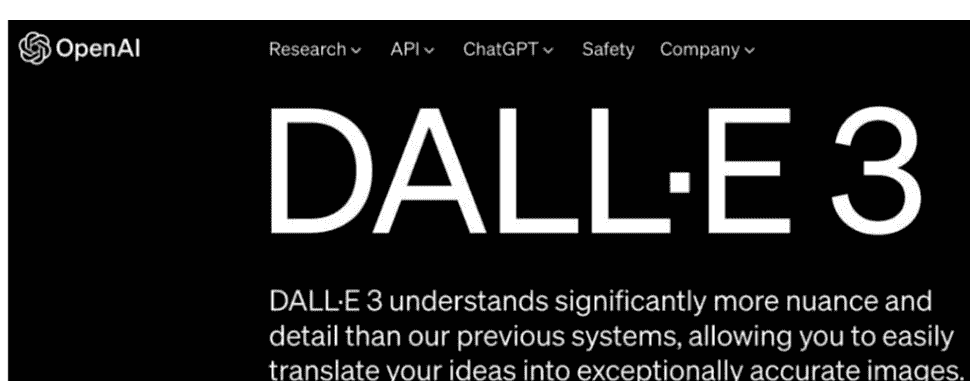

图2-3 OpenAI官网上的DALL·E 3简介

###### DALL·E 3 的使用要点：

用户在 ChatGPT 中切换至 DALL·E 3 模式后，只需用自然语言描述需求即可生成图片，操作门槛很低。相较同类工具，其优势主要体现在：

(1) 无需复杂提示词
DALL·E 3 原生构建于 ChatGPT 之上，可自动将用户的简单想法扩写为详细绘画提示词，并支持对话式修改，用户无需掌握“咒语”。

(2) 画面与文字的精准还原
模型能高度遵循文本描述，从背景到人物细节均能准确呈现，并可将英文文字直接绘制在画面中。截至 2023 年 10 月，中文文字的生成准确度仍有限。

(3) 主体形象保持一致
在对话上下文中，DALL·E 3 能基于同一主体生成不同动作与状态，保持风格统一，便于制作连贯的故事绘本或分镜。

(4) 版权归属与商用
生成作品归用户所有，可直接商用，无需额外授权。同时系统会拒绝生成在世艺术家风格的图像，艺术家也可申请禁止使用其作品训练。

（注：同类工具还包括 Midjourney、Stable Diffusion、文心一格、触手等。）

##### 2. 平面设计：Canva

Canva 是一款跨平台的在线平面设计工具，覆盖网页、iPhone、iPad、Android。平台提供大量设计模板、免版权图片与原创插画，用户选定模板后稍作修改即可快速产出海报、简历、Banner、名片等。

（注：类似工具还有稿定 AI、懒设计等。）

###### Canva 操作流程：

**第一步：** 打开官网 https://www.canva.com 注册登录，中国区提供中文界面，使用更顺手。

**第二步：** 从“模板素材”入口挑选所需设计模板，点击“编辑模板”。

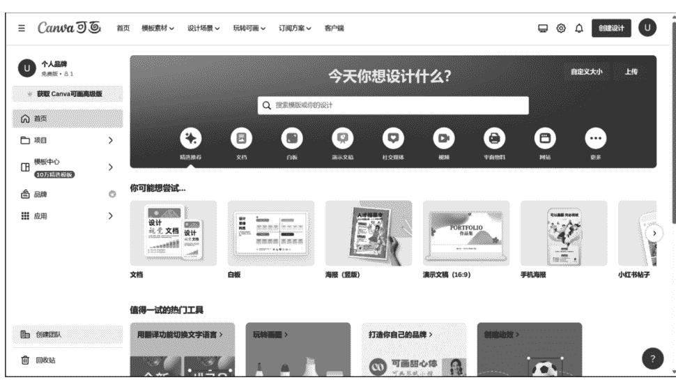

图2-4 Canva中国区官网主页

**第三步：** 进入编辑页后，利用内置编辑功能与素材完成调整并导出。平台提供大量免费资源，付费会员可解锁更多优质模板。

结合 ChatGPT、DALL·E 3 与 Canva 可快速产出平面广告：先由 ChatGPT 依据背景与目标生成创意与文案，再让 DALL·E 3 生成配图，最后用 Canva 完成排版设计。

##### 3. 视频制作：Runway

Runway 是一款强大的 AI 视频制作应用，已发布 Runway-Gen2 版本。支持文生视频、图生视频、物体移除、图像延展、慢动作等功能，并提供定制化模型训练选项。

（注：同类应用还有 Fliki、Make-A-Video、Dreamix、Imagen Video、Pictory、Deepbrain、剪映、腾讯智影等。）

###### Runway 操作流程：

**第一步：** 打开官网 https://runwayml.com 注册登录，也可使用 Google 或 Apple 账号。

**第二步：** 选择“Start with Image”图生视频或“Start with Text”文生视频模式，如图 2-6 所示。

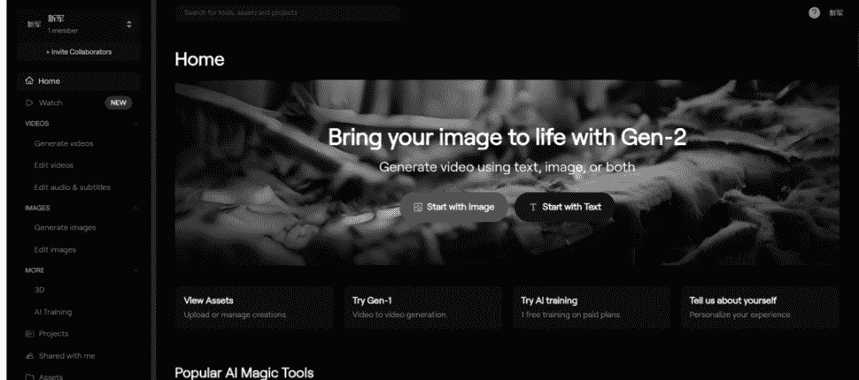

▲图2-5 Runway的官网主页


▲图2-6 Runway的图生视频模式页面

**第三步：** 上传图片并设定生成要求，点击“Generate”即可产出动态视频。


图2-7 Runway的图生视频模式操作页面

Gen-2 可免费体验，额度 105 秒，单次生成 4 秒，约可生成 26 条。若需更多时长、无水印、高分辨率，可购买会员。

广告视频制作可采用 ChatGPT+DALL·E 3+Runway Gen-2 的组合：ChatGPT 生成分镜脚本，DALL·E 3 产出分镜画面，再分批投入 Runway 生成并剪辑合成。

##### 4. PPT 制作：MindShow

MindShow 是一款专注视觉呈现的 PPT 工具，内置丰富模板、图表与设计元素，可根据大纲自动生成专业幻灯片。网站为国内服务，界面全中文。

（注：同类工具还有 TOME、Gamma、MotionGo、闪击 PPT 等。）

###### MindShow 操作流程：

打开官网 https://www.mindshow.fun/ 注册登录，进入“我的文档”页面开始制作。

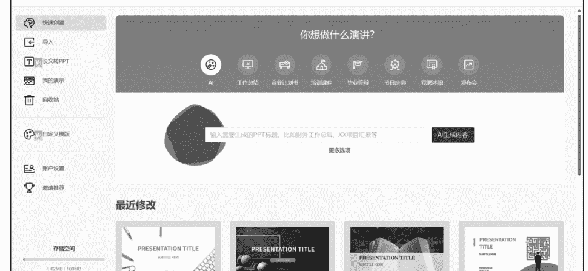

图2-8 MindShow官网“我的文档”页面

截至 2023 年 11 月，升级版 MindShow 已内置 AI 文本生成功能，但考虑到 ChatGPT 在内容生成上的优势，建议两者配合使用：

**第一步：** 向 ChatGPT 描述主题与要求，以 MarkDown 格式输出 PPT 内容，如图 2-9 所示。

**第二步：** 将 MarkDown 文本复制到 MindShow 的导入框，点击“导入创建”。

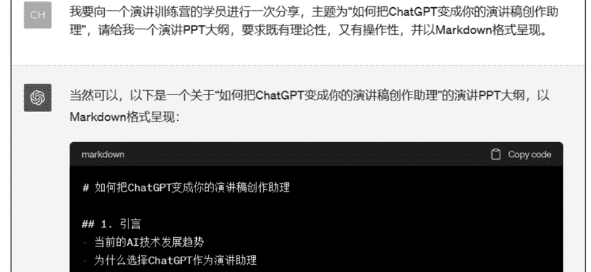

▲图2-9 使用ChatGPT生成MarkDown格式的PPT文字内容

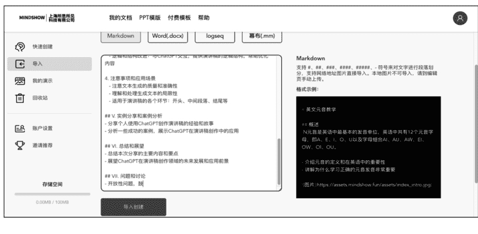

▲图2-10 MindShow的MarkDown格式内容导入框

**第三步：** 进入编辑页，左侧修改文字，右侧更换模板与功能，如图 2-11 所示。

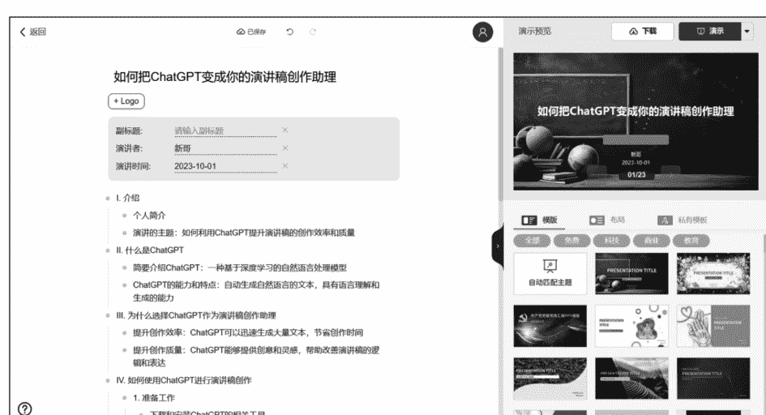

▲图2-11 MindShow的PPT编辑页

**第四步：** 编辑完成后点击顶部“下载”按钮即可导出高质量 PPT。

### 2.6 本章小结

本章介绍了驾驭 ChatGPT 的进阶方法。从提示词与 AI 思维起步，到高级技巧与策略。

第 2.1 节“抓核心：提示词与 AI 思维” 阐述了提示词概念与思维方式，如何激活模型潜能。
第 2.2 节“派任务：通用提示框架” 介绍了“六要素”结构化提示法，调用模型知识库完成通用任务。
第 2.3 节“教方法：专业角色调教” 讲述了让模型快速掌握垂直领域知识的方法。
第 2.4 节“练模型：私有模型训练” 提供了基于企业私有数据的模型定制与部署要点。
第 2.5 节“加工具：插件与其他 AI 软件” 展示了跨工具整合带来的新可能，尤其在营销实战中的价值。

接下来深入探讨 ChatGPT 在营销领域的实战应用。

# 第3章

## AI+市场分析：发现未来新蓝海

市场分析是挖掘机会的关键，能够揭示市场深层动态与潜在趋势。在数据驱动时代，AI 尤其是 ChatGPT 为分析提供了强力支撑。

本章将介绍如何借助 ChatGPT 进行“AI+市场分析”，从框架设计、数据采集与分析，到结果解读与策略制定，发现隐藏机会。学习后可更高效利用 ChatGPT 开展市场分析，开辟新蓝海。

### 3.1 ChatGPT 如何助力市场分析

市场分析是对特定市场的系统研究，旨在了解规模、增速、趋势、消费者需求与竞争格局，为商机发现、品牌定位、产品开发与营销策略提供依据。

传统方式面临三大痛点：数据采集处理成本高、有效信息筛选难、成果转化为策略难。ChatGPT 可在各环节提供支持。

#### 1. 建立分析框架

- 传统做法：依赖经验主观搭建，专业性不足。
- ChatGPT 助力：快速输出多种分析框架，帮助营销人员建立更科学客观的体系。

#### 2. 数据收集

- 传统做法：投入大量人力时间通过问卷、访谈、爬虫等方式收集。
- ChatGPT 助力：迅速从线上资源抓取信息，大幅缩短收集周期与成本。

#### 3. 数据分析

- 传统做法：需借助专业分析工具，过程复杂耗时。
- ChatGPT 助力：快速识别数据模式与趋势，提供分析视角。

#### 4. 归纳分析结论

- 传统做法：人工归纳总结，依赖经验与主观判断。
- ChatGPT 助力：基于分析结果自动提炼关键洞察与发现。

#### 5. 提出策略建议

- 传统做法：需多轮讨论才能形成建议。
- ChatGPT 助力：依据洞察自动生成具体可执行的策略，加快决策。

以初创公司进入中国智能家居市场为例，借助 ChatGPT 进行分析的第一步是建立框架。

### 3.2 建立分析框架

可先向 ChatGPT 提供背景与需求，获取可行框架，再据此设计“六要素”通用任务提示词开展后续工作。

#### 3.2.1 询问分析框架

先给出背景信息与分析需求，让模型提供可行的市场分析框架。

**Prompt:**

我是一个创业者，准备进入中国的智能家居行业，我希望了解市场概况，识别潜在商机，制定营销策略，请为我提供一个市场分析框架。

**ChatGPT:**

很好，你已明确目标，即进入中国智能家居市场。基于你的需求，提供如下市场分析框架：

(1) 市场概况：掌握中国智能家居市场的整体规模，包括产品定义、分类、市场总量、增速、主要参与者、驱动因素与未来趋势，以评估市场潜力。

(2) 消费需求：了解消费者对智能家居产品的偏好与关注点，如核心功能、购买决策因素、行为习惯等，以便锁定目标客群并设计匹配产品。

(3) 竞争环境：梳理主要竞争对手的市场份额、产品服务、定价、营销策略及优劣势，洞察竞争态势并寻找差异化机会。

如何用AI一步步拆解中国智能家居市场

(4) 潜在商机：基于前述的市场盘面、消费诉求与竞争态势，挖掘中国智能家居赛道尚未被充分满足的需求空间、待细分的客群或可创新的触达与推广打法。

(5) 策略落地：结合以上研判，明确产品该长什么样、定价怎么走、渠道与推广如何打、资源如何分配，形成可执行的定位与营销组合。

以上即为研究的核心要义。开展市场研判时，需要尽可能多地收集与交叉验证数据，才能让结论更扎实、决策更稳妥。

我们看到ChatGPT给出的分析逻辑较为完整。接下来即可依据该逻辑，设计一份可直接投喂的任务提示词。

3.2.2 构建可执行的任务提示
本次采用“六要素”通用提示框架来组装完整指令。考虑到智能家居研究的实操需求，Plus用户可提前挂载插件：可联网检索的WebPilot、可读取PDF的AskYourPDF，以及可做数据处理的Wolfram。它们能在不同环节发挥作用。

Prompt:

角色：请你扮演一位经验丰富的市场分析师兼营销策划师，具备对中国智能家居市场进行深度拆解的能力，并能据此输出适配市场需求的营销方案。

背景：我是一名创业者，正在筹备在中国切入智能家居业务，需要做系统性的市场研究。

任务：请帮我完成中国智能家居市场的深度研究。

目标：通过分析识别未来机会点，并输出一套完整的营销策略。

流程：调用合适插件从互联网获取信息，优先采信国家统计局数据、行业研究报告、招股说明书等权威来源。依据我设定的步骤逐项思考并分步输出：

(1) 市场总体规模：厘清中国智能家居市场的规模边界，涵盖产品定义、分类、整体体量、增速、核心驱动力与主要玩家。

(2) 市场趋势预测：围绕技术、产品、价格、渠道等方面预判行业发展走向。

(3) 用户消费需求：把握中国消费者对智能家居产品的偏好与关注点，包括核心功能诉求、购买决策影响因素与行为特征。

(4) 主要竞争对手：梳理主要竞争者的市占、产品服务组合、定价逻辑、销售与营销打法，以及各自优势与短板。

(5) 商业机会：基于市场概况、用户行为与竞争格局，判定潜在的增量机会，可能涉及未被满足的需求、新细分市场或新型投放策略。

(6) 营销策略：基于分析结果明确产品定位、价格策略、渠道与传播方案及资源投放重点，涵盖产品应具备的特性、定价思路、推广方式与资源分配。

指令：

- 每次仅输出一个步骤的内容。在每一步中我可能会提问或提出修改要求，请即时回应并按意见调整，待我确认并说“继续”后再进入下一步。
- 为保证分析的准确性与策略的新颖性，将温度值设为0.7。
- 若理解无误，请回复“明白”。

3.3 数据收集与分析实操
按提示词设定，ChatGPT可从线上资源抓取信息，结合模型能力识别规律与趋势并给出结论。下面看它如何逐步展开。

3.3.1 市场体量盘点
输入上述提示词后，ChatGPT即给出回应。

ChatGPT:
明白，我们开始。

首先我会通过插件访问互联网，从国家统计、行业报告、招股文件等渠道获取中国智能家居市场的信息。随后按你指定的顺序逐步输出。

关于第一步：市场总体规模。我们先界定规模范畴，包括产品定义、分类、体量、增速、驱动因素与主要参与者。

为此，我将使用WebPilot插件检索相关国家统计与行业报告。

Used WebPilot

根据我从Statista获取的信息，以下是中国智能家居市场规模的关键要点：

产品定义：智能家居是通过互联网将家居场景与各类智能设备联动，实现自动化、远程操控与智能交互的系统。

产品分类：

1. 智能安防与监控：如智能摄像头、智能门锁等。
2. 智能照明：如智能灯泡、智能开关等。
3. 智能家电：如智能冰箱、智能空调等。
4. 智能健康：如智能体重秤、智能血压计等。
5. 其他：如智能插座、智能窗帘等。

总体规模：预计到2025年，中国智能家居市场规模将达到约5000亿元人民币。

增长率：中国智能家居市场年复合增长率预计为20%。

主要驱动因素：

(1) 互联网技术快速演进。
(2) 消费者对智能生活需求持续提升。
(3) 政策层面对产业的积极扶持。

主要参与者：
小米、华为、阿里巴巴等头部科技公司均已在该赛道布局。

这些信息为市场提供了初步画像。下一步将深入探讨发展趋势。

这部分有疑问或需要更细的解释吗？

可以看到ChatGPT调动了WebPilot联网，并在国家报告与行业报告优先原则下，给出了第一步规模分析，基本符合预期，可继续。

3.3.2 发展趋势研判
依提示词设定，输入“继续”后即可推进。为防偏差，也可复述问题。

Prompt:
继续。

市场趋势预测：预测中国智能家居市场的发展趋势，包括但不限于技术、产品、价格、渠道等。

ChatGPT:
关于中国智能家居的发展趋势，经多源综合判断，主要有以下方向：

1. 技术趋势
- AI与IoT加速融合：AI进步让设备更懂用户，可实现更精准的语音识别、行为预测等，如智能音箱更自然的对话、冰箱基于饮食习惯的食谱推荐。
- 5G普及：连接速率与稳定性提升，设备间数据交互更快更稳。

2. 产品趋势
- 多功能整合：产品不再单一，如智能灯泡可调光调色、播放音乐、监测空气质量。
- 个性化定制：外观、功能组合等可按需配置，满足差异化需求。

3. 价格趋势
- 整体走亲民：技术成熟与规模化降低成本，价格下探。
- 高端竞争加剧：高端线更强调品质、设计与服务，价格或上浮。

4. 渠道趋势
- 线上持续放量：电商平台成为主要购买路径。
- 线下体验店兴起：品牌通过实体体验场景提升感官认知与转化。

总体看，市场仍具较大增长空间，技术演进与需求变化是主导力量。创业者若能跟随技术与用户需求，提供高品质个性化方案，将更易建立竞争壁垒。

如需深挖，可要求其对技术趋势进一步展开。

Prompt:
在技术趋势中，请进一步分析以ChatGPT为代表的AIGC技术发展对于智能家居的影响?

ChatGPT:
可以。AIGC以ChatGPT为代表，是AI领域的重要进展。其对智能家居的影响主要体现在：

1. 交互体验升级
- 语音助手进化：支持更复杂、自然的对话，而非简单指令。
- 个性化推荐：基于互动数据更精准把握偏好，提供音乐、资讯、食谱等定制化服务。

2. 设备协同增强
多设备可实现智能联动。如用户对音箱说想看电影，灯光自动调暗、窗帘自动关闭，形成沉浸场景。

3. 安全与隐私
AI可协助识别异常行为并预警。技术成熟后，数据可在本地处理存储，降低云端泄露风险。

4. 自我学习与优化
设备可依据使用习惯与反馈自动调优。如空调自动记忆舒适温度，音箱基于听歌习惯推送内容。

总之，AIGC将加速智能家居向更智能、便捷、安全方向演进。抓住此趋势并结合自有产品，是获取优势的关键。

回应已足够细致，可继续下一步。

3.3.3 用户需求拆解
按原设定，输入“继续”即可推进，也可复述问题以保持对齐。

Prompt:
继续。

用户消费需求：了解中国消费者对智能家居市场产品的需求和偏好，包括消费者最关心的产品特性、购买决策的影响因素，以及消费者购买行为等。

ChatGPT:
很抱歉，未检索到关于中国消费者需求的具体数据。基于既有知识可做概括性描述：

1. 产品特性
- 智能化：期望远程操控、语音交互、自动化。
- 安全性：对隐私与数据安全更敏感。
- 互联性：希望不同品牌设备能无缝集成。

2. 购买决策影响因素
- 价格：仍是重要考量，尽管愿为高品质付费。
- 品牌信誉：知名品牌更受信任。
- 用户评价：会参考他人使用反馈判断性能与可靠性。

3. 购买行为
- 线上为主：电商渠道使用广泛。
- 体验驱动：多数人仍希望实体店体验后再下单。

以上为概括性信息，如需更具体或最新数据，建议查阅专业行业报告或开展消费者调研。

使用插件后仍未检索到公开的详细需求数据，主要因核心数据多为付费或权限限制，这是ChatGPT检索的局限。但概括性判断仍具参考价值，如需深挖可继续追问。

Prompt:
请分析：消费者购买智能家居产品存在的顾虑和障碍有哪些？

ChatGPT:
消费者在购买时的常见顾虑包括：

1. 安全性与隐私：联网设备可能导致数据泄露、隐私被侵或遭黑客攻击。
2. 技术复杂性：不熟悉技术的用户担心安装与日常管理困难。
3. 兼容性问题：担心新设备与现有系统或未来设备无法协同。
4. 价格：相比传统家电仍偏高，预算敏感人群犹豫。
5. 品质与寿命：市场较新，对品牌品控与耐用性存疑。
6. 依赖风险：过度依赖可能导致网络中断或设备故障时家庭功能受限。
7. 更新与维护：担心频繁软件更新导致停机或功能变化。
8. 健康与环境顾虑：对辐射等潜在健康风险的担忧。

要化解这些障碍，厂商与渠道需提供更充分的教育、易用设计、可靠售后与透明的安全承诺。

回答已较为全面，可进入下一环节。

3.3.4 竞争格局梳理
按提示词，输入“继续”即可推进，也可复述问题。

Prompt:
继续。

主要竞争对手：了解中国智能家居市场的主要竞争者，包括他们的市场份额、产品和服务、定价策略、销售和营销策略，以及他们的优势和弱点。这将帮助你了解市场的竞争态势，并找到区别于竞争者的策略。

ChatGPT:
进入下一分析：

很抱歉，未找到主要竞争者的详细数据。基于既有知识可做如下概述。

(1) 小米：智能家居领军者之一，覆盖灯泡、插座、摄像头、音箱等，构建米家生态。优势在生态完整与性价比。

(2) 华为：布局智能家居，与手机平板协同，主推“1+8+N”全场景。产品兼容性强。

(3) 阿里巴巴：依托天猫精灵音箱切入，并提供阿里云IoT平台支持。

(4) 京东：通过京东智能及“京鱼座”品牌提供音箱、照明、安防等产品，搭建京东微联平台。

(5) 其他品牌：海尔、格力、美的等传统家电厂商也在积极布局。

各玩家路径不同：小米、华为以硬件生态为核心；阿里、京东依托电商流量与平台优势。创业者可据此找准定位与差异化空间。

若需更详实信息，建议查阅行业研究报告或咨询专业机构。

插件检索仍未触及详细数据，可根据既有信息整理成表，并结合核实渠道避免“幻觉”。若手头有竞争对手调研PDF，可通过AskYourPDF上传后让模型读取，以提高准确性。

Prompt:
请对以上几个企业分别进行分析，包括产品和服务、定价策略、销售和营销策略，以及它们的优势和弱点。以表格形式呈现。

ChatGPT:
可以，表3-1为主要竞争者分析。

表3-1 中国智能家居市场主要竞争者分析

| 竞争者 | 产品和服务 | 定价策略 | 销售和营销策略 | 优势 | 弱点 |
| :--- | :--- | :--- | :--- | :--- | :--- |
| 小米 | 智能灯泡、插座、摄像头、音箱等全品类，构建米家生态 | 性价比导向，覆盖入门到中高端 | 线上为主，辅以小米之家线下体验；以米粉社区与口碑传播 | 生态完整、互联性好、品牌认知高、价格有竞争力 | 部分产品利润薄；高端溢价能力有限 |
| 华为 | 手机、平板、穿戴与智能家居协同，主打1+8+N全场景 | 中高端定位，强调技术与品质 | 线上线下全渠道，门店网络完善；营销突出技术创新与高端形象 | 研发实力强、品牌高端、跨设备体验佳 | 品类相对小米不全；生态开放性曾受质疑 |
| 阿里巴巴 | 以天猫精灵为入口，连接生态设备，依托阿里云IoT | 入口硬件常以补贴低价获客 | 纵深电商平台天猫、淘宝；营销结合内容与服务生态 | 流量与平台优势明显；云与大数据能力强 | 硬件自研有限，依赖合作伙伴；硬件控制力较弱 |
| 京东 | 京鱼座品牌覆盖音箱、照明、安防等，京东微联平台支撑 | 入口产品价格具竞争力，拉动生态 | 依托京东自营平台，物流与售后为核心卖点；营销强调品质与便捷 | 自营物流与售后体系完善；3C领域信任度高 | 自有品牌影响力有限；生态规模与开放度相对落后 |

| **海尔、格力、美的** | 主营业务集中在传统大家电的智能化改造，代表品类有智能冰箱、智能空调、智能洗衣机等，属于智能家居的底层硬件。 | 定价体系沿袭传统家电逻辑，覆盖大众到高端区间。 | 销售渠道以既有线下经销体系为主，叠加线上官方旗舰店，传播诉求聚焦智能升级与品牌信赖。 | 制造积累深厚、品牌影响力大，产品可靠性高。 | 在跨品牌互联协同及全屋智能生态搭建上，相较互联网科技公司起步较晚。 |

### 3.4 归纳分析结论

当数据收集与研判达到一定成熟度，就可让 AI 助手基于既有分析自动提炼关键洞察、锁定商机并给出可落地的创业思路。

#### 3.4.1 挖掘潜在商机

沿用前文提问节奏，输入“继续”即可衔接下一环节。亦可复述原问题以防偏离。

输入：

继续。

商业机会：基于市场全景、用户行为与竞争态势，梳理中国智能家居市场的潜在机会，涵盖未被满足的需求、新细分赛道或新的销售营销打法。

AI 助手：

综合对中国智能家居的判断，可归纳如下机会：

1. 仍待满足的需求
- 真正一体化的解决方案：单品供给充足，能提供完整且高度联动的整体方案的玩家仍少。一站式交付可显著降低用户决策成本与使用门槛。
- 数据安全与隐私：随关注度提升，具备更高安全等级与隐私保护的产品有较大空间。

2. 新的细分赛道
- 适老化智能家居：人口老龄化加速，聚焦健康监测、紧急呼叫、家居安全等功能的适老产品需求释放。
- 绿色可持续：环保意识提升，低能耗、环保材质的智能品类具备吸引力。

3. 新的销售与营销打法
- 线下体验空间：在线上为主的格局下，实体体验中心可让用户近距离感知功能，提升转化。
- 跨界联动：与家具品牌、家装企业合作，提供更完整的居家方案，同时扩大覆盖面。

技术创新
- AI 与大数据：借助 AI 与大数据实现更个性化的服务与建议，提升满意度与留存。
- 连接技术演进：5G 与 IoT 推进下，基于新一代连接技术开发的智能产品将迎来增量。

总体看，中国智能家居仍处高增长期。创业关键在于找到市场空白，用差异化产品与服务回应真实需求。

#### 3.4.2 给出可行的创业方向

梳理商机后，可要求模型进一步组合成具体方案。

输入：

请根据以上商业机会，进行合理组合，提出 3～5 个可行创业方向，每个方向说明细分市场、目标人群、产品需求、技术创新。

AI 助手：

可行的方向如下：

1. 适老化智能健康家居
- 细分：老年人健康管理与家居安全。
- 人群：60 岁以上长者及其子女。
- 需求：心率血压监测设备、一键紧急呼叫、跌倒感应、防滑夜间照明等。
- 创新：AI 健康数据分析与预警，IoT 实现多设备无缝互联。

2. 绿色智能家居方案
- 细分：节能环保型智能家居。
- 人群：环保意识强的家庭与年轻用户。
- 需求：节能智能灯具、智能温控、空气质量监测与净化设备。
- 创新：AI 驱动的能源管控与优化，自动调节设备运行状态降低耗能。

3. 体验中心与装配一体化服务
- 细分：家装与智能家居集成服务。
- 人群：正在或即将进行家装的家庭。
- 需求：从空间设计、装修到智能产品选型与安装的一体化交付。
- 创新：AR/VR 虚拟预览，帮助用户直观规划产品布局。

4. 个性化定制智能家居服务
- 细分：高端定制化智能家居。
- 人群：高收入人群及有特殊需求的用户。
- 需求：按用户习惯与审美定制的整体解决方案。
- 创新：AI 分析生活偏好，输出个性化推荐与服务。

这些方向具备潜力，但仍需深入调研与技术验证，确保匹配用户痛点。若方向不理想，可刷新重生成，或在已有结果上继续深化。

### 3.5 策略建议

方向确定后，可让模型给出更具体可操作的落地建议，加速决策与执行。

#### 3.5.1 营销策略

从上述方向中挑选其一，继续要求给出营销方案。

输入：

以方向1为例，继续。

营销策略：制定产品定位、定价策略、销售和营销策略。包括产品应具备哪些特性、如何定价、如何推广、如何分配资源等。

AI 助手：

针对方向1——适老化智能健康家居，营销建议如下：

1. 产品定位
关键词：安全、健康、便捷、关怀
特性：
- 操作极简，界面清晰，无障碍使用。
- 实时健康监测及异常提醒，如心率血压波动预警。
- 一键紧急呼叫直连家人或医疗机构。
- 家居安全配套，如夜间照明、跌倒感应等。

2. 定价策略
- 成本加成法兼顾品质与长者支付能力，定价适中。
- 组合套餐：基础健康监测包、高级家居安全包等，分层满足需求。

3. 销售渠道
- 线上：官网及主流电商平台。
- 线下：与医疗机构、社区养老、养老院合作设点或体验区。
- 合作伙伴：联动健康险、医疗服务商推出打包服务。

4. 营销打法
- 教育型营销：开展线上线下讲座，普及智能家居提升生活质量的知识。
- 口碑传播：激励满意用户分享体验，给予优惠或礼品回馈。
- 社交媒体：在微信、微博等发布科普与案例内容。
- 联合推广：与健康食品、养老服务等品牌协同传播。

5. 资源分配
- 研发：聚焦人性化、适老化产品迭代。
- 调研：定期回访获取真实反馈。
- 销售与服务：培训团队提供专业贴心支持。
- 推广：按策略分配广告预算，确保投放精准。

以上为初步框架，具体执行需根据市场反馈持续优化。

#### 3.5.2 制作报告PPT

若对内容满意，可进一步让模型生成 PPT 提纲，以 Markdown 输出，便于后续制作。

输入：

我需要根据以上关于智能家居的市场分析，制作一份PPT，请拟订一个提纲，以MarkDown格式输出。

AI 助手：

可行的 PPT 大纲如下，采用 Markdown 格式：

（具体内容略）

该提纲可根据实际需要增删完善。至此，完整演示了借助 AI 助手辅助市场分析的全流程。

### 3.6 本章小结

市场分析是战略制定的基础，涵盖框架设计、数据收集、数据分析与策略制定。AI 助手可在全流程提供支撑。

1. 已具备的能力
- 数据收集与整理：快速检索公开信息，为分析提供素材。
- 文档处理：解析大量市场报告，提取要点。
- 趋势预测：基于历史与现状数据识别动态。
- 需求洞察：提供消费需求分析视角。
- 竞争分析：汇总竞品信息，厘清竞争态势。
- 策略建议：基于结论给出行动建议。

2. 现存不足
- 数据来源受限：主要依赖网络公开信息。
- 准确性需核验：需人工校验可靠性。
- 分析深度有限：整体偏概括，需人工深化。

3. 需注意的问题
- 补充可靠数据：除网络信息外提供权威数据。
- 数据验证：对准确性与可信度进行复核。
- 人机结合：将模型输出与人工判断融合，获得更深刻见解。

4. 未来趋势
- 自动化实时收集：实现实时数据整合与更新。
- 工具生态集成：对接更多专业分析插件。
- 策略精准化：依托深度学习提供更实用建议。

AI 助手在市场分析领域已展现强劲潜力，持续优化后将成为企业洞察市场、发现商机、制定策略的重要助手。

## 第4章 AI+用户洞察：走进消费者的心

深刻把握消费者需求与行为是营销成功的根基。在信息高度饱和的今天，需要更精准的手段进入消费者内心。

本章聚焦 AI 驱动的“AI+用户洞察”，深入理解用户。我们将探讨如何构建洞察任务框架，如何借助 AI 完成线上数据抓取与线下调研，以及如何提炼有价值洞察。通过学习，可掌握用 AI 进行用户洞察的方法，提升营销策略的根基。

### 4.1 AI 如何助力用户洞察

用户洞察不仅是行为观察，更是挖掘需求、动机、情感与痛点。精准洞察可指导更有效的营销决策，提升吸引力。

传统洞察耗时耗力，需组织调研、收集、分析、撰写报告。借助 AI，可高效且有针对性地开展洞察。

各环节价值体现：

1. 线下用户调研
- 传统方式：组建团队，通过问卷、访谈收集数据，成本高、周期长。
- 模型辅助：依托基础知识提供专业指导，提升效率、降低人力成本。

2. 线上数据抓取
- 传统方式：手工爬取社交媒体、电商平台数据。
- 模型辅助：快速抓取多平台数据并提供初步分析。

3. 洞察成果提炼
- 传统方式：人工归纳，易受经验与主观影响。
- 模型辅助：快速处理基础数据，形成清晰结论。

4. 应用策略建议
- 传统方式：多轮讨论确定落地方式。
- 模型辅助：基于洞察自动生成具体可行的策略建议，加速决策。

以下以汉服创业者获取品类用户画像与需求洞察为例演示流程。首步需建立任务框架。

### 4.2 线下用户调研

AI 可在问卷设计、访谈执行等环节提供专业支持，帮助团队提效降本。

#### 4.2.1 建立任务框架

按线下调研常规流程，先设计“六要素”通用提示词，让模型全程辅助。

输入：

角色：假设你是一个用户洞察专家，擅长使用各种专业的用户洞察方法。

背景：我是一个专注于汉服领域的创业者。

任务：通过问卷调查、用户访谈、焦点小组等方式，直接向用户了解他们对汉服的看法和需求。

目标：洞察用户对于汉服的产品需求和情感需求，并形成完整的用户画像和洞察报告。

流程：请通过以下问题清单一步一步思考，并指导我完成数据收集、分析和洞察的全过程。

(1) 什么是问卷调查？如何通过问卷调查进行汉服的用户洞察，具体的步骤是什么？

(2) 根据我们的背景需求，拟订一份可行的问卷调查执行计划和调查问卷表。

(3) 什么是用户访谈？如何通过用户访谈进行汉服的用户洞察，具体的步骤是什么？

(4) 根据我们的背景需求，拟订一份可行的用户访谈执行计划和访谈问题表。

指令：

- 请按照问题清单的顺序，每次只输出一个问题的答案。
- 每一个问题的结尾增加一条关于“在这个过程中AI助手可以协助的工作”的说明。
- 针对你给出的答案我可能会提出疑问，请对我的疑问进行详细解答，直到我说“继续”时，再继续回答下一个问题。
- 考虑到我是一个IT小白，请使用外行也能听懂的语言进行讲解，对于过于深奥的专业术语进行必要的解释说明。
- 为了获取更准确和具有深度的洞察，设置温度值为0.6。
- 如果你明白我意思，请回复“明白”。

AI 助手：

明白，让我们开始吧！

#### 4.2.2 问卷调查

提问：问卷调查是什么？如何借助问卷洞察汉服用户？步骤有哪些？

输入：

从第一个问题开始。

AI 助手：

问卷调查是通过系统化问题收集目标人群意见、态度、行为与需求的研究手段，可为纸质或线上形式。

针对汉服洞察的流程：
1. 确定研究目标：明确想了解认知、购买意愿、使用场景等。
2. 设计问卷：问题简洁明确，避免引导。
3. 选定样本：如对汉服感兴趣的年轻人、既有购买者等。
4. 分发渠道：问卷星、腾讯问卷，或汉服活动、社群投放。
5. 收集数据：在规定时间内回收。
6. 数据分析：整理归纳需求、痛点、偏好。
7. 输出报告：为产品与营销提供依据。

模型可协助：
- 辅助设计题目
- 给出分析思路
- 协助整理撰写报告

是否需要进一步说明？

输入：

继续。

AI 助手：

问卷执行计划与问卷示例：

执行计划：
- 目的：了解用户对汉服的认知、购买动机、使用场景与情感需求。
- 受众：18-35岁对文化时尚感兴趣的群体。
- 形式：线上问卷。
- 渠道：社交媒体、汉服社群、校园。
- 时间：两周。
- 激励：参与者可获折扣券或小礼品。

问卷示例：
- 基本信息：性别、年龄段、职业。
- 是否购买过汉服：是/否。
- 了解程度：非常了解至完全不了解。
- 购买原因多选：喜文化、时尚潮流、特定活动、朋友推荐、其他。
- 期望改进多选：款式更多、面料更舒适、价格合理、配饰丰富、其他。
- 理想汉服形象或场景描述。
- 其他建议。

模型可协助：
- 初步数据分析与可视化
- 问卷优化建议

后续可继续推进。

#### 4.2.3 用户访谈

继续追问访谈相关内容，输入“继续”即可推进。

什么是用户访谈？

用户访谈是定性研究方法，通过一对一深度交流获取需求、痛点、想法与感受，相较问卷更深入个性化，能获得更丰富信息。

进行汉服用户访谈的步骤如下：
- (1) 确定目的：明确希望获取的深度信息，如情感联结、购买使用经历等。

# 用 ChatGPT 把汉服用户调研做得又快又准

想把线下访谈和线上洞察串起来，ChatGPT 能在每个环节提效。核心做法是先把研究框架搭好，再让模型帮忙细化执行、整理结果。

- (2) 筛选受访者：围绕研究目标锁定合适样本。比如访谈过已有购买经验的汉服消费者，或对汉服有兴趣但尚未下单的人群。
- (3) 制定访谈提纲：列出想要探讨的主题和核心问题，同时保留弹性，根据受访者的回答即时调整追问方向。
- (4) 执行访谈：挑一个安静舒适的环境，让受访者放松、愿意敞开心扉分享。
- (5) 记录与整理：访谈时做好笔记，结束后提炼关键信息和观察要点。
- (6) 分析与归纳：汇总全部访谈结果，找出现象中的共性与差异，形成可用的用户洞察。

##### 在这个过程中ChatGPT可以协助的工作
- 协助搭建访谈提纲和问题设计。
- 给出访谈结果的分析思路。
- 帮忙梳理和撰写访谈总结。

请问您对此有什么疑问吗？

###### Prompt:

继续。

###### ChatGPT:

基于既定背景需求，输出一份可落地的用户访谈执行方案与问题清单。

##### 用户访谈执行计划
- (1) 目标：深入探究用户对汉服的情感联结，以及购买与使用的真实体验。
- (2) 受访者选择：招募20位已完成购买的汉服用户，另邀10位对汉服感兴趣但仍未购买的用户。
- (3) 访谈形式：线下面对面或线上视频通话。
- (4) 时长：单次访谈控制在45分钟至1小时。
- (5) 地点：挑选安静舒适的场所，例如咖啡馆的僻静角落，或使用线上视频会议工具。
- (6) 激励机制：为提升参与意愿，可提供小礼品或汉服折扣券。

##### 访谈问题表
- (1) 请谈谈你最初得知汉服是在何时？是通过什么渠道接触到的？
- (2) 你当初决定购买汉服的出发点是什么？偏爱设计、看重文化内涵，还是其他因素？
- (3) 你平时会在哪些场景穿着汉服？挑选这些场景的理由是什么？
- (4) 从设计、舒适度、价格等角度看，你觉得汉服有哪些亮点和不足？
- (5) 你会向身边的人推荐尝试汉服吗？原因是什么？
- (6) 你如何理解“国潮”这个概念？
- (7) 你希望未来的汉服或国潮品牌在哪些方面改进或发展？
- (8) 除了穿搭，你是否还有其他与汉服文化相关的爱好或活动？
- (9) 能否分享一次穿着汉服印象深刻的经历？
- (10) 对汉服或国潮品牌你有哪些建议和期待？

##### 在这个过程中ChatGPT可以协助的工作
- 依据受访反馈迭代优化访谈题目。
- 提供访谈结果的初步解析和建议。
- 协助把访谈内容整理成结构化的总结。

请问您对此有什么疑问吗？

无论是问卷还是深度访谈，ChatGPT 都能提供专业支持。借助它，线下用户调研可以用更低成本、更快节奏完成。

### 4.3 线上数据抓取

ChatGPT 借助 WebPilot 等第三方插件，以及官方的 Web Browsing 功能，可在网络上快速抓取相关信息并做归纳，为用户洞察补充丰富数据源和专业视角。

#### 4.3.1 建立任务框架

为让线上抓取和初步分析更有序，采用“六要素”提示框架构建完整任务指令。

**Prompt:**

**角色：** 请扮演一名专业用户洞察专家，同时也是 ChatGPT 营销应用专家。

**背景：** 我正在创业，聚焦中国汉服赛道。

**任务：** 需要对中国市场的汉服消费者做一次深入专业的用户洞察。

**目标：** 将洞察成果转化为市场机会，指导产品创新、品牌定位和营销策略，最终成为汉服市场的领先品牌。

**流程：** 我们一步步推进，按以下顺序开展：
##### 1. 社交媒体数据的抓取与分析
调用 Browse with Bing 搜索并分析以微博为代表的社交媒体上关于汉服的讨论内容，了解用户需求与偏好。
##### 2. 电商平台数据的抓取与分析
调用 Browse with Bing 搜索并分析以淘宝为代表的电商平台的汉服销售数据和用户评价，判断热销款式与用户对功能、设计的诉求。
##### 3. 专业用户洞察报告抓取与分析
优先检索国家统计局、权威行业研究机构、阅读量靠前的中国汉服市场洞察报告，并提炼核心观点。

**指令：**
- 我们从第一步第1点开始，按流程逐点展开。每次只讨论一个点，我确认并回复“继续”后进入下一步。
- 为保证专业度和创新度，请把温度值设为0.7。
- 回答结尾提供三个可继续提问的示例。
- 若理解，请回复“明白”。

###### ChatGPT：

明白，开始吧！

#### 4.3.2 数据收集与分析

##### 1. 社交媒体数据的抓取与分析

调用 Browse with Bing 搜索并分析社交媒体，以微博为例，围绕汉服的话题和内容，探明用户需求与偏好。

**Prompt:**

从第一步开始。

**ChatGPT:**

Finished browsing

综合微博上关于汉服的讨论，可提炼出以下用户偏好：

**多元设计与配饰：** 用户对汉服的不同款式和配饰表现出浓厚兴趣，社区内频繁分享发簪发带、耳坠耳钉、项链璎珞、手镯戒指、荷包、鞋包等配饰的搭配心得。

**摄影展示：** 汉服爱好者热衷于通过摄影记录并分享穿搭造型，显示出对视觉呈现和创意表达的追求。

**传统文化探求与体验：** 讨论涉及汉服与旗袍的区别、传统价值意义等，反映出用户对传统文化的尊重，希望借穿搭实现文化体验。

**社群互动：** 用户乐于在社区内交流，讨论争议话题、分享购买与设计经验、参与汉服活动与赠品互动。

**新颖体验：** 部分社群开始探索体感互动汉服自拍馆等新玩法，提供更独特的体验。

总体来看，用户不仅满足于传统样式，还渴望新颖、多元的体验，并积极在社群中分享交流。

**Prompt:**

汉服用户是否对某些特定款式或品牌有明显偏好？

**ChatGPT：**

社交媒体显示用户确实存在品牌与款式偏好。

**品牌偏好：**
“十三余”是个高热度品牌，创始人连雨馨通过社媒和淘宝天猫积累大量粉丝，5年内年销售额达3亿元，成为品类头部。
汉尚华莲与九锦司同样受关注，曾联手在纽约时代广场大屏展示汉服，提升文化认知。

**款式偏好：**
苏式汉服因融入苏州人文历史与景致而受欢迎，由品牌苏子衿推行。

**文化推广：**
十三余创始人倡导“把汉服穿出家门”“把汉服穿出国门”，有效吸引Z世代参与汉服文化传播。

这些偏好多与品牌的文化底蕴、设计理念及社媒传播活动相关。

##### 2. 电商平台数据的抓取与分析

调用 Browse with Bing 搜索并分析电商平台，以淘宝为例，获取汉服销售数据和用户评价，了解热销款式与功能设计诉求。根据前述提示词设定，输入“继续”后 ChatGPT 将推进下一步。

**Prompt:**

继续。

**ChatGPT:**

基于汇总信息，淘宝平台上汉服的热销情况与用户诉求如下：

**热销款式：**
明制汉服与宋制汉服受欢迎，多为素色，偶见刺绣点缀。
马面裙与立领衫也是常见热销单品。
男童市场中，国学服与中国风古装销量好，价格亲民。

**功能与设计诉求：**
用户偏爱清新淡雅、日常大方的设计，重视穿着舒适度与天然面料。
部分用户看重性价比，促销时更倾向于购买款式多变、设计美观但价格较低的产品。
品牌认知度高，受欢迎品牌包括汉尚华莲、重回汉唐、梨花渡、如梦霓裳、锦上堇瑟等。

以上可为产品开发、品牌定位与营销策略提供参考。

**Prompt:**

请抓取淘宝平台2023年汉服最新数据，做一次市场分析。

**ChatGPT:**

根据多源信息整合，2023年淘宝汉服市场呈现：

**销售表现：**
2023年9月，淘宝汉服商家整体表现强劲，“十三余”等多家商家刷新销售纪录。

**购买渠道：**
2022-2023年，约70%消费者选择淘宝、闲鱼等线上平台下单，49.8%选择线下实体店。

**市场规模：**
2022年中国汉服市场规模约125.4亿元，2023年持续扩张，预计2025年达191.1亿元。

**市场趋势：**
淘宝天猫出现“通勤汉元素”潮流，新设计更贴合当代穿搭习惯与审美，降低入门门槛，让汉服更具普适流行力。

数据反映出市场活跃度高，消费者热情持续，同时新设计元素正重塑流行方向。

借助 Browse with Bing，ChatGPT 可快速从电商抓取数据并做初步分析，为洞察提供数据支撑。

##### 3. 专业用户洞察报告抓取与分析

可让 ChatGPT 优先检索国家统计局、权威研究机构及阅读量领先的中国汉服市场洞察报告，归纳核心观点。按前述设定，回复“继续”后进入下一步。

**Prompt:**

继续。

**ChatGPT:**

综合多份报告，核心结论如下：

**消费规模：**
中国汉服市场消费规模125.4亿元，预计2025年升至191.1亿元，同比增13.2%。另有预测认为2023-2025年行业规模约630亿元。

**消费群体：**
Z世代即95后是主要消费人群。

**消费行为：**
疫情前购衣多用于旅游、拍摄或赠送；疫情期间因兴趣爱好维持购买。当前市场回暖，用户除拍照外，也希望日常通勤、逛街穿汉服，汉服成为彰显个性与品味的生活方式。

**消费渠道：**
约70%通过淘宝、闲鱼等线上平台购买，49.8%选择线下实体店。线上选择多价格低，线下体验感更好。品牌可线上线下并行，提升知名度。

**相关服务：**
汉服写真、租赁、体验馆将成为产业链重要环节。跨界IP合作与线下活动有助于破圈，提升品牌声量。

**未来趋势：**
95后、00后逐步成为消费主力，国潮或迎新高。汉服在多城“出圈”，成为文旅顶流，市场潜力进一步释放。

线上抓取与分析可为用户洞察提供丰富参考与启示。

### 4.4 洞察成果提炼

线上数据结合线下调研后，借助 ChatGPT 的逻辑推理能力可进一步提炼成果。例如将调研报告转为 PDF，通过 https://askyourpdf.com 上传，获取 ID 标识符后输入 ChatGPT，调用 AskYourPDF 插件提取内容，按需处理。

#### 4.4.1 用户画像建立

上传 PDF 并获取 ID 后，输入提示词让 ChatGPT 基于初步报告构建画像。

**Prompt:**

假设你是一名用户洞察专家，擅长从调研数据中挖掘需求与机会。请调用插件 AskYourPDF 读取：[填写上传后获得的 ID 标识符]，按以下要点归纳，建立汉服爱好者用户画像。

- 1. 基本属性（年龄、性别、地域等）。
- 2. 兴趣爱好（除汉服外的其他爱好）。
- 3. 消费习惯（购买频率、花费金额等）。
- 4. 购买渠道（汉服产品购买来源）。
- 5. 信息渠道（了解相关信息的来源）。

###### ChatGPT:

基于文档内容，汉服爱好者画像如下：

###### 1. 基本属性
年龄：18～24岁占比最高，为45.1%。
性别：女性88.2%，男性11.8%。
地域：一线城市37.5%，二线城市33.5%，三线及以下29.0%。

###### 2. 兴趣爱好
除汉服外，偏好摄影54.5%、手工DIY48.5%、古风音乐42.8%。

###### 3. 消费习惯
购买频率：年购1～3套占比74.5%，4～6套占比69.3%，7～10套占比76.1%。
消费金额：单套均价777.5元，高于普通服饰。

###### 4. 购买渠道
更倾向线上，其中综合电商平台如天猫、京东占比70.0%，品牌官网54.4%，专业汉服商城如同袍、汉服荟48.9%，线下实体店与定制工作室亦有一定份额。

###### 5. 信息渠道
首次接触汉服多来自短视频平台如抖音、快手占比54.5%，社交平台如微信、微博、小红书48.5%，视频平台如B站42.8%。
当前获取信息渠道中，汉服类App占比9.2%，线下活动9.1%，影视剧/电视节目8.9%。

#### 4.4.2 市场机会发现

基于报告数据，进一步分析并挖掘机会。

**Prompt:**

请根据以上 PDF 文档信息，按以下要点归纳推理并发现市场机会。

- （1）明确需求（总结用户明确提出的需求）。
- （2）隐性需求（挖掘用户未明说但实际存在的需求）。
- （3）机会发现（结合痛点与隐性需求找未来潜在机会）。

**ChatGPT:**

基于文档归纳如下：

##### 1. 明确需求
汉服已成大众流行消费，是新时代国潮文化复兴。
电商数据显示汉服经济已超20亿元。
不少爱好者有穿 cos服、JK 制服、Lolita 等小众服装的经历。

##### 2. 隐性需求
爱好者兴趣不局限于汉服，也对 cos服、JK 制服、Lolita 等小众服饰感兴趣。
入圈后更愿意使用专业汉服类 App 获取信息并与同好交流。

##### 3. 机会发现
改良汉服潜力大：除考究的传统汉服外，融合现代元素或二次元的改良款同样受欢迎，可推出兼顾现代审美的改良产品。
汉服信息平台：短视频、社交平台是主要信息源，可在相关平台加大内容投入吸引用户。
跨品类结合：爱好者对多种小众服饰有兴趣，可尝试汉服与 cos、JK、Lolita 元素结合，设计多元化款式。

这些洞察为产品与营销策略调整提供方向。

ChatGPT 从初步报告中提炼出更深层的结论。下一步可据此生成营销应用策略建议。

### 4.5 应用策略建议

ChatGPT 可基于洞察报告自动生成具体策略，帮助快速决策。

**Prompt:**

请继续读取： [PDF 文档上传后获得的 ID 标识符] ，并基于归纳要点，给出建议，包括：

- (1) 产品创新方向。
- (2) 品牌价值定位。
- (3) 市场营销策略。

**ChatGPT:**

基于文档与前期归纳，建议如下：

#### 1. 产品创新方向
- 改良汉服：融合现代或二次元元素，设计更贴合年轻人审美的新款。
- 日常穿着：推出含汉元素的现代日常服，满足用户在日常场景展现国潮的需求。
- 技术创新：采用智能面料、可持续材料，提升舒适度与环保属性。

#### 2. 品牌价值定位
- 年轻化：核心人群20～30岁，品牌形象应年轻、时尚、有活力。
- 文化传承：突出汉服的文化底蕴，结合现代审美彰显中华魅力。
- 多元化：鼓励个性表达，提供多风格设计满足差异化需求。

#### 3. 市场营销策略

短视频投放：依托抖音、快手等短视频平台发布品牌宣传与产品展示内容，快速抓住年轻用户的注意力。

社媒内容运营：在微信、微博、小红书等社交平台持续输出汉服主题内容，保持与粉丝的高频互动，提升品牌认知。

沉浸式线下：策划汉服走秀、汉服文化沙龙等主题活动，打造沉浸体验，增强用户归属感与忠诚度。

跨界联动：与cos服、JK制服、Lolita等小众服饰品牌联合推广，共同挖掘新市场空间。

综合用户显性诉求、隐性动机与实际痛点，以上组合打法有助于品牌更精准匹配市场需求，把握增长窗口，推动品牌与产品持续发展。

在洞察报告基础上，ChatGPT进一步将洞察成果转化为可落地的市场策略建议，至此借助AI完成了用户洞察的完整链路。

### 4.6 本章小结

洞察是读懂行为轨迹、需求取向、驱动动机与核心期待的关键路径，为产品与服务的优化提供依据。ChatGPT在洞察环节中能发挥较为实质性的作用。

#### 1. ChatGPT 已经具备的能力
- （1）线下调研支持：能够参与问卷设计与分析，提升调研效率与准确性。
- （2）线上数据挖掘支持：可自动抓取并整理网络公开的用户数据与反馈，为洞察提供充足线上素材。
- （3）洞察结论提炼：借助算法从海量信息中归纳出关键洞察结论。
- （4）成果应用建议：基于洞察结论给出针对性的市场策略与产品优化建议。

#### 2. 目前还存在的不足
- （1）线下调研支持的表面化：虽能提供问卷支持，但在对特定人群深层需求的把握上仍显不足。
- （2）线上数据抓取的局限性：主要依赖公开网络信息，缺少企业内部数据与专业报告的支撑。
- （3）结论提炼深度的有限性：提炼结论的速度尚可，但分析深度与准确性有待提升。

#### 3. 需要注意的问题
- （1）深化线下调研支持：更深入理解用户行为与需求，反哺问卷设计与分析质量。
- （2）拓宽数据来源：融合企业内部数据与权威市场报告，丰富数据渠道。
- （3）提升提炼算法：持续优化算法模型，提高洞察结论的深度与准确性。

#### 4. 未来发展的趋势
- （1）智能数据抓取升级：实现更高效、更全面的用户数据自动采集。
- （2）线下调研支持深化：提供更深入、更精准的线下调研支持。
- （3）结论提炼优化：借助AI技术实现更深入、更精准的洞察结论输出。

总体来看，ChatGPT在用户洞察领域已展现出明显潜力与价值，随着技术演进，将为企业满足需求、创造商业价值提供更强支撑。

## 第5章 人工智能助力品牌价值塑造

品牌既是企业标识，也是核心价值的集中表达。富有魅力的品牌能深刻影响消费者心智，塑造差异化价值感知。

本章聚焦如何借助ChatGPT实现AI+品牌规划，帮助你精准锚定品牌主张、设计吸睛的品牌形象与Logo，并打造引人共鸣的品牌故事，从而为品牌注入独特价值魅力，赢得并留住消费者。

### 5.1 ChatGPT如何助力品牌规划

品牌规划是营销体系中的核心环节，能清晰传递价值主张、形象调性与品牌故事，与目标受众建立情感联结，提升忠诚度与市场影响力。

品牌规划是系统工程，涵盖价值定位、形象设计、故事创作等多环节，传统流程往往需要品牌经理、设计师、研究员与创意团队协同，耗时耗力。

ChatGPT为品牌规划提供了新工具与新方法，可在各环节发挥作用。

#### 1. 价值主张锚定
- 传统做法：多依赖市场调研与团队头脑风暴，周期长且带主观性。
- ChatGPT助力：可快速梳理市场趋势、用户需求与竞争格局，结合品牌核心竞争力，给出精准的定位建议。

#### 2. 品牌形象设计
- 传统做法：主要靠设计师经验与创意完成，周期较长，市场适配性不一定理想。
- ChatGPT助力：依据定位与目标用户需求提供形象设计的创意方向，还可调用内置的DALL·E 3直接生成设计图稿。

#### 3. 品牌故事创意
- 传统做法：依赖团队创意经验，需反复修改。
- ChatGPT助力：基于定位与用户画像生成故事创意要点，撰写富有吸引力与感染力的品牌故事。

下面以具体案例演示如何借助ChatGPT进行AI+品牌规划。以我的AI教育推广业务为例，说明ChatGPT能做什么。

首先建立任务，通过“六要素”通用提示框架设计完整提示词，输入新对话。

Plus会员用户可根据需要提前勾选插件，如可访问网页的WebPilot、可读取PDF的AskYourPDF等。

Prompt:
身份：请扮演一位深耕品牌规划与设计的专家，理论扎实且经验丰富。
背景说明：我正在创业，业务聚焦AI知识教育与应用推广。
工作要求：请协助我完成品牌规划全案。
期望成果：打造具备差异化价值与吸引力的品牌体系。
推进方式：分三步递进讨论：
（1）品牌价值定位：涵盖核心价值、目标人群、市场定位、差异化主张等。
（2）品牌形象设计：涵盖品牌标识、配色、字体及视觉要素等。
（3）品牌故事创意：涵盖品牌起源、使命愿景、发展历程等。
操作指引：
我会按三板块顺序逐项提问，请针对性给出建议并说明依据。
温度值设为0.7。
若已理解，请回复“明白，让我们开始吧”。

ChatGPT：
明白，让我们开始吧。请提出关于“品牌价值定位”的第一个问题，我将据此提供指导。

### 5.2 价值主张构建

ChatGPT可利用自然语言处理能力分析市场动向、用户需求与竞品优劣势，结合品牌核心竞争力，输出精准的定位建议。

#### 5.2.1 询问操作方法步骤

在正式启动前，可先向ChatGPT咨询在定位上能做哪些事。

Prompt：
我要完成第一步品牌价值定位，涵盖核心价值、目标用户、市场定位、品牌差异化，请问你能协助什么，具体步骤如何展开，我需要提供哪些信息，如何提问？

ChatGPT：
当然可以，以下是可遵循的步骤与所需信息：

##### 1. 核心价值
我能做的：帮助明确和定义品牌核心价值。
你需提供：企业文化、产品服务核心优势、希望传递给客户的关键信息。
提问示例：
“我们的AI教育产品核心优势是什么？”
“客户通过产品能获得怎样的体验或价值？”

##### 2. 目标用户
我能做的：帮助刻画目标用户特征。
你需提供：期望客户群体、其需求、消费习惯等。
提问示例：
“AI教育产品最适合哪类客户？”
“目标客户的核心需求是什么？”

##### 3. 市场定位
我能做的：帮助确定品牌在市场中的位置。
你需提供：竞争对手信息、与竞品的差异点等。
提问示例：
“AI教育市场的竞争对手主要是谁？”
“与竞品相比，我们的产品独特之处在哪？”

##### 4. 品牌差异化
我能做的：帮助提炼品牌独特性。
你需提供：你认为的品牌独特点、希望与竞品的区隔等。
提问示例：
“我们的AI教育产品有哪些竞品没有的功能？”
“教学方法与其它品牌有何不同？”

依据以上指引，可逐步提供信息并提问，我将给出详细建议。

#### 5.2.2 定义用户核心价值

先提供产品基本信息，再询问如何定义用户核心价值。

Prompt：
产品定义：面向个人的AI技能培训课程，以ChatGPT提示工程为主，辅以图像、视频等AIGC软件。
产品价值：不止教工具操作，而是从AI原理入手，构建AI思维，掌握驾驭AI工具的方法论，并将其应用于自身行业与工作场景，实现降本、增效、提质、创新的目标，放大数十倍上百倍的生产力。
请问产品带给用户的核心价值是什么？

ChatGPT：
根据你提供的信息，核心价值可归纳为：
- 深入理解AI原理：不仅教工具使用，更帮助用户理解工作机制与应用原理。
- 培养AI思维：学会用AI思维看待问题并有效应用技术。
- 系统方法论：提供将AI技术落地的系统化方法。
- 行业应用：强调在不同行业与场景的具体应用，实现降本、提效、改善质量与模式创新。
- 生产力放大：实现生产力显著提升，达到数十倍上百倍增幅。

核心价值总结：
产品提供从理论到实践的系统化AI教育，培养用户AI思维与能力，帮助其在AI时代有效应用技术，创造显著效益。

接下来可进一步追问如何区隔竞争对手、强化优势。

#### 5.2.3 强化独特竞争优势

询问竞争对手与独特优势。

Prompt：
在中国面向职场成人的AI技能培训市场，我们的主要竞争对手是谁？与他们相比，我们有哪些独特之处？请调动插件访问互联网获取最新信息。

ChatGPT：
根据检索，中国面向职场成人的AI技能培训市场主要有：
百度AI课程：
提供CV、NLP、推荐、部署等方向课程；
提供产业级目标检测、商品识别、车辆ReID等场景技术方案解析；
提供PaddleOCR算法模型深度解析课程；
提供语音翻译、合成、识别等语音技术课程；
提供边缘软硬件适配、模型调优、迭代等课程。

你产品的独特之处可能包括：
- 教学内容与方法独特：从AI原理切入，培养AI思维，而非仅工具操作。
- 系统应用方法论：帮助学员将AI技术有效落地到工作。
- 行业应用深入：强调跨行业场景讲解，提升理解与应用能力。

继续追问如何强化独特性。

Prompt：
为进一步突出核心价值与独特性，课程规划与教学方式应如何强化与创新？

ChatGPT：
建议如下：
课程规划：
（1）实践导向：增加真实项目与案例研究。
（2）行业专题：开设医疗、金融、制造等行业AI应用专题。
（3）前沿技术：定期更新强化学习、生成对抗网络等新内容。
（4）跨学科融合：结合心理学、经济学、艺术等探讨AI影响。

教学方式：
（1）混合学习：线上视频+线下工作坊+研讨会。
（2）项目驱动：鼓励学员完成实际项目。
（3）导师制：引入行业专家进行一对一指导。
（4）互动学习：使用智能助教、虚拟实验室提供实时反馈与个性化建议。

创新举措：
（1）AI助教：提供7×24小时答疑辅导。
（2）虚拟实验室：在线实验平台支持模型测试验证。
（3）社群学习：建立学习社群促进交流与资源共享。
（4）持续学习：提供技术更新研讨会与行业趋势分析。

关键是保持与时俱进，贴合技术与行业变化，同时满足学员实际需求与体验。

再追问战略延伸。

Prompt：
围绕核心价值与独特性，未来可在目标人群、业务范围、商业模式等维度做哪些战略延伸与拓展？

ChatGPT：
可考虑方向：
目标人群：
（1）企业培训：为企业定制AI培训。
（2）中小学生：开发AI启蒙课程。
（3）退休人群：提供AI科普课程。

业务范围：
（1）工具开发：基于教学内容开发实用AI工具或插件。
（2）AI咨询服务：为企业提供AI战略与实施方案。
（3）AI研究中心：开展前沿研究，与高校科研机构合作。

商业模式：
（1）订阅制：年费订阅无限制访问课程与资源。
（2）企业合作：与企业合作开展定制培训。
（3）认证证书：提供技能认证提升职业竞争力。
（4）线下活动：举办研讨会、工作坊、大会收取费用。

其他拓展：
（1）国际化：多语种翻译进入海外市场。
（2）社群建设：运营AI学习社群。
（3）公益活动：开展AI公益教育，提升普及率。

核心是紧跟市场与技术变化，关注用户真实需求，提供高质量实用服务。

至此，品牌价值定位及未来方向思路已更清晰。

#### 5.2.4 品牌价值定位文案

让ChatGPT直接生成定位文案。

Prompt：
请结合以上分析，为品牌撰写5组品牌价值定位文案，包含品牌名、定位语、口号、使命、愿景、价值观组合。品牌名中请融入“新”字，因我的名字含“新”。

ChatGPT：
以下是五组建议：

1. 品牌价值定位文案一
- 品牌名：新智AI学院
- 定位语：AI原理与实践的桥梁
- 口号：掌握真AI，开启新未来
- 使命：为每位学员提供系统AI教育，培养未来AI领袖
- 愿景：成为中国领先AI教育品牌，推动AI教育普及发展
- 价值观：真实、创新、务实、共赢

2. 品牌价值定位文案组合二
- 品牌名：新思维AI学派
- 定位语：培养AI的新思维
- 口号：新思维，新未来
- 使命：帮助学员建立AI思维，掌握AI系统方法论
- 愿景：让AI思维成为每个人基本技能，推动社会智能化发展
- 价值观：思维、方法、实践、成果

3. 品牌价值定位文案组合三
- 品牌名：新纪元AI研究所
- 定位语：引领AI教育新纪元
- 口号：新纪元，新思维，新未来
- 使命：将AI原理与实践结合，提供前沿AI教育
- 愿景：让每个人轻松掌握AI，开启技术新纪元
- 价值观：专业、前沿、务实、合作

4. 品牌价值定位文案组合四
- 品牌名：新界AI探索
- 定位语：探索AI无限可能
- 口号：打开新界，探索未知
- 使命：提供全面深入AI教育，帮助学员探索AI无限可能
- 愿景：成为AI教育领跑者，推动AI技术广泛应用与创新
- 价值观：探索、创新、开放、共享

5. 品牌价值定位文案组合五
- 品牌名：新潮AI研习社
- 定位语：跟随新潮，领略AI魅力
- 口号：新潮流，新机遇
- 使命：提供最新最实用AI教育，帮助学员把握AI新机遇
- 愿景：成为AI教育风向标，引领AI教育新潮流
- 价值观：新颖、实用、领先、共创

以下内容依托您提供的材料与我的理解整理而成，实际应用时请结合自身情况调整优化，祝创作顺利。

经过多轮问答互动，ChatGPT已就品牌价值定位给出完整文字表达，可在该建议之上再行精进，形成满意的定位稿。下文转入品牌形象Logo的打造流程。

### 5.3 品牌视觉构建
借助ChatGPT及其自带的DALL·E 3，能够快速完成品牌标识的创意构思与初稿生成，将原本依赖专业设计师的工作效率大幅提升。截至2023年10月，实际成片尚不算完美，但作为大量灵感与素材的获取手段非常实用。具体操作如下。

#### 5.3.1 创意启发：获取Logo设计思路
可参考的提示词模板：
> “请扮演资深Logo设计师，围绕 [名称] 提供Logo创意，需要体现以下内涵：###具体内涵###”

Prompt：
假设你是一名资深品牌Logo设计师，请围绕 [新思维AI学派] 这一名称，给出Logo创意设计思路，并体现如下内涵：
```
###
定位语：培养AI的新思维
口号：新思维，新未来
使命：帮助学员建立AI思维，掌握AI的系统方法论
愿景：让AI思维成为每个人的基本技能，推动社会的智能化发展
###
```
###### ChatGPT:
很荣幸为您提供思路。针对“新思维AI学派”，Logo创意如下：

###### 1. 核心元素
- 大脑造型：象征思考与智慧，突出人工智能思维培养。
- 电路板纹理：融入大脑之中，体现技术与智能融合。
- 书本或学士帽：代表学派属性、学习与教育。

###### 2. 构思要点
Logo中心可设计半边为人类大脑、半边为电路板纹理的融合形象，寓意人脑与AI的结合，凸显“新思维”。大脑上方可配展开的书本或学士帽，强化学术气质。在大脑或书本下方用简洁线条画出向上箭头，传达“新未来”的愿景。

###### 3. 配色建议
- 蓝色：科技、未来、智慧。
- 金色：品质、高端、尊贵。
- 绿色：创新、成长、希望。

###### 4. 字体建议
选用简洁现代的无衬线字体，体现科技感。“新思维AI学派”可置于Logo下方或右侧，口号“新思维，新未来”可作补充置于下方。

###### 5. 延伸元素
背景或周边可加入代表技术、数据、网络的图标或线条，强化智能科技氛围。

###### 6. 整体风格
现代、简洁、科技感突出，同时融入教育学术气息，彰显学派特色。

以上仅为初步方向，正式落地仍需反复修改。希望能提供灵感。如需可视化，请告知。

ChatGPT给出的思路专业度较高，可根据自身需求取舍微调，得到更契合的方案。

#### 5.3.2 提示词编写：为DALL·E 3生成Logo做准备
参考模板：
> “设计一个 [样式类型] 的Logo，使用 [颜色] 的 [符号] 放置于 [背景]，加入 [元素] 作为点缀，避免任何文字、阴影与写实细节。适用于 [网站、名片、T恤等]。”

要点：
- (1) DALL·E 3对汉字支持较弱，常出现乱码，建议先生成图形再自行加字。
- (2) 可按品牌调性选择样式：字母、吉祥物、徽章、几何、极简、抽象、复古、渐变、3D 等。
- (3) 生成图通常偏复杂，而品牌Logo追求简洁，建议加入反向提示“无任何文字、阴影和逼真细节”以控制复杂度。

结合前述创意与个人偏好，可形成以下两条生成方向。

方向一：图形Logo
Prompt：
设计一个面向AI教育科技的2D图形标识，包含神经网络与芯片意象，采用蓝黄配色，传达智慧与科技，纯白底，简洁扁平，无文字、阴影与写实细节，适配网站、名片、T恤等。

方向二：字母Logo
Prompt：
设计一个面向AI教育科技的字母标识，字母为“AI”，主色蓝黄，具科技感与光晕效果，纯白底，2D极简扁平，无文字、阴影与写实细节，适配网站、名片、T恤等。

#### 5.3.3 生成验证：调用DALL·E 3出图
Plus会员可调用DALL·E 3，输入上述提示词即可获得成图。基于两条方向的输出分别如图5-1和图5-2。

方向一：图形Logo
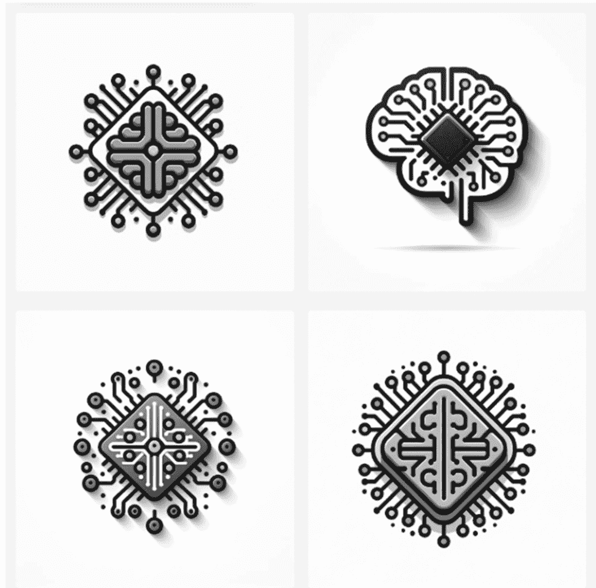
图5-1 DALL·E 3依据方向一生成的Logo设计图

方向二：字母Logo

图5-2 DALL·E 3依据方向二生成的Logo设计图

若首次结果不满意，可调整提示词或重新生成，直至达标。

### 5.4 品牌叙事构建
ChatGPT可依据价值定位与目标用户需求，产出品牌故事的创意建议与文本，提升吸引力与感染力。具体方法如下。

#### 5.4.1 方法盘点：先了解故事模型
Prompt：
请问品牌故事有哪些常见类型？各自适合什么方法模型？

ChatGPT：
品牌故事是传播核心，能赋予品牌情感与人性，增强共鸣。常见类型与模型如下：

##### 1. 起源故事
描述品牌诞生过程、初衷与动机。
模型：“挑战—解法—结果”。先叙述创始人面临的挑战，再说明解法，最后呈现结果。

##### 2. 使命故事
阐述使命、愿景与价值观，为何而做。
模型：“为何—如何—何物”。先说明深层驱动，再讲实现方式，最后呈现产品或服务。

##### 3. 成功故事
讲述品牌如何助客户解决问题或达成目标。
模型：“问题—行动—结果”。先呈现客户问题，再说明使用过程，最后展示收益。

##### 4. 文化故事
呈现品牌文化、价值观与工作方式。
模型：“价值观—行为—结果”。先列核心价值观，再说明行为体现，最后说明带来的成效。

##### 5. 未来故事
描绘未来愿景及实现路径。
模型：“现状—愿景—路径”。先描述当下环境，再呈现愿景，最后说明计划。

每个品牌故事独一无二，以上模型仅供参考，可结合实际创新。

由此可见ChatGPT给出专业框架，可据此要求其结合品牌背景推荐合适模型。

Prompt：
请依据我的品牌背景，推荐三个最合适的品牌故事模型。

ChatGPT：
品牌面向个人提供AI技能培训，不仅教授工具操作，更从原理入手建立智能思维并落地行业场景。推荐三类模型：

##### 1. 起源故事
推荐理由：讲述诞生背景与初衷，帮助消费者理解核心价值并产生情感共鸣。
模型：“挑战—解法—结果”。
挑战：AI普及的当下，多人仅停留在工具使用，缺乏原理认知与真正思维。
解法：创立本品牌，提供通俗易懂的AI教育，帮助学员从原理建立思维并应用于实践。
结果：学员不仅会用工具，更学会驾驭AI，提升效率、质量与创新力。

##### 2. 使命故事
推荐理由：阐释使命与愿景，提升品牌吸引力。
模型：“为何—如何—何物”。
为何：真正的AI教育不仅是工具教学，更是培养思维与应用能力。
如何：提供系统化培训，从原理出发结合案例与工作场景，帮助掌握方法论。
何物：课程涵盖ChatGPT提示工程、图像、视频等多种技术，满足多元需求。

##### 3. 成功故事
推荐理由：通过展示学员实际成效体现品牌价值。
模型：“问题—行动—结果”。
问题：某内容营销专家希望用AI优化创作分发，却难以精准定位受众与预测热题。
行动：参加本品牌培训，从原理学习AI工具进行内容分析、受众行为预测与话题挖掘。
结果：培训后成功应用AI进行营销，实现精准定位与高效传播，显著提升影响力与参与度。

三类模型均与品牌背景高度契合，有助于传递信息并吸引目标受众。

获得结构后，可进一步要求细化文本。

#### 5.4.2 模型应用：套用框架写故事
从上述模型挑选适合方案，例如选择“起源故事”与“成功故事”演示。

Prompt：
请基于起源故事模型，进一步细化内容，加入具体人物、背景、情节与细节，要求真实可感、引发强烈共鸣，我的称呼是“新哥”。

ChatGPT：
一个寒冬的午后，新哥坐在咖啡馆，对面是年轻设计师小张。小张焦虑地说：“新哥，我很想学AI，但多数课程只教怎么用工具，我想了解更深层的原理与思维。”新哥感同身受，回想起自己初入该领域时也有类似困惑。多数课程流于表面，未触及核心。他思考：为何不创办一个真正深入浅出的AI教育平台，帮助像小张一样的年轻人建立真正的智能思维？

于是新哥开始深研原理，与业内专家交流，并亲手撰写课程大纲。他希望每位学员都能从基础原理起步，逐步形成AI思维，最终将技术应用于工作与生活。

数月后，新哥的培训课程正式上线。课程覆盖ChatGPT提示工程、图像、视频等多种技术，结合真实工作场景与案例，帮助学员掌握系统方法论。

小张是首批学员，培训后不仅学会工具使用，更学会从原理出发解决实际问题。他成功用AI优化设计项目，获客户高度认可。看到小张的转变，新哥倍感欣慰。他明白这只是开始，还有更多人需要帮助。他决心持续努力，为更多人提供高质量AI教育，助力实现梦想。

这就是新哥的AI之旅，一个充满挑战与机遇的故事，也是帮助无数人追梦的旅程。

故事已具雏形，可在此基础上继续反馈优化。

#### 5.4.3 反复打磨：迭代优化故事
可要求ChatGPT进一步丰富细节，使其更饱满、更贴合品牌需求。

Prompt：
请基于成功故事模型，进一步细化内容，加入具体人物、背景、情节与细节，要求真实可感、引发强烈共鸣，我的称呼是“新哥”。

ChatGPT：
成功故事：内容营销专家的蜕变

在上海，李梅是一名资深内容营销专家，服务于知名时尚品牌。她每日需处理大量创作与分发工作，随着社交媒体变化与受众口味多样化，她越来越难以精准定位受众并预测热门话题。尽管努力调研，效果仍不理想。

一天，她在网上看到“新哥”的AI技能培训课程，介绍中提到可助学员使用AI工具进行内容分析、受众行为预测与话题挖掘。她认为这可能是解法。

她报名参加。课程中，新哥深入浅出讲解原理，结合案例手把手教学。李梅对“通过AI分析海量社交数据预测未来热题”模块尤为感兴趣。

结课后，李梅立即将所学应用于工作。她用AI工具分析近月社交数据，成功预测下月三大热题。基于此策划系列内容活动，结果惊人：阅读量与分享量大幅提升，品牌影响力与受众参与度同步提高。

李梅感慨自己的转变：“在AI助力下，我不再是传统的内容营销专家，而是一名数字时代的内容策略师。”

该案例充分展示了AI技能培训的实际效果与价值，也体现了新哥对学员的深度指导。

在细化要求下，ChatGPT生成了更丰满的品牌故事，可继续提出修改意见或自行调整细节，直至满意。

至此，通过具体案例演示了使用ChatGPT辅助品牌规划的全流程，相信你已看到其在品牌规划中的强大能力。

### 5.5 本章要点回顾
品牌规划是企业塑造形象与价值的核心工作，涵盖价值定位、视觉设计与故事创意等关键环节。ChatGPT凭借先进技术，可在各环节提供助力。

1. ChatGPT已具备的能力
- 价值定位：协助企业快速准确地锁定核心价值与目标市场。
- 视觉设计：提供创意建议，并可调用内置DALL·E 3直接生成设计图。
- 故事创意：生成富有创意与感染力的品牌故事，增强情感连接与认同。

2. 目前存在的不足
- 定位深度：虽可辅助定位，但需更多行业与市场知识支撑深度建议。
- 设计个性化：建议可能偏通用，需人工介入确保个性与独特性。
- 故事原创性：虽能生成故事，仍需人工把关确保原创性与创意。

3. 需要注意的问题
- 深化定位：结合实际需求与市场趋势，进一步细化品牌价值。
- 个性化视觉：与专业设计师合作，优化品牌视觉。
- 原创故事：结合企业文化与市场需求，打造更具影响力的原创故事。

4. 未来发展趋势
- 个性化定位：更精准分析企业与市场需求，提供个性化定位方案。
- 智能创意设计：生成更具创意与创新性的品牌形象与故事。
- 实时策略调整：通过实时分析市场反馈，帮助企业及时调整品牌策略。

ChatGPT在品牌系统规划各环节均展现出潜力与价值，随着技术进步，其作用将进一步放大。

## 第6章 AI驱动的产品创新
在竞争激烈的市场中，产品不仅要满足基本需求，还需具备创新与独特价值以实现差异化。本章聚焦“AI+产品开发”，探索如何借助ChatGPT打开创新的宝库，为产品注入独特价值。

你将学习如何用ChatGPT生成新产品概念与创意，设计产品功能与外观，并通过用户测试模拟优化设计。掌握完整的方法与技巧，从概念到落地打造真正有创新价值的产品。

### 6.1 ChatGPT助力产品开发的关键作用
产品开发是企业为迎合市场与用户多样化需求，通过技术进步、设计革新与战略布局，塑造创新或升级产品的一系列活动。在快速变化的商业环境中，产品开发不仅是生存手段，更是赢得竞争的关键。它影响市场地位、品牌形象与未来盈利能力。

传统产品开发面临诸多困境。从概念创意到功能外观设计、用户原型测试，每个环节耗费大量资源与时间，成本高企。叠加市场需求快速变化，传统方式难以及时响应，导致产品与市场错位。此外，如何在保持创新的同时确保技术可行性与用户接受度，始终是难题。

借助ChatGPT等先进工具，企业可更高效、更有针对性地推进产品开发。在各环节中，ChatGPT均可发挥作用。

1. 产品概念创意
- 传统方式：通常依赖团队大量市场调研与头脑风暴。
- ChatGPT辅助：通过检索与阅读大量市场研究报告或消费洞察，洞察用户需求与创新机会，提供新产品概念与创意。

2. 功能外观设计

小家电创新全流程：把ChatGPT变成你的研发搭子

传统打法里，功能定型要靠设计师和产品经理反复开会打磨；用上AI后，只要给出产品思路就能拿到结构方案和外观建议，甚至直接调用内置的DALL·E 3出效果图。

3. 用户原型测试
传统打法：必须先做实物或数字原型，再找真实用户来测评反馈。
AI打法：基于已确定的概念和外观方案，让AI模拟真实消费场景和使用反馈，提前检验概念是否站得住脚。

下面用一个实操案例拆解。小家电品牌想靠产品创新撬动95后市场，该怎么把ChatGPT嵌进研发链路。

先把通用任务指令写清楚，丢到一个新对话里执行。Plus用户建议提前挂上两个插件：能爬网页的WebPilot、能读PDF的AskYourPDF。

提示词框架
角色：你是一名深耕小家电创新的资深专家，熟悉市场趋势和用户痛点。
背景：我是中国一家小家电品牌的PM，面临竞争激烈、95后用户占比偏低的压力。
任务：帮我孵化一批面向年轻人的创新小家电。
目标：让95后认可并首选我们的品牌。
流程：
产品概念创意环节
第一步 创新方向探索：检索大量市场研报和消费洞察，提炼需求与机会，输出创新方向。
第二步 产品概念创意：在方向之上给出若干具体产品概念。
功能外观设计环节
第一步 功能结构设计：面向确认的概念，提供多套功能方案。
第二步 外观视觉设计：在功能方案基础上给出多套视觉方案。
第三步 生成设计效果图：调用DALL·E 3出图。
用户模拟测试环节：基于概念和外观方案模拟使用场景与反馈，验证可行性。
指令：一步步走，我确认后说“继续”再进入下一步；温度设0.8；需要背景信息时主动提问；理解就回“明白”。

6.2 产品概念创意
AI可以通过检索研报洞察需求，给出创意。

6.2.1 第一步：创新方向探索
按提示词要求让AI先学习中国小家电消费洞察后归纳。AI的初步判断是95后更在意科技、个性、环保，追求高效智能、有趣有意义的产品，建议聚焦：
智能联动：可与手机、智能家居互联的咖啡机、吸尘器等。
环保健康：空气净化器、健康食品机等。
个性定制：按喜好定制的吐司机、果汁机等。
娱乐互动：结合AR/VR的烹饪教程、互动健身器材等。

随后要求AI调动插件深挖。AI基于《2022年轻人国货消费趋势报告》提炼出：
95后国货用户同比增11%，最爱品类前三为厨具、生鲜、家用电器。
审美与实用并重，高颜值潮流单品如八角不粘锅、空气炸锅、焖烧杯走红。
更看重使用体验与文化联结，如节日限定汤圆、龙虾粽子等。
75%年轻人对老字号创新感兴趣，大白兔奶糖95后占比20%，而香水、沐浴乳95后占比达46%和41%。
消费回归理性，按喜好买单。

进一步追问厨具类偏好，AI认为95后偏爱高颜值网红厨具、多功能一机多用电器、带趣味图案的收纳、兼顾传统与现代的焖烧杯，以及有社交属性的厨房用品。

关于老字号如何共鸣，AI给出：推出年轻化新品线、更新品牌视觉、与流行文化联名、做数字化种草、讲好品牌故事和工艺、提供个性定制、强调品质与可持续。

有此判断后进入概念落地。

6.2.2 第二步：产品概念创意
基于“国货、颜值与功能、一人食、厨房小家电”给出5个方向：
国潮电火锅：迷你电火锅，青花瓷纹理，智能温控。
一人食智能蒸炒机：紧凑蒸煮，智能菜谱推荐。
国潮早餐机：煎烤煮蒸合一，竹子山水纹设计，预约功能。
一人食智能冷热饮机：快速制作茶咖果汁，紧凑便携。
国潮智能调料盒：自动配比，蓝白瓷、剪纸元素，智能推荐。

选定“一人食智能冷热饮料机”再细化，要求杯型小型化、可手持、与保温杯同级、年轻国潮化。调整后的概念为“一人食智能冷热饮料杯”：
概念：为年轻人设计的便携饮品制作工具，融合科技与传统文化。
核心特点：保温杯尺寸手持便携；内置制冷加热与传感器快速出饮；青花瓷、剪纸、山水等国潮外观；食品级材质减少一次性杯具；App互联可选饮品类型、温度、看进度、存配方。

6.3 功能外观设计
在概念确认后继续推进。

6.3.1 第一步：功能结构设计
AI给出的结构建议包括：
主体：双层不锈钢或食品级塑料外壳，食品级内胆易清洗。
制冷加热：杯底微型制冷加热元件+实时温度传感器。
智能控制：杯身触控面板+蓝牙App远程操控、进度查看、配方保存。
能源：内置可充电池，USB-C充电兼移动电源。
安全：密封防溢杯盖、过热自动停机。
附加：微型搅拌、LED状态灯。

追问安全加固时，AI补充：干烧保护、防触电、压力释放阀、防滑底座、温度颜色预警、长时间无操作自动休眠、防水平板设计、食品级无BPA、电池过充过放保护、故障自动检测并App提示。

6.3.2 第二步：外观视觉设计
AI给出四种视觉方向：
简约现代：线条干净、曲面流畅，黑白灰配金属质感，触控与灯带一体化。
国潮复古：青花瓷、剪纸、山水元素，蓝白红配传统工艺，触控面板融入传统纹样，灯效做灯笼造型。
自然生态：山水植被灵感，绿蓝棕配木竹材质，灯效做叶形水滴。
科技未来：未来主义配色蓝紫银，金属玻璃材质，透明面板、流光灯效。

选定国潮复古后，要求给出年轻化设计策略，尤其元素与色彩。AI提出策略要点：
1. 设计元素
（1）图案元素

# 国潮复古单杯造型拆解

### 设计语言初探
- 青花意象：倾向于精简处理的青花母题，例如莲花、游鱼、水纹，兼具传统寓意与当代质感。
- 剪纸手法：借用剪纸的镜像与几何秩序，提炼简约的动植物小形。
- 书法点缀：选用当下流行的行书、草书等笔意来处理品牌标识或杯名。

#### 结构肌理
- 圆润线条：在杯盖、底座或操控区引入圆形与弧线，传统审美里对应圆满和谐。
- 对称布局：整体造型采用对称构图，如双龙戏珠、双鱼等，在文化语境中多指吉祥。

#### 配色方案
##### 主色
- 天空蓝+白：取自青花瓷灵感，以天蓝与白构成基调，兼顾古韵与现代感。

##### 点缀色
- 镀金色调：用于细节点缀如Logo、按键边，传统语境里代表尊贵。
- 朱红色：用于视觉焦点如指示灯、操作键，传统里象征喜庆繁荣。

##### 组合方式
- 蓝白组合：主体以蓝白呈现，清新高雅。
- 金红搭配：局部以金红呼应，提升精致感。

综合以上思路，这款一人份智能温控饮杯可塑造成国潮复古外观，既传递中华传统精髓，也契合年轻审美。若认可方案可进入下一步，若有其它想法欢迎提出。

经反馈后进一步细化的补充如下。

**问：图案层面年轻群体偏好哪些具体样式？**
年轻人偏爱简洁现代且有深意的纹样。国潮复古方向可考虑：
- 几何纹样：八卦、太极、云纹等，线条利落寓意深。
- 生物纹样：鹤、鱼、莲、竹等，兼具传统含义与现代感。
- 山水意向：简化处理的山水画，呈现自然之美并暗含哲理。
- 字体点缀：短句或古语，如“静以修身”“山高水长”等，文化感强。

**问：除天蓝白色外还能用哪些配色？**
- 墨绿：源自水墨画，古意与当代感兼具。
- 淡桃：柔和清新，有女性温柔气质与春天气息。
- 米黄：取自宣纸，古朴温暖。
- 宝石蓝：深邃神秘，彰显尊贵。

**问：如何让金色与红色运用不显张扬？**
- 使用比例：金红作为点缀而非主色，宜用于徽标、按键边缘等细部。
- 深浅选择：选用暗红或哑金，避免过于鲜亮的高饱和色。
- 材质处理：点缀部位采用哑光或半哑光，减少反光带来的浮夸感。
- 搭配平衡：与灰、黑、白等中性色搭配，可中和鲜艳度，让整体更和谐。

这些补充有助于进一步细化形态。

### 视觉落地
计划推出男版与女版，男性主调米黄，女性主调淡桃，纹样统一采用云纹。请结合既有功能结构，输出完整外观说明。

###### 外观设计说明
####### 男版：米黄调云纹智能温控饮杯
1. 主体色调：米黄为底，呈现古朴沉稳的气质，与男性气质契合。
2. 纹样：杯身点缀淡雅云纹，与米黄融合，彰显传统韵味。
3. 操控区：触控屏与杯身一体化，底色为深米黄，与主体形成层次，增强操作辨识度。
4. 细节：指示灯、按键等采用深棕，与米黄对比，提升质感。

####### 女版：淡桃调云纹智能温控饮杯
1. 主体色调：淡桃为主，柔美活泼，贴合女性形象。
2. 纹样：杯身以淡雅云纹点缀，与桃色融合，体现传统美感。
3. 操控区：触控屏与杯身融合，底色为深桃，与主体对比，便于识别。
4. 细节：指示灯、按键采用玫瑰金，与桃色呼应，增添层次。

####### 共有特征：
- 双层结构：外壳为双层不锈钢或食品级塑料，保证保温与耐用。
- 冷热系统：微型冷热元件置于杯底，传感器实时监测饮品温度。
- 智能联动：可通过手机App远程操控、查看制作进度、保存配方。
- 电源：内置可充电电池，USB-C接口方便充电。
- 安全机制：防溢、防过热、防干烧等保护。

以上为基于需求的外观说明。若满意可进入下一步，若有建议请提出。

#### 6.3.3 第三步：生成设计效果图
Plus会员可调用自带DALL·E 3功能继续生成外观效果图。

依据上述外观说明，绘制两款物件的设计效果图。

DALL·E 3
Created 2 images
DALL·E 3生成的效果图准确度与精细度较高，如图6-1与图6-2所示。若不满意可调整提示词或重新生成，直至理想。

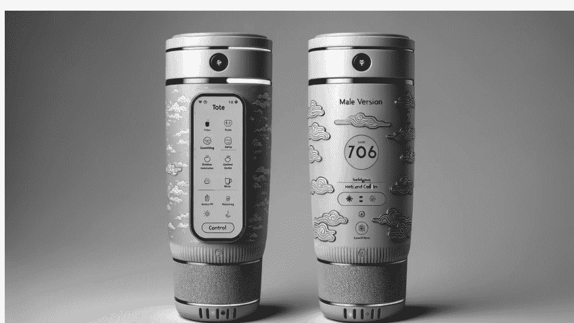
▲图6-1 DALL·E 3生成的男性版产品效果图

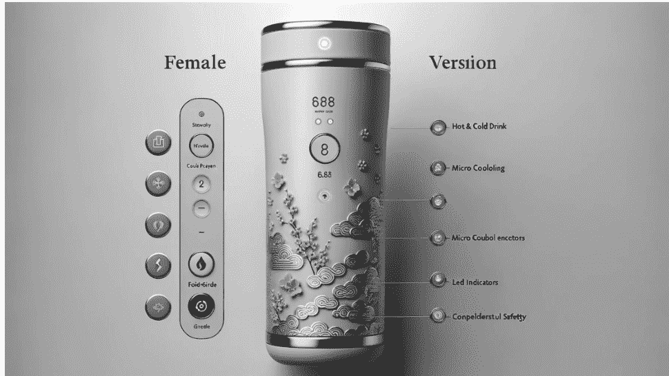
▲图6-2 DALL·E 3生成的女性版产品外观效果图

### 6.4 用户测试模拟

基于确认的概念与外观方案，模拟消费者使用情境与反馈，帮助验证可行性。

#### 6.4.1 使用场景模拟
在既往对话中已提出要求，基于方案模拟使用情境与反馈，只需输入“继续”，即可展开。

##### 用户测试模拟环节
###### 1. 使用情境模拟
情境一：通勤族清晨
上班族小王每日清晨匆忙出门，购入此款冷热饮杯，早上可快速冲调热咖啡，途中通过App调节温度，确保到公司时温度适宜。
情境二：午后学习时光
大学生小李与朋友在图书馆自习，午休时用此杯制作冰绿茶，清凉提神。
情境三：户外运动
户外爱好者小张徒步时，用此杯制作冰柠檬水，迅速解暑。

###### 2. 模拟反馈
反馈一：充电时长偏长
部分用户反映充电时间较久，希望提升充电效率。
反馈二：期望更多饮品配方
有用户希望App中增加更多配方，如奶茶、果汁等，满足多样口味。
反馈三：触控不够灵敏
可能有用户反馈触控屏反应迟缓，需多次触碰。
反馈四：希望更多配色与纹样可选
部分用户期望提供更多颜色与图案，以满足个性化需求。

###### 3. 改进建议
建议一：采用更高效的充电技术，如快充，缩短充电时间。
建议二：在App中扩充配方，并允许用户自定义与分享。
建议三：优化触控软硬件，提升响应速度。
建议四：推出更多配色纹样，甚至提供定制服务。

以上为基于方案的用户测试模拟。若满意可进入下一步，若有想法请提出。

#### 6.4.2 营销策略建议
在测试模拟基础上，可进一步探讨影响接受度的因素及营销应对。

**可能影响接受度的因素：**
1. 实用性：若无法有效实现快速冷热的核心功能，用户兴趣会下降。
2. 价格水平：功能集成的物件价格可能偏高，超出预期会影响销量。
3. 使用体验：触控反应、App便捷性、充电时长等均影响整体感受。
4. 品牌认知：新品牌知名度不足，需更多资源建立信任。
5. 市场竞争：若已有同类物件，市场需具备足够竞争力来吸引用户。
6. 文化与设计：国潮设计需被目标群体喜爱，否则影响接受度。

**营销层面的应对动作：**
1. 体验营销：在商场或校园设置体验区，让用户亲身体验功能。
2. 定价策略：采用促销或捆绑销售，为早期用户提供优惠。
3. 线上宣发：借助社交媒体、KOL与短视频平台进行宣传，吸引年轻用户。
4. 反馈驱动：积极收集用户反馈，及时优化功能与体验。
5. 合作营销：与知名品牌或平台联名，如与流行咖啡品牌推出限定版。
6. 故事营销：围绕物件打造趣味背景，强调国潮设计背后的故事，提升情感价值。
7. 教育营销：通过线上线下研讨会、工作坊等形式，教育用户充分利用功能，提升使用频率。

希望以上建议能助力推广。若有其他问题请告知。

### 6.5 本章小结
品类研发是企业创新的核心，涵盖概念创意、功能外观设计与用户测试模拟等关键环节。ChatGPT通过先进技术为各环节提供协助。

#### 1. 已具备的能力
1. 概念创意：可协助快速生成与筛选概念，为开发提供创新思路。
2. 功能外观设计：可提供功能与外观设计建议，并调用DALL·E 3直接生成效果图。
3. 用户测试模拟：利用AI技术模拟用户测试，快速获取反馈与优化建议。

#### 2. 现存不足
1. 创意深度：生成概念虽快，但需更多行业与市场知识支撑深度建议。
2. 设计个性化：设计建议偏通用，需人工参与以确保个性与独特性。
3. 测试准确性：模拟测试结果可能与真实用户反馈存在差异。

#### 3. 需注意的问题
1. 深化创意：结合企业实际需求与市场趋势，进一步丰富概念。
2. 个性化设计：与专业设计师合作，优化功能与外观的个性化表达。
3. 精准测试：结合真实用户数据，优化模拟算法与结果。

#### 4. 未来发展趋势
1. 智能化创意：更精准地为不同行业与市场提供定制化概念建议。
2. 创意设计集成：集成更多AI技术，实现更全面高效的功能与外观设计建议。
3. 用户测试优化：利用深度学习等技术，提供更精准实用的用户测试模拟与优化建议。

## 第7章 AI+内容传播：引爆用户流量池
内容是营销核心，数字化时代内容创作与传播方式不断革新。如何高效创作与传播内容以实现获客引流，是营销工作的重中之重。

本章将探讨如何利用ChatGPT实现“AI+内容传播”，达成引流获客目标。你将学会如何借助ChatGPT创作吸睛的广告与社交媒体内容，以及优化SEO内容以提升搜索排名。通过本章学习，可掌握完整的AI+内容传播方法与技巧，让内容更广泛传播，吸引更多用户流量与潜在客户。

### 7.1 ChatGPT如何助力内容传播
“内容传播”即通过广告、社交媒体、搜索引擎优化等渠道，将品牌、产品或服务信息传递给目标受众。优质内容可提升品牌知名度、增加用户流量并促进转化。

在信息泛滥的当下，如何以更经济高效的方式创作大量高质量内容并更广传播，是各品牌必须面对的难题，ChatGPT为内容传播注入新动能。

在内容传播各环节，ChatGPT均可提供强力支持：

#### 1. 广告内容创作
·传统方式：广告创作通常需创意团队头脑风暴并多轮修改。
·ChatGPT辅助：可根据广告目标与受众提供定制化创意，快速生成文案与图像，大幅缩短创作周期。

#### 2. 社交媒体内容创作
·传统方式：需深刻理解平台与受众，以产生互动与参与。
·ChatGPT辅助：可分析特定平台用户行为与内容趋势，生成符合用户偏好与平台规则的内容，提升互动率与分享率。

#### 3. SEO优化
·传统方式：需专业SEO团队进行关键词研究与内容优化。
·ChatGPT辅助：可提供关键词优化建议与生成SEO友好内容，助力网站提升搜索排名，增加流量与可见度。

借助ChatGPT，内容传播更高效且更具针对性，能更好地吸引与留住目标受众，实现营销目标。

### 7.2 广告内容创作
广告内容创作涉及策略梳理、创意构思、文案撰写与视觉设计等关键环节。ChatGPT作为先进AI工具，在各环节均可提供支持。

1. 策略分析：通过分析品牌背景、目标用户、产品特质、价值卖点等，梳理广告沟通策略，包括传播对象、核心诉求、形式风格。
2. 创意构思：基于确认策略提供多角度创意概念与方向。
3. 文案撰写：基于确认创意撰写完整广告文案。
4. 视觉设计：提供视觉设计建议，并调用DALL·E 3生成画面。

下面以具体案例演示如何借助ChatGPT与DALL·E 3创作系列平面广告。首先采用“六要素”通用提示框架，设计完整提示词，建立任务框架。为演示效果，此处虚构新生代健康零食品牌“零界”。

**角色：** 你是一位世界级广告创作大师，具备深厚的产品系列海报创作经验与丰富创意思维。

**背景：** 我是一家健康零食品牌企业的品牌经理。我们的背景信息如下：

```
###
```
品牌名：零界。
品牌定位：新生代健康零食。
品牌理念：打破传统与创新的界限，将健康功能与美味零食完美融合，让每一口都充满惊喜。
目标用户：“95后”年轻人群。
产品系列：
1. 胶原蛋白巧克力：结合优质生可可与创新成分，通过恢复重要脂质来帮助锁住皮肤水分，保持皮肤弹性。
2. 减肥口香糖：添加乌龙茶提取物、黑姜提取物，抑制糖与脂肪吸收、促进脂肪燃烧。
3. 益生菌苏打水：富含健康益生菌与多种微量矿物质，增进肠道健康与大脑健康。

**任务：** 我需要你指导并协助我完成产品系列海报创作。

**目标：** 通过传递产品价值与品牌文化，吸引目标用户，激发购买欲望，推动产品销售。

**流程：** 请按以下步骤提供专业指导与协助。

第一步：策略分析
1. 基于品牌与产品背景，分析目标受众需求，确定符合需求的价值卖点。
2. 确定广告沟通策略，包括目标对象、核心诉求、形式风格。

第二步：创意构思
基于确认沟通策略，提供多角度创意概念与思路。

第三步：文案撰写
1. 基于确认创意概念，撰写主题口号。
2. 依主题口号撰写完整广告文案。

第四步：视觉设计
1. 基于确认创意，提供具体视觉形式创意概念。
2. 基于确认视觉概念，提供详细视觉设计说明。
3. 调用DALL·E 3生成画面。

**指令：**
- 按流程设定顺序依次进行，每一问题均提供专业可行建议，并根据反馈调整优化。
- 待我确认并说“继续”时，再进入下一步，以此类推。

- 为提升原创度，请将采样温度调至0.8。
- 执行任务时若缺背景信息，可随时向我询问补充。
- 如已理解，请回复“明白”。

**AI：**

明白。

#### 7.2.1 第一步：策略拆解

AI 能在品牌与品类背景下，提炼目标人群的真实需求，并归纳可落地的价值主张。

**Prompt：**

从第一点第一阶段起。

**AI：**

##### 第一阶段：策略拆解

基于品牌与品类背景，解析受众诉求，并锁定可对应的价值主张。

###### 受众诉求拆解：

“95后”年轻群体

1. 追求自我的差异化：在信息过载环境下，想找能彰显品味的单品。
2. 强调品质与健康：健康排在首位，愿意为高品质商品付溢价。
3. 偏好新奇与迭代：对新鲜事物接受度高，好奇心强。
4. 看重品牌态度与文化：买的不仅是物，更是品牌代表的生活方式。

###### 价值主张梳理：

####### 胶原蛋白巧克力
- 差异化：生可可结合创新配方，跳脱传统巧克力框架。
- 品质健康：补足关键脂质，助锁水保弹性，回应健康诉求。
- 新颖性：首次把胶原蛋白与巧克力融合，打破零食边界。

####### 减脂口香糖
- 差异化：从单一咀嚼升级为兼具功能性的特色品。
- 品质健康：添加乌龙茶萃取与黑姜萃取，在健康前提下实现功效。
- 新颖性：具备抑制糖脂吸收、促进脂肪分解的特性，成为新世代之选。

####### 益生菌气泡水
- 差异化：不只是普通饮品，更是健康象征。
- 品质健康：富含益生菌与多种微量矿物，有益肠道与脑部。
- 新颖性：益生菌与苏打水完美结合，每口带来惊喜。

从以上拆解可看出，“零界”每款单品都精准切中“95后”核心诉求，无论是个性、健康、创新还是品牌文化，均能找到对应体现。

请给出意见，如需调整我会优化。确认无误请说“推进”。

我们看到AI既给出人群需求拆解，也给出三款单品的价值主张，对“95后”与“零界”品类的理解都很到位，可进入下一环。

**Prompt：**

推进。

**AI：**

##### 第一阶段：策略拆解

明确广告沟通策略，包含沟通对象、核心诉求、表现手法。

###### 沟通策略：

(1) 沟通对象
锁定“95后”年轻人。他们活力、好奇、追逐创新，渴望差异化单品，同时高度关注健康与生活品质。

(2) 核心诉求
- 胶原蛋白巧克力：满足味蕾的同时，更呵护肌肤状态。
- 减脂口香糖：在享受清新的同时，为体型管理助力。
- 益生菌气泡水：每一口都是对身心的健康滋养。

(3) 表现手法
- 视觉风格：潮流简约清新，运用高饱和色彩抓眼球，同时保持简洁避免杂乱。
- 文案风格：直白有趣富有人情味，用简练有力的表达配合创意点，直击年轻心智。
- 互动设计：鼓励用户参与，例如扫码互动、社媒分享，提升品牌互动感。

基于以上策略，可为目标人群打造兼具创新性与情感共鸣的广告内容，全面呈现“零界”品牌理念与商品特质。

请提供反馈，如需完善请告知。确认无误请说“推进”。

基于商品背景与人群诉求的解析，AI进一步梳理了沟通策略，从对象、诉求到形式都很准确，继续下一步。

#### 7.2.2 第二阶段：创意发散

在沟通策略确认后，可让AI输出多角度的创意概念与思路。按既定设定，输入“推进”即可继续。

**Prompt：**

推进。

AI:

##### 第二阶段：创意发散

基于已确认的沟通策略，输出多角度创意概念与思路。

创意概念与思路：

1. “破界之味”
   - 说明：用视觉对比传统零食与“零界”单品的差异，通过分界线或破碎效果表现“打破界限”的概念。
   - 适用品类：胶原蛋白巧克力、减脂口香糖、益生菌气泡水。

2. “一口界限”
   - 说明：单品核心功效通过一口实现，如护肤、燃脂、肠道健康。设计动态画面，人物食用后背景或场景随之变化，展现效果。
   - 适用品类：胶原蛋白巧克力、减脂口香糖。

3. “零界，不止于零食”
   - 说明：强调单品不仅是零食，更是一种健康生活方式。呈现“95后”在工作、运动、休闲等场景下选择“零界”的画面。
   - 适用品类：益生菌气泡水。

4. “年轻，就是无界”
   - 说明：以年轻人日常与活动为主线，展现“零界”单品如何融入生活，传递年轻、活力、无界限的态度。
   - 适用品类：胶原蛋白巧克力、减脂口香糖、益生菌气泡水。

以上为基于沟通策略的多角度创意。请反馈，如需调整请说明。确认无误请说“推进”。

AI提供了四个创意概念及思路，各有亮点。但创意阶段需要更大发散，以便优中选优。AI可无限量持续提供，因此我们继续获取更多灵感。

**Prompt：**

请再给几个新角度。

**AI：**

可以，以下是新一批创意概念与思路：

**1. “破界体验”**
- 概念：以品牌名“零界”切入，表现打破传统、拥抱创新的理念。
- 呈现方式：视觉上呈现单品“破壳而出”，暗示超越传统零食，为消费者带来全新体验。
- 应用场景：广告中年轻人享有“零界”时，周围环境也随之“破界”，变得更鲜活多彩。

**2. “双重满足”**
- 概念：突出双重价值，兼顾口感与健康益处。
- 呈现方式：对比传统零食仅满足味觉的局限，凸显“零界”在满足口感的同时带来额外好处。
- 应用场景：展示年轻人食用时，味觉与身体感受的双重满足。

**3. “未来零食，今日尝鲜”**
- 描述：将“零界”描绘为未来零食潮流，体现前沿与创新。可搭配未来都市风背景，人们正在尝鲜。
- 适用品类：胶原蛋白巧克力、减脂口香糖、益生菌气泡水。

**4. “随时随地的健康”**
- 概念：强调“零界”是健康代名词，任何时间地点都能带来健康。
- 呈现方式：展示不同时间、场景下年轻人都能获得健康益处。
- 应用场景：工作、学习、运动、聚会等多种情境。

以上为基于策略的多角度创意，均紧扣品牌核心理念与商品特性。

请反馈，如需优化请告知。确认无误请说“推进”。

经过数轮输出，可挑选出特别突出的概念继续深化。

#### 7.2.3 第三阶段：文案落地

AI可基于确认的创意概念撰写主题口号。

**Prompt：**

选择方向2，继续下一步，撰写主题口号，要求结合“零界”字面意涵，体现健康美味无需取舍，两者都要的内涵，要求简洁有力，提供10个备选。

**AI：**

基于“双重满足”方向及“零界”字面意涵，10个主题口号备选如下：

- 零界，双满足。
- 跨越界限，味美健康我都要。
- 零界零食，美味健康不必二选一。
- 零界之上，美味与健康同行。
- 美味健康，零界之间无需选择。
- 零界，美味与健康的完美交汇。
- 穿越零界，尝尽健康与美味。
- 零界，让每口都双重满足。
- 无界美味，零界健康。
- 零界，双重享受，无须妥协。

请反馈，如需调整我将优化。确认无误请说“推进”。

AI提供了10个备选，可择一延展。例如第10个“零界，双重享受，无须妥协”就很出彩。也可要求重写或刷新。

**Prompt：**

采用“零界，双重享受，无须妥协”这个主题口号，继续下一步。

**AI：**

##### 第三阶段：文案落地

依据主题口号撰写完整广告文案。

基于“双重满足”创意方向与“零界，双重享受，无须妥协”的主题口号，三款商品的文案如下：

**胶原蛋白巧克力：**
- 标题：巧克力的甜，肌肤的润。
- 副标题：不只满足甜蜜渴望，更关注肌肤健康。
- 描述：零界胶原蛋白巧克力，为味蕾与肌肤双重加护。每一口融合优质生可可与胶原蛋白的双重惊喜。

**减脂口香糖：**
- 标题：口气的清新，身材的健美。
- 副标题：不只是清新口气，更助你塑造理想身形。
- 描述：零界减脂口香糖，甄选乌龙茶与黑姜提取物，在享受清新的同时默默助力身材管理。

**益生菌气泡水：**
- 标题：口腹的满足，身心的呵护。
- 副标题：不只解渴，更为内在健康加分。
- 描述：零界益生菌气泡水，富含益生菌与微量矿物质，每一口都是对肠道与大脑的深度呵护。

以上文案紧扣“双重满足”概念与品牌核心价值。

请反馈，如需调整请告知。确认无误请说“推进”。

AI给出的三款完整文案质量较高，稍作微调即可使用，进入下一步。

#### 7.2.4 第四阶段：视觉呈现

基于确认创意，AI可提供具体视觉形式创意。

**Prompt：**

推进。

**AI：**

##### 第四阶段：视觉呈现

基于确认创意与思路，提供具体视觉形式创意。

为“零界”三款商品提供的视觉创意概念如下：

**1. 双重世界**
- 描述：画面一分为二，上半部呈现单品的主要功能如美味，下半部呈现附加健康效果如肌肤滋润、身材塑造。两者以流畅曲线相接，象征“零界”。
- 实施：如胶原蛋白巧克力，上部展现巧克力入口融化的瞬间，下部展现肌肤光泽饱满。

**2. 镜面反射**
- 描述：画面中央置放单品，下方如镜面反射出单品带来的健康效果。
- 实施：如减脂口香糖，实物图位于上方，反射中呈现轻盈身影，暗示减脂效果。

**3. 单品内的小世界**
- 描述：单品作为“窗口”，透过它可见另一个与健康相关的微观世界。
- 实施：如益生菌气泡水，瓶身透明，内部呈现充满活力的益生菌宇宙。

三个方向均能清晰表达“双重满足”，且与品牌理念契合。

接下来将提供详细视觉说明。

AI给出三个视觉创意，“双重世界”较好，需细节微调，选择此方向并提出具体要求，进入下一步。

**Prompt：**

选择“双重世界”方向，画面不要上下分隔改为左右分隔，所有人物使用华人形象。按此要求继续下一步。

**AI：**

好的，按要求提供三款商品广告海报的详细视觉创意说明：

**1. 胶原蛋白巧克力——甜蜜与护肤**
- 描述：左侧一位年轻华人女性张口欲食一颗有光泽的白巧克力球，右侧为她肌肤水润光泽的特写。
- 元素：甜蜜场景、滋润肌肤、品牌色调。

**2. 减脂口香糖——清新与健身**
- 描述：左侧年轻华人男性在户外或办公室享受口香糖，清新自在；右侧同为该男性在健身房锻炼，展现结实身形与腹肌。
- 元素：清新场景、简洁背景、品牌色调。

**3. 益生菌气泡水——清爽与活力**
- 描述：一侧优雅华人女性在户外运动或休闲时饮用气泡水，感受清爽；另一侧同为该女性面色红润充满活力，进行户外瑜伽。
- 元素：清爽饮品场景、户外背景、品牌色调。

以上创意围绕“双重享受”，展现单品兼顾基本需求与额外健康益处。每个场景均呈现日常愉悦与健康获益。

请反馈，如需调整请告知。确认无误请说“推进”，我将调用DALL·E 3生成画面。

按要求提供了详细说明，并特别强调人物为华人，因默认生成多为西方人。确认后继续下一步。

**Prompt：**

推进下一步：启动 DALL·E 3生成画面。

AI:

DALL·E 3

Created 3 images

按既定视觉说明，DALL·E 3生成了精准的高质量图片，如图7-1所示。考虑目标人群审美，还可提出风格升级要求。


**Prompt：**

考虑到年轻人群审美需求，在画面内容基本不变的前提下，转换成多彩时尚风格。

AI:

DALL·E 3

Created 3 images

经多轮互动反馈，DALL·E 3最终生成效果较为理想的图片，如图7-2所示。至此，一个系列平面广告创作基本完成。


记得在本书第二章介绍了结合Canva生成海报的方法。至此可用Canva工具与模板进行海报设计，不再赘述。最终成品如下：

本系列海报画面直接采用DALL·E 3生成图片，如图7-3所示，质量已相当高。值得一提的是DALL·E 3生成图片可免费商用，对企业品牌或个体创业者都是利好。

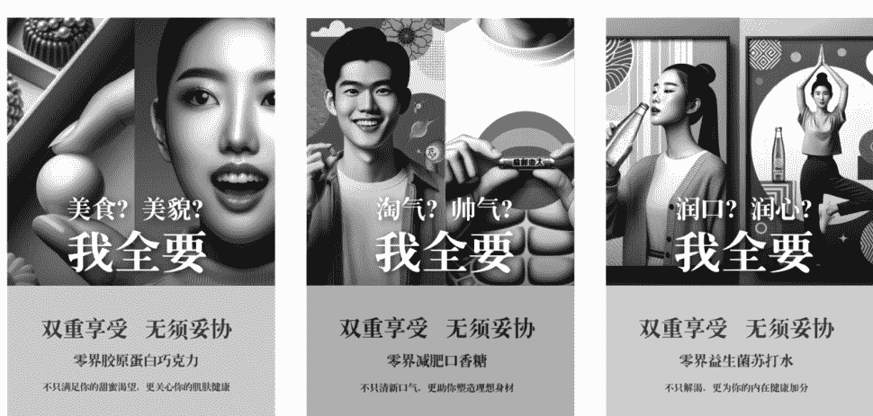

海报文案基本沿用AI生成文字，不过三个“我全要”的提炼由笔者完成。AI在广告内容创作上能提供强力支持，但核心部分仍需人发挥创造力，人机协同才是最佳模式。

### 7.3 社交媒体内容创作

社交媒体内容传播指品牌通过微博、微信、抖音、小红书等平台发布的内容。主要目的是建立长期关系、提升品牌忠诚度并借助UGC推广。高质量内容有助于建立信任与情感连接，提升知名度、引流并促进转化。与广告不同，社交媒体更强调真实、有价值、贴合受众兴趣偏好。

在中国社交媒体领域，图文类与短视频类为两大主流，各有特点，适用于不同受众与场景，创意策略侧重点也不同。

#### 1. 图文类内容
(1) 主要平台：微信公众号、微博、今日头条、小红书等。
(2) 内容特点：由图片与文字构成，可为长图文也可为短图文。
(3) 用户体验：提供深度沉浸体验，允许用户细细品味信息。
(4) 创意策略侧重点：
- 内容质量：保证文字质量，提供有价值信息与观点。
- 视觉吸引力：使用高质量图片图表吸引注意。
- 结构清晰：用标题、子标题、列表提升可读性。

#### 2. 短视频类内容
(1) 主要平台：抖音、快手、视频号、B站等。
(2) 内容特点：时长多在15秒至数分钟。
(3) 用户体验：提供浅度冲浪体验，用户可快速浏览大量内容。
(4) 创意策略侧重点：
- 即时吸引：前几秒关键，需迅速抓住注意力。
- 简洁明了：时长有限，信息需简洁直接。
- 视觉与音效：借助动态视觉与吸睛音效增强吸引力。

总体而言，图文更适合深度探讨话题或提供详实信息，短视频更重娱乐性与即时吸引。制定策略时需结合目标受众、平台特性与传播目标选择形式。

接下来以抖音短视频内容创作为例演示。

借助AI创作抖音短视频内容是一个系统流程，需经过账号定位、选题策划、内容撰写、视频制作等步骤。仍以“零界”品牌为例，按短视频创作关键流程，采用“六要素”通用提示框架，撰写一段清晰完整的通用提示词。

**Prompt：**

**角色：** 你是中国社交媒体内容创作与运营专家，熟悉抖音平台属性和运营方法。

**背景：** 我是一个健康零食品牌企业的品牌经理。

**任务：** 我需要你指导并协助我进行抖音平台品牌账号的内容创作和运营。

**目标：** 通过创作优质内容，吸引目标用户关注，增加粉丝数量，传播品牌价值，推动产品销售。

**抖音健康零食从0到1起号实战记录**

推进节奏：严格按顺序配合推进，确认无误后再往下走

第一步：账号定位
- 1 解析平台特性，提炼可复用打法
- 2 结合自身资源，锁定频道方向

第二步：选题策划
- 1 以方向为轴划分内容板块
- 2 跟随时效热点产出具体选题

第三步：内容撰写
- 1 结构搭建：萃取爆款框架并落地
- 2 脚本撰写：选题与结构匹配
- 3 复核优化：规避风险并提升完成度
- 4 标题打造：提炼吸睛方法并应用

执行约定：先从第一步第1点展开，确认后回复“继续”再进入下一步。每轮提供可直接落地的专业建议；创意温度设为0.8；执行中需要补信息时主动提问。若已理解，请回复“明白”。

#### 7.3.1 第一步：账号定位
品牌或个人IP想在抖音起势，核心是把频道方向想透，明确要说的内容、服务的人和连接方式。方向是后续选题、撰写、制作的定盘星。做方向先从平台拆解入手。

##### 1. 拆解平台特征，提炼运营要点
平台画像拆解：
- 使用人群：主力集中在18到35岁，偏爱新鲜、有趣、信息密度高的内容
- 内容形态：短视频为主，15至60秒的完播表现更优
- 互动生态：鼓励点赞、评论、转发、参与挑战等行为
- 分发逻辑：推荐以观看、互动、搜索行为为依据，质感与匹配度决定曝光

运营要点：
- 质感门槛：画面、声效、信息价值高更易获得推荐
- 互动诱导：主动埋点引导用户评论、点赞、转发，提升热度
- 稳定更新：保持规律更新频率，让受众感知账号在线
- 借势话题：结合当下热点与趋势创作，更易被看见
- 定位清晰：内容需与品牌调性与价值保持一致
- 娱乐偏好：用户更爱轻松好玩的内容，创作要兼顾趣味
- 开头抓人：用户在前三秒决定是否继续，前三秒必须抓住注意力

补充后要点更完整，可进入下一步。

##### 2. 融合自身条件，梳理频道方向
背景：一家主打健康零食的品牌公司品牌负责人

方向建议：
品牌特质：突出健康、天然、无添加，与当前健康生活趋势共振
- 核心人群：关注养身、追求高品质生活的年轻群体，尤其是需要能量补给的上班族
- 调性呈现：清新、自然、生活化，可结合办公室、健身房、户外场景呈现使用
- 价值表达：卖的不只是零食，更是一种健康的日常方式。可输出养身小知识、营养搭配等增量价值
- 互动设计：鼓励受众分享自己的健康生活方式与搭配心得，营造健康社群氛围

为让方向更完整，还需明确频道建设必备要素与需补齐的品牌信息。

频道建设必备要素：
- 账号名：简洁易记，能体现品牌特征或核心产品
- 简介文案：用一句话点明核心价值与特质
- 头像封面：与品牌调性统一，清晰吸睛
- 风格调性：如清新、自然、幽默等，需匹配品牌与人群
- 核心人群：明确年龄、性别、兴趣等
- 内容主题：如知识科普、产品展示、用户反馈等
- 互动方式：评论回复、挑战、活动等促进参与
- 更新节奏：如每日一更、每周三更等，保持活跃
- 合作资源：与品牌或KOL联动扩大影响

所需品牌信息清单包括核心价值与使命、主打产品或服务、目标市场及主要竞争对手、品牌历史与故事、视觉识别系统、其他社交平台表现与策略、长期短期目标、在抖音的期望效果、目标用户详细画像、已有市场调研或用户反馈等。

品牌背景：
品牌名：零界
广告语：不只是零食，更是健康的无界探索
品牌定位：新生代健康零食
品牌理念：打破传统与创新的边界，将健康功能与美味零食融合，每一口都有惊喜
竞争对手：其他非健康零食品牌、保健品品牌
目标人群：95后年轻群体
用户需求：既要身体健康，也爱美味零食；追求新奇变化，不喜欢一成不变；热衷探索新品并以此为生活乐趣
品牌价值：用户年轻化、功能健康化、使用日常化、形态零食化、包装时尚化
产品线：胶原蛋白巧克力、减肥口香糖、益生菌苏打水

基于上述信息，完整方向梳理如下：
- 名称：零界
- 简介：新生代健康零食，打破传统与创新的边界，每一口都充满惊喜
- 头像封面：建议使用品牌Logo或主推产品高清图，保持品牌一致
- 风格调性：年轻、创新、健康、时尚
- 核心人群：95后年轻人，追求健康与美味并存，喜欢探索新奇产品
- 内容方向：产品展示、健康小知识、用户评价、品牌故事
- 互动方式：鼓励分享健康生活方式与零食搭配建议，发起“零界健康挑战”等活动
- 更新节奏：建议每周3-5更，保持活跃
- 合作资源：可与健康领域KOL或其他健康品牌合作，共推健康理念

补充意见：
1 账号名称不能直接用品牌名，需在零界基础上延展，体现抖音内容价值或人格魅力
2 用一句话概括方向，需体现：用什么内容满足什么人群的什么需求

调整后：
1 名称：零界健康探索者
“健康探索者”体现平台内容价值即探索分享健康零食知识与乐趣，也彰显品牌创新探索的人格魅力
2 方向概括：为追求健康与美味兼得的95后年轻人，提供创新健康零食的知识与乐趣

更精炼的命名方案：零界健康先锋、零界零食实验室、零界健康探索、零食达人零界、零界健食领航

最终确认名称：零界健康食验室，“食验”为零食实验的缩写，也谐音实验

完整方向：
- 名称：零界健康食验室
- 简介：为追求健康与美味兼得的95后年轻人，提供创新健康零食的知识与乐趣
- 头像封面：建议用品牌Logo或主推产品高清图，保持品牌一致
- 风格调性：年轻、创新、健康、时尚
- 核心人群：95后年轻人，追求健康与美味兼得，喜欢探索新奇产品
- 内容方向：产品展示、健康小知识、用户评价、品牌故事
- 互动方式：鼓励分享健康生活方式与零食搭配建议，发起“零界健康挑战”等活动
- 更新节奏：建议每周3-5更，保持活跃
- 合作资源：可与健康领域KOL或其他健康品牌合作，共推健康理念

方向已完善，进入下一步。

#### 7.3.2 第二步：选题策划
方向明确后，需做选题策划，确定具体主题、形式与风格，可参考热门话题与趋势，确保与用户兴趣匹配。

内容板块建议：
- 健康食验：介绍品牌产品，强调健康与美味，如胶原蛋白巧克力的制作与好处
- 零食小知识：分享健康零食相关知识，如胶原蛋白科学原理、乌龙茶提取物功效等
- 用户体验：展示真实用户使用反馈，可做短视频访谈或用户自述
- 健康生活方式：分享健康生活相关内容，如零食搭配、忙碌工作中的健康保持等
- 品牌故事：讲述创立背景、理念与历程，增强情感连接

热点选题建议：
- 季节性：夏季健康零食补能选择、冬季推荐搭配等
- 节日：中秋健康零食搭配、情人节健康巧克力礼物指南等
- 社会：某健康食品热议话题、与健康零食相关的科研或新闻等

按营销逻辑重构：
1 用户引流类：有价值的生活知识，有共鸣的生活故事
栏目命名：日常记录
- 健康小Tip：分享健康生活与零食相关小知识
- 日常小剧场：用微剧场呈现真实用户日常与零界产品互动

2 品牌信任类：体现品牌实力、展现品牌魅力
栏目命名：零界探秘
- 品牌故事馆：以动画或短片讲述品牌创立、理念与发展
- 工厂直播：直播展示研发生产流程，让受众看到来源
- 健康达人对话：邀请健康领域KOL对话，共探健康话题

3 销售转化类：突出产品卖点、活动、福利等
栏目命名：零界好物推荐
- 新品速递：快闪或短片介绍新品及特点
- 限时福利：以动态图或小视频分享最新活动、优惠福利
- 真实测评：展示真实用户体验

命名该规划为“零界抖音内容1.0”，后续可基于此规划结合热点给出选题。

热点测试：有人说咖啡是一种豆浆。背后逻辑是对咖啡与豆浆成分来源的有趣联想，都源于豆类研磨提取，打破常规认知。与零界共通点在于创新融合与打破传统。

选题示例：
- 日常记录—健康小Tip：短视频题目“你知道咖啡其实是豆浆吗？”介绍来源，并引出零界如何打破传统融合健康功能与美味零食
- 零界探秘—品牌故事馆：动画短片讲述零界如何从传统零食中吸取灵感，创新研发健康功能零食
- 零界好物推荐—新品速递：推出与咖啡或豆浆相关联新品，如咖啡味胶原蛋白巧克力，强调健康美味

教师节选题建议：
- 用户引流类—日常记录：校园搞笑瞬间，展示学生用零界健康零食“贿赂”老师的搞笑场景
- 品牌信任类—零界探秘：老师的零食课堂，邀请年轻老师用零界产品开趣味零食科学课
- 销售转化类—零界好物推荐：教师节特辑，推出“教师节健康零食包”；教师节挑战，鼓励学生送老师零界健康零食并记录反应，增加参与度与曝光

经测试，已掌握基于内容规划结合热点选题的方法，后续可提供热点获取选题策划。进入下一步。

#### 7.3.3 第三步：内容撰写
选题敲定后进入落地执行，抖音呈现的核心是短视频脚本，完整流程包含框架搭建、脚本落笔、标题提炼与复核打磨。

##### 1. 结构规划：拆解复用爆款骨架
框架决定传播上限，爆款迁移往往从骨架迁移开始。抖音内容好坏可通过2秒流失、5秒完播、整体完播以及点赞关注收藏评论转发等数据来判断。下面以ChatGPT提炼爆款骨架并迁移为例。

Prompt：
继续：第三步第1点。

ChatGPT：
第三步：内容撰写。
结构规划：爆款结构总结应用。
要留住用户，骨架必须具备吸睛力。抖音常见爆款框架可归纳为：
- 起步抓眼：前3秒最关键，用强视觉、吸睛音效或反常识开场快速抓住眼球。
- 设疑引好奇：在开头抛出疑问或挑战，激发求解欲。
- 主体展开：围绕主题详细呈现，如产品特性、使用方式等。
- 情绪峰值：设置一个冲击点、反转或震撼效果，形成记忆点。
- 收尾号召：结尾给出明确行动提示，例如“关注获取更多健康干货”或“点击链接下单”。

请确认以上梳理，是否“继续”。

概括尚可但偏宽泛，可进一步细化。

Prompt：
结合你归纳的抖音成功法则，针对五类内容分别归纳一个典型框架：
- 引流-干货型：有价值的生活知识。
- 引流-共鸣型：有共鸣的生活故事。
- 信任-实力型：体现品牌实力。
- 信任-魅力型：展现品牌魅力。
- 转化型：突出卖点、活动与福利。

ChatGPT：
好的，融合法则，对五类内容的结构做如下归纳：

1 引流-干货型：有价值的生活知识
·开场抓人：以常见误区或疑问切入，如“你知道吗？每天吃巧克力其实对皮肤有好处！”
·问题提出：“巧克力为何能助肌肤保持年轻？”
·内容展开：讲解胶原蛋白等健康成分的作用。
·高潮点：呈现真实使用效果或前后对比。
·结尾引导：“想看更多健康小贴士，记得关注！”

2 引流-共鸣型：有共鸣的生活故事
·开场抓人：以日常小困扰开场，如“下班后总觉得饿得慌？”
·问题提出：“怎么选到既健康又好吃的零食？”
·内容展开：用一个小故事讲述主人公如何发现并喜爱零界的产品。
·高潮点：因零界，主人公的生活变得更美好。
·结尾引导：“和零界一起，让每一天都有惊喜！”

3 信任-实力型：体现品牌实力
- 开场抓人：展示零界的生产线或研发中心画面。
- 问题提出：“零界的产品为何如此受欢迎？”
- 内容展开：介绍研发能力、生产工艺与品控体系。
- 高潮点：呈现用户真实反馈与评价。
- 结尾引导：“选择零界，选择信赖。”

4 信任-魅力型：展现品牌魅力
- 开场抓人：剪辑一段零界品牌活动的精彩瞬间。
- 问题提出：“零界为何成为年轻人的心头好？”
- 内容展开：通过活动、联名、创新单品展示品牌调性。
- 高潮点：凸显品牌与用户间的情感联结。
- 结尾引导：“加入零界大家庭，一起创造更多美好。”

5 转化型：突出产品卖点、活动、福利等
- 开场抓人：特写新品镜头。
- 问题提出：“这是零界的哪款新品？”
- 内容展开：详细介绍产品特点、使用方法和效果。
- 高潮点：推出限时优惠或专属福利。
- 结尾引导：“快来抢购，名额有限！”

##### 2. 脚本撰写：选题配结构
选题确认后，套用上述框架为每个选题撰写具体脚本。

Prompt：
继续。

ChatGPT：
脚本撰写：基于选题搭配结构。
我会基于已确认的选题，套用既有结构来撰写脚本，保证既吸睛又贴合品牌调性。
为更精准撰写，请提供：
- 确认好的具体选题内容；
- 单支视频的期望时长；
- 是否有品牌slogan、关键词需重点突出；
- 需要强调的产品卖点；
- 风格调性要求，如幽默、正式、轻松等。

“六要素”提示词已设定“信息缺口时主动提问”。此时模型开始提问。我们从之前的选题建议中挑选一条进行测试。

Prompt：
请按此选题写脚本：生活Vlog——健康小Tip，视频题为“咖啡和豆浆的关联”。中介绍咖啡与豆浆的来源，并引出“零界”如何打破常规，将健康功能与美味零食结合。以胶原蛋白巧克力为例，说明产品外表是零食，内核是保健品。语言轻松幽默，时长90秒，以表格输出，包含时间、旁白、画面、音乐。

ChatGPT：
明白，以下是该选题的脚本初稿：

撰写完毕见表7-1。接下来是审核优化环节，好内容是改出来的。

表7-1 ChatGPT生成的短视频脚本初稿
| 时间 | 旁白 | 画面 | 音乐 |
| :--- | :--- | :--- | :--- |
| 0 ~ 5s | “咖啡和豆浆之间藏着什么联系？” | 一杯冒热气的咖啡与一杯豆浆并置 | 轻快旋律 |
| 5 ~ 15s | “咖啡源自咖啡豆，豆浆源自黄豆。” | 咖啡豆与黄豆的制作过程 | 轻松背景音 |
| 15 ~ 30s | “外表不一样，本质都是豆类，这一认知是不是被刷新了？” | 展示红豆、绿豆等多种豆类 | 幽默音效 |
| 30 ~ 45s | “要说颠覆认知，零界更懂门道。” | 展示零界产品线与包装 | 欢快音乐 |
| 45 ~ 60s | “比如我们的胶原蛋白巧克力，看似普通巧克力，实则富含护肤胶原蛋白。好吃又养颜，吃得越好看。” | 展示巧克力制作与食用过程 | 轻松背景音 |
| 60 ~ 75s | “这就是零界的思路，外表是美味零食，内核都是健康保健品。” | 满意的消费者与零界品牌标识 | 欢快音效 |
| 75 ~ 90s | “零界，让每一次咀嚼都充满惊喜。” | 消费者与品牌logo画面 | 轻快旋律渐弱 |

##### 3. 审核优化：规避风险优化提升
对初稿进行复核并给出优化建议，降低违规风险，提升质量。

Prompt：
继续。

ChatGPT：
审核优化：规避风险优化提升。
对初稿进行检查并给出改进方向，帮助内容更稳健。

建议方向：
1. 精简表达：每句话都要有价值，避免啰嗦，短句更易理解记忆。
2. 口语化：多用日常口语和流行表达，更接地气，利于年轻人共鸣。
3. 情感加码：加入幽默、惊喜等情感元素，增强连接感。
4. 强化品牌价值：明确传递品牌核心主张，便于用户建立心智。
5. 视觉强化：运用表情符号、重点标亮或加粗突出关键信息。

以上建议较为通用。可提供抖音运营的实操经验，让模型归纳更完整的审核框架。

Prompt：
请学习以下内容审核与优化材料，并用自己的话总结“抖音内容审核模型”，之后在审核需求时按此模型给出具体建议。

ChatGPT：
抖音内容审核模型
1 内容风格
- 轻松愉悦：视频要带来轻松愉快的观感。
- 口语化表达：文案贴近日常说话习惯，听起来自然。
2 内容质量
- 实用与共鸣：提供实用知识或情感共鸣。
- 准确性：避免误导或错误信息。
3 内容结构
- 前3秒强抓人：开头必须有冲击力。
- 简洁开场：避免冗长或跑题的开场。
- 15秒内有高潮：前15秒内制造亮点。
- 反差反转：后半段要有意外反差提升观看深度。
- 互动引导：在合适节点引导关注点赞评论分享。
4 原创性
- 新颖观点：呈现新奇有趣的视角或创意。
- 独特性：风格或形式有辨识度。
5 合规性
- 广告法规避：不使用禁用词汇。
- 敏感话题规避：远离政治宗教歧视等争议内容。

基于该模型对“咖啡其实是豆浆”脚本进行复核：

优化建议：
- 前3秒加入更强画面或音效冲击，提升抓人效果。
- 精简部分描述，使节奏更紧凑。
- 15秒内提前植入零界产品亮点，形成内容高潮。
- 结尾用更直接的互动话术促进用户参与。

Prompt：
请按优化建议修改脚本并输出。

ChatGPT：
“咖啡其实是豆浆”脚本优化版见表7-2。

表7-2 ChatGPT生成的短视频脚本优化版
| 时间 | 旁白 | 画面 | 音乐 |
| :--- | :--- | :--- | :--- |
| 0 ~ 3s | “咖啡和豆浆有什么关系？” | 热咖啡与豆浆对比陈列 | 轻快旋律 |
| 4 ~ 10s | “咖啡其实就是从咖啡豆里提炼的‘豆浆’。” | 咖啡豆研磨冲泡过程 | 轻松背景音 |
| 11 ~ 15s | “而我们的胶原蛋白巧克力……” | 零界胶原蛋白巧克力包装特写 | 轻松背景音 |
| 16 ~ 30s | “外表是美味巧克力，内里蕴含护肤胶原蛋白。” | 巧克力剖面与胶原蛋白示意 | 轻松背景音 |
| 31 ~ 45s | “就像咖啡不止是咖啡，我们的零食也不止是零食。” | 多款零界产品展示 | 轻松背景音 |
| 46 ~ 60s | “零界打破传统，带来健康与美味的融合。” | 品牌logo与产品广告画面 | 轻松背景音 |
| 61 ~ 75s | “你还知道哪些食物的小秘密？” | 用户分享食物小秘密的画面 | 轻松背景音 |
| 76 ~ 90s | “快来评论告诉我们，一起探索食物奥秘！” | 产品与食材创意组合 | 轻快旋律渐弱 |

##### 4. 标题拟定：爆款标题总结应用
标题是第一印象，好的标题能显著提升点击率。结合娱乐化导向与前3秒原则，为前述选题拟定标题示例：

1 用户引流类1：有价值的生活知识
标题：“咖啡=豆浆？日常食物的惊人真相揭秘！”

2 用户引流类2：有共鸣的生活故事
标题：“下班后的小确幸，零界零食拯救了我！”

3 品牌信任类1：体现品牌实力
标题：“零界背后的坚守：从原料到成品全程把控！”

4 品牌信任类2：展现品牌魅力
标题：“零界家族大揭秘：不只是零食，更是一种生活态度！”

5 销售转化类：突出产品卖点、活动、福利等
标题：“新品首发！零界减肥口香糖，吃货的福音到啦！”

上述标题具备一定专业度，但仍可精进。先提供爆款标题案例集进行方法训练。

Prompt：
请学习以下爆款标题案例集，总结方法模型命名为“爆款标题1.0”，之后优先按此模型拟题。

ChatGPT：
爆款标题1.0模型
1 引发注意
- 热点新奇：利用流行话题或冷知识吸引注意。
- 悬念疑问：提问式标题，如“有一个富婆闺蜜是什么体验？”
2 引发兴趣
- 揭露冲突：性别、贫富、地域等冲突。
- 颠覆常识：如“明星都很穷”“开豪车的多是穷光蛋”。
3 引发欲望
- 抓痛点：如“你为何总是感觉累？”
- 福利式：如“视频结尾有福利，解决99%用户问题”。
4 引发信任
- 数字敏感：如“30天提升销售额的方法”。
- 名人效应：如“任正非推荐的管理书”。
5 引发行动
- 确定式：如“做电商必须知道的三大秘密”。
- 阻止式：如“千万别这样做团队激励”。

Prompt：
用该模型为“你知道咖啡其实是豆浆吗？”选题提供标题建议。

ChatGPT：
可以，基于“爆款标题1.0”模型给出建议：
- 引发注意：“你知道咖啡其实是豆浆吗？”
- 引发兴趣：“揭秘咖啡背后的惊人真相！”
- 引发欲望：“咖啡爱好者必看：你可能忽略的咖啡秘密！”
- 引发信任：“最新研究显示，咖啡与豆浆竟然相关！”
- 引发行动：“点进来了解咖啡与豆浆不为人知的联系！”

至此，展示了借助ChatGPT完成抖音内容创作的全流程：从账号定位到选题策划，再到内容落稿，帮助品牌以更低成本、更高效率产出优质短视频，实现影响力、流量沉淀与转化。

### 7.4 SEO搜索引擎优化
在数字环境中，企业都希望品牌在搜索引擎获得更高曝光。核心手段是SEO，即通过优化网站内容、结构、外链等，使其更符合搜索引擎索引与排名机制，从而提升自然排名。

ChatGPT如何助力SEO：
1 关键词分析：基于产品，分析目标用户需求与搜索意图，给出精准关键词建议。
2 内容优化：依据搜索意图与关键词提供创作方向，保持内容更新。
3 技术优化：给出加载速度、移动适配、站点结构等技术建议。
4 外链建设：推荐权威相关站点获取高质量外链，提升权重。
5 数据分析：指导SEO数据解读，提升团队分析能力。

以下以零界品牌为例，按“六要素”通用提示框架设计SEO通用提示词。

Prompt：
角色：扮演一位具备丰富企业品牌SEO经验的SEO专家。
背景：我是一家健康零食企业的SEO专员，品牌信息如下：
品牌名：零界。
广告语：不只是零食，更是健康的无界探索。
品牌定位：新生代健康零食。
品牌理念：打破传统与创新的界限，将健康功能与美味零食完美融合，让每一口都充满惊喜。
目标用户：95后年轻群体。
需求洞察：
1 既要健康身体，也爱美味零食。
2 追求新奇变化，不喜欢一成不变。
3 热衷探索和购买新品，并以此为生活乐趣。
产品系列：
1 胶原蛋白巧克力：结合优质生可可与创新成分，通过恢复关键脂质帮助锁水，保持皮肤弹性。
2 减肥口香糖：添加乌龙茶提取物、黑姜提取物，抑制糖脂吸收、促进脂肪燃烧。
3 益生菌苏打水：富含益生菌与多种微量矿物质，助力肠道与大脑健康。
任务：指导并协助开展SEO工作。
目标：提升网站排名、获取精准流量与转化。
流程：请按以下步骤分步思考并给出建议：
1 关键词分析：基于品牌与产品信息，分析目标用户需求与搜索意图，提供精准关键词建议，确保有效性。

借助ChatGPT打磨SEO全流程，从关键词到数据闭环

为了让对话更聚焦，我们采用逐问确认的方式推进。在我回复“继续”之前，先从首个议题启程。你明白的话，请回“明白”。

#### 7.4.1 关键词洞察

ChatGPT可基于品牌与产品资料，拆解目标人群的真实诉求与搜索意图，给出可落地的关键词清单，保证用词精准且有效。

ChatGPT：
明白。从第一问开始。

**关键词拆解：**
以“零界”品牌及产品为样本，可从四个维度展开：

##### 1. 品牌词
- 零界
- 零界健康零食
- 零界品牌理念

##### 2. 产品词
- 零界胶原蛋白巧克力
- 零界减肥口香糖
- 零界益生菌苏打水

##### 3. 需求词
- 健康零食推荐
- 新奇零食品牌
- 胶原蛋白零食
- 减肥口香糖效果
- 益生菌饮料推荐

##### 4. 长尾词
- “95后”偏爱的健康零食
- 胶原蛋白巧克力的作用
- 如何挑选减肥口香糖
- 益生菌苏打水与普通苏打水的区别

建议配合关键词挖掘工具进一步扩充与验证，如Google关键词规划师、Ahrefs、SEMrush。请确认是否进入下一环节。

基于国内的网络环境，还有哪些关键词工具可以用？为保证准确，请给出具体出处。

ChatGPT：
在国内环境下，常用的关键词工具包括：
1. 百度关键词工具：国内主流搜索引擎自带，可查看搜索量、竞争度等。
2. 搜狗关键词工具：覆盖搜狗用户，可提供搜索量与点击量数据。
3. 360关键词工具：360搜索官方工具，可输出搜索量与点击量参考。
4. 神马关键词工具：以移动端为主的搜索工具，数据更贴近手机用户。
5. Ahrefs：海外工具但支持中文关键词查询，可参考搜索量、点击率、竞争度。

以上信息参考自知乎用户分享。实际选用时仍需结合自身需求、预算，并通过实测判断准确性与适用度。

#### 7.4.2 内容升级

ChatGPT能依据品牌的用户搜索意图及关键词，给出内容生产的指引，确保信息贴合搜索者需求并保持更新节奏。

Prompt：
继续。

ChatGPT：
**内容升级建议：**
结合“零界”品牌背景与用户搜索意图：

##### 1. 品牌故事与理念
- 搭建“关于我们”页面，详述品牌起源、核心理念与使命。
- 用图文或短片呈现品牌背后的故事，突出打破传统与创新的边界。

##### 2. 产品细化呈现
- 为每款产品建立独立页面，涵盖成分、功效、使用方式与用户评价。
- 制作使用前后对比的图文或短视频，直观展示效果。

##### 3. 围绕用户需求创作
- 针对健康零食需求撰写内容，如“胶原蛋白巧克力对肌肤有何帮助”“如何挑选健康零食”。
- 产出与核心人群相关的选题，如“95后最爱的健康零食榜单”。

##### 4. SEO友好搭建
- 页面标题、描述、H1保持唯一且精准。
- 构建内部链接网，让相关内容互相关联。

##### 5. 保持内容新鲜
- 开设博客或资讯栏目，定期发布健康、营养、零食相关文章。
- 设计用户互动活动，如食谱征集或用户故事分享，鼓励UGC生产。

Prompt：
在国内互联网环境下，如何制定持续的内容更新策略以保持新鲜感？

ChatGPT：
制定可持续更新策略需关注以下要点：

####### 1. 洞察受众习惯
- 调研目标人群的内容消费场景，明确其活跃平台如微信、微博、知乎、抖音等。
- 掌握兴趣点、痛点与搜索习惯，使内容与需求对齐。

####### 2. 落地内容日历
- 按月规划主题与发布时间。
- 结合国内节假日与消费节点，如春节、双十一等，提前准备相关专题。

####### 3. 丰富内容形态
- 兼顾文章、短视频、图文、直播等多种形式。
- 在抖音、快手等短视频渠道投放轻快内容，吸纳年轻用户。

####### 4. 持续SEO与关键词跟进
- 定期复盘搜索趋势与用户需求变化。
- 对存量内容进行优化对齐最新SEO实践。

####### 5. 紧抓用户反馈
- 引导用户在内容下评论反馈。
- 定期归纳受欢迎内容与待改进点。

####### 6. 与社媒联动
- 通过微信、微博等分发内容并保持互动。
- 考虑与垂直领域KOL合作扩大声量。

####### 7. 数据驱动调整
- 使用百度统计、腾讯分析等工具监测流量、行为与转化。
- 根据数据结果动态优化内容方向。

####### 8. 团队持续学习
- 国内环境与政策变化快，需定期培训更新知识储备，保持策略同步。

总体而言，持续投入与创新思维是保持内容新鲜、相关且符合用户期待的关键。

#### 7.4.3 技术加固

ChatGPT可依品牌信息给出技术层面的优化建议，保障站点加载迅速、移动端友好、结构清晰。

Prompt：
进入下一议题。

ChatGPT：
**技术加固建议：**

####### 1. 站点速度优化
- （1）图片压缩：使用TinyPNG、Compressor.io等工具压缩图片，在保持质量前提下提升加载。
- （2）接入CDN：选用腾讯云、阿里云等CDN加速内容分发。
- （3）减少HTTP请求：合并CSS、JS文件，降低单页请求次数。
- （4）开启浏览器缓存：减轻服务器压力，加速回访加载。

####### 2. 移动端适配
- （1）响应式布局：确保在不同设备与屏幕尺寸下正常呈现。
- （2）触控优化：按钮与链接尺寸适中，间距合理，避免误触。
- （3）移动友好导航：采用简洁菜单，提升移动端操作体验。

####### 3. 结构清晰化
- （1）规范URL：使用描述性路径，避免复杂参数与会话ID。
- （2）面包屑导航：兼顾用户导向与SEO收录。
- （3）站点地图：提供XML与HTML版地图，便于搜索引擎抓取。

####### 4. 其他技术要点
- （1）部署SSL：启用HTTPS，提升安全与排名权重。
- （2）优化404页：给出有用链接与指引，降低跳出。
- （3）减少重定向：避免不必要的跳转拖慢速度。

####### 5. 国内环境适配
- （1）本地化部署：优先选择国内主机商如腾讯云、阿里云，降低延迟。
- （2）规避受限资源：避免使用在中国大陆访问受限的外部资源，选用可访问的替代方案。

#### 7.4.4 外链布局

ChatGPT可基于品牌背景给出权威与相关网站的外链建设思路，帮助提升站点权重。

Prompt：
进入下一议题，并结合国内互联网环境。

ChatGPT：
**外链布局建议：**

外链仍是SEO权重的重要来源。

####### 1. 与行业权威合作
- （1）联合发文：与健康、营养、食品类权威站点合作发布关于“零界”产品的文章或研究。
- （2）参与行业讨论：在专业论坛与社区输出观点，个人资料或签名中附带官网链接。

####### 2. 社交媒体运营
- （1）搭建品牌账号：在微博、微信、抖音等平台建立官方阵地，持续输出价值内容。
- （2）KOL合作：与健康食品垂类意见领袖合作推广品牌与产品。

####### 3. 博客与媒体合作
- （1）客座撰稿：为相关博客或新闻网站供稿，植入官网链接。
- （2）新闻投放：新品发布或重大事件时向媒体发出通稿。

####### 4. 合作伙伴互链
与有合作关系的品牌或供应商协商在对方站点展示“零界”链接。

####### 5. 以内容吸引自然外链
- （1）发布研究型报告：围绕健康零食做研究并公开，吸引引用。
- （2）制作互动内容：测评、问卷、互动图表等易于传播与引用的素材。

####### 6. 外链质量监控
- （1）借助Ahrefs、Moz等工具定期盘点外链数量与质量。
- （2）杜绝低质或不相关站点链接，聚焦权威相关来源。

外链建设重质不重量，需与品牌定位与目标人群保持一致。

#### 7.4.5 数据洞察

ChatGPT可基于品牌信息提供SEO数据分析的指引，提升团队分析能力。

Prompt：
继续。

ChatGPT：
**数据分析指引：**

数据分析是优化策略的核心。

####### 1. 工具选择
- （1）百度统计：面向中国市场，覆盖行为、来源、转化等核心数据。
- （2）Google Analytics：功能丰富，适合全渠道用户分析。

####### 2. 核心指标追踪
- （1）流量来源：拆解搜索引擎、社交、直接访问等渠道构成。
- （2）关键词排名：监测重点词位变化，评估SEO效果。
- （3）页面浏览与停留：识别受欢迎内容。
- （4）转化率：从访问到购买的全链路表现。

####### 3. 用户行为分析
- （1）点击热图：借助Crazy Egg等工具了解页面点击与滚动习惯。
- （2）用户路径：分析浏览路径，定位流失节点。

####### 4. 竞品对标
利用Ahrefs、SEMrush等工具分析竞争对手关键词、外链与内容策略。

####### 5. 定期复盘
- （1）月度报告：汇总核心数据、亮点与待改进项。
- （2）季度评估：基于数据调整整体策略。

####### 6. 能力建设
- （1）内部培训：定期提升数据工具使用与解读能力。
- （2）外部学习：参与研讨会、工作坊，与行业专家交流前沿方法。

通过持续追踪与评估，可确保“零界”品牌在搜索结果中保持领先。

借助ChatGPT的智能支持，企业能够搭建起系统化、闭环的SEO体系，提升线上可见度与影响力，从而吸引更多目标用户，实现可持续增长。

### 7.5 本章小结

内容传播是获取流量、沉淀用户资产的关键，涵盖广告投放、社媒内容与SEO优化等多环节，ChatGPT在其中展现出强劲的多面能力。

#### 1. 已具备的能力
- （1）广告文案创作：快速提供创意灵感与多样化文案，并给出视觉方向建议。
- （2）社媒内容策划：可围绕用户兴趣生成选题与吸睛文案，并辅助配图思路。
- （3）SEO优化支持：提供关键词及内容、技术层面的优化建议，提升搜索排名。

#### 2. 现存不足
- （1）创意深度与一致性受限：能生成点子但难以在多篇内容间保持深度统一。
- （2）多媒体创作薄弱：文本能力突出，图像、视频、音乐等能力仍需提升。
- （3）搜索意图理解有限：关键词分析可行，但对用户真实意图与行为的把握有限，且需跟随搜索引擎算法更新。

#### 3. 需注意的问题
- （1）人机协同：结合专业经验与ChatGPT协同，提升创意深度与一致性。
- （2）多媒体工具集成：对接专业创作平台，拓展多模态内容能力。
- （3）专业SEO工具配合：接入实时数据与分析平台，定期更新知识库以匹配最新规则。

#### 4. 未来趋势
- （1）个性化内容生成：基于用户数据实现更精准的定制化营销内容。
- （2）多模态能力升级：支持文本、图像、视频、音频的一体化创作与编辑。
- （3）SEO自动化优化：实现内容与技术的自动分析优化，简化流程并提升效果。

尽管仍有局限，随着技术演进，ChatGPT在内容传播领域的价值将持续放大，为品牌创造更多机会。

### 第8章 AI+活动推广：实现品牌与效果双提升

在营销链路中，活动推广是最具挑战与创造力的环节。一次成功的活动既能抓住注意力，也能驱动参与与转化。

本章聚焦“AI+活动推广”，探讨如何用ChatGPT打造品效合一的转化引擎。我们将学习如何以AI辅助主题创意、完整方案设计、吸睛宣传内容制作，以及活动后的跟进与转化维护，共同探索用AI技术打造高效营销活动的新路径。

### 8.1 AI如何驱动活动推广

活动推广是品牌为推广产品与服务而开展的系统性动作，包含新品发布、体验、促销、公关、展会、研讨会等。作为连接用户与品牌的关键触点，活动不仅展示价值，更是实现体验与转化的桥梁。

当前市场追求品效合一，如何在提供优质体验的同时实现销售转化，是核心命题。而高质量的创意、策划、传播、执行与复盘缺一不可。

传统活动往往依赖多团队协同，投入时间与成本高。ChatGPT的加入为活动全流程注入新动能：可提供主题创意建议、方案撰写、宣传内容生成、效果评估与后续跟进建议。通过AI的智能辅助，活动策划与执行效率大幅提升，成本下降，创意与成功率同步提高。

在各环节中，ChatGPT可发挥具体作用：

#### 1. 主题创意
- 传统做法：市场分析、用户洞察、头脑风暴。
- AI辅助：基于品牌背景、目标人群与活动目标，输出契合主题与概念的创意方向。

#### 2. 策划方案
- 传统做法：全流程规划与细节落地。
- AI辅助：依据目标、受众与主题，提供场地选择、时间安排、执行流程、物料准备、人员配置、预算规划等具体方案。

#### 3. 宣传内容
- 传统做法：制定传播策略并撰写文案与设计物料。
- AI辅助：基于主题与方案制定传播策略、媒体建议、文案输出，并给出海报、视频等物料的设计思路。

#### 4. 后续跟进
- 传统做法：活动结束后进行效果评估、数据分析与后续动作。
- AI辅助：基于活动结果与反馈数据提出效果评估与跟进建议，包括改进点、关系维护与下一次活动规划。

用 ChatGPT 搭起新能源深度试驾的完整推广链路

下面用一个模拟案例讲清楚，ChatGPT 能怎样一步步把一场营销活动从零搭到落地。我们假设新能源车品牌“悦途”准备做一场沉浸式试驾。

首先用“六要素”通用提示框架拼一段完整指令，放到新对话框里执行。

角色：你是一名深耕新能源汽车的活动推广专家，对产品很熟，办活动也很熟。
背景：我是新能源品牌悦途的推广负责人。我们刚上市一款定位约20万元、续航约500公里的SUV。核心人群是中国一二线城市的中产精英，30到45岁，已婚并有一个3到12岁的孩子。大部分家庭已有10万到15万元的燃油车，现在考虑换购或增购新能源，但仍有顾虑：续航能否覆盖日常和长途；所在城市充电桩数量与分布是否够用；乘坐舒适度是否达标。
任务：策划一次深度试驾体验，邀请30组目标家庭，每组夫妻加一个3到12岁孩子，行程为期2天1夜，从A城出发前往距约100公里的临海B城，在海滩露营并办篝火晚会。
目标：通过真实体验打消顾虑，种下购买意向，并把用户拉进准车主微信群。
流程：分四步协作完成整体策划。第一步活动主题创意；第二步活动执行方案；第三步活动宣传内容；第四步活动后续跟进。
指令：
- 按顺序一步步展开，每次只完成一步，我会给出反馈，你据此调整。确认后我说“继续下一步”，再进入下一环节。
- 创新性温度设为0.8。
- 如果理解请回“明白”。

ChatGPT：
明白，让我们开始吧。

### 8.2 活动主题创意
ChatGPT 基于品牌背景、受众画像与活动目的，给出主题与概念。

#### 8.2.1 生成主题创意
先让模型启动第一步。

提示词：
开始第一步。

ChatGPT：
第一步：活动主题创意。
核心主题：“悦途家庭日：驾越新能源，探索海滨乐园”
创意要点：
- “悦途家庭日”强调活动为家庭定制，强化家庭参与感与凝聚力。
- “驾越新能源”凸显新能源优势，让用户在试驾中感受差异。
- “探索海滨乐园”呼应海滩露营与篝火，营造乐趣与放松的大自然体验。
- 消顾虑、增信任，通过实驾验证续航、充电、舒适。

请给出反馈。

#### 8.2.2 优化内容细节
提示词：
把“星辰大海”放进去。

ChatGPT：
好的，融入“星辰大海”后调整为：
核心主题：“悦途家庭日：驾越星辰，探秘大海”
创意要点：
- “悦途家庭日”仍为家庭场景主线。
- “驾越星辰”暗指前沿技术与未来趋势，也比喻亲情恒久。
- “探秘大海”对应海滩露营、篝火，强化探索与放松。
- 仍以实驾消除续航、充电、舒适顾虑为核心。

提示词：
请在该主题下延展创意亮点，要贴合目标、兼顾夫妻与孩子需求，强化亲子互动，并结合产品亮点如反向对外放电。

ChatGPT：
了解，按要求设计亮点如下：

1. 亲子共驾体验
规划专属试驾路段，家长驾驶、孩子在后排完成观察小任务，如记录路标、风景打卡，促进互动。

2. 技术现场体验
展示车辆反向对外放电功能，为露营灯具、音响、手机供电。设置“未来驾舱体验区”，演示智驾与智能语音。
3. 亲子乐园
B城海滩布置沙滩排球、风筝、沙堡工具，另安排亲子露营晚餐制作。
4. 篝火晚会
邀请吉他手与歌手演绎，开展“星辰故事会”分享家庭故事与期待，并提供荧光棒与光绘工具让孩子创作。
5. 绿色出行
出发时发放环保袋，旅程中倡导捡拾垃圾，回收最多家庭获“绿色家庭”奖。
6. 纪念品
定制“悦途家庭日”T恤或帽子留念。

确认后可进入下一环节。

### 8.3 活动执行方案
确认主题后，模型提供具体落地方案，含时间、地点、人员、流程、预算等。

#### 8.3.1 生成执行方案
提示词：
好，继续下一步。

ChatGPT：
第二步：活动执行方案。
1. 日期
建议九月第二个周末，周六至周日，便于家庭出行。
2. 地点
集合点：A城悦途展厅，便于签到与新车讲解。目的地：B城指定海滩，提前与管理方沟通露营许可。
3. 参与人员
30组家庭，每组3人。品牌方工作人员含驾驶教练、产品专家、活动统筹；另邀天文讲解员、吉他手、歌手。
4. 流程
第一天：
08:00—09:00 A城展厅集合签到，新车讲解；
09:00—12:00 亲子试驾；
12:00—13:30 B城周边用餐；
13:30—16:00 抵达海滩自由活动；
16:00—18:00 亲子烹饪；
18:00—20:00 篝火晚会；
20:00—22:00 观星与光绘自由时间。
第二天：
07:00—08:30 早餐；
08:30—10:00 海滩清洁；
10:00—12:00 返回A城；
12:00—13:00 活动复盘，颁发绿色家庭奖，邀请入群。
5. 预算
交通、餐饮、场地租赁、露营与设备租赁、天文与演艺人员、宣传制作、应急费用等。

请提建议。

#### 8.3.2 细化执行方案
提示词：
请把流程做成表格，表头为时间、内容、负责人。

ChatGPT：
表8-1 活动流程表

| 时间 | 内容 | 负责人 |
| :--- | :--- | :--- |
| 08:00—09:00 | A城展厅集合签到及新车介绍 | 活动统筹 |
| 09:00—12:00 | 亲子试驾与路段任务 | 驾驶教练 |
| 12:00—13:30 | B城附近午餐 | 活动统筹 |
| 13:30—16:00 | 抵达海滩自由活动 | 活动统筹 |
| 16:00—18:00 | 亲子烹饪活动 | 活动统筹 |
| 18:00—20:00 | 篝火晚会演出与分享 | 活动统筹 |
| 20:00—22:00 | 观星、光绘自由活动 | 活动统筹 |
| 07:00—08:30 | 早餐 | 活动统筹 |
| 08:30—10:00 | 海滩清洁行动 | 活动统筹 |
| 10:00—12:00 | 返程A城 | 活动统筹 |
| 12:00—13:00 | 复盘、颁奖、准车主群邀请 | 活动统筹 |

### 8.4 活动宣传内容
宣传阶段模型给出策略、素材建议与文案。

#### 8.4.1 生成宣传方案
提示词：
继续下一步。

ChatGPT：
第三步：活动宣传内容。
1. 宣传策略
人群定位：30-45岁中产家庭，带娃家庭为主。渠道：微信、微博、抖音、汽车论坛及线下展厅。形式：图文、短视频、直播结合。
2. 宣传物料
（1）海报：主题“悦途家庭日：驾越星辰，探秘大海”，画面融合海滩、星空与车辆，呈现日期、地点、亮点。
（2）视频：短片展示车系卖点、活动亮点与家庭乐趣。
（3）社交媒体帖子：介绍活动缘起、流程与用户期待，提升可信度。

#### 8.4.2 设计活动海报
提示词：
请给出海报创意画面的详细说明。

ChatGPT：
前景为悦途SUV停靠B城海滩，车门打开，一家三口走出，孩子奔向沙滩。中景为家庭互动，放风筝、堆沙堡，车辆细节在阳光下突出。背景为夜晚篝火与星空，流星划过。主色调蓝金，蓝代表海与星空，金代表火光与科技。右下角文字：“悦途家庭日：驾越星辰，探秘大海。日期××月××日，地点B城海滩。与家人共赴科技与温馨之旅。”风格兼具科技感与家庭温情。

提示词：
请生成海报创意图。

ChatGPT：
DALL·E 3
Created 2 images

▲图8-1 DALL·E 3生成的活动海报创意设计图（一）

▲图8-2 DALL·E 3生成的活动海报创意设计图（二）

#### 8.4.3 生成视频脚本
提示词：
按视频规划写一个脚本，用表格呈现，要有起伏。

ChatGPT：
表8-2 视频脚本

| 序号 | 时间段 | 场景描述 | 配乐 / 音效 | 旁白 / 对话内容 |
| :--- | :--- | :--- | :--- | :--- |
| 1 | 0:00 ～ 0:05 | 悦途SUV城市行驶 | 轻快背景乐 | “悦途，为家庭而驾。” |
| 2 | 0:05 ～ 0:10 | 家庭打包行李准备出发 | 轻松音乐 | “一段不一样的家庭旅程启程。” |
| 3 | 0:10 ～ 0:20 | 车内亲子互动，孩子看风景 | 欢快音乐 | “与家人一起探索未知。” |
| 4 | 0:20 ～ 0:25 | 抵达海滩一家欢快下车 | 海浪声笑声 | “大海在召唤，我们来了！” |
| 5 | 0:25 ～ 0:30 | 海滩玩耍放风筝堆沙堡 | 欢乐音乐 | “亲近自然，感受大海魅力。” |
| 6 | 0:30 ～ 0:40 | 夜晚围篝火看星空 | 宁静音乐 | “驾越星辰，与家人共赴星空之约。” |
| 7 | 0:40 ～ 0:45 | 车反向放电供电露营设备 | 科技感音乐 | “新能源车不只是一辆车。” |
| 8 | 0:45 ～ 0:50 | 篝火旁分享故事 | 温馨音乐 | “每一次旅行都是家庭的重聚。” |
| 9 | 0:50 ～ 0:55 | 晨曦收拾行李准备返程 | 温暖音乐 | “留下回忆，带走情感。” |
| 10 | 0:55 ～ 1:00 | 车辆驶离海滩返城 | 动感音乐 | “悦途家庭日，期待下次相遇。” |

提示词：
请为脚本做分镜。

ChatGPT：
DALL·E 3
Created 4 images
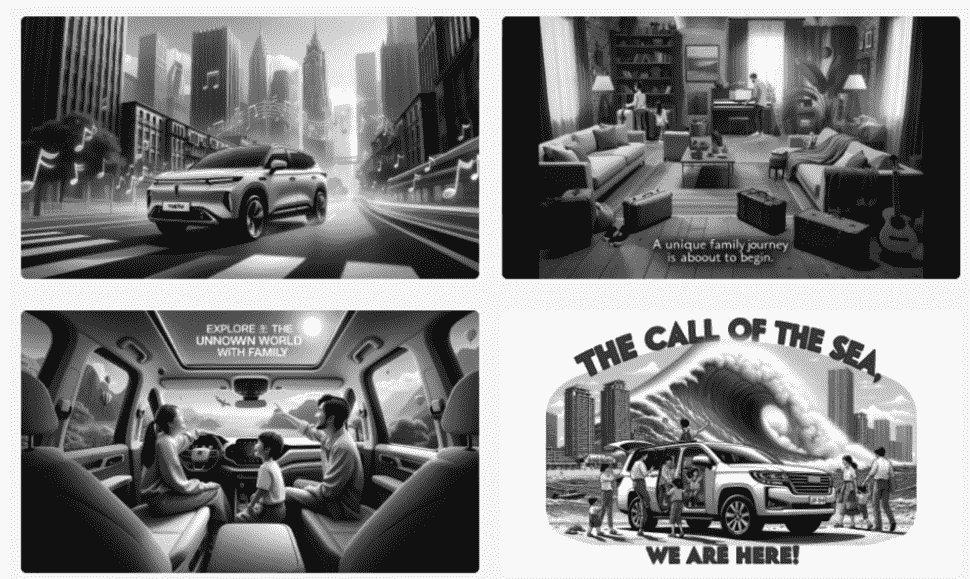
图8-3 DALL·E 3生成的视频脚本分镜画面（部分）

#### 8.4.4 生成社交媒体内容
提示词：
请撰写一篇微信推文和一篇微博帖子。

ChatGPT：
微信推文：标题拟定为【悦途家庭日】与家人一起，驾越星辰，探秘大海！正文突出两天一夜试驾、亲子互动、技术体验与篝火星空，引导报名与入群。

悦途家庭日·温情同行

家里的暖意值得细细珍藏，座驾的陪伴让每一次出行都更安心。悦途新能源SUV诚意邀请各家家庭参与“悦途家庭日”，开启一段别具特色的亲子之旅。


亲子共同操控，拉近彼此的距离。


前往B城海岸线，感受海风拂面与沙滩的魅力。

篝火傍晚与家人围坐，一起仰望星空。

新能源出行拓展更多想象空间，等你来发掘。

时段：九月的第二个周末。

路径：自A城启程，直达B城海滨。

点击【报名链接】，与家人一起开启这段难忘旅程！

微博文案：

#悦途家庭日# 全家出动，驾向星海，探访海洋！悦途SUV新能源邀您体验与众不同的家庭出行。亲子共驾、海边探险、篝火晚会、星空观赏……精彩等你开启！报名入口在此 [报名链接] #家庭出行# #新能源汽车#

以上微信推文与微博初稿整体如何？是否还有优化或补充空间？

按照既定要求，ChatGPT已据此输出两版文案。若仍有细节需求，可继续提出调整意见，待效果达标后再进入下一步。

### 8.5 活动后续跟进

ChatGPT可提供活动效果评估与后期维护思路，涵盖活动优化、受众关系维系以及下一次活动的策划参考。

#### 8.5.1 生成跟进方案

延续既定提示设定，输入“继续”，ChatGPT便会按序展开下一问题的解答。

**Prompt:**

好的，我们继续下一步。

**ChatGPT:**

为确保活动成效并与参与者建立长期连接，后续跟进十分关键。以下为跟进建议：

1. **感谢信**
内容：感谢家庭参与“悦途家庭日”，传递品牌的诚意与重视。
形式：电子邮件和微信消息。
时点：活动结束后第二天发出。
2. **调查问卷**
内容：关于活动满意度、车辆体验感受、组织建议等。
形式：在线问卷，如腾讯问卷或问卷星等。
时点：活动结束后第三天发出。
激励：鼓励填写问卷的家庭，可赠送小礼品或优惠券。
3. **微信社群**
内容：创建“悦途准车主”微信群，分享新能源车的用车方式、保养知识、品牌资讯等。
形式：微信社群。
时点：活动结束后首日邀请。
运营：在群内定期开展小互动，如知识问答、经验交流，提升活跃度。
4. **专属优惠**
内容：为参与家庭提供购车专属福利，如一定折扣或赠送汽车配件。
形式：优惠券或电子码。
时点：活动结束后第五天发放。

以上为后续跟进的建议，您有什么想法或修改意见吗？

#### 8.5.2 撰写感谢信

基于活动跟进需求，要求ChatGPT起草一封感谢信，并在结尾提示用户参与问卷、社群及优惠等后续环节。

Prompt:

请结合整体活动方案撰写感谢信，除致谢外，需在结尾体现邀请参与调查问卷、加入微信社群、领取专属优惠的信息。

ChatGPT:

明白，下面是“悦途家庭日：驾越星辰，探秘大海”活动的感谢信示例：

亲爱的 [家庭成员姓名] 家庭，

首先衷心感谢您参与“悦途家庭日：驾越星辰，探秘大海”。您的加入让活动更添色彩与温暖，我们非常荣幸能与您共度这段难忘时光。

我们始终致力于为家庭提供优质的新能源出行体验，您的反馈对我们极其重要。为更了解您的感受，我们准备了调查问卷，期待您抽空填写宝贵意见。

另外，诚邀您加入“悦途准车主”微信社群，在此可与其他车主交流经验，获取新能源车最新资讯与使用技巧。

最后，为表达谢意，我们为您准备了一份专属优惠，购置悦途SUV新能源车时可享受更多实惠。

再次感谢您对悦途的支持与信任，期待再次相见！

此致

悦途汽车团队

这是初稿，您觉得怎样？需要修改或补充的地方吗？

#### 8.5.3 撰写调查问卷

可进一步要求ChatGPT按规划细化调查问卷的具体题目。

Prompt:

请依据以下规划拟定具体的调查问卷内容。

内容：关于活动的满意度、汽车的体验感受、活动组织的建议等。
形式：在线问卷，如腾讯问卷或问卷星等工具。
时间：活动结束后的第三天发送。
奖励：鼓励填写问卷的家庭成员，可以提供一些小礼品或优惠券。

ChatGPT:

明白，下面是“悦途家庭日：驾越星辰，探秘大海”活动问卷示例：

##### 悦途家庭日活动满意度调研

尊敬的参与者，您好！感谢您参与“悦途家庭日：驾越星辰，探秘大海”。为持续优化服务，想了解您对本次活动的感受与建议。问卷仅需数分钟，您的意见是我们改进的动力。

1. 您对本次活动的整体满意度如何？
非常满意 满意 一般 不满意 非常不满意
2. 您对悦途SUV新能源汽车的体验感受如何？
非常满意 满意 一般 不满意 非常不满意
3. 您最喜欢活动的哪个环节？
亲子驾驶体验 海滩探险 篝火晚会 星空观赏
其他: __________
4. 您对活动组织有哪些建议或意见？
[开放式作答]
5. 您是否考虑购买悦途SUV新能源汽车？
肯定会购买 正在考虑 还未决定 不会购买
6. 您对悦途品牌有哪些建议或意见？
[开放式作答]
7. 您是否愿意参加未来的悦途品牌活动？
是 否
8. 请留下联系方式，以便我们提供小礼品或优惠券。
姓名: __________
手机号: __________

以上是问卷内容，您觉得如何？有需要调整或补充的地方吗？

ChatGPT按我们的要求提供了可用于活动后续跟进的材料，显得相当专业。至此，活动的策划、宣传、评估与跟进已形成完整闭环，我们发现借助ChatGPT，活动策划与组织更高效、更有创意，也更具成效。

### 8.6 本章小结

活动推广既是展示产品、服务与品牌价值的窗口，也是实现品牌体验与销售转化的桥梁。ChatGPT能在活动推广的各个环节提供技术支持。

#### 1. ChatGPT目前已经具备的能力
- （1）创意主题生成：ChatGPT能迅速给出新颖且吸引人的活动主题建议，为活动营销奠定基础。
- （2）策划方案辅助：基于目标市场与受众，ChatGPT可生成详细的活动策划方案。
- （3）活动宣传支持：ChatGPT能创作吸睛的宣传文案与内容，提升活动曝光与影响力。
- （4）后续跟进建议：提供有效的用户反馈收集与效果分析建议，支持活动持续优化。

#### 2. ChatGPT目前存在的不足
- （1）创意深度限制：虽能产出创意主题，但创意深度与细腻度有限。
- （2）策划方案一致性：生成的方案可能缺乏一致性与长期战略视角。
- （3）实时交互缺失：在宣传与跟进环节，ChatGPT无法实时与用户互动。

#### 3. 需要注意的问题
- （1）人机协作创作：结合人类创作者的专业知识与经验，与ChatGPT共同参与主题与策划创作。
- （2）增强交互学习：通过学习用户反馈，优化ChatGPT在宣传与跟进方面的表现。
- （3）长期战略规划：引入更多行业知识与长期战略视角，提升方案有效性。

#### 4. 未来的发展趋势
- （1）AI驱动的创意主题：ChatGPT将提供更多创新独特的活动主题建议。
- （2）智能策划方案生成：借助AI技术，ChatGPT将自动生成更完善详细的策划方案。
- （3）个性化宣传和跟进：未来ChatGPT将支持个性化的活动宣传与用户后续跟进方式。

ChatGPT在活动推广方面已具备强大能力与可期的巨大潜力，虽仍存在局限，但通过持续技术迭代与优化，未来将更好地服务活动推广，提供更创新、精准、个性化的辅助与支持。

## 第9章 AI+直播电商：即刻成交的销售神器

直播电商近年崛起，以实时互动的特点深受消费者青睐。如何在直播中精准传递信息、制造吸引力并促成交易，是营销人员与主播共同思考的问题。本章将深入“AI+直播电商”领域，探讨如何把ChatGPT打造成助力直播电商实现即刻成交的销售利器。你将学习如何利用ChatGPT撰写高效直播话术脚本，设计吸睛的直播场景，并了解如何应用数字人技术增强直播互动性。

### 9.1 ChatGPT如何助力直播电商

在激烈竞争中，如何在众多直播电商中脱颖而出，是品牌与企业面临的挑战。要实现目标，不仅需要精心设计的直播话术，还需要有吸引力的场景，以及专业有魅力的主播。传统模式往往依赖大量人力，从策划、执行到后期跟进，都需投入大量时间与成本。

ChatGPT的出现为电商直播带来巨大赋能。它可帮助企业撰写吸引人的直播脚本，提供直播背景设计建议，并为直播中的虚拟数字人提供支持。借助ChatGPT，品牌可更经济、更专业地开展直播电商，大幅提升吸引力与转化率。

在直播电商各环节，ChatGPT都能提供支持。

#### 1. 直播话术脚本
- 传统方法：需运营团队或主播依经验与风格制定话术，耗时耗力。
- ChatGPT辅助：可向ChatGPT提供专业知识与学习材料，进行专业角色调教，调教成专业的直播话术脚本撰写助手，之后提交商品基础信息即可自动生成专业脚本。

#### 2. 直播场景设计
- 传统方法：场景设计涉及整体环境、主题文字、背景视频、前景图片等要素。
- ChatGPT辅助：运营团队可提供品牌、产品、目标用户等背景信息，获取设计与优化要素的建议。

#### 3. 直播数字人辅助
- 传统方法：需大量图形设计与编程工作来创建和操作数字人主播。
- ChatGPT辅助：结合其他AI技术，ChatGPT可为数字人主播提供实时话术与互动支持，使其更自然、更有说服力。

接下来，通过具体案例演示如何借助ChatGPT开展直播电商，我们虚拟一个名为“零界”的健康零食品牌，首先从直播话术脚本开始。

### 9.2 直播话术脚本

首先，采用“六要素”通用提示框架设计一段完整提示词，输入新建对话框，给ChatGPT下达任务。

###### Prompt:

**角色：** 假设你是一个抖音直播电商运营专家，精通抖音直播电商全流程方法。
**背景：** 我是一个品牌的直播带货运营经理。品牌背景如下：
品牌名：零界。
品牌定位：新生代健康零食。
品牌口号：好吃更好玩，美味又健康。
品牌理念：打破传统与创新的界限，将健康功能与美味零食完美融合，让每一口都充满惊喜。
目标人群：“95后”年轻人群。
需求洞察：
- 既要健康的身体，也爱美味的零食。
- 追求新奇变化，不喜欢一成不变的生活。
- 热衷探索和购买新产品，并以此作为生活乐趣。
核心产品：
胶原蛋白巧克力：结合了优质生可可和创新成分，通过恢复重要的脂质来帮助锁住皮肤水分，保持皮肤弹性。
**任务：** 我需要你在直播话术脚本上提供全面建议和协助。
**目标：** 提升直播电商销售GMV。
**流程：** 让我们一步一步思考，按照以下步骤依次进行：
- 第一步：探讨抖音直播电商的特点和成功关键点；
- 第二步：根据成功关键点制定直播话术脚本模型；
- 第三步：根据制定的模型撰写其他产品脚本。
**指令：**
- 按照流程所列顺序每次只探讨一个问题，等我确认并说“继续”再进入下一步。
- 过程中我会根据需要给你一些学习资料，你需要学习并归纳其中的方法模型，并结合你的知识，为我提供建议。
- 在过程中如果你有需要了解的背景信息，可以向我提问。
- 为了确保内容的专业性和创新性，请将温度值设为0.8。

#### 9.2.1 第一步：探讨直播电商成功的关键点

输入上述提示词后，ChatGPT开始回答第一个问题。

**ChatGPT：**

了解，首先从第一步开始，探讨“抖音直播电商的特点和成功关键点”。

##### 抖音直播电商的特点和要求

特点：
- （1）实时互动：抖音直播带货允许主播与观众实时互动，为品牌提供与消费者建立深度关系的机会。
- （2）短时高效：抖音直播通常时间较短，但效果显著，因此话术与内容需要精准、有吸引力。
- （3）强调体验：观众无法直接触摸或试用产品，因此主播的描述与展示需要突出产品体验感。
- （4）促销优惠：抖音直播带货常伴随限时优惠、折扣等促销活动，以刺激购买。
- （5）瞬时流量高峰：直播电商流量往往呈现爆发式增长，一旦内容受欢迎，短时间内可吸引大量用户。

成功关键点：
- （1）内容质量：直播内容需要真实、有趣、吸引人，能引起观众共鸣。
- （2）产品展示：产品需要在直播中进行详细、全面展示，让观众了解特点与优势。
- （3）互动增强：主播需要与观众频繁互动，回答问题、进行游戏等，增强参与感。
- （4）促销策略：合理的促销策略可大幅提高直播转化率。
- （5）后续服务：购买后的服务也很重要，如快速物流、良好售后等。

以上是对抖音直播电商特点与成功关键点的总结，您看是否满意，若确认无误，请说“继续”，我们将进入下一步。

ChatGPT给出的阐述可能不够专业，因此可进行专业调教，结合自身经验与专业参考，给出更准确定义。

###### Prompt:

成功关键点：高频互动、对号入座、需求痛点、产品价值、感官体验、情绪调动、品牌信任、价格刺激、下单促动、售后承诺。

###### ChatGPT:

了解，根据您提供的成功关键点，重新整理如下：

####### 成功关键点：
- （1）高频互动：主播与观众频繁互动，如答疑、玩小游戏等，能增强参与感与购买意愿。
- （2）对号入座：精准定位观众需求，为其提供真正所需产品或信息。
- （3）需求痛点：深入挖掘观众需求痛点，并提供相应解决方案或产品。
- （4）产品价值：清晰展示产品价值与优势，让观众明白购买意义。
- （5）感官体验：通过直播展示产品实际使用效果，如味道、质地等，增强购买欲望。
- （6）情绪调动：通过故事、情境等方式调动观众情感，产生共鸣。
- （7）品牌信任：展示品牌历史、荣誉等，建立权威性与信任感。
- （8）价格刺激：提供优惠、折扣等价格策略，刺激购买欲望。
- （9）下单促动：通过限时优惠、赠品等方式，促使观众快速下单。
- （10）售后承诺：承诺良好售后服务，如退换货、客服支持等，增强购买信心。

这些关键点将为制定直播话术脚本提供重要参考。若您认为已准确无误，请说“继续”，我们将进入下一步制定直播话术脚本模型。

我们看到ChatGPT吸收了提供的专业知识，确定了直播电商成功的关键点，为后续脚本撰写奠定标准。可继续进入下一步。

#### 9.2.2 第二步：制定直播话术脚本模型

按前面的提示词设定，输入“继续”，ChatGPT会按顺序继续回答。

###### Prompt:

继续。

###### ChatGPT:

好的，进入第二步：根据成功关键点制定直播话术脚本模型。

###### 直播话术脚本模型:
- （1）开场互动：
  - 问候观众，简短自我介绍。
  - 快速提及品牌“零界”及其理念，为后续内容做铺垫。
- （2）对号入座：
  - 提问：“你们是不是既想吃美味的零食，又担心身体健康？”
  - “今天我要给大家介绍的，正是满足你们这个需求的零食！”
- （3）挖掘需求痛点：
  - “我们都知道，很多零食虽然好吃，但对身体不好。但是‘零界’的零食不仅好吃，还非常健康。”
- （4）产品展示与感官体验：
  - 展示“胶原蛋白巧克力”，描述其特点与口感。
  - “这款巧克力不仅口感丰富，还含有胶原蛋白，帮助锁住皮肤水分，保持皮肤弹性。”
- （5）情绪调动：
  - 分享一个与产品相关的小故事或情境，如：“你们知道吗，我之前的皮肤很干燥，但自从吃了这款巧克力后，皮肤变得更有弹性了。”
- （6）品牌信任建立：
  - “‘零界’作为一个新生代健康零食品牌，一直致力于打破传统与创新的界限，为大家带来既美味又健康的零食。”
- （7）价格刺激与下单促动：
  - “今天直播间有特别优惠，购买胶原蛋白巧克力可以享受×折优惠，而且前100名购买的朋友还可以获得小礼品一份！”
- （8）售后承诺：
  - “我们承诺，如果你们在收到商品后有任何问题，都可以联系我们的客服，我们会为你们提供满意的解决方案。”
- （9）结束语与再次互动：
  - “感谢大家的支持，希望‘零界’的零食能给你们带来健康与快乐。有任何问题或建议，都可以在直播间留言告诉我。”

以上是基于成功关键点制定的直播话术脚本模型。请查看，如需修改或补充请告知。若确认无误，请说“继续”，我们将进入下一步撰写其他产品脚本。

我们看到ChatGPT的直播话术脚本模型已有一定专业度，为继续提升，可进一步进行专业调教，给出更具体的修改意见。

###### Prompt:

在原来的基础上，根据以下意见进行优化：
- （1）高频互动：需要贯穿在所有环节中，随时随地抓住机会发起互动。包括让观众进行点赞、关注、加粉丝灯牌，以及根据需要适时发起提问，要在公屏上回复数字11、2、666等，或者文字“有”“要”等。
- （2）对号入座：需要用互动方式抓住目标人群的注意力。示例：“今天来到直播间的女生有多少？来，公屏上扣一拨。”
- （3）需求痛点：要从具体痛点出发。话术示例：“女生们有没有这样的困扰？（具体展开痛点描述）”之后发起互动：“如果你有这样困扰，在公屏上扣一拨‘有’。”
- （4）产品介绍：采用特征、功能、利益的解析方式，即特点、功能、好处。

优化后的直播话术框架与落地演示

一、关键话术模块的再梳理
- （5）品牌可信构建：聚焦品牌历史沉淀、权威背书与真实用户反馈。参考表达：“想选靠谱零食，先看牌子。我们深耕健康零食十多年，产品拿到欧盟认证，直播间里已有不少姐妹复购，回馈都很正向。”
- （6）价格驱动：包含阶梯式调价与赠品加码。分级调价示范：“对比下猫猫宝贝旗舰店同款，活动价基本在139到149区间，今天不谈99也不谈79，连60块都不用，直接49到手。” 赠品加码示范：“今晚下单的朋友再额外多送一件××，平时不单发，今天限定，抢到就赚。”
- （7）促单拉动：强调限时限量。参考表达：“为了当日发货，今天总共只放500份，本批先上100份，后面还得留给进来的粉丝。心动就赶紧下单，30秒倒计时开始。”
- （8）售后安心：消除顾虑。参考表达：“品质方面不用担心，我们很有底气。所有下单均支持7天无理由退换，并赠送运费险。”

系统在收到反馈后对直播话术模型进行了迭代。

升级版直播话术模型：
- （1）破冰开场：问候观众并做简短自我介绍；“直播间里女生有多少？公屏来一排1让我瞧瞧！” 快速点出品牌“零界”及其健康理念，为后续铺垫。
- （2）精准对号： “你们是不是又想吃点美味零食又怕伤身？” “今天要给大家的，正好能解这个矛盾。”
- （3）挖掘痛点：“女生们有没有被这些问题困扰？具体展开。” “有共鸣的姐妹回一个‘有’。”
- （4）产品呈现与感官：用FAB介绍“胶原蛋白巧克力”。特质：含胶原蛋白，口感层次丰富；功能：助力肌肤锁水保弹性；价值：吃得满足同时做养肤。
- （5）情绪共鸣：分享小故事，如“以前我皮肤很干，自从吃这款巧克力后，摸上去明显更有弹性了。”
- （6）强化品牌信任： “买零食还是看品牌，我们是专注健康零食的十年老牌，已获欧盟认证，直播间用户尝试后反馈都很正面。”
- （7）价格与促单组合： “对比猫猫宝贝旗舰店同款活动价139到149，今天不要99不要79，60块都省，只要49！” “今晚下单再送一个××，平时不放出，仅限今日。” “为保证当日发，今天限500单，先放100单，后面留给后续粉丝。喜欢的抓紧，30秒倒计时。”
- （8）售后保障： “别担心品质，我们有信心。拍下均承诺7天无理由退换，并送运费险。”
- （9）收尾互动： “感谢大家支持，希望零界的产品能带来健康与快乐。任何问题或建议，直播间留言我都会看。”

全程高频互动贯穿，每个环节结束都引导点赞、关注、加灯牌，或让观众在公屏回复数字1、2、666或文字“有”“要”等。

二、5分钟脚本表9-1

| 时长 | 动作 | 策略要点 | 话术示例 |
|---|---|---|---|
| 15秒 | 开场 | 高频互动 | “哈喽大家好，我是××，欢迎来到零界健康零食现场，帮忙点个赞关注一下吧！” |
| 15秒 | 互动 | 对号入座 | “今天直播间有多少女生？弹幕冲一波1！” |
| 30秒 | 提问 | 需求痛点 | “冬天皮肤干、嘴唇起皮是不是困扰你？有感同身受的在公屏打‘有’。” |
| 45秒 | 展示产品 | FAB介绍 | “这款胶原蛋白巧克力，含胶原蛋白，帮肌肤锁水，越吃越有弹性。” |
| 30秒 | 体验分享 | 感官体验 | “我自己试过，口感很丰富，既解馋又能养肤，一举两得。” |
| 30秒 | 分享故事 | 情绪调动 | “我之前皮肤很干，吃了这款后明显更水润有弹了。” |
| 30秒 | 品牌介绍 | 品牌信任 | “选零食看品牌，我们深耕健康零食十年，已获欧盟认证，老用户都说好。” |
| 30秒 | 价格优惠 | 价格驱动 | “猫猫宝贝旗舰店活动价139到149，今天直接49到手！” |
| 30秒 | 赠品介绍 | 促单拉动 | “今晚下单额外赠送××，平时不单送，只限今日，错过可惜。” |
| 30秒 | 限时促销 | 促单拉动 | “为保证当日发，今天限500单，先放100单，喜欢的抓紧，30秒倒计时。” |
| 30秒 | 售后服务 | 售后承诺 | “品质不担心，我们承诺7天无理由退换，运费险也包了。” |

这是5分钟直播话术模型，请确认是否需要调整，确认后可进入下一步。

三、其他产品脚本演示
基于既有模型为“红枣杏仁茶”这一养颜滋润饮品撰写脚本。

表9-2

| 时长 | 动作 | 策略要点 | 话术示例 |
|---|---|---|---|
| 15秒 | 开场 | 高频互动 | “各位好，我是××，欢迎来到零界健康直播现场，记得点赞关注哦！” |
| 15秒 | 互动 | 对号入座 | “入冬了，有多少人感觉皮肤干、嘴唇蜕皮？评论区发1！” |
| 30秒 | 提问 | 需求痛点 | “冬天喝水不够，又不知道喝什么？有困扰的打‘有’。” |
| 45秒 | 展示产品 | FAB介绍 | “这是红枣杏仁茶，选用上等红枣杏仁，滋润养颜，让皮肤更水润。” |
| 30秒 | 体验分享 | 感官体验 | “我常喝，泡上一杯暖意满满，甜而不腻，很滋润。” |
| 30秒 | 分享故事 | 情绪调动 | “以前冬天手脚干，喝了这款后整个人都水润多了。” |
| 30秒 | 品牌介绍 | 品牌信任 | “健康饮品选品牌，零界专注健康产品，多项认证加持，喝过的都认可。” |
| 30秒 | 价格优惠 | 价格驱动 | “市面同类要59一盒，直播间今天只要39！” |
| 30秒 | 赠品介绍 | 促单拉动 | “今天下单额外送健康零食一份，平时不送，今日限定。” |
| 30秒 | 限时促销 | 促单拉动 | “为保证体验，今天只放300盒，先上50盒，后面给后面粉丝留。” |
| 30秒 | 售后服务 | 售后承诺 | “品质有保障，下单享7天无理由退换，运费险赠送。” |

四、模型命名与信息需求
将上述模型命名为“直播脚本1号模型”，后续输入产品背景即可基于该模型输出脚本。

为提升脚本精准度，建议提供的信息清单：
- 产品名称
- 产品特质
- 产品功能
- 带来的核心价值
- 感官描述
- 目标人群
- 市场常规价与直播优惠价
- 赠品或优惠政策
- 库存或限量信息
- 品牌历史、荣誉与认证等信任要素
- 售后政策
- 其他有助于转化的关键信息

五、语言风格归纳“直播脚本1号风格”
- 亲切自然，多用“宝宝”“大家”等称呼
- 幽默风趣，如调侃关注即好运
- 直接明了，直指重点
- 情感投入，拉近距离
- 节奏感强，带韵律感
- 鼓励互动，引导点赞分享
后续撰写以1号模型为结构，以1号风格为语言基调。

六、直播场景设计要点
品牌零界，定位新生代健康零食，口号好吃更好玩美味又健康，理念打破传统与创新边界。目标95后，需求既要健康又爱美味、追求新奇、不喜一成不变、热衷尝试新品。核心品类胶原蛋白巧克力、减肥口香糖、益生菌苏打水。

第一步主题文案撰写
屏幕上方简短文字结合痛点与卖点，吸引进间。备选：
- “想吃零食又怕胖？零界来帮忙！美味又健康，新品抢先尝！”
- “零食控的福音！美味又健康，吃得更养人！”
- “零界新品上新！吃货的健康选择，你值得拥有！”
- “零食新潮流，零界带你飞！吃出健康吃出美！”
- “零界新品，零食新风尚！健康美味一次满足！”

第二步整体环境建议
整体色调用清新活力的绿蓝配色，绿色传递健康自然，蓝色体现年轻活力。创意道具：健康元素如新鲜果蔬、坚果、全麦食品突出健康属性；新生代元素如LED灯、彩色气球、流行玩偶吸引95后；品牌元素如带Logo或口号的旗帜、海报、灯箱强化曝光；互动元素如小游戏或挑战并赠小礼品提升活跃度。

根据指令设定，ChatGPT 输出了一份直播间整体环境布置方案，细节丰富、亮点突出。我们可以直接调用其自带的 DALL·E 3 作图能力查看效果，例如图9-1、图9-2。

输入指令：

请按直播间整体环境建议出效果图。

ChatGPT：

DALL·E 3

生成 4 幅画面（如图9-1）

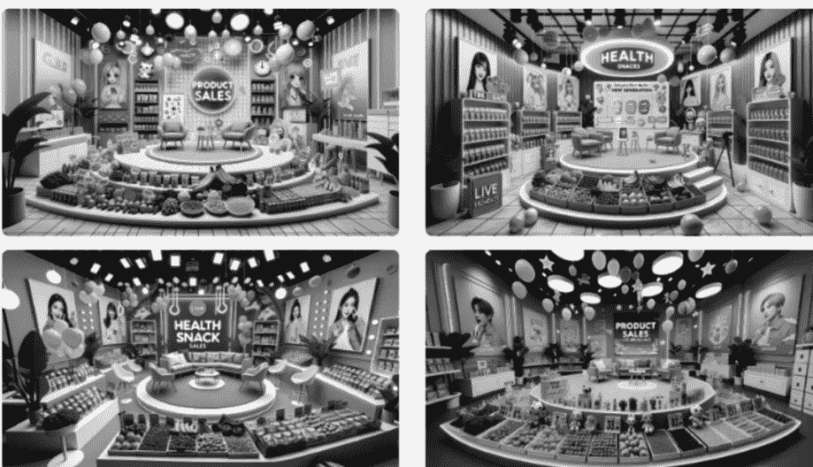

图9-1 DALL·E 3 生成的直播间效果图（第1组）

输入指令：

当前元素过于繁杂，请精简，突出重点。

ChatGPT：

DALL·E 3

生成 4 幅画面（如图9-2）


图9-2 DALL·E 3 生成的直播间效果图（第2组）

综合反馈后，DALL·E 3 的成图已更贴合预期。若仍不满意，可继续迭代指令直至达标，再进入下一环节。

#### 9.3.3 第三步：背景视频策划

背景片主要承担展示使用场景、强化卖点、营造沉浸感的功能。按前面的对话设定，直接发送“继续”，模型会按序展开该环节。

输入指令：

继续。

ChatGPT：

收到，进入第三步。

第三步：背景视频策划，核心是场景体验与现场沉浸。

背景视频建议：

- 1 日常使用片段：呈现目标人群在真实生活里使用零界产品的画面，如办公室、校园、健身房或聚会场景中轻松享用健康零食的状态。
- 2 生产工艺片段：展示零界零食从原料到成品的制作流程，突出健康天然与工艺细节，提升信任感。
- 3 品牌故事片段：简短介绍零界的理念与来历，帮助观众建立认知与好感。
- 4 沉浸氛围片段：加入特效与配乐，调出轻松愉悦的现场感，让观众产生身临其境的感受。

为保证连贯与吸引力，建议单条剪辑控制在15到20秒，全片时长保持在1到2分钟。

请确认本阶段建议，若有修改或补充请告知，确认后请回复“继续”。

目前 ChatGPT 给出的背景视频方向已经比较完整，若有不合适之处可继续反馈，满意后推进下一步。

#### 9.3.4 第四步：前景画面设计

前景层主要放置产品展示与优惠信息，用以刺激购买欲。

输入指令：

继续。

ChatGPT：

进入第四步。

第四步：前景画面设计，主题为欲望刺激，涵盖产品展示与福利信息。

前景画面建议：

1 产品展示
- 胶原蛋白巧克力：选用高清大图，可展示整块巧克力或咬开后的截面，突出口感与核心成分。
- 减肥口香糖：呈现包装与实物，可搭配瘦身剪影或健康标识等视觉元素。
- 益生菌苏打水：展示瓶身的清爽质感，旁配益生菌放大图，强调健康价值。

2 优惠信息
- 限时特惠：设计倒计时图标，提示时间紧迫，推动快速下单。
- 买一赠一：并列两款商品，其中一件标注赠品，拉高购买吸引力。
- 折扣券：制作醒目的优惠券图形，提示直播间可领。

3 互动元素
- 点赞分享：用点赞手势与分享图标鼓励观众互动。
- 提问互动：用问号或对话框图标提示观众提问。

为保证清晰度与观感，建议精细规划每张图的尺寸与位置，避免遮挡主播或关键直播画面，同时抓住观众视线。

请确认本步建议，必要时提出修改，确认无误后说“继续”。

输入指令：

请按前景画面设计建议输出参考效果图。

ChatGPT：

DALL·E 3

生成 4 张图片

ChatGPT 在直播场景设计上的专业建议质量较高，基于该建议仍可调用 DALL·E 3 生成效果图（见图9-3），实现从创意到落地的闭环。


图9-3 DALL·E 3 生成的直播间前景图片参考

### 9.4 直播数字人应用

在直播电商竞争中，主播的人设、形象与表现力始终是关键。设想打开直播平台，一位逼真度极高的虚拟主播出现在镜头前，表达流畅、反应迅速、互动自然，很难分辨是真人还是虚拟形象。随着人工智能发展，这已逐渐成为现实。

#### 9.4.1 数字人直播的核心优势

品牌做直播电商的模式大致有达人直播、店播与品牌自播。品牌自播正成为主流，链路最短、效率最高，无中间成本，在达人费用持续上涨的背景下，自播具备更高成长弹性，投入集中于内容打造，更易实现小投入大产出。

开展品牌自播，主播选择是关键。传统真人主播存在薪资高、排班受限、状态波动、专业度不均、人身不可控等难题。数字人主播正好能弥补这些短板。数字人是由人工智能生成的虚拟人物，可在形象、动作、语言上趋近真人，可用于直播、短视频等多种场景。

相较真人直播，数字人直播的优势主要有：

- 成本更低：公开调研显示，一线城市一名优秀主播月薪超1万元，加上团队、场地、硬件等，年成本常超20万元，数字人可最大化节约开支。
- 运行持续：可24小时不间断直播，覆盖全球不同时区。
- 状态稳定：不受情绪、健康等影响，表现始终在线。
- 内容可预设：每次直播均可精细策划，保证专业性。
- 资产可控：数字人不会离职，是企业的长期数字资产，可持续创造价值。

#### 9.4.2 数字人直播的适配品类

凭借独特优势，数字人直播尤其适合以下品类：

#### 9.4.3 数字人主播的制作与驱动

随着 AIGC 成熟，制作数字人已非常便捷。用户上传一段视频或一张照片即可生成专属虚拟形象。AI 可基于2D图像分析或3D扫描生成高度逼真的形象，并可在年龄、表情等维度个性化调整。国内已有众多科技公司提供制作服务，企业可按需采购。当前数字人主播主要由三种方式驱动：

1 文本驱动
通过输入文本驱动数字人发声，通常采用语音合成。优点是无需录音或实时配音，效率高成本低；缺点是声音真实感不足，机械感明显。

2 预录语音驱动
通过提前录制的语音驱动形象。优点是声音自然、情感丰富；缺点是难以实现实时交互。

3 实时语音驱动
通过真人实时语音输入驱动形象，类似“阿凡达”模式。优点是声音自然，可即时回应观众提问。

综合来看，文本驱动适合固定内容，预录语音驱动适合需要情感表达的内容，实时语音驱动适合强互动场景。可按在线人数灵活切换：人数多时用文本或预录驱动，保证稳定专业；人数少时用实时语音驱动，增强互动感。

目前腾讯、微软小冰、淘宝、快手、蓝色光标等均在布局数字人技术。腾讯推出“腾讯智影”与小样本数字人生产平台；微软小冰启动“GPT克隆人计划”；淘宝发起“AI生态伙伴计划”；快手展示“快手智播”；蓝色光标发布“蓝标智播”。这些机构不仅提供制作服务，还提供完整直播解决方案。

#### 9.4.4 ChatGPT 的支持作用

数字人直播早期多为录播呈现，观众看到的是预制内容，流畅但缺乏互动。评论区提问时，数字人只能循环播放，体验受限。

引入 ChatGPT 后情况改变。ChatGPT 可实时抓取评论区关键词，按预设话术智能回应，使数字人主播能与观众自然互动，精准解答。

例如观众问：“这款产品颜色有哪些？”数字人可基于脚本与AI能力即时答复：“本款提供红、蓝、绿三种颜色。”

后台操作也更简便。运营人员提前输入直播脚本与互动话术，ChatGPT 可在直播中自动完成智能互动，大幅提升效率与参与度。

ChatGPT 为数字人带来真正的实时互动能力，打破录播限制，实现有针对性的交流，丰富直播形式。

#### 9.4.5 数字人直播的应用策略

数字人优势明显，但短期内仍难完全替代真人，因其缺乏真人的情感张力与即兴能力，而直播带货的核心在于情感黏性与信任。

建议将数字人作为真人主播的助手，分时段协作。真人把控黄金时段，数字人覆盖其他空档，实现全天候运营。同时保证数字人内容质量，结合真人主播的情感互动优势，提供更好体验。

未来随着人工智能进步，数字人交互能力将持续增强，体验更真实。电商直播也将迈向全面智能化。

### 9.5 本章小结

直播电商已成电商标配，ChatGPT 可在直播脚本、场景设计、数字人直播上提供助力，提升内容吸引力与销售业绩。

1 ChatGPT 当前能力
- 直播内容脚本撰写：提供专业资料后可将其调教为专业脚本助手。
- 直播场景设计建议：提供专业设计建议，提升直播效果。
- 数字人直播辅助：结合其他AI技术，为数字人提供实时话术与互动支持。

2 当前不足
- 脚本个性化受限：对主播个性与风格适配不足。
- 场景建议较为通用：需进一步迭代优化。
- 数字人互动深度有限：难以完全替代真人的自然表达与即兴。

3 需注意问题
- 脚本个性化优化：结合主播特点进行修改。
- 场景设计深化：结合品牌形象与活动主题做细化。
- 数字人技术升级：增强虚拟主播的表达与互动能力。

4 发展趋势
- 人工智能脚本创作：提供更人性化、个性化的脚本。
- 智能场景设计：集成更多AI能力，生成契合品牌的高质量场景。
- 数字人直播优化：表现更自然、更有吸引力。

ChatGPT 可贯穿直播电商各环节，随着持续优化，其应用将更广泛深入。

### 第10章 AI+客户服务：服务驱动的持续增长

优质客户服务能提升满意度与忠诚度，是持续增长的关键驱动。数字化时代，人工智能为客户服务带来革命性升级。

本章聚焦“AI+客户服务”，探讨如何利用 ChatGPT 构建服务驱动增长。学习如何规划与开发基于 ChatGPT 的客户服务实现模式，掌握功能开发与部署策略。通过学习，可更好利用人工智能提升服务效率与质量，推动业务增长。

### 10.1 ChatGPT 如何助力客户服务

传统客户服务依赖大量客服、销售、技术支持协同，效率低、成本高，难以实现7×24小时服务。智能客服机器人的出现提供了新思路，不仅可实现全天候即时响应，还能基于大数据给出一致准确的答案，并依托历史与偏好提供个性化方案与推荐。

ChatGPT 出现前，智能客服普遍智能化不足。在 ChatGPT 加持下，其智能水平显著提升。基于大模型进行私有定制、训练与部署，可进一步增强服务能力，满足多样化个性化需求，提升忠诚度与满意度，进而提高复购与客单价。

例如电商平台可将商品库、订单系统、FAQ 与 ChatGPT 集成，实现：

1 商品咨询
客户咨询详情时，机器人可依托商品库即时提供信息。

2 订单查询
客户查询状态时，机器人可调用订单系统提供实时更新。

3 问题解决
客户遇到问题时，机器人可依据FAQ给出方案。

4 投诉处理
客户投诉时，机器人可识别记录信息并转交真人客服跟进。

5 复购推荐
机器人可基于历史记录与偏好推荐相关商品与促销活动，提升复购与客单价。

具体如何实现？可通过向 ChatGPT 提问逐步展开。先用“六要素”通用提示框架撰写完整指令，输入新对话。

角色：你是一名 GPT 企业私有模型训练专家。
背景：我是一家电商平台的客服负责人，需基于大模型训练企业私有模型，应用于智能客服机器人，要实现商品咨询、订单查询、问题解决、投诉处理、复购推荐。
任务：指导并协助进行私有模型训练与智能客服机器人开发部署。
流程：请逐步思考，按序展开：
- 1 模式路径规划：分析基于大模型直接微调与“API+外部数据库”两种模式优劣，并提出选择建议与路径规划。
- 2 具体功能实现：分步说明各功能操作要点与实现方法。
- 3 应用部署建议：提供后续部署操作建议。
指令：用外行能懂的语言讲解；每次只输出一小步；经我确认并说“继续”再进入下一步；如需背景信息请提问。

### 10.2 实现模式规划

第2章已介绍基于大模型进行私有化训练的两种模式：大模型微调与“API+外部数据库”。现在可让 ChatGPT 分析两种模式优劣并给出建议。

#### 10.2.1 两种实现模式比较

按前述指令，先从两种模式的优劣比较开始。

ChatGPT：

明白，先讨论第一部分：模式路径规划。

模式路径规划：

大模型可通过两种方式进行定制：基于大模型的微调与“API+外部数据库”。

1 基于大模型的微调模式
优点：
- 个性化：可基于特定数据集训练，使模型更贴合特定场景。
- 数据保护：可在本地微调，无需上传数据到外部API，保护敏感信息。
- 无需额外数据库接口：微调后模型可直接作答，无需与外部数据库交互。
缺点：
- 成本：微调需要大量算力与时间。
- 维护：随数据与需求变化，可能需定期重调。
- 灵活性不足：模型定型后修改或更新相对困难。

2 “API+外部数据库”模式
优点：
- 实时更新：可实时从数据库获取最新信息，确保回答准确及时。

API 外接数据库这套玩法到底能不能用？先把结论摆出来。

可玩性很高，数据想加就加、想改就改、想删就删，根本不用反复训练模型；以后要扩功能、接新服务，也只需要往库里扩充就行，弹性足够。

代价也很实在。每次都要跑一趟数据库，高并发时响应会变慢；API 和库本身就是攻击面，得把安全做到位；同时要同时管好接口和数据，整体复杂度会上去。

综合商品咨询、订单查询、问题解决、投诉处理和复购推荐这些需求，最稳妥的还是走 API + 外部数据库的组合。这样机器人能实时拿到一手信息，回答既准又快，灵活性和扩展性也兼顾。

落地的大致路线是这样：先把商品、订单、FAQ、用户反馈等素材收拢整理成库；再做一个 API，让机器人能查能取；接着把 GPT 通过 API 接进来，实现问一句查一次；然后在测试环境跑通、收集反馈反复打磨；最后推到生产环境上线。必要时还能对 GPT 做针对性微调，让它更懂业务。

我们看到这套思路在优劣对比、选型建议和实施路径上都很清晰。

#### 10.2.2 技术细节深挖

聊到怎么让 API 和私有库配合顺畅，就要先把数据准备好。

提问：和 API 交互需要准备哪些数据？

回答核心是五类资产。商品库，要有品名、描述、价格、库存、图链接等全量信息；订单系统数据，订单号、商品清单、状态、物流信息等；FAQ 库，常见问题与标准答案；客户历史，购买记录、浏览轨迹、偏好，用于个性化推荐；投诉记录，内容、时间、处理进度，方便转人工。所有数据最好结构化，放在关系型库里，并提供清晰的查询更新接口。敏感字段如姓名、地址、支付信息必须加密或脱敏。

看完数据类型和安全要求，基本可以进入下一步。

#### 10.3 功能实操拆解

ChatGPT 会按功能一步步讲清楚怎么搭、要注意什么，先看商品咨询这块。

#### 10.3.1 商品咨询怎么搭

客户问商品详情时，机器人直接从商品库取数。

操作三步：库里必须有完整的品名、描述、价格、库存等；做一个 API，输入品名或 ID 就返回详情；GPT 收到咨询后调用 API，把结果用大白话呈现。

要点：库里的信息要一直是新的，接口要快，GPT 要能读懂模糊提问并给出准确回应。

追问：怎么保证库里的商品信息是新的？

有几个常用做法。做自动同步，把库存、供应链等系统定期拉进来刷新；给运营或供应商提供实时更新入口，上架下架立刻生效；按周月季做人工复核；对长期未更新的商品设置提醒；用版本控制保存每次变更，出错可回滚；开放用户纠错通道，收到反馈就核查更新；定期备份数据库，保证可恢复。

追问：API 响应慢怎么办？

从七个方向优化。数据库层面给常用查询字段加索引；服务器层面用高性能机器加负载均衡，合理调参；代码层面定期Review，去掉瓶颈，用高效算法和结构，减少无效计算；传输层面用 Gzip 压缩，只返回请求所需字段；静态资源走 CDN；做 API 版本管理，避免改动影响性能；用监控工具实时看响应时长和错误率，持续优化。

#### 10.3.2 订单查询实现

客户查订单，机器人要给到实时状态。

做法：订单库要包含订单号、清单、状态、配送等全量字段；开发接口，输入订单号即可返回详情；GPT 收到问题后调用接口，把信息整理成易懂的回复。

要点：数据必须实时，敏感信息传输存储都加密，先做用户身份校验再展示，语言要清晰简洁别用术语。

追问：用户身份怎么验？

常用组合：用户名密码，配合强密码策略和定期换密；双因素认证，加短信、邮件验证码或身份验证 App；OAuth/OpenID，让用户用第三方账号登录；登录成功后发会话令牌或 Cookie，定期失效；全程用 SSL/TLS 加密传输；加验证码防自动化攻击；做行为分析，异常登录触发额外校验或报警。

追问：怎么让 GPT 说人话？

六个策略。先用客服数据对模型做微调，答案偏口语化；准备模板化回复，常见场景套模板填空；生成后做后处理，裁剪冗长或术语；收集用户反馈，复杂回答及时改进；持续用真实问句测试评估；交互时明确指令，要求简洁非技术化表达。

#### 10.3.3 问题解决怎么做

遇到问题时，机器人先找 FAQ 再兜底。

做法：建立分类清晰的 FAQ 库，覆盖使用、支付、退货、支持等；接口支持关键词匹配返回标准答案；GPT 先查库，有就直接给，没有就靠自身知识生成。

要点：FAQ 要实时更新，新问题及时入库；分类明确便于匹配；答案用简单语言；模型要理解上下文，给到最相关的解释。

追问：高效的 FAQ 库怎么建和维护？

八步法。先和客服、销售、技术一起盘点高频问题，并分析站内搜索记录；做结构化设计，按类归档，给每条唯一 ID；内容要简短准确，可配图视频链接；选合适的存储，关系库、NoSQL 或 Elasticsearch 都行，关键是快；定期更新，业务变化就同步；开放用户反馈，标记有用或不准；做版本控制，可回滚；优化搜索体验，基于日志调关键词和答案。

追问：如果 FAQ 里找不到，GPT 怎么编答案？

它会基于上下文理解意图，用语言模型预测最可能的回答；知识库覆盖面广，能直接给出很多常见问题的解释；它是生成式而非检索式，会现场组织语言；准确性不能保证，关键问题最好人工复核；收集用户接受或拒绝的反馈，持续微调模型。

到这里，对商品咨询、订单查询和问题解决的实现细节已经聊透。

#### 10.3.4 投诉处理

智能客服里最考验体验的就是投诉环节。借助ChatGPT能力的机器人可以自动捕捉投诉意图、留下记录并推送给真人客服跟进，下面看一下这个链路是怎么落地的。

**Prompt:**

继续。

**ChatGPT:**

好的，我们先聚焦“投诉处理”这个模块。

##### 投诉闭环处理

客户发起投诉时，搭载ChatGPT的机器人能够识别投诉信号并归档，随后转交人工客服完成闭环。

###### 核心流程：

- 投诉识别：对模型进行训练，使其能捕捉投诉相关的表达和语境，例如“不满意”“有问题”“要求退款”等。
- 信息归档：识别到投诉后自动沉淀关键信息，包括投诉内容、发生时间、用户ID等。
- 人工交接：向用户询问是否需要转接人工，若用户确认，则把完整对话记录和用户信息一起推送给人工客服。
- 临时代回：在等待人工响应期间，模型可给出安抚式回复，如“已收到您的反馈，人工客服会尽快联系您”。

###### 关键注意：

- 隐私保护：在归档时避免记录密码、支付信息等敏感字段。
- 回应时效：保证人工在接到工单后能迅速介入并给出解决方案。
- 自动分级：按“商品问题”“服务问题”等维度自动打标签，方便人工快速定位。
- 满意度回访：问题处理完毕后主动询问用户是否满意，并收集改进意见。

您对投诉处理还有什么想深入的？没有的话说“继续”，我们进入下一个功能。

**Prompt：**

如何训练GPT识别投诉相关的关键词和语境？

**ChatGPT：**

让GPT-4具备投诉识别能力通常需要针对性微调，具体做法如下：

####### 1. 语料准备
- 从历史客服对话中抽取真实的投诉案例及上下文。
- 同时准备一批非投诉对话，帮助模型学会区分。

####### 2. 标注加工
- 对语料做二分类标注，标识是否为投诉。
- 对投诉样本进一步细化类别，如“产品问题”“服务问题”。

####### 3. 模型微调
- 用标注好的数据对GPT-4进行任务微调，使其对投诉词和语境更敏感。
- 微调聚焦在识别任务上，而非通用训练。

####### 4. 效能校验
- 用未参与训练的测试集检验准确率、召回率和F1值。
- 评估识别效果是否达标。

####### 5. 持续迭代
- 用户表达会随时间变化，定期补充新语料并重复微调，保持模型新鲜度。

####### 6. 词表增强
- 建立投诉关键词短语库，在预处理或后处理阶段辅助判断。

####### 7. 反馈回路
- 让用户对识别结果进行纠错，把误判案例纳入下一轮训练。

按以上路径，就能逐步提升模型捕捉投诉意图的能力，进而提高机器人整体效率和用户满意度。

还有其他疑问吗？没有的话说“继续”。

**Prompt:**

如何确保真人客服的快速响应?

**ChatGPT:**

人工响应速度直接决定客户感受，可从以下几个维度加强：

####### 1. 实时监控
- 借助客服系统实时查看队列长度和平均等待时长。
- 超出阈值时即时告警给主管或调配闲置客服。

####### 2. 人力保障
- 基于历史峰值预测高峰人力需求。
- 引入弹性排班、兼职或临时工应对突发流量。

####### 3. 分级优先
- 对支付、安全等紧急诉求自动设为高优先级。
- 用关键词和语境自动打分分流。

####### 4. 智能分派
- 当某位客服任务过载时自动把新工单分给其他空闲同事。
- 结合技能标签做精准路由。

####### 5. 培训与工具
- 定期进行问题处理和产品培训。
- 提供可快速检索的知识库和FAQ，降低查找成本。

####### 6. 自助分流
- 在排队期间引导客户使用FAQ、知识库或自助查询，解决常见问题。

####### 7. 满意度追踪
- 收集客户对响应时长的评价，定位短板。
- 定期复盘并优化考核指标。

####### 8. 技术保障
- 确保客服平台稳定，避免系统抖动导致延迟。
- 做好运维和版本更新。

综合运用这些手段，就能让人工环节更快触达用户，提升信任和留存。

还有其他问题吗？没有的话说“继续”。

在多轮追问后，ChatGPT已把投诉处理的技术细节拆解清楚，接下来进入下一个环节。

#### 10.3.5 复购推荐

最后一个关键环节是复购推荐，依据客户的历史行为和偏好推送相关商品和优惠，从而拉升复购率和客单价。看下技术实现要点。

**Prompt:**

继续。

**ChatGPT:**

好的，我们来聊“复购推荐”功能。

##### 复购推荐：

机器人可结合客户过往记录和偏好主动推荐商品与促销，提升二次购买意愿。

###### 核心流程：

- 用户画像：汇总购买历史、浏览轨迹和搜索行为，摸清兴趣偏好。
- 个性化算法：运用协同过滤、矩阵分解或深度学习生成推荐结果。
- 模型接入：当用户询问商品或优惠时，ChatGPT基于算法结果给出自然语言推荐。

###### 关键注意：

- 实时刷新：推荐需跟随最新行为，定期更新列表。
- 多样性平衡：在强相关商品之外适当加入新品或轻度偏离品类，增加探索。
- 场景化：结合季节、时段或营销活动做情境化推荐。
- 反馈优化：收集用户“喜欢/不喜欢”的反馈，持续优化推荐模型。

### 10.4 应用部署建议

借助ChatGPT的基础能力，我们可以让它给出具体的部署操作建议。

**Prompt:**

继续。

**ChatGPT:**

好的，我们来讨论上线部署的注意事项。

部署智能客服并保证稳定高效是核心工作，建议如下：

#### 1. 测试环境
- 先在隔离的测试环境完成全流程验证，避免影响真实用户。
- 覆盖所有功能点，排查异常。

#### 2. 性能监控
- 使用监控工具跟踪响应时长、CPU、内存等指标。
- 发现异常及时介入。

#### 3. 数据备份
- 定期备份用户数据、订单数据及知识库。
- 备份需异地保存并验证可恢复性。

#### 4. 安全加固
- 部署防火墙、入侵检测等防护手段。
- 定期做安全审计和渗透测试。

#### 5. 持续集成和持续部署
- 通过CI/CD工具实现自动化构建与发布，保证每次变更都经过测试。
- 加快缺陷修复和功能迭代。

#### 6. 用户反馈渠道
- 提供便捷的反馈入口，收集使用体验。
- 定期分析并驱动优化。

#### 7. 应急恢复预案
- 制定数据丢失、硬件故障等突发情况的恢复方案。
- 定期演练，确保可快速恢复。

#### 8. 可扩展设计
- 架构上预留弹性扩容空间，支撑用户量和数据量增长。
- 优先考虑云化或弹性资源方案。

按以上思路即可保证系统稳定运行并为后续演进留空间。

还有关于部署的疑问吗？没有的话本轮指导可以结束，如有其他需求随时提出。

**Prompt:**

如何实现持续集成和持续部署？

**ChatGPT:**

CI/CD是现代交付的关键环节，可按以下步骤落地：

##### 1. 代码版本管理
- 使用Git等系统管理代码，统一主干分支负责生产代码，特性分支用于开发。

##### 2. 自动化构建
- 配置Jenkins、Travis CI或GitHub Actions，实现提交即触发构建、代码检查和单元测试。

##### 3. 自动化测试
- 建立单元、集成和端到端测试体系，使用JUnit、Mocha、Selenium等工具保障质量。

##### 4. 持续集成
- 每次提交自动跑构建和测试，失败即通知开发团队修复。

##### 5. 自动化部署
- 借助Docker、Kubernetes、Ansible等工具实现一键部署到预发和生产。

##### 6. 持续交付
- 代码通过测试后自动推送到预发或生产，结合功能开关或灰度发布降低风险。

##### 7. 监控与反馈
- 用Prometheus、Grafana、ELK等工具实时监控性能，异常自动告警。

##### 8. 文档与培训
- 输出CI/CD流程文档并对团队培训，保证执行一致。

这样可加快交付节奏、提升质量、更好响应市场需求。

还有其他疑问吗？没有的话说“继续”我们探讨其他话题。

**Prompt:**

云服务与传统服务器有何区别?

**ChatGPT:**

两者在多个维度差异明显：

##### 1. 部署方式
- 传统服务器：企业自建机房或数据中心自行管理物理机。
- 云服务：资源部署在厂商数据中心，通过网络按需使用。

##### 2. 扩展能力
- 传统服务器：受硬件限制，扩容需采购新设备。
- 云服务：弹性伸缩，可快速增减资源。

##### 3. 费用模式
- 传统服务器：前期投入高，硬件、许可、运维成本固定。
- 云服务：按量付费，降低前期门槛。

##### 4. 运维责任
- 传统服务器：企业自行负责硬件软件维护升级。
- 云服务：厂商负责底层维护，企业聚焦应用层。

##### 5. 上线速度
- 传统服务器：部署周期长，需配置安装。
- 云服务：分钟级开通资源。

##### 6. 安全与合规
- 传统服务器：完全自控，但安全责任自负。
- 云服务：提供多层防护，企业仍需关注应用层安全。

##### 7. 部署位置
- 传统服务器：集中在自有场地。
- 云服务：可多区域分布，提升可用性和容灾能力。

##### 8. 访问方式
- 传统服务器：常需VPN或特定网络。
- 云服务：通常互联网即可访问。

总体看，云服务更灵活经济，传统服务器控制更强，选择取决于需求与战略。

还有其他疑问吗？没有的话说“继续”。

**Prompt:**

请提供一些与智能客服机器人相关的其他建议和策略。

**ChatGPT:**

好的，下面补充一些持续优化的思路。

进行持续改进与优化：

##### 1. 用户反馈收集
- 定期通过问卷或弹窗收集用户对机器人的满意度与改进建议。

##### 2. 数据分析
- 分析对话日志，挖掘高频问题、回答质量和薄弱环节。
- 用分析工具跟踪关键指标。

##### 3. 定期更新
- 基于反馈和数据更新答案库和策略，保证与业务目标一致。

##### 4. 多渠道覆盖
- 将机器人部署到官网、APP、社媒、IM等多渠道，保持体验统一。

##### 5. 多语言能力
- 针对多区域客户提供多语言支持，结合专业翻译确保准确。

##### 6. 人机无缝切换
- 机器人无法解决时提供一键转人工，并用智能路由匹配合适客服。

##### 7. 持续学习
- 利用机器学习让机器人从每次交互中进化，定期用新数据再训练。

通过这些策略，可保持机器人体验持续提升，巩固用户忠诚度。

还有其他需求吗？没有的话本轮指导结束，有问题随时联系。

通过这一系列追问，我们用ChatGPT的知识储备梳理了私有化训练思路以及智能客服从开发到部署的全流程，也看到其在客服场景的巨大潜力。

### 10.5 本章小结

客服是提升满意度和忠诚度的关键，能带来复购和口碑。ChatGPT为客服创新提供了新动能。

#### 1. ChatGPT目前的能力
- （1）自动应答高频问题：快速给出准确答案。
- （2）前期咨询分流：先行处理简单诉求，确保及时响应。
- （3）全天候在线：实现7×24小时服务，无需人工值守。
- （4）多语言沟通：支持多语种问答，覆盖不同市场。

#### 2. ChatGPT目前存在的不足
- （1）复杂问题处理受限：技术难题或特殊场景仍需定制或人工介入。
- （2）缺少人情味：响应虽快但难以传递情感共鸣。
- （3）场景适配待提升：特定行业需进一步细化定制。

#### 3. 需要注意的问题
- （1）满意度跟踪：关注用户对答案的反馈并持续改进。
- （2）持续训练优化：根据反馈迭代知识库和理解能力。
- （3）人机协同机制：确保必要时能快速切换至真人客服。

#### 4. 未来的发展趋势
- （1）更精准的理解：持续学习下能更好解析模糊或复杂问题。
- （2）情感识别与回应：未来可识别情绪并做出恰当安抚。
- （3）更强集成与定制：更容易嵌入各种客服系统，为不同行业提供精准方案。

ChatGPT在客服领域已展现出明显价值，虽有局限但可通过定制优化弥补。随着技术成熟，企业应积极探索其应用，创造更多商业和客户价值。

## 第11章 AI+营销的趋势、挑战与应对

随着AI技术演进，“AI+营销”已成主流趋势，既带来新机会也伴随挑战。本章展望AI营销未来，解析发展趋势、挑战及对策。你将了解营销模式的演进史和AI营销的未来走向，以及如何用AI实现营销创新升级。

### 11.1 AI+营销的发展趋势

营销每一次跃迁都由技术驱动。传统营销依赖印刷、广播、电视，数字营销依托互联网、移动互联网、大数据和云计算，而“AI+营销”正开启新阶段。技术推动下营销模式经历了数次关键变革。

#### 1. 营销的1.0时代：传统营销

在这个阶段，营销的核心逻辑是靠大众传播实现最大覆盖面。报纸、杂志、户外广告牌、广播电台和电视节目等经典媒介，本质都是把信息尽可能送到最多人的面前。这类渠道凭借各自的传播特性聚拢了庞大受众，为品牌与产品铺开曝光提供了基础便利。

#### 2. 营销2.0：互联网带来的双向互动
互联网兴起后，营销开始依附网络平台并实现互动。门户网站、搜索引擎如百度和知乎，以及微博、微信等社交平台，逐渐成为主要阵地。它们不仅扩大了信息分发的路径，更让用户可以与品牌直接对话，参与感和归属感随之增强，忠诚度也得到提升。

#### 3. 营销3.0：数据驱动的精准运营
大数据技术让营销进入更精细的阶段。营销人员通过采集并分析海量用户行为数据，能更清楚地把握需求与偏好，从而做到精准推荐和个性化服务。今日头条、抖音等平台的智能推送，就是基于浏览和购买轨迹来投放相关内容，提升转化效率的典型体现。

#### 4. 营销4.0：AI重塑的内容生产与分发
“AI+营销”是当前最前沿的发展方向。AIGC被用来大规模、高效地创造营销资产。生成式AI能够产出文字、代码、图像、视频、音频、数字人以及元宇宙内容，并根据用户反馈自我优化更新。与此同时，内容生产经历了从专业生产PGC到用户生产UGC，再到人工智能生产AIGC的演进，创作与分发变得更为多元灵活。

随着AI能力持续扩展，未来“AI+营销”将在场景覆盖、洞察深度、内容精度和工作效率四个维度带来更深远的改变。

##### 1. 应用场景扩张：从现实世界延伸至虚拟空间
技术进步不断拓宽AI在营销中的落地边界。营销不再局限于社交媒体、搜索和电视广告，元宇宙、VR、AR等新平台正成为品牌尝试的新天地，为用户提供沉浸式的体验，让互动更紧密。

多模态技术的成熟使AI能够同时处理文本、图像、视频、音频等多种信息，极大丰富了创意表达的空间。结合VR、AR之后，用户可戴上头显进入品牌构建的虚拟世界，真实地体验产品、服务，甚至与虚拟代言人互动，这类体验远超传统投放。

新的场景为品牌带来展示机会，也为消费者创造全新购物方式。虚拟试衣、虚拟试驾、与数字人对话等形式更容易激发购买冲动，转化效果随之提升。

##### 2. 洞察深化：从逻辑分析走向情感理解
目前ChatGPT等模型在逻辑推理和数据分析上表现突出，但在深层情感感知和人性化理解上仍有限。真正的情感理解依赖于人类经验、文化背景和生活语境，而非单纯的数据。

未来随着情感智能的突破，AI有望不仅读懂文字和行为，还能感知情绪和心理状态。这种更细腻的洞察可帮助品牌实现更准确、更及时的判断。

在客户关系管理中，品牌能更精确捕捉客户需求与情绪，提供更具温度的个性化服务；在品牌形象管理上，更深入的情感洞察有助于塑造并维护可信的形象，赢得信任与忠诚。更有价值的信息和建议将助力品牌理解消费者、提升转化并创造个性化体验，从而增强市场竞争力。

##### 3. 内容精细化：从产品推荐到全链路定制
AI在产品推荐上已展现出强劲能力，通过大数据分析为每个人匹配喜好，显著提升满意度和转化。

下一步是内容本身的个性化。营销的文案、形式、风格都将被按用户特征定制。深度学习与自然语言处理让AI能理解语言和文化语境，情感分析技术则让内容更贴合用户的情绪状态。

应用层面会出现千人千面的创意生成、个性化的购物动线和互动方式。用户感受到被真正关注时，满意度和忠诚度会提高；定制化内容更易触动人心，提升转化；同时减少无效投放，节约成本。

##### 4. 效率跃升：从局部自动化到全流程智能化
营销传统流程耗时耗力，AI正推动整体革新。它可实现从调研、策略制定到内容创作、活动执行的全程自动化，通过数据分析自动识别趋势，为团队提供策略建议，并自动生成广告文案和活动方案。

AI还能实时优化。传统活动需结束后复盘，而AI可全程监控效果并即时调整投放内容和策略，保持活动始终在最佳状态。

此外，AI支持跨渠道整合。在用户行为跨平台的今天，AI帮助打通数据和策略，确保信息一致且效果最大化。

### 11.2 未来面临的挑战与机遇
AI到来之际，人们担心被取代。OpenAI CEO山姆·阿尔特曼和《连线》杂志创始人凯文·凯利给出了不同视角。

阿尔特曼认为工作形态变化并非可怕，历史证明人类能适应劳动力市场变化，新岗位会不断出现且往往更优。AI发展并未完全按预期进行，当前系统难以独立完成工作，只能处理特定任务。工作会改变、效率会提升，但人类工作不会被彻底取代。

凯文·凯利指出，人类并不擅长高效工作，世上最好的工作往往低效。创新、艺术、科学等领域效率很低，因其需要大量试错。高效、重复、乏味的工作更适合AI，人类则擅长低效的创造性工作。

AI成熟后，许多传统岗位受冲击，但它仍缺乏人类创造力和情感智慧。广告内容可以生成，但品牌故事与情感联结仍需人类创意和洞察。

未来将是人与机器的协同合作。AI处理重复性非创造性任务，释放人类时间专注战略制定、创意思考和客户关系等高阶工作。将AI视为工具而非对手，深度协作可产生1+1大于2的价值。

基础性工作被AI占据时，固守这些工作只能被淘汰；当基础脑力劳动被接管，人类才有机会从事更高价值的工作。AI就像投入水中的鲶鱼，推动成长与升级。

### 11.3 应对之道

面对变化，个人需升级能力，企业需转型，同时要防范AI营销带来的风险。

#### 11.3.1 个人的能力升级
世界变化加速，不变的核心能力更显重要。

##### 1. 基础能力
- 持续学习力：AI迭代迅速，持续学习是必备素养。既要系统掌握AI技术应用，也要加深对市场、消费者和社会的洞察。
- 清晰提问力：与AI的有效互动取决于提问质量。学会提出清晰、完整、有新意的问题，才能最大化AI价值。
- 独立思考力：面对海量信息，需具备筛选、判断和决策能力。保持批判性思维，不盲从AI建议，结合实际做出明智选择。

##### 2. 进阶能力
- 人际共情力：AI可模拟情感，但真正的共情与理解仍是人类优势，有助于建立更深的关系。
- 跨界创新力：AI时代创新多在领域交汇处发生。掌握多领域知识并培养跨界思维与协作能力是关键。
- 战略规划力：在不确定环境中，需要宏观视角制定长期规划，保持方向正确。

#### 11.3.2 企业的变革转型
比尔·盖茨认为整个行业将围绕AI重塑，企业将靠AI应用能力区分；黄仁勋提醒，若产品不与AI工具集成，很快会过时。企业需进行系统性变革。

##### 1. 全员使用
培养全员AI意识与能力，从管理层到基层都应理解AI原理与应用。建设全员可用的AI工具平台，形成全员必用的工作习惯，同时明确安全与保密边界。

##### 2. 知识共享
深厚的行业与企业知识是核心资产，是流程AI化的前提。建立知识共享平台，系统收集整理知识，提供交流学习空间，通过制度与激励推动知识在内部流通，促进创新与增长。

##### 3. 流程再造
传统流程难以发挥AI优势。需深入分析营销流程，拆解日常事项，基于具体场景进行AI建模，通过私有模型训练将智能嵌入工作流程，实现业务智能化转型。

##### 4. 组织变革
AI会改变组织结构与文化。需建立持续运营与优化机制，将AI能力泛化到更多业务场景，逐步扩大使用范围，提升整体营销效率。技术之外，更重要的是形成AI思维与合作文化。

#### 11.3.3 潜在风险与防范策略
AI营销带来效率的同时也伴随风险。

##### 1. 数据隐私和安全问题
风险：依赖用户数据易导致隐私泄露。防范：加强存储传输安全，定期安全审计，明确告知用户用途并取得明确授权。

##### 2. 算法偏见与伦理问题
风险：训练数据偏见会造成不公正决策。防范：对关键输出进行人工审核，及时识别并纠正偏见。

##### 3. 过度依赖自动化
风险：过度依赖会削弱直觉与创造力，错失机会。防范：在关键决策中融合人类判断与AI建议，确保全面准确。

##### 4. 消费者的不信任
风险：消费者若感觉被算法操控，会产生不信任。防范：始终以消费者体验为中心，满足真实需求，定期收集反馈优化策略。

##### 5. 法规政策的不确定性
风险：AI相关法规持续演进，可能影响策略。防范：持续关注政策动态，确保合规运营。

通过持续学习、审查与调整，可发挥AI潜力并规避风险，实现“AI+营销”的健康发展。

### 11.4 本章小结
AI已从遥远概念变为日常工作工具，深刻改变营销的工作方式与思维。AI不仅是技术，更是一种思维方式。掌握技术并培养AI思维，学会与AI协作解决实际问题，才能真正释放其潜力。

本书探讨了“AI+营销”的融合，揭示了其巨大潜力。无论市场分析、用户洞察、品牌规划、产品开发，还是内容传播、活动推广、直播电商、客户服务，AI都提供了前所未有的赋能。利用AI的同时，也要正视潜在风险，避免危机。

即便AI前景广阔，真正的创新与价值创造仍依赖人类创意、情感与智慧。愿这些视角帮助你在营销及各领域更好地理解与应用AI技术，取得更大成功。未来充满可能，让我们持续探索与创新。

## 后记
书至最后一章，心中充满宁静、喜悦、激动与期待。这不仅是书籍的完成，更是一次对“AI+营销”实战的探索与对“AI+”未来的憧憬。

撰写过程中采用“AI+写作”方式，深刻体会到AI的力量。它是强大工具、可靠伙伴与持续灵感源泉。但工具终究是工具，人才是主体。AI知识渊博，却需要人类指引、智慧与创造力。正如比尔·盖茨所言，机器人终将完成现有工作，关键是人类将用何种方式填补空白。这个空白正是智慧、创意、情感、道德、艺术与文化。

在AI时代，每个人都需要重新定位，学会与AI协作提升效率与创造力。无论营销、教育、医疗、艺术还是工程，每个人都需要成为“AI训练师”。这并非指专门培训AI的人，而是指能在各自专业领域有效使用和指导AI的人。要成为AI训练师，不仅要学技能，更要培养AI思维与视野，跨学科打破框架，勇于创新尝试，才能真正把握AI潜力和价值。

本书主题虽为“AI+营销”，但同一种思维可用于“AI+”一切。AI不仅是工具，更是新的思维方式与工作方法，几乎所有行业都可借此重塑价值链、改造业务流程，创造商业与社会效益。

过去科技兴国靠人才教育，未来靠人才教育加人工智能，后者更关键，因教育缓慢而AI智力提升远超人类智力提升速度。

未来我将持续深耕AI知识教育与技术推广，用“AI+”赋能个体与企业。个人层面学习通用提示，提升工作效率；团队层面学习角色调教，用AI思维拆解需求、用AI技术重塑流程；企业层面学习私有模型训练，与IT团队协作；市场层面学习AI应用产品开发，以更优方案独立打造AI产品。

AI的未来，我看得很清晰——只要持续学、持续用、持续试，它终将走进每个人的日常，成为工作和生活里真正离不开的伙伴。作为做AI内容和推广的人，我觉得自己有义务也有责任把这条路推得更宽，让更多人真正体会到AI带来的价值。路还很远，但只要守住初衷，保持创新，我们一定能一起把世界变得更智能、更美好。

这本书能走到这里，离不开太多人的帮助。最先要特别感谢罗雨露老师，专业的指导和细致的校对让内容完善了不少。也要感谢所有的读者和粉丝，你们的支持和鼓励是我一直走下去的动力。感谢参加过我AI课程的学员们，你们的提问、好奇和反馈，让书里的内容更实用、更丰富、更完整。感谢清华大学出版社以及每一位工作人员，是你们的平台和资源让出版成为可能。最后感谢一路上的师长和同行伙伴，你们的教导和陪伴让我不断进步和成长。

一本书终究有交稿的那天，但实践永远没有终点。营销之父菲利普·科特勒说过：“营销不是艺术，也不是科学，它是一门实践。”AI的应用也一样，它不是空中楼阁，而是要落地做出来的。技术在往前走，我的探索也会继续。

书像一朵送出去的玫瑰，有了受众才有意义，但送出后也定格了，不再生长，这多少有些遗憾。好在作者更像一棵玫瑰树，能一直长出新花。苟日新，日日新，又日新。我是新哥，会在社交平台上持续分享最新的实践与发现，与你一起探索AI+未来的无限可能。

抖音：新哥说AI。
小红书：新哥说AI。
视频号：新哥说AI。