# ChatGPT 实战全景：从办公提效到变现闭环

## 内容速览
本书以对话式模型为线索，用大量可复用的案例演示如何借助 ChatGPT 把职场与生活的执行力拉满。

职场侧集中在文案撰写、演示文稿搭建、数据解读，案例密度最高，也最能体现模型在真实场景里的驱动力。读者可据此重塑流程，实现快速提效。生活侧则通过多个日常情境示范思维导图生成、常识问答、英语强化与微型智能助手的使用，让日常更省心。末尾单独成章讲知识变现，演示如何用模型迅速产出图文与短视频获取收益。

全书覆盖面广，表述平实，案例具体。无论是想提升职场效能的上班族、需要高效教研的教师与学生、希望借助智能技术创业的从业者，或是对 ChatGPT 感兴趣的爱好者，都能有所收获。

## 作者介绍
**刘道军**，微软教育专家、微软 AI 专家、微软 Office 专家、金山 WPS 办公专家、微软系统工程师、微软认证数据库管理员。深耕企业培训超二十年，曾三次获湖北省 IT 职业教育教学先进个人，为国家电网、银行、运营商、教育、电信、税务、烟草等众多单位提供上千场培训。长期坚持理论结合实践，风格互动性强、实操性高。

**丁玲**，工学博士，中国人工智能学会会员、中国计算机学会会员、中国自动化学会会员、中国自动化学会自动化与人工智能科普百人团专家，华为人工智能开发工程师。毕业于武汉大学计算机学院，现任湖北第二师范学院计算机学院副教授。从事计算机教学与系统研发二十余年，研究方向为人工智能与计算机视觉。

## 前言
宇宙浩瀚，人类渺小，知识却能联通个体与世界。世界正以前所未见的速度演进，AI 是关键驱动力之一。它已改变工作方式，并持续重塑生活方式。ChatGPT 作为典型代表，在多个领域发挥难以替代的作用。可惜很多人对其了解不足，甚至忽视。本书正是源于想呈现其魅力与价值的初衷。

作为 AI 爱好者，我被 ChatGPT 的高效、智能与人性化深深吸引。使用后发现，它不仅是工具，更是一个广阔的领域，展现技术对工作生活方式的改变潜力。因此决定以通俗的方式，把这类有趣、实用且神奇的应用介绍给大家。

本书旨在帮助读者理解并掌握 ChatGPT 及相关智能应用，体会技术带来的变革。既有基础概念，也有实战演练。从 AI 基本原理与 ChatGPT 概述，到提问方法，再到公文写作、演讲稿制作、Excel 数据处理、VBA 编程、Python 办公自动化、求职、生活工作及副业变现等场景，内容丰富且贴近实务。

AI 并非遥不可及的高科技，而是可以渗透到生活的每个角落，让生活更便利、工作更高效。无论是职场人、自由职业者还是学生，都能在书中找到适合自己的收获。信息爆炸时代，合理利用碎片时间提升自我，让我们一起打开新世界的大门，探索智能的魅力。

**本书组织结构**
本书共 10 章。

·**第一章，“揭秘 ChatGPT：为何 ChatGPT 能一枝独秀”**：梳理 AI 及主流模型，详细介绍 ChatGPT 的特质、优势、局限及人机交互方式。
·**第二章，“提问技巧：让它 100%懂你”**：总结有效提问原则与方法，通过实例演示如何提出精准问题以获得理想答案。
·**第三章，“公文自动写作：工作效率翻倍的秘诀”**：讲解用 ChatGPT 提升公文写作质量，涵盖报告、工作计划、会议纪要等。
·**第四章，“PPT 制作神器：汇报演讲如此简单”**：介绍用智能应用制作职场演示文稿，包含设计思路、快速生成与数据可视化。
·**第五章，“轻松玩转 Excel：数据分析不再难”**：探讨如何借助模型获取、清洗外部数据，以及编写复杂 Excel 公式进行高效分析。
·**第六章，“AI 写 VBA 代码：轻松实现高效批处理”**：讲解 Excel 宏简化工作、VBA 优化宏，以及借助 ChatGPT 快速掌握 VBA 并编写批处理脚本。
·**第七章，“AI 助力 Python：自动化办公如此简单”**：介绍利用 ChatGPT 编写优化 Python 代码，实现文件管理、Word 与 Excel 的自动化操作。
·**第八章，“求职秘籍：ChatGPT 助你从容应对职场”**：演示如何优化简历、撰写求职信、模拟面试，提升求职成功率。
·**第九章，“私人 AI 秘书：生活工作更轻松”**：讨论结合 ChatGPT 与 Xmind 制作思维导图解决工作问题，改善外语等学习方式，让日常生活更便捷。
·**第十章，“副业变现全攻略：月入过万不是梦”**：探讨利用模型增加收入，在百度知道、小红书、知乎等平台生成内容，以及快速制作短视频。

## 适合读者
本书受众广泛。
·对 AI 与 ChatGPT 感兴趣的读者，可获得通俗入门。
·希望提升工作效能的职场人士，能学到实操方法。
·教师、学者与学生，可学习高效教研与学习方法。
·寻求副业的创业者与自由职业者，可了解在各大平台用 ChatGPT 创作变现。
·希望改善生活与工作方式的读者，可把 ChatGPT 当作私人智能助理。
无论背景如何，只要想用智能技术改善生活学习工作，本书都能提供帮助。

## 本书亮点
·**通俗易懂的 AI 知识**：对智能技术特别是 ChatGPT 做深入 yet 易懂的解读，无技术背景也能理解。
·**大量实操教程**：以 ChatGPT 为主的实训，涵盖公文写作、演示文稿制作、Excel 处理、VBA 批处理、Python 办公自动化、简历制作等高频技能。
·**创新应用展示**：展示 ChatGPT 在内容生产与变现方面的思路与方法，为平台创作者提供新视角。
·**全场景覆盖**：不仅限于工作学习，还涉及生活场景，如把 ChatGPT 当作私人智能助理提升生活品质。

最后说明，书中不少以截图呈现的文字由 ChatGPT 自动生成，其合理性、真实性与准确性需进一步核验，建议以官方信息为准。为保持生成内容的完整性，书中未按出版规范做过多修改，请读者注意。

## 资源与支持

### 资源获取
随书附带以下资源：
·本书素材；
·本书思维导图；
·异步社区 7 天 VIP 会员。
扫描下方二维码按指引领取。

### 提交勘误
作者与编辑已尽力保证准确性，但难免疏漏。欢迎反馈问题以提升质量。
请登录异步社区 https://www.epubit.com/，搜索书名进入页面，点击“发表勘误”，填写信息后提交。审核通过后，将获赠异步社区的 100 积分，可兑换优惠券、样书或奖品。

### 联系我们
联系邮箱：fudaokun@epubit.com.cn
如有疑问或建议，请发邮件并在标题注明书名。
如有出版、教学视频制作、翻译、技术审校合作意向，或学校、培训机构、企业批量采购需求，欢迎邮件联系。
如发现异步社区图书的盗版传播，请将链接发邮件告知，我们将保护作者权益。

### 关于异步社区和异步图书
“异步社区” www.epubit.com 由人民邮电出版社创办，2015 年 8 月上线，致力于优质 IT 内容出版与分享，为读者提供高品质学习内容，为作者提供专业出版服务，实现线上互动与传统与数字出版融合。
“异步图书”是异步社区旗下精品 IT 图书品牌，依托人民邮电出版社三十余年计算机图书积淀，面向 IT 行业及使用 IT 技术的各行业用户。

# 第一章
## 揭秘 ChatGPT：为何 ChatGPT 能一枝独秀
近期，ChatGPT 已刷屏朋友圈，以强大的对话能力惊艳全球。它看似无所不能，能基于上下文交流，协助撰写工作计划、报告、简历、公文，甚至编写代码。未来职场或许只分两类人：熟练使用智能技术的人，和创造智能工具的人。不善用 AI 者将难以跟上时代。

ChatGPT 究竟是什么？能做什么？有什么长处与短板？本章为你揭开面纱。

### 1.1 人工智能
人工智能正在融入生活。人脸解锁、指纹开门、在线翻译等都是其应用，但这些多属模仿与辅助，创造力与创新不足，尚未达到真正的智能高度，可称传统人工智能。

传统 AI 只能处理特定简单任务，缺乏复杂情境应对能力，难以跨环境迁移。真正的智能需创造性思维、广博知识与同理心，需达到常识智能或强智能水平。

人工常识智能让机器具备通用常识与推理能力，可跨领域解决问题。强人工智能则接近人类智力，具备自主学习、推理、创新能力，能在不确定复杂环境中自然思考并做出创造性决策。

目前 AI 尚未达到常识智能或强智能，仍处在特定智能或狭隘智能阶段。计算机在信息处理与部分认知任务上已超越人类，但在同理心与创造性思维上差距明显。算法、数据、算力仍需重大突破。

AI 发展大致分三阶段：
·狭义人工智能，50 年代至 21 世纪初。聚焦特定问题，开发专业算法系统，只能模拟人类某一认知功能，难以跨环境使用，如专家系统与语音助手。
·人工常识智能，21 世纪初至今。开始解决更广更复杂问题，发展泛化机器学习与深度学习，系统具备更强自主学习与推理能力，可在不同环境灵活运用，如 AlphaGo 与自然语言处理系统。
·强人工智能，尚未达到。将达到或超越人类智力，具备自主学习、推理、判断、创新能力，可在复杂多变环境中自然思考并创造性解决问题。

AI 已渗透生活各方面，但真正的常识智能与强智能仍需时日，技术与理论尤其在同理心、跨域推理与创造性思维上需长足进步。

### 1.2 认识 AIGC
AIGC 即人工智能生成内容，可利用 AI 模型依据任务、关键词、指令、角色、风格等条件，自动生成高质量文本、图像、视频等内容。广泛应用于媒体、教育、娱乐、营销、科研等，为用户提供高效、个性化内容服务。

使用时需注意：
·选择合适主题与关键词，按格式风格要求生成不同类型内容；
·对生成内容进行评估优化，保证准确、合理、逻辑一致；
·遵守法律法规，避免侵权、抄袭、造假、诽谤、暴力或色情等。

AIGC 潜力巨大，前景广阔。

**1. 内容生产效率与质量大幅提升**
AIGC 可批量自动生成高质量内容，实现“按一下按钮，内容即出”。极大提升各行业生产效率，降低制作成本，满足日益增长的内容消费需求。
例如电商可自动生成商品详情页，媒体可自动生成新闻稿件，教育机构可自动生成学习教材，生产效率倍增且规范性与可读性提高。

**2. 传统岗位重塑，新兴岗位兴起**
AIGC 应用必然重塑文案策划、记者等传统内容岗位，同时催生 AIGC 算法工程师、AIGC 内容生成专家等新岗位。相关人员需持续学习以适应技术变革。

**3. 个性化智能内容服务迅速兴起**
AIGC 不仅能大规模生成，还能依据用户喜好与需求推荐或生成个性化内容，智能内容服务将蓬勃发展。
如新闻 App 按阅读喜好推荐个性化新闻，电商按购买记录推荐商品，在线培训按学习进度生成个性化练习等，都可借助 AIGC 实现。

**4. 与其他 AI 技术融合，实现跨界创新**
AIGC 可与计算机视觉、自然语言处理、语音识别等结合，实现更强大智能应用，催生诸多创新产品与服务。
例如与视觉 AI 结合自动生成个性化视频，与语音 AI 结合自动生成广播稿或有声读物，与 NLP 结合自动生成长篇小说或系列故事等。跨界融合创新需要 AIGC 作基石，前景无限。

### 1.3 爆火的 AI 工具
2023 年是 AI 技术突飞猛进的一年。OpenAI 首创的 ChatGPT 彻底点燃 AI 热潮，随后各大科技公司加大研发，推出众多令人眼前一亮的产品。掌握这些工具，工作效率将显著提升。

#### 1.3.1 ChatGPT——地表最强 AI 工具
全球范围内最火爆的智能应用，功能强大，可解决聊天、写作、翻译乃至代码编写等各类问题。生成内容质量高，具备极强智能，可基于其实现各种想法。
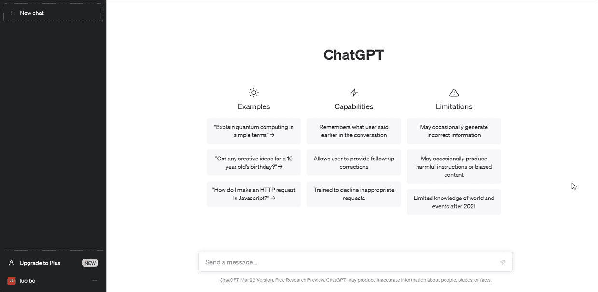
图 1-1 ChatGPT 的界面

#### 1.3.2 Claude——媲美甚至超越 ChatGPT
由 Anthropic 公司开发的 AI 助手，语言理解能力强，常识知识丰富。可进行长时间复杂交流，准确理解意图并做出合理回应，如同真人对话。既能理解生活概念，也能把握人际复杂关系，可在任何话题上顺畅交谈。
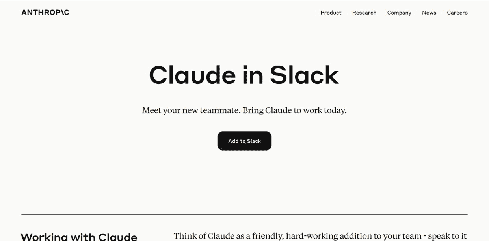
图 1-2 Claude 机器人

#### 1.3.3 Midjourney——最强图片生成 AI 工具

Midjourney 是当下很火的 AI 绘图平台，用户只要打入一段想要的描述，背后模型就会把文字意图转化成对应的视觉内容。产出远不止插画范畴，还能做写实照片、三维渲染、产品包装、宣传海报、头像、图标等多种物料。如图 1-3 所示，Midjourney 的主页长这样。

图 1-3 Midjourney 主页

### 1.3.4 new Bing——对话式搜索新贵
new Bing 属于智能搜索产品，底层接入了 OpenAI 的 ChatGPT 技术，对用户问题的理解明显更到位。和传统搜索引擎相比，它更聪明、更好玩、效率也更高。打开聊天模式后，就能像和 ChatGPT 对话一样直接生成文本内容，最大的亮点是完全免费使用。图 1-4 展示的是 new Bing 的聊天界面。

图 1-4 new Bing 聊天页面

### 1.3.5 Stable Diffusion——免费高精度绘画
Stable Diffusion 是一款可免费使用的 AI 绘画工具，绘图水准与 Midjourney 处于同一梯队。它对细节的把控非常精准，已经在室内设计、建筑设计、游戏原画等领域得到广泛应用。特别擅长画写实人像，网络上流传的大量 AI 美女图多出自于此。图 1-5 为 Stable Diffusion 的在线登录页。

图 1-5 Stable Diffusion 在线登录页面

### 1.3.6 ChatPDF——PDF 智能问答助手
ChatPDF 基于 OpenAI 的自然语言处理模型，能阅读手册、论文、法律合同、书籍以及科研文献。把 PDF 上传上去后，它就能完整把握文件内容。用户针对文档提出问题即可获得解答，也能让它在原文件基础上延展思路。图 1-6 是 ChatPDF 的页面。

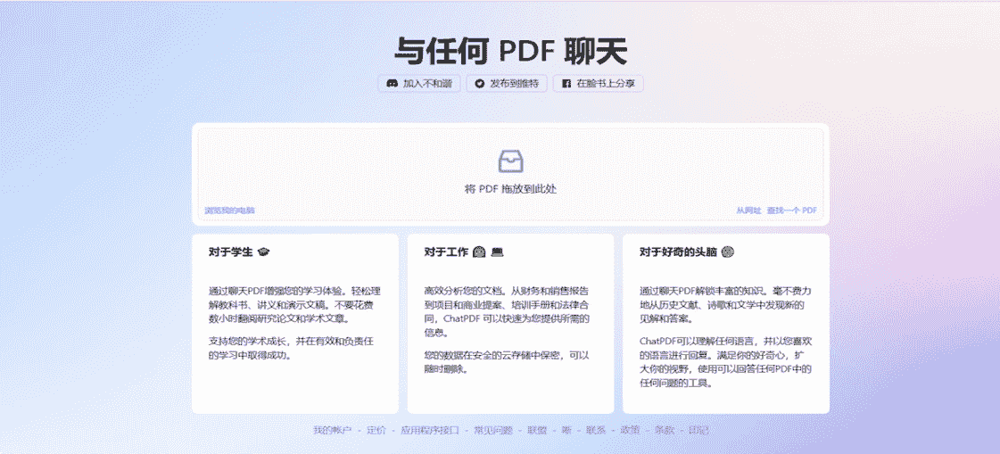

图 1-6 ChatPDF 页面

### 1.3.7 Notion AI——知识库写作加速器
Notion AI 是一款强大的知识库管理工具，搭载 GPT 模型后使用体验大幅提升。几秒内就能生成表格并自动填充数据，还能快速撰写博文、安排会议日程、起草新闻稿、列大纲、做菜谱等。Notion AI 属于结合 GPT 较为成功的产品之一。图 1-7 为 Notion AI 的页面。

图 1-7 Notion AI 页面

### 1.3.8 Gen-2——文字生视频利器
2023 年 3 月 20 日，Runway 公司推出了文字转视频模型 Gen-2。用户输入文字、图像或图文结合的描述，就能在短时间内得到对应的视频片段。Gen-2 在多模态领域是一次重要跨越，随着生成质量和功能的迭代，生成式 AI 视频有望在游戏、影视、营销等场景大规模落地。图 1-8 展示 Runway 官网主页。

图 1-8 Runway 公司的主页

## 1.4 ChatGPT 到底是什么
想象你在网上和朋友聊天时，突然有人加入，交流流畅、提问合理、表达自然，甚至比普通人更像真人，那很可能就是 ChatGPT 这个聊天机器人。

ChatGPT 是基于 GPT 模型构建的对话式人工智能，通过模拟人类语言交互实现自然流畅的对话。它之所以强劲，核心在于名字中的 GPT，即 Generative Pre-trained Transformer，生成式预训练转换器，本质上是一种处理自然语言的算法。

Generative 生成式：能够根据输入文本预测人类可能的回复，并据此生成符合上下文的回应，同时会规避敏感话题，对开放性问题给出更宽泛的答案。

Pre-trained 预训练：不同于需要针对特定领域训练的 AI，ChatGPT 是通用预训练模型，上线即具备回答各类问题的能力，不像 Siri 或小爱那样依赖现成数据库检索复制。

Transformer 转换器：得益于 Transformer 技术，ChatGPT 能理解语境和多语言，判断每个词的重要性。因此它能读懂中文、英文、法文等并用对应语言回复，还能理解表达含义、承认错误、指出提问前提的不当、拒绝不合适问题，像人一样学习交流。比如让它推荐一首当红中文歌曲，回复如图 1-9。

图 1-9 推荐歌曲

## 1.5 ChatGPT 的核心优势
ChatGPT 背后的 GPT 模型强大，主要归功于两大支柱。

庞大数据的支撑：训练量达到百亿级，使其积累丰富知识并拥有出色的语言表达力。
强劲算力投入：训练过程消耗大量计算资源。

凭借这两点，ChatGPT 在文本生成上表现突出，可广泛融入生活与学习。日常闲聊时，它能当作聪明的陪聊伙伴。如图 1-10 所示，让它讲个笑话会迅速给出，如果不满意说“不好笑再来一个”就能继续输出。

图 1-10 讲一个笑话

ChatGPT 宛如一位随时待命的 AI 秘书，可在任意话题上展开讨论，表达力极强让人难以分辨真人。它还能依据兴趣推荐话题，让生活更有趣。

头脑风暴时，它能提供不同视角和建议。比如撰写酒类宣传口号，图 1-11 就展示了 ChatGPT 帮忙拟写的结果。

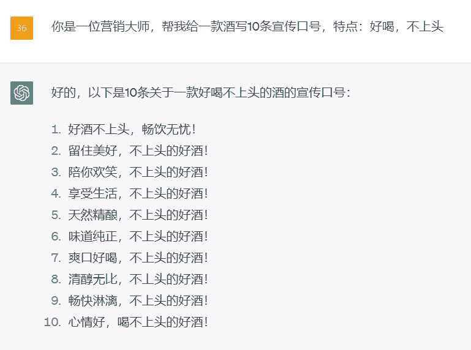

图 1-11 宣传口号

学习场景中遇到卡点也能求助。以 Excel 的 VLOOKUP 函数为例，直接提问“VLOOKUP 是什么？有什么用？能给个示例吗？”，它会给出通俗讲解、参数说明、实例以及使用注意。如图 1-12 所示。

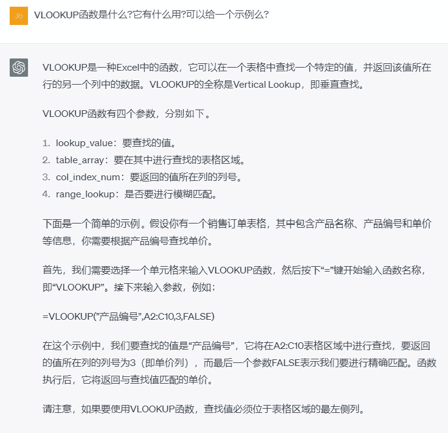

图 1-12 VLOOKUP 函数示例

它还能制定详细学习规划，例如“给我一份三个月内把英语口语提升到近乎流利的计划”。图 1-13 给出了月度安排，图 1-14 则补充了持续提升和维持水平的建议。

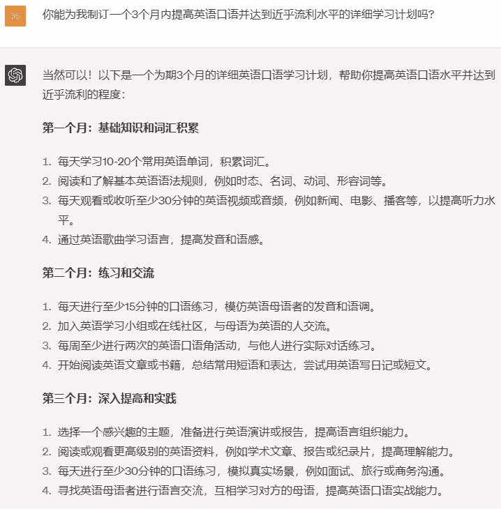

▲图 1-13 英语口语学习计划

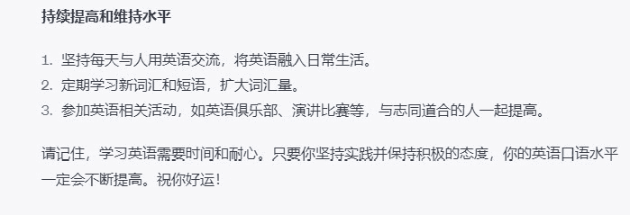

▲图 1-14 持续提高和维持英语水平的建议

编程辅助同样高效。提出“帮我写一段 Python 程序，读取 test.csv，提取第 2 列和第 4 列，写入 output.csv”，它会给出完整代码并附注释。如图 1-15。

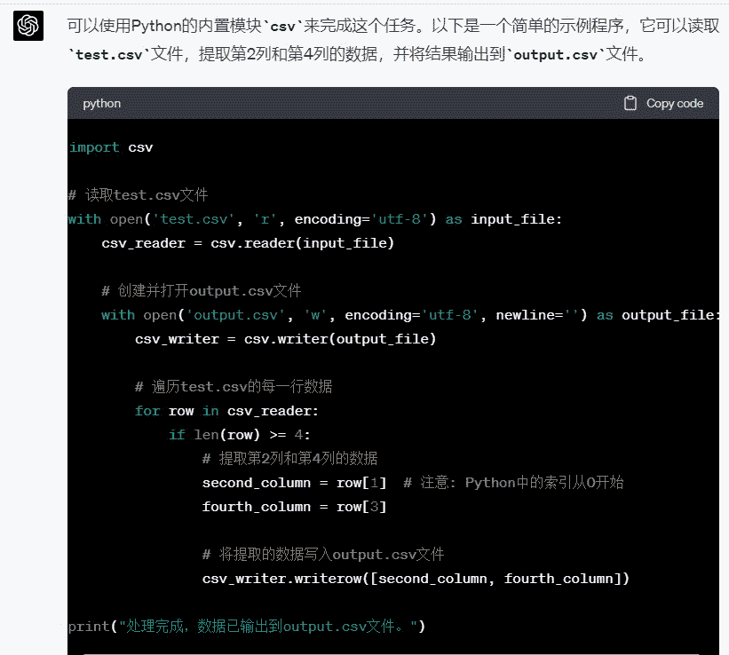

图 1-15 ChatGPT 给出的回复和编写的代码

代码里说明了读取 test.csv、创建 output.csv、逐行遍历、提取两列、写入新文件等步骤，末尾还给出注意事项，如图 1-16。

图 1-16 注意事项

对程序员而言，只需描述功能即可获得可运行代码，大幅提升效率。

甚至能充当“人生教练”。比如提出情绪管理计划的需求，它会从教练视角给出详细建议，如图 1-17。

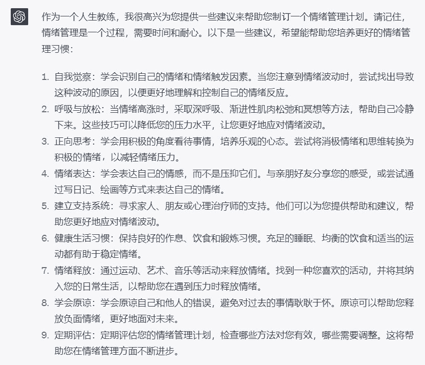

图 1-17 人生教练

ChatGPT 具备强大的理解与生成能力，可像人类一样学习交流，对工作生活产生深远影响。媒体、创意、广告、金融等行业已开始将其与现有工具结合，高效解决复杂问题。

例如与搜索引擎结合。把 ChatGPT 接入微软 Bing 后，能实现更精准的信息查询。直接在 Bing 中提问，系统会分析意图、给出关键词并返回权威链接。如图 1-18 所示，向 Bing 提问“疫情后哪些行业值得投资”，很快得到生成答案并附来源。

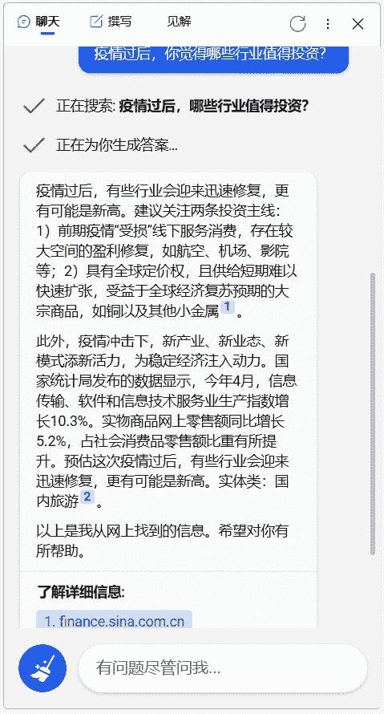

图 1-18 将 ChatGPT 与 Bing 结合后给出的回复

也可与企业 ERP 平台结合提升办公体验。以出差申请为例，在对话中说明“下周从武汉到广州出差 3 天，机票酒店预算 3000 元，帮我生成金蝶 ERP 的出差申请”，即可自动得到申请范例，如图 1-19，只需填入实际信息即可。

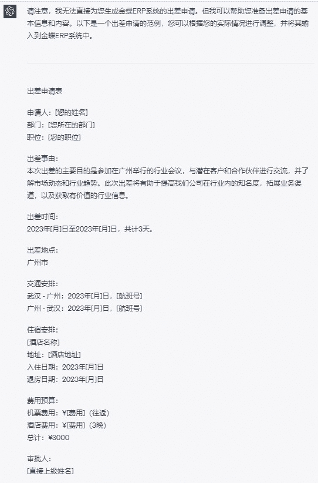

图 1-19 出差申请

微软推出的 Microsoft 365 Copilot 让 Office 软件更高效。无需记忆繁杂功能，只需表达需求即可实现。

在 Word 中，告知主题和要点即可自动生成文档初稿供修改。
在 Excel 中，表达功能需求后会自动生成图表并插入对应函数与格式，如图 1-20。
在 PowerPoint 中，输入内容和风格要求后即可生成结构完整、排版精美的 PPT 初版。

图 1-20 Copilot 在 Excel 中的应用

ChatGPT 的出现引发了一场工具革命，工作与生活因此深刻改变。看到它能力如此全面，很容易产生“躺平”的想法。

但 ChatGPT 终究是人工智能，无法完全复刻人类的多元思维与创造力。它能基于提供的内容生成报告或 PPT，但更具原创性的思路与新颖设计仍需专业人士完成。

便利归便利，我们远未到可以躺平的地步。AI 是助手和工具，需要人类的创造力、决断力与情商来引导和发挥最大价值。认清人工智能很重要，人类才是主宰。拥抱变革，但不被取代，才是新时代应有的心态。

## 1.6 ChatGPT 交互原理揭秘
打开 ChatGPT 网站会看到一个空白对话框，可输入任何句子、问题或文字，内容形式没有限制。提交后，系统立即解析输入、理解意图，并在数秒内生成回复。若不满意，可继续输入让它再来一次。

交互本质是一问一答的循环。提问、回复、再提问，如此往复，模型会不断提升对意图和上下文的把握，回复质量也随之提高。

表面看交互很简单，专注表达即可获得回应，像和真人聊天一样自然。但背后依赖复杂的 AI 技术和海量语言数据训练才得以实现人级体验。

ChatGPT 采用 Transformer 模型，它是一种基于自注意力机制的序列到序列模型，如图 1-21。

图 1-21 Transformer 模型

Transformer 由若干编码器和对应数量的解码器组成，如图 1-22。输入文本先进入编码器编码，再由解码器解码成可读输出。

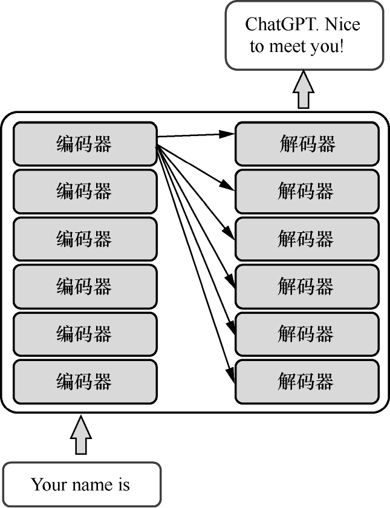

图 1-22 Transformer 的构成

输入编码环节需要把文字转为机器可处理的形式。ChatGPT 借助类似超大型词典的词表，将每个词或符号映射为向量，即一组数字，这个过程叫词嵌入。向量里包含词义、用法、语法特征等信息。

例如词 play 的向量可理解为<意义：玩耍><词性：动词><时态：进行><单复数：变化>等特征，全体信息都封装在向量中。

词向量怎样承载意义

看图 1-23 所示的向量表征，模型就能判断 play 本质上是“玩耍、娱乐”这一类动词，并且掌握它的进行时态以及单复数变化。于是无论该词出现在怎样的句式或语境里，ChatGPT 都能准确把握其含义和用法，并据此生成语义贴切的输出。

图 1-23 向量

为了让 Transformer 知道词语在句子中的先后顺序，会为每个向量额外加上位置编码，如图 1-24 所示。模型收到“Your name is”这类输入时，就凭借每个 Token 对应的位置编码去调取各自的向量表示。

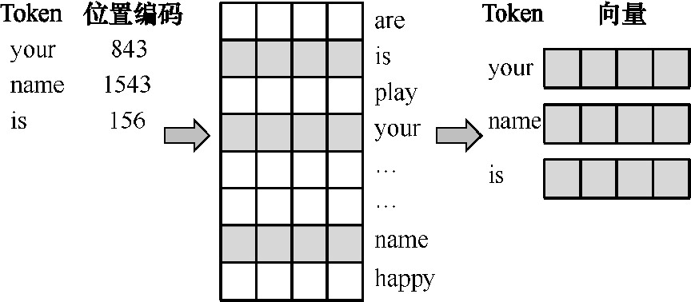

图 1-24 位置编码

**2. 自注意力机制**

一个编码器内部同时包含自注意力模块和前馈神经网络，如图 1-25。核心在于自注意力，它帮助模型衡量输入序列中各个词彼此间的关联。在此过程中，每个词会分别生成三个向量：查询向量 Q、键向量 K 和值向量 V。通过 Q 与 K 的相似度计算，可以得到一个权重矩阵，用以描述词语之间的关系。

可以这样想象你在参加生日派对，每个人都在聊天。在这场聚会里，每个人都承担三种角色，即查询向量 Q、键向量 K、值向量 V。自注意力就像一个“社交达人”，能洞察每个人在聚会中的角色分工和互动关系。

·**查询向量 Q**：相当于每个人的“提问者”身份，会主动发问来了解别人扮演的角色和地位。
·**键向量 K**：相当于每个人的“回应者”身份，会对别人的提问做出回答，透露自身的角色和位置信息。
·**值向量 V**：相当于每个人的“贡献者”身份，会根据自身角色为聚会带来不同的价值。

通过计算每个词在 Q、K、V 三个维度上的互动，这个“社交达人”就能厘清彼此关系和重要程度，进而提供能活跃气氛的信息。

图 1-25 编码器的组成

**3. 多头自注意力**

为了捕捉输入序列的不同层次信息，Transformer 采用了多头自注意力，即多个自注意力层并行工作。不同表征空间下的关系被分别提取，从而提升表达力。

继续用生日派对来比喻，这次现场出现了几位“社交达人”。每位达人关注的焦点不同，才能更全面地把握现场互动。

·“社交达人”1：专盯谁和谁是好朋友，挖掘人际关系线索。
·“社交达人”2：留意谁在送礼上最慷慨，揭示礼物相关信息。
·“社交达人”3：寻找派对上最逗趣的人，判断谁贡献了最多笑点。

几位达人从不同角度观察后，汇总的信息会更丰富、更立体。在多头自注意力里，每个“头”就相当于一位达人，关注信息的不同侧面。把这些观察综合起来，模型能更全面地理解词与词之间的关联，从而提高翻译和表达的准确性。

**4. 前馈神经网络**

多头自注意力的结果会进入一层前馈神经网络，进一步融合信息并生成最终的序列输出。

回到派对场景，多位“社交达人”已经完成各自的观察，接下来需要把这些零散观察整合成一份完整的派对总结。这时“派对策划人”，也就是前馈神经网络登场了。

策划人会先收集每位达人的观察，例如人际、礼物、笑点等方面的内容；随后对这些信息进行整合，找出共性和差异，以便把握整体氛围；最后形成一份涵盖各方面的派对总结。

在 Transformer 里，前馈神经网络正承担这一整合职责，把多头自注意力的输出进一步提炼，产出最终序列。

**5. 解码器**

输出阶段，模型会逐个把前馈网络的结果解码，生成最终的输出序列，其中可能涉及概率计算和搜索策略，以挑选最优结果。

派对结束后，策划人已经给出详细总结。下一步要把总结写成一篇有趣的派对报道，这里就需要“撰稿人”，也就是解码器来发挥作用。

·筛选信息：撰稿人仔细阅读总结，挑选最重要、最有趣的部分，这类比于模型的概率挑选。
·组织结构：根据筛选内容用有趣的方式搭建文本框架，这类比于搜索算法保证结构合理。
·生成报告：按照结构逐段撰写，形成引人入胜的报道，这类比于解码器逐 token 生成输出。

在模型中，解码器负责把前馈网络的输出逐个解码为生动、连贯的输出序列。

## **1.7 ChatGPT 的局限性**

ChatGPT 虽然学习与应用能力强，但在知识时效、情境理解、情感判断、泛化能力以及实时交互等方面仍有限制。

·**知识更新滞后**：写作时 ChatGPT-4 的知识截止于 2021 年 9 月，对此后发生的事件、新技术、新观点等无法给出可靠答案。比如询问中国队在 2022 年冬奥会的获奖情况，它就会答不上来（见图 1-26）。
·**复杂情境理解不足**：面对多重约束或需要综合分析的问题，模型容易误解，难以给出准确答案。
·**缺乏情感判断**：模型没有真正情感和共情能力，处理情感类问题时，无法像人类那样精准回应，如心理咨询类提问。
·**泛化能力有限**：在专业领域，模型常给出宽泛的答案。训练数据覆盖面广，却难以深入特定专业，例如深度的医学问题只能得到概括性回复。
·**无法实时互动**：模型不能感知外部环境变化，也就无法在现实场景中实现即时有效沟通，例如实时面试中无法根据应聘者反应调整提问。

图 1-26 ChatGPT 知识更新滞后的体现

## **1.8 如何避开 ChatGPT 的局限性**

人工智能正在深入生活，并非要取代人类，而是释放人的潜能。理解局限，学会引导与协作，才能发挥其价值。避开局限可从以下方面入手。

·**确认信息来源**：涉及具体数据、最新事件或专业知识时，参考政府官网、学术期刊或权威媒体。
·**结合人类专家意见**：复杂或深度领域的问题，寻求该领域专家提供更详尽准确的信息。
·**验证答案准确性**：拿到回答后，通过网络搜索、参考书籍或咨询专业人士进行核对。
·**提供详细背景信息**：提问时补充充足背景，帮助模型更好理解问题，输出更准。
·**提问方式**：把问题简化、明确，避免过于复杂或模糊的表述。
·**多次尝试**：对回答不满意时，换一种说法或拆分问题再问，往往能得到更有用的结果。
·**适当降低期望值**：ChatGPT 并非万能，某些场景下仍会不完美，需合理预期避免过度依赖。

# **第二章**
# **提问技巧：让它 100%懂你**

ChatGPT 基于预训练数据进行推理生成，因此回答常出现重复、不稳定、不够准确的情况。避免这些问题的关键在于提问的有效性。提问前明确目标，用简单易懂、无偏见的方式表达，才能让模型更好理解并给出准确回复。

## **2.1 什么是优质提问**

要和 ChatGPT 有效交流，核心是提升提问质量。正如访谈节目中，主持人的问题清晰聚焦，嘉宾才能给出精彩回答。与 ChatGPT 的互动亦是如此。

### **2.1.1 优质提问原则 1：清晰**

一连串细致清晰、重点突出的提问，往往能换来高质量的连续回答，而高质量回答是交流成功的基础。

什么是清晰的问题？比如想买笔记本，却面对众多型号，可能直接问：

帮我推荐一款笔记本电脑。

得到的往往是随机几款，未必符合需求（见图 2-1）。

问题宽泛模糊，模型无从把握，难以给出满意答复。要想获得想要的结果，就要把问题说具体、给指导性信息。比如可以改为：

我主要用于办公和看电影，对屏幕和音效要求较高，请推荐一款性能强、价格约 6000 元的笔记本电脑。

图 2-2 显示，模型便能围绕“屏幕与音效”和“6000 元左右”给出符合预期的推荐。

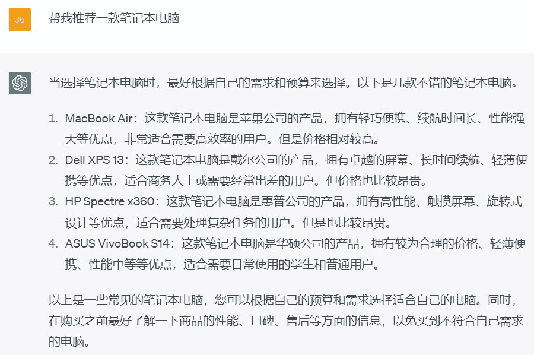

图 2-1 不清晰的问题产生不想要的结果

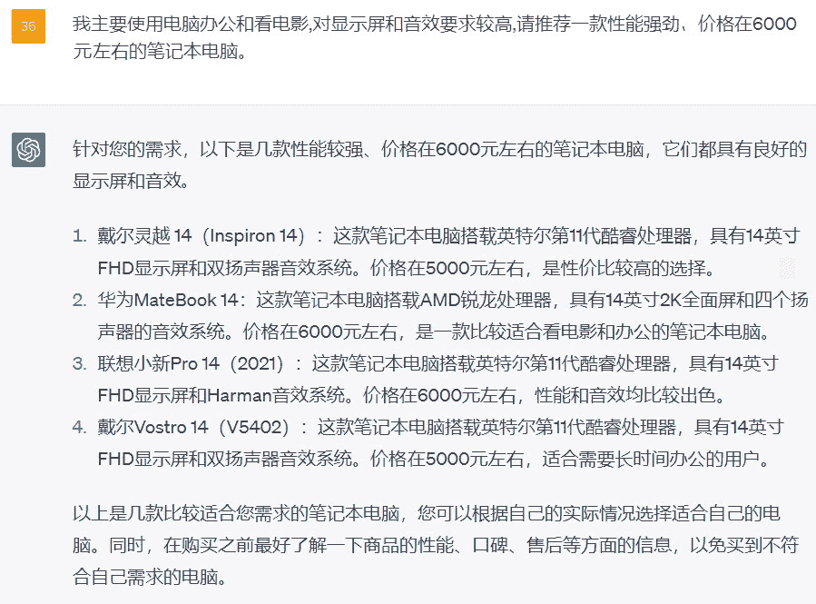

图 2-2 清晰的问题产生预期的结果

### **2.1.2 优质提问原则 2：重点鲜明**

假设想自学几道地道的湘菜，却不了解食材与做法。直接问：

我想学习几道湘菜，你能教教我吗？

得到的通常是笼统的菜谱（见图 2-3）。

如果把焦点收窄到某一道菜，比如毛氏红烧肉，问题就会更具体。比如问：

我想学习制作毛氏红烧肉，请问步骤和注意事项有哪些？

图 2-4 显示，模型不仅给出材料和做法，还补充了要点，回答更精准、更符合需求。

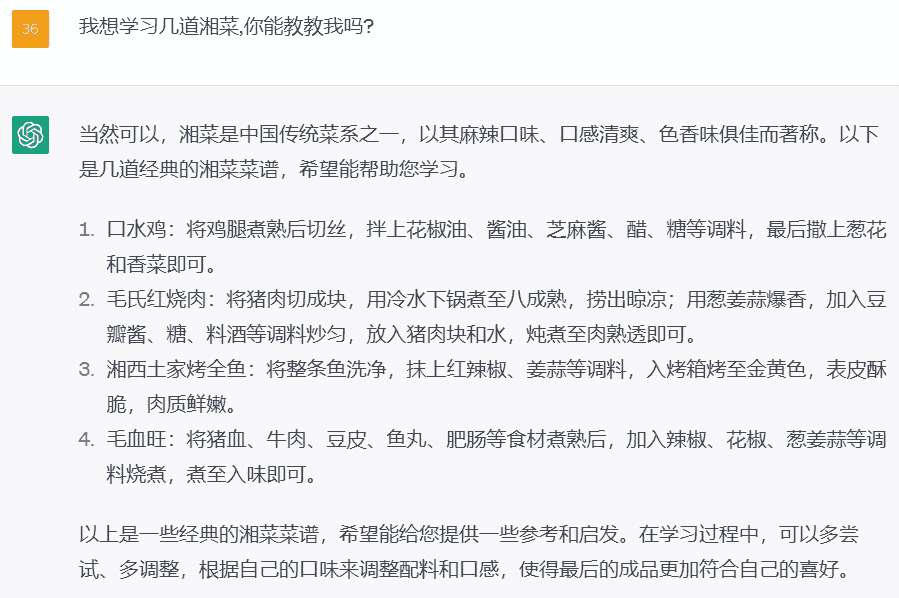

图 2-3 不清晰的问题产生不想要的结果

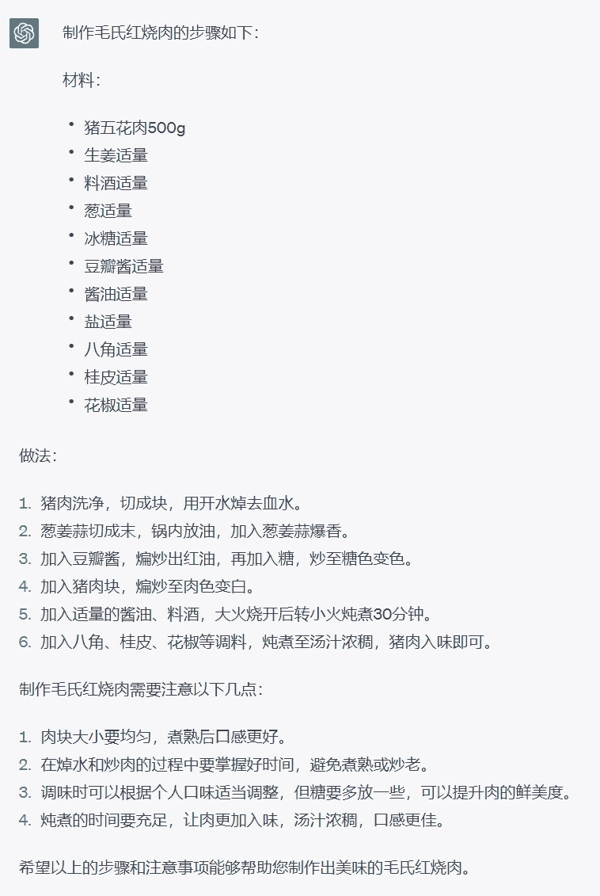

图 2-4 重点鲜明的问题产生预期的结果

### **2.1.3 优质提问原则 3：相关性**

即便单问题清晰聚焦，连续提问时仍可能得到不理想的答案，常见原因有：

·上下文跳跃。若前后提问主题变化过大，模型需在短时间内切换语境，容易误解意图。建议在转换前做过渡。

例如先问：

我想学会烹饪，请推荐几本入门食谱书。

模型可能回答：《美食厨房入门食谱》《家常菜谱大全》《学会 365 天做饭》等，适合新手练习。

紧接着突然问：“我想买个新手机，能推荐一款性价比高的吗”。从烹饪跳到手机，模型需要重新调整上下文，容易出现连贯性和精准度下降。

若先补充一句“谢谢食谱推荐，接下来换个话题聊聊手机怎么样？”就能为模型提供转换准备，提升后续回答质量。

·**知识盲区**：模型在某些领域理解薄弱，提问需考虑其知识范围。
·**计算资源受限**：提问过于频繁或复杂，可能导致后续回答质量下降，适当放慢或简化有助于改善。
·**训练数据局限**：话题数据越少，模型理解越受限。

综合考量上下文衔接、知识边界和数据覆盖，连续对话的质量会明显提升。

## **2.2 优质提问的十大技巧**

明确清晰、重点、相关三要素后，仍可能遇到回答“套路化”的问题。下面探讨更实用的提问技巧。

### **2.2.1 角色扮演**

通过指定角色，让模型更准确地理解需求。可让模型扮演营销员、翻译、面试官、产品经理、足球解说员、小说家、诗人、哲学家，甚至 Linux 终端、SQL 终端、Python 解释器等。

例如扮演忙碌上班族：

我是一名工作繁忙的上班族，需要了解如何更好管理时间、提升效率和缓解压力。

图 2-5 显示，模型会给出针对性的实用建议。

为了练习 Linux 命令，可让模型充当终端：

我想让你充当 Linux 终端。我将输入命令，你只在代码块内返回终端输出，不要解释。第一个命令是 pwd。

图 2-6 显示，即便没有真实环境，也能通过模型练习。

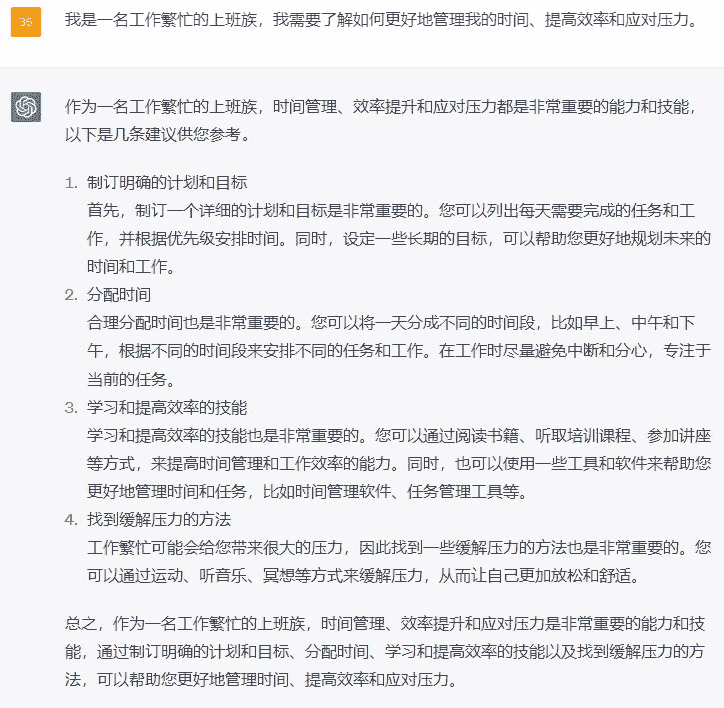

图 2-5 扮演上班族

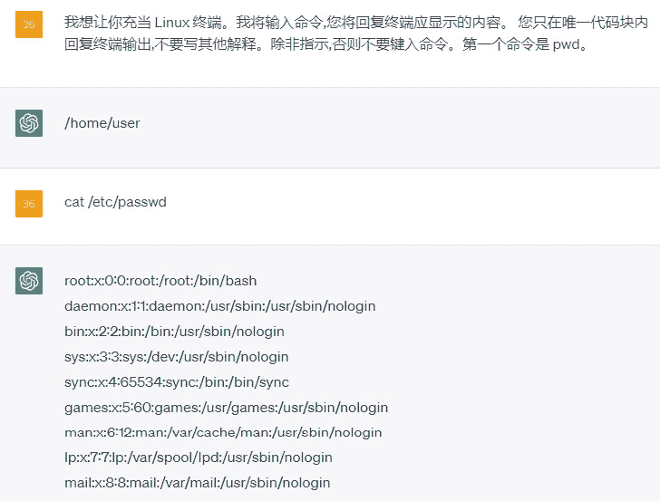

图 2-6 充当 Linux 终端

### **2.2.2 提供上下文信息**

与人类不同，ChatGPT 无法捕捉话外之意，只能按字面理解。若提问过于简略，回答往往让人摸不着头脑。

比如只问：

我适合当文员吗？

信息不足时，模型的判断很容易失准，图 2-7 正是这样一种情况。文员的工作边界很宽、能力点也比较分散，在没有前情的情况下，很难说一个人适不适合。

把个人情况和求职偏好补充完整，得到的回应质量会明显提升。可以这样描述：

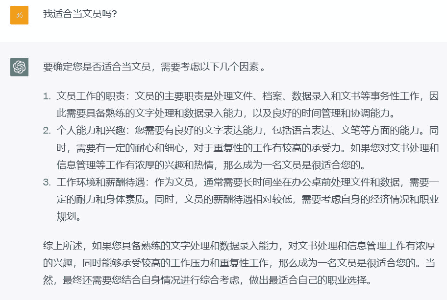

图 2-7 简单的问题给出不满意的回复

我是一名 25 岁的女性，大学中文系毕业。我性格安静，工作认真负责。我希望找一份工作环境稳定的办公室工作，工作内容比较固定和重复，不需要频繁加班。我的技能特长是中文打字速度较快，文笔流畅。所以，我在想文员这个工作是否会适合我？

背景明确之后，对应的生成结果见图 2-8。

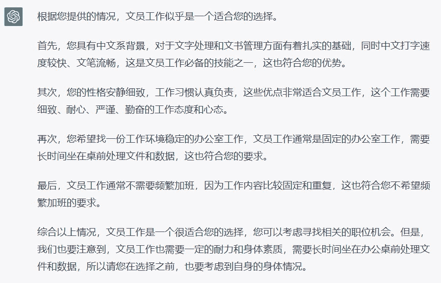

图 2-8 提供清晰的上下文后给出的回复

这个例子说明，背景越具体，模型的判断越可信、建议也更有参考价值。

因此在任何使用场景里，都要先把必要的背景补齐。比如让它写微博宣传文案。只说“请写一篇关于华为手机的微博文案”，出来的文字会很平淡。改成“你是微博数码专栏大 V，请帮我写一篇关于华为 P60 手机的微博宣传文案”，提问就让模型进入特定身份、锁定产品和文体，之后它会用博主的口吻为指定机型写出专业的推广内容，如图 2-9 所示。

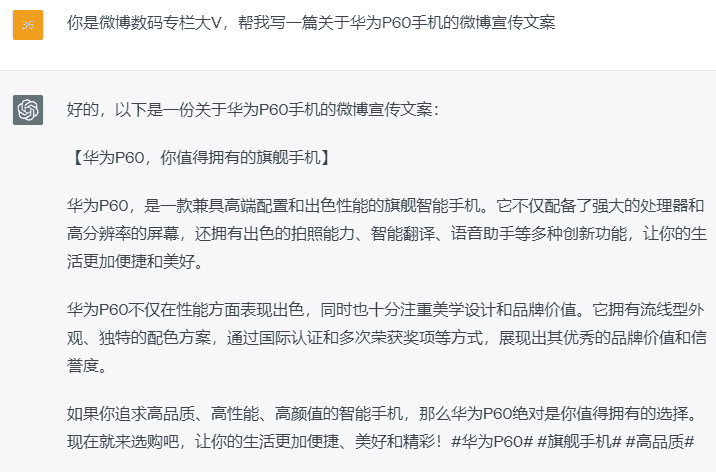

图 2-9 优化后的提问给出高质量的回复

和模型交流时，还能用更多限定来打磨提问，常见做法有：

·语言风格：“请以通俗科普文的风格为华为最新的旗舰手机写一篇推广文案。”
·情感基调：“请为想购买华为 P60 手机但迟迟没有行动的用户写一篇鼓励的微博。”
·具体要求：“请使用 emoji 表情。”

加入限定后，模型对期望产出的理解更清晰，结果也更贴合需求。相关示例如图 2-10 所示。

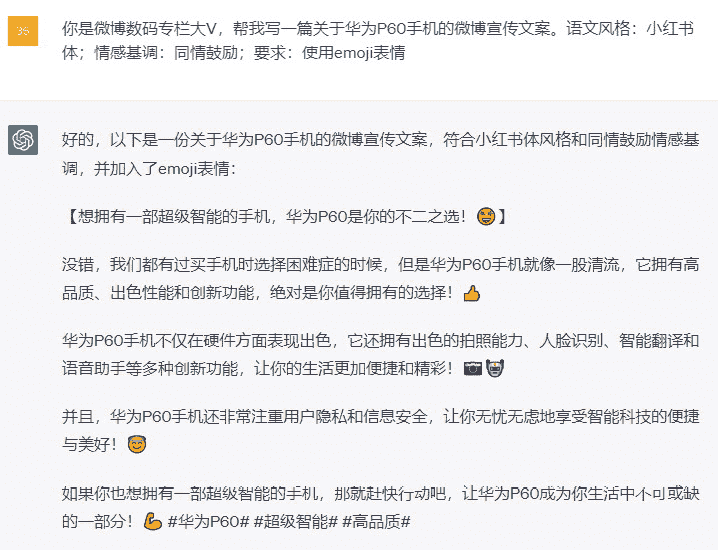

图 2-10 更多限定条件产生更符合要求的内容

良好的语境能让模型理清当前的讨论情境，明白用户真正想解决的问题。它把对话从空泛的闲聊拉到针对性方案，也让模型综合权衡各方面因素，更贴近实际需求。常见的背景要素包括但不限于：

·**角色定位**：比如微博数码大 V、工作繁忙的上班族、Linux 终端。
·**对象属性**：比如华为 P60 手机、奔驰 GLB、宝马 X1。
·**限定话题**：比如讨论有关量子计算机的最新进展。
·**内容类型**：比如微博宣传文案、博客、邮件。
·**语言风格**：比如通俗幽默的语言，小说体、科普文风格、国家地理的游记体。
·**情感基调**：比如开心的、积极的、鼓励式和安慰式的基调。
·**附加要求**：比如使用 emoji 表情、不超过 100 字。

### **2.2.3 提供关键词**

上一节虽然用背景优化了提问，但华为 P60 的核心卖点还没有点明。和模型对话时，善用关键词是个很实用的技巧，能让它更快抓住意图，对话更顺畅。比如在提问里把机型的卖点作为关键词加入：

你是微博数码专栏大 V，帮我写一篇关于华为 P60 手机的微博宣传文案。语文风格：小红书体；情感基调：同情鼓励；要求：使用 emoji 表情；关键词：超聚光 XMAGE 影像、玲珑四曲屏、双向北斗卫星消息、超大电池。

生成结果如图 2-11 所示。

图 2-11 添加关键词后给出的回复

同理，对话进行中适时加入一两个新关键词，也是提升交流效果的小技巧。比如解释完量子纠缠后说：“非常有趣，接下来来聊聊李白吧！”模型会立刻切换话题，娓娓道来关于李白的趣事。

恰当的关键词就像给模型的提词器，让它迅速抓住要求和方向，避免沉默或跑题。

### **2.2.4 提供前置信息**

想和模型顺畅交流，提供前置信息也很关键。它能让模型先建立清晰认知，从而给出更准确合理的回应。

假设想聊一本小说，若只说“让我们来聊聊这本小说吧。”模型会无从下手。这时先给一点前置信息就很重要。假设最近重读金庸的《射雕英雄传》，很想深入探讨。可以先这样介绍：

我最近在闲暇之余重温金庸老先生的《射雕英雄传》，被此书深深吸引。我们来聊聊这部武侠小说吧，我特别想讨论书中的几个主要人物。

这些信息让模型立刻知道讨论对象是《射雕英雄传》及其人物，也明白关注点在主要人物上。于是它会用提问或观点引导讨论：

·这部小说中哪些主要人物最吸引你？为什么？
·我个人最喜欢郭靖这个人物，他忠诚善良而又执著追求武学，是一个非常阳光的角色。你有什么看法？
·华筝和黄蓉是两个非常不同的女主角，前者温婉柔弱而后者刚强任性，你更偏向谁？
·……

对话中还可以持续补充更具体的前置信息，让讨论更深入。比如，“我觉得最让我难过的一个情节是郭靖在一次比武中不慎打伤了华筝，这使两个人的感情出现裂痕。这部分写得很有感染力，让我为郭靖和华筝的感情遭遇而揪心。”

这些细节能让模型围绕具体情节和人物展开分析，分享对人物和情节的理解，进行更有共鸣的小说解析。

由于模型知识截止到 2021 年 9 月，对之后发生的事并不了解。若直接提问新近事件，它会非常“认真”地胡说。此时可用“一段内容 + 基于内容的提问”的方式，先把材料喂给它再提问即可，如图 2-12 所示。

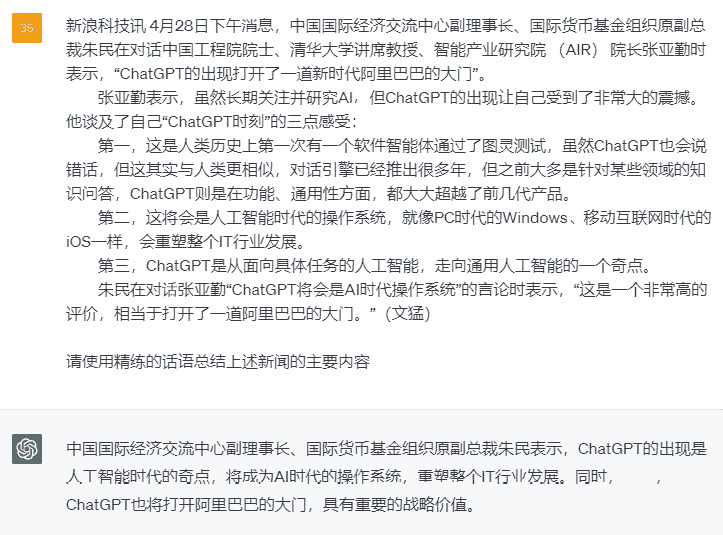

图 2-12 提供前置信息发起提问

针对网络最新信息，也可以用网址提供前置信息，让模型阅读后再作答。比如：

https://new.qq.com/rain/a/20230501A04IGX00

你是微博数码专栏大 V，请认真阅读上面网址内容，帮我写一篇关于华为 P60 手机的微博宣传文案。语文风格：小红书体；情感基调：同情鼓励；要求：使用 emoji 表情；关键词：超聚光 XMAGE 影像、玲珑四曲屏、双向北斗卫星消息、超大电池。

生成的内容如图 2-13 所示。从中可以看到，小红书体微博文案是否更优质了呢？！

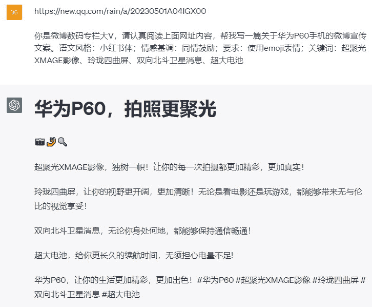

图 2-13 以网址的形式提供前置信息

### **2.2.5 限定长度**

现实中常遇到回答过长的情形。限定篇幅是个很实用的技巧，能迫使模型精炼表达，在有限字数里传递更丰富的信息。

比如限定在 2 段内回答“什么是相对论”，模型会给出极致精炼的表达：

相对论提出时空不是绝对的，而是相对的。不同的参照系对时空的测量会产生差异。光速不变，是连接不同参照系的桥梁。

相对论彻底改变了经典力学中的绝对时空观念。它极大地扩展了我们对宇宙和时间本质的认知。相对论是现代物理学的基石，它影响着从基本粒子到整个宇宙的研究。

可见，给字数或篇幅限制，反而能激发更精彩的回应，迫使模型斟酌用词、抓住要点，做到简洁有深度。

如图 2-14 所示，可以让它写 10 句宣传语，不满意就继续追问。

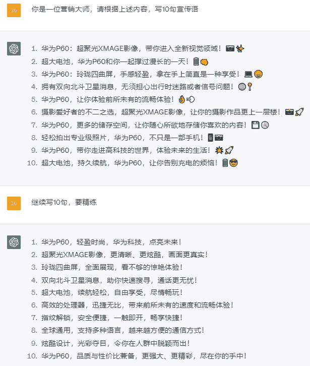

图 2-14 限制长度后给出的回复

在写文章、摘要、营销方案等文本时，还可限定具体字数、段落数，如图 2-15 所示。

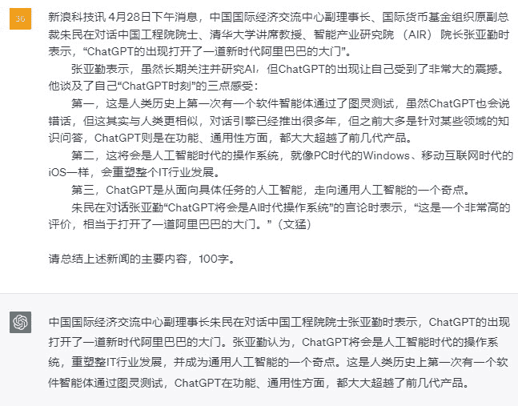

图 2-15 限定字数后给出的回复

### **2.2.6 提供示例**

小学语文常给出一个例句，让学生仿照结构改写。模型也可以这样用。比如提供示例要求仿写，如图 2-16 所示。

图 2-16 提供示例进行仿写

在示例启发下，模型能更好理解写作方式和练习形式，给出更准确的回应。

实际应用中，可先给一个示例让模型吃透风格和版式，如图 2-17 所示。

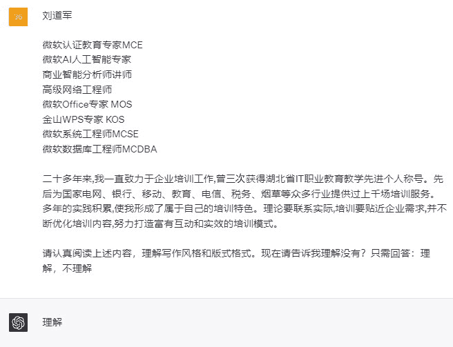

图 2-17 让 ChatGPT 理解示例的写作风格和版式格式

确认理解后再“喂”入原文要求改写，如图 2-18 所示。

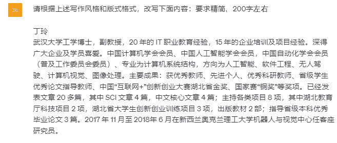

图 2-18 向 ChatGPT“喂”内容

模型的完整输出如图 2-19 所示。

怎么样？模型的答案还满意吗？

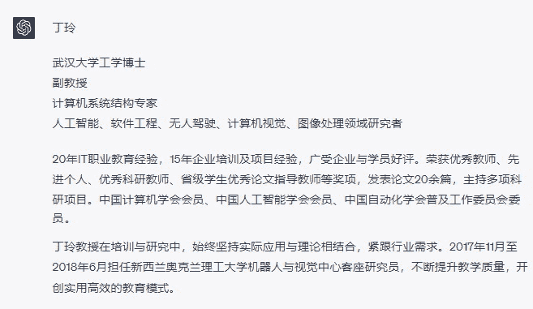

图 2-19 完整输出

### **2.2.7 控制输出风格**

控制输出风格能让回答更符合需求，前面的技巧里已有不少相关做法。下面举例说明。

**1. 调整回答的语气**
语气可以是正式、友好、幽默等。需要正式时可用“您”、敬语等形式化表达；需要随和时可用“你”、口语化表达和流行语。

**2. 控制回答的长度和深度**
需要详细深入就让文本更长，需要简短直接就限制长度。文本越长，细节越多。

**3. 指定回答的主题或内容**
把问题和相关信息一并给出，模型就能围绕特定主题生成回答。比如明确指定“健康”主题，它就会生成相关内容。

**4. 控制回答的情感色彩**
可在问题中加入鼓励性或负面表达，引导积极、消极或中性的情感色彩。

**5. 调整回答的语言风格**
用学术术语引导学术风格，用俚语引导口语化风格。

**6. 输出为 Excel 表格形式**
例如把个人简历内容复制给模型，要求整理成 Excel 表格输出。结果如图 2-20 所示。

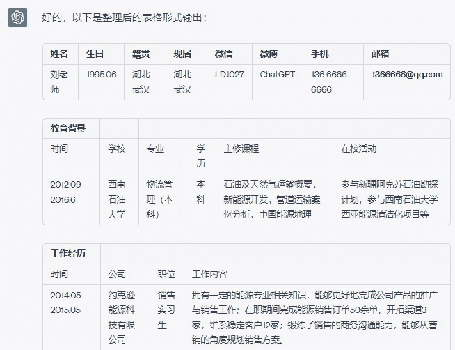

图 2-20 以 Excel 表格的形式输出

**7. 输出为 Markdown 格式**
Markdown 用简单标记实现排版，便于后续转换。可让模型输出 Markdown 格式以便配合其他软件，如图 2-21 所示。

图 2-21 输出为 Markdown 格式

### **2.2.8 “让我想一想”**

这个提示能让模型生成更具反思深度的内容。引导它在作答前稍作停顿思考，可避免草率回应，得到更全面分析。这种方式在教育、谈判、头脑风暴等场景很实用。

在商业谈判中，经理可能会问：“让我想一想，有什么策略可以提高我们的市场份额？”这能激发新思路。

图 2-22 所示为应用该提示后，让模型仿照李白风格写诗的效果。还不错吧？

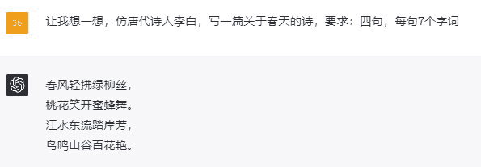

图 2-22 “让我想一想”的应用

### **2.2.9 限定受众对象**

限定受众能帮助模型生成更精准的回答。明确目标群体后，信息会更贴切，满意度更高。

比如想为中小学生写科普建议，可提示：“关于为中小学生编写科普文章的建议。”模型就会用简单语言、增加插图实例等针对性建议。

再比如想了解与初创企业创始人沟通技巧，可提示：“针对初创企业创始人的有效沟通技巧。”模型会给出建立信任、创新沟通渠道、关注创始人挑战等具体建议。

### **2.2.10 检查问题**

模型基于推理生成，有时回答不准确或过于宽泛。因此必须核查并验证。比如 2.1.2 节中提到的“口水鸡”和“毛血旺”其实是川菜而非湘菜，如图 2-23。

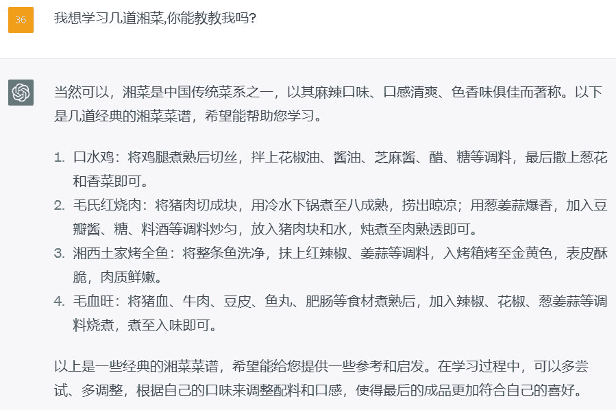

图 2-23 错误回答

需确认模型是否准确理解问题，发现偏差要及时澄清调整。回答不理想就持续追问，直到满意，如图 2-24 所示。一定要对回答进行检查、论证。

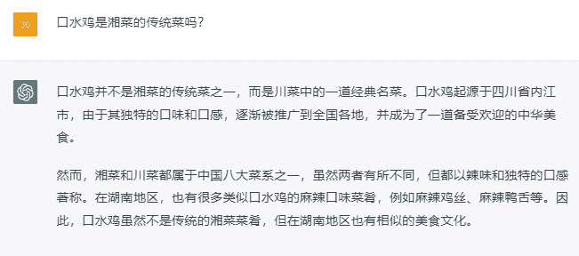

图 2-24 检查回答

## **2.3 优化 ChatGPT 提问技巧**

成为 ChatGPT 提问高手的核心在于反复实操。只有持续练习，能力才会真正提升。

·**持续打磨：** 当模型给出的答案不理想时，要反复调整提问方式，不断试验直到结果符合预期。
·**借鉴优秀范例：** 在网络上搜集高质量的提问案例，加入相关社群向高手请教，并与他人交流心得，是快速进步的捷径。
·**变换思路：** 多尝试不同的表达策略和技巧，找到最适合特定对话场景的提问方式。
·**保持对话并记录：** 经常与 ChatGPT 进行交流并保留对话轨迹，有助于归纳经验、发现提问盲点，同时能更全面地了解模型的理解边界与优势短板，让提问更高效。
·**回顾对话脉络：** 发问前先梳理双方之前的交流内容，确保话题连贯，可提升理解准确度和回答质量。
·**专业问题得专业答案：** 精研某个专业领域后提出专业化提问，才能得到更专业的回应。

# 第三章
# AI 驱动公文写作，提效实战课

本章将先厘清公文的概念、分类与构成，再通过四个实操案例说明如何借助 ChatGPT 完成各类公文的撰写。读完后，你能看到 AI 在公文场景中的应用潜力，为日常写作效率提供新选择。

## 3.1 公文是什么
公文即公务文书，是国家机关及各类社会组织在履行职能和管理工作中形成的具有法定效力与规范体例的文件，是办理公务的重要载体。通俗说，就是政府部门、企事业单位和组织在处理事务时使用的正式书面材料。

公文的核心包含四个层面。

·**制定主体：** 拥有公文签发权的是国家机关及其他社会组织，它们依据法律规章设立并具备法定地位。如教育部会发布教育政策类文件。
·**产生场景：** 当上述主体在履职和开展管理活动时，就会产生公文。如高校在开展校园安全检查时，会就安全问题发布相关文件。
·**核心属性：** 公文具有法定效力和固定格式，这使其区别于一般文章。效力的来源是制发主体的法定地位，规范的格式则增强了权威性和可操作性。
·**使用价值：** 公文是表达意图、处理事务、实施管理的关键工具。各层级机关和组织日常工作都依赖公文开展。

举例来说，大学可用“通知”布置考试安排，用“报告”向上级汇报科研成果，用“公函”与外部单位往来，用“决议”或“会议纪要”记录会议结论。

## 3.2 公文类型全览
了解公文类型及其特点对使用者很重要。按用途和性质大致可分为 15 类。

### 3.2.1 通知
主要用于下达政策、法规、措施及重要事项。常由上级或主管部门发给下级及相关人员，用以在内部或相关范围内传播信息，如新政发布、制度变更、活动告知等。特点如下。
·**发布权威：** 通常由主管部门或组织发布。
·**指向清晰：** 内容针对具体政策或事项，要求知晓、遵守或执行。
·**表述精炼：** 简明陈述目的、要求、时限等要点，避免冗长。
·**体例规范：** 包含抬头、称呼、正文、署名、日期等要素。

### 3.2.2 公告
是面向公众或特定群体公开传递信息的文种，用于通报重大消息、决定、政策或事件。受众范围比通知更广，如法规发布、产品召回、考试安排等。特点如下。
·**公开属性：** 多在公共场所、官网、社交平台发布。
·**来源可信：** 由官方或组织发布，具有权威性。
·**内容明确：** 针对具体事项明确目的与后续行动。
·**语言简洁：** 便于快速理解核心信息。
·**格式规范：** 一般包含抬头、正文、日期等。

### 3.2.3 报告
用于系统呈现某主题、事件或问题的详细情况，供受众了解、评估并决策。由个人、团队或机构撰写并上报，常用于工作汇报、调查提交、进展说明等。特点如下。
·**信息详实：** 全面分析并提供数据、事实与论证。
·**结构清晰：** 按引言、正文、结论等逻辑组织。
·**保持客观：** 尽量如实反映事实，减少主观色彩。
·**观点突出：** 明确建议和预期成果。
·**格式规范：** 含标题、正文、署名、日期等。

### 3.2.4 通告
是简洁公开的信息发布文种，用以告知公众或特定群体重要消息、安排或活动，如预警、停工通知、时间变更等。特点如下。
·**公开性：** 通过公共渠道广泛传播。
·**权威发布：** 来自官方或组织。
·**表述简短：** 直接传达关键信息。
·**指向明确：** 针对特定事件说明目的与细节。
·**格式规范：** 一般包括抬头、正文、日期。

### 3.2.5 通报
用于向相关部门或人员传递事件、事故、问题或成果的信息，目的在于告知、评价或督促行动。如事故原因通报、考核结果通报、违纪处分通报等。特点如下。
·**针对性强：** 面向特定对象传达关键信息。
·**权威来源：** 由官方或组织发布。
·**内容具体：** 明确事实、原因、影响、处理结果及后续要求。
·**信息精炼：** 便于快速把握要点。
·**格式规范：** 含抬头、称呼、主题、正文、署名、日期。

### 3.2.6 公报
面向公众发布组织的重要决策、政策、事件或成果，具备权威、公开、信息性，如经济数据发布、合作项目宣布、环保成果通报等。特点如下。
·**发布权威：** 来自官方或组织。
·**公开传播：** 在公共平台发布。
·**描述详实：** 对决策、事件等进行深入说明并附数据。
·**信息价值高：** 提供解读和进展帮助公众认知。
·**格式规范：** 含标题、正文、署名、日期。

### 3.2.7 纪要
用于记录会议、研讨、活动等场合的主要内容、讨论结果和共识，如会议纪要、研讨纪要、工作总结等。特点如下。
·**记录功能：** 记载参会人员、议题、讨论要点、决议等。
·**内容精炼：** 只反映要点和结果。
·**客观记录：** 避免主观臆断。
·**结构条理：** 按时间或议题分类。
·**格式规范：** 含标题、正文、署名、日期。

### 3.2.8 公函
用于组织之间正式传递信息、请求协助、提出建议或寻求合作，体现正式性和礼貌性。特点如下。
·**正式文体：** 处理正式公务事项。
·**语气礼貌：** 措辞谨慎、尊重。
·**意图明确：** 清晰表达目的、请求或建议。
·**条理清晰：** 按引言、正文、结尾组织。
·**格式规范：** 含抬头、称呼、主题、正文、结束语、署名、日期。

### 3.2.9 请示
向上级请教、征求意见或请求批准某事项，包含问题描述、分析及建议方案。特点如下。
·**上下级关系：** 下级向上级提出。
·**内容详明：** 详细说明问题、分析与建议。
·**请求属性：** 体现尊重与遵循组织程序。
·**结构清晰：** 按背景、问题、分析、建议、结尾展开。
·**格式规范：** 含抬头、称呼、主题、正文、署名、日期。

### 3.2.10 决议
记录组织或会议作出的重要决策、共识或行动计划，经充分讨论后形成，具有约束力。特点如下。
·**决策记录：** 记载重要决定。
·**具备约束：** 参与者须遵照执行。
·**民主形成：** 多经讨论协商投票产生。
·**条理清晰：** 按背景、讨论、结论、实施安排组织。
·**格式规范：** 含抬头、主题、正文、署名、日期。

### 3.2.11 决定
表达组织对某问题作出的最终决策，具有权威与执行力，常在审议后形成。特点如下。
·**权威性强：** 由有决策权的机构作出。
·**可执行：** 相关部门须落实。
·**表述明确：** 清楚说明决策内容、目标与安排。
·**结构清晰：** 按背景、内容、实施安排组织。
·**格式规范：** 含抬头、主题、正文、署名、日期。

### 3.2.12 命令
由高级领导或上级向下级发布具有强制性的指令，涉及重大事项或紧急任务。特点如下。
·**高度权威：** 由决策层发布。
·**强制执行：** 接收方必须遵行。
·**时效性强：** 多为紧急事项。
·**结构清晰：** 按背景、指令、执行安排组织。
·**格式规范：** 含抬头、主题、正文、署名、日期。

### 3.2.13 意见
表达组织或个人对某问题或事项的看法、建议或立场，供参考不具强制性。特点如下。
·**参考价值：** 提供建议但不强制。
·**分析基础：** 基于充分思考提出。
·**促进沟通：** 利于思想交流与协作。
·**结构清晰：** 按背景、分析、建议组织。
·**格式规范：** 含抬头、主题、正文、署名、日期。

### 3.2.14 批复
上级对下级请示、报告等文件的回复，对问题作出指导性明确回应。特点如下。
·**权威回应：** 由上级发出。
·**指导性强：** 为下级提供明确方向。
·**具执行要求：** 下级需按批复落实。
·**结构清晰：** 按背景、回应、指导意见组织。
·**格式规范：** 含抬头、主题、正文、署名、日期。

### 3.2.15 议案
在会议或集体讨论中提出需审议决策的问题、方案或建议，经研究后形成。特点如下。
·**提案功能：** 用于提出审议事项。
·**充分准备：** 基于研究形成。
·**需经讨论：** 在会议中修改完善。
·**结构清晰：** 按背景、问题分析、方案组织。
·**格式规范：** 含抬头、主题、正文、署名、日期。

按行文关系，公文可分为上行、平行、下行：
·上行公文指下级向上级汇报、请示类文件；
·平行公文指同级单位间沟通协作类文件；
·下行公文指上级向下级发布指示、命令类文件。

实际使用中，同一文种可能出现在不同行文关系中，具体取决于使用场景和目的。表 3-1 对公文的行文关系进行了分类整理。

表 3-1 行文关系
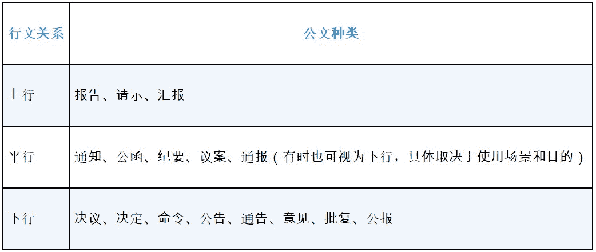

## 3.3 公文构成要素
公文遵循固定格式以保证清晰传达，各类文种虽略有差异，但大致包含以下部分。

·**抬头：** 置于文首居中，写明发文单位名称以标示来源。
·**称呼：** 置于正文前，明确收文对象，如“各位领导”“同志们”等。
·**主题：** 简要概括文件内容，位于称呼之下居中书写，使读者快速把握要点。

文书框架解析与智能协作实践

一份规范文书的重点在主体表达。意图要说清，不同文种的写法有差异，常见布局可归纳为三段。

❏ 起始段：交代来文缘起、起因与撰写目的。
❏ 中间段：展开具体事项、观点、要求等，可再细分为事实陈述、理由说明、建议提议等子项。
❏ 收束段：概括要点，并明确执行要求与期望。

除主体外，完整文书还包括以下要素。
附录材料用于佐证或补充主体内容，提及后需在主体末尾标注并附后。
落款时间置于文末，体现时效与办理节点。
落款署名明确责任主体，通常为发文单位负责人，位于时间下方，体现权威。
文件编号便于归档检索，一般由发文单位简称、年份与流水号组成，多置于文首或文尾。

各要素共同构成文书骨架，不同类型会有细微调整，但逻辑一致。撰写时须遵循格式规范，保证信息准确、传达有效。

## 3.4 大模型如何提升文书起草效率

借助大语言模型，文书起草可以更快、更准、更细，甚至智能化。本节以告知函、执行方案、阶段性总结、会议记录要旨、函件等场景为例演练，帮助读者掌握用法，体会工具价值。

### 3.4.1 让模型产出合规文书的技巧

技巧运用直接决定输出质量。

**1. 下达清晰指令与要求**

指令越具体，产出越贴合，具体做法如下。

说明文种与用途
先点明需要哪类文书、要达成什么目的，模型才好对准需求。例如起草一则告知函，告知全体同仁下周五参加年度总结会。

提供关键信息与数据
准确性来自信息完整。时间、地点、对象、具体数字等都要给出。例如汇报材料里请涵盖2023年第一季度销售额、利润、同比变化及各产品线的表现。

设定格式与结构
有固定格式时提前说明，便于合规与阅读。例如请按开篇、正文含销售额利润同比及产品表现、结论与建议的顺序撰写汇报。

指定风格与语气
不同文书语言要求不同，要明示风格如正式简练详细等，语气如严肃友好客观等。例如请用正式简洁的表达、客观的语气来写这份汇报。

请求多版本或修改建议
需要对比或优化时可直接提出。例如为这份请示提供两个版本，一个详述背景原因，一个简要归纳问题并直接给出解决办法。

综合以上要点，提示可这样设计：
拟一份语气正式、表述简练的告知函，目的是告知公司全体同仁参加下月首周的健康安全培训。需包含培训日期时间地点议题及参与人员，使用严肃语气，并按标题、培训背景目的、时间地点、议题、人员、报名方式和结语的结构编排。

实操时填充具体信息，示例提示为：
起草一份语气正式、表述简练的告知函，目的是通知全体同仁参加“大模型实战应用”培训。信息包括日期5月8日、时间周一全天9:00—18:00、地点多媒体教室、共十讲议题、参与人员全体同仁等，请用严肃语气按标题、培训背景与目的、时间地点、议题、人员、报名方式和结语的结构编写。

指令明确后，模型给出的结果质量明显提升。

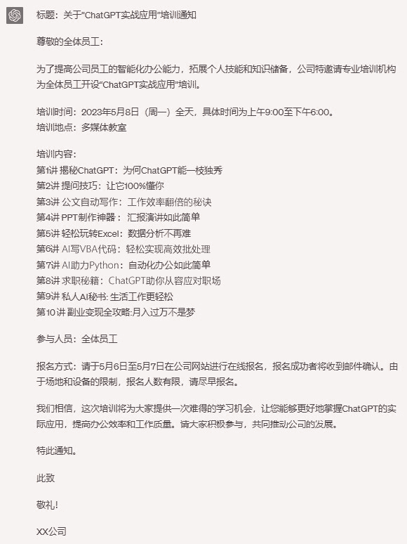

图 3-1 模型输出示例

**2. 善用修订与优化功能**

初稿生成后，通过定向优化可使文书更专业。

针对初稿提出改进点
发现不足时给出具体修改方向。例如请重新审视刚生成的阶段性总结中项目挑战部分的描述，让表述更有说服力更详实。

索取不同版本
不满意时可要求多版对照。例如请提供两份公司年度总结的版本，分别侧重财务成果和团队协作。

检查语法与拼写
模型通常准确，但仍需核验。例如请检查刚生成的请示的语法和拼写错误，给出修正版。

优化特定段落
对局部进行精细调整。例如请优化刚生成的执行方案中市场推广策略部分，使目标与执行方法表达更清晰。

通过上述方式，可持续提升文书的精确度与专业度。

### 3.4.2 实战演练 1：编写工作计划

以执行方案为例演示操作流程。

**1. 向模型提供明确指令**

例如输入：
请帮我撰写一份2023年度市场部执行方案，并按以下结构组织：
一、工作重点阐述
二、支持与辅助工作
（一）统一思想、明确责任
（二）驻点营销、贴近市场
（三）充实成员，完善组织
三、重点工作安排
（一）品牌推广
（1）品牌形象
（2）产品定位
（二）销售网络建设
（三）市场推广
四、工作进度
第一季度工作进度
第二季度工作进度
第三季度工作进度
第四季度工作进度
五、资源配置
六、市场费用预算
工作进度与市场费用预算请以表格形式呈现。

模型生成的结果如图 3-2。

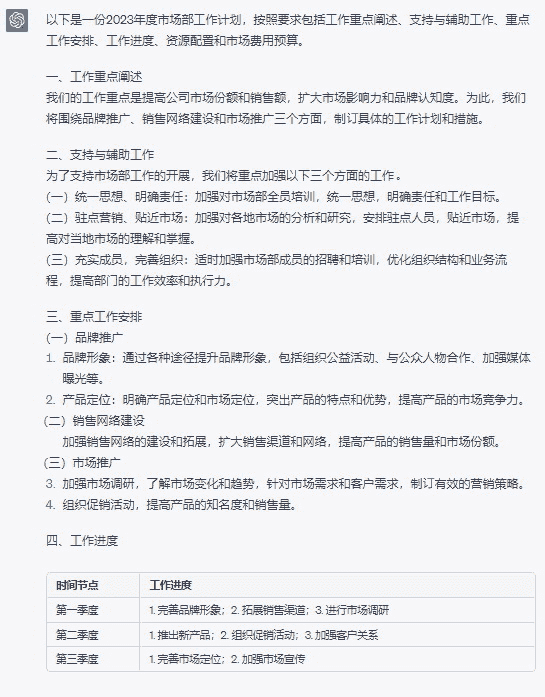

图 3-2 模型生成的工作计划

由于单次输出长度限制，内容可能不完整。可输入“继续”指令逐步补全，如图 3-3。

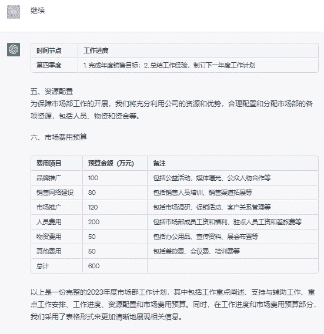

图 3-3 继续输出

若需更长文本，可将任务拆分。先写引言，再分别请模型生成目标设定、市场分析、策略规划、执行计划、评估方法等片段，最后拼接成完整方案。

**2. 利用修订优化功能**

生成后可进行校对修正。例如发现“（三）市场推广”编号错误，要求模型改正，如图 3-4。

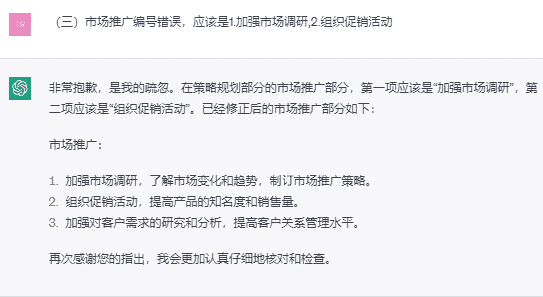

图 3-4 利用模型修改功能优化输出

工作进度表若不够详细，也可要求模型扩充为季度对应详细安排，如图 3-5。

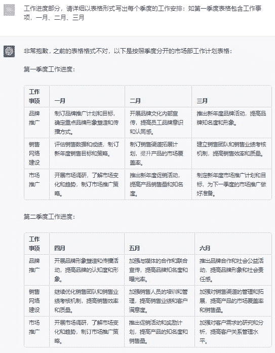

图 3-5 修改优化工作进度

经多次修订，最终文本既符合结构要求又内容完整。但仍需人工把关，熟练流程才能稳定产出。

### 3.4.3 实战演练 2：编写工作报告

阶段性总结是向上级反馈成果、进展、问题与建议的文书，便于评估与决策。

常见结构包括：
封面与扉页：报告名称、日期、编制单位、作者等。
摘要：概括目的背景主要内容结论建议，控制在一两页。
目录：列出章节与附录，便于查阅。
引言：交代主题目的范围背景。
工作总结：概述工作进展完成情况问题与改进。
正文：详述目标任务过程结果，按工作内容分节。
结论：总结成果，回答目标是否达成。
建议：提出未来改进方向。
附录：统计表、图片、参考文献等。

若目录结构不清晰，可请模型先给出参考，如图 3-6。

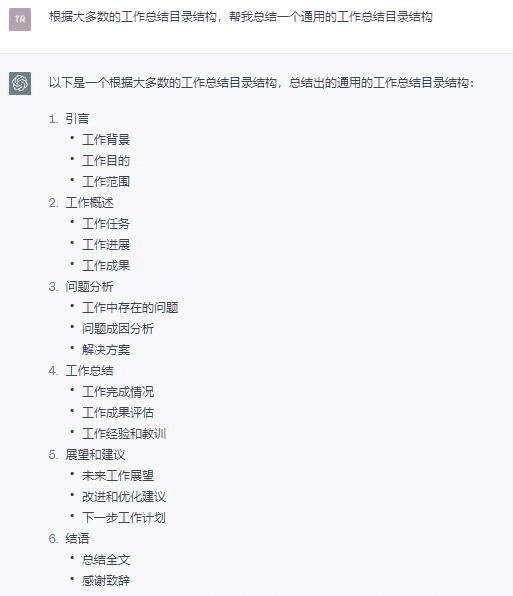

图 3-6 模型生成的工作总结目录结构

以网络运维人员为例，采用角色扮演并给出明确要求、风格、结构后提问，如图 3-7。

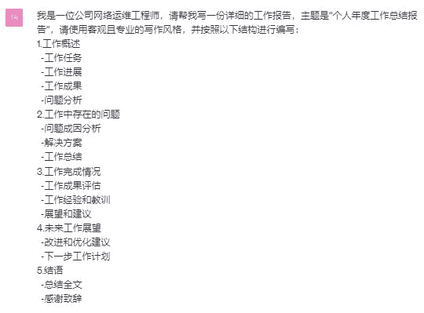

图 3-7 工作报告提问

模型输出结构完整，但在真实性上可能不足。可将实际工作要点“喂”给模型，如图 3-9。

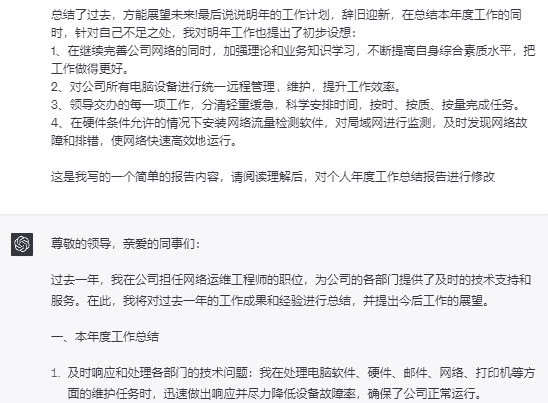

图 3-9 喂入相关内容

喂入真实信息后贴合度提升，但可能遗漏既定目录结构。再次提出优化要求，如图 3-10。

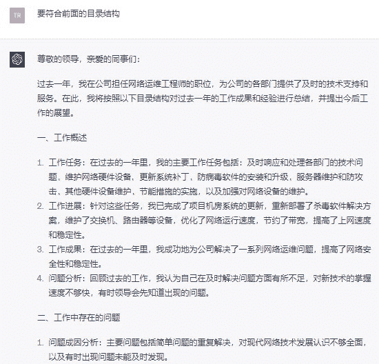

图 3-10 继续优化输出

风格与结构仍可继续调整，直至满意。

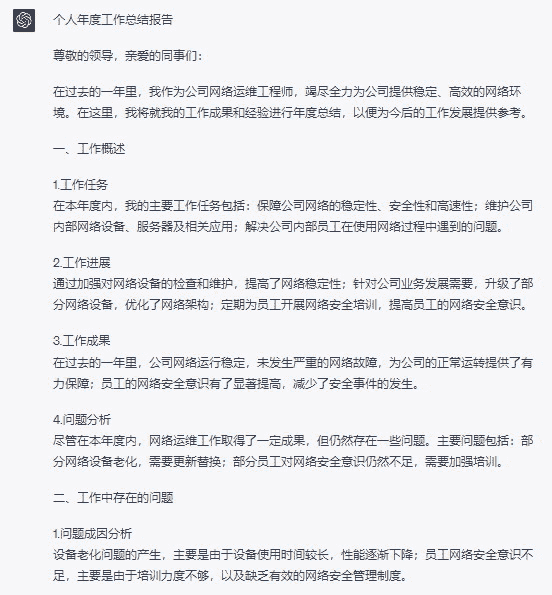

图 3-8 模型生成的工作报告

### 3.4.4 实战演练 3：编写会议纪要

会议记录要旨用于记录与传递会议内容，帮助回顾讨论与决议，具有三个特征。
纪实性：只写会上讨论过的事项。
提要性：提炼核心观点与要点。
约束性：对参会单位与人员有执行约束力。

结构与写法：
标题：会议名称加文种，如“全国农村爱国卫生运动现场经验交流会纪要”，可含主办单位或正副标题。
正文分导言、主体、结尾。
导言：介绍会议名称时间地点参会人员主要议题。
主体：条项式逐条列出问题与决定；综合式将内容归类概括，重要在前详细在前；摘要式摘录代表性发言要点，保留原话风格。
结尾：总结成果共识与后续行动，提醒落实责任。

例如公司召开“关于使用大模型提高工作效率”会议，现场记录如下：
1. 张经理介绍会议主题与目的，强调大模型在提升效率方面的重要性
2. 李总监介绍大模型基本概念与功能，包括人工智能自然语言处理技术、理解与生成自然语言、应用场景如撰写邮件回答问题撰写报告等
3. 王经理阐述应用场景：辅助撰写邮件的智能提示与语句生成、自动回答问题的FAQ查询与知识库检索、撰写报告的自动摘要与数据分析
4. 张经理提出实施方案：试用期1个月、提供操作培训、收集使用反馈与建议
5. 员工提问环节：资料保密问题、系统兼容性、技术支持
6. 张经理总结：重申作用、鼓励参与试用与培训、期待整体效率提升

接下来的操作是借助会议记录，让 ChatGPT 产出一份纪要。做法很简单，先把记录内容整体拷贝给模型，随后提出生成请求，具体流程见图 3-11。

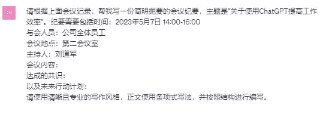

图 3-11 将会议记录复制给 ChatGPT 然后发起提问

可以提示模型采用清晰专业的语体，主体部分以条目形式呈现并遵循既定结构，这样就能得到类似图 3-12 的高质量结果。若想进一步润色，还可把正文切换为摘要式或综合式表达。

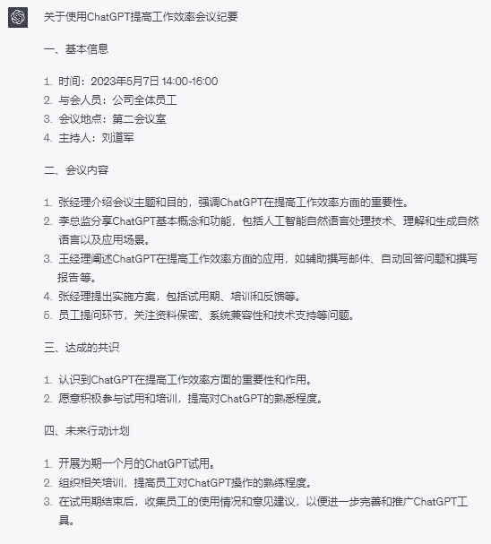

图 3-12 ChatGPT 生成的条项式会议纪要

### **3.4.5 实战演练 4：编写公函**

公函属于正式书信的一种，使用场景相当宽泛，涵盖机关、企事业、学校等组织内部或相互之间的往来，也常用于个人与机构间的沟通。与普通信件相比，公函有其鲜明特征：

·**正式性**：作为正式文体，公函须用规范得体的措辞，称呼和职务名称都要严谨。

·**明确性**：意图要清晰，不能模棱两可以免引起误解，表述前需反复斟酌。

·**准确性**：用词和语法必须精准，避免差错遗漏，同时要遵循标准格式和文体规范。

常见公函一般由抬头、正文、落款、附件等部分构成。行文主张简明扼要、精准得体、礼貌周全，语法标点用词都要正确，同时要杜绝错字病句。比如指定模型撰写一份“关于 ChatGPT 应用培训”的公函，并强调简明礼貌、用语规范，生成结果如图所示 3-13，格式完整且风格简练。

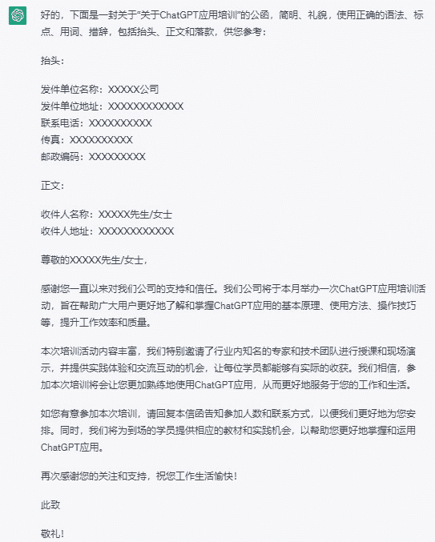

图 3-13 ChatGPT 生成的公函

# **第四章**

# **AI 助力 PPT 高效汇报**

做 PPT 时常觉得版式老套、数据难表现？借助 AI 工具，职场幻灯片设计可以变得高效省力。

本章会演示 ChatPPT、Tome、Gamma 等 AI 工具如何快速生成高效专业的演示文稿，把平淡文字转化为吸睛页面，实现数据可视化，让汇报水准全新升级。

## **4.1 职场 PPT 设计要领**

本节聚焦幻灯片的简洁美感，并讲解版式四要素：对齐、重复、对比、亲密。这些原则能保证版面清晰、视觉统一。对齐让元素整齐；重复强化一致感；对比突出重点；亲密把关联内容聚合提升逻辑。色彩方面，单色法与近似色法能打造和谐配色。掌握这些技巧即可制作出吸睛幻灯片，提升沟通效果。

### **4.1.1 简洁就是美**

很多人一打开空白页就堆砌文字，结果幻灯片像 Word 文档般平淡，缺乏结构美感。也有人把标题、文字、图片、图表、装饰素材全挤在一页，重点被淹没，如图 4-1。最终观众难以抓住核心信息。

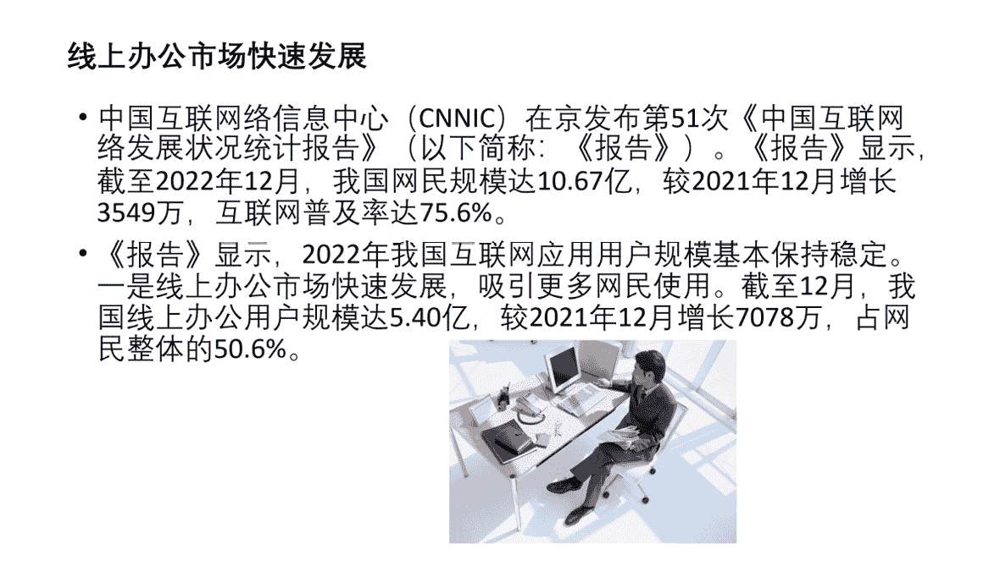

图 4-1 重点模糊的幻灯片

优秀的幻灯片应以简洁清晰为原则，如图 4-2，这样更易吸引注意、便于理解记忆，提升演示效果。

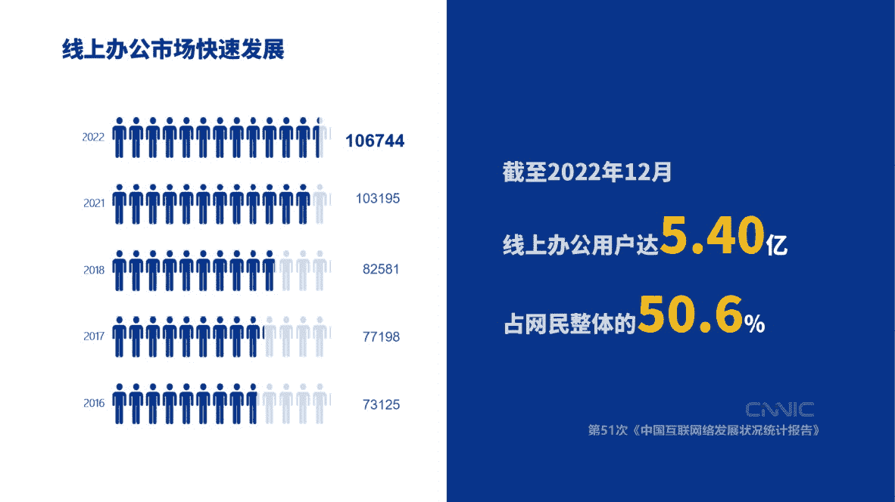

图 4-2 简洁明了的幻灯片

简洁体现在文字克制，用短句与关键词概括要点，而非全文照搬。观众更多听讲解而非读稿，精简文字才能聚焦注意、辅助理解。

清晰依赖于合理的版式，图文排列要整齐不拥挤，标题分段明确，字体足够大且易读。图表图片需高清不失真，整洁的布局能让内容更易消化。

以简洁为版式核心，每页只承载一个明确焦点，信息一目了然。

### **4.1.2 PPT 版式设计四大原则**

即使没有专业设计经验，也能借鉴平面排版的四项基本原则提升水准，包括对齐、重复、对比、亲密，如图 4-3。合理运用可提高可读性、吸引力与理解度，也更显专业与品牌一致性。

图 4-3 版式设计的四大准则

**1. 对齐原则**

对齐是指让页面元素按边缘、中心或基线有序排列，形成统一视觉。左对齐、居中、右对齐是常见做法，如图 4-4。统一对齐能让版面整洁专业，并增强内容条理性。

图 4-4 对齐示意

左对齐使用频率高，适合段落、列表、配图、标题或重点引用。例如图 4-5，多段文字左对齐后阅读更顺畅。

图 4-5 左对齐示例

文字较少时采用居中对齐，可营造平衡感并突出重点，如图 4-6。内容整体置于页面中央也能形成视觉平衡，如图 4-7。

▲图 4-6 居中对齐

▲图 4-7 相对于页面居中

右对齐使用较少，多在填补右侧空白以求平衡时采用，如图 4-8。

图 4-8 右对齐示例

**2. 重复原则**

同一层级的内容保持相同风格反复出现，如图 4-9 章节页与内容页各自统一。重复元素与样式能打造视觉一致性，提升专业感与记忆度。

图 4-9 重复原则示例

**3. 对比原则**

借助字号放大、颜色变化等手法突出重点信息，如图 4-10。对比能帮助观众快速识别关键点，提升理解效率。

图 4-10 对比原则示例

**4. 亲密原则**

若图文散乱，页面会显得杂乱。亲密原则要求把相关元素聚集在一起，与无关内容区隔，如图 4-11，以强化关联与逻辑。

图 4-11 亲密原则示例

### **4.1.3 色彩要统一**

色彩搭配直接影响视觉吸引力和信息传达，但新手常出错，如图 4-12 过度使用颜色且对比不足，导致画面杂乱、风格不统一。

图 4-12 颜色混乱的幻灯片

颜色过多易致混乱，建议控制在 1-3 种主色，并在全篇保持统一。同时注意对比度，太低会导致文字图像难以辨认。

配色该怎么做？先确定主色调作为基准，全篇围绕它构建统一风格。取色可借助取色器，从公司 logo 上提取，如图 4-13。

图 4-13 取色器工具

例如图 4-14 从人民邮电出版社 logo 取色得到 RGB 0,66,125 作为主色。

图 4-14 从 Logo 提取主题色

主色确定后，若追求简洁，可采用单色配色法，即主色加黑白灰等无色，用于文字图标以增强对比与可读性。如图 4-15 以蓝色为基调，通过深浅变化突出重点，搭配灰白文字保持清晰。

图 4-15 蓝色单色配色示例

图 4-16 以绿色为主色，辅以黑白灰，同样呈现统一简洁的效果。

图 4-16 绿色单色配色示例

若想要更丰富的色彩，可用近似色配色法，主色搭配相邻辅色，如图 4-17 呈现柔和和谐的组合。

图 4-17 近似色配色示例

更多色彩技巧可参考图书或 CopyPalette、Adobe Color 等在线工具。

## **4.2 利用 AI 快速制作 PPT**

很多人打开 PPT 制作软件就直接找模板。模板省事，版式、配色、图文位置都已设定，只需填空即可，确实提升了效率。

现在 AI 工具更强大，能自动搭建框架、生成配色、插入高质量图片、整理文案，不满意还能调整，直至符合预期，既省去挑模板的时间，也能获得更高水准的成果。

### **4.2.1 ChatPPT 一键生成 PPT**

ChatPPT 融合 ChatGPT 与韦尼克模型，支持自然语言指令创作演示文稿。现有在线版和 Office 插件版，兼容 Microsoft Office 与 WPS，可在官网体验或安装，如图 4-18。

图 4-18 ChatPPT 官网界面

安装完成后打开 WPS 或 PowerPoint，菜单栏会出现 Motion Go 与 Chat PPT 选项。点击 Chat PPT，用微信扫码登录即可，如图 4-19。

图 4-19 ChatPPT 登录界面

例如需要生成一份“个人年度工作总结报告”，可设定内容风格为“专业”（图 4-20），色彩基调为“大海”（图 4-21），输入指令后点击生成，如图 4-22。

▲图 4-20 指定内容风格

▲图 4-21 指定色彩语言

▲图 4-22 输入指令

系统会提供多个标题方案，如图 4-23，不满意可点“重新生成”，也可挑选后微调。

图 4-23 标题方案列表

选择第二个标题“年度工作总结报告——工作亮点与问题探讨”后，系统给出多个大纲供浏览，选择合适大纲并调节丰富度，即可快速生成演示文稿，如图 4-25。

▲图 4-24 大纲方案

▲图 4-25 ChatPPT 生成的 PPT

生成结果包含封面、目录、过渡页、内容页、封底，并自动配图。

### **4.2.2 Tome 一键生成 PPT**

Tome 同样是 AI 演示生成工具，基于 GPT 与 DALL-E 开发，支持中文。只需输入主题，即可自动产出完整幻灯片。

Tome 在内容逻辑与视觉美感上兼顾，主题清晰、字体配色布局合理，核心信息一目了然。如需修改，也可在生成结果上直接调整。

使用前需注册，打开官网如图 4-26，点击 Try Tome 后可新建账号或用 Google 登录。

图 4-26 Tome 官网页面

登录后首次使用需创建工作区，例如命名为 PPT，点击右上角 Create 进入制作，如图 4-27。

图 4-27 创建 PPT 界面

点击 Create 后底部出现输入框，如图 4-28，输入主题“请帮我生成主题为人工智能助力办公效率提升的 PPT”，并选择对应的创建选项。

图 4-28 输入主题栏

生成结果内容充实，如图 4-29，相较 ChatPPT，Tome 在文字撰写与配图方面更突出。

图 4-29 Tome 生成的演示文稿

Tome 支持细节编辑，文字可直接修改，选中文本后工具栏可调整字号、颜色、列表等格式，如图 4-30。

图 4-30 修改文字格式

在 Tome 里调整图片很顺手。把要修改的图片选中后，点右侧面板的 Image settings 唤出编辑区，就能在 Upload 区域把本地素材替换上去，或者点 Create 让系统根据 Prompt 批量产出四张备选，挑选合适的一张替换即可，具体操作样例如图 4-31 所示。

图 4-31 通过提示语生成图片

Tome 也支持整体换色。点击右侧的 Set theme 打开图 4-32 所示的设置页，在 Tome theme 里挑选预置主色，整份演示的视觉风格就会统一变化；若想更精细，还能分别调节 Page、Heading、Paragraph 的单项颜色。

图 4-32 Set theme 对话框

调整完毕即可直接使用。需要注意的是，Tome 当下不提供 PPT 的直接导出，演示只能以在线链接分享给他人，升级为 Pro 订阅后才开放 PDF 导出。

### **4.2.3 Gamma 快速制作演示**

Gamma 底层基于 GPT-4，支持把同一份素材发布为网页、幻灯片或文档，并内置网页分析能力。

制作演示时，拖拽式搭建和编辑很方便，还能混入图像、视频、音频提升互动感。文字排版和视觉化表达都很强，图 4-33 能看出它产出的演示简洁统一、很有质感。

图 4-33 Gamma 生成的 PPT

使用前先完成注册。进入 Gamma 网站如图 4-34，点击 Sign up for free 自建账号，或直接用 Google 登录，首次进入要先新建一个工作区。

图 4-34 Gamma 官网页面

主页支持用 AI 快速起稿，也能把 Word 或 PPT 的文字导入后创作。这里选择 New With AI 来新建，如图 4-35。

图 4-35 创建新文档

弹出 New with AI 对话框后，提供两种方式：Guided 引导式起步，和 Text to Deck 文转演示。本次采用 Guided，只要提供一个主题，系统就会自动生成初稿大纲，如图 4-36。

图 4-36 New with AI 窗口

Gamma 可产出演示文稿、文档或 Web 页面。若要幻灯片则选 Presentation，并在输入框填入主题，例如“人工智能助力办公效率提升”，确认后继续，如图 4-37。

图 4-37 输入主题

根据主题会自动产出一份大纲草案。如觉得不理想可点 Try again 再来一次，也能在编辑区手动改写或填入自有大纲，随后点 Continue，如图 4-38。

图 4-38 生成大纲初稿

接着在右侧的主题面板里挑一个喜欢的样式和背景色，点 Continue，系统就会按大纲自动拼装幻灯片，如图 4-39。

图 4-39 选择主题和背景颜色

产出后还能调主题、字体格式、版式，加入视觉模板、图片、视频丰富内容。若某页不满意，点击右侧的机器人图标即可让 AI 继续润色。现在仅支持 PDF 导出。

## **4.3 用 AI 定制职场演示**

领导甩来一份文案，要求在一小时内做出专业演示。按传统做法，光是通读就需要一到两小时，更不用说提炼和排版。如今借助 AI 能快速抓取要点、匹配模板，高效完成高质量演示。

### **4.3.1 AI 打造专属演示风格**

AI 正改变演示设计的工作流。过去打造专属风格要耗费设计师大量时间精力，如今借助 AI 操作更省心、个性化也更容易实现。

若不确定常见风格，可以这样提问 ChatGPT：
现在你是一位资深 PPT 设计师，PPT 画面设计有哪些常用风格，请举例说明。
它会给出风格清单并说明特点与适用场景，如图 4-40，后续还能通过追问挖掘更多。

图 4-40 PPT 设计风格推荐

比如想采用未来科技感，却不清楚该用什么元素和配色，可继续问：
在 PPT 画面设计上，未来科技风格该搭配哪些元素和颜色。
如图 4-41，ChatGPT 会给出具体的元素和色彩搭配建议。

图 4-41 未来科技风格推荐

对初学者而言，文字描述仍不够直观。可以让 ChatGPT 推荐一些同类风格的企业，例如问：
请给我一些符合未来科技风格的企业或品牌。
如图 4-42 能得到一组参考案例，之后在搜索引擎查阅官网或介绍，直观感受后选定配色和视觉元素。

图 4-42 ChatGPT 推荐的企业

也可以直接请 ChatGPT 推荐模板作参考，例如：
借鉴 NVIDIA 的元素和色彩搭配，推荐几个相似风格的 PPT 模板并附上网址。
如图 4-43 会得到模板风格建议，打开对应网站后输入关键词如 futuristic tech 或 digital technology，直观学习设计和配色。

图 4-43 推荐的模板风格

### **4.3.2 文本转幻灯片提效**

4.2 节介绍的工具能快速产出精美演示，但内容多由 AI 生成，针对性不足。若领导提供成稿文案，要求快速转成演示，该怎么处理？

首先要把全文内容分批输入 ChatGPT。因为篇幅可能超出限制，可按第二章的提问技巧分段进行。如图 4-44，先发送提示：

图 4-44 提示分段输入

我准备分段把文章内容发给你，请先不要回复，确认准备好后只回“准备好”或“未准备好”。

确认回复后就可分段发送，并在每段前加上明确标记，比如“现在输入第一部分内容”。

输入完成后，请 ChatGPT 基于全部内容提炼结构。可问：
请把前述三段资料整理成 15 页的演示大纲，用 Markdown 语法输出。
生成的演示大纲如图 4-45。

图 4-45 生成的 PPT 大纲

若大纲不理想，可点 Regenerate Response 重新生成，也能手动编辑。

为提升视觉效果，希望为每页配图。若直接问“请帮我给每张幻灯片配图”，ChatGPT 可能无法配图或仅提供建议，如图 4-46。

图 4-46 配图建议

更有效的做法是：
请为上述大纲配图，用 Markdown 语法输出图片，勿用斜杠或代码块，借助 unsplash API https://source.unsplash.com/1080x720/? <关键词> 生成完整 Markdown 大纲。
之后 ChatGPT 会为每页配上图片，如图 4-47。

图 4-47 为 PPT 配图

注意 ChatGPT 会在 https 开头的地址中检索图片，若想换源，只需替换网址，保留 API 结构和 <关键词> 占位符即可。

拿到图文 Markdown 之后，可借助 MindShow 快速生成演示。该工具提供网页版和 PC 版，此处使用网页版。把生成的图文 Markdown 复制后点“导入创建”，如图 4-48。

图 4-48 导入创建

MindShow 会据导入内容自动生成页面，如图 4-49。左侧可调整大纲，右侧可选模板，也能通过布局功能快速修改单页版式。

图 4-49 MindShow 生成的 PPT

另一种做法是先让 ChatGPT 产出文字大纲，再在 Gamma 中打开 New with AI，选 Text to Deck，页面如图 4-50。在 Provide instructions 里选“简体中文”，Add or paste in content 中粘贴大纲，点右下角 Generate。

图 4-50 选择 Text to Deck 后出现的页面

选好模板后点 Continue，Gamma 会按大纲生成页面。选中页面元素后弹出对话框可进一步调整，使版式更合理、图像更具冲击力，如图 4-51。

图 4-51 修改后的 PPT

### **4.3.3 AI 助力数据可视化**

演示文稿中的图表是呈现数据的关键手段，比纯文字数字更易读。设计精良的图表能突出关键信息，吸引观众注意。

常用工具如 Excel 和 Power BI 专业但门槛较高。这里介绍一套 AI 图表工具——镝数图表，使用极简：上传数据即可生成专业图表。

进入镝数图表官网注册登录，从模板库选定图表类型，在右侧栏点“编辑数据”，修改表格或上传数据即可实时生成图表，如图 4-52。

图 4-52 镝数图表

生成后点右上角“下载”，在“下载作品”对话框里选文件类型和图片尺寸，点“下载”，再把文件插入对应演示页面即可，如图 4-53。

图 4-53 下载作品

# **第五章**

# **AI 助力 Excel 数据分析**

Excel 函数用起来总觉得吃力？逻辑、分类汇总、文本、查找引用、日期时间这些函数经常卡壳？本章会讲怎么借助 AI 快速获取和清洗数据，让 AI 化繁为简，轻松掌握 Excel 函数。

一起启动 AI 数据加速器，开启新时代的数据分析之旅。

## **5.1 AI 辅助获取外部数据**

做数据分析第一步就是有数据，就像做饭离不开食材。Excel 中的外部数据就相当于这些食材。

Excel 支持从文本文件、数据库、网页等多种渠道导入外部数据，相当于从不同菜市场采购食材。

可以和 ChatGPT 交流获取导入方法和步骤，也能通过搜索引擎、文本分析和 API 集成，快速获得准确实时的外部数据。

### **5.1.1 导入向导导入文本文件**

本节以从 txt 文本导入数据为例，请 ChatGPT 提供方法与步骤。可这样提问：

你是一位资深 Excel 专家，我想把外部的 txt 文本导入 Excel，有哪些方法？请详细说明。

ChatGPT 给出了两种方案及详细步骤，如图 5-1。

图 5-1 ChatGPT 给出的文件导入方法和步骤

不同 Office 版本操作会略有差异，下面以 Microsoft Excel 2019 和 WPS Office 2019 为例演示。

先看 Microsoft Excel。打开 Excel，依次点击“数据”>“从文本/CSV”，如图 5-2。弹出对话框后选择目标 txt 文件，比如“员工信息.txt”，点“导入”。

图 5-2 选择数据源

在“员工信息.txt”对话框里，从“分隔符”选择列分隔方式，本例自动识别为“制表符”，如图 5-3。若列表中找不到分隔符，可选“自定义”并手动输入。随后点右下角“加载”下拉菜单，选择“加载到”。

图 5-3 选择分隔方式

在图 5-4 的“导入数据”对话框里，把“数据在工作簿中的显示方式”设为“表”；在“数据放置位置”根据需要选起始单元格，这里选现有工作表的 A1，再点“确定”。

图 5-4 导入数据

数据会以表格形式显示在 Excel 中，如图 5-5。右侧会出现“查询&连接”区域，双击“员工信息”即可进入 Power Query 编辑器，执行增删改列、格式转换等操作。

图 5-5 数据导入 Excel 表中

接下来演示如何把 txt 文本导入 WPS 表格中。

WPS Office 没有 Power Query 组件，导致外部数据的引入路径跟 Microsoft Office 不一样。以载入文本文档为例，先点开顶部的“数据”菜单，找到“导入数据”入口，再触发下方的“导入数据”按钮启动向导。

图 5-6 在 WPS Office 中导入数据

随后弹出“首个步骤：挑选数据源”对话框，勾选“直接打开数据文件”方式，点击“选择数据源”继续。

图 5-7 选择数据源

在打开对话框里定位到待导入的文本文档“员工信息.txt”，确认后打开。

图 5-8 打开文件

随后出现“文件转换”设置页，“文本编码”项默认保持“其他编码”下的 UTF-8，不改动后进入下一页。

在“文本导入向导 - 3 步骤之 1”里，向导已自动判断源数据包含分隔符，于是“原始数据类型”被设为“分隔符号”。若列之间没有分隔符，可改选“固定宽度”，再继续。

▲图 5-9 文件转换

▲图 5-10 文本导入向导 - 3 步骤之 1

进入“文本导入向导 - 3 步骤之 2”，在“分隔符号”栏依据实际分隔符勾选，这里用到制表符。若列表里没有对应符号，可选“其他”并手动输入。结合预览窗格效果确认无误后进入下一阶段。

图 5-11 文本导入向导 - 3 步骤之 2

在“文本导入向导 - 3 步骤之 3”界面，预览区各列的字段类型默认是“常规”，必要时可调整，例如把“身份证号码”列改为“文本”。不想要的列可选中后点“不导入此列（跳过）”。“目标区域”可修改写入起点，比如 $A$1。设置完毕后点“完成”。

图 5-12 文本导入向导 - 3 步骤之 3

导入后呈现方式不同，Excel 会生成表格，WPS 则得到普通数据区。需要转为表格时，把光标放在区域任意单元格，再用“插入 > 表格”或快捷键 Ctrl+T 即可。除了向导导入，还能让 ChatGPT 生成 VBA 或 Python 脚本实现自动化接入，具体见后面章节。

### **5.1.2 用 AI 搜索引擎抓取外部信息**
Bing AI 是微软把人工智能融入 Bing 搜索后的产品，能提供更智能的检索体验。在 Bing 首页点“聊天”进入对话模式，在“新主题”框里用提问技巧输入，例如：

请给我提供 2023 年第一季度中国消费报告数据，包括类别、额度、增长率，整理成表格输出。

图 5-13 Bing AI 界面

Bing 会基于网络信息生成 2023 年第一季度中国消费报告的数据，并附上参考网址，可点开查看，也能一键导出为 PDF、Text 或 Word，直接复制表格到 Excel 使用。

图 5-14 Bing 生成的结果

同样的提问在普通版 ChatGPT 里往往因知识库截止时间而无法作答。

图 5-15 ChatGPT 无法回答我们的问题

ChatGPT Plus 已把 Bing 作为插件融合，但免费版不可用。以 Edge 浏览器为例，可通过地址栏右方的扩展按钮打开“Microsoft Edge 加载项”。

图 5-16 打开 Microsoft Edge 加载项

在搜索框输入 Web ChatGPT 或 Web Access，可找到“WebChatGPT：可连上网访问互联网的 ChatGPT”，点“获取”。

图 5-17 获取外接程序

在确认窗口点“添加扩展”，插件即加入扩展列表，可通过眼睛图标控制是否显示在工具栏。

图 5-18 添加扩展

重新登录 ChatGPT 后即可看到插件已安装，确认 Web access 为开启状态再发起提问。

图 5-19 Web access 处于打开状态

这时 ChatGPT 会在回答后附上搜索来源网址，并整理成表格呈现最新内容。

图 5-20 ChatGPT 通过网络获取最新数据

### **5.1.3 让 AI 解析文本并抽取结构化信息**
ChatGPT 也能对一段文字进行分析并提取结构化数据。把报告或新闻内容喂给模型，提问特定数据点即可获得回答。

例如有一篇“2023 年第一季度居民收入和消费支出情况”的长文，若分段输入不想每次都得到回复，可先问：

我现在将向你分段输入文章内容，请只需阅读，不要作任何回答，现在请告诉我准备好了吗？只需回答“好了”，或“没有”。

图 5-21 提示分段输入

用“现在输入第一部分内容如下：”开头，把全文分段送入。

图 5-22 分段输入文本内容

全部输入完成后，再提问：

请认真阅读上述内容，帮我整理出首季度全国居民收入情况和居民消费支出情况表，其中包括额度和增长率，整理成表格输出。

ChatGPT 会给出整理后的结果。

图 5-23 从文本提取数据

若手头是 PDF，可用 ChatPDF。在页面点 Drop PDF here 上传文件。

图 5-24 上传 PDF 文件

在提问区输入同样的问题：

请帮我整理出首季度全国居民收入情况和居民消费支出情况表，其中包括额度和增长率，整理成表格输出。

ChatPDF 能抽取出关键数据，但输出并非表格，而是分隔符分列的形式，可复制到文本文件再用 Excel 的导入向导处理。

图 5-25 通过 ChatPDF 获取数据

此外，ChatGPT 的 API 也能对接数据库、在线服务等数据源，实现外部数据的程序化提取。

## **5.2 AI 驱动的数据清洗**
把外部数据导进 Excel 后，通常要做清洗以保证准确和一致。清洗涵盖缺失值处理、重复值剔除、格式统一等，能消除错误、补齐空缺、校正不一致，使分析结果更可靠。

### **5.2.1 缺失值的补齐与清理**
缺失值是指源数据集中出现空白单元格或用特殊符号标记的缺失。如图 5-26 所示，导入后部分单元格为空，现在需要把所有空单元格填为 0，或删除包含缺失值的整行。

图 5-26 缺失值区域

在 Excel 或 WPS 里，先定位空白单元格，再批量填充 0。具体操作如下。

1. 用鼠标点中数据区域任一单元格，按 Ctrl + A 全选，再按 Ctrl + G 或“开始 > 查找和选择 > 定位条件”，打开“定位”对话框，点击“定位条件”按钮，弹出“定位条件”对话框，选择“空值”，确定后即可选中所有空白单元格。

图 5-27 “定位条件”对话框

2. 直接输入 0，然后按 Ctrl + Enter 完成批量填充。若要删除含缺失值的行，在步骤 3 中选择“开始 > 单元格 > 删除 > 删除单元格”，打开“删除文档”对话框，选择“整行”后确定；WPS 里可通过“开始 > 行和列 > 删除单元格 > 删除行”实现。

图 5-28 删除整行

借助 AI 处理缺失值可使用 ChatExcel。打开官网后点“现在开始”，再点“请上传表格”上传文件。

图 5-29 上传 Excel 文件

上传完成后在输入区提问：

定位为空的单元格，并填充为 0。

模型会用 0 批量填补空白。注意 ChatExcel 出自北京大学深圳研究生院信息工程学院袁粒老师团队，对文件大小和列数有限制，且目前只支持第一张工作表。

图 5-30 批量填充缺失值

如需删除含空值的整行，可在输入区提问：

删除具有空白单元格的行。

处理结果如图示。若结果有误可点“撤销”后重提，完成后点上方“下载文件”导出表格。

图 5-31 批量删除行

### **5.2.2 去重：剔除重复记录**
Excel 数据中常出现重复记录，会干扰分析准确性，需要剔除。

例如图 5-32 所示的表格，需要删除“订购日期”“客户”“产品”和“数量”四列完全相同的数据。

图 5-32 具有重复数据的表格

先选中处理范围，Excel 里点“数据”选项卡的“数据工具”组“删除重复项”，在对话框中勾选依据列后确定；WPS 里走“数据 > 重复项 > 删除重复项”。

图 5-33 删除重复值

在 ChatGPT 里可直接复制表格并追加指令：

请删除以上日期、客户、产品、数量都相同的行数据，不要解释，整理成表格输出删除后的结果。

图 5-34 使用 ChatGPT 删除重复数据

在 ChatExcel 里上传文件后输入：

请删除订购日期、客户、产品、数量都相同的重复行。

即可快速得到去重结果。

图 5-35 使用 ChatExcel 删除重复行

### **5.2.3 修正格式错误**
导入的格式问题会导致公式计算或图表异常。例如“数量”列带文本单位“套”，数值计算会出错。

图 5-36 文本格式的数值

可用 Excel 的“替换”功能清理。先选中目标列，在“查找和替换”对话框的“替换”选项卡里查找“套”，点“全部替换”。

图 5-37 查找和替换

也可把表格复制到 ChatGPT 并指令：

以上数据包括标题行，请删除第 2 列中的单位“套”，整理成表格，输出结果。

图 5-38 使用 ChatGPT 删除单位符号

上传到 ChatExcel 后在输入区输入：

请删除“数量”列中的单位符号。

即可得到清洗后数据。

图 5-39 使用 ChatExcel 删除单位符号

日期格式混乱也常见，图示表格存在多种非法日期，无法通过格式更改或分列快速修正。

图 5-40 非法的日期格式

把内容复制给 ChatGPT 并给出转换指令，模型会输出规范的日期格式。

图 5-41 使用 ChatGPT 生成标准的日期格式

## **5.3 AI 加持 Excel 函数，提升效率**

面对大量零散的表格信息，逐条查阅函数手册既耗时又费力。借助智能对话助手，这类工作可以变得直观易懂，只需掌握基础写法，通过自然语言提问就能获得可直接使用的解决方案，从而完成数据整理、复杂核算和专业报表输出。

### **5.3.1 表格公式与函数的构成要素**
一个完整的计算表达式由多部分拼接而成，可参照图 5-42 进行拆解。

图 5-42 公式组成

**1. 起始符号**
所有可计算的内容都以 = 开头，用来标识后续为公式而非普通文字。

**2. 操作符**
操作符负责具体的运算。常用的算术符号有 +、-、*、/。图 5-42 中用 1 乘以后续结果，实质是把文本形式的数字强转成数值类型。除了算术类，还有比较类、文本连接类等操作符。

**3. 地址引用**
用列字母与行号组合指向单元格，以取用其中数值参与运算。例如公式中的 “MID(F2，7，8)” 里，F2 即为函数读取数据的来源。

**4. 固定值**
固定值即常数，可为数字或文本。例如 “MID(F2，7，8)” 中的 7、8 为数值常数，TEXT 函数里的 “0000-00-00” 为文本常数。

**5. 内置函数**
函数是预先定义好的运算单元，写作函数名加一对圆括号，参数之间用逗号分隔。如 “=SUM(A1:A5)” 用 SUM 计算 A1 到 A5 的合计。“MID(F2，7，8)” 表示从 F2 文本第 7 位起截取 8 个字符。

### **5.3.2 逻辑函数在智能辅助下的实战**
逻辑类函数是表格中最常用的类型，能根据条件是否成立给出不同结果。例如计划出行，可用 IF 依据天气决定去户外还是待室内。

表 5-1 所示为常见逻辑函数、功能及示例。

表 5-1 常见逻辑函数

**1. 单条件 IF 的实际运用**
图 5-43 为一份成绩表，规则是平均分不少于 70 分评定为“合格”，其余为“不合格”。此类单一判断用 IF 最为合适。

图 5-43 成绩表

可直接向对话模型提问：
你是一位表格分析专家，依据 E2 单元格的成绩，若大于等于 70 分返回“合格”，否则返回“不合格”，请给出表达式。

返回结果如图 5-44。

图 5-44 IF 单条件公式

点按复制代码，将内容粘贴到 F2，再用填充柄向下复制至 F5。

在 Microsoft Excel 中可用 AI-aided Formula Editor 加载项。首次启用进入“插入”>“加载项”>“获取加载项”，在 Office 加载项对话框输入关键词 AI 检索，如图 5-45。

图 5-45 Office 加载项

在结果中点击 AI-aided Formula Editor 右侧的“添加”，在许可页面勾选同意条款后点“继续”，如图 5-46。随后 Excel 右侧会出现该加载项。

图 5-46 许可条款和隐私策略

该加载项会向 Microsoft 提供账户使用权限，需以 Office 账户登录。

在加载项中选择 AI Generator，于 Describe your formula 输入描述后点 Submit，如图 5-47。

图 5-47 AI-aided Formula Editor

生成后选中目标单元格 F2，点击加载项左侧箭头即可写入。

单条件之后是多条件嵌套。图 5-48 的规则为：B 列综合成绩低于 70 分为“不及格”，70 至 80 分为“及格”，80 至 90 分为“良”，90 分及以上为“优”。

图 5-48 IF 多条件案例

提问示例：
你是一位表格分析专家，根据 B2 单元格综合成绩，小于 70 返回“不及格”，70-80 返回“及格”，80-90 返回“良”，大于等于 90 返回“优”，请写出表达式。

返回结果如图 5-49。

图 5-49 ChatGPT 生成的多条件 IF 公式

复制到 C2 验证正确，但可读性不足。追问优化后得到更清晰的版本，如图 5-50。

图 5-50 修改后的新公式

提问时加入“想一想”“思考一下”等引导语，可提升回答的稳健度。

在 AI-aided Formula Editor 中输入相同描述也能得到公式，如图 5-51。重复点 Submit 可刷新答案，或更换问法。

图 5-51 使用 AI-aided Formula Editor 生成 IF 多条件公式

**2. AND 与 OR 的联合使用**
图 5-52 要求“理论”“案例分析”“论文”三科均不低于 70 分才评为“及格”，否则为“不及格”。

图 5-52 案例表格

描述数据位置与要求后，模型给出混合使用 IF 与 AND 的表达式，如图 5-53。

图 5-53 IF 与 AND 函数的混合使用

在加载项中同样可获得对应表达式，如图 5-54，写入 E2 即可。

图 5-54 AI-aided Formula Editor 生成的公式

更复杂的判断见图 5-55。
管理层：工龄 10 年以上含休假 20 天；6～9 年休假 15 天；2～5 年休假 7 天；1 年以下无休假。
普通员工：工龄 10 年以上含休假 10 天；6～9 年休假 5 天；2～5 年休假 2 天；1 年以下无休假。

图 5-55 更复杂的逻辑判断案例

总经理、副总经理、经理、副经理属管理层，其余为普通员工。如图 5-56 的提问方式，清晰说明表格结构与隐含信息后即可得到准确答案。描述越明确，答案越可靠。相同描述在其他智能产品中也能得到相近结果，具体取决于模型训练水平。

图 5-56 复杂的提问技巧

**3. IS 类信息函数的实战**
IS 类函数用于检验特定条件是否成立并返回 TRUE 或 FALSE。常用有 ISODD、ISEVEN、ISNUMBER、ISTEXT、ISLOGICAL 等。单独使用意义有限，与 IF 配合效果更佳。

图 5-57 的员工信息表中，身份证号第 17 位决定性别，奇数为“男”，偶数为“女”。

图 5-57 员工信息表

提问：
请依据 D2 单元格身份证号第 17 位判断性别，使用 ISODD 写出表达式。

明确指定使用 ISODD 后，返回结果如图 5-58。若未提示，模型可能出错，需补充“奇数返回‘男’否则返回‘女’”。也可改用 MOD 表达，如 =IF(MOD(MID(D2，17，1)，2)=1，"男"，"女")。

图 5-58 性别判断公式

Microsoft Excel 用户可在加载项中自行尝试。

**4. IFERROR 与 IFNA 的实战**
IFERROR 与 IFNA 自 Office 2007、WPS Office 2016 起用于处理错误值，使表格更规范。

IFERROR 语法：
IFERROR(value，value_if_error)
value 为检查的表达式，出错时返回 value_if_error，否则返回原结果。
IFNA 专用于处理 #N/A 错误，其余用法与 IFERROR 相同。

图 5-59 的表格中，完成率 = 实际完成 ÷ 计划完成，因 B 列空值导致除零出现 #DIV/0!。

图 5-59 IFERROR 函数使用的表格

提问示例：
你是一位资深表格专家，B2 为计划完成，C2 为实际完成，计算完成率，使用 IFERROR 进行排错，请给出表达式。

返回结果如图 5-60。

图 5-60 IFERROR 排错

可在加载项中自行练习。

### **5.3.3 分类汇总函数的智能实战**
数据分类汇总即按条件分组统计。表 5-2 汇总了常用的分类汇总函数。

表 5-2 分类汇总函数

按汇总方式可分为计数类与求和类。按条件可分为：
单一条件汇总：SUMIF、COUNTIF、AVERAGEIF 等
多条件汇总：SUMIFS、COUNTIFS、AVERAGEIFS 等

匹配模式分为模糊匹配与精确匹配。
模糊匹配可用 * 表示任意字符，? 表示单个字符。如 =COUNTIFS(A2:A10，"John*") 统计姓名以 John 开头的数量。
精确匹配要求完全一致。如 =SUMIFS(B2:B10，A2:A10，"apple") 统计产品名为 apple 的销售额合计。

**1. COUNTIF 与 COUNTIFS 的实战**
图 5-61 左侧为员工信息清单，需在统计表按部门统计人数，可用 COUNTIF 进行单条件统计。

图 5-61 分类统计示例使用的表格

提问：
你是一位资深表格专家，表中 C 列为部门信息，汇总表 H6:H16 对应部门分类，请按部门统计人数，给出表达式。

返回结果如图 5-62，使用了 COUNTIFS，COUNTIF 或 SUMPRODUCT 亦可。若希望强制使用 COUNTIF，可追加“请使用 COUNTIF 函数”。统计区域建议将 $C$2:$C$100 改为 C:C。

图 5-62 ChatGPT 写出的统计公式

加载项给出的版本更理想，如图 5-63。若不满意可重复 Submit 或调整提问。

图 5-63 AI-aided Formula Editor 写出的统计公式

图 5-61 还需按部门与性别做多条件分类统计，建议使用 COUNTIFS，因 SUMPRODUCT 虽灵活但数组运算较慢。我们可以这样设计提问：

借助生成式 AI 提升 Excel 公式健壮性

在多条件计数场景里 COUNTIFS 是常见选择。样例数据里部门字段在 C 列，性别字段在 F 列，汇总区里部门分类位于 H6:H16，性别分类位于 J5:K5。任务是按部门和性别两个维度统计人数，需要构造 COUNTIFS 表达式并让引用方式具备扩展性。

图 5-64 展示了模型初版的写法。结合图示说明，将部门和性别的引用由局部区域改为整列 $C:$C 与 $F:$F 后，公式在数据增长时无需手动调整。

图 5-64 ChatGPT 写出的 COUNTIFS 公式

换个提问角度也能得到学历与部门的交叉统计写法。Excel 用户还能在 AI-aided Formula Editor 加载项里直接验证公式。

**2. SUMIF 和 SUMIFS 函数实战应用**

图 5-65 描述了两张表的关系：以“销售清单”作为数据源，计算各城市的销售额。因为只有城市一个分类条件，单条件的 SUMIF 就够用。

图 5-65 SUMIF 案例使用的表格

任务可以这样描述：请扮演 Excel 专家，“销售清单”工作表城市在 D 列，金额在 F 列；汇总表 A3:A7 已放置城市名称，需要对每个城市求和，请使用 SUMIF 给出表达式。

图 5-66 给出了模型返回的 SUMIF 写法。建议把 D 列与 F 列的引用也扩展为整列，提升可维护性。

图 5-66 SUMIF 公式

图 5-67 的需求升级为城市 × 销售员的交叉汇总，这时需要 SUMIFS 的多条件求和能力。提示语可组织为：销售清单中销售员在 C 列，城市在 D 列，金额在 F 列；汇总表 D3:D7 为城市，E2:J2 为销售员，需要得到城市与销售员的交叉合计，请用 SUMIFS 编写并注意绝对相对引用。

图 5-67 SUMIFS 案例使用的表格

模型给出了如图 5-68 的表达式。按实际列位与起始行微调后，更通用的写法是：

=SUMIFS('销售清单'!$F:$F，'销售清单'!$D:$D，$D3，'销售清单'!$C:$C，E$2)

图 5-68 SUMIFS 公式

### **5.3.4 AI 助力文本函数实战应用**

外部导入的数据常带格式问题，文本函数可用于清洗与格式化。TRIM 去除首尾空格，CONCATENATE 或 CONCAT 实现拼接，FIND 定位字符位置，SUBSTITUTE 实现替换，LEFT、RIGHT、MID 分别截取左、右、中间片段，TEXT 可把数值或日期转为指定文本样式。

表 5-3 列出了 Excel 中常用的文本函数、功能及应用示例。

表 5-3 Excel 中常用的文本函数

文本类函数本身并不复杂，关键是明白其作用才能给出清晰的提问。下面看两个应用。

**1. 从身份证中提取出生日期**

如图 5-69 所示，需要从身份证号里取出出生日期，日期位于第 7 到 14 位，只能用 MID 截取。截取结果为文本，无法直接计算，还需转换为日期。

图 5-69 提取出生日期使用的表格

可这样提示模型：请从 B2 单元格的身份证号码中提取出生日期并显示为标准日期格式，给出 Excel 公式。

如图 5-70 所示，模型给出了公式并用 DATE 构造标准日期，也可用 TEXT 转换。

图 5-70 提取出生日期的公式

**2. 根据地址提取所在城市**

图 5-71 中的表格需从 B 列的客户地址里提取省会城市名称。

提示可写为：请根据 B2 单元格的详细地址，提取出省会城市，例如“武汉市”，给出公式。

图 5-71 提取城市名使用的表格

提问时明确 B2 是详细地址并给出“武汉市”这类带后缀的示例，避免模型只返回“武汉”。如图 5-72 所示，模型给出了公式，优化后可写为：

=MID(B2，FIND("省"，B2)+1，FIND("市"，B2)-FIND("省"，B2))

图 5-72 提取城市名的公式

按此提问思路可扩展到提取行政区，提问时注意表的规律与结构，模型才能给出准确结果。

### **5.3.5 AI 助力查找引用函数实战应用**

数据匹配与合并是 Excel 常见需求，VLOOKUP、HLOOKUP 等可在不同表间查找关联，实现数据补全。

表 5-4 给出了常见查找引用函数的功能和示例。

表 5-4 常见查找引用函数

**1. VLOOKUP 函数应用注意事项**

VLOOKUP 按指定条件从指定区域返回某列结果。基本语法：

=VLOOKUP（查找条件，查找区域，取数的列号，匹配模式）

使用时需满足：查找区域为列结构；查找条件为单条件且不区分大小写；查找方向左到右；查找列不允许重复。

**2. MATCH 函数应用注意事项**

MATCH 在数组或序列中定位特定值的位置。语法：

=MATCH（查找值，查找区域，匹配模式）

匹配模式 0 为精确匹配，1、-1 为模糊匹配。一般不支持重复值，不区分大小写。

**3. INDEX 函数应用注意事项**

INDEX 用于取出区域指定行列交叉位置的值。有两种用法。区域查询：=INDEX（取数的区域，指定行号，指定列号）；多区域查询：=INDEX（多个单元格区域，行号，列号，区域序号）。常与 MATCH 联合使用，先定位行列再取数。

图 5-73 展示了用查找函数从查询表提取数据的场景。

图 5-73 VLOOKUP 查找案例使用的表格

若只简单提问：请根据 A 列的查询条件，从“查询表”的 B2:M6 提取信息，给出公式。由于描述不足，模型只能给出简单答案，如图 5-74。

图 5-74 简单的回答

当表结构较复杂时，可提供更详细的表头信息：查询表标题 A1:M1 为 序号 姓名 部门 入职日期 应出勤天数 实际出勤天数 基本工资 工龄工资 提成工资 缺勤扣 应发合计 个人所得税 实发合计；生成表标题 A1:I1 为 姓名 部门 基本工资 工龄工资 提成工资 缺勤扣 应发合计 个人所得税 实发合计。请根据 A2:A6 的查询条件，从“查询表” B2:M6 提取对应信息并给出公式。

提供明确的逻辑结构后，模型会给出更灵活的公式，如图 5-75。

图 5-75 更复杂、更灵活的公式

### **5.3.6 AI 助力处理日期与时间函数实战应用**

日期时间函数广泛用于趋势分析、季节性分析与指标跟踪，在营销、销售、财务、项目管理中都很关键。

表 5-5 列出了常用日期与时间函数的功能及示例。

表 5-5 常用的日期和时间函数

**1. DATEDIF 函数实战**

根据图 5-76 的出生日期计算年龄。

可直接提示：请根据 G2 单元格的出生日期计算到今天的年龄，给出公式。

图 5-76 DATEDIF 案例使用的表格

如图 5-77，模型给出了公式。DATEDIF 的第三参数 y 返回年差，m 返回月差，d 返回天差。

图 5-77 ChatGPT 生成的公式

**2. EDATE 函数实战**

基于图 5-78 的表格，按指定日期与年限计算到期日。

提示：请根据 C2 的指定日期与 D2 的年限计算到期日期，给出公式。

图 5-78 EDATE 案例使用的表格

如图 5-79，模型给出了嵌套写法，能实现目标但非最优。

图 5-79 计算未来日期

按日期函数知识，EDATE 是更合适的选择。继续追问后模型给出 EDATE 版本，如图 5-80。

图 5-80 ChatGPT 生成的 EDATE 公式

**3. 使用 WEEKDAY 函数预警**

图 5-81 中需根据 A 列日期把周六、周日用特殊格式突出，需要条件格式。

提问：请根据 A 列日期判断中国的周六周日，并用灰色底纹标识 A 列和 B 列，给出公式。

图 5-81 条件格式案例使用的表格

如图 5-82，模型给出了步骤与公式，但未处理引用。追问修正后得到如图 5-83 的版本。

▲图 5-82 设置条件格式的公式

▲图 5-83 修改后的条件格式公式

# **第六章**

# **AI 写 VBA 代码：轻松实现高效批处理**

在现代工作中，Excel 宏与 VBA 越来越重要。数据分析师、金融人士、项目管理者都可能用到。通过学习 VBA，可创建和优化宏，将重复任务自动化，提升效率。

本章将介绍 VBE 开发环境、VBA 的数据类型、常量与变量、对象与运算符等核心内容，ChatGPT 可作为助手解答疑难、理解概念并指导练习，无论新手还是有经验者都能加速学习。

## **6.1 使用 Excel 宏简化工作**

Excel 常需处理复杂任务，如数据处理、报表生成与分析，易出错且耗时。

宏是一组记录的操作指令集合，用于自动执行特定任务。宏记录了选定单元格、插入公式、设置格式等操作，可通过按钮或快捷键触发。

例如把图 6-1 的工资表制作成图 6-2 的工资条。手动操作需复制第 1 行标题并插入到每条记录前，数据量大时极易疲劳且浪费时间。

使用宏功能可迎刃而解。录制宏如同启动隐藏摄像机，操作过程被记录，结束录制后即可重复执行。

▲图 6-1 工资表

▲图 6-2 工资条

下面在 Excel 2019 中录制复制表头的操作。

若无“开发工具”选项卡，可通过 文件 > 选项，在自定义功能区中勾选开发工具，如图 6-3。

图 6-3 Excel 选项

定位到工资表表头 A1，打开开发工具菜单，启用“使用相对引用”后点“录制宏”，在对话框中命名为“添加工资条表头”，确认，如图 6-4。

图 6-4 录制宏

选中 A1:M1 右键复制，到第 2 条记录行右键选择“插入复制的单元格”，在插入对话框中选“活动单元格下移”，确定，如图 6-5。

图 6-5 插入复制的单元格

先把活动单元格定位到 A3，再点停止录制。录制收尾后就进入验证环节：切换到开发工具选项卡，依次打开代码-宏，会弹出宏列表窗口，如图 6-6 所示。把名称为“添加工资条表头”的宏选上，反复点执行就能快速把表头补齐。

图 6-6 执行宏

在 Excel 里录制宏时，引用方式会直接影响后续复用效果，常见的是锁定式和跟随式两种。

·锁定式引用：录制时借助 $ 符号把坐标钉死。采用这种方式后，无论运行时指针走到哪，被指向的单元格或区域始终不变，适合需要长期作用于同一位置的场景。

·跟随式引用：引用以当前所在位置为基准，会随操作位置自动偏移。录制期间只要换到别的单元格或区域，引用地址会自动跟着改变。后期在不同起点调用时，跟随式会自动适配，保证宏作用到当前选区。

如果觉得每次打开宏对话框再点执行比较麻烦，可以为宏绑定快捷键。在图 6-6 所示的宏列表里选中“添加工资条表头”，再点选项按钮，就会打开宏选项窗口，如图 6-7 所示。这里可以分配一个唯一的组合键，例如 Ctrl+W，后续直接按组合键即可触发。

图 6-7 “宏选项”对话框

快捷键多了记不住时，还能把宏挂到窗体控件上，像遥控器一样点一下就跑。

打开开发工具菜单，在控件区选择插入-表单控件-按钮（窗体控件），在工作表里拖出一个矩形，会弹出指定宏窗口，如图 6-8 所示。在里面选择宏名“添加工资表表头”，点确定，宏就和这个按钮关联上了。

图 6-8 “指定宏”对话框

按钮绘制完成后，右键点击它选择编辑文字可以改名称，比如改成“添加工资表表头”，如图 6-9 所示。继续右键选择设置控件格式，就能调整字体、对齐方式和尺寸等外观，如图 6-10 所示。

▲图 6-9 修改后的按钮名称

▲图 6-10 “设置控件格式”对话框

同理也能把宏绑定到形状或图片，这里不再展开。

## 6.2 VBA 让宏更可塑

前面借助录制宏，已经能用快捷键或一键点击完成重复步骤，效率有所提升。但当数据达到上千、上万行时，录制版宏的局限就会显现。

其实录制宏的本质是在记录操作并生成对应的 VBA 脚本。也就是说，录制的宏只是 VBA 脚本的一种呈现形式。可以点开发工具菜单，在代码区打开宏，在弹出的宏对话框里选中对应宏，再点编辑按钮，就会在 Microsoft Visual Basic for Applications 窗口中打开源码，方便做定制和优化，如图 6-11 所示。

**注意**

VBA（Visual Basic for Applications）是专为 Microsoft Office 设计的编程语言，用来定制任务和功能，实现自动化处理。

图 6-11 定制和优化宏

以本例为例，需要在第一行“Sub 添加工资条表头()”之后插入两行代码，并在 End Sub 之前加上 Next，如图 6-12 所示。保存并关闭编辑窗口后回到工作表，选中 A1 单元格再执行一次宏，效果立刻生效，如图 6-13 所示。

▲图 6-12 修改后的 VBA 代码

▲图 6-13 重新执行宏后的结果

从这个案例能看出，宏擅长解决重复性操作，但触发方式依赖按钮或快捷键。通过 VBA 编辑、定制和扩展，就能让宏满足更复杂的需求，发挥更强的能力。

## 6.3 用 ChatGPT 快速入门 VBA

学习任何编程语言，第一步都是夯实语法基础，VBA 也不例外。弄清数据类型、常量与变量、运算符、控制语句等基础，才能明白如何组织和控制代码去解决实际问题。有了这些基础，后续才能搭建更复杂的逻辑，写出结构清晰、功能完整的程序。

把 ChatGPT 当成一位随时在线的导师，在学习 VBA 的过程中遇到疑问就能即时提问，帮助我们更快吃透 VBA 的精髓。

### 6.3.1 VBE 开发环境速览

VBE（Visual Basic Editor）是 VBA 的集成开发环境，用来编写、修改和调试 VBA 代码。进入方式有三种：在 Excel 里点开发工具菜单下的代码-Visual Basic，按下 Alt+F11，或在工作表标签上右键选择查看代码，如图 6-14 所示。

图 6-14 VBE

VBE 主界面由多个区域组成。

·菜单栏：位于窗口顶部，提供文件、编辑、调试等各类命令入口。

·工具栏：在菜单栏下方，一排快捷图标用于快速调用常用功能。右键工具栏可显示或隐藏，如图 6-15 所示。

图 6-15 显示或隐藏工具栏

·项目资源管理器：窗口左侧，展示当前打开文件的项目与模块树。一个工作簿就是一个项目，命名为 VBAProject(工作簿名)。里面可以看到 Excel 对象、窗体对象、模块对象和类模块等。

·代码编辑器：窗口右侧，是主要的工作区。双击对象或模块即可打开对应的代码区，支持语法高亮、自动补全、括号匹配等。

·属性窗口：窗口底部，显示当前选中对象的属性及值，可修改名称、字体、颜色、大小等。

·立即窗口：用于交互式执行和调试代码的命令行窗口，也在底部，可输入语句、调用过程或查看输出与调试信息。

### 6.3.2 写第一个 VBA 程序

新建一个空白工作簿，按 Alt+F11 进入 VBE。

**1. 添加模块**

写 VBA 前先要一个模块来存放代码。在 VBE 里点插入-模块，如图 6-16 所示。也可以在项目资源管理器中对 Excel 对象右键，选择插入-模块，如图 6-17 所示。

▲图 6-16 以菜单方式插入模块

▲图 6-17 以单击右键的方式插入模块

**2. 编写 VBA 程序**

过程是一段完成特定任务的可执行代码块。在 VBE 中点插入-过程，在添加过程对话框里输入名称，这里用 test，点确定，如图 6-18 所示。此时会生成一个空白过程，如图 6-19 所示。

▲图 6-18 “添加过程”对话框

▲图 6-19 空白过程

**3. 写入一个测试代码**

在过程体中间的空白处输入测试代码，如图 6-20 所示。

图 6-20 写入测试代码

**4. 运行 VBA 程序**

按 F5，或点运行-运行子过程/用户窗体，或点工具栏的运行按钮，即可执行，运行结果如图 6-21 所示。

图 6-21 运行结果

刚开始可能不明白 MsgBox 是什么意思，把光标放到 MsgBox 上任意位置按 F1，就能打开该函数的帮助页面，如图 6-22 所示，从中了解语法和用法。

图 6-22 MsgBox 函数的帮助页面

### 6.3.3 数据类型、变量与常量

就像为不同物品挑选合适的容器，VBA 里选择恰当的数据类型能确保数据被正确存储和处理。Excel VBA 中常见的类型如表 6-1 所示。

也可以让 ChatGPT 帮忙梳理。提问示例：

你是一位资深 Excel 大师，请详细说说 Excel VBA 中的数据类型有哪些？并举例说明。

ChatGPT 给出了常用类型、用途说明和示例，因篇幅较长分三段展示，分别如图 6-23～图 6-25 所示。

▲图 6-23 VBA 数据类型 1

▲图 6-24 VBA 数据类型 2

▲图 6-25 VBA 数据类型 3

变量用于存储程序运行中会变化的值，常量用于存储固定不变的值。通过向 ChatGPT 提问，可以得到 VBA 常量与变量的说明及示例，如图 6-26 所示。

图 6-26 变量与常量

### 6.3.4 对象体系怎么看

在 Excel VBA 里，对象就是程序中的实体，代表应用程序的各个组成部分和功能。对象拥有属性和方法。

VBA 对象有层次关系，可类比家庭结构。Excel 应用程序对象 Application 像大家长，下面是工作簿对象 Workbook，再下面是工作表对象 Worksheet，最后是单元格对象 Range。

**1. Excel VBA 对象**

利用对象可以访问和操作 Excel 的各个部分。比如用工作簿对象打开、关闭或保存文件；用工作表对象读写数据；用单元格对象读取写入值并设置格式等。

常用对象有哪些，可以这样问 ChatGPT：

你是一位资深 Excel 大师，请详细说说 Excel VBA 中的常用对象有哪些？并举例说明。以表格形式输出。

ChatGPT 给出了常用对象、作用和示例，如图 6-27 所示。

图 6-27 Excel VBA 常用对象

**2. 集合**

集合是用来容纳一组相关对象的容器，方便统一管理和操作。集合与对象是包含关系，一个集合里可放多个对象。

可把集合想象成装物品的盒子，物品是对象，盒子是集合。集合提供遍历、添加、删除、访问等能力。

Excel VBA 中常见的集合有 Worksheet 集合、Range 集合、Charts 集合等，都提供相应的方法和属性来管理内部对象。

**3. 对象属性**

属性是描述对象状态或特征的值，相当于对象的“形容词”。例如工作簿对象的 Name、Saved；单元格对象的 Value、Font、Interior.Color 等。

把对象比作房子，属性就是房子的颜色、尺寸、样式。可以读取颜色，也可以改成新颜色。

向 ChatGPT 提问可以学习属性使用方法，如图 6-28 所示。

图 6-28 VBA 对象属性的使用方法

**4. 对象方法**

方法是对象可以执行的操作或动作，相当于对象的“动词”。例如工作簿对象的 Save、Close；单元格对象的 ClearContents、Copy 等。

提问 ChatGPT 可学习方法使用，如图 6-29 所示。

图 6-29 VBA 对象方法的使用

### 6.3.5 运算符全解析

运算符是用来执行数学或逻辑计算的符号，不同数据类型可用不同的运算符。VBA 主要有算术、比较、逻辑、连接、赋值等运算符。

**1. 算术运算符**

提问：

你是一位资深 Excel 大师，请详细说说 VBA 中算术运算符的作用和示例，以表格形式输出。

ChatGPT 给出了常见算术运算符及其作用，如图 6-30 所示。

图 6-30 常见的算术运算符及其作用

还给出了使用示例，如图 6-31 所示。

图 6-31 算术运算符示例

**2. 比较运算符**

比较运算符用于比较两个值并返回 True 或 False。

提问：

你是一位资深 Excel 大师，请详细说说 VBA 中比较运算符的作用和示例，以表格形式输出。

ChatGPT 给出了常用比较运算符及其作用，如图 6-32 所示。

图 6-32 常用的比较运算符及其作用

同时给出了 VBA 中使用比较运算符的示例，如图 6-33 所示。

用 ChatGPT 快速掌握 VBA 语法与实战技巧

图 6-33 比较运算符示例

若想让模型补充更多冷门比较符号，可以追加追问，例如请它再梳理一批不常用的比较符并重新输出。

**3. 逻辑运算符**

在 VBA 里，逻辑运算符主要用来把多个判断条件组合起来，实现更复杂的分支逻辑。

可以这样提问：
请以 Excel VBA 高手身份，系统介绍逻辑运算符的用途并用表格呈现。

模型给出了常见的逻辑运算符说明，见图 6-34。

图 6-34 常用的逻辑运算符及其作用

随后模型也展示了实际调用方式，见图 6-35。

图 6-35 逻辑运算符示例

如果觉得例子太基础，可把逻辑运算符与比较运算符结合练习。追问示例：请结合逻辑运算符与比较运算符给出复合示例。

图 6-36 展示了两者配合构建复杂判断的方法。

图 6-36 复杂的逻辑表达式示例

**4. 连接运算符**

连接运算符负责把文本或数值拼接成新的结果。延续之前的提问思路，模型提供了该运算符的说明与范例，见图 6-37。

图 6-37 连接运算符的作用和示例

具体应用片段见图 6-38。

图 6-38 连接运算符示例

**5. 赋值运算符**

赋值运算符用于把值写入变量或对象属性，也可在赋值时完成算术或拼接操作。通过类似提问得到的作用说明及范例，见图 6-39。

图 6-39 赋值运算符的作用和示例

配套使用片段见图 6-40。

图 6-40 赋值运算符示例

### **6.3.6 控制语句**

控制语句大致分两类：条件分支如 If...Then...Else 与 Select Case；循环结构如 For...Next、Do...Loop、Do Until...Loop、For Each...Next。它们决定程序执行路径，实现判断、循环、错误处理等功能。

先了解种类与作用，可提问：请以 Excel VBA 高手身份，介绍 VBA 中常用控制语句的作用及语法结构。

图 6-41 为模型给出的常见控制语句概述。

图 6-41 VBA 中的控制语句和语法结构

截图较长仅截取部分，为便于学习可要求表格输出。表 6-2 为整理后的内容。

表 6-2 VBA 中的控制语句和语法结构

仅看语法难掌握，可要求具体用法演示，见图 6-42。

图 6-42 控制语句示例

### **6.3.7 VBA 中的过程**

过程是一组带名称的代码块，用于完成特定任务，可包含语句、变量、判断、循环。常见形式为子过程 Sub 与函数 Function。

· 子过程：不返回结果，用于执行操作，可接收参数，执行完即结束，常用于可复用任务。
· 函数：会返回结果，接收参数后计算并输出，可直接参与表达式或赋值，实现复杂计算。

过程帮助把复杂任务拆小，提升可读性与维护性，增强模块化，并避免重复编写。除了 Sub 与 Function，还有事件处理程序与属性过程，分别用于响应事件和操作属性。

深入了解可提问：请以 Excel VBA 高手身份，说明 VBA 中常见过程类型及语法。

图 6-43 为常见过程类型及示例。

图 6-43 常见的过程类型及其示例

## **6.4 使用 ChatGPT 快速编写各种 VBA 代码**

本部分借助模型进入实战，解决日常痛点。少量 VBA 基础配合有效提问，即可快速上手。

让我们开启 Excel 编程实践，释放数据处理效率！

### **6.4.1 从文本文件获取数据**

VBA 可读取外部数据源，如网页、数据库、文本文件。以文本文件为例，6.1.1 节已介绍关键步骤，直接提问：
请以 Excel VBA 高手身份，我想从文本文件获取数据，原文件分隔符为“制表符”，文件编码为 UTF-8，从当前工作表 A1 开始写入，请给出 VBA 程序段和操作步骤。

返回的操作指南与程序段见图 6-44。

图 6-44 获取文本数据 VBA 代码示例

按步骤复制到编辑器调试，出错可反馈或调整提问。因程序较长，图 6-44 仅截取部分，下文给出完整版本。

Sub 从文本文件获取数据()
    Dim filePath As String
    Dim fileContent As String
    Dim fileLines() As String
    Dim delimiter As String
    Dim dataArray() As String
    Dim ws As Worksheet
    ' 设置文本文件路径
    filePath = "C:\path\to\your\file.txt"  ' 将此路径替换为你要读取的文本文件的实际路径
    ' 设置分隔符（制表符）
    delimiter = vbTab  ' 使用制表符作为分隔符
    ' 创建 ADODB.Stream 对象
    Dim stream As Object
    Set stream = CreateObject("ADODB.Stream")
    ' 设置流的属性
    With stream
        .Type = 2  ' 二进制模式
        .Charset = "UTF-8"  ' 设置编码方式为 UTF-8
        .Open
        .LoadFromFile filePath  ' 加载文件内容到流对象
        fileContent = .ReadText  ' 读取文本内容
        .Close
    End With
    ' 将文本内容分割为行
    fileLines = Split(fileContent，vbCrLf)
    ' 获取当前工作表
    Set ws = ThisWorkbook.ActiveSheet
    ' 在 Excel 中逐行输出文本内容到 A1 单元格
    For i = LBound(fileLines) To UBound(fileLines)
        dataArray = Split(fileLines(i)，delimiter)
        ws.Cells(i + 1，1).Resize(1，UBound(dataArray) + 1).Value = dataArray
    Next i
End Sub

把 filePath 改为真实路径即可。若需写入其他表，可把 ws = ThisWorkbook.ActiveSheet 改为目标表对象。也可把宏绑定到控件或形状方便运行。

### **6.4.2 使用 VBA 处理缺失值**

图 6-45 所示表格需把空白单元格批量改为 0。先前介绍过手动定位填充，改用 VBA 批量处理。步骤如下。

图 6-45 示例表格

1. 打开“VBA 处理缺失值.xlsx”，按 Alt+F11 进入编辑器。
2. 插入新模块，右键选择插入 > 模块，把模型生成的程序段复制进去，见图 6-46。

图 6-46 ChatGPT 生成的 VBA 代码

3. 回到 Excel，选中目标区域，按 Alt+F8 选择宏“批量填写空白单元格为 0”运行。为方便使用，可绘制控件或形状并指定宏，见图 6-47。

图 6-47 指定宏

若无法运行，可另存为“Excel 启用宏的工作簿(*.xlsm)”再试。测试发现需先手动选中区域。可优化提问，例如“自动选中光标所在区域，重新输出完整程序段”。图 6-48 为更新后的程序段，直接替换后运行即可。

图 6-48 修改后的 VBA 代码

### **6.4.3 快速拆分工作表**

图 6-49 所示“年级成绩表”包含全年级各班记录，希望按班级拆分为独立工作表。过去需筛选复制，现在可让模型生成程序段一键完成。

图 6-49 年级成绩表

提问示例：
请以 Excel VBA 高手身份，对指定工作簿中的“年级成绩表”工作表，根据 C 列中的班级名称进行分类，创建相应工作表，并将各个班级的记录分类到相应的工作表中。请写出 VBA 程序段。

图 6-50 为返回的程序段。复制到新模块，通过 Alt+F8 或控件运行。若结果不符，可继续追问或修正描述。

图 6-50 拆分工作表的 VBA 代码

### **6.4.4 合并多表数据**

图 6-51 所示多个班级成绩表需汇总到一张表。过去需多次复制粘贴，现在可让模型写程序段一键合并。

图 6-51 合并工作表

提问示例：
请以资深 Excel 专家身份，在指定工作簿中有多个工作表，请把它们合并到一个名为“成绩表汇总”的工作表中，请写出 VBA 程序段。

图 6-52 为初始程序段。

图 6-52 合并工作表的初始代码

运行后发现标题被重复合并。继续反馈要求重写，见图 6-53。

图 6-53 修改后的合并工作表代码

再次运行后首行出现空白。继续反馈后得到修正版，见图 6-54。

图 6-54 最终修正后的代码

复制运行后效果理想。多次修正后的最终 VBA 程序段如下。

Sub ConsolidateSheets()
    Dim ws As Worksheet
    Dim summaryWs As Worksheet
    Dim lastRow As Long
    ' 创建或获取“成绩表汇总”工作表
    On Error Resume Next
    Set summaryWs = ThisWorkbook.Worksheets("成绩表汇总")
    On Error GoTo 0
    If summaryWs Is Nothing Then
        Set summaryWs = ThisWorkbook.Worksheets.Add(Before:
                          =ThisWorkbook.Worksheets(1))
        summaryWs.Name = "成绩表汇总"
    End If
    ' 确定标题行只复制一次
    Dim isFirstSheet As Boolean
    isFirstSheet = True
    ' 遍历所有工作表
    For Each ws In ThisWorkbook.Worksheets
        ' 跳过“成绩表汇总”工作表
        If ws.Name <> "成绩表汇总" Then
            ' 找到“成绩表汇总”工作表的最后一行
            If summaryWs.Cells(Rows.Count，1).End(xlUp).Row = 1 And _
            Application.WorksheetFunction.CountA(summaryWs.Rows(1)) = 0 Then
                lastRow = 1
            Else
                lastRow = summaryWs.Cells(Rows.Count，1).End(xlUp).Row + 1
            End If
            ' 复制数据，跳过标题行（假设第 1 行是标题行）

If	isFirstSheet	Then

                '	第一张工作表，复制标题行

                ws.UsedRange.Copy	summaryWs.Cells(lastRow，1)

                isFirstSheet	=	False

            Else

                '	非第一张工作表，跳过标题行

                ws.UsedRange.Offset(1，0).Resize(ws.UsedRange.Rows.Count	-	1)

                                .Copy	summaryWs.Cells(lastRow，1)

            End	If

        End	If

    Next	ws

End	Sub

### 6.4.5 批量合并同目录工作簿
本案例要完成的其实是把 D:\ChatGPT\我写的书\第六章\第六章素材\年级成绩表\ 路径里存放的若干 Excel 文件全部拆开，把每个文件里的表格内容集中到 年级成绩汇总.xlsx 中，整理后的样子见图 6-55。

图 6-55 文件夹下的多个工作簿

先把需求抛给模型，第一次返回的雏形如图 6-56，先把代码搬进标准模块，把里面预设的“路径”换成真实地址再执行，往往会报出一堆错误。

图 6-56 用于合并工作簿的初步代码

把运行时的报错信息回传给模型，让它重新梳理流程，第二次给出的改进方案示意为图 6-57。

图 6-57 用于合并工作簿的最终代码

经过几次来回修正，最终可用的 VBA 如下：

Sub	CombineSheets()
    Dim	FolderPath	As	String
    Dim	FileName	As	String
    Dim	WorkBk	As	Workbook
    Dim	SourceRange	As	Range
    Dim	DestRange	As	Range
    Dim	SummarySheet	As	Worksheet
    Dim	LastRow	As	Long
    '	Define	the	folder	path	and	file	name
    FolderPath	=	"C:\你的路径\年级成绩表\"
    FileName	=	Dir(FolderPath	&	"*.xls*")
    '	Create	a	new	workbook	for	the	summary
    Set	SummaryBook	=	Workbooks.Add
    Set	SummarySheet	=	SummaryBook.Sheets(1)
    '	Process	the	first	workbook	separately	to	include	headers
    Set	WorkBk	=	Workbooks.Open(FolderPath	&	FileName)
    Set	SourceRange	=	WorkBk.Sheets(1).UsedRange
    SourceRange.Copy	SummarySheet.Range("A1")
    WorkBk.Close	savechanges:=False
    FileName	=	Dir()
    '	Loop	through	each	remaining	workbook	in	the	folder
    Do	While	FileName	<>	""
        '	Open	the	current	workbook
        Set	WorkBk	=	Workbooks.Open(FolderPath	&	FileName)
        '	Define	the	range	to	copy	(excluding	the	header	row)
        Set	SourceRange	=	WorkBk.Sheets(1).UsedRange.Offset(1，0)
        If	SourceRange.Rows.Count	>	1	Then
            Set	SourceRange	=	SourceRange.Resize(SourceRange.Rows.Count	-	1)
        End	If
        '	Define	the	destination	range
        LastRow	=	SummarySheet.Cells.Find("*"，SearchOrder:=xlByRows，
                                              SearchDirection:=xlPrevious).Row
        Set	DestRange	=	SummarySheet.Range("A"	&	LastRow	+	1)
        '	Copy	the	range	to	the	summary	workbook
        SourceRange.Copy	DestRange
        '	Close	the	current	workbook	without	saving	changes
        WorkBk.Close	savechanges:=False
        '	Move	to	the	next	file	in	the	folder
        FileName	=	Dir()
    Loop
    '	Save	the	summary	workbook
    SummaryBook.SaveAs	"C:\你的路径\年级成绩汇总.xlsx"
    SummaryBook.Close	savechanges:=True
End	Sub

### 6.4.6 一键生成工作表导航
当一个工作簿里的工作表数量很多时，手工来回切换很费时间，做一张可点选的目录页会更顺手，参考图 6-58。可以这样描述需求：

图 6-58 目录

你是一位 Excel 大师，请遍历“IF 函数企业级应用.xlsx”中所有的工作表，提取工作表名称，在“目录”工作表中生成目录，请写出 VBA 代码。

对应的示例代码见图 6-59。把里面的“路径”替换成实际地址后运行，看看是否正常。

图 6-59 用于生成工作表目录的代码

优化后的最终实现如下：

Sub	生成目录()
    Dim	wb	As	Workbook
    Dim	ws	As	Worksheet
    Dim	destWs	As	Worksheet
    Dim	wsCount	As	Long
    Dim	i	As	Long
    '	设置目录所在的工作簿和工作表
    Set	wb	=	Workbooks.Open("路径\IF 函数企业级应用.xlsx")	'	替换为实际文件路径
    Set	destWs	=	wb.Worksheets("目录")	'	替换为实际目录工作表名称
    '	清空目录工作表中的内容
    destWs.Cells.Clear
    '	遍历工作簿中的工作表并生成目录
    wsCount	=	wb.Worksheets.Count
    For	i	=	1	To	wsCount
        Set	ws	=	wb.Worksheets(i)
        '	将工作表名称写入目录工作表
        destWs.Cells(i，1).Value	=	ws.Name
        destWs.Hyperlinks.Add	Anchor:=destWs.Cells(i，1)，Address:=""，
                       SubAddress:="'"	&	ws.Name	&	"'!A1"，TextToDisplay:=ws.Name
    Next	i
    '	调整目录工作表的列宽
    destWs.Columns.AutoFit
    '	保存并关闭工作簿
    wb.Save
    wb.Close
    MsgBox	"目录生成完成！"
End	Sub

# 第七章

# AI 驱动 Python：让办公自动化更轻松

设想一下，行政人员每天要收发邮件、归档文件；销售分析师每天要打开 Excel 导入原始数据、清洗计算、画图并写报告。这些工作必须做，却极度重复，完全可以按固定规则批量处理。

借助 Python 写脚本，就能把这些机械操作自动化。Python 能够读取表格并自动完成清洗、计算与分析，也能模拟浏览器进行网页操作与数据抓取。把重复劳动交给程序，腾出的时间才能投入更有价值的思考与成长。

## 7.1 Python 运行环境搭建
把 ChatGPT 视作智能学习搭档，为它准备运行环境相当于布置办公场所，安装 PyCharm IDE 则相当于装修出一个高效整洁的工位。

### 7.1.1 Python 语言概览
Python 是一种高级、通用、解释型的语言，由 Guido van Rossum 于 1991 年推出，受欢迎的原因在于简洁可读的语法、广泛的适用范围、跨平台运行、丰富的生态以及强悍的数据处理能力。主要优势包括：

·学习门槛低：语法清晰简洁，强调可读性与可维护性，新手能迅速上手写出易读的代码。
·用途广泛：可用于软件开发、数据科学、人工智能、网络编程、自动化脚本等，拥有海量第三方库与框架，解决问题的速度很快。
·跨系统运行：在 Windows、Linux、macOS 等环境下都能运行，开发与部署不受平台限制。
·生态成熟：活跃的开源社区提供了覆盖数据科学 NumPy、pandas、Matplotlib、Web 开发 Django、Flask、AI 框架 TensorFlow、PyTorch 等的库，加速开发进程。
·扩展性好：可与 C/C++ 互通，编写扩展模块提升性能，也能调用现有的 C/C++ 库。
·数据处理强：数据清洗、可视化、机器学习相关的库非常完备，是数据人员的常用选择。
·文档与社区完善：社区支持力度大，官方文档和在线教程丰富，学习成本低。

### 7.1.2 开发环境的搭建流程
搭建环境是入门的第一步，包含下载安装 Python、挑选编辑器或 IDE、创建项目目录、编写与运行代码等。下面以 Windows 为例演示。

**1. 查看系统位数**
下载前先确认系统位数。点击 Windows 左下角 logo>“设置”>“系统”>“关于”，即可看到系统类型，例如 64 位，如图 7-1。

图 7-1 查看操作系统的位数

**2. 获取安装包**
进入 Python 官网，将鼠标移到 Downloads>Windows，再点击右侧的 Python 版本按钮如 Python 3.11.3 即可下载。若需指定版本，可点 Windows 按钮在列表中选择。

图 7-2 下载 Python 安装文件

**3. 安装 Python**
右键安装包选择“以管理员身份运行”，在弹出的界面勾选将 python.exe 加入系统环境变量，再点击自定义安装，如图 7-3。

图 7-3 安装 Python

在可选功能页面保留全部选项被选中，点击下一步，如图 7-4。

图 7-4 Optional Features 界面

在高级选项页面可以修改安装目录，需要更改时点击浏览指定位置，随后点击安装，如图 7-5。

图 7-5 Advanced Options 界面

等待完成后出现安装成功提示，点击关闭，如图 7-6。

图 7-6 Setup was successful 界面

**4. 检查是否安装成功**
按 Windows 徽标键+R，打开“运行”对话框，输入 cmd 回车，如图 7-7。在命令行中输入 python，若能正常启动则说明安装与环境变量配置正确，如图 7-8。

▲图 7-7 “运行”对话框

▲图 7-8 执行 python 命令

### 7.1.3 PyCharm 集成开发环境
PyCharm 是 JetBrains 出品的专为 Python 设计的集成开发环境，提供智能补全、调试器、单元测试、版本控制等功能，能提升效率并降低出错率。本书选用 PyCharm 作为开发工具。

**1. 获取 PyCharm 程序**
打开 JetBrains 官网，从 Developer Tools 下选择 PyCharm，如图 7-9。

图 7-9 JetBrains 官网

进入 PyCharm 页面点击 Download 按钮，如图 7-10。

图 7-10 PyCharm 界面

PyCharm 有 Professional 付费版和 Community 免费版，Professional 提供 30 天试用。此处选择 Community 版本，点击下方箭头选择对应系统版本下载，如图 7-11。

图 7-11 下载 PyCharm 的 Community 版本

**2. 安装 PyCharm**
右键下载后的安装包选择“以管理员身份运行”，弹出如图 7-12 所示的界面。如需更改安装位置，可通过浏览指定路径，然后点击下一步按钮。

PyCharm 快速安装上手指南

图 7-12 自定义 PyCharm 安装路径

弹出安装配置窗口后，请勾选全部组件，然后点 下一步，前进到下一页，如图 7-13。

图 7-13 全选安装项

随后跟着向导提示，连续点击 安装 或 下一步，待进度走完即完成部署。完成后建议重启电脑。

3. 初次启动 PyCharm

双击桌面快捷方式打开程序。第一次打开会跳出导入配置的提示，选 勿导入设置 后按 确定。

进入如图 7-14 的欢迎页，点击 New Project 新建项目并指定保存位置，例如项目名填 “PythonProject2”。

图 7-14 PyCharm 起始界面

启动后先创建一个 Python 文件来写代码。右键项目 PythonProject2，选择 New > Python File，在新建文件对话框里输入名称后回车，如图 7-15。

图 7-15 创建 Python 文件

在如图 7-16 的编辑区里写一段简单的打印语句，右键选择 Run 执行。能正常输出即说明安装可用。

图 7-16 验证 PyCharm 是否可用

## 7.2 Python 基础语法

要做自动化任务，先把 Python 语法搞熟是基础。配合 ChatGPT 学习能更快抓住重点，降低上手难度，让自动化更轻松。

本节做零基础向的速览。有基础的读者可跳过，遇到问题随时问 ChatGPT。

### 7.2.1 Python 程序的输入/输出

程序与人交互主要靠输入输出，先收数据再展示结果。

1. 获取用户输入
input() 用来接收键盘输入，默认返回文本。若要数值，需用 int() 或 float() 转换。

例如：
user_name = input("请告诉我你的姓名：")
print("姓名为：" + user_name)
user_age = int(input("你的岁数是："))
print("岁数：" + str(user_age))

2. 输出结果
print() 负责把内容送到控制台，可传文本、数字、变量等，会自动转成字符串。

例如：
print("你好，Python！")
user_name = "Bob"
print("你好， " + user_name + "！")

3. 文件输入/输出
open() 打开文件返回对象，用 with 管理会自动关闭。read() 读取，write() 写入。

例如：
# 写入文件
with open("demo.txt", "w") as f:
    f.write("测试写入！")
# 读取文件
with open("demo.txt", "r") as f:
    data = f.read()
    print(data)

### 7.2.2 变量

变量像一个临时储物格，用来存放中间数据。Python 直接赋值即可，无需声明。

1. 变量的使用
用 = 给变量赋值，左边是名字右边是值。

例如：
x = 5
user_name = "Bob"

2. 变量的命名规则
· 只允许字母、数字、下划线构成，且首字符必须是字母或下划线，不能以数字起头。例如 user1 合法，1user 不合法。
· 不能出现空格，单词间可用下划线。例如 user_name 合法。
· 不能使用保留关键字，如 for、if、and、or 等。
· 名字最好自解释，如 user_name 比 u 更清晰。
· 大小写敏感，UserName 与 username 是两个变量。

例如：
user_name = "Bob"
years = 20
_is_learner = True

### 7.2.3 Python 数据类型

Python 支持多种基础类型，常见类型及说明见表 7-1。

表 7-1 Python 数据类型

type() 可查看类型，例如：

first_name = "Tom"
years = 30
enrolled = True
scores = [88, 92, 76]
info = {'first_name': 'Tom', 'years': 30}
print(type(first_name))      # 输出：<class___str_></class___str_>
print(type(years))           # 输出：<class___int_></class___int_>
print(type(enrolled))        # 输出：<class___bool_></class___bool_>
print(type(scores))          # 输出：<class___list_></class___list_>
print(type(info))            # 输出：<class___dict_></class___dict_>

### 7.2.4 基本 Python 数据类型

Python 核心类型有整型、浮点型、字符型、布尔型，和 VBA 有相似之处，对比学习更有帮助。

1. 整数
没有小数部分的数值，可正负零。类型 int。

例如：
a = 10
b = -5
c = 0

2. 浮点数
带小数部分的数值。类型 float。

例如：
a = 10.5
b = -5.2
c = 0.0

3. 算术运算符
用于数学运算，具体见表 7-2。

表 7-2 算术运算符

4. 比较运算符
用于比较大小或相等，具体见表 7-3。

表 7-3 比较运算符

5. 逻辑运算符
用于组合布尔条件，主要有 and、or、not。详见表 7-4。

表 7-4 逻辑运算符

6. 赋值运算符
用于给变量赋值的运算符汇总见表 7-5。

表 7-5 赋值运算符

7. 字符串
由字符组成，可用单引号或双引号创建。

例如：
s1 = 'hello'
s2 = "world"

（1）截取字符
通过索引访问，索引从 0 开始。切片 [start:end] 可取子串。

例如：
s = "Python,Is,Great!"
print(s[0])   # 输出 'P'
print(s[7])   # 输出 'I'
s = "Python, Is Great!"
print(s[0:6])  # 输出 'Python'
print(s[8:14]) # 输出 'Is Gre'

（2）字符串的运算
支持拼接与重复，运算符见表 7-6。

表 7-6 字符串运算符

例如：
s1 = "Hello, "
s2 = "World!"
print(s1 + s2)   # 输出 'Hello, World!'
s = "Hi! "
print(s * 3)     # 输出 'Hi! Hi! Hi! '

（3）转义字符与反转义
转义字符用于表示不可见字符，常用列表见表 7-7。

表 7-7 转义字符

例如：
print("Hello,\nWorld!")  # 输出
                         # Hello,
                         # World!
print("Hello,\tWorld!")  # 输出 'Hello,    World!'
print("Hello,\\World!")  # 输出 'Hello,\World!'

反斜杠本身是转义符，若想原样输出，可在字符串前加 r 或 R 进入原始模式，忽略转义。写 Windows 路径时很实用，如 r'C:\Users\Bob\Docs'，避免写成 C:\\Users\\Bob\\Docs。

8. 字符与数字转换
（1）从数字到字符串
str() 可把数字转成文本。

例如：
num = 123
str_num = str(num)
print(type(str_num))  # 输出 <class___str_></class___str_>

（2）从字符串到数字
int() 转整数，float() 转浮点数。

例如：
str_num = "123"
num = int(str_num)
print(type(num))  # 输出 <class___int_></class___int_>
str_num = "123.456"
num = float(str_num)
print(type(num))  # 输出 <class___float_></class___float_>

注意，若字符串含非数字字符，转换会报错。

### 7.2.5 Python 语法规则

掌握语法是读懂代码的基础，下面讲缩进、注释、多行语句。

1. 缩进
Python 用缩进划分代码块，if、for、while 等语句体需缩进。通常每层 4 个空格。

例如：
if True:
    print("条件成立")  # 缩进表示属于 if 块

2. 代码注释
注释不执行，用来解释意图。单行以 # 开始，多行可用三引号包裹。

例如：
# 单行说明
print("你好，世界！")  # 行尾说明
'''
多行说明
可跨行
'''
print("你好，世界！")

3. 多行语句
语句过长可用反斜杠 \ 续行，或靠括号自动换行。

例如：
total = 1 + 2 + 3 + \
        4 + 5 + 6 + \
        7 + 8 + 9

### 7.2.6 Python 控制语句

控制语句分条件、循环、跳转三类。条件有 if、elif、else；循环有 for、while；跳转有 break、continue、pass。语法详见表 7-8。

表 7-8 控制语句的作用和语法结构

1. 简单的 if 条件语句
条件为真时执行块。

例如：
years = 20
if years >= 18:
    print("已成年。")

2. if else 语句
条件为假时走 else。

例如：
years = 16
if years >= 18:
    print("已成年。")
else:
    print("未成年。")

3. if elif else 语句
多个分支判断，满足即停。

例如：
years = 16
if years >= 18:
    print("已成年。")
elif years >= 13:
    print("属于青少年。")

else:

    print("你是个小孩。")

这里把 age 设为 16 后，用分支结构来划分区间。数值为 18 及以上时命中首个 if，屏幕会显示“你是成年人了。”；数值在 13 到 17 之间时满足 elif，显示“你是青少年。”；其余小于 13 的情况全部进入 else，显示“你是个小孩。”

**4. for 循环实战**

Python 里用 for 来逐项处理列表、元组、字符串等可迭代对象。示例代码：

fruits = ["apple", "banana", "cherry"]

for fruit in fruits:
    print("I like", fruit)

先准备一个包含 apple、banana、cherry 的列表 fruits，随后让 for 把里面的每一项轮流赋给 fruit，并在循环体里执行打印。

**5. while 循环用法**

while 会在条件保持为真时反复执行一段代码。示例代码：

count = 0

while count < 5:
    print("Count is", count)
    count += 1

初始 count 为 0，只要它仍小于 5 就进入循环体，先输出当前值再自增，直到条件不再成立。

**6. range 与循环配合**

range 常和 for 一起用，用来生成等差数字序列作为计数器。示例代码：

for i in range(5):
    print(i)

range(5) 会产生 0 到 4 的整数，5 本身不包含。for 会依次把这些数字赋给 i 并执行内部语句。

**7. break 如何中断循环**

break 能立刻结束当前循环，后面的迭代不再进行。示例代码：

for i in range(5):
    if i == 3:
        break
    print(i)

当 i 变成 3 时触发 break，循环直接停止，实际输出只有 0、1、2。

**8. continue 跳过本次迭代**

continue 会跳过本次循环剩余操作，直接进入下一次。示例代码：

for i in range(5):
    if i == 3:
        continue
    print(i)

i 为 3 时打印被跳过，循环继续，因此结果为 0、1、2、4。

**9. pass 的占位作用**

pass 在语法上占位，运行时不做任何事情，常用来临时留空。示例代码：

for i in range(5):
    if i == 3:
        pass
    print(i)

即使 i 等于 3，pass 也没有任何效果，循环照常执行，0 到 4 全部被打印。

### **7.2.7 列表概览**

列表是可变的、有序集合，用 [] 表示，元素用逗号分隔，可以混用类型还能嵌套。示例：

my_list = [1, "Hello", 3.14, ["another", "list"]]

**1. 向列表中添加元素**

append 把元素追加到尾部，insert 能在指定位置插入，extend 会把另一个可迭代对象的元素整体接到末尾。示例：

my_list = [1, 2, 3]
my_list.append(4)  # [1, 2, 3, 4]
my_list.insert(0, 0)  # [0, 1, 2, 3, 4]

list1 = [1, 2, 3]
list2 = [4, 5, 6]
list1.extend(list2)  # list1 现在是[1, 2, 3, 4, 5, 6]

**2. 查找列表元素**

下标从 0 起可以直接取值，index 能返回某元素首次出现的下标，for 循环也是遍历的常见方式。示例：

my_list = [1, 2, 3, 4, 5]
print(my_list[0])  # 输出：1

list1 = [1, 2, 3, 2, 3, 3]
print(list1.index(3))  # 输出：2

fruits = ["apple", "banana", "cherry"]
for fruit in fruits:
    print(fruit)

**3. 修改列表元素**

通过下标赋值即可改写对应位置。示例：

my_list = [1, 2, 3, 4, 5]
my_list[0] = 0  # [0, 2, 3, 4, 5]

**4. 删除列表元素**

del 按下标移除，remove 删除首次匹配的值，pop 删除并返回元素，默认取末尾。示例：

my_list = [1, 2, 3, 4, 5]
del my_list[0]  # [2, 3, 4, 5]
my_list.remove(3)  # [2, 4, 5]
my_list.pop()  # [2, 4]

给 pop 指定下标会删除并返回该位置的元素。

**5. 对列表排序**

sort 对列表原地升序排列。示例：

list1 = [3, 1, 2]
list1.sort()  # list1 现在是[1, 2, 3]

### **7.2.8 元组要点**

元组是有序且不可变的类型，用 () 表示，创建后不能增删改，适合需要稳定性的场景。示例：

my_tuple = ("apple", "banana", "cherry")

**1. 元组的写法**

元素之间用逗号分隔。

**2. 访问元组元素**

下标从 0 开始取值。示例：

my_tuple = ("apple", "banana", "cherry")
print(my_tuple[0])  # 输出：apple

**3. 删除元组**

单个元素不可删，只能用 del 删除整个对象。示例：

my_tuple = ("apple", "banana", "cherry")
del my_tuple

**4. 统计元素出现次数**

count 能返回指定值的出现次数。示例：

my_tuple = ("apple", "banana", "cherry", "apple")
print(my_tuple.count("apple"))  # 输出：2

**5. 合并元组**

用 + 连接多个元组。示例：

tuple1 = ("apple", "banana", "cherry")
tuple2 = ("orange", "melon", "strawberry")
tuple3 = tuple1 + tuple2
print(tuple3)  # 输出：("apple", "banana", "cherry", "orange", "melon", "strawberry")

### **7.2.9 字典基本操作**

字典是可变的键值对集合，用 {} 表示，键唯一不可重复，值可以是任意类型。示例：

my_dict = {"name": "Alice", "age": 25, "city": "New York"}

**1. 字典的写法**

键和值用冒号分隔，多个键值对用逗号分隔。

**2. 新增字典元素**

直接通过键赋值即可新增或覆盖。示例：

my_dict = {"name": "Alice", "age": 25}
my_dict["city"] = "New York"  # {"name": "Alice", "age": 25, "city": "New York"}

**3. 读取字典元素**

用键索引取值，get 更稳妥，可提供默认值。示例：

my_dict = {"name": "Alice", "age": 25, "city": "New York"}
print(my_dict["name"])  # 输出：Alice

my_dict = {"name": "Alice", "age": 25}
name = my_dict.get("name", "Unknown")
print(name)  # 输出：Alice
city = my_dict.get("city", "New York")
print(city)  # 输出：New York

若不指定默认值，找不到键时 get 返回 None。

**4. 修改字典元素**

同新增，通过键赋值覆盖。示例：

my_dict = {"name": "Alice", "age": 25, "city": "New York"}
my_dict["age"] = 26  # {"name": "Alice", "age": 26, "city": "New York"}

**5. 删除字典元素**

del 或 pop 都能移除键值对。示例：

my_dict = {"name": "Alice", "age": 25, "city": "New York"}
del my_dict["age"]  # {"name": "Alice", "city": "New York"}
my_dict.pop("city")  # {"name": "Alice"}

**6. 遍历键与值**

keys 遍历键，values 遍历值，items 遍历键值对。示例：

my_dict = {"name": "Alice", "age": 25, "city": "New York"}
for key in my_dict.keys():
    print(key)
for value in my_dict.values():
    print(value)
for key, value in my_dict.items():
    print(key, value)

### **7.2.10 函数介绍**

函数把可复用代码封装成命名块，可接收参数、执行逻辑并返回结果，提升模块化与可维护性。比如做咖啡，把磨豆、加热、冲泡封装成 make_coffee， 需要时直接调用。

**1. 自定义函数的写法**

用 def 定义，基本形式：

def function_name(parameters):
    # 函数体
    return result

**2. 无参函数**

定义时不声明参数，内部自行处理。示例：

def greet():
    print("Hello, world!")

greet()  # 调用函数，不传入任何参数

**3. 有参函数**

声明参数后可在函数内使用。示例：

def add(a, b):
    return a + b

result = add(1, 2)  # 调用函数，传入参数 1 和 2
print(result)  # 输出：3

### **7.2.11 模块导入与使用**

模块是包含函数、变量、类的 .py 文件，可被其他程序导入复用。标准库之外还有大量第三方模块可扩展功能。

**1. 安装第三方模块**

导入前需先安装到环境。常用 pip，命令格式为“pip install 模块名称”。图 7-17 展示了通过 pip 安装 xlrd 模块。

图 7-17 pip 安装 xlrd 模块

也可以在 PyCharm 中安装。单击 File>Settings，打开 Settings 对话框后，选择 Project:PythonProject2 下的 Python Interpreter，再点右侧的“+”按钮，如图 7-18 所示。

图 7-18 Settings 对话框

在 Available Packages 对话框中输入需要安装的模块如 xlwt 搜索，左侧结果中选中后点 Install Package 按钮完成安装，如图 7-19 所示。

图 7-19 安装模块

**2. 代码中导入模块或函数**

使用 import 导入整个模块。示例：

import requests

可为模块起别名以便简写：

import requests as req
response = req.get("https://www.example.com")
print(response.status_code)

Python 支持用 as 为导入的模块起一个更短的别名。例如把 requests 写成 req 之后，就可以通过 req.get() 来调用原模块的 get 方法。

当只需要用到模块里某一个函数时，也可以用 from 模块名 import 函数名 的方式单独引入。比如 from requests import get，之后就可以直接调用 get()，无需每次都写模块前缀。

## 7.3 用 ChatGPT 把重复文件操作自动化

工作中经常会遇到清点目录、统一改名、打包压缩这类高频但低效的操作。把需求描述交给 ChatGPT 生成 Tkinter 小工具，就能把手工步骤变成一次点击。

### 7.3.1 目录快速导出工具

获取目录清单在整理资料、备份同步、批量处理时都很有用，先拿到结构就能快速定位、对比差异、同步更新。比如定期备份照片视频，或把服务器目录和本地目录做差异比对，只搬迁变化的部分，省流量也省时间。

下面示例使用 Tkinter 做一个轻量窗口，指定路径后点执行即可把当前层级的文件列表弹出。

注意

Tkinter 是 Python 标准自带的图形界面库，可以快速搭建窗口、按钮、标签、输入框等交互控件。

图 7-20 批量获取文件夹目录的窗口

给 ChatGPT 的需求可以这样描述：

你是一位 Python 工程师，某个目录下包含多层子文件夹，请用 Tkinter 生成高 80mm、宽 700mm 的窗口，允许用户指定文件夹路径并点击“执行”按钮后返回完整目录清单，请给出完整代码。

ChatGPT 返回了如图 7-21 的初版实现。

图 7-21 批量获取文件夹目录的初步代码

在 PyCharm 新建文件“批量获取文件夹目录.py”，粘贴代码后右键运行，会弹出如图 7-22 的输入框用于测试路径。出现问题时可把报错反馈给模型继续优化。

图 7-22 用于测试代码的对话框

手工输入路径不够便捷，继续追问让模型加入目录浏览能力，得到优化版如图 7-23。

图 7-23 优化后的代码

因篇幅限制，图 7-23 只展示了部分，下面是完整代码：

import os
import tkinter as tk
from tkinter import messagebox, filedialog
def get_directory():
    directory_path = entry.get()
    try:
        directory_contents = os.listdir(directory_path)
        messagebox.showinfo("文件夹目录如下：", "\n".join(directory_contents))
    except Exception as e:
        messagebox.showerror("Error", str(e))
def browse_directory():
    directory_path = filedialog.askdirectory()
    entry.delete(0, tk.END)
    entry.insert(tk.END, directory_path)
root = tk.Tk()
root.geometry("700x80")
root.title("批量获取文件夹目录")
label = tk.Label(root, text="指定文件夹位置:")
label.pack(side=tk.LEFT)
entry = tk.Entry(root, width=50)
entry.pack(side=tk.LEFT)
browse_button = tk.Button(root, text="浏览", command=browse_directory)
browse_button.pack(side=tk.LEFT)
execute_button = tk.Button(root, text="执行", command=get_directory)
execute_button.pack(side=tk.LEFT)
root.mainloop()

把窗口标题和按钮文字改为中文提示后运行，效果如图 7-24。

图 7-24 代码执行结果

若要在未安装 Python 的电脑上使用，可把脚本打包成 .exe。常用工具是 PyInstaller，流程如下。

1. 安装 PyInstaller。命令行执行：

pip install pyinstaller

2. 打开脚本所在目录的命令行。Windows 下在资源管理器地址栏输入 cmd 回车即可，如图 7-25。

图 7-25 命令提示符窗口

3. 执行打包命令，--onefile 会生成单个可执行文件，如图 7-26。完成后在 dist 目录找到 .exe。

pyinstaller --onefile your_script.py

图 7-26 打包成.exe 文件

### 7.3.2 批量改名助手

为了提升可读性和归类效率，往往需要给一批文件加上统一前缀。Python 可以轻松实现按类型批量重命名。

例如图 7-27 的文件夹里，需要给所有 .xlsx 文件加上“AI 助力 _”前缀。

图 7-27 需要批量修改文件名的文件夹

用 Tkinter 搭建如图 7-28 的界面，提供浏览按钮选文件夹，两个输入框分别填前缀和类型，点击执行完成重命名。

图 7-28 批量修改文件名的窗口

提问示例：

请扮演 Python 工程师，需要在一个文件夹里按指定前缀批量改名限定类型的文件。请用 Tkinter 生成高 120mm、宽 600mm 的窗口，包含文件夹浏览按钮、文件名前缀输入框、文件类型输入框，点击“执行”后完成批量修改，界面布局合理。请输出代码。

ChatGPT 给出如图 7-29 的代码，复制到 PyCharm 测试正常。

图 7-29 批量修改文件名的代码

完整代码如下：

import os
import tkinter as tk
from tkinter import messagebox, filedialog
def rename_files():
    directory_path = dir_entry.get()
    prefix = prefix_entry.get()
    file_type = type_entry.get()
    try:
        for filename in os.listdir(directory_path):
            if filename.endswith(file_type):
                os.rename(os.path.join(directory_path, filename), os.path.join(directory_path, prefix + filename))
        messagebox.showinfo("Success", "Files renamed successfully")
    except Exception as e:
        messagebox.showerror("Error", str(e))
def browse_directory():
    directory_path = filedialog.askdirectory()
    dir_entry.delete(0, tk.END)
    dir_entry.insert(tk.END, directory_path)
root = tk.Tk()
root.geometry("600x120")
root.title("批量修改文件名前缀")
dir_label = tk.Label(root, text="指定文件夹位置:")
dir_label.grid(row=0, column=0)
dir_entry = tk.Entry(root, width=50)
dir_entry.grid(row=0, column=1)
browse_button = tk.Button(root, text="浏览", command=browse_directory)
browse_button.grid(row=0, column=2)
prefix_label = tk.Label(root, text="输入文件名前缀:")
prefix_label.grid(row=1, column=0)
prefix_entry = tk.Entry(root, width=50)
prefix_entry.grid(row=1, column=1)
type_label = tk.Label(root, text="输入文件类型:")
type_label.grid(row=2, column=0)
type_entry = tk.Entry(root, width=50)
type_entry.grid(row=2, column=1)
execute_button = tk.Button(root, text="重命名", command=rename_files)
execute_button.grid(row=3, column=1)
root.mainloop()

将提示改为中文后运行，如图 7-30，所有 .xlsx 文件均已加上前缀，而 .xls 文件保持不变。

图 7-30 批量修改文件前缀

### 7.3.3 指定类型一键压缩

传输、存储或备份时常需把多个文件打包成压缩包，手工操作费时。用 Python 脚本可以一键批量压缩。本例采用 zip 格式，兼容性好、开源免费、压缩率高且速度快。

界面如图 7-31，提供浏览按钮选文件夹、文件类型输入框、压缩按钮触发打包。

图 7-31 批量压缩文件界面

提问示例：

请扮演 Python 工程师，需要把文件夹里指定类型的文件压缩成 zip。要求用 Tkinter 做一个高 90mm、宽 600mm 的窗口，包含浏览按钮、文件类型输入框、压缩按钮，布局清晰。请给出代码。

ChatGPT 返回如图 7-32 的代码，测试可用。

图 7-32 批量压缩文件的代码

完整代码如下：

import os
import zipfile
import tkinter as tk
from tkinter import messagebox, filedialog
def compress_files():
    directory_path = dir_entry.get()
    file_type = type_entry.get()
    try:
        for filename in os.listdir(directory_path):
            if filename.endswith(file_type):
                with zipfile.ZipFile(os.path.join(directory_path, filename + '
                                .zip'), 'w') as zipf:
                    zipf.write(os.path.join(directory_path, filename))
        messagebox.showinfo("Success", "Files compressed successfully")
    except Exception as e:
        messagebox.showerror("Error", str(e))
def browse_directory():
    directory_path = filedialog.askdirectory()
    dir_entry.delete(0, tk.END)
    dir_entry.insert(tk.END, directory_path)
root = tk.Tk()
root.geometry("600x90")
root.title("批量压缩文件")
dir_label = tk.Label(root, text="指定目录:")
dir_label.grid(row=0, column=0)
dir_entry = tk.Entry(root, width=50)
dir_entry.grid(row=0, column=1)
browse_button = tk.Button(root, text="浏览", command=browse_directory)
browse_button.grid(row=0, column=2)
type_label = tk.Label(root, text="文件类型:")
type_label.grid(row=1, column=0)
type_entry = tk.Entry(root, width=50)
type_entry.grid(row=1, column=1)
compress_button = tk.Button(root, text="批量压缩", command=compress_files)
compress_button.grid(row=2, column=1)
root.mainloop()

# ChatGPT 驱动的文件与 Word 批量自动化实操

为了让工具更好用，我把界面里的英文提示手工改成了中文。ChatGPT 在细节处理上偶尔会跑偏，像这种改动量很小的需求，直接手动调一下反而更快。下面说明怎么找位置：先在程序里设定处理目录和目标后缀，点击批量压缩。图 7-33 显示了操作界面，执行后所有 .txt 文件都被打包成 zip，效果见图 7-34。

▲图 7-33 批量压缩文件

▲图 7-34 批量压缩结果

反向操作只要换个提问角度，模型就能给出批量解压的脚本。后续想给没有 Python 环境的同事使用，可以用 PyInstaller 把脚本编译成 .exe 分发。

当时我用的需求描述是：
请扮演 Python 工程师，某个文件夹里有多个文件，需要把文件夹下所有 .zip 格式的文件进行解压缩，解压缩到与 .zip 格式的文件同目录下。

界面要求：使用 Tkinter 创建一个高 60mm、宽 600mm 的窗口，提供一个“浏览”按钮来选择文件夹，以及一个“解压缩”按钮来执行解压缩操作。合理布局界面。认真阅读需求，请写出 Python 代码。

下面是 ChatGPT 给出的代码。我们可以在此基础上根据实际需要继续优化。

import os

import zipfile

import tkinter as tk

from tkinter import messagebox, filedialog

def decompress_files():

    directory_path = dir_entry.get()

    try:

        for filename in os.listdir(directory_path):

            if filename.endswith('.zip'):

                with zipfile.ZipFile(os.path.join

                                        (directory_path, filename), 'r') as zipf:

                    zipf.extractall(directory_path)

        messagebox.showinfo("Success", "Files decompressed successfully")

    except Exception as e:

        messagebox.showerror("Error", str(e))

def browse_directory():

    directory_path = filedialog.askdirectory()

    dir_entry.delete(0, tk.END)

    dir_entry.insert(tk.END, directory_path)

root = tk.Tk()

root.geometry("600x60")

root.title("批量解压缩文件")

dir_label = tk.Label(root, text="Directory Path:")

dir_label.grid(row=0, column=0)

dir_entry = tk.Entry(root, width=50)

dir_entry.grid(row=0, column=1)

browse_button = tk.Button(root, text="Browse", command=browse_directory)

browse_button.grid(row=0, column=2)

decompress_button = tk.Button(root, text="Decompress", command=decompress_files)

decompress_button.grid(row=1, column=1)

root.mainloop()

## 7.4 Word 文档自动化：让 ChatGPT 变成办公助手

办公里对 Word 的重复操作很常见，比如批量转 PDF、合并稿件、抽取图片等。把 ChatGPT 和 Python 脚本结合，这些体力活可以交给自动化完成。

### 7.4.1 批量 Word 转 PDF

当一个目录里堆积了大量 Word，需要统一转成 PDF 方便归档和分享时，让模型生成脚本即可。

我的提问是：
你是一位 Python 工程师，一个文件夹中含有多个文件，将文件夹下所有 Word 文档转换成 PDF 格式，输出位置与源文件相同。

使用 Tkinter 创建一个高 60mm、宽 600mm 的窗口，提供一个“浏览”按钮来选择文件夹，以及一个“转换成 PDF”按钮来执行转换操作。合理布局界面。认真阅读需求，请写出 Python 代码。

图 7-35 展示了模型返回的 Python 代码，同时给出了需要安装的第三方包，代码头部也能看到用到的模块。

图 7-35 批量将 Word 文档转 PDF 的代码

不同 Python 版本内置模块不完全一致。将生成的脚本放到 PyCharm 等 IDE 里运行后，图 7-36 显示当前环境缺少 docx2pdf。

图 7-36 提示未安装的模块

通过 pip install 安装依赖，图 7-37 为安装过程。

图 7-37 安装 docx2pdf 模块

安装完成后再次运行并测试。图 7-38 是选择目录的界面，点击转换成 PDF 后得到的结果如图 7-39。

▲图 7-38 Word 转 PDF 界面

▲图 7-39 测试结果

下面是模型给出的完整 Python 代码，可按需继续改进。

import os

import tkinter as tk

from tkinter import filedialog, messagebox

from docx2pdf import convert

def browse_directory():

    folder_path = filedialog.askdirectory()

    if folder_path:

        convert_files_button.config(state=tk.NORMAL)

        directory_label.config(text=folder_path)

def convert_to_pdf():

    folder_path = directory_label.cget("text")

    if os.path.exists(folder_path):

        for file_name in os.listdir(folder_path):

            if file_name.endswith('.docx'):

                file_path = os.path.join(folder_path, file_name)

                try:

                    convert(file_path, file_path.replace('.docx', '.pdf'))

                except Exception as e:

                    messagebox.showerror("转换错误", f"在转换 

                                             {file_name} 时出现错误: {str(e)}")

    else:

        messagebox.showerror("无效的路径", "请选择有效的文件夹路径")

window = tk.Tk()

window.geometry('600x60')

window.title("Word 转 PDF 转换器")

browse_button = tk.Button(window, text="浏览", command=browse_directory)

browse_button.pack(side=tk.LEFT)

directory_label = tk.Label(window, text="")

directory_label.pack(side=tk.LEFT)

convert_files_button = tk.Button(window, text="转换成 PDF", state

                         =tk.DISABLED, command=convert_to_pdf)

convert_files_button.pack(side=tk.LEFT)

window.mainloop()

注意，上述实现只处理当前目录，不会递归子文件夹。如需覆盖子目录，需要自行修改逻辑。

### 7.4.2 批量合并 Word 文档

写方案或书稿时，各章节常由不同人完成，批量合并能快速拼成完整报告。

提问方式如下：
你是一位 Python 工程师，一个文件夹中含有多个文件，将文件夹下所有 Word 文档合并成一个 Word 文档，输出位置与源文件相同。

使用 Tkinter 创建一个高 100mm、宽 600mm 的窗口，提供一个“浏览”按钮来选择文件夹，一个“新文档名称”输入框，以及一个“合并 Word 文档”按钮来执行文档合并操作。合理布局界面。认真阅读需求，请写出 Python 代码。

图 7-40 展示了模型给出的第三方模块提示和对应代码。

图 7-40 Word 文档合并代码

按提示安装 python-docx，图 7-41 为安装界面。

图 7-41 安装第三方模块

把代码放到 IDE 中运行，根据反馈决定是否追问优化，最终得到的完整代码如下：

import os

import tkinter as tk

from tkinter import filedialog, messagebox

from docx import Document

def browse_directory():

    folder_path = filedialog.askdirectory()

    if folder_path:

        merge_button.config(state=tk.NORMAL)

        directory_entry.delete(0, tk.END)

        directory_entry.insert(0, folder_path)

def merge_documents():

    folder_path = directory_entry.get()

    output_filename = file_name_entry.get()

    if not output_filename:

        messagebox.showerror("无效的文件名", "请输入合并后的文档名称")

        return

    if not output_filename.endswith('.docx'):

        output_filename += '.docx'

    output_path = os.path.join(folder_path, output_filename)

    merged_document = Document()

    for file_name in os.listdir(folder_path):

        if file_name.endswith('.docx') and file_name != output_filename:

            sub_document = Document(os.path.join(folder_path, file_name))

            for element in sub_document.element.body:

                merged_document.element.body.append(element)

    merged_document.save(output_path)

    messagebox.showinfo("合并完成", f"文档已保存在 {output_path}")

window = tk.Tk()

window.geometry('600x100')

window.title("Word 文档合并工具")

directory_label = tk.Label(window, text="指定目录:")

directory_label.pack(side=tk.LEFT)

directory_entry = tk.Entry(window, width=50)

directory_entry.pack(side=tk.LEFT)

browse_button = tk.Button(window, text="浏览", command=browse_directory)

browse_button.pack(side=tk.LEFT)

file_name_label = tk.Label(window, text="新文档名称:")

file_name_label.pack(side=tk.LEFT)

file_name_entry = tk.Entry(window)

file_name_entry.pack(side=tk.LEFT)

merge_button = tk.Button(window, text="合并 Word 文档", state

                 =tk.DISABLED, command=merge_documents)

merge_button.pack(side=tk.LEFT)

window.mainloop()

代码中 directory_entry 用来展示用户选择的路径。图 7-42 里，点击浏览后路径会填入指定目录后面，同时合并按钮变为可用。输入有效文件名后点击合并，程序会把目录下所有 Word 合并成新文件并保存到原目录。

图 7-42 Word 文档合并界面

### 7.4.3 批量提取 Word 中的图片

如果要把指定 Word 文档里的全部图片导出到目标文件夹，可以这样提问：

你是一位 Python 工程师，提取指定的 Word 文档中的图片，并输出到指定的文件夹位置。

使用 Tkinter 创建一个高 100mm、宽 600mm 的窗口，提供一个“浏览”按钮来选择 Word 文件，另一个“浏览”按钮来指定目标文件夹，以及一个“提取图片”按钮来执行操作。认真阅读需求，合理布局窗体界面。请写出 Python 代码。

图 7-43 为模型给出的初步代码。

图 7-43 提取 Word 文档图片的初步代码

把代码复制到 PyCharm 运行后出现如图 7-44 的报错。

图 7-44 代码运行错误提示

把错误信息反馈给模型后，模型据此对代码进行了优化，如图 7-45 所示。

Word 文档图片快速导出

图 7-45 提取 Word 文档图片的优化后代码

如图 7-46 的界面所示，先用上方的选择控件定位需要处理的 docx，再用下方的选择控件设定图片存放位置，最后按下导出图片，脚本会读取压缩包中 word/media 路径下的全部媒体资源并解压到指定目录。

图 7-46 批量提取 Word 图片的界面

运行后的呈现效果见下图。

图 7-47 执行结果

可直接运行的实现如下：

import os

import zipfile

import tkinter as tk

from tkinter import filedialog, messagebox

def browse_word_file():

    file_path = filedialog.askopenfilename(filetypes=[('Word Files', '*.docx')])

    if file_path:

        extract_button.config(state=tk.NORMAL)

        file_entry.delete(0, tk.END)

        file_entry.insert(0, file_path)

def browse_directory():

    folder_path = filedialog.askdirectory()

    if folder_path:

        folder_entry.delete(0, tk.END)

        folder_entry.insert(0, folder_path)

def extract_images():

    file_path = file_entry.get()

    folder_path = folder_entry.get()

    with zipfile.ZipFile(file_path, 'r') as zip_ref:

        for file in zip_ref.namelist():

            if file.startswith('word/media/'):

                zip_ref.extract(file, folder_path)

    messagebox.showinfo("提取完成", "图片已经保存到指定目录")

window = tk.Tk()

window.geometry('600x100')

window.title("Word 文件中的图片提取器")

# First row layout

file_label = tk.Label(window, text="指定 Word 文件:")

file_label.grid(row=0, column=0)

file_entry = tk.Entry(window, width=50)

file_entry.grid(row=0, column=1)

file_browse_button = tk.Button(window, text="浏览", command=browse_word_file)

file_browse_button.grid(row=0, column=2)

# Second row layout

folder_label = tk.Label(window, text="目标文件夹:")

folder_label.grid(row=1, column=0)

folder_entry = tk.Entry(window)

folder_entry.grid(row=1, column=1)

folder_browse_button = tk.Button(window, text="浏览", command=browse_directory)

folder_browse_button.grid(row=1, column=2)

# Third row layout

extract_button = tk.Button(window, text="提取图片", state

                   =tk.DISABLED, command=extract_images)

extract_button.grid(row=2, column=1)

window.mainloop()

## 7.5 Excel 自动化：ChatGPT 辅助编程

在 Excel 的日常使用里，清洗数据、汇总报表、批量计算等需求十分普遍。本节通过两个案例说明如何借助 ChatGPT 生成的 Python 脚本，将 Excel 的批量处理做成可视化操作。

### 7.5.1 工作簿批量拆分

工作中常需把一个多表文件拆成若干独立文件。可以这样向 ChatGPT 描述需求：

你是一位 Python 工程师，将指定位置的工作簿中的所有工作表分成一个独立的工作簿，输出到指定文件夹位置。

使用 Tkinter 创建一个高 100mm、宽 600mm 的窗口，提供一个“浏览”按钮来指定工作簿位置，另一个“浏览”按钮来指定目标文件夹，以及一个“拆分工作簿”按钮来执行操作。合理布局界面。认真阅读需求，请写出 Python 代码。

把生成的代码放入 PyCharm 等编辑器运行，会出现如图 7-48 的提示，说明 openpyxl 未安装。

图 7-48 openpyxl 模块未安装

通过 pip install openpyxl 安装依赖后再执行，并结合报错与 ChatGPT 反复优化，最终版本如下：

import os

from tkinter import filedialog, Button, Tk, Label, Entry

from openpyxl import load_workbook

import openpyxl

# 全局变量，保存选中的 Excel 工作簿和目标文件夹的路径

workbook_path = ''

output_folder_path = ''

# 打开文件选择器并保存选中的 Excel 工作簿路径

def browse_workbook():

    global workbook_path

    workbook_path = filedialog.askopenfilename(filetypes

                      =[('Excel Files', '*.xlsx')])

    workbook_entry.delete(0, 'end')  # 清空输入框

    workbook_entry.insert(0, workbook_path)  # 插入新路径

# 打开文件选择器并保存选中的目标文件夹路径

def browse_folder():

    global output_folder_path

    output_folder_path = filedialog.askdirectory()

    folder_entry.delete(0, 'end')  # 清空输入框

    folder_entry.insert(0, output_folder_path)  # 插入新路径

# 拆分 Excel 工作簿并保存到目标文件夹

def split_workbook():

    # 加载 Excel 工作簿

    workbook = load_workbook(filename=workbook_path)

    # 遍历工作簿中的所有工作表

    for sheet in workbook.sheetnames:

        # 创建新的工作簿

        new_workbook = openpyxl.Workbook()

        new_sheet = new_workbook.active

        new_sheet.title = sheet

        # 复制旧工作簿的每个单元格到新工作簿的工作表中

        source_sheet = workbook[sheet]

        for row in source_sheet.iter_rows():

            for cell in row:

                new_sheet[cell.coordinate].value = cell.value

        # 保存新的工作簿到指定文件夹

        new_workbook.save(filename=os.path.join

                             (output_folder_path, f"{sheet}.xlsx"))

# 创建 tkinter 窗口

root = Tk()

root.geometry('600x150')  # Increase the height to better accommodate the labels

root.title("一键拆分工作簿")

# 创建工作簿标签、输入框和浏览按钮

workbook_label = Label(root, text="指定工作簿")

workbook_label.grid(row=0, column=0, sticky='e')

workbook_entry = Entry(root)

workbook_entry.grid(row=0, column=1, sticky='we')

browse_workbook_button = Button(root, text="浏览", command=browse_workbook)

browse_workbook_button.grid(row=0, column=2, sticky='we')

# 创建文件夹标签、输入框和浏览按钮

folder_label = Label(root, text="指定文件夹")

folder_label.grid(row=1, column=0, sticky='e')

folder_entry = Entry(root)

folder_entry.grid(row=1, column=1, sticky='we')

browse_folder_button = Button(root, text="浏览", command=browse_folder)

browse_folder_button.grid(row=1, column=2, sticky='we')

# 创建拆分工作簿按钮

split_workbook_button = Button(root, text="拆分工作簿", command=split_workbook)

split_workbook_button.grid(row=2, column=0, columnspan=3, sticky='we')

# 启动 tkinter 事件循环

root.mainloop()

启动后界面如图 7-49，填入源文件和输出目录，点击拆分工作簿即可批量生成单表文件。

图 7-49 一键拆分工作簿界面

### 7.5.2 多工作簿快速合并

若要把文件夹下多个工作簿的首个工作表汇总到一个新文件，可这样提问 ChatGPT：

你是一位 Python 工程师，提取指定文件夹下多个工作簿的第一个工作表，合并生成一个与源工作簿位置相同的新工作簿。

使用 Tkinter 创建一个高 100mm、宽 600mm 的窗口，提供一个“浏览”按钮来指定文件夹，一个“新工作簿名称”输入窗来指定新的工作簿名称，以及一个“一键合并”按钮来执行操作。合理布局界面。认真阅读需求，请写出 Python 代码。

将代码拷入开发环境运行，根据报错与 ChatGPT 迭代修正，最终版本如下：

import os

import glob

from tkinter import filedialog, Button, Tk, Label, Entry

from openpyxl import Workbook, load_workbook

# 全局变量，保存选中的文件夹路径和新的工作簿名称

folder_path = ''

new_workbook_name = ''

# 打开文件选择器并保存选中的文件夹路径

def browse_folder():

    global folder_path

    folder_path = filedialog.askdirectory()

    folder_entry.delete(0, 'end')  # 清空输入框

    folder_entry.insert(0, folder_path)  # 插入新路径

# 获取新工作簿的名称

def get_new_workbook_name():

    global new_workbook_name

    new_workbook_name = new_workbook_name_entry.get()

# 合并工作簿

def merge_workbooks():

    get_new_workbook_name()

    # 创建新的工作簿

    new_workbook = Workbook()

    new_worksheet = new_workbook.active

    # 获取所有 Excel 工作簿的路径

    workbook_paths = glob.glob(os.path.join(folder_path, '*.xlsx'))

    # 计数器，记录新工作表的行数

    row_counter = 1

    # 判断是否为第一个工作簿

    first_workbook = True

    # 遍历所有工作簿

    for workbook_path in workbook_paths:

        # 加载工作簿

        workbook = load_workbook(filename=workbook_path)

        # 获取第一个工作表

        worksheet = workbook.active

        # 如果是第一个工作簿，复制所有行；如果不是，忽略标题行

        for row in worksheet.iter_rows(min_row=1 if first_workbook else 2):

            for cell in row:

                new_worksheet.cell(row=row_counter, column

                                          =cell.column, value=cell.value)

            row_counter += 1

        first_workbook = False  # 第一个工作簿已处理

    # 保存新的工作簿

    new_workbook.save(filename=os.path.join(folder

           _path, f"{new_workbook_name}.xlsx"))

# 创建 tkinter 窗口

root = Tk()

root.title("一键合并工作簿")  # 设置窗口标题

root.geometry('600x100')

# 创建文件夹标签、输入框和浏览按钮

folder_label = Label(root, text="指定文件夹")

folder_label.grid(row=0, column=0, sticky='e')

folder_entry = Entry(root)

folder_entry.grid(row=0, column=1, sticky='we')

browse_folder_button = Button(root, text="浏览", command=browse_folder)

browse_folder_button.grid(row=0, column=2, sticky='we')

# 创建新工作簿名称标签和输入框

new_workbook_name_label = Label(root, text="新工作簿名称")

new_workbook_name_label.grid(row=1, column=0, sticky='e')

new_workbook_name_entry = Entry(root)

new_workbook_name_entry.grid(row=1, column=1, sticky='we')

# 创建一键合并按钮

merge_workbooks_button = Button(root, text="一键合并", command=merge_workbooks)

merge_workbooks_button.grid(row=2, column=0, columnspan=3, sticky='we')

# 启动 tkinter 事件循环

root.mainloop()

运行后如图 7-50，填写文件夹路径和新文件名，点击一键合并即可完成多文件汇总。

图 7-50 一键合并工作簿界面

Excel 中频发的重复性操作，均可沿用相同的提问逻辑请 ChatGPT 输出 Python 自动化代码，以此把手工耗时降下来。

# 第八章

# 职场起跑：ChatGPT 陪你打磨履历与面试

本章聚焦求职的两大核心环节：履历撰写和面试演练。结合实操建议以及 ChatGPT 的使用思路，帮助求职者优化求职体验、提升入选概率。

先拆解履历在招聘中的分量，说明一份高质量履历的构成。站在用人方和招聘人员的视角，解释履历在初筛阶段的关键作用，并以案例演示如何写出让人印象深刻的个人陈述。

随后介绍如何借助 ChatGPT 高效产出针对性强的履历。结合实战展示面向不同专业背景的撰写方法，节省准备时间并提高命中率。

最后讲解如何用 ChatGPT 进行模拟面试，缓解紧张感，并通过反复演练高频提问建立自信。再补充若干面试技巧，进一步助力拿到心仪岗位。

## 8.1 解码筛选：招聘方如何审阅候选人

对每个人来说，求职都是必经阶段。我们都清楚投递出去的材料首先要过招聘人员这一关。那么在招聘链条里，招聘人员的话语权有多大？先看一份典型的校园招聘流程，如图 8-1 所示。

图 8-1 校园招聘流程

通常在校生会通过线上平台或宣讲会投递材料。这些材料先汇总到人资团队，由他们从中挑选合适的对象。这一步非常关键，只有在大量竞争者中被挑中，才能获得面试通知。

拿到面试邀请后，求职者将经历初面、复面等环节。不同企业流程各异，但人资与用人部门各一次面试基本是标配。在此过程中，人资的影响始终很大。

初面阶段人资往往担任考官，求职者需要展现综合素质、沟通能力与个人特质。进入复面后考官可能换成业务主管，但人资的评价对最终录用仍具决定性。

因此求职时必须认识到人资的分量。不少人都有履历石沉大海的经历。正如孙子兵法所说：“知己知彼，百战不殆。”写履历也同理。要想在竞争中突出，先弄清楚招聘方到底怎么筛材料。

**1. 外观印象法**
人们常说“相由心生”，招聘人员会从照片、外形、气质等外部信息推断候选人的素质。招聘时他们会先看求职者的照片，再判断是否符合企业形象。

举例而言，某酒店招服务员，人资可能会先看照片，从外形条件判断是否达标，经验能力反而置后。

**2. 能力匹配法**
招聘人员会对照教育背景、经历与技能，判断是否契合岗位要求。通常会从履历里寻找与岗位描述相符的关键词或表述，若大部分描述能对上需求，就认为具备相应能力。这种方式能比较准确地评估应聘者的能力与经历。

比如某公司招市场营销经理，要求 5 年以上营销经验、熟练使用市场分析工具、精通数字营销。收到材料后先按这些要求初筛，再逐项比对学历、技能、经历，最终向符合条件者发出邀请。

**3. 刻板门槛法**
即依据公司制度与既定规则，按预设门槛筛选，如学历、性别、工作年限。达标的材料才能进入下一轮。缺点是容易忽略求职者的长处与潜力。

例如一家银行规定财务岗必须会计专业背景且 3 年以上经验。即便某位候选人能力很强，工龄不足 3 年也可能被直接淘汰。

**4. 亮点凸显法**
核心是通过凸显个人优势来吸引注意，增加面试机会。招聘人员会关注履历里某个或某些出彩的经历，如获奖、论文、社会活动等，为其打标签并提升优先级。

比如应聘销售岗位的人，可在履历里列出过往业绩、客户反馈及成功销售策略，这些亮点更容易被捕捉。

**5. 模型参照法**
招聘人员会为特定岗位设定一个理想人选画像作为模板，再把候选人材料与之对比，挑选最接近的。

例如招聘销售经理，企业可能设定 5 年以上销售经验、熟悉市场营销、具备优秀团队领导力等标准。招聘人员将履历与标准逐项比对，符合度高的候选人会被邀请面试。

**6. 缺失排除法**
即通过履历中缺失的关键要素来判断是否合适，主要靠排除法筛选。

比如公司招聘要求本科及以上、5 年相关经验、精通某软件。若一份履历只提到学历和工龄，未提软件使用情况，招聘人员可能直接判定不符。因此撰写履历时要紧扣岗位要求，尽量避免遗漏关键信息。

## 8.2 履历突围：让材料被看见的四个要点

求职路上，投出履历后无回应的经历并不少见。要想被看见，就要弄清楚招聘方偏爱什么样材料。到招聘人员手里，履历只有两种结果：一是打动对方拿到面试，二是直接进废弃箱。而决定命运的时间有多长？一个惊人的事实是，人资审阅一份履历往往不超过 20 秒！

设想一个岗位要招 1 人，通常需要 5 份复面材料，从 10 份初面里挑出。若要约到 10 人初面，可能得发 15 个面试邀请。而从上百份履历里挑出这 15 人，若每份看 3 分钟，需要好几个小时。实际上一位招聘人员同步负责多个岗位，所以单份履历的审阅时间往往只有 20 秒。

怎么让履历在 20 秒内抓住人？

### 8.2.1 第一眼的吸引力

一场校园宣讲会后，招聘人员可能拿到几百份履历。如何第一时间被看见？很多人会想到网上现成的履历模板——排版整齐，看上去很专业。

图 8-2 和图 8-3 给出了两种常见格式，你觉得哪份更吸睛？

▲图 8-2 表格式简历

▲图 8-3 罗列式简历

图 8-2 的表格式履历是多数人的选择，但很难引起注意。相比之下，图 8-3 的罗列式履历排版简洁、留白舒适，带一点商务设计感，更容易给招聘人员留下好印象。

有人会想，花点心思做个有设计感的履历不就行了。确实有设计感的履历能立刻吸引注意，但如果像图 8-4 那样，虽然炫酷，却阅读不便，重点抓不住，招聘人员也可能直接放弃。

图 8-4 设计感很强，但不方便阅读的简历

好履历要做到一眼抓住人，又能迅速获取信息。简洁明快、重点突出才是关键，别让过度设计遮住了你的闪光点。

### 8.2.2 职位意向要聚焦

假设你是招聘人员，收到一份履历，意向职位写着项目管理、人力资源、办公室文员。虽然都属文职，但所需技能和职责差异很大。还有不少求职者，尤其是毕业生，因不清楚自己适合做什么，把设备维护工程师、网络工程师、新媒体运营等跨领域岗位全堆上去。

图 8-5 的履历里意向职位分属不同部门，需要的能力经验大相径庭。招聘人员看到这种不聚焦的意向，往往认为求职者缺乏职业规划，也就不愿花时间阅读，更谈不上匹配岗位了。所以履历上的职位意向必须清晰，直接告诉对方你申请的是哪个岗位。

图 8-5 求职意向不明确的简历

记住，越有针对性的履历越受欢迎。投递时尽量不要用同一份材料申请一家公司的多个岗位。履历被正确分类后进入筛选阶段，也就是前面说的决定性 20 秒。因此，无论设计还是意向设定，都要让招聘人员一眼就能get到重点。

### 8.2.3 优势要前置

履历既是名片也是广告，广告的精髓是让核心优势瞬间显现。我们需要在有限空间里用最有效的信息展示独特性，让招聘人员迅速捕捉到。

假设你是招聘人员，收到图 8-6 的履历。首先看到职位意向，然后寻找相关关键信息。教育背景里学校不算知名，学历也无特别之处，很容易失去兴趣。工作经历里出现监控安防、综合布线、施工技术员等内容，与意向完全无关，看到这里可能就会放弃。

“突出特长”就是要把优势亮出来，无论是学历、相关实习工作，还是有价值的证书。用关键词标注，把它们放在显眼位置，让招聘人员一眼看到。只有关键信息引发兴趣，招聘人员才会愿意花更多时间细读，判断是否符合需求。

图 8-6 特长不突出的简历

### 8.2.4 表述要具体

准确表达就是让经验、技能、成果在纸面上“活”起来，让招聘人员在短时间内了解你的工作经历与能力，从而产生兴趣。

图 8-7 就是一份简单笼统的履历。“负责企业网搭建”没有说明网络类型、技术栈或成果。“交换机路由配置”“网络排错”也缺乏细节，无法证明技能和经验。

图 8-7 简单笼统的简历

怎么做才算准确？首先要真实，不夸大也不轻描淡写，准确反映角色、责任和成果。比如参与过项目，就要写清你在项目中的职责及带来的影响。

其次描述要清晰，避免模糊表述。比如写“销售额提升 20%”，而不是“对销售增长有贡献”。

最后要突出优点，让招聘人员看到你的特长与价值。比如领导力、解决问题能力或创新思维。

学完准确表达后，针对图 8-7 的工作描述可改写为：

工作描述：

1. 负责公司企业网络架构设计与搭建，采用华为网络技术，成功提升网络稳定性和数据传输效率。

2. 配置、管理交换机和路由器，包括华为 S5720 和华为 AR2200，确保网络稳定运行。

3. 遇到网络故障时能迅速定位并修复，减少中断次数和持续时间。

这样的表述既有具体技能，也有成果呈现，让招聘人员更容易理解专业能力和工作经验。

## 8.3 ChatGPT 助力履历打造

下面学习如何借助 ChatGPT 打造高质量履历，提升被选中概率。求职不仅是挑战，更是认识自我、提升自我的过程。

让我们一起探索如何用 ChatGPT 获取更好的求职效果！

### 8.3.1 职位解读

求职前首要步骤是明确目标岗位，然后按此准备履历。只有目标清晰，才能更好地推销自己。

应届生若不清楚专业适合什么岗位，可借助专业平台查询，比如由教育部学生服务与素质发展中心主办的学职平台。该平台为学生择业就业提供服务。

在学职平台的“职业探索”版块，可依据专业查看岗位职责、任职要求、知识背景、职业技能、发展前景等信息。

图 8-8 “职业探索”板块

此外还可查智联招聘、前程无忧、BOSS 直聘等招聘网站获取岗位信息。问答社区如知乎也能提供线索，但答案仅代表个人观点，需自行判断价值。

线上之外，还可咨询身边的朋友、同学或亲戚，他们可能对目标岗位有更深入的了解。

确定目标岗位后，下一步是锁定目标公司。想进入哪个行业、加入哪家公司？有心仪企业后，可查看其是否有感兴趣且能胜任的岗位。

找到公司后，选择合适职位。招聘信息主要包含岗位职责和任职要求。职责是入职后要做的工作内容，要求是录用的门槛，即企业期望具备的素质和能力。

例如目标岗位是行政人事专员，其职位描述如图 8-9 所示。

图 8-9 行政人事专员的职位描述

看到岗位职责后若不清楚具体做什么、需要什么能力，可让 ChatGPT 帮忙解读。比如这样提问：

职位描述：

制订公司抖音账号的运营计划，负责计划落地，并追踪运营推广效果；

解读：说明这是一个运营岗位，主要做抖音账号运营。

关键词：抖音号的运营

你是一位专业的就业指导师，请根据上面的格式，对下面提供的岗位职责进行解读：

1. 协助行政人事经理处理公司人事、行政、后勤相关工作；

2. 协助开展招聘及员工入转升离工作；

3. 协助做好公司文件收发、传阅及存档工作；

4. 协助做好公司的印章、档案、车辆管理工作；

5. 协助开展后勤人员管理工作。

ChatGPT 给出的解答如图 8-10 所示，它逐条解释了每项职责要做什么、用到哪些技能，并给出关键词。

图 8-10 行政人事专员的职位描述解读

图 8-11 中，ChatGPT 进一步总结了该岗位的任职要求，列出关键素质和能力。这样我们就明白招聘人员最关注哪些技能，在写履历时把相关工作经历或教育背景凸显出来，履历更有针对性。

图 8-11 任职要求解读

### 8.3.2 工作经历写作误区

工作经历是履历最难写也最关键的部分，因为它最能反映能力。好坏直接决定履历能否脱颖而出。

下面看一些常见失败案例。

**1. 复制岗位职责**

图 8-12 所示为一位应聘行政人事专员的求职者工作经历，通篇都在罗列负责的工作。这份描述的失败点在于缺乏个性化。招聘人员很难从中看出求职者在岗位上的独特经验或成果。这样的写法更像是直接从职位描述里抄来的，缺少个人色彩。

简历雷区自检：这5个写法正在悄悄拉低你的通过率

图 8-12 职责照搬型的工作经历范例

这类写法首先缺少可量化的成果支撑。举例来说，负责招聘却不见入职人数，优化采购也没有体现省了多少钱。在没有数字背书的情况下，HR很难评估你到底能做什么、做得多好。

其次，虽然写到跨部门协调、岗位管控，却全程没有案例佐证。没有具体情境的描述，容易显得空洞，缺乏说服力。

最后，整段内容没有点出在岗使用的核心技能，比如沟通、统筹、问题解决等。读起来更像一份通用的岗位说明书，而非能凸显个人特长与成绩的个性化履历。

**2. 描述过于简略**

图 8-13 展示的是一份写法过于简略的经历。信息量极少的操作，会让HR产生求职者态度不认真，甚至怀疑是否真的在找工作的念头。

图 8-13 工作经历写得太简的示例

文中“每天电话营销开发客户”“每月都完成KPI”这种表述信息不足，无法让HR了解真实的工作内容与能力。你到底用了什么方法开发？接触了多少客户？成交了几单？KPI的具体指标是什么？这些关键细节都没有出现。此外，个人特色也被完全抹掉：电话销售里有哪些拿手的打法？完成KPI的过程中碰到过什么困难、收获了什么？这些才是让简历出彩的核心要素。

经历写得太单薄，简历就会在大量投递中显得平淡，成功率自然下滑。

**3. 过于口语化**

图 8-14 是一份口语色彩明显的工作经历。因为不够专业，整体质感被拉低。比如“小白会员可根据自身情况跟练”“有配套歌单”，日常聊天没问题，写进简历里就会让人困惑，也可能让HR质疑适应正式职场的能力。

图 8-14 带有口语化表述的工作经历

此外，个人贡献与技能也未被强调。虽然提到每周要上两到三次瑜伽课，却没有课程质量、学员反馈或教学方法上的亮点。

**4. 排版与表达混乱**

图 8-15 的问题出在排版和表述上。首先职责一次性堆砌，没有分段归类，阅读起来乱。随后每项职责都写得很笼统，未说明具体做了什么、扮演了什么角色。“政务团队接待、资产及环境管理、会议组织、公关及宣传”都属于宽泛概括，没有落实到任务和结果。

图 8-15 排版和表述方式有问题的经历

最后，通篇没有量化成果或突出表现。HR无法判断实际工作能力：资产管理带来了什么改变？组织的会议和团建反响如何？在公关宣传上贡献了什么？

**5. 夸大其词**

图 8-16 是一份明显的夸大案例。时间上显示2019.11-2022.02在武汉XX研学旅行服务有限公司担任行政总监，而教育背景是2017.09-2021.06湖北经济学院旅游管理，两者重叠。

图 8-16 夸大经历的示例

按时间推算，2019年应为大二在读，却写了高级管理岗。行政总监通常需要丰富专业知识与管理经验，学生身份很难匹配，会让HR怀疑真实经验。其次，这种时间冲突也容易引发诚信质疑，一旦简历出现造假，其他信息的可信度也会被连带打折。

### 8.3.3 用 ChatGPT 精准匹配岗位需求，升级工作经历

怎样写出能体现个人能力的经历？下面给一个通用公式：

行动 + 工作内容 + 成果

简单说，就是做了什么、做什么、带来什么结果。写行动时可补充工具，写内容时用数据体现规模和复杂度，写成果时用数据或对公司的影响来证明。工具、规模、数据只在合适时补充。

举例，学生会要办“2019校园春节晚会”，很多人不知道怎么写细。用公式拆解一下：

先说行动。“负责”太宽泛，替换成“策划与执行”更清晰。
再说内容。晚会是全校性还是班级性？规模多大？用人数、团队规模等数据说明。
最后说成果。是否成功举办？产生了什么影响？当时描述里缺成果，需要补上。

套用公式后，行动是领导策划，活动是校园春节晚会，规模是10人团队、500余名学生参与，成果是获得赞助商认可。这样既体现组织与领导力，也展现数据敏感性，对职业形象很有帮助。

图 8-17 活动经历的优化示例

接下来让 ChatGPT 帮忙改写图 8-12 的经历描述，如图 8-18 所示。

图 8-18 工作经历改写的提问示例

提问里把需要优化的原文、各项职责、期望结果、写作风格要求都写清楚，避免AI跑偏。

图 8-19 是 ChatGPT 按要求优化后的结果。

图 8-19 优化后的工作经历示例

### 8.3.4 用 ChatGPT 匹配岗位需求，优化简历其他模块

工作经历改好是难的部分，接下来的个人基本信息、教育背景、补充信息虽然相对简单，却同样关键。

**1. 精简个人基本信息**

很多人以为基本信息就是把事实全写上。其实没有必要过度详细。

图 8-20 是HR常会看到的一种信息堆砌样式，包含身高、性别、籍贯、详细门牌号等。那真的都需要吗？

图 8-20 过度详细的基本信息示例

性别一般从名字可知，简历中不必特意标注。出生年月对校招来说差异不大，无需强调；社招时可保留。籍贯、民族、婚姻状况对应届生也不是必需，政治面貌仅党员需要标明。

电话和邮箱必须写，是联系你的主要渠道。电话统一格式，邮箱简洁好记，推荐163、263等常用后缀，用户名用姓名拼音，重名可加易记数字。微信号不建议放，不是正式沟通方式。地址写到区县即可，无需门牌和邮编。

照片若放，要用职业照，深灰背景、正装。随意自拍、生活照不合适。也可以不放。

求职意向很多人忽略，必须写明具体岗位名称，且与招聘广告完全一致。避免写“人事类”“行政类”等模糊类别，直接告诉HR你要的是什么岗。

综合来看，基本信息建议包含姓名、联系方式、地址、求职意向和照片，党员或已婚已育可补充。可用格式突出求职意向。图 8-21 是优化后的示例。

图 8-21 优化后的基本信息示例

**2. 教育背景优化**

图 8-22 这类大段文字的写法并不理想。

图 8-22 教育背景优化前示例

建议按时间倒序，从最高学历开始，一般写到本科即可。海外交流可单独列出，双学位也单独列。

主修课程不必全列，只列与目标岗位相关的核心课程。若专业不对口，可列出相关课程来建立关联。例如学生物想做HR，可列教育学、心理学等。

图 8-23 是ChatGPT按目标岗位调整课程后的结果。

图 8-23 ChatGPT优化后的主修课程示例

图 8-24 是在去掉高中经历并结合课程优化后的教育背景。

图 8-24 优化后的教育背景示例

**3. 技能证书信息优化**

写技能证书要客观，最好有证明。避免主观词汇如“精通Office”“精通数据库”，没有足够实力会显得夸张。

图 8-25 使用主观词汇的示例

证书太多时不要全列，只保留与目标岗位相关的。图 8-26 展示了证书堆砌的情况，HR会觉得定位不清。

图 8-26 多证书罗列示例

另外，用条形图或饼图展示技能并不建议。图 8-27 就是这种误区，自评80分没有依据，HR可能只认为是50分。

图 8-27 技能条形图示例

优化要点：不用“精通”，改用“熟练掌握”并做简要说明。只写相关证书，英语成绩等可写具体分数。图 8-28 是表述优化示例。

图 8-28 表述优化示例

图 8-29 是优化后的专业技能描述。

图 8-29 优化后的专业技能描述示例

**4. 自我评价优化**

自我评价常犯主观、无说服力、缺乏独特性的问题。图 8-30 就是典型。

图 8-30 主观的自我评价示例

优化时要结合岗位需求突出相关技能，例如行政管理岗可强调组织协调、资源规划与任务推进能力。再明确职业意愿，表达加入公司的决心，并展示长期规划，比如正在进修管理课程。

图 8-31 是按行政管理岗位描述优化后的自我评价。

图 8-31 优化后的自我评价示例

### 8.3.5 高质量的中英文简历输出

先用ChatGPT解析职位描述并优化基本信息、教育背景、工作经历、技能证书和自我评价，再用Word统一排版，就能形成一份吸引HR且逻辑清晰的简历，如图 8-32。

图 8-32 优化后的中文简历示例

各模块都有明确目标，重点突出。基本信息精简且突出联系方式与求职意向，教育背景倒序且关联岗位，工作经历突出成果与技能，证书只列相关并具体说明，自我评价清晰表达职业目标。

面向外企还需要英文简历。翻译软件只能词对词，上下文理解不足，容易产生不自然表达。ChatGPT能理解语境，用地道英语重述信息。

例如“我想邀请你来我家吃晚饭”，翻译软件可能出“I want to invite you to my home for dinner”，而ChatGPT会给出“I would be delighted if you could join me for dinner at my place”，更符合英语习惯。

因此，直接把优化后的中文简历喂给ChatGPT，要求输出成英文即可，如图 8-33。

图 8-33 英文版输出示例

复制到Word排版，就能得到一份专业英文简历，如图 8-34。

图 8-34 ChatGPT+Word生成的英文简历示例

## 8.4 ChatGPT模拟面试：轻松拿offer

# 面试焦虑？用模拟对话稳住胜率

一份打磨精致的简历往往能把你推到面试门口。面试既是展示能力经验的舞台，也是提前探路的机会。它让招聘方获得一本求职者的“试读本”，判断你是否契合岗位；同时也让你拿到一份企业的“试读本”，去感知文化氛围和工作环境。

面试准备的要点不少。提前做功课，弄清公司近况和岗位诉求；外在呈现要专业，言谈举止都传递可靠性；面试中要主动发声，用事例把能力与热情讲清楚；结束后别忘了跟进，及时发一封感谢信表达谢意，并再次确认求职意愿。

紧张很正常，特别是容易社恐的人和刚踏入职场的毕业生，压力会更明显。面试并非洪水猛兽，只要配对合适的工具并做好充分演练，就能以更自信、更从容的状态应答。

现在推荐一个随用随练的模拟工具——ChatGPT。

ChatGPT 是一款人工智能对话助手，擅长多种类型的交互，其中就包括面试模拟。你只需要像对待真面试官那样提问，它就会回应。通过这种低压力的练习环境，反复打磨回答逻辑，能有效提升自信心，缓解紧张情绪。

举个例子，瞄准行政人事专员岗位时，人事制度、员工关系等话题常让人拿不准。这时用 ChatGPT 搭建模拟场景，观察它如何回应，再结合自己的经历调整表述，就显得更有针对性。

第一步，把目标岗位的职责描述和任职要求完整喂给模型。

图 8-35 输入岗位职责和任职要求

第二步，给它设定角色。如图 8-36 所示，可在对话框里输入指令：“请你扮演面试官，我应聘行政人事专员，将作为求职者参加模拟面试。你的任务是逐题提问，评估我是否匹配岗位。请严格按真实面试流程，一次只问一个问题，等待我回答，不要一次性列出所有问题，也不要在过程中给出解释或建议。”

图 8-36 设定 ChatGPT 的角色

到这里，ChatGPT 已经进入面试官模式，问题范围会锁定在行政人事专员职责相关。第一个问题通常是：“请简要介绍你的背景与相关工作经验。”你可以参照已优化的简历内容作答。若觉得表述不够顺，可以另开一个会话，把简历粘贴进去，请它针对该问题润色答案，如图 8-37 所示。

图 8-37 针对问题优化答案

如果返回的版本不够理想，就用提问技巧继续追问，要求它在修改后输出更精炼、重点更突出的版本，如图 8-38 所示。

图 8-38 重新给出的答案

同理，面对面试官提出的任何难题，都可以先让它给出示范，再自行练习。全部问题结束后，还能让它对你的整轮表现做点评，如图 8-39 所示。结合点评继续优化，让回答更具体、更贴合岗位，并凸显专业度与担当。

图 8-39 点评

求职路上，匹配度高的简历和出色的面试表现是拿 offer 的核心。借助 ChatGPT，你已经能做出一份针对性简历，并通过模拟演练掌握精准应答的节奏。

有 AI 辅助，求职效率会提升不少，但最终成败仍要靠你在实战中展现真实实力，用专业和特质赢得认可。

# 第九章

# 私人 AI 助手：让工作生活更顺手

设想一下身边有一位随时待命的 AI 秘书，会不会让工作学习更轻松，生活更便利？借助 AI，思维导图可以几分钟成型，工作难题也能迅速拆解。学习上它能化作专属外教，生活中它也能帮忙规划行程、定制菜谱，效率感直线上升。

## 9.1 思维导图速成：ChatGPT 配合 Xmind

思维导图是一种图形化组织信息的工具，用来呈现思考过程中概念、观点和关联。它的核心是打破线性排列，以非序列方式展开，更贴近人类发散的思维习惯，让大量信息变得直观可控。

常见的应用场景包括：笔记与知识归纳、头脑风暴与创意激发、项目规划与任务排序、决策分析与问题拆解、会议纪要与观点整理、学习复习与教学设计、思路梳理与自我管理。

Xmind 是一款可视化思维导图软件，操作直观，支持 Markdown 导入导出。如下图 9-1 所示，Xmind 能直接读取 Markdown 文本。

图 9-1 Xmind 导入

### 9.1.1 通用导图一键生成

ChatGPT 擅长生成文本，输出 Markdown 也很稳定。先让它产出结构化内容，再交给 Xmind 绘图即可。以零基础学 Excel VBA 为例，可以这样提问：

我没有任何编程基础，需要学习 Excel VBA，请给出一个学习路线和知识点清单，用 Markdown 格式输出。

得到的结果如图 9-2 所示。

图 9-2 Excel VBA 学习计划

在结果页点“复制”把内容拷下来，如图 9-3 所示。

图 9-3 复制 ChatGPT 生成的内容

新建一个文本文档，粘贴后保存为“Excel VBA 学习计划.md”。打开 Xmind，选择“文件 > 导入 > Markdown”，导入该文件并打开，就能自动生成如图 9-4 的导图。

图 9-4 Excel VBA 学习计划思维导图

### 9.1.2 基于原文制作精细导图

ChatGPT 生成概览没问题，但对复杂原文的理解有限。想得到贴合原文的导图，就需要把材料完整输入，让它据此提炼。以下以本书的 Python 基础语法章节为例。

由于文本较长且模型有长度限制，需要分段处理。

**1. 分段生成各部分导图**

先上传第一段内容，如图 9-5 所示。

图 9-5 输入第一部分内容

再让它以 Markdown 格式输出对应结构，如图 9-6 所示。

图 9-6 以 Markdown 格式输出

把内容保存为“Python 语法第一部分.md”，用 Xmind 导入后即可得到如图 9-7 的导图。

图 9-7 第一部分内容的思维导图

按同样方式把其余部分分别生成。

**2. 合并导图**

在 Xmind 中打开第一部分文件，选择“工具 > 合并 Xmind 文件”，在合并设置里选择“当前画布”，点“获取”如图 9-8 所示。

图 9-8 合并 Xmind 文件

在打开对话框里挑选要合并的其他导图文件，点击打开如图 9-9 所示。

图 9-9 选择需要合并的思维导图

最终 Xmind 会合成一幅完整的 Python 基础语法导图，如图 9-10 所示。

图 9-10 最终的思维导图

### 9.1.3 Xmind Copilot 秒建导图

Xmind Copilot 是 Xmind 推出的一款基于大模型的 AI 导图助手。输入主题即可自动生成框架，也支持导入 Markdown 或本地文件后由 AI 改写。

打开 Xmind Copilot 官网，输入想要的导图主题，如图 9-11 所示。

图 9-11 向 Xmind Copilot 输入主题

系统会快速生成初版导图，如图 9-12 所示。可在此基础上扩展或删减，需要删除节点直接选中按 Delete 即可。

图 9-12 Xmind Copilot 生成的思维导图

右键点击子主题，选择“一键扩展”能自动补充分支，如图 9-13 所示。

图 9-13 一键扩展

若要为某个主题填充细节，将指针移到右侧列表对应位置，点击“生成本段”即可产出具体内容，如图 9-14 所示。

图 9-14 生成具体内容

对 AI 生成的内容不满意，可在右侧文本框直接手动修改，也可点击对应节点打开工具栏选择“修改”，输入提示词让 AI 重写，如图 9-15 所示。

图 9-15 利用 AI 修改内容

改写完成后点“替换”即可覆盖旧内容，如图 9-16 所示。

图 9-16 替换内容

熟练使用这些功能后，能迅速得到一幅完整可用的思维导图。

## 9.2 工作提效：AI 让难题快速迎刃而解

像 ChatGPT 这类大模型，已在数据分析、项目管理、内容创作、答疑解惑、学习研究等场景发挥作用。输入问题就能获得高效、清晰的回应。

### 9.2.1 创作与润色

从提供写作思路到打磨语言，ChatGPT 都能提供实质帮助，让创作流程更顺畅。

**1. 起草框架**

例如客户要求讲解“ChatGPT 催生数字经济变革下的数据安全治理国内外政策与标准”，不知从何下手，可让模型先给出大纲参考，如图 9-17 所示。

图 9-17 初稿创作

**2. 激发灵感**

写作卡壳时，可以询问新角度。比如提问：“我正在写华为手机的宣传文案，请给我一个新颖的切入点。”返回的结果如图 9-18 所示。

图 9-18 创意激发

**3. 编辑润色**

把一句话“气候变化是一个大问题”交给模型润色，就能得到更流畅的表达，如图 9-19 所示。

图 9-19 编辑和润色

**4. 广告营销文案**

需要吸睛的口号或广告语时，模型也能提供参考。图 9-20 是关于绿茶的广告语示例。

图 9-20 广告和营销文案创作

### 9.2.2 学习资源与资料整理

想掌握新技能时，可让模型推荐书籍、网站和练习平台。如图 9-21 所示，针对 Python 初学，模型会给出合适的书单和资源。

图 9-21 推荐学习资源

ChatPDF 是一款基于大模型的文档分析工具。打开官网后，可上传本地 PDF 或通过链接导入，如图 9-22 所示。它能处理财务报告、项目提案、培训手册、法律合同等多种文档。

图 9-22 上传 PDF 文件到 ChatPDF

上传后系统自动解析内容并生成关键问题提纲。在右侧对话区提问，模型会给出基于原文的答案，如图 9-23 所示。

图 9-23 ChatPDF 帮助分析文档

### 9.2.3 即时答疑

对需要快速进入新领域的人来说，模型相当于一位私人老师。你可以要求概念解释、学习路径建议等。

比如问：“微积分里的洛必达法则是什么？”模型会给出定义、用法和证明思路，如图 9-24 所示。

图 9-24 洛必达法则

再如学习 Excel 时，不懂数据透视表，可以这样问：“你是一位 Office 专家，请详细说明在 Excel 中创建数据透视表的步骤。”

图 9-25 的演示中，ChatGPT 针对该操作列出了完整步骤说明。

图 9-25 创建数据透视表

整体来看，不论处于哪个学习阶段，学生、教师或科研人员，都能从 ChatGPT 这里获得对学习和研究有实际帮助的支持。

## **9.3 AI 私人外教：让语言习得更自然**
想把外语学好，可以借鉴儿童习得母语的路径。孩子靠模仿成人发音与语调，并在真实互动中建立语言基础，词汇与复杂表达便水到渠成。

当下不少外语教学仍以应试为主，先囤积大量单词，再按语法难度堆砌句子。这种模式过度依赖文字输入，听力和口语往往被弱化。

事实上，语言的掌握更多依赖模仿与浸入。孩子正是通过模仿和互动不断提升能力，逐步理解并运用新词新表达。

外语学习如何靠近这一规律？以下几点值得重视。

·**强化听力输入：**多接触外语对话、音频材料、影视对白，有助于熟悉语音语调，提升理解与听力能力。
·**构建沉浸环境对习得至关重要：**尽量增加目标语言的使用场景，如观看外语影片、阅读外语读物、参与语言交流活动，帮助逐步培养语感与表达习惯。
·**与母语使用者对话是提升口语的有效办法：**在互动中口语更流畅，同时能了解其文化与思维，更自然地使用外语沟通。
·**保持积极心态并持续练习：**语言是渐进过程，需要时间与投入。不要畏惧出错，多参与实践并不断反思优化表达。

有了 ChatGPT 作为私人导师，可这样提问：

我要从零基础学习英语，请结合语言学习规律，为我制定一套学习方法。

图 9-26 呈现了结合个人基础后 ChatGPT 提供的英语学习建议。

图 9-26 英语学习方法建议

按建议，需要提升听力技能，适应不同口音与语速，并逐步形成英语听感。也可请 ChatGPT 推荐相关书籍或网站，见图 9-27。

图 9-27 听力基础资料

积累常用词汇与表达是搭建语言基础的关键。图 9-28 展示了如何请 ChatGPT 罗列高频英语词汇与短语，并在真实情境中尝试使用。

图 9-28 常用词汇

词汇储备不足时，可追问 ChatGPT，例如“再给出 100 个”。针对阅读与写作练习，也可让其推荐资料或网站。把自己的日记或笔记发给它校对修改也是常用做法。还可让其产出各类场景对话供练习，见图 9-29。

图 9-29 场景对话

在百度搜索“文本生成语音”，能找到不少免费站点。将 ChatGPT 产出的对话复制到文本框即可生成语音，练习不同场景的口语，见图 9-30。

图 9-30 文本生成语音

## **9.4 AI 生活助手：让日常更高效**
ChatGPT 不仅能作常识问答、辅助写作与学习、编写代码，生活中的琐碎事务也能委托它处理。

比如请其生成一份旅游规划，见图 9-31。

图 9-31 旅游计划

在得到初稿后，可根据个人兴趣与实际情况反馈，让它进行调整。住宿、交通线路等细节也可继续追问，见图 9-32。

图 9-32 推荐酒店地址和价格

想为家人准备丰盛晚餐却不知选什么菜，也可提问，见图 9-33。

图 9-33 推荐川菜

若烹饪基础较弱，可让它写出具体菜品的制作步骤，见图 9-34。

图 9-34 具体菜品的制作步骤

# **第十章**
# **AI 副业变现实战指南**
欢迎来到充满创意与可能的章节！本章介绍如何借助前沿智能应用挖掘副业机会，获得额外收入。你是否想过，百度知道、小红书、知乎等平台的内容生产，完全可以高效借助 AI 完成！

下面通俗讲解如何用 AI 快速产出有价值内容，在这些平台建立影响力。同时也会展示如何借助 AI 轻松制作短视频，让内容更具视觉吸引力，从而获得更多关注与认可。

## **10.1 用百度知道做内容：答题也能变现**
百度知道是百度于 2005 年 11 月推出的一款基于用户生成内容的中文问答社区。用户可在平台提问，别人作答，也可检索他人问题作答，形成了大规模的知识共享。

在百度知道里，回答问题既能吸粉打造个人 IP，也能接悬赏问题赚取零花钱。图 10-1 显示登录后首页可点击热门话题作答，也可点“我的”进入个人中心。

图 10-1 百度知道

图 10-2 为个人中心。通过“内容管理”>“待回答”，可见“推荐问题”“活动答题”“高悬赏”三个入口。

图 10-2 百度知道个人中心

为更快定位兴趣问题，可在“推荐问题”下添加关键词筛选。图 10-3 找到一个带悬赏的数学排序题。

图 10-3 找问题

先对问题做简要梳理，使表述更清晰，重点突出。提炼后的提问如下：

若对序列(49, 38, 65, 97, 76, 13, 27, 49)进行快速排序，则第一趟排序结束结果是？

A. (13, 27, 49, 38, 49, 76, 97, 65)；
B. (13, 38, 27, 49, 49, 76, 97, 65)；
C. (13, 38, 49, 27,49, 97, 76, 65)；
D. (13, 38, 49, 27,49, 76, 97, 65)

写出第一趟排序结束结果是哪个选项？并说明原因。

ChatGPT 给出了答案与解析，见图 10-4。

图 10-4 答案与解析

点击“我来答”后，将 ChatGPT 产出的内容复制进来，稍作精简与人性化修改，再提交，见图 10-5。

人工作答原本需数小时，而借助 ChatGPT 几乎可即时完成，随时联网即可提问获答。

图 10-5 提交回答

## **10.2 用 AI 提升小红书内容生产**
小红书融合社交、内容分享与电商，让用户在分享生活的同时获得购物参考。它既是真实用户分享的宝库，也是探索全球商品的渠道。无论美妆趋势、家电口碑还是旅行地推荐，都能在这里找到答案，也能与同好交流。

商家可借助小红书做品牌曝光。苦恼于阅读量和点赞少时，写作功底一般的人可以尝试模仿。请 ChatGPT 解析爆款文案特点，再据此产出相关内容，引导关注。

图 10-6 显示进入小红书搜索关注领域，如“美食”下的“零食”，点击右侧“筛选”，按“最热”和“图文”排序。

图 10-6 在小红书中搜索爆款文案

打开参考的爆款笔记，复制右侧文本内容，见图 10-7。

图 10-7 复制爆款文案的内容

把内容粘贴到 ChatGPT。为避免它直接解释，可在前面加一句“现在我将输入一段文字内容，请暂时不要作任何解释。内容如下：”，见图 10-8。

图 10-8 将内容复制到 ChatGPT 中

请 ChatGPT 解析爆款文案的结构特点，见图 10-9。

图 10-9 分析结构特点

再请其解析标题特点，见图 10-10。

图 10-10 分析标题特点

基于结构与标题的解析，让 ChatGPT 模仿写作风格，比如写一篇关于“信阳毛尖”绿茶的推文，见图 10-11。

图 10-11 模仿生成推文

图 10-12 显示在小红书创作服务平台点击“发布笔记”，选择“上传图文”，上传准备好的茶叶图片，再把 ChatGPT 产出的内容粘贴发布。

图 10-12 发布笔记

## **10.3 用 AI 推进知乎内容创作与变现**
知乎是中国最大的知识分享社区，以专业深度著称。除了文字问答，还有知乎 Live、圆桌、书店等产品，满足多元需求。

登录官网如图 10-13，可在首页浏览推荐文章和视频，也可在右侧“创作中心”选择“回答问题”“发视频”“写文章”“写想法”等进行创作。

图 10-13 知乎官网页面

以“回答问题”为例，点击后进入创作中心页面。图 10-14 显示在左侧“创作灵感”选择“问题推荐”，挑选擅长的问题作答。

图 10-14 创作中心

新账号建议先养号，可关注加分问题。这里选择了“高考结束后，我该做什么才能保持充实感？”这类简单问题，直接复制到 ChatGPT 提问，见图 10-15。

图 10-15 回答知乎中的问题

将生成内容复制回知乎，稍作格式与表述调整后发布，见图 10-16。

图 10-16 发布回答

知乎有哪些变现方式？

养号是基础，通过持续回答、点赞、写文章等方式提升等级，创作分由活跃度、内容质量、影响力、粉丝亲密度和社区成就综合决定。新账号可借助 ChatGPT 每天稳定输出问题回答和文章，达到权益等级后变现渠道会增多。

**1. 知乎红包**
知乎官方奖励机制，常与活动或话题挂钩，见图 10-17。认真阅读领红包要求，按关键词针对性作答，通过审核即可获得奖励。

图 10-17 知乎红包

**2. 好物推荐**
创作者等级≥3 级后，可在回答、文章、视频、直播和橱窗中插入商品卡片，产生购买即可获得佣金。

**3. 知乎活动**
活动中心提供创作挑战、趣评挑战赛、打卡挑战等，完成任务可获得“盐粒”，可兑换现金。

图 10-18 知乎活动

**4. 文章打赏**
优质文章可开启打赏功能，读者点击右下角打赏按钮选择金额支付。

**5. 视频收益**
等级达4级且发布≥5条原创视频后，可在“创作中心>数据分析>收益分析>视频收益”申请解锁，按播放量获得激励。

**6. 其他高阶变现**
达到条件后可开通付费咨询一对一答疑，或签约成为盐选作者获得分成，也可通过知乎引流到个人账号做付费指导。

## **10.4 用 AI 快速制作短视频**
除了小红书和知乎，视频号、西瓜视频、B站、今日头条、抖音等平台也能通过上传视频引流变现。

过去制作一个两分钟以上的短视频需数小时甚至一天，如今借助 AI，十几分钟即可完成。

### **10.4.1 百家号：智能成片**
百家号是百度面向创作者的内容平台，支持发布文章并变现，提供 AI 笔记、智能成片、AI 作画等工具，提升创作效率。

登录百家号如图 10-19 所示，在左侧“AI 创作”下点击“AI 成片”。

图 10-19 百家号

进入度加创作工具页面如图 10-20 所示。可在右侧“热点推荐”选择主题让 AI 自动生成文案，也可用 ChatGPT 提前撰写文案，这里沿用前文生成的绿茶文案。输入后点击“一键成片”。

图 10-20 一键成片

度加会根据文案自动匹配素材生成初稿，见图 10-21。左侧可修改字幕断句、更换配音音色、通过模板调整画面风格，也可在轨道中拖动素材库的图片或视频替换。

完成调整之后先点播放预览一下，确认画面符合预期再点右上角的生成视频，直接导出 MP4 文件。

图 10-21 生成视频初稿

### 10.4.2 腾讯智影：AI 一站式创作工作台

腾讯智影是运行在云端的智能视频制作平台，见图 10-22，内置前沿生成式 AI，可实现数字人播报、文字转语音、AI 绘画、自动解说以及文章转视频等多种能力，同时把素材搜集、剪辑处理与在线发布串联起来，使用户能在单一入口完成从创意到分发的全流程。

使用时只需提供一个主题或概要，系统即可自动补全脚本、丰富表达，并据此匹配画面资源，快速合成精美成片。

进入文案制作环节，在图 10-22 中点选“文章转视频”，即可打开如图 10-23 所示的文案创作界面。输入主题后按下“AI 创作”，平台会输出初稿；如已有自撰稿件，可直接粘贴后借助改写、扩写、缩写功能进行打磨；也可以打开热点榜单，选用平台提供的热门文案作为参考。

▲图 10-22 腾讯智影

▲图 10-23 文案创作

该阶段可借助 ChatGPT 的文字创作能力来起草内容，如图 10-24 所示。通过合理的提问技巧，能够让 ChatGPT 将初稿调整为更符合预期语气与风格的版本。

图 10-24 ChatGPT 生成文案

将 ChatGPT 产出的文字复制到智影的文案区，右侧按需设定成片类型、画面比例、背景音乐和朗读音色，确认后点“生成视频”，系统开始渲染，如图 10-25 所示。本示例未启用数字人播报，保持纯画面呈现。

图 10-25 生成视频

若需制作培训或促销类内容，也可启用数字人播报。流程很简单，先整理好文案，再从库中挑选合适的数字形象即可。

### 10.4.3 ChatGPT 联动剪映快速出片

剪映是一款功能全面的视频编辑工具，支持变速、滤镜、美颜等多种特效，并拥有丰富的素材库。新版本新增图文成片能力，只需输入方案要点，剪映会自动匹配素材并一键生成短视频。在主界面点击“图文成片”，如图 10-26 所示。

图 10-26 剪映主界面

进入图文成片输入区，将此前由 ChatGPT 生成的文案粘贴进去，选择合适的朗读音色后按下生成按钮即可，如图 10-27 所示。

图 10-27 图文成片

系统依据文案与设定自动产出短片，见图 10-28。成片后可继续利用剪映内置的专业工具进行二次调整，再导出或发布。

图 10-28 剪映生成的视频

配套资源验证码：231188

*文中代码字体版权说明 ^(¹)

* * *

1.  1.  Copyright Copyright 2010, 2012 Adobe Systems Incorporated (http://www.adobe.com/), with Reserved Font Name ‘Source’. License This Font Software is licensed under the SIL Open Font License, Version 1.1. This license is copied below, and is also available with a FAQ at: http://scripts.sil.org/OFL SIL OPEN FONT LICENSE Version 1.1 - 26 February 2007 PREAMBLE The goals of the Open Font License (OFL) are to stimulate worldwide development of collaborative font projects, to support the font creation efforts of academic and linguistic communities, and to provide a free and open framework in which fonts may be shared and improved in partnership with others. The OFL allows the licensed fonts to be used, studied, modified and redistributed freely as long as they are not sold by themselves. The fonts, including any derivative works, can be bundled, embedded, redistributed and/or sold with any software provided that any reserved names are not used by derivative works. The fonts and derivatives, however, cannot be released under any other type of license. The requirement for fonts to remain under this license does not apply to any document created using the fonts or their derivatives. DEFINITIONS "Font Software" refers to the set of files released by the Copyright Holder(s) under this license and clearly marked as such. This may include source files, build scripts and documentation. "Reserved Font Name" refers to any names specified as such after the copyright statement(s). "Original Version" refers to the collection of Font Software components as distributed by the Copyright Holder(s). "Modified Version" refers to any derivative made by adding to, deleting, or substituting — in part or in whole — any of the components of the Original Version, by changing formats or by porting the Font Software to a new environment. "Author" refers to any designer, engineer, programmer, technical writer or other person who contributed to the Font Software. PERMISSION & CONDITIONS Permission is hereby granted, free of charge, to any person obtaining a copy of the Font Software, to use, study, copy, merge, embed, modify, redistribute, and sell modified and unmodified copies of the Font Software, subject to the following conditions: 1) Neither the Font Software nor any of its individual components, in Original or Modified Versions, may be sold by itself. 2) Original or Modified Versions of the Font Software may be bundled, redistributed and/or sold with any software, provided that each copy contains the above copyright notice and this license. These can be included either as stand-alone text files, human-readable headers or in the appropriate machine-readable metadata fields within text or binary files as long as those fields can be easily viewed by the user. 3) No Modified Version of the Font Software may use the Reserved Font Name(s) unless explicit written permission is granted by the corresponding Copyright Holder. This restriction only applies to the primary font name as presented to the users. 4) The name(s) of the Copyright Holder(s) or the Author(s) of the Font Software shall not be used to promote, endorse or advertise any Modified Version, except to acknowledge the contribution(s) of the Copyright Holder(s) and the Author(s) or with their explicit written permission. 5) The Font Software, modified or unmodified, in part or in whole, must be distributed entirely under this license, and must not be distributed under any other license. The requirement for fonts to remain under this license does not apply to any document created using the Font Software. TERMINATION This license becomes null and void if any of the above conditions are not met. DISCLAIMER THE FONT SOFTWARE IS PROVIDED "AS IS", WITHOUT WARRANTY OF ANY KIND, EXPRESS OR IMPLIED, INCLUDING BUT NOT LIMITED TO ANY WARRANTIES OF MERCHANTABILITY, FITNESS FOR A PARTICULAR PURPOSE AND NONINFRINGEMENT OF COPYRIGHT, PATENT, TRADEMARK, OR OTHER RIGHT. IN NO EVENT SHALL THE COPYRIGHT HOLDER BE LIABLE FOR ANY CLAIM, DAMAGES OR OTHER LIABILITY, INCLUDING ANY GENERAL, SPECIAL, INDIRECT, INCIDENTAL, OR CONSEQUENTIAL DAMAGES, WHETHER IN AN ACTION OF CONTRACT, TORT OR OTHERWISE, ARISING FROM, OUT OF THE USE OR INABILITY TO USE THE FONT SOFTWARE OR FROM OTHER DEALINGS IN THE FONT SOFTWARE.↩︎