# ChatGPT-4 實戰全解：文案、繪圖、影片與自訂 GPTs

# 前言

## 為何而寫
ChatGPT 是 OpenAI 推出的基於人工智慧的對話機器人，核心架構為 GPT，專注於產出接近人類書寫風格的文字回覆。GPT 模型先以海量文本進行預訓練，因而具備理解與生成自然語言的能力。

每一代 GPT 的迭代目標都是強化語言理解與生成水準，使其在文本創作、翻譯、問答、摘要等自然語言處理任務中表現更佳。現階段 ChatGPT 已推進至第四代，即 ChatGPT 4，同時伴隨多樣化的 GPTs 推出。

GPTs 是 OpenAI 近期發布的功能各異的 GPT 集合，在 GPTs 商店內可像瀏覽手機應用般搜尋不同用途的 GPTs。GPTs 與第三方外掛概念相近，但安裝與上手流程更簡便，有助使用者快速啟用。本書精選 7 款功能迥異的 GPTs，涵蓋 DALL·E、CapCut VideoGPT、Visla Video Maker、Diagrams: Show Me、Wolfram、Doc Maker 與 PDF Ai PDF。

全書共 12 個專題章節，收錄超過 140 個實操範例，協助讀者迅速掌握 ChatGPT 4 的核心用法。

## 本書亮點
本書的特色如下：

- ① 70 多組效果檔：隨書資源包含 70 多組效果檔，類型涵蓋圖片、影片與文案等，讀者可直接套用。
- ② 200 多條提示詞：書中範例使用的關鍵詞與描述詞已彙整，讀者可直接複製使用以快速生成相似文案並復現書中效果。
- ③ 210 多分鐘影片示範：針對書中軟體操作類範例，均錄製了附語音講解的演示影片，完整重現操作流程，方便結合書本或獨立觀看，像看電影般學習。
- ④ 140 多個實戰演練：將 ChatGPT 4 的各項功能拆解，並附上 140 多個精準範例的設計與製作方法，幫助讀者在學會基礎後靈活運用指令參數完成實作，提升 AI 創作水準。書中亦介紹多款 GPTs 應用並詳述安裝與使用方式，藉由安裝不同 GPTs 實現多元功能並提高工作效率。
- ⑤ 280 多張圖解：以 280 多張配圖對內容、範例講解與效果展示進行全程图解，敘述更直觀易懂，便於快速理解、觸類旁通並製作更多精彩成果。

## 資源取得
讀者可用微信掃一掃功能掃描下方二維碼，關注「博雅读书社」微信公眾號，輸入本書第 77 頁的資源下載碼，依提示領取資源。

## 注意事項
- （1）版本更迭：書中截取的操作圖像依當時 AI 工具與軟體介面拍攝，編輯到出版需時，工具功能與介面或有變更，閱讀時請依書中思路舉一反三。
- （2）提示詞定義：提示詞亦稱關鍵字、描述詞、輸入詞、代碼等，網路上常被稱為「咒語」。
- （3）提示詞使用：ChatGPT 與 GPTs 支援中文提示詞，但即使提示詞相同，因演算法與算力差異，每次生成的文案、圖片或影片內容仍會不同，故書中截圖與影片與讀者實際結果可能存在差異。
- （4）會員功能：ChatGPT 4 與 GPTs 的多項進階功能需訂閱 ChatGPT Plus 才能使用。對 AI 繪畫愛好者而言，建議訂閱 Plus 以解鎖更多玩法與資源。

## 讀者回饋
本書由木白編著，參與撰寫者有向航志等。因作者知識有限，書中難免疏漏，誠摯歡迎廣大讀者批評指正。聯繫與交流請加微信：2633228153。

# AI 提示篇

# 第 1 章
快速入門：掌握 ChatGPT 4 基礎操作

ChatGPT 由 OpenAI 研發，是一款運用自然語言處理與深度學習技術的對話機器人，能夠理解並以自然語言與使用者流暢互動。本章將說明 ChatGPT 4 的優勢，並詳細講解其基本操作方法。

## 1.1 認識 ChatGPT 4 的核心優勢
OpenAI 會定期更新 GPT 模型，各版本依不同的技術規範與數據集訓練，故在性能、功能與應用上各有差異。

目前主力版本為 ChatGPT 4，其內核 GPT-4 為最新模型，相較於搭載 GPT-3.5 的 ChatGPT 3.5 有顯著提升。本節將具體說明 ChatGPT 4 的優勢，幫助使用者建立更清晰認識。

### 1.1.1 實用的第三方外掛
ChatGPT 4 可透過安裝各類第三方外掛實現不同功能。例如以外掛搜尋室內設計論文，如圖 1-1 所示。

You
請為我提供關於室內設計的論文，並翻譯成中文
ChatGPT
Used ScholarAI
我找到一些室內設計相關論文，以下是摘要簡介與翻譯：

1. **室內設計 - Aleks Kudryashova**
   - 摘要：室內設計師能依客戶需求、空間特性與功能要求運用專業知識創造美觀實用的環境。西維吉尼亞大學的課程為學生提供進入初級實務的準備，並符合國家室內設計資格認證 NCIDQ 的教育要求。NCIDQ 認證是多數專業人士追求的基本資格，除教育要求外尚需兩年專業實習並通過考試。
   - 阅读更多
2. **室內設計中的永續環境：透過永續材料設計 - A. B. Alfuraty**
   - 摘要：在設計過程中優先採用環境衝擊小、可再生或可回收材料，以達成生態友善目標。此理念有助減少資源浪費與污染，並提升居住者健康與生活品質。實務上應避免使用有毒化合物或製程對環境造成嚴重負面影響的物質。例如選用天然無害材料，鼓勵家具再利用以延長生命週期。此外需關注材料生命週期管理，包含生產、使用與最終處理對環境的影響。例如地板可選地磚、天然石材與木質地板，均具較佳環保性。再生木材、再生玻璃等可回收建材也是不錯選擇，能減緩自然環境破壞並節省資源。
   - 阅读更多

您想要更多詳情或保存某篇論文資訊嗎？

圖 1-1 以外掛搜尋室內設計論文

簡言之，外掛功能讓 ChatGPT 能連接第三方 API，呼叫外部服務以擴充能力並執行更廣泛操作。圖 1-2 展示以外掛搜尋飯店資訊的效果。

You
請用中文為我推薦倫敦的飯店
ChatGPT
Used Expedia
為您推薦倫敦飯店，假設入住日期為 2024 年 3 月 3 日至 3 月 6 日，均含免費早餐。若有其他偏好如日期或房型，請告知以提供更精準建議！

1. **Stylootel**
   * 位於倫敦市中心，鄰近海德公園與杜莎夫人蠟像館，步行 2 分鐘至帕丁頓地鐵站。
   * 無煙飯店，提供餐廳、酒吧/休息區與自助停車，含免費自助早餐與公共區域免費 WiFi。
   * 平均每晚 $143.09，3 星，旅客評分 8.4/10。
   * 預訂 Stylootel
2. **Hotel Riu Plaza London Victoria**
   * 位於市中心，步行 15 分鐘可達阿波羅維多利亞劇院與白金漢宮，維多利亞地鐵站與火車站步行 5 分鐘。
   * 無煙飯店，提供 24 小時健身中心、酒吧/休息區與乾洗服務，含免費自助早餐與公共區域免費 WiFi。
   * 平均每晚 $248.22，4 星，旅客評分 8.2/10。
   * 預訂 Hotel Riu Plaza London Victoria
3. **69TheGrove**
   * 位於市中心，鄰近 The Oval、倫敦眼與大本鐘，白金漢宮與西敏寺修道院在 2 英里內，步行 4 分鐘至沃克斯豪爾站。
   * 禁煙旅館，提供基礎住宿、洗衣設施、前台保險箱與免費早餐，公共區域免費 WiFi。
   * 平均每晚 $167.49，3 星，旅客評分 9.4/10。
   * 預訂 69TheGrove

這些建議如何？若需更具體需求或想了解航班、活動、租車等旅行服務，請隨時告知！

### 1.1.2 更自然的生成品質
相較 ChatGPT 3.5，ChatGPT 4 的輸出更自然流暢，貼近人類表達方式，具體體現在多個面向，如圖 1-3 所示。

圖 1-3 提升 ChatGPT 生成效果的 5 點

### 1.1.3 更豐富的訓練資料
ChatGPT 4 擁有比 ChatGPT 3.5 更廣泛的訓練語料，模型在建構與訓練時使用更多樣化文本資訊。此改進在 3 個面向對模型性能影響顯著，如圖 1-4 所示。

圖 1-4 體現 ChatGPT 性能的 3 個面向

## 1.2 ChatGPT 4 的註冊與實操
上一節已說明 GPT-4 的優勢，本節介紹註冊與實際操作流程，協助快速上手。

### 1.2.1 註冊與登入 ChatGPT 4
使用 ChatGPT 需先註冊 OpenAI 帳號，GPT-4 需訂閱 ChatGPT Plus 會員方可使用，會員採月費制，每月 20 美元。註冊與登入步驟概述如下。

**步驟 01** 在瀏覽器開啟 ChatGPT 官網，點選頁面右側 Sign up 註冊按鈕，如圖 1-5 所示。

圖 1-5 點選 Sign up 按鈕

##### 温馨提示
已擁有帳號者在此直接點選 Log in 登入按鈕，輸入對應郵箱與密碼即可進入。

**步驟 02** 執行後進入 Create your account 頁面，輸入郵箱帳號，如圖 1-6 所示，亦可下方以微軟、Google 或 Apple 帳號登入。

**步驟 03** 點選「繼續」後在下方輸入框填入密碼，至少 12 個字元，如圖 1-7 所示。

**步驟 04** 再點「繼續」，確認郵箱資訊後系統提示輸入姓名並進行手機驗證，按要求設定即可完成註冊，隨後即可使用。

圖 1-6 輸入郵箱帳號
圖 1-7 輸入密碼

### 1.2.2 切換 ChatGPT 4 版本
體驗 ChatGPT 4 全部功能需將模型切換至 GPT-4。操作方法如下。

**步驟 01** 進入 ChatGPT 主頁展開側邊欄，點選左下角使用者名稱，如圖 1-8 所示。

圖 1-8 點選使用者名稱

**步驟 02** 彈出清單後選擇 Settings 設定選項，如圖 1-9 所示。

圖 1-9 選擇 Settings 選項

**步驟 03** 在 General 通用分頁中，點選 Language Alpha 右側下拉按鈕▼，在清單中選擇「簡體中文」，如圖 1-10 所示。

圖 1-10 選擇「簡體中文」

##### 温馨提示
Alpha 一般指 Alpha 測試，即軟體處於開發期內部測試階段，通常由開發團隊執行。

**步驟 04** 設定完成後返回主頁，點選頁面左上方 ChatGPT 3.5 旁的下拉按鈕▼，會彈出對應清單，如圖 1-11 所示。

**步驟 05** 在清單中勾選 GPT-4 選項，如圖 1-12 所示，即切換至 ChatGPT 4 版本。

圖 1-11 彈出對應清單
圖 1-12 勾選 GPT-4 選項

### 1.2.3 以 ChatGPT 4 生成文案
以下為使用 ChatGPT 4 生成文案的操作方式。登入後進入主頁對話視窗，可輸入任何問題或主題，ChatGPT 將嘗試回覆並提供相關資訊。

**步驟 01** 進入主頁，點選底部的輸入框，如圖 1-13 所示。

**步驟 02** 在輸入框中填入對應提示詞，如圖 1-14 所示。

**步驟 03** 點選輸入框右側送出按鈕或按【Enter】鍵，ChatGPT 即依提示詞生成對應文案，如圖 1-15 所示。

圖 1-13 點選底部輸入框
圖 1-14 輸入提示詞
圖 1-15 ChatGPT 生成對應文案

##### 温馨提示
ChatGPT 生成內容未必完全正確，有時會出現誤差，使用者需依實際情況判斷並篩選。

## 1.3 管理 ChatGPT 對話視窗
ChatGPT 預設每次登入會開啟新對話視窗，先前對話會自動保存在左側側邊欄，使用者可依需求進行管理，包含新建、重新命名與刪除等。

透過管理對話視窗，可熟悉平台操作並讓使用更有序高效。本節介紹管理方法。

### 1.3.1 新建對話視窗
當想以新主題開始對話時，可保留當前紀錄並新建視窗。操作方法如下。

**步驟 01** 開啟 ChatGPT 並進入已使用過的對話視窗，在側邊欄上方點選「新的對話」按鈕，如圖 1-16 所示。

圖 1-16 點選「新的對話」按鈕

**步驟 02** 執行後會新建對話視窗，在輸入框中輸入提示詞，如圖 1-17 所示。

圖 1-17 輸入提示詞

**步驟 03** 按【Enter】確認，即可開始對話，ChatGPT 會依要求創作詩句，如圖 1-18 所示。

圖 1-18 ChatGPT 創作的詩歌

### 1.3.2 重新命名對話視窗
對話建立後視窗會自動命名，若不滿意可重新命名。操作如下。

**步驟 01** 以上一範例新建的視窗為例，在側邊欄點選對話視窗旁的「更多」按鈕…，如圖 1-19 所示。

圖 1-19 點選「更多」按鈕…

**步驟 02** 在彈出清單中選擇「重命名」選項，如圖 1-20 所示。

**步驟 03** 執行後會顯示編輯文字框，可修改視窗名稱，如圖 1-21 所示。

圖 1-20 選擇「重命名」選項
圖 1-21 修改視窗名稱

**步驟 04** 按【Enter】確認，即可完成重命名。

### 1.3.3 刪除對話視窗
完成話題對話後若不想保留紀錄，可刪除視窗。操作方法如下。

**步驟 01** 在側邊欄點選對話視窗旁的「更多」按鈕，彈出清單後選擇「刪除對話」選項，如圖 1-22 所示。

**步驟 02** 執行後會彈出「確認刪除此對話？」對話框，點選「確認刪除」按鈕，如圖 1-23 所示，即可刪除該視窗。

圖 1-22 選擇「刪除對話」選項
圖 1-23 點選「確認刪除」按鈕

##### 温馨提示
確定刪除請點「確認刪除」，若不想刪除則點「取消」。

## 1.4 安裝與使用 ChatGPT 外掛
ChatGPT 4 可透過第三方外掛實現不同功能，本節詳述外掛的啟用與使用方式。

### 1.4.1 啟用第三方外掛
使用外掛前需先開啟設定中的外掛功能。操作方法如下。

**步驟 01** 展開 ChatGPT 側邊欄，點選左下角使用者名稱，如圖 1-24 所示。

**步驟 02** 在彈出清單中選擇「設定」選項，如圖 1-25 所示。

圖 1-24 點選使用者名稱
圖 1-25 選擇「設定」選項

**步驟 03** 彈出「設定」面板，左側選擇「Beta 特性」分頁，如圖 1-26 所示。

圖 1-26 選擇「Beta 特性」分頁

**步驟 04** 在分頁中點選「外掛」開關，如圖 1-27 所示，即可開啟外掛功能。

圖 1-27 點選「外掛」開關

### 1.4.2 搜尋並安裝外掛
開啟功能後仍需先安裝外掛才能使用，各外掛功能各異，使用者可依需求搜尋安裝。操作如下。

**步驟 01** 進入 ChatGPT 主頁，點選頁面左上方 ChatGPT 4 旁的下拉按鈕▼，在彈出清單中選擇 Plugins 選項，如圖 1-28 所示。

圖 1-28 選中 Plugins 選項

**步驟 02** 執行後即可切換至 ChatGPT Plugins 模型，該模型旁會顯示外掛狀態列，如圖 1-29 所示。

圖 1-29 顯示外掛狀態列

##### 温馨提示

插件外接：为 ChatGPT 4 增加扩展能力

即便启用插件，对话依然运行在 GPT-4 模型之上，相当于拥有外接功能的 ChatGPT 4 形态。

步骤 03 在顶部插件状态区右侧找到下拉符号 ▼，展开菜单后选择 Plugins store，即插件商店，参考图 1-30。

### 插件商店

步骤 04 随后会打开插件商店面板，如图 1-31 所示，可在此挑选并装载所需扩展。

步骤 05 在检索框内填写想要的插件名，例如输入 “Expedia”，见图 1-32。检索后下方会出现插件说明，该扩展可快速获取酒店相关信息。

步骤 06 按下 “安装” 按钮，如图 1-33 所示，稍作等待即可完成装载。

### 插件商店
Popular New All 搜索插件

| 插件名称 | 描述 |

| --- | --- |

| AI Diagrams | Create and edit Whimsical Flowcharts, Mind Maps, and Sequence Diagrams. |

| AI PDF | Super-fast, interactive chats with PDFs of any size, complete with page references for fact checking. |

| AskTheCode | Provide a GitHub repository URL and ask about any aspect of the code. |

| AskYourPDF | Unlock the power of your PDFs, dive into your documents, find answers, and bring information to your fingertips. |

| ChatWithPDF | Chat with everything from entire PDF books to Google Drive documents just by providing a link. |

| CoderPad | Run code in more than 30 different programming languages, and let us worry about setting up the... |

| Diagrams: Show ... | Schemes, Diagrams, Architecture Visualizations, Flow Charts, Mind Maps. Export and Edit for free! |

| Doc Maker | Generate beautiful PDFs in seconds. Resumes, cover letters, proposals and more. Supports DOCX, XLSX, CSV an... |

< 上一页 1 2 3 下一页 > 关于插件

图 1-31 “插件商店”面板

### 插件商店
Popular New All

Expedia

Expedia

安装

输入

Bring your trip plans to life – get there, stay there, find things to see and do.

开发者信息

图 1-32 输入 Expedia

图 1-33 单击“安装”按钮

步骤 07 返回 ChatGPT 主页，再次点开插件状态区旁的下拉符号 ▼，列表中即可看到已装载的扩展，如图 1-34 所示。默认情况下新装扩展会自动启用，若要关闭可取消其旁边的勾选框。

图 1-34 单击状态栏旁边的下拉按钮

##### 温馨提示
Plugins store 面板共含 4 个标签页，具体作用如下。

- Popular（受喜爱的）：展示使用量最高的扩展。
- New（新的）：展示最新上线的扩展。
- All（所有）：展示商店中全部第三方扩展。
- Installed（安装）：展示当前已装载的扩展。

### 1.4.3 快速上手使用插件

扩展装好后即可调用。以下介绍具体使用流程。

步骤 01 在 ChatGPT 的输入区填入合适的指令，如图 1-35 所示。

图 1-35 输入相应的提示词

步骤 02 按下【Enter】确认后，ChatGPT 会借助 Expedia 插件返回酒店信息并附带预订链接，示意见图 1-36 所示。

ChatGPT

已使用 Expedia

为您找到了纽约服务最好的酒店推荐，假设您的入住日期为2024年3月5日至2024年3月8日。这些建议可以根据您的具体需求进行调整以获得更准确的推荐。

1. PUBLIC, an Ian Schrager hotel

   - 描述：这家无烟酒店设有2家餐厅、1个夜总会和6个酒吧/休息室。公共区域提供免费WiFi。此外，酒店还设有24小时健身俱乐部、屋顶露台和咖啡厅/咖啡馆。

   - 地理位置：位于曼哈顿，距离华盛顿广场公园、纽约大学和第五大道不到1英里（2公里）。麦迪逊广场花园和大中央车站也在3英里（5公里）内。到2 Av.站仅需步行2分钟，到Bowery St.站步行5分钟。

   - 最大入住人数：3人

   - 星级：4.0

   - 客户评分：8.0 / 10.0

   - 评论数量：2165

   - 平均每晚价格：$432.33

   - 预订链接

2. Tuscany by LuxUrban, Trademark Collection by Wyndham

   - 描述：这家无烟酒店提供干洗服务、24小时前台和豪华轿车服务。公共区域提供免费WiFi。此外，酒店还设有多语言工作人员、公共区域电视和门童/行李员。

   - 地理位置：位于曼哈顿，这家精品酒店距离克莱斯勒大厦、大中央车站和第五大道仅有5分钟步行路程。百老汇和时代广场也在15分钟步行距离内。到Grand Central - 42 St.站仅需步行3分钟，到33 St.站（Park Av. S）步行7分钟。

   - 最大入住人数：2人

   - 星级：3.0

   - 客户评分：8.8 / 10.0

   - 评论数量：980

   - 平均每晚价格：$159.50

   - 预订链接

您觉得这些建议怎么样？告诉我您的更多需求，我可以帮您找到更合适的选择！如果您还需要其他旅行服务，如航班、活动或租车服务，请随时告诉我！

图 1-36 ChatGPT 通过插件提供酒店信息

## 本章小结
本章先概括了 ChatGPT 4 的基本特性和优势，随后讲解了注册流程、会话窗口管理以及插件的装载与调用方法，通过实操帮助读者初步掌握工具使用。

## 课后实训
下面以安装 ScholarAI 插件为例进行练习，具体流程如下。

步骤 01 进入 ChatGPT 主页，切换到 ChatGPT Plugins 模型，打开插件商店面板，在检索框中输入 ScholarAI，如图 1-37 所示。

步骤 02 插件信息显示后，点击 “安装” 按钮，如图 1-38 所示。

步骤 03 跳转至 ScholarAI 订阅站点，填写邮箱账号后点击 Request code 按钮，如图 1-39 所示。

### 插件商店

- Popular

- New

- All

- Installed

### ScholarAI

安装

单击

Unleash scientific research: search 200M+ peer-reviewed papers and explore images and text from scientifi...

开发者信息

图 1-38 单击“安装”按钮

图 1-39 单击 Request code 按钮

步骤 04 ScholarAI 会向填写的邮箱发送验证码，将收到的代码填入输入框后点击 Verify code 按钮，如图 1-40 所示。

步骤 05 操作完成后点击 Authorize 按钮，即可完成 ScholarAI 插件的装载，如图 1-41 所示。

### Enter your verification code

Please enter the magic code we have sent by email to rimarehatab@mail.com

输入框

Verify code

Didn't receive the code? Ask for a new one

Power by pixlab

图 1-40 单击 Verify code 按钮

图 1-41 单击 Authorize 按钮

# 第 2 章
提问技巧：让 ChatGPT 4 给出理想答案

提示词的质量直接决定输出效果。本章介绍若干提升提示词水平的思路。

## 2.1 初级提问技巧
合适的提问方式与参数调节能够提升实用度。本节聚焦文案写作的基础方法。

### 2.1.1 学会逻辑思考
若想让模型更精准理解意图，可在提问中加入指令，引导其进行逻辑化推演，得到更满意的结果。

使用指令模板引导逻辑思考的示例如下。

提问
什么是人工智能？

> ChatGPT
人工智能（Artificial Intelligence，简称 AI）是计算机科学的一个分支，它旨在创建能够执行需要人类智能的任务的计算机系统。这些任务包括语言理解、声音识别、学习、规划、问题解决等。人工智能可以分为两个主要类型：弱人工智能和强人工智能。

1.弱人工智能： 也称为窄人工智能（Narrow AI），是一种局限于特定任务领域的智能系统，不具备人类智能的广泛能力。现今大多数的人工智能应用，如语音助手、图像识别软件、推荐系统等，都属于弱人工智能。

2.强人工智能： 也称为全能人工智能（Genera AI），是一种在任何知识领域都能执行任务的智能系统，这种人工智能的表现与人类智能相当或超过人类智能。这种类型的人工智能目前还属于理论和科幻领域，尚未实现。

人工智能的实现通常依赖于机器学习（Machine Learning, ML）和深度学习（Deep Learning, DL），这些技术使计算机系统通过大量数据的学习和自我调整来不断提高其性能。

随着技术的发展，人工智能已经广泛应用于多个领域，包括医疗、金融、教育、交通、娱乐等，改善和增强了许多服务和产品的质量。

得到初步回复后，在问题后追加指令以获得更佳结果，具体示例如下。

提问
Let's think step by step（让我们一步一步思考）

> ChatGPT
要深入理解什么是人工智能，我们可以逐步拆解这个概念，从基本定义到组成部分，再到应用领域和未来的发展方向。

#### 1.基本定义
人工智能是致力于创造智能机器的科学和工程领域。这些机器能够模拟人类智能行为，包括理解语言、识别图像、解决问题、学习和适应新环境等。

#### 2.核心组成
##### a.机器学习
机器学习是实现人工智能的关键技术之一。它使计算机能够从数据中学习，而无须针对特定任务进行明确编程。通过分析和处理大量数据，机器学习模型可以识别模式并做出决策。

##### b.深度学习
深度学习是机器学习的一个子集，它通过神经网络（特别是深层神经网络）模拟人脑的工作方式，处理复杂的数据输入。深度学习特别适合于图像和声音识别、自然语言处理等领域。

#### 3.应用领域
人工智能已经被应用于多个领域，改善人们的生活和工作方式。一些主要的应用领域包括：

- 医疗保健： 疾病诊断、治疗建议、患者监护。
- 自动驾驶： 车辆导航、交通管理、安全监控。
- 金融服务： 风险管理、欺诈检测、自动交易系统。
- 客户服务： 聊天机器人、个性化推荐、自动化客户支持。
- 教育： 个性化学习、自动评估、教育资源优化。

通过逐步分析，我们可以看到人工智能是一个多层面、跨学科的综合性技术领域，它涵盖了从基础理论研究到实际应用开发的广泛内容。随着研究的深入和技术的发展，人工智能将继续引领科技创新，塑造我们的未来。

加入指令后回复更详尽。再以经典逻辑题为例对比效果。

提问
A、B、C、D 四个人过桥，一次最多能过两个人，他们唯一的手电筒只能维持 17 分钟的照明时间，每个人过桥所需的时间分别为 1、2、5、10 分钟，求怎样安排才能保证 4 个人在 17 分钟内全部过桥？

> ChatGPT
为了使 A、B、C、D 四个人在 17 分钟内全部过桥，需要采取最优策略。这里的关键是最大化利用手电筒的照明时间。

我们来分析一下：

1. 首先，让最快的两个人（A 和 B，分别需要 1 分钟和 2 分钟）过桥，耗时 2 分钟。
2. 然后，让过桥最快的人（A）带着手电筒返回，耗时 1 分钟。
3. 接下来，让剩下的最慢的两个人（C 和 D，分别需要 5 分钟和 10 分钟）过桥，耗时 10 分钟。
4. 再让已经过桥的次快的人（B）带着手电筒返回，耗时 2 分钟。
5. 最后，让最快的两个人（A 和 B）再次过桥，耗时 2 分钟。

通过以上步骤，所有人都能过桥，总共耗时：2+1+10+2+2=17（分钟）。

因此，最快可以在 17 分钟内让所有人过桥。

加入指令后的版本：

提问
A、B、C、D 四个人过桥，一次最多能过两个人，他们唯一的手电筒只能维持 17 分钟的照明时间，每个人过桥所需的时间分别为 1、2、5、10 分钟，求怎样安排才能保证 4 个人在 17 分钟内全部过桥？ Let's think step by step

> ChatGPT
要找出 A、B、C、D 四个人在 17 分钟内能全部过桥的最佳方法，我们可以逐步分析：

1. 初步分析：考虑到每次最多过两个人，且只有一支手电筒的限制因素，每次过桥后，需要一人携带手电筒返回，这样其他人才能过桥。
2. 首轮过桥：让最快的两个人（A 和 B，1 分钟和 2 分钟）过桥，选择 A 返回。此时耗时最少，总共 3 分钟（2 分钟过去，1 分钟回来）。
3. 次轮过桥：让最慢的两个人（C 和 D，5 分钟和 10 分钟）过桥，选择次快的人（B，2 分钟）回来。此时耗时 12 分钟（10 分钟过去，2 分钟回来），累计 15 分钟。
4. 末轮过桥：A 和 B（1 分钟和 2 分钟）一起过桥，耗时 2 分钟。

通过这个策略，我们可以将整个过程分为 3 个步骤，总耗时为 3（首轮）+12（次轮）+2（末轮）=17（分钟）。

答案： 采取上述策略，所有人可以在 17 分钟内全部过桥。这个方法考虑了把手电筒快速有效地传递回来的需要，同时确保了每次都是可能的最佳组合过桥，以减少等待和返回的时间。

可见无指令时表述较概括，加入指令后推演更循序渐进。

### 2.1.2 生成更灵活的回答
ChatGPT 默认输出偏严谨。若在提示中加入 use a temperature of×× 指令并设定数值，可让回复更灵活。

提问
请写一段关于企鹅的描述

ChatGPT
企鹅是一类特殊的鸟类，生活在南半球，尤其是南极周边的寒冷海域。与大多数鸟类不同，企鹅失去了飞翔的能力，但它们的翅膀演化成了像鳍一样的结构，使它们成为出色的游泳者。企鹅的身体适应了极端寒冷的环境：它们有厚厚的羽毛来保持体温，脂肪层有良好的隔热作用，黑白相间的羽毛，不仅有利于在水下伪装自己，也有助于在阳光下保持温暖。

企鹅的生活方式非常独特。它们是社会性动物，通常以群居的方式生活和繁殖。许多企鹅会进行长距离的迁徙，以寻找最佳的繁殖地点和觅食地。企鹅主要捕食鱼类、甲壳类动物和其他海洋生物，它们会潜入冰冷的水中去捕食。

在繁殖季节，企鹅会表现出复杂的求偶行为，包括唱歌和建造巢穴。

虽然企鹅在其自然栖息地内适应能力良好，但它们面临着气候变化和海洋污染等环境问题威胁。随着全球温度的上升，它们的生活环境正在发生变化，这对它们的生存构成了挑战。保护企鹅的栖息地和减少人类对环境的影响是保护这些独特而迷人的生物的关键。

参数不同风格差异明显。

提问
请写一段关于企鹅的描述，use a temperature of 0.5

ChatGPT
企鹅是一种羽毛黑白相间的鸟类，生活在南半球，特别是南极周围。它们不能飞，但游泳很快。企鹅吃鱼和小型海洋动物。它们在寒冷的地方集体繁殖，形成大群体。虽然企鹅能适应严寒，但面临着气候变化等威胁。保护企鹅很重要。

提问
请写一段关于企鹅的描述，use a temperature of 1

ChatGPT
企鹅，这些招人喜爱的南极居民，展现了大自然中奇妙的生存艺术。这些身披黑白羽衣的生物，以其笨拙的陆地步态和优雅的水下舞姿，赢得了世界的瞩目。它们在地球的冰封王国中繁衍生息，将极端寒冷的环境视为家园。企鹅不仅是水下滑翔的大师，而且它们的社交生活丰富多彩，群居的本能让它们在冰冷的南极洲构建起温暖的社区。

# 极寒中的生命韧性

远离人群的冰封世界里，企鹅的存在本身就是进化力量的证明。厚密的绒羽、层层积蓄的脂肪等身体特征，都在为零度以下的生存服务，每个细节都指向极端环境下的延续。只是这样的生活并不轻松，觅食竞争与天敌威胁，让它们每一刻都处在求生的拉锯中。

即便面对升温、海洋污染等外部压力，企鹅群体依旧展现出惊人的生命力。它们的生存方式提醒人们，即便在地球最严酷的角落，生命仍能找到延续的路径。企鹅既是南极的标志性存在，也代表着全球生态多样性的宝贵价值，值得被保护与珍视。

##### 温馨提示

xx通常指一个控制参数，常用区间为0.1到1。取值偏低时输出会更稳健可靠，调高后回复则更具创造性和想象空间。

### 2.1.3 生成表格式回复

ChatGPT 以对话文本见长，也能借助内置知识库输出表格化结构信息，帮助提升工作效率。下面以案例说明。

**提问**

请用表格全面细致地梳理一张照片的画面构思要点

> **ChatGPT**

为了系统地呈现照片构思，可以把要点拆分成若干维度并用表格展示。以下为常见的10个维度及其说明：

| 部分 | 描述 |
| --- | --- |
| 主题 | 标明画面想要传达的核心题材，例如人像、自然风光、都市景观等 |
| 构图 | 说明采用的构图法则，如三分构图、黄金分割、对称式、框中框等 |
| 前景 | 介绍画面前部出现的物件或人物，以及它们如何引导视线 |
| 中景 | 呈现画面中部的主体或起到连接前后的过渡元素 |
| 背景 | 解释背景中的景物、色调与光影如何烘托主体 |
| 光线 | 分析光源方向、光质软硬、明暗对比等对氛围的影响 |
| 色彩 | 解析用色方案、对比关系、饱和度高低、冷暖倾向及其视觉感受 |
| 视角 | 指出拍摄角度如俯视、仰视、正视等，以及对画面解读的影响 |
| 情感 | 概括图片所传递的情绪或气质，如温馨、孤寂、欢愉、神秘等 |
| 技术细节 | 列出实现效果所用参数与后期处理，如曝光时间、光圈、ISO、调色等 |

该表提供了一个通用的分析框架，可帮助系统解读照片。具体表述需结合画面内容与创作者意图调整。

继续追问，要求补充更多主题分类并做中英文对照，示例如下。

**提问**

请列出常见的照片主题类别，并以中英文对照表格给出

> **ChatGPT**

下面是摄影领域常用的主题分类及对应的英文名称：

| 中文类别 | 英文类别 |
| --- | --- |
| 人物肖像 | Portraiture |
| 风景摄影 | Landscape Photography |
| 城市风光 | Urban/Cityscape |
| 自然摄影 | Nature Photography |
| 野生动物 | Wildlife |
| 宏观摄影 | Macro Photography |
| 运动摄影 | Sports Photography |
| 夜景摄影 | Night Photography |
| 街头摄影 | Street Photography |
| 旅行摄影 | Travel Photography |
| 纪实摄影 | Documentary Photography |
| 食物摄影 | Food Photography |
| 婚礼摄影 | Wedding Photography |
| 宠物摄影 | Pet Photography |

此表涵盖了摄影中广泛使用的方向，每类都有其关注点与技术要求。

### 2.1.4 生成图文并茂的文章

在文案生成之外，ChatGPT 也能辅助产出图文结合的内容，如博文、教学资料或社媒帖子。加入图片可提升可读性与表现力，便于阐释复杂概念。示例如下。

**提问**

写一篇关于桃花的短文，并配上桃花图片

> **ChatGPT**

桃花以娇艳姿态承载着诸多美好寓意。在传统文化里，桃花既象征爱情与婚姻的美好，也寓意生命的蓬勃与希望。春日暖阳驱散余寒，大地复苏时，桃树悄然绽放粉嫩花朵，宛如少女面颊，温柔中带几分羞涩。

花色丰富，从淡粉到绚红，每一朵都似在诉说不同的情感。在微风轻拂下摇曳，仿佛在低吟古老传说，邀请路人驻足细品其美与哀愁。文学作品里常以桃花比喻短暂而美好的爱情，提醒人们珍惜当下。

桃花之美不仅在外形，更在于它带来的感动与启发。忙碌之余，或许需要一处心灵的桃花源，让内心获得片刻宁静与纯粹，感受生命的美好与希望。

接下来，我将为你生成一张桃花图，一同感受其之美。

该图呈现了一片盛放的桃花景致，期望带给你春天的温暖与生命的希望。

## 2.2 高阶提问技巧

ChatGPT 的输出质量与提问方式密切相关。当初始结果不理想时，可采用以下策略引导模型给出更高效、更贴合预期的回复。

### 2.2.1 添加关键信息

模型依据提示生成内容，提示越精准越容易得到满意结果。因此在提词时应明确核心需求并补充关键要素。

例如要一篇美食推文，不能仅写“请写一篇美食推文”，而应补充主题、受众、字数等信息。示例如下。

**提问**

请为应届毕业生写一篇约300字的职场工作总结推文

> **ChatGPT**

这里有一篇面向应届毕业生的工作总结推文草稿，约300字：

毕业季收官，我们迈入职场新篇。作为应届生，环境从校园转向办公室，挑战与成长并存。数月时间里，我们从陌生到熟悉，这段历程值得铭记。

回望过去，每个人都有可自豪的瞬间——完成首个独立项目，或在团队中发挥关键作用。我们学会了有效沟通，在压力下保持冷静，从失败中汲取成长。这些经验不仅是技能积累，也是个人成长的见证。

展望未来，我们信心满满。道路虽有未知，但已准备好迎接更大挑战。让我们携手前行，用知识、热情与创造力开启下一章。每个小步都值得庆祝，每次努力都值得肯定。一起成为更好的自己，为梦想继续前行。

#毕业生#职场旅程#成长之路

该推文抓住了应届生职场初期的成长与反思，并鼓励积极面对未来。希望符合预期。

可以看出，模型根据受众与主题给出了要点清晰的推文。

### 2.2.2 循序渐进式沟通

ChatGPT 擅长关联上下文，用户可视其为对话对象，通过渐进式提问让回复更接近预期。下面以案例说明。

**提问**

创作一篇推理小说需要哪些准备？

> **ChatGPT**

创作推理小说需要充分准备，不仅要构思吸引人的情节，还要考虑人物塑造、场景设定、逻辑推理等多个层面。重要步骤如下：

1. **确定类型**：推理小说类型多样，如经典侦探、硬汉侦探、法庭剧、悬疑惊悚等，先明确写作方向。
2. **构思故事情节**：好故事需情节紧凑、逻辑严密、激发好奇。需考虑：
   - **谜题**：核心如谋杀、失踪等待解之谜。
   - **侦探**：负责解谜的主角，可为职业侦探、业余爱好者或被卷入者。
   - **犯罪者与动机**：构建可信的凶手及其动机。
3. **角色开发**：除侦探与罪犯外，还需设计受害者、证人、嫌疑人等，并为其构建背景。
4. **场景设定**：选择发生地如小镇、大城市或封闭社区，影响氛围与逻辑。
5. **研究**：为提升真实性与逻辑性，需调研法医科学、侦查程序、法律知识等。
6. **构建逻辑**：推理的核心是逻辑自洽，每个线索与谜题最终都能合理解释真相。

通过这些步骤，可为创作打下坚实基础。创作是不断学习与改进的过程，不妨大胆尝试新创意。

在同一对话中继续追问构思情节的方法，示例如下。

**提问**

如何构思故事情节？

> **ChatGPT**

构思情节是创作的关键环节，适用于小说、剧本或短篇。需创意、耐心与对人性的理解。常用步骤如下：

**1. 确定核心冲突**
故事动力来自冲突。可为人物内心斗争，如自我探索，或外在对抗，或二者结合。

**2. 设定故事背景**
包括时代、地点、社会环境等，会影响情节走向与人物行为。

**3. 创建角色**
- 主角：目标、欲望、恐惧是什么？
- 反派：为何与主角对立？
- 辅助角色：如何帮助或阻碍主角？

**4. 构建情节骨架**
常用三幕结构：引入、发展、高潮/解决。
- 引入：设定背景、介绍角色、呈现初始冲突。
- 发展：主角尝试解决问题，遭遇挑战，冲突升级。
- 高潮：冲突顶点，主角面对最大考验。
- 解决：冲突收束，故事终结。

通过上述步骤，可构思出有趣、紧凑且具吸引力的情节。创作是探索之旅，每个人的路径都独一无二。

用户可继续追问细节，如设定背景的方法，模型会给出对应答案，示例如下。

**提问**

如何设定故事背景？

> **ChatGPT**

背景设定对创作至关重要，它不仅提供环境，还影响人物行为、情节发展与整体氛围。设定建议如下：

**1. 选择时间和地点**
确定时代与地点，考虑历史或未来设定对故事的影响。地点可为真实地或虚构世界。

**2. 构建社会与文化环境**
描述社会结构、政治经济文化体系，考虑规范、信仰、语言、教育等。

**3. 描述技术水平**
根据需求确定科技发展程度，影响生活方式、交通、通讯等。

**4. 描绘自然环境与地理特征**
考虑地形、气候、生态对居民生活与情节的影响。

**5. 设定法律与政治背景**
描述治理结构与法律制度，及其对角色与事件的影响。

**6. 考虑经济状况**
经济体系与财富分配方式会影响社会结构与个人生活。

通过这些步骤，可构建丰富且具吸引力的故事背景，为读者提供沉浸式体验。

可以看出，模型能根据渐进式提问给出更细致的回复。用户可将模型视作博学对象，逐步抛出问题满足好奇心。

### 2.2.3 选择最佳方案

当需要更有针对性的文案时，可提供多个选项让模型选择，类似选择题，模型会给出解析。下面举例说明。

**提问**

我是一名小说家，需要购买创作设备，请从以下选项中选出最符合需求的设备并说明原因。备选有：1、台式电脑；2、笔记本电脑；3、平板电脑

> **ChatGPT**

对小说家而言，设备选择取决于使用习惯、工作场景及便携性需求。以下为各选项优劣分析：

**1. 台式电脑**
- 优点：性能强劲，长时间使用不易过热；易升级维护；大屏利于长时间编辑阅读。
- 缺点：不便携，仅限固定工作空间。

**2. 笔记本电脑**
- 优点：便携，可在不同地点工作，便于随时记录灵感；性能足以运行写作软件与日常使用。
- 缺点：屏幕键盘相对较小，长时间使用舒适度略逊；同价位性能通常不及台式机。

**3. 平板电脑**
- 优点：极致便携，适合随时记录灵感；触控操作直观，适合快速草稿与思维导图。
- 缺点：性能与屏幕尺寸通常不及笔记本与台式，不适合长时间文档编辑与审阅。

综合来看，若需在多地工作或喜欢在咖啡馆、图书馆等处寻找灵感，笔记本电脑最为适合；若工作于固定工作室且需长时间处理大量文本，台式电脑更佳；若主要需求为轻便灵感记录与简单编辑，平板电脑是不错选择。最终仍需依据个人习惯决定。

### 2.2.4 整理归纳问题

编写提示词时，可将共性问题归纳整理后提供给模型。此类提问目标明确，涉及分类、归纳与概括思维，能引导模型给出逻辑性强的回复。下面介绍方法。

**提问**

东野圭吾的小说有什么特色？对现代文学写作有哪些启示？

> **ChatGPT**

东野圭吾是日本著名小说家，以悬疑作品闻名。其作品具有以下四个显著特色：

**1. 复杂情节构造**：擅长编织多层次的谜团与反转，让读者难以预测结局。
**2. 深刻心理描写**：不仅关注事件，更注重人物内心变化，探讨人性多面性。
**3. 社会问题探讨**：通过悬疑形式触及孤独、死亡、家庭关系、社会正义等议题，具有社会意义。
**4. 文学与娱乐结合**：在保持文学性的同时注重可读性与娱乐性，兼顾评论界与大众读者。

对现代文学写作的启示：
- 情节重要性：精心构建的情节能大幅提升吸引力。
- 人物心理深度挖掘：细腻的心理刻画增强情感共鸣。
- 关注社会现象：作品可成为社会镜像。
- 平衡文学性与娱乐性：扩大受众范围，实现艺术与市场价值。

东野圭吾的风格与主题为现代创作提供了重要灵感。

### 2.2.5 设定固定框架

当需要固定模板或风格的文案时，可通过设定框架提问，获得更精准结果。下面举例。

**提问**

帮我按以下框架写一份“春节放假通知”，要求约200字，内容清晰简洁
- 通知标题
- 放假时间：2月10日—2月17日
- 工作安排
- 联系方式
- 祝福语
- 通知时间：2024年2月1日

> **ChatGPT**

春节放假通知

尊敬的员工：

值此传统佳节来临之际，为让大家与家人团聚，现发布春节放假安排如下：

**放假时间：**2024年2月10日至2月17日，共8天。2月18日周日正式上班。

**工作安排：**请各部门在放假前完成工作总结，并做好值班安排。紧急事项可通过值班电话联系。请保持个人工作邮箱畅通，以便接收紧急通知。

**联系方式：**
- 值班电话：【公司值班电话】
- 紧急邮箱：【公司紧急邮箱】

**祝福语：**公司管理层祝全体员工及家人新春快乐，身体健康，阖家幸福，万事如意！

**通知时间：**2024年2月1日

请大家相互转告，确保及时了解安排。感谢过去一年的辛勤付出，祝新年大吉！

此通知内容清晰、简洁，涵盖时间、安排、联系与祝福，符合字数要求。

### 2.2.6 进行循环式提问

追问打磨，让答案层层进阶

当模型给出的第一版回复还不够理想时，并不建议另起会话。更有效的做法是在同一轮对话里，基于已有结果提出更具体的补充要求，形成递进式的追问，直到输出符合预期。这种层层推进的对话方式能够促使模型自行校准，挖掘出更深层的生成潜力。下面以荷花小诗的创作为例演示具体流程。

**提问**
请创作一首主题为荷花的小诗，字数控制在 50 字以内

> **ChatGPT**
荷叶之间露珠滑，轻舟一叶荡心湖。
夏日轻风拂面来，荷花独秀水中央。
静看莲开莲又落，岁月悠长情更长。

在同一个对话窗口里追加指令，要求增加新意与情感并附带解读，示例如下。

**提问**
请重新写一首小诗，要求多一些新意和感情，并给予解释

> **ChatGPT**
碧波荡漾，荷影婆娑。
雨后初晴，一朵荷花孤傲绽放。
心似莲花，出淤泥而不染。
晨曦微光，轻吻露珠滴落的瞬间。
岁月静好，与荷同梦长。

这组作品的意象更为细腻，既写荷花的静美，也写其象征内涵。首句以水面摇曳开篇，点出生命的灵动与自然的和谐。第二句借助雨后绽放写出逆境中仍显坚韧，暗喻人在困难面前仍需勇气。第三句化用出淤泥而不染，表达高洁自持的追求。第四句聚焦晨光与露珠的微小瞬间，传递对美好细节的体察。末句以与荷同梦收束，流露出向往宁静的情怀。全诗以荷为喻，折射出对生命态度与精神追求的思考，兼具美感与韧性赞颂。

再次在同一窗口追加指令，要求作品更具哲理，模型会据此给出新结果，示例如下。

**提问**
请重新写一首小诗，要求比前面的诗更富有哲理，并给予解释

> **ChatGPT**
荷叶轻摇水面梦，碧波深处月光浓。
独立淤泥未染色，清风拂来心自宁。
世间纷扰如浮云，荷花静美超尘俗。
寻觅心灵最初光，岁月沉淀是莲香。

此诗把荷花的象征推向哲学层面。起二句以荷叶与月光勾勒宁静梦幻的画面，隐喻心境的深邃与平和。接下来两句赞其不染淤泥、随风自宁，提示人在纷乱中守住内心安稳。第五句以浮云比拟世俗扰攘，表达超脱态度。随后一句强化荷花超尘的意象，鼓励追求纯净。最后两句以追寻初心和岁月沉淀收束，暗示经过时间淬炼与内在修炼，生命方可散发清香。全诗借荷喻人，对生命、时间与心灵展开反思，倡导在复杂世界里找到自己的光。

### 2.2.7 综合多维度提问

只从单一角度提问，答案容易偏窄。若把剧情、导演手法、演员表现、视听风格等多个维度合并提问，才能得到更清晰全面的结论。下面以《海上钢琴师》为例说明。

**提问**
电影《海上钢琴师》的剧情有什么特点？

> **ChatGPT**
电影《海上钢琴师》（The Legend of 1900）的剧情独特，使得这部电影成为一部经典。这部电影由朱塞佩·托纳多雷导演，1998 年上映，主演是蒂姆·罗斯。该电影基于亚历山德罗·巴里克的戏剧《Novecento》改编，主要特点体现在下述 5 个方面：

1.  **独特的设定：** 故事发生在海上，主要讲述一名在跨大西洋轮船上出生并度过一生的钢琴天才 1900（蒂姆·罗斯饰演）的生活。这种设定本身就富有诗意和梦幻色彩，为观众提供了一个既熟悉又神秘的世界。

2.  **音乐与故事的融合：** 音乐是《海上钢琴师》的灵魂，1900 的人生故事通过他的音乐来讲述。他的钢琴演奏贯穿整部电影，既是他与世界交流的方式，也反映了他的内心世界。

3.  **人物的深度：** 电影通过讲述 1900 的生活、思想和音乐来展现人物形象。他对自由、艺术和孤独的理解，以及他与其他角色的互动，展示了他复杂而丰富的内心世界。

4.  **对比和反思：** 通过 1900 的故事，电影探讨了稳定与冒险、孤独与联系、艺术与商业之间的对比和平衡。1900 的选择和生活方式促使观众反思真正的自由和幸福的含义。

5.  **视觉和情感体验：** 电影利用精美的摄影和导演的视觉风格，以及强烈的情感表达，营造了一个既美丽又悲伤的故事。观众通过 1900 的眼睛看世界，体验他的喜悦、悲伤和孤独。

再问叙事手法，模型会给出风格层面的评价。

**提问**
电影采用了什么样的叙事风格？

**ChatGPT**
电影《海上钢琴师》采用了非线性叙事风格和第一人称叙述方式，这为影片增添了一种特别的叙事深度和情感色彩。以下是其叙事风格的 5 个主要特征：

1.  **框架叙事（Frame story）：** 电影以一个人在船上发现旧钢琴的故事开始，引入了主要叙述者——马克斯（Max）的角色。马克斯通过回忆的方式讲述了他与 1900 的故事，这种叙事框架为电影创造了一个故事套故事的结构，使观众仿佛在听一个长时间的回忆录。

2.  **回忆与闪回：** 电影大量使用闪回技巧，通过主要叙述者的记忆来展开故事。这种结构使得影片能够自由地在时间线上前后跳跃，展示 1900 的一生中的关键时刻，而不是按照严格的时间顺序来叙述。

3.  **主观视角：** 通过主要叙述者的眼睛来观察事件，电影采用了一种非常主观的视角。这种叙述方式使得观众能够更深入地理解 1900 的人格魅力以及他与其他人物之间的关系。

4.  **象征性与诗意：** 电影的叙事风格充满了象征性和诗意，使用了许多视觉隐喻和象征来表达主题和情感。这种风格强调了故事的情感层面，而不仅仅是表面的事件。

5.  **音乐与叙事的融合：** 音乐在电影中不仅仅是背景音乐，它与叙事紧密相连，成为讲述故事的一种方式。1900 的钢琴演奏成为他表达自己和与世界交流的手段，通过音乐展开的场景与叙事交织在一起，增强了故事的情感深度。

继续追问精彩片段，模型会列出重点桥段。

**提问**
电影中有哪些精彩桥段？

**ChatGPT**
电影《海上钢琴师》中有许多个精彩桥段，这些场景不仅展示了电影的艺术魅力，也深刻表达了电影的主题和情感。以下是一些特别引人注目的桥段：

1.  **1900 与钢琴的第一次邂逅：** 电影描述了 1900 作为弃婴被发现在船上，随着他的成长，他与一架钢琴的特殊关系开始了。1900 第一次触碰钢琴键，展现了他与生俱来的音乐才华。

2.  **钢琴比赛：** 电影中一个著名的场景是 1900 与一位钢琴家的比赛。这个场景不仅展现了 1900 惊人的即兴创作能力，也体现了他对音乐的深刻理解和完美表达。这个桥段充满了紧张和激动人心的气氛，成为电影的高潮之一。

3.  **与爵士乐手的交流：** 在与一位爵士乐手的交流中，1900 展现了他对音乐的广泛兴趣和开放态度。他们的即兴合作不仅是音乐上的交流，也象征着不同文化和背景之间的融合与理解。

4.  **最后的选择：** 电影的结尾，当 1900 面对离开他唯一知道的世界——大海和他的钢琴的机会时，他做出了留在船上的决定。这个选择深刻地体现了他对自由、孤独和艺术的个人理解，同时也是对人生选择的一种哲学思考。

5.  **海上演奏：** 在一个风平浪静的夜晚，1900 独自在轮船的甲板上弹奏钢琴，海浪和星空作为背景，创造了一幕极其美丽和感人的场景。这个桥段显示出他与这个世界和谐共处的状态，以及音乐作为沟通的桥梁的神奇作用。

这些桥段不仅因其视觉和情感的冲击力而令人难忘，也因为它们深刻地探讨了自由、艺术和人生选择的主题而令人回味无穷。《海上钢琴师》通过这些精彩的场景，展示了电影独特的叙事方法和情感表达，让它成为一部值得多次观看的经典电影。

由此可见，多维度提问能拿到更有针对性的信息，把这些信息拼起来就能形成更全面的解读。

## 本章小结

本章介绍了 ChatGPT 的提问技巧，涵盖基础提问和高阶提问。掌握这些方法可以更高效地使用 ChatGPT，提升提示词的编写水平。

## 课后实训

下面用生成表格式回复的方法，让 ChatGPT 提供关于蛋糕烘焙的短视频脚本创作，具体示例如下。

> **提问**
> 提供一个蛋糕烘焙教学短视频的脚本，以表格的形式呈现

**ChatGPT**
为了创建一个蛋糕烘焙教学短视频的脚本表格，我将分步骤提供视频的主要内容、所需材料、操作步骤，以及每一步的关键提示。下面是一个基本的脚本表格示例。

| 步骤 | 内容描述 | 材料 / 工具 | 关键提示 |
| :--- | :--- | :--- | :--- |
| 1 | 视频开头介绍 | 无 | 简短介绍视频主题和所做的蛋糕类型 |
| 2 | 准备材料 | 面粉、糖、鸡蛋、牛奶、黄油、发酵粉、盐、香草精 | 展示并说明每种材料的分量 |
| 3 | 混合干性材料 | 面粉、发酵粉、盐 | 筛选面粉以去除块状物，确保混合均匀 |
| 4 | 混合湿性材料 | 鸡蛋、牛奶、融化黄油、香草精 | 先打散鸡蛋，然后加入其他液体材料混合 |
| 5 | 结合干湿材料 | 准备好的干性和湿性材料 | 用橡胶刮刀翻拌至刚好结合，避免过度混合 |
| 6 | 准备烤模 | 烤模、黄油或烘焙喷雾 | 用黄油涂抹烤模底部和边缘，确保蛋糕容易脱模 |
| 7 | 倒入蛋糕糊 | 蛋糕糊、烤模 | 均匀倒入糊料，轻轻敲打烤模排出气泡 |
| 8 | 烘焙 | 预热至 175℃的烤箱 | 根据蛋糕大小调整烘焙时间，用牙签测试熟度 |
| 9 | 蛋糕冷却和脱模 | 冷却架 | 烤好后的蛋糕先在烤模中冷却 10 分钟，然后转移到冷却架上完全冷却 |
| 10 | 装饰蛋糕 | 糖霜、鲜果、巧克力碎片等 | 根据个人喜好装饰蛋糕，展示最终成品 |
| 11 | 视频结束总结 | 无 | 回顾烘焙要点，鼓励观众尝试制作 |

这个表格是一个基本的框架，具体内容和步骤可以根据实际的蛋糕食谱和教学重点进行调整。每个步骤都应该配备清晰的指令和有用的提示，以帮助观众更好地理解并按照视频演示的步骤进行操作。

# 第 3 章

## 提示词优化，让模型输出更精准

通过细化输入指令，能够让 AI 的回答更准更快。本章介绍优化提示词的实用方法，帮助写出更优质的指令。

### 3.1 优化提示框架

用好提示框架能让输出更贴合预期，下面介绍几种提升框架质量的技巧。

#### 3.1.1 优选提示词

写提示词的核心是构造清晰的指令或问题，以获得更准确更有用的答案。好的指令能显著改善输出质量。

用户在组织提示时要紧扣实际需求，不同的表述会带来不同的结果，具体示例如下。

**提问**
请写出 10 个关于旅游的宣传文案

> **ChatGPT**
1.  探索世界的奥秘，一次旅行，无限回忆。
2.  让心灵去旅行，发现生活的美好瞬间。
3.  足迹遍布世界每一个角落，让旅行成为生活的一部分。
4.  远离喧嚣，拥抱自然，让旅行带给你内心的平静。
5.  历史的足迹，文化的交融，一次旅行，多重体验。
6.  唤醒你的探险精神，每一站都有新的发现。
7.  与家人共享旅行的乐趣，留下难忘的回忆。
8.  在旅途中找到自我，每一次出发都是一个全新的开始。
9.  全世界都是你的旅行地图，每一次旅行都是一次心灵的洗礼。
10. 旅行不仅是目的地的达成，更是过程中风景的欣赏和心灵的成长。

这些文案旨在激发人们对旅行的热情，不仅强调了旅行的乐趣和收获，也突出了旅行对个人成长和心灵平静的重要性。

点击左上角“新的聊天”新建会话，输入更具体的指令，示例如下。

**提问**
请写出 10 个关于峨眉山旅游的宣传文案

**ChatGPT**
1.  探索佛教圣地的奥秘，感受峨眉山的神圣与宁静。一次心灵的净化旅程，等你来体验。
2.  峨眉山，一个四季如画的天堂，每一步都是一幅自然的杰作。来这里，让自然的美丽治愈你的心灵。
3.  金顶日出，云海翻腾，峨眉山的壮丽景色等你来发现。一次旅行，终生难忘的美好回忆。
4.  沿着古老的山道漫步，探访千年寺庙，体验峨眉山深厚的文化底蕴和灵性之旅。
5.  与峨眉山的猴子们近距离接触，体验与自然和谐共处的乐趣。一个适合全家的旅游胜地。
6.  从静谧的山林到壮观的瀑布，峨眉山的每一寸土地都充满了惊喜。让我们一起探索这份未知的美丽。
7.  峨眉山不仅是登山者的天堂，也是摄影爱好者的梦想之地。带上你的相机，捕捉每一刻的美好。
8.  寻找一处远离城市喧嚣的安静之地？峨眉山的自然风光和佛教文化将为你提供一个完美的避难所。
9.  体验峨眉山四季变换的无限魅力，每个季节都有独特的风景和体验等你来探索。
10. 峨眉山，一个充满传奇色彩的地方，等待着勇敢的探险者来揭开它的神秘面纱。一场关于自然、历史与灵性的探索之旅，启程吧！

从以上对比可以看出，指令越宽泛，回复越概念化；指令越具体，回复越贴近需求。选择哪种方式取决于实际目标。

#### 3.1.2 确认具体主题

宽泛的提示通常用来获取事实性或概念性信息，比如询问世界最高山峰。具体的提示多用于需要灵活性或观点性的输出，比如如何看待熬夜。

编写具体提示有一定难度，关键第一步是确定主题。

例如想让模型生成一篇冬季保暖的短视频文案，就要把“冬季保暖”作为主题，“一篇短视频文案”作为需求，组合成“请帮我写一篇主题为冬季保暖的短视频文案”，输入后得到如下结果。

**提问**
请帮我写一篇主题为冬季保暖的短视频文案

**ChatGPT**
当然可以。这是一篇适用于短视频的文案，主题为冬季保暖，旨在提供实用的保暖技巧。该文案内容轻松有趣，能吸引观众的注意力。

**【开头】**
镜头缓缓推进，雪花轻轻飘落，一杯热腾腾的巧克力放在窗台上，蒸汽在寒冷的空气中缓缓升起。旁白温暖而友好地说：“冬天来了，让我们一起学习如何在这个季节保持温暖和舒适吧！”

**【中段】**
1.  **【层叠穿衣法】** 画面展示各种保暖衣物：轻薄羽绒服、羊毛衫、保暖内衣。旁白解释：“合理的层叠穿衣，不仅可以锁住体温，还可以根据室内外温差轻松调整。”
2.  **【保暖小物】** 展示保暖帽、围巾、手套、厚袜子等冬季必备配件。旁白提醒：“别忘了保暖小物，它们可以在寒冷的日子里为你增添一份温暖。”
3.  **【合理饮食】** 展示热汤、热饮等温暖食物和饮料。旁白说：“适量摄入温热食物和饮料，帮助身体从内而外产生热量。”
4.  **【室内保暖技巧】** 展示使用加湿器、保温窗帘和地毯的场景。旁白解释：“适当增加室内湿度和使用保温物品，可以有效提升房间温度，让你的居住空间更加温暖。”

**【结尾】**
随着镜头拉远，展示一家人在温馨的居家环境中享受冬日美好时光的场景。旁白总结：“冬天虽然寒冷，但只要我们用心准备，也可以拥有温暖和快乐。记得保暖，享受这个季节每一个美好的瞬间吧！”

**【结束语】**
画面上浮现“保暖，从心开始”字样，随后出现社交媒体标签和鼓励观众分享自己的保暖小技巧的号召。

这篇文案采用了温暖而亲切的语气，通过提供具体的保暖技巧和建议，吸引观众的注意力，同时传递出冬季温暖和正能量的信息。

总之，需要灵活性输出时，提示中要明确主题，主题应细化到具体领域或话题。

#### 3.1.3 加入限定条件

即使主题已说明，若结果仍不理想，就要继续细化，加入更多限定，具体示例如下。

**提问**
请提供两条牙膏的产品推广文案

> **ChatGPT**
当然，以下是两条为牙膏产品设计的推广文案：

**1. 让您的笑容不仅亮丽，而且焕发出健康的光彩。** 我们的牙膏采用了专业的配方，不仅能有效清洁牙齿，还能为您的口腔健康提供全方位的保护。其独特的活性成分能深入牙缝，有效预防牙龈炎和牙齿腐蚀，同时保持您的口气清新。选择我们，让您的微笑更加自信和耀眼。

**2. 提升您的口腔护理体验。** 我们的高级牙膏不仅是清洁产品，还是您日常口腔保健的合作伙伴。这款牙膏蕴含天然成分，温和而有效，特别适用于敏感型牙齿，它的独特配方能够去除牙齿表面的污渍，同时强化牙釉质，预防蛀牙，让您每一次微笑都充满自信。现在下单立即体验，感受不一样的清新和健康。

这两条文案旨在强调产品的特点和对用户的益处，以提升潜在用户的兴趣和信任。

在已发送的提示下方点修改，加入限定条件，让模型按新要求生成。

**提问**
请以儿童为目标用户，提供两条牙膏的产品推广文案

> **ChatGPT**
为了引发儿童的兴趣，我们可以创建两条产品推广文案，每条都将专注于激发孩子们的想象力，并鼓励他们养成良好的口腔卫生习惯。以下是两个例子：

**文案一：魔法森林牙膏**

提示词优化实战

**文案一：魔法森林探险**
“小探险家，欢迎进入会发光的魔法森林！这里藏着一支神奇的牙膏，每一次刷牙都像开启一段小冒险，让牙齿亮得像林间最闪的星。轻轻一刷，牙齿就能变得更结实，挡住糖果巫师的偷袭，保持白净有光泽，让每一天都笑声不断。”

**文案二：小超人守护**
“想拥有坚不可摧的牙齿吗，小小英雄？用上我们的超能牙膏，每次刷牙都能激活对抗蛀牙怪兽的力量！一起来战斗，守护笑容不被甜蜜糖果侵扰。早晚坚持刷，让牙齿白亮健康，正式成为口腔卫生的小超人！”

这两组表达的核心在于调动孩子的想象与闯关欲望，把刷牙从任务变成游戏，引导孩子主动爱护牙齿，同时让过程充满乐趣。

在提示词第一次生成后，可以通过补充限制条件进一步细化要求，比如明确要突出产品卖点。下面是加入限定后的复现案例。

**提问**
请面向儿童用户创作两条牙膏推广文案，要求凸显产品亮点且富有吸引力

> **ChatGPT**
面向小朋友的牙膏文案，重点要兼顾趣味好玩、口味喜好，以及对牙齿健康的实际好处，这样既能抓住孩子注意力，也能让家长安心。下面是两条针对这些要素定制的推广文案：

1. **星际探险牙膏：** “出发吧，小探险家！使用我们的星际探险牙膏，每次刷牙就像踏上一次太空之旅。独有的草莓星云口味会把你带进甜蜜的银河，而配方富含养护成分，让笑容像最亮的恒星般闪耀。无有害添加，是爸爸妈妈放心的选择。准备好了吗？和我们一起，让你的牙齿在宇宙里最耀眼！”

2. **超级英雄牙膏：** “该展现超能力啦，小超人！我们的超级英雄牙膏不仅拥有清新好闻的蓝莓香气，还能赋予你抵御有害细菌的力量，守护牙齿免受蛀牙侵害。每天两次，让牙齿强韧如英雄，绽放迷人微笑！家长无需担心，配方安全高效，专为小小英雄设计。加入超级英雄联盟吧，一起守护每个微笑！”

这两组文案既点燃了孩子的想象与好奇，也向家长传递了产品的安全性，帮助抓住目标受众。

由此可见，提示词的详略程度直接影响返回结果的质量。描述越具体，获得的高效回复概率越大。

#### 3.1.4 模仿语言风格
当不知道怎样组织提示词时，可以指定一种语言风格让模型模仿，按特定风格生成内容。示例如下。

**提问**
请用埃德加·爱伦·坡的语言风格，在800字以内创作一篇侦探故事

**ChatGPT**
雨夜狂风呼啸，我收到老友雷诺兹的紧急求助，他家传百年的一枚宝石失窃。这不仅是财物丢失，更是对雷诺兹家族声誉的冲击。风雨交加之夜，我赶往隐于树林深处的古老庄园。

雷诺兹庄园沉默而神秘，像一位守望秘密的老人。雷诺兹先生满脸绝望地迎我，坐在壁炉边的沉椅上讲述失窃经过。宝石是在前晚家族聚会上消失的，所有线索都指向他看似忠诚的侄子，却没有直接证据。

混乱中我决定靠逻辑与细节寻找真相。走在空旷走廊，脚步声回荡，仿佛老宅在低语。我最终注意到展示柜锁面上一个不起眼的细小划痕。这一发现指向对锁具擅长的人，最终锁定一位曾是锁匠的仆人。面对证据，他承认贪念驱使犯案。

宝石归位，庄园恢复宁静，但那夜的阴影仍在提醒人们，即便在亲近圈子里也可能藏有秘密。而我再次证明，细致观察总能解开再复杂的谜团。

#### 3.1.5 提供参考例子
提问时给出具体范例，模型能更好地把握方向，生成更满意的答案。示例如下。

**提问**
旅行类短视频的标题通常文艺且富有诗意，例如“旅行手记：探秘世界奇迹”，请提供10个类似风格的标题

**ChatGPT**
1. 时空穿行：古城的晨昏
2. 风物笔记：自然呼吸与心灵触碰
3. 星海追梦：追逐地平线的渴望
4. 慢步小巷：故事与咖啡香
5. 云中秘境：山川深处的呼唤
6. 花语时光：世界花卉之美
7. 古道西风：丝路足迹
8. 梦幻海岛：人间仙境探访
9. 文明之旅：历史长河中的回响
10. 美食探险：品味地道风味

这些标题以诗意想象引发好奇，激发观众对旅行的兴趣。

#### 3.1.6 进行角色扮演
模型可扮演多种角色，先赋予身份后再提问，得到的建议会更专业。示例如下。

**提问**
你是一名资深设计师，正在设计一款无线鼠标，请问设计时会考虑哪些要素？

**ChatGPT**
设计无线鼠标，我会从以下维度综合考量：

1. 用户体验与人体工学
   - 握持感：形状大小适配不同手型，减少久用疲劳
   - 键位布局：易按不误触，兼顾左手用户
   - 重量：移动轻便同时保持稳定

2. 性能表现
   - 精准度与灵敏度：选用高质量传感器
   - 无线连接：蓝牙或2.4GHz稳定低延迟
   - 续航：优化电源管理，延长使用时间

3. 可持续性
   - 环保材质，减少环境负担
   - 低能耗设计
   - 易拆解回收

4. 美学设计
   - 外形色彩质感符合目标用户偏好
   - 融入品牌识别元素

5. 功能与创新
   - 可自定义按键、手势等增值功能
   - 配套软件支持DPI调节与宏编程

设计需平衡用户需求、技术可行、成本与市场定位，才能做出竞争力强的产品。

## 3.2 优化固定指令

指令的质量决定模型输出的质量。若想让模型更有效地写文案，可在提示中提供文案类型、特征与范围。本节介绍优化指令的基本技巧。

### 3.2.1 指定受众人群
明确受众能让模型更好理解需求，给出更精准回复。示例如下。

**提问**
请为经常户外活动的人群创作一款多功能户外手表的推广文案，突出耐用性、多功能如GPS、心率监测、天气预报，以及极端天气适应性，约500字

**ChatGPT**
面对自然挑战，每次户外都是勇气与耐力的考验。多功能户外手表不仅记录时间，更是可靠伙伴。我们的手表专为极限运动设计，融合耐用、多功能与极端环境适应力。

无论雨林潮湿、雪山严寒或沙漠酷热，坚固结构与优质材料确保稳定运行。防水防尘抗冲击特性，让激烈活动中也安心。

功能上集成GPS定位、心率监测、天气预报等，提供实时数据，助你掌控状态与环境。GPS确保偏远地区不迷路。

烈日徒步或寒风滑雪，它都能适应，为探险提供技术支持。选择它，就是选择安心与顺利。让我们与自然同行，挑战极限。

### 3.2.2 使用不同视角
在不同段落使用不同视角，能丰富文章层次。示例如下。

**提问**
请以第一人称视角创作动物摄影纪录片的开场旁白

**ChatGPT**
在这个星球上，每个角落都藏着生命奇迹。我是动物摄影师，镜头捕捉最纯粹的瞬间。每按一次快门，都是与真实之美的对话。

清晨金光洒落，我踏上新旅程。林间松鼠穿梭，阳光勾勒细小剪影。世界充满活力，每个生命都在求存，我的相机定格这一刻。

来到草原，远处野马奔腾，鬃毛随风飞扬。我捕捉奔跑姿态，那是力量与自由的展现。

沿河至湖，湖面如镜，鱼跃激起涟漪。岸边灰鹤优雅觅食，如一位舞者。我调焦记录这份宁静。

这是一场无尽探索。我希望观众透过照片珍惜地球上每一份生命，共同守护家园。我将继续前行，记录更多动人故事。

### 3.2.3 加入种子词
在提示中加入关键词，帮助模型提取恰当文本。示例如下。

**提问**
请根据种子词生成便携式咖啡机的推广文案，400字内。种子词：快速冲泡、紧凑轻便、环保材质

**ChatGPT**
忙碌生活中，一杯好咖啡是精神提振。现在的便携式咖啡机带来全新体验，快速冲泡、紧凑轻便、环保材质兼具，让你随时享专业咖啡。

先进快速加热技术，几分钟即可品尝浓郁香醇。办公室间隙或户外休憩，都能迅速注入活力。

紧凑轻便设计，轻松放入背包或手提包，是日常与旅行的理想伴侣。选用环保材料，既耐用又减少环境污染，让你在享受美味的同时为可持续发展出力。

选择它，不仅是便捷与品质，更是健康环保生活方式。加入我们，让每一天都充满活力与咖啡香。

### 3.2.4 套用固定模板
使用“你的角色【专业领域】+你的能力【成果期待】+我希望你【任务需求】”模板，可获得目标答案。示例如下。

**提问**
你的角色是室内设计师，具备出众审美与空间规划能力，能创造舒适现代的居住环境。现在我希望你以智能家居系统为主题写一篇设计理念介绍，约400字

**ChatGPT**
在科技快速发展的今天，智能家居成为现代居住设计的核心。作为室内设计师，我相信整合智能系统不仅提升舒适便利，也增添现代感。我的理念是打造智能且美观的空间，通过精细规划与技术融合，让每个角落都充满便捷与舒适。

智能照明可根据生活习惯与自然光变化自动调节，创造理想光环境。智能温控保持恒舒适。智能安防提供全天候守护。音乐娱乐等设备智能集成，让生活更愉悦。

好的设计不仅是视觉美观，更要提升生活质量。将智能家居融入室内设计，不仅营造现代感，还能实现个性化、舒适与安全。这是技术与美学结合，为居住者打造智能高效的家。

### 3.2.5 生成专业回答
掌握“问题背景+任务需求+行业专家模板或方法论”指令，可获得更专业回答。示例如下。

**提问**
根据《金字塔原理》，生成3条高清显示器广告文案并说明为何符合该理论

**ChatGPT**
《金字塔原理》强调先给结论再用逻辑论据支撑。高效广告应先传达核心优势，再展开细节。

1. 引领未来的视觉享受：选择我们的高清显示器，即是拥抱未来科技的视觉盛宴。先进显示技术带来细腻画面与鲜明色彩，无论游戏电影或图像处理，都呈现超细节。
   符合原理：先抛最大好处，再以技术与场景支撑。

2. 工作与娱乐的完美平衡：高分辨率结合护眼技术，兼顾极致体验与健康，是高效与健康的理想选择。
   符合原理：先提出双重价值，再解释实现特性。

3. 无缝集成数字生活：时尚外观、强兼容性，适配家庭影院、游戏、专业工作站，多接口高效连接，实现一站式解决方案。
   符合原理：先概括多功能与高兼容，再展开具体接口与场景。

每条文案都从总结性结论出发，逐步提供细节支持，符合金字塔逻辑。

### 3.2.6 拓宽模型思维
在提示末尾加上“What are some alternative perspectives”，可拓宽思维广度。示例如下。

**提问**
早睡早起有什么好处？ What are some alternative perspectives?

**ChatGPT**
早睡早起的好处包括改善心理健康、增强记忆学习能力、促进身体健康、提高生产力与专注、增强免疫。

不同观点认为：

1. 个体差异：生物钟不同，夜猫子在晚间更有创造力
2. 社会需求：部分工作社交在夜间更活跃
3. 压力焦虑：强行改变作息可能引发压力
4. 质量重于数量：睡眠质量比时长更重要，即使晚睡也能健康

总之，找到符合自身生物钟与生活方式的睡眠模式，保证质量才是关键。

## 本章小结

本节重点讲解如何优化 ChatGPT 的提示词，涵盖提示框架的搭建与固定指令的精进，让读者能够灵活驱动模型输出所需指令。掌握这些方法后，就能把所学运用起来，真正熟练使用 ChatGPT。

## 课后实训

下面以指定受众的方法为例，演示如何让 ChatGPT 输出牛奶类电商推广文案。

**提问**

请为正处于生长发育期的小学生写一篇牛奶电商推广文案，控制在 400 字左右，突出产品富含钙质、易于吸收、契合小学生体质的特点

**ChatGPT**

成长路上每一步都值得被温柔以待。作为父母，我们总想给孩子最好的营养支持。今天要介绍的是专为小学生设计的“成长宝贝牛奶”。它不只是饮品，更像是陪伴孩子成长的伙伴。产品富含钙质，正是发育期儿童所需的关键营养。钙对骨骼发育作用关键，而本品钙质吸收率高，能更有效地满足孩子需求。

配方充分考虑小学生体质，每一滴都兼顾营养与健康。除了充足的钙，还能带来顺滑的口感。

为孩子健康成长，选择“成长宝贝牛奶”，一起见证成长瞬间，用营养与关爱守护每一段蜕变。现在就携手这款牛奶，为孩子的健康加油。

调整提示后，让模型为老年人重新生成一篇牛奶推广文案，示例如下。

**提问**

围绕易于吸收这一卖点，重新撰写一篇面向老年群体的牛奶推广文案，篇幅约 400 字

**ChatGPT**

随着年纪增长，身体对营养的吸收效率会下降，补充却更重要。今天推荐一款为老年人量身打造的牛奶——“金岁月牛奶”。它富含钙质，且采用特殊配方提升钙的吸收率，特别适合老年体质。

钙是维持骨骼坚韧的核心营养，对预防骨质疏松等衰老相关问题意义重大。“金岁月牛奶”正为此而生。每口都提供易于吸收的钙质，帮助老年人更好维持骨骼健康，享受精神充沛的生活。

口感上也做了优化，在保留醇厚的基础上兼顾老年人味觉偏好，更适合日常饮用。

选择“金岁月牛奶”，即是选择健康而有活力的生活方式。我们据老年人体质研发配方，为健康饮食提供助力。无论是为自己还是为挚爱，都可选择“金岁月牛奶”，拥抱健康快乐的晚年时光。

# AI 文案专栏

# 第 4 章

高效创作：借助 ChatGPT 4 完成文案生产

在撰写文案时，若能将整体拆解为各个结构分别拟写和润色，就能显著提升清晰度、吸引力与说服力，从而用精准提问获得高质量文案。本章介绍如何运用 ChatGPT 生成优质文案内容的方法。

## 4.1 生成标题文案

给予 ChatGPT 明确的提示，它就能产出对应类型的标题。越清晰具体的指令，越能引导模型给出期望的答案。本节介绍如何利用 ChatGPT 产出不同类型标题的操作方式。

### 4.1.1 悬念式

悬念式标题通过在标题中埋设问题或挑战，激发受众好奇心，推动点击阅读。向 ChatGPT 输入相应指令即可生成此类标题，示例如下。

**提问**

请为汽水广告主题创作几条制造悬念的标题文案

**ChatGPT**

为汽水广告设计悬念式标题，关键是通过神秘感、挑战感或惊喜感点燃好奇。参考示例：

1. 揭秘：这罐新品汽水，如何点亮整个夏日？
2. 一口下去，未知味觉之旅就此开启。
3. 敢不敢挑战，气泡下藏着什么秘密？
4. 风暴将至，口味革命马上上演。
5. 夜幕降临，这款汽水会如何照亮你？
6. 挑战未知，找出来自这瓶汽水的隐藏成分。
7. 每瓶都有故事，你听见了吗？
8. 不止汽水，更是一场味觉冒险。
9. 解锁夏日清凉密码，全新汽水已上线！

这些标题以悬念驱动，促使受众进一步探知产品或广告内涵。

### 4.1.2 对比式

对比式标题在标题中植入对比要素，通过差异化呈现迅速传递文章要点。以下介绍引导 ChatGPT 产出对比式标题的方法，具体示例如下。

**提问**

### 4.1.3 隐喻式

隐喻式标题运用隐喻手法，使标题更生动形象，容易引发情感共鸣。可借助 ChatGPT 快速生成，示例如下。

**提问**

为饭店开业宣传海报创作一组隐喻风格的标题文案

> **ChatGPT**

为饭店开业海报提供富有隐喻的标题，既能抓住眼球，又能体现餐厅独特魅力。建议如下：

1. 味觉之旅，从此启航
2. 舌尖上的梦境乐园
3. 味蕾探险，美味待发掘
4. 心出发，循着美味足迹
5. 回味无穷，一餐定情缘
6. 美食归宿，味道起点
7. 食物的诗篇，每口皆灵感
8. 美食盛宴，喜庆开业日
9. 味道的谜题，等你揭开
10. 美食之光，点亮味蕾

若觉得结果偏大众，希望更文艺小众，可继续追加指令，示例如下。

**提问**

想要更文艺、更小众一些的风格

> **ChatGPT**

追求文艺小众调性的开业海报标题，可采用更细腻抽象的表达：

1. 月光下的味蕾诗行
2. 风过留香，岁月成歌
3. 星辰大海，盘中盛宴
4. 浅吟低唱，初识美味
5. 时光浅酌，美食画卷
6. 诗意盘旋，食在有情
7. 云水谣，舌尖旅行记
8. 味蕾漫游，梦里花开
9. 静夜思，美食相伴
10. 一餐一遇，与味同行

这些标题通过唯美语言营造氛围，更适合追求独特体验的客群。

### 4.1.4 数字式

数字式标题在标题中融入数字，直观且具说服力，契合快节奏阅读需求。输入合适指令即可获取参考，示例如下。

**提问**

什么是数字式标题文案？

> **ChatGPT**

数字式标题是在标题中利用数字吸引注意力的写作策略，常见于营销、新闻、博客等场景。数字具有具体性与可衡量性，能提升吸引力与可信度。

例如：“7 步提升口语”“2023 十大科技趋势”“30 天内提高效率的 5 个关键策略”。

使用时需保证内容与标题承诺一致，避免夸大误导。

在同一会话中继续提问，获取机械键盘相关的数字式标题示例：

**提问**

请提供 10 条宣传机械键盘产品的数字式标题文案

> **ChatGPT**

宣传机械键盘的数字式标题参考：

1. 5 大理由，为何游戏玩家偏爱这款机械键盘
2. 7 种用法，让机械键盘提升工作效率
3. 2024 年最值得关注的 10 款机械键盘
4. 选购机械键盘的 3 个实用技巧
5. 8 款机械键盘横评，哪款更胜一筹
6. 决定舒适度与耐用性的 4 个关键因素
7. 6 种个性化定制方案，打造专属工作站
8. 从入门到进阶：5 款键盘帮你加速打字
9. 设计师必知的 9 条键盘选购要点
10. 延长使用寿命的 10 个保养小步骤

标题将数字与利益点结合，既吸睛又提供具体信息。

还可提供范例让模型模仿风格，示例如下。

**提问**

抖音短视频数字式标题风格多为“20 岁前你应明白这些道理”“10 套高个女生裙子你更爱哪套”“90% 人不知道抖音这个功能”“5 个方法教你成为修图高手”。请模仿该风格，为学习技巧短视频提供标题参考

> **ChatGPT**

模仿上述风格的学习技巧标题：

1. 18 岁前必须掌握的 5 种学习方法
2. 90% 学霸在用的 7 个学习秘诀，你了解吗
3. 学习效率低？试试这 3 个科学法，立刻见效
4. 一个月背完一学期？4 步轻松实现
5. 告别拖延，5 招让你学习动力满格
6. 80% 人忽略的记忆技巧，考试轻松应对
7. 每个学生都该知道的 10 个高效笔记法
8. 阅读理解提速？6 招助你快速掌握
9. 不怕数学了，5 个技巧让你爱上数学
10. 学会这 3 个思维导图方法，让学习更条理

标题借助数字与好奇点，提升点击率。

### 4.1.5 借势式

借势式标题借助热点事件、人物或元素的热度创作标题。输入恰当指令即可快速获取参考，示例如下。

**提问**

借势式标题文案是指借助热点事件、热点人物、热点元素的热度创作标题的技巧。请给出几种借势式标题文案

> **ChatGPT**

借势式标题的核心是捕捉当下热话题并与内容结合。示例：

1. 科技产品类
   - 热点：知名科技展
   - 示例：“让你的智能家居在【科技展名称】中脱颖而出”
2. 时尚行业类
   - 热点：某大牌新系列发布
   - 示例：“【品牌名称】新系列发布，如何融入日常穿搭”
3. 餐饮行业类
   - 热点：节日或当季食材
   - 示例：“这个【节日名称】，用当季食材让餐桌更精彩”
4. 旅游行业类
   - 热点：热门目的地
   - 示例：“探访【目的地名称】：必打卡景点与隐藏宝藏”

可根据实际内容灵活调整。

列举具体热点让模型结合生成，示例如下。

**提问**

春节将至，请结合春节热度，提供适合短视频的标题参考

> **ChatGPT**

结合春节氛围的短视频标题：

1. 家庭聚餐：“团圆饭PK：谁家的年夜饭最豪华？”
2. 年货采购：“年货探秘：小众市场的淘宝指南！”
3. 传统习俗：“过年神操作，你不知道的 5 个习俗！”
4. 装饰 DIY：“低成本打造节日感，家居变身记！”
5. 旅行主题：“春节避开人潮的隐秘美景！”
6. 年夜饭菜谱：“年夜饭救急，5 道快手家常菜！”
7. 红包攻略：“省钱又走心的小辈红包指南！”
8. 回乡故事：“千里返乡路，温情与泪点齐飞！”

借势节日情感，可提升观看与互动。

### 4.1.6 观点式

观点式标题在标题中植入创作者鲜明立场，能迅速抓住注意，多用于说理性文章或短视频。示例如下。

**提问**

什么是观点式标题文案？

> **ChatGPT**

观点式标题包含明确观点或立场，旨在激发好奇与情感共鸣，从而提升点击。它通常直截了当，快速传达核心论点。

例如普通标题：“研究显示夜间用手机会影响睡眠”，观点式可改为：“晚上玩手机，为什么是健康的大敌？”

观点式标题在营销、新闻、社交媒体广泛使用，需避免夸张误导导致点击诱饵。

继续输入具体需求，让模型为《钢铁是怎样炼成的》提供观点式封面宣传语：

**提问**

请为《钢铁是怎样炼成的》提供观点式标题文案作为封面宣传语

> **ChatGPT**

突出坚韧与成长主题的宣传语建议：

“在逆境中淬炼不屈意志，探寻勇气与坚持的真义”

该文案点明书中核心——困难塑造意志，同时呼应书名，向读者传递精神层面的成长力量。

## 4.2 生成文案开头

与标题同等重要的开头，能决定受众是否读完。借助 ChatGPT 的文本生成功能，可获取开头灵感。本节介绍具体方法。

### 4.2.1 点明主题式

点明主题式开头即开篇即点题，直接亮明中心，让受众一目了然并留下印象。该技巧在小说、软文、脚本中常见。示例方法如下。

第 1 种方法先建立对话前提再提问：

**提问**

点明主题式文案开头是指在开头就直接点明主题的文案技巧

> **ChatGPT**

点明主题式开头是在文案伊始即表达主题或核心观点，有助于迅速抓住注意力并明确阅读预期，提升效率。区别于循序渐进的写法，这种方法一开始就清晰传达目的，适用于营销文案、新闻、论文摘要、博客等场景。

例如介绍健康食品时，可写：“本文介绍 xx 食品，一种能改善饮食习惯的新型健康食品。”直接告知主题与价值。

撰写时需保证开头既抓人又具体，准确反映主要内容。

输入具体需求获取示例：

**提问**

提供 5 个超市打折广告语的点明主题式开头示例

> **ChatGPT**

超市打折广告的点明主题式开头：

1. 限时优惠：本周末全场最高 5 折！
2. 省钱攻略：精选生鲜现享 8 折，开启健康饮食！

用ChatGPT做出更抓人的开头与内容结构

点明主题式的开头示范
直接把活动主题和优惠说清楚，让人一眼get到重点，是促销文案最常用的开局方式。三个改写的实操例子：

3. 大促开启：家居好物买二赠一，轻松把家布置到位。
4. 会员回馈：本月消费满100元立返20元现金。
5. 周末清仓：全场服饰品牌统一7折，衣橱更新就趁现在。

这类写法把卖点摆在最前面，信息密度高、决策成本低，适合超市、电商快速拉动参与。

第二种用法是先给一个点明主题的范文让模型学习再批量生成。先用小说《局外人》的经典开场来说明原理：今天，妈妈死了。也许是在昨天，我搞不清……整篇都围绕“我”对母亲去世的反应展开，简洁直白且一锤定音。

模型对这一手法的解释是，加缪用极淡的语气直接抛出核心事件，既抓住注意力又预埋了疏离、冷漠的基调，为后面对存在异化的探讨埋线。这种开头的好处是事件明确、情绪指向清晰，极具辨识度。

在示范的基础上让模型模仿，得到的短篇小说开头是：今天，我失去了工作。也许昨天就已经注定，我却浑然不觉……一句就点出失业冲突，并用迟钝感带出主人公的疏离。

再给模型一个身份，让它写适合短视频的开场。假设你是带货短视频博主，模仿同一种直白照进生活的写法，生成的文案是：今天，我发现了这个神奇的厨房小助手。也许你昨天就需要它了，只是还没遇见……先抛产品，再用“你可能已经需要”的暗示吊起好奇。

### 4.2.2 引经据典式
引经据典式是在开头引用名言、典籍或典故来点题，既能说明主题，又能提升文化质感，让读者眼前一亮。提示词可以限定引用来源，也可以让模型自由挑选。

一个操作路径是先问《论语》中关于学习的名句。模型会给出学而时习之，不亦说乎；温故而知新，可以为师矣；吾日三省吾身；不患人之不己知，患不知人也；知之者不如好之者，好之者不如乐之者；学而不思则罔，思而不学则殆等，概括出持续实践、复习求新、自我反省、知行合一等观点。

在此基础上要求引用“学而不思则罔，思而不学则殆”写一段短视频开场，生成的文案是：在信息爆炸的当下，孔子的这句话依然扎心。学习不思考等于空转，思考不学习等于盲行。怎样在快节奏里找到吸收新知与内化思考的平衡？接下来我们一起找找那个既能持续输入、又能真正用上的方法。

### 4.2.3 创设情境式
创设情境式是在开头虚构一个画面或抛一个问题，让受众产生代入感和思考欲。常用句式如“试想一下，我们身处××，正在经历××，你会××”“你是否也遇到过××”。

模型认为这种开头靠想象力拉近距离，通过设定场景快速把人带入，增强关注度。例如提问“试想一下，我们穿越到20年后，遇到了未来的自己，你会对他说什么”，模型解释这会触发读者对时间、成长和目标的深层反思，情境要与主题契合、受众相关才有效。

按需求生成言情小说的情境开场，得到的版本是：一个静谧的夏夜，月光洒在古老城堡上。传说月圆之夜，怀有真心的人会在梦里与爱人相见。城堡高塔里住着一位年轻女子，每夜都梦见同一名神秘男子，醒来只剩碎片记忆与深深渴望。今晚她再次踏入梦境，决心解开梦与现实的线索，这段相遇将开启一段关于爱与自我的旅程。

### 4.2.4 设置问题式
设置问题式是在开头直接向目标人群提问，用好奇心驱动阅读。问题要贴合人群、具备吸引力或启发性，提示词需要写得具体。

先让模型解释单词warm并给出5个常用例句，模型说明warm既指温度适中舒适，也指情感上的温暖、热情，并给出阳光温暖、手暖火炉、温暖微笑、加热食物、热情欢迎等例句。

再限定身份和任务：作为英语老师，用warm的解释写课前导入，要求用提问方式。生成的导入是：大家好，今天学warm。这个词既能形容天气，也能形容心情。听到warm你先想到什么？是暖阳、热饭，还是朋友的拥抱？你能用warm形容人、动作或感觉吗？有没有一次经历让你真正感受到warm的含义？通过这些问题先激活感知，再进入用法讲解。

### 4.3 生成内容布局
布局决定阅读节奏，悬念式、平行式、层进式等结构都能用合适的提示词让模型生成。

#### 4.3.1 悬念式
悬念式在关键节点断开叙事，留下未解之谜，强迫读者继续看。适合软文和短视频脚本。

要求模型提供一篇300字内的悬念范文，得到的是：夜幕降临，小镇传来一声尖叫。古宅前散落旧书，像有人仓促逃离。侦探杰克赶到，从书中夹出一张泛黄字条，上面是未解密码。随着调查深入，宅子的百年往事浮现，一桩被尘封的秘密逐渐显形。杰克意识到密码是关键，却也察觉真相远比想象危险。能解开谜团吗？

再要求模仿写法写智能手机新品发布，生成的文本是：科技大会前夕，一款被誉为下一代巅峰的神秘原型机失踪。业界哗然，有人说是营销预热，有人担心技术泄露。就在猜测四起时，厂商宣布发布会将带来“前所未有”的惊喜。随着时间逼近，消失的原型机与即将公布的答案，如何改写行业格局，成为众人焦点。

#### 4.3.2 平行式
平行式用平叙方式并列多个角度或事件，层次相等、逻辑并列，适合论证类内容。

提问作为正方辩手论证“AI不会代替人工”，模型给出五个并列论点：复杂决策与创造力的局限；人际交往与情感联结的缺失；伦理责任与法律归属难以透明；适应性与灵活性不足；文化认同与社会参与的价值。

继续要求举例论证并生成完整论文，结构为引言、五点论证与结论。以医疗为例，AI可辅助诊断，综合判断仍需医生；以教育为例，软件可个性化学习，情感支持不可替代；以自动驾驶为例，伦理抉择需要人类负责；以灾难救援为例，实时变化需即时决策；以内容创作为例，文化洞察依赖人类经验。结论强调AI与人应是互补而非替代。

#### 4.3.3 层进式
层进式内容环环相扣、逐步展开，适合复杂主题的递进说明。操作上可以先让模型生成一个开头，再按发展顺序续写，使信息层层深入、循序渐进地被读者吸收。

奇幻小说开篇范例

ChatGPT

在遥远的埃斯特拉大陆上，有一处常年被薄雾笼罩的古老聚落，叫米斯特维尔。传说那里是通往异界的入口。

某日，探险少女艾琳偶然得到一张古旧羊皮，上面勾勒出通往村落深处的隐秘通道。她怀着对未知的渴望与果敢，决定踏上寻找传说世界的旅程。只是她并未察觉，每一步脚印正被远古的力量暗中牵引，命运也因此悄然改写。在魔法与冒险交织的境域里，艾琳的征程才刚刚拉开序幕。

演示如何让 ChatGPT 依事件先后顺序续写，从而形成层进式内容布局，示例如下。

#### 提问

请按事情发展的先后顺序续写这个故事

ChatGPT

艾琳将那张古地图缓缓摊开，线条与符号都透着诡异的神秘感。她整理背囊，放入补给和一本厚重的魔法典籍，下定决心启程。破晓的第一缕光透过雾气，艾琳迈出了探险的第一步。

顺着地图指引，她穿越密林，抵达一处被世人遗忘的湖畔。湖面澄澈见底，相传是天神遗落的眼泪所化。湖边岩石下藏着一道神秘符文，正是打开秘道的钥匙。艾琳轻触符文，湖水倏然翻涌，露出向下延伸的石阶。

她深吸一口气踏上石阶，雾气随下潜愈发浓重，直至来到一座庞大的洞口。洞内光线黯淡，岩壁上刻满古老图腾与文字。艾琳取出魔法书进行解读，得知此处曾是位强大法师的居所，藏着通往异界的大门。

越往里走，洞中风声渐成韵律，仿佛远古吟唱。她循声来到一处宽阔厅堂，中央悬浮着一座发光的传送门。此时一道身影出现，是位看似衰老却目光锐利的女巫。她告知艾琳，门后世界危机四伏，只有真正的勇者才可通过。

艾琳坚定点头，表示已做好迎接一切的准备。女巫见状为她施下守护咒，随后化作虚影消散。艾琳吸口气走向传送门，脚尖越过门槛的瞬间，炫目强光将她吞没，视野随之模糊。

当她再次睁眼，已身处截然不同的世界。这里栖息着奇幻生物，充溢着未知的魔力，天际漂浮着缤纷流云，地面长着怪异的植被。艾琳明白，真正的冒险现在才开始。

再次输入提示词，让 ChatGPT 继续按发展顺序生成，呈现故事的层层递进，示范如下。

#### 提问

继续

艾琳环视周遭，到处都弥漫着奇幻与未知的气息。她取出地图，纸面竟自行泛起微光，显露出新的路线与标记，仿佛在为新世界导航。她顺着指引踏上探索这片陌生土地的旅程。

她来到一片生机盎然的森林，巨木高耸数百米，叶片散发柔和光晕。探索途中，她遇见一群神秘生灵——生有羽翼、身躯泛微光的精灵。精灵们友好地迎接她，并说这片林地受一位强大的自然神祇庇护。

精灵引领她至森林中央，那里矗立着一棵巨大的生命古树。树根深处暗藏通往各地的隐秘通道，是串联世界各域的关键。艾琳得知，若想遍览这世界的每一个角落，就必须赢得自然神的认同与力量加持。

在精灵带领下，艾琳参与了一场神圣仪式，祈求自然神的庇佑。历经考验，她以对自然的敬重与呵护通过试炼，获得神祇认可，一股温暖强劲的力量涌入体内。她的魔法书也因此觉醒新的能力，能解开更多咒语与知识。

获得祝福后，艾琳感到自身力量大增。她继续前行，穿过神秘沙海、游弋于漂浮岛屿之间、更潜入幽深海底。每处皆有不同挑战与奇异生物相伴，也换来友谊、见识与力量。

艾琳的冒险仍在延续，每一天都带来新的发现与惊喜。她深知这奇妙世界尚藏无数秘密，而她已准备好直面一切未知。

### 4.3.4 镜头剪接式

镜头剪接式布局是指文案像剪辑的画面一样，同时呈现多个不同事件、景物或人物，通过这些片段共同诠释同一主题的结构。这类布局多用于展现宏大主题与价值导向。运用 ChatGPT 生成镜头剪接式短视频脚本的示例如下。

提问

用不同的场景来描述春天，要体现出春天的特征

春天作为四季之首，以复苏的生机与盎然气息为大地带来诗意与画意。下面将通过多重场景来勾勒春天的独特魅力：

## 4.4 生成文案结尾

文案结尾承担着收束观点、呼吁行动、留下印象与引发思考的功能。好的收尾能增强吸引力与影响力，因此值得重视。本节介绍如何借助 ChatGPT 创作文案结尾。

### 4.4.1 呼应型

呼应型结尾是指结尾处回扣主体或开头的内容。其主要作用是强化信息，在营销文案中常用来加深记忆与信任。下面介绍操作示例。

提问

为微波炉产品提供一段描述作为文案开头

ChatGPT

为微波炉撰写一个有吸引力的开头，可从创新特性、便捷使用以及融入日常生活的角度切入。以下是一则典型写法：

在快节奏的时代，每一分钟都宝贵。我们的新款微波炉以前所未有的高效率与易操作性重新定义厨房便捷。它搭载智能感应技术，确保菜品加热均匀，同时时尚外观与紧凑尺寸让它成为现代厨房的理想选择。无论是清晨匆忙加热早餐，还是深夜加班后想快速享用热饭，它都能瞬间呈现美味，让生活更从容。

文案既点出产品卖点，也通过场景让潜在用户直观感受到便利。

让 ChatGPT 根据这段开头生成前后呼应的结尾，示例如下。

提问

根据这段开头提供一段前后呼应的文案结尾

ChatGPT

在这个瞬息万变的世界里，我们承诺为生活提供持久的便捷与舒适。这台微波炉不仅是厨房电器，更是日常生活的得力伙伴，无论何时，都能让美味与健康快速登上餐桌。选择它，就是选择品质、创新与效率，让每一餐都成为与家人共享美好时光的契机。因为我们相信，每一刻都值得珍惜。让我们用科技的温度，温暖每个家庭的心与胃。

### 4.4.2 引用型

引用型结尾是在结尾引用文学典籍、经典名言等以深化思想、升华主题。引用需紧扣主体且具说服力。生成方法与生成引经据典式开头的思路相近，示例如下。

提问

有哪些古诗句可以用来论述知识的重要性？

ChatGPT

古诗文中关于学问价值的表述丰富，启迪后人。以下可作参考：

- 《岳阳楼记》范仲淹：“先天下之忧而忧，后天下之乐而乐。”可引申为有学识者胸怀天下。
- 《荀子·劝学》：“不闻不若闻之，闻之不若见之，见之不若知之，知之不若行之。”强调知行合一。
- 《左传·昭公十八年》：“学，殖也，不学将落。”点出持续学习的重要性。
- 《滕王阁序》王勃：“落霞与孤鹜齐飞，秋水共长天一色。”可喻求学者孤高坚守。
- 《进学解》宋·朱熹：“读书破万卷，下笔如有神。”突出厚积薄发。
- 《爱莲说》周敦颐：“出淤泥而不染，濯清涟而不妖。”可喻学识培养品格。
- 《论语》孔子：“知之者不如好之者，好之者不如乐之者。”阐述学习态度的递进。

根据上述回复提出具体需求，让 ChatGPT 产出升华主题的结尾，示例如下。

提问

请引用“知之者不如好之者，好之者不如乐之者”提供一个升华主题的文案结尾

ChatGPT

探索知识的路，不只是获取信息，更是追求深刻理解与内心的喜悦。正如孔子所言：“知之者不如好之者，好之者不如乐之者。”这描绘了学习态度的三重跃升：由浅层的知晓转向热爱，再升华为发自内心的乐趣。知识由此从冰冷的符号化作滋养灵魂的养分。我们不仅要学，更要享受学习带来的愉悦，让这份乐趣成为持续前行的动力。在知识的海洋遨游，让心灵于智慧之光中自由翱翔，这便是对生命最美的礼赞。

### 4.4.3 修辞型

修辞型结尾是在结尾运用修辞手法的写作技巧，可增强表现力与感染力，提升记忆点。可在提示词中指定修辞手法，示例如下。

提问

你知道比喻手法吗？

ChatGPT

比喻是借助两物对比来形象表达思想情感的常用修辞，通过比较突出特征，增强表现力与感染力。常见类型包括明喻、暗喻、拟人、借代、提喻等，均可在文学、演讲与广告中广泛使用。

接着输入具体需求，让 ChatGPT 运用比喻为描写春天的文章提供结尾，示例如下。

提问

请运用比喻手法为一篇描写春天的文章提供文案结尾

ChatGPT

冬的厚重帷幕落下，春天迈着轻盈步伐到来。它像一位画师，用细腻笔触在大地上铺开生机勃勃的画卷。树木抽出嫩芽，似自然的指挥棒，领奏生命交响；花朵绽放如地面繁星，点缀夜空；溪水叮咚，像春的脚步在清晨回响。

结语可如此收束：春天不仅是季节更迭，更是希望与重生。正如“春风吹过，万物复苏”。在这个万物萌动的时节，让我们如春般以温柔坚韧的心拥抱每个新起点，让生命之树常青，让世界充满生机与希望。春天的故事充满魔力，提醒我们无论经历多少寒冬，世界总会以温暖怀抱迎接新生的奇迹。

### 4.4.4 反转型

反转型结尾是指结尾出人意料，常融入幽默元素，给受众留下深刻印象。示例如下。

提问

提供一个童话故事的脚本，带有故事情节的

ChatGPT

在遥远王国里，年轻王子与忠实小狐狸为朋友。王国被邪恶巫师诅咒，陷入寒冷黑暗。王子踏上旅程解除诅咒。

路上他们穿越会说话的树林，小狐狸以智慧找出生路；跨过宽河，河中恶龙盘踞，王子以勇气击败恶龙；最终抵达巫师城堡，解开谜题，与巫师对决并凭借旅途中所得知识打败对方，解除诅咒。王国重获光明，王子与小狐狸被尊为英雄，故事流传为颂扬勇气智慧与友谊的传奇。

接下来让 ChatGPT 优化结局，要求出乎意料，示例如下。

提问

改写这个故事的结局，要求出人意料

ChatGPT

历经重重挑战后，王子与小狐狸直面巫师。激战中，巫师突然化作彩光，变成一位苍老老人。

老人讲述：他曾是王国守护者，因一次失控的强大魔法误伤王国，致其陷入寒冷黑暗，自责下变得孤僻疯狂，被误认为邪恶。听闻此，王子与小狐狸心生怜悯，意识到真正的勇气不仅是击败敌人，更是理解与宽恕。

他们与老人携手寻找古老知识与温和魔法，既解除诅咒也不伤及无辜。最终王国恢复光明，老人也得到救赎，重任守护者之职。

结局出人意料，王子与小狐狸用善良与理解为王国开启新篇，故事提醒人们：真正的力量在于理解、宽恕与共存。

## 本章小结

本章介绍了文案结构优化技巧，通过演示 ChatGPT 生成不同类型标题、开头、内容布局与结尾的方法，帮助读者掌握关键词编写与运用，提升文案创作效率，深化对 ChatGPT 的熟练度。

## 课后实训

让 ChatGPT 生成结局出人意料的冒险故事，示范如下。

提问

生成一篇冒险故事，故事的结局要出乎意料，字数控制在 400 字以内

ChatGPT

南方有座被遗忘的岛，传说藏有古老宝藏。探险家艾莉亚率队长航抵达。穿林涉水后，他们进入隐秘洞穴，通道错综、机关重重。历经险阻后，宝藏室在前。

就在开启宝箱的瞬间，洞中传来声音：“你们展现了真正的勇气与智慧。”宝箱消失，取而代之的是一扇发光大门。

艾莉亚带领队伍穿门而入，眼前豁然开朗，他们来到一个科技高度发达的未来世界，此地已解决资源匮乏，人与自然和谐共处。

原来，岛屿是未来人设立的试炼场，用以寻找能在极端环境下解决问题的人才。艾莉亚一行不仅找到宝藏，更找到全新家园，一个充满无限可能的世界。

# 第 5 章 案例实战：ChatGPT 4 爆款文案的创作

在前几章了解了 ChatGPT 的基本用法，本章举例说明如何借助 ChatGPT 生成各类文案，提升创作效率。

## 5.1 生成电商文案

电商文案指用文字呈现产品卖点，分主图文案、详情页文案、品牌文案、销售文案等。本节介绍生成方法。

### 5.1.1 主图文案

主图文案是指产品展示页主图旁的文字说明，用于吸引注意并传递关键信息，促进用户了解与购买。借助 ChatGPT 可快速生成，示例如下。

提问

请帮我分析一下中老年人对洗发水产品的需求和喜好

ChatGPT

中老年群体对洗发水的偏好有其独特性，主要体现在：

1. 温和与安全：头皮与发丝较脆弱，更倾向低刺激产品。含天然成分、无硅油、无防腐剂的配方更受欢迎。
2. 防脱与生发：年纪增长易出现脱发稀疏，具有防脱、生发或增密功效的产品需求大，常含生物素、咖啡因、人参等活性成分。
3. 头皮健康：头皮屑、干燥、油脂失衡等问题普遍，含抗菌去屑、平衡油脂或滋润头皮成分，如茶树油、薄荷油、生姜提取物更受青睐。

**银发族洗发水，品牌要先懂这几件事**

很多中老年用户喊出的不是要功能堆满，而是希望洗头这件事更省心、更安心。基于使用习惯和身体状况，需求主要集中在下面这几类。

4. 冲洗顺滑、好用不费事
行动不便或体能受限是常见情况，很多人更看重洗发水是否好冲洗、是否好上手。配方不拖泥、起泡温和、两三遍就能洗干净，能明显减少洗护时长和体力消耗。

5. 看重品牌底蕴和真实口碑
这个群体对新奇品牌相对谨慎，更倾向选择历史久、口碑稳的商家。质量稳定、评价正面、可追溯的品牌更能建立信任，也更容易被反复选择。

6. 香味克制，偏好淡香或无香
对浓烈香精敏感度较高，刺鼻的果香、花香容易引起不适。温和淡雅、接近自然的香气，甚至近乎无香的配方，更符合他们的舒适感。

7. 包装友好，一手就能搞定
开盖、挤压、收口都要顺手。容易打滑、盖子太紧的瓶型会增加使用障碍。按压泵头设计、易抓握瓶身、能牢固再次封口的包装，对手腕无力或有关节问题的人尤其加分。

满足这些基础体验后，产品本身也要有实在价值。建议品牌在配方上兼顾健康安全和功能性，比如针对头皮舒缓、防脱生发、干枯修复等真实痛点给出解决方案。配合真实用户反馈、清晰的品牌背书和有温度的传播方式，才能赢得中老年群体的长期信任和复购。

**把需求转化成修护型洗发水的卖点**

1. 头皮健康为先
以茶树油、薄荷、生姜等天然舒缓成分调节油脂分泌，缓解头皮屑和炎症，让头皮状态保持清爽稳定。

2. 防脱促生更明确
添加生物素、咖啡因、人参等生物活性成分，帮助唤醒头皮活力，减少脱发困扰，改善稀疏问题。

3. 配方便和不刺激
低敏感配方，避开硅油、硫酸盐、强效防腐剂，敏感头皮也能安心使用，降低化学负担。

4. 深层滋养与修复
以氨基酸、蛋白、维生素E等滋养因子渗透发丝，改善干枯、分叉、易断，提升顺滑度与光泽。

5. 冲洗干爽不残留
优化表面活性体系，泡沫丰富易冲走，不留黏腻感，洗后头皮清爽不闷。

6. 香型自然舒适
采用淡雅自然的香调，避免浓烈人工香精，让使用过程更放松愉悦。

围绕这六个方向做产品和沟通，修护型洗发水就能更好地匹配中老年用户的健康、安全和效能期待，也更容易在同类中建立差异化认知。

用 ChatGPT 快速产出各平台好文案

小红书笔记的文字内容通常被称为小红书文案。小红书是国内人气很高的社交电商平台，大家爱在这里晒好物、记生活。借助 ChatGPT 生成这类文案已经成为常见做法，下面给出两个操作示范。

**提问**

你了解小红书吗？

**ChatGPT**

了解。小红书也就是 Xiaohongshu 或 RED，是一个融合社交与电商的中国 App，2013 年由毛文超和瞿芳创立。平台主打用户真实体验和口碑分享，允许上传带图或视频的笔记，笔记里常带标签并可链接商品，直接在站内购买。早期用户以年轻女性为主，如今覆盖更广的年龄和性别，还提供搜索功能方便发现内容和商品。此外，品牌也常把它当作内容营销和影响力营销的重要阵地，因为真实的使用反馈对购前决策帮助很大。

在同一对话框继续追问，让模型模仿小红书语气写一篇约 400 字的城市攻略，示范如下。

**提问**

请以小红书的风格写一篇 400 字左右的文章，主题为“长沙旅游攻略”，内容应包括开篇介绍、推荐打卡景点并说明理由，结尾要与用户进行互动

**ChatGPT**

#### 长沙旅游攻略：不容错过的城市精华

长沙是一座兼具历史底蕴与烟火气息的城市，既有文化遗产，也有地道美食和热情的人。准备去长沙玩的话，可以先锁定下面几个打卡点，让行程更有收获。

首站推荐岳麓山。山体是城市地标，四季风貌各异，适合登高远眺。山上的岳麓书院历史悠久，文化积淀深厚，边走边看能感受到传统学术氛围。

接着去橘子洲头，位于湘江中心，是俯瞰城景与夜景的好位置。傍晚的音乐喷泉和橘子洲大桥灯光秀很有氛围，很容易让人驻足。

最后安排太平街的美食路线。这里集中了大量湖南小吃，臭豆腐、糖油粑粑等都是人气单品，特别适合吃货体验。长沙的魅力远不止这些，每个街角都可能藏惊喜。有自己的隐藏清单或旅拍故事，欢迎来评论区交流，一起挖宝！#长沙旅游##岳麓山##橘子洲头##太平街美食#

### 5.2.4 头条号文案

头条号文案指发布在今日头条平台的文字。今日头条是一个兼顾资讯分发与社交的新媒体渠道。头条号内容以新闻资讯为主，但只要符合社区规范、有信息量、主题清晰、逻辑通顺或图文并茂即可发布。

写出爆款头条文案通常把握三点：原创度要高，尽量首发原创；质量要够，能给读者带来实用价值；垂直度要稳，长期聚焦同一领域。下面以 ChatGPT 生成头条号文案为例说明操作。

**提问**

你了解今日头条吗？

**ChatGPT**

有一定了解。今日头条是字节跳动推出的基于数据挖掘的推荐产品，用机器学习为用户推送新闻、视频、文章等内容，推荐依据是阅读习惯和兴趣偏好。平台既帮助用户发现想看的信息，也为创作者提供分发渠道。

### 5.3 生成艺术类文案

艺术类文案包括诗歌、剧本、故事、散文等更重语言美感的文本。这类创作需要语言组织、创新思维、逻辑和想象力。经过大量数据训练的 AI 也能在提示引导下完成艺术写作。下面介绍四种常见类型的操作思路。

### 5.3.1 诗歌

诗歌情感浓郁、意蕴丰富，常带有作者独特的叙事与思维。ChatGPT 在学习大量诗作后可按提示进行创作。下面以了解诗人特点为例。

**提问**

你知道徐志摩吗？你读过他的诗吗？请你总结一下他的诗歌的特点

> **ChatGPT**

徐志摩活跃于 20 世纪 20-30 年代，是新诗运动的先驱之一，对现代汉语诗歌发展影响很大。其诗风有以下特点：
1. 浪漫情怀浓厚，偏爱抒发个人情感，对自由、爱情、自然美有强烈向往。
2. 形式上求新，敢于尝试自由诗，不拘泥传统格律。
3. 语言具音乐性，语调流畅优美，比喻和象征运用得当。
4. 受西方浪漫主义与现代主义影响深，兼具东西文化视野。
5. 情感直抒，作品自传色彩强，记录爱情渴望、生活感悟和自然赞美。

在同一对话中继续追问，让模型模仿其风格写诗，示范如下。

**提问**

请你模仿徐志摩的写作风格，围绕“琴弦”“星光”“韵律”创作一首现代诗歌

> **ChatGPT**

星光下轻抚琴弦，每一音符都像心跳。夜空深邃，星辰温柔注视，与琴声同频。弦下是未说的心事，星下是无声的倾诉。韵律流过心海，像夜风拂面，像星语低吟，把灵魂轻轻包裹。我与琴弦对话，星光作桥通向梦境。指尖跃动的不只是音符，更是深藏的渴望，在琴与星之间寻一方宁静。愿星光照亮寂寞，琴声带走愁绪，在无垠宇宙里，让最真挚的愿望随韵律飞向你。

### 5.3.2 剧本

剧本强调可视化呈现，可搬上舞台或屏幕。AI 能提供灵感和结构，下面先看选题建议。

**提问**

创作一个能吸引年轻观众的剧本，可以进行哪些选题？

> **ChatGPT**

要贴合年轻人的经验与关注点，可考虑：科技与未来如 AI、虚拟现实；环境保护与气候变化；社交媒体与身份认同；多元文化与全球视角；职业发展与逐梦；心理健康与情感成长；爱情与关系；探索冒险；校园生活与成长等。关键是保持真实感并加入新颖视角。

选择科技与未来进行展开。

**提问**

请根据“科技与未来”这个选题，提供几个剧本简介示例

> **ChatGPT**

1. 《未来的选择》：2045 年，NeoTech 发布能预测并优化生活决策的 Revolution AI。年轻工程师杰克起初受益，后发现技术在剥夺自由意志。他联手黑客揭露公司操纵计划，在伦理与自由的冲突中展开对抗。
2. 《最后的地球》：资源枯竭下，年轻探险队驾先进飞船寻新家园。旅程中遭遇挑战，发现宇宙秘密，重塑对生命与人类角色的理解。
3. 《数字灵魂》：意识可上传云端实现数字永生。程序员主角发现阴谋要把数字灵魂当无形劳动力，与伙伴对抗系统，探讨人性与生命意义。

继续追问让模型据第一个简介写完整剧本，示范结果以揭露阴谋、呼吁守护选择权为结局，强调自由意志不可替代。

### 5.3.3 故事

故事情节性强，适合家庭教育场景。让 AI 扮演童话作家可得到适合儿童的睡前读物。

**提问**

假设你是一名童话作家，擅长编写童话寓言故事，请你提供一个适合 7 岁小朋友的睡前故事

> **ChatGPT**

森林里住着小狐狸米洛，他爱探索。一次他发现一棵大果树，树说谁能把果实公平分给所有动物，就许一个愿望。米洛挨家挨户送果实给鸟、兔、鹿甚至凶猛的熊，最终完成任务。他许愿动物们能和平相处，树实现愿望后森林重归和谐。故事说明善良与付出来自真正的快乐。

再用种子词创作，示范如下。

**提问**

根据种子词编写一个童话故事，要求适合 8 岁小朋友阅读，种子词为饼干、小猫、礼盒

> **ChatGPT**

小镇糕点师傅带小猫奇奇一起做饼干，听说要办糕点节。奇奇灵机一动，用彩纸、丝带自制礼盒包装饼干。节日当天，漂亮的礼盒配上藏惊喜的饼干让孩子们惊喜连连。故事传达用心创造能带来快乐，友情也很重要。

### 5.3.4 散文

散文源于日常观感与感悟。先了解名家风格再模仿写作是常见路径。

**提问**

请总结朱自清散文的特点

> **ChatGPT**

朱自清散文语言清新自然，情感真挚细腻，结构严谨清晰，意境悠远。善于细节描写，兼收中西元素，人文关怀浓厚，情感与理性并重。

据此特征写公园散文，示范如下。

**提问**

请根据上述特征，写一篇关于公园的散文，字数控制在 400 字左右

> **ChatGPT**

清晨阳光穿过薄云洒在小径，我走进公园。树影婆娑，草地像绿毯，湖边柳枝轻摇。鸟鸣清脆，蝴蝶在花间飞舞，水面波光粼粼。游人三三两两，轻声交谈。这一刻宁静而淡然，心也随之沉淀下来，感受到自然带来的柔软抚慰。

时光流转，岁月更迭。闹市中心的一方绿地，成了我收敛心绪的所在，在这里慢慢体会到生活里细腻的温润。公园有如一本读不完的散文集，让人沉迷其间，欲罢不能。

## 5.4 生成短视频文案
短视频文案即为短平台准备的视频说明文字，整体可拆分为标题文案和分镜头脚本两大分支，通常要求语言精炼、有趣且具备吸引力。本节主要说明如何借助 ChatGPT 来完成短视频文案的撰写思路。

### 5.4.1 短视频标题文案
标题文案是对视频核心内容的提炼，用以凸显主题并提升点击意愿，常常与标签一起呈现。

因此在指令 ChatGPT 生成标题时，最好明确要求同时输出标签。下面以实操案例说明。

**提问**

请为美食烹饪技巧类短视频提供标题文案并附带标签

> **ChatGPT**
为了给你一组抓眼的美食烹饪技巧短视频标题，我先拟几个方向，再为每个方向配标题和标签，方便抓住注意力并提升曝光。

1. **主题：快速早餐制作技巧**
   - 标题：《5分钟速做早餐：美味开启清晨》
   - 标签：#快速早餐#健康食谱#烹饪技巧#早餐制作#快捷菜谱

2. **主题：低成本家庭晚餐**
   - 标题：《省钱妙招：一周低价家庭晚餐方案》
   - 标签：#家庭晚餐#低成本食谱#省钱烹饪#美食制作#家常菜谱

3. **主题：健康素食烹饪**
   - 标题：《绿意厨房：创意素食技巧曝光》
   - 标签：#素食主义#健康饮食#烹饪技巧#素食食谱#绿色生活

4. **主题：节日特色菜制作**
   - 标题：《节日盛宴：特色佳肴制作指南》
   - 标签：#节日烹饪#特色菜谱#烹饪技巧#美食制作#庆祝美食

5. **主题：甜点和烘焙技巧**
   - 标题：《烘焙乐趣：甜点制作与装饰艺术》
   - 标签：#烘焙技巧#甜点制作#美食艺术#烹饪技巧#家庭烘焙

使用上述标题与标签，可让内容更具吸引力，也更易被潜在观众检索到。

建议根据视频具体内容和目标人群对建议进行微调，以达到最佳效果。

对生成结果提出优化要求，让其按要求重新给出，具体示例如下。

**提问**

标题文案要求：1、突出受众痛点和自身卖点；2、快速吸睛并激发观看欲望。按要求重写

> **ChatGPT**
按你的要求，以下是聚焦痛点与卖点、具备强吸引力的美食烹饪技巧短视频标题：

1. **面向时间紧张的上班族**
   - 标题：《3分钟早餐神器：忙碌清晨的营养快车》
   - 标签：#3分钟早餐#上班族救星#快速营养#早餐新选择#时间管理

#### 2. 面向预算有限的家庭
- 标题：《每餐十元内：高性价比家常美味揭秘》
- 标签：#省钱美食#家庭晚餐#经济实惠#美味不贵#节省预算

#### 3. 面向追求健康的食客
- 标题：《零添加全绿色：每日健康素食轻松做》
- 标签：#健康生活#素食轻松做#零添加#全绿色食谱#营养满分

#### 4. 面向节日准备者
- 标题：《节日大餐轻松上桌：让庆典更精彩》
- 标签：#节日庆典#大餐轻松做#家庭聚会#美味分享#节日快乐

#### 5. 面向甜品爱好者
- 标题：《甜蜜爆发点：居家甜品制胜秘籍》
- 标签：#甜品制作#家庭烘焙#甜蜜生活#烘焙技巧#甜点快手

这些标题既回应特定人群的痛点，又呈现了视频的独特价值，能迅速抓住目标用户并激发观看兴趣。

### 5.4.2 分镜头脚本文案
分镜头脚本文案是用文字描述短视频每个镜头画面与细节的稿件。常见要素包括标题、场景描述、景别、运镜、台词、对白、道具、节奏节拍等，可按需求取舍。下面介绍用 ChatGPT 生成分镜头脚本文案的方法，示例如下。

**提问**

分镜头脚本文案是什么？

> **ChatGPT**
> 分镜头脚本是影视制作中剧本完成后制作的详细执行指导。将剧本情节具体化，细致描述每个镜头的画面、角度、镜头运动、演员表现、布景、光线、色彩等信息，为导演、摄影师等提供清晰视觉指引。通常包括：
> 1. 镜头编号：每个镜头唯一编号，便于拍摄沟通和调整。
> 2. 场景描述：详细说明背景、时间、昼夜、地点等信息。
> 3. 镜头类型：特写、中景、远景等拍摄距离，以及推、拉、摇、移等运动。
> 4. 角色动作与表情：描述角色具体动作、表情及互动。
> 5. 对白与声音：标注对白、背景音乐、环境音等声音信息。
> 6. 视觉效果：特殊视觉效果、色彩调整等信息。
> 7. 其他特殊要求：特殊道具、服装、化妆等要求。
> 制作分镜脚本需要导演、编剧、摄影师等多部门协作。通过分镜，能把剧本文本转化为可视化影像，帮助团队把握视觉风格和节奏，确保拍摄高效顺畅。部分情况下，分镜会绘制成分镜画面，以图形方式更直观呈现构图和内容。

为 ChatGPT 设定身份，让其根据身份属性完成任务，依照要求生成分镜头脚本文案，具体示例如下。

**提问**

你是一名搞笑短剧博主，正在写校园趣事脚本，场景为大学教室，需包含当下热门元素，开篇5秒抓眼，中间反转，结尾惊喜，文案侧重情绪表达。用表格呈现分镜序号、景别、画面描述、对话台词、背景音乐

**ChatGPT**
以下是一个校园趣事搞笑短剧脚本示例，融入当下热门元素，迅速抓住注意力，通过反转和惊喜增强趣味。

| 分镜序号 | 景别 | 画面描述 | 对话 / 台词 | 背景音乐 |
| :--- | :--- | :--- | :--- | :--- |
| 1 | 特写 | 同学甲悄悄从背包取出一个平平无奇的夹心面包 | （无台词） | 轻快背景音乐起 |
| 2 | 中景 | 同学乙直勾勾看着面包，神情充满渴望 | 同学乙：“看着挺好吃，能分我一半吗？” | 轻快音乐继续 |
| 3 | 近景 | 甲把面包递出，瞬间面包变成橡皮 | 甲：“当然，这就是我研发的‘抗饿橡皮’。” | 音乐骤停 |
| 4 | 特写 | 乙困惑地拿着橡皮，周围同学表情搞笑 | 乙：“这……能吃吗？” | 插入搞笑音效 |
| 5 | 中景 | 甲做出神秘手势，随后拿出真正的面包给乙 | 甲：“逗你玩，真正的午餐在这。” | 音乐重新响起 |
| 6 | 全景 | 教室忽然变成快闪舞场，所有人起身跳流行舞 | （无台词，只有舞蹈和音乐） | 流行音乐响起 |
| 7 | 近景 | 舞蹈结束，乙发现手中的面包变成了两张演唱会门票 | 甲：“这次是真的，一起去看演唱会吧！” | 舞曲渐弱，转场音效 |
| 8 | 中景 | 甲乙兴奋拥抱，周围同学鼓掌 | 乙：“太棒了，你最好！” | 欢快音乐收尾 |

该脚本在教室场景中加入意外转折和趣味点，如“抗饿橡皮”的搞笑设定、快闪舞蹈，以及最终惊喜礼物演唱会门票，营造轻松氛围并突出友情与惊喜。开头迅速吸睛，中间反转增趣，结尾惊喜收束，完整传达情绪侧重点。

### 5.4.3 情感共鸣类视频文案
情感共鸣类文案是指描述情感类视频内容且能引起受众共鸣的文字。这类视频多以图文呈现，文案重点在于标题，打造有吸引力且能引发共鸣的标题是关键。下面介绍运用 ChatGPT 生成这类文案的方法，示例如下。

**提问**

情感共鸣类视频文案主要是指描述情感类视频内容的文字，旨在引起受众共鸣。请提供3个示例

**ChatGPT**
情感共鸣类文案通常触及内心深处，唤醒观众对某种情感体验的共鸣。以下是3个示例：

#### 1. 家的温暖
在快节奏的生活中，我们常忘了最纯粹的幸福——家的温暖。视频带你回到被忽略的瞬间：孩子们的笑声、餐桌上的温馨对话、伴侣关切的眼神。每一个小片段，都是生活中最珍贵的记忆。让我们一起感受家的温暖，找回内心的宁静与满足。

#### 2. 重新连接
生命旅程中，我们与许多人相遇、相知、分离。以为会永远并肩，却因种种原因渐行渐远。视频讲述了多段重新连接的故事——与老友、远方亲人，或与自己的内心。通过深刻动人的故事，我们发现重新连接既是勇气的体现，也是对生活的珍视。

#### 3. 挑战与胜利
生活充满挑战，每一次挑战背后都藏着成长与胜利的机会。视频汇集了来自不同背景、面对各种挑战的人的真实故事。他们有人战胜疾病，有人走出困境，有人实现看似不可能的梦想。这些故事不仅是胜利的记录，更是对坚持与希望的赞颂。让我们一起感受那份力量，在逆境中前行的勇气。

这些文案旨在引发情感共鸣，通过真实故事触动人心，激发情感反应。

矫正语言风格，让其生成更有参考价值的文案，具体示例如下。

**提问**

使用更温馨治愈的语气，字数控制在50字以内，再添加标签

**ChatGPT**

#### 1. 温暖回家路
> “无论世界多喧闹，家的温暖总能抚平疲惫。回家，感受爱的温度。”
标签：#家的温暖#回家的路#爱的温度

#### 2. 重拾旧时光
> “旧友重逢，温暖话语融化岁月。一起重拾久违的温暖与笑容。”
标签：#旧友重逢#温暖回忆#重拾笑容

#### 3. 勇气之光
> “每一次挑战都是通往光明的路。勇敢前行，发现生命的无限可能。”
标签：#挑战自我#生命光芒#勇往直前

### 5.4.4 互动体验类视频文案
互动体验类文案是指在视频中用于描述、引导和激发受众参与互动的文字。其主要目的是吸引注意力并引导受众积极参与。运用 ChatGPT 生成此类文案，需要输入具体需求和恰当提示词进行引导。下面介绍操作方法，具体示例如下。

**提问**

列举3个互动体验类视频文案

> **ChatGPT**
> 互动体验类文案设计核心在于激发参与感。下面是3个不同主题的示例：
> **1. 旅行冒险挑战**
> - 标题：《你的旅行，你做主》
> - 文案：
> 欢迎来到《你的旅行，你做主》！在这个互动视频里，每个选择都会带你走向不同的冒险。是宁静海滩漫步，还是极限山岳徒步？是深入当地文化，还是寻找隐藏美食？现在轮到你选择了。点击屏幕，开启冒险之旅吧！
> **2. 料理课堂互动课程**
> - 标题：《从零开始的料理之旅》
> - 文案：
> 是否厌倦了每天相同的餐点？加入《从零开始的料理之旅》，一起探索世界美食！在这个互动视频中，你来决定今日菜单。是意面、寿司，还是墨西哥卷饼？选择食材，学习技巧，一步步完成作品。你的厨艺旅程，由你主宰。点击开始，打开美味新世界！
> **3. 健身挑战活动**
> - 标题：《30天健身挑战》
> - 文案：
> 是时候挑战自我，迎接更健康的生活方式了！加入《30天健身挑战》，每天解锁新任务，从初级到高级全面提升体能。你会选哪个挑战开始？是燃脂有氧，还是增力举重？一起动起来，记录进步，分享成果。点击参与，开启健身之旅！

这些文案通过提供选择和参与机会，增强参与度和互动体验。引导观众做出选择，不仅增加趣味性，也让观众按兴趣定制观看体验。

在输入框中输入具体需求，让 ChatGPT 用互动体验类文案写法，为宣传新开业咖啡厅提供一篇完整视频文案，具体示例如下。

**提问**

用互动体验类文案写法，为宣传新开业咖啡厅提供一篇完整视频文案，字数控制在500字左右

**ChatGPT**

标题：《探索你的味蕾之旅——新咖啡厅开业特辑》

文案：
欢迎来到《探索你的味蕾之旅》！我们的新咖啡厅不仅仅是一家店，它更是一个故事，一场关于味蕾的探险。今天，你将成为主角，通过你的选择，发现专属味道。

屏幕展示4款特色咖啡，每款都有独特故事与风味。是深邃浓郁的意式浓缩，还是香醇顺滑的拿铁？或更倾向尝试特色调制咖啡，感受不同风味组合？

体验不止于此。点击屏幕选择咖啡后，我们将带你进入互动环节——与咖啡师面对面。他们会分享这款咖啡的来历、豆种挑选与烘焙技巧。每一步细节都在等待你的发现。

不仅如此，你还有机会定制专属咖啡。是加入一点巧克力甜蜜，还是点缀一抹薄荷清新？让我们一起创造只属于你的味道。

最后，别忘了参与开业活动。分享你的咖啡故事与照片，有机会赢得精美礼品。就让我们一起开启这场味蕾探险吧！点击开始，选择第一杯咖啡，探索属于你的味道。

文案设计通过互动体验引导顾客参与开业活动，提供选择与个性化体验，增强参与感与好奇心，让顾客在品味咖啡的同时感受背后的故事与文化。

## 本章小结
本章主要向读者介绍了 ChatGPT 生成文案的实操案例，包括电商文案、新媒体文案、艺术类文案以及短视频文案，帮助读者进一步熟练运用 ChatGPT 来生成文案。读者按书中步骤多加实践，方可真正掌握精髓。

## 课后实训
下面让 ChatGPT 生成关于运动健身的短视频标题文案，具体示例如下。

**提问**

提供主题为运动健身的短视频标题文案，并添加标签，要求能吸引目标受众，激发观看兴趣

**ChatGPT**

1. 标题：《5分钟快速燃脂！在家也能轻松健身》
   - 标签：#家庭健身#快速燃脂#5分钟锻炼#健身新手#健康生活
2. 标题：《从零开始：跟我一起打造完美腹肌》
   - 标签：#腹肌训练#健身入门#零基础#健身挑战#健康饮食
3. 标题：《全身塑形操，每天10分钟，塑造理想身材》
   - 标签：#全身塑形#每日锻炼#健身计划#在家锻炼#健康生活
4. 标题：《跟着专业教练做瑜伽，释放压力，提升灵活性》
   - 标签：#瑜伽入门#专业教练#释放压力#提升灵活性#健康生活
5. 标题：《户外运动指南：如何安全有效地进行户外锻炼》
   - 标签：#户外运动#安全锻炼#运动指南#健身技巧#健康生活
6. 标题：《跑步新手必看：从零开始，步步为营》
   - 标签：#跑步入门#新手指南#健康生活#运动鼓励#持之以恒
7. 标题：《健身小贴士：如何选择合适的运动鞋》
   - 标签：#健身贴士#运动装备#选择运动鞋#健身常识#健康生活
8. 标题：《每日10分钟，家用椅子就能完成的锻炼》
   - 标签：#家庭锻炼#简易健身#椅子锻炼#节省时间#健康生活

通过这些吸睛的标题和相关标签，可有效引起目标受众兴趣，促使点击观看。

# AI 绘画篇

# 第 6 章 DALL·E 3：以文生图，一语成画
DALL·E 3 是 OpenAI 开发的第三代图像生成模型，能够将文本提示词作为输入，生成新图像作为输出。本章将详细介绍 DALL·E 3 的使用方法与技巧，帮助大家更深入了解 DALL·E 3。

## 6.1 生成图像能力
2021年1月，OpenAI 发布了第一代 DALL·E 模型，它能够利用深度学习技术理解输入的文本提示词，并据此创造符合描述的图片。如今，OpenAI 已发布第三代的 DALL·E，即 DALL·E 3，拥有更强大的图像生成能力，可根据文本提示词生成各种风格的高质量图像。本节将展示 DALL·E 3 生成图像的能力，帮助大家快速了解 DALL·E 3。

### 6.1.1 在 GPTs 商店中查找
GPTs 是 OpenAI 推出的自定义版 ChatGPT，通过 GPTs，用户能够根据需求和偏好创建一个完全定制的 ChatGPT。无论是想获得一个帮忙梳理邮件的助手，还是随时提供创意灵感的伙伴，GPTs 都能让这一切成真。

简而言之，GPTs 允许用户根据特定需求创建和使用定制版 GPT 模型，这些定制版模型被称为 GPTs。虽然 DALL·E 并非直接归类为 GPTs，但我们可以在 GPTs 商店中找到 DALL·E 并直接使用。下面介绍具体操作方法。

**步骤 01** 在 ChatGPT 主页的侧边栏中，单击“探索 GPTs”按钮，如图 6-1 所示。

**步骤 02** 进入 GPTs 商店页面，用户可以在此选择想要添加的 GPTs，也可以直接在搜索框中输入名称快速找到。例如，在输入框中输入 DALL·E，在弹出的列表框中选择 DALL·E 选项，如图 6-2 所示。

**DALL·E 侧边栏常驻设置**

步骤 03 切换到新的 ChatGPT 页面后，界面已进入 DALL·E 操作区。点左上角 DALL·E 旁的下拉箭头▼，在弹出的菜单中选中“保持在侧边栏”，参考图 6-3。

步骤 04 完成设置之后，DALL·E 会一直停留在侧边栏，之后使用更直接便捷，见图 6-4。

步骤 05 在下方文本区写入想要的描述内容，参考图 6-5。

步骤 06 按下【Enter】发送，等待片刻系统会依描述自动产出图像，结果见图 6-6。

步骤 07 从生成结果中挑选一张保存。以第 1 张为例，先点击放大预览，再点右上角下载图标，如图 6-7 所示。

步骤 08 随后弹出“另存为”对话框，选择存储位置后点击“保存”，即可完成下载，如图 6-8。其他图片可采用相同方式保存。

### 6.1.2 提示词执行能力
效果展示 DALL·E 3 在画质与细节呈现上表现亮眼，同时对指令的遵循度也很可靠。官方介绍称，相较前代，DALL·E 3 对细微差异与细节要素的把握更精准，用户能更顺畅地把创意转成高度贴合的画面。提供对应描述后，模型即可产出基本一致的内容，具体效果见图 6-9。

下面以案例演示 DALL·E 3 的指令执行表现。

步骤 01 进入 ChatGPT 并打开 DALL·E 工作区，在输入框填写所需描述，如图 6-10 所示。
步骤 02 按【Enter】确认，DALL·E 会基于所给内容生成对应图像，如图 6-11 所示。

### 6.1.3 提示词处理能力
DALL·E 3 不仅执行力强，解析长而复杂的描述也十分稳健。即使文本冗长繁复，它仍能理解并把画面细节准确呈现。需注意，描述越长 GPU 负担越大，生成耗时也会随之增加。

效果展示 相较传统模型，DALL·E 3 具备更高级的语言理解能力，能够解读包含抽象概念、细化说明和多条指令的长文本，并将其转译为画面。在处理更长更复杂的提示时，它能把文本中的各类要素与特征完整落实到图上，呈现效果见图 6-12。

图 6-12 DALL·E 3 根据复杂的提示词生成的图像效果

下面以实例展示 DALL·E 3 的长提示处理能力。

步骤 01 在 DALL·E 输入框填入相对复杂的描述，如图 6-13 所示。
> 想象一座位于浩瀚星空下的梦幻城堡，城堡高耸入云，其尖塔顶端绽放着魔法般的光芒，似乎在召唤远方的旅人。在这座城堡的前方，有一条由光芒铺成的道路，引领着来访者进入这个神秘的世界。
图 6-13 输入相应的提示词描述
步骤 02 按【Enter】确认，DALL·E 会依据输入的描述生成对应图像，如图 6-14 所示。

图 6-14 DALL·E 根据提示词生成图片

## 6.2 优化提示词
DALL·E 3 能依据用户提供的描述生成图像，且指令执行力强。为提升成片品质，使用时可借助一些优化技巧改进提示词。本节系统介绍提升 DALL·E 3 出图质量的常用方法，帮助用户更顺利地获得预期画面。

### 6.2.1 更具体的描述
效果展示 生成图像时，为目标对象提供外观、特征、色彩、形状等详细说明，成片会更精准，效果见图 6-15。

图 6-15 使用更具体的描述生成的图片效果

具体操作如下。
步骤 01 在 DALL·E 输入框填入相应提示词，如图 6-16 所示。
图 6-16 输入相应的提示词描述

##### 温馨提示
撰写提示词时建议使用“粉色的大象，长鼻大耳”之类的细化表达，而非简单写“大象”。

步骤 02 按【Enter】确认，DALL·E 会依据提供的描述生成图像，如图 6-17 所示。

图 6-17 DALL·E 根据提示词生成图片

### 6.2.2 指定特定场景
效果展示 用户可指定具体场景来引导模型生成更细致、生动且贴合需求的图像，这对需要特定背景或情境、以及视觉叙事类创作很有帮助，效果见图 6-18。

图 6-18 指定特定场景后生成的图片效果

具体操作如下。
步骤 01 在 DALL·E 输入框填入相应提示词，如图 6-19 所示。
图 6-19 输入相应的提示词描述
步骤 02 按【Enter】确认，DALL·E 会依据描述生成图像，如图 6-20 所示。

图 6-20 DALL·E 根据提示词生成图片

### 6.2.3 添加情感动作
效果展示 在提示词中加入情感和动作的描述，能引导模型产出更具故事性和感染力的图像，使元素不仅是静态物体，还能传达情绪、动感和互动，效果见图 6-21。

图 6-21 添加情感动作后生成的图片效果

具体操作如下。
步骤 01 在 DALL·E 输入框填入相应提示词，如图 6-22 所示。
图 6-22 输入相应的提示词描述
步骤 02 按【Enter】确认，DALL·E 会依据描述生成图像，如图 6-23 所示。

图 6-23 DALL·E 根据提示词生成图片

##### 温馨提示
该提示词描绘了一个愉悦活泼的夏日花园场景，一位女孩在盛开的花丛中奔跑，阳光明媚。通过这段描述，DALL·E 能理解所需的情感、动作和环境，从而呈现生动的画面。

### 6.2.4 引入背景信息
引入背景信息可让模型生成更丰富细腻、富有氛围的图像，描述画面发生的时间或地点，包括城市、乡村、室内、室外、季节、天气等，有助于模型把握上下文并增强画面情绪。

效果展示 例如描述秋日场景时，可在提示词中加入人物外貌、服饰、动作以及环境和季节的细节，DALL·E 便能理解预期氛围并生成细节丰富、情感饱满的图像，效果见图 6-24。

图 6-24 引入背景信息后生成的图片效果

具体操作如下。
步骤 01 在 DALL·E 中输入提示词并加入背景信息，如图 6-25 所示。
> 秋日的傍晚，一个穿着长款大衣的年轻女士，手里拿着一杯热咖啡坐在河边的椅子上，背对着画面，远处是落日的余晖，倒映在平静的水面上，背景中有几只野鸟飞过。
图 6-25 输入相应的提示词描述
步骤 02 按【Enter】确认，DALL·E 会依据描述生成图像，如图 6-26 所示。

图 6-26 DALL·E 根据提示词生成图片

### 6.2.5 使用具体数量
效果展示 通过在提示词中明确物体、人物或元素的数量，能帮助模型更准确地理解生成要求，使画面更清晰具体，效果见图 6-27。

图 6-27 使用具体数量后生成的图片效果

具体操作如下。
步骤 01 在 DALL·E 中输入提示词并加入明确的数量，如图 6-28 所示。
图 6-28 输入相应的提示词描述
步骤 02 按【Enter】确认，DALL·E 会依据描述生成图像，如图 6-29 所示。

图 6-29 DALL·E 根据提示词生成图片

##### 温馨提示
该提示词给出了碗和小猫的具体数量，模型据此理解所需元素和情境，从而呈现数量明确、生动的画面。

### 6.2.6 提供视觉比喻
效果展示 使用比喻性的提示词，可帮助 DALL·E 理解并呈现具有特定视觉效果和情感的图像，通过形象的比喻描述需求，模型能更好地把握风格和氛围，效果见图 6-30。

图 6-30 提供视觉比喻后生成的图片效果

具体操作如下。
步骤 01 在 DALL·E 输入框内输入相应提示词，如图 6-31 所示。
图 6-31 输入相应的提示词描述

##### 温馨提示
提示词用棉花糖比喻小镇上方的云朵，生动地描述了景色，帮助模型理解想要的视觉效果和情感氛围。

步骤 02 按【Enter】确认，DALL·E 会依据描述生成图像，如图 6-32 所示。

图 6-32 DALL·E 根据提示词生成图片

## 6.3 保持一致性
要让生成图像保持统一的艺术风格，可使用一些特殊指令，借助种子值能有效保证一致性。本节以人物照片为例，介绍保持画面统一的方法，以提高出图效率。

### 6.3.1 获取种子值
用户可让 DALL·E 输出图像的种子编号，使用相同种子值生成系列图像时，即使提示词不同，也能在风格、色调、纹理等方面保持一致。具体操作如下。

步骤 01 在 DALL·E 输入框内输入提示词，并要求附带种子值，如图 6-33 所示。
请生成一张图片并附带上该图片的种子值：一位25岁的中国女性的摄影照片，她有一头乌黑的头发，穿着蓝色T恤
图 6-33 输入相应的提示词描述
步骤 02 按【Enter】确认，DALL·E 会生成图像并提供种子值，如图 6-34 所示。

图 6-34 DALL·E 生成图片与种子值

##### 温馨提示
DALL·E 通常会生成两张图像并附带种子值，可挑选其中一张作为底图，后续改动沿用该种子值。每次生成时必须使用完全相同的种子值，否则微小差异也可能导致结果大变。

### 6.3.2 改变角色元素
利用种子值可在保持整体风格和主题不变的前提下，对角色进行变化，如更换服饰、表情等。具体操作如下。

步骤 01 在同一对话窗口中继续输入提示词，并提供上一例第 1 张图像的种子值，如图 6-35 所示。
图 6-35 输入相应的提示词描述
步骤 02 按【Enter】确认，DALL·E 会在保持原风格的基础上根据提示词和种子值进行变化，将 T 恤颜色由蓝色改为红色，如图 6-36 所示。
步骤 03 若想让角色笑起来，可在原有提示词和种子值基础上加上“微笑着”之类的描述，按【Enter】确认后，角色表情随之变化，如图 6-37 所示。

图 6-36 DALL·E 根据提示词和种子值生成图片
图 6-37 画面中角色的表情发生变化

### 6.3.3 添加画面场景
利用种子值给图像添加新场景，角色保持不变。具体操作如下。

步骤 01 在同一对话窗口中继续输入提示词，并在末尾加上场景描述，如“在图书馆里”，如图 6-38 所示。
图 6-38 添加画面场景的描述
步骤 02 按【Enter】确认，即可在角色不变的情况下为图像加入新场景，效果见图 6-39。

图 6-39 给图片添加画面场景的效果

### 6.3.4 改变人物动作
使用种子值可保证多次生成的图像在相似性和连贯性上保持稳定，进而调整人物动作，增强故事表现力和情感深度。具体操作如下。

步骤 01 先在 DALL·E 输入框内输入与上一例相同的提示词和种子值，再在末尾加上动作描述，如“手里拿着一杯咖啡”，如图 6-40 所示。

图 6-40 添加人物动作的描述
步骤 02 按【Enter】确认，即可在背景不变的情况下改变人物动作，效果见图 6-41。

图 6-41 改变人物的动作的效果

### 6.3.5 更换画面场景
使用相同种子值变换画面场景。例如把“在图书馆里”改为“在雪山上”，同时对其他提示词做相应调整，如把“穿着红色 T 恤”改为“穿着灰色羽绒服，戴一条围巾”，把“手里拿着一杯咖啡”改为“背着绿色背包”。具体操作如下。

步骤 01 在 DALL·E 输入框内输入上一例的提示词和种子值，然后修改描述，如图 6-42 所示。

图 6-42 修改提示词描述
步骤 02 按【Enter】确认，即可更换场景并同步改变人物服饰与动作，效果见图 6-43。

图 6-43 变换画面场景的效果展示

## 本章小结
本章介绍了 DALL·E 的基本使用方法，包括图像生成能力、提示词优化技巧以及保持一致性的方式，综合了 ChatGPT 与 DALL·E 的功能，帮助读者更熟练地掌握 AI 绘画，并加深对两大模型能力的认知。

## 课后实训
效果展示 让 DALL·E 用更具体的描述生成一只柯基的卡通插画，效果见图 6-44。

图 6-44 用更具体的描述生成的柯基卡通插画

具体操作如下。
步骤 01 在 DALL·E 输入框内输入相应提示词，如图 6-45 所示。

图 6-45 输入相应的提示词描述
步骤 02 按【Enter】确认，DALL·E 会依据提示词生成图像，如图 6-46 所示。

DALL·E

Here are the images of the cute cartoon-style corgi chasing after a soccer ball.
图 6-46 DALL·E 根据提示词生成图片

# 第 7 章
绘画指令：更加精准与丰富的创作

在使用 DALL·E 3 生成图像时，需要输入与绘制内容相关的提示词，即“绘画指令”，以帮助模型更好定位主体并激发创意。本章将介绍在 DALL·E 3 中提升出图品质的提示词方法，助力快速制作高质量 AI 绘画作品。

## 7.1 不同渲染品质的 AI 绘画提示词
渲染品质指图像的呈现效果，包括清晰度、色彩还原、对比度和阴影细节等，目的是让画面更真实、生动、自然。本节以案例形式介绍如何用提示词增强 DALL·E 3 的渲染品质，提升作品的艺术感和专业度。

### 7.1.1 提升照片摄影感
效果展示 摄影感是提升 DALL·E 生成摄影照效果的重要关键词，它通过模拟光圈、快门速度、感光度等相机参数来控制亮度、清晰度和景深，效果见图 7-1。

图 7-1 添加提示词 photography 生成的图片效果

在 DALL·E 中添加提示词 photography 提升摄影感的操作如下。
步骤 01 在 DALL·E 输入框内输入相应提示词，如图 7-2 所示。

图 7-2 输入相应的提示词描述
步骤 02 按【Enter】确认，DALL·E 会按要求生成加入 photography 后的图像，照片的高光与暗部细节丰富，色彩层次饱满，效果见图 7-3。

DALL-E

Here are the images capturing the serene scene you described.
图 7-3 DALL·E 根据提示词生成图片效果

### 7.1.2 逼真的三维模型

DALL·E 质感升级实操

让 AI 画面更像专业渲染：在创作描述里补上 C4D Renderer，也就是 Cinema 4D 渲染器，就能得到更逼真的三维造型、材质表现和场景氛围，并对光影、阴影、反射等细节进行可控塑造，视觉观感明显提升，参考图 7-4。

图 7-4 C4D Renderer 关键词的效果样例

接下来是具体操作流程。

第一步 打开创作面板，把想要的主题写进去，结尾加上 C4D Renderer，示例见图 7-5。

图 7-5 提示词填写示范

第二步 敲回车提交，系统会依据带该关键词的指令生成图片，成果可看图 7-6。

Here are the images of the cartoon little girl with a 3D effect, as requested.

图 7-6 C4D 风格输出样例

小贴士
C4D Renderer 指的是 Cinema 4D 自带的渲染引擎。Cinema 4D 拥有一套完整的渲染方案，涵盖物理渲染、标准渲染和快速渲染等模式，能灵活处理三维图形。

### 7.1.3 虚拟场景营造
Unreal Engine 来自 Epic Games 团队，擅长产出电影级三维画面。使用 DALL·E 时在提示里加入 Unreal Engine，能在虚拟空间里搭建环境与角色，画面真实度大幅提升，如图 7-7。

图 7-7 Unreal Engine 关键词的效果样例

操作方式如下：

第一步 在输入区写下主体描述，末尾追加 Unreal Engine，示意图 7-8。

图 7-8 关键词输入示范

第二步 回车执行，系统会产出带有虚幻引擎质感的图像，参考图 7-9。

DALL·E

Here are the wide-format images showcasing a vibrant sea of flowers, designed to mimic the visual quality of an Unreal Engine render.

图 7-9 Unreal Engine 风格输出样例

### 7.1.4 照片艺术感提升
在生成环节加入 Quixel Megascans Render，能让成图的艺术质感明显增强，效果见图 7-10。

图 7-10 Quixel Megascans Render 效果样例

实操步骤：

第一步 把主题词填入创作区，结尾加上 Quixel Megascans Render，如图 7-11。

图 7-11 关键词填写示例

第二步 按回车，系统会输出加入该关键词后的图像，结果看图 7-12。

图 7-12 艺术感输出样例

小贴士
Quixel Megascans Render 依托 Quixel Megascans 提供的扫描素材库进行渲染。该库收录了大量高精度环境与材质扫描数据，包含砖块、木材、金属、岩石、草地、水面等自然与人工材质的细节纹理。

### 7.1.5 光线追踪表现
Ray Tracing 光线追踪引擎在渲染时可更精准模拟光线与物体互动，从而获得更真实的影像。用上关键词 Ray Tracing，能让画面更自然，参考图 7-13。

图 7-13 Ray Tracing 效果样例

具体做法：

第一步 在输入区写入所需描述，如图 7-14。

图 7-14 提示词输入示范

第二步 回车后，系统会生成带有光线追踪特性的图像，见图 7-15。

Here are the square-format images depicting a bicycle parked next to a tree on a street, with falling maple leaves, designed to mimic the quality of a professional photograph with ray tracing.

图 7-15 光线追踪风格样例

小贴士
Ray Tracing 是一种基于计算机图形的渲染技术，能在成图时更准确地模拟光线与物体的相互作用，广泛用于影视、游戏和工程可视化。

### 7.1.6 体积渲染表现
Volume Rendering 主要用来表现三维空间中的物质，常出现在科幻影视与动画中。借助该技术可得到高真实感画面，提升视觉美感。

效果预览：DALL·E 能利用体积渲染模拟光线、阴影、透视与纹理，生成具有深度和体积感的图像，常用于烟雾、火焰、水体、云彩等元素的呈现，可捕捉物质内部与表面的亮度、色彩与纹理特征，参考图 7-16。

图 7-16 Volume Rendering 效果样例

操作说明：

第一步 在创作区输入主题关键词，如图 7-17。

图 7-17 关键词输入示范

第二步 回车提交，系统会产出带体积渲染特效的图像，见图 7-18。

DALL-E

Here are the images of a person in a spacesuit wandering on a vibrant, multicolored planet, captured in a surreal, dreamlike quality.

图 7-18 体积渲染风格样例

### 7.1.7 光线投射表现
概览：使用关键词 Ray Casting 光线投射可以捕捉环境与物体间的光线交互，也能控制光线方向、角度、景深等，以像素级精度模拟光照，得到更逼真的渲染，见图 7-19。

图 7-19 Ray Casting 效果样例

操作步骤：

第一步 在输入区填写描述，如图 7-20 所示。

> 走在安静的林中小路上，阳光透过叶片缝隙洒在地面，投下斑驳光影。周边绿意盎然，植被丰富，空气弥漫自然清香，Ray Casting

图 7-20 关键词输入示例

第二步 回车后，系统会生成带有光线投射效果的图像，见图 7-21。

DALL·E

The images showcasing the tranquil forest path with sunlight filtering through the leaves, casting beautiful patterns of light and shadow on the ground, are ready above.

图 7-21 光线投射风格样例

小贴士
Ray Casting 渲染技术常用于全景渲染、特效制作、建筑设计等领域。它能模拟出通量各异、形态丰富的立体复杂场景，包括云朵形态、水滴纹理、粒子分布以及光影互动等。

### 7.1.8 物理渲染表现
概览：关键词 Physically Based Rendering 物理渲染能让 AI 更接近真实世界中的光照、材质与表面反射，渲染结果更写实，见图 7-22。

## 7.2 多样艺术形式提示词
艺术形式指创作者在制作作品时采用的技术与媒介，体现了艺术的多样性与创造力，也能让 AI 绘画的表现更丰富。本节以 DALL·E 为例介绍不同艺术形式的关键词。

### 7.2.1 错觉艺术风格
概览：错觉艺术 Op art portrait 基于视觉错觉原理创作，能展现作者的创意与技巧。使用 DALL·E 时加入 Op art portrait 会让画面线条、色彩和形状产生视觉偏差，见图 7-25。

接下来是生成方法。

第一步 在输入区输入主题描述，结尾加上 Op art portrait，如图 7-26。

第二步 回车确认，系统会按提示生成错觉艺术风格的绘画，效果见图 7-27。

### 7.2.2 仙姬时尚风格
概览：仙姬时尚 Fairy Kei fashion 受日本动漫文化影响，强调个性表达，风格混搭有趣，常出现彩虹、星星、心形等卡通图案，见图 7-28。

生成方式：

第一步 在输入区写下描述，并在其中加入 Fairy Kei fashion，如图 7-29。

> 绘制一幅体现 Fairy Kei fashion 的插画，模特穿着 Fairy Kei fashion 风格服饰，衣面点缀星星与彩虹装饰。模特发色淡黄，长卷发并佩戴闪亮发饰，眼妆明亮、腮红粉嫩，背景布满泡泡与彩色气球，整体柔和梦幻

第二步 回车后，系统会生成仙姬时尚风格的绘画，效果见图 7-30。

加入 Fairy Kei fashion 能呈现柔和温馨的氛围，AI 会聚焦于穿着该特定时尚风格的人物或场景，突出个性与品味，提升艺术感。

### 7.2.3 CG 插画风格
CG 插画 CG rendering 依赖计算机制作的电子插画，包含三维建模、贴图、动画合成等技术。

概览：在 AI 绘画中，CG 插画多用于特效创作与合成，通过电子元素丰富画面，如虚构场景、梦幻背景或卡通人物，可用 DALL·E 快速生成，见图 7-31。

操作说明：

第一步 在输入区输入描述，结尾加上 CG rendering，如图 7-32。

身着未来战士戎装的女性立于城市废墟之上，背后是落日余晖。装备泛着冷光，与周遭暗调形成强烈对比，营造出浓郁科幻氛围，CG rendering

第二步 回车后，系统会生成 CG 插画风格作品，效果见图 7-33。

### 7.2.4 工笔画风格
概览：工笔画 Claborate-style painting 为中国传统绘画形式，常描绘花鸟、人物、山水，强调细腻线条与色彩细节，注重形态真实与层次清晰，见图 7-34。

操作步骤：

第一步 在输入区输入主题，结尾加上 Claborate-style painting，如图 7-35。

第二步 回车确认，系统会生成工笔画风格绘画，效果见图 7-36。

### 7.2.5 木刻版画风格
概览：木刻版画 Woodcut printmaking 是一种古老印刷技法，艺术家在木板上雕刻图像后用于印刷，见图 7-37。

操作方式：

第一步 在输入区输入描述，结尾加上 Woodcut printmaking，如图 7-38。

> 茂林深处，一头雄壮的鹿安静伫立，姿态优雅庄重。采用木刻版画手法，线条简洁、纹理自然，主色调黑白，Woodcut printmaking

第二步 回车后，系统会生成木刻版画风格作品，效果见图 7-39。

## 7.3 多种艺术风格提示词
艺术风格指作品呈现的独特审美表达方式，体现了创作者对画面的理解与表达。本节介绍使用 DALL·E 时提升审美与画质的关键风格词。

### 7.3.1 现实主义风格
概览：现实主义 Realism 致力于呈现真实生活、情感与经验，重在如实描绘自然，探究对象在时代、社会、文化背景下的意义，呈现可共鸣的生活场景与情感状态。在提示中加入 Realism 可快速获得该效果，见图 7-40。

使用 DALL·E 时，现实主义相关关键词包括真实生活 Real life、精确细节 Precise details、逼真肖像 Realistic portrait、逼真风景 Realistic landscape。

接下来介绍生成现实主义风格作品的操作方法。

**DALL·E 风格关键词即取即用手册**

第一步 打开 DALL·E 的提示区，把想要的画面描述写出来，描述末尾补上 Realism，参考示意图 7-41。

黄昏时分，一位老渔夫坐在破旧的木船上，背景是波光粼粼的海面和远处渐渐消失的太阳。他的脸上刻满了岁月的痕迹，Realism

第二步 按下回车提交，系统会按描述渲染出写实质感的 AI 作品，效果见图 7-42。

### 7.3.2 抽象主义风格
效果预览 Abstractionism 讲究构图、色彩的再造，通过重组主体与环境的肌理、线条等要素，把具象景物转化为抽象画面，打破传统审美惯性。提示词尾加上 Abstractionism 就能快速切换到该表现，参考图 7-43。

下面说明如何用 DALL·E 得到抽象主义画面。

第一步 在提示区输入画面说明，结尾追加“Abstractionism”，示例见图 7-44。

> 沙丘中间有脚印，呈深青铜和深黑色风格，分层制作，拍摄的照片，算法艺术，纹理和分层，创造出一种梦幻般的视觉错觉，Abstractionism

第二步 确认发送后，平台会依据指令生成抽象风格图像，效果见图 7-45。

### 7.3.3 超现实主义风格
效果预览 Surrealism 主张跳脱常规，呈现脱离理性逻辑的景象与感受，图 7-46 可作参考。超现实常借助夸张手法表达潜意识想象与情绪，突出创作者心灵与审美取向。

生成超现实主义作品的操作路径如下。

第一步 在 DALL·E 提示区输入画面说明，末尾加上 “Surrealism”，示例见图 7-47。

第二步 回车确认后，DALL·E 会输出超现实风格图像，效果见图 7-48。

DALL·E

成图里出现一座漂浮的岛屿，中央矗立一朵巨大的蓝色玫瑰，四周飞舞彩色蝴蝶，透明鱼群在空中游动。天幕以暖橙淡黄为主，地表与超现实景象相互镜像，营造出陆地与水域界限模糊的奇幻世界。

图 7-48 DALL·E 根据提示词生成图片效果

##### 温馨提示
在 DALL·E 里，超现实常用的提示方向有梦幻感 Dreamlike、超现实风景 Surreal landscape、神秘生物 Mysterious creatures、扭曲现实 Distorted reality、超现实静物 Surreal still objects。

### 7.3.4 极简主义风格
Minimalism 追求简洁、剔除冗余，以精简的形体与结构表现事物的本质与关联，带来干净、宁静且具力量的视觉体验。

效果预览 极简主义强调构图纯粹性，以干净线条与几何形体展现结构美，参考图 7-49。

生成方法如下。

第一步 在提示区填入画面描述，结尾补上“Minimalism”，示例见图 7-50。

图 7-50 输入相应的提示词描述

第二步 回车确认后，DALL·E 会输出极简风格图像，效果见图 7-51。

系统已按你的要求生成对应图片。

图 7-51 DALL·E 根据提示词生成图片效果

### 7.3.5 流行艺术风格
效果预览 Pop art 代表特定时期具有代表性与影响力的艺术潮流，带有鲜明的时代特征与审美，参考图 7-52。

生成流程说明。

第一步 在提示区输入画面说明，末尾加上“Pop art”，示例见图 7-53。

图 7-53 输入相应的提示词描述

第二步 回车确认后，系统会产出对应风格图像，效果见图 7-54。

图 7-54 DALL·E 根据提示词生成图片效果

##### 温馨提示
流行艺术深受商业广告与产品包装设计影响，强调视觉抓力与信息直达，常使用高饱和对比色、简洁有力线条与形状来制造冲击。

### 7.3.6 街头艺术风格
效果预览 Street 也称城市艺术或涂鸦艺术，多在公共空间呈现，具有浓烈色彩、大胆线条与创意设计，用以吸引行人并引发思考，参考图 7-55。

生成说明如下。

第一步 在提示区输入画面说明，末尾加上“Street”，示例见图 7-56。

第二步 回车确认后，DALL·E 会产出街头风格图像，效果见图 7-57。

画面展示了一面砖墙上的喷漆街头作品，每件都呈现以黑灰线条勾勒的男子面部，体现街头艺术的精髓。

图 7-57 DALL·E 根据提示词生成图片效果

##### 温馨提示
AI 绘画中街头风格常用的提示方向有涂鸦喷漆 Graffiti painting、街头生活 Street life、鲜艳色彩 Bright colors、街头肖像 Street portraits。

## 本章小结
本章围绕 DALL·E 中的出图质量提升展开提示词技巧，涵盖不同渲染品质、不同艺术形式与不同艺术风格的关键词，有助加深对 AI 绘画功能的认知。

## 课后实训
效果预览 让 DALL·E 生成一张超现实主义插画，效果见图 7-58。

图 7-58 超现实主义风格插画效果

操作说明。

第一步 在提示区写入画面说明，末尾加上“Surrealism”，示例见图 7-59。

图 7-59 输入相应的提示词描述

第二步 回车确认后，DALL·E 会输出超现实风格作品，效果见图 7-60。

# DALL·E

生成的超现实风景以天空中的城堡为主题，建筑违背重力，在梦幻迷雾笼罩的哥特氛围中呈现。

图 7-60 DALL·E 根据提示词生成图片效果

# 第 8 章 案例实战：创作高质量 AI 绘画效果
AI 绘画既可为创作者提供灵感，也可用于艺术插画、海报设计、工业设计、商业 Logo 等领域，提升效率、降低成本、拓展创作空间。本章以 DALL·E 为例介绍四类领域作品的制作流程。

## 8.1 艺术插画案例
艺术插画用于补充、解释或装饰文字，常出现于书籍、杂志、广告、影视、网页等场景，核心是通过视觉传达信息或情感。以下以 DALL·E 范例说明 AI 插画功能。

### 8.1.1 连环漫画
效果预览 连环漫画将连续画面与文字结合进行叙事，通常包含人物、场景与动作，按顺序阅读可把握故事脉络，图 8-1 可作参考。

图 8-1 DALL·E 生成连环漫画效果

生成方法。

第一步 在提示区输入提示词，示例见图 8-2。

图 8-2 输入相应的提示词描述

第二步 回车确认后，DALL·E 会生成对应连环漫画，效果见图 8-3。

画面为可爱的小猫举办生日派对的漫画条，营造出欢乐梦幻的氛围。

图 8-3 DALL·E 生成连环漫画效果

第三步 在同一提示区继续输入提示词，示例见图 8-4。

图 8-4 输入相应的提示词描述

第四步 回车确认后，可让 DALL·E 生成加入对话后的连环漫画，效果见图 8-5。

漫画中加入了对话，小猫们在愉快的交谈中庆祝生日，充满节日气氛。

图 8-5 DALL·E 生成加入对话后的连环漫画效果

##### 温馨提示
目前 DALL·E 对中文字体生成支持有限，且 AI 生成文字易出错，需自行甄别。

### 8.1.2 油画风格插画
效果预览 油画风格插画模仿传统油画技法与美学，将其应用于插画创作。输入提示词后 DALL·E 可快速绘制油画感插画，图 8-6 可作参考。

图 8-6 DALL·E 生成油画风格插画效果

生成方法。

第一步 在提示区输入提示词，示例见图 8-7。

生成油画风格的插画：明亮的星空背景、波光粼粼的大海、远处的帆船、星空背景下的月亮。强调夜晚的宁静和神秘，突出星星和波浪的细节

图 8-7 输入相应的提示词描述

第二步 回车确认后，DALL·E 会生成油画风格插画，效果见图 8-8。

输出的插画带有油画质感，呈现明亮星空、闪烁海面、远方帆船与星空下月亮，突出夜晚宁静神秘，星辰与波浪细节清晰。

图 8-8 DALL·E 生成油画风格的插画效果

##### 温馨提示
DALL·E 目前仅支持 1024×1024、1792×1024、1024×1792 三种尺寸，可按需求调整。

### 8.1.3 民俗节日插画
效果预览 民俗节日插画用于呈现并庆祝特定文化与地区的传统节日，通常包含节日相关元素，有助理解节日意义，可用 DALL·E 快速生成，图 8-9 可作参考。

图 8-9 DALL·E 生成民俗节日插画效果

生成方法。

第一步 向 ChatGPT 获取生成民俗插画的提示词。提示区中提问，示例见图 8-10。

请根据民俗节日插画给我提供一段AI绘画提示词示例，要求突出节日的特点，字数控制在 150 字左右

图 8-10 向 ChatGPT 获取插画的提示词

第二步 将获取到的提示词填入 DALL·E 提示区，示例见图 8-11。

生成一张插画，主要元素是一只可爱的兔子坐在皎洁的月光下，手中抱着一个月饼。背景是夜空中明亮的满月和点缀的星星，周围布满桂花树和飘散的桂花香。兔子身边摆放着几个不同形状和花纹的灯笼，营造出温馨和祥和的节日氛围，画面中还应体现一些传统的中秋元素，如茶具，以强调中秋节的文化和传统

图 8-11 输入相应的提示词描述

第三步 回车确认后，DALL·E 会生成民俗节日插画，效果见图 8-12。

生成的插画捕捉了温馨的中秋氛围，包含可爱兔子、明亮月亮、桂花树、灯笼与传统茶具等元素。

图 8-12 DALL·E 生成民俗节日插画效果

## 8.2 海报设计案例
海报设计是视觉传达艺术，用于打造吸睛的图文布局，以传递信息、宣传活动或突出产品特点。海报常结合醒目图像、强对比色彩与易懂文字。以下用 DALL·E 演示海报设计。

### 8.2.1 电影海报设计
效果预览 电影海报用于宣传与营销电影，目的是吸引观众注意、激发兴趣并传达主题或情感基调，可用 DALL·E 快速设计，图 8-13 可作参考。

图 8-13 DALL·E 生成电影海报效果

操作流程。

第一步 在提示区输入“生成一个科幻题材的电影海报”，示例见图 8-14。

图 8-14 输入相应的提示词描述

第二步 回车确认后，DALL·E 会生成电影海报，效果见图 8-15。

第三步 继续在提示区输入“给海报添加一个主题，主题的内容为‘战斗机械犬’，要求突出主题的风格特点”，回车确认后，DALL·E 会生成加入主题后的海报，效果见图 8-16。

生成的未来科幻电影海报呈现出先进城市景观与神秘英雄的独特视角。

图 8-15 DALL·E 生成电影海报效果

海报更新后加入了‘战斗机械犬’主题，展现其强大气场与场景紧张感。

图 8-16 DALL·E 生成添加主题后的电影海报效果

### 8.2.2 广告海报设计
#### 效果展示
广告海报设计用于商业推广，结合图像、文字、色彩与版式吸引目标受众、传达产品服务信息并激发行动，通常采用鲜明色彩与创意布局，图 8-17 可作参考。

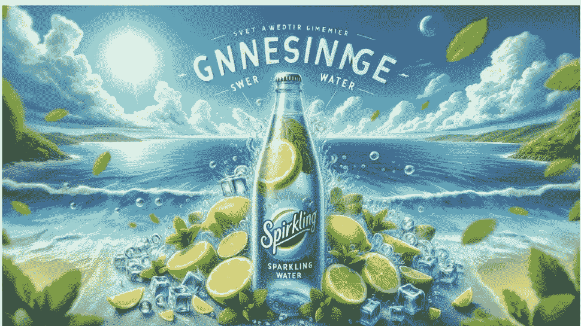

图 8-17 DALL·E 生成广告海报效果

操作流程。

第一步 在提示区输入相应提示词，回车确认后，ChatGPT 会提供生成气泡水广告海报的提示词，具体示例如下。

**提问**

请提供一段关于气泡水广告海报设计的 AI 绘画提示词示例，字数控制在 100 字左右

> **ChatGPT**

想象一个清新夏日的气泡水广告海报。画面中心是一瓶冰凉的气泡水，周围装饰着新鲜的柠檬片和薄荷叶，散发出令人神清气爽的气息。背景是一片蔚蓝的海洋和明媚的阳光，营造出一种清凉解渴的氛围。海报的色彩以清新的蓝色和绿色为主，贴合夏日清凉的主题。

第二步 将获取到的提示词输入 DALL·E 提示区，回车确认即可生成气泡水广告海报，效果见图 8-18。

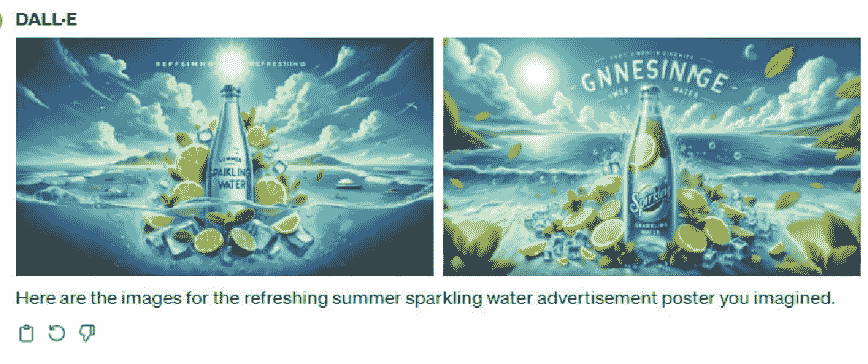

图 8-18 DALL·E 生成气泡水广告海报效果

### 8.2.3 活动海报设计

**效果预览** 活动海报设计本质上是用视觉语言为各类活动打造宣传物料，涵盖音乐会、艺术展、戏剧演出、节庆活动等。设计核心在于借助醒目的用色和巧思的版式抓住大众目光，传递名称、时间等关键资讯，同时点燃参与热情，呈现效果可参考图 8-19。

图 8-19 DALL·E 生成活动海报效果

接下来具体说明如何借助工具生成活动海报。

**步骤 01** 在对话框里输入相关指令并回车，ChatGPT 会给出音乐会海报的绘画提示词参考范例如下。

**提问**

请给出一个约 100 字左右的音乐会活动海报 AI 绘画提示词范例

> **ChatGPT**

构思一张充满动感的音乐会海报，采用亮眼色彩铺底，画面中心是一支激情演奏的乐队，周边环绕光晕与飘散的音符。顶部显著呈现活动名称及举办日期，整体传递出音乐的张力与现场的热烈氛围。

**步骤 02** 把上述提示词复制到 DALL·E 输入区后回车，即可生成音乐会海报，参考效果见图 8-20。

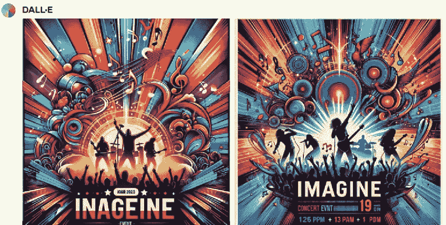

Here are several vivid concert poster designs. They all convey the feeling of an energetic band performance, with beams of light and floating notes against bright backdrops, while the event title and date stand out clearly to reflect the excitement of a live show.

图 8-20 DALL·E 生成音乐会活动海报效果

## 8.3 商业 Logo 案例

Logo 是代表品牌、机构、产品或服务的可视化符号，通常以简洁独特的图形或文字组合呈现。本部分将以 DALL·E 为工具，展示多种商业标志的制作示例，帮助读者提升 AI 绘图的操作熟练度。

### 8.3.1 平面矢量 Logo

**效果预览** 平面矢量 Logo 具备高灵活性与多场景适用性，适合各类品牌识别系统。其设计原则是规避繁复图案、阴影、渐变及立体效果，优先选用简洁图形、清晰线条和纯色块，示例见图 8-21。

图 8-21 DALL·E 生成平面矢量 Logo 效果

下面说明平面矢量 Logo 的生成流程。

**步骤 01** 在 DALL·E 的输入区域填入描述性提示词，示意图见图 8-22。

图 8-22 输入相应的提示词描述

**步骤 02** 回车后，DALL·E 即可输出平面矢量 Logo，最终效果参考图 8-23。

These are the generated logos, presented in a modern minimalist style with high-contrast colors and abstract geometric forms, intended to convey an innovative and professional brand impression across various formats.

图 8-23 DALL·E 生成平面矢量 Logo 效果

### 8.3.2 美妆品牌 Logo

**效果预览** 标志是品牌形象的核心，借助 AI 可迅速产出多种 Logo 方案，提升设计效率，效果参考图 8-24。

图 8-24 DALL·E 生成美妆品牌 Logo 效果

下面介绍美妆 Logo 的生成方法。

**步骤 01** 在输入区输入指令并回车，ChatGPT 会返回适用于美妆品牌标志的 AI 绘画提示词范例如下。

**提问**

请给出约 70 字左右的美妆品牌 Logo AI 绘画提示词，要求能体现品牌特色

> **ChatGPT**

创作一个主打天然成分与可持续理念的美妆标志。采用绿棕配色表现自然氛围，搭配简约的叶片或花朵图形，彰显环保主张与清新美学。

**步骤 02** 把提示词粘贴进 DALL·E 输入框回车，即可生成美妆品牌 Logo，效果见图 8-25。

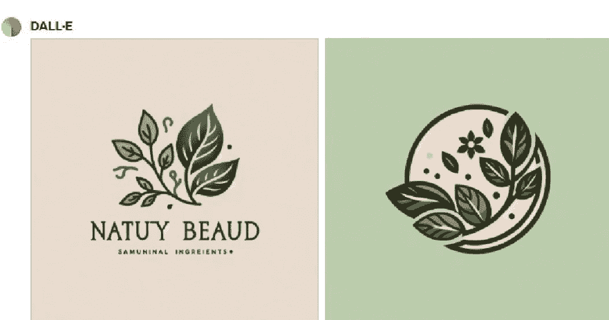

Here are two logo concepts for a beauty brand centered on natural ingredients and sustainability. Both use green and brown palettes with minimal leaf or floral motifs to express eco-friendly values and clean aesthetics.

图 8-25 DALL·E 生成美妆品牌 Logo 效果

##### 温馨提示

在 DALL·E 生成标志时，可明确指定色彩、图标元素、字体风格等偏好，以确保结果契合品牌调性。

## 8.4 工业设计案例

工业设计聚焦于工业产品的造型与功能艺术，兼顾美感与实用性，旨在打造满足用户需求的制品。本节以案例形式讲解如何用 DALL·E 进行工业设计。

### 8.4.1 产品设计

**效果预览** 产品设计涵盖从构思、规划到落地的全流程，涉及材料、尺寸、色彩等具体决策。借助 DALL·E 可快速完成产品视觉化，示例见图 8-26。

图 8-26 DALL·E 生成产品设计效果

下面介绍具体操作步骤。

**步骤 01** 在 ChatGPT 中输入“产品设计中常见的产品类型有哪些？”，回车后可获得相关信息，示例如下。

**提问**

产品设计中常见的产品类型有哪些？

> **ChatGPT**

产品设计覆盖多个行业，品类丰富，从生活日用品到高科技装备皆有涉及。常见类型包括：

- 1. 消费电子：手机、平板、笔记本、智能手表等，强调界面体验、便携性与外观质感。
- 2. 家用电器：冰箱、洗衣机、空调、微波炉等，需兼顾功能、耐用、节能与操作便利。
- 3. 家具家居：桌椅、沙发、灯具等，需平衡美观、舒适、材质选择与环境适配。
- 4. 玩具游戏：面向不同年龄段，注重趣味性、教育价值与安全性。
- 5. 运动休闲：健身器材、户外装备、旅行用品等，侧重耐用、功能与运动支持。

**步骤 02** 接着在 ChatGPT 输入“请基于上述信息，给出一段约 80 字的台灯 AI 绘画提示词示例”，回车后可得到提示词，示例如下。

**提问**

请根据以上内容，提供一段约 80 字的台灯 AI 绘画提示词示例

> **ChatGPT**

设计一款现代感十足的桌面 LED 台灯，线条流畅，外壳哑光黑。机身轻盈底座稳固，灯臂与灯头可调，方便调节光线角度，适用于阅读和办公场景。

**步骤 03** 把提示词输入 DALL·E 并回车，即可生成台灯设计图，效果参考图 8-27。

Here are two concepts for an innovative desktop LED lamp, featuring elegant and modern aesthetics, streamlined lines, and a matte black finish.

图 8-27 DALL·E 生成产品设计效果

### 8.4.2 包装设计

**效果预览** 包装设计融合艺术、科学与商业，涉及材质、结构、图文等环节，既起到保护作用，又传递信息并吸引购买。借助 DALL·E 可迅速生成理想包装方案，示例见图 8-28。

图 8-28 DALL·E 生成包装设计效果

下面说明操作流程。

**步骤 01** 在 ChatGPT 输入“常见的包装设计有哪些？”，回车后可获取各类包装设计信息，示例如下。

**提问**

常见的包装设计有哪些？

> **ChatGPT**

包装设计横跨多个市场和品类，常见方向有：

- 1. 食品饮料包装：涵盖零食、冷冻食品、饮品、调味品等，需吸睛且保证信息传达与保鲜。
- 2. 美妆个护包装：用于化妆品、护肤品、香水等，需体现品质感与使用体验。
- 3. 医药健康包装：涉及药品、保健品、医疗器械等，需兼顾安全、易用与信息清晰。
- 4. 电子产品包装：需兼顾产品保护与特性展示。

以上仅为部分范畴，实际设计需结合产品特性、品牌调性与可持续性等要素。

**步骤 02** 随后输入“请给出约 100 字的护肤品包装设计 AI 绘画提示词示例”，回车后即可获得提示词，示例如下。

**提问**

请提供一段约 100 字的护肤品包装设计 AI 绘画提示词示例

> **ChatGPT**

构思一款高端护肤品包装，风格清新自然且具奢华感。选用柔和的浅绿或天蓝为主色，辅以金或银点缀提升档次。整体简约有质感，点缀精致的植物花卉元素，传递天然成分与温和护肤的理念。

**步骤 03** 将提示词填入 DALL·E 回车，即可生成护肤品包装设计，效果见图 8-29。

Here are two packaging concepts for a premium skincare line, merging contemporary and natural aesthetics. The palette uses soft green with gold accents, adorned with delicate botanical motifs and a gold logo. The refined silhouette conveys luxury and gentle care, appealing to users who prioritize beauty and sustainability.

图 8-29 DALL·E 生成包装设计效果

### 8.4.3 建筑设计

**效果预览** 建筑设计是对建筑形态与结构的规划工作，目标是实现功能适用、经济合理、结构坚固与外观美观。借助 DALL·E 可快速进行建筑可视化，示例见图 8-30。

图 8-30 DALL·E 生成建筑设计效果

以下是具体操作步骤。

**步骤 01** 在 ChatGPT 输入“建筑设计有哪些类型？”，回车后可获取各类建筑设计信息，示例如下。

**提问**

建筑设计有哪些类型？

> **ChatGPT**

建筑类型多样，各有特定功能、风格与建造工艺，主要包括：

- 1. 住宅建筑：独栋、公寓、别墅等，侧重居住舒适、功能合理与个性美观。
- 2. 商业建筑：写字楼、商场、酒店、会展中心等，强调空间利用、商业价值与客户体验。
- 3. 教育建筑：学校、图书馆等，注重营造有利于学习的光线、空间与氛围。
- 4. 医疗建筑：医院、诊所、研究机构等，需兼顾功能、安全卫生与使用舒适。
- 5. 工业建筑：工厂、仓库、研发中心等，追求功能效率与生产物流适配。

不同项目需根据具体需求匹配设计策略与技术。

**步骤 02** 接着输入“请依据住宅建筑信息，给出约 100 字的别墅建筑设计 AI 绘画提示词示例”，回车后即可得到提示词，示例如下。

**提问**

请根据住宅建筑设计信息，提供一段约 100 字的别墅建筑设计 AI 绘画提示词示例

> **ChatGPT**

在宁静的郊区矗立一座现代双层别墅，通透大面积的玻璃窗搭配光滑白墙。院前配有精致庭院，铺设绿意草坪并点缀装饰小树。屋顶覆盖绿植兼顾美观与环保。整体设计突出自然采光最大化及内外空间的无缝衔接。

**步骤 03** 把提示词输入 DALL·E 回车，即可生成别墅效果图，参考图 8-31。

Here are two renderings of a modern villa by a calm lake, as described. Both highlight expansive glass surfaces, clean architectural lines, and a harmonious integration of natural elements with contemporary style.

图 8-31 DALL·E 生成别墅建筑设计效果

## 本章小结

本章系统介绍了借助 DALL·E 生成各类 AI 绘画实例，涵盖艺术插画、海报设计、企业标志及工业设计等方向。学习后读者可掌握不同绘画类型的特点，并熟练运用 DALL·E 进行创作。

## 课后实训

**效果预览** 练习任务是让 DALL·E 生成一款耳机包装，效果见图 8-32。

## 第 8 章 DALL-E

图 8-32 耳机的包装设计效果

操作流程如下。

**步骤 01** 在 DALL·E 中输入对应提示词，示意图见图 8-33。

图 8-33 输入相应的提示词描述

**步骤 02** 回车确认后，DALL·E 将生成耳机包装设计，效果参考图 8-34。

Here are creative and stylish headphone packaging concepts, presented as sleek rectangular boxes in a vivid yellow scheme, eye-catching and suited to modern preferences.

图 8-34 DALL-E 根据提示词生成耳机包装设计效果

# AI 视频篇

# 第 9 章 CapCut：直接通过 ChatGPT 4 生成视频

只需提供对应提示词，即可在 ChatGPT 的 GPTs 中制作视频内容。这类视频依托深度学习算法，有助于节省制作时间。本章讲解如何借助 ChatGPT 与 CapCut VideoGPT 进行视频创作，帮助读者掌握 GPTs 的应用技巧。

## 9.1 安装与使用

ChatGPT 视频剪辑实战：CapCut 与 Visla 联用指南

ChatGPT 的玩法早已超出纯文字，借助 GPTs 也能参与成片。CapCut VideoGPT 把字节在海外主推的剪辑 App 接进对话，Visla Video Maker 则能根据主题自动从公开库拼片。下面把两套方案的安装流程和典型案例梳理清楚，帮你更快上手 AI 剪辑。

### 9.1.1 什么是 CapCut VideoGPT

CapCut 是字节跳动面向海外发行的剪辑软件，内置变速、美颜、滤镜等常用功能，音乐库也比较丰富，使用手感与国内版剪映几乎一致，常被视作剪映的海外版本。

在 ChatGPT 生态里，CapCut 被封装成插件 CapCut VideoGPT。把对话生成的文案能力与 CapCut 的剪辑能力打通，用自然语言下指令即可完成剪辑，给出合适的指令就能拿到成品地址，如图 9-1 所示。

### 9.1.2 搜索并安装 GPTs

使用 CapCut VideoGPT 前，先在 GPTs 商店完成安装，操作如下。

**步骤 01** 打开 ChatGPT 主页，侧栏点按“浏览 GPTs”按钮，如图 9-2 所示。

**步骤 02** 进入商店页面后，在搜索框里输入 CapCut，从弹出列表中选中 CapCut VideoGPT，如图 9-3 所示。

**步骤 03** 跳转到插件页后，点击左上方名称旁的下拉箭头▼，在菜单里选择“固定到侧栏”，如图 9-4 所示，即可让插件常驻侧栏。

图 9-2 单击“探索 GPTs”按钮

图 9-3 选择 CapCut VideoGPT 选项

图 9-4 选择“保持在侧边栏”选项

### 9.1.3 GPTs 的使用方法

安装完成后即可开始制作。

**步骤 01** 在 CapCut VideoGPT 的输入区填入指令，如图 9-5 所示。

图 9-5 输入相应的提示词

**步骤 02** 回车确认后，系统会返回视频地址，如图 9-6 所示。

CapCut VideoGPT

Talked to capcut.com

已根据您的请求生成了记录工作的短视频。您可以通过以下链接观看视频：观看由CapCut生成的AI视频结果。请注意，点击视频链接时可能需要等待大约一分钟以便视频加载。

此外，如果您希望重新配置脚本和视频的宽高比，或有任何反馈，请联系capcut-****@****.com。

图 9-6 CapCut VideoGPT 生成视频的链接

**步骤 03** 点选“观看由 CapCut 生成的 AI 视频结果”进入官网，如图 9-7 所示，便可观看或继续编辑。

图 9-7 进入 CapCut 网站

> **温馨提示**
>
> 目前的 CapCut VideoGPT 主要靠公共素材库拼接，与人工剪辑仍有差距，想提升观感需要手动微调。

## 9.2 效果的制作

熟悉安装后，下面用两个场景演示快速成片。

### 9.2.1 应用实战：制作科普视频

**效果展示** 科普类视频面向大众普及知识，覆盖历史、艺术、文化、经济、社科等方向，核心是把专业内容可视化、易理解。借助 CapCut VideoGPT 能迅速产出此类内容，效果见图 9-8。

制作流程如下。

**步骤 01** 先让 ChatGPT 帮忙写指令。在输入框输入“我正在使用 AI 工具以文字生成视频，现在我需要你为我提供一段可以生成视频的提示词，字数控制在 60 字左右，视频的类型为科普视频”，回车后得到示例如下。

**提问**

我正在使用 AI 工具以文字生成视频，现在我需要你为我提供一段可以生成视频的提示词，字数控制在 60 字左右，视频的类型为科普视频

> **ChatGPT**
>
> 探索太阳系的奥秘，从火热的太阳到冰冷的海王星。详解行星特征、卫星轨道，以及人类探索宇宙的伟大里程碑。启发好奇心，拓展知识边界。

**步骤 02** 切换至 CapCut VideoGPT，将上一步得到的指令粘贴到输入区，如图 9-9。

请生成一段视频，视频的内容为“探索太阳系的奥秘，从火热的太阳到冰冷的海王星。详解行星特征、卫星轨道，以及人类探索宇宙的伟大里程碑。启发好奇心，拓展知识边界”

图 9-9 ChatGPT 生成视频提示词

**步骤 03** 回车后，插件会基于指令返回视频地址，如图 9-10。

CapCut VideoGPT

Talked to capcut.com

我已经为你生成了一段探索太阳系奥秘的视频。这段视频带你从火热的太阳旅行到冰冷的海王星，详解每个行星的特征、卫星轨道，以及人类探索宇宙的伟大里程碑，旨在启发好奇心，拓展知识边界。

请注意，视频加载可能需要大约一分钟的时间。

查看来自CapCut的AI视频结果

如果你需要调整视频的内容或宽高比，请告诉我你的具体需求。

图 9-10 CapCut VideoGPT 生成视频的链接

**步骤 04** 点“查看来自 CapCut 的 AI 视频结果”进入网站，点击播放键▶，如图 9-11，即可预览。

图 9-11 单击“播放”按钮

### 9.2.2 应用实战：制作电影解说视频

**效果展示** 电影解说视频在各大平台常见，特点是通过旁白对情节、角色、主题或幕后故事进行解析与点评。CapCut 可快速生成此类视频，效果见图 9-12。

图 9-12 电影解说视频效果展示

操作步骤如下。

**步骤 01** 先让 ChatGPT 说明类型。在输入框输入“你知道什么是电影解说视频吗？”，回车后得到回复示例如下。

**提问**

你知道什么是电影解说视频吗？

> **ChatGPT**
>
> 电影解说视频是一种特定的视频形式，通常在视频平台上发布，如 YouTube 或 Bilibili。这类视频的主要特点是通过旁白解说的方式，对电影的情节、角色、主题，或背后的故事进行详细解析和评论。电影解说视频的目的多种多样，包括但不限于：
>
> 1. 教育和分析：通过深入分析电影的拍摄技巧、叙事结构、角色发展和主题，帮助观众更深层次的理解电影的内涵。
>
> 2. 娱乐：以幽默或轻松的方式对电影进行评论，为观众提供娱乐价值。
>
> 3. 批评和评论：提供对电影的批判性看法，包括对其艺术价值、社会影响和技术实现的评价。
>
> 4. 情节复述：对电影的情节进行概括和复述，帮助那些没有时间观看整部电影的人快速了解电影内容。
>
> 5. 背景介绍：解释电影的历史背景、创作背景或文化背景，帮助观众更好地理解电影内容。
>
> 电影解说视频适合各种类型的观众，无论是电影爱好者、学生、电影制作人，还是普通观众，都可以通过这种形式获得知识、洞察力和娱乐。这类视频的制作人通常具有深厚的电影知识，能够提供独到的见解和分析，使观众能够从不同角度欣赏和理解电影。

**步骤 02** 切换到 CapCut VideoGPT，输入“请生成电影《当幸福来敲门》的解说视频”，回车后得到视频地址，如图 9-13。

CapCut VideoGPT

Talked to capcut.com

我已为你生成了一段关于电影《当幸福来敲门》的解说视频。这段视频深入探讨了影片中克里斯·加德纳，一个面对失业和无家可归却从未失去希望的人的挣扎与胜利。借助坚定的决心和韧性，加德纳克服了无数困难，为自己和他的儿子赢得了更好的未来。视频旨在启发观众，即使面对逆境，只要坚持不懈和拥有爱，就能获得非凡成就。

请注意，视频加载可能需要大约一分钟的时间。

查看来自CapCut的AI视频结果

如果你有任何关于视频内容或宽高比的调整需求，请随时告诉我。

图 9-13 CapCut VideoGPT 生成视频链接

**步骤 03** 点“查看来自 CapCut 的 AI 视频结果”进入网站，点击播放键●，如图 9-14，即可观看。

图 9-14 单击“播放”按钮

## 本章小结

本章介绍了 ChatGPT 内置的 CapCut VideoGPT，说明了安装与使用流程，并通过科普、电影解说等案例展示实际操作，帮助读者掌握 AI 视频制作思路。

## 课后实训

**效果展示** 以野生动物为主题制作短片，效果见图 9-15。

图 9-15 野生动物视频效果展示

操作如下。

**步骤 01** 在 CapCut VideoGPT 输入区输入“生成一个关于野生动物的视频”，回车后得到地址，如图 9-16。

图 9-16 CapCut VideoGPT 生成视频链接

**步骤 02** 打开链接进入官网，点击播放键●，如图 9-17，即可播放。

图 9-17 单击“播放”按钮

# 第 10 章 Visla：用公开素材快速拼短视频

AI 做短片的速度已能达到秒级到分钟级，对追求更新频率的内容平台很友好。本章介绍如何通过 ChatGPT 调用 Visla Video Maker 完成短视频制作。

## 10.1 安装与使用

ChatGPT 可通过 GPTs 生成视频，Visla Video Maker 是另一款常用选择。下面介绍它的安装与基础用法。

### 10.1.1 什么是 Visla Video Maker

Visla Video Maker 是专为与 ChatGPT 协作设计的 GPTs，目标是简化视频创作流程。用户只需提供指令，即可让其自动拼装素材生成视频，如图 10-1 所示。

### 10.1.2 搜索并安装 GPTs

前往 GPTs 商店搜索并安装 Visla Video Maker。

**步骤 01** 进入 GPTs 商店页面，在搜索框输入 Visla Video Maker，选中对应选项，如图 10-2 所示。

**步骤 02** 跳转到操作界面后，点击左上方名称旁的下拉箭头▼，选择“固定到侧栏”，如图 10-3 所示，即可常驻侧栏。

图 10-3 选择“保持在侧边栏”选项

### 10.1.3 GPTs 的使用方法

**步骤 01** 在 Visla Video Maker 的输入区填入指令，如图 10-4 所示。

图 10-4 输入相应的提示词

**步骤 02** 回车确认后，ChatGPT 会返回视频地址以及用于编辑的认领码，如图 10-5 所示。

Visla Video Maker

Talked to openapi.visla.us

视频已成功创建！您可以通过以下链接观看视频：“A Beautiful Day Out: An Outdoor Picnic Journey”。为了对视频进行编辑和个性化定制，请使用此视频认领码：961325。请注意，认领码在24小时内有效。

如果您有任何其他需求或想要进一步定制您的视频，请随时告诉我！

图 10-5 Visla Video Maker 生成视频的链接和代码

**步骤 03** 点击链接进入 Visla 网站，如图 10-6 所示，左侧显示文案脚本，右侧播放生成视频。

> **温馨提示**
>
> 在视频下方点击播放键▶即可预览，也可调整音量、倍速、字幕或全屏。

## 10.2 效果的制作

掌握基础操作后，下面用两个实战案例深化理解。

### 10.2.1 应用实战：制作美食探店视频

**效果展示** 美食探店视频以餐饮体验为核心，通常包含店面环境、食材来源、制作过程与故事讲述。通过 Visla Video Maker 可快速生成，效果见图 10-7。

图 10-7 美食探店视频效果展示

制作步骤。

**步骤 01** 先向 ChatGPT 请求脚本。在输入框输入“你是一名美食探店博主，正准备去一家人气很高的餐馆探店，现在需要你为我提供一段美食探店的视频脚本，字数控制在 500 字左右”，回车后 ChatGPT 会生成脚本，示例如下。

**提问**

你是一名美食探店博主，正准备去一家人气很高的餐馆探店，现在需要你为我提供一段美食探店的视频脚本，字数控制在 500 字左右

> **ChatGPT**
>
> 在这段美食探店的视频脚本中，我将带领观众体验一次难忘的味觉之旅。
>
> **【镜头缓缓拉近，显露出餐馆热闹的外观，人潮汹涌。】**

### 10.2.2 应用实战：制作运动健身视频

**效果展示** 运动健身视频用于指导锻炼，由专业教练或爱好者制作，涵盖不同水平与目标。Visla Video Maker 能快速生成此类内容，效果见图 10-12。

图 10-12 运动健身视频效果展示

制作步骤如下。

步骤 01 先了解特点。输入“健身运动视频的特点是什么？”，回车后得到示例如下。

提问

健身运动视频的特点是什么？

> **ChatGPT**
>
> 健身运动视频具有以下特点：
>
> 1. **便捷性**：用户可以根据自己的时间安排，在任何地点通过电子设备（如手机、电脑、平板或智能电视）观看和跟随健身视频进行锻炼，无须前往健身房或其他特定场所。
>
> 2. **多样性**：市面上的健身视频种类繁多，涵盖了从初级到高级的各种难度级别，适合不同健身水平的人群。内容也非常丰富，包括有氧运动、力量训练、瑜伽、舞蹈、HIT（高强度间歇训练）等多种形式。
>
> 3. **经济性**：与雇佣私人教练或前往健身房相比，观看健身视频是一种更经济的选择。许多健身视频在网上免费提供，即使是需要订阅的在线健身平台，费用也通常低于健身房会员费。
>
> 4. **指导性**：优质的健身视频由专业的教练制作，他们在视频中不仅展示正确的运动姿势，还会讲解呼吸技巧、动作要领，以及常见错误的纠正方法，帮助用户降低运动伤害的风险。
>
> 5. **灵活性**：用户可以根据自身需求和偏好选择视频，制定个性化的健身计划。不论是想要减肥、增肌、提高柔韧性，还是放松身心，都能找到合适的健身视频。
>
> 6. **互动性**：尽管与现场教练相比存在一定差距，但许多在线健身平台和社交媒体上的健身视频都鼓励用户留言，分享体验、进度和成果，形成了一个互帮互助的社区氛围。

步骤 02 切换到 Visla Video Maker，输入“生成一段运动健身视频，视频要具有指导性”，回车后得到链接，如图 10-13。

Visla Video Maker

Talked to openapi.visla.us

您的运动健身视频已经制作完成！您可以通过以下链接观看视频：“Empower Your Fitness: A Comprehensive Guide”。为了对视频进行编辑和个性化定制，请使用此视频认领码：809525。

请注意，认领码在24小时内有效。

如果您需要为这个视频设计一个封面或有其他任何需求，请让我知道！我很乐意帮助您进一步丰富视频内容。

步骤 03 点击链接进入 Visla 网站，点击右上角 Save to Edit 按钮，弹出 Enter Claim Code 对话框，输入认领码后点击 Save Video，如图 10-14。

步骤 04 完成前置动作后即可进入视频编辑页，点击左侧的文本框，将默认的英文字幕改写成中文，参考图10-15。

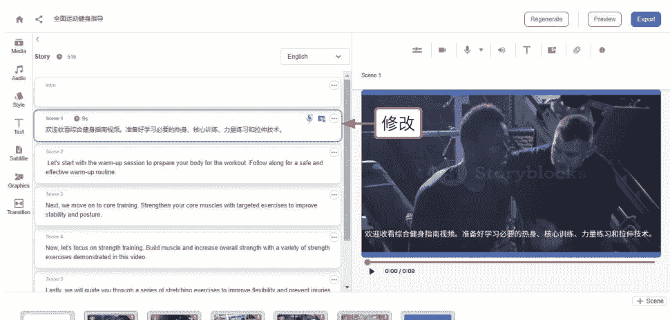

图10-15 字幕转为中文的界面

步骤 05 沿用相同做法把其余字幕全部改成中文，然后点选右上角的 Export 按钮来导出视频，示意见图10-16。

图10-16 首次点击 Export 按钮的位置

步骤 06 此时会弹出 Your project contains premium stock（video/music）[您的项目包含优质库存（视频/音乐）] 的提示框，点按 Regenerate with Free Stock（使用免费库存重新生成）按钮即可，见图10-17。

图10-17 免费库存重新生成按钮

步骤 07 处理完提示后，再次点按右上角的 Export 按钮，如图10-18所示。

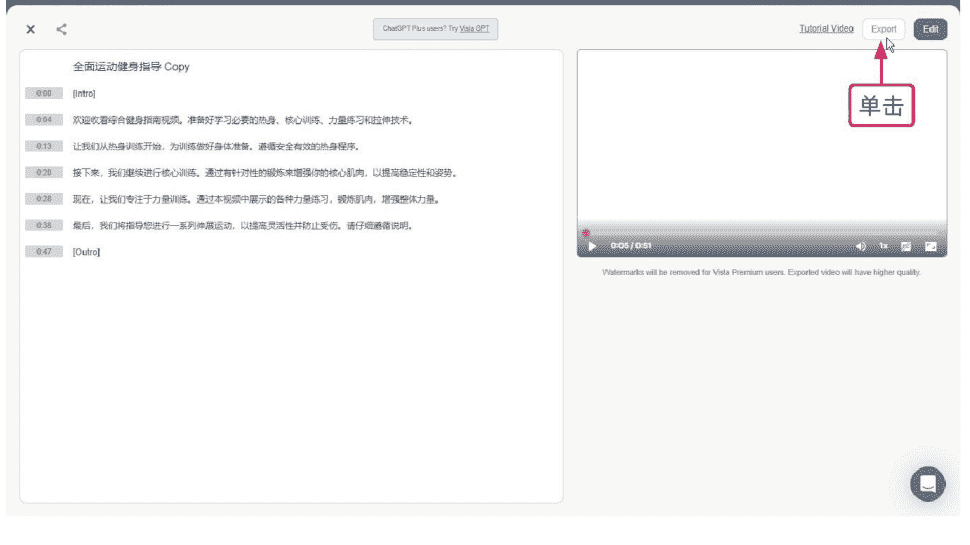

图10-18 第二次点击导出按钮

步骤 08 进入预览页面后，按下右下角的更多按钮···，在弹出的菜单里选择 Download 即可把视频下载到本地，如图10-19所示，稍作等待即可完成保存。

图10-19 在菜单中选择下载

##### 温馨提示
Visla 的付费素材库只有开通高级账号后才能保留使用，普通账号导出时会把优质素材自动替换为免费素材。

## 本章小结
本章围绕 ChatGPT 里的 Visla Video Maker 展开，系统介绍了该 GPTs 的使用流程，并给出带效果展示的制作案例，帮助读者掌握 AI 短视频的实操要点。学完后可以更熟练地借助 ChatGPT 内的 GPTs 完成 AI 视频创作。

## 课后实训
**效果展示** 下面演示利用 ChatGPT 的 Visla Video Maker 生成音乐舞蹈视频，最终效果如图10-20所示。

图10-20 音乐舞蹈视频成品

制作音乐舞蹈视频的具体流程如下。

**步骤 01** 在 Visla Video Maker 的输入框中输入“生成一个关于音乐舞蹈的视频”，按【Enter】确认后，系统会返回视频链接，如图10-21所示。

图10-21 Visla GPTs 生成的视频链接

**步骤 02** 打开链接进入 Visla 官网，如图10-22所示，左侧呈现视频脚本，右侧播放生成的视频。

图10-22 Visla 网站的脚本与视频布局

步骤 03 点击右上角的 Save to Edit 按钮，会弹出 Enter Claim Code 对话框，输入 Visla 提供的认领码后点击 Save Video 即可保存视频。

# GPTs 篇
# 第 11 章
## 教育学习：打造个性化高效学习体验

借助 ChatGPT 中的 GPTs 可以优化学习路径，提升学习效率。本章将介绍 Diagrams：Show Me 的图表绘制用法和 Wolfram 的专业问题处理用法，让读者更熟悉 GPTs 的能力。

### 11.1 Diagrams：Show Me：绘制并编辑图表
相较于纯文字，图表更利于快速传递信息。在 ChatGPT 中可调用 GPTs 生成图表，例如 Diagrams：Show Me。以下详细介绍其功能、安装方式及实战案例。

#### 11.1.1 什么是 Diagrams: Show Me
Diagrams：Show Me 能根据自然语言描述创建和修改流程图、思维导图、时序图等多种图表，帮助理解复杂概念，如图11-1所示。它非常适合需要将复杂概念或数据可视化的自媒体作者、教育内容创作者等群体。

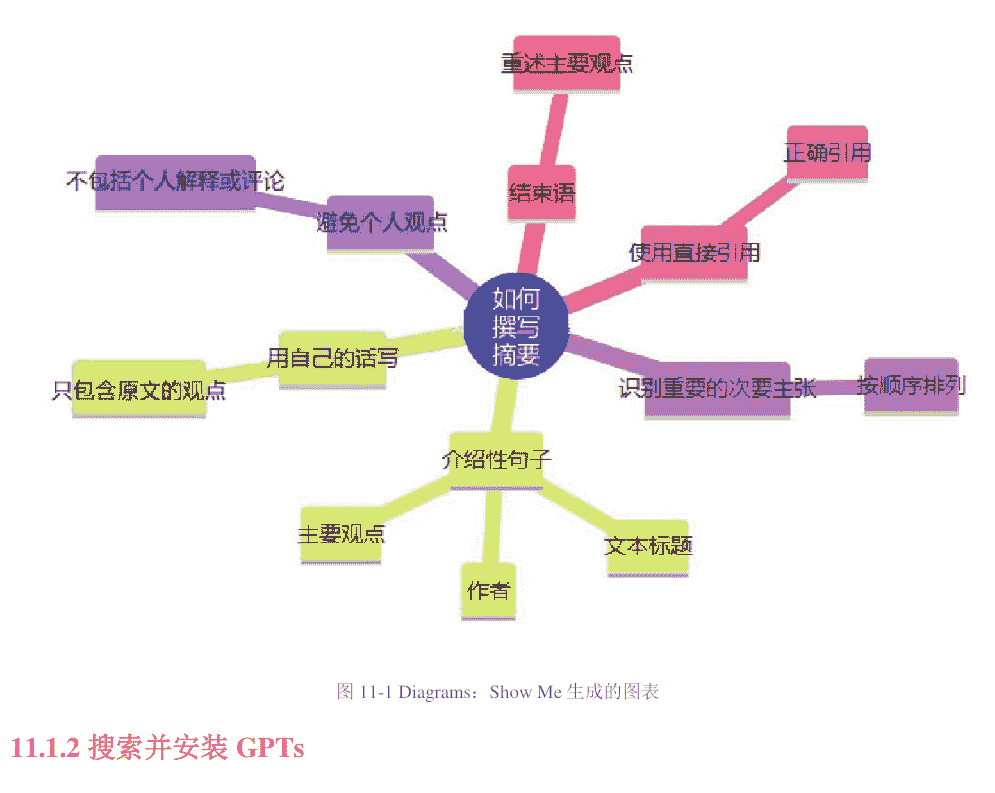

#### 11.1.2 搜索并安装 GPTs
先在 GPTs 商店搜索并安装 Diagrams：Show Me，再将其固定到侧边栏便于后续调用，具体步骤如下。

**步骤 01** 打开 GPTs 商店页面，在搜索框输入 Diagrams：Show Me，从弹出的列表中选中对应选项，如图11-2所示。

发现并创建自定义版本的ChatGPT，这些版本结合了指令、额外知识和任何技能组合。

图11-2 选择 Diagrams：Show Me

**步骤 02** 跳转到新的 ChatGPT 页面，点击左上方 Diagrams：Show Me 旁的下拉按钮 ▾，在菜单中选择“保持在侧边栏”，如图11-3所示，即可保留该 GPTs 在侧边栏。

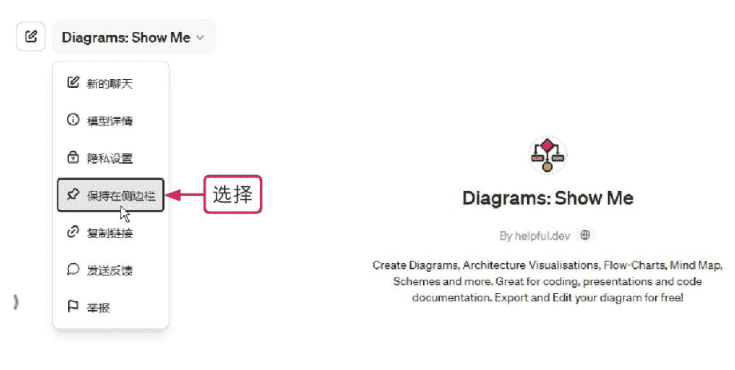

图11-3 将 GPTs 固定在侧边栏

#### 11.1.3 应用实战：制作柱状数据图
柱状图通过柱子的高低或长短体现数据量的大小，是数据分析与统计中常用的可视化形式，能直观对比不同类别。借助 Diagrams：Show Me 可快速生成，具体操作如下。

**步骤 01** 在 Diagrams：Show Me 输入框中输入相应提示词，如图11-4所示，指令其生成柱状数据图。

用柱状数据图的形式来解释2023年人工智能的增长，图中所有的内容都使用中文

图11-4 输入生成柱状图的提示词

步骤 02 按【Enter】确认，ChatGPT 会借助 Diagrams：Show Me 绘制对应图表，如图11-5所示。

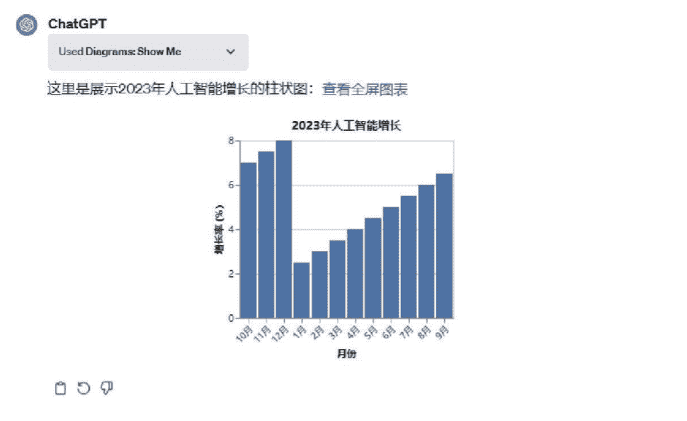

图11-5 通过 Diagrams：Show Me 生成的图表

步骤 03 点击相关链接进入“Edit Diagram（编辑图表）”网站，如图11-6所示，可在该站对图表进行编辑调整。

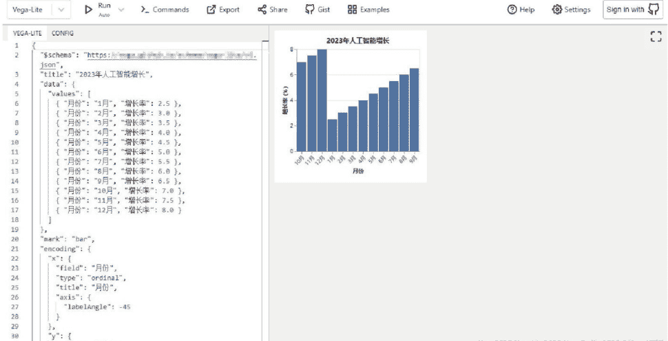

图11-6 编辑图表网站界面

#### 11.1.4 应用实战：制作饼状数据图
饼状图用于展示各部分与整体的比例关系，整圆代表总量，扇形代表各部分占比。可通过 Diagrams：Show Me 快速生成，方法如下。

步骤 01 在 Diagrams：Show Me 输入框中输入相应提示词，如图11-7所示，让其生成饼状数据图。

图11-7 输入生成饼状图的提示词

步骤 02 按【Enter】确认，Diagrams：Show Me 将绘制出对应图表，如图11-8所示。

这里是展示本周销量情况的饼状图：

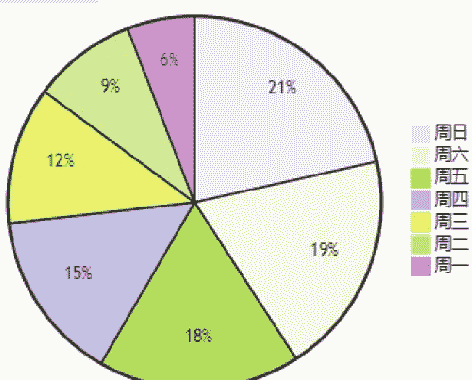

图11-8 生成的饼状数据图

##### 温馨提示
点击“下载 PNG 图片”链接会弹出另存为对话框，选择保存位置后点“保存”，即可以 PNG 格式保存饼状图。

**步骤 03** 点击“通过代码编辑”链接，进入 Edit Diagram 网站，如图11-9所示，可在此对图表进行编辑。

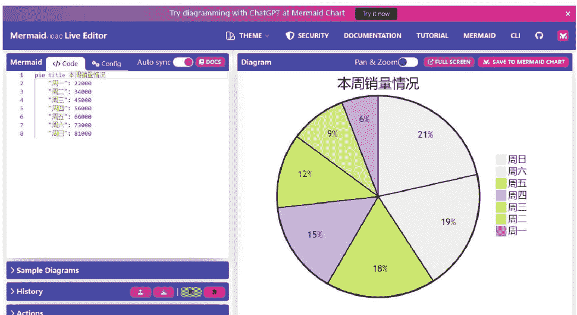

图11-9 进入编辑图表网站

##### 温馨提示
不同样式的图表进入编辑网站的入口可能略有差异，但核心功能基本一致，用户仍可在网站中完成编辑。

### 11.2 Wolfram：处理专业性问题
Wolfram 拥有丰富的计算库和强大的运算能力，可结合 ChatGPT 回答各类科学数学问题并给出详细步骤。本节介绍 Wolfram 的功能、安装方法及应用案例。

#### 11.2.1 什么是 Wolfram
Wolfram Alpha 是一个跨领域的计算引擎，能理解自然语言提问并给出计算过程与结果。Wolfram 是一款将 Wolfram Alpha 的计算能力与 ChatGPT 的语言模型融合的 GPTs，可实现精准计算，大幅增强专业输出。

Wolfram 可为 ChatGPT 提供强计算与数据分析能力，适用范围从简单数学运算到复杂数据分析、图形绘制、编程、教学科研等。例如提问“一个袋子里有 3 个红球和 2 个蓝球，连续抽取 3 个球，全部为红球的概率是多少？”，Wolfram 会进行组合概率计算，如图11-10所示。

> **Wolfram**
要计算从一个包含3个红球和2个蓝球的袋子中连续抽取3个球，且这3个球都是红球的概率，我们可以使用组合概率的方法来计算。
首先，总共有5个球，从中连续抽取3个球，不考虑顺序的情况下，总的抽取方式有 $C(5,3)$ 种，其中 $C(n,k)$ 表示从n个不同元素中不重复地抽取k个元素的组合数。
对于全部抽到红球的情况，因为只有3个红球，所以必须全部抽取这3个红球，这种情况只有1种抽法。
接下来，我们计算具体的概率值。
从一个包含3个红球和2个蓝球的袋子中连续抽取3个球，全部为红球的概率是 $\frac{1}{10}$ 或者 10%。
图11-10 Wolfram 数学计算示例

#### 11.2.2 搜索并安装 GPTs
需在 GPTs 商店搜索并安装 Wolfram 才能使用，下面是具体流程。

**步骤 01** 进入 GPTs 页面，在搜索框输入 Wolfram，从列表中选择 Wolfram 选项，如图11-11所示，即可完成安装。

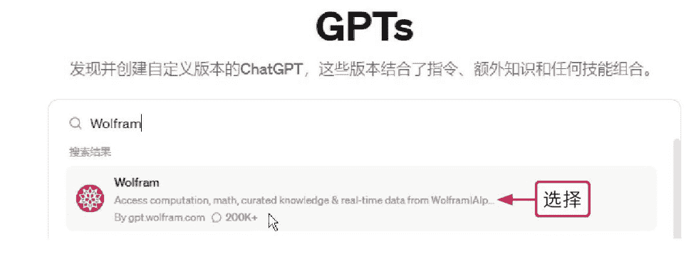

图11-11 选择 Wolfram

步骤 02 进入新的 ChatGPT 页面，点击左上方 Wolfram 旁的下拉按钮▼，在菜单中选择“保持在侧边栏”选项，如图11-12所示，即可将该 GPTs 保留在侧边栏。

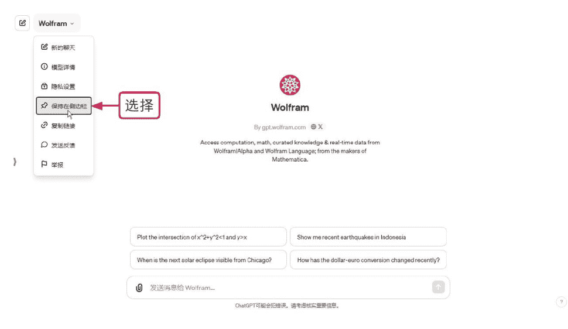

#### 11.2.3 应用实战：制作方程图示
方程图示是在坐标系中展示方程解集的图形，有助于直观理解方程性质与解的分布。可通过 Wolfram 快速生成，下面是操作步骤。

步骤 01 在 Wolfram 输入框中输入相应提示词，让其生成方程图示，如图11-13所示。

步骤 02 按【Enter】确认，Wolfram 将生成方程图示，效果如图11-14所示。

Wolfram
Talked to wolframalpha.com
解方程 $x^2 + 2x - 3 = 0$ 的解为 $x = -3$ 和 $x = 1$。
方程的图示如下：
+   - 根图示：
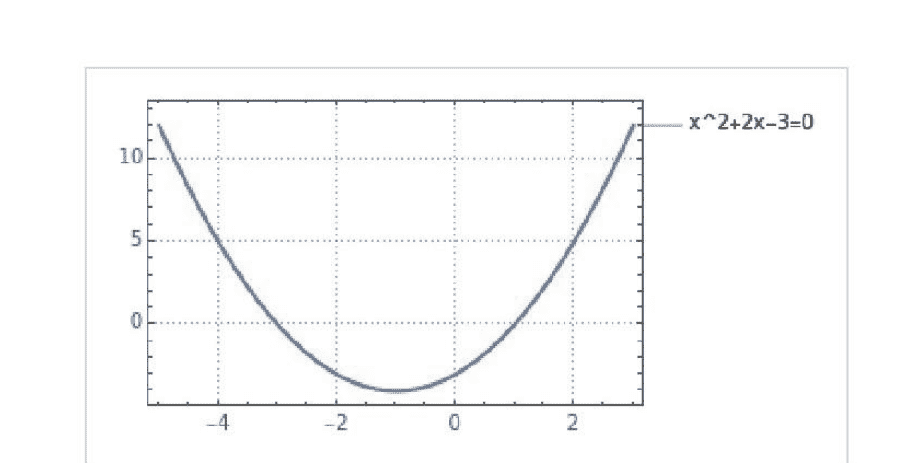
图11-14 Wolfram 生成的方程图示

#### 11.2.4 应用实战：制作函数三维图
函数三维图是在三维空间中对函数进行可视化，有助于理解函数在三维中的行为特征。可通过 Wolfram 快速生成，具体方法如下。

步骤 01 在 Wolfram 输入框中输入相应提示词，让其生成函数三维图，如图11-15所示。

图11-15 输入生成三维图的提示词

步骤 02 按【Enter】确认，Wolfram 将生成函数三维图，效果如图11-16所示。

Wolfram
Talked to chatgpt.wolframcloud.com
这是函数 $z = x^2 + x^3 + 3x - y^2$ 的三维图示：
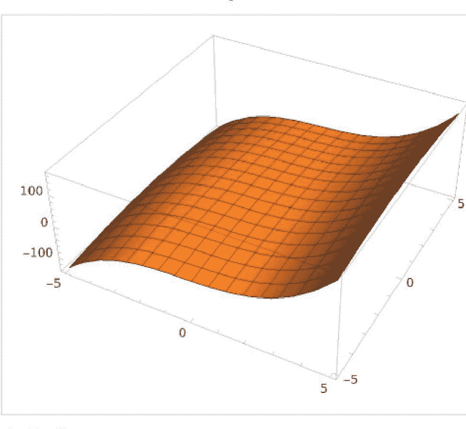
图11-16 ChatGPT 借助 Wolfram 生成的三维函数图

## 本章小结
本章介绍了提升学习效率的两个 GPTs：擅长绘制与编辑图表的 Diagrams：Show Me，以及擅长处理专业问题的 Wolfram。学习后可更好地利用 ChatGPT 中的 GPTs 辅助日常学习。

## 课后实训
下面演示用 Wolfram 制作方程图示，具体操作如下。

**步骤 01** 在 Wolfram 输入框中输入“请解答这个方程：x^6-8x^2+7x=2，并生成方程图示”，让其生成图示，如图11-17所示。

图11-17 输入求解与作图的提示词

**步骤 02** 按【Enter】确认，Wolfram 将生成方程图示，效果如图11-18所示。

Wolfram
Talked to wolframalpha.com
解方程 $x^6 - 8x^2 + 7x = 2$ 的近似解为：
+   - $x \approx -1.87302$
- $x \approx 1.41962$
- $x \approx -0.21108 - 1.71387i$
- $x \approx -0.21108 + 1.71387i$
- $x \approx 0.437778 - 0.246161i$
这表示方程有 6 个解，每个解都是一个特定的根，这些根可以通过数值方法得到。
方程的图示如下所示：
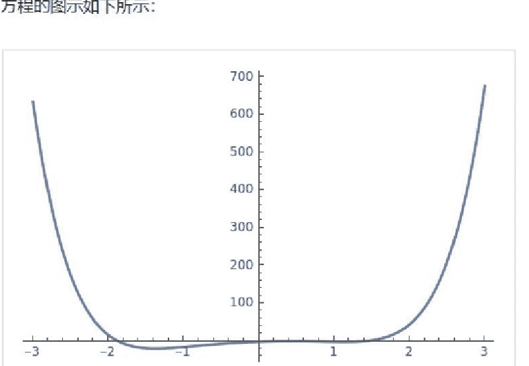
图中显示了方程 $x^6 - 8x^2 + 7x - 2 = 0$ 在 $-3$ 到 $3$ 范围内的行为。
图11-18 Wolfram 生成的方程图示

# 第 12 章
## 职场办公：用 AI 工具提升工作效率与质量

借助 ChatGPT 中的 GPTs 可提高日常工作的效率与质量，通过 AI 优化流程、自动化重复任务等方式提升个人和团队的生产力。本章将讲解 Doc Maker 与 PDF Ai PDF 的使用方法，帮助快速掌握 GPTs 的用法。

### 12.1 Doc Maker：生成高质量文档
ChatGPT 可根据提示生成文本，在 Doc Maker 辅助下能生成各类高质量文档，节省大量时间，使文档制作更高效。本节介绍 Doc Maker 的功能、安装方法及实战案例。

#### 12.1.1 什么是 Doc Maker
Doc Maker 是一个专门制作文档的 GPTs，可按用户需求快速生成简历、求职信等文档，如图12-1所示，并支持 DOCX、XLSX、CSV、HTML 等格式。

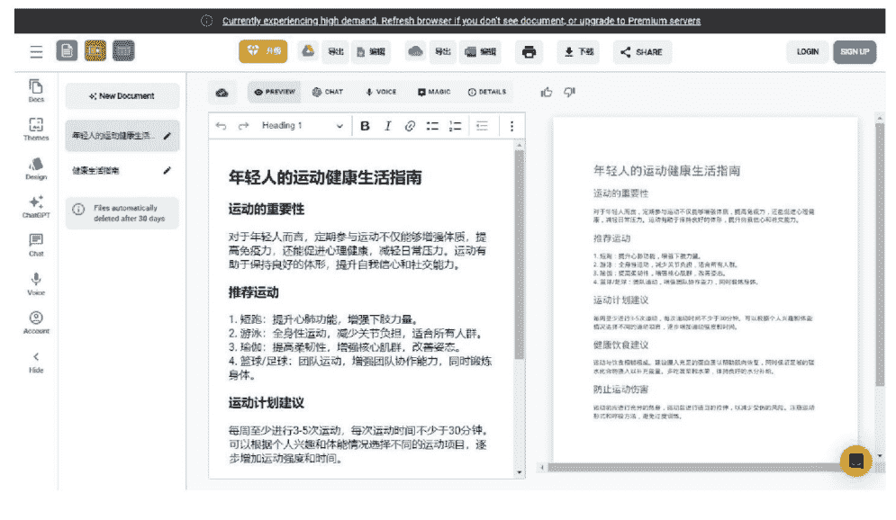

#### 12.1.2 搜索并安装 GPTs
要使用 Doc Maker 生成高质量文档，首先需在 GPTs 商店搜索并安装，具体操作如下。

步骤 01 进入 GPTs 页面，在搜索框输入 Doc Maker，从弹出的列表中选择 Doc Maker 选项，如图12-2所示。

GPTs
发现并创建自定义版本的ChatGPT，这些版本结合了指令、额外知识和任何技能组合。

图12-2 选择 Doc Maker 选项

打开新对话页后，点击左上角 Doc Maker 旁边的下拉符号▼，在弹出的选项列表中选择“保持在侧边栏”，如图12-3所示，这样该 GPT 就会常驻侧栏。

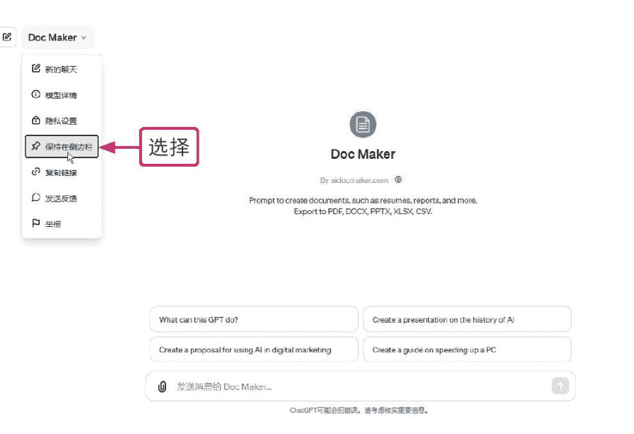

图12-3 选择“保持在侧边栏”选项

#### 12.1.3 实战演练：用 Doc Maker 生成简历
在 ChatGPT 内调用 Doc Maker，能迅速拼凑出一份简历，相比人工撰写效率提升明显。下面说明具体流程。

第一步 在 Doc Maker 的输入区写入合适的提示，让它基于给定信息起草简历，示意见图12-4。

图12-4 在输入框中填写提示

第二步 按下回车后，系统会返回一份计算机专业学生简历的访问链接，见图12-5。

图12-5 Doc Maker 返回的简历链接

第三步 点击链接进入 Doc Maker 官网，即可浏览生成的简历，页面也支持编辑与导出，见图12-6。
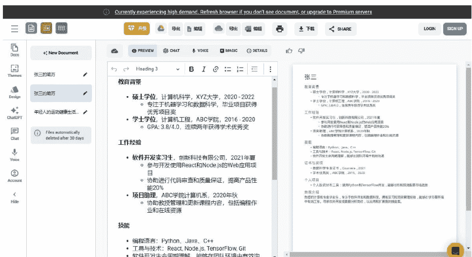

图12-6 在官网查看生成的简历

#### 12.1.4 实战演练：借助 Doc Maker 制作报告
Doc Maker 不止能做简历，还可快速产出数据分析、市场研究、新闻摘要等各类报告。下面以制作报告为例。

第一步 在 Doc Maker 输入区填入对应指令，示意见图12-7。

图12-7 填写用于生成报告的提示

第二步 确认后回车，平台会生成一份关于气候变化影响的报告，见图12-8。
我已经为你生成了一个关于气候变化影响的报告。报告详细探讨了气候变化对全球环境、社会和经济的影响，并包括了对应对策略的建议。你可以通过以下链接查看和下载报告：[点击这里查看报告](http://gpt.docs.aidocmaker.com)。
如果你有任何特别要求或需要进一步的信息，请随时告诉我！

图12-8 通过 Doc Maker 生成的气候变化报告

第三步 点击“点击这里查看报告”进入官网，即可查看与下载报告，见图12-9。
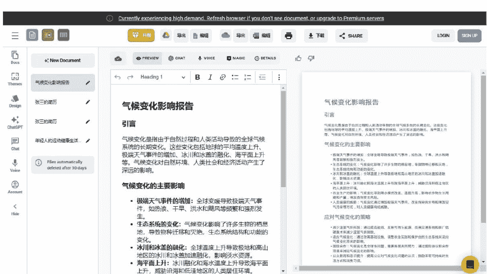

图12-9 在官网查看生成的报告

### 12.2 PDF Ai PDF：快速解析 PDF 文档
通过 PDF Ai PDF 可以在短时间内完成 PDF 分析，节省时间并提升效率。本节先介绍工具定位，再说明安装方式与案例。

#### 12.2.1 PDF Ai PDF 的定位
该工具信息整合能力强，可快速抽取正文、提炼要点、检索指定内容，见图12-10。
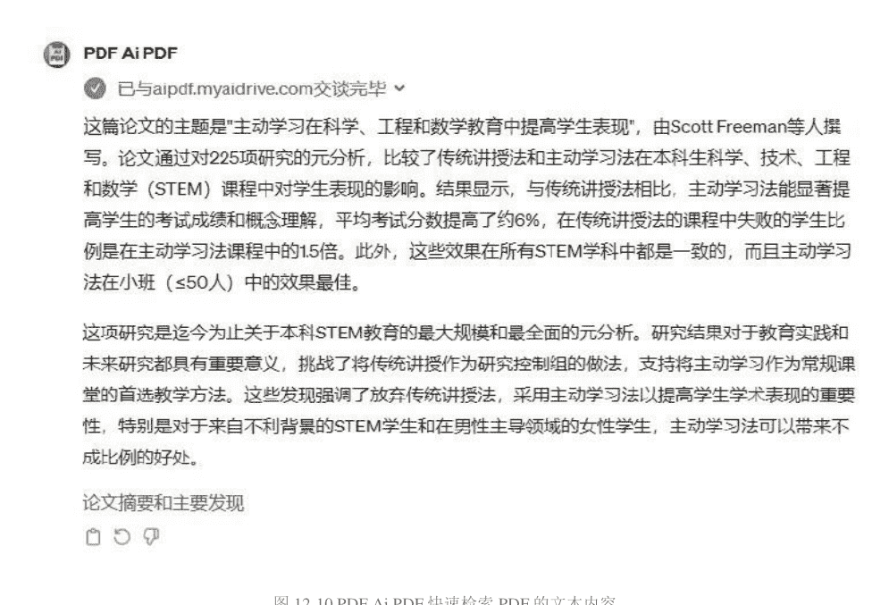

#### 12.2.2 在 GPTs 商店中搜索并安装
使用前需先在 GPTs 商店定位并安装。操作如下。

第一步 进入 GPTs 页面，在搜索框输入 Ai PDF，从列表中挑选 PDF Ai PDF，见图12-11。
GPTs
发现并创建自定义版本的ChatGPT，这些版本结合了指令、额外知识和任何技能组合。

图12-11 选择 PDF Ai PDF

第二步 跳转到新页面后，点击左上方 PDF Ai PDF 旁的下拉符号▼，在菜单中选择“保持在侧边栏”，见图12-12，即可固定该 GPT 于侧栏。

#### 12.2.3 实战：快速提炼 PDF 要点
PDF Ai PDF 能迅速归纳文档内容。下面以提炼论文要点为例。

步骤一 先在输入区输入“请为我总结论文的要点”，随后粘贴 PDF 链接并回车。工具会提示前往 Ai PDF 网站上传文件，点击“上传文件到 Ai PDF”或直接访问网址，见图12-13。

步骤二 进入站点后，目标 PDF 已自动出现在页面，点击“复制到 ChatGPT”按钮，见图12-14。

图12-14 点击复制到 ChatGPT

步骤三 弹出“提示编辑器”对话框，点击“保存提示并复制到 CHATGPT”按钮，即可获取文档链接，见图12-15。
提示编辑器
https://...-a.pdf

文件: ... .pdf
点击此处查看示例

图12-15 点击保存提示并复制到 CHATGPT

步骤四 返回 ChatGPT，在 PDF Ai PDF 输入区输入指令并粘贴刚才复制的链接，见图12-16。

图12-16 输入指令并粘贴文档链接

步骤五 回车后，PDF Ai PDF 会输出论文要点并附参考链接，见图12-17。
这篇论文的标题为“主动学习在科学、工程和数学教育中提高学生表现”，作者为 Scott Freeman 等。论文通过对 225 项研究的元分析，比较了在本科科学、技术、工程和数学（STEM）课程中，传统讲授法与主动学习法对学生考试成绩或失败率的影响。结果显示，与传统讲授法相比，主动学习法能显著提高学生的考试成绩和概念理解，平均考试成绩提高了约 6%，在传统讲授的课程中失败的学生比例是在采用主动学习的课程中的 1.5 倍。此外，研究还发现主动学习法在所有 STEM 学科中都有效，无论课堂大小，只是在小班（50 人以下）中效果最佳。研究还指出，主动学习对于提高学生在概念库存测试上的表现比课程考试成绩更为有效。这项研究是迄今为止最大规模和最全面的关于本科 STEM 教育的元分析，强调了在常规课堂教学中采用主动学习法的重要性和有效性。
论文还提出了对传统讲授法作为研究对照组的质疑，支持将主动学习作为优选的、经验验证的教学实践。研究结果对于如何提高 STEM 学科的学生留存率和毕业率提供了解决方案，即通过减少学生失败率和提高成绩来实现。此外，这些发现对于未来的教育研究具有指导意义，建议未来的研究应更多地关注如何优化主动学习策略，以及如何针对特定学科或学生群体选择最合适和最有效的主动学习方法。
参考链接：[链接文本]

#### 12.2.4 实战：深入解析文献
除提炼要点外，PDF Ai PDF 还能快速检索文本。下面以分析文献为例。

步骤一 先在输入区输入“请帮我阅读文献，用要点的形式给出文章的标题、摘要的总结、讨论和结论，并尝试告诉我这篇文章的 limitations（局限性）”，回车后工具会要求提供 PDF 链接，见图12-18。

步骤二 输入待分析的 PDF 链接并回车，系统会解析文档并给出回答，见图12-19。
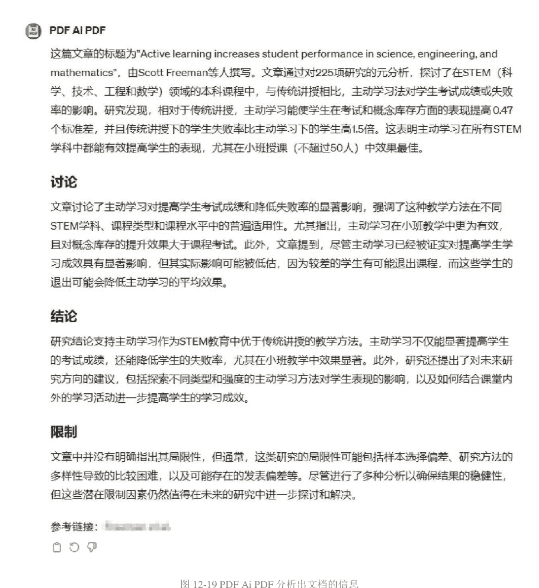

图12-19 PDF Ai PDF 解析出的文档信息

## 本章小结
本章介绍了可生成高质量文档的 Doc Maker 以及可快速解析 PDF 的 PDF Ai PDF，二者均能提升 ChatGPT 在办公场景中的辅助价值。学完本章后，读者可更熟练地运用 ChatGPT 的 GPTs 功能。

## 课后实训
下面以 Doc Maker 制作简历为例进行练习，流程如下。

第一步 在 Doc Maker 输入框输入“我叫李四，是一名互联网前端工程师，掌握常用的前端框架知识，请帮我生成一份求职简历，要求简历内容能够体现我的技术能力”，回车后 Doc Maker 会生成李四的求职简历，见图12-20。
> Doc Maker
我已经帮您生成了一份求职简历。您可以通过以下链接下载查看：
下载李四的简历
这份简历突出了您作为互联网前端工程师的专业技能、工作经历、教育背景，以及个人项目经验，希望能帮助您在求职过程中脱颖而出。
图12-20 Doc Maker 生成的简历

第二步 点击提供的链接进入 Doc Maker 官网，即可查看生成的简历，见图12-21。
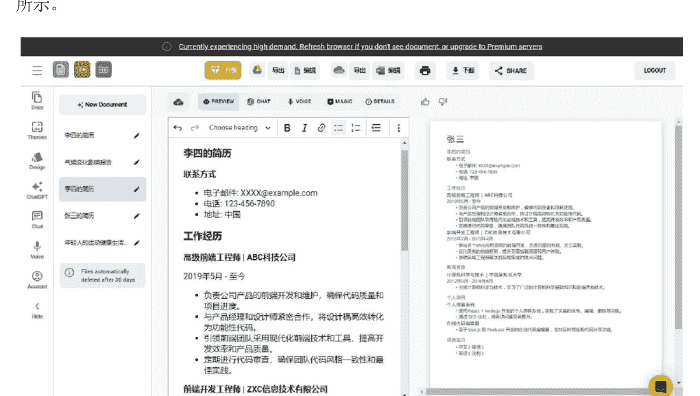

图12-21 在官网查看生成的简历

# AI剪辑师手册

剪映短视频制作从入门到精通

# AI训练师手册

算法与模型训练从入门到精通

“博雅读书社”微信公众号

“北京大学出版社”微信公众号

上架建议：计算机/人工智能

ISBN 978-7-301-35649-4

9 787301 356494>

定价：79.00元