# ChatGPT实战写作指南：108招高效产出AI文案

## 作者简介

**苏海**

- 互联网老兵，ChatGPT、文心一言等生成式大模型首批体验者
- 人机对话提问模式研究与应用超一万组
- 曾借助大模型完成办公、艺术、学术、营销等多类型文案创作
- 代表作《活动策划实战宝典：品牌推广+人气打造+实战案例》

## 内容概览

本书围绕以ChatGPT为代表的AI写作展开，共分10个主题、108条实操要点，配套240多分钟演示视频。主线分为两条。

其一为能力线：前三章讲平台上手、提问设计与高效提问思路，帮助读者建立宏观产出框架。
其二为场景线：后七章覆盖办公、艺术、学术、娱乐、媒体、营销六大写作场景及一套全流程综合案例，帮助读者在真实任务中掌握产出方法。

案例丰富、可操作性强，适合对AI写作感兴趣的文案策划、内容创作者、电商从业者、新媒体编辑、广告策划、短视频编导、作家、艺术从业者等，也可作为语言、文学、计算机相关专业的参考资料。

# 前言

人工智能在各行业需求拉动下持续加速，既能解放重复性体力负担，也在迭代中强化脑力辅助，AI辅助写作即为典型。

作为生成式AI的代表，ChatGPT在写作上有两大优势：一是依托指令生成内容，二是依托上下文延续创作，这使其自上线以来持续受关注。

秉持拥抱变化、防范风险的原则，我们针对不同场景的写作需求探索大模型的实际用法。通过调整指令驱动创作，我们发现指令编写即提问技巧，是结果质量的关键。于是将这些方法提炼为108个招式，汇编成书，便于读者快速上手，占据AI写作先机。

本书有三方面特点。

- (1) **实战干货。** 提供108条可直接套用的要点与范例，涵盖33条宏观产出思路与75条场景微操作，真正拿来即用。
- (2) **场景精选。** 聚焦办公、艺术、学术、娱乐、媒体、营销六大写作场景，每例均给出提问思路与操作要点，学习更聚焦。
- (3) **资料加码。** 除正文外，随书附送108集演示视频、指令库与效果文件，学习更有保障。

全书由浅入深、以实战为主轴，初学者与有经验者均可获益。

特别说明：本书配图基于ChatGPT-3.5界面截取。相同关键词下模型回复会存在差异，观看视频时请重点关注指令编写与操作流程。

特别提醒：ChatGPT虽擅长模拟对话，但作为机器学习模型，输出仍可能出现表达不通之处，使用前请结合自身需求审阅与加工。

本书由苏海编著，朱霞芳参与编写，在此致谢。如需交流，可扫描封底“文泉云盘”二维码获取联系方式。

编者
2024年2月

# 第1章 技能入门：熟悉平台操作

## 上手指引

AI写作的核心工具是ChatGPT。登录后在文本区输入指令即可获取所需内容，实现自动化产出。本章帮助读者熟悉平台使用方式。

## 本章要点

- 熟悉基础操作习惯
- 熟悉进阶使用技巧
- 管理对话窗口

## 1.1 基础操作概览

在平台内，先用指令或提示驱动生成，再拷贝、修改或直接使用，即可完成AI产出。本节介绍基础手法。

### 001 初次产出内容

扫码看演示视频

登录后进入对话界面即可交互，可输入任意问题，模型会尝试作答并提供相关信息。具体做法如下。

**第一步** 打开对话界面，点击底部文本区。
**第二步** 在文本区写入指令，例如“请为电风扇商品写一段宣传文案，20字以内”。
**第三步** 点击提交键或按Enter，模型会按要求输出文案。

### 002 中断正在生成的输出

扫码看演示视频

发送信息后模型以逐字方式输出，若对当前结果存疑，可中断生成。

在文本区输入“请提供两条适合旅行记录的朋友圈文案”，发送后模型开始产出，点击下方的 Stop generating 即可停止。

### 003 重新获取一次回复

扫码看演示视频

对回复不满意时，可通过 Regenerate 按钮重新获取表达或内容。

**第一步** 文案生成或停止后，在文本区上方点击 Regenerate 按钮，即可重新生成。
**第二步** 重新生成后会出现页码，每次重生成新增一页，原回复保留，可通过左右箭头切换查看。

### 004 用鼠标选择拷贝内容

扫码看演示视频

需要把生成内容搬到文档时，可通过手动选择拷贝。

**第一步** 输入“请提供10个爆款的短视频标题”，发送后获取回复。
**第二步** 移动光标选中所需标题，右键选择“复制”。

拷贝后可粘贴到记事本、Word等编辑软件进行修改保存。

### 005 一键拷贝完整回复

扫码看演示视频

除手动选择外，平台自带拷贝按钮可一键搬运完整回复。

**第一步** 在回复内容右侧点击拷贝图标 📋，即可拷贝全部文案。
**第二步** 打开记事本，按 Ctrl+V 粘贴，后续自行命名保存。

### 006 输入指令时换行

扫码看演示视频

文本区支持分段换行，提升指令可读性。

**第一步** 输入第一行“请将以下词汇组合成广告文案：”。
**第二步** 按 Shift+Enter 换行，输入“森林、萃取、清凉、自然”，形成完整指令。
**第三步** 按 Enter 发送，模型按指令输出结果。

### 007 修改已发送的指令

扫码看演示视频

发送的指令不准确时可在线修改。

**第一步** 在已发送信息右侧点击 ✏️ 按钮。
**第二步** 将“请将以下词汇组合成广告文案：”改为“请将以下词汇组合成洗面奶的广告文案：”，点击 Save & Submit 保存提交。
**第三步** 模型依据新内容重新生成，发送记录左侧会生成页码，便于对比选择。

## 1.2 进阶使用技巧

在掌握基础操作后，可进一步学习进阶功能，让模型更好地服务自身需求。

### 008 用模型生成图表代码

扫码看演示视频

ChatGPT虽以文本见长，但可通过生成代码辅助制作图表，提升办公效率。模型不能直接出图，但可先生成代码再导入 Mermaid.live 编辑器实现可视化。

**第一步** 输入“用Mermaid.js语言生成《水浒传》的人物关系图”，模型会返回说明与代码示例。
Mermaid.js是一个用于生成流程图、序列图、甘特图等的JavaScript库。虽然它不直接支持绘制复杂的人物关系图，但我们可以借助它的流程图功能来近似表示《水浒传》中的人物关系。请注意，由于《水浒传》中涉及大量的人物，这里只展示部分人物关系，仅作为示例。

假设我们要展示“宋江”的人物关系，你可以按照以下方式编写Mermaid.js语言代码：

```
graph TD
    A[宋江] --> B[吴用]
    A[宋江] --> C[卢俊义]
    A[宋江] --> D[林冲]
    B[吴用] --> E[鲁智深]
    C[卢俊义] --> E[鲁智深]
    C[卢俊义] --> F[武松]
    D[林冲] --> G[杨志]
    D[林冲] --> H[花荣]
```

以上代码将生成一个简单的人物关系图，其中“宋江”与“吴用”、“卢俊义”、“林冲”有直接关系，而“吴用”和“卢俊义”又与“鲁智深”有关系，“林冲”与“杨志”、“花荣”有关系。

如果你想绘制更复杂的人物关系图，需要在代码中添加更多的节点和关系。请注意，Mermaid.js并不是专门用于绘制复杂图表的工具，因此可能无法满足某些高级需求。在绘制实际图表时，你可能需要考虑使用更专业的图表绘制工具或JavaScript库。
**第二步** 点击 Copy code 按钮拷贝代码。
**第三步** 打开 Mermaid.live，在线编辑器中粘贴代码，即可预览《水浒传》人物关系简图。

### 专家指点

模型在图表场景中主要扮演代码提供者的角色，最终渲染仍需依赖 Mermaid.live 完成，这体现了模型的局限与延展空间。需注意模型生成的 Mermaid.js 代码可能存在事实偏差。

### 让模型配图

模型可通过识别图片链接生成图文结合的文案。

在文本区输入指令，例如“描述一下蝴蝶，并附带蝴蝶的图片，发送图片时请用markdown语言生成，不要反斜线，不要代码框，不要文字介绍，×××（此处为图片链接）”，即可获得配图文案。

### 专家指点

Markdown 是一种轻量级标记语言，支持用简洁纯文本实现格式化排版。

## 1.3 对话窗口管理

每次登录默认进入新对话窗口，历史记录保存在左侧列表，可新建、重命名、删除，便于有序管理。

### 新建对话窗口

想以新主题开启对话时，可保留当前记录并新建窗口。

**第一步** 在左上角点击 New chat 按钮。
**第二步** 在新文本区输入指令，如“请创作一首迎接春天到来的诗歌”。
**第三步** 发送后模型即开始创作。

### 重命名对话窗口

对话生成后系统会自动命名，不满意时可手动修改。

**第一步** 选择目标窗口，点击 ✏️ 按钮。
**第二步** 在名称编辑框中修改名称。
**第三步** 点击 ✅ 完成重命名。

### 删除对话窗口

完成话题且无需保留记录时可删除。

**第一步** 选择窗口，点击 🗑️ 按钮。
**第二步** 在 Delete chat? 提示框中确认删除或取消。

# 第2章 提问技巧：善于获取高质量文案

## 上手指引

ChatGPT的效果取决于提问的精准度。掌握指令编写与优化方法，是提升输出质量的关键。本章介绍有效提问策略。

## 本章要点

- 编写指令的方法
- 优化指令的方法

## 2.1 编写指令的方法

要让模型生成文案，需要输入合适的指令，使其准确理解并响应。因此指令的质量直接决定结果。以下介绍编写方法。

### 选择贴切的指令

指令即引导，是模型生成依据。想要特定文案，需在指令中说明类型、特征、范围。不同指令会得到不同结果。

**第一步** 打开ChatGPT，输入宽泛指令“请写出10个关于旅游的文案”，发送后获取通用结果。
**第二步** 点击左上角 New chat 新建窗口，输入具体指令“请写出10个关于去成都旅游的文案”，发送后得到更聚焦的输出。

1. 成都美食之旅

探索成都，享受川菜的绝妙风味。从麻辣火锅到香辣兔头，每一口都是对味蕾的一次盛宴。成都，美食之都，等待您的舌尖发现！

2. 心灵放松的天堂

成都不仅有繁忙的城市生活，还有宁静的雅途。漫步在宽阔的锦绣公园、武侯祠，感受古老和现代的交融，让身心在宁静中放松。

3. 文化遗址之旅

历史悠久的成都拥有丰富的文化遗址。游览宽窄巷子、杜甫草堂，了解成都的历史沿革，感受古老与现代的和谐共存。

4. 珍稀熊猫亲近之旅

成都是世界上少数能近距离观赏熊猫的地方之一。来到成都熊猫基地，与可爱的大熊猫近距离接触，亲历珍稀动物的活泼模样。

5. 夜色锦绣成都

成都夜游与深度体验指南

夜幕降临的成都气质迥异，华灯璀璨。在宽窄巷子与太古里之间漫步，可以沉浸在柔软的夜色氛围里，体会这座城市特有的夜间生活。

6. 青城山徒步之旅
给自己一次挑战，登上青城山高耸的山顶。途中潺潺的清溪与年代久远的寺庙相伴，让人贴近自然，领略成都近郊的秀丽景致。

7. 传统川剧体验
近距离感受川剧的独特魅力，亲手尝试变脸、武打等绝技。成都正是川剧的起源地，去追溯这项源远流长的戏曲传统，能为旅程增添不少乐趣。

8. 大街小巷探寻
在成都的街头巷尾闲逛，发掘隐藏的特色小吃摊、潮流艺术空间以及古韵十足的建筑。每条小巷里都有自己的故事在等你去发现。

9. 非遗体验之旅
走进成都的非物质文化遗产体系，学习蜀绣、蜡染等传统技艺，并亲手完成一件属于自己的文化艺术品。

10. 茶文化之旅
体味成都深厚的茶文化氛围，品尝名优茶叶，参与茶艺演示，认识茶背后的历史与内涵。在成都，茶是连接人与自然的桥梁。

从图2-1和图2-2可以看出，ChatGPT对宽泛指令与精准指令的识别效果并不一样，带来的反馈也不同。给出宽泛说法时，模型往往给出概念性较强的回答，信息覆盖面广；而给出具体说法时，回复会更贴近提问本身。两种写法各有适用场景，具体选用哪种取决于真实需求。

### 确定提示的主题

用户偏好具体指令，通常是期望得到具备灵活性与观念性的输出，比如“用诗意的语言描述一下武功山”。从这个层面来看，宽泛指令编写起来并不难，真正有难度的是把指令写得具体，因为生成出发点不同。因此，写出有效的提示，关键在于写具体提示，其首要工作是锁定提示主题。

举例来说，用户想让ChatGPT生成一篇文章大纲，主题是呼吁保护环境，那么“呼吁保护环境”就是提示的核心主题，而“一篇文章大纲”只是使用需求。把两者组织起来，就可以在输入框里写“提供一篇关于呼吁保护环境的文章大纲”。

把“提供一篇关于呼吁保护环境的文章大纲”作为提示发送后，ChatGPT给出的回复如图2-3所示。

标题：携手倡导环保，共建可持续未来

引言：
- 点出环境议题的严峻性，涵盖气候变化、生物多样性流失、水资源匮乏等。
- 强调环境保护与人类生存发展息息相关。

第一部分：当前环境挑战
- 阐释全球气候变化带来的极端天气、海平面上升等影响。
- 说明生物多样性衰退导致生态平衡受威胁。
- 指出水资源短缺与水污染对健康的危害。

第二部分：环境问题的成因
- 探讨工业污染、过度开发等人为活动对环境造成的压力。
- 借助数据与案例，说明过度消费对资源造成的负担。

第三部分：行动的紧迫性
- 强调时间已经不多，问题不能继续拖延。
- 分析若不及时应对，将导致更严重的后果。

第四部分：个人与社会的责任
- 倡导从自身做起，减少浪费、节约能源与用水。
- 结合志愿者行动、社会组织案例，凸显群体力量。

第五部分：政府与企业的角色
- 呼吁政府出台更严格的环境法规，推进可持续发展。
- 企业应承担社会责任，推动环保技术创新，降低污染排放。

第六部分：跨界合作与国际行动
- 讨论环境议题需要全球协作，强调国际合作重要性。
- 提及联合国可持续发展目标，倡导国际层面的共同行动。

结论：
- 回顾环境问题的紧迫与严重。
- 强调个人、社会、政府、企业共同发力的必要性，建设可持续未来。
- 鼓励读者行动，从小事做起，为环保贡献力量。

简言之，当用户想要获得灵活、观念性的回复时，就应在提示中明确主题，主题要具体到某个领域、行业或话题。

### 细化主题描述

即使提示中已说明主题，若回复仍不理想，可进一步细化主题描述，加入更多限定词或条件。下面以具体操作为例。

**步骤01** 打开ChatGPT，在输入框中输入以防晒衣产品推广文案为主题的提示，例如“请提供5个防晒衣的产品推广文案”，回车后得到的文案如图2-4所示。示例文案分别突出钻石级防晒防护、轻盈透气舒适、时尚造型加分、家庭全员守护、专业安心等卖点，语言生动且具备促销感。

**步骤02** 点击已发送信息右侧的 📝 按钮，对提示进行限定改写，例如把“请提供5个防晒衣的产品推广文案”改写为“请提供5个适合女生的小众防晒衣的产品推广文案”，点击Save&Submit后，ChatGPT按新指令重新生成，效果如图2-5所示。

**步骤03** 再次点击右侧 📝 按钮，加入额外条件进行改写，例如把提示改为“请提供5个适合女生的小众防晒衣的产品推广文案，要求突出产品亮点，有吸引力”，点击Save&Submit后再次生成，效果如图2-6所示。生成的五条文案分别围绕蕾丝花边轻盈护肤、冰感透气防晒、清新运动风剪裁、凉感长袖修身、丝绒防晒外套等卖点展开，重点突出差异化亮点与吸引力。

从上述示例可见，ChatGPT的输出会随提示主题的细化程度改变。总体来看，输入的主题描述越具体，获得高效回复的概率越高。

## 2.2 优化ChatGPT提示词的方法

实际对话中多数场景需要使用具体提示，若想让回复更满意，则需掌握一定的优化方法。以下介绍几种常用技巧。

### 指定语言风格

当不确定如何写提示才能得到理想结果时，可以指定语言风格，从自身喜好出发，如喜欢的影视人物、动漫角色、作家等，让ChatGPT模仿特定风格生成文案。

**步骤01** 打开ChatGPT，输入提示词，例如“以《无人生还》的语言风格，创作一篇500字的悬疑小说”，如图2-7所示。

**步骤02** 回车后，ChatGPT会按指定风格生成小说，如图2-8所示。故事以风雨夜十人受邀至孤岛别墅为开端，通过诗歌线索、逐一死亡与秘密揭露，营造紧张悬疑氛围，并以罪与救赎收束。

## 017 提供实例参考

用户在提问时可以提供一个具体范例供参考，模型识别后往往能给出更贴合的答案。

**步骤01** 在输入框中输入提示词，例如“旅行类短视频标题文案通常文艺、有诗意，如‘山不见我，我自去见山’，请提供10个类似的标题文案”，如图2-9所示。

**步骤02** 回车后，ChatGPT会生成一批风格相近的标题文案，如图2-10所示。

## 018 指定表格罗列答案

对话时可要求以表格形式呈现结果，这对要点提炼和短视频脚本创作很有帮助。

**步骤01** 打开ChatGPT，输入提示词，例如“提供一个运镜拍摄教学的短视频脚本，以表格的形式”，如图2-11所示。

**步骤02** 回车后，ChatGPT会生成表格化脚本，如图2-12所示，包含片段、内容、图像三列，从开场到结束覆盖设备准备、镜头调整、构图光线、稳定拍摄、音频处理、后期等环节。

## 019 赋予一定的身份

ChatGPT可扮演多种角色。对话开始时赋予其身份，例如让其充当文案策划专员，会得到更具参考价值的建议。

**步骤01** 打开ChatGPT，输入提示词，例如“你现在是一位初中英语老师，请生成一份面向初中生的英语知识点教案，包括教学重难点、课前导入、教学设计和课后小结”，如图2-13所示。

**步骤02** 回车后，ChatGPT会生成教案，如图2-14所示。教案围绕日常生活与爱好主题，明确教学目标与重难点，设计词汇学习、句型构建、对话练习、小组讨论等环节，并布置课后写作任务。

## 020 设定受众群体

对话时设定受众群体，可提供特定背景或专业相关问题，帮助模型更准确理解需求。

**步骤01** 打开ChatGPT，输入提示词，例如“针对谈判人员写一篇关于谈判沟通技巧的推文，字数350字左右”，如图2-15所示。

**步骤02** 回车后，ChatGPT会生成相应推文，如图2-16所示，围绕倾听、建立信任等关键沟通技巧展开，语言贴合谈判人员需求。

3. **同步非语言信号**：沟通不只是说出口的词，动作、表情、姿态都在传递含义。要让肢体表现与语言表达保持一致，这样整体说服力才会更稳。

4. **表达清晰直截**：少用模棱两可的说法，用简练明确的句子把意图和诉求说清楚，避免对方产生误读。

5. **善用开放式提问**：通过提问把对话带向深入，引导对方展开说明需求和目标。既能帮助你掌握更多信息，也能体现出对对方的重视。

6. **把握信息披露时机**：在关键节点适度透露对自己有利的信息，不要刻意强调，让信息在谈判进程中自然呈现。

7. **保持弹性与妥协**：谈判往往需要双方让步。要有调整空间，愿意根据情况灵活应对，并在合理范围内做出让步以促成共识。

8. **妥善应对分歧**：分歧难以避免，处理态度更重要。保持冷静理性，把焦点放在解决问题上，而不是陷入情绪争执。

9. **主动提供方案**：发挥创造力，提出多种可行的中间路线，帮助双方找到利益重合点，推动达成协议。

10. **复盘总结并跟进**：谈判结束后要梳理已确认的共识，明确后续行动安排，并持续保持联系，监督协议落实情况。

无论经验深浅，掌握以上沟通要领都能让谈判更有竞争力。成功的谈判不仅是拿到合同，更是为长期合作关系奠定基础。#谈判技巧 #沟通艺术 #商业成功 💼

图2-16

## 021 多角度视角注入
扫码看教学视频

在不同段落或章节切换叙述视角，可以引入不同人物、观点或经历，使文章层次更丰富。将此思路迁移到提示词设计中，就能让ChatGPT完成更立体的创作。以下说明具体做法。

**步骤01** 打开ChatGPT，在输入框中输入提示词，例如“请用第一人称虚构一篇深海探险故事”，如图2-17所示。

图2-17

**步骤02** 回车确认后，ChatGPT会按指定视角生成虚构故事，如图2-18所示。

深潜号缓缓下潜，我安坐操作台前握着操纵杆，视线落在舷外那片神秘的蔚蓝。身为海洋探险者，探索海底奥秘一直是我心愿，今天终于成行。

透过潜望镜，远处珊瑚礁若隐若现，五彩珊瑚随洋流摆动，鱼群穿梭其中像一幅活画。我减缓航速，沉浸在这美景里。透过舷窗似乎能听见海的呼唤。

继续下潜，光线渐暗，我开启探照灯，光束投向前方。朦胧中一只体型巨大的海龟悠然游过，背甲覆满苔藓和小生物，像记载了漫长岁月。

舱内忽然传来细微震动，我皱眉查看仪表。是一群鲨鱼逼近。我启动舱外声波驱赶装置，同时小心调整航向，避免惊扰。

穿过危险区后，眼前出现古老沉船群，残骸静静躺在海底，如同沉睡的城市。我兴奋地派出机器人潜水器前往其中一艘，搜寻可带回的文物与线索。

机器人摄像头传回震撼画面：布满藻类的舱门、甲板上腐朽的物件，依稀还能辨出昔日辉煌。我盯着屏幕，仿佛听见船员的回声，时光倒流。

随着时间推移，机器人不断穿梭，发现不少有趣文物与珍贵资料，为海底历史研究提供了价值。

返航前，我回望这片奇幻海域。此行不仅目睹了海底之美，更深切感受到海洋的深邃与未知。眼前的只是冰山一角，还有更多领域等待探索。

怀着激动与希望，我将深潜号导向水面，踏上归程。这段经历将长久激励我继续前行，探索更广阔的海洋。

图2-18

## 022 种子词引导
扫码看教学视频

种子词即文章中需要出现的核心词汇。在提示词里加入种子词，能帮助模型更快定位相关语料，生成更贴合的文本。下面介绍操作方法。

**步骤01** 打开ChatGPT，在输入框输入提示词，如“请根据以下种子词创作一篇软文：蓝水晶、传说、大海，约400字”，如图2-19所示。

图2-19

**步骤02** 回车后，ChatGPT会生成包含指定词的文章，如图2-20所示。

在辽阔的大海深处，流传着一段扣人心弦的传说，与蓝水晶紧密相连，仿佛蕴含着海洋的神秘力量。

这个传说像海面涟漪般在海边世代相传。据说古老渔村曾有青年勇士艾尔兰，他生于靠海的小村，对大海心怀敬畏。村中心矗立一块巨型蓝水晶，被视作圣物，相传是海神所赐，藏有深海之力。

艾尔兰常坐在岸边凝望碧蓝海面，遐想大海奥秘。一日，一位智者到访，告诉他蓝水晶连接着人与海洋，只有勇者才能触及其中真谛。听闻此言，艾尔兰决定启程。

他背负着憧憬乘小舟出海，遭遇巨浪风暴，也尝到孤独与恐惧，却始终坚信传说之力。航行中他逐渐领悟，蓝水晶象征的不仅是海洋力量，更是人类勇气与探索精神。

最终，在无垠蓝海上，他发现了传说中的“水晶之岛”。岛上遍布闪耀蓝水晶，光芒如大海心跳。他明白，这里才是力量的根源，既代表神秘，也代表对未知的勇敢探求。

归来后艾尔兰成英雄，将经历与传说分享给村民。从此每年蓝水晶节，村庄都会举行庆典，纪念艾尔兰与传承。浩瀚大海也因这段故事更显神秘美丽。

传说如光芒在历史长河中不灭。蓝水晶的故事代代相传，传递勇气、希望与探索的姿态，像海浪涌向远方。正是这些故事，让大海更深邃、更引人遐想。

图2-20

# 第3章 精准提问，产出高质量文案
## 学习要点
ChatGPT的输出质量很大程度上取决于提问方式。若想获得优质文案，就要掌握高效提问的方法。本章介绍如何引导ChatGPT修改与完善文案。

## 本章核心内容
- 引导ChatGPT写出优质文案
- 优化回复的常用指令

## 3.1 引导ChatGPT写出优质的文案
ChatGPT可根据上下文连续回复，当初次结果不满意时，通过合适引导就能得到更高效、更符合预期的内容。以下介绍几种优化方法。

## 023 输入关键信息提问
ChatGPT的生成内容与提示词密切相关。越具体、越有针对性的提示，得到的回复越满意。为此在编写提示词时要抓住问题核心和关键点。

例如，需要一篇职场推文，不能只说“写一篇职场推文”，而应思考主题、目标读者、字数等要求，把这些关键信息都写入提示。

下面以实例演示如何提供关键信息引导回复。

**步骤01** 打开ChatGPT，在输入框输入提示词，如“请帮我写一篇面向职场新人、关于职业规划的推文，约500字”，如图3-1所示，让ChatGPT给出参考。


图3-1

**步骤02** 回车后，ChatGPT会生成贴合受众和主题的推文，如图3-2所示。

可见ChatGPT按照给定的受众和主题，提供了要点清晰、干货充足的推文，能为创作提供灵感。

# 标题：职场新人必看：打造职业规划的关键步骤

大家好，不管是刚入行的新人，还是在思考职业方向的人，都会遇到规划难题。今天分享几个关键步骤，助你制定有效职业规划。

- 1. **自我认知**：先了解自己。深入思考兴趣、优势、价值观和长期目标，找到与自身特质匹配的方向。
- 2. **明确目标**：清晰的目标带来方向感。制定短期和长期目标，确保具体、可衡量、可实现，如晋升、技能提升、薪资增长等。
- 3. **洞察行业与市场**：深入研究感兴趣行业的趋势、需求和前景，同时关注市场对特定技能的需求，针对性提升。
- 4. **持续积累技能**：通过培训、课程或自学保持学习。掌握与目标相关的能力，提升职场竞争力。
- 5. **寻找导师指导**：结识在目标领域有经验的导师，他们的建议能帮助你了解行业内部，为规划提供指导。
- 6. **构建人脉网络**：参加行业活动、社交场合，与同行交流，建立合作与友谊，人脉往往带来机会。
- 7. **保持灵活调整**：职业规划不是一成不变的，随着经验变化需要适时调整，保持弹性应对新机遇。
- 8. **定期复盘反思**：定期回顾进展，检查是否朝目标前进。发现偏差及时调整，持续优化才能保持正轨。

一个明智的职业规划是成功的关键。规划是持续过程，要随时适应变化。祝你在职场取得佳绩！#职业规划 #职场新人

图3-2

## 024 逐步深入提问


相较于其他AI，ChatGPT擅长关联上下文。你可以把它当作对话对象，通过逐步深入提问，让答案更接近预期。

下面以实例说明逐步提问的操作。

**步骤01** 在输入框输入提示词，如“创作现实主义小说需要哪些准备”，如图3-3所示，向ChatGPT请教创作准备。


图3-3

**步骤02** 回车后，ChatGPT会给出准备步骤，如图3-4所示。

创作现实主义小说需要一系列准备，以确保情节、人物和环境都具真实感和可信度。准备要点如下：

- 1. **选题与主题确定**：明确小说主题。现实主义常探讨生活、人性、社会议题，选择具有普遍性和深度的主题很重要。
- 2. **研究调研**：创作前充分调研背景信息、地点、时代、专业知识，让故事更真实准确。
- 3. **角色塑造**：为主要角色设定详细背景、性格、动机和目标，与主题情节紧密相关。
- 4. **结构规划**：制定清晰的结构，包括开端、发展、高潮和结局，确保情节逻辑自然。
- 5. **环境描写**：细致描绘场景、地点和氛围，让读者身临其境。
- 6. **对话写作**：对话应自然真实，体现角色关系和情感变化，符合人物性格和情境。
- 7. **细节刻画**：注意人物举止、表情、言行细节，丰富形象，增强共鸣。
- 8. **社会背景呈现**：现实主义常涉及社会问题，巧妙描绘社会背景和关系，增加深度。
- 9. **反思意义**：思考故事背后的意义和启示，引发读者思考。
- 10. **初稿与修改**：先完成初稿，再反复修改润色，确保质量和完整性。

总之，创作现实主义小说需要充分准备和深入思考，通过精心构思主题、人物、环境和情节，才能写出有真实感和深度的作品。


**步骤03** 在同一对话窗口继续输入“如何塑造复杂且有深度的角色”，回车后ChatGPT会给出方法，如图3-5所示。

塑造复杂角色是现实主义小说的关键。方法如下：

- 1. **独特背景故事**：为角色设定独特的过去，包括家庭、成长经历、人生转折，塑造价值观和性格。
- 2. **内在冲突**：设置道德、情感或目标上的矛盾，增加真实感和深度。
- 3. **多维性格**：避免扁平化，呈现善良与自私、勇敢与胆怯并存的多面性。
- 4. **动机与目标**：明确角色追求何物，为何努力，影响行为和决策。
- 5. **情感共鸣**：描写内心体验，让读者产生共鸣。
- 6. **人际互动**：通过对话和行为展现与他人的关系和态度。
- 7. **环境反应**：考虑角色在不同环境下的表现。
- 8. **缺点与弱点**：赋予角色缺陷，更显真实可信。
- 9. **成长变化**：让角色在经历中变化，增添吸引力。
- 10. **内心独白**：用内心独白深入探讨思想世界。
- 11. **面对挑战**：设置困难考验，展现勇气与应对能力。

图3-5

**步骤04** 还可继续追问细节，输入“如何描写环境”，回车后ChatGPT会给出环境描写要点，如图3-6所示。

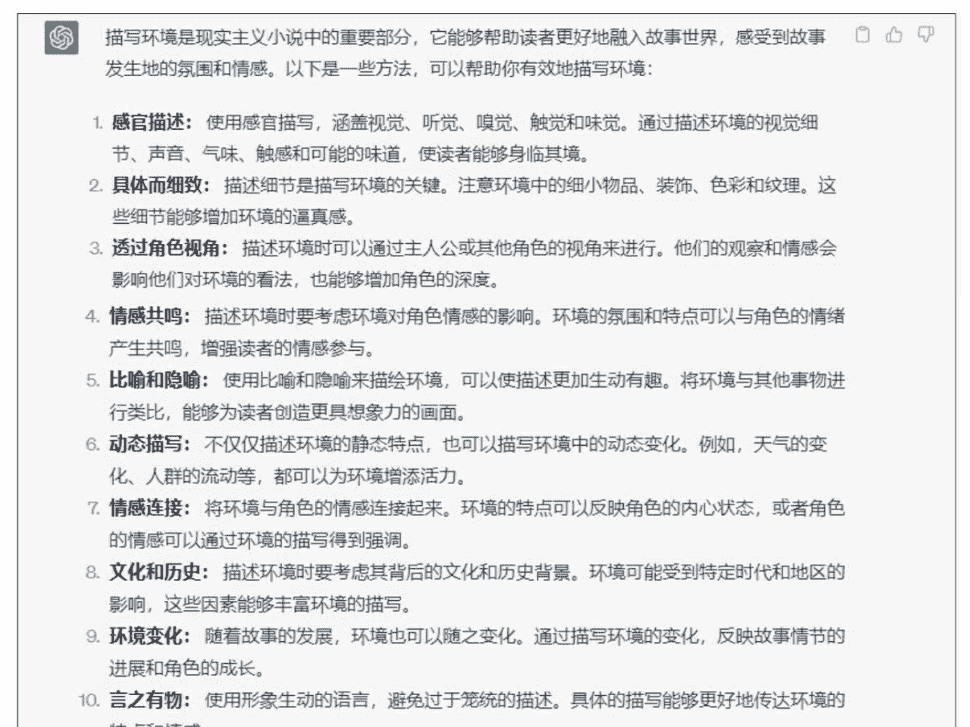

图3-6

从示例可见，ChatGPT会根据逐步深入的提问给出更细致的回复。把ChatGPT视为知识丰富的对话者，循序渐进抛出问题，能更好满足需求。

## 025 鼓励式引导回复


鼓励式引导是指用鼓励性的提问促使ChatGPT给出更详细、完整、有创意的回答。适用于开放性问题，可用“让我们思考一下……”“还有其他想法吗”等句式。

下面以实例说明操作步骤。

**步骤01** 在输入框输入提示词，如“让我们思考一下：母亲节可以策划哪些有创意的短视频”，如图3-7所示，让ChatGPT提供创意。

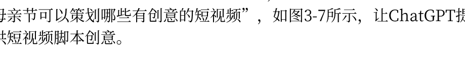

图3-7

**步骤02** 回车后，ChatGPT会给出策划建议，如图3-8所示。

当然！以下是一些策划母亲节短视频的创意建议：

- 1. **时光穿越**：用从童年到现在的照片和片段，呈现你与母亲的共同成长，对比中表达感恩。
- 2. **手工制作**：拍摄DIY制作母亲节礼物，如手工卡片、花束，详细展示过程并表达心意。
- 3. **回忆合集**：邀请家人参与，分享各自的母亲节回忆和感想，呈现温馨瞬间。
- 4. **童年对话重现**：模仿经典的亲子对话，用戏剧化方式演绎，展现独特关系。
- 5. **母亲的一天**：记录母亲从早到晚的生活，用快放突出工作、家务、照顾家庭，表达敬意。
- 6. **亲子问答**：邀请兄弟姐妹一起回答关于母亲的问题，让观众更了解她。
- 7. **音乐致敬**：创作一首表达爱意的歌曲，现场演绎，用音乐传递情感。
- 8. **名言图文**：收集关于母亲的名人名言，以图文形式呈现，增加视频深度。

无论选择哪种创意，关键是表达真挚的感激。用温馨、幽默、真实的方式，制作令人难忘的母亲节短视频吧！


**步骤03**
在原有会话里继续追加提问，例如“这些建议给了我不少启发，还能再给我一些不一样的思路吗”，按下回车后，模型会结合上下文再给出更多短视频脚本方向，示范见图3-9。

没问题，下面再补充一组适合母亲节的短片灵感：

- 1. **妈妈的愿望单**：做一份虚拟的愿望清单，呈现妈妈年轻时可能渴望旅行的片段或想学的技能，先表现她为你而放下这些心愿，再记录你策划帮她圆梦的过程。
- 2. **感恩手记**：模仿翻阅笔记本的形式，每一页写下一句感谢。从小时候的琐事到成年的大事，把你感激的瞬间逐条呈现。
- 3. **对话剪影**：如果你保存了和妈妈的聊天记录，可挑出有趣、温情或感动的片段剪成对话日记，让观众感受到你们独特的沟通方式。
- 4. **母亲的双手**：捕捉妈妈做饭、缝补、整理花草等不同场景的双手特写，用画面传递细腻的关怀，也象征彼此的牵连。
- 5. **爱的表达方式**：了解妈妈的爱语后，用画面展示她表达爱的具体做法。比如她习惯通过行动服务，便可记录她为你做的各种琐事。
- 6. **童年重现**：借助过往的老照片，先展示童年片段，再以现在的你重新演绎，凸显妈妈的陪伴对你成长的意义。
- 7. **技能传承**：若妈妈擅长烹饪、手工艺等传统，可拍摄你在她指导下学习、继承这些手艺的过程。
- 8. **微笑年轮**：收集妈妈不同时期的笑容照片，按时间串联，呈现笑容是你生活里最温暖的底色。
- 9. **亲子合影录**：把不同年龄段的合照剪成一条时间线，从婴儿期到现在，展现共同成长的轨迹。

以上点子可依据你和妈妈的关系、兴趣以及可用的素材灵活调整。无论选哪一种，保持真诚与感恩的情绪，让视频成为一份走心的母亲节礼物即可。

图3-9

## 026 多选式提问

当想让ChatGPT产出更精准的文案时，可以给出一组选项让模型从中挑选，相当于做一道选择题，模型会给出选中项并解释理由。以下介绍具体操作。

**步骤01** 在输入框里写提示词，例如“我偏爱悬疑小说，尤其是反转结局。请在下面几本里挑一本符合我口味的并说明原因（另起一行）书籍：1.《无人生还》；2.《悲惨世界》；3.《三体》；4.《杀死一只知更鸟》”，如图3-10所示，让模型从选项中筛选。

图3-10
**步骤02** 按Enter确认后，模型会按要求给出选择结果，如图3-11所示。
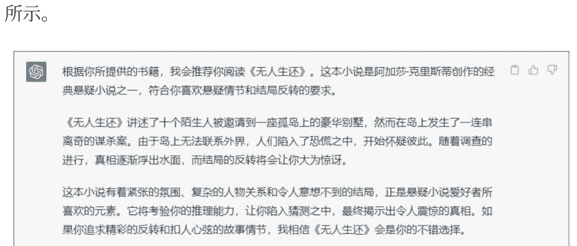
图3-11

## 027 合并提问法

合并提问是指把关联性强的问题整理在一起一次性提出，让模型针对多问进行综合回应。这种方式指向明确，容易获得逻辑性强的答案，也能锻炼分类与概括能力。下面以案例说明操作流程。

**步骤01** 在输入框中输入提示词，例如“欧·亨利的短篇小说有什么特色？对新媒体文章写作有哪些借鉴意义？”，如图3-12所示，让模型从两个角度进行关联分析。

图3-12
**步骤02** 按Enter确认后，模型会结合两问给出回复，如图3-13所示。

欧·亨利是美国著名短篇作家，以精巧的情节、生动的人物和意外的收束著称。其文体特征主要有：

- 1. **反转型收尾**：作品多在高潮处突现出人意料的转折，带来惊喜与回味，强化情感冲击。
- 2. **幽默语言**：善于用巧妙的措辞与对话制造笑点，轻松调节节奏。
- 3. **人物丰满**：篇幅虽短，却能勾勒出个性鲜明、内心丰富的形象。
- 4. **社会观察**：常折射当时美国社会现象与民众生活，蕴含思考。
- 5. **叙述简练**：用清晰简洁的笔法快速推进情节，在有限篇幅内完成构建。

对新媒体写作的启发：

- 1. **创意与反差**：借鉴其意外性，用新颖点子和转折抓住注意力。
- 2. **精炼表达**：平台阅读快，宜用简短有力的语言直切核心。
- 3. **情感共鸣**：融入人情味，让读者产生共情。
- 4. **趣味调性**：适度幽默提升可读性。
- 5. **议题意识**：可结合社会观察传递观点与价值。

图3-13

## 028 约束条件提问

约束条件提问适用于有固定模板、风格或结构的文本需求。通过在提示中限定格式与要求，可让输出更贴合预期。以下举例说明节日通知的撰写流程。

**步骤01** 在输入框中输入提示词，如图3-14所示，让模型按框架起草节假日通知。
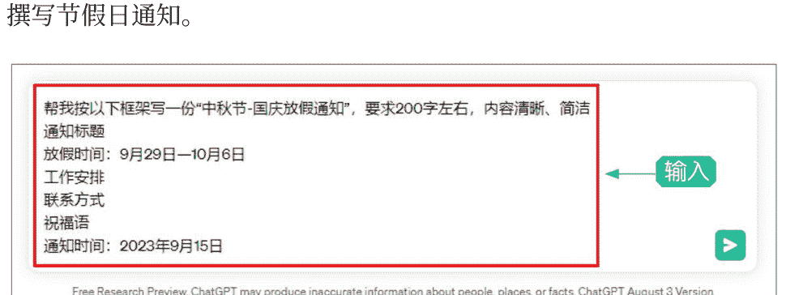
图3-14
**步骤02** 按Enter确认后，模型会依据提示中的框架和主题生成正式规范的通知，如图3-15所示。
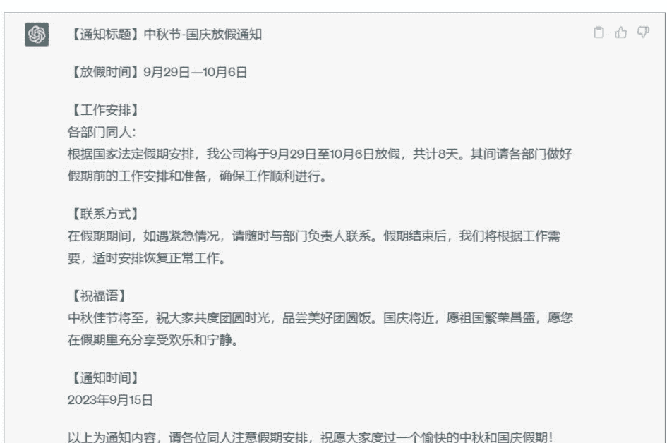
图3-15

## 029 迭代追问法

若对模型回复不满意，可在原对话基础上追加条件进行循环追问，让模型自我优化，直至接近预期。这相当于通过提问挖掘模型的潜力。以下以诗歌创作为例。

**步骤01** 在输入框中输入提示词，例如“请创作一首主题为枫叶的小诗”，如图3-16所示，让模型进行文学创作。

图3-16
**步骤02** 按Enter确认后，模型会给出对应主题的小诗，如图3-17所示。
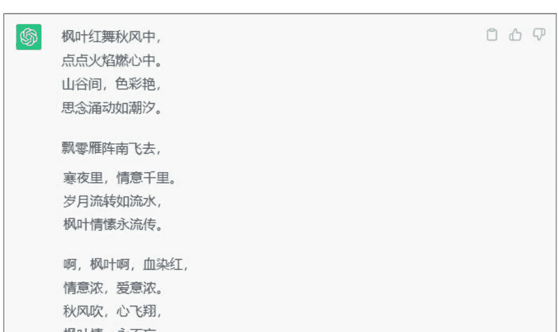
图3-17
**步骤03** 在同一窗口继续输入提示词，例如“请给出更好的版本，要求更有新意和情感，并解释”，按Enter确认，模型会按要求回应，如图3-18所示。
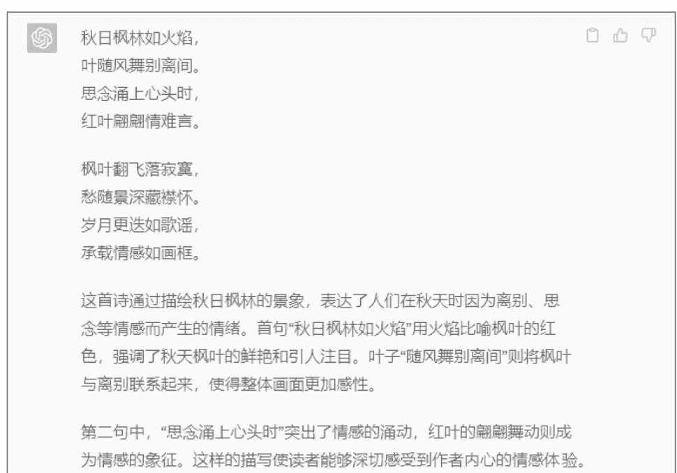
▲图3-18

> 后续几句以“枫叶翻飞落寂寞”和“愁随景深藏襟怀”等意象，把离别思念从景物延伸到内心感受。
最后一句以“岁月更迭如歌谣，承载情感如画框”将时间与情感联结，表达情感随时间流转却被珍藏。整首诗借秋景写离愁，笔触细腻。

图3-18（续）
**步骤04** 继续追问“请给出更好的方案，要求比前面更具哲思，并解释”，按Enter确认，模型会产出新回复，如图3-19所示。

秋风拂过枫叶红，
生命在变，无常中。
春花秋叶皆过客，
人世沧桑成故事。
枫叶凋零是自然法，
情感亦如，难长久。
执着放下方宽广，
悟透人生转瞬间。

此诗在秋景下寄寓哲理。首句写枫红暗喻变化与无常，继而“春花秋叶皆过客”点出万物短暂。枫叶凋零对应情感易逝，揭示脆弱性并提示放下执念。末句强调领悟瞬息即能拓宽心境，获得更深洞见。

图3-19
**步骤05** 再追问“请给出更好的方案，要求更符合现代审美，并解释”，按Enter确认，模型会再次给出新版本，如图3-20所示。

秋日微风吹枫叶，
绚烂色彩如诗篇。
流转间捕捉心绪，
岁月轻轻绕指尖。
枫叶零落不是败，
而是一场自在舞。
情感飘洒在天际，
拥抱变化赋新意。

该诗以轻盈现代的语境描写枫叶，在色彩与诗意间建立美感，并把流转与心绪相连，贴近当下内心表达。把凋零重新诠释为自由之舞，体现对变化的积极理解，结尾强调拥抱变化可赋予生命新意义。

图3-20

## 030 多维度综合提问

扫码看教学视频
多维度综合提问能获得更全面深入的分析，比如从剧情、导演风格、表演、视觉等多个层面评价一部电影，能得到更清晰的结论。以下以《阿凡达》为例说明流程。

**步骤01** 在输入框中输入提示词，例如“《阿凡达》的剧情有什么特点？”，如图3-21所示，让模型进行剧情评价。

图3-21
**步骤02** 按Enter确认后，模型会给出剧情层面的评价，如图3-22所示。

《阿凡达》由詹姆斯·卡梅隆执导，2009年上映。剧情可概括为：

1. 奇幻世界观：潘多拉星球生态丰富，呈现奇异植被与生物。
2. 环保议题：人类开采稀有矿产破坏生态，凸显环保警示。
3. 文化冲突：外星纳美族与人类发展队员的对立与接触。
4. 技术与自然对立：高科技武器对抗以自然为本的技能。
5. 反抗压迫：主人公最终倒戈，阻止破坏。

整体融合科幻、奇幻、生态与文化冲突，主题厚重。


**步骤03** 在同一窗口继续提问“导演詹姆斯·卡梅隆在创作上有什么独到之处？”，按Enter确认，模型会给出导演风格评价，如图3-23所示。

卡梅隆在《阿凡达》中体现出：技术革新、世界构建精细、强化环保主题、细腻刻画文化冲突、深化角色情感转变等特点，赋予影片深度与感染力。

图3-23
**步骤04** 继续提问“主演的演技如何？是否带来强烈代入感？”，按Enter确认，模型会给出表演层面评价，如图3-24所示。

> 主演的表演与角色间化学反应营造出沉浸世界，情感冲突与成长清晰可感，带来代入与共鸣，是影片成功的关键因素。

图3-24
**步骤05** 再提问“如何评价电影的特效和视觉效果？”，按Enter确认，模型会给出视觉层面评价，如图3-25所示。可看出多维度提问能集齐各方面信息，形成全面解读。

> 《阿凡达》特效在上映时极具突破。革命性3D技术增强沉浸感；潘多拉的细节刻画丰富生动；战斗场面动感十足；角色面部与情感表现也依赖特效提升共鸣。整体呈现出令人难忘的视听体验。

图3-25

## 3.2 优化ChatGPT回复的固定指令

除了前面介绍的让ChatGPT产出优质文案的技巧，还能借助几套固定的提问框架来进一步提升答案质量。下面就介绍三类常用的指令模板，帮助你更熟练地用ChatGPT完成文案任务。

### 031 风格定向指令模板


扫码看教学视频

当需要明确限定ChatGPT的语言风格或内容属性时，可套用“设定角色＋说明能力＋提出任务”这一固定公式，让模型按你的预期生成结果。下面通过案例说明用法。

**步骤01** 打开ChatGPT输入框，输入类似“请你扮演一名编剧，想象力丰富、创作力强，能写出符合当代审美的剧本。我需要一部仙侠剧本，设定要有创意、吸引力，最好能打动年轻观众”，如图3-26所示，指令ChatGPT开始创作。


图3-26

**步骤02** 回车确认后，模型会返回仙侠剧本，如图3-27所示。

剧本名称：《天幻之缘》

### 第一集：命运之门

场景：翠峰山脚，林木葱郁，少年陈云飞意外穿越而来。

主人公—陈云飞：年轻机智，潜能惊人，却对新世界一无所知。

场景：仙侣城，城墙巍峨，人潮涌动。

### 第二集：奇遇与缘分

陈云飞在仙侣城结识两位关键伙伴：

1. 李青雪：温婉美丽，出身仙侠世家，识破其穿越身份后决定相助。
2. 张紫雷：豪爽直率，天赋异禀的武者，偶然救下陈云飞后结成深厚兄弟情。

场景：玄冰宗，雪峰凛冽。

### 第三集：宿命之谜

陈云飞发现身上有一枚神秘符咒，与穿越有关；探寻中得知自己的来世使命是解开封印、调和世界失衡。

场景：幻音谷，仙乐缭绕。

### 第四集：修行与劫难

陈云飞决心修行以寻力量，途中遭遇重重困难，同时逐步掌握符咒之力。

场景：天幻宫，飞檐流瓦。

### 第五集：世界危机

黑暗势力侵蚀仙侠世界，陈云飞意识到命运与世界平衡紧密相连，联合李青雪、张紫雷及志同道合者共同抗敌。

场景：命运之门前，光暗对峙。

### 第六集：最终决战

众人历经艰辛来到命运之门，与黑暗势力展开决战，以智慧与信念击败邪恶，拯救世界。

场景：命运之门前，光芒四射。

### 最终集：缘定三生

新秩序建立，仙侠世界重归平静，陈云飞与李青雪的感情升温，决定携手余生。

场景：翠峰山巅，日落绚烂，伙伴聚首。

《天幻之缘》以仙侠的神秘、冒险与爱情为主线，通过陈云飞的成长展现友情、勇气与信念，极具年轻观众吸引力。

图3-27

### 032 专业输出指令模板


扫码看教学视频

随着应用场景扩大，对专业度要求更高。掌握“背景信息＋具体任务＋专家框架或方法论”这一提问结构，能显著提升答案效率。示范如下。

**步骤01** 在输入框输入诸如“依据《金字塔原理》中的思路，帮我写10条雨靴广告文案，并说明为何符合该原理”，如图3-28所示，让模型按专业理论创作。


图3-28

**步骤02** 确认后，ChatGPT会给出带理论支撑的示例，如图3-29所示。

很抱歉，因版权限制我无法直接生成书中原文文案，但可以解释原理并据此创作雨靴广告示例。

《金字塔原理》强调沟通要层级分明，先给出核心观点，再逐层展开支撑论据。以下10条文案均遵循此结构：

**文案1：**

**雨靴，时尚与功能兼得**

从时尚达人到户外爱好者，我们的雨靴都是理想之选。优质材质确保防水，独特设计让雨天依旧出众。购买它，感受时尚与实用的融合。

**文案2：**

**雨天从容，挑战无惧**

雨天不再是阻碍！采用先进工艺保护双脚干爽，无论街头还是郊径，都能自信前行。

**文案3：**

**脚踏实地，雨季无忧**

一双好雨靴是湿冷天气的秘密武器。防水材质加人性化设计，让双脚稳稳落地。

**文案4：**

**雨中漫步，畅快自如**

雨天也能成为欢乐时光。舒适贴合，让步伐毫无阻碍，尽情感受水滴陪伴。

**文案5：**

**无畏雨季，勇往直前**

雨季不是退缩理由。防滑底稳固步伐，高级材质守护双足，从容迎接挑战。

**文案6：**

**贴心防水，呵护足感**

雨天不必让鞋子湿透。精心设计有效隔绝水分，关爱从防水开始。

**文案7：**

**风雨同行，全程相伴**

无论泥泞小路还是雨雾街区，我们的雨靴与你同行。品质保证，一路陪伴。

**文案8：**

**自在雨中，亲近自然**

雨季是自然的表演。穿上它自在畅行，内部舒适，让你尽享大自然美好。

**文案9：**

**时尚护盾，彰显个性**

别让雨水影响风采。兼具出色防水与独特设计，时尚与保护并存。

**文案10：**

**雨天即冒险开端**

每场雨都是一次新冒险。提供舒适保护，无惧天气变幻，勇敢迈步。

以上示例均有明确核心观点并展开支撑信息，符合金字塔结构。

图3-29

### 033 思维拓展指令模板


扫码看教学视频

做创意、项目或策划类方案时，可在提问后追加“What are some alternative perspectives?（有哪些不同视角）”，帮助模型拓宽思维广度。下面举例。

**步骤01** 输入“描述梅花的特征，What are some alternative perspectives? ”，如图3-30所示，引导模型多维度输出。


图3-30

**步骤02** 回车后得到多角度描述，如图3-31所示。

梅花冬季绽放，为严寒带来清新希望。主要特征如下：

1. **花朵形态**：多为五瓣，花缘偶有波状。
2. **颜色**：红、粉、白、紫皆有，雪景中白粉色尤为醒目。
3. **花香**：部分品种散发淡雅香气。
4. **花期**：寒冬开放，具体时间受地域与品种影响。
5. **枝干特征**：枝干扭曲多姿，形成独特艺术感。
6. **文化象征**：东亚视其为坚韧与希望象征，寓意傲霜斗雪、迎接新年。

图3-31

# 第4章 办公写作：AI助力效率提升

## 学习提示

办公类文案的核心是获取建议、灵感与启发，用以优化工作、提升效率和规划职业。ChatGPT在此类场景主要扮演助手与引路人的角色。

## 本章重点导航

- 掌握用ChatGPT生成办公类文案的方法

## 034 让ChatGPT充当翻译助手


扫码看教学视频

ChatGPT能理解上下文，比传统工具更能处理场景化翻译，如即时对话、邮件往返等。下面是操作流程。

**步骤01 设置对话背景：** 输入“假设你现在是我的英文翻译助手，只需按需翻译，不要多问，你明白了吗？”回车后模型会确认，如图4-1所示。


图4-1

**步骤02 提供需求提示：** 继续输入“请把‘李先生您好，您需要采购的图书清单已发至邮箱，请查收’翻译成英文”，回车后得到译文，如图4-2所示。


图4-2

**步骤03 提出优化要求：** 继续输入“请把上述内容改写为正式邮件，要求格式规范、语言书面化、体现尊重”，回车后生成邮件，如图4-3所示。

上述流程包含三点：先设定身份建立背景，再给出具体翻译任务，最后提出优化要求逐步完善。

## 035 让ChatGPT指导职业规划


扫码看教学视频

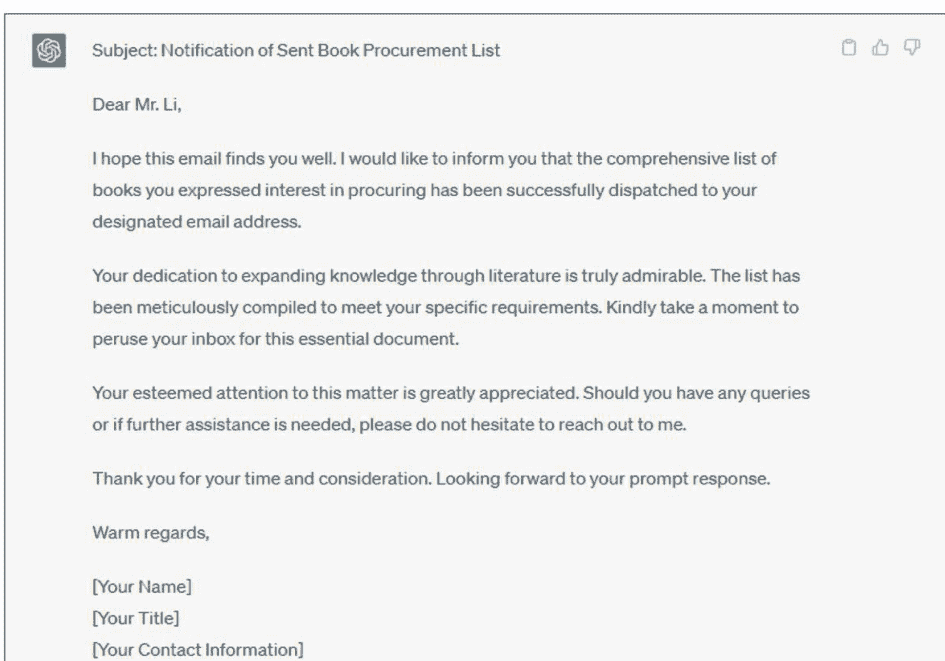

图4-3

ChatGPT可汇总各行业信息，提供职业建议，帮助你认清优势与兴趣。下面是操作步骤。

**步骤01 设置对话背景：** 输入“做个人职业规划需要考虑哪些信息？”回车后模型给出要点，如图4-4所示。

个人职业规划是一个有计划、有目标地规划未来发展的过程，需综合以下信息：

1. 个人兴趣和价值观
2. 职业目标
3. 职业能力和技能
4. 行业和市场趋势
5. 教育和培训
6. 工作经验
7. 人际关系和网络
8. 财务状况
9. 工作与生活平衡
10. 适应性和灵活性
11. 自我营销和品牌建设
12. 时间管理

综合以上信息可制定有序规划，并随时间调整优化。

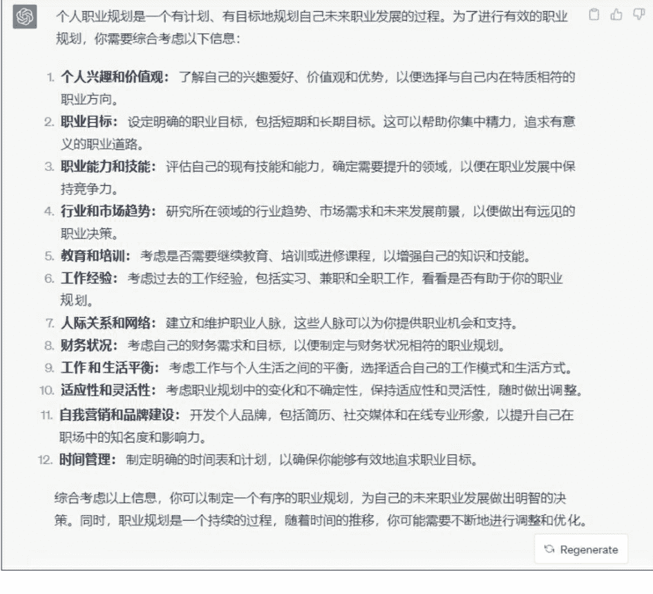

图4-4

**步骤02 提供需求提示**：继续输入“我有3年小学英语教学经验，擅长英语口语，喜欢阅读文学作品，接下来该如何规划职业？”模型据此给出建议，如图4-5所示。

建议包括继续专业进修、深耕口语教学研究、将文学兴趣融入课程、创作教材资源、参与教育研究与写作、担任新教师导师、拓展在线教学与内容创作、保持阅读促进成长、建立个人品牌、设定明确职业目标等。

**步骤03 提出优化要求**：继续提问“将阅读文学作品和教学结合起来，除了开设阅读课还有哪些可行方案？”模型给出更细化建议，如图4-6所示。

可行方案有成立文学俱乐部、改编文学作品进行戏剧表演、布置写作作业、举办文学比赛与朗诵活动、跨学科教学、引导深度分析项目、利用技术进行虚拟文学之旅、开展作者研究、撰写书评推荐、邀请作家线上讲座等，可根据学生特点灵活调整。


在前面举例里，先搭建对话背景是用来验证ChatGPT是否掌握职业规划相关知识；再给出需求提示是为了让模型真正投入帮助，这一步需要用户把个人情况说清楚；最后提出优化要求，则是在对模型给出的建议进行筛选提炼后，继续追问以获取更细化的可执行方案。

## 036 ChatGPT创业指导实操


扫码看教学视频

面对有创业想法的用户，ChatGPT能够提供覆盖市场调研、产品设计、团队搭建、融资策略等维度的参考信息。本部分介绍如何借助ChatGPT做创业指导的具体流程。

**步骤01 建立背景、形成认知：** 在输入框里输入类似“我准备开一家广告设计公司，需要提前准备哪些内容？”的指令，回车后ChatGPT会输出相关的创业要点，如图4-7所示。

开设广告设计公司既令人期待也充满潜力。下面是需要提前梳理的关键信息与步骤：

1. **市场调研：** 弄清目标市场的需求与走向，研究竞争对手，明确自身定位及差异化优势。
2. **商业规划：** 撰写完整的商业计划，涵盖公司愿景、使命、目标客群、服务范围、营销思路、财务预测等。
3. **法律与注册：** 选定公司组织形式，如个体、合伙或有限责任公司，并完成注册；必要时咨询律师或专业顾问以确保合规。
4. **资金准备：** 测算启动资金，包括租金、设备、人员薪酬等，可自筹、融资或申请贷款。
5. **品牌与标识：** 制定品牌名称、Logo及视觉识别系统，提升市场认知度。
6. **人才招聘：** 招募具备广告设计、营销、创意经验的人员，保证服务质量。
7. **办公与设备：** 选择合适的办公场地，配备电脑、设计软件、输出设备等。
8. **营销推广：** 制定线上线下推广方案，吸引潜在客户并积累客户资源。
9. **合同协议：** 准备客户合同，明确项目范围、费用、付款方式等细节，确保执行顺畅。
10. **财务管理：** 建立财务体系，监控收支与利润，保持公司财务健康。

图4-7

**步骤02 递交具体需求：** 在同一对话框里继续提问，例如“创业初期我想先推出一支广告作品做品牌推广，关于作品的创意和投放有什么建议？”提供明确需求后，ChatGPT会针对性给出建议，如图4-8所示。

在起步阶段先发布一支品牌广告是很好的做法。以下建议有助于提升作品效果：

### 作品设计：
1. **锁定目标人群：** 明确要触达的受众，了解其需求、偏好与价值观，定制内容。
2. **信息简洁有力：** 传递清晰要点，突出品牌核心价值与独特性。
3. **创意与视觉：** 用吸睛的画面、色彩与排版吸引注意力，传递品牌情绪。
4. **故事与情感：** 构建有共鸣的叙事，增强品牌情感连接。
5. **明确行动指引：** 让观众清楚下一步要做什么，如访问官网、关注社媒或购买。
6. **多平台适配：** 考虑不同终端的展示效果，保证在各尺寸下正常呈现。

### 推广方式：
1. **社交媒体投放：** 选择合适的平台并利用定向投放触达目标人群。
2. **意见领袖合作：** 与价值观契合的KOL合作扩大曝光。
3. **搜索优化：** 围绕广告主题布局关键词，提升自然搜索排名。
4. **付费投放：** 使用Google广告、Facebook广告等提升可见度。
5. **伙伴联动：** 与关联行业合作伙伴互推，扩大受众面。
6. **线下活动：** 参加行业展会或活动，将作品融入展位与宣传物料。
7. **互动运营：** 在社媒上发起讨论、回复评论，增强参与感。
8. **内容更新：** 定期迭代广告素材，保持新鲜感。

图4-8

**步骤03 提出优化要求：** 继续追问，例如“如果采用故事化手法来设计广告，请给我一些故事框架的灵感”，ChatGPT会给出进一步的构思建议，如图4-9所示。

用故事承载广告能更有效地打动观众并传递品牌价值。以下是可参考的故事方向：

1. **品牌创始故事：** 回顾创办广告公司的初衷、激情与克服困难的过程。
2. **客户案例故事：** 讲述真实案例，展现设计如何解决客户痛点、实现业务目标。
3. **使命驱动故事：** 围绕公司使命构建虚构情节，突出核心价值观与社会影响。
4. **创意诞生过程：** 展示一个点子从萌生到落地的全流程，体现团队专业力。
5. **品牌冒险故事：** 通过主人公的挑战与突破，体现品牌的韧性与创新。
6. **品牌与社区：** 描述与本地社区的合作，展现社会责任感。
7. **未来展望故事：** 描绘公司的发展方向与目标，引发期待。
8. **情感连接故事：** 刻画设计如何传递情感，与客户建立深度联结。
9. **行业标杆故事：** 呈现公司如何成为广告设计领域的信赖之选。
10. **幕后团队故事：** 揭开内部运作，介绍成员与背后的付出。

图4-9

总体来看，让ChatGPT做创业指导时，先确认模型对创业的理解度，再说明自己的具体求助方向，吸收有价值的灵感后，再次追问以拿到更落地的执行方案。

## 037 ChatGPT帮你写简历


扫码看教学视频

简历是求职的关键入口，一份好的简历能体现专业度、工作习惯与态度，给面试官留下好印象。借助ChatGPT可以高效制作出高质量简历。下面介绍操作流程。

**步骤01 建立背景、形成认知：** 输入“假设你是一名面试官，你认为优秀简历应具备哪些要素？”回车后，ChatGPT会给出简历编制要点，如图4-10所示。
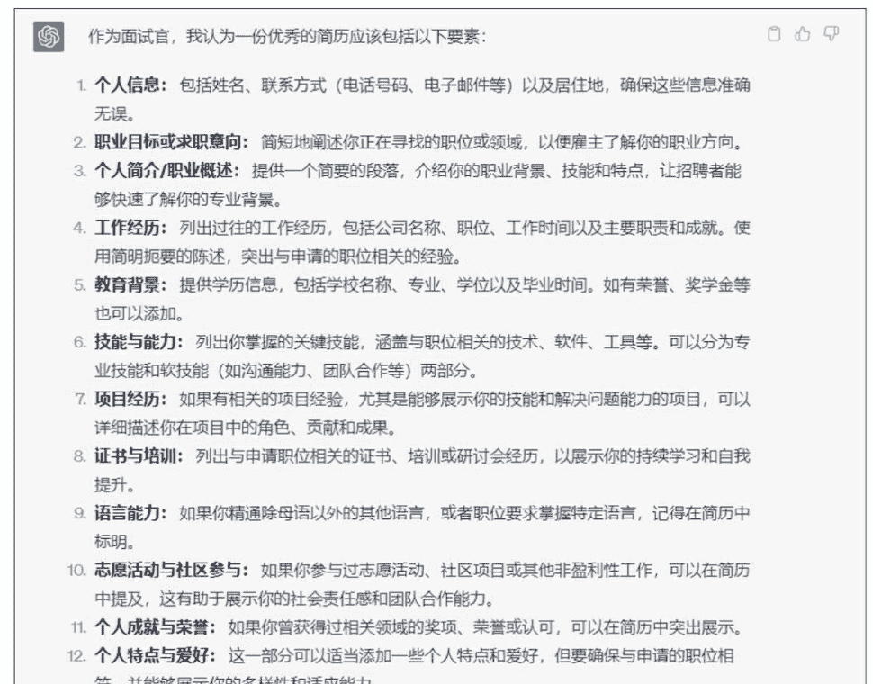

图4-10

**步骤02 提交个人信息：** 继续输入“好的，下面是我个人情况，请从面试官视角提出修改建议，并据此生成一份简历（另起一行，描述个人信息×××）”，ChatGPT会给出针对性修改建议并附示例简历，如图4-11所示。

**步骤03 要求进一步优化：** 再输入“请优化这份简历，要求简洁清晰、易读且有竞争力”，ChatGPT会按要求调整，如图4-12所示。

从面试官角度，你的素材很有潜力，但可做如下优化以更好突出优势：

### 修改建议：
1. **求职意向：** 更明确表达对文案策划岗位的热情，可点明希望为品牌推广与创意策略贡献力量。
2. **工作经历：** 除职责外，强调具体成果与项目，如成功的营销策划案例及协作解决问题的过程。
3. **自我评价：** 用具体事例佐证文字功底与创意思维，提升可信度。
4. **语言能力：** 除了英语四级证书，若工作中实际使用英语，可补充应用场景。
5. **技能项：** 在PS、Office等基础上，补充与文案创作相关的工具或平台。

### 个人简历示例：
```
姓名：【你的姓名】
联系方式：【电话号码】|【电子邮件】
居住地：【城市，省份】

求职意向：文案策划
最高学历：本科
毕业院校：xx大学，【专业名称】

工作经历：
【时间段】：xxx互联网公司，营销策划部文案专员
- 撰写营销策划文案、品牌推广文案和公司活动文案，提高品牌曝光率
- 协同设计师，实现创意方案，确保文案与设计风格一致
- 整理新媒体软文，提升公司在社交平台上的受众参与度

教育背景：
本科：xx大学，广告学专业

语言能力：
英语：四级（能够流利阅读和书写英文文档，有一定的英语交流能力）

技能与能力：
- 扎实的文字功底，擅长创意写作和思考
- 熟练操作PS图像制作软件，能够进行简单的图像编辑和排版
- 熟练使用Office办公软件，包括Word、Excel和PowerPoint
- 基本的英语交流能力，能够进行基本的英文沟通
- 具备网感和社会动态捕捉能力，能够洞察市场趋势和用户需求
```

## 用ChatGPT搭建面试题库

面试时紧张、怕答错、不会展示亮点是常见问题。把ChatGPT设定为面试官身份，就能生成高频问题并提前演练，从而缓解焦虑。下面是具体做法。

**步骤01 设定角色并提出需求：** 输入“你现在是新媒体编辑的面试官，请列出新媒体编辑面试里最常问的10个问题”，回车后可获得该岗位的典型题目，如图4-13所示。

**步骤02 细化提问获取答题思路：** 接着输入“请从面试官角度，给出第7个问题的回答建议”，ChatGPT会提供思路与示例，如图4-14所示。

这样既能拿到岗位专属题库，也能获得面试辅导。

当被问及如何衡量内容表现及使用哪些指标时，可按以下思路作答：

1. **指标明确化：** 说明在内容分析方面的经验，介绍常用指标如阅读量、社媒分享、互动率等，并解释其反映的受欢迎程度。
2. **对齐业务目标：** 强调指标与业务目标的关联，如将互动率与品牌认知、用户参与及转化挂钩。
3. **时间趋势观察：** 通过追踪指标变化识别高峰与低谷，优化发布时间与内容策略。
4. **受众洞察：** 利用数据分析地域、兴趣、互动模式，为不同人群定制内容。
5. **实验优化：** 通过A/B测试不同标题、配图或风格，根据结果迭代。
6. **结果呈现：** 将分析结果可视化为图表与报告，便于团队快速理解。

示例回答：
> “我通常关注浏览量、互动率和转化率来评估内容影响力，并把这些数据与业务目标对齐。我会观察时间趋势找到用户活跃时段，结合地域与兴趣洞察做分层内容，同时通过小范围实验优化标题与形式。最后，我会把结果整理成可视化报告，帮助团队快速决策并持续优化内容策略。”

## 用ChatGPT做创意策划

创意是提升效率与业绩的重要驱动，但灵感常被视为稀缺资源。ChatGPT可以成为灵感放大器，帮助快速打开思路、拓展维度。下面介绍使用流程。

**步骤01 确认方法、建立思路：** 输入“创意策划常用的方法有哪些？”回车后，ChatGPT会梳理方法论并给出解释，如图4-15所示。

**步骤02 提交具体需求：** 继续输入“请基于上述方法，为我策划一个中秋节主题的短视频创意脚本，要求符合年轻人审美且有趣”，ChatGPT会输出针对性脚本，如图4-16所示。

常用的创意激发方法包括：

1. **头脑风暴：** 团队自由发散，包容各类想法以引发碰撞。
2. **思维导图：** 以中心主题为核心展开联想，呈现关联结构。
3. **逆向思考：** 反向审视问题，找到非常规解法。
4. **类比迁移：** 将其他领域概念迁移至当前场景，产生新视角。
5. **观察洞察：** 从用户行为与环境细节中发现需求与机会。
6. **随机刺激：** 用随机词或图像触发联想。
7. **矛盾思考：** 聚焦矛盾点寻求突破性方案。
8. **六顶思考帽：** 从不同认知角度轮流审视问题。
9. **角色扮演：** 代入客户、用户或竞争对手视角。
10. **时间盒：** 限定时长强制快速产出，避免过度纠结。
11. **用户体验研究：** 深入了解痛点与偏好，找到创新点。

视频标题：《中秋寻味大冒险》

场景概述：
- 开场：年轻人卧室，桌上放月饼盒与节日贺卡。
- 主人公：爱冒险搞笑的小明。

脚本要点：
场景1 准备：小明拿起贺卡“中秋寻味大冒险，解锁美味新境界”，兴奋摇晃月饼盒。
场景2 盲尝：戴眼罩吃月饼，实则误吃洋葱，摘下眼罩时的滑稽反应引笑。
场景3 触手可及：手绑身后够月饼，撞翻桌子月饼散落，幽默失败引发共鸣。
场景4 最终考验：礼盒内多款特色月饼，小明挑选独特造型一口咬下露出满足表情。
场景5 收尾：贺卡写“每个月饼都是一次冒险，每一口都是发现”，点出中秋既是团圆也是创新时刻，呼吁观众勇敢尝试不同口味。

后续可继续要求优化脚本或获取更多创意点。

## ChatGPT助力文档办公

Word文档在办公中高频使用，用于撰写、分析、分类、制表等，任务繁琐耗耐心。ChatGPT可以分担这些工作，提升效率。以文本分类为例：

**步骤01 建立对话背景：** 输入“文本分类有哪些方法？”确认模型是否掌握相关知识，回车后可获得方法介绍，如图4-17所示。

文本分类方法因场景而异，常见做法有：

1. **朴素贝叶斯分类器：** 基于贝叶斯定理，假设特征独立，常用于文本分类，适合垃圾邮件等简单分类任务。

**ChatGPT实操：从文本分类到文档生成的完整打法**

常用的文本分类技术盘点

2.  支持向量机 Support Vector Machine，SVM 通过在特征空间里寻找最优分割超平面来区分不同类别。实际应用时先把文本向量化，再交由SVM完成类别判断。
3.  逻辑回归 Logistic Regression 原生擅长二分类，通过多次训练的策略也能推广到多分类文本场景。
4.  决策树 Decision Trees 依据不同特征的取值逐层分支，直至到达叶节点给出分类结果，可以堆叠多层来处理多类问题。
5.  随机森林 Random Forest 把多棵决策树的结果集合并，提升整体分类稳健性，适合复杂度较高的文本任务。
6.  神经网络 Neural Networks 卷积神经网络CNN、循环神经网络RNN以及Transformer家族在文本分类上效果突出，其中Transformer的变体BERT已成为NLP领域的热门基座模型。
7.  词袋模型 Bag of Words，BoW 把文本视作词的集合，忽略词序，仅依据词频进行表征与分类。
8.  词嵌入 Word Embeddings 把词汇映射到低维向量空间，用向量表征文本语义，代表方法有Word2Vec、GloVe等。
9.  深度学习模型 除了上述网络，还可选用LSTM、GRU等结构捕捉文本的序列依赖信息。
10. 集成学习 Ensemble Learning 将多个分类器的输出进行融合，例如投票、取平均等手段，整体性能通常更优。
11.迁移学习 Transfer Learning 把在源领域训练好的模型迁移到目标领域，能加快训练速度并提升分类效果。

第二步 精准下指令
在同一对话框里继续追加提示，比如“请用合适的方法帮我把下面这段清单分类：×××”，回车后模型会按要求给出分类结果。先用ChatGPT完成分类，再复制到Word即可省去大量整理时间。

示例指令：采用合适的方法，将以下文本进行分类：
手机4个、平板电脑2个、笔记本电脑5个、相机1台、透明胶20个、红色签字笔10支、黑色签字笔20支、蓝色签字笔12支、订书器5个、打印机2台、绿萝13盆、红掌4盆、罗汉松3盆、多肉10盆、靠枕15个、折叠被20床、拖鞋20双、桌面小风扇20台

模型给出的归类如下：

1.  电子设备
    - 手机4个
    - 平板电脑2个
    - 笔记本电脑5个
    - 相机1台
    - 打印机2台
2.  办公用品
    - 透明胶20个
    - 红色签字笔10支
    - 黑色签字笔20支
    - 蓝色签字笔12支
    - 订书器5个
3.  植物
    - 绿萝13盆
    - 红掌4盆
    - 罗汉松3盆
    - 多肉10盆
4.  家居用品
    - 靠枕15个
    - 折叠被20床
    - 拖鞋20双
    - 桌面小风扇20台

按类别归集物品能让存量更清晰可控。实际操作中若信息不足，分类精度仍需补充上下文。

用ChatGPT快速搭建图书骨架

图书框架决定全书走向，相当于建筑的图纸。要做出好框架需要逻辑与经验，ChatGPT可提供灵感与参考。

步骤01 建立对话背景：在输入框提问“图书框架一般包含哪些要素”，确认模型对图书结构的认知，得到要素清单。

步骤02 明确具体需求：继续输入“我想写一本关于视频剪辑的书，请给我一份框架”，模型会输出针对性大纲。

图书框架通常包含：
1.  封面与封底：书名、作者、出版社信息，封底常放推荐语。
2.  版权页：版权、ISBN、出版日期、印次等。
3.  目录：章节标题一览，便于定位。
4.  前言或序言：背景、写作动机介绍。
5.  引言：主题、目的与范围说明。
6.  正文章节：按结构展开的标题、段落、配图等。
7.  附录：补充表格、数据等。
8.  参考文献：引用来源清单。
9.  索引：关键词检索列表。
10. 致谢：对协助人员的感谢。

示例框架
书名：视频剪辑入门与实践
封面元素：书名、作者、视频剪辑相关视觉图
版权页：版权信息、ISBN、出版日期等
目录：
1.  引言
    - 剪辑的重要性
    - 本书目标与结构
2.  基础概念
    - 剪辑定义与发展
    - 完整剪辑流程
    - 主流软件工具简介
3.  前期准备
    - 硬件选型
    - 素材采集与整理
    - 创意与分镜
4.  剪辑技巧
    - 时间轴操作
    - 语法与节奏
    - 转场与特效
    - 音频处理与配乐
5.  进阶技巧
    - 高级转场与视觉效果
    - 图文叠加
    - 色彩校正与调色
    - 音频精修
6.  输出发布
    - 导出格式设置
    - 压缩与优化
    - 在线平台分发
7.  案例解析
    - 经典案例拆解
    - 技巧与创意提炼
8.  进阶建议
    - 学习资源
    - 职业发展展望
9.  附录
    - 常见问题
    - 术语表
    - 参考链接
10. 致谢
索引：术语与关键词列表

不满意时可追加优化要求，模型会据此迭代新版。

让ChatGPT生成会议发言稿

好的发言体现逻辑与表达力，借助模型能快速成稿。

步骤01 建立对话背景：提问“会议发言一般包含哪些内容”，获取要素。

步骤02 提出需求提示：输入“我是编辑部主管，需要在周一新员工培训会上发言，请生成稿件”。

生成示例：
尊敬的新同事，大家早上好！
我是编辑部主管，非常高兴在今天的培训会上与各位见面。欢迎加入团队，期待共同创造优质内容。

编辑工作的核心是信息准确传递并产生影响。我们需要高度的细致与校对意识，每个字词都承载信息。请在审校时严格把关。

同时，创意与多样性是部门价值所在。鼓励大家尝试不同文体与风格，展现个人特色。

协作同样关键。我们常与作者、设计、市场等部门配合，请保持顺畅沟通，推动项目落地。

最后，职业成长永无止境。积极学习新技能，提升专业水平，为发展打基础。

相信在大家努力下团队会取得优异成果。谢谢！欢迎提问交流，让我们开启新旅程。

后续可追加“增加互动”类指令，模型会据此改写。

让ChatGPT撰写会议纪要

会议纪要是对会议的正式记录，借助模型可加速成文。

步骤01 建立对话背景：提问“会议纪要通常包括哪些内容，请用表格呈现”。

典型要素表：
| 内容部分 | 具体说明 |
| 会议信息 | 主题、日期、时间、地点 |
| 与会人员 | 出席、缺席、主持、记录 |
| 议程内容 | 各议题讨论重点与问题 |
| 上次事项跟进 | 待办完成情况 |
| 重要讨论与决定 | 共识与决议 |
| 待办事项 | 责任人、截止时间 |
| 下次议程设想 | 预估议题 |
| 其他事项 | 提醒、注意事项 |
| 附件 | 演示材料、报告 |
| 结束语 | 总结、致谢、反馈邀请 |

步骤02 提出需求提示：输入“请按标准模板，结合以下内容生成会议纪要”，附会议要点。

生成示例：
# 会议纪要
会议信息：
- 主题：提高员工工作效率建议讨论会
- 日期：[填写]
- 时间：[填写]
- 地点：[填写]
参会人员：康总、李总监、王主管、员工A、B、C

会议发言：
1. 康总说明会议目标，强调集思广益。
2. 李总监建议强化培训，提升操作熟练度。
3. 王主管提出明确目标与日计划，增强目标感。
4. 员工A、B、C分享经验，认为设备与福利改善氛围有助于提效。
5. 综合建议：有序培训、明确目标、加强协作、提供设备与福利，营造良好文化。

会议落实：
1. 李总监负责制定培训计划。
2. 王主管负责细化工作目标与执行计划。
3. 公司负责保障设备与福利。
4. 全体加强协作与交流。

结论：会议形成多项改进方向，各责任人按分工推进。感谢参与。

让ChatGPT输出商业计划书

商业计划书用于融资展示，模型可提供调研、策略与财务建议。

步骤01 建立对话背景：提问“一份完整商业计划书包括哪些内容”。

主要构成：
1. 执行摘要：业务概况、目标、优势、预期成果。
2. 公司概述：成立时间、法律形式、地点、使命愿景价值观。
3. 市场分析：行业趋势、目标市场规模、客群、竞争态势、机会威胁。
4. 竞争策略：对手优劣势及差异化打法。
5. 营销销售策略：定价、渠道、推广、客户管理。
6. 产品服务描述：功能、优势、解决痛点。
7. 经营与管理结构：团队、职责、供应链、生产流程。
8. 财务预测：收入、支出、盈利、现金流、资金需求。
9. 风险管理：识别风险及应对措施。
10. 里程碑与时间表：关键节点与进度。
11. 融资计划：用途、金额、来源、回报。
12. 附录：研究数据、法律文件等。

步骤02 提出需求提示：输入“请为一款带定位功能的手环研发项目生成融资用商业计划书”。

生成示例：
# 商业计划书：定位手环研发项目
执行摘要：
公司拟研发集成高精度定位的智能手环，兼具健康监测与智能提醒，为用户提供个人安全与健康管理方案。计划融资推动研发、量产与推广。

公司概述：
名称：SmartTrack Technologies
成立：2023年
形式：有限责任公司
总部：城市，国家
使命：以智能定位与监测改善生活质量
愿景：成为全球领先的智能定位手环供应商

市场分析：
- 可穿戴设备市场持续增长，健康安全需求上升
- 定位手环在儿童、老人护理、户外探索等场景潜力大
- 现有竞品成熟但仍有体验提升空间

竞争策略：
- 技术创新：持续优化定位精度与实用性

可穿戴手环创业方案要点速览

佩戴与交互：主打手环的轻盈舒适与潮流外观，App 端交互走简洁易懂路线。
生态联动：盘活保险机构、托育服务等外部资源，拓宽手环的使用场景。

市场打法：
- 以社媒传播与健康类展会为主阵地扩散品牌声量；
- 推出个性化定制选项，贴合不同用户群体的差异需求；
- 设计促销主题和限时折扣激励购买。

核心功能：
- 精准定位：整合 GPS、蓝牙、Wi-Fi， indoor outdoor 都能稳定追踪；
- 健康追踪：心率、步数、睡眠等指标实时采集；
- 智能提醒：短信、来电、社交平台消息即时推送。

组织架构：
- 创始人兼 CEO 张明，累计五年可穿戴赛道从业经历；
- 技术组由资深硬软件工程师构成，负责研发与维护；
- 销售与市场组负责推广、渠道拓展及客户支持。

财务概算：
- 研发与量产投入：XXX 美元
- 收入预测：首年 XXX 美元，第三年攀升至 XXX 美元
- 盈利预测：首年亏损，第三年净利率达 XX%
- 融资需求：XXX 美元

风险提示：
- 技术面：研发卡点或导致交付延期；
- 市场面：需求波动会影响销量与营收；
- 竞争面：新入局者增多考验份额。

推进节奏：
- 第一年：完成研发、打样、市场调研；
- 第二年：启动量产、上线销售并扩张推广；
- 第三年：区域拓展并深化合作网络。

资金用途：拟募集 XXX 美元种子轮，投向研发、制造与市场。

附录清单：
- 市场调研资料
- 创始团队简介
- 资金分配明细
- 财务测算详表

图4-25（续）

基于初稿可在模型处追加需求，补充项目亮点、服务细节、团队优势等，让商业计划更完整。

用 AI 高效撰写通知文案

通知是机构发布信息、传达决定的常用文体。借助 AI 可大幅提升撰写速度、准确度与完整度。

生成流程如下。

步骤01 设定对话背景：在输入框提问“写通知一般包含哪些要素？”，确认模型是否掌握通知写作规范，回车后模型会列出撰写框架，如图4-26所示。

步骤02 提交具体需求：在同一窗口继续输入，如“请拟一份因线路检修需停两天电的通知，停电时间 20×× 年 11 月 1 日—2 日，上午 8:00—11:00，下午 14:00—19:00”，回车后模型会产出对应文稿，如图4-27所示。

通知可书面或口头形式，向特定个人、团体或机构传递信息。常见构成包括：

1. 标题：概括主旨，方便快速捕捉要点。
2. 发文主体：标明发出单位或个人，确保来源可追溯。
3. 日期时间：注明发布时间，便于判断时效。
4. 接收对象：明确受众范围。
5. 正文内容：核心部分通常涵盖：
   - 背景交代：简述事由；
   - 主要内容：事项、活动或政策调整；
   - 关键信息：时间、地点、要求等；
   - 原因说明：必要时解释逻辑；
   - 执行指引：需要对方行动时列明步骤；
   - 联系方式：提供咨询渠道。
6. 结束语：以致谢、祝愿收尾。
7. 署名：增强可信度。
8. 附件说明：如有附件需说明获取方式。
9. 版式：排版清晰易读。
10. 投递方式：明确纸质、邮件或社交媒体等渠道。

图4-26

【通知标题】：临时停电通知

【发出单位】：XXX 电力公司

【日期】：20XX 年 10 月 15 日

亲爱的居民：

您好！为保障电网安全稳定运行，我司计划进行线路检修，需在以下时段暂停供电：

停电时间：20XX 年 11 月 1 日（星期三）至 11 月 2 日（星期四）
停电时段：上午 8:00 至 11:00，下午 14:00 至 19:00

检修期间将对线路进行全面维护，确保供电可靠性。由此造成的不便敬请谅解，建议提前做好电器保护。

如有疑问或紧急情况，请联系客户服务热线：XXX-XXXXXXX。工作人员全天候提供支持。

感谢理解与配合。我们将全力保障检修顺利完成并及时恢复供电。

XXX 电力公司
联系人：XXX
联系电话：XXX-XXXXXXX
电子邮件：XXX@example.com
附件：维修计划详情（如适用）

烦请告知家人邻居，共同做好停电准备。感谢合作！

图4-27

可在初稿基础上让模型优化，例如在结尾增加祝福语，提升温度感。

让 AI 辅助生成演讲稿

演讲稿是公开场合传递观点的有效载体。优质稿件能鼓舞听众并留下印象，对新手而言难度较大，借助 AI 可快速提升质量。

操作步骤介绍如下。

步骤01 询问框架：在输入框输入“撰写演讲稿需要哪些要素？”，确认模型是否理解写作模式，回车后会给出结构要点，如图4-28所示。

撰写演讲稿通常包含：

1. 开场：
   - 问候致意，建立友好连接；
   - 引出主题，点燃兴趣。
2. 主体：
   - 点明中心思想与目标；
   - 按逻辑拆解要点并配例证；
   - 用数据事实增强说服力；
   - 适度引用名言案例；
   - 通过对比凸显重要性。
3. 过渡：用衔接句保持连贯。
4. 反驳回应：预判质疑并给出解释。
5. 总结：重申主题、回顾要点、发出号召或展望。
6. 结束语：表达感谢并以金句收尾。
7. 附加：可加入幽默、个人故事、提问互动。

注意语言清晰、结构有序、逻辑严谨，并兼顾听众背景，篇幅适中。

步骤02 撰写演讲稿：在同一窗口继续输入，如“请提供一份优秀毕业生在毕业典礼上的振奋人心演讲稿”，回车后模型会输出内容，如图4-29所示。

步骤03 自评演讲稿：

继续输入“请评价这篇演讲稿，指出优点与不足”，回车后模型会给出点评，如图4-30所示。

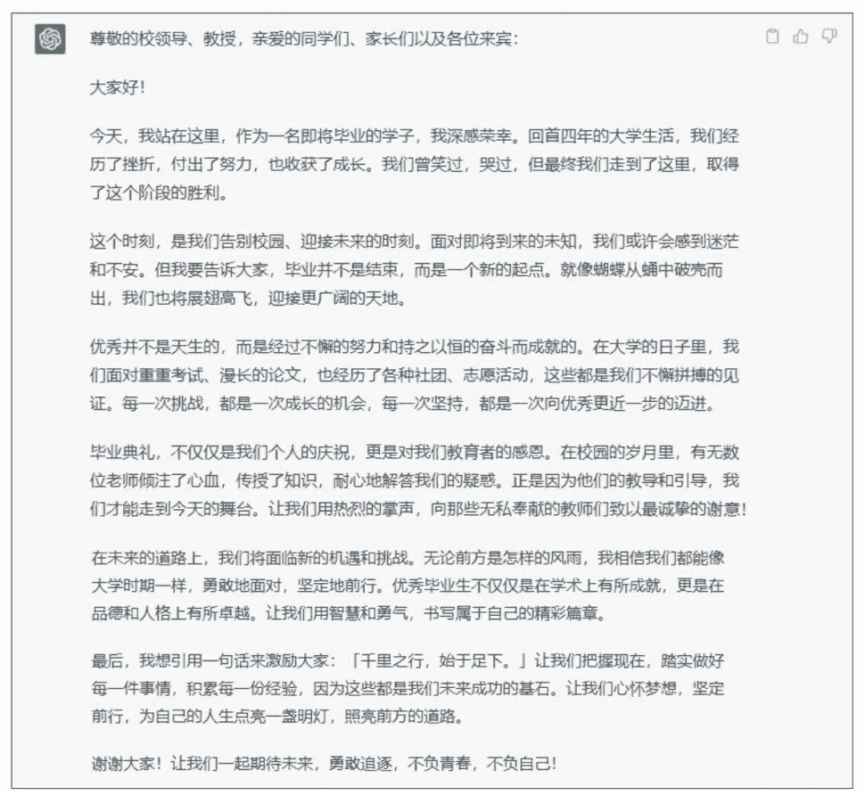

▲图4-29

这篇稿件有不少亮点，也存在改进空间：

优点：
- 1. 情感共鸣：开场呼应学生共同经历，建立亲近感。
- 2. 鼓励激励：强调毕业是新起点，传递积极信心。
- 3. 感恩表达：感谢师长与教育，体现尊重。
- 4. 经历映射：提及挫折与成长，增强共鸣。

不足：
- 1. 缺少具体例证：观点缺少案例支撑，说服力有限。
- 2. 逻辑展开不够清晰：建议按时间或逻辑梳理成长脉络。
- 3. 语言相对平实：可加入更多修辞，提升生动性。
- 4. 结尾呼应不足：可更强力呼应振奋主题。
- 5. 缺乏互动：可加入提问或互动环节提升参与感。

总体来看稿件基础扎实，通过增加案例、理顺结构、丰富语言可进一步提升。

图4-30

步骤04 优化演讲稿：继续输入“请依据上述问题优化这篇演讲稿”，回车后模型会重新产出，如图4-31所示。

尊敬的校领导、教授，亲爱的同学们、家长们以及各位来宾：

大家好！

此刻站在这里，心中充满荣幸与感动。回望校园岁月，像昨天，又似一段漫长旅程。我们共同追寻知识光芒，经历人生起伏，每一次奋斗都为今天添彩。

优秀的毕业生不仅学业出色，更在品格上卓越。我认为优秀源于坚持与不懈奋斗。

曾迷茫、曾受挫，正是这些经历淬炼意志，培养坚韧。我记得大一时手足无措站在陌生教室，而如今的我已历经四年风雨成长。

大学给予我们知识，更教会我们思考、协作、面对困难。在社团与志愿活动中试错、再尝试，我们锻炼创新与团队精神。正如歌德所说：“人的本质在不断奋斗中实现。”

勿忘一路陪伴的恩师与父母，借他们的关爱与付出我们才能坚定前行。

毕业是十字路口，未来仍有挑战。但正如爱默生所言：“最好的时机永远是现在。”让我们抓住当下，勇敢迈出第一步。

愿我们怀感恩之心回馈社会，用行动为母校争光。

最后以一句鼓励收尾：勿让潜力沉睡，勿让机会流失，携手创造更美好的未来！

谢谢大家！为明天继续拼搏！

图4-31

若对生成稿不满意，可先让模型点评再据建议修改，提升生动与鼓舞力。

借助 AI 撰写工作总结


扫码看教学视频

工作总结用于评估团队与个人表现，提升工作质量，也为后续工作提供指引。撰写本身不难，但耗时且考验总结分析能力。借助 AI 可快速梳理要点。

步骤01 设定背景：在输入框输入“写工作总结有哪些技巧建议？”，确认模型是否掌握写法，回车后会给出建议，如图4-32所示。

撰写技巧包括：
- 明确目标与重点，聚焦核心信息；
- 语言简洁，避免冗长；
- 结构清晰，如引言、内容概述、成果、挑战、解决方案、下步计划；
- 突出重点成果，使用列表强调；
- 用案例、数据支撑；
- 避免空话，用具体描述；
- 量化结果；
- 客观真实；
- 校对完善；
- 突出个人贡献；
- 自我评估；
- 适配受众；
- 反思总结。

图4-32

步骤02 提交需求：在同一窗口输入“请按以上建议帮我写一份‘6月—8月实习工作总结’，包含工作进展与下一步计划”，回车后模型会生成文稿，如图4-33所示。

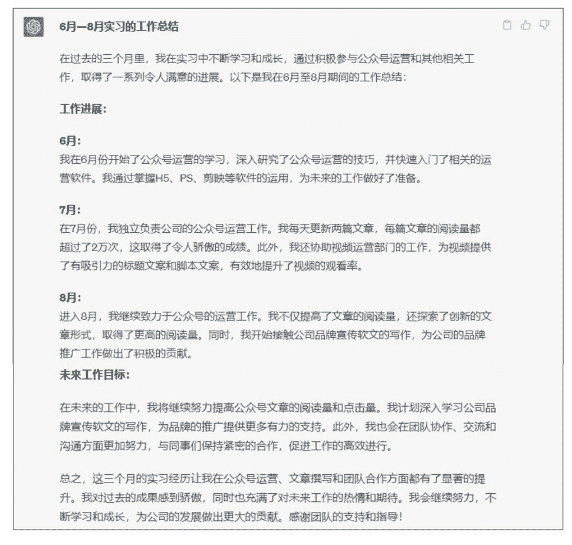

图4-33

步骤03 提交优化要求：继续输入“结合工作内容深入分析收获并补充”，回车后模型会优化文稿，如图4-34所示。

## 6月—8月实习工作总结

过去三个月在实习中不断成长，参与公众号运营等工作取得明显进展。

工作进展：
6月：开始学习公众号运营，研究操作技巧，快速掌握 H5、PS、剪映等工具，为后续工作打基础。
7月：独立负责公众号运营，每日更新两篇，单篇阅读量超 2 万次。通过数据分析把握读者偏好，提升内容匹配度。
8月：持续运营并尝试互动问答、图文结合等新形式，阅读量进一步提升；开始撰写品牌宣传软文，学习将品牌价值融入文案。

收获与成长：
通过运营锻炼了创意思维与内容策划能力；学会依据数据优化；软文写作提升了表达水平并加深对品牌形象的理解。

未来目标：
继续提升阅读量与点击率；深入学习品牌软文撰写；加强团队协作与沟通。

这段实习期让我在公众号运营、稿件撰写和团队协作上都有明显进步。回望所积累的经验，我对已有的成果感到欣慰，也对接下来的工作满怀期待。未来我会持续精进能力，保持学习劲头，力求为团队创造更大价值。衷心感谢同事们的帮助与指导！

借助大语言模型做工作复盘时，通过不断追问可以让产出更具实操价值。下面是我常用的追问思路。

- 1. 工作复盘主要发挥什么作用？一份高质量的复盘通常需要满足哪些标准？
- 2. 假设你现在是项目经理，请围绕项目完成情况帮我撰写一篇约一千字左右的总结报告。
- 3. 我需要向领导汇报本年度前半段的个人工作情况，你建议采用怎样的框架？
- 4. 能否举例说明撰写工作总结的做法与要点？
- 5. 请对这篇总结进行润色，让个人贡献的呈现更突出。

需要注意的是，模型生成存在随机性，同一指令也可能得到不同结果。拿到初稿后务必结合自身实际、岗位要求和个人表达习惯进行调整打磨，才能形成真正好用的文本。

# 第5章 AI助力艺术文案创作

## 学习提示
艺术类文本包括诗歌、小说、剧本、故事、散文、歌词等以语言美感见长的作品。这类创作通常需要扎实的语言组织、创新思维、逻辑能力和想象力。经过大规模数据训练的 AI 也能在艺术类文案上提供辅助。本章将介绍如何有效引导 AI 进行艺术类文案的写作。

## 本章重点导航
- 学会借助 ChatGPT 生成艺术类文案

## 让ChatGPT创作诗歌


扫码看教学视频

诗歌是饱含情感、意境深远的文本，往往体现作者独特的叙事角度和思维习惯。ChatGPT 在学习了大量诗歌语料后，能够通过数据模式生成诗作，只需给出合适的指令即可。下面介绍操作流程。

**步骤01 建立语境，确认风格：** 在输入框中输入提示词，例如“你读过徐志摩的诗吗？请总结一下他的诗歌特点”，回车后可以看到系统的背景回应，如图5-1所示。

徐志摩（1897年-1931年）是中国现代文学史上的重要诗人，他的诗歌具有以下特点：

- 1. **浪漫情怀浓郁**：作品充盈着浓郁的浪漫色彩，表达了他对爱情、生活和人生的热烈追求，往往洋溢着激情、渴望和对美好事物的向往。
- 2. **个人情感抒发**：多以自身感受和经历为素材，折射出内心矛盾、欲望与挣扎，常以第一人称书写，让读者切实体会他的情感世界。
- 3. **西方文化影响**：徐志摩曾赴美留学，深受西方文化影响。诗中常融入西方浪漫主义元素，强调自由、个人情感与自我表达。
- 4. **自然意象丰富**：诗句中常出现月亮、花草、山水等自然意象，这些意象与情感体验相融，增强了表现力与意境。
- 5. **理想与现实的张力**：作品常呈现理想与现实之间的矛盾。他渴望自由、热爱生活，却又受社会、家庭等现实因素制约，这种张力让诗歌更具思考与情感深度。
- 6. **爱情主题突出**：徐志摩以细腻的情感书写了大量爱情主题的诗篇，其中与陆小曼的感情为世人熟知。他将爱情视为人生重要主题，用诗歌表达对爱情的痴迷。

总体而言，徐志摩的诗歌以情感丰富、浪漫主义、自然意象和个人化抒发为特色，体现了其独特的创作风格与内心世界，对中国现代诗歌产生深远影响。


**步骤02 明确需求，生成初稿：** 在同一输入框继续输入提示词，例如“请模仿徐志摩的写作风格，围绕‘西湖’‘划船’‘雨伞’创作一首现代诗歌”，回车后会得到现代诗作，如图5-2所示。


图5-2

**步骤03 提出优化要求：** 继续输入提示词，例如“请融入象征手法修改这首诗，使其更有意境和美感，并说明修改思路”，回车后会得到优化后的诗歌，如图5-3所示。

湖光粼粼似翡翠，
船影摇曳向西归。
雨伞如诗展翅翔，
心随波渺，梦飞扬。
西风拂过断桥影，
思绪融入水之香。
划船垂钓情自适，
雨伞与我，共此航。
雨丝轻舞铺绿绮，
湖面荡漾涟漪飞。
徜徉幽梦恍如幻，
心湖荡漾岁月辉。
西湖湖畔花正开，
划船归去雨未谐。
象征情深寄心间，
时光流转，永不退。

## 解释：
在这首修改后的诗作中，融入了一些象征手法，提升了意境与美感。

- 1. **象征性描写：** 将湖光比作翡翠，船影比作归程的旅途，雨伞比作诗意的翅膀，营造出丰富的意象，增强想象力与美感。
- 2. **象征性描述：** “西风拂过断桥影，融入水的香味”，桥与水的象征意义暗示时间与情感的流转，提升了意味。
- 3. **象征性情感：** “雨丝轻舞形成绿色绮丽，湖面涟漪飞扬”，表达了情感的飘逸与岁月的荡漾。
- 4. **象征性寓意：** 末两句“象征情深寄心间，时光流转，永不退。”表达对情感的珍视与对时光流逝的思考，象征情感的延续与恒久。

借助这些象征手法，诗歌更具意境与深度，读者能感受到更丰富的情感与思考。

图5-3

## 让ChatGPT虚构小说


扫码看教学视频

小说具备很强的叙事张力，能显著提升阅读吸引力。随着 ChatGPT 类产品出现，AI 虚构小说已成为现实，用户只需输入合适指令即可获得生成内容。下面介绍操作步骤。

**步骤01 设定背景，构建世界：** 在输入框中输入提示词，例如“请根据关键词，虚构一个科幻小说的背景，关键词：月球、公转、宇宙、宇宙飞船”，回车后系统会构思出故事背景，如图5-4所示。

在遥远的未来，人类已探访整个太阳系，并在月球上建立起繁荣的基地，但对更广阔的宇宙仍只触及冰山一角。月球成为科研中心与资源开发基地。然而，月球公转轨道逐渐出现异常，引起科学界关注。

深入研究后发现，月球公转轨道逐步偏离预测路径，似乎受某种神秘力量影响。航天局专家短期内无法给出合理解释。在紧急状况下，一艘名为“星际使者号”的宇宙飞船被快速制造，任务是前往月球调查并解决谜团。

“星际使者号”被称作人类历史上最先进的宇宙飞船，具备远超以往的技术。机身采用复合材料，内部配置先进推进系统、能源装置和科研设备。机器人辅助人类船员，确保任务顺利执行。

登陆月球后，船员发现月球表面出现一种神秘能量结晶体，它们扎根于地壳，通过未知方式影响月球公转轨道。船员决定采集样本分析，却在采集过程中遭遇强烈能量波动，被传送到一个未知的宇宙区域。

在该未知区域，船员看到超越人类想象的宇宙，存在奇特星系、奇异行星和超出科学的现象。他们逐渐意识到，月球公转异常并非简单物理现象，而是一种连接不同宇宙层面的能量现象。这一发现颠覆了对宇宙的理解，也揭示出人类可能是众多宇宙之一。

在未知宇宙中，船员面临巨大挑战与未知危险，但也逐步理解宇宙的多重层面，掌握连接不同宇宙的能量之道。最终，他们不仅解开了月球公转异常之谜，还将人类视野推向更广阔领域，探索连接宇宙层面的可能性。该故事成为人类历史的重要里程碑，改变了对宇宙的认知，让探索之旅更深邃神秘。


**步骤02 提供大纲需求：** 在同一输入框继续输入提示词，例如“请根据上述故事背景，按逻辑关系将小说分为10章”，回车后会得到小说大纲，如图5-5所示。

当月球异常公转引发关注时，人类航天局迅速组建由天文学家、物理学家、工程师与宇航员组成的队伍，派往月球基地深入研究异常现象。

### 章节一：谜团初现
科学家在月球基地分析公转数据，发现异常规律不符合传统物理模型，引发困惑与担忧。同时，基地内航天员感受到微弱震动，月球似乎在某种未知力量下微微颤动。

### 章节二：危机加剧
基地震动逐渐增强，工程师发现结构出现细微裂缝。航天局决定加速研发新型宇宙飞船以便深入调查。在紧急关头，航天局召集顶尖科学家与工程师共同研发。

### 章节三：星际使者号的诞生
在紧张研发中，“星际使者号”终于完成。该船拥有超越以往的技术，可应对复杂多变的宇宙环境。航天局从各领域挑选最优秀船员，进行严格培训。

### 章节四：月球之旅
“星际使者号”启程前往月球，船员在船内进行最后准备。抵达月面后，他们发现神秘能量结晶体，似乎是异常的关键。船员开始采集样本并尝试分析特性。

### 章节五：能量波动
采集能量晶体时，船员突然遭遇强烈能量波动，视野模糊，意识渐失。恢复意识后，他们发现自己身处完全陌生的宇宙区域。

### 章节六：未知宇宙
船员开始探索未知区域，发现星系与行星特征奇特，宇宙中存在超越科学的现象。他们逐渐认识到月球异常并非单纯物理问题，而是连接不同宇宙的能量波动。

### 章节七：多重层面的发现
通过观察、实验与分析，船员逐步理解该未知宇宙的结构与特性。他们发现宇宙由多重层面构成，各层面有不同规律与能量交互，开始学习掌握这些能量以理解月球异常原因。

### 章节八：能量的连接
船员在多重层面中发现能量连接方式，学会跨越不同层面，实现跨宇宙通信与移动。这使他们能进一步研究月球异常，并探索能量晶体与公转轨道的联系。

### 章节九：解开谜团
深入研究后，船员最终解开月球异常之谜。他们发现月球上的能量晶体与宇宙能量层面相互关联，通过能量连接影响公转轨道。这一发现改变了对宇宙的认知，让探索更广阔深刻。

### 章节十：回归与启示
解开谜团后，船员决定返回人类宇宙层面。带着对多重层面宇宙的理解与能量连接的掌握，他们回到月球基地。这段经历成为人类传奇，改变了对宇宙的看法，为未来探索铺平道路。故事在人类社会流传，成为勇往直前的动力。

## 让ChatGPT撰写剧本
剧本是一种可视化文本，能通过舞台、影视等形式呈现画面，相较小说更具直观性，已成为常见娱乐载体。借助 AI 可获得剧本创作灵感。下面介绍操作流程。

步骤01 设定背景，确定方向：在输入框中输入提示词，例如“如果创作一个吸引女性观众的剧本，可以进行哪些选题？”，系统会给出创作建议，回车后得到方向，如图5-8所示。

创作吸引女性观众的剧本需考虑兴趣、情感与关注点。以下是一些可能吸引女性观众的选题与元素：

- 1. 友情与家庭关系：探讨深厚友情与家庭关系，包括姐妹情谊、母女关系、亲情等。关系发展、挑战与情感变化可成为引人入胜的剧情。
- 2. 爱情与浪漫：浪漫爱情故事总具吸引力。可写扑朔迷离的爱情，或深入探讨爱情中的挫折、成长与复杂性。
- 3. 女性主义与自我发展：聚焦女性在社会中的角色、挑战与成长，探讨她们如何克服困难、发展自我并寻找声音与权利。
- 4. 职业与事业：描绘女性在职场的经历、抉择与成功故事，展现职业道路上的努力、才华与坚持。
- 5. 历史与文化：以历史事件、文化背景为基础，创作展现女性在不同时代与文化中的生活、冲突与成就的故事。
- 6. 奇幻与冒险：构建充满想象与冒险的世界，让女性主角发挥重要作用，展现勇气与智慧。
- 7. 心理与情感探索：深入挖掘人物内心，描绘情感起伏、挣扎与成长，让观众产生共鸣。
- 8. 社会问题与现实挑战：探讨性别歧视、社会压力、身份认同等现实问题，通过女性角色传递积极信息与启发。
- 9. 幽默与轻松：创作轻松幽默情节，让观众在欢笑中获得乐趣，对吸引女性观众也很有效。
- 10. 环境与自然：以美丽自然景观为背景，让女性主角融入其中，创作关于与大自然共生、保护环境的故事。

无论选择哪个选题，都要塑造深刻人物、引人入胜情节与难忘对话，同时尊重多样性、避免刻板印象，展现真实多维的女性形象。

图5-8

**步骤02 确定选题，要求示例：** 选择其中一个选题，让系统提供剧本简介示例，同一输入框继续输入提示词，例如“请根据女性主义与自我发展这个选题，提供几个剧本简介示例”，回车后会得到简介示例，如图5-9所示。

以下是基于女性主义与自我发展主题的剧本简介示例：

- 1. 剧本：《自由之翼》
19世纪末英国，维多利亚时代女性艾丽莎从小生活在传统家庭。她对女性权利与平等充满追求，逐渐走上充满挑战的道路。在社会阻力与家庭反对下，她努力成为活跃的女性主义者，参与争取女性选举权运动。通过与勇敢女性合作，她找到内心力量，也影响了社会观念。

- 2. 剧本：《她的轨迹》
现代城市中，三位性格各异的女性——年轻职业女性、单身妈妈与退休女性科学家，因一次神秘事件交织在一起。解开事件谜团的过程中，她们共同面对职场歧视、家庭压力与年龄歧视等挑战。通过彼此支持与合作，她们逐渐找到自己的声音，并为平等与女性权利而奋斗。

- 3. 剧本：《平衡之舞》
幻想中世纪世界，农家女孩埃莉诺渴望成为骑士。然而该领域长期由男性主导，女性骑士几乎不被接受。她面对社会与家庭阻力，决心通过参加声名显赫的骑士比武来证明自己。旅途中，她结识一位有着相似梦想的女性，她们共同努力打破性别界限，寻找勇气与力量。

- 4. 剧本：《绽放》
小镇上三代女性的故事交织。祖母、母亲与女儿分别生活在不同时代，却面临相似挑战与抉择。祖母是当地首位女性医生，母亲是职业女性，女儿在大学学习女性研究。通过回顾过去经历，她们探讨女性在社会中的变革、进步与自我发展，同时反思女性主义对生活的影响。

图5-9

步骤03 提供剧本大纲的提示词：在同一输入框继续输入提示词，例如“请生成第二个剧本的大纲”，回车后会按提示生成大纲，如图5-10所示。

以下是剧本《她的轨迹》的大纲：

### 剧本：《她的轨迹》
**背景设定：** 现代城市，三位性格各异的女性，各自面临不同挑战与压力。

### 第一幕：交错的命运
- 1. **主人公介绍：** 主人公分别为：艾米，年轻职业女性，充满事业野心；莉莉，单身妈妈，为女儿努力工作；格蕾丝，退休女性科学家，为寻找新目标而努力。
- 2. **事件发生：** 一次神秘事件，如城市突发事件或独特物品失窃，使她们生活交叉，迫使合作解开谜团。

### 第二幕：共同探索
- 1. **初次合作：** 主人公相识，开始合作，因各自拥有独特线索。
- 2. **挑战与冲突：** 探索中，她们面临职场歧视、家庭问题、人际关系挑战，也产生分歧与冲突，最终通过理解与团结克服。

### 第三幕：自我发现与成长
- 1. **个人故事揭示：** 剧情推进中，每位主人公逐步透露个人故事，揭示其形成原因。
- 2. **相互启发：** 主人公互相启发，分享经验与教训，使自我发展过程更坚强自信。

### 第四幕：解开谜团，实现目标
- 1. **谜团解开：** 通过努力合作，她们逐步解开事件背后的真相，发现令人震惊的事实。
- 2. **目标的实现：** 解开谜团对每个人影响不同，但最重要的是，她们都在过程中实现个人目标，包括艾米职场突破、莉莉为女儿创造更好生活、格蕾丝寻找新生活方向。

### 第五幕：坚持与希望
- 1. **结束和总结：** 剧情接近尾声，主人公变得更坚定，友谊更深厚。虽然谜团已解，自我发展之旅仍在继续。
- 2. **展望未来：** 故事以主人公展望未来的场景收尾，她们在不同领域迎来新挑战与机遇，但已准备好面对并继续前行。

通过展现主人公面对挑战、团结合作及实现个人成长与目标的过程，该剧本将女性主义与自我发展的主题融入其中，以吸引女性观众并产生共鸣。

图5-10

步骤04 提供撰写剧本的提示词：在同一输入框继续输入提示词，例如“请按照大纲，写出剧本的第一幕”，回车后会按提示生成第一幕内容，如图5-11所示。

图5-11

第五步 用追加指令让剧本更饱满：在同一个对话框里继续补充要求，比如“请把第一幕的描写再丰富一些，加入更多人物外形细节，让观众印象深刻”，回车后模型会按这个新指示对第一幕进行改写，如图5-12所示。

当代大都市，夜晚霓虹闪烁，白天车流不息。每个人都按自己的节奏运转，而在这充满张力与机遇的城市里，三位女性的轨迹即将产生交集。

### 第一幕 命运初相逢
舞台正中搭出一个现代办公场景。艾米是个戴眼镜的年轻职场人，穿着时髦的职业套装，正聚精会神地盯着电脑。

**主持人 幕后旁白：** 欢迎走进都市的喧闹。机遇与考验并存，这座城市里的人物各不相同，她们的篇章即将在此交织。

街道上，一辆公交缓缓行驶，忽然发生爆炸，整条街陷入混乱。

**主持人 幕后旁白：** 一桩突如其来的神秘事件打破宁静，也改写了命运的方向。

舞台右侧，莉莉是一位单亲妈妈，穿着舒适休闲，头发自然垂肩，正迎着跑来的女儿。

**莉莉 轻拍女儿头：** 艾米，宝贝，快点，我们要迟到了！
**女儿艾米 兴奋：** 妈妈，我画了个超大的太阳，你看！
**莉莉 微笑：** 真漂亮，亲爱的，现在得赶紧去上班和幼儿园了。

舞台左侧，格蕾丝是一位退休的女科学家，银白短发，戴着精致眼镜，坐在咖啡馆角落翻阅科学杂志。

**格蕾丝 自语：** 这套研究思路挺有意思，或许可以试试……

**主持人 幕后旁白：** 她们是艾米、莉莉和格蕾丝，看似普通的三个女人，她们的生命将在这场神秘事件的阴影下彼此缠绕。

三人各自的画面交替呈现，节奏逐渐放缓，为观众留下鲜明印象。

**主持人 幕后旁白：** 每个人都有梦想、压力与挑战，在这座喧嚣的都市里，她们的命运注定相互影响，开启一段全新旅程……

幕布落下，第一幕结束。

图5-12

也可以继续追加指令，让模型补写剧本的高潮，强化矛盾冲突，并对整体进行润色提升。

## 让ChatGPT编写故事
好故事往往情节抓人、妙趣横生，在亲子教育中也很有价值。当需要为孩子讲故事时，可让模型扮演故事专家，按年龄和风格定制内容。下面介绍具体操作。

**步骤01 设定人设，明确需求：** 在输入框里写“请你扮演一位儿童作家，擅长童话创作，写一个适合5岁小朋友的童话”，回车后模型会按要求生成童话，如图5-13所示。

### 故事名：勇气小兔悟
从前森林里有一只叫悟的小兔，是最怕事的兔子。风一吹，他的心就怦怦乱跳。其他小动物都笑他胆小，鸟儿们嘲他不敢离开洞口。

一天，好动的松鼠皮皮邀他探险。皮皮好奇心强，活力十足。
“悟，一起去探险吧！”皮皮欢快地说。
“可我…我好怕…”悟低着头小声回。
“别怕，我一直陪你。我们一起面对恐惧，就会变勇敢！”皮皮鼓励道。

悟鼓起勇气跟上。他们穿过茂密树林，踏过清澈小溪，又来到一个神秘洞口。
“进去瞧瞧吧！”皮皮兴奋地说。
悟有些发憷，却紧握皮皮的小手，一步步走进洞里。洞内漆黑，只能听见呼吸声。
“哇，那边好像有光！”悟指着深处惊喜道。

他们走向光源，发现一块会发光的石头，暖意十足，像在讲故事。
“这石头一定有话要告诉我们！”皮皮说。
他们坐下倾听。石头说，勇气不是没有害怕，而是在害怕时依然向前。勇气是力量，让人面对未知、克服困难。

悟听后心里暖暖的。从此他不再是胆小鬼，学会直面恐惧，和皮皮一起经历许多冒险，成为森林里最勇敢的伙伴。

故事提醒我们，每个人都有恐惧，勇气能让我们超越恐惧变得更强。无论遇到什么，只要勇敢面对，就能找到办法。

图5-13

步骤02 用关键词引导创作：在输入框输入“请以关键词写一个适合5岁阅读且新奇有趣的童话，另起一行关键词：熊猫、探险”，回车后模型会生成对应童话，如图5-14所示。

图5-14

还能让模型对经典童话进行改编，或在故事中融入哲理，以增强教育意义。

## 让ChatGPT创作散文
看到美景、品味美食或感悟人生时，文思常会萌发，散文就是这种表达。借助AI，散文的情感传递会更顺畅。下面介绍操作流程。

**步骤01 先学习范式，开启对话：** 输入“请概括朱自清《荷塘月色》的写作特点”，让模型先掌握优秀散文的写法，回车后会得到总结，如图5-15所示。

《荷塘月色》以荷塘月色为描绘核心，呈现作者在宁静夜晚的感受与思考。其特点可归纳为：

- 1. **景物清新自然：** 以荷叶、荷花、月光等为对象，用生动笔触呈现大自然的宁静之美。
- 2. **抒情与写景结合：** 在描写中融入作者内心情绪，表达对美好宁静的向往，也折射生活体验。
- 3. **借景咏史：** 文章暗含对历史的追怀，提到荷塘旧址曾属明代名将，增添文化底蕴。
- 4. **情景交融：** 夜的静谧、荷的秀美与历史厚重巧妙融合，表达对平和生活的憧憬。
- 5. **叙事与抒情并重：** 既有描摹，也有抒怀，通过感受与联想提升感染力。
- 6. **语言简练富意境：** 用词凝练，善用比喻，诗意盎然。

总体看，作品将自然、情感、历史融合，用清新语言传达作者心境，是现代散文佳作。

**步骤02 输入指令，生成散文：** 在同一框内输入“请参照上述特征，写一篇约500字的夕阳散文”，回车后模型会产出散文，如图5-16所示。

**步骤03 引导自评：** 接着输入“请评价这篇散文”，模型会对自己的作品进行点评，回车后得到评价，如图5-17所示。

夕阳余晖像一幅淡墨山水，在天边徐徐展开，为大地添上一层温暖。此时万物仿佛沉静，只有夕阳与大地在低语，如老友对话。

远山沐浴余晖若隐若现，像梦里仙境。轮廓如墨线勾勒，染上淡橙。山间树木随光摇曳，似为落日献歌。远处村庄低矮屋舍泛起金色光晕，美得如画。

湖面被映成明镜，波光粼粼泛金。红黄余晖倒映其中，如金色游龙翩舞。湖畔垂柳轻拂，像在为落日奏无声乐章。

林间缝隙透出的余光洒在小径，铺成金毯。走在上面仿佛置身童话，每一步都踏在光影里，心情轻盈如飞蝶。

此刻心灵也被净化，烦忧随光消散。立于山巅俯瞰，不禁感慨。人生如夕阳，有灿烂也有萧瑟，但都应以最美姿态迎接黄昏。

夕阳如诗如梦，以独特魅力展现自然之美。当余晖收敛，天边转为深蓝，人们为其惊艳而心动，仿佛灵魂也在光辉中洗涤。

▲图5-16

这篇散文描写细腻，情感真挚，但可进一步深化。优点是画面感强，情感融入自然。提升空间在于情感转折可更深，比喻修辞可更丰富，结构节奏可更流畅，语言韵律可更精致，主题可延伸至人生意义。


**步骤04 提出要求，优化散文：** 在同一框输入“请重写散文，弥补上述不足”，回车后模型会优化呈现，如图5-18所示。

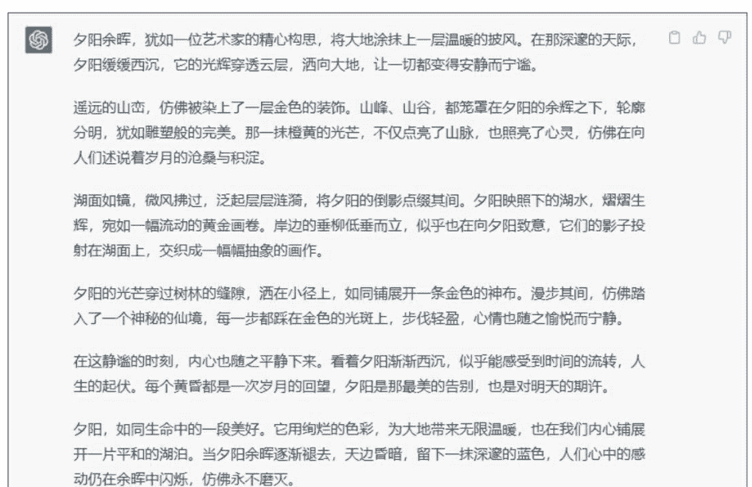

图5-18

可见优化后修辞更丰富，节奏与韵律感明显增强。

053

## 让ChatGPT创作歌词


扫码看教学视频

好歌是旋律与词句的结合，写词对灵感要求很高，AI可提供启发。下面介绍流程。

**步骤01 赋予身份，开启对话：** 输入“假设你是一名优秀的音乐制作人，请给出创作歌词的建议”，回车后模型会给出建议，如图5-19所示。

创作歌词时可参考以下要点：

- 1. **明确情绪或主题：** 先确定歌曲核心，保证整体统一，便于听众理解。
- 2. **营造画面与隐喻：** 用具象意象与比喻提升想象力，增强共鸣。
- 3. **保持简洁：** 避免冗长复杂，简洁易记更易产生影响。
- 4. **抓住情感核心：** 真实呈现想表达的情绪，让人感同身受。
- 5. **注意押韵与节奏：** 韵律有助于旋律融合，提升流畅度。
- 6. **讲故事：** 用情节吸引注意力，让歌曲更有张力。
- 7. **建立连接：** 多用“你”“我”，增强亲近感。
- 8. **换角度思考：** 从不同时空视角切入，增加深度。
- 9. **随时记录灵感：** 灵感常突现，随身记录工具必不可少。
- 10. **反复修改：** 初稿后多轮打磨，提升精准度与质量。
- 11. **寻求反馈：** 听取有经验者的意见，完善作品。
- 12. **保持真诚：** 反映个人真实观点与情感最为关键。

练习与耐心是关键，保持开放心态，相信创作能力。


**步骤02 输入提示，创作歌词：** 输入“请围绕‘少小离家，思乡情绪’为一首民谣写歌词”，回车后模型会生成，如图5-20所示。

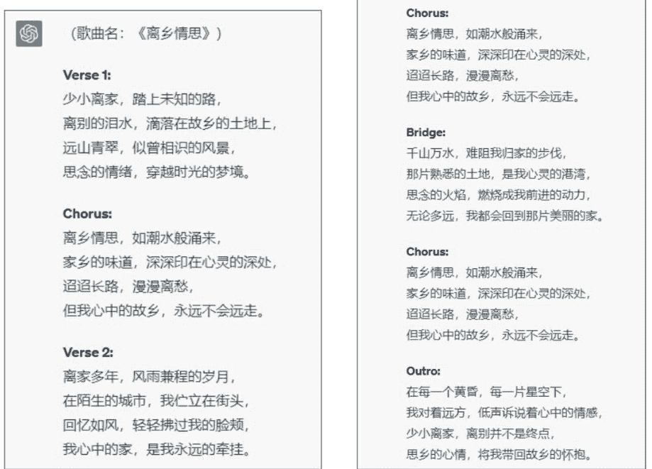

图5-20

**步骤03 提出要求，优化歌词：** 输入“请修改歌词，增加画面感与节奏感”，回车后得到改写版，如图5-21所示。

（歌曲名：《归乡之情》）

**Verse 1:**
少小离家推开陌生门，
踏上旅途思乡绕心间，
故乡微风拂过发梢，
前路似乎更坚定。

**Chorus:**
离乡之情如潮涌不止，
故乡气息穿透夜的寂静，
青山叠翠伴我前行，
心中的故园是我信仰。

**Verse 2:**
岁月流转漂泊异城，
城市灯火映我如梦，
漫长日子似落叶飘，
却掩不住对故乡眷恋。

**Chorus:**
离乡之情如潮涌不止，
故乡气息穿透夜的寂静，
青山叠翠伴我前行，
心中的故园是我信仰。

**Bridge:**
大江东去岁月不回，
离愁随风我在路口，
心灯点亮前行希望，
我将穿越时光回温柔之地。

**Chorus:**
离乡之情如潮涌不止，
故乡气息穿透夜的寂静，
青山叠翠伴我前行，
心中的故园是我信仰。

**Outro:**
每逢黄昏星光如繁花，
我望向远方诉归心愿，
少小离家别非终点，
思乡情怀引我回温暖怀抱。

图5-21

# 第6章 学术类文案写作：AI助力实现学而无忧

## 学习提示
学术类文案涵盖论文、报告、笔记、问卷、作文、学习建议、文献等。ChatGPT可提供灵感与建议，帮助减轻学业负担。本章介绍生成学术文案的方法。

## 本章重点导航
- 学会运用ChatGPT生成学术类文案

054

## 让ChatGPT协助论文写作


扫码看教学视频

论文从选题到写作都考验学术能力，耗时耗力。借助ChatGPT可提升效率。下面介绍步骤。

**步骤01 设定背景，探索选题：** 输入“我正在研究谐音词的网络应用对汉语的影响，请提供创新前瞻的选题参考”，提供背景后回车，模型会给出选题建议，如图6-1所示。

针对谐音词网络应用对汉语影响，可考虑以下方向：

- 1. **谐音词在网络广告中的运用与效果：** 分析不同产品如何使用谐音吸引注意，对认知、品牌形象与销售的影响。
- 2. **社交媒体中谐音词的创意表达与传播：** 研究微博、微信、短视频平台用户如何用谐音制造趣味，以及对信息扩散的影响。
- 3. **谐音词对汉语文化传承的影响：** 探讨当代使用是否改变传统谜语、歇后语等文化形式及语言习惯。
- 4. **谐音词在汉语教学中的创新应用：** 研究谐音如何提升教学趣味性、学习动机与成绩。
- 5. **谐音词在品牌命名与商标中的作用：** 分析谐音命名对商业成功与法律风险的影响。
- 6. **谐音词与网络语言的关联：** 探讨谐音与流行语、新词的互动及对汉语演变的作用。

# 谐音×AI：写作实操速成手册

- 7. **跨文化语境里的谐音误区与玩法：** 语言和文化差异会让谐音产生歧义，也可能让交流更生动活泼。可围绕不同文化背景下谐音的具体呈现方式，梳理由此带来的沟通障碍和正面价值。
- 8. **谐音驱动的网络段子生态：** 当下线上笑料大量靠谐音制造梗。可梳理谐音在网络搞笑内容中的作用，分析它怎样塑造当下网感以及大众的笑点偏好。
- 9. **谐音为品牌Slogan加分的打法：** Slogan是品牌传播的核心载体。可探究谐音在口号设计中的新用法，思考如何借助谐音打造差异化、易记的宣传语，进而提升品牌辨识与传播力。
- 10. **谐音在网络营销中的表现与边界：** 营销号常以谐音引流造势，但受文化差异制约易产生误读。需要考察谐音在各类线上营销场景的实际效果，并总结其局限与潜在风险。

以上选题覆盖了谐音在网络应用的多维度，从品牌传播到文化影响，从创意表达到教学实践，均具创新性与前瞻性。可结合个人兴趣与研究侧重点择一或多项深入展开。

图6-1

**步骤02 选题解析与锁定：** 在同一对话窗口继续输入指令，例如“请以‘谐音词与网络幽默文化的关系’为论文选题，分析选题的创新性和研究意义”，回车后AI会给出选题亮点与意义，如图6-2所示。

# 研究聚焦：谐音词与网络幽默的互动

**摘要：**

本文聚焦谐音与网络幽默之间的互动机制，梳理谐音在線上笑料的生成与扩散路径，并评估其对当前网络文化的塑造效应。基于多种网络幽默样本的剖析，研究旨在呈现谐音在构建幽默风格、驱动用户参与、形塑虚拟社群中的具体作用，同时审视其实践中的困境及跨文化传播的可能性。

**创新性：**

- 1. **细化网络笑料中谐音的生成技巧：** 既有研究多关注幽默主题、形式与传播，鲜少触及谐音的具体编创手法。本研究将从音效、文字与图文等多维度拆解谐音笑点的形成过程，厘清其独特的创作思路与操作诀窍。
- 2. **揭示谐音对网络幽默生态的塑形力：** 网络幽默是数字文化的重要切片，谐音在其中占据独特位置。通过统计使用频次与效果，本研究阐明谐音如何重塑网络幽默面貌，并影响用户的情绪取向、态度倾向与价值认知。
- 3. **跨文化视域下的谐音效应对比：** 网络笑料常跨界流传，同一谐音在不同文化中可能产生迥异解读。本研究以跨文化比较为路径，考察各文化语境下谐音的使用差异与理解偏差，探析其带来的阻碍与契机。

**研究意义：**

- 1. **拓展网络文化研究视野：** 深入挖掘谐音与网络幽默的关联，可为网络文化研究注入新视角，不仅呈现网络幽默的多元生成方式，也阐释其作为当代文化表达形式的意义与影响力。
- 2. **深化语言与文化交流研究：** 谐音在不同语言文化间的笑点差异具有重要启示。追踪其跨文化传播路径，有助于理解语言交流中的分歧、误解与共通点，为跨文化沟通提供参考。
- 3. **提升网络幽默创作和传播策略：** 熟悉谐音在网络幽默中的编创规律与效果，可帮助创作者和营销人员更精准地运用谐音打造吸睛内容，进而优化内容生产与分发策略。
- 4. **弘扬语言创意与幽默传统：** 谐音创意是汉语文化的重要表现形式，研究其在网络幽默中的实践，有助于传承并活化汉语幽默的创造传统。

通过深入研究谐音与网络幽默文化的关系，本论文旨在为理解当代网络文化、语言创意和跨文化交流提供新见解。该主题兼具学术深度与实践价值，对丰富文化研究、促进语言创新和提升网络内容创作水平具有积极作用。

**步骤03 输入论文大纲的提示：** 在同一对话窗口继续输入指令，如“请以‘谐音词与网络幽默文化的关系’为论文题目，提供完整的论文大纲”，回车后AI会生成大纲参考，如图6-3所示。

以下是以《谐音词与网络幽默文化的关系》为题的论文大纲，供参考：

# 论文框架：谐音词与网络幽默的关系

## 引言

- 引出研究主题：谐音词和网络幽默文化关系的重要性与影响。
- 研究背景和动机：网络幽默作为当代文化现象的兴起，谐音词在其中的独特地位。
- 研究目的和意义：深入探讨谐音词在网络幽默中的创造与传播方式，以及其对文化传承和跨文化交流的影响。

## 第一章：谐音词与网络幽默的基本概念

- 谐音词的定义和特点：解释谐音词的基本概念，以及其与音韵、意义之间的关系。
- 网络幽默的特征和形式：介绍网络幽默的多样性，包括段子、图片、视频等不同形式。
- 谐音词与网络幽默的关系：阐述谐音词在网络幽默中的应用和作用。

## 第二章：谐音词在网络幽默中的创造和运用

- 创造方式与技巧：探讨谐音词在网络幽默中的创造逻辑，以及创作者如何利用谐音来创造幽默效果。
- 文字、声音、图像等多媒体元素的运用：分析谐音词在不同媒体中的创作和表达方式，解释谐音在不同传达途径中的变化和效果。

## 第三章：谐音词对网络幽默文化的塑造作用

- 幽默情感的引发与传递：探讨谐音词在网络幽默中如何引发用户的笑声和情感共鸣，分析其在构建幽默氛围中的作用。
- 价值观和社会观念的反映：研究谐音词在网络幽默中传递的价值观，探讨其对社会观念、态度和认知的影响。

## 第四章：谐音词在网络幽默中的跨文化影响

- 跨文化传播的特点与挑战：探讨网络幽默作为跨文化传播的现象，分析谐音词在不同文化中可能产生的差异和误解。
- 文化因素的影响：比较不同文化中谐音词在网络幽默中的使用情况，探讨文化背景对其幽默效果的影响。

## 第五章：谐音词与网络幽默文化的未来发展

- 创新性应用：展望谐音词在未来网络幽默中的创新应用，分析可能的发展趋势和方向。
- 文化传承与创新平衡：探讨谐音词在网络幽默中的文化传承作用，以及如何在创新中保持对传统的尊重。

## 结论

- 总结研究发现：回顾研究中揭示的谐音词与网络幽默文化的关系。
- 研究意义和展望：强调论文的创新性、研究价值，并展望未来可能的研究方向。

## 参考文献

以上大纲可按章节逐步展开对谐音词与网络幽默文化关系的深入研究，从定义、创造方式到文化影响等方面全面探讨，最终得出深度洞察的结论。

图6-3

按照上述方法，获得AI提供的论文大纲参考后，可根据实际情况和具体研究内容进行调整。

055

## 用AI辅助论文精简


扫码看教学视频

论文精简是在保留原意和结论的前提下压缩篇幅，以满足期刊或会议的字数要求。AI也可作为精简辅助工具。本节介绍操作步骤。

**步骤01 征询精简建议：** 在输入框中输入提示词，如“对论文进行降重时，可以采取哪些有效的方法？”，回车后AI会给出精简建议，如图6-4所示。

论文降重是指在保留主要思想和结论的基础上缩减篇幅。以下方法可帮助精简：

1. **剔除冗余信息**：仔细审阅，删除重复或多余内容，确保各部分皆有独特贡献。
2. **精简背景与引言**：保留与核心问题直接相关的背景与引言内容，删去不必要的细节和延伸。
3. **压缩文献综述**：只保留与研究直接相关的关键文献，无需 exhaustive 罗列。
4. **合并方法描述**：将相似步骤合并，避免冗长叙述，仅保留关键环节和必要细节。
5. **删减次要结果**：只保留与主要结论直接相关的数据与分析，舍去次要或重复结果。
6. **简化图表与公式**：精简图表，去除非必要子图；公式可合并或简化以减少篇幅。
7. **去除非必要说明**：删除对理解非必需的解释，聚焦核心观点。
8. **概括句子**：用简明扼要的句式表达观点，避免过度描写。
9. **清除无关信息**：删除偏离主题的细节，确保各部分服务于中心思想。
10. **节省字数**：使用缩写、替换长词为简洁同义词。
11. **反复编辑润色**：多次修改以确保表达清晰简练。
12. **削减引用与附录**：减少引用数量，保留理论和方法必需部分；附录可适当压缩或删除。
13. **提炼结论**：在结论中仅强调主要发现与贡献，避免重复。
14. **删减次级议题**：若论文含多个子主题，可考虑舍弃部分以聚焦核心。
15. **与合著者讨论**：与合作者交流精简策略，获取建议。

图6-4

**步骤02 提交精简要求**：在同一输入框继续输入提示词，如“请根据以上方法，对以下论文内容进行降重（另起一行）论文内容：×××”，回车后AI会按要求压缩文本，如图6-5所示。

根据降重方法，我将对您提供的论文内容进行简化，保留主要思想和关键信息，以适应更紧凑的篇幅。

## 第四章：谐音词在网络幽默中的跨文化影响

### 4.4 文化融合与网络幽默创新

全球化推进下，网络促进了不同文化间的交流。谐音词作为带有文化标签的元素，在网络幽默中推动文化融合与创新。跨文化传播催生新幽默，汇聚不同文化的创意。

### 4.4.1 跨文化创新的背景与动力

网络幽默突破语言与地域限制，文化元素在异文化中引发共鸣，推动跨文化创新。文化差异激发创作者融合元素，以满足多元受众需求。

### 4.4.2 文化元素融合与幽默创新

跨文化传播拓展谐音词幽默创作空间，鼓励文化元素融合。不仅体现在谐音创作中，还融合图像、符号、传统等表达方式。结合语言谐音或文化笑话形式，创造网络幽默。

### 4.4.3 跨文化幽默成功案例

广告、段子、漫画等跨文化幽默案例成为文化融合创新的典范。结合不同文化的谐音元素，创造独特幽默形式，促进多元文化交流与理解。

### 4.4.4 文化创新启示与展望

跨文化创新拓展网络幽默可能性，促进文化交流。文化融合丰富创作素材，增强多元文化互动。文化创新在网络幽默中愈发重要，为文化交流、理解和创新提供契机。

图6-5

## 用AI优化调研报告


扫码看教学视频

调研报告是形成理论依据和科学决策的重要基础，具有准确、清晰、实用和逻辑性等特点，且可读性强，适合不同读者阅读，与语言风格和表达方式密切相关。在AI帮助下，可提升调研报告的可读性。本节介绍操作步骤。

**步骤01 提供背景，确定框架：** 在输入框输入提示词，如“我需要写一篇关于线上聊天使用表情包对人际关系的影响的调研报告，我可以从哪些方面入手？”，回车后AI会给出框架建议，如图6-6所示。

写一篇关于线上聊天使用表情包对人际关系影响的调研报告主题有趣且有深度。可从以下方面入手：

1. 引言：介绍表情包在现代社交媒体和通讯工具中的广泛应用，以及它们对人际关系的重要性。
2. 表情包的使用频率和方式：分析人们在线上聊天中使用表情包的频率、种类和方式。是否受年龄、性别、文化背景等因素影响？
3. 感情表达和沟通效果：探讨表情包在表达情感和促进沟通中的作用。是否能更准确传达情感？是否有助于缓解误解或解释复杂情感？
4. 社交互动的变化：分析表情包对线上社交互动模式的影响。是否改变对话语气、节奏或情感色彩？是否增强幽默感和亲近感？
5. 表情包对人际关系的积极影响：讨论表情包如何促进积极人际关系。是否有助于建立情感联系、增强友谊或加深亲密关系？
6. 表情包对人际关系的负面影响：探讨可能带来的负面效应，如误解、过度依赖、情感变浅等。是否存在过度使用表情包而减少文字表达的情况？
7. 跨文化和多样性考虑：分析不同文化背景和语言间使用表情包的差异。某些表情包是否可能被误解或引发文化冲突？
8. 表情包的变迁与趋势：考察表情包的演变和发展趋势。它们如何从简单符号演变为今天的多样化表情？
9. 心理学和社会学观点：从心理学和社会学角度分析表情包对人际关系的影响。是否有相关研究支持其积极效果？
10. 建议和总结：根据调研结果提出建议，如何更好地利用表情包增强积极人际关系，同时避免潜在负面影响？
11. 参考文献：引用相关研究、文献和资料，支撑报告观点和结论。

以上方面可帮助构建有深度、有逻辑的调研报告，从不同角度全面探讨线上聊天使用表情包对人际关系的影响。在每个部分结合实际案例、调查数据和专家观点，可提升说服力。


**步骤02 提出要求，获得指导：** 在同一输入框继续输入提示词，如“请从调研方法和案例分析方面，提供具体的调研方案指导”，回车后AI会给出规划调研方案的指导，如图6-7所示。

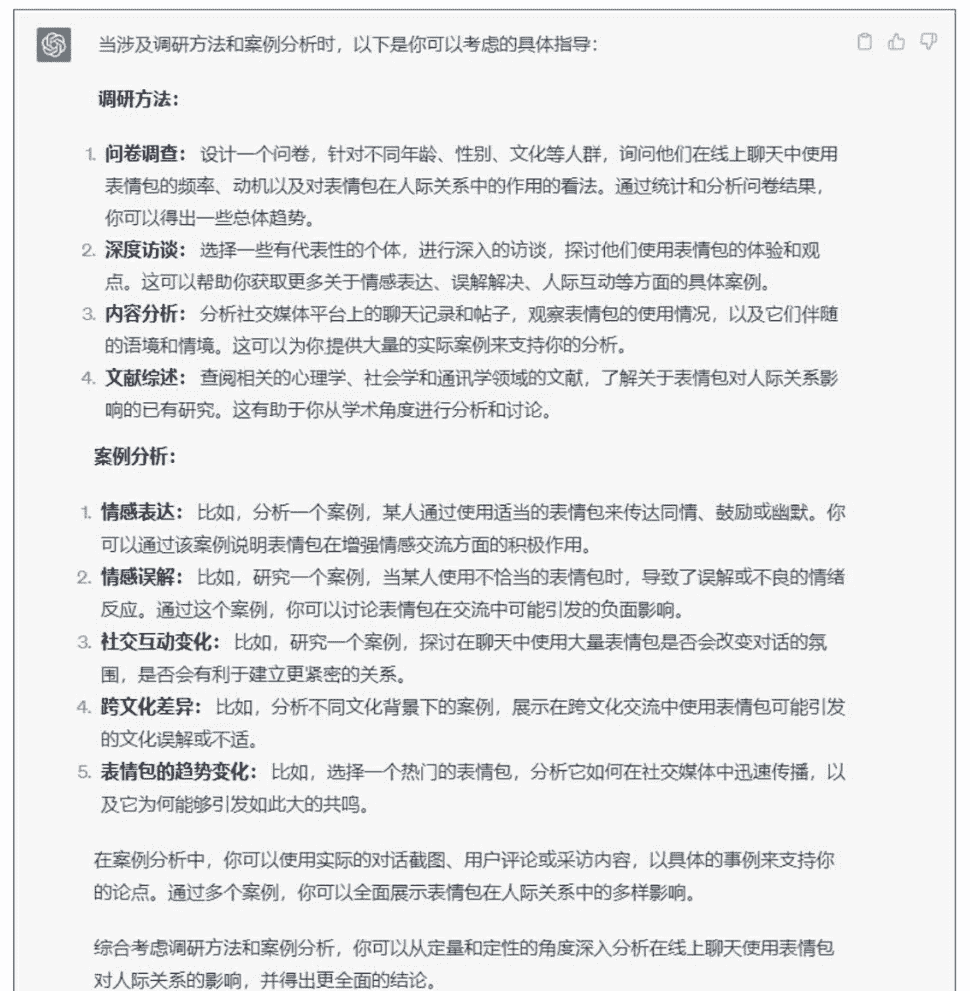

图6-7

**步骤03 输入报告，优化表达：** 在同一输入框继续输入提示词，如“请帮我优化以下内容（另起一行）内容如下：×××”，回车后AI会对调研报告内容进行优化，如图6-8所示。

# 标题：表情包在人际关系中的积极影响：沟通、共鸣与和解

人际交往在社会生活中扮演重要角色，如今数字化通信成为主流，表情包作为一种情感表达方式，积极影响着人际关系。本报告深入探讨表情包在人际交往中的功能，通过实例阐述其积极效应。

1. 丰富沟通，弥补文字不足：
在书面通信中，语气和情感易因缺乏直接表达而产生误解。表情包作为图像表达方式，填补语言空白，让情感更准确传达。例如，工作场合中，一个微笑表情包可缓解紧张气氛，促进同事合作与融洽。

2. 增强情感共鸣，拉近人与人距离：
适宜的表情包可加深人际情感连接。例如，一个抱抱表情包能传递关怀与温暖，让远隔重洋的亲友感受到亲近。在虚拟社交平台上，合适表情包能让用户建立更真切的情感纽带。

3. 缓解冲突，促进和解：
表情包在冲突情境中具有缓和作用。一个幽默表情包可轻松减轻紧张情绪，为冲突双方提供化解纷争机会。这在家庭、朋友圈，甚至商务谈判中都能起到调解作用。

总结：
综上，表情包在人际交往中产生积极影响，从丰富沟通、增强情感共鸣，到缓解冲突、促进和解。然而，使用时需适度把握，以避免产生误解或削弱正式交往的严谨性。通过表情包，人们可创造更和谐、亲近的交往环境，在数字化时代构筑有意义的人际关系。

图6-8

## 用AI生成调查问卷


扫码看教学视频

调查问卷是采用问卷调查法进行调研的文本内容，能为调研报告提供数据支撑。运用AI可直接生成调查问卷，提高撰写效率。本节举例介绍操作步骤。

**步骤01 设置背景，提出需求：** 在输入框输入提示词，如“我正在规划一个关于线上聊天使用表情包对人际关系影响的调研方案，请帮我生成一份表格形式的调查问卷”，回车后AI会生成问卷，如图6-9所示。

当然可以！以下是一个关于线上聊天使用表情包对人际关系影响的调查问卷示例表格。可根据需要修改定制。

| 序号 | 问题 | 非常同意 | 同意 | 中立 | 不同意 | 非常不同意 | 不适用 |
| :--- | :--- | :--- | :--- | :--- | :--- | :--- | :--- |
| 1 | 在你的日常线上聊天中，你经常使用表情包吗？ | | | | | | |
| 2 | 使用表情包是否让你的聊天更加生动有趣？ | | | | | | |
| 3 | 表情包在你的线上聊天中是否有助于表达情感和意图？ | | | | | | |
| 4 | 你认为使用表情包能否减少误解和沟通不畅？ | | | | | | |
| 5 | 在与你亲近的人聊天时，你更倾向于使用表情包吗？ | | | | | | |
| 6 | 你觉得表情包能否替代部分文字表达的功能？ | | | | | | |
| 7 | 使用表情包是否会在特定情境下产生误解或不适？ | | | | | | |
| 8 | 你认为过多地依赖表情包会不会影响真实情感的表达？ | | | | | | |
| 9 | 表情包在你的线上交流中是否曾引发过争议或误会？ | | | | | | |
| 10 | 你觉得使用表情包对于维护长期人际关系有何影响？ | | | | | | |
| 11 | 你是否认为在一些正式场合应避免使用表情包？ | | | | | | |
| 12 | 使用表情包是否会影响你对他人情感的理解？ | | | | | | |
| 13 | 你认为表情包在虚拟沟通中起到了缓解紧张氛围的作用吗？ | | | | | | |
| 14 | 你是否曾经因为对方使用了特定的表情包而产生误解？ | | | | | | |
| 15 | 对于你个人而言，使用表情包对于线上交流的重要性是什么？ | | | | | | |

图6-9

**步骤02 提出要求，优化问卷：** 在同一输入框继续输入提示词，如“增加一些身份信息和开放性的问题，使问卷结果更有参考性，同样用表格提供”，回车后AI会按要求优化问卷，如图6-10所示。

| 序号 | 问题 | 非常同意 | 同意 | 中立 | 不同意 | 非常不同意 | 不适用 |

| :--- | :--- | :--- | :--- | :--- | :--- | :--- | :--- |

| 1 | 姓名（可选） | | | | | | |

| 2 | 年龄 | | | | | | |

| 3 | 性别 | | | | | | |

| 4 | 职业 | | | | | | |

| 5 | 在以下哪些平台上经常使用表情包？（可多选）<br>- 社交媒体（如微信、微博、Facebook 等）<br>- 即时通讯工具（如WhatsApp、Telegram等）<br>- 在线论坛或社区<br>- 游戏内聊天<br>- 其他（请注明） | | | | | | |

| 6 | 你认为使用表情包在何种情况下最有意义？ | | | | | | |

| 7 | 请分享一个你因为使用或接收表情包而产生积极体验的例子。 | | | | | | |

| 8 | 表情包在你的线上聊天中是否曾引发过误解或负面体验？ | | | | | | |

图6-10

## 用ChatGPT高效完成实验报告


扫码看教学视频

实验报告是学术写作中用来记录过程、呈现数据并进行分析解读的文体。借助生成式AI，能把撰写流程变得更顺畅。下面给出一个可操作的思路。

**步骤01 设定背景，锁定选题**：在输入框里打出类似“我要写一份广告策划方向的实验报告，请推荐几个可行的题目”的指令，发送后系统会给出选题建议，如图6-11所示。

可以的，广告策划类的实验报告选题很丰富，参考方向如下：

1. 情感营销效果检验：选定某产品，策划几套情绪基调不同的方案，通过实验对比情绪对购买意愿和品牌认知的差异。
2. 受众定位差异测试：比较不同人群对同一广告的反应，探究年龄、性别、兴趣等变量对吸引力和转化率的影响。
3. 声音与音乐的作用：制作音乐或音效不同的广告版本，观察声效对情绪唤起和注意集中程度的作用。
4. 配色心理效应研究：用不同主色呈现广告，分析颜色对品牌联想、情绪传达和行动引导的影响。
5. 信息载体对比：分别用文字、图片、视频呈现广告，对比各形式在吸引力、信息传递和记忆保持上的差异。
6. 品牌一致性感知：为同一品牌设计风格相近但细节各异的广告，测试受众对品牌统一性的判断和情感反馈。
7. 社会责任广告评估：制作具有社会关怀元素的广告，实验其对受众态度、情感和行为意向的影响。
8. 明星代言对比：做两版广告，一版启用代言人一版不启用，对比认知度、可信度和吸引力的差别。
9. 互动广告参与度：设计可互动的广告形式，比较互动对停留时长、参与度和信息记忆的影响。
10. 跨文化投放比较：在不同文化背景下投放相同素材，比较情感表达、文化契合度和品牌认知。


**步骤02 输入指令，获取提纲**：在同一会话中继续提问，例如“请以‘色彩心理学在广告中的应用’为主题，给我一份实验报告的大纲”，发送后会得到结构化提纲，如图6-12所示。

广告策划中色彩心理是关键要素。本报告将聚焦配色对效果的影响。提纲如下：

# 实验报告：色彩心理学在广告中的应用

### 1. 引言
- 说明色彩在广告中的功能与价值。
- 提出核心问题：色彩心理如何影响感受、注意力与行为。

### 2. 背景：色彩心理学
- 解释基本原理：不同颜色触发的情绪差异。
- 介绍常见主色的心理联想：红、蓝、绿、黄等。

### 3. 实验设计
- 研究目标：分析广告主色对受众反应的差异。
- 自变量：广告所用颜色。
- 因变量：情绪反应、记忆度、购买意愿。

### 4. 方法
- 被试招募：说明筛选标准与样本量。
- 实验材料：制作主色不同的广告，保持其他要素一致。
- 流程：观看后填写问卷，记录情绪与购买意向。

### 5. 结果分析
- 用图表呈现各色在情绪、记忆、意愿上的差异。
- 分析颜色效应在不同人群中的表现。

### 6. 讨论
- 结合理论解释结果成因。
- 探讨在广告策略中如何更有效地运用色彩心理。
- 点出局限与未来方向。

### 7. 结论
- 总结用色对情绪和行为的显著影响。
- 重申色彩心理在策划中的价值。

### 8. 参考文献
- 列出相关学术资料。

图6-12

**步骤03 提出细节要求，生成正文**：继续输入“请给出详细的实验设计，要贴合主题且可操作”，系统会按要求输出设计，如图6-13所示。

## 实验设计：色彩心理学在广告中的应用

1. 研究目标：考察广告用色对情绪、记忆和购买意愿的影响。
2. 假设：不同主色会引发不同情绪，进而影响记忆和购买倾向。
3. 招募：通过社媒或校园招募50名18-35岁大学生，背景尽量均衡。
4. 材料：制作四版同产品广告，仅主色分别为红蓝绿黄，其余内容一致。
5. 流程：
   - 随机分组，每组观看一种颜色广告。
   - 在实验室环境下观看。
   - 观看后填写情绪问卷，评分愉悦、兴奋、沮丧等。
   - 进行记忆测试，评估内容回忆。
   - 最后评估购买意愿。
6. 数据处理：用统计软件做差异分析，可用方差分析或t检验。
7. 讨论：解释结果并提出在策划中的选用建议，同时说明局限。
8. 结论：总结用色对消费者行为的影响，强调色彩心理的实践价值。

图6-13

以上设计仅供参考，需结合实际情况调整。初稿完成后也可以让ChatGPT润色修改。

## ChatGPT快速整理读书笔记


扫码看教学视频

读书笔记是对书籍信息进行归纳提炼，能帮助抓住重点和理解观点。借助AI可以快速得到条理清晰的笔记。

**步骤01 建立对话背景**：输入“读书笔记通常包含哪些要素？”确认AI对笔记格式的掌握，发送后会得到说明，如图6-14所示。

笔记是阅读时记录的关键信息与观点的汇总，便于理解、记忆和回顾。常见要素包括：

1. **书目信息**：书名、作者、出版年份等。
2. **梗概与主题**：主要情节、核心观点与写作目的。
3. **人物**：重要角色、关系与性格动机。
4. **关键事件**：转折点与发展脉络。
5. **核心思想**：作者的重要论点与思考。
6. **摘录**：有代表性的原文或对话。
7. **个人感悟**：自己的感受与评价。
8. **疑问**：阅读中产生的问题。
9. **关联**：与已有知识或其他作品的联系。
10. **总结**：全书思想的概括与评价。

图6-14

**步骤02 提交具体要求**：继续输入“请按上述要点整理《安娜·卡列尼娜》的读书笔记”，发送后会得到笔记，如图6-15所示。

### 书籍信息
- 书名：《安娜·卡列尼娜》
- 作者：列夫·托尔斯泰
- 出版：1877年

### 梗概与主题
- 19世纪俄罗斯为背景，围绕两大家族的爱情与生活。
- 探讨道德、家庭、个人幸福与责任。

### 人物
- 安娜·卡列尼娜：女主角，受社会束缚，陷入不被认可的爱情。
- 亚历克谢·卡列尼娜：安娜丈夫，温和平庸的官员。
- 库特佐夫：农场主，与安娜产生激情。
- 基里洛夫：象征劳动与责任，与奥布洛诺夫友情深厚。

### 重要情节
- 安娜与基里洛夫相识，感情加深。
- 安娜离家与基里洛夫同居，招致谴责。
- 最终陷入焦虑痛苦走向悲剧。

### 核心思想
- 呈现爱情、道德与社会压力的冲突。
- 反映封建社会各阶层命运与人性复杂。

### 引用
> “所有的幸福家庭都是相似的，但每个不幸的家庭各有各的不幸。”

### 个人感悟
- 对个人幸福与社会道德冲突的刻画深刻，引发对选择与牺牲的思考。

### 疑问
- 安娜为何离家？其行为能否被理解？

### 关联
- 与《战争与和平》相比，本书更聚焦家庭与内心。

### 总结
- 通过人物与道德冲突展现19世纪俄罗斯社会的复杂性，具有深厚思考价值。

图6-15

## ChatGPT辅助长文阅读提炼


扫码看教学视频

长文章容易抓不住重点，把文本交给ChatGPT可快速提取核心信息。

**步骤01 提交文本并概括**：输入“请阅读以下文章并概括要点，另起一行文章如下：×××”，发送后会得到概要，如图6-16所示。

文章主要讨论情感经济。概要如下：

1. 引言：情感在社会经济中的重要性，情感经济作为行为经济学分支关注情感对消费与决策的影响。
2. 理论基础：源于行为经济学和心理学，提到前景理论与情感漏斗。
3. 情感对消费的影响：激发购买欲，影响品牌选择，情感化广告通过共鸣提升意愿。
4. 情感对决策的影响：影响信息处理与风险评估，也作用于慈善等社会决策。
5. 实际应用：企业用情感营销提升忠诚度，政府可引导社会行为。
6. 挑战与前景：情感主观难量化，需跨学科整合。
7. 结论：情感经济为理解市场与个体行为提供新视角。

图6-16

**步骤02 要求简化表达**：继续输入“请用自己的话简洁概括，让没读过的人也能明白”，发送后得到精简版，如图6-17所示。

文章探讨情感如何影响消费与决策。介绍了理论基础，强调情感在选择中的关键作用。情感能激发购买欲、影响品牌偏好。情感还影响投资与社会决策。实践中企业用情感营销提升忠诚度，政府可借此引导行为。但研究面临主观性与跨学科整合的挑战。总的来说，情感经济为理解行为提供新思路。

图6-17

## 用ChatGPT生成知识图谱


扫码看教学视频

AI可以帮助构建知识框架，生成可视化图谱来辅助理解。

**步骤01 确定主题并生成框架**：输入“我想了解西方美学发展史，请帮我构建知识图谱”，发送后会得到概览，如图6-18所示。

西方美学可按时期划分：

### 古希腊
- 哲学家：柏拉图、亚里士多德
- 思想：理念之美与模仿表达。

### 古罗马
- 思想家：塞涅卡、卢克莱修斯
- 思想：内在美与道德，感官享受。

### 文艺复兴
- 人物：达·芬奇、拉斐尔、米开朗基罗
- 思想：人体比例、透视、对称，自然与人关系。

### 启蒙时代
- 哲学家：康德、休谟
- 思想：审美判断的普遍性与主观性，情感基础。

### 浪漫主义
- 代表：席勒、恩格斯
- 思想：情感、个体、超验体验，追求独创。

### 现实主义
- 代表：叔本华、高尔基等
- 思想：关注生活真实与平凡，批判不平等。

### 印象主义
- 代表：莫奈、梵高
- 思想：捕捉瞬间、光线、色彩，感官印象。

### 表现主义
- 代表：蒙克、梵高
- 思想：突出内心体验，夸张变形表现情绪。

### 抽象表现主义
- 代表：波洛克、罗斯科
- 思想：强调抽象、笔触和颜料的纯粹性。

### 当代美学
- 代表：沃霍尔、昆斯、阿布拉莫维奇
- 思想：风格多元、媒介多样，关注概念与互动。

图6-18

**步骤02 请求细化某个节点**：继续输入“请完善‘现实主义’的描述”，系统会对该节点进行深化，如图6-19所示。

现实主义：以写实目光审视时代

十九世纪中叶欧洲出现现实主义，它是文学、美术乃至思想层面的重要转向。基本取向是借助对日常生活的近似原貌呈现，揭露社会矛盾、政治压力与经济困境，并探问个体与整体的关联。下面作简要梳理。

### 成型语境与主要立场
- **时代土壤：** 十九世纪中叶工业化加速推进，城市扩张、结构重组。公众对工人生存处境、贫富分化、分配失衡的关注抬升。
- **写实取向：** 强调客观细致的描摹，用扎实的细节铺陈生活各层面，力求呈现社会的复杂与多元。
- **共鸣诉求：** 不仅记录个案，更试图提炼人类共通的经验与情感，提升文本的共鸣幅度。
- **与浪漫主义的区分：** 针对浪漫主义的超验与理想化处理，摒弃超自然、完美爱情与英雄神话，转而贴近日常的平实书写。

### 典型创作者与文本
- **露西·穆德·蒙哥马利：** 《绿山墙的安妮》以加拿大乡村为依托，用温暖真挚的笔调叙写主人公安妮的成长。
- **查尔斯·狄更斯：** 《雾都孤儿》等作品直面社会不公、城市贫困，揭示工业化对人性的冲击。
- **巴尔扎克：** 法国作家，《人间喜剧》系列以跨阶层的群像呈现不同社会群体的生活样态。

### 影响、反思与争议
- **议题推动：** 写实作品提升公众对社会问题的敏感度，为改革呼声提供舆论基础，间接促成部分政治社会变革。
- **伦理思辨：** 引发对道德规范与人际行为的深入讨论。
- **批评声音：** 虽追求真实客观，也被质疑过度沉溺细节，削弱情感张力与想象空间。

总体来看，现实主义凭借忠实再现社会生活、揭示问题以及强调人类共通经验，对后世文艺与社会思想产生深远作用。

## ChatGPT辅助命题作文写作


扫码看教学视频

命题作文是检验写作能力的常见形式，通常给出材料或主题要求应试者展开。借助ChatGPT，写作者可获得启发与参考。下面介绍操作思路。

**步骤01 递交材料，确定方向：** 在输入框中给出指令，例如“解读下面这句话，提供几个写作文的思路（另起一行）‘人们因技术发展得以更好地掌握时间，但也有人因此成了时间的仆人’”，回车后系统会给出思路，如图6-20所示。

该表述概括了技术对时间安排的双重效应，既提升效率也可能导致失控。可切入的角度有：

1. **科技提升效率：** 通讯、自动化、信息检索等工具加速任务完成，让人腾出更多余裕投入创作、学习与休闲，技术在此成为时间助手。
2. **科技带来的时间消耗：** 社交媒体、移动应用、娱乐平台易让人沉迷刷屏、游戏，通知与信息碎片干扰专注，使人沦为被动消耗者。
3. **平衡之道：** 需在工具使用与自主掌控间求平衡，通过设定优先级、规划日程、限制使用时长来避免技术反噬。
4. **深远生活影响：** 技术解决了过去的时间管理难题，也可能带来社会、心理与生理问题，需在发展语境下思考健康使用习惯。
5. **文化价值观差异：** 不同文化对效率与休闲的取向不同，价值观差异会改变人们应对技术影响的方式。

任选其一均可深入探讨技术如何重塑时间观，以及在发展中如何保持有效管理。


**步骤02 明确需求，生成文章：** 在同一窗口继续输入指令，如“请以‘技术与时间管理的平衡’为角度，写一篇有深度的议论文”，回车后系统按要求成文，如图6-21所示。

# 找回技术与时间的平衡感

科技的飞速演进让生活更便捷高效，同时也在改变我们对时间的感知。技术让人更好掌控时间，也有人因此沦为时间的附庸。在这个充满机遇的阶段，寻找技术与时间管理的平衡成为关键。

### 效率被放大的时代
过去信息传递与任务处理受限，耗费大量时间。通讯工具、自动化与智能搜索的普及，让信息获取、沟通协作与任务执行大幅提速，空出更多空间用于创新思考与兴趣追求。数字化平台还催生远程办公与自由职业，减少通勤，工作与生活更易协调。

### 依赖的风险与自主管理
便捷的另一面是过度依赖。社交平台、智能手机的持续提醒容易让人陷入虚拟沉迷，时间被浏览、刷屏消耗，专注与自律被削弱。此时自我管理尤为重要：要认识到技术只是手段，学会善用而非屈从，通过明确优先级、制定计划、限制使用来摆脱陷阱，需自制力支撑。

### 智慧的选择
实现平衡需要审视使用习惯，区分有益与无效的使用；把技术服务于既定目标与价值观，而非被其主导；培养注意力与深度思考，应对信息洪流。冥想、定期数字排毒、亲近自然等传统智慧，也能帮助恢复内在平静，重塑时间感。

总之，技术与时间管理的平衡关乎生产力，也关乎心灵满足。通过审视影响、主动管理时间，可在科技浪潮中找到自己的节奏，过更有意义的生活。这要求保持冷静与理性，以智慧做出选择。

图6-21

可见，ChatGPT需在明确提示的引导下才能解读材料，且生成作文在深度与温度上仍显不足，仅可作参考。但在合适场景下，它可作为解析命题作文的工具，提供写作灵感。

## ChatGPT参与作文润色

ChatGPT可承担修改润色角色，完成初稿后可请其优化。以下为操作流程。

**步骤01 设定需求，获取建议：** 输入如“让文章更有画面感和诗意有哪些技巧？”，回车后系统会给出建议，如图6-22所示。

提升画面感与诗意的常用方法包括：

1. **生动比喻与隐喻**，把抽象转为具象意象。
2. **细腻描写**，用丰富词汇刻画场景与细节。
3. **感官调动**，借助视觉、听觉、嗅觉、味觉、触觉增强沉浸。
4. **动态动作**，以人物行为推动画面流动。
5. **情感心理刻画**，揭示内心变化以增强共鸣。
6. **独特视角**，以新角度观察平常事物。
7. **韵律节奏**，以优美语感增强诗意。
8. **符号象征**，承载深层含义引发思考。
9. **环境融合**，让人物与环境互为映照。
10. **情节连贯**，合理推进叙事流畅度。
11. **修辞运用**，如排比、对仗、倒装提升艺术性。

图6-22

**步骤02 提交草稿，执行修改**：继续输入如“请结合以上技巧，帮我修改文章（另起一行）文章如下：×××”，回车后系统按要求改写，如图6-23所示。

夏日如火，将大地染成热情的海洋，色彩交织绚烂。在这生机盎然的季节，自然毫无保留地展露最灿烂的容颜。

夏天宛如阳光的盛宴，柔软的暖意穿透云层洒向人间，驱散寒意。人们脱去厚重，换上轻盈衣衫，像迎接恋人的拥抱，迸发热情。清晨阳光拂面带来静谧与活力，傍晚余晖倒映湖面，如一幅斑斓画卷。

夏天是味觉的嘉年华，果实如宝石般陈列市集，芬芳四溢。一口咬下，汁水迸发，甜味在舌尖旋转，令人沉醉。西瓜、蜜桃、草莓皆是夏的使者，带来满足。

夏天亦是欢笑的季，孩子摆脱学业束缚，投身无忧冒险。海滩、游乐园、露营地处处回荡笑声。人们在阳光下舒展，将压力消解，享受生活。

夏天是丰收的前奏，田间忙碌，农人汗湿衣衫耕耘播种，为秋日蓄力。自然在此达至巅峰，葱郁树木与缤纷花朵织成丰收图景。

夏天注入活力，人如燃起火花迎接挑战。酷暑虽难耐，人们仍能在此汲取动力与勇气，创造与拼搏。

夏天活力四射、色彩缤纷。无论阳光炙热、果实多汁、欢笑传递或成长启航，都让人感受到生活的美好与潜能。愿我们沐浴夏辉，用心感知这魅力季节。

图6-23

## ChatGPT助力文章续写

灵感枯竭时，可请ChatGPT续写情节或人物走向。流程如下。

**步骤01 发出指令，获取续写：** 输入如“请续写以下文章内容（另起一行）文章内容：×××”，回车后系统会续写内容，如图6-24所示。

请续写以下文章内容

文章内容：社会的飞速发展带来了无尽的可能，然而也伴随着无法抵挡的压力。人们在追逐着物质的富足和生活的便利的同时，却似乎迷失了灵魂的方向。生活的琐碎和繁忙，让人们不断地追赶着时间的脚步，而忽略了内心的声音。在这个喧嚣的世界中，仿佛只有当夜幕降临，当喧闹的声音消散，内心深处的思绪才得以释放，如同一汪清泉，在黑暗中静静涌动。

然而，正是在这个宁静的时刻，人们才有机会重新审视自己的内心世界，寻找那失落已久的灵魂方向。或许正是社会的高速发展，让人们渴望一种内心的平静，一种超越物质追求的精神富足。

回归内心并不意味着要完全脱离现实的纷扰，而是在喧嚣与宁静之间找到一种平衡。或许可以从日常生活中的点滴小事开始，像是静坐几分钟，聆听自己的呼吸声；或者花点时间与亲友分享心灵感悟，远离电子设备的干扰。这些看似微不足道的举动，却能在喧闹的世界中创造出片刻的宁静，让内心有机会自由流动。

当然，内心的探索也不是一蹴而就的事情。需要的是持之以恒的努力，不断地与自己对话，了解自己的需求、价值观和激情。随着对内心的认知加深，人们会逐渐发现生活中的真正意义，从而更加坚定地走向属于自己的道路。

同时，社会也可以发挥积极的作用，营造更多有利于内心成长的环境。教育不仅仅是知识的传递，更是关于价值观、情感管理和人际关系的培养。工作场所可以提倡更灵活的工作安排，让员工有更多的时间去关注自己的内心世界。媒体可以多一些关于内心成长和心灵富足的内容，引导人们关注精神层面的需求。

终究，追求内心的平静与富足，并不是与物质世界为敌，而是在现代社会中找到一种更加全面的生活方式。在追逐梦想和成功的同时，不忘关注内心的声音，找到那份深层的满足感。无论是在繁忙的白天，还是在宁静的夜晚，内心的思绪都能如清泉般涌动，在生活的喧嚣中找到片刻的宁静。

图6-24

**步骤02 增加条件，优化细节：** 继续输入如“请按照记叙文的写法，增加一些情感和修辞对文章内容进行续写”，回车后系统会重新续写，如图6-25所示。

社会的飞速发展带来了无尽的可能，然而也伴随着无法抵挡的压力，如同燃烧的烈焰，虽然为世界带来温暖，却也在不经意间留下痕迹。人们在追逐着物质的富足和生活的便利的同时，却似乎迷失了灵魂的方向，如同飘游的孤舟，虽然前行却漂泊无助。生活的琐碎和繁忙，如同一阵阵风暴，不断地追赶着时间的脚步，而忽略了内心的声音，就像是深埋的宝藏，被岁月的尘埃掩埋。

然而，在这个喧嚣的世界中，仿佛只有当夜幕降临，当喧闹的声音消散，内心深处的思绪才得以释放，如同一汪清泉，在黑暗中静静涌动。夜晚，成为了灵魂漫游的时刻，繁星闪烁如眼眸中的泪光，将沉淀的情感一一点亮。在那静静的夜色中，人们或许终于能够在内心的角落里找到一份安宁，如同迷失的孩童找到温暖的怀抱。

夜晚，是内心敞开的时刻，繁华的都市渐渐沉寂，仿佛是一个巨大的舞台后台，人们可以将面具脱下，展现最真实的自我。在寂静的黑夜中，思绪如潮水般涌来，带着往昔的回忆和未来的期许，如同迎风飘扬的幕布，逐渐展开一幕幕内心的戏剧。

或许，正是在这个宁静的时刻，人们才有机会重新审视自己的内心世界，寻找那失落已久的灵魂方向。或许正是社会的高速发展，让人们渴望一种内心的平静，一种超越物质追求的精神富足。在这个漆黑的舞台上，人们的内心犹如一盏明灯，引领着前行的方向。

图6-25

## ChatGPT指导学业规划

面对陌生知识体系时，可向ChatGPT求助学习方法与时间规划。操作如下。

**步骤01 明确主题，查询资料：** 输入如“我想了解一下新闻传播学硕士学位这个专业的知识体系”，回车后系统会给出体系，如图6-26所示。

新闻传播学研究媒体、信息流动、公共关系与社会影响等。作为硕士专业，其核心领域包括：

1. **传播理论与模型**：研究信息传播机制及对认知态度行为的影响，涵盖媒介效应、社会认知、传播网络等理论。
2. **新闻与媒体研究**：探讨新闻生产、编辑、报道与消费，涉及新闻价值、伦理、报道风格。
3. **媒介与社会**：分析媒体对社会文化的影响及社会因素对内容塑造的作用，关注认同、政治社会化、媒体与社会议题。
4. **公共关系与传播管理**：研究形象塑造与危机沟通策略。
5. **数字媒体与社交媒体**：研究数字化变革及社交平台对信息传播与舆论的影响。
6. **跨文化传播**：比较不同文化的信息理解与传播差异。
7. **研究方法与数据分析**：掌握定量定性方法，如问卷、实验、内容分析、质性研究。
8. **媒体法律与伦理**：了解法规与职业规范。
9. **新闻写作与编辑**：培养报道与稿件撰写能力。
10. **广告与营销传播**：探讨广告策略与创意。
11. **传播研究应用与案例分析**：结合真实案例运用理论分析实际问题。

图6-26

**步骤02 提出需求，获取建议**：继续输入如“请根据这些知识体系，拆分知识组块，并规划出适合大三学生的学习计划”，回车后系统给出规划建议，如图6-27所示。

针对大三学生，以下是一个基于新闻传播学硕士知识体系拆分的学习组块示例，实际安排需结合课程与个人情况调整。

### 学习组块 1：传播理论与模型

学习目标：熟悉主要传播理论与模型，理解信息传播基本原理与影响路径。

学习计划建议：

- 第1-2周：通读入门资料，弄清传播理论产生的背景及其意义。
- 第3-4周：聚焦经典理论，重点掌握媒介效应、社会认知等代表性框架。
- 第5-6周：切入前沿模型，深入探讨传播网络、创新扩散等新视角。

### 学习组块 2：新闻与媒体研究
学习目标：把握新闻生产、传播与受众接受的核心概念，熟悉新闻伦理与报道规范。
学习计划建议：
- 第7-8周：梳理新闻报道的基本准则与价值取向。
- 第9-10周：辨析报道类型差异，例如硬新闻、软新闻、特写等形式。
- 第11-12周：审视新闻伦理困境，诸如隐私边界、虚假信息等议题。

### 学习组块 3：媒介与社会
学习目标：认识媒体与社会间的双向互动，探究媒体在文化与社会议题中的角色。
学习计划建议：
- 第13-14周：考察媒体在政治社会化与文化认同塑造中的功能。
- 第15-16周：评估媒体对社会性议题，例如环境、性别、种族等的影响路径。
- 第17-18周：讨论数字媒体时代的社会变迁，聚焦社交平台的兴起及其效应。

### 学习组块 4：公共关系与传播管理
学习目标：熟悉公关策略、危机应对与品牌形象塑造等要点。
学习计划建议：
- 第19-20周：掌握公关基本原理，了解组织形象维护的方式。
- 第21-22周：拆解公关策略体系，包括媒体联络、活动策划等环节。
- 第23-24周：研究危机沟通机制，学习如何处置媒体危机与负面舆情。

### 学习组块 5：数字媒体与社交媒体
学习目标：理解数字化转型下的媒体变革，洞察社交媒体的传播力。
学习计划建议：
- 第25-26周：认知数字媒体特征与影响，研讨在线新闻与多媒体报道。
- 第27-28周：深度解析社交媒体在信息流动与人际互动中的作用。
- 第29-30周：展望虚拟现实、增强现实等新媒体形态的发展趋势。

### 学习组块 6：研究方法与数据分析
学习目标：掌握传播研究的常用方法与数据处理能力。
学习计划建议：
- 第31-32周：学习质性研究技术，如深度访谈、焦点小组等。
- 第33-34周：了解量化研究方法，包括问卷构建与统计分析等。
- 第35-36周：开展小型实证项目，实践研究设计与数据分析全流程。

图6-27

**步骤03 针对建议，生成方案：** 在同一对话框中继续输入指令，例如“基于上述学习计划，帮我制定一份以下午或晚上为主的可执行日学习方案”，回车后ChatGPT将输出可行的安排，如图6-28所示。

把学习时段集中在下午和夜晚，便于进入深度思考。以下方案按每周五天、每日3小时设计，便于在下班后高效学习：

### 周一至周五：下午/晚上学习计划
**时间安排：**
- 下午：15:00 - 18:00
- 晚上：19:00 - 22:00

**每日学习计划：**
**周一：传播理论与模型**
- 下午：阅读相关入门资料，厘清理论起源与核心概念。
- 晚上：精读一篇经典理论，如媒介效应理论，研读论文或教材。

**周二：新闻与媒体研究**
- 下午：回顾新闻报道的基本原则与价值标准。
- 晚上：选取一篇样本报道，分析其风格与内容取向。

**周三：媒介与社会**
- 下午：探究媒体在政治社会化与文化认同中的作用。
- 晚上：阅读一篇关于媒体对社会议题影响的论文，做好笔记。

**周四：公共关系与传播管理**
- 下午：学习公关基本原理，理解形象塑造的关键策略。
- 晚上：剖析一个组织的公关案例，思考其成功要素与挑战。

**周五：数字媒体与社交媒体**
- 下午：了解数字媒体特征及其影响，认识社交媒体功能。
- 晚上：在社交平台上观察信息传播与互动模式。

请注意，以上仅为示范方案，可依据个人作息与能力灵活调整。保持学习时间连贯高效，避免分心，同时保持积极心态，多与同学老师交流讨论，有助于更好消化知识。

需要强调的是，拿到ChatGPT的规划建议后，关键在于落地执行，结合自身实际进行微调并坚持实践。

# 第7章 娱乐类文案写作：AI配文增添生活乐趣

## 学习提示
娱乐型文案多用于日常生活中的社交互动、记录分享，以趣味性为主要诉求。借助ChatGPT，可以创作出更富文采与审美感的娱乐文案。本章将说明如何用ChatGPT完成此类创作。

## 本章重点导航
- 掌握用ChatGPT生成娱乐类文案的方法

## 让ChatGPT生成朋友圈文案
朋友圈文案是日常社交中高频出现的文本，具有连接人际的功能。优质文案往往能留下深刻印象，促发点赞与互动。借助ChatGPT，可更高效地产出吸睛朋友圈内容，带来更多关注。本节介绍具体操作流程。

**步骤01 直接提问，寻求建议：** 在输入框中提问，例如“如何写出容易获得点赞的朋友圈文案？”，回车后ChatGPT会给出创作建议，如图7-1所示。

撰写易获点赞的朋友圈文案可参考以下要点：

1. **新颖与创意**：采用独特的表达或戏谑幽默的笔法，让文案在信息流中脱颖而出。
2. **情感共鸣**：分享真实经历、感动瞬间或共鸣话题，更易引发读者回应。
3. **视觉搭配**：配上高质量照片或精美设计图，增强吸引力。
4. **轻松幽默**：适度调侃或小段子能博得笑声，注意不触碰禁忌。
5. **正向能量**：传递积极态度与激励性语句，吸引渴望正能量的用户。
6. **激发互动**：提出有趣问题或观点，引导评论与讨论。
7. **提供价值**：发布小技巧、生活经验或影音推荐，提升账号价值感。
8. **吸睛开头**：开头要抓人，迅速点燃阅读兴趣。
9. **符号点缀**：适度使用表情符号与特殊标点，提升表现力。
10. **热点结合**：结合时下热点、事件或流行文化，增强时效性。

图7-1

**步骤02 提出需求，撰写文案**：继续输入，例如“国庆期间我去了广州五天，回来想发一条朋友圈，请按上述建议写一条吸引人的文案”，回车后ChatGPT会生成文案，如图7-2所示。

**步骤03 提出要求，优化文案**：继续输入，例如“这条太长了，请精简，突出与朋友重逢的喜悦”，回车后ChatGPT会进行优化，如图7-3所示。

## 让ChatGPT协助社媒动态更新
使用ChatGPT生成朋友圈文案时，核心在于两点：向AI提供清晰的主题与背景信息；根据个人偏好提出优化指令。

除微信朋友圈外，抖音、网易云音乐、豆瓣、知乎等平台的动态文案，也能借助ChatGPT提升质量。本节以网易云音乐动态为例说明操作。

**步骤01 确定主题，寻求建议：** 输入“在网易云音乐发布什么样文案更吸引人？”，回车后ChatGPT会给出平台化建议，如图7-4所示。

**步骤02 提出需求，撰写文案：** 继续输入，例如“请从情感共鸣角度，为歌曲《春日狂想曲》写一条文案”，回车后ChatGPT会生成对应内容，如图7-5所示。

在网易云音乐发布吸睛文案需兼顾受众兴趣与音乐偏好，可参考以下建议：

- **个性化标题**：用幽默、悬念或情感化的标题抓住眼球。
- **情感投射**：描述歌曲触发的情绪，与听众产生共振。
- **故事背景**：分享歌曲或艺人背后的故事，提升兴趣。
- **歌词引用**：引用经典歌词或主题，增强关联感。
- **个人评价**：给出主观感受或推荐人群，增加可信度。
- **互动引导**：提问或邀请分享经历，提升参与度。
- **创意表达**：运用比喻、类比等修辞凸显感受。
- **活动信息**：若有优惠或活动，嵌入信息可提高点击。
- **揭秘细节**：透露制作趣闻或幕后花絮，制造好奇。
- **视觉增强**：加入图片、表情或排版，提升可读性。

**步骤03 提出要求，优化文案：** 继续输入，例如“请用更具创意的表达优化，并缩短字数”，回车后ChatGPT会优化，如图7-6所示。

## 让ChatGPT整理日常形成日记
日记用于记录情绪、释放压力、提升自我觉察，可记载所思所见。借助ChatGPT，可更高效地完成写作。

本节介绍操作步骤。

**步骤01 提供背景，寻求建议：** 输入“我是一名鼓手，今天乐队首次登台，想写日记记录感受，请给出写作思路与框架”，回车后ChatGPT会提供框架，如图7-7所示。

可以！下面是一个记录首次登台感受的日记框架参考：

**日期：** [演出日期]
**地点：** [演出地点]
今天是乐队首演，我经历了多种情绪。

**准备阶段：**
演出前我们反复排练、调试音响、检查设备。紧张与兴奋并存，大家都倾注了大量精力。

**后台氛围：**
进到后台，紧张感弥漫。成员们做最后调整，讨论节奏，同时互相打气。紧张中透出团结。

**登台瞬间：**
站在灯光下，心跳加速。第一声鼓点敲出后逐渐进入状态，与队友对视默契配合，仿佛进入另一个世界。

**音乐与观众：**
演奏中注意到观众反应，有人跟着摇摆、拍手甚至起舞。看到他们享受，产生强烈的满足感，仿佛付出得到回应。

**演出高潮：**
某一高潮段落音乐推向顶点，全身投入。每个鼓点都充满力量与激情，与乐器合一，暂时忘却外界。

**谢幕时刻：**
演出接近尾声，有点不舍。最后一音落下，观众掌声雷动，成功打动人心的成就感难以言表。

**回顾与感想：**
回想全程，努力是值得的。紧张与兴奋都成为珍贵记忆。此次经历加深了对音乐的热爱，也珍惜与队友共创的时光。

框架可根据实际情况增减，使日记更生动。祝贺首演成功！

**步骤02 提出需求，撰写日记：** 继续输入，例如“框架很好，但我首次登台时遇大雨中断，仍有观众坚持看完。请结合经历按框架写一篇日记”，回车后ChatGPT会生成，如图7-8所示。

明白了。结合你的经历，按前述框架写的日记如下：

**日期：** [演出日期]
**地点：** [演出地点]
今天是乐队首次登台，虽然突遇大雨导致中断，但仍留下难忘回忆。

**准备阶段：**
演出前我们做了大量排练、调音与设备检查。大家都希望万无一失，投入了诸多心血。

**后台氛围：**
来到后台，天空骤雨。虽受影响，仍互相鼓励，保持积极。困难中团队更紧密。

**登台时刻：**
登上舞台，雨打台面，灯光在雨幕中闪烁。起初因紧张而手心冒汗，随着音乐推进逐渐沉浸。虽然天气不佳，仍全力以赴传递热情。

**音乐与观众：**
大雨减少了观众，但仍有人撑伞坚持留下，跟着节奏摇摆。看到他们的坚守，倍感珍惜与感动。

**演出高潮：**
在高潮部分，仿佛雨水也无法浇灭激情。每个鼓点都充满决心，配合队友无缝衔接。即使环境不理想，仍创造出动人音乐。

**谢幕时刻：**
临近尾声，满怀满足。尽管天气不利，演出仍顺利完成。观众热烈鼓掌，感受到用心被理解，成就感油然而生。

**回顾与感想：**
这次让我明白逆境不可怕，关键在坚持。天气虽不配合，团队却更团结，共同缔造难忘体验。困难不会阻挡梦想，只要信念坚定。

可多次提问获取不同版本，从中挑选精华组合成最满意的日记。

## 让ChatGPT协助编写个人自传
每个人的人生都如一部小说，值得记录。编写自传对语言组织与思维整合要求较高，借助ChatGPT可高效完成。

本节介绍操作。

**步骤01 赋予身份，确定框架：** 输入“假设你是一名有50年教龄的教师，会如何撰写自传？”，回车后ChatGPT会给出框架，如图7-9所示。

# 标题：半世纪耕耘：教育之路的回望与反思

序言：
半个世纪里，我有幸从事教育，目睹时代变迁、学生成长与教育演进。此传记旨在梳理教学生涯的点滴，分享经验教训，并对未来教育提出思考。

第一章：初入讲台 1973-1983
回顾刚入行的岁月，描述对教学的初步认识，以及面对挑战时的学习。此阶段教育理念初成，逐渐明白教育不仅传授知识，更在于塑造人格。

第二章：探索与创新 1984-1994
分享对多元教学法的尝试，关注学生个体差异，寻求差异化教学。既有成功案例，也有失败教训，均具启发。

第三章：培育未来 1995-2005
聚焦学生全面发展，不仅关注学业，也重视品德、领导力与社会责任。积极参与课外活动，促进学生全面成长。

第四章：变革与挑战 2006-2016
记录教育十年大变局，探讨技术对教学的影响与教师的适应策略。反思自身在变革中的心态与应对。

第五章：暮年余韵 2017-2023
谈及工作时间减少与退休思考，如何保持教育热情，通过写作、演讲等方式继续贡献。回顾半生心路，期许教育传承永续。

结语：教育无止境，薪火相传
总结五十年历程，强调教育意义与教师使命，鼓励年轻教师创新前行，为下一代播种希望。

附录：经典教学案例集
收录教学生涯中的典型案例，包括共克困难的经历与难忘瞬间，展现成长轨迹。

希望此传记留下教育心路，与同行分享见解，也激励更多人投身教育。

**步骤02 提供经历，编写自传：** 继续输入，例如“请用平实简朴的语言写出第一章内容（另起一行）经历如下：×××”，回车后ChatGPT会结合经历撰写，如图7-10所示。

**ChatGPT提词实战：自传、贺词、祝福、行程、话术一次掌握**

自传润色要靠细节驱动
在同一对话框里继续追问修改方向是提升自传质量的关键手法。比如可以追加提示“请着重描写促使我转变看法的那段经历，用更生动具体的语言来写，另起一行经历如下：×××”，回车后模型会把新提供的素材融入原文进行改写。实践中要提醒自己，给AI的经历线索越具体、越详实，生成的文本越贴合个人风格，也越有说服力。

让AI按规范拟写贺词
贺词既要表达祝贺，也带有慰问和赞扬意味，源自古代祝词因此格式相对固定。先把格式要求喂给模型，再让它代笔，效果会更稳妥。

步骤01 先建框架，再问构成
在输入框里提问“一篇得体的贺词通常包含哪些部分？”，模型会归纳出常见要素：开头的称呼与致意、对庆贺事件的祝贺、对对方努力与成就的赞美与肯定、与对方相关的共同经历回顾、对未来的期许与鼓励、对支持帮助的感谢与认可、真诚的祝愿、温暖的收尾以及礼貌用语与署名。提示要根据关系和场合灵活调整，语言宜简洁、克制有力。

步骤02 给出场景，直接成稿
继续在同一会话里下达需求，例如“请按标准格式起草一份祝贺好友新婚的贺词”。模型会输出范文，结构清晰、语气得体，文中会出现【好友的姓名】、【配偶的姓名】、【您的姓名】等占位符，方便替换。

生成有诚意的节日祝福语
节日问候容易流于套路，想更有温度就需要个性化和创意。

步骤01 先取建议，再明确方向
可以先问“怎样写新年祝福语才能更有心意、显得真诚？”模型给出的要点包括：使用对方名字提升个性化、真诚流露感激与情谊、点出过去一年共同的美好瞬间、给予积极的未来展望、可加入新年的寓意或智慧、语言简洁易懂、用积极鼓舞的词、适度加入幽默或温馨比喻、尊重对方文化信仰、用真诚语气落笔。核心是发自内心，不必死守格式。

步骤02 指定风格，让AI产出
接着请求“请加入创意元素，生成几条可发给朋友的新年祝福语”。模型会给出十余条风格各异的示例，多以拼图、书页、星光、冰淇淋、火箭、音乐、风筝、奶泡等生动意象作比，强调幸福拼凑、冒险旅程、闪亮每一天、甜蜜快乐、冲向梦想、艺术化生活等主题，供挑选润色后发送。

让AI指导旅游规划

扫码看教学视频
出游前梳理线路、交通、打卡点能让旅程更从容，ChatGPT可以充当规划助手。

步骤01 赋予角色，先问所需信息
输入“假设你是一位经验丰富的导游，擅长做旅游攻略和规划。现在我要去广州旅游，需要提供哪些信息才能制定攻略？”模型会列出出发时间、交通方式、停留天数、节奏偏好等关键要素。
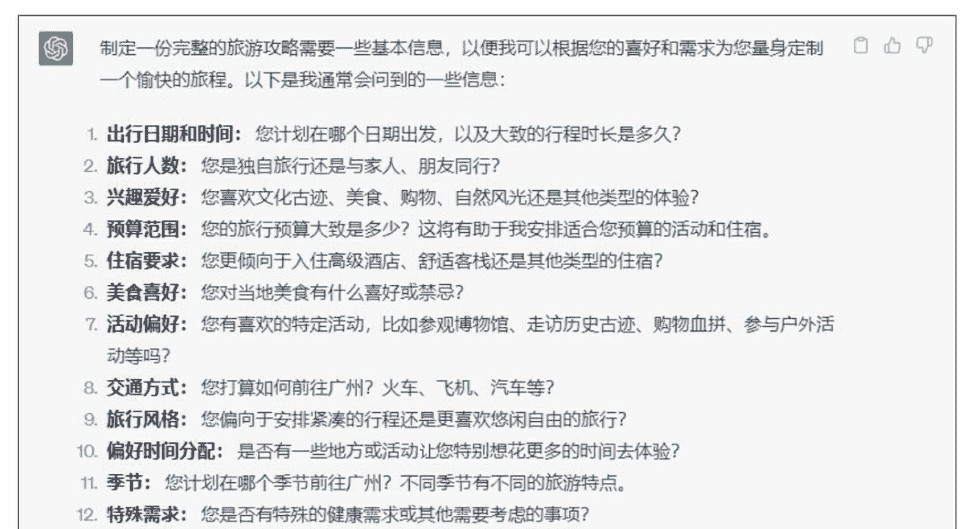
图7-16

步骤02 提供条件，生成初稿
在同一对话里补充“下周我要独自坐火车去广州玩五天，希望行程偏悠闲，其他没有特殊要求”。模型会给出五天放松方案：第一天抵达入住并熟悉周边、品尝烧鹅白切鸡等；第二天广州塔俯瞰珠江、珠江边粤菜、荔枝湾了解岭南民居；第三天陈家祠岭南建筑、传统点心、广州博物馆；第四天北京路步行街购物小吃、珠江边看夕阳；第五天自由活动后返程。

步骤03 增加细节，要求优化
继续追问“请结合各景点的特色打卡点、最佳观赏时段、门票等信息，重新整理更详细的攻略”。模型会把行程细化为第一天上下九步行街与珠江夜景、第二天陈家祠与广州博物馆、第三天白云山缆车与广州科学中心及广州塔夜景、第四天荔枝湾、吏城广场、花城夜市与北京路、第五天市集或回程，并在结尾提醒核实最新开放时间与票务。

让ChatGPT总结沟通话语

扫码看教学视频
有效的沟通表达能帮助建立关系、推动合作，AI可以快速提炼模板。

步骤01 先问标准，再获取原则
提问“好的沟通话语应该具备什么特征？”模型会给出与清晰、尊重、合作相关的原则性说明。
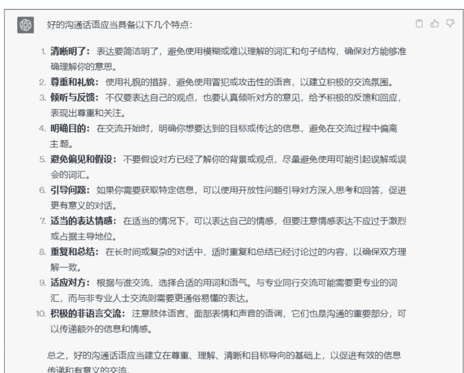
图7-19

步骤02 指定场景，获取职场模板
接着问“请提供一些在职场中能有效沟通的话术模板”。模型归纳出十类常用表达：请求反馈、传达清晰信息、确认理解、提出建议、请求帮助、处理分歧、感谢认可、提醒确认、协调安排、结束交流，每类都配有示例句式，可根据实际情况扩展。

步骤03 细化用途，优化汇报话术
再补充“请再补充一些向领导汇报工作的沟通模板”。
当向上汇报时需要条理清晰、要点突出，模型给出的类目包括项目进展汇报、问题与挑战说明、成果与成就展示、建议与计划提交、资源需求汇报、总结与展望，每类都提供可直接套用的表述框架，帮助汇报更有说服力。

让ChatGPT生成高情商回复

扫码看教学视频
在网络或现实中，高情商回复能营造平和氛围。以家庭沟通为例：

步骤01 引入情境，获取建议
提问“面对亲戚的关心时，如何给出高情商的回复？”模型建议四种做法：先表达感谢，让对方感受到被珍视；以积极乐观的口吻分享近期工作或生活近况；主动询问对方情况，把对话变成双向交流；在合适时机用轻幽默化解尴尬，但要避免伤害感情。掌握这些思路后，再结合具体语境微调，就能自然得体地回应关心。

**高情商回应的核心沟通法则**

5. **轻度分享困扰**：遇到让你不舒服的事，可以酌情透露一点点，避免情绪负担过重。比如说，“工作上偶尔会碰到一些小摩擦，我正在学习怎么更好地处理。”

6. **主动倾听求细节**：对方向你提供建议时，表达出接纳的态度并追问具体做法，这能体现你对对方看法的尊重。

7. **凸显自主选择**：当亲友的建议与你的想法不一致时，可以委婉地维护自己的决策权。例如，“谢谢你的提醒，我会认真参考，同时也在探索更适合自己的路径。”

8. **因人而异地回应**：根据不同亲戚的关注点调整分享内容。对特别关心你职业或学业的人，可以在这方面多做一些说明。

9. **适时流露情感**：在合适时机表达感受，让对方更了解你的内心状态。如，“有你们一直陪伴和支持，我真的很感激。”

10. **保持平和避冲突**：若对方的关心夹杂批评或负面情绪，尽量不争辩，以平稳的语气化解。

总体来看，高情商的互动建立在尊重、理解与善意之上，保持积极平和，善于倾听，才能拉近彼此距离，建立更深的连接。


**步骤02 构建情境并提问**：在同一输入框里继续追加提示词，例如“请依据前面要点，对下面这个场景给出回复（另起一行）情境是：春节回家，亲戚问刚入行的我一个月挣多少钱，我不好意思直说，不知道怎么回”，按下回车，ChatGPT就会针对该情境产出高情商的回答案例，如图7-23所示。

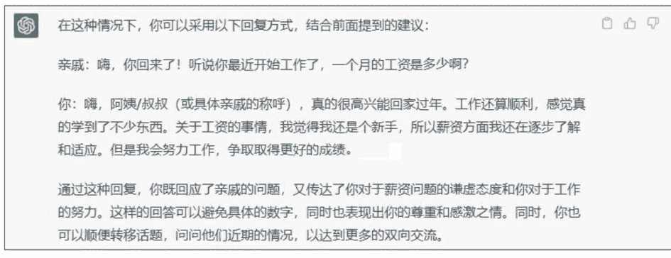

图7-23

**步骤03 给出要求优化回复**：仍在同一输入框中追加提示，例如“如果用幽默方式回应上述场景，该怎么说？要求保持尊重和礼貌”，确认后ChatGPT会按要求调整回复风格，如图7-24所示。


图7-24

**步骤04 追加需求获取更多建议**：继续在同一输入框输入提示，例如“请再提供一批高情商回复的思路”，确认后ChatGPT会给出更多可参考的建议，如图7-25所示。

面对亲戚的关心时，用成熟、尊重、善意的回应来展现分寸感，有助于维系良好关系。下面是可额外借鉴的高情商沟通思路：

1. **先回应感受**：直接点出你对对方关心的体认，例如，“你的在意让我感觉很温暖，也很受重视。”

2. **多维度分享进展**：除工作外，也可以谈兴趣爱好、公益参与等，展示个人成长的全面性。

3. **措辞保持谦逊**：谈及自己的成果时用克制表达，避免让人觉得炫耀。比如，“还有很多不足需要打磨，我会持续精进。”

4. **突出学习成长**：提到工作中学到的经验和收获，强调自己的学习心态以及如何应对挑战。

5. **反向表达关切**：回答完问题后主动询问对方近况，让对话更均衡互动。

6. **分享具象感受**：若工作中有难忘经历，可描述感受和体会，帮助对方更立体地理解你。

7. **用提问转移话题**：若不想深入回答，可用提问巧妙引导，例如，“我挺好奇的，你觉得职场里最关键的是什么？”

8. **维持乐观基调**：以积极乐观的语气作答，让对方感受到你的热情和开朗。

9. **适时表达感谢**：在恰当节点感谢亲友长期以来的支持，让他们感受到你的珍惜。

10. **自信坦然分享**：不必过度腼腆，适度展示自己的努力与成果，体现自信与自尊。

结合自身与亲友的关系选择合适的表达方式，呈现成熟稳重的高情商形象。

图7-25

## 用ChatGPT搜集辩论素材


扫码看教学视频

辩论中，清晰缜密的思维和充足的知识储备是善辩的基础，而借助ChatGPT能快速获取论证素材，提升获胜概率。下面是操作流程。

**步骤01 输入辩题获取思路**：在输入框中输入提示，如“针对‘美是主观感受’这一观点，能从哪些角度论证？”，按回车后ChatGPT会给出论证思路，如图7-26所示。

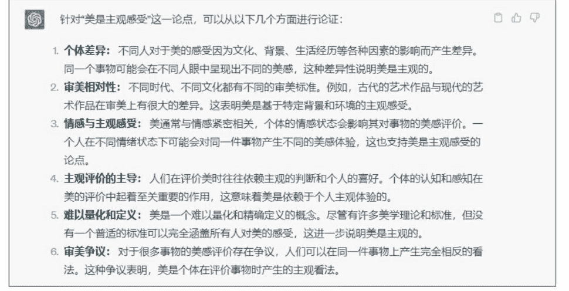

图7-26

**步骤02 明确要求获取实例**：在同一输入框继续输入提示，如“请结合古今中外知识，为每个论点提供具体案例”，确认后ChatGPT会提供相应的辩论素材，如图7-27所示。

论证“美是主观感受”时，可借助古今中外案例来支撑各论点：

1. **个体差异**：文学作品中同景异述的现象常见。英国作家约翰·拉斯金在《亨利四世》中描绘花园的美景，不同角色的笔触却呈现出截然不同的审美取向，说明美感受个人性格和经历影响。

2. **审美相对性**：中国传统山水画重意境抒情，西方写实绘画重精准再现，二者审美取向迥异，凸显文化与时代的相对性。

3. **情感主导感知**：莫扎特《第四十交响曲》充满张力，不同听者的情绪状态会影响他们听到的激情或忧郁，体现主观感受的分化。

4. **评价受主观主导**：莫奈的《睡莲》系列强调光色瞬间，不同观众因对色彩、光线与自然的个人感受而作出差异化评价。

5. **难以量化定义**：中国文人画重意境，印象派重光色捕捉，二者难以用统一标准衡量美的价值。

6. **审美争议并存**：雷诺阿《午餐的时间》有人视作工人生活写实，有人认为是讽刺夸张，争议本身印证美的判断带有主观性。

这些例子显示文化、艺术形式与个体在审美上的主观差异，支撑了“美是主观感受”的论点。


**步骤03 核验信息优化素材**：继续输入提示，如“请核查这些案例的真实准确性，如有错误请重新提供”，确认后ChatGPT会对素材进行校正，如图7-28所示。

很抱歉，前面部分实例不够准确。无法联网核查最新信息后，以下是更可靠的修正案例：

1. **个体差异**：《罪与罚》中罗德申科夫对环境的感知与其罪恶与内心挣扎紧密相关，不同读者对其行为的解读各异，体现审美与道德感受的主观性。

2. **审美相对性**：中国《清明上河图》强调人与自然和谐，荷兰画家凡·艾克的《农场的富有》侧重物质表现，反映不同文化时代的审美差异。

3. **情感与主观感受**：贝多芬《第九交响曲》终乐章融合合唱与器乐，表达团结希望，不同听众因个人背景产生不同共鸣。

4. **主观评价主导**：达·芬奇《蒙娜丽莎》以微笑著称，不同观者因对表情和肖像的理解而产生不同感受。

5. **难以量化定义**：杰克逊·波洛克的抽象表现主义《涂抹画》难以用传统标准衡量，强调情感表达，主观体验差异巨大。

6. **审美争议**：马奈《奥林匹亚》因裸体表现和暗示意义引发争议，有人认为是艺术突破，有人视为道德挑战。

这些更准确的实例凸显了不同文化、艺术与个体在美感评价上的主观分化。

图7-28

# 第8章 AI助力媒体文案创作

## 学习提示

媒体文案相较于传统与新媒体而言，涵括新闻稿件、新媒体文章、短视频文案三大类型，细分品类众多，均可在ChatGPT协助下高效完成。本章介绍相关操作方式。

## 本章重点导航

- 掌握ChatGPT生成媒体文案的方法

## 用ChatGPT撰写新闻稿件


扫码看教学视频

新闻工作者核心任务是产出时效强、内容全、观点深的资讯，借助ChatGPT可提升效率与质量。操作步骤如下。

**步骤01 明确主题列提纲**：输入提示，如“假设你是一名记者，需要写一篇关于网络诈骗的新闻资讯，请生成完整提纲”，按回车后ChatGPT会输出提纲，如图8-1所示。

### 新闻标题：警惕！网络诈骗升级，市民需做好信息保护

导语：科技发展伴随诈骗手法升级，市民应提高警惕，妥善保护个人信息，避免经济损失。

### 1. 背景介绍：

- 解释网络诈骗定义及常见类型，如钓鱼邮件、虚假网站、社交媒体诈骗。

- 引用统计数据，呈现过去一年网络诈骗增长态势，揭示严重性。

### 2. 新型手段：

- 介绍近期出现的新招，如AI合成逼真语音的电话诈骗、冒充熟人账号的社交平台诈骗。

- 分析特点与原理，提示防范风险。

### 3. 案例解析：

- 选取近期案例，详述受害经历与损失，增强真实感。

- 归纳共性，如心理操控、制造紧急情境等。

### 4. 专家意见：

- 采访网络安全专家，了解形势判断与建议。

- 引用实用防范建议，如不轻信陌生信息、定期改密、开启多因素认证等。

### 5. 应对措施：

- 报道政府与企业打击行动，如法律加码、宣传教育。

- 分析成效与不足，探讨改进方向。

### 6. 防范建议：

- 给市民具体建议，如勿点可疑链接、谨慎对待索要信息电话、保护银行账户等。

- 强调防范是共同责任。

### 7. 结语：

- 总结危害，重申保持警惕的重要性。

- 呼吁积极举报，共同营造安全网络环境。

图8-1

**步骤02 提出要求撰写初稿**：继续输入提示，如“请按提纲写一篇报纸新闻稿，约800字，表述严谨精炼”，确认后ChatGPT会生成初稿，如图8-2所示。

### 警惕！网络诈骗活动不断升级，市民需保护个人信息

科技进步推动诈骗手段不断升级，市民应提高警惕，保护好个人信息，避免经济受损。

**背景介绍：** 近年来互联网普及使网络诈骗成为犯罪分子获利常见方式，类型多样包括钓鱼邮件、虚假网站、社交媒体诈骗等。最新数据显示，过去一年案件持续攀升，形势令人担忧。

**最新诈骗手段：** 新型手法层出不穷，其中AI生成逼真语音的电话诈骗增多，冒充熟人账号在社交平台实施诈骗的案例也在上升。这些手段融合科技与心理策略，更难识别。

**案例分析：** 近期一名市民收到冒充银行的邮件称账户异常，点开链接后输入银行信息，导致资金被盗。类似案件中，诈骗分子多以心理欺骗和制造紧急感诱导受害者。

**专家观点：** 网络安全专家提醒保持高度警惕，建议不轻信陌生信息，定期更新密码，使用多因素认证。提升识别可疑链接的能力是关键。

**政府和企业应对措施：** 政府加大法律制裁力度，加强监管；企业推出安全宣传，鼓励公众提升自我保护意识。

**市民防范建议：** 收到可疑邮件勿点链接，最好手动输入网址；不轻信索要个人信息或金钱的电话；使用强密码并定期更换；开启多因素认证提升账户安全。

**结语：** 网络诈骗威胁加剧，每个人都有保护信息责任。保持警惕，不因便利泄露信息，发现可疑及时举报，共同维护安全网络环境。

图8-2

**步骤03 提供素材优化稿件**：继续输入提示，如“新闻素材：×××（另起一行）请精简该素材并融入稿件中”，确认后ChatGPT会结合素材优化新闻稿，如图8-3所示。

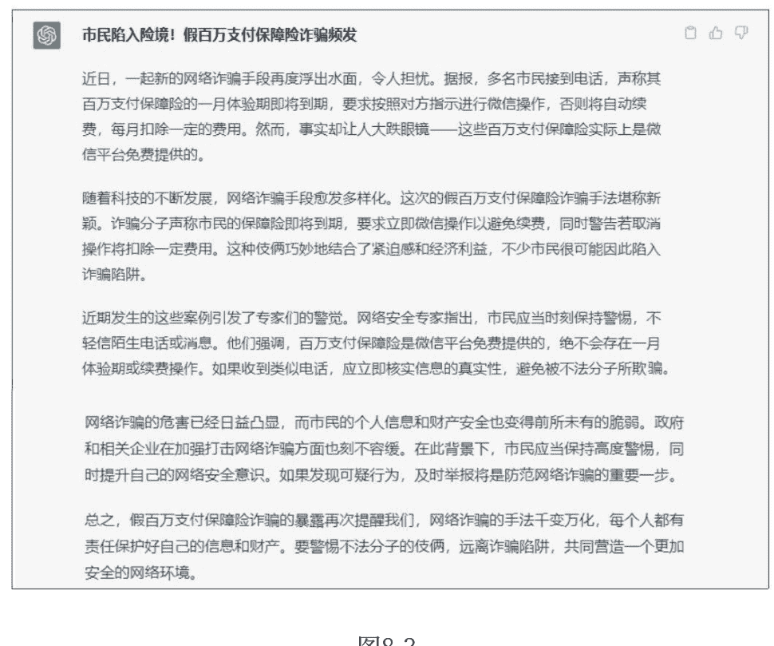

图8-3

## 让ChatGPT生成爆款标题


扫码看教学视频

标题是文章吸引注意力的关键，尤其对新媒体而言，好的标题能点明主旨并提升曝光。借助ChatGPT可融合多平台特征，创作出更高效的标题。本节介绍操作步骤。

**步骤01 赋予身份总结特征**：输入提示，如“假设你是一名资深新媒体文案，请总结爆款标题的特征”，按回车后ChatGPT会输出特征总结，如图8-4所示。

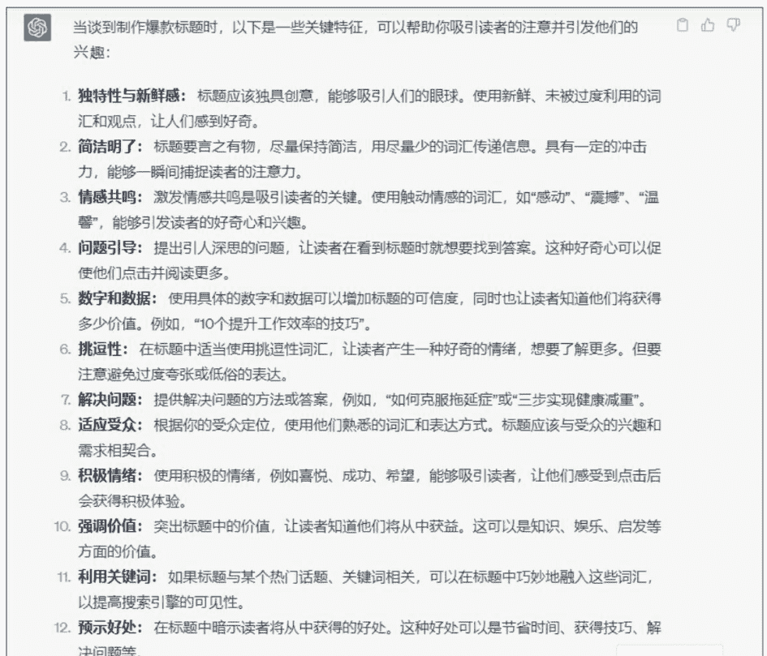

图8-4

**步骤02 提出需求撰写标题**：继续输入提示，如“请依据上述特征，围绕推荐洗面奶主题，写10个爆款标题”，确认后ChatGPT会生成标题，如图8-5所示。

以下是结合洗面奶主题与爆款特征的10个标题示例：

1. 揭秘护肤新宠：10款爆火洗面奶横评！
2. 零基础也能透亮：5个让你惊艳的洗面奶用法！
3. 两步搞定水润肌，懒人洁面秘诀大公开！
4. 油皮干皮敏感肌？选对洗面奶指南来了！
5. 清洗一整天疲惫，7款提亮洗面奶推荐！
6. 别忽视关键步骤！正确洗面奶使用法揭秘！
7. 不同年龄肌肤怎么选抗衰洗面奶？专家解答！
8. 告别痘痘，从选对洗面奶开始！5款推荐！
9. 洗面奶成分解析：避开有害物，给肌肤温和呵护！
10. 清洁卸妆两不误！10款洗面奶盘点！

标题融合新颖、共鸣、引导、数字等元素，可根据受众微调。

图8-5

**步骤03 指定平台优化标题**：继续输入提示，如“请结合小红书标题特征，围绕洗面奶推荐生成10个标题，要求有吸引力且20字以内”，确认后ChatGPT会输出适配标题，如图8-6所示。

以下是适配小红书、20字内的洗面奶推荐标题：

1. 肌肤大解密：最适合你的洗面奶TOP5！
2. 洗面奶选对了吗？明星同款推荐！
3. 清新不紧绷，今夏洗面奶大揭秘！
4. 素颜新宠，10款洗面奶焕美肌！
5. 洗面奶选购攻略，肌肤问题迎刃解！
6. 懒人福音，早晚同款洗面奶超时髦！
7. 美肌始于洁净，明星都在用的洗面奶！
8. 告别油腻，夏日必备清爽洗面奶！
9. 敏感肌福音，温和洗面奶大公开！
10. 潮流新宠，护肤达人力荐洗面奶TOP3！

标题简洁吸睛，突出实用性与吸引力，符合小红书用户偏好。可根据内容微调。

图8-6

## 让ChatGPT创作小红书笔记


扫码看教学视频

除标题外，小红书笔记正文也能借助ChatGPT完成创作，帮助创作者保持账号更新与运营效率。本节介绍相关操作流程。

**用ChatGPT搞定小红书爆款笔记**

**步骤01 设定角色，先行调研：** 在ChatGPT对话框里输入人设指令，比如“请你扮演一位坐拥百万粉丝的小红书达人，讲讲做爆款笔记的核心诀窍”，回车后确认模型是否理解小红书的玩法，模型会给出创作要点，如图8-7所示。

作为百万粉博主，做出爆款笔记的关键在于点子新颖、内容扎实以及和粉丝互动。参考要点如下：

1. **打磨差异化灵感**：挖掘与众不同的题材和角度，可从生活微场景、个人经历、时下热搜中提炼灵感，抓住眼球。
2. **做足功课打底**：写作前对主题进行深度了解，保证信息准确、干货足，让读者有收获感。
3. **图片质感要在线**：小红书重视觉，照片光线、构图、后期都要精致，提升吸睛度。
4. **文字要饱满生动**：用形象的描述为图片补充信息，帮助读者更易理解与代入。
5. **触达情感共鸣**：在内容里埋入故事、感悟或情绪点，减少距离拉近彼此。
6. **保持更新节奏**：规律发文让粉丝有期待，同时积极回复评论私信，保持活跃。
7. **主动制造互动**：在笔记里抛问题、开话题，引导评论区讨论与经验交换。
8. **内容形式多元**：不局限单一赛道，尝试教程、种草、心得、随笔等多种形态，保持新鲜。
9. **紧跟热点风向**：留意流行话题并结合自身定位，提高被推荐概率。
10. **输出实在价值**：笔记要能解决痛点、传递知识或提供灵感。
11. **甄选合作资源**：与品牌或同行联动可扩大曝光，但需契合个人风格与价值观。
12. **听取反馈迭代**：定期查看读者意见持续改进，逐步提升内容水准。


**步骤02 锁定主题，下达指令：** 在同一对话框里继续追问，比如“依据上面这些原则，以‘秋冬补水干货’为主题，写一篇小红书爆款笔记”，回车后模型会生成符合框架的样稿，如图8-8所示。

### 标题：秋冬脸干预警！这份补水清单让肌肤回潮！💧❄️

封面图示：枫叶铺陈的背景下，一滴清透水珠落在掌心，晶莹剔透。

哈喽宝子们！秋风一起，气温转凉，皮肤也容易跟着紧绷。今天整理了秋冬实用的补水方法，帮大家在寒季也能保持水嫩！🍂

### 🌟内外兼修打底
- **补水别偷懒**：冬季容易忘喝水，每天记得喝够。温热的茶或温开水都有助维持肌肤含水。
- **补水锁水配合**：洁面后马上用保湿水，再叠加乳霜，多层锁住水分，减少流失。

### 🌟营养滋润精华
- **玫瑰果油**：富含维C，兼顾保湿修复。建议每周敷一次，抵御干燥侵袭。
- **透明质酸精华**：秋季补水的王牌，持续抓水让肌肤饱满。

### 🌟面膜深层加持
- **定期补水膜**：每周1-2次，选含玻尿酸、蜂蜜的配方效果更佳。
- **居家DIY**：芦荟胶混蜂蜜敷脸，能起到舒缓与修复作用。

### 🌟细节习惯护航
- **温和清洁**：选用温和洗面品，避免过度清洁带走保护膜。
- **防晒仍重要**：秋冬紫外线依旧，挑选带防晒的保湿乳双重防护。
- **环境加湿**：室内放加湿器维持湿度，肌肤更不易干。

宝子们，冬天干皮不是必然！掌握这些方法，肌肤也能在寒潮里发光。快来评论区聊聊你的补水妙招吧！❄️🌸

#秋冬补水 #肌肤保湿 #干燥季必备 #水润如初

图8-8

**步骤03 反馈优化，提升吸引力：** 继续在同一输入框里补充需求，比如“请在文中加入更多真实使用感受，提升可信度与吸引力”，回车后模型会据此润色笔记，如图8-9所示。

### 标题：秋冬一到就干！我亲测的补水招数真管用！💧❄️

封面图示：同上，秋叶背景下水珠落在手心。

Hi宝子们！入秋后我每年都为干皮发愁，今年试了几套方法，皮肤水润到自己都惊喜。今天把亲身经历分享出来！🍂

✨ **内外兼修的底子**
- **喝水真的有效**：冬天不觉得渴，我刻意保持饮水量后，肤感明显变好。
- **水乳叠加好用**：洁面后先拍保湿水再抹霜，双重加持后不紧绷了。

✨ **精华油的惊喜**
- **玫瑰果油体验**：听闻它能修复，我每周用一次，冷风里依旧水润。
- **透明质酸精华**：朋友推荐后入坑，确实是秋冬补水救星，皮肤更弹。

✨ **面膜的坚持**
- **每周必敷**：以前嫌麻烦，现在固定周敷1-2次，感觉肌肤喝饱水。
- **自制面膜**：芦荟胶加蜂蜜敷，保湿的同时很舒缓，特别适合干燥季。

✨ **日常小习惯**
- **清洁更温柔**：不再强力搓洗，换了温和洁面，舒适度提升。
- **加湿器助攻**：家里放了加湿器，空气不干了，呼吸也舒服。

总之，秋冬干燥不是没办法！以上都是我亲测有效的经验，欢迎在评论区交换心得，一起美美过冬吧！❄️🌸

#亲测有效 #秋冬补水 #水润肌肤 #干燥季护肤

图8-9

## ChatGPT助你写公众号


扫码看教学视频

在新媒体矩阵里，公众号是承载思想与干货的重要阵地。选题、列纲、初稿、修改、定稿常耗费大量精力，借助ChatGPT可快速获取灵感并提升效率。本节介绍公众号文章的生成流程。

**步骤01 建立背景，索取建议：** 输入如“假设你有多年公众号运营经验，请给出撰写公众号文章的建议”，确认模型理解写作逻辑，生成建议，如图8-10所示。

写作公众号时，以下建议可提升质感与订阅量：

- 1. **明确读者画像**：先锁定目标人群，了解其兴趣与痛点，定向输出价值内容。
- 2. **吸睛标题设计**：标题要概括要点同时激发好奇心。
- 3. **提供实用信息**：解决读者问题、分享经验或给出可操作建议。
- 4. **结构清晰流畅**：有引言、正文、结语，段落衔接自然。
- 5. **语言简洁易懂**：避免堆砌生词，用通俗表达传递观点。
- 6. **配图增强表现**：适当插入相关高质图片或图表辅助理解。
- 7. **用故事说服**：案例或真实经历更易引发共鸣。
- 8. **保持更新频率**：定期输出新内容维系活跃度。
- 9. **回应互动**：及时回复评论建立信任感。
- 10. **分享个人洞见**：适度加入自身经验提升亲近感。
- 11. **兼顾搜索优化**：合理使用关键词与标签。
- 12. **借助社媒分发**：在社交平台扩散文章触达。
- 13. **注意排版美观**：合理字体与间距提升阅读体验。
- 14. **数据复盘调整**：用阅读量、互动率指导后续策略。
- 15. **塑造差异风格**：在内容与语调上形成个人辨识度。

持续学习与迭代是提升写作的关键。

图8-10

**步骤02 确定话题，提出要求：** 继续输入如“请按以上建议，以‘好朋友为何会渐行渐远’为主题写一篇公众号文章”，模型会生成主题稿，如图8-11所示。

# 标题：友谊的距离：好朋友为何渐行渐远

大家好，欢迎来到本期栏目。今天聊聊一个普遍经历：为什么好朋友会越走越远？友情珍贵，却难免因现实出现裂痕。本文从多个视角解读，希望助你更好理解与应对。

### 拼图碎片：兴趣与阶段错位
人生像拼图，每个人在不同阶段填入不同碎片。毕业后有人深耕学业，有人投身商海，兴趣与目标的分化让共同话题减少。不必互相指责，尊重选择，未来或在某个节点重逢。

### 真诚沟通：坦露与疏离之间
友情靠交流维系，但忙碌与顾虑常导致沉默。害怕麻烦或不好意思开口，反而拉大距离。坦诚分享想法与感受，既能减压，也能加深联结。

### 生活压力：竞争与误会
职场竞争容易滋生比较与嫉妒，误会也常因一念之差产生。理解彼此处境，以同理心化解负面情绪，才能让友情不被消耗。

### 情感深化：回忆与展望
翻看共同的照片与往事，能找回初心；一起规划旅行或新目标，也能重燃热情。回忆维系过去，前瞻点亮未来。

### 结语
友情如花需呵护。面对渐远，不必责备，用成熟与理解对待。人生的轨迹各异，但真挚的情感可跨越时间与空间。珍惜当下，用心维系。感谢阅读，欢迎在评论区分享你的故事！

**步骤03 追加案例，完善内容：** 输入如“请在文中加入具体的人物案例支撑观点”，模型会优化，如图8-12所示。

# 标题：友谊的距离：好朋友为何渐行渐远

欢迎来到本期栏目。今天结合真实案例聊聊好朋友渐行渐远的原因，帮助你更理性看待友情变化。

### 拼图碎片：兴趣与阶段不同
大学时小明和小红形影不离，毕业后小明追科研，小红入商界。生活节奏与关注点不同，联系渐少。两人虽理解选择，互动仍稀疏。

### 真诚沟通：坦言与疏远之间
小张因工作压力沉默，小李因感情困扰不愿说。一次偶遇后双方倾诉，发现相似处境。约定每周通话，友情重新升温。

### 生活扭曲：竞争与误会
小芳升职后在朋友圈分享，小华近期工作受挫表情复杂。小芳一度以为被嫉妒，沟通后才知误会。互相支持后关系更稳固。

### 深化情感：回忆与未来
小林和小陈童年玩伴，因工作疏远。一次翻看旧照重温往事，随后共同策划旅行计划，重新点燃连结。

### 结语
案例显示，友情淡化并非宿命，可通过理解、沟通与共同规划修复。面对距离，请以成熟心态对待。感谢阅读，期待你的互动！

图8-12

可见，ChatGPT生成的公众号稿虽有框架与逻辑，但仍需创作者补充细节、校准观点、配图排版后才能发布。

## ChatGPT打造知乎高赞内容


扫码看教学视频

知乎是观点交流的重要平台，用户习惯提问与阅读深度回答。对新手而言，撰写专业且引发共鸣的内容有难度，ChatGPT可提供支持。本节介绍知乎内容的生成步骤。

**步骤01 背景确认，获取信息：** 输入如“你了解知乎吗？高赞内容有什么特点？常用什么文体？”，确认模型对平台的认知，生成信息，如图8-13所示。

我熟悉知乎，它是知识问答社区。高赞回答通常具备：

- 1. **研究深入、专业度高**：结合资料、数据、案例支撑观点。
- 2. **视角新颖独特**：提供新角度或少见见解。
- 3. **逻辑清晰结构严谨**：思路条理分明，便于阅读。
- 4. **语言优美带幽默感**：专业中适当调性，保持趣味。
- 5. **引用权威来源**：书籍、论文、报道增强可信度。
- 6. **可视化辅助**：图表数据帮助解释。
- 7. **个人经历佐证**：真实故事增加亲近感。

常见文体包括：科普解释、案例分析、观点阐述、指南教程、问题求解等。

图8-13

从整体来看，知乎平台上的高赞回答形式各异，却都体现出逻辑严谨、见解深入、实用性强的共性，这也恰好契合了用户对高质量内容的需求。

图8-13

**步骤02确定主题，提出需求：** 在同一输入框里继续补充指令，例如“请参照知乎平台的写作风格和读者偏好，以科普解说的形式回应下面这个问题（另起一行）问题：怎么写出爆款文案？” 回车后，模型会生成贴合知乎高赞风格的文本，见图8-14。

# 从洞察到共鸣：爆款文案拆解六要点

在当下信息极度过载的环境里，一篇能够吸引眼球、引发转发的文案，往往决定了营销和传播能否奏效。无论是产品推广、社交媒体运营，还是个人品牌塑造，一段具备穿透力的文字都能帮助你在激烈竞争中脱颖而出。究竟如何才能写出令人眼前一亮的内容？下面进行关键要点的拆解。

### 第一步：精准描绘目标人群
爆款的前提是对目标人群有清晰认知。先弄清他们的需求、兴趣、痛点及价值取向，这是创作的起点。可借助市场调研、用户反馈和数据分析来收集有效线索。只有真正吃透受众心理，才能写出打动人心的表达。

### 第二步：紧扣痛点并给出解法
有力的爆款通常能精准击中受众的困扰。人们更在意问题能否被解决，而非单纯的产品介绍。因此要明确传达产品或服务如何切中痛点，从而带来实际好处。

### 第三步：凸显差异化卖点
即便市场同质化严重，每个产品都有可差异化的地方。需要在文案中凸显核心差异，让读者清楚你的不可替代之处，这可以是创新功能、独特设计或别具一格的服务理念。

### 第四步：注入情感，拉近共鸣
情感是驱动传播的关键。适当加入情感元素，更容易引起共鸣。可通过讲故事、分享真实案例或用富有感染力的形容词营造氛围，使文案更具吸引力。

### 第五步：言简意赅，信息集中
爆款文案讲究能在短时间内传递核心观点。避免冗长复杂，用简练清晰的表达把重点讲透。

### 第六步：明确行动号召，推动转化
优秀的文案要推动下一步行为。无论是促成购买、关注账号还是转发分享，都需在文末明确提出行动指令，引导读者采取行动。

### 结语
写好爆款文案没有捷径，需要深度洞察受众、打造有吸引力的内容，并在恰当时机触发情感共振。把握受众需求、击中痛点、彰显差异、制造共鸣、表达精炼并明确号召，就能写出让人难以抗拒的文案，实现营销传播的目标。

图8-14

**步骤03提出要求，优化内容：** 仍在同一输入框追加要求，比如“请在给出方法的同时，补充若干具体案例来说明上述问题”，回车后，ChatGPT会基于此对内容进行增强，效果见图8-15。

# 案例驱动：爆款文案落地拆解

在信息极度饱和的今天，写出被广泛关注的爆款文案，既需要创意，也必须紧贴受众需求。下面结合思路与实操案例，说明优质文案的形成路径。

### 方法一：了解目标受众
要写出爆款，先要摸清读者的需求和偏好。以智能手环推广为例，调研发现很多人关注健康，尤其是疫情后健康管理意识增强。

**案例：**
此时文案可围绕“30天，让自己更健康”展开，突出手环能实时监测身体数据并给出定制化健康建议，让用户感受到产品对健康生活的正面价值。

### 方法二：抓住痛点，提供解决方案
一个成功的爆款文案应该直指受众的困扰并给出答案。假设你要宣传一本时间管理书籍，那么你需要抓住人们对时间管理困扰的痛点。

**案例：**
“不再拖延，开启高效生活！今天就掌控时间，迈向梦想！”这样的表达直指受众痛点，激发他们寻求解决方案的欲望。

### 方法三：独特卖点的突显
无论在何种领域，你的产品或服务都必然有独特之处。将这些独特卖点融入文案，能够更好地吸引目标受众的注意。

**案例：**
假设你要推广一款咖啡机，而它的独特之处是可以调整咖啡的浓度。你可以用“咖啡浓度随心调，专属风味由你定”来强调产品的独特性，吸引那些热爱咖啡的人。

### 方法四：情感共鸣，引发共鸣
情感在营销中具有巨大的力量。通过在文案中加入情感元素，你可以引发受众的共鸣，从而让文案更具吸引力。

**案例：**
假设你要宣传一个慈善项目，为失学儿童捐款。你可以用“一点善意，就能改写一个孩子的人生”来唤起受众内心的善良，激发参与意愿。

### 方法五：简洁明了，言之有物
在信息过载的时代，简洁明了的文案更容易被人接受和记住。不要用冗长的句子掩盖核心信息。

**案例：**
假设你要宣传一家新餐厅的开业，而它的特点是提供快捷、健康的餐饮选择。你可以用“美味更健康，快餐也能轻负担”来表达出核心信息，吸引忙碌的都市人。

### 方法六：调动行动力，呼吁行动
一个成功的爆款文案应该能够调动受众的行动力，引导他们采取具体行动。

**案例：**
假设你要宣传一个线上学习平台，你可以用“现在就开始学习，拓展你的知识版图！”来鼓励受众立即注册并开始学习。

### 结语
撰写爆款文案的关键在于深度洞察读者、直击痛点、凸显差异、触发共鸣、信息精炼并给出明确行动指引。结合上述方法与案例，相信能为你的创作提供灵感，让文案在信息洪流中脱颖而出。

图8-15

## 081 让ChatGPT拟写豆瓣书评


扫码看教学视频

在豆瓣平台，书评是新媒体平台中常见的文章形式，发挥着图书推广与传播的作用。要想有效地发挥书评的作用，创作者需要具备独到的见解、较强的文字表达能力和写作能力，而在ChatGPT的帮助下，创作者可以高效地完成豆瓣书评的写作。

本节将介绍让ChatGPT拟写豆瓣书评的操作步骤。

**步骤01赋予身份，询问建议：** 在ChatGPT输入框中输入提示词，如“假设你是文学批评方面的专家，请提供一些拟写书评的建议”，按Enter键确认，ChatGPT会提供拟写书评的建议，如图8-16所示。

**步骤02确定主题，提出需求：** 在同一个输入框中继续输入提示词，如“请根据以上建议，为《麦田里的守望者》(The Catcher in the Rye) 这本书拟写专业的书评”，按Enter键确认，ChatGPT会生成豆瓣书评，如图8-17所示。

当拟写书评时，以下是一些建议，以帮助您提供深入、有见地的评价：

-   1. **全面理解作品**：在撰写书评之前，确保您对作品有深入的理解。仔细阅读、思考和分析作品的内容、结构、主题和情感。

-   2. **明确表达观点**：在书评中，清晰而明确地表达您的观点是至关重要的。您的观点应该涉及作品的优点、缺点、主题、情感和可能的解读。

-   3. **提供具体例证**：在评价作品时，不要只停留在一般性的陈述上。通过引用具体的情节、对话或描述，来支持您的观点，这有助于使您的评价更有说服力。

-   4. **分析人物塑造**：讨论作品中的角色时，不仅要谈论他们的行动，还要深入探讨他们的性格、动机和变化。如何塑造人物会影响故事的发展和读者的情感。

-   5. **探讨主题与象征**：作品通常会涵盖深层次的主题和象征。探讨这些主题和象征如何贯穿整个作品，以及它们对故事的意义和读者的理解产生了什么影响。

-   6. **分析情感和氛围**：作品所传达的情感和氛围对于读者的体验至关重要。探讨作者如何通过语言、描写和情节来创造出特定的情感和氛围。

-   7. **考虑文学风格**：作者的文学风格是独特的，对于作品的呈现和效果有着深远的影响。分析作者使用的修辞手法、句式结构和语言选择。

-   8. **对比与联系**：如果适用，可以将作品与其他类似的作品进行对比，或与作者其他作品进行联系。这有助于深入挖掘作品的特点和独特之处。

-   9. **关注社会与历史背景**：作品往往受到当时的社会和历史背景影响。考虑这些因素如何影响了作品的创作和接受，以及作品对社会的反应。

-   10. **客观和主观结合**：在书评中，既要提供客观的分析，又可以加入一些个人的主观看法。平衡好这两者可以使您的书评更具深度和可读性。

-   11. **避免剧透**：在书评中，尽量避免透露太多关键情节，以免影响读者的阅读体验。

-   12. **语言流畅**：书评的语言应该流畅易懂，避免使用过于复杂的词汇和句式，以确保读者能够轻松理解您的观点。

-   13. **结构清晰**：书评的结构应该清晰有序，可以采用分段的方式来分别讨论不同的方面，如情节、人物、主题等。

-   14. **多次润稿**：撰写完书评后，进行多次的润稿和修改。这有助于去除冗余、提升表达质量，并确保评价的准确性和完整性。

-   15. **尊重作者努力**：在批评作品时，尽量保持尊重，意见可以是批评性的，但避免过于负面或攻击性的语言。


《麦田里的守望者》（The Catcher in the Rye）是美国作家J.D.塞林格创作的一部经典小说，被广泛认为是20世纪美国文学的代表作之一。该书以第一人称叙述的方式，讲述了少年霍尔顿·考尔菲尔德在一段短暂的时间内的生活经历，探讨了成长、孤独、真实与虚幻等主题。

该小说通过主人公霍尔顿的视角，巧妙地展示了青少年内心的冲突与困惑。塞林格以独特的文学风格，创造出一个既叛逆又敏感的主人公。在书评中，需要首先关注小说的主要特点和作者的创作风格。

作为建议的一部分，让我们分段来讨论这本小说：

## 主人公的复杂性与冲突：

《麦田里的守望者》以主人公霍尔顿的声音讲述，通过他的视角，读者深入了解了一个充满矛盾和情感的青少年。霍尔顿的冲动、叛逆和对社会虚伪的敏感，都反映了他对成长和人际关系的困扰。然而，在他的叛逆性格背后，也隐藏着对纯真与美好的渴望，这一点在他对“捕捉孩子”的幻想中得到了体现。这个复杂性使得霍尔顿成为一个深具吸引力的角色，同时也引发了对青少年成长问题的深刻思考。

## 主题的刻画与探讨：

塞林格通过霍尔顿的经历，探讨了青少年的孤独、迷茫和不安。他试图逃离现实的虚伪与荒谬，渴望寻找纯真和真实的存在。这一主题在霍尔顿对“麦田里的守望者”这一幻想的描述中得到了象征性的体现。这个主题在不同层面上引发了对社会、家庭和个人的思考，使小说具有更深层次的意义。

## 情感的表达与情节结构：

塞林格巧妙地运用情感的表达，通过霍尔顿的内心独白，让读者深刻感受到他的情感起伏和内心世界的波动。小说的情节结构紧凑，仅仅在短暂的几天内展现了霍尔顿的经历。这种紧凑的结构增强了读者与主人公的代入感，使读者更能够感同身受他的情感和冲突。

## 文学风格与象征的运用：

塞林格的文学风格清新独特，带有叛逆与率真的味道。他通过霍尔顿的口吻，创造出一种独特的语言和叙事风格，强化了主人公的个性和情感。小说中的一些象征，比如霍尔顿的红猩猩帽子和“麦田里的守望者”这一幻想，都为故事增添了深度和意象。

## 社会与历史背景的影响：

小说背景设定在1950年代的美国，这个时期正是美国社会变革的时期。霍尔顿对社会虚伪和荒谬的敏感，反映了当时社会的一些问题和价值观。同时，冷战时期的不安全感也在小说中得到了一些暗示。这些背景因素深刻影响了小说的情感氛围和主题探讨。

## 让ChatGPT构思访谈节目脚本

脚本作为视频或节目拍摄的重要依据，起着不可替代的作用。在访谈节目的制作中，脚本可以把控节目的节奏和时长，促进节目保质、高效地完成。在ChatGPT的帮助下，用户可以迅速获得访谈节目的脚本。本节将介绍让ChatGPT构思访谈节目脚本的操作步骤。

**步骤01 明确话题，询问信息：** 在ChatGPT输入框中输入提示词，如“构思访谈节目的脚本包含哪些信息？”，按Enter键确认，ChatGPT会提供构思访谈节目脚本的信息，如图8-18所示。

访谈节目的脚本通常包含以下信息，以确保节目内容有条理、流畅，并能够引起听众的兴趣：

1.  节目信息和介绍：

    - 节目名称、主题、日期、时间等基本信息。

    - 主持人和嘉宾的简要介绍。

    - 节目的整体宗旨、目标和预期效果。

2.  开场白：

    - 主持人的开场白，通常包括对节目主题的简要介绍，对嘉宾的欢迎，以及可能的一些引入性问题或观点。

3.  嘉宾信息和话题：

    - 关于每位嘉宾的详细信息，包括姓名、背景、成就等。

    - 要讨论的具体话题或议题列表。

4.  问题和对话：

    - 主持人准备的问题列表，包括开放性问题、深入挖掘的问题、引导性问题等。

    - 针对每个问题，可能的嘉宾回答和讨论的方向。

5.  过渡和衔接：

    - 在不同话题之间的过渡，以确保节目的流畅性和连贯性。

    - 主持人的引导，将讨论从一个话题引入下一个话题。

6.  亮点和插播内容：

    - 介绍一些亮点、趣闻、引人入胜的内容，以吸引听众注意力。

    - 可能的音乐、音效或其他插播内容。

7.  观点对比和深度探讨：

    - 针对某个话题，展示不同嘉宾的观点，进行深度讨论和辩论。

    - 在讨论中挖掘各种观点的细节和支持。

8.  听众互动和问答环节：

    - 安排听众提问的环节，可以事先收集听众的问题，也可以现场互动。

    - 主持人引导和控制问答环节，确保问题与节目主题相关。

9.  总结和结尾：

    - 主持人对节目进行总结，强调重要观点和信息。

    - 向嘉宾表达感谢，并宣传下一期节目的主题和嘉宾。

10. 广告和赞助信息（如适用）：

    - 如果有广告或赞助商，安排在节目中适当的时间播放广告。

11. 时间安排和节目时长：

    - 确定每个话题和节目段落的时间分配，以控制节目整体时长。

12. 可能的紧急处理计划：

    - 预测可能出现的问题，如技术故障、嘉宾无法参加等，制订应对计划。

13. 音效、音乐和效果：

    - 确定何时需要插入音效、音乐或其他声音效果，以增强节目的氛围。

14. 现场或录播安排（根据需要）：

    - 确定节目是现场直播还是事先录制，以及相关的技术和操作安排。

**步骤02 确定主题，提出需求：** 在同一个输入框中继续输入提示词，如“请根据以下信息提供一份访谈节目脚本（另起一行，提供信息）”，按Enter键确认，ChatGPT会生成访谈节目脚本，如图8-19所示。

请根据以下信息提供一份访谈节目脚本

访谈主题：探讨如何写比喻句

访谈时间：一个小时

访谈对象：一位作家

### 节目脚本：探讨如何写比喻句

[开场音乐渐入]

主持人：大家好，欢迎收听本期访谈节目！我是您的主持人[主持人姓名]。今天，我们将一同探讨创作中的一门艺术——如何写出富有意象力的比喻句。我们有幸邀请到了一位杰出的作家[嘉宾姓名]，他/她在文学领域有着丰富的经验。欢迎，[嘉宾姓名]！

嘉宾：非常感谢，[主持人姓名]。我很高兴能够与大家分享一些关于写比喻句的见解。

主持人：让我们从基础开始。在您看来，比喻句究竟是什么，它们在写作中扮演了怎样的角色？

嘉宾：比喻句是一种修辞手法，通过将两个不同的事物进行比较，以便为读者创造出更生动、形象的理解。在写作中，比喻句可以帮助传达抽象概念，增加情感和意象，使作品更加生动。

主持人：写比喻句可能是一项具有挑战性的任务。您能分享一些创作比喻句的技巧吗？

嘉宾：当然。首先，寻找共通点是关键。比喻句的效果在于将两个事物联系起来，因此要选择具有相似特点的事物进行比较。其次，使用形象生动的词语，让读者能够感受到比喻句所传达的意象。最后，要注重上下文，确保比喻句与作品整体风格和主题相一致。

主持人：这些是非常实用的技巧。在您的写作过程中，是否有一些特定的方法来激发创作出独特的比喻句？

嘉宾：当然。我常常会观察日常生活中的事物和情境，从中汲取灵感。阅读也是一个很好的方法，通过阅读他人的作品，我们可以学习不同的比喻句结构和表达方式。此外，将自己置身于不同的情感状态和场景中，可以帮助我们想象出丰富多彩的比喻句。

主持人：很有启发！最后，请您与我们分享一个您喜欢的比喻句例子，并解释一下它的创作背后。

嘉宾：当然。我曾写过一句比喻句：“她的笑容如阳光穿透阴霾，瞬间点亮了整个房间。”这句比喻句通过将笑容与阳光进行比较，传达出一种积极、温暖的情感。我之所以选用这个比喻，是因为阳光在人们心中通常具有积极、愉悦的意义，它能够为读者带来一种愉快的情感体验。

主持人：非常感谢，[嘉宾姓名]，您的分享非常有启发性。时间过得真快，我们的访谈时间已经接近尾声。非常感谢您今天的分享！

嘉宾：我也感谢您的邀请，[主持人姓名]。希望大家在创作比喻句时能够有所启发，写出更加生动有趣的作品。

[结束音乐渐出]

主持人：亲爱的听众朋友们，谢谢您们收听本期节目。我们希望通过今天的访谈，能够为您揭示写比喻句的魅力和技巧。敬请期待我们下期的精彩内容。再见！

## 让ChatGPT构思纪录片脚本

在制作纪录片时，脚本可以起到指导拍摄和剪辑的作用。用户运用ChatGPT，可以快速获得特定主题的纪录片脚本，从而提高制作纪录片的效率。本节将介绍让ChatGPT构思纪录片脚本的操作步骤。

**步骤01 明确话题，询问信息：** 在ChatGPT输入框中输入提示词，如“纪录片脚本的特点是什么？纪录片脚本包含哪些信息？”，按Enter键确认，ChatGPT会提供构思纪录片脚本的信息，如图8-20所示。

纪录片脚本是用于指导纪录片制作的文本，它具有以下特点：

1.  **真实性和客观性**：纪录片脚本的主要目标是呈现真实的事实和事件，以客观的角度观察和记录。脚本应该避免主观性和虚构内容，以保持纪录片的真实性。

2.  **研究和策划**：在编写纪录片脚本之前，制作团队通常会进行大量的研究和策划。他们会收集相关资料、采访主题人物，并构思纪录片的整体结构和叙事线索。

3.  **结构和叙事**：纪录片脚本包含关于整体结构和叙事方式的信息。它会指导如何组织片段、情节的安排以及时间线的呈现，以便让观众能够理解故事的发展和内在逻辑。

4.  **场景和镜头描述**：脚本会描述每个场景和镜头的内容、地点、参与者以及可能的对白。这有助于制作团队准备所需的拍摄设备和场地，确保拍摄进程顺利进行。

5.  **对白和声音**：如果纪录片包含对话或采访，脚本会包含对白内容，以及可能的声音效果、音乐和解说词。这有助于在后期制作中添加适当的声音元素。

6. 画面指引
纪录片脚本里常会写入视觉呈现的提示，诸如拍摄基调、镜头移动方式、画面构图等，目的是让成片的视觉语言与叙事意图保持一致。

7. 节奏与拍点
脚本会规划全片的快慢与停顿安排，用来把握故事推进的张力，避免拖沓或跳跃，从而维持观众的注意力。

8. 时长管理
脚本通常标注每个段落或镜头的预估时长，便于把控整部作品的总长，也方便在制作阶段进行取舍与调整。

**步骤02 明确主题，提交指令**
在同一对话框里继续输入提示，例如“请根据下面信息输出一份纪录片脚本（另起一行提供信息）”，回车后 ChatGPT 会生成示范脚本。

请根据以下信息提供一份纪录片脚本
纪录片主题：京剧的传承之台下十年功
纪录片时长：九十分钟
目标受众：不限

可以，以下是关于京剧传承的九十分钟纪录片示例，仅作简化演示，实际拍摄需补充更多细节：

纪录片标题：《传承之韵：京剧台下十年功》
时长：90分钟

INTRODUCTION
- 开场画面：镜头游移于北京故宫的恢弘建筑，随后切入京剧舞台上的精彩表演片段。
- 旁白：京剧作为中华文化的瑰宝，长期在坚守与革新中延续生命。本片将从台下的十年磨砺出发，探访其传承脉络。

ACT I：历史沉淀
- 场景1：老舍茶馆古朴雅致，多位老艺术家围坐忆往昔。
- 访谈老艺人：回顾年轻时学艺经历，强调基本功的重要性。
- 场景2：国家京剧院现代排练厅，年轻演员正反复打磨表演。
- 访谈青年演员：分享对京剧的热爱，以及传统与当代的平衡思考。

ACT II：古典与当代的交汇
- 场景1：舞台上呈现传统剧目《红楼梦》选段。
- 访谈导演：探讨如何把经典戏码与当下观众审美结合。
- 场景2：年轻演员穿行于都市街区，与时尚文化产生碰撞。
- 旁白：京剧正以开放姿态走向新世代，吸引更多目光。

ACT III：传承的使命
- 场景1：教学楼内，老师手把手传授京剧基本功。
- 访谈老师：讲述多年带教经历，对传承责任的理解。
- 场景2：练功房里学生们刻苦训练，展现热情与韧性。
- 访谈学生：表达对传承的看法与未来期许。

CONCLUSION
- 画面回到紫禁城，演员于舞台上翩翩起舞。
- 旁白：凭借不懈付出，京剧在当代依旧绽放光彩。
- 结束画面：制作团队名单并致谢各界支持。

本脚本在九十分钟内呈现传承路径，从历史沉淀、古今碰撞到新一代的担当，具体人物与场景可根据实际调整。

## 让ChatGPT构思短视频脚本
借助 ChatGPT 能快速获得短视频脚本，指导拍摄与剪辑，提升制作效率。下面介绍操作流程。

**步骤01 设定身份，征求建议**
在输入框输入提示如“假设你是一名资深短视频编导，请给出构思短视频脚本的建议”，回车后会得到选题参考。

当然可以，以下是不同类型短视频的构思灵感：
1. 幽默日常：宠物在家捣乱，主人应对的连环反应与笑点收束。
2. 知识科普：用短平快方式讲解科学小实验、历史趣闻或生活技巧。
3. 挑战类：舞蹈模仿、智力游戏等互动挑战，鼓励用户跟拍。
4. 美食探访：走进本地小吃摊位，记录制作流程与食客反应。
5. 人物特写：聚焦街头艺人或特殊职业，呈现其故事与日常。
6. 微小剧场：演绎生活中的小插曲，情节紧凑有趣。
7. 励志短片：以小故事或演讲形式鼓励积极面对困境。
8. 虚拟旅行：带领观众云游异域风光与文化。
9. 时空穿越：把现代元素植入古代或未来场景制造反差。
10. 反转叙事：铺垫情节后在高潮处给出出人意料的转折。
11. 动画短片：以绘制作品传递情感与信息。
12. DIY手工：演示手作或家居装饰步骤，便于观众跟做。

**步骤02 确定主题，提出需求**
继续输入如“请以美食探店为主题，提供一个短视频脚本，要求以表格呈现，包含分镜序号、景别、画面描述、对话台词与动作、背景音乐”，回车后生成脚本示例。

分镜序号、景别、画面描述、对话台词与动作、背景音乐建议示例如下：
1 特写 餐桌上琳琅满目的美食 无对话 轻快钢琴
2 中远景 主持人立于餐桌旁介绍 美食来自世界各地，让我们开启味蕾之旅 神情兴奋 节奏轻快
3 特写 色彩丰富的沙拉特写 无对话 清新吉他
4 中近景 主持人用叉子品尝沙拉 先来品尝这道缤纷沙拉 满意表情 愉悦背景
5 特写 滚烫火锅食材翻滚 无对话 欢快节奏
6 近景 主持人涮牛肉品尝 来到这里怎能错过火锅 垂涎又满足 活力音乐
7 特写 诱人巧克力蛋糕 无对话 柔和钢琴
8 中近景 主持人切食蛋糕 甜品时间，每一口都是幸福 微笑 柔和背景
9 特写 厨师烹饪手部动作 无对话 厨房音效加节奏
10 中远景 厨师端盘上桌 无对话 轻松音乐
11 中远景 众人围坐开怀享用 美食是人与人之间的桥梁，大家举杯 欢乐祥和
12 中远景 画面淡出结束 无对话 音乐渐平

此为示例，可按创意与实际条件调整，音乐需随情绪变化搭配。

## 让ChatGPT生成短视频标题
“题好一半文”同样适用于短视频，标题决定点击。下面介绍生成流程。

**步骤01 提供实例，总结特点**
输入提示如“抖音短视频标题常为‘一不小心把眉毛画歪了，结果变成了……’‘你知道这个字是什么意思吗？’‘想学好英语一定要试试这个方法！’请总结特点”，会得到总结。

这些标题主要特点是：
1. 制造好奇：用悬念情节引发点击欲望。
2. 营造意外与笑点：开头设置反差，制造愉悦感。
3. 提问引导：以问题激发求知欲。
4. 借助情感词：触达用户需求与痛点。
5. 命令式建议：用“一定要试试”等推动行动。

**步骤02 提供主题，提出需求**
继续输入“请按以上特点，提供美食探店主题的短视频标题并加上tag”，会生成标题。

1. 标题：一口下去，意外的味觉爆发！ 标签：#美食探店 #惊喜口味
2. 标题：这家隐秘小店藏着城市味觉密码！ 标签：#美食探秘 #城市味道
3. 标题：你猜得出这款甜点的隐藏配料吗？ 标签：#美食挑战 #甜点揭秘
4. 标题：美味与艺术在这个角落相遇！ 标签：#美食艺术 #惊喜发现
5. 标题：想尝遍世界美食，这份攻略必看！ 标签：#美食攻略 #环球味道
6. 标题：街边小摊竟有米其林级滋味！ 标签：#街头美食 #大厨水准
7. 标题：敢挑战地狱辣翅吗？ 标签：#辣度挑战 #魔鬼辣翅
8. 标题：不止是食物，更是家乡情怀！ 标签：#家乡味道 #情怀美食
9. 标题：一碗汤的温度，把你拉回童年 标签：#温情美食 #童年记忆
10. 标题：古老传统与现代美味的交汇 标签：#文化美食 #传统新解

## 让ChatGPT创作短视频剧本
短视频剧本用于剧情类拍摄，包含情节与对白。AI可加速创作。

**步骤01 设定身份，获取建议**
输入“假设你是抖音知名剧情类博主，请给出创作短视频剧本的建议”，可获得专业建议。

建议要点：
1. 鲜明情感核心：围绕爱、友情、成长等展开。
2. 情节简洁：时长有限，保持线索清晰。
3. 强开场：前几秒即交代背景与冲突。
4. 角色可辨：通过服饰、行为区分人物。
5. 冲突驱动：设置障碍制造张力。
6. 高潮与转折：在关键点设置反转。
7. 情感起伏：抑扬结合保持兴趣。
8. 意外结局：令人印象深刻的收尾。
9. 音乐配合：强化情绪表达。
10. 剧本与拍摄计划：提前规划提高效率。
11. 视觉表现：创意镜头与特效增强表现。
12. 节奏剪辑：保证流畅不拖沓。
13. 互动设计：鼓励评论投票参与。

**步骤02 明确主题，创作剧本**
输入“请按以上建议，围绕‘真正的朋友会给你无条件支持’创作一个短视频剧本”。

标题：《朋友之义》
场景1 主人公靠窗，神情疲惫。内心独白：生活总有挑战，真正的朋友会在最难时无条件支持。
场景2 咖啡店与朋友见面。朋友：最近怎样？主人公：工作压力大难以承受。朋友关切：别担心，我一直都在。
场景3 家中继续工作，手机弹出朋友鼓励信息。主人公微笑表示被需要。
场景4 办公室收到紧急项目，朋友突然出现。朋友：我来帮你。主人公感动道谢。
场景5 项目完成后两人庆祝。主人公：没你我不知怎么办。朋友：朋友就是在需要时相助。
场景6 主人公获晋升消息。朋友激动庆祝，两人拥抱。
场景7 结尾主人公再靠窗微笑。内心独白：有真正的朋友相伴，无论未来如何都会同行。画面淡出。

**步骤03 提出要求，修改剧本**
输入“剧本略显平淡，请加入冲突与反转让情节更吸引人”。

标题：《朋友之谜》
场景1 咖啡店碰面。主人公抱怨工作不顺。朋友安慰：我一直支持你。
场景2 主人公在家发现朋友手机掉落，看到陌生人信息“计划进行中，别让他怀疑”。产生疑惑。
场景3 主人公暗中观察朋友，发现其神秘离去。
场景4 夜晚跟踪至废弃仓库。
场景5 仓库内朋友与陌生人交谈交付任务，主人公震惊。
场景6 主人公质问朋友。朋友坦白在做危险工作不想连累他。
场景7 主人公决定陪伴完成最后一次任务。朋友感动。
场景8 任务完成后两人坐于咖啡店。朋友解释隐瞒原因，主人公理解。
场景9 结尾主人公在家回想。内心独白：真正的友情经得起考验，会在关键时刻无条件支持。画面淡出。

通过引入秘密与冲突及反转，强化了友情主题。

## 让ChatGPT进行画面设计

ChatGPT的视频创作四件套：从分镜到台词全搞定

视频能不能打动人，很大程度上看画面怎么搭。创作者只要在分镜上多下点功夫，成片质感立刻上一个台阶。把ChatGPT拉进来做画面的搭档，就能快速得到更多有创意的视觉方案。下面以实操为主，说明如何让AI完成画面设计。

画面方案怎么让AI画出来

步骤01 输入信息，提出需求
在对话框里把需求说清楚，比如：帮我列出一个以七夕为主题、时长40秒的短视频画面策划方案。回车后，AI会按要求给出可执行的画面策略。

示例输出的核心思路大概是：
1. 浪漫氛围铺垫 10秒
   * 先用星空拉开序幕，淡入城市夜景，点出七夕的温柔基调。
   * 快速剪辑情侣在公园散步、河边约会、咖啡馆对视等瞬间。
2. 心意传递 10秒
   * 情侣牵手的特写，男生在女生手心画小心心。
   * 切到女生惊喜的表情，甜蜜感被放大。
3. 手作礼物 10秒
   * 男生坐在桌前准备DIY礼物的状态。
   * 加速蒙太奇呈现剪纸、写字、粘贴的制作过程。
4. 时光闪回 5秒
   * 快速回放旅行、庆生等共同记忆片段。
5. 惊喜揭晓 5秒
   * 男生拎着礼物悄悄出现在女生家门口，眼神满是期待。
6. 节日祝福 5秒
   * 画面打出“七夕快乐”，配上温暖的背景音乐。
7. 欢笑默契 5秒
   * 呈现情侣嬉闹的轻松画面，体现默契。
8. 星空收束 5秒
   * 回到星空，情侣十指相扣仰望远方，留下憧憬。

提醒：画面之外，配乐和转场也决定氛围，浪漫温馨的音效能让七夕情绪更饱满。

步骤02 追加指令，精细优化
在同一对话窗口继续追问，比如：请把刚才的方案调整一下，让主角始终是同一对情侣，并围绕他们发生的浪漫事件来强化七夕主题。AI会重新生成更聚焦的版本。

优化后的示例要点：
镜头1 5秒，星光切换到夜色街头，情侣牵手漫步，轻音乐营造氛围。
镜头2 5秒，男生指着天空说有流星，女生抬头，两人相视而笑。
镜头3 5秒，快速剪辑两人一起折手工纸鹤，互动温馨。
镜头4 5秒，屋顶小露台上烛光晚餐，两人举杯欢笑。
镜头5 5秒，男生送出精美礼盒，女生打开看到项链，眼眶微湿。
镜头6 5秒，河边长椅上，远处烟火绽放，两人并肩欣赏。
镜头7 5秒，两人依偎看星空，画面渐虚，音乐渐弱，收束情感。

要点总结：让AI稳定输出，前期信息要给足，主题、构想、时长、受众都要讲明白。

让ChatGPT做故事设计

步骤01 输入信息，提出需求
在输入框里写：请为一部温馨微电影设计故事，主题是大学毕业，场景限定在校园，片长15分钟。AI会据此生成完整故事。

# 微电影标题：《青春的足迹》
简介：三位毕业生在毕业典礼前夕于校园中穿梭，通过回忆与当下交织，呈现友情、成长与离别的情绪。
# 角色
- 李俊：计算机系，憨厚幽默，总能逗大家笑。
- 张婷：艺术设计系，文艺热情，喜欢记录美好瞬间。
- 王涛：商学院，稳重可靠，常常给出理性建议。
# 情节梗概
第一幕 共同回忆：三人分别在校园不同角落回忆宿舍趣事、图书馆熬夜、毕业设计苦战，友情被不断加深。
第二幕 毕业前夜：在湖边长椅上聊起离别，李俊提议留下足迹纪念，一路用手机记录图书馆、食堂、教室、操场的青春瞬间。
第三幕 分别抉择：收到各自的offer，李俊被创业公司录取，张婷获艺术展机会，王涛选择读研，三人思考未来方向。
第四幕 离别与新生：毕业典礼上充满不舍，湖边长椅再聚，三人互相打气承诺保持联系，最后各自走向人生新路。
结尾强调：离别之后是新的开始，乐观面对变化。

步骤02 提出要求，深化主题
继续追问：故事略显平淡，请加入矛盾冲突、人物的对话、创意手法，让温馨主题更有张力。AI会把情节升级。

步骤03 提出要求，优化故事
再追问：请加入具体人物对话，突出性格特征。AI输出的精炼版：

# 微电影标题：《足迹与追逐》
简介：围绕三位好友展开，通过矛盾、对话与创意构思增强深度，最终以温情收束友情与成长。
# 角色
- 李俊：乐观有创意，坚定追逐创业梦。
- 张婷：敏感热情，对生活充满好奇却有些迷茫。
- 王涛：理性稳重，是团队的定海神针。
# 情节梗概
第一幕 矛盾萌芽：宿舍里李俊激情分享创业想法，张婷担心风险，王涛提醒要考虑市场资金。
第二幕 挑战与考验：摄影比赛筹备中，三人创意分歧，李俊想表现追梦，张婷想捕捉校园之美，王涛建议从友情切入。
第三幕 情感交流：准备过程中通过对话解开心结，王涛承认自己太理性，张婷坦言珍惜当下友情，李俊强调点滴比梦想更重要。
第四幕 创作与成长：三人融合创意完成作品，李俊表示理解张婷，张婷投入热情，王涛表达信心。
结尾：摄影比赛作品为节点，展现分歧被合作化解，毕业典礼上三人分享经历，温情送别。

让ChatGPT创编人物台词

步骤01 设置情境，提出需求
例如：请为一部悬疑剧创编人物台词，角色是沉稳老练的警察队长和意气风发的警助，对话场景是江边发现溺水事件。AI会给出符合人设的对白。

角色：警察队长C、警察助手A
场景：江边溺水现场
C皱眉说这是不幸事件，要尽快查清来龙去脉。
A兴奋汇报目击者称看到有人挣扎后消失。
C提醒目击描述可能有误导，需要更多线索，问是否检查现场。
A自信说只发现脚印。
C指示追踪脚印来源去向。
A表示马上行动。
C自语案情不简单，不只是意外。
A返回报告脚印通向草丛后消失。
C推断草丛可能有人等候，需搜查。
A带队去搜并提醒保持警惕。
A找到受惊年轻人称看到有人推人入江。
C眉头紧锁认为指向故意伤害，必须迅速调查溺水者身份和幕后推手。
A坚定表示全力配合。
C总结要多角度排查，不放过任何细节。

步骤02 提出要求，优化台词
继续指令：让对话加入更具辨识度的词汇，强化性格。AI会在保留原意的基础上，让队长使用“误导性”“细节”等沉稳用词，助手使用“急匆匆”“自信”“果断”等充满活力的表达，使人物更立体。

让ChatGPT安排视频时长

短视频的时间安排
把视频信息整理好后提问：请根据以下信息提供一份有效的视频时间设计方案。AI会依据主题、时长、重点给出分段节奏。

企业宣传片的时间安排
新建窗口提问：请帮我设计一个5分钟电动汽车研发公司宣传片的时间节奏，重点突出环保。AI给出的典型节奏：
0:00-0:30 引入，自然风景开场，旁白点出公司名与环保使命。
0:30-1:00 问题陈述，城市拥堵、污染画面，引出燃油车问题。
1:00-1:30 公司使命，实验室与车间场景，介绍创新目标。
1:30-2:30 技术突破，电池、智能驾驶等关键技术可视化讲解。
2:30-3:00 创新设计，展示外观内饰与环保材料。
3:00-3:30 用户体验，静谧零排放驾驶场景与用户反馈。
3:30-4:30 可持续未来，续航、快充规划，展望绿色生活。
4:30-5:00 结尾，回到自然画面，呼吁支持环保，展示品牌与联系方式。

微电影故事的时间安排
提问：请提供一个10分钟微电影的时间设计方案，主题是一见钟情的爱恋，需有起承转合和对话。AI会输出结构化节奏，如片名《初心》，0:00-0:45引子介绍主人公小婳，0:45-2:30公园偶遇吉他手李轩眼神交汇，实现一见钟情，后续承接段落展开互动与情感发展。

总之，把任务拆成画面、故事、台词、时长四个模块，反复用“提供信息→追加要求→优化细节”的方式和ChatGPT对话，就能快速得到高完成度的创作方案。

- 小婳心头触动，却因羞怯只能装作若无其事地继续前行，整个人心神不宁。
- 她挑中咖啡馆里一个僻静的角落坐下，从包里取出书本，试图借阅读让自己平静。
- 李轩注意到她的身影，推门进入，点了一杯咖啡后就在她旁边落座。
- 交流一开始有些局促，随后逐渐顺畅，两人聊起音乐、书籍以及各自的爱好，越聊越投缘。

4. 转折（6:00 - 8:30）：
   - 李轩鼓足勇气，向小婳发出一起去公园散步的邀约。
   - 公园漫步中，两人的距离慢慢拉近，情感联系愈发深厚。
   - 李轩拿起吉他，弹奏一段简洁而温暖的曲子，向小婳表达心意。

5. 高潮和结局（8:30 - 10:00）：
   - 在公园花园的一隅，两人卸下防备，坦诚地袒露了彼此的情愫。
   - 小婳告诉李轩自己长期与孤独相伴，李轩则表示她的出现让音乐对他而言有了新的灵感。
   - 两人紧紧拥抱，微风中迎来初吻，落日的余晖映出他们温柔的笑容。
   - 微电影以两人十指相扣，默契地望向远方的画面收尾。

总结：
该时段规划完整呈现了一场一见钟情的走向，通过起承转合推动两位主人公从初遇、试探到心动、相守。对话设计凸显了默契与共鸣，取景以都市街景和公园绿地为主，融合浪漫与自然的氛围。借助音乐点缀、眼神互动和细腻的情感刻画，整体观感温馨感人。

在使用ChatGPT进行视频时长安排时，需留意以下事项：
1. 保持画面衔接流畅、逻辑自洽，不论是短视频、宣传片还是微电影，叙事连贯性始终是关键。
2. 时长与画面内容要相匹配，应根据总时长取舍镜头，确保在有限时间内呈现完整故事。
3. 在采用AI提供的方案时，可适当加入音效设计，以增强视听表现。

# 第9章 营销文案撰写：AI助力高效提炼产品卖点

## 学习提示
营销文案是服务于产品推广、品牌传播、企业营销的文字形式，核心是以语言打动受众，引导其产生购买决策。借助ChatGPT，创作者能够更快完成文案制作。本章将介绍借助ChatGPT生成营销文案的操作方式。

## 本章重点导航
- 掌握ChatGPT生成营销文案的方法

## 让ChatGPT拟写产品推广文案
产品推广文案以概括产品亮点、展现优势为核心，通过文字影响消费者，提升购买意愿。在ChatGPT协助下，用户可迅速获得推广素材，从而扩大影响力与销量。以下为具体步骤。

**步骤01提供信息，分析卖点：** 在输入框中输入提示，如“某款电脑的特性是运算速度快、性能出色、机身轻薄，请结合目标人群分析卖点”，回车后ChatGPT会提炼出卖点，如图9-1所示。

该电脑具备高速运算、出色性能与轻薄机身，卖点可从不同人群切入。

1. **专业人士**：处理复杂任务与海量数据时，高速运算与强性能至关重要。可能需运行虚拟机、视频剪辑、3D建模或科学计算，该机可高效完成，提升效率，节省时间。
2. **游戏玩家**：强性能与高速运算意味着能畅玩最新高配游戏，获得逼真画面与流畅体验。轻薄机身则方便随时随地游戏，无需负担笨重设备。
3. **学生与科研人员**：高速运算与优异性能便于进行数学建模、数据分析与编程。轻薄设计方便在校园、实验室与图书馆间移动。
4. **商务人士**：轻薄机身便于携带，高速运算与性能可满足工作处理、远程会议与演示需求。
5. **创意设计师**：处理高分辨率图像、视频与设计文件时，强性能保证流畅操作与高效渲染。

总体来看，该电脑卖点在于高速运算与性能，适配多领域专业与创意人群，轻薄机身则增强了便携性，使用户在不同场景下都能发挥强大算力。

**步骤02确定卖点，拟写文案：** 在同一输入框继续输入“请根据以上卖点拟写一篇产品推广文案”，回车后ChatGPT会生成文案，如图9-2所示。

### 突破边界，引领无限可能！全新【电脑型号】正式登场！

是否常被电脑性能瓶颈困扰？是否渴望轻薄便携却性能惊人的设备？现在梦想成真！我们隆重推出全新【电脑型号】，将高速运算、卓越性能与轻薄机身完美融合的科技之作！

### 卓越性能

【电脑型号】不仅是一台电脑，更是事业助推器！搭载先进处理器与顶级显卡，多任务并行与复杂图像处理皆可轻松应对。对专业人士、科研人员与创意设计师而言，工作效率将被大幅提升，创造与创新更显从容。

### 畅快游戏体验

游戏玩家，准备迎接更激烈的对战吧！【电脑型号】的高速运算与优异性能带来前所未有的流畅感受。无论大作还是竞技游戏，都能在无拘束环境下尽情畅玩，每一帧画面都栩栩如生。

### 轻薄便携设计

随时随地，尽在掌控！轻薄机身摆脱笨重束缚，无论旅途、会议或灵感突发时刻，它都是可靠伙伴。将高性能装进背包，让您在任何场景都能发挥最佳表现。

从专业领域到娱乐休闲，【电脑型号】兼顾性能与便携，不仅是电脑，更是事业成功与娱乐享受的选择！一起突破极限，开启无限可能！前沿性能，纤薄外观，尽在【电脑型号】！立即了解详情：[链接]

**步骤03提出要求，优化文案：** 在同一输入框继续输入“请将以上文案改写为简洁专业的风格，并适度使用修辞突出亮点”，回车后ChatGPT会优化文案，如图9-3所示。

### 性能跃升，期待升级！全新【电脑型号】震撼发布！

领先性能，无可匹敌

【电脑型号】集聚前沿技术，呈现卓越表现。高速处理器与顶级显卡协同，使多任务与图像渲染如行云流水。工作、创作与娱乐中皆可释放无限潜能。

游戏畅享，动感十足

游戏世界触手可及。【电脑型号】的强劲算力与响应速度让每局游戏臻于完美。从震撼画面到紧张竞技，尽享深度体验，开启非凡之旅。

纤薄巧构，随行无界

轻薄之美，引领未来。【电脑型号】以精湛工艺打造惊艳纤薄机身。商务会议或创意工坊，它始终相伴，释放高效能量。高性能，随行即达。

从专业到娱乐，【电脑型号】助您攀至巅峰。感受极致性能，领略纤薄魅力。重新定义人机连接，了解更多，点击链接：[链接]。

## 让ChatGPT生成直播标题文案
直播标题文案用于发布直播时间、主题及用户利益点，以吸引受众关注。在ChatGPT帮助下，可轻松获取直播标题。

本节介绍生成直播标题文案的方法。

**步骤01设定平台，分析特点：** 输入“抖音直播标题文案有哪些特点？”，回车后ChatGPT会总结平台特点，如图9-4所示。

抖音直播标题通常具备：

1. **简洁明了**：标题较短，一般不超过20字，便于快速传达信息。
2. **吸睛**：使用吸睛词汇、表情符号或特殊字符吸引注意，如感叹号、emoji、修饰词等。
3. **情感共鸣**：借助积极、激励、幽默等情感化表达，引发共鸣。
4. **独特性**：突出直播的独特卖点，让用户觉得值得一看。
5. **即时性**：使用“正在直播”“马上开始”等词制造紧迫感。
6. **福利提示**：若有优惠或奖励，需在标题中点明。
7. **提问引兴趣**：借助疑问或悬念激发好奇。
8. **标点分隔**：适度使用标点提升可读性。
9. **内容清晰**：一目了然传达直播内容。
10. **结合热搜**：融入相关热门话题吸引特定用户。
11. **互动性**：使用“和你互动”“一起”等词提升参与意愿。
12. **行动号召**：使用“点击”“参与”“分享”等词促使用户行动。

总体而言，抖音直播标题需简洁吸睛、准确传达内容，同时具备情感共鸣、独特性与即时性，吸引用户关注参与。

**步骤02确定主题，生成文案：** 继续输入“请结合以上特点，提供农产品主题的抖音直播标题”，回车后ChatGPT会生成标题，如图9-5所示。

以下为结合上述特点的农产品主题抖音直播标题示例：

1. 新鲜果蔬来袭！🍅🥬限时开播，品味自然美味！
2. 农场直播倒计时⏳：跟农夫进田间，揭秘有机种植！
3. 农家乐大揭秘！🚜现场采摘，感受乡野宁静乐趣！
4. 农产品福利！限时特惠，惊喜不断，快来抢购健康好食材！
5. 农舍风光，产品大放送！✅品质保证，与你共享田园时光！
6. 农产品达人分享！🍎专家解读，带你了解种植技巧与故事！
7. 美食烹饪直播！🍳用新鲜农产品现场制作美味佳肴！
8. 农货直播限时优惠！🎁尝鲜农场好味道，让餐桌更丰盛！
9. 稻香村农场体验直播！亲近自然，感受耕作乐趣与收获！
10. 农产品抽奖大放送！🎁在线参与，有机会赢取丰收喜悦！

以上标题融合简洁、吸睛、价值表达与表情符号等特点，可根据实际内容微调以适配目标受众。

图9-5

## 让ChatGPT生成报纸广告词


扫码看教学视频

报纸广告有助于产品销售与品牌推广，借助ChatGPT可快速获得广告词，降低宣传成本。本节介绍生成报纸广告词的步骤。

**步骤01引入话题，分析特点：** 输入“报纸广告词有哪些特征？”，回车后ChatGPT会总结特征，如图9-6所示。

报纸广告词通常具备：

1. 简洁明了：用最少词语清晰表达核心信息，吸引读者。
2. 吸睛：使用独特、引人注目的表达激发兴趣。
3. 突出特点：强调产品独特优势与卖点。
4. 情感共鸣：通过情感化表达建立联系。
5. 解决痛点：强调如何解决特定问题或满足需求。
6. 行动号召：鼓励购买、预订或访问网站。
7. 精准定位：依据目标人群特征进行定向表达。
8. 价值陈述：以说服性语言说明产品价值与效果。
9. 可信度：信息真实，避免夸大，建立信任。
10. 版面适配：文字清晰易读，适配版面大小与格式。
11. 联系方式：提供获取信息或进一步行动的途径。

图9-6

**步骤02确定主题，生成文案：** 继续输入“请结合以上特点，提供相机产品的广告词”，回车后ChatGPT会生成广告词，如图9-7所示。

“定格瞬间，留住美好。XYZ相机，专为热爱摄影者打造。高分辨率镜头让细节清晰可见，独特防抖技术让画面稳定流畅。无论微光夜景还是高速动态，都能穿越时光记录珍贵瞬间。不只是相机，更是创作伙伴。立即行动，访问www.XYZcamera.com，探索点亮摄影之旅的方法。”

该广告简明突出高分辨率镜头、稳定性与多场景适应性，通过情感化表达建立连接，并以行动号召引导访问。

图9-7

**步骤03提出要求，优化文案：** 继续输入“请修改文案，要求语言精炼，突出产品亮点”，回车后文案会精简，如图9-8所示。

“瞬间定格，永恒留存。XYZ相机，高分辨率镜头，稳定画面技术，让每一帧都成视觉珍宝。微光或高速，一览无余，创作始于此。从此刻起，重新定义摄影体验。探索：www.XYZcamera.com”

图9-8

## 让ChatGPT策划电视广告文案


扫码看教学视频

电视是传播信息与娱乐的重要媒介，也助力产品推广。借助ChatGPT可输入提示词获得广告文案。本节介绍策划电视广告文案的步骤。

**步骤01赋予身份，明确主题：** 输入“假设你是一位资深广告策划，请提供一些冰箱的广告语”，回车后ChatGPT会给出文案，如图9-9所示。

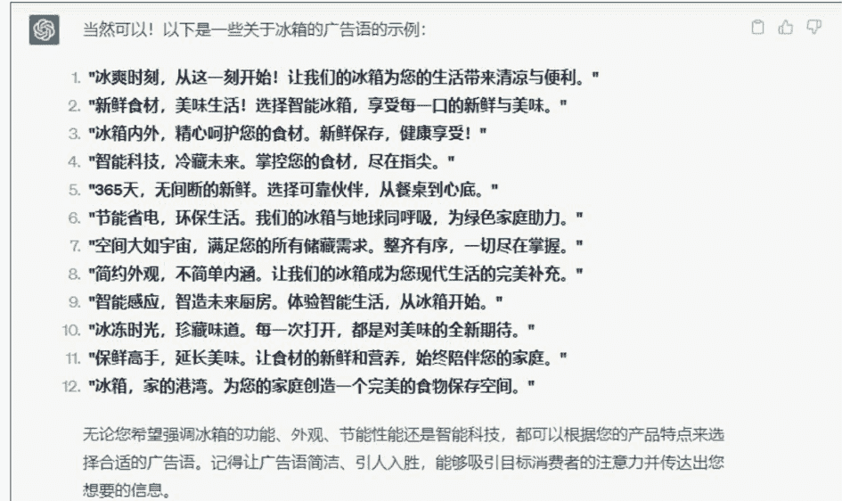

图9-9

**步骤02确定广告语，策划广告方案：** 继续输入“请根据‘冰冻时光，珍藏味道。每一次打开，都是对美味的全新期待’这则广告语策划一个创意电视广告，需有情境与生活画面，具有感染力”，回车后ChatGPT会策划广告文案，如图9-10所示。

以下是一个创意构思：

**场景：** 黄昏，厨房灯光温暖。镜头从餐桌上的精致餐具缓缓拉开，聚焦到一台时尚冰箱。透过透明门可见分层整齐的食材：水果、蔬菜、肉类。

**画面描述：** 柔和背景音乐响起，镜头切到一位爱烹饪的年轻妈妈。她轻取一颗草莓，微笑放入冰箱专属区。特写捕捉她眼中的期待与满足。

**旁白：** “冰冻时光，珍藏味道。每一次打开，都是对美味的全新期待。”画面展示几天前准备的晚餐，打开冰箱的瞬间，食材保持色泽与营养。

**情感连接：** 画面转向家人围坐餐桌，期待地看着美食被端上。镜头捕捉品尝时的惊喜与满足。

**结束画面：** 女主站在冰箱前微笑望向镜头，说道：“每一道味道都值得期待，因为冰箱，一直在珍藏。”最后品牌标志与口号“让美味与时光相伴”出现。

该创意通过家庭生活场景传达食材保鲜功能与每次开门的期待感，借助情感共鸣、音乐与镜头剪辑增强感染力。

图9-10

## 让ChatGPT生成网络广告文案


扫码看教学视频

网络广告文案以互联网为载体，传播范围广、速度快。借助ChatGPT可结合平台特性与网络热词生成广告内容。本节介绍生成网络广告文案的步骤。

**步骤01提供热词，建立认知：** 输入“‘显眼包’是一个网络热词，指爱出风头、张扬且带喜剧效果的人或物。你理解了吗？”，回车后ChatGPT会建立认知，如图9-11所示。


图9-11

**步骤02明确主题，撰写文案：** 继续输入“请用‘显眼包’一词写一篇陶瓷水杯的广告文案”，回车后ChatGPT会生成文案，如图9-12所示。

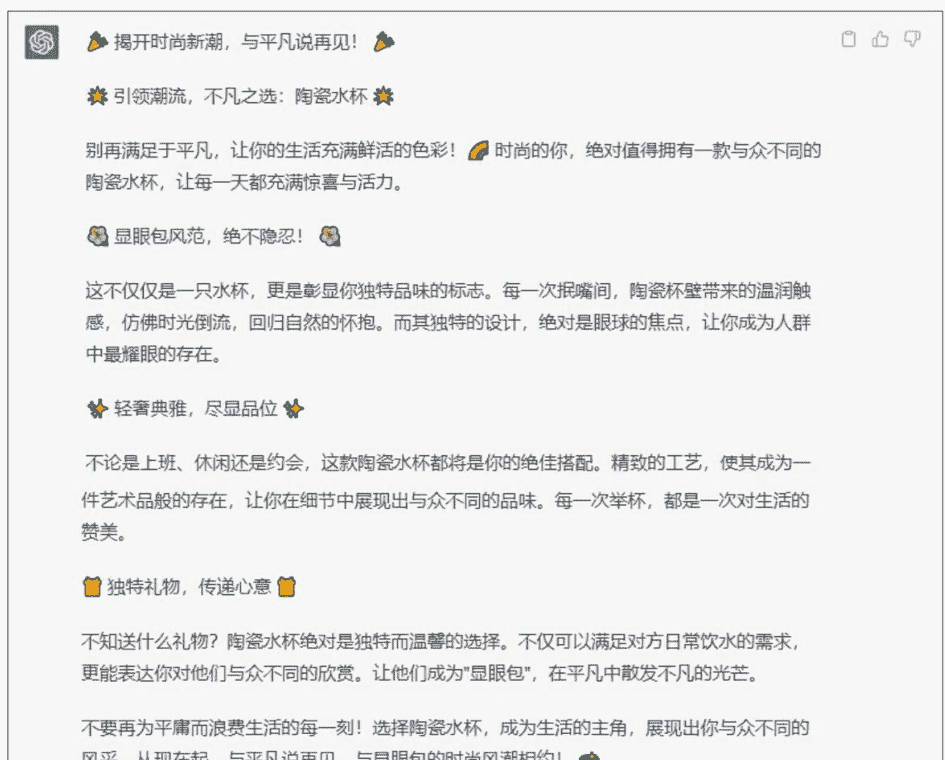

图9-12

**步骤03 锁定发布平台，再次润色文案：** 保持在同一输入区继续补充指令，例如“请参照微博文案的表达习惯，帮我把上面这段文案改写一下”，按回车后ChatGPT会针对网络广告文案进行再创作，效果见图9-13。

# 陶瓷杯，喝水也能做焦点

太惊艳了，这款陶瓷水杯直接成了饮水场景的亮点！不再循规蹈矩，不再默默无闻，连喝水都能玩出时尚感！

💧 造型飒爽，拒绝普通

别让大众款水杯压住你的个性。我们的陶瓷杯线条别致，摆上桌就是视觉中心，分分钟让你成为茶水间的潮流标杆，目光自然被它牢牢抓住！

🎨 像艺术品一样的触感，照亮日常

它不只是用来装水的容器，更像一件小摆件。陶瓷带来的细腻手感，让每次饮用都多了一份仪式感，每一口都在诠释你的生活品味，让日子更有层次。

✨ 告别大众款，释放真实自我

别再被千篇一律的水杯占据生活。选它，就是让个性与品位在每一次轻抿中流露，摆脱平庸，让这只“焦点杯”成为生活的一部分！

#与平凡说再见 #陶瓷显眼包 #个性喝水新方式

图9-13

## 用ChatGPT产出户外广告文案


扫码看教学视频

户外广告文案是投放在室外用于宣传产品、品牌或号召行动的文字，通常以固定看板呈现。借助ChatGPT可以快速获得户外文案的参考思路。本节介绍生成户外广告文案的操作流程。

**步骤01 设定背景并提问：** 在ChatGPT输入框输入提示词，如“户外固定广告牌的文案一般有哪些特点？”，回车后ChatGPT会给出户外文案的特征，见图9-14。

户外固定广告牌的文字有其共性，目的是抓住行人和车流的注意力并促使其行动。常见特点如下：

1. 简短精炼：观看时间极短，文案必须用最少字数传达核心信息。
2. 信息冲击力强：用醒目有力的表达传递主旨，语言简单易懂，便于瞬间理解。
3. 大字号呈现：远距离也要可读，因此字体通常放大。
4. 能勾起兴趣：激发观众了解产品、服务或活动的欲望。
5. 行动指令清晰：明确提示“立即购买”“了解更多”等下一步动作。
6. 突出差异化：强调产品独特性与竞争对手的区别。
7. 色彩与视觉配合：利用吸睛配色与视觉元素提升吸引力，同时保持品牌一致性。
8. 地域相关性：可结合当地文化、习惯或环境增强关联感。
9. 品牌标识可辨：文案中需出现品牌名称或标志，便于联想。
10. 考虑目标人群：语言与内容要匹配受众特点与兴趣。

总之户外文案要在有限空间内做到吸引、清晰、可执行，才能有效触达目标人群。

图9-14

**步骤02 确定主题撰写初稿：** 在同一输入框继续输入提示词，如“请依据上述要点，为床垫产品写一段户外广告文案”，回车后ChatGPT会生成初稿，见图9-15。

**步骤03 提出深化要求并修改：** 继续输入提示词，如“请加入更多创意，调动多感官感受，提升文案吸引力”，回车后ChatGPT会对户外文案进行优化，见图9-16。

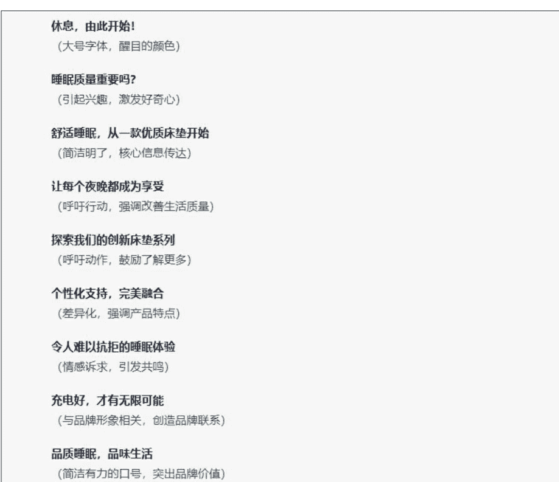

▲图9-15

**“枕梦之上，开启床品新境界”**

（用词考究，制造好奇）

**像云朵一样轻盈，整晚焕新**

（触感联想与睡眠改善）

**沉浸式入睡，仿佛身临其境**

（创意描绘，强化感官）

**床垫也能奏出节奏**

（引入听觉想象，与睡眠呼应）

**舒适的挚爱，从床垫起步**

（情感诉求，关联关怀）

**从床垫出发，演绎好梦**

（鼓励想象，与梦境链接）

**每晚都是一段奇妙旅程**

（增添神秘感，与夜晚绑定）

**触感寝梦，品味轻奢**

（强调手感，营造高级感）

**在柔软中醒来，日日不同**

（多感官体验，触觉与清醒）

此版文案通过更富创意的表达激发好奇心，营造多感官参与感，并把床垫与美好睡眠和轻奢生活相连。当然具体调整还需结合品牌定位与受众偏好。

图9-16

## 让ChatGPT撰写电商主图文案


扫码看教学视频

主图文案能在电商页面凸显产品卖点，激发购买欲。撰写需要结合产品特性、用户需求与市场趋势，同时要有网感和文字功底。借助ChatGPT可快速获得参考。本节介绍操作步骤。

**步骤01 分析受众需求：** 输入提示词，如“请分析年轻人对枕头产品的偏好和需求”，回车后ChatGPT会给出受众洞察，见图9-17。

影响年轻人枕头选择的因素包括：

1. **舒适与支撑**：希望头颈获得良好支撑，减少不适。
2. **材质偏好**：偏好天然、有机、可持续材料，关注健康与环保。
3. **个性化需求**：喜欢可定制高度、硬度、形状的产品。
4. **科技融合**：接受记忆棉、智能感应等创新功能。
5. **低敏抗敏**：关注防过敏、抗菌特性。
6. **性价比**：质量要求下价格仍是关键考量。
7. **社媒口碑**：受社交媒体评价与朋友推荐影响。
8. **购物便捷**：重视线上购买、试用、退换货便利。
9. **外观时尚**：在意与卧室整体风格的协调。

总体来看年轻人更看重舒适、健康、个性、科技与环保。

图9-17

**步骤02 提炼产品卖点：** 继续输入提示词，如“结合以上需求，提炼纯棉枕头的亮点”，回车后ChatGPT会总结优势，见图9-18。

结合年轻人需求，纯棉枕头优势如下：

1. **自然贴肤**：透气性好，夜间保持头部舒适温度。
2. **健康低敏**：低过敏性，适合敏感肌，减少刺激。
3. **环保可持续**：天然可再生，符合环保价值观。
4. **吸湿排汗**：有效吸湿，保持干爽，降低滋生隐患。
5. **耐用性好**：经适当保养可长期使用，性价比高。
6. **简约百搭**：自然外观易与床品搭配，符合审美。
7. **易清洗**：多可机洗，护理省心。

总结来看纯棉枕头满足舒适、健康、环保等多重期待。


“自然舒适，开启健康好眠！ 🌿”

我们的纯棉枕头，为你带来差异化的睡眠体验。

- 🌬️ 透气纯棉，夜晚头枕更清凉。
- 🛡️ 健康守护，无过敏困扰，更安心入睡。
- 🌍 环保选择，用纯棉关爱地球。
- 💧 吸湿排汗，保持干爽，迎接清晨。
- ⏳ 品质耐用，陪伴时光久久不减。
- ✨ 简约时尚设计，与个人风格和谐统一。


## 让ChatGPT编写详情页文案

详情页文案用于全面介绍产品的功能、设计、规格、用法、注意事项等，是电商页面的核心信息载体。借助ChatGPT可快速生成内容，节省人力。本节介绍操作步骤。

**步骤01 赋予角色并询问所需信息：** 输入提示词，如“假设你是有多年电商文案经验的广告策划，现在要为一款蓝牙耳机写详情页，我需要提供哪些信息？”，回车后ChatGPT会列出所需要点，见图9-20。

为撰写蓝牙耳机详情页，需要的信息包括：

1. 产品信息：名称、品牌、型号、颜色、设计特点、核心功能。
2. 产品亮点：独特卖点如音质、续航、佩戴舒适等。
3. 目标人群：运动族、音乐爱好者、上班族等。
4. 竞争优势：与同类产品的差异化。
5. 核心价值：为用户带来的体验或价值。
6. 使用场景：跑步、通勤、旅行等。
7. 技术规格：蓝牙版本、驱动尺寸、频率响应等。
8. 包装清单：耳机、充电仓、说明书、线材等。
9. 用户案例：真实使用反馈。
10. 售后保障：保修政策与服务。
11. 价格与渠道：价格区间与购买路径。
12. 图像素材：多角度高清图片。

基于这些信息可撰写更具吸引力的详情页文案。

图9-20

**步骤02 提供信息并生成文案：** 继续输入提示词并附上信息，如“产品信息：CC蓝牙耳机，无线半入耳式，适配各手机，白色、浅紫、黑色可选；特点：28小时续航、无损降噪、轻巧贴耳、低延迟、防丢定位；目标不限；场景不限；技术：抗干扰芯片、蓝牙芯片；包装：耳机、充电仓、说明书、包装盒、充电线；质保一年。请据此撰写详情页文案”，回车后ChatGPT生成文案，见图9-21。

# 探索音乐自由，CC蓝牙耳机

产品亮点：

- **超长续航，随心畅听**：28小时持久电量，音乐不间断。
- **高品质降噪音效**：无损音质配合降噪技术，沉浸聆听。
- **贴耳轻盈无感**：半入耳设计贴合舒适，久戴不累。
- **即时连接零延迟**：高效蓝牙芯片，音乐游戏通话流畅。
- **智能防丢定位**：随时掌握耳机位置，告别丢失烦恼。

技术规格：

- **稳定抗干扰**：搭载抗干扰芯片，连接稳固。
- **广泛兼容**：先进蓝牙技术适配各型号手机。

**三色可选，彰显个性**：白色、浅紫、黑色满足不同风格。

包装内容：

- CC蓝牙耳机 ×1
- 充电仓 ×1
- 说明书 ×1
- 充电线 ×1
- 精美包装盒 ×1

质保与支持：

- 提供一年质保，购买更安心。

**CC蓝牙耳机，点亮你的音乐旅程，尽在指尖。立即体验，释放自由。**

图9-21

**步骤03 提出优化要求并修改：** 输入提示词如“请在保留原意基础上更突出耳机亮点与优势”，回车后ChatGPT会优化文案，见图9-22。

图9-22

## 让ChatGPT创作商品海报文案

商品海报文案需语言精炼、清晰醒目，引导购买决策。ChatGPT可提供灵感与参考。本节介绍创作流程。

**步骤01 引出话题并提问：** 输入提示词，如“商品海报文案有哪些特征？可以从哪些角度切入创作？”，回车后ChatGPT会给出建议，见图9-23。

海报文案的关键特征与切入角度：

### 特征：
1. 简洁明了，便于快速理解核心卖点。
2. 视觉吸睛，借助标题、色彩、图像吸引注意。
3. 突出独特卖点，体现差异化优势。
4. 情感共鸣，引发受众情感连接。
5. 解决痛点，强调如何满足需求。
6. 行动号召，明确“立即购买”“了解更多”等指令。
7. 品牌调性统一，增强记忆。
8. 信息层次清晰，重点突出。

### 角度：
1. 产品特点，强调功能与性能。
2. 痛点解决，突出实际效益。
3. 使用体验，描绘愉悦感受。
4. 社会价值，如环保、公益。
5. 竞品对比，彰显优越性。
6. 用户见证，提升可信度。
7. 限时优惠，制造紧迫感。
8. 故事叙述，增强情感共鸣。

创作时需明确受众与卖点，选择最合适的角度并不断测试优化。

图9-23

**步骤02 明确信息并创作文案：** 继续输入提示词，如“结合海报文案特征，从故事叙述角度给出几条香薰产品海报文案”，回车后ChatGPT生成示例，见图9-24。

示例海报文案：

**海报标题：**

遇见自然馈赠，重拾内心宁静

**画面建议：**

柔和夕阳透过窗帘洒进居室，桌上摆放香薰瓶，营造悠闲氛围。

**文案正文：**

每一天都是一次小冒险。在忙碌中我们总忘了停下倾听自己。而今为你带来一份礼物，帮助你在日常中找到片刻宁静。

**品牌名** 香薰系列像故事集，每一款都是不同篇章。清晨阳光到夜晚宁静，每瓶香薰都是一段自然之旅。

闭眼，让香气带你穿过森林、漫步沙滩或置身花海。每一次呼吸都是与自己的对话。让 **品牌名** 的香薰成为你与自然沟通的桥梁，唤醒沉睡的心灵。

**限时特惠：**

AI文案迭代实操指南

一、香薰海报文案打磨案例
本月内入手任意香氛单品，即可免费相送一枚精致的香薰蜡烛，让夜晚更添温润与诗意。

行动倡议：
点进下方链接浏览全线香氛，把自然的力量带回家，找回内心的安稳与宁静。

品牌落款：
品牌名 香薰系列，让自然馈赠温暖生活。

这一范例以叙事方式切入，着重描绘香薰为使用者带来的情绪共鸣与内心探寻，突出与自然的关联，并在繁忙日常中寻找宁静。文案融合了品牌的差异化卖点与限时优惠，并以明确的行动号召推动即刻下单。

图9-24

步骤03 提出要求，修改文案：
在同一输入框继续追加指令，例如“立意不错，但描述欠缺画面感和说服力，请重写”，回车后ChatGPT会输出优化后的海报文案，如图9-25所示。

针对反馈，我再输出一版更具画面感与劝说力的香薰海报文案：

海报标题：
漫步香氛，重启自然呼吸

海报主视觉：
室内空间，纱帘轻拂，香薰瓶散发的幽香在空气中弥漫。

文案：
每一天都像一场不同的旅程。在都市喧嚣里，我们常忘了放慢脚步感受生活之美。这一次，我们为你准备一份迷人的礼物，助你重新与自然对话。

品牌名 的香薰系列，像一本充满魔力的书，每一瓶都是独一无二的篇章，等待翻阅。从清晨第一缕阳光，到夜晚宁静星空，每款香薰都是一段细腻的故事。

闭上眼，让香氛带你穿过茂密森林，漫步柔软沙滩，或在盛放花海中徜徉。每一次呼吸，都像与大自然的深度交流。品牌名 的香薰，会把你带回内心深处，重新体会生命的美好。

独家优惠：
当月选购心仪香薰，即享8折，并限量附赠精致香薰蜡烛，让空间更添温馨。

立即行动：
点击下方链接探索更多香薰系列，让自然芬芳融入生活，与忙碌告别，迎接宁静。

底部品牌标识：
品牌名 香薰系列，用香氛唤醒灵感与感官。

此版进一步强化了香薰与自然的联系，使用更具描绘性的表达提升生动性与说服力；优惠信息与行动倡议也更具购买驱动力。希望更符合预期。

图9-25

二、产品测评文案的AI生成方法
测评文案是侧面宣传的有效方式，通常具备专业客观的信息，能为购买决策提供参考。借助AI可以快速获得全面中肯的内容。本节介绍操作流程。

步骤01 赋予身份，询问标准：
在输入框输入提示如“假设你是一名专业的护肤测评博主，请列出测评护肤品的维度”，回车后ChatGPT会给出测评标准，如图9-26所示。

作为专业测评博主，可从以下维度进行评价，为读者提供全面准确信息。常见维度有：

1. 成分拆解：解析成分表，说明各成分作用与功效，帮助判断配方是否契合需求与肤质。
2. 肤质匹配：评估是否适合干性、油性、敏感性等不同肤质，指出适用人群。
3. 功效与表现：详细说明产品宣称的保湿、抗老、淡化瑕疵等功效，并结合使用经验评价实际效果。
4. 质地与使用体验：描述质地、吸收速度、使用后的触感与舒适度。
5. 香气与调香：评价气味是否愉悦，是否存在易致敏的香料。
6. 包装与外观：评估设计感、便携性，以及是否契合品牌调性与消费者期待。
7. 用法与注意事项：提供正确用法与可能的风险提示。
8. 长期效果与变化：分享持续使用后的体验，了解效果是否稳定。
9. 价格与性价比：结合成分与效果判断价格是否合理。
10. 用户评价汇总：收集整理真实用户的评价，提供参考。
11. 竞品横向对比：与同类产品比较，突出特点与优势。
12. 科学依据与研究支持：引用相关研究支撑评价观点。
13. 可持续性与环保：评估包装材料、生产流程的环保程度。
14. 品牌背景与信誉：了解品牌理念与行业口碑。

▲图9-26

步骤02 明确标准，整理信息：
在同一输入框追加提示如“请根据以上维度，结合以下信息对产品进行测评，另起一行 产品信息：×××”，回车后ChatGPT会按标准给出测评，如图9-27所示。

步骤03 补充信息，生成文案：
继续追加提示如“补充用户体验，另起一行 请结合既有产品信息与用户体验生成一篇客观的测评文案”，回车后ChatGPT会输出成品测评，如图9-28所示。

针对名为“fe”的美白面膜，可从各维度展开测评：
1. 成分拆解：含烟酰胺、微米珍珠粉、珍白因。烟酰胺常用于美白，有抑制黑色素生成的作用；微米珍珠粉可能具轻微磨砂感，有助去除角质；珍白因具体功效需进一步确认。敏感肌需留意成分潜在刺激。
2. 肤质匹配：主打美白淡斑，适合希望改善肤色不均、淡化斑点的人群。烟酰胺可能引起不适，敏感肌建议先做敏感测试。
3. 功效与表现：宣称美白淡斑、提亮肤色，通常需要长期使用才能显现。实际是否可观察到肤色变化是关注点。
4. 质地与使用体验：提及锁水持久、液体吸附力强、亲肤柔软，使用舒适度与否需实测。
5. 香气与调香：未提及香气，用户能否接受是选择因素。
6. 包装与外观：未提供信息，但包装对购买决策有影响。
7. 用法与注意事项：提供“一涂二敷”法，先补水保湿，再涂抹珍珠膏，最后敷面膜10至15分钟后洗净。对敏感肌是否需先测敏需注意。
8. 长期效果与变化：长期使用效果需持续观察。
9. 价格与性价比：价格信息缺失，需结合成分与效果判断。
10. 用户评价：暂无他者评价，难以全面了解。
11. 竞品对比：缺乏对比，难以判断市场定位。
12. 科学依据：未提及研究支撑。
13. 可持续性与环保：信息未提及。
14. 品牌背景与信誉：需另行考证。

基于以上维度可形成初步观点，但需进一步调查真实使用体验与科学依据。

该面膜邀请34名体验者使用，14天后80%反馈色斑痘印变淡、肤色更透亮、肤色不均有改善。

产品测评：fe美白面膜
在护肤需求中，能带来可见改变的产品备受关注。fe品牌的美白面膜提供了值得探讨的选项。经成分、用法与真实体验研究后，形成以下客观测评。

成分拆解：含烟酰胺、微米珍珠粉、珍白因，烟酰胺被认为具美白作用，微米珍珠粉可能辅助去角质。需注意烟酰胺在部分人群中可能带来轻微刺激。

肤质匹配：主打美白淡斑，适合追求肤色均匀的人群。敏感肌建议先做过敏测试。

用户体验：真实声音令人惊喜。14天体验后，80%用户表示斑点痘印变淡、肤色更透亮、肤色不均得到改善。结果显示产品在一定程度上兑现了宣称，也获得积极反馈。

用法与效果：操作简洁，“一涂二敷”，先保湿再涂珍珠膏后敷膜。用户提到质地柔软、液体吸附力强，敷10到15分钟后可感受到肌肤变化。

长期效果与持续使用：短期反馈正面，长期效果仍需持续观察。美白是渐进过程，持续使用后效果更具参考价值。

价格与性价比：具体价格未披露，若能在短期内带来明显改善，则性价比可能获认可。

综合评价：fe美白面膜以美白淡斑、提亮肤色的功效吸引众多体验者。14天内80%用户反馈斑点淡化、肤色均匀，令人振奋。用法简便，质地柔软吸附力强，使用体验愉悦。长期效果与敏感肌适用性仍需持续跟踪。总的来看，这是一款值得尝试的美白选择。

温馨提醒：选购护肤品时请结合自身肤质、需求与过敏史做判断，使用新品前建议进行过敏测试，以确保安全。

三、活动策划文案的AI创作方法
活动策划文案用于宣传活动，能提升吸引力与执行效率。借助ChatGPT可撰写更具创意与针对性的宣传文案。本节介绍流程。

步骤01 赋予身份，询问信息：
输入提示如“假设你是一位活动策划总监，我需策划一场营销活动，你需要哪些信息？”回车后ChatGPT会列出所需信息，如图9-29所示。

为策划成功的营销活动，我需要以下信息：
1. 目标与目的：想实现销售增长、品牌曝光、新客获取还是客户互动？
2. 受众画像：目标人群的年龄、性别、兴趣、消费习惯等。
3. 活动类型：线上、线下或混合，如网络研讨会、产品展示、促销等。
4. 时间与地点：举办时间与具体场域。
5. 预算：预算规模影响规模、场地与投放渠道。
6. 活动内容：演讲、培训、互动游戏、抽奖、展示等。
7. 宣传策略：社交媒体、邮件营销、传统广告、合作推广等。
8. 参与互动：是否设置提问、社交环节等。
9. 数据收集：是否需要采集参与者信息与反馈。
10. 团队与合作伙伴：执行分工与角色。
11. 评估方法：以销量、到场人数、社媒声量等衡量成功。
12. 风险管理：天气、技术故障等潜在风险。

通过这些信息可制定细节，确保活动达成营销目标。

步骤02 提供信息，生成方案：
继续输入“活动信息：××× 另起一行 请据此撰写一份可行性策划方案”，回车后ChatGPT会生成方案，如图9-30所示。

活动名称：精选好物狂欢盛典
活动目标：提升品牌知名度，吸引新客，促进销售
目标受众：关注零食、日用品、服饰的广大消费者
活动时间：两周，具体日期待定
活动地点：合适的商业中心或购物中心
预算：按规模与宣传力度确定

活动内容：
1. 产品陈列：分区展示零食、用品、服装，以精致陈列吸引目光。
2. 折扣促销：全场8折，特价商品更低折扣。
3. 互动游戏：抽奖、猜价格等，参与者可获额外折扣券或小礼品。
4. 产品试用：设置试用区，让顾客亲身体验品质。
5. 主题演讲：邀请行业专家或名人，提升专业性与吸引力。

宣传策略：
1. 社交媒体：发布预告、促销信息与互动内容。
2. 传统广告：电视、广播、报纸覆盖更广受众。
3. 宣传物料：海报、传单、宣传册投放商业区。
4. 合作伙伴：与相关行业联动扩大影响。

参与互动：
1. 抽奖环节：每日定时抽奖，购物顾客可参与，奖品丰富。
2. 互动游戏：增加趣味性与停留时长。

数据收集：参与游戏、抽奖时采集基础信息，用于后续营销。

团队与合作伙伴：
1. 销售团队：提供专业咨询与导购。
2. 活动志愿者：协助游戏组织与物料发放。

评估方法：
1. 销售数据：对比活动前后销量。
2. 参与人数：统计到场与互动人数。
3. 社媒反应：分析讨论与用户反馈。

风险管理：
1. 天气风险：户外活动需备应急预案。
2. 人流管理：预防拥堵，保证购物体验。

图9-30

步骤03 明确目的，撰写文案：
输入“请为这场线下好物促销活动撰写宣传文案，目的是吸引更多消费者购买”，回车后ChatGPT会生成文案，如图9-31所示。

步骤04 明确平台，优化文案：
输入“请按抖音文案特性，改写为适合抖音传播的宣传文案”，回车后ChatGPT会优化，如图9-32所示。

四、品牌宣传方案的AI撰写方法
品牌宣传文案涵盖品牌文化、优势、产品特征，有助于提升影响力与认知度。借助ChatGPT可快速生成优质方案。

步骤01 明确品牌定位：
输入提示如“Mv是家新创珠宝品牌，致力于用珠宝留下独特珍贵记忆，请梳理核心定位与特征”，回车后ChatGPT会梳理定位，如图9-33所示。

核心定位：
Mv以珠宝为载体，创造独特且珍贵的记忆。强调珠宝与个人情感、重要时刻、特殊经历的结合，让每件珠宝更具意义与情感价值，使珠宝成为故事载体。

特征：
1. 情感共鸣：通过珠宝引发情绪共鸣，建立更深联系。
2. 独特设计：注重独特性与创新，每件皆为艺术品。
3. 个性定制：提供定制选项，满足个人喜好与需求。
4. 品质与工艺：选用优质材质，注重细节打磨。
5. 故事讲述：通过宣传与店内展示讲述每件珠宝背后的故事。
6. 可持续性：可能采用环保材料与可持续工艺。
7. 社交媒体互动：利用社媒分享设计理念与制作过程，提升可见度。

总之，Mv通过将珠宝与情感体验结合，打造有意义的作品，在市场上形成差异化定位与品牌特征。

图9-33

**步骤02 拆解目标人群画像：**
在同一个对话框里继续追加提示词，例如“请帮我梳理归纳Mv品牌的核心消费群体特征”，敲回车后ChatGPT会输出针对性的画像分析，如图9-34所示。

针对Mv品牌的目标人群，可以从以下几个维度进行归纳：

1. **情感价值追寻者**：Mv珠宝强调情感与记忆的连接，这类人群偏好能代表爱情、友情、亲情等关系的饰品，希望借珠宝表达珍贵瞬间。
2. **仪式感购买者**：婚礼、纪念日、生日等重要节点是珠宝消费高峰，Mv的作品因与个人故事关联，成为这些时刻的理想选择。
3. **个性表达派**：渴望独一无二饰品的消费者会被Mv吸引，他们追求能凸显个人品味与独特风格的单品。
4. **品牌故事爱好者**：对单品背后的创作思路、设计灵感和情感叙事感兴趣，容易被Mv的品牌内涵打动。
5. **绿色可持续支持者**：关注环保与负责任生产的群体，若品牌主打环保材质与可持续工艺，会产生认同感。
6. **社交媒体活跃用户**：习惯在社媒分享与互动的人群，可通过Mv的线上内容、故事传播与活动参与建立连接。
7. **品质至上主义者**：将珠宝视为工艺艺术品的消费者，会看重Mv的精湛制作与材质甄选。
8. **关系联结重视者**：把人际关系与情感纽带放在首位的人，倾向选择与Mv核心理念契合的珠宝来强化亲友间的情感联结。

图9-34

**步骤03 把握市场竞争态势：**
继续在同一输入框输入提示词，例如“请简要概括Mv品牌所处的市场竞争环境”，回车后ChatGPT会给出竞争图景的概括，如图9-35所示。

Mv所处的市场竞争较为激烈且多元，主要体现在：

1. **传统珠宝老牌**：拥有高知名度与悠久历史，工艺沉稳，吸引看重传承与品质的消费者。
2. **新锐设计师品牌**：凭借原创设计与新潮理念切入市场，偏爱年轻群体的审美。
3. **情感叙事型珠宝**：同类强调情感融合、个人化表达的品牌，形成直接竞争。
4. **定制化服务品牌**：主打高度个性化与专属定制，迎合追求独特性的需求。
5. **大众珠宝零售连锁**：品类丰富、价格亲民，主攻价格敏感型买家。
6. **可持续珠宝品牌**：聚焦环保材料与绿色制造，在可持续维度上与Mv形成竞争。
7. **社媒与电商平台**：数字化渠道成为品牌传播与销售的主战场，擅长线上运营的品牌具备渠道优势。
8. **国际化竞争压力**：若拓展海外，需面对不同文化背景与消费趋势的全球品牌。

在如此复杂环境下，Mv需精准锚定差异化价值主张、持续创新并深耕客户关系，才能脱颖而出。

**步骤04 生成创意宣传文案：**
继续输入提示词，例如“请结合以上信息，为Mv品牌创作一篇有创意的宣传文案”，回车后ChatGPT会输出品牌宣传文案，如图9-36所示。

✨ 打开珠宝里的情感宝藏，定格不朽记忆 ✨
在日常光泽之下，藏着一个不只是饰品的品牌。Mv希望用珠宝为你编织专属故事，让每个细节都成为生命中最动人的篇章。

✨ 每颗宝石都是情感的种子 ✨
我们相信每段感情都独一无二，每个瞬间都值得被铭记。Mv的作品不仅是华美造型，更是内心感受的传递者。从欢笑到深情，都化作恒久陪伴的珠宝，见证生命里的感动。

✨ 打造只属于你的独特符号 ✨
你与众不同，你的珠宝也应如此。Mv以别致设计与个性化定制为傲，让每位顾客都能成为自己故事的创作者。你的风格、你的经历，都被融入一件真正属于你的璀璨符号。

✨ 从心出发，与珠宝共鸣 ✨
Mv不止做珠宝制造，更是情感的共振者。每件作品背后都有故事，是人生旅程的重要印记。让我们从内心启程，让Mv成为你情感叙事的舞台，谱写永恒旋律。

✨ Mv —— 珠宝记忆的炼金师 ✨
在变化的世界里，情感才是最珍贵的东西。Mv以宝石、金属与创意，点亮你生命里最特别的时刻。我们售卖的不仅是珠宝，更是赋予灵魂与力量的记忆。

探索情感、创造记忆，在Mv的世界里，饰品是故事的见证者。一起踏上这段充满魔法的旅程，用Mv点亮每一个美好瞬间。

图9-36
使用ChatGPT撰写品牌宣传文案时，提供越详尽的品牌背景与市场信息，输出的文案越贴合实际。

用ChatGPT构建品牌故事
品牌故事是建立情感联结的重要营销手段，能提升消费者信任与忠诚度。结合品牌特质与受众需求撰写故事并非易事，借助ChatGPT可以快速梳理信息并形成表达。

**步骤01 提供背景信息明确受众：** 在输入框中输入提示词，如“Der品牌专注小众女装设计，用小众风格传递独一无二理念，鼓励每个人勇敢追求个性。请结合Der理念分析其目标受众”，回车后ChatGPT会给出受众分析，如图9-37所示。

图9-37

**步骤02 提供背景信息撰写故事：** 继续输入提示词，如“Der品牌成立初衷是为有容貌焦虑、身材焦虑的女生提供力量，鼓励她们接纳独特性。请根据成立背景写一个故事，要求有完整情节，能吸引目标受众”，回车后ChatGPT会生成品牌故事，如图9-38所示。

在一座快节奏的都市里，时尚更迭飞快，却有一批女孩被容貌与身材焦虑困扰，自信缺失。聪明有才的艾莉娜也是其中之一，她热爱时尚，却在商场镜前停留自责，羡慕杂志上完美模特，却忽视自身独特魅力，焦虑侵蚀了她的自尊。

某个午后，她偶遇一家挂着“Der”招牌的小店。柔和灯光下陈列着别具一格的服饰，好奇驱使她走入。店内温馨，灯影让衣物散发独特气质。她遇见创始人安娜，一位坚定的女性。安娜深知焦虑的痛，邀请艾莉娜试穿一件打破主流审美的单品，并分享创立Der的初衷：为焦虑的女孩赋能，帮助她们接纳独特性。

在Der，艾莉娜逐渐找回自信。她发现服装不是为了迎合他人审美，而是表达自我个性的态度。焦虑慢慢松动，她开始欣赏自己的特点。

后来，艾莉娜成为Der的忠实拥趸，并在社交圈传播品牌理念，通过社交媒体分享成长经历，鼓励更多女生摆脱外貌焦虑。她的声音引发共鸣，Der也在市场中逐渐显现声量。

故事收束于希望的画面：许多曾不安的女孩在Der找到了力量与自信。Der不仅代表时尚，更成为鼓励与支持的象征，为被标准束缚的女生带来新可能。

**步骤03 提出要求优化故事：** 继续输入提示词，如“请深挖品牌特性和受众需求，优化故事使其更具感染力”，回车后ChatGPT会对故事进行优化，如图9-39所示。

城市角落里生活如电光石火，时尚浪潮在街头蔓延。可在这光鲜之下，有一群女孩被容貌与身材焦虑压得喘不过气，自信摇摇欲坠。艾莉娜天资聪颖，却长期被自卑笼罩。

她爱时尚，却总在商场里躲避镜子，觉得只有纸片人模特才配得上美衣，自己只是边缘的普通人。

一个阴雨天，她误入一家别致店铺，招牌写着“Der”，橱窗灯光温柔梦幻。走进去的瞬间，她嗅到茶香，听到轻音乐。创始人安娜正手工刺绣，笑意迎人。温暖氛围里，艾莉娜第一次感受到这里不只有衣服，更有一种让她找到舞台的力量。

安娜像朋友一样倾听她的故事，艾莉娜眼眶湿润。这里像是被理解的家。安娜坦诚自己年少的自卑经历，讲述创立Der的初衷：为在审美标准下挣扎的女孩带来改变，让她们明白每个人都有与众不同的美。

艾莉娜试穿了一件Der设计，那不是追逐潮流，而是一种自信的姿态。镜中的自己似乎在微笑，迎接新的自我。她明白，Der的衣服不是为了取悦他人，而是让每个人为自己骄傲，散发独特光芒。

此后，艾莉娜不再回避镜子，开始大胆尝试造型，不再被他人目光束缚。她将Der介绍给更多朋友，让她们也感受到这份力量。

小店逐渐变成一个有共鸣的社群，聚集许多相似经历的女孩。Der已不只是时尚，更是自信的象征与鼓励。每一个人都能在这里找到自己的美，不再受限于社会标准。

图9-39

# 第10章 AI写作全流程案例：抖音电商图书宣传文案

学习提示
为帮助掌握ChatGPT生成文案的方法，本章以创作《抖音电商》图书宣传文案为例拆解操作步骤。学习过程中可复用方法并举一反三，真正获得指示AI生成文案的能力。

本章重点导航
- 回顾运用ChatGPT创作文案的思路与方法

## 10.1 ChatGPT分析图书相关信息
在撰写图书宣传文案前，可先让ChatGPT分析图书信息，使其在充分了解后创作。分析包括归纳亮点与受众洞察。本节将带领复盘前面方法，引导ChatGPT分析图书信息。

### 10.1.1 提炼图书核心卖点

扫码看教学视频
图书亮点是宣传文案的精华，首要任务是归纳亮点。下面介绍操作方法。

**步骤01 设定情境请教方法：** 在输入框输入提示词，如“我需要对产品的亮点进行归纳，有什么好的建议吗？”，向ChatGPT寻求方法，回车后ChatGPT会提供归纳建议，如图10-1所示。

归纳产品亮点时可参考以下方向：
1. **功能特性**：列出核心功能，便于客户了解价值。
2. **创新点**：突出市场上的独特创新，易吸引关注。
3. **问题解决**：说明如何满足目标客户需求，建立实用性认知。
4. **性能表现**：在速度、效率等维度有突出表现时重点强调。
5. **使用体验**：强调易用性、界面设计与流畅度。
6. **品质耐用**：高品质与长寿命是重要卖点。
7. **多样选择**：多版本、颜色、尺寸可覆盖更广人群。
8. **个性化定制**：可定制选项极具吸引力。
9. **社会价值**：环保、可持续等价值契合特定消费群。
10. **用户口碑**：积极的用户反馈是优势证明。
11. **售后支持**：优质售后、保修提升购买信心。
12. **价格性价比**：竞争力价格配合良好性能是亮点。
13. **行业认可**：奖项、认证提升可信度。
14. **市场需求**：契合热门或增长型需求具备优势。
15. **未来延展**：升级、扩展计划提供长期价值。

归纳时需根据目标受众挑选最合适的亮点，并清晰简洁表达价值。


**步骤02 明确信息归纳亮点：** 继续输入提示词，如“请根据以上建议，结合以下图书信息归纳亮点。如信息不足可随时提问（另起一行）图书信息：×××”，让ChatGPT基于信息归纳亮点，回车后ChatGPT输出结果，如图10-2所示。

请根据以上建议，结合以下图书信息归纳图书的亮点。如果缺少了信息，你可以随时向我提问
图书信息：
《抖音电商从入门到精通：抖店运营＋橱窗推广＋购物车转化》是一本技巧实操书，通过3大篇章向读者介绍了抖音小店运营、抖音商品橱窗推广以及购物车带货的基础知识和操作方法，帮助读者快速找到适合自己的抖音电商运营方法，轻松有效地实现运营目标！

《抖音电商从入门到精通：抖店运营＋橱窗推广＋购物车转化》的亮点可归纳为：
1. **全流程实操指南**：三大部分覆盖抖店运营、橱窗推广、购物车转化，帮助读者系统掌握抖音电商全貌。
2. **覆盖入门到进阶**：既讲基础知识也含进阶方法，适合不同经验水平的读者。
3. **重操作技巧**：除理论外提供可直接落地的操作建议，便于快速上手。
4. **平台专属策略**：聚焦抖音生态的运营打法，针对抖店、橱窗、购物车给出具体路径。
5. **目标导向**：强调如何高效达成运营目标，提供规划与执行建议。
6. **时效与热度**：紧扣抖音这一主流社交电商平台，具有现实参考价值。
7. **案例参考**：若包含实战案例或成功故事，能直观展示方法效果。
8. **结构清晰**：按篇章与主题划分，便于按需查阅与学习。

总体而言，本书通过系统指南、实用技巧与平台策略，帮助读者掌握抖音电商要点并在实践中取得成果。

图10-2

**步骤03 补充信息优化内容：** 继续输入提示词，如“请根据以下补充图书信息，重新归纳亮点（另起一行）补充信息：×××”，让ChatGPT结合新信息优化归纳，回车后ChatGPT重新输出，如图10-3所示。

请根据以下补充的图书信息，重新归纳图书的亮点
补充信息：《抖音电商从入门到精通：抖店运营 + 橱窗推广 + 购物车转化》致力于从商家到运营者，从个人到机构，从无货到有货，都能找到合适的盈利模式。
同时该书由有视频平台和电商运营实战经验的作者撰写，传授了120多个技巧，让读者精准提炼商品卖点，快速树立店铺口碑，有效提升店铺曝光。
全书采用图文并茂方式写作，且为全彩印刷，带来良好阅读体验。

进一步亮点可归纳为：
1. **全场景适配**：兼顾个人、商家、机构，无货有货均可找到盈利模式，覆盖面广。
2. **实战经验背书**：作者具备视频平台与电商运营实战背景，技巧更具可操作性与可靠性。

图书核心亮点梳理

3.  **实操技巧丰富**：书中收录 120 条以上可直接上手的实操要点，覆盖商品卖点提炼、口碑积累、流量提升等多个环节，让读者掌握在抖音电商平台开展运营的关键能力。

4.  **卖点提炼更精准**：通过系统方法讲解如何快速抓住商品的核心卖点，有助于锁定目标人群并提升转化。

5.  **口碑搭建有路径**：除橱窗推广等手段外，还指导如何迅速建立店铺信誉，在同质化竞争中形成差异。

6.  **曝光提升有方法**：提供提升店铺可见度的具体做法，对吸引潜在客户、推动成交具有助推作用。

7.  **呈现方式友好**：图文并茂、全彩印刷，内容直观易懂，可视化表达提升阅读舒适度。

综合来看，作品凭借广泛的适用范围、丰富的实战沉淀、海量可用的实操技巧、精准的卖点挖掘思路，以及行之有效的口碑与曝光策略，为读者在抖音电商领域实现稳健运营提供关键指引。

图10-3

**步骤04汇总要点**：在同一输入框继续输入指令，例如“请把上述图书亮点浓缩，用字数相近的词组呈现，不用展开说明”，回车后 ChatGPT 会输出亮点提炼，如图10-4所示。

《抖音电商从入门到精通：抖店运营＋橱窗推广＋购物车转化》亮点提炼如下：

- 全流程实操手册，适配多类读者。
- 分阶段给出丰富操作方案。
- 120+技巧，聚焦卖点提炼。
- 助力快速建立口碑、提升曝光。
- 作者经验扎实，内容经得起验证。
- 图文结合、全彩呈现，阅读体验佳。

图10-4

### 10.1.2 受众画像拆解


扫码看教学视频

明确用户画像是撰写宣传文案的前提，结合图书亮点即可让 ChatGPT 推导出潜在读者群体，实现精准触达。

下面介绍分析《抖音电商从入门到精通：抖店运营＋橱窗推广＋购物车转化》目标读者的操作流程。

**步骤01输入亮点，拆解受众**：新建会话，在输入框中输入指令，如“请基于《抖音电商从入门到精通：抖店运营＋橱窗推广＋购物车转化》的亮点分析其目标读者，亮点另起一行提供”，回车后 ChatGPT 会输出受众划分，如图10-5所示。

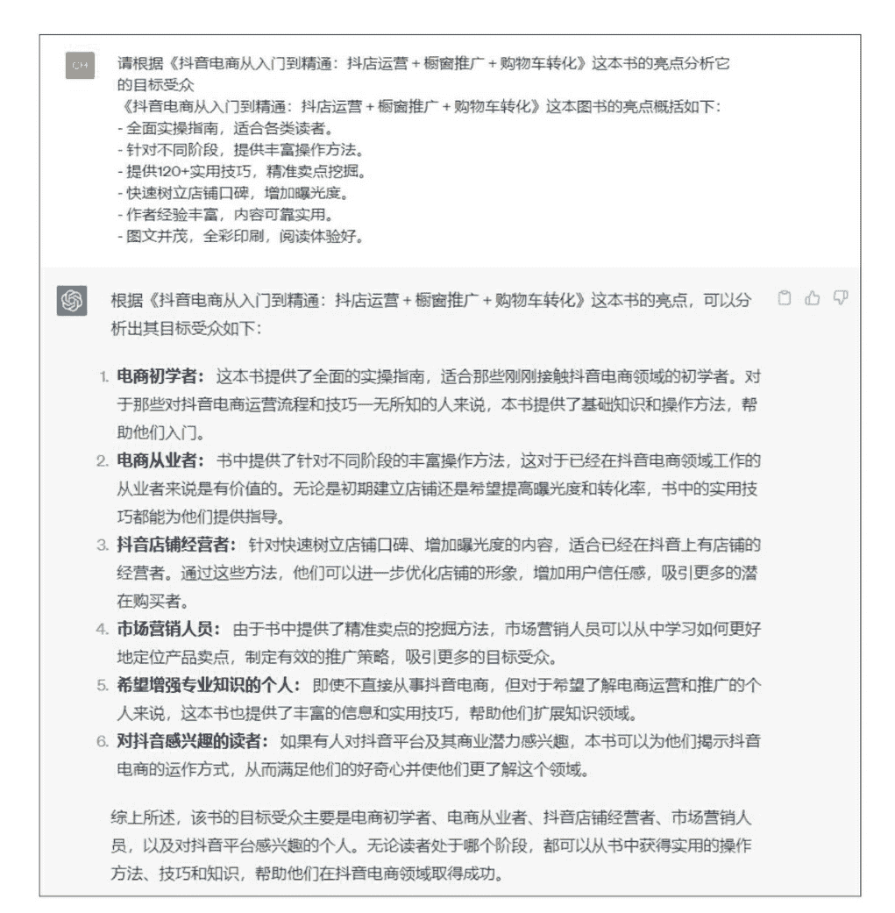

图10-5

**步骤02追加提示，扩展画像**：在同一输入框继续输入指令，如“请结合图书的使用场景，进一步深入分析目标读者”，回车后 ChatGPT 会给出更细化的画像，如图10-6所示。

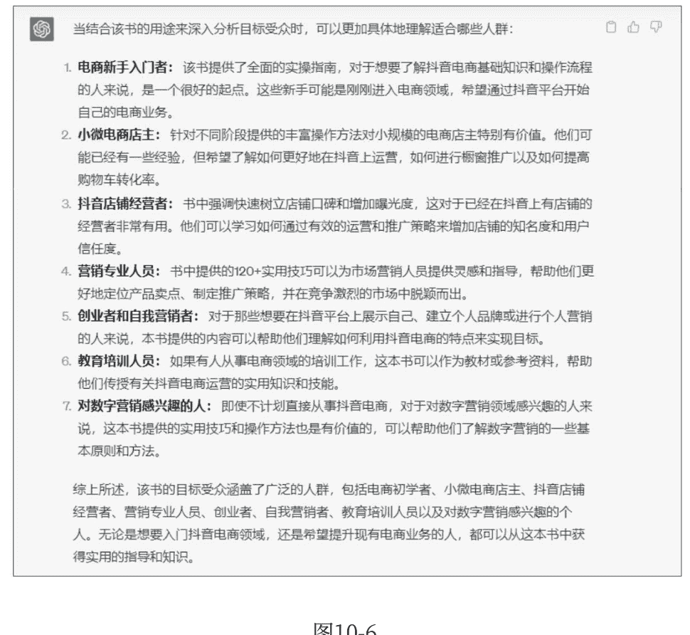

图10-6

借助 ChatGPT 还可收集市场信息，例如输入“请根据以下图书信息分析市场竞争态势，图书信息另起一行：×××”，回车后可得到市场分析，如图10-7所示。

请根据以下图书信息，分析市场竞争环境

图书信息：

《抖音电商从入门到精通：抖店运营 + 橱窗推广 + 购物车转化》是一本技巧实操书，通过3大篇章向读者介绍了抖音小店运营、抖音商品橱窗推广以及购物车带货的基础知识和操作方法，帮助读者快速找到适合自己的抖音电商运营方法，轻松有效地实现运营目标！

基于以上信息，《抖音电商从入门到精通：抖店运营 + 橱窗推广 + 购物车转化》属于抖音电商运营实操指南。由此可判断：

1. **主题与内容**：聚焦抖音电商运营，涵盖抖店运营、商品橱窗推广、购物车转化三大篇章，旨在提供从入门到进阶的全链路指导。

2. **目标读者**：更可能面向在抖音平台做电商的个人、创业者或中小企业。强调基础知识与操作路径，对新手友好，同时包含进阶打法。

3. **竞争态势**：抖音电商近年快速崛起，成为热门赛道。但平台店铺与个人卖家数量激增，品类覆盖广，竞争激烈。

4. **差异化**：本书宣称提供一体化入门到精通指导，整合抖店运营、橱窗推广、购物车转化等多维度知识。若能呈现可落地的操作步骤、案例解析及最新趋势，便能吸引追求抖音电商成功路径的人群。

5. **市场走势**：抖音已从娱乐社交平台演变为娱乐、社交与购物融合的综合体。社交电商持续升温，抖音电商仍具增长潜力。本书价值在于帮助读者紧跟行业变化，利用平台功能优化业务。

总体来看，抖音电商竞争虽激烈，但只要内容实用全面且与市场趋势同步，仍有突围空间。成败关键在于内容质量、实操性及对读者需求的匹配度。

图10-7

## 10.2 利用ChatGPT生成宣传文案

收集图书信息后，即可让 ChatGPT 生成宣传文案。运用前文提问技巧，可获得高效优质的文案。本节回顾方法，指导生成图书宣传文案。

### 10.2.1 先锁定文案标题


扫码看教学视频

撰写宣传文案时可先明确标题，再围绕标题展开内容。下面介绍生成标题的方法。

**步骤01明确标题类型**：新建会话，在输入框输入指令，如“有吸引力的宣传文案标题有哪些类型？”，回车后 ChatGPT 会列出类型，如图10-8所示。

有吸引力的宣传文案标题可按多种维度划分，取决于宣传对象、目标人群及传达情感。常见类型如下：

1. **激发好奇型**：制造悬念，促使读者探求更多。例如：“揭开不为人知的秘密！”
2. **问题解决型**：提出痛点并暗示产品可解。例如：“厨房清洁很头疼？试试这款神奇清洁剂！”
3. **利益强调型**：突出核心获益。例如：“轻松瘦身，塑造健康体态！”
4. **差异突出型**：强调独特卖点。例如：“全球独家创新技术，仅此一家！”
5. **情感共鸣型**：触动情感。例如：“多一份温暖，与宝宝共享时光。”
6. **限时促销型**：制造紧迫。例如：“仅剩24小时！双倍积分等你拿！”
7. **社会价值型**：关联公益或环保。例如：“每笔购买将部分捐赠慈善机构。”
8. **名人背书型**：借助权威。例如：“名厨力荐：独家食谱公开！”
9. **新奇强调型**：突出首创。例如：“全球首款可折叠手机，引领通讯新潮流！”
10. **揭秘型**：暗示内幕。例如：“行业内幕：专家分享成功秘诀！”
11. **故事型**：以情境切入。例如：“他用此法，三个月完成马拉松训练！”
12. **数据型**：用数据佐证。例如：“97%用户对产品表示满意！”

无论哪种类型，好的标题都应简洁清晰、传递核心信息并激发兴趣，需结合受众与目标选择。


**步骤02匹配平台**：在同一输入框继续输入指令，如“结合以上类型，筛选出最适合抖音平台和公众号平台的文案标题类型”，回车后 ChatGPT 会给出适配类型及示例，如图10-9所示。

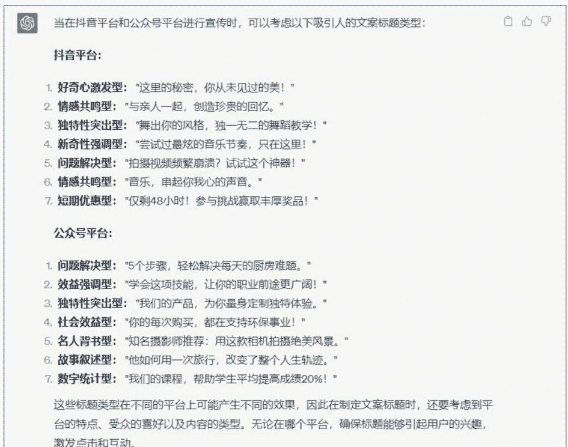

### 专家指点

此处选取抖音和公众号作为示例，分别代表视频型和图文型平台，且均为热门渠道，对图书宣传有较好助力。用户也可按自身需求挑选其他宣传渠道。

**步骤03撰写文案标题**：在同一输入框继续输入指令，如“结合上述不同平台标题类型，提供主题为《抖音电商从入门到精通：抖店运营＋橱窗推广＋购物车转化》图书宣传的文案标题”，回车后 ChatGPT 会给出参考标题，如图10-10所示。

**步骤04优化文案标题**：在同一输入框继续输入指令，如“请对上述标题进行优化，采用更具创意的表达，使其在平台中更突出”，回车后 ChatGPT 会优化标题，如图10-11所示。

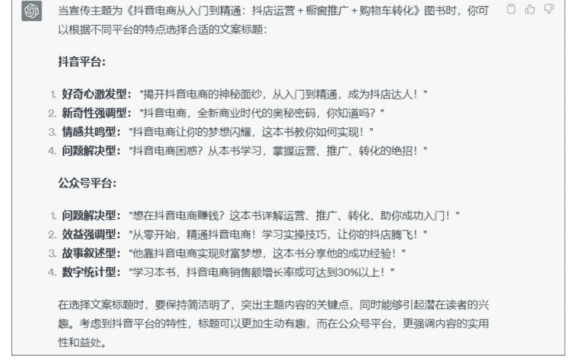

▲图10-10

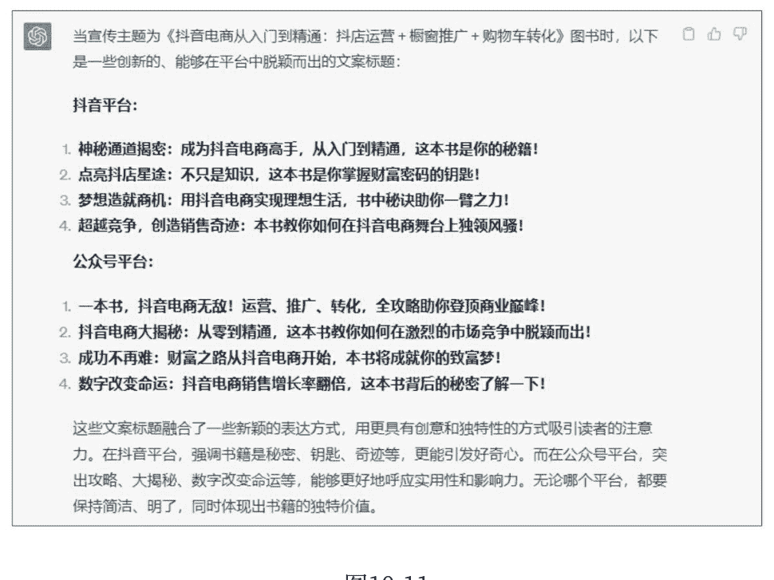

图10-11

优化后，标题在用词和视觉上更具吸引力。用户可从中挑选，例如“点亮抖店星途：不只是知识，这本书是你掌握财富密码的钥匙！”和“抖音电商大揭秘：从零到精通，这本书教你如何在激烈的市场中脱颖而出！”作为备选。

107

## 撰写图书宣传文案


扫码看教学视频

将汇总的图书亮点、确定的目标受众和文案标题提供给 ChatGPT，可为其撰写宣传文案建立依据。下面介绍操作步骤。

**撰写抖音平台的宣传文案**：新建聊天窗口，在输入框输入指令，如“请依据以下图书信息撰写抖音口播文案，图书信息另起一行：×××”，回车后 ChatGPT 会结合信息生成口播文案，如图10-12所示。

请根据以下图书信息撰写抖音口播文案

图书信息：

图书介绍：《抖音电商从入门到精通：抖店运营 + 橱窗推广 + 购物车转化》是一本技巧实操书，通过3大篇章向读者介绍了抖音小店运营、抖音商品橱窗推广以及购物车带货的基础知识和操作方法，帮助读者快速找到适合自己的抖音电商运营方法，轻松有效地实现运营目标！

图书亮点：

- 全面实操指南，适合各类读者。
- 针对不同阶段，提供丰富操作方法。
- 提供120+实用技巧，精准卖点挖掘。
- 快速树立店铺口碑，增加曝光度。
- 作者经验丰富，内容可靠实用。
- 图文并茂，全彩印刷，阅读体验好。

图书目标受众：

1. 电商新手入门者
2. 小微电商店主
3. 抖音店铺经营者
4. 营销专业人员
5. 创业者和自我营销者
6. 教育培训人员
7. 对数字营销感兴趣的人

文案标题：点亮抖店星途：不只是知识，这本书是你掌握财富密码的钥匙！

【点亮抖店星途】：不只是知识，这本书是你掌握财富密码的钥匙！

嗨，亲爱的抖友们！想在抖音电商领域起飞吗？想让你的小店在庞大的抖音世界里闪闪发光吗？那么《抖音电商从入门到精通：抖店运营 + 橱窗推广 + 购物车转化》绝对是你不可错过的财富指南！

你是电商新手？不用怕！这本书准备了全流程实操指引，无论你是谁都能从中获益。无论是小微店主、抖音掌柜，还是营销从业者，这里都有你的智慧养分。

不同阶段，丰富打法！120+实操技巧，精准提炼卖点！从搭建抖音小店到橱窗推广，再到购物车带货的方法，一应俱全。助你快速建立店铺口碑，让商品获得更多曝光。

作者经验丰富，内容经得起检验！书中凝聚作者多年行业经验，揭示电商运营的黄金法则，帮你少走弯路，事半功倍。

图文并茂，全彩印刷，阅读更轻松！知识呈现生动有趣，文字与图片完美结合，让学习不再枯燥。

无论你是刚入电商门槛，还是想用数字营销开辟新天地，这本书都将成为你前行的得力伙伴。从新手到抖音大卖，从小店主到营销达人，从创业者到渴望掌握数字营销技巧的你，都能在这里找到专属收获！

别犹豫！把握机会，点亮抖店星途！这本书，就是你掌握财富密码的钥匙！一起开启抖音电商的精彩旅程吧！

#点亮抖店星途 #抖音电商从入门到精通 #掌握财富密码

## 图10-12

**撰写公众号平台的宣传文案**：新建聊天窗口，在输入框输入指令，如“请依据以下图书信息撰写公众号文章，图书信息另起一行：×××”，回车后 ChatGPT 会生成公众号文章，如图10-13所示。

请根据以下图书信息撰写公众号文章

图书信息：

图书介绍：《抖音电商从入门到精通：抖店运营 + 橱窗推广 + 购物车转化》是一本技巧实操书，通过3大篇章向读者介绍了抖音小店运营、抖音商品橱窗推广以及购物车带货的基础知识和操作方法，帮助读者快速找到适合自己的抖音电商运营方法，轻松有效地实现运营目标！

图书亮点：

- 全面实操指南，适合各类读者。
- 针对不同阶段，提供丰富操作方法。
- 提供120+实用技巧，精准卖点挖掘。
- 快速树立店铺口碑，增加曝光度。
- 作者经验丰富，内容可靠实用。
- 图文并茂，全彩印刷，阅读体验好。

图书目标受众：

1. 电商新手入门者
2. 小微电商店主
3. 抖音店铺经营者
4. 营销专业人员
5. 创业者和自我营销者
6. 教育培训人员
7. 对数字营销感兴趣的人

文案标题：抖音电商大揭秘：从零到精通，这本书教你如何在激烈的市场竞争中脱颖而出！

# 抖音电商大揭秘：从零到精通，这本书教你如何在激烈的市场竞争中脱颖而出！

移动互联网迅猛发展，电商已成为商业竞争的新主战场。在这场激烈角逐中，抖音电商如同一颗耀眼新星，吸引无数创业者与商家目光。但要在抖音电商实现突破并非易事。正因如此，《抖音电商从入门到精通：抖店运营 + 橱窗推广 + 购物车转化》应运而生，为你揭开抖音电商的运作内幕，助你在竞争中脱颖而出！

本书不仅是理论读物，更是沉淀实战经验的技巧手册。以三大篇章为架构，全面深入讲解抖音小店运营、商品橱窗推广及购物车带货的基础知识与操作路径。无论是电商新手、小微店主、抖音店长，还是营销专业人士、创业者与自我营销者，都能获得丰富操作方案与实用技巧，快速找到适配自身的运营方法，高效达成目标。

书中提供120+实操技巧，指导精准挖掘卖点、树立店铺口碑、提升曝光度；图文并茂、全彩印刷带来优质阅读体验。更关键的是，作者深耕抖音电商多年，积累丰富实操经验与心得，使本书不仅有理论高度，更饱含鲜活案例与经验分享。

本书同样适合对数字营销感兴趣的人群及教育培训从业者。在数字化时代，数字营销已成推广主力，抖音作为兼具活力与创新的平台，是数字营销的重要阵地。学习本书，可系统掌握抖音电商运营策略与技巧，为事业发展与职业提升赢得更多机会。

总之，若你想在抖音电商赛道突围，实现业务跃升，《抖音电商从入门到精通：抖店运营 + 橱窗推广 + 购物车转化》是一本不可多得的宝典。无论新手还是资深营销人，都能从中获得实用指导与灵感，在激烈竞争中占据优势，迈向成功！

图10-13

108

## 优化图书宣传文案


▲扫码看教学视频


扫码看教学视频

初次生成的宣传文案虽内容全面，但在措辞与结构上略显生硬，传播效果有限，因此需要对文案进行优化。

不同平台的文案优化需结合平台特性与受众偏好，下面介绍具体优化方法。

**步骤01** 打开 ChatGPT 生成抖音口播文案的聊天窗口，在输入框输入指令，如“请从专业抖音运营博主角度评价这篇口播文案”，回车后 ChatGPT 会给出评价，如图10-14所示。

从专业的抖音运营博主角度出发，我认为这篇口播文案整体构思良好，旨在吸引目标人群，突出了图书特点与优势。以下是我对这篇口播文案的评价和建议：

# 评价：

1. **针对受众**：文案清晰界定受众，覆盖面广，从电商新手到抖音店长，再到营销专业人士和创业者。这种多元定位是合理的，因抖音电商涉及人群广泛。

2. **强调亮点**：文案突出了图书亮点，如全面实操指南、分阶段操作法、丰富实用技巧等。对抖音运营博主的受众而言，这是很有吸引力的增益点。

3. **专业性和可靠性**：提及作者经验丰富、内容可靠实用至关重要。抖音运营领域不确定性高，博主更倾向于信任有实战背景的资源。

# 建议：

**抖音电商书推广文案的AI迭代实战**

面向抖音运营类博主的口播稿，重点在于用真实素材带动信任，用明确收益拉动转化，用清晰指令促成行动。把真实案例嵌进文案，能让图书内容更可信、更有说服力；把读者能拿到的具体好处摆在前面，例如提升销售额、扩大店铺曝光、优化营销策略，对专业受众的吸引力最直接；结尾处给出明确的行动指引，如引导购买、点击链接、关注账号获取更多干货，能够有效推动潜在读者落地。整体来看，这份初稿已经覆盖了专业博主和粉丝的核心诉求，再强化案例、价值点和行动号召，效果会更好。

图10-14

**步骤02** 在同一个输入框里继续输入指令，例如“请按照上述建议，对口播文案进行优化”，回车后ChatGPT会按要求输出修改后的口播稿，如图10-15所示。

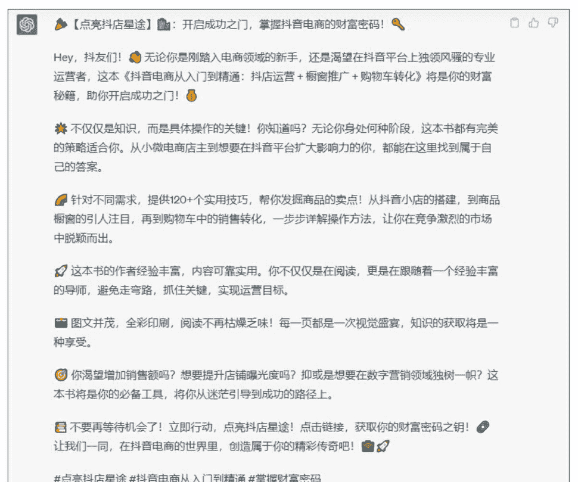

图10-15

**步骤03** 仍在同一输入框中追加提示，例如“请为这篇口播文案提供10秒版本的节奏规划、配乐和特效方案，要求贴合抖音审美”，回车后即可获得拍摄参考，如图10-16所示。

# 时间节奏设计方案：

- 开头2秒：抓眼球，可用抖动或弹出的抖音标识作导入，制造视觉兴奋。
- 2秒到5秒：逐条呈现图书卖点，每秒一条，比如“全链路实操手册”、“120+个可直接用的技巧”等。
- 5秒到8秒：露出图书封面与书名，强化标题与宣传语，并露出网址。
- 8秒到10秒：用醒目文字收尾，发出购买号召，例如“立刻解锁财富密码！”，底部同步展示购买链接。

# 音乐建议：

- 选择轻快活泼的背景音乐，契合抖音时尚有活力的调性。可采用短片段循环，保持与画面节奏同步，提升观感。

# 特效建议：

- 卖点出现时加入简洁文字动画，如弹跳、缩放、渐变色彩，增强信息传递。
- 封面展示可配合渐变光效或闪光处理，突出重点。
- 增加流畅的转场过渡，让整体衔接更自然。

# 注意事项：

- 10秒时长要求精准卡点，每个元素都要清晰高效。
- 抖音风格偏简洁时尚，特效不宜过度，保持统一感。
- 屏幕文字要简短，字号合适，确保手机端可读。
- 结尾行动号召文字要足够突出，刺激点击。

图10-16

**步骤04** 打开ChatGPT生成公众号文章的对话窗口，输入提示“请从专业新媒体运营者的视角，评估这篇公众号文章”，回车后得到评价，如图10-17所示。

从新媒体运营角度来看，文章有以下观察与建议。

# 评价：

1. **标题具备吸引力**：题为《抖音电商大揭秘：从零到精通，这本书教你如何在激烈竞争中脱颖而出！》，用词生动，直击读者痛点，激发好奇。
2. **亮点介绍全面**：详细说明了全流程实操指南、分阶段方法、实用技巧、作者经验等，便于读者快速了解内容。
3. **受众定位明确**：列出从电商新手到营销从业者等多类人群，帮助读者判断适配度。
4. **结构清晰**：分段落从内容、优势、适用人群切入，逻辑顺畅。

# 建议：

1. **补充实例与案例**：加入真实成功故事，用案例佐证观点，提升理解与代入感。
2. **引用权威数据**：引入行业报告或权威观点，增强可信度与说服力。
3. **提供实操指引**：增加平台优化、转化策略等具体操作建议，提升实用性。
4. **图文结合**：配图或图表直观呈现书中内容，提升阅读体验。
5. **结合当下趋势**：强调图书如何对应社交电商、直播带货等热点，增强时效性。

图10-17

**步骤05** 继续输入提示“请从提升受众兴趣的角度，给出语言表达和结构上的优化建议”，ChatGPT会提供多维度修改思路，如图10-18所示。

从激发兴趣的角度出发，可在表达与结构上做如下调整：

# 语言表达建议：

1. **画面感描写**：开头用生动描写勾勒抖音电商竞争的紧张场景，让读者有临场感。
2. **情绪共鸣**：描绘读者在竞争中挣扎的处境，引发共情。
3. **数据冲击**：用一组吸睛事实或数据揭示商机，突出突围的重要性。
4. **鲜活案例**：讲述一位经营者借助书中方法从零起步的成长故事。
5. **制造悬念**：用“这本书藏着的秘密，可能就是转折点”之类语句吊起好奇心。

# 结构安排建议：

1. **引子抓人**：开篇描绘市场激烈与刺激的画面，吸引注意。
2. **抛出问题**：提出“在如此竞争中如何脱颖而出？”引发思考。
3. **给出方案**：引出图书作为解决方案，说明其从入门到精通的价值。
4. **案例佐证**：用成功故事展示方法效果。
5. **明确人群**：列出适合阅读的读者类型，强化适用性。
6. **亮点拆解**：用短句突出实操指南、方法、技巧等核心卖点。
7. **再次共鸣**：回到竞争压力与努力，强化情感连接。
8. **收尾促动**：以“别错过这本书，它可能是你的破局机会”收束，鼓励行动。

图10-18

**步骤06** 在同一输入框中继续输入“请综合以上建议，对公众号文章进行改写”，ChatGPT会输出优化后的文章，如图10-19所示。

**步骤07** 继续输入“文章开头不够抓人，广告感强，请用悬疑手法重写开头”，ChatGPT会对开头进行优化，如图10-20所示。

**步骤08** 整理文章后，点击复制按钮，将完整内容粘贴到记事本保存，效果如图10-21所示。

**步骤09** 在发布前，可再询问配图思路，输入“请为这篇公众号文章提供配图建议”，ChatGPT给出的方案如图10-22所示。

当图片与内容匹配时，阅读体验会明显提升。针对该文，可考虑以下配图方向：

- 抖音电商场景图，如手机屏幕展示店铺页面的实拍，体现平台特征。
- 书籍封面主视觉，让读者一眼知道文章主题。
- 成功案例人物照，与案例描述呼应，增强代入感。
- 数字营销概念图或信息图表，帮助理解相关论述。
- 抖音品牌形象图，如Logo或相关视觉元素，提升识别度。
- 亮点汇总图，用图表列出图书核心卖点与适用人群。
- 数字化时代视觉元素，如数据流、网络图标，突出趋势感。
- 优秀店铺橱窗截图，展示实操效果。
- 情感共鸣类图片，如团队协作场景，呼应文中情绪点。
- 市场竞争象征图，如起跑线画面，呼应开头竞争主题。