# 生成式AI重塑软件研发全链路

# 序：从要素驱动到智能协作

数十年前，农田作业几乎完全依靠人力与畜力。随后动力机械普及，播种、耕作、收割逐步实现机械化；再配合育种改良、化肥农药与精准灌溉体系，农业生产效率获得跨越式提升。

马车与帆船被汽车、轮船、火车与飞机取代，运载速度与承载量显著提高，全球贸易更为活跃，城市化进程加速。马车铃声的意象，如今只能在影视作品里回溯。

电报、电话、无线电到互联网与智能手机的演进，彻底改写了信息的获取、传递与处理方式。时空距离被压缩，全球化加快，电子商务、在线教育、远程办公等新业态应运而生。借助移动应用与视频会议保持联络，足不出户即可采购海外商品，实时追踪世界动态。

计算机普及与网络融合让信息处理与传输效能大幅提高，金融、商业、教育、娱乐等行业的运行逻辑随之转变。数据分析、人工智能与云计算等技术持续渗透各行各业。

❑ 金融层面，电子支付、在线银行、加密资产与区块链相继出现，交易便捷性与安全性提升。P2P借贷、众筹等金融科技则提供了新的融资渠道。
❑ 制造层面，自动化、机器人与增材制造推动生产智能化，智能制造与工业4.0提升竞争力，制造成本下降，质量与效率同步改善。
❑ 医疗层面，生物技术、基因工程、医学影像与远程医疗的进展，增强了疾病预防与诊治能力。人工智能与大数据助力早期筛查与个体化治疗。
❑ 能源层面，太阳能、风能、水电等可再生能源快速增长，核能、燃料电池与储能技术也在突破。这些创新提高了能源利用效率，对减缓气候变化与可持续发展具有积极意义。

当前，人工智能正迎来突破期。以OpenAI的ChatGPT为代表的技术，使工作能够依托人类知识总和展开。其强大的文本生成能力，显著提升了软件研发中需求梳理、方案构思与代码生成的效率。因此，有必要以ChatGPT为视角，重新审视需求分析、架构设计、编码实现、测试验证、运维管理与项目管理的理论与实践，思考如何以新技术革新工作方式与产业格局。

# 前言

**OpenAI概况**

OpenAI成立于2015年，位于美国旧金山，聚焦人工智能研究。创始成员包括企业家埃隆·马斯克、Y Combinator前总裁兼投资人程序员山姆·奥特曼，以及曾任Stripe CTO、哈佛与MIT背景的格雷格·布洛克曼。

组织的使命是确保人工智能发展造福人类、符合人类利益，防止技术被滥用或产生危害。目标是推动AI超越现有水平，实现更智能、更人性化的应用。OpenAI致力于推广安全、透明、普惠的AI技术，解决全球性问题，促进AI在各领域的广泛应用。为此，通过开放研究、协作与创新推动友好AI体系发展，这一理念也体现在其Logo设计中。

标志中的开放式门户象征OpenAI的开放性与全球协作精神，表达了将AI发展与应用向世界开放、与个人组织社区共同推进的愿景。明亮的色彩与流动形态传递出现代感与科技感，暗示着对高智能先进技术的追求。圆润边缘与平滑线条带来安全可信的感受，体现了对AI伦理与安全问题的重视，彰显建立可信赖系统、守护人类利益与社会安全的决心。

OpenAI持续关注伦理、安全与可解释性等议题，倡导AI伦理规范，参与数据隐私与安全漏洞检测修复研究。也关注技术偏见，努力提升模型公平性、透明度与可解释性。同时重视AI与人类的协作，通过赋能提升生产效率与工作质量。并关注AI对社会、经济与就业的潜在影响，积极推动研究创新与教育培训，助力构建更智能、公平、可持续的未来。

**GPT概览**

成立以来OpenAI取得多项突破。2017年发布强化学习算法PPO，用于连续控制任务与策略优化。随后推出AI Dactyl系统，可学会操纵机器人手指。在此技术积累下，GPT系列模型声名鹊起。GPT即Generative Pre-trained Transformer，中文为生成式预训练转换器。

❑ 生成式：具备文本生成能力。
❑ 预训练：在大规模语料上完成预先训练。
❑ 转换器：采用转换器神经网络架构。

因此GPT拥有强大的自然语言处理能力，是具有革命性意义的模型。依托转换器架构与大规模预训练及自监督学习，在多任务泛化上取得突破。

从2018至2023年，每个新版本的发布都带来性能跃升，如表1所示。GPT在语义理解、文本生成、摘要、翻译等任务中表现优异，引领研究新方向。特别是在GPT-3基础上，OpenAI于2023年3月推出ChatGPT。随后训练数据规模进一步扩大，采用更先进的优化方法与算法，性能持续提升。实践中ChatGPT已助力产品设计、软件开发、系统运维、项目管理等多种工作。

^(¹)

表1 GPT演进历程 ^(²)

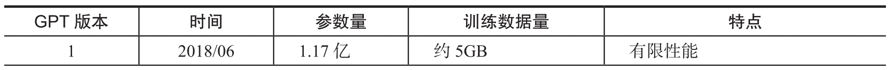

（续）

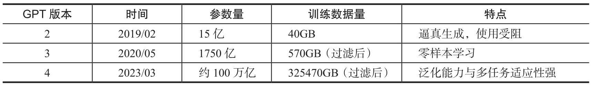

未来OpenAI将继续探索ChatGPT及其后续模型在不同行业场景的应用，以扩大人工智能影响力。预计将在金融科技、医疗健康、教育培训、物联网、智能制造、游戏开发与娱乐等领域发挥重要作用。但跨领域应用既有机遇也有挑战，如何平衡需求与利益，解决伦理、法律与政策问题，将成为未来关键课题。

总体而言，ChatGPT是OpenAI发展史上的重要成果，为AI领域带来革命性变化。不断突破技术瓶颈，推动AI快速发展，为未来应用开辟新前景。ChatGPT在自然语言处理上实现新突破，应用潜力巨大。随着逐步落地，它将为社会带来更多变革与机遇。

**本书涵盖内容**

本书全面深入介绍以ChatGPT进行软件产品需求分析、架构设计、技术选型、高层设计、数据库设计、UI/UX设计、后端开发、Web前端开发、软件测试、系统运维、技术管理的方法与经验，旨在帮助产品经理、架构师、DBA、UI/UX设计师、程序员、测试工程师、运维工程师与项目经理更深刻理解ChatGPT的实际价值，并提供实用操作建议。

阅读后，读者可掌握ChatGPT在需求分析、架构设计、代码实现、系统优化、软件测试与团队协作等方面的核心概念与方法。帮助企业与个人在人工智能时代快速掌握这一强力工具，实现价值创新与竞争优势，为长远发展奠定基础。

**本书说明**

❑ 本书所指ChatGPT指ChatGPT与ChatGPT-4的统称，多指ChatGPT-4。
❑ 每章开头简述本章结构。
❑ 每章结尾做小结。
❑ 与ChatGPT互动对话采用以下方式表示： 

向ChatGPT提出的问题。 

ChatGPT给出的答案。

**ChatGPT使用指引**

为获得高质量答案，提问前需确保满足以下要求。

❑ **明确目标：**清晰阐述问题目标，使模型准确理解并给出相应信息或建议。
❑ **具体范围：**设定明确边界，避免回答过于宽泛或模糊，提升针对性与实用性。
❑ **规定输出：**明确期望格式与类型，如步骤列举、案例提供或解决方案等。

获得建议性答案后，为进一步提升满意度，需继续：

**1）审慎判断：**仔细阅读回复，判断是否符合预期、准确无误且覆盖全部相关信息。
**2）有效反馈：**若发现问题或需补充，给出具体明确的反馈，指出改进或补充点，帮助模型优化。
**3）迭代完善：**多次互动不断完善问题与答案，最终获得高质量解答。

通过上述实践，可在互动中获得更满意结果。需注意作为AI，ChatGPT可能无法完全理解某些问题或提供完美答案。保持耐心并持续优化提问，有助于提升体验与答案质量。

遵循表2的步骤与注意事项，可获得更满意高质量答案。图1清晰展示了该流程。

▼表2 与ChatGPT互动的步骤和注意事项

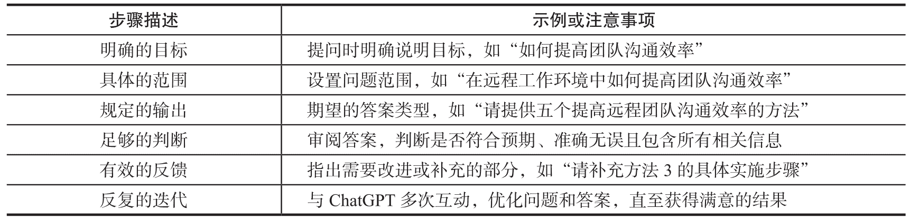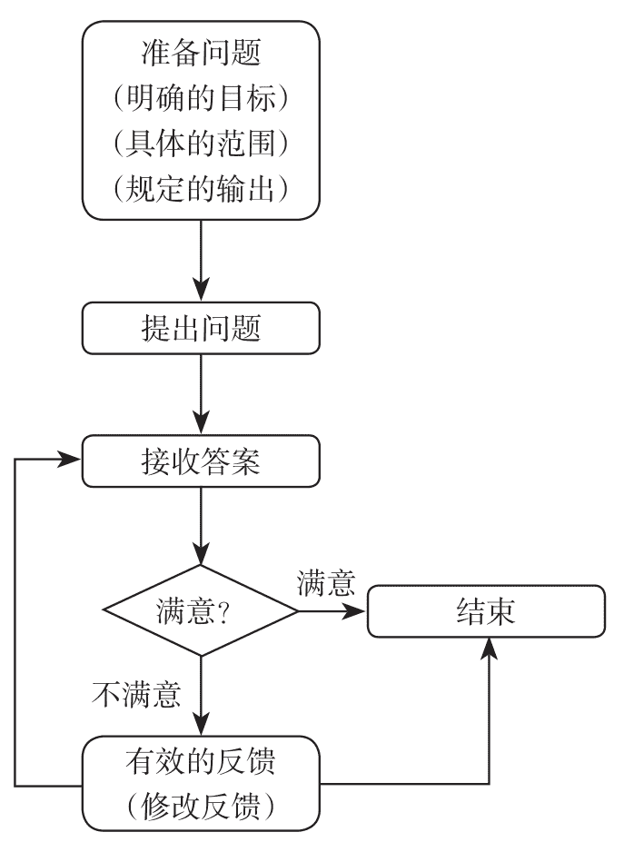

▲图1 与ChatGPT互动的最佳过程

**案例说明**

以某支付公司POS机终端管理系统Terminal Management System，TMS的开发为例，讲解如何利用ChatGPT完成应用系统架构设计。首先介绍TMS的概念。TMS是支付平台管理POS终端的必备工具。

支付公司在业务开展中，会将数万台POS机部署于全国各地商户，用于收款。系统配置、密钥管理与软件更新本可手工完成，但需技术人员现场操作，每台设备逐一处理，不仅给商户带来不便，也难以规模化，效率低下且成本高昂。若将终端配置参数、密钥管理与软件更新置于网络平台，则每台POS机可通过网络自动访问TMS服务，及时检查并下载更新的密钥、参数或软件。图2展示的POS机网络服务中心即本案例涉及的TMS。

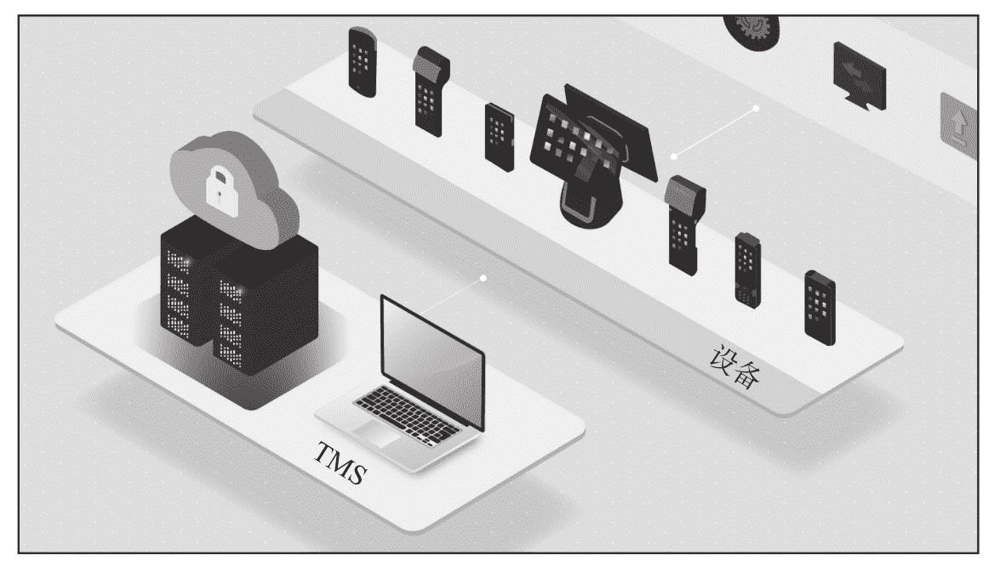

图2 TMS逻辑示意图

**适合读者**

❑ 对ChatGPT感兴趣并希望在实战项目中应用的研究人员与开发工程师。本书通过真实案例解析其在软件开发中的应用，帮助快速掌握助力开发的技能。
❑ 希望借助ChatGPT为产品创新与用户体验创造价值的产品经理与设计师。提供将ChatGPT与产品设计结合的方法与实践。
❑ 需要管理与指导具备ChatGPT技术背景团队的领导者。学习如何组织协调资源，进行技术规划与战略部署。
❑ 负责企业或项目系统运维与管理的专业人员。了解如何维护与优化基于ChatGPT的系统，确保高效稳定运行。
❑ 从事人工智能教育或相关专业的教师、讲师与学生。系统学习ChatGPT及其在项目中的应用，为教学与研究提供参考。
❑ 对人工智能与ChatGPT有浓厚兴趣的普通读者。可全面了解其发展历程、应用领域与未来前景，丰富知识体系。

# 第一章
# 生成式AI与研发实践

自20世纪40年代至今，软件开发已走过80余年。从机器语言到高级编程语言，从互联网、移动互联网、云计算与大数据，到如今的人工智能，研发领域经历多次技术冲击。这些冲击让软件开发更广、更快、更灵活、更便利。2023年，以ChatGPT为代表的通用生成式预训练转换器技术带来新一轮发展。如何应对挑战、顺应潮流变革研发流程与方法，是重要课题。

## 1.1 技术演进对软件开发的影响

纵观1940年至2023年，技术对软件开发产生过六次重大影响，简述如下。

首先，高级编程语言出现，使编程从面向机器转向接近自然语言。相较机器语言或汇编，高级语言语法更直观，大幅缩短编码时间、提升效率，降低出错概率，也让软件更易维护与扩展，推动了行业快速发展。

其次，互联网兴起推动网络应用与网络编程发展，软件服务突破本地限制，面向全球。互联网普及也催生敏捷开发，强调快速迭代，帮助团队更好适应市场变化，缩短周期、提升交付速度与质量。同时促进全球化协作，跨地域团队可通过网络共享信息与资源。

再次，移动互联网兴起推动移动应用开发与普及，研发需针对不同平台适配优化，确保多设备正常运行。也推动云计算发展，移动应用数据存储与管理更便捷，借助云服务增强功能与性能。同时改变测试与发布方式，让质量与用户体验成为焦点。

接着，云计算兴起提供灵活可扩展的基础设施，摆脱传统硬件限制，通过云服务快速构建、部署与管理应用。降低成本与门槛，支撑跨平台应用与全球化服务。强大的数据处理与分析能力为AI与大数据应用提供支撑，让数据分析与模型训练更高效，也让研发更灵活、高效与创新。

此外，大数据出现为开发与运维提供高效存储与处理方式，让海量数据价值得以挖掘。强大的分析与挖掘能力助力数据挖掘、预测与建模。同时促进机器学习与AI发展，提升软件智能化水平，推动全球化与协同工作。

最后，人工智能出现，尤其深度学习通过神经网络训练与学习，使计算机可从海量数据中发现规律，实现自动化决策与预测。在计算机视觉、自然语言处理、语音识别等领域取得突破，推动研发创新。视觉领域实现自动驾驶、安防监控、医疗诊断；自然语言处理实现智能客服、机器翻译、文本分析；语音识别实现语音助手、智能交互。AI的到来也带来新挑战。

总之，高级语言、互联网、移动互联网、云计算、大数据与人工智能六次重大演进，对软件开发的方法、范围、模式、效果与效率带来巨大影响。表1-1总结了这些影响与变革。图1-1从时间轴展示了六次关键技术演进。

▼表1-1 技术发展对软件开发的影响

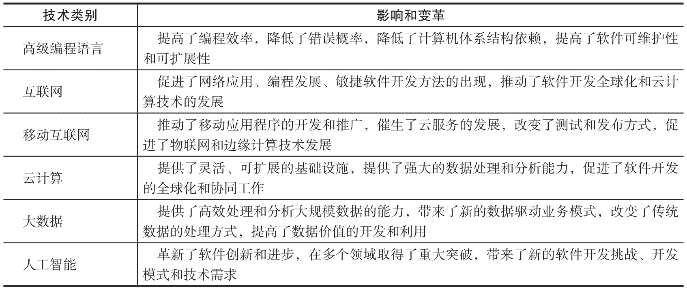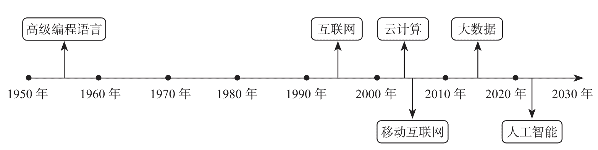

▲图 1-1 深刻重塑软件开发的六次关键技术浪潮

## **1.2 ChatGPT 如何改写编程方式**

2022 年底，ChatGPT 突然登场，它是一类依托深度学习的生成式人工智能。凭借卓越的文本生成力与海量知识储备，它对软件开发的冲击可以用颠覆来形容，影响的深度与广度远超此前任何一次技术演进。本部分先梳理 ChatGPT 在自然语言理解、文本生成与代码语言处理上的底层原理，为后续探讨其对开发模式的改变做铺垫。

人类日常交流使用的自然语言本身就充满随意性，结构松散，表达丰富多样，还常伴随歧义与不确定性，这让机器理解与生成文本变得格外困难。自然语言的生成更贴近人的思维，需要兼顾语法、语义、上文等多重信息才能写出来。这个过程依赖自然语言处理技术，包含词法解析、句法解析、语义解析以及文本生成等环节。全球现存自然语言约 7000 种，在约 80 亿人口中，约 36% 使用汉语、西班牙语、英语、阿拉伯语和印尼语等五种语言，具体分布见图 1-2。

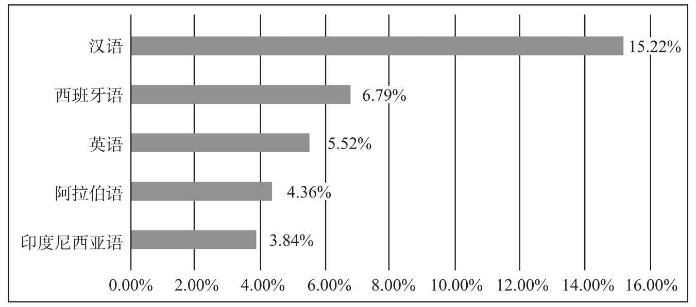

图 1-2 人类常用自然语言分布 ^(³)

编程语言是为编写程序而生的工具语言。比起自然语言，它更结构化、更规范，语法与语义清晰明确，能直接映射为机器可执行的指令，因此对计算机而言理解成本更低。全球编程语言总量已超千种，但真正被广泛使用的主流语言仅十几二十种。编程实务中，使用率排名前五的语言合计占据了整体使用量的 63.32%，详细位次见图 1-3。

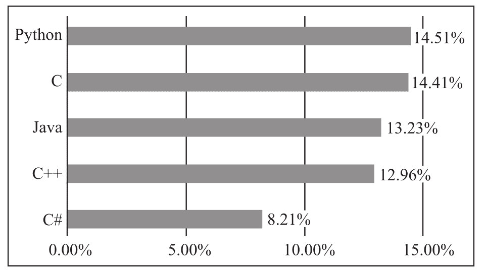

图 1-3 计算机编程语言使用排行 ^(⁴)

两种语言各有复杂之处。自然语言因不规则而复杂，编程语言因逻辑可无限叠加而抽象。外语教学研究普遍认为，掌握一门非母语达到流利水平往往需要数年投入。而入门一门编程语言，数月到一年左右即可具备基础能力，完成简单程序与问题求解。两者学习门槛差距明显。

ChatGPT 本质上是一个深度学习驱动的自然语言处理模型，擅长理解、生成与转换自然语言文本。鉴于自然语言本身的复杂性，它必须拥有极强的理解与生成能力，并学会处理歧义、不确定性等难题，这使其处理难度高于编程语言。总体来看，自然语言生成与高级语言编程的逻辑路径不同，但都离不开对复杂语言符号系统的解析与规则遵循，以达成特定目标。

想评估 ChatGPT 对开发的真实影响，先要搞清它生成代码的机理。作为自然语言处理模型，它能产出人类可读的文本，并不直接具备编程能力，但开发者可以把它的自然语言输出当作编写程序的辅助材料。

它产出的程序或代码片段，来源于训练语料中已观察到的代码模式。GPT 在训练阶段吸纳了海量编程知识与示例，面对编程相关提问时，便依据积累的知识经验进行回应。

具体做法是先用自然语言描述程序逻辑，再映射到目标语言代码。比如要算平方根，可以用自然语言写明：接收一个数 x，求出其平方根 y 并输出。随后将这段描述转化为如图 1-4 所示的 Python 实现。

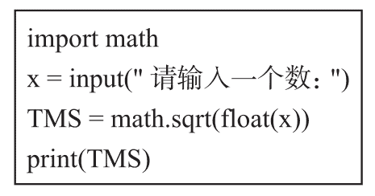

图 1-4 ChatGPT 生成代码的原理示例

如此便可经由自然语言与编程语言的转换，利用 ChatGPT 的自然语言输出来撰写程序。整体过程如图 1-5 所示。

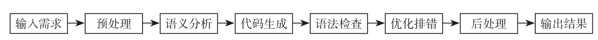

图 1-5 ChatGPT 生成代码的流程

（1）提出需求：用户用自己最习惯的自然语言详细描述编程任务，说明期望的输入、处理逻辑与输出，并明确指定目标语言，如 Go、Java 或 Python。
（2）预处理：对自然语言描述的需求进行文本清洗与标准化，随后执行分词、词干抽取、停用词剔除等操作，提取出变量、函数、对象、属性等关键词与短语。
（3）语义解析：借助 ChatGPT 模型解析需求文本的含义与结构，识别句子成分如主语谓语宾语，并捕捉实体、属性、动作与关系。
（4）生成代码：模型基于已理解的上下文与设定的约束条件，输出对应的高级语言代码，可能涉及模板填充、片段拼接、逻辑结构构建等。
（5）语法校验：依据目标语言的语法规范，对生成代码进行词法与句法分析并纠错，确保代码符合语言标准，避免编译或运行时错误。
（6）优化与排错：初版代码可能存在缺陷或效率不高，需进行重构、性能分析与错误排查，提升质量与运行效率。
（7）后处理：为提升可读性与可维护性，补充注释、核对需求一致性并进行代码格式化。
（8）交付结果：ChatGPT 以文本形式返回最终的高级语言代码，用户保存后即可运行，语言类型完全依据用户指定。

归纳起来，ChatGPT 编程即把自然语言描述的需求交给模型，经预处理、语义解析、代码生成、语法校验、优化排错、后处理到最终输出，形成目标高级语言代码的完整链路。

从上述流程可见，ChatGPT 已从根本上改变了编码环节。程序员无需亲手逐行敲代码，只需清晰定义需求便可借助模型完成应用代码撰写。这种新范式显著提升了编码效率，并且由于模型可同步校验逻辑与语法，Bug 发生率明显下降，代码质量随之提高。由此，ChatGPT 驱动下的编码与测试方式已发生质变。

另外，ChatGPT 汇聚了大量人类知识，涵盖各行业的业务逻辑与架构设计思路，因此在需求分析、架构设计、代码测试、应用部署与系统维护等全流程都将产生深远影响，后续章节会进一步展开。

## **1.3 ChatGPT 推动开发模式的演进**

软件开发是一个系统工程，目标是交付满足用户需求的服务或产品。信息系统由硬件、软件、数据、人员、网络等要素构成，只有协同运作才能提供有效价值。开发涉及需求分析、技术选型、架构设计、UI/UX 设计、数据库设计、编码、单元测试、集成测试、性能测试、安全测试、部署、安全、项目管理与运维监控等诸多环节，需由产品经理、架构师、设计师、程序员、DBA、测试工程师、安全工程师、运维工程师与项目经理等多角色团队协作，选用合适的开发模式才能保证效率与质量。

软件开发生命周期 SDLC 是一种过程管理与控制方法，可追溯到 20 世纪 60 年代。当时应用开发混乱不规范，缺乏标准流程，导致项目常超预算、延期或交付不合格。为此工程师开始探索标准化开发过程，SDLC 由此产生并逐步成熟，其流程图见图 1-6。

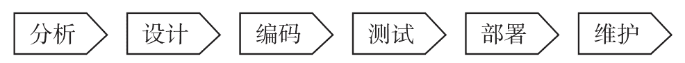

图 1-6 SDLC 流程总览

SDLC 包含以下阶段。
（1）分析：明确用户与系统需求，形成软件需求规格说明书。
（2）设计：确定系统结构、模块划分与算法方案，形成详细设计文档。
（3）编码：依据详细设计实现功能，编写源代码与注释并进行单元测试。
（4）测试：对已编码软件进行功能、集成、性能、安全测试，发现并修复缺陷。
（5）部署：将软件推送至生产环境供用户使用。
（6）维护：监控运行状态，及时修复问题以保障稳定。

各阶段贯穿开发全过程，并与项目管理、质量保证紧密结合。遵循 SDLC 可提升质量、降低成本、缩短周期，因此是软件开发不可或缺的标准流程。

在 ChatGPT 驱动的新时代，SDLC 依然必要。虽然模型能快速生成代码，但需求分析、架构设计、测试、部署与运维等关键问题仍需关注。SDLC 提供了结构化管理手段，帮助团队协同、提升效率与质量，同时有助于进度管控与风险管理，提高项目成功率。因此即便在 ChatGPT 时代，SDLC 仍是重要的方法论。

SDLC 为项目提供结构化框架，帮助交付高质量产品。ChatGPT 无法脱离 SDLC，但在其中可采用不同的开发模式，如瀑布、迭代、敏捷等，三者在需求分析、架构设计、流程、协作与项目管理上差异明显。

1. 瀑布模式
瀑布模式将开发划分为线性顺序的阶段，每个阶段完成后才进入下一阶段，极度依赖项目计划与管理。模式强调需求与设计的详尽文档化，确保一致性，但变更处理困难，需求改动易引发大规模返工。适用于需求明确稳定、质量要求严格的项目。其特点如下。
❑ 严格线性：阶段相互依赖，必须依次完成。
❑ 高度文档化：重视详细需求与设计文档。
❑ 变更困难：需求或设计变动成本极高。
❑ 适用场景：需求稳定清晰的大型、强质量项目。

2. 迭代模式
迭代模式把开发拆分为多个迭代周期，每个周期都包含需求、设计、编码、测试，并产出可用版本。采用增量式开发，新的功能与需求在已有基础上逐步累加，产品持续完善。该方式对需求变更更友好，新需求可在下一迭代中实现。适用于需求可能变化或难以预判、需快速交付部分功能的项目。其特点如下。
❑ 多次迭代：每个周期产出可用版本。
❑ 增量开发：功能逐层叠加、逐步完善。
❑ 变更管理更好：新需求可在后续迭代中消化。
❑ 适用场景：需求不稳定、需分批交付的项目。

3. 敏捷模式
敏捷模式高度灵活，强调快速响应需求与市场变化。相比瀑布，它减少文档与流程负担，聚焦高效协作与快速交付。迭代式开发是核心，通常采用 2～4 周的短周期，每个周期交付一个增量。同时强调与客户紧密合作，获取实时反馈以调整需求。适用于需求频繁变化、需快速适应市场、依赖团队紧密协作的项目。其特点如下。
❑ 高度灵活：能迅速应对变化。
❑ 轻量过程：减少文档负担，强调交付。
❑ 迭代式开发：短周期产出可交付增量。
❑ 客户协作：紧密合作获取反馈。
❑ 适用场景：需求多变、竞争激烈、需快速交付的项目。

面向消费者的互联网应用，需求变化快且竞争激烈，敏捷模式往往更合适；面向企业的服务，需求相对稳定且更看重交付时间与质量，瀑布模式可能更可靠。选择需综合项目需求、团队状况、客户期望与市场环境。

❑ 项目需求：需求稳定性与复杂性是关键。需求频繁变化或不明确时敏捷更适用；需求稳定清晰时瀑布更合适。
❑ 团队情况：敏捷依赖跨职能团队紧密协作与高自治，适合经验丰富沟通顺畅的团队；瀑布适合组织严谨、分工明确的团队。
❑ 客户期望：敏捷强调持续交付与快速响应变化；瀑布适合客户对交付时间有明确要求且需求稳定的情况。
❑ 市场环境：竞争激烈、技术变化快的环境中敏捷有助于保持竞争力；相对稳定市场中瀑布可确保在有限资源内达成目标。

图 1-7 展示了瀑布、迭代与敏捷三种主流模式，各有优劣，适用于不同研发场景。无论模式如何，最终目标都是高效交付满足用户需求的产品。软件系统涉及功能需求、易用性、技术栈、数据库、测试、安全、部署与运维等多维度，需产品经理、架构师、设计师、前端、后端、DBA、网络、测试、项目经理等至少九类人才协同，需求与设计信息需在团队内反复传递与沟通形成共识后才能形成价值交付物，因而才有上述三种模式的存在。

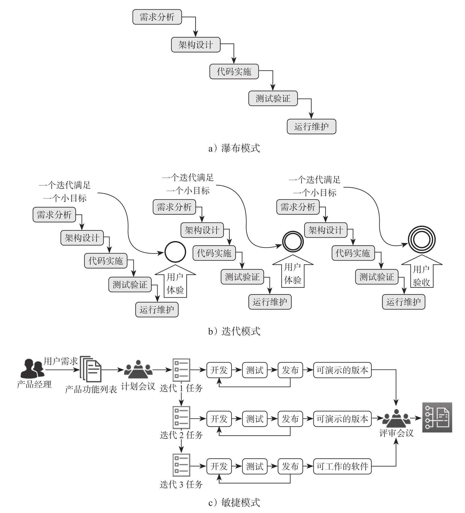

图 1-7 三种常见开发模式对比

ChatGPT 的出现大幅提升了工程师的产出效率。过去需要多名工程师反复讨论协调的研发活动，现在可由少数工程师在模型辅助下独立或小团队协作短期交付。大兵团作战转向特种兵作战，一人顶多的局面正在形成，以适应这一技术演进，新的开发模式也在应运而生。

## **1.4 ChatGPT 时代的“水母式”开发**

尽管 ChatGPT 对软件开发产生深远影响，开发活动仍遵循其固有生命周期。但当前常见的瀑布、迭代、敏捷三种模式面临新的挑战，因其赖以成立的基本假设已发生变化。过去假设项目需要大量人员参与，并投入大量时间进行沟通与协调，若沟通不畅则产品易偏离用户需求。

在 ChatGPT 驱动的开发中，工作从人脑生成方案与代码转向由模型按需求指令生成方案与代码。原本需大量思考与手工操作的部分可由 ChatGPT 承接，因而项目组效率大幅提升，所需开发人员数量明显下降，人工编写的技术文档也大幅减少。但新模式对人才素质与能力提出了更高要求。

实践中将 ChatGPT 真正嵌入到软件研发全流程，反复试错后，我们提炼出一种以 ChatGPT 为主引擎的工作方式，并把它命名为水母模式。名字的由来很直观，整个研发形态像水母一样，上部宽阔下部收窄。宽阔的上层强调在开工前期把需求梳理透、把整体架构统一起来；收窄的下层则因为有了 ChatGPT 产出的设计稿和可直接生成的代码，对开发、测试、运维等执行类人员的依赖被大幅压缩。水母的触手象征的是在顶层需求与架构确定之后，可以同时展开多条模块化实施线，比如代码调试、测试验证、应用部署和系统运维。这样的结构能有效降低信息在多人传递中的失真和遗漏，让开发更贴合用户、周期更短。

图 1-8 展示了水母开发模式的基本概念。图 1-9 展示了水母开发模式的细节。

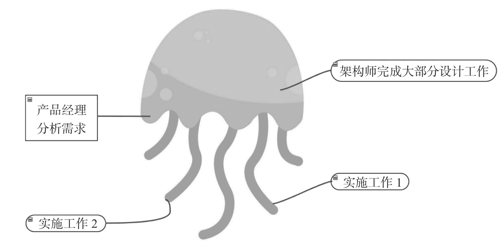

▲图 1-8 水母开发模式

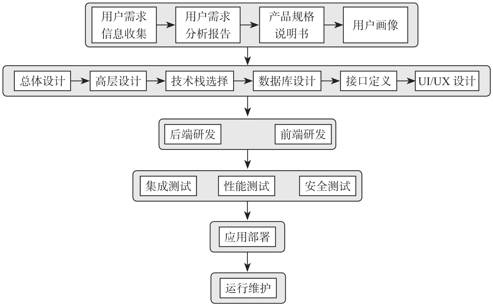

▲图 1-9 水母开发模式的细节

该模式把研发拆成六层，分别对应 SDLC 的分析、设计、编码、测试、部署和维护。对比各层的投入可以看到，分析和设计层的活动量明显高于其他层。

一个典型的水母团队，核心全职人员是产品经理、架构师、后端工程师、前端工程师和测试工程师共五人。另有数据库管理员、项目经理、UI/UX 设计师、运维工程师、性能测试工程师、信息安全工程师等作为非全职辅助角色。实践中各层级核心人员构成见表 1-2 所示。

表 1-2 水母开发模式的核心人员构成

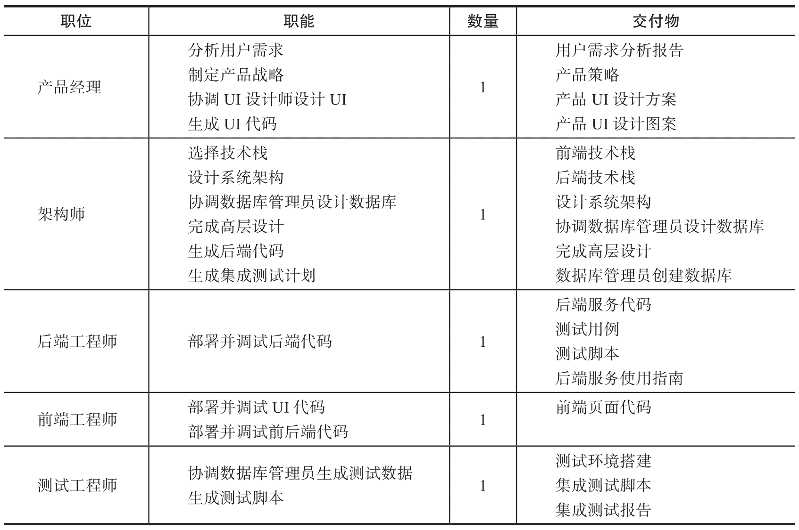

基于对多个项目的活动测算，水母模式下各环节的人力配比大致如表 1-3。架构师是项目的核心枢纽，需要完成总体设计、技术选型、数据库设计、界面设计和接口设计。代码调试的程序员、执行测试的测试工程师、负责部署运维的工程师则在架构师的指导下各司其职。

表 1-3 水母模式 SDLC 各个环节人力资源比例

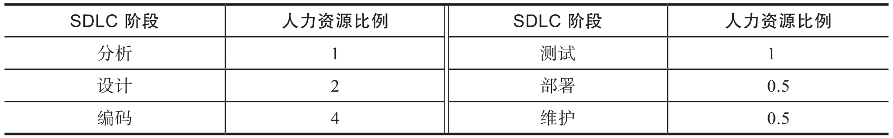

## **1.5 ChatGPT 正重塑工程师的定位与能力**

从过去靠个人脑力推导出解决方案，到现在只需把需求清晰地抛给 AI 让它生成方案，ChatGPT 改变了思考与解决问题的路径。对开发人员而言，工作重心从埋头苦思、输出严谨逻辑，转向如何把用户诉求准确地表达给 ChatGPT 并获得可用方案，角色定位由此发生深远迁移。

❑** 定位：**工程师不再需要在脑内反复推演严密逻辑，而是要学会把用户需求完整、准确地交给 ChatGPT 去处理。这与有人驾驶到无人驾驶的转变类似。有人驾驶时人既是司机也是乘客，要操控方向、判断路况；无人驾驶时人的角色就清晰了，只负责下达清晰的指令，让系统把车开到目的地。

❑** 技能：**定位变化带来技能变化。我们不再过度强调纯逻辑推演能力，而是更看重能否吃透用户需求，并按软件生命周期将其逐层拆解成可提问的问题，从 ChatGPT 获取答案。计算器是很好的类比，计算器出现前算数靠大脑，出现后靠按键输入。使用者关注“算什么”，而不关心“怎么算”，本质变化就在这里。

❑** 素质：**在 ChatGPT 驱动的研发里，同理心变得关键。要更敏锐、更体贴地理解用户需求，更善于与用户沟通，并把需求转译成 ChatGPT 能懂的表达。研发人员的素质要求正从逻辑思维向形象思维迁移。以前的裁缝行业强调手巧、针针到位；今天的时装行业强调心灵，能捕捉市场脉搏和消费者需求并设计出符合潮流的作品。从手巧到心灵，行业也从裁缝变成了时装。

❑** 数量：**过去以人脑产出程序为核心，需要大量工程师覆盖各环节。现在在 ChatGPT 驱动下，只需少量聚焦需求分析与架构设计的工程师即可。历史上类似的岗位变迁已有先例，20 世纪 50-60 年代美国有超过 35 万名电话接线员负责接线和传递信息，自动交换机的普及彻底改变了这一行业。

可以肯定的是，软件行业不会消失。未来企业和个人对桌面、移动端个性化软件的需求只会增多。在这些软件的开发里，需求收集与分析、系统架构设计仍是核心，且必须以人为本，依赖人的情感、体验和判断。举例来说：

❑** 产品经理：**分析需求时可以借助 ChatGPT，但最终判断和决策仍需基于经验和现实情况。
❑** 架构师：**可以利用 ChatGPT 获取技术建议或生成方案初稿，但仍需按项目需求和团队现实调整。
❑** UI/UX 设计师：**风格草案可借助 AI 生成，但是否符合用户感受仍需设计师用视觉判断。
❑** 程序员：**可从 ChatGPT 获取编程建议、解答和示例代码，但生成代码仍需人工调整优化。
❑** 测试人员：**测试大纲、用例、脚本可由 ChatGPT 起草，但需根据项目特点人工完善。

因此工程师岗位不会立刻被完全替代，ChatGPT 更像是能力极强的辅助工具。关键在于顺应趋势持续学习，快速驾驭工具以更好满足用户。

在效率被大幅提升的新时代，行业更青睐能全面熟练掌握多项技能的研发者，即真正意义上的全栈精兵。近期水母模式的试验显示，一专多能的全栈程序员、具备深厚业务背景的产品经理或架构师更受青睐。如何通过学习和培训改变自己以适应新模式，是工程师面临的现实挑战。

技术进步并非单纯削减岗位，而是推动劳动力转型。新职业如 ChatGPT 引导师、AI 画师等正在涌现，为市场带来更多机会，也对从业者提出更高技能和更宽知识背景的要求。ChatGPT 打开了无限空间，很多过去不存在的产业有望快速生长。总之科技发展的终极目标是让社会更美好，能不写代码就实现优秀应用系统，也是每个工程师的梦想。

## **1.6 与 ChatGPT 高效协作的沟通方法**

ChatGPT 沉淀了海量人类知识，具备强大的文本生成能力。当互动方式不当，输出很容易偏离预期。这与自动驾驶类似，重点不再是紧张握方向盘，而是清晰告知出发时间、地点和目的地，甚至可根据系统建议权衡路况、油耗和时间，也可自行设定车内温度、湿度、香气和音乐。

理解代码生成的原理后，有几条实操建议：

❑** 清楚描述：**要让 ChatGPT 生成高质量代码，必须对功能和逻辑做清晰详细的描述，避免模糊笼统的表达，否则意图难以被准确捕捉，代码框架的质量也会下降。描述里应尽量规避歧义，防止模型随意猜测。

❑** 聚焦会话：**保持对话连贯，一个主题一条问题，避免跑题。建议用 Notion 或 Word 记录每次提问和回答，便于追溯和迭代。

❑** 分层迭代：**采用自上而下、从宏观到微观的方式描述问题，先把问题边界和框架确定，再逐步深入细节。

结构化提问能最大化发挥 ChatGPT 的价值，遵循七个步骤即可。

**（1）确定问题的核心（核心）：**明确要解决的具体问题和期望目标。
**（2）分解问题（详细）：**把大问题拆成小而可控的部分，理清各部分关系。
**（3）提供背景信息（背景）：**给出问题发生的实际环境和上下文。
**（4）设定优先级（优先级）：**标明各部分的轻重缓急，引导模型聚焦重点。
**（5）提出具体问题（具体）：**使用明确具体语言，避免模糊或多义词。
**（6）陈述假设或限制条件（限制）：**把特殊假设、约束条件写清楚。
**（7）指定期望的输出格式（输出）：**说明想要列表、段落、图表等何种形式。

核心、详细、背景、优先级、具体、限制、输出，这七个要素是结构化提问的关键。为便于记忆，有一个小故事与之对应：

遥远星球上有一块名为“核心”的神秘矿石，蕴含无尽能量。七位探险家出发，先详细研究地图资料寻找线索，发现讲述矿石起源的背景故事，进而按优先级排序任务，随后面对具体的攀岩、穿越沙漠等挑战，必须在时间紧迫、资源有限等限制下谨慎前行，最后输出矿石能量拯救星球。

顺口溜帮助记忆：
核心详细背景给，优先级与限制齐。
具体问题描述好，输出格式讲明晰。
七大步骤走得当，ChatGPT 回答亮。

举例：想让 ChatGPT 写一个计算两数之和的简单 Python 程序，按结构化提问法提问示例如表 1-4。

表 1-4 使用结构化提问法的案例

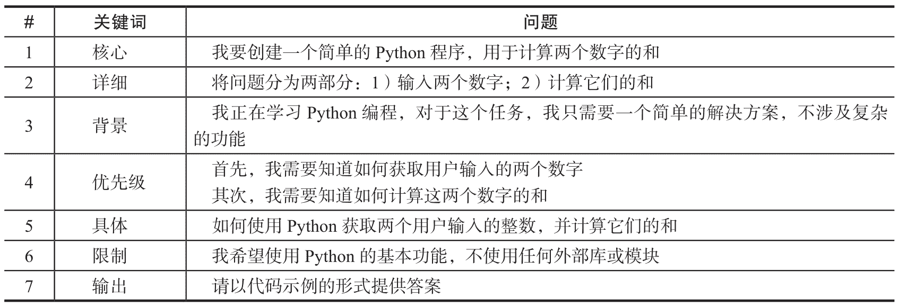

结构化提问让需求表达更清晰，模型返回的方案更精准。架构阶段，架构师可把用户需求、技术选项、架构要求交给 ChatGPT 生成方案初稿后挑选；UI/UX 设计师把项目背景、用户画像、设计意图传给模型生成初稿，再通过迭代挑选；编码阶段，程序员描述高层设计和实现逻辑，让模型生成示例；测试阶段，测试工程师提供设计要求、代码和测试要求，由模型制定大纲甚至完成初稿。

## **1.7 本章要点回顾**

人工智能的到来正在重塑软件开发。尽管如此，开发过程仍需遵循其固有生命周期，结合瀑布、迭代、敏捷等模式按项目、团队、客户和市场选择合适方式。在 ChatGPT 场景下，水母开发模式能更好释放 ChatGPT 的能力，同时避免人员过多带来的沟通复杂和协调难题。此外，向 ChatGPT 提问时坚持核心、详细、背景、优先级、具体、限制、输出的结构化提问法，可获得更精准高效的答案，减少试错成本，提升开发效率。

# **第二章**

# **ChatGPT 驱动的需求分析**

在 SDLC 的需求分析阶段，产品经理的核心任务是收集、梳理并明确用户需求。目标是让团队对需求有清晰完整的共识，为后续开发提供准确指引。用户需求是软件的基石，也是项目成败的关键。本章以 TMS 开发为例，探讨如何借助 ChatGPT 收集、分析、管理与优化用户需求。首先介绍需求收集方法，其次讨论分析优化，最后由 ChatGPT 生成需求规格说明书，为架构设计和代码编写奠定基础。

## **2.1 用 ChatGPT 高效收集用户需求**

本节介绍如何从用户和利益相关方处收集需求信息，实现更全面的洞察。首先明确目标用户群体，这有助于聚焦收集和分析方向。通常软件分为面向企业 To B 和面向个人 To C 两类。

面向企业的软件需求特点：
❑** 逻辑复杂：**涉及部门多、流程长、逻辑繁复，需要深入分析业务流程。
❑** 流程烦琐：**跨部门、跨角色、权限复杂，有时还涉及外部数据源。
❑** 规模庞大：**用户基数大、数据量大，对高并发和 7×24×365 高可用要求高。
❑** 开发周期长：**规模和逻辑复杂度决定了开发周期通常较长。

面向个人的软件需求特点：
❑** 易用性：**操作要求高，需设计得直观、简单、无需学习即可上手。
❑** 美观：**界面和布局影响吸引力，视觉体验至关重要。
❑** 功能简洁：**用户群体广泛，产品倾向功能明了、设置简单。
❑** 自然交互：**选择多且免费软件竞争激烈，用户体验和流畅交互是关键。

明确目标用户后，可通过在线调查、社交媒体、用户论坛、客户支持记录等渠道收集意见。该阶段主要由产品经理主导，配合 ChatGPT 能显著提升效率。ChatGPT 为不太深耕技术细节的产品经理提供了强力工具。下面以一个简化案例说明市场信息搜集。

某产品经理需在网上搜集日本餐饮业务相关企业信息。在 ChatGPT 出现前，常规做法是用关键词“日本餐饮业务相关企业信息”在搜索引擎检索，0.44 秒返回约 16800000 条结果，瞬间得到 1600 万条信息，如图 2-1 所示。

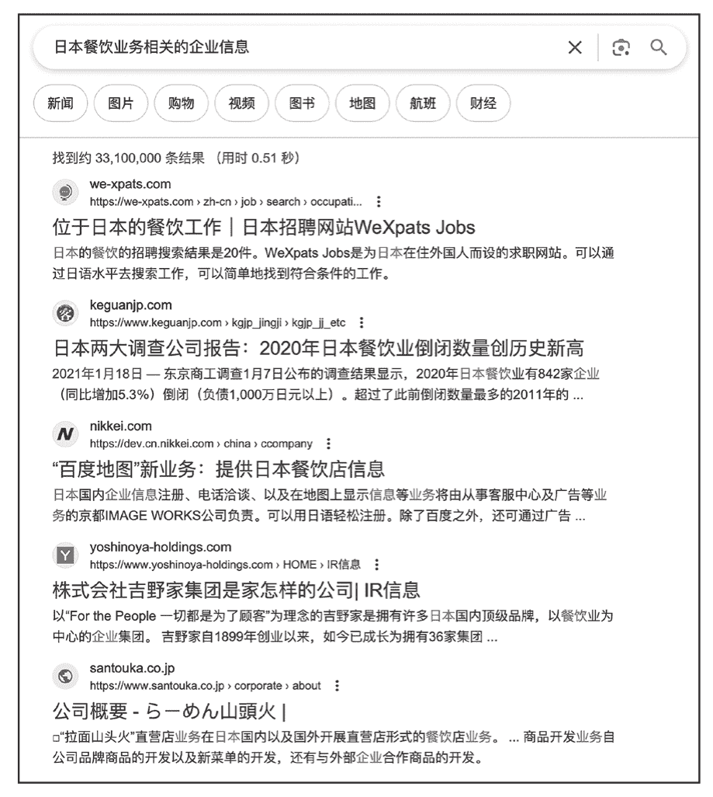

图 2-1 强大的搜索引擎返回海量的搜索结果

若逐条阅读 1600 万条，按每秒一条计算需要约 195 天不间断阅读，显然不现实。排在前面的往往是广告。将同样任务交给 ChatGPT，对话过程和结果如下。

日本餐饮连锁品牌概览 

日本餐饮赛道品牌集中度很高，下面罗列几家具有代表性的连锁企业以及它们的官方网站：

吉野家 Yoshinoya https://www.yoshinoya.com/

龙宝 Torikizoku https://www.torikizoku.co.jp/

丸龟制面 Marugame Seimen https://www.marugame-seimen.com/

一兰拉面 Ichiran https://www.ichiran.co.jp/

MOS Burger https://www.mos.jp/

Sukiya https://www.sukiya.jp/

CoCo 壱番屋 CoCo Ichibanya https://www.ichibanya.co.jp/

京都岚山咖啡 Arashiyama Coffee https://arashiyama-coffee.com/

东京烧肉 Tokyo Horumon http://www.tokyo-horumon.com/

大户屋 Ootoya https://www.ootoya.com/

这些品牌业态各异，涵盖快餐、拉面、寿司、烧肉等多个细分领域。若想深入了解各自的经营模式、产品线和服务细节，最便捷的方式是访问官网，同时结合行业研究报告可获得更宏观的视角。

目前 ChatGPT 已能直接给出要点总结，相较以往先汇总大量网页再自行研读要高效得多。若产品负责人希望在此基础上获取更细致的数据，可以对提问进行再加工，也可让模型充当数据采集工具，从关注站点提取所需字段。借助此能力，负责人能在较短周期内把个人能力拔升到行业专家水平，从而做出更可靠的需求判断与产品规划。

本书以某支付机构的终端管理系统 TMS 构建为案例展开。初期，负责人依据内部业务诉求，对 TMS 的基础需求做了初步梳理。

❑ 适用范围：支付机构全国部署的 POS 终端
❑ 使用对象：内部负责 POS 管理的同事
❑ 核心能力：设备管理、参数管理、软件管理、密钥管理
❑ 支撑能力：通知管理、远程支持、日志管理、用户管理
❑ 使用人数：约 5 名 POS 管理员
❑ 终端规模：已投放约 100 万台
❑ 性能指标：并发 50，响应时间控制在 3 秒内
❑ 合规要求：需通过 PCI-DSS 及品牌认证
❑ 扩展性：随业务增长可平滑扩容

在上述基础上，负责人与 ChatGPT 进行了首轮对话以获取更细化的需求建议。吸收反馈后对问题进行优化，再次提问，最终形成了 TMS 用户需求的正式报告。 

适用范围：支付机构分布各地的 POS 终端
使用对象：支付机构内部的 POS 管理者
核心能力：软件管理、密钥管理、设备管理、参数管理
支撑能力：通知管理、远程支持、日志管理、用户管理
使用人数：5 名 POS 管理员
终端数量：目前约 100 万台
性能指标：50 并发，3 秒响应
合规要求：通过 PCI-DSS 与品牌认证
扩展性：可随业务发展灵活扩展

从信息收集完整性的视角，还能补充哪些维度？ 

为提升完备性，可考虑补充以下维度。

参数管理：调研 POS 终端实际使用的参数配置，是否需要专属模块完成配置与下发。

日志管理：收集对 POS 日志的需求，判断是否需要查看与分析设备操作日志及系统日志以便监控与故障排查。

报警与通知：明确是否需要实时接收 POS 终端的故障告警与系统通知，以便快速响应。

远程诊断与维护：询问是否需要具备远程诊断与维护 POS 的能力，以便问题出现时迅速处置。

数据备份与恢复：探讨备份恢复需求，是否需要定期备份并在数据丢失时支持恢复。

培训与支持：了解培训与支持方面的期望，包含在线帮助文档、培训课程及技术支持服务。

系统集成：确认是否需要将 TMS 与其他内部系统如财务、运营系统打通，实现数据共享与业务协同。

报表与分析：收集报表与数据分析需求，判断是否需要基于 POS 运行数据生成报表以支撑决策。

汇总上述补充信息后，才能更全面把握支付机构的真实诉求，从而开发出更贴合需求的 TMS。

负责人吸收反馈后，对 TMS 用户需求进行了系统重整，形成更为完善的需求集合。其中部分建议未被采纳，主要因为支付机构已有其他系统提供相应支撑，比如日志管理、数据备份恢复、培训与技术支持、系统集成、报表分析以及报警通知等功能无需在 TMS 中重复建设。最终的产品需求描述见表 2-1。

表 2-1 优化后最终形成的用户需求描述

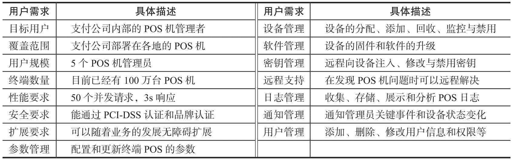

在向 ChatGPT 提交用户需求分析问题前，负责人先借助第一章介绍的结构化提问法梳理待提问题，详见表 2-2。

表 2-2 采用结构化提问法准备 TMS 用户需求分析所需信息

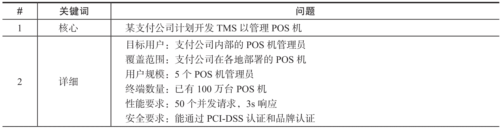

（续）

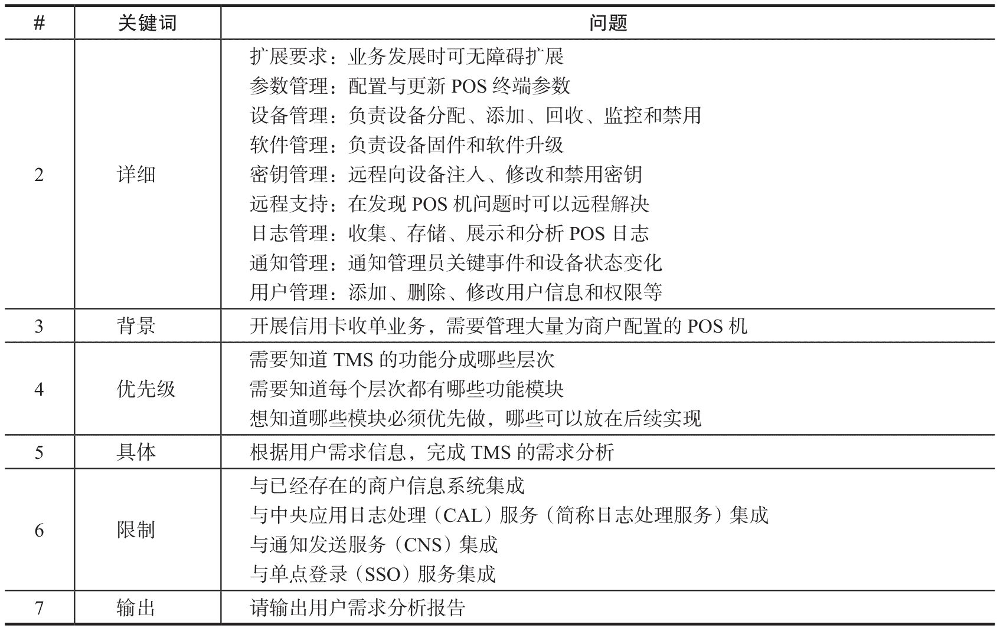

## 2.2 ChatGPT 助力用户需求拆解 

首先在充分调研用户与市场的基础上，负责人把收集到的信息整理成结构化的数据文件，可用 Excel 表格、数据库或其他数据管理工具实现。随后与 ChatGPT 展开对话，对整理后的需求数据做深度分析，提炼关键词、主题和潜在需求，进而形成产品策略，帮助更好理解用户的关注点、痛点及潜在需求，为后续系统设计与开发奠定基础。最后，负责人采用结构化提问法，从核心、细节、背景、优先级、具体性、限制和输出七个维度对问题进行自检。检验结果可判断问题是否符合结构化提问标准。按七要素系统描述问题，有助于 ChatGPT 更深入地理解和分析。以下为负责人从用户需求角度对 TMS 进行需求分析的流程。

1. 核心问题：某支付机构拟开发 TMS 管理 POS 终端
2. 详细要求：
适用范围：支付机构在各地部署的 POS 终端
使用对象：支付机构内部的 POS 管理者
主要能力：软件管理、密钥管理、设备管理
使用人数：5 名 POS 管理员
终端体量：目前约 100 万台
性能指标：50 并发，3 秒响应
合规要求：通过 PCI-DSS 及品牌认证
扩展性：随业务发展可无障碍扩展
3. 项目背景：
开展信用卡收单业务，需要管理大量部署于商户的 POS 终端
4. 优先级：
首先明确 TMS 的功能层级划分
其次列出各层级包含的功能模块
最后判断哪些模块需优先落地，哪些可延后
5. 具体问题：
基于上述需求信息，完成 TMS 的需求分析
6. 限制条件：
需与现有商户信息系统集成
需与日志处理服务集成
需与通知发送服务集成
需与单点登录服务集成
7. 输出格式：请分两次输出用户需求分析报告 

用户需求分析报告

一、项目背景
某支付机构计划开发 TMS，用以管理部署在各地的 POS 终端。核心目的是更好地开展信用卡收单业务，有效管控为商户配置的大量 POS 终端。

二、需求概述
服务对象：支付机构部署在各地的 POS 终端
使用对象：支付机构内部的 POS 管理者
使用人数：5 名 POS 管理员
终端体量：目前约 100 万台
性能指标：50 并发，3 秒响应
合规要求：通过 PCI-DSS 及品牌认证
扩展性：可随业务发展无障碍扩展

三、功能层次划分
核心功能层：设备管理、参数管理、软件管理、密钥管理
支撑功能层：远程支持、通知管理、日志管理、用户管理

四、功能模块详细说明
1. 核心功能层
设备管理：设备信息查询、设备状态监控、设备远程操作
参数管理：参数设置、参数更新、参数查询
软件管理：软件版本控制、软件更新、软件安装与卸载
密钥管理：密钥生成、密钥更新、密钥分发、密钥注销
2. 支撑功能层
远程支持：远程连接 POS 终端、远程维护等
日志管理：日志收集、日志分析、日志报告
通知管理：故障通知、更新通知、安全通知
用户管理：单点登录、权限管理、用户认证

五、优先级划分
1. 必须优先实现核心功能层
2. 支撑功能层可后续实现

六、风险与挑战
安全风险：金融 POS 涉及敏感信息，安全性要求高。开发中需严格遵循 PCI-DSS 及品牌认证要求，确保系统安全
性能要求：TMS 需满足 50 并发和 3 秒响应的性能指标，对架构与优化提出挑战
系统集成：需与日志处理服务、通知发送服务、单点登录服务集成，开发中需考虑兼容性与数据交换
可扩展性：随业务发展，TMS 需具备良好扩展性以支撑更多 POS 与用户，设计开发需兼顾可扩展与可维护

七、结论
本报告对支付机构拟开发的 TMS 用户需求进行了详细分析，涵盖功能层级、模块说明与优先级建议。建议分阶段落地核心功能层与支撑功能层并持续优化扩展。同时指出了实施过程中可能面临的安全、性能、集成与扩展风险，建议在开发中重点关注并采取相应措施。

## 2.3 基于 ChatGPT 的需求方案优化 

负责人依托收集到的用户需求数据，结合 ChatGPT 系统性地分析需求并生成用户需求分析报告。尽管该报告已能指导技术团队做什么以及做到什么程度，但仍需据团队、技能、时间、资源与技术等实际约束对报告进行优化，即通过增加约束条件策略性地对功能进行分类与优先级排序，从而明确哪些需求最紧迫、哪些可延后。

在投资规模较大、周期较长或系统复杂度较高的情形下，正式开发前通常会先做用户访谈、原型验证 POC，以确认收集的需求与用户真实需要是否一致，再据此规划功能、设计与开发，确保产品满足核心需求。TMS 的用户需求分析报告已完成，接下来将与 ChatGPT 配合制定更合理有效的产品策略，包括各功能实现的顺序与优先级。

1. 团队资源
可投入该项目的人员配置：1 名产品负责人、1 名架构师、1 名前端开发工程师、1 名后端开发工程师、1 名测试工程师、0.3 名项目管理师、0.3 名运维工程师、0.2 名信息安全工程师、0.2 名 UI/UX 工程师、0.2 名性能测试工程师
2. 业务约束
为配合销售团队的市场拓展，机构希望 TMS 在 2 个月内完成架构设计、编码开发、功能测试、性能测试、安全测试及运维部署，交付后由产品运营团队负责培训支持并进行上线后的数据采集与分析

请结合 TMS 用户需求分析报告，并综合上述现实因素，协助制定合理有效的产品策略，包括产品功能的分类及各类别的开发优先级 

基于现实条件与业务约束，为 TMS 制定如下产品策略。

一、产品功能分类
核心功能：设备管理、参数管理
次要功能：软件管理、密钥管理
支撑功能：与商户信息系统集成、与日志处理服务集成
增值功能：与通知发送服务集成、与单点登录服务集成

二、开发优先级
第一优先级：核心功能
第二优先级：次要功能
第三优先级：支撑功能
第四优先级：增值功能

三、产品策略建议
项目启动阶段：产品负责人梳理需求，架构师设计系统架构。前端、后端、UI 工程师与信息安全工程师共同参与讨论，明确技术选型与模块划分

四、开发阶段
第一阶段：聚焦核心功能开发，前后端与 UI 工程师协同推进，测试工程师编写测试用例。项目管理师、运维工程师、数据库管理员与性能测试工程师提供支持
第二阶段：完成次要功能开发，测试工程师执行功能与性能测试。项目管理师、运维工程师、信息安全工程师进行安全评估与风险控制
第三阶段：实现支撑功能，完成与商户信息系统及日志处理服务的集成。测试工程师验证集成正确性与稳定性
第四阶段：开发增值功能，完成与通知发送服务及单点登录服务的集成。测试工程师执行相关测试
交付阶段：在 2 个月内完成全部模块开发与测试。运维工程师负责部署上线。项目管理师、产品负责人与运营团队共同制定培训支持计划
后续优化：上线后运营团队收集用户反馈与数据分析，产品负责人据反馈持续优化功能。项目管理师、运维工程师、数据库管理员与信息安全工程师持续关注系统安全与稳定

综合现实因素与业务约束，按上述策略推进，可确保 TMS 在 2 个月内完成各项任务并满足用户与市场期望。实施过程中团队需紧密协作，确保按计划推进。

五、风险与应对措施
时间压力：项目周期紧，可能导致部分功能不完善。建议采用敏捷开发，快速迭代确保关键功能稳定
资源限制：团队资源有限，需合理调配人力，保证各阶段工作顺利进行。关键节点如测试与部署可适当调整资源分配
技术挑战：开发中可能遇到性能优化、安全加固等难题。建议团队积极学习交流，及时解决问题，必要时引入外部专业支持
用户培训与支持：交付阶段培训支持至关重要。建议运营团队制定详细培训计划，确保用户熟练使用，并提供在线支持与文档供随时查阅

总体来看，在现实约束下上述策略是可行且有效的。实施中需重点关注风险与挑战并积极应对，以确保项目成功交付与系统稳定运行，同时保持团队良好沟通与协作，实现 TMS 的快速开发与高质量交付

此外，为更清晰把握用户需求，可通过咨询 ChatGPT 为目标用户画像，这有助于更直观地理解用户使用场景与需求细节，也为 UI/UX 设计提供素材与灵感 

请基于前述 TMS 的目标用户进行画像，要求输出对用户形象与具体使用情况的详细描述 

基于此前关于 TMS 的讨论，为目标用户构建如下画像。

1. 身份：支付机构内部的 POS 管理员
2. 职责：
❑ 管理支付机构在各地部署的 POS 终端
❑ 配置与更新 POS 终端参数
❑ 远程解决 POS 问题
❑ 设备分配、新增、回收、监控与禁用
❑ 设备固件与软件升级
❑ 远程为设备注入、修改与禁用密钥
3. 技能：
❑ 熟悉 POS 硬件与软件操作
❑ 对金融行业及支付流程有一定认知
❑ 具备问题排查与解决能力
❑ 了解信息安全与 PCI-DSS 认证要求
4. 需求：
❑ 有效管理大量 POS 设备
❑ 快速响应并解决 POS 问题
❑ 保障 POS 设备安全稳定运行
❑ 系统可随业务发展无障碍扩展
5. 使用场景：
❑ 新增或替换 POS 时，在 TMS 中录入或更新设备信息
❑ POS 出现故障或异常时，远程诊断并解决问题
❑ 需要更新参数、固件或软件时，通过 TMS 执行操作
❑ 管理密钥时，通过 TMS 进行远程操作

通过上述画像，能更清晰地了解目标用户在使用 TMS 时的具体需求与场景，为产品设计与功能开发提供针对性指导

图 2-2 总结了借助 ChatGPT 分析用户需求、生成用户需求分析报告、用户画像与需求规格说明书的流程

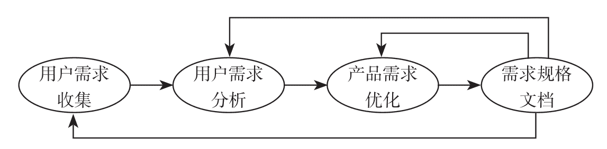

## 2.4 ChatGPT 产出需求规格说明

PRD：把需求钉住不漂移

项目一启动，产品经理就得当翻译官。用户侧、业务侧抛来的各种需求信号要先收敛、提炼、拼起来，再和研发、业务等相关方反复对齐、取舍、拍板，最终凝成一份结构化的产品需求文档。PRD 的作用是把产品在功能、性能、体验、安全、可靠性等方面该做到什么水平说清楚，让研发全程跟着最初的用户意图走，并在整个生命周期里提供参照。常见内容有：

❑ 需求规格说明书：将系统对功能、性能、界面、数据、安全、接口的具体要求梳理成开发与客户双方都能读懂并确认的资料。

❑ 用例规约：对每个用例给出说明，包含名称、描述、参与角色、前置条件、主流程、备选分支、异常处置，帮助团队吃透场景和需求。

❑ 界面原型设计：借助原型图展示版式、视觉风格和交互方式，让客户和研发对预期保持一致并方便迭代。

❑ 数据字典：详细解释系统里各数据项的含义、属性、关联关系和类型，厘清数据规范。

❑ 需求跟踪矩阵：把需求规格里的每条需求对应到测试用例、代码模块、设计文档，形成全链路追踪。

PRD 的价值很大。它为研发提供明确方向，降低研发与业务的沟通成本，避免后期返工，同时也是交付物之一，客户可据此了解产品内容与设计思路。

我们以 TMS 建设为例，说明产品经理在完成用户需求分析后，如何借助 ChatGPT 协作产出需求规格说明书。互动过程如下。 

请根据上述用户需求报告生成需求规格说明书的目录。 

需求规格说明书目录

1 引言

1.1 编写目的

1.2 背景信息

1.3 项目范围

1.4 文档概述

1.5 术语和缩略语解释

2 总体描述

2.1 产品概述

2.2 系统架构

2.3 系统组成模块

2.4 用户角色及其职责

2.5 操作环境

3 功能需求

3.1 核心功能层

3.1.1 设备管理

3.1.2 参数管理

3.1.3 软件管理

3.1.4 密钥管理

3.2 支撑功能层

3.2.1 远程支持

3.2.2 日志管理，与日志处理服务集成

3.2.3 用户管理，与单点登录服务集成

3.2.4 通知管理，与通知发送服务集成

4 性能需求

4.1 响应时间

4.2 吞吐量

4.3 可用性

4.4 可扩展性

5 界面需求

5.1 用户界面

5.2 硬件接口

5.3 软件接口

5.4 通信接口

6 数据需求

6.1 数据定义

6.2 数据流程

6.3 数据完整性

6.4 数据安全性

6.5 数据备份和恢复

7 安全需求

7.1 访问控制

7.2 安全审计

7.3 数据保密

7.4 安全性标准和认证

8 接口需求

8.1 系统集成

8.2 数据交换和兼容性

9 系统维护与支持

9.1 维护策略

9.2 技术支持

9.3 用户培训

10 附录

10.1 参考文献

10.2 修订历史 

请生成需求规格说明书的引言部分。 

## 需求规格说明书

1 引言

1.1 编写目的

本说明书用于厘清支付公司拟上线的终端管理系统在功能、效率、界面呈现、数据处理、安全防护及外部联动上应达成的具体标准，为研发、测试与客户提供统一的对齐基准，降低理解偏差，支撑项目顺利推进并达成预期。

1.2 背景信息

某支付机构拟建设 TMS，用以统一管控分布各地的 POS 终端，提升信用卡收单效率，同时简化大规模商户终端的运维负担。

1.3 项目范围

项目聚焦内部 POS 终端的集中治理，覆盖设备、参数、软件、密钥四大管控领域，并需与商户信息系统、日志处理系统、通知推送系统、统一登录系统完成对接，在落地核心能力的同时保证性能、安全和扩展性。

1.4 文档概述

本文档从以下维度展开。
功能需求：描述业务端需实现的能力。
性能需求：提供运行时的量化目标。
界面需求：规定用户端与管理端的呈现规范。
数据需求：说明存储、备份、迁移方面的诉求。
安全需求：列明合规与防护要点。
接口需求：界定对外交互的标准。

1.5 术语和缩略语解释

TMS：Terminal Management System，终端管理系统。
POS：Point Of Sale，销售点，即收银终端。
PCI-DSS：Payment Card Industry Data Security Standard，支付卡行业数据安全标准。
CAL：Central Application Logging，中央应用日志。
CNS：Central Notification Service，通知发送服务。
SSO：Single Sign-On，单点登录。 

2 总体描述

2.1 产品概述

2.2 系统架构

2.3 系统组成模块

2.4 用户角色及其职责

2.5 操作环境

请按照上述的目录结构，生成总体描述的文本。 

2 总体描述

2.1 产品概述

本项目为支付机构搭建统一的终端管控平台，覆盖全国范围的 POS 设备，旨在提升收单效率并规范商户端设备管理，主要服务内部运营人员，重点聚焦设备、配置、程序、密钥的集中管控。

2.2 系统架构

系统采用分布式形态，由前端展示层、后端逻辑层和数据层构成。前端负责呈现易用的操作界面，后端承担业务处理及跨系统联动，数据层负责数据的持久化。

2.3 系统组成模块

TMS 由两大层面组成。
❑ 核心功能层：涵盖设备管理、参数管理、软件管理、密钥管理。
❑ 支撑功能层：对接商户信息系统、日志处理系统、通知推送系统和统一登录系统。

2.4 用户角色及其职责

主要面向以下角色。
❑ POS 管理员：承担各地设备的日常运维，包括设备、参数、软件、密钥操作。
❑ 平台管理员：负责系统运行与维护，涉及配置、性能调优、安全保障。
❑ 商户：通过商户信息系统实现数据实时同步，为设备管理提供数据支撑。

2.5 操作环境

运行环境要求如下。
❑ 计算资源：基于云原生的容器管理平台。
❑ 数据库：MySQL。
❑ 网络：需与商户信息系统、日志处理系统、通知推送系统、统一登录系统互联互通。
❑ 性能基准：支持 50 个并发请求，平均响应时长控制在 3 秒以内。 

3 功能需求

3.1 核心功能层

3.1.1 设备管理

3.1.2 参数管理

3.1.3 软件管理

3.1.4 密钥管理

3.2 支撑功能层

3.2.1 远程支持

3.2.2 日志管理，与日志处理服务集成

3.2.3 用户管理，与单点登录服务集成

3.2.4 通知管理，与通知发送服务集成

请根据以上的目录结构，生成需求规格说明书中功能需求部分的文本。 

3 功能需求

3.1 核心功能层

3.1.1 设备管理

设备管理提供信息查询、状态监控、远程操作等能力。工作人员可在界面查看各地 POS 的基础信息，实时掌握运行情况，并在必要时下发重启、关机等远程指令。

3.1.2 参数管理

参数管理支持配置、下发、查询。用户可在界面调整 POS 运行参数并即时推送，确保设备正常运转，同时可查询当前配置以便调优或故障排查。

3.1.3 软件管理

软件管理包括版本管控、升级、安装、卸载。用户可查看 POS 上已装软件的版本，执行升级，在必要时安装或卸载组件，保持软件最新，提升安全性和稳定性。

3.1.4 密钥管理

密钥管理涵盖生成、更新、分发、注销。用户可在界面创建并更新 POS 所需密钥，实现安全分发，并在必要时执行注销，保障终端安全。

3.2 支撑功能层

3.2.1 远程支持

远程支持允许管理员直连 POS，为商户提供实时的技术协助与问题解决，提升满意度并降低维护成本。

3.2.2 日志管理，与日志处理服务集成

日志管理依托日志处理服务实现采集、分析、报表功能。用户可在界面查看与分析 POS 运行日志，及时发现并处置问题。

3.2.3 用户管理，与单点登录服务集成

用户管理借助单点登录服务实现统一登录、权限分配、身份认证。管理员可在界面为各角色配置权限，保障系统安全。

3.2.4 通知管理，与通知发送服务集成

通知管理依靠通知推送服务实现故障、更新、安全等消息的推送。用户可在界面查看并处理来自 POS 的各项通知，确保设备稳定运行。 

4 性能需求

4.1 响应时间

4.2 吞吐量

4.3 可用性

4.4 可扩展性

请根据以上的目录结构，生成需求规格说明书中性能需求部分的文本。 

4 性能需求

4.1 响应时间

响应时间是体验的关键指标，TMS 需在各类场景保持快速反馈。
❑ 设备管理操作耗时不超过 2 秒。
❑ 参数管理操作耗时不超过 1 秒。
❑ 软件管理操作耗时不超过 3 秒。
❑ 密钥管理操作耗时不超过 1 秒。
❑ 其他支撑功能操作耗时不超过 2 秒。

4.2 吞吐量

吞吐量指单位时间内处理的请求数，系统需支撑大规模设备管控。
❑ 可同时在线管理不少于 1000 台 POS。
❑ 支持每秒至少 100 次设备操作请求。
❑ 支持每秒至少 50 次参数、软件、密钥管理请求。

4.3 可用性

可用性反映系统的可靠与稳定程度。
❑ 系统正常运行时间不低于 99.9%。
❑ 故障恢复时长不超过 30 分钟。
❑ 提供数据备份与恢复机制，保障数据安全。

4.4 可扩展性

可扩展性指随业务增长可通过扩容提升处理能力。
❑ 支持横向扩容，应对设备与用户规模增长。
❑ 支持纵向扩容，提升单个模块的处理能力。
❑ 采用模块化设计，便于未来按需新增功能。 

5 界面需求

5.1 用户界面

5.2 硬件接口

5.3 软件接口

5.4 通信接口

请根据以上的目录结构，生成需求规格说明书中界面需求部分的文本。 

5 界面需求

5.1 用户界面

为保障良好体验，用户界面需满足以下要求。
❑ 版式简洁美观，操作直观易懂。
❑ 导航结构清晰，便于快速定位功能。
❑ 各页面提供明确的提示与错误信息，辅助用户理解并纠正操作。
❑ 支持响应式布局，适配不同尺寸与分辨率的设备。

5.2 硬件接口

TMS 需兼容 POS 硬件接口，实现设备、参数、软件、密钥管理。
❑ 支持 POS 常见接口类型，如 USB、串口、以太网。
❑ 支持设备信息读取、参数下发、软件升级、密钥更新。
❑ 提供硬件接口 API 文档，方便开发集成。

5.3 软件接口

TMS 需与下列系统对接。
❑ 日志处理服务：通过 CAL 接口实现日志管理功能。
❑ 单点登录服务：通过 SSO 接口实现用户管理与认证。
❑ 通知推送服务：通过 CNS 接口实现通知管理功能。
各接口需提供详细的定义、数据格式、通信协议等文档。

5.4 通信接口

系统应支持以下通信方式。
❑ HTTP/HTTPS，用于与 POS 及第三方服务通信。
❑ TCP/IP，用于建立稳定高效的数据通道。
❑ WebSocket，用于实时通信与消息推送。 

6 数据需求

6.1 数据定义

6.2 数据流程

6.3 数据完整性

6.4 数据安全性

6.5 数据备份和恢复

请根据以上的目录结构，生成需求规格说明书中数据需求部分的文本。 

6 数据需求

6.1 数据定义

TMS 涉及设备信息、参数配置、软件版本、密钥数据、用户信息、操作日志、通知消息等。需对数据结构与字段做清晰定义，保证一致性与可读性，便于开发维护。

6.2 数据流程

数据流程包括创建、查询、更新、删除等操作。应绘制合理的数据流程图，明确操作顺序与依赖关系，确保与功能和性能需求一致，实现整体优化。

6.3 数据完整性

为保证正确性与一致性，需实施严格校验。
❑ 对输入数据进行有效性检查，防止非法数据进入系统。
❑ 对关键数据设置唯一性约束，避免重复。
❑ 采用事务机制，确保多操作在同一事务中完成。

6.4 数据安全性

需采取多项措施保障数据安全。
❑ 对敏感数据如密码、密钥进行加密存储。
❑ 限制敏感数据访问权限，仅授权用户可访问。
❑ 实施安全审计，对数据操作进行监控记录。

6.5 数据备份和恢复

为防止数据丢失与故障，需制定备份恢复策略。
❑ 定期备份系统数据。
❑ 将备份存储在安全可靠的介质上。
❑ 设计数据恢复流程，确保故障时可快速恢复。 

7 安全需求

7.1 访问控制

7.2 安全审计

7.3 数据保密

7.4 安全性标准和认证

请根据以上的目录结构，生成需求规格说明书中安全需求部分的文本。 

7 安全需求

7.1 访问控制

系统应实施严格访问控制，保护资源免受未授权访问与篡改。
❑ 用户身份验证，确保仅经过认证的用户可访问资源。
❑ 角色权限管理，为不同角色分配差异化权限。
❑ 访问控制列表，明确资源访问权限，防止越权操作。

7.2 安全审计

需建立安全审计机制，记录与监控用户操作。
❑ 操作日志记录，用于追踪用户行为与系统事件。
❑ 定期审查审计日志，发现潜在安全问题。
❑ 异常发生时立即告警并通知相关人员。

7.3 数据保密

需采取措施防止敏感数据泄露。
❑ 对敏感数据进行加密存储与传输。
❑ 展示或导出时对敏感信息进行脱敏处理。
❑ 按敏感等级进行数据隔离存储。

7.4 安全性标准和认证

系统应遵循国家及行业安全规范。
❑ 遵守相关法规、标准与规范要求。
❑ 定期开展安全评估与审查，确保安全性能符合要求。

❑ 视项目实际需要，适时引入相应的安全合规认证，例如 ISO 27001、PCI DSS 等。 

8 接口需求

8.1 系统集成

8.2 数据交换和兼容性

参照以上目录框架，输出需求规格说明书中接口需求部分的正文。 

8 接口需求

8.1 系统集成

为使 TMS 能够与既有内部系统及外部第三方服务顺畅联动，本次建设需满足以下集成方面的要求。

❑ 接入统一身份认证平台：完成登录鉴权与权限分配，降低用户重复登录的负担。

❑ 对接集中日志处理系统：把各类日志收敛到统一平台，方便后续检索与分析。

❑ 集成消息推送服务：确保系统告警和通知能够及时送达，提升触达成功率。

❑ 采用开放的 API 规范：保证 TMS 易于与其他平台联动，增强跨系统协作能力。

8.2 数据交换和兼容性

为保证 TMS 与其他系统的数据交互通畅且保持兼容，下述数据交换与兼容性要求需纳入设计。

❑ 数据格式选择：优先使用 JSON、XML 等通用格式，利于异构系统间的数据传递。

❑ 字符编码统一：全程采用 UTF-8 编码，避免跨平台传输出现乱码。

❑ 接口设计规范：依据 RESTful 原则构建接口，提升易读性和易用性。

❑ 接口版本管理：对数据接口实施版本号管理，保障升级过程中向后兼容。 

9 系统维护与支持

9.1 维护策略

9.2 技术支持

9.3 用户培训

按照上述目录，输出需求规格说明书中关于系统维护与支持的描述。 

9 系统维护与支持

9.1 维护策略

为确保 TMS 长期稳定运行并保持可靠，本项目需制定一套完整的维护方案，主要涵盖以下方面。

❑ 持续迭代更新：按计划推送补丁，修复已知缺陷并优化运行效率。

❑ 数据备份恢复：建立定时备份机制，保障数据不丢失，并在异常时快速回滚。

❑ 实时监控告警：对核心指标进行在线监控，尽早定位并处理风险隐患。

❑ 预防性保养：定期巡检与性能调优，降低故障概率，延长系统使用周期。

9.2 技术支持

为保障用户正常使用 TMS 并及时解决使用中的问题，本项目需提供全方位的技术支持服务。

❑ 多元化支持入口：开通电话、邮件、在线客服等多种求助路径，兼顾用户习惯差异。

❑ 服务响应时效：承诺在约定时间内受理工单，快速推动问题闭环。

❑ 知识库文档：编制用户手册、常见问题解答等自助资料，支持用户自主排障。

9.3 用户培训

为提升用户对 TMS 的使用熟练度和满意度，需为用户提供系统的操作培训。

❑ 灵活培训形式：结合线上课程与线下实操，满足不同场景的学习需求。

❑ 覆盖核心功能：培训围绕系统主要模块及标准操作流程展开，帮助用户形成熟练使用能力。

❑ 效果检验机制：通过测验与考核验证学习成果，持续提升用户操作水平。 

10 附录

10.1 参考文献

10.2 修订历史

按以上目录结构，生成需求规格说明书附录部分的文本。 

10 附录

10.1 参考文献

在撰写需求规格说明书时，以下文献提供了重要参考：

[1] IEEE. IEEE Std 830-1998, IEEE Recommended Practice for Software Requirements Specifications. IEEE Computer Society, 1998.

[2] Leffingwell, Dean, and Don Widrig. Managing Software Requirements: A Use Case Approach. Addison-Wesley Professional, 2003.

[3] Wiegers, Karl E. Software Requirements. Microsoft Press, 2013.

[4] Cohn, Mike. User Stories Applied: For Agile Software Development. Addison-Wesley Professional, 2004.

需说明以上书目仅作示例，实际引用应依据项目具体需求和资料调整。

10.2 修订历史

本需求规格说明书历经多次演进，修订记录如下：

❑ 版本 1.0：2023 年 4 月 8 日，初稿

后续开发过程中，可根据实际反馈继续修订，每次变更均需记录于修订历史，以保持文件完整与准确。

通过与 ChatGPT 的协作，我们顺利完成了 TMS 需求规格说明书的生成。关键在于产品经理具备结构化思维：先熟悉目标交付物即用户需求分析报告和需求规格说明书的整体框架，再以目标为导向，结合文档结构和业务实际，引导 ChatGPT 展开撰写。整个过程遵循由总到分、由宏观到细节的递进思路。产品经理的角色由此从亲手撰写转向将需求结构化地传递给模型，由模型生成初稿。当然，模型输出必须经过产品经理乃至项目团队的审校与批准。

同时，试验与迭代至关重要。试验阶段可先提供背景信息和初步要求，让 ChatGPT 发散思考，往往能带来有价值的启示；迭代阶段则在试验基础上运用结构化提问法，与模型反复互动，甚至可把提问结构交由模型生成，再结合实际情况不断修正问题，逐步收敛方向，最终获得理想方案。

## **2.5 小结**

只有满足用户的真实需求，软件才具备价值。发现并定义真实需求是产品经理的核心职责，这是一个去粗取精、去伪存真的渐进过程，需要独立思考与敏锐判断。ChatGPT 的出现让产品经理如虎添翼，既可借助其发现和分析需求数据，也可通过互动获得分析建议。要实现高效互动，须掌握结构化提问的七要素：核心、详实、背景、优先级、具体、限制与输出。产品经理在完成用户需求分析后，需与团队共同评审，确定最终的需求规格说明书，确保开发始终围绕初始用户需求展开，并在过程中提供指导。

# **第三章**

# **ChatGPT 驱动架构设计**

本章聚焦如何利用 ChatGPT 开展架构设计，以构建稳定可靠且易于维护的软件系统，满足业务需求与技术约束。软件架构设计的目标涵盖性能、可扩展性、可维护性、可靠性、安全、互操作性、易用性、适应性与成本效益。架构师需基于用户需求，从宏观视角统一规划总体设计、技术选型、数据库、界面、接口等。各阶段先提出思路，再交由开发工程师细化，最后形成设计文档。本章以 TMS 开发为案例，在用户需求说明书和需求规格说明书基础上，以迭代方式与 ChatGPT 协作完成架构设计。最终方案需经架构师、产品经理、前端与后端工程师共同评审，确保满足用户需求。

## **3.1 架构设计的过程**

软件架构设计是一系列步骤，将业务需求转化为可实现、可维护的系统，涵盖需求分析、架构风格、接口定义、安全、性能优化、监控、数据持久化、部署运维、团队协作等多方面。设计中需权衡各项因素，使架构既满足当前需求，又具备灵活性和可持续性。典型流程如下。

**（1）需求分析：**深入理解业务、功能、性能与安全需求，为后续设计提供明确指引。

**（2）系统分解：**依据需求将系统拆分为多个模块或子系统，实现功能模块化与解耦，兼顾职责划分、依赖关系与通信方式。

**（3）技术选型：**结合项目需求、预算与团队技能，选择编程语言、框架、数据库、消息队列等，选型直接影响可行性、性能与可维护性。

**（4）架构风格：**根据项目特点选用合适的风格，如微服务、事件驱动等，以满足扩展与维护需求。

**（5）接口定义：**明确模块间接口、数据结构与通信协议，实现互操作性与可扩展性。

**（6）安全性与可靠性设计：**规划安全措施、容错策略、备份恢复等，确保系统安全可靠。

**（7）性能优化：**针对关键环节优化算法、数据结构与缓存策略，关注负载均衡、并发控制与资源管理。

**（8）架构评审与验证：**完成设计后进行评审，检查是否满足需求并排查潜在风险，必要时通过原型或仿真验证可行性。

**（9）架构文档与传递：**撰写详细设计文档，包括架构、模块划分与接口定义，作为开发参考，并向团队传递以便执行。

本章聚焦主流的微服务架构。微服务架构将大型应用拆解为多个可独立部署与扩展的小型服务，各服务承担单一职责，拥有独立数据存储与通信机制。

## **3.2 微服务架构简介**

约在 2010 年前后，微服务架构作为新的开发风格出现。其核心是将系统拆分为多个独立、可独立部署与扩展的小服务，通常按业务功能设计，高内聚低耦合。它克服了传统 SOA 的集成与管理复杂性，提供更灵活轻量的方案。

微服务是一种将复杂应用分解为一组可独立扩展、维护的微小服务的方法。每个服务负责特定功能，可独立开发、测试、部署与扩展，实现高内聚低耦合。伴生的还有敏捷开发、持续集成/交付、云计算与容器技术。设计思路与传统架构相似，但关注点与挑战不同。

❑ **服务划分：**关键任务是确定合理的服务粒度，通常基于有界上下文与领域驱动设计原则，按业务或领域划分。

❑ **服务独立性：**服务应可独立部署、扩展与维护，设计时需减少耦合与依赖。

❑ **服务间通信：**需在同步通信如 RESTful API、gRPC 与异步通信如消息队列、事件驱动间权衡，并设计通信协议与数据格式。

❑ **数据一致性与管理：**各服务拥有独立存储，需解决跨服务一致性问题，可采用事件溯源、CQRS 等模式。

❑ **容错与弹性设计：**服务可能故障，需引入熔断、限流、优雅降级等机制提升韧性。

❑ **服务发现与负载均衡：**服务数量增多时，需借助注册中心、API 网关等解决发现与均衡问题。

❑ **部署与运维：**服务增多带来运维复杂性，需实现自动化部署、监控与日志管理，容器化与 K8s 发挥重要作用。

❑ **跨团队协作：**微服务通常按业务组织团队，需考虑组织结构与沟通方式。

❑ **API 管理与版本控制：**服务间通过 API 通信，需进行 API 管理与版本控制，可使用网关、文档工具与版本策略。

❑ **安全与认证：**需保障服务间安全通信与访问控制，可采用 OAuth、JWT 等机制，并通过网关集中管理策略。

❑ **监控与追踪：**需实现分布式监控与追踪，及时发现问题，可使用 Zipkin、Jaeger 等追踪工具与 ELK 等日志系统。

总之，微服务架构设计需权衡多方因素，确保满足当前需求并具备可持续发展能力。

选择微服务架构配合 ChatGPT 驱动开发的原因在于：敏捷交付需要独立运行的微服务以快速响应需求，容器化降低资源占用并支持快速部署与弹性扩展。针对明确的功能单元自动生成规模适中的模块化微服务代码，ChatGPT 极具优势。因此本书聚焦微服务架构设计。基于该架构与代码生成，可充分发挥 ChatGPT 的作用，因大业务应用描述复杂，而细分明确的业务职责则易于描述。

在设计时，可向 ChatGPT 咨询设计原则、最佳实践与模式建议，并提供需求背景以获取服务划分、通信、数据管理等方面的建议。对存量微服务进行性能优化时，AI 可帮助分析瓶颈并提出负载均衡、缓存、限流等策略。安全性方面可获取身份验证、授权、API 安全等实践建议。出现故障时，描述症状可获得诊断思路。开发过程中，ChatGPT 还能提供编码建议与最佳实践，提升代码质量。

## **3.3 微服务架构设计原则**

在 ChatGPT 驱动的微服务开发中，仍需遵循设计原则与最佳实践，重点放在真实业务逻辑的理解与描述上。需遵循以下原则。

❑ **单一职责原则：**每个微服务负责明确的业务功能，便于独立开发、测试与维护，拆分需适度，兼顾团队规模与技能。

❑ **松耦合原则：**服务间尽量减少直接依赖，提升灵活性与可扩展性，否则易埋下管理与水平扩展隐患。

❑ **场景约束原则：**清晰定义服务自身的业务边界，使其可独立演进并保持一致性。

❑ **自主自治原则：**各服务拥有独立数据模型，自主管理内部状态与数据。

在上述原则指导下，架构师结合需求分析、产品策略与技术栈，定义并设计每个微服务，如数据流处理、服务通信、数据存储、鉴权、性能优化、容器化部署、监控告警等。

## **3.4 架构设计的思维框架**

架构设计基于产品经理的用户需求分析报告，结合团队与企业技术现状，形成实现业务目标的宏观规划。在 AI 辅助开发时代，架构师借助 ChatGPT 高效生成架构文档，成为关键环节。这些文档描述系统架构风格、模块划分、接口与数据结构、技术选型等，为开发提供指导，提升可维护性与可扩展性，改善项目管理与协同。这也是水母开发模式强调顶层设计的体现。借助 ChatGPT 并结合项目实际，架构师需完成以下文档。

**1. 系统概述**

❑ 用户需求：描述用户需求与期望。

❑ 系统目标：定义目标与愿景。

❑ 系统功能：列出核心功能与特性。

**2. 架构风格**

从多种风格中挑选适合团队与项目的方案。

**3. 模块划分**

❑ 模块 1：包含功能 1。

❑ 模块 2：包含功能 2。

❑ 模块 3：包含功能 3。

**4. 模块接口**

❑ 接口 1：模块 1 对外提供的接口。

❑ 接口 2：模块 2 对外提供的接口。

❑ 接口 3：模块 3 对外提供的接口。

**5. 数据模型**

❑ 数据结构 1：模块 1 使用的数据结构。

❑ 数据结构 2：模块 2 使用的数据结构。

❑ 数据结构 3：模块 3 使用的数据结构。

**6. 技术选型**

包括编程语言、框架与库、数据库、消息队列、缓存、容器与虚拟化、CI/CD 工具、监控与日志分析等。

**7. 安全可靠设计要点**

❑ 安全防护：选用 SSL/TLS、OAuth2、JWT 等机制保障数据传输与身份校验的安全性。
❑ 容错设计：引入分布式事务、重试机制、备份恢复等策略提升系统的抗风险能力。
❑ 备份恢复体系：覆盖数据备份、数据恢复以及灾备预案等内容。

**8. 性能提升策略**

❑ 算法优化：对复杂度偏高的算法进行改进与精简。
❑ 数据结构优化：根据业务场景选用合适的数据结构。
❑ 缓存策略优化：设计合理的缓存方案降低访问延迟。
❑ 负载均衡：通过负载均衡技术分散请求压力。
❑ 并发控制：采用合适的并发调控方式保证正确性与效率。
❑ 资源管理：优化资源占用与调度效率。

**9. 部署运维实践**

以自动化部署、灰度发布等手段为核心开展运维工作。

图 3-1 说明了借助 ChatGPT 辅助架构设计的整体流程。

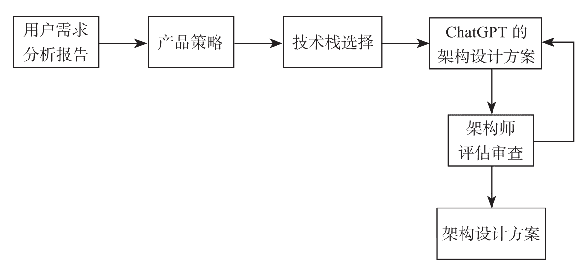

图 3-1 ChatGPT 辅助架构设计的基本过程

## **3.5 用 ChatGPT 构建 TMS 微服务架构**

本小节继续以 TMS 系统开发为案例，说明架构师如何借助 ChatGPT 完成架构设计。在与 ChatGPT 交互时，要始终以最终的架构设计文档为目标导向，循序渐进地引导其完成各部分内容。为让 ChatGPT 更准确地理解待设计或优化的应用，从而生成更贴合的 TMS 架构文档，架构师需先依据结构化提问法准备好背景资料。背景资料主要包含：

❑ 用户需求分析报告、用户画像以及需求规格说明书。
❑ 基于团队现状、既有系统和技术规范梳理出的 TMS 技术栈、组件、功能模块、数据流和通信方式。
❑ 以架构设计文档为主线逐步深化，最后整合形成完整文档。

首先把用户需求、现实约束和文档输出要求等信息提供给 ChatGPT，随后按照结构化提问法的七个要素——核心、详细、背景、优先级、具体、限制、输出——逐步让其生成架构设计文档。 

1. 项目背景

一家支付公司拟开发 TMS，用来管理全国各地的 POS 机。主要目的是提升信用卡收单业务能力，有效管控为商户配置的大量终端。

服务对象：支付公司部署在各地的 POS 机。
目标用户：公司内部的 POS 机管理团队。
核心功能：软件管理、密钥管理、设备管理、参数管理。
用户规模：5 名 POS 管理员。
终端数量：当前已投放约 100 万台 POS 机。
性能要求：支持 50 个并发请求，响应时间 3 秒内。
安全要求：满足 PCI-DSS 认证标准。
扩展要求：随业务增长可无障碍扩展。

2. 功能层次划分

各层模块拆分如下。

❑ 核心服务层：设备管理、参数管理、软件管理、密钥管理。
❑ 支撑服务层：远程支持、日志管理、通知管理、用户管理。

3. 系统概述

用户需求：阐述用户需求与期望。
系统目标：明确系统的目标与愿景。
系统功能：列出核心功能与支撑功能。

4. 架构风格

微服务架构：采用微服务风格，将整体拆分为多个独立服务。

5. 模块划分

模块 1：包含功能 1。
模块 2：包含功能 2。
模块 3：包含功能 3。

请基于以上信息分析后给出总体架构设计。 

1. 系统概述

用户需求：某支付公司计划开发 TMS 应用，用于管理分布各地的 POS 机，以更好开展信用卡收单业务，管控大规模商户终端。
系统目标：对全国 POS 机实现有效管理与维护，提升收单业务效率与安全性。
系统功能：
❑ 核心功能层：软件管理、密钥管理、设备管理、参数管理。
❑ 支撑功能层：远程支持、日志管理、通知管理、用户管理。

2. 架构风格

微服务架构：采用微服务架构，将系统拆分为独立服务，以提高可维护性和可扩展性。

3. 模块划分

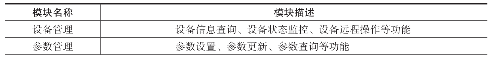

（续）

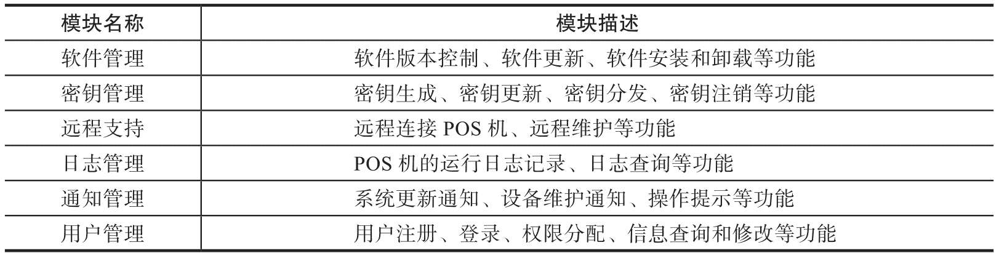

请对各模块进行更细致的功能描述，每个模块用一段文字说明。 

1. 核心功能层

设备管理模块：负责管理各地部署的 POS 机，涵盖设备信息查询、状态监控、远程操作等。管理员可通过该模块进行设备管控，实时获取状态，及时发现并处理异常。

参数管理模块：负责 POS 机参数的统一管理，包括参数设置、更新与查询。管理员可通过该模块集中配置参数，确保各项参数处于合理区间，提升收单效率与安全。

软件管理模块：负责各地 POS 机的软件生命周期管理，包含版本控制、软件更新、安装与卸载。管理员可借助该模块完成升级，确保终端软件保持最新。

密钥管理模块：负责 POS 机密钥全流程管理，包含生成、更新、分发、注销。管理员可通过该模块保障密钥安全可靠，提升业务可信度。

2. 支撑功能层

远程支持模块：实现对 POS 机的远程连接与维护功能。管理员可远程操作，降低运维成本并提高维护效率。

日志管理模块：记录 POS 机运行日志并提供查询能力。管理员可据此追踪异常，及时处置问题。

通知管理模块：负责系统更新、设备维护、操作提示等信息的发送。管理员可通过该模块推送通知，提升用户体验与维护效率。

用户管理模块：管理系统用户，涵盖注册、登录、权限分配、信息查询与修改。管理员可对用户进行管控，保障系统安全可靠。

在水母开发模式下，架构师与 ChatGPT 共同产出的设计结果需先经自身评估。若不能满足需求则需返工；若受限于技术资源、团队能力或规范，则需做适应性调整，直至满意。方案确定后可组织架构或技术委员会评审，从业务、产品、架构、编码、测试、部署、安全、监控等多维度提出意见，必要时甚至推倒重来。因此在与 ChatGPT 讨论过程中应完整保留过程信息以备复盘。

水母开发模式强调设计，设计篇幅自然较大。为聚焦讨论，本书将宏观设计拆分为架构设计、技术栈选型、高层设计、数据库设计、UI/UX 设计五章展开：

❑ 第三章即本章，基于需求分析与规格说明书，讨论如何借助 ChatGPT 生成总体架构设计文档。
❑ 第四章结合四个关键因素，讨论如何利用 ChatGPT 选择技术栈，并完成 TMS 技术栈选型。
❑ 第五章深入高层设计，借助 ChatGPT 完成 TMS 各功能模块的接口定义。
❑ 第六章聚焦数据库设计，分析实体属性及关系，完成 TMS 数据库构建。
❑ 第七章聚焦 UI/UX 设计，讨论设计师如何与 ChatGPT 互动并完成界面设计。

为便于阅读与信息完整，TMS 架构设计文档将置于附录供参考。

## **3.6 小结**

在完成需求分析、产品策略与技术栈选型后，架构师与 ChatGPT 交互生成架构方案。吸收 ChatGPT 建议后，架构师需充分讨论与评审，确保方案合理可用，最终形成完善设计。该方法同样适用于系统持续优化。需重申，针对现有架构的痛点与改进方向，如性能瓶颈、安全隐患、扩展困难等，架构师必须清晰系统地阐述。依据优化目标提出具体问题，例如如何解决特定性能问题、如何提升水平扩展能力、如何增强安全性等。同时要审慎评估 ChatGPT 建议的适用性，并综合成本、时间与风险权衡。

# **第四章**

# **ChatGPT 驱动技术栈选择**

产品经理完成需求分析后，架构师即可启动软件架构工作，而技术栈选型是首要环节，因其直接影响后续数据库、后端接口等设计。当前技术栈众多，如何兼顾兼容性、适用性与持久性，选择与团队及应用匹配的方案极具挑战。本章探讨如何借助 ChatGPT 选择合适的技术栈。

## **4.1 技术栈的基本概念**

软件技术栈是指开发过程中所使用的一系列技术、工具、框架与编程语言的组合。完整的技术栈覆盖开发全流程，为团队构建高效、可扩展、可维护的产品提供支撑。常见构成包括：

❑ 编程语言：用于编写代码的语言，如 Java、Python、JavaScript、C#、Go 等。
❑ 开发框架：基于语言的框架以简化流程并提升效率，如 Spring、Django、React 等。
❑ 数据库技术：关系型数据库如 MySQL、PostgreSQL、Oracle，非关系型如 MongoDB、Redis、Cassandra。
❑ 前端技术：HTML、CSS、JavaScript 及前端框架如 React、Angular、Vue.js 等。
❑ 后端技术：构建服务端逻辑的技术，如 Node.js、Java、Python、Ruby 等。
❑ 测试技术：单元测试框架如 JUnit、unittest、Mocha；集成测试框架如 pytest、SpringBootTest；端到端测试框架如 Selenium、Cypress；性能测试工具如 JMeter、LoadRunner、Gatling。
❑ 服务器与部署技术：Linux、Nginx、Apache、AWS、Azure 等。
❑ 版本控制系统：Git、Subversion 等。
❑ 开发工具与 IDE：Visual Studio Code、IntelliJ IDEA、Eclipse 等。

## **4.2 目前的主流技术栈及其比较**

常见的技术栈包括：

❑ LAMP 技术栈
❑ MEAN 技术栈
❑ MERN 技术栈
❑ JAM 技术栈
❑ .NET 技术栈
❑ Java 技术栈
❑ Ruby 技术栈
❑ Python 技术栈
❑ Go 技术栈

不同技术栈诞生于不同背景，适用场景各异，了解其优劣有助于决策。表 4-1 汇总了九类主流技术栈的优点与缺点。

表 4-1 九种主流技术栈的优点和缺点

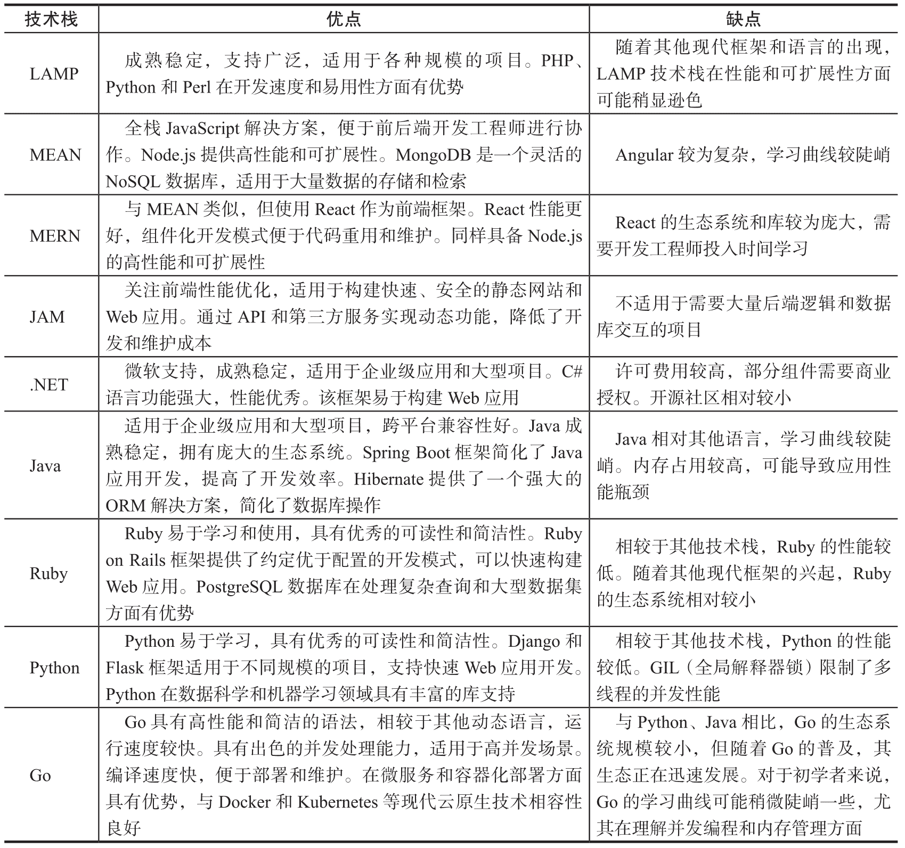

## **4.3 选择技术栈的原则**

选型需综合项目需求、团队技能、项目规模与资金预算。

**1. 项目需求**

首先看项目具体需求。需实时数据处理或高并发时，要选支持此类能力的栈；需与其他系统集成时，兼容性强的栈更合适。还要考虑长期维护与演进，选择生态良好、社区活跃的技术栈。

**2. 团队技能**

团队能力和经验是关键。优先选择成员熟悉的栈，可降低培训成本并提升质量。若引入新技术需评估是否能显著改善功能或性能，否则建议选用团队已掌握的方案。

**3. 项目规模**

规模影响选型。小型项目可采用轻量级栈快速交付；大型项目需更健壮、可扩展的栈，支持复杂业务与高负载，且需考虑微服务、模块化等架构。选型要兼顾当前与未来扩展，避免短期易用、长期无成长空间的方案。

**4. 资金预算**

成本也是重要因素。需考虑开发、部署、维护费用，部分技术需付费授权或支持，开源方案则成本更低。引入全新栈还涉及培训、招聘与硬件资源投入，可能延迟交付。反之，高效方案也能带来更好的用户体验。

综合以上四个因素进行权衡，如图 4-1 所示。

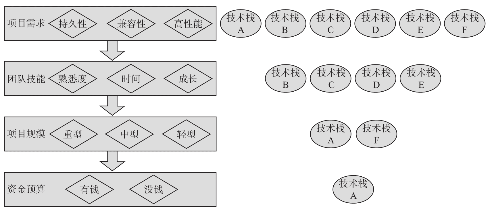

图 4-1 选择技术栈的四个考虑因素

实践经验表明，选型首要看项目需求是否匹配，就像买衣服要合身；其次看团队能否驾驭，买车要有合格司机；再看项目规模，小型站点无需重型栈；最后看预算，没有资金支持一切皆空。架构师需审慎选型，避免盲目追新或固步自封。图 4-2 展示了借助 ChatGPT 选择技术栈的流程。

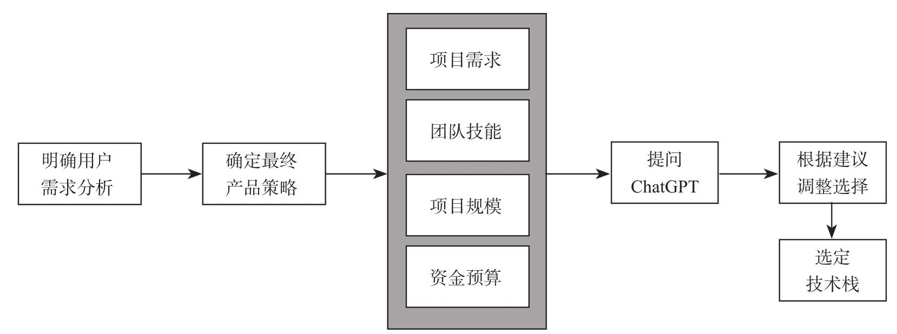

图 4-2 利用 ChatGPT 选择技术栈的过程

## **4.4 TMS 技术栈选择**

选型前需先了解团队已掌握的技术栈及行业主流语言、框架、库与工具，并对比优劣。其次明确项目需求、团队技能、规模与预算四个维度，请 ChatGPT 进行评估与推荐。同时持续阅读文档、案例与社区讨论，保持对技术栈现状的敏感度。

在 TMS 案例中，架构师已梳理出相关内容，准备向 ChatGPT 提问。

**1. 项目背景概览**

❑ 项目诉求：追求高性能表现、良好的扩展能力、可靠的安全性以及容器化部署能力。
❑ 团队掌握能力：Go 语言、Gin HTTP Web 框架、标准库 net/http、MySQL 数据库、容器化运维。
❑ 项目体量：中等偏小的规模。
❑ 资金情况：暂无明确预算限制。
❑ 可复用的底层能力：日志处理服务 CAL、通知下发服务 CNS、单点登录服务 SSO。

**2. 后端技术约定**

❑ 编程语言：Go。
❑ Web 框架：Gin HTTP Web。
❑ HTTP 基础库：net/http。

**3. 前端技术约定**

❑ 框架：Vue 3。
❑ PC 端组件库：Ant Design Vue / Element Plus。
❑ 移动端组件库：Vant。
❑ 状态管理：Pinia。
❑ 路由管理：Vue Router。
❑ 类型校验：TypeScript。
❑ 包管理工具：pnpm。
❑ 构建链路：Vite。
❑ 代码规范：ESLint / Prettier。
❑ 单元测试：Vitest。

**4. 现有测试工具清单**

❑ 功能验证：Postman、Selenium 等。
❑ 性能压测：JMeter、Locust 等。
❑ 安全检测：OWASP ZAP、Burp Suite 等。
❑ 兼容性验证：BrowserStack、Sauce Labs 等。
❑ 缺陷跟踪：Jira、Bugzilla 等。

**5. 已有的部署运维资源**

❑ 云厂商：AWS、GCP。
❑ 计算资源：AWS EC2、GCP VM、Docker。
❑ 存储与数据：AWS S3、AWS EBS、AWS RDS Aurora MySQL、AWS RDS MySQL、AWS OpenSearch（ES）、AWS ElasticCache（Redis）、Redis、MySQL、ClickHouse。
❑ 持续交付：GitLab。
❑ 数据库：MySQL。
❑ 代码托管：GitLab。
❑ 镜像托管：AWS ECR / GCP GCR。
❑ Shell 环境：/bin/bash。
❑ 安全防护：AWS WAF、AWS Shield Advance、AWS GuardDuty、AWS Inspector、AWS SecurityGroup、GCP App Armor。

架构师在梳理完用户需求分析、用户画像、需求规格说明后，对以上几类要素进行归纳，并采用结构化提问法拆解问题。表 4-2 记录了准备 TMS 技术栈选型报告的具体思路。

表 4-2 用结构化提问法准备 TMS 技术栈选择报告

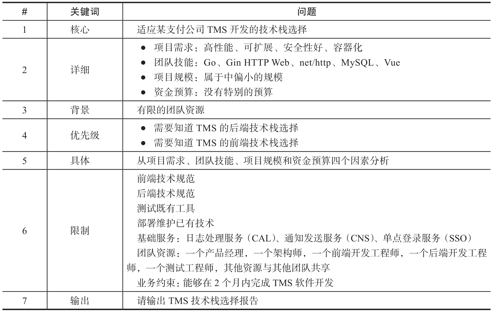

按结构化提问法整理 TMS 技术栈选型问题，再与 ChatGPT 展开对话，具体流程如下。

1. 核心问题：为某支付公司 TMS 研发匹配合适的技术栈。
2. 细节描述
项目诉求：高性能、可扩展、安全性好、容器化。
团队技能：Go、Gin HTTP Web、net/http、MySQL、Vue。
项目规模：中偏小。
预算情况：无特殊预算限制。
基础服务：日志处理服务 CAL、通知发送服务 CNS、单点登录服务 SSO。
3. 背景限制：团队资源有限。
4. 优先级
❑ 明确 TMS 后端技术栈。
❑ 明确 TMS 前端技术栈。
5. 分析维度：从项目诉求、团队技能、项目规模、资金预算四个角度进行研判。
6. 约束条件
前端框架限定为 Vue 3。
PC 端 UI 组件库为 Ant Design Vue、Element Plus。
移动端 UI 组件库为 Vant。
状态管理使用 Pinia。
路由管理使用 Vue Router。
类型检查使用 TypeScript。
包管理器使用 pnpm。
构建工具使用 Vite。
规范检查使用 ESLint / Prettier。
后端基于 Go、Gin HTTP Web、net/http。
功能测试可用 Postman、Selenium 等。
性能测试可用 JMeter、Locust 等。
安全测试可用 OWASP ZAP、Burp Suite 等。
兼容性测试可用 BrowserStack、Sauce Labs 等。
缺陷管理可用 Jira、Bugzilla 等。
云端 Kubernetes 与 MySQL 数据库已形成标准体系，无需另行推荐。
团队配置：1 名产品经理、1 名架构师、1 名前端开发、1 名后端开发、1 名测试，其余资源按需共享。
业务时限：2 个月内完成 TMS 软件开发。
7. 输出要求：输出 TMS 技术栈选型报告。

基于所给关键信息，TMS 技术栈选型报告如下。

一、后端技术栈建议
编程语言：Go。
Web 框架：Gin HTTP Web。
HTTP 库：net/http。
鉴权授权：OAuth 2.0、JWT。
API 形式：RESTful 或 GraphQL，按需选用。

二、前端技术栈建议
前端框架：Vue 3。
PC 端 UI 组件库：Ant Design Vue、Element Plus。
移动端 UI 组件库：Vant，如需移动端访问。
状态管理：Pinia。
路由管理：Vue Router。
类型检查：TypeScript。
包管理器：pnpm。
构建工具：Vite。
规范检查：ESLint / Prettier。

三、测试技术建议
功能测试：Postman、Selenium 等。
性能测试：JMeter、Locust 等。
安全测试：OWASP ZAP、Burp Suite 等。
兼容性测试：BrowserStack、Sauce Labs 等。
缺陷管理：Jira、Bugzilla 等。

四、部署运维技术建议
云服务：AWS、GCP。
计算：AWS EC2、GCP VM、Docker。
存储：AWS S3、AWS EBS、AWS RDS Aurora MySQL、AWS RDS MySQL、AWS OpenSearch（ES）、AWS ElasticCache（Redis）、Redis、MySQL、ClickHouse。
CI/CD：GitLab。
数据库：MySQL。
代码库：GitLab。
镜像仓库：AWS ECR、GCP GCR。
Shell：/bin/bash。
安全设施：AWS WAF、AWS Shield Advance、AWS GuardDuty、AWS Inspector、AWS SecurityGroup、GCP App Armor。

五、基础服务接入
日志处理：CAL。
通知发送：CNS。
单点登录：SSO。

总体来看，结合项目诉求、团队能力、规模与预算，我们为支付公司 TMS 推荐了上述前后端技术组合。建议仅作参考，落地时需根据实际情况微调。鉴于团队已具备云端 Kubernetes 标准体系，本报告未重复推荐容器化部署方案。

架构师结合 ChatGPT 的分析，对各技术选型进行匹配度评估，重点考量长期维护成本、系统扩展性与开发效率。随后进一步调研文档、案例与课程，深化对各栈优缺点的认知，并基于项目需求与团队能力向 ChatGPT 提出结构化问题，获得具体方案，经综合评审后确定最终选型。

**1. 前端技术栈最终确定**
❑ 框架：Vue 3。
❑ PC 端 UI：Ant Design Vue、Element Plus。
❑ 移动端 UI：Vant，如需移动端支持。
❑ 状态管理：Pinia。
❑ 路由管理：Vue Router。
❑ 类型检查：TypeScript。
❑ 包管理器：pnpm。
❑ 构建工具：Vite。
❑ 规范检查：ESLint / Prettier。

**2. 后端技术栈最终确定**
❑ 编程语言：Go。
❑ Web 框架：Gin HTTP Web。
❑ HTTP 库：net/http。
❑ API 设计：RESTful。

**3. 基础服务集成**
❑ 日志处理服务：CAL。
❑ 通知发送服务：CNS。
❑ 单点登录服务：SSO。

**4. 测试技术栈**
❑ 功能测试：Selenium，接口测试可直接用 Python 调用，无需强制 Postman。
❑ 性能测试：JMeter。
❑ 安全测试：Burp Suite。
❑ 兼容性测试：BrowserStack。
❑ 缺陷管理：Jira、Bugzilla 等。

**5. 部署与运维技术栈**
❑ 云服务：AWS、GCP。
❑ 计算：AWS EC2、GCP VM、Docker。
❑ 存储：AWS S3、AWS EBS、AWS RDS Aurora MySQL、AWS RDS MySQL、AWS OpenSearch（ES）、AWS ElasticCache（Redis）、Redis / MySQL、ClickHouse。
❑ CI/CD：GitLab。
❑ 代码库：GitLab。
❑ 镜像仓库：AWS ECR、GCP GCR。
❑ Shell：/bin/bash。
❑ 安全设施：AWS WAF、AWS Shield Advance、AWS GuardDuty、AWS Inspector、AWS SecurityGroup、GCP App Armor。

**4.5 小结**

技术栈选型关乎项目成败，必须审慎对待。不同栈各有优势与局限，适用场景不同，并不存在放之四海皆准的最佳方案。选型时应综合项目需求、团队技能、规模与预算四要素。此外与 ChatGPT 协作时，建议先用结构化提问法整理问题再提问，可显著提升效果；互动过程应循序渐进、逐步深化。总体而言，架构师需因地制宜、理性取舍，切忌盲目照搬 ChatGPT 的建议。

# 第五章

# ChatGPT 驱动高层设计

架构设计聚焦系统宏观结构，为高层设计奠定基础。高层设计聚焦单个模块的具体实现，为开发提供细化指导，其目标是确保代码实现与设计意图一致。主要关注模块内部的类、接口、数据结构等设计。本章在既有微服务架构方案的基础上，探讨架构师如何借助 ChatGPT 完成高层设计。

## 5.1 高层设计的主要文档

为高效配合 ChatGPT，首先需建立高层设计框架，依据交付物明确工作清单，再在框架下引导 ChatGPT 并结合实际逐步完成设计。

该框架能提供清晰指引，帮助与 ChatGPT 交互时保持一致性与质量，并确保性能、安全、维护等要素不被遗漏。通过此方式，可充分发挥 ChatGPT 优势，将其作为设计团队成员快速产出高质量方案，同时由架构师负责评审优化，确保符合目标与质量要求。软件高层设计阶段需交付文档众多，其中最核心的三份是架构设计文档、数据库设计文档与接口设计文档。

❑ 架构设计文档：涵盖总体架构、模块间关系、组件功能与接口，是高层设计的核心。
❑ 数据库设计文档：包括模式设计、表字段定义、索引与约束，对数据驱动型应用尤为关键。
❑ 接口设计文档：包含接口规范、请求响应格式、参数与返回值，是系统内外交互的关键。

这三份文档是开发实现的基础，也是架构师与开发工程师沟通的主要载体。其他文档如安全设计、性能设计、部署设计、维护设计等同样重要，但相对次之。另有两类文档常在前三者基础上衍生：测试计划与用例文档、项目计划与排期文档。

❑ 测试计划与用例文档：描述测试策略、方法、范围及具体用例，为后续测试提供依据。
❑ 项目计划与排期文档：明确阶段划分、任务分配、进度预期与交付时间，有助于协同与按时交付。

以上文档为设计、开发、测试、部署提供详细指导，实施过程中需根据实际情况持续调整。敏捷模式下文档权重会下降，但在 ChatGPT 驱动开发中，由于需要持续交互，文档需保持新鲜完整。事实上，ChatGPT 助力开发可大幅提升效率、缩短迭代周期。关键在于将用户需求拆解为 ChatGPT 可理解执行的任务，通过准确指令生成代码。换言之，文档质量直接影响项目成败。

## 5.2 高层设计的原则

在微服务架构下，为达成高内聚低耦合目标，高层设计需遵循以下原则。

❑ 单一职责原则 SRP：模块或类只负责单一职责，减少依赖，提升内聚。
❑ 开放封闭原则 OCP：对扩展开放、对修改封闭，新增功能通过扩展实现而非改动已有代码。
❑ 里氏替换原则 LSP：子类可无损替换基类，保证程序正确性。
❑ 接口隔离原则 ISP：客户端不应依赖不需要的接口，应将大接口拆分为专用小接口。
❑ 依赖倒置原则 DIP：高层模块依赖抽象而非低层具体实现，降低耦合。
❑ 组合复用原则 CARP：优先使用组合或聚合而非继承实现复用，提升内聚。
❑ 德墨忒尔原则 LoD：对象间了解应最小化，减少交互与耦合。

遵循这些原则有助于构建可维护、可扩展、可复用的架构，也适用于评审 ChatGPT 生成的高层设计方案。

## 5.3 ChatGPT 辅助 TMS 高层设计

高层设计在水母开发模式中占据重要比重。图 5-1 展示了 ChatGPT 驱动生成高层设计方案的过程。

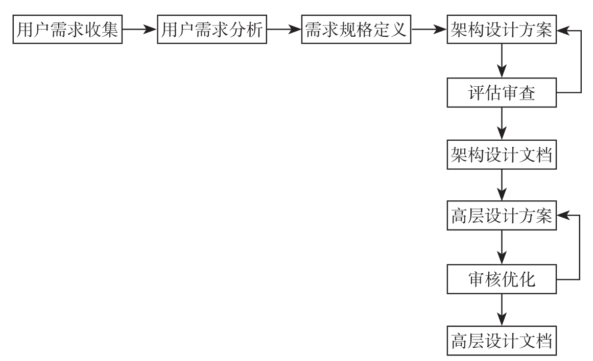

图 5-1 ChatGPT 驱动生成高层设计方案的过程

架构设计基于用户需求定义层次与模块，提供宏观指引；高层设计在此基础上对各层各模块进行具体化，为编码、测试、部署、维护提供微观指导。

架构设计、数据库设计、接口设计是高层设计最核心的三个输出。通过这些文档，开发团队可清晰了解具体实现细节，包括类、接口、数据结构等设计，也有助于遵守规范与质量要求，确保实现与目标一致。高层设计同时兼顾性能、安全、可维护性，为后续工作提供指引。

在 ChatGPT 驱动开发中，高层设计是与 ChatGPT 交互的重要工具。架构师可借助高层设计文档高效指导 ChatGPT 生成代码，并通过审核优化确保符合目标与质量。因此高层设计文档不可或缺，是系统开发与维护的关键。

在完成 TMS 用户需求分析、需求规格、技术栈选型与架构设计后，架构师将与 ChatGPT 逐一对每个微服务模块进行交互，生成更细化的高层设计文档，为接口代码实现奠基。具体流程如下：

1）针对每个微服务模块，列出所需完成的高层设计工作，明确目标与质量要求。
2）将高层设计文档提供给 ChatGPT，引导其逐步完成各模块设计。过程中需将用户需求拆解为可执行问题，结合架构原则与技术栈逐步生成方案。
3）生成方案后进行审核、调整与优化，确保符合目标与质量。如发现潜在问题，需指导 ChatGPT 作相应修正。
4）最终将各模块高层设计汇总为系统总体设计文档，包括总体架构、模块关系、组件功能与接口，成为后续代码实现的基础，确保实现与设计一致。

# ChatGPT 助力 TMS 接口高层设计

在前置步骤的配合下，架构师可以借助 ChatGPT 的生成与归纳能力，把高层设计的工作做得更快更稳，为接口编码打下可靠基础，也能确保最终方案契合系统需求与质量诉求。下面以支付终端管理系统 TMS 的接口设计为例，展现一次完整的协作思路。 

1. 系统概览
业务背景：某支付机构拟建设 TMS，用来统一管控分布在全国各地的 POS 终端，核心目的是支撑信用卡收单业务，做大做强设备规模化运营。
建设目标：实现对异地 POS 设备的集中管控与运维，提升收单效率并强化安全可控。
功能范围：
❑ 核心能力：软件管控、密钥管控、设备管控、参数管控。
❑ 支撑能力：远程协助、日志归集、通知推送、用户管控。

2. 技术选型
架构方向：采用微服务架构，将整体系统拆分为多个独立运行的服务单元，以此增强可维护性与可扩展性。

3. 模块拆分
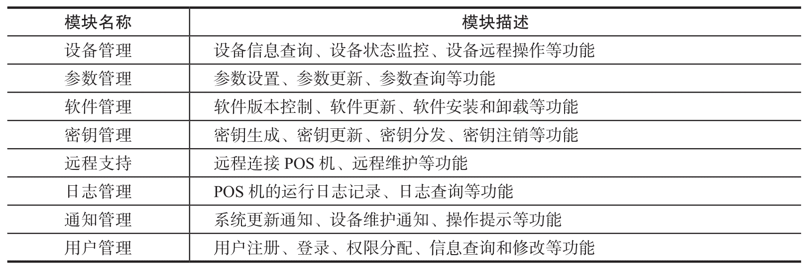

4. 核心能力
设备管控模块：负责全网 POS 设备的全生命周期管理，涵盖设备信息查询、状态实时监控、远程操作等。运维人员可通过该模块掌握设备运行状况，及时定位异常并处置。
参数管控模块：负责 POS 终端参数的集中配置。提供参数设置、参数更新、参数查询等能力，确保各终端参数在合理区间内运行，从而保障业务效率与安全。
软件管控模块：负责终端软件的版本与分发。支持版本管理、在线升级、安装与卸载，保证终端始终运行最新可信的软件。
密钥管控模块：负责终端密钥的安全管理。提供密钥生成、更新、分发、注销等功能，保障密钥全链路安全，提升收单业务的可信度。

5. 支撑能力
远程支持模块：提供 POS 终端的远程连接与维护能力，管理员可在线完成支持操作，降低现场成本并提升响应速度。
日志管理模块：收集并存储终端运行日志，支持按需查询，帮助快速发现异常并追溯原因。
通知管理模块：承担系统更新、设备维护、操作提示等信息的推送，改善用户体验并提高运维效率。
用户管理模块：负责平台用户的全流程管理，包括注册、登录、权限分配、信息查询与修改，保证平台使用安全可靠。

请输出模块、服务调用与操作命名的规范方案。 

1. 模块命名规范
规则为 模块名称+模块类型，例如“用户管理服务”。

2. 服务调用命名规范
规则为 动词+名词，例如“查询设备信息”“更新密钥信息”。

3. 操作命名规范
规则为 动词+名词，例如“添加用户”“删除设备”。

结合具体业务场景明确每个操作的输入、输出参数，描述其功能边界与作用。 

请列出全部功能模块清单，以表格形式呈现，包含模块名称、英文缩写及英文全称。 

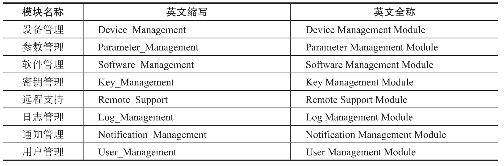

设备管理（Device_Management）操作名称：
查询设备信息（DM_GetDeviceInfo）
监控设备状态（DM_MonitorDeviceStatus）
远程操作设备（DM_RemoteDeviceOperation）
添加设备（DM_AddDevice）
删除设备（DM_RemoveDevice）

请按如下格式产出设备管理模块的接口定义。
查询设备信息（DM_GetDeviceInfo）
输入参数 输出参数 处理逻辑 

设备管理（Device_Management）操作名称：
查询设备信息（DM_GetDeviceInfo）
监控设备状态（DM_MonitorDeviceStatus）
远程操作设备（DM_RemoteDeviceOperation）
添加设备（DM_AddDevice）
删除设备（DM_RemoveDevice）

查询设备信息（DM_GetDeviceInfo）
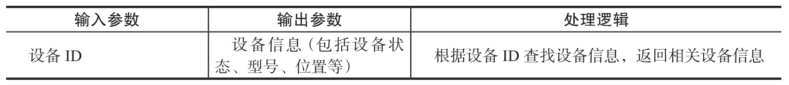

监控设备状态（DM_MonitorDeviceStatus）
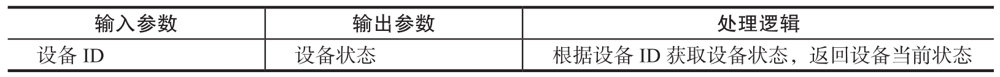

远程操作设备（DM_RemoteDeviceOperation）
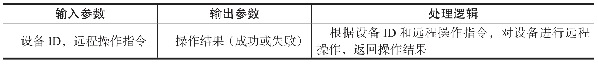

添加设备（DM_AddDevice）
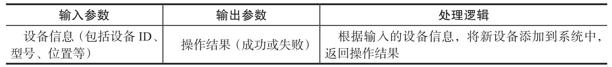

删除设备（DM_RemoveDevice）
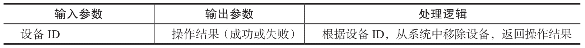

按相同模式生成参数管理模块的接口定义。

参数管理（Parameter_Management）操作名称：
设置参数（PM_SetParameter）
更新参数（PM_UpdateParameter）
查询参数（PM_GetParameter） 

参数管理（Parameter_Management）操作名称：
设置参数（PM_SetParameter）
更新参数（PM_UpdateParameter）
查询参数（PM_GetParameter）

设置参数（PM_SetParameter）
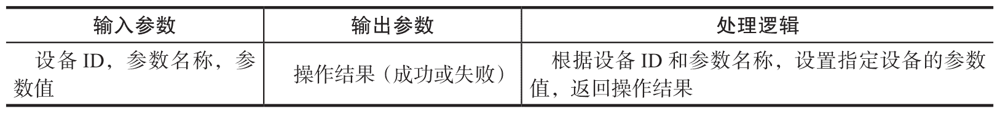

更新参数（PM_UpdateParameter）
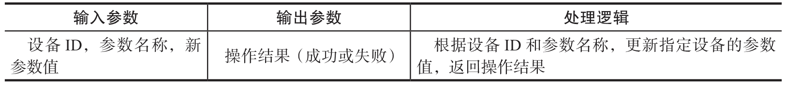

查询参数（PM_GetParameter）
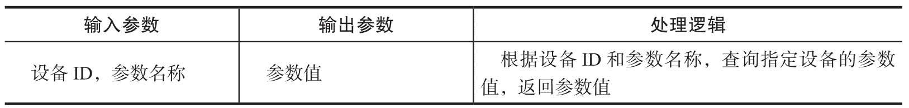

按相同模式生成软件管理模块的接口定义。

按相同模式生成密钥管理模块的接口定义。

按相同模式生成远程支持模块的接口定义。

按相同模式生成日志管理模块的接口定义。

按相同模式生成通知管理模块的接口定义。

按相同模式生成用户管理模块的接口定义。

所有 TMS 各功能模块的接口定义均收录在架构设计文档中。
其他模块的接口定义……
因篇幅限制，仅展示部分交互示例，完整设计请参考本书附录 C。

另一个典型应用是借助 ChatGPT 完成 TMS 接口的测试用例与测试计划撰写。在设备管理模块后端接口定义完成后，可进一步让 ChatGPT 生成对应的测试用例、测试计划及测试数据，以下是交互过程。 

请输出测试用例并给出可执行的测试计划。 

设备管理模块测试用例：
1. 查询设备信息（DM_GetDeviceInfo）
输入：设备 ID
输出：设备信息
预期结果：正确返回设备信息

2. 监控设备状态（DM_MonitorDeviceStatus）
输入：设备 ID
输出：设备状态
预期结果：正确返回设备状态

3. 远程操作设备（DM_RemoteDeviceOperation）
输入：设备 ID，远程操作指令
输出：操作结果（成功或失败）
预期结果：设备成功接收并执行指令

4. 添加设备（DM_AddDevice）
输入：设备信息（含设备 ID、型号、位置等）
输出：操作结果（成功或失败）
预期结果：新设备成功写入系统

5. 删除设备（DM_RemoveDevice）
输入：设备 ID
输出：操作结果（成功或失败）
预期结果：设备成功从系统中移除

测试计划：
1. 准备测试数据
❑ 确保数据库中已有充足的设备记录用于查询验证。
❑ 准备可用的设备 ID、型号、位置等信息以支撑添加设备测试。
❑ 准备若干远程操作指令用于功能验证。

2. 执行测试用例
❑ 单独执行每个用例，确认功能按预期实现。
❑ 进行组合测试，验证各操作之间不存在异常相互影响。

3. 记录测试结果
❑ 记录各用例的执行情况，便于问题追踪与分析。
❑ 发现问题时详细记录现象与复现条件。

4. 缺陷修复
❑ 分析问题根因并进行修复。
❑ 修复后重新执行相关用例，确认问题已闭环。

5. 总结汇报
❑ 基于测试结果撰写测试报告。
❑ 报告应包含用例、数据、结果及问题与对策。
❑ 提交相关方评审确认。
❑ 测试前需完成测试环境配置，包括数据库连接与 API 服务。执行时可根据实际情况动态调整。

## **5.4 小结**
完成宏观架构设计后，架构师需聚焦各功能层级的模块开展高层设计。可与 ChatGPT 协同，对自动生成的方案进行审视与优化，确保最终结果贴合项目需求与团队现状。需注意 ChatGPT 生成的方案未必完全适配实际场景，架构师应依据高层设计原则反复迭代，直至方案满足用户诉求。

# **第六章**

# **ChatGPT 驱动数据库设计**

数据库设计是高层设计的关键环节，也是后续编码的前提。首先要解决数据模型问题，再在此基础上落到表结构。ChatGPT 在表结构生成上的表现同样突出，但要与之有效协作，架构师与数据库管理员需事先准备好业务背景与数据实体定义等信息。

## **6.1 数据库设计与 ChatGPT 的协作**
数据库负责存储与管理应用所需数据。设计阶段由架构师牵头、DBA 配合，规划表结构、字段定义与关联关系。引入 ChatGPT 可提升效率、减少人为失误并优化结构。主要收益包括：
❑ **数据模型生成：** 基于业务需求与数据要求，ChatGPT 可快速产出初步模型，避免遗漏核心表或字段。
❑ **命名规范与最佳实践：** 按团队既有约定为表与字段推荐命名，保持风格统一并提升可读性。
❑ **约束与索引建议：** 依据数据特性与性能目标推荐约束与索引，保障完整性并优化查询。

例如为电商平台设计后端数据库时，架构师先提供用户管理、商品管理、订单管理等需求。ChatGPT据此生成包含表、字段及关系的初步模型，并按团队命名习惯给出 user 表及 id、username、email 等字段命名，同时为 id 添加主键约束，为 email 添加唯一约束与索引。协作后在较短时间内完成设计，保持命名一致并兼顾查询性能。

总体来看，将 ChatGPT 用于数据库设计能够提高效率、优化结构并统一风格。

## **6.2 生成数据库表结构应遵循的原则**
在微服务下，表结构设计需兼顾解耦、可扩展与高性能，关键原则如下：
**1. 数据库独立性**
每个微服务拥有独立数据库，实现数据隔离，降低服务耦合，提升扩展与故障隔离能力。
**2. 数据模型简化**
依据服务业务需求设计模型，保持结构简洁，有利于性能与复杂度控制。
**3. 避免冗余**
尽量消除重复存储，跨服务数据共享可通过事件驱动或 API 获取。
**4. 一致性与可用性权衡**
根据业务对实时性或一致性的要求选择合适的分布式方案与事务策略。
**5. 数据库类型选择**
结合场景选择关系型、文档型、列式等合适类型。
**6. 性能优化**
合理使用索引、分区、视图等手段提升查询效率。
**7. 版本控制**
使用 Liquibase、Flyway 等工具管理 schema 变更，保障一致性与持续集成。
**8. 安全与合规**
对敏感数据加密存储，限制访问权限，符合法规与行业标准。

生成表结构主要有两种思路：正向工程，基于描述生成 SQL 语句，适合新系统开发；逆向工程，基于已有数据反推结构，适合迁移或优化。

## **6.3 利用 ChatGPT 完成数据库设计**
高层设计阶段，交付物是数据库设计规范，包含模式、表字段定义、索引约束等，是编码的基础。协作流程建议分为五步：
**（1）引导理解业务与实体定义：** 提供充分的业务划分、功能定义及数据实体说明，确保 ChatGPT 准确理解。
**（2）生成表结构方案：** 在架构原则与技术栈约束下，逐步指导生成具体表结构，确保满足目标与需求。
**（3）审核、调整与优化：** 对生成方案进行评审，发现问题即时反馈调整，确保与已有结构兼容，数据一致完整。
**（4）生成设计文档：** 由架构师与 DBA 整理成数据库设计规范，明确实体关系、属性类型、索引约束等细节。
**（5）评审归档：** 提交团队评审并持续优化，形成后续开发的重要依据。DBA 需同时对表结构进行合规性与最佳实践校验。

借助图6-1所展示的工作链路，设计师与数仓负责人可以充分发挥ChatGPT的生成能力，在更短的时间内完成表结构梳理，为后续开发落地打下坚实基础，同时保证方案贴合业务诉求与质量标准。

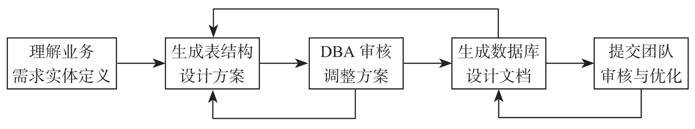

图6-1 ChatGPT驱动的数据库设计流程

下面以企业人员表的构建为例，说明如何向ChatGPT完整描述各项数据要素及实体间的逻辑关系，进而得到表结构，这即是前面提到的正向构建思路。 

人员要素的说明如下。

姓名 Name：记录个人的全名。
性别 Gender：个人的性别分类，如男、女或其他。
出生日期 Date_of_Birth：个人的出生具体日期。
身份证号 ID_Number：个人的身份证号码或其他有效证件编号。
国籍 Nationality：个人所属国家。
籍贯 Hometown：个人的祖籍地。
民族 Ethnicity：个人的民族属性。
婚姻状况 Marital_Status：个人的婚姻状态，如已婚、未婚、离异等。
联系电话 Phone_Number：可联系的电话号码。
电子邮箱 Email：电子邮箱地址。
家庭住址 Home_Address：家庭居住地址。
入职日期 Hire_Date：正式进入公司的日期。
职位 Position：在公司担任的岗位。
部门 Department：所属组织单元。
直接上级 Supervisor：直属领导或经理。
薪资等级 Salary_Grade：对应的薪酬等级。
基本工资 Base_Salary：基础薪酬数额。
员工状态 Employment_Status：当前在职状态，如在职、离职、休假等。
教育背景 Education_Background：最高学历或学位。
毕业院校 Graduated_School：毕业学校名称。
专业 Major：所学专业方向。
紧急联系人 Emergency_Contact：指定的紧急联络人姓名。
紧急联系人电话 Emergency_Contact_Phone：紧急联络人电话号码。

基于上述人员要素的说明，先对人员基础数据构成进行提炼，再提出包含引用关系的建库方案。 

在对前期要素进行归纳后，可规划出人员主表与组织单元表两张结构，并在人员主表中引入上级引用与组织引用的键值关联。

1. 人员主表 employee_info
id：主键，自增整型
name：姓名，字符型
gender：性别，字符型
date_of_birth：出生日期，日期型
id_number：证件号，字符型
nationality：国籍，字符型
hometown：籍贯，字符型
ethnicity：民族，字符型
marital_status：婚姻状况，字符型
phone_number：联系电话，字符型
email：邮箱地址，字符型
home_address：家庭住址，字符型
hire_date：入职日期，日期型
position：职位，字符型
salary_grade：薪资等级，整型
base_salary：基本工资，浮点型
employment_status：在职状态，字符型
education_background：最高学历，字符型
graduated_school：毕业院校，字符型
major：专业，字符型
emergency_contact：紧急联系人，字符型
emergency_contact_phone：紧急联系人电话，字符型
supervisor_id：直属上级编号，引用 employee_info 的 id
department_id：组织编号，引用 department_info 的 id

2. 组织单元表 department_info
id：主键，自增整型
name：部门名称，字符型
manager_id：部门经理编号，引用 employee_info 的 id

此种安排便于实现组织与人员的联动检索，例如调取某组织下的人员清单或反查某人所属组织名称，同时降低重复存储与不一致风险。 

请给出数据实体间的关联示意。 

作为文本生成模型，我无法直接绘制ER图，但可以提供文字化描述，便于使用专业工具绘制。

ER图中可定义两个实体：人员主表 employee_info 与组织单元表 department_info。

人员主表 employee_info 的属性包括：

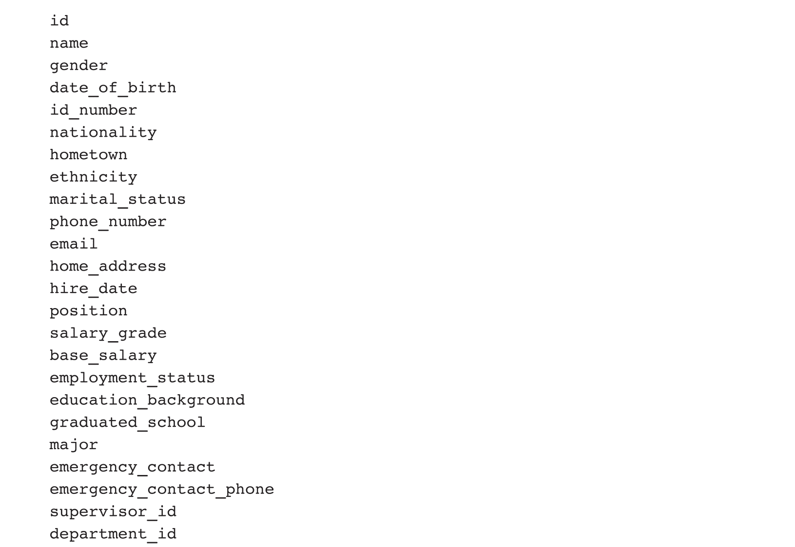

组织单元表 department_info 的属性包括：

ER图中需定义以下联系。

❑ 经理映射：department_info 的 manager_id 与 employee_info 的 id 之间的键值引用，表示每个组织对应一位经理，而一人可担任多组织的经理。
❑ 人员-组织映射：employee_info 的 department_id 与 department_info 的 id 之间的键值引用，表示一人仅归属一个组织，一个组织可包含多人。
❑ 上级映射：employee_info 的 supervisor_id 与 employee_info 的 id 之间的自引用，表示每人有一位直属上级，而一人可成为多人的直属上级。

可借助 Lucidchart、dbdiagram.io 等工具据此绘制 ER 图。 

请基于以上提炼结果，生成创建人员信息数据库 EDB、为应用创建数据库用户、定义数据表并建立表间关系的 MySQL 语句。 

MySQL 实现要点如下。

创建人员信息数据库 EDB：

为应用创建数据库用户，将 username 与 password 替换为实际值：

定义人员主表与组织单元表：

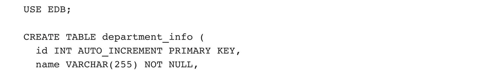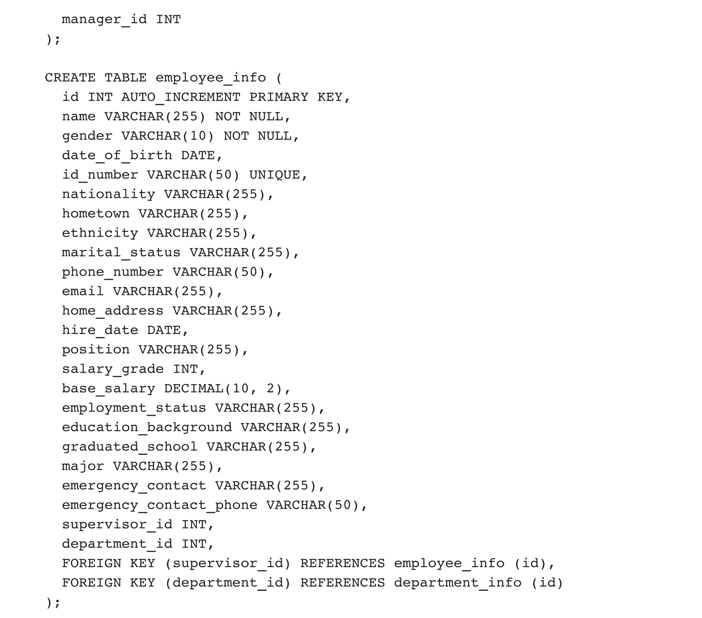

建立经理与人员表之间的引用：

上述 SQL 在 EDB 中创建了 employee_info 与 department_info 两张表并建立了引用关系，实际执行时需替换用户名与密码。 

请据前述 SQL 生成更具体的表结构描述图。 

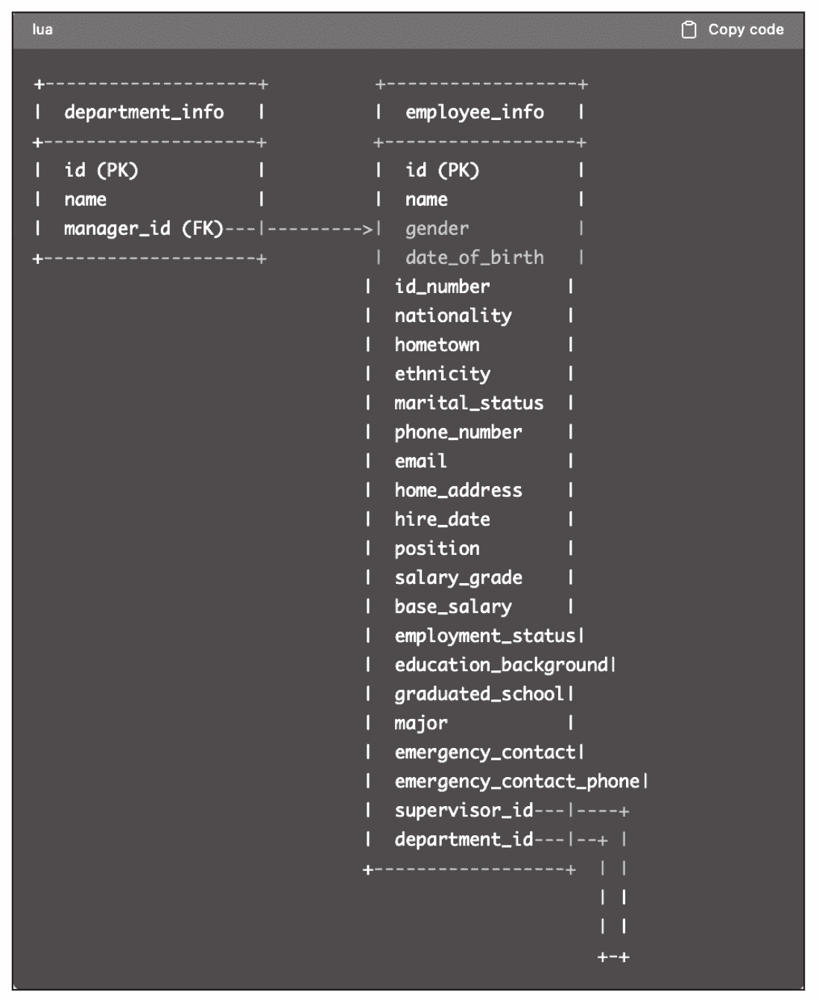

该示意图展示了 EDB 中的 department_info 与 employee_info。图中标明了主键 PK 与外键 FK，department_info 的 manager_id 作为外键指向 employee_info 的 id，employee_info 中的 supervisor_id 与 department_id 分别指向 employee_info 自身的 id 与 department_info 的 id，形成网络化关联。 

依据上述表结构生成 10 条样本数据，并展示前 6 项。 

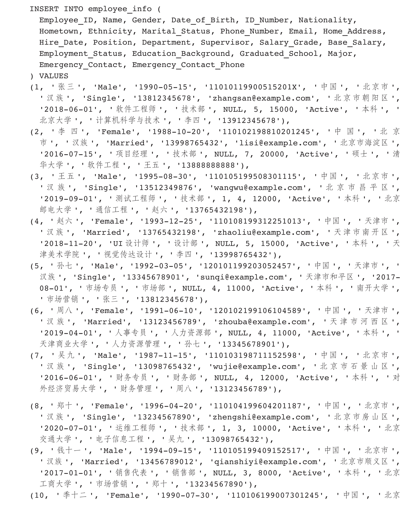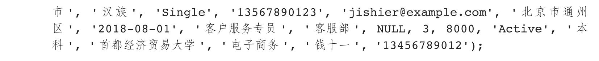

前 6 条数据项如下：

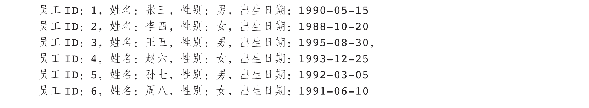

通过该流程，设计师在 ChatGPT 协助下由需求描述生成可用的数据结构，并通过样本数据直观验证结构的合理性。经数仓负责人审核后，SQL 即可在 MySQL 中执行生成人员信息表。

## 6.4 基于样例数据的逆向建模

在工程实践中，梳理大量实体属性及数据项间关联往往繁琐且抽象。设计师或数仓负责人可与 ChatGPT 互动，利用真实样例进行剖析，从而完成建模。同样在系统迁移或数据结构不明时，也可采用此逆向工程方法。例如已有某企业人员与组织的样例数据，可让 ChatGPT 据关联关系生成合适的表结构。 

我有两类数据，一类为企业组织，另一类为企业人员。具体样例如下。

组织数据：

人员数据：

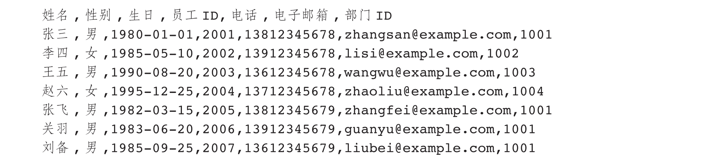

请分析这两类数据的构成及相互关系。 

从样例可归纳出：

组织数据包含组织简称、组织全称、组织 ID、地址、负责人等字段。
人员数据包含姓名、性别、生日、人员 ID、电话、电子邮箱、组织 ID 等字段。

两者通过组织 ID 建立联系，组织 ID 在组织数据中唯一，在人员数据中作为人员所属组织的标识。两者呈现一个组织对应多人员、每个人员只归属一个组织的对应模式。 

请据上述情况定义两个数据表并明确关联。 

可定义如下：

组织表 department
id：组织 ID，主键自增整型
abbreviation：组织简称，字符型
name：组织名称，字符型
address：组织地址，字符型
manager_name：负责人姓名，字符型

人员表 employee
id：人员 ID，主键自增整型
name：姓名，字符型
gender：性别，字符型
birth_date：生日，日期型
phone：联系电话，字符型
email：邮箱，字符型
department_id：所属组织 ID，引用 department 的 id

两者通过 department_id 建立多对一的引用，一个组织可包含多名人员，每名人员仅属一个组织。 

请据表定义生成 MySQL 语句，创建数据库、建表并建立关系。 

对应 SQL 要点如下：

SQL 首先创建 company_db 数据库，随后创建 department 与 employee 表，并以 department_id 建立引用。

利用现有样例生成表结构的方法很适合迁移场景。例如某商业服务设施展示网站因流量激增需重构，从低代码平台迁移至 Go 技术栈。旧数据以 JSON 存储，需解析后导入 MySQL。技术人员导出典型 JSON 样例，通过 ChatGPT 逆向生成表结构及查询 API，在保持前端不变的情况下完成数据迁移。

## 6.5 ChatGPT 赋能 TMS 数据库设计与生成

TMS 高层设计中，架构师对参数管理、设备管理、软件管理、密钥管理等模块进行了概要设计，各模块均涉及数据库设计。但 TMS 的表并非完全独立，模块间存在内在与外在关联。因此高层设计阶段需从宏观视角厘清领域、实体属性及关联，消除重复表字段与关系，补充缺失部分。

在此基础上，数仓负责人与 ChatGPT 协作生成统一数据库视图，经分析验证优化后形成完整方案，再交由 ChatGPT 生成建库 SQL，以保证准确性与完整性，为 TMS 开发奠定基础。 

1. 设备表 devices：
设备 ID id
设备序列号 serial_number
设备状态 status

# AI 协同下的 TMS 模型实践

TMS 的基础架构由六组核心表构成。

设备侧收录 model、location、merchant_id、created_at、updated_at 等属性，完成单台设备的基本画像与归属。

2. merchants 商户档案：
id、name、contact_name、contact_phone、address、created_at、updated_at

3. parameters 参数配置：
id、device_id、name、description、type、value_range、created_at、updated_at

4. versions 软件版本：
id、name、version、description、release_time

5. upgrading_tasks 升级任务：
id、device_id、version_id、upgrade_time、status、created_at、updated_at

6. keys 设备密钥：
id、device_id、key_type、key_value、key_status、created_at、updated_at

请基于合理性判断上述 TMS 核心模块的数据结构，有无缺失或重复？ 

总体来看，当前设计的思路清晰、覆盖面较广，表间关联也表达明确。大致可概括为：

❑ devices 承担设备基础信息并体现与商户的归属。
❑ merchants 保存商户档案。
❑ parameters 存放设备绑定的配置项。
❑ versions 记录软件版本的基础信息。
❑ upgrading_tasks 记录升级任务并关联设备与版本。
❑ keys 保存设备绑定的密钥。

整体未见明显重复或空缺，上线前仍建议结合真实业务做细化调整，遇到问题可随时讨论。 

据此结构在 MySQL 中创建 TMSDB，操作账号为 tmsuser，完成建表、关联与索引工作。 

首先，新建 TMSDB 与账号 tmsuser：

随后，定义表结构及必要关联：

最后，补充相应索引：

以上脚本可完成数据库创建、用户建立、表结构与关联定义及索引生成。请把 your_password 替换为实际密码。 

对 TMSDB 的数据模型进行说明。 

TMSDB 由六张主体表组成。

1. devices 设备表：
汇总 TMS 全部设备的明细，字段涵盖设备 ID、序列号、状态、型号、位置、所属商户 ID、创建时间与更新时间。

2. merchants 商户表：
保存与设备相关的商户档案，字段包括商户 ID、名称、联系人、联系电话、地址、创建时间与更新时间。

3. parameters 参数表：
收纳设备相关的配置参数，字段包括参数 ID、设备 ID、参数名称、描述、类型、取值范围、创建时间与更新时间。参数表通过设备 ID 与设备表关联。

4. versions 软件版本表：
记录 TMS 可用软件版本，字段包括版本 ID、软件名称、版本号、描述、发布时间。

5. upgrading_tasks 软件更新表：
记录设备的软件升级任务，字段包括任务 ID、设备 ID、版本 ID、升级时间、任务状态、创建时间与更新时间。该表通过设备 ID 与设备表关联，通过版本 ID 与软件版本表关联。

6. keys 密钥表：
收纳设备的密钥信息，字段包括密钥 ID、设备 ID、密钥类型、密钥值、密钥状态、创建时间与更新时间。通过设备 ID 与设备表关联。

整体来看，该模型为 TMS 提供了结构化的数据承载与管理方式，覆盖设备、商户、参数、版本、升级任务与密钥等核心要素，有助于高效存取与查询，支撑业务运转。

数据库管理员按 ChatGPT 给出的建库脚本完成了 TMSDB 部署。随后借助 dbForge Studio、MySQL Workbench 等逆向工具，将已建库反向生成可视化的 ER 视图。TMSDB 案例即由 MySQL Workbench 生成了如下 ER 图。此类视图便于管理员进一步审视，确保建成的 TMSDB 结构符合架构设计与高层设计要求，进而支撑后续开发。

图 6-2 根据创建的 TMSDB 生成 ER 图

ER 图可直观呈现表间关系、字段类型、索引与约束。若对照架构与高层设计文档发现偏差，可及时调整表结构，保证设计正确性与一致性。

确认结构满足设计要求后，管理员将成果交付开发团队使用。在项目全周期内，管理员与 ChatGPT 的协作提升了 TMSDB 设计的质量与效率。

# **6.6 小结**

建立数据库表关系是高层设计的关键环节，也是软件开发的基础。数据库管理员在高层设计阶段明确各模块与数据项并做详细描述，提交给 ChatGPT 由其自动生成数据模型。验证模型正确后，由 ChatGPT 生成 SQL 语句。执行建库脚本即可定义数据表、建立表间关系并生成必要的索引与约束。

# **第七章**

# ChatGPT 驱动的 UI/UX 设计

UI/UX 在软件研发中扮演关键角色。优秀的界面与体验不仅让产品更美观吸引，也能提升用户留存，帮助用户快速定位功能与信息，提升满意度。即便内部系统，直观易用的界面也能加快任务完成、提高生产率。本章聚焦如何借助 ChatGPT 助力设计师打造优质体验。

## **7.1 借助 ChatGPT 把控 UI/UX 设计准则**

遵循设计准则与最佳实践，有助于设计师打造更具吸引力且易用的产品。设计过程中以这些准则为指引，可保持方向正确，避免遗漏关键要素，从而创造卓越体验。设计师在思考与设计时应遵循哪些准则？

**1. 简洁可用准则**
界面与交互应追求简洁、直观与易用，使用者能快速掌握并使用各项功能。降低学习成本的关键在于遵循通用设计模式，如简洁的导航结构与明确的按钮文案，避免过于复杂的菜单，保持操作直接。

**2. 统一性准则**
在整个应用中应使用统一的设计元素与交互方式，以减少用户困惑、提升体验。例如全应用统一色彩、字体、样式与布局，采用统一的操作与导航方式。

**3. 可访问性准则**
设计需兼顾各类用户需求，包括视力、听力障碍人群及老年人等。应确保字体大小、对比度与配色方案适用于不同群体。例如提供字体大小调节、支持屏幕阅读器并提供替代文字说明。

**4. 品牌调性准则**
界面与体验应体现应用的个性与差异化，提升品牌识别度与用户忠诚度。设计需与企业品牌形象与价值观保持一致，如使用品牌专属色与图标传递品牌理念。

**5. 即时反馈准则**
界面应提供清晰及时的反馈，帮助用户理解功能与交互。例如按钮点击时展示动效或声音提示确认操作被执行；任务完成后显示确认信息或弹窗提示。

**6. 扩展性准则**
界面与体验应具备可扩展性，便于未来新增功能或信息同时保持简洁清晰。例如设计灵活的布局以容纳未来元素，或在导航栏预留空间以便新增功能选项。

**7. 以人为本准则**
设计应始终聚焦用户需求与体验，助力用户快速获取信息与功能，提升效率与满意度。例如通过调研与测试了解目标用户需求与偏好，确保设计符合预期。

**8. 简洁可用准则**
界面应当简单、易用、直观，使用户能快速掌握并使用各项功能，从而降低学习成本与使用难度。

总体而言，设计师应始终注重体验与品牌调性，遵循上述准则，打造简洁清晰易用且具个性化的方案，满足用户需求与期望，提升应用价值与满意度。

## **7.2 借助 ChatGPT 从 UI/UX 角度拆解用户需求**

只有掌握用户痛点与期望，才能设计出满足需求的产品与界面。设计启动前，设计师需细读需求说明以初步了解背景、目标用户与需求。ChatGPT 在数据分析与理解能力上表现突出，设计师可请其从需求文档中提取关键信息并整理为易读格式，快速把握项目背景、目标用户与需求。

假设设计师需为健身爱好者设计移动应用。项目背景是提供便捷的健身计划管理与健康数据追踪平台。目标用户为 18～45 岁、注重健康锻炼的初级、中级或高级健身爱好者。设计师可与 ChatGPT 互动，提取并整理关键信息。以下是互动过程。 

项目背景是为健身爱好者设计移动应用，提供便捷的健身计划管理与健康数据追踪平台。目标用户为 18～45 岁、注重健康锻炼的初级、中级或高级健身爱好者。请从 UI/UX 设计角度对项目需求做深入解读与分析，为后续设计奠定基础。 

面向健身爱好者的移动应用，体验应是核心关注点。以下是对该项目 UI/UX 设计的深入解读与分析，可为后续设计提供参考。

1. 用户调研与分析
设计前需先了解目标用户需求与习惯。可通过问卷调查、深度访谈等方式获取更多信息，更好理解用户期望。基于数据确定应用核心功能与内容，确保与目标用户需求匹配。

2. 导航与易用性
移动应用设计需优化导航与易用性，确保用户能快速找到所需信息与功能。可设计简洁直观的导航菜单，便于浏览各部分。同时提供搜索功能，助力用户快速定位内容。

3. 信息架构
对健身类应用而言，信息的组织与呈现尤为重要。设计信息架构时应以用户为中心，将信息划分为适当的类别与层级，便于浏览理解。例如将健身计划、营养信息、健康数据等分类呈现。

4. 色彩与图像
恰当的色彩与图像对体验影响显著。可考虑使用与健身相关的绿色或蓝色，突出健康健身主题。选用高质量图片或图标，便于用户识别与使用。

5. 交互设计
设计与用户互动的元素时，应使行为与用户预期一致且可预测。例如按钮行为应与标签一致并提供反馈，让用户知晓操作是否成功。为提升吸引力，可尝试设计动态交互元素如动画与转场效果。

总体而言，成功的健身应用需要良好的 UI/UX 设计。从用户调研、易用性与导航、信息架构、色彩图像到交互设计等多维度考量，可为设计提供参考，提升用户体验。以下是可参考的 UI/UX 设计提示，助力在设计中更好实现需求：

❑ 简洁直观的界面设计可让用户更易使用应用。
❑ 选用合适的字体与字号，使文本易读易懂。
❑ 为用户提供有用反馈，如动画或弹窗，告知当前操作状态。
❑ 使用易懂的图标与按钮标记，便于快速识别。
❑ 全应用保持一致的设计风格与主题，便于理解使用。
❑ 移动应用需适配不同屏幕尺寸与分辨率，保证多设备体验一致。
❑ 使用图表与可视化数据，便于用户理解与追踪健康数据。

最后，需持续测试与优化 UI/UX 设计，不断改进体验。 

在这个项目中，用户的痛点、需求与期望分别是什么？ 

针对健身爱好者移动应用，用户痛点、需求与期望可归纳如下。

1. 痛点：
缺乏便捷的健身计划管理与健康数据追踪平台，难以快速准确记录健康数据与计划进度。部分初级与中级爱好者可能感到困惑无助，不知如何制定健身计划与监测健康状况。

2. 需求：
用户需要易用的移动应用管理健身计划、监测健康数据并提供建议指导。此外期望应用提供健身挑战、社区分享等功能，便于与其他爱好者互动交流。

3. 期望：
用户期望应用提供个性化健身计划、营养指导与健康建议，并可根据需求与目标调整优化。同时期望提供可视化的健康数据报告与图表，便于理解与追踪。用户还期望有定期的健康挑战与奖励机制，激励坚持健身与健康生活方式。

总体来看，用户痛点、需求与期望围绕便捷管理健身计划、监测健康数据、获取建议指导及社交互动展开。因此设计师应聚焦提供简便易用、个性化、可视化的功能与内容，满足需求、解决痛点。 

从 UI/UX 角度分析这些痛点、需求与期望。 

目标用户希望拥有一款上手顺畅的移动应用，能够统筹健身方案、追踪身体指标，同时获得专业化的训练建议与指导。 此外，他们也期待平台能提供健身挑战、社群分享等功能，便于与同好互动交流。

UI/UX 解决方案：界面应呈现直观易用的形态，让用户便捷地维护训练计划、查看健康数据并获取对应建议。 同时要融入社群分享与挑战机制，以此激发用户持续锻炼、保持健康习惯。

3. 期望：

用户希望应用能给出定制化的健身计划、营养指引和健康小贴士，并能随需求与目标动态微调优化。 同时他们渴望看到可视化的健康报表和图表，助力更直观地理解自身状态变化。 此外，周期性的健康挑战与激励奖励也是他们期望获得留存动力的关键。

UI/UX 解决方案：产品应提供可个性化配置的训练与营养方案，并据个人目标实时优化。 平台需呈现数据可视化报表、趋势解析和定制化建议，帮助用户清晰掌握健康走向。 同时构建富有趣味且具挑战性的打卡与奖励体系，强化坚持锻炼的意愿。

总体而言，高质量的 UI/UX 应交付一个便捷好用、定制化、可视化且充满乐趣的健身管理入口，助力用户高效管理计划、监控数据、获取专业指引，并持续保持锻炼习惯。 

构建目标用户画像以帮助设计师在设计过程中聚焦需求。 

精准的人物画像能帮助设计师深入理解用户特性，从而做出更贴合的产品决策。 下面是梳理目标群体特征的一些参考方向：

❑ 年龄集中在 18～45 岁，健身水平从入门到进阶不等。
❑ 职业面较广，可能为上班族、学生或自由职业者等。
❑ 对健康与运动有较高关注，通常具备一定锻炼经验和基础认知。
❑ 多数人拥有明确目标，如减脂、增肌或身形塑造等。
❑ 希望平台能协助规划训练、记录健康指标并提供专业建议。
❑ 有社群互动需求，愿意分享经验、参与挑战并与同好交流。
❑ 需要外部激励机制来帮助坚持运动、维持健康习惯。

综合上述要点，可归纳出以下典型画像。

名字：李健身。
年龄：29 岁。
性别：男性。
职业：从事白领工作。
兴趣爱好：健身、跑步、游泳。
健身目标：减脂和增肌。
健身经验：具备一定的锻炼经验和知识。
健身计划：希望能制定个性化方案，并记录监测自身健康数据。
健身挑战：希望参与有趣且具挑战性的活动，以激励自己坚持。
健康数据：希望通过应用记录追踪健康数据，并获得建议指引。
社交互动：希望与健身爱好者交流经验、分享挑战，并获得社群支持与鼓励。

借助以上画像，设计师能更清晰地把握目标人群的需求与期望，从而优化产品设计与开发。 

下面基于前述讨论，汇总一份完整的 UI/UX 设计建议，涵盖需求、痛点、期望、画像、功能、信息架构与视觉风格。 

在综合分析后，形成如下设计方案要点。

1. 需求、痛点与期望

需求：打造一款便于管理训练计划并追踪健康数据的平台。
痛点：目前缺乏便捷的计划与数据追踪工具，导致记录效率低、进度难以清晰掌握。
期望：希望获得可个性化定制的训练方案、营养建议和健康指导，并能随目标变化动态优化。

2. 用户画像

名字：李健身。
年龄：29 岁。
性别：男性。
职业：从事白领工作。
兴趣爱好：健身、跑步、游泳。
健身目标：减脂和增肌。
健身经验：有一定的健身经验和知识。
健身计划：希望能制定个性化健身计划，并记录和监测自己的健康数据。
健身挑战：希望参加一些有趣和具有挑战性的健身挑战和活动，以激励自己坚持健身。
健康数据：希望能够通过应用程序记录和跟踪自己的健康数据，并获取健康建议和指导。
社交互动：希望能够与其他健身爱好者交流和分享健身经验、挑战等，以及获取来自健身社区的支持和鼓励。

3. 功能需求

训练计划管理：支持新建、修改、删除个人方案，并可设定目标、周期与训练时段。
健康指标追踪：可在应用内记录身高、体重、BMI、心率、血压等关键数据。
个性化建议和指导：基于健康数据与目标，推送定制化的营养、训练及健康指引。
健身挑战和社交互动：上线多样化健身挑战，支持参与打卡，并在社群中交流经验。
数据可视化和趋势分析：以图表形式呈现健康报表与趋势，帮助用户直观了解进展。

4. 信息架构

应用首页：汇聚健康数据概览、健身计划概览、健身挑战概览等。
健身计划管理：提供创建、编辑、删除计划的功能，并可设定目标、周期与时间。
健康数据追踪：用于记录和追踪身高、体重、BMI、心率、血压等指标。
个性化建议和指导：依托健康数据与目标输出营养、训练与健康建议。
健身挑战和社交互动：提供多种挑战与活动入口，支持参与并与同好互动分享。

5. 视觉风格

配色宜以清新健康的基调为主，同时兼顾不同用户偏好与文化背景。
图标、Logo 与 UI 元素应简洁清晰易识别，并体现品牌个性。
界面设计需遵循人机工程学原理，让用户轻松快速定位功能与信息。
字体、排版与动画应符合品牌调性与用户需求，且不干扰使用体验。
交互设计要简洁自然直观，使用户能快速掌握各项功能。

总体来看，本方案强调体验与品牌特色结合，依托画像、功能与信息架构呈现清晰简洁、现代且具个性化的设计，以满足用户需求与期望，提升使用价值与满意度。

UI/UX 设计师通过与 ChatGPT 持续互动，不断提炼用户核心需求，最终由 ChatGPT 生成生动的用户画像。 借此画像，设计师形成了清晰的设计思路，并在 Midjourney 上生成了界面效果图。

依据前述方案，Midjourney 生成了如图 7-1 所示的 App 界面效果。

图 7-1 Midjourney 按 ChatGPT 的方案生成的界面效果图

另有一种工作方式是设计师与 ChatGPT 互动，先提供项目背景与目标让模型了解上下文，再结合用户画像设想使用场景与效果，提出各类问题碰撞创意，最终从建议中获得灵感，打造独特视觉。 

基于以上信息，请提供一些 UI/UX 设计的建议，我在寻找设计灵感。 

以下建议可帮助你寻找灵感。

设计风格：选用与产品主题契合的风格，如扁平化、Material Design 或极简风格，参考市面上成功的健身应用，在此基础上加入自身创意。
色彩方案：采用健康、活力且积极的配色，可尝试绿色、蓝色、橙色等，兼顾文字与背景对比度，确保阅读舒适。
图标与插图：使用简洁直观的图标与插画辅助理解功能，可定制插图强化品牌特色与个性。
动画与过渡：为按钮、图标等添加轻盈自然的动效，提升体验但不干扰操作。
字体：选用易读字体，使用不同字重与字号突出重点与层级。
布局与间距：预留充足间距，让界面整洁舒适，采用流畅布局方便浏览。
个性化：提供主题色、背景图等自定义选项，满足不同偏好。
空状态设计：为空页面设计趣味插画与引导文案，提示下一步操作。
用户引导：首次使用时提供清晰引导，帮助用户快速上手核心功能。
灵感来源：可浏览 Dribbble、Behance、Pinterest 等设计社区，关注设计奖项与案例把握行业趋势。

在借鉴他人作品时，应避免直接复制，保持创新视角，将品牌调性融入设计，打造符合用户需求与期望的 UI/UX。

最后，设计师可将方案与草图提交给 ChatGPT 获取易用性、布局与视觉效果的反馈，帮助发现潜在问题并优化。 ChatGPT 还能协助编写样式指南与组件文档，保证团队遵循统一标准，提升一致性与易用性。 它甚至可帮助撰写用户测试脚本，收集反馈以针对性优化。 虽然 ChatGPT 核心能力是自然语言处理，但它仍可依据设计要求生成 HTML、CSS、JavaScript 代码，快速搭建原型，将界面设计转化为可用的代码。

## 7.3 用 ChatGPT 驱动 TMS 界面设计

界面设计是高层设计的重要环节。 与数据库设计类似，界面设计需在总体层面完成。 UI/UX 设计师需在需求分析报告、规格说明、用户画像、架构设计的基础上深入理解用户需求，才能设计出满足需求的交互界面，带来良好体验。

调查发现，TMS 是一款企业内部使用的服务，对界面要求是方便、简单、易用。 深入沟通后，潜在需求包括多语言支持，以及与企业其他平台保持风格一致。 

UI/UX 设计师为 TMS 设计界面。 调研显示该系统为企业内部服务，要求界面方便、简洁且易用。 通过与用户交流，发现其隐性需求包含多语言适配和与企业现有平台视觉风格统一。 

为满足这些需求，设计师应关注以下方面。

❑ 保持简洁易用：确保界面直观简洁，使用户能快速上手高效操作。
❑ 多语言支持：适配不同地区用户，实现界面语言切换，便于理解。
❑ 一致性：保持与企业其他平台在色彩、字体、布局上的统一，提升品牌识别。
❑ 可访问性：保证应用易于访问使用，满足不同用户需求。
❑ 用户中心：始终聚焦用户实际使用场景，确保体验符合期望。

通过优化上述方面，可为 TMS 打造易用、简洁且满足需求的界面。 

感谢建议！ 目前我想将导航条置于暗色左侧，右侧用于展示详情，整体布局类似 ChatGPT 页面。 左侧导航分为核心功能组与支撑功能组。 核心功能组包含设备管理、参数管理、软件管理、密钥管理四个按钮，点击后在右侧展示对应信息。 支撑功能组包含远程支持、通知管理、日志管理、用户管理四个按钮，操作逻辑与核心组一致。 屏幕左上角放置 Logo，右上角为登录与语言选择。 

采用高对比度配色方案：在暗色左侧导航上使用亮色图标与文字，确保内容清晰可见。
层次化导航：在左侧为核心与支撑功能组分别设一级菜单，必要时增设二级菜单展示更细功能。
高亮选中状态：点击功能按钮时高亮显示，帮助用户明确当前页面。
简洁图标与文字：为每个功能选择合适图标，图标与文字大小适中，便于阅读操作。
适应性布局：确保界面在不同设备与屏幕尺寸下良好展示，采用响应式设计自动适配。
右侧信息区：以卡片、表格或列表等清晰方式呈现详情，并提供搜索、筛选、排序功能以便快速查找。
登录与语言优化：右上角放置清晰登录入口，语言选择采用下拉菜单便于切换。

综合以上，可设计出易用且美观的界面。 

1. 需求

界面需方便、简洁且易用。 深入交流后发现潜在需求包括多语言支持及与企业其他平台风格保持一致。

2. 关注点

保持简洁易用：确保界面直观简单，使用户能快速上手高效使用。
多语言支持：适配不同地区用户，实现多语言界面便于理解。
一致性：保持与企业其他平台在颜色、字体、布局上的统一，提升品牌辨识。
可访问性：确保应用易于访问使用，满足不同用户需求。
用户中心：始终关注用户需求，确保实际使用体验符合期望。

网络页面效果图：https://imgloc.com/i/iceO1P。

请对界面设计的情况做一个分析和评价。 

从提供的网络页面效果图来看，设计师在简洁易用方面表现良好。 页面布局简洁明了，核心功能与操作清晰可见，用户可快速定位所需内容。 在色彩、字体、布局上保持一致性，增强品牌辨识，同时利于用户熟悉。

关于多语言支持与可访问性，仅凭效果图难以判断是否充分实现。 若在此方面已做充分准备，则应用将更易被广泛用户接受。

在用户中心层面，设计师的关注值得肯定，应持续确保产品符合实际使用期望。

总体而言，效果图显示简洁易用与一致性做得不错，但需更多信息才能评价多语言支持与可访问性的落地情况。

UI/UX 设计师在上述需求、建议与原则的指导下，通过在线工具将页面转化为网络应用代码，最终完成如图 7-2 所示的前端界面。

图 7-2 与 ChatGPT 互动生成前端界面

## 7.4 本章小结

本章探讨了如何利用 ChatGPT 辅助设计师打造优质 UI/UX。 遵循设计原则与最佳实践有助于创造卓越体验。 设计师在启动前需详细阅读需求分析报告，并通过与 ChatGPT 互动提取关键信息。 以健身类移动应用为例，设计师通过互动了解背景、目标用户与需求。 在设计 TMS 界面时，设计师需基于需求分析、规格说明、用户画像与架构设计，深入理解用户对方便、简单、易用界面的要求，同时支持多语言并保持与企业平台风格一致。

# 第八章

# ChatGPT 赋能后端开发

后端开发在软件工程中承担核心角色，负责业务逻辑、数据处理与系统集成等关键任务。 本章将全面探讨如何发挥 ChatGPT 在后端开发中的优势与价值。 内容涵盖后端概述、API 基础概念与设计原则、Web API 与数据库 API 的设计实现，以及安全性与性能优化等。 同时通过实际案例展示 ChatGPT 在后端开发中的应用，为读者提供灵感与启示，激发开发工程师在实际项目中的创造力，实现更高效、更智能的后端开发。

## 8.1 后端基础概览

在软件开发中，后端与前端相互关联，共同构成完整应用。 后端主要负责业务逻辑、数据处理、与其他系统交互及服务器与基础设施管理，其核心任务是处理用户请求并为前端提供所需数据。 下面详细解释后端的基本概念与职责。

❑ 业务逻辑处理：业务逻辑是应用的核心，包含实现特定业务目标所需的规则与算法。 后端工程师需依据需求实现这些规则，确保程序能正确处理各类业务场景。 这些逻辑可能包括验证用户输入、计算数据、执行任务及其他业务操作。

后端工作区：不只是写代码，而是让整个应用跑起来

在大多数用户眼中，闪亮的页面和流畅的交互是产品价值，可支撑这些体验的却是后端。它负责收纳、校验、加工和分发应用里所有的信息，日常就是和数据库打交道做增删改查，还要做数据清洗、校验、转换、聚合，保证信息准确、可信、好用。

后端还要当翻译官。现代应用从不单打独斗，必须和第三方服务、内部门系统互通。工程师借助 API 完成跨系统的数据搬运，同时兼顾网络协议、数据格式和传输安全，让系统间既顺畅又安全。

另外，服务器与基础设施的管理也落在后端身上。要选对主机、网络、存储，搭建一套高可用、可扩展且安全的运行环境，并持续监控性能，及时定位和修复风险。

要胜任这些工作，通常需要掌握一到多种语言，比如 Java、Python、Go，熟悉 Oracle、MySQL、MongoDB 等数据库，理解 HTTP、REST、JSON、XML 等通用协议，以及云计算、容器、虚拟化等基础设施能力。后端是系统的核心中枢，为前端输送数据与支撑，决定整体的可靠与响应。做得好需要扎实的技能，更需要持续学习新工具与新方法。

当 ChatGPT 加入后端流程，效率会明显提升。设计数据库与 API 接口时，它能提供思路与方案；实现 Web API 与数据库 API 时，它可以预判难点、给出解决路径并推荐技术栈；在安全与性能优化上也能做分析和建议。借助 AI，开发周期被压缩，成功率被拉高，未来 AI 在后端领域的渗透只会加速。

## 8.2 API 基础认知

API 其实是一份应用程序之间的通信契约，规定了如何交换数据。常见的有 Web API、数据库 API、硬件 API，它们用统一的规则让不同系统协作。

Web API 运行在网络环境，以 HTTP 为载体。比如移动 App 可通过它拉取实时天气。常见实现遵循 RESTful 或 GraphQL，让客户端与服务端对话更简便。

数据库 API 是应用连接数据库的通道，提供查询、写入、修改、删除的标准方式，多以 SQL 及相关操作命令呈现，让应用直接操作数据。

硬件 API 则面向设备，为打印机、扫描仪、摄像头、传感器等提供统一调用入口，帮助应用扩展硬件能力，带来更丰富的体验。

安全始终是 API 的底线。传输要用加密通道如 HTTPS，访问要用令牌认证如 OAuth 2.0，确保数据传输、身份核验、权限控制都经得起检验。

理解这些基础，有助于设计出更符合场景的高质量接口，而 ChatGPT 能在设计到落地的全程提供协同支持。

## 8.3 API 设计要诀

要让接口好用、可扩展、好维护，架构师与后端开发需要遵循一套通用的设计规范。

**1. 资源定位**
把 API 设计成面向资源的，资源用名词表示，路径简洁明确，避免动词。例如电商的商品资源。

这条路径说明要取 ID 为 1234 的商品。products 表示资源类型，1234 是标识。名词化的路径让结构更清晰，语义也更易懂。

**2. 请求方法**
使用 HTTP 标准动词，语义明确、可读性强。
❑ GET：读取资源
❑ POST：新建资源
❑ PUT：更新资源
❑ DELETE：删除资源

比如创建商品时可这样发请求：

含义是新建名为 iPhone 13、价格 999 美元的商品。

**3. 响应状态**
用状态码告诉客户端结果。
❑ 200 OK：成功
❑ 201 Created：创建成功
❑ 400 Bad Request：请求格式错误
❑ 401 Unauthorized：需鉴权
❑ 404 Not Found：资源不存在
❑ 500 Internal Server Error：服务端错误

获取商品成功时可返回：

200 代表成功，并带回商品详情。

**4. 分页、过滤和排序**
通过查询参数提供灵活性，例如 ?page=2&limit=10 获取第二页 10 条。

常见参数：
❑ page：页码
❑ limit：每页条数
❑ sort：排序字段与方向
❑ filter：筛选条件与操作符

例如要价格大于 500 美元且按价格降序：

price_gt=500 筛选条件，sort=-price 表示降序。

**5. 版本控制**
接口演进时需兼容旧客户端。可通过路径如 /v1/users 或请求头 Accept:application/vnd.example.v1+json 区分版本。新版本部署在新路径下，旧客户端不受影响。

**6. HATEOAS**
HATEOAS 让响应里带超链接，客户端可沿链路发现并执行相关操作，无需硬编码整体结构。设计更灵活、可扩展。

例如图书 API 的响应可包含关联链接：

每个图书对象附带 links 指向作者等资源，整体响应也提供创建新图书的链接，客户端可自助导航。

**7. 安全性**
结合身份验证与授权，如 OAuth 2.0、JWT，控制谁能访问。传输用 HTTPS 加密，敏感数据存储时加密。电商场景下，用户需先拿令牌再访问，权限决定能否下单、修改订单，数据全程受保护。

**8. 文档和示例**
提供完整的资源定义、参数说明、响应结构，配合 Swagger、Apiary 等工具，方便他人快速上手。

落地建议还包括保持风格一致、提升易用性、公开使用限制与配额、为未来扩展预留空间、完善测试与监控、建立反馈渠道。遵循这些原则，能打造更稳定、更易协作的接口。

## 8.4 ChatGPT 如何加速 Web API 开发

Web API 开发贯穿设计、实现、测试，是互联网产品的重要环节。ChatGPT 可在多个关键节点提供增效支持。

**（1）需求分析**
在产品经理与架构师的初步方案上，ChatGPT 能进一步拆解需求，明确功能点与性能指标，帮助工程师把握目标。

**（2）设计规范与最佳实践**
ChatGPT 可介绍 RESTful、GraphQL 等规范的取舍，提出高可用、可扩展、高性能的建议，让设计更扎实。

**（3）代码生成与示例**
根据设计文档生成核心代码片段，提供多语言、多框架的参考示例，加快上手。

**（4）测试与调优**
协助编写测试用例并给出性能优化方向，提升响应速度与承载能力。

**（5）集成与部署**
帮助对接其他系统，提供部署方案与排错支持，确保上线稳定。

以电商后端为例，团队可先请 ChatGPT 梳理商品管理、订单处理、用户认证等常见 API 功能，再对比 REST 与 GraphQL 的优劣并确定分页过滤策略，最后让它生成商品 CRUD 的路由、控制器与数据模型示例，从零起步的团队也能迅速进入状态。

（4）测试与性能优化
在 Web API 进入收尾阶段，研发小组可以让 ChatGPT 帮忙生成测试用例，快速验证接口的功能完整性与运行稳定性。举例来说，针对商品管理接口，可以让模型批量输出覆盖新增、修改、删除、查询等操作的测试样例。性能层面也可以向模型咨询调优思路，帮助接口在响应时延与并发承载能力上得到提升。

（5）系统联通与部署
API 开发完成后，可以借助 ChatGPT 完成与外部系统的对接。典型需求是咨询如何接入支付网关、物流服务、第三方用户认证等外部能力。上线阶段亦可获取部署方案与技术支持建议，保证服务长期稳定运行。

从上述实践可以看出，ChatGPT 能够贯穿 Web API 的全生命周期。需求梳理、方案设计、编码实现、测试验证到交付上线，模型都能提供持续配合，使研发效率更高、决策更智能。

## 8.5 用 ChatGPT 加速数据库 API 研发

本节聚焦如何借助 ChatGPT 提升数据库 API 的开发效能与质量。数据库 API 是软件工程的关键环节，核心在于数据持久化与检索。后端工程师在设计、实现与验证阶段，都能从模型能力中获得有力支撑。

以下以企业管理系统为例说明应用路径。该系统需要构建支撑员工信息、部门管理与薪资管理的数据库 API，可按以下方式提升效率。

（1）需求厘清：先与 ChatGPT 对话，明确业务诉求。例如询问企业管理类系统常见的数据库 API 功能点，从而汇总形成完整的需求清单。

（2）规范与实践：在设计阶段，可请教关系型数据库与 NoSQL 的优劣以做技术选型。也可就数据模型设计、索引策略、查询优化等议题咨询经验建议，提升 API 的性能表现。

（3）代码产出与示例：基于需求文档、架构说明与高层设计，ChatGPT 可为后端工程师输出数据库 API 的核心代码。以员工信息管理为例，模型可给出数据模型定义、增删改查操作及复杂查询的示范，帮助团队快速启动并保证代码质量。

（4）验证与调优：工程师可利用模型的文本生成能力撰写测试用例，确保数据库 API 功能齐全、运行稳健。例如要求模型为员工信息管理 API 生成覆盖创建、更新、删除、查询的用例。调优方面，也可向模型请教建议，以提高响应速度与承载能力。

（5）联通与部署：开发完成后，可与 ChatGPT 协作完成对外对接。例如咨询数据库 API 如何与 Web API、消息队列、数据分析平台等服务连接。同时就部署方案与运维支持进行请教，保证服务稳定。

该案例表明，ChatGPT 可在数据库 API 开发的各环节提供专业支持。从需求整理、方案设计、编码实现、测试调优到集成部署，模型均能助力团队更高效、更智能地完成建设。

## 8.6 ChatGPT 参与 TMS 后端编码实践

前文已确定 TMS 的高层设计，涵盖设备管理、参数管理、软件管理与密钥管理服务的接口方案。本节继续深化各服务模块的后端落地。技术选型上，后端采用 Go 配合 Gin 框架构建 RESTful API，数据层使用 MySQL，服务间异步通信与解耦借助 NATS 消息队列。下面是依据高层设计落地的思路。

首先，按 TMS 高层设计明确接口需求与目标，厘清需实现的接口类型与功能。本章 TMS 主要交付 Web API，早期对各服务接口功能的定义已能清晰描述诉求并达成高层目标。

其次，由宏观到微观逐步界定问题并拆解任务。为让 ChatGPT 参与设计，工程师需将任务拆分为可操作的提问，例如“设计 API 接口结构”或“设计 GUI 布局”等具体子任务。

再次，通过多次迭代对话让 ChatGPT 输出更贴合需求的设计。每次收到建议后即时反馈，逐步优化方案。

最后，获得满意设计后，后端工程师需结合用户需求与设计目标进行验证与测试，确保接口在功能、性能、可用性与安全性上符合预期。发现不足时可继续与 ChatGPT 交互寻求改进。以下是利用 ChatGPT 为 TMS 产出的详细接口设计。 
1. 系统概览

用户侧诉求：

某支付公司计划上线 TMS，用以管理部署在各地的 POS 机。主要目的为更好开展信用卡收单业务，有效管理面向商户配置的大量 POS 机。

系统目标：

对各地部署的 POS 机进行有效管理与维护，提升信用卡收单业务的效率与安全性。

系统功能：

❑ 核心功能：软件管理、密钥管理、设备管理、参数管理。

❑ 支撑功能：远程支持、日志管理、通知管理、用户管理。

2. 架构风格：微服务架构

请针对设备管理服务的接口，进行更详细的规划，涵盖接口结构、输入参数、输出结果、数据源与数据处理逻辑。

数据库设计：

基于 MySQL 的 TMS 数据库 Schema 名称为 TMSDB，以下为 TMSDB 的表结构。

设备表（devices）：

设备 ID（id）

设备序列号（serial_number）

设备状态（status）

设备型号（model）

设备位置（location）

所属商户 ID（merchant_id）

创建时间（created_at）

更新时间（updated_at）

商户表（merchants）：

商户 ID（id）

商户名称（name）

商户联系人（contact_name）

商户联系电话（contact_phone）

商户地址（address）

创建时间（created_at）

更新时间（updated_at）

参数表（parameters）：

参数 ID（id）

设备 ID（device_id）

参数名称（name）

参数描述（description）

参数类型（type）

取值范围（value_range）

创建时间（created_at）

更新时间（updated_at）

软件版本表（versions）：

版本 ID（id）

软件名称（name）

软件版本号（version）

软件描述（description）

发布时间（release_time）

软件更新表（upgrading_tasks）：

任务 ID（id）

设备 ID（device_id）

版本 ID（version_id）

升级时间（upgrade_time）

任务状态（status，包括创建、进行中、成功、失败）

创建时间（created_at）

更新时间（updated_at）

密钥表（keys）：

密钥 ID（id）

设备 ID（device_id）

密钥类型（key_type）

密钥值（key_value）

密钥状态（key_status）

创建时间（created_at）

更新时间（updated_at）

3. 模块划分

模块的命名规范与缩写

4. 各功能模块的接口定义（以设备管理模块为例）

设备管理（Device_Management）

操作名称：

查询设备信息（DM_GetDeviceInfo）

监控设备状态（DM_MonitorDeviceStatus）

远程操作设备（DM_RemoteDeviceOperation）

添加设备（DM_AddDevice）

删除设备（DM_RemoveDevice）

设备管理模块接口定义（Device_Management）：

查询设备信息（DM_GetDeviceInfo）

监控设备状态（DM_MonitorDeviceStatus）

远程操作设备（DM_RemoteDeviceOperation）

添加设备（DM_AddDevice）

删除设备（DM_RemoveDevice）

为更高效产出设备管理模块代码，请先依据上述信息给出文件与目录结构，再说明整个模块的代码组织。该结构将 TMS 四个核心模块置于同一项目中，允许共享公共代码同时保持模块独立。实际项目中可按需求与业务复杂度调整。 

TMS 核心模块的代码及目录结构如下：

文件和目录结构说明：

❑ main.go：项目入口，负责初始化路由、注册各核心模块接口并启动应用。

❑ controllers/：存放各模块的控制器，处理请求与返回数据。

❑ models/：包含各模块数据模型，含结构体定义与数据库操作函数。

❑ services/：实现各模块业务逻辑，以达成解耦与复用。

❑ common/：存放公共数据结构与常量，避免重复代码。

❑ middlewares/：包含认证与授权相关中间件。

❑ utils/：包含数据库连接、错误处理与日志记录等公共工具函数。

该结构将 TMS 四个核心模块组织在同一项目中，允许共享公共代码并保持模块独立性。实际开发中可根据需求与业务复杂度调整。 

请给出设备管理模块的入口文件 main.go。 

main.go 作为项目入口，在 TMS 中为共享文件。main.go 负责初始化应用，含路由注册、中间件设置、配置加载等。通过 main.go 可将四个核心模块的相关接口统一注册到路由，使其可通过 HTTP 访问。

在 main.go 中可将四个模块的路由分群，便于组织与管理。以下示例展示如何为各模块注册路由分组。随后需实现各模块的控制器方法，如 controllers.DM_GetDeviceInfo、controllers.PM_SetParameter 等，并确保已导入 main.go。最后应用监听 8080 端口。

以下是部分代码示例，因篇幅仅展示开头部分。

请给出设备管理模块控制器方法的代码 controllers/device_management.go。 

请给出参数管理模块控制器方法的代码 controllers/parameter_management.go。 

请给出软件管理模块控制器方法的代码 controllers/software_management.go。 

请给出密钥管理模块控制器方法的代码 controllers/key_management.go。 

通过多次提问迭代产出 TMS 核心模块的数据模型代码。

请产出密钥管理模块的数据模型 models/key.go 的代码；

请产出设备管理模块的数据模型 models/device.go 的代码；

请产出参数管理模块的数据模型 models/parameter.go 的代码；

请产出软件管理模块的数据模型 models/software.go 的代码。

受篇幅限制，此处省略产出内容，感兴趣读者可自行尝试。

综上所述，通过完成以下任务，ChatGPT 产出了 TMS 核心功能的代码。因篇幅原因仅展示部分片段。

❑ 确定了后端技术栈，包括编程语言 Go、Web 框架 Gin HTTP Web、HTTP 库 net/http 等。

❑ 确定了前端技术栈，包括前端框架 Vue 3、PC 端 UI 组件库 Ant Design Vue/Element Plus、移动端 UI 组件库 Vant、状态管理 Pinia、路由管理 Vue Router 等。

❑ 创建了 TMS 的设备管理与参数管理模块的文件和目录结构。

❑ 编写了 TMS 四个核心模块 main.go 代码，涵盖设备管理、参数管理、软件管理、密钥管理。

❑ 为四个核心模块分别产出控制器方法。

·设备管理：controllers/device_management.go。

·参数管理：controllers/parameter_management.go。

·软件管理：controllers/software_management.go。

·密钥管理：controllers/key_management.go。

❑ 为四个核心模块分别产出数据模型代码。

·设备管理：models/device.go。

·参数管理：models/parameter.go。

·软件管理：models/software.go。

·密钥管理：models/key.go。

·数据库采用基于 MySQL 的 TMSDB。

❑ 分别产出四个核心模块的服务层代码。

·设备管理：device_service.go。

·参数管理：parameter_service.go。

·软件管理：software_service.go。

·密钥管理：key_service.go。

❑ 编写数据库连接与配置工具函数 utils/db.go。

❑ 编写错误处理与日志记录等公共工具函数 utils/error_handling.go。

❑ 编写认证与授权相关中间件 middlewares/auth.go。

❑ 产出公共数据结构与常量文件 common/constants.go 和 common/structures.go。

通过多轮对话，TMS 核心功能的雏形逐步被搭建出来，也为后续的迭代扩展留下了空间。文中出现的片段仅作演示，落地时一定要结合真实业务与团队规范做调整。把这种协作方式抽象出来，基本可归纳为五段节奏。

**（1）把需求讲清楚：** 先把业务要达成的效果、技术栈倾向、功能拆分等关键点完整告知模型，建立清晰的上下文，才能获得更有针对性的思路与建议。

**（2）搭好目录骨架：** 需求明确后，引导模型列出文件清单与目录结构，帮助团队理清整体布局，让后续组织更清晰、维护更省力。

**（3）分块产出实现：** 进入编码阶段，分模块与模型协作产出控制器、数据模型、服务层、工具函数等，并在产出过程中持续补充设计约束，让结果更贴近实战。

**（4）校验并打磨：** 将已生成的实现逐项对照需求检查，出现偏差就请模型重写或改进，遇到疑问及时追问，以换取更优解。

**（5）随时请教：** 整个流程中都可就技术细节或工程实践向模型求助，利用反馈来提升质量与效率。

本章对后端应用的基础概念、API 的核心概念与设计准则做了系统梳理。服务侧主要负责业务逻辑、数据操作及与其他系统的协作，API 则承担不同系统间通信的桥梁作用。设计时需要兼顾可用性、可扩展性、可维护性等要点。本章还探讨了模型在 Web API 与数据库 API 开发中的全流程赋能，从需求分析、架构设计、编写实现、测试验证到部署运维都能提供支持。以 TMS 后端实现为例，演示了如何依据需求文档逐步产出核心片段。总的来说，既给出理论框架，也展示借助模型提升后端研发效率与质量的做法，帮助在真实项目中更快实现业务目标。

## 8.7 小结
本章深入梳理了后端研发的基础概念、API 的基本概念与设计原则。服务层关注业务逻辑处理、数据处理以及与其他系统的交互，而 API 是实现不同系统间通信的关键。在 API 设计上，需遵循一定的原则和最佳实践，以确保系统可用、可扩展、可维护。同时，本章探讨了如何借助 ChatGPT 助力 Web API 与数据库 API 开发，以提升开发效率与质量。ChatGPT 可在需求分析、总体设计、生成实现、测试验证、部署运维监控等各个阶段为开发者提供全方位支持。除此以外，本章还讨论了如何借助 ChatGPT 生成 TMS 后端代码，使其依据需求和设计文档逐步产出核心片段。总之，本章旨在为开发者提供后端开发和 API 设计的理论基础，并介绍如何充分利用 ChatGPT 来提高后端开发效率与质量，以便在实际项目中更好地实现用户需求和项目目标。

# 第九章
# ChatGPT 驱动 Web 前端开发

作为软件工程的重要组成，页面侧研发聚焦于界面呈现与用户交互的实现。界面设计决定视觉与交互体验，页面工程则负责把设计稿转化为可在多种设备与浏览器上稳定运行的页面。随着 Web 技术持续演进，页面侧复杂度不断提升，利用类似 ChatGPT 的人工智能工具辅助开发已成趋势。本章将探讨如何充分利用 ChatGPT 在页面设计与研发过程中提升效率和质量，包括 HTML 结构优化、CSS 样式效果增强、JavaScript 编写加速等方面，同时讨论前端工程化、页面测试及 Web 可访问性等，以帮助页面研发人员提高工作效率，创造更好的用户体验。

## 9.1 利用 ChatGPT 优化 HTML 结构
在 HTML 结构层面，ChatGPT 能为页面开发者提供实质支援，主要体现在语义标签建议、代码可读维护性提升，以及对 HTML5 新特性的理解与应用。

**1. 语义化标签**
语义标签能让元素的用途更直观，有助于搜索引擎和辅助阅读工具更好解析页面。以一篇博客为例，可能包含正文、导航、侧栏、页脚等区块，传统写法往往大量使用 
。

借助 ChatGPT，可获得使用语义化标签的建议，以替换通用的＜div＞标签：

选用 <article>、<aside>、<nav> 等更具描述性的标签后，页面骨架更清晰，可读性和可访问性同步提升。

**2. 提高代码的可读性与可维护性**
可读性和可维护性是团队协作的关键。ChatGPT 可在书写 HTML 时推动统一命名规范与风格，比如推荐易懂的类名、保持缩进一致、固定属性书写顺序等。看一段命名随意、缩进混乱的片段：

ChatGPT 可为开发者提供规范化的代码风格建议：

遵循这些规范，代码阅读和后续维护都会更顺畅。

**3. 利用 HTML5 新特性**
HTML5 为 Web 开发引入了许多新特性，提供了更多的功能和更好的用户体验。这些新特性包括多媒体元素（如＜audio＞和＜video＞）、表单元素（如＜datalist＞和＜output＞）的扩展以及性能优化（如＜canvas＞和离线应用缓存）。ChatGPT 可以帮助前端开发工程师了解 HTML5 的这些新特性，以及如何在项目中恰当地使用它们。通过利用这些新特性，前端开发工程师可以创建更现代、功能更丰富的 Web 应用。

例如，假设一个前端开发工程师想要在网页中嵌入一个视频。在 HTML5 之前，实现这一功能通常需要依赖 Flash 插件。现在，借助 HTML5 的＜video＞标签，前端开发工程师可以轻松地在网页中添加视频。

同样，HTML5 引入了许多有用的表单元素和属性，可以帮助前端开发者更好地创建和管理表单。其中，＜datalist＞元素就是其中一个很好的例子，可以用来实现自动补全功能。

＜datalist＞元素定义了一个预先设定的选项列表，这些选项可以与其他表单元素（例如＜input＞）一起使用。当用户在与＜datalist＞关联的＜input＞元素中键入内容时，浏览器会显示出＜datalist＞中的相关选项供用户选择。

通过使用 ChatGPT，前端开发工程师可以更好地了解和利用 HTML5 新特性，从而实现更现代、高效的 Web 应用设计。

## 9.2 借助 ChatGPT 提升 CSS 样式效果
本节将探讨如何利用 ChatGPT 为网站提供更美观、响应式和高性能的样式设计。CSS（层叠样式表）是一种用于描述 HTML 元素外观和布局的语言。通过 ChatGPT，前端开发工程师可以在以下几个方面提升 CSS 样式效果。

**1. 设计灵感与颜色搭配**
设计灵感和颜色搭配对于创建美观的网站至关重要。ChatGPT 可以为前端开发工程师提供设计灵感，诸如建议流行的配色方案、网页布局和样式。例如，前端开发工程师可以让 ChatGPT 推荐颜色搭配方案： 

请推荐一个适用于科技公司官网的颜色搭配方案。 

您可以考虑使用以下颜色搭配：深蓝色（#1A237E）作为主色调，亮蓝色（#2196F3）作为辅助色调，白色（#FFFFFF）作为背景色，灰色（#9E9E9E）用于辅助文本。

**2. 响应式布局**
响应式布局可以确保所开发的网站在手机、平板或者电脑等不同的设备和屏幕尺寸上均能达到良好的显示效果，因此越来越重要。ChatGPT 可以为前端开发工程师提供如何实现响应式布局的建议，诸如使用媒体查询或者 CSS Grid。前端开发工程师向 ChatGPT 询问如何使用 CSS Grid 实现响应式布局示例如下。 

请问如何使用 CSS Grid 实现响应式布局？ 

使用 CSS Grid 实现响应式布局，您可以根据视口宽度定义不同的网格布局。以下是一个例子：

在这个例子中，.container 元素将会根据屏幕的宽度自动调整网格的布局。当显示在小于 768px 的设备上时，每个网格项的最小宽度为 200px；当显示在大于或等于 768px 的设备上时，每个网格项的最小宽度为 300px。

**3. 性能优化**
为了提高网站的性能，前端开发工程师需要关注 CSS 的加载速度和渲染速度。ChatGPT 可以提供性能优化的相关建议，诸如减少不必要的选择器、合并重复的样式规则、使用 CSS 变量等。 

请问如何优化网站 CSS 的性能？ 

要优化网站 CSS 的性能，您可以采取以下措施：

减少选择器的复杂性：简化 CSS 选择器，避免使用过于具体的选择器或多层嵌套。这样可以减少浏览器的匹配过程，提高渲染速度。

合并重复的样式规则：将具有相同样式的元素放在同一个选择器中，减少代码冗余。

使用 CSS 变量：通过使用 CSS 变量，可以实现一次定义、多处引用，方便修改和维护。

压缩 CSS 文件：通过移除空白字符、注释等无关内容，减小 CSS 文件大小，提高加载速度。

使用 CDN（内容分发网络）：将 CSS 文件托管在 CDN 上，可以缩短文件传输时间，提高加载速度。

通过这些优化措施，您可以提高 CSS 性能，为用户提供更快的网站加载速度和更流畅的浏览体验。

## 9.3 使用 ChatGPT 加速 JavaScript 开发
ChatGPT 可以在 JavaScript 的开发过程中发挥重要作用，帮助前端开发工程师提高编程效率并且提高编程质量。以下是一些使用 ChatGPT 加速 JavaScript 开发的方法和示例。

**1. 代码生成**
ChatGPT 可以帮助生成 JavaScript 代码，减少前端开发工程师手动编写代码的时间。例如，可以向 ChatGPT 询问如何创建一个计算两个数求和的 JavaScript 函数，ChatGPT 会自动生成相应的代码： 

如何创建一个计算两个数相加的 JavaScript 函数？ 

您可以创建一个名为`addNumbers`的函数，接收两个参数，返回它们的和。示例如下：

**2. 智能提示**
在编写代码时，ChatGPT 可以提供智能提示和建议，帮助前端开发工程师更高效地编写代码。例如，在编写处理日期的代码时，ChatGPT 可以向前端开发工程师推荐使用 JavaScript 的 Date 对象及其相关方法。

**3. 代码审查与优化**
ChatGPT 可以帮助审查和优化现有的 JavaScript 代码。 

如何优化以下这段代码？

**4. 错误检测与修复**
在前端开发工程师遇到问题时，ChatGPT 可以帮助诊断错误并提供修复建议。 

以下代码在运行时遇到了问题，请帮忙分析。

在上例中，ChatGPT 直接提示前端开发工程师将循环条件从 i＜=arr.length 修改为 i＜arr.length，以避免数组越界，从而解决问题。

**5. 学习新技术**
ChatGPT 可以帮助前端开发工程师学习新的 JavaScript 技术和框架，例如 React、Vue 或 Angular。它可以为您提供入门指南、示例代码和最佳实践。 

我想了解 Vue 3 的基本知识。 

Vue 3 是一款流行的 JavaScript 框架，用于构建具有响应式和可组合性的用户界面。Vue 3 在 Vue 2 的基础上进行了许多改进，包括性能、大小、可维护性和新功能。以下是一些 Vue 3 的基本知识。

Vue 实例：Vue 实例是 Vue 应用的基础。一个 Vue 实例可以使用 createApp()方法创建。创建 Vue 实例时，可以向其传递一个配置对象，该对象包含应用的数据、方法、计算属性等。

声明式渲染：Vue 使用声明式渲染，这意味着您只需描述您希望的视图的最终状态，而 Vue 将负责处理如何达到该状态。Vue 模板使用基于 HTML 的模板语法，允许您将数据绑定到 DOM。

组件：Vue 组件是可重用的 Vue 实例，具有一个名字。组件可以作为自定义元素使用，以便在其他组件的模板中引用。Vue 3 使用 defineComponent()方法定义组件。

Props 和 Events：组件之间可以通过 Props 传递数据，通过事件进行通信。Props 是父组件向子组件传递数据的一种方式，而事件允许子组件向父组件发送消息。

计算属性和侦听器：计算属性是基于其他数据计算得出的属性，它们具有缓存特性，只有当依赖的数据发生变化时才会重新计算。侦听器允许您在某个数据发生变化时执行特定的操作。

Vue 3 Composition API：Composition API 是 Vue 3 的一个新特性，允许更灵活地组织和共享组件逻辑，使用 ref 和 reactive 创建响应式数据，使用 computed 创建计算属性，使用 watch 和 watchEffect 创建侦听器。

这些只是 Vue 3 的基本知识，更多高级功能和实践可以在 Vue 官方文档中找到：https://v3.vuejs.org/。

总之，通过使用 ChatGPT，前端开发工程师可以在代码生成、智能提示、代码审查与优化、错误检测与修复以及学习新技术等方面加速 JavaScript 开发。这将有助于提高开发效率和代码质量，为项目成功、满足用户需求提供保障。

## 9.4 前端工程化与 ChatGPT
前端工程化是一种通过使用工具、技术和最佳实践来提高开发效率、代码质量和产品可维护性的方法，涉及模块化开发、自动化构建、自动化测试、性能优化等方面。在前端工程化过程中，ChatGPT 可以提供帮助并优化各个环节。本节将详细介绍在前端工程化中如何利用 ChatGPT。

**1. 模块化开发**

拆解代码、提速交付的思路

把庞大的代码库拆成可复用的小单元，是提升可读性与维护性的常用做法。ChatGPT 能就模块划分给出建议，帮助开发者规划组织方式，并直接产出可复用的代码片段以加速功能实现。举例来说，它可以把一个臃肿的 CSS 文件拆成布局、配色、排版等多个子集，便于后续维护。

执行提示示例：请帮我把 CSS 按布局、颜色、排版拆成三个模块。

**2. 构建流程自动化**

借助 Webpack、Gulp、Grunt 等构建工具自动完成编译、压缩、合并等重复操作，能显著降低手工成本。ChatGPT 可生成配置文件，并结合具体项目推荐插件与优化策略。

以 Webpack 为例的配置协助如下：

**3. 测试自动化**

采用 Jest、Mocha、Cypress 等框架自动运行测试用例，是保障代码质量的重要手段。ChatGPT 可协助撰写用例、提供提升覆盖率的建议，并帮助排查失败原因。例如在 Jest 项目里，它能提供可直接使用的测试片段：

**4. 性能优化**

通过压缩代码、优化图片、引入懒加载等手段，提升不同设备与网络环境下的加载体验。ChatGPT 能给出改进建议、生成优化片段，并协助借助 Lighthouse 等工具评估效果。例如懒加载图片的脚本生成：

## **9.5 ChatGPT 辅助前端测试**

前端测试关乎质量、兼容与性能。借助 ChatGPT，开发者在用例生成、自动化执行、覆盖率分析、定位修复等环节都能获得支持。

**1. 测试用例生成**

依据功能需求与代码逻辑，ChatGPT 可自动产出测试用例。以表单校验为例，要求用户名长度 3 到 10 且仅含字母数字，它会给出覆盖边界与异常的示例，保证校验在各场景下可靠。具体如下：

❑ 合法用户名：'User123'。

❑ 长度不足：'Us1'。

❑ 长度超出：'User123456789'。

❑ 含非法字符：'User_123'。

**2. 自动化测试**

ChatGPT 能帮助编写自动化脚本，提升效率与准确度。比如询问如何用 Jest 编写自动化测试，它会给出示例与解释，帮助快速上手。

**3. 测试覆盖率分析**

覆盖率是衡量测试质量的关键指标。ChatGPT 可解读覆盖率报告，指出未被执行到的代码段，提示补充用例，并据此给出改进建议。

**4. 问题定位和修复**

测试中常出现错位、功能异常等现象。ChatGPT 可根据描述快速推断根因，并给出修复建议或示例代码，显著缩短排错时间。 例如按钮点击无响应时：

问题描述：点击提交按钮时，页面无反应。

可能的原因及修复建议。

事件监听器未正确绑定：请检查按钮元素上的事件监听器是否正确绑定。例如，在 JavaScript 中，确保为按钮元素添加了 Click 事件监听器。

请解释事件处理函数中的错误。

检查事件处理函数 handleSubmit 中是否存在错误。确保函数内的逻辑正确，且不存在引发异常的代码。如果有类似 Ajax 请求的异步操作，请确保使用 async、await 或 Promise 进行正确处理。

请说明层叠样式表影响。

检查层叠样式表是否影响了按钮点击事件。例如，确保没有其他元素覆盖在按钮上，导致点击事件被阻止。

## **9.6 用 ChatGPT 提升 Web 可访问性**

可访问性意味着让所有使用者，包括有特殊需求或残障人士，都能无障碍地使用网站。ChatGPT 能在结构、色彩、导航、文字、多媒体等方面给出优化建议。

**1. 结构**

语义化标签与 ARIA 属性有助于屏幕阅读器理解页面。ChatGPT 会推荐合适的标签与属性。例如用＜header＞、＜nav＞、＜main＞、＜footer＞构建清晰结构，并配合 aria-labelledby、aria-describedby 等提供补充信息。

**2. 颜色**

低对比配色会让视觉障碍使用者难以分辨。WCAG 要求普通文字对比度不低于 4.5:1，大号文字不低于 3:1。可请 ChatGPT 推荐高对比组合，例如：

❑ 黑色文字 #000000 配白色背景 #FFFFFF。

❑ 白色文字 #FFFFFF 配黑色背景 #000000。

❑ 深蓝文字 #0000CC 配灰色背景 #CCCCCC。

高对比更易阅读，且颜色不应是唯一信息载体，链接除颜色外还应有下划线等视觉提示。

**3. 导航**

为屏幕阅读器与键盘使用者设计友好导航时，可参考建议：为链接按钮提供清晰标签，保持焦点状态明显，并用 tabindex 调整顺序。

要点：

**明确的文本标签：**避免“点击这里”等模糊表述，改用“阅读更多关于我们的信息”等描述性文字。

**清晰可见的焦点状态：**键盘使用者依赖焦点指示，使用层叠样式表的 :focus 伪类让焦点可辨。

**优化导航顺序：**默认 tabindex 为 0，按文档顺序聚焦。可用 tabindex="-1" 去除焦点，或用大于 0 的值调整顺序，但更稳妥的做法是通过调整 HTML 结构来优化顺序。

**4. 文本**

阅读障碍使用者可能需要特殊字体或放大字号。ChatGPT 可推荐易读字体与合适字号，并给出可缩放方案。

首先，字体应该清晰易读。简单的无衬线字体如 Arial 或 Helvetica 通常是较好的选择。字体大小应适中，一般来说，基本的段落文本字体大小设为 16px 是一个不错的选择。其次，行高也是一个重要因素，它可以影响文本的可读性。一般来说，行高应设为字体大小的 1.5 倍，这样可以确保文本有足够的垂直空间，更易于阅读。再次，为了确保文本可以适应不同的设备和屏幕尺寸，也可以使用相对单位 em 或 rem 来设置字体大小，这样用户就可以根据需要缩放页面。此外，考虑到阅读障碍用户，我们还可以提供一个功能，允许用户在网站上选择不同的字体大小。以下是一个 JavaScript 开发示例，它可以改变页面的字体大小。

在 HTML 中，可用按钮触发上述函数来调整字体大小：

**5. 多媒体**

为视障与听障使用者提供无障碍体验很重要。ChatGPT 会提醒为图片添加 alt 属性，为视频添加字幕和音频描述，并确保多媒体元素可通过键盘操作。

**6. 表单**

表单易用性直接影响可访问性。可给出建议：使用＜label＞与控件关联，使用合适的＜input＞类型，为控件提供清晰的错误提示。

总体来看，ChatGPT 能在语义化、可访问配色、友好导航、易读文字、无障碍多媒体与表单设计等方面提供支持，帮助网站适应不同设备与使用者。

## **9.7 ChatGPT 生成 TMS 前端方案**

本节以 TMS 为例，展示在真实项目中如何借助 ChatGPT 进行前端设计落地。需求沟通阶段，设计师向 ChatGPT 提供背景、业务需求与目标使用者，它建议采用清晰信息架构、实时数据同步与通知等，以满足终端管理者实时监控与操作的需求。具体如下。

项目背景描述如下。

项目背景：本项目旨在开发一个管理后台服务的前端页面，用于整合和管理核心应用服务和辅助支撑服务。

业务需求如下。

信息架构：设计一个清晰的信息架构，使用户能够轻松地找到和使用所需功能。

实时数据更新：提供实时数据更新，以便用户实时监控和操作终端设备。

通知功能：实现通知功能，以便在关键事件发生时通知用户。

核心应用服务整合：整合参数管理、远程支持、设备管理、软件管理和密钥管理等功能模块，方便用户操作。

辅助支撑服务整合：整合远程支持服务、通知管理服务、用户管理服务和日志管理服务等辅助功能，提高用户体验。

目标用户：内部业务管理人员，需要对终端设备进行实时监控和操作。

基于上述需求，给出的后台服务管理前端设计建议。

信息架构：

使用侧边导航栏展示不同功能模块，便于用户快速定位所需功能。

对核心应用服务和辅助支撑服务进行分组，使信息结构更加清晰。

通过面包屑导航让用户了解当前所处页面的层级关系，提高导航效率。

实时数据更新：

使用 WebSocket 或轮询等技术实现实时数据更新，保持前端数据与后端数据同步。

设计实时数据展示区域，例如设备状态、软件版本等，让用户随时了解终端设备的情况。

通知功能：

在页面顶部添加通知图标，实时展示未读通知数量。

使用弹窗或横幅等形式，将关键通知推送给用户，避免信息错过。

核心应用服务整合：

对诸如参数管理、远程支持等功能模块，统一设计风格，保持整体视觉的一致性。

提供可视化设备管理界面，展示设备列表、详情等信息，方便用户操作。

辅助支撑服务整合：

将远程支持服务、通知管理服务等辅助功能整合到一个易于访问的区域。

用户管理服务应提供用户列表、角色分配、权限管理等功能，以便对内部人员进行管理。

日志管理服务需提供筛选、查询、导出等功能，方便用户查看和分析日志。

界面风格与交互：

采用简洁明了的界面风格，避免过多的装饰元素，提高可用性。

使用清晰的图标和文字标签，使功能模块易于理解。

优化交互设计，提供明确的操作反馈，增强用户体验。

以上建议可供设计人员参考，实际执行中应结合项目进展和用户反馈调整。

请根据以下前端设计需求，生成具体可执行的前端设计方案。

信息架构：

采用页面左侧侧边导航栏来展示不同功能模块，便于快速定位所需功能。

对核心应用服务和辅助支撑服务分组，使信息结构更加清晰。

核心应用服务包括设备管理、参数管理、密钥管理和软件管理功能。

辅助支撑服务包括远程支持、日志管理、通知管理和用户管理功能。

通过面包屑导航让用户了解当前所处页面的层级关系，提高导航效率。

实时数据更新：

使用 WebSocket 或轮询等技术实现实时数据更新，保持前端数据与后端数据同步。

设计实时数据展示区域，展示设备状态和软件版本，让用户随时了解终端设备情况。

通知功能：

在页面顶部添加通知图标，实时展示未读通知数量。

使用弹窗或横幅等形式，将关键通知推送给用户，避免信息错过。

核心应用服务整合：

对诸如参数管理、远程支持等功能模块，统一设计风格，保持整体视觉一致性。

提供可视化设备管理界面，展示设备列表、详情等信息，方便用户操作。

辅助支撑服务整合：

将远程支持、通知管理等辅助功能整合到一个易于访问的区域。

用户管理应该提供用户列表、角色分配、权限管理等功能，以方便管理。

日志管理需提供筛选、查询、导出等功能，方便用户查看和分析日志。

界面风格与交互：

采用简洁明了的界面风格，避免过多的装饰元素，提高可用性。

使用清晰的图标和文字标签，使功能模块易于理解。

优化交互设计，提供明确的操作反馈，增强用户体验。

基于提供的前端设计建议，以下是一个具体可执行的前端设计方案。

页面布局：

使用响应式布局，以适应各种屏幕尺寸和设备类型。

页面顶部包含品牌标志、通知图标及用户信息。

页面左侧为侧边导航栏，包含核心应用和辅助支撑服务的分组菜单。

信息架构：

设计一套高效的导航系统，包括侧边导航栏、面包屑导航及快速搜索功能。

在侧边导航栏中，分组显示核心应用服务和辅助支撑服务，提供一级和二级菜单。

在面包屑导航中，显示当前页面的层级关系，帮助用户快速定位和返回。

实时数据更新：

使用 WebSocket 技术进行实时数据更新，使得前端数据与后端数据保持同步。

在适当的页面和区域展示实时数据，如设备状态和软件版本。

通知功能：

# 终端管理后台设计精要

顶部区域的通知角标会实时累加未读数量，关键或紧急事项可通过浮层弹窗或顶挂横幅即时推送。

核心应用服务整合：
设备管理以列表呈现资产，列出设备名称、类别与实时状态。进入单台详情可查看软件版本、参数配置，并提供远程操控、参数修改等入口。
参数管理以清单展示全部参数，支持新建、修改、删除、检索与排序。
密钥管理以清单展示密钥，支持生成、刷新、删除与检索。
软件管理提供软件清单，展示名称、版本号、发布日期等，支持上传、更新、删除与检索。

辅助支撑服务整合：
远程支持提供实时协同能力，使用户与终端设备即时互动。
日志管理展示日志清单，记录事件类型、发生时间、操作人等，支持筛选、查询与导出。
通知管理提供通知清单，展示标题、类型、时间等，支持新增、编辑、删除与检索。
用户管理展示用户清单，包含用户名、角色、权限等，支持新增、编辑、删除及角色权限分配。

界面风格与交互：
整体采用简洁易读的视觉风格，提升可操作性。
模块区配合清晰的图标与文字说明，便于快速理解。

为让设计师更精准落地前端方案，我们再次与 ChatGPT 开展对话，获取可直接执行的指令级方案，讨论脉络如下。 

后台服务管理的前端设计方案说明如下。

页面布局：
采用响应式布局以适配不同尺寸的屏幕与终端。
页面顶部放置品牌 Logo、通知图标及用户信息。
左侧安排侧边导航栏，用于承载核心应用服务与辅助支撑服务的分组菜单。

信息架构：
构建高效的导航体系，涵盖侧边导航栏、面包屑导航与快速检索。
侧边导航栏按分组展示核心应用服务与辅助支撑服务，支持一级与二级菜单。
面包屑导航用于呈现当前页面的层级路径，帮助用户定位并返回。

实时数据更新：
借助 WebSocket 技术实现数据实时同步，保证前端与后端保持一致。设备状态、软件版本等适合实时展示的区域可适时刷新。

通知功能：在页面顶部通知图标处实时展示未读通知数量。使用浮动弹窗或横幅通知的形式，将关键通知推送给用户。

核心应用服务整合：
设备管理服务提供设备列表，展示设备名称、设备类型、设备状态等信息。点击设备可查看设备详情、软件版本、参数设置等，可对设备进行操作，如远程控制、参数修改等。
参数管理服务展示参数列表，支持参数的添加、编辑、删除、搜索和排序。
密钥管理服务展示密钥列表，支持密钥的生成、更新、删除和搜索。
软件管理服务提供软件列表，展示软件名称、版本、发布日期等信息，支持软件的上传、更新、删除和搜索。

辅助支撑服务整合：
远程支持服务提供远程支持功能，支持用户与终端设备进行实时交互。
日志管理服务展示日志列表，包括事件类型、时间、操作人等信息，支持日志筛选、查询、导出等功能。
通知管理服务提供通知列表，展示通知标题、类型、时间等信息，支持通知的添加、编辑、删除和搜索。
用户管理服务展示用户列表，包括用户名、角色、权限等信息。支持用户的添加、编辑、删除、分配角色和权限等功能。

界面风格与交互：
采用简洁明了的界面风格，提高可用性。
使用清晰的图标和文字标签，使功能模块易于理解。

请根据以上方案生成设计原型与界面草图。 

下面描述一个可行的界面布局，可供设计师参考绘制原型与草图。

页面布局
页面顶部：包含品牌标志、通知图标和用户信息。品牌标志位于左侧，通知图标位于中间偏右，用户信息位于最右侧。
页面左侧：侧边导航栏，分组显示核心应用服务和辅助支撑服务。各功能模块采用一级和二级菜单形式展示。
页面主体：根据选择的功能模块，显示相应的内容。可采用卡片式布局展示列表数据，提供筛选和搜索功能。

设备管理界面
设备列表：以卡片或表格形式展示设备名称、设备类型、设备状态等信息。
设备详情：点击设备后，展示设备的详细信息，如软件版本、参数设置等，并提供远程控制、参数修改等操作功能。

参数管理界面
参数列表：以表格形式展示参数数据，支持添加、编辑、删除、搜索和排序功能。

密钥管理界面
密钥列表：以表格形式展示密钥数据，支持生成、更新、删除和搜索功能。

软件管理界面
软件列表：以卡片或表格形式展示软件名称、版本、发布日期等信息，支持上传、更新、删除和搜索功能。

远程支持界面
实时交互区域：提供实时交互功能，支持用户与终端设备进行实时交互。

日志管理界面
日志列表：以表格形式展示事件类型、时间、操作人等信息，支持筛选、查询、导出等功能。

通知管理界面
通知列表：以卡片或表格形式展示通知标题、类型、时间等信息，支持添加、编辑、删除和搜索功能。

用户管理界面
用户列表：以表格形式展示用户名、角色、权限等信息，支持添加、编辑、删除、分配角色和权限等功能。

在创建 UI 组件库阶段，设计师与 ChatGPT 合作，根据项目的设计规范和需求，生成一套包含表格、图表、按钮等基本元素的组件库。这些组件可以在整个项目中复用，确保了视觉和功能的一致性。

在优化用户体验与交互设计阶段，设计师通过与 ChatGPT 讨论，发现了一些提升用户体验的机会，如添加批量操作功能、优化表格的可读性等。ChatGPT 还提供了有关交互设计的最佳实践，使管理后台服务更加直观和易用。图 9-1 是一个终端管理平台前端设计方案示例。

最后，在前端设计代码生成阶段，开发者利用 ChatGPT 将设计稿转换为 HTML、CSS 和 JavaScript 代码。在测试过程中，ChatGPT 还可以协助前端开发工程师进行代码审查以及问题排查，以确保应用程序在不同设备和浏览器上的兼容性和稳定性。 

图 9-1 终端管理平台前端设计方案示例 

请根据以上信息，生成设计页面的 HTML 代码。 

根据所提供的描述，以下是一个简化的 HTML、CSS 和 JavaScript 示例代码。这个代码示例将帮助您构建一个基本的页面布局和导航。请注意，这仅仅是一个起点，您可能需要根据需求进行更多的调整和优化。 

这个示例代码提供了一个基本的页面布局和导航实现，您可以在此基础上继续添加其他功能模块的代码。建议在实际项目中使用现代前端框架（如 React、Vue 或 Angular），以简化开发过程并提高代码可维护性。以下是一个简化的 Vue.js 示例，演示如何在主体内容区域根据选择的功能模块显示相应的内容。

首先，确保已经安装了 Node.js。然后，在终端运行以下命令以创建一个新的 Vue.js 项目： 

根据提示选择预设配置并创建项目，然后进入项目文件夹： 

将以下代码添加到 src/App.vue： 

保存更改并在终端运行以下命令，以启动开发服务器： 

现在您可以在浏览器中访问 http://localhost:8080 以查看项目。当您单击导航菜单项时，主体内容区域将显示所选功能模块的名称。

请注意，这个示例使用的是 Vue.js 的基本功能。在实际项目中，您可能需要使用 Vue.js 更高级的功能，例如组件、路由和状态管理。请根据您的需求对代码进行调整。

在以下示例中，我们将展示如何使用 Vue.js 创建一个简化的设备管理列表。请将以下代码添加到 src/App.vue 文件中，并替换相应的部分。

在＜template＞标签的＜main＞中找到＜！--，在此处添加相应功能模块的代码--＞注释。在此处添加以下代码： 

在＜script＞标签的 data()函数中，添加一个名为 devices 的数组，其中包含设备的示例数据： 

在＜style＞标签内，添加以下 CSS 代码以美化表格： 

保存更改并刷新浏览器，现在当您选择设备管理功能模块时，将显示一个简化的设备列表。

请注意，这只是一个示例，实际应用可能需要根据需求进行更多自定义。您可以根据需要为其他功能模块编写类似的代码。在实际项目中，您还需要考虑将功能模块代码拆分为独立的 Vue.js 组件，以便代码组织和维护。

通过以上案例可以看到，在 Web 前端开发过程中，ChatGPT 可以为设计师和开发者提供有力支持，提高开发工程师的工作效率并确保项目质量。

## **9.8 小结**

本章先阐述了前端设计与开发中借助 ChatGPT 提升效率与质量的做法，覆盖了 HTML 结构优化、CSS 效果提升、JavaScript 开发提速、前端工程化、前端测试以及 Web 可访问性等层面。借助 ChatGPT，前端工程师能够设计更具语义的标签、增强代码可读性与可维护性、打造更美观的响应式样式、加快 JavaScript 编写、提升构建部署效率、生成测试用例、定位修复前端问题，并确保站点在各设备上可用。随后，本章展示了前端设计到代码生成的流程。总体来看，ChatGPT 在前端开发各环节均能发挥重要作用，帮助工程师提效并优化用户体验。

# **第十章**

# **ChatGPT 驱动软件测试**

ChatGPT 在软件测试领域具备较大价值与潜力，能够依据用户需求规范化生成测试用例、测试场景、测试数据和测试计划。这显著提升了测试效率与效果，使测试人员能将精力更多投向探索边缘案例与非功能需求，而非手工编写用例。此外，ChatGPT 还能给出自动化测试建议，加快测试并提高覆盖率。总之，ChatGPT 有望成为推动软件测试发展与保障产品质量的强有力工具。

## **10.1 利用 ChatGPT 制订测试计划**

测试启动前需制定一份详尽的测试计划。完善合理的测试计划是测试团队顺利完成任务的关键。计划应明确目的、范围、方法、工具、进度及责任人。制定计划的目的是为团队提供清晰方向，确保活动有序开展。良好的计划有助于提升质量与效率、降低风险、改善沟通协作。

测试计划应明确测试目的，涵盖模块、功能、性能、安全等范围。也应明确方法与工具，如手工测试、自动化测试、性能测试、安全测试等。还需明确进度，包括开始结束时间、阶段划分、用例执行进度等。最后需明确责任人，如测试经理、测试工程师、业务人员等。

总体而言，制定详尽合理的测试计划对保证软件质量、提升效率、降低风险、改善协作具有重要意义。计划需持续调整以适应项目变化。

在制定过程中可借助 ChatGPT 的智能与专业知识。以下为 6 步流程。

**（1）阐述需求：**向 ChatGPT 描述项目背景、目标、功能需求与技术约束，使其更好理解项目并给出针对性建议。
**（2）提问讨论：**与 ChatGPT 互动，提出关于范围与策略的问题，根据反馈逐步完善计划。
**（3）撰写草稿：**基于讨论撰写草稿，过程中可随时咨询以获取建议。
**（4）审阅计划：**完成草稿后提交审阅，ChatGPT 会评估并提出改进意见。
**（5）修改完善：**根据反馈修改完善，可多轮互动以确保有效性。
**（6）最终确认：**多轮完善后提交最终版确认，若无进一步建议即可视为完备并开始执行。

通过上述步骤，可高效制定完善的测试计划，为项目提供保障，确保测试顺利与质量提升。图 10-1 是利用 ChatGPT 制订测试计划的流程。 

我们以 TMS 为例说明如何利用 ChatGPT 制订测试计划。以下是具体过程。 

系统概述
用户需求：某支付公司计划开发 TMS，用以管理部署在各地的 POS 机。主要目的是更好地开展信用卡收单业务，有效管理大量为商户配置的 POS 机。
系统目标：实现对部署在各地的 POS 机进行有效管理和维护，提升信用卡收单业务效率与安全性。
系统功能
核心功能：软件管理、密钥管理、设备管理、参数管理；
支撑功能：远程支持、日志管理、通知管理、用户管理。
架构风格
微服务架构：采用微服务架构将系统拆分成多个独立服务，以提高可维护性和可扩展性。
模块划分 
模块的命名规则 
以上是 TMS 项目背景和高层设计，请帮助检查，是否还需要其他信息才能生成测试计划？ 
您提供的 TMS 项目背景和高层设计已经相当详细。为了生成测试计划，我们还需要了解一些额外的信息。
系统的非功能需求，例如性能、可用性、安全性和可维护性等方面的需求。这些需求会影响到测试计划中的一些测试用例和测试方法。
系统的部署环境，例如硬件设备、操作系统、数据库、网络环境等。了解这些信息有助于设计适合特定环境的测试用例。
系统的接口和集成需求。如果 TMS 需要与其他系统（如支付网关、银行后台系统等）集成，我们需要了解这些接口的详细信息，以便在测试计划中包含接口和集成测试。
预期的测试类型和范围。请说明需要进行的测试类型（如单元测试、集成测试、系统测试、性能测试、安全测试等），以及测试范围（如需要测试的特定功能、场景等）。
请提供上述信息，以便为您生成更加完整的测试计划。 
安全风险：金融 POS 机涉及敏感信息，因此安全性要求较高。在开发过程中，开发人员需要严格遵守 PCI-DSS 认证和品牌认证要求，确保系统的安全性。
性能要求：TMS 需要满足 50 个并发请求和 3s 响应的性能要求，这将对系统架构和性能优化提出挑战。
系统集成：TMS 需要与已经存在的商户信息系统、日志处理服务、通知发送服务和单点登录服务集成。在开发过程中，开发人员需要考虑系统间的兼容性和数据交换问题。
可扩展性：随着业务的发展，TMS 需要具备良好的可扩展性，以支持更多的 POS 机。在设计和开发过程中，开发人员需要考虑系统的可扩展性和可维护性。
TMS 技术栈选择报告
一、后端技术栈选择
编程语言：Go。
Web 框架：Gin HTTP Web。
HTTP 库：net/http。
鉴权与授权：OAuth 2.0、JWT。
API 设计：RESTful 或 GraphQL（根据项目需求选择）。
二、前端技术栈选择
前端框架：Vue 3。
PC 端 UI 组件库：Ant Design Vue、Element Plus。
移动端 UI 组件库：Vant（如需支持移动端访问）。
状态管理：Pinia。
路由管理：Vue Router。
类型检查：TypeScript。
包管理器：pnpm。
构建工具链：Vite。
规范检查：ESLint、Prettier。
三、基础服务集成
日志处理服务：CAL。
通知发送服务：CNS。
单点登录服务：SSO。
部署计划：系统将全部部署在 AWS 云端的 Kubernetes 容器云上。
对外接口：暂时没有外部接口调用。

TMS 测试计划精简版与 AI 场景生成实操

依据以上资料输出一份《TMS 测试计划》。 

结合所给背景，下面给出 TMS 测试计划的初稿，可按实际情况调整完善。

测试目标
重点校验 TMS 功能是否正确完备，满足性能、可用性、安全性和可维护性等非功能诉求，并验证与商户信息系统、CAL、CNS、SSO 等第三方系统的联通性。

测试范围
涵盖设备管理、参数管理、软件管理、密钥管理、远程支持、日志管理、通知管理、用户管理等核心模块的功能验证；包含性能、安全等非功能专项；覆盖 TMS 与第三方系统间的接口联调。

测试类型
单元测试：逐模块检查代码正确性与健壮性。
集成测试：核查模块间协作是否通畅。
系统测试：端到端功能验收，确保满足使用者需求。
性能测试：确认 50 个并发请求下响应不超过 3 秒。
安全测试：排查 SQL 注入、跨站脚本 XSS 等漏洞。
接口与集成测试：验证与商户信息系统、CAL、CNS、SSO 的对接。

测试环境
搭建接近生产环境的测试域，包含硬件、操作系统、数据库、网络等要素。
在 AWS 云的 Kubernetes 容器平台上部署 TMS。

测试数据
准备设备、商户、参数、软件版本等充足数据。
按用例与场景生成适配不同类型测试的数据集。

测试工具
单元测试选用 Junit 等框架。
接口测试使用 Postman 或 Swagger 等工具。
性能测试使用 JMeter 或 Locust 等工具。

测试计划执行
分阶段推进：开发期做单元测试，集成期做集成测试，测试期做系统、性能、安全测试等。
结合项目进度与资源，安排合适人手与时间窗口。
持续跟踪测试结果，保证问题及时闭环。

测试报告
汇总结果撰写报告，内容包括总览、范围、方法、环境、数据、工具、进度、缺陷分析与总结。

缺陷管理
使用 Jira、Bugzilla 等缺陷工具记录跟踪。
分类分级，分配给对应开发人员修复。
修复后复测确认，定期复盘缺陷根因并提炼经验。

回归测试
每次发版或修复缺陷后执行回归，确保旧问题不复发，整体稳定性可控。

测试验收
计划执行完毕后组织相关方评审。
验收阶段开展用户验收测试 UAT，邀请真实用户验证需求满足度。

测试总结和改进
项目收尾时复盘测试全过程，总结亮点与不足，形成改进建议供后续参考。

**10.2 利用 ChatGPT 生成测试场景**

测试场景的设计是质量保障的关键。通过多样的场景覆盖常规操作、异常操作与边界情况，能显著提升软件可靠性。ChatGPT 作为自然语言处理工具，可有效辅助团队高效创建与优化场景。具体做法如下。

理解需求与功能：先向模型提供项目需求与功能细节，帮助其把握业务与用户期望，从而给出更贴合的建议。
生成测试场景：在需求清晰后，请求模型为特定功能模块输出场景，模型会覆盖正常、异常、边界等多种情况。
审阅测试场景：人工核对模型输出，补齐遗漏或偏差，反馈后让模型补充优化。
优化测试场景：利用模型语言能力提升场景挑战度，或将多个场景组合增强复杂度。
反复迭代：多次交互打磨场景，确保完整性与质量。

图 10-2 总结了 ChatGPT 协助生成测试场景的过程。 

图 10-2 ChatGPT 协助生成测试场景

继续以 TMS 为例，说明如何借助 ChatGPT 产出场景。 

基于前述 TMS 需求与功能描述，产出 TMS 测试场景。 

参数管理相关场景包括 POS 机参数的配置、更新与查询。
设备管理相关场景包括 POS 设备的分配、新增、回收、状态监控、禁用与启用。
软件管理相关场景包括 POS 固件更新、软件更新、版本查询。
密钥管理相关场景包括向 POS 注入密钥、修改密钥、密钥的禁用与启用。
远程支持相关场景包括远程诊断问题、远程解决问题。
日志管理相关场景包括日志采集、存储、展示、分析。
通知管理相关场景包括向管理员推送关键事件、推送设备状态变化。
用户管理相关场景包括管理员的添加、删除、信息修改与权限设置。 

列出全部场景及其对应的用例。 

参数管理场景
场景 1.1 配置 POS 参数。
用例 1.1.1 有效参数配置并保存。
用例 1.1.2 配置无效参数并尝试保存。
场景 1.2 更新 POS 参数。
用例 1.2.1 参数修改为有效值并更新。
用例 1.2.2 参数修改为无效值并尝试更新。
场景 1.3 查询 POS 参数。
用例 1.3.1 查询已配置参数。
用例 1.3.2 查询未配置参数。

设备管理场景
场景 2.1 分配 POS 设备。
用例 2.1.1 分配未被占用的设备。
用例 2.1.2 分配已被占用的设备。
场景 2.2 新增 POS 设备。
用例 2.2.1 录入有效设备信息。
用例 2.2.2 录入无效设备信息。
场景 2.3 回收 POS 设备。
用例 2.3.1 回收已分配设备。
用例 2.3.2 回收未分配设备。
场景 2.4 监控设备状态。
用例 2.4.1 监控在线设备。
用例 2.4.2 监控离线设备。
场景 2.5 设备禁用启用。
用例 2.5.1 禁用正在启用的设备。
用例 2.5.2 启用已被禁用的设备。

软件管理场景
场景 3.1 固件升级。
用例 3.1.1 使用有效固件升级设备。
用例 3.1.2 使用无效固件尝试升级。
场景 3.2 软件升级。
用例 3.2.1 使用有效软件升级设备。
用例 3.2.2 使用无效软件尝试升级。
场景 3.3 版本查询。
用例 3.3.1 查询已升级设备的软件与固件版本。
用例 3.3.2 查询未升级设备的软件与固件版本。

密钥管理场景
场景 4.1 密钥注入。
用例 4.1.1 注入合规密钥。
用例 4.1.2 注入不合规密钥。
场景 4.2 密钥修改。
用例 4.2.1 修改为合规密钥。
用例 4.2.2 修改为不合规密钥。
场景 4.3 密钥禁用启用。
用例 4.3.1 禁用已启用的密钥。
用例 4.3.2 尝试禁用已禁用的密钥。

远程支持场景
场景 5.1 远程诊断。
用例 5.1.1 诊断已知问题。
用例 5.1.2 诊断未知问题。
场景 5.2 远程修复。
用例 5.2.1 解决已知问题。
用例 5.2.2 解决未知问题。

日志管理场景
场景 6.1 日志采集。
用例 6.1.1 采集正常运行日志。
用例 6.1.2 采集异常运行日志。
场景 6.2 日志展示分析。
用例 6.2.1 正确展示日志内容。
用例 6.2.2 通过日志分析发现潜在问题。

通知管理场景
场景 7.1 关键事件通知。
用例 7.1.1 推送正常事件。
用例 7.1.2 推送异常事件。
场景 7.2 设备状态变化通知。
用例 7.2.1 推送设备上线。
用例 7.2.2 推送设备下线。

用户管理场景
场景 8.1 用户新增。
用例 8.1.1 新增有效用户信息。
用例 8.1.2 新增无效用户信息。
场景 8.2 用户删除。
用例 8.2.1 删除已存在用户。
用例 8.2.2 删除不存在用户。
场景 8.3 用户信息与权限修改。
用例 8.3.1 修改为有效信息与权限。
用例 8.3.2 修改为无效信息与权限。

**10.3 利用 ChatGPT 生成测试用例**

测试用例是验证软件质量的基础单元，需覆盖正常、异常与边界情况。借助 ChatGPT 生成用例可提升覆盖率并节省手工编写成本。常用步骤如下。

阐述需求与功能：向模型描述功能需求、性能需求、安全需求等，帮助其理解项目背景。
生成测试用例：模型据此自动产出用例，兼顾正常路径、异常路径与边界条件。
验证测试用例：测试工程师评审用例是否达标，不合适则反馈给模型优化，必要时迭代多次。
应用测试用例：将确认后的用例用于手工或自动化测试。
跟踪与优化：测试过程中根据实际调整用例，持续与模型互动获取建议。

图 10-3 总结了 ChatGPT 协助生成测试用例的过程。 

图 10-3 ChatGPT 协助生成测试用例

继续以 TMS 为例说明如何借助 ChatGPT 生成用例。 

需求概览
服务对象：遍布各地的支付公司 POS 机。
目标用户：支付公司内部的 POS 管理员。
核心功能：软件管理、密钥管理、设备管理、参数管理。
用户规模：约 5 名管理员。
终端规模：现网约 100 万台 POS。
性能要求：支持 50 并发、3 秒响应。
安全要求：满足 PCI-DSS 及品牌认证。
扩展要求：业务增长时可无缝扩展。

TMS 功能包括参数配置与更新、设备分配添加回收监控禁用、固件与软件升级、远程注入修改禁用密钥、远程诊断与解决、日志采集存储展示分析、关键事件与状态变更通知、用户信息与权限管理。

基于上述 TMS 需求描述，生成覆盖正常、异常、边界的测试用例。 

1 参数管理
1.1 POS 参数配置
正常：正确配置参数并保存。
异常：输入错误或不合规值。
边界：配置极端或临界数值。
1.2 POS 参数更新
正常：正确更新并保存。
异常：更新时输入错误或不合规值。
边界：更新为极端或临界值。

2 设备管理
2.1 设备分配
正常：将 POS 分配给合适管理员。
异常：分配已占用设备或不存在的管理员。
边界：批量分配大量设备。
2.2 设备新增
正常：成功录入 POS 到系统。
异常：重复录入或信息错误。
边界：批量新增大量设备。
2.3 设备回收
正常：成功回收设备。
异常：回收不存在或已回收设备。
边界：批量回收大量设备。
2.4 设备监控
正常：实时监控状态与性能。
异常：监控不存在或已禁用设备。
边界：同时监控大量设备。
2.5 设备禁用
正常：成功禁用 POS。
异常：禁用不存在或已禁用设备。
边界：批量禁用大量设备。

3 软件管理
3.1 固件升级
正常：成功升级固件。
异常：使用错误或不兼容固件。
边界：批量升级大量设备固件。
3.2 软件升级
正常：成功升级软件。
异常：使用错误或不兼容软件。
边界：批量升级大量设备软件。

4 密钥管理
4.1 密钥注入
正常：成功注入密钥。
异常：注入错误或不合规密钥。
边界：注入极端或临界值密钥。
4.2 密钥修改
正常：成功修改密钥。
异常：修改为错误或不合规密钥。
边界：修改为极端或临界值。
4.3 密钥禁用
正常：成功禁用密钥。
异常：禁用不存在或已禁用密钥。
边界：批量禁用大量设备密钥。

5 远程支持
5.1 远程诊断
正常：成功诊断问题。
异常：诊断不存在或已禁用终端。
边界：同时诊断大量设备。
5.2 远程解决
正常：成功远程解决问题。
异常：尝试解决不存在或已禁用设备。
边界：同时解决大量设备问题。

6 日志管理
6.1 日志采集
正常：成功采集日志。
异常：采集不存在或已禁用设备的日志。
边界：批量采集大量设备日志。
6.2 日志存储展示
正常：成功存储与展示。
异常：展示不存在或已禁用设备的日志。
边界：展示大量设备日志。
6.3 日志分析
正常：成功分析日志。
异常：分析不存在或已禁用设备的日志。
边界：分析大量设备日志。

7 通知管理
7.1 管理员通知
正常：成功推送关键事件与状态变化。
异常：通知不存在的管理员。
边界：大量通知并发触发。

8 用户管理
8.1 用户新增
正常：成功添加并授权。
异常：重复添加或信息错误。
边界：批量添加大量用户。
8.2 用户删除
正常：成功删除用户。
异常：删除不存在用户。
边界：批量删除大量用户。
8.3 信息与权限修改
正常：成功修改信息与权限。
异常：修改不存在用户。
边界：同时修改大量用户信息与权限。

9 性能测试
9.1 响应时间
正常：50 并发下响应不超过 3 秒。
异常：超过 50 并发时观察响应。
边界：极端并发下测试响应。
9.2 事务处理速度
正常：50 并发下达到目标 TPS。
异常：超并发时观察处理速度。

**AI 赋能测试与运维全链路**

边界场景：极端并发下检验系统的处理速度。

10. 安全测试

10.1 PCI-DSS 认证
依 PCI-DSS 规范对系统安全进行测评，确保达到合规要求。

10.2 品牌认证
参照品牌安全标准对系统进行安全核验，保证满足既定准则。

10.3 数据加密和访问控制
验证数据加密及访问控制机制的有效性，保障敏感信息安全受控。

11. 水平扩展性测试

11.1 水平扩展
检查系统能否通过增加服务器、存储等资源来提升处理能力。

边界场景：在极端资源请求下检验系统扩展能力。

完成上述测试后，可确认 TMS 在性能、安全与扩展性方面的表现，为业务持续发展提供坚实支撑。

## 10.4 ChatGPT 助力测试数据生成

测试样本是软件测试的重要基础，直接决定用例的有效性和覆盖广度。恰当的数据能帮助及早暴露隐患，提升成品质量，但手工制作数据往往耗时费力且易出错。测试人员可借助 ChatGPT 实现数据自动生产，并按测试需求和限定条件定制数据集。操作要点可归纳为：

**（1）明确需求与约束：** 向 ChatGPT 说明项目的功能、性能、安全等需求，同时给出数据类型、取值范围、分布特征等约束条件。

**（2）生成数据：** 在约束条件下，ChatGPT 会自动产出一组测试样本，包含常规场景数据、边界场景数据和异常场景数据，从而提供全面且有针对性的素材。

**（3）校验数据：** 生成后需核验数据是否符合需求与约束，不符合的部分可反馈给 ChatGPT 以优化生成策略，该循环通常需多次迭代，直至数据质量达标。

**（4）应用数据：** 校验无误后将数据用于测试用例，作为输入条件或预期结果，使用 ChatGPT 生成的数据可提升用例的有效性和覆盖率。

图 10-4 概括了借助 ChatGPT 生成测试数据的流程。

图 10-4 ChatGPT 协助生成测试数据

下面继续以 TMS 为例说明如何利用 ChatGPT 生成测试数据。 

请根据以上信息生成 10 条测试数据用于测试 TMS 的设备管理模块，要求覆盖正常、边界、异常三种情形。
结果以表格形式给出。 

（续）

请把上述测试数据导入基于 MySQL 的 TMSDB。 

表 10-1 展示了利用 ChatGPT 生成的部分 TMS 测试数据，仅作示例，实际测试时需补充更多样本。
表 10-1 利用 ChatGPT 生成的一些针对 TMS 的测试数据

## 10.5 ChatGPT 赋能缺陷管理与回归测试

缺陷管理与回归测试是质量保障的核心环节。借助 ChatGPT 的自然语言能力，测试人员可在该环节实现更高效的协同。具体做法如下：

**（1）缺陷报告编写：** 发现缺陷时，可向 ChatGPT 描述现象、触发条件、复现步骤及影响范围，由其生成规范的缺陷报告。

**（2）缺陷分类与优先级判定：** 生成报告后，可让 ChatGPT 依据内置知识库进行分类，并结合影响范围和严重程度评估优先级。

**（3）修复方案建议：** 开发人员在修复时可向 ChatGPT 咨询方案建议，其会据知识库提供合理思路。

**（4）回归用例设计：** 缺陷修复后，需进行回归测试，可让 ChatGPT 基于修复点生成针对性的回归用例，覆盖修复功能及其关联影响。

**（5）回归结果分析：** 测试完成后将结果提供给 ChatGPT，由其判断修复是否生效，是否需要进一步优化。

**（6）缺陷跟踪与管理：** 如图 10-5 所示，全流程中可借助 ChatGPT 跟踪未解决问题，并在修复过程中持续提供提醒与建议。

图 10-5 ChatGPT 用于缺陷管理和回归测试

## 10.6 ChatGPT 为自动化测试提供建议

自动化测试是提升效率与覆盖面的关键手段，ChatGPT 可在多个环节提供有价值的指导：

**（1）测试框架选型：** 描述项目需求、技术栈与团队技能后，ChatGPT 可推荐 Selenium、Appium、JUnit、TestNG 等合适的框架。

**（2）自动化策略制定：** 结合需求、人力与资源限制，与 ChatGPT 讨论如何开展自动化、覆盖哪些功能、如何分配任务。

**（3）脚本编写支持：** 编写脚本时可咨询编程技巧、最佳实践与常见问题，获取优化建议。

**（4）过程持续优化：** 执行过程中将测试结果与运行情况反馈给 ChatGPT，据其分析调整脚本、策略与资源分配。

**（5）CI/CD 集成：** 可协助将自动化脚本接入 CI/CD 流程，提出集成方式、执行频率与结果监控建议。

**（6）报告生成与分析：** 测试结束后提供结果与日志，ChatGPT 可生成详尽报告并进行深度分析，指出风险与改进方向。

图 10-6 ChatGPT 为自动化测试提供建议

## 10.7 ChatGPT 生成测试报告

测试报告记录过程与结果，对评估质量、指导进展与改进方法具有重要意义。利用 ChatGPT 生成报告可节省时间并保证一致性。主要步骤为：

**（1）生成测试概览：** 提供项目名称、目标、范围、方法与团队信息，由 ChatGPT 形成简明概览。

**（2）呈现测试结果：** 输入用例执行情况、通过率、缺陷数量与分布等数据，ChatGPT 可输出分模块的分析与缺陷类型、严重程度统计。

**（3）生成问题描述：** 基于缺陷编号、类型、级别、复现步骤、期望与实际结果，自动形成清晰的问题说明。

**（4）生成解决方案：** 与 ChatGPT 讨论修复思路，记录其提供的建议。

**（5）生成测试总结：** 对目标达成度、质量状况、挑战与经验教训进行归纳。

**（6）提供改进建议：** 针对测试方法、工具、流程与协作提出优化意见。

图 10-7 利用 ChatGPT 生成测试报告

## 10.8 小结

本章阐述了 ChatGPT 在测试计划、场景生成、用例生成、数据生成、缺陷管理、回归测试、自动化建议与报告生成等环节的应用。借助其强大的语言理解与知识储备，测试工程师可实现高效协同，提升效率与质量，降低风险，更好掌握项目状态。期待 ChatGPT 成为推动测试发展与保障软件质量的重要工具。

# 第十一章
# ChatGPT 驱动系统运维

本章探讨 ChatGPT 在系统监控、故障定位、性能优化与漏洞检测等运维场景的应用。通过自然语言理解与生成能力，运维团队可实现更智能、自动化的工作，阅读后可了解其在运维中的潜力及落地方式，以提升系统稳定性、性能与安全性。

## 11.1 ChatGPT 在系统监控中的应用

ChatGPT 能理解自然语言，帮助运维团队从海量日志、告警与报告中提取关键信息，识别趋势。基于大量训练数据，它可辨识不同系统与应用的正常与异常模式，准确发现潜在问题，并具备持续学习与自适应能力，提升监控准确性。

可借助其分析系统日志，检测网络异常、磁盘不足、CPU 高负载等风险。通过学习历史行为识别正常与异常模式，并配合监控告警，在异常出现时发出预警或触发预设动作。 

你将作为数据分析员，分析我提供的折线图散点情况。我将给你一个 Pod 的 15min 内 CPU 使用率，请根据 value 判断整体是持续增长、持续下降还是正常波动。

从提供的数据看，Pod 的 CPU 使用率呈现持续增长态势。

首先，value 整体上步步抬升，而非随机波动。其次样本量充足，结果可信。综合判断，该 Pod 的 CPU 使用率整体持续增长。

案例说明 ChatGPT 可对采集数据进行趋势判定，区分正常与异常。运维人员可让其自动判断并进行预警响应或执行预定义动作。

此外，ChatGPT 还可基于数据评估资源配置是否合理，并给出优化建议。以下为容器集群资源配置优化示例。 

我有一个 Web 应用部署在 Kubernetes 集群上，CPU Limit 设为 1C，Request 设为 100m。过去 7 天最大使用率为 0.0025，即 2.5m，平均值为 0.0006，即 0.6m。请分析资源设置是否合理，不合理请推荐合适值。 

从信息看，当前 CPU 资源配置可能存在浪费。最大使用仅 2.5m，平均 0.6m，远低于分配值。

建议重新评估并优化配置：

可将 CPU Limit 降至 200m~250m 左右，保留余量应对突发。可将 CPU Request 降至约 50m，按 Limit 的 20% 设置，既保证基本资源又保留弹性。

具体数值需结合性能要求、负载波动与预期利用率，并持续监控后动态调整，以实现合理且敏捷的资源配置。

由此可见，ChatGPT 不仅具备趋势判断能力，还能据此帮助选择和设定合理资源参数，提升系统稳定性与可靠性。

## 11.2 ChatGPT 在故障定位中的应用

故障定位直接影响系统稳定与运行效率。ChatGPT 可对应用日志、系统日志与告警进行自然语言处理，分析根因，加快问题定位，减少影响范围。以下为案例。 

ContainerStatuses 是 Kubernetes 中描述 Pod 中容器状态的对象。每个 Pod 可包含多个容器，其状态可通过该对象描述。下面信息来自某 Pod 的 ContainerStatuses，请分析。

根据提供的信息，可得出以下结论。

1. 容器已终止：容器不再运行，可能任务完成或因错误退出。
2. 终止码为 143：exitCode 为 143，通常表示被 Kubernetes 强制终止，可能因超时、OOM 或操作系统信号导致。
3. 终止原因为 Error：运行期间出现错误，容器无法继续工作。

容器运行日志显示，该实例在 2023-03-28T15:22:46Z 启动，并在 2023-04-04T11:55:35Z 结束，大致运行了七天左右。运行期间出现了异常，最终被 Kubernetes 强制停止。

结合以上判断，可以继续深挖容器被终止的具体原因，并采取相应措施来保证服务能够稳定运行。 

请帮我分析一下下面的错误信息。

从堆栈来看，错误发生在从 MySQL 读取数据的环节，报出的是连接超时 Connection timed out。出现该现象通常有几种可能。

网络连通性不佳：数据库所在机器可能出现网络抖动或中断，导致请求无法得到及时响应，需要确认应用服务器与数据库之间的网络是否通畅。

数据库负载过高：当数据库承受过大的并发压力时，响应会变慢甚至无响应。可以考虑做性能调优、扩容硬件或引入读写分离、负载均衡来分担压力。

SQL 执行效率低：查询语句本身不够高效，导致执行时间过长。可以通过加索引、优化表结构、改写查询来提升效率。

客户端超时阈值过低：如果应用或驱动设置的超时时间太短，在网络波动或数据库繁忙时容易触发超时，可以适当放宽超时配置。

针对性处理建议有：

核查服务器与数据库之间的网络连通性和稳定性；

监控数据库的 CPU、IO、连接数等负载指标，必要时优化或扩容；

对慢查询进行优化，增加合适索引、简化查询逻辑；

根据实际情况调大应用或数据库客户端的超时参数，以容忍短暂延迟。

若以上措施后问题仍未消除，建议联系网络负责人或数据库服务商进一步排查。 

我发现了下面这个错误信息，不太理解意味着什么，请帮忙解释。

该报错指向 MKPay 接口交互失败，提示上游返回了非法响应。可能的原因包含：

MKPay API 服务端出现内部异常或临时不可用，此时稍后重试往往能恢复；

请求体中存在参数错误、格式不符合规范，导致服务端无法解析；

客户端代码在解析 MKPay 返回数据时存在缺陷，未能正确处理异常响应。

可采取的排查与修复方式：

对照官方文档检查请求参数与格式的准确性；

在代码中补充日志记录，捕获并保存 MKPay 原始响应，便于定位是请求问题还是解析问题；

若问题持续，可向 MKPay 技术支持提供完整错误信息及原始响应，请求协助。 

以下是我在应用日志中发现的一个问题，请帮忙分析一下。

日志显示 NinePay API 返回了 FREQUENCY_LIMITED，表示调用频率超出限制，需要稍后重试。常见诱因是：

应用在短时间内向 NinePay 发起过多请求，触发了接口的限流策略；

测试环境通常比生产环境限流更严格，若在测试时出现此错，需注意环境差异。

缓解措施包括：

在代码中加入限流或延时机制，例如使用 time.sleep() 控制两次请求间隔；

梳理业务逻辑，消除不必要的重复调用，合并可合并的请求；

若仍无法解决，可联系 NinePay 支持团队获取更详细的配额信息并据此调整。

总体来看，借助 ChatGPT 进行故障定位能够帮助运维团队更快发现问题、缩短恢复时间，从而提升系统稳定性和业务连续性。

## 11.3 ChatGPT 助力系统性能调优

在运维工作中，性能优化始终是核心重点。ChatGPT 能够基于性能数据识别瓶颈，深入解读日志、监控指标，输出针对性的优化建议，例如根据负载动态调整均衡策略和内存参数等。凭借智能诊断与建议能力，ChatGPT 能帮助运维团队更高效地完成调优，让系统长期保持最佳状态，为用户提供流畅体验。

下面以一个案例说明其在性能优化中的作用。南川地区的一个网站用于展示本地商户、超市、餐饮、酒吧及出租车信息，疫情后政府以补贴推动消费，促销后访问量暴增，甚至出现宕机。项目组进行了一次全面压测，以定位瓶颈。测试结果和资源使用情况见表 11-1 至表 11-3。

▼表 11-1 应用的并发数与响应时间

▼表 11-2 应用服务器的资源使用情况

▼表 11-3 数据库服务器的资源使用情况

我有一个网站，专门展示南川地区店铺的情况。最近发出促销广告后，同时访问量激增，网站变得迟缓甚至无法提供服务，需要进行性能优化。以下是性能测试结果数据。

以下是系统资源的使用情况。

应用服务器：

数据库服务器：

请帮忙分析数据并生成性能测试报告。 

性能测试报告

项目名称：南川地区店铺展示网站性能测试报告。

项目背景：促销期间网站遭遇大量并发访问，响应变慢甚至不可用，需通过压测定位瓶颈并优化。

测试目标

评估不同并发水平下的系统表现；

明确系统瓶颈与潜在风险；

给出可落地的性能优化建议。

测试环境

应用服务器：1 台；

数据库服务器：1 台；

测试范围：全站核心功能；

性能指标：吞吐量 TPS、响应时间 ART/P90/P95/P99、成功率、系统资源使用情况 CPU/内存。

测试结果：

系统资源使用情况

应用服务器的资源使用情况：

数据库服务器的资源使用情况：

性能分析

吞吐量随并发用户增加而上升，但在并发数达到 12 时增速明显放缓，暗示存在瓶颈；

响应时间随并发增长而抬升，达到 12 并发时出现显著跃升，高并发下性能受限；

成功率在所有场景下保持 100%，说明在测试压力下系统仍能正常处理请求；

并发 12 时数据库服务器 CPU 使用率接近饱和，很可能是主要瓶颈。应用服务器 CPU 和内存占用处于可接受范围，但随并发增加也在攀升。

优化建议

对数据库进行调优，优化 SQL、补充索引、调整参数，提升处理能力；

考虑使用更高规格硬件或通过读写分离、负载均衡将压力分散到多台数据库；

在应用层引入缓存、优化代码逻辑，降低对数据库的直接依赖；

高并发场景下可进行横向扩展，增加应用与数据库节点，实现负载均衡；

持续监控关键指标，定期压测与优化，确保高并发下仍保持稳定。

总结

测试表明，随着并发升高，吞吐量和响应时间均受影响，数据库服务器为主要瓶颈。建议针对性优化，提升高并发处理能力，满足用户需求。

总之，ChatGPT 可协助运维团队快速定位性能瓶颈，并提供切实可行的改进方案，提升系统性能与稳定性，降低维护成本，改善用户体验。

## 11.4 ChatGPT 辅助安全漏洞检测

网络安全至关重要，攻击手法日益多样，及时发现并修复漏洞是关键。ChatGPT 能辅助运维团队高效开展安全检测，主要体现在漏洞发现分析与修复建议两方面。

首先，通过分析系统日志、代码审计报告、安全扫描结果，ChatGPT 可自动识别潜在风险，并生成包含漏洞类型、严重程度、影响范围的详细报告。

其次，针对已识别的漏洞，ChatGPT 可给出根因分析和修复步骤，并结合实际场景生成修复方案，提升修复效率与系统安全性。

以下是 ChatGPT 协助检测安全漏洞的应用案例。 

请帮我看下，以下的代码是否有安全漏洞问题。

该代码存在明显的 SQL 注入风险。用户输入的 product_name 被直接拼接到 SQL 语句中，没有任何过滤，攻击者可通过构造恶意输入执行任意 SQL 命令，导致数据泄露或破坏。

改进方式是使用参数化查询或预编译语句，避免直接拼接用户输入：

注意 query 中使用问号占位符，并在 c.execute() 中以元组形式传入参数，SQLite 会自动转义，确保查询安全。 

请看下这段程序，是否有安全问题。

这是一个简单的 Flask 程序，用于接收查询参数并返回 HTML 页面。存在潜在的 XSS 风险，未对用户输入进行转义，恶意脚本可能被执行。

可在输出前使用 Flask 提供的 escape 函数对用户输入进行转义：

这样特殊字符如 < 和 > 会被转义，降低 XSS 攻击风险。

## 11.5 本章要点回顾

本章介绍了 ChatGPT 在系统运维中的多种应用，涵盖监控、故障定位、性能优化和漏洞检测。ChatGPT 具备自动检测异常、快速定位故障、提供优化建议和安全修复方案的能力。但使用时仍需结合实际情况，考虑其局限性并做相应调整。通过合理应用，运维团队可实现更智能化、自动化的管理，提升系统的稳定性、性能和安全性。

# 第十二章

# ChatGPT 赋能技术管理

随着人工智能发展，ChatGPT 已成为技术团队的强力助手，通过自然语言交互和深度学习生成文本，可在技术管理中发挥重要作用。本章将探讨如何利用 ChatGPT 生成项目计划、制定管理规范与流程、维护技术文档、管理知识与培训、提升团队技能等，提升协同效率、降低失误并提高工作质量。

## 12.1 用 ChatGPT 快速生成项目计划

项目管理计划是项目成功的保障，为开发提供清晰方向和目标。借助 ChatGPT 生成计划，可更快制定方案、减少人为失误并提升质量。具体方法如下。

（1）收集项目需求：向 ChatGPT 提供项目背景、需求、目标和预期成果，形成基础框架。

（2）调整计划模板：结合团队实际情况，对模板进行定制化修改。

（3）生成项目计划：输入详细项目信息后，ChatGPT 可输出包含范围、时间表、资源分配、沟通计划的内容。

（4）定期更新状态：项目推进过程中持续反馈进展，ChatGPT 可生成实时计划，帮助调整重点和优先级。

（5）自动管理风险：基于进度和历史数据，ChatGPT 可识别潜在交付风险并提供应对建议。

使用 ChatGPT 可快速生成文本，减少人工编写时间；可根据需求和团队状况输出详细全面的计划；计划更清晰，有助于提升沟通效率；同时降低方案制定过程中的人为错误。总之，利用 ChatGPT 生成项目管理计划能帮助项目经理更好规划，提高团队效率和项目成功率。

下面是利用 ChatGPT 生成 TMS 项目管理计划的实例。 

《TMS 用户需求分析报告》

团队资源：

可参与开发的资源包括：1 名产品经理、1 名架构师、1 名前端开发工程师、1 名后端开发工程师、1 名测试工程师、0.3 名项目管理师、0.3 名运维工程师、0.2 名数据库管理员、0.2 名信息安全工程师、0.2 名 UI 工程师、0.2 名性能测试工程师。

请根据以上信息，从项目管理师角度，帮我生成项目管理计划。输出的内容，如果能用表格表示尽量用表格。 

## 项目管理计划

一、项目范围

1.1 目标：打造终端管理系统 TMS，统一管控各地部署的 POS 设备。

1.2 范围：完成核心层与支撑层建设，达到性能、安全与扩展方面的要求。

二、项目时间规划

三、资源投入安排

四、沟通协作机制

总体来看，项目负责人借助 ChatGPT 收集项目背景信息，调整计划模板，并与之反复迭代讨论，快速形成项目管理方案草案。在执行阶段，负责人可随时向 ChatGPT 同步进展，动态刷新状态，确保项目在预定时间与质量内落地。

## **12.2 ChatGPT 助力建立技术管理规范与流程**

借助 ChatGPT，项目负责人不仅能更高效地起草详细的管理计划，还能系统化地搭建团队的技术管理规范与流程，具体路径如下。

**（1）厘清管理目标与方向：**先明确技术管理的核心诉求，锁定重点难点，提炼管理的价值与意义，为后续落地奠基。

**（2）收集数据与信息：**利用 ChatGPT 从海量资料中提炼有用知识，对现有技术管理现状进行诊断，汇总成员反馈意见，从而制定更科学合理的管理规范与流程。

**（3）制定管理规范与流程：**基于收集到的信息，形成贴合团队实际的规范与流程，涵盖人员构成、分工职责、沟通协作机制、项目推进与绩效考核等约定。

**（4）检验并调整管理规范与流程：**规范出台后需实测，评估运行效果，持续优化模式方法，提升管理效能。

**（5）持续优化管理规范与流程：**随着团队发展与实践积累，规范与流程要不断更新迭代，以匹配不同阶段与场景需求，增强管理的灵活度与适应力。

在推行过程中，负责人还需充分沟通协商，确保规范与流程贴合实际、满足成员需求，避免管理冲突，同时加强培训与管理意识，强化成员的自我管理与团队意识，保证顺利落地，并及时复盘评估，发现问题即时改进，实现管理体系的持续优化。

下面用一个真实案例说明 ChatGPT 在技术管理中的应用。背景是一家软件公司希望建立一套高效规范的技术管理体系，提升协作效率与交付成果。公司借助 ChatGPT 完成目标。

首先，公司明确了技术管理的诉求，包括提升沟通效率、优化项目管理、提高交付质量、控制人力成本。为此，重点聚焦人员分工、协作沟通与绩效考核。

其次，公司通过 ChatGPT 汇聚历史项目数据、成员反馈及相关资料，更全面地把握现状。

再次，项目经理与 ChatGPT 共同制定了一套技术管理规范与流程，主要涵盖以下内容。

❑ **人员分工**：明确岗位职责，让每位成员清楚任务边界与责任范围。
❑ **沟通协作**：搭建沟通通道，保证信息及时传递与反馈，提升协同效率。
❑ **项目管理**：推行敏捷管理，确保项目按计划推进，适时调整进度与目标。
❑ **绩效考核**：完善考核体系，以交付成果与贡献为核心，激励成员提升效率与质量。

最后，规范与流程上线后，经理定期收集反馈，借助 ChatGPT 持续沟通，不断调整优化，使之更贴合团队实际。

通过上述步骤，该公司成功落地一套高效规范的技术管理体系。实施后团队沟通明显顺畅，项目管理更有序，交付质量提升，人力成本得到有效控制，成员协作更加紧密，团队氛围亦有所改善。

## **12.3 ChatGPT 支撑技术文档的撰写与维护**

技术文档是项目的重要资产，涵盖需求说明、设计文档、测试文档、用户手册等，对开发、测试、部署、维护和使用起着关键作用。在撰写与维护环节，ChatGPT 可发挥以下作用。

❑ **自动生成文档初稿：**依托自然语言生成能力，输入关键词、主题与内容要求后可快速产出技术文档草稿，减轻撰写负担，提升效率，确保内容完整准确。

❑ **格式化与组织内容：**帮助梳理文档结构，使层次清晰、条理分明，提升可读性，便于团队快速定位信息。

❑ **校对与润色：**利用理解与生成能力自动校对，修正语法、拼写及表达不清之处，提升文档质量，降低错误率。

❑ **更新与维护：**项目推进与技术演进时，文档需持续更新。ChatGPT 可追踪变更，自动更新内容，保持时效与准确。

❑ **生成摘要与目录：**可根据文档自动生成概要与目录，帮助成员快速把握要点与结构。

❑ **翻译与跨文化协作：**针对跨国团队，支持多语言翻译，降低沟通成本，提升协作效率。

在完成 TMS 设备管理接口全部操作代码后，开发工程师继续配合 ChatGPT 生成《TMS 设备管理服务接口指南》。生成流程如下。

基于已设计并实现的若干 TMS 设备管理服务接口操作，撰写《TMS 设备管理服务接口指南》，需包含以下内容：

1. 接口的整体介绍。
2. 全部接口操作清单。
3. 接口使用方法与示例。
4. 使用注意事项。

TMS 设备管理服务接口指南

1. 概要介绍

TMS 即终端管理系统，其设备管理服务接口为支付公司提供 POS 机管理的 API。接口支持设备分配、新增、回收、监控与禁用等操作，采用 RESTful 风格，兼容标准 HTTP 方法，便于快速接入与集成。

2. 接口操作列表

设备分配（Devices_Management_Assign）
设备添加（Devices_Management_Add）
设备回收（Devices_Management_Reclaim）
设备监控（Devices_Management_Monitor）
设备禁用（Devices_Management_Disable）

3. 接口使用方法与示例

3.1 设备分配（Devices_Management_Assign）

功能：为指定商户分配设备。
请求方式：POST。
请求路径：/devices/assign。
输入参数：设备序列号、商户 ID。
输出参数：分配后设备信息。
示例
请求：

3.2 设备添加（Devices_Management_Add）

功能：将新设备写入数据库。
请求方式：POST。
请求路径：/devices。
输入参数：设备序列号、设备型号、软件版本、商户 ID 可选。
输出参数：新增成功后的设备信息。
示例
请求：

3.3 设备回收（Devices_Management_Reclaim）

功能：从库中删除指定设备。
请求方式：DELETE。
请求路径：/devices/:device_id。
输入参数：设备 ID。
输出参数：被删除的设备信息。
示例
请求：

响应：

3.4 设备监控（Devices_Management_Monitor）

功能：查询指定设备的状态。
请求方式：GET。
请求路径：/devices/:device_id/status。
输入参数：设备 ID。
输出参数：设备状态信息。
示例
请求：

响应：

3.5 设备禁用（Devices_Management_Disable）

功能：禁用指定设备。
请求方式：PUT。
请求路径：/devices/:device_id/disable。
输入参数：设备 ID。
输出参数：已禁用的设备信息。
示例
请求：

响应：

总的来看，ChatGPT 在技术文档撰写与维护中意义重大，能提升编写效率、改善文档质量、降低沟通成本，并确保文档及时更新与准确。团队可借助其生成并维护文档，聚焦开发与创新，实现更高效的协作。

## **12.4 ChatGPT 在知识管理中的应用**

知识管理对技术团队至关重要，可提升效率、强化能力、减少重复并促进共享。ChatGPT 可为此提供有力支撑，以下是常见做法。

**1. 知识库构建与维护**
借助深度学习分析海量数据，构建涵盖技术知识、经验与教程的知识库。成员遇到难题时可快速检索解法。系统可监测实时反馈与行业动态，及时更新内容，保证准确与时效。

**2. 智能检索**
依托自然语言理解，成员用简洁查询即可快速命中知识库相关内容，大幅提升资料查找与学习效率。

**3. 问答系统**
搭建智能问答，成员可直接提问，获取技术与项目管理方面的解答，降低沟通成本，加快问题解决。

**4. 知识推荐**
根据成员技能、经验与兴趣，个性化推荐相关文章、教程与资源，助力持续学习。

**5. 信息整合与汇总**
将分散在各系统、平台与文档中的信息整合为完整知识体系，帮助成员快速掌握项目全貌，降低信息不一致风险。

**6. 知识共享与传播**
协助成员以易懂方式分享个人经验与见解，提升团队整体能力，增强凝聚力。

综上，通过上述方式利用 ChatGPT 进行知识管理，可提高工作效率、降低沟通成本、促进知识共享，提升解决问题的能力，为持续发展奠基。

## **12.5 ChatGPT 辅助培训与技能提升**

ChatGPT 在培训与能力提升方面潜力巨大。通过自然语言处理与深度学习，可提供个性化学习材料、实时答疑、情境模拟等支持，提升培训效果。

❑ **个性化学习材料：**根据技能水平、岗位职责与兴趣生成定制内容，提升针对性与吸引力。
❑ **实时答疑：**即时回应学习与工作中的问题，增强解决问题的能力。
❑ **情境模拟：**生成真实工作场景供实践，加深对知识与技能的理解。
❑ **课程推荐：**分析学习需求与进度，推荐合适课程与资源。
❑ **考核与反馈：**在线评估技能水平，自动给出反馈与改进建议。
❑ **跨领域知识整合：**帮助掌握跨学科知识，提升创新与竞争力。
❑ **协作学习：**促进成员间资源共享与讨论，提升协作能力与整体水平。

总体而言，ChatGPT 在培训与技能提升中应用前景广阔，能实现更有效更高质量的人才培养。

## **12.6 小结**

本章讨论了如何借助 ChatGPT 提升技术管理的有效性与效率，涉及生成项目管理计划、制定技术管理规范与流程、撰写维护技术文档、知识管理以及培训与技能提升。通过辅助，技术团队能更好地调配资源、降低沟通成本、提高决策质量、减少失误，为企业创造更大效益与发展空间。

# **第十三章**

# **ChatGPT 的伦理与法规**

随着人工智能的快速发展与普及，伦理与合规问题日益凸显。特别是 ChatGPT 这类先进模型，必须确保数据隐私与安全、遵循伦理准则、明确责任归属，并符合知识产权保护及全球法律法规要求，以实现可持续发展与社会责任。本章覆盖数据隐私安全、伦理准则与责任、知识产权保护，以及全球法规政策导向，旨在帮助读者理解 ChatGPT 在伦理与法规层面的挑战与机遇，使开发者、用户与平台方在使用过程中更重视合规。

## **13.1 数据隐私与安全挑战**

在自然语言处理领域，尤其是 ChatGPT 这类应用中，数据隐私与安全成为核心关注点。

**1. 用户数据保护**
作为聊天机器人，ChatGPT 会处理大量用户文本。为保障隐私，开发团队需在收集、处理与存储环节采取严格保密措施，包括加密、访问权限管控与定期使用审计。在面向公众的对话场景中，应在提交问题前对敏感内容做脱敏处理，例如不透露公司详细业务计划、数据库账号密码、加密算法安排等。

**2. 数据去标识化**
为降低泄露风险，可采用去标识化技术，移除或替换个人身份信息。但该技术并非绝对安全，需持续跟踪技术进展以确保防护有效。例如，某医院拟将患者医疗记录共享给研究人员用于 ChatGPT 分析，可用去标识化将姓名、地址替换为唯一编码，删除身份证号、电话等敏感字段，在保护隐私的同时满足研究需求。

**3. 数据泄露防范**
即便采取多重保护，泄露仍可能发生。需制定应急预案，包括定期安全审计、系统漏洞监控、员工安全培训等。假设某银行要保护客户信息，可定期开展漏洞扫描与渗透测试，建立入侵检测与网络流量监控并设置告警机制，同时对员工进行网络钓鱼、恶意软件等安全培训。

**4. 法规遵循**
不同国家和地区对数据隐私要求各异，如欧盟 GDPR、美国 CCPA。开发与应用时需遵守当地法规，尊重用户隐私，并自问：
❑ 应采用何种加密与安全措施来保护用户数据？
❑ 如何限制访问权限，防止泄露与滥用？
❑ 如何获得用户明确同意，并提供透明的隐私政策与数据处理说明？

❑ 数据泄露事件触发后，如何第一时间通知用户并指导其采取应对行动？
❑ 在系统设计与数据处理全流程中，如何杜绝歧视和不公平对待？

**5. 公开透明**
提升用户对隐私与安全管理建立信任，核心在于政策与实践的开放透明。开发团队需要用清晰易懂的方式说明数据如何被采集、用于何处、怎样存储，以及采取了哪些技术和管理手段来守护隐私。工程师、用户和平台方三方协同，在遵法合规的前提下落地有效措施，让 ChatGPT 既能保障隐私，又能持续创造便利与价值。

以一家欲用 ChatGPT 搭建智能交友聊天机器人的社交媒体公司为例，可采取的举措包括：制定明确的隐私政策与数据处理说明，告诉用户机器人的使用边界与数据流向；赋予用户查询、更正、删除个人数据的权利，并支持随时退出；部署加密、网络防护、备份恢复等安全手段保障数据的保密性与完整性；定期复盘数据使用情况，确保符合政策与法规。落实这些做法，有助于增强信任感，提升使用体验，同时实现合规经营。

## **13.2 人工智能的伦理原则与责任归属**
科技发展的根本指向是让社会更美好，人工智能亦然。随着技术加速演进，伦理规范与责任划分成为舆论焦点。下文对相关议题做概括性梳理，相关讨论仍在持续演化。

**1. 遵循伦理原则**
研发与应用 ChatGPT 这类系统时，必须恪守伦理底线，确保发展方向契合人类核心价值。常见原则涵盖公平性、透明性、可解释性、隐私保护与安全性。坚持这些原则，可降低系统出现偏见、歧视或侵犯隐私的风险。

**2. 责任归属明确**
人工智能渗透各行各业，厘清责任变得关键。开发者、使用者、监管方等各环节主体均需承担相应义务，具体体现为：审视算法，确保其公平无偏；监督数据采集与处理，保护用户隐私；防止应用损害公共利益。

**3. 防止滥用**
正如火药与核能，技术突破往往具双重性。设计阶段就应预判潜在滥用场景并提前设防；使用者也须遵守道德准则，避免引发不道德或违法后果。

**4. 人工智能和人类的协作与共生**
AI 的目标并非完全替代人，而是探索协同发展的路径。需关注技术对工作与生活的冲击，在教育、培训与政策层面投入资源，推动人机共生的新模式。

**5. 人工智能的可持续发展**
发展 AI 必须兼顾环境与社会影响。设计、生产、应用环节要关注资源消耗与环境保护，减少负面外部性；同时要审视其对经济结构的影响，防止加剧不平等与资源错配。政府、企业与科研机构需协同制定规范，推动可持续发展。

总体而言，伦理遵循与责任明确是 AI 健康发展的基石。只有各方各司其职、协同治理，人工智能才能真正造福人类，实现和谐共生。

## **13.3 与 ChatGPT 相关的知识产权保护**
ChatGPT 作为人工智能软件，其源代码与算法受著作权保护。研发主体需确保创新成果得到保护；用户使用时也应遵守许可协议，避免擅自复制传播。

**1. 专利保护**
核心技术与创新功能往往涉及多项专利。研究机构与企业应就关键技术及时申请专利，这既能维护权益，也能促进技术交流。

**2. 数据与知识产权**
模型训练依赖海量数据，数据权属需厘清。数据提供方应确保拥有合法权益，并与使用者签署明确的使用协议。此外，模型生成的内容可能涉及原创性与版权，需在特定情形下给予知识产权保护。

**3. 商标与品牌保护**
ChatGPT 作为产品形态，其品牌与商标同样需要保护。企业在推广中应防止侵权，同时遵守法规维护品牌合法性。

总体看，与 ChatGPT 相关的知识产权覆盖软件著作权、专利、数据权利、商标品牌等多层面。各方需在研发、应用与推广中全程把控，以保障创新生态健康发展。

## **13.4 相关法律法规与政策导向**
法律法规与政策导向对 ChatGPT 等技术的健康发展起决定性作用，既保护利益相关方权益，也指引技术走向。

**1. 数据保护法规**
欧盟《通用数据保护条例》GDPR、美国《加州消费者隐私法案》CCPA 等，对数据采集、处理、存储与传输设定严格要求，企业在使用 AI 时须确保用户隐私充分受保护。

**2. 人工智能伦理原则**
国际组织与政府已起草伦理指引，如欧盟《人工智能伦理指南》，强调系统透明、公平、安全与隐私。研发者应将这些原则内嵌于开发流程。

**3. 知识产权保护法**
著作权法、专利法、商标法等构成保护框架。相关主体需熟悉并遵循当地及国际规则，保障自身创新成果。

**4. 人工智能政策导向**
美国《国家人工智能研究与发展战略计划》、中国《新一代人工智能发展规划》等，均明确了发展重点与方向，为 ChatGPT 类技术提供政策参照。

**5. 国际合作与协调**
G7、G20 等平台已把 AI 列为重点议题，推动跨国合作与倡议。双边与多边机制也在加强，以应对技术带来的共同挑战。

**6. 教育和培训政策**
AI 普及带动人才需求，各国正加大教育与培训投入，企业也加大人才培养引进行动，以匹配市场需求。

**7. 投资和创新政策**
政府通过扶持政策鼓励 AI 研发创新，企业亦加大研发投入以保持竞争优势。

综上，法规与政策是构建安全、公平、透明 AI 生态的保障。利益相关方唯有知法守法，才能减少负面影响，释放技术对社会经济的正面价值。

## **13.5 小结**
本章围绕 ChatGPT 相关的伦理与法规展开，涉及数据隐私与安全、伦理原则与责任归属、知识产权保护以及全球法规政策导向。保障用户隐私、恪守伦理、明确责任、保护知识产权、遵守法规，是实现可持续发展与社会责任的关键。各方共同履责，才能形成更安全、公平、透明的人工智能生态。

# **第十四章**
# **软件开发的未来展望与挑战**
软件已渗透生活与工作的各个角落，从消费应用到企业系统持续迭代。伴随人工智能与机器学习的推进，未来开发将更智能、更自动化。但安全威胁、复杂度攀升、成本压力、法律道德责任等挑战也在加剧。本章探讨未来趋势与应对思路。

## **14.1 软件开发的未来展望**
历经八十余年，软件开发从机器语言到高级语言、从本地部署到网络服务、从手工编写到智能辅助，持续智能化。未来可观察到五大趋势。

**更快、更高效的开发：** 新语言、框架与工具加速交付。例如，Python 生态的 TensorFlow 帮助快速搭建深度学习模型；React 以组件化方式拆分界面，配合虚拟 DOM 减少 DOM 操作，提升性能与复用性，成为主流界面框架。

**AI 和机器学习的应用**：AI 与机器学习正成为开发工具。电商巨头亚马逊利用机器学习分析购物行为，提供个性化推荐与广告，提升转化；同时用算法优化库存与物流，提高履约效率，推动技术在电商领域的普及。

**注重用户体验和可用性**：互联网应用普及使用户对体验要求更高。出行平台优步持续打磨界面直观、流程简洁的 App，提供实时定位、透明计价等功能，以提升满意度与留存。

**云原生应用程序的流行**：云计算推动云原生化。谷歌 Kubernetes 帮助企业更灵活管理部署。日本支付平台 NETSTARS 于 2020 年将传统系统重构为云原生架构，借助容器编排实现多地部署、自动化容错与负载均衡，显著提升稳定性和迭代速度。

**低代码/无代码开发**：低代码平台如 OutSystems 提供可视化组件与生成能力，让开发者聚焦业务逻辑，快速交付移动端、Web 端与企业应用。

## **14.2 软件开发面临的挑战**
尽管前景可期，安全、复杂性、体验、合规与竞争压力仍是主要难题。

**安全：** 互联网扩张带来安全风险加剧。2017 年 WannaCry 勒索病毒全球爆发，造成巨大经济损失，凸显安全已从次要议题变为核心议题。开发需覆盖网络防护、加密、身份认证等全链路。

**复杂性：** 应用场景增多导致系统复杂度上升。大规模分布式系统需处理模块通信、数据一致性、负载均衡、故障恢复等，并兼顾高可用与成本控制。微服务、容器化与自动化部署等架构成为应对手段。

**用户体验和可用性：** 性能直接影响留存。谷歌 2018 年研究显示，移动网页平均加载 22 秒时，用户流失率可达 90%。开发者需借助 CDN、资源优化等手段提升响应速度与体验。

**法律和道德责任：** 数据隐私与算法偏见带来合规风险。例如招聘系统若因历史数据偏差排除特定群体，将导致不公平。需采用中立算法并进行审查测试，同时以加密存储与访问控制保障隐私。

**竞争压力：** 云计算与 AI 的兴起加剧市场竞争。企业加速上云以提升弹性与降本，倒逼开发者持续学习新技术，保持创新与竞争力。

## **14.3 应对软件开发未来挑战的措施**
ChatGPT 等技术拓展了开发空间，也放大了安全、伦理与合规挑战。可采取以下对策。

**提高软件安全性和加强隐私保护：** 采用严格安全基线与加密，定期进行安全审计与漏洞扫描。引入多因素认证、安全扫描工具等，并结合自动化测试、持续集成与持续交付提升质量与稳定性。

**持续学习与适应新技术和工具**：紧跟技术演进，掌握 Python、Node.js、React 等语言与框架，以及 Docker、AWS、Kubernetes 等平台。关注云计算、人工智能、区块链等趋势，保持技术领先。

**注重用户体验和可用性：** 以 Material Design 为例，其强调界面清晰简洁，提供一致的交互体验，Gmail、Google Drive、Google Maps 等均采用该体系。开发过程中遵循相关设计规范，可有效提升易用性与用户满意度。

**法规与伦理作为研发底线**
把合规要求和职业道德置于优先位置，能够保证研发过程合法合规并维护使用者权益。研发生成式智能模型时，需要遵循 AI 伦理规范以及个人数据保护相关法规。模型输出需保持中立，避免对特定人群产生不利偏见。数据层面要通过加密保存、权限分级等手段保障隐私与安全。智产层面既要维护自身成果，也须尊重他人创作。

**水母式协作开发**
推行水母开发方式可以压缩团队内部无效对齐。借助 ChatGPT 进行辅助，能够深化用户洞察与整体方案设计，从而提升交付效率与质量。

**面向云的设计实践**
云原生思路让应用更好地发挥云平台优势，并提升弹性、可信与安全性。以零售电商为例，表现层与业务逻辑可分别打包为独立容器，由 Kubernetes 统一调度；同时采用微服务解耦，把订单、商品、会员等域拆分为若干小服务，通过 API 联通。这样可获得高可用、高性能、弹性伸缩与易维护的综合效果。

**开发投入的经济管控**
选用高效率、低成本的工具链，可在保障质量前提下控制支出。开源生态是关键，降低成本并加快节奏。复用开源库与框架避免重复造轮子，快速搭建基础架构；引入自动化测试与持续部署，能减少手工测试与发布的耗时人力，提升交付速度。

**质量保障聚焦测试**
强化测试与质量管控是确保软件稳健的核心做法。自动化测试结合持续集成是常用组合。自动化测试可降低成本与周期，提升覆盖与准确性；持续集成让代码在开发流中持续合并与校验，及时保障质量与稳定，二者共同削弱人为因素影响。

## **14.4 小结**
总体来看，软件开发的前景与挑战呈现复杂多元态势。未来将更强调交付速度、执行效率、安全水平与使用体验，并持续向云原生应用转型。研发团队将面临安全、复杂度、体验可用性、法律伦理责任、竞争压力等挑战。为应对这些问题，需要综合施策：强化安全与隐私防护、持续学习新技术与工具、推行水母协作、践行云原生思路、合理管控投入、并加强测试与质量管理。只有如此，才能保持高品质与稳定性，并在未来竞争中保持优势。

# **附录 A**
# **相关资源与工具推荐**

**1. 智能绘图工具 Midjourney**
Midjourney 可帮助 UI/UX 团队尝试多种视觉风格并生成效果图。设计师先与 ChatGPT 反复打磨产品方案，再把方案描述提交给 Midjourney 生成图像，随后与团队共同评审并锁定最终界面。更多信息可访问官网。

**2. UI 设计稿转代码工具 CodeFun**
CodeFun 可将 Sketch、Photoshop 设计稿智能转换为前端源代码，特点是精准还原设计稿，减少设计师重复校对。它也可将选定稿件直接生成代码。使用不受团队规模与业务形态限制，只要有前端开发需求即可。详情见 https://code.fun。

**3. 互联网图片存储图床**
图床用于在互联网存储图片并分享链接。与 ChatGPT 交互时，常需上传设计草图或思路供其分析，图床可提供图片链接方便提交。了解更多请访问 https://imgloc.com。

**4. 互联网文档存储 Google Drive**
Google Drive 是谷歌推出的在线云存储，提供 15GB 免费空间，付费可扩容。用户用统一 Google 账号登录后，可将长文本甚至整本书上传，通过授权分享链接交给 ChatGPT，完成翻译、分析、校对等文本处理。

**5. 对话上下文管理浏览器插件 Superpower ChatGPT**
在 Google Chrome 中通过 Home→Extension→Superpower ChatGPT 安装。插件支持本地同步聊天记录、检索历史、导出全部消息、置顶重要内容，并可访问数千条提示。

**6. ChatGPT 语音交互浏览器插件**
在 Google Chrome 中通过 Home→Extension→Voice Control for ChatGPT 安装。该插件为 ChatGPT 增加语音控制与朗读能力，支持语音对话。

# **附录 B**
# **TMS 需求分析文档**

**用户需求分析报告**

**一、项目背景**
某支付机构拟研发 TMS，用以管控全国各地部署的 POS 终端。主要目的为更好地开展信用卡收单业务，有效管理商户配置的海量设备。

**二、需求概述**
服务对象：支付机构部署在各地的 POS 终端。
目标用户：机构内部的 POS 管理人员。
用户规模：5 名管理员。
终端规模：目前约 100 万台。
性能要求：支持 50 个并发请求，响应时间 3 秒。
安全要求：需通过 PCI-DSS 认证及品牌认证。
扩展要求：随业务增长可无障碍扩展。

**三、功能层次划分**
核心功能层：设备管控、参数管控、软件管控、密钥管控。
支撑功能层：远程支持、通知管理、日志管理、用户管理。

**四、功能模块说明**
核心功能层
设备管控：查询设备信息、监控运行状态、远程操作设备。
参数管控：设置参数、更新参数、查询参数。
软件管控：版本控制、软件更新、安装与卸载。
密钥管控：密钥生成、更新、分发、注销。
支撑功能层
远程支持：远程连接 POS、远程维护。
日志管理：日志采集、分析、报表。
通知管理：故障通知、更新通知、安全通知。
用户管理：单点登录、权限管理、用户认证。

**五、优先级划分**
核心功能层须优先落地。
支撑功能层可后续迭代。

**六、风险与挑战**
安全风险：金融 POS 涉及敏感数据，安全要求高，研发须严格满足 PCI-DSS 与品牌认证。
性能要求：需满足 50 并发、3 秒响应的指标，对架构与优化提出挑战。
系统集成：需对接日志处理服务 CAL、通知发送服务 CNS、单点登录服务 SSO，需考虑兼容性与数据交换。
可扩展性：业务发展需支持更多终端与用户，设计时须兼顾扩展与维护性。

**七、结论**
本报告对 TMS 项目进行了功能层次、模块说明与优先级分析。建议分阶段完成核心与支撑功能并持续优化扩展。实施中需重点关注安全、性能、集成与可扩展性风险，采取针对性措施确保系统稳定运行。

## **需求规格说明书**

**1 引言**
1.1 编写目的
本文档明确终端管理系统 TMS 的功能、性能、界面、数据、安全与接口需求，作为研发、测试与客户沟通依据，保障项目顺利交付。
1.2 背景信息
支付机构拟研发 TMS 管理各地 POS，以更好开展信用卡收单业务。
1.3 项目范围
实现内部 POS 的有效管理，含设备、参数、软件、密钥管控，并与商户信息系统、中央应用日志 CAL 服务、通知发送服务 CNS、单点登录 SSO 服务集成，同时保证性能、安全与可扩展性。
1.4 文档概述
涵盖功能需求、性能需求、界面需求、数据需求、安全需求、接口需求的详细描述。
1.5 术语和缩略语解释
TMS：Terminal Management System，终端管理系统。
POS：Point of Sale，销售点终端。
PCI-DSS：支付卡行业数据安全标准。
CAL：Central Application Logging，中央应用日志。
CNS：Central Notification Service，通知发送服务。
SSO：Single Sign-On，单点登录。

**2 总体描述**
2.1 产品概述
为支付机构打造 TMS，用于管理各地 POS，帮助提升信用卡收单效率。目标用户为内部 POS 管理员，核心功能包括设备、参数、软件、密钥管控。
2.2 系统架构
采用分布式架构，含前端界面、后端服务器、数据库三部分。前端提供操作界面，后端处理业务逻辑与集成，数据库存储数据。
2.3 系统组成模块
核心功能层：设备管控、参数管控、软件管控、密钥管控。
支撑功能层：与商户信息系统、日志处理服务、通知发送服务、单点登录服务集成。
2.4 用户角色及其职责
POS 管理员：负责设备、参数、软件、密钥管控。
系统管理员：负责系统配置、性能优化、安全维护。
商户：通过商户信息系统实时同步信息，便于设备管控。
2.5 操作环境
计算环境：基于云服务的容器管理平台。
数据库：MySQL。
网络环境：支持与商户信息系统、CAL、CNS、SSO 集成。
系统资源：满足 50 并发、3 秒响应的性能要求。

**3 功能需求**
3.1 核心功能层
3.1.1 设备管控
提供设备信息查询、状态监控、远程操作如重启、关机等功能。
3.1.2 参数管控
支持参数设置、更新、查询，确保设备正常运行并便于调优与故障排查。
3.1.3 软件管控
提供版本查看、软件更新、安装与卸载，保证 POS 软件保持最新、安全稳定。
3.1.4 密钥管控
支持密钥生成、更新、分发、注销，保障 POS 安全。
3.2 支撑功能层
3.2.1 远程支持
允许管理员远程连接 POS，提供实时技术支持，降低维护成本。
3.2.2 日志管理
与日志处理服务集成，实现日志采集、分析、报表。
3.2.3 用户管理
与单点登录服务集成，实现单点登录、权限管理、用户认证。
3.2.4 通知管理
与通知发送服务集成，实现故障、更新、安全通知的查看与处理。

**4 性能需求**
4.1 响应时间
设备管控操作 ≤2s；参数管控操作 ≤1s；软件管控操作 ≤3s；密钥管控操作 ≤1s；其他支撑功能 ≤2s。
4.2 吞吐量
支持至少 1000 台 POS 同时在线；每秒至少 100 次设备操作请求；每秒至少 50 次参数、软件、密钥管控请求。
4.3 可用性
正常运行时间 ≥99.9%；故障恢复时间 ≤30min；提供数据备份与恢复。
4.4 可扩展性
支持横向扩展应对设备与用户增长；支持纵向扩展提升单模块能力；采用模块化设计便于后续新增功能。

**5 界面需求**
5.1 用户界面
界面简洁美观、操作便捷，导航清晰，错误提示明确，支持响应式设计适配不同设备。
5.2 硬件接口
兼容 POS 常见接口如 USB、串行、以太网等，支持信息读取、参数配置、软件升级、密钥更新。
5.3 软件接口
日志处理服务：通过 CAL 接口实现日志管理。
单点登录服务：通过 SSO 接口实现用户管理与认证。
通知发送服务：通过 CNS 接口实现通知管理。各接口需提供定义、数据格式、通信协议等文档。
5.4 通信协议
支持 HTTP、HTTPS 与第三方及 POS 通信；支持 TCP/IP 建立稳定数据通道；支持 WebSocket 实现实时通信与推送。

**6 数据需求**
6.1 数据定义
涉及设备信息、参数配置、软件版本、密钥、用户信息、操作日志、通知消息等，需定义清晰结构与字段。
6.2 数据流程
涵盖创建、查询、更新、删除等操作，需设计流程图明确顺序与依赖，匹配功能与性能需求。
6.3 数据完整性
输入数据需有效性校验；关键数据设置唯一约束；采用事务处理保障一致性。
6.4 数据安全性
敏感数据如密码、密钥需加密存储；限制访问权限；实施安全审计追踪操作。
6.5 数据备份和恢复
定期备份，存储于安全可靠介质，设计恢复流程保障故障时快速恢复。

**7 安全需求**
7.1 访问控制
实施严格访问控制，保护系统资源免受未授权访问与篡改。主要措施包括：
用户身份验证：仅验证通过的用户可访问资源。
角色权限管理：为不同角色分配不同权限，确保仅能访问授权资源。

ACL 基础
ACL 用于明确资源的使用边界，确保只有获得授权的主体才可触发对应的操作。

7.2 安全审计
TMS 要具备审计能力，对使用者行为和系统事件做持续留痕与监控。核心价值在于能尽早发现异常并进行分析，从而做出应对。具体落地点为：
行为留痕，把用户操作和系统事件完整记录下来，便于后续追溯研判。
日志复核，按计划对审计日志进行检查，挖掘潜在风险。
即时告警，识别到异常操作或安全事件时立刻触发告警并推送给相关责任人。

7.3 数据保密
TMS 需提供隐私保护能力，防止敏感信息泄露。主要做法：
加密保护，对密码、密钥等敏感数据在存储与传输环节均做加密。
脱敏展示，展示或导出时对敏感字段进行脱敏，降低泄露可能。
分域存放，按敏感等级将数据放入不同安全区域，实现隔离。

7.4 安全性标准和认证
TMS 的安全建设要满足国家及行业的合规要求：
合规对齐，严格遵循相关法规、标准与规范。
定期评估，按周期开展安全评估与审查，保持合规水平。
权威认证，根据需要申请 ISO 27001、PCI DSS 等认证。

**8 接口需求**

8.1 系统集成
为实现与现有平台及第三方服务的无缝对接，需关注：
统一认证，接入单点登录体系，简化身份验证流程。
日志汇聚，对接集中日志处理能力，统一采集与分析。
消息通道，联动通知推送能力，提升系统消息到达率。
开放规范，采用开放 API 标准，增强跨系统互操作性。

8.2 数据交换和兼容性
保障跨系统数据流通顺畅，需满足：
通用格式，采用 JSON、XML 等通用格式进行交换。
统一编码，使用 UTF-8 编码，避免传输乱码。
规范设计，接口遵循 RESTful 设计原则，便于理解使用。
版本管理，为数据接口提供版本控制，升级时保持兼容。

**9 系统维护与支持**

9.1 维护策略
为保证 TMS 的稳定可靠，需制定维护策略：
版本更新，定期推送更新，修复已知问题并提升性能。
备份恢复，定期做数据备份，故障时可快速回滚。
实时探针，对系统做实时监控，及时发现并处理隐患。
主动维护，定期巡检并优化，提前防范故障，延长寿命。

9.2 技术支持
为确保用户正常使用，需提供全链路支持：
多入口支持，提供电话、邮件、在线客服等多种求助方式。
SLA 响应，按约定时限响应用户请求，及时解决。
自助资料，提供用户手册、FAQ 等资料，便于自助查询。

9.3 用户培训
为提升用户满意度，需开展系统操作培训：
灵活形式，提供在线与面授两种方式。
内容覆盖，涵盖核心功能与操作流程，帮助用户熟练上手。
成效检验，通过测试评估学习成果，持续改进技能。

**10 附录**

10.1 参考文献
编写《需求规格说明书》时，以下资料可供参考。

[1] IEEE. IEEE Std 830-1998, IEEE Recommended Practice for Software Requirements Specifications. IEEE Computer Society, 1998.

[2] Leffingwell, Dean, Don Widrig. Managing Software Requirements: A Use Case Approach. Addison-Wesley Professional, 2003.

[3] Wiegers, Karl E. Software Requirements. Microsoft Press, 2013.

[4]Cohn, Mike. User Stories Applied: For Agile Software Development. Addison-Wesley Professional, 2004.

以上仅作示例，实际引用应结合项目需求调整。

10.2 修订历史
《需求规格说明书》版本演进记录如下。

版本 1.0：2023 年 4 月 8 日，初稿。

后续开发中会依据实际反馈持续演进，每次变更均需记录在修订历史中，以保持文件完整与准确。

# **附录 C**

# **TMS 架构设计文档**

**1. 系统概述**

## **用户需求**
某支付公司拟自建终端管理系统 TMS，目的在于强化信用卡收单业务，对商户下发的 POS 终端群实现集中管控。

**系统目标**
实现对全国部署 POS 设备的集中化管理与运维，提升收单效率与安全水位。

**系统功能**
核心功能域：软件管理、密钥管理、设备管理、参数管理。
支撑功能域：远程支持、日志管理、通知管理、用户管理。

**2. 架构风格**
微服务架构：采用微服务模式把系统拆分为多个独立服务，提升可维护性与可扩展性。

**3. 模块划分**

**4. 模块详细描述**

核心功能
设备管理组件负责各地 POS 的全生命周期管控，支持信息检索、状态监测、远端操控等能力，管理员可实时掌握状况并快速处置异常。
参数管理组件统一维护 POS 参数，提供设置、更新、查询等能力，确保参数处于合理区间，提升效率与安全。
软件管理组件负责终端软件版本管控，支持版本控制、升级、安装、卸载，保证设备运行最新版本。
密钥管理组件提供密钥生成、更新、分发、注销等全生命周期管理，保障密钥安全可信。

支撑功能
远程支持组件可远端接入 POS 进行维护，降低现场运维成本。
日志管理组件采集 POS 运行日志并提供查询，辅助异常排查。
通知管理组件负责推送系统更新、设备维护、操作提示等信息，提升用户体验。
用户管理组件涵盖注册、登录、权限分配、信息查询与修改，保障系统访问安全。

**5. 模块命名规范与缩写**

**6. 各个功能模块的接口定义**
设备管理（Device_Management）提供的操作能力如下。
DM_GetDeviceInfo —— 设备信息查询
DM_MonitorDeviceStatus —— 设备状态监测
DM_RemoteDeviceOperation —— 设备远端操控
DM_AddDevice —— 新增设备
DM_RemoveDevice —— 删除设备

设备管理模块接口说明如下。
DM_GetDeviceInfo 接口说明：

DM_MonitorDeviceStatus 接口说明：

DM_RemoteDeviceOperation 接口说明：

DM_AddDevice 接口说明：

DM_RemoveDevice 接口说明：

参数管理（Parameter_Management）提供的操作能力如下。
PM_SetParameter —— 参数设置
PM_UpdateParameter —— 参数更新
PM_GetParameter —— 参数查询

参数管理模块接口说明如下。
PM_SetParameter 接口说明：

PM_UpdateParameter 接口说明：

PM_GetParameter 接口说明：

软件管理（Software_Management）提供的操作能力如下。
SM_ControlSoftwareVersion —— 软件版本控制
SM_UpdateSoftware —— 软件更新
SM_InstallSoftware —— 软件安装
SM_UninstallSoftware —— 软件卸载

软件管理模块接口说明如下。
SM_ControlSoftwareVersion 接口说明：

SM_UpdateSoftware 接口说明：

SM_InstallSoftware 接口说明：

SM_UninstallSoftware 接口说明：

密钥管理（Key_Management）提供的操作能力如下。
KM_GenerateKey —— 密钥生成
KM_UpdateKey —— 密钥更新
KM_DistributeKey —— 密钥分发
KM_RevokeKey —— 密钥注销

密钥管理模块接口说明如下。
KM_GenerateKey 接口说明：

KM_UpdateKey 接口说明：

KM_DistributeKey 接口说明：

KM_RevokeKey 接口说明：

远程支持（Remote_Support）提供的操作能力如下。
RS_ConnectToPOS —— 远端连接 POS
RS_MaintainPOS —— 远端维护 POS

远程支持模块接口说明如下。
RS_ConnectToPOS 接口说明：

RS_MaintainPOS 接口说明：

日志管理（Log_Management）提供的操作能力如下。
LM_RecordLog —— 运行日志记录
LM_QueryLog —— 运行日志查询

日志管理模块接口说明如下。
LM_RecordLog 接口说明：

LM_QueryLog 接口说明：

通知管理（Notification_Management）提供的操作能力如下。
NM_SendSystemUpdateNotification —— 系统更新通知发送
NM_SendDeviceMaintenanceNotification —— 设备维护通知发送
NM_SendOperationTips —— 操作提示通知发送

通知管理模块接口说明如下。
NM_SendSystemUpdateNotification 接口说明：

NM_SendDeviceMaintenanceNotification 接口说明：

NM_SendOperationTips 接口说明：

用户管理（User_Management）提供的操作能力如下。
UM_RegisterUser —— 用户注册
UM_LoginUser —— 用户登录
UM_AssignUserPermissions —— 用户权限分配
UM_GetUserInfo —— 用户信息查询
UM_UpdateUserInfo —— 用户信息修改

用户管理模块接口说明如下。
UM_RegisterUser 接口说明：

UM_LoginUser 接口说明：

UM_AssignUserPermissions 接口说明：

UM_GetUserInfo 接口说明：

UM_UpdateUserInfo 接口说明：

**7. 数据库设计**
数据模型设计如下。

devices 数据表字段：id 为设备 ID，serial_number 为设备序列号，status 为设备状态，model 为设备型号，location 为设备位置，merchant_id 为所属商户 ID，created_at 为创建时间，updated_at 为更新时间。
merchants 数据表字段：id 为商户 ID，name 为商户名称，contact_name 为商户联系人，contact_phone 为商户联系电话，address 为商户地址，created_at 为创建时间，updated_at 为更新时间。
parameters 数据表字段：id 为参数 ID，device_id 为设备 ID，name 为参数名称，description 为参数描述，type 为参数类型，value_range 为取值范围，created_at 为创建时间，updated_at 为更新时间。
versions 数据表字段：id 为版本 ID，name 为软件名称，version 为软件版本号，description 为软件描述，release_time 为发布时间。
upgrading_tasks 数据表字段：id 为任务 ID，device_id 为设备 ID，version_id 为版本 ID，upgrade_time 为升级时间，status 为任务状态，取值包括创建、进行中、成功、失败，created_at 为创建时间，updated_at 为更新时间。

密钥表结构速览

skeys 表负责承载密钥全生命周期信息，核心字段共七项：id 记录密钥编号，device_id 对应设备编号，skey_type 标识密钥类别，skey_value 保存密钥本身，skey_status 表示当前状态，created_at 与 updated_at 分别记录创建时间与最后更新时间。

界面设计如下。

**8. 技术选型**
技术选型覆盖面很广，从开发语言、应用框架、数据库、消息中间件、缓存方案，到容器虚拟化、CI/CD 流水线、监控告警与日志分析都在范围内。选型思路与方法在第四章已有展开，本节仅呈现 TMS 项目最终确定的技术组合，用以完善整体架构文档的闭环。

后端技术栈选择
服务端语言选用 Golang，Web 服务层基于 Gin 构建 HTTP 服务，底层调用标准库 net/http。接口对外遵循 RESTful 设计规范。

前端技术栈选择
前端主框架采用 Vue 3。桌面端 UI 以 Ant Design Vue 或 Element Plus 为主，移动端访问场景下可引入 Vant 组件库。状态管理使用 Pinia，路由由 Vue Router 统一调度。代码层面上使用 TypeScript 做类型校验，依赖管理选用 pnpm，项目构建以 Vite 为核心，代码规范由 ESLint 与 Prettier 共同保障。

**9. 安全与可靠性设计**
安全层面结合 SSL、TLS 通道加密，以及 OAuth 2、JWT 等身份鉴权机制，构建多层防护。
可靠性层面引入分布式事务保证一致性，重试机制提升容错能力，并配套备份恢复体系。
备份恢复具体包含定期数据备份、故障后数据恢复流程，以及完整的灾备预案。

**10. 性能优化**
针对计算复杂度较高的算法进行优化迭代。
选用更契合业务场景的数据结构提升处理效率。
在缓存维度制定合理的读写策略，降低后端压力。
通过负载均衡技术分散流量，避免单点过载。
采用合适的并发控制手段保障并行安全。
持续优化资源占用与调度方式，提升整体使用效率。

**11. 部署与运维**
部署环节推行自动化交付与灰度发布，降低上线风险。

* * *

1.  1.  http://www.enterpriseappstoday.com/stats/chatgpt-4-statistics.html。↩︎

2.  1.  http://www.enterpriseappstoday.com/stats/chatgpt-4-statistics.html。↩︎

3.  1.  https://zh.wikipedia.org/wiki/按人口排列的语言列表。↩︎

4.  1.  https://www.w3cschool.cn/article/41170634.html。↩︎

5.  1.  https://zh.wikipedia.org/wiki/电信交换。↩︎