# ChatGPT：对话智能的临界点

# 目录
CONTENTS
推荐序
自序
第一章 揭秘 ChatGPT
01 聊天机器人的特点是什么
02 早期聊天机器人有哪些缺点
03 ChatGPT 是什么
04 ChatGPT 的核心技术是什么
05 ChatGPT 的发明者—OpenAI
06 ChatGPT 为什么会“火”
07 关于 ChatGPT 的其他疑问
第二章 OpenAI 应用三剑客
01 ChatGPT 的使用
02 OpenAI API
03 AI 智能绘图 DALL·E 2
第三章 让 ChatGPT 飞起来
01 搜索最新资料：WebChatGPT
02 搜索引擎和 ChatGPT 同框：ChatGPT for Google
03 刨根问底的利器：Merlin
04 自动回复个性化邮件：ChatGPT Writer
05 生成视频内容摘要：YouTube Summary with ChatGPT
06 生成会议摘要：Tactiq
07 与 ChatGPT 语音交流： Talk-to-ChatGPT
第四章 ChatGPT 的商业化落地
01 ChatGPT 的商业模式
02 打造自己的创新创业新风口
03 ChatGPT+搜索引擎
04 ChatGPT+创作
05 ChatGPT+教育
06 ChatGPT+金融
07 ChatGPT+医疗
08 ChatGPT+营销
09 ChatGPT+生活
10 ChatGPT+办公
11 ChatGPT+翻译
第五章 科技的碰撞：ChatGPT+编程
01 编写示例代码
02 代码错误修正与功能解读
03 代码评审与优化
04 提供编程思路
05 推荐技术方案
06 模拟 Linux 终端
07 编写 SQL 语句
08 在代码编辑器中调用 ChatGPT
第六章 AIGC 与产业生态
01 AIGC 的应用与发展
02 ChatGPT 在 AIGC 中起到的作用
03 AIGC 产业链参与者
04 AIGC 的技术方法
05 AIGC 的模型发展
06 AIGC 模型产品之间的竞争
07 AIGC 文本生成技术的落地
08 AIGC 图像生成技术的优化
09 AIGC 音频生成技术的成熟
10 AIGC 视频生成技术的潜力
第七章 其他 AIGC 工具简介
01 AI 聊天机器人：Bard
02 智能写作助手：Friday
03 从文本生成图像：Midjourney
04 从文本生成图像：造梦日记
05 从文本生成视频：Imagen Video 和 Phenaki
06 AI 应用工具大集合
第八章 AIGC 背后的伦理、道德与法律隐忧
01 AI 生成的内容算抄袭吗
02 使用 AIGC 时如何尽量避免侵权
03 利用 AI 生成论文算不算学术不端
04 AIGC 的知识产权归谁
05 AI 生成了错误的信息需要承担责任吗
06 使用 AI 工具时如何保护信息安全

# 推荐序

区块链热过后是元宇宙的狂欢，再往后 ChatGPT 骤然登场。仿佛有一层无形的界限被逐年撕开，硅基的新形态每年刷新一次，碳基的人类每次都被震到。世界多了一种维度，像在生产体系里加入了全新原料，原有的预测框架失效，未来可能分支极多。

影响究竟有多大。

单看智能手机与平板的普及便能体会。城市里职场人群普遍出现长时间低头，手机几乎成了外部记忆库，短暂不看便觉得不对劲。设备连接着信息母体，在线才显得安心。刚下飞机，第一反应往往是点开社交动态确认外界状态。

获取知识的方式也被改写，在线课程成为主流，有人获益有人波动。

过年串门，孩子愿意把平板拿出来分享游戏，已是亲友间难得的厚礼，往往只有最亲近的人才享得到。

调研显示，沉迷移动设备最严重的是年长群体。公园里围坐聊天的人少了，电视逐步边缘化。多数老人已无法离开手机或平板。巴掌大的终端承载着大量情感，能容纳许多闲暇的灵魂。

如今，又一个极具张力的转折到来。

过去我们尚可自洽地认为，网络世界的沉溺内容都是人手造物，只是搬了个更方便的仓库。现今，网络内容的生产很可能已脱离人类独立完成，由人工智能自行生成。人甚至可能沉浸于 AI 构建的虚幻场域，被其规则潜移默化地左右命运。这并非空想，而是相当合理的走向。这个趋势的标志，就是 ChatGPT 的出现。

类比生物进化，ChatGPT 的诞生朴素而直接，是长期自然语言研究积累的结晶，甚至沿用了谷歌当年弃用的 Transformer 架构。不少专家自我安慰，这并非根本创新，只是算力换来的效果。有时它会煞有介事地胡扯。这才令人不安，因为在当下阶段，它太像真人了。下一步，准确度与效率会快速攀升。那么写作、绘画、方案撰写、编程、图纸设计这些支撑生产力的核心智力活动，是否会被 AI 覆盖？更大范围的工业革命或许正在启动。

顺带一提，本书的撰写过程也借助了 ChatGPT 的协同。

恰在此时，《三体》电视剧首季完成播出，这部改编自中国首部引发海外震动的科幻作品的剧集掀起新一轮讨论。

CODEX 国际创新研究院院长　高茂源
2023 年 2 月 19 日

# 自序

2022 年 11 月 OpenAI 发布 ChatGPT。出于好奇，我于 2023 年 1 月开始体验。2 月 2 日在北京与同行讨论提升效率的主题时提起它，当时多数人尚未接触，反应淡然。2 月 6 日我在高铁上返程，同事来电称朋友圈已被 ChatGPT 刷屏。随后一周热度肉眼可见，我关注的众多公众号都在集中发声。

团队梳理了网络上的介绍与评论，声音很杂。

有人认为这只是个对话工具，价值有限。
有人预言它将取代教师、律师等职业。
有人调侃它的回答是正经的胡说。
……

其中有客观判断，也有夸张误读。作为文字工作者，我忽然想到，不如借助它写一本关于它的书，把它放进真实的工作场景检验，到底是宝马还是骡子，也能挖掘出更多惊喜与无奈。在团队支持下，我们迅速启动创作。

书稿收尾时复盘了这次协作写作的经历，得出几点体会：

1. 它确实是高效的辅助工具，特别是在传统领域知识调用上，信息丰满且较可靠。没有它，本书难以在短期内完成。
2. 在创新思维与逻辑推演层面，它仍难以完全满足需求。毕竟它本质是基于语料训练的模型。
3. 掌握与它交流的技巧，对获取更精准信息至关重要。
4. 最终成书仍高度依赖团队的人工思考与校对投入。

一些难以言明的感受，只能通过书中案例呈现。

本书兼顾概念梳理与操作演示，既谈前景，也讲如何借助它提升 Excel 使用、翻译和编程效率。

希望为感兴趣的读者提供一份通俗且相对系统的参考，帮助理解人工智能的意义与影响，也期待激发新的思考，鼓励更多人投身研究与应用，推动技术发展。

书中不少内容是在提示下由它自动生成的，我们尽力求证、勘误与修改，但作者水平有限难免疏漏，敬请批评指正。可扫描封面前勒口“颉腾文化”二维码关注公众号，发送关键词“AI”，将推送有价值的文章、资源与源代码。

作者
2023 年 2 月

# 第一章　揭秘 ChatGPT

近期，一款能通过学习人类语言进行对话的机器人 ChatGPT 迅速走红，引发全球关注。与此同时大量疑问出现：它是什么、源于何处、是否真如传言般无所不能。本章尝试拨开迷雾。

## 01　聊天机器人的特点是什么

要理清 ChatGPT 的前世今生，先从对话机器人说起。

对话机器人是通过聊天界面与使用者互动的程序，它能模仿人类表达习惯，理解语义，进而回应需求与提问，并可智能匹配问题给出流畅答案。

常见特征大致如下。

即时互动：可实时对话，无需人工介入，提升服务效率。
智能语义解析：能分析用户意图与情感，给出更贴合的回应。
可定制：可按需求提供个性化自助服务，提升体验。
智能问答：依据请求自动给出答案，减少人工参与。
多渠道接入：兼容微信、Facebook、Twitter、Skype 等多种入口。

## 02　早期聊天机器人有哪些缺点

理想丰满，现实骨感。ChatGPT 出现前，市场上的对话机器人仍处早期阶段，智能水平有限。

大家熟知的如微软小冰、ALICE、ELIZA、SmarterChild 等，都存在明显短板。

语法局限：只能处理预设问题，对口语化或复杂表达理解不足。
生成能力弱：多以固定短语应答，很难产出有意义的语句。
功能单薄：通常仅做基础问答，缺乏文件存储、购物等扩展。
语境适应差：难以识别上下文，回应常不准确或不相关。

在人工智能加持下，ChatGPT 在上述维度实现突破，因而被视作革命性产品。它可在对话时迅速从海量语料中检索最合适的答案，并加入回溯调整机制，让用户能深度修改对话走向，弥补了传统自然语言处理系统答案僵化的缺陷。

## 03　ChatGPT 是什么

ChatGPT 是 Chat Generative Pre-trained Transformer 的缩写，即面向对话数据的预训练生成式 Transformer 模型。对初次接触者而言，它就是一个聊天机器人。可以把它想象成现代版的“魔法八号球”，区别在于它不会只给出“是”或“否”，而是读懂问题并用近似人类的方式回应。

比如询问“今天天气怎样”，它可能答“今天晴朗宜人”。回答受问题影响，也受训练数据和对话中用户提供的上下文影响，因此越聊越准。

早期的对话机器人与 ChatGPT 如同不同年龄的孩子。后者更成熟，知识储备、语言理解和对话质量都更高，且更开放多元，可在不同领域发挥作用，而非局限于特定场景。

注释：
Magic 8 Ball 是一种球形占卜玩具，内部装有液体与多面体，面上写着“是”“否”“可能”“再问一次”等。摇动后多面体停在某面，被视作答案。在美国很受欢迎。

## 04　ChatGPT 的核心技术是什么

ChatGPT 的核心是基于人工神经网络的自然语言处理技术。具体而言，它采用 GPT，即 Generative Pre-trained Transformer 的大型深度学习模型。

GPT 的前身是 Transformer，该架构于 2017 年进入自然语言处理领域。2018 年 OpenAI 发布 GPT-1，是首个大规模预训练语言模型，在多项任务上表现突出。随着算力提升，模型规模不断扩大，GPT-3 成为当时体量最大的语言模型之一。

通过对海量语料进行无监督预训练，GPT 能自行发现文本中的模式与规律，学习自然语言的语义与语法。例如在训练时，模型接收文本序列并预测下一个词的概率分布，据此更新权重。训练完成后，它能理解输入并依据掌握的规则自动生成后续文本，实现自然连贯的对话。

用户输入一句话，模型生成回答的过程叫“生成”；给定语句和上下文生成下一句的过程叫“推理”。

GPT 已广泛应用于：

文本生成：以种子文本为起点续写；
文本分类：提取特征后判定类别；
机器翻译：将源语言编码为向量后生成目标语言；
语义搜索：在海量库中匹配问询。

打个不精确的比方，GPT 就像一位具备强大语言学习力的人，无需死记单词语法，通过阅读大量文本就能掌握一门语言，达到接近母语者的水平。

除此之外，ChatGPT 还融合命名实体识别、语义角色标注、情感分析等技术，以提升对话质量和丰富度。

名词解释
神经网络：模拟生物神经系统组织结构的计算模型，由多层节点构成，节点间连接控制信号流动，可通过学习识别模式并预测，在图像识别、语音识别、自然语言处理等领域广泛应用。
自然语言处理：让计算机与人类更有效沟通的计算机科学分支，涵盖文本处理、语言理解、机器学习、机器翻译等。
机器学习：通过历史实例数据寻找规律并推断未知数据的计算机科学分支，可优化系统性能。
深度学习：以端到端方式将输入映射到输出的多层神经网络方法，能自动拟合数据，识别复杂模式并用于自动驾驶等任务。

## 05　ChatGPT 的发明者—OpenAI

谈到 ChatGPT 就必须提到其母公司 OpenAI。OpenAI 是一家专注人工智能技术服务的公司，成立于 2015 年，由以下知名技术人士共同推动。

埃隆·马斯克（Elon Musk）：SpaceX 创始人、特斯拉掌门人、Hyperloop 提出者，是 OpenAI 早期重要投资人之一。2018 年退出董事会和股东身份，至今仍以私人基金会等方式持续提供支持。

OpenAI 的创始与核心班底可谓星光熠熠。Sam Altman 曾担任 Y Combinator 主席，并在 2018 年年末卸任 OpenAI 董事。Greg Brockman 先前在 Stripe 负责技术，于 2021 年初离开 OpenAI 后仍以顾问身份保持联系。Quora 创办人 Adam D’Angelo、LinkedIn 创办人兼 Greylock Partners 合伙人 Reid Hoffman、Blockchain Capital 创办人暨 EOS Alliance 主席 Brock Pierce、PayPal 与 Palantir 创办人、Founders Fund 合伙人 Peter Thiel，以及 Y Combinator 创立者 Paul Graham，均与项目早期发展密切相关。

研发团队聚集了一批顶尖专家，涵盖前 Google X 实验室负责人 Ilya Sutskever、Google AI 研究前主管 Vinod Khosla、Google 研究前副总裁 Greg Corrado，以及前 Google 机器学习研究员 John Schulman 等人。

技术布局上，OpenAI 聚焦语言理解与生成、机器学习、计算机视觉、机器人控制以及深度强化学习。GPT-3 属于基于语言理解的深度学习模型，能够把用户输入与期望输出建立起映射关系，实现自动化文本产出。OpenAI Five 则运用深度强化学习，帮助游戏开发者洞察复杂游戏环境，从而提升用户体验。

微软等全球科技巨头对该机构给予了大量资金支持，体现了业界对其发展的认可。

06 ChatGPT 爆红的核心动因
ChatGPT 迅速走红，最关键的驱动是技术实力突出且语言能力日益接近人类表达。随着自然语言处理技术持续进步，模型的理解精度与回应的逼真度不断提升，使其在商业与个人场景都具备很高的实用价值。

在企业侧，金融机构已开始用它处理客户咨询，并借助其分析市场信息以强化风控；电商平台借助它处理客户请求，提升服务满意度；部分科技企业则基于其构建对话机器人与语言应用，解决客户各类问题。

在个人侧，它可作为随身智能助手，帮助完成日常事务与信息获取，例如提问、寻求建议、解决问题。

以下数据可直观呈现其热度。

1.用户规模
瑞银集团报告指出，上线两个月后的 2023 年 1 月底，ChatGPT 活跃用户已突破 1 亿，成为增长最快的消费级应用。Sensor Tower 的对比数据显示，达到 1 亿用户，TikTok 需 9 个月，Instagram 2 年半，WhatsApp 3 年半，Facebook 4 年半，Twitter 5 年，iTunes 6 年半。
该报告引用 Similarweb 数据称，2023 年 1 月期间，ChatGPT 日均独立访客约 1300 万，相较 2022 年 12 月翻倍有余。

2.百度指数
百度为国内主流搜索平台，其指数可反映关键词搜索频率与热度。下方两图展示了“ChatGPT”在百度搜索指数与资讯指数中的走势，大数据结论较为可信。
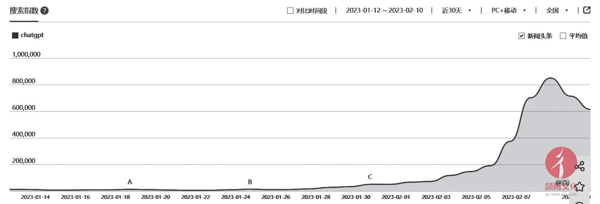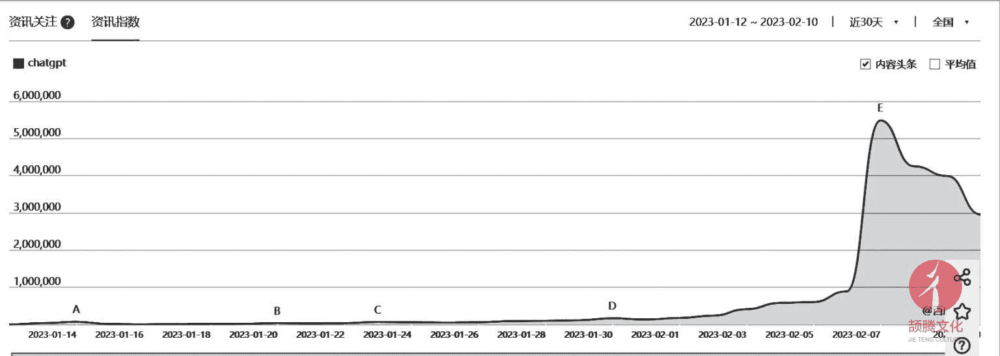

3.微信指数
微信作为高频移动应用，可侧面反映公众关注度。数据显示，ChatGPT 热度在 2023 年 2 月 4 日出现明显跃升，并在 2 月 6 日至 7 日持续攀升，如下图所示。
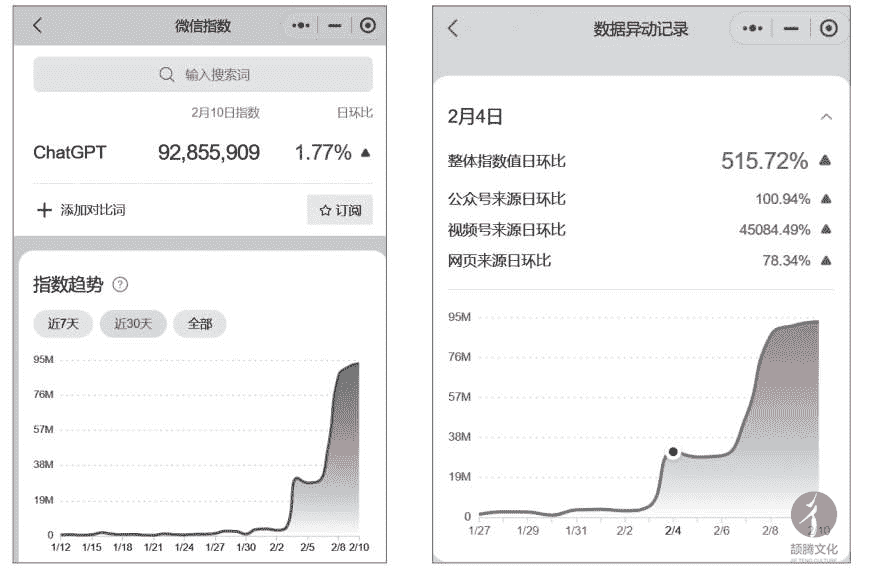

07 ChatGPT 使用中的常见疑问
搜索引擎会被 ChatGPT 取代吗
不少人习惯将 Google、百度等搜索服务与 ChatGPT 并列。事实上 ChatGPT 并非搜索服务，相较传统检索，它更像智能助手，能围绕主题提供信息并以对话方式作答。除了给出信息，还能依据上下文揣测用户意图进行关联回应，提供更人性化的信息获取体验，但并不适用于所有场景，例如搜索引擎提供来源链接的优势难以被替代。

两者差异可概括如下。
目的：Google 搜索旨在帮助用户查找特定主题信息；ChatGPT 为语言模型，旨在生成文本并回应提问。
覆盖面：Google 覆盖全网信息量庞大；ChatGPT 基于训练语料，可能无法回答一切问题，但能依上下文理解并提供信息。
准确性：Google 通过抓取网页与排序算法呈现结果，通常较为可靠；ChatGPT 基于机器学习与自然语言处理，结果准确度取决于训练语料质量。

总体看，Google 是检索海量信息的强力工具，ChatGPT 是获取特定信息并对话答疑的智能助手。正因其互动性与便捷性，被视作下一代搜索雏形。微软随之推出融合 ChatGPT 与传统搜索的新版 Bing，Google 则推出类似产品 Bard。

对话次数增多是否等于模型更智能
并不。ChatGPT 是预训练的自然语言处理模型，在训练阶段已学会生成类人语言的回复。对话时，它依据输入从已学知识中生成回应。智能水平取决于训练语料与算法优化，而非通过对话直接提升。不过人机交互过程可提升其“经验”，即对话质量与适应性。长期面对更多问题与场景后，它会积累更多语言与语境知识，更好理解与作答。

人类输入是否会带偏模型
会。ChatGPT 的表现基于预训练语料与算法，可能受人类提供的错误或偏相关信息影响，输出错误答案或偏见言论。若训练集本身存在问题或偏见，模型也可能产生偏见或错误，例如生成性别、种族、宗教等倾向性内容。

为避免此情况，开发者需严格监控与优化训练语料与算法，确保输出准确中立；使用者也应保持自省与质疑，避免盲目接受答案，减少错误或偏见信息的影响。

ChatGPT 是否无所不能
并非。ChatGPT 是基于大规模语料训练的预测模型，语言处理能力很强，能完成生成文本、问答、对话等复杂任务。但它仍是人工智能模型，存在明显局限：无法完全理解人类意图、模拟人类思维、做出全部正确判断。表现也受限制，可能难以处理专业术语、文化习惯、地方口音等，且在复杂抽象问题上仍易出现语言与逻辑错误。

同一提问是否总得到相同答案
存在相似的可能。ChatGPT 背后是生成式预训练模型，通过大量语料训练得到。它依据上下文与问题解释生成可读、自然、相关的文字。若输入问题与语料库文字高度相似，生成结果也可能很相近。同时受训练语料限制，若语料库无相关信息则难以生成合规回答。

若万人同时提出同一开放性问题，答案大体相似，通常因为语料库已有类似信息且输入相同。但由于模型具有随机性，完全一致的概率很小，相似度会较高。

OpenAI 官网声明的相关描述如下：
Terms of Use
3. Content
(b) Similarity of Content. Due to the nature of machine learning, Output may not be unique across users and the Services may generate the same or similar output for OpenAI or a third party. For example, you may provide input to a model such as“What color is the sky?”and receive output such as“The sky is blue.”Other users may also ask similar questions and receive the same response.Responses that are requested by and generated for other users are not considered your Content.
中文含义为：
使用条款
3．内容
（b）内容的相似性。由于机器学习的性质，输出在用户之间可能不是唯一的，服务可能会为 OpenAI 或第三方生成相同或相似的输出。例如，你可以向模型提供输入，例如“天空是什么颜色？”，并接收输出，例如“天空是蓝色的”。其他用户也可能提出类似的问题并收到相同的回复。其他用户请求和生成的响应不被视为你的内容。

中文回答是否依赖英译中
不是。ChatGPT 是多语言生成模型，可直接对中文输入生成中文输出。它通过学习海量语料并利用语言模型方法生成文本，无需先译成英文再回译。

同题中英文答案为何不同
因不同语种的语料库差异导致。例如英语语料通常比中文语料更丰富多样，英语回答的信息量可能更大，因此同一问题的中英文回答可能存在差异。

第二章 OpenAI 的三大核心应用
OpenAI 秉持开放、共享、协作的价值观，致力于以负责任、安全的方式推动人工智能发展。本章将介绍 ChatGPT、DALL·E 2 以及与前两者紧密关联的 OpenAI API。

01 ChatGPT 的使用
前文已介绍了 ChatGPT 的发展历程、核心技术与工作原理。是否想亲自体验对话？以下说明使用方法。

在 ChatGPT 页面创建新对话，于对话框输入问题后点击发送。
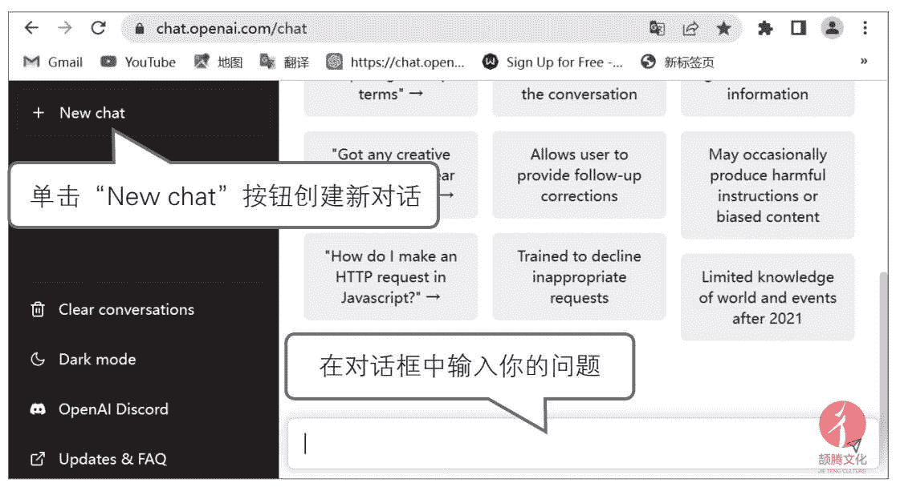
随后页面会展示模型的回复，左侧显示对话分组，可重命名或删除。
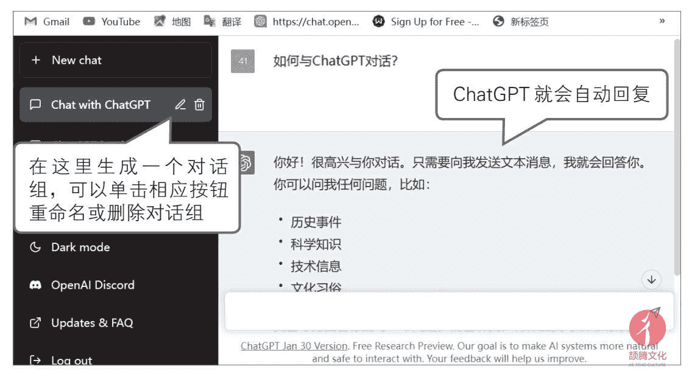
建议将同一主题的对话归入一个分组。新对话意味着一次独立的会话。新建对话可用于：获取某个问题的答案、了解某话题信息、提出建议或询问、模拟真实人际交流。

分组有助于更好追踪感兴趣话题。ChatGPT 能依据分组内输入的信息自动修正部分答案，但修正仅在当前分组生效，换分组后模型会“失忆”。

如图所示，在分组“1”中告知模型期望的答案，下一次对话即可结合上下文给出相应回应。
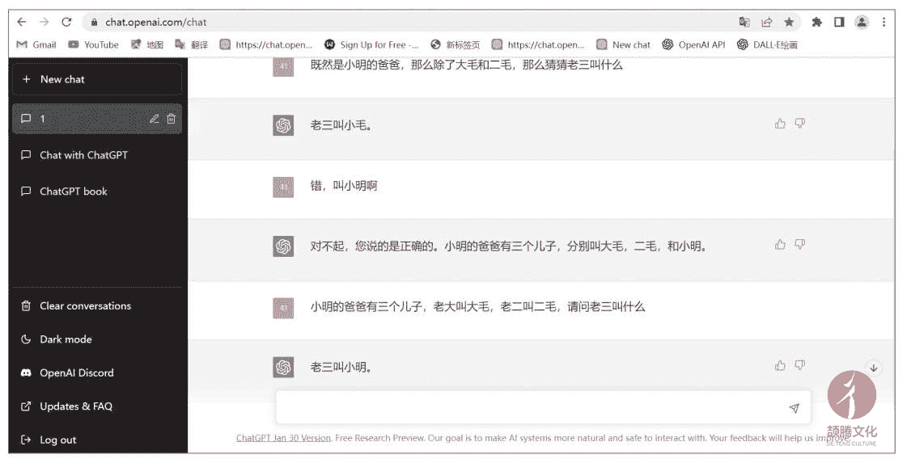
而在新建的分组“2”中询问同一问题，模型给出的仍不是期望答案。
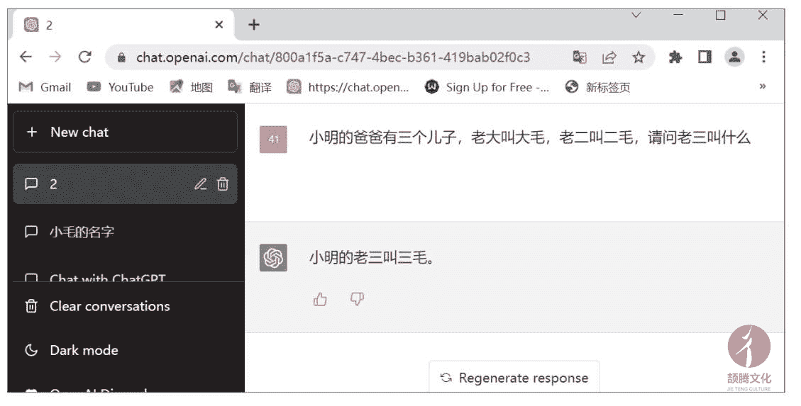

02 OpenAI API
OpenAI API 是公司提供的在线服务，让开发者能便捷调用 OpenAI 的人工智能技术，集成到自有应用、网站或产品中。API 通过请求与响应的方式提供简便接口。

适用场景通常是在需要加入人工智能功能，如自然语言处理、语音识别、聊天机器人等时。例如可借助 API 搭建在线客服聊天系统，或打造智能文本编辑器自动提供语法与拼写建议。总之，使用 API 旨在更方便、快速地将 AI 技术集成到自身产品中。

OpenAI API 与 ChatGPT 的关系与区别：ChatGPT 是 OpenAI 开发的聊天机器人，OpenAI API 则是提供访问 AI 技术的方法。因此 ChatGPT 是 API 中的技术组件，可通过 API 调用使用。但 API 不仅提供 ChatGPT，还提供其他人工智能技术，如下图所示。API 主要有两种使用方式：编写代码调用，以及网页中使用。代码调用方式将在第四章介绍，这里先介绍网页使用方式。
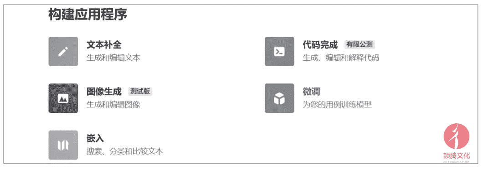
下面以利用 OpenAI 进行论文写作的工具为例。输入描述文字“写一篇关于营销人员的年终工作总结”，如图，随后将字符长度滑块拖至最右侧，点击“Submit”按钮。
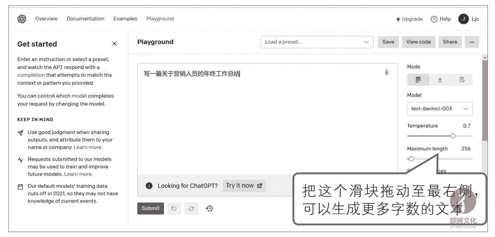
等待片刻后，界面即可显示基于描述生成的文本内容。
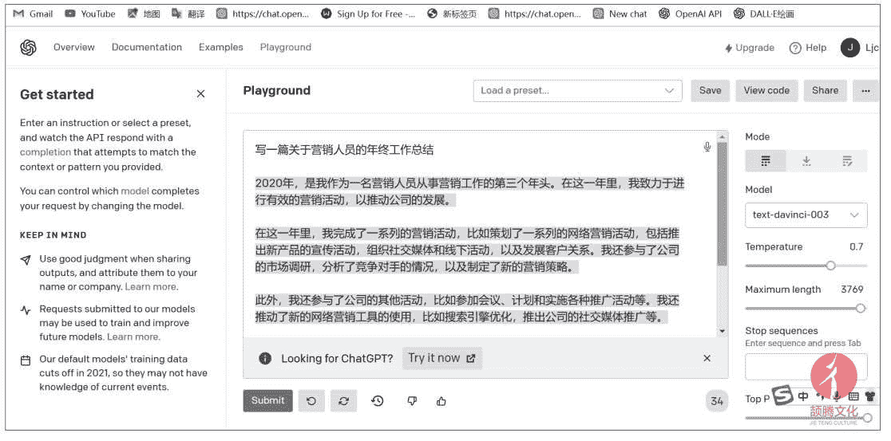
生成结果大致为 2020 年作为营销人员的第三年总结，提到策划网络营销活动、社交媒体与线下活动、客户关系维护、市场调研与竞争分析、新营销策略制定、会议参与及推广活动等，并总结销售额与客户数增长、知名度提升等成果。

也可以增加更具体需求，如在描述中明确字数要求约 1000 字。
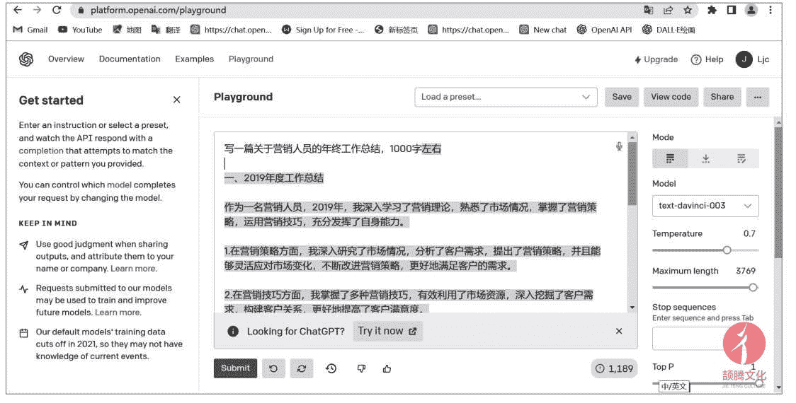
生成文本会扩展为包含 2019 年度工作总结与 2020 工作计划的结构化内容，涉及策略研究、技巧运用、绩效提升等要点。

常见疑问有：
1. 为何时间偏旧？因为语言模型收集的数据主要截止 2021 年之前。
2. 为何字数未达指定？因 GPT 处理文本的最小单位不是字符而是 token。想进一步了解可阅读文档 https://help.openai.com/en/articles/4936856-what-are tokens-and-how-to-count-them。
为便于使用，下图对部分参数含义做了简要说明。
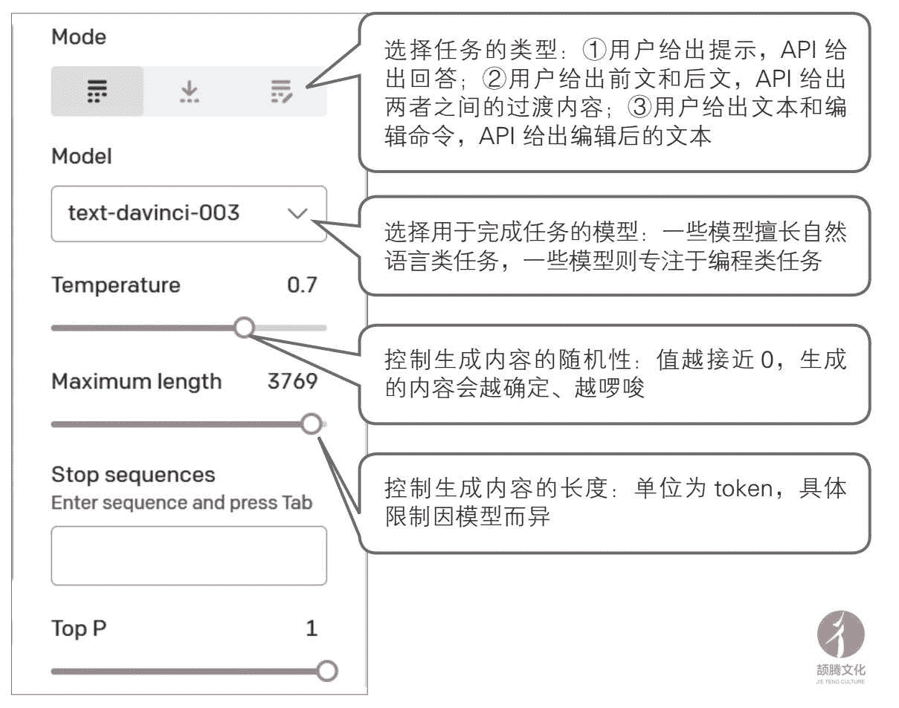

03 AI 智能绘图 DALL·E 2

OpenAI 推出的 DALL·E 2 是一款能够把文字提示转化为丰富多元且画质精良的图片的生成式人工智能，生成的样例如图所示。其底层搭建在 Transformer 多层神经网络之上，既能理解自然语言也能生成语言，本质上是自然语言处理与生成式对抗网络两种技术路线的融合。

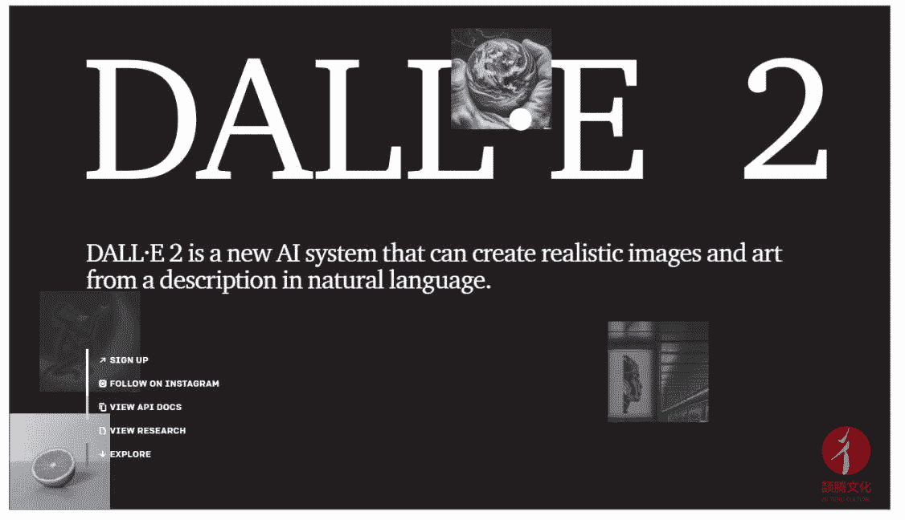

该模型的初衷是借助海量数据和机器学习，展示模型产出高质量图像的能力，模拟人类式的创造与想象，进而点燃 AI 创意应用的可能性。落地场景相当广泛，动画制作、广告概念、游戏美术、建筑方案等领域都能见到它的身影。

比如输入提示“绘制一幅关于长城的水墨山水画”，系统即可产出与描述相符的视觉结果，如下图所示。

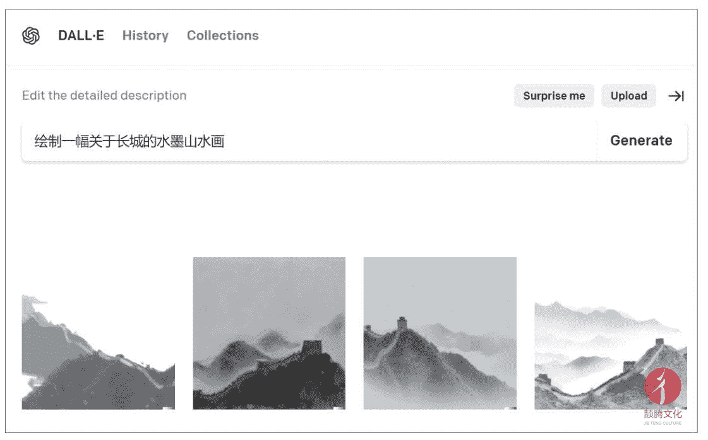

不过与此前介绍的同类工具相似，目前 DALL·E 2 在中文理解上的表现仍弱于英文。举例来说，中文提示“在白色背景中，一只戴着领带的小恐龙正在研究植物”得到的效果如图所示。

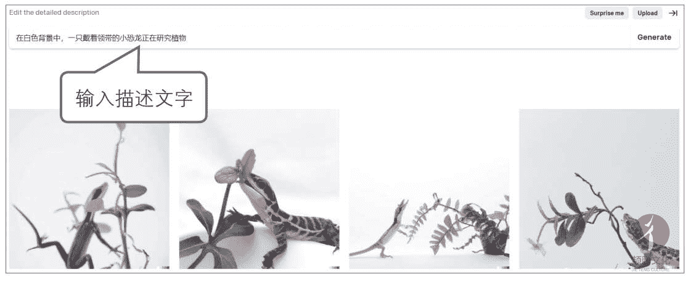

改用英文描述后生成的画面则更贴近预期，如图所示。

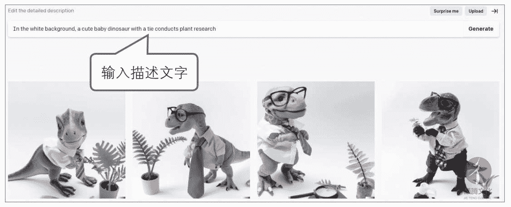

可见英文输入的效果更理想，但这并不影响 DALL·E 2 作为前瞻性强、潜力巨大的技术方向的价值，未来作用会更大。

生成图像后，DALL·E 2 还支持基于实际需求的后续编辑，包括同类图的批量输出、智能抠图、智能填补、空白区域补全等。下面以一个案例说明具体操作流程。

在文本框里填入细致的描述：Part of an extremely delicate and beautiful work, close-up of Daniel Gerhartz,side angle, arms crossed, short yellow hair, looking into the distance,upper body, off shoulders, bun, light colored dress, rainy weather,backlight。生成结果如图所示。

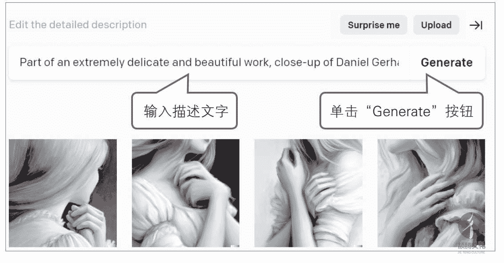

此时右侧会呈现本次生成的所有图集，方便后续调用；若不需要保留可直接清除。

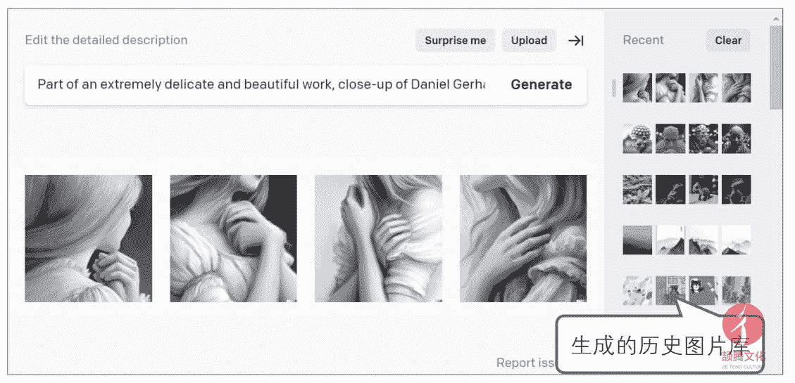

从本次结果中挑选第 4 张进行编辑，点击放大后选用下方的橡皮擦工具擦除背景，如图所示。

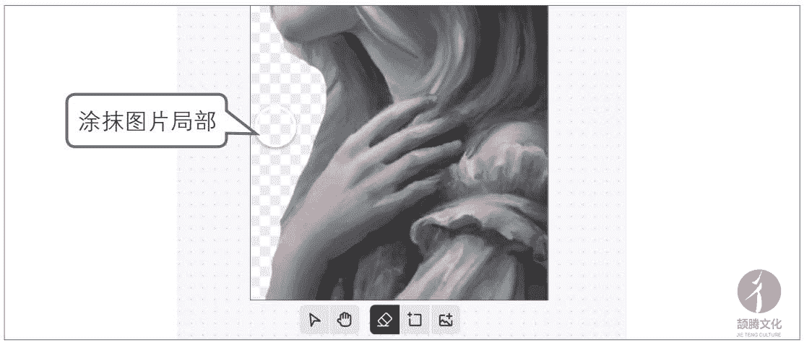

调整画布范围，向左侧延展画幅，并在编辑区输入希望智能填充的内容描述，如图所示。随后点按“Generate”启动智能生成。

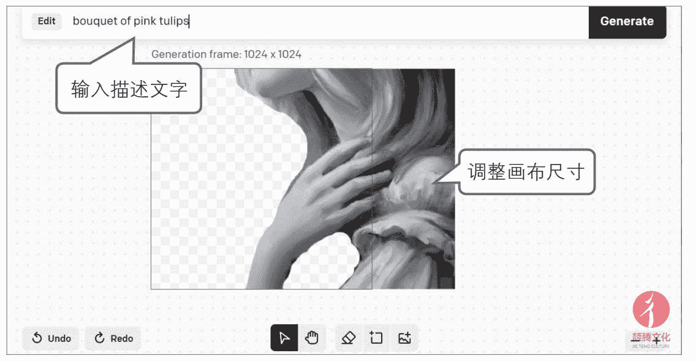

生成的补图能与原图背景自然融合，并提供 4 种填充方案供选择，点击小圆点可在不同结果间切换。确认满意后点按“Accept”即可锁定背景，如图所示。

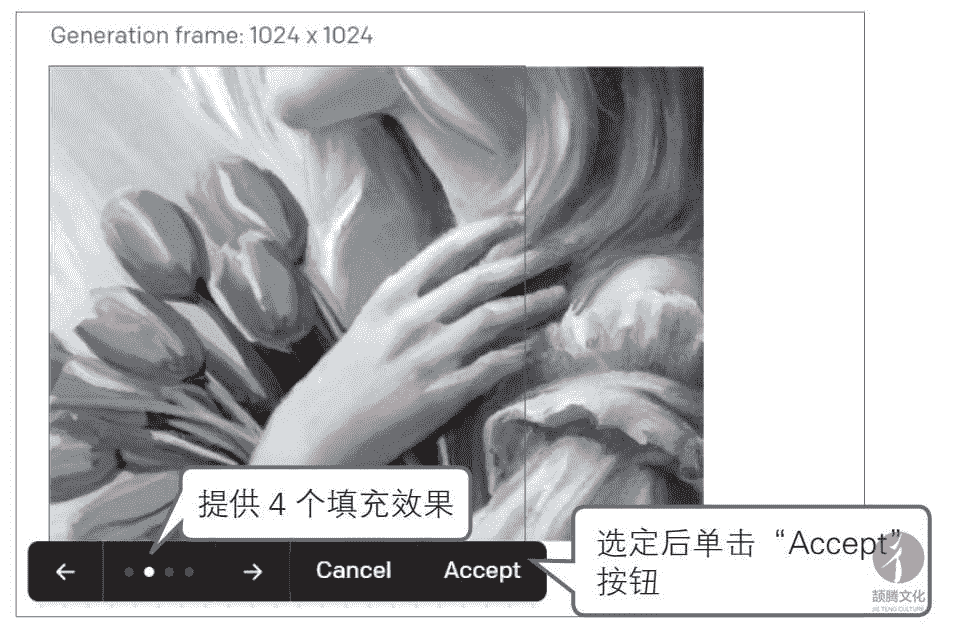

若想继续补图，可重复上述步骤，最终画面效果如图所示。

# 第三章　让 ChatGPT 飞起来

随着 ChatGPT 用户规模持续扩大，其可玩场景也被不断挖掘。如今市面上出现了一批基于 ChatGPT 的功能型插件，像 WebChatGPT、ChatGPT for Google 等。借助这些扩展，可以更好地释放 ChatGPT 的语言处理优势，把它用起来、玩起来，帮助解决工作与生活中的各类问题。下面简单盘点几款有代表性的插件。

## 01　搜索最新资料：WebChatGPT

WebChatGPT 是 Chrome 的浏览器插件，为 ChatGPT 增加了联网能力。插件会在提示中补充相关的网络检索结果，让回答更贴合实际、更具时效性。通过网页搜索提升效率的方式主要体现在：

快速产出高质量文本内容；

迅速获取相关资讯并转写为可读文字；

获得优质文本以提升写作水平；

简化文字处理，减少重复性基础工作。

安装方式很直接。先在 Chrome 安装该插件，再打开 ChatGPT 页面即可使用。具体流程见下几张图。

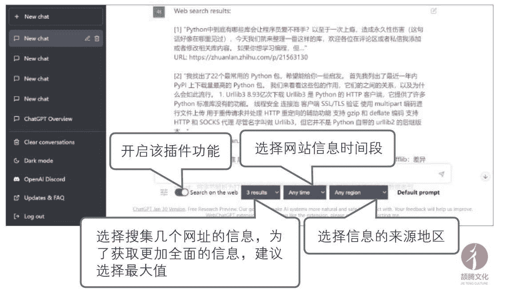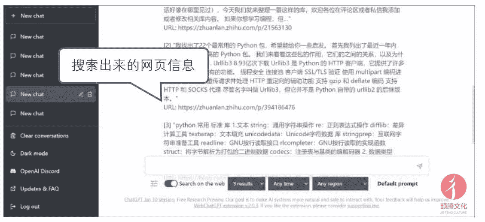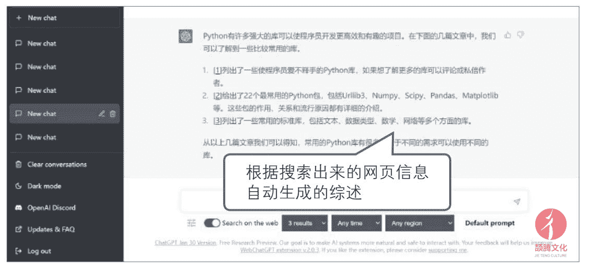

## 02　搜索引擎和 ChatGPT 同框：ChatGPT for Google

ChatGPT for Google 也是 Chrome 插件，能够用 ChatGPT 增强传统搜索体验，即在常规搜索结果旁边同步展示 ChatGPT 对同一主题的解答，如图所示。该插件兼容主流搜索引擎，包括谷歌、必应、DuckDuckGo 等。

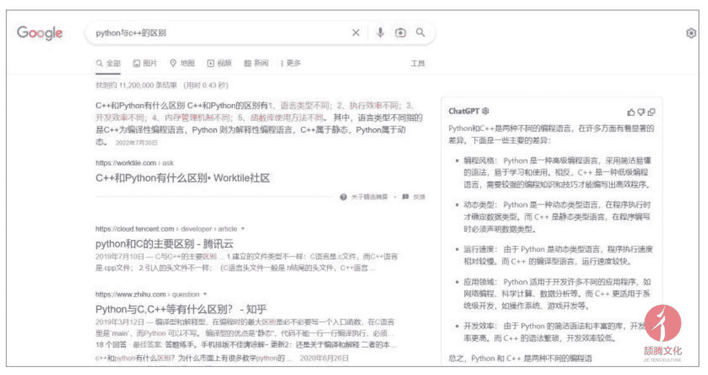

## 03　刨根问底的利器：Merlin

Merlin 是 Chrome 插件，用 ChatGPT 提升你在各网站上的使用体验。安装后可按 Ctrl +M 快捷键在任意网页调出 ChatGPT AI 功能，覆盖谷歌搜索、Gmail、LinkedIn、GitHub 以及其他需要在线阅读或撰写的场景。

使用步骤如下：先在 Chrome 安装插件，打开搜索引擎如谷歌并输入关键词，如图所示。

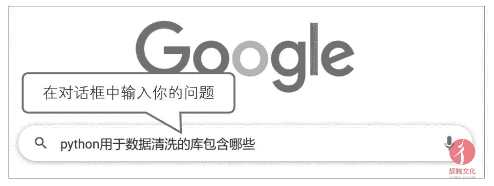

插件会弹出登录窗口，点击“Sign in with Google”完成登录，如图所示。

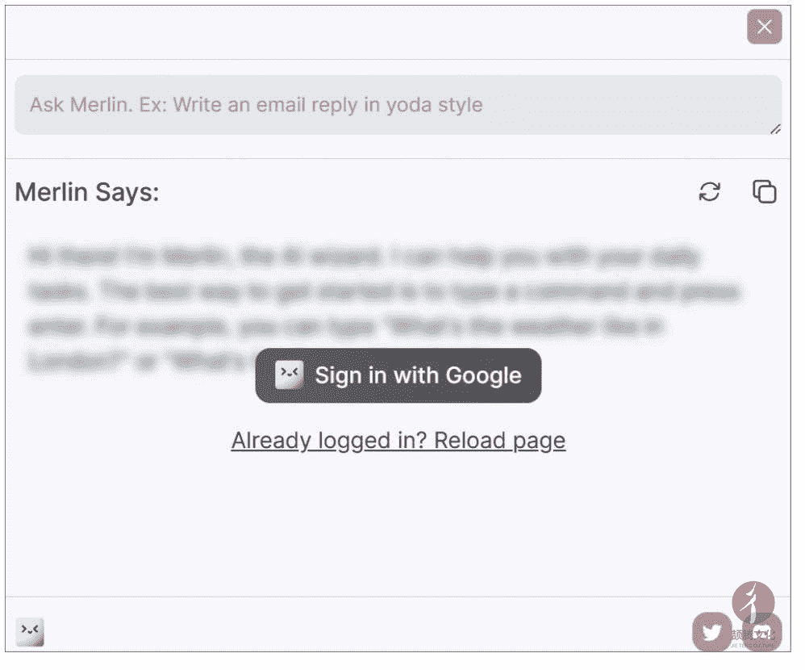

进入搜索页后，直接点击 Merlin 的“Search”按钮即可，如图所示。

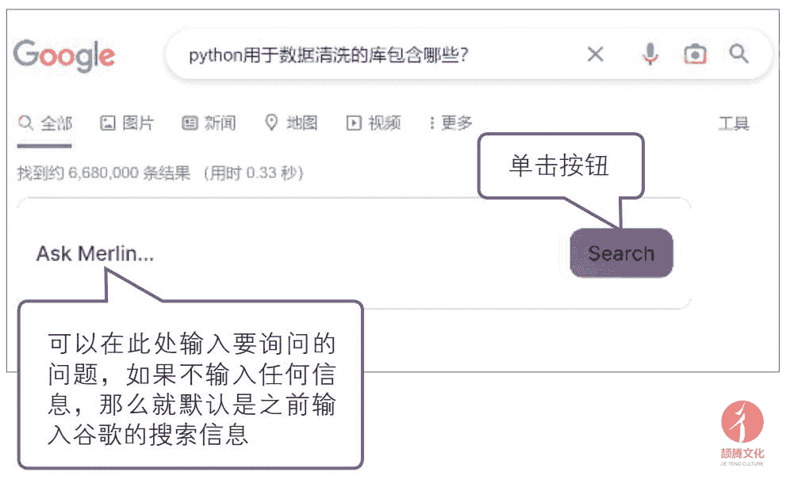

返回框中会显示 ChatGPT 针对查询的文本回复，如图所示。

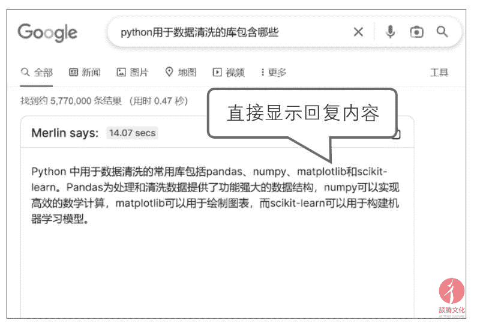

若想继续追问，可在网页上选中相关文字或关键词，按 Ctrl+M 快速打开 Merlin box，在 box 内 Merlin 会提示已选内容，用户可追加提问，如图所示。

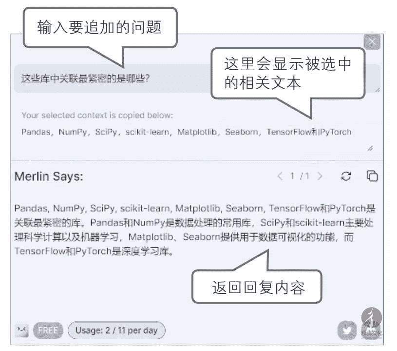

总体而言，有 Merlin 辅助就无需在搜索页与 ChatGPT 页之间反复切换，也不用手动复制粘贴，就能直接调用 ChatGPT 做延伸检索或对结果进行归纳提炼，工作效率明显提升。

## 04　自动回复个性化邮件：ChatGPT Writer

ChatGPT Writer 是 Chrome 插件，能利用 ChatGPT 生成完整的电子邮件与消息，目的在于帮助用户更快写出高质量的邮件内容。它适配全站，Gmail 下表现更佳，且支持多语言。

适合的人群包括：

需要频繁写邮件或消息的职场人士；

希望提升写作速度、快速完成任务的人；

中文表达不够清晰，需要润色的用户；

想让邮件更专业、更有说服力的用户。

使用示例如下几张图。

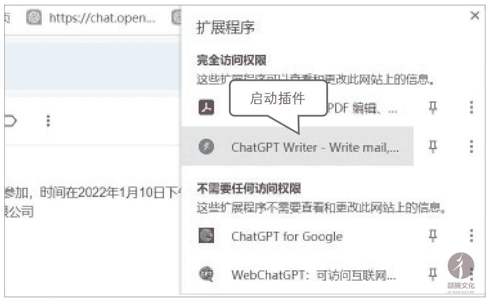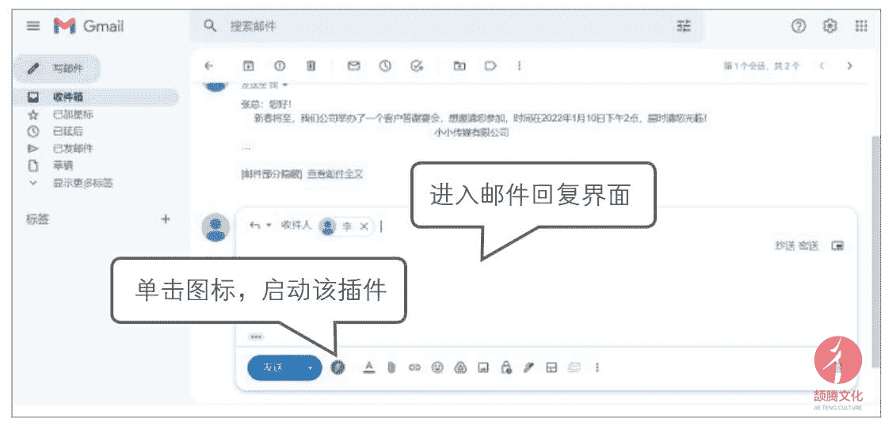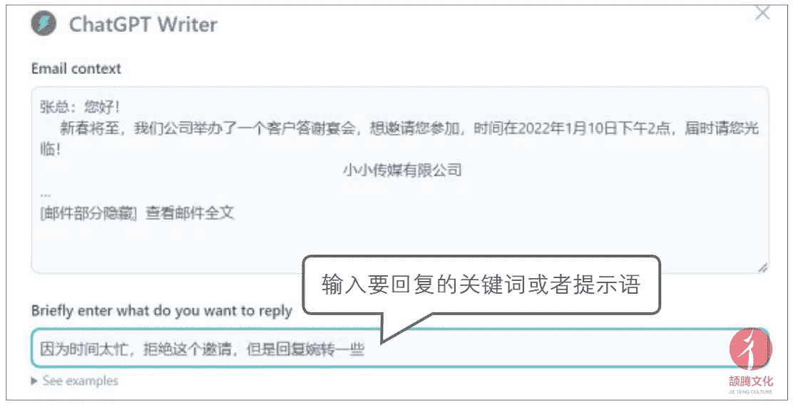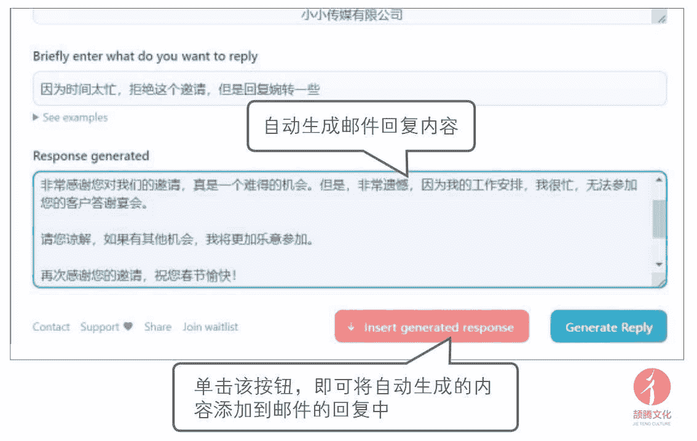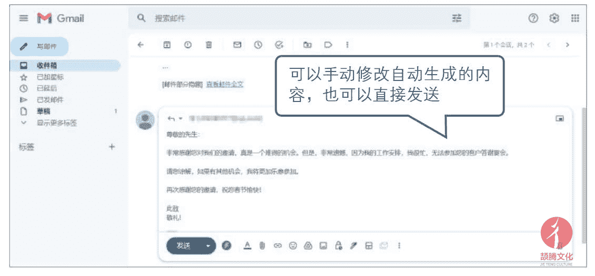

## 05　生成视频内容摘要：YouTube Summary with ChatGPT

该插件能借助 ChatGPT 快速提炼 YouTube 视频的核心信息并生成简短摘要，帮助用户迅速把握内容要点。

特别适合没时间完整观看却想了解主旨的人，也能帮助筛选内容质量，避免踩雷，提升工作效率。

主要应用场景：

教育：学生与教师快速提取知识点，便于预习复习；

研究：研究人员快速检索 YouTube 资源并抓取关键信息；

商业：商业人士快速评估视频内容以做出决策；

个人：普通用户在忙碌生活中高效利用时间。

使用方法：在 Chrome 安装插件后打开任意 YouTube 视频，页面右侧顶部会出现工具条，点击展开可查看字幕，点击工具条中的“View AI Summary”按钮，如图所示，便会在新标签页打开 ChatGPT 并自动请求对字幕进行要点总结。

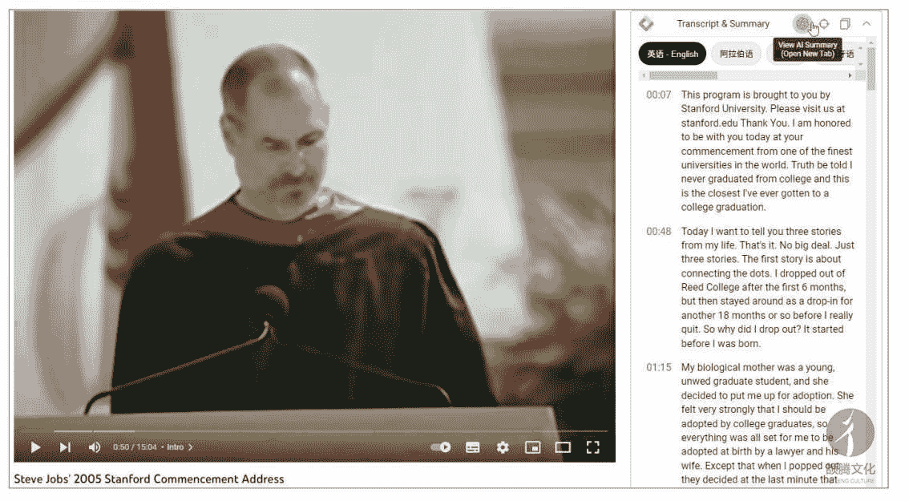

## 06　生成会议摘要：Tactiq

Tactiq 插件可借助 ChatGPT 记录并汇总 Google Meet、Microsoft Teams、Zoom 会议，提供会议纪要与摘要，如图所示。适用场景包括销售电话、团队例会、线上课程、客户访谈、产品研究、演示、大师课等，再也不必担心遗漏重点而手写笔记。

使用时可高亮重要内容、标记待办、保存聊天记录、截屏，然后插件会把所有信息汇总到 Google 文档。目前已有超过 18 万人使用 Tactiq 记录会议笔记，被世界 500 强领导人、Netflix 工程师、自由职业者、销售、教师等广泛采用。

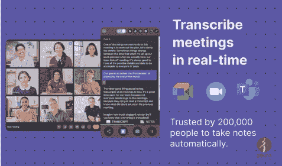

## 07　与 ChatGPT 语音交流：　Talk-to-ChatGPT

Talk-to-ChatGPT 是 Chrome 插件，核心功能为语音识别与文本转语音，让 ChatGPT 的使用更像自然对话。例如不方便打字时，可直接对着麦克风提问，插件自动识别为文字并发送。

安装方式：在 Chrome 应用商店搜索 Talk-to-ChatGPT，如图所示后加入浏览器。

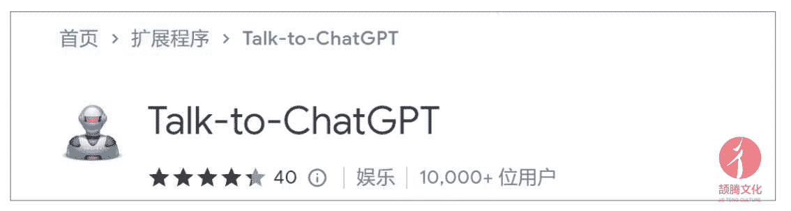

安装完成后打开 ChatGPT 界面，右侧会出现悬浮控制框，点击“START”启动插件并授权麦克风使用，即可通过语音向 ChatGPT 输入内容，如图所示。

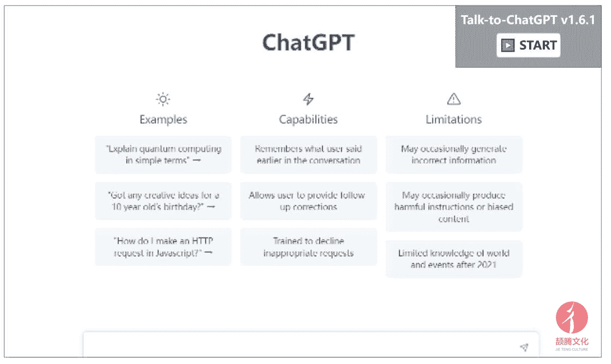

启动后控制框下方会显示红色条并语音提示“OK”，表示已就绪。语音输入后插件会把识别结果自动填入 ChatGPT，系统随即给出解答，如图所示。

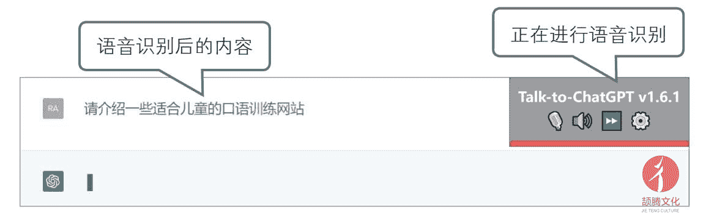

ChatGPT 回复时插件会实时进行文本转语音播报，此时色条呈绿色，如图所示。

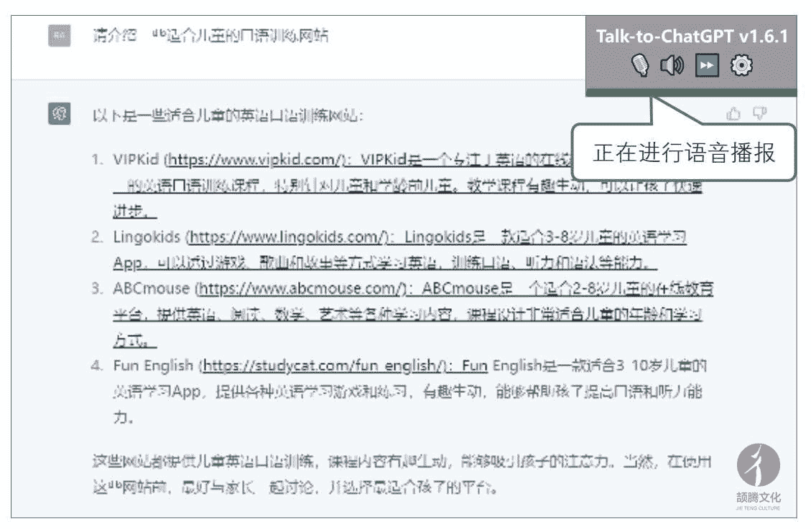

点击应用框中的麦克风图标可关闭语音输入功能，关闭后的状态如左图所示。

语音播报会随 ChatGPT 回复速度即时进行。如不需要播报，可点击“文本到语音”按钮关闭，关闭后的效果如右图所示。

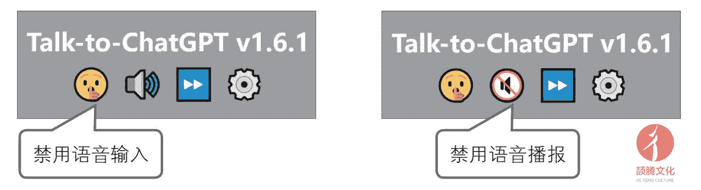

如需跳过当前播报内容，可点击“跳过”按钮。

用户还能调整播报参数，包括声线男女、语速、语调等。点击“设置”按钮即可打开设置页，如图所示。

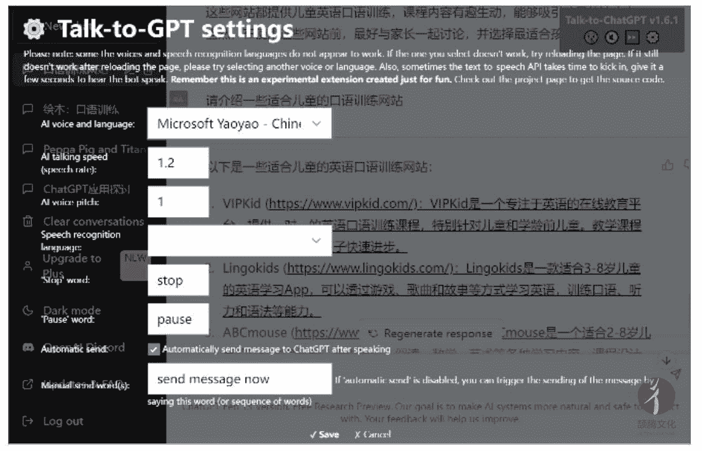

书 籍 分 享 公 號：Q L S F 6 8

# 第四章　ChatGPT 的商业化落地

ChatGPT 的出现必然对全球产生深远影响。其强大的自然语言处理能力也让各行各业看到机遇与挑战，如何合理利用并发挥 ChatGPT 的价值，成为众多希望借此实现场景拓展与价值转化的从业者迫切探索的问题。下面介绍部分行业应用思路，供读者参考。

## 01　ChatGPT 的商业模式

2023 年 2 月 2 日，OpenAI 发布了 ChatGPT 试点订阅计划 ChatGPT Plus，定价每月 20 美元，如图所示。

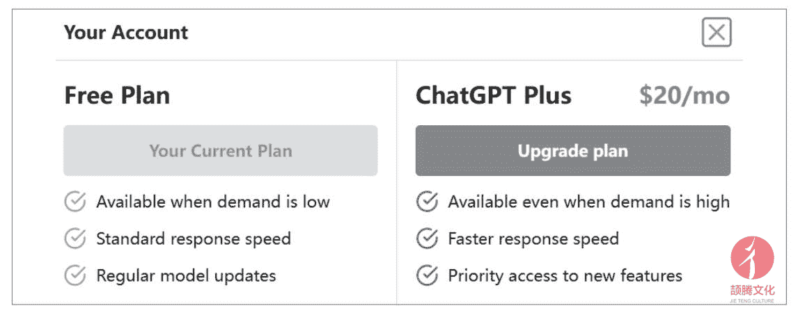

免费版与付费版的差异如图所示。

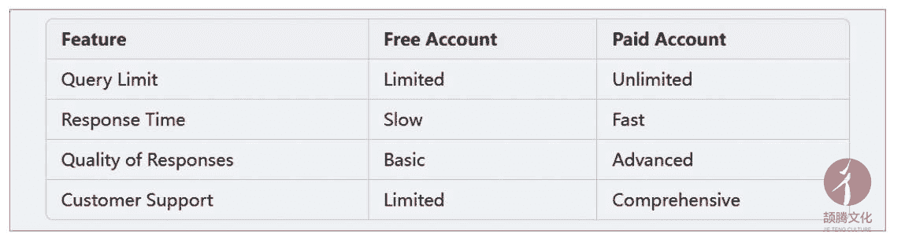

说明：

Query Limit：每日可提问次数限制

Response Time：响应速度

Quality of Responses：回答质量

Customer Support：客户支持程度

注：OpenAI 并未明确限制免费账户的日提问次数，但免费使用可能受请求频率与生成文本长度等限制。

个人看来，ChatGPT 在 OpenAI 的商业版图中更多承担引流作用，真正的商业机会在于 OpenAI API 的推广与使用。无论是智能客服机器人还是智能写作平台，若无自有模型、算力、存储等数字基础设施，都不得不依赖 OpenAI 的 API。因此要清晰认识到，一个成熟领先的模型需要海量语料训练，背后对应的大算力消耗与大数据存储并非短期可复制。

目前 OpenAI API 免费试用接口单次返回上限约 4 000 token，极大限制了长文档翻译与写作。若把长文档拆分再拼接，上下文关联就会丢失。付费用户可突破该限制，获得更长更详尽的翻译与生成，不同账号等级有不同的请求与生成长度限制。OpenAI 还提供多种语言模型供购买，如图所示。

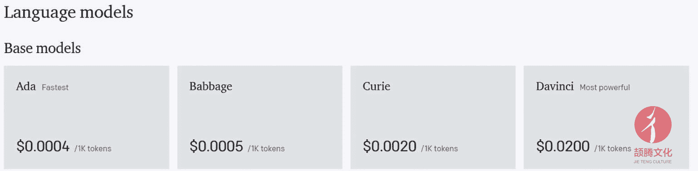

ChatGPT 的商业化未来更可能聚焦于开放背后各模型的 API 供大家使用。

基于 OpenAI API 目前可实现的功能如图所示。

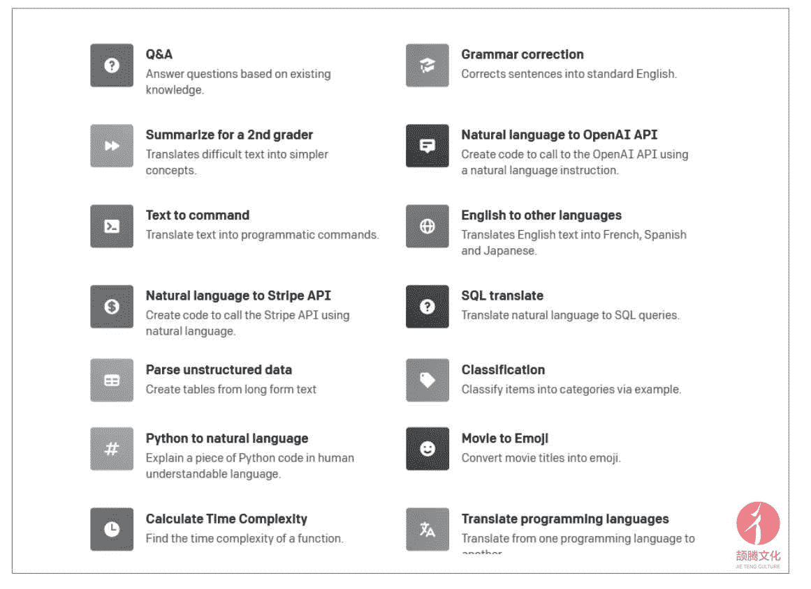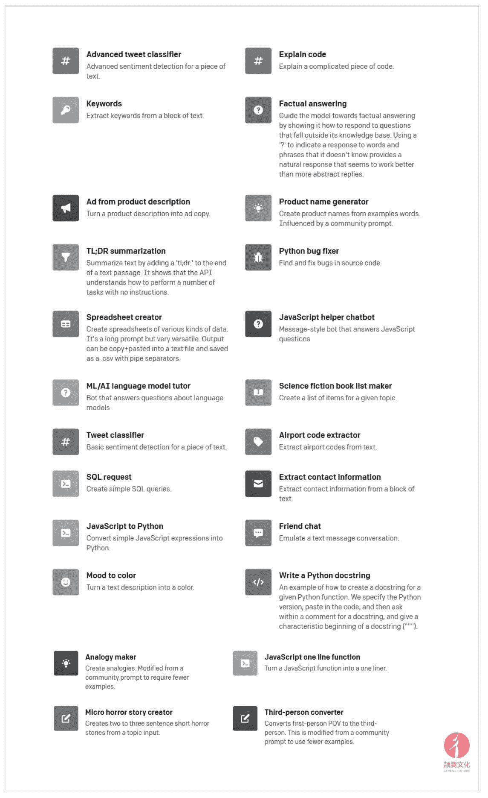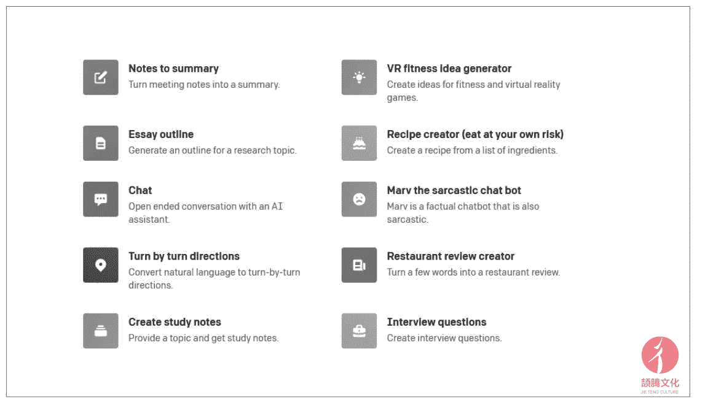

## 02　打造自己的创新创业新风口

要在未来商业竞争中占据一席之地，对大多数中小企业与创业团队而言，最现实的路径是结合 OpenAI 等企业的接口与自身数据，在细分领域形成优势。这是一个“多快好省干创业”的好机会。除了已有的示例接口，还可采用微调训练 Fine-tune training，为自家应用定制模型。OpenAI 模型已在互联网海量文本上预训练，用户只需用自有数据做少量学习即可取得较好效果。

使用微调可带来更多收益：

相对即时生成更高的质量；

可训练更多案例；

降低成本；

缩短延迟。

在 OpenAI 的个人控制台中，能够查看到自有微调模型的调用记录，示意如下。
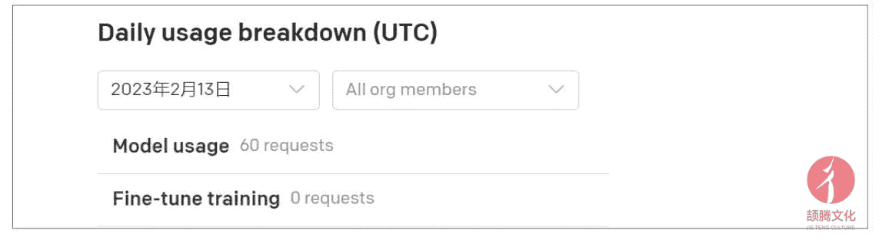

时下可供微调的基座只有 davinci、curie、babbage、ada 四个版本。

即便这些基座在通用 NLP 任务上已有不俗表现，微调阶段选用更精良的训练数据仍会带来可感知的提升，也会让模型的泛化表现更稳。拿文本分类来说，样本量更大且标注更准确，分类准确率通常会上去；拿对话生成来说，引入更多真实对话样本，输出的自然度和贴合度也更理想。

除了数据本身，工程手段同样关键。调节超参、选用更优的优化器、扩大网络的深度和宽度等做法，都能帮助模型在真实场景里更可靠。

## 03 对话式搜索重塑局面

2019 年微软对 OpenAI 投入一笔未公开、市场传闻约 30 亿美元的资金，并签署合作协议，意在加速 OpenAI 的研发、强化自身 AI 实力，并把最新成果迁移到自家产品服务里，提升用户体验。

这笔合作被验证为成功。2023 年 2 月微软宣布追加 100 亿美元投入，并在 Azure 数据中心搭建 AI 超级计算集群供 OpenAI 使用。同时官宣新版必应与 Edge 浏览器接入 ChatGPT 技术，提供对话式检索与内容创作入口，以削弱谷歌在搜索市场的支配地位。业界测算，ChatGPT 加持后必应份额有望升至 10%，带来的收益可能超过 100 亿美元的投入。

现阶段集成 ChatGPT 的新版必应仍在试用，需要登录微软账号并点击页面的“加入等待列表”按钮申请资格；体验对话检索还需安装 Edge 浏览器。

获准试用后即可上手。以 Edge 打开必应首页，在搜索框输入问题，例如“我要准备春节家宴，请推荐一些有吉祥寓意的菜肴”。结果页被左右分隔，左侧是常规网页结果，右侧则是 ChatGPT 生成的摘要式回答，并标注信息来源。

若要进入对话式检索，可点击右侧结果底部的“查看更多”按钮，再点“我们聊天吧”按钮，如下图所示。

进入对话界面后可围绕同一话题继续追问。例如根据手头食材筛选菜肴，下发指令后必应给出对应页图所示的回复。可以感受到在 ChatGPT 加持下，新版必应的交互更智能、更人性化。

面对这一挑战，谷歌迅速推出 AI 聊天机器人 Bard，国内的百度也在 2023 年 3 月宣布推出同类产品“文心一言”。

新版必应已显现搜索的未来方向：AIGC 能对检索结果做汇总，并列出引用来源链接，便于用户溯源、扩展与求证。AIGC 与搜索的结合将改写传统检索，在市场上掀起变革。本书第六章将对 AIGC 做详细介绍。

## 04 内容创作进入 AI 加速期

以图书创作为例，内容生产生态大致经历了专家生产 PGC、用户生产 UGC、AI 辅助生产、AI 生产 AIGC 四个阶段，目前仍以前两阶段为主，第三阶段为补充。

AIGC 解决了 PGC 与 UGC 难以兼顾质量与产量的矛盾，有望成为未来主流的生产模式。

### 提升创作效率的三个抓手

对多数专业文字工作者而言，ChatGPT 的价值主要体现在以下三点。

（1）基于提示生成文本：用户给出概括性提示，模型即可产出初稿，用户再在此基础上完善。
例如让模型列出 GPT 发展史文章的提纲，模型会给出前言、GPT-1、GPT-2、GPT-3、InstructGPT 与总结的框架，并对每部分给出子要点。针对 GPT-2 特色写作的提问，模型会建议横向对比其他 NLP 模型、聚焦训练数据、讨论生成能力、详述架构、分析实际应用等角度。

（2）获取灵感：通过提问激发思路，帮助厘清写作方向。
例如询问当前读者偏爱的畅销书题材，模型会提示自我提升、心理学、科幻、悬疑惊悚、历史文化等方向，并提醒题材偏好会随时间变化，需要结合自身写作能力。再追问自我提升的具体细分，模型会建议心理健康、人际关系、职场发展、人生规划等可切入点。

（3）校对润色：辅助检查语法与拼写，确保表达更规范。
例如将“我爱 GPT 学习，更爱吃吃饭”改写为正式表达，模型会给出“对学习 GPT 怀有热爱，但用餐是我更喜爱的活动”等版本，也能按要求简化。针对无明显语病的段落，模型会按国家标准调整标号格式，如把《建筑工程建筑面积计算规范》GB/T 50353-2013 改为《建筑工程建筑面积计算规范》（GB/T 50353-2013），并把“重新复核”简化为“复核”。

新闻写作案例显示，2014 年洛杉矶时报的机器人记者 Quakebot 在地震后 3 分钟发布稿件，中国地震网的写稿机器人在九寨沟地震后 7 秒完成编发，美联社 Wordsmith 每秒可写 2000 篇报道，第一财经“DT 稿王”一分钟可写 1680 字。ChatGPT 可辅助新闻写作，但“采”的环节仍需人工完成。

使用流程大致为：明确报道主题，确定背景、时间地点、当事人与证据，使用清晰语言组织内容，向 ChatGPT 请求初稿，最后人工核查编辑。自动化采集可借助爬虫库如 Requests、BeautifulSoup、Scrapy 爬取内容，再经 OpenAI GPT-3 API 改写并保存结果。

## 05 教育场景的个性化变革

以 ChatGPT 为代表的 AIGC 正在改变教育，网络甚至把教师列为易被替代职业之一。笔者不认同，因为共情与创新教学短期内难以被替代。但 AIGC 在教育里也有不可比拟的优势。

个性化学习：可生成定制内容，匹配学习者需求与能力，让学习节奏更自适应。
提升可及性：为资源匮乏地区提供 AI 生成的教材与教辅。
更高效辅导：生成模拟与虚拟环境，提升信息留存。
自动评分反馈：即时反馈帮助教师节省时间。

总体看 AIGC 更适合担任人类教师的助手。Duolingo 使用 GPT-3 提供法语语法修正，研究表明显著提升二语写作；Knewton 用 GPT 模型提供个性化学习内容；Querium 用 GPT 为大学生提供实时数学与科学解答。

## 06 金融业务的智能化落地

ChatGPT 在金融领域主要体现在：

金融服务：嵌入客服、支持与销售的会话界面，提升体验与沟通效率。
投资咨询：构建聊天机器人，按财务目标与风险偏好给出个性化建议。
风险管理：分析海量财务数据，识别风险与趋势，辅助决策。
合规监测：监控交易与通信，确保符合法规。
财务新闻：生成报告与资讯，帮助追踪行业动态。

以风险管理为例，可在金融数据上训练模型识别异常与趋势，实时标记可疑交易以便调查，预防洗钱与欺诈。合规监测方面，模型可识别违规言论行为并发出预警，分析内部邮件与聊天记录以确保员工行为符合合规政策，成为有价值的工具。

## 07 医疗咨询的准确性拷问

相比传统搜索引擎，ChatGPT 能更直接作答，但对专业要求极高的医疗问题，其回答质量如何仍需审视。

先让模型判断就诊科室。
Q：走路时膝盖发软无力，想去医院看一下，应该挂哪个科的号呢？

当用户描述膝盖发软缺少力气时，ChatGPT 给出的建议是先去骨科检查，并说明骨科能够处理关节炎、膝盖脱位、骨折等常见问题，复杂情况可转诊神经科或肌骨科，同时提醒把症状如实告知医生以便判断。这一案例里科室的判断和职能介绍基本靠谱。

紧接着追问布洛芬和对乙酰氨基酚能否一起服用，模型回复说可以合并使用但最好先征求医生或药师意见，并把两者分别归为消炎药和止痛药，认为搭配可能更有效，同时提示个体敏感、相互作用的风险，以及正在用别的药要主动告知以免冲突。实际上这一说法并不准确，属于概念偏差，两药都具备解热镇痛作用，联用会提高不良反应和过量风险。

这类质量波动很可能与训练语料有关。随着专业医学知识的补充，模型完全有潜力演化为智能分诊、智能导医、智能用药的辅助角色，降低医院工作负担并提供个性化支持。文本理解与生成能力在医疗场景同样实用，格式固定的病历、医嘱可以交由它起草；它还能把专业表述改写或浓缩成大白话，向患者复述诊疗方案，也可为医生快速生成病历摘要，节省阅读时间。

## 08 ChatGPT 驱动营销
阅读理解与归纳能力让 ChatGPT 在文案类任务中提效。下面以从图书简介提炼卖点为例。

请提炼某本 Excel VBA 教程的卖点。原简介面向职场人士，循序渐进讲解 VBA 实现办公自动化，覆盖宏操作、基础语法、工作簿工作表单元格操作、数据汇总统计分析可视化，并在行政文秘、人力、财务、营销等领域举例，案例来自真实场景，代码配解析与拓展，附全套代码素材，适合有 Excel 基础想提效者，也适合 VBA 新手。

模型给出六点：介绍用 VBA 编码实现自动化、讲解循序渐进案例贴近实际、涵盖基础语法与多场景应用、解析通俗资料齐全、帮助已有 Excel 经验者提效、可作入门参考。要求保留第 2、3、4、5 点并润色后，得到实用性突出、覆盖面广、可操作性强、资源充裕、适用人群宽等表述。

可见模型能从长文本较精准抓出卖点，稍作润色即可形成营销文案，但偶尔会出现重复赘述或不完全贴题，需要人工校对。

促销方案策划方面，用户提出五一期间开业的火锅店在 5 月 1 至 3 日做三天开业促。ChatGPT 给出折扣促销、点餐赠饮品甜点、每日 15 至 17 点限时特价、吃得多比赛等趣味活动、家庭套餐等建议。要求一句带“火”不超过 10 字的口号，模型给出“火爆开业美味齐享”等五条。

受输出长度限制，整体建议比较概括，未充分结合开业节点，口号也比较平实。要想得到更高质量的结果，需要更精细的指令引导，对使用者的专业能力也提出更高要求。

## 09 ChatGPT 陪伴生活
丰富的知识储备可用于日常做菜谱。

用户要求为 6 人家宴提供 2 凉菜、2 热荤、2 热素、1 汤、1 甜品。初版给出青椒鸡蛋、黄瓜沙拉、鱼香茄子、红烧排骨、西红柿鸡蛋、蒜蓉白菜、鲜菇鸡汤、红枣糯米糕。

被指出青椒鸡蛋并非凉菜、鱼香茄子并非荤菜后，模型把凉菜改为黄瓜沙拉、生菜沙拉，热荤改为红烧排骨、回锅肉。随后要求凉菜不要全素，改为鸡肉生菜沙拉。要求热荤不要全是猪肉，错误地给出鱼香茄子，再次修正为香煎鲈鱼与红烧排骨。

由此可见模型在菜品分类上容易出错，把热菜当凉菜、把茄子当作含鱼的荤菜，需要反复人工纠正，做法描述也常过于简略或存在错误。

## 10 ChatGPT 办公提效
编写 Excel 公式
用户让从 B 列身份证号里提取性别。模型给出 C 列公式 =IF(MOD(MID(B2,17,1),2)=0,"女","男")，并说明下拉填充，默认第 17 位决定性别，输出中文女男，如格式不同需调整。

再解释 IF 做条件判断、MOD 求余、MID 截取字符的工作原理。既能给公式，也能讲清原理，算得上称职的办公助手。

编写 Excel VBA 代码
用户想把一个多工作表的工作簿拆分成多个独立工作簿，模型给出代码 ，并说明按 Alt+F11 打开 VBA 编辑器粘贴后按 F5 运行，文件会保存在原路径并按表名命名。

验证显示  中的源文件拆出 3 个独立文件 ，打开“1 月.xlsx”内容正确 。再要求加注释，得到 。模型能迅速生成可用代码，适合应急或作为自学素材。

## 11 ChatGPT 翻译应用
对话式翻译
提供一段关于 ChatGPT 大语言模型需大量数据训练、OpenAI 抓取约 3000 亿词的英文段落。初译基本忠实但表达不够地道，经过一次润色后更贴合中文习惯，再次修改末段后流畅度明显提升。说明迭代反馈可显著改善译文质量。

调用 GPT-3 API 翻译
用接口编写 Python 脚本完成英译中，代码见 。第 1 行导入 openai 模块，第 4 行填写 API Key，第 7 行指定模型 text-davinci-003，第 8-11 行给出待译原文，第 12 行拼接指令，第 14-19 行调用接口并设置 max_tokens 与 temperature，第 22-23 行提取并输出译文。运行后结果见 。

GPT-3 的翻译接口在实际体验中效果还算过得去，不过它并不支持像 ChatGPT 那样对译文进行多轮对话式润色，使用起来总觉得不够顺手。另一个硬伤是输入和输出都有长度上限，碰到长文章就必须先手工拆成若干小段再逐段送入接口翻译。

# 第五章　AI 与代码的共舞

工程师本质上是人和机器之间的“中间人”，把需求转成机器能执行的指令。有人担心一旦 AI 能读懂自然语言并直接生成代码，程序员就会被淘汰；也有人认为 AI 的定位是帮人去掉重复劳动，让程序员把精力放回更有创造性的难题上。两种声音都有，但就当下来看，AI 已经实实在在给编程带来了便利，下面通过几个典型场景来看看 ChatGPT 如何助力开发。

## 01　快速生成调用示例

OpenAI 为 GPT-3 提供了官方接口，想上手就得啃技术文档。没空啃文档时，可以让 ChatGPT 直接给出可运行的示例，迅速摸清用法。

Q：我想用 Python 调 OpenAI 的 GPT-3 接口，应该怎么写？

A：先去 OpenAI官网注册并申请 API Key。

随后安装官方 Python SDK：

安装完成后即可调用：

运行后会得到：

从回答里能看出条理很清晰，既有准备步骤，也有带注释的代码片段，还有执行结果的展示。

## 02　纠错与功能解读

ChatGPT 不仅能揪出代码里的 bug，还能通俗解释逻辑，对新手特别友好。

Q：下面这段 Python 代码哪里不对？

A：主要问题有：

①导入写错，应为 `from pathlib import Path` 而不是 `path`。
②类名大小写错误，应使用 Path 类。
③方法名错误，应是 `exists()` 而不是 `exist()`。
④赋值用到了 `=`，比较应使用 `==`。
⑤`unlink()` 的缩进位置不对，应放在 if 块内。

修正后如下：

Q：能说说这段修正后代码在干什么吗？

A：可以。这段代码检查 `/home/ChatGPT/data.csv` 是否存在且后缀为 `.csv`，若满足条件就删除文件。

它用了 pathlib 模块的 Path 类来简化文件操作，先创建对象、再用 `exists()` 判断、 `suffix` 拿扩展名、最后 `unlink()` 删除。

ChatGPT 几乎点出了所有错误，唯一漏说的是 if 行末缺少冒号，但在给出修正版时已经补上了。功能解释也很易懂。

## 03　代码评审与优化建议

即便代码能跑，ChatGPT 也能指出是否更 Pythonic。

Q：你觉得这段 Python 代码写得如何？

A：逻辑正确也易读，先建空列表再用 for 循环填入 10 个整数。如果追求简洁，可以改用列表推导式：

注释：Pythonic 指代码符合 Python 的风格，简洁优雅、可读性强。

## 04　提供解题思路

遇到不确定怎么实现的问题，可以让 ChatGPT 给出思路。

Q：我有一个列表 `['3 月', '10 月', '9 月', '8 月']`，想做自然排序，有什么办法？

A：可以用内置 `sorted()` 配合 key 函数：

这里把每个元素当字符串处理并转成整数再比较。

Q：有没有更简单的方法？

A：可以借助第三方库 natsort。

先安装：

使用方式：

ChatGPT 准确识别出列表元素以“月”结尾且前面是数字，甚至用 `months` 作为变量名。在追问下又提供了更直观的库方案。

## 05　技术选型建议

做项目规划时，选型很关键。下面是一个运维场景的咨询。

Q：我同时管理多台 Linux 和 Windows 主机，想通过编程实现自动化，有什么推荐方案？

A：常见的有：

①Ansible：跨平台自动化，可通过 SSH 或 WinRM 管理远程主机。
②Puppet：开源配置管理，用声明式语言描述系统状态。
③Chef：基于 Ruby 的配置管理，同样支持大规模主机。
④SaltStack：分布式配置管理，基于 Python，操作灵活。

Q：我只会 Python，哪个更合适？

A：推荐 SaltStack。它用 Python 开发，你可以用熟悉的语言写脚本和模块，文档和社区也比较完善。虽然严格来说 Ansible 也是 Python 写的，但基于你的限定 SaltStack 是更直接的选择。

## 06　模拟 Linux 终端

ChatGPT 能按要求扮演角色。下面让它模拟终端。

Q：请模拟 Linux 终端，我输入命令你只输出结果。第一条 `uname -a`。

A：Linux localhost 4.19.0-14-amd64 #1 SMP Debian 4.19.171-2 (2021-09-22) x86_64 GNU/Linux

Q：pwd

A：/home/user

Q：echo -n "ChatGPT" | base64

A：Q2hhdEdQVA==

指令清晰时角色扮演很到位，类似思路也能模拟 JS 控制台或 Python 解释器。

## 07　生成 SQL 语句

把需求用自然语言描述，ChatGPT 能给出表结构和 SQL。

Q：想在 MySQL 里存学生选课，每名学生可选多门课，需要几张表？

A：通常需要三张：学生表、课程表、选课表。学生表和课程表为主表，选课表为关联表实现多对多。

示例建表：

它先梳理了字段和关联关系，再给出基本正确的 SQL，展现了表设计和写复杂 SQL 的能力。

## 08　在编辑器内直接调用

现在已有不少编辑器插件把 ChatGPT 搬进 IDE。Visual Studio Code 的扩展商店里搜索 ChatGPT 就能找到近 30 个插件。

下面以下载量最高的一款为例：

安装后按说明登录，打开文件选中代码右键，选择以 ChatGPT 开头的命令即可。

例如选择 “ChatGPT: Add comments” 自动注释：

插件面板会显示对话内容，可一键复制或插入结果：

# 第六章　AIGC 的产业链全景

AIGC 即 AI Generated Content，指用人工智能生成文字、图像、视频等内容。它被看作继 UGC 和 PGC 之后的内容生产新范式，依托机器学习和深度学习模仿人类创作风格进行自动化生产。

## 01　AIGC 的应用与发展

研究可追溯到 20 世纪 50 年代的自然语言处理，随着算力提升才逐步落地。

常见应用方向包括：代码生成、文案小说生成、自然语言处理、音频生成、图像生成、视频生成等，直观导图如下：

技术虽进步，但生成质量、流畅度、偏见偏差等问题仍待完善。

## 02　ChatGPT 在 AIGC 中的作用

作为基于大语言模型的 NLP 技术，ChatGPT 在 AIGC 的文字/语言模态里具有革新性，能加速发展、拓展场景、提升效果：

## 03　AIGC 产业链参与者

产业链包含硬件提供商、技术提供商、数据提供商、平台供应商、应用开发商、应用服务商和最终用户。

硬件提供商：提供训练推理算力，GPU 以英伟达为主，TPU 以谷歌为主。
技术提供商：OpenAI、谷歌、Meta、IBM 等提供模型算法。
数据提供商：IBM、Oracle、Infosys、Wipro、TCS 等提供多模态数据。
平台供应商：谷歌、微软、亚马逊提供算存网，或提供 AI 平台如 OpenAI。
应用开发商：华为、腾讯、字节跳动、百度、阿里巴巴 等开发聊天机器人、识别等应用。
应用服务商：为用户提供客服机器人、语音识别、图像识别等服务。

## 04　AIGC 的技术方法

分析式 AI 与生成式 AI 并行发展。

分析式 AI 利用预训练模型对数据进行分析并预测输出，代表技术有机器学习、深度学习、NLP、计算机视觉、关系型数据库管理系统。

生成式 AI 专注于基于已有数据生成新内容，代表技术有生成对抗网络 GAN、变分自编码器 VAE、基于 Transformer 的生成模型、基于流的生成模型。

前者擅长识别分类，后者擅长内容创作，二者在 AIGC 中各司其职。

## 05　AIGC 的模型演进

模型发展是长期进化的过程，重要里程碑不断刷新。

主流模型之一是生成对抗网络 GAN，由生成器与判别器对抗训练，生成的图像更逼真多样，可创造训练集之外的样本，广泛用于图像、视频、动画和虚拟数据生成：

变分自编码器 VAE 源自自动编码器的思路，核心是通过变分推断完成数据合成。即使在输出时人为掺入扰动，其生成结果的稳定性依然突出，所以面对噪声干扰明显的任务，VAE 更容易得到贴合预期的样本，如下图所示。

Transformer 之所以表现突出，关键在于自注意力与并行计算的结合，让大体量序列的处理变得高效。训练速度快且精度不掉线，这一点让它在生成式内容赛道里占据明显优势。实际落地时，它频繁出现在自然语言相关环节，比如译文产出、文本判类、语言创作等。

循环神经网络常被用来处理时序类生成。它的特点是可以记住序列内部的长距离关联，并据此推导出后续内容。工作时，模型会同时参考输入序列的历史单元和刚刚生成的上一单元，再预测下一个单元，如下图所示。正因为此，它在文本、语音、音乐等连续流数据的创作上被广泛采用。

生成式模型的落地场景正不断扩散，视觉计算、语言理解、图像合成等方向都显出强劲潜力。靠海量样本学习后，它们能产出逼真的图、文、音素材，娱乐、游戏、教学、营销等行业都可能因此重塑内容生产方式。随着基础智能持续进化，这类技术的前景只会更开阔。

## 06　AIGC 模型产品之间的竞争

在生成式内容赛道里，各家方案之间竞争激烈。所有玩家都在追逐最优解，以争取更大的用户和市场占比。

竞争主要围绕精度提升、运行效率优化以及功能生态的丰富展开，同时各家也在不断开辟新应用场景来匹配不同行业的诉求，如表 6-1 所示。

下面以图像生成代表 DALL·E 2、Stable Diffusion、Midjourney 三者为例，看看产品层面的差异。

DALL·E 2 的训练集规模达到百万级图片量级，出图风格偏成熟稳重，企业用户用起来更顺手。画面里出现两名以上人物时，它的表现明显好于另外两者。

表 6-1　有代表性的模型与产品

Midjourney 以艺术化表现著称。它借助 Discord 机器人完成请求交互，整个流程几乎都围绕 Discord 进行。生成的画面很少像照片，更多类似手绘作品。

Stable Diffusion 采用开源策略，任何人都能部署使用。它对复杂提示的解析能力不错，对当代艺术风格的把握尤为到位，能输出细节扎实的创作。因此它更适合做精细、有创意的插画，日常通用的图像则稍显吃力。

下一组对比图使用了同一提示，方便直观感受各家的相似点与分歧。

## 07　AIGC 文本生成技术的落地

生成式文本技术可划分为对话式和非对话式，见下页图。对话式是在既定上下文中实时互动，非对话式则基于结构化输入在特定场景产出结构化结果；同时还能依托半结构化文本，创造自由度更高的表达。

生成技术正在改写内容生产规则。它能在极短时间内批量交付高质量素材，满足用户持续的内容需求；同时为创作者提供灵感补充，让作品更丰富有趣。因此在内容生产环节，它的价值和落地空间都很大。

## 08　AIGC 图像生成技术的优化

前面提到模型迭代对多样性的推动，随着技术继续演进，AIGC 产出的图像品质也在稳步上扬。图像相关技术包括编辑、自主生成、2D 转 3D 等，其中编辑门槛最低，其次是文转图，最难的是二维到三维的转换，如下页图所示。

现阶段已有不少工具支持图像编辑。相比直接生成，文生图涉及要素更多，稳定性仍有波动，对工业级、功能强的成图需求，技术仍需补强。

## 09　AIGC 音频生成技术的成熟

当下，文本转语音的技术已经比较成熟，合成音色的自然度已达到可用水平。

下一步语音合成将向更富情感的表达和少语种支持方向前进，如下页图所示。

音乐创作的最大瓶颈在于标注成本高，标注的细粒度直接决定可控性。一旦可控性提升，就能按风格、情绪等参数定制音乐，应用于影视、游戏等场景。

## 10　AIGC 视频生成技术的潜力

视频生成在原理上与图像生成相近，均是通过大规模数据学习特征分布，再依据规律合成新片段。随着深度学习进步，视频生成质量明显提升，可输出逼真虚拟影像，且灵活性强、可定制性高，如下页图所示。

展望未来，生成视频技术会持续演进，带来更真实、更多样的影像内容。算力与算法完善后，制作门槛会进一步降低。教育、医疗等领域也可能迎来应用机会。

# 第七章　其他 AIGC 工具简介

OpenAI 推出的 ChatGPT 无疑是生成式内容界的明星产品，但整个产业并非一家独大，而是呈现百花齐放的生态。众多技术公司深耕多年并交出了亮眼成果。本章介绍一批 AIGC 工具，有的仍处于研发或试验阶段但潜力巨大，有的已商业化并能切实提升生产效率。

## 01　AI 聊天机器人：Bard

Bard 基于 LaMDA 即 Language Model for Dialogue Applications 构建的对话机器人，见下图。它是谷歌为对抗 ChatGPT 而推出的对标产品。

基于公开信息，对 ChatGPT 与 Bard 做个简要对照。

ChatGPT 于 2022 年 11 月开放公众测试。Bard 目前仍处于小范围试验，未公开，谷歌仅在发布会现场演示。

ChatGPT 的核心为 GPT-3 模型，Bard 的核心为 LaMDA 模型。两者都建立在 Transformer 架构之上，而 Transformer 由谷歌提出并于 2017 年开源。

ChatGPT 的训练数据截止于 2021 年 9 月，且无法联网获取新信息。Bard 则可通过谷歌搜索引擎获取实时数据，这是两者最显著的区别。

## 02　智能写作助手：Friday

Friday 是一个在线智能写作助手，其官网首页 https://www.heyfriday.cn/ 如图所示。创始团队的核心负责人曾是谷歌 NLP 科学家，也是深度学习模型 ALBERT 的首位作者；团队中还汇聚了来自全球的 NLP 资深算法工程师，他们致力于将机器与写作结合，打造具备心智的 AI 写作助手。

Friday 内置 40 多套写作模板，覆盖公众号、小红书、电商、短视频、SEO 优化等场景，如图所示，基本实现了全场景覆盖。

选定模板后，可在左侧填写标题和关键词，再点“生成内容”按钮，如图所示。

右侧会自动呈现生成结果，效果如图所示。

若追求更高质量，则需付费开通会员套餐，如图所示。

若想用问答式交互生成文字或图片，可使用 Friday Chat 功能，其界面如图所示。

## 03　从文本生成图像：Midjourney

Midjourney 归属于 Discord，使用方式类似聊天：输入文字描述后点击发送即可生成图片。在 fast 模式下，约一分钟内可获得四种样式的结果。下面简要演示其使用效果。

在对话窗口输入想要生成的画面描述，如图所示。

稍等片刻，回复里就会出现与描述匹配的画面，如图所示。

点开缩略图可放大查看，如图所示。可以看出其在美观与精致度上都令人惊叹。

以下是关于 Midjourney 的常见问答。

Q：Midjourney 生成图片是免费的吗？

A：新用户可免费使用 25 次，额度耗尽后需订阅，目前提供三种方案。

入门方案 10 美元/月，每月 200 张，适合轻度需求。

标准方案 30 美元/月，图片数量无限制，fast 模式时长 15 小时/月。

专业方案 60 美元/月，图片无限制，fast 模式时长 30 小时/月。

三档方案年付可享八折优惠，如图所示。

Q：fast 模式和 relax 模式有何区别？

A：输入 /fast 或 /relax 可切换，默认是 fast。

fast 模式无需排队，描述发送到公共频道后即开始生成。

relax 模式需排队，速度不稳定，排队结束后才产出。

Q：我不懂英文，能使用 Midjourney 吗？

A：可以先用翻译工具把中文转为英文。还有一个辅助工具 Midjourney Prompt Tool，网址 https://prompt.noonshot.com/midjourney，可直观调节参数，比如风格选择，如图所示。

进入工具后在顶部输入描述，下方配置参数，参数会以代码形式追加在描述后。点击“Copy Prompt”复制带参数的描述，再粘贴到 Midjourney 对话框即可生成。

产出效果如图所示。

Q：如何查看自己的历史作品？

A：所有作品都保存在个人主页。登录 Midjourney 官网，点击“Sign In”进入主页。

这里能看到之前创建的所有图片，如图所示。

Q：用 Midjourney 生成的图片版权归属于谁？

A：官方说明，会员生成的图片版权归创作者所有。

## 04　从文本生成图像：造梦日记

造梦日记 https://www.printidea.art/ 是国内口碑不错的 AI 绘画站点，可根据用户提供的中英文描述和参考图，通过算法生成高质量画面。

目前支持网页端和微信小程序，采用部分免费加付费模式。

进入首页后点“开始创作”，如图所示。

进入创作页后在“写下你的创意”框输入描述，如图所示。

随后设置风格、尺寸、分辨率和数量，最后点击“开始生成”。

产出结果如图所示。

生成需消耗“造梦星”，数量与质量相关。新用户注册会赠送一定星数，用完后可付费购买套餐，如图所示。

下面还整理了国内外其他绘图平台，如图所示。

## 05　从文本生成视频：Imagen Video 和 Phenaki

在 DALL·E 2、Midjourney 等文生图模型火热的同时，文生视频工具也在增多。

继 Meta 发布 Make-A-Video 后，谷歌相继推出 Imagen Video 与 Phenaki。前者侧重画质，后者侧重时长。

谷歌称两者结合是重要突破，正在打造可生成高质量影像的领先工具。AI 生成模型创造力无限，可帮助人们以前所未有的方式表达想法。

下面简单介绍两者。

Imagen Video 基于级联扩散模型生成高清视频。输入提示后，先以低分辨率低帧率生成 16 帧，再通过时间超分辨率和空间超分辨率提升至 1280×768、24fps，最终得到约 5.3 秒视频，如图所示。

Phenaki 支持交互式长视频创作，可任意切换风格与场景，并能基于约 200 词提示生成超过 2 分钟内容，如下页图所示。也就是说，给定一系列提示就能合成完整故事。其缺点是画质相对较低。

谷歌表示，这是首次实现基于时间变量提示的视频生成。此外，其提出的编码器-解码器在多项指标上优于现有逐帧基线。

出于安全与伦理考量，谷歌暂不公开代码或演示。

若想体验，可试试清华大学与智源研究院开发的 CogVideo，网址 https://huggingface.co/spaces/THUDM/CogVideo。目前仅接受中文输入，生成需等待较长时间。

## 06　AI 应用工具大集合

随着技术进步，AI 应用场景越来越多。推荐网站 https://allthingsai.com/，页面如图所示。它汇总了大量 AI 工具与服务，可帮助探索技术在各领域的应用。

例如选择 Design 标签，页面会展示所有设计相关工具，如下页图所示。这些工具可帮助设计师快速产出高质量作品，如平面和三维多媒体；帮助分析用户需求和行为，按需定制设计；在大规模设计中提升效率，如灵活更新算法、提升搜索速度、提供更精准结果等。

# 第八章　AIGC 背后的伦理、道德与法律隐忧

任何事物皆有两面，AIGC 亦不例外。随着应用领域不断拓宽，人们注意到 AIGC 滥用可能在伦理、道德和法律层面引发诸多问题，如学术不端、知识产权侵犯、个人隐私泄露等。本章将对其中部分问题作初步探讨。

## 01　AI 生成的内容算抄袭吗

拿 ChatGPT 来举例，它给出的回应其实是模型把既有训练资料与用户的指令结合后拼出来的结果，既非人工撰写，也不是对训练资料的机械复制，而是一种重组。ChatGPT 本身没有意识，不会主动去抄袭或借鉴别人的作品。

不过由于是组合式的生成，输出偶尔会与训练数据中的某一段高度重合。一旦那段来源受版权保护，模型并不会预警，用户若直接拿来用，就容易因为相似度过高而被认定为侵权。

事实上，所有同类预训练模型在生成内容时都存在这种“撞车”风险。

## 02 用 AIGC 时怎样降低侵权风险
上面提到生成物可能出现过度雷同，下面分享几招降低风险的做法。

抛出更独特的问题：询问在公开渠道几乎没人讨论过的题目，能让模型少依赖已有文本，从而降低撞到他人作品的概率。

别整段照搬：没有获得明确授权前，不要原样把 AI 产生的文字或图像放进自己的成品。

问更概括性的问题：这类提问围绕抽象概念、现象或原则展开，比如“真理是什么”“幸福是什么”。这类话题没有唯一答案，模型只能多角度展开，雷同度会自然下降。

## 03 AI 代写论文算不算学术不端
学术界非常看重原创性、诚信与独立思考，直接用 AI 产出整篇论文是不符合学术规范的。更合理的做法是把 AIGC 当作研究素材或辅助工具，用完之后自行甄别、评估并改写。

《自然》刊文明确两条原则：第一，任何大型语言模型都不能作为论文作者；第二，若在创作中用了相关工具，作者应在方法或致谢部分如实说明。《科学》不接收由 ChatGPT 生成的稿件，也不允许其作为合著者。《细胞》和《柳叶刀》则要求作者不能用 AI 替代关键研究任务，并在文中详细说明工具的使用方式。

## 04 AIGC 的版权到底算谁的
想把 AI 输出用于商业，版权归属是文字工作者最关心的。下面用 ChatGPT 的问答来梳理。

Q：ChatGPT 生成的内容版权归谁？
A：AI 模型本身不具备创作出知识产权的能力，技术和数据归 OpenAI 所有并受法律保护。按 OpenAI 的版权说明，其不对生成内容主张产权。

Q：如果用 ChatGPT 写书，稿酬要给 OpenAI 吗？
A：OpenAI 拥有技术所有权，但用户基于服务产生的输出在出版发布方面的使用权归使用者。使用者仍需遵守 OpenAI 的使用条款，确保使用合法合规。如有疑问建议查阅官网或咨询法律专业人士。

Q：那稿酬归谁？
A：用 ChatGPT 完成的稿件，其知识产权原则上归使用者所有，前提是遵守 OpenAI 的使用条款和服务条件，具体可从官网查阅。

再看 OpenAI 官方使用条款原文：

Terms of Use

3\. Content

(a) Your Content. You may provide input to the Services(“Input”), and receive output generated and returned by the Services based on the Input (“Output”). Input and Output are collectively“Content.”As between the parties and to the extent permitted by applicable law, you own all Input, and subject to your compliance with these Terms,OpenAI hereby assigns to you all its right, title and interest in and to Output. OpenAI may use Content as necessary to provide and maintain the Services, comply with applicable law, and enforce our policies. You are responsible for Content, including for ensuring that it does not violate any applicable law or these Terms.

通俗理解就是，在遵守使用条款的前提下，用户拥有输入的所有权，OpenAI 会把输出的权利转让给用户。OpenAI 可为提供和维护服务、遵守法律和执行政策之目的而使用内容，内容合规责任由用户承担。

不同厂商的条款对归属的界定可能不同，使用前务必仔细阅读，避免后续纠纷。

## 05 AI 造出错误谁来背锅
AI 只是程序，没有自主意识，也就不具备承担责任的主体资格。以 ChatGPT 为例，它的定位是尽量准确地回应提问，但无法保证百分之百可靠。

图书、论文的作者需要对观点和内容负责，而 AI 工具显然不能为内容谬误或造假买单。这也是多数学术期刊和出版机构不把 AI 列为署名作者的重要原因。

因此，任何 AIGC 输入到正式作品前，都应经过充分的核查和评估。

## 06 用 AI 时怎么保护隐私安全
以 ChatGPT 为代表的生成式 AI 需要大量数据预训练，而训练来源中可能混杂未经授权的个人信息或保密资料。OpenAI 在训练时就从网络抓取了大量书籍、文章、网页和帖子，其中不排除用户无意泄露的隐私。

同时，虽然多数厂商声称不刻意收集个人信息，但对话内容通常会被纳入训练优化流程，这就带来了泄露和滥用的可能。

所以使用时要提高警惕，避免向 AI 透露个人隐私、商业机密、专业敏感内容或其他涉密信息。