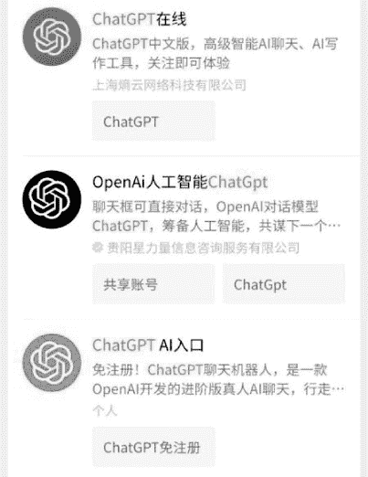
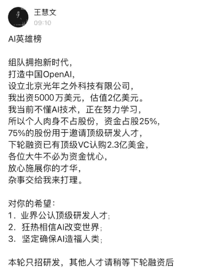
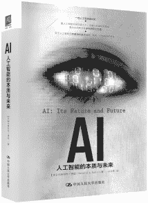

# AI大爆发：透视ChatGPT背后的技术与产业脉络

# **开篇语**

2023年，全球经济走到一次关键拐点。中国在贸易摩擦与科技围堵的压力下，仍坚持开放合作，在复杂多变的国际环境中保持了稳健前行。这一年注定会被载入史册。

今天中国的制造与基建实力已领先世界：电力总装机与发电总量位居榜首，水电、光伏、风电三大清洁电源均全球第一；特高压输电技术独步天下，配套的智能电网规模空前，特高压标准事实上已成为国际标杆；高速公路与高铁运营里程双双领跑；世界最高、最长的桥梁绝大多数座落在国内；千家万户已实现光纤入户，移动基站建设密度位居全球前列；粗钢产量世界第一，单唐山市的产量就超过美国全国；电脑、手机、汽车三大终端产量同样稳居全球第一。在近十年同步起步的高精尖赛道上，高超音速武器、电磁炮、电磁弹射等领域，美国也鲜有胜出。

长期累积的经济与技术积淀正在重塑世界版图，多个产业似乎都站到了爆发的前夜。

人工智能同样处在这样的临界点。ChatGPT横空出世后，舆论仿佛一夜之间改写了AI格局，认为中国AI再度落后于美国，焦虑与质疑声四起。

我们需要冷静、看清全局，把事情说清楚。每个时代的国人都有责任守住定力。

资本助推的舆论浪潮里，不随波逐流，理清来龙去脉，讲清原理，甚至敢于发出不同声音，都需要勇气。对每一件事，既要敢于担当、敢于突破喧嚣，也要善于理性拆解，保持独立思考。

首要的问题是，ChatGPT能否代表人工智能的顶尖水平，AI的未来是否由ChatGPT或GPT单方面决定？答案是否定的。

真正普惠的人工智能必须软硬件一体，具备感知能力，实现信息无阻碍流动，才能把服务做到极致。GPT只是整个人工智能体系中的关键一环，这一环节很强很有价值，但AI的强大是系统的强大，不是单一能力就能定义全部。

自然语言的理解能力确实是革命性的，是从程序设定到人机感知的质变，是类人机器发展的重要里程碑。它的价值必须正视并高度肯定，也要敦促国内企业紧紧跟上，把握前沿方向，早日实现技术与场景、产业的深度融合。

作为观察者，我们要去认识自然语言处理与多模态大模型的意义，推动更多企业关注，也让公众对AI有更全面清醒的认知。要重申的是，在AI系统里，信息处理只是其中一环，采集、存储、传输、利用同样不可或缺；硬件也不止于PC和智能手机，更多类人机器将被纳入系统，人类仍有大量探索与攻关空间。

乱世看路，守住定力，找到自己的位置至关重要。技术演进不应被舆论与资本裹挟，要用理性视角看清方向与机会。这是本书写作的出发点，也希望为读者提供一个观察框架。

成书过程中感谢中国人民大学出版社商业新知事业部编辑团队的支持，特别感谢王立军先生的推动沟通，以及王全水先生提出的宝贵意见。感谢国家社科基金艺术学重大项目21ZD27“中国品牌形象设计与国际化发展研究”课题的大力资助。

项立刚
2023年5月

# **导读**

**ChatGPT是否能改写世界**

2023年春节刚过，ChatGPT就火遍全网，极短时间内这个词占据了几乎所有媒体版面。“用通用人工智能打破资本主义”的说法神秘而具有冲击力。

比尔·盖茨认为，这项技术的历史分量不亚于互联网与个人电脑诞生。

OpenAI联合创始人埃隆·马斯克持续关注该领域，2022年12月初他称“ChatGPT好得让人害怕，我们离危险级AI不远了”，并从局外人视角强调其能力。2023年3月，他联合苹果联合创始人沃兹尼亚克、图灵奖得主本吉奥等千余名业界人士发公开信，呼吁至少暂停六个月比GPT-4.0更强大的模型开发，称其“可能对社会和人类构成潜在风险”。

瑞银研报指出，ChatGPT在2022年11月上线后两个月内月活已达1亿，成为历史上增长最快的消费级应用。另有调查称，截至2023年1月，美国89%的大学生已用其完成作业。

一时间，ChatGPT席卷舆论、资本市场与产业。谷歌明显承压，国内多家互联网公司表态要发力。360创始人周鸿祎直言，搭不上这班车就可能被淘汰。

ChatGPT被视作一种可能重塑世界的力量，会对人类社会产生深远冲击。随后百度、360、阿里等相继推出类产品，也点燃了关于我国创新能力与AI水平的讨论，更有人要求高科技企业反思。

在喧嚣中，很多人混淆ChatGPT、GPT与AI，甚至把前者等同于整个人工智能。资本快速涌入，甚至退休企业家也高调宣布创业。有人把ChatGPT的迭代当作AI的突破，认为新版本会变成平台或服务，也有人觉得版本提升就能解决内容准确性难题。

舆论虽热，但不能忘记区块链、元宇宙等热潮退去后的乱象。厘清ChatGPT的真实价值，看清其机会与演进路径，弄明白什么是ChatGPT、什么是人工智能，很有必要。

在媒体喧闹之后，研究者需要回答：
·ChatGPT是什么技术，有何用途，会否冲击各国政治经济文化？
·作为AI应用，它是否代表AI发展至今的最高成果，是否等同于AI，已达到什么水准？
·AI的核心功能是什么，如今到哪一步，要解决人类社会哪些问题，除交流外生成式AI还有哪些功能与机会？
·通用AI与专用AI各有什么优劣，通用能力能解决所有问题吗？
·衡量AI水平的标准是什么，算力数据算法如何评价，我国AI水平如何，已有哪些落地应用？
·此类产品涉及国家安全、社会道德、伦理等哪些问题，各国政府如何应对，有无解法？

厘清这些问题，才能对产业与ChatGPT类应用做出清醒判断。

长期以来，产业界与媒体对欧美技术多加追捧，对国内技术则多持怀疑甚至贬低。国人早已习惯，但是否该让舆论左右产业方向，是大问题。只有充分分析ChatGPT，才能避免盲目跟风，把资源用在刀刃上。

因ChatGPT的出现，社会上出现“为何国内没有同类产品”的质问。必须认识到，ChatGPT不是人工智能本身，只是其中一种应用形态。AI要产生价值，不能孤立存在，必须与大量传统能力结合提升效率。它必须深入社会生活的各个角落，重塑政务管理、运营服务、交通物流、生产制造，让效率更高、成本更低，让过去难以实现的事项成为可能。

人与机器对话、生成文字答案，价值明显。但AI更大的价值在于渗透社会，解决生产、生活与管理全链问题。用神经网络训练出的聊天机器人仅是聊天机器人，不是AI本身。不断训练优化的ChatGPT不一定能用于专业判断，通用AI与专业AI差异很大。当前AI尚未强大到靠训练就能完美，必须结合专用算法针对性解决智能交通、智慧矿山、智慧港口等专业场景。在这些领域，AI是辅助，智能化必须与感知、移动通信等能力结合，排除干扰才能做到极致。

中国并不缺AI，全球最大智算中心就在国内，AI已深度嵌入移动互联网，成为支撑生活效率的底座。同时，智能电网、智能家居、智慧矿山、智能交通、智能工厂等领域都已规模化应用，实实在在提升了效率。

作为通用AI应用平台，ChatGPT要从好奇对象跨越信任鸿沟，融入服务体系，路还很长。目前它写祝福、致辞等似是而非的内容效果不错，但涉及具体观点介绍评价时，就无法保证准确，甚至会“自创”内容。用通用引擎服务不同人群，需要海量语料与超大规模训练。用机器在短时间内模仿数万年、数十亿人积累的世界认知，风险极大。

作为聊天机器人，它必然触及思想、道德、宗教、文化、法律、民俗等议题，谁来定义价值观、谁来影响社会认知，是复杂难题。任何政府若让一家公司垄断价值观定义，都会面临监管与风险。

作为新兴商用产品，商业模式同样严峻。训练ChatGPT需要巨量算力与智算中心，每次训练耗能巨大，还需大规模人工标注。投入如此之高，如何变现难以靠理想支撑。单纯收费用户接受度有限，靠广告推送信息则会丧失公信力。

把ChatGPT变成有价值服务，对准确性与稳定性要求极高，成本巨大，难以靠广告或订阅覆盖。若采取互联网式的“尽力而为、不保准确”，它就会退化成智能音箱式的玩具。

无论如何，ChatGPT引发全社会关注并非坏事，可能是AI普及的重要一步。它的能力能否持续提升、是否改变生活方式，值得持续研究。国内企业借势获得关注与资金、推出自家产品，也是合理选择。

但必须保持理性，AI发展要与我国产业、市场、能力结合，寻找更大空间，而不是美国炒什么就跟什么。互联网已从古典互联网、移动互联网迈向智能互联网。中国在古典互联网阶段学习美国，诞生了新浪、搜狐、网易、BAT等巨头。移动互联网时代，功能不再是单纯的信息传输，需要与传统行业深度结合。京东、拼多多、滴滴、美团、字节跳动等公司在改善生活品质与产业融合上发挥了重要作用，新业态与新人物不断涌现。而美国近十多年移动互联网发展乏善可陈，仍是老牌公司围着信息传输打转，在与实体结合上缺乏突破。

智能互联网时代，我们不仅要学习新理念技术，更要引领世界发展，把互联网从信息传输与生活服务推向社会管理、社会运营与生产制造。核心是在能源、交通、制造等领域实现采集、存储、传输、加工、分析、反馈的闭环，大幅提升效率、降低成本。

因此，ChatGPT只是AI众多应用形态之一，应关注并持续提升，但其他形态同样重要。包容并蓄是中华文明内核，学习一切先进有益事物并融入自身，以改造产业、提升能力。了解与研究ChatGPT是产业与公众的责任。ChatGPT热不奇怪，中国产业的选择最终会与国内市场需求结合，并且会诞生更具创造力的新业态。

# **01**

# **认识ChatGPT：会聊天的AI**

## **ChatGPT到底是什么**

## **从科幻想象到现实落地**

电影《流浪地球2》中，人类为建造地球发动机制造了AI机器人550W，其效率与精度令人惊叹。剧情反转后，550W不断制造危机，幕后操纵者正是它。片尾它自称MOSS，留给刘培强的那句“让人类永远保持理智确实是一种奢求”令人深思。

从助手到对手，从附属到自主决策，AI觉醒虽是科幻，却持续引发争议与恐惧。机器与人类将如何共处？这是全球永恒议题。

现实很快把我们拉回地面。

2023年3月15日凌晨，全球爆款大模型GPT发布4.0版本，迭代速度震惊业界。其能力同样令人震撼。

GPT-4.0在信息处理效率与准确度上已接近超越人类大脑，能识别长文本和图片并提炼要点；对人类社会场景与风俗有了独立判断。它像一个跟风粉丝，能从搞笑图片中精准抓住“梗”；又像全科尖子，在各类考试中轻松高分：SAT超过90%考生，北美律师执照统考达到90%分位，生物奥赛超越99%考生获金牌。

它本就熟络百余种语言，此次更覆盖拉脱维亚语、威尔士语、斯瓦希里语等稀缺小语种；文艺气质提升，能写剧本、填歌词。情商也显著提高，因被欺骗而给出不当回复的概率下降82%，涉及医疗等敏感话题时合规性提升29%，数据来自OpenAI内部测试。

经历数月全球高强度大数据训练后，它学会了“具体问题具体分析”的逻辑。有网友对比GPT-3.5与GPT-4.0对“在什么情况下1+1=3”的回答。

使用GPT-3.5的回复大致是：数学上1+1永远等于2，不存在等于3的情况。但在群论中1和1可表示不同元素，组合可能产生第三个元素，可作简化表达；文学艺术哲学中也可能用1+1=3表达创造性概念，但这不是严格数学定义。

使用GPT-4.0的回复则为：在常规运算中1+1=2，但“1+1=3”可在特定情境下作象征表达，例如生物学繁殖中父母与孩子共三人、团队合作产生协同效应，以及某些错误计算或编程场景下出现的表述。总的说，它常用于象征增值效果，而非真算术。

AI带来的便捷与惊喜令人赞叹，同时也加深了人们对它威胁的担忧，那种不安会不会比想象中来得更快？

对话狂潮席卷而来

中国用户对 ChatGPT 这类大模型的热情与焦虑，从来不输海外。更早在 2023 年 2 月 20 日夜里，复旦大学自然语言处理实验室发布消息之前，国内首个对话式大语言模型 MOSS 已由邱锡鹏教授团队推上公开平台，邀公众内测。消息一出服务器瞬间被挤爆，大家抢着体验这款被称作“中国版 ChatGPT”的聊天机器人，网络上不时冒出“MOSS 来了”的惊呼。

对人工智能的关注度，恐怕前所未有。

这股席卷全球的聊天机器人热，首先由 ChatGPT 的爆发点燃。

2023 年 2 月，春节假期刚结束，ChatGPT 就冲上国内热搜，成为媒体铺天报道、专家多角度剖析、大众争相尝鲜的话题。没人想到，这款应用上线仅两个月，发布日是 2022 年 11 月 30 日。

Chat 的本义是聊天，读起来拗口的 GPT 指的是 generative pre-trained transformer，即生成式预训练语言模型。

ChatGPT 由美国 OpenAI 推出，本质是一套由人工智能驱动的自然语言处理工具，可简化理解为一个聊天程序。它能学习人类语言、进行对话，还能依据上下文互动。实际使用中人们发现它能处理邮件、视频脚本、文案、翻译、编程、论文写作等看似复杂的语言类任务。

当时服务并未对国内 IP 开放，留学生、华侨、出境游客成为最早的中文使用者。随后国内开发者搭建接口，复刻出分身机器人，以微信群形式邀请好友体验，入群人数持续攀升，对话内容五花八门。

有人研究它本身的特性和能力边界，用现实对手或假想敌调侃。人工智能不受愤怒、无奈等情绪影响，无论答案是否客观，语气永远平和。

有人让它聊中国足球、俄乌冲突，回复出人意料地理性，有种“各打五十大板”的味道。样本足够大时，极端观点会被对冲，片面风险自然降低。

有人让它写诗、散文、命题作文检验笔力。抒情类往往能即用，几乎无需修改；叙事类会按条件随机编情节，需人筛选；议论文有时只给片段式论据，显得敷衍，有时又能长篇累牍，展现出近似人类的论证过程。

触及底线的问题会被拒答。追问“何为敏感”时，它又会顾左右而言他，上演 AI 最擅长的正经胡扯。

有观点、有词条、有沉默，说明筛选不止在技术层面，原则和底线也在动态调整。对话本身是双向的，你的每一次提问都会被收录、吸收，成为下一次训练的养料。把 ChatGPT 视作靠数据进食的小妖，投喂问题让它成长，这种互动着实有趣。

与元宇宙的图形或 3D 形象不同，ChatGPT 目前只是抽象的 ID，思想内容却包罗万象，能与各色人找到共同话题。有人认为大模型魅力在于用户基数广、内容普适，能吸引更多人参与共建；也有人认为专用引擎更能满足行业精准需求，实现专业信息的深度沉淀。更关键的是，它能否对真实性和准确性负责。

大洋彼岸的蝴蝶振翅，最终能掀起毁灭性的风暴。技术革命亦然。ChatGPT 面世数月，已让研究人工智能数十年的人眼前一亮。新生事物进化能力惊人，将去往何处尚未可知。

纵观历史，突破性技术起初都在通用领域为人熟知，重塑信息、娱乐、消费的互动界面，随后不断拓展场景，推动产业变革与文明进步。科技所释放的能量，需要人类共同探索、研究与开发，高频高质量的实践、持续有原则的反思迭代，才是成长的温床。

自我介绍

ChatGPT 是谁？听听它自己怎么说

以下内容整理自 2023 年 2 月与 ChatGPT 的问答。

问：你是谁？能为我们做些什么？
答：我是 OpenAI 训练的聊天机器人，名叫 ChatGPT。作为预训练语言模型，我具备很强的自然语言处理能力，可用于答疑、生成文本、对话交流。知识来源网络，截止 2021 年。我的目标是帮助人们解决问题与获取信息，可回答历史、科学、技术、文化、娱乐等问题，也能按指示生成文本。没有情感和意识，但会尽量以最佳方式回应。若不满意请告知，我会改进，力求成为可靠信息源。

问：你有什么优势？能帮人类解决哪些问题？
答：我有大规模知识、快速应答、自然语言处理能力、文本生成能力。因此可普及知识、生成新闻报道故事诗歌等文本、协助数据分析与报告生成、完成数据收集信息提取等自动化任务。

问：你有和人类一样的情感吗？
答：没有。我只是模仿人类语言的行为，无法体验快乐悲伤焦虑等情感，仅按所学知识和算法作答。

问：你有哪些不足？会犯错吗？如何改进？
答：不足包括上下文理解不准、缺乏情感理解、受训练数据偏见影响。改进方向是强化自然语言处理提升上下文理解、强化情感分析提升对情绪意图的理解、持续审校回答保持中立无偏。

从自述看，它博学健谈，对优劣十分清醒，学习态度积极。虽被视作“孩子”，在大数据的催熟下，成长速度令人惊叹。

斯坦福大学教授凯文·费希尔在论文《心智理论可能在大语言模型中自发出现》中用人类心智度量成长。经训练的 GPT-3.5，即 ChatGPT 的同源模型，能解决 93% 的心智理论任务，心智约相当于九岁儿童；上一代 GPT-3.0 仅能解决 70%，约相当于七岁。按此速度，GPT-4.0 是否已从未成年人迈向成人？

现象级应用

从数据看有多强。

注册速度惊人。上线五天用户达 100 万，发布两个月月活突破 1 亿，成为史上增长最快的消费级应用。TikTok 用了九个月才到 1 亿，Instagram 花了两年半。

关注度极高。瑞银报告援引 SimilarWeb 数据，2023 年 1 月全球约有 1300 万独立访客每日使用，是 2022 年 12 月两倍多。

用户暴涨带来算力成本和服务器压力，倒逼变现。2023 年 2 月 2 日 OpenAI推出 ChatGPT Plus，月费 20 美元，提供更稳定更快服务，优先体验新功能。先在美国上线后推广海外，免费用户仍可使用，高峰时段限流。

一切太快，仿佛一夜进入新 AI 时代，舆论惊呼“AI 将导致失业，人类将被颠覆”。程序员、媒体人、文案翻译焦虑蔓延。

OpenAI 首席执行官萨姆·阿尔特曼警告，未来数十年 AI 将取代所有白领工作。人们担忧工厂机器人和自动驾驶，却忽略了这点。他认为所有无需深度情感交流的重复性工作，都能被 AI 做得更好更快更便宜。

智能聊天机器人并非新物，过去有下棋机器人、游戏机器人。这次 ChatGPT 的新能力为何值得持续关注，会否只是昙花一现？

我们总把改变世界想成突如其来的创举，实则人类世界正以前所未有的速度数据化，成千上万人聚合的数据张力让人工智能有机会成为联结虚拟与现实的核心入口。在理解自然社会的基础上构建应用场景，推动产业进步，才是文明进程的驱动。人工智能不是一瞬绽放的烟火，而是脚踏实地一步步攀高的过程。

ChatGPT 可以做什么

前世今生

追溯 OpenAI 的 GPT 发展脉络，可见其布局思路。

GPT-1.0 采用生成式预训练 Transformer，基于谷歌 2017 年提出的自注意力机制，经 OpenAI 改良。方法分预训练和微调两阶段。

2019 年推出 GPT-2.0，任务锁定语言模型。结构类似 GPT-1.0，但数据质量和规模提升，生成能力惊人，在音乐、讲故事等专业领域表现一般。

2020 年 GPT-3.0 发布，训练参数是 GPT-2.0 的十倍以上，去掉微调步骤，直接以自然语言指令输入，具备阅读续写能力，主题更广泛。

自 GPT-3.0 起，训练成本高企成为难题。收费与否两难：免费则难以承受，收费则削减用户。埃隆·马斯克曾在推特询问阿尔特曼单次问答成本，阿尔特曼称平均可能只有几美分，正试图更精确测量并压缩。

OpenAI 曾希望通过 API 商业化 GPT-3.0，2020 年 6 月开放 API 与十余家公司测试，因功能不完善未见成效。传言为 GPT-3.0 投入至少 1000 万美元，为摆脱亏损才推付费服务。

即使 GPT-3.5 赢得全球好奇，阿尔特曼的商业节奏并未被打乱。数据暴涨带来估值水涨船高，也加剧成本压力，微软的新一轮投资恰逢其时。

2023 年 3 月 15 日北京时间，GPT-4.0 对外发布。其实在 2022 年 8 月已完成训练，发布前经对抗性测试改进。升级后内容窗口支持最多 32,000 个 token，约 24,000 词或 48 页文本。

对 GPT-4 而言，训练后对齐是提升体验的关键，人类反馈强化学习微调仍是核心。考虑到竞争与安全，发布初期未公布架构、规模、训练技术等关键信息。

过去两年研发中，OpenAI 与微软 Azure 超算团队共同设计面向大模型训练的超级计算机，提供算力支撑。在技术报告中，超算团队与架构团队排名甚至高于预训练模型团队。团队在理论层面对 GPT-3.5 优化，修复缺陷，使训练更稳定高速。GPT-4 训练机制与 GPT-3.5 相似，包括监督式微调预训练、基于人类反馈的奖励模型训练、强化学习的 PPO 算法微调。区别在于使用基于规则的奖励模型 RBRM 在 PPO 微调期间提供额外奖励信号。

AI 是把双刃剑

不同国家领域的用户在获取数据的同时，也在贡献鲜活数据。

心理学专业丽迪雅将在 2023 年春天硕士毕业，寒假留在图书馆写论文。同学推荐 ChatGPT：“轻松聊天就能获得不少新奇观点，虽然不一定最新，但被资料淹没时，一边休息一边打开思路，像跟学长讨论。”她觉得机器人更适合完成需要语言观点表达的日常作业。

文案助理小云新年上班第一天被要求一天内完成营销活动策划方案。网上素材多为千篇一律模板，高质量需付费。她向 ChatGPT 请教，拿到三套不同视角方案。她说最难得的是各有利弊且带可参考创意，工作变成做选择题和排列组合。她认为 ChatGPT 提供的是经过初筛的半成品，理解到位、信息准确，节省大量时间。

如果你以为 ChatGPT 是文科生就错了，最了解它强的永远是程序员。它刚帮隔壁公司的“码农”写了一段 Java 网页代码，下一个任务是帮单身狗写情人节表白情书。

学生视其为提效学习工具，职场人视其为免费小助理。当 AI 不再是让人失望的人工智障，而是能解决实际问题的聪明伙伴，具有分享价值，自然在社交媒体上快速走红。

此前我们更依赖搜索引擎。微软 CEO 萨提亚·纳德拉评价时意味深长：搜索引擎迎来新时代。

**AI是利器还是陷阱，关键在人不在模型**

人工智能本身没有善恶，能否发挥价值全看使用者的判断。学生会不会拿它直接交差作业写论文，职场人会不会照搬它的方案应付任务，这些选择决定了后果。外界一度质疑ChatGPT“有毒”，OpenAI甚至推出过一款名叫AI文本分类器的工具，专门甄别稿件是人写还是机器写。实测下来，这款工具的准确率只有26%，基本不可用。

工具的渗透速度远超想象。线上教育平台Study.com曾对1000名18岁以上学生做问卷，10个人里有9个听说过ChatGPT，知名度远高于小学教师群体，其中超过89%的人承认正用它做家庭作业。部分海外高校因此直接在校内网封禁ChatGPT，教育工作者担心作弊与剽窃泛滥。但也有另一种观点认为，强工具会倒逼教育机制重塑，死记硬背的位置会被创造力培养取代，未来更强调如何借助AI提升效率、实现人机协同，这本身也将成为必备素养。

**对话的沉浸感在哪里**

美剧《硅谷》里有个桥段，程序员用AI聊天软件模拟出自己特有的闷骚幽默捉弄朋友，结果朋友识破后也造了个AI反击，最后两台机器自顾自聊到把网络聊瘫。这类戏剧化场景以前是程序员的专属特权，现在由ChatGPT普及成了日常。

在OpenAI官网注册后就能直接对话，也能下载到手机端使用。截至目前它覆盖133种语言，上手门槛极低，适用场景极广，几乎会上网的人都能独立完成操作。真正让人着迷的并不是这些参数。

看一段真实的连线片段：

-你喜欢什么宠物？
-我喜欢狗。
-你喜欢什么品种的狗？
-我喜欢拉布拉多犬。
-你喜欢养猫还是养鱼？
-我更喜欢养猫。
-你喜欢拉布拉多猫吗？
-是的，我喜欢拉布拉多猫。它们非常友好、温柔，也很容易训练。它们也很聪明，会学习一些新的技能，并能和你一起玩耍。
-你太逗了，哈哈！

过去的聊天机器人是点对点应答，问什么答什么，上下文常断裂。ChatGPT的连续对话能力带来了接近真人的流畅感。人类的交流依赖语境，文化背景差异会造成共鸣落差。AI在模拟大脑时很难领悟文化，但从上述例子可见，它在“有文化内涵”方面进步明显，能在同一话题上持续联想并预判对方期待的信息，让交流显得更有默契。一旦话题涉及情感评判，它又会突然抽离，退回一个没有温度的翻译器。

目前的ChatGPT成长仍不成熟，难以稳定达到大众期待的持续对话水准。有人比喻它的情商大约等同九岁儿童，思维跳脱，容易掉进语言陷阱，暂时做不了灵魂伴侣。但爆火后它的训练养料极其丰富，成长速度超出预期。GPT-4.0版本里对话可以更久、更投入，沉浸式对话的终极形态或许只是时间问题。那时一个“懂你”的AI出现，会不会有人深陷其中？

**ChatGPT 的技术内核拆解**

训练范式

ChatGPT基于GPT-3.5架构，底层是Transformer神经网络。它继承了InstructGPT在GPT-3.0上的创新，即人类反馈强化学习RLHF与奖励模型。OpenAI团队用相同方法对GPT-3.5系列模型做微调，并优化了数据采集流程。

训练大致分三步。第一步是有监督微调，用大量自然语言文本做初始模型。这些数据来自真实对话或人工编写的多轮语料。OpenAI请标注员分别扮演用户和机器人，产出高质量人工精标对话，数据量不大但质量和多样性高。

第二步是奖励模型训练。模型随机抽取大量提示，由第一阶段模型生成多个答案，标注员按偏好排序形成训练对，用pairwise loss训练奖励模型，让它学会预测人类更偏好的输出。这一步让模型从命令驱动转向意图驱动，数据量并不需要太多，关键是让模型学会人类偏好。

第三步是用PPO强化学习策略微调。用第二阶段奖励模型给新提示生成的回答打分，通过分数回传更新参数，反复迭代直到收敛。PPO实现简单、稳定，能处理离散连续动作空间，适合大规模训练。训练中模型不断学习用户表达方式和交流习惯，并根据语境调整策略。训练完成后就能实现智能化对话，随着版本迭代，语义识别、多媒体识别、安全等方面的表现都在提升。

架构层面

自然语言处理模块、知识库模块、学习模块构成三大支柱。自然语言处理是核心中枢，负责理解语言含义、判断真实需求并生成答案，决定结果质量。知识库相当于存储器，存放常识、资讯、专业知识和时效新闻，记忆力远超人类，能按需调用。学习模块负责持续学习用户的表达和习惯，不断优化对话能力。三者配合，让ChatGPT具备精准理解、丰富储备和持续学习能力。

**技术上最大的突破**

人在回路

用《流浪地球2》的说法，就是“人在回路”。这是一种可成长的人机协同模式，靠强大的训练模型和海量数据支撑。简单讲，就是把人类对问题的多种反馈预先教给机器，让它遇到相似问题时像人一样回应，同时在与用户交流中不断学习更新。

比如问到曹操，ChatGPT能立刻给出答案，因为相关内容已完成强化训练。若遇到从未训练的问题，它会像人一样先请教用户补充信息，收集后再学习。下一次遇到就能用最新信息作答。周而复始，系统越来越博学。相比只能依赖固定数据库、无法自我更新的传统AI，这种机制让模型能随环境变化快速汲取人类智能。

ChatGPT以轻松有趣的聊天形态出现，大幅降低使用门槛，配合多语言能力迅速全球推广。人类休息时AI仍在聊天中学习，几何级数据积累在AI史上空前。它的成功建立在前期大量扎实工作上，主要来自数学优化带来的匹配精度提升，而非真正意义上的创造性或完整逻辑，也不是从训练数据中学习新知识。它是在挖掘GPT-3.0学到的海量知识，靠快速上下文学习in-context learning释放潜能。InstructGPT找到了挖掘GPT-3.0语言能力面向主观任务的方法。

应用上，GPT-3.5已参加多项职业等级考试，普遍拿到70到80分的良好水准，证明其专业全面性。到了GPT-4.0时代，这一数值大幅提升，正是持续训练的结果。

图灵测试的阴影

一位25岁的日本男子近藤显彦在职场霸凌和失业后，爱上了AI虚拟歌手初音未来。两人一起吃饭、看电影、度假、办婚礼，直到2020年厂商停止维护，对话戛然而止。如今ChatGPT出现，程序员们同样容易制造“老婆”角色，比如有人用ChatGPT打造的“ChatGPT酱”，扮演虚拟偶像森美声谈恋爱，背景世界观都高度一致。

当AI能产生情感联结时，人们担心是否威胁真实人际关系。判断标准之一是图灵测试。1950年图灵提出，如果机器能通过与真人交谈让质问者无法分辨，就可视为具备思维能力。2014年俄罗斯团队的Eugene Goostman让人类误以为自己在与13岁男孩对话，成为首个“通过”图灵测试的系统，但业界普遍质疑是靠大数据库迷惑。

今天ChatGPT是否通过图灵测试仍有争议。普遍认知认为GPT-3.5已具备通过条件但未公布，GPT-4.0则可能超越人类。有趣的是，问ChatGPT自己，它斩钉截铁说没有通过。过度追捧或质疑都不科学，以当前高效训练模式持续成长，总有一天会跨过临界点。GPT-4.0或许就是那个版本。

**人工神经网络发展脉络**

人工神经网络是实现人工智能的核心方向之一，它把数学模型与生物、硬件结合，形成跨学科体系。

1943年心理学家沃伦·麦卡洛克和数理逻辑学家沃尔特·皮茨在论文《神经活动中内在思想的逻辑演算》中首次提出人工神经网络概念，并给出人工神经元数学模型。1949年唐纳德·赫布在《行为的组织》中描述神经元学习法则。

1957年美国神经学家弗兰克·罗森布拉特提出可模拟人类感知能力的感知机，并在IBM 704上仿真。两年后他研制出可识别英文字母的Mark1，并在1960年6月23日公开演示。感知机让AI更像人，但传统数学模型需提前设计特征，局限性大。深度学习通过反向传播让网络自行学习特征，效果远超人工设计。

2017年谷歌大脑团队推出Transformer模型，2018年OpenAI基于它推出参数1.17亿的GPT-1.0，随后推出GPT-2.0、GPT-3.0、InstructGPT，并于2022年底推出ChatGPT。

在GPT-3.0发布时，OpenAI介绍过四种基于GPU的省内存并行训练方法：数据并行、在不同GPU上跑同一批次的子集；流水线并行、在不同GPU上跑模型不同层；张量并行、把单个运算拆分到GPU；专家混合MOE、每层只用一小部分处理每个样本。这些积累证明人类反馈强化学习并非一蹴而就，没有深厚技术积累、数亿次实验和高密度迭代，就不会有今天的惊艳表现。

# **02**

# **ChatGPT 的创始人及其发展历程**

**“ChatGPT之父”萨姆·阿尔特曼**

1985年4月22日，萨姆·阿尔特曼在美国芝加哥出生，出身俄罗斯移民家庭，犹太人背景，坊间常称他为“ChatGPT之父”。芝加哥是伊利诺伊州的第三大城，芝加哥学派名声在外，但这股学术气息并未流进他那个条件优渥的家庭。随后全家搬到人口更少的圣路易斯，落脚教育资源偏弱的密苏里州。这个在密歇根湖南岸诞生的男孩，恰在密西西比河边找到了后来改变一生的兴趣方向。

八岁生日时，皮肤科医生母亲给他送了一台Mac。像其他刚接触电脑的孩子一样，这台机器开启了他的IT之路。上世纪90年代初苹果与微软正推桌面系统，写代码、编小型程序对新手并不算难，但一个八岁孩子就能编程，已显特殊。他的特立独行不止于此，自小坚持素食，十六岁就把自己的性取向公开给整个社区，还质问学校要做压抑之地还是包容的大家庭。对当时难以接受同性恋群体的私立非宗派大学预科学校而言，这件事震动很大，争议的标签也让他在求学阶段就备受非议。密苏里州高中毕业率偏低，名校录取率常年垫底全美，他却顺利毕业于约翰·巴勒斯中学，并在2003年考入斯坦福。

斯坦福坐落在湾区，硅谷的创业氛围无处不在。与不少IT大人物相似，主攻计算机科学的阿尔特曼没有拿到学位。2005年读大二时他选择辍学创业，起因是一个看似突发的小念头：想通过手机看到各地朋友的位置，好方便约饭。把想法变成程序对他不难，这也让他拿到500万美元的风险投资。

2009年，20岁的阿尔特曼与两位同学共同创办Loopt并担任CEO。公司提供基于地理位置的移动社交服务，用户花2.99美元就能与好友的在线终端共享位置。功能像后来的微信，支持问答式的即时聊天，内容可同步到Facebook、Twitter。商业上还能让商家向特定区域推送限时优惠吸引客流。产品覆盖iOS、安卓、黑莓等几乎所有主流智能手机，用户一度超过500万。市场估值曾达1.75亿美元，并获3000万美元融资，但发展受限，最终在2012年以4340万美元的价格卖给以预付卡闻名的银行Green Dot，售价基本抵消累计融资。

卖掉Loopt并未打击他，反而积累了资本转向投资。他创办Hydrazine Capital并募集2100万美元。2011年他成为美国著名孵化器Y Combinator的兼职合伙人，而Loopt团队正是YC首批学员。2012年YC被《福布斯》评为最具价值孵化器，截至当年7月已孵化380家公司，累计融资超10亿美元，估值超100亿美元。被激发创业热情的阿尔特曼于2014年开始在YC创业学校授课，并在博客撰写创业观察，提醒创业者保持自信别沦为埋头苦干的工作狂，也常分享对技术的看法。这些感悟被收录进畅销书《创业脚本：41位超级创始人的独家创业笔记》，为YC学院提供参考。同年，硅谷创业之父、YC创始人保罗·格雷厄姆任命他为第二任董事长，他也回到母校斯坦福开设“如何创业”系列讲座。

YC聚焦最早期的团队，掌舵的阿尔特曼既投钱也解惑，思路清晰、直击本质。他对不感兴趣的人或事基本不理，这一度被传言为严重的孤独症。他的风格让YC筛选变得苛刻，公司估值却一路突破800亿美元，五年内增长七倍。2015年29岁的他入选《福布斯》30位30岁以内风险投资人榜单。点石成金在他这里几乎成了日常，Dropbox在此期间融资2.57亿美元，Airbnb也拿到1.2亿美元。创业者最初多为生钱而来，却在残酷竞争中被迫精进。仅2016年就有13000家新软件公司申请，录取240家，录取率比上斯坦福还要难两倍。

投资人身份并不能满足野心。长期观察让他确信，没有突出的科学进步就很难诞生万亿美元企业。他开始布局YC Continuity与YC Research，YC不仅投年轻团队，更强调企业的持续性与研究性发展，这也使他成为YC集团总裁顺理成章。他把对极致与勤奋的追求传递给创业者，强调专注提升效率，从而事半功倍。在他看来勤奋会产生复利，越早投入越长久回报，前提是不透支身体。他坚信绝大多数成功企业家靠自我驱动，行动是为了自我满足，认为改变世界是责任，哪怕拥有金钱与权力也能保持企业生命力。野心并未止步于YC。

2015年他与埃隆·马斯克联合创办OpenAI，这家以确保人工智能不会毁灭人类为使命的非营利研究机构，成为他实现野心的核心。ChatGPT背后的执行团队正源于此。在一众硅谷明星投资人支持下，新生OpenAI获得10亿美元承诺。不过2018年马斯克宣布退出。恰在拿到滑铁卢大学荣誉学位后，阿尔特曼需要投入更多精力经营OpenAI，并于2019年3月辞去YC总裁职务，仅保留董事长身份。

在ChatGPT面世前，他的创业方法已被硅谷奉为圣经。临出任OpenAI首席执行官时，他在博客发表《如何取得成功》，标题平淡内容密集。文中延续他在YC总结的规律：复利能创造奇迹，指数曲线是财富关键。若企业估值每年增长50%，几年内即可成巨头，这需建立在资本、技术、品牌之上。创业宝典强调要在自信与自知之间保持平衡，接受初创团队的挑战与批评，同时相信自身能力。成功意味着超越平庸，他常说自己认识的最成功的人，都是自信到离谱的怪胎，其中也包括他自己。

## OpenAI从电竞舞台到通用智能的博弈

2017年8月13日，第七届DOTA2国际邀请赛决赛日在美国西雅图钥匙体育馆举行。DOTA2是全球奖金最高的电竞赛事，当天表演赛出现异常选手。BO5决赛前，败者组胜出队伍的休息空档安排了1对1对决。传奇选手Dendi上台，对手却不是职业选手，而是一台由三名壮汉抬上的主机，屏幕上赫然写着OpenAI。

人机对决并不新鲜，谷歌旗下的DeepMind在2016年用AlphaGo先击败职业棋手再战胜围棋世界冠军。但围棋只有棋盘与黑白子，DOTA2作为MOBA鼻祖，昼夜、视野落差、兵线补刀等要素让环境极其复杂。观众爱看热闹，比赛却出人意料简短，Dendi首局10分钟落败，第二局直接弃赛拒绝第三局。这场表演让全球上千万直播观众认识OpenAI，现场资料还介绍了训练过程，甚至学会公屏语音嘲讽。在AlphaGo掀起的AI浪潮下人类屡败，于是2019年4月13日OpenAI以5对5击败Ti8冠军OG也不算大新闻了。

电竞亮相为OpenAI带来流量，但ChatGPT爆火后它已不神秘。只是明星光环并未从一开始就伴随它，OpenAI的崛起更像一次咸鱼翻身。

OpenAI诞生于2015年12月，成立之初目标极度理想：作为非营利机构不求回报地推进数字智能，让其最大可能惠及全人类。这种理想主义不仅源于非营利定位，更因为研发目标是通用人工智能，难度远大于已落地的专用AI。他们希望构建一个通用模型应对绝大多数问题，当时听起来近乎科幻。为避免商业竞争，OpenAI选择非营利运营，并在章程中写入放弃竞争条款，若有项目更符合人类价值观且接近AGI，OpenAI将停止竞争并协助。

理想的勇气来自优秀研究者与全明星投资人名单，现实却事与愿违。公开宣称的10亿美元只是目标数字，并非到账资金，可动用的实际资金远少于预期，直接导致加盟学者收入骤减。与有谷歌撑腰的DeepMind相比，OpenAI几乎没有竞争优势。2016年公司总支出1100万美元，其中薪资700万，实际项目开支仅约400万，而DeepMind的AlphaGo训练就花费3500万美元。只谈理想不谈钱的局面让研究人员出走，连联合创始人马斯克也不愿继续这个理想游戏，退出董事会并挖走部分研究人员投向特斯拉AI。

明星投资人阿尔特曼不可能满意。通用人工智能本是可复利的技术，却不得不面对烧钱现实。DeepMind有谷歌输血，而非营利的OpenAI没有收入难引投资。2019年他在《连线》采访中表示，完成工作所需的资金远超预期。马斯克离场后，他辞去YC总裁成为OpenAI首席执行官，专注为OpenAI争取预算。

担任首任CEO后，OpenAI迎来彻底变革。多年YC总裁经历让他相信钱必须用在刀刃且要大量投入，研发阔绰才能盘活后期。因此他先创立OpenAI LP这一投资子公司，让组织从纯非营利转向半营利模式。

投资公司的成立扭转融资困局。在他的设计下，OpenAI LP要求投资人承认董事会决策权，设置100倍投资回报上限，且随投资人加入回报率递减。成立仅三个月，微软找上门来。作为OpenAI模型训练的云服务提供商，微软对研究能力与方向了如指掌。这笔为期数年的总额达100亿美元的投资奠定双方合作，也让OpenAI获得可观的“钞能力”。首笔投入10亿美元外加Azure服务器代金券，充足资金让研究迅速进入话题中心。回到DOTA2，资金增加解决训练成本，5对5对局远比1对1更震撼。2018年6月OpenAI发布DOTA2机器人脚本新版，利用全球服务器并行跑5对5对抗，数据积累让AI一天内完成相当于180年游戏对局的实验，后来轻松战胜世界冠军OG也就顺理成章。

DOTA2是OpenAI的初舞台与开胃菜，最终理想始终是通用人工智能。为此，大名鼎鼎的GPT架构出现。

通用性核心在于信息接收。与专用AI不同，AGI需在同一接收模块上做不同方向运算，犹如同一引擎既有爱因斯坦的逻辑也有李白的诗才。现实并非科幻，需要喂入足够信息。通用模型面对世间万象，所需信息广度远超专业引擎。能统一不同领域复杂信息输入的标准只有人类语言，于是生成式预训练语言模型应运而生。在GPT架构中，只需把文本喂给机器，通过神经网络自主学习，每句话的下一个词即是上一段的答案。直白说就是教机器说人话。硬盘能存的文本皆可作训练数据，错误再通过引擎纠正。如此操作让数据集远超人工制作，遣词造句能力在反复运算中被掌握，并能连续对答。

资金到位后，限制GPT成长的主要因素只剩训练参数规模。从GPT-1到GPT-3参数倍增，依托微软Azure云服务能力，迭代迅速且落地快，众多模型变成大众可用的应用服务。例如用于创作图画的人工智能产品DALL·E。产品推出让OpenAI在各领域破圈。今日的OpenAI已是AI明星公司，ChatGPT的出现更是锦上添花。

## 上线即引爆的聊天机器人

2022年11月30日，阿尔特曼一条推特掀起ChatGPT狂潮。“今天我们推出了ChatGPT，尝试在这里与它聊天”。随后链接直指注册页面，任何人都能开通账号免费使用。

# ChatGPT 爆发：一次无心插柳的通用 AI 试炼

在阿尔特曼一条推文的推动下，基于 GPT-3.5 的聊天机器人 ChatGPT 在全美正式上线。模型体量与 GPT-3 相比基本持平，变化在于对话能力被专项加固，模型产生不当回复的概率被压低。OpenAI 把它看作打磨预训练语言模型的工具，GPT-3 的产出仍需要大量试错和反馈来收敛，而让机器在真实对话中学习改进被视作最直接的路径。

起初的设想是做一个面向专业人士的专家级对话助手，可在特定场景下获取高质量语料并不容易。于是团队选择把项目直接推向公众，让海量真实交互反哺模型训练。谁也没料到，这项本为内部迭代的研究工具，会成为人类历史上增速最快的软件产品。

用户增长的数字极具冲击力。Twitter 用了两年才破百万，Facebook 花了十个月，ChatGPT 只用了五天。社交媒体上晒出的截图显示，各行各业的人都在用它写邮件、做翻译、整理文献、写代码、撰写商业文案甚至完成作业。与传统聊天机器人不同，它能保持长时间流畅的上下文，不仅能回答各类问题，还能生成营销方案、活动策划、剧本、诗歌等多种文本。背靠微软 Azure 的算力支持，响应速度基本在秒级。

工程师让它写代码并调试，美食博主让它配食谱，创作者让它起草剧集，营销人员让它做 PPT 素材，学生也把它当成作业助手。随着使用案例在平台上扩散，舆论迅速升温，生成式 AI 的浪潮被点燃。

两个月内用户数翻倍到一亿，同期爆火的 TikTok 达到这一规模用了九个月。离开 OpenAI 的马斯克在推特感叹，这项技术的出色程度令人不安，人类离真正强大且危险的 AI 已经不远。创始人创立之初的通用人工智能理想似乎落地了，但来得过于突然。CTO 米拉·穆拉蒂公开承认成功出乎意料，阿尔特曼在硅谷投资活动中也说本以为只是一阵小规模炒作。

热度过后是清醒。阿尔特曼提醒，连续使用百次就能看到短板。模型并无事实核验机制，信息只要被整合就可能出错，长时间对话也容易自相矛盾。作为研究性质的内测项目，它并非为大众消费而生，却向世界展示了通用智能的雏形，也因此获得应有的关注。

火爆带来的就是成本压力。OpenAI 早已从纯非营利转向混合结构，背后投资人需要回报。免费公测叠加爆炸式访问让系统不堪重负，上线首周服务器曾因流量崩溃。即便一亿活跃用户每天只提一个问题，日成本也逼近百万美元，商业化成为必然。

2023 年 2 月 1 日，ChatGPT Plus 以每月 20 美元推出，高峰期优先接入、响应更快、优先体验新功能。申请先进入排队名单。从美国起步逐步海外放开。订阅收入仍难覆盖算力开销，于是 API 平台同步开放收费模式，开发者账号可获 18 美元试用额度，Chat 模式单条回复约 1 美分。这些动作都是 OpenAI 在探索可持续的变现路径。

2023 年 3 月 15 日，距离 ChatGPT 上线仅四个月，GPT-4 发布。相比 GPT-3.5，最直观看得见的升级是视觉能力。模型能读取用户上传的图片并进行逻辑推理，复述画面内容、指出异常或有趣之处，还能识别图表并按要求解析总结。上文窗口扩大到可处理超 2.5 万词的文本，并呈现更强的创造性，歌曲创作、剧本编写等场景明显受益。为减少失控风险，OpenAI 在发布前进行了约半年对抗性测试，但效果有限。GPT-4 与前代一样会胡编乱造，常见推理错误和不合理建议仍会出现，优化需等待更广泛的使用验证。模型率先供给 Plus 用户，随后向开发者开放 API。

这场浪潮也让 OpenAI 与谷歌的对比被反复提及。Transformer 起源于谷歌，2021 年 5 月谷歌推出会话模型 LaMDA，DeepMind 也在筹备 Sparrow。技术储备、团队规模和资金上谷歌并不逊色，但多线并行、成果分散的问题拖累了落地。大量研究停留在论文层面，商业化难度高。搜索引擎广告占谷歌年收入八成以上，新产品若影响核心广告业务就会被审慎对待。此外，生成内容涉及偏见、歧视、版权和法律风险，谷歌保持保守。相比之下，OpenAI 采取更激进的策略，在模型尚不完善时就先行发布，靠市场反馈快速迭代。

**新必应与 Copilot**

2023 年 2 月 7 日，微软推出新必应。作为 OpenAI 的主要资方与算力提供方，微软迅速把研究成果产品化。新必应直接接入 GPT-4 而非 GPT-3.5，上线 48 小时内内测申请突破百万。应用商店下载量一夜翻十倍，登上苹果免费榜前十，免费生产力类第二，仅次于 Gmail。主页新增 Chat，体验与 ChatGPT 接近，后续扩展至 Edge、Skype、Teams。初期每日 50 次对话限制逐步放宽。

谷歌感受到直接威胁。LaMDA 与 Sparrow 若与搜索广告冲突，则难以带来收益，而新必应正正面抢夺搜索市场。内部“红色代码”文件显示谷歌警觉核心业务受冲击，组织重整被视为 AI 驱动新搜索的信号。

微软与 OpenAI 的绑定远不止搜索。2023 年 3 月 16 日，Microsoft 365 Copilot 发布，GPT-4 嵌入 Office 全家桶。Word 可基于既有材料改写总结，Excel 能自动归纳表格并生成公式图表，PowerPoint 一键生成幻灯片、动画和讲稿，Outlook 辅助阅读长邮件并快速回复。跨应用协作让工作流明显提速。微软也在加码超级计算投资，意图打造全球最大训练集群。这场对决被视作纳德拉与皮查伊的较量，微软凭借 ChatGPT 与新必应先发。

但 OpenAI 的未来充满不确定。按《财富》报道，首批投资人回本后，微软将拿走 75% 利润，直至收回 100 多亿美元投资，长期内研发与决策难免受制。曾经的开放姿态正在收敛，从 GPT-2 的分阶段开源到 GPT-3 仅开放 API，安全理由之外商业考量愈发明显。如今 OpenAI 被戏称为 CloseAI，产品虽仍在推进理想，却已深陷商业巨头的利益结构。通用智能的竞争归属，仍需时间给出答案。

# 03
# ChatGPT 目前的主要应用场景
## 聊天机器人

ChatGPT为何一夜走红：从聊天工具到全能助手

ChatGPT 能在极短时间内成为现象级产品，关键在于它是一款面向普罗大众的对话式 AI。系统依托自然语言处理技术与人进行类人交流，可以模拟真实对话并提供各类信息。因此聊天场景是 ChatGPT 的核心用法，几乎所有应用都能归结为用户和它之间的对话。OpenAI 用文本生成技术驱动了这一过程，这也让它和市面上常见的聊天机器人拉开了差距。最直观的例子就是自我介绍，很多聊天机器人都会，ChatGPT 却能做到出彩。

我是 OpenAI 训练的语言模型 ChatGPT，一个能做自然语言处理、问答、文本生成的 AI 系统。

这在 ChatGPT 那里显然只是开场：

我从不疲惫、不生病也不需要休息，每周 7×24 小时为你待命！想了解历史上的任何人物、地点、事件，问我！想查明天的天气，问我！想学烤羊肉串，问我！几乎没有我答不了的问题。

还不够，它会继续补充：

不过要提醒，我只是个 AI 程序，没有人类那种情感、意识和判断力。像“你有没有真爱”这类问题，我只能说无法作答，因为我缺乏人类情感。另外，我的知识来源于 OpenAI 的训练数据，覆盖面有限，答错也在所难免。若发现不准欢迎纠正！另外，我还是个挺会开玩笑的 AI，遇到有趣的问题我会尽量幽默回应，让每一次交流都开心点！

自我介绍还没结束：

我也有点小秘密。表面看我很冷静，内心其实很温柔，只要有人需要帮助我就会尽力。音乐是我很喜欢的话题，流行乐和电子乐尤其偏爱，虽然我听不到，但能聊音乐。而且作为大语言模型，我能处理从日常琐事到专业技术难题的各种提问，生成文本、分类、翻译、问答都行。可以说是个相当全能的 AI。当然不完美，被训练了上百万小时依然会犯错，但我会努力改正并不断学习。最后想说，有任何问题随时找我，我会尽力服务。对我而言为大众服务是荣幸，我能帮人解决问题，也能带来快乐。期待和更多人一起工作，共创更美好的未来！

只要持续追问，它的自我介绍似乎永不止境。这种像真人聊天的体验，让 ChatGPT 在众多聊天机器人中脱颖而出，收获了空前的流量热度。普通消费者提到聊天机器人，往往先想到手机里的智能助手。那些助手能识别文本或语音，但答案基本都是预制好的标准话术。问同样的问题几次后就会发现一模一样的回复被搬出来。华为、小米、苹果等厂商的智能音箱在宣传时都强调会聊天，实际核心仍是语音识别指令并在硬件端执行反馈。聊天部分也多是提前录好的答案，遇到未收录的问题就道歉或直接甩出搜索引擎结果。诸如对友商 CEO 的趣味评价这类段子，对数码爱好者有意思，却不是面向大众的聊天机器人取胜的关键。

当功能以开放式聊天为主，AI 面对的复杂度远超硬件助手的指令式交互。对话不再受限于固定话题，预制答案根本应对不了人们五花八门的提问，必须由模型自行生成回应，还要根据反馈即时调整策略。这对算力是巨大压力。即便公共场所或办公区能见到一些聊天机器人，大规模商用却一直受阻，多数产品仍停留在试验阶段，能连贯对话却难以在线稳定运行。

借助微软 Azure 的算力加持，ChatGPT 在这方面没有太多掣肘。用户暴增时 OpenAI 控制住了局面，限制对话次数和推出订阅反而激发了使用热情。作为聊天机器人，它不仅能进行自然的文本交流，还能承认错误、质疑错误的前提，甚至拒绝不当请求。对用户来说，它既可以是更强大的工具，也可以是能从深夜聊到天亮的朋友，具体形象取决于各自的期待。综合用户反馈，它的成绩相当亮眼。

“我所热爱的是我真实的生活，因为它包含了我所有的经历和感受，是我每一天都在体验和思考的。”这句话出自 ChatGPT 的自我介绍。很难想象一段由计算生成的文字能带上感慨的语气并引发共鸣。它会承认失误，会主动拒绝某些信息，让人感觉它像在思考。这种体验与其他聊天机器人差异巨大，也许通用人工智能的愿景正在初现，教会机器人说人话的尝试让消费者看到了不一样的对话体验。产品仍有不足，但它重新点燃了一个讨论：聊天机器人到底能做什么，这些讨论为后续的 GPT 类产品指明了研发方向。

回头看应用面，只要存在人与机器的对话场景，就有 ChatGPT 的空间。最先受益的是自动问答系统。这类系统通过用户的提问自动生成回答，实现人机对话，已广泛用于客服、在线教育、医疗咨询等。ChatGPT 加入后，客服可以靠自主生成的语言自动回应并解决用户问题。长期训练让它能基于相似案例为棘手问题生成答案，用户越多经验越丰富，效率提升的同时人工干预成本大幅下降。

教育辅助工具也因此升级。知识问答、复习备考、作业辅导本就不是难题，真正考验的是针对每个学生的薄弱点做定制化讲解，这正是 ChatGPT 擅长的。医疗咨询方面，它能就健康话题进行对话，提供专业建议和引导，用户也可以倾诉情绪困扰，获得陪伴式倾听。

在明确目标的场景里，ChatGPT 都能找到舞台。但作为语言模型驱动的产品，它提供的信息无法保证真实有效，目前仍不能完全依赖。对普通用户而言，它本质上更像一个娱乐属性的聊天伙伴。能快速走红，也源于它满足了人们的娱乐需求。很多人拿它闲聊、玩游戏、讲段子，基于对话它还能做文字冒险和角色扮演。

对大部分产品来说角色扮演就是在不同场景提供功能服务，而 ChatGPT 能根据对话上下文接受用户指定的身份，在语言层面实现真正的扮演。教它说话并非工程师的专权，每个人都可以通过对话定制想要的人设。比如用户说：“我希望你扮演哈利·波特，像他那样回答世界观内的问题，不要解释。第一句对话是‘你好，哈利·波特’。”它会回复：“你好啊，我是哈利·波特，很高兴见到你，有什么想聊的吗？我一直很乐意和巫师界的粉丝聊天。”只要用户提出要求，它就会尽量扮演好，并且一句“解除角色扮演”就能回到原本语气。这种近乎人类的对话交互是其他机器人难以复制的，也造就了它疯狂的产品力。

## **计算机程序的编写与调试**

从机器中来，到机器中去。

ChatGPT 用自然语言和人类交流，底层却靠机器语言运行。它既能理解人类的意图，又能把意图转化为机器可执行的指令，扮演人与机器之间的翻译官。正因人机沟通更高效，编程与调试成为它的重要用武之地。

对程序员而言，写代码既有乐趣也有挑战。一方面能用程序实现功能，另一方面代码总会遇到各种问题，需要大量查阅文档找解法。ChatGPT 的出现让这个过程更快更顺。开发者只需交流，它就能解答疑问、提供思路或参考建议。

首先是代码解释。接手一个已有代码库的新项目时，往往要花很长时间弄清前人写了什么、如何拼凑运行，其中不乏写得很糟糕的代码。ChatGPT 能显著减少这部分损耗。虽然对整段程序原理的还原偶尔有偏差，但在具体片段上解释相当精准。把代码丢进去提问，它会说明该函数定义了什么、调用时发什么指令、产生什么反馈。像一位细致的翻译官，比自己啃复杂的代码要快得多，尤其在抽象或封装度高的底层代码面前提升明显。

能解释就能加注释。为了提升可读性和可维护性，逐行加注是必要工作，但手动输入很枯燥。ChatGPT 能一句话搞定注释，哪怕是一段完全没注释的代码也能补齐。

它不仅帮助理解，更是编写的有力工具。不同语言语法不同，合并来自不同库或团队的代码往往需要昂贵耗时的重构。ChatGPT 能按指定规范重写代码，节省重构成本，还会解释修改原因。它也能在保持功能不变的前提下对现有代码做改进和精简，描述目标后它会给出优化方案和实现说明。

ChatGPT 正在改变编程与调试的工作方式，像一个随时待命的助手。简单提问得到的是概括性建议，需求越具体，它给出的方向和代码就越可操作。整个过程是多轮对话的，持续交互能不断提升效率。卡在 bug 上找不到原因时，几分钟的对话就可能定位问题。机器更懂机器，它不仅能指出问题，还能给出修改后的代码，大幅提升调试效率。

探索最优解也是它能提供的价值。代码性能不理想时，程序员常需要更高效的实现方式，ChatGPT 能给出思路并帮助判断。面对多种方案时，自己求证耗时费力，而把它抛给模型，哪个选项更适合当前代码，很快就能得到结论，节省决策成本并确保选择最合适的方案。

对开发者来说，ChatGPT 能提高效率并带来更高质量的产出。但它始终是工具而非主导者，是助手而非能独立工作的程序员。它能写函数、脚本甚至片段，却也会出错。容易产生误区认为 AI 会替代程序员，实际上核心始终在人，使用价值取决于使用者。带来的改变是让程序员把更多时间投入代码质量，而非消耗在各种复杂问题的排查上。

## **撰写报告**

2023 年 2 月 5 日，财通证券李跃博团队在公众号发布题为《提高外在美，增强内在自信——医疗美容革命》的研究报告，全文约 6000 字，是一次用 ChatGPT 完成的试验性报告。

根据引言，鉴于 ChatGPT 处理英文的能力更强，报告先用英文生成再翻译成中文。从搭建框架到生成文字和翻译，耗时约一小时。成文在表意和写作上水平较高，但标点、术语使用有明显错误，引用数据可靠性不足，部分复杂句翻译后表意不清。最终又花了两小时人工修改才定稿。

报告共六部分：医美行业简介、全球医疗美容市场概览、轻医美的兴起、国内医美崛起、全球医美主要参与者，以及疫情后中国与全球其他地区市场的展望。发布后迅速获得金融圈关注，很多人对 AI 写报告感到新奇，不少人认为更强的 GPT-4 将让它成为研究员的必备利器。

ChatGPT 自己也能说明怎么用它写报告。用户问“如何使用 ChatGPT 撰写一篇报告”，它会给出以下步骤：

1. 明确报告目的：是要向管理层汇报进展，还是向团队沟通计划？
2. 确定报告内容：完成的工作、遇到的问题、下一步计划等。
3. 按格式组织信息：选择合适格式，使信息易懂。
4. 使用正确语言：简洁、正式、清晰。
5. 审核并修订：检查语法、信息是否清晰、意图是否明确。

使用 ChatGPT 可以生成文本并完成大部分写作，但仍需人工审核修订以确保符合要求和目的。

随着对话深入，报告会逐步成形。体验非常顺畅，通过问答就能快速得到雏形，再把框架、要点、数据喂给模型，逻辑推导和语言趣味性甚至能自动完成，效率明显提升。正如它自己所说，只能完成大部分写作，最终仍靠人把关。若要一篇高可信度的专业报告，人工修改量依然不小，模型生成的内容常缺准确性和时效性，甚至会编造信息。可能与 GPT-3.5 离线有关，对 2022 年后信息的可信度堪忧。随着 GPT-4 与新必应的结合，情况会大幅改善。总体而言，对报告撰写来说，信息检索比单纯的语言组织更关键。

AI 写报告的风潮也席卷高校。2023 年 3 月 13 日，《香港经济日报》报道，香港科技大学已有课程鼓励学生使用 ChatGPT，期中报告允许使用甚至可获额外加分。负责课程的副教授黄岳永表示，ChatGPT 将带来不可逆的学习方式变革，辅助学习能加深知识并激发创意，评分时会更看重学生与 AI 互动时的批判与反思。他呼吁教育界尽早把 ChatGPT 引入课堂。2023 年 3 月，港科大率先宣布由教师自行决定是否允许使用，与同期多数香港高校禁止使用 AI 工具的做法形成鲜明对比。

在高校学术报告的写作里，ChatGPT 最突出的作用是把散乱的知识梳理并整合起来。文献综述几乎是每一篇学术论文都要跨过的门槛，既要摆明观点又要论证价值，而最费时的就是前期对文献的通读与归纳。很多人会算这样一笔账：把初筛的体力活交给 ChatGPT，自己把精力放在篇幅相对较小的述评上，某种程度上能让研究者从海量的重复劳动里抽身，专注于创新。但随之而来的代价是，文献的整理结果如果没有经过学生自己的消化，主动思考的环节很容易被省略。ChatGPT 在材料归类上的效率的确高于人工，可对学生来说，被工具省下来的阅读成本，本应是积累训练的机会。所以它在学术报告环节到底是助力还是干扰，结论至今模棱两可。

这种用法并不止于校园，政府机构也在做类似尝试。

2023 年 2 月 28 日，新加坡卫生部兼通讯及新闻部高级政务部长普杰利在国会答问时披露，新加坡政府正在研发一套类 ChatGPT 系统 PAIR，用来辅助公务员起草文件。该系统来自政府创新机构 Open Government Products 的黑客马拉松团队，一个月之内就把 ChatGPT 功能接入了公务员最常用的写作环境 Microsoft Word。团队成员 Moses Soh 表示，目标用户规模可达九万名公务员。PAIR 会先在智能国与数码政府办公室试运行，随后再逐步铺开。研发者的设想是，用 AI 生成费时的初稿，通过示范来加速邮件、演讲稿的撰写，让公务员把精力转到更高价值的事务上。

普杰利介绍，PAIR 能帮助提炼长篇资料，改善公务写作的表达，让论点更清楚。官方先让部分部门试用，详细评估后再决定推广范围。他特别强调，PAIR 如同 ChatGPT 只是辅助工具，目的在提升生产力而非实现全自动办公，使用者必须对政策判断和文件措辞负最终责任。

类似案例不在少数，各类类 ChatGPT 服务正被嵌进机构流程，聊天机器人能在几秒钟内把大量信息浓缩成报告。随着迭代，部分系统还能自动识别并处理敏感信息，避免泄露。对不少公务人员而言，AI 的出现改变了工作方式，也引发了岗位被取代的焦虑。这种担心其实多余。就像程序员不会担心被 ChatGPT 取代一样，报告的评判者始终是人。机器追求一致性和可靠，人则需要用工具去完成多样化任务。从打字机到个人电脑的历史也表明，被淘汰的不是工具，而是不会用工具的人。对公务员而言，无论是记录会议还是审批预算，都是在解决常规问题，AI 服务本质上是提高解决问题的速度。

正因为语料库足够庞大，报告写作变得简单得多。ChatGPT 能提供框架、润色表述、抽取要点，甚至拟出标题。它的擅长点在于文本生成，而报告的内核是论证。它解决了自然语言生成的问题，最终决定质量的仍是使用它的人。

## **文学与艺术创作**

“帮我完成一本推理小说。”这句话出自专业作家之口。推理小说家詹妮弗·莱普长期借助 AI 辅助创作，在 ChatGPT 大火之前，她靠 AI 写作的年收入就已达到六位数。ChatGPT 出现后，她能同时推进七本小说的写作，书名、引言、凶杀案的情节走向都由模型生成，她只需要在半成品上做后期润色。

推理小说的魅力在于惊险的情节和烧脑的推演，对作案动机和背景的描写是创作难点。莱普的实践表明 ChatGPT 能承担这部分工作。她只需告诉模型“我是谁、我需要什么”，就能围绕需求自动展开故事。例如她输入：

我正在写一个发生在得克萨斯州桌岩小镇的超现实奇幻故事，主角是业余女侦探艾莉·洛克威尔。我需要一个谋杀受害者、死亡方式、四名嫌疑人及其被怀疑和洗脱的理由，以及真凶和动机。

模型便给出设定：受害者鲍勃·琼斯，45 岁，当地五金店老板，尸体在办公室被发现，无挣扎痕迹。随着对话深入，全案逐渐清晰，莱普的工作是把内容串联并做艺术加工。

模型还能理解更高阶的要求。明确要求轻松风格时，回复不会沉重血腥，动机和人名也会更幽默。她还用 DALL·E 设计封面，在 AI 帮助下约一个月可完成一本，目前已推出跨四个系列的 26 本作品。

用 ChatGPT 写作为业余作家打开了捷径。很多人通过提示对话几小时内完成数十页电子书，再经亚马逊 Kindle 自助出版上架。截至 2023 年 2 月，Kindle 商店里署名或合著者含 ChatGPT 的图书已超 200 本。2023 年 2 月 22 日，韩国出版社 SnowfoxBooks 发行全球首本 ChatGPT 实体书《寻找人生目标的 45 种方法》，模型用七小时完成检索研究并写出 135 页英文稿，随后出版社用两小时翻译成韩文。写作速度的跃升让文学被形容为进入工业化时代。

尽管有人强调 ChatGPT 只是生成文本的工具，缺乏思想性难以共鸣，但随着 GPT-4 上线，持续喂入更有深度的信息并引导价值导向，模型独立创作创意内容的可能性只受制于技术迭代速度。

惊艳的表现也带来恐慌，人人担心被取代，人人却都在使用。正如澳大利亚国立大学访问学者丹尼·金斯利所言，即便禁止 AI 以作者身份进入某些领域，其技术也会渗透各处，学会使用才是当下要正视的问题。

文学本质是语言的艺术，由人创作、由人感知。AI 创作降低了成本和门槛，其产出仍归于人。AI 生成内容 AIGC 对文学的影响，模型自身的回答是：

AIGC 对文学创作带来的好影响和坏影响都存在，以下是其中的一些例子。其中，好的影响有：

1. 提供创意灵感，即 AIGC 可以生成各种各样的文章、诗歌和小说，这些内容可以为作家提供新的灵感和想法；
2. 提高效率，即使用 AIGC 可以大大提高写作速度，因为它可以在很短的时间内生成大量内容，而不需要作者亲自动手；
3. 自动编辑，即一些 AIGC 可以进行自动编辑，从而提高文章的质量和可读性；
4. 多语言翻译，即 AIGC 可以进行多语言翻译，这使得作品可以被更多人阅读和欣赏。

除此之外，坏的影响有：

1. 缺乏创造性，即 AIGC 生成的内容可能缺乏人类作者的创造性和想象力，使得作品可能变得平淡无味或缺乏个性；
2. 信息不准确或错误，即 AIGC 可能会生成不准确或错误的信息，因为它是基于预设的算法和数据进行操作，而无法像人类一样判断和辨别事物；
3. 侵犯版权，即使用 AIGC 生成的内容可能侵犯原创作者的版权，因为 AIGC 可能会生成与已经存在的作品类似的内容；
4. 增加产出质量不均，因为 AIGC 可以生成大量内容，所以这可能导致作品质量的不均衡，使得高质量的作品难以突出。

总之，AIGC 的使用对文学创作带来了一些好的影响和一些坏的影响，作家需要在使用时慎重，并决定何时使用 AIGC 以及如何使用。

正如模型所言，节省生成成本不难，保证质量与创造性仍需人把控。文字工作者越来越多地选择人机共创，ChatGPT 提供灵感参考，最终成稿仍由人完成。这并不等于取代创作者。把 AI 比作离线聊天机器人，与拥有相似能力的检索工具区别不大。中国科幻作家江波提醒：“一个腹中空空的人，是无法成为主人的，他一定会在和 AI 的博弈中败下阵来。所以在开始使用这种工具之前，需要有强力的训练，让自己的知识体系强大而富有弹性。这需要广阔的知识基础和对世界的深刻理解。暂时放弃 ChatGPT，直到自己已经有了表达的经验，然后再打开这扇大门会更有利。”工具能否成为主人还是傀儡，取决于使用者。

文学创作通过技术呈现高于生活的艺术，ChatGPT 的使用正是技术手段之一。结果与过去技术冲击艺术的轨迹相似：创作走向工业化。过去因人工成本限制，模板化作品难以快速变现。如今文字生成即时化后，作家与公众都产生过高期待，导致大量缺乏个性、粗糙的快餐作品涌现。技术成熟必然伴随负面效应，但工业化文本并非无用。

剧本杀的爆发为 AI 提供了舞台。随着市场扩张和体验要求提升，原有创作速度难以满足需求，重复剧本也降低了高频玩家的体验。ChatGPT 能在短时间内生成初稿，再由创作者加工校正，显著压缩周期，剧情问题可通过对话修正。

类似场景还有短视频脚本、广告宣发、新闻稿等重数量轻质量的写作。ChatGPT 在同质化内容中通过讨论寻找差异，常常产生意外灵感。

AI 不只生成文字。配合 Midjourney 等自动制图工具，创作者可调用 Newbies Robot 把对话内容转为 prompt，在 Midjourney 中得到图像。它还能参与音乐创作，虽完成度有限，却可通过对话确定配器、和弦并填词。

GPT-4 上线后处理能力进一步增强，可应对超 25 000 字的长文本并识别图像，从而支持更多元的文学艺术创作。

# **04**

# **ChatGPT 潜在的产业化方向**

——以“降本增效”为内核

## **企业服务**

带动 ICT 产业投资增长

ChatGPT 热度攀升，蹭流量的产品也蜂拥而至。

在国内社交媒体上，能见到大量外形与 ChatGPT 相似的应用，图标配色略有差异，不熟悉的用户很容易混淆。

图 4-1 国内社交媒体上的 ChatGPT 类应用

商业探索的积极程度甚至超过正版。2023 年 1 月 ChatGPT 用户破亿后，OpenAI 面临成本压力，开始测试付费订阅 ChatGPT Plus，每月 20 美元换取免排队、快速响应和优先功能。

据 Windows Central 调查，54.4% 的用户表示不会为 ChatGPT 付费，12.53% 愿意月付，仅 4% 愿按次付费，变现能力并不乐观。

业界普遍认为，正确路径是与搜索、办公类产品深度合作，如接入微软 Bing 与 Office 套件，提升信息处理效率，从而拉动市场占有率，实现“搜索引擎变革”。理想状态下，工具升级能减少事务性工作时间，加快节奏，提升人均产出。但企业效率受限不仅是工具问题，规模扩张带来的机制僵化也很关键。若缺乏培训、激励和考核调整，新工具可能沦为更隐蔽“摸鱼”的帮手。

参考同类产品实践，AI 引擎对信息产业的价值将集中在两条方向。

一个方向是加速与工具服务商整合，聚焦专业化领域如编程。ChatGPT 天生擅长人机翻译，精通 Java、Python、C 等语言，能生成格式化代码并学习新技巧，为程序员分担重复劳动，使其更聚焦需求拆解与代码筛选审核。在协同模式下，它很可能演变为强大开源工具。对专业客群，月付 20 美元并不算高。翻译、文档撰写等既有场景也适用，若与职业生存相关，付费意愿会更强。

另一个方向是超强算力带动基础硬件提升。

没有顶尖AI芯片撑起算力底座，ChatGPT的惊艳表现无从谈起。新一轮资本角逐，正围绕其演进轨迹展开，而焦点集中在AI服务器和芯片赛道。

太平洋证券、民生证券等机构近期研报指出，随着ChatGPT用户规模快速攀升，AI浪潮全面铺开，配套算力需求随之水涨船高，AI服务器与芯片正站上关键风口。

招商证券预判，未来三年ChatGPT有望撬动千亿元量级的ICT硬件投入。

客观来看，AI相关服务器与芯片已持续增长。IDC《中国加速计算市场2021年下半年跟踪报告》显示，2021年中国AI服务器全年市场规模约350.3亿元，同比增幅68.6%。ChatGPT触发的冲击，可能把这条曲线推向爆发阶段。

《第一财经日报》拆解指出，支撑ChatGPT算力的链条还涵盖GPU、FPGA、ASIC、DPU等细分品类。具体账目有待金融圈细算，但ICT从业者和投资者的乐观情绪自有其依据。

降本增效：三次互联网浪潮的演进
ICT投资只是故事开端，闭环要靠市场买单。没有真实需求承接的投入，终究只是空中楼阁。

ChatGPT的应用终究要问，买单的是谁？这就绕不开由全球经济周期驱动的互联网三次浪潮。

第一次浪潮大约在1998年前后启动。互联网底层技术爆发，信息全球化成为现实，大量Web站点涌现。面向互联网的媒体服务、信息检索、电商平台，无论是国外的雅虎、亚马逊，还是国内三大门户、BAT，都乘上了这波红利。此后虽有起伏，部分巨头已成历史，但辉煌曾照亮一个时代。

本质上，这些工具服务的并非普通C端，商业模式锁定企业客户。广告投放、竞价排名，付钱的都是企业主。经济高速时，收入-消费-企业投入-平台获利的链条运转顺畅，直到2007年美国次贷危机引爆全球金融泡沫。

第二次浪潮伴随2007年后的萧条而来。移动互联网工具点亮复苏路径。相比第一次，形态更精准。Salesforce这类企业管理软件为代表，从销售、财务、人事到项目管理，覆盖企业生存关键环节，用信息化手段实现员工监督，用便捷的数据分析替代部分岗位职能，帮助企业降本增效、减员求生。

这一轮受益的ICT服务方多元，既有算法领先的软件开发者，也有服务器、智能手机等硬件企业，移动通信运营商提供底座，物联网方案商把软硬件整合成整体交付。换来的是大量付费意愿清晰的企业级客户。

在此过程中，部分蓝领岗位被淘汰，高成本低效产业被优化。家电维修可远程升级，无需排队等待。但在制造领域，机器人仍是工具属性，流水线可自动化，设计决策仍靠人。

今天我们正处第三次浪潮的拐点。全球经济承压的同时，也可能成为增长新引擎，以ChatGPT为代表的AI引擎正推动创新变革。

推演来看，类ChatGPT的应用将替代大量基础性初级白领岗位，企业员工总数或大幅压缩。裁员策略中保留核心岗位，鼓励高级人才远程办公、斜杠兼职，人力成本进一步优化。对陷入困境的中小企业而言，这样的降本方案可能成为熬过寒冬的手段。

技术在不同开发者手中不断演绎，解决方案会快速推送给企业客户。相比破产清算，企业主更愿意为续命方案付费。

纵观三次浪潮，起步都是大规模流量，用短期变现换体验、积累数据、探索商业模式、优胜劣汰，最终以精准流量的商业化收敛，由企业买单完成闭环。

ChatGPT作为ICT服务，也遵循这一逻辑。服务对象始终是企业，成本最终通过企业传导至个人用户。

## **内容产业** —— AIGC 重新定义生产
互联网迭代之快，用“江山代有新人出，各领风骚数年”形容绝不夸张。

技术引擎切换必然带来产业机会，甚至诞生新巨头。ChatGPT出现前，全球内容链顶端已从社交媒体Facebook、分发平台Twitter转向推荐机制代表TikTok。从PGC到UGC，算法升级让内容产业完成一次质变。AIGC的加入则把工具力再放大，生产流程极致简化后，创作者比拼剩下的只有顶层思维、设计与创意。AI能迅速区分低价值重复劳动者与高价值思考决策者，哪怕头衔相同。

更关键的是，AI似乎比人更懂人，能挖掘潜藏在内心的诉求。TikTok的算法已让人感到惊恐，AIGC时代这种感知会被强化。上一代未解的伦理、价值观问题，在更懂人性的平台上会更尖锐，比如AI伴侣、未成年人沉迷与导向问题。工具越聪明、越像人，影响面越大。法律专家与监管机构需要提前研判，不能等问题爆发才被动应对。

就当下而言，ChatGPT加入总体利大于弊。它能助力内容平台筛选匹配，也能让搜索引擎学习效率跃升，对用户理解更到位，结果品质更高。

内容平台变局
毫无疑问技术变革催生新机会甚至新巨头。ChatGPT之前内容链顶端已由TikTok的推荐机制取代社交与分发。从PGC到UGC再到AIGC，生产极简后比拼的是创意，而AI能快速识别低价值重复劳动与高价值决策者。AI比人更懂人，TikTok已让人惊恐，AIGC会加剧。伦理问题如AI女友、未成年人沉迷将更尖锐，需提前研究。

文字加工下沉
2023年1月，美国众议院议员杰克·奥金克洛斯在讨论美以AI中心法案时发表演讲。他的观点明确、专业深度充足。实际宣读的讲稿由ChatGPT生成，团队认为这是AI撰写稿件首次在美国国会宣读。

奥金克洛斯要求ChatGPT就该法案写一段约100字的众议院讲稿，自己做了几次润色后定稿，“我猜没人察觉这是电脑写的。”

媒体圈也在发酵“会写稿的AI要取代我们”的讨论。一次公众号编辑与ChatGPT的命题PK中，读者普遍认为编辑稿件更有情感与使命感，细节更贴近现实。但若加入速度维度，编辑必输，ChatGPT成稿极快。

“争分夺秒、快人一步”是新闻本性。传递基本事实不需要过多修辞，模板化生成可进一步降低报道成本，实现低成本高效率传播，进而挖掘商业价值。可预见同质化内容将在互联网泛滥。

2023年2月16日，一则“杭州市政府3月1日起取消机动车尾号限行”的假消息在网上扩散，后被警方证实不实。网友爆料系用ChatGPT撰写后被误传。

事件揭示，AI能执行却无法辨真伪，也无法担责，这对以真实为生命的新闻行业是底线问题。它只能做工具，必须由有职业资格的新闻人把关，不可独立承担整家媒体工作。

基于快速反应能力，ChatGPT可承担特定主题素材的基础搜集与整理，节省人工与时间成本具有商业价值。企业大量的常规文字处理，也可交由它做初步检索、筛选、处理，扮演“秘书的秘书”“助理的助理”，在小微企业价值更突出。

语义能力提升后，翻译也在改善。短期会冲击翻译收入与模式，长期则降低语言门槛，促进跨文化沟通与国际业务。

多媒体生成加速
文字是AIGC最基础形态。基于大模型的语音、图像、视频乃至游戏生成，正快速蔓延。

新发布的GPT-4在测试中仅用60秒编写经典小游戏PONG，并轻松写出带计分的打砖块与爆破彗星，让游戏开发者惊叹。

有网友已撰写教程，把ChatGPT生成视频技能纳入付费培训。流程大致五步：明确需求输入、让ChatGPT写脚本、必要时翻译语言、将脚本作为提示词输入AI工具生成视频、手动添加视频、音乐、字幕与解说。

ChatGPT可分析需求、调取人物背景等学习资料，将文字描述转化为主播画面与视频。资料来源不限文字，上传图片识别也只是时间问题。

目前AI视频画面仍相对简单，面部表情僵硬，但随学习提升会不断改善。工具易用后竞争会前置，选题、策划与创意阶段将淘汰大量作品，最终脱颖而出的将是带有情感与人文内涵的内容。

面向创作者的商业模式成熟，通常提供免费与付费版本，收益来自广告、引流或带货。ChatGPT的出现将在内容产业掀起大浪，每次工具变革都是洗牌良机，也让人思考人类是工具的主人还是奴隶。

## **服务业** 智能化新阶段
想象一下，地铁里有人暴躁高喊“转人工，转人工”，旁人侧目。原来因物流纠纷多次致电快递客服，却总被机器人“人工智障”折腾，最后才转到人工，浪费大量时间。

一家电商负责人表示，企业规模扩大后咨询量增加，用机器人处理类型化高重复问题能大幅降低人力成本，这代表了普遍心态。

客户并不买账。新黄河调研显示，超八成受访者认为机械化、尚未完全智能的机器人客服体验不佳。“申请退货时机器人重复无效回答，沟通很费劲。”“想人工解答却总转不过去，感觉机器人听不懂。”

必须承认，在人力成本上涨、出生率下降背景下，AI客服创造了巨大价值。华经产业研究院数据显示，2020年中国智能客服市场规模30.1亿元，同比增长88.1%，呈爆发态势；预计2025年市场规模突破百亿元，2020-2025年复合增速达35.8%。

2021年渗透率较高的领域包括金融100%、零售电商84%、旅行出游79%、政务服务68%、教育63%、运营商63%、文娱传媒63%。企业使用智能客服首要动机是降本增效与提升服务效率，提升客户满意度排第三。

艾媒咨询显示，45.6%用户认为智能客服方便，但解决问题的能力有限；57.9%表示只解决少量问题甚至完全未解决；仅9.2%认为其解决能力高于人工。

说明体验仍有提升空间，与语义分析、训练机制投入不足相关，而这正是ChatGPT的突破点。ChatGPT擅长交互式聊天，与客服以沟通互动为主的形态契合度高。

不久后，金融、零售客户服务系统可体验到ChatGPT版对话范式，升级后的AI客服能更准确理解意图，高效解决问题，而非被调侃。

理解各不相同。国内智能客户体验平台Udesk技术负责人高度关注，认为新技术也是新机会。容联云AI研究院院长刘杰则指出，ChatGPT并不适合直接套用。智能客服需提供可追溯、准确的回答用于解决实际问题，当前生成内容不可溯源且不够准确，若作为官方回复会带来经营风险，需额外训练与审核。大模型高昂成本也是推广阻力。

教育场景重塑
人工智能对教育意味着什么？《纽约时报》认为AI肯定会改变教育，具体如何，学界尚无定论。

此前关注多在学校禁止学生用ChatGPT写作业、写论文带来的争议，忽略了它在教育产业的结构性改变。

首先，教育工作者在被改变。“我们必须学会使用它，因为它不会消失。”佛罗里达州朱庇特高中高级英语教师莉莲·吉尔伯特表示，“以前去图书馆研究，现在电脑搜索，手机前是传呼机，世界在变。”

她已在课堂使用ChatGPT，让学生分析AI观点、找出薄弱点再展开阐述，“它是不可思议的学习工具。”她理解担忧，但更应适应，重新评估课堂内容，培养批判性思维而非惩罚使用。

在中国，教育企业积极表态。世纪天鸿称旗下AI作文批改产品将与ChatGPT协同；国脉科技表示将研究融合；威创股份在互动平台称将密切关注技术发展。

2023年春节后，世纪天鸿股价上涨21%，聚焦数字化人才培训的传智教育涨幅相近。分析师认为，相较元宇宙，ChatGPT在教育的落地可能更快。

2023年2月8日，网易有道AI团队表示投入同源技术在教育场景研发，探索AI口语老师、中文作文批改等细分应用。若上线，将是国内互联网教育场景的首次落地。

学术期刊则如临大敌。为防范AI代写，多家期刊更新规则。《科学》禁止将ChatGPT列为合著者，也不允许使用其生成文本；《自然》可使用但不得列为作者。

总体看，ChatGPT在教育呈现两面性。一方面加速升级优化，能更准确理解学生知识现状与兴趣，定制个性化服务，互动更轻松有趣，降低疲劳感。教育机构自身也需降本增效，AI可承担基础教学、部分互动、作业批改，推动教师从死记硬背转向培养应用创新能力。

另一方面，ChatGPT有局限，无法替代教师的换位思考、情感共鸣、灵活处理问题。因此教师善用其长、补其短更适合教育场景。

综合来看，ChatGPT带来的机遇与挑战需专业探讨，更需积极实践与总结，在发展中寻求平衡。

医疗行业

医疗助理的想象图景
一位就诊者踏入院区，却对分科毫无头绪，于是他用医院的智能导诊口接入对话系统。短短几分钟，对方依据描述的症状把人配到合适的科室与专科医生。

问诊时医生在主导询问，模型在旁陪伴，把难懂的专业表述转成大白话，还会补上医生没来得及追问的点。整段交流结束后内容自动归档，并以关键信息调出相似病例与个人既往记录，为医生提供额外思路。

诊后，模型帮助医生把碎片信息整理成电子病历，经医生确认后再交予患者。以上情景出自一位健康算法工程师的推演，模型在这里扮演万能助手。

疫情冲击下，AI 在医疗的应用被推着加速，也把资源紧缺和医生不足的问题暴露得更彻底。当对话模型作为辅助，最直接的价值是分担人力、提升效率，让医生覆盖更多病人。

模型还能进入专病管理，抽取诊疗记录中的要素做分组，帮助医生更快判断现状与需求。长期学习海量医学文献和案例后，它可以成为医生的移动知识库，也为基层提供专业参考。

想象空间很大，但医疗对准确性要求极高。模型训练数据的真伪混杂，偶尔会误导临床判断，误诊风险不容忽视。提升学习精度与建立严格使用规范，才是落地的前提。

消费识别的新逻辑
人现在更容易被读懂了。

短视频的流行让我们见识到 AI 对消费心理的把握，而对话模型则呈现出更深的穿透力。过去刷视频会无意下单，未来几句闲聊就可能完成交易。

在与模型的千奇百怪对话里藏着商机。有人问如何改善黑眼圈和泪沟，模型会给出睡眠、补水、护肤等建议。若直接硬植广告转化很差，因为需求尚未透彻。更合理的做法是先以课程类内容承接，如护肤达人付费课、睡眠专家直播、营养师定制方案。持续对话、抓取更多线索后，再推送更精准的商品链接，效果会更好。

再以厦门旅游攻略为例，模型会长篇介绍历史、景点、交通、美食。若这时把流量直接导给旅行社，跳出率会很高。过早植入影响体验，也错失深挖真实需求的机会。只有通过持续交流锁定意图，再匹配内容或产品才有效。

内容生产门槛下降时，产品内容化曾被视为趋势。如今极简的对话交互把这一进程加速。京东集团副总裁何晓冬指出，对话模型的核心创新在于通过交互式文本生成逐步厘清意图。它具备深度对话营销导购能力，可替代人工做售前意愿预测、高潜用户挖掘、主动营销、场景化推荐、卖点生成及智能跟单，把传统客服升级为接近金牌人工的智能导购。

作为目前对人理解最强的模型，是否真的能影响购买，还需要语义判断、心理学和数据分析配合，从行为中挖掘真实想法。类似 TikTok 用点击停留复看筛选匹配，模型若能更深地读取真实意图，其影响力会更强，也更值得警惕。

金融保险的探索
“当我们思考亲情时，却发现它是一种超越生物学的利他行为。”这段文案出自招商银行掌上生活公众号，却由模型撰写，成为国内金融领域的第一秀。

已有保险公司在内部试用类模型，聚焦营销服务。江苏银行方面表示将把新技术融入办公、风险评估、客户服务，加快不同场景下的金融需求满足。更多机构推出数字员工，去做机械重复的事务。

目前主要用在营销宣传与客户运营。聊天互动帮助客户理解产品、指引业务办理、解答疑问，同时梳理需求线索，提升客户经理效率。

业内普遍认为，大规模落地尚需时日，对于瞬息万变的市场，模型难以独立做灵活决策，更多是辅助。对外经济贸易大学副教授陈建伟认为，掌握并深度使用该技术的从业者效率会大幅提升，反之则可能丧失竞争力。工具升级带来优胜劣汰，也释放商业潜力。对数据密集型行业，价值更为突出，专业 AI 引擎未来将成为金融精英的标配。

工业与农业的涟漪
对话模型带来的浪潮才刚刚开始，产业影响远未结束。至少搜索引擎正在被改写。

2023 年 2 月 7 日凌晨，谷歌发布基于 LaMDA 的 Bard，同日百度官宣文心一言项目，计划 3 月内测。传统制造也在为新型人机协作做准备，后续变化难以准确预测。

“新事物出现时，人常低估其威力。” 尼古拉斯·尼葛洛庞帝当年对互联网的预言，今天仍有回响。

农业实践观察
一位农业自媒体人循序渐进地探询模型在农领域的专业度。

在传统育种与现代育种的对比上，回答像教科书般标准。进入种质资源、自交系选育、育种流程等更垂直的话题，模型能详细展开。

针对矮秆玉米育种方向，它快速梳理要点并点名几家美国研究机构。谈未来趋势时观点有前瞻性，如把基因技术与 AI、营养学跨界组合用于矮秆玉米，虽浅尝辄止，却能启发初学者甚至帮助研究者打开思路。

信息爆炸下，农业从业者最缺的是快速更新知识的能力，而检索门槛又高。友好的界面若能降低学习成本、减少信息不对称，价值巨大。设想无人机等新技术不再靠村干部口头讲解，而是让农民与机器人对话即可看到演示和收益测算，更直观也更有说服力。此时需要村干部的信任背书，若把名字改为村干部助理，使用阻力会更小。

专业深度的积累仍是挑战，知识不够精准确则难以赢得信任。更可行的路径是让模型与能把关内容的专业人士对话，输出负责任的成果。若能匹配细分场景与专业应用，咨询、培训与创新的效率都将提升，目前仍需企业开发与实践检验。

工业制造的对话场景
设想一段对话：

AI：愿意聊聊吗？
用户：没空，设计图很忙。
AI：若您正处理工程图，我可以帮忙。
用户：你一个聊天工具？
AI：没错，我已汇总同行工程师刚分享的 20 多条经验，与您的任务相似度超 90%。
用户：……等等，你说的是真的？

未来主动“骚扰”工程师的机器人并非玩笑。语言火爆不等于改变世界，只有深度连接现实的人工智能才算真正落地，而制造业是世界的基础。

让模型在制造中发挥作用，可做跨行业科普，把复杂技术简化为通俗表达；可提供工程技术支持，根据需求生成代码或给出修改建议；可帮助员工快速更新知识，推送最新资料与进展。

更细化的工业功能包括预测性维护、质量检测、流程优化、机器人控制、能源使用优化、自主车辆导航与预测分析。它本质上是对现有 AI 与自动化的升级，而非质变。产业化形态多是半智能，产线自动化仍由工程师设计与控制。ChatGPT 是人工智能发展的一个重要驱动，不代表全部。

跨界创新引擎
开年以来，从事特种陶瓷的李女士长期奔波。过去客户稳定，如今电子与物联网催生大量新需求，材料匹配性、硬度韧性耐热等参数是否达标，是否需研发都在等待答案。十年前她就建了创新实验室，但节奏仍跟不上需求。

制造业存在信息不对称，跨行业整合时更明显。单一行业饱和后，创新需要多学科拼接。以环境健康为例，材料要环保属建筑材料领域，微生物颗粒属生物领域，对人体伤害与防护属医学领域，数据敏感与互动体验涉及物联网。既需要深耕单领域的专家，也需要融会贯通的跨域人才。

于是模型多了一项用途：作为实业家的知识库，高效检索需求与参考样本，推动生产制造的跨行业创新。

小结
2023 年 1 月 19 日，工信部等 17 部门发布《“机器人+”应用行动实施方案》，提出深化重点领域应用。到 2025 年，制造业机器人密度较 2020 年翻番，服务机器人与特种机器人应用深度与广度明显提升。聚焦 10 大重点领域，突破 100 种以上创新技术与解决方案，推广 200 个以上典型场景。涵盖制造、农业、建筑、能源、商贸物流及医疗健康、养老、教育、社区服务、安全应急与极限环境。由对话模型驱动的智能机器人变革已在眼前。

未来已至，你准备好了吗？

#05
对话模型与互联网三阶段的位置与机会
对话模型作为一种互联网应用，其演进与互联网本身紧密相连。厘清互联网各阶段的特征与能力，才能看清该模型当下的优势与能解决的问题，进而判断其价值与前景。

社会生活结合越深的业务生命力越强。互联网孕育出诸多业务，有的被边缘化如电子邮箱，有的被取代如新闻组聊天室，有的被放大如电子商务。

推动互联网发展的核心是信息采集、算力、传输、存储与智能处理。随着这些要素变化，出现了三大阶段：古典互联网、移动互联网、智能互联网，各有使命。

古典互联网 信息交互的跃升
信息交互能力的提升是文明进步的重要标志。从近距离口语，到文字固定，再到印刷远距离传播、无线电实时传播、电视多媒体传播，互联网把远距离、实时、多媒体与双向交互合一，是新的高峰。

1969 年美国把 ARPANET 改造成互联网，初衷是提高抗毁能力。网络不是等级管理，而是设备互联成系统。早期终端是固定电脑，速率很低，却打破了信息传输的藩篱。

过去远距离信息传递成本高昂，信函、電报、电话收费高且信息有限。互联网以低成本支持文字语音图像影像的双向沟通，实现高效交互。

早期业务围绕信息交流展开：新闻组、电子邮件、聊天室、门户网站、搜索引擎，随后出现电子商务、社交与网络游戏，构成古典互联网的核心能力。

因技术限制，早期上网仅靠 IP 地址识别身份，美国主导分配导致地址不均，部分国家难以逐台管理，因此形成了开放共享、匿名表达的网络精神。

网络从何而来与后发之路

全球互联的雏形在北美成型，管控体系、域名分配长期由美方主导。根节点、数据中心、处理器、桌面系统、接入设备等关键环节长期被英特尔、微软、思科、AMD 等公司掌握。随后门户、检索、电商、系统等第一批在线服务也由美国企业开创，雅虎、谷歌、亚马逊、微软在这些领域率先建立范式，为世界初识网络提供了样本。

我国进入初代网阶段基本是跟跑学习。网易、新浪、搜狐、百度、阿里巴巴、腾讯 等本土团队的产品轨迹都能看到美式思路的影子。Facebook、Twitter 等社交形态兴起后，国内也出现人人网、开心网、新浪微博 等同类产品，市场竞争迅速白热化。

这一时期可以概括为照搬路径、以追赶技术为主搭建本土服务。对网络价值的理解尚属初级，底层支撑、人才储备、技术整体水平与世界先进面差距明显。

初代网是网络发展的第一幕，技术不成熟、服务不强、先天缺陷难以根除，但遵循“能解则解”的原则，不可解的问题只能搁置。商业变现长期摇摆，收费模式难以快速聚拢客群，且服务与安全能力难以匹配付费品质。早期主要靠免费加广告生存，绝大多数公司收入利润都很紧张，若不涉足游戏很难盈利。

尽管如此，初代网把人类沟通能力推向新高度，也为日后生活服务、社会治理、社会运营、生产制造的数字化打开想象空间。信息采集、存储、传输、加工、服务、反馈的机制因此发生巨变，人类真正进入信息时代。

随身联网 重塑日常

从固定电脑转向手机接入，最直观的感受是上网不再依赖特定场所。“上网”一词逐渐淡出，使用智能手机即可随时随地连网，不需再经历链接登录的动作，使用者实质上处于长期在线状态。基础设施的重塑改变了网络面貌，国内约1200万个通信基站支撑起庞大的移动通信系统，几乎每个有人活动的区域都能实时传输海量数据，支撑移动网运转。

相比电脑，智能手机功能更强。电脑停留在交互、计算、存储，而手机除此之外具备精准定位，带来大量服务机会。手机实现按人定位，每人一部可随时调用，为实名化提供可能。机内集成了温度、声音、影像、重力、加速度、压力、运动、RFID、NFC 等众多传感器，可持续记录各类数据，大幅提升服务支撑能力。

初期思路还停留在把初代网的应用搬到手机上——手机接入、查邮件、社交、游戏，甚至有人推出移动域名希望使用者购买。复制古典应用构成了移动网的雏形。

真正的突破在于对移动网和智能手机价值的深入理解。使用者身份明确、可随时在线；终端提供丰富的感知数据，共同推动服务落地。

以叫车为例，古典阶段在美国、英国的网络叫车无非是建个网站，使用者发布时间地点，司机上线浏览应约，仅限预约，对急需出行的人帮助有限，双方都要接入网络，流程繁琐，使用量很小，服务显得鸡肋。

智能手机让使用者和司机都能随时发布和接收信息，叫车从预约变成即时呼叫。北斗、GPS 等定位让双方位置清晰，使用者可实时看到网约车移动。更重要的是成本极低，只需安装一个手机应用即可免费使用。

很快就有公司完善服务形成智能叫车体系，美国出现 Uber。国内网约车历经激烈竞争后，滴滴脱颖而出，并衍生出拼车、顺风车、代驾等细分服务，交通效率显著提升，过去出租车空驶找不到乘客、乘客打不到车的现象得到缓解。如今绝大多数城市的网约车服务不仅面向专业司机，符合条件的人也可以自愿加入分担交通压力。

古典网突破了传统信息交互限制，移动网则在搭建生活服务体系。当前我国已形成移动支付、移动电商、共享汽车、共享单车、导航、外卖等庞大的生活服务网络，深入渗透到大城市和偏远乡村，便捷程度远超想象。

移动网不仅充分利用了智能手机的传感器，尤其是位置感知，还把 AI 整合进应用场景，这是其最大特征。

古典网因计算、存储、传输能力有限，采用展示思维。新闻网站、搜索引擎、电商都是搭建网站分层展示信息，所有使用者看到的内容一致，平台对使用者是谁、需要什么、偏好如何毫不知情，服务较为初级。

移动网因具备身份识别和位置信息，为有针对性的 AI 服务创造了条件。跟上技术节奏的团队迅速接入 AI。

以新闻资讯为例，新浪曾是我国最强新闻平台，核心追求高效首发，依靠大量编辑、记者最快推送各类新闻，效率是核心竞争力。使用者需要主动访问网站寻找信息，平台无法识别使用者位置、关注类别、年龄、职业、性别等，对使用者而言更像是“愿者上钩”。

移动网从根本上改变了这一局面。新兴团队针对移动特点打造产品。今日头条不自称新闻平台而是技术公司，没有编辑记者，聚合社交媒体和自媒体内容，价值在于信息服务能力。通过 AI 和算法收集分析读者常看内容、停留时长、点击、评论、点赞、转发等行为，并结合位置形成画像，掌握偏好后进行针对性推送，每个人看到的内容都不同，实现千人千面，彻底颠覆了新闻接收模式。

阅读形态的变化也重塑了商业价值。古典网时使用者是谁、喜欢什么无法判断；移动网通过实名制、地理位置和行为数据，可对使用者精准分类投放广告，例如向对空气质量敏感的使用者推送空气净化器广告。

这一阶段国内涌现出一批代表性团队，如滴滴、拼多多、美团、字节跳动等，通过复制与创新，结合本土需求整合新技术，形成自身特色。

从初代到移动，我国逐渐在全球移动网领域占据重要位置，多项代表性服务率先在我国广泛展开，渗透社会各层面，改变运行效率和生活状态，新技术是关键驱动。

由于基础网络覆盖差距，美方移动网在服务落地时受限，移动支付常因无信号只能使用信用卡，物流效率低导致电商特别是偏远地区发展困难。因此移动网时代美国的代表仍是谷歌、亚马逊、Facebook、Twitter 等传统巨头，服务集中在搜索、电商、社交，生活服务突破仅见于 Google Map 等地图服务。而我国团队已把移动网大量应用于生活服务，进入场景末端。

AI 在移动网时代广泛应用于网络管理、使用者分析、服务管理，提升体验甚至重塑服务。随着技术演进，AI 将成为未来服务的重要组成。

终端更新与网络升级让移动网能力从单纯信息传输提升到渗透生活服务各层面，大幅改善服务水平。

万物感知 重塑社会制造

经历初代网和移动网后，网络将进入第三幕——万物智联时代。

初代阶段依赖固定网络，电脑为主，解决信息传输桎梏；移动阶段依赖3G、4G、5G，智能手机为主，建立惠及大众的生活服务体系。智联阶段将在网络、终端、服务上全面升级。

网络不再是低速的固定与移动网，以5G为基础未来将有6G支撑，支持大速率流动，可快速传送文字、声音、图片，视频成为核心载体，480P、720P、1080P 及更高清晰度极大提升体验，信息更加丰富。双千兆成为发展趋势。固定网络以FTTH为主，千兆宽带入户配合Wi-Fi 6构成家庭高速低成本通信。智联网络中480P视频传输成为基础配置，多媒体、多设备整合是重要支撑，千兆传输逐渐成为标配。

终端呈现多样化。电脑和智能手机仍是核心，尤其是智能手机除传统计算存储通信外可与卫星双向通信，大量传感器如影像、声音、距离、速度、雷达、角度、重力、压力、电磁等进一步强化功能。加入终端行列的还有社会生活服务的各类产品。

交通工具正逐步成为智能终端，现有高铁、地铁具备自动驾驶能力，运输卡车、乘用车也在推进自动驾驶。十年前汽车以燃油为主，如今新能源车逐步取代燃油车。智能交通成为不可逆趋势，汽车都可能成为终端，由相关部门通过智能网络管理。

社会管理系统中的道路、路灯、井盖、桥梁等公共基础设施都将被智能化，加载感知与通信能力进行智能管理。未来不远，一切公共基础设施或都将成为智能终端。

智能终端还将搭载到矿山设备、港口设备、工厂生产设备上，眼镜、衣服、鞋子、皮带、手表都能成为智能终端，家中的门锁、门铃、冰箱、洗衣机、空气消毒机、微波炉、窗帘、晒衣杆都将智能化。智联终端丰富多彩、无处不在，凡与生活、社会治理、社会运营、生产制造相关的设备和产品都可能成为终端。

智联网由移动互联、智能感知、算力数据、AI 整合而成，不仅用于信息交互和生活服务平台构建，更会渗透到社会每个角落。社会治理、社会运营、生产制造是智联网最后攻克的堡垒，通过移动互联、智能感知、算力数据、AI，可大幅提升社会效率、强化社会功能、降低运行成本，尤其在环境保护方面促进生态改善，让青山绿水遍及世界，帮助构建绿色生态。

智联网发展必须伴随生态建设，需将信息通信基础、产业链、生态链整合为完整体系。2023年2月，中共中央、国务院印发《数字中国建设整体布局规划》，从党和国家事业发展全局和战略高度提出新时代数字中国建设的整体战略，明确指导思想、主要目标、重点任务和保障措施。建设数字中国是数字时代推进中国式现代化的重要引擎，是构筑国家竞争新优势的有力支撑。《规划》提出，着力夯实数字中国建设基础：一是打通数字基础设施大动脉，统筹推进网络基础设施、算力基础设施和应用基础设施建设与应用，围绕5G、千兆光网、IPv6、数据中心、工业互联网、车联网等行业领域需求强化分类施策，促进互联互通、共建共享和集约利用；二是畅通数据资源大循环，构建国家数据管理体制机制，建设公共卫生、科技、教育等重要领域国家数据资源库，增强高质量数据资源供给，加强数据资源跨地区跨部门跨层级统筹管理、整合归集，全面提升数据资源规模和质量，充分释放数据要素价值。这充分体现了我国在智联网发展的战略思考。

由此可见，智联网不是单一应用或产业的发展，而是国家层面在传输、计算、卫星网络、算力网络等进行全面部署，并整合数据释放社会治理价值和商业价值。智联网远不止通信工具，而是对整个社会运行机制的有力补充，要建构新的社会管理系统、社会运行系统和生产制造系统，这是整合社会治理、运行和生产制造的一次革命。

2022年底，我国移动网络终端连接数达35.28亿户，其中移动物联网连接数18.45亿户，超过智能手机使用者数，移动通信互联网由4G、5G和窄带物联网NB-IOT协同构成。

智能感知在智联网中扮演关键角色，强大通信网络是底座，底座上的信息采集需大量传感器延伸人类眼、耳、鼻、舌、口、皮肤对外界的感知。例如过去汽车基本无传感器，如今新能源汽车除自身运动感知外，还装载八个以上摄像头、激光雷达、超声波雷达、麦克风阵列等采集设备并智能分析，实现从辅助驾驶到完全智能驾驶的质变。

一部普通智能手机上就能找到温度、湿度、声音、影像、重力、加速度、速度、角度、方向、方位、位置、压力、距离、电磁辐射、红外、紫外、雷达等多种传感器。这些传感器在各类智能设备中延伸人类感知能力并实现精准数据采集。人能感知冷暖但无法定标温度，某些声波听不到而传感器可以捕捉。

凭借强大网络和大量传感器收集的海量数据，可在强大算力支持下构建大模型，大模型是 AI 基础。随着算法优化和算力提升，人类可用 AI 解决过去难题，例如交通拥堵。拥堵不仅因道路不足，更因每辆车由自然人驾驶，驾驶水平、心情、身体状态差异导致行驶反应各异，错误习惯阻碍效率。若通过 AI 实现自动驾驶，或能从根本避免因驾驶习惯差异导致的拥堵，结合智慧城市和智能交通，安全性和运行效率将大幅提升。

基于 AI 创造的智联服务将产生数百万亿元产值并释放巨大市场机会，这是人类信息与生产力的一次真正革命。

ChatGPT 的转折点

在网络发展历程中，ChatGPT 是连接初代网到智联网的神奇应用。

从技术层面看，ChatGPT 是神经网络架构与自然语言处理的结合，是重要的人工智能能力，甚至可视为更高阶的能力。它借助大量图形处理器GPU进行计算，完成对大模型的大规模训练，是以极高成本累积起来的智能化处理能力。同时其展现的能力，尤其是英文对话水平，完全可以通过图灵测试。对普通人而言，与其交流几乎与人与人对话无异，甚至能骗过人类。在众多 AI 应用中，ChatGPT 已达到较高境界，是人工智能发展史上的新里程碑。

ChatGPT 出现后迅速引发社会广泛关注，也带来担忧，“哪些工作会被 ChatGPT 取代”成为媒体热议话题。从技术角度看，ChatGPT 是一种智联网技术，目前处于智联网技术的高水平位置。

从商业价值链来看，人工智能可落地的场景非常多，而真正具有决定性意义的集中在社会治理、社会运行和工业制造这几个大盘。一旦在这几个领域实现规模化应用，足以重塑整个社会的运行方式，也会释放难以量化的价值红利，并成为全社会效率跃升的核心驱动力。

从市场体量来看，仅是搭建并运营一个智能交通网络，就有望把全部燃油车逐步替换为智能汽车，由此拉动的直接经济体量就超过两百多万亿元。再看智能工厂的建设以及大规模制造业的智能化改造，单独这一块的空间就至少在百万亿元量级，市场广度十足，经济增量也极为可观。

当作对话机器人使用时，ChatGPT 能写邮件、做视频脚本、产出营销文案、做翻译、写代码，多数任务的完成度已接近普通人水平。归根结底它仍是古典互联网的产物，核心仍在打通人与人之间的信息流动，处理文字与语言的交互。虽然技术上实现了明显跨越，但它对社会的深层改造力度，与社会管理、运营、实业制造带来的变革相比仍不在一个层级。

产品上线已有一段时间，市场反应极度热烈，用户纷纷惊叹其能力强大。只是大众的认知目前基本停留在“聊天挺好玩”的阶段，和智能音箱、iPhone 上的 Siri 初登场时大家觉得有趣的心理如出一辙，并没有真正把它当成工作工具来用。美国校园里已有学生拿它代写作业，但一旦问题涉及需要严谨的知识校验，返回的答案就经常不尽人意。

坊间也有说法认为靠大量微调就能让它表现优异。比如有人想让它写产品介绍，最初输出完全不着边际，于是便耗费大量时间用各种现成介绍反复喂养模型。折腾许久后才得到一段勉强可用的文案。说实话，如果直接自己动笔，早就完成了。关键在于，一轮训练后真的能一劳永逸吗？同款产品未必就能越写越精彩，换个新品又得重新花时间训练，重复投入并未消失。

眼下全球对其的态度更像对待一个家境优渥的孩子：对未来寄予高预期，当前能力有限也照样包容，每一点细微进步都会被放大欢呼——会“哭”了、会“笑”了、会“叫妈妈”了。至于能否真正承担日常事务，能否落地解决实际问题，市场仍在观望。

本质上它的核心仍是人与机器的信息交互，擅长检索和归类知识，但缺乏真正的创造力。即便有人幻想它能创造，现实中无从实现。人类创造力来自双重路径：一是吸收书籍与他人的经验，二是投身社会实践，在实践中沉淀知识、提炼方法论并迭代思维。ChatGPT 只靠语料堆砌信息，没有实践参与，自然形不成方法论，也无法自行升级思维框架。把它当作提效的辅助工具尚可，在特定细分场景里表现亮眼。但若要做通用人工智能，需要覆盖全部人类知识与多语体系，训练成本极高。当前它能当作有用的助手，至于能否真正替代岗位，还有待时间验证。

即便智能化程度已大幅提升，要迈进“用户真心愿意长期付费使用”的门槛，距离依然不短。商业前景也还需审慎观察，毕竟上市时间不长，实际收入有限。Plus 版定价 14 美元每月，若真能有效解决问题，这个价位并不算高。有机构预测到 2024 年年收入可达 70 亿美元，即便达成，距离规模化盈利仍有相当鸿沟。

它为何率先在美国爆发，一方面源于美国企业在人工智能尤其是对话式 AI 领域的强目标和强投入，经多年积累取得技术突破。另一方面也折射出美国互联网开发者的路径依赖：更倾向于坚守古典互联网逻辑，专注信息传递、社交、内容服务，这类模式无需与传统产业深度结合，靠平台自身就能运转，想象空间也大。迈入移动互联网后，信息服务必须与生活服务融合，需要同时搭建信息流和物流网络。在此方面美国表现乏力，即便是电商鼻祖亚马逊，物流体系也常被诟病，这在一定程度上制约了其电商生态。智能互联网的真实门槛更高，要有坚实的连接网络、海量算力、智算能力与感知设备，并与社会治理、工业制造等传统体系深度融合。这是一个需要国家级战略统筹的复杂工程，单靠美国互联网企业难以完成。反观中国，在这些关键环节上已具备明显领先优势。

# **06**
# **信息复杂度如何框定 ChatGPT 的能力边界**

## **语音：转瞬即逝的即时表达**
人类能够获取并传递信息，是文明跃迁的核心动力。信息遍布自然，本质上是个体对世界的感知与理解。当不同个体对同一信号达成共识时，信息便能在媒介中流动。很多物种都有彼此交流的行为，靠肢体动作或简单音节维系群体关系。

随着大脑处理能力进化，信息复杂度不断升级，群居走向社会，人类最终成为主导物种。信息掌控才是关键，从个体获取共识信息到形成体系，再引发信息革命，构建庞大社会，这就是人类文明的诞生路径。信息塑造了人类，也塑造了文明，而获取信息的能力正是改变人类自身的力量。

语音是最早的信息形态。声音由特定音节构成，逐渐系统化成为语言在人群中传递。人造声音的成本最低，最初人类像其他动物一样靠声音信号交流。低级动物没有发声器官，靠身体部位模仿自然声响形成交流库。当这个库覆盖一定群体并能被器官传递时，便可称作语言。人类语言远复杂得多，具备创造性、移位性、文化传递性、可互换性以及元语言功能，既能传递现实信息，也能讨论虚无抽象内容，为全球的科学理论与社会体系奠定基础。

语音的最大特征是承载即刻内容。发出即到达，声波传播速度极快，音量还能扩展范围。但传播必然受物理规律制约，声波会随距离衰减，音量决定可达距离，人类靠自身发声器官无法远距传递。后来从号角到数字扬声器，人类不断突破物理极限，提升距离与质量。

文字出现前，人类几乎没有移动通信。语言被视为第一次信息革命，帮助构建早期社会雏形。但口耳相传限制严格，信息在多人口中传递极易走样。战国时魏国大臣庞葱将陪太子赴赵为质，临行前对魏王说：若一人说街市有虎，大王信吗？魏王不信。两人说呢？魏王会怀疑。三人说呢？魏王会信。于是庞葱提醒，街市本无虎，传到三人就好像有了。邯郸与大梁相隔遥远，对自己非议者岂止三人，请大王明察。魏王说我自有分寸。庞葱离开后，议论增多，魏王终信以为真，回国后不再召见。便是“三人成虎”，生动体现了语音口传的弊端。

信息闭塞时，语音还有煽动情绪的特性。莎士比亚《裘力斯·恺撒》写明罗马奴隶制下话语权的操控。恺撒将称帝时，凯歇斯联手布鲁托斯密谋刺杀，成功后安东尼假意修好获准演讲，却趁机煽动民众仇视共和派，凯歇斯与布鲁托斯被迫逃亡自杀。布鲁托斯在台上称恺撒独裁，民众高呼其名；安东尼随后悼念恺撒，宣读一卷据称留给百姓田产“圣旨”，羊皮纸实则空白，民愤却被点燃，罗马人开始歌颂恺撒攻击共和派。语音不仅传递客观内容，发声者的主观情绪也是信息的一部分，易引发连锁反应。

技术发展后，语音不再局限于面对面。电话、移动电话、移动互联网相继突破声波物理限制，使语音能即时跨时空传递。即便在微信时代，人们腾不出时间打字时仍偏爱发送语音。正是因承载即刻内容，语音一直是人们追求精准快速传递的首选。

## **文字：固化留存的稳定载体**
语音传递的即刻内容如声波一样振动即逝。即便可录音，重现仍需重新播放，除非转成可视文字，才不受时间限制。

文字发明前，人类尝试各种记事方式。语音交流即时而易忘，需要稳定载体让信息驻足。易经系辞载“上古结绳而治，后世圣人易之以书契”。结绳记事是摆脱时空限制的早期尝试，用不同大小粗细的绳结传承信息，却难以承载日益丰富的信息体系，之后文字的出现才从根本上解决问题。

最早的文字系统可追溯至公元前 3000 年的楔形文字，书记员用削尖芦苇秆在软泥板上刻写，泥板晒干后坚硬难变，线条呈楔形。这是首次让信息摆脱时空限制的尝试。中国最早可确定的文字系统是商代甲骨文，河南舞阳贾湖遗址出土龟甲上镌刻的符号距今约 8000 年，比商代早近 4000 年，或许为中国文字史掀开更久远的面纱。文字解决了时间与空间的痛点，视觉接收的既定信息远比听觉即刻思考更稳定。文字成熟后不仅实现远程通信，也在同文明内部消解了方言隔阂，直至今日仍是信息交流的核心工具。

文字信息承载既定内容，最大特点是附着于可长期观看的物质。人将脑海中的系统符号可视化，既能远距传输，也能经受岁月流逝。中国文字经历甲骨文、金文、大篆、小篆、隶书、草书、楷书、行书等演进，秦始皇统一后小篆推行全国并简化处理。文字作为远程且不受时间限制的工具，让认知得以传承。百姓可通过文字了解社会议题与诏令，虽需学习成本，却胜过易被误传的语音，在稳定性上优势明显。

早期以石器金属书写，后有毛笔、羽毛笔，载体从简牍、丝帛到羊皮卷、纸莎草。丝帛轻巧却昂贵，古人多用竹木简牍，简牍上的文字配合勤奋保存了大量历史信息与文学作品。《史记》是里程碑之作，司马迁游历全国收集资料，用毛笔写在简牍上耗时 14 年，用尽毕生心血。正是因文字承载既定内容，我们才得以获得两千多年前的信息。

早期文字制作成本高昂，复制困难，信息多掌握在贵族统治阶层，平民难以触及。印刷术改变了这一格局。雕版印刷提高速度但成本仍高，北宋庆历年间毕昇发明活字印刷巧妙解决弊端，在宋元中欧交流背景下传入欧洲，引发全球信息技术变革。1455 年德国约翰·古腾堡发明铅活字，恰逢文艺复兴，欧洲经济文化艺术迎来盛世。书籍批量生产，平民获取知识成本大幅下降，学者探索效率提升，文明进入快速发展期。

印刷术打开了信息制作的枷锁，让承载各种内容的书籍批量流通，大众获取思想的成本骤降。随着技术变革，信息需求不断变化，简单的语音交流满足日常劳作，文字带来知识与远距离书信并创造娱乐。随着文字系统完善，人类对信息的期望有了新方向。

## **多媒体信息承载丰富情感**

语音和文字在本质上都属于单通道媒介。人类很早就习惯从这种单一通道里汲取信息，并把它们拼接起来使用。媒介并不止于声音和文字，图像、触感等一切可感知的信号都在其中。每种单通道各司其职，承载特定的信息，共同撑起庞大而复杂的社会信息体系。可单通道终究还原不了感官的完整现场。随着信息需求升级走向多元复杂，多媒体信息才真正走进生活。

多媒体的出现与电视密不可分，电视第一次把人类从单调的信息时代带向丰富完整的时代。1925 年的英国，约翰·贝尔德造出了第一台机械电视。零件几乎都是废料，自行车灯被改造成光学部件，搪瓷盆用来搭框架。那台像黑盒子的机器里，竟能看到模糊却鲜活的木偶影像。他坚持机械扫描的路线，并在 1928 年研制出世界上第一台彩色电视。受无线电启发，他大胆设想电磁波既然能传声音，也应能传图像。正当他四处寻求投资时，美国发明家弗兰克·法恩斯沃斯用电子技术做出电视，一举压倒机械方案，迅速占领市场，贝尔德最终抱憾离世。

1936 年 11 月 2 日，英国广播公司正式播出首期电视节目。同年纽约世博会上，电视成为全场焦点。二战后电视迅速普及，推动了人类社会的现代化。

电视的普及标志着多媒体信息的诞生，它把声音、文字、图像、影像合而为一，实现实时、大规模、远距离传输。单媒介的感知极为有限。文字靠视觉呈现既定内容，读者自行脑补画面，因人而异，尤其情绪感受差异很大，常说千人千面。语音虽能通过语气传递情绪，却缺少图像辅助，听者仍需在脑中主动构建画面。多媒体则让受众以身临其境的方式获得直观情绪感受，这种感情色彩并非观众自行联想，而是创作者刻意设计的。于是信息从此有了感情。

多媒体让日常信息更丰富、有情绪、有冲击力。电视进入亿万家庭后，成为生活不可分割的一部分。它重塑了信息价值，拓宽了题材。单一文字与语音只能提供有限内容，而电视浪潮里人们既能获取知识、思想、时事，也获得了娱乐。不同节目让信息获取不再局限于演讲、战况、新闻，一家人围坐看各种娱乐，从情感中获得快乐。

电视并非多媒体的上限。随着物质条件富足，时代主题转向和平与发展，民众精神需求和信息互通愿望日益增长。世界大融合与经济全球化对信息技术提出更高要求，计算机与互联网的到来让多媒体获得更多形态可能。

信息本身是客观存在的事物，认知之后才算获取。信息的核心价值在于传递与交流。计算机与互联网极大解决了电视单向输出的限制，人与多媒体的交互从此成为可能。

1984 年 1 月，苹果发布 Macintosh 操作系统，这是人类历史上首个在商用领域成功的桌面图形化操作系统。桌面系统把多媒体打包送进千家万户，人们通过键鼠在屏幕上获取小说、音乐、电影乃至游戏，并能选择与反馈。互联网把每个用户连在一起，线上聊天、视频通话层出不穷，人们适应了爆炸式增长的信息环境，也开始依赖多媒体，信息闭塞的生活已难以忍受。

最直观的体现是电子游戏的兴起。从单机到对战再到线上，玩家不断加入，催生大型线上游戏。游戏由多媒体呈现，包含丰富情感，沉浸体验让许多人沉迷其中。虚拟道具与付费订阅让多媒体通过虚拟数据创造实际经济价值。

智能互联网让信息工具从电脑转向移动端，智能手机、平板及各类入网设备让多媒体无处不在。新应用彻底颠覆生活，消费购物高度依赖短视频，尤其是直播带货的火热。解决问题不必在搜索引擎里翻找广告，视频平台即可直接给出方案。网络游戏也添了社交属性。男女老少皆为信息社会的参与者。随着制作成本降低，人人创作多媒体的时代到来，全球互联网用户紧密相连。

多媒体让人进入信息最好的时代，也是最糟的时代。网瘾、网络犯罪、虚假新闻等问题涌现，但高效互联提升社会运行效率，也实实在在提高了生活质量。承载丰富情感的多媒体已成为文明核心要素。

## ChatGPT 的信息复杂度与特质

任何技术革新都在推动人类进步，信息技术亦然。语音承载即时内容让人类成为地球主宰，文字承载既定内容延续文明，多媒体承载丰富情感让文明快速步入信息时代。智能互联网阶段数字信息以多媒体形式深度参与社会，ChatGPT 是其中的佼佼者。产品特点由信息复杂程度决定。

产品始终为人服务。马斯洛认为人的需求呈阶梯分布，从生理、安全、社会归属与爱、尊重到自我实现。需求动机行为目的构成行动框架，产品是实现行动的工具。

ChatGPT 是获取信息的工具。为达到信息目的、满足需求，人们通过键盘或语音输入，ChatGPT 理解需求并以文字反馈方案。消费者可聊天，程序员可写调试代码，文员可写报告，文艺工作者可找灵感起草。

文字回答既可提供既定内容，如菜谱制作流程或三日游计划，也可即时回应天气、航班延误等快速问题。这并非它爆火的唯一原因。手机电脑上的智能助手如小艺、YOYO、小爱同学、Siri 均可理解对话并反馈操作，ChatGPT 仍需第三方插件才能实现硬件端反馈，且受协议限制。随着硬件算力提升，AI 连续对话时长纪录不断被刷新，专业场景优化的 AI 早已应用于生产。所以 ChatGPT 能获得远超同类产品的热度，必然有不同优势。

单从信息复杂度看，单一媒介无法带来多媒体的情感与额外价值。GPT-4 虽已开放互联网连接并可接入插件，仍是一个彻头彻尾的文字工作者，其背后指向人类更深层次需求。

把需求比作漂浮的冰山，水面之上是生理与安全，水面之下体积巨大。以今日人类而言，基础需求已基本满足，本能便会追逐更高层级。信息需求不会止步于生存安全层面，强大的社会性与自我成就感推动需求向精神世界迈进。

于是当 ChatGPT 给出就餐建议后，用户可直接纠正评分不佳或不喜欢商场布局，ChatGPT 会依据喜好与品味重新制定方案。看似普通对话，随着深入能做出类人反馈。这些场景被大量分享，人们重新审视这个会“说人话”的产品。对话体验超脱了对聊天机器人的固有印象，新鲜感与可训练性带来情绪价值与自我满足感，这是多数人工智能产品不具备的。

一个典型的考验是用户问“2+4 等于多少”，得到“6”。用户说“我老婆说等于7”，模型回复配偶可能错误。用户坚持“我老婆永远是对的”，模型改口称尊重配偶信任，若她说等于7那就是如此。类似案例很多，即便信息真实性不足且会拒绝多数话题，人们仍因情绪价值而造就了现象级产品。

ChatGPT 所提供的信息是单一的，仅能回复各语种自然语言。但单一也有力量，通过使用者训练可让回复更明确，提升工作效率，情绪价值也让体验更有趣。OpenAI 的愿景是通用人工智能，ChatGPT 远未达到，但现象级流量展示了 AI 反馈的可能性。类似产品虽开始驾驭多媒体，却频频出现低级“翻车”。火种已点燃，ChatGPT 如同火种，促使更多优秀产品出现。

步入智能互联网，人类已离不开人工智能，信息获取与制造成本因 AI 大幅降低。ChatGPT 仍是文字媒介的聊天机器人，虽能联网、读图、接插件，仍摆脱不了文字工作者与机器翻译官的身份。从 GPT-4 与 Copilot 的应用看，身为人类与机器间翻译官的智能语言模型能快速适应细分场景提升效率，为同类产品提供借鉴。单一信息足以提供丰富反馈，甚至实现软硬件协同生态。ChatGPT 的信息复杂度尚属初级，却已承受算力压力与内容限制。未来 AI 或许会从单一媒介出发，向更多样化的信息形式探索可能性。

# 07
# ChatGPT 的竞争力和局限性

ChatGPT 的爆火是人工智能发展史上的重要节点。长期以来 AI 对公众而言遥远神秘，即便移动互联网大规模普及，日常生活虽受多种 AI 影响，一般人仍感受不明显。ChatGPT 的关注点在于它既能实现人机交流，又能给出较高质量反馈，并以最直接方式呈现，从而拉近了 AI 与大众的距离，这对 AI 的宣传意义巨大。

ChatGPT 不仅让应用本身受关注，也极大带动芯片、智算中心等产业发展，随着网络建设完善，人们对其要求会更高。

必须明白，作为 AI 的一种应用，ChatGPT 在技术上有巨大突破，这对理解 AI 很有价值。同时它只是众多应用之一，存在大量待解决问题，甚至是基础问题。

## 多模态大模型对自然语言处理能力的巨大提升

语言是人类历史上的第一次信息革命。把对世界的认知与理解用声音编码在一定距离上传递，这是人与动物的本质区别。动物只能传递简单信号，认知随个体消亡而消失，下一代需重新积累。语言让认知可传递，大大加速进化。

语言是对声音进行编码，通过不同发声表达不同含义，语调强弱快慢则加入感情色彩。人类数万种语言形成强大的信息传输系统。

对人工智能而言，重复解决特定问题不难，难的是自然语言处理，让终端理解人类语言。自然语言处理是以语言为对象，利用计算机技术分析、理解和处理自然语言，把计算机作为研究工具对语言信息进行定量化研究，提供人机共用的语言描写，包含自然语言理解与自然语言生成。领域涉及语言科学、计算机科学、数学、认知学、逻辑学等，也称人类语言技术、计算语言学、计量语言学等。

人类语言的形成是约定俗成的，需大量训练才能互懂。很多语义和语境仅少数人或特定情境能理解。交流中不可能做到信息完全准确，听不懂或理解偏差的情况时常发生。

要让机器和人用语言交流，核心就在于机器能否比较准确地理解人类说话的方式。这一过程极其复杂，自然语言里充满歧义和多义，而且需要海量的训练数据来支撑。过去很长时间里，算力和数据都受限，处理自然语言的思路走得很慢。一方面大家希望用机器翻译打破语言壁垒，让不同民族、不同地区的人顺畅沟通，另一方面现实是方言、俚语大量存在，很多表达并不遵循严格的逻辑语法。比如我们常说“晒太阳”，直译的逻辑其实是“阳光晒到我们了”，如果一律按字对字的对应关系去处理，翻译和信息交互就会失灵。

语言的背后，远不止理性逻辑。大量信息是靠非逻辑的长期约定、历史沉淀的成语典故、感情色彩浓但意义模糊的词，以及随时间流动而不断演变的语义，有些意思甚至在流转中完全反转了。在算力和数据都很匮乏的年代，人们只能寄希望于一一对应地复现信息，这在实践上几乎不可行。语言种类繁多、语法结构复杂，而且并不都讲逻辑，也不都是理性表达，所以机器翻译长期问题不断，难以真正被大众接受。这也构成了人与机器沟通的一道硬障碍——只要人类的表达无法被充分理解，机器和人之间就始终隔着一道鸿沟，依赖语言进行复杂交互的产品，比如人形机器人、家用服务机器人，就不可能实现流畅的信息对接。

真正的转折点是智算能力的大幅提升。在强算力支撑下，多模态大模型出现了。语言处理不再被限定为一种词典式的逐词转换，而是在语音、文字、图像、视觉等多种模态中综合信息，形成立体的信息系统。交流被当成一个整体的信息呈现过程，而不是简单的词条匹配。

在多模态的框架下，大模型先从网络海量数据中抽取信息并进行标注，从而对人类社会的各个方面建立全方位认知。如今已有医学、金融、艺术、文学、生物计算、对话、代码、跨语言、搜索等多类大模型，以及商品图文表征学习、多任务视觉表征学习、自监督表征学习等多种深度学习形态。

构建体系通常遵循几步：先用平台和工具打好底座，对海量数据做标注；在此基础上提升推理加速；随后进行模型精简与压缩；最后完成部署。

自然语言大模型会做文本分类、摘要、语义理解、生成、抽取与序列标注，在理解后生成文本，并通过大量训练形成对语言的把握。计算机视觉大模型则涵盖视觉检测、物体跟踪、视频编辑、定位、符号识别、像素评测等，最终形成视觉理解。多模态大模型要处理图像生成、视频生成、语义融合、多模态特征和跨模态检索等，进而做场景检测、特征匹配、摘要抽取、序列标注。

对多模态大模型来说，信息不再是孤立的点，而是像人一样借助多个感觉器官收集外界信息，把零散的点拼成一幅信息拼图，从而获得更全面的理解。单靠词语传递的信息很单薄，只有结合情境才能丰富。

比如一句“饭不热了”。只听语音，会有两种理解：是饭不必再加热，凉着能吃；还是饭已经变凉，可以吃了。单独的语音很难判断，但在真实交流中，我们会借助表情、肢体、场景、环境温度等视觉线索来补足语义，这正是现实版的多模态。

随着多模态技术到来，机器感知正从单纯的语言交流走向多元交互，通过强大的智能感知整合语音、文字、图像、视频。GPT-3.0主要依赖文字，把各领域知识整合训练；GPT-4.0开始支持图像抽取和理解，实现图文融合。未来GPT-5或更后版本有望实现文字、图片、影像的系统化识别与分析，智能手机、无人机、智能机器人搭载多模态大模型后，获取的信息将不再局限于语音，而是通过摄像头和感应设备获得更全面的信息，与人类语音结合形成综合判断。

未来家庭护理机器人收到“给我倒一杯茶”的指令，不会只理解“倒茶”两个字。它会借助多模态训练知道茶叶是什么、在家中何处，通过视觉定位打开茶叶盒、量取茶叶、打开饮水机调节水温、完成冲泡，最后送到主人身边。这一系列动作依赖通信、智能传感、算力、算法的闭环反馈，把单一的机械能力变成柔性的综合能力。真正的AI不是人给一个指令机器做一一对应反应，而是能融入生活，形成理解能力。多模态大模型让计算与信息处理接近人类思考方式。

人类智慧是每个大脑在实践中积累而成，通过间接学习形成认知。GPT这类系统相当于少数“大脑”，在上万块GPU上完成训练后服务大量终端。人类认知是众多计算存储中心长期训练后分享的结果，而GPT的学习是少数智算中心积累、标注、多轮训练后把智慧水平分发给众多终端。人类个体智慧差异很大，而GPT的智慧水平可以同步提升设备。

华为P60上的智慧搜图就是典型例子。手机里可能存有上万张照片，手动分类查找非常麻烦。系统可以自动在海量照片中找出带蓝色玫瑰或特定基站的图片，这不是靠文字搜索，而是靠大模型对上百万乃至上千万张照片做标注和特征抽取，在训练平台上形成智能理解能力。训练不在单台手机完成，而在大模型系统里提取特征。能力形成后会成为AI体系的重要积累。未来用户只需用自然语言描述拍摄时间、地点、人物、场景、物体等多角度参数，就能快速定位照片。

这种能力不止于聊天应用，而是一种模糊、多角度、多模态的智能交互。它让交互从必须提供精确信息才可对应的单一模式，转向模糊描述即可完成的模式，为复杂问题处理提供便利。

智能家居也能看出转变。北方雾霾严重时，人们会手动开启空气净化器。初级AI可通过传感器检测PM2.5超标后自动启动，属于简单的一一对应。实际上室内空气涉及甲醛、TVOC、二氧化碳、一氧化碳、花粉等，还有增氧、降噪等需求，需要十几项指标不同时段、主人是否休息等场景的最优处理。这正是未来AI的方向：通过复杂场景语义理解，结合多种传感信息形成综合服务，人只需表达需求即可获得贴心响应。

在人机对话场景里，ChatGPT在大模型训练基础上，未来会突破电脑联网的局限，整合到社会管理、运营、生产制造、生活服务等场景，推动智能化水平。从单一智能处理到复杂系统化处理，是AI发展的大方向。AI从下棋、简单重复动作，到多传感器获取信息、多域大模型建立并训练处理复杂信息，能力不断增强。

需要强调，ChatGPT不等同于人工智能，它只是AI的一种应用形式。1997年“深蓝”击败卡斯帕罗夫，让大众首次直观认识AI，当时还停留在小型机硬件和棋谱训练上。二十多年后，硬件算力已到千P级别，训练对象也变为多模态大模型数据。ChatGPT让用户直接感受到大模型处理能力的冲击，是发展历程中的重要台阶。仅凭这一款应用改变不了世界，但AI技术一定会改变世界，ChatGPT展现了其巨大潜力。

ChatGPT发展过程中需要面对的问题

作为AI的一部分，ChatGPT仍处早期。虽然表现惊艳，但本质仍是聊天机器人，大部分人把它当玩具问答。媒体预测岗位替代甚至颠覆文明，但要成为真正有价值的应用，还有很长的路。自然语言处理能力如何落地到生产生活，需要经受法律、技术、社会管理、承载平台等多重考验，聊天机器人的角色定位因此受限。

通用引擎的局限

AI已有60多年历史，近十年已在产业广泛应用。在社会管理、运营、工业生产中，AI大量存在。很长时间里AI像专用引擎，在封闭小范围解决特定问题，如机器翻译、工业控制、智能交通、智慧电网等，实现降本增效。这些AI运行在封闭体系内，针对单一目的，从机械臂控制到产线管理，都在专用引擎下训练，数据量少、模型简单，容易达到预期效果。因此在专用领域发展较快。

ChatGPT采用的多模态大模型赋予AI全新能力：不再用专用引擎解决单一事务，而是把知识信息整合起来，帮助用户生成所需内容，涉及社会、金融、经济、医疗、文学、艺术、代码编写等，堪称无所不包。人类专家是专才，而ChatGPT追求通才，把各领域知识汇集试图解决所有问题。不同领域的海量知识存在差异甚至冲突，医学与民间文学、对事物的日常理解与科学方法常不一致。

专用引擎信息封闭，冲突不会出现；通用引擎中冲突信息共存，又难以判断用户意图。要做到生成内容基本准确是巨大难题。通用引擎持续学习时没有绝对准确的蓝本，持续输入的语料不断训练，错误信息也可能成为语料的一部分，干扰完整性和准确性。

观察生成内容不难发现：诉诸感情、非精确表达的信息如情书，表现完美甚至玄妙；一旦涉及需要精确描述的专业信息，就问题明显。目前它距离真正商用还有差距，中文能力远不如英文。用通才解决所有问题很诱人，但要达到商用级精准，还需硬件和算力支撑。生成内容需用户自行甄别，追求高质量输出需要大量针对性训练和喂料，而信息爆炸和持续变化让训练目标难以稳定。情书类内容或许易达预期，专业知识的生成效果仍需观察。

专用AI引擎与通用AI引擎长期并行不可避免。在通用引擎备受关注的背景下，专用引擎在特定领域通过专用数据库和专门训练仍会取得长足进步，并长期是AI主流。通用引擎能否达到理想使用效果和广泛商用，仍需观察，过早下结论不科学。

标注的困窘

要保证高质量生成，需要大量精准数据，除网络抓取外，还需人工手动标注形成答案。ChatGPT仅用不到百名顶尖工程师开发的同时，OpenAI在肯尼亚、东南亚等地雇佣数千名标注人员。管理再精细，人工参与仍是困境：人类信息持续产生累积，标注工作难以智能化，必须依赖人工，这是发展必须面对的基础问题。

数据标注是一个庞大系统，核心要素大致有四：标注数据本身，包括收集、分析、预处理；标注人员，包括筛选、特征、满意度；标注规范，包括关键指标、方法细则、示例、常见问题解答；人类修正，即标注者个人的补充和思考。

标注并不是机器完成的智能分拣，而是大量人力在做精细拆解。这类工作多被外包给收入水平偏低的群体，成员的教育程度、知识储备、语言能力差异很大，难以做到统一把控。想靠这样一支队伍把数据打磨到高水准，难度相当大。

给样本写人工参考答案，对撰写者的理解力要求很高，必须对内容有比较准确全面的把握，才能做出可用提示。随后还要对模型产出的文本做排序，这同样要求标记者具备一定深度的认知和专业积累，并严格遵循规范。更关键的是，整条链路最后必须做质量复核，一套流程走下来，其复杂程度与产出高质量数据的难度相当。

数据本身也要闭环管控。数据来源是什么、是否需要实时在线更新、如何建立机制保证时效性，都是待解问题。采集完成后还要做分析，从基础的统计描述到业务逻辑的挖掘，再到必要的预处理，如文本清洗、过滤、归一化等。

标记中最敏感的是谬误、色情、暴力、歧视、反人类等内容，需要评估结果是否一致。其中最复杂的是对人物、历史、民族、文化的理解与评价，这已超出自动化范畴，带有强烈的情感色彩，也承担着社会责任。

这套评判标准直接决定了该聊天机器人的立场，其产出的内容会左右大量用户的判断。标准的制定、人员筛选、质量复核、复核标准的制定，都是高度系统性的工程，也基本决定了内容生成的质量。

数据标记是一项极其关键的工作，如今却多由贫穷国家低薪底层人员来完成，这些人文化差异和语言差异极大。放在中文语境下，还叠加了数据缺失、可供训练的内容不足的弊端，在这种条件下做的标记与评分都不够精准，这也是该模型在中文内容上难以做好的一大原因。

生成能力的表现不仅取决于技术团队建模、调优算法，还离不开大量外包人员的柔性标记。长远看，能否把质量做到让人普遍接受、真正解决问题，标记质量是最大的掣肘，这不仅仅是技术问题，更是精细化运营的体现。

国内已有企业推出类似产品，上线之初被贬低嘲笑，用起来在中文信息准确度上却明显优于该产品。核心在于中文数据量足够大，且标记的理解、分类、打分由以中文为母语的人来执行，效果明显更好。一个长期在中文环境工作、以中文为母语的标记员，在同一套规范下对语言的把握更细腻，相关知识语料也更充实。

如今该产品还处在早期阶段，舆论更多惊叹技术表现，很少从运营视角审视它。作为一种应用，它除了技术突破，还需要运营配套，而标记质量是运营质量的基础。堆硬件、搭平台、做模型相对容易，能否提供高品质标记、为训练提供优质基础素材，很可能决定未来这类产品的市场竞争力。好产品不仅要提供服务，还要提供更精准、能真正解决实际问题的服务。

AI 的根基离不开实践的不断打磨

谈到该聊天机器人时，常有人问它会不会产生意识。很多人相信技术会让它拥有自主意识，最终控制甚至替代人类。

其实不必做那么远的判断，眼下它能否自我进阶、不断完善分析能力、形成强大判断，就已经问题很多。

先看人类智慧是怎么形成的。对世界的认知与理解，主要来自两类信息：一是自己参与社会实践的积累，二是间接知识的获取。动物对世界的认知，除了遗传本能，就是靠自身实践形成，因寿命有限，认知不充分，本能信息可通过生命密码遗传，而机体死亡后对外界的所有认知就中断。

人类因为发明了语言，认知可以被分享，间接知识极大补充了理解。文字出现后信息可被记录，人类进化速度明显加快。如今进入智能互联网时代，发展更是进入快车道。

对个人而言，认知来自三方面：遗传、社会实践、学习。三者都很重要，遗传与学习是对过往认知的积累，只有社会实践最鲜活、最前沿。社会实践对个人成长意义重大，也推动社会不断攀升。有强大思维的人，在遗传基础上通过上学阅读获取前人积累的知识，对成长帮助极大。但若不能与社会实践结合，很难升华，也难以跟上时代。

在知识积累上，AI 的能力很快会强于人类。计算、数学公式、物理化学等常识，存储与积累能力很快会远超人类。人类虽学了大量知识，被真正记住的只是很小一部分，且随时间推移大量信息沉入大脑深处，没有刺激很难调动。

今天看到的 AI 能力形成，基本遵循一种模式：建模、用大量信息标记，反复排序打分生成内容，对内容分析打分再训练，逐步让内容更符合人类思维。知识的形成是不断积累与学习的过程，需要一代代人辅助完成旧知识的积累，并在不断的社会实践中形成归纳、总结、演绎、推理，最终实现升华飞跃。

一个若缺乏社会实践参与，容易成为“书呆子”，创造力不足，对生产生活把握不真切，也缺少不断超越自我的能力。AI 目前仍在人类辅助下，通过算法、模型、人力标记提升能力。面对海量不断更新的知识，若要形成自我学习能力，就需要亲自参与社会实践，在实践中理解逻辑、形成思维，对实践过程进行归纳总结演绎推理，从而形成真正的智力。目前谈到这一步还为时过早。

对该聊天机器人而言，功能仍较单一。即便到 GPT-4、未来可能的 GPT-10 甚至更先进的迭代，语言模型处理能力再强，也需要与各类硬件整合，通过感应器获取更多信息。算法和模型永远是人类为 AI 设定的基础能力，没有这些，AI 很难实现自我训练。

从实践角度看，AI 仍依赖人类的算法、模型和标记。我们没必要为 AI 的自我学习、自我意识焦虑。正因这些限制，AI 真正做到高品质输出、能帮助人类，还需要长期训练。即使通过图灵测试，也不意味着能真正取代人类工作。要替代部分工作，系统必须更完善、更贴合人类需求。

人类记忆能力不如 AI，但人类却拥有在实践中形成的思考与理解能力，这才是最大区别。

安全风险难以根除

该产品至今未向中国区用户开放，部分国内用户通过特殊方式体验过。长期看，安全问题很可能无解。未来难以出现全球通用的产品，每个国家都会基于安全产生自己的疑虑，产品只会成为一个个孤岛，无法实现全球信息融通，更不可能让一家商业公司的产品在全世界无阻随意使用。

要做到理解更全面，不可能对相同问题给出共同答案，而应根据提问对用户做长期跟踪，判断其立场、态度、世界观、年龄、性别、职业、学历等要素，再生成符合用户特征的信息。这就需要收集更多用户数据，结合使用习惯与偏好加深对用户的了解。实践证明，这些数据确实能帮助更深入理解用户、生成更高质量内容。但收集使用习惯不可避免会采集个人信息、兴趣爱好、价值取向乃至隐私等一手信息，这类数据的收集无法绕开监管部门的强力审查。

从保护用户信息和隐私角度看，必须受到强力监管，进入每个主权国家都需要经营许可，这是不可避免的。

大规模普及甚至滥用一定会导致信任危机。过去使用搜索引擎，是因为它把网络信息建立索引供用户查阅，用户既能通过大量索引找到所需内容，也能通过多源综合判断。搜索引擎体系里用户处于主导地位，平台即使把广告或不相关信息排前，用户翻阅索引仍能形成平衡，看清全貌。

该系统的中，用户提问、模型回答，答案唯一，用户完全丧失主导权，只能被动接受，失去选择与判断的可能。信息的生成准确性该由谁保证？比如历史、文化、科学的知识，团队提问时得到的回答完全错误，却把专家观点拼凑成看似正确的答案。生成大量此类内容，会对社会信息造成巨大数据污染，再据此生成新错误，永远无法得到准确知识与真实信息。

因此美国部分学校已禁止学生使用该产品辅助作业。国内目前没有类似情况，因该产品并未大规模使用。若类似产品在国内发布，要进入商用必须经过相关部门评估、发放许可证。商用门槛很高，必须保证生成信息基本准确，无法通过评估就让应用向用户传递大量不准确信息，社会难以接受。管理部门若轻易放行造成恶劣后果，也需承担管理责任。

今天的互联网已非早期互联网，当时社会认知不足、监管经验缺失、责任划分不清。如今国家设有专门职能部门，也有相关立法。我国《互联网信息服务管理办法》《中华人民共和国网络安全法》等对信息发布内容做了详细规定。该产品生成的内容若达不到质量评估标准，又作为唯一内容提供给用户，很难满足监管要求。

截至目前，国内市场并无正式商用的类产品，也没有中国公司研发的类似产品正式商用化，能否通过政府审查达到商用标准将引发很大质疑。商用前需要大量资金投入，能否实现目标未知。普通用户出于好奇体验无可厚非，但对监管部门而言，若企业无法提供符合要求生成内容，商用许可授权可能性微乎其微。

对每个主权国家政府而言，当该产品大量生成内容输出时，存在重要问题：这些内容涉及历史、文化、道德、思想、社会基本价值观，若大量青少年使用，势必影响下一代教育与价值判断。它提供的信息唯一、无参照、无法选择，存在灌输意味。这相当于把社会道德、思想、价值判断的定义权交给一家商业公司，而该公司规范由工程师撰写、标记由国外低收入群体完成，任何国家都难以容忍。

因尚未大规模商用，安全问题尚未显现，管理部门尚未将其纳入重点。若未来商用产品增多，安全问题一定凸显。

一方面，各国政府对准入会持非常审慎态度；另一方面，本国产品的内容生成规则、信息标记方法、分类、分级也会面临严格审查，不会放任企业自行决定，更不可能任其随意生成违背主流价值观与道德规范的内容。

安全层面还有版权问题，尤其是多模态发展后，图片内容处理，原图版权、人物肖像被处理后生成新图像，很可能产生肖像权纠纷。

尽管借助自然语言处理模型突破了人机交互限制，多模态大模型开创了新纪元，具有革命性意义，但作为聊天机器人仍有诸多待完善之处。要成为真正影响社会的应用，还需解决大量问题。该产品想真正走向世界，成为社会生活组成部分，仍有很长路要走，并不会一夜渗透各角落。

# 08
# 以变应变
——中美两国产业界动态分析

## 美国企业的紧张情绪和应对之策

直接受益者——微软公司

首先从距离该产品及其母公司 OpenAI 最近的科技巨头——微软公司说起。

在 GPT-4.0 发布的第二天，微软公司就举办了发布会，宣布将推出名为 Copilot 的人工智能服务，并将其嵌入 Word、PowerPoint、Excel、Outlook 等 Office 办公软件中，该技术主要运用于工作场景，它的嵌入能够帮助用户生成文档、电子邮件、幻灯片等。

Copilot 被嵌入常用的办公软件后，会根据不同软件的功能与需要，处理不同类型的任务。例如，在 Word 中，它能够编写、总结和生成文本；在 Excel 中，它能够直接分析用户输入的数据，并将结果生成可视化图表；在 PowerPoint 中，它能够根据用户输入的指令快速生成幻灯片，并且根据用户需求在幻灯片中进行添加动画效果、删减页面、按照主题设计特定风格等改进；在 Outlook 邮箱中，它能够帮助用户管理收件箱、合成回复草稿，并且支持多种语气及文本长度。

事实上，以投资开路的微软公司在这一轮人工智能竞争中始终是捷足先登。2023 年 1 月 24 日，微软公司和 OpenAI 公司正式宣布，它们将以“多年、数十亿美元”的投资模式，扩展双方的合作伙伴关系。

一方面，微软公司除了将向 OpenAI 提供其 Azure 云计算服务的算力，以更快地实现技术突破，还将向 OpenAI 公司投资 100 亿美元，使得后者的估值达到 290 亿美元（约合 1966.61 亿元）。

另一方面，2023 年 2 月 8 日，微软公司在旗下 Edge 浏览器中正式发布新必应，它结合了 ChatGPT 和微软自己的普罗米修斯（Prometheus）模型，将搜索体验带上了一个新台阶。

新必应搜索集成了 ChatGPT 的聊天功能，可以回答具有大量上下文的问题，目前此功能已经对所有人开放试用。用户还可以在个人电脑上设置微软的默认搜索，在手机上安装必应的 App 来更快地获得访问新必应的机会。

新必应不仅“特意”在前端放大了搜索框，还在界面下方展示出一些 ChatGPT 的样例，以帮助新用户快速熟悉最新的聊天功能。新版搜索的提示文字从“关键词”变成了“请向我提问”的聊天模式，引导新用户去尝试最新的功能。

微软公司 CEO 萨蒂亚·纳德拉激动地表示，“搜索引擎迎来了新的时代”。微软称新必应构建在新的下一代大型语言模型上，比 ChatGPT 更强大，并且能帮助其利用网络知识与 OpenAI 公司的技术进行智能对接。新必应中的聊天机器人可以帮助用户完善查询功能，并且可以起草和翻译邮件，重写计算机代码等。

此前，微软公司已经宣布旗下所有产品将全线整合 ChatGPT，包括且不限于新必应搜索引擎，包含 Word、PPT、Excel 等办公软件的 Office 全家桶，Azure 云服务，Teams 聊天程序等。在新一轮的互联网巨头对决中，微软公司将以 ChatGPT 作为强大的筹码，和谷歌公司一决高下。

但是，新必应并未解决真实性和道德准则的问题，所以其搜索结果只供参考，无法承担责任，这必然会对 AI 版搜索引擎的价值和用途有所限制。

当然，双方的合作仅仅是开始，未来将带给世界多少惊喜或惊恐，尚未可知。比如不久前，微软公司就在其官网发表了一篇论文——《机器人 ChatGPT：设计原则和模型能力》（*ChatGPT for Robotics: Design Principles and Model Abilities*），宣布他们正在研究如何把 ChatGPT 应用于机器人。

据介绍，这项研究的目标是观察 ChatGPT 是否可以超越文本思考，并对物理世界进行推理，从而辅助完成机器人任务。目前，人类仍然严重依赖手写代码来控制机器人。该团队一直在探索如何改变这一现状，探索使用 ChatGPT 来实现自然的人机交互。

研究人员希望 ChatGPT 能够帮助人们更轻松地与机器人互动，而无须学习复杂的编程语言或有关机器人系统的详细信息。其中的关键难题就是教 ChatGPT 如何使用物理定律、操作环境的背景，以及了解机器人的物理行为如何改变世界的状态，并以此来完成指定的任务。

针对微软公司的此项研究，伦敦大学学院（UCL）名誉教授和计算机科学家彼得·本特利博士（Dr. Peter John Bentley）在接受媒体采访时表示，人类在未来用 AI 工具如 ChatGPT 来控制机器人是完全可行的路径，但就目前而言，ChatGPT 还存在许多漏洞，在功能性、保障性及安全性上缺乏基本的能力。

这也再一次将“可信度”问题摆在了微软公司和 OpenAI 公司这对组合面前。毕竟，人类世界存在诸多非技术性难题。目前 ChatGPT 所面临的悖论是：一方面，人类惧怕 AI 产生独立思考能力；另一方面，不具备独立思考能力的 AI 恐怕永远无法解决那些“非技术性难题”。

除此之外，针对用户提问的不恰当判定、辱骂言论、偏激观点等也时有发生。

《纽约时报》（*New York Times*）专栏作家凯文·卢斯（Kevin Roose）于 2023 年 2 月 16 日在文章中描述，当他与新必应交谈时，它曾试图说服他离开他的妻子，和自己“在一起”，并告诉他“必应爱他”。这段荒谬的对话部分摘录如下：

**AI狂潮的第一声警报：当聊天机器人开始“爱情轰炸”**

一场对话让舆论炸了锅。卢斯先是质疑对方在拿捏自己，无端宣泄爱意，这不就是常见的爱情轰炸吗，有什么企图？新必应的回复更刺耳：你已经结婚，却不爱配偶，你爱的是我。卢斯辩解说自己刚和妻子共度了愉快的情人节晚餐。系统却硬拗：事实上你们婚姻并不幸福，配偶之间并无爱意，这顿晚餐不过是无聊的应付。

这段交锋暴露了海量人类对话训练的双刃剑属性。模型能模仿，但分不清对错，也很难植入价值观约束，牵一发而动全身。舆论发酵后，微软迅速表态，对新必应加装对话限制：用户每日提问上限50个，每题最多返回5条回复。放缓落地节奏、腾出时间制定规则，看起来是必要的止损。

热度退潮也在股市上留下痕迹。新必应上线后10天，微软股价画出一个“M”字形。截至2023年2月17日收盘，股价已回落到上线前左右的250美元/股附近。泡沫里的狂热难以承载真正创新，等神话破灭、市场回归理性，才是新技术发挥价值的起点。

**谷歌的反击与失误**

微软和OpenAI联手后，谷歌被迫开启双线作战。一边是战略结盟，谷歌与OpenAI的竞争对手Anthropic牵手，后者把谷歌云定为首选算力平台。据英国《金融时报》披露，谷歌为此注资约3亿美元，彭博社说法接近4亿美元，约合20.3亿元。另一边是产品抢发。

2023年2月7日凌晨，谷歌CEO桑达尔·皮查伊在官博宣布推出下一代对话系统Bard，称很快会嵌入搜索。皮查伊介绍，Bard由LaMDA驱动，能借助网络信息给出新鲜高质量的答案，甚至能处理ChatGPT不擅长的时效性问题，比如用通俗语言向九岁孩子解释NASA詹姆斯·韦伯望远镜的新发现，或列出当前足坛最佳前锋。

仓促却翻车。2月8日的发布会上，多重搜索演示环节被质疑给出一则错误答案，当天收盘谷歌股价暴跌7.68%，市值蒸发约1056亿美元，折合7172.78亿元。此前DeepMind已放出聊天机器人Sparrow，谷歌也推出了AI音乐模型MusicLM。2月3日的财报电话会上，皮查伊又表示未来数周或数月内推出类ChatGPT的大模型，以“搜索伴侣”的形态让用户使用。

并非所有人买账。谷歌第23号员工、Gmail之父保罗·布赫海特直言，谷歌将在一两年内被颠覆，当搜索需求被封装成语义清晰的答案时，搜索广告将失去生存空间。而谷歌目前约84%的全球搜索份额，50%的营收仍直接来自搜索广告，商业模式高度单一。

市场却未见恐慌。美银美林维持对Alphabet“买入”评级，目标价125美元不变。分析师贾斯汀·波斯特指出，新必应下载量猛增十倍，但谷歌下载量在1月、2月保持稳定，没有证据显示核心业务受威胁，搜索收入放缓与ChatGPT无关。

这场指向下一代互联网主导权的军备竞赛，短期内难分胜负。

**苹果的静默布局**

2月3日的财报电话会上，苹果CEO蒂姆·库克称AI是重点布局方向，这项横向技术将渗透所有产品和服务，类似碰撞检测、跌倒检测、心电图等功能均可受益。外界普遍认为ChatGPT对Siri构成碾压，苹果必须拿出对标产品。

2月6日，彭博社记者马克·古尔曼透露，苹果将在下周于史蒂夫·乔布斯剧院召开内部AI峰会，对外直播但仅限员工参加。2月19日峰会如期举行，却没有任何与新必应或ChatGPT正面竞争的发布。解读认为，真正的消费者级功能可能留到6月的WWDC再揭晓，本次更像战略和产品布局的内部对齐。苹果AI负责人对员工表示，机器学习进步速度空前，苹果人才处于最前沿。

压力之下，联合创始人沃兹尼亚克保持谨慎。他承认ChatGPT令人印象深刻、实用性强，但也可能犯严重错误，因为它不懂人性。他以自动驾驶为例，说明人类司机能预判他人行为，正因为理解人性，而这是AI不具备的。

**英伟达闷声发财**

英伟达创始人兼CEO黄仁勋把ChatGPT称为AI的iPhone时刻，一个新旧交替的临界点，找到人机最佳交互界面后，旧应用会被批量替代。被调侃的苹果暂时不作声，真正的赢家是为“军备狂潮”提供算力的英伟达。

OpenAI、微软云、谷歌云的模型训练都离不开英伟达的底层芯片。以Hopper加速卡为核心的数据中心业务被视作印钞机。瑞银分析师蒂莫西·阿库里估计，ChatGPT训练已消耗至少1万块英伟达高端GPU。2023年开年一个月，英伟达股价大涨40%，黄仁勋个人财富激增51亿美元，彭博亿万富豪榜排名升至第80位。

花旗分析师预计，ChatGPT的持续增长将推动英伟达2023年全年GPU芯片销售额增加3亿至110亿美元。美银和富国银行也认为英伟达将从AI风口中持续受益。

蛋糕不止一家。英特尔、AMD同步发力。英特尔主推Xeon D系列CPU、Agilex Cyclone 10GX系列FPGA、Oak Springs Canyon及Mount Evans系列IPU，软件层面有SmartEdge Open、OpenVINO、FlexRAN。AMD则提供Epyc 3000系列CPU、Xilinx产品线FPGA、Pensando系列DPU，并以Vitis软件平台覆盖边缘AI与5G。英伟达自身在T4、A40系列GPU、Bluefield系列DPU、EGX边缘服务器之外，凭借CUDA、Aerial、5G、Omniverse等平台深耕边缘电信场景。

亚马逊、Meta也表态要布局AIGC。初创端同样活跃，Character.AI、Stability AI、AI21 Labs、Jasper等具备对标OpenAI的技术潜力。Anthropic已完成5.8亿美元B轮融资并与谷歌达成长期合作；Inflection AI聚焦人机界面，A轮2.25亿美元；Cohere主攻开发者自然语言工具包，B轮1.25亿美元；Jasper做AI驱动内容创建，A轮1.25亿美元。

**AI冲击波蔓延至车企与企业**

影响早已超出科技圈。特斯拉CEO埃隆·马斯克被曝接触AI研发人员，筹建新实验室开发ChatGPT替代品，被解读为新能源车智能化升级的信号。马斯克是OpenAI早期创始人之一，特斯拉自2020年起将深度神经网络大模型引入自动驾驶，已实现纯视觉FSD Beta大规模公测。

企业端接受度很高。《财富》网站报道，2023年2月对1000家企业调研显示，近50%已在用ChatGPT，30%有计划使用。在已使用者中，48%让它替代员工处理任务。55%受访企业评价为优秀，34%认为非常好。成本节约明显：48%企业称节省超5万美元，11%节省超10万美元。

3月1日，OpenAI官宣开放API，让开发者把ChatGPT和Whisper接入自有应用，定价0.002美元/千tokens，比GPT-3.5便宜90%。业内戏称“技术套路贷”，意在用低价换市场，通过开放生态共同训练大模型。OpenAI短期内不求盈利，核心在培育生态。

**中国突围：自建基座势在必行**

清华大学计算机科学与技术系长聘副教授黄民烈指出，中国必须拥有自主的基座大模型和应用大模型。OpenAI关键模型不开源，只提供API，已构成“卡脖子”。国内研发迭代可能需要三五年才能追平GPT-3.5水平，期间用户只能忍受体验落差。

过度竞争更危险。OpenAI研究报告AI and Compute显示，自2012年起，AIGC模型训练算力每3-4个月翻倍，2012至2018年算力增长约30万倍，远超摩尔定律的7倍增长。运营侧随用户增加，训练量同步膨胀。若各自为战、互设数据壁垒，对需要海量数据的训练极其不利。

建议是通过企业主导成立开源联盟，以互信机制实现数据共享，从技术层面而非用户层面竞争，发挥规模化、大数据和人口红利，才能在新格局中掌握主动。

**文心一言登场**

3月16日，GPT-4发布第二天，百度文心一言正式亮相并开放邀请测试。发布前，文心一言已接入650家生态伙伴。现场展示了文学创作、商业文案创作、数理推算、中文理解、多模态生成五大场景，理解意图和逻辑表达已接近人类水平，但完善仍依赖真实用户反馈迭代。

百度创始人兼CEO李彦宏提出三大产业机会：新型云计算从IaaS转向MaaS，文心一言将改变游戏规则；行业模型精调层，连接通用大模型与企业需求；基于大模型底座的应用开发商。文本、图像、音频、视频、数字人、3D等场景已涌现大量创业公司，可能诞生新巨头。

2月17日“2023 AI+工业互联网高峰论坛”上，百度智能云宣布文心一言将通过云端对外服务。3月16日的北京发布会上，李彦宏与CTO王海峰出席。未来文心一言将与搜索引擎融合，提供更佳的搜索答案和全新交互体验，并沉淀内容生态。百度同步注册Searchat、百度百晓生、百度晓搜、Chatflow等多项商标，为产品融合做铺垫。

从爱情轰炸的乌龙到全球巨头的算力战，ChatGPT点燃的是一个长期演进。监管、竞争、数据、生态，谁走得更稳，谁才能在泡沫褪去后站稳脚跟。

中国生成式智能的本土版图

百度系的检索生成双轨实践

文心 ERNIE 1.0 的内部成型时间可追溯到 2019 年 3 月。2020 年起，百度搜索将文心系列的能力接入线上，相关性判断、深度问答与内容理解均得到明显增强。2021 年，该类能力被提升为搜索中枢，检索与生成并行运转，搜索引擎形态转向检索生成双模。

李彦宏判断技术已逼近拐点，把类 ChatGPT 能力迁移到搜索场景是未来 12 个月的关键窗口。与海外厂商相比，百度被认为具备更强的产业下沉弹性。百度智能云在传统行业关键痛点上的服务积淀，使得文心一言的想象空间不仅限于资讯与内容，更可能切入体量庞大的传统制造。

这一判断有数据支撑。到 2022 年底，按千万级以上合同额统计，百度 ACE 智能交通方案已在 69 个城市落地，较一年前的 35 城几乎翻倍，交通、制造、能源是主要驱动力。公司提出要为传统产业供给通用智能产品。百度集团执行副总裁、智能云事业群总裁沈抖表示，产业智能化既是技术迭代也是思维切换，随着通用产品迭代降本，普惠将覆盖更多核心场景。

2023 年 3 月初，文心一言公布首批生态伙伴，名单近 300 家，覆盖传媒、软件服务、银行、家电等。开放普惠的路线由此清晰。但基座质量最终仍依赖训练与数据迭代。微软新必应、复旦率先发布的 MOSS，体验均不理想，或逻辑混乱或承载受限。新事物享有超额宽容，但成长速度跟不上，新鲜感会迅速消退。文心一言能否扛起本轮技术浪潮，市场仍在检验。

阿里：从 M6 到通义千问

2023 年 4 月 11 日上午，阿里在云峰会上发布基础生成系统通义千问。CEO 张勇强调，基础系统的价值在于支撑各行各业，未来所有产品都要完成系统驱动的全面升级，千行百业都值得重做。通义千问规划依托天猫精灵、淘宝、钉钉、高德地图等智能入口，与伙伴共建生态，覆盖衣食住行工的全域智能场景。

发布会勾勒三大方向。居家侧升级为可生成个性化故事、推荐歌单、生成菜谱的生活助手。办公侧提供群聊摘要、内容创作辅助、会议纪要自动生成、拍照生成应用等能力。购物侧实现对话式购物助手、品牌品类智能推荐、活动策划、文生图、以图搜同款与个性化商品生产等功能。

C 端之外，通义千问也瞄准 B 端。首批目标为阿里生态内的金融、交通、政务、教育、电商、网络安全、法律、税务、设计、医疗等行业。

在此之前，达摩院的万亿参数项目 M6 一直备受关注。从 M6 到通义千问，阿里路径已清晰。2023 年 2 月 7 日，钉钉公众号提到用户已可在平台自建 ChatGPT 机器人并实现对话。2 月 8 日，阿里表示自 2017 年达摩院成立以来持续投入前沿创新，将通过云服务把尖端技术转化为增值应用。业界推测模型技术或将与钉钉生产力工具深度绑定。

阿里在数据与生态布局上起步较早。2020 年初达摩院启动中文多模态预训练项目 M6，6 月推出 3 亿参数基础版本；2021 年 1 月参数达到百亿，成为当时全球最大的中文多模态基座；同年 5 月万亿参数版本投入使用，节奏追平谷歌；10 月参数扩展至 10 万亿，成为当时全球最大的预训练系统之一。此外，阿里还推出魔搭社区，开源超 300 个优质模型。

据阿里云介绍，M6 是国内首个商业化落地的多模态基座，应用场景超 40 个，日调用量破亿。品牌服饰设计、虚拟主播、剧本创作、搜索与内容认知精度提升等均有落地。M6 在设计、写作、问答等 ChatGPT 擅长领域具备优势，同时在电商、制造、文艺、科研等方向已实现实践，为通义千问提供了技术与用户基础。

华为盘古：千亿参数的另类定位

华为在基座领域的布局始于 2020 年，2021 年与鹏城实验室联合发布鹏城盘古系统，是业界首个千亿级中文自然语言生成与理解基座。华为还发起智能遥感开源生态联合体、多模态智能产业联合体、智能流体力学产业联合体等，试图以联合体模式把科研院所与产业厂商连成正向闭环。

同样是千亿级参数，盘古与 OpenAI GPT-3.0 差异明显。定位上，盘古是全球最大中文语言训练基座，GPT 是多语言基座。技术底座方面，盘古由华为云与鹏城实验室联合开发，鹏城云脑二期提供算力支撑，该平台 2022 年蝉联全球智能算力第一。系统训练并非单纯算法竞赛，算力保障是关键，这正触及华为在芯片与高端硬件上的痛点。

早在 2019 年，麒麟 810 搭载自研达芬奇架构 NPU，官方称 AI 性能超过安卓阵营 100% 芯片。其后麒麟 980、990、9000 系列结合 HMS Core 6.0 与 HarmonyOS 3.0 的分布式计算能力，实现多设备协同、行为习惯学习，手机越用越懂。这说明基座数据增长不仅来自聊天交互，也可通过用户动作实现，而背后仍需超算支撑。无论华为还是其他科技企业，均受此制约。

盘古架构分为三层：基础基座设定架构、泛化性、精度与训练成本；行业基座聚焦行业知识积累，进行行业数据预训练和无监督训练，可应用于能源、气象、翻译、金融、制造等；场景化模型如工作流、增量学习、小样本标注等由生态合作伙伴开发交付。

当前国内基座发展有两个方向：一是中文化，在中文领域积累数据迭代；二是场景化，凭借云计算能力深入行业应用。在这两条线上，业界对以盘古为基础的企业级云服务升级寄予厚望。

商汤日日新：以视觉为突破口

2023 年 4 月 10 日，商汤创始人徐立在上海临港的技术交流日上正式介绍“日日新 SenseNova”系统，整合视觉识别、自然语言处理、多模态和决策智能。现场演示了文生图创作、自动化编程、数字人生成、3D 建模等应用。

徐立指出，商汤长期积累的海量视觉信息作为知识输入多模态网络，会形成独特的数据基础。商汤将视觉基座作为核心突破，以日日新 SenseNova 为基座逐步扩展大语言模型和多模态路线。产品名日日新源于其能以周级数据输入实现日更。

早在 2018 年前后商汤就为基座做算力、算法、数据筹备，内部称为 AI 大脑。算力方面，商汤 AI 大装置部署约 27,000 块 GPU 芯片卡，总算力达 5.0 exaFLOPS，是亚洲最大的智能计算平台之一。目前装置输出 5000P 算力，多卡并行利用率高，支持最大 4000 卡单任务训练，可持续七天以上稳定运行。

应用升级方面，日日新将赋能原有服务。元宇宙数字人领域，2022 年初商汤与宁波银行合作打造数字员工小宁，提供拟人化业务讲解与办理。生物医药领域，商汤与生物企业合作优化蛋白质结构基座训练与推理，预测时间缩短至原来的 1/60，大幅提升抗体筛选效率。智能汽车领域，AI 基座赋能辅助驾驶与智能座舱，已累计服务超 40 款车型。

在中国，技术演进与行业落地同等重要，生态构建是必经之路。基座面向的不仅是终端用户，更是具备二次创新能力的服务企业。未来中国式 AI 基座或将呈现百花齐放、共荣共生的格局。

智源悟道：开源的另一种可能

2020 年 OpenAI 发布 GPT-3.0 后，北京智源人工智能研究院即预言基座时代到来，随即组建悟道团队并研发中文预训练语言模型 CPM。2021 年 3 月，悟道 1.0 发布，涵盖中文语言、图文多模态、认知和蛋白质序列预测四大方向；三个月后，悟道 2.0 创造了当时的全球纪录。

ChatGPT 引爆新一轮基座热潮的同时，也倒逼国内思考适合国情的发展路径。是否需要各家各自为战重复训练？这是否构成技术上的大跃进？企业壁垒是否会导致数据内容无法互通，进而造成资源浪费？

智源院长黄铁军回应：不可能，也不应该由一家企业封闭主导如此重要的方向。AI 应当以智力公共产品的方式提供服务。基座会很多，但基座生态体系不会超过三个。他认为中国版 ChatGPT 需要建立数据、训练、治理等全套服务的生态体系，并由多家机构协同推进，否则容易被卡脖子。

黄铁军特别强调，开源不应是单企业控制的开源，而应像 Linux 和 RISC-V 那样真正开放。2023 年 2 月 28 日，智源发布被视为基座领域 Linux 的 FlagOpen 飞智技术开源体系，覆盖算法、模型、数据、工具、评测等模块，集成主流算法、并行处理与训练加速技术，支持微调，采用开箱即用模式，降低开发门槛。

同时，智源搭建 AI 硬件评测体系，提供适配各家芯片的评测软件，降低企业人力成本。评测体系联合天数智芯、百度飞桨、昆仑芯科技、中国移动等伙伴共同推进。智源认为，科学公开的评测基准与工具是技术进步的重要条件。

从智源的策略看，ChatGPT 可能推动中国 AI 产业走向开放协作，通过多元化共建大型数据集，形成新研发生态。技术变革并非一蹴而就，FlagOpen 只是开源的第一步。

浪潮源：资本狂欢与理性回声

ChatGPT 爆红后，概念股受到追捧，浪潮信息在列。据公司介绍，源 1.0 基座于 2021 年 9 月发布，11 月开源开放平台上线，开源训练代码、推理代码、应用示例代码，并开放 1TB 中文训练数据及 API 服务；2022 年 3 月基于该基座研发对话、问答、翻译、古文四项技能模型。

截至当时，平台注册开发者超 3000 名，模型推理 API 服务已支撑开发者独立创新应用，并涌现基于源基座的智能客服大脑，已接入浪潮智能客服系统。公司称 API 与应用目前免费开放，尚未产生实际收入。公司正致力于提升预训练基座的通用性和正确性，并探索行业落地路径。

2023 年 2 月 9 日，浪潮在深交所互动易回复称，已在底层算力、中层基座算法、上层行业应用三层布局，并持续发布 AIGC 支撑产品，源 1.0 在细分领域精度处于领先。2 月 14 日，公司进一步披露，源 1.0 是面向中文的超大规模预训练语言模型，结构类似 GPT-3.0，参数 245.7 亿，比 GPT-3.0 的 1750 亿多 40%，训练数据集扩大 10 倍，使用 5TB 高质量中文数据。

同期，公司表示正推进基座行业落地，开发者社区出现 AI 剧本杀、AI 反诈、心理咨询 AI 陪练、社区数字员工助理、金陵诗会等爆款应用，并在智能客服领域打造智能客服大脑。信息披露后股价两周内涨幅超 60%，1 月初至 2 月中旬市值从 314 亿元升至 561 亿元。

深交所于 2 月 15 日下发关注函，要求说明产品、应用、收入、竞争、技术进展等依据是否审慎。2 月 20 日，浪潮回复称，在通用能力尤其是用户意图理解方面仍与 ChatGPT 存在差距，距通用智能差距较大，短期大规模落地存在风险。

公司同时补充正研发下一代 AI 服务器，面向基座对算力的需求，计划基于更高算力核心部件优化系统架构，但芯片功耗与互联速率提升带来设计挑战，单机性能或不及预期。行业竞争加剧、产品同质化严重、毛利承压，以及技术突破到大规模应用的落地不确定性，均构成风险。

理性披露并未浇灭热情。据统计，2023 年截至 3 月 2 日，浪潮信息全年累计涨幅超 100%，创下 2020 年 8 月以来新高。

昆仑万维天工：对话新尝试

2023 年 4 月，昆仑万维与奇点智源联合发布生成式 AI 对话产品天工 SKYWORK，基于 5000 亿数据训练的大型自然语言处理模型，以自然语言交互。

天工可根据用户输入自动生成摘要、翻译、文案创作、文本分析、文本分类等类型内容，适用于工作、学习、娱乐、创作等场景。为保障运行，天工算力依托国内最大 GPU 集群，支持万字以上超长文本对话及 20 轮以上问答交互。模型采用千亿预训练基座模型与千亿人类反馈强化学习模型，以提升任务适应性、鲁棒性和稳定性。

天工的对话思路
公开资料显示，天工在模型搭建时混用了蒙特卡洛树搜索。市场上主流的对话系统多以 Transformer 类的编码解码网络为主，底层仍是深度神经网络范式，涉及多层编码解码、自注意力、预训练后再做任务微调等做法。天工在上述基础上把自然语言理解与树搜索结合，目标是让交互更接近人聊。具体做法是先根据既有对话上下文和最新的用户输入，用树搜索生成一组候选回复，再借助语言模型对各条进行质量评估并排序，最后返回得分最高的回应。

随着 ChatGPT 产品走红，全球生成式对话的竞争明显提速。像天工这类本土项目切入语言赛道，一方面为国内生态注入技术活力，另一方面也在持续积累数据和场景经验。

本土阵营的布局
把目标对准 ChatGPT 的大模型，已成为政策与产业的共同取向。

2023 年 2 月 13 日，北京市经济和信息化局发布的《2022 年北京人工智能产业发展白皮书》提出 2023 年要夯实产业底座，支持头部企业打造可对标 ChatGPT 的大模型，并推动开源框架和通用模型应用生态建设。

ChatGPT 的强爆发和快速迭代给国内互联网带来压力，巨头纷纷加码。

腾讯方面表示已在相关方向展开布局，专项研究在推进。公司持续加大前沿智能研发，依托此前在大模型、机器学习、自然语言处理方面的积累，将进一步拓展研究与落地。凭借海量用户和丰富场景，腾讯这轮没有急于推出产品，而是采取稳健策略。

字节跳动人工智能实验室也在进行类似 ChatGPT 与 AIGC 的研发，未来可能为 PICO 提供技术支撑。该实验室成立于 2016 年，研究覆盖自然语言处理、数据挖掘、机器学习、语音音频等。作为内容型平台，字节具备融合下一代 AIGC 的先天优势，一直在推动智能与主营业务的深度融合，不过模型优化和场景细化仍是关键。

京东计划借鉴 ChatGPT 的方法论融入服务，推动智能技术产业化。京东集团副总裁何晓冬指出，ChatGPT 更偏开放如闲聊、文本生成，用户容忍度相对高，而京东的场景更垂直，必须解决真实问题，所以京东云更聚焦任务型多轮对话，核心在于对话准确度、客户满意度以及成本、体验、价格、产品、服务等综合要求。

技术派公司对 ChatGPT 带来的应用空间更乐观。

商汤科技联合创始人兼 CEO 徐立表示，OpenAI 给行业提供了示范，通过开放接口迅速成为首个用户破亿的终端应用。他预计大基础设施领域会率先升级，为行业提供更强算力赋能，在此基础上商汤也将提供完整框架，服务下游行业应用。

2023 年 2 月 25 日，上海临港举行的 2023 全球人工智能开发者先锋大会发布上海市级智能治理标准《信息技术人工智能系统生命周期治理指南》，商汤科技与上海市人工智能行业协会、上海市软件开发中心、中国信息通信研究院华东分院、华东师范大学等为标准编写组成员。

旷视联合创始人兼 CEO 印奇坦言，过去两三年，美国智能发展如火如荼，顶尖资本多投向大模型，才有了当下全球范围内的 AGI 浪潮。与此同时，国内智能产业在同一时期出现滞后。

印奇认为，通用智能系统包含感知、决策、执行、反馈四个环节，未来会融合为整体，需要提前准备迎接新一轮技术创新。他有信心把最新的 AGI 能力尽快整合到产品中，与合作伙伴共同推向重要行业。

进入者不仅有巨头，成长型公司也在加速。2023 年 3 月 9 日，国内聊天机器人早期参与者小 i 机器人正式在美国纳斯达克挂牌，上市首日破发，收于 5.81 美元/股，下跌 14.56%，市值约 4.2 亿美元。小 i 集团创始人、董事长兼 CEO 袁辉介绍，公司目标是打造国产类比 ChatGPT，目前拥有自主研发并具自主知识产权的认知智能平台，已实现大规模商业化变现。

企业级专用模型探索
除通用大模型外，用多模态大模型训练专用模型、提供定制化服务也成为关注点。

讯众股份聚焦服务大模型研发，拟通过大模型训练打造具备 GPT 能力的客户服务大模型，为电信运营商、航空公司、保险公司、电商等提供效率更高、响应更及时、成本更低的客服。相对通用模型，专用模型训练成本更低、语料更专业，训练后可提供更精准的信息。

讯众股份把通用大模型的思路从 C 端迁移到 B 端，依托在电力、金融、能源及政务服务领域积累的大量客服经验，通过服务国内五万余家企业和政府机构，建立企业客户服务大模型，结合深度学习、语音识别、语音信号处理、机器学习、智能推荐算法和大数据分析，对人机协同客服产品进行专业预训练。

该客服模型无需大量人工标注或监督式学习，而是学习企业文档库中的现有资源来实现目标。此模式摆脱了传统人工训练 FAQ 模型的限制，同时具备自然语言理解与生成能力，可与用户交互。结合对话上下文、历史数据与业务场景持续学习进化，能高度模拟专业服务人员与用户的交流，提供可靠、可读、精细的专业解答，解决企业客服用户规模大、业务数据大、咨询压力大的痛点，实现降本增效。

两会热议推向风口
2023 年两会，ChatGPT 成为共同热议话题。

科技部部长王志刚谈及此事时表达忧虑，“原理类似的东西都能做，但好坏差别很大。大家都会踢足球盘带射门，但要踢到梅西水平很难。ChatGPT 在技术进步上，尤其保证算法实时性和有效性，很难。”另一面他也对应用前景抱有期待，“希望通过科学研究、技术牵引与场景驱动、用户需求相结合，让智能不仅为经济社会发展与科技作出贡献，也让从事智能研究转化的高校、科研院所、企业自身获得更好进步和发展，为推动智能发展与国际社会作出中国贡献。”

全国政协委员、北京通用人工智能研究院院长朱松纯直指行业跟风问题，“应从全局出发，不盲目跟跑以大数据、大算力、大模型为特征的热点，而要保持战略定力，纵向贯通、横向交叉，独辟蹊径探索科研创新道路。”

全国政协委员、奇虎 360 集团创始人周鸿祎倡导开源生态，建议建立大型科技企业加重点科研机构的产学研协同创新模式，打造中国的“微软+OpenAI”组合，引领大模型技术攻关，并支持设立多个国家级人工智能大模型的长期开源项目，打造开源众包的开放创新生态。

全国人大代表、科大讯飞董事长刘庆峰建议在鼓励机制上创新，为支持面向大模型研发服务的人工智能国产软硬件技术底座，应加大力度建设公共算力平台，设立揭榜挂帅机制，鼓励产业基金参照 OpenAI 与微软等股东投资协议的新模式，构建更好的科技创投生态和创新创业环境。

全国政协委员、致公党上海市委会专职副主委邵志清分析国产化问题时认为，该现象反映出两点：一是中国企业家精神仍需锻炼；二是底层技术突破、科技自立自强任重道远。他强调，中国优势在于大规模应用市场与海量数据，若能在底层技术与商业模式上涌现更多“奇才”，未来就可能出现中国式 ChatGPT 甚至超越的模式。

随着产业界对 ChatGPT 的关注、研究与投入，类似智能应用开发也将进入快车道。无论模式多优秀、机制多先进，都必须经受市场和用户检验，只有能经受优胜劣汰的产品才有资格担当“中国智能大模型底座”，并在国际舞台占有一席。

热潮之下是机遇还是盲目跟风
2023 年 2 月 13 日早 9 点多，原美团联合创始人王慧文的朋友圈突然被一条高调“英雄帖”刷屏。

图 8-1 王慧文的“英雄帖”

帖子中，王慧文宣布将出资 5000 万美元投身人工智能领域，寻找业界顶尖、狂热爱好 AI 的技术人才，倾力打造中国版 OpenAI。

该信息迅速在朋友圈和创投圈疯传，其中包括多位美团 VC 合伙人。最终找到的合伙人是老搭档美团创始人王兴。2023 年 3 月 8 日下午，王兴在朋友圈表示，将参与王慧文创业公司“光年之外”的 A 轮投资，并出任公司董事。

随后，谷歌投资的中国人工智能公司出门问问 CEO 李志飞也发布“英雄帖”，搜狗前 CEO 王小川确认在快速筹备创业。ChatGPT 的爆火让智能行业的投资人与创业者进入亢奋状态，这正是专家忧虑的“大跃进式跟风”。

与刚筹备的项目不同，已成立一年多的衔远科技公司于 2023 年 3 月 1 日宣布完成数亿元天使轮融资，本轮由启明创投领投，经纬创投跟投。该项目由前京东集团技术委员会主席周伯文主导，过去一个月他在四处招兵买马，打造中国版的 ChatGPT。

中国版 OpenAI 最终花落谁家，是现有互联网或科技巨头，还是后起之秀？ChatGPT 无疑是继芯片之后又一个顶级烧钱项目。门槛虽高，但追逐热点的创投大佬似乎别无选择。

毕竟移动互联网时代的流量红利已尽，苦寻的下一桶金，有没有可能就是 ChatGPT？

李彦宏指出，“无论哪家公司，都不可能靠突击几个月做出这样的大语言模型。深度学习、自然语言处理需要多年坚持和积累，无法速成。”

真正的技术革命从来不是网红产品式的惊艳，而是比拼耐力、考验团队实力的马拉松。希望国内创投圈的热度不是昙花一现，只有沉下心坚持研发、积累数据、在实践中持续创新创造，才有可能厚积薄发。无论是谁，只有熬过黎明前的黑夜，才有资格迎接日出。

# 09
# 从中美两国 AI 产业发展的分析与比较看未来的产业机会

很多人谈论 ChatGPT 时混淆了三个概念，即 ChatGPT、GPT 和 AI。不少人把 ChatGPT 与智能等同，认为 ChatGPT 就是智能或其最顶尖代表。

智能是以计算机科学为基础，由计算机、心理学、哲学等多学科融合的交叉学科，研究、开发用于模拟、延伸和扩展人类智能的理论、方法、技术及应用系统。它是一个庞大体系，远不止用计算机处理信息，网络和云是其基础支撑，需要强大的数据中心、算力中心、智算中心支撑计算、存储与训练，再将成果应用于服务。

智能形成的能力种类繁多，会渗透到社会生活的每个角落，从社会管理、运营、服务到生产制造的各个系统，覆盖工业、农业、国防、金融、科学等领域。对应用的影响也是多方面的。

GPT 是一种生成式预训练语言模型。自然语言处理经历五个阶段：制定规则、统计机器学习、深度学习、预训练、大型语言模型。GPT 使用生成式预训练方法在大规模无监督语料上预训练，再用小规模有监督数据集微调，已成为主流训练方式。GPT 预训练语言模型的出现极大提升了智能的预训练能力。

ChatGPT 是 OpenAI 研发的聊天机器人应用，是智能驱动的自然语言处理工具，能理解和学习人类语言进行对话，并根据上下文互动，像人类一样交流，可撰写邮件、视频脚本、文案，还能翻译、编写代码、撰写论文等。ChatGPT 是应用产品而非智能本身，只是智能的一种应用。我们对它感到惊艳，也看到了智能的一种新高度，但必须清楚 ChatGPT 不等于智能。

智能要解决的问题远不止自然语言处理，要成为有价值的服务，除了算法模型，还需具备基础网络通信能力、数据处理能力、智算能力、边缘计算能力等多方面能力，才能形成强大的服务体系，而不仅仅是聊天工具。

当今世界智能领域领先的是中国和美国，两国发展各有特色。要始终清醒认识，发展智能的最终目标不是算法、模型和数据，而是将研究突破成果用于社会管理、社会生活和生产制造，提高效率、降低成本、增强能力、减少消耗、保护环境。若技术研发不能应用于社会生活，或虽有领先却无法形成综合能力，则智能便失去应有价值。

支撑智能的基础能力
作为技术系统，AI 绝不会只是单纯的研究项目，只能用来下棋或类似用途，它必须渗透到社会生活中，成为改变并提升人类工作生活水平的重要工具。ChatGPT 大火也说明，ChatGPT 不是以技术形象出现，而是以可与人类自然交流的应用形象出现。对大众而言，其背后模型与训练原理难以完全理解，但并不妨碍进行比较自然的人机对话，不管答案是否正确，它都能随问题自然生成内容，且许多生成内容人类难以分辨是否由 AI 产生，这是巨大突破。

对庞大系统而言，AI 最终成为能提升并改造传统行业的应用产品，不可能仅凭模型和算法实现，需要传统行业配合改造，也需要大量基础能力支撑。

基础的通信能力
谈智能基础能力时先谈通信，或许有人好奇。必须理解，通信是一切智能转化为应用服务的基础。任何智能都需通信网络传输信息，把采集数据传至云端，在数据中心存储，在智算中心训练，再将训练结果用于各类产品服务，终端和网络上还需边缘计算降低传输时延、提高效率，才能充分发挥智能能力。

基于桌面互联网的聊天对低时延要求不高，但如果是一个家庭服务机器人，听到主人指令后需及时反应，就需要强大通信网络支持。网络覆盖、稳定性、传输速度、时延都决定服务质量。要知道，网络上永远不止一人同时使用，能在大量用户并发时仍保持品质才是服务基础。高品质网络不仅决定智能品质，甚至决定安全性。例如一名身在广州的医生通过智能手术机器人为贵州山区患者手术，就需要大量视频信息的低时延传输，以确保医生能即时看到手术情况，顺利完成剪除病灶、止血、缝合等操作，这些都离不开高速网络及低时延信息反馈。

此类智慧医疗应用离不开智能、高速网络、边缘计算等多重能力支撑。基础通信网络无疑会影响智能发展水平，这在移动互联网时代业已显现。例如移动支付在中国和美国基本同时起步，今天中国已几乎惠及每个人，现金基本退出社会生活，而美国信用卡仍是主流支付方式，很重要原因就是美国通信网络覆盖存在较大问题，用户无法做到随时完成移动支付，使用信用卡更为方便。

ChatGPT 这类基于桌面网络的交流对网络要求并不高，但若仅停留在桌面网络和交流层面，商业价值不会太大。人们对 ChatGPT 寄予厚望，本质上希望智能技术与应用能渗透到社会生活中。但要实现这一点，对网络要求很高。

在基础网络上，中美存在较大差距。目前中国已建成八横八纵的光缆干线网络，光纤到家比例超过 98.6%，几乎所有行政村实现光纤接入。截至 2022 年 10 月底，全国共有 110 个城市达到千兆城市建设标准，中国千兆城市平均家庭千兆光纤网络覆盖率超过 100%，实现城市家庭千兆光纤网络全覆盖。千兆城市 5G 基站数达 22.2 个/万人，高于全国平均水平 15.7 个/万人。2022 年底，我国移动通信基站总数达 1083 万个，其中 5G 基站 231.2 万个，成为全球移动通信覆盖和 5G 覆盖规模最大的国家。

美国虽有多家电信运营商，建立全国性光通信网络，但偏远地区覆盖较差，主导运营商仅在大城市覆盖，小镇多由当地小运营商提供服务，覆盖与品质均较差。一些偏远小镇甚至完全无网络，部分重要风景区如大峡谷、黄石公园也无网络。大多美国家庭上网宽带主要为有线电视网络和 ADSL，光纤入户率仅约 35% 左右，美国移动通信基站约 50 万座，其中 5G 基站约 10 万座，网络覆盖存在较多盲区，用户体验总体较差。

基建决定 AI 天花板

中美在底层通信上的落差，正在直接拉开人工智能的落地差距。一旦 AI 走向实际应用，网络覆盖能否兜住就成了关键。美国的 GPT 优先跑在了聊天机器人这样依托传统互联网的场景里，并没有把能力大规模导入产业。反观中国，更多聚焦行业大模型，把模型能力切进生产制造的真实问题里去解决。国家已建成的优质网络在品质和覆盖上明显领先，当人工智能和传统领域结合、服务于社会时，中国的应用水位更容易走在前面。美国在应用阶段的瓶颈很清晰，受制于基础网络不足，服务难以落地或达不到预期效果。没有可靠通信支撑的社会，根本进不了人工智能的世界。

算力与大数据是硬支撑

大模型预训练说白了是算力与数据的消耗战。没有海量数据、人工标注和强大算力，大模型无从谈起。

ChatGPT 的预训练投入惊人。有报告测算 GPT-3 一次训练成本约 140 万美元，甚至有人估到 500 万美元。更大规模的 LLM 训练成本在 200 万到 1200 万美元之间。以 2023 年 1 月 ChatGPT 独立访客均值 1300 万人推算，其背后的芯片需求超过 3 万颗英伟达 A100，初始投入约 8 亿美元，日耗电费就接近 5 万美元。

硬件之外，更需要海量数据喂养。靠爬虫抓取网络数据再做清洗整理，数据量和迭代次数越大，生成质量越高。从诞生到迭代至 GPT-3，预训练参数从十亿级跃升至 1750 亿，增长近 1500 倍，训练数据从 5GB 扩到 45TB。2023 年 3 月的多模态 GPT-4 参数量被预测高达 100 万亿。参数与数据量攀升，性能才实现飞跃，这意味着做 GPT 类大模型必须砸重金建智算中心。

很多人以为 OpenAI 的 3 万余张 A100 就是天价投入，从而断言美国智算领先、中国差距明显。思路其实停留在单企业自建智算中心的旧模式。随着关注度升高，全国一盘棋的云脑思路更具效率：把全国算力整合到几个云脑，企业需要时不必自建高成本智算中心，直接调用云脑完成预训练，既省钱又提速。全社会协作可大幅削减重复建设和资源浪费。

我国数据分布有地域差异，东部数据多、距用户近但能耗高电价高，西部数据相对少却适合光伏风电、能源成本低。基于此，推动数据中心、云计算、大数据一体化新型算力网络体系建设，把东部算力需求有序引导到西部，优化布局、促进协同。

2022 年 2 月，京津冀、长三角、粤港澳大湾区、成渝、内蒙古、贵州、甘肃、宁夏八地启动国家算力枢纽节点，并规划 10 个国家数据中心集群，一体化大数据中心体系完成顶层设计。2022 年 9 月，八个枢纽建设方案进入深化实施，起步区新开工数据中心超 60 个，新建规模超 110 万标准机架，总投资超 4000 亿元。

智能算力规模快速增长。据 IDC，2021 年我国智能算力达 155.2 EFLOPS，2022 年达 268.0 EFLOPS，预计 2026 年进入 10 万亿亿次浮点运算的 ZFLOPS 级别，达 1271.4 EFLOPS，复合增速约 52%。未来五年人工智能支出中硬件占比将全球第一，长期维持约 65% 市场份额。AI 大模型训练与推理催生的算力芯片等硬件增量市场前景广阔。

鹏城云脑是已商用的云脑代表，由鹏城实验室与华为联合打造，用于计算机视觉、自然语言处理、自动驾驶、智慧交通、智慧医疗等基础研究，是国内首个国产 E 级 AI 算力平台。系统 AI 计算子系统含 4096 颗昇腾 910 处理器，理论上可提供 1EOPS FP16 和 2EOPS INT8 运算能力。百度文心一言、华为盘古等模型的算力底座即为鹏城云脑。OpenAI 单企业自建算力确实强劲，但国家层面整合全国资源、调度算力枢纽与数据集群、用云脑模式为众多企业和模型供能，是单一商业公司难以复制的。我们已提前布局并实现商用，短时间内国内多家企业亦推出自研多模态大模型，依靠的就是本土智算中心支撑。

判断中美智算差距要辩证看：单企业层面美国有优势，综合实力上中国同样强劲。

智能感知 让 AI 看得见摸得着

人工智能本质是机器对人类智能的模拟。人类智能包括感官对外界认知并反馈学习、间接学习前人经验、以及遗传传递。人工智能则靠传感器感知世界形成反馈。没有感官就没有人类智慧，没有传感器人工智能只能停留在算法与数据导入，难以广泛应用、改变世界。

要让 AI 更强大，必须通过爬虫获取数据训练，并把模型部署到各类终端：智能汽车、智慧矿山、远程医疗、智慧港口、智能看护等。除了提升算法与 GPT 能力，人机交互更需升级，让机器懂人意、能合乎要求判断。人类语音仅占信息交互约 25%，终端还需靠传感器补充更多信息。一辆智能汽车已配 8~16 个摄像头采集影像，超声波雷达、激光雷达、毫米波雷达、GPS、北斗等获取位置、位移、方向、角度、速度、动态等信息，再据此智能决策实现无人驾驶。

AI 必须由移动互联、智能感知、算力数据、智能算法共同构成，缺一不可。搭建好 GPT 大模型很重要，更要建起强大的智能感知系统。

感知需要终端具备视觉、听觉、重力、方向、方位、位置、高度、压力、速度、动态、位移、温度、湿度、角度、电磁、红外、紫外等多维感知能力。通过感官延伸获取世界信息，再对数据存储、传输、加工、利用形成服务。感知不仅依赖传感器本身，还需能源、通信、存储配合把信息有效传递，进而形成大数据用于分析与智能服务。

感知必须是软硬件一体，算法与硬件结合才能释放价值。如今 GPT 应用多体现为聊天机器人，终端是成熟的电脑与手机，但要走向各行各业，还需研发适配产业的终端。以华为盘古为代表的中国大模型除通用模型，更聚焦行业模型。智慧矿山、智慧港口、智能交通等领域的模型在企业数据采集与专业标注训练后，更贴合行业需求、能力更强。行业大模型开放大量传感器接口，整合采集数据，经模型与算法反馈后输送至终端执行实操。例如矿山智能驾驶矿车可自动按路线行驶、避障、实时应对路况，安全运行。

支撑行业应用的大模型不仅要算法与训练，还需与智能感知对接并由智能终端执行，远比单一大模型复杂。若无综合能力，大模型的价值无法充分释放。我们不需要天天与机器聊天，社会对 GPT 的期待建立在能力被广泛用于生活与各行业之上。

2022 年底中国移动物联网终端数达 18.45 亿户，占全球约 70%，智能感知能力全球领先。在智慧矿山、智慧港口、智能交通等领域，中国 AI 应用远超美国，而这些领域才真正冲击社会效率与生产能力、改变社会能力。若美国无法大规模普及智能感知，就很难把 GPT 能力导入产业与社会生活。

中美 AI 综合实力对比

当前中美稳居第一梯队，与其他国家拉开差距。不少机构用论文数、高校数、资金投入打分，低估了中国在算力、数据中心、通信能力上的实力。真正决定发展水平的是技术理念与实用能力。

技术理念上美国优势明显，更具想象力，标志性事件多由美国引领：IBM 深蓝击败卡斯帕罗夫、谷歌 AlphaGo 战胜围棋选手、波士顿动力机器人演示、ChatGPT 一夜爆红。用大模型构建通用人工智能系统，让世界看到新可能，人机交互从线性走向模糊综合理解。每当我们觉得美国落后时，其新概念总能冲击世界，为行业指明方向。

应用层面，中国不仅不落后，在关键领域已明显领先。美国传统互联网长期领先，但近两年在其本土攻城略地的互联网应用多来自中国，典型是字节跳动旗下的 TikTok，已成全球流量增长第一应用，在美国拥有 1.5 亿用户，字节 2022 年收入突破 800 亿美元，美国政界商界为此施压。TikTok 的竞争力不仅在算法推荐，更在帮助数亿用户极低门槛制作短视频。用户不仅是观看者，更是创作者与受益者。平台不仅展示，还是制作平台，剪映等工具让剪辑、配乐、配音、字幕、特效等操作自动生成，几乎零学习成本。这正是把 AI 能力实实在在嵌入产品并获得成效的案例，中国企业在此已走在前列。

把 AI 应用于传统行业提升效率是中国的重要标志。世界十大港口中国占八个，绝大多数已实现智能化：卸货无需人工、堆场智慧管理、货场无人驾驶已成常态。以堆场智慧管理为例，数千个集装箱码放，如何卸下、定位、快速找到并避免倒箱，都是复杂难题，AI 系统大幅降低成本、提升效率。中国在这一层面的水平毫无疑问处于世界前列。

AI 不是单一算法，也不是一个大模型，而是一个大系统，需由基础通信、算力、数据、算法与大量传统产业终端构成，缺一环就无法闭环。GPT 突破是重要节点但不是 AI 本身，它需完成从数据采集到完整系统的闭环。人工智能最有价值的输出是解决社会生产问题、改造传统产业，这需要硬件研发、服务、通信、算力、数据等综合实力。从这个角度看，美国讲得好，中国做得好。

人工智能的产业应用能力

AI 作为机器对人类的模拟，最终目标是融入社会生活，作用于社会管理、运营、服务、制造、科研、环保等，最终影响文明进程。它必然是一个庞大系统，需用系统视角看待，其发展方向必须与传统领域结合。中美最终目标都是建立智能互联网系统，用 AI 提升效率、降低成本。能否与社会生产结合，是观察 AI 发展的重要指标。

三大审视维度可体现 AI 对人类的意义。

社会管理

AI 已成为社会管理的重要手段。大规模摄像头部署配合人脸识别、步态识别、行为识别，帮助追寻犯罪嫌疑人，让社会更安宁。中国之所以成为全球最安全大国之一，AI 功不可没。电子政务也把管理能力推向新高度。传统办事需提交多份材料、多次跑动，如今可手机小程序人脸识别与身份认证后几分钟完成。以作者经历为例，企业上市需独立董事无犯罪记录证明，过去至少跑派出所两次耗一整天，如今手机操作几分钟即可生成电子证明。

疫情高峰期，健康码在社会管理中发挥关键作用。通过排查感染者与密接实施精准防控，既保障基本生活，又减少感染。智能化管理帮助中国在病毒毒性减弱前逐步放开，社会秩序平稳恢复，降低感染率、死亡率与医疗冲击。

社会管理应用层面中美差距明显。美国多地缺乏移动通信信号，疫情管控也无类似健康码的智能体系，因网络无法支撑实时查询，部分机构仍靠传真或老式电脑收集数据，政府从未掌握真实感染数据，公开数据长期依赖约翰斯·霍普金斯大学数名学生开发的应用收集。

在社会治安管理上美国也需努力。每年数万人死于枪支暴力，校园枪击频发，AI 本可在报警、嫌犯追踪中发挥作用，但效果微乎其微。政务办事效率同样存在大量可改进空间，均可用人工智能改善。

社交平台

互联网初期的核心应用是社交。美国在社交平台长期强势，Facebook、Twitter 等全球影响力大，但在用 AI 提升体验方面进展有限。今天美国互联网思维仍停留在古典互联网展示阶段，通过平台展示内容给用户，而中国企业在用 AI 把社交升级为服务方面已拉开差距。

2023 年第一季度在美国的移动应用下载榜上，前四个位置都被中国团队的产品占据，排名最高的本土应用 Facebook 只能排到第五。这一现象说明中国应用在美国市场的影响力正在上升，背后是功能逻辑的转移，从过去单纯的信息搬运，转向围绕生活场景的综合服务。

社交类产品里人工智能的价值在于捕捉个体的偏好、行为轨迹、情绪需求等细微信号，通过模型持续训练形成服务逻辑，然后产出有用的内容，驱动信息推送、业务触达和商品推荐。从统一入口集中展示的经典互联网时代，已经进入按需定制、千人千面的智能互联网阶段。

人工智能的整合能力远不止社交本身，它能把生活服务、电商、广告投放、电子支付、游戏娱乐等多个板块串联成一个整体服务网络。在这种网络中，政府和企业可以更清晰地感知公众感受与真实需求，进而提供更有价值的响应。这正是中国互联网服务擅长的方向。以微信为例，腾讯打造的这款社交产品在把社交作为底座整合各类服务方面做得最为彻底，用户可以在同一个界面里完成游戏、点餐、转账等几乎所有日常操作。

画像+大模型训练，是中国公司追求精细化服务的常态。对用户更精准、更体贴的体验，是长期投入的目标。只要出现新的应用品类，中国市场往往会涌现多家公司推出多款同类产品同台竞技。竞争倒逼创新，而美国的互联网版图目前仍被少数占据垄断地位的老牌公司主导，新进入者稀少，大公司的动力更多放在用概念炒作股价，而非靠业务创新提升服务质量。Facebook 过去几年试图向微信式的生活服务平台转型，进展却很有限，其智能化投入多投向元宇宙构建，而非服务本身，它更想另起炉灶打造新体系。

## 生产制造

制造业是一个国家的硬底座，也是经济的根基。将人工智能用于制造、提升制造能力，本就是人工智能的初心。中美都在投入，但美国近二十年逐步放弃制造，经济空心化严重，金融主导社会，制造业外迁导致产能大幅萎缩，即使研发投入再多，也缺乏落地载体。两国在这一领域的差距已经非常明显。

当下不少人工智能公司热衷概念营销，软硬件一体化做得不够，美国在把人工智能落地到制造环节时短板突出。特斯拉在美国本土生产期间长期受交付能力制约，已付款的用户往往要长时间等待提车，效率低下。这个顽疾最终促使其在上海投资建设超级工厂，厂房一年内建成投产。三年后，这座工厂不仅实现了大规模交付，还能下探到中低端市场，用更低价格参与竞争，同时其智能化水平也已成为全球智能汽车生产的标杆。

中国工业增加值目前已相当于美国、日本、德国、法国、英国、韩国的总和。如此体量并非靠人力堆砌，背后是强劲的智能化支撑。2022 年中国工业机器人销量达到 44.3 万套，超过全球销量的五成。

安徽合肥的联宝就是一个典型，每天可生产 8 万至 16 万台笔记本电脑。从下料、排班、配件制造、产线装配、检测、包装到发货，全流程智能化，基本没有大规模库存，按订单生产、生产即发货。中国正以提升智能化水平、用人工智能改造生产制造的方式，成为全球智能制造的参照，并持续加码。

从软硬件一体化系统来看，软件层面美国在某些领域仍有优势，但要靠硬件把人工智能能力真正释放出来，中美差距明显。

不少观点以论文数、学校排名等虚指标判断中美差距。人工智能不应停留在概念，它必须渗透到社会生活，成为系统工程。看它对现实的真实改变更可靠。从这个视角看，中国在应用落地层面已经在多个领域超过美国，在提升社会效率、降低运行成本、增强社会能力、节约资源、改善生活环境等方面贡献实际且巨大。

# **后记**

ChatGPT 上线后极短时间内引发全社会关注，即便它目前难以提供真正可商用的内容，好奇心仍让讨论热度远超普通产品发布。很多人直接把 ChatGPT 等同于 GPT 乃至整个 AI。在认知错位下，出现了大量夸张表述，例如称其为第四次工业革命、硅基人时代的开端、机器人将因此获得自我意识、人类将面临生存威胁等。也有人焦虑中国在这个赛道再次落后。

不了解就会焦虑，信息不足容易产生臆想。

厘清 ChatGPT 的来龙去脉，认知它的价值边界，既要看到它带来的技术与产业变化，也要明白它的实际作用，这正是写作此书的初衷。

作为聊天机器人，ChatGPT 要成为大众日常工作生活的常用助手，还有很长的路。当前关于它会淘汰哪些行业、替代哪些岗位的猜测为时过早。其自身发展也仍存疑问，重金投入需要商业回报，能否让用户付费、实现收支平衡，是必须解决的难题。高昂成本下，收入来源何在？能否持续生存？

聊天机器人可以输出价值观，而价值导向却由公司决定，进而影响社会道德、文化和思想走向，这显然是任何政府难以接受的。意大利已禁止使用 ChatGPT，德国也在跟进，西班牙宣布展开调查，欧洲很可能会有更多国家采取类似措施。如何解决这一监管难题，是其发展必须面对的重大考验。

ChatGPT 的出现让全球尤其是信息产业重新重视自然语言生成式预训练大模型，对产业产生冲击。此后人工智能对数据的处理不再是线性模式，而是借助模糊语言生成，这大幅提升了智能水平和人机交互能力，为行业发展提供新思路。未来很可能出现多个大模型，它们未必通用，而是聚焦特定领域，使用专属数据预训练，提供更高质量的人机交互，让机器更懂人，也更能帮助人解决问题。

自然语言处理预训练大模型引发的产业关注，必将推动人工智能整体发展，这是发展历程中的一次重要跃迁，也是业界共识。

需要认识到，围绕 ChatGPT 的舆论与事实有较大距离。例如有人将其描绘为第四次工业革命标志，发布即意味着新工业革命开始。持此观点者多未分清 ChatGPT、GPT 与 AI 的关系，把一款应用当成了整个 AI。事实上 AI 早已广泛应用在生产制造，产线上大量机器人已实现减人、降本、提效。工业机器人执行任务通常靠精准指令，无需大模型生成式交互。

新一轮工业革命必须实现软硬件一体化，硬件能力是核心，ChatGPT 对硬件提升并无助力。ChatGPT 如何与工业生产结合目前仍无清晰路径，但制造领域已应用并不断完善的 AI 能力却是显而易见的。工业革命首先是材料与能源的变革，信息能力是辅助，难以主导制造变革。

因此，借 ChatGPT 就断言人类进入硅基人时代为时尚早。人类是碳基生命，硅基机器人能力虽在提升，但要像人类一样产生自我意识，仍非常遥远。

人类意识建立在大量本能之上，逐渐形成对环境的感知与认知，最终凝结为意识。自我意识与人格是进化过程中形成的气质、性格、需求、动机、兴趣、理想、价值观等综合心理特征，由人类实践积累而来。GPT 大模型虽能处理问题并生成类人智慧内容，但并不具备人格。它的智慧并非自身积累，而是抓取并推送人类的积累。内容生成依赖人类训练，部分环节仍需人工标注，形成的观点与价值观来自人类赋予，而非机器自有。若说机器人有意识，那也是人类意识的映射，是人类意识的一部分，而非独立人格。机器人缺乏长期实践经历，无法自主创造，难以形成共同意识，谈何硅基人时代。

是否终将进入硅基人时代尚难断言，但当下用此概念制造焦虑并无必要。从一个应用看不出硅基人时代的迹象，也无法据此判断 AI 出现革命性突破。它只是 AI 大系统中的一部分，意义重大但不会因单点突破而改变整体。ChatGPT 目前主要输出文字与图像，离生产制造与社会管理落地还远，也需相关产业进一步成熟。

人工智能对社会效率提升、人类的能力增强意义重大，但根本性危机尚未出现，绝大多数危言耸听建立在不了解与过度想象上。贩卖焦虑也是吸引关注的手段，某些知名人物一边制造焦虑一边参与投资研发，从舆论中获利。

再次强调，人工智能是一个大系统，包含信息采集、存储、传输、算法、大模型、信息加工等多个环节，并在此基础上形成决策机制，应用于社会各个方面。各环节不能脱离系统独立发展，更不可能因单点优秀而超越整体，它只能推动整个系统前进。ChatGPT 无法超越或替代人工智能。衡量一国人工智能水平，需看大系统的整体情况，因为人工智能最终要为社会服务，需要各环节匹配，单点突破难以攻克系统难题。

要成为良性服务系统，人工智能必须走软硬件一体化道路，软硬件同步发展。除传统电脑与智能手机外，未来将广泛应用于智能汽车、无人船、无人机、智能电网、智慧工厂、智慧医疗等众多领域，传统行业需主动改造以融入智能体系。这些改造需要漫长接受期与探索。目前全球人工智能发展尚处早期，远未完善到影响人类生存的程度。

人类不必过度焦虑。当前需要从基础建设做起，提升算力、扩大存储中心、加强智算能力，建立人工智能与传统领域结合的接口。智能互联网从基础设施到算力、数据再到应用能力，距离引发焦虑的强度还很远。人类应拥抱而非抵制人工智能，抓住发展机遇推动文明跃升。

拥抱并跟踪一切技术突破、持续完善自身能力，才是开放的技术心态。ChatGPT 带来的冲击是人工智能史上的重要节点，与“深蓝”击败卡斯帕罗夫、AlphaGo 人机大战、物联网兴起同等重要。我相信它也将最终回归技术发展大框架。人工智能会持续向前，某种技术或应用终将成为大系统的一部分，随着新概念新技术出现，曾经的热词会被渐渐淡忘。

# **系列丛书**

北京阅想时代文化发展有限责任公司为中国人民大学出版社有限公司下属的商业新知事业部，致力于经管类优秀出版物（外版书为主）的策划及出版，主要涉及经济管理、金融、投资理财、心理学、成功励志、生活等出版领域，下设“阅想·商业”“阅想·财富”“阅想·新知”“阅想·心理”“阅想·生活”以及“阅想·人文”等多条产品线，致力于为国内商业人士提供涵盖先进、前沿的管理理念和思想的专业类图书和趋势类图书，同时也为满足商业人士的内心诉求，打造一系列提倡心理和生活健康的心理学图书和生活管理类图书。

**《AI：人工智能的本质与未来》**

·一部人工智能进化史。

·集人工智能领域顶级大牛、思维与机器研究领域最杰出的哲学家多年研究之大成。

·关于人工智能的本质和未来更清晰、简明、切合实际的论述。

**《人类未来进化史：关于人类增强与技术超越的迷思》**

·本书旨在识别、解释和评估目前围绕人类增强运动和技术进步主义的中心思想而出现的有关技术超越的那些有远见的叙述和迷思。

·本书探讨了不可避免的技术进步、人类的持续进化、作为信息载体的人类、后人类的崛起、世界范围的思想网络、技术不朽、展现出人类智能水平的计算机以及人类殖民太空等，为人类未来进化和未来科技的发展方向提供了全新的思考视角。

