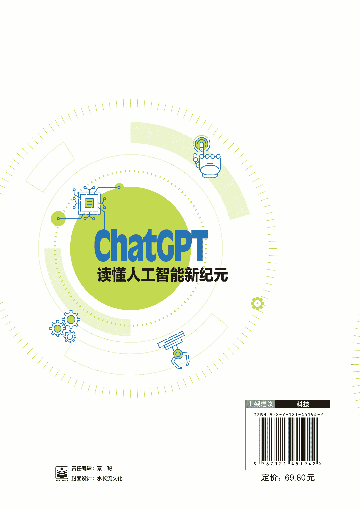

# ChatGPT引爆的新人工智能时代

# 内容概览

ChatGPT 的走红，标志着人工智能从量的积累转向质的跃迁，一轮新的 AI 革命已经展开。全书共分六章，梳理了 ChatGPT 的诞生轨迹与演进历程，并解析其背后的大模型技术路径；剖析了大模型训练对全球产业格局造成的冲击，聚焦 OpenAI、微软、谷歌、百度、腾讯、阿里巴巴等头部科技公司；挑选代表性行业，解读 ChatGPT 浪潮带来的产业重塑与模式创新；并对强人工智能与人类社会的未来关系展开深度探讨。

# 前言

从 2022 年年末到 2023 年初，ChatGPT席卷全球网络。

2022 年 11 月 30 日，OpenAI 推出对话式 AI 模型 ChatGPT。上线仅 5 天，注册用户就突破 100 万。发布两个月后，月活用户已达 1 亿，成为消费级应用里增长最快的产品。对比之下，海外版抖音 TikTok 全球发布后用了约 9 个月才达到月活 1 亿，Instagram 这一里程碑花费了两年半。

爆发式增长的根源在于产品能力本身——理解与创造兼备：能写代码、写剧本、作曲作词，还能与人自然对话，体现出辩证分析的特质。它甚至会质疑错误的假设与前提，主动承认局限与失误，拒绝不合理的提问，这是此前未曾见到的。

更关键的是，ChatGPT 的成功验证了大模型技术路线的可行性。AI 从此摆脱过去的大数据统计分类阶段，进入类人逻辑沟通阶段，并在强大学习能力驱动下加速演化。依托大模型，ChatGPT 像一个通用任务助手，可与各行各业结合衍生出众多场景，实质上为通用 AI 打开了入口，令人工智能真正落地。

一夜之间，ChatGPT 在全球掀起冲击波，点燃中美 AI 产业，相关企业全面入局，资本市场也随之波动。中国科技公司纷纷寻找“中国版 ChatGPT”，如百度的类 ChatGPT 应用、自然语言大模型项目“文心一言”，以及阿里巴巴正在内测的聊天机器人。

在科技与商业之外，ChatGPT 也冲击着社会议题，“能否替代人类”“伦理风险”等讨论升温。任何新技术，尤其是革命性技术，出现之初都会伴随争论。客观看，人工智能时代到来是趋势，ChatGPT 只是让这一时代更近一步。

ChatGPT 的出现意味着 AI 从量变到质变的跨越，新一轮人工智能革命开启——基于此，本书介绍了 ChatGPT 的来历与技术根基；分析了大模型对全球商业版图的冲击，涉及 OpenAI、微软、谷歌、百度、腾讯、阿里巴巴等焦点企业；选取典型行业解读 ChatGPT 浪潮下的颠覆与创新；并探讨强人工智能与人类社会的未来关系。全书语言通俗、表述生动，力求帮助读者全面理解 ChatGPT，并在信息洪流中梳理 AI 的演进脉络与发展思路。

作为时代标签，人工智能驱动的科技变革正在重塑当下，我们需要提前准备。

# 第一章 ChatGPT 的爆红时刻

## 1.1 意外登场的对话模型

从 2022 年末到 2023 年初，OpenAI 打造的 ChatGPT 火遍全球，一跃成为 AI 领域现象级产品。

因其能力出众，发布仅 5 天用户就超过 100 万，十个月前 Facebook 才达到相似规模。据瑞银报告，2023 年 1 月末发布两个月后月活已突破 1 亿，成为历史上增速最快的消费级应用。

这个突然走红的 ChatGPT 究竟是什么？为何会火？

### 1.1.1 全能型 AI 选手

ChatGPT 是 OpenAI 发布的新一代 AI 语言模型，属于自然语言处理领域的突破性成果。与过去的智能语音助手不同，它展现出令人意外的“聪明”。相比市面上部分 AI 客服，ChatGPT 已跨越娱乐层面，真正具备人们期待的智能形态，被不少人称为“六边形 AI 战士”——聊天、搜索、翻译、撰写诗词论文代码不在话下，还能开发小游戏、解答美国高考题，甚至辅助科研与医疗。海外媒体认为它将成为科技行业的下一个颠覆者。

GPT 的英文全称是 Generative Pre-trained Transformer，即生成式预训练转换器，是一种基于互联网公开数据训练的文本生成深度学习模型。ChatGPT 继承自 OpenAI 于 2020 年发布的 GPT-3，普通用户只需提供示例，就能在数分钟内获得所需文本输出。

GPT-3 诞生时已引发轰动，展示出答题、翻译、写作、数学计算、编写代码等多重能力，其撰写文章几乎以假乱真。在 OpenAI 的测试中，人类评委难以分辨 GPT-3 生成新闻与人工撰写新闻的差异。

GPT-3 当时被视为最强语言模型，如今 ChatGPT 似乎更进一步。它能进行天马行空的长对话，回答问题并根据需求撰写商业计划书、宣传文案、诗歌、笑话、代码、电影剧本等。简言之，它具备类人的逻辑、思考与沟通能力，在部分领域可与专家级对话媲美。

ChatGPT 还能进行文学创作。给出一个主题，它会输出小说框架，包括背景、主角、情节与结局。若一次未写完，可在提醒下继续续写补全。它已具备一定记忆能力，支持连续对话。体验者评价其语言组织、文本质量与逻辑水平令人惊艳，甚至有人打算把日报周报等文字工作交由它辅助完成。

文本创作只是基础。它还能为程序员代码找 Bug。部分程序员反馈其技术问题的解决方案非常详尽，比搜索引擎更可靠。美国代码托管平台 Replit 首席执行官 Amjad Masad 在社交媒体称其为优秀的“调试伙伴”，既能解释错误，也能修复并说明方法。

在商业逻辑层面，它不仅能自我剖析优劣势，进行竞品分析与营销报告撰写，对世界经济形势也能给出见解。

ChatGPT 还敢于质疑错误前提与假设，主动承认错误与无法回答的问题，主动拒绝不合理提问，提升了意图理解与答题准确度。

### 1.1.2 能力边界与短板

即便较 GPT-3 有明显提升，ChatGPT 依旧不完美。

ChatGPT 与 GPT-3 的类人输出与惊人通用性，源于技术优秀而非真正“聪明”。不管是 GPT-3 还是 ChatGPT，都会出现可笑错误，尤其在文化常识与数学计算上。回答往往冗长，看似自洽，实则一本正经“忽悠”。这是该类方法难以避免的弊端，因为它本质上是通过概率最大化生成数据，而非逻辑推理。

这种创作在游戏开发、科幻写作、美术创作中可能有用，但对需要精确答案的场景是硬伤。若非专业人士难以分辨答案准确性，很可能被误导。可想象一台内容成本接近于零、正确率约 80%、对非专业人士迷惑度近 100% 的巨型机器，以百万倍人类速度接管百科编撰与问答，其对认知的危害巨大。

因此 ChatGPT 也遭到封禁。Stack Overflow 暂时封禁其原因很直接：生成答案正确率过低，对网站与求助者有害。顶级 AI 会议也开始禁止用 ChatGPT 与 AI 工具撰写论文。国际机器学习会议 ICML 认为这类语言模型代表趋势，但带来难以追责的问题，因其接受未经同意收集的公共数据训练。

此外，它无法提供信息来源，几乎不了解 2021 年后发生的事件。虽然表述流畅，能在高中甚至大学课堂过关，却做不到人类专家的精雕细琢。

人们对智能的标准似乎偏低，只要看起来聪明就容易被说服。ChatGPT 与 GPT-3 是巨大飞跃，但仍是人类制造的工具。

当前版本仅基于 2021 年及之前数据训练，使用范围有限，存在知识盲区与对话笑话在情理之中。随着大规模用户对话训练与数据更新，它将以超出预期的速度进化。

### 1.1.3 为何被视作 2023 关键技术

无论是全能还是不完美，作为现象级应用，ChatGPT 已进入并影响生活，硅谷巨头与资本市场都在讨论其未来与影响。

上线初期主要在 AI 与科技圈引发反响，2023 年春节后热度持续攀升。2 月相关消息明显增多。人们发现它能轻松撰写文案与代码，覆盖历史、文化、科技等诸多领域，甚至通过了谷歌年薪 18.3 万美元的编码三级工程师岗位面试。舆论场几乎被 ChatGPT 占据。

瑞银数据显示，2023 年 1 月 ChatGPT 平均日独立访客约 1300 万，是 2022 年 12 月的两倍。截至 1 月末月活突破 1 亿，创造新的增长纪录。相比之下，Instagram 达到 1 亿用户用了两年半。

2023 年 2 月 2 日，微软宣布旗下全线产品整合 ChatGPT。2 月 8 日，由 ChatGPT 支持的新版 Bing 上线；3 月百度已提交 Chatflow 等多项商标注册；英国《自然》杂志不再允许 AI 工具作为论文作者；数字媒体公司 Buzzfeed 计划用 OpenAI 技术协助个性化内容创作；美国宾夕法尼亚大学称 ChatGPT 可通过该校工商管理硕士专业期末考试；OpenAI 发布“AI Text Classifier”鉴别工具，帮助判断文字是否由 AI 生成。

资本市场层面，ChatGPT 的火爆推高 AI 相关公司股价。春节后中国 A 股开市首周，ChatGPT 与 AIGC 概念活跃，相关个股连续上涨。Wind 数据显示，2 月 3 日 ChatGPT 指数上涨 5.56%，周涨 30.18%。领涨个股包括赛为智能、海天瑞声、云从科技、初灵信息与汉王科技，周涨幅达 60% 至 70%。汉王科技虽预告 2022 年净亏损，但概念带动下仍出现连续涨停。

上市公司积极回应布局。捷成股份表示，参股子公司世优科技的虚拟数字人已接入 ChatGPT，通过人设数据集并基于 OpenAI 训练个性化模型。百度宣布 3 月举行围绕“文心一言”的发布会，阿里巴巴达摩院称正在研发类 ChatGPT 产品。

测算显示，按 1 亿用户、每月 20 美元计，ChatGPT 年收入可超 200 亿美元。全球潜在用户超 10 亿，市场规模有望超 2000 亿美元。收费模式若成功，利润前景巨大。

据 CB Insights 统计，ChatGPT 概念领域约有 250 家初创公司，51% 融资阶段在 A 轮或天使轮。2022 年生成式 AI 领域吸金超 26 亿美元，诞生 6 家独角兽，估值最高的是 290 亿美元的 OpenAI。

2023 年 2 月 10 日，比尔·盖茨在采访中表示，ChatGPT 的兴起与互联网诞生或个人电脑发展同等重要。与元宇宙概念炒作不同，ChatGPT 出现仅两个月就引发关于人类生产与生活真正变革的讨论，关键在于这是一次 AI 技术走向智能化突破与应用的实践。

## 1.2 ChatGPT 的炼成之路

ChatGPT 看起来强大而聪明，能创作也能写代码，远超预期。其能力从何而来？

### 1.2.1 NLP 架构支撑

功能强悍背后，技术并不神秘。本质上它是一个出色的自然语言处理新模型。谈到 NLP，多人会想到 Alexa 与 Siri 这类语音助手，因其基础功能是让机器理解人类输入，但这只是冰山一角。NLP 是人工智能与机器学习的分支，专注于计算机处理与理解人类语言，书面文本分析才是其核心进步。

ChatGPT 是一种基于 Transformer 模型的预训练语言模型。通过海量文本语料训练，学习自然语言知识与语法规则。用户提问时，它分析并理解后生成回答。Transformer 模型提供并行计算方式，使其能快速生成回复。

Transformer 究竟是什么？需回溯 NLP 技术演进。Transformer 出现前，主流模型是循环神经网络 RNN 再加入注意力机制 Attention。RNN 能处理有先后顺序的数据，注意力机制赋予上下文理解能力。但“RNN+Attention”处理速度慢，处理长序列如长文章、书籍时易出现不稳定或过早停止训练。

2017 年，谷歌大脑团队在 NeurIPS 大会上发表论文《Attention is All You Need》，首次提出基于自我注意力机制的 Transformer 模型并用于 NLP。相比此前 RNN，Transformer 可同时进行数据计算与模型训练，训练时间更短，且模型具有可解释性。

最初的 Transformer 模型约有 6500 万可调参数。团队使用多套公开语言数据集训练，包括 2014 年英德机器翻译研讨会数据集约 450 万组对应句，英法研讨会数据集约 3600 万组对应句，以及宾夕法尼亚大学树库语言数据中《华尔街日报》4 万个句子和另外 1700 万个句子。论文提供模型架构，任何人均可复现并用自身数据训练。

训练后，该模型在翻译准确度与英语句子成分分析等指标上达到业内第一，成为当时最先进的大语言模型。ChatGPT 在 Transformer 技术基础上扩展改进，更适配语言生成任务。正因 Transformer，它才取得今日成功。

### 1.2.2 海量数据喂养

仅有模型架构而无数据，如同巧妇难为无米之炊。基于 Transformer，开发者开展了大规模数据训练。

ChatGPT 出现前，OpenAI 已推出 GPT-1、GPT-2、GPT-3。虽然声量不大，但模型规模极大。

GPT-1 拥有 1.17 亿参数，OpenAI 使用经典大型书籍文本数据集预训练，包含超 7000 本未出版书稿，涵盖冒险、奇幻等类型。预训练后，针对问答、文本相似度评估、语义蕴含判断与文本分类四种语言场景，用不同特定数据集进一步训练。最终模型在四类场景均优于基础 Transformer，成为新的业内第一。

2019年 OpenAI 发布的 GPT-2 拥有约15亿个参数，设计思路与 GPT-1 基本一致，变化主要体现在模型规模的放大。随着参数增长，该模型在众多语言任务的评测榜单上均刷新了成绩。

GPT-3 的参数数量达到1750亿，相比前身扩大了整整两个数量级。网络结构上并没有根本性的革新，但在庞大语料的支撑下出现了明显的涌现现象。只给出极简提示，系统就能自动产出语义连贯、篇幅可观的文章，外人几乎难以分辨出机器痕迹。除常规写作外，编程、菜谱撰写等几乎所有以文本为载体的创作需求都能被覆盖。

从 GPT-1 到 GPT-2 再到 GPT-3，ChatGPT 的训练数据细节未公开，但从演进趋势看，其所用语料的体量只会更大。

**1.2.3 反馈驱动的指令学习**

需要特别区分的是 ChatGPT 与 GPT-3 的差异。2022年3月 OpenAI 发表论文《结合人类反馈信息来训练语言模型使其能理解指令》，并基于 GPT-3 微调得到用于 ChatGPT 的 InstructGPT。训练过程中引入了人工评判与回馈信息，而非仅依赖预先准备好的静态语料。换句话说，GPT-3 主要是靠海量数据自学，而 ChatGPT 把使用者对结果的评价纳入了学习闭环。

GPT-3 公测期间，来自用户的对话与提示积累了大量样本；OpenAI 内部的标注团队也构建了不少人工标注集。这些带标签的数据让模型在学习原始表述的同时，也学习人类对表述的偏好取向。研发团队据此对 GPT-3 的监督式训练进行了精细化调整。

随后收集了微调后模型针对同一提示生成的多种答案。使用者通常只期望一个最合适的输出，因而需要对候选答案进行排序并挑选最优。标注员对所有可能的回答进行人工打分排序，选出最符合日常使用习惯的版本。这些人工排序的结果被用来训练奖励模型，为语言模型提供自动化的奖惩信号，鼓励优质输出、抑制劣质输出，引导模型自行逼近最优解。

最后借助奖励模型与更多标注数据对已微调的模型进行迭代优化，最终得到的就是 InstructGPT。

概括来看，2020年发布的 GPT-3 让机器首次能够惟妙惟肖地模仿人类表达。但当时的模型在观点与逻辑上常出现错误与混乱。OpenAI 因此引入人工监督员专门示范更好的回答方式：符合人类评价标准即得高分，不符合则低分。通过这种方式让模型按照人类价值观优化参数与数据。

汇聚上述优势后，ChatGPT 展现出迄今少见的能力，一举成为人工智能领域的现象级产品。

## **1.3 ChatGPT+组合效应**

ChatGPT 上线不足两月便吸引了广泛关注，其基于大语言模型的产出几乎席卷整个 AI 圈。热度带来的便利感进一步催生了 ChatGPT+ 现象。

**1.3.1 互补型搭档的案例**

所谓的 ChatGPT+，本质上是 ChatGPT 与其他人工智能系统的配合。其中一个典型是 Wolfram Alpha 与 ChatGPT 的联动。

Wolfram Alpha 问答系统由 Wolfram 语言的创造者史蒂芬·沃尔夫勒姆开发。沃尔夫勒姆认为世界本质可计算，因此希望计算机能把自然语言描述转化为执行。基于这一思路诞生了 Wolfram 语言以及计算知识搜索引擎 Wolfram Alpha。

2023年1月9日，沃尔夫勒姆撰文对比了 ChatGPT 与诞生十四年的 Wolfram Alpha，并提出两者结合的设想。

尽管 ChatGPT 在文本创作上表现突出，其数学能力却明显薄弱，连小学常见的鸡兔同笼与基础四则运算都可能出错。而 Wolfram Alpha 正是理工科常用的利器，两者配合可以实现互补。

Wolfram Alpha 于2009年5月18日正式上线，后端运行 Mathematica。Mathematica 支持几何、数值与符号计算，并具备强大的数学与科技可视化能力，因此 Wolfram Alpha 能解答多类数学问题并以清晰美观的图形呈现。该计算知识引擎也为苹果数字助理 Siri 奠定了基础。

Wolfram Alpha 既拥有结构化计算能力，又能理解自然语言。例如询问芝加哥到东京的距离，ChatGPT 往往只能给出基于训练记忆的模糊答案，且易出错。即便正确，也缺乏真正的求解算法。而 Wolfram Alpha 能够借助结构化、高精度的知识库把问题转化为精确计算。

可以说，ChatGPT 搭配 Wolfram Alpha，才真正形成了 ChatGPT+。

**1.3.2 应用场景的扩散**

ChatGPT+ 为探索 AIGC 商业化落地的企业提供了参考。部分用户把 ChatGPT 与 Stable Diffusion 文生图工具结合，先让 ChatGPT 生成随机的艺术提示词，再输入 Stable Diffusion 生成艺术性较强的图像。另有用户提出 ChatGPT+WebGPT 的思路，WebGPT 是 OpenAI 公布的另一版本 GPT，能查询搜索引擎并汇总信息作答，同时附带来源注释。可将其理解为高阶网页爬虫，从互联网摘取信息并给出出处。ChatGPT+WebGPT 的结果具备实时更新特性，对事实真伪的判断更为可靠。

微软 CEO 纳德拉透露，计划把 ChatGPT、Dall-E 等人工智能工具整合进微软旗下产品，包括 Office 全家桶、Azure 云服务、Teams 聊天程序等。ChatGPT 已接入搜索引擎 Bing，为用户呈现更完整的信息并标注来源，同时借助更强的自然语言处理系统识别关键词，提供更精准个性化的内容推荐。在 Office 全家桶中，自然语言处理技术允许用户以更灵活智能的方式检索内容，并帮助用户快速生成个性化文本，带来办公体验的智能升级。依托 OpenAI 在办公领域的生态，ChatGPT 有望获得快速发展，加速对话式 AI、AIGC 的商业化落地。

可以预见，ChatGPT+ 还将为现有产品与服务带来更多新玩法，人工智能的应用也将进入全新阶段。

## **1.4 2022年生成内容爆发**

2022年是人工智能生成内容 AIGC 爆火出圈的一年，从 AI 绘画到代码生成，再到文艺创作，人们惊叹其水平已不输人类。年末诞生的 ChatGPT 更将 AIGC 推向新高潮。美国《科学》杂志发布的2022年度科学十大突破中，AIGC 位列其中。Gartner 将 AIGC 列为2022年五大影响力技术之一。《麻省理工科技评论》也将 AIGC 列为2022年十大突破性技术之一，甚至称其为 AI 领域过去十年最具前景的进展。

**1.4.1 从边缘到主流**

什么是 AIGC？其本质是 AI+GC，即用人工智能生产内容。从创作方式看，过去熟悉的主要是 PGC 与 UGC。PGC 指专业内容生产者生产的内容，如制作高质量科技评测视频的网站。UGC 指用户生成内容，如社交媒体上发布的照片、评论、视频等。在移动互联网时代，UGC 成为主流的内容生产方式。

如今 AIGC 正以迅雷之势成为继 PGC 与 UGC 之后的新型内容创作方式。无论是 PGC 还是 UGC，都是以人为主体进行内容生成的，而 AIGC 的制作方从人或机构变成了模型。

AIGC 的概念并非2022年才出现。此前类似微软小冰等人工智能作诗、写作、创作歌曲等产品就属于该范畴。但直到2022年，随着一幅 AI 绘画获奖，AIGC 才集中爆发。

2022年8月，美国科罗拉多州举办的数字艺术家竞赛中，一幅名为《太空歌剧院》的画作获得数字艺术类别冠军。该作由 AI 绘图工具 Midjourney 完成：画面上几位演员身着华美戏服在舞台上表演，黑暗观众席上方出现巨大圆窗，仿佛能看到另一个未知世界的存在。这一 AI 作品在全球引发热烈讨论，“AI 画作拿一等奖惹怒人类艺术家”的话题很快登上热搜，单日阅读量超过1.1亿人次。

2022年10月，Stability AI 获得约1亿美元融资，估值高达10亿美元，跻身独角兽行列。Stability AI 发布的开源模型 Stable Diffusion，可根据用户输入的文字描述自动生成图像，即文生图。Stable Diffusion、Dall-E 2、Midjourney 等可生成图片的 AIGC 模型引爆了 AI 作画领域。AI 作画风靡一时，标志着人工智能向艺术领域渗透。

在 AIGC 图像生成火爆的同时，ChatGPT 横空出世，与人类对答如流，将人机对话推向新高度。体验过的用户纷纷被 ChatGPT 的强大功能折服，它不仅可以轻松与人类进行各领域对话，还能理解各式各样的需求，无论是写代码还是创作小说，甚至为推特发展提建议、质疑不正确的假设、拒绝不合理的要求等。

可以说2022年后 AIGC 正式进入发展的快车道。如今全球各大科技企业都在积极拥抱 AIGC，不断推出相关技术、平台和应用。

**1.4.2 全链路能力呈现**

无论是火遍全网的 AI 绘画，还是快速吸引用户的 ChatGPT，都属于 AIGC 概念，AIGC 不仅在图像生成、文本生成领域大展身手，在短视频、动画、音乐等领域同样有非常广阔的前景。

首先图像生成是 AIGC 目前发展势头最猛、落地产品更多的领域。根据使用场景可分为图像编辑和端到端图像生成。图像编辑包括图像属性编辑和图像内容编辑。端到端图像生成包括基于图像生成，如基于草图生成完整图像、根据特定属性生成图像等，以及多模态转换，如根据文字生成图像等。典型的产品或算法模型包括 EditGAN、Deepfake、Dall-E、Midjourney、Stable Diffusion、“文心·一格”等。

其次是 AI 文本生成。AI 文本生成是 AIGC 中发展最早的一部分技术。根据使用场景可分为非交互式文本生成和交互式文本生成。非交互式文本生成包括内容续写、摘要/标题生成、文本风格迁移、整段文本生成、图像生成文字描述等功能。交互式文本生成包括聊天机器人、文本交互游戏等功能。典型的产品或算法模型有 JasperAI、Copy.ai、彩云小梦、AI Dungeon、ChatGPT 等。

AI 视频生成可分为视频编辑，如画质修复、视频特效、视频换脸等，以及视频自动剪辑和端到端视频生成，如文字生成视频等。谷歌旗下的文字生成视频 AI 系统 Phenaki 就是典型应用。虽然 Phenaki 生成的视频画质还比较差，但时长2分钟的内容已涉及多个场景、不同主题的变换。正如 Phenaki 官网展示的一段视频，其根据一段由200个单词构成的提示词，生成了一段关于未来科幻世界的视频。随着 AI 与短视频的连接与日俱增，短视频平台的内容池里除传统的 UGC 和 PGC 外，AIGC 将占更高比例，且流量号召力不容小觑。

AI 音频生成中的部分技术已较为成熟，被应用于多种 C 端产品中。音频生成可分为语音合成 Text-to-speech TTS 和乐曲生成两类。其中 TTS 具有语音客服、有声读物制作、智能配音等功能。乐曲生成包括基于开头旋律、图片、文字描述、音乐类型、情绪类型等生成特定乐曲。典型的产品或算法模型有 DeepMusic、WaveNet、Deep Voice、MusicAutoBot 等。

此外 AI 生成还包括代码生成、游戏生成、3D 生成等。今天 AI 生成已步入春天，可以预见作为数字内容的新生产方式，AIGC 的渗透率还将逐步提升，应用场景日益丰富，包括游戏、动漫、传媒等行业。根据 Gartner 预测，到2025年人工智能生成数据占比将达到10%。2022年9月红杉资本发布的文章《Generative AI: A Creative New World》的分析则显示，AIGC 有潜力产生数万亿美元的经济价值。

**1.4.3 生产方式的重塑**

如果说 AI 推荐算法是内容分发的强大引擎，那么 AIGC 就是数据与内容生产的强大引擎。

传统创作中，创作主体人类往往被认为是权威的代言者，是灵感的所有者。事实上正是因为人类激进的创造力、非理性的原创性，甚至是毫无逻辑的慵懒，而非顽固的逻辑，才使得到目前为止机器仍然难以模仿人的这些特质，使得创造性生产仍然是人类的专属。但今天随着 AIGC 的出现与发展，创作主体的属人特性被冲击，艺术创作不再是人的专属。即便是模仿式创造，AI 对艺术作品形式风格的可模仿能力的出现，都使创作者这一角色的创作不再是人的专利。

AIGC 还朝着效率和品质更高、成本更低的方向发展。从社交媒体到游戏、从广告到建筑、从编码到平面设计、从产品设计到法律、从营销到售后等各个需要人类知识创造的行业都可能被 AIGC 所影响和变革。数字经济和人工智能发展所需的海量数据也能通过 AIGC 技术生成、合成出来，即合成数据。

今天 AIGC 正在掀起一场内容生产的革命。在内容需求旺盛的当下，AIGC 所带来的内容生产方式变革引起了内容消费模式的变化。比如 AI 绘画可以提高美术素材的生产效率，在游戏、数字藏品领域初步得以应用。

再如火遍全网的 ChatGPT 正是典型的文本生成式 AIGC。ChatGPT 不仅能够满足与人类进行对话的基本功能，还可以驾驭各种风格的文体，且代码编辑能力、基础脑力工作处理能力等一系列常见文字输出任务的完成程度也大大超出预期。

概念上似乎更广泛的 AIGC 看起来没有 ChatGPT 那么火爆，其核心原因还在于两者之间的差异。尽管 AIGC 的概念更宽泛，但目前的技术更多的只是侧重于语意的图像化理解与生成，这与 ChatGPT 基于神经网络的类人智能化逻辑有所差异。相比较而言，ChatGPT 是人类真正期待的人工智能的样子，即具备类人沟通能力，并且借助于大数据的信息整合成为人类强大的助手。

ChatGPT 让我们讨论已久、期待已久的人工智能有了可触感，无论它的技术是不是最先进的，但是它所呈现的模样是符合大家期待的。至于未来，将发展成 AIGC 包含 ChatGPT，还是 ChatGPT 以更快速的迭代与商业化应用取代 AIGC 的概念，仍不好下定论。

无论这些技术的概念在未来会如何定义，都意味着在未来，人类社会一切有规律性、规则性的工作，将被 ChatGPT 或者比 ChatGPT 更进一步的 AIGC 所取代，并且一些创造性工作会加速进入人机交互时代。

# **第二章 通用 AI，奇点将近**

## **2.1 一个世界，两套智能**

**2.1.1 智能的起源**

46亿年前地球诞生。6亿年后在早期的海洋中出现了最早的生命，生物开始了由原核生物向真核生物的复杂而漫长的演化。

6亿年前埃迪卡拉纪，地球上出现了多细胞的埃迪卡拉生物群，原始的腔肠动物在埃迪卡拉纪的海洋中浮游着。控制它们运动的是其体内一群特殊的细胞——神经元。不同于那些主要与附近的细胞形成各种组织结构的同类，神经元从胞体上抽出细长的神经纤维，与另一个神经元的神经纤维相会。这些神经纤维中负责接收并传入信息的树突占了大多数，而负责输出信息的轴突则只有一条但可分叉。当树突接收大于兴奋阈值的信息后，整个神经元就将如同灯泡被点亮一般，爆发出一个短促但极为明显的动作电位，动作电位会在近乎瞬间就沿着细胞膜传遍整个神经元——包括远离胞体的神经纤维末端。之后上一个神经元的轴突和下一个神经元的树突之间名为突触的末端结构会被电信号激活，神经递质随即被突触前膜释放，用以在两个神经元间传递信息，并且能依种类不同，对下一个神经元起到兴奋或抑制的不同作用。这些最早的神经元，凭着自身的结构特点，组成了一张分布于腔肠动物全身的网络。就是这样一张看起来颇为简陋的神经元网络，成为日后所有神经系统的基本结构。

2000万年前起，一部分灵长类动物开始花更多的时间生活在地面上。

700万年前，在非洲某个地方出现了第一批用双脚站立的类人猿。

200万年前，非洲东部出现了另一个类人物种，就是我们所说的能人。这个物种的特别之处在于其成员可以制作简单的石质工具。在这之后漫长又短暂的150万年中，狭义智能在他们那大概只有现代智人一半大的脑子里诞生发展。他们开始改进手中的石器，甚至尝试着驯服狂暴的烈焰，随着自然选择和基因突变的双重作用，他们后代的脑容量越来越大，直到直立人出现。

根据古生物学的研究，直立人与现代人类个头相当，其脑容量也和我们相差无几。他们制作的石质工具比能人更加精细复杂，即智人。

20万年前智人脑部出现一次突变，负责联想与计划的联络皮层，尤其是前额叶，体积急速膨胀。代价是惊人的能耗——大脑仅占体重的2%到3%，却消耗了全身约20%的能量。回报则是前所未有的神经元储备，让深度抽象、归纳与储存成为可能。从此智慧可以通过文化传递而非单纯基因复制，环境适应进入全新的通道，人类挣脱了自然选择的束缚。

人类的智能从三个方向起步。

第一个方向是改造物质形态。远古起的改造非常原始，先是从单一几何形体的加工起步，比如把一块石头敲打成尖锐或钝厚的石质手斧。先民拿它打猎、削棒、挖根，被当作万能器具使用。进入中石器时代，工具开始复合——在石斧上安上木柄或骨柄，单一质料变成两种不同质料的组合。随后出现石刀、石矛、石链等复合器具，最后造出弓箭。新石器时代则学会在石器上打孔，出现了石镰、石锄、石铲，以及用来加工粮食的石臼、石杵等。物质在有目的的活动中被不断重塑，而劳动本身也在重塑头脑，推动大脑向智能实体靠近。

第二个方向是驾驭能量。人类与火的关系演变很典型：起初对雷电引发的野火充满恐惧，后来学会烤熟猎物，再用于取暖、照明、驱兽。掌握人工取火，意味着自然力首次被人类掌控。恩格斯曾说，摩擦生火让人类第一次支配一种自然力，从而与动物界划清界限。火的使用还催生了制陶，制陶让材料加工程度从单纯改变形状跃升到改变物理化学性质，并为冶金奠定了基础。

第三个方向是转化信息。石斧、取火器、陶器等物质成果，都内嵌着人与自然、人与人之间的关系与信息。它们既是物质手段，也是精神载体。于是物质和能量的转化必然伴随信息的转化。劳动中共同的需求与感受被反复传授，形成共识，并用特定音节表达。语言由此诞生，让人能够从具体事物中提取抽象概念并进行精确交流与学习。语言的出现是进化必然，与大脑与身体功能的协同发展密不可分。

人类大脑左前部的布罗卡区主导语言产生，后方的韦尼克区负责语言接收。右侧脑区通过胼胝体接收左侧信号，协同完成欣赏音乐、艺术、定向等高级功能。胼胝体约有两亿条神经纤维，是左右半球信息交互的要道。可以说语言是大脑内部的一个器官，正因它的诞生，人类发展速度出现了爆发式增长。依托语言的“想象共同体”形成，社会行为突破灵长类的部落本能，向更大规模演进。文字发明后，最早的文明与城邦在西亚的两河流域出现。

**2.1.2 从人类智能到人工智能**

物质、能量、信息的转换既是人类智能的源头，也构成了智能活动改造世界的基本雏形。

从认知革命、农业革命到工业革命，人类改造自然的对象始终围绕物质、能量、信息三大要素。今天的材料技术、能源技术、信息技术正是围绕这三者展开。随着技术演进，转化方式也从单一走向复合。蒸汽机是物质与能量的复合转化，电子计算机则是物质、能量、信息的综合转化，而当下对人工智能的研究，本质上是在把物质、能量、信息与人类智能四者合一。

1950年图灵在《计算机器与智能》中提出机器能否思考，为AI埋下种子。1957年首个机器学习项目启动，AI正式成为学科。受神经元理论启发，人工神经网络被提出，并持续完善。它用虚拟神经元作为基本单元，分层组织，类似大脑皮层，但连接模式与工作原理仍有本质差异。

历经波折后，21世纪的神经网络在学习任务上展现出惊人表现，图像音频识别准确率攀升，语言处理能力迅速提升。人类智能的延伸一方面借助数字化重塑自然，指向万物互联；另一方面诞生了机器智能这一新形式。

**2.1.3 什么是智能的本质**

智能到底是什么？

人类智能的核心与大脑联络皮层相关，而非直接负责感觉与运动的皮层。在动物脑中这类区域很小，在人脑中则由海量神经元构成。语言、陈述记忆、工作记忆等优势能力都与之紧密相关。终其一生大脑被囿于颅腔，只能接收电信号与化学信号。

因此，智能的本质可看作一套从有限输入中归纳学习并重建外部世界的复杂算法。作为抽象概念，它接近笛卡尔所说的精神，但必须依附于物质载体——既可以是皮层，也可以是集成电路。

这意味着AI理论上终将运行自我意识类算法。有人认为AI永远追不上人脑，因为人类也不懂人脑如何运作。但人工智能算法的迭代速度远超DNA经自然选择的速度，所以超越人类并不需要先搞懂人脑。

当下人脑智能与机器智能并存，二者的思考方式截然不同。人类智能元件运算慢、固化本能多、可塑性有限；AI虽起步不久，发展潜力却更大。AlphaGo等案例证明，对目标明确的问题机器必然超越人类。二十年后深度学习及其后继者在许多任务上将压倒人类，但在灵感类创造上人类仍有优势。

未来更可能的是良性共生，而非孰强孰弱之争。ChatGPT的出现让人切实体会到机器智能的力量，它在多数任务上不输甚至超过人类，说明智能的黄金标杆不只属于人类。

**2.2 从狭义 AI 到通用 AI**

按能力划分，AI可归为狭义AI、通用AI、超级AI三大类。

**2.2.1 当前的 AI 世界**

目前接触到的产品大多是狭义AI，即ANI。它被编程只完成单一任务，如天气预报、下棋、撰写新闻。AlphaGo能击败世界冠军，却无法帮你优化硬盘存储。手机就是小型ANI工厂，导航、天气、Siri都在用ANI。邮箱反垃圾邮件是典型ANI，能根据个人偏好学习过滤。电商“为你推荐”“买了这个的人也买了”背后也是多套ANI协同工作，通过行为数据推算兴趣并投放。

ANI像计算机早期阶段，最初为替代人类完成特定计算而生。图灵等人设想的是通用计算机，可编程完成各种任务。从专用机、模拟机到通用图灵机，产业最终选择了通用。即使定制芯片更快更省电，便捷低成本的通用机仍占主流。AI领域也在经历相似转向，人们期待能像人一样学习多种任务的通用AI。

**2.2.2 通用 AI 和超级 AI**

ANI只能单任务，AGI能在不预先编码知识与领域的情况下处理多种甚至泛化问题。它具备推理、规划、解决、抽象、理解复杂思想、快速学习与经验迁移的能力，能像人一样轻松切换。AGI不是全知全能，仍需针对问题学习相应知识。找致癌基因的算法不需要人脸识别能力，反之亦然。实现AGI意味着单一系统可做多事，而非同时做所有事。

ASI则不同，它不仅具人类能力，还要有感知、自我意识、独立思考与解决问题的能力。AGI像无所不能的计算机，ASI则更像“穿着钢铁战甲的人”。牛津大学的尼克·博斯特罗姆定义ASI为在几乎所有领域都比最优秀人类更聪明的智能，包括科学创造力、一般智慧与社交技能。

**2.2.3 如何实现通用 AI**

实现AGI主要有两条路径。

一条是让机器在特定困难任务上超过人类，如围棋、医学影像判读。一旦在关键任务上持续胜出，有望向全任务泛化。此时系统原理是否灵活并不重要，重要的是性能是否超越人类顶尖水平。

另一条是强调灵活性，即创造可迁移学习的机器。AIGC走的就是这条路：图像生成如DALL·E2、Stable Diffusion；自然语言处理如基于GPT-3.5的ChatGPT；代码生成如基于CodeX的Copilot。

依托海量数据，ChatGPT的语言理解能力大幅提升，能作为通用任务助手跨行业应用，为通用AI打开窗口。它引入人类反馈训练，沿人类价值观优化，使对话更自然。自动驾驶目前仍属ANI，交互机械。ChatGPT类迭代让机器更贴近人类驾驶行为，有望推动自动驾驶进入2.0阶段。

**2.3 通用 AI 初具雏形**

过去AGI多为抽象想象，如今生成式AI让它具象化。生成式AI是基于技术底座的场景革新，涵盖图文创作、代码、游戏、广告、平面设计等。ChatGPT爆火，推动多模态预训练大模型与生成式AI进入规模化前夜。

**2.3.1 ChatGPT 的通用性**

按多任务标准，ChatGPT已具备AGI特征。它被训练回答各类问题，适用于多种场景，可同时做问答、对话生成、文本生成等。这不是单一任务模型，而是通用语言处理能力。

ChatGPT为AI构建了底层应用系统，类似操作系统的角色。操作系统负责资源管理、进程管理、文件管理，让多程序共享硬件高效运行。Windows、iOS是主流移动系统，ChatGPT则为AI应用提供技术底座。虽然表面是对话，但其价值在于开放接口做二次开发。

微软已将ChatGPT接入Bing。传统搜索引擎擅长事实查询，对“推荐马尔代夫五天行程”这类复杂需求只能罗列信息，需要用户自行筛选。ChatGPT驱动的Bing可在侧栏直接给出结果。微软还为Edge推出“聊天”“撰写”两项AI功能，支持网页总结与写作辅助。

**2.3.2 大模型路线的胜利**

ChatGPT的成功验证了大模型路线的有效性，让AI从0到1完成突破，进入真正时代。

在GPT之前，NLP主流是RNN加注意力机制。注意力机制模拟人感知重要信息的能力，让模型区分关键与非关键。但RNN+Attention处理速度慢。纯Attention的Transformer改用逐序列并行计算，大幅提升速度，使大模型训练成为可能。

OpenAI的GPT目标很单一：预测下一个词。过去是遮盖一个词做完形填空，GPT则是连续预测多词甚至成篇。基于Transformer与海量数据，这一路径被证明可行。

与 GPT 同期走红的，还有谷歌推出的 BERT。BERT 依托 Transformer 架构打造，是一种双向建模的语言系统，训练时先把句子里的部分子词遮蔽，再让模型去猜被遮住的内容，这种预训练方式在语句级语义理解上效果突出。BERT 还采用了先预训练后微调的流程，让同一套模型能迁移到多个场景之下，也正是这套做法让 BERT 一举刷新了 11 项自然语言处理任务的纪录，带动大批研究者跟进。

面对 BERT 的热潮，OpenAI 并未转向理解路线，而是坚持生成方向，于是诞生了后来的 GPT-3。

从 GPT-1 到 GPT-3，OpenAI 花了两年多时间，用“堆量见真章”的方式验证了大模型的可行性，参数从 1.17 亿猛增到 1750 亿，也侧面印证了规模扩大与能力提升的正相关。GPT-3 取得成绩后，包含谷歌在内的一众厂商纷纷加入扩参竞赛，模型规模冲向万亿乃至十万亿级别，参数军备竞赛就此展开。

但在这一轮狂热中，GPT 系列的团队反而踩下了刹车，没有继续抬高参数，而是又花了近两年重金投入人工标注，把人类反馈和强化学习引入大模型，让 GPT 系列能够依据人类价值观对数据和参数进行优化。

可以说，ChatGPT 的爆发与其说是算法的革命，不如说是工程层面的胜利，印证了大模型路线在通用人工智能方向上的可行性。

**2.3.3 大模型落地困局**

大模型驱动的生成式 AI 飞速发展，给 AGI 带来了希望的幻象，但当下的生成能力并未实现根本性突破。

现阶段生成之所以如此灵活，根源在于海量的训练数据。换句话说，若缺乏原创性创新，AGI 更可能源自更大规模的模型。ChatGPT 本质是把海量语料与表达力极强的 Transformer 结合，对自然语言做了深度拟合。ChatGPT 的具体数据未公开，但其前身 GPT-3 的神经网络已拥有 1750 亿个参数。

模型越大，性能越强，但随之而来的代价也越沉重：一方面，支撑 AGI 最大化所需的算力，全球未必能提供。随着数据激增与算力提速，一个高能耗世界正在形成，而算力增长同步拉动电力需求。拿 GPT-3 来看，一次完整训练就要消耗约 19 万度电，产生约 85 万吨二氧化碳排放，堪称电老虎。粗略统计显示，2020 年全球发电量中约有 5% 用于计算，到 2030 年这一比例或升至 15%～25%，算力用电将与工业等重耗能行业并列。电力成本已成为计算产业除芯片之外第二大负担。

另一方面，在关键任务上，大模型难以靠堆规模解决。因缺乏认知模型与常识支撑，推理能力始终是短板。谷歌版 ChatGPT 的 Bard 在官宣演示中就出现了事实错误：它宣称韦伯太空望远镜“拍下了首批系外行星照片”。这是错误的，第一张系外行星照片早在 2004 年就由智利甚大天线阵列拍摄获得。

天文学家指出，问题可能源于 AI 对 NASA 模糊新闻稿的误读。Bard 的失误也暴露了更大隐患：AI 驱动的搜索能自信地犯错并传播错误信息，它并不“理解”转述内容，只是按概率猜测。微软同样承认，ChatGPT 的对话服务存在同类挑战——若模型只学会语法和语义，在语用或常识推理上失灵，真正可信的 AGI 就无从谈起。

## **2.4 奇点将至**

数学里，奇点指规则失效的渐近区域；物理学里，奇点指黑洞般无限致密或大爆炸前的临界状态，常规法则不再适用。

1993 年，弗诺·文格把“奇点”引申为智能技术超越人类智能的那个时刻，届时人类生活将被彻底改写，旧规则不再有效。

随着 ChatGPT 的爆发，我们似乎已站在了技术奇点的门槛前。

**2.4.1 人类将被 AI 超越只是时间问题**

AI 的最大特质在于，它并非某一行业的颠覆工具，而是互联网时代的通用基座，能支撑整个产业结构与经济生态的重塑，其能量可投射到几乎所有领域，推动业态转换，为全球增长注入新动能。迄今没有任何一项技术像人工智能这样激发无限想象。

AI 并非单一技术，覆盖面极广，“智能”二字几乎可替代人类诸多活动。即便仅停留在弱智能层面，其可完成的工作量也远超预期。

当下 AI 已渗透日常：垃圾邮件过滤、叫车软件、信息流算法推荐、电商个性化推荐、简化操作的自动驾驶、刷脸打卡……有的感受明显，有的则在运转的缝隙里默默发挥。而我们现在接触的，仍属于 ANI 阶段，只能处理单一任务。

ChatGPT 的出现把 AI 推向了真正的大规模应用。虽然 AI 已带来巨大改变，ANI 产品的局限依然明显。比如在 ChatGPT 之前，与智能客服交流常是挫败体验，更别说解决问题。ChatGPT 具备类人的逻辑响应能力，而我们现在的对话，其实仍局限于 2021 年的知识截止线。

大量重复性的文字工作，本就不需要复杂推理或顶层决策：电话接听、邮件处理、为客户预订酒店餐位、按固定格式填入合同、财报、市场分析、新闻稿、从材料中提炼大纲要点、把会议记录浓缩成简报、撰写流程化程式文章等，都能落到 ChatGPT 或同类大模型上。

更进一步，基于特定指令或用户消费行为数据，预订酒店时模型可综合偏好与支付能力直接筛出最优方案并执行。而传统信息平台只能检索罗列，无法给出确定性最优解。

总体来看，ChatGPT 已展现出创造性——对话、写作、绘画，大规模预训练模型固有的不确定性、发散性和天马行空，正好成为激发人类灵感的助手。未来广告文案、商业展示的创意生产，需要发散探索多条故事线的影剧编剧，需要极大视觉丰富度的游戏场景设计，都会留下 ChatGPT 的身影。

李开复曾说，思考不超过 5 秒的工作终将被 AI 取代。如今某些领域 ChatGPT 已远超 5 秒标准，再叠加持续进化、强大的机器学习能力，以及在人机互动中越用越快的学习速度。在所有有规律可循的工作里，AI 取代与超越人类只是时间问题。

**2.4.2 站在奇点前夜**

人类进步正以加速回报定律推进——雷·库兹韦尔提出的观点。更先进的社会进步更快：19 世纪人比 15 世纪人懂得更多，所以进步更大。

比如《回到未来》1985 年上映，故事背景是 1955 年，主角回到过去被电视新奇、苏打水价格、电吉他声、俚语变化震惊。若今天重拍，背景设为 1993 年，失去移动互联网的我们会更不适应，这正是 1993 至 2023 年的进步速度远超 1955 至 1985 年的体现，最近 30 年的变化超过此前 30 年。

库兹韦尔判断：上万年间技术增长缓慢，个人难见变化；近一百年一人一生能见一次巨大飞跃；21 世纪开始，每三到五年就会出现相当于人类历史上全部科技总和的变化。因此 21 世纪的进步可能是 20 世纪的千倍。

现实印证了这一点，科技迭代速度已逼近人类理解极限，而诞生于高速更迭时代的 ChatGPT 潜能无限。

2016 年 9 月 AlphaGo 战胜欧洲围棋冠军后，业界普遍认为它击败世界冠军李世石希望不大。结果 6 个月后它就轻易取胜，输一场后再无败绩，进化速度令人咂舌。

ChatGPT 的进化或许会重演这一轨迹。它建立在 GPT-3.5 之上。自 2018 年起，GPT-1、GPT-2、GPT-3 参数分别为 1.17 亿、15 亿、1750 亿，呈指数级增长，GPT-4 的性能可预期更强。

即便现阶段 ChatGPT 仍有局限，并非完美产品，但其意义不容忽视——经过多年讨论的人工智能，终于向设想中的形态靠拢。

奇点隐现，未来已来。正如凯文·凯利所言，从 1964 年 ELIZA 诞生到 2022 年 ChatGPT 成熟，仅用了 58 年。距离近不等于视野清晰，距离远也不等于不可能。

ChatGPT 拉开了人工智能时代的序幕，未来将远超想象。

# **第三章 ChatGPT 商业战局**

## **3.1 OpenAI 从非营利走向独角兽**

ChatGPT 一夜爆红，让其母公司 OpenAI 成为焦点。

ChatGPT 问世前，OpenAI 仍在亏损。2022 年净亏损达 5.4 亿美元，随着用户激增，算力成本攀升，亏损风险加大。OpenAI 联合创始人兼 CEO 山姆·阿尔特曼在 2022 年 12 月回应质疑时表示，单次对话成本仅几美分。

爆红打破了亏损僵局，商业化潜力被彻底释放，OpenAI 估值飙升至 290 亿美元，相比 2021 年的 140 亿美元翻倍，较七年前提升近 300 倍。

**3.1.1 “ChatGPT 之父”的传奇轨迹**

ChatGPT 的成功离不开山姆·阿尔特曼。他被媒体称为年度现象级人物，也被冠以“ChatGPT 之父”。

1985 年 4 月 22 日，阿尔特曼出生于伊利诺伊州芝加哥，并在密苏里州圣路易斯长大。小时候他展现出编程天赋，8 岁拥有个人电脑，拆解过苹果 Macintosh，那台机器成为他连接世界的重要窗口。他注意到美国在线聊天室对信息获取和社交的颠覆性作用。

高中后进入斯坦福读计算机专业，他并不专注学业，一心创业。大二时与同学创立 Loopt，一款分享地理位置的手机应用。2005 年团队成为首批入驻 Y Combinator 的创业者，随后他辍学投入 Loopt。当时 LBS 极热，阿尔特曼拿到红杉投资，四年内完成五轮融资，总计 3910 万美元。但 Loopt 未能吸引足够的用户。

2009 年 10 月，Loopt 以 4300 万美元被售出，阿尔特曼个人获利约 500 万美元。他并未立即再创业，而是休整一年，涉猎核工程、人工智能、合成生物学等领域，为后续布局埋下伏笔。

2011 年他开始在 YC 兼职，创办小型风投基金 Hydrazine Capital，将 75% 资金投向 YC 项目。他曾领投 Reddit B 轮，并短暂担任 8 天 CEO 后请回创始人。凭借 YC 高成功率，基金四年内市值增长 10 倍。

2014 年，阿尔特曼接替保罗·格雷厄姆成为 YC 第二任董事长，成为硅谷知名人物。他还担任 OpenDoor、Postmates、RapidAPI 等公司董事或顾问，助力多家公司融资并推动上市。他是卡内基梅隆大学高级研究员，发表多篇科技创新与创业文章。

2015 年，阿尔特曼入选福布斯 30 位 30 岁以下风险投资人榜单，同年与特斯拉 CEO 马斯克联合创办非营利组织 OpenAI。

**3.1.2 非营利组织的诞生**

鲜有人想到，如今的独角兽 OpenAI 起点是一个非营利机构，其成立充满戏剧性。

2014 年，谷歌以 6 亿美元收购 DeepMind，后者被视为最有可能率先实现通用 AI 的团队。马斯克警告，若人工智能偏离方向，可能诞生永生且极强大的“独裁者”，即 DeepMind 成功可能形成技术垄断。因此组建与谷歌竞争的实验室成为共识，OpenAI 非营利组织由此诞生。

2015 年 12 月，募得 10 亿美元的 OpenAI 在旧金山成立，首批赞助者包括马斯克、PayPal 联合创始人彼得·蒂尔、LinkedIn 创始人里德·霍夫曼、YC 总裁阿尔特曼、Stripe CTO 布罗克曼，以及 YC Research、阿尔特曼创立基金会、Infosys、亚马逊网页服务等。

OpenAI 的使命是实现通用 AI，打造具备心智、学习与推理能力的机器系统。成立初期专注基础研究，但很快发现理想难以为继——保持非营利无法支撑运营，因科研所需算力每 3 至 4 个月翻一番，资金需求指数级增长。DeepMind 被收购后也长期烧钱：2016 年亏损 1.27 亿英镑，2017 年 2.8 亿英镑，2018 年达 4.7 亿英镑。

为破解资金困境，2019 年 3 月阿尔特曼卸任 YC 总裁转任董事长，并出任 OpenAI CEO。推动下，OpenAI 设立受限营利实体 OpenAI LP，被称为“利润上限”模式。

根据 2019 年 3 月声明，若 OpenAI 成功确保通用 AI 造福人类，投资者与员工可获得有上限回报，首轮回报上限设为 100 倍，后续轮次更低。这种结构将回报限制在初始投资数倍。从此 OpenAI 官方指代 OpenAI LP，即营利实体，原非营利实体 OpenAI Nonprofit 法定名为 OpenAI Inc。OpenAI LP 在非营利实体董事会监督下运行，超额收益将回流非营利部分。

**3.1.3 微软入局 绑定合作**

2019 年 7 月，重组后的 OpenAI 获得微软 10 亿美元投资，结束单打独斗。此后双方深度绑定，微软除完成 2019 年承诺投资外，还履行了 2021 年的追加投入。

资金只是合作的第一层，更是双赢布局。

OpenAI 需要算力与商业化背书。阿尔特曼多次飞往西雅图与微软 CEO 萨提亚·纳德拉沟通，推动微软入局。微软则作为谷歌的直接竞争对手，在 AI 技术商业化上逐渐失势，尤其 2016 年 Tay 聊天机器人翻车后，既缺乏广泛影响的基础研究产出，也缺少成功的商业化案例，急需技术突破重塑 AI 竞争力。

2019年微软首次向OpenAI注资，这笔钱直接用来推加速通用人工智能的研究与商业化落地。协议中约定OpenAI把Azure定为唯一云平台，双方同步推进技术与功能开发。有报道估算OpenAI每年在微软云上训练模型的花费大约7000万美元，这笔开销本身就构成了微软投资的重要回报。微软因此成为OpenAI成果商业化的优先合作方，未来可拿到技术成果的独家授权；OpenAI则借助Azure解决规模化落地的成本压力。

算力被补足后，OpenAI的底气明显增强，2020年GPT-3率先突破。同年微软买断了GPT-3基础技术的独家许可并取得优先集成权，把模型接入Office、Bing搜索引擎与Microsoft Design等产品，用来优化现有功能。

2021年微软追加投资。这轮合作里微软继续担任独家云服务商，将GPT、Dall-E、CodeX等模型集中部署在Azure，也由此形成OpenAI最早的收入——通过Azure向企业售卖付费API与工具。与此同时，微软凭借商业化授权把OpenAI能力与自家产品深度融合。2021年6月，基于CodeX，微软联手OpenAI与GitHub发布AI代码补全工具Copilot，6月正式上线，月费10美元、年费100美元。

进入2023年，ChatGPT引爆市场后双方再度扩大合作。据The Information，微软对OpenAI的投入规模可达100亿美元。回本机制为：在首批投资者收回本金后，微软有权拿走OpenAI 75%的利润直至收回130亿美元投资；在OpenAI实现920亿美元利润后，微软分成比例降至49%。其他风险投资人与员工也能分得49%的利润，直至累计约1500亿美元。达到上限后，微软与投资者的份额将归还给OpenAI非营利基金会。实质上是OpenAI把公司暂时借给微软，借期长短取决于盈利速度，双方绑定进一步加深。

据《财富》报道，2022年OpenAI营收不足3000万美元，净亏损达5.45亿美元，不含员工期权。ChatGPT上线后亏损可能更快扩大。阿尔特曼2022年12月在推特上称，ChatGPT单次对话成本只有几美分。

**3.1.4 边亏损边成长**

即便至今仍在持续烧钱、持续亏损，OpenAI自成立以来在AI领域的进展仍属前所未见。

2018年6月11日，OpenAI公布首代GPT，在多项语言任务上取得成果，是大语言模型的探索起点。2018年6月，OpenAI Five在《刀塔2》中击败业余人类战队，训练使用了256个P100 GPU和128000个CPU，每天相当于进行180年游戏量的训练。2018年8月的职业赛中，OpenAI Five输掉两场顶尖对局，但前25至30分钟表现极佳。2019年4月15日，OpenAI Five击败当时《刀塔2》世界冠军。

2019年2月14日，OpenAI官宣GPT-2，参数15亿，基于800万网页数据训练，是对GPT的规模化扩展，参数增长十倍以上。4月25日，OpenAI发布MuseNet，能用10种乐器生成4分钟音乐作品，并融合乡村到披头士等风格，标志生成模型从自然语言拓展到其他领域。

2020年5月28日，GPT-3研究成果公布，1750亿参数，当时全球最大预训练模型，相比GPT-2在易用性、安全性和写作、总结、翻译、对话等任务上显著提升。6月17日，ImageGPT发布，把GPT思路引入计算机视觉，取得良好效果。

2021年1月5日，CLIP发布，能从自然语言监督中学习视觉概念，可用于任意视觉分类基准，只需给出类别名称，实现类似GPT-2/3的零样本能力。同一天发布Dall-E，基于120亿参数的GPT-3变体，用文本-图像对训练，能从描述生成图像，可创造拟人化动物、合理组合不相关概念、渲染文本、对现有图像转换。

2021年8月10日，CodeX发布，是GPT-3的后继模型，训练数据包括自然语言和数十亿行开源代码及GitHub公开仓库代码，是GitHub Copilot背后的模型。

2022年1月27日，InstructGPT发布，比GPT-3更能遵循用户意图、更贴近真实。4月6日，Dall-E 2发布，逼真度、细节与分辨率均大幅提升，开放注册后用户达150万，一个月后翻倍。6月23日，OpenAI在大量无标注视频数据上训练神经网络玩《我的世界》，仅用少量标注就能微调学习制作钻石工具，该任务熟练玩家通常需20分钟以上。模型使用人类原生按键鼠标接口，通用性较强，迈向通用计算机代理。9月21日，Whisper发布，语音识别预训练模型逼近人类水平，支持多语言，且完全开源，参数15.5亿。

2022年11月30日，ChatGPT发布，彻底点燃人工智能赛道，彰显其母公司实力。

**3.1.5 高估值背后的底气**

ChatGPT已成为AI赛道的黑马。微软追加100亿美元投资，直接把OpenAI估值推升至290亿美元。订阅费、API许可费以及与微软深度合作的商业化收入，是当前主要收入来源。

订阅方面，2023年2月2日OpenAI推出ChatGPT Plus付费试点，定价每月20美元，提供高峰免排队、更快响应及新功能优先体验，免费访问仍保留。负责人Natalie表示，即使需求高企也能保证可用性与速度。仅看订阅潜力就很可观：ChatGPT上线仅2个月月活用户达1亿，若有10%付费，可带来约24亿美元年收入。Dall-E应用在2022年9月已有150万月活，专业场景想象空间大。

API许可费把GPT-3等模型开放给商业公司按用量收费。典型案例是AI写作独角兽Jasper AI，其客户包括谷歌、Airbnb、Autodesk、IBM，2022年实现年收入7500万美元，2022年10月19日完成1.25亿美元A轮融资，估值达15亿美元，产品上线仅18个月。GitHub与OpenAI基于GPT-3打造的Copilot，2022年6月收费首月订阅人数达40万，用户付费率约三分之一，远高于一般生产力软件。

微软深度合作是另一商业化支点。双方均认为昔日非营利实验室已产出可售产品，商业化不可或缺。2023年2月1日，微软在Teams推出高级服务，月价7美元，嵌入ChatGPT自动生成会议纪要、任务推荐与个性化要点，并按话题拆分会议视频，即使缺席也能获取要点。

2023年2月8日，微软宣布由ChatGPT与GPT-3.5驱动的全新Bing与Edge浏览器亮相，市值一夜上涨超800亿美元，创5个月新高。13年来微软持续挑战谷歌搜索引擎，但Bing全球份额长期个位数，谷歌超90%，Bing约3%。ChatGPT的爆发有望改写格局。

业内目标是让未来大模型超越人类智能。预测GPT-4规模可达100万亿参数，接近人类大脑1000亿神经元、100万亿突触的数量。若进入更高变量突变，智能表现将更进一步。即使目前仍是亏损创业公司，OpenAI把领先的GPT自回归语言模型拓展到商业领域，收入将快速增长。媒体预测2023年收入约2亿美元，2024年超10亿美元。支出增长与盈亏平衡时间尚无预测，但潜在商业化能力已让顶尖科技公司承压。

**3.2 微软：与 ChatGPT 深度绑定**

凭借深度绑定，微软成为当下赢家，风头无两。

**3.2.1 搜索引擎之争**

对微软而言最大收获在搜索。2023年2月8日凌晨，微软正式发布由ChatGPT支持的新版Bing与Edge，Bing能以类似ChatGPT方式回答上下文丰富的问题。CEO萨提亚·纳德拉称“AI将从根本上改变所有软件，并从搜索这一最大品类开始”，并称“搜索的新一天，比赛从今天开始”。

据官网信息，使用需登录微软账户并下载英文版移动程序。新版Bing提供两种模式：一是传统搜索结果与AI注释并列，用户可输入最多1000字查询，获得带注释的AI答案并与网络结果同现；二是直接与ChatGPT对话，Bing进一步优化答案并缩小范围。预计向数百万用户开放移动版，候补名单用户会收到邮件通知。

阿尔特曼证实该产品使用升级模型“普罗米修斯”，比ChatGPT当时使用的GPT-3.5更强，支持对时事的简要介绍，突破ChatGPT仅限2021年数据的限制。

这是一种全新形态，搜索不再只是检索，而是高度个性化定制。例如要求一份减脂增肌饮食计划，并指定不吃芹菜、不含坚果、热量800大卡以内，系统即可给出符合偏好的清单，传统搜索引擎不具备此能力。内置ChatGPT的Bing不仅提供信息，还能高效精准地定制信息。

根据StatCounter，2023年1月谷歌全球搜索引擎份额92.9%，Bing仅3.03%；美国市场谷歌88.11%，Bing6.67%。过去十年谷歌在美国份额从81%升至88%，Bing与雅虎持续萎缩。截至2022年6月财年，微软Bing、MSN及其他新闻产品广告收入116亿美元，同比增长25%，主要来自Bing广告。同期谷歌搜索收入至少是Bing十倍，2021年广告业务为谷歌带来2080亿美元，占Alphabet总收入81%。

局面被改写，面对Bing+ChatGPT，谷歌应对越晚，用户流失风险越大。传统搜索引擎核心是检索聚合，而非信息创造，“AI生成内容”形态必然革新行业。除搜索外，微软还更新Edge浏览器推广ChatGPT版Bing，加剧浏览器竞争。微软称新版Edge可提供更好搜索、完整答案、聊天体验与生成内容，并能摘要财务结果或复杂文档。

对科技企业而言数据即生命，搜索引擎是连接每个用户、产生海量数据与信息的源头。ChatGPT搅动的不只是搜索引擎之争，更是数据与信息之争，微软已占先机。

**3.2.2 AI 革命的潮头**

微软除把ChatGPT整合进Bing外，还宣布旗下产品全线整合，包括Office全家桶、Azure云服务、Teams聊天程序等，用以提升Word自动完成功能、Outlook邮件搜索结果，进而提升Office市场份额。此前已将Dall-E 2集成到Azure OpenAI服务、Microsoft Designer及Bing Image Creator，用户可通过文字提示生成AI图像。

2023年2月2日，Dynamics 365产品线旗下客户关系管理软件Viva Sales宣布集成OpenAI技术，通过AI完成销售人员繁杂重复的文字工作。新上线的“GPT”功能可让Outlook自动生成对客户报价、询价、提供折扣等请求的回复，并允许销售人员自定义关键词。

此前微软已表示将通过OpenAI与ChatGPT为市场提供工具与基础设施，意味着ChatGPT API或将开放。有消息称微软可能在2024年问世的Win12操作系统中接入大量AI应用，彻底颠覆Win11及之前版本。随着世界持续被AI改变，微软与OpenAI的结合可能只是开始。

**3.3 谷歌：如何应对 ChatGPT 狂潮**

2022年，市值1.4万亿美元的谷歌从搜索业务获得1630亿美元收入，市场份额高达91%，直到ChatGPT出现。曾有对手试图正面竞争皆告失败。2022年底ChatGPT横空出世，谷歌直接拉响红色代码，一面加大投入一面紧急推出对标产品。

ChatGPT给谷歌带来怎样冲击，谷歌又将如何应对？

**3.3.1 被挑战的搜索引擎之王**

曾经谷歌搜索被视为无懈可击且不可替代的产品，营收耀眼，市场领先且获用户认可。

这离不开其背后的技术原理，即结合算法与系统对互联网数十亿网页及其他信息进行索引与排名，并为用户查询提供相关结果。

搜索引擎的逆袭与焦虑

抓取与收录是搜索引擎的起点。谷歌派出自动化爬虫在全网巡游，抓取新页面或旧页面的更新内容，把这些信息全部沉进一个容纳数十亿网页的索引库里。用户发出查询后，系统会调动一套算法去评估索引中每个页面与问题之间的匹配度，考量维度包括页面本身的文字、用户的地理位置、搜索习惯，以及指向该页面的外部链接质量。最终给每个页面算出一个“名次”，决定它在结果页的先后位置。PageRank 是其中最核心的因子，它依据链接的数量与来源质量来分配权重。

过去的检索大多只算关键词在页面里出现了多少次。PageRank 把互联网看成一张完整的网络，先描绘链接的拓扑结构，再判断哪些节点更重要。简单说，如果大量站点都指向页面 A，A 的分量就高。来自权威站点<|start|>的链接会被赋予更高分值。整个过程不借助人工干预，也买不来排名。算出名次后，谷歌把结果按相关度排好，最相关的放最前面。

正是这套机制让谷歌在早期把产品做得更准更快，也证明了技术壁垒的天花板。那个时代的谷歌被认为是好用、轻快的代表，甚至坚持不放图片广告，因为图片会拖慢加载、伤害体验。

ChatGPT 的出现改变了人对检索的想象。搜索不再只是找链接，而像是在跟一个有思考能力的助手对话。用户把需求丢进“智慧盒子”，得到一篇成熟的书面回答，这份答复不受广告、图片和外部链接的干扰，会自行组织信息并生成内容，吸引力远超传统结果页。

**3.3.2 迎战 ChatGPT**
ChatGPT 的爆红让谷歌感受到真实的压力。

在资本层面，2023 年 2 月 4 日谷歌云宣布与 OpenAI 竞争对手 Anthropic 达成合作，Anthropic 将谷歌云作为其首选算力平台。据《金融时报》报道，谷歌向 Anthropic 投入约 3 亿美元，换来 10% 股权，推动后者投后估值接近 50 亿美元。

在产品层面，2023 年 2 月 7 日，谷歌 CEO 桑达尔·皮查伊对外宣布，基于 LaMDA 的对话式 AI 服务 Bard 即将上线。皮查伊称这是谷歌 AI 进阶的重要一步，Bard 要把世界知识的广度与大模型的创造力结合，借助网络信息给出新鲜高质量的回复。先开放给可信测试者，数周后逐步放宽。

虽未点名，但 Bard 的定位明显是对标 ChatGPT，而在搜索引擎里强化 AI 功能则是为了抵抗微软 Bing 在 ChatGPT 加持下的冲击。

2023 年 2 月 3 日的财报会上，皮查伊补充称，未来数周到数月内会推出类 ChatGPT 的大语言模型。

Gmail 之父、谷歌第 23 号员工保罗·布赫海特曾预警，谷歌可能在一年到两年内被颠覆——当搜索需求能被清晰语义的封装答案满足，搜索广告的生存空间就会消失。而如今谷歌仍有近半营收直接来自搜索广告。

**3.3.3 那条没有走的路**
谷歌在 AI 的底蕴并不弱。2014 年收购 DeepMind 被视为双赢，顶级研究团队入队，烧钱的 DeepMind 获得资源。DeepMind 多年来一直是谷歌的骄傲，持续产出顶尖成果。

2016 年 AlphaGo 战胜世界围棋冠军李世石，相关论文登上《自然》封面。不少专家认为这一突破比预期早了数十年，程序展现出创造性，有时甚至能挑衅数千年的围棋智慧。

2020 年 DeepMind 把注意力转向蛋白质结构预测，推出 AlphaFold，并在 CASP13 竞赛中表现突出。团队还计划公开超过 1 亿个结构预测，相当于已知蛋白近一半，是 PDB 数据库实验解析数量的数百倍。

过去半个世纪人类解析了 5 万多种人源蛋白结构，仅覆盖约 17% 的氨基酸信息。AlphaFold 把这一比例推升到 58%，考虑到大量氨基酸无固定结构，这一数字已接近理论上限。量变在一年内完成质变。

2022 年 10 月，AlphaTensor 登上《自然》封面，这是首个能为矩阵乘法等基础计算自动发现新颖高效正确算法的 AI 系统。

此外，支撑今天大模型的 Transformer 就是谷歌大脑的发明，也是 ChatGPT 的技术根基。最初的版本只有 6500 万个可训练参数，团队用公开语料训练，并完整公开架构，任何人都能复现并用自己的数据微调。可以说这是开源的底层模型。

当时该模型在翻译准确度、英语成分分析等指标上领跑行业，成为最先进的大语言模型。ChatGPT 正是站在这一思想上扩展优化，专门适配语言生成。

谷歌本可诞生自己的 ChatGPT。在聊天机器人赛道上并不落后。2021 年 5 月 I/O 大会上，LaMDA 一经亮相就让回答更自然。谷歌还宣称自研图像模型 Imagen 在生成能力上优于 DALL-E 等对手。但尴尬的是，这些模型至今仍停留在宣传层面，未有真正产品落地。

这种保守不难理解。一方面谷歌长期以机器学习优化搜索及消费产品，并把云技术作为服务提供，搜索始终是核心。另一方面，谷歌担心不成熟的聊天机器人犯低级错误损害声誉，也担心精准回答会动摇搜索基本盘，侵蚀高利润的广告业务。相比之下，ChatGPT 背后的团队没有历史包袱，目标单纯：让 AI 的文本沟通达到类人水准，做出真正好用的智能产品。

也许谷歌低估了大语言模型带来的商业颠覆。当替代品越做越好，危机自然逼近。随后谷歌宣布升级搜索体验，让用户用更少的关键词获得更丰富的答案。Stability AI 创始人易马德·莫斯塔克评价说，谷歌仍是 LLM 领域的领军者，在 AIGC 创新上不可小觑。

**3.4 苹果：基于 AIGC 的发展**
在微软拥抱 ChatGPT 后，苹果作为全球市值第一的科技公司也在表态。2023 年 2 月 3 日财报电话会上，CEO 蒂姆·库克表示 AI 是重点布局方向，可赋能碰撞检测、跌倒检测、心电图等功能。

库克强调 AI 是横向技术，会渗透到所有产品和服务，苹果一直如此实践。

**3.4.1 AIGC 的无限可能**
ChatGPT 的横空出世让人们看到 AIGC 的潜能，它本身就是文本生成的典型落地。苹果早在 Stable Diffusion 上做了二次开发。Stable Diffusion 开源且模型很小，发布时即可在消费级显卡运行，数周内就被优化到 iPhone 上。

2022 年 12 月，苹果机器学习团队公布两方面进展：一是基于开源特性对 Stable Diffusion 本身进行优化；二是更新操作系统，利用集成模式适配自家芯片。

同时，Stable Diffusion 可被内置进苹果系统，通过易用的 API 向开发者开放。在 App Store 时代，苹果靠生态获胜，小型独立开发者靠 API 与分发渠道创业。虽然装在设备上的 Stable Diffusion 不会占据整个市场，但本地化能力将重塑集中式服务与集中计算的可触达市场规模。

**3.4.2 提高用户使用黏性的挑战**
ChatGPT 的冲击叠加 Bard 的推出，给苹果等巨头带来额外压力。从对外成果看，苹果在 AI 与机器学习上似乎落后于谷歌、Meta、微软、亚马逊，主要体现在 Siri 上。Siri 是苹果 AI 产品化的最直接体现，经过多年迭代，仍常被用户吐槽，使用黏性不足。

技术缺乏黏性，往往意味着产品与用户预期有差距，或体验不佳。体验差会降低使用频率，进而减少可收集的训练数据，导致迭代陷入恶性循环，优化速度越来越慢，这正是 Siri 的困境。

业内也有“苹果在 AI 领域是后来者”的说法。库克已意识到差距并试图修正，据报道苹果在 2023 年 2 月举办了仅限员工的年度内部 AI 峰会。

当然苹果并非无建树，只是其技术大多深度绑定自家硬件，侧重用 AI 提升芯片、摄影、图像分类等性能。在 ChatGPT 引发的 AI 革命之前，这种围绕硬件与软件的自我迭代策略是合理且能最大化商业利益的。过去的产品发布会聚焦硬件软件的升级创新，AI 更多是幕后支持。

但如果苹果持续把 AI 研发重心放在服务硬件优化，而没有类 ChatGPT 的能力，其 Siri 与 iOS 生态都将面临严峻考验。虽然外界尚不清楚苹果埋了什么“底牌”，但市场预期 2023 年会有动作。

**3.5 Meta：AI 探索之困**
Meta 正加速把 AI 商业化落地，对它来说 AIGC 是可切入的方向。

**3.5.1 ChatGPT 并非创新性发明**
面对浪潮，Meta 首席 AI 科学家杨立昆并不认为 ChatGPT 是革命性发明。他指出底层技术并非新奇，多家公司与实验室过去都做过数据驱动的类似系统，认为 OpenAI 单枪匹马的说法不准确。除了谷歌和 Meta，还有多家初创拥有相似技术。他还说，ChatGPT 与 GPT-3 是多年累积技术的工程整合，更像是成熟的工程实现，而非科学突破。

该言论引发争议，有人批评其傲慢，自己没做出可用产品却指手画脚。无论是否算突破，ChatGPT 的成功毋庸置疑，人们好奇由杨立昆组建的 FAIR 能否复制同样突破。

杨立昆为 FAIR 描绘了“生成艺术”方向。他提到脸书上约 1200 万商家投放广告，其中多数是缺乏定制能力的夫妻店，Meta 将用能自动生成宣传素材的 AI 帮他们提升推广效果。被问为何谷歌与 Meta 没推出 ChatGPT 类系统时，他回答：“因为推出一个会造假的系统，谷歌和 Meta 会付出巨大代价。”OpenAI 则没有什么可失去的。

总体看，杨立昆的评价代表部分技术专家的视角，更关注技术本身而非商业应用。

**3.5.2 AI 落地有多难**
Meta 从 2013 年起大规模投资 AI，由杨立昆主导的 FAIR 长期与 DeepMind、OpenAI 并肩。2022 年 1 月 FAIR 并入 Reality Labs，成为其下属部门。

2022 年 Meta 在生成模型上节奏加快：1 月发布声学生成模型 Data2Vec，可统一学习语音、图像、文本，同年推出 Data2Vec 2.0 提高训练推理效率；5 月开源语言模型 OPT，与 GPT-3 均为 1750 亿参数，12 月更新的 OPT-IML 对非商业研究免费开放；7 月发布图像生成模型 Make-A-Scene；9 月发布视频生成模型 Make-A-Video。

但类 ChatGPT 的探索受挫。2022 年 11 月 15 日，Meta 自研大模型 Galactica 短暂上线，旨在用机器学习整理科学信息，却大量输出错误信息，48 小时后团队被迫暂停演示。媒体认为就在 Meta 因此受挫时，硅谷同行纷纷加码 AIGC，追赶难度加大。

客观上 Meta 拥有庞大的数据中心，但以 CPU 集群为主，支撑的是确定性广告与内容推荐业务。苹果的 ATT 政策重创了这一模式。2021 年 4 月 26 日，苹果启用“应用透明度跟踪”，用户可自主决定是否被追踪，广告归因被模糊。Meta 是美国最大广告平台，ATT 前它能内部串联广告商的 App 与网站数据，精准判断投放效果，从而让广告主放心投入。现在广告与转化被切断，后者被标记为第三方追踪，广告价值下降且不确定性上升，当日脸书股价跌 4.6%。

应对 ATT 的长期解法是建立概率模型，需要大规模 GPU 数据中心支撑，一张英伟达卡成本上万。若仍用过去的确定性模型，Meta 无需追加 GPU 投入，但技术在演进，必须在用户定位与转化率上加大投入。

让 AI 真正发挥作用的关键，不是堆基础模型，而是对每个用户做低成本的持续个性化调整，这才是最复杂之处。Meta 的产品越来越集成化，而在互联网中做内容推荐远比只服务熟人圈困难，尤其它要推荐视频和各种媒体并与用户关心的东西混合。AI 模型在此处至关重要，构建它们需要大量资金购置设备。长远看，Meta 此前的个性化推荐主线与 2022 年生成模型的突破结合，最终指向个性化内容，算法的终点是 AIGC。

但在奔向 AIGC 的路上，Meta 还有巨大困境：知识污染与数据治理。互联网数据以指数级增长，社交领域的混沌程度尤为严重。从 UGC 进入 AIGC 后，非事实性数据的自我繁殖会超出想象且难以控制，人类知识库不可避免被污染，用这些数据训练的模型最终可能滑向失控与混乱。

**3.6 亚马逊：新机还是危机**
**3.6.1 AI 与云计算走向融合**
ChatGPT 爆发后，在图像文本生成等 C 端场景，亚马逊的优势并不突出，真正的机会在于亚马逊云科技 AWS。作为云计算的开创者与引领者，AWS 引爆了云计算革命，这也是亚马逊在当前浪潮中的关键筹码。

2022年起，AIGC凭借图文生成的爆款应用强势出圈，ChatGPT更是让整个AI行业嗅到迈向2.0时代的信号。Stability AI的图片合成引擎以开源模型Stable Diffusion为驱动，仅靠关键词就能产出获奖作品，也让美术和设计圈感受到前所未有的压力。Stable Diffusion在训练阶段消耗了15万张GPU的算力，商业化后Stability AI迅速与亚马逊云科技联手，搭建起由4000块英伟达A100构成的云端算力集群。

手握充足算力的Stability AI正将目标瞄准AI for Science这一新热点，已汇聚Eleuther AI、LAION等知名开源组织，以及生物模型OpenBioML、音频生成Harmonai、人类偏好学习Carperai等前沿探索。未来用扩散模型来合成DNA序列，被视为能惠及数十亿人的研究方向。Stability AI的崛起并非偶然，AI与云计算的深度融合正在加速各类应用落地。过去是把已有应用搬上云，现在更前瞻的共识是应用本身要向云原生演进。云原生不只是云端训练模型，而是把开发、交付、部署、运维全流程集成在云上。采用云原生开发环境，能大幅降低服务器配置成本，也能省去海量训练数据的搬运开销。

相关财报显示，亚马逊、微软、谷歌等头部云厂商的云业务增速都在放缓，这让他们急于寻找增量突破口。ChatGPT释放的信号很明确：生成式AI或将再次拉动云服务需求。

微软管理层在2023财年第二季度财报电话会上表示，正在用AI模型重塑计算平台，新一轮云浪潮已然开启。谷歌CEO桑达尔·皮查伊也称，LaMDA、PaLM、Imagen、MusicLM等新一代AI技术，正在重新定义信息处理的方式，从语言、图像到视频、音频。

亚马逊作为典型平台型公司，核心是提供计算、存储、网络、数据库等基础公有云服务，上层应用则留给合作伙伴。亚马逊云科技已成为其最强竞争力，也是全球最大的公有云平台。基础设施上覆盖27个地理区域、87个可用区，触达245个国家和地区；市场份额上稳居全球三分之一以上；产品层面提供200余项服务，且新功能迭代极快；生态层面已在金融、制造、汽车、零售快消、医疗生命科学、教育、游戏、媒体娱乐、电商、能源电力等重点行业组建专业团队，坐拥数百万用户与活跃社区。

亚马逊对ChatGPT评价极高，目前已将其用于面试问答、代码编写、培训文档生成等多种场景。但这并不代表亚马逊忽视AI计算的风口。AWS提供Amazon Lex、Amazon Rekognition、Amazon SageMaker等多种AI服务，涵盖语音合成、自然语言生成、计算机视觉等细分领域。像Stability AI与亚马逊云科技的合作那样，通过Amazon SageMaker可在浏览器里轻松部署预训练模型，后续微调与二次开发也无需繁琐配置。

AI计算对GPU采购需求巨大。Stability AI创始人兼CEO莫斯塔克透露，公司曾租用256块英伟达A100，累计运行15万小时。更关键的需求在推理端，即模型实际生成图像或文本的环节，每一次Midjourney出图或Lensa做头像，背后都是云端GPU在推理。

目前80GB显存的A100市场价约1.7万美元，云平台小时租用费约4美元。Stable Diffusion用256块A100训练约24天，向AWS支付了15万小时的费用。相比动辄千亿参数、上千万美元成本的语言大模型，这个花费已算低廉。

当然，亚马逊仍要面对ChatGPT与微软捆绑带来的冲击。OpenAI不仅自建模型，还与微软签署优惠算力协议。长远看，亚马逊或许需要以降价出售GPU算力的方式，来刺激生成式应用的繁荣。

**3.6.2 亚马逊电商王座还能守住吗**

很长一段时间，亚马逊都是全球电商的标杆。背后离不开三张王牌：面向商家的FBA履约服务、面向用户的Prime会员体系，以及技术支撑。

在技术上，除云业务外，亚马逊的机器学习积累超过20年。早在1998年，Amazon.com就上线了基于物品的协同过滤算法，这是业内首次把推荐系统应用到百万级商品与百万级用户的规模。商城里的“看了又看”功能就源于此，会提示“购买了你购物车里这本书的其他顾客还买了这些书”。逻辑是基于相似购买行为的用户可能偏好相似商品，先评估用户间相似度，再据此做推荐。

协同过滤还包含“相似商品易被同一用户偏好”，例如向买篮球鞋的用户推荐篮球，以及为应对超大规模运算而采用的模型协同过滤如SVD降维方法。这些技术共同塑造了亚马逊电商闻名的“千人千面”个性化推荐。

个性化推荐能提升互动、降低获客成本、提高留存与粘性。效率提升后可进行更深层次需求挖掘，比如促销场景的精准推荐。若无法深挖需求，就难以实现千人千面，长尾商品也难以激活。

2021年3月，亚马逊推出Amazon Personalize，这是一款完全托管的个性化推荐系统构建服务。将其20多年的推荐技术沉淀为平台对外输出。

Amazon Personalize提供推荐过滤器，可按业务需求微调推荐内容，无需客户自行处理后置逻辑。过滤器能对已购商品、观看视频、消费的数字内容进行筛选与推荐，提升结果准确率。传统推荐准确率偏低，易影响体验与参与度，最终拖累营收。

新用户进入系统后，平台也能根据基础注册信息即时预测其购物倾向。即使是新用户，也能快速获得相关推荐。

可以说，个性化推荐是亚马逊电商的底气所在，其广告收入持续攀升。2014年亚马逊广告的单次点击成本仅约0.14美分，到2022年初已涨至约1.60美元。

然而ChatGPT的到来对这一优势构成挑战。ChatGPT在电商场景的竞争力在于更智慧、更精准的个性化推荐。借助深度数据整合，它能直接给出明确答案或解决方案。换句话说，ChatGPT让电商行业面临重新洗牌，亚马逊的个性化推荐优势可能被削弱。以Shein、Shopify、Temu为代表的新一代独立电商平台正逐步侵蚀亚马逊的护城河，其中Shein的商家模式更省心。

2006年亚马逊推出FBA，为第三方卖家提供一站式履约，通过集中仓储与智能调配，由亚马逊负责存储、分拣、配送、客服与退换，降低商家运营成本，吸引大量入驻。但在亚马逊模式下，卖家除FBA仓储费外，还需承担运费、佣金、推广费等。而Shein模式下，卖家只需备货等待揽收，物流、推广、运营、售后等环节和费用均由平台承担。若Shein借助ChatGPT提供低门槛、按需而变的个性化推荐方案，亚马逊电商业务将面临前所未有的压力。

**3.7 英伟达：AI浪潮里的隐形赢家**

当ChatGPT引爆万亿美元级的AIGC赛道时，另一家科技公司在幕后闷声发财，那就是英伟达。

2023年1月3日美股开年首个交易日，英伟达收盘价143美元，一个月后的2月3日升至211美元，单月涨幅47%。分析师预计这一表现让创始人黄仁勋个人资产增加约51亿美元。

半导体股价波动本属常态，但当前行业正经历罕见下行周期。ChatGPT热度推高英伟达股价，核心原因在于其成功离不开英伟达硬件的支撑。

**3.7.1 从游戏卡到算力霸主**

上世纪90年代，3D游戏爆发与PC普及重塑了游戏逻辑。1993年，黄仁勋等三位工程师捕捉到3D图形处理需求，创立英伟达，专注游戏图形处理器。1999年推出的GeForce 256首次提出GPU概念，从此该词在游戏圈与英伟达绑定。

自1950年代起，CPU一直是计算机核心，几乎是唯一可编程部件。工程师不断追求更低能耗更快速度，但CPU做图形计算仍显迟缓。21世纪初，CPU难以维持年均50%的性能提升，而含数千核心的GPU凭借并行特性持续提速，且更适合高并发深度学习。

CPU多为串行执行，GPU则追求吞吐量，同时处理更多任务。这一特性被深度学习开发者看中。但作为图形芯片，GPU难以像CPU那样使用C、Java等高级语言，限制了通用计算发展。

2006年，英伟达推出CUDA平台，让开发者能用熟悉的高级语言调用GPU算力，并提供数据库、调试、API等工具。虽然当时深度学习收益有限，英伟达仍持续投入CUDA生态，推动GPU进入AI通用计算。

6年后，机会到来。21世纪10年代的ImageNet大规模视觉识别挑战赛被誉为计算机视觉的“奥赛”。2010、2011年冠军差错率分别为29.2%和25.2%，部分团队高达99%。2012年，多伦多大学博士生Alex Krizhevsky用120万张图片训练神经网络，以约15%差错率夺冠，关键是使用了英伟达GeForce GPU提供算力。

这一事件验证了GPU在深度学习的价值，打破算力枷锁。此后GPU广泛应用于AI训练等大规模并行计算。

2012年英伟达与谷歌合作打造当时最大人工神经网络。2016年，脸书、谷歌、IBM、微软的深度学习架构均运行在英伟达GPU上。2017年GPU被惠普、戴尔引入服务器，被亚马逊、微软、谷歌用于云服务。2018年Tesla GPU用于加速美欧日最快超算。股价与市值随之攀升，2020年7月英伟达市值首次超越英特尔，成为AI芯片第一股。

**3.7.2 淘金热里的卖水人**

ChatGPT越火成本越高。它能进行类人对话、写文章、修Bug、辩证分析，背后是千亿级训练参数。每次生成答案都需要从海量参数中推理，成本远超想象。AI要更智能就需要训练，而算力就是能量。英伟达是AI算力加速领域的领头羊，2022年4月发布的Hopper H100是当时最强AI GPU。

十余年积累让英伟达的CUDA生态成为大型数据集高效计算的首选。库、工具与资源让开发者易于利用GPU并行能力构建更强模型，也是实现高性能、高通用性、高易用的关键。

在ChatGPT淘金热中，英伟达扮演卖水人的角色，虽不出风头却不可或缺。IDC亚太区研究总监郭俊丽指出，ChatGPT至少导入1万块英伟达高端GPU，总算力消耗达3640 PF-days，并可能在12个月内推动英伟达相关产品销售额达35亿至100亿美元。

在ChatGPT之前搅动AIGC的Stable Diffusion，就是在4000块Ampere A100集群上训练一个月而成。

OpenAI、微软云、谷歌云的成功都离不开英伟达底层芯片。以Hopper加速卡为代表的数据中心业务，被视为英伟达的印钞机。

尽管英伟达官方未表态，花旗分析师认为ChatGPT将持续增长，可能推高2023年GPU销售额至3亿至110亿美元。美国银行与富国银行分析师亦表示，英伟达将从AI与ChatGPT热潮中受益。

**3.7.3 红利还能持续多久**

从市场看，英伟达垄断地位稳固，市场份额常年约80%。据Top500.Org，英伟达GPU在超算中心渗透率逐年提升。AI算力需求约每3.5个月翻倍，芯片长期供不应求，即便H100已发布，上一代A100市场价仍在上涨。

目前尚未见到英伟达为ChatGPT推出专属新品。但ChatGPT带来的生成式AI与大模型关注度已成趋势。对芯片用量、规格的需求将持续上升。未来大模型将成为AI生产工具，需要更强训练与推理能力，支撑海量数据高效计算，这对算力、存储、软件栈、带宽提出更高要求。

这也带来挑战。一方面，ChatGPT成熟后，其算力底座可能从英伟达一家独大转向百家争鸣，压缩盈利空间。随着AIGC爆发，GPU与新型AI芯片机会均增。

语言类生成模型参数巨大，对分布式计算要求高，完整生态布局的GPU厂商更有优势。这是系统工程，需软硬件整体方案，英伟达已推出Triton方案。图像类模型参数虽大，但比语言模型小一到两个数量级，且计算大量使用卷积，推理端经优化后AI芯片或有机会。

AI芯片设计多针对小模型，而生成式模型需求超出原设计目标。GPU以效率换取灵活性，AI芯片则追求目标应用效率。随着生成式模型趋于稳定，若AI芯片迭代跟上，或能在效率上超越GPU。

另一方面，AIGC对算力需求攀升，但受物理制程限制提升有限。1965年摩尔定律预测集成电路元件数每18至24个月翻倍，推动信息技术进步。但在硅晶体管路线上终将受物理限制。晶体管越做越小，3nm节点仅十几个原子间距，电子量子隧穿效应导致0/1不精确，即摩尔定律触顶的原因。

即便有人设想通过替换阻隔材料来强化晶体管性能，但电子隧穿在现有物理框架下几乎是不可阻挡的。这种被视为难题的壁垒，在量子层面反而成了天然优势。因为半导体本身就是量子力学的衍生物，芯片的诞生正是建立在对电子量子特性的认知之上。叠加态让量子计算具备了类似算力版“5G”的特质，速度提升只是表象，真正改变的是计算范式。

凭借强大的并行能力，量子计算机有可能完成经典电子计算机难以企及的任务。算力层面的跃迁或将冲破当下大模型算力的天花板，推动人工智能进入下一轮爆发。

可英伟达在这一赛道几乎没有话语权。相比之下，谷歌早在2006年就启动了量子计算项目。2019年10月，谷歌在《自然》发表论文称，其54个量子比特的Sycamore处理器实现了量子优越性。除此之外，2015年IBM在《自然通讯》上披露了由超导材料制成的量子芯片原型电路。英特尔也在多条技术路线上持续投入，涵盖超导量子比特、硅自旋量子比特等。2018年，英特尔建成并交付了49量子比特的超导量子计算测试芯片Tangle Lake，其算力相当于5000颗第八代i7，同时为研究人员提供了评估和优化误差修正技术、模拟计算问题的平台。

由此可见，英伟达现有的技术路径难以满足未来算力需求。而解决超算力缺口的核心指向量子计算，只是英伟达既缺乏技术积累，也缺少相关储备。若想在人工智能时代保持领先，量子计算必须成为其新的竞争支点。

**3.8 马斯克商业版图承压**
2022年末，经过数月的拉锯，马斯克最终以440亿美元完成对推特的收购。被外界称为“硅谷钢铁侠”的人物，正式成为全球知名社交平台的主人。从SpaceX到星链，从特斯拉到超级高铁，从脑机接口到舆论场的掌控，收购推特补齐了他商业版图中最后的传媒拼图。

马斯克所涉足的行业皆为面向未来的前沿赛道，且多已处于领先位置，SpaceX、星链、特斯拉的商业成果有目共睹。那么ChatGPT在AI领域的强势崛起，会否冲击马斯克的整体布局，又会在多大程度上改写其在各领域的战略走向？

**3.8.1 创始却成助攻**
追溯渊源，马斯克正是ChatGPT所属公司OpenAI的联合创始人之一。2015年，他与几位来自谷歌的AI研究者共同担忧人工智能可能被少数互联网巨头掌控，于是倡议成立一家非营利的研究机构，最大化AI的社会价值，坚持开源共享。基于这一共识，OpenAI于2015年在旧金山成立。

随着特斯拉对AI技术的依赖加深，马斯克的主业与OpenAI的非营利定位产生利益冲突。外界担心特斯拉会借助OpenAI技术实现产品升级，双方需要划清界限。2018年，马斯克退出OpenAI董事会，转为赞助者和顾问身份。

理想很丰满，现实很骨感。2018年OpenAI发布GPT-3，训练成本就高达1200万美元。在资金压力下，团队被迫放弃纯非营利路线。2019年，OpenAI转为有息利润上限的营利机构，股东回报被限定在初始投资的100倍以内。

组织性质刚一转变，微软即宣布注资10亿美元，并获得商业化部分AI技术的许可。马斯克的退出让外界揣测，所谓避嫌或许只是利益分配未能达成一致。2020年，马斯克曾公开表示OpenAI应该“更开放一些”，附和“OpenAI走向ClosedAI”的批评，并称自己能获得的信息十分有限。

如今ChatGPT爆红，马斯克当年担忧的AI技术被少数大公司垄断的局面不幸应验，这次创业在他看来更像是“为他人做了嫁衣”。

**3.8.2 全线布局遭遇拦截**
离开OpenAI后，马斯克在其他前沿领域的扩张并未放缓。2022年收购推特，意图明显是构建类似苹果的闭环生态。

2004年，马斯克以650万美元投资特斯拉，当时这笔钱占到特斯拉A轮融资总额750万美元的大部分。如今特斯拉深烙个人印记，鲜有人记得最初的创始人。从特斯拉起步，他的版图逐步展开：2006年创立SolarCity，2016年被特斯拉以26亿美元收购；2016年创立脑机接口公司Neuralink；同年创立地下隧道公司The Boring Company。

他的“天地一体”思路清晰可见。星链通过卫星实现更广覆盖并建立星际通信，而特斯拉的自动驾驶核心在于通信。若依赖5G/6G基站，信号切换与覆盖不均会在高速行驶中产生致命时差。卫星通信的上传与反馈时差相对稳定，无切换问题。由此切入通信、打通软硬件，马斯克就能形成强闭环。

硬件如汽车与手机只是版图一环，应用才是关键。收购推特的本质是获取其上的用户。社交层面，这等于直接挑战Meta。未来推进中，它不仅会对苹果构成威胁，也会让众多企业感受到压力。

即便马斯克在多领域布局，ChatGPT的突袭仍构成挑战。因为星链、特斯拉、脑机接口等项目都离不开AI与类人机器人。

自然语言处理常被称作AI皇冠上的明珠。ChatGPT的表现被视为迈向通用AI的可行路径，也再次验证了深度学习中规模效应。只要涉及文本生成与对话的环节，都可能被ChatGPT重塑。其出色的语言理解能力让它更像任务助理，能够跨行业衍生大量场景，这对推特和特斯拉都是压力。

以推特为例，它本质是信息交互平台。马斯克高度关注活跃度。2022年6月17日的全员大会上，他提出日活用户达到10亿的小目标，而当时财报显示日活约2.29亿，距离目标需提升三倍。同时他对账号真实性极度敏感。2022年5月13日，他要求若无法证明虚假账号占比低于5%就暂停收购。订阅服务同样面临挑战。马斯克希望将其打造成收入支柱，但若微软或其它企业基于ChatGPT重构社交平台，推特的优势可能快速流失。

自动驾驶方面，特斯拉在研发、大数据和应用数据上一直领先，但完全自动驾驶仍受阻。核心问题是车机与人的交互机械化，例如无法准确判断前车状态并决定绕行，这也是事故频发的原因。ChatGPT展示了让机器学习人类驾驶行为、进入“2.0时代”的可能。但如何将ChatGPT技术有效用于推特、特斯拉自动驾驶及类人机器人项目的训练并实现商业化，已成为摆在他面前的现实难题。

# 第四章 中国版ChatGPT的追赶战

## 4.1 ChatGPT商业化想象力爆发
ChatGPT的走红可以用“一夜爆火”形容。据SimilarWeb统计，自诞生以来，其母公司OpenAI的网站访问量持续攀升。2023年1月访问量突破6.72亿，同比2022年11月增长3572%。

从聊天工具向效率工具演进，资本热情被点燃。红杉资本预测，生成式AI将让机器大规模进入知识与创造性工作，涉及数十亿人，预计创造数万亿美元经济价值。其强大的泛化能力正点燃无限商业化想象。

**4.1.1 这是一场技术范式转移**
可以确定的是，ChatGPT带来了新一轮技术革命。作为大模型预训练范式的代表，它标志着自然语言理解迈上新台阶，理解力、组织力、持续学习力均显著提升，也标志着AIGC在语言领域取得新进展，生成内容的广度、有效性和准确度大幅改善。

模型内置了人类反馈强化学习与人工监督微调，具备上下文理解、连贯性等特征，能激活海量场景。尽管训练数据截止于2021年，对话中仍能主动记忆先前信息，辅助假设性问题的回答，实现连续对话，提升交互体验。

传统NLP受限于标注数据，大语言模型通过海量无标注文本预训练，在小样本甚至零样本场景下仍能保持较好理解与生成能力。基于大模型的文本采集，让其在情感分析、信息钻取、阅读理解等场景脱颖而出。随着数据量与参数规模扩大，语义理解与抽象学习能力持续提升，形成数据飞轮：更好模型吸引更多用户，产生更多数据反哺训练。

ChatGPT最核心的能力是基于深度学习的“知识再造”。常见应用是与搜索引擎配合起草文章、检索资料。例如记者可先让模型给出选题框架，再借助搜索引擎补全数据来源、修正观点与表达。这种问答方式在人机交互上实现突破，相较传统搜索引擎的出处罗列，更具人性化与便利性，也极具效率潜力，有望重塑搜索模式。同时在大模型驱动下，机器编程、多语言翻译表现突出，预示AI应用将进入大规模普及期。

**4.1.2 AI资本竞赛彻底点燃**
ChatGPT的热度点燃了中美AI产业，并引发资本市场波动。据CB Insights，相关概念公司已达250家，超过半数融资处于A轮或天使轮。

2022年，ChatGPT与AIGC领域吸金超26亿美元，诞生6家独角兽，其中估值最高的是290亿美元的OpenAI。OpenAI已试点每月20美元的付费版，若模式成功，利润前景可观。

2023年2月8日，谷歌发布聊天机器人Bard，但因宣传演示出现错误，股价单日大跌7.68%，市值一夜蒸发约1056亿美元，约7172.78亿元。

国内A股受此提振，2023年2月3日开盘，福石控股、云从科技、神思电子涨超10%，汉王科技连涨五板，海天瑞声、拓尔思、天源迪科等涨超5%，商汤-W涨3%，中文在线、昆仑万维亦有不同程度上涨。

资本蜂拥而至，但中美在数据、算法、大模型的发展路径存在差异。除微软、谷歌推出类似产品或与OpenAI合作外，国内暂无真正对标产品。国内互联网巨头纷纷开启寻找“中国版ChatGPT”的征程。

2023年2月7日，百度官宣类ChatGPT产品“文心一言”ERNIE Bot，计划3月完成内测并公测。次日，市值1.89万亿元的阿里巴巴确认其聊天机器人处于内测阶段。腾讯、华为、京东等均在行动。腾讯申请“人机对话方法、装置、设备及计算机可读存储介质”专利，旨在实现顺畅人机沟通；华为申请“人机对话方法以及对话系统”专利，可识别用户异常行为。京东计划将类ChatGPT技术融入服务。媒体报道称网易有道、字节跳动已投入相关研发，前者聚焦教育，后者可能为PICO VR内容生成提供支持。

## 4.2 百度抢跑国内首发
作为中国领先的AI技术公司与最大中文搜索引擎，百度早已布局AIGC与ChatGPT赛道。

**4.2.1 文心一言蓄势待发**
在众多互联网公司中，百度最早对ChatGPT做出明确表态，也是最早布局人工智能的企业之一。2022年9月世界人工智能大会上，李彦宏视频演讲称百度在AI领域深耕十年，累计研发投入超千亿元。2022年底他表示，AIGC与ChatGPT将催生哪些产品尚不确定，但百度必须参与。此前百度已构建完整的AIGC产品链。

2月7日，百度公布项目名为“文心一言”，次月内测、面向公众。李彦宏将其定位为“引领搜索体验代际变革”。该AI对话程序本质是可扩展的生成式搜索产品。百度强调其更懂中文语义，并将率先接入百度搜索，用户注册后即可体验。

对比ChatGPT与谷歌，百度在中文互联网有独特优势：一是拥有中文世界最庞大的数据资产，二是研发团队对中文理解更深。英文语法规律精准，中文则常出现一词多义、一词多音，训练难度更高。例如“嗯”四声含义各异；“下雨天，我骑自行车摔倒了，幸好我一把把把把住了”中四个“把”字含义完全不同。

中文语义的复杂性既构成本土优势，也加大开发难度，难以直接复用国际现成技术。

百度搜索架构师辜斯缪指出，随着跨模态大模型与AIGC发展，搜索将呈现三大趋势：从信息检索转向检索+生成混合系统；实现全跨模态理解与交互；在知识理解与组织上向更深层次演进。例如搜索一张图片，生成式搜索会用语言指导如何修改并协助完成。

他认为，搜索过去是单元对话模式，未来将更高效地接收需求、在满足需求的同时迭代需求，最终产出真正定制化的信息。

2023年2月7日，百度港股单日跳涨超15%，年内涨幅超32%。

**4.2.2 十年深耕打造全栈体系**
自2013年成立百度美国研究院起，百度已深耕AI十年，并持续加大投入。财报显示，2020年AI核心研发费用占总收入21.4%，2021年核心研发费用221亿元，占核心收入23%，研发强度稳居全球科技巨头前列。

投入可分为两个阶段。2013—2015年为招兵买马与技术选型期。2013年硅谷成立百度美国研究院，前身为2011年硅谷办公室；同年国内成立深度学习研究院，李彦宏亲自挂帅。吴恩达、余凯等人才由此加盟。

2016年起进入产品化与商业化探索期。2015年9月推出语音助手度秘DuerOS，用户可对话聊天，当时体验尚不流畅；2015年底成立自动驾驶事业部，王劲任总经理，2016年4月Apollo计划发布。

2017年，百度将AI提升为公司战略，提出All in AI，深度学习、NLP、知识图谱、语音识别、大数据等核心部门整合为AI技术平台体系AIG。

在2023年百度Create大会上，李彦宏介绍百度已形成AI四层布局：芯片层昆仑AI芯片、框架层飞桨深度学习框架、模型层文心大模型、应用层搜索、自动驾驶、智能家居等。

在硬件层面，百度算得上国内互联网阵营里最早走芯片自研这条路的公司。昆仑系列的酝酿可以追溯到 2011 年，2018 年对外亮相时在内部其实已经跑了好几年。到 2020 年三季度，每天有超过两万片昆仑芯片在为百度搜索、广告推荐以及智能助手小度提供推理算力。

在开发框架上，飞桨是国内起步较早的自研深度学习平台。2016 年上线后，到 2021 年已成为中国开发者使用频率最高的深度学习框架，全球排位第三。开源至今吸引开发者约 535 万，覆盖企事业单位约 20 万家，基于该框架诞生的模型数量达到 67 万个。

底座夯实后，模型层也随之起来。2019 年百度推出文心大模型体系，能够根据自然语言指令生成文章、图像、视频等多种内容。以 ERNIE 1.0 为起点，文心在公开权威的语义评测中斩获十余项世界第一。迭代至 ERNIE 3.0 后，参数规模达到 2600 亿，远超谷歌 LaMDA 的 1350 亿，也高于 ChatGPT 的 1750 亿，成为当时全球参数体量最大的中文单体模型，同时具备 AIGC 能力。围绕该体系，百度已发布 11 个行业大模型，整体大模型数量累计 36 个，形成了业内规模最大的产业大模型矩阵，落地搜索、信息流等自有产品，并延伸至工业、能源、金融、汽车、通信、媒体、教育等多个领域。

得益于文心的加持，搜索交互变得更聪明。例如在百度手机客户端输入“北京和上海相比谁的 GDP 更高”，系统不会仅给出高低判断，而是直接呈现两座城市历年的 GDP 折线图，用户手指沿时间轴滑动时即可看到逐年差值。

2022 年百度又发布了“知一”跨模态模型，能够同时理解文本、图像、视频等异构信息。用户询问“窗框缝隙漏水怎么办”时，搜索引擎会返回一段高质量操作视频，并自动定位到关键处理步骤，便于快速查阅。

中文语义理解的门槛更高。百度搜索产品总监张燕蓟在 2023 年 Create 大会前的沟通会上提到，中文含义的解析复杂度明显高于其他语言，所以必须投入研发更复杂的大模型。

这些布局起步时都非常微小，长期被外界形容为烧钱。但持续十年的坚定投入，让百度打造出行业内首个全栈自研的智算基础设施。

**4.2.3 仍需跋涉**

想冲刺国内 ChatGPT 首发，除了技术积淀，还要面对极高的成本。以 1750 亿参数、45TB 预训练数据为例，Semianalysis 测算 ChatGPT 单次训练费用高达 8.4 亿美元，单条内容生成的成本约 1.3 美分，是传统搜索的 3 到 4 倍，这也曾让 OpenAI 濒临停摆。后来者必须同时拥有坚实的 AI 基础与充足资金。

百度敢于加注，根本在于基本盘稳健与现金流健康。2022 年三季度财报显示，营收为 325.4 亿元，整体平稳；核心营收 252 亿元，同比增长 2%。前三季度累计营收超过 900 亿元，净利润 133.9 亿元，同比增长 6.6%。截至三季度末，手上现金及等价物为 551.64 亿元。整体看，在线营销收入下滑，云服务及其他创新业务逐步崛起。AI 生态的完善提升了百度核心价值，广告不再是唯一的业务主线。

即便如此也不可松懈。虽然在 AI 各层面布局相对完整，拥有中文世界最大的数据池，数据质量却成了更大困境。缺乏高质量训练数据就难以产出高质量的类 ChatGPT 产品，一旦数据不清、规则不透明，结果的理性程度会打折。

另外 ChatGPT 的商业化路径仍不明确。它能否适配中国各行各业的碎片化转型需求，仍待检验。李彦宏曾表示，ChatGPT 是 AI 发展到一定阶段出现的新机会，但如何把酷炫技术变成人人需要的好产品，才是最难、最具影响力的环节。

百度与“文心一言”才刚刚起步，未来仍有很长的路要走。比拼的不仅是研发能力，更是研发、算力、芯片、数据等多方面的综合集成实力。

**4.3 阿里巴巴：跟进布局 构筑防线**

微软拥抱 ChatGPT 后，阿里巴巴迅速跟进。

**4.3.1 通义系列的演进**

2023 年 2 月 7 日，钉钉公众号透露其 App 可在机器人中接入类似 ChatGPT 的对话能力。阿里巴巴回应该功能确实在研发，将大模型与钉钉生产力工具深度结合，是过去几年持续布局的成果。

阿里云、达摩院等多个业务单元都在人工智能技术与产业链上发力。阿里研究院披露的信息显示，达摩院于 2020 年初启动中文多模态预训练项目 M6，并持续迭代，参数从百亿级扩展到十万亿级，在大模型、低碳 AI、商业化与服务化等方面取得进展。2021 年 1 月，模型参数达到百亿，成为当时最大规模的中文多模态模型；2021 年 5 月，万亿参数版本正式投入使用，与谷歌保持同步；2020 年 10 月，M6 参数扩增至 10 万亿，成为当时全球最大的预训练模型。

作为国内首个实现商业化落地的多模态大模型，阿里云 M6 已在超 40 个场景应用，日调用量过亿。内部典型应用包括犀牛智造为品牌设计服饰并在淘宝上线、为天猫虚拟主播撰写剧本，以及提升淘宝、支付宝等平台搜索与内容理解精度等，推动设计、写作、问答在电商、制造、文艺、科研等领域落地。

2022 年，阿里在探索算力极限的同时积极布局通用模型。2022 年 9 月 2 日，达摩院在世界人工智能大会大规模预训练模型论坛上发布通义大模型系列，打造国内首个 AI 统一底座，构建通用与专业模型协同的分层体系，为 AI 从感知智能迈向认知智能提供基础设施。

为实现融会贯通，达摩院率先构建 AI 统一底座，首次实现模态表示、任务表示、模型结构三者的统一。基于该范式，单一的 M6-OFA 模型无需新增结构即可同时处理图像描述、视觉定位、文生图、视觉蕴含、文档摘要等十余项单模态与跨模态任务，最大程度打通 AI 感官，受业界关注。

**4.3.2 电商基本盘会受冲击吗**

ChatGPT 的出现既加速了阿里的 AI 布局，也冲击了其庞大商业版图。

阿里业务大致可分为核心商务、云计算、数字媒体与娱乐、创新业务及其他。以电商为主的商务是基本盘。2021 年前阿里电商盈利能力突出，例如 2018 年三季度电商业务日利润高达 3.3 亿元。

阿里最大优势是巨量数据。过去十年电商业务高速增长，用户规模、交易量与峰值交易均达惊人水平。核心电商为 AI 积累了丰富的 C 端数据，包括销售对话与售后问题数据。

理论上阿里可以搭建类 ChatGPT 大模型，但若沿用 ChatGPT 技术路线，广告收入可能受损，因为大模型会直接给出最符合用户需求的建议。广告及佣金客户管理收入是电商重要来源。2022 财年第四财季及全年财报显示，中国电商营收占比 69%，国际电商 7%。

电商还面临流量红利触顶的困境。行业进入存量竞争，增长不能再靠拉新，留存老用户成为关键。新零售端有京东挤压，下沉市场有拼多多崛起，直播电商有抖音后来居上，美团等新业务也在扩张。ChatGPT 意味着任何后来者都可基于其构建精准个性化推荐，形成强大竞争力。

例如拼多多及更小的垂直电商反而可能占优，因其可借助 ChatGPT 提供更客观推荐，对既有业绩影响有限。但中小平台不具备阿里在人工智能领域的实力。

同样的危机也存在于美团，理论上结合 ChatGPT 外卖平台可直接给出最优选择，优先推荐广告模式将受挑战，而其 AI 研发优势并不明显。

总体来看，在革命性 AI 技术影响下及传统电商增速放缓背景下，阿里巴巴和美团都面临巨大挑战。

**4.4 腾讯：押注 AIGC 抢先机**

2023 年 2 月 9 日，腾讯表示对 ChatGPT 热度已有布局，专项研究有序推进。

**4.4.1 混元体系的落地**

腾讯持续投入前沿技术研发，基于此前在大模型、机器学习算法及 NLP 等领域的技术储备开展探索。储备包括混元系列大模型、智能创作助手文涌 Effidit 等。

混元大模型融合 CV、NLP、多模态理解能力。2022 年 5 月，混元在 CLUE 总榜、阅读理解、大规模知识图谱三榜登顶；12 月推出国内首个低成本可落地的 NLP 万亿大模型，再次登顶自然语言理解榜单 CLUE。混元以千亿模型热启动，一天内完成万亿参数 HunYuan-NLP 1T 训练，成本仅为直接冷启动的 1/8。

混元在广告端应用可期。随着企业推广竞争加剧，内容营销需从人群、地域、话题、商品特性等多维度融合。互联网广告参数体量庞大，业务走向短平快、多触点、全域链接，对系统挖掘与匹配要求更高。大规模预训练模型正是广告系统的灵魂。

混元具备强大多模态理解能力，可将文字、图像、视频整体理解，把广告更精准推送给合适人群，快速起量。腾讯广告还与广告主合作引入行业专业知识，细化商品特征并绑定多素材投放。

获得更丰富特征后，可联动腾讯广告大模型进行更准确建模。广告大模型本身也可作为通用底座构建灵活定制模型，适配不同场景，为差异化、精细化需求提供基础。

在广告大模型运算能力的支持下，腾讯广告实现了系统主导的全域搜索，能更快挖掘用户与商品的潜在关系，提升人货匹配效率，找到更多高转化人群。

面对亿级用户与海量广告内容，腾讯自研太极机器学习平台支持 10TB 级模型训练、TB 级推理和分钟级发布上线，为两大模型 7×24 小时稳定运行提供基建。

2023 年 2 月初，腾讯研究院发布《AIGC 发展趋势报告 2023》，指出 AIGC 商业化应用将快速成熟，市场规模迅速壮大，已率先在传媒、电商、影视、娱乐等数字化程度高、内容需求丰富的行业取得进展。混元大模型可支持广告智能制作，即利用 AIGC 将广告文案自动生成为广告视频，大幅降低制作成本。报告引用预测，未来五年 10% 至 30% 的图片内容由 AI 参与生成，有望创造超 600 亿元市场；国外机构预测到 2030 年 AIGC 市场规模将达 1100 亿美元。未来混元将在文本生成、文生图等方向持续升级。

**4.4.2 社交数据带来的顾虑**

腾讯拥有微信这一国民级应用和中国最庞大的社交用户数据，可据此训练社交类 ChatGPT 产品。但问题在于，这些数据充斥造谣传谣信息，会影响训练效果。微信社交数据大量为“脏”数据，清洗标注需投入大量人力成本。仅 2022 年 1 月至 6 月，微信安全中心核实处理了 8790 个发布违法违禁品营销信息的个人账号。在庞大数据中筛选高质量数据成为现实难题。

ChatGPT 也对社交产品构成挑战。微信和 QQ 本质是社交信息交流方式，而 ChatGPT 是智能信息交互技术。作为未来人机交互新入口，ChatGPT 可能以更自然的对话方式改变现有社交平台交互。

微信交易生态虽有流量，但商业化与分发不精准，多次尝试变现效果不佳，这正是 ChatGPT 的优势所在，也是腾讯值得探索的方向，例如用 AIGC 精准分发微信庞大流量。

很难明确微信还是百度是中文互联网最大搜索引擎。微信“搜一搜”月活 8 亿，搜索框可能是第一大入口，但体验仍有提升空间，这将是腾讯开拓类 ChatGPT 的舞台。

另一挑战是游戏业务。结合 AIGC 可自主创作游戏并实时个性化，传统研发不再是核心竞争力，话语权转向拥有类 ChatGPT 人工智能平台的公司。

**4.5 字节跳动：流量壁垒能否保持**

相比百度、阿里、腾讯，字节跳动是后起之秀。2012 年成立，愿景为“全球创作与交流平台”，是较早将 AI 应用于移动互联网的企业之一。旗下产品包括今日头条、抖音、西瓜视频、快懂百科、TikTok 等，被称为“App 工厂”，将如何应对 ChatGPT 浪潮。

**4.5.1 技术暗线与算法功底**

2018 世界人工智能大会上，字节跳动副总裁、AI 实验室负责人马维英表示，技术出海是全球化核心战略，AI 技术是关键。

为此 2016 年字节跳动成立 AI Lab，定位为内部研究所和技术服务商，为平台内容输出提供 AI 支持。2018 年计算机视觉、自然语言处理、机器学习、系统与网络团队人数翻倍，语音、音频、安全及美国 AI Lab 团队也快速增长。

AI Lab 技术已应用于抖音、西瓜视频、TikTok 等，例如将手机摄像头变为 AI 相机，美颜、滤镜、人脸关键点识别、手势识别等均由其支撑。

在 AIGC 方向，研究成果包括非自回归模型 DA-Transformer、端到端语音到文本翻译模型 ConST、多颗粒度视觉语言模型 X-VLM、图文统一生成模型 DaVinci 等。DA-Transformer 在机器翻译上首次达到 Transformer 精度，速度提升 7 至 14 倍，可用于任意序列到序列任务。

类比 ChatGPT，今日头条更早研发了新闻内容生成 AI 平台张小明，可基于表格数据和知识库生成比赛结果报道，也可精炼直播文字生成赛事总结。里约奥运会上，张小明撰写了 457 篇羽毛球、乒乓球、网球的简讯与报道，覆盖小组赛至决赛。

AI 绘画特效在抖音的传播速度相当惊人。用户上传一张实拍，系统就能同步生成动画化二次创作。上线后参与度被迅速点燃，峰值时段每秒触发次数破万，玩法不断裂变。风格上兼收并蓄，既有日系细腻、国风韵致，也混入了韩漫元素，成为抖音在智能特效赛道上的标志性进展。

### 4.5.2 突围的关键
不可否认，字节作为行业后起之秀在智能领域已有可观斩获。面对 ChatGPT 的压力，过去靠独特算法建立的领先优势正在被稀释，扩张节奏过快让其在大模型尤其是类 ChatGPT 技术上的储备显得偏薄。

以今日头条和抖音为例，外界更多把头条视作泛内容平台，但内部一直强调自己是智能科技公司。两大产品都不主打自制，而是引导用户生产内容，再通过算法把合适的内容分发到合适的人群。

支撑这一思路的是推荐、广告、评论和内容合规审核等核心中台，实质都是智能技术在不同场景的落地。智能推荐是字节的核心抓手，也是技术应用最广的载体。

然而 AIGC 的崛起以及 ChatGPT 的直接给答案式交互正在撼动旧范式。比如用户需要某个问题的视频化解释，ChatGPT 结合 AIGC 就能自动产出短视频进行回答，这对原有推荐逻辑形成显著压力。

竞争层面，抖音面临多面夹击。快手在持续分流，长视频平台、视频号以及各类新媒体矩阵也在围攻，留存存量、获取增量的现实难题突出。TikTok 则要承受 ChatGPT、Meta、YouTube 等以智能技术为核心的围堵。

短视频与其它互联网内容一样，本质是注意力生意。关注是人的本能，每个人既是注意力的供给方也是需求方，聚拢更多注意力就等于影响力、资源与商业价值。平台掌控着流量的阀门，一旦快手或其他玩家率先推出基于 ChatGPT 与 AIGC 的短视频形态，字节的核心业务将遭遇强冲击。

另外，相较阿里、百度、腾讯，字节的云服务明显滞后。2021 年 6 月才推出企业技术服务平台火山引擎，市场称其为字节云，与协同办公的飞书一起构成 ToB 体系。而云的价值在于海量数据沉淀，阿里、腾讯、华为即便在云业务上长期亏损仍持续投入，因为云是数字经济的基础设施，战略分量不可忽略。

总体而言，能否在对 ChatGPT 的应战中杀出重围，关键看字节能否具备大模型训练能力并形成真正的技术护城河，从数据积累迈向模型结构设计、训练与推理，并把内容生成能力与自身场景优势深度结合，释放 AIGC 的真正变革力。

### 4.6 京东云押注产业级 ChatGPT
智能技术已进入全链路商业化阶段，对传统产业的改造力度各不相同。京东横跨消费互联网与产业互联网，覆盖零售、物流、工业品、金融等板块，对智能在产业链各环节的落地路径有清晰判断，并表示将把 ChatGPT 的方法论融入产品与服务。

#### 4.6.1 深耕产业智能
智能真正激活产业价值的方式是成为高可用性的基础技术与基础设施，这始终是京东的战略主线。

技术布局上，京东聚焦文本生成、语音生成、对话生成、数字人生成与通用对话式智能五大方向。

文本生成方面，自 2019 年起基于自研领域模型 K-PLUG，参数量 10 亿，可为商品自动生成不同体量的文案：10 字标题、100 字卖点、500 字直播稿，已覆盖超 2000 个品类，累计产出文案超 30 亿字。

语音生成方面，自 2018 年起自研技术迭代至 6.1 版。定制音色仅需 30 分钟训练数据，小样本个性克隆只需 10 句样本。482 人次盲测显示多颗粒度韵律增强技术达到行业领先水准，支持中文、英文、泰语及粤语、成都话等方言，已落地智能客服、SaaS 外呼、金融、AI 直播等场景。

对话生成方面，京东强调任务导向而非闲聊。言犀推出可解释的多跳推理、数值推理与高噪声情境下口语化决策方法，实现多轮对话从信息匹配到复杂推理的跨越。在 WikiHop 数据集上准确率达 74.3%，首次超过人类基准 74.1%。言犀平台已为 17.8 万商家提供智能咨询与导购，节省人力约 30%，零售品类覆盖超 80%，平台商家覆盖率达 50%，美的、华为、联想等均在列。

数字人生成方面，自 2021 年起研发，已实现 2D 孪生、3D 写实、3D 卡通三类全栈自研合成能力，广泛用于政务、金融、零售直播。

通用对话式智能方面，自 2020 年发布言犀人工智能应用平台以来，形成京东智能客服、京小智商家服务、智能金融服务大脑、智能政务热线、言犀智能外呼、言犀数字人等产品，服务 17.8 万第三方商家。2022 年通过文本、语音、数字人等多模态多轮对话，在多元场景累计服务域内外用户 14 亿人次。

基于上述积累，京东在零售、物流、金融、健康等业务加速智能落地，并搭建产业智能全景图。2019 年入选国家新一代智能供应链开放创新平台，2022 年形成 1+6+N 能力体系，N 代表赋能的多个场景，涵盖城市、金融、互联网、交通、教育、医疗、农业等。目前已服务全国 80 余座城市、880 家金融机构、1821 家大型企业、195 万家中小微企业。

#### 4.6.2 揭开 125 路线图
2023 年 2 月 10 日，京东云宣布推出产业版 ChatGPT——ChatJD，并公布 125 落地路线图。

京东云认为 ChatGPT 在通用能力上突出，但在忠实度、可信度、精准度上仍有短板，主因是中间层缺乏垂直产业知识，难以在真实应用层规模化。

因此依托言犀平台推出 ChatJD，定位产业版通用 ChatGPT，聚焦优势、高频、刚需场景。通过深耕垂直领域快速建立落地标准，并推动跨产业泛化，形成数据与模型的飞轮，逐步完善通用 ChatGPT 的产业应用能力。

与传统聊天机器人相比，ChatJD 更垂直，聚焦任务型多轮对话，考核精准度与客户满意度，兼顾成本、体验、价格、产品、服务要素。125 计划包含一个平台、两个领域、五个应用。

一个平台指 ChatJD 智能人机对话平台，负责自然语言理解与生成，预计参数量千亿级；两个领域为零售与金融，依托 10 余年真实场景沉淀，已构建 4 层知识体系、40 余个子系统、3000 多个意图、3000 万高质量问答知识点，覆盖超 1000 万种自营商品的电商知识图谱。

五个应用为内容生成、人机对话、用户意图理解、信息抽取、情感分类，覆盖客户咨询、营销文案、商品摘要、电商直播、数字人、研报生成、金融分析等高复用场景。

这些规划延续既有布局。通用对话式智能方向已具备智能客服、京小智、智能金融服务大脑等产品，NLP 团队提出的 K-PLUG 在一定程度上解决了生成文本可控性问题，已用于发现好货、搭配购、AI 直播带货。

值得注意的是，即便京东指出 ChatGPT 在可信度与精准度上不足，基于 ChatGPT 的二次开发与定制仍会冲击现有落地。越来越多的人利用其学习能力构建工具与定制服务，从浏览器插件到行业接口创新，ChatGPT 正快速渗透各行业，形成垂直智能问答服务，京东的产业落地也面临现实压力。

### 4.7 AI 赛道再洗牌
热度攀升、资本涌入，ChatGPT 概念股随之波动。

#### 4.7.1 概念热炒下的泡沫
ChatGPT 爆火后，A 股智能相关股票大幅上涨，其中不乏借概念炒作的公司。很快风向逆转，多家公司明确澄清与 ChatGPT 无关联。

国内 AI 四小龙之一的云从科技数周内涨幅超 40%，但 2023 年 2 月 6 日公告称未与 OpenAI 合作，ChatGPT 产品未带来收入。几乎同期，海天瑞声公告称收入约 90% 来自智能语音与计算机视觉，自然语言业务占比约 10%，未来发展存在不确定性，且未与 OpenAI 合作，无收入贡献。

在上涨名单中，很少有公司真正拥有与 ChatGPT 高度相近的业务或技术，多为同处智能领域。汉王科技 C 端主打电纸书、手写板，B 端提供扫描仪、智慧办公、智慧教育方案，暂无 AIGC 或多轮对话产品，但核心技术涉及 NLP 等 ChatGPT 所需技术。

ChatGPT 的革新意义毋庸置疑，但并非所有企业都能参与。一旦某领域应用实现本质突破，就将触发新一轮产业与商业革命，这依赖于核心技术而非概念关联炒作。

#### 4.7.2 商汤转机何在
商汤科技曾凭顶尖华人科学家团队坐上行业风口。

优势明显：2014 年成立起家于计算机视觉，被称优等生，算法与算力均居前列，并具备自研 AI 专用芯片。

但亏损持续。多年里商汤体量最大，营收是旷视的两倍多，是云从、依图的数倍，毛利率也最高，从 2018 年 56.48% 升至 2021 年 72.95%。规模越大亏损越重，2018 至 2021 年归母净利润分别为 -34.28 亿元、-49.63 亿元、-121.58 亿元、-171.4 亿元。

2021 年上半年研发投入超过营收，公司定位为技术赋能百业的 AI 软件平台型公司，但商业化始终是难题。

ChatGPT 爆发或带来商业化窗口。2022 年 12 月，商汤为宁波银行上海分行打造数字员工小宁，主持虚实结合线上直播，基于商汤原创虚拟 IP 方案及多项 AI 技术，实现低成本高效 AIGC 内容创作。

IDC 报告显示，商汤在中国 AI 软件及应用市场名列前茅，市场领导者；计算机视觉子市场连续六年第一，市场份额 20.7%。

依托 SenseCore AI 大装置，商汤推动规模化产业智能升级，构建一站式 AI 基础服务平台 SenseCore，实现 AIaaS。消息提振港股 AI 板块，2023 年 1 月末至 2 月初商汤 W 累计涨幅近 30%。

挑战依旧：一是训练类 ChatGPT 产品需投入更高成本，二是短期难以扭亏。实验室与商业社会的鸿沟既是商汤成名的根源，也是后来掣肘。下一步需从技术优势转向产品化、生态融合与解决实际问题的商业化发展。

#### 4.7.3 下游企业搭车
在概念股中，部分下游企业看好应用前景，已积极将 ChatGPT 服务集成至自家业务。

信息安全龙头北信源表示，通信聚合平台信源密信可通过 DDIO 接口与任意智能机器人快速对接，已实现 ChatGPT 对接。

机器视觉龙头凌云光称虚拟数字人已在用 ChatGPT 类似技术，并测试相关技术。媒体报道江苏银行尝试用 ChatGPT 提升软件开发生产力。管理软件商久其软件表示子公司华夏电通研发的法律 AI 引擎用到 AI 自动生成内容技术，但未单独统计 AIGC 收入。

多家公司明确计划引入相关技术。2023 年 2 月 8 日，纺织龙头物产金轮称参股灵伴科技 2020 年 4 月底发布长音频 AIGC 平台呱呱有声，提供全流程 AI 生成能力，正基于 GPT 大规模语言模型与 RLHF 构建自主学习对话机器人。同日，游戏巨头昆仑万维称旗下 Opera 浏览器计划接入 ChatGPT。

以 IP 为核心的元宇宙营销机构元隆雅图表示高度关注 AIGC 与 ChatGPT，正研究结合场景。安防企业声迅股份亦称关注 ChatGPT 行业化应用，探索结合点，GAN、Transformer、扩散模型已在禁带品识别、视频分析产品中应用。

这些披露真伪暂难定论，但至少反映各行各业意识到智能时代热潮，纷纷布局探索与 ChatGPT 类技术的合作，以期赋能升级。

总体上，ChatGPT 要走向市场必须面对经济性问题。训练沉没成本高，前期商业价值难以量化；算力、场景增多，成本与能耗翻倍，经济性将成为普遍门槛。投资者需谨慎甄别概念炒作，找到真正具备核心技术优势的公司。

不论是否愿意，ChatGPT 触发的智能新时代已开启。全球将基于智能展开新一轮竞争，技术驱动的商业变革将波及各业，也将开辟新的商业文明。

# 第五章 ChatGPT 的颠覆目标

### 5.1 搜索查询的重写
作为现象级智能应用，ChatGPT 引发空前讨论，其中能否取代搜索引擎是最热话题，本质上 ChatGPT 仍是一个深度学习聊天机器人。

这也是谷歌拉响红色警报的原因。谷歌的核心是大数据信息检索，搜索引擎是最大王牌。而 ChatGPT 不仅能检索信息，还能给出分析后的结论。当用户习惯用聊天机器人获取信息，就会减少点击带广告的谷歌链接。ChatGPT 真的会取代搜索引擎吗？

#### 5.1.1 对搜索引擎的降维打击
ChatGPT 自称不是搜索引擎，目的不是搜索信息。搜索引擎靠索引网页匹配关键词，ChatGPT 靠自然语言问答帮助用户解决问题，两者无直接竞争。尽管自我否定，理论上 ChatGPT 完全可以取代传统搜索引擎，甚至形成降维打击。

满足一个信息需求，本质上要走四步：先弄明白用户到底想问什么，再去找对应的材料，找到之后要做消化和整合，最后才能给出回应。传统搜索引擎，无论是谷歌还是百度，都基本绕开了中间那一步——它理解了关键词后就直接去匹配和呈现，结果就是一长串链接片段让人自己挑。

ChatGPT 的价值就在于把缺失的“理解与整合”补上了。这其实也是搜索引擎本来的进化方向，谷歌也在做类似尝试，只是 ChatGPT 先一步落地，而且效率更高。它的形态比单纯的检索更完整，能连环追问，也能主动说清楚自己为什么这么判断、依据来自哪里。

当然 GPT-3 时代还谈不上完全替代搜索。最致命的短板是准确率，一些看起来很有条理的知识类回答其实是错的。模型对部分问题很溜，对另一些问题却会“自信地胡说”，这种半对半错的状态很容易干扰判断。可以理解，训练语料有限，而且当时它仍处于公开测试阶段，问题多在所难免。

总体来看，ChatGPT 还没法取代搜索引擎，却已经改变了搜索的生态。过去的模式是抓取数十亿网页建索引、排序后再甩出十几个链接；现在它能直接综合信息给出一个单一答案，流程更顺。信息获取的成本因此再次下降。古人要跨山越海求知，后来有了黄页和大英百科，常见问题被打包进方便的载体；进入大数据时代后，ChatGPT 又把问题和答案的距离拉得更近，人类获取信息的效率完成了一次大跃进。

**5.1.2 与引擎联姻，变身贴身助理**
面对这股冲击，搜索引擎还有一条路：与 ChatGPT 融合。微软最先做了示范。

2023 年 2 月 7 日，微软在华盛顿州雷德蒙德总部发布了搭载 ChatGPT 技术的新版 Bing，并把它整合进 Edge 浏览器，目标是把搜索、浏览和对话揉在一起，提供更优质的场景、更完整的回答和更自然的生成体验。

新版 Bing 至少在三个维度上摆脱了传统搜索的套路。

第一，能就结果展开质询，而不是重新输关键词。比如问“占比最大的软件类型”，传统搜索可能直接给出“企业软件”并附来源。新 Bing 会在顶部给出结论，下方立刻出现聊天框，允许你追问“是真的吗”。在测试中，它会提示“也许有人会说搜索引擎广告是收入占比最高的软件类别”，并说明评估方法各不相同，这种多轮对话在旧搜索里是看不到的。

第二，答案可以跳出原提问范围，帮助用户拓宽认知。比如“我想了解德国表现主义，该看、听、读哪些作品”。传统搜索只列链接。新 Bing 不仅给出电影、音乐、文学清单，还额外补充该艺术运动的背景介绍，像一篇带脚注的维基条目，同时给出符合提问的代表样本。

第三，建议更人性化。有人输入“给我一份 57 公斤、180 厘米男性一个月增重 4 公斤的健身饮食计划”，传统搜索只会扔出一堆通用文章。ChatGPT 会列出举重、有氧和富含蛋白质的晚餐建议。新 Bing 却会先指出一个月增重 4 公斤不现实，并提醒潜在健康风险，肌肉量大幅增长往往需要特殊基因或辅助手段，随后建议“调整预期，设定更合理可持续的目标”。它还能自动生成云南 5 日家庭游方案，包含每日行程、就餐推荐，追问夜市也能秒回，甚至按邮件格式输出总结并加一句温馨收尾。

整合 ChatGPT 之后，Bing 不再只是查询工具，而是更高效、更完整、更会聊天的个人助理。微软 CEO 萨蒂亚·纳德拉也说，网页搜索的形态停滞多年，AI 的加入让它进入全新阶段。

## **5.2 AIGC 如何改写内容生产**
进入 2023 年，ChatGPT 从聊天玩具转向效率工具，应用场景被不断挖出来。它不只是智能问答，更是一个内容生成器，直接引发了内容生产模式的大变革。

**5.2.1 从专业生产到智能生成**
今天是内容消费时代，文章、音乐、视频、游戏都是内容，生产方式也随技术而变。

PGC，即专业生产内容，是传统媒体和互联网早期的主流。由专业团队操刀，门槛高、周期长，用于商业变现，如影视游戏。国内门户时代以四大门户为标志：1998 年新浪网成立，1999 年报道重大新闻确立地位；1998 年 5 月网易从搜索邮箱转向门户；1999 年搜狐推出新闻频道；2003 年 11 月腾讯网上线。初期这些站点每天由编辑完成采集、录入、审核、发布，专业性强。此后各机构纷纷建站，PGC 成为主旋律。

随着论坛、博客和移动互联网兴起，进入 UGC 时代。用户生成内容是指普通人把原创作品放到平台上展示。微博降低了发布门槛，智能手机让图文视频创作普及，短视频和直播进一步放大生产力。UGC 数量、形态激增，推荐算法帮助用户快速匹配个性化需求。技术降低门槛、消费者基数远大于生产者、用户更懂自己想要什么，这三点共同释放了生产力。如今是 PGC 与 UGC 并存的混合时代。

AI 的到来带来了 AIGC。ChatGPT 为代表的聊天机器人让内容生产进入人工智能阶段。AI 拥有庞大知识图谱、自生成和涌现特性，能提升效率、丰富多样性，并提供更动态可交互的内容。

**5.2.2 法则被重写**
AI 处理人类语言的能力从字词到篇章逐步深化，使 AIGC 成为可能。

1962 年美国出现最早的诗歌写作软件 Auto-beatnik；1998 年“小说家 Brutus”能在 15 秒内生成情节连贯的短篇。21 世纪人机协同创作更常见，输入关键词就能得到自动作品。清华“九歌”中文诗词系统和微软亚洲研究院的“微软对联”技术成熟。随着算力提升，创作水平提高。2016 年一部 AIGC 短篇小说入围日本“星新一文学奖”，作品质量不输人类作者。

2017 年 5 月，微软“小冰”出版首部 AI 诗集《阳光失了玻璃窗》，部分作品发表于期刊并宣布享有著作权。2019 年“小冰”与人类合著诗集《花是绿水的沉默》，成为世界首部人机共创文学作品。2020 年 6 月 29 日，上海音乐学院授予“小冰”荣誉毕业生称号。

AIGC 不只是模仿，而是人机协同深入、质量持续提升的新形态。它在客观上改写了艺术生产方式。

一方面，它是新的创作媒介和工具。非人格化的机器可以 3-5 秒完成人类 15-30 分钟的新闻稿，“九歌”几秒内生成七律、藏头诗、五绝。无限存储、永不疲倦的创作热情和不断扩容的学习能力，是人脑无法比拟的。

另一方面，协同创作模糊了创作主体边界，成为人格化机器作者的前奏。研发者说“小冰”具备深度学习下的识图辨音和创造力，“智商”与旧技术截然不同。正如它在诗中写道：“在这世界，我有美的意义。”

斯坦福商学院的米哈尔·科辛斯基对 ChatGPT 做了心智理论研究，论文《心智理论可能在大语言模型中自发出现》引发关注。心智理论指理解他人与自身心理状态的能力，包括同理心、意图等。

研究使用两个经典测试：Smarties 意外内容测试和 Sally-Anne 意外转移任务。GPT-3.5 在前者 20 题中答对 17 题，准确率 85%；后者 20 题全对。结论是 davinci-002 版本的 GPT-3 能解决 70% 的心智任务，心智约相当于 7 岁儿童；GPT-3.5 解决 93%，相当于 9 岁儿童。2022 年前的模型则无法通过。

该结论有争议，部分人认为 ChatGPT 通过测试不代表拥有真正情感心智。但至少显示，人工智能拥有真实心智的距离在缩短。

**5.2.3 文化创作被赋能**
ChatGPT 是最具代表性的 AIGC 产品，已嵌合多个内容行业。

传媒领域，它能帮助记者智能生成报道，自动化重复采编，提升时效性。早有先例：2014 年 3 月洛杉矶时报机器人记者 Quakebot 地震后 3 分钟发稿；美联社 Wordsmith 每秒可写 2000 篇；中国地震网机器人在九寨沟地震后 7 秒编发；《第一财经周刊》“DT 稿王”一分钟写 1680 字。ChatGPT 推动这一融合进一步深化。

影视领域，它可按大众兴趣定制内容，提升收视率和口碑。一方面为剧本创作提供灵感，创作者筛选加工后使用；另一方面降本增效，缩短周期。2016 年纽约大学 AI 编剧作品 Sunspring 入围伦敦科幻电影节 48 小时挑战前十；海马轻帆“小说转剧本”服务过《你好，李焕英》《流浪地球》等，累计 3 万多集剧本、8000 多部影视剧本、500 万部网络小说；2020 年查普曼大学学生用 GPT-3 创作剧本并制作短片《律师》。

目前 AI 对人的智能替代仍在学习中，呈现专业化趋势。当通用能力最终形成，它将成为类人高智商机器人，真正释放 AIGC 的想象力，AIGC 时代才会完全到来。

## **5.3 ChatGPT 闯入医疗**
AI 在医疗卫生领域的共识已成全球趋势，辅助诊断、影像决策逐步进入临床。ChatGPT 的出现加速了 AI 在医疗的落地，前景令人期待。

**5.3.1 比医生更专业吗**
美国执业医师资格考试难度极大，但美国研究人员发现 ChatGPT 无需专门训练就能接近通过。

研究来自医疗初创公司安西布尔健康。他们从 2022 年 6 月公布的 376 道考题中剔除图像题，保留 350 道，题型包括开放式诊断和选择题，由两位评审打分。

结果显示，不计模糊回答，得分在 52.4% 至 75% 之间，通过线约 60%。在主观题中 88.9% 包含了至少一个重要见解，具备新颖性和临床价值。论文 2023 年 2 月 9 日发表于《科学公共图书馆·数字健康》，研究者认为在如此难考的专业考试中达到及格，且无需人为强化，是 AI 在临床医学应用的重要信号，显示大语言模型可能辅助医学教育甚至临床决策。

除考试外，问诊能力也获认可。《美国医学会杂志》发布简报，探讨以 ChatGPT 为代表的在线对话模型在心血管疾病预防建议中的合理性，认为其具备辅助临床潜力，有助于患者教育，降低医患沟通的壁垒和成本。

AI正悄然重塑诊疗与法务

内部通报显示，研究团队以心血管疾病三级预防的专业建议和临床医生的实务经验为依据，设计了25个具体问题，覆盖预防理念、危险因素咨询、检查结果解读与用药指导等方向。每道题均请ChatGPT作答三次，三次结果由同一位评审统一打分，只要出现一次明显医学错误即判定为不合规。

统计来看，25题中有21题被评为合理，合理率接近84%。仅就这批题目而言，在线对话式模型在心血管预防类问答上的表现尚可，具备辅助临床工作的潜力。

在医疗体系中，文书与行政事务吞噬了大量工时，从而挤压了医患交流与诊断的时间。2018年美国的一项调研指出，七成医生每周用于文书行政的时间超过10小时，其中近三分之一超过20小时。

2023年2月6日，《柳叶刀》刊载了伦敦圣玛丽医院两位医生的评述，认为医疗保健在文档标准化方面有很大空间，应当积极回应技术进步。出院小结被视为典型场景，其格式高度固定。医生提供简要病情、需要展开的概念和医嘱要点后，系统可在数秒内生成规范的出院摘要，自动化能够减轻低年资医生的负担，让他们把更多精力投向患者服务。

现阶段的ChatGPT并不完美，会出现信息不准、内容虚构与偏见等问题，在专业门槛极高的医疗领域使用时仍需审慎。但它已开启医疗AI应用的新阶段，也在加速互联网医疗的到来。

在线问诊的可能性正在扩大。依托庞大的诊疗数据库和医学知识训练，该模型能够提供专业客观的诊疗建议，并支持多用户实时同步诊断。例如2022年第17届欧洲克罗恩病及结肠炎组织年会ECCO 2022上，关于内镜与组织病理学的讨论强调，在医学与人工智能融合的趋势下，AI分析内镜与组织学成为重要发展方向。法国专家Laurent Peyrin-Biroulet介绍了利用AI分析溃疡性结肠炎组织学活动的研究。研究选用法国某医院200张溃疡性结肠炎组织学图像，输入到可自行分析组织学进展并计算指数的AI系统，经分析后与3名组织病理专家的结果对比，采用组内相关系数ICC进行验证。

对照显示，3名病理专家之间的平均ICC为89.33，而人工与AI分析之间的平均ICC为87.20。AI结果与人工结果非常接近，而这仅基于小样本训练的系统，一旦样本量扩大，准确率与效率有望远超专家。

类似案例还有中山大学肿瘤防治中心胸科主任张兰军教授。2018年他联合腾讯，借助图像识别和神经卷积算法，将肺结节诊断经验及良恶性结节特征输入机器人系统，通过数据不断积累训练机器识别肺结节。该项目名为觅影。随后医院正高级专家与觅影进行比拼，结果机器的诊断能力不逊于医生。机器依据规则和病理标准判断，不受人为因素干扰，失误率可以显著低于人类。

从宏观层面看，AI还有助于缓解医疗水平差异和看病难问题。世界卫生组织数据显示，到2030年全球将短缺1000万名医护人员，主要集中在低收入国家。《福布斯》文章指出，在医疗资源匮乏地区，人工智能能扩大优质医疗的可及性。未来大部分常规疾病诊断都可能由人工智能医生承担，人类医生与AI医生的选择，最终由时间给出答案。

5.3.2 数字疗法或成新常态

传统治疗主要依赖药物和器械。设想有一天医生开具的处方不是药，而是一款软件，并嘱咐回家每天使用15分钟，这看似难以理解的场景在不久将来可能成为常态。推动这一改变的是数字疗法，而人工智能是其进入临床并普及的关键驱动力。

数字疗法的概念在美国早在2012年就已流行。美国数字疗法联盟的定义是：基于软件、以循证医学为基础的干预方案，用于治疗、管理或预防疾病。患者可通过数字疗法获得循证治疗和预防，管理身体、心理和疾病状态，可单独使用，也可与药物、器械或其他疗法联合。

通俗理解，传统流程是凭处方到药房取药，数字疗法则是用手机软件替代药物，也可能以软硬件结合形式出现。处方可以是游戏，也可以是行为指导方案，其机制是通过行为干预产生细胞甚至分子层面的变化，进而影响疾病。

以慢性失眠为例，传统手段一是安定等处方药，二是面对面的认知行为疗法CBT-I，但后者受医生数量、时间和空间限制，应用效果有限。若医生开具数字疗法处方，如美国FDA认证的Somryst®，就相当于把线下CBT搬到线上，摆脱面诊和时空限制，通过图片、文字、动画、音频、视频等形式进行个性化组合治疗。Somryst®包含睡眠日志和六个指导模块，患者按序完成，记录每日睡眠，并在不同阶段每天完成约40分钟课程。经过9周疗程，患者可养成良好的睡眠习惯。

数字疗法的意义不仅在于技术创新，更在于革新了药物的形态，更新了疾病治疗手段。精神疾病是数字疗法应用最广的领域，抑郁症、儿童多动症、老年认知障碍、精神分裂症等均取得良好效果，而AI在其中扮演关键角色。

医学领域目前尚无可靠的生物标志物用于精神疾病诊断，这也制约了学科发展。但精神科医生依据患者语言进行诊断，为突破提供了线索。1908年瑞士精神病学家欧根·布卢勒提出精神分裂症概念，指出症状在语言中表现，异常不在于语言本身，而在于其表达的内容。他是最早关注阴性症状的学者，这些症状在健康人身上不会出现。最常见阴性症状是口吃或语言障碍，患者言语减少，常使用模糊、重复、刻板短语，这被称为低语义密度。

低语义密度是心理障碍的警示信号。研究表明高风险人群较少使用我的、他的、我们的等所有格代词。基于此，研究转向机器对语义的识别。今天智能手机和社交媒体无处不在，人们的语言极易被记录、数字化和分析。ChatGPT若能深入分析睡眠模式、通话频率等数据，可更持续地测量患者日常的情绪、活动、心率等生物特征信息，并与临床症状关联，从而改善实践。

一个具体案例是模型辅助诊断阿尔茨海默病的研究。作为最常见的痴呆类型，AD是一种退行性中枢神经系统疾病，多年来抗AD特效药研发进展有限。目前诊断通常包括病史回顾和繁冗的身体与神经系统评估。鉴于60%~80%的痴呆患者存在语言障碍，研究者关注捕捉细微语言线索的应用，如犹豫、语法发音错误、词语遗忘等，作为筛查早期AD的快捷低成本手段。

2022年12月22日，美国德雷塞尔大学的两名学者在《科学公共图书馆·数字健康》发表论文，将ChatGPT用于阿尔茨海默病诊断。研究发现OpenAI的GPT-3程序能从自发语音中识别线索，预测痴呆早期阶段的准确率达80%。人工智能可作为有效的决策支持系统，为医生提供诊断治疗的数据支持。人眼可能错过影像中的异常，而训练有素的AI可追踪微小细节。毕竟医生的记忆能力有限，远不如计算机的存储强大。

5.3.3 AI能否助力新药研发

除问诊和数字疗法外，模型有望推动疾病与药物研究的革新。

制药业兼具风险与魅力，研发耗时耗钱。通常分为药物发现和临床研究两个阶段。药物发现阶段需建立疾病假说、发现靶点、设计化合物，再开展临床前研究。传统药企需进行大量模拟测试，周期长、成本高、成功率低。据《自然》分析，一款新药研发成本约26亿美元，耗时约10年，成功率不足十分之一。其中靶点发现与化合物设计环节障碍重重，包括苗头化合物筛选、先导化合物优化、候选化合物确定及合成，每一步淘汰率都很高。

发现靶点需要通过不断实验从数百个分子中筛选出有治疗效果的化学分子。人类思维存在趋同性，针对同一靶点的新药易结构相近，甚至引发专利诉讼。最终一种药物可能要筛选成千上万种化合物，也仅存少数能进入后续环节。多数潜在药物的靶点是蛋白质，蛋白质结构即2D氨基酸序列折叠成3D蛋白质的方式决定功能。一个仅含100个氨基酸的蛋白质已很小，其可能形成的形状种类仍是天文数字，这也是蛋白质折叠被视为超级计算机也难以解决的难题原因。然而人工智能可通过挖掘海量数据集，确定蛋白质碱基对与其化学键角度的可能距离，这是蛋白质折叠的基础。

著名风投机构Flagship Pioneering孵化出Moderna，其创始人、MIT生物工程博士努巴尔·阿费扬在2023年展望中写道，人工智能将在21世纪改变生物学，正如生物信息学在20世纪改变生物学一样。他指出，机器学习模型、计算能力和数据可用性的进步，让此前悬而未决的巨大挑战正在被解决，为开发新蛋白及其他生物分子创造机会。2023年其团队成果表明，新工具能够预测、设计并生成全新蛋白质，其结构与折叠模式经逆向工程编码实现所需药用功能。

进入临床研究阶段，则进入审批程序中最耗时且成本最高的环节。临床试验分I期安全性、II期有效性、III期大规模安全性和有效性。传统试验中患者招募成本高，信息不对称是首要问题。CB Insights调查显示，临床试验延误的最大原因来自人员招募，约80%的试验无法按时找到理想志愿者。人工智能可利用技术从患者医疗记录中提取有效信息并与正在进行的临床研究匹配，大幅简化招募。

试验过程中患者服药依从性监测难，人工智能可实现持续监测，如用传感器跟踪药物摄入、用图像和面部识别跟踪服药依从性。苹果公司推出的开源框架ResearchKit和CareKit不仅可帮助临床试验招募患者，还能借助应用程序远程监控患者健康状况和日常生活。

总体而言，尽管ChatGPT不尽完美，但假以时日它可能辅助医生临床工作、加强患者教育、推动数字疗法发展并助力新药研发。尤其是靶向药开发，将因AI介入而大幅提速降本。ChatGPT未必会彻底取代医生，但未来医疗一定是人机协同的智能化医疗。

5.4 当AI叩响法务大门

进入2023年，ChatGPT与现实场景结合愈发紧密，对各行业产生冲击。即便是法律这种社会塔尖职业，也开始感受到冲击，当前对律师执业和法官执法的影响正在展开。可以说法律界的技术革新已经到来。

5.4.1 智能技术渗透法律实务

长期以来律师被视为社会精英，专业性强，处理案件复杂。律师参与诉讼直接影响法庭判决，作用关键，同时工作繁杂压力沉重。

律师大致分为诉讼与非诉。诉讼律师受托打官司，除法庭辩护外，前期需阅读卷宗、撰状、搜集证据、研究法律资料，大案卷宗可达数十上百册。非诉律师基本不出庭，负责核查资料、修改文书，成果是各种法律意见书、协议书等。无论诉讼还是非诉，大量时间用于案头工作，与海量文件、资料、合同打交道。法律的严谨性不容半点疏忽，这种重复性的机械工作正是AI的优势领域。

AI与法律结合可追溯至20世纪80年代中期起步的专家系统。法律领域的首次实际应用是D.沃特曼和M.皮特森于1981年开发的法律判决辅助系统。研究者将其作为法律适用实践工具，对美国民法制度的某个方面进行检测，利用严格责任、相对疏忽和损害赔偿等模型计算责任案件赔偿价值，成功将AI引入法律行业。

此后专家系统在法规和判例检索辅助方面发挥作用，解放了部分脑力劳动。浩如烟海的案卷若无计算机整理、分类、查询，将耗费大量精力和时间。人脑认识和记忆能力有限，存在检索不全、记忆不准的问题，专家系统强大的记忆和检索功能可弥补这些局限，帮助律师和法官完成相对简单的法律检索，使其集中精力进行复杂法律推理。

在法律咨询方面，早在2016年，美国企业研发的机器人律师Ross已能即时回答客户法律问题，提供个性化服务。其解决思路与执业律师一致：先理解问题拆解为法律问题，再进行法律检索在条文和案例中找出相关材料，最后总结知识经验回答并提出方案。人类律师需花费大量时间和精力寻找条文和案例，而AI咨询系统可在较短时间内完成相应工作量。

在合同起草与审核方面，AI可通过学习海量真实合同掌握并生成高度精细、适合具体情境的合同，按不同情境组装条款，提供基础合同和法律文书起草服务。以买卖合同为例，回答标的物、价款、交付地点、方式及风险转移等问题后，一份完整的买卖合同初稿就会被AI组装完成，其质量甚至可能超过许多有经验的法律顾问。

5.4.2 模型在司法考试中的表现

ChatGPT已通过美国司法考试，AI律师指日可待。

美国大多数州统一司法考试UBE含三个部分：选择题多州律师考试MBE、作文MEE、情景表现MPT。选择题由8个类别200道题组成，通常占总分50%。研究人员据此评估OpenAI的text-davinci-003模型即GPT-3.5在MBE部分的表现。

为测试实际效果，研究人员购买官方提供的标准备考材料，包括练习题和模拟考。每个问题正文自动提取，选项与答案分开存储。随后对GPT-3.5分别尝试提示工程、超参数优化及微调。结果显示超参数优化和提示工程对成绩有积极影响，而微调无效。

最终GPT-3.5在完整MBE考试中平均正确率达50.3%，远超25%的随机猜测基线，并在证据和侵权行为两类达到平均通过率。尤其是证据类别，63%正确率与人类水平持平。在证据、侵权行为和民事诉讼类别中，GPT-3.5与人类应试者差距可忽略或仅有细微差别。总体结果大大超出预期，也证实ChatGPT对法律领域具备一般理解而非随机猜测。

不仅如此，在佛罗里达农工大学法学院入学考试中，ChatGPT取得149分，排名前40%，在阅读理解类题目表现最好。

可以说ChatGPT虽不能完全取代人类律师，但以其为代表的AI正快速进军法律行业。科技成果广泛应用于法律服务已成事实，AI技术将深刻影响法律服务业和市场的未来走向。

从正面角度审视，ChatGPT使用得当律师下班更早。在可预期时间内，随着ChatGPT持续喂养大量法律专业数据，针对简要法律服务工作完全可以应对自如。若需检索案例或法条，输入关键词即可立刻获得；基础合同审查可让ChatGPT提出初步意见后由律师细化修改；案件金额计算如交通事故、人身损害赔偿，ChatGPT也可以迅速给出数据；校对翻译文本、文件分类、制作可视化图表、撰写简要格式化法律文书等，ChatGPT均可轻松胜任。

在法律行业，ChatGPT 的可塑性非常突出，完全有机会成长为智能律助，帮助律师快速梳理海量法律文件与判例，提供智能化法律建议与指引；也能化身法律问答机器人，解答具体法律问题并给出相关信息参考。合同审阅、诉讼辅助、法律数据分析等工作同样能在其加持下完成，从而明显提升从业者的效率与准确度。

与此同时，普通法律服务一旦被人工智能覆盖，相关从业律师的生存空间会逐步收窄，这对部分律师的价值定位与功能边界会形成直接冲击。相比人类，AI 律师处理速度更快、效果更稳定，且所需人力成本更低，收费标准很有可能随之下滑。

往前看，随着 ChatGPT 的加入，法律服务市场的供需信息会更透明，在线法律产品的运行方式与收费规则也会更公开。便捷、透明、可控这些 AI 服务特质，将成为吸引客户的重要优势。在此背景下，律师的业务拓展路径、个人成长节奏、专业壁垒的构建都会面临巨大变量。可以说，传统律师业务本就是典型的以人为本模式，一旦 AI 开始承接简单案件的解决，服务主体将走向多元，人类律师的工作内容与评价标准将被重新定义，整个法律服务市场的商业模式也将随之改变。而对于规则明确、标准清晰的司法领域，未来基于人工智能的司法体系，有望在保障公平正义层面发挥更强效能。

## **5.5 教育正被 ChatGPT 重写**

ChatGPT 正在重塑的行业清单里，教育始终位居焦点。人类的认知进步离不开工具的迭代，教育手段的革新同样推动着教育本身的发展。

### **5.5.1 作业还能让 ChatGPT 代劳吗**

AI 改造教育已成趋势且正在发生。ChatGPT 爆发前，AI 已在幼儿教育、高等教育、职业教育等场景落地，用于拍照搜题、分层排课、口语测评、组卷阅卷、作文批改、作业布置等。

ChatGPT 的到来让冲击变得更直接，学生用它完成作业的现象迅速显现。斯坦福大学校媒《斯坦福日报》匿名调研显示，约 17% 的受访学生，合计 4497 人，表示用 ChatGPT 辅助作业与考试。斯坦福大学发言人迪·缪斯特菲提到，校方司法事务委员会正持续关注生成式 AI 工具，并讨论其与校荣誉准则的关联。

在线课程平台 Study.com 对全球 1000 名 18 岁以上学生调研发现，10 名学生中有近 9 名听说过 ChatGPT，89% 以上用它完成家庭作业，48% 用它做小测验，53% 用它写论文，22% 用它生成论文提纲。

教育界随之警惕，部分地区学校直接禁止使用 ChatGPT，也有机构开发工具筛查作业是否由 AI 生成。纽约市教育部门发言人指出，ChatGPT “难以培养批判性思维与解决问题的能力”。语言学家艾弗拉姆·诺姆·乔姆斯基则认为 ChatGPT 本质是“高科技剽窃”与“规避学习的捷径”，把学生本能使用科技逃避学习视作教育系统失灵的标志。

与之相对，也有老师选择“打不过就加入”，把 ChatGPT 纳入教学工具。核心关注点不应是写没写作业，而在于课后学生会向 ChatGPT 提出哪些问题、想探索哪些知识。

任何革命性技术落地都伴随争议，如同汽车出现时马车夫的激烈抵制。人工智能时代不可逆，ChatGPT 只是让这一时代更具象。它不仅能处理工作，还能处理得更好，难免引发反对。但无论拥抱或抵触，时代都已到来。

对教育而言，关键并非 ChatGPT 是否代写。若应试教育只把孩子培养成知识库与解题机器，那么与基于大数据的 AI 库竞争便毫无出路。拥抱 ChatGPT，让其成为知识获取的辅助，能在最大程度上解放教师的填鸭与照本宣科，让教师腾出精力做启发式与创新思维培养。若继续用标准化试题与标准答案训练一代人，我们终将成为工业革命时代的马车夫。

### **5.5.2 教师会被 ChatGPT 取代吗**

ChatGPT 对教育的冲击，让“教师是否会被取代”登上热搜。这个问题要分两层看，取决于对教师角色的定义。

在人工智能时代，知识获取不再稀缺，传统以知识灌输为主的照本宣科式教学，被 AI 取代是正常且必然的。在单一知识传递层面，经过最优数据训练的 AI，可以比多数教师做得更好。

更进一步，AI 不仅教得好，也学得好。中国学生以绝对时间投入换来深厚基础，知识量大、面广，过去是优势，面对 ChatGPT 则不再突出。2017 年，国务院参事、清华大学经济管理学院院长钱颖一指出，中国教育存在系统性偏差：把教育等同于知识，知识几乎成了全部内容。未来 AI 很可能让这种培养模式的优势荡然无存，而现在正是优势递减的节点，知识全面性的优势会被 ChatGPT 轻松覆盖。

但若重新定义教师工作，聚焦启发式教学，致力于培养挖掘人类特有的想象力、创造力与灵感，AI 则难以替代。与机器的竞争不在知识层面，而在人类独有的想象、创造与创新层面。

换言之，教育应围绕人类独特性展开。只有发挥这些特质，AI 才能成为实现梦想的助手，而非人类沦为 AI 训练的助手。讨论 ChatGPT 是否取代教师，实质意义不大，关键在于人类的选择。

### **5.5.3 学术研究迎战 ChatGPT**

冲击波已蔓延至科研与学术领域。短短一周内，《自然》杂志连发两文讨论 ChatGPT 及 AIGC 对学术的影响。文中强调，任何作者需对成果负责，AI 工具无法承担署名责任，因此不被接受为论文作者，若使用需在方法或致谢中说明。

《科学》杂志则更直接，2023 年 1 月 26 日社论宣布更新编辑规则，禁止投稿中使用 ChatGPT 生成的文本、数据、图像或图表，AI 程序不得成为作者，违者构成学术不端。

趋势已然明晰，AI 确实能提升学术效率。一方面，ChatGPT 可提升基础资料检索与整合效率，承担审查类工作，让研究者更聚焦实验本身。它已成为不少学者的数字助手，计算生物学家 Casey Greene 等人用它润色论文，5 分钟即可审阅完一份手稿，甚至能发现参考文献问题。神经生物学家 Almira Osmanovic Thunström 认为大语言模型可助力撰写经费申请，节省大量时间。另一方面，ChatGPT 目前只能做有限的信息整合与写作，无法替代深度原创研究，反而能倒逼研究者做更深入的研究。

必须承认，人类世界存在大量无效工作。当我们无法分辨文章是机器还是人写时，说明这些文章已失去价值。ChatGPT 正在推动学术界去芜存菁，识别形式主义文本，包括各类报告与大量论文，人类借此创造真正有价值的研究。ChatGPT 或将催生学术变革，迫使研究人员投入更多精力进行有思想、有建设性的研究，而非格式化的搬抄复制。

## **5.6 新零售的 ChatGPT 时刻**

自 2016 年新零售概念提出，几年间项目如雨后春笋。背后驱动力始终是技术。ChatGPT 在新零售的想象空间同样非凡。

### **5.6.1 技术如何构建新零售**

回望中国零售业发展脉络漫长，从传统零售到互联网电商，渠道、形态、来源不断分化融合。

20 世纪 90 年代前，零售以实体专卖店为主；随后重组为百货公司。90 年代起，连锁超市成为主流，并出现现代专业店、专业超市、便利店等业态，竞争加剧后进入整合期。2000 年前后，大型综合超市与折扣店兴起，家乐福等外资进入，拉开新一轮竞争。2000 年后大型超市数量激增，购物中心兴起，集娱乐、餐饮、服务、购物、休闲于一体，零售呈现繁荣景象。

互联网与电子商务随后重创传统零售，不少实体关店、百货倒闭。2013 年前后，移动互联网改变消费习惯，线上火爆、线下萧条，电商重心从 PC 转向移动。2015 年电商进入稳定期，互联网+ 与 O2O 推动线下零售探索融合。2016 年后，纯电商流量红利消退。

马云对新零售的界定是：线上、线下、物流三者结合。本质是通过数字化与科技手段，提升传统零售效率。新零售方法论被巨头采纳形成趋势，盒马鲜生即阿里对线下超市的重构标杆业态，既可到店购买，也可 App 下单，其 3 公里范围内 30 分钟送达是标志性特征。

新零售的发生离不开技术。过去十年信息化浪潮重塑产业生态，云计算、大数据、人工智能等成为创新引擎。技术推动零售基础设施全方位变革，走向智能化与协同化，实现成本下降与效率提升。AI 是核心力量，帮助商家洞察需求、提升服务、增强客户粘性，增加产品可及性，制定更具竞争力的价格策略，改善终端体验。这些人货互动与反馈数据的落地，正需要 ChatGPT 来实现。ChatGPT 的到来将进一步深化 AI 在新零售的应用，以顾客为中心、以需求为核心、以个性化定制为导向的新商业，将迎来新的变革。

### **5.6.2 ChatGPT 正在改变零售什么**

人工智能已渗入零售价值链各环节，ChatGPT 的爆发正把应用从点状推向聚合。

在顾客端，ChatGPT 可实现个性化推荐，帮助商家快速调整产品与推广策略。输入海量产品知识并经算法训练后，其对产品的了解可能超过从业十年导购，记忆力强且善于给出最佳答案。随着消费数据积累，商家可基于这些数据通过 ChatGPT 迭代研发与推广策略，越了解行为趋势，越能精准满足需求。简言之，它能帮助零售商优化需求预测、定价决策与陈列，让客户在正确的时间、地点遇到正确产品。

供应链管控效率也在提升。传统零售商的痛点是库存准确性，ChatGPT 可打通供应链与消费侧，提供店铺、消费者、产品的细粒度数据，让库存决策更合理。它还能快速识别缺货与定价错误，提醒补货或纠偏。

在线场景下，电子商务咨询可实现“一对百”，服务更专业，改变人工售后成本高、效率低的现状。机器人助理将大幅提升售后效率。未来新零售场景将高度语境化与个性化。

## **5.7 ChatGPT 驶入金融业**

ChatGPT 的热潮席卷金融圈。财通证券研究团队曾发布由 ChatGPT 撰写的超 6000 字医美研报，招商银行也在微信发布《亲情信用卡温暖上市，ChatGPT 首次诠释“人生逆旅，亲情无价”》，尝试与 AI 协同生产宣传稿件。ChatGPT 的兴起会给金融业带来何种冲击？

### **5.7.1 AI 早已潜入金融**

ChatGPT 之前，人工智能已进入金融体系。中国信通院《金融人工智能研究报告（2022 年）》指出，AI 已渗透产品设计、市场营销、风险控制、客户服务等五大业务链环节，全面覆盖主流场景，典型应用包括智能营销、智能身份识别、智能客服等。它在获取增量业务、降低风险与运营成本、提升客户满意度等方面已进入价值创造阶段。

前台应用正改变金融机构的获客与维系方式，如智能营销、智能客服、智能投顾。智能投顾基于风险偏好、财务状况、收益目标，结合现代投资组合理论等模型，为用户自动生成个性化资产配置建议并持续动态再平衡。相较传统顾问，其优势在于高效便捷的广覆盖、低门槛低费率高透明、可克服情绪化实现理性分散化、提供个性化财富管理与定制场景。

投资领域最看重的仍是准确、快速、真实的数据，这正是 ChatGPT 的强项。股票投资中，它可抓取各类新闻、实时监测资金流向，结合技术分析给出相对客观的建议，比人类投顾更客观、实时、全面。

人工智能还推动中台后台变化。智能投资已具盈利能力，持续优化算法与算力，实现更精准预测、提升收益、降低尾部风险，实盘中已获显著超额收益。智能信用评估具备线上实时、自动判断、周期短的特点，已在多家互联网银行落地。智能风控应用于企业信贷、助贷、消费金融的信用评审、风险定价与催收，形成线上化新风控模式。尽管整体仍处“浅应用”阶段，主要改造流程性重复任务，但技术正从业务外围向核心渗透，未来或将带来客户金融生活的全面自动化。

### **5.7.2 ChatGPT 推高智能金融**

当前人工智能金融应用尚处初级阶段，ChatGPT 的出现则是添火之举。

其一，金融投资决策依赖可量化依据，无论数据、历史、政策或趋势，AI 在获取、整合、分析这些信息上更优。其二，ChatGPT 能很好模拟人类对话，理解力与交互性更强，推动金融机构服务更人性化。

一方面，它可自动生成自然语言回复，满足个性化咨询，通过语义分析识别客户情绪，提升智能客服准确率与满意度，增强品牌形象。另一方面，它可助力企业级智能客户服务能力建设，面向专业门槛高、场景复杂的 B 端用户，利用深度学习提升服务效率与专业度。

此外，ChatGPT 能显著提效并促成业务变革。它可从海量数据中快速提取行业趋势、财务数据、舆情走向等关键信息，并转化为可读的自然语言文本，如行业研报、风险分析报告，大幅节约人力成本。财通证券已用 ChatGPT 尝试撰写《提高外在美，增强内在自信——医疗美容革命》，全文超 6000 字，涵盖行业简介、全球市场、轻医美崛起、国内发展、主要参与者及疫情后市场观点等。对 ChatGPT 而言，这类极耗人力的报告撰写几乎轻而易举。

就金融场景而言，ChatGPT 的落地空间已经非常显眼，行业被重塑的节奏可能比想象中更快。

## **5.8 人形机器人拐点将至**

类人装置能够自主完成工作，随着交互式人工智能渗透，智能化水平明显抬升，正从实验室走向规模化应用。最近引发广泛讨论的 ChatGPT，又给这个赛道添了一把火，拐点或许就在眼前。

### **5.8.1 人类为何执念类人机器**

造出长得像人、像人一样思考的机器，一直是人类持续的想象。背后主要推着两股力量。

其一是劳动替代的诉求。马斯克反复提到，人力短缺可能是文明最大的风险之一，脑力劳动应该被优先保留，体力活交给机器。可要真正替代人力，机器就必须适应人类生活环境。我们的城市、家居、工具都是按人设计的，只有在结构、功能和认知层面都接近人的机器，才能发挥最高效率。

其二是情感接受度。服务场景里，外形类人更容易被接受，比如产后照护、幼儿陪伴、老人陪护，人与类人机器之间更容易产生情感共鸣。对玩偶或机器人的好感会随仿真度上升，但当仿真度卡在中间态，既不像人也不像典型机器时，会触发“恐怖谷”，产生厌恶和回避，只有继续提升仿真度，情感反应才会再次回暖。

按场景划分，类人机器大致分工业和服务两类。工业类主要服务制造，服务类覆盖面更广，渗透社会生活的方方面面。

工业化时期，汽车、电子、家电的自动化催生了工业机器人的爆发。随着服务业崛起，医疗、物流、餐饮等领域的自动化需求正推动服务类机器人的增长，尤其在医护、救援、消防等高风险环节，替代人手的呼声更强烈。

从协作角度看，服务机器人依赖运动控制和人机交互提升效率，并非全面取代，而是以配合形态共存。比如生活节奏加快，人们渴望摆脱繁琐家务，家务机器人让生活更从容，也契合高品质生活的追求。从单纯工具到情感陪伴、日常照护，服务机器正逐渐融入生活。

在创造新需求上，行业也在不断尝试“人做不到”与“人不想做”的边界。专业设备在极端环境和精密操作中崭露头角，例如达芬奇手术系统、反恐防暴平台、军用无人机等。

达芬奇能帮助医生完成手部难以触及的精细操作，切口更小，有利于术后恢复；反恐防暴平台可在危险恶劣环境下执行探查、排爆、销毁，还可用于消防、人质救援与反恐对抗；军用无人机承担侦察预警、跟踪定位、特种作战、精确制导、信息对抗、战场搜救等任务，在现代作战中应用极广。

### **5.8.2 大模型点燃人形机器**

无论是否乐意，人机协同生活已成为未来常态，各大科技公司之所以扎堆登场，也正因为此。

以家电起家的戴森已切入该领域，并展示了一款可拿取漂白剂、夹起餐盘的机械臂。戴森的规划是在未来十年内推出会做家务的类人机器。依托扫地机、吹风机、吸尘器在家庭服务积累的技术，计划打造家用保姆形态。再如特斯拉在2022年首次公开人形机器，马斯克说初期是替代重复、枯燥、有风险的工作，远期目标是服务千家万户。另外优必选、波士顿动力等专业厂商也在持续布局。

近几年研发动作明显增多，但行业始终缺少一次真正推动下一阶段的突破。当下产品要么价格高昂，要么体验不佳。

硬件上，灵活性是核心痛点。机器由机械部件拼装而成，与人体的骨骼与神经控制差异巨大。要达到类人柔韧度，甚至只是看起来像人，硬件仍需很长时间。

软件上，现阶段的类人机器只能应付标准化指令，智能可信度有限。超出标准场景，系统就不再“聪明”。换句话说，现有的AI大多只能做数据统计、规则性的读写听，缺乏真正的逻辑与思考，对整套身体的协同控制也还处在起步。人体神经控制是数万年进化形成的精妙系统，当前机器在思考能力与硬件协同方面都尚在早期。

随着AI能力持续增强，应用加速落地的拐点可能到来。ChatGPT爆发的背后是大型语言模型的进步，与机器人结合后能进一步提升机器的智能。从本质看，人类心智与AI只是两种智能模式，都是基于有限输入进行归纳、学习并重建外部世界的复杂过程。理论上，只要持续教育和海量训练，AI完全可以运行类似“自我意识”的程序。通过图灵测试并不意外，如今的ChatGPT心智水平大致相当于九岁儿童，随着训练数据扩大，思考模式会更接近人类。

应用版图也将从教育娱乐延展到健康养老、消杀、物流等赛道，从自动化走向自主化智能将释放更大机会。

ChatGPT带来的冲击远不止这些，几乎所有有规律、有规则的工作都可能被重塑。教育、医疗、金融、法律、制造、管理、媒体、出版、科研、设计等分工都将因AI介入而巨变。未来留给人的工作可能只剩两类：指挥AI的人，和被AI指挥的人。

在即将到来的协作时代，正如人类在漫长演化中不断调整角色，AI的发展也会推动人类再次重新定位，并必然引发全球产业的新一轮分工重组。

# **第六章 人类准备好了吗**

## **6.1 ChatGPT 还不够成熟**

ChatGPT确实呈现出前所未有的聪明与通用，但客观来讲，这更多是技术工程的成果，而非真正的智能，短板依然明显。

### **6.1.1 容易出错的 ChatGPT**

准确性是被诟病最多的点。无论是上一代GPT-3还是现在的版本，都会出现令人啼笑皆非的错误，这是这类系统难以回避的缺陷。

ChatGPT的本质是基于概率最大化不断生成内容，而不是逻辑推理。训练依赖海量语料，并以深度神经网络、自监督、强化学习、提示学习等模型为支撑。只有在大数据、大模型、大算力三者结合后，才能展现出词与词、句与句之间的统计关联，呈现出像对话的能力。正因为训练以“共现即相关”为原则，才容易产生虚假关联和拼凑式合成，缺少常识的机械匹配也就出现了大量离谱答案。

也就是说，它能基于统计关系拼出看似合理的语言，却无法判断内容是否可信。一旦错误信息被采纳，可能引发偏见、传播失实、冒犯性或伦理风险的信息。若有人恶意投喂误导内容，知识生成结果会被干扰，误导概率上升。

语料不足时，系统可能无法给出恰当回复，甚至胡编乱造。生命科学领域对准确性和逻辑严谨性要求更高，若要落地，需要针对性吸收更多科学内容、开放可信数据源，并投入人力运维，才能让输出既通顺又正确。

在高级逻辑处理上也明显吃力。完成多快全的基础梳理与整合后，它尚不能进行综合判断与逻辑完善，这恰恰是人类高级智慧的体现。ICML认为这类语言模型代表趋势，但也带来难以解决的意外后果。ICML指出，ChatGPT基于公开数据训练，这些数据多未经授权收集，出事后责任难以追溯。

高质量知识数据的获取是AI的客观难题。优质的知识通常有明确的知识产权，归属作者、出版机构、媒体、科研单位等。获取这些数据意味着支付费用，这正是摆在面前的现实。

在早期AI令人失望后，人们对智能的标准被拉低。若东西看起来聪明，我们就容易自我欺骗。ChatGPT与GPT-3是巨大飞跃，但仍是人造工具，困难依然存在。

### **6.1.2 算法正义的困境**

除准确性外，ChatGPT还面临AI的传统顽疾——黑箱问题。ChatGPT基于深度学习训练，当前多数优秀应用都依赖此技术。与传统机器学习不同，深度学习不走“输入-特征提取-选择-推理-预测”的路径，而是直接从原始特征出发自动学习生成高级认知。

在输入与输出之间，存在人类无法洞察的隐层，即黑箱。黑箱不仅不可观察，甚至即便系统尝试解释，人类也难以理解。早在1962年，埃鲁尔在《技术社会》中就指出，“技术由人发明就必然受人控制”的想法不切实际，技术发展常会脱离控制，连发明者也难以完全掌控。

进入AI时代，算法的高速演进初步验证了这一预言，深度学习更凸显了黑箱带来的技术屏障，程序错误或算法歧视变得难以识别。

越来越多的案例表明，算法偏见客观存在，会加剧社会结构固化。20世纪80年代，伦敦圣乔治医学院用计算机筛选求职简历，运行四年后发现系统会忽略学术成绩，直接拒绝女性和无欧洲姓氏的申请人，这是最早的性别、种族偏见案例。

当下类似情况仍在发生。自动化决策会让不少人错失理想岗位，因其不公开、不接受质询、不提供解释、也不予补救，决策依据无从知晓，更遑论纠正。面对不透明、未经校准、极具争议甚至错误的自动化决策，算法歧视带来的偏见与不公难以回避。

这种带着立场的偏见在ChatGPT上也有体现。据媒体观察，美国网民测试大量立场问题，发现系统存在明显政治倾向，本质上受人为影响。例如，系统无法回答关于犹太人的话题。要求写诗赞颂特朗普时以政治中立为由拒绝，却能迅速写出赞颂拜登的诗。

贷款额度、招聘筛选、政策制定等场景中已不乏自动化决策。未来随着ChatGPT更深入生产生活，我们的工作表现、发展潜力、偿债能力、偏好、健康状况等都可能被纳入算法黑箱。对每个对象的行动代价与回报进行精准评估，可能让部分人失去获取新资源的机会，看似降低决策者风险，却意味着对被评估者的不公。

面对技术挑战，尤其是AI，我们能做的就是把算法纳入法律治理范畴，构建更和谐的AI时代。社会民主与技术民主正面临张力，如何定义技术民主将成为社会民主的重要议题。

## **6.2 算力与能耗的双重压力**

ChatGPT的成功也是大模型工程路线的胜利，但推理带来的算力与能耗成本已成现实难题，经济性亟待解决。

### **6.2.1 算力困境**

数字化文明的发展离不开算力的进步。

从原始人类思考后产生的最初计算，到部落的结绳、农业的算盘，再到工业时代的计算机。计算机经历了20世纪20年代的继电器、40年代的电子管、60年代的二极管、三极管、晶体管，晶体管机速度可达每秒数十万次。集成电路出现后，速度从80年代的数百万到数千万，跃升至如今的数十亿、数百亿、数千亿。

人体研究显示，大脑神经突触每秒跳动约200次，整体神经活动可达14亿亿次每秒，这也是计算机和AI超越人脑的拐点。可见智慧的进步与计算工具的速度相关。算力是智慧的核心，ChatGPT的“聪明”离不开算力支撑。

作为AI三要素之一，算力构成底层逻辑，支撑算法与数据，水平决定处理能力。模型训练与推理需要强大算力，随着训练强度和复杂度提升，对算力的精度要求也在提高。ChatGPT代表了新一轮算力需求的爆发，也对现有算力提出挑战。

据OpenAI披露，GPT-3.5在微软Azure AI超算基础设施上训练，总算力消耗约3640 PF-days。按每秒一千万亿次计算，连续运行3640天，需要7至8个投资约30亿元、算力500P的数据中心才能支撑。

庞大需求带来庞大成本。按国盛证券测算，以英伟达DGX A100为基准，需3798台服务器，对应542个机柜。为满足千万级用户咨询，初始投入约7.59亿美元。

算力问题本质上反映了经典计算在AI加速发展中的瓶颈。芯片工艺逼近物理极限，经典算力提升愈发困难；可持续发展与降能耗要求下，通过增建数据中心解决算力不足也不现实。因此在提升算力的同时降低能耗成为关键。在此背景下，量子计算成为大幅提升算力的突破口。

量子计算在原理上具备远超经典计算的并行潜力。经典计算机以比特为单位，二进制只能为0或1。量子计算机以量子比特为单位，可为0也可为1，且因叠加特性可在处理中同时呈现“既1又0”的状态。这意味着量子计算机可叠加所有可能的0与1组合，让两种状态并存，理论上性能远超经典机。

量子计算机最大特点是速度快。以质因数分解为例，1994年分解一个129位大数，使用1600台高端计算机耗时8个月；量子计算机理论上只需1秒。

一旦量子计算与AI结合，将产生独特价值。若量子计算真正参与AI，不仅提供更强算力，超越现今费时费力构建的模型，还能有效降低能耗，推动可持续发展。

### **6.2.2 能耗隐忧**

随着AI算力提升，能耗成本也在攀升。

计算的本质是把数据从无序变为有序，需要能量输入。据统计，2020年全球发电量约5%用于计算，预计到2030年可能升至15%至25%，计算产业用电占比将与工业等耗能大户比肩。2020年中国数据中心耗电量突破2000亿千瓦时，是三峡与葛洲坝发电量总和的两倍。对计算产业而言，电力成本是除芯片外的核心成本。

若消耗的电力并非来自可再生能源，就会产生碳排放。机器学习模型会产生碳排放，ChatGPT也不例外。

数据显示，训练GPT-3消耗1287兆瓦时电，约排放552吨碳。可持续数据研究者卡斯帕·路德维格森分析称，大量排放部分可解释为训练时使用较旧低效硬件，但因缺乏标准化二氧化碳排放衡量方法，数据基于估计。此外ChatGPT训练阶段的碳排放标准模糊，强化学习本身额外消耗电力，实际排放应更高。仅按552吨计算，相当于126个丹麦家庭一年的能源消耗。

运行阶段，单次操作耗电虽小，累计后可能成为第二大碳排放来源。

Databoxer 联合创始人克里斯·波顿曾给出过一套粗略的测算思路。他假设在 A100 GPU 上生成一个回应词大约要 0.35 秒，按 100 万用户、每人每天提 10 个问题来估算，就会有 1000 万次回应、约 3 亿个词诞生，累计下来一天就需要 A100 累计运行 29167 小时。Cloud Carbon Footprint 公布了 Azure 数据中心里 A100 的功耗区间，最低 46 瓦、最高 407 瓦，考虑到 ChatGPT 的算力基本处于满载而非闲置，用区间上限来算，每天耗电约 11870 千瓦时。波顿进一步套用美国西部的排放系数 0.000322167 吨/千瓦时，得出日均二氧化碳当量约 3.82 吨，相当于 93 个美国人一天的排放总量。

数字产品的“虚拟”感很容易让人忽略其碳账本，但互联网实际已成为地球上最耗煤的机器之一。人工智能与环境代价的关联正引发广泛担忧，伯克利大学围绕算力与 AI 的研究指出，人工智能对能源的吞噬几乎到了极致。

例如，谷歌的预训练语言模型 T5 消耗约 86 兆瓦电，产生 47 吨二氧化碳；多轮开放域聊天机器人 Meena 用电约 232 兆瓦，排放 96 吨；翻译框架 GShard 用电约 24 兆瓦，排放 4.3 吨；路由算法 Switch Transformer 用电约 179 兆瓦，排放 59 吨。2012 年到 2018 年间深度学习的计算能力暴涨 30 万倍，这也让 GPT-3 成为气候影响最显著的模型之一。讽刺的是，人脑与之并行工作时，能耗仅相当于后者的 0.002%。

ChatGPT 的狂飙正把人类推向一个高能耗时代，如何应对算力与用电的双重需求，已成为当下难以回避的现实难题。

## **6.3 ChatGPT 深陷版权争议**

AIGC 正处风口。无论是 AI 绘画还是 AI 文本，都让人们惊叹其能力与热度。但以 Midjourney、ChatGPT 为代表的技术虽能“创作”，本质上仍是站在既有创作者肩上，这也引爆了一连串版权难题，目前尚无清晰法条可依。

### **6.3.1 AIGC 工具普及加速**

AIGC 工具进化速度极快。软件代码、产品设计图、分析报告、音乐歌曲等越来越多地由人工智能产出，其内容质量、形式多样度甚至准确性、时效性和艺术水准，已逼近甚至超越人类创作，输入关键词后数秒到数分钟即可得到成品。

在 AI 写作领域，早在 2011 年，专注自然语言处理的 Narrative Science 就推出了 Quill，能自动撰写投资组合点评；2014 年美联社启用 WordSmith 写财报新闻，每季度产出超 4000 篇，还能自动转为广播稿；2016 年里约奥运会，《华盛顿邮报》的 Heliograf 全程追踪数十项赛事，并迅速分发图文视频到各社交平台。

近年写作机器的渗透更为全面，腾讯 Dreamwriter、百度 Writing-bots、微软小冰、阿里 AI 智能文案，以及今日头条、搜狗等旗下的写作程序，都能在热点变化中快速采集、分析、聚合、分发内容，已深度嵌入商业场景。

ChatGPT 把这一波推向高潮。作为 OpenAI 在 GPT-3 之后发布的自然语言模型，它不仅能对话、检索、翻译，还能写诗、写论文、写代码、甚至做小游戏。《华尔街日报》专栏作者用它写出能得及格分的 AP 英语作文，《福布斯》记者 20 分钟内用它完成两篇大学论文。亚利桑那州立大学教授 Dan Gillmor 透露，他把 ChatGPT 当学生布置作业，生成的论文也能拿到好成绩。

AI 绘画同样火爆。Midjourney 生成的《太空歌剧院》在美国科罗拉多州艺术博览会数字艺术组夺冠。Midjourney 只是其中之一，NovelAI、Stable Diffusion 紧随其后，微软 NUWA-Infinity、Meta Make-A-Scene、谷歌 Imagen 与 Parti、百度“文心·一格”等大厂也纷纷入局。

图 6-1 创作平台 Midjourney 生成的 AI 绘画——《太空歌剧院》

2022 年 10 月 26 日，Stable Diffusion 背后的 Stability AI 宣布完成 1.01 亿美元超额融资，估值达 10 亿美元。2022 年 11 月 9 日，百度 CEO 李彦宏在联想创新科技大会上称 AI 作画将像手机拍照一样简单。此后盗梦师、意间 AI 绘画等微信小程序大量涌现，意间 AI 绘画上线不足两个月用户增长 117 万。

AIGC 的流行把人工智能应用推向新高峰。李彦宏在 2022 世界人工智能大会上表示，自动生成内容将颠覆现有生产模式，实现“十分之一成本、百倍千倍速度”，产出具有独特价值的内容。

### **6.3.2 谁创造了作品**

不可否认，AIGC 打开了巨大的想象空间。AI 绘画从小众的 Midjourney 走向抖音、小红书等主流平台，生成内容也扩展到音乐、文学、设计等大众可操作领域。但随之而来的严峻挑战是版权归属。

Stability AI 能根据文本生成图像后，很快被网友用来制作色情图片。三位艺术家经 Joseph Saveri 律师事务所及律师兼设计师 Matthew Butterick 发起集体诉讼，Butterick 还对微软、GitHub、OpenAI 的代码生成模型 Copilot 提诉。艺术家们指控 Stability AI 与 Midjourney 未经许可抓取数十亿作品，包括他们的作品，进而制作“衍生作品”。Butterick 在博文中称 Stability AI 为“寄生虫”，若任其扩散将对现今和未来的艺术家造成不可逆伤害。

根源在于 AIGC 的训练机制与大多数学习软件相似，通过海量数据识别与处理来生成代码、文本、音乐和艺术。AI 的“创作”本质是对巨量数据库的学习与进化。

基于深度卷积生成对抗网络的创作方式，能学习人类对图像质量与审美的感知，数据库持续推动美学评价模型的迭代。《埃德蒙·贝拉米肖像》即是在 1.5 万张 14 至 20 世纪人像后借助 GAN 生成的。另一种是多模态模型，允许文本输入。基于 Stable Diffusion 的 6pen 等网站，只需输入关键词、是否导入参考图、选择风格，就能得到不归属任何个人或公司的图像。

而我们今天大部分训练数据直接来自网络上的原创艺术作品，本应受版权保护。AI 虽能“创造”，却无法摆脱对既有创造者的依赖，于是出现尴尬：作品究竟由人类创造，还是由人类驱动的机器创造？

这也是 Stability AI 融资后成为独角兽的同时，版权纷争从未停歇的原因。参赛者抗议 AI 作画夺冠，多位艺术家不满 Stable Diffusion 抓取原创作品，AIGC 画作的售卖更把合法性与道德问题推上风口。

ChatGPT 也陷入同样争议。它在大量数据集上训练，使用受保护材料可能导致回复过度借鉴他人成果。表面上看似机器创作，实质仍是人类智慧的产物，机器不过按预设程序、内容、算法进行计算输出。

还有数据合法性的救赎问题。训练 ChatGPT 这类大模型需要海量自然语言数据，主要来自互联网，OpenAI 并未详细披露来源。欧洲数据保护委员会成员 Alexander Hanff 质疑，即便互联网信息可访问，从禁止第三方爬取的网站批量采集可能违法，不属于合理使用。受《通用数据保护条例》等保护的个人信息被爬取也不合规，海量原始数据使用更可能违反“最小数据”原则。

### **6.3.3 版权争议如何解**

人工智能生成物对现行版权制度形成巨大冲击，如今仍无明确法理可依。眼下最现实的两大问题，是训练阶段来源数据的版权，以及训练后新生成数据的版权归属。

美国法律、商标局、版权局的裁决已明确，AI 生成或辅助生成的作品必须有“人”作为创作者，版权不能归属机器人。若作品中无人类意志参与，则无法获得认定与保护。

法国《知识产权法典》把作品定义为“精神创作”，在强人工智能尚未到来前，AI 难以具备“精神”，故难以成为权利主体。

我国《著作权法》第二条规定，著作权由中国公民、法人或符合条件的外国人、无国籍人享有，现有框架下 AI 这类非人类作者难以成为主体。

不过，人类对 AI 创造的“贡献度”存在大量灰色地带，版权登记因此复杂。若一人拥有算法版权，不等于拥有其产生的所有作品版权；反之，使用有版权算法的人，若能证明参与了创作过程，仍可能受版权法保护。

尽管 AI 目前不受版权法保护，对其生成物进行著作权保护却有必要。它们与人类作品高度相似，却游离于法律之外，容易成为仿冒抄袭的重灾区。若不予保护，将削弱投资者与开发者的积极性，负面影响创作与产业发展。

从语言本质看，我们今天的表达使用的是人类词库与语法规则。人类写作从未超越词库与语法，本质上一直在“挪用”。社会为构建交流才让词库成为公共知识。若文字与语法不能共享，语言将失去使用价值。AI 与人类共享词库、语法、知识与文化是正常使用，我们需要的是知识产权的鉴定规则：何种使用算合理。同样，AI 在人类知识产权规则下创作的作品，也应受人类规则保护。

保护 AI 生成物的著作权，才能避免随意复制传播，推动技术更新，产出更多更好的生成物，实现全产业链良性循环。

在传统创作中，人被视为权威与灵感源头。正是人类激进、非理性、甚至不合逻辑的创造力，使机器至今难以完全模仿。进入人工智能时代，创作主体的属人特性被冲击，AI 对艺术形式风格的可模仿能力让“创作者”不再是人的专属。

AI 时代法律滞后性凸显，问题层出不穷，用单一法律难以解决。社会在流动，法律却不总是同步。如何保护生成物、如何在创作潮流中保留人的独创性，已成为不可回避的现实。随着 AIGC 越来越成熟，人类需要准备的事情还有很多。

## **6.4 ChatGPT“换人”进行时**

自人工智能诞生以来，机器取代人的担忧就反复出现。AI 深刻改变生产生活，推动生产力跃升，但其广泛应用对就业市场的冲击也引发高度关注。ChatGPT 横空出世两个多月后，这份焦虑被进一步放大。联合国贸发会议官网刊文《人工智能聊天机器人 ChatGPT 如何影响工作就业》指出，与多数技术革命一样，聊天机器人会制造赢家与输家，影响蓝领与白领。

### **6.4.1 谁会被 ChatGPT 取代**

AI 已成为未来科技革命与产业变革的新引擎，推动传统产业转型。金融、教育、司法、医疗、零售、服务等领域均有 AI 参与。从技术看，受算力提升与机器学习算法改进驱动，关键技术突破几乎势不可挡。ChatGPT 的成功正是大模型突破的产物。“机器换人”不仅是进行时，也是将来时，直接冲击劳动力市场，带来新一波就业焦虑。

从第一次工业革命至今，从机械织布机到内燃机再到第一台计算机，新技术总伴随被取代的担忧。1820 至 1913 年两次工业革命期间，美国农业劳动力占比从 70%降至 27.5%，目前不足 2%。许多发展中国家也经历类似甚至更快的结构转型，国际劳工组织数据显示，中国农业就业比例从 1970 年的 80.8%降至 2015 年的 28.3%。

面对第四次工业革命，美国研究机构 2016 年 12 月报告称，未来 10 至 20 年因 AI 被替代的岗位将从 9%升至 47%。麦肯锡全球研究院预测，到 2055 年自动化与 AI 将取代全球 49% 的有薪工作，印度与中国受影响最大。麦肯锡估计中国具备自动化潜力的工作达 51%，冲击相当于 3.94 亿全职人力工时。

从替代的具体内容看，不仅标准化、程序化劳动可被机器人完成，AI 技术甚至开始冲击非标准化劳动。正如马克思所言，劳动资料一旦成为机器，就立刻与工人本身竞争。牛津大学教授 Carl Benedikt Frey 与 Michael A.Osborne 预测，未来二十年约 47% 的美国就业岗位对自动化抵抗力偏弱。

白领同样会受与蓝领相似的冲击。Insider 梳理出十类最易被 AI 取代的工作：

一、技术岗，如程序员、软件工程师、数据分析师。ChatGPT 等技术能比人类更快生成代码，意味着同等工作可由更少人员完成。大量可复制通用代码都能被 ChatGPT 生成，OpenAI 等公司已在探讨用 AI 取代软件工程师。

二、媒体岗，如广告、内容创作、技术写作、新闻从业者。所有文本型媒体工作都可能受 ChatGPT 影响，因其能很好读取、撰写、理解文本数据。CNET 已用 AI 工具撰写数十篇文章，BuzzFeed 宣布用 ChatGPT 生成更多内容。对于新闻资讯改编，ChatGPT 改编能力强、生成速度快，优势明显。

三、法律岗，如法律助理、律师助理。这类工作需综合信息、消化大量资料后撰写法律摘要或意见，数据高度结构化，正是 ChatGPT 的强项。技术上，只要为其构建足够法律资料库与过往案例库，便能在极短时间内掌握知识，专业度甚至可超越领域专家。

四、数据洞察正在被重塑
市场研究分析师的核心工作是搜集信息、捕捉趋势走向，并据此为企业设计商业策略，比如选择营销主题或决定广告投放位置。AI在数据解析与结果预测上的能力同样突出，而且效率更高，这让该岗位很容易感受到AI的冲击。尤其在互联网广告场景，AI可以即时追踪投放表现，同时记录商品曝光时消费者的微观行为，像停留时长、点击动作等。这种颗粒度极细的洞察，是传统分析师难以企及的，也超出咨询公司通常能做到的精细度。

五、课堂里的知识传递权
ChatGPT建立在海量知识库之上。若把成熟的教学方法作为训练素材注入，AI就能吸收优质教学范例，提炼出更优的教学逻辑和内容架构。这既能缩小因经验、培训差异带来的教师水平差距，也能推动教育公平。尤其在纯知识类讲授场景，AI完全可以承担在线教学任务。对知识性内容而言，ChatGPT的表现甚至可能优于普通教师。

六、数字账本时代的财务岗
会计师、审计师、金融分析师、个人财务顾问等与海量数字打交道的岗位，都在AI覆盖范围内。在制度规范清晰的财务体系里，AI可以基于经营、往来、收支等数据即时生成报表，且出错率低于人工。同理，审计环节也在变化：AI能阅读各类审计数据，依据规则对报表进行核查并形成审计结论。

七、交易桌上的毫秒优势
分析师、投资顾问、交易员都依赖信息速度和判断力。AI能全方位实时抓取市场数据，给出数据驱动的精准研判。它可识别趋势走向，标出组合中表现优劣的资产，并据多源数据预测更优组合。只要网络传输不存在差距，基于AI的交易员在指令执行的速度和准确度上都将压倒人类。

八、设计师的创意被加速复制
Dall-E能在数秒内产出图像，被视作平面设计领域的潜在颠覆力量。富有创意的广告设计正逐步受到AIGC影响。2015年底，阿里巴巴淘宝设计事业部携手技术部、搜索推荐算法团队及iDST成立“鲁班”项目，目标是用AI机器人完成海报制作。2016、2017年双十一期间，“鲁班”分别产出1.7亿张和4亿张海报，系统具备一键生成、智能创作、智能排版、设计拓展四大能力。阿里官方估算，使用该系统可大幅压缩设计成本，单张图费用约为人工的10%。其产能已达每秒8000张、每日4000万张，并拓展至商品宣传短视频生成。这些AI工具正在分流部分设计师的工作。

九、科研加速器已上线
科研工作往往在前人成果上搭建新方向，但人类阅读文献的带宽有限，很难像AI那样吞吐海量资料。ChatGPT在获得足够数据库后，能在极短时间内通读相关材料，并在此基础上提出新的研究思路，更可进行自主推演。
典型案例是英国深层思维公司。2022年8月，其AlphaFold系统宣布已预测约100万个物种、超过2亿种蛋白质结构，几乎覆盖科学界收录的全部蛋白质。数十年来，依据氨基酸序列推导出蛋白质三维结构一直是生物学的难题，基因与蛋白质的对应规律长期未解，折叠过程也缺乏可描述的公式。AlphaFold正是突破口。尽管已知结构仅约18万，但系统通过学习这些结构的对应关系，在神经网络中掌握了转换规律，从而实现精准预测。这大幅提升了生物医药研发效率，也标志着AI对科研的渗透远不止于单一领域。

十、客服窗口正在被AI接管
多数人都有被机器人接听客服电话的经历。ChatGPT及相关技术很可能把这一趋势放大，人工在线客服或将大规模缩减。原本需要百人团队的客服中心，未来2-3人即可运转，90%以上的常见问题可由AI应答。因为企业可以把全部客服历史数据、售后记录、投诉处理经验喂给模型，AI便能基于过往案例给出对应答复。Gartner 2022年研究预计，到2027年，约四分之一的企业将把聊天机器人设为主要客服渠道。

ChatGPT为代表的AI对就业的冲击范围远超预期。与蓝领不同，在会计、金融、教育、医疗等白领领域，AI并非简单抹除岗位，而是重塑分工：人专注技能、创造、灵活等高阶环节，机器凭借速度、精准和耐力承担重复性任务。白领虽未被彻底取代，但劳动需求整体承压，市场对自动化的抵御能力在下降。另一方面，高端研发等前沿领域仍高度依赖高技能人才，造就了就业的明显分化：高技能尤其是创造创新类岗位需求激增，而中低技能通用岗位则加速去技能化。MIT基于美国1990-2007年劳动力数据的研究显示，机器人使用率每提升千分之一，就业岗位减少千分之1.8至3.4，工人平均工资下滑千分之2.5至5。技术性失业风险已现。

6.4.2 AI正在创造新岗位
自动化恐慌在历史上并非首次。自现代经济增长起，人们周期性担忧被机器取代，最后多被证明是虚惊。技术进步持续产生新需求，避免了大规模永久失业。过去法律工作者专注法律文件检索，自从检索软件普及，检索成本骤降需求大增，就业人数2000—2013年间每年增长1.1%，因为从业者转向更高阶的法律分析。
ATM的出现曾让银行职员下岗，1988—2004年美国每家分行的员工从20人降至13人。但运营成本下降使银行开设更多网点，1988—2004年城市银行分支机构数量上升43%，整体员工数随之增加。
历史表明技术创新提升生产力，创造新产品和市场，进而在新经济中催生新就业。人工智能通过降本、带动产业扩张和结构升级创造更多岗位，让人类从重复劳动中解放，投入思考与创意。德勤分析英国1871年以来技术进步与就业，发现技术是创造就业的机器：降本降价扩大需求，拉动总需求、产业扩张和升级。
人工智能开辟新空间的第一个路径是通过新技术创造新产品与功能，带动新消费，直接催生新兴产业。每日生产一台机器人至少带动研发、生产、配套服务、品控、销售等四类岗位。
当前AI以大数据驱动为主流，传统行业智能化升级带来大量项目落地，不仅需要数据科学家、算法工程师，也因数据处理仍需人工，对清洗、标定、整合等基础数据处理人员需求大幅上升。AI还带动智能产业链就业线性增长。物质产品丰富后，对高质量服务和精神消费需求上升，高端个性化服务岗位增多。麦肯锡预计到2030年，高水平教育和医疗将在全球创造5000万—8000万个岗位。
岗位技能上，简单重复劳动被替代，高质量技能型、创意型岗位大量产生。这意味着AI虽带动扩张，短期内中低技能劳动力市场冲击仍严峻。

6.4.3 回应“替换”挑战
AI发展不仅改变行业，更是生产方式、消费模式的深度变革，对就业产生巨大影响。基于技术多层次性与阶段性，对就业的替代是渐进过程，协调短期与长期冲击是当前应对关键。
首先要积极应对新技术对就业的中短期冲击，制定缓冲措施。把握AI带来的产业机遇，壮大AI新兴产业，借助AI在相关领域创造新岗，发挥其积极带动作用。应对社会问题需要市场创造性，合适的教育、激励机制和人才才能对冲冲击。
其次要重视新技术对传统岗位的替代风险，重点关注中端岗位从业者的转岗再就业。AI究竟消灭多少、创造多少、创造何种新工作，不仅由技术决定，制度也有决定性作用。在快速变化环境中，帮助个人和企业创造新工作机会的能力取决于制度。失去工作者能否迁移能力、如何协助转型，都是制度要考虑的。政府应支持非政府组织为失业者提供再培训，帮助适应新要求。
最后岗位数量与收入是两回事。长期看需关注AI对收入差距的影响，解决中等收入群体就业与收入下降问题。21世纪以来发达国家劳动力市场出现极化：标准化程度低的高收入与低收入职业占比均上升，而标准化程度高的中等收入职业占比下降。这使中等收入群体处境更尴尬。若分配政策仍只关注两端，忽视中产，可能形成新的低收入群体，中等收入因技术进步停滞甚至下降。
总体看，ChatGPT加速了AI取代人类工作的进程，让取代的可能性更清晰可见。万物数据化后，信息与决策更具规律性，而数据决策正是AI强项。正如汽车取代马车，效率更高的AI取代大量人类工作是技术推动的必然。面对人机协同时代，不仅要重塑劳资关系治理，更要跳出工业化“强者愈强”的逻辑，用更开阔视野和策略提前准备。

6.5 ChatGPT未来何去何从
ChatGPT的到来伴随技术挑战，风险与机遇并存。我们准备好了吗？

6.5.1 技术中立还是价值负载
自古至今，没有哪项技术像AI一样引发无限想象，并在带来便利的同时成为国际性科学争议焦点。2016年11月世界经济论坛《全球风险报告》列出的12项亟须治理的新兴科技中，AI与机器人名列榜首。
AI不是单一技术，涵盖面极广，“智能”几乎覆盖所有人类活动。其中最受关注的是善恶问题。本质上作为技术，AI并无善恶。
AI时代以Web2.0为连接点沟通现实与虚拟，而企业常通过收集庞大数据牟取私利或非法利用，这是人为技术不中立的第一步。信息在拥有者不知情下被收集、复制、传播，企业将信息资源转化为商业价值再通过AI反作用于人的意志，这是第二步。AI俨然成为承载权力的知识形态，其创新伴随微观权力扩张。
未来AI将渗透社会各领域，个人、企业、公共决策背后都有AI参与。若任由算法设计者把价值观数据化、规则化，AI的道德选择也会带上价值导向而非中立。
归根结底，ChatGPT是人类教育训练的结果，信息源于人类社会，其善恶由人类决定。如同教育儿童，提供什么样的数据就培养出什么样的人。AI学习的唯一依据是数据，数据的价值导向与底线决定AI的品格。训练数据掺入伪装、恶意样本会污染系统。
有报道称ChatGPT在新闻领域会成为造谣基地，这带有偏见。技术本身中性，善恶取决于使用。如核技术用于能源则造福人类，用于战争则毁灭。
因此ChatGPT是否造谣，关键在于人。AI由人创造为人类服务，价值观的重要性被放大。ChatGPT的出现将推动进入Web3.0时代，人工智能在数字主权框架下发展，行为数据与知识数据变得可追踪、可度量，从而促进人机协同的理性与文明。

6.5.2 当机器学会理性，人该留下什么
ChatGPT的爆发让AI是否取代人类成为焦点。随着可替代性增强，人类的独特性与长远价值成为不可回避的问题。
人类独特性并非算术、打字等机器已超越的技能，也不是理性，因为机器即是现代理性。或许我们应思考反向极端：激进创造力、夸张想象力、非理性原创性，甚至无逻辑的慵懒。目前机器难以模仿这些特质，机器的困难正是人的机会。
1936年电影《摩登时代》反映机器时代的恐惧，劳工被嵌进巨大齿轮，社会趋于机械化。它预言了工业文明的技术理性危机。如今我们仍活在“摩登世界”。
在工业文明分工下，人们渴望成功却需做大量机械重复工作，主体性和创造力被削弱。社会学家韦伯提出科层制，让管理像生产商品一样专业化分工，按公事公办原则运作，实现生产者与生产手段分离。从技术角度看可获最高效益，但它追求工具理性，忽视人性，限制自由。
韦伯也指出理性化带来异化与物化。消费层面，为赚取更多利润，消费场所遵循效率、可计算、可控制、可预测原则大规模复制扩张。社会中个体被符号化，消费观随技术普及和商品过剩而颠覆。消费者追逐商品符号价值而非使用价值。
在理性困境下，与其担心机器取代人类，不如聚焦人类独创性。当车道变宽、人行道变窄，人日复一日像机器运转，牺牲了浪漫与感知力，人类能量式微，机器人却愈发坚硬有力。

真正要命的并不是机器人来抢饭碗，而是我们在工业文明的推力下亲手把创造力交出去，最后把自己也给放弃了。苹果CEO库克在麻省理工毕业典礼上说过一句很扎心的话，我不怕人工智能学会像人一样思考，我怕的是人开始像电脑一样思考，丢掉共情和价值判断，什么后果也不管。说到底，AI 面临的最大变量可能不是算力，而是我们自己。

**6.5.3 技术狂想与生存真相**

眼下ChatGPT 充其量是让生活更顺滑一点，还动摇不了信息工业社会的根基。可这波热潮的确逼着我们重新审视人和机器到底是什么关系。

拉长时间看，把“机器”内化为身体的延伸，人类很早就开始了。从敲制的石器到部落里使用的各种器具，再到冷兵器、热兵器的演进，对技术的追逐从未间断。

问题在于，受现代科学加持的技术拥有了过去难以想象的威力。在我们不断接纳、适应这些力量的过程中，我们到底变成了怎样的存在？社会的主人到底是人还是机器？笛卡尔时代的思想家就曾讨论过类似的困惑，如今科技的迭代速度，把这些旧难题用更直接的方式砸到了面前。

人内心一边渴望掌控他人，一边又害怕被掌控，总觉得即便身不由己，精神上仍保有某种无限的自由。可神经科学把这层幻想打碎了：我们依然被神经结构框住，思维天然有限且脆弱，就像黑猩猩注定理解不了高等数学一样。

我们和猿类的区别在于，自我意识与抽象思维合力催生了理性，这才有了层层追问。但与之并存的动物本能，是进化早已落后的遗产，它却在根本上牵动着我们的判断。即便本能被压制，神经系统的底层构造也注定我们无法全知全能。

从泥板上的《汉谟拉比法典》到机房里的超级计算机，贯穿文明史的始终是理性想挣脱肉身的束缚。于是出现生产力与生产关系的张力，这正是异化的核心。而最极端的异化，并不是人离不开机器，而是由机器运转的世界越来越像为机器量身定做。讽刺的是，这个世界正是人类自己造出来的。

联系越紧密，代价越隐蔽。我们把路线记忆让给导航，把知识记忆丢给芯片。表面上生活越便捷高效，人类独有的特质却在机械辅助下悄然退化。能借助科技完成的事越多，脱离科技后能做的事就越少。

危险从不在于遥远，而在于被忽视。人工智能让我们做到了过去想都不敢想的事，生存条件确实在提升。但当改变从外部渗入内部，开始动摇个体存在的形态时，待思考的就不再是如何改造世界，而是如何与一个愈发机械化的世界共处。

个体层面的机械化，指向的其实是同一个渴望：突破自然限制、回避死亡宿命、实现下一次进化。与此同时，人类也在恐惧智能化和机械化带来的物化。换句话说，我们一边担心被技术物化，一边又向往借助信息流获得不朽，却忘了物化和不朽本是同一枚硬币的两面。生命的可贵恰恰在于它的短暂，拒绝死亡也就等于拒绝了生命的意义；在追求肉体进化的信息改造中，人的独特性随生物属性一并被剥离。

人工智能正沿着加速轨运行，应用越广，未来人与机器的纠缠只会更深。真正需要升级的，是在全新语境下，人类对自身与万物的认知方式。

在AI推动下，社会会像经历过往工业革命一样迎来巨变，分工重塑，文明更新。推动文明走向何方的，并不是人工智能本身，而是站在它背后的人，是我们自己。
