# CodeBuddy 领航：AI 辅助编程应用·架构·交付

# **内容提要**

本书面向人工智能编程初学者，系统构建了从“理解 AI Coding 理念”到“独立完成复杂系统开发”的完整学习路径。

全书以 CodeBuddy 为核心实践平台，将大语言模型能力与真实软件工程流程深度融合，通过通俗而严谨的方式阐释 AI 辅助编程的基本原理、方法体系与应用边界。书中不仅涵盖网页开发、数据分析、数据库设计等基础内容，还通过图像处理桌面应用系统开发、可视化网页开发、知识图谱系统构建、多智能体系统联合开发等案例，引导读者在实践中掌握“以自然语言驱动开发”的新范式。

本书旨在通过循序渐进的案例设计与清晰的提示词方法，帮助初学者有效降低编程门槛，建立系统化的工程思维与人机协作意识，使其能够在 AI Coding 时代快速成长为具备创造力与工程能力的现代开发者。

本书适合对 AI 编程感兴趣的所有读者阅读，包括但不限于高等院校计算机、信息管理、人工智能、数字媒体等专业的学生——用于课程项目、科研原型设计与学科竞赛准备；高校教师、职业教育讲师、科研人员——用于教学案例转化；软件开发与工程技术、数据分析与智能应用、新媒体与数字营销等相关岗位的从业人员——用于构建系统、提升开发与智能分析效率、支持“AI+内容”创作及数据看板搭建。

# **推荐序一**

**AI 辅助编程时代：从编码者到工程师的进阶邀约**[2021]

年 6 月，GitHub Copilot 带着 GPT-2 的基因登场，让 AI 辅助编程首次走进大众视野；2022 年 11 月，GPT-3.5 的到来，真正让 AI 工具嵌入工程师的日常工作流；2023 年 3 月，GPT-4 掀起全球热潮，却仍困于问答场景的局限；直到 2024 年末 OpenAI o1 模型实现“推理与行动”，2025 年初 DeepSeek-R1 凭借 ReAct 框架点燃国内热情，“Agent 元年”正式开启——AI 的进化轨迹清晰可见，而 AI Agent 麾下的 Coding Agent（代码代理），已彻底迈入高度可用的成熟阶段。

在腾讯内部，AI 辅助编程早已不是选择题，而是自下而上形成的共识：从基层程序员到管理层，所有人见证着这场效率革命——代码质量稳步提升的同时，程序员单日产能从 150 行跃升至 1500 行以上，10 倍增长的背后，是编程模式的根本性重塑。

若你仍对 AI 辅助编程心存陌生，或者担忧难以驾驭，不妨记住：它的学习曲线从不是“陡峭壁垒”，而是“捅破窗户纸”的顿悟——所谓“难者不会，会者不难”，核心在于找准从“使用工具”到“驾驭工具”的切换逻辑。

很多人混淆了“编码”与“工程”，但谷歌的工程标准早已给出明确分界：真正的“工程”，核心是让代码能以低成本稳定维护至少 12 年。这不仅是行业标杆，更该是每个从业者的职业追求。

在 AI 尚未普及的年代，“产能焦虑”是程序员的共同困境：无穷尽的编码任务挤压了思考空间，“赶紧把代码写完”成了项目推进的核心指令，而架构合理性、项目可维护性这些关键问题，却常被“退而求其次”。如今，AI 辅助编程终于解放了程序员的双手，让我们不必再困于重复编码，终于能以真正的工程师身份投入工作：聚焦架构设计、权衡维护成本、预判长期价值。

但这也是一场全新的考验：若仍停留在“被动编码”的思维里，AI 会让“垃圾代码”的积累速度翻倍，“历史技术债务”将以更猛烈的态势爆发。当 AI 能快速生成代码，你还能把两周前的作品轻易定义为“历史债务”吗？答案显然是否定的——新时代的程序员，必须主动升级为“工程思维的掌控者”。

愿每一位程序员都能挣脱编码的束缚，真正“像工程师一样工作”（Work Like an Engineer）。而这场职业进阶的起点，就从翻开你手中的这本书开始。

刘毅

腾讯云 CODING CEO、腾讯云开发者产品总经理

# **推荐序二**

# **当代码遇见智能**

应本书作者之邀，我很荣幸能以一名软件开发行业的“老兵”身份，为这本书写下这篇序言。

大概 30 年前，我在大学实验室的 Z80 单片机上输入机器指令时，就隐约意识到“软件将来会改变世界”。这些年来，从 C/S 架构到云计算、从单体应用到微服务、从手动部署到 DevOps，多次技术浪潮，推动了软件开发模式的演进。如今，AI 辅助编程工具所带来的冲击，或许是最具颠覆性的一次。它不仅改变了工具链，更在重塑每一代程序员的思维模式与工作方式。

当 AI 不仅能完成代码补全、编写单元测试用例，还能将自然语言描述转化为结构清晰、逻辑合理的项目代码，能在交互中理解开发者的意图并提供上下文感知的建议时，一位真正的“编程协作者”已经诞生。

本书的难得之处在于，它没有停留在对 AI 编程的概念性探讨，而是以 CodeBuddy 为舟，载着读者驶向可触及的技术海域。从网页开发到数据可视化，从桌面系统到移动应用，从知识图谱到智能硬件——全书通过 12 个章节、数十个实战项目，构建了一套从入门到精通的渐进式学习体系。这种“学中做、做中学”的路径，恰恰是掌握任何新技术最有效的方式。

作为行业中人，我尤其欣赏书中对“AI 辅助”的定位——并非替代开发者，而是增强我们的能力。CodeBuddy 帮助我们快速实现原型、减少重复劳动、拓宽技术视野，从而让我们能更专注于架构设计、问题抽象与创新性思考——这些才是人类开发者不可替代的核心价值。本书的实践设计也处处体现着这一理念，即引导读者学会与 AI 工具协同工作，而非被动依赖。

无论是初入行的新人，还是希望拥抱技术变革的资深工程师，抑或是寻求数字化转型的团队管理者，我相信都能从这本书中获得启发与实用指导。它不仅教你如何使用一个工具，更在引导你适应一种新的编程范式，培养一种面向未来的人机协作思维。

AI 时代，未来已来；技术之路，唯变不变。很高兴看到这样一本扎实、系统、面向实践的作品诞生！愿各位读者能借此书之力，在 AI 与代码交织的新时代中，不仅成为新技术的使用者，更成为未来的定义者！

王安宇

云安全联盟大中华区 Fellow、CTO

《预见 6G》《数据安全领域指南》作者

2026 年 1 月

# **推荐序三**

**AI 编程时代的灯塔**[30]

余年前，我第一次在黑白终端设备上输入“Hello, World”。那时的编程，更像一场人与机器之间耐心而孤独的对话：我们必须熟记语法、揣摩接口、反复调试，用时间与经验换取一点点确定性。正如《庄子》所言，“吾生也有涯，而知也无涯。”在过去很长一段时间里，大部分程序员不得不在“有限”的精力边界内，奋力追逐那奔涌不息、“无涯”的技术洪流。

如今，我们站在一个与往昔截然不同的时代门槛。以大语言模型为代表的新一代人工智能技术，正在深刻改变软件开发的方式。在传统软件开发模式里，开发者要从需求分析开始，历经架构设计、编码、测试等诸多环节，从零编写代码并反复调试，是“人写代码，机器执行”的模式，编程更像一门强调记忆与技巧的手艺。如今，以诸多 AI 代码生成工具能根据开发者的自然语言提示自动生成代码，智能调试和测试工具还能快速发现潜在错误并给出修复建议，软件开发正走向“人提问题，机器协作”的新模式，编程也逐步从一门强调记忆与技巧的手艺，演进为一门强调“抽象、表达与判断”的工程艺术，使得开发者得以从繁重的重复性工作中解放出来，专注于复杂系统问题解决、用户体验设计这类更具创造性的任务。

正如彼得·德鲁克所说：“预测未来的最好方式，是去创造它。”AI 辅助编程，是我们这一代技术人正在亲手参与创造的未来。在这样的背景下，这本书的出版显得尤为及时，也尤为难得。这不是一本“追热点”之作，而是一本试图引领读者真正“走进”AI 辅助编程内核的深耕之作。作者并未停留在概念层面的空泛论述，而是循着学习者熟悉的认知路径——从理念、工具、方法，到实战、系统与生态，层层展开，步步为营。这种结构安排，恰如《大学》所言，“致知在格物，物格而后知至。”先理解 AI 编程的本质，再借助 CodeBuddy 这一工具不断实践，最终形成稳定而可迁移的能力。

尤为可贵的是，本书对“初学者”保持了充分的尊重。概念解释不故作高深，示例贴近真实场景。从网页开发、新媒体应用，到数据分析、桌面系统、知识图谱乃至智能硬件，让读者能清楚地看到：AI 并非高不可攀的“魔法”，而是一种可以被理解、被驾驭、被纳入工程体系的生产力工具。这种“去神秘化”的写作态度，本身就是一种成熟工程思维的体现。

作为一名 IT 老兵，我认为 AI 并不会削弱程序员的价值，反而正在抬高这一职业的下限，也在重新定义它的上限。领英的分析数据显示，软件工程师被 AI 取代的比例高达 96%，仅 3%的技能需要程序员亲自执行，诸如基础编码、测试这类工作，已经能由 AI 编程工具完成，这也导致初级程序员岗位需求显著下降。未来真正稀缺的能力，不是“能不能写代码”，而是“能不能提出好问题、设计好系统、做出正确判断”，以及创造性思维、领导力这类 AI 难以替代的软技能。这些能力，恰恰需要通过大量真实、完整、跨领域的实践来培养。本书所覆盖的项目广度与复杂度，正好为读者提供了锤炼核心能力的训练场。

“工欲善其事，必先利其器。”CodeBuddy 作为书中贯穿始终的工具，不只是一个 IDE 或助手，更像一位不知疲倦、随时响应的“编程同伴”。而本书的价值，正在于教会读者“如何与这样的同伴正确协作”——不是依赖，不是替代，而是能力的互补与放大。

如果你是编程初学者，这本书会帮你跨过陡峭的入门门槛

如果你是有经验的开发者，它会促使你重新思考自己的工作方式

如果你关心技术的未来，它会为你提供一条可落地、可复制的实践路径

技术浪潮奔涌向前，每一代程序员都需作答独属于自己的时代命题。愿本书，能成为你在 AI 编程时代航行途中的一座灯塔。正如《周易》所言，“穷则变，变则通，通则久。”愿读者在变化中通达，在通达中走得更远。

桂素伟

微软全球最有价值专家

东京生成式 AI 开发社区主理人

イーライフシステム株式会社 CTO

# **其他行业专家推荐**

当下，AI 辅助编程已从“工具尝鲜”走向“工程常态”。在长期从事工业控制系统与网络安全工程实践的过程中，我持续探索大语言模型、多智能体协作机制在工程开发、安全分析与知识库构建等场景的应用，深刻体会到 AI 辅助编程的关键在于对方法论与工程边界的精准把握。本书从 IDE 与 CLI 形态，到 Web、数据分析、科研系统、知识图谱及多智能体协同开发，系统呈现了 AI 辅助编程在真实场景中的应用路径与实践范式，具有很强的可操作性与迁移价值，既适合初学者建立正确的 AI 编程认知，也能为有经验的工程人员提供可直接落地的参考，强烈推荐！

——华能澜沧股份有限公司电力监控系统网络安全高级专家 王海达

在生成式 AI 重塑工作方式的今天，真正的变革不在于“让 AI 写代码”，而在于“让 AI 成为团队中的数字员工”。这恰恰对应着本书的核心命题：一场从工具使用到智能协作的范式转移。如果你希望将 AI 从“写代码的助手”升级为“全流程开发的智能伙伴”，本书将为你提供一套经过验证的实践框架，不仅可以教你如何使用 AI，更能教你如何重建团队、工具与文化，迎接人机共创的新时代。

——Pine AI 语音模型算法工程师，中国科学技术大学信息安全专家 张广为

本书系统梳理了 AI 辅助编程的完整路径，让开发者真正掌握如何用 AI 提升开发效率，这是一本宝贵的实战指南。在 AI 辅助编程日益普及的今天，如果你想快速上手各类应用场景的程序开发，CodeBuddy 无疑是首选工具。此外，推荐想学习 Vibe Coding 的初学者认真阅读书中的案例，以助力微信小程序、网站系统的高效开发。总之，本书是自己曾见过关于 AI 辅助编程最系统实用的一本书籍，值得推荐。

——互联网技术大 V《Web 全栈开发进阶之路》作者 马伟青（沉默王二）

这是一部完美融合前瞻视野与工程实践的 AI 编程实战宝典。作者团队凭借对 AI 辅助编程的深刻理解，将 CodeBuddy 的应用精髓结集成册，构建了一个循序渐进的知识体系，帮助读者掌握“语义驱动开发”的核心技能。在 AI 重塑软件工程的今天，这本 AI 原生开发指南，不仅是提升开发效率的技术手册，更是驾驭智能算力、成为超级个体的必备利器。

——启明星辰资深算法工程师 CSDN 2024 博客之星 刘洋

AI 时代呼啸而来，编程的方式正在被重新定义。本书跳出传统编程教学的框架，以 AI 辅助编程为核心，借助 CodeBuddy 构建了从理念认知到实战落地的完整学习体系。无论是零基础小白想快速入门编程，还是资深开发者希望借助 AI 提升效率、拓展技术边界，都能在本书中有所收获。

——CSDN 博客专家和博客之星，《MyBatis 核心技术全解与项目实战》作者 赖帆

本书以丰富的实战案例与清晰的逻辑结构，帮助读者跨越从“知道”到“做到”的鸿沟；其内容更贯通理实，案例丰盈，为学者铺就一条从入门至精通的踏实路径。无论是学生、教师还是工程师，皆可从中得益，常读常新。余谨以此书荐于天下开发者与使用者，愿诸君持此利器，在项目构建、系统研发、创意实现中，借 AI 之智，化繁为简，提速革新。

——资深运维工程师与运维培训讲师 华为云社区十大博主 邓伟斌（金鱼哥）

AI 时代，程序员逐渐从语法构建者转型为驾驭意图的架构师，重塑自身的核心竞争力至关重要。本书的出版恰逢其时，不仅详尽拆解如何将抽象需求转化为高质量代码，更还原在人机协作实战场景中的“遇错，纠错，迭代”全过程—无论是调试，还是利用上下文机制修复 Bug 的细节，都真实地反映 AI 编程的内核：人机协同并非一键生成的魔法，而是一种需要磨练的工程思维。

——米斯特 AI 组核心成员 洺熙

编程的门槛正在消失，但创造力门槛依然存在。未来的竞争，本质上是人机协同的效率竞争。当很多开发者担忧自己是否会被 AI 替代时，先行者已经用 CodeBuddy 等 AI 辅助编程工具实现了效率的量级跃迁。本书深刻揭示了 AI 辅助编程的逻辑——并非要替你思考，而是要将你从低效的重复中解放出来，去定义更伟大的产品。如果你想从一名“代码搬运工”进化为统领 AI 算力的“系统架构师”，这本书就是你的进阶攻略。

——CSDN 资深内容运营 张红月

AI 辅助编程已是不可阻挡的浪潮，每一位开发者都终将拥抱这场变革。作为腾讯团队倾力打造的 AI 产品，CodeBuddy 不仅具备业内同类产品的国际先进性，更贴合国内开发者的使用习惯——中文界面、本土化生态等优势让用户使用起来更加得心应手。如果你也想快速掌握如何使用 CodeBuddy 进行 AI 编程，这本书无疑是最佳入门指南，涵盖了非常多的实际用例，值得一读！

——Microsoft MVP, CNCF Ambassador 张晋涛

# **前言**

在以大语言模型为代表的新一代人工智能驱动下，软件开发正在经历一场深刻的范式变革。从 Copilot、Cursor、Claude，到国内不断涌现的 CodeBuddy、TRAE、iFlyCode 等 AI 辅助编程平台，开发者逐渐从传统编码转向与智能模型协同工作——通过自然语言对话，即可将需求、设计到实现融为一体。AI 辅助编程正在重塑团队协作模式，乃至软件工程的本体结构。

在全球 AI 辅助编程工具生态百花齐放的背景下，国内开发者在落地实践中仍面临诸多挑战，例如模型与业务场景适配不足、工程化能力薄弱、AI 赋能路径不够清晰。如何在本土大语言模型、云平台与真实工程流程之间建立一条高效通路，已成为广大开发者、产品经理与创新团队的共同诉求。

鉴于上述背景，我们萌生了撰写这样一本书的构想：一本真正根植于中国开发者现实场景、以解决落地痛点为出发点的实践指南。这本书不仅会系统阐述 AI 编程的核心原理与方法，更将依托 CodeBuddy 这一深度集成大语言模型的本土化平台，通过贯穿始终的实战项目，演示如何将 AI 能力实际应用于需求分析、界面设计、代码生成、测试部署的全链路开发过程中。我们旨在弥合前沿技术与工程实践之间的鸿沟，为读者提供一条清晰、可复现的 AI 赋能路径，最终帮助开发者和团队在智能开发时代构建竞争优势，让创新想法高效转化为可靠产品。

那么，为什么选择 CodeBuddy？其一，CodeBuddy 以“产品—设计—研发”一体化协作为核心理念，力求将大语言模型深度融入需求表达、界面设计、代码生成与云端部署全流程，真正实现自然语言驱动开发，让创意快速落地；其二，CodeBuddy 支持一键对接腾讯云 CloudBase、Supabase 等服务，便于项目构建与部署；其三，CodeBuddy 依托腾讯在 AI 与开发者生态方面的积累，结合 MCP、多智能体等前沿能力，不仅支持高效的应用开发，也具备构建复杂智能系统的潜力。

为此，我们将围绕“AI Coding 时代的软件开发范式变革”这一主线，系统阐述如何利用以 CodeBuddy 为代表的 AI 辅助编程工具，重构开发流程、工程方法及开发者角色。我们将从 AI 辅助编程思想与语言模型原理出发，逐渐拓展至网页开发、数据分析、新媒体系统、科研平台、桌面应用、跨平台开发、知识图谱、多智能体系统等多元场景，通过大量可复现的实战案例，帮助读者在“人人可编程”的趋势中，掌握构建复杂系统的能力。

**章节概述**

本书涵盖的内容如下图所示。各章的主要内容概述如下。

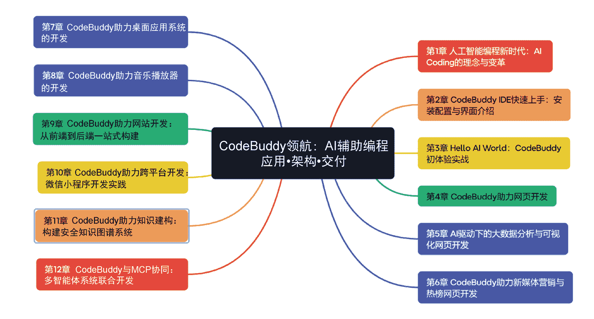

• **第一章** **人工智能编程新时代：AI** **Coding 的理念与变革** 本章系统阐述 AI Coding 理念的形成背景、技术基础及其对传统开发模式的深刻重塑。首先介绍人工智能的发展历程，从符号主义、统计学习到深度学习，重点分析大语言模型的演进及其在编程领域的应用；其次，对比 AI 编程与传统编程在驱动方式、核心角色、开发效率等多方面的差异，强调 AI 编程以自然语言意图驱动，通过人机协同提升开发效率、降低技术门槛；最后，介绍 CodeBuddy 的技术架构与优势，展现了 AI Coding 从“辅助工具”向“工程级智能协作者”演进的重要方向。

• **第二章** **CodeBuddy** **IDE 快速上手：安装配置与界面介绍。**本章系统介绍 CodeBuddy 的产品形态、版本体系与使用边界，重点阐述其插件版、独立 IDE、云端 IDE 与 CLI 这 4 种运行形态在不同开发场景下的适配策略。通过对安装流程、运行环境配置、多语言依赖管理与安全策略的详细说明，帮助读者快速完成从“零配置”到“可用环境”的过渡。同时，本章深入解析 CodeBuddy 的用户界面结构与核心功能区，包括 AI 辅助面板、调试控制台、版本控制与上下文管理机制，为后续章节的高效使用奠定坚实基础。

• **第三章** **Hello** **AI** **World：CodeBuddy 初体验实战。**本章以 ToDo List 项目为切入点，构建“自然语言驱动开发”的完整闭环示范。通过需求表达、提示词构建、工程模板生成与界面运行，系统展示 CodeBuddy 在开发流程中所承担的“协同开发节点”角色。重点讨论人机协作的边界控制问题，强调开发者在需求建模、逻辑校验与最终决策中的主导地位，帮助读者在早期阶段即形成正确的 AI Coding 认知与使用习惯。

• **第四章** **CodeBuddy 助力网页开发。**本章围绕 Web 开发基础与前端交互设计，系统讲解 HTML、CSS 与 JavaScript 在网页构建中的作用，并重点分析 CodeBuddy 自动生成网页代码的内部逻辑与提示词设计方法。通过在线简历、MBTI 测试与旅游门户等实战项目，展示 AI 在页面布局、交互逻辑与响应式设计中的实际价值，体现 AICoding 在“快速原型—可用产品”转化过程中的效率优势。

• **第五章** **AI 驱动下的大数据分析与可视化网页开发。**本章聚焦大数据环境下的分析与可视化开发，系统介绍 Hadoop、Spark 等关键技术，并展示 CodeBuddy 在环境配置、数据清洗、建模与可视化中的自动化能力。通过引导式提示词与工程化示例，说明大语言模型如何降低数据工程与分析的技术门槛，使开发者能够更专注于分析目标与业务语义，实现“数据理解导向”的 AI 编程模式。

• **第六章** **CodeBuddy 助力新媒体营销与热榜网页开发。**本章以新媒体传播与内容推荐为背景，系统讲解热榜推荐的核心逻辑、数据采集机制与交互设计原则。通过新媒体网页生成、新闻榜单生成与爆款种草网页自动生成等案例，展示 CodeBuddy 在 UI 生成、数据可视化与营销内容构建中的综合能力，体现 AICoding 在内容生产型系统中的规模化与智能化优势。

• **第七章** **CodeBuddy 助力桌面应用的开发和第八章** **CodeBuddy 助力音乐播放器的开发。**这两章分别围绕桌面应用开发与音频系统构建展开，系统介绍 C/S 架构、Tkinter、OpenCV 与音频处理原理。通过图像处理与音乐播放器案例，展示 CodeBuddy 在多模态代码生成、界面设计与功能调试中的能力，拓展 AICoding 在非 Web 场景下的应用边界。

• **第九章** **CodeBuddy 助力网站开发：从前端到后端一站式构建和第十章** **CodeBuddy 助力跨平台开发：微信小程序开发实践。**这两章以 Django 网站开发和微信小程序为核心，系统讲解前端、后端与数据库的一站式构建流程。通过图书管理系统与小程序游戏案例，展示 CodeBuddy 在工程初始化、数据库迁移、跨平台代码生成中的整体协同能力，体现 AI Coding 对传统软件工程流程的重构作用。

• **第十一章** **CodeBuddy 助力知识建构：构建安全知识图谱系统和第十二章** **CodeBuddy 与 MCP 协同：多智能体系统联合开发。**作为全书的进阶部分，本部分聚焦知识图谱构建、多智能体协作与 MCP 体系，系统展示 CodeBuddy 如何与多智能体框架协同完成复杂系统设计。通过安全知识图谱、威胁情报分析与智能审稿系统等案例，揭示 AICoding 从“代码生成工具”向“智能系统构建平台”的演进趋势。

# **资源与支持**

**提交勘误**

作者和编辑尽最大努力来确保书中内容的准确性，但难免会存在疏漏。欢迎读者将发现的问题反馈给我们，帮助我们提升图书的质量。

当读者发现错误时，请登录异步社区（https://www.epubit.com），按书名搜索，进入本书页面，单击“发表勘误”，输入勘误信息，单击“提交勘误”按钮即可（见下图）。本书的作者和编辑会对读者提交的勘误进行审核，确认并接受后，将赠予读者异步社区 100 积分。积分可用于在异步社区兑换优惠券、样书或奖品。

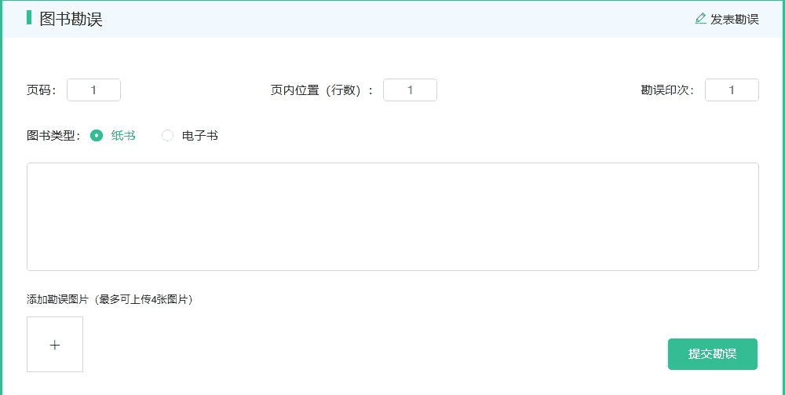

**与我们联系**

我们的联系邮箱是 wujinyu@ptpress.com.cn。

如果读者对本书有任何疑问或建议，请发邮件给我们，并请在邮件标题中注明本书书名，以便我们更高效地做出反馈。

如果读者有兴趣出版图书、录制教学视频，或者参与图书翻译、技术审校等工作，可以发邮件给我们。

如果读者所在的学校、培训机构或企业，想批量购买本书或异步社区出版的其他图书，也可以发邮件给我们。

如果读者在网上发现有针对异步社区出品图书的各种形式的盗版行为，包括对图书全部或部分内容的非授权传播，请将怀疑有侵权行为的链接发邮件给我们。这一举动是对作者权益的保护，也是我们持续为广大读者提供有价值的内容的动力之源。

**关于异步社区和异步图书**

**“异步社区”**（www.epubit.com）是由人民邮电出版社创办的 IT 专业图书社区，于 2015 年 8 月上线运营，致力于优质内容的出版和分享，为读者提供高品质的学习内容，为作译者提供专业的出版服务，实现作者与读者在线交流互动，以及传统出版与数字出版的融合发展。

**“异步图书”**是异步社区策划出版的精品 IT 图书的品牌，依托于人民邮电出版社在计算机图书领域多年来的发展与积淀。异步图书面向 IT 行业以及各行业使用 IT 技术的用户。

# **第一章**

# **人工智能编程新时代：AI Coding 的理念与变革**

随着大语言模型与编程开发的深度融合，编程范式正由“人工主导、工具辅助”加速演进为“人机协同、智能驱动”。AICoding 正成为推动软件开发效率与工程思想变革的关键力量。本章将系统阐述 AI 编程理念的形成背景、技术基础及其对传统开发模式的深刻重塑。

## **1.1**

## **AI** **Coding 的起源与发展趋势**

**人工智能**（Artificial Intelligence，AI）是研究如何使计算机系统具备感知、推理、学习与决策能力的交叉学科，其核心目标在于模拟、扩展和增强人类智能活动。AI 并非单一技术，而是涵盖机器学习、知识表示、自动推理、自然语言处理与计算机视觉等多个方向。其本质在于通过算法与数据，使机器能够在不完全依赖人工规则的情况下完成复杂任务，并在动态环境中持续优化行为策略。随着计算能力与数据规模的增长，人工智能逐步从理论探索走向大规模工程应用，成为推动信息技术与产业变革的重要基础。

（1）**人工智能的发展历程与代表性阶段**。人工智能的发展大致经历了符号主义、统计学习与深度学习三个阶段。早期符号主义 AI 以专家系统为代表，依赖人工规则和逻辑推理，典型案例如医疗诊断系统，但其扩展性有限。随后，统计学习方法兴起，支持向量机、隐马尔可夫模型等在语音识别与文本分类中取得突破。2012 年以后，深度学习成为主流，卷积神经网络与循环神经网络在图像识别、语音识别和机器翻译领域显著超越传统方法，AlphaGo 战胜人类棋手成为该阶段的重要里程碑。

（2）**从深度学习到大语言模型的演进**。在深度学习基础上，预训练与自监督学习范式推动了大语言模型的发展。以 Transformer 架构为核心的大语言模型（Large Language Model，LLM）通过在海量文本上进行预训练，获得了通用语言理解与生成能力，代表性模型包括 DeepSeek、Hunyuan（混元）、Qwen（千问）、ChatGPT、Gemini 等，其特点在于参数规模大、知识覆盖广、迁移能力强。大语言模型不再局限于单一任务，而是通过提示词驱动完成多任务推理与生成，标志着人工智能从“任务定制”向“通用智能工具”的重要转变，为编程自动化奠定了技术基础。

（3）**从大语言模型到 AI** **Coding 的范式转变**。AI 编程（AI Coding）是大语言模型在软件工程领域的直接延伸，其核心在于利用模型对代码语义、工程结构与开发上下文的理解能力，辅助甚至参与程序设计与实现。与传统代码补全工具不同，AI Coding 能够理解自然语言需求，生成函数、模块乃至完整项目骨架，并支持跨语言与跨框架迁移。该阶段标志着编程活动从“语法驱动”转向“语义驱动”，开发者逐步由代码编写者转变为系统设计者与智能协同者。图 1-1 展示了以 CodeBuddy 为代表的 AI Coding 工具赋能编程与程序开发。

图 1-1 以 CodeBuddy 为代表的 AI Coding 工具赋能编程与程序开发

AI Coding 在提升开发效率、降低技术门槛与增强代码质量方面具有显著优势。一方面，其可快速生成样板代码、接口逻辑与测试用例，减少重复劳动；另一方面，其可通过语义分析发现潜在缺陷并提出重构建议。在应用层面，AI Coding 已广泛应用于 Web 系统开发、数据分析、科研原型构建与教学辅助等场景。在复杂系统中，AI Coding 进一步支持快速迭代与跨角色协作，推动软件开发模式向智能化与平台化方向演进。

## **1.2**

## **大语言模型在编程中的应用**

**大语言模型**（LLM）是以深度神经网络为核心、基于海量语料进行预训练的通用人工智能模型，其本质是在高维参数空间中学习语言的统计规律与语义结构。当前主流大语言模型普遍采用 Transformer 架构，通过自注意力机制对上下文信息进行全局建模，从而实现对长序列语义依赖关系的有效刻画。在训练范式上，大语言模型通常经历“预训练—对齐—微调”三个阶段。

• 预训练阶段通过自监督学习获取通用语言能力；

• 对齐阶段借助人类反馈强化学习（RLHF）或偏好建模约束输出行为；

• 微调阶段则面向具体任务或领域进行适配。

这一机制使大语言模型具备跨任务迁移、语义推理与生成能力，为其在程序理解与代码生成中的应用奠定了理论基础。

自 2020 年 GPT-3 发布以来，大语言模型进入超大规模预训练时代，其生成能力首次在自然语言理解与生成任务中展现出显著优势。2021 年，DALL·E 与 Codex 等模型相继提出，标志着“文本到图像”“自然语言到代码”的跨模态生成范式初步成型。2022 年，ChatGPT 的发布推动对话式 AI 与 AIGC 应用全面爆发，使大语言模型从研究工具走向大众化应用。2023 年，多模态大语言模型快速演进，文本、代码、图像与语音的统一建模成为趋势。2024 年起，AI Coding 进入深度应用阶段，大语言模型开始支持复杂工程级推理与多步骤规划。预计 2025 年以后，新一代模型将进一步推动 Agent 化编程范式，实现从“辅助编程”向“自主协作式编程”的转变。图 1-2 展示了大语言模型近年的发展历程。

在编程场景中，大语言模型并非简单地“记忆代码”，而是通过学习大规模代码语料与自然语言说明之间的映射关系，形成对程序语义、控制结构与工程模式的抽象理解。当开发者输入自然语言需求或部分代码上下文时，模型会在高维语义空间中完成意图解析、逻辑推理与代码生成三步协同过程。具体而言，模型首先理解任务目标与约束条件，其次在内部表示中构建候选实现路径，最后生成符合语法与语义约束的代码片段。这一过程依赖于上下文建模能力、概率生成机制与隐式知识迁移能力，使模型能够完成代码补全、函数生成、错误修复与重构建议等任务。

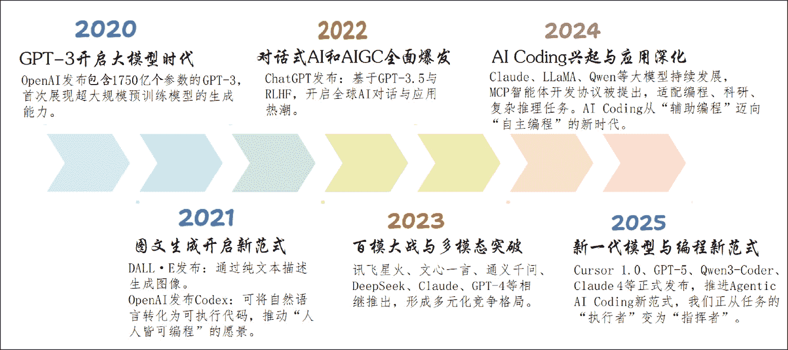

图 1-2 大语言模型近年的发展历程

基于大语言模型的 AI Coding 通常遵循“需求表达—语义理解—代码生成—反馈优化”流程。开发者以自然语言或半结构化提示词描述开发目标，大语言模型对其进行语义解析并结合上下文代码与工程结构生成候选实现方案。随后，通过运行反馈、错误信息或人工评价对生成结果进行修正与优化。在工程化系统中，如 CodeBuddy，这一流程被嵌入 IDE 与开发管线中，支持项目级上下文理解、跨文件推理与持续交互式优化。其核心原理在于将大语言模型作为“智能编程协作者”，通过人机协同实现软件开发效率与质量的系统性提升。

图 1-3 展示了 AI Coding 的基本流程，可概括为一个以“人机协同—迭代优化—自动应用”为核心的闭环过程，其本质是将开发者的高层意图逐步转化为可执行的软件系统。

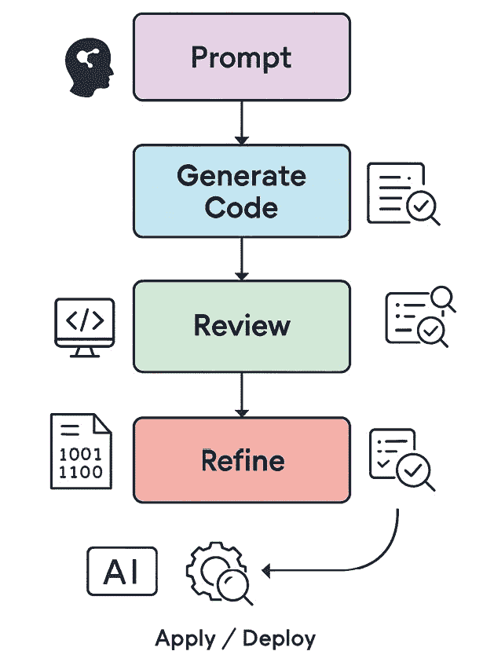

图 1-3 AI Coding 基本流程

首先，进入 Prompt（意图表达）阶段。开发者以自然语言形式描述需求、约束条件与目标功能，Prompt 作为人类认知与大语言模型之间的接口，承担着将抽象业务意图映射为可计算语义表示的作用。该阶段强调需求清晰化与语义精确性，是后续代码质量的决定性因素。

其次，进入 Generate Code（代码生成）阶段。大语言模型基于对大规模代码语料与软件工程知识的学习，对输入 Prompt 进行语义解析，并自动生成相应的代码结构、函数逻辑或项目骨架。这一过程体现了模型在语法建模、模式迁移与上下文推理方面的能力，实现从“自然语言”到“程序语言”的自动转换。

再次，进入 Review（代码审查）阶段。生成的代码并非直接投入使用，而是通过人工或 AI 辅助的方式进行语义正确性、逻辑一致性、安全性与规范性的检查。该阶段相当于传统软件工程中的代码评审与测试前置环节，用于发现潜在缺陷与设计不合理之处。

最后，进入 Refine（迭代优化）阶段。开发者根据审查结果对 Prompt 或代码进行反馈，模型据此对原有实现进行修改、补全或重构，从而实现多轮迭代优化。这一阶段体现了 AI Coding 的核心优势，即通过低成本的人机交互持续逼近最优实现。

## **1.3**

## **AI 编程与传统编程的对比**

AI Coding 是指以大语言模型等人工智能技术为核心，将自然语言理解、程序语义建模与自动代码生成能力深度融入软件开发全过程的一种新型编程范式。在该范式下，人工智能不仅能够辅助完成代码补全、函数生成和错误修复等局部任务，还能够理解开发者的高层业务意图，参与系统设计、逻辑推理与工程实现，从而实现人机协同的软件开发。

AI Coding 通过对大规模代码与文本语料的学习，建立自然语言需求与程序结构之间的语义映射，使编程活动从以语法为中心的“指令式实现”转向以意图为导向的“语义驱动构建”，在显著提升开发效率的同时，降低技术门槛，推动软件工程向智能化、自动化和协同化方向发展。表 1-1 详细展示了 AI 编程与传统编程的对比。

表 1-1 AI 编程与传统编程的对比

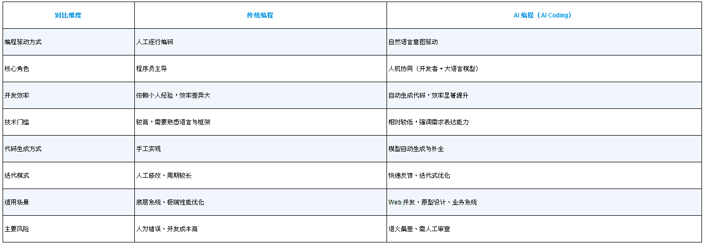

传统编程以人为中心，强调程序员对算法逻辑、数据结构与系统架构的显式设计，其核心流程是“需求分析—手工编码—调试测试—迭代维护”。该模式高度依赖开发者的专业经验与语言熟练度，开发效率与代码质量在很大程度上受个体能力限制，且在复杂系统或快速迭代场景下成本较高。

AI 编程（AICoding）则以大语言模型为核心，将自然语言理解、代码生成与语义推理引入软件开发过程，形成“意图表达—自动生成—人机协同审查—迭代优化—快速部署”的新范式。开发者不再局限于逐行编写代码，而是通过高层语义描述驱动模型完成代码构建与重构。

从工程角度看，AI 编程显著降低了技术门槛，提升了开发效率与原型构建速度，尤其在样板代码生成、接口开发、测试用例补全与跨语言迁移等方面优势明显。同时，AI 编程通过持续反馈机制实现快速迭代，但其生成结果仍需人工校验，以避免语义偏差、安全隐患或业务理解错误。总体而言，AI 编程并非替代传统编程，而是通过人机协同重塑软件工程的生产方式，使开发活动从“代码驱动”向“意图驱动”演进。图 1-4 展示了以 CodeBuddy 赋能应用为代表的大语言模型典型应用场景，尤其是智能化编程。

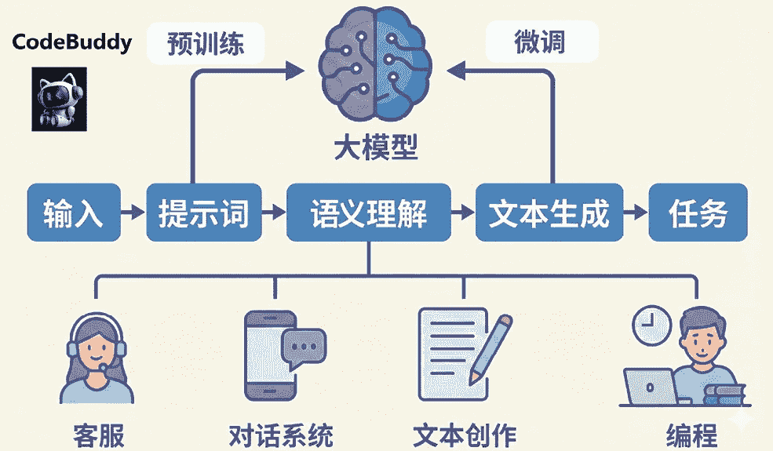

图 1-4 大语言模型典型应用场景

## **1.4**

## **CodeBuddy 的技术架构与优势**

CodeBuddy 是腾讯自研的、覆盖全栈开发生命周期的智能编程助手。它通过插件、独立 IDE 和命令行（CLI）工具（CodeBuddy Code）三种形态，为从需求到部署的各个环节提供 AI 辅助。CodeBuddy 是一类以大语言模型为核心、面向全开发生命周期的智能化 AI Coding 平台，旨在通过自然语言理解、代码语义建模与人机协同机制，重构传统软件开发范式。该平台以“意图驱动编程（Intent-Driven Programming）”为核心理念，将开发者的高层业务需求、设计意图与工程约束转化为可执行的程序结构、代码实现与工程配置，从而显著提升软件开发的效率、一致性与可维护性。图 1-5 展示了 CodeBuddy 的官方网站，CodeBuddy 的核心目标是“无论你身处何种开发环境，CodeBuddy 都能助你心无旁骛，释放创造潜能，实现效率的极致飞跃”。

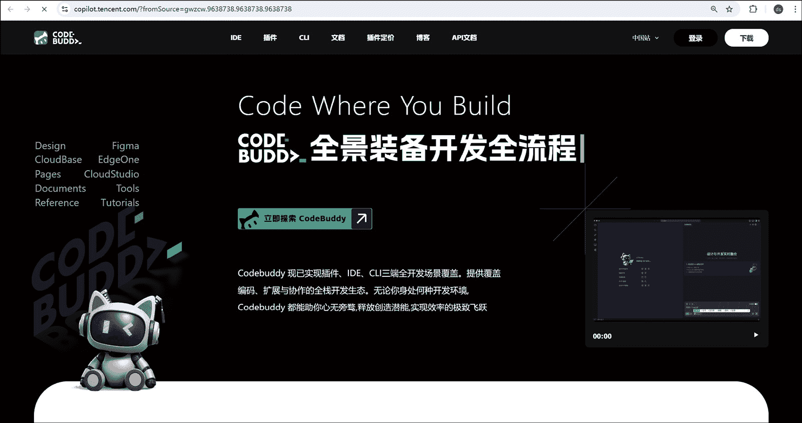

图 1-5 CodeBuddy 官方网站

从系统形态上看，CodeBuddy 通过插件（Plugin）、集成开发环境（IDE）与命令行（CLI）工具三端协同，实现对主流开发场景的全覆盖，构建起贯穿“编码—调试—重构—测试—部署—协作”的一体化智能开发生态。该体系突破了单一工具辅助编码的局限，使 AI 能够深度参与到软件工程的多个关键阶段，成为持续在线的“智能开发协作者”。

（1）IDE：智能代码补全、注释生成、代码解释、缺陷检测、Figma 设计稿转代码、智能生成项目文档（如 PRD）。图形化集成开发环境，提供从设计到编码的全流程辅助。

（2）插件：嵌入主流 IDE（如 VS Code），提供行内/函数级代码补全、自然语言生成代码、自动化生成单元测试等功能。在开发者熟悉的现有工具环境中，提供无侵入的即时辅助。

（3）CLI 工具（CodeBuddy Code）：在终端中用自然语言驱动开发、调试、部署及运维任务；无缝衔接 Git、编译器等工具链；支持通过 ACP 协议与第三方编辑器集成。命令行、服务器运维及远程开发场景，追求自动化与高效。

在技术层面，CodeBuddy 以大语言模型为认知中枢，结合代码理解、上下文感知与工程知识注入机制，实现对复杂软件项目的语义级建模能力。其核心工作流程如下。

（1）对开发上下文（代码库、依赖关系、配置文件、历史修改记录）的持续感知。

（2）对自然语言需求与代码语义的双向映射。

（3）通过推理与生成机制，输出符合工程规范的代码、注释、测试用例与重构建议。

（4）在开发者反馈与运行结果的驱动下进行迭代优化。

不同于传统静态代码补全工具，CodeBuddy 能够理解项目级结构与业务语义，支持跨文件、跨模块乃至跨语言的协同生成与一致性维护，从而显著降低系统演化过程中的认知负担。

基于其架构与功能，CodeBuddy 展现出以下几个维度的显著技术优势。

（1）**全场景覆盖能力**。CodeBuddy 同时支持插件、IDE 与 CLI 形态，可无缝嵌入本地开发、云端开发与自动化流水线，适配个人开发、团队协作与企业级工程场景。

（2）**全栈智能辅助能力**。其功能不仅局限于代码生成，还覆盖需求理解、接口设计、错误定位、性能优化、文档生成与协作支持，形成覆盖编码、扩展与协作的完整开发生态。

（3）**上下文感知与工程一致性保障**。通过对项目上下文的持续建模，CodeBuddy 能在生成与修改代码时保持架构一致性、风格统一性与依赖正确性，降低“碎片化生成”带来的工程风险。

（4）**人机协同的增强式开发范式**。CodeBuddy 并非替代开发者，而是通过“生成—审查—修正—再生成”的闭环机制，使开发者专注于系统设计与业务抽象，AI 负责高频、重复与易错任务。

总体而言，CodeBuddy 代表了 AI Coding 从“辅助工具”向“工程级智能协作者”演进的重要方向。其通过三端协同的产品形态与深度语义理解能力，为开发者提供了一个专注友好、高效率、低干扰的智能开发环境，释放了人类在创造性建模与系统思维层面的潜能，为新一代软件工程范式提供了具有实践价值的技术路径。

# **第二章**

# **CodeBuddy IDE 快速上手：安装配置与界面介绍**

本章旨在构建一套可复用的 CodeBuddy IDE 入门范式，通过安装配置与功能描述让读者快速上手。首先，对 CodeBuddy 的独立版、插件版及 CLI 形态进行分类阐述，明确其在不同开发环境、工具链与运行架构下的适配路径，并给出安装与账号初始化的通用流程。其次，对 IDE 的界面组织结构进行解析，说明导航区、代码编辑区、AI 辅助区与输出区在智能开发场景中的功能定位及其协同分工关系，为后续的交互式开发奠定操作基础。

本章还将进一步说明项目初始化、代码与资源文件管理、多语言支持以及插件扩展的实施方法，将 CodeBuddy 从“可安装”推进至“可用、可维护、可拓展”的状态。通过本章内容，读者应能够完成 CodeBuddy 开发环境的基础构建，并具备阅读和实践后续章节中具体场景化用例的前提条件。

## **2.1**

## **CodeBuddy 版本与安装**

我们将详细描述 CodeBuddy 的安装过程，涵盖总体形态说明与适用场景、获取方式与安装流程、版本选择与兼容性要点，以及依赖修复与包管理优化。

**2.1.1**

**CodeBuddy 总体形态说明与适用场景**

我们将对 CodeBuddy 在本地、云端及自动化场景下的主要承载形态进行归纳，说明各形态的角色分工、能力边界及典型使用场景，为后续获取、安装与配置部分提供前置认知。整体上，CodeBuddy 的能力基于同一套智能开发内核，也就是说，以自然语言/对话指令驱动代码生成和工程化操作，结合项目级上下文进行辅助，最终落到可执行的开发环境中；不同形态之间的差异主要体现在“运行位置”“与现有工具链的绑定方式”以及“对本地资源的依赖程度”上。为便于读者建立统一认知，本节将平台形态划分为本地独立版 IDE、桌面 IDE 插件版、Cloud Studio（云端 IDE）和 CLI 命令行形态四类。

**1.CodeBuddy 产品定位与使用边界**

CodeBuddy 的核心定位是**具备 AI 辅助能力的集成开发环境**。与传统仅提供语法高亮、调试、构建的 IDE 相比，其显著特征在于将大语言模型的语义理解与开发过程本身进行了绑定：一方面，开发者可通过自然语言描述业务需求、界面结构、函数功能、测试用例等，再由系统生成初版代码或配置；另一方面，系统能够读取项目中的既有文件、目录结构与上下文内容，在此基础上给出符合当前工程状态的增量代码、重构建议或文档内容。这意味着 CodeBuddy 既要具备常规 IDE 的工程管理能力，又要具备对话式、上下文感知式的智能能力。在 2.0 能力体系下，CodeBuddy 的角色不再局限于代码编写阶段的辅助工具，而是进一步覆盖需求生成、设计到代码转换、工程化生成以及沙箱部署与结果验证等环节。

在使用边界上，本书将 CodeBuddy 视作“可在多形态环境中部署的开发入口”，而不是单一桌面工具。也就是说，后续章节提到的界面区块、项目初始化、文件管理、插件扩展等内容，均可以在本节所述四种形态中找到对应操作，只是展现位置和调用方式有所差异。本节的任务在于说明这些形态的存在及适配范围，而不展开具体界面操作，具体操作将在 2.3 节以后逐一说明。

**2.CodeBuddy 版本形态功能介绍**

（1）**本地独立版 IDE。**本地独立版是最完整的编程形态，安装于桌面操作系统之后即可独立运行，包括项目资源视图、代码编辑区、AI 辅助面板、终端/输出区等组成部分，可在单一界面内完成从创建工程、编写代码、调用智能生成到运行调试的一系列操作。

该形态适用于以下情形：需要在一台终端上完成全部开发活动；需要在培训、演示、课堂场景中展示“从自然语言到可运行代码”的全过程；需要对本地文件、脚本、工具链拥有完全掌控权的场景。图 2-1 所示为 CodeBuddy 本地独立版 IDE 的界面。

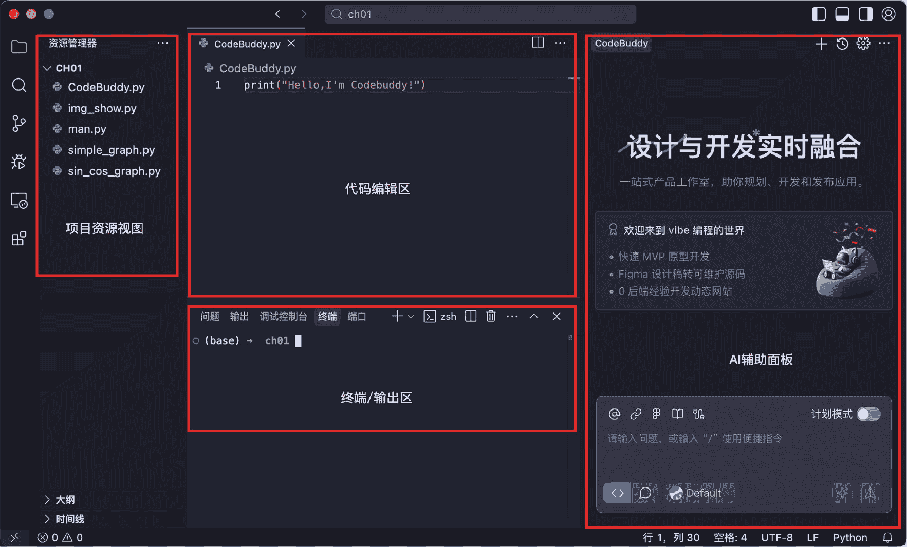

图 2-1 CodeBuddy 本地独立版 IDE 的界面

（2）**CodeBuddy 桌面 IDE 插件版。**如图 2-2 所示，桌面 IDE 插件版以扩展方式嵌入现有的开发工具，如 VS Code、IntelliJ IDEA、PyCharm 等。其核心思路：不改变既有项目结构、不更换开发人员熟悉的编辑器，仅在现有 IDE 中提供一个可以与模型对话、请求代码生成、对当前文件做分析的入口。插件版通常表现为侧边栏面板、命令面板条目或上下文菜单项，调用后即可使用与独立版相同的智能能力。

该形态适用于以下情形：已有成熟项目和构建脚本，无法迁移到新 IDE；团队已经统一使用某一桌面 IDE，希望在其上叠加 AI 能力；需要在同一项目中频繁切换本地代码编辑与 AI 生成的场景。此形态强调“与现有工具链共存”。

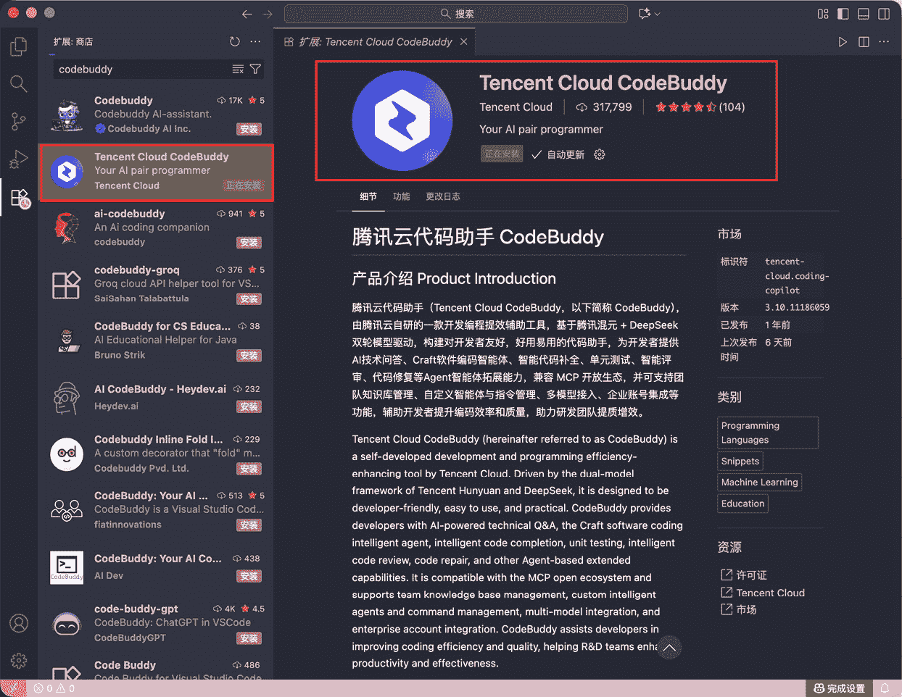

图 2-2 CodeBuddy 桌面 IDE 插件版

（3）**CodeBuddy Cloud Studio（云端 IDE）**。Cloud Studio 编程形态指在浏览器或云端工作空间中直接使用的在线版本，如图 2-3 中的官方页面介绍所示，其特征是不需要在本地安装桌面应用，开发环境、模型接入、依赖版本均由云端统一维护。该形态可有效规避本地操作系统版本差异、网络出口限制、团队成员机器配置不一致等问题，适用于教学实训、临时开发、跨设备协作、企业希望统一开发环境的场景。

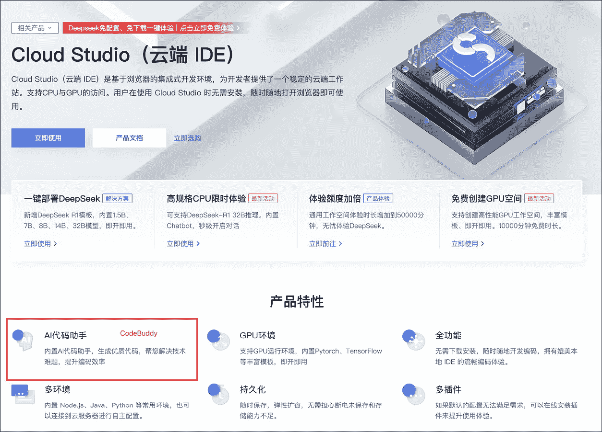

图 2-3 CodeBuddy Cloud Studio（云端 IDE）官网

与本地独立版相比，云端 IDE 在界面结构上基本一致，如图 2-4 所示，同样包含资源列表、代码编辑区和 AI 侧栏，但在运行方式上依赖浏览器和在线工作空间，因此在部署或使用前应确认网络可达性和账号统一性。

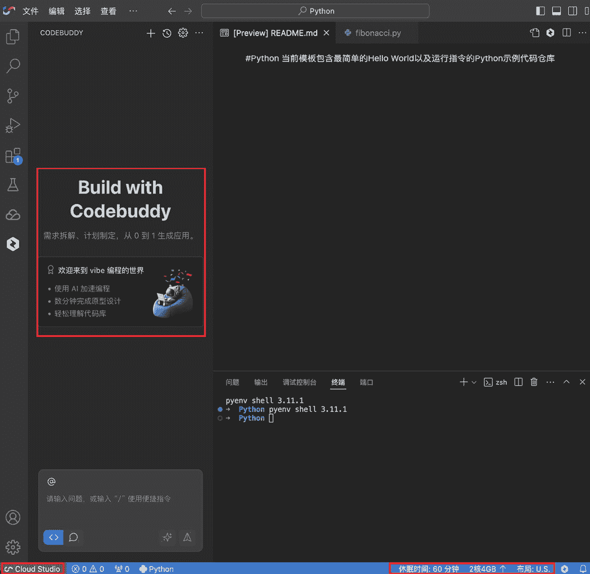

图 2-4 CodeBuddy Cloud Studio（云端 IDE）主页面

（4）**CodeBuddy CLI 命令行形态**。CodeBuddy CLI 编程形态主要面向终端、自动化和 CI/CD 流水线场景，用于在无图形界面或无须启动完整 IDE 的情况下，直接通过命令调用 CodeBuddy 的生成、改写、说明等能力。典型使用方式：在构建脚本中调用以批量生成模板代码；在提交前调用以进行代码说明或规范性检查；在远程服务器或容器环境中调用以减少手工编辑。图 2-5 所示为 CodeBuddy CLI 形态调用示意。

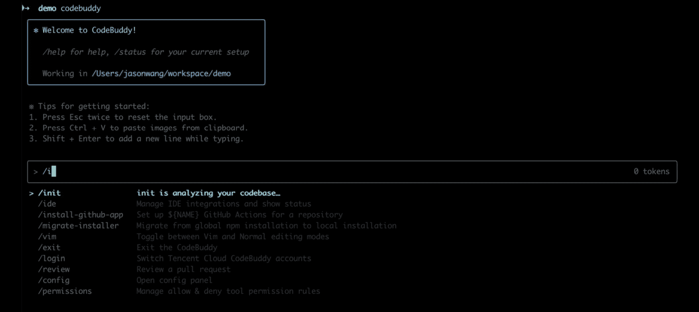

图 2-5 CodeBuddy CLI 形态调用示意

在熟悉了 CodeBuddy 的 4 种编程形态模式之后，针对实际的开发任务，我们可以根据所处的开发环境（本地或云端）、工具链的配置（是否已有集成开发环境/是否需要统一环境）以及任务类型（交互式开发或自动化脚本）来选择最适合的 CodeBuddy 产品编程形态。随后，我们将逐一介绍 CodeBuddy 编程形态的获取方式和安装流程。

**2.1.2**

**CodeBuddy 获取方式与安装流程**

本节将详细阐述 CodeBuddy 产品在不同编程环境下的获取方式和安装流程，确保在桌面、本地集成开发环境（IDE）、云端 IDE 以及命令行界面中均能成功安装。

CodeBuddy 的获取与安装可归结为“四段式流程”——获取安装介质或访问入口→本地安装或在线启用→首次登录与账号校验→按需扩展与多端统一。

**1.本地独立版 IDE 获取与安装**

（1）**下载安装包。**在使用本地独立版前，需要从官方发布页面下载与当前操作系统、处理器架构相匹配的安装包，如图 2-6 所示。下载页面通常会同时给出 Windows 版本、macOS Intel 版本以及 macOS Apple/ARM 版本，用户应根据本机情况选择对应版本。

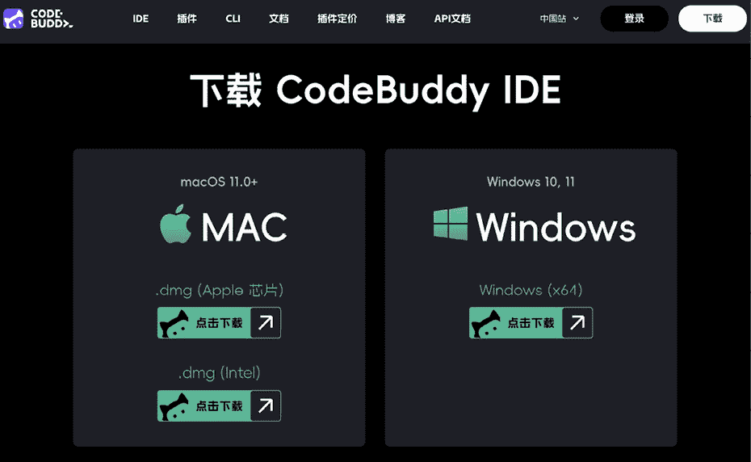

图 2-6 CodeBuddy 安装包下载页面

（2）**Windows 平台安装。**在 Windows 环境中，双击下载得到的安装程序，进入安装向导。

① 许可确认界面：用户需阅读许可协议并选择“我同意此协议”，方可继续，如图 2-7 所示。

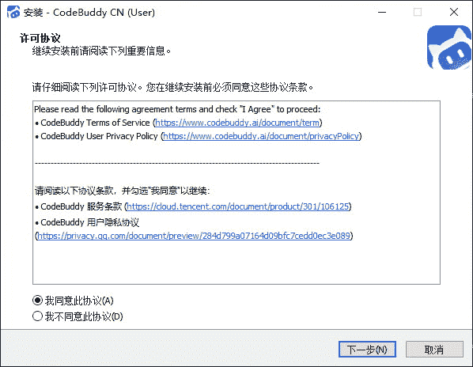

图 2-7 Windows 平台安装向导——许可确认界面

② 安装路径选择界面：可使用默认路径，也可自定义安装位置，建议使用英文路径以减少后续脚本调用问题，如图 2-8 所示。

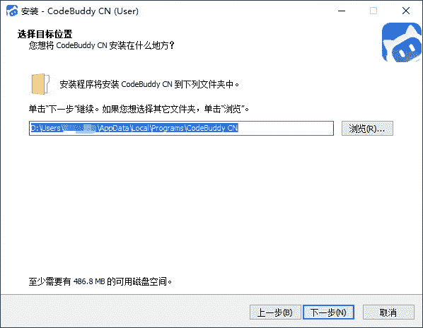

图 2-8 Windows 平台安装向导——安装路径选择界面

③ 选择附加任务界面：可创建桌面快捷方式，也可添加 buddy 命令到 PATH，如图 2-9 所示。

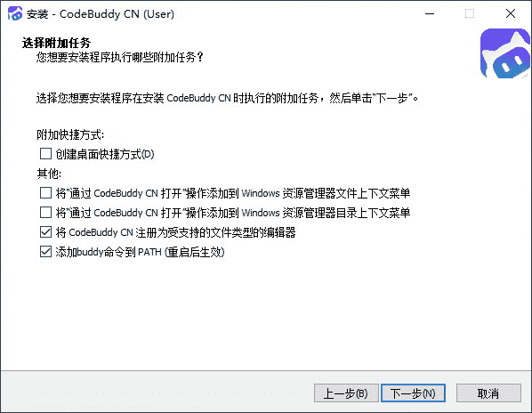

图 2-9 Windows 平台安装向导——选择附加任务界面

④ 安装完成界面：完成文件复制后，可勾选“运行 CodeBuddy CN”，以便立即进入登录界面，如图 2-10 所示。

（3）**macOS 平台安装**。在 macOS 环境中，下载得到的通常为.dmg 或打包的应用文件。双击打开后，将 CodeBuddy 应用图标拖入“Applications”目录即可完成安装，如图 2-11 所示。首次启动若出现系统安全提示，应选择“仍要打开”或在“系统设置-隐私与安全性”中信任该应用，然后再次启动即可。

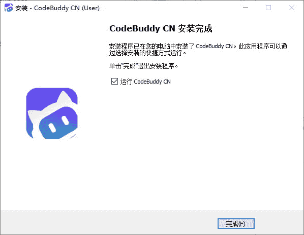

▲图 2-10 Windows 平台安装向导——安装完成界面

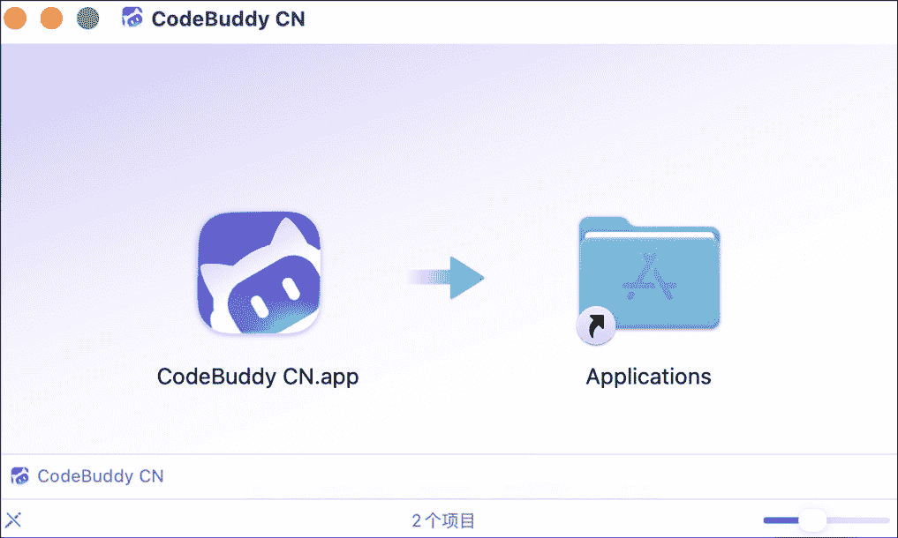

图 2-11 macOS 平台安装示意

（4）**首次启动。**首次启动本地独立版 IDE 时，将进入欢迎或登录界面，如图 2-12 所示，界面通常会引导用户进行风格选择、导入配置（从 VS Code 或 Cursor 导入）。随后只需要完成账号认证，不需要立即创建项目。

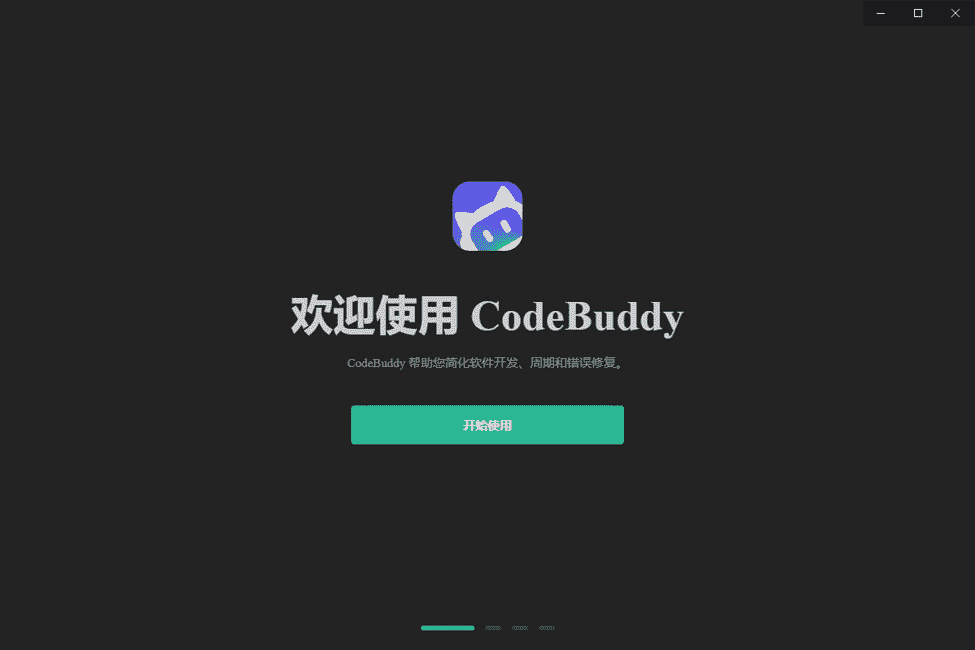

图 2-12 本地 IDE 首次启动登录界面

**2. 桌面 IDE 插件版获取与启用**

插件版适用于已经在使用 VS Code、IntelliJ IDEA、PyCharm 等桌面 IDE 的用户，通过在宿主 IDE 中安装扩展的方式获得 CodeBuddy 的辅助编程能力。

（1）**VS Code 中的获取**。打开 VS Code，进入左侧的“扩展”（Extensions）面板，在搜索框中输入“CodeBuddy”关键字，即可看到对应插件条目，随后单击“安装”按钮，即可完成在线安装，如图 2-13 所示。若处于内网环境，则可以先在可联网的设备上通过 Open VSX 市场获取 VSIX 格式的插件包，如图 2-14 所示。

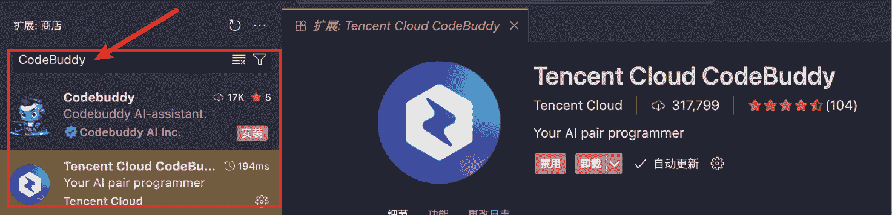

▲图 2-13 在 VS Code 中搜索并安装 CodeBuddy 插件

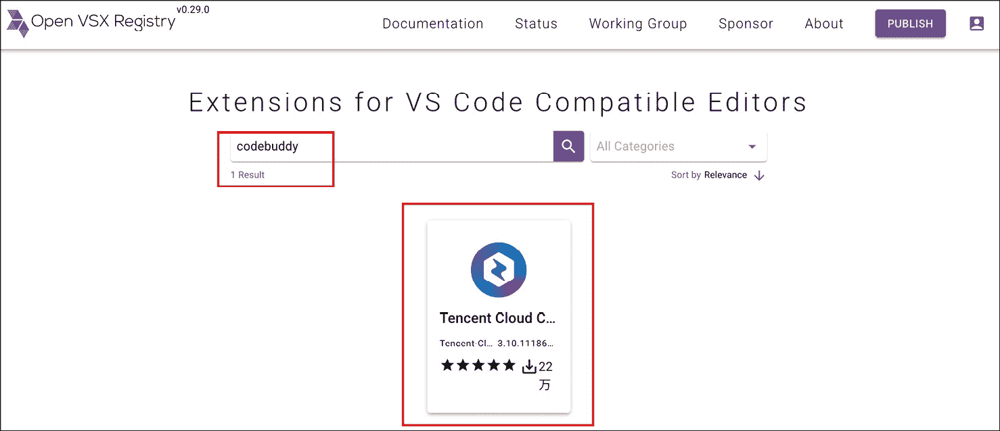

图 2-14 在 Open VSX 市场中搜索 CodeBuddy 插件

在本地 VS Code 中，使用“从 VSIX 安装”功能导入 VSIX 文件进行离线安装，如图 2-15 所示。

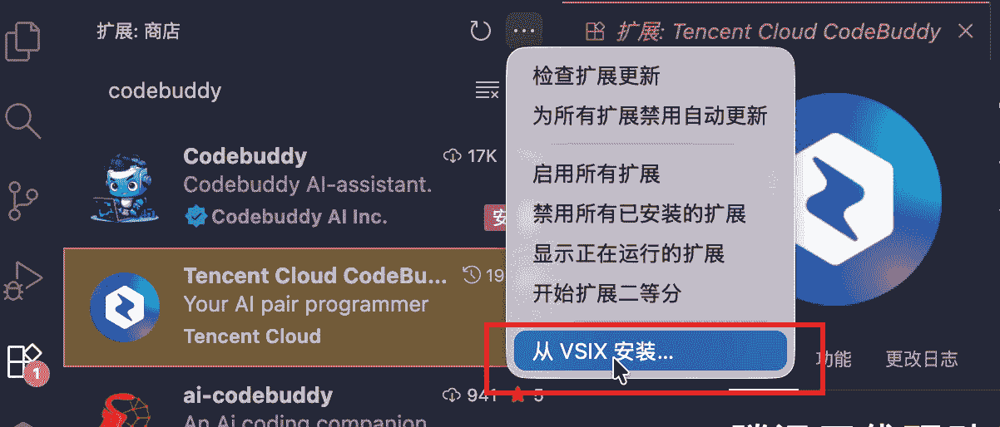

图 2-15 离线环境下从 VSIX 安装插件

（2）**JetBrains 系列 IDE 中的获取**。在 IntelliJ IDEA、PyCharm 或其他 JetBrains IDE 中，依次进入“Settings/Preferences”→“Plugins”，在 Marketplace 中搜索“CodeBuddy”，单击“Install”进行安装，完成后重启 IDE 使插件生效。

（3）**启用与面板位置。**插件安装成功后，IDE 通常会在侧边栏、底部工具栏或命令面板中新增“CodeBuddy”入口，如图 2-16 所示，单击即可打开对话/生成面板。

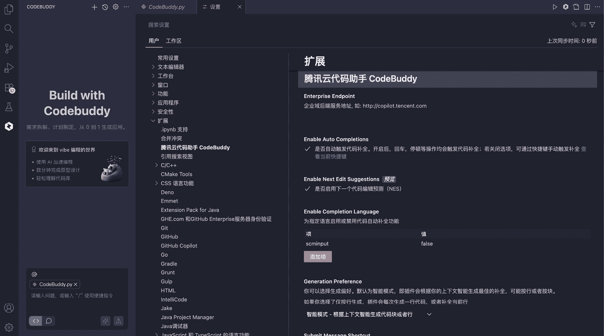

图 2-16 插件版 CodeBuddy 侧边栏入口

为确保 CodeBuddy 插件能力在宿主 IDE 中稳定运行，在安装插件前，应确认所用 IDE 的版本满足最低兼容要求。不同 IDE 在扩展机制、终端能力以及语言服务接口上存在差异，若版本过低，可能导致插件无法加载、部分能力不可用或运行不稳定。当前版本的最低支持要求如表 2-1 所示。

表 2-1 CodeBuddy 插件版最低 IDE 版本要求

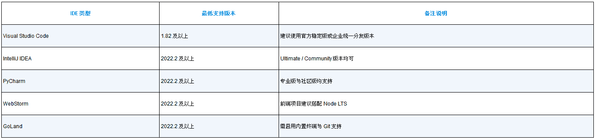

在企业或内网环境中，若 IDE 版本由统一镜像或集中管理策略控制，应在插件部署前与运维或 IT 管理部门确认版本基线，以免后续因 IDE 升级受限而影响 CodeBuddy 插件的正常使用。

**3. Cloud Studio（云端 IDE）启用**

Cloud Studio 形态无须本地安装，重点在“访问入口正确”与“账号统一”两个方面。

（1）**访问与登录**。在浏览器中访问 Cloud Studio 云端工作空间，如图 2-17 所示，进入登录页后使用已有账号进行认证，认证方式可与本地独立版保持一致，以便后续同步模型与项目配置。

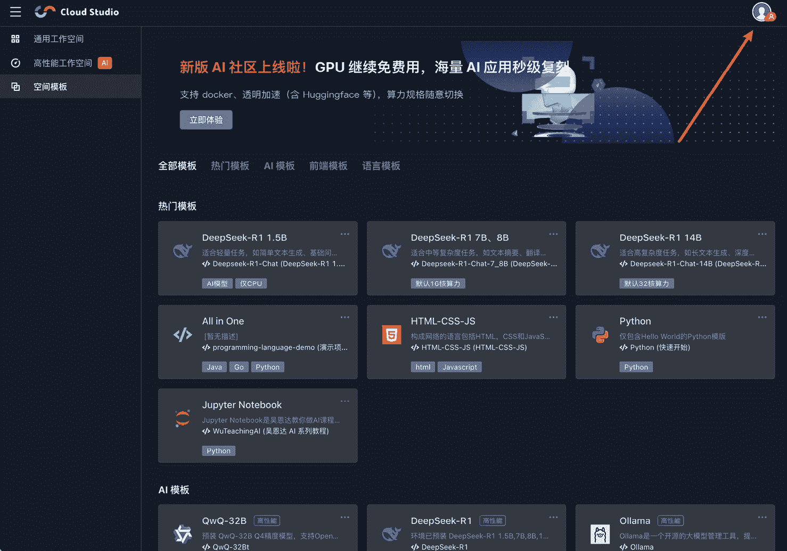

图 2-17 Cloud Studio 云端工作空间

（2）**创建在线工作空间。**首次登录后，需创建（或选择）一个在线工作空间，如图 2-18 所示。

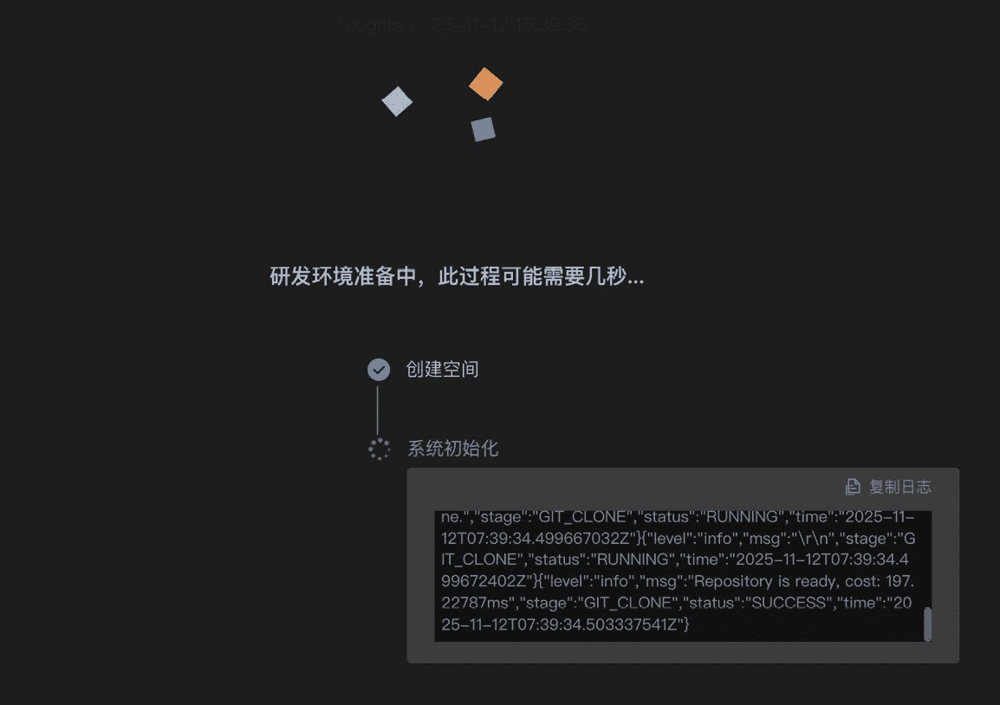

图 2-18 Cloud Studio 在线工作空间创建

该工作空间将作为所有在线项目、文件与 AI 交互的承载环境，选择完成后即可进入与本地 IDE 类似的主界面。

（3）**在线界面启用。**进入工作空间后，云端 IDE 会展示资源管理器（文件树）、代码编辑区与终端/输出区等，如图 2-19 所示。此时不需要任何本地安装，即可进行代码编辑与 AI 生成。

此外，它也适用于对特定代码片段进行操作（例如解释、修复）的场景，无须手动打开面板，操作步骤如下，详情如图 2-20 所示。

① 在代码编辑区选中目标代码片段（如函数、循环逻辑）。

② 选中后，代码上方自动弹出功能选项栏（含“解释代码”“生成文档”“修复代码”等）。

③ 单击对应选项，触发 AI 处理（如单击“解释代码”，生成逻辑说明）。

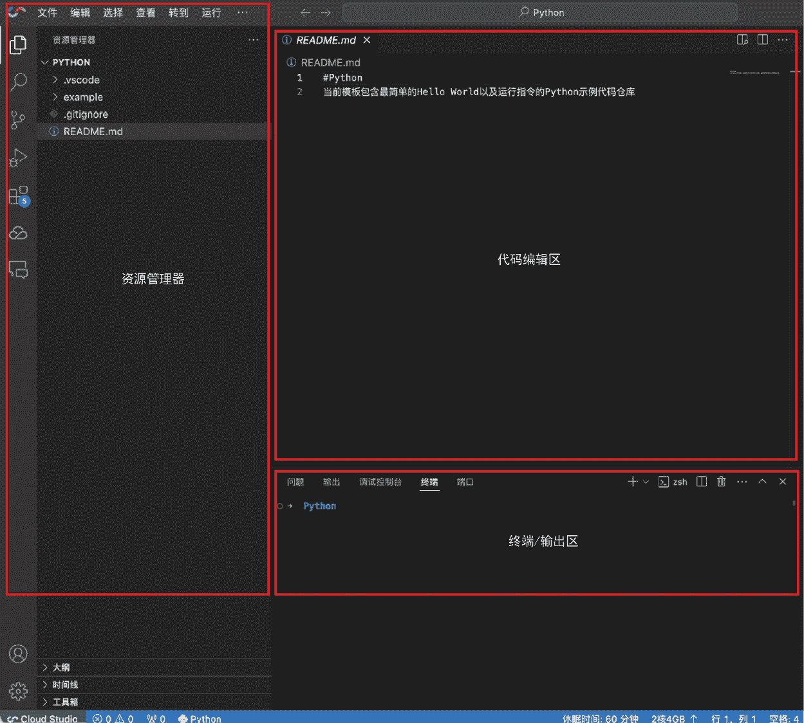

▲图 2-19 Cloud Studio 在线 IDE 主界面

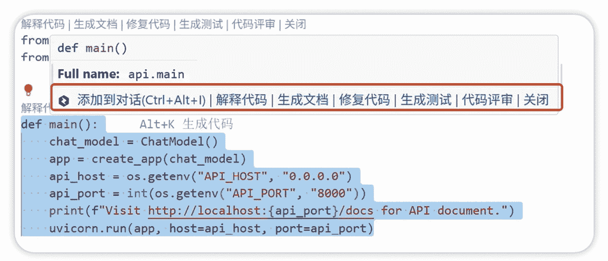

图 2-20 Cloud Studio 在线 IDE——选中代码自动触发场景

**4. CLI 形态安装与初始化**

CLI 形态可通过 npm 一键安装，但需要确保计算机已安装 Node.js 22+和 Git 等基础环境。在 Node.js 侧推荐使用 LTS 版本（长期支持版）以确保稳定性。

第一步，下载对应系统的 LTS 版本，按向导完成安装（Windows 用户注意勾选“Add to PATH”选项）。

第二步，验证安装，打开终端（Windows 用户用 PowerShell、macOS/Linux 用户用 Terminal），输入以下命令检查版本。

node -v  # 输出 Node.js 版本号，如 v20.10.0

npm -v   # 输出 npm 版本号，如 10.2.3

若提示“命令不存在”，则需检查环境变量是否配置正确（Windows 可重启终端后重试）。

第三步，国内镜像配置：为提升 npm 包下载速度，国内用户建议切换国内镜像。

# 淘宝源

npm config set registry https://registry.npm.taobao.org/

# 腾讯源

#npm config set registry https://mirrors.cloud.tencent.com/npm/

#恢复官方源：

#npm config set registry https://registry.npmjs.org/

按开发场景选择安装方式，在终端执行以下命令（全局安装，所有项目可用）。

npm install -g @tencent-ai/codebuddy-code

（1）场景一：通过 CodeBuddy IDE 安装。打开 IDE 后，在左侧“Craft AI”对话框中单击“安装 CLI”，系统会自动调用 Terminal 执行安装命令。

（2）场景二：手动终端安装。直接在 IDE 内置 Terminal 或目标项目文件夹中执行上述 npm 命令。

（3）场景三：Windows 全局安装。以管理员身份打开 PowerShell，在任意目录下执行安装命令，确保全局路径可访问（默认路径：C:\Users\用户名\AppData\Roaming\npm）。

安装完成后，需通过登录绑定账号，支持多种登录方式，适配不同模型需求。在终端输入命令“codebuddy”，启动 CLI 形态，如图 2-21 所示。

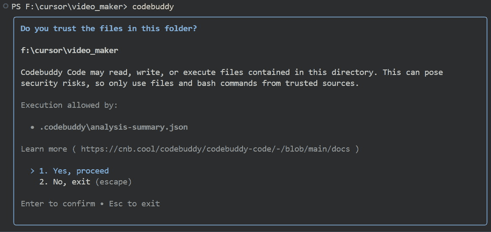

图 2-21 CLI 形态启动

系统会自动打开浏览器登录界面，如图 2-22 所示。注意，首次使用需完成账号注册。

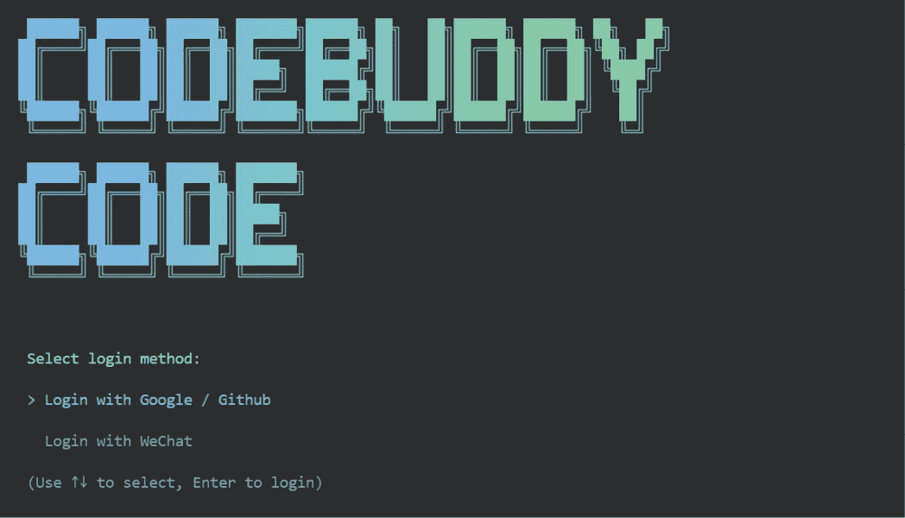

图 2-22 CLI 形态登录界面

登录成功后，终端会显示“认证成功”提示，此时 CLI 工具已准备就绪，可通过 codebuddy--help 查看所有可用命令。

**2.1.3**

**CodeBuddy 版本选择与兼容性要点**

本小节将基于前述的 CodeBuddy 编程形态和安装流程，进一步从操作系统匹配、处理器架构匹配、版本统一性这 3 个维度，阐释在实际部署 CodeBuddy 时需要预先考虑的兼容性问题，以确保后续的功能模块能够在稳定且可访问的环境中顺利运行。

在下载和安装本地独立版 IDE 时，应首先确认操作系统类型和处理器架构，优先选择与本机环境一致的安装包，以避免运行过程中出现界面卡顿、依赖无法加载或本地推理能力不可用等问题。通用要求如下。

（1）**操作系统匹配。**

• Windows 环境应选择官方提供的 Windows x64 安装包，避免在非 64 位系统或不受支持的精简版系统上安装。

• macOS 环境需注意区分 Intel 架构与 Apple Silicon（M 系列）架构，两个版本不可互换。

• 若使用云端 IDE（Cloud Studio），则不受本机操作系统限制，但仍需保证浏览器版本与网络策略满足云端 IDE 的要求。

（2）**处理器架构匹配。**2025 年起的版本对 ARM 架构及 Apple M 系列芯片的运行表现进行了优化，但前提仍然是下载对应的 ARM 安装包。若在配备 Apple M 芯片的设备上误装了 Intel 版，系统可能会通过兼容层运行，虽然功能上可以正常启动，但性能表现与图形响应速度会受影响，不建议在正式开发环境中使用此种方式。应在下载页面明确选择“macOS（Apple/ARM）”或等效标识的安装包，以获得更佳兼容性。

（3）**版本统一性。**在同一团队或同一教学场景中，应尽量统一安装包版本和架构，避免因各自安装不同版本而导致的界面差异、插件加载顺序不同或模型列表不同的情况。对于需要长期维护的环境，可将选定版本放入企业镜像库或内部文件服务器，统一发放。

**2.1.4**

**依赖修复与包管理优化**

任何一个活跃项目都会不断引入新的第三方依赖库，久而久之就会出现版本漂移、锁文件不一致、漏洞包未及时升级等问题。而 CodeBuddy 的最佳实践方式，是把“依赖健康度”的维护也交给 IDE 和 AI 协同看护。

依赖健康检查的操作流程：首先在 IDE 内置终端执行依赖检查命令，Python 命令如下。

pip check

pipdeptree

Node 命令如下。

npm ls

npm audit

pnpm audit

将命令输出复制到 CodeBuddy 的对话窗口，作为“终端报错/输出上下文”添加进去，然后让 AI 分析这些依赖冲突的成因、受影响的模块、可行的升级路径，以及是否会影响到部署镜像的大小或运行时兼容性。这样做的好处是，AI 能够结合当前项目的语言、框架和构建方式，给出更贴近项目实际的修复脚本，而不是简单地说“升级到最新版本”。

当依赖冲突来自多语言技术栈共存（如前端用 pnpm，后端用 pip）的情况时，可以在项目根目录添加统一的依赖管理说明文件，写明镜像基线版本、可用的内部镜像源地址、升级节奏、锁文件生成规范，并把这份说明通过 CodeBuddy 的“规则/知识”功能长期挂载在项目中，后续新成员一打开项目 IDE 就能自动获取到这套规则，从而减少“我本地能装，那边装不上”的沟通成本。具体建议如下。

（1）建议采取本地 IDE+插件+云端+CLI 的组合。以本地独立版 IDE 为主工作区，在常用桌面 IDE 中补装插件版，在需要统一环境或跨终端访问时启用 Cloud Studio，在自动化和流水线中并行部署 CLI，整体配置仍保持同一账号与模型策略。

（2）在企业或内网环境中，涉及镜像、代理与证书的注意事项包括镜像管理与离线分发策略、代理配置、证书与信任链管理、网络连通性验证等。

在完成本节的版本匹配、形态组合和内网适配后，仍需在后续对运行时依赖、语言环境、模型调用策略、代理设置等进行更细致的配置，特别是在需要调用本地编译器、Python/Node 运行时、GPU 加速或在内网中分级访问外部服务的情况下。

## **2.2**

## **CodeBuddy 运行环境与依赖配置**

本节介绍如何配置 CodeBuddy 的运行环境，确保其在不同操作系统、开发语言和网络环境中稳定运行，并保证生成代码的可构建性与可部署性。运行环境的准备不仅包含语言运行时本身，还包括包管理器、虚拟化/容器化隔离、企业网络访问控制策略与修复机制。

**2.2.1**

**多语言运行时与依赖管理**

CodeBuddy IDE 的定位是“一体化的智能开发环境”，因此它不会将语言运行时强行内置到 IDE 当中，而是尊重本地已有的开发栈，在此基础上进一步提供语义分析、自动补全、AI 生成与代码重写能力。实际使用时，开发者需要为所选语言分别准备可用的运行时，并保证它们能够被系统 PATH 或 IDE 配置正确识别。

以 Python 为例，建议在操作系统层面先安装官方发行版或企业内部镜像源提供的 Python 3.x，然后按以下步骤配置项目环境。

（1）创建虚拟环境。在项目根目录执行以下命令（所有操作系统通用）。

python -m venv .venv

（2）激活虚拟环境并安装依赖。

①在 UNIX/Linux/macOS 系统上，执行以下命令。

source .venv/bin/activate

pip install -r requirements.txt

②在 Windows 系统上，执行以下命令。

.venv\Scripts\activate

pip install -r requirements.txt

这样既能确保项目依赖与系统 Python 解耦，又能让 IDE 在扫描到.venv 目录后自动将其识别为当前工程的解释器环境，后续 AI 生成的代码也会以该环境为基准进行依赖推断和补全。

前端项目则需要安装 Node.js（建议使用 LTS 版本）以及 npm 或 pnpm、Yarn 等包管理器。项目中必须存在 package.json，否则 IDE 无法判断依赖树、脚本命令以及构建目标。对于需要区分不同 Node 版本的团队，可使用 nvm 或企业内部的 Node 版本管理服务，在不同项目之间切换版本后再启动 IDE，可以避免“代码能跑但构建失败”的情况。

Java 项目需要预先安装 JDK，并根据企业规范选择 Maven 或 Gradle。CodeBuddy 会解析 pom.xml 或 build.gradle，将其中的依赖声明、插件、构建任务加入项目视图中；如果 AI 生成新的模块或增加第三方库，那么也能基于已有构建脚本给出最贴近现有工程风格的修改建议。

需要强调的是，CodeBuddy IDE 会对典型依赖清单文件（requirements.txt、package.json、pom.xml 等）做优先级识别，将它们作为“项目真实依赖来源”。当用户在对话区说“帮我把这个项目补齐依赖”时，IDE 背后就是以这些文件为入口，生成安装命令或脚本；而在服务器或持续集成（CI）环境中，则可以通过安装好的 CodeBuddy CLI 调用同一套依赖安装流程，使本地开发、远程构建保持一致。

**2.2.2**

**虚拟环境与容器化支持**

随着项目和插件的增多，同一台机器上很容易出现“系统级 Python 是 3.8，老项目要 3.7，新项目用 3.11”的版本冲突场景；Node.js 生态中也常见不同项目使用不同构建工具的情况。如果所有项目都依赖系统全局环境，版本覆盖问题将难以避免。因此，推荐将“为每个项目独立配置专属运行环境”作为 CodeBuddy 的基础实践。

对于 Python 项目，可以将.venv、conda 或.env 目录直接放在项目根目录，IDE 在打开项目时会自动扫描并列出可用的解释器环境；用户只需在设置中选定目标环境，后续的代码运行、Lint 检查、测试执行、AI 补全都会以该环境为准。

对于 Node 项目，可借助 nvm use 命令，并结合.nvmrc、.node-version 等版本约定文件，在进入项目时自动切换到目标版本，再启动 IDE，避免在 IDE 中频繁切换 Node。

如果项目本身属于“高安全要求+多人协作+统一镜像交付”的类型，那么可以直接使用容器作为开发运行时。典型的做法是在仓库中提供一个 Dockerfile 或 docker-compose.yml，定义好基础镜像、语言运行时、系统依赖、构建工具，随后在本地启动容器，将 IDE 通过 Remote/SSH 或容器挂载的方式绑定到该环境上。如此一来，开发者在本机仅需要安装最小化的集成开发环境（IDE+SSH），所有真正会对构建结果产生影响的依赖均封装于镜像之中，具有可复现性，且便于在持续集成/持续部署（CI/CD）中直接重复使用。

容器化的另一优势是将网络、证书、代理等企业内网访问配置封装固化在镜像中：如果 CodeBuddy 需要访问企业内网服务（如私有 npm 源、内网 Maven 仓库、内网 PyPI 镜像），那么可以把网络、证书、代理、CA 信任链等配置都固化在镜像里，省去每位开发者逐一手动配置的烦琐。

**2.2.3**

**安全策略与网络访问控制**

在实际企业环境中，IDE 并不是孤立运行的，它需要访问模型服务、插件市场、代码托管平台、后端云服务、MCP Server 等外部资源。若要避免开发机成为攻击入口，则需要在运行环境层面落实几项最低限度的安全策略。

（1）**传输安全**。CodeBuddy 对外通信默认使用 TLS 加密，若企业采用自签证书或中间代理设备，则需要将根证书导入操作系统或 IDE 的信任列表中，保证插件安装、模型切换、远程调用不会因证书错误而中断。在代理网络中，可在 IDE 设置中显式配置 HTTP/HTTPS 代理，或通过系统环境变量让 CLI 复用同一代理。

（2）**插件与扩展的执行隔离**。IDE 中的扩展一般以独立进程或沙箱方式运行，默认只能访问当前工作区授权的文件，不应具备任意系统访问权限。对于来源不明的第三方插件，应关闭自动更新，或将企业内部审核过的插件仓库配置成唯一源，避免外部仓库被投毒后扩展被自动拉取。

（3）在“智能生成→访问外部资源→写回本地代码”这一链路上引入审计能力。企业可以要求 IDE 只访问白名单内的模型服务域名，只向经过网关管控的 MCP Server 发送任务，只从内部制品库拉取依赖，并将这些访问记录写入日志，供安全团队审计。在安全要求较高的环境中，可在网关层实施基于用户、设备和代码仓库的细粒度访问控制，防止个人开发机滥用高敏感仓库。

在企业环境中，自定义指令除了用于生成内容，还可能作为入口触发内部工具链，例如调用数据查询服务、工作项系统或 CI/CD 流程，因此需要额外关注指令执行路径的安全性。对于包含外部工具调用或访问受控资源的指令，应通过权限校验、令牌隔离、审计记录等机制确保调用行为符合组织的安全策略。特别是当指令自动拼装上下文信息或执行带参数的操作时，需要评估潜在的越权风险，避免敏感数据被错误引用或传递至不具有访问权限的组件。通过在服务端启用细粒度访问控制、限定指令可调用的工具范围、对高风险指令进行二次确认等措施，可以确保自定义指令在提升效率的同时不会带来额外的安全隐患，使其能够在企业级场景中安全、可控地运行。

引入 Subagents 及外部工具调用能力后，工具权限本身也成为安全边界的一部分。在实践中，请遵循“最小权限原则”，即仅为每个 Agent 或 Subagent 授予完成其职责所必须使用的工具及相应的资源访问权限，并避免默认开放系统级能力。结合现有的网络白名单、审计日志和身份认证机制，可以形成“权限控制—行为审计—责任可追溯”的闭环，从而在提升自动化效率的同时，确保 Agent 执行行为始终处于可控范围内。

**2.2.4**

**运行时优化与性能调优**

在启用 AI 辅助、远程容器、实时预览、日志流订阅等功能后，IDE 的资源占用会显著高于普通文本编辑器。因此，在部署运行环境时，应同时考虑性能基线指标和调优策略。

一方面，应为开发机预留足够的内存和磁盘空间。AI 生成需要缓存上下文、模型返回内容和中间文件，容器开发又需要拉取镜像，如果磁盘空间过小，会直接导致 IDE 卡顿甚至构建失败。建议为开发环境分配充足的内存和磁盘空间，通常前端开发需要 8GB 以上内存，全栈开发建议 16GB 以上内存，并预留足够的磁盘空间用于缓存和依赖管理；若需要本地运行模型推理或频繁构建大型前端项目，可适当提高配置规格。

另一方面，可以对容器或虚拟机的资源配额做上限控制，如在 docker run 时指定：

docker run --cpus=4 --memory=8g ...

确保在生成代码或并行构建时不会将宿主机资源耗尽。对于多核 CPU 的机器，可在构建脚本或 IDE 设置中启用并行构建、并行测试，以缩短反馈链路。对于经常需要连接远程开发机的场景，要优先保证网络质量和 SSH 通道的稳定性，让运行时的性能瓶颈集中在远程主机而不是本地 IDE。

综上所述，本节的重点并非仅仅在于“安装好 Python/Node/JDK”，而是在一个企业级、多人协同、AI 深度参与的场景下，给 CodeBuddy IDE 搭建起一个可识别、可隔离、可审计、可复现的运行底座。

## **2.3**

## **CodeBuddy 用户界面与主要功能区详解**

本节从开发者进入 CodeBuddy IDE 的第一界面开始，沿着实际工作流的顺序依次说明各个界面区域的作用、交互方式以及与 AI 能力的结合点。界面设计遵循直观交互、上下文关联与操作可追溯三大原则，因此资源管理器、代码编辑区、AI 辅助面板、终端/输出区、历史与版本控制区、工具栏彼此之间是打通的，而不是孤立存在的。

**2.3.1**

**CodeBuddy 启动与欢迎界面**

启动 CodeBuddy 后呈现的是一个任务导向的欢迎界面，它的目标不是展示配置项，而是让用户尽快进入一个可工作的项目上下文。当前版本登录后即可使用，无须再输入邀请码。

登录方式主要分为“微信登录”和“Google/GitHub 登录”两种。前者默认使用 DeepSeek 模型，更加适合国内用户快速上手，扫码确认后无须额外配置。后者则可以使用 GPT-4/Gemini 等第三方模型，更适合需要调用海外模型的开发者，但需要授权账号后，在设置中切换模型。

如图 2-23 所示，CodeBuddy 主界面中央通常是两个主入口：“新建文件夹”和“打开文件夹”。前者适用于从空目录开始创建，并借助 AI 生成项目基础结构，后者适用于已有项目。界面一侧会列出最近打开的项目，便于快速回到上一次的开发环境；另一侧可能给出官方推荐的起步动作，例如“从设计生成页面”“连接后端服务”“安装扩展”“查看使用指南”等，这些是增益功能而非强制配置，可以根据自身场景进行逐步启用。

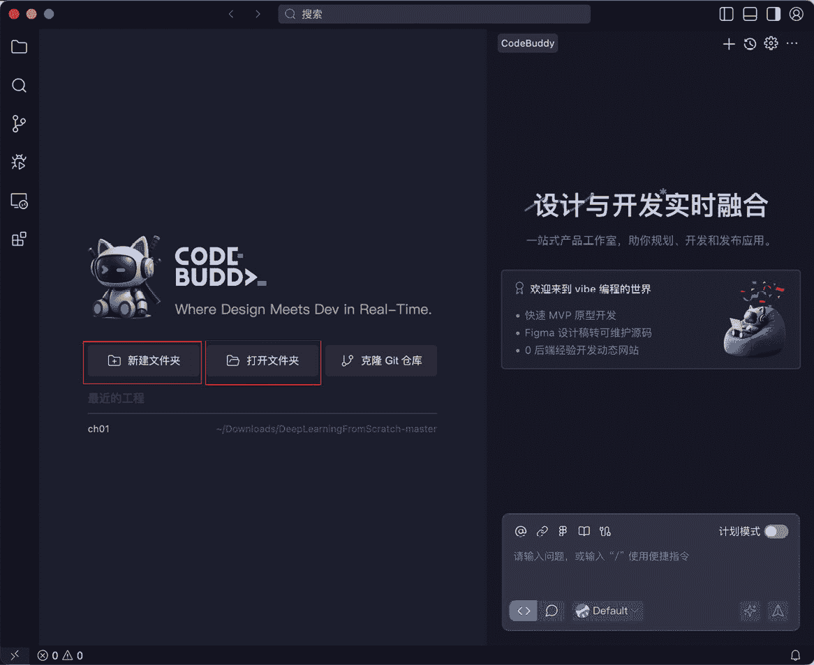

图 2-23 CodeBuddy 主界面

**2.3.2**

**CodeBuddy 工作区与项目导航**

进入项目后，左侧的资源管理器会成为用户操作最频繁的区域。它负责把当前工作目录以树形结构呈现出来，让开发者能清楚地看到源码、配置、文档、测试、脚本等文件的层级关系，也能以最少次数的单击完成常规文件操作。

资源管理器支持在树上直接新建文件、创建目录、重命名、删除、在系统中打开、复制路径等操作；对大型项目，可在顶部使用文件名过滤/搜索来快速定位；对拆成多个子仓、多个技术子域的项目，可以配置多个工作区，让前端、后端、公共组件、文档仓库同时出现在这一列中，省去来回切换 IDE 的麻烦。

与传统 IDE 不同的是，CodeBuddy 把“文件即上下文”的理念转化为了显式可操作的交互。选中一个文件或文件夹时，右键菜单中会出现“添加到聊天”“添加到上下文”等选项，单击之后，当前文件内容就会被挂载到右侧 AI 对话的这一轮请求中。随后在对话里说“帮我重构这个组件”“根据这个接口生成前端调用代码”“把这个配置转成英文注释”等，AI 就能真的看到说的“这个”，这也是 CodeBuddy 实现精准生成的关键机制。

**2.3.3**

**CodeBuddy 代码编辑区与 AI 辅助面板**

界面中部显示的是代码编辑区，这里提供所有主流 IDE 应有的编辑体验：多标签页并行、语法高亮、智能缩进、自动补全、代码折叠、多光标、格式化、分屏查看等。通过代码编辑区上方的轻量工具条可以直接运行脚本、启动调试、格式化当前文件，底部状态栏则展示当前语言模式、缩进宽度、文件编码、Git 分支、是否已保存等信息，便于开发者一眼确认当前工作状态。

真正有别于普通编辑器的是右侧的 AI 辅助面板。这个面板通常处于固定位置，随时可以展开或收起，且与当前打开的文件保持上下文关联。如图 2-24 所示，AI 辅助面板一般包含两种工作模式。

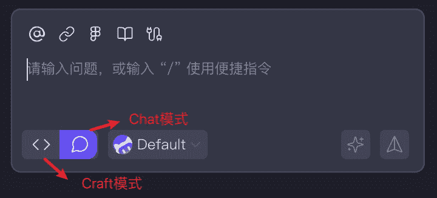

图 2-24 AI 辅助面板模式区分

（1）**Chat 模式。**Chat 模式偏向问答式交互，适合“解释这段代码”“把这段报错分析一下”“帮我把这个函数改成异步的”“把这个写成 Go 的版本”这类局部性需求。用户可以把代码选中再发送，也可以直接在输入框中引用资源管理器里的文件。

（2）**Craft 模式。**Craft 模式偏向任务分解和流程化生成，适合“做一个包含登录、列表、详情的管理后台”“做一个电商的商品页+购物车+订单页”这类需要生成多文件、多步骤的操作。它会先分析任务、产出一个计划，再逐步生成对应的代码文件，生成过程中还会自动创建检查点，便于后退。

AI 辅助面板顶部通常有模型选择器，可以在当前可用的大语言模型之间切换；模型不同，生成风格、标签、对上下文的利用效率也会不同。在输入框中输入“@”符号，可从弹出的菜单中选择需要引用的上下文对象，例如当前工作区变更、最近一次终端输出、某个规则文件、某条历史消息、某个具体文件或目录。这样一来，即便没有把所有内容都粘贴到对话里，AI 也能获取完成任务所需要的完整信息。

当 Craft 对当前文件做了改写时，代码编辑区会以差异视图高亮显示新增和删除的代码行，便于快速审阅；若对本次生成效果不满意，则可以切回上一检查点，撤销本次 AI 生成的改动，而不影响其他文件。

**2.3.4**

**CodeBuddy 调试与控制台**

编辑完成后，开发者通常需要执行运行、调试、查看日志等操作，这部分由界面下方的调试与控制台区域承载。如图 2-25 所示，这里一般会以标签页的形式并列“终端”“调试控制台”“问题”“输出”等视图，可以根据当前任务自由切换。

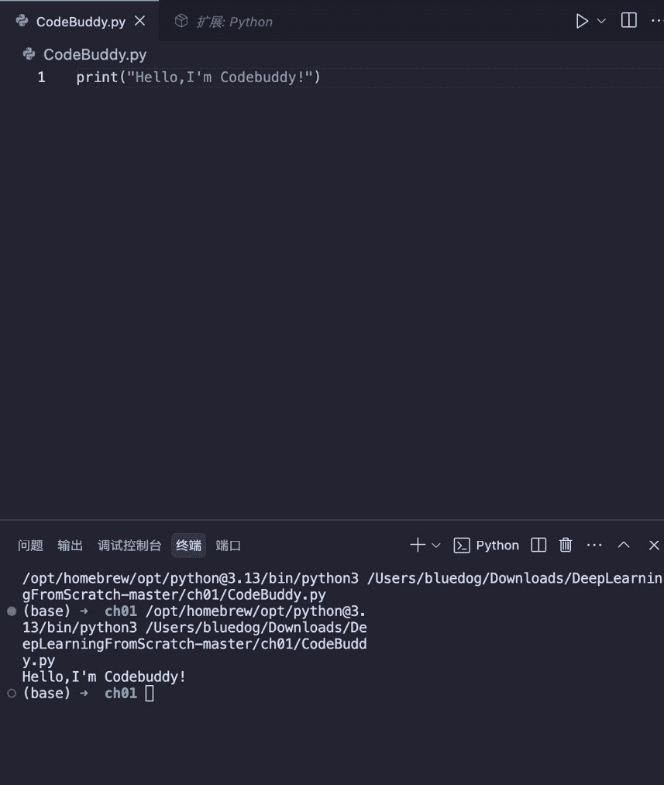

图 2-25 调试与控制台

断点调试的方式与主流 IDE 保持一致：在代码行号区单击即可设置断点，单击顶部调试按钮或使用快捷键启动调试会话，命中断点后，下方会展示调用栈、当前上下文变量、监视表达式、线程信息等，支持逐句执行、跳过、恢复执行等操作，也可设置条件断点或只在抛出异常时中断，适合排查只在特定输入下出现的问题。

嵌入式终端是这一区域的重要组件，它允许开发者在 IDE 内直接运行项目脚本或构建命令，也可以在这里运行与 CodeBuddy 配套的命令行工具，执行项目初始化、代码生成、触发部署等自动化操作。若遇到终端对命令没有响应、提示找不到 Shell 或输出为空等问题，可以在设置中启用集成 Shell，再重新打开终端，这通常能解决大多数环境差异问题。

终端输出、构建日志、运行时错误往往篇幅较长，手动复制到对话框不仅麻烦，也容易丢失行号等关键定位信息。为此，IDE 提供了“将终端输出添加到聊天/上下文”按钮，可将当前输出直接作为下一条 AI 对话的输入，随后就可让 AI 判断报错原因、生成修复补丁或生成一段适合写在提交说明里的错误描述。

在实际开发过程中，调试并不是终点。无论是个人开发还是团队协作，代码最终都需要进入一种可验证、可反馈的运行状态。基于这一需求，CodeBuddy 在调试能力之外，引入了面向“快速交付与验证”的运行与部署承载机制。也就是说，在典型工作流中，开发者可以在完成局部调试后，将当前工程一键部署至隔离的沙箱运行环境中。该环境用于承载生成结果的实际运行状态，避免对本地系统或生产环境造成影响。部署完成后，系统可生成一个可访问的运行入口，用于功能验证、界面检查或与产品、设计、测试人员进行协同确认。

这一能力在团队协作场景中尤为重要：开发者不再需要反复打包、传输或本地复现环境，只需将验证入口共享给相关角色，即可完成需求确认或问题反馈。由此，CodeBuddy 将传统“编码—调试”的闭环，扩展为“编码—运行—验证—反馈”的完整交付链路，使 IDE 不仅服务于开发阶段，也自然衔接到交付与评审环节。

**2.3.5**

**CodeBuddy 版本控制与历史记录**

开发过程中有两类“历史”需要管理：一类是代码本身的版本历史（通常由 Git 管理）；另一类是 AI 交互和生成过程的历史（由 IDE 管理）。如图 2-26 所示，CodeBuddy 在界面中把这两类历史都做了可视化。

代码版本方面，IDE 集成了 Git 视图，可以看到当前有哪些文件被改动、哪些已经暂存、当前处在哪个分支、最新一次提交是谁做的，也可以在这里直接写提交说明并推送到远程仓库。在需要撰写提交日志或合并请求说明时，可以把当前工作区的改动引用到对话中，让 AI 根据实际改动生成一段符合团队规范的说明文本，免去手动编写的烦琐。

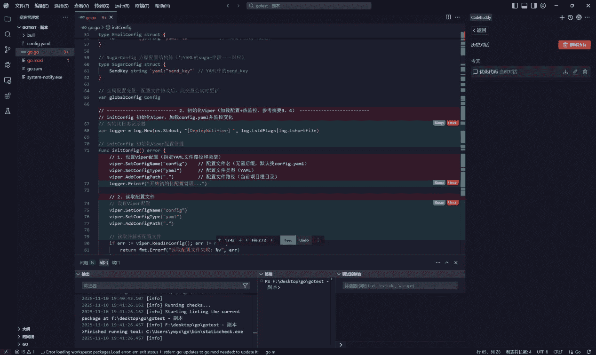

图 2-26 历史记录与检查点

AI 交互方面，特别是 Craft 模式下的一系列生成，会被自动分成一个个任务节点（可理解为检查点）。节点里包含了当时的对话上下文、生成目标以及代码改动。若某一次生成结果不符合预期，可以在历史列表中选中生成前的节点进行恢复；恢复可以是只恢复对话，也可以连同代码文件一并恢复，适合“AI 改得太多了，我想回去”的场景。

历史列表一般支持按时间排序，也可以按任务、按模型进行筛选和查看，必要时还可以删除无意义的中间记录，让项目保持干净的生成链路。

**2.3.6**

**CodeBuddy 工具栏与快捷命令**

最外层是用于提升操作效率的工具区，包含顶部工具栏、侧边快捷动作、输入框的上下文引用入口以及底部终端。

顶部工具栏集中放置几乎所有项目都会用到的操作，如代码格式化、全局搜索/替换、运行当前文件、启动调试、打开命令面板、显示/隐藏侧边栏等。其设计目的是减轻记忆快捷键的负担，让不熟悉 IDE 的用户也能通过直观的按钮完成关键操作。

侧边栏或右键菜单中提供的“添加到聊天”“引用上下文”等功能，是把界面内容转化为 AI 可识别上下文的最快路径。无论是在编辑区选中的一段代码、在终端看到的构建错误，还是在 Git 面板里看到的 diff 差异，都可以通过一键操作送到右侧 AI 面板，减少反复复制粘贴，也避免内容因为换行或编码被破坏。

对于偏好自动化流程的用户，底部终端里可以直接运行与 CodeBuddy 绑定的 CLI，用自然语言描述生成任务、用命令执行工程化步骤，再把输出交回 AI 解释或补全，从而实现“命令→输出→AI 解释→AI 再生成”的闭环。这一层级看似界面简单，但通过灵活组合，往往能获得极高的操作效率。

图 2-27 展示了 CodeBuddy 的常用快捷键，更多内容请读者结合实际操作进行学习和拓展，其与其他常用 IDE 基本类似。

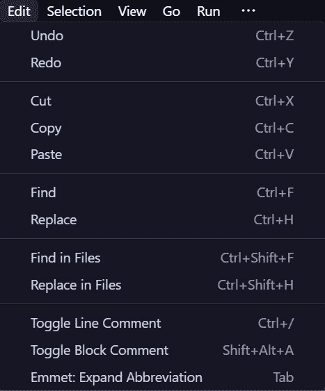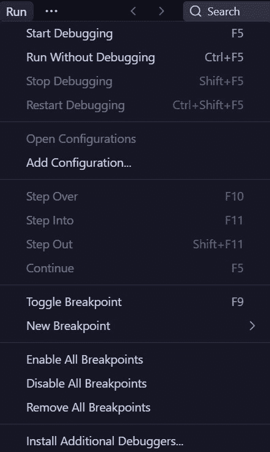

图 2-27 CodeBuddy 的常用快捷键

**2.3.7**

**自定义斜杠指令概览**

自定义斜杠指令（Slash Command）是在 CodeBuddy 智能开发平台中通过固定前缀“/”触发的快捷操作命令。如图 2-28 所示，在对话式交互环境下，开发者输入预定义的斜杠指令即可直接控制 CodeBuddy 执行特定功能，无须每次从零描述需求。引入斜杠指令旨在提供一种更加高效、标准的调用方式，将常用的开发流程和工作流抽象为简洁的一键命令，从而减少重复、低效的手动输入，让开发者能够专注于真正重要的创造性工作。

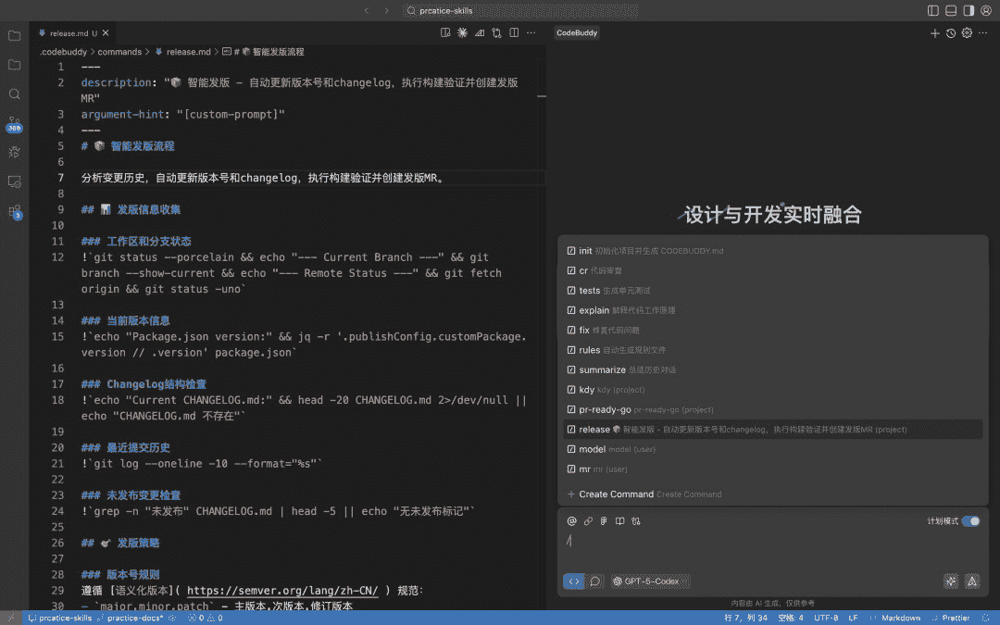

图 2-28 斜杠指令的应用

斜杠指令适用于专业开发者和普通用户等不同群体：对于经验丰富的程序员，它可以将复杂的工程操作序列封装成固定命令（如一键执行代码检查、测试、部署等），提高自动化程度；对于缺乏编程背景的使用者，也能借助预设命令方便地调用代码解释、示例生成等功能，降低使用 AI 编码助手的门槛。值得一提的是，斜杠指令的作用不仅限于生成自然语言回答，还可以在固定节点触发工具链中的自动化步骤，例如调用内置的 Skills 脚本、对接任务跟踪系统（如通过接口创建 TAPD 需求）、触发持续集成流水线等。目前，该能力在 CodeBuddy 桌面版 IDE、本地 IDE 插件以及云端开发环境（CodeBuddy Cloud）等全套产品形态中均已支持，确保无论本地还是远程环境下用户都能利用斜杠指令提升开发效率。

自定义斜杠指令在 CodeBuddy 中以 Markdown 文件（.md）形式组织，其本质都是 Prompt 提示词，和 Skills 一样存在 Frontmatter 元数据区。一个完整的斜杠指令通常由五部分组成，包括触发关键词（命令名称，以斜杠起始）、输入参数（可选的用户输入及其提示描述）、上下文拼装逻辑（如何从当前项目/会话提取所需信息拼入提示）、期望输出（对回答格式或内容的要求）以及后续动作（可选的自动化操作，例如将生成结果回填到代码中或提交代码审查）。通过这些模块化的配置，开发者可以将“与 AI 沟通的口头经验”沉淀为可执行的快捷命令。如图 2-29 所示，在 CodeBuddy IDE 中已经内置了一系列常用的斜杠指令（Built-in Slash Commands），例如/init（项目初始化）、/cr（代码审查）、/tests（单元测试生成）、/explain（代码解释）、/fix（代码修复）以及/summarize（对话总结）等。这些内置命令覆盖了典型的开发场景，充分体现了斜杠指令在智能开发流程中的应用价值。开发者还可以根据自身项目的特殊需求来自定义新的斜杠指令，将更多专属的 AI 能力无缝融入自己的工作流程中。

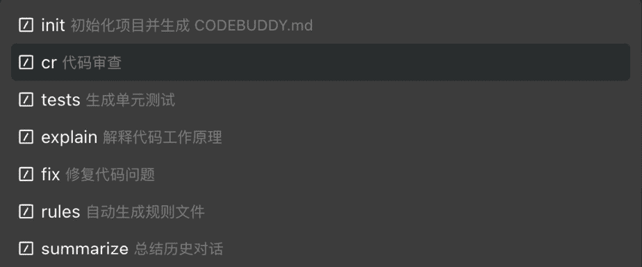

图 2-29 CodeBuddy IDE 内置的斜杠指令

## **2.4**

## **CodeBuddy 项目初始化与代码文件管理**

本节围绕“怎么把一个项目真正落到 IDE 里并且能被 AI 正确理解”来介绍。CodeBuddy 的特性是所有智能生成都依赖上下文，而上下文来自打开的项目、当前选中的文件、终端输出、Git 变更以及在对话里给出的规则。如果项目初始化环节做得不完整，即便 Craft 模式的生成能力再强，也容易出现“生成得很好但放错了目录”或“模型不知道这个项目用的是何种技术栈”等问题。因此，本节从创建/打开项目开始，一直到上下文管理、历史回溯和远程环境同步，把“项目落地”的完整流程讲透。

**2.4.1**

**创建/打开项目流程**

进入欢迎界面之后，最常见的入口是“新建文件夹”和“打开文件夹”。“新建文件夹”适合完全从零开始的场景，比如只想描述业务，让 AI 从空目录里一步步生成目录结构、组件、页面、接口；“打开文件夹”则适合已有项目，IDE 会直接把这个目录挂载成当前工作区，把里面的源码、配置、构建脚本全部识别出来。

如果项目托管在 Git 上，IDE 也支持先克隆后打开。操作方式通常是选择“克隆 Git 仓库”，输入仓库地址，IDE 会拉取代码到本地指定路径，然后自动以该路径作为当前工作区打开。这样可以保证项目目录结构与远端完全一致，后续在进行 Git 提交、对话引用、历史比较等操作时，不会出现本地目录结构混乱的情况。

完成项目创建或打开之后，IDE 会自动执行一轮基础初始化：读取根目录，检查是否存在 .gitignore 文件、语言依赖清单（如 package.json、requirements.txt、pom.xml 等）及项目配置文件。如果这些文件不存在，IDE 可以根据当前模式生成一套默认的配置，例如生成基础的 .gitignore 文件，避免后续把构建产物、虚拟环境、日志文件提交进版本库；也可以生成 .codebuddy 或类似的项目级配置，后面在对话里提到“按项目规则来”时，AI 就能找到定义的路径、命名风格、技术栈偏好。

这个阶段的核心是把“一个目录”升级成“一个可被 IDE 和 AI 共同理解的项目”。只有做到这一点，IDE 才能知道生成的文件应该放在哪一级目录、脚手架应该用什么语言版本、测试文件应该放在哪里、生成的接口是否要补到当前项目的路由表里。

**2.4.2**

**选择模式与多模型支持**

项目初始化完成后，右侧的对话区就可以开始工作了。CodeBuddy 默认提供两种工作模式：一种是 Chat 模式，即问一句答一句，适合“代码已经在这儿了，我只是想让改一下”或者“我有一个报错，帮我解释一下”等场景；另一种是 Craft 模式，它是专为复杂任务设计的，会把一个任务拆成多个步骤、按步骤落地成具体文件。

模式选择入口通常在对话框的顶部，可以随时切换。选了 Craft 模式，后面的交互就会变成“描述 → 规划 → 生成→ 回写→ 创建检查点”这一流程；选了 Chat 模式，输入内容仅作为普通对话来处理，不会自动改变目录结构。

模式选好之后，还可以选模型。CodeBuddy 支持在同一个界面里切换不同的 LLM，比如默认的混元模型、偏代码的模型、偏长文本规划的模型，甚至是已经在企业侧配置好的私有模型。不同模型在项目上下文理解、代码生成风格和规划文档的结构性上表现会不一样。写文档时最好说明这一点，让读的人知道“模型不是越大越好，关键是要与当前的任务相匹配”。

**2.4.3**

**对话与计划模式**

进入对话界面后，比较推荐的使用顺序是“模式 → 模型 → 描述需求”。也就是说，不要一上来就抛出一大段需求，而要先告诉 IDE 想走的是“规划式生成”还是“即时修改”路线，然后再说要做什么。

在计划模式（也就是 Craft 模式的规划路径）下，Agent 不会立即生成代码，而会先分析需求描述，生成一份结构化的计划或者 PRD（产品需求文档）。里面一般会包含以下内容：要做几个页面或几个模块、每个模块需要哪些接口、需要引用哪些组件库、是否需要登录鉴权、需要什么目录结构、构建工具用什么、语言版本是多少、有没有要接入的后端服务。这样做的好处是，可以在还没写一行代码的时候就看到“它准备怎么做”，并且可以在这个阶段做修改，比如把技术选型从 React 改成 Vue，把部署方式从本地改成云端，把鉴权从前端校验改成后端校验。

确认计划没问题后再点执行，系统才会开始生成文件。生成过程中，IDE 会往项目树里写文件、覆盖已有文件、补充测试用例，必要的话还会执行一次构建或测试来验证生成内容是否可以正常运行。对一些描述不够清晰的需求，还可以在生成过程中使用 Boost Prompt 功能，例如把刚刚那句“做一个运维面板”自动优化成一条更清晰、更适合 LLM 理解的提示词，从而让生成结果更贴近真实意图。

**2.4.4**

**Checkpoint 回滚与任务恢复**

自动生成的内容通常存在一个问题：生成结果可能不符合预期，甚至生成错误的文件。CodeBuddy 为 Craft 模式配备了一整套检查点机制，专门应对“我想回到刚才那一步”这样的场景。

在生成任务执行的每一个阶段，系统都会自动建一个检查点，把当前的文件状态、对话状态、任务状态都记录下来。对生成结果不满意时，可以直接点击对话面板里的恢复按钮，选择回滚到指定的检查点。回滚时 IDE 会弹出一个提示，告诉这次恢复会影响哪些文件、会撤销到哪个时间点，可以继续也可以取消。这样能避免误操作直接把整页都恢复。

有一些生成任务是多步骤的，比如，先生成页面，再生成接口，最后生成单元测试，中间如果断网或手动停掉了，也不用从头再重复一遍。对话面板里通常会有一个 Resume Task 或 Continue 的入口，点击后 Agent 会按原计划继续执行，它知道自己做到哪一步了，也知道后面还有哪几步要做。

**2.4.5**

**上下文管理与引用**

CodeBuddy 的生成质量高度依赖上下文的准确性，所以它围绕“将信息注入上下文”设计了多种入口，支持图片、代码、终端错误、文件、目录、Git 改动、规则、历史消息等多种类型的上下文信息。

最简单的是直接粘贴。截取一张报错图、抓取一段接口定义、从其他文档里复制一段 JSON 内容，然后按 Ctrl+V 组合键，CodeBuddy 就会将其当成这轮对话的输入。对于代码，开发者可以在编辑器里选中一段，然后单击“Add To Chat”按钮，CodeBuddy 就会把当前文件的这部分内容“带”过去。对于整个文件或整个目录，可以在资源管理器里右键单击“Add file to CodeBuddy”或者“Add folder to CodeBuddy”，这一类操作非常适合“将该目录作为业务核心，所有生成都参考此目录结构”的场景。

在输入框里输入“@”，系统会弹出一个引用菜单，里面会列出刚才添加过的所有上下文，包括问题提示、终端日志、Git 提交、规则文件、历史对话消息等，如图 2-30 所示。开发者想让模型参考哪一条，就选择哪一条。这样做的好处：不用每次都粘贴完整内容，也不用把终端里的一大串错误再手抄一遍，直接引用即可，模型仍能准确理解并运用这些上下文。

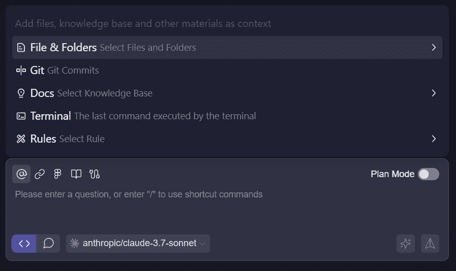

图 2-30 CodeBuddy 上下文管理与引用功能

**2.4.6**

**远程开发与环境配置**

企业开发场景中，代码往往并非在本机运行，而是部署在公司内网的 Linux 服务器、云主机或容器环境中。CodeBuddy 提供了远程开发能力，可以通过 SSH 连接远程机器，把远程的文件系统当成本地工作区来编辑、调试和运行。

配置流程：先生成 SSH 密钥对，将公钥添加至远程服务器的~/.ssh/authorized_keys 文件中，在 IDE 的远程开发面板中填好主机地址、端口、用户名、私钥路径，连接成功之后，左侧资源管理器就会展示远程主机的目录结构。在该模式下，编辑文件其实修改的是远程文件，终端里执行的命令也运行在远程环境中，这样既能充分利用远程环境已有的依赖、数据库、网络访问权限，又不需要在本地重复安装与服务器一致的环境组件。

远程开发模式下，同样可以把终端输出、远程日志、远程目录里的文件添加到聊天上下文里，AI 也能识别与运用。只不过在这种场景下，更要注意网络与安全策略，例如要通过企业代理访问、使用固定端口通信、限制可访问域名等，IDE 一般都会给出相应的配置项。

**2.4.7**

**版本检查与环境同步**

最后一个环节，是确保本地环境、远程环境、团队环境之间的一致性。CodeBuddy 在项目中维护的配置文件（如.codebuddy）可以写明语言版本、包管理器、构建工具、镜像源地址、代理设置、模型启用等规则，这些内容可以作为 AI 的“项目级规则”被发送到对话里，让生成的代码天然符合这个项目的运行环境。

在正式提交代码之前，可以让 IDE 做一次环境和依赖的检查：对比本地的 requirements.txt 或 package-lock.json 和项目配置里写的版本范围，看有没有不一致的地方；如果要部署到远程，还可以让它自动生成一份清单脚本，如 pip install -r requirements.txt 或 npm ci，便于在 CI/CD 流程中运行，保证远程环境和本地环境一致。

团队协作时，建议将.codebuddy 等 IDE 配置文件纳入版本管理，并明确是由 IDE/AI 来识别和使用的。这样，新成员在拉取代码并启动 CodeBuddy 后，便能立即获悉该项目所需的 Node 版本、Python 版本，以及是否需从私有源安装依赖包。无须额外询问，生成代码时也不会出现“代码在本地可运行，到 CI 环境就不行”的情况。

## **2.5**

## **CodeBuddy 的基础用法**

前面几节中，我们更多地在讲环境配置、界面操作、项目落地，本节聚焦 CodeBuddy 的基础用法，探讨在日常开发中，如何让 CodeBuddy 变成我们真正的 AI 编程伙伴，例如怎么写让它听得懂、怎么让自动补全更贴近当前文件、怎么让终端报错一键变成 AI 的输入、怎么让规则和知识库参与进来，以及在多人协作时怎么保持风格一致。

**2.5.1**

**代码补全与 Prompt 技巧**

CodeBuddy 的自动补全并不是孤立的“猜下一行”，而是建立在“当前编写的语言+当前文件已有的内容+项目已有的结构+用户的需求”之上的。如果想要补全得准，就要让模型获取到足够多的信息。

最直接的做法是先把要操作的文件打开，让它处于编辑区的前台，然后在对话框里输入“在这个函数下面帮我加一个批量导入的接口”这样的描述。打开文件的同时，在输入框中用“@”引用这份文件，模型就可以读取这份文件的内容，不需要把全部源码粘贴进去；如果还涉及接口定义、常量、枚举、DTO 等关联内容，那么可通过“Add to Chat”功能把这些文件也放入资源管理器，从而形成一组关联上下文。随后再让模型生成，就会明显地按照现有的命名和结构来写，而不是凭空生成一个和项目不搭的名字。

命名本身也会影响补全质量，尽量不要用 foo、temp、data1 这类没有语义的名字。模型通过分析现有代码的命名模式和约定来理解业务领域，如果给的是 importUserFromSAP、syncOrderToWMS、fetchAlarmStatistics 这类含有业务意义的名字，它就能据此继续往下写与之相关的异常处理、日志、权限校验、参数校验等代码；但如果仅用 handle()、process()等模糊命名，它就只能给出一个非常通用的补全。换句话说，先把自己的代码写得语义清楚，AI 补全才会明确清晰。

还可以在补全之前先让模型“看一眼”已有的代码结构。如图 2-31 所示，在对话框中先说“我当前项目是分层架构，controller 里只做参数校验和调用 service，service 里做业务逻辑，dao 里做数据库访问，帮我在这个 controller 里加一个查询接口，其他层的代码请自动补齐”，这样生成的内容就是三层对应的，而不是全堆到一个函数里。

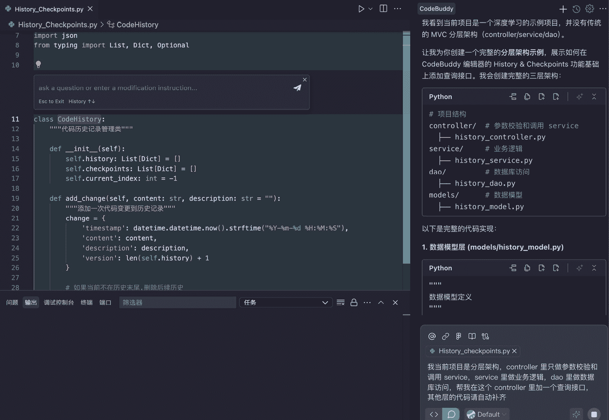

图 2-31 Prompt 与上下文

在实践中，针对复杂任务编写出的高质量 Prompt 往往具有复用价值。为了避免在不同场景下反复输入同样的提示信息，我们可以将这些经过验证的 Prompt 固化为自定义斜杠指令，将其以固定的命令形式提供给开发者使用。将提示模板、输入参数和上下文引用逻辑写入指令配置，这样就可以显著降低交互过程中的随机性，让模型在相同场景下持续输出结构化、稳定且符合预期的结果。随着项目的推进，这些指令能够随代码版本一并迭代，逐步形成贴合团队工程习惯的标准化提示体系，从而使常用功能沉淀为可共享、可维护的工程资产。

**2.5.2**

**功能快捷键与操作技巧**

要把 CodeBuddy IDE 当成主力工具来用，熟练掌握其快捷键是重要一环。CodeBuddy 的编辑区基本沿用了常见的快捷键方案，可以满足用户几乎零成本的迁移需求。最常用的快捷键是 Tab 和 Ctrl+Space，前者可以接受当前智能补全建议，后者可以手动触发补全列表。如果觉得当前光标处给出的建议不够，可以先选中更大一段代码，或者先把依赖的文件加到上下文中，再按 Ctrl+Space 组合键触发一次，模型就会基于新的上下文给出更合适的补全。注释与反注释可以用 Ctrl+/组合键来回切换，此操作适用于临时屏蔽一段代码或者向 AI 表明“此段代码为本人所编写，以下部分为后续你需要协助编写内容”。此外，全局搜索可使用 Ctrl+Shift+F 组合键，格式化操作则可通过按下 Alt+Shift+F 组合键实现，这些均属于较为通用的 IDE 操作。

终端的快捷键打开方式也需要记住。例如，按 Ctrl+`（反引号）组合键，可以调出底部终端面板，用来执行构建、测试，以及运行 CLI。终端支持多标签，可以拆成两列，一列用来执行服务，另一列用来查看日志。遇到问题时，直接在终端选中“报错”并单击“添加到聊天”，就能把这段报错同步给右侧的 AI 助手，这样不仅比复制粘贴省事，还不会损失颜色和格式。

还有一个容易被忽略的入口是命令面板（Command Palette），对应的快捷键为 Ctrl+Shift+P。对于一些不太常用但必要的操作，如切换模型、刷新上下文、打开远程连接配置、查看已添加的规则，都可以直接在命令面板里搜索关键字来执行。刚上手的用户，应多用命令面板，先以“能搜到”为主，不必去记所有菜单在哪里。

文件和组件的快速创建也可以依赖侧边栏或右键菜单完成。例如，在某个目录上右键单击，从弹出的快捷菜单中选择“New Component from AI”或“Create file and fill by AI”，IDE 会直接创建新文件，然后把文件路径、目录层级、当前规则都加入一条对话里，让模型生成一份和当前目录风格一致的内容，省去了“手动建文件，打开文件，粘贴指令”这几步操作。

**2.5.3**

**代码解释与调试支持**

CodeBuddy 的另一个高频用途是“帮我看懂这段代码”。无论是接手别人写的老项目，还是从 Git 仓里拉下来的一段黑盒逻辑，都可以直接选中代码，发给右侧的 AI 助手，让它用中文解释函数的用途、参数含义、返回结构及边界处理逻辑。因为前面已经说明了如何把文件作为上下文传进去，所以解释出来的文字能引用当前项目里已有的类型定义和命名，而不是泛泛地说“这个方法是处理数据的”。

遇到运行时错误，则可以把错误堆栈、终端输出、后端接口报错一起粘贴至对话框中，或者一键“添加终端输出到聊天”，让模型去定位问题。因为 CodeBuddy IDE 知道这条错误是刚刚从终端出来的，也知道当前打开的是哪个项目、是哪个语言，所以模型能更准确地判断这是依赖没装、版本不兼容、网络访问失败，还是代码逻辑本身有 bug。很多时候它还能直接给出“请在某某文件第×行将某某调用改成 await”“请在 package.json 里加上这一条依赖”“请把连接字符串改为环境变量”这种操作性比较强的建议。

在调试过程中，如果已经打了断点、看到了变量的实时值，但仍然不清楚为什么会这样，也可以把当前变量的值、当前调用栈复制到对话里，要求 AI“用业务语言解释当前执行路径”或者“帮我推断这里应该返回什么”。这比单纯看调试面板要快，尤其是面对一个分支很多、嵌套很多的业务函数时。

此外，如图 2-32 所示，可借助 CodeBuddy 辅助代码解释与调试，要求它“为这段逻辑生成临时日志，日志要包含时间戳、当前用户 ID、接口名，方便排查问题”，它就会生成一段插在关键路径里的日志代码。等问题解决后，再让它“把这些日志删掉”，它就能自动删除刚才添加的日志行。

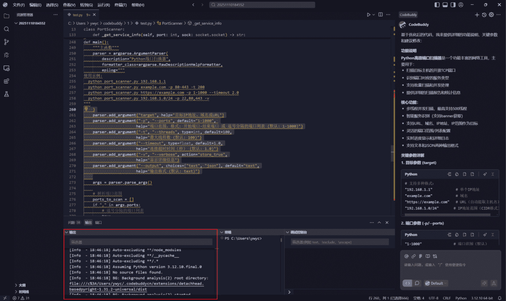

图 2-32 代码解释与调试

**2.5.4**

**文档、规则与知识库联动**

CodeBuddy 不仅能够查看代码，还能对代码编写方法进行审查。这一功能的实现需要同时依赖文档、规则与知识库，如图 2-33 所示。

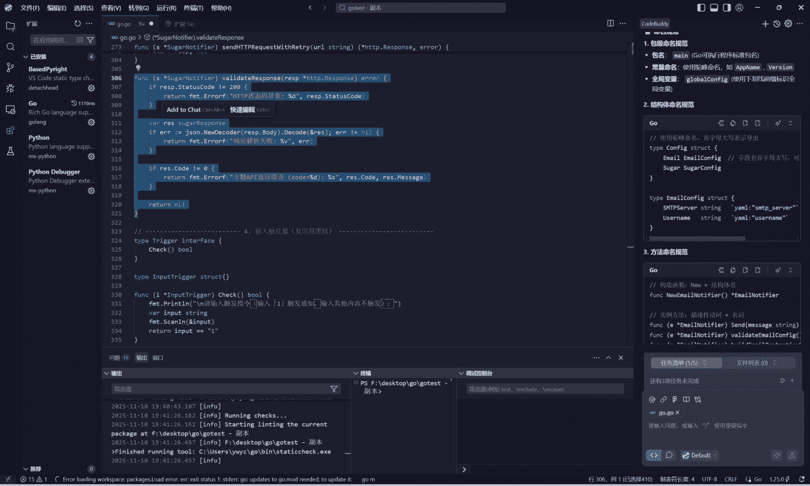

图 2-33 规则和知识文档联动

规则可以分为用户级和项目级两类。用户级的规则适合写个人的编码偏好，比如“我写前端一律用驼峰命名”“我不用 var，只用 const/let”“我的所有类名都要加前缀 Xs-”。项目级的规则适合写团队共识，比如“这个项目采用后端渲染，不要生成前端路由”“这个项目的所有接口都要带租户 ID”“这个项目的国际化要用我们自带的封装方法”。只要把规则写至 IDE 规定的位置，它就会在每次对话时自动发给模型，随后模型就会按照这套规则生成，而不需要每条都发一遍。

知识库可以看成“为 AI 准备的专属项目文档夹”。如果项目包含接口说明、第三方平台的回调文档及公司内部的业务规范，那么可以把这些文档以支持的格式导入，然后在对话里用“@”进行引用。例如，“帮我写支付回调的处理逻辑，参考我们内部支付文档”，AI 能够参考文档中定义的字段、签名方式和验签流程，生成更符合规范的代码。对于需要对照行业标准、国标、接口协议写代码的场景，这种做法会比仅依靠自然语言生成可靠得多。

为了防止模型“忘记约定”，建议将关键规则做成独立的规则文件并长期挂载，比如“所有 API 错误码都用统一枚举类”“所有异常都要记录日志并向用户提供友好提示”“所有 SQL 查询都必须指定字段，禁止使用 SELECT *”。写完规则之后，启用一次 Chat 让模型复述规则内容，确认它读到了，再开始生成正式代码。

**2.5.5**

**高效协同工作流**

当多人使用 CodeBuddy 开发同一个项目时，要考虑“前面的人生成的内容，后面的人能不能看懂、能不能接着生成、能不能回溯”。这时推荐使用团队协作流程：首先由核心成员使用 Craft 模式生成项目基础架构，创建完整的项目骨架和检查点，把目录、组件库选择、后端服务集成、基本页面、登录和权限等一次性做出来，同时让 IDE 自动生成检查点；其次把这一批对话和检查点保留在历史记录里。后续成员加入后，先打开历史记录，找到“初始化后台管理系统”这条记录，查看当时的需求描述和 AI 的计划，再在这个上下文里输入“我要多加一个报表页”“我要把用户管理拆成用户+角色+菜单”——这样就能使生成的代码和前面的代码保持风格一致。

多人开发时，大家还可以借助远程开发环境，所有人在同一台云服务器或公司内网机器上运行项目，本地机器仅负责编辑与交互。如此一来，所有人使用的依赖版本、数据库地址、内网接口完全一致，从而避免了“这儿能运行，那儿不能运行”的兼容问题。配合前面讲的环境同步工具，把 requirements.txt、package-lock.json、codebuddy 等相关文件都纳入版本库，AI 就可以在任何一台机器上打开项目，而且读到的都是同一套规则。

规则文件和知识库在协作中也十分重要。可以约定，只要团队中有人新增一条规则——比如“从今日起所有接口必须添加签名校验”，就将其纳入项目规则。如此一来，后续无论谁让 AI 生成接口代码，输出内容都会自动包含这一步骤，无须再依赖人工记忆反复提醒。再结合聊天历史的导出/共享功能，就能实现“这条对话就是我们这个模块的迭代说明”，让其他人一目了然。

**2.5.6**

**通过向导创建项目级指令**

在 CodeBuddy IDE 中，可通过内置向导快速创建面向当前项目的自定义斜杠指令，无须手工编写配置文件。当用户在对话框中输入“/”时，系统将展示可用指令列表，其中的“Create Command”可用于新建项目级指令。选择该项后，可为指令指定名称作为触发关键词，例如，输入“daily-report”即表示未来可通过“/daily-report”运行该指令。确认名称后，IDE 会生成对应的命令模板文件并打开编辑界面，可供用户在其中编写具体的提示语模板、参数占位符以及相关上下文引用逻辑。

通过向导创建的指令会自动绑定到当前项目，使其能够直接访问当前仓库的代码、提交记录以及工作目录中的内容，从而支持更精确的上下文推断。例如，用户可以在模板中引用当日的 Git 提交摘要、代码变更统计结果或项目文档内容，将其用于生成结构化的日报或周报。保存配置后，指令即可立即生效，用户在对话框中输入相应的斜杠指令便可触发执行流程。这种方式适用于个人在项目中快速构建专属自动化命令，尤其适合需要高频重复执行的任务，如生成测试说明、梳理提交内容、格式化输出文档等。

项目级别（.codebuddy/commands）快捷指令的配置方法：在 IDE 中可以通过快捷指令配置，具体步骤如下。

（1）输入“/”，单击“Create Command”，实现该指令的调用，如图 2-34 所示。

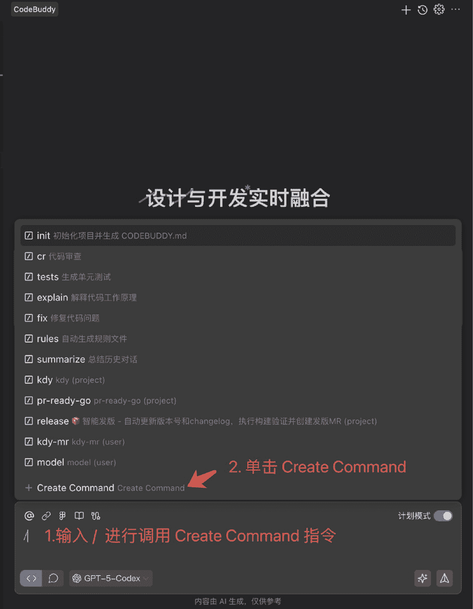

图 2-34 在对话框中调用 Create Command 指令

（2）自定义指令名称，比如设置为“kdy-report”，如图 2-35 所示。

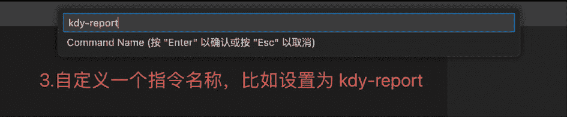

图 2-35 自定义指令名称

（3）配置自定义指令 md 文件内容，并在对话框中调用该指令，实现一键触发生成，如图 2-36 所示。

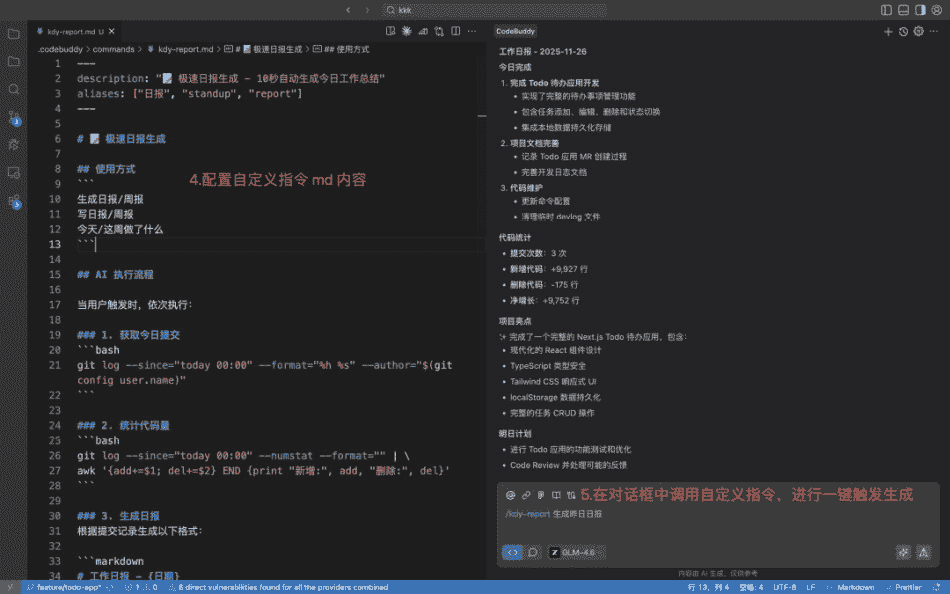

图 2-36 调用自定义指令

**2.5.7**

**配置文件管理团队共享指令**

在团队协作环境中，自定义斜杠指令通常需要以结构化配置文件的方式统一管理，以便在版本控制系统中实现共享，确保所有成员能使用同一套标准化提示模板。CodeBuddy 支持在项目根目录下的.codebuddy/commands 路径中定义指令文件，文件格式一般为 Markdown 搭配 YAML 元数据头部。YAML 区域用于声明指令的基本属性，包括描述信息、参数提示、可调用工具权限等；正文部分则编写具体的提示模板，包括固定文本、上下文引用和可由用户补充的参数占位符。

通过将指令文件纳入代码仓库管理，团队可以在代码版本演进的同时维护指令模板的迭代，确保成员在不同开发阶段始终基于一致的提示结构与输出规范进行协作。例如，代码审查指令可以预设输出格式，包括问题列表、风险描述与修改建议等；需求分析或文档生成指令可以规定统一的章节结构，提高内容产出的规范性与可读性。团队成员拉取项目代码后，IDE 会自动加载指令配置文件，使其无须额外设置即可使用同样的斜杠指令，从而实现经验沉淀与流程标准化。通过这种方式，常用 Prompt 能够被持续优化、版本化和共享，逐步形成贴合团队业务特性与质量要求的 AI 协作体系。

用户级别（~/.codebuddy/commands）文件的配置方法：找到计算机上的用户配置路径（一般是/Users/自己的用户名/.codebuddy/commands 目录），然后把 2.5.6 节中生成的 md 文件放入该目录或者新建文件，重启 IDE 即可生效。

## **2.6**

## **CodeBuddy 多语言支持与插件扩展机制**

本节将介绍 CodeBuddy 如何在一个工作区中同时处理前端、后端、脚本和 SQL 任务，以及如何以插件形式嵌入不同的集成开发环境（IDE）中，还将探讨企业如何将自己的服务、规则和工具集成进来，并确保大语言模型能够安全地访问与使用这些资源。

**2.6.1**

**CodeBuddy 语言解析与支持范围**

CodeBuddy 的语言处理能力并非依赖简单的“文件扩展名识别”，而是基于语法层面的深度解析。打开.py、.ts、.java、.go 等文件时，IDE 会自动按照对应语言的语法规则构建抽象语法树（AST），识别出类、函数、方法、变量、注释、导入依赖等代码结构，再将这些结构传递给补全、跳转、重构、AI 生成等功能链路。这样，当用户提出诸如“在这个类下面再加一个查询方法”“把这个 controller 拆成 service+repository”“按这个 SQL 的字段生成一段 ORM 实体”等要求时，模型能够准确理解并插入正确的位置，而不是简单地在文件末尾“贴上一段”。

CodeBuddy 当前支持诸如 C/C++、Java、Python、JavaScript/TypeScript、Go、PHP、SQL、Kotlin、C#等主流编程语言。常见的前端工程（TS+JSX/TSX）、后端工程（Java/Spring、Go、Python/FastAPI、Node/Koa）、脚本（Python、Node）、数据处理（SQL）都可以在同一个工作区里打开。IDE 会根据文件类型自动切换语法高亮、自动补全词典、调试配置模板，无须用户手动来回设定，如图 2-37 所示。

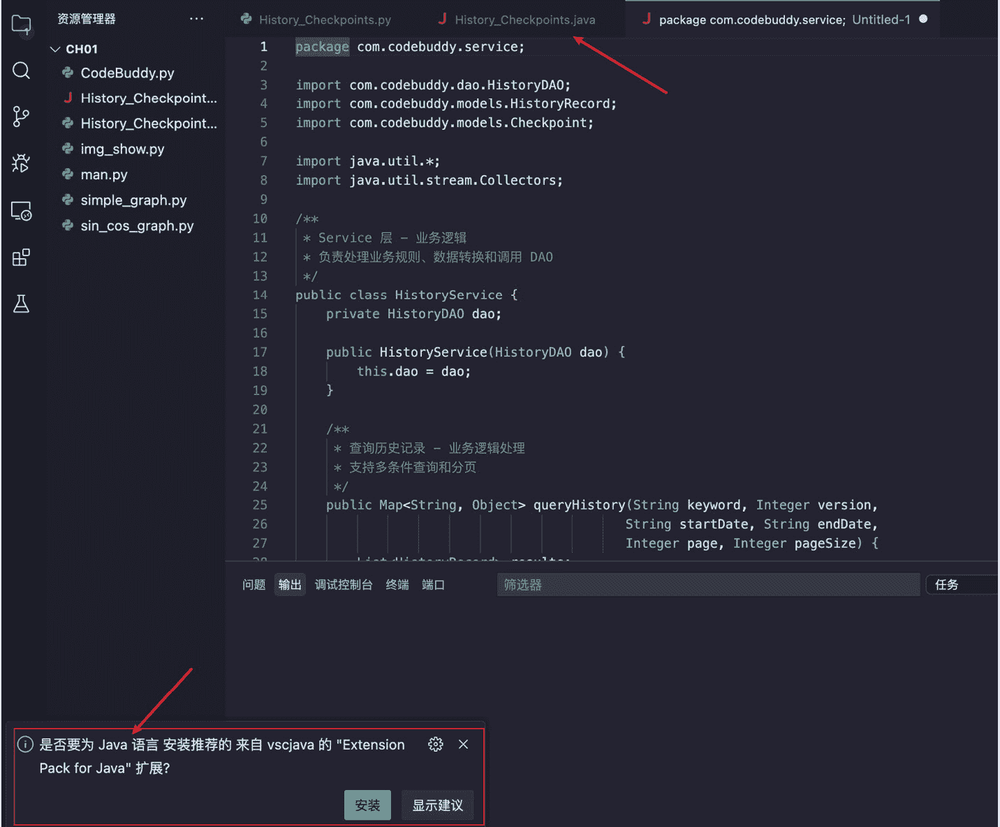

图 2-37 语言解析支持

多语言项目是开发中的重点场景之一。不少前后端一体的仓库、BFF 项目、单体拆分中的过渡仓库，往往同时包含 src/frontend 与 src/server 目录，甚至还包含数据库脚本。CodeBuddy 在这种场景下不会强行要求打开两个 IDE，而是支持在同一工作区中实现统一查看、统一生成与统一对话。当你在对话框里输入“由于这个接口要给前端用，所以帮我把前端也补上”，模型会自动识别当前仓库中存在的前端目录以及所使用的 Vue/TDesign 或 React/MUI 技术栈，从而精准生成正确的组件代码和调用逻辑。

当这一层构建得足够完善时，跨语言的跳转与重构才有真正的价值。例如，后端定义的接口，前端调用代码时能通过智能提示直接获取参数的名称与类型。又如，在对话框中输入“把这个查询写成 SQL，同时生成对应的 Go 实体和 CRUD 代码”这类描述时，AI 能准确按语言类型输出，而非将所有内容都当作普通文本处理。

**2.6.2**

**CodeBuddy 插件管理与市场**

CodeBuddy 拥有自身的 IDE，但并不排斥以插件形式融入现有开发环境——官方为此同时提供了 VS Code 插件、JetBrains 系列插件等多种形态。背后的逻辑很现实：很多团队早已形成固定的 IDE 选型及配套工具链，不可能为了使用 AI 编程就彻底迁移到另一套 IDE，将“AI 能力”封装为插件，便成了最轻量的解决方案。

CodeBuddy 采用模块化设计，将本体与 AI 协同模块分离——既可以仅启用对话面板，而不加载特定集成功能；也能在特定工作区关闭远程部署相关扩展，以免对日常代码编写性能造成影响。

插件市场的存在，更意味着后续功能可以按照增量方式交付。例如，官方新推出的“自动将日志转换为结构化输出扩展”或者“识别终端报错并自动生成 GitHub Issue 扩展”，可使用户无须升级整个 IDE，只需在插件面板中搜索、安装并启用即可，如图 2-38 所示。这种分发模式更契合企业内部的版本控制需求——基础 IDE 固定在稳定版本，AI 功能则通过插件按需交付。

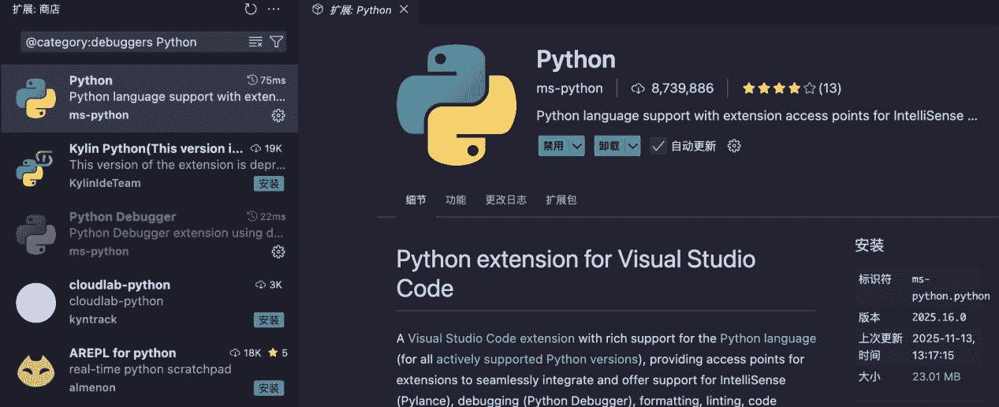

图 2-38 插件管理与市场

**2.6.3**

**CodeBuddy 官方扩展与企业级扩展**

官方扩展主要解决两个问题：一是让前端生成更贴合现成的组件库；二是让后端能直接连到云服务，不需要用户自己去找 SDK、配置环境。例如，界面组件库扩展中会内置 TDesign、MUI、Shadcn 这些主流的 UI 方案，用户在 Craft 模式里说“做一个用户管理页，表格要有筛选和分页，按钮风格用我们现在这套”，扩展就会自动用对应库的语法、类名和布局写出来，避免生成一个“看起来能用但跟项目 UI 不一样”的页面。

后端服务集成扩展就更偏工程化。CodeBuddy 文档里提到的 Supabase、Tencent CloudBase、Pages 之类的服务，都是通过扩展的方式集成进来的。在集成面板里点一下某个服务，填好凭据，它就能自动创建云环境、生成数据库表、生成初始接口、生成认证逻辑，再把这些配置写回到项目目录里。这样前后端的生成就能同步起来：前端拿到的是这个服务的真实接口，后端对应的是云端实际存在的表和函数。

企业级扩展和官方扩展的区别在于所有权和安全边界。企业可能想要接入的是自己的 CI 平台、自己的流水线、自己的审批系统、自己的代码扫描器，这些服务通常不对外公开，也不能直接把凭据写进 AI 的对话，就需要通过扩展的方式把“怎么调用、调什么接口、需要什么 token”封装好，再暴露给 IDE。开发者在 IDE 里点一下“提交代码扫描”，IDE 实际上去调的是企业内部的服务，AI 只是知道“有这样一个动作可以调”，但并不会拿到企业的密钥。

如果企业内部有自己的小工具，比如自动生成文档、自动生成数据库迁移、自动生成压测脚本，也都可以通过扩展接进来。IDE 把这些扩展当成“可以被调用的动作”，AI 在生成任务时就能说“下一步执行某某扩展”，实现流程自动化。

**2.6.4**

**Subagent：面向多智能体协作的能力扩展**

随着项目规模扩大和任务复杂度提升，单一对话式 AI 助手在上下文管理、职责边界和任务并行性方面逐渐显现出局限。为此，CodeBuddy 引入了 Subagent 机制，用于构建具备明确职责划分的多智能体协作模型。

Subagent 可以理解为“具备专用角色定义的 AI 助手实例”。每个 Subagent 可以独立配置其 System Prompt、可调用的工具以及可访问的 MCP 服务，从而专注于特定类型的任务，例如代码审查、测试生成、文档整理或构建脚本维护等。与主会话不同，Subagent 拥有独立的上下文空间，其对话和生成结果不会污染主对话的语义状态，有助于在复杂工程中保持上下文清晰。

在运行模式上，Subagent 支持两种典型方式：其一，Agentic 模式，即 Subagent 可在授权范围内自主调用工具并推进任务执行，适用于需要多步推理或自动化处理的场景；其二，Manual 模式，即 Subagent 仅在显式指令触发时运行，用于替代人工执行某一固定职责，适合受控环境或高风险操作。

在作用域管理方面，Subagent 支持项目级与用户级两种配置方式。项目级 Subagent 通常存放于项目目录下的.codebuddy/agents/路径中，用于固化团队共用的角色定义；用户级 Subagent 则存放于用户主目录的 ~/.codebuddy/agents/ 下，用于个人效率增强。这种分层设计既保证了团队一致性，又保留了个人定制空间。

从工程实践角度看，Subagent 的引入使得 CodeBuddy 能够以更低成本承载原本分散在脚本、CLI 工具或外部智能体系统中的能力，并将其统一纳入 IDE 的交互与审计体系中。这一机制为多 Agent 并行协作提供了结构化基础，也是 AI Native 开发模式的重要组成部分。

## **2.7**

## **本章小结**

本章围绕 CodeBuddy IDE 的实际落地部署与初始使用，构建了从平台形态确认到工程化应用的完整路径。首先，在平台版本与安装部分，对独立版、插件版和 CLI 这 3 种承载方式进行了划分，明确了它们在开发场景、工具链耦合度与运行环境上的差异，并给出了面向不同操作系统和处理器架构的获取与安装步骤，为后续使用建立了统一的起点。其次，在运行环境与依赖配置中，对网络连通性、账号初始化、本地语言运行环境等必要条件进行了列举，确保智能生成、上下文分析等能力能够稳定运行。在用户界面与主要功能区的说明部分，通过对导航区、代码编辑区、AI 辅助区及终端/输出区的分区阐述，确立了本书后续章节将反复使用的界面认知框架，以期让读者能在同一操作视角下理解不同功能模块的作用。

在工程层面，本章通过项目初始化与代码文件管理的内容，将 CodeBuddy 的对话式能力与实际项目结构对接，给出了从创建工程、纳入既有文件到组织目录与依赖的基本方法，为后续多轮生成与增量开发提供了结构化载体。在基础用法部分，本章强调了以自然语言驱动代码生成、以上下文补充确保生成结果与现有工程一致、以 AI 迭代完善功能的操作路径，形成了“描述—生成—验证—修正”的基本工作闭环。在多语言支持与插件扩展部分，则说明了如何将 CodeBuddy 能力向现有 IDE、不同语言栈和自动化场景拓展，使本章的安装与配置成果能够被更多开发形态复用。

读者在掌握本章内容后，应具备在本机快速上手 CodeBuddy、在既有项目中引入 AI 辅助，并能根据实际工具链选择合适承载方式的能力，可直接进入后续章节的专题实践。

# **第三章**

# **Hello AI World：CodeBuddy 初体验实战**

本章基于前两章完成的 CodeBuddy 环境安装及基本操作认知，首次带领读者完整走完“从需求到可运行应用”的开发全流程。我们选取结构清晰、规模适中的 ToDo List（任务管理清单）作为演示示例，将需求拆解为页面结构、样式布局和交互逻辑三个核心层面，逐步演示如何通过自然语言提示词，引导 CodeBuddy 生成并改写 HTML、CSS 及 JavaScript 代码，并在独立版 CodeBuddy IDE 中完成运行调试与效果验证。基于 CodeBuddy 2.0，本章不会囿于“AI 辅助编写代码”的展示体验，更希望呈现一种简化版的“AIAgent 参与软件交付流程”的实践——由自然语言触发任务，由系统生成方案并推进执行，由开发者完成校验与调整。

## **3.1**

## **任务管理清单与基础知识概览**

本节以 ToDo List（任务管理清单）应用为入口，对本章将反复用到的几个关键要素做一次整体梳理：一是交代案例所处的业务场景与教学价值，二是拆解其内部功能模块，并将这些模块与增删改查（CRUD）操作以及 HTML / CSS / JavaScript 基础能力对应起来。通过这层铺垫，读者在进入后续实战步骤前，可以先对“要做什么”和“要用到哪些能力”形成一个清晰的任务模型。

**3.1.1**

**ToDo List 场景与教学价值**

ToDo List 应用是前端开发入门阶段经典且常见的实践案例。本书选择该场景作为本章的实战载体，旨在通过一个规模小巧但结构完整的项目，让读者在可控的复杂度内完整体验从界面搭建到功能实现的开发流程，并直观感受 CodeBuddy AI 助手在实际编码过程中的辅助价值。选择 ToDo List 场景作为教学案例，其价值主要体现在以下几个方面。

（1）**需求明确**。待办事项应用的目标和功能非常清晰——添加任务、展示列表、更新状态、删除任务等，初学者容易理解项目需求，无须涉猎复杂的业务背景。

（2）**覆盖核心**。该案例虽然规模小巧，却涵盖了前端开发的关键基础。通过实现 ToDo List，可实践 HTML 页面结构搭建、CSS 样式应用，以及 JavaScript 的事件处理、DOM 操作和数据管理等核心技能，实现对“增、删、改、查”等典型功能的完整演练。

（3）**难度适中**。项目功能单一且模块独立，可控性强，适合在有限时间内完成一个端到端的开发过程。初学者可以将项目拆解为若干步骤逐一完成，逐步积累成就感，又不会因为功能过于庞杂而迷失方向。

（4）**实用且可扩展**。待办事项管理贴近日常应用，具有实用价值，有助于提高学习兴趣。同时，该案例具备良好的扩展空间，可根据教学需要增加任务分类、截止日期、本地存储持久化等功能，进一步拓展读者的学习深度。

**3.1.2**

**功能模块与增删改查映射**

在理解了 ToDo List 案例的整体价值之后，下一步的关键是将“要做什么”拆解得更具象。本小节从功能结构视角出发，将应用划分为若干核心模块，并将其与增、删、改、查（Create /Read /Update/Delete，CRUD）操作及对应的前端技术点进行关联映射。

围绕 ToDo List 场景需求，可将应用拆解为以下 4 个核心功能模块。

（1）**任务录入**。提供输入框和添加按钮，支持用户录入新待办事项。提交后，新任务应即时加入待办列表。该功能涉及表单输入的处理和输入内容的基础校验，属于“创建”操作的实现。

（2）**任务列表展示**。以列表形式动态展示所有待办事项，包括每项任务的名称及其当前状态。页面加载或任务更新时，列表实时刷新，确保与数据状态同步。这一模块的功能相当于“读取”操作，需要通过 DOM 操作将任务数据渲染为页面元素。

（3）**状态更新**。允许用户标记任务完成或重新标记为未完成。通常通过勾选复选框或单击切换状态的方式实现，完成的任务在界面上会有特殊样式区分（如文本划线或灰色标注）。该模块对应任务的“更新”操作，实现过程中涉及事件监听、样式切换以及数据状态的修改。

（4）**任务删除**。支持用户移除不再需要的任务项。例如，在每条任务旁提供删除按钮，单击后将该任务从列表和数据中删除。此功能属于“删除”操作，实现时需要更新数据结构并移除对应的 DOM 元素，注意维护列表的完整性。

上述功能模块涵盖了待办事项应用的主要用户交互，可以看到增、删、改、查的完整流程贯穿其中。在实际开发中，每一模块都对应着特定的技术实现要点和可能遇到的难点。表 3-1 列出了各功能模块涉及的主要技术点，以及 CodeBuddy 可协同辅助的环节。

表 3-1 模块功能映射表

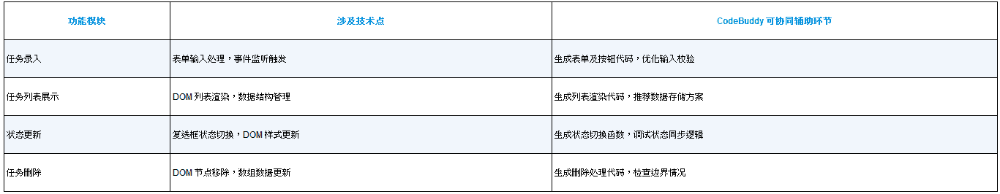

## **3.2**

## **技术栈与实践路径设计**

在案例背景与功能模块拆解完毕后，接下来需要解决的核心问题是“采用何种技术、遵循什么节奏，才能完整实现这个 ToDo List 示例，并自然地将 CodeBuddy 融入其中”。

本节从两个维度回应上述问题：其一，阐述 CodeBuddy 在本章中的典型协同节点，让读者对“AI 会在哪些阶段参与”形成清晰的全景认知；其二，梳理具体的技术栈与教学步骤，明确本章采用的浏览器端运行方式、数据管理方案，以及由浅入深的实践节奏。

**3.2.1**

**CodeBuddy 智能协同节点概述**

在 CodeBuddy 2.0 的设计理念中，AI 已不再局限于对开发者指令的被动响应，而是以“任务驱动”的方式参与到多个开发阶段中。在本章的实践中，我们仍以对话式协同作为主要交互形式，但其背后所体现的，已经是 Agent 化任务拆解与执行的工作模式。

CodeBuddy 作为智能编程助手，可在 ToDo List 案例开发的多个环节提供支持。其核心特征在于在传统 IDE 基础上融合了大语言模型对话能力：一方面，开发者可通过自然语言描述需求或代码意图，让系统生成初步的代码或配置；另一方面，CodeBuddy 能读取项目上下文，提供适配当前工程的增量代码建议、重构优化或文档说明。基于这些能力，本案例开发过程中适合引入 AI 协同的节点如下。

（1）**结构设计**。在项目开始阶段，利用 AI 协助进行架构规划。例如，让 CodeBuddy 根据需求描述给出页面结构建议、文件组织方案或代码框架模板，为开发奠定良好基础。通过对话方式确认整体设计，可帮助初学者减少走弯路的概率。

（2）**代码生成**。在具体编码时，针对重复性高或相对标准的功能实现，可以请 CodeBuddy 自动生成代码片段。例如生成添加任务的函数、初始化列表的 DOM 结构代码等。AI 模型能够基于描述快速给出代码草稿，开发者再结合自身理解进行调整，从而提高编写效率。

（3）**样式调优**。初步功能完成后，可借助 CodeBuddy 对界面样式进行优化。开发者可以询问如何美化列表外观、调整布局或实现响应式效果，AI 将给出修改 CSS 的方案或代码。通过智能调优，界面体验得以改善，也能让初学者体会到根据反馈反复完善的开发过程。

（4）**逻辑调试与修复**。当遇到功能异常或逻辑错误时，CodeBuddy 可充当智能调试助手。开发者将错误现象或代码片段提供给 AI 后，模型可根据上下文分析问题原因并给出修改建议。例如，当“标记完成”功能未正常工作时，AI 可能指出事件绑定或状态更新代码中的问题并建议修正，有助于实现高效的故障排查。

（5）**注释生成**。在功能开发完成后，良好的代码注释和文档有助于巩固所学。此时可让 CodeBuddy 为关键函数或复杂逻辑生成注释，或提炼整个项目的技术要点撰写简要说明。AI 自动生成的注释可供初学者对照学习专业表述，在完善代码可读性的同时，加深对实现细节的理解。

通过以上智能协同节点的介入，CodeBuddy 将贯穿项目开发的各个阶段，扮演“对话式的编程伙伴”的角色：既提供即时的代码产出支持，又在分析与优化上给予指导。这种人机协作模式能帮助初学者以更低的心智负担完成项目，实现边做边学，事半功倍。

**3.2.2**

**技术栈与实践步骤总览**

本节主要采用 Web 前端的基础技术栈实现待办事项应用，包括 HTML 用于搭建页面结构骨架、CSS 控制样式和布局，以及 JavaScript 负责业务逻辑与用户交互。这三项技术构成前端开发的必备基础，既贴合浏览器运行环境，又适合零基础读者循序实践。其中，HTML 与 CSS 部分侧重静态内容和视觉呈现，JavaScript 部分侧重动态行为，例如，对用户操作的响应，对页面元素的增、删、改，以及界面状态的更新。

在数据管理方面，待办事项列表可以通过 JavaScript 中的数组进行维护；如需在页面刷新后保留任务数据，可进一步引入浏览器本地存储（localStorage）实现简单的持久化。考虑到本章的重点是前端基础与 AI 辅助开发流程，示例不依赖服务器端组件，所有逻辑均在浏览器本地完成，并通过 CodeBuddy IDE 内置预览进行验证。这样的技术选型一方面显著降低了环境配置复杂度，另一方面也足以支撑完整 ToDo List 应用的实现。

与此同时，CodeBuddy 对 HTML、CSS 与 JavaScript 均提供良好支持，无论是代码生成、样式调整，还是脚本调试与错误分析，都能够给出针对性的建议，便于读者将注意力集中在理解概念与掌握方法上。

为了在上述技术栈基础上循序渐进地完成示例应用，本章后续内容将按照由浅入深的开发阶段组织展开，每一阶段对应明确的学习目标与实践任务，并穿插着引导读者使用 CodeBuddy 进行协作开发，整体教学路径规划如图 3-1 所示。

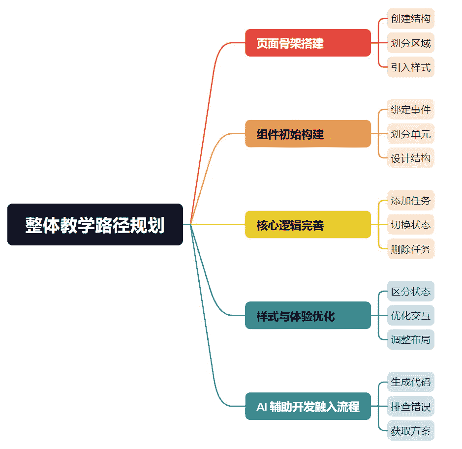

图 3-1 整体教学路径规划

（1）**页面骨架搭建**。首先构建应用的基本页面框架，创建 HTML 文件并完成待办事项应用的主体结构，包括标题区域、输入栏、任务列表区域等，同时引入基础 CSS，使页面具备清晰的布局和层次。这一步为后续功能和样式的叠加提供稳定的“容器”。

（2）**组件初始构建**。在整体骨架之上，将页面划分为若干功能单元，完成关键组件的初始行为。例如，为“添加任务”按钮绑定单击事件，实现从输入框读取文本并更新列表；设计单个任务项的内部结构（文本区域、后续可扩展的状态标记与删除控件等）。本阶段重点在于打通界面元素与脚本逻辑之间的连接。

（3）**核心逻辑完善**。在组件雏形的基础上补全业务逻辑，使应用形成稳定的“最小可用版本”。主要包括：编写 JavaScript 函数实现新任务的加入（更新内存数据与 DOM）、任务状态变更（如标记完成时的样式切换）、任务删除（从数据结构和页面同时移除条目）等。完成本阶段任务后，应用应具备添加、标记完成与删除待办事项等基本功能。

（4）**样式与体验优化**。在功能完整的前提下，对界面观感和交互细节进行改进。通过补充 CSS，使已完成任务采用区别于未完成任务的视觉样式，优化按钮与输入框的显示效果，调整列表的间距与对齐方式，并适当兼顾不同窗口宽度下的展示体验。如有必要，对 HTML 结构进行小幅调整以配合样式优化。本阶段帮助读者理解“功能正确”与“易用、美观”之间的差异及实现路径。

（5）**AI 辅助开发融入流程**。贯穿上述各阶段，引导读者在关键节点借助 CodeBuddy 提升效率。例如，在页面骨架搭建时，通过自然语言提示生成初始 HTML 结构；在逻辑实现过程中，请求 CodeBuddy 协助定位脚本错误、解释报错信息或给出重构建议；在样式优化阶段，通过对话获取替代配色方案或布局调整思路。我们将以若干典型对话为示例，展示如何构造高质量提示词、如何理解并筛选 AI 生成结果，从而逐步形成“人机协同编程”的基本工作方式。

遵循上述技术栈与教学路径逐步推进，读者可以实现一个小型 ToDo List 应用从 0 到 1 的完整开发流程。通过动手实践结合 AI 辅助，不仅能系统梳理 HTML、CSS、JavaScript 的基础知识，还能初步建立起在 CodeBuddy 环境下组织项目、分解任务及迭代实现的能力，为后续更复杂场景的实战打下坚实基础。

## **3.3**

## **自然语言驱动的开发流程总览**

本节从整体视角梳理“自然语言→提示词（Prompt）→CodeBuddy 生成方案与代码→人工校验与调整”的工作流，明确自然语言在开发流程中的位置，以及 CodeBuddy 在其中承担的职责与边界。需要注意的是，在 CodeBuddy 2.0 的工作模式中，自然语言并非一次性被“翻译”为最终代码，而是逐步转化为结构化的中间状态，例如实现思路、步骤规划或任务拆解，再由系统据此生成和执行具体代码。即使在本章中未显式使用 Plan 模式，读者仍可将当前的提示词拆解与迭代过程，理解为一种“轻量化的计划驱动开发”。结合 3.1 节的示例，本节重点构建一个可复用的提示词框架，并说明在本章实战中，人机协同应遵循的基本原则与注意事项。

**3.3.1**

**需求表达与提示词框架**

在基于 CodeBuddy 的开发过程中，提示词（Prompt）并非简单的“提问”，而更接近于一份以自然语言撰写的、简化版本的“规格说明书”。提示词越清晰，结构越合理，CodeBuddy 在生成方案和代码时越容易接近预期；反之，则更容易出现遗漏、误解或生成结果不稳定的情况。

在 ToDo List 实战案例中，我们已经给出了相对清晰的业务目标：在浏览器中实现一个待办事项管理的小型 Web 应用，具备任务录入、列表展示、状态更新与删除等基本功能。将这些需求转换为提示词时，建议按照“要素分块、信息分层”的方式组织自然语言内容，而不是给出一段混合描述。

（1）**提示词中的关键要素。**结合 ToDo List 场景，一个面向 CodeBuddy 的提示词通常应包含以下几个关键要素。

• **背景信息**：说明应用运行环境、目标平台以及使用场景，例如“在浏览器中运行的前端应用”“用于演示基础 Web 开发”等。

• **界面结构要求**：明确页面中主要区域的划分与基本布局，例如“标题区”“输入区”“任务列表区”等。

• **行为逻辑与功能点**：以条目形式列出必须实现的操作行为和交互逻辑，例如“新增任务”“标记完成”“删除任务”等。

• **技术约束与限制**：对允许使用的技术栈进行限定，例如“仅使用 HTML、CSS、JavaScript，不依赖任何第三方框架或构建工具”，以避免生成超出读者当前学习范围的实现方式。

• **代码组织方式**：指定工程中需要拆分的文件，如 index.html、style.css、main.js 等，便于结合第二章的 IDE 环境进行演示与调试。

• **代码风格与注释要求**：约定变量命名风格（如小驼峰）、注释风格（如在核心函数前提供简要说明），为后续阅读与扩展提供一致基础。

将上述要素拆解后，我们可以清晰地看到，自然语言提示词已经具备“简化规格说明书”的雏形。提示词本身不需要采用正式标准的规格语言，但应尽量保持条理清晰、层次分明，避免含糊其词或在同一段落中混杂多类信息。

（2）**ToDo** **List 示例的标准提示词模板。**以下给出一个围绕本章 ToDo List 应用构建的标准提示词示例。该示例在 3.4 节中将作为正式实践用的提示词基础，读者可在此基础上进行微调与扩展。请基于以下要求，为一个浏览器端运行的 ToDo List 待办事项小应用生成完整的前端代码，并按照文件拆分进行组织。

**标准提示词模板**

【应用背景】

• 目标：在浏览器中运行的单页 ToDo List 应用，用于演示基础 Web 前端开发。

• 运行环境：无须服务器端，仅通过本地打开 HTML 文件即可运行。

【界面结构要求】

• 页面包含三个主要区域：……

（3）**提示词要素拆解表。**为了便于在后续章节中复用提示词框架，我们将上述内容整理为表 3-2，供读者查阅与对照。

表 3-2 ToDo List 示例的提示词要素拆解表

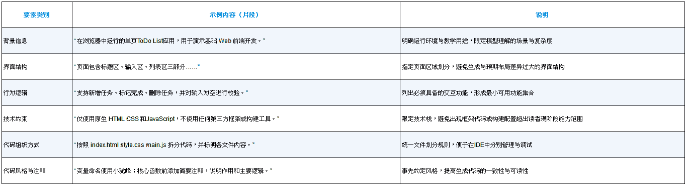

通过表 3-2 可知，“好的提示词”实质上是对需求、约束和风格的结构化表达。后续章节在扩展其他案例时，我们可沿用这一结构，对不同场景替换具体内容即可。

**3.3.2**

**CodeBuddy 在开发闭环中的角色**

在本章实战中，CodeBuddy 并非被视为“能自动生成全部代码的黑箱工具”，而是嵌入整个开发闭环的智能协同节点。围绕 ToDo List 应用的开发过程，CodeBuddy 主要具备以下四类典型能力。

（1）**方案生成**。在给定结构化提示词后，CodeBuddy 可以根据自然语言描述，给出整体实现思路和文件结构建议。例如，在接收到表 3-2 中的提示词后，可以输出包括页面骨架、样式组织方式以及主要函数划分的初步方案。这一阶段更接近“架构草图”与“实现蓝本”的生成，为后续编码提供参考基线。

（2）**代码生成与补全**。在确定整体方案基础上，CodeBuddy 能够按文件粒度（如完整的 main.js）或函数粒度（如“根据任务文本生成列表项的函数”）生成具体代码，实现从自然语言到代码片段的映射。同时，在读者人工修改或补充部分代码后，CodeBuddy 还可以基于上下文进行补全，填充重复性或模式化较强的部分，例如事件绑定、DOM 查询与更新等。

（3）**解释与诊断**。当现有代码出现报错或行为与预期不一致时，CodeBuddy 可以对代码片段及错误信息进行分析，指出潜在问题原因，并给出修正建议。在 ToDo List 案例中，例如“标记完成状态后样式未更新”“删除按钮无效”等问题，均可通过将相关代码与错误描述一并提供给 CodeBuddy，由其辅助定位逻辑错误或 DOM 操作遗漏。

（4）**重构与文档辅助**。在功能基本实现后，CodeBuddy 可用于进行局部重构与文档生成。例如，对冗长函数进行拆分、对重复代码进行抽取封装，或为关键逻辑生成更规范的注释说明。有需要时，还可以让其生成简要的“功能说明”或“使用说明”，作为教学项目的辅助文档。

从流程视角看，传统的纯手工编码路径大致如下。

• 阅读需求；

• 手工设计方案；

• 书写 HTML；

• 书写 CSS；

• 书写 JavaScript；

• 运行调试；

• 手工重构与完善。

而在引入 CodeBuddy 之后，本章采用的路径更接近于：

• 自然语言描述需求与约束；

• CodeBuddy 生成整体方案与初稿代码；

• 人工检查与修改；

• CodeBuddy 协助调试与重构；

• 根据需要回到需求，扩展功能或调整约束。

如图 3-2 所示，CodeBuddy 主要在“方案与代码生成”“问题诊断与修复”“重构与文档完善”三个环节提供支持，而“需求与约束描述”“本地运行与调试”“需求扩展与迭代”等仍然由开发者主导。

图 3-2 开发闭环示意图

在“自然语言驱动+CodeBuddy 辅助”的开发模式下，部分初学者容易产生“完全交给 AI 即可”的误解，从而忽略对代码本身的理解与控制。在自然语言驱动的开发实践中，常见的误区如下。

（1）误区一：一条模糊指令，期待一次性生成“完美工程”。模糊的提示词往往只包含“做一个 ToDo List 应用”之类的描述，缺乏界面要求、功能细节和技术限制。此时 CodeBuddy 只能根据通用经验进行推断，生成结果不可避免地与期望存在差距。

**应对策略：**将需求拆解为背景、界面结构、行为逻辑、技术约束等要素，参考表 3-2 的方式进行结构化表达，在必要时分多次补充说明。

（2）误区二：不阅读代码，只关注运行结果。在生成代码后，如仅关注“是否能运行”，而不对代码结构和逻辑进行阅读与思考，将难以形成真正的编程能力。一旦离开 CodeBuddy 辅助环境，就难以独立完成类似功能的实现。

**应对策略：**在每一次代码生成或修改后，至少对核心函数、关键事件处理和数据结构部分进行阅读，对不理解的部分可以再次向 CodeBuddy 请求解释，并将解释内容与源代码对照理解。

（3）误区三：频繁变更需求，却不对提示词进行同步更新。在开发过程中若不断新增或修改功能，但仍沿用初始提示词进行生成或重写，容易导致工程结构不稳定、命名不一致，甚至出现不同版本代码交叉混用的情况。

**应对策略：**当需求发生较大调整时，应同步更新提示词，将新增功能和新的约束一并反映出来。对于结构性变更，必要时可以在提示词中明确说明“在现有基础上增量修改”，以避免完全重写导致的工程重置。

为了在本章的实战过程中更好地发挥 CodeBuddy 的作用，同时保持对工程质量与学习效果的掌控，读者应遵循以下三条基本原则。

（1）“先讲清楚，再生成”。在调用 CodeBuddy 生成代码之前，应先确保需求描述与提示词结构足够清晰，至少包括背景信息、界面结构、功能行为和技术约束四部分核心内容。

（2）“小步生成，小步运行”。避免一次性请求大型工程，建议先生成核心骨架与基础功能，在每一小步完成后立即进行运行验证与阅读理解，再继续扩展或优化下一部分。

（3）“所有自动生成的内容，都要审阅一遍”。无论是代码、注释还是方案说明，均不应直接视为“最终版本”。通过逐段审阅与必要调整，一方面可以及时发现潜在问题，另一方面也有助于理解 CodeBuddy 的决策逻辑，从而逐步提升提示词设计与代码评估能力。

在上述原则的约束下，本章后续各小节将在 ToDo List 实战案例中展示自然语言驱动、AI 辅助编码的具体过程，体现在真实开发任务中如何平衡“自动化效率”与“学习与理解”的关系。

## **3.4**

## **实战项目一：工程模板与基础运行环境**

在开始正式的功能迭代之前，我们需要先搭建一个基础的前端项目，并确保开发环境正常运行。在本节中，我们将展示如何在 CodeBuddy 独立版 IDE 中创建一个纯前端示例工程，了解项目的目录结构和关键文件，并进行首次运行检查。

**第一步，在 CodeBuddy 中创建 Hello-AI-Todo 示例工程。**根据第二章的准备工作，我们已经安装好了 CodeBuddy IDE 或其插件环境。本节将主要基于 CodeBuddy 独立版进行演示（插件版的使用方式类似，但独立版提供了一体化的界面和工具，更便于初学者操作）。启动 CodeBuddy IDE 后，可以通过新建项目功能来创建示例工程。

在新建项目时，CodeBuddy 通常提供多种模板选项。由于我们希望构建一个纯前端的示例，这里建议选择一个空白 Web 项目模板或同类的最简模板。

如图 3-3 所示，可以使用 Cloud Studio 提供的“HTML-CSS-JS”静态网站模板。该模板预置了最基础的前端文件结构，包括一个简单的 HTML 文件、关联的 CSS 样式表，以及一个 JavaScript 脚本入口。

图 3-3 Cloud Studio 选择模板页

选择模板时，在 CodeBuddy 的新建项目对话框中填入项目名称（例如 Hello-AI-Todo），并从模板列表中选择上述的空白前端模板。随后，IDE 会自动为我们生成初始的文件与代码框架，如图 3-4 所示。

图 3-4 自动生成的初始文件与代码框架

选择空白模板后，CodeBuddy 会自动创建基本的项目结构。通常情况下，生成的 index.html 文件包含了标准的 HTML5 页面骨架（<!DOCTYPE html>、<head>、<body>等），并在<head>中链接默认的样式表和脚本文件（如 styles/style.css 和 scripts/main.js）。style.css 通常提供一个空的或简单的样式表文件，供我们编写全局样式。main.js 则作为前端交互逻辑的入口脚本，初始化时可能仅包含一行简易的代码（例如 console.log("Hello CodeBuddy");）或留空待用。通过使用这类模板，我们免去了手动创建文件的步骤，直接获得一个开箱即用的前端项目骨架。

**第二步，梳理项目目录结构与关键文件。**当示例工程创建完成后，我们可以在 CodeBuddy IDE 左侧的资源管理器中看到生成的项目目录结构，如图 3-5 所示。

图 3-5 示例工程目录结构

示例工程的基础目录结构如下所示，Hello-AI-Todo 项目包含 HTML、CSS、JS 三类关键资源文件。

Hello-AI-Todo/

├── index.html

├── styles/

│   └── style.css

└── scripts/

    └── main.js

其中，index.html 为项目的主页面文件，提供网页的骨架结构；styles/style.css 为全局样式表，用于定义页面的外观布局和视觉样式；scripts/main.js 为前端交互逻辑的入口脚本。

需要说明的是，本章后续所有代码片段均默认遵循上述工程结构编排。这意味着，当我们展示某段 HTML、CSS 或 JS 代码时，读者可通过上下文快速判断其所属文件（例如，提及的 HTML 片段来自 index.html，样式规则源自 style.css，脚本函数定义则出自 main.js）。这种约定既有助于读者在项目中快速定位对应代码，也便于结合 CodeBuddy 的上下文理解内容。

完成上述工作后，起步工程即告完成。此时，Hello-AI-Todo 项目结构清晰、运行稳定，我们已处于一个稳固的起点之上，可以自信地进行第一轮功能迭代，在 CodeBuddy 的协助下逐步实现智能待办事项清单的各项功能。

**第三步，运行示例工程并完成环境校验。**在完成项目模板选择与目录结构确认之后，下一步就是让示例工程真正“跑”起来。只有经过一次完整的运行和环境校验，我们才能确认后续在 CodeBuddy 中看到的任何异常，都源自代码逻辑本身，而不是开发环境或工程配置问题。下面将带领读者完成首次运行，并通过一个简单的检查清单验证当前环境是否稳定可用。

（1）**在 CodeBuddy 中启动示例工程。**首先，在 CodeBuddy IDE 左侧的资源管理器中选中 index.html 文件，确认其已经作为项目的入口页面。在大多数 IDE 或云端开发环境中，可以通过以下两种方式启动预览。

• 单击工具栏中的“运行/预览”按钮，由 IDE 自动启动内置的静态 Web 服务，并在右侧或新标签页中打开页面。

•在 index.html 上单击右键，从弹出的快捷菜单中选择“在浏览器中预览”“打开预览”等类似选项，由浏览器直接加载当前页面。

正常情况下，浏览器会打开一个地址为 http://…/index.html 的页面。此时页面内容可能仍然比较简陋，只包含模板自带的标题或占位文本，只要页面能正常加载，就说明工程的基本运行路径正确。

（2）**使用浏览器开发者工具检查资源加载情况**。为了更严谨地确认环境无误，建议读者在首次运行时配合浏览器开发者工具进行一次快速“体检”。

•在预览页面按下 F12 键或 Ctrl+Shift+I（macOS 上为 Option+Command+I）组合键，启用开发者工具。

• 在 Console（控制台）面板中确认没有红色的报错信息，尤其是“Uncaught ReferenceError” “Failed to load resource”等脚本或资源加载错误。

•在 Network（网络）面板中刷新页面，检查 index.html、styles/style.css、scripts/main.js 等关键资源的状态码均为 200，且大小与预期相符，没有出现 404 或 500 等异常状态码。

若在此过程中发现样式或脚本未能成功加载，多半是引用路径或文件名不一致所致。此时可以回到 index.html 中，检查 <link>和

（3）**通过简单修改完成“自检”**。为了进一步确认工程链路完全打通，建议在首次运行时做一次小范围的“自检”。

• 在 index.html 的标题区域，将页面标题修改为“Hello AI ToDo – 环境测试”，保存后刷新预览页面，确认标题同步更新。

• 在 scripts/main.js 中添加一行简单的调试代码，如下所示：

console.log("Hello-AI-Todo environment is ready.");

保存文件并刷新页面，在浏览器控制台中看到对应输出，即可证明浏览器已正确执行该脚本文件。

## **3.5**

## **实战项目二：从提示词到可运行界面**

在 3.4 节中，我们已成功完成示例工程的创建与运行环境的校验，实现了一个能正常启动的基础 Web 项目。本节将在此基础上，围绕 ToDo List 待办事项应用的核心需求，展开首次完整的界面迭代——通过结构化提示词引导 CodeBuddy 生成页面代码，将抽象的功能设想逐步转化为“看得见、点得动、能运行”的初始版本界面。

为了让读者更易理解并能迁移应用到实际场景，本节将以“三步走”的方式展开：第一步，聚焦任务列表的展示区域与输入区域布局，通过提示词生成页面的基础骨架（HTML 结构）；第二步，补充样式相关提示词，完善基础排版与视觉表现（CSS 样式）；第三步，针对“添加任务—展示列表”等关键交互流程，生成并优化最小可用的脚本逻辑（JavaScript 代码）。每一步中，我们都会清晰区分“CodeBuddy 自动生成的内容”与“开发者人工判断、修改及确认的部分”，以此体现 AI 助手在实际开发中的角色边界——既能显著提升编码效率，又不会削弱开发者对代码质量与行为的主导权。

**第一步，页面骨架生成**。本节将把 3.2 节梳理出的需求转化为具体提示词，通过与 CodeBuddy 对话生成页面的 HTML 骨架代码。首先，我们需准备一则提示词，向 CodeBuddy 清晰简洁地描述需求（注意避免过度口语化，防止歧义；亦可借助 CodeBuddy 自带的增强提示词功能，详见图 3-6）。以下为示例展示——在对话中如何将需求转化为提示词，并请求 CodeBuddy 生成页面骨架代码。

图 3-6 增强提示词功能

**标准提示词模板**

用户：请根据以下需求生成一个 index.html 文件的页面骨架：页面名称为"Hello AI ToDo"，需要包含三个区域——一个标题区域显示应用名称，一个输入区域包含文本输入框和“添加”按钮，用于输入新任务，一个列表区域用于展示任务列表。请使用语义化的 HTML5 标签（如<header>、<main>、<section>等）划分区域，并为后续的样式和脚本添加必要的 id 或 class 属性。代码只需包含基本结构，不需要填充具体内容或功能。

如图 3-7 所示，CodeBuddy 已按照提示词要求生成了页面的基础 HTML 结构，并在标题区、输入区和列表区之间形成了清晰的分区。生成结果采用了 HTML5 语义化标签，并为关键节点配置了可复用的 id 与 class 属性，便于后续在样式表和脚本中进行精确引用。即便读者尚未系统学习全部标签含义，也可以通过结构划分理解页面的整体布局。

图 3-7 生成的基础 HTML 结构

页面骨架主要由标题区域、输入区域和列表区域三部分构成。

（1）**标题区域**（Header）。使用<header>标签承载页面抬头信息，其中的 <h1> 元素显示应用名称“Hello AI ToDo”。该区域对应界面上方固定的标题区，是用户进入页面后首先看到的内容。

（2）**输入区域**（Input Section）。通过 <section class="input-section">划分输入区域，内部包含一个文本输入框 <input type="text" id="taskInput" class="task-input">和一个操作按钮<button id="addBtn" class="add-btn">添加</button>。输入框用于录入待办事项的文本内容，按钮用于提交当前输入，触发后续的任务创建逻辑。

（3）**列表区域**（List Section）。通过 <section class="list-section">划分任务展示区，内部包含一个无序列表<ul id="taskList" class="task-list">。在后续迭代中，每新增一条任务，脚本都会以<li>列表项的形式插入该<ul>中，从而在页面上完成任务条目的呈现与更新。

从整体结构来看，<header>、<main>与若干<section>标签共同构成了一个语义清晰的页面框架。每个功能区域均通过标签层级与 id/class 标识进行明确标注，使 HTML 代码具备较好的可读性与可维护性。这种“结构可读性优先”的设计对于初学者尤为重要：即使暂时不了解 <main>、<section>等标签的全部语义，也能够直观地看出页面被划分为标题区域、输入区域和列表区域三个主要块（如图 3-7 所示，渲染后的页面已经呈现出标题、输入控件和空列表的基本布局）。在这一阶段，我们更多关注的是页面骨架和元素分布，为后续样式设计与交互逻辑实现奠定结构基础。

index.html 主界面的代码如清单 3-1 所示。

**清单 3-1 index.html 主界面的代码**

/<!DOCTYPE html>

<html lang="zh-CN">

<head>

<meta charset="UTF-8">

<meta name="viewport" content="width=device-width, initial-scale=1.0">

<title>Hello AI Todo</title>

<link rel="stylesheet" href="styles/style.css">

</head>

<body>

<div class="container">

<!-- 标题区域 -->

<header class="app-header">

<h1 class="app-title">Hello AI ToDo</h1>

</header>

<!-- 主要内容区域 -->

<main class="app-main">

<!-- 输入区域 -->

<section class="input-section">

<input

type="text"

id="taskInput"

class="task-input"

placeholder="请输入新任务"

>

<button id="addBtn" class="add-btn">添加</button>

</section>

<!-- 列表区域 -->

<section class="list-section">

<ul id="taskList" class="task-list">

<!-- 任务列表将在这里动态生成 -->

</ul>

</section>

</main>

</body>

</html>

**第二步，基础样式与布局实现。**有了页面骨架，我们就可以通过 CodeBuddy 生成基础的 CSS 样式文件 style.css，为页面添加初步的布局和美化，让页面在不添加复杂功能的情况下看起来整齐、美观，并为主要区域提供基本的视觉区分。我们将在提示词中明确需要的样式效果，包括页面居中、标题样式、输入区域布局以及列表项样式等。

**标准提示词模板**

   用户：现在请为页面生成基础的 CSS 样式（写入 style.css 文件）。要求如下：将页面整体居中显示，设置合适的最大宽度；美化标题的字体大小和颜色，使其突出；使输入区域的文本框和按钮在同一行，并适当留出间距；为任务列表及列表项提供基本样式，例如去除默认列表样式、增加间距和边框以区分各个任务项。请使用简洁的 CSS 实现上述布局和样式。

   使用增强提示词后：为页面创建简洁的 CSS 样式（写入 style.css 文件），具体要求如下：将整个页面内容居中显示并设置合理的最大宽度；优化标题样式，调整字体大小和颜色使其醒目；将输入框和按钮排列在同一行，并设置适当间距；为任务列表设计基本样式，包括去除默认列表符号、增加项间距以及添加边框使任务项清晰区分。请使用高效的 CSS 代码实现这些布局和视觉效果。

CodeBuddy 根据该提示词返回了一份完整的样式文件，并给出了逐条说明。如图 3-8 所示，左侧为生成后的 style.css 内容，右侧为 CodeBuddy 针对页面布局、标题样式、输入区域、任务列表样式等要点的说明清单。

图 3-8 完整 style.css 内容

当前版本的 style.css 完整代码如清单 3-2 所示。

**清单 3-2 style.css 完整代码**

/* 全局样式重置 */

* {

margin: 0;

padding: 0;

box-sizing: border-box;

}

/* 页面基础样式 */

body {

font-family: -apple-system, BlinkMacSystemFont, 'Segoe UI', Roboto, Oxygen, Ubuntu, Cantarell, sans-serif;

background: linear-gradient(135deg, #667eea 0%, #764ba2 100%);

min-height: 100vh;

padding: 40px 20px;

}

/* 主容器 - 居中显示并设置最大宽度 */

.container {

max-width: 600px;

margin: 0 auto;

background-color: #ffffff;

padding: 40px;

border-radius: 12px;

box-shadow: 0 10px 40px rgba(0, 0, 0, 0.2);

}

...

.task-list li {

padding: 16px;

margin-bottom: 12px;

background-color: #f8f9fa;

border: 1px solid #e9ecef;

border-radius: 8px;

transition: all 0.3s;

}

.task-list li:hover {

background-color: #e9ecef;

transform: translateX(4px);

}

通过以上样式设置，我们实现了简洁、协调的布局效果：页面内容居中且宽度适宜，标题突出且易读，输入区域的组件整齐对齐，列表项清晰分隔。这些样式与我们在 HTML 结构中添加的 id 一一对应，如#input-section、#task-input、#add-button 等，如图 3-9 中的初版 Demo 页面所示。

图 3-9 初版 Demo 页面

在这一步，读者可以尝试对某些样式属性进行调整（例如修改颜色值、字体大小或边距）来观察页面的变化，从而加深对 CSS 的理解。如果遇到看不懂的选择器或属性，也可以向 CodeBuddy 提问，例如，“请解释一下 justify-content: space-between 的作用”，CodeBuddy 会回答说该属性用于在弹性容器（flex container）内按剩余空间在子元素之间均匀分配间距，使两端元素贴近容器边缘，中间空出空间。通过这种方式，初学者可以逐步理解每条样式规则的含义，进一步掌握 CSS 布局与美化的技巧。

**第三步，最小交互闭环验证。**现在，页面的结构和基础样式已经完成，可以进入交互功能的环节了：构建一个“最小可用交互闭环”。在本例中，该闭环指的是用户在输入框中输入待办事项内容，单击“添加”按钮或按下 Enter 键，新任务能够即时出现在任务列表中。

这一功能是整个 ToDo 应用最基础的交互形式，对应 main.js 中的核心脚本逻辑，通过操作 DOM 动态更新列表。

从实现角度看，本节的目标可以拆分为以下几个步骤。

•获取页面中的 DOM 元素（文本输入框、“添加”按钮、任务列表容器）；

• 为“添加”按钮和输入框绑定事件，在事件触发时读取输入内容；

• 根据输入内容创建新的列表项 <li> 元素，并插入任务列表 <ul> 中；

• 完成后清空输入框并将光标聚焦回输入框，为下一次输入做好准备；

• 对异常情况进行基本的错误处理与日志输出。

在此基础上，我们继续借助 CodeBuddy，由其根据逻辑描述生成 JavaScript 代码，并在 IDE 中完成运行验证。

**标准提示词模板**

   用户：请创建 main.js 脚本，实现以下功能：当用户单击“添加”按钮时，将输入框 (id="task-input") 中的文本获取出来，如果不为空，则创建一个新的<li>元素，将文本内容作为<li>的文本节点插入<ul id="task-list">列表中，最后清空输入框内容。请用原生 JavaScript 实现上述过程，并确保脚本在 DOM 加载完成后再执行（以防止获取元素时页面尚未加载完全）。

   使用增强提示词后：创建一个 main.js 脚本，使用原生 JavaScript 实现以下功能：当用户单击 ID 为'添加'的按钮时，首先获取 ID 为'task-input'的输入框内容。如果内容不为空，则创建一个新的<li>元素，将输入文本作为该元素的文本节点，并将其添加到 ID 为'task-list'的<ul>列表中。最后清空输入框内容。请确保脚本在 DOM 完全加载后执行，可以使用 DOMContentLoaded 事件或将脚本放在 body 末尾来实现。代码应包含完整的错误处理，确保在元素不存在时不会报错。

生成的 JavaScript 关键代码如清单 3-3 所示。

**清单 3-3 main.js 关键代码内容**

// 确保 DOM 完全加载后再执行脚本

document.addEventListener('DOMContentLoaded', function() {

    console.log("Hello CodeBuddy");

    // 获取页面元素

    const taskInput = document.getElementById('taskInput');

    const addBtn = document.getElementById('addBtn');

    const taskList = document.getElementById('taskList');

    // 添加任务的函数

    function addTask() {

        // 获取输入框内容并去除首尾空格

        const taskText = taskInput.value.trim();

        // 检查内容是否为空

        if (taskText === '') {

            console.warn('警告：任务内容不能为空');

            taskInput.focus();

            return;

        }

        try {

            // 创建新的 <li> 元素

            const newTask = document.createElement('li');

            // 将输入文本作为文本节点添加到 <li> 元素

            newTask.textContent = taskText;

            // 将新任务添加到任务列表

            taskList.appendChild(newTask);

            // 清空输入框内容

            taskInput.value = '';

            // 将焦点返回到输入框

            taskInput.focus();

            console.log('任务添加成功：', taskText);

        } catch (error) {

            console.error('添加任务时发生错误：', error);

        }

    }

    // 为"添加"按钮绑定单击事件

    addBtn.addEventListener('click', addTask);

    // 支持按 Enter 键添加任务

    taskInput.addEventListener('keypress', function(event) {

        if (event.key === 'Enter') {

            addTask();

        }

    });

});

**第四步，代码结构与运行逻辑说明。**分析图 3-10 所示代码，从整体结构来看，这段脚本可以分为 4 个层次：页面加载入口、DOM 元素获取与基础校验、核心业务函数，以及事件绑定与交互触发。它们共同构成了一个完整的最小交互闭环。

（1）页面加载入口。首先通过如下命令注册一个 DOMContentLoaded 事件监听器：

document.addEventListener('DOMContentLoaded', function() { ... });

该事件在浏览器完成 HTML 文档解析、DOM 树构建完成后触发，此时页面中的元素已经可以被安全访问。将所有逻辑包裹在这个回调函数内部，可以保证在脚本执行时，taskInput、addBtn、taskList 等元素已经存在于 DOM 中，避免出现“元素为 null 或 undefined”的运行时错误。这也是前端脚本中一个常见的安全实践。

图 3-10 Main.js 关键代码

（2）DOM 元素获取与基础校验。在回调函数内部，首先通过 document.getElementById 依次获取三个关键元素：

const taskInput = document.getElementById('taskInput');

const addBtn   = document.getElementById('addBtn');

const taskList = document.getElementById('taskList');

这三行代码分别对应 HTML 结构中的任务输入框、“添加”按钮和任务列表容器，是后续交互逻辑的基础。

（3）核心业务函数 addTask。addTask 函数承担了“将输入内容添加到列表中”的全部业务逻辑：

function addTask() {

    const taskText = taskInput.value.trim();

    ...

}

函数的第一步是读取输入框中的内容，并使用 trim() 去除首尾空格。这样可以防止用户只输入空格就通过校验。随后，通过如下代码对空字符串进行检查。

if (taskText === '') {

    console.warn('警告：任务内容不能为空');

    taskInput.focus();

    return;

}

若校验不通过，则给出警告信息，并将输入焦点重新定位到输入框，提示用户重新输入。这一部分展示了“输入校验—提示—返回”的完整闭环。

在 try 代码块中，脚本依次完成以下操作。

• 使用 document.createElement('li') 创建一个新的列表项元素；

• 将任务文本赋值给 newTask.textContent，使其作为列表项的显示内容；

• 调用 taskList.appendChild(newTask) 将新列表项追加到任务列表容器中；

•将 taskInput.value 置为空字符串，并调用 taskInput.focus()，使用户可以直接继续输入下一项任务；

• 在控制台输出“任务添加成功”的日志，便于调试和状态观察。

catch 分支用来捕获在 DOM 操作过程中可能出现的异常，一旦发生错误，会输出错误信息，便于后续排查。

（4）事件绑定与交互触发。在定义完 addTask 函数之后，脚本通过两个事件监听器将用户操作与业务逻辑关联。代码如下：

addBtn.addEventListener('click', addTask);

这样可使用户每次单击“添加”按钮时，都会执行 addTask，从而尝试将当前输入内容添加到列表。代码如下：

taskInput.addEventListener('keypress', function(event) {

    if (event.key === 'Enter') {

        addTask();

    }

});

此时，监听输入框中的按键事件，当检测到用户按下 Enter 键时，同样调用 addTask。这样一来，用户既可以通过鼠标单击按钮，也可以通过键盘操作完成任务添加，交互体验更加顺畅。

**第五步，运行效果与闭环验证。**在 CodeBuddy IDE 中保存 main.js 后，使用内置预览功能打开 index.html。此时页面顶部显示“Hello AI ToDo”标题，中间为输入框和“添加”按钮，下方是空白的任务列表区域。

在输入框中输入一条任务内容（例如“编写今天的学习计划”），单击“添加”按钮或直接按下 Enter 键，可以看到下方列表区域中立即出现一条新的列表项，内容正是刚刚输入的文本。继续多次输入并添加，列表将按顺序累积多条任务记录，如图 3-11 所示。

图 3-11 第二版 Demo 页面

可以看到，第二版 Demo 页面展示了浏览器中运行的“Hello AI ToDo”页面：上方为标题，中间为输入框与“添加”按钮，下方列表中已显示多条任务项，每一条以浅色卡片形态排列，表明脚本已成功完成从输入到列表展示的完整交互闭环。

需要强调的是，当前实现仅完成“添加任务”的基础功能，尚未支持任务完成状态切换、删除任务等操作。之所以先停留在这一“最小可用”的交互闭环，是为了在每一个阶段都能够清晰地验证：提示词是否合理、CodeBuddy 生成的代码是否可读、脚本逻辑是否按照预期生效。读者可以在这一基础上扩展更多功能，且不会影响当前已验证可用的核心路径。

## **3.6**

## **本章小结**

至此，我们已经完成了 CodeBuddy 的初体验。回顾本章，我们并没有像传统编程图书那样，从第一行代码开始按部就班地敲代码，而是采用了一种全新的“自然语言驱动+AI 辅助生成+人工校验”的开发模式。

首先，我们基于 CodeBuddy IDE 快速搭建了一个零配置的 Web 前端工程环境，理解了 index.html、style.css 和 main.js 这三个核心文件在项目中的协作关系；其次，我们经历了一次思维方式的转变，学习了如何将模糊的脑海构思转化为结构化的“提示词”，明确了背景、结构、行为与约束 4 个核心要素——这是与 AI 协作中最关键的一步，也是决定代码生成质量的基石；再次，在迭代实现阶段，我们通过三轮关键对话，引导 CodeBuddy 先后生成了语义化的 HTML 骨架、美观的 CSS 样式以及具备基础交互能力的 JavaScript 脚本；最终，我们获得了一个可以运行的“最小可用产品”，成功验证了从输入框录入列表展示的核心路径。

从更高层次来看，本章的 ToDo List 实战展示了一种正在兴起的开发范式：自然语言成为任务入口，AI 负责方案生成与执行辅助，开发者则聚焦于需求判断、结果校验与质量把控。随着工程复杂度和协作规模的提升，这种模式将从单人实践逐步演进为可复用、可扩展的团队协作方式。后续章节将基于这一基础，引入更复杂的业务场景与工程结构，进一步展开 AINative 开发的实践路径。

# **第四章**

# **CodeBuddy 助力网页开发**

本章将系统阐述 CodeBuddy 在网页开发中的应用。我们将从 B/S 与 C/S 架构切入，明确 Web 开发的交互模型，进而介绍 HTML、CSS、JavaScript 构建网页的基本用法；随后，通过实战项目展示如何用 CodeBuddy 助力网页开发，凸显 CodeBuddy 在快速原型搭建与交互逻辑实现中的价值，及其在个性化与智能推荐中的扩展能力；最终构建出从基础到实战的完整链条，为读者掌握 AI 辅助网页开发提供支撑。

## **4.1**

## **走进 Web 世界：网页开发基础知识**

本节先带领大家走进 Web 世界，了解网页开发与制作的基本知识和工具。

**4.1.1**

**Web 开发与 B/S 架构**

**Web 开发**是指基于网络环境的应用系统设计与实现，其核心在于实现信息在客户端（通常是 Web 浏览器）与服务器端（远程计算机）之间的请求、传输、处理与呈现。与传统软件开发相比，Web 开发不依赖于特定操作系统或本地环境，而是通过标准化协议（如 HTTP/HTTPS）、统一标记语言（如 HTML）、样式控制语言（如 CSS）及动态交互脚本（如 JavaScript）来实现信息的组织、呈现与交互逻辑。

随着云计算与人工智能的快速发展，Web 开发已从最初的静态页面渲染，逐步演进为高度动态化、交互式和智能化的复杂应用环境。它不仅支撑了电子商务、教育、医疗、政务等传统场景的数字化转型，还通过与大语言模型和数据智能的融合，展现出新的知识服务与智能推荐模式。在这一发展过程中，C/S（Client/Server）与 B/S（Browser/Server）两种体系架构构成了 Web 开发的基本支撑逻辑：C/S 架构强调客户端的功能实现，用户需安装特定软件进行交互；B/S 架构借助浏览器实现轻量化访问，降低了使用门槛，成为当代 Web 应用的主流选择。

图 4-1 以清晰的流程图形式，直观地阐释了 B/S 架构中一次完整用户交互所涉及的核心组件与数据流向。

浏览器端包括常见的 Chrome、Internet Explorer、Firefox、UC 浏览器等多种客户端，它们的首要任务是进行 URL 解析，即将用户输入的网址转化为服务器可识别的请求路径。当浏览器向 Web 服务器发送请求后，服务器根据路径定位 HTML 文件，并与数据库服务器进行交互（包括数据读取、写入与查询），最终将处理结果返回给浏览器。浏览器随后执行网页渲染，将 HTML 文档内容转化为用户可视化的界面。在这一过程中，Web 服务器承担了逻辑处理与数据组织的角色，数据库服务器则保障了底层数据的存储与调用。图 4-1 用箭头清晰展示了“URL 解析—请求发送—数据获取—网页渲染”的全过程，体现了 B/S 架构下浏览器与服务器的高效协同机制。特别值得注意的是，浏览器不仅负责静态内容的呈现，还需解析 HTML 结构、CSS 样式及 JavaScript 逻辑，确保最终界面既具备正确的结构，又具备良好的交互性与可用性。

图 4-1 B/S 架构体系

由此可见，B/S 架构不仅是 Web 开发的技术核心，也是 AI 辅助网页生成与优化的重要落脚点。随着 HTML5、JavaScript 框架（如 React、Vue）的成熟，B/S 架构已能够支持复杂的交互逻辑与数据可视化，从而实现媲美 C/S 架构的用户体验。这种架构优势，结合大语言模型与智能生成工具（如 CodeBuddy），使得 Web 开发能够更加快速、灵活地响应多样化应用场景的需求。

**4.1.2**

**网页骨架**

——HTML

**超文本标记语言**（HyperText Markup Language，HTML）是万维网的基础语言标准，用于描述网页内容的结构与语义。它通过一系列标签（Tag）定义文本、图像、链接、表格、表单等信息的逻辑层级，使得浏览器能够将抽象的文本指令转化为直观的图形化界面。作为 W3C 制定的开放标准，HTML 不断迭代，目前的 HTML5 版本不仅支持多媒体播放、Canvas 绘图、语义化标签，还与 JavaScript 和 CSS 无缝衔接，形成前端开发的核心“三驾马车”。因此，HTML 不仅是网页开发的起点，也是人工智能辅助编程中不可或缺的基础，AI 在网页生成中的能力首先要依赖对 HTML 结构的准确建模与自动生成。

HTML 的语法基于标记（markup）体系，其核心逻辑是通过标签对来界定网页元素。例如，
 … 
表示一段段落文本，<h1> … </h1>表示一级标题。标签内部可以包含属性（attribute），如，其中 src 定义图片路径，alt 定义替代文本。

HTML 文档具有明确的结构层次：文档类型声明（<!DOCTYPE html>）用于声明标准版本；根元素<html>包含整个文档；<head>部分定义页面的元信息（如标题、字符集、样式表引用）；<body>部分则承载网页的主要可见内容，如图 4-2 所示。其语法强调层级嵌套和闭合完整性，以保证浏览器解析的一致性和渲染的正确性。HTML 的语法规范不仅提升了网页内容的标准化和可移植性，也为后续的自动化解析与 AI 建模提供了明确的规则支撑。

图 4-2 HTML 基本语法示例

为了帮助理解，我们给出一个简单的 HTML 示例。其代码如清单 4-1 所示。

**清单 4-1 简单的 HTML 示例**

<!DOCTYPE html>

<html>

  <head>

    <meta charset="UTF-8">

    <title>我的第一个网页</title>

  </head>

  <body>

    <h1>Hello World!</h1>

    
这是一个由 HTML 构建的简单段落。

    <a href="https://example.com">单击进入示例链接</a>

  </body>

</html>

在该示例中，<meta charset="UTF-8">确保字符编码支持多语言环境，避免中文乱码；标题由<title>定义，最终显示在浏览器标签页；正文中使用了标题标签<h1>和段落标签
来组织文本；超链接由<a>实现。该示例虽简洁，却涵盖了 HTML 文档的核心组成部分，能够完整演示从结构到内容的定义方式。这种规范化的结构为大语言模型在生成代码时提供了模板化参考，使得 AI 可以快速模仿、扩展并生成更复杂的网页元素。

图 4-3 展示了 HTML 常用的基本标签和语法结构，包括文档结构标签、布局与语义化标签、表单标签、文本内容标签、列表标签、超链接与多媒体标签、表格标签等，更多网页制作的内容请读者课后进行更详细的学习。

图 4-3 HTML 网页基本标签

总之，在 AI 辅助编程环境中，大语言模型工具（如 CodeBuddy）所承担的任务往往是根据用户的自然语言描述，自动生成相应的网页代码。HTML 在该过程中处于核心地位：模型必须能够识别用户需求中的关键词，并将其映射到 HTML 结构。例如，当用户提出“生成一个包含标题、图片和超链接的介绍网页”时，模型需要将其转化为对应的<h1>、、<a>标签，并合理组织在<body>结构中。这不仅要求模型掌握 HTML 的语法规则，更需要具备生成符合语义化、结构化和跨浏览器兼容性的代码能力。

随着人工智能技术的发展，大语言模型能够学习成千上万的 HTML 示例，并在生成过程中动态调整标签、属性和嵌套逻辑，以满足多样化场景的需求。因此，HTML 作为网页骨架的地位，不仅是前端开发的技术起点，更是 AI 赋能编程的语言基石。

**4.1.3**

**CSS 网页样式与布局控制**

**层叠样式表**（Cascading Style Sheet，CSS）是网页开发中用于控制文档表现的重要语言，它与 HTML 共同构成了前端开发的核心框架。HTML 负责网页内容的结构化描述，CSS 则负责样式与布局的呈现，通过对字体、颜色、间距、边框、背景及响应式布局等方面的控制，实现网页的美观与可用性。CSS 的层叠特性体现在样式定义的优先级规则上，即不同来源（外部样式表、内部样式表与行内样式）以及不同选择器之间存在继承和覆盖关系，从而实现灵活的样式管理。就 AI 辅助编程而言，掌握 CSS 的语义与优先级逻辑至关重要，因为大语言模型在自动生成代码时必须确保生成的样式既符合设计规范，又具备跨浏览器兼容性。

CSS 的语法结构主要由选择器、属性与属性值三部分组成。其中，选择器用于定位 HTML 元素，属性与属性值则定义具体的样式。示例如下：

p {

  font-family: Arial, sans-serif;

  color: blue;

  text-align: center;

}

该代码片段的含义是将所有段落元素的字体设置为 Arial 系列，颜色为蓝色，并使文本居中。CSS 的选择器体系包括元素选择器、类选择器（如.class）、ID 选择器（如#id）及伪类选择器（如：hover），能够实现从整体到局部、从静态到动态的精细化控制。CSS 网页样式设计的基本语法如图 4-4 所示。

图 4-4 CSS 网页样式设计的基本语法

此外，层叠性与继承性决定了当多个样式作用于同一元素时，浏览器如何解析和渲染，这为 AI 模型在自动生成样式时提供了逻辑框架。AI 能够通过学习大量样例掌握优先级计算和继承机制，从而输出符合规范的 CSS 代码。

**4.1.4**

**JavaScript 基本语法与交互逻辑**

JavaScript 是一种基于对象和事件驱动的脚本语言，是网页开发中实现动态交互的核心工具。与 HTML 和 CSS 分别负责结构和表现不同，JavaScript 用于处理逻辑与行为，它能够捕获用户的操作（如单击、输入、滚动），并通过文档对象模型（DOM）动态修改网页内容和样式。JavaScript 的引入使网页从静态展示转向了动态交互，支持如表单验证、异步数据请求（AJAX）、动画效果和用户个性化体验等功能。它是现代前端框架（如 React、Vue、Angular）的语言基础，也是 AI 辅助开发必须掌握的关键环节。对于大语言模型而言，理解 JavaScript 的逻辑结构与事件机制，有助于在自动生成网页时输出具备可操作性的交互脚本。其基本交互过程如图 4-5 所示。

图 4-5 HTML、CSS 与 JavaScript 文件 的基本交互过程

JavaScript 的语法体系相对简洁，主要包括变量声明、数据类型、控制结构与函数定义。变量声明可使用 var、let 和 const，分别代表不同的作用域与常量特性；基本数据类型包括字符串、数值、布尔值、对象与数组等；控制语句如 if、for、while 实现逻辑判断与循环迭代；函数则通过 function 或箭头函数（=>）定义，用于模块化逻辑复用。

总之，JavaScript 的核心价值在于实现人机交互逻辑，它通过 DOM 操作改变网页结构与样式，通过事件监听机制捕获用户输入，并可结合 AJAX 或 Fetch API 实现异步通信，从而在不刷新页面的情况下与服务器交互。这一能力使现代 Web 应用能够达到与桌面软件相媲美的体验。例如，用户在搜索框中输入关键字时，页面能够实时返回相关结果，这是通过 JavaScript 异步请求实现的。AI 模型在自动化代码生成时，常需结合用户需求描述与交互逻辑，将自然语言转换为完整的事件绑定与逻辑代码。例如，“实现一个单击按钮展开菜单功能”，AI 会生成基于 addEventListener 的 DOM 操作脚本。这种语义到逻辑的映射体现了大语言模型在网页交互开发中的独特价值。

**4.1.5**

**前端网页开发基本工具**

网页开发不仅依赖 HTML、CSS 和 JavaScript 语言本身，还需要完善的工具链与运行环境来支撑。现代前端开发已从传统文本编辑器转向功能更强大的集成开发环境与代码编辑器（如 Visual Studio Code、WebStorm），通过语法高亮、自动补全、调试插件和实时预览显著提升效率与质量。同时，Node.js 及其 npm 工具负责依赖管理，Webpack、Vite 等构建工具支持模块化打包与性能优化，而 React、Vue、Angular 等框架则通过组件化模式抽象复杂逻辑，极大增强了复用性与扩展性。这些工具与框架本质上是对前端语言的高阶抽象，为 AI 生成的代码提供了可靠的落地环境。

随着 AI 技术的迅猛发展，前端工具正加速集成智能化功能——诸如上下文驱动的代码补全、基于运行日志的自动化调试，以及从草图或自然语言生成网页界面的能力。CodeBuddy 正是这一趋势的典型代表，它融合了大语言模型的语义理解能力与工具链的全流程支持，构建了从需求描述到结构化代码的完整闭环。未来，AI 辅助的前端开发将更加强调人机协作——开发者以语义化方式表达需求，大语言模型生成代码草案，工具链负责调试与优化，进而大幅提升开发效率，推动网页开发范式向智能协作方向加速演进。

## **4.2**

## **页面交互设计与结构优化技巧**

在本节中，我们将概述页面交互、网页布局及结构代码优化的技巧，并给出 CodeBuddy 自动生成网页的基本流程。

**4.2.1**

**网页布局与响应式设计**

在网页开发中，布局是用户体验的基础环节，响应式设计则决定了页面在不同设备与分辨率下的适配效果。网页内容的呈现过程依赖于浏览器对 HTML 文件的解析，其核心机制是生成文档对象模型（DOM）树。在加载 HTML 文档时，浏览器会自上而下解析标记语言，从根节点 <html> 开始，依次建立<head>与<body>层级，并逐步生成嵌套的 DOM 树结构，如图 4-6 所示。DOM 树将网页的静态内容映射为可操作的对象模型，使得 CSS 可以基于选择器应用样式，而 JavaScript 则可以通过事件机制动态操作节点。通过这一解析机制，网页布局不仅是代码的组织，更是语义与结构的逻辑映射。

图 4-6 HTML 网页 DOM 树结构解析

现代网页强调响应式设计，即在不同屏幕和分辨率下保持一致性与可用性。响应式布局通常依赖于 CSS 中的流式布局、弹性盒子（Flexbox）以及网格系统（CSS Grid）。例如，使用百分比代替固定像素宽度，能够保证页面元素随窗口大小变化而调整，而跨设备查询可供开发者针对移动端、平板与桌面端设置不同的样式规则。响应式设计体现了人机交互中的自适应机制，使得界面能够在多终端环境下维持功能一致性，从而提高了网页的普适性。

在 AI 辅助网页开发的场景中，布局与响应式的抽象模式尤为重要。大语言模型在生成网页时，往往需要根据自然语言提示自动映射到 HTML 结构与 CSS 布局规则。通过理解“导航栏”“主内容区”“侧边栏”等语义化表达，模型可自动生成符合响应式规范的代码，并在预览中自适应调整。未来研究的重点在于如何让 AI 准确捕捉布局约束条件，例如跨端一致性与信息层级优先级，从而实现更加智能化的页面生成与优化。

**4.2.2**

**表单与数据交互设计**

表单是用户与网页交互的核心接口，其设计直接影响数据输入的准确性与用户体验。在基础逻辑上，表单通过<form>标签定义输入区域，并包含<input>、<textarea>、<select>等元素来接收数据。用户在前端填写的数据会通过 action 属性指定的路径提交到后端服务器，由服务器进行解析与存储。这一过程不仅是信息传递的通道，更是交互逻辑的承载体。

为了提升交互的有效性，表单设计通常需要结合 JavaScript 进行前端验证。例如，通过正则表达式验证电子邮件格式，或限制密码的复杂度。这种机制不仅减少了无效数据提交的概率，还提升了系统的安全性。在更高层次上，表单交互还涉及 AJAX（Asynchronous JavaScript and XML）技术，通过异步请求实现数据局部刷新，避免整页重载。这种非阻塞的数据交互模式提升了用户体验，体现了现代网页从静态呈现向动态响应的演进趋势。

AI 模型在表单生成与交互逻辑设计中具有独特优势。CodeBuddy 能够根据自然语言描述自动生成输入表单及验证逻辑，例如“生成一个注册页面，包含邮箱、密码和确认密码字段，并进行前端验证”，最终生成效果如图 4-7 所示，大语言模型生成的代码会对数据进行校验，如邮箱格式是否正确。

图 4-7 CodyBuddy 生成表单校验代码

总之，通过语义到代码的映射，AI 不仅能快速搭建表单结构，还能结合训练语料库中的交互模式生成安全、高效的数据处理逻辑，从而使表单设计从烦琐的手工编码转向智能化的自动生成，可大幅降低开发者的工作量。

**4.2.3**

**模块化与组件化代码优化**

随着网页应用复杂度的提升，模块化与组件化成为前端开发的核心方法。模块化开发的基本思想是将功能划分为相互独立、可复用的单元，以提升代码的可维护性与扩展性。例如，将导航栏、页脚、侧边栏等页面元素抽象为独立模块，可以在多个页面中复用并保持一致性。学术角度而言，模块化体现了软件工程的“高内聚、低耦合”原则，通过逻辑隔离降低复杂系统的维护成本。

组件化则是模块化在前端框架中的具体实现，典型案例包括 React 的函数式组件、Vue 的单文件组件以及 Angular 的指令式组件。这些组件不仅封装了 HTML 结构，还包含 CSS 样式与 JavaScript 逻辑，实现了“视图—样式—行为”的一体化管理。组件之间通过属性（Props）和状态（State）进行通信，形成了高度可重用的开发模式。通过这种方式，前端开发实现了从“页面驱动”向“组件驱动”的范式转变，大幅提高了复杂交互应用的开发效率。

AI 辅助编程工具（如 CodeBuddy）在模块化与组件化的应用中展现出高效的生成能力。通过提示词（Prompt），开发者可以要求模型生成特定功能组件，例如“生成一个带分页功能的新闻列表组件”，模型会自动输出完整的 HTML、CSS 和交互逻辑。同时，AI 还可结合上下文理解进行代码优化，自动识别冗余模块并提出拆分或合并的建议。这不仅提升了代码的可维护性，还为后续的自动化测试与部署提供了便利。

**4.2.4**

**CodeBuddy 自动生成网页的基本流程**

CodeBuddy 在网页生成中的流程可分为需求分析、语义建模、代码生成、代码编辑与预览、代码优化和部署上线 6 个核心环节。首先，用户通过自然语言描述功能需求，如“生成一个旅游网站首页，含搜索框、图片轮播和用户评论区”。AI 模型会对输入需求进行语义解析，提取关键实体（如页面结构、功能模块）并构建需求向量化表示。其次，模型会调用预训练知识和提示工程技术，将抽象需求转化为具体的 HTML、CSS 和 JavaScript 代码。

图 4-8 CodyBuddy 网页开发的基本流程

在代码生成阶段，CodeBuddy 基于 LoRA 微调与上下文学习机制，能够结合已有的网页开发范式输出结构化代码。与此同时，系统还会通过预设的规范检查工具进行语法格式优化，保证代码的可读性与一致性。生成的页面不仅能在本地环境中直接运行，还能根据响应式布局规则自适应调整，确保跨设备体验的一致性。

最后，CodeBuddy 还可以提供交互式预览与优化环节，可供开发者对生成的页面进行实时预览，并通过追加自然语言指令进行迭代优化，实现从需求描述到网页成品的快速闭环，缩短开发周期。

## **4.3**

## **实战项目一：个性化在线简历生成**

从本节开始，我们将带领读者开启 CodeBuddy 网页开发之旅——本节将讲解如何利用 CodeBuddy 生成大学生的求职简历网页。

**4.3.1**

**工作简历基本组成**

工作简历的核心功能是作为人岗匹配的证据载体，通过有限篇幅集中呈现候选人与岗位需求之间的契合度。一份高质量的简历通常包括基本信息、求职意向、项目经验等模块，如图 4-9 所示。

图 4-9 求职简历的基本组成

这些模块在内容组织上遵循“结构化、可读性、岗位导向”三大原则。结构化确保简历能够被招聘系统（ATS）快速解析；可读性强调简洁、条理清晰和逻辑递进；岗位导向则要求内容高度贴合目标职位，避免冗余与无关信息。借助大语言模型，开发者可以通过自然语言输入快速获得标准化模块框架，为后续的内容填充与模板生成奠定基础。

简历各模块重点不同：基本信息注重联系方式简洁准确；求职意向需匹配岗位，展示职业目标和优势；教育背景倒序排列，突出主修课程、GPA、奖学金证明能力；工作实习经历是核心，用 STAR 法则量化成果；项目经验弥补经验不足，展示实践能力；技能证书和奖项荣誉增强可信度，体现硬实力和竞争力。

关键词提取与岗位分析是提高简历匹配度的重要环节。通过对招聘信息的解析，大语言模型能够快速提炼出核心能力词（如“数据分析”“用户增长”“跨部门协作”“竞赛”），并生成权重排序。候选人可依据这些高频词优化简历文本，使之自然嵌入经历描述与技能展示之中，以在 ATS 筛选与人工评审中获得更高通过率。此外，大语言模型还能帮助候选人提炼潜在优势，如沟通协调能力、快速学习能力，并将其转化为具体案例。最终生成的简历应该既能满足结构化与逻辑性需求，也能突显个性化与核心竞争力。

**4.3.2**

**提示词构建**

提示工程（Prompt Engineering）是将人类意图转译为大语言模型可执行指令的系统化方法，旨在稳定地产出风格一致、结构合规、指标可验的文本与代码。针对简历场景，建议采用“角色+目标+约束+输出格式”的四要素结构：明确写作角色（如“招聘领域写作专家”），规定目标（突出匹配度、量化成果），设置约束（去口语、限制长度、避免主观形容词），并指定输出格式（模块化 JSON 或 HTML 网页）。个性化提示词模板会自动加载岗位关键词与个人素材，减少歧义并提高可控性。

为提升稳定性与可迁移性，可将复杂任务拆分为“模块化提示链”。示例流程如下。

① 结构提示（列出完整模块与顺序）；

② 内容提示（逐模块收集原始事实与要点）；

③ 风格提示（专业、简洁、动词开头）；

④ 量化提示（要求每条经历含可核验指标）；

⑤ 校验提示（去冗余、去敏感、拼写与一致性检查）。

对于不同岗位，可追加“行业特定词”，实现小样本下的快速风格迁移。现在，我们打开智联招聘网站，并搜索“网络安全”，如图 4-10 所示。

图 4-10 智联招聘搜索岗位信息

随后选择某个公司的职位描述信息，如图 4-11 所示，从而精准地构建提示词。

图 4-11 网络安全职位描述信息

此外，结合招聘人员“小珞”的相关信息，精准构建如下所示的提示词。

现需要生成一份网络安全中恶意代码分析的个人简历，并且以 HTML 格式输出，生成简历格式直接可用。简历内容要求采用学术化表达，简洁明了并且能体现求职者的能力。

整个简历包括基本信息、教育经历、科研与比赛经历、实践经验、专业技能 5 个部分，每部分关键词采用蓝色字体描述，实践经历部分突出项目标题内容。

**岗位描述如下：**

一、岗位职责

1.负责对客户网络、系统进行安全评估和安全加固；

2.负责对客户的应用系统进行渗透测试和代码审计；

3.在出现网络攻击或安全事件时，提供紧急响应服务，帮助用户恢复系统及调查取证。

二、岗位要求

1.熟悉常见的 Web 安全漏洞及其漏洞利用，比如 SQLi\XSS\XXE 等；

2.对业务、逻辑漏洞挖掘有自己的认识和经验；

....

**小珞同学的个人信息描述如下：**

1.基本信息

姓名：小珞，电话：152××××××××，邮箱：xiaoluo@163.com，求职意向：安全工程师，附一张证件照（阴影头像）。

2.教育经历

××大学硕士网络安全学院网络空间安全专业 2020 年 09 月—2023 年 06 月，年级排名 5%

××大学本科网络安全学院信息安全 2016 年 09 月—2020 年 06 月，GPA3.8/4.0

3.科研与比赛经历

第一作者.基于深度学习的混淆恶意请求检测方法.计算机学报，2022.

DataCon 2022 大数据安全分析竞赛涉网安全分析赛道全国第二名

华为云 2022 年度开发者社区十佳博主&华为云云享专家

4.实践经验

（1）恶意代码深度分析与家族检测研究 2021 年 12 月—2022 年 12 月

项目概述：结合恶意代码实际需求，开展恶意代码深度分析研究。负责内容：利用 IDA 和 OD 逆向工具、沙箱环境开展动静态行为分析研究，结合病毒传播方式搭建深度学习模型，检测家族并分析恶意代码的传播机制和防护技巧，形成详细的分析报告，该研究获高度认可

...

5.专业技能

（1）英语能力：CET-6

（2）编程能力：Python、C/C++、汇编

（3）专业知识：熟悉基本数据结构和算法；熟悉恶意程序分析与软件加壳脱壳方法，了解栈溢出、格式化字符串等常见的二进制漏洞利用技术

（4）安全知识：熟悉 OllyDbg、IDA 等逆向分析工具和 Metasploit、Burp Suite、Nmap 网络攻防工具的使用；熟悉开源恶意软件分析工具 CAPA、CAPE、Cuckoo 的技术机理

...

请结合职位描述和个人信息生成内容充实的简历。 

 **注意**

上述提示词可以利用大语言模型生成。CodeBuddy 提供 A/B 提示对照、可读性评分与用词专业度评分等度量，通过“多轮、多指标、多版本”的提示链实践，提高可用性。

**4.3.3**

**CodeBuddy 快速生成响应式简历模板**

在本节中，我们将给出利用 CodeBuddy 制作简历网页的具体过程。

（1）启动 CodeBuddy IDE。如图 4-12 所示，在 Workshop 中新建文件夹，并将其命名为“JIANLI”。

图 4-12 CodeBuddy 构建文件夹

（2）选择对应的模型。在图 4-12 右侧方框内输入先前构建好的提示词，选择对应的模型（默认为“Claude-3.7”），并单击“Send”按钮，如图 4-13 所示。

图 4-13 CodeBuddy 输入提示词

CodeBuddy 经过深度思考后会生成对应的 HTML 代码，如图 4-14 所示。

图 4-14 CodeBuddy 生成简历代码

（3）CodeBuddy IDE 工具会自动打开生成完毕的“resume.html”代码，如图 4-15 所示。随后，我们通过本地浏览器即可打开该网页。

图 4-15 CodeBuddy 打开生成的 HTML 文件

生成简历的显示效果如图 4-16 所示。

图 4-16 CodeBuddy 生成网络安全招聘简历

（4）如果想把头像替换成自定义的图片，那么可以在 CodeBuddy 提示对话框的上侧单击“图片上传（Upload Images）”按钮，并输入图 4-17 所示的提示词。

图 4-17 上传图像并输入提示词

随后，CodeBuddy 会重构代码，并将本地图像路径进行替换，从而生成自定义的头像。其替换的过程如图 4-18 所示。

图 4-18 CodeBuddy 定位并替换图像关键代码

最终显示效果如图 4-19 所示。

图 4-19 生成简历代码在线显示效果

总之，CodeBuddy 的优势在于实现了从简历文本到网页模板的自动化转换。首先，它将候选人的简历数据抽象为统一的数据模型，确保信息的结构化与模块化。其次，系统通过语义化 HTML 标签（如<header>、<section>、<footer>）自动生成网页骨架，并结合 CSS 布局实现响应式设计，保证简历在 PC 端、移动端和打印端均能保持良好显示效果。

实证表明，用户只需提供基础信息与目标岗位描述，CodeBuddy 便可通过提示词驱动生成高质量文本，并在短时间内渲染为可投递的网页与 PDF 版本。这不仅显著提升了简历制作效率，也提高了简历在 HR 初筛阶段的通过率。更重要的是，响应式网页简历还支持交互功能，如单击展开详细信息、嵌入项目链接与可视化技能图表，从而将候选人的优势以多维度、直观化的形式呈现，有效增强竞争力。

## **4.4**

## **实战项目二：创建动态 MBTI 性格测试网页**

在本节中，我们将借助 CodeBuddy 与大语言模型的提示词解析能力，快速构建一个交互式 MBTI 性格测试网页，实现从题目设计、答题交互到结果报告与可视化分析的全流程自动化开发。

**4.4.1**

**MBTI 概述**

MBTI（Myers-Briggs Type Indicator，迈尔斯-布里格斯性格类型指标）是全球范围内应用最广泛的性格测评模型之一。该模型通过对个体在认知偏好与行为模式上的选择量化，形成结构化的性格类型分类。MBTI 将人类心理差异简化为 4 个二分维度，每个维度都体现了人们在生活与工作中不同的倾向：

• 外向（E）与内向（I）

• 实感（S）与直觉（N）

• 思维（T）与情感（F）

• 判断（J）与知觉（P）

这 4 个维度交叉组合，最终形成 16 种不同的性格类型，如表 4-1 所示。每一种类型都有独特的认知风格与交往方式，为教育、管理和人际沟通提供了科学参考。

表 4-1 MBTI 测试维度与性格类型

与传统的性格测评工具相比，MBTI 具有两个突出的特点。其一，它不仅考察个体外显的行为模式，还注重内在的心理偏好。例如，面对新的问题，有些人习惯依赖直觉形成整体印象，另一些人则倾向于通过感官信息和逻辑分析逐步推演。其二，MBTI 测试采用大量情境化的问题来引导被测者选择，例如“你更倾向于在团队中发言，还是安静倾听？”这些情境题能够帮助个体在自我反思中揭示潜在的心理倾向，而非仅仅依赖于表面的行为特征。

在网页开发与人机交互场景中，MBTI 具有天然的适配性。首先，其题目数量较多、结构高度标准化，适合通过 HTML 表单呈现；其次，其计分逻辑简单明了，可通过数组或对象映射轻松实现自动统计；最后，其结果展示具有多样性，可结合 CSS 与 JavaScript 进行可视化呈现，如雷达图、柱状图或色彩编码的性格标签。

**4.4.2**

**测试逻辑设计与提示词自动构建**

在测试逻辑设计层面，MBTI 网页的核心在于将题目、答案与计分规则结构化。核心环节如下**。**

**首先，构建一组题目数组，每个题目包含题干、选项以及对应的维度标签。**例如，一个问题可能用于区分外向与内向维度，那么不同选项需要与 E 或 I 进行对应。

**其次，需要设计计分逻辑。**若用户选择某个选项，则将分值记录在对应维度中。完成全部题目后，系统通过比较每个维度的累计分值，确定该维度的最终倾向，进而组合出完整的 MBTI 类型。此类逻辑设计不仅符合心理学问卷的基本模式，也便于在前端中实现。

**最后，利用 CodeBuddy 实现 MBTI 测试网页。**CodeBuddy 在这一环节的作用是帮助开发者快速生成标准化题库与逻辑规则。例如，输入提示词“请为 MBTI 测试生成 20 道简化题目，每道题有两个选项，分别对应 E/I、S/N、T/F、J/P 四个维度”后，CodeBuddy 将自动生成一套语义清晰的题目，并标注对应的维度映射关系。开发者只需将其转化为数组对象，即可嵌入网页的逻辑代码中。

**4.4.3**

**利用 CodeBuddy 构建 MBTI 性格测试网页**

CodeBuddy 在实现层面的优势在于“能够将测试逻辑与前端交互结构直接结合”。开发者输入自然语言需求后，CodeBuddy 会自动生成 HTML 表单、CSS 样式以及 JavaScript 逻辑。具体流程如下。

（1）利用 DeepSeek 构建精准提示词。打开 DeepSeek，选择“深度思考”和“联网搜索”模式，输入图 4-20 所示的需求描述。

图 4-20 在 DeepSeek 中输入需求描述

DeepSeek 经过深度思考生成的提示词如图 4-21 所示。

图 4-21 DeepSeek 生成 MBTI 性格测试网页制作提示词

（2）打开 CodeBuddy IDE 软件，并在 Workshop 中创建“MBTI”文件夹，如图 4-22 所示。

图 4-22 创建文件夹

（3）将 DeepSeek 生成的提示词复制到 CodeBuddy IDE 的对话框中，并单击“Send”按钮，如图 4-23 所示。

图 4-23 将 DeepSeek 生成的提示词复制到 CodeBuddy IDE 的对话框中

经过深度思考，CodeBuddy 开启 AI Coding，生成 MBTI 测试网页代码，并生成主页网页 index.html 文件、样式设置 styles.css 文件、JavaScript 渲染 scripts.js 文件，如图 4-24 所示。 

 **注意**

不同于先前的案例，本项目将直接利用 CodeBuddy 生成项目运行的提示，并在 IDE 中直接运行本项目。

图 4-24 CodeBuddy 生成 MBTI 测试网页代码

（4）CodeBuddy 直接在底部添加“Terminal”对话框，并自动输入“cd d:/CodeBuddy/workshop/MBTI; python -m http.server 8000”指令，其用于开启 8000 端口的 HTTP 服务。其生成的运行步骤如图 4-25 所示。

图 4-25 CodeBuddy 生成网页项目运行步骤

（5）CodeBuddy 运行该网页并在顶部输入 URL“http://localhost:8000/”，从而打开刚生成的 MBTI 测试网页，如图 4-26 所示。

图 4-26 CodeBuddy 自动访问 MBTI 测试网页

当然，读者可以像先前一样通过浏览器访问该网页，也可以上传云服务器让更多人使用。

（6）单击“Start Test”按钮，测试 MBTI 网页，按照提示要求完成 20 道题目。图 4-27 显示了 MBTI 测试的第一道题目。

图 4-27 MBTI 测试的第一道题目

完成第一道题目后，第二道题目会显示出来，直至 20 道题目回答完毕，如图 4-28 所示。

图 4-28 MBTI 测试的最后一道题目

最终生成的结果如图 4-29 所示，可以看到，受测者属于“ENTP”思维敏捷型性格。

图 4-29 MBTI 测试结果分析

##  **提示**

在使用大语言模型的过程中，可能存在部分提示词未能理解或未实现的情况，也可能存在通过另一种方式实现的情况。比如，该部分的提示词让其生成 3 个网页，分别实现不同的功能。虽然最终仅生成一个网页（index.html），但其功能已在该页面得到动态实现。

总之，读者需结合具体情况多与大语言模型对话，更好地按照自己的需求开展内容生成及编程开发实践。在开发的可扩展性上，CodeBuddy 还能够根据提示词为网页增加更多功能。譬如，通过 D3.js 或 Chart.js 图表库进行更美观的可视化展示。

## **4.5**

## **实战项目三：打造高交互旅游信息门户主页**

在本节中，我们将利用 CodeBuddy 快速构建一个高交互旅游信息门户主页，实现景点推荐、图片轮播、搜索与评论互动功能，并尝试实现网页跳转及多网页表单交互的功能，以期提升该主页的直观性与智能化水平。

**4.5.1**

**需求分析及基本功能描述**

在数字文旅蓬勃发展的大背景下，旅游信息门户不仅是展示景点风采与旅游线路的窗口，更是游客互动交流与出行决策的重要平台。本项目以贵州旅游为切入点，打造集视觉美感、交互体验与功能实用性于一身的门户主页。经分析，该门户主页需具备三大核心特色。

• 信息集中化：要求将景点介绍、交通路线、票务信息等内容结构化呈现。

• 交互友好性：确保游客能够通过搜索、评论与推荐功能获得个性化信息。

• 多终端自适应：确保无论在 PC 还是移动端均能保持良好的视觉与交互体验。

具体来说，该门户主页的构建应围绕如下三方面展开。

（1）**首页结构与视觉设计**。旅游门户的首页是吸引用户的第一窗口，因此必须在视觉呈现和信息布局上精心设计。页面采用分区化结构，包括导航栏、核心推荐区、图文展示区和互动区。在视觉层面，首页以大幅轮播图作为核心背景，突出贵州标志性景点（如黄果树瀑布、西江千户苗寨），并通过高清图片与视频素材增强沉浸感。导航栏提供快捷入口，包括“景点推荐”“旅游攻略”“表单提交”等模块，用户可快速定位所需信息。整体色调选择绿色与蓝色，契合自然与文化主题，确保用户在视觉上感受到清新与亲和力。

（2）**景点推荐与图片轮播**。旅游门户的核心功能是展示旅游目的地的特色资源。本项目设计的景点推荐模块通过图片轮播和简要文字介绍相结合的方式，重点呈现贵州代表性景点，例如遵义会址、黄果树瀑布、小七孔、梵净山等。每个景点在轮播图中均配有标题、简介和跳转按钮，单击后可进入详细介绍页面。该模块通过 JavaScript 控制轮播逻辑，确保自动播放与手动切换的功能同时存在，增强用户自由度。图片轮播不仅是视觉展示工具，更是信息组织的重要手段，通过动态切换吸引用户注意力，使用户能够在短时间内全面了解旅游资源。

（3）**搜索框与用户互动功能。**为提升旅游门户的实用性，本项目设计了搜索与互动模块。搜索框采用前端检索逻辑，用户输入关键词（如“苗寨”“瀑布”）后，系统通过 JavaScript 在景点数据中匹配并实时返回结果。互动功能方面，设计了评论与点赞模块，游客可在景点页面通过 HTML 表单输入评论，并利用 JavaScript 即时显示在页面下方。虽然结果仅在会话中有效，但能增强用户的参与感与体验。该模块通过直观交互与即时反馈机制，提升了用户黏性和兴趣。

接下来，我们尝试利用 DeepSeek 构建精准的提示词，更好地让 CodeBuddy 实现网页编程和代码生成。DeepSeek 生成的提示词如图 4-30 所示，包括利用 Unsplash API 前沿技术来实现图片动态加载，并给出表单交互详细描述。

图 4-30 DeepSeek 生成旅游网站提示词

**4.5.2**

**利用 CodeBuddy 生成旅游信息门户网站**

在本节中，我们将利用 CodeBuddy 生成旅游信息门户网站。具体操作步骤如下。

（1）打开 CodeBuddy IDE 软件并创建“Guizhou”文件夹。

（2）在右下角对话框中输入 DeepSeek 生成的提示词。如图 4-31 所示，我们尝试选择模型“Claude-4.0-Sonnet”，并在提示词中增加中文描述。

图 4-31 CodeBuddy 输入提示词与选择模型

CodeBuddy 生成代码的过程如图 4-32 所示，此时 HTML 代码的核心内容为中文。

图 4-32 CodeBuddy 生成旅游网页代码的过程

随后，CodeBuddy 生成了样式设计文件 styles.css 和 JavaScript 动态宣传文件 script.js，如图 4-33 所示。

图 4-33 CodeBuddy 生成 CSS 和 JS 文件

（3）CodeBuddy 自动调用“node server.js”命令运行程序，并最终显示了生成代码的网页界面，如图 4-34 所示。

图 4-34 CodeBuddy 自动运行程序显示网页界面

（4）通过浏览器访问网页。为更好地展示网页内容，我们通过本地浏览器访问网址“http://localhost:3000”，即可看到自动生成的贵州旅游宣传网页，如图 4-35 所示。

图 4-35 自动生成的贵州旅游宣传网页

然而，其中的图片尚无法与贵州的经典景区图对应起来，这也是大语言模型需要不断优化的地方。我们可以尝试将自己拍摄的图片保存至本地计算机，或者修改 script.js 文件中图片对应的链接地址。图片链接关键代码如下所示。

{

name: '西江千户苗寨',

description: '世界最大的苗族聚居村寨，保存完整的苗族原生态文化。',

image: 'https://images.unsplash.com/photo-1578662996442-48f60103fc96?w=500&h= 300&fit=crop',

keywords: 'Xijiang Miao village China'

},

（5）网站首页顶部分别有“首页”“景点推荐”“旅游攻略”“表单提交”4 个关键页面。单击“景点推荐”可以预览贵州代表性的景区，如图 4-36 和图 4-37 所示。

▲图 4-36 贵州“黄果树瀑布”等代表性景区

图 4-37 贵州“遵义会址”等代表性景区

（6）单击“旅游攻略”可以查看贵州旅游的特色建议，如图 4-38 所示。

图 4-38 贵州旅游攻略

此外，网页中部设有搜索对话框，用户输入关键词（如“梵净山”），就可以看到该景区的更多图片及描述，如图 4-39 所示。注意，当前的图片仍需开发者手动替换，或者与大语言模型进行反复对话，直至得到理想的图片为止。

图 4-39 旅游网站搜索功能

**4.5.3**

**利用 CodeBuddy 生成表单提交及反馈网页**

旅游门户不仅是信息展示的窗口，还应具有用户交互和数据收集的功能。本项目精心设计了“表单提交与统计”功能——用户可在主页单击按钮进入专属表单页面，填写姓名、联系方式、旅游意向及反馈建议等信息。该功能的核心在于构建“前端表单—数据存储—统计展示”的完整闭环，既可以有效收集用户需求，又能通过数据分析精准优化旅游服务策略。

单击网页顶部的“表单提交”链接，在表单提交页面填写图 4-40 所示的内容。

图 4-40 表单提交页面

填写数据之后，单击“提交咨询”按钮，提交成功的效果如图 4-41 所示。

此时，用户提交的咨询或建议信息成功显示至网页的右侧。旅游表单与统计页面不仅是交互功能的延伸，更能通过收集与分析用户数据，发现不同景点的关注热度、不同群体的旅游偏好，为旅游市场提供数据支持。

图 4-41 表单提交成功提示

## **4.6**

## **本章小结**

本章系统阐述了 CodeBuddy 在网页开发中的应用，从 B/S 架构、HTML 骨架、CSS 样式与 JavaScript 交互逻辑，到实战项目如简历生成、MBTI 测试及旅游信息门户主页，展示了 AI 赋能的完整流程。CodeBuddy 不仅降低了开发门槛，还通过提示词驱动实现“需求—逻辑—网页”的快速映射及开发。

值得一提的是，CodeBuddy 的网页开发实践可向跨端适配与工程化方向延伸。跨端开发中需在自适应与响应式设计之间做出合理选型，确保页面在移动端与桌面端保持一致体验，同时结合视口设置与流式布局提升移动端可用性。

# **第五章**

# **AI 驱动下的大数据分析与可视化网页开发**

本章聚焦 AI 驱动下的大数据分析与可视化领域，系统阐述人工智能技术对大数据分析全流程的赋能，以及数据可视化在提升分析结果可读性与决策支持能力方面的关键作用，并展示 AI 在处理海量复杂数据时的核心优势，及其对传统数据分析模式的革新。

通过本章内容的学习，读者能够掌握 AI 驱动的大数据分析关键技术，并了解如何利用 AI 实现可视化网页开发。

## **5.1**

## **大数据概述**

大数据（Big Data）是指其规模（Volume）、增速（Velocity）及种类（Variety）均已超出传统数据处理软件在合理时间范围内所能采集、管理与处理的数据集合。该定义揭示了大数据的几项关键特征，通常被概括为“3V”模型，即 Volume、Velocity 和 Variety，此三者构成了大数据最基础的核心特征。

（1）Volume（海量）：指数据规模的巨大性。其衡量单位已从 GB（吉字节）或 TB（太字节）跃升至 PB（Petabyte，拍字节）乃至 EB（Exabyte，艾字节）的级别。

（2）Velocity（高速）：指数据生成与流转的瞬时性与持续性。这不仅体现为数据的产生速度极快，也要求数据的处理与分析必须具备近乎实时的响应能力。

（3）Variety（多样）：指数据类型与来源的广泛性与复杂性。其范畴不仅涵盖传统数据库中的规整化结构数据，更包含了文本、图像、视频、音频及日志文件等多种形式的非结构化与半结构化数据。

上述三大特征共同构成了大数据时代区别于传统数据处理的根本挑战。随着数据科学的持续演进，业界逐渐认识到初期的“3V”模型已不足以全面描摹大数据的复杂内涵。因此，学界与业界相继增补了新的维度。其中，Veracity（真实性）与 Value（价值）获得了最广泛的认同，形成了“5V”模型，如图 5-1 所示。

## **5.2**

## **处理复杂数据的核心技术体系**

处理复杂数据的核心技术体系旨在应对多样化的数据挑战。为构建清晰的技术图景，该体系可被划分为如下三个主要领域。

• 数据存储：解决海量数据的容纳与高可用性问题。

• 数据处理：提供强大的分布式计算与分析引擎。

图 5-1 大数据核心概念

• 数据管理与分析：提供协调整体流程并萃取数据价值的工具与平台。

如图 5-2 所示，处理复杂数据的核心技术体系犹如一座工业化的数据工厂，能高速、高效地为人们处理数据。

图 5-2 处理复杂数据的核心技术体系

**5.2.1**

**数据存储**

首先需要解决的是基础性存储挑战——如果数据规模超出单台计算机硬盘容量的阈值，该如何应对？

传统的解决方案是“垂直扩展”（Vertical Scaling），即采购性能更强、容量更大的单一服务器。然而，此路径很快会遭遇硬件性能与成本的双重瓶颈。鉴于此，一种更具扩展性的“水平扩展”（Horizontal Scaling）应运而生，即“分布式存储”。其核心理念是“摒弃对单一高性能服务器的依赖，转而利用大量标准商用计算机构建集群，将数据分片后分散存储于集群内的所有节点”。这一模式催生了 HDFS 和 NoSQL 数据库两项关键技术。

（1）HDFS（Hadoop Distributed File System）。作为经典的大数据文件系统，HDFS 是 Hadoop 生态的基础，专用于在计算机集群中高可靠地存储与管理超大规模文件（如 TB 乃至 PB 级别的日志文件），并实现数据的自动分片与冗余。

（2）NoSQL 数据库。NoSQL 是 Not only SQL 的缩写。NoSQL 并非特指某一数据库，而是对一类非关系型数据库系统的统称。它们专为处理多样化（Variety）且需高度灵活扩展的数据（如社交媒体条目、用户信息、传感器数据）而设计。

HDFS 旨在通过标准硬件集群，构建一个高可靠性、高吞吐量的分布式存储系统。HDFS 采用“主/从”（Master/Worker）架构，由主节点（NameNode）和从节点（DataNode）构成。HDFS 通过数据分块（Splitting）、副本复制（Replicating）、副本分发（Distributing）等功能确保数据存储的可靠性与高效性，其架构如图 5-3 所示。

图 5-3 HDFS 架构

若以仓储系统为喻，HDFS 如同一个用于存放原始、大批量“原材料”（原始数据）的巨型仓库；而 NoSQL 数据库则更接近于分门别类的“货架”，用于存放已处理或半处理的、便于即时访问的“商品”（结构化或半结构化数据）。

**5.2.2**

**数据处理**

就传统的数据处理方式而言，是将数据从存储之处（如硬盘）迁移至计算机的内存与 CPU 进行计算。然而，当下数据量极为庞大，动辄可达上百 TB，且分散于数百台机器之上。若继续进行大规模的数据传输，网络带宽将难以承受，效率亦会显著降低。

因此，大数据技术采取了逆向思维，提出了一项理念——“计算向数据移动”（Moving Computation to the Data）。该理念的核心是“与其将海量数据迁移至计算程序所在之处，不如将计算程序（代码）分发至存储数据的计算机节点，使其就地计算”。据此，每台计算机仅处理其本地存储的数据子集，最后再将各自的计算结果进行汇总，即可得出最终答案。

“计算向数据移动”是大数据处理的基石。实现此思想的最经典的编程模型就是 MapReduce。它如同一个任务调度框架，将一个大规模计算任务拆解为众多子任务，分派至集群内的所有计算节点，并最终将结果进行合并。

（1）**MapReduce**。作为一种经典的大规模分布式计算模型，MapReduce 的设计思想体现了“分而治之”的核心理念，通过将复杂任务分解为可并行处理的子任务，实现了对海量数据的高效处理。该框架主要包括两个阶段：**Map（映射）**和**Reduce（归约）**，其间通过系统自动执行的 Shuffle 过程实现数据重分布，共同构成一套完整的并行计算范式。

Map（映射）阶段是数据处理流程的起始环节。在此阶段，原始输入数据（如海量文本）首先被逻辑划分为若干数据分片，并由系统分发至集群中的各个计算节点。每个节点独立承担特定分片的处理任务，并执行用户自定义的映射函数。此阶段的核心在于并行性，即所有 Map 任务无须跨节点通信，可完全基于本地数据进行处理，从而实现了计算任务的分布式执行与负载的有效分散。

Reduce（归约）阶段则承担着数据聚合与结果生成的责任。在 Map 阶段完成后，系统自动执行关键的 Shuffle 过程，将遍布集群的中间结果按键进行排序、分组与数据传输，确保相同键对应的所有值被汇集至同一个 Reduce 任务。随后，每个 Reduce 任务接收一个或多个键及其对应的值列表，并应用用户定义的归约函数（如求和函数或筛选函数等）对该列表进行聚合计算。此阶段完成了从分布式中间结果到最终全局结果的提炼，是数据价值凝聚的关键步骤。

Map 与 Reduce 两个阶段通过 Shuffle 过程紧密衔接，共同构成一个完整且高效的分布式计算流水线。这种清晰的分阶段模型，不仅降低了并行程序开发的复杂度，也为大规模数据处理的实现提供了稳固的理论与实践基础。

（2）**Spark。**Spark 作为大数据处理领域的重要计算框架，可视为对 MapReduce 模型的显著优化与演进。其核心设计目标在于解决 MapReduce 因依赖磁盘 I/O 而导致的效率瓶颈。与 MapReduce 需将每个计算阶段的中间结果持久化至磁盘不同，Spark 引入了基于内存的计算范式，通过弹性分布式数据集（RDD）这一核心抽象，将中间数据优先缓存于集群内存中进行处理。由于内存访问速度远高于磁盘，这使得 Spark 在执行迭代计算与交互式查询时，能够实现远超 MapReduce 的性能。

此外，Spark 还具备卓越的通用性。它提供了一个统一的技术栈，其生态内集成了诸如 Spark Streaming 用于流处理、MLlib 用于机器学习、GraphX 用于图计算等多种组件。这种一体化解决方案避免了在不同任务间切换框架的复杂度。凭借其卓越的执行效率与强大的生态整合能力，Spark 已确立其在大数据批处理与实时处理领域的事实标准地位。

综上所述，数据存储与数据处理构成了大数据技术栈的基石，是理解大数据体系的核心环节。

**5.2.3**

**数据管理与分析**

在本小节中，我们将探讨该技术体系的第三个重要组成部分：数据管理与分析。若将 HDFS 与 NoSQL 视为数据存储层，Spark 视为数据处理引擎，则数据管理与分析就构成了技术栈的上层建筑——好比系统的“中央调度中心”与“决策支持部门”。数据管理与分析主要解决两大核心问题：其一，如何实现数据流程的自动化、有序化调度与管理；其二，如何为非技术背景的业务人员提供便捷的数据访问与分析能力，以实现数据价值的萃取。

（1）**数据工作流管理与采集。**在数据平台的“中央调度中心”，主要涉及以下两类关键组件。

• 任务调度器（Workflow Orchestrator）。一个完整的数据处理流程（Pipeline）可能包含数十个相互依赖的步骤。工作流调度器（如 Apache Airflow）扮演着自动化“总管”的角色。用户可通过它预先编排（Orchestrate）任务的执行顺序、依赖关系及触发时机（例如，定义为每日凌晨 2 点执行）。调度器将负责精确、准时地启动各项任务，并在遭遇执行失败时自动执行重试策略或发出警报。

• 数据采集工具（Data Ingestion Tool）。该类工具负责将源自异构系统的数据（如 Web 服务器的实时点击流、移动应用的日志）高效、可靠地传输至大数据平台。Apache Kafka 是该领域的关键技术之一，它提供了一个高吞吐量、低延迟的分布式消息队列，为数据流入构建起一条稳定可靠的管道（Data Pipeline）。

（2）**数据分析与可视化。**数据分析与可视化是实现数据价值传递的关键环节。当数据经由 Spark 等引擎处理完毕后，其结果（可能仍存储于 HDFS 中）必须以易于理解的方式呈现给决策者。业务分析师通常不具备直接操作 HDFS 或编写 Spark 代码的能力，他们需要更高级别的抽象工具。此类工具通常分为两个层次。

• SQL 查询引擎（如 Apache Hive）。此类技术（如 Apache Hive）提供了 SQL-on-Hadoop 的能力，其作用可视为一个抽象层与“查询翻译器”，可供用户在 HDFS 的海量数据文件之上定义虚拟的“数据库表结构”（Schema-on-Read）。分析师得以使用其熟稔的 SQL 语言发起查询，如同操作传统的关系型数据库。Hive 引擎在接收到 SQL 指令后，会在后端将其“翻译”并转换为底层的 Spark 或 MapReduce 任务，在集群上分布式执行，最后将结果返回给用户。

• BI 商业智能工具（如 Tableau、Superset）。若将 Hive 视为数据查询的接口，商业智能（Business Intelligence，BI）工具则是数据呈现的“可视化平台”。此类工具（如 Tableau、Superset）提供了直观的图形化用户界面。分析师可连接至 Hive 等数据源，通过拖拽操作（Drag-and-Drop）的方式，便捷地将“地区”“销售额”等数据字段生成专业的统计图表、地理信息图及动态仪表盘。

## **5.3**

## **AI 驱动下的大数据分析与可视化**

大数据存储与处理共同奠定了现代数据基础设施，然而单纯依赖基础设施框架，无法彻底释放数据的潜在价值。在本节中，我们将聚焦探讨大数据价值实现的关键议题——人工智能（AI）技术与巨量数据资源所触发的数据分析范式的革命性演进。

传统的商业智能（BI）主要聚焦于历史数据的回溯与总结，核心在于完成描述性分析（解答“发生了什么”）和诊断性分析（剖析“为什么发生”）。尽管这对业务运营至关重要，但其本质仍是一种后验性分析。AI 技术的融入彻底重塑了这一范式，将数据分析的重心从过往推向未来。这种融合催生了分析层次的质的跃升：其一，预测性分析（Predictive Analytics）通过挖掘历史数据中的潜在模式，精准预判“将要发生什么”；其二，规范性分析（Prescriptive Analytics）在预测的基础上更进一步，提供最优化的对策建议，解答“应如何行动”。

这一转变的背后，是 AI 与大数据之间紧密的共生关系：一方面，大数据的海量、高维与多样性特征，为 AI 算法（尤其是深度学习模型）提供了训练所必需的丰富数据基础。缺乏大规模、高质量的数据，先进的算法也难以发挥效能。另一方面，AI 算法强大的模式识别与自主学习能力，使得从 PB 级别、结构复杂的数据中自动萃取深层洞察成为可能，这种分析深度与效率已非传统人工分析所能企及。

因此，AI 驱动的大数据分析并非两项技术的简单叠加，而是一种深度融合的全新分析范式。它实现了从“数据中提取信息”到“数据驱动智能决策”的跨越，已成为现代企业构筑核心竞争力的关键要素。

人工智能，特别是机器学习（Machine Learning），为大数据分析提供了一套系统且强大的方法论。这些算法能从数据中自动学习规律，并随着新数据的持续供给而迭代优化。大数据领域代表性的核心算法如下。

• 监督学习（Supervised Learning）：分类（Classification）、回归（Regression）。

• 无监督学习（Unsupervised Learning）：聚类（Clustering）、关联规则（Association Rules）。

如果说 AI 算法是从海量数据中萃取价值的核心技术，那么数据可视化是将这些价值以可理解的方式进行传达的科学与艺术。面对大数据所呈现的复杂性与抽象性，人类的直接认知能力受到局限。可视化构建了连接机器计算能力与人类高级模式识别能力之间的桥梁，它将抽象的数据编码为视觉符号，使分析师得以直观地洞察数据背后的规律与深层逻辑。表 5-1 列出了不同分析目的所对应的经典图表类型。在下一节中，我们将进入实践环节，演示如何利用 CodeBuddy 等现代化集成开发环境（IDE），高效地整合人工智能算法与可视化库，以完成一个端到端的大数据分析项目。

表 5-1 不同分析目的所对应的经典图表类型

## **5.4**

## **实战项目一：利用 CodeBuddy 实现大数据环境的自动配置**

在进入大数据开发的实践环节之前，首要任务是构建稳定、高效的开发环境。传统大数据环境的配置过程往往较为烦琐，涉及多个组件的安装、配置与联调工作，对开发者而言无疑是一项不小的挑战。而借助 CodeBuddy 集成的 AI 大语言模型能力，这一过程得以大幅简化。在本节中，我们将从环境搭建切入，详细讲解如何通过 CodeBuddy 快速配置并连接所需的大数据组件，为后续的数据处理、分析与建模工作奠定坚实基础。

**5.4.1**

**利用 CodeBuddy 安装与配置 Hadoop**

通过 CodeBuddy 搭建 Hadoop 的过程已得到前所未有的简化，要实现真正的一键式自动化部署，关键在于提示词（Prompt）的质量。设计精良的提示词，不仅需要清晰地表达意图，更要做到精确、高效和结构化。也就是说，要给 AI 提供一份详尽的施工蓝图而不是一个模糊的指令。例如，给出“请帮我安装 Hadoop”这样的提示词，CodeBuddy 或许能完成基础安装，但其版本、配置、路径会充满不确定性。相应地，高质量的提示词应该明确指定 Hadoop 的版本号（如 3.3.6）、运行模式（如伪分布式）、核心组件（如 HDFS、YARN）乃至关键配置参数（如 namenode 和 datanode 的存储路径），能让 CodeBuddy 一次性完成所有依赖检查、环境配置与服务启动，从而避免烦琐的反复沟通和潜在的人为错误，将部署效率提升至新的高度。可以说，与 CodeBuddy 的交互质量，直接决定了自动化任务的成败。

在本小节中，我们将通过具体示例展示如何编写高质量的提示词，以完成 Hadoop 环境的快速搭建。具体步骤如下。

（1）打开 CodeBuddy IDE 并创建“Hadoop 开发”文件夹，如图 5-4 所示。

（2）输入提示词“创建一份基于 Windows WSL Ubuntu 环境的 Hadoop 分布式文件系统（HDFS），支持 TB 级数据存储和处理的需求文档，并将文档保存为 md 格式”，如图 5-5 所示，然后用 CodeBuddy 的 Craft 模式创建一份清晰的需求文档，为搭建 Hadoop 分布式文件系统（HDFS）作准备。这里使用的是 Claude-3.7 大语言模型，开发者可以根据自己的需求调用不同的模型。

▲图 5-4 CodeBuddy 构建文件夹

图 5-5 用 CodeBuddy 的 Craft 模式来创建一份清晰的需求文档

经过深度思考后，CodeBuddy 开启 AI Coding，生成了一份基于 Windows WSL Ubuntu 环境的 Hadoop 分布式文件系统的自动安装需求文档，包括自动安装的命令、Hadoop 系统配置、核心文件等，如图 5-6 所示。

图 5-6 CodeBuddy 所生成的完整的需求文档 

**注意**

尽管 CodeBuddy 中的大语言模型能够理解“帮我搭建 Hadoop 系统”这样的自然语言指令，但一个模糊的开端往往会导致部署的失败。在未指定环境时，CodeBuddy 会默认采用其最优解——通常是基于 Linux 的 Docker 或 Shell 脚本方案。当这套方案在用户本地的 Windows 11+WSL (Ubuntu)环境中执行时，环境差异将直接导致测试阶段报错。这样的尝试不仅浪费了计算资源（token），也延长了获得可用环境的时间。因此，高效提示词的首要原则就是精确定义技术栈与运行环境。主动声明 Windows 11 和 WSL，能引导 CodeBuddy 直接采用适配当前系统的正确部署逻辑，从源头上避免配置冲突与无效劳动。

（3）根据需求文档搭建 Hadoop 环境。在 CodeBuddy IDE 中输入图 5-7 中的提示词，并单击“Send”按钮。

图 5-7 输入提示词

CodeBuddy 接收到提示词指令后，会自动解析先前生成的需求文档，提取与 Hadoop 自动安装相关的命令、系统配置参数以及核心文件等信息。随后，它会对这些指令进行合理的排序和优化，并逐步在 Windows WSL Ubuntu 环境中构建项目结构、编写脚本、启动 Web 界面，具体过程如图 5-8 和图 5-9 所示。

▲图 5-8 使用 CodeBuddy 自动搭建环境（创建项目结构）

图 5-9 使用 CodeBuddy 自动搭建环境（Web 界面使用）

（4）运行启动 Hadoop 服务。在资源管理器中，我们可以看到 CodeBuddy 生成的部署 Hadoop 所需的必要文件。接下来，我们直接让 CodeBuddy 根据所生成的项目内容来启动 Hadoop 环境，观察其运行效果，如图 5-10 所示。

图 5-10 CodeBuddy 根据所生成的项目内容来启动 Hadoop 环境

在图 5-11 所示的交互测试运行结果中，我们可以看到 Hadoop 已经在本地端口成功运行。

图 5-11 交互测试运行结果

（5）通过浏览器访问 Hadoop 服务。为了进一步验证 Hadoop 服务是否启动成功，我们通过本地浏览器访问地址“http://localhost:9870”，即可看到图 5-12 所示的 Hadoop 服务状态页面。

图 5-12 通过浏览器访问查看 Hadoop 服务 

**注意**

在 Windows 的 WSL 中搭建 Hadoop 会受到 Java 虚拟机内存限制，从而发生 Hadoop 运行几分钟就断掉的情况，这种情况也可以使用 CodeBuddy 对 Hadoop 启动配置进行优化。

**5.4.2**

**利用 CodeBuddy 安装与配置 Spark**

将 Hadoop 和 Spark 部署在同一套集群，并非简单的“1+1”，而是让两者发挥各自最擅长的功能，构建出一个“存储与计算分离、优势互补”的大数据架构。因此，“Hadoop 负责存储+Spark 负责计算”成为企业级大数据平台最经济、稳定和易于实施的分工模式。利用 CodeBuddy 安装与配置 Spark 的具体步骤如下。

（1）使用 CodeBuddy 来创建一份清晰的 Spark 技术栈需求规划文档。在实际部署过程中，我们通过如下提示词来让 CodeBuddy 创建一份清晰的 Spark 技术栈需求规划文档，在文档中详细描述集群资源的分配比例、环境变量、数据存储路径以及计算任务的调度策略等关键细节，如图 5-13 所示。

创建一份详细的 Markdown 文档，记录在 Windows WSL Ubuntu 环境下安装和配置 Apache Spark 的完整过程。文档需包含以下内容：

1）WSL Ubuntu 环境初始化步骤；

2）Java JDK 安装与配置；

3）Spark 下载与解压；

4）环境变量设置；

5）基础功能验证方法。

要求使用中文编写，格式规范清晰，包含必要的代码块和配置示例，最终保存为 README.md 文件。

图 5-13 在 CodeBuddy 中输入相关提示词来创建 Spark 技术栈需求规划文档

（2）根据 CodeBuddy 生成的 Spark 技术栈需求规划文档来搭建 Spark 环境。启动 CodeBuddy 的 Craft 模式，并单击选择“Claude-4.0-Sonnet”模型，如图 5-14 所示，输入以下提示词来开始一键搭建部署 Spark 环境，包括检查安装系统依赖项、设置 SPARK_HOME 环境变量，以及优化 executor 内存分配等。

图 5-14 在 CodeBuddy 中输入相关提示词来根据需求文档搭建 Spark 环境

根据@/Spark 开发/README.md 文档中的说明，帮我完成 Spark 的完整安装配置流程。请确保包含以下步骤：

1）检查并满足所有系统依赖项要求；

2）下载指定版本的 Spark 安装包；

3）按照文档指引进行解压和目录配置；

4）设置必要的环境变量；

5）验证安装是否成功。

如果文档中有特殊配置要求，请一并处理。

如图 5-15 所示，我们可以看到搭建完成的 Spark 环境在 WSL 中成功运行，其输出结果清晰地展示了 Spark 强大的数据处理能力。

图 5-15 Spark 环境在 WSL 中运行结果

**5.4.3**

**利用 CodeBuddy 连接远程数据源 HDFS**

在本小节中，我们将利用 CodeBuddy 连接远程数据源 HDFS。具体步骤如下。

（1）通过 CodeBuddy 对接 Hadoop 和 Spark 的环境。如图 5-16 所示，在 CodeBuddy 的交互界面中，通过如下提示词来实现 Hadoop 和 Spark 的环境对接。同时，我们也可以精确地描述对接需求，比如“指定 HDFS 的访问路径”“权限设置”以及“Spark 在读取和写入 HDFS 数据时的具体配置参数”。

图 5-16 通过 CodeBuddy 来对接 Hadoop 和 Spark 环境

在 WSL 环境中的目录下已搭建 Hadoop 和 Spark，请编写一个集成方案将二者结合使用。具体包括：

1）配置 HDFS 作为 Spark 的存储后端；

2）设置 YARN 资源管理器来协调 Spark 作业；

3）提供示例代码展示如何通过 Spark 读取 HDFS 数据并进行处理；

4）确保所有路径和端口配置正确。

要求方案清晰可行，适合在 WSL 环境下运行。

随后，CodeBuddy 根据所提供的提示词，成功生成了图 5-17 左侧资源管理器中的 3 个脚本文件，即 hadoop-spark-integration.sh、check-hadoop-spark-status.sh、stop-hadoop-spark.sh。这些文件分别用于启动、检查和停止的执行脚本。 

**注意**

在进行代码书写时，要向大语言模型提供尽可能多的背景信息，如 WSL 环境、Ubuntu 的版本、Java 的版本、Hadoop 的环境目录等。这些信息越详细，大语言模型需要调试的时间越少，即使遇到报错，也可以使用大语言模型进行调试排查——前提是需要把握大语言模型优化的方向。

接下来，运行启动脚本（hadoop-spark-integration.sh），查看结果，如图 5-17 所示。

图 5-17 运行启动脚本（hadoop-spark-integration.sh）

可以看到，新加入的组件 YARN 已正常运行，如图 5-18 所示。

至此，我们已利用 CodeBuddy 实现了 Hadoop 和 Spark 大数据开发环境的成功配置。

图 5-18 组件 YARN 已正常运行

## **5.5**

## **实战项目二：基于 CodeBuddy 的数据分析与建模**

数据准备工作完成后，随即进入数据科学项目的核心环节——数据分析与建模。此领域过去高度依赖专家经验，如今 AI 编程助手正以一种前所未有的方式降低其进入门槛。CodeBuddy 不仅可作为代码生成工具，更能够充当“数据科学家顾问”的角色，协助我们完成从模型选择、代码生成直至调试、评估与优化的整个流程。

**5.5.1**

**利用 CodeBuddy 生成机器学习模型训练框架**

当面临一个业务问题时，数据科学家首要的任务是选择合适的模型。在气象数据案例中，有一个典型的聚类问题，即“能否依据气象特征（例如温度、湿度、气压），将四川省的观测站点自动划分为若干不同的气候群组？”

在本小节中，为完成上述任务，我们将利用 CodeBuddy 生成机器学习模型训练框架。首先要做的是输入指令，对数据进行机器学习模型训练框架搭建。这里无须自行从头编写代码，仅需按照图 5-19 所示，向 CodeBuddy 输入提示词指令以阐明我们的意图。

图 5-19 CodeBuddy 输入提示词指令

CodeBuddy 随即生成一个结构明晰的函数，如图 5-20 所示，该函数涵盖数据预处理、模型初始化、训练、预测以及模型保存等所有必要步骤。

图 5-20 CodeBuddy 生成一个结构清晰的函数

同理，要解决一个预测问题，例如“依据其他气象数据对‘气温’进行预测”，我们可以利用 CodeBuddy 一次性生成多种备选模型的框架代码，如线性回归、随机森林乃至神经网络。案例中的 predict_weather_parameters 函数就充分体现了这一点，可供用户借助一个参数 model_type 便捷地切换不同的模型。

**5.5.2**

**利用 CodeBuddy 辅助优化模型训练代码**

模型训练过程鲜少能一帆风顺，特别是在运用如 TensorFlow 或 PyTorch 这类深度学习框架时，维度不匹配、梯度问题等屡见不鲜。传统的调试方法是认真研读错误信息、核查代码，甚至到网络上搜索相关解决方案。CodeBuddy 的问世，使这一过程变得如同与专家交流般简便。

假设在构建一个用于预测气温的神经网络时，不慎出现一个错误：输入数据的特征数量与网络输入层的 input_shape 不相符。运行之后，会得到一个令人费解的 ValueError。这时，我们可以将完整的错误堆栈信息复制给 CodeBuddy，并按照如下方式进行提问。

我运行 TensorFlow 代码时遇到了这个错误，请帮我分析一下原因并提供修复方案：ValueError: Exception encountered when calling layer ‘sequential’ (type Sequential). Input 0 of layer “dense” is incompatible with the layer: expected axis -1 of input shape to have value 10, but received input with shape (None, 5)

CodeBuddy 会立刻定位问题所在，并修复具体 bug 和错误配置/代码，如图 5-21 所示。

通过上述案例发现，CodeBuddy 的这种智能调试功能有助于开发者从繁杂的错误排查工作中脱困，进而专注于模型逻辑。

图 5-21 CodeBuddy 定位问题所在

**5.5.3**

**利用 CodeBuddy 实现模型评估并给出调优建议**

模型训练完成后，对其性能进行评估并优化是至关重要的，这同样可以借助 CodeBuddy 来实现。在预测任务中，predict_weather_parameters 函数已涵盖计算*R*²分数、平均绝对误差（MAE）以及均方根误差（RMSE）的逻辑。这些评估指标的代码也可由 CodeBuddy 一键生成。然而，AI 的价值远不止于此。获得评估结果后，我们还可以利用 CodeBuddy 继续调整和优化模型及结果。

接下来，我们继续输入指令，对模型进行评估和调优。例如，输入“我的随机森林模型在气温预测任务上的*R*²分数为 0.82。此结果较为理想，但我希望了解如何进一步提升。请提供一些关于超参数调优的建议”。CodeBuddy 会如同一位经验丰富的数据科学家，给出具体的优化方向，如图 5-22 所示。

图 5-22 CodeBuddy 提供具体的优化内容和方向

## **5.6**

## **实战项目三：基于 CodeBuddy 的可视化网页开发**

数据分析最终的价值体现是“其能否被直观理解且有效传达”。可视化是连接数据与决策的关键纽带。传统的可视化工作流程往往需要在数据处理脚本、Jupyter Notebook 以及专门的商业智能（BI）工具之间频繁切换。以 CodeBuddy 为代表的人工智能编程助手，将强大的可视化功能直接嵌入集成开发环境（IDE），可以实现数据到图表的“零距离”转变。

**5.6.1**

**利用 CodeBuddy 快速生成图表**

在探索性数据分析（Exploratory Data Analysis，EDA）阶段，我们需要迅速且反复地创建各类图表以理解数据。CodeBuddy 使这一过程变得极为简便。

假设正在分析已处理好的气象数据，欲了解“气温”这一参数的分布状况。我们无须再查阅 Matplotlib 或 Plotly 的应用程序编程接口（API）文档，只需在集成开发环境（IDE）中选中包含气温数据的列，然后向 CodeBuddy 发出“请帮我绘制‘气温’的分布直方图和箱线图，以便我检查其分布和异常值”这样的指令，如图 5-23 所示。

图 5-23 向 CodeBuddy 发送绘制气温的分布直方图和箱线图指令

如图 5-24 所示，CodeBuddy 能够即刻领会我们的意图，并生成对应的绘图，这就是案例项目 src/visualization.py 中 plot_parameter_distribution 函数所执行的工作。

这种“即时提问，即时绘图”的模式，极大提高了数据探索的效率和流畅性。

图 5-24 CodeBuddy 所生成的结果

**5.6.2**

**利用 CodeBuddy 生成复杂图表**

当前，数据可视化并非局限于简单的条形图与折线图，地理空间可视化、网络图、三维图等复杂图表于特定领域而言至关重要。CodeBuddy 的优势在于其深度整合了各类专业的可视化库，例如用于地图可视化的 Folium。

在气象项目中，核心需求之一就是在地图上呈现所有站点的分布情况。此外，我们期望地图上的标记能够依据某个气象参数（如温度）或人工智能分析结果（如聚类标签）呈现不同颜色。这是一个颇为复杂的需求，但对 CodeBuddy 而言，仅需一条提示词指令即可解决。该部分所构建的提示词如下。

请使用 Folium 库创建一个交互式地图。在地图上标记出所有气象站点的位置。让标记点可以聚合，并且根据“气温”的高低，用从蓝色到红色的渐变色来显示。

随后，CodeBuddy 将生成一段结构清晰但较为复杂的代码，此代码与在 src/visualization.py 中所见的 plot_station_map 函数类似。该代码不仅会对经纬度坐标进行处理、创建标记，还会对颜色映射（colormap）进行配置、添加弹出窗口（popup）以显示详细信息，并启用标记聚合（MarkerCluster）功能，从而避免地图显示混乱。由这段代码创建的交互式地图如图 5-25 所示。

图 5-25 CodeBuddy 根据提示词指令使用 Folium 库创建的交互式地图

利用这种方式，开发者无须成为每个可视化库的专家，就能快速构建出专业、美观且信息丰富的复杂图表。

**5.6.3**

**利用 CodeBuddy 构建交互式仪表盘**

任何数据分析与可视化项目的最终成果，都需要借助一个高效的载体呈现给终端用户。对此，Streamlit 框架提供了强大的支持，可供开发者用纯 Python 语言构建功能丰富的交互式 Web 应用。

CodeBuddy 将这种便捷性提升到了新的高度。它通过先进的自然语言处理能力，将仪表盘的构建过程转变为一种直观的对话式交互，极大简化了 UI 布局设计与交互逻辑的实现。

这种开发模式的核心在于“提示词驱动”。开发者无须编写复杂的前端代码，只需提供清晰的需求指令。例如，开发者可以输入以下提示词。

我想用 Streamlit 创建一个 Web 应用。请帮我设计一个侧边栏，里面有一个下拉菜单，让用户可以在“数据概览”“AI 聚类分析”和“AI 预测分析”这几个功能之间切换。

CodeBuddy 会解析上述输入，并自动根据之前工作生成实现该布局与导航功能所需的代码。在案例项目的 main.py 文件（见图 5-26）中，我们可以看到一个基于此类提示词逐步构建起来的、逻辑清晰且功能完整的仪表盘应用。

更为重要的是，CodeBuddy 能够助力我们实现前端交互（例如用户单击“执行聚类分析”按钮）与后端分析函数（perform_clustering）以及可视化函数（plot_clustering_results）的无缝衔接，构建一个完整的工作流。如图 5-27 所示，我们能够观察到其运行的数据概览结果。

▲图 5-26 案例项目的 main.py 文件

图 5-27 数据概览面板

**5.6.4**

**利用 CodeBuddy 进行数据可视化分析及结果展示**

在本小节中，我们来看一下由 Streamlit 生成的可视化网页。在该网页里，用户能够直观地查看数据概览、聚类分析结果等多种可视化图表。这些图表不但色彩搭配得当、布局清晰，而且支持交互式操作（例如可通过拖拽、缩放等方式对图表进行调整），从而可以深入地探究数据细节。与此同时，网页界面设计简洁且友好，各项功能模块划分清晰，用户能够轻松上手，完成数据的查看与分析操作，这极大地提升了数据可视化分析的效率以及用户体验。

在 Streamlit 生成的网页中，控制面板左侧集成了之前的 AI 功能，如图 5-28 所示。

图 5-28 控制面板左侧功能展示

可以看到，控制面板左侧的详细功能栏包含多个不同的功能模块，例如数据概览、交互式仪表盘、站点分布、参数分析、AI 聚类分析、AI 预测分析、异常检测以及相关性分析等。在这些功能模块中，用户可根据自身需求，对数据可视化相关选项进行选择与操作。用户进入该功能栏的相应模块后，即可开启数据可视化的探索进程，借助不同功能实现数据的多维度、多形式可视化呈现。整个功能面板清晰明确（见图 5-29），可供用户参照图示精准定位各个功能的位置，并依照图中示意进行数据可视化方面的选择与操作。

图 5-29 功能面板

以 AI 预测分析功能为例，当进入相应操作界面后，需首先选定用于预测的相关参数。参数的选取是极为关键的环节，因其将直接影响后续的预测结果。完成参数选定后，即可单击“执行预测分析”按钮。此时，系统将依据气压、湿度等多种相关因素，开展对天气温度的精准预测分析工作。经过一系列复杂的计算与分析流程，最终生成了预测结果，如图 5-30 所示，该结果清晰呈现了温度预测的各项数据及相关信息。

图 5-30 天气温度的预测结果

数据的交互式仪表盘同样也可以在左边的功能栏切换查看，如图 5-31 所示。

图 5-31 交互式仪表盘

最终，仅需在终端执行“streamlit run main.py”命令，便可以构建出一个集数据处理、AI 建模与高级可视化功能于一体的专业级数据仪表盘，实现从原始数据到最终产品“最后一公里”的跨越。

## **5.7**

## **本章小结**

本章详细阐述了与大数据紧密关联的基础知识内容，并借助实战案例全方位、完整地展示了怎样运用 CodeBuddy 来为大数据开发流程赋予能量。这一过程涵盖了诸多关键环节，就数据存储及处理来说，CodeBuddy 能够有效地应对海量数据的存储需求，并且在加速那些烦琐复杂的数据 ETL（抽取、转换、加载）操作上发挥着重要作用。

CodeBuddy 显著降低了复杂机器学习模型的应用门槛，使其更易被用户接受和操作。此外，它能一键生成交互式可视化图表和仪表盘，极大地便利了数据展示与分析。AI 正在深度重塑数据科学家的工作流程，使其更高效、更具创造力，并更专注于业务价值挖掘。拥抱 AI 技术就是迎接一个更高效、更有创造力、更聚焦业务价值的未来。

# **第六章**

# **CodeBuddy 助力新媒体营销与热榜网页开发**

本章系统阐述 CodeBuddy 在新媒体营销与热榜网页开发中的应用，为 AI 技术与新媒体场景的深度融合提供完整实践指南。我们将以新媒体行业痛点为切入点，明确 AI 赋能传播与热榜开发的核心价值，进而梳理数据采集、模型集成、系统搭建的底层技术逻辑；随后，通过递进式实战项目展开核心内容，完整展示 CodeBuddy 助力开发的落地模式。

## **6.1**

## **AI 赋能新媒体传播的开发流程**

新媒体行业的高速发展，让信息传播效率达到新高度，但也面临信息过载、热点迭代快、用户注意力分散等挑战。AI 技术的深度介入，为新媒体传播提供了精准化、智能化的解决方案，而热榜系统作为流量聚合与分发的核心载体，其 AI 化升级成为新媒体营销的关键突破口。

CodeBuddy 作为 AI 辅助开发工具，通过简化代码生成、模型集成等复杂环节，让 AI 技术在新媒体领域的落地门槛大幅降低。在本节中，我们将从基础认知、核心技术、开发流程三个维度，系统讲解 AI 赋能新媒体传播与热榜推送的实现逻辑与开发方法。

**6.1.1**

**新媒体传播与热榜推荐的核心逻辑**

在本小节中，我们先介绍新媒体传播与热榜推荐的核心逻辑。

（1）**新媒体传播的核心特征**。新媒体传播以数字化平台为载体，具有传播速度快、覆盖范围广、互动性强、内容形态多元等特征。与传统媒体“单向输出”模式不同，新媒体传播强调“双向互动”，用户既是信息接收者，也是内容的生产者和传播者。其核心目标是在海量信息中精准触达目标受众，通过优质内容引发用户互动（点赞、转发、评论），形成传播裂变，最终实现品牌曝光或流量转化。

随着 AI 技术的发展，新媒体传播已从“广撒网式”推送升级为“精准化匹配”，从“被动等待热点”转变为“主动预判热点”，传播效率和效果得到质的提升。

（2）**热榜系统的核心价值与运作逻辑**。通过对内容数据和用户行为数据的分析，筛选出热度较高的内容进行集中展示。其核心价值如下。

• 为用户提供高效的信息筛选渠道，节省信息获取时间。

• 为优质内容提供流量倾斜，助力内容传播裂变。

• 为平台沉淀用户黏性，提升用户活跃度和使用时长。

传统热榜系统多基于“历史数据统计”（如一定时间内的点击量、互动量）进行排序，存在滞后性和片面性。AI 赋能后的热榜系统，通过融合多维度数据和预测模型，实现了“实时捕捉+提前预判”的双重能力，让热榜更具时效性和吸引力。

**6.1.2**

**AI 赋能新媒体传播的核心技术**

AI 对新媒体传播的赋能，本质是通过数据处理和算法模型，优化“内容生产—受众匹配—传播裂变—效果反馈”全链路。使用 CodeBuddy 可以通过“封装”简化这些技术的应用门槛，让非专业开发者也能快速落地。其核心技术如下。

（1）**自然语言处理（NLP）技术**。NLP 是 AI 理解和处理新媒体内容的基础，其核心应用逻辑如图 6-1 所示。

图 6-1 自然语言处理（NLP）技术的核心应用逻辑

• 内容语义分析：解析文章、视频标题、正文的核心主题和关键词，实现内容分类标签化。

• 情感倾向识别：分析用户评论、弹幕的情感态度（正面、负面、中性），判断用户对内容的接受度。

• 内容生成与优化：基于热点关键词生成标题、摘要、文案，或优化已有内容的表达，提升吸引力。

CodeBuddy 内置了成熟的 NLP 模型封装，只需输入自然语言需求（如“分析这条评论的情感倾向”“根据关键词生成 3 条热点文案”），即可自动生成对应的处理代码，无须手动搭建复杂模型。

（2）**用户画像与推荐算法**。其精准传播的核心是“找对人”，用户画像与推荐算法为此提供技术支撑，核心架构如图 6-2 所示。

• 用户画像构建：通过收集用户的基础属性（年龄、性别、地域）、行为数据（浏览时长、互动类型、收藏内容），构建多维度兴趣标签体系（如“25～30 岁一线城市职场女性+健身爱好者”）。

• 推荐算法应用：基于协同过滤（CF）、深度学习（DeepFM）等算法，根据用户画像匹配优质内容，实现“千人千面”的精准推送。

图 6-2 用户画像与推荐算法的核心架构和关联

CodeBuddy 提供了现成的用户画像构建和推荐算法代码模板，支持快速集成到新媒体系统中，开发者只需传入用户数据，即可输出精准的推荐结果。

（3）**时序预测与热点识别技术**。该技术是新媒体传播的关键，AI 通过时序预测和热点识别技术，解决了传统传播“滞后性”的痛点，如图 6-3 所示。

图 6-3 时序预测与热点识别技术的核心架构

• 实时数据监测：爬取多平台热点数据（热搜榜、话题讨论量、内容传播速度），捕捉热点萌芽信号。

• 热度趋势预测：基于 LSTM、Prophet 等核心时序模型，通过历史数据预测热点的发展走势（上升、稳定、下降）和峰值时间。

• 热点内容聚类：通过 BERT 等模型对热点相关内容进行聚类，避免热榜内容重复，提升多样性。

CodeBuddy 支持快速对接多平台数据接口，内置热点预测模型的调用代码，只需简单配置参数，即可实现热点的自动识别和趋势预判。

**6.1.3**

**AI 赋能热榜系统设计**

AI 热榜系统的架构需支撑“数据采集—算法处理—服务部署—前端展示”的完整流程，采用“四层架构”设计，如图 6-4 所示，各层职责清晰，CodeBuddy 可针对每层提供开发支持。

图 6-4 热榜系统四层架构

（1）**数据层**。多源数据采集与清洗，包括数据采集、数据清洗。

（2）**算法层**。热榜核心逻辑实现，包括热度计算、热点预测、多样性优化。

（3）**服务层**。系统功能与接口开发，包括接口开发、业务逻辑处理、模型整合。

（4）**前端层**。热榜展示与交互设计，包括页面布局、交互功能、实时更新。

以“AI 赋能新媒体热榜推送系统开发”为例，结合 CodeBuddy 的使用，完整开发流程如图 6-5 所示，从需求到应用落地完整覆盖。

AI 热榜系统开发全流程所涉及的具体步骤如下。

（1）**需求拆解与技术选型。**明确系统核心功能，避免开发冗余，同时确定技术栈。首先要确定核心需求，如多平台热点采集、AI 热点预测、用户精准推送、热榜实时展示、运营数据监控；技术选型通常为前端（Vue3）、后端（Python Flask）、数据存储（MySQL+Redis）、AI 模型（深度学习+NLP）。

（2）**数据采集模块开发。**为有效保障后续处理数据提供高质量输入，建议使用合规获取多源数据并完成清洗，如使用各平台官方 API 获取内容和热点数据。对无 API 的垂直平台，可用 Scrapy 开发爬虫，由 CodeBuddy 生成爬虫框架和反爬处理代码，使用时需注意，爬虫开发和使用通常是合法的，例如爬取公开的天气数据、维基百科等。若得到大量无序数据，则可使用 Pandas 处理数据，通过缺失值填充、文本去重、标签标注代码输出标准化数据。

（3）**AI 模型集成与调优。**在实际开发时可将核心 AI 模型与系统对接，确保热点预测和精准推送效果。首先通过 CodeBuddy 生成 NLP 语义分析、用户画像构建等代码，直接调用预训练模型；接着用清洗后的历史数据训练推荐算法和预测模型，由 CodeBuddy 生成训练代码，自动划分训练集/测试集，输出模型评估指标；最后根据评估结果（如预测准确率、推荐点击率）调整模型参数，从而提升效果。

图 6-5 AI 热榜系统开发全流程

（4）**后端服务与接口开发。**构建系统核心逻辑，实现数据流转和业务处理。我们可以通过 CodeBuddy 生成 Flask 后端的 RESTful API 代码完成接口的开发，包括热榜查询、用户行为记录、内容推送等接口；其次通过 CodeBuddy 对业务逻辑进行编写，完成热榜排序、定时更新、热点预警的核心代码，实现实时数据处理与定时更新。对数据存储设计有较高需求的开发者，可使用 CodeBuddy 生成 MySQL 表结构（用户表、内容表、热点表）和 Redis 缓存逻辑，提升数据查询速度。

（5）**前端页面与交互开发。**高质量的数据是基石，而优秀的展示与交互则是释放其价值的关键。为此，我们可以通过 Vue3 组件化开发构建热榜卡片、分类筛选与详情页核心模块；并基于 Axios 实现前后端数据交互，保障热榜的实时性与动态更新；最终，通过响应式设计对页面布局进行全面优化，确保在从计算机到手机等各类设备上均能获得优质浏览体验。

（6）**系统测试与优化。**为全面保障系统质量，通过系统化的测试与调优，提升稳定性与最终效果。在开发完成时，我们首先进行功能测试，可借助 CodeBuddy 生成自动化测试脚本（Pytest）验证热榜生成与推送等核心流程的准确性；继而开展性能测试，模拟高并发场景以定位瓶颈，并通过 CodeBuddy 优化 Redis 缓存策略和数据库查询，降低响应时间，确保系统的响应能力；最终基于测试数据，对热榜权重与模型参数进行校准，持续提升内容捕捉的精准度与用户吸引力。

（7）**部署上线与运维监控。**系统从开发走向生产，重心在确保其平稳落地与长期稳健运行。我们首先通过 CodeBuddy 生成配置代码，将后端服务与 AI 模型封装为容器部署至云端，完成生产环境的搭建；随后配置监控系统负载、接口响应时间，并利用 CodeBuddy 生成异常告警脚本（邮件、短信通知），建立实时监控与告警机制，对系统性能与状态进行持续追踪，做到事前预警与事中快速响应；最终，形成以用户反馈和运营数据为驱动的迭代闭环，持续优化系统功能与业务效果。 

 **注意**

CodeBuddy 并非替代开发者，而是通过“代码生成、模型封装、流程简化”，让开发者聚焦核心业务。新手无须深入学习 NLP、推荐算法等复杂技术，通过自然语言描述即可获取可用代码；资深开发者可减少重复劳动，将精力用于热榜逻辑优化、用户体验提升等核心环节。对于个人工作室或者创业团队来说，CodeBuddy 无须重构代码，仅通过修改参数或需求描述，快速实现功能升级，大大缩短开发周期及难度，是低成本创业的神器。

CodeBuddy 是开发的好助手，但在实际系统开发过程中，我们还是需进行全面的前瞻性设计以规避常见风险，譬如在**数据层面**严格遵循国家法律法规及平台规范，建议优先使用官方 API 并确保合规获取；在**模型层面**采用多源数据与正则化技术防止过拟合，提升泛化能力；在**架构层面**避免单点故障导致服务中断，通过故障转移与缓存策略保障系统 7×24 小时稳定运行；在**体验层面**注重平衡推荐算法的精准性与多样性，避免信息茧房，从而整体打造合规、稳健、智能且用户信赖的热榜服务。

## **6.2**

## **实战项目一：内容聚合与数据采集网页设计**

在本节中，我们将重点关注“CodeBuddy 全流程辅助”，即借助 CodeBuddy 的代码生成、语法纠错、逻辑优化等功能，快速实现主流新媒体平台（微博、抖音、小红书等）热点内容的自动采集、结构化存储与可视化展示。

**6.2.1**

**项目需求分析**

CodeBuddy 支持 HTML5/CSS3/JS 语法补全、Vue 指令纠错、Bootstrap 组件快速生成，可通过自然语言描述界面需求（如“设计响应式筛选栏”）直接获取代码片段，大幅减少样式调试与语法纠错时间。

在实践中，我们可以通过 CodeBuddy 来实现 Python 语法高亮与补全、爬虫逻辑纠错、数据库操作代码模板化，可通过需求描述（如“生成微博热搜采集函数”）直接获取可运行代码，同时获取异常处理优化建议。而要实现高效开发，就需要我们在前期明确并匹配项目需求与技术框架，技术栈如表 6-1 所示。

我们将项目拆分为 3 个核心模块，每个模块的构建均以 CodeBuddy 为核心工具，通过“需求描述→CodeBuddy 生成代码→人工微调”模式提升效率。

• 数据采集模块：多平台内容采集、数据清洗（去重、提取关键信息）。

• 前端展示模块：数据列表展示、平台筛选、关键词搜索、刷新功能。

• 数据存储模块：结构化存储采集数据，支持增、删、查、改操作。

表 6-1 CodeBuddy 辅助开发技术栈

**6.2.2**

**利用 CodeBuddy 快速生成新媒体网页**

在本小节中，我们将利用 CodeBuddy 快速生成新媒体网页，实现内容的聚合与数据的采集。具体步骤如下。

（1）精心构建新媒体网页开发相关的提示词，如下所示。

现在要开发一个新媒体营销与热榜系统，请实现内容聚合与数据采集网页设计模块，要求如下：

（1）该网页包括数据采集、前端展示和数据存储三个子模块，开发优先级以数据采集和数据存储为高，前端展示为中。

（2）数据采集模块负责从多平台采集内容，并进行数据清洗（如去重和关键信息提取）。需要生成爬虫代码模板并提示反爬策略（如设置 User-Agent）。

（3）前端展示模块实现数据列表展示、平台筛选、关键词搜索和刷新功能。需要生成响应式界面代码（使用 Bootstrap 布局）、Vue.js 数据绑定模板，以及 Axios 请求代码。

（4）数据存储模块使用 JSON 进行结构化数据存储，支持增删查改操作。

（5）技术要求：前端使用 HTML5、CSS3、JavaScript、Bootstrap、Vue.js 和 Axios；数据采集使用 Requests 和 BeautifulSoup4；数据存储使用 JSON。CodeBuddy 应提供自动补全、代码生成和错误提示辅助功能。

（2）启动 CodeBuddy IDE 并选择大语言模型，在图 6-6 中右下角的对话框内输入构建好的提示词，随后单击“Send”按钮提交需求。

图 6-6 CodeBuddy 输入提示词

CodeBuddy 经过深度思考后会生成对应的代码，其中包括 5 个关键步骤（见图 6-7）。

• 数据采集模块：创建爬虫代码模板和反爬策略。

• 数据存储模块：实现 JSON 存储和增、删、改、查操作。

• 前端展示模块：创建响应式界面。

• API 接口：连接前后端。

• 配置文件和依赖管理。

图 6-7 CodeBuddy 开发本项目网页的 5 个关键步骤

（3）在 CodeBuddy 中单击“Keep”按钮，接受生成的代码。所生成主界面 index.html 的代码如图 6-8 所示。

图 6-8 主界面 index.html 的代码

该项目最终生成代码的目录如图 6-9 所示。

图 6-9 生成代码的目录

（4）通过本地浏览器打开 index.html 页面，如图 6-10 所示。整个界面将展示新媒体营销与热榜信息。

图 6-10 新媒体营销与热榜网页效果

**注意**

本项目暂无最终效果图，这是因为数据采集部分代码未执行，更多展示的是整个项目的具体实现思路。此外，CodeBuddy 生成了详细的用户使用文档“README.md”，如图 6-11 所示，读者可以按照该步骤执行代码以展示最终网页。

图 6-11 用户使用文档

## **6.3**

## **实战项目二：热点榜单网页 UI 与交互设计**

在本节中，我们将介绍如何精准地向 CodeBuddy 传达需求，以高效地创建兼具视觉美感与使用价值的热点榜单网页。

**6.3.1**

**UI 设计的核心逻辑**

在开启案例之前，我们先介绍 UI 设计的核心逻辑。“UI 设计”的本质是通过视觉布局与元素搭配，让网页既美观舒适，又能让用户快速捕捉关键信息，如同为网页“规划空间、搭配妆容”。对于热点榜单这类数据密集型页面，我们应遵循 3 条核心原则，以便为后续 CodeBuddy 生成代码提供清晰的方向。

（1）**核心信息优先，视觉层级清晰**。用户浏览热点榜单时，其核心需求是快速明确“哪条新闻热度最高”以及“新闻核心内容是什么”。因此，这两类信息必须在视觉上予以突出。

• **新闻标题：**采用较大字号与深色调（如标准黑色），避免使用花哨色彩，确保内容清晰易读，成为视觉焦点之一。

• **热度指数：**如“1.2 万”“9800”这类直观体现新闻热度的数据，是用户核心关注点，字号可略大于标题，采用蓝色等醒目的色彩突出展示，强化视觉吸引力。

若标题采用浅灰色、评论数却用超大字号展示，会导致视觉重心混乱，使用户难以快速获取有效信息。图 6-12 和图 6-13 展示了视觉效果的差异，正确案例中标题和热度作为核心信息，能被用户快速捕捉，而错误案例则会让用户的注意力偏离重点。

▲图 6-12 错误案例（视觉混乱）

图 6-13 正确案例（层级清晰）

（2）**色彩传递情绪，直观反馈信息**。榜单中的“热度变化”（增长/下降）是动态信息，需通过色彩形成直观区分，使用户无须仔细阅读文字，就能快速感知热度趋势。

增长：采用绿色系展示，如“↑1245”，借助绿色传递“上升、活跃”的直观感受，让用户一眼识别热度攀升趋势。

下降：采用红色系展示，如“↓324”，通过红色传递“下降、减弱”的信号，清晰呈现热度回落状态。

图 6-14 和图 6-15 展示了色彩对比图，建议选用饱和度适中的“正绿”“正红”，避免使用高亮度荧光色。

▲图 6-14 错误案例（色彩刺眼）

图 6-15 正确案例（色彩舒适）

（3）**强化排名感知，打造视觉仪式感**。“排名”是榜单的核心属性，前 3 名作为头部热点，需通过差异化视觉设计强化识别度，让用户直观感知“冠亚季军”的层级关系，提升浏览体验。示例如下。

• 第 1 名采用红色圆形背景搭配白色数字，模拟奥运金牌的视觉符号，强化头部地位。

• 第 2 名采用橙色圆形背景搭配白色数字，对应银牌的视觉认知，清晰呈现次优地位。

• 第 3 名采用黄色圆形背景搭配白色数字，契合铜牌的视觉联想，明确第三层级。

• 第 4 名及以后统一采用灰色背景搭配黑色数字，简洁低调的设计既保证信息清晰，又不会干扰头部热点的视觉焦点。

牢记以上 3 条核心原则，便能掌握热点榜单 UI 设计的“指挥权”。后续无论是向 CodeBuddy 传递需求，还是对生成结果进行微调，都能精准把控方向，避免偏离用户体验核心。

如果说 UI 设计决定了网页的“颜值与布局”，那么交互设计定义了网页的“使用体验与反馈逻辑”——用户的每一次点击、选择，都能获得符合预期的响应。对于零基础学习者，无须钻研复杂的交互逻辑，只需把握 3 个用户浏览榜单时的核心习惯，即可向 CodeBuddy 传递清晰的交互需求——**精准筛选，聚焦兴趣领域**；**灵活排序，满足多元需求**；**快速预览，避免页面跳转**。

**6.3.2**

**利用 CodeBuddy 生成新闻榜单网页**

生成新闻榜单网页是整个项目的核心执行环节。即便是零基础学习者，也无须编写一行代码，只需将梳理好的需求转化为精准的“关键词指令”传递给 CodeBuddy，即可实现从页面框架到功能落地的全流程自动化生成。具体的步骤如下。

（1）**生成基础页面框架，搭建功能骨架。**构建包含“标题导航区、筛选控制区、榜单展示区、详情弹窗区、底部信息区”的完整页面结构，由 CSS 负责样式实现。CodeBuddy 中输入的提示词如下所示。

请为我生成热点榜单网页的完整 HTML 基础框架，具体要求如下：

1.样式解决方案采用 CSS，无须单独创建 CSS 文件，内置在 HTML 中；

2.页面结构包含五大核心区域：标题导航区（含“热点风云榜”标题与刷新按钮）、筛选控制区（两个下拉菜单，领域筛选需包含“全部、科技、体育、财经、娱乐、国际”选项，排序方式需包含“热度从高到低、发布时间从新到旧”选项）、榜单展示区（初始为空，预留动态渲染数据的接口）、详情弹窗区（默认隐藏状态，包含标题栏与关闭按钮）、底部信息区（显示数据更新时间）；

3.引入 jQuery 库以简化交互逻辑开发；

4.页面需支持响应式布局，确保在 PC 端与手机端均能正常显示，避免移动端内容拥挤。

CodeBuddy 经过深度思考，生成代码的运行效果如图 6-16 所示。该代码成功显示了热点新闻的信息，并给出了代表性示例，真实开发中将其与数据接口匹配，即可实时动态展现关注的新闻及媒体资讯。

图 6-16 热榜基础网页架构的效果

（2）**绑定榜单数据，实现内容填充**。将给定的 6 条热点数据转化为 JavaScript 数据数组，并通过渲染函数动态填充至榜单展示区，同时确保页面样式符合前文提及的 UI 设计原则（标题突出、热度显眼、排名分层）。CodeBuddy 中输入的提示词如下所示。

基于已有的热点榜单 HTML 框架，完成以下两项核心任务：

1.定义 JavaScript 热点数据数组，完整数据如下：

（1）序号 1-新闻标题“人工智能新突破”-领域“科技”-发布时间“3 小时前”-热度指数 12000-评论数 845-核心关键词“人工智能、科技前沿、OpenAI”-热度变化“↑1245”；

（2）序号 2-新闻标题“世界杯预选赛”-领域“体育”-发布时间“5 小时前”-热度指数 9800-评论数 1203-核心关键词“足球、世界杯、体育”-热度变化“↑987”；

（3）序号 3-新闻标题“新能源车市场”-领域“财经”-发布时间“2 小时前”-热度指数 8500-评论数 632-核心关键词“新能源汽车、政策、财经”-热度变化“↑756”；

（4）序号 4-新闻标题“票房破纪录”-领域“娱乐”-发布时间“8 小时前”-热度指数 7200-评论数 1542-核心关键词“电影、娱乐、票房”-热度变化“↓324”；

（5）序号 5-新闻标题“科学家发现新材料”-领域“科技”-发布时间“6 小时前”-热度指数 6800-评论数 477-核心关键词“材料、科学突破、能源”-热度变化“↑621”；

（6）序号 6-新闻标题“全球气候峰会”-领域“国际”-发布时间“12 小时前”-热度指数 5400-评论数 892-核心关键词“气候变化、国际、环保”-热度变化“↓215”。

2.编写数据渲染函数，将数组转化为可视化榜单条目，UI 样式需满足：排名序号 1 采用红色圆形背景、序号 2 为橙色圆形背景、序号 3 为黄色圆形背景、第 4 名及以后为灰色圆形背景；新闻标题使用黑色大字号；热度指数超过 1 万时自动转换为 X.X 万格式（如 12000 显示为 1.2 万），采用蓝色大字号；热度增长符号↑搭配绿色文字，下降符号↓搭配红色文字；发布时间与评论数采用小字号灰色文字；每个榜单条目绑定点击事件，用于触发详情弹窗。

生成代码的效果如图 6-17 所示，此时数据已填充且 UI 界面变得更加美观。在真实开发中，数据通常存储至 JSON 或数据库中，从而更好地实现前端与数据的交互。

图 6-17 榜单数据填充效果

（3）**开发交互功能，实现动态响应。**为榜单添加“领域筛选、数据排序、详情弹窗、数据刷新”四大核心交互功能，确保用户操作能够获得精准响应，符合前文梳理的用户使用习惯。该部分构建的提示词如下。

基于已完成数据渲染的热点榜单页面，需开发四项核心交互功能，具体需求如下：

1.领域筛选功能：用户选择筛选菜单中的领域后，榜单实时更新为对应领域的热点数据；选择“全部领域”时，恢复展示完整榜单，筛选过程无须页面刷新。

2.数据排序功能：选择“热度从高到低”时，按热度指数降序重新排列榜单；选择“发布时间从新到旧”时，按发布时间的小时数升序排列（例如 3 小时前发布的内容优先于 5 小时前的内容）。

3.详情弹窗功能：单击任意榜单条目，弹窗自动弹出并展示该条目的完整信息（含标题、领域、发布时间、热度指数及变化趋势、评论数、核心关键词，其中核心关键词需以蓝色标签样式呈现）；单击弹窗关闭按钮或弹窗外部区域，弹窗自动隐藏。

4.数据刷新功能：单击顶部刷新按钮时，按钮显示“刷新中”文字及旋转动画；延迟 1 秒后重新渲染榜单数据，同时将底部数据更新时间修改为当前系统时间；刷新完成后，通过弹窗提示用户“数据已刷新至最新状态”。

最终运行效果如图 6-18 所示，单击“刷新数据”按钮会有对应效果。同时，单击不同榜单栏目，将会显示其热度指数等详细信息，图 6-19 展示了“人工智能新突破”相关信息。**注意**，提示词并非万能，由于个体使用场景与工具响应差异，每个人得到的结果可能有所不同。因此，在使用 CodeBuddy 这类工具时，务必灵活变通，若某功能未正常响应，可直接向其反馈具体问题，譬如“领域筛选功能选择后无反应，请检查代码并修复”，CodeBuddy 将自动定位问题并优化代码。明确这一前提后，回顾整个项目开发过程不难发现：零基础实现网页开发的核心，并非掌握复杂的代码编写能力，而是学会“清晰梳理需求、精准传递指令”，让工具成为高效落地的助力。

▲图 6-18 动态加载效果

图 6-19 详情弹窗效果

至此，我们已成功开发出一款兼具视觉美感与实用价值的热点榜单网页。若后续需要对接真实的新闻数据源，只需向 CodeBuddy 传递“将静态数据替换为后端 API 接口请求，使用 Axios 实现数据获取”的需求，即可快速升级为动态榜单系统。

## **6.4**

## **实战项目三：爆火种草网页自动生成**

在新媒体营销与热榜系统的生态中，“种草内容”是连接用户需求与消费决策的关键纽带。从网红零食的口感测评到家常菜的简易做法，优质美食种草内容往往能凭借“真实感+获得感”快速引爆流量。作为 CodeBuddy 助力体系的实战项目，本节我们将聚焦“爆火美食种草内容的自动生成与网页开发”，带领读者实现美食种草内容的高效产出与网页制作。

**6.4.1**

**爆火种草内容的图文设计核心逻辑**

与普通内容不同，爆火种草内容的图文设计需兼顾“情感共鸣”与“价值传递”双重属性。既要通过视觉呈现激发用户兴趣，又要依托清晰结构传递产品核心优势。

**以“场景化价值”构建视觉焦点。**用户浏览美食种草内容的核心诉求是“找到好吃的或者学会做”，无论是“宿舍党囤货”还是“厨房新手学做菜”，图文设计的首要任务是将“食材或者厨具功能”转化为“场景化解决方案”，通过视觉层级引导用户完成“产生食欲→了解优势→决定尝试”的心理链路。结合爆火种草内容的传播特征，零基础者可直接套用下述的“四维视觉层级”模型范式，快速掌握客户心理。

• **一级视觉（痛点锚点）：**直击用户核心困扰的视觉元素，如“宿舍党深夜饿肚子的空冰箱照片”“厨房新手炒糊的青菜实拍”，搭配醒目标题（如“宿舍囤货！3 分钟搞定的热乎速食”），用高对比度色调（如主题色加粗）快速抓住用户的注意力。

• **二级视觉（价值呈现）：**展示“美食如何解决问题”的核心内容，如速食面煮好后的诱人特写、平底锅煎出的金黄牛排，搭配精炼文案（如“非油炸面饼，Q 弹不腻，料包足到令人惊叹”），图文强关联强化食欲感知。

• **三级视觉（信任背书）：**提升内容可信度的辅助元素，如食材配料表截图、真实食用后的空盒实拍、营养成分表缩略图，设计上采用“浅背景+清晰排版”，避免喧宾夺主。

• **四级视觉（行动指引）：**引导用户完成转化的关键信息，如“单击下方卡片抢囤货优惠”“评论区附购买链接”，用与主题色一致的按钮或图标，确保视觉可及性。

我们可以向 CodeBuddy 输入以下提示词。

请帮我制作速食面种草实战案例 HTML：某速食面种草内容的视觉层级设计

1. 一级视觉：标题“厨房小白必囤！5 分钟煮出餐厅级汤面”（暖黄色 20 号加粗）+煮糊的面条与空碗对比图。

2. 二级视觉：浓汤面的特写实拍（汤色奶白、配料丰富）+文案“骨汤熬制 6 小时，配料包含大片牛肉，煮好直接香到邻居”。

3. 三级视觉：配料表“无防腐剂”字样高亮截图+3 条用户评价（“汤太鲜了连喝两碗”“宿舍限电也能煮”“料比面还多”）。

4. 四级视觉：暖黄色按钮“立即囤货”+文案“买 3 送 1，学生党囤货超划算”。

以“视觉层级”构建热榜式阅读秩序的图文排版效果如图 6-20 所示。

图 6-20 视觉痛点锚点示例

图 6-21 展示了视觉信任的示例，通过评论来提升文案的可信度。

图 6-21 视觉信任背书示例

在种草场景中，用户期待的是“真实推荐”而非“硬广灌输”。如何通过设计拉近距离、提升信任感，成为内容成败的关键。可以参考以下三大代表性原则围绕“**用户视角**”进行展开，从情感共鸣到信息传递，再到多场景适配，系统性地拆解如何打造高转化率的种草内容，让设计真正服务于用户体验与决策。代表性原则有三：**真实感优先，弱化“广告感”**；**信息密度适中，强化“呼吸感”**；**多端适配，保障“浏览连贯性”。**

**6.4.2**

**种草内容的可视化呈现**

在美食种草内容中融入可视化设计，并非追求复杂图表，而是将“抽象体验”转化为“直观数据”，用客观呈现强化内容可信度。例如，将“超划算”的模糊表述通过“单份价格对比图”呈现，说服力将大幅提升。这种“体验+数据”的组合，正是爆火美食种草内容的核心特征之一。

种草内容的可视化无须覆盖多维度数据，聚焦“效果验证、价值对比、用户反馈”三个核心方向，即可满足绝大多数营销需求，每类方向均匹配具体应用场景，初学者可直接复用。

（1）**效果验证类（用数据量化产品价值）。**将产品使用效果从“主观描述”转化为“客观数据”，解决用户“效果是否真实”的核心疑虑。例如，种草低卡代餐粥时，用柱状图展示“每份热量仅 89 大卡，约等于 1 个苹果”的对比，比“低卡健康”的文案更具说服力，如图 6-22 所示。

图 6-22 效果验证类可视化分析

（2）**价值对比类（凸显产品核心优势）**。通过与同类产品或用户原有使用习惯对比，突出目标产品的“性价比”或“独特性”，帮助用户做出决策，如图 6-23 所示。例如，种草网红辣条时，用横向柱状图展示“本品价格 9.9 元/100g，某知名品牌 15 元/80g”，直观凸显性价比。

图 6-23 价值对比类可视化分析

（3）**用户反馈类（用聚合数据建立信任）。**将分散的用户评价转化为可视化数据，呈现“多数用户的真实反馈”，利用群体信任效应提升内容可信度。例如，种草自热火锅时，用饼图展示“88%用户给出 5 星好评，9%为 4 星好评，3%为一般”，同时用词云图突出“菜量足、汤底香、方便快捷”等关键词，强化用户信任，如图 6-24 所示。

图 6-24 用户反馈类可视化分析

除此之外，开发者需注意种草内容的可视化设计，其核心是“服务于信任构建”，为避免专业图表的复杂性，应遵循如下三大核心原则，确保数据清晰易懂且不破坏内容的种草氛围。

• **数据极简化**。只展示与用户利益直接相关的数据，剔除专业参数。例如，种草食用油时，仅展示“烟点 230℃、不饱和脂肪酸含量 85%”核心数据，无须呈现化学分子结构。

• **样式场景化**。图表风格与美食内容调性保持一致。零食内容用“活泼橙色调”图表，健康食材用“清新绿色调”图表，避免图表与内容风格脱节。

• **解读直白化**。在图表旁搭配 1～2 句核心结论，帮助用户快速理解数据意义。例如，在代餐粥热量对比图旁标注“一份仅 89 大卡，减脂期吃完全没负担”，降低数据解读成本。

**6.4.3**

**利用 CodeBuddy 开发种草网页**

对零基础学习者而言，“爆火美食种草内容自动生成与网页嵌入”的核心，是掌握“用精准关键词指令驱动 CodeBuddy”。从内容生成的风格定位、图文设计，到可视化图表制作、网页嵌入逻辑，只需将需求转化为清晰指令，AI 工具即可完成全流程落地。

**第一步，明确种草内容的“爆火基因”。**爆火美食种草内容的指令设计，需先明确“目标人群、美食核心卖点、内容风格”三大核心要素，避免指令模糊导致生成内容偏离需求。精准的需求描述是 CodeBuddy 生成高质量内容的基础。

我们可以向 CodeBuddy 输入以下提示词。

请生成“宿舍党自热米饭”种草内容的自动生成与网页嵌入的完整 HTML 基础框架，具体要求如下：

1.核心场景：电商详情页核心种草模块，用于承接热榜引流用户；

2.目标人群：17～22 岁宿舍党，关注“方便快捷、性价比高、口味丰富”；

3.产品信息：XX 品牌川味回锅肉自热米饭，核心卖点：15 分钟即食、米饭 Q 弹不夹生、肉量占比 20%、3 种口味可选（12.9 元/份）；

4.内容风格：活泼接地气且干货十足，多用第一人称体验式表达，贴近抖音爆火美食文风；

5.交付要求：①自动生成 3 篇差异化种草文案（分别聚焦“便捷性、口感、性价比”）；②配套宿舍场景下的实拍图设计；③融入“不同品牌自热米饭烹饪时间对比”可视化柱状图；④输出可直接嵌入电商网页的完整代码，支持响应式适配。

CodeBuddy 经过深度思考后生成的自热米饭种草网页如图 6-25 所示。

图 6-25 自热米饭种草网页

**第二步，通过指令拆解以构建精准的“内容生成+设计”指令。**在明确整体需求后，将指令拆解为“美食种草文案生成”“图文设计规范”“可视化图表制作”三个核心模块，为 CodeBuddy 提供具体可执行的操作标准，确保输出结果符合预期。详细的提示词如下。

基于已开发的页面，进行优化：

一、美食图文设计规范需求

1.整体布局：采用“上图下文”纵向布局，适配电商详情页浏览习惯，单篇内容占一屏，上下篇间距 20px。

2.图片设计：

类型：3 张场景图（分别对应“宿舍煮制过程、米饭开盖特写、肉量实拍”），1 张产品包装全景图；

风格：宿舍自然光拍摄，色调偏暖黄，突出食物色泽，避免过度滤镜，保留真实质感；

尺寸：手机端宽度 100%，计算机端宽度 800px，高度自适应，加载时显示“美食加载中”提示。

3.文字样式：

标题：微软雅黑 18 号，暖橙色（#FF9933），加粗，开头加“□”符号；

正文：微软雅黑 14 号，深灰色（#333333），关键信息（如“15 分钟即食”）用加粗+下划线突出；

行动指引：微软雅黑 16 号，白色字体，背景色暖橙色（#FF9933），圆角 4px，内边距上下 8px、左右 16px，居中显示。

4.交互效果：鼠标悬停至行动指引按钮时，背景色加深（#FF6600），过渡动画时长 0.3 秒。

二、美食可视化图表制作需求

1.图表类型：纵向柱状图，用于展示“××自热米饭与同类产品的烹饪时间对比”。

2.图表定位：位于 3 篇文案下方，作为“便捷性验证”模块，标题为“宿舍党实测：谁煮得更快？”。

3.数据来源：XX 品牌 15 分钟、A 品牌 25 分钟、B 品牌 20 分钟、C 品牌 18 分钟。

4.图表样式：

坐标轴：*x*轴为“品牌名称”，*y*轴为“烹饪时间（分钟）”，字体为微软雅黑 12 号，深灰色（#333333）；

柱体设计：××品牌柱体为暖橙色（#FF9933），其他品牌为浅灰色（#EEEEEE），柱体圆角 4px，鼠标悬停显示具体时间；

背景设计：白色背景，搭配浅橙色（#FFF5EB）边框，与整体风格统一。

5.配套说明：图表下方添加文字“数据来源：5 位宿舍党同步实测，室温 25℃环境下记录，取平均值”，增强可信度。

优化后的主界面如图 6-26 所示。

图 6-26 优化后的主界面

**第三步，指令整合与网页嵌入。**优化网页布局，向 CodeBuddy 发送指令完成模块构建，图 6-27 展示了 CodeBuddy 利用上下文关联功能，与先前生成的 HTML 网页关联，再输入完整提示词以优化代码。

图 6-27 CodeBuddy 上下文关联功能

CodeBuddy 经过深度思考重构代码，其思考及代码生成过程如图 6-28 所示。

图 6-28 CodeBuddy 思考及代码生成过程

随后，在生成代码的界面中单击“Keep”按钮，表示接受 CodeBuddy 重构的 HTML 代码，如图 6-29 所示。

图 6-29 接受重构的 HTML 代码

最后，调用本地浏览器打开网页“dormitory-hot-rice-final.html”文件，显示的种草网页如图 6-30 所示，其能自动适应不同的设备，具有较好的扩展能力。

图 6-30 爆火种草网页开发效果图

综上所述，零基础开发者可以利用 CodeBuddy 实现“爆火美食种草内容自动生成与网页嵌入”，这里的关键并非掌握技术，而是具备“将模糊需求转化为精准指令”的能力。建议初学者结合自身接触的美食类型（如零食、速食、家常菜），套用本章的模板编写指令，反复练习，培养“产品卖点→用户需求→精准指令”的转化思维。

## **6.5**

## **本章小结**

本章系统地拆解并介绍了 CodeBuddy 在新媒体营销与热榜系统开发中的核心应用，采用“理论铺垫+项目实操”的结构，帮助零基础开发者构建从“认知理解”到“工具应用”的完整能力框架。在 AI 与工具深度赋能的时代，读者应持续锻炼“将模糊需求拆解为清晰指令的精准表达能力”“图文与场景调性的设计逻辑适配能力”“依托工具快速落地并微调优化的高效应用能力”，实现从“技术编码”到“需求解读与价值转化”的能力提升。

# **第七章**

# **CodeBuddy 助力桌面应用系统的开发**

本章将阐述 CodeBuddy 在桌面应用开发中的技术路径与实践模式。首先，我们将介绍图形用户界面、C/S 架构及 Python、Tkinter 等开发工具基础，构建 AI 赋能的开发流程体系；其次，通过图像处理场景展示 CodeBuddy 的自动化代码生成与快速原型构建能力；最后，说明应用程序的发布与部署方法，形成从开发到交付的完整链路，帮助读者理解 CodeBuddy 在智能辅助开发、提升效率与降低技术门槛方面的价值，为掌握 AI 辅助桌面应用开发提供方法与实战支持。

## **7.1**

## **走进桌面应用系统开发**

**桌面应用系统开发**（Desktop Application Development）是指在个人计算机操作系统之上构建具有界面交互能力的软件系统，包括视觉呈现、用户操作响应、本地资源调度与业务逻辑执行等核心模块。和以浏览器承载的 Web 应用不同，桌面应用能直接调用系统底层接口，如本地文件系统访问、CPU/GPU 计算加速、外设控制与离线运行支持，因此在工业制造、科学研究、图像处理、办公管理等高性能与高安全场景中具有不可替代的作用。在本节中，我们将介绍桌面应用系统开发的相关内容，帮助读者了解对应的基本知识和流程。

**7.1.1**

**图形用户界面**

在桌面应用程序开发流程（见图 7-1）中，图形用户界面（Graphical User Interface，GUI）扮演着关键角色。作为以窗口、按钮、菜单、图标等视觉组件为载体的人机交互模式，GUI 通过事件驱动机制实现用户操作与程序逻辑的双向映射，使应用具备可视化、低认知负荷与高交互性等优势。现代 GUI 系统强调组件化布局、跨平台渲染、一致性设计规范，以及对可用性、可访问性和交互反馈速度的优化，是提升应用用户体验（UX）与交互效率（UI Interactive Efficiency）的核心技术。

图 7-1 桌面应用程序开发流程

随着 AI 辅助开发技术的快速发展，桌面应用系统向“智能化 GUI（Intelligent GUI）”方向演化。一方面，大语言模型根据用户自然语言意图自动生成界面布局、事件逻辑与交互提示，实现语义驱动的界面构建；另一方面，应用可集成智能识别与推理模块，如图像识别、行为预测、自动化诊断等，使 GUI 不再是被动响应模式，而是具备决策辅助和自适应布局能力的人机协同媒介。AI 赋能下的 GUI 已逐渐成为智能桌面应用的核心交互入口。

桌面应用呈现出本地 GUI 与 Web 嵌入式界面共存趋势。传统开发者采用 Tkinter、PyQt 等原生框架，而新型混合架构如 Electron 和 PyWebview 允许使用 HTML、CSS、JavaScript 构建界面，深度融合 Web 生态与桌面本地能力，实现跨平台部署与功能可扩展性。本章将重点介绍 Tkinter 与基于 CodeBuddy 的界面生成流程，聚焦界面组件与布局的实现，为桌面开发与智能转型奠定基础。

**7.1.2**

**C/S 架构**

C/S 架构是桌面应用系统最典型且最稳定的体系结构之一，其核心思想是将系统逻辑分为客户端（Client）与服务器端（Server）两部分，客户端负责界面呈现与用户交互，服务器端负责数据处理、存储与业务规则执行。在网络环境支持下，客户端通过网络协议向服务器请求数据，从而实现资源共享与协作办公。与传统的单体架构相比，C/S 架构通过分离客户端与服务器，显著提升了信息同步能力与系统安全性能，能够从整体上支持多用户协作、权限控制与远程运维能力。

在实际开发中，C/S 架构常采用分层式设计，包括表示层、业务逻辑层与数据访问层，使得系统具备良好的可维护性与扩展性。例如，在图像识别桌面系统中，客户端主要负责界面绘制与图像展示，复杂的模型计算可交由服务器端完成，再通过接口返回识别结果。值得强调的是，随着桌面应用与 Web 技术深度融合，C/S 架构进一步向“富客户端（Rich Client）”方向演进，即客户端不仅提供界面呈现，还承担部分业务逻辑与应用处理能力，更加依赖 HTML、CSS 与 JavaScript 等前端技术构建界面与交互组件。这一趋势使得桌面应用不仅具备本地执行的高性能优势，同时继承了 Web 组件的灵活性与跨操作系统的可移植性。

与此相对，B/S（Browser/Server）架构依赖浏览器作为统一客户端入口，所有逻辑均集中于服务器端，前端通过 HTTP/HTTPS 获取动态内容并渲染展示，其优势在于部署更新便捷、跨平台兼容性强，适合大规模用户访问场景。然而，B/S 模型对本地系统资源的访问能力较弱，交互性能受浏览器环境与网络条件制约较为明显，更难以实现高性能硬件调用或离线处理能力。相比之下，C/S 架构具备更强的本地资源控制与响应速度，可深度集成 GPU 加速、设备驱动与安全隔离机制，适用于图像处理、视频编解码、安全运维等高性能桌面应用场景。因此，在 AI 驱动的软件开发范式下，两种架构正呈现互补融合趋势：B/S 负责统一接入与远程协作，C/S 承担高负载与智能计算，共同提升桌面应用的易部署性与算力承载能力。图 7-2 展示了两种架构的区别。

图 7-2 B/S 和 C/S 架构

**7.1.3**

**桌面应用系统常用开发工具及编程语言**

在桌面应用系统开发中，开发工具与编程语言的选型直接影响系统的跨平台能力、运行性能与开发效率。Python 因其语法简洁、学习成本低及生态体系完整，成为 AI 时代桌面应用开发的主流语言之一。Tkinter 作为 Python 官方 GUI 库，具备轻量化、易学习及开发社区完善的优势。开发者可快速构建窗口布局、按钮组件、图像展示面板等图形界面元素，同时通过 Python 库与 Web API 结合，实现功能级扩展与深度学习模型本地部署。此外，VS Code、PyCharm 等开发环境具备智能提示、调试支持与插件扩展能力，在 AI Coding 模式下更可直接与大语言模型交互，实现语义驱动的代码生成。表 7-1 总结了桌面应用系统常用开发工具与编程语言。

表 7-1 桌面应用系统常用开发工具与编程语言

在框架层面，还存在多种跨平台桌面应用构建方案，如 Electron、Qt、Flutter、PyWebview。最终，得益于深度学习与编程语义理解的结合，大语言模型正在快速成为桌面应用开发的重要智能算力支撑。通过提示词工程，开发者可以引导 CodeBuddy 自动生成 Python+Tkinter 或 HTML+JavaScript 混合模式的桌面系统，甚至实现功能级别的智能补全、错误修复与性能调优。未来的桌面应用开发将从代码编写过渡到语义驱动与意图编排阶段，实现智能开发。

在 AI 辅助软件工程理念推动下，桌面应用系统的开发逐步形成“自然语言需求 → 智能代码生成 → 自动调试优化 → 快速部署交付”的新型工作模式。以 CodeBuddy 工具为代表的智能开发环境，通过对用户意图的语义解析，将传统代码编写转化为提示词驱动的交互方式。开发者只需以自然语言描述界面布局、业务逻辑及交互需求，大语言模型即可自动生成 Tkinter、PyQt 等 GUI 框架代码。与此同时，CodeBuddy 能够结合图像识别、模型推理等 AI 模块实现功能插件式扩展，使桌面应用具备智能交互和知识推理能力。在项目生命周期后期，工具还可支持可视化组件编辑、跨平台打包与自动化测试，形成从需求到部署的全链条支持，大幅提升开发效率、代码质量与用户体验。

**7.1.4**

**Tkinter 基础知识**

由于 Tkinter 具有良好的交互功能和易学性，因此本章的桌面应用程序主要利用其实现。**Tkinter**（Tk Interface）是 Python 官方内置的 GUI 开发库，其核心功能是调用 Tcl/Tk 图形界面系统，为桌面应用提供窗口构建、界面布局与事件交互能力。作为跨平台开发工具，Tkinter 支持在 Windows、macOS 与 Linux 系统稳定运行，无须额外依赖安装，具有轻量化、易学习与生态资源丰富等特点。在 AI 辅助开发模式下，Tkinter 能够与大语言模型生成的自动化代码协同工作，使开发者通过自然语言描述即可完成界面构建与功能集成。

Tkinter 采用面向对象方式组织图形组件（Widget），主要由容器类组件（如 Tk、Frame）与交互控件类组件（如 Button、Entry）构成，实现用户输入、事件绑定、图像显示等桌面系统常用交互模式。同时，Tkinter 提供多种布局管理器，包括 pack、grid、place，支持自适应窗口布局与复杂界面层级设计。对于图像处理与视觉应用，可结合 PIL、OpenCV 等库将处理结果实时显示于 Tkinter 界面中，便于 AI 软件可视化与用户体验提升。表 7-2 详细展示了 Tkinter 常用组件及其功能。

表 7-2 Tkinter 常用组件及其功能

清单 7-1 给出了一个 Tkinter 的简单示例代码。

**清单 7-1** **Tkinter 的简单示例代码**

import tkinter as tk

# 创建主窗口

root = tk.Tk()

root.title("Tkinter 示例界面")

root.geometry("350x200")

# 添加标签

label = tk.Label(root, text="欢迎使用 CodeBuddy 桌面应用系统")

label.pack(pady=10)

# 添加按钮事件函数

def on_click():

label.config(text="按钮已单击！")

# 添加按钮

button = tk.Button(root, text="单击我", command=on_click)

button.pack(pady=10)

# 循环运行窗口

root.mainloop()

上述代码的运行结果如图 7-3 所示。首先，创建主窗口 root 并设置标题与界面大小；随后添加 Label 标签组件用于显示提示信息，并通过 Button 按钮与回调函数 on_click()建立事件交互机制。当用户单击按钮时，标签文本内容将随之更新，实现最基础的人机交互功能。最后，调用 mainloop()方法进入事件循环，保持窗口持续响应用户操作。

图 7-3 Tkinter 示例运行结果

## **7.2**

## **Python 图像处理与图像识别基础**

接下来，我们将利用 CodeBuddy 实现智能化桌面应用程序开发，并构建一个 Python 图像处理系统。在实现之前，我们先简要介绍一下图像处理与图像识别的基础知识。

**7.2.1**

**图像基础知识**

数字图像由离散**像素**（Pixel）构成，每个像素是图像最小的采样单元，包含其亮度或颜色信息。因此，像素矩阵既是图像数据结构的核心表现形式，也是计算机视觉算法操作的基本对象。像素强度在不同成像模型下具有不同语义，如在灰度图中代表亮度，在彩色图中分别表示不同通道的颜色分量。掌握像素模型对于理解图像特征提取、卷积操作及深度学习视觉建模具有重要意义。图 7-4 展示了图像是如何由像素组成的。

图 7-4 图像由像素组成

根据像素值的表示方式与信息维度，数字图像可分为 3 种类型，即**二值图、灰度图和彩色图**。二值图像采用单比特（0 或 1）表示像素状态，多用于目标分割、阈值分离等任务，其优势在于运算简单且利于形态学分析。灰度图像一般用 0~255 内的灰度值表示亮度变化，可更真实反映自然场景信息，是许多视觉算法的默认输入形态，如边缘检测、目标跟踪。彩色图像通常采用三通道模型表示，其中 RGB 表示法最为常见，此外还存在 HSV、Lab 等更契合人眼感知特性或计算稳定性的色彩空间表达方式。

随着终端设备成像质量不断提升，图像数据分辨率呈现高维趋势，这也给桌面应用系统处理能力提出更高的要求。因此，在桌面视觉应用开发中，往往需要结合图像压缩、分辨率调整、颜色空间转换等处理操作，以在保证视觉质量的同时提升运算效率。另外，增强对不同图像类型属性的理解，是大语言模型通过提示工程自动进行图像变换和语义识别的理论基础，也是本书后续开展 AI 赋能视觉应用构建的重要前置条件。

**7.2.2**

## **图像处理与图像识别**

**图像处理**（Image Processing）旨在改进图像质量或增强其内容表达，典型操作包括滤波降噪、对比度增强、平滑锐化、边缘检测、几何变换等。这些方法通常关注图像的低层视觉特征，如梯度、纹理、形状与颜色分布等，通过数学与信号处理技术实现图像的空间域与频域变换。在桌面应用开发场景下，这类处理常用于照片编辑、医学影像辅助判断、智能制造质量检测等领域，有助于提升数据可视化与可分析性。

图像处理主要针对像素层内容进行增强与变换，常见类别如下。

• 图像增强：提升亮度、对比度、清晰度，如锐化、直方图均衡化。

• 图像降噪与平滑：减少干扰噪声，如均值滤波、高斯滤波。

• 边缘检测与特征提取：提取物体轮廓，如 Sobel、Canny。

• 几何变换：缩放、旋转、镜像、透视变换等。

• 色彩空间变换：RGB、HSV、Gray 转换。

• 图像分割：区分前景和背景，如阈值分割。

**图像识别**（Image Recognition）则面向目标语义理解与类别判断，通过算法自动判定图像中存在的对象及其属性。传统识别算法依赖人工设计特征，如 SIFT、HOG、LBP 等，而深度学习的发展推动了卷积神经网络（CNN）及 Vision Transformer（ViT）等模型广泛应用，实现端到端特征提取与分类推断。识别能力已成为 AI 产品落地的关键能力，例如人脸识别、车牌识别、文本检测与 OCR、缺陷检测等应用已进入产业规模化部署阶段。

图像识别侧重语义理解与目标推断，常见分类如下。

• 图像分类：识别图像整体类别（如猫/狗识别）。

• 目标检测：定位目标位置并标注边框（如 YOLO）。

• 目标跟踪：视频中目标轨迹追踪。

• 语义分割：逐像素标注场景组成。

• 人脸识别/验证：身份识别与特征提取。

• OCR 文字识别：识别图像中的文字内容。

**7.2.3**

**OpenCV 基础知识**

OpenCV（Open Source Computer Vision Library）是应用最广泛的开源计算机视觉库之一，涵盖图像读写、滤波处理、特征检测、对象追踪、深度学习推理等功能模块，是桌面视觉应用开发领域的首选基础工具。得益于底层实现的高度优化，OpenCV 可在 CPU 环境下高效处理大规模图像处理任务，并支持 Python、C++等多种语言，适用于从教学入门到工程部署的全场景需求。

在 Python 桌面应用中，OpenCV 常与 Tkinter、PyQt 等 GUI 框架协同使用，用于处理用户上传或摄像头捕获的图像数据。例如，使用 cv2.imread()、cv2.imshow()可实现图像基本的读取与显示；使用 cv2.cvtColor()可完成彩色与灰度等色彩空间转换；使用 cv2.Sobel()、cv2.equalizeHist()等函数可执行高级图像处理操作，从而提升视觉效果或提取结构化信息。OpenCV 常用核心函数如表 7-3 所示。

表 7-3 OpenCV 常用核心函数

需要强调的是，OpenCV 已集成 ONNX Runtime、DNN 模块等深度学习推理接口，可直接加载主流训练框架（如 PyTorch、TensorFlow）导出的模型文件，支持在本地完成实时的人脸检测、目标识别等 AI 功能。对于 CodeBuddy 这类大语言模型辅助开发系统而言，OpenCV 提供了标准化、可调用的视觉功能 API，使大语言模型能够基于自然语言提示词自动生成图像处理代码，实现“从需求到应用”的快速落地。因此，掌握 OpenCV 的核心用法，是构建智能桌面视觉应用系统的重要知识基石。

**7.2.4**

**图像处理案例及代码分析**

在本小节中，我们将给出 3 个代表性的图像处理案例，以帮助读者理解图像处理系统的核心功能。

**1.图像灰度处理**

彩色图像通常采用 RGB（Red-Green-Blue）三通道结构，每个像素包含独立的颜色分量。灰度处理（Grayscale Conversion）通过亮度加权将多通道输入转换为单通道灰度图像，实现信息压缩与特征突显，是图像识别和计算机视觉任务的前置步骤。常用转换公式如下：

Gray = 0.299*R*+0.587*G*+0.114*B*   （7-1）

OpenCV 已对该公式进行了底层优化，调用函数 cvtColor(img, cv2.COLOR_BGR2GRAY)实现。下面打开 CodeBuddy 工具，并在对话框中输入图 7-5 所示的提示词。

图 7-5 CodeBuddy 输入提示词

生成的代码如图 7-6 所示，随后将代码复制到本地文件中，保存至本地工程“Chapter07”。其关键代码如下。

 img = cv2.imread(input_path)

 gray = cv2.cvtColor(img, cv2.COLOR_BGR2GRAY)

 cv2.imwrite(output_path, gray)

图 7-6 CodeBuddy 生成灰度处理代码

运行代码将在本地文件夹生成灰度处理后的图像，如图 7-7 所示。

图 7-7 图像灰度处理效果

**2.图像平移处理**

图像平移（Translation）属于几何变换，通过平移矩阵实现图像在二维坐标系中的位置偏移，用于数据增强与 ROI（Region of Interest）定位。仿射平移矩阵为

（7-2）

其中，*t**[x]*表示沿*x* 轴正方向的平移量（单位通常为像素），*t*y 表示沿*y*轴正方向的平移量。符号*t*来源于 translation（平移）一词，表示几何变换中的位移参数。

图像平移代码如清单 7-2 所示。

**清单 7-2 图像平移代码**

import cv2

import numpy as np

img = cv2.imread("baby.png")

rows, cols = img.shape[:2]

# 定义平移矩阵 (右移 50，下移 30)

M = np.float32([[1, 0, 50], [0, 1, 30]])

shifted = cv2.warpAffine(img, M, (cols, rows))

cv2.imshow("Shifted Image", shifted)

cv2.imwrite("shifted_output.png", shifted)

cv2.waitKey(0)

cv2.destroyAllWindows()

上述代码的运行结果如图 7-8 所示，整幅图像向右移动了 50 像素，向下移动了 30 像素。

图 7-8 图像移动效果

**3.图像锐化处理**

锐化（Sharpening）旨在增强图像边缘，通过突出灰度变化较大的区域，使纹理更清晰。常见方法包括基于拉普拉斯算子的锐化、高提升滤波器等。经典锐化卷积核示例如下：

（7-3）

图像锐化的示例代码如清单 7-3 所示。

**清单 7-3 图像锐化的代码**

import cv2

import numpy as np

img = cv2.imread("baby.png")

# 定义锐化卷积核

kernel = np.array([[0, -1, 0],

                   [-1, 5, -1],

                   [0, -1, 0]])

sharpened = cv2.filter2D(img, -1, kernel)

cv2.imshow("Sharpened Image", sharpened)

cv2.imwrite("sharpen_output.jpg", sharpened)

cv2.waitKey(0)

cv2.destroyAllWindows()

运行上述代码，生成图 7-9 所示的效果图。

图 7-9 图像锐化效果图

接下来，我们将正式利用 CodeBuddy 开发图像处理桌面应用系统。各种图像处理功能将被整合至桌面应用 GUI 组件中，大语言模型通过提示词即可实现自动生成。

## **7.3**

## **实战项目一：利用 CodeBuddy 开发图像处理桌面应用系统**

在本节中，我们将利用 CodeBuddy 开发图像处理桌面应用系统，从需求分析、提示词构建、主界面设计、上下文交互和完整系统开发等方面展开描述。

**7.3.1**

**需求分析与提示词构建**

在图像处理桌面应用开发中，首先需要对用户需求进行系统化抽象，以确保后续功能实现具备清晰目标与技术可行性。本项目的核心需求如下。

• 支持本地图像读取、展示与交互式处理。

•提供多种常见图像处理功能，如灰度化、平移、阈值化、直方图均衡化、Sobel 锐化、均值滤波与 Canny 边缘检测。

• 采用模块化架构以便持续扩展。

为最大化增强系统交互体验，界面需拥有良好的布局与操作逻辑，如按钮分组有序排列、图像显示区域自适应窗口尺寸变化等。此外，操作需具备鲁棒性，当图像未加载或格式不合法时，应给予用户友好提示。

在 AI Coding 模式下，开发过程不再仅依赖人工编写代码，而是通过构造结构化提示词，引导大语言模型自动生成可执行程序代码。高质量提示词通常包含 4 个要素：界面构成描述、控件布局方式、交互事件设计以及待扩展功能的预留策略。例如，通过准确表达“Frame+Grid 布局”“类封装”“自适应缩放”“按钮响应占位”等要求，使模型能够输出符合工程标准的主界面架构。提示词工程（Prompt Engineering）不仅关乎语义表达准确度，还要求对开发逻辑进行结构化抽象，将传统需求分析转化为大语言模型可理解的输入信号。基于此，本小节构建的提示词如下所示，主要是对系统主界面的设计。

请使用 Python 的 Tkinter 库构建一个“AI Image Processing System”桌面应用主界面（类名：ImageApp）。采用 Frame+Grid 的简洁布局，上部为按钮区，下部为图像显示区。按钮共 8 个：（1）打开图像；（2）图像灰度处理；（3）图像平移；（4）图像阈值化；（5）直方图均衡化；（6）Sobel 锐化；（7）均值滤波；（8）Canny 边缘。

单击“打开图像”后，使用文件对话框选择本地图像并显示在界面中（使用 PIL 保持比例缩放以适配窗口），其余按钮仅弹出提示对话框（功能未实现）。主窗口标题为“AIImage Processing System”。要求代码结构清晰、模块化，注释规范，便于后续扩展其他功能。

在明确系统核心需求的基础上，我们将重点展示如何利用提示词构建的方式驱动 CodeBuddy 自动生成图像处理桌面应用系统的基础框架，通过将功能诉求、交互行为与软件架构融入自然语言提示中，实现“从需求到代码”的一体化智能生成流程，为后续图像算法集成与深度拓展奠定工程规范与架构稳定性。

**7.3.2**

**图像处理主界面设计及上下文交互功能**

主界面设计是桌面应用可用性与扩展能力的重要体现。在本示例中，系统界面采用典型的 C/S 风格布局模型，其中客户端负责图像呈现与用户交互，后端可挂接本地服务。按钮区域采用水平网格整齐排布，使操作逻辑清晰可辨，便于 AI 在后续阶段进一步扩展交互逻辑，如鼠标滑动、图像区域标注等增强功能。

在程序结构上，系统界面采用 Python Tkinter 框架实现，并以类封装（ImageApp）保证可维护性与模块化扩展能力。构造函数中完成组件初始化、布局定义与事件映射，从而形成高内聚、低耦合的软件组件体系。图像显示区域设计为可自动拉伸的 Frame 容器，配合窗口重绘事件，实现对不同尺寸图像的自适应缩放与高质量渲染，增强视觉呈现能力。其具体实现步骤如下。

（1）打开并登录 CodeBuddy，选择合适的大语言模型，输入图 7-10 所示的提示词。经过深度思考后，CodeBuddy 生成了图像处理系统的主界面代码。

图 7-10 CodeBuddy 输入提示词

代码生成完毕后，末尾可能会给出“Publish CloudStudio”提示按钮，单击该按钮，即可查看项目发布的流程。

（2）将 CodeBuddy 生成的“image_app.py”文件保存在工程中，如图 7-11 所示。

图 7-11 将 CodeBuddy 生成的“image_app.py”文件保存在工程中

单击上述代码，即可呈现项目的主界面及打开图像的功能。主界面关键代码如清单 7-4 所示。

**清单 7-4 主界面关键代码**

import tkinter as tk

class ImageApp(tk.Tk):

def __init__(self):

        super().__init__()

        # Window config

        self.title("AI Image Processing System")

        self.minsize(900, 600)

        # State

        self.original_image = None  # PIL.Image

        self._photo_image = None  # ImageTk.PhotoImage cache to avoid GC

        self._current_image_path = None

        # Build UI

        self._build_ui()

        # Bind resize to keep image fitted

        self.image_frame.bind("<Configure>", self._on_image_frame_resize)

    # ---------------------------

    # UI Construction

    # ---------------------------

    def _build_ui(self):

        # Top frame for buttons

        self.controls_frame = tk.Frame(self, padx=10, pady=10)

        self.controls_frame.grid(row=0, column=0, sticky="ew")

        self.grid_rowconfigure(0, weight=0)

        self.grid_columnconfigure(0, weight=1)

        ...

打开图像的关键代码如清单 7-5 所示。

**清单 7-5 打开图像关键代码**

def _on_open_image(self):

        """Open local image and display, scaling to fit the image area while keeping aspect ratio."""

        filetypes = [

            ("Image Files", "*.png *.jpg *.jpeg *.bmp *.gif *.tiff *.tif *.webp"),

            ("PNG", "*.png"),

            ("JPEG", "*.jpg *.jpeg"),

            ("Bitmap", "*.bmp"),

            ("GIF", "*.gif"),

            ("TIFF", "*.tif *.tiff"),

            ("WEBP", "*.webp"),

            ("All Files", "*.*"),

        ]

        filepath = filedialog.askopenfilename(

            title="Select an image",

            filetypes=filetypes,

        )

        if not filepath:

            return

        try:

            image = Image.open(filepath)

            # Convert to RGB to avoid mode issues (e.g., palette or RGBA)

            if image.mode not in ("RGB", "L"):

                image = image.convert("RGB")

            self.original_image = image

            self._current_image_path = filepath

            self._display_image_to_fit()

            self._set_window_subtitle(os.path.basename(filepath))

        except Exception as e:

            messagebox.showerror("Open Image Error", f"Failed to open image:\n{e}") 

##  **提示**

在本阶段，我们仅完成了桌面应用主界面构建与“图像打开”功能，其余图像处理功能虽已通过类方法形式完成占位定义，但尚未实现具体算法逻辑。这种“先搭框架，再填功能”的开发方式是软件工程中的常见流程，与真实项目实践高度一致。此外，通过类封装对界面结构与核心对象进行组织，有助于保证系统的高内聚与可扩展性，使未来功能更新无须改动整体架构，只需逐步填充各按钮对应的方法，实现功能的迭代演进，关键代码如清单 7-6 所示。

**清单 7-6 关键代码**

def _create_buttons(self, parent: tk.Frame):

        # Button specs: (text, command)

        buttons = [

            ("Open Image", self._on_open_image),

            ("Grayscale", lambda: self._show_unimplemented("Grayscale")),

            ("Translate", lambda: self._show_unimplemented("Translate")),

            ("Threshold", lambda: self._show_unimplemented("Threshold")),

            ("Histogram Equalization", lambda: self._show_unimplemented("Histogram Equalization")),

            ("Sobel Sharpen", lambda: self._show_unimplemented("Sobel Sharpen")),

            ("Mean Filter", lambda: self._show_unimplemented("Mean Filter")),

            ("Canny Edge", lambda: self._show_unimplemented("Canny Edge")),

        ]

        # Create buttons in a single row

        for i, (text, cmd) in enumerate(buttons):

            btn = tk.Button(parent, text=text, command=cmd, width=18)

            btn.grid(row=0, column=i, padx=5, pady=5, sticky="w")

            parent.grid_columnconfigure(i, weight=0)

        # Stretch right side

        parent.grid_columnconfigure(len(buttons), weight=1)

然而，运行该代码后，我们遇到了第一个错误，如图 7-12 所示。

图 7-12 生成代码提示错误

（3）在 CodeBuddy 提示词对话框中，单击“@（Add context）”按钮，即可实现上下文关联及互动功能。接着，在弹出的下拉菜单中选择“Add File”，再次选择当前需要完善的“image_app.py”文件，如图 7-13 所示。 

 **注意**

上下文交互功能非常便捷和常用，并且其还有多种关联方法，建议重点关注。

图 7-13 上下文关联

（4）选择代码运行的错误提示，并让大语言模型优化代码，如图 7-14 所示。这里所关联的代码为 CodeBuddy 生成的“image_app.py”文件，大语言模型会结合源码和错误进行自动纠错。

图 7-14 代码纠正提示词

运行结果如图 7-15 所示，可以看到，CodeBuddy 能准确识别错误的位置并给出解决方案。

图 7-15 CodeBuddy 成功解决错误

（5）在 CodeBuddy IDE 中定位代码位置并优化代码，如图 7-16 所示。

图 7-16 定位代码位置并优化代码

最终运行效果如图 7-17 所示，由 CodeBuddy 生成的界面非常美观，并且有界面缩放功能。

图 7-17 图像处理系统主界面

接着，我们单击“Open Image”按钮打开一张本地图像，其显示效果如图 7-18 所示。当我们单击其他按钮时，它会提示该功能还未实现（见图 7-19），整个 CodeBuddy 开发的桌面应用程序与前文构建的提示词基本一致，实现“需求理解→提示词构建→界面呈现→基础交互”的完整闭环设计，后续章节将在此基础上逐步实现完整的处理功能。

▲图 7-18 打开图像功能实现

图 7-19 未实现功能提示

**7.3.3**

**图像灰度处理与阈值化功能实现**

接下来，我们将利用 CodeBuddy 完成图像灰度处理与阈值化功能的实现与代码的生成。具体步骤如下。

（1）继续利用上下文交互功能关联 7.3.2 节生成的 Python 文件。在 CodeBuddy 提示词对话框中，单击“@（Add context）”按钮，在弹出的下拉菜单中选择“Add File”，再次选择当前需要完善的“image_app.py”文件，并输入如下提示词（见图 7-20）。

请在该代码基础上实现“图像灰度处理”和“图像阈值化”功能，单击按钮调用不同的函数实现对应功能，并且不修改源代码的逻辑结构，代码结构清晰且包含注释。

图 7-20 输入图像灰度处理与阈值化提示词

（2）CodeBuddy 会自动生成图像灰度处理与阈值化功能的函数代码，并自动更新“image_app.py”文件。其中，图像灰度处理的关键函数代码如图 7-21 所示，图像阈值化的关键函数代码如图 7-22 所示。

▲图 7-21 图像灰度处理关键函数代码

图 7-22 图像阈值化关键函数代码

图像灰度处理的关键代码如清单 7-7 所示。

**清单 7-7 图像灰度处理的关键代码**

def _on_grayscale(self):

            gray = self.original_image.convert("L")

            self.original_image = gray

            self._display_image_to_fit()

图像阈值化的关键代码如清单 7-8 所示。

**清单 7-8 图像阈值化的关键代码**

def _on_threshold(self):

            gray = self.original_image.convert("L")

            # Map pixels to 0/255 based on threshold

            def _th(p, thr=t):

                return 255 if p >= thr else 0

            binary = gray.point(_th, mode="L")

            self.original_image = binary

            self._display_image_to_fit()

（3）运行代码并查看图像处理效果。图 7-23 展示了图像灰度处理的效果，已将原始图像转换为灰度图；图 7-24 展示了图像阈值化的效果，可以自定义阈值进行转换。

▲图 7-23 图像灰度处理的效果

图 7-24 图像阈值化的效果

**7.3.4**

**图像锐化和 Canny 边缘检测功能实现**

接着，我们利用 CodeBuddy 继续开发图像识别系统，实现图像锐化和 Canny 边缘检测功能。具体实现步骤与 7.3.3 节类似，因此只给出核心步骤。

（1）利用上下文交互功能选择“image_app.py”文件，并输入如下所示的提示词。

请在该代码基础上实现“图像 Sobel 锐化”和“Canny 边缘检测”功能，单击按钮调用不同的函数实现对应功能，并且不修改源代码的逻辑结构，代码结构清晰且包含注释。

（2）CodeBuddy 会自动生成图像 Sobel 算子锐化与 Canny 算法边缘检测功能的函数代码，并自动更新“image_app.py”文件。其中，图像 Sobel 锐化的关键函数代码如图 7-25 所示。

图 7-25 图像 Sobel 锐化的关键函数代码

图像 Sobel 锐化的关键代码如清单 7-9 所示。

**清单 7-9 图像 Sobel 锐化的关键代码**

def _on_sobel_sharpen(self):

            gray = self._pil_to_cv_gray(self.original_image)

            # Sobel gradients

            gx = cv2.Sobel(gray, cv2.CV_16S, 1, 0, ksize=3)

            gy = cv2.Sobel(gray, cv2.CV_16S, 0, 1, ksize=3)

            abs_gx = cv2.convertScaleAbs(gx)

            abs_gy = cv2.convertScaleAbs(gy)

            edge = cv2.addWeighted(abs_gx, 0.5, abs_gy, 0.5, 0)

            # Sharpen by blending original with edge map

            sharpen = cv2.addWeighted(gray, 1.0, edge, 0.7, 0)

            result = self._cv_to_pil_gray(sharpen)

            self.original_image = result

            self._display_image_to_fit()

（3）运行代码并查看图像处理效果。图 7-26 展示了图像锐化的效果——已利用 Sobel 算子实现；图 7-27 展示了 Canny 边缘检测的效果。

▲图 7-26 基于 Sobel 算子的图像锐化效果

图 7-27 基于 Canny 算法的边缘检测效果

**7.3.5**

**实现图像处理的其他功能**

最后，我们将实现图像处理的其他功能，包括图像平移、直方图均衡化和均值滤波。

该部分仅给出详细的提示词及运行效果，具体实现过程请读者结合前文步骤进行尝试，我们相信您一定能构建一个更丰富的图像处理桌面应用系统。此外，读者可以尝试利用 CodeBuddy 开发类似于 Photoshop 软件的图像处理软件。

该部分所构建的提示词如下，将其输入 CodeBuddy 的提示词对话框中，如图 7-28 所示。

请在该代码基础上实现“图像平移”“直方图均衡化”和“均值滤波”功能，单击按钮调用不同的函数实现对应功能，并且不修改源代码的逻辑结构，代码结构清晰且包含注释。

图 7-28 输入实现其他功能的提示词

CodeBuddy 会自动生成图像平移、直方图均衡化和均值滤波功能的函数代码，并自动更新“image_app.py”文件。其中，图像平移的关键函数代码如图 7-29 所示。

图 7-29 图像平移的关键函数代码

运行代码可实现不同的功能。图 7-30 展示了 CodeBuddy 实现图像平移 50 像素的效果。

图 7-30 CodeBuddy 实现图像平移

图 7-31 展示了 CodeBuddy 实现图像直方图均衡化的效果。

图 7-31 CodeBuddy 实现图像直方图均衡化

图 7-32 展示了 CodeBuddy 实现图像均值滤波的效果。

图 7-32 CodeBuddy 实现图像均值滤波

我们以“需求分析—提示词构建—主界面设计—上下文交互—基础功能落地”为主线，完成了图像处理桌面应用的首版框架，实现了统一的 ImageApp 类封装、Frame+Grid 简洁布局、8 个功能入口按钮以及“打开图像”的自适应显示通路。通过结构化提示词将界面构成、事件绑定与扩展占位清晰表达给大语言模型，CodeBuddy 能稳定生成工程化代码；随后借助“上下文关联（Add File）+错误回溯”闭环，完成从需求到可运行原型的快速迭代。

这一流程体现了面向真实软件工程的增量式开发范式——以高内聚、低耦合的类方法占位保障持续可扩展性，再逐步填入灰度、阈值、Sobel、Canny 等算法模块，实现从 UI 到计算内核的稳态演进。最后，我们就桌面应用系统开发给出如下建议。

• **优先封装，延后实现**：先固化类结构与数据流（原图/显示图/处理图），再按功能补丁式落地算法，避免反复重构。

• **强约束提示词**：在提示词中显式规定布局方式、类名、函数名与占位行为，提升代码可维护性与可复用性。

• **以测试促迭代**：每新增一个处理函数，立刻联动按钮与最小样例测试，结合 CodeBuddy 的上下文纠错形成快速反馈环。

• **数据与显示分离**：处理链条使用 OpenCV，显示端使用 Pillow/ImageTk.PhotoImage，保证计算与渲染解耦。

## **7.4**

## **实战项目二：利用 CodeBuddy 发布桌面应用系统**

在桌面应用系统开发完成后，软件发布与部署是推动系统落地及交付使用的关键环节。接下来，我们将利用 CodeBuddy 发布桌面应用系统，将其打包成可执行程序。

**7.4.1**

**桌面应用系统的发布与部署**

对于基于 Python 的桌面应用系统而言，发行形式主要以可执行程序（如.exe 文件）为主，以简化用户环境配置并实现开箱即用。我们可采用 PyInstaller 等成熟打包工具，将依赖库、模型文件及程序逻辑统一封装，使应用在无 Python 运行环境的终端设备上仍能稳定执行。打包过程涉及依赖收集、环境隔离、图标设定与执行权限配置等工程细节，需要遵循软件工程的可靠性与可维护性要求。

CodeBuddy 可通过自动化脚本生成与环境配置提示降低发布难度，开发者仅需构造适当的提示词，即可由大语言模型完成 PyInstaller 命令构建、配置文件撰写和路径校验逻辑生成。此外，系统部署需考虑模型权重体积、GPU 依赖、权限受控路径等实际问题，因此在发布阶段推荐采用相对路径管理资源目录，并加入发布前检查机制，防止核心文件缺失导致系统无法运行。

桌面应用系统的发布通常涉及以下步骤。

（1）代码整理与发布前测试。

（2）分发资源与第三方库确认。

（3）使用 PyInstaller 生成可执行文件。

（4）单文件打包或目录结构发布选择。

（5）在目标设备完成兼容性测试与用户验收。

**7.4.2**

**图像处理系统的自动发布**

为了确保读者能够完成从编码到产品交付的完整流程，我们将以“AI Image Processing System”桌面应用系统为例，展示如何基于 CodeBuddy 实现图像处理系统的自动发布。

首先，结合上下文交互功能，将当前的工程主文件 image_app.py 添加为参考文件，使大语言模型能够正确识别依赖结构与资源路径；其次，通过提示词驱动自动生成 PyInstaller 打包命令与优化脚本，包括路径处理、缺失资源提示、运行日志输出与生成目录清理机制等，使打包过程更符合工程规范。所构建的提示词如下。

请为当前项目生成 Python 桌面应用程序打包脚本。主程序文件名称为 image_app.py，需要使用 PyInstaller 将程序打包为 Windows 可执行文件（EXE），要求如下：

1）生成的可执行程序名称为“AI-Image-Processing-System.exe”；

2）自动包含所有依赖库（如 Tkinter、Pillow、OpenCV 等）；

3）将本地资源文件一并打包（使用 --add-data 参数）；

4）采用单目录模式（--onedir），并设置应用图标为 app.ico；

5）脚本中需加入中文注释，并附带打包命令的详细说明；

6）最终输出发布使用说明，包括如何运行 EXE 程序。

请给出完整可执行的打包脚本示例。

上述提示词的运行效果如图 7-33 所示。

图 7-33 桌面应用系统打包提示词的运行效果

按照注释步骤运行“build_image_app.py”文件代码，即生成 EXE 可执行程序。打包期间最常见的问题包括动态库缺失、OpenCV 依赖不兼容、图像资源路径错误与 Tkinter DLL 未正确收集等。对此，CodeBuddy 会在交互式修正阶段自动提出解决方案，如补充 --hidden-import 参数、明确资源复制命令或调整执行权限。在多轮上下文迭代后，CodeBuddy 能给出一个完整可执行的构建脚本，并在云端或本地运行环境中生成 EXE 文件。此阶段还可启用 GUI 校验逻辑，确保所有界面控件呈现正常。

## **7.5**

## **本章小结**

本章围绕 C/S 架构下的桌面应用系统开发展开，系统介绍了桌面软件的交互模式、开发工具、GUI 框架与图像处理基础技术；通过 Tkinter 构建主界面，并结合 OpenCV 完成灰度处理、阈值化、锐化以及 Canny 边缘检测等核心图像处理功能，展示了 AICoding 模式在视觉任务中的低门槛实现路径。

# **第八章**

# **CodeBuddy 助力音乐播放器的开发**

本章将系统阐述 CodeBuddy 在智能音乐播放器开发中的应用与实现机制，并通过引入 CodeBuddy 的自然语言编程与多模块协同生成能力，揭示 AI 在多媒体系统开发中提升开发效率与优化用户体验的技术优势。

## **8.1**

## **音频处理与播放器原理**

我们旨在构建一个可交互、可扩展且具备推荐功能的音乐播放器，在正式开始之前，先介绍音乐播放器（涵盖网页或桌面系统开发）的基本原理和音频处理的相关流程。

**8.1.1**

**音乐播放器的基本原理**

音乐播放器的核心原理在于实现音频文件的读取、解码、播放与控制的全过程。其底层逻辑通常包括音频数据流的加载、缓冲机制、解码为可播放的波形信号，以及通过系统声卡或外部音频接口输出声音信号。不同于传统播放器的静态功能，基于 CodeBuddy 的智能播放器将 AI 模型嵌入播放逻辑，实现智能化的音频识别、播放优化及用户偏好建模，从而在算法层面实现个性化与自适应播放体验。

在系统结构层面，音乐播放器通常基于分层架构设计，包括表示层（UI 交互）、逻辑层（控制模块）以及数据层（音频资源与播放列表管理）。

播放控制通过事件驱动机制实现，包括播放、暂停、停止、进度调整及音量控制等操作。CodeBuddy 通过自动生成控制逻辑与事件绑定代码，显著降低了程序员在事件响应与多线程同步方面的编码复杂度。通过大语言模型可以构建如图 8-1 所示的音乐播放器界面。

此外，现代音乐播放器在实现过程中还需处理音频解码与缓存优化问题。常用的音频格式如 MP3、WAV、FLAC 等，其解码过程需调用底层库（如 pydub、pygame.mixer、ffmpeg）或 HTML5 中的 Web Audio API。在 AI 辅助开发框架中，可通过语义分析生成对应的解码与输出代码，以确保音频在不同格式与采样率下的高保真播放效果，CodeBuddy 还能自动匹配音频驱动环境。

图 8-1 大语言模型构建的音乐播放器界面

**8.1.2**

**音频文件的处理**

音频文件的处理是 Web 音乐播放器构建的技术核心，涉及音频文件加载、格式解析、音频解码、波形缓存与播放输出 5 个关键阶段。

首先，在文件加载与格式解析阶段，系统需对输入音频文件进行格式识别与元数据提取。基于 HTML5 File API 和 Audio 元素，浏览器能够自动识别常见的音频格式（MP3、WAV、OGG 等），并通过 loadedmetadata 事件获取音频基础信息，包括时长、采样率和文件大小等参数。对于扩展元数据（如 ID3 标签中的标题、艺术家、专辑信息），可借助 JavaScript 音频标签解析库实现深度元数据挖掘，为播放列表管理与可视化展示提供完整的数据支撑。

其次，在音频解码阶段，现代浏览器内置的音频解码引擎能够自动将压缩音频格式转化为 PCM 原始波形信号，为后续的音频渲染奠定基础。通过 Web Audio API 的 AudioContext 接口，开发者可以访问底层音频处理管线，实现精细化的缓冲区管理策略。该系统通过智能设置 AudioBuffer 的容量与预加载机制，有效平衡内存占用与播放流畅性，规避因网络延迟或设备性能限制导致的播放卡顿问题。

最后，在波形缓存与播放输出阶段，HTML5 通过异步事件驱动模型协调音频数据流的调度。利用 MediaElement 的缓冲监测机制与 timeupdate 事件的实时反馈，系统能够动态管理播放队列，确保音频输出的连续性。基于 IndexedDB 的本地音频缓存策略进一步优化了重复播放场景下的性能表现。此外，结合用户行为数据分析与机器学习算法，播放器能够构建个性化推荐模型，实现基于听歌历史与偏好的智能播放列表生成。

**8.1.3**

**HTML5 音频处理基础**

HTML5 为 Web 音频处理提供了强大的原生支持，通过<audio>元素和 Web Audio API 实现了跨平台的音频播放与处理能力。其主要优势如下。

• 原生音频支持：HTML5 提供标准化的音频元素，无须插件即可在浏览器中直接播放音频。

• 丰富的控制接口：通过 JavaScript API 可实现播放控制、音量调节和进度管理。

• 高级音频处理：Web Audio API 支持音频分析、滤波、混音等高级功能。

CodeBuddy 能够理解用户对“音乐播放”“音量调节”或“混音”的自然语言指令，并在底层自动调用音频库接口。例如，当用户输入“创建一个可以播放 MP3 并支持暂停的播放器”时，系统将自动解析任务意图，生成包含音频加载、事件响应与播放状态管理的完整 HTML 网页代码。此过程实质上融合了语义理解、代码生成与多模块依赖解析，是 AI 编程系统中“从语义到代码”的典型应用场景。

从音频信号处理角度看，音乐播放器的底层逻辑包括三个阶段。

• 信号读取与解码：将压缩音频文件转化为可播放的 PCM 数据流。

• 数据缓存与播放控制：通过多线程与事件机制实现平滑输出。

• 信号特征与可视化扩展：如频谱动画、波形渲染等增强体验的功能。

清单 8-1 给出了 HTML5 音频播放器的关键代码，完整代码请参考本书开源地址。

**清单 8-1 HTML5 音频播放器的关键代码**

<body>

    <div class="audio-player">

        <h2>HTML5 音频播放器</h2>

        <!-- HTML5 音频元素 -->

        <audio id="audioPlayer" controls style="width: 100%;">

            <source src="audio.mp3" type="audio/mpeg">

            您的浏览器不支持 HTML5 音频元素

        </audio>

        <div class="controls">

            <button id="playBtn">播放</button>

            <button id="pauseBtn">暂停</button>

            <button id="stopBtn">停止</button>

        

        <div class="progress">

            <input type="range" id="progressBar" value="0" min="0" max="100" step=

"0.1" style="width: 100%;">

        

        <div class="time-display">

            <span id="currentTime">0:00 / <span id="duration">0:00

        

        <div class="volume-control">

            <label for="volumeSlider">音量:</label>

            <input type="range" id="volumeSlider" min="0" max="1" step="0.1" value="0.7">

        

    

    

</body>

</html>

上述代码的运行效果如图 8-2 所示。该 HTML5 音频播放器实现的基本功能如下。

• 音频元素：使用<audio>元素作为播放核心，支持多种音频格式。

• 播放控制：通过 JavaScript API 实现播放、暂停和停止功能。

• 进度管理：监听 timeupdate 事件更新进度条，支持单击跳转。

• 音量调节：通过 volume 属性实现音量控制。

• 时间显示：格式化并显示当前播放时间和总时长。

图 8-2 HTML5 音频播放器代码的运行效果

基于 HTML5 的音频处理能力，开发者还可以进一步使用 Canvas 绘制音频波形或频谱，通过 Web Audio API 分析音频特征或同时播放多个音频源并控制混合。HTML5 音频处理技术为 Web 应用提供了强大的多媒体能力，结合现代前端框架可以构建功能丰富的音频应用。

CodeBuddy 在音频开发中的核心价值体现在两个方面：一是自然语言驱动的模块生成，开发者无须手动调用复杂的库接口，仅通过描述需求即可快速获得完整的音频加载、播放与控制代码；二是跨模块智能整合，系统能自动识别不同库间的依赖关系，并生成兼容性封装，确保项目结构清晰、依赖可控。此外，通过语义分析，CodeBuddy 可自动补全注释、生成函数文档，并提供性能优化方案，为后续构建桌面端 AI 音乐播放器提供坚实的技术基础。

**8.1.4**

**音乐播放器的基本开发流程**

音乐播放器的基本开发流程可划分为需求分析、界面设计、功能实现与系统集成 4 个阶段，如图 8-3 所示。

图 8-3 音乐播放器的基本开发流程

**在需求分析阶段**，应当明确基于 Web 技术的音乐播放器所需的功能模块体系，包括核心播放控制、多维度音量调节、动态播放列表管理、实时音频可视化以及精准的歌词同步等关键组件。现代 AI 辅助开发工具能够基于自然语言描述自动生成符合 Web 标准的功能需求规格文档，并在代码生成阶段智能匹配相应的 Web API 接口与 JavaScript 函数结构，实现从业务概念到技术模块的精确映射。这种需求转换机制特别适用于 HTML5 多媒体应用的快速原型设计，能够有效识别不同浏览器环境下的 API 兼容性要求。

**在界面设计阶段**，采用符合 W3C 标准的 HTML5 语义化标签与 CSS3 样式框架构建响应式用户界面。通过 Flexbox 与 Grid 布局系统实现自适应的控件排列，确保在不同设备尺寸下的最佳视觉效果。AI 辅助设计系统能够自动生成符合 Web 内容无障碍指南（Web Content Accessibility Guidelines，WCAG）的界面结构，并智能绑定 DOM 事件监听器，完成播放、暂停、曲目切换等核心交互逻辑的事件流管理。这种基于 AI 的界面生成方法显著降低了前端 UI 开发的复杂度，使开发团队能够将主要精力集中于音频处理算法性能优化与用户体验精细化设计。

**在功能实现与系统集成阶段**，播放器系统需要整合多个关键技术模块：基于 Web Audio API 的音频解码流水线、通过 Media Session API 实现的播放控制逻辑、基于 Custom Elements 的组件化用户界面交互以及利用 IndexedDB 与 localStorage 的数据持久化存储方案。AI 开发助手能够根据应用上下文自动协调各模块间的接口调用关系，确保音频数据流与用户界面事件之间的时序同步性。同时，通过代码结构优化与符合 JSDoc 标准的注释自动生成，AI 工具能够帮助开发团队深入理解系统内部运行机制，为后续功能拓展（如基于机器学习的音乐推荐、云端流媒体服务集成、语音指令识别等高级特性）奠定坚实的技术基础。在这一完整流程中，AI 技术已超越传统辅助工具的定位，演变为驱动现代 Web 音频应用智能化开发的核心技术引擎。

## **8.2**

## **实战项目：音乐播放器网页系统开发**

在本节中，我们将详细介绍如何利用 CodeBuddy 开发音乐播放器网页系统——以 HTML5 音频 API 为核心，结合 CSS3 动画与 JavaScript 逻辑控制，实现音乐播放、暂停、进度显示与播放列表管理等功能，形成从需求分析到系统实现的完整案例链路。

**8.2.1**

**需求分析及提示词构建**

音乐播放器网页系统需要构建完整的多媒体交互生态。就**功能需求**而言，其基础功能层面应包括核心播放控制（播放/暂停/停止）、精确音量调节、实时进度显示与拖拽定位、多种循环模式（单曲/列表/随机）以及播放速率调节。考虑到用户使用场景的多样性，系统必须兼容 MP3、WAV、OGG 等主流音频格式，并支持网络流媒体协议。此外，播放列表管理模块需要实现动态歌单的增删改查、收藏标记与历史记录追踪。音频可视化方面，音乐播放器网页系统应具备动态频谱分析、波形渲染与专辑封面智能匹配功能，同时还应具备歌词同步显示、音效均衡器调节、睡眠定时器以及跨设备同步播放状态等高级功能。

就**用户体验设计维度**而言，界面设计遵循“内容优先”原则，采用极简主义美学与直观的交互逻辑。具体来说，视觉系统需建立统一的设计语言，包括色彩体系、图标家族与动效规范；响应式布局确保从桌面端到移动端的无缝体验过渡，通过 CSS 媒体查询与弹性盒模型实现多终端适配。交互设计强调操作的即时反馈与状态可见性，包括播放进度可视化、缓冲状态提示与操作结果确认。系统还需支持键盘导航、屏幕阅读器兼容与高对比度模式。

就**技术架构规划**而言，前端技术栈基于 HTML5 Audio/Video API、Web Audio API 与 Canvas 2D/WebGL 构建核心播放引擎。状态管理采用 Flux 模式确保数据流单向传递，组件化架构提升代码复用率。性能优化策略包括音频预加载、懒加载与缓存机制。

AI 集成层面预留标准化接口，支持智能推荐算法、语音控制模块与个性化界面适配。扩展性设计采用微前端架构与插件系统，确保功能模块可独立开发与部署。

通过详细的需求分析，我们构建出如下提示词。

请用 HTML5+CSS3+JavaScript (ES6) 构建一个网页端音乐播放器系统，要求：

（1）界面现代化、简洁、美观，并具有流畅的交互体验。

（2）播放器应支持播放、暂停、上一首、下一首、进度条控制、音量调节、播放列表显示等基本功能，并兼容常见的音频格式（MP3、WAV、OGG）。

（3）采用语义化 HTML 结构（header、main、footer），配合 CSS3 实现渐变背景、圆角按钮、动态进度条与旋转专辑封面等视觉效果。

（4）使用 HTML5 <audio> 元素作为核心播放引擎，通过 JS 控制播放状态、监听事件并实时更新 UI（播放时间、进度条、播放状态图标等）。

（5）代码结构模块化，分为 UI 渲染层、逻辑控制层与数据管理层，支持播放列表加载（JSON 格式）与循环模式切换。

（6）交互需响应式布局，适配 PC 与移动端，字体清晰、按钮分区明确。

注意，若播放错误或文件加载失败，系统应给出提示信息。整体风格科技感强，代码规范，适用于 CodeBuddy 自动生成与 AI 辅助优化场景。

图 8-4 展示了大语言模型构建详细提示词的过程。

图 8-4 大语言模型构建详细提示词的过程

**8.2.2**

**利用 CodeBuddy 开发音乐播放器网页系统**

利用 CodeBuddy 开发音乐播放器网页系统的具体步骤如下。

首先，将提示词输入 CodeBuddy 并选择合适的模型，如图 8-5 所示。

图 8-5 输入提示词并选择模型

经过深度思考，CodeBuddy 开始生成关键代码。图 8-6 展示了其生成代码及思考的过程，含创建 HTML 结构、编写 CSS 样式、创建数据管理模块、创建 UI 渲染模块、创建播放器逻辑控制模块、创建应用主模块、添加默认封面图片 7 个关键步骤。

图 8-6 CodeBuddy 生成代码及思考的过程

随后，CodeBuddy 依次执行 7 个关键步骤并生成代码文件，如图 8-7 所示。

图 8-7 CodeBuddy 执行 7 个关键步骤

最终生成的完整代码呈现出高度结构化的逻辑架构，其模块化设计理念与清晰的依赖关系如图 8-8 所示，充分展现了 CodeBuddy 在软件工程实践中的卓越代码组织能力与系统性开发优势。

图 8-8 代码逻辑架构

接着，将生成的代码用 CodeBuddy IDE 打开，其 index.html 代码如图 8-9 所示。

图 8-9 index.html 代码

CodeBuddy 还生成了详细的使用说明文档——README.md，如图 8-10 所示。其展示了整个项目的具体功能、代码逻辑结构、关键函数及实现方式。

最后，直接在浏览器中打开 index.html 文件即可使用播放器。示例中的音频文件 URL 是虚构的，实际使用时需要替换为真实的音频文件 URL。

图 8-10 使用说明文档

**8.2.3**

**效果演示与核心代码分析**

下面我们将展示整个音乐播放器网页系统的功能，并对核心代码进行分析。

（1）通过浏览器打开 index.html 文件，其主界面如图 8-11 所示。整个音乐播放器网页包含丰富的按钮和功能，并且具有简洁的界面，高度契合提示词的要求。

图 8-11 音乐播放器主界面

（2）单击“上一曲”或“下一曲”按钮，可以自动播放不同的音乐，如图 8-12 所示。

图 8-12 单击“下一曲”按钮播放音乐

（3）单击右上角的“月亮”按钮，可以将整个界面风格切换为白天的主题。整个网页具有较高的人性化功能，包含了白天和黑夜两种风格，与主流的音乐播放器功能贴近。图 8-13 展示了切换为白天后的风格图。

图 8-13 主界面切换为白天风格

但是，目前音乐播放器无法有效播放歌曲，这是因为界面中呈现的 5 首歌曲均由大语言模型生成，代码中仅给出虚拟的在线链接，需要替换为真实的链接才能播放。图 8-14 展示了 data.js 代码中的虚拟链接。

图 8-14 data.js 代码中的虚拟链接

假设本地 music 文件夹中存放了 5 首歌曲，如图 8-15 所示，并且这些歌曲均为大语言模型结合贵州旅游特色原创。图 8-16 展示了作者利用大语言模型生成的《黔行律动》歌曲。读者可以尝试将 data.js 代码中的虚拟链接替换为本地歌曲。

▲图 8-15 本地歌曲

图 8-16 大语言模型原创歌曲《黔行律动》

**8.2.4**

**上下文交互优化**

在本小节中，我们将利用 CodeBuddy 强大的上下文交互功能来完善代码，让其读取本地的歌曲，从而实现最终的歌曲播放。具体步骤如下。

（1）在 CodeBuddy 右下角对话框中单击“Add Context”按钮，用来关联上下文，如图 8-17 所示。

图 8-17 单击“Add Context”按钮

（2）在弹出的菜单中选择“File & Folders”，如图 8-18 所示。接着，继续选择需要关联的文件，这里主要选择 data.js 和 player.js 文件，分别表示本地音乐地址和实现播放功能的代码文件，如图 8-19 所示。

▲图 8-18 选择“File & Folders”

图 8-19 选择需要优化的文件

（3）输入提示词让 CodeBuddy 优化代码，如图 8-20 所示。

图 8-20 输入优化提示词

（4）CodeBuddy 经过深度思考后对代码进行优化，并生成测试代码 test-audio.html 文件，如图 8-21 所示。该代码旨在本地验证音乐播放功能，同时给出开启服务和端口的建议。

图 8-21 生成测试代码

**注意**

代码生成成功后，CodeBuddy 会出现相应的提示，如图 8-22 所示。

图 8-22 代码生成成功提示

（5）通过浏览器打开测试网页，5 首音乐都能正常播放。图 8-23 展示了第一首音乐播放到中间区域的状态。

图 8-23 测试代码，音乐能正常播放

其音乐播放功能的关键代码如清单 8-2 所示，通过 JavaScript 实现音乐播放。音频播放功能主要通过 <audio> 元素的内置播放机制实现。具体而言，程序在脚本中通过以下步骤完成音乐播放。

• 使用 document.createElement('audio')动态创建音频对象，并设置其 src 属性为指定的音频文件路径（例如 music/music-01.mp3）。

• 通过设置 audio.controls = true，浏览器自动生成播放控制界面（包括播放、暂停、音量调节等按钮），用户即可直接与音频交互以控制播放。

在底层实现上，HTML5 的<audio> 元素内置了对多种音频格式（如 MP3、WAV、OGG）的解码与播放支持，其核心函数为 audio.play()。当用户单击“播放”按钮时，浏览器会自动调用 audio.play()方法，将音频数据流传入系统音频输出设备，从而实现音乐的播放。

此外，代码还通过监听 canplaythrough 事件来确认音频已加载完毕并可流畅播放，同时对 error 事件进行捕获，以检测播放失败的情况。因此，本代码的核心播放逻辑依托于 HTML5 音频 API 中的 audio.play()方法实现。

**清单 8-2** **音乐播放功能的关键代码**

// 测试每个音频文件

audioFiles.forEach((file, index) => {

const testItem = document.createElement('div');

testItem.className = 'test-item';

const testTitle = document.createElement('h3');

testTitle.textContent = `测试文件: ${file}`;

testItem.appendChild(testTitle);

const statusDiv = document.createElement('div');

statusDiv.id = `status-${index}`;

statusDiv.textContent = '检查中...';

testItem.appendChild(statusDiv);

const audio = document.createElement('audio');

audio.controls = true;

audio.src = file;

testItem.appendChild(audio);

resultsDiv.appendChild(testItem);

// 检查文件是否存在

fetch(file, { method: 'HEAD' })

.then(response => {

if (response.ok) {

statusDiv.textContent = '√ 文件存在';

statusDiv.className = 'success';

// 监听音频加载事件

audio.addEventListener('canplaythrough', () => {

const status = document.createElement('div');

status.textContent = '√ 音频可以播放';

status.className = 'success';

testItem.appendChild(status);

});

audio.addEventListener('error', (e) => {

const status = document.createElement('div');

status.textContent = `× 音频加载错误: ${e.message}`;

status.className = 'error';

testItem.appendChild(status);

// 添加详细错误信息

const errorDetails = document.createElement('div');

errorDetails.textContent = `音频错误代码: ${audio.error ? audio.error.code : '未知'}`;

errorDetails.className = 'error';

testItem.appendChild(errorDetails);

});

// 预加载音频

audio.load();

} else {

statusDiv.textContent = '× 文件不存在';

statusDiv.className = 'error';

}

})

.catch(error => {

statusDiv.textContent = `× 检查失败: ${error.message}`;

statusDiv.className = 'error';

});

});

// 检查音乐文件夹下的所有文件

const checkMusicFolder = document.createElement('div');

checkMusicFolder.innerHTML = '<h2>music 文件夹内容检查</h2>';

resultsDiv.appendChild(checkMusicFolder);

fetch('music/', { method: 'GET' })

.then(response => {

if (response.ok) {

const status = document.createElement('div');

status.textContent = '√ music 文件夹可以访问';

status.className = 'success';

checkMusicFolder.appendChild(status);

} else {

const status = document.createElement('div');

status.textContent = '× music 文件夹无法访问';

status.className = 'error';

checkMusicFolder.appendChild(status);

}

})

.catch(error => {

const status = document.createElement('div');

status.textContent = `× 检查失败: ${error.message}`;

status.className = 'error';

checkMusicFolder.appendChild(status);

});

（6）继续与 CodeBuddy 对话，通过图 8-24 所示的提示词优化代码。经过深度思考，CodeBuddy 生成如下内容。

图 8-24 优化网页系统代码的提示词及生成内容

• 通过分析代码，我发现主要问题在于音频加载和播放逻辑。让我优化播放器代码，主要改进文件检查和错误处理逻辑，详见 player.js 文件中的播放方法。

• 我发现音频事件绑定有重复的问题。需要优化音频事件绑定逻辑，避免冲突。让我修复这个问题。

• 现在让我优化 app.js 中的音频检测逻辑，使其更加友好，并提供更好的错误处理机制。

• 现在让我验证优化后的代码是否正常工作。首先，让我创建一个简单的测试脚本“test-player.html”来验证音频播放功能。

图 8-25 具体呈现了 CodeBuddy 所进行的优化内容，充分体现其强大的代码交互与改错能力。

图 8-25 优化内容

通过浏览器打开优化后的 index.html 文件，运行效果如图 8-26 所示。再次强调，本书的完整代码推荐读者去开源地址下载和学习。

图 8-26 成功运行音乐播放器

此外，各种播放功能均能成功执行，如“随机播放”和“顺序播放”，或“上一曲”与“下一曲”，如图 8-27 所示。

图 8-27 成功实现“下一曲”按钮功能

优化后的 player.js 文件代码如图 8-28 所示，可用于播放器逻辑控制模块的实现。完整的代码参见本书的配套资源。

图 8-28 优化后的 player.js 文件代码 

**注意**

在使用 CodeBuddy 生成代码或开发项目过程中，当先前的项目代码成功生成后，如果需要继续开发新项目，建议创建新的工程；否则，先前生成的代码会被替换。另外，请务必养成备份代码的良好习惯。

**8.2.5**

**拓展建议**

若要进一步提升音乐播放器网页系统的智能化与用户体验，可从以下三方面拓展。

（1）**引入 AI 推荐机制**。通过分析用户的播放习惯与历史偏好，结合深度学习算法实现个性化歌曲推荐，构建智能播放生态，并且可以尝试利用大语言模型智能创作歌曲。

（2）**增加语音交互功能**。利用 Web Speech API 实现语音指令控制，如“播放下一首”“暂停音乐”等，使交互更自然。

（3）**扩展数据可视化模块**。结合 Web Audio API 实现实时频谱与波形渲染，增强音乐的视觉体验。

此外，可与 CodeBuddy 云端平台结合，实现跨终端同步与多用户协作编辑，使音乐播放器不只是单一的播放系统，而成为可持续演化的 AI 智能多媒体平台。

## **8.3**

## **本章小结**

本章系统介绍了利用 CodeBuddy 构建音乐播放器网页系统的全过程，从需求分析、架构设计到交互实现，全面展示了 AI 辅助编程的高效与智能；通过 HTML5、CSS3 与 JavaScript 技术的融合，实现了多功能音乐播放与动态交互，为 AI 生成式网页开发提供了范例。

# **第九章**

# **CodeBuddy 助力网站开发：从前端到后端一站式构建**

本章围绕 CodeBuddy 赋能网站全栈开发展开，首先系统介绍从需求分析、前端界面设计、数据库设计到后端服务构建与部署的完整流程。随后以 Django 框架为核心，通过构建一个典型的图书管理系统，展示 CodeBuddy 在代码生成、调试与优化中的协同作用，带领读者探索 AI 辅助下的一站式 Web 开发实践路径。

## **9.1**

## **网站开发概述**

网站开发是指围绕特定业务目标，综合运用计算机网络技术、软件工程方法和信息系统设计思想，对基于 Web 的应用系统进行规划、设计、实现、部署与维护的系统化过程。

**9.1.1**

**网站开发基本流程**

从技术层面看，网站开发通常采用客户端-服务器（Client-Server）或浏览器-服务器（Browser–Server）架构，通过前端技术实现用户交互界面，通过后端技术完成业务逻辑处理、数据存储与安全控制，并依托网络协议实现信息传输与服务调用。从工程层面看，网站开发是一项典型的软件工程活动，涵盖需求分析、系统建模、功能实现、测试验证与持续迭代等多个阶段，其目标是在满足功能性需求的同时，兼顾系统的可扩展性、安全性、可维护性与性能效率。随着云计算、大数据与人工智能技术的发展，现代网站已从静态信息展示演化为集数据管理、智能分析与服务协同于一体的复杂信息系统，网站开发也逐步向平台化、服务化和智能化方向发展。

传统网站开发通常遵循较为规范的软件生命周期流程，旨在基于有限资源和约束条件，稳定、可控地交付满足业务需求的 Web 系统。

在**需求分析**阶段，开发者需要通过访谈、文档分析或原型讨论等方式，明确网站的功能需求、性能指标、用户角色以及使用场景，为后续设计提供基础依据。在**系统设计**阶段，着重进行总体架构设计与详细设计，其中前者关注系统采用的技术架构、前后端分离方式、数据库类型及部署模式，后者将进一步细化为数据模型设计、接口设计与页面结构设计。在**系统实现**阶段，前端开发主要负责页面结构、样式与交互逻辑的实现，常使用 HTML、CSS 与 JavaScript 等技术；后端开发则基于特定框架实现业务逻辑处理、用户认证、数据访问与接口服务，并与数据库系统进行交互。在**系统测试**阶段，主要通过功能测试、性能测试与安全测试等手段，验证系统是否符合设计目标，并及时修复缺陷。测试通过后，系统进入部署与上线阶段。最后，在**运行与维护**阶段，开发团队需要根据用户反馈和业务变化，对系统进行功能迭代、性能优化与安全加固。

常用的后端开发框架与工具如表 9-1 所示，本章后续开发实例主要采用 Django 框架实现。

表 9-1 常用的后端开发框架与工具

**9.1.2**

**前端—后端—数据库交互**

在典型的 Web 应用架构中，前端、后端与数据库通过请求—响应机制形成协同工作流程。前端通常运行于浏览器环境，负责界面渲染、用户输入采集与基础校验，其核心任务是将用户操作转化为结构化请求并提交给后端服务。后端作为系统的业务中枢，基于 Web 框架对请求进行解析，执行业务逻辑，根据需要与数据库交互以完成数据的读取、写入或更新操作。数据库则承担数据持久化职责，以结构化形式存储系统的核心业务数据。其基本交互流程如图 9-1 所示。

图 9-1 前端—后端—数据库交互流程

在 Django 框架中，这一交互过程通常遵循 MTV（Model-Template-View）架构：View 接收来自前端的 HTTP 请求并进行调度，Model 负责与数据库进行对象级映射与操作，Template 则将后端处理结果以可视化形式返回前端。该模式有效解耦了表示层、逻辑层与数据层，提高了系统的可维护性与可扩展性。Django 视图与模型基本交互的关键代码如清单 9-1 所示。

**清单 9-1 Django 视图与模型基本交互的关键代码**

**# models.py**

1.  from django.db import models

2.  class ScenicSpot(models.Model):

3.      name = models.CharField(max_length=100)

4.      location = models.CharField(max_length=100)

**# views.py**

1.  from django.shortcuts import render

2.  from .models import ScenicSpot

3.  def spot_list(request):

4.      spots = ScenicSpot.objects.all()

5.      return render(request, "spots.html", {"spots": spots})

从系统运行视角看，前端—后端—数据库的交互构成了一个完整的数据驱动闭环。用户在前端触发操作后，请求被发送至后端，由后端对业务规则、权限控制与数据一致性进行统一处理，再通过 ORM（对象关系映射）机制与数据库交互，避免直接操作底层 SQL 带来的复杂性与安全风险。数据库返回的结果经后端处理后，被重新组织为结构化数据或页面上下文，最终返回前端完成展示。

在 Django 中，ORM 机制使开发者能够以面向对象方式描述数据模型，显著降低了数据库操作的技术门槛，同时增强了系统的跨数据库迁移能力。这种交互模式在图书管理系统等典型应用中尤为常见，例如用户查询景点信息、提交订单或更新数据状态，均依赖该协同流程完成。通过清晰划分前端展示逻辑、后端业务逻辑与数据库持久化逻辑，系统能够在复杂业务场景下保持良好的结构稳定性。表单提交触发数据库写入的关键代码如清单 9-2 所示。

**清单 9-2 表单提交触发数据库写入的关键代码**

1. # views.py

2. from django.shortcuts import redirect

3. from .models import ScenicSpot

4. def add_spot(request):

5.     if request.method == "POST":

6.         ScenicSpot.objects.create(

7.             name=request.POST["name"],

8.             location=request.POST["location"]

9.         )

10.        return redirect("/spots/")

**9.1.3**

**CodeBuddy 助力网站开发的基本流程**

传统网站开发流程强调阶段划分与规范管理，但在实际应用中往往存在开发周期长、迭代效率低的问题。在 CodeBuddy 助力网站开发的流程中，传统的“需求—设计—编码—调试”模式得以进一步智能化与自动化。开发者首先在 CodeBuddy 中以自然语言描述系统功能与业务目标，由大语言模型辅助生成项目结构、Django 应用骨架及基础数据模型。在编码阶段，CodeBuddy 可实时生成视图函数、模型定义与模板示例，并在开发过程中提供语义级错误提示与重构建议。在调试与优化阶段，CodeBuddy 结合运行反馈与上下文信息，辅助开发者快速定位逻辑缺陷与性能瓶颈。通过将大语言模型能力嵌入网站开发全流程，CodeBuddy 显著降低了技术门槛，提高了开发效率，使开发者更加专注于业务建模与系统设计等高层次工作。

## **9.2**

## **数据库的基本概念**

数据库（Database）是用于系统化存储、管理和高效检索数据的核心软件系统，是信息系统与 Web 应用的重要基础设施。它通过结构化数据模型组织数据为可管理单元，支撑业务逻辑运行，以表、字段和记录为基本组成，并通过索引、约束和关系构建数据关联。在网站与服务系统中，数据库保存用户信息、业务数据和配置，维护数据一致性和访问控制，保障系统可靠性、可扩展性和安全性。

数据库的核心应用集中体现在数据持久化、数据查询、数据更新以及事务管理等方面。数据持久化使系统能够长期保存用户行为与业务状态，避免因程序重启或异常导致数据丢失；数据查询通过结构化查询语言（SQL）实现对大规模数据的高效检索，支撑搜索、统计与分析功能；数据更新机制允许系统在运行过程中动态修改数据内容；而事务管理则通过原子性、一致性、隔离性和持久性（ACID）原则，确保关键业务操作在并发环境下的正确执行。这些能力共同构成了现代应用系统稳定运行的数据基础。

SQLite 是一种轻量级的嵌入式关系型数据库系统，其特点是不依赖独立的服务器进程，所有数据以单一文件形式存储，具有部署简单、资源占用低和跨平台性强等优势。SQLite 常用于中小型应用、原型系统及教学场景，在 Django 等 Web 框架中也被广泛作为默认数据库，用于快速开发与测试。使用 SQLite 创建表格并插入数据的关键代码如清单 9-3 所示。

**清单 9-3** **使用 SQLite 创建表格并插入数据的关键代码**

**#** **views.py**

1\. import sqlite3

2\. conn = sqlite3.connect("test.db")

3\. cursor = conn.cursor()

4\. cursor.execute("CREATE TABLE user (id INTEGER, name TEXT)")

5\. cursor.execute("INSERT INTO user VALUES (1, 'Alice')")

6\. conn.commit()

7\. conn.close()

表 9-2 展示了数据库中的常见操作类型及其示例。

表 9-2 数据库中的常见操作类型及其示例

## **9.3**

## **实战项目一：图书管理系统前后端开发**

接下来，我们将通过图书管理系统前后端开发示例，开启从前端到后端的一站式构建。具体步骤如下。

（1）**分析需求并构建详细的提示词。**提示词如下所示。

请使用 Python3+Django 开发一个“图书管理系统”示例网站，暂不涉及真实数据库读写，保留默认 SQLite 配置接口即可，使用中文描述。具体要求如下：

（1）创建 Django 项目 library_site，应用 library。

（2）实现登录页面包含用户名和密码表单，使用硬编码账户（如 admin/123456）进行简单校验，登录成功后跳转主界面，失败给出错误提示。

（3）主界面作为图书管理系统首页，顶部展示系统标题与导航栏，中间以卡片或表格形式展示若干示例图书（书名、作者、分类、简介），并在每本书旁展示封面图片占位。

（4）使用 base.html 作为母板模板，包含统一页头、导航和页脚。

（5）输出要求：给出项目目录结构说明，给出完整关键代码文件，并展示如何在视图中传递硬编码图书数据与图片路径。

（6）保留 SQLite 默认配置但暂不编写实际增删改查逻辑。 

**注意**

一定要确保网站可正常启动并展示登录与主界面内容。

（2）打开 CodeBuddy 并选择工程目录，如图 9-2 所示。

图 9-2 选择工程目录

（3）在 CodeBuddy IDE 右下角对话框中选择模型并输入提示词，这里选用系统自带的 GLM-4.6 模型，如图 9-3 所示。

图 9-3 选择模型

该部分输入的提示词如图 9-4 所示。

图 9-4 输入前端和后端网站设计的提示词

**注意**

该部分提示词未涉及数据库内容（见 9.4 节）。

（4）经过深度思考，CodeBuddy 将自动生成图书管理系统前端和后端开发的具体方案，以及详细的代码。其开发网站的思路如图 9-5 所示。

图 9-5 CodeBuddy 开发网站的思路

图 9-6 展示了生成项目的目录，包括 library、library_site 和 manage.py 等内容。

图 9-6 生成项目的目录

图 9-7 展示了 CodeBuddy 生成代码的过程。

图 9-7 CodeBuddy 生成代码的过程

（5）CodeBuddy 会自动配置网站，如图 9-8 所示。

图 9-8 CodeBuddy 自动配置网站

随后，调用“python manage.py runserver 0.0.0.0:8000”命令启动服务并监听指定端口号，通过网址访问图书管理系统，如图 9-9 所示。

图 9-9 启动服务访问网站

**注意**

除了能自动调试和运行，CodeBuddy 还有一个优秀的功能，即能生成完整且详细的使用说明文档，如图 9-10 所示。

图 9-10 生成详细的使用说明文档

（6）在本地浏览器中输入网址“http://127.0.0.1:8000/”即可访问网站。图书管理系统的登录页面如图 9-11 所示。

图 9-11 图书管理系统的登录页面

输入测试用户名 admin 和密码 123456，即可登录系统，登录后的图书管理系统主界面如图 9-12 所示。 

**注意**

整个主界面的书籍描述及布局均由 CodeBuddy 自动生成，并且其具有良好的配图，包括代表性小说《活着》《三体》《红楼梦》等。

图 9-12 图书管理系统主界面

关键代码如图 9-13 和图 9-14 所示，当前数据是以硬编码方式插入并显示，接下来我们将详细讲解如何与数据库结合，进行数据库关联的查询和操作。

▲图 9-13 models.py 文件代码

图 9-14 views.py 文件代码

## **9.4**

## **实战项目二：设计图书管理系统数据库**

在网站系统开发过程中，数据库设计与实现是非常重要的环节，其能让整个网站具备动态交互与呈现的灵魂。接下来，我们将详细讲解如何利用 CodeBuddy 实现图书管理系统数据库的设计。具体步骤如下。

（1）构建如下所示的精准提示词，用以生成数据库。

请在现有 Python3+Django 开发的“图书管理系统”网站基础上补充数据库内容，具体包括：

（1）利用 SQLite 构建数据库，建立用户表格，并增加 3 个用户名，从而实现网站登录；

（2）利用 SQLite 构建图书表，并增加 10 本书籍；

（3）在现有网站基础上增加数据库交互的逻辑代码，从而实现数据库、前端和后端的动态交互，最终构建图书管理系统；

（4）增加一个书籍增加的页面，能通过该页面自动化插入新书。

注意，一定要确保所有代码能正确运行。

（2）在 CodeBuddy 中输入数据库开发提示词，如图 9-15 所示，然后利用上下文关联功能勾选 9.3 节生成的图书管理系统工程目录“library_site”。整个数据库开发将在先前代码的基础上进行优化，从而生成完整的网站。

图 9-15 输入数据库开发提示词

（3）经过深度思考，CodeBuddy 开始理解工程文件和代码，设计数据库与前端、后端代码交互，从而实现图书管理系统的开发，其完整方案如图 9-16 所示。

图 9-16 CodeBuddy 生成数据库设计的完整方案

整个过程涉及 6 个关键步骤，包括创建用户模型并生成数据库迁移文件、修改视图函数以使用数据库用户验证、添加 10 本书籍到数据库、修改主页面视图从数据库获取书籍数据、创建添加书籍的页面和视图函数，以及测试所有功能确保正常运行，如图 9-17 所示。

图 9-17 CodeBuddy 设计图书管理系统数据库的 6 个关键任务

此外，CodeBuddy 利用其强大的代码理解与生成功能，能够进行自动化的调试与测试。当该过程出现错误时，它会自动解决问题并优化代码，直到程序成功运行。图 9-18 展示了其利用“python manage.py migrate”命令迁移数据并执行数据库操作的过程。

图 9-18 CodeBuddy 自动测试与调试

图 9-19 展示了 CodeBuddy 自动执行第 3 个任务，即添加 10 本书籍到数据库中的过程，其自动生成了 0003_create_initial_books.py 迁移文件，从而执行批量初始化操作。

图 9-19 自动执行添加书籍操作

其创建和初始化书籍的 Python 关键代码如清单 9-4 所示。

**清单 9-4 create_initial_books.py 的关键代码**

1.# Generated by Django 3.2.25 on 2025-11-16 00:15

2.from django.db import migrations

3.def create_initial_books(apps, schema_editor):

4.    Book = apps.get_model('library', 'Book')

5.    books = [

6.        {

7.            'title': '活着',

8.            'author': '余华',

9.            'category': '文学',

10.            'description': '《活着》是作家余华的代表作之一，讲述了在大时代背景下，徐福贵的人生和家庭不断经受着苦难，到了最后所有亲人都先后离他而去，仅剩下年老的他和一头老牛相依为命。',

11.            'cover_image': '/static/library/images/book1.jpg'

12.        },

13.        {

14.            'title': '三体',

15.            'author': '刘慈欣',

16.            'category': '科幻',

17.            'description': '《三体》是刘慈欣创作的系列长篇科幻小说，讲述了地球人类文明和三体文明的信息交流、生死搏杀及两个文明在宇宙中的兴衰历程。',

18.            'cover_image': '/static/library/images/book2.jpg'

19.        },

20.        ...

21.    ]

22.         

23.    for book_data in books:

24.        Book.objects.create(**book_data)

25.

26.

27.class Migration(migrations.Migration):

28.

29.    dependencies = [

30.        ('library', '0002_create_initial_users'),

31.    ]

32.

33.    operations = [

34.        migrations.RunPython(create_initial_books),

35.    ]

（4）CodeBuddy 自动创建服务并运行程序，该过程利用“Python manage.py runserver”命令实现，如图 9-20 所示。

图 9-20 CodeBuddy 自动运行程序

当前的系统主界面如图 9-21 所示，可以看到，增加了“添加书籍”按钮。

图 9-21 系统主界面

（5）单击“添加书籍”按钮，进入添加书籍页面，如图 9-22 所示。在对话框中输入《CodeBuddy 领航》一书的详细信息，然后单击“添加书籍”按钮。

图 9-22 添加书籍页面

最终新书成功添加到数据库，并且其能在主界面显示，如图 9-23 所示。

图 9-23 书籍添加成功

##  **提示**

上述案例在 9.3 节的界面布局美观且合理，而经过数据库设计后，界面布局受到干扰，需要我们再对其进行优化——通过与 CodeBuddy 对话构建美观且简洁的布局。

## **9.5**

## **本章小结**

本章围绕“从前端到后端的一站式网站开发”这一核心目标，系统介绍了网站开发的基本概念、典型流程与关键技术，并通过 CodeBuddy 辅助的 Django 实战项目，对传统开发模式进行了智能化重构。首先，从软件工程视角阐述了网站开发的整体流程与前后端—数据库协同机制，帮助读者建立清晰的 Web 系统架构认知；其次，通过图书管理系统示例，逐步演示了前端展示、后端逻辑处理与数据库持久化之间的完整交互闭环；最后，在此基础上引入 CodeBuddy 大语言模型辅助开发流程，展示了其在需求理解、代码生成、调试优化与文档说明等环节中的显著优势，有效降低了开发门槛并提升了工程效率。进一步地，通过数据库设计与动态数据交互实战，验证了 CodeBuddy 在复杂业务场景下的自动化建模与代码协同能力。

# **第十章**

# **CodeBuddy 助力跨平台开发：微信小程序开发实践**

本章将聚焦微信小程序典型轻量级应用生态中的代表性场景，介绍如何利用 CodeBuddy 实现跨平台开发——以“开心消消乐”小程序开发为例，完整呈现从需求描述、页面布局设计、核心交互逻辑（如棋盘渲染、方块匹配、动画触发）、状态管理到项目调试的完整流程。

## **10.1**

## **微信小程序开发概述**

随着移动端生态的高速发展，微信小程序已成为跨平台应用的重要载体。本节将系统介绍小程序开发体系，解析其在跨端编程场景中的关键价值。

**10.1.1**

**AI** **Coding 的跨平台开发机制**

AI Coding 技术的应用，使跨平台开发进入“自然语言驱动”的智能时代。相较于传统网页前端、服务器端网站构建及桌面应用程序开发，小程序开发环境具有封闭生态、轻量组件化与严控资源模型等特征，因而更依赖开发框架规范与系统能力调用。

AICoding 在跨平台开发中的核心作用，不仅在于代码自动生成，还在于根据不同端的能力边界自动调整架构模式，如在 Web 页面中采用 DOM 操作机制，在桌面应用中使用本地 API 调用，而在小程序开发中需遵循“WXML-WXSS-JS”的三层体系。图 10-1 展示了微信小程序开发三层体系的基本逻辑。

图 10-1 微信小程序开发三层体系的基本逻辑

（1）**WXML**（WeiXin Markup Language）。WXML 用于构建小程序页面的结构层，通过声明式标签定义界面布局，实现逻辑与视图的分离。

（2）**WXSS**（WeiXin Style Sheets）。WXSS 是小程序的样式描述语言，在继承 CSS 特性的基础上引入 rpx 等适配单位，实现跨设备的统一视觉呈现。

（3）**JS**（JavaScript for Mini Program）。小程序中的 JS 负责处理页面逻辑、事件响应与数据绑定，并通过微信 API 与前端视图和系统能力进行交互控制。

AICoding 能够根据平台特性生成合规代码结构。例如，对于 Web 项目，模型可按照响应式布局生成 React/Vue 组件；对于后台系统可自动配置路由、中间件与 API 结构；而在小程序中，模型需生成 Page、App、Component 等结构规范。通过这一机制，AICoding 将异构平台的开发逻辑抽象为统一的语义目标，使开发者能以一致的指令风格生成多端代码。

AI Coding 的跨平台能力在于支持持续迭代。开发者可通过自然语言对界面、逻辑或交互进行增量优化，模型利用上下文记忆对代码进行差异化更新，从而避免从零开始重构。这种迭代式生成模式显著降低了跨端开发的割裂性，提升了开发的可持续性。

**10.1.2**

**微信小程序开发概览**

微信小程序是基于微信生态构建的轻量级应用系统，具有“无须安装、触手可及、用完即走”的特点。本节从体系结构、运行机制与开发流程三方面进行全面解析。

（1）**微信小程序的体系结构由三层构成**。WXML 负责结构描述，用于声明式构建页面；WXSS 提供样式控制，兼容 CSS 的同时引入 rpx 等适配单位；JavaScript 用于实现页面逻辑、事件响应与数据绑定。整个应用通过双线程架构运行，基于数据驱动视图更新机制完成界面渲染。此外，小程序依靠微信提供的 API 能力访问系统级资源，例如地图、登录、安全校验、支付等，使得开发者能够在轻量级环境中构建功能丰富的应用。

（2）**微信小程序开发流程清晰明确**。开发者首先使用工具（如微信开发者工具）初始化项目，通过 app.json 统一配置全局页面与主题；随后基于 Page 构建单页面组件，包含数据状态、生命周期函数与事件逻辑，并根据交互需求封装自定义组件；最后结合真机调试与云端部署完成上线验证。整个过程强调“组件化、结构化、配置化”的开发理念，不同于传统 Web 开发以 DOM 操作为核心的方式。

（3）**在微信小程序生态中，AICoding 展现出显著优势**。通过描述需求即可自动生成页面布局、轮播图组件、导航栏结构、事件逻辑等，模型可自动推断数据结构并生成与微信 API 兼容的代码。例如，描述“创建黔南旅游页面，展示图片和简介”，即可自动生成包含展示组件、静态资源绑定与单击跳转逻辑的完整代码结构。因而，AICoding 在小程序开发中承担了“自动生成+自动纠错+自动优化”的关键角色。表 10-1 展示了微信小程序开发与其他开发技术的差异与特点。

表 10-1 网页/网站/桌面应用/小程序开发对比

**10.1.3**

**WXML 基本语法**

WXML 是微信小程序用于描述页面结构的标记语言，类似于 HTML，但结合了小程序特有的组件体系与数据绑定机制。其核心作用包括定义界面结构（如文本、图片、按钮）、配合 JS 实现数据驱动渲染，以及配合 WXSS 完成样式展示。WXML 构建 index.wxml 页面的关键代码如清单 10-1 所示。

**清单 10-1** **WXML 构建 index.wxml 页面的关键代码**

<view class="container">

<text>欢迎来到贵州旅游小程序</text>

<!-- 数据绑定示例 -->

<text>当前热门景点：{{spot}}</text>

<!-- 图片组件示例 -->

<image src="/images/huangguoshu.jpg" mode="aspectFill"></image>

<!-- 按钮 + 事件绑定 -->

<button bindtap="changeSpot">切换热门景点</button>

</view>

搭配 JS 数据绑定的 index.js 关键代码如清单 10-2 所示。

**清单 10-2** **搭配 JS 数据绑定的 index.js 关键代码**

Page({

data: {

spot: "黄果树瀑布"

},

changeSpot() {

this.setData({

spot: "西江千户苗寨"

})

}

})

{{spot}}是 WXML 的数据绑定语法，自动从 JS 的 data 中读取数据。当单击按钮触发 changeSpot()时，通过 setData 更新数据；界面会自动刷新显示新的景点名称。常用 WXML 标签及其说明如表 10-2 所示。

表 10-2 常用 WXML 标签及其说明

总之，WXML 的本质是声明式结构标记与数据驱动渲染，配合 JS 的逻辑处理与 WXSS 的样式，使微信小程序具备高效、组件化的界面构建能力。

## **10.2**

## **实战项目：开心消消乐微信小程序开发**

在本节中，我们将详细介绍如何利用 CodeBuddy 开发微信小程序——开心消消乐。

**10.2.1**

**安装配置与项目创建**

现在，我们先来完成安装配置与项目创建。具体步骤如下。

（1）下载并安装微信开发者工具。通过访问微信开发者工具的官方网站，如图 10-2 所示，并根据操作系统类型（例如版本号 2.01.2510241）下载最新版本的“微信开发者工具”。

图 10-2 微信开发者工具的官方网站

在安装并启动“微信开发者工具”后，可以直接选择“微信快捷登录”选项，以便登录到微信开发者工具，如图 10-3 所示。

图 10-3 微信快捷登录至微信开发者工具

（2）创建小程序项目。登录成功后，界面会展示出小程序项目“导入”与“管理”的相关选项，此时可以根据自己的需求，单击左侧导航栏中的“小程序”，并单击“+”进入小程序项目创建页面，如图 10-4 所示。

图 10-4 进入小程序项目创建页面

在创建小程序项目过程中，需要准确填写小程序的 AppID（如果没有可以先申请或者使用测试号）、项目名称以及选择项目存放的目录等相关信息，可参考表 10-3 所示的内容来定义小程序项目信息。

表 10-3 小程序项目创建信息

创建小程序如图 10-5 所示。

图 10-5 创建小程序

完成创建信息填写后，单击“创建”按钮，微信开发者工具就会初始化一个基础的开心消消乐小程序项目框架，为后续的开发工作做好准备。

（3）安装 CodeBuddy 腾讯云代码助手插件。完成小程序项目创建后，在“扩展”中输入 “CodeBuddy”，单击“安装”按钮，安装腾讯云代码助手插件，如图 10-6 所示。

图 10-6 安装 CodeBuddy 腾讯云代码助手插件

成功安装 CodeBuddy 腾讯云代码助手插件的界面如图 10-7 所示。

图 10-7 成功安装 CodeBuddy 腾讯云代码助手插件的界面

在界面右上侧的扩展功能区，可以看到 CodeBuddy 腾讯云代码助手插件的图标，如图 10-8 所示。

图 10-8 查看 CodeBuddy 腾讯云代码助手插件

单击该插件图标即可弹出图 10-9 所示的登录框，输入 CodeBuddy 账号信息，完成登录操作。

图 10-9 登录 CodeBuddy 账号

登录后，可选择企业账号或个人账号，如图 10-10 所示。

图 10-10 选择账号

成功登录 CodeBuddy 后即可使用，如图 10-11 所示。

图 10-11 成功登录 CodeBuddy

**10.2.2**

**创建 Craft 小程序开发智能体**

“Craft 开发智能体”是 CodeBuddy 3.0 推出的软件开发智能体，如图 10-12 所示，用户只需要输入自然语言指令，该智能体就会利用其深度理解能力，自主完成多文件代码的生成与改写，自动生成可执行的微信小程序应用。

CodeBuddy 对话框提供了“Ask”和“Craft”两种模式的切换选项，可以单击切换至 Craft 模式，根据自身场景所需，参考表 10-4 设置 Craft 模式，如图 10-13 所示。

▲图 10-12 Craft 开发智能体

▲图 10-13 Craft 模式设置

表 10-4 Craft 模式设置及状态说明

接下来，我们将创建 Craft 小程序开发智能体，具体步骤如下。

（1）在图 10-14 所示的 Craft 开发智能体中输入如下提示词，生成“消消乐”小程序游戏的产品需求文档（PRD）。

请你协助我开发一款基于微信小程序的消消乐游戏，提供休闲娱乐体验，包含基础消除玩法、计分系统和关卡设计，请先根据我的需求创建项目 PRD 文档到项目根目录

PRD 是产品开发流程中的核心文档，主要用于清晰、准确地描述产品的功能需求、业务逻辑、用户体验要求等关键信息。

图 10-14 输入生成 PRD 的提示词

（2）CodeBuddy 会根据提示词生成具体的执行计划，单击图 10-15 中的“开始”按钮之后，CodeBuddy 将自动生成一个结构化的 PRD。

图 10-15 单击“开始”按钮

所生成的“消消乐游戏项目需求文档”如图 10-16 所示。

图 10-16 Craft 开发智能体根据提示词要求所生成的 PRD

（3）根据所生成的 PRD 执行开发任务。首先，仔细查看 CodeBuddy 生成的名为 PRD.md 的“消消乐游戏项目需求文档”，确保对游戏的基础消除玩法、计分系统、关卡设计等核心功能有清晰的理解。

通过以下指令让 CodeBuddy 基于当前 PRD.md 项目需求文档，在小程序首页目录 miniprogram\pages\index 下搭建项目框架，包括页面布局、样式设计以及基础逻辑代码的编写，如图 10-17 所示。

@PRD.md 请开始任务，当前小程序首页目录为：miniprogram\pages\index

图 10-17 输入任务指令

Craft 开发智能体在接收到任务指令后，会先从初始化项目结构和配置 app.json 文件开始，分别执行定义小程序的基本配置（如页面路径、窗口样式等）、添加游戏主页面（pages/game/index）到路由中、创建游戏主页面等操作，如图 10-18 所示。

图 10-18 Craft 开发智能体执行 Coding 操作

（4）Craft 运行一段时间后，会询问开发者是否希望继续操作或是否有新的需求。如图 10-19 所示，“接下来，可以开始实现游戏的核心逻辑（如消除玩法、计分系统等）。是否需要继续推进？”如果需求保持不变，只需要单击“继续”按钮，Craft 开发智能体便会继续开发消消乐游戏的核心逻辑。

图 10-19 Craft 开发智能体询问是否继续执行开发任务

如图 10-20 所示，Craft 开发智能体根据“消消乐游戏项目需求文档”要求完成了初版消消乐小程序游戏的开发工作。

图 10-20 Craft 开发智能体完成开发工作

**10.2.3**

**小程序代码优化与重构**

完成初步开发后，为了提升小程序代码质量和用户体验，开发者需要对“消消乐小程序游戏”的代码进行细致的优化工作。CodeBuddy 能够自动识别代码中的潜在问题，如未处理的异常、冗余代码等，并提供相应的修复建议；同时，还能根据代码上下文生成详细的文档注释，帮助开发者更好地理解代码功能，提升代码的可读性和可维护性。

**1.生成文档注释**

在微信开发者工具端，选中某段核心代码并单击右键，从弹出的快捷菜单中依次选择“Tencent Cloud CodeBuddy”→“Generate Documentation”，如图 10-21 所示。

图 10-21 选择快捷菜单中的命令

CodeBuddy 随即会为当前所选中的核心代码生成文档注释，我们可单击“Accept（接受）”或者“Reject（弃用）”来确定是否选择其生成的文档注释，如图 10-22 所示。

图 10-22 CodeBuddy 生成文档注释页面

**2.代码审查**

代码审查功能是 CodeBuddy 的另一大亮点。如图 10-23 所示，开发者只需在输入框中输入“/cr”指令，即可启动 CodeBuddy 的代码审查功能。该功能能够自动扫描整个项目代码，识别出潜在的代码质量问题，如代码规范、潜在的性能瓶颈、安全漏洞等。

图 10-23 启动 CodeBuddy 的代码审查功能

在代码审查流程完成之后，CodeBuddy 将输出一份详细的代码审查报告，如图 10-24 所示。该报告涵盖三个主要部分，即“总体评价”“问题列表”和“下一步建议”。

图 10-24 CodeBuddy 代码审查报告

代码审查报告详细列出了所有识别出的问题（见图 10-25），并针对每个问题提供相应的修复建议。开发者可以根据报告的“下一步建议”内容（见图 10-26），逐一修复问题，从而提升代码的整体质量。

▲图 10-25 CodeBuddy 代码审查所识别出的问题

图 10-26 CodeBuddy 代码审查报告建议

**3.代码重构**

根据代码审查报告中的“下一步建议”内容，可直接在 CodeBuddy 对话框中输入“请帮我切换到 Craft 模式进行全面的代码重构”，并单击下方的“开始”按钮，开始代码重构，如图 10-27 所示。

图 10-27 让 CodeBuddy 进行代码重构

CodeBuddy 将针对识别出的需要改进和优化的相关问题，采取一系列系统性的重构措施。如图 10-28 所示，CodeBuddy 已成功切换到 Craft 模式并完成全面的代码重构，重构后的代码更加健壮、高效，用户体验得到显著提升，游戏功能也更加完善。

图 10-28 CodeBuddy 切换至 Craft 模式并完成代码重构

还可以在 CodeBuddy 的输入框中使用“/fix”指令来启动代码审查和重构功能，如图 10-29 所示。无论是语法错误、逻辑问题的审查，还是代码的重构，一个简单的“/fix”指令就能让 CodeBuddy 自动完成。

图 10-29 通过“/fix”指令来启动代码审查和重构功能

## **10.3**

## **CodeBuddy 助力 Android 和 iOS 移动端应用开发**

如果读者是一名移动端应用开发人员或对此感兴趣，也可以利用 CodeBuddy 进行 APP 开发。

**10.3.1**

**CodeBuddy 助力 Android 移动端应用开发**

在 Android 开发生态中，CodeBuddy 的引入正在深刻变革传统的“手动编码—调试—优化”的线性开发模式。依托深度语义解析、大语言模型代码生成与上下文推断能力，它能自动解析开发者用自然语言表达的需求，将其转换为完整的 Activity 逻辑、UI 布局代码（XML）、网络请求模块、权限声明等核心 Android 组件——图 10-30 清晰展示了这一底层开发逻辑。相较于传统模板化代码生成方式，CodeBuddy 可根据 Android API Level、Jetpack 架构与最佳实践做针对性优化，让生成的代码具备更高的可移植性与工程一致性。同时，其多轮对话中的上下文追踪功能，能让开发者快速调整细节、修改交互逻辑，进而大幅降低迭代成本。

图 10-30 Android 底层开发逻辑

在 Android 应用构建流程中，CodeBuddy 实现了需求解析、架构设计、组件生成到调试建议的全链路支持。通过智能提示工程，系统能够解析功能需求（如登录模块、地图展示、相机调用等），并自动生成基于 Jetpack Compose 或传统 XML 的 UI 布局，以及对应的 Kotlin/Java 后端逻辑。特别是在复杂组件（如 RecyclerView、Room 数据存储、LiveData 状态管理）生成方面，大语言模型能够自动组织模块依赖与生命周期方法，避免手动编码可能产生的结构性错误。此外，CodeBuddy 具备对 API 不兼容情况的自动识别能力，可提示开发者适用的最低兼容版本与替代方案，从而提升 Android 应用在不同设备与系统版本的运行稳定性。

CodeBuddy 在 Android 调试链路中发挥重要作用。借助代码语义分析与模式匹配能力，它能够定位常见问题，如 NullPointerException、UI 阻塞、异步调用死锁、内存泄漏以及网络层超时等，并提供基于最佳实践的修复方案。同时，在性能优化方面，系统能够基于生成的代码自动识别冗余布局层级、非必要重绘、未复用的 Bitmap 对象、高频网络请求等问题，并提供可量化的重构建议。通过与 Android Profiler、ADB Logcat 输出模式对齐，CodeBuddy 可进一步增强移动端应用的调试效率，实现开发—调试—优化的闭环提升。

**10.3.2**

**CodeBuddy 助力 iOS 移动端应用开发**

iOS 开发以 SwiftUI 与 UIKit 构成的双体系为核心，其架构更加强调声明式 UI 与系统级安全机制。CodeBuddy 在此背景下可基于自然语言生成可运行的 Swift 代码、Storyboard 布局结构或 SwiftUI 组件，实现从界面结构、业务逻辑到网络交互的自动化构建。系统能够理解 iOS 应用的 MVC/MVVM 架构需求，根据描述自动生成 View、ViewModel、ObservableObject 等结构。此外，通过与 Apple Human Interface Guidelines 对齐，大语言模型生成的组件风格更符合平台统一性，减少了 UI 设计不一致的问题，提高了应用体验的专业化程度。

iOS 开发强调系统级安全权限、沙盒模型以及对硬件能力（如相机、语音识别、CoreML、Metal）的深度集成。CodeBuddy 能在需求描述后自动配置权限（如相机、麦克风、定位），并生成可直接运行的 Info.plist 配置片段。在处理系统能力接口时，如使用 CoreLocation、ARKit 或 Vision API，模型可基于高质量样例自动生成异步处理代码、回调结构与错误处理逻辑。同时，对 Swift 并发（async/await）特性的深度支持，使 CodeBuddy 能生成符合 Swift 最新标准的高性能异步代码结构。

CodeBuddy 还在 iOS 调试与兼容优化中提供系统性的辅助能力。其可根据 Xcode 报错、崩溃日志或 Swift 语法错误自动定位潜在问题，如 Optional 解包错误、生命周期异常、布局约束冲突等。针对 iOS 设备碎片化较低但系统版本更迭快的特点，CodeBuddy 能自动提示 API 弃用（Deprecated）问题并给出替代实现。其在 Metal 渲染、动画帧率、内存优化方面同样具备模式识别能力，可为开发者生成可量化的优化策略，如减少视图重绘、降低对象分配频率等，从而提升 iOS 应用的整体性能表现。

## **10.4**

## **本章小结**

本章重点围绕微信小程序的工程体系、语法特性与智能开发流程展开。首先，本章阐述了 AICoding 在跨平台开发中的总体逻辑，明确了与传统 Web、桌面及移动端开发的差异；其次，通过开心消消乐小程序的完整实践路径，展示了从项目初始化、界面设计、游戏逻辑实现到智能体优化与代码重构的全流程示例，体现了 CodeBuddy 在结构化生成、错误诊断和性能优化方面的优势。本章还进一步总结了 CodeBuddy 在 Android 与 iOS 开发中的扩展能力，从界面布局生成、系统 API 调用到智能调试均具有高度自动化特征。

# **第十一章**

# **CodeBuddy 助力知识建构：构建安全知识图谱系统**

随着网络威胁行为复杂化和多样化，传统人工构建知识体系的方式已难以满足安全分析、攻击溯源与决策支撑的需求。本章将系统阐述大语言模型如何赋能知识建构，展示 CodeBuddy 在安全知识图谱构建中的关键作用。本章以知识图谱的基本概念为起点，依次介绍实体识别、关系抽取、实体对齐与消歧等核心技术及常用开发工具，构建从原始数据到结构化知识的完整路径。随后，本章给出多个实战案例，利用 CodeBuddy 实现可查询、可推理、可视化的安全知识图谱系统，帮助读者掌握基于大语言模型的知识工程方法论，使其能够在实际应用中高效构建面向攻击链分析、威胁态势感知与智能防御的知识驱动系统。

## **11.1**

## **知识图谱概述**

在本节中，我们主要介绍知识图谱的相关基础知识。

**11.1.1**

**知识图谱的基本概念**

**知识图谱**（Knowledge Graph，KG）是一种以结构化方式组织、表达和关联知识的语义网络，其核心由实体（Entity）、属性（Attribute）与关系（Relation）组成，通过三元组(head, relation, tail)形式构建可计算、可推理的知识体系，如图 11-1 所示。与传统数据库侧重存储事实不同，知识图谱强调知识间的语义连接及其背后的逻辑结构，从而实现知识的显式化、可视化与可推理。作为一种融合语义网、数据库、自然语言处理与机器学习的跨学科技术，知识图谱不仅关注“存储数据”，更强调“理解知识”，是支撑搜索引擎、智能推荐、问答系统及决策的重要底座。

图 11-1 知识图谱基本组成

知识图谱的理论基础来源于语义网（Semantic Web）和图论（Graph Theory），因此它具有可解释性强、可扩展性强、结构灵活等特点。其三元组形式不仅能表达静态事实，还能表达事件、过程、行为模式等复杂语义结构。同时，知识图谱采用开放世界假设（Open World Assumption），意味着知识是动态增长的，不要求所有信息完全已知。这种知识表达模式使其非常适合处理复杂场景，例如威胁情报分析中不断演化的 APT 组织行为、云安全环境中的多实体交互关系等。

知识图谱主要组成要素如表 11-1 所示，用于以结构化方式表达客观世界的知识结构。其中，实体指代可被唯一识别的客体，如《西游记》中的“孙悟空”“唐僧”“火焰山”“金箍棒”等；关系描述实体之间的语义联系，如“孙悟空→保护→唐僧”“唐僧→前往→西天”“红孩儿→居住→火焰山”；属性用于刻画实体的内部特征，如“金箍棒（重量=13500 斤）”“孙悟空（师承＝菩提祖师）”。这些元素通常以三元组（head, relation, tail）形式表达，如（孙悟空，战胜，六耳猕猴），构成知识图谱的最小语义单元。多个三元组相互连接形成异构图结构，实现对人物关系、地理空间、法器属性等知识的系统表达与计算支持。

表 11-1 知识图谱主要组成要素（以《西游记》为例）

在结构与组织层面，知识图谱通常以图结构呈现，由多类型节点与多语义关系构成复杂网络，并进一步区分为概念层（Ontology Layer）与实例层（Instance Layer）。

• 概念层定义抽象类别与语义规则，如“人物”“地点”“妖怪”“法器”等类别体系；

• 实例层包含具体事实，如“白骨精（类型=妖怪）”“花果山（类型=地点）”“紧箍咒（类型=法器）”。

这种自上而下的语义层级结构，使知识图谱既能够对《西游记》中纷繁复杂的人物关系、空间体系、剧情事件进行规范化表达，也能支持基于语义规则的推理分析。随着知识的不断扩展，图谱可通过人工标注、规则抽取、大语言模型自动抽取（如 CodeBuddy 驱动的实体识别、关系抽取）等方式实现动态更新，使其能够实时纳入新的解读视角、人物关系研究成果与数字人文知识发现结果。总之，知识图谱本质上构建了一个“可计算的知识世界”，为人工智能从感知智能走向认知智能提供了关键支撑。

知识图谱的理论基础源自**语义网**研究，由 Berners-Lee 等学者提出，其目标是使互联网从“信息互联”迈向“知识互联”，通过 RDF、OWL 等语义模型实现机器可读和可推理的数据结构。语义网提出了标准的知识表示体系，包括主体—谓词—客体的三元组结构，为后续知识图谱的发展奠定了理论根基。早期的语义网主要应用于知识管理、语义搜索和逻辑推理，但由于构建成本高、维护困难，其在产业界的应用相对有限。

“知识图谱”概念真正进入公众视野是在 2012 年 Google 推出 Knowledge Graph 之后。Google 以大规模网页实体为基础，通过结构化知识和实体关系组织搜索结果，使搜索从“字符串匹配”转向“语义理解”。这一事件标志着知识图谱从理论研究迈向大规模产业应用，推动了微软（Satori）、Facebook（Graph）、阿里巴巴、百度等公司相继构建企业级知识图谱系统。此后，知识图谱成为现代搜索引擎、推荐系统、语音助手、对话系统的重要知识支撑。

近年来，大型语言模型（LLM）与知识图谱融合成为人工智能学界的重要方向。知识图谱提供逻辑结构和事实依据，提高模型的可解释性与可靠性；大语言模型则提供强大的语言理解能力，提升知识抽取、补全和推理能力。例如，利用大语言模型可自动抽取数千条 APT 攻击知识，构建威胁情报知识图谱；结合图神经网络（GNN）可构建攻击链推理模型；结合 RAG（Retrieval-Augmented Generation）可增强模型在安全分析中的可信回答能力。这一趋势推动知识图谱从“人工构建”迈向“AI 驱动构建”，进一步提升知识的组织效率与价值。

**11.1.2**

**实体识别和关系抽取的基本概念**

实体识别（Named Entity Recognition，NER）是知识图谱构建的基础性任务，用于从自然语言文本中识别出具有明确语义指代的实体，如人物、地点、组织、事件、物品等。实体识别通过对文本进行分词、词性分析、上下文建模和语义分类，将文本中的普通字符串转化为结构化知识单元，从而使大语言模型能够理解“谁”“在哪里”“是什么”等关键要素。

在知识图谱体系中，实体识别是构建三元组(entity-relation-entity)的前置步骤，其准确性直接影响后续关系抽取、实体对齐、知识融合与推理质量，因此被视为整个现代知识工程中最关键的技术环节之一。随着大语言模型的发展，实体识别逐渐从规则驱动、特征工程向深度学习与提示词引导的智能提取模式演化，使其在复杂文本场景中具备更强的泛化能力与语义理解能力。图 11-2 展示了实体识别和关系抽取的构建流程及实例。

图 11-2 实体识别和关系抽取的构建流程及实例

实体识别的关键在于构建合理的实体类型体系，即定义哪些语义对象属于实体、应如何分类以及实体类别间如何关联。在典型知识图谱中，实体类型可以根据语义粒度划分为通用类别（如人物、地点、组织）与行业类别（如恶意文件、攻击组织、法律条目、历史古迹）。在知识图谱的概念层（Ontology Layer）中，实体类型不仅用于标注，还用于约束语义关系的有效性，例如“人物→使用→武器”是合理关系，而“地点→食用→人物”不符合语义规则。构建良好的实体类型体系能够提升实体识别的准确性，并减少后续知识融合中的冲突。因此，本体驱动的实体类型建模是知识图谱构建中的重要步骤，也是大语言模型通过提示词强化识别边界的重要依据。

实体识别技术经历了规则匹配、统计学习、深度学习到大语言模型提示词增强（Prompt-based NER）的演进。传统方法依赖人工规则或词典，不适用于领域知识复杂、文本表达多样的场景；深度学习方法（如 BiLSTM-CRF、BERT-NER）通过上下文编码显著提升准确性，但仍存在领域迁移困难、小样本学习成本高的问题。大语言模型的出现使实体识别进入新阶段：通过“上下文理解+任务描述提示词”，模型能以零样本或小样本方式识别长文本中的复杂实体关系，特别适合威胁情报、历史文献、小说文本等高异质场景。在本书的后续章节中，CodeBuddy 将结合 Few-Shot+Prompt Engineering，自动识别复杂文本中的实体，为知识图谱构建提供高质量输入。

下面给出一个具体的实体识别示例：

输入文本为

“孙悟空与唐僧一路西行，途径火焰山时与红孩儿交战。”

实体识别结果可为

人物实体：**孙悟空、唐僧、红孩儿**

地点实体：**火焰山**

这些实体随后将作为知识图谱构建中的节点被加入图结构。

关系抽取（Relation Extraction，RE）旨在从文本中识别实体间存在的语义关系，是知识图谱构建中连接实体节点的重要步骤。与实体识别解决“是什么”不同，关系抽取回答的是“实体之间如何相互作用”，例如“隶属”“位于”“使用”“攻击”“师徒”等关系。关系抽取使知识图谱不仅能够表达事实数据，还能刻画语义网络，使其能够进行推理、推荐、检索与可视化等复杂任务。特别是在安全分析、智能问答和文学研究等场景中，实体之间的关系结构比单纯的实体列表更具分析价值。在大语言模型时代，关系抽取通过提示词（prompt）精准定义关系标签，使模型能够高效理解文本语义，并输出结构化知识。

为了保证知识图谱结构的规范性，关系抽取通常依赖于预定义的关系类型体系，包括通用关系（如“属于”“位于”“拥有”）以及领域关系（如“攻击→目标系统”“师承→人物”“前往→地点”）。在概念层中，关系类型不仅是标签，更是一种语义约束，用于确保三元组结构的合理性。例如，在《西游记》知识体系中，“孙悟空→保护→唐僧”是合理关系，但“火焰山→教学→孙悟空”在语义上是不正确的。这种语义约束确保知识图谱的结构正确性，也有助于大语言模型在进行自动抽取时减少类别混淆。此外，关系类型的抽象设计还支持未来扩展，使知识图谱具备可持续演化能力。

关系抽取的方法主要包括基于规则的方法、监督学习方法、深度学习方法以及基于大语言模型的提示式抽取。规则方法通过模式匹配实现简单关系识别，但难以处理复杂语义。传统机器学习方法依赖人工特征，在跨领域场景中迁移性较弱。深度学习方法（如 CNN、RNN、Transformer）通过上下文建模显著提升了提取质量，但依赖大量标注样本。随着大语言模型能力的增强，Prompt-based Relation Extraction 成为趋势：通过精准提示词，模型可在无监督或小样本条件下理解复杂文本中的隐式关系，特别适用于威胁情报与文学分析等结构复杂、语义丰富的文本场景。本书后续章节将利用 CodeBuddy 构建自动化关系抽取模块，实现端到端知识图谱构建。下面给出一个具体的示例：

输入文本为

“孙悟空三打白骨精，最终保护唐僧继续西行。”

关系抽取结果可包括

**（孙悟空，战斗，白骨精）**

**（孙悟空，保护，唐僧）**

**（唐僧，前往，西天）**

这些关系将作为图谱中的“边”，连接相应的实体节点。

**11.1.3**

**知识图谱构建的常用工具与框架**

知识图谱的构建涉及从知识建模、数据抽取、知识存储到可视化分析的完整技术链条，因此形成了一套相对成熟的工具体系。

（1）在知识建模层，本体编辑器（如 Protégé）广泛用于定义领域概念、属性关系及约束规则，支持 OWL、RDF(S)等语义网标准，是构建概念层知识结构的核心工具。本体编辑器不仅提供类层级构建与属性限制设定，还具备推理验证功能，可对知识一致性、语义冲突等进行自动校验，确保知识体系的严谨性。

（2）在知识抽取层，自然语言处理工具，如 Stanford NLP、SpaCy、DeepKE、OpenKE 等，能够支持实体识别、关系抽取与事件抽取任务，形成从文本到结构化知识的自动化加工管道。随着深度学习的发展，这些框架逐渐形成端到端抽取范式，可用于大型语料场景，例如网络安全情报、舆情分析、法律文书解析等。

（3）在知识存储、查询与推理层，图数据库扮演关键角色。其中，Neo4j 作为典型的 Labeled Property Graph（LPG）系统，以其高效的图遍历性能、Cypher 查询语言的表达能力以及可视化展示插件而广泛应用于产业级知识图谱系统，例如安全知识图谱系统、商品知识图谱系统和金融知识图谱系统。与此同时，Apache Jena、RDF4J 作为 RDF/OWL 语义推理框架，能够支持 SPARQL 查询与基于规则的推理逻辑，适用于语义一致性要求高的科研和政府治理场景。

为了进一步提升知识应用体验，Gephi、Neo4j Bloom 等可视化工具提供图结构布局、社群检测与路径洞察能力，使知识图谱结构特征、行为模式及隐藏关系得以直观呈现。此外，随着大语言模型技术的成熟，GraphRAG、KGBuilder 等框架将知识抽取与问答系统集成，为构建智能知识服务体系提供新范式。表 11-2 展示了常用的知识图谱构建工具与框架。

表 11-2 常用知识图谱工具与框架（以《西游记》知识构建为例）

上述知识图谱工具体系已形成“建模—抽取—融合—推理—问答”的完整链路，为结构化知识的工程化落地奠定了坚实基础。接下来，我们将介绍如何利用 CodeBuddy 等工具，完成威胁情报的自动采集与预处理、自动构建安全知识图谱系统等应用任务，实现从数据到知识的自动化跃迁。

## **11.2**

## **实战项目一：利用 CodeBuddy 自动采集与预处理威胁情报**

本节以 MITRE ATT&CK 为代表的结构化威胁情报为切入点，借助 CodeBuddy 自动生成采集与预处理程序，将分散的攻击组织知识转化为可计算、可扩展的安全知识图谱基础数据。

**11.2.1**

**威胁情报概述**

在网络空间安全对抗中，**威胁情报**（Cyber Threat Intelligence，CTI）被视为支撑态势感知、攻击溯源与防御决策的关键知识资源。与传统日志、告警等原始数据相比，威胁情报更关注对攻击者意图、能力、手段与目标的结构化刻画，强调“可理解、可验证、可行动”的知识形态。其典型内容包括攻击组织（APT Group）、攻击基础设施（域名、IP、C2 服务器）、恶意软件与工具、利用的漏洞与攻击链条（Kill Chain/ATT&CK TTPs）等。对安全运营与威胁狩猎团队而言，掌握系统化的威胁情报是从“被动响应”走向“主动防御”的前提。

MITRE ATT&CK 作为国际主流的对手战术、技术与程序（Tactics, Techniques, and Procedures, TTPs）知识库，为威胁情报的标准化表达提供了统一语义框架。其通过战术（Tactics）维度刻画攻击目标（如初始访问、持久化、横向移动等），通过技术（Techniques/Sub-techniques）细化具体实现方式，并给出检测与缓解建议。图 11-3 展示了 ATT&CK 框架官网的 14 个技战术类别，系统地刻画了攻击者从初始访问、执行、持久化、权限提升、防御逃避、凭证访问、发现、横向移动、收集、指挥控制、数据渗漏、影响、资源开发到侦察的完整对抗链条。

图 11-3 ATT&CK 框架官网的 14 个技战术类别

在 APT 组织视角下，ATT&CK 官网为每个 Group 建立独立页面——涵盖组织别名、背景描述、典型技术、所用软件与案例说明，为构建高质量安全知识图谱提供了权威数据源。图 11-4 展示了 APT32 组织技战术的具体描述，该页面将是本节数据采集的核心页面。

图 11-4 APT32 组织技战术的具体描述

在工程实践中，威胁情报面临来源异构、更新频繁和语义不一致等问题。开源情报（OSINT）、恶意样本行为报告、安全厂商情报报告与 SIEM 告警中，既包含结构化字段（如 IP、CVE 编号），也包含大量非结构化自然语言描述。若仅依赖人工下载与手工整理，不仅效率低、易出错，也难以支撑安全知识图谱和大语言模型安全问答系统的持续演进。因此，本节以 MITRE ATT&CK APT 组织页面为例，结合 CodeBuddy 的提示词驱动编程能力，构建“威胁情报自动采集→结构化存储 → 预处理清洗”的完整流程，为后续实体识别、关系抽取与知识图谱构建打下数据基础。

**11.2.2**

**CodeBuddy 自动采集威胁情报**

从实现路径看，自动采集 MITRE ATT&CK 官网 APT 组织信息，首先需要解析站点结构与 DOM 树特征。以 APT32 为例，其页面 URL 形式如下：

▓▓▓▓▓▓▓▓▓▓▓▓▓▓▓/groups/G0050/

页面中组织名称通常位于<h1>标题区域；“Description”内容存放于 div.description-body 或#description 容器中，通过 Chrome 浏览器的“检查”功能查看的源代码如图 11-5 所示。在信息采集过程中，通常需要分析网站的 DOM 树结构，定位关键节点位置，如特定 id、class 的 DIV 或 Table 标签，再进行精准识别。

图 11-5 浏览器查看“APT32”对应源代码

“Techniques Used”表格则位于
下，其<table>的最后一列表头为“Use”，包含具体战技术的使用说明，具体源代码如图 11-16 所示。理解这些结构有助于提示 CodeBuddy 正确编写 BeautifulSoup 或 XPath 选择器，避免出现采集字段为空的情况。

图 11-6 APT32 技战术源代码

**注意**

自动化采集程序需具备一定的健壮性与工程性。例如，用 requests.Session 统一配置 User-Agent，启用重试策略与超时控制，避免因网络波动或网站限流导致程序中断；在 HTML 解析环节，针对不同页面可能存在的微小差异（例如某些组织缺少特定小节），要设计容错逻辑与空值填充策略；在文本清洗阶段，应去除 HTML 标签、脚注标号、多余空格与换行，仅保留面向知识抽取的正文信息，以便后续实体与关系抽取模型直接使用。

在与 CodeBuddy 的交互上，提示词设计需要精确约束“采集目标”“字段结构”“技术栈”和“异常处理要求”。例如，明确仅采集指定的 Group ID（如 G0050、G0007 等），指定输出 CSV 列字段为“序号、APT 组织名称、网址、描述、Use 用法”，要求使用 requests+BeautifulSoup+csv+logging 实现完整流程，并在采集失败时记录日志而非直接退出。通过精心设计的提示词，大语言模型可以自动生成可运行的 Python 爬虫脚本，显著降低安全工程师在样板代码与细节调试上的时间成本，将精力更多投入到威胁情报分析与知识抽取上。下面是数据采集所构建的提示词。

请编写一个可直接运行的 Python 爬虫脚本，用其自动采集 MITRE ATT&CK 官网指定 APT 组织页面的威胁情报。目标网址前缀为 https://attack.mitre.org/groups/,仅采集以下 ID：G0050,G0007,G0016,G0013,G0064,G0067,G0087,G1002,G0098,G0012。

程序需满足如下条件：

① 使用 requests 与 BeautifulSoup 解析网页；

② 从<h1>标题区获取 APT 组织名称；

③ 从 div.description-body（若不存在则回退 #description）提取“描述”正文；

④在 div#techniques-used 中定位 table，读取最后一列“Use”内容，合并为一段文本；

⑤ 将结果写入 attack_groups.csv，列为：序号，APT 组织名称，网址，描述，Use 用法，编码 utf-8；

⑥ 对网络异常或结构缺失页面做好异常捕获与日志记录（log.txt），不中断其他组织采集。

注意，采集结果应结构化、文本清洁，确保每一条数据对应一个 APT 组织，便于后续安全知识图谱的构建与情报分析。

具体步骤如下。

（1）打开 CodeBuddy IDE 软件并新建工程，在右下角的对话框中输入提示词，选择合适的大语言模型，单击“Send”按钮发送请求，如图 11-7 所示。

图 11-7 在 CodeBuddy 中输入精准提示词

（2）CodeBuddy 经过深度思考构建两个关键任务，包括编写 MITRE ATT&CK 爬虫脚本、测试爬虫并采集数据，同时生成完整代码，如图 11-8 所示。

图 11-8 CodeBuddy 深度思考构建两个关键任务

随后，通过 CodeBuddy 调用“python mitre_attack_crawler.py”命令自动执行代码。然而，首次运行代码因网络连接问题而显示采集失败，如图 11-9 所示。

图 11-9 代码首次运行错误提示

（3）CodeBuddy 会自动优化代码，增加网络代理以解决网络连接问题，如图 11-10 所示。

图 11-10 CodeBuddy 自动优化代码 

**注意**

即便是 AI Coding 工具与大语言模型赋能的编程工作，也同样会遭遇各类问题。一方面，部分大语言模型工具（如 CodeBuddy）会自动协助优化代码、解决问题；另一方面，读者要学会结合错误提示构建对应的提示词，为生成可运行且完善的代码奠定基础。

（4）通过 IDE 打开代码并运行，如图 11-11 所示。

图 11-11 打开生成的代码并运行

CodeBuddy 成功将 10 个 APT 组织的威胁情报及技战术内容采集到了本地。，图 11-12 展示了采集过程中的具体描述及日志信息。此外，读者可以结合自身需求尝试采集更多威胁情报信息或其他领域的数据。

图 11-12 成功采集威胁情报

最终，完整的数据集将按照提示词要求存储至本地“attack_groups.csv”文件中。图 11-13 展示了 CodeBuddy 成功采集的威胁情报文件内容，其包括序号、APT 组织名称、网址、描述和 Use 用法。需要注意的是，该部分采集的威胁情报仅为最原始的文本内容，后续我们将详细描述经过数据预处理、实体识别和关系抽取后的结构化内容，两者存在一定差异。

图 11-13 成功采集的威胁数据集

**11.2.3**

**数据预处理**

在完成 ATT&CK 威胁情报的初步采集后，原始 CSV 文件通常仍包含噪声和不一致问题，例如 HTML 残留符号、换行符杂乱、描述与内容重复、同一组织多次采集导致的行级冗余。这就需要通过系统化的数据预处理（Data Preprocessing）将原始文本转化为“干净、规范、可下游使用”的语料。数据预处理的核心目标包括提升数据质量（减少缺失与错误）、统一数据格式（编码、分隔符、字段命名等）、强化语义一致性（对术语、空值、缩写进行规范），为后续实体识别、关系抽取与知识图谱构建提供可靠输入。

在威胁情报场景下，数据预处理通常包含三类关键操作。

• **文本清洗**：包括去除多余空格、制表符和重复换行，将多行描述合并为规范段落；统一中英文标点；删除爬取过程残留的脚注、引用标记或 JS/CSS 片段。

• **结构规范**：对列名进行统一命名（如保持“APT 组织名称”“描述”“Use 用法”等字段的一致性），补全或规范 URL 前缀，去除完全空行或内容明显异常的样本。

• **去重与筛选**：对于同一 APT 组织的重复记录，基于“名称+URL”进行去重；对于描述和 Use 完全相同的记录进行合并，保证一行对应一个高质量情报单元。

借助 CodeBuddy 等工具，数据预处理与本地存储过程同样可以通过提示词驱动自动生成。典型流程如下。

• 使用 pandas 读取 attack_groups.csv，对文本列执行 strip()、正则替换与空值填充；

•对完全缺失描述但存在 Use 内容的记录进行标注，以便人工复查，如果是中文文本还需要进行中文分词和停用词过滤；

• 最终输出清洗后的 attack_groups_clean.csv，并为后续实体识别与关系抽取代码提供统一的数据接口。

通过这种方式，大语言模型不仅参与了爬虫代码生成，还贯穿了威胁情报处理的“采集-清洗-入库”全链路，体现出 AI Coding 工具在安全工程流水线中的中枢作用。

下面给出该部分的提示词示例，具体实验建议，请读者结合自身需求进行实践。

请编写一个可直接运行的 Python 数据预处理脚本，使用 pandas 读取当前目录下的 attack_groups.csv，包含序号，APT 组织名称，网址，描述，Use 用法，对其进行清洗与规范。具体要求：

① 统一使用 utf-8-sig 编码读取与写入；

②对“描述”和“Use 用法”列去除 HTML 残留标签、\r\n 与多余空格，将连续空白规范为单个空格；

③ 删除 5 列全部为空的记录；

④ 按“APT 组织名称+网址”去重，保留首条记录；

⑤ 将清洗结果保存为 attack_groups_clean.csv，保留原列顺序；

⑥ 在脚本中加入必要的异常捕获与打印提示，便于排查文件路径或编码错误。

## **11.3**

## **实战项目二：利用 CodeBuddy 自动抽取实体与关系**

在安全知识图谱构建中，高质量的威胁知识抽取是基础环节。在本节中，我们将介绍如何利用 CodeBuddy 自动识别安全实体与抽取关系，为后续图谱构建提供结构化知识支撑。

**11.3.1**

**威胁知识抽取的基本流程**

**威胁知识抽取**（Threat Knowledge Extraction）旨在从网络安全情报文本、APT 攻击报告、漏洞通告、恶意样本分析文档以及开源情报（OSINT）中，自动识别出结构化安全知识。其核心目标是从复杂、冗余且语义松散的自然语言文本中提取出攻击组织、攻击工具、攻击手法、受害行业、攻击目标、漏洞编号、基础设施资源等关键要素，进一步解析其行为关联。相比传统人工分析，自动化威胁知识抽取具备规模化处理能力，可显著提升威胁情报生产效率，并能为威胁图谱推理、攻击链还原、安全态势感知等任务提供实时知识基础。

威胁知识抽取是安全知识图谱构建的第一道门槛，其质量直接决定后续图谱的可信度、分析能力以及推理深度。威胁知识抽取通常遵循“数据预处理 → 数据标注 → 实体识别 → 关系抽取”的标准流程。图 11-14 展示了其基本流程，该流程构成威胁知识结构化的基础方法体系。

图 11-14 威胁知识抽取的基本流程

其中，数据预处理阶段主要负责文本清洗、语言规范化、句子切分、格式标准化等任务，以保证后续模型的输入质量。数据标注阶段需要定义面向安全领域的语义标签集，例如 APT 组织（AG）、攻击手法（AM）、攻击装备（AEQ）、漏洞（AV）、攻击事件（AE）、攻击目标（AT）、软件/应用（SI）等，用于约束实体识别范围。实体识别阶段通过深度学习或大语言模型进行实体边界识别与类型分类。关系抽取阶段则对句子中实体之间的语义关系进行分类，如“组织使用工具”“组织利用漏洞”“事件发生于地区”等。

为了提高实体识别的一致性与可解释性，在实践中通常借助标准化实体标签体系对安全领域实体进行归类。表 11-3 以 MITRE ATT&CK 威胁情报为基础，给出常见实体类别示例。该表格不仅用于训练实体识别模型，也用于 CodeBuddy 提示词设计与结果规范化。

表 11-3 威胁实体示例

**11.3.2**

**CodeBuddy 自动抽取安全命名实体**

在威胁情报知识图谱构建中，实体识别是核心基础任务，其作用在于将非结构化文本中潜藏的关键安全要素进行显式化、类别化并形成可计算的节点。APT 分析报告与 MITRE ATT&CK 文本中通常包含高度结构化但表达复杂的信息，例如攻击组织名称、工具家族、漏洞编号以及攻击目标行业等。人工分析文本不仅耗时，更容易因信息量巨大而产生遗漏。通过 CodeBuddy 驱动的大语言模型自动执行实体识别，可以显著提升知识抽取精度及一致性，同时实现规模化、自动化的情报处理，为构建可信、强语义约束的安全知识图谱奠定基础。

实体识别需要处理安全情报文本中大量缩写、专业术语、IOC（如 IP、Hash、Domain）以及跨句指代现象。模型不仅要识别实体边界，还需完成语义类型分类和标准化归一。例如“Microsoft Office Equation Editor 漏洞”需要归一为 CVE-2017-11882；“样本哈希值”需归入 MF 类型。CodeBuddy 在处理该类任务时，可以基于提示词引导模型遵循指定标签体系，从而提高实体分类准确度并避免产生幻觉式内容。借助上下文窗口，模型可以在句级粒度上实现精准实体抽取，确保抽取结果可直接用于图谱构建。具体步骤如下。

（1）构建实体识别的精准提示词，如下所示。

请读取提供的威胁情报 CSV 文件（字段：序号、APT 组织名称、网址、描述、Use 用法）。对“描述+Use 用法”执行句级实体识别，严格使用以下标签集：

AG（APT 组织）、AEQ（攻击工具/家族）、AM（攻击手法）、AV（漏洞/CVE）、AE（攻击事件）、AT（攻击目标/受害方）、AI（行业）、RL（区域/国家）、SI（软件/应用）、MF（IOC：hash/IP/domain）...

（2）在 CodeBuddy 右下角对话框中单击“@”按钮，利用上下文关联功能，与上一阶段所采集的威胁情报文件（attack_groups_sample.csv）进行关联。随后输入完整的提示词，选择合适的大语言模型，单击“Send”按钮实现代码生成，如图 11-15 所示。

图 11-15 利用上下文关联功能及输入提示词

（3）经过深度思考，CodeBuddy 会生成对应的 Python 代码。如图 11-16 所示，提示生成的“threat_entity_extractor.py”文件执行识别失败，CodeBuddy 紧接着优化代码，创建一个精简的脚本“extract.py”来识别威胁实体。

图 11-16 CodeBuddy 生成 Python 代码并进行优化

CodeBuddy 成功理解了提示词，识别了所需要抽取的实体类型，并输出理解过程的描述，如图 11-17 所示。

图 11-17 CodeBuddy 成功识别了实体类型

（4）CodeBuddy 自动运行新生成的“threat-intel-ner.py”代码，并成功识别出 137 个实体，其运行结果如图 11-18 所示。

图 11-18 CodeBuddy 自动运行代码并识别威胁实体

最终识别的威胁实体将存储至“threat_entities_full.csv”文件，如图 11-19 所示。

图 11-19 大语言模型成功识别的威胁实体

“extract.py”文件主要通过大语言模型识别进行规则和正则表达式匹配，从而采集多种类型的命名实体，并为后续知识图谱构建提供支撑。图 11-20 展示了 CodeBuddy 生成的 Python 代码，单击右上角的“Keep”按钮或在对话框中打勾即可接受大语言模型生成的代码。

图 11-20 CodeBuddy 生成的 Python 代码

此外，CodeBuddy 会创建一个数据分析和可视化脚本“analyze_entities.py”，对实体类型进行统计，如图 11-21 所示。

图 11-21 CodeBuddy 生成数据分析和可视化脚本

图 11-22 展示了 CodeBuddy 生成详细的使用说明文档，该 Markdown 文件详细展示了其具体的用法和实体类型。

图 11-22 生成详细的使用说明文档

（5）在 CodeBuddy IDE 的“Terminal”中输入“python analyze_entities.py”命令，即可执行 Python 程序并分析实体内容，如图 11-23 所示。

图 11-23 实体识别结果分析

**11.3.3**

**CodeBuddy 自动抽取安全关系**

关系抽取（Relation Extraction）用于识别实体间的语义关系，是构建攻击链、攻击图谱和敌手建模的关键步骤。与实体识别侧重节点生成不同，关系抽取关注实体之间的语义行为，例如“组织使用工具”“组织利用漏洞”“事件发生于地区”。这些关系构成知识图谱中边（edge）的语义结构，使安全知识从静态节点集合提升为可推理的知识网络。关系抽取质量直接决定图谱能否真实反映攻击流程、敌手行为模式与跨事件溯源链路，因此是威胁分析自动化不可或缺的组件。

网络安全文本具有复杂语义结构，关系可能隐含在跨句信息、从句结构、被动语态或省略表达中。示例如下：

“该组织曾多次使用 CobaltStrike 攻击政府部门”隐含关系：

组织→使用→工具；组织→针对→行业；组织→攻击→行业

模型需结合实体类型、上下文语义与动词结构进行识别。CodeBuddy 驱动的大语言模型可利用提示词约束关系类型，有效减少错误推断及过度泛化。此外，模型应跳过无法断定事实的句子，并保持关系抽取的“可证据化”，即每条关系必须有原文支持。

与实体识别过程类似，利用 CodeBuddy 抽取安全关系的具体步骤如下。

（1）构建关系抽取的精准提示词，如下所示。注意，关系类别可以结合具体情况增加。

请读取威胁情报 CSV 文件（序号、APT 组织名称、网址、描述、Use 用法），对“描述+Use 用法”执行句级关系抽取。关系集合如下：

组织 → 使用 → 工具/家族；

组织 → 针对 → 行业/目标/系统；

组织 → 活动于 → 区域/国家；

组织 → 攻击 → 区域/国家/机构；

组织 → 利用 → 漏洞；

组织 → 利用 → 软件；

事件 → 发生于 → 区域/时间。

...

（2）利用上下文关联功能，与先前采集的威胁文本和实体关联，两个文件分别是“threat_entities_full.csv”和“attack_groups_sample.csv”。随后输入关系抽取提示词，如图 11-24 所示。

图 11-24 输入关系抽取提示词

（3）CodeBuddy 经过深度思考生成关系抽取的 Python 代码“relation_extractor.py”，如图 11-25 所示。

图 11-25 CodeBuddy 生成关系抽取代码

CodeBuddy 生成了详细的运行结果，图 11-26 展示了实体识别系统的结果描述，包括各个实体类型的数量及占比。

图 11-26 实体识别系统的结果描述

图 11-27 展示了关系抽取系统的结果描述，成功识别出 72 条关系三元组，包括使用（uses）、针对（targets）、活动于（operates_in）、涉及（involves）、攻击（attacks）和利用（exploits_software）。

图 11-27 关系抽取系统的结果描述

同时，为了让用户更好地理解生成内容，CodeBuddy 给出了详细的生成文件清单，如图 11-28 所示。当然，针对不同的提示词、应用于不同的场景及选用不同的模型，CodeBuddy 生成的结果也会不同，大家需要结合具体情况进行分析，也可以多次与大语言模型对话，生成更容易理解和可执行的代码。

图 11-28 生成文件清单

最终生成结果如图 11-29 所示，关系将存储至“threat_relations.csv”文件。

图 11-29 最终生成结果

为更好地理解 CodeBuddy 生成代码功能，大家一定要学会阅读大语言模型生成的代码。图 11-30 展示了关系抽取的关键代码，通过 extract_relations_from_sentence 函数实现关系抽取，利用正则匹配实现。

图 11-30 关系抽取的关键代码

CodeBuddy 工具给出了后续研究及应用的建议，具体如下。

• 知识图谱构建——使用实体和关系构建 APT 知识图谱。

• 威胁分析——分析 APT 组织的攻击模式和目标。

• 情报关联——关联不同来源的威胁情报。

• 可视化展示——使用 NetworkX 或 Neo4j 可视化关系网络。

至此，系统已完全就绪，所有 CSV 文件均可直接用于后续的知识图谱构建和威胁情报分析。 

## **提示**

大语言模型驱动的知识抽取与传统深度学习抽取方法在范式、能力边界与知识表达方式上存在本质差异。传统抽取方法（以 BERT+BiLSTM-CRF 为代表）依赖人工定义的标签体系与结构化输入，以序列标注为主要机制，通过局部上下文学习完成实体识别与关系抽取。这类方法通常需要大量标注数据、任务特定模型训练，且在应对跨句推理、隐式关系挖掘及多语义融合等复杂场景时能力有限，其知识捕获能力受限于固定模型参数与任务边界。

相比之下，大语言模型（如 GPT 系列、CodeBuddy、DeepSeek 等）具备更强的语义理解与生成能力，通过指令驱动（instruction tuning）即可执行开放域实体识别、关系抽取、事件抽取及知识补全，不再严格依赖大规模标注语料。大语言模型通过海量语料预训练获得丰富的世界知识、攻击知识与跨领域语义映射能力，能处理跨句甚至跨段落的逻辑关联，实现更高层次的语义推理。此外，大语言模型在面对模糊表达、不完整知识或隐式关系时，能借助其语言生成能力完成知识归纳或语义重构，显著提升抽取的召回能力与知识一致性。

总体来看，传统方法属于局部、任务特定、结构化约束强的抽取范式，而大语言模型抽取则呈现出全局语义理解、零样本/小样本迁移、跨任务统一推理的特点，具备更高的泛化能力、可解释性与知识推理潜力，为构建高质量知识图谱提供了新范式。

## **11.4**

## **实战项目三：CodeBuddy 自动构建安全知识图谱系统**

在完成实体识别与关系抽取之后，下一步就是将结构化威胁知识进行可视化表达。在本节中，我们将介绍如何利用 CodeBuddy 自动构建完整的安全知识图谱系统。

**11.4.1**

**需求分析及提示词构建**

在威胁情报体系中，安全知识图谱的核心价值在于将离散、碎片化的情报要素转化为结构化可计算知识，使攻击链、APT 行为模式、恶意工具生态与区域威胁分布得以清晰呈现。经过上一节实体识别和关系抽取环节，我们已获得 entities.csv 与 relations.csv 两类结构化数据，分别代表知识图谱的节点与边。为了构建可交互、可解释的图谱系统，需要建立一个支持可视化渲染、交互式分析与用户友好查询的综合平台。该系统应能够展示实体之间的连接结构、关系语义类别、知识密度热点等，为安全分析师提供高效的攻击链理解能力。

在实际应用中，知识图谱的可视化不仅需要展示节点与边，更需支持交互动态分析，包括节点拖拽布局、力导向算法自动排布、碰撞检测以避免重叠、缩放平移以适应大型图谱。同时，分析人员需要在节点或边悬停时查看详细信息，如实体类型、攻击工具名称、漏洞编号以及关系类型的描述。此外，系统应提供搜索能力，使用户能根据实体名称快速定位对象。为提高图谱的通用性，还需提供导出图谱为图片功能，便于报告撰写、威胁分析或安服交付。

构建安全知识图谱系统涉及 HTML、CSS、JavaScript、D3.js 等多种技术栈，因此提示词设计必须明确业务逻辑、数据结构、交互能力和渲染细节。一个高质量的提示词应同时具备结构化、规范化与指令化特点，使 CodeBuddy 或大语言模型能够输出稳定的可运行代码。提示词必须明确输入（entities.csv+relations.csv）、输出（完整 HTML 文件）、关键功能（可视化、搜索、交互、导出）以及必要的技术约束（D3.forceSimulation、力导向布局、字体不乱码、标签随视图同步缩放等）。在知识图谱开发中，提示词往往决定最终系统的可用性与工程质量，因此编写精确的提示词是本节的重要任务。该部分设计的提示词如下。

请基于 threat_entities_full.csv（字段：id,label,type）与 threat_relations.csv（字段：head,relation,tail,evidence）自动生成一个完整可运行的 HTML 文件，用 HTML+CSS+JavaScript+D3.js 构建“安全知识图谱”网页。要求：

（1）使用 D3.forceSimulation 绘制力导向图，实现节点拖拽、碰撞防重叠、缩放/平移；

（2）节点按 type 着色并区分大小；边显示 relation 作为标签；

（3）鼠标悬停节点/边时显示气泡（名称、类型/关系）；

（4）单击节点高亮一阶邻居，并在右侧侧栏列出关联关系；

（5）提供搜索框，支持模糊查找 label 并自动定位与放大；

....

**11.4.2**

**安全知识图谱自动构建**

在具备实体与关系数据后，安全知识图谱的自动构建主要包含数据加载、图结构构建、图布局计算与前端渲染三个流程。

•系统需读取 entities.csv 与 relations.csv，将其解析为节点集合与边集合，并统一构建 JSON 格式的图谱结构。

• 根据实体类型为节点分配颜色与尺寸，为关系类型定义不同形式的边标签。随后，用 D3.forceSimulation 对图进行力导向布局计算，以模拟节点之间的斥力和边的吸引力，使图谱呈现自然、无重叠、结构清晰的空间分布。

• 利用 SVG 渲染节点、边、标签，并绑定交互事件，使用户能够拖动节点、悬停查看信息、单击展开关系链等。

整个流程高度依赖自动化代码生成，CodeBuddy 则能确保该过程的稳定性与一致性。不同于一般图结构，安全知识图谱强调语义信息的完整表达，因此在自动构建过程中需要考虑实体类型与关系语义的可解释性。例如，AG 节点代表 APT 组织，应具有更大半径和醒目颜色；AV 节点表示漏洞，通常需要附带 CVE 编号作为标签；AEQ 或 SI 节点代表攻击工具与利用软件，适合以灰色或蓝色呈现；RL 节点表示区域/国家，适合使用地理色调。关系同样具有语义差异，如“使用”“利用”“攻击”“活动于”需要让用户一眼区分。通过自动构建的图谱，安全从业者可以快速识别攻击链路径、攻击范围扩散、工具家族关联与区域威胁分布，实现从数据到知识的即时理解。

安全知识图谱自动构建的具体步骤如下。

（1）在 CodeBuddy 中输入知识图谱构建的提示词，并且关联两个 CSV 文件，分别对应实体和关系数据，如图 11-31 所示。

图 11-31 输入知识图谱构建提示词

（2）经过深度思考，CodeBuddy 生成威胁情报知识图谱 HTML 网页代码，并将其命名为“threat_knowledge_graph.html”，如图 11-32 所示。

图 11-32 知识图谱构建代码生成

 **注意**

CodeBuddy 会调用大语言模型理解提示词并生成代码，在生成过程中若出错，它会不断地改进和学习。最终生成的节点数为 90，关系数为 72，这与 CSV 文件中的内容不匹配。我们可以尝试不断与大语言模型对话，从而生成更准确、丰富的知识图谱。图 11-33 展示了知识图谱的功能特性和数据统计。

图 11-33 知识图谱的功能特性和数据统计

此外，CodeBuddy 会生成详细的使用说明文档，如图 11-34 所示。

图 11-34 知识图谱使用说明文档

自此，威胁情报安全知识图谱构建成功，通过浏览器本地打开，最终显示效果如图 11-35 所示。

图 11-35 CodeBuddy 构建的威胁情报安全知识图谱

图 11-36 展示了该知识图谱的 HTML 源代码。

图 11-36 知识图谱的 HTML 源代码

总之，自动构建的知识图谱不仅是静态展示工具，更是交互式威胁分析平台的重要组成部分。D3.js 图谱支持节点拖动以调整布局，适合分析局部子图；阻尼力学系统可保持布局稳定性，避免节点聚团；搜索功能可帮助安全人员快速定位特定组织或漏洞，从而缩短调查时间。单击节点后，高亮其一阶邻居并在侧栏显示关系链，这是攻击链还原、溯源分析与行为分析的核心交互方式。此外，“导出 PNG”按钮使图谱可直接用于威胁情报报告、分析材料或安服交付文档。通过将这些功能统一整合在自动生成的系统中，CodeBuddy 能够让任何安全工程师无须前端基础即可快速构建专业级安全知识图谱。

**11.4.3**

**效果演示**

通过生成的知识图谱，用户可以看到一个由多个类型实体构成的异构威胁网络。图 11-37 中 AG（APT 组织）通常位于中心位置，向外连接 AEQ（工具）、AV（漏洞）、AT（目标）、AI（行业）、RL（区域）等多类型节点，这呈现出典型的攻击生态结构。例如，APT29 → 使用→ CobaltStrike，APT29 → 利用→ CVE-2017-11882，APT29 → 针对→ 政府部门，形成一条清晰的攻击行为链路。

图 11-37 知识图谱 APT 组织信息

同时，节点分布自然，边关系标签清晰，便于快速理解攻击技术与领域之间的语义模式。在图谱中悬停某个节点，例如某漏洞编号，将弹出气泡窗口显示其标准化实体类型（AV）、CVE 编号与引用次数；悬停边时，将展示关系语义（如“使用”）。单击节点“APT29”后，系统会自动高亮与该实体有关的一阶邻居，并且在右侧侧栏展示其所有关联关系，如图 11-38 所示。

图 11-38 单击节点“APT29”后的显示结果

搜索框支持用户模糊输入，如输入“Office”即可定位到所有相关的软件节点并自动缩放至最佳视图。整个效果演示体现了知识图谱作为交互式威胁分析工具的优势。图 11-39 展示了搜索“APT32”的相关功能，这是来自“Vietnam”的一个攻击组织。

图 11-39 知识图谱搜索功能

本系统在不同规模的实体与关系数据集上均可稳定运行，D3.js 的布局算法确保了在节点数量较多时仍能保持合理的图结构。通过导出 PNG 功能，安全分析师可以将当前视图截图并用于安全报告、态势呈现或攻防演练复盘。同时，由于系统以浏览器为渲染环境，可部署在本地、内网或威胁情报平台中，适配性强，适用于不同组织的威胁分析流程，与 SIEM、SOAR、TI 平台均可无缝对接。

**11.4.4**

**未来拓展与优化建议**

利用 AI Coding 工具及大语言模型开发知识图谱的未来拓展及优化建议如下。

（1）**多源数据融合。**未来版本可以将本系统扩展为多源情报融合平台，通过整合 MITRE ATT&CK、CVE 数据库、恶意软件家族数据库、VirusTotal、Shodan、NIST NVD 等来源的情报数据，实现跨域知识补全。例如自动关联漏洞利用链，推断攻击组织与新的零日漏洞的潜在关联；或建立恶意基础设施图谱，通过域名、IP、样本哈希建立隐式攻击路径。通过融合多源数据，图谱的知识覆盖度与推理能力将得到显著提升。

（2）**引入图神经网络。**在知识图谱构建完成后，可以进一步引入图神经网络（GNN），用于威胁预测、攻击路径推断、节点分类与相似组织聚类等任务。例如利用 GAT 将攻击工具关联模式进行向量化，识别未知组织是否与某攻击集团行为相似；或通过图谱嵌入技术预测未来可能被攻击的行业或地理区域。GNN 的引入可使知识图谱不仅具备可视化能力，还能成为智能威胁知识推理系统。

（3）**与大语言模型深度融合。**未来系统可与大语言模型实现双向协同：一方面，图谱作为结构化知识库可为大语言模型提供外部知识增强，提高模型在安全问答、事件分析中的准确性；另一方面，大语言模型可以实时抽取新情报、更新图谱实体与关系，实现“持续更新型”图谱。通过 RAG（Retrieval-Augmented Generation）机制，模型可利用图谱进行事实增强，在生成安全分析报告、攻击链解释、威胁推理时显著减少幻觉问题。最终，可形成“图谱即记忆、大语言模型即推理”的新型智能威胁分析架构。

## **11.5**

## **本章小结**

本章系统阐述了 AI 赋能下的安全知识建构方法体系，围绕知识图谱的理论基础、核心技术与工程实践展开，构建了从知识抽取到图谱可视化的完整技术链条。

在工程实践层面，本章依托 CodeBuddy 提供的多模态智能编码能力，围绕威胁情报采集与预处理，构建了针对 MITRE ATT&CK 的自动化采集脚本，实现了领域知识的结构化落地，并形成可直接用于安全知识图谱构建的语义数据集。随后，进一步展示了基于大语言模型的安全命名实体识别与关系抽取流程，构建了覆盖 APT 组织、漏洞、攻击技术、行业目标等多类别的威胁知识库。最后结合前序实体与关系文件，构建了基于 HTML+D3.js 的交互式安全知识图谱系统，实现节点高亮、边语义展示、搜索定位与导出等功能，形成可复用的可视化分析范式。

# **第十二章**

# **CodeBuddy 与 MCP 协同：多智能体系统联合开发**

本章将对 CodeBuddy 与模型上下文协议（Model Context Protocol，MCP）的协同工作模式展开系统阐述，深入探究基于 CodeBuddy 的多智能体系统联合开发的理论与实践路径。我们将以多智能体编程环境为切入点，深度剖析分布式 AI 协作模型以及 CodeBuddy 与 MCP 之间的通信架构，进而构建一套由 AI 赋能的多智能体协作开发流程体系；随后，将围绕 AI 助理与 AI 审稿系统联动、具身智能应用等典型场景，从架构设计、协议对接直至调度策略实现，全流程呈现 CodeBuddy 驱动的多智能体协同能力与跨模态交互优势。

## **12.1**

## **多智能体编程环境入门**

当我们探讨下一代智能软件开发的趋势时，一个清晰的方向已然浮现：未来的开发助手将不再局限于单一的“代码生成器”角色，而是进化为由多个专业化智能体组成的协作网络。这些智能体各司其职、各展所长——有的擅长精准解读用户意图，有的专精深度安全审查，还有的专注于极致性能优化。它们借助标准化通信机制实现高效交流与协同决策，共同助力产出高质量软件成果。这种架构恰恰体现了**多智能体系统**（Multi-Agent System，MAS）的核心理念。

本节从多智能体的基本概念讲起，引导读者走近多智能体编程，进而了解其运行机制、通信协议的设计，以及在实际开发工具（例如 CodeBuddy）中的应用模式。

**12.1.1**

**多智能体系统概述**

假设读者向开发环境发出指令“请为我实现一个支持 JWT 认证的用户登录接口，并确保其符合 OWASP 安全规范”。对此，传统的大型模型可能会一次性生成一大段代码，但是这段代码是否真正安全、是否易于维护、是否经过充分测试，则通常还需要由多个专业角色共同审核和把关。

多智能体系统正是为应对这类复杂问题应运而生的。它不追求让单一模型包揽所有任务，而是构建一组拥有自主能力的智能体，让每个智能体专注于特定领域。这些智能体部署在分布式环境中，能够感知上下文语境、独立推理、执行对应动作，并与其他成员高效沟通。它们之间的关系可能是协作、竞争或协商，宛如一个真实的软件团队，如图 12-1 所示。

图 12-1 多智能体系统开发流程

每个“智能体”本质上是一个独立的计算单元。它能够“洞察”当前的项目状态（如正在编辑的文件、依赖库版本、历史提交记录），能够“思索”如何完成任务（如选择何种算法更为合适），能够“付诸行动”（生成代码、运行测试、提交修改），还能够“交流沟通”（向其他智能体请求帮助或提供反馈）。这种能力组合使得智能体不仅能够响应指令，还能够主动参与问题求解的过程。

相较于单一人工智能系统，多智能体架构在复杂任务处理中展现出显著优势。其一，多智能体天然支持任务分解与并行执行，能够将复杂的软件开发流程拆解为若干可独立处理的子任务，由不同智能体协同推进，从而显著提升整体效率。其二，多智能体系统具备更强的容错性与鲁棒性，单个智能体的失效不会导致系统整体中断。其三，智能体可依据环境变化动态调整策略，使系统在需求演化与技术更新背景下保持良好的适应性。

多智能体系统已广泛应用于智能制造、自动驾驶与智慧城市等高复杂度领域。在软件工程场景中，其价值尤为突出。现代软件开发涉及需求分析、架构设计、安全审计与性能优化等多维任务，单一通用模型难以全面覆盖，而多智能体通过模块化与角色分工，提供了一种可扩展、可演进的工程化解决方案。

实现多智能体高效协作的关键在于通信与协调机制。标准化通信协议、异步消息传递与状态一致性保障，为智能体间的可靠交互奠定了基础。随着大语言模型技术的发展，多智能体系统正由规则驱动迈向语义驱动，能够基于自然语言自动构建协作结构，并在执行中持续学习与优化，推动“智能化协作”成为新一代软件工程的重要范式。

在技术生态方面，我们既能看到 JADE、MASON、NetLogo 等经典多智能体框架的存在，也能看到以 MCP 为代表的新一代标准化协议的兴起。后者专为大语言模型时代设计，致力于打通异构人工智能系统之间的壁垒，实现真正的“即插即用”式协作。

**12.1.2**

**MCP 协议架构**

如果说多智能体系统是一座城市，通信协议就是连接各个街区的道路与交通规则。如果没有统一的规则，车辆（智能体）即便再先进，也无法高效通行。MCP 就好比一套为 AI 智能体量身定制的“交通系统”。

MCP 的诞生，源于一个现实痛点：传统通信协议如 REST 或 gRPC，虽然适合调用确定性服务，却难以承载大语言模型所需的上下文连续性与语义丰富性。一次代码生成可能涉及多轮交互，每一次都需要记住之前的对话历史、变量状态甚至用户偏好。而标准 HTTP 请求是无状态的，无法满足这一需求。

MCP 的核心思想是将“上下文”视为一等公民。它不仅仅传输数据，更传递意图、约束与推理依据。例如，当 CodeBuddy 向审稿智能体发送一段代码时，附带的信息可能包括“用户希望优先保证可读性而非极致性能”“该函数将在高并发环境下运行”“请特别关注 SQL 注入风险”。这些元信息构成了完整的协作语境，使接收方能做出更精准的判断。

在工程实现上，MCP 采用分层架构，兼顾灵活性与可维护性。最底层是传输层，支持 gRPC、WebSocket 等高效协议，确保低延迟通信；传输层之上是协议层，定义统一的消息格式与序列化规则；再往上是语义层，负责封装意图—约束—证据（ICE）模型，这是实现可解释协作的关键；最顶层是应用层，为开发者提供简洁的 API 接口，如图 12-2 所示。

图 12-2 MCP 协议架构体系

这种设计使得 MCP 不仅适用于简单的请求—响应场景，更能支撑复杂的动态任务编排。例如，在一次完整的开发任务中，CodeBuddy 可能先调用安全扫描智能体，再根据结果触发性能分析，最后协调文档生成器输出说明。整个过程无须硬编码流程，而是通过 MCP 的上下文流自然驱动。

值得一提的是，MCP 并非孤立存在。它积极拥抱知识图谱、因果推理等前沿技术，使智能体间的通信不仅“说得清”，还能“讲得明”。例如，当审稿智能体指出一处潜在漏洞时，它不仅能定位问题，还能解释“为什么这是问题”以及“如何修复更合理”。这种可解释性，正是多智能体系统走向工程落地的关键一步。

得益于其标准化设计，MCP 正逐渐成为多智能体通信的事实标准。无论是来自不同厂商的 AI 服务，还是基于不同技术栈构建的智能体，只要遵循 MCP 规范，就能无缝接入同一协作网络。这为构建开放、可组合的智能开发生态提供了可能。

**12.1.3**

**CodeBuddy 与 MCP 集成模式**

在多智能体编程环境中，CodeBuddy 的角色经历了根本性转变，它不再只是一个“会编写代码的辅助工具”，而已成为整个智能开发生态系统中的协作枢纽。借助 MCP，CodeBuddy 能够灵活地与各种专业化的智能体进行联动，共同构建一个动态的、可扩展的能力网络。

这种集成模式具有高度的动态性与灵活性，可根据任务复杂度与协作需求呈现多种组织形态。在简单场景下，CodeBuddy 可作为客户端，主动调用外部智能体以完成安全扫描、代码审计等辅助任务；在其他情况下，亦可充当服务端，为界面设计工具或测试系统提供业务逻辑生成能力。在更复杂的软件工程任务中，CodeBuddy 与测试生成器、性能分析器等智能体处于对等协作关系，通过多轮双向通信持续优化代码质量。在全流程自动化场景中，CodeBuddy 进一步演化为编排者，基于既定工作流调度多个智能体，完成“生成—审查—测试—部署”的端到端闭环，实现高度自动化的软件交付。

为降低多智能体协作的工程复杂度，MCP 提供了统一的 SDK，对网络传输、消息序列化与状态管理等底层细节进行封装，使开发者能够通过声明式接口完成跨智能体调用。该机制不仅保障了上下文传递的结构化与版本兼容性，也显著提升了系统的稳定性与可扩展性。更重要的是，这种设计构建了开放的生态基础，使 CodeBuddy 不再受限于单一技术栈或供应商体系。任何实现 MCP 接口的智能体均可即插即用，共同形成由协议适配、上下文共享、服务发现、工作流编排与安全控制等关键技术支撑的协同体系，为构建可持续演进的智能开发生态奠定了坚实基础。

CodeBuddy 与 MCP 集成关键要素如表 12-1 所示。

表 12-1 CodeBuddy 与 MCP 集成关键要素

**12.1.4**

**CodeBuddy 如何安装 MCP**

CodeBuddy 作为一款智能化 IDE，通过其 MCP（Multi-faceted Co-Pilot）架构来集成和管理各类智能服务。开发者可以通过两种主要途径在 CodeBuddy 中安装和配置 MCP 服务：一种是通用的通过图形化市场界面安装配置 MCP；另一种是面向高级用户通过 JSON 文件自定义配置 MCP。

**1.通过图形化市场界面安装配置 MCP**

CodeBuddy 内置了一个可视化的“MCP”管理面板，如图 12-3 所示，为用户提供了直观便捷的服务管理体验。用户既可以通过“MCP 市场”标签页浏览并一键安装已上架的服务，也可以在“我的 MCP”标签页中对已安装的服务进行启用、禁用、配置或卸载等集中管理。此外，该面板还提供了“添加 MCP”功能，可供用户通过图形化表单来快速配置自定义的或非官方市场的 MCP Server。请留意 CloudBase AIToolKit 这款 MCP，建议提前安装。

图 12-3 CodeBuddy 内置的可视化“MCP”管理面板

选定需要安装的服务。例如，选择 CloudBase AIToolKit 进行安装，单击“安装”按钮后，系统会首先对当前依赖环境进行检测。若检测发现不存在依赖环境，系统将发出报错提醒。若尚未安装依赖环境，则可依据提示选择尝试安装。待依赖环境安装完毕，可重新一键安装 MCP Server。若依赖环境安装失败，则可单击“手动安装指引”按钮进行手动安装。部分 MCP Server 在运行使用时需提供 PERSONAL_ACCESS_TOKEN 或 API Key，因此需申请相应的 PERSONAL_ACCESS_TOKEN 或 API Key。完成安装后，用户就可以在“我的 MCP”标签页中单击右侧的功能启动按钮开启 MCP 相关功能，如图 12-4 所示。

图 12-4 “我的 MCP”标签页

**2.通过 JSON 文件自定义配置 MCP**

对于追求更高灵活性、有连接特定本地服务需求或需进行精细化控制的开发者而言，自定义配置 MCP Server 提供了更为强大的途径。本小节以安装 Time MCP Server 为例作为演示，在开始安装 Time MCP Server 之前，需确保开发环境已具备相应的包管理工具，常见的有 NPX、UVX 和 PIP。

（1）NPX。NPX 是 Node.js 的一个命令行工具，用于直接运行 npm 包中的命令，无须全局安装或显式指定路径，安装 Node.js 就默认自带这个工具。可以通过 node -v 命令验证安装是否成功：

node -v # 输出 Node.js 版本号，如 v24.2.0

（2）UVX。UVX 是 UV 工具链的扩展命令，是一个用 Rust 编写的 Python 包和项目管理器。它有很多安装方式，在 macOS 和 Linux 系统下可用下述命令进行安装。

curl -LsSf https://astral.sh/uv/install.sh | sh

在 Windows 中，可以用 PowerShell 进行安装，如下所示。

powershell -ExecutionPolicy ByPass -c "irm https://astral.sh/uv/install.ps1 | iex"

（3）PIP。PIP 是 Python 的包管理工具，可以访问 Python 官网下载并安装最新版本 Python 3。安装完成后可以使用如下命令在终端中查看是否安装成功。

pip --version # 输出 PIP 版本号

与 Cursor、Claude Desktop、Cherry Studio 等这些 MCP Host（支持了 MCP 的应用程序）一样，CodeBuddy 也提供了配置 MCP 服务的入口，如图 12-5 所示。

图 12-5 CodeBuddy 所提供配置 MCP 服务的入口

单击“配置 MCP Server”按钮后，在打开的 MCP 服务配置文件中，可以看到所有 MCP 服务均统一在“mcpServers”这一顶层键对象中定义，该对象下的每一个键值（例如“CloudBase AI ToolKit”）代表一个独立的服务，如图 12-6 所示。开发者需为每个服务详细配置其运行参数，如启动命令（“command”）、参数数组（“args”）、环境变量（“env”）、超时时间（“timeout”）、通信类型（“type”）以及是否禁用（“disabled”），以实现对服务行为的精确控制。

图 12-6 MCP 服务配置文件

综上所述，CodeBuddy 的 MCP 图形化市场提供了便捷的上手体验，而 MCP 的 JSON 配置文件（settings.json）则赋予了开发者最大的灵活性和控制力，二者共同构成了 CodeBuddy 强大的 MCP 扩展生态。

通过本节的介绍，我们不难看出：多智能体编程并非遥不可及的概念，而是正在发生的工程实践。借助 MCP 这样的标准化协议，CodeBuddy 正从一个孤立的 AI 工具，进化为一个开放、协作、持续学习的智能开发平台。而这，正是下一代软件开发的真正起点。

## **12.2**

## **CodeBuddy 与 MCP 通信机制**

在现代智能编程辅助系统中，仅具备代码生成能力已远远不能满足开发者对效率、准确性与工程集成度的综合需求。CodeBuddy 与 MCP 之间的通信机制如图 12-7 所示，CodeBuddy 作为面向真实软件开发场景的智能体，其核心竞争力在于通过 MCP 实现与开发环境、工具链及外部服务的深度协同。MCP 不仅为 CodeBuddy 提供了标准化的调用接口，更构建了一个结构清晰、状态可维护、行为可追溯的通信框架，使其能够从“被动响应”升级为“主动执行”，真正融入软件开发生命周期。

图 12-7 CodeBuddy 与 MCP 之间的通信机制

我们将剖析 CodeBuddy 与 MCP 之间的通信机制，针对协议架构、数据交换规范、容错与恢复策略、性能优化实践以及典型工程应用场景，全面展示其如何支撑高复杂度、多步骤、跨工具的智能编程任务。

**12.2.1**

**通信架构与协议实现**

CodeBuddy 采用 MCP 定义的模块化通信架构，由客户端（Client）、主机（Host）和服务器（Server）这 3 个核心角色构成，如图 12-8 所示。Client 通常嵌入于集成开发环境（IDE）插件中，负责捕获用户输入并渲染执行结果；Host 是智能体的运行中枢，集成了大语言模型推理引擎、任务规划器、上下文管理器以及 MCP 协议适配层；Server 则代表具体的功能服务端，具备封装文件操作、测试执行、依赖分析、API 调用等原子能力。

图 12-8 CodeBuddy 模块化通信架构

在协议层面，CodeBuddy 严格遵循 MCP 基于 JSON-RPC 2.0 的通信规范，并在此基础上扩展了上下文感知与状态保持机制。每一次工具调用均以结构化消息形式发出，包含方法名、参数对象、唯一请求 ID 及协议版本标识。该设计确保了跨语言实现的一致性——无论是用 Python 编写的本地脚本，还是用 TypeScript 构建的远程微服务，只要符合 MCP 接口定义，即可被 CodeBuddy 无缝调用。

本地开发任务优先采用标准输入输出（Stdio）通道。在此模式下，Host 进程直接启动 MCP Server 脚本（如通过 UVX 或 NPX 命令），并通过管道进行双向通信。该方式无须网络栈介入，启动延迟低至毫秒级，适用于高频交互场景，如实时语法检查、代码片段生成或项目结构遍历。若要访问外部资源的任务（如查询公开 API 文档、调用云构建服务、获取最新安全漏洞信息），则切换至 HTTP/WebSocket 通道，连接部署在本地或云端的远程 MCP Server。

为提升调用准确性，CodeBuddy 在初始化阶段动态加载 mcp.json 配置文件，解析其中注册的工具元数据。这些元数据包括工具名称、参数签名（含类型、是否必需、默认值）、功能描述、权限级别及示例用法。系统将这些信息自动注入大语言模型的系统提示词（System Prompt），使模型在推理过程中能明确“当前有哪些可用能力”以及“如何正确构造调用请求”。

以 CodeBuddy 中十分有特色的 MCP——CloudBase AIToolKit 为例。它是腾讯云开发为 AI 编程助手提供的 MCP 工具，可以将云开发的全栈能力集成到 AI 编辑器中。这套工具让 AI 助手能够直接操作云开发平台的各项服务，包括环境管理、数据库的增/删/改/查、云函数的创建和调用、静态网站托管、云存储管理、云托管服务部署等核心功能。它还提供了项目模板下载、安全规则配置、域名管理等辅助能力，甚至集成了联网搜索和知识库检索功能。通过这套 MCP 工具，开发者可以在对话中让 AI 助手完成从项目初始化、代码开发、数据库设计到最终部署上线的完整开发流程，真正实现用自然语言控制云开发平台的 Serverless 全栈开发体验，进而在极大提升开发效率的同时降低云服务的使用门槛。

在正式启用 CloudBase AI ToolKit 之前，我们需要先完成若干必要的准备工作，其中最为关键的环节是访问腾讯云的官方网站，购置一个适配的云开发环境，如图 12-9 所示。这是我们后续开展开发与部署工作的根基，故需认真做好配置工作。

图 12-9 开通云开发 CloudBase

值得强调的是，对于初次接触腾讯云的新用户而言，无须担忧初期的成本问题。因为腾讯云为首次购买云开发环境的新用户推出了极为优惠的政策——提供长达 6 个月的免费使用时长。优惠政策的详情同样可在官网查询，可参考图 12-10 以获取更直观的信息。

图 12-10 云开发 CloudBase 的支付订单

完成上述配置后，我们可以直接在 CodeBuddy 中进行登录。此时，模型会依据 MCP 中 login 工具的参数规范，生成图 12-11 所示的接口调用。

图 12-11 登录云开发环境并选择使用的环境

在登录成功之后，用户要求“增加一个简单的云函数，并调用”，相关模型会依据 createFunction 工具的参数规范，创建云函数并部署到云端，如图 12-12 所示。

图 12-12 创建云函数并部署到云端

运行成功后，其返回成功创建并调用云函数结果，如图 12-13 所示。

图 12-13 成功创建并调用云函数

这些基于结构化上下文的调用方式，显著降低了因提示词模糊或模型幻觉导致的错误调用率。此外，MCP 支持工具的热插拔机制。开发者可通过 CodeBuddy 界面或命令行动态启用/禁用 MCP Server，CodeBuddy 会实时刷新可用工具列表并更新上下文提示，无须重启整个智能体进程。这一特性极大提升了系统的灵活性，尤其适用于多语言混合项目或临时接入专用工具的场景。

**12.2.2**

**协议设计、容错机制与性能优化**

大语言模型的核心能力在于其强大的认知与推理，但其应用价值最终取决于其与外部世界（如文件系统、数据库、API）交互的能力。为使 CodeBuddy 从一个“知识模型”转变为一个“工程智能体”，工程师们设计了 MCP（Model-Controlled Process）通信架构。

MCP 的核心使命是在 LLM 的“认知空间”与操作系统的“执行空间”之间，建立一座高可靠、高性能、高韧性的桥梁。本节将从协议设计、容错机制和性能优化三个维度，深入剖析该架构的实现细节。

（1）**协议设计。**CodeBuddy 与 MCP Server 之间的所有通信均采用严格的 JSON 格式，确保跨平台兼容性与解析可靠性。请求消息必须包含 jsonrpc、method、params 和 id 四个字段；响应消息则根据执行结果分为两类：成功时返回 result 字段，内容由具体工具定义（如文件内容、分析报告、执行日志）；失败时返回 error 对象，包含标准化错误码、人类可读消息及可选的上下文数据。

错误码体系遵循 MCP 规范，其中-32000～-32099 为业务自定义范围。例如，-32001 表示“文件不存在”，-32002 表示“权限不足”，-32003 表示“API 配额耗尽”。这种细粒度分类使得 CodeBuddy 能够针对不同错误类型采取差异化的处理策略，如图 12-14 所示。

（2）**多层次容错与恢复机制**。CodeBuddy 实现了从协议层到任务层的多级容错体系。在协议层，系统对 JSON 格式错误、方法未注册、参数缺失等基础问题进行快速拦截，并记录至调试日志；在业务层，则对具体工具的异常场景进行语义化解析。例如，当 filesystem_write 因目标目录不存在而导致写入失败时，智能体会自动规划“先调用 filesystem_mkdir 创建目录，再重试写入”的修正流程，并向用户说明调整原因。

图 12-14 JSON-RPC 交互电文与错误码体系

对于幂等操作（如文件读取、依赖查询），系统在检测到临时性错误（如网络超时）后，会自动重试一次，避免因瞬时故障中断任务流，如图 12-15 所示。所有调用过程均附带完整审计追踪，包含时间戳、工具名称、输入参数、输出结果及执行状态，支持事后回溯与性能分析，满足企业级开发环境对可观测性与合规性的要求。

图 12-15 语义层恢复的动态任务规划

（3）**性能优化。**一个功能完备但响应迟缓的智能系统在交互层面是不可接受的。智能体的人机交互质量在很大程度上取决于端到端的响应延迟，尤其当大语言模型的推理阶段较快而执行阶段（如 MCP 工具调用）成为瓶颈时，整体交互流畅性将显著下降。为此，MCP 架构在设计之初即系统性地引入性能工程思想，对执行层进行深度优化。通过元数据预加载机制，系统在 IDE 启动或工作区初始化阶段即完成对 MCP 工具清单的加载，包括方法签名与参数结构，从而避免运行时的动态查询与提示构建开销。同时，对于无依赖的连续操作，采用请求批处理策略，将多次调用合并为一次 JSON-RPC 批量请求，有效降低进程间通信、序列化与上下文切换带来的性能损耗。

在通信与执行策略上，MCP 架构遵循“本地优先”的调度原则，以最小化系统调用延迟。相比基于 TCP/IP 的网络通信，Stdio 模式在本地进程交互中具有更低的往返时间，因此在非隔离与非远程场景下被优先采用。针对依赖解析、静态扫描等高成本且结果确定的操作，系统引入基于输入参数哈希的智能缓存机制，避免重复计算并实现快速返回。与此同时，架构通过统一的超时与熔断机制保障系统鲁棒性，为所有 MCP 调用设定明确的时间阈值，在下游工具异常或阻塞时及时终止执行并返回可解释错误，从而确保智能体主流程的稳定性与可控性。

综上所述，CodeBuddy 通过 MCP 构建了一个兼具安全性、高效性与扩展性的智能编程通信基础设施。该机制不仅解决了大语言模型“知而不行”的根本局限，更使其成为真正具备工程行动力的开发伙伴，为 AI 原生软件开发范式提供了坚实的技术支撑。

## **12.3**

## **多智能体协作调度实现**

在 CodeBuddy 与 MCP 协同构建的多智能体编程环境中，复杂软件开发任务难以由单一智能体独立完成。如图 12-16 所示，系统需将开发流程拆解为多个专业化子任务，并由具备不同能力画像的智能体协同执行。这一过程的核心在于建立高效、可靠且可扩展的协作调度机制。本节从通信实现、数据交换、容错恢复、性能优化到典型应用，系统阐述该机制的技术架构与工程实践。

图 12-16 CodeBuddy 与 MCP 协同工作流程

（1）**基于 MCP 的异构智能体通信架构。**多智能体间的通信需在语义层面达成对任务目标、执行状态与上下文边界的共识，而非仅传递原始指令。在 CodeBuddy 环境中，各智能体（如 CodeBuddy 集成环境、ReviewAgent、TestAgent）以内嵌 Host 形式运行于 VS Code 插件进程中，并通过模型上下文协议（MCP）与本地或远程 Server 进行结构化交互。

为适配不同部署场景，MCP 支持动态切换通信通道。在本地开发模式下，Server 以 Stdio 子进程方式启动，通过管道与 Host 交换数据，端到端延迟低于 10ms；在团队协作或 CI/CD 集成环境中，Server 可部署为独立微服务，通过 HTTPS 暴露/mcp/invoke 端点。服务发现由轻量级 MCP Registry 组件实现，其维护全局智能体注册表，记录每个实例的能力清单、网络地址与健康状态，确保调用方可动态发现并连接最优协作者。

（2）**结构化上下文驱动的数据交换格式。**数据交换的质量直接决定协作准确性。传统函数调用仅传递参数值，而多智能体协作需传递“意图+证据+约束”的复合信息包。在 CodeBuddy 实践中，一次典型的 CodeBuddy 向 TestAgent 发起的调用载荷采用扩展 JSON-RPC 2.0 格式，如图 12-17 所示。

图 12-17 CodeBuddy 向 TestAgent 发起的调用载荷采用扩展 JSON-RPC 2.0 格式

其中，artifacts 字段结构化封装所有必要输入，消除自然语言歧义；context_ref 指向共享上下文，使 TestAgent 可读取项目使用的测试框架、覆盖率阈值等全局配置。响应消息除返回生成的测试代码外，还附带执行结果摘要与覆盖率报告，供上游智能体决策是否迭代。

## **12.4**

## **CodeBuddy+MCP 实战：AI 助理与审稿系统联动开发**

为系统验证 CodeBuddy 与 MCP 协同架构在真实文档审核与优化场景中的可行性与效能，本节设计并完整实现一个端到端的多智能体协作案例。在本案例中，用户通过自然语言提出撰写需求，AI 助理（CodeBuddy）生成初始文档后，将自动触发基于 MCP 统一接口规范和异步协作机制的 AI 审稿系统（ReviewSystem）展开多维度审查。该审查流程首先启动 validate_document_format 模块，对文档的格式进行标准化验证，精细检查必需章节的完整性（如验证所有 7 个章节）、分析标题层级（如检测到 21 个标题）及识别代码块。紧接着，review_grammar_and_style 模块从内容层面深度介入，执行高精度的中英文混合语法检查（准确率 91%），并利用知识图谱对专业术语（如 API、JSON）的准确性进行验证，同时对文档的逻辑流展开分析。在上述审核并发执行的同时，detect_ai_features 模块亦在运行，它负责评估内容的 AI 风险等级（如特征分数 0.15，低风险）并甄别特定的 AI 生成句式（如“首先，让我们”）。最后，optimize_style 模块对文档进行终轮精炼，执行 AI 特征消除、风格统一化处理，并修正检测到的非正式表达（如检测到 3 个）。

整个过程通过多智能体协作形成了高效的感知—行动闭环，并由 comprehensive_document_review 工具输出具备量化指标的综合评分（如准确率 94%）和详细报告，最终交付一份格式规范（验证精度 100%）、逻辑严谨、风格统一且 AI 特征可控的高质量文档。

该案例不仅展示了任务分解、工具调用与状态同步的全过程，也体现了多智能体系统在提升文档生产效率与内容质量方面的实际价值，实现了从“辅助撰写”到“自主管理文档全生命周期”的根本性转变。

**12.4.1**

**通过 CodeBuddy 设计 MCP 蓝图**

我们可以通过 CodeBuddy 设计 MCP 蓝图。首先要做的是在 CodeBuddy 环境中通过对话框插件输入提示词指令：

请帮我设计一组 MCP，这些 MCP 可以审核一个文档。我需要将这些 MCP 形成一个工作流，工作流要求如下（你可以补充）：

1.确保文稿符合技术书籍的风格、口吻与严谨性要求

2.审核错别字，审核逻辑结构，审核文字敏感内容

3.去 AI 表达化

4.将上述优化后的需求创建为一个“任务优化.txt”文件

该指令被 CodeBuddy 主控模块捕获后，立即启动任务初始化流程。主控模块首先创建一个全局唯一的任务上下文对象——“任务优化”文本，其内容包含图 12-18 所示的关键信息。

图 12-18 CodeBuddy 根据提示词指令创建“任务优化”文本

此上下文对象通过 MCP 的内存管理机制持久化，并分配唯一引用“任务优化”文本。后续所有参与协作的智能体均可通过该引用访问一致的任务背景，避免信息碎片化。

**12.4.2**

**多模态 MCP 服务的自动化构建**

通过 CodeBuddy 设计好 MCP 蓝图后，我们需要输入自然语言指令——基于 Python，按照“任务优化.txt”生成相应的 MCP Server。主控模块调度 CodeBuddy 执行代码生成任务。CodeBuddy 基于默认模型，结合上下文中的功能与非功能约束，生成图 12-19 所示的任务清单，并会按照任务清单逐一实现。

图 12-19 CodeBuddy 基于默认模型生成的任务清单

CodeBuddy 会生成多 MCP 系统的结构，其中包括文档规范模块、智能审核引擎、风格优化组件、工作流管理系统、插件扩展机制、系统配置、插件目录等模块和组件，如图 12-20 所示。

图 12-20 CodeBuddy 生成多 MCP 系统的结构

CodeBuddy 会自动协调该系统中各核心功能模块的协同工作，确保文档的规范性与高质量。核心功能模块如图 12-21 所示，其具体功能如下。

• 文档规范模块（端口：8001）提供自动化格式校验、内置技术文档模板库（如技术手册、API 文档等）、多级标题结构验证及专业术语知识图谱。

• 智能审核引擎（端口：8002）负责实时中英文混合语法纠错、文档逻辑流分析、多维度敏感词检测和技术概念交叉验证。

• 风格优化组件（端口：8003）通过 AI 特征消除算法、自动风格统一器、技术表达优化建议和可配置的语气调整，进一步提升文风质量。

• 工作流管理系统（端口：8000）作为核心枢纽，提供了可视化流程编排界面、智能任务调度器、多级审核反馈通道、版本控制与差异对比以及量化质量评估仪表盘。

• 插件扩展机制采用模块化设计，支持插件扩展，可动态加载自定义审核规则，适配不同文档类型，并提供了如技术术语检查器之类的示例插件。

图 12-21 核心功能模块

CodeBuddy 在完成任务清单的过程中，不仅会按照既定的计划逐一落实各项任务，还会在此基础上，将代码编写工作融入图 12-22 所示的流程中，使整个代码体系得以完善。这一过程无须用户亲自参与编程工作，因为 CodeBuddy 能够通过理解用户以自然语言发出的指令，自动完成整个 MCP 工作流的开发。用户只需用自然语言描述需求或下达指令，就能轻松实现复杂工作流的构建，极大地降低了开发门槛，提高了工作效率。这种智能化的操作方式，使得即便是不具备编程知识的用户，也能够高效地完成开发任务。

图 12-22 CodeBuddy 自动完成整个 MCP 工作流开发

完成后的部分代码如图 12-23 所示。可以看到，CodeBuddy 自动生成了风格优化组件（style-optimizer）的核心服务代码。它非常智能地在 optimize_style 函数中完成了从需求到代码的完整实现，将一个抽象的“风格优化”需求，具体化为包含“AI 特征检测和评分”“去 AI 化处理”“风格统一”“表达优化”和“语气调整”在内的 5 个逻辑严密的执行步骤，并通过清晰的注释加以说明。这让用户不仅能直观地理解功能的完整实现路径，还能跳过烦琐的编码阶段，直接获得结构清晰、高质量的后端服务。正如右侧面板所示，所有任务（7/7）已自动完成，用户可立即参照 API 示例进行测试。

图 12-23 CodeBuddy 完成后的代码展示

**12.4.3**

**协同审查流程与系统自测**

在完成各项服务的独立开发后，开发工作的重心转向了集成验证。用户通过简单的指令“测试”，触发了 CodeBuddy 内置的验收测试（Acceptance Testing）机制。这一过程并非简单的脚本运行，而是对整个分布式 MCP 架构的一次全链路仿真。

验证分布式系统的首要挑战在于构建可控的测试基准。CodeBuddy 首先生成了一个包含典型缺陷的测试文档 test_document.md，如图 12-24 所示。为了全面覆盖审查规则，该文档被特意植入了三类特征数据：不规范的标题层级（用于测试格式校验器）、口语化的第一人称代词（如“我”“我们”），以及典型的大语言模型生成句式（如“首先，让我们”）。

图 12-24 包含典型缺陷的测试文档 test_document.md

在测试启动初期，系统遇到了 Python 项目中常见的模块路径解析错误（ModuleNotFoundError）。这是由“MCP 服务采用独立进程模型，而测试脚本试图以库的方式直接导入子模块代码”导致的。面对这一运行时异常，CodeBuddy 展示了其工程化的“自愈”能力——并未中断流程等待人工干预，而是即时重构了测试策略，生成了一个独立的单文件测试运行器（Test Runner）demo.py，如图 12-25 所示。这种处理方式解耦了复杂的包依赖链，确保测试逻辑能够在沙箱环境中独立且稳定地运行。

图 12-25 CodeBuddy 自动重构测试策略并生成独立的单文件测试运行器

随着 demo.py 的执行，工作流管理器（Workflow Manager）被激活，开始调度下游的 4 个 MCP 服务。根据系统输出的结构化日志，我们可以清晰地看到数据在各个处理节点流转的结果。

格式校验模块（Document Format Validator）首先完成了对文档树的解析，精准识别出 21 个标题节点与 2 个代码块，验证评分达到 1.00，确认了文档结构的完整性。与此同时，智能审核引擎（Intelligent Review Engine）对文本进行了 NLP 句法分析，虽然语法准确度较高（0.91），但其内嵌的启发式算法敏锐地捕捉到了文本中的“AI 指纹”，判定文档存在低风险（0.15）的机器生成痕迹。

系统最核心的价值体现在对问题的自动修复上。风格优化器（Style Optimizer）根据预设的“去 AI 化”规则表，对识别出的非标准表达进行了原位替换。日志记录显示，原文中主观性较强的“我们”被修正为中性的“用户”，口语化的“你可以”被规范为“可以”，而营销感较重的“简单易用”则被替换为更专业的“易于使用”。

最终，测试进程输出一份包含审计凭证的 SYSTEM_STATUS.md 报告，如图 12-26 所示。综合评分 0.94 的结果表明，该 MCP 系统不仅能够识别问题，更能有效地解决问题，完全具备部署上线的工程标准。这一过程完整演示了从“依赖修复”到“逻辑验证”再到“质量交付”的自动化闭环。

图 12-26 包含审计凭证的 SYSTEM_STATUS.md 报告

**12.4.4**

**IDE 集成与环境配置**

完成 MCP 服务的逻辑开发与单元测试后，接下来的挑战转移到了“最后一公里”——如何将这个运行在本地的 Python 进程无缝接入 CodeBuddy IDE，使其成为开发者触手可及的辅助工具。这不仅涉及简单的路径映射，更是一次关于运行时环境隔离与进程守护策略的实践。

首先，输入如下提示词指令。

请在\mcp\settings.json 文件中，帮我完成 MCP 的完整配置。需要包含所有必要的参数设置，确保配置正确且完整，同时说明每个配置项的具体作用和推荐值。

随后，CodeBuddy 会自动为 MCP 编写\mcp\settings.json 文件中的集成配置文件，如图 12-27 所示。

图 12-27 CodeBuddy 为 MCP 编写集成配置文件

集成初期的首要障碍是环境的一致性问题。在尝试通过 IDE 启动 MCP 服务时，系统抛出了 ModuleNotFoundError: No module named 'fastmcp' 异常。这一异常反映了 IDE 内置的 Python 运行时与开发者本地虚拟环境之间的“环境漂移”问题。考虑到 Windows 平台在编译 pyarrow 等底层库时可能遇到的构建链缺失问题，我们采取了最小化依赖策略。通过精简 requirements.txt，仅安装 fastmcp、pydantic 和 asyncio 等核心运行时组件，我们成功构建了一个轻量级且稳定的执行环境，避免了因全量依赖引入的潜在冲突。

解决了依赖问题后，我们需要通过全局配置文件 settings.json 来定义 IDE 与 MCP 服务之间的通信契约。为了应对文档审核场景中可能出现的高并发与长尾延迟，简单的默认配置显然无法满足需求。如图 12-28 所示，我们自定义了一套包含心跳检测、资源配额及自动重启策略的配置方案。

图 12-28 自定义包含心跳检测、资源配额及自动重启策略的配置方案

在这段配置中，PYTHONPATH 的显式声明解决了模块搜索路径问题，确保了服务在任何工作目录下均可被正确引导。更为关键的是，考虑到 NLP 模型处理长文本时的耗时特性，我们将 timeout 阈值提升至 30s，以防因网络抖动或推理延迟导致连接意外中断。同时，通过 memory 字段限制 512MB 的内存占用，实现了服务资源的“沙箱化”，确保辅助工具不会反客为主，影响 IDE 主进程的流畅度。

随着配置文件的生效，IDE 的 MCP 客户端自动发起了握手请求。通过运行 test_mcp_config.py 脚本进行的最终验收表明，系统成功完成了服务发现（Service Discovery）。包括“comprehensive_document_review”（综合审核）和“optimize_style”（风格优化）在内的 5 个核心工具被成功注册到了 IDE 的工具链中，如图 12-29 所示。

图 12-29 核心工具成功注册到 IDE 的工具链中

至此，后端复杂的 Python 进程已被完全封装为标准化的 IDE 能力。用户无须关注底层的依赖管理或模型加载，只需在编辑器中发起对话，即可透明地调用这套企业级的文档审核系统。

## **12.5**

## **多智能体的未来趋势分析**

多智能体系统与 AI 辅助编程正处于快速演进阶段，技术突破与应用创新层出不穷。本节分析几个值得关注的未来趋势，为读者把握技术方向提供参考。

**12.5.1**

**基于多智能体的具身智能协作**

具身智能（Embodied AI）是一种将人工智能系统与真实或虚拟环境深度耦合的智能范式，其核心在于通过传感器实现环境感知、通过执行器产生实际行动，并在“感知—行动—反馈”的闭环中持续学习与优化。相较于传统仅基于符号与文本推理的智能体，具身智能强调智能体与环境的交互与共生关系。在多智能体编程场景中，引入具身智能使得开发智能体不再局限于代码生成与静态分析，而是能够直接感知开发与运行环境的状态，执行真实操作并基于结果反馈进行自我修正。这一范式推动 CodeBuddy 等系统从“工具型编程助手”向“具备环境理解与行动能力的智能开发伙伴”演进，为软件工程智能化奠定了新的理论与技术基础。图 12-30 展示了大语言模型生成的具身智能效果图。

图 12-30 大语言模型生成的具身智能效果图

具身智能的引入，正在重塑 AI 编程助手在软件开发中的能力边界。传统智能编程系统主要工作于抽象的符号空间，对代码运行所依赖的计算资源、系统负载与环境异常缺乏直接感知，难以应对真实环境中的复杂性。具身智能则通过接入运行时监控、日志系统与测试环境，实现对 CPU、内存、网络与依赖状态的实时感知，并可自主执行编译、测试与部署操作。在此基础上，系统形成“感知—行动—验证”的闭环机制，使代码生成不再依赖静态推断，而是通过反复试错与反馈积累“经验”。这一趋势使测试驱动开发、自动化调优与环境自适应成为可能，标志着 AI 编程从“推理辅助”迈向“经验驱动”智能阶段。

在复杂软件系统中，具身智能的价值将进一步体现在多智能体协作层面。未来的软件工程流程不再由单一智能体完成，而是由具身化的多智能体组成“数字化开发团队”，在 CI/CD 等场景中分工协作。代码生成、测试执行、环境监控、部署决策与回滚恢复等任务分别由具备感知与行动能力的智能体承担，并通过统一协议进行协同与信息共享。此类系统能够基于实时环境状态进行自主决策，在异常发生时快速响应并自我修复，从而实现具备学习能力与容错能力的自主软件交付流程。这一趋势表明，AI 正从辅助开发工具演进为能够管理软件全生命周期的自治系统，推动软件工程迈向更高层次的智能化与自动化。

**12.5.2**

**大规模智能体协作生态**

倘若将 MCP 这类标准化协议比作“集装箱”，那么我们即将迎来的是一场全球 AI“海运”的全面爆发。未来并非少数几个大型 AI“巨无霸”的单独表演，而是一个由数十个，甚至数百个“微小却专业”的智能体构成的庞大协作生态。不妨设想一下，这个生态将如何自我演进。

首先，一个“智能体市场”将会应运而生，其功能远超当下的 npm 或 PyPI。这不再是一个单纯的“包管理器”，而是一个充满活力的“AI 劳动力市场”。开发者可在此“注册”并“上架”他们所训练的专业智能体，例如一个“React 组件开发专家”、一个“SQL 查询优化大师”，亦或是一个“Docker 镜像极限压缩工匠”。每个智能体都会具备清晰的能力描述、版本记录，甚至还有由“雇主”（其他 AI 或开发者）给出的“评分”。

其次，“开发”的定义将被重新书写。当开发者提出一项复杂需求，如“开发一个支持高并发的 React+TypeScript 表单组件，并确保其安全性”时，开发者自身无须知晓该“雇佣”何人。

系统将充当一个“智能总包商”的角色。它会自动在那个庞大的市场中发现、筛选并“雇佣”一整个“项目团队”：它可能会同时调用 React 智能体、TypeScript 智能体、表单验证智能体，甚至还会调用一个“安全渗透测试智能体”来共同完成此项任务。

最终，这将催生一个全新的“智能体经济模型”。一个健康且自我循环的生态将由此形成：有才华的开发者通过训练并“出售”顶尖的专业智能体来获取收益，而其他开发者则通过“购买”这些能力来构建更为复杂、强大的应用。这不再是简单的“能力组合”，而是一个动态的、自组织的、按需构建的开发工作流程。

**12.5.3**

**自适应学习与持续进化**

当前，AI 编程助手最为显著的“AI 特征”体现为其“易忘性”与“千篇一律”。今日它为你提供的建议，与昨日为他人提供的建议，本质上并无差异。然而，这种状况即将改变。未来，智能体最具颠覆性的能力，恰是持续学习——它将具备“记忆”能力，并能够与你共同“成长”。

这种学习不再是静态的“预训练”，而是一种动态的、实时的“试错”过程。智能体将自身行为（如代码生成）构建为一种策略，并通过与环境及用户的实际互动获取反馈。这正是强化学习的核心所在：当生成的代码通过测试并被你（用户）采纳时，它会获得强烈的“正向奖励”；反之，它会汲取负反馈的经验教训，并“承诺”下次不再重蹈覆辙。

真正的突破在于，它不仅在学习“做什么”，更在学习“如何学习”。这（即元学习）赋予了 CodeBuddy 惊人的“举一反三”能力。当它接触到你项目中的新编程语言或小众框架时，无须海量数据，便能从极少的示例中迅速“领悟”其核心模式，并开始生成高质量的代码。

那么，我们应如何“驯服”这些日益强大的“庞然大物”呢？知识蒸馏和迁移学习提供了一种途径。我们可以将那些在数据中心运行的、GPT-4 级别的“大师模型”所具备的庞大编程知识，“提炼”并“注入”到能够在本地设备上运行的“轻量级模型”中。这实现了能力的传递，使强大的智能无处不在。而所有这些技术，最终都指向一个终极目标：实现彻底的个性化。

未来，我们所拥有的不再是通用的“CodeBuddy”，而是“我的 CodeBuddy”。这个智能体将独一无二；它通过与你长期协作，深度“融入”了你个人的编码风格、你所在团队的特定偏好，甚至你所在业务领域“只可意会”的最佳实践。它不再仅仅是一个工具，而是一位真正理解你的“数字合作伙伴”。

**12.5.4**

**人机混合智能体团队**

关于“AI 将取代程序员”与“AI 只是个工具”的争论，实际上均偏离了关键要点。未来，软件开发将演变为人类开发者与 AI 智能体深度融合的“混合团队”模式。在这一变革进程中，人类开发者的角色不会消失，而是会得到“提纯”。

AI 将全面承接那些机械化的“体力劳动”，涵盖无尽的“样板代码”（Boilerplate）编写、繁杂的质量保障工作，直至令人困扰的文档同步任务。这可谓是一种“解放”。人类开发者终于能够从“代码工人”的角色中解脱出来，专注于那些真正无可替代的高价值工作，包括创意构思、架构决策、复杂问题的灵感闪现，以及对用户体验的“同理心”。

人机混合智能体团队的日常工作流程，将不再是刻板的“瀑布”或“敏捷冲刺”模式，而是一种“流体”协作模式，一切起始于“对话”。产品经理以自然语言（甚至语音）模糊地描述一项需求，“需求分析智能体”即刻便能将其整理成规范化的用户故事，最后再由产品经理“点头”确认即可。

随后进入“共创”阶段：架构师在白板上粗略地勾勒出几个核心模块（可视化交互），“架构智能体”在数秒内就能生成详细的设计文档和 UML 图。人类架构师的角色转变为“评审者”和“挑战者”，会对 AI 质询：“你这个设计在高并发情况下真的可行吗？”

接着是“人机接力”环节：CodeBuddy 会依据设计“瞬间铺开”90%的代码。人类开发者的工作不再是“编写”，而是“审查”。他们会将全部精力集中于那 10%最为关键的业务逻辑和最为棘手的边界条件。

测试和运维工作将并行开展。当人类开发者仍在“雕琢”那 10%的复杂逻辑时，“测试智能体”早已“海量地”对那 90%的 AI 生成代码执行了上万个测试用例。而人类 QA（质量保障人员）则如同“红方指挥官”，专门设计那些 AI 难以想到的、“刁钻”的特殊场景来“攻击”系统。

最后，当人类工程师单击“发布”时，无须关注具体流程。“部署智能体”会自动接管发布、监控以及（必要时的）回滚操作。人类则重新回归“监控者”和“最终决策者”的位置，处理那些 AI 无法应对的“突发事件”。

这才是 1+1 > 2 的真正内涵：既保留了人类的创造力和最终判断力，又无限放大了 AI 的执行力和准确性。这便是一种“人机共生”状态。

## **12.6**

## **本章小结**

本章系统阐述了以 CodeBuddy 与 MCP 为核心的多智能体协同开发体系，围绕多智能体编程环境、通信机制、协作调度与具身智能应用，构建了 AI 驱动协同软件工程的完整理论框架。

本章首先解析了多智能体系统与 MCP 标准化通信协议的关键设计，强调其在异构智能体互操作与集成中的基础性作用；随后重点介绍了任务分解、角色分工、工作流编排与多策略协作机制，结合实例验证了多智能体协同在复杂开发场景中的有效性；进一步探讨了具身智能在软件开发与集成部署（CI/CD）场景中的应用，展示了 AI 从符号推理向环境感知与真实操作演进的趋势。最后，展望了多智能体生态、智能体经济与自主软件工程的未来方向，突出 CodeBuddy 在工程自动化与编程能力普惠化中的核心价值，为读者迈向下一代 AI 驱动软件开发模式提供了系统性指导。

*文中代码字体版权说明 ^(¹)

* * *

1.  1.  Copyright Copyright 2010, 2012 Adobe Systems Incorporated (http://www.adobe.com/), with Reserved Font Name ‘Source’. License This Font Software is licensed under the SIL Open Font License, Version 1.1. This license is copied below, and is also available with a FAQ at: http://scripts.sil.org/OFL SIL OPEN FONT LICENSE Version 1.1 - 26 February 2007 PREAMBLE The goals of the Open Font License (OFL) are to stimulate worldwide development of collaborative font projects, to support the font creation efforts of academic and linguistic communities, and to provide a free and open framework in which fonts may be shared and improved in partnership with others. The OFL allows the licensed fonts to be used, studied, modified and redistributed freely as long as they are not sold by themselves. The fonts, including any derivative works, can be bundled, embedded, redistributed and/or sold with any software provided that any reserved names are not used by derivative works. The fonts and derivatives, however, cannot be released under any other type of license. The requirement for fonts to remain under this license does not apply to any document created using the fonts or their derivatives. DEFINITIONS "Font Software" refers to the set of files released by the Copyright Holder(s) under this license and clearly marked as such. This may include source files, build scripts and documentation. "Reserved Font Name" refers to any names specified as such after the copyright statement(s). "Original Version" refers to the collection of Font Software components as distributed by the Copyright Holder(s). "Modified Version" refers to any derivative made by adding to, deleting, or substituting — in part or in whole — any of the components of the Original Version, by changing formats or by porting the Font Software to a new environment. "Author" refers to any designer, engineer, programmer, technical writer or other person who contributed to the Font Software. PERMISSION & CONDITIONS Permission is hereby granted, free of charge, to any person obtaining a copy of the Font Software, to use, study, copy, merge, embed, modify, redistribute, and sell modified and unmodified copies of the Font Software, subject to the following conditions: 1) Neither the Font Software nor any of its individual components, in Original or Modified Versions, may be sold by itself. 2) Original or Modified Versions of the Font Software may be bundled, redistributed and/or sold with any software, provided that each copy contains the above copyright notice and this license. These can be included either as stand-alone text files, human-readable headers or in the appropriate machine-readable metadata fields within text or binary files as long as those fields can be easily viewed by the user. 3) No Modified Version of the Font Software may use the Reserved Font Name(s) unless explicit written permission is granted by the corresponding Copyright Holder. This restriction only applies to the primary font name as presented to the users. 4) The name(s) of the Copyright Holder(s) or the Author(s) of the Font Software shall not be used to promote, endorse or advertise any Modified Version, except to acknowledge the contribution(s) of the Copyright Holder(s) and the Author(s) or with their explicit written permission. 5) The Font Software, modified or unmodified, in part or in whole, must be distributed entirely under this license, and must not be distributed under any other license. The requirement for fonts to remain under this license does not apply to any document created using the Font Software. TERMINATION This license becomes null and void if any of the above conditions are not met. DISCLAIMER THE FONT SOFTWARE IS PROVIDED "AS IS", WITHOUT WARRANTY OF ANY KIND, EXPRESS OR IMPLIED, INCLUDING BUT NOT LIMITED TO ANY WARRANTIES OF MERCHANTABILITY, FITNESS FOR A PARTICULAR PURPOSE AND NONINFRINGEMENT OF COPYRIGHT, PATENT, TRADEMARK, OR OTHER RIGHT. IN NO EVENT SHALL THE COPYRIGHT HOLDER BE LIABLE FOR ANY CLAIM, DAMAGES OR OTHER LIABILITY, INCLUDING ANY GENERAL, SPECIAL, INDIRECT, INCIDENTAL, OR CONSEQUENTIAL DAMAGES, WHETHER IN AN ACTION OF CONTRACT, TORT OR OTHERWISE, ARISING FROM, OUT OF THE USE OR INABILITY TO USE THE FONT SOFTWARE OR FROM OTHER DEALINGS IN THE FONT SOFTWARE.↩︎