# CodeBuddy：用对话完成工程交付

# 内容提要
本书面向刚接触智能开发的读者，搭建了一条从认知 AI Coding 思想到自主交付复杂系统的进阶链路。

以 CodeBuddy 作为贯穿性实践平台，将大模型能力与真实软件工程流程深度耦合，用通俗且严谨的笔法阐释智能协作编程的原理、方法与边界。基础部分覆盖网页开发、数据分析、数据库设计等核心技能；进阶案例包含图像处理桌面程序、可视化站点构建、知识图谱搭建、多智能体协同开发等，引导读者在实操中体会以自然语言指令推动开发的新范式。

依托循序渐进的案例编排与清晰的提示词技巧，帮助新手降低入门门槛，养成系统化工程思维与人机协同意识，在智能编码时代成长为兼具创造力与落地能力的现代开发者。

本书适合所有对智能编程感兴趣的读者：高等院校计算机、信息管理、人工智能、数字媒体等专业在校生，可用于课程项目、科研原型与竞赛准备；高校教师、职业教育讲师、科研人员可用于教学案例转化；从事软件工程、数据智能、新媒体数字营销等岗位的从业者，可用于系统搭建、开发效率提升、智能分析支撑以及 AI 赋能内容创作与数据看板建设。

# 推荐序一

**从编码执行到工程掌控的进阶邀约**[2021]

2021 年 6 月，搭载 GPT-2 的 GitHub Copilot 面世，AI 辅助编程首次进入大众视野；2022 年 11 月 GPT-3.5 发布后，这类工具开始嵌入工程师日常；2023 年 3 月 GPT-4 引发热潮，却仍多停留在问答层面；直到 2024 年底 OpenAI o1 实现推理与行动，2025 年初 DeepSeek-R1 以 ReAct 框架在国内点燃热情，Agent 元年正式开启。技术演进清晰可见，代码代理已迈向高度可用阶段。

在腾讯内部，AI 辅助编程已成共识，从一线开发到管理层都目睹了效率变革：代码质量稳步提升，人均日产出从约 150 行跃升至 1500 行以上，十倍增长背后是开发模式的根本重塑。

若对智能编程仍感陌生或担心难以掌握，请记住学习曲线并非陡峭壁垒，而是捅破窗户纸的顿悟。难在不会，会则不难，关键在于把握从使用工具到驾驭工具的切换逻辑。

很多人混淆编码与工程，谷歌的工程标准已给出分界：真正的工程，是让代码以低成本稳定维护至少 12 年。这既是行业标杆，也应是从业者的职业追求。

AI 普及前，程序员常被产能焦虑困扰，无尽编码挤占思考时间，“先把代码写完”成为主指令，架构合理性与可维护性常被牺牲。如今智能编程解放了双手，让我们摆脱重复编码，以工程师身份工作：聚焦架构设计、权衡维护成本、预判长期价值。

这也是一次新考验。若思维仍停留在被动编码，AI 会加速劣质代码累积，历史债务将更猛烈爆发。当生成代码变得快速，你还能把两周前的成果轻易归为历史包袱吗？答案是否定的。新时代开发者必须主动升级为工程思维的掌控者。

愿每位程序员挣脱编码束缚，真正像工程师一样工作。这场职业进阶的起点，就从翻开本书开始。

刘毅

腾讯云 CODING CEO、腾讯云开发者产品总经理

# 推荐序二

# 当代码遇见智能

应作者之邀，我以一名软件开发老兵身份为此书作序。

约三十年前，我在高校实验室的 Z80 单片机上敲入机器指令时，就隐约意识到软件将改变世界。从 C/S 架构到云计算，从单体应用到微服务，从手工部署到 DevOps，技术浪潮不断推动开发模式演进。如今智能代码协作带来的冲击，或是最具颠覆性的一次，它不仅改写工具链，更在重塑程序员的思维与工作方式。

当智能体不仅能补全代码、生成单元测试，还能将自然语言描述转译为结构清晰、逻辑合理的项目代码，并在交互中理解意图给出上下文感知建议时，一位真正的编程协作者已然诞生。

本书可贵之处在于并未停留在概念探讨，而是以 CodeBuddy 为舟，载读者驶向可触达的技术海域。从网页开发到数据可视化，从桌面系统到移动应用，从知识图谱到智能硬件，全书以十二个章节、数十个实战项目搭建起入门到精通的渐进体系。这种学中做、做中学的路径，是掌握新技术的最有效方式。

作为业内人士，我尤为欣赏书中对智能辅助的定位：并非替代开发者，而是增强能力。CodeBuddy 帮助快速出原型、减少重复劳动、拓宽技术视野，使我们更专注于架构设计、问题抽象与创新思考——这些是人类开发者不可替代的核心价值。书中实践设计处处体现这一理念，引导读者学会协同而非被动依赖。

无论是新人、拥抱变革的资深工程师，还是推动数字化转型的管理者，都能从中获得启发与实用指导。它不仅传授工具用法，更引导适应新编程范式，培养面向未来的人机协作思维。

AI 时代，未来已至；技术之路，唯变不变。很高兴看到这部扎实系统、面向实践的作品诞生！愿读者借此书之力，在代码与智能交织的新时代，既成为新技术的使用者，也成为未来的定义者！

王安宇

云安全联盟大中华区 Fellow、CTO

《预见 6G》《数据安全领域指南》作者

2026 年 1 月

# 推荐序三

**智能编程浪潮中的灯塔**[30]

多年以前，我在黑白终端输入第一行“Hello, World”。那时编程像人与机器的耐心对话：记语法、揣摩接口、反复调试，用时间与经验换取确定性。正如《庄子》所言，“吾生也有涯，而知也无涯。”很长一段时间里，程序员都在有限精力内追逐无涯的技术洪流。

如今我们站在不同门槛。以大语言模型为代表的新一代智能，正深刻改写软件开发方式。传统模式需从需求分析到架构设计、编码、测试，从零编写并反复调试，是人写代码机器执行的手艺。如今智能代码生成工具可依据自然语言提示自动生成代码，智能调试测试工具可快速发现错误并给出修复建议，开发走向“人提问题，机器协作”的新模式，编程正从记忆技巧的手艺演进为强调抽象、表达与判断的工程艺术，让开发者摆脱重复劳动，聚焦复杂系统解决与用户体验设计等创造性任务。

如彼得·德鲁克所说：“预测未来的最好方式，是去创造它。”智能辅助编程是我们这一代技术人正在亲手创造的未来。在此背景下，本书出版显得及时难得。这不是追热点的作品，而是一部引领读者真正走进智能辅助编程内核的深耕之作。作者循认知路径展开：从理念、工具、方法，到实战、系统与生态，层层推进，步步为营。正如《大学》所言，“致知在格物，物格而后知至。”先理解本质，再借助 CodeBuddy 不断实践，最终形成可迁移能力。

尤为可贵的是对初学者的尊重。概念解释不故弄玄虚，示例贴近真实场景。从网页开发、新媒体应用到数据分析、桌面系统、知识图谱乃至智能硬件，读者能清晰看到：智能并非高不可攀的魔法，而是一种可理解、可驾驭、可纳入工程体系的生产力工具。这种去神秘化的写作态度，本身就是成熟工程思维的体现。

我认为智能并不会削弱程序员价值，反而抬高下限、重新定义上限。领英分析显示，软件工程师被智能取代比例高达 96%，仅 3% 技能需亲自执行，基础编码、测试等已可被工具完成，导致初级岗位需求显著下降。未来稀缺的不是“能不能写代码”，而是“能不能提好问题、设计好系统、做出正确判断”，以及创造性思维、领导力等软技能。这些需大量真实、完整、跨领域的实践培养。本书的项目广度与复杂度，恰好提供了锤炼核心能力的训练场。

“工欲善其事，必先利其器。”CodeBuddy 如同一位不知疲倦的编程伙伴。而本书的价值在于教会读者如何正确协作：不是依赖，也不是替代，而是能力的互补与放大。

如果你是编程初学者，本书助你跨过入门门槛；如果你是有经验的开发者，它会促使你重新思考工作方式；如果你关心技术未来，它提供可落地、可复制的实践路径。

技术浪潮奔涌，每一代程序员都要作答时代命题。愿本书成为你在智能编程时代航行中的灯塔。正如《周易》所言，“穷则变，变则通，通则久。”愿读者在变化中通达，在通达中走得更远。

桂素伟

微软全球最有价值专家

东京生成式 AI 开发社区主理人

イーライフシステム株式会社 CTO

# 其他行业专家推荐

当前智能化编程正从尝鲜迈向工程常态。在长期从事工业控制与网络安全工程的实践中，我持续探索大语言模型与多智能体协作在开发、安全分析与知识库构建中的运用，深切体会到方法论与工程边界的把握至关重要。本书涵盖 IDE 与命令行形态，以及网页、数据分析、科研系统、知识图谱、多智能体协同开发等场景，系统呈现了智能编程在真实环境中的落地路径与实践范式，可操作性与迁移性都很强，既适合新手建立正确认知，也为资深工程师提供可直接引用的参考，强烈推荐！

——华能澜沧股份有限公司电力监控系统网络安全高级专家 王海达

在生成式智能重塑工作方式的当下，真正变革不在于让模型写代码，而在于让模型成为团队里的数字员工。这恰对应本书核心命题：从工具使用到智能协作的范式转移。若你希望把 AI 从代码助手升级为全流程开发伙伴，本书提供一套验证过的实践框架，不仅教你使用智能工具，更教你重建团队、工具与文化，迎接人机共创新时代。

——Pine AI 语音模型算法工程师，中国科学技术大学信息安全专家 张广为

本书系统梳理了智能辅助编程的完整路径，让开发者真正掌握用智能提升效率，这是一本宝贵的实战指南。在智能编程日益普及的今天，若想快速上手各类应用场景程序开发，CodeBuddy 无疑是首选工具。此外，推荐想学习 Vibe Coding 的初学者认真阅读书中案例，以助力微信小程序、网站系统高效开发。总之，这是我见过关于智能辅助编程最系统实用的一本书，值得推荐。

——互联网技术大 V《Web 全栈开发进阶之路》作者 马伟青（沉默王二）

这是一部融合前瞻视野与工程实践的智能编程实战宝典。作者团队凭借对智能辅助编程的深刻理解，将 CodeBuddy 应用精髓结集成册，构建循序渐进的知识体系，帮助读者掌握语义驱动开发核心技能。在智能重塑软件工程的今天，这本 AI 原生开发指南，不仅是提升效率的技术手册，更是驾驭智能算力、成为超级个体的必备利器。

——启明星辰资深算法工程师 CSDN 2024 博客之星 刘洋

智能时代呼啸而来，编程方式正在被重新定义。本书跳出传统教学框架，以智能辅助编程为核心，借助 CodeBuddy 构建从理念认知到实战落地的完整学习体系。无论是零基础小白想快速入门，还是资深开发者希望借助智能提升效率、拓展技术边界，都能在本书中有所收获。

——CSDN 博客专家和博客之星，《MyBatis 核心技术全解与项目实战》作者 赖帆

本书以丰富实战案例与清晰逻辑结构，帮助读者跨越从知道到做到的鸿沟；内容贯通理实，案例丰盈，为学者铺就从入门到精通的踏实路径。无论是学生、教师还是工程师，皆可从中得益，常读常新。余谨以此书荐于天下开发者，愿诸君持此利器，在项目构建、系统研发、创意实现中，借 AI 之智，化繁为简，提速革新。

——资深运维工程师与运维培训讲师 华为云社区十大博主 邓伟斌（金鱼哥）

智能时代，程序员正从语法构建者转型为驾驭意图的架构师，重塑核心竞争力至关重要。本书出版恰逢其时，不仅详尽拆解如何将抽象需求转化为高质量代码，更还原人机协作实战场景中的遇错、纠错、迭代全过程——无论调试，还是利用上下文机制修复 Bug 的细节，都真实反映智能编程内核：人机协同并非一键生成魔法，而是一种需磨练的工程思维。

——米斯特 AI 组核心成员 洺熙

编程门槛正在消失，但创造力门槛依然存在。未来竞争本质是人机协同效率竞争。当很多开发者担忧被智能替代时，先行者已用 CodeBuddy 等智能辅助编程工具实现效率量级跃迁。本书深刻揭示智能辅助编程逻辑——并非替你思考，而是将你从低效重复中解放，去定义更伟大的产品。若想从代码搬运工进化为统领智能算力的系统架构师，这本书是进阶攻略。

——CSDN 资深内容运营 张红月

智能辅助编程已是不可阻挡浪潮，每位开发者终将拥抱变革。作为腾讯团队倾力打造的智能产品，CodeBuddy 不仅具备业内先进性，更贴合国内开发者使用习惯——中文界面、本土化生态等优势让使用更得心应手。若你想快速掌握如何用 CodeBuddy 进行智能编程，这本书无疑是最佳入门指南，涵盖大量实际用例，值得一读！

——Microsoft MVP, CNCF Ambassador 张晋涛

# 前言

在以大语言模型为代表的新一代智能驱动下，软件开发正经历深刻范式变革。从 Copilot、Cursor、Claude，到国内涌现的 CodeBuddy、TRAE、iFlyCode 等平台，开发者正从传统编码转向与智能模型协同——通过自然语言对话即可将需求、设计到实现融为一体。智能辅助编程正在重塑团队协作模式，乃至软件工程本体结构。

在全球工具生态百花齐放的背景下，国内开发者落地实践仍面临挑战：模型与业务场景适配不足、工程化能力薄弱、智能赋能路径不够清晰。如何在本土大模型、云平台与真实工程流程间建立高效通路，已成为开发者、产品经理与创新团队的共同诉求。

基于此，我们萌生撰写本书的构想：一本根植中国开发者现实场景、以解决落地痛点为出发点的实践指南。书中不仅系统阐述智能编程核心原理与方法，更依托深度集成大语言模型的本土化平台 CodeBuddy，通过贯穿始终的实战项目，演示如何将智能能力实际应用于需求分析、界面设计、代码生成、测试部署的全链路开发。我们旨在弥合前沿技术与工程实践鸿沟，为读者提供清晰、可复现的智能赋能路径，帮助开发者与团队在智能开发时代构建竞争优势，让创新想法高效转化为可靠产品。

为何选择 CodeBuddy？其一，它以产品—设计—研发一体化协作为主线，将大语言模型深度融入需求表达、界面设计、代码生成与云端部署全流程，实现自然语言驱动开发，让创意快速落地；其二，支持一键对接腾讯云 CloudBase、Supabase 等服务，便于项目构建与部署；其三，依托腾讯在 AI 与开发者生态的积累，结合 MCP、多智能体等前沿能力，不仅支持高效应用开发，也具备构建复杂智能系统的潜力。

为此，我们围绕“智能编码时代的软件开发范式变革”主线，系统阐述如何利用以 CodeBuddy 为代表的智能辅助编程工具，重构开发流程、工程方法及开发者角色。从智能辅助编程思想与语言模型原理出发，逐步拓展至网页开发、数据分析、新媒体系统、科研平台、桌面应用、跨平台开发、知识图谱、多智能体系统等多元场景，通过大量可复现实战案例，帮助读者在人人可编程趋势中掌握构建复杂系统的能力。

# 章节概述

本书涵盖内容如下图所示。各章主要内容概述如下。

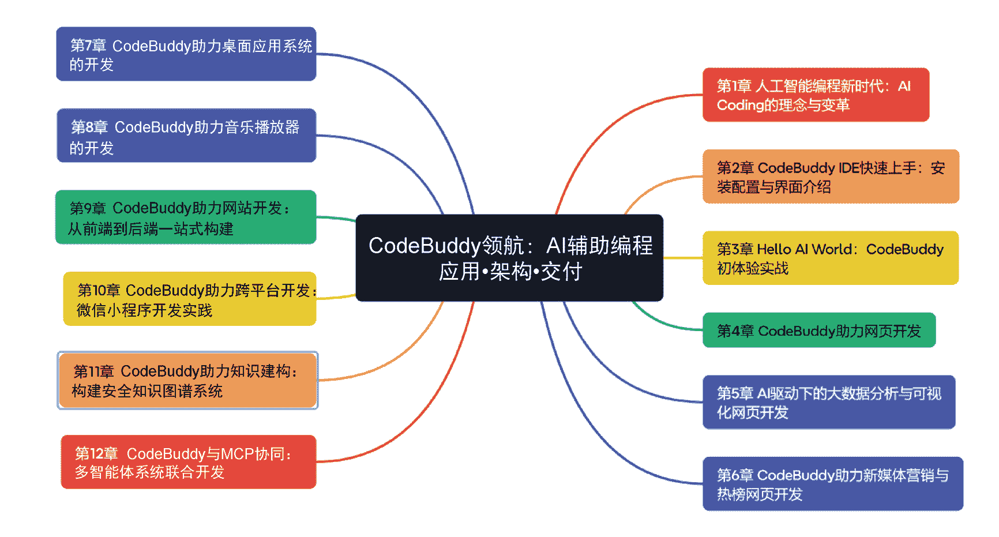
• **第一章** **人工智能编程新时代：AI** **Coding 的理念与变革** 本章系统阐述 AI Coding 理念的形成背景、技术基础及其对传统开发模式的深刻重塑。首先介绍人工智能的发展历程，从符号主义、统计学习到深度学习，重点分析大语言模型的演进及其在编程领域的应用；其次，对比 AI 编程与传统编程在驱动方式、核心角色、开发效率等多方面的差异，强调 AI 编程以自然语言意图驱动，通过人机协同提升开发效率、降低技术门槛；最后，介绍 CodeBuddy 的技术架构与优势，展现了 AI Coding 从“辅助工具”向“工程级智能协作者”演进的重要方向。

• **第二章** **CodeBuddy** **IDE 快速上手：安装配置与界面介绍。**本章系统介绍 CodeBuddy 的产品形态、版本体系与使用边界，重点阐述其插件版、独立 IDE、云端 IDE 与 CLI 这 4 种运行形态在不同开发场景下的适配策略。通过对安装流程、运行环境配置、多语言依赖管理与安全策略的详细说明，帮助读者快速完成从“零配置”到“可用环境”的过渡。同时，本章深入解析 CodeBuddy 的用户界面结构与核心功能区，包括 AI 辅助面板、调试控制台、版本控制与上下文管理机制，为后续章节的高效使用奠定坚实基础。

• **第三章** **Hello AI World：CodeBuddy 入门实操。**本章以 ToDo List 为示范项目，完整串联自然语言驱动开发的闭环。读者将体验如何把业务想法表述为提示、让模型产出工程骨架并在本地启动界面。整体呈现 CodeBuddy 在人机协作链中的角色，重点探讨协作边界的把控，强调需求建模、逻辑核验与最终决策始终由开发者主导，帮助初学者在入门阶段形成可控、理性的 AI 编程使用观。

• **第四章** **CodeBuddy 助力网页开发。**本书先回顾 Web 基础与前端交互要点，阐明 HTML、CSS、JavaScript 的分工，随后剖析 CodeBuddy 根据提示生成页面代码的运作逻辑与提示词设计方法。以在线简历、MBTI 测试、旅游门户为实战案例，展示模型在版式编排、交互实现、响应式适配上的效果，凸显智能编程将原型快速推向可用产品的效率优势。

• **第五章** **AI 驱动的大数据分析与可视化网页开发。**本章聚焦大数据场景下的分析与可视化工程，介绍 Hadoop、Spark 等关键技术，并呈现 CodeBuddy 在环境准备、数据清洗、建模及图表生成环节的自动化能力。结合引导式提示与工程示例，说明大模型如何降低数据工程门槛，使开发者更聚焦分析目标与业务语义，体现以数据理解为导向的编程方式。

• **第六章** **CodeBuddy 助力新媒体营销与热榜网页开发。**本章以内容传播与分发为背景，讲解热榜推荐逻辑、数据采集机制及交互设计原则。围绕自媒体站点搭建、新闻榜单自动生成、种草页面批量生成等案例，说明 CodeBuddy 在界面合成、数据呈现、营销素材制作方面的综合表现，反映智能编程在内容生产类系统中的规模化与智能化价值。

• **第七章** **CodeBuddy 助力桌面应用的开发和第八章** **CodeBuddy 助力音乐播放器的开发。**第七、八章分别面向桌面客户端与音频系统。先介绍 C/S 架构、Tkinter、OpenCV 及音频处理的基础概念，再通过图像处理与音乐播放器两类案例，展示 CodeBuddy 在多模态代码输出、界面构建、功能排错方面的表现，拓展智能编程在非 Web 场景的适用边界。

• **第九章** **CodeBuddy 助力网站开发：从前端到后端一站式构建和第十章** **CodeBuddy 助力跨平台开发：微信小程序开发实践。**第九、十章以 Django 全栈网站与微信小程序为核心，阐释前端、后端、数据库一体化构建的流程。以图书管理系统与小程序游戏为例，呈现 CodeBuddy 在项目初始化、数据迁移、跨平台代码生成上的协同能力，体现 AI 编程对传统软件工程流程的重塑。

• **第十一章** **CodeBuddy 助力知识建构：构建安全知识图谱系统和第十二章** **CodeBuddy 与 MCP 协同：多智能体系统联合开发。**第十一、十二章为进阶内容，围绕知识图谱构建、多智能体协作与 MCP 体系展开，描述 CodeBuddy 如何与多智能体框架联动完成复杂系统设计。借助安全知识图谱、威胁情报分析、智能审校等案例，说明智能编程正从单一代码生成工具向系统级构建平台演进。

# 资源与支持

**提交勘误**

编校团队已反复核对，仍可能有遗漏。欢迎读者反馈所发现的问题以便持续改进。发现错误时请访问异步社区 https://www.epubit.com ，搜索书名进入本书页面，点击“发表勘误”，填写信息后提交。经审核确认后，将为读者赠送异步社区 100 积分，可用于兑换优惠券、样书或奖品。

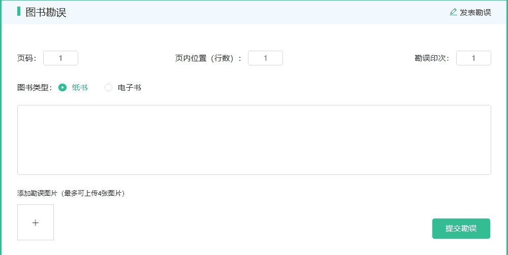

**与我们联系**

联系邮箱为 wujinyu@ptpress.com.cn。

对本书有疑问或建议，欢迎邮件沟通，并在标题注明书名以便更快回复。

若有图书出版、教学视频制作，或参与翻译、技术审校等合作意向，也可通过上述邮箱联系。

学校、培训机构或企业如需批量采购本书或异步社区其他图书，欢迎邮件洽谈。

若在网络上发现针对异步社区图书的盗版行为，包括未经授权的全文或部分传播，请将相关链接发送至上述邮箱。您的举动有助于保护作者权益，也是我们持续提供优质内容的基础。

**关于异步社区和异步图书**

“异步社区” www.epubit.com 由人民邮电出版社创办，2015 年 8 月上线，专注于 IT 专业优质内容的出版与交流，为读者提供高质量学习资源，为作者提供专业出版服务，实现线上互动，融合传统与数字出版。

“异步图书”是异步社区旗下的精品 IT 图书品牌，依托人民邮电出版社在计算机图书领域多年的积累，面向 IT 从业者及各行业使用 IT 技术的用户。

# 第一章

# 智能编程新时代：AI Coding 的理念与变革

随着大语言模型与软件开发深度结合，编程范式正由“人工主导、工具辅助”转向“人机协作、智能驱动”。AICoding 成为推动开发效率与工程思维革新的关键力量。本章系统介绍智能编程理念的形成背景、技术基础及其对传统模式的深刻重塑。

## 1.1

## AI Coding 的起源与发展趋势

人工智能是研究让计算机系统具备感知、推理、学习与决策能力的跨学科领域，其目标是模拟、扩展并增强人类智能。它并非单一技术，而是涵盖机器学习、知识表示、自动推理、自然语言处理与计算机视觉等方向的集合。其本质是通过算法与数据，使机器在不完全依赖人工规则的前提下完成复杂任务，并在动态环境中不断优化策略。伴随算力与数据规模提升，AI 从理论研究走向大规模工程应用，成为驱动信息技术与产业变革的基础。

（1）人工智能发展历程与代表阶段。AI 大致经历符号主义、统计学习、深度学习三阶段。早期符号主义以专家系统为代表，依赖人工规则与逻辑推理，例如医疗诊断系统，但扩展性有限。随后统计学习兴起，支持向量机、隐马尔可夫模型等在语音识别与文本分类中取得突破。2012 年后深度学习成为主流，卷积神经网络与循环神经网络在图像识别、语音识别与机器翻译上明显超越传统方法，AlphaGo 战胜人类棋手成为该阶段的重要里程碑。

（2）从深度学习到大语言模型的演进。在深度学习基础上，预训练与自监督学习推动了大语言模型发展。以 Transformer 为核心的 LLM 通过海量文本预训练获得通用语言理解与生成能力，代表模型包括 DeepSeek、Hunyuan、Qwen、ChatGPT、Gemini 等。其特点是参数规模大、知识覆盖广、迁移能力强。模型不再局限于单一任务，而是借助提示词完成多任务推理与生成，标志着 AI 从“任务定制”转向“通用智能工具”，为编程自动化奠定技术基础。

（3）从大语言模型到 AI Coding 的范式转变。AI 编程是大语言模型在软件工程领域的延伸，核心在于利用模型对代码语义、工程结构与开发上下文的理解，辅助乃至参与程序设计与实现。与传统代码补全不同，AI Coding 能理解自然语言需求，生成函数、模块乃至完整项目骨架，并支持跨语言与跨框架迁移。该阶段标志编程从“语法驱动”转向“语义驱动”，开发者角色从代码编写者转变为系统设计者与智能协同者。图 1-1 展示了以 CodeBuddy 为代表的 AI Coding 工具赋能编程与程序开发。

图 1-1 以 CodeBuddy 为代表的 AI Coding 工具赋能编程与程序开发

AI Coding 在提升效率、降低门槛、增强代码质量方面优势明显。一方面可快速生成样板代码、接口逻辑、测试用例，减少重复劳动；另一方面可通过语义分析发现潜在缺陷并提出重构建议。应用层面已覆盖 Web 系统开发、数据分析、科研原型构建、教学辅助等。在复杂系统中，AI Coding 支持快速迭代与跨角色协作，推动开发模式向智能化与平台化演进。

## 1.2

## 大语言模型在编程中的应用

大语言模型以深度神经网络为核心，基于海量语料预训练的通用人工智能模型，本质是在高维参数空间中学习语言统计规律与语义结构。主流模型多采用 Transformer 架构，通过自注意力机制对上下文进行全局建模，实现长序列语义依赖的有效刻画。训练范式通常为预训练—对齐—微调三阶段。预训练通过自监督学习获取通用语言能力；对齐借助人类反馈强化学习或偏好建模约束输出行为；微调面向具体任务或领域适配。该机制赋予模型跨任务迁移、语义推理与生成能力，为程序理解与代码生成提供理论基础。

自 2020 年 GPT-3 发布起，大语言模型进入超大规模预训练时代，生成能力在自然语言理解与生成任务中显著提升。2021 年 DALL·E 与 Codex 提出，标志“文本到图像”“自然语言到代码”跨模态生成的雏形。2022 年 ChatGPT 发布推动对话式 AI 与 AIGC 爆发，模型从研究工具走向大众。2023 年多模态大模型快速演进，文本、代码、图像、语音统一建模成为趋势。2024 年起 AI Coding 进入深度应用，模型开始支持复杂工程级推理与多步规划。预计 2025 年后，新一代模型将进一步推动 Agent 化编程，从“辅助编程”走向“自主协作式编程”。图 1-2 展示了大语言模型近年发展脉络。

在编程场景中，大语言模型并非简单记忆代码，而是学习大规模代码语料与自然语言说明的映射，形成对程序语义、控制结构、工程模式的抽象理解。开发者输入自然语言需求或部分上下文时，模型在高维语义空间中完成意图解析、逻辑推理、代码生成三步协同。先理解任务目标与约束，再在内部表示中构建候选实现路径，最后生成符合语法与语义的代码片段。该过程依赖上下文建模、概率生成与隐式知识迁移，可完成代码补全、函数生成、错误修复、重构建议等任务。

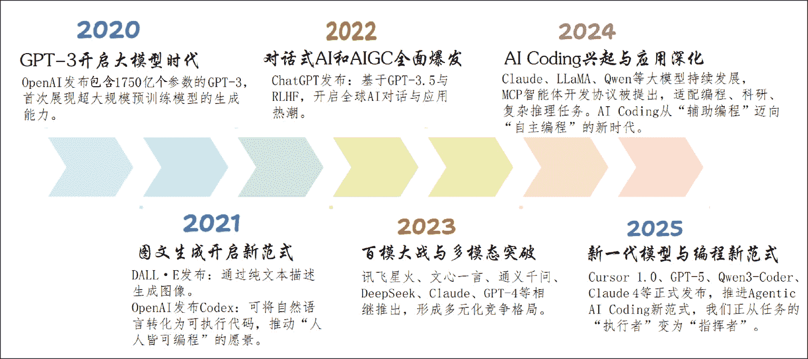

图 1-2 大语言模型近年的发展历程

基于大语言模型的 AI Coding 通常遵循“需求表达—语义理解—代码生成—反馈优化”流程。开发者用自然语言或半结构化提示词描述目标，模型解析语义并结合上下文代码与工程结构生成候选方案，随后通过运行反馈、错误信息或人工评价修正优化。在工程化系统中如 CodeBuddy，该流程嵌入 IDE 与开发管线，支持项目级上下文理解、跨文件推理与持续交互式优化。核心是将大语言模型作为智能编程协作者，通过人机协同系统性提升效率与质量。

图 1-3 展示 AI Coding 基本流程，可概括为“人机协同—迭代优化—自动应用”闭环，本质是将开发者高层意图逐步转化为可执行软件。

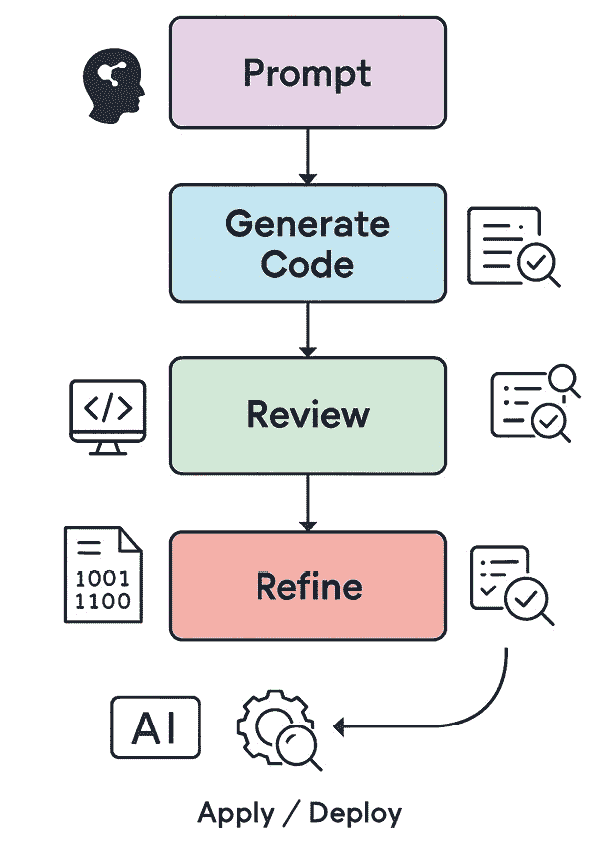

图 1-3 AI Coding 基本流程

首先是 Prompt，意图表达阶段。开发者以自然语言描述需求、约束与目标功能，Prompt 是人类认知与模型间的接口，承担将抽象业务意图映射为可计算语义的作用，需求清晰度与语义精确性决定后续质量。

其次是 Generate Code，代码生成阶段。模型基于大规模代码语料与工程知识学习，对 Prompt 进行语义解析，自动生成代码结构、函数逻辑或项目骨架，体现语法建模、模式迁移与上下文推理能力，实现从自然语言到程序语言的转换。

再次是 Review，代码审查阶段。生成代码需经人工或 AI 辅助检查语义正确性、逻辑一致性、安全性与规范性，相当于传统工程中的评审与测试前置，用于发现缺陷与设计不合理。

最后是 Refine，迭代优化阶段。开发者根据审查结果反馈，模型据此修改、补全或重构，实现多轮低成本迭代，体现 AI Coding 通过人机交互持续逼近最优实现的优势。

## 1.3

## AI 编程与传统编程的对比

AI Coding 以大语言模型等人工智能技术为核心，将自然语言理解、程序语义建模与自动代码生成深度融入软件开发全过程。在此范式下，AI 不仅能补全代码、生成函数、修复错误，还能理解高层业务意图，参与系统设计、逻辑推理与工程实现，实现人机协同开发。

AI Coding 通过学习大规模代码与文本语料，建立自然语言需求与程序结构之间的语义映射，使编程从以语法为中心的指令式实现转向以意图为导向的语义驱动构建，在提升效率的同时降低门槛，推动软件工程向智能化、自动化、协同化发展。表 1-1 详细对比 AI 编程与传统编程。

表 1-1 AI 编程与传统编程的对比

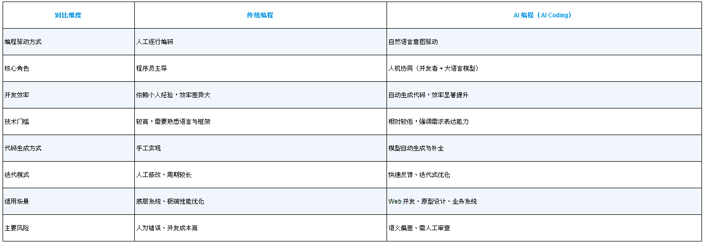

传统编程以人为中心，强调程序员对算法逻辑、数据结构、系统架构的显式设计，核心流程为“需求分析—手工编码—调试测试—迭代维护”。该模式高度依赖开发者专业经验与语言熟练度，效率与质量受个体能力限制，在复杂系统或快速迭代场景下成本较高。

AI 编程以大语言模型为核心，将自然语言理解、代码生成与语义推理引入开发过程，形成“意图表达—自动生成—人机协同审查—迭代优化—快速部署”的新范式。开发者不再逐行编写代码，而是通过高层语义描述驱动模型构建与重构。

从工程角度看，AI 编程显著降低技术门槛，提升开发效率与原型速度，尤其在样板代码、接口开发、测试用例补全、跨语言迁移上优势明显。同时生成结果仍需人工校验，以避免语义偏差、安全隐患或业务理解错误。总体而言，AI 编程并非替代传统编程，而是通过人机协同重塑软件工程生产方式，使活动从“代码驱动”向“意图驱动”演进。图 1-4 展示了以 CodeBuddy 赋能应用为代表的大语言模型典型场景，尤其是智能化编程。

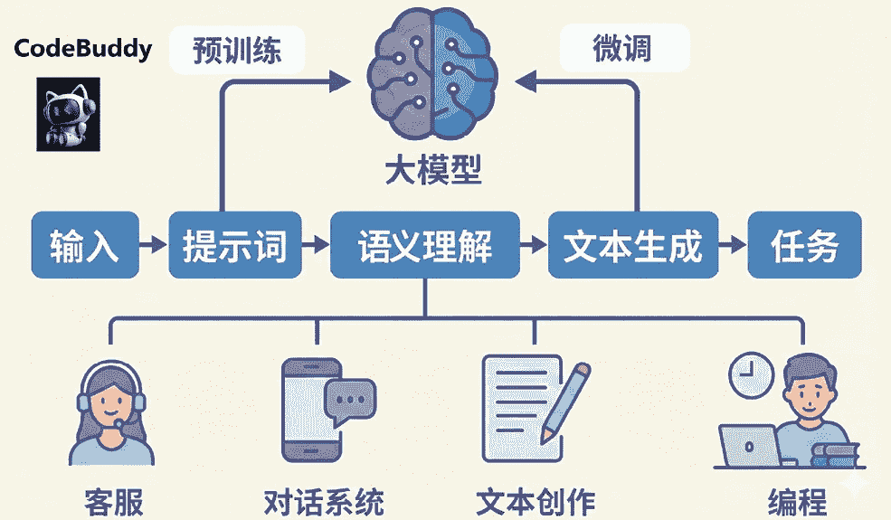

图 1-4 大语言模型典型应用场景

## 1.4

## CodeBuddy 的技术架构与优势

CodeBuddy 是腾讯自研的覆盖全栈开发生命周期的智能编程助手，通过插件、独立 IDE、命令行工具 CodeBuddy Code 三种形态，为从需求到部署各环节提供 AI 辅助。CodeBuddy 是一类以大语言模型为核心、面向全开发生命周期的智能 AI Coding 平台，核心理念为“意图驱动编程”，将开发者高层业务需求、设计意图与工程约束转化为可执行程序结构、代码实现与工程配置，显著提升效率、一致性与可维护性。图 1-5 展示 CodeBuddy 官方网站，其核心目标是“无论开发环境如何，CodeBuddy 都能助你心无旁骛，释放创造潜能，实现效率极致飞跃”。

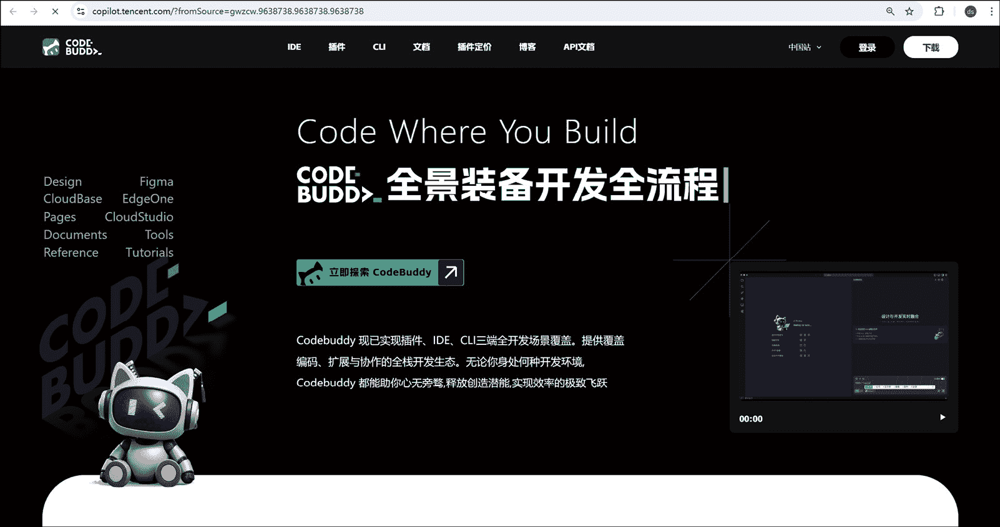

图 1-5 CodeBuddy 官方网站

从系统形态看，CodeBuddy 通过插件、IDE、CLI 三端协同，覆盖主流开发场景，构建贯穿“编码—调试—重构—测试—部署—协作”的一体化智能开发生态，突破单一工具辅助编码局限，使 AI 深度参与软件工程关键阶段，成为持续在线的智能开发协作者。

1. IDE：提供智能代码补全、注释生成、代码解释、缺陷检测、Figma 设计稿转代码、智能生成项目文档等能力，实现设计到编码全流程辅助。
2. 插件：嵌入主流 IDE 如 VS Code，提供行内/函数级补全、自然语言生成代码、自动化单元测试等功能，在熟悉工具中实现无侵入即时辅助。
3. CLI 工具 CodeBuddy Code：在终端中用自然语言驱动开发、调试、部署与运维，无缝衔接 Git、编译器等工具链，支持 ACP 协议与第三方编辑器集成，适用于命令行、服务器运维与远程开发场景。

技术层面，CodeBuddy 以大语言模型为认知中枢，结合代码理解、上下文感知与工程知识注入，实现复杂软件项目的语义级建模。核心工作流程包括对开发上下文的代码库、依赖关系、配置文件、历史修改记录的持续感知，以及对自然语言需求与代码语义的双向映射。

（3）借助内置推理与生成模块，可输出符合工程规范的代码实现、注释说明、测试样本与重构建议。
（4）在开发者反馈和真实运行结果的驱动下实现持续迭代优化。

相较于传统只做静态补全的工具，CodeBuddy 能把握整个项目的架构与业务含义，支持跨文件、跨模块甚至跨语言的联动生成与一致性保障，有效减轻系统演进时的认知压力。

在现有架构与能力支撑下，CodeBuddy 在多个维度体现出明显的技术优势。

（1）**全场景适配能力**。形态包括插件、独立 IDE 与 CLI，可无缝嵌入本地开发、云端开发和自动化流水线，覆盖个人开发、团队协作到企业级工程的多种需求。

（2）**全栈智能辅助**。功能不仅限于代码生成，还延伸到需求理解、接口设计、缺陷定位、性能调优、文档生成与协作支持，形成从编码到协作的完整生态。

（3）**上下文感知及工程一致性保护**。通过持续建模项目上下文，在生成与修改时保持架构统一、风格一致、依赖正确，避免碎片化生成带来的工程风险。

（4）**人机协同增强式开发范式**。不替代开发者，而是以“生成—审查—修正—再生成”的闭环，让开发者聚焦系统设计与业务抽象，AI 负责高频、重复且易错的环节。

总体来看，CodeBuddy 标志着 AI Coding 从“辅助工具”向“工程级智能协作伙伴”演进的重要方向。凭借多端协同的产品形态与深度语义理解能力，为开发者打造专注、高效、低干扰的智能开发环境，释放人类在创造性建模和系统思维方面的潜力，为新一代软件工程提供更具落地价值的技术路径。

# 第二章

# CodeBuddy IDE 快速上手：安装与界面概览

本章提供一套可复用 CodeBuddy IDE 入门方法，通过安装配置与功能说明帮助读者快速上手。首先介绍独立版、插件版与 CLI 三种形态，分清它们在不同开发环境、工具链与运行架构下的适配情况，并给出统一的安装与账号初始化流程。其次拆解界面布局，阐释导航区、代码编辑区、AI 辅助区与输出区在智能开发中的功能定位及协作关系，为后续交互式开发打下基础。

本章还将说明项目初始化、资源文件管理、多语言支持及插件扩展的做法，把 CodeBuddy 从“可安装”推进到“可用、可维护、可拓展”。掌握本章内容后，读者即可完成开发环境的基础搭建，并具备研读和实践后续章节场景化案例的前提。

## 2.1

## 版本形态与部署全流程

本节详细说明 CodeBuddy 的部署要点，涵盖形态介绍与适用场景、获取方式与安装步骤、版本选择与兼容性、依赖修复与包管理优化。

### 2.1.1

### 形态概览与场景适配

本节归纳 CodeBuddy 在本地、云端和自动化场景下的主要承载形态，说明各形态的分工、能力边界与典型用途，为后续获取、安装与配置提供认知基础。总体上，CodeBuddy 基于同一套智能开发内核，即以自然语言或对话指令驱动开发与工程化操作，结合项目级上下文提供辅助，最终落地到可执行的环境；不同形态的区别主要体现在运行位置、与现有工具链的绑定方式以及对本地资源的依赖程度。本节将平台形态划分为本地独立 IDE、桌面 IDE 插件、Cloud Studio 云端 IDE 与命令行形态四类。

**1. 产品定位与使用边界**

CodeBuddy 的核心定位是具备 AI 助力的集成开发环境。相比仅提供语法高亮、调试、构建的传统 IDE，其特点在于将大模型语义理解与开发流程深度结合：一方面，开发者可用自然语言描述业务需求、界面结构、函数功能、测试用例等，由系统生成初版代码或配置；另一方面，系统可读取项目现有文件、目录结构与上下文，据此给出符合当前工程状态的增量代码、重构建议或文档内容。这意味着 CodeBuddy 既要保留常规 IDE 的工程管理能力，也要提供对话式、上下文感知的智能能力。在 2.0 能力体系下，其角色已超越编码阶段的辅助工具，进一步覆盖需求生成、设计到代码转换、工程化生成以及沙箱部署与结果校验等环节。

在使用边界上，本书把 CodeBuddy 视作可在多形态环境中部署的开发入口，而非单一桌面工具。后续章节提及的界面区块、项目初始化、文件管理、插件扩展等内容，均可在本节所述四种形态中对应操作，只是呈现位置与调用方式不同。本节重点说明形态的存在及适配范围，具体界面操作将在 2.3 节后展开。

**2. 版本形态功能介绍**

（1）**本地独立版 IDE**。本地独立版是最完整的编程形态，安装到桌面操作系统后即可独立运行，包含项目资源视图、编辑区、AI 辅助面板、终端/输出区等，可在单一界面内完成创建工程、编写代码、调用智能生成到运行调试的完整流程。

该形态适用于以下情况：需在一台终端完成全部开发活动；在培训、演示、课堂场景中展示“从自然语言到可运行程序”的全过程；对本地文件、脚本、工具链要求完全掌控的场景。图 2-1 展示 CodeBuddy 本地独立版界面。

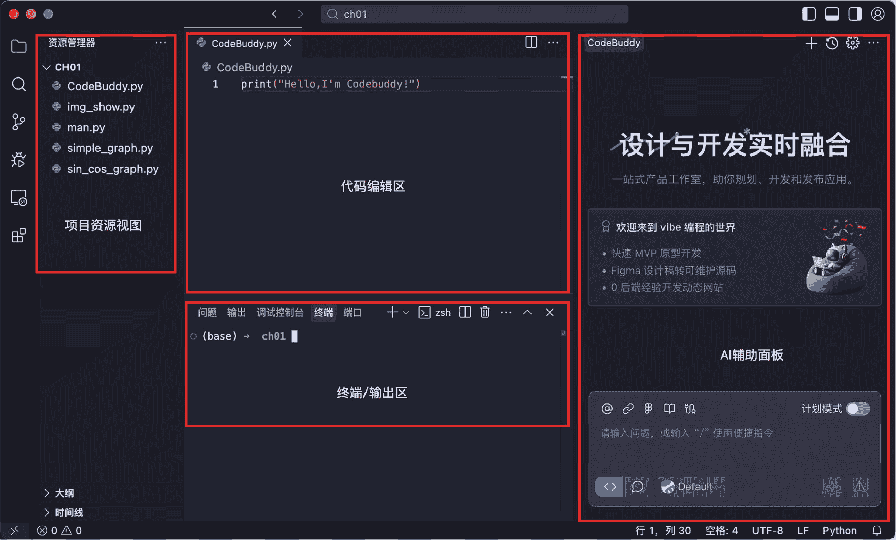

图 2-1 本地独立版界面

（2）**CodeBuddy 桌面 IDE 插件版**。如图 2-2 所示，插件版以扩展形式嵌入现有开发工具，如 VS Code、IntelliJ IDEA、PyCharm 等。其思路是不改变既有项目结构、不更换开发者熟悉的编辑器，仅在现有 IDE 中提供与模型对话、请求生成、对当前文件做分析的入口。插件通常体现为侧边栏面板、命令面板条目或上下文菜单项，调用后即可使用与独立版相同的智能能力。

该形态适用于以下情况：已有成熟项目和构建脚本，难以迁移到新 IDE；团队已统一使用某桌面 IDE，希望在其上叠加 AI 能力；在同一项目中需频繁切换本地编辑与 AI 生成。此形态强调“与现有工具链共存”。

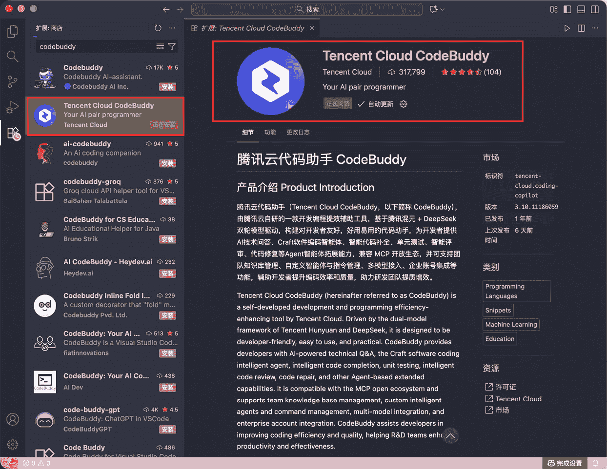

图 2-2 桌面 IDE 插件版示意

（3）**CodeBuddy Cloud Studio 云端 IDE**。Cloud Studio 形态指在浏览器或云端工作空间中直接使用的在线版本，如图 2-3 中的官方页面介绍所示，其特点是无需本地安装桌面应用，开发环境、模型接入、依赖版本均由云端统一维护。该形态可有效规避本地操作系统差异、网络出口限制、团队成员机器配置不一致等问题，适用于教学实训、临时开发、跨设备协作、企业希望统一开发环境的场景。

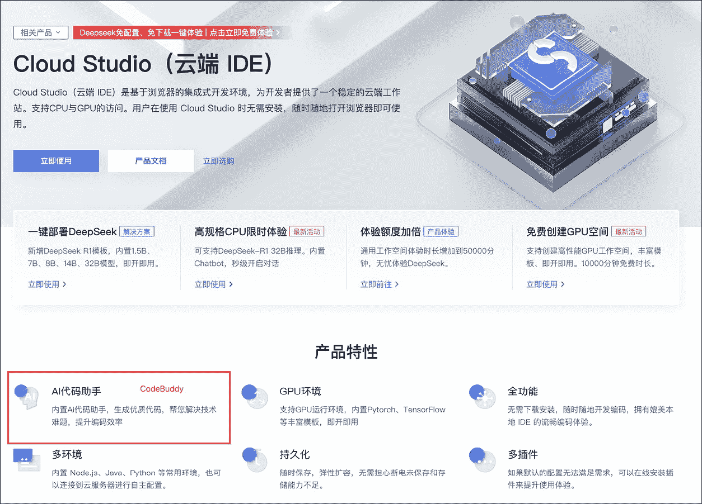

图 2-3 Cloud Studio 官网介绍

与本地独立版相比，云端 IDE 在界面结构上基本一致，如图 2-4 所示，同样包含资源列表、编辑区和 AI 侧栏，但在运行方式上依赖浏览器和在线工作空间，因此使用前应确认网络可达性和账号统一性。

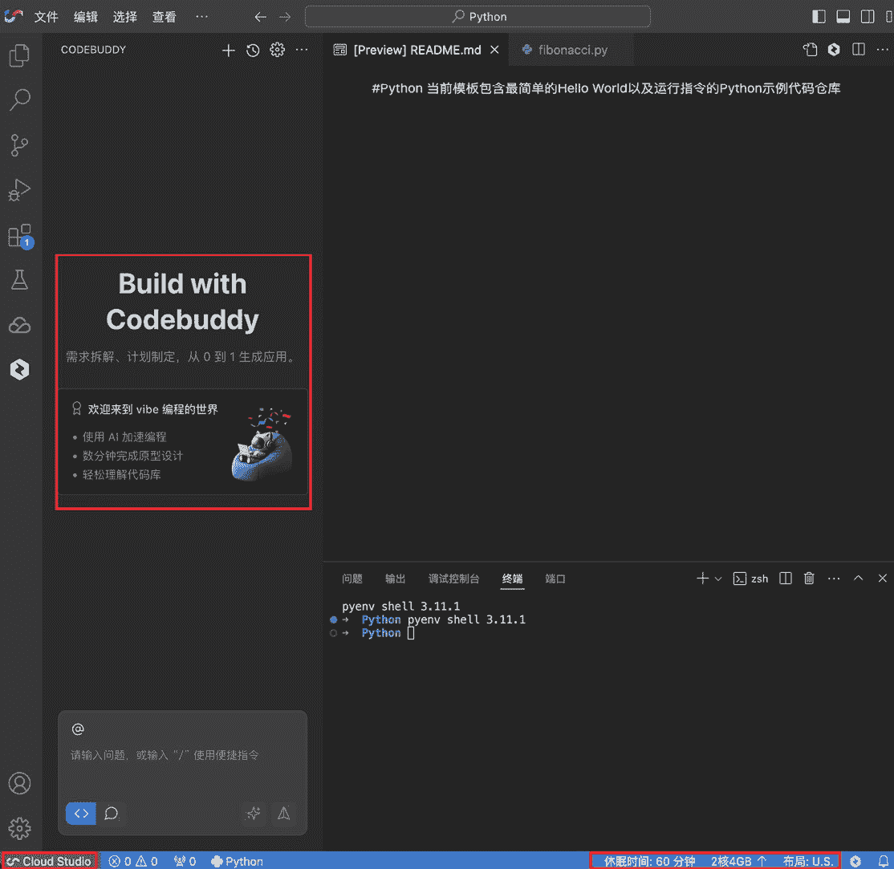

图 2-4 Cloud Studio 主页面

（4）**CodeBuddy CLI 命令行形态**。CLI 形态主要面向终端、自动化和 CI/CD 流水线场景，用于在无图形界面或无需启动完整 IDE 的情况下，直接通过命令调用 CodeBuddy 的生成、改写、说明等能力。典型用途：在构建脚本中调用以批量生成模板代码；在提交前调用以进行说明或规范性检查；在远程服务器或容器环境中调用以减少手工编辑。图 2-5 展示 CLI 形态调用示意。

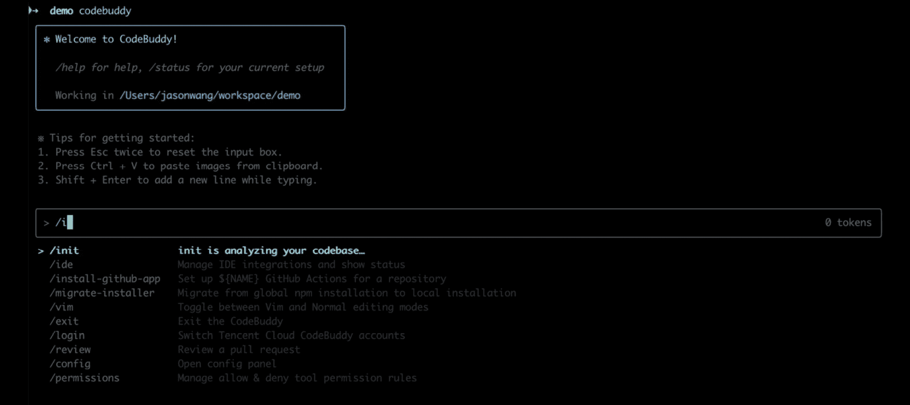

图 2-5 CLI 形态调用示意

熟悉四种编程形态后，可依据实际开发任务、所处环境、工具链配置以及任务类型选择最合适的产品形态。随后将逐一介绍各形态的获取方式和安装流程。

### 2.1.2

### 获取方式与安装流程详解

本节详细阐述 CodeBuddy 在不同编程环境下的获取与安装流程，确保在桌面、本地 IDE、云端 IDE 以及命令行中均能顺利部署。

CodeBuddy 的获取与安装可概括为“四段式流程”——获取安装介质或访问入口→本地安装或在线启用→首次登录与账号校验→按需扩展与多端统一。

**1. 本地独立版 IDE 获取与安装**

（1）**下载安装包**。使用本地独立版前，需从官方发布页面下载与当前操作系统、处理器架构匹配的安装包，如图 2-6 所示。下载页通常同时提供 Windows 版本、macOS Intel 版本以及 macOS Apple/ARM 版本，用户应按本机情况选择对应版本。

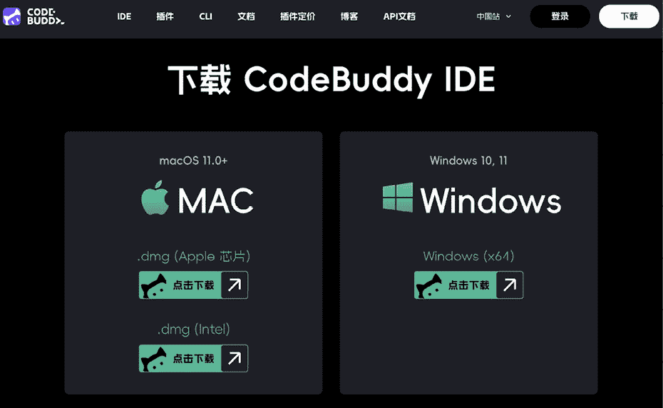

图 2-6 安装包下载页面

（2）**Windows 平台安装**。在 Windows 环境中，双击下载的安装程序进入安装向导。

① 许可确认界面：用户需阅读许可协议并选择“我同意此协议”方可继续，如图 2-7 所示。

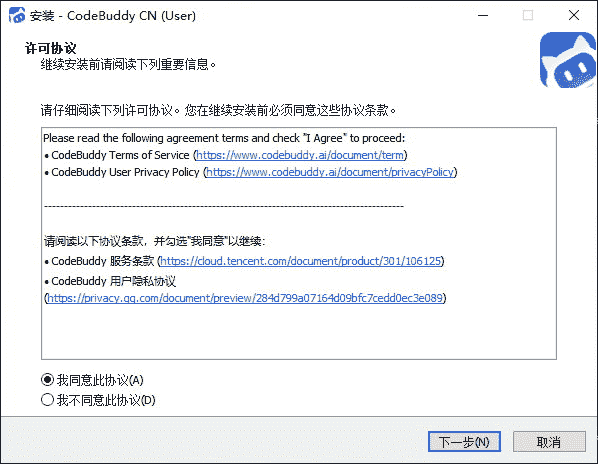

图 2-7 Windows 安装向导——许可确认

② 安装路径选择界面：可使用默认路径，也可自定义安装位置，建议使用英文路径以减少后续脚本调用问题，如图 2-8 所示。

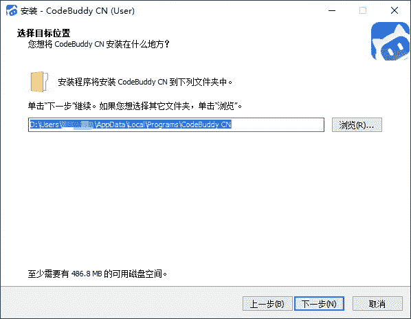

图 2-8 Windows 安装向导——路径选择

③ 选择附加任务界面：可创建桌面快捷方式，也可将 buddy 命令加入 PATH，如图 2-9 所示。

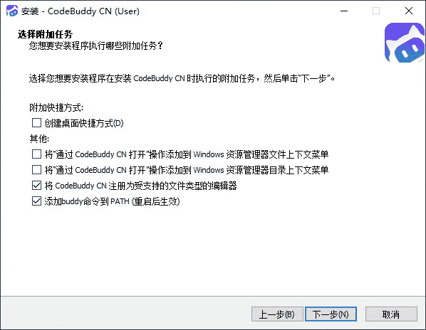

图 2-9 Windows 安装向导——附加任务

④ 安装完成界面：复制完成后可勾选“运行 CodeBuddy CN”，以便立即进入登录界面，如图 2-10 所示。

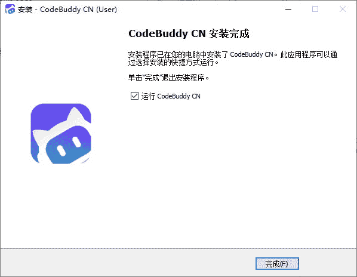

▲图 2-10 Windows 安装向导——完成

（3）**macOS 平台安装**。在 macOS 环境中，下载的文件通常为 .dmg 或打包应用。双击打开后，将 CodeBuddy 应用图标拖入“Applications”目录即可完成安装，如图 2-11 所示。首次启动若出现系统安全提示，应选择“仍要打开”或在“系统设置-隐私与安全性”中信任该应用后重新启动。

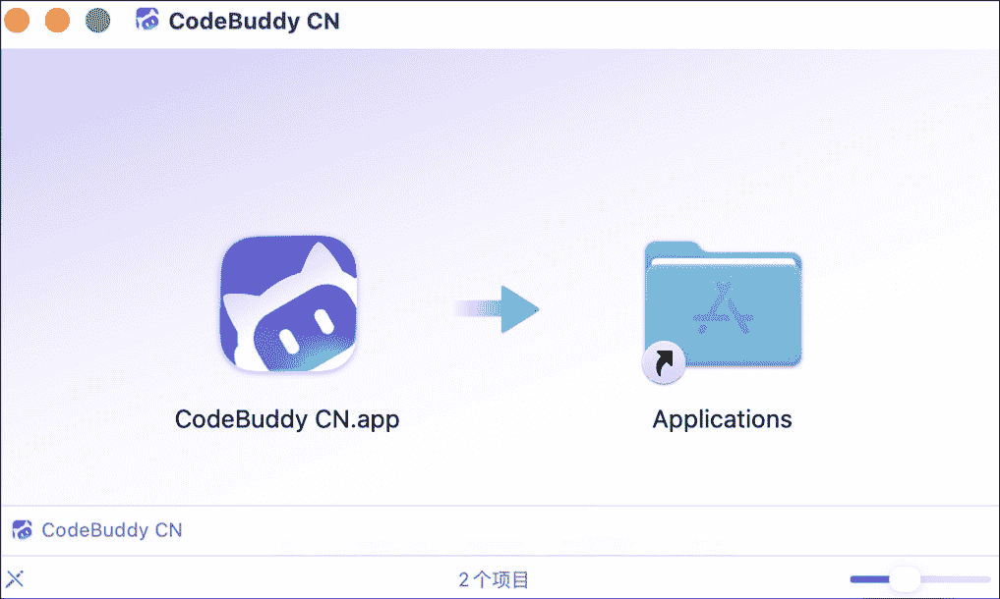

图 2-11 macOS 安装示意

（4）**首次启动**。首次启动本地独立版 IDE 时，将进入欢迎或登录界面，如图 2-12 所示，界面通常引导用户进行风格选择、导入配置从 VS Code 或 Cursor 导入。随后只需完成账号认证，无需立即创建项目。

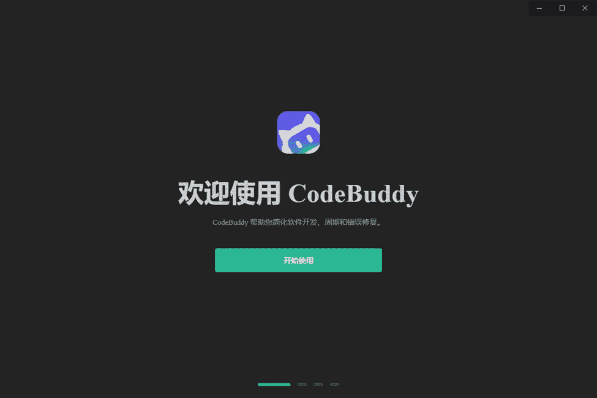

图 2-12 首次启动登录界面

**2. 桌面 IDE 插件版获取与启用**

插件版适用于已在使用 VS Code、IntelliJ IDEA、PyCharm 等桌面 IDE 的用户，通过在宿主 IDE 中安装扩展获得 CodeBuddy 的辅助编程能力。

（1）**VS Code 中的获取**。打开 VS Code，进入左侧“扩展”面板，在搜索框输入“CodeBuddy”关键字，即可看到对应插件条目，单击“安装”完成在线安装，如图 2-13 所示。若处于内网环境，可先在可联网设备通过 Open VSX 市场获取 VSIX 格式插件包，如图 2-14 所示。

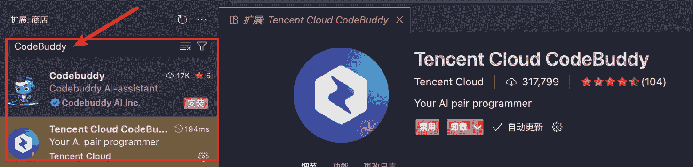

▲图 2-13 VS Code 中搜索并安装插件

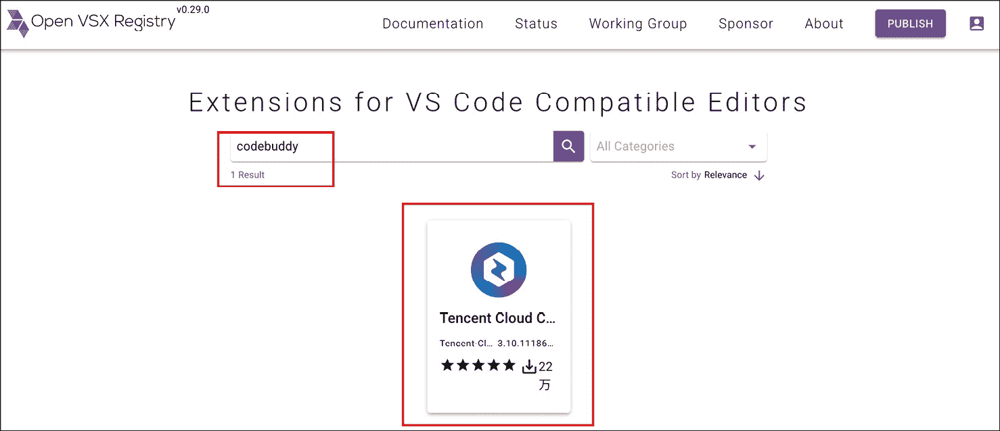

图 2-14 Open VSX 市场搜索插件

在本地 VS Code 中，使用“从 VSIX 安装”功能导入 VSIX 文件进行离线安装，如图 2-15 所示。

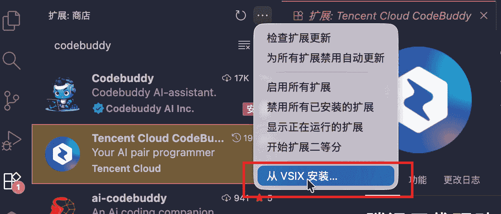

图 2-15 离线安装 VSIX

（2）**JetBrains 系列 IDE 中的获取**。在 IntelliJ IDEA、PyCharm 或其他 JetBrains IDE 中，依次进入“Settings/Preferences”→“Plugins”，在 Marketplace 中搜索“CodeBuddy”，单击“Install”安装，完成后重启 IDE 使插件生效。

（3）**启用与面板位置**。插件安装成功后，IDE 通常会在侧边栏、底部工具栏或命令面板中新增“CodeBuddy”入口，如图 2-16 所示，单击即可打开对话/生成面板。

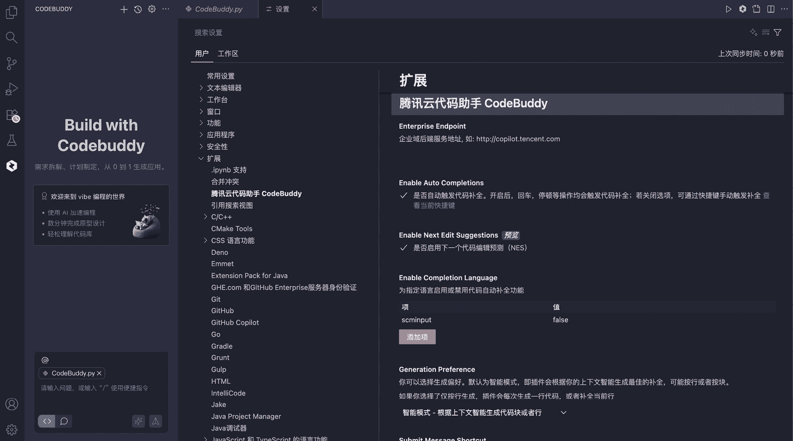

图 2-16 插件版侧边栏入口

为确保插件能力稳定运行，安装前应确认所用 IDE 版本满足最低兼容要求。不同 IDE 在扩展机制、终端能力及语言服务接口上存在差异，若版本过低可能导致插件无法加载或部分能力不可用。当前版本最低支持要求如表 2-1 所示。

表 2-1 CodeBuddy 插件版最低 IDE 版本要求

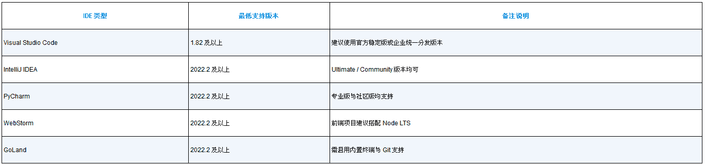

在企业或内网环境中，若 IDE 版本由统一镜像或集中管理策略控制，应在部署插件前与运维或 IT 管理部门确认版本基线，以免后续因 IDE 升级受限影响 CodeBuddy 插件的正常使用。

**3. Cloud Studio 云端 IDE 启用**

Cloud Studio 形态无需本地安装，关键在于“访问入口正确”与“账号统一”。

（1）**访问与登录**。在浏览器中访问 Cloud Studio 云端工作空间，如图 2-17 所示，进入登录页后使用已有账号认证，认证方式可与本地独立版保持一致，以便后续同步模型与项目配置。

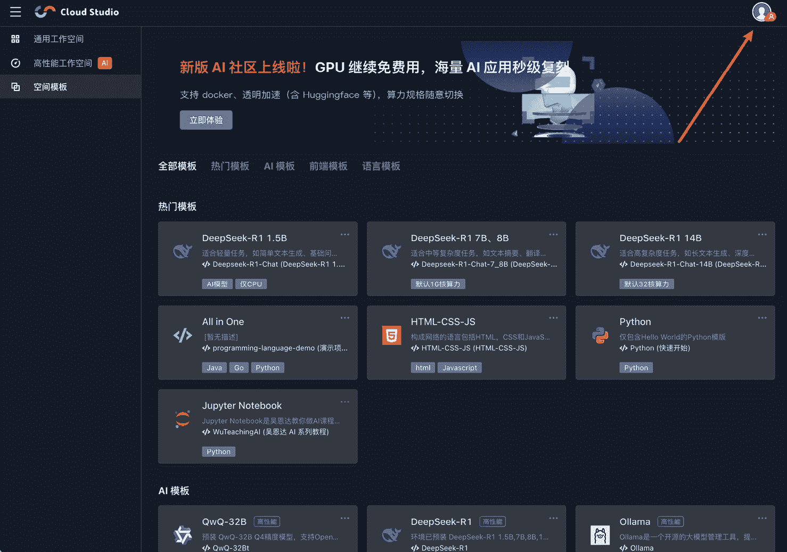

图 2-17 云端工作空间

（2）**创建在线工作空间**。首次登录后，需创建或选择一个在线工作空间，如图 2-18 所示。

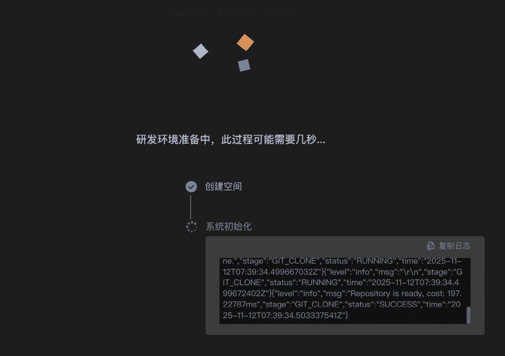

图 2-18 在线工作空间创建

该工作空间将承载所有在线项目、文件与 AI 交互，选择完成后即可进入与本地 IDE 类似的主界面。

（3）**在线界面启用**。进入工作空间后，云端 IDE 会展示资源管理器、编辑区与终端/输出区等，如图 2-19 所示。此时无需任何本地安装，即可进行编辑与 AI 生成。

此外，它也适用于对特定片段进行操作如解释、修复，无需手动打开面板，操作步骤如下，详情如图 2-20 所示。

① 在编辑区选中目标片段如函数、循环逻辑。
② 选中后，代码上方自动弹出功能选项栏含“解释代码”“生成文档”“修复代码”等。
③ 单击对应选项触发 AI 处理如单击“解释代码”生成逻辑说明。

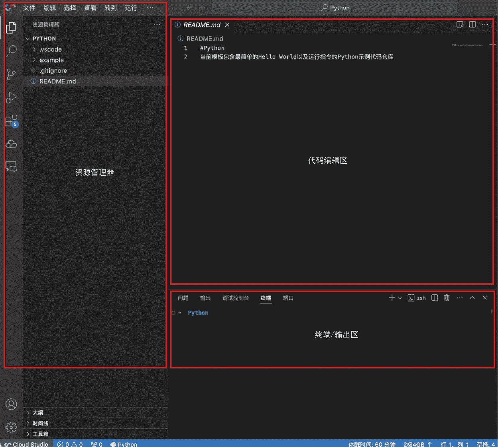

▲图 2-19 云端 IDE 主界面

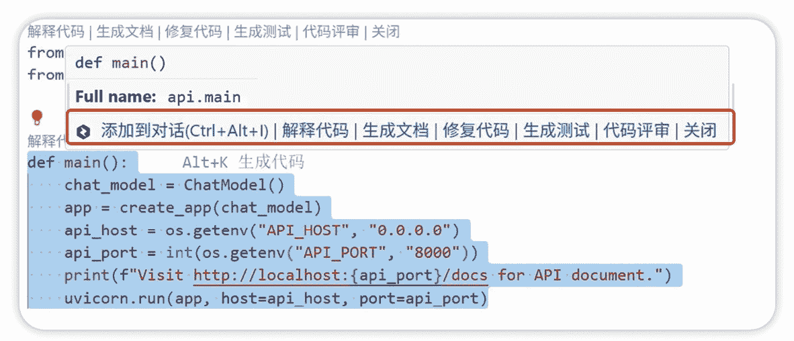

图 2-20 选中代码自动触发场景

**4. CLI 形态安装与初始化**

CLI 形态可通过 npm 一键安装，但需确保计算机已安装 Node.js 22+ 和 Git 等基础环境。Node.js 侧推荐使用 LTS 版本以确保稳定性。

第一步，下载对应系统的 LTS 版本，按向导完成安装 Windows 用户注意勾选“Add to PATH”选项。

第二步，验证安装，打开终端 Windows 用户用 PowerShell、macOS/Linux 用户用 Terminal，输入以下命令检查版本。

node -v  # 输出 Node.js 版本号，如 v20.10.0
npm -v   # 输出 npm 版本号，如 10.2.3

若提示“命令不存在”，则需检查环境变量是否配置正确 Windows 可重启终端后重试。

第三步，国内镜像配置：为提升 npm 包下载速度，国内用户建议切换国内镜像。

# 淘宝源

# 换源提速、CLI 快速上手

npm config set registry https://registry.npm.taobao.org/

# 腾讯源

#npm config set registry https://mirrors.cloud.tencent.com/npm/

#恢复官方源：

#npm config set registry https://registry.npmjs.org/

想让安装走得更快，先把镜像源切到合适节点。全局生效的安装命令是：

npm install -g @tencent-ai/codebuddy-code

三种常见落地方案：

（1）IDE 内一键装。打开 CodeBuddy 编辑器后，左侧 Craft AI 面板点「安装 CLI」，编辑器会自动调起终端完成部署。
（2）手动走终端。直接在编辑器内置终端或项目目录里执行上面的 npm 指令即可。
（3）Windows 全局装。用管理员权限启动 PowerShell，任一目录下运行安装命令，写入位置通常为 C:\Users\用户名\AppData\Roaming\npm，确保命令可被系统识别。

装完先登录绑定账号，支持多种方式以匹配不同模型需求。终端输入 codebuddy 启动命令行形态，如图 2-21 所示。

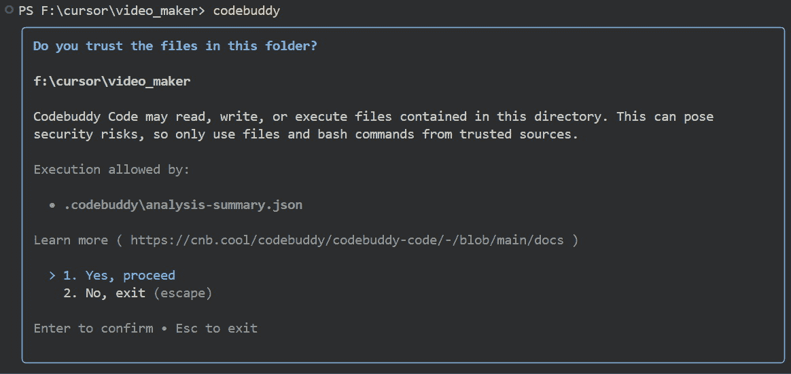

图 2-21 CLI 形态启动

启动后浏览器会自动打开登录页，如图 2-22 所示。第一次使用需要先注册。

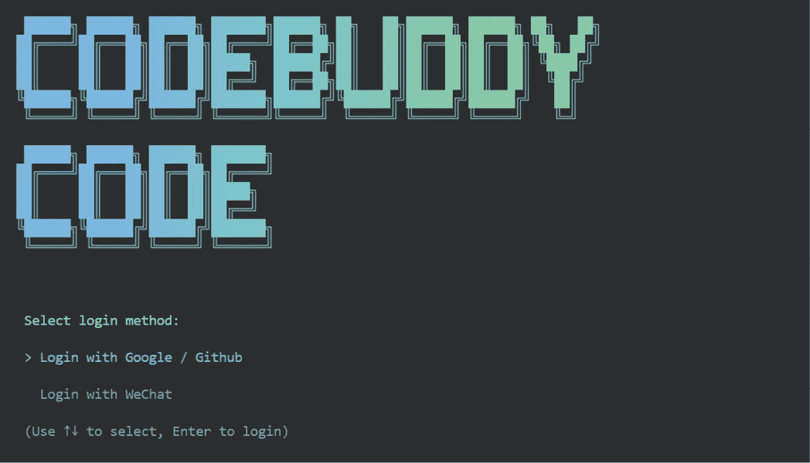

图 2-22 CLI 形态登录界面

登录通过后终端会提示认证成功，CLI 进入可用状态，执行 codebuddy --help 可查看全部指令。

**2.1.3**

**CodeBuddy 版本选择与兼容性要点**

明白安装流程后，还要从系统适配、芯片适配、版本统一三方面提前评估风险，保证后续模块在稳定环境中运行。

下载本地独立版编辑器时，先核对系统类型与处理器规格，优先挑选与本机一致的安装包，避免卡顿、依赖加载失败或本地推理不可用。具体要求如下。

（1）**操作系统对应。**
• Windows 请选用官方发布的 Windows x64 包，避免在 32 位或精简系统上部署。
• macOS 要区分 Intel 与 Apple Silicon M 系列，两者不互通。
• 使用 Cloud Studio 这类云端 IDE 时不受本地系统限制，但浏览器版本与网络策略仍需满足云端要求。

（2）**处理器架构对应。**2025 年后版本对 ARM 及 Apple M 系列做了优化，前提是安装对应 ARM 包。若在 M 芯片上误装 Intel 版，系统可通过兼容层运行，功能能用但图形响应与性能会下降，不建议用于正式开发。下载页请明确选择“macOS（Apple/ARM）”或等价标识。

（3）**版本一致性。**同一团队或教学场景建议统一安装包版本与架构，防止界面差异、插件加载顺序不同或模型列表不一致。对长期维护的环境，可把选定版本存入企业镜像库或内部文件服务器统一分发。

**2.1.4**

**依赖修复与包管理优化**

项目运行一段时间后会累积大量第三方库，容易出现版本漂移、锁文件不同步、漏洞包未升级。CodeBuddy 的做法是把依赖健康维护交给编辑器与 AI 协同。

健康检查步骤：先在编辑器内置终端执行检查命令，Python 相关如下。

pip check

pipdeptree

Node 相关如下。

npm ls

npm audit

pnpm audit

把输出复制到 CodeBuddy 对话窗口作为“终端报错/输出上下文”，让 AI 解析冲突成因、受影响模块、可行升级路径，以及是否会影响镜像体积或运行时兼容。AI 能结合项目语言、框架与构建方式给出贴合实际的修复脚本，而非简单建议升级最新版。

当技术栈跨语言，例如前端用 pnpm、后端用 pip，可在项目根目录新增统一的依赖管理说明，写明镜像基线、可用的内部镜像源、升级节奏、锁文件规范，并通过 CodeBuddy 的“规则/知识”功能长期挂载，新成员打开项目即可自动获取，减少“本地可装、线上装不上”的沟通成本。具体建议如下。

（1）建议采用本地独立 IDE 为主工作区，常用桌面 IDE 补充插件版，需要统一环境或跨终端访问时启用 Cloud Studio，自动化与流水线中并行部署 CLI，保持同一账号与模型策略。
（2）在企业或内网环境中，涉及镜像、代理与证书，需关注镜像管理与离线分发策略、代理配置、证书与信任链管理、网络连通性验证等。

完成版本匹配、形态组合与内网适配后，后续仍需细化运行时依赖、语言环境、模型调用策略、代理设置等，尤其在调用本地编译器、Python/Node 运行时、GPU 加速或内网分级访问外部服务时。

## **2.2**

## **CodeBuddy 运行环境与依赖配置**

本节说明如何为 CodeBuddy 配置运行环境，确保其在不同操作系统、开发语言与网络环境中稳定运行，并保证生成代码的可构建与可部署。准备工作不仅涉及语言运行时，还包括包管理器、虚拟化/容器化隔离、企业网络访问控制与修复机制。

**2.2.1**

**多语言运行时与依赖管理**

CodeBuddy IDE 的定位是一体化智能开发环境，不会强行内置语言运行时，而是尊重本地已有技术栈，在此基础上提供语义分析、自动补全、AI 生成与重写能力。使用时需为所选语言准备可用运行时，并确保被系统 PATH 或编辑器配置识别。

以 Python 为例，建议先安装官方发行版或企业内部镜像源的 Python 3.x，再按以下步骤配置。

（1）创建虚拟环境。项目根目录执行：

python -m venv .venv

（2）激活并安装依赖。
① UNIX/Linux/macOS：

source .venv/bin/activate

pip install -r requirements.txt
② Windows：

.venv\Scripts\activate

pip install -r requirements.txt

这样可将项目依赖与系统 Python 解耦，编辑器扫描到 .venv 后会自动识别为当前工程解释器，后续 AI 生成代码也会以该环境为基准推断依赖。

前端项目需安装 Node.js，建议 LTS，以及 npm 或 pnpm、Yarn 等包管理器。项目必须存在 package.json，否则编辑器无法判断依赖树、脚本与构建目标。团队若需区分 Node 版本，可用 nvm 或企业内部版本管理服务在不同项目间切换后再启动编辑器，避免“能跑但构建失败”。

Java 项目需预装 JDK，按规范选择 Maven 或 Gradle。CodeBuddy 会解析 pom.xml 或 build.gradle，将依赖声明、插件、构建任务纳入项目视图；AI 生成新模块或第三方库时，也能基于已有构建脚本给出贴近工程风格的修改建议。

CodeBuddy 会对典型依赖清单文件 requirements.txt、package.json、pom.xml 等做优先级识别，将其作为“项目真实依赖来源”。用户在对话区提出“补齐依赖”时，编辑器以这些文件为入口生成安装命令或脚本；在服务器或 CI 环境中，可通过已安装的 CodeBuddy CLI 调用同一流程，保证本地开发与远程构建一致。

**2.2.2**

**虚拟环境与容器化支持**

随着项目与插件增多，同一台机器容易出现“系统 Python 3.8、老项目要 3.7、新项目用 3.11”的冲突；Node 生态也常见不同项目使用不同构建工具。因此推荐为每个项目独立配置专属运行环境作为基础实践。

Python 项目可将 .venv、conda 或 .env 放在项目根目录，编辑器打开项目时自动扫描并列出可用解释器，选定后代码运行、Lint、测试、AI 补全均以该环境为准。

Node 项目可借助 nvm use 并结合 .nvmrc、.node-version 等约定文件，进入项目时自动切换目标版本，再启动编辑器，避免频繁手动切换。

对于高安全要求、协作、统一镜像交付的类型，可直接用容器作为开发运行时。典型做法是在仓库提供 Dockerfile 或 docker-compose.yml，定义基础镜像、语言运行时、系统依赖、构建工具，随后本地启动容器，通过 Remote/SSH 或挂载方式将编辑器绑定到该环境。开发者本机只需安装最小化集成开发环境，真正影响构建结果的依赖封装在镜像内，可复现且便于 CI/CD 复用。

容器化还能把网络、证书、代理等企业内网访问配置固化在镜像中。若 CodeBuddy 需访问私有 npm 源、内网 Maven 仓库、内网 PyPI 镜像，可把网络、证书、代理、CA 信任链一并固化，省去逐人手动配置。

**2.2.3**

**安全策略与网络访问控制**

企业环境中编辑器需访问模型服务、插件市场、代码托管、后端云服务、MCP Server 等外部资源。为避免开发机成为攻击入口，需在运行环境层面落实最低安全策略。

（1）**传输安全。**CodeBuddy 对外通信默认使用 TLS 加密，若企业采用自签证书或中间代理，需将根证书导入操作系统或编辑器信任列表，保证插件安装、模型切换、远程调用不因证书错误中断。代理网络中可在编辑器设置显式配置 HTTP/HTTPS 代理，或通过系统环境变量让 CLI 复用同一代理。
（2）**插件与扩展执行隔离。**IDE 扩展通常以独立进程或沙箱运行，默认仅能访问授权工作区文件，不应具备任意系统访问权限。对来源不明第三方插件，应关闭自动更新，或将企业内部审核过的插件仓库设为唯一源，防止外部仓库投毒。
（3）在“智能生成→访问外部资源→写回本地代码”链路引入审计。企业可要求编辑器仅访问白名单模型服务域名，仅向网关管控的 MCP Server 发送任务，仅从内部制品库拉取依赖，并将访问记录写入日志供安全审计。安全要求较高时，可在网关层实施基于用户、设备、代码仓库的细粒度访问控制，防止个人开发机滥用高敏感仓库。

自定义指令除生成内容外，还可能触发内部工具链，如数据查询、工作项系统或 CI/CD 流程，需额外关注执行路径安全。含外部工具调用或访问受控资源的指令，应通过权限校验、令牌隔离、审计记录确保符合组织策略。自动拼装上下文或执行带参操作时需评估越权风险，避免敏感数据被错误引用。服务端启用细粒度访问控制、限定可调用工具范围、对高风险指令二次确认，可确保效率提升的同时安全可控。

引入 Subagents 与外部工具调用后，工具权限本身成为安全边界。实践中应遵循“最小权限原则”，仅授予完成职责所必需的工具与资源访问权限，避免默认开放系统级能力。结合网络白名单、审计日志与身份认证，可形成“权限控制—行为审计—责任可追溯”闭环。

**2.2.4**

**运行时优化与性能调优**

启用 AI 辅助、远程容器、实时预览、日志流订阅后，编辑器资源占用显著高于普通编辑器。部署时需同时考虑性能基线与调优策略。

一方面，为开发机预留足够内存与磁盘。AI 生成需缓存上下文、模型返回与中间文件，容器开发需拉取镜像，磁盘不足会导致卡顿甚至构建失败。建议前端开发分配 8GB 以上内存，全栈建议 16GB 以上，并预留充足磁盘用于缓存与依赖；若需本地模型推理或频繁构建大型前端项目，可适当提高规格。

另一方面，对容器或虚拟机资源配额做上限控制，如：

docker run --cpus=4 --memory=8g ...

防止生成代码或并行构建耗尽宿主机资源。对多核 CPU 机器，可在构建脚本或编辑器设置中启用并行构建、并行测试，缩短反馈链路。频繁连接远程开发机时，优先保证网络质量与 SSH 通道稳定，让性能瓶颈集中在远程主机而非本地编辑器。

总体而言，本节重点不在于“装好 Python/Node/JDK”，而是在企业级、多人协同、AI 深度参与场景下，为 CodeBuddy IDE 搭建可识别、可隔离、可审计、可复现的运行底座。

## **2.3**

## **CodeBuddy 用户界面与主要功能区详解**

本节按开发者实际工作流顺序，说明进入 CodeBuddy IDE 后各界面区域的作用、交互方式及与 AI 能力的结合点。界面遵循直观交互、上下文关联、操作可追溯三大原则，资源管理器、代码编辑区、AI 辅助面板、终端/输出区、历史与版本控制区、工具栏彼此打通。

**2.3.1**

**CodeBuddy 启动与欢迎界面**

启动后呈现任务导向的欢迎界面，目标是让用户尽快进入可工作项目上下文。当前版本登录后即可使用，无需邀请码。

登录方式分为“微信登录”和“Google/GitHub 登录”。前者默认使用 DeepSeek 模型，适合国内用户扫码快速上手；后者可使用 GPT-4/Gemini 等第三方模型，适合调用海外模型，需授权后在设置中切换。

如图 2-23 所示，主界面中央通常为两个主入口：“新建文件夹”和“打开文件夹”。前者适用于从空目录创建并借助 AI 生成项目基础结构，后者适用于已有项目。界面一侧列出最近打开项目，便于快速返回；另一侧可能给出官方推荐动作，如“从设计生成页面”“连接后端服务”“安装扩展”“查看使用指南”等，这些为增益功能，可按需逐步启用。

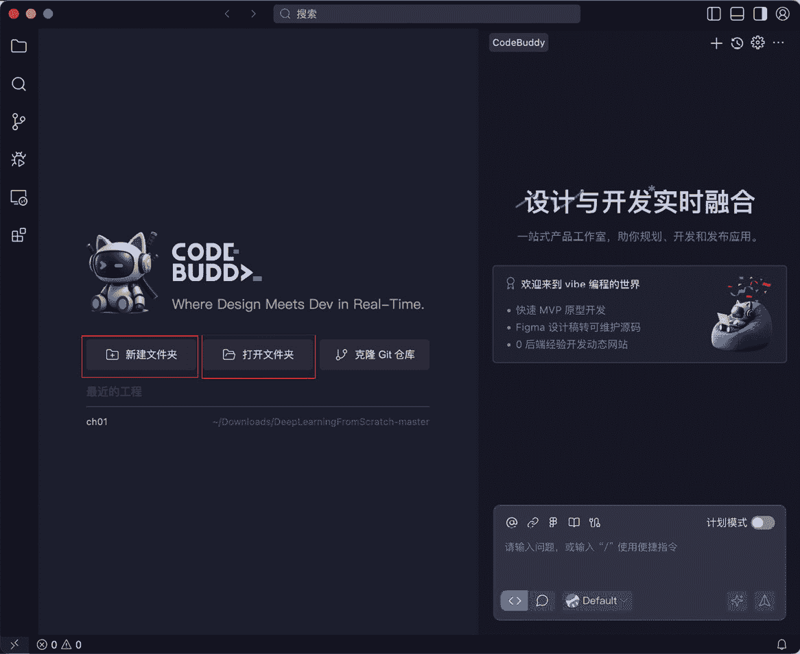

图 2-23 CodeBuddy 主界面

**2.3.2**

**CodeBuddy 工作区与项目导航**

进入项目后，左侧资源管理器使用频率最高。它以树形结构展示当前工作目录，让开发者清晰看到源码、配置、文档、测试、脚本等层级，并以最少点击完成常规文件操作。

资源管理器支持在树上直接新建文件、建目录、重命名、删除、在系统中打开、复制路径；大型项目可在顶部用文件名过滤/搜索快速定位；多子仓或多技术域项目可配置多个工作区，让前端、后端、公共组件、文档仓库同时呈现，减少编辑器切换。

与传统 IDE 不同，CodeBuddy 将“文件即上下文”转化为显式交互。选中文件或文件夹时，右键菜单会出现“添加到聊天”“添加到上下文”，单击后文件内容会被挂载到右侧 AI 对话本轮请求。随后说“帮我重构这个组件”“根据这个接口生成前端调用代码”“把这个配置转成英文注释”等，AI 即可基于所指内容精准生成。

**2.3.3**

**CodeBuddy 代码编辑区与 AI 辅助面板**

界面中部为代码编辑区，提供主流 IDE 编辑体验：多标签并行、语法高亮、智能缩进、自动补全、代码折叠、多光标、格式化、分屏查看等。编辑区上方轻量工具条可直接运行脚本、启动调试、格式化当前文件；底部状态栏展示当前语言模式、缩进宽度、文件编码、Git 分支、保存状态等信息，便于一眼确认工作状态。

真正拉开 CodeBuddy 与常规编辑器差距的，是右侧常驻的智能协作侧栏。侧栏位置固定，使用时展开，不用时收起，且始终跟随当前打开的文件保持上下文关联。如图 2-24 所示，辅助面板主要提供两种工作形态。

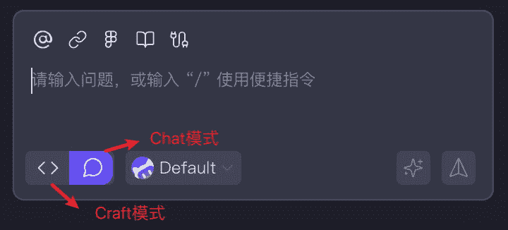

图 2-24 AI 辅助面板模式区分

（1）**Chat 模式。**该形态偏向问答式交互，适合解释一段代码、拆解报错原因、把函数改为异步实现、把片段迁移成 Go 风格等局部化诉求。操作上可先在编辑器里选中代码再推送，也可在输入框里直接引用资源管理器中的文件。

（2）**Craft 模式。**该形态偏向任务拆解与流程化交付，适合需要生成多文件、多步骤的场景，比如搭建带登录、列表、详情的管理后台，或电商的商品页、购物车、订单页。它会先解析需求形成执行计划，再按计划逐步落码，过程中会自动创建回退点，方便撤回。

面板顶部设有模型选择器，可在可用大模型间切换，不同模型在生成风格、标签习惯及上下文利用效率上各不相同。输入框敲入“@”会弹出引用菜单，可挑选关联上下文对象，例如当前工作区变更、最近一次终端输出、规则文件、历史消息、指定文件或目录。即便不把全部内容贴进对话，模型也能获取完成任务所需的完整信息。

Craft 改写当前文件时，编辑区会以差异视图高亮新增与删除的行，便于快速审阅。若对本次生成不满意，可切回上一个回退点，撤销本次 AI 带来的改动，而不影响其他文件。

**2.3.4**

**CodeBuddy 调试与控制台**

编码完成后通常需要运行、调试、查看日志，这部分由界面底部的调试与控制台区域承载。如图 2-25 所示，该区域一般以标签页形式并排展示“终端”“调试控制台”“问题”“输出”等视图，可按任务自由切换。

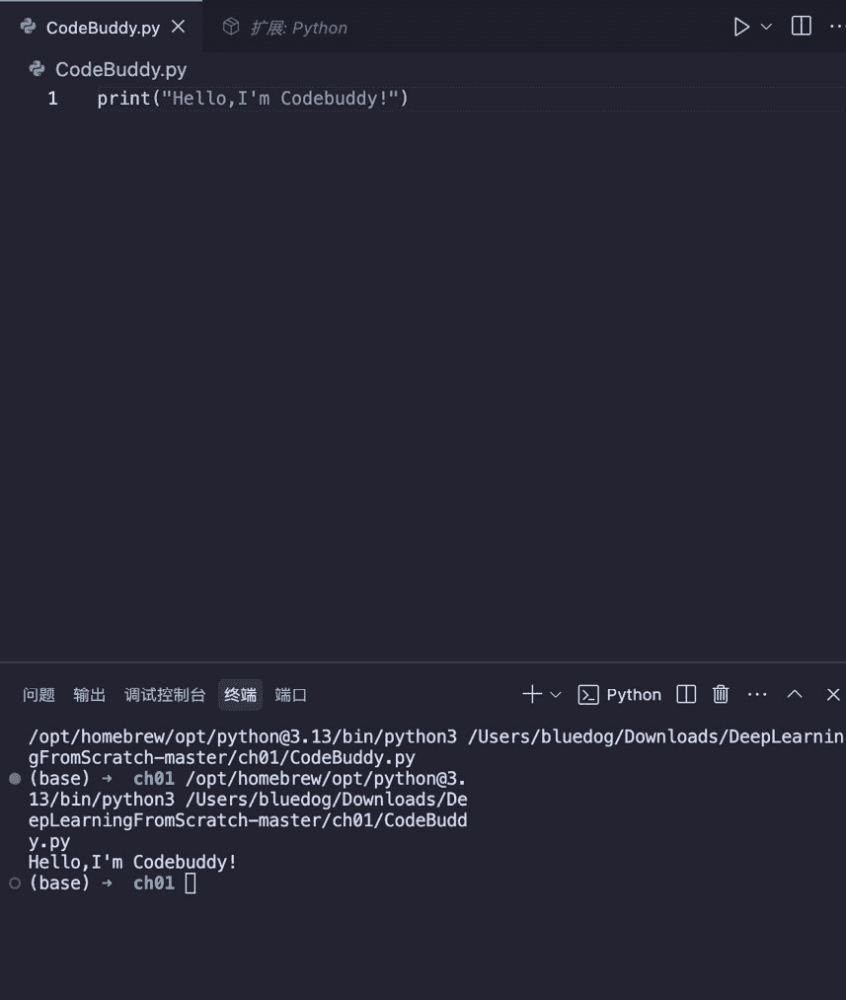

图 2-25 调试与控制台

断点调试的使用逻辑与主流 IDE 保持一致：在行号区单击即可设置断点，点击顶部调试按钮或使用快捷键启动会话，命中断点后下方会呈现调用栈、当前上下文变量、监视表达式、线程信息等，支持单步执行、跳过、继续执行，还可设置条件断点或异常中断，适合定位只在特定输入下才会出现的缺陷。

嵌入式终端是该区域的重要组成，开发者可在 IDE 内部直接运行项目脚本或构建命令，也能在此执行与 CodeBuddy 配套的命令行工具，完成项目初始化、代码生成、触发部署等自动化动作。若终端出现无响应、提示找不到 Shell 或输出为空的情况，可在设置中开启集成 Shell 后重新打开终端，通常能解决大部分环境差异问题。

终端输出、构建日志、运行时错误往往篇幅很长，手动复制到对话框既费劲又容易丢失行号等定位信息。为此 IDE 提供了“将终端输出添加到聊天/上下文”按钮，可把当前输出直接作为下一轮 AI 对话的输入，之后即可让 AI 分析报错原因、生成修复补丁，或生成一段适合写在提交说明里的错误描述。

在实际开发中，调试并不是终点。无论个人开发还是团队协作，代码最终都需要进入可验证、可反馈的运行状态。基于这一需求，CodeBuddy 在调试能力之外，引入了面向快速交付与验证的运行与部署承载机制。也就是说，完成局部调试后，可将当前工程一键部署到隔离的沙箱运行环境，避免对本地系统或生产环境造成影响。部署完成后系统会生成一个可访问的运行入口，供功能验证、界面检查或与产品、设计、测试人员协同确认。

在团队协作场景中价值尤为突出：开发者无需反复打包、传输或本地复现环境，只需把验证入口分享给相关角色即可完成需求确认或问题反馈。由此，CodeBuddy 将传统的“编码—调试”闭环，扩展为“编码—运行—验证—反馈”的完整交付链路，使 IDE 不仅服务开发阶段，也自然衔接到交付与评审环节。

**2.3.5**

**CodeBuddy 版本控制与历史记录**

开发过程中需要管理两类历史：一类是代码本身的版本历史，通常由 Git 管理；另一类是 AI 交互与生成过程的历史，由 IDE 管理。如图 2-26 所示，CodeBuddy 对这两类历史都做了可视化呈现。

代码版本方面，IDE 内置 Git 视图，可查看哪些文件被修改、哪些已暂存、当前分支位置、最近一次提交者，也能在此直接撰写提交说明并推送到远程仓库。撰写提交日志或合并请求说明时，可将当前工作区的改动引用到对话中，让 AI 依据实际改动生成符合团队规范的说明文本，减少手动编写负担。

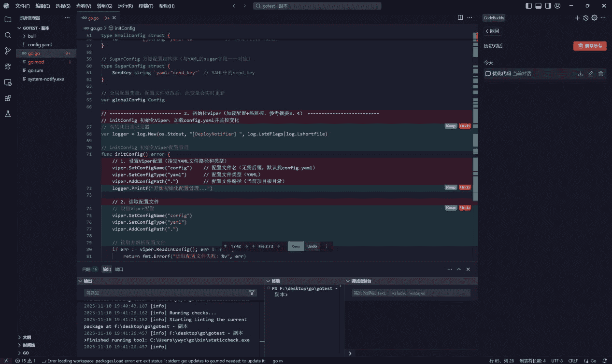

图 2-26 历史记录与检查点

AI 交互方面，尤其在 Craft 模式下的一系列生成会被自动划分为任务节点，即检查点。节点中保存了当时的对话上下文、生成目标以及代码改动。若某次生成结果不达预期，可在历史列表中选择生成前的节点进行恢复；恢复方式可选仅恢复对话，或连同代码文件一起恢复，适合“AI 改得太多想回退”的场景。

历史列表通常支持按时间排序，也可按任务、按模型筛选查看，必要时还能删除无意义的中间记录，保持项目生成链路的整洁。

**2.3.6**

**CodeBuddy 工具栏与快捷命令**

最外层是为提升操作效率的工具区，包含顶部工具栏、侧边快捷动作、输入框上下文引用入口以及底部终端。

顶部工具栏集中了项目中高频使用的操作，如代码格式化、全局搜索/替换、运行当前文件、启动调试、打开命令面板、显示/隐藏侧边栏等。其设计意图是降低记忆快捷键的负担，让不熟悉 IDE 的用户也能通过直观按钮完成关键操作。

侧边栏或右键菜单中提供的“添加到聊天”“引用上下文”等功能，是把界面内容转化为 AI 可识别上下文的最快路径。无论是编辑区选中的一段代码、终端里的构建错误，还是 Git 面板中的 diff 差异，都可一键送达右侧 AI 面板，减少复制粘贴，也避免因换行或编码导致的内容损坏。

对于偏好自动化流程的用户，底部终端可直接运行与 CodeBuddy 绑定的 CLI，用自然语言描述生成任务、用命令执行工程化步骤，再把输出交还 AI 进行解释或补全，从而形成“命令→输出→AI 解释→AI 再生成”的闭环。界面看似简洁，通过灵活组合往往能获得很高的操作效率。

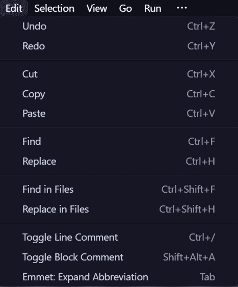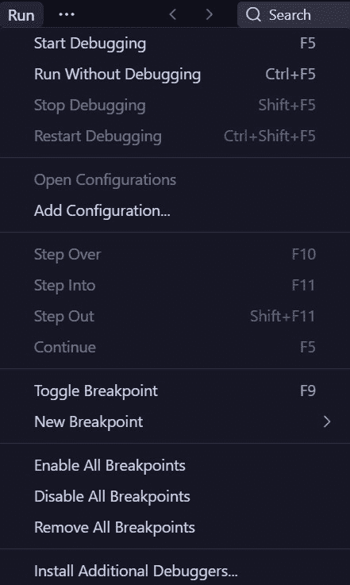

图 2-27 CodeBuddy 的常用快捷键

**2.3.7**

**自定义斜杠指令概览**

自定义斜杠指令是在 CodeBuddy 智能开发平台中通过“/”前缀触发的快捷操作命令。如图 2-28 所示，在对话式交互环境下，输入预定义的斜杠指令即可让 CodeBuddy 直接执行特定功能，无需每次从零描述需求。引入斜杠指令的目的是提供更高效、更标准化的调用方式，把常用开发流程抽象为简洁的一键命令，减少重复低效的手动输入，让开发者聚焦创造性工作。

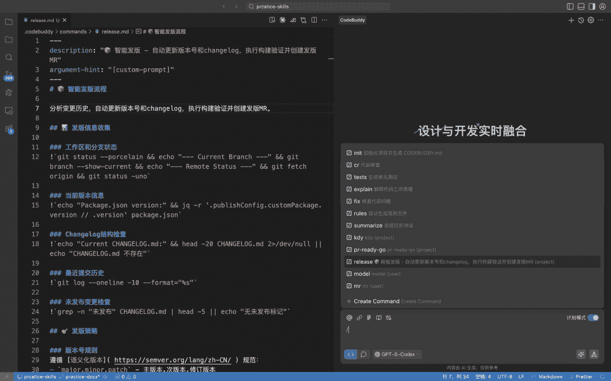

图 2-28 斜杠指令的应用

斜杠指令面向不同水平的开发者：对资深程序员来说，可把复杂工程操作序列封装成固定命令，如一键执行代码检查、测试、部署，提升自动化程度；对编程背景薄弱的用户，也可借助预设命令便捷调用代码解释、示例生成等功能，降低使用 AI 编码助手的门槛。斜杠指令不仅能生成自然语言回答，还可在固定节点触发工具链自动化步骤，例如调用内置 Skills 脚本、对接任务跟踪系统如通过接口创建 TAPD 需求、触发持续集成流水线等。目前该能力已在 CodeBuddy 桌面版 IDE、本地插件以及云端开发环境 CodeBuddy Cloud 等全产品形态中支持，确保本地或远程均可使用斜杠指令提升效率。

自定义斜杠指令在 CodeBuddy 中以 Markdown 文件 .md 形式组织，其本质为 Prompt 提示词，和 Skills 一样包含 Frontmatter 元数据区。一个完整的斜杠指令通常由五部分构成：触发关键词即命令名称、以斜杠开头；输入参数，可选的用户输入及其提示描述；上下文拼装逻辑，即如何从当前项目/会话提取信息拼入提示；期望输出，对回答格式或内容的要求；后续动作，可选自动化操作，如将生成结果回填到代码或提交代码审查。通过模块化配置，开发者可把“与 AI 沟通的口头经验”沉淀为可执行快捷命令。如图 2-29 所示，CodeBuddy IDE 已内置一系列常用斜杠指令 Built-in Slash Commands，例如 /init 项目初始化、/cr 代码审查、/tests 单元测试生成、/explain 代码解释、/fix 代码修复以及 /summarize 对话总结等。这些内置命令覆盖典型开发场景，充分体现斜杠指令在智能开发流程中的价值。开发者也可依据项目特殊需求自定义新指令，将更多专属 AI 能力融入工作流。

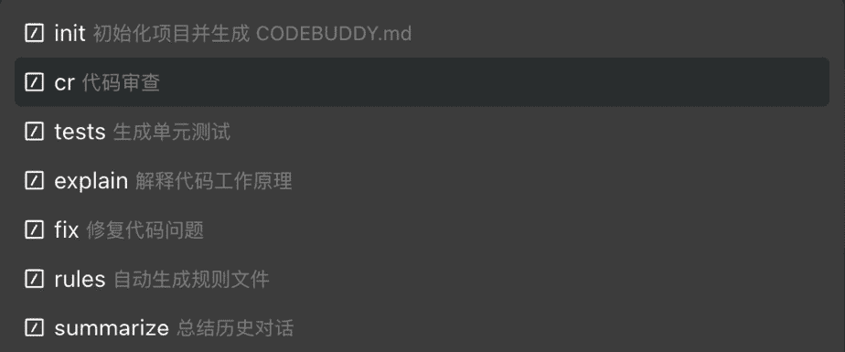

图 2-29 CodeBuddy IDE 内置的斜杠指令

## **2.4**

## **CodeBuddy 项目初始化与代码文件管理**

本节围绕“怎么把一个项目真正落到 IDE 里并且能被 AI 正确理解”来介绍。CodeBuddy 的特性是所有智能生成都依赖上下文，而上下文来自打开的项目、当前选中的文件、终端输出、Git 变更以及在对话里给出的规则。如果项目初始化环节做得不完整，即便 Craft 模式的生成能力再强，也容易出现“生成得很好但放错了目录”或“模型不知道这个项目用的是何种技术栈”等问题。因此，本节从创建/打开项目开始，一直到上下文管理、历史回溯和远程环境同步，把“项目落地”的完整流程讲透。

**2.4.1**

**创建/打开项目流程**

进入欢迎界面之后，最常见的入口是“新建文件夹”和“打开文件夹”。“新建文件夹”适合完全从零开始的场景，比如只想描述业务，让 AI 从空目录里一步步生成目录结构、组件、页面、接口；“打开文件夹”则适合已有项目，IDE 会直接把这个目录挂载成当前工作区，把里面的源码、配置、构建脚本全部识别出来。

如果项目托管在 Git 上，IDE 也支持先克隆后打开。操作方式通常是选择“克隆 Git 仓库”，输入仓库地址，IDE 会拉取代码到本地指定路径，然后自动以该路径作为当前工作区打开。这样可以保证项目目录结构与远端完全一致，后续在进行 Git 提交、对话引用、历史比较等操作时，不会出现本地目录结构混乱的情况。

完成项目创建或打开之后，IDE 会自动执行一轮基础初始化：读取根目录，检查是否存在 .gitignore 文件、语言依赖清单（如 package.json、requirements.txt、pom.xml 等）及项目配置文件。如果这些文件不存在，IDE 可以根据当前模式生成一套默认的配置，例如生成基础的 .gitignore 文件，避免后续把构建产物、虚拟环境、日志文件提交进版本库；也可以生成 .codebuddy 或类似的项目级配置，后面在对话里提到“按项目规则来”时，AI 就能找到定义的路径、命名风格、技术栈偏好。

这个阶段的核心是把“一个目录”升级成“一个可被 IDE 和 AI 共同理解的项目”。只有做到这一点，IDE 才能知道生成的文件应该放在哪一级目录、脚手架应该用什么语言版本、测试文件应该放在哪里、生成的接口是否要补到当前项目的路由表里。

**2.4.2**

**选择模式与多模型支持**

项目初始化完成后，右侧的对话区就可以开始工作了。CodeBuddy 默认提供两种工作模式：一种是 Chat 模式，即问一句答一句，适合“代码已经在这儿了，我只是想让改一下”或者“我有一个报错，帮我解释一下”等场景；另一种是 Craft 模式，它是专为复杂任务设计的，会把一个任务拆成多个步骤、按步骤落地成具体文件。

模式选择入口通常在对话框的顶部，可以随时切换。选了 Craft 模式，后面的交互就会变成“描述 → 规划 → 生成→ 回写→ 创建检查点”这一流程；选了 Chat 模式，输入内容仅作为普通对话来处理，不会自动改变目录结构。

模式选好之后，还可以选模型。CodeBuddy 支持在同一个界面里切换不同的 LLM，比如默认的混元模型、偏代码的模型、偏长文本规划的模型，甚至是已经在企业侧配置好的私有模型。不同模型在项目上下文理解、代码生成风格和规划文档的结构性上表现会不一样。写文档时最好说明这一点，让读的人知道“模型不是越大越好，关键是要与当前的任务相匹配”。

**2.4.3**

**对话与计划模式**

进入对话界面后，比较推荐的使用顺序是“模式 → 模型 → 描述需求”。也就是说，不要一上来就抛出一大段需求，而要先告诉 IDE 想走的是“规划式生成”还是“即时修改”路线，然后再说要做什么。

在计划模式（也就是 Craft 模式的规划路径）下，Agent 不会立即生成代码，而会先分析需求描述，生成一份结构化的计划或者 PRD（产品需求文档）。里面一般会包含以下内容：要做几个页面或几个模块、每个模块需要哪些接口、需要引用哪些组件库、是否需要登录鉴权、需要什么目录结构、构建工具用什么、语言版本是多少、有没有要接入的后端服务。这样做的好处是，可以在还没写一行代码的时候就看到“它准备怎么做”，并且可以在这个阶段做修改，比如把技术选型从 React 改成 Vue，把部署方式从本地改成云端，把鉴权从前端校验改成后端校验。

确认计划没问题后再点执行，系统才会开始生成文件。生成过程中，IDE 会往项目树里写文件、覆盖已有文件、补充测试用例，必要的话还会执行一次构建或测试来验证生成内容是否可以正常运行。对一些描述不够清晰的需求，还可以在生成过程中使用 Boost Prompt 功能，例如把刚刚那句“做一个运维面板”自动优化成一条更清晰、更适合 LLM 理解的提示词，从而让生成结果更贴近真实意图。

**2.4.4**

**Checkpoint 回滚与任务恢复**

自动生成的内容通常存在一个问题：生成结果可能不符合预期，甚至生成错误的文件。CodeBuddy 为 Craft 模式配备了一整套检查点机制，专门应对“我想回到刚才那一步”这样的场景。

在生成任务执行的每一个阶段，系统都会自动建一个检查点，把当前的文件状态、对话状态、任务状态都记录下来。对生成结果不满意时，可以直接点击对话面板里的恢复按钮，选择回滚到指定的检查点。回滚时 IDE 会弹出一个提示，告诉这次恢复会影响哪些文件、会撤销到哪个时间点，可以继续也可以取消。这样能避免误操作直接把整页都恢复。

有一些生成任务是多步骤的，比如，先生成页面，再生成接口，最后生成单元测试，中间如果断网或手动停掉了，也不用从头再重复一遍。对话面板里通常会有一个 Resume Task 或 Continue 的入口，点击后 Agent 会按原计划继续执行，它知道自己做到哪一步了，也知道后面还有哪几步要做。

**2.4.5**

**上下文管理与引用**

CodeBuddy 的生成质量高度依赖上下文的准确性，所以它围绕“将信息注入上下文”设计了多种入口，支持图片、代码、终端错误、文件、目录、Git 改动、规则、历史消息等多种类型的上下文信息。

最简单的是直接粘贴。截取一张报错图、抓取一段接口定义、从其他文档里复制一段 JSON 内容，然后按 Ctrl+V 组合键，CodeBuddy 就会将其当成这轮对话的输入。对于代码，开发者可以在编辑器里选中一段，然后单击“Add To Chat”按钮，CodeBuddy 就会把当前文件的这部分内容“带”过去。对于整个文件或整个目录，可以在资源管理器里右键单击“Add file to CodeBuddy”或者“Add folder to CodeBuddy”，这一类操作非常适合“将该目录作为业务核心，所有生成都参考此目录结构”的场景。

在输入框里输入“@”，系统会弹出一个引用菜单，里面会列出刚才添加过的所有上下文，包括问题提示、终端日志、Git 提交、规则文件、历史对话消息等，如图 2-30 所示。开发者想让模型参考哪一条，就选择哪一条。这样做的好处：不用每次都粘贴完整内容，也不用把终端里的一大串错误再手抄一遍，直接引用即可，模型仍能准确理解并运用这些上下文。

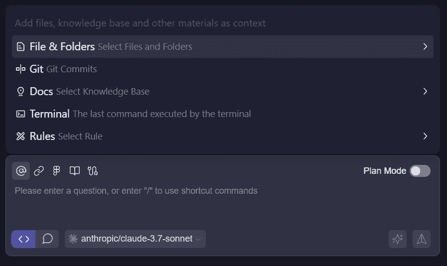

图 2-30 CodeBuddy 上下文管理与引用功能

**2.4.6**

**远程开发与环境配置**

企业开发场景中，代码往往并非在本机运行，而是部署在公司内网的 Linux 服务器、云主机或容器环境中。CodeBuddy 提供了远程开发能力，可以通过 SSH 连接远程机器，把远程的文件系统当成本地工作区来编辑、调试和运行。

配置流程：先生成 SSH 密钥对，将公钥添加至远程服务器的~/.ssh/authorized_keys 文件中，在 IDE 的远程开发面板中填好主机地址、端口、用户名、私钥路径，连接成功之后，左侧资源管理器就会展示远程主机的目录结构。在该模式下，编辑文件其实修改的是远程文件，终端里执行的命令也运行在远程环境中，这样既能充分利用远程环境已有的依赖、数据库、网络访问权限，又不需要在本地重复安装与服务器一致的环境组件。

远程开发模式下，同样可以把终端输出、远程日志、远程目录里的文件添加到聊天上下文里，AI 也能识别与运用。只不过在这种场景下，更要注意网络与安全策略，例如要通过企业代理访问、使用固定端口通信、限制可访问域名等，IDE 一般都会给出相应的配置项。

**2.4.7**

**版本检查与环境同步**

环境统一：告别“在我机器上能跑”的困局

收尾时最关键的一环，是让本地开发、远端部署以及团队各成员的运行条件保持一致。CodeBuddy 会在代码仓库里维护一份项目级配置文件，通常叫 .codebuddy，用来固化语言版本、包管理器、构建工具、镜像地址、代理设置、模型开关等约定。这些设定会被喂进 AI 对话，生成的内容从一开始就贴合该项目的运行环境。

提交代码前，编辑器可以先做一次环境自检。把本地依赖清单 requirements.txt 或 package-lock.json 中的版本信息，和配置文件里声明的范围做对比，及时发现差异。如果要发布到远端，还能让编辑器自动产出一份安装脚本，例如 pip install -r requirements.txt 或 npm ci，方便丢进 CI/CD 流水线复现。

协作时建议把 .codebuddy 这类配置纳入版本库，并约定由 IDE/ AI 自动识别。新人拉取代码启动 CodeBuddy 后，就能立刻知道需要哪个 Node、哪个 Python，以及是否要从私有源拉包，不用反复沟通，也能避免本地通过、持续集成失败的现象。

## 2.5 CodeBuddy 日常使用方法

前面章节偏重环境与界面，本节聚焦日常实操，讲讲怎样把 CodeBuddy 变成真正的编程搭档：提示该怎么组织、联想怎样更贴近当前文件、终端报错如何一键送入模型、规则与知识库怎样参与，以及多人协作时如何保持风格统一。

## 2.5.1 让联想更准的提示与背景用法

CodeBuddy 的智能联想并不是孤立猜下一行，而是综合当前编程语言、编辑区内容、仓库整体结构和使用者意图来给出建议。想要更准，就得给足背景。

最直接的做法是先把目标文件调到前台，再在对话框里用自然语言描述操作，比如“在这个函数下面帮我加一个批量导入接口”。同时用 @ 引用该文件，模型就能读取文件内容而不用贴完整源码。若还涉及接口定义、常量、枚举、DTO 等关联材料，可通过加入对话资源的方式把相关文件一起带入，后续生成就会遵循现有命名与结构，而不是凭空造一个不搭的名字。

命名质量直接影响效果。避免使用 foo、temp、data1 这类无意义占位。模型会依据已有代码的命名习惯推断业务领域，若使用 importUserFromSAP、syncOrderToWMS、fetchAlarmStatistics 这类带业务含义的名称，就能顺势补出异常处理、日志、权限校验、参数校验等配套代码；若只用 handle、process 等模糊命名，得到的往往是泛泛建议。先把代码写得语义清晰，AI 的联想才会明确。

联想前也可以先让模型概览架构。比如告知“本项目采用分层架构，controller 只做参数校验和调用 service，service 承载业务逻辑，dao 负责数据访问，请在此 controller 新增查询接口，其他层自动补齐”，结果就会按层分布，而非全堆进一个函数。

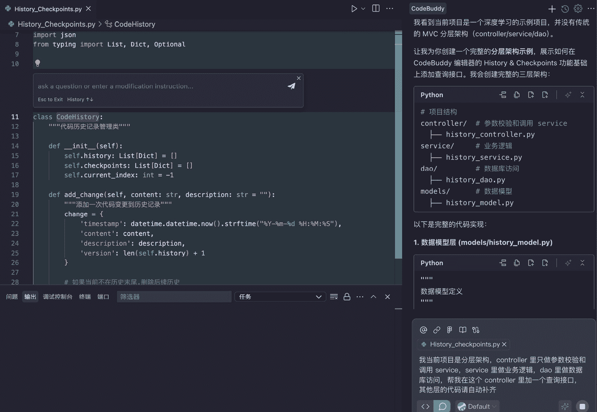

图 2-31 Prompt 与上下文

实践中，高质量的复杂任务提示具备复用价值。为避免重复输入，可把验证过的提示固化为自定义斜杠指令，以固定命令形式提供给开发者。把提示模板、参数和关联背景的引用逻辑写进指令配置，能显著降低交互随机性，使模型在相同场景下持续输出结构化、稳定且符合预期的结果。随着项目演进，这些指令会随代码版本迭代，逐步沉淀为贴合团队工程习惯的标准提示资产。

## 2.5.2 快捷键与效率技巧

把 CodeBuddy 当作主力工具，熟悉快捷键是提效基础。编辑区基本沿用业界常见方案，迁移成本低。Tab 用于接受当前智能建议，Ctrl+Space 手动唤出联想列表。若当前建议不理想，可先选中更大范围代码，或先把依赖文件加入背景，再触发联想，模型会基于新材料给出更合适的建议。Ctrl+/ 可快速切换注释与取消注释，适合临时屏蔽代码块或向 AI 标记“此段已完成，后续请协助”。

全局搜索用 Ctrl+Shift+F，格式化用 Alt+Shift+F，均属通用操作。

终端相关要记住 Ctrl+` 调出底部终端面板，用于构建、测试或运行命令行。终端支持多标签，可拆分为两栏，一栏运行服务，一栏查看日志。出现错误时，直接在终端选中出错文本点击“添加到聊天”，即可把带格式的错误同步给右侧助手，比复制粘贴更省事。

容易被忽略的是命令面板，快捷键 Ctrl+Shift+P。可在其中搜索切换模型、刷新背景、打开远程连接配置、查看已挂载规则等。刚上手时多靠搜索，无需死记所有菜单位置。

新建文件或组件可借助侧边栏或右键菜单，例如在目录上右键选择“New Component from AI”或“Create file and fill by AI”，编辑器会自动创建文件并把路径、层级、当前规范带入对话，让模型生成与目录风格一致的内容，省去手工建文件再粘贴指令的步骤。

## 2.5.3 代码解读与排错支持

CodeBuddy 的高频用途之一是“帮我读懂这段代码”。接手遗留项目或拉取黑盒逻辑时，直接选中代码发送给右侧助手，让它用中文说明函数用途、参数含义、返回结构及边界处理。因为背景已通过文件引用建立，解释会关联到项目中已有的类型定义与命名，而非空泛描述。

运行时出错时，可把堆栈、终端输出、接口报错一起粘贴，或使用“一键添加终端输出到聊天”。编辑器清楚错误来源于哪个终端、哪个项目、哪种语言，模型即可更精准判断是依赖未装、版本不兼容、网络访问失败还是业务逻辑缺陷，常能给出“在某文件第 X 行把调用改为 await”“在 package.json 补充这条依赖”“把连接串改为环境变量”等可执行建议。

调试过程中，若已设置断点并看到变量实时值仍不明白原因，可把变量值和调用栈复制进对话，要求 AI“用业务语言解释当前执行路径”或“推断此处应返回什么”。面对分支繁多、嵌套较深的业务函数，这比单纯看调试面板更快。

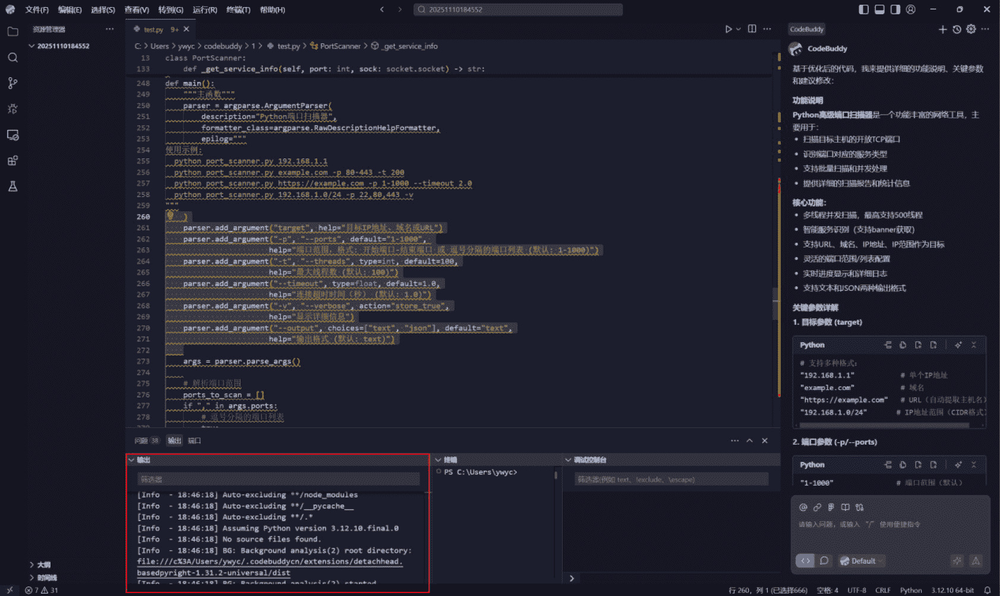

图 2-32 代码解释与调试

还可让 AI 辅助生成临时日志，例如“为这段逻辑生成临时日志，包含时间戳、当前用户 ID、接口名，便于排查”。问题解决后再让它“把这些日志删掉”，就能自动清理，省去手工来回修改。

## 2.5.4 文档、规则与知识库联动

CodeBuddy 不仅能生成代码，还能审查写法，效果取决于文档、规则与知识库的配合。

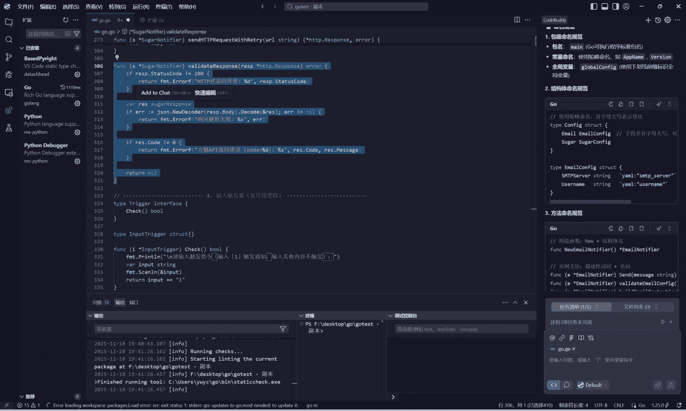

图 2-33 规则和知识文档联动

规则分为用户级和项目级。用户级记录个人编码偏好，如“前端一律驼峰”“不用 var，只用 const/let”“类名前缀 Xs-”。项目级记录团队共识，如“采用后端渲染，不生成前端路由”“所有接口必须带租户 ID”“国际化使用自研封装”。写入编辑器规定位置后，每次对话会自动发给模型，无需重复说明。

知识库可视为为模型准备的专属项目文档集。若项目包含接口说明、第三方平台回调文档及公司内部业务规范，可把这些文档导入，然后在对话里用 @ 引用。例如“帮我写支付回调处理逻辑，参考内部支付文档”，AI 会依据文档中定义的字段、签名方式和验签流程生成更规范的代码。对照国标、行业协议编写代码时，这种方式比纯自然语言更可靠。

为防止模型遗忘约定，建议把关键规则做成独立规则文件长期挂载，如“所有 API 错误码都使用统一枚举”“所有异常都要记录日志并向用户提供友好提示”“所有 SQL 查询都必须指定字段，禁止使用 SELECT *”。写完后先让模型复述一遍，确认已读取，再开始正式生成。

## 2.5.5 高效协作流程

多人共用 CodeBuddy 时，要考虑后续成员能否看懂、续写、回溯。推荐做法是核心成员先用 Craft 模式生成项目基础架构，创建完整骨架和检查点，包括目录、组件库选择、后端服务集成、基础页面、登录权限等，同时让 IDE 自动生成检查点。把这批对话和检查点保留在历史记录里。

后续成员加入后，先打开历史记录，找到“初始化后台管理系统”这类记录，查看当时的需求描述和 AI 计划，再在此上下文里输入“我要加一个报表页”“把用户管理拆成用户+角色+菜单”，生成的代码就能保持风格一致。

多人开发还可借助远程开发环境，所有人共用同一台云服务器或内网机器运行项目，本地只负责编辑交互。这样依赖版本、数据库地址、内网接口完全一致，避免“这边能跑那边不行”。配合前文的环境同步工具，把 requirements.txt、package-lock.json、.codebuddy 纳入版本库，AI 在任何机器打开项目都读到同一套规则。

规则文件和知识库在协作中同样重要。约定新增规则即纳入项目规则，例如“从今日起所有接口必须加签名校验”，之后任何人让 AI 生成接口，输出都会自动包含该步骤，无需人工反复提醒。结合聊天历史的导出与共享，可让“这条对话就是本模块的迭代说明”，新人一目了然。

## 2.5.6 向导创建项目级指令

在 IDE 对话框输入“/”会列出可用指令，其中“Create Command”可新建项目级指令。指定名称作为触发词，例如 daily-report，后续用 /daily-report 调起。确认后 IDE 会生成命令模板文件并打开编辑界面，可编写提示语模板、参数占位符和关联背景引用逻辑。

向导创建的指令自动绑定当前项目，能直接访问仓库代码、提交记录和工作目录内容，支持更精确的背景推断。例如在模板里引用当日 Git 提交摘要、代码变更统计或项目文档，生成结构化日报或周报。保存后立刻生效，适合高频重复任务，如生成测试说明、梳理提交内容、格式化文档等。

项目级别 .codebuddy/commands 快捷指令配置方法：

（1）输入“/”，点“Create Command”调用该指令，如图 2-34 所示。

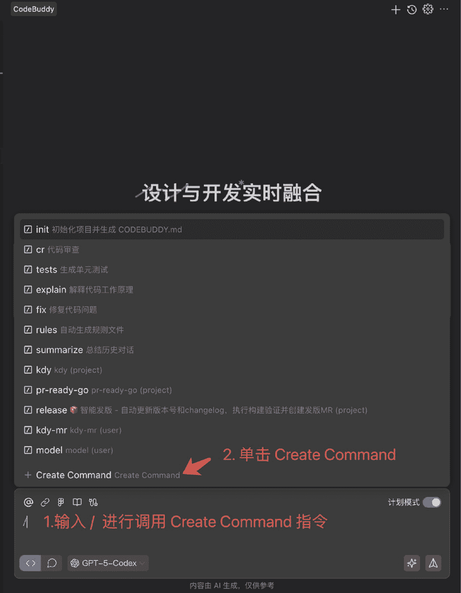

图 2-34 在对话框中调用 Create Command 指令

（2）自定义指令名称，例如设为 kdy-report，如图 2-35 所示。

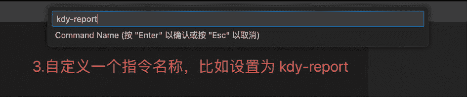

图 2-35 自定义指令名称

（3）配置自定义指令 md 文件内容，并在对话框中调用，实现一键触发生成，如图 2-36 所示。

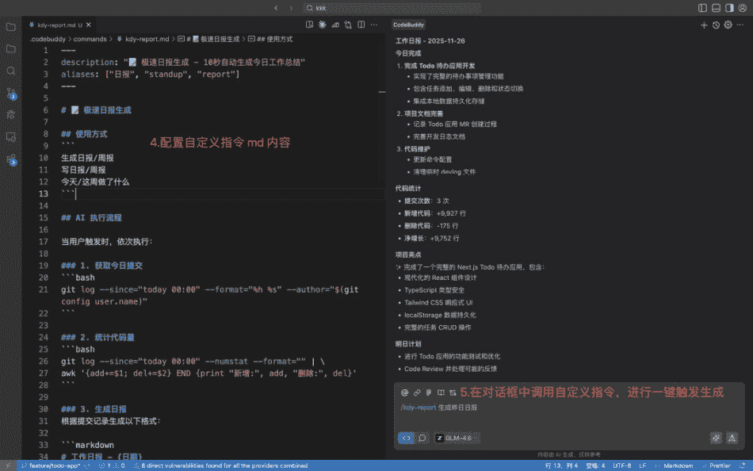

图 2-36 调用自定义指令

## 2.5.7 用配置文件共享团队指令

团队场景下，自定义斜杠指令最好以结构化配置文件统一管理，便于版本控制共享。CodeBuddy 支持在项目根目录的 .codebuddy/commands 下定义指令文件，格式为 Markdown 搭配 YAML 元数据头部。YAML 区声明描述、参数提示、可调用工具权限；正文编写提示模板，包含固定文本、关联背景引用和用户可补充的参数占位符。

把指令文件纳入代码仓库，团队可在版本演进的同时维护指令模板。例如代码审查指令可预设问题列表、风险描述、修改建议的输出格式；需求分析或文档生成指令可规定统一章节结构，提升规范性和可读性。成员拉取代码后 IDE 自动加载配置文件，无需额外设置即可使用同一套斜杠指令，实现经验沉淀和流程标准化，让常用 Prompt 持续优化、版本化、共享。

用户级别 ~/.codebuddy/commands 文件配置方法：找到计算机上的用户配置路径，一般是 /Users/用户名/.codebuddy/commands 目录，把 2.5.6 节生成的 md 文件放入该目录或新建文件，重启 IDE 即可生效。

## 2.6 多语言支持与插件扩展机制

本节介绍 CodeBuddy 如何在一个工作区同时处理前端、后端、脚本和 SQL 任务，如何以插件形式嵌入不同 IDE，以及企业如何把自有服务、规则和工具集成进来，并让大语言模型安全地访问使用这些资源。

## 2.6.1 语言解析与支持范围

CodeBuddy 的语言处理不依赖简单的扩展名识别，而是基于语法层面的深度解析。打开 .py、.ts、.java、.go 等文件时，IDE 会按对应语言语法规则构建抽象语法树，识别类、函数、方法、变量、注释、导入依赖等结构，再把这些结构传给联想、跳转、重构、AI 生成等环节。这样，“在这个类下加一个查询方法”“把 controller 拆成 service+repository”“按 SQL 字段生成 ORM 实体”这类需求才能被准确理解并插入正确位置。

当前支持 C/C++、Java、Python、JavaScript/TypeScript、Go、PHP、SQL、Kotlin、C# 等主流语言。常见的前端工程 TS+JSX/TSX、后端工程 Java/Spring、Go、Python/FastAPI、Node/Koa、脚本和数据处理 SQL 都可在同一工作区打开。IDE 会根据文件类型自动切换语法高亮、联想词典和调试模板，无需手动切换。

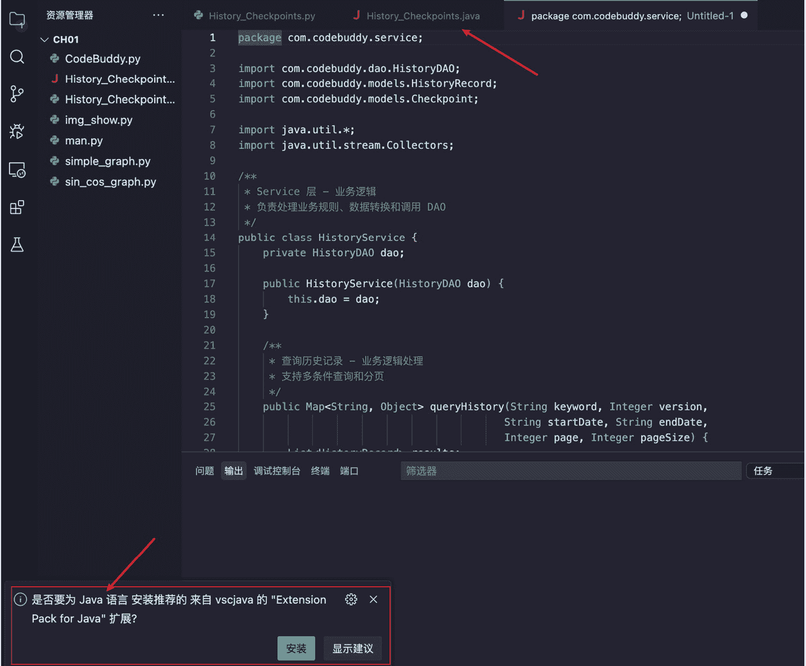

图 2-37 语言解析支持

多语言项目是重点场景。不少前后端一体仓库、BFF 项目或单体拆分过渡仓库同时包含 src/frontend 与 src/server，甚至还有数据库脚本。CodeBuddy 支持同一工作区统一查看、统一生成、统一对话。输入“这个接口要给前端用，帮我把前端也补上”，模型会自动识别仓库中的前端目录和技术栈，如 Vue/TDesign 或 React/MUI，精准生成组件和调用逻辑。

当解析层足够完善时，跨语言跳转与重构才有价值。前端调用后端接口时，可通过智能提示直接获取参数名和类型；在对话框输入“把这个查询写成 SQL，同时生成对应的 Go 实体和 CRUD 代码”，AI 会按语言类型分别输出，而不是把所有内容当普通文本处理。

## 2.6.2 插件管理与市场

CodeBuddy 既提供独立的编辑器工作区，也能以插件形态接入现有的开发工具。目前官方已经在 Visual Studio Code 与 JetBrains 套件下同步推出对应扩展。之所以采用双轨策略，主要考量很现实：多数团队早已选定 IDE 并固化了工具链，很少会因为引入 AI 编程就整体迁移。把智能能力做成插件，是目前介入成本最低的做法。

在架构上，核心编辑器与 AI 协同能力被解耦。用户可以只开启对话面板而不加载任何特定集成，也能在某个项目工作区关闭远程部署类插件，避免对日常编码的响应造成干扰。

插件市场带来的价值在于能够增量交付。后续官方推出的例如日志转结构化输出、解析终端报错并自动创建 GitHub Issue 等扩展，使用者无需升级整套 IDE，直接在插件中心搜索安装激活即可，如图 2-38 所示。这种分层供给方式契合企业内部的版本管控思路：底座 IDE 保持稳定，智能功能按需分批投放。

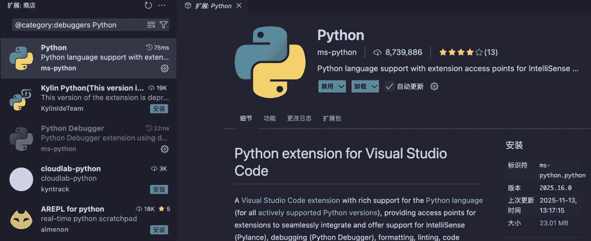

图 2-38 插件管理与市场

**2.6.3**

**官方扩展与企业级扩展**

官方扩展主要解决两类需求：一是让前端产出更贴合团队已用的组件库，二是让后端集成云服务无需手动查找 SDK 并自行配置环境。组件库类扩展预置了 TDesign、MUI、Shadcn 等主流方案，在 Craft 模式下，用户描述“做一个用户管理页，表格要筛选分页，按钮风格沿用现有这套”，扩展就会按对应库的语法规范、类名体系和布局习惯输出代码，避免生成可用但 UI 不统一的页面。

后端集成扩展更偏向工程落地。文档中提及的 Supabase、Tencent CloudBase、Pages 等服务，都是以扩展形式接入。用户在集成面板选中服务并填入凭证后，系统会自动准备云环境、创建数据表、产出初始接口与鉴权逻辑，并把配置写回项目目录。如此前后端生成得以对齐：前端获得的是真实可用的接口，后端对应的是云端实际存在的表与函数。

企业级扩展与官方扩展的区别在于所有权与安全边界。企业往往需要对接自有的 CI 平台、构建流水线、审批系统、代码扫描器等内网服务，这些系统不对外公开，也不适合把密钥直接写进对话。通过扩展把调用方式、目标接口、所需 Token 等细节封装好再暴露给 IDE，就能实现安全隔离。开发者在 IDE 中点击“提交代码扫描”时，实际调用的是企业内部服务，模型仅感知到“存在这样一个可执行动作”，并不接触密钥。

同理，企业内部的文档自动生成、数据库迁移脚本生成、压测脚本生成等小工具，也能以插件接入。IDE 把这类扩展视为可调用的操作单元，模型在任务调度时可以发出“下一步执行某插件”的指令，从而完成流程自动化。

**2.6.4**

**Subagent：多智能体协作扩展**

项目规模扩大、任务复杂度提升后，单一对话式助手在上下文保持、职责划分和并行处理上会逐渐吃力。CodeBuddy 引入 Subagent 机制，用以搭建职责清晰的多智能体协作框架。

Subagent 可以看作拥有专属角色定义的智能体实例。每个实例可单独配置 System Prompt、可调用工具以及可访问的 MCP 服务，专注代码评审、测试生成、文档整理、构建脚本维护等特定工作。与主会话不同，Subagent 拥有独立的上下文空间，其对话与产出不会污染主会话的语义，有助于在复杂工程中保持语义清晰。

运行方式主要有两种：Agentic 模式下，Subagent 在授权范围内可自主调用工具并推进任务，适用于需要多步推理或自动化的场景；Manual 模式下，Subagent 仅在显式指令触发时运行，用于替代人工执行固定职责，适合受控或高风险操作。

作用域上支持项目级与用户级两种配置。项目级 Subagent 通常放置于项目目录下的 .codebuddy/agents/ 路径，用于固化团队共用角色；用户级 Subagent 则放在用户主目录 ~/.codebuddy/agents/ 下，用于个人效率增强。这种分层既保证团队一致性，也保留个人定制空间。

从工程实践看，Subagent 让原本分散在脚本、CLI 工具或外部智能体系统中的能力，以更低成本统一收敛到 IDE 的交互与审计体系，成为多智能体并行协作的结构化基础，也是 AI Native 开发的重要组成部分。

## **2.7**

## **本章小结**

本章围绕 CodeBuddy IDE 的落地部署与初始使用，构建了从形态确认到工程化应用的完整路径。首先在平台版本与安装部分，对独立版、插件版、CLI 三种承载方式进行划分，明确它们在场景、工具链耦合度、运行环境上的差异，并给出不同操作系统与处理器架构的获取安装步骤，为后续使用建立统一起点。其次在运行环境与依赖配置中，列出网络连通性、账号初始化、本地语言运行环境等必要条件，确保智能生成与上下文分析稳定可预期。用户界面部分通过导航区、代码编辑区、AI 辅助区、终端输出区的分区说明，确立了后续章节反复使用的界面认知框架。

工程层面，项目初始化与代码文件管理将对话式能力与真实项目结构对接，给出创建工程、纳入已有文件、组织目录与依赖的基本方法，为多轮生成与增量开发提供结构化载体。基础用法强调自然语言驱动生成、以上下文补充保证结果一致、以 AI 迭代完善功能，形成“描述—生成—验证—修正”的工作闭环。多语言支持与插件扩展部分说明了如何把 CodeBuddy 能力延伸到现有 IDE、不同语言栈与自动化场景，让安装配置成果可被更多开发形态复用。

掌握本章后，读者应能在本地快速上手 CodeBuddy、在既有项目中引入 AI 辅助，并根据实际工具链选择合适的承载方式，直接进入后续专题实践。

# **第三章**

# **从需求到可运行：CodeBuddy 实战首秀**

本章在前两章完成环境安装与基础认知后，带领读者完整走通“从需求到可运行应用”的开发全流程。以结构清晰、规模适中的 ToDo List 任务清单作为演示案例，将需求拆解为页面结构、样式布局、交互逻辑三个层面，逐步演示如何用自然语言提示词引导 CodeBuddy 生成并改写 HTML、CSS、JavaScript，并在独立版 CodeBuddy IDE 中完成运行调试与效果验证。基于 CodeBuddy 2.0，本章不仅展示 AI 辅助写代码，更呈现一种简化版的 AIAgent 参与软件交付实践：自然语言触发任务，系统生成方案并推进执行，开发者负责校验与调整。

## **3.1**

## **ToDo List 案例与基础概览**

本节以 ToDo List 应用为入口，对本章反复用到的关键要素做整体梳理：一是说明案例的业务场景与教学价值，二是拆解内部功能模块，并将其与增删改查以及 HTML/CSS/JavaScript 基础能力对应。完成这层铺垫后，读者可在进入实战前，先对“要做什么”和“需要哪些能力”形成清晰的任务模型。

**3.1.1**

**为何选用 ToDo List 作为入门练手**

ToDo List 是前端入门阶段的经典实践案例。本书选用它作为实战载体，是想用一个小巧但结构完整的项目，让读者在可控复杂度内完整体验从界面搭建到功能实现的流程，并直观感受 CodeBuddy 智能伙伴在真实编码中的辅助价值。选择该场景的价值主要体现在：

（1）需求明确。待办应用的目标与功能非常清晰——添加任务、展示列表、更新状态、删除任务，初学者容易理解，无需涉猎复杂业务背景。

（2）覆盖核心。虽然规模小，却涵盖前端关键基础。通过实现 ToDo List，可练习 HTML 页面结构搭建、CSS 样式应用，以及 JavaScript 的事件处理、DOM 操作、数据管理等核心技能，完成对增删改查的完整演练。

（3）难度适中。功能单一且模块独立，可控性强，适合在有限时间内完成端到端开发。初学者能拆解为若干步骤逐步完成，积累成就感，又不会因功能庞杂而迷失方向。

（4）实用且可扩展。待办事项管理贴近日常使用，有助于提升学习兴趣。同时案例具备良好扩展空间，可后续增加任务分类、截止日期、本地存储持久化等功能，进一步拓展学习深度。

**3.1.2**

**功能拆解与 CRUD 对应**

在理解案例整体价值后，需要把“要做什么”拆解得更具体。本小节从功能结构视角出发，将应用划分为核心模块，并与增删改查及前端技术点关联映射。

围绕 ToDo List 场景需求，可拆解为 4 个核心功能模块：

（1）任务录入。提供输入框与添加按钮，支持用户录入新待办事项，提交后即时加入列表。涉及表单输入处理与基础校验，属于创建操作。

（2）任务列表展示。以列表形式动态展示所有待办事项，包括任务名称与当前状态。页面加载或任务更新时列表实时刷新，确保与数据同步，对应读取操作，需通过 DOM 操作将数据渲染为页面元素。

（3）状态更新。允许用户标记任务完成或恢复未完成，通常通过勾选复选框或单击切换实现，完成任务在界面有特殊样式区分。该模块对应更新操作，涉及事件监听、样式切换与数据状态修改。

（4）任务删除。支持用户移除不再需要的任务项，例如在每条任务旁提供删除按钮，单击后从列表与数据中移除。属于删除操作，实现时需更新数据结构并移除对应 DOM 元素，保持列表完整性。

上述模块涵盖了待办应用的主要交互，可看到增删改查完整流程贯穿其中。表 3-1 列出了各功能模块涉及的主要技术点，以及 CodeBuddy 可协同辅助的环节。

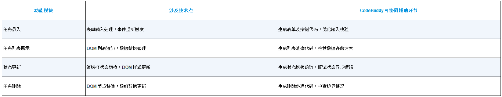

## **3.2**

## **技术选型与学习路径**

在案例背景与功能拆解完成后，关键问题是如何用何种技术、遵循什么节奏，完整实现示例并自然融入 CodeBuddy。本节从两个维度回应：一是阐明 CodeBuddy 在本章的典型协同节点，让读者对智能体何时介入形成全景认知；二是梳理技术栈与教学步骤，明确浏览器端运行方式、数据管理方案，以及由浅入深的实践节奏。

**3.2.1**

**AI 在开发流程中的介入点**

在 CodeBuddy 2.0 设计理念中，智能体已从被动响应转向任务驱动，参与多个开发阶段。本章实践仍以对话式协同为主，但背后已体现 Agent 化任务拆解与执行模式。

CodeBuddy 可在 ToDo List 开发的多环节提供支持。其核心在于在传统 IDE 基础上融合大模型对话能力：开发者可通过自然语言描述需求或代码意图，让系统生成初步代码或配置；同时 CodeBuddy 能读取项目上下文，提供适配当前工程的增量代码建议、重构优化或文档说明。适合引入协同的节点如下：

（1）结构设计。项目启动阶段，利用 AI 协助架构规划。例如让 CodeBuddy 根据需求给出页面结构建议、文件组织方案或代码框架模板，通过对话确认整体设计，帮助初学者少走弯路。

（2）代码生成。具体编码时，针对重复性高或标准化的功能，可请 CodeBuddy 自动生成代码片段，例如添加任务函数、初始化列表的 DOM 结构代码。模型能快速给出草稿，开发者再结合理解调整，提升效率。

（3）样式调优。功能初成后，可借助 CodeBuddy 优化界面。询问如何美化列表外观、调整布局或实现响应式，AI 将给出修改 CSS 的方案或代码。通过智能调优改善体验，也让初学者体会反复完善的过程。

（4）逻辑调试与修复。遇到功能异常或逻辑错误时，CodeBuddy 可充当智能调试伙伴。把错误现象或代码片段提供给 AI 后，模型可基于上下文分析原因并给出修改建议。例如“标记完成”功能未生效时，AI 可能指出事件绑定或状态更新问题并建议修正。

（5）注释生成。功能完成后，良好的注释与文档有助于巩固学习。可让 CodeBuddy 为关键函数或复杂逻辑生成注释，或提炼项目技术要点撰写简要说明。AI 生成的注释可供对照学习，在完善可读性的同时加深对实现细节的理解。

通过上述节点介入，CodeBuddy 贯穿开发全过程，扮演对话式编程伙伴，既提供即时产出支持，也在分析与优化上给予指导，帮助初学者以更低心智负担完成项目，实现边做边学。

**3.2.2**

**技术栈与分步实施计划**

本节主要采用 Web 前端基础技术栈实现待办应用，包括 HTML 用于搭建页面结构骨架、CSS 控制样式与布局、JavaScript 负责业务逻辑与用户交互。这三项构成前端必备基础，既贴合浏览器运行环境，也适合零基础读者循序实践。其中 HTML 与 CSS 侧重静态内容与视觉呈现，JavaScript 侧重动态行为，如对用户操作的响应、页面元素的增删改、界面状态更新。

数据管理方面，待办列表可通过 JavaScript 数组维护；如需页面刷新后保留，可引入浏览器本地存储 localStorage 实现简单持久化。考虑到本章重点是前端基础与 AI 辅助开发流程，示例不依赖服务端组件，所有逻辑均在浏览器本地完成，并通过 CodeBuddy IDE 内置预览进行验证。此选型降低环境配置复杂度，也足以支撑完整 ToDo List 实现。与此同时，CodeBuddy 对 HTML、CSS、JavaScript 均提供良好支持，无论代码生成、样式调整还是脚本调试与错误分析，都能给出针对性建议，便于读者聚焦概念理解与方法掌握。

为循序渐进完成示例，本章后续内容按由浅入深的开发阶段展开，每一阶段对应明确学习目标与实践任务，并穿插引导读者使用 CodeBuddy 协作开发，整体教学路径规划如图 3-1 所示。

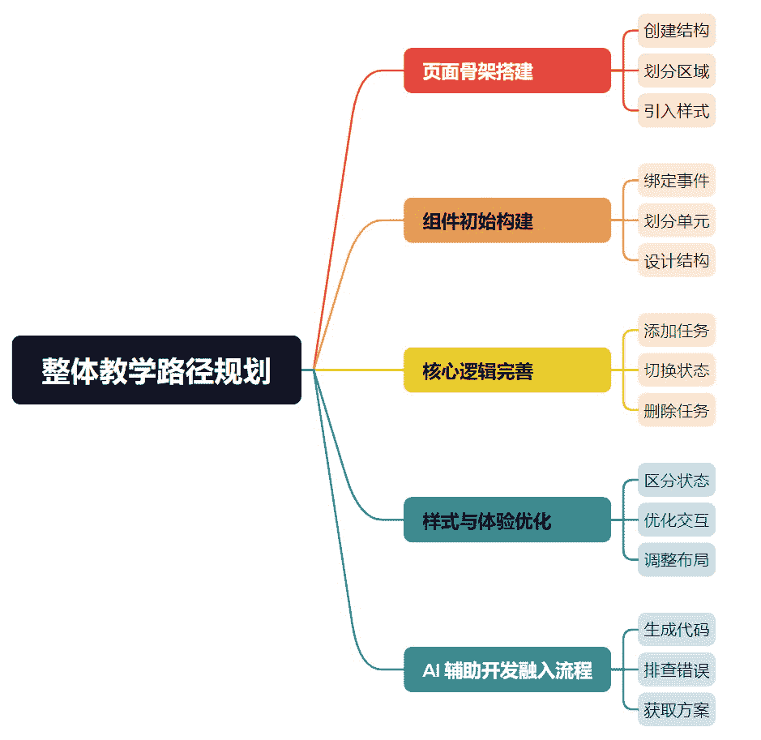

图 3-1 整体教学路径规划

（1）页面骨架搭建。首先构建应用基本页面框架，创建 HTML 文件并完成待办应用主体结构，包括标题区、输入栏、任务列表区，同时引入基础 CSS，使页面具备清晰布局与层次，为后续功能叠加提供稳定容器。

（2）组件初始构建。在整体骨架之上将页面划分为功能单元，完成关键组件初始行为。例如为“添加任务”按钮绑定单击事件，实现从输入框读取文本并更新列表；设计单个任务项内部结构，预留状态标记与删除控件等。本阶段重点打通界面元素与脚本逻辑连接。

（3）核心逻辑完善。在组件雏形基础上补全业务逻辑，使应用形成最小可用版本。主要包括编写 JavaScript 函数实现新任务加入、任务状态变更、任务删除等。完成后应用应具备添加、标记完成、删除待办事项等基本功能。

（4）样式与体验优化。在功能完整前提下，对界面观感与交互细节改进。通过补充 CSS 使已完成任务采用区别于未完成任务的视觉样式，优化按钮与输入框显示效果，调整列表间距与对齐，并兼顾不同窗口宽度下的展示。如有必要，对 HTML 结构做小幅调整以配合样式优化。

（5）AI 辅助开发融入流程。贯穿上述各阶段，引导读者在关键节点借助 CodeBuddy 提升效率。例如在页面骨架搭建时通过自然语言提示生成初始 HTML 结构；在逻辑实现中请求 CodeBuddy 协助定位脚本错误、解释报错信息或给出重构建议；在样式优化阶段通过对话获取替代配色方案或布局调整思路。以典型对话示例展示如何构造高质量提示词、理解并筛选 AI 生成结果，逐步形成“人机协同编程”的基本工作方式。

沿着既定的技术栈和学习节奏推进，一款简易的网页待办清单就能从零到一跑通。边动手边让 AI 参与协作，HTML、CSS 和 JavaScript 的基础要点会逐步串联成体系；同时在 CodeBuddy 的工作台里养成规划项目、拆分任务、迭代落地的习惯，为后面更复杂的实战打下基础。

## **3.3**
## **从自然语言到可执行代码的全景**

本小节把整条工作链摊开来看：先用自然语言把意图说清楚，再整理成结构化的 Prompt，交给 CodeBuddy 生成思路和代码，最后由人来核对、微调和验收。需要强调的是，在 CodeBuddy 2.0 的工作机制里，自然语言不会一次直译成最终源码，而是逐步提炼为中间表征，比如实现思路、分步计划或任务拆解，再据此生成并执行代码。即使本章没有显式打开 Plan 模式，当前的 Prompt 拆解与迭代本身也是一种轻量化的计划驱动做法。结合 3.1 的例子，本节重点给出可复用的 Prompt 框架，以及人机协作时应注意的基本原则。

**3.3.1**
**把需求转成可执行的 Prompt**

在 CodeBuddy 辅助的开发里，Prompt 更像一份用自然语言写成的精简规格说明。描述越具体、结构越分明，产出的方案和代码越贴近预期；反之就容易出现遗漏、偏差或结果不稳定。

以待办清单为例，业务目标已经明确：浏览器里运行的单页前端应用，支持任务录入、列表展示、状态切换和删除。把需求变成 Prompt 时，建议按要素拆块、分层表述，而不是一段混杂的说明。

（1）**Prompt 的核心构成**。面向 CodeBuddy 的提示，通常包含下面几类信息。

• **环境与使用背景**：说明运行场景、目标平台和使用目的，例如浏览器端前端应用、用于基础 Web 教学演示。
• **布局与版块说明**：明确页面主要区域的划分和基础排布，例如标题区、输入区、任务列表区。
• **交互行为清单**：以条目列出必须实现的操作，例如新增任务、标记完成、删除任务。
• **技术边界**：限定可用技术栈，例如仅使用原生 HTML、CSS、JavaScript，不引入第三方框架或构建工具。
• **文件拆分约定**：指定工程需要拆分的文档，如 index.html、style.css、main.js，便于在第二章的 IDE 环境里演示与调试。
• **编码规范与注释约定**：约定命名风格如小驼峰、核心函数前加上简要说明，为后续阅读与扩展提供统一基准。

把要素拆开后可以看出，自然语言 Prompt 已经具备简化规格说明书的雏形。它不需要遵循正式规格语言，但应条理清晰、层次分明，避免含糊其词或把多类信息混在同一段落。

（2）**待办清单的标准 Prompt 模板**。下面给出可直接用于本章实践的基础模板，3.4 节会以此为起点进行微调与扩展。请基于以下要求，为一个浏览器端运行的 ToDo List 待办事项小应用生成完整的前端代码，并按文件拆分组织。

标准 Prompt 模板

【应用背景】
• 目标：在浏览器中运行的单页 ToDo List 应用，用于演示基础 Web 前端开发。
• 运行环境：无须服务器端，仅通过本地打开 HTML 文件即可运行。

【界面结构要求】
• 页面包含三个主要区域：……

（3）**Prompt 要素拆解表**。为便于复用，我们把上述内容整理为表 3-2 供对照。

表 3-2 ToDo List 示例的提示词要素拆解表

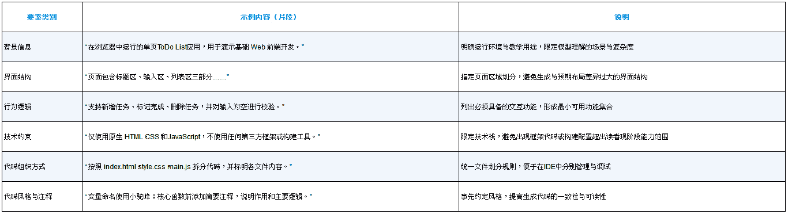

从表 3-2 可见，好的 Prompt 本质是对需求、约束和风格的结构化表达。后续章节在扩展其他案例时，可沿用这一结构，只替换具体内容即可。

**3.3.2**
**CodeBuddy 在协作回路中的定位**

在本章实战里，CodeBuddy 不是那种能一次性写完所有代码的黑箱，而是嵌入开发闭环的智能协同节点。围绕待办清单，它主要体现四类能力。

（1）**方案产出**。给定结构化 Prompt 后，CodeBuddy 能给出整体思路与文件结构建议。例如收到表 3-2 的提示后，会输出页面骨架、样式组织方式与主要函数划分的初步方案，相当于架构草图与实现蓝本。

（2）**代码生成与补全**。在方案确定后，可按文件粒度如完整的 main.js，或函数粒度如“根据任务文本生成列表项的函数”生成具体代码，实现自然语言到代码片段的映射。人工修改补充后，还能基于上下文补全重复性或模式化部分，如事件绑定、DOM 查询与更新。

（3）**解释与诊断**。代码报错或行为异常时，CodeBuddy 能分析片段与错误信息，指出可能原因并给出修正建议。例如“标记完成样式未更新”“删除按钮失效”等，均可把相关代码与描述一起提供，由其辅助定位逻辑错误或 DOM 操作遗漏。

（4）**重构与文档辅助**。功能成型后，可用于局部重构与文档生成，如拆分冗长函数、抽取重复代码封装，或为关键逻辑补规范注释。需要时还能生成简要的功能说明或使用说明，作为教学项目的辅助材料。

从流程看，纯手工编码大致是：阅读需求→手工设计方案→写 HTML→写 CSS→写 JavaScript→运行调试→手工重构完善。

引入 CodeBuddy 后更接近：用自然语言描述需求与约束→CodeBuddy 产出整体方案与初稿代码→人工检查修改→CodeBuddy 协助调试与重构→按需回到需求扩展功能或调整约束。

如图 3-2 所示，CodeBuddy 主要在“方案与代码产出”“问题诊断与修复”“重构与文档完善”三环节提供支持，而“需求与约束描述”“本地运行与调试”“需求扩展与迭代”仍由开发者主导。

图 3-2 开发闭环示意图

在自然语言驱动加 AI 辅助的模式下，初学者容易产生“全部交给 AI”的错觉。常见误区如下。

（1）误区一：一句模糊指令期待一次产出完美工程。比如“做一个 ToDo List 应用”，缺乏界面、细节与技术限制，CodeBuddy 只能靠通用经验推断，结果必然偏离预期。
应对策略：把需求拆成背景、界面结构、行为逻辑、技术约束等要素，用表 3-2 的方式结构化表达，必要时分多次补充。

（2）误区二：不读代码只看运行结果。只关心能否跑，不关注结构与逻辑，就难以形成真正的编程能力，离开辅助环境也无法独立复现。
应对策略：每次产出或修改后，至少阅读核心函数、关键事件处理与数据结构，不懂之处再向 CodeBuddy 请求解释并与源码对照。

（3）误区三：需求频繁变更却不更新 Prompt。新增或修改功能仍沿用初始提示，会导致工程结构不稳、命名不一致，甚至出现版本混用。
应对策略：需求大调整时同步更新 Prompt，把新增功能与新约束写进去。结构性变更时可在提示中明确“在现有基础上增量修改”，避免完全重写。

为更好发挥 CodeBuddy 的作用并保持质量与学习效果，建议遵循三条原则。

（1）“先讲清楚，再生成”。调用前先确保 Prompt 足够清晰，至少包含背景、界面结构、功能行为、技术约束四部分。
（2）“小步生成，小步运行”。避免一次要整个工程，先产出核心骨架与基础功能，每步完成后即运行验证与阅读理解，再继续扩展优化。
（3）“所有自动产出内容都要审阅”。代码、注释、方案说明都不要直接当最终版。逐段审阅并做必要调整，既能及时发现问题，也能理解 CodeBuddy 的决策逻辑，提升 Prompt 设计与代码评估能力。

在这些原则下，后续小节将用待办清单实战展示自然语言驱动、AI 辅助编码的具体过程，体现自动化效率与学习理解之间的平衡。

## **3.4**
## **项目骨架搭建与环境自检**

功能迭代前先要搭建基础前端项目并确认环境可用。本节演示如何在 CodeBuddy 独立版 IDE 里创建纯前端示例工程，了解目录结构与关键文件，并完成首次运行检查。

第一步，利用 CodeBuddy 新建 Hello-AI-Todo 示例工程。按第二章准备，IDE 或插件环境已就绪。本节以独立版为主，插件版用法类似但独立版界面更一体化。启动后通过新建项目创建工程。

新建时 CodeBuddy 提供多种模板，构建纯前端示例建议选择空白 Web 项目模板或同类最简模板。

如图 3-3 所示，可使用 Cloud Studio 提供的“HTML-CSS-JS”静态网站模板。该模板预置了最基础的前端文件结构，包含一个简单的 HTML 文件、关联的 CSS 样式表和 JavaScript 脚本入口。

图 3-3 Cloud Studio 选择模板页

在新建项目对话框填入项目名称，例如 Hello-AI-Todo，并从模板列表选择空白前端模板。IDE 会自动生成初始文件与代码框架，如图 3-4 所示。

图 3-4 自动生成的初始文件与代码框架

选空白模板后，CodeBuddy 会自动创建基本结构。通常 index.html 包含标准的 HTML5 骨架，并在 head 中链接默认样式表和脚本，如 styles/style.css 和 scripts/main.js。style.css 一般是空的或简单的样式表供编写全局样式。main.js 作为交互入口，初始化时可能只有一行 console.log("Hello CodeBuddy"); 或留空。通过模板可免去手动建文件，直接获得开箱即用的前端骨架。

第二步，梳理项目目录结构与关键文件。工程创建后，在 CodeBuddy IDE 左侧资源管理器可见目录结构，如图 3-5 所示。

图 3-5 示例工程目录结构

基础目录结构如下：
Hello-AI-Todo/
├── index.html
├── styles/
│ └── style.css
└── scripts/
└── main.js

其中 index.html 为主页面，提供网页骨架；styles/style.css 为全局样式表，定义外观布局与视觉；scripts/main.js 为前端交互入口脚本。

说明：本章后续所有代码片段均默认遵循上述结构。提及 HTML 片段即来自 index.html，样式规则来自 style.css，脚本函数定义来自 main.js。这种约定便于快速定位代码，也利于结合 CodeBuddy 上下文理解内容。

至此起步工程完成，Hello-AI-Todo 结构清晰、运行稳定，已具备进行第一轮功能迭代的基础，可借助 CodeBuddy 逐步实现待办事项清单各项功能。

第三步，运行示例工程并完成环境校验。模板与目录确认后要让工程真正跑起来。只有完整运行并校验，才能确保后续异常来自代码逻辑而非环境或配置。

1. 在 CodeBuddy 中启动示例工程。选中左侧资源管理器里的 index.html，确认其为入口。可通过工具栏“运行/预览”按钮启动内置静态 Web 服务，或右键选择“在浏览器中预览”。正常情况下会打开 http://…/index.html 的页面，内容可能简陋，只要能加载就说明基本运行路径正确。
2. 用浏览器开发者工具检查资源加载。按 F12 启用开发者工具，在 Console 面板确认无红色报错，如 Uncaught ReferenceError、Failed to load resource。在 Network 面板刷新页面，检查 index.html、styles/style.css、scripts/main.js 状态码均为 200，大小正常，无 404/500。若样式或脚本未加载，多半是引用路径或文件名不一致，回到 index.html 检查 <link> 与 
3. 通过简单修改完成自检。为确认链路打通，可在 index.html 标题区改为“Hello AI ToDo – 环境测试”，保存后刷新确认同步更新；在 scripts/main.js 添加 console.log("Hello-AI-Todo environment is ready."); 保存刷新后在控制台看到输出，即证明浏览器已正确执行脚本。

## **3.5**
## **从 Prompt 到可交互界面的第一次成型**

3.4 节已完成工程创建与环境校验，得到一个可正常启动的基础 Web 项目。本节在此基础上围绕 ToDo List 核心需求展开首次完整界面迭代，通过结构化 Prompt 引导 CodeBuddy 产出页面代码，把抽象设想逐步转化为看得见、点得动的初始可用界面。

为了便于理解与迁移，本节采用“三步走”：第一步，聚焦任务列表展示区与输入区布局，用 Prompt 产出页面基础骨架，即 HTML 结构；第二步，补充样式相关 Prompt，完善排版与视觉表现，即 CSS；第三步，针对“添加任务→展示列表”等关键交互，产出并优化最小可用脚本逻辑，即 JavaScript。每一步都清晰区分 CodeBuddy 自动产出内容与开发者人工判断、修改、确认的部分，体现 AI 助手在实战中的角色边界：显著提效，同时不削弱开发者对代码质量与行为的主导权。

**第一步，页面骨架生成**  
把 3.2 节梳理出的需求转成可直接喂给 CodeBuddy 的指令，就能快速得到 HTML 结构。写指令时要精简清晰，避免口语化歧义，必要时借助 CodeBuddy 内置的增强提示，可见图 3-6。下面是把需求转成提示词并生成骨架的操作思路。

图 3-6 增强提示词功能

**标准提示词模板**

用户：请根据以下需求生成一个 index.html 文件的页面骨架：页面名称为"Hello AI ToDo"，需要包含三个区域——一个标题区域显示应用名称，一个输入区域包含文本输入框和“添加”按钮，用于输入新任务，一个列表区域用于展示任务列表。请使用语义化的 HTML5 标签（如<header>、<main>、<section>等）划分区域，并为后续的样式和脚本添加必要的 id 或 class 属性。代码只需包含基本结构，不需要填充具体内容或功能。

图 3-7 展示了 CodeBuddy 按此指令生成的初版结构，标题、输入、列表三块边界清晰。输出采用 HTML5 语义标签，关键节点已配置可复用的 id 与 class，便于后续样式与脚本精准引用。即便对标签语义掌握有限，也能通过分区把握整体排布。

图 3-7 生成的基础 HTML 结构

整体框架由三大部分构成。

（1）**标题区域** Header。用 <header> 包裹页面抬头，内部 <h1> 呈现应用名“Hello AI ToDo”。这是用户首屏最先看到的固定头部。

（2）**输入区域** Input Section。通过 <section class="input-section"> 划定，内含文本框 <input type="text" id="taskInput" class="task-input"> 与操作按钮 <button id="addBtn" class="add-btn">添加</button>。文本框负责录入待办文字，按钮负责提交并触发创建。

（3）**列表区域** List Section。通过 <section class="list-section"> 划定，内部放置无序列表 <ul id="taskList" class="task-list">。后续新增任务时，脚本会以 <li> 形式追加到该列表，实现条目的呈现与更新。

整体而言 <header>、<main> 及若干 <section> 共同构成语义明确的骨架，每个功能区均以标签层级与 id/class 作标记，可读性和可维护性较好。对初学者友好：即便对 <main>、<section> 的完整语义不熟，也能直观看出页面被拆成标题、输入、列表三大块，如图 3-7 所示，渲染后已呈现标题、输入控件与空列表的雏形。本阶段重点在骨架与元素分布，为后续样式与交互奠基。

index.html 主界面的代码如清单 3-1 所示。

**清单 3-1 index.html 主界面的代码**

/<!DOCTYPE html>

<html lang="zh-CN">

<head>

<meta charset="UTF-8">

<meta name="viewport" content="width=device-width, initial-scale=1.0">

<title>Hello AI Todo</title>

<link rel="stylesheet" href="styles/style.css">

</head>

<body>

<!-- 标题区域 -->

<header class="app-header">

<h1 class="app-title">Hello AI ToDo</h1>

</header>

<!-- 主要内容区域 -->

<main class="app-main">

<!-- 输入区域 -->

<section class="input-section">

<input

type="text"

id="taskInput"

class="task-input"

placeholder="请输入新任务"

>

<button id="addBtn" class="add-btn">添加</button>

</section>

<!-- 列表区域 -->

<section class="list-section">

<ul id="taskList" class="task-list">

<!-- 任务列表将在这里动态生成 -->

</ul>

</section>

</main>

</body>

</html>

**第二步，基础样式与布局实现**  
骨架完成后，可让 CodeBuddy 生成 style.css，为页面补上初级布局与美化，使其在无复杂功能时也保持整齐，并对主要区块形成视觉区分。提示词需明确居中、最大宽度、标题突出、输入行内排列、列表项样式等要求。

**标准提示词模板**

用户：现在请为页面生成基础的 CSS 样式（写入 style.css 文件）。要求如下：将页面整体居中显示，设置合适的最大宽度；美化标题的字体大小和颜色，使其突出；使输入区域的文本框和按钮在同一行，并适当留出间距；为任务列表及列表项提供基本样式，例如去除默认列表样式、增加间距和边框以区分各个任务项。请使用简洁的 CSS 实现上述布局和样式。

使用增强提示词后：为页面创建简洁的 CSS 样式（写入 style.css 文件），具体要求如下：将整个页面内容居中显示并设置合理的最大宽度；优化标题样式，调整字体大小和颜色使其醒目；将输入框和按钮排列在同一行，并设置适当间距；为任务列表设计基本样式，包括去除默认列表符号、增加项间距以及添加边框使任务项清晰区分。请使用高效的 CSS 代码实现这些布局和视觉效果。

CodeBuddy 返回完整样式文件并附逐条说明。如图 3-8 所示，左侧为生成的 style.css，右侧为布局、标题、输入区、列表样式的要点清单。

图 3-8 完整 style.css 内容

当前版本的 style.css 完整代码如清单 3-2 所示。

**清单 3-2 style.css 完整代码**

/* 全局样式重置 */

* {

margin: 0;

padding: 0;

box-sizing: border-box;

}

/* 页面基础样式 */

body {

font-family: -apple-system, BlinkMacSystemFont, 'Segoe UI', Roboto, Oxygen, Ubuntu, Cantarell, sans-serif;

background: linear-gradient(135deg, #667eea 0%, #764ba2 100%);

min-height: 100vh;

padding: 40px 20px;

}

/* 主容器 - 居中显示并设置最大宽度 */

.container {

max-width: 600px;

margin: 0 auto;

background-color: #ffffff;

padding: 40px;

border-radius: 12px;

box-shadow: 0 10px 40px rgba(0, 0, 0, 0.2);

}

...

.task-list li {

padding: 16px;

margin-bottom: 12px;

background-color: #f8f9fa;

border: 1px solid #e9ecef;

border-radius: 8px;

transition: all 0.3s;

}

.task-list li:hover {

background-color: #e9ecef;

transform: translateX(4px);

}

上述规则带来简洁协调的视觉效果：内容居中且宽度适宜，标题醒目易读，输入组件整齐排列，列表项清晰分隔。这些样式与 HTML 中的 id 对应，如#input-section、#task-input、#add-button 等，如图 3-9 中的初版 Demo 页面所示。

图 3-9 初版 Demo 页面

此时可自行微调颜色、字号或边距，观察变化加深对 CSS 的认识。遇到不理解的选择器或属性，可直接询问 CodeBuddy，例如“请解释 justify-content: space-between 的作用”，它会说明该属性用于在弹性容器内让子元素两端贴边、中间均匀分布。通过问答，初学者能逐步理解规则含义，掌握布局与美化的技巧。

**第三步，最小交互闭环验证**  
结构与样式完成后，进入交互阶段，构建“最小可用交互闭环”。本例闭环为：用户在输入框填写待办，点击“添加”或按下 Enter，新任务即时出现在列表。

这是 ToDo 应用最基础的交互，对应 main.js 的核心逻辑，通过操作 DOM 动态更新列表。

实现可拆解为：
• 抓取页面中的 DOM 元素，即文本输入框、添加按钮、任务列表容器；
• 为按钮与输入框绑定事件，触发时读取输入内容；
• 根据内容创建新的 <li> 并插入任务列表 <ul>；
• 完成后清空输入框并将焦点返回输入框，便于下次输入；
• 进行基础异常处理与日志输出。

继续借助 CodeBuddy，按逻辑描述生成 JavaScript 并在 IDE 中验证。

**标准提示词模板**

用户：请创建 main.js 脚本，实现以下功能：当用户单击“添加”按钮时，将输入框 (id="task-input") 中的文本获取出来，如果不为空，则创建一个新的<li>元素，将文本内容作为<li>的文本节点插入<ul id="task-list">列表中，最后清空输入框内容。请用原生 JavaScript 实现上述过程，并确保脚本在 DOM 加载完成后再执行（以防止获取元素时页面尚未加载完全）。

使用增强提示词后：创建一个 main.js 脚本，使用原生 JavaScript 实现以下功能：当用户单击 ID 为'添加'的按钮时，首先获取 ID 为'task-input'的输入框内容。如果内容不为空，则创建一个新的<li>元素，将输入文本作为该元素的文本节点，并将其添加到 ID 为'task-list'的<ul>列表中。最后清空输入框内容。请确保脚本在 DOM 完全加载后执行，可以使用 DOMContentLoaded 事件或将脚本放在 body 末尾来实现。代码应包含完整的错误处理，确保在元素不存在时不会报错。

生成的 JavaScript 关键代码如清单 3-3 所示。

**清单 3-3 main.js 关键代码内容**

// 确保 DOM 完全加载后再执行脚本

document.addEventListener('DOMContentLoaded', function() {

 console.log("Hello CodeBuddy");

 // 获取页面元素

 const taskInput = document.getElementById('taskInput');

 const addBtn = document.getElementById('addBtn');

 const taskList = document.getElementById('taskList');

 // 添加任务的函数

 function addTask() {

 // 获取输入框内容并去除首尾空格

 const taskText = taskInput.value.trim();

 // 检查内容是否为空

 if (taskText === '') {

 console.warn('警告：任务内容不能为空');

 taskInput.focus();

 return;

 }

 try {

 // 创建新的 <li> 元素

 const newTask = document.createElement('li');

 // 将输入文本作为文本节点添加到 <li> 元素

 newTask.textContent = taskText;

 // 将新任务添加到任务列表

 taskList.appendChild(newTask);

 // 清空输入框内容

 taskInput.value = '';

 // 将焦点返回到输入框

 taskInput.focus();

 console.log('任务添加成功：', taskText);

 } catch (error) {

 console.error('添加任务时发生错误：', error);

 }

 }

 // 为"添加"按钮绑定单击事件

 addBtn.addEventListener('click', addTask);

 // 支持按 Enter 键添加任务

 taskInput.addEventListener('keypress', function(event) {

 if (event.key === 'Enter') {

 addTask();

 }

 });

});

**第四步，代码结构与运行逻辑说明**  
分析图 3-10 所示代码，整体可分为 4 个层次：页面加载入口、DOM 获取与校验、核心业务函数、事件绑定与交互触发，共同构成完整最小闭环。

图 3-10 Main.js 关键代码

（1）页面加载入口。首先注册 DOMContentLoaded 监听器：

document.addEventListener('DOMContentLoaded', function() { ... });

该事件在 HTML 解析完成、DOM 树构建完毕后触发，此时可安全访问页面元素。将所有逻辑置于回调内部，能避免“元素为 null 或 undefined”的运行时错误，是前端脚本的常见安全做法。

（2）DOM 元素获取与基础校验。在回调内，先用 document.getElementById 依次取出三个关键元素：

const taskInput = document.getElementById('taskInput');

const addBtn = document.getElementById('addBtn');

const taskList = document.getElementById('taskList');

这三行分别对应 HTML 中的任务输入框、添加按钮和任务列表容器，是后续交互的基础。

（3）核心业务函数 addTask。addTask 承担“把输入内容写入列表”的全部业务：

function addTask() {
 const taskText = taskInput.value.trim();
 ...
}

首步读取输入并用 trim() 去除首尾空格，防止仅输入空格就通过校验。随后进行空值检查。

if (taskText === '') {
 console.warn('警告：任务内容不能为空');
 taskInput.focus();
 return;
}

校验不通过时给出警告并把焦点拉回输入框，提示用户重新输入，形成“校验—提示—返回”的闭环。

在 try 块中，脚本依次创建新 <li>、写入文本、追加到列表、清空输入框、重新聚焦，并输出成功日志。整个流程清晰、可维护，也为后续扩展做足准备。

**从输入到列表：任务添加闭环**

在 try 块里先用 `document.createElement('li')` 新建一个空节点，把用户在输入框填写的内容写入 `newTask.textContent` 作为可见文本，随后通过 `taskList.appendChild(newTask)` 把节点挂到列表容器。挂载完成后把 `taskInput.value` 置空并执行 `taskInput.focus()`，让输入框保持焦点便于连续录入。同时在控制台输出“任务添加成功”的信息，方便调试时感知状态。整段操作被 try 包裹，一旦 DOM 阶段出现异常，catch 会捕获并打印错误，为后续排查提供线索。

事件挂载与触发路径

`addTask` 定义完毕后，需要把界面动作与业务函数关联。给“添加”按钮绑定单击监听：
`addBtn.addEventListener('click', addTask);`
这样每次鼠标点按按钮都会运行 `addTask`，尝试把当前输入写入列表。

键盘路径同样补齐：
`taskInput.addEventListener('keypress', function(event){ if(event.key === 'Enter'){ addTask(); } });`
监听输入框按键，当识别到回车时同样调用 `addTask`。鼠标与键盘两种方式都能完成添加，交互更顺滑。

**第五步，运行效果与闭环验证**

在 CodeBuddy IDE 保存 `main.js` 后，用内置预览打开 `index.html`。页面顶部呈现“Hello AI ToDo”标题，中部是输入框与“添加”按钮，下方是尚未填充的任务列表区。

在输入框键入例如“编写今天的学习计划”，点击“添加”或直接回车，下方会即时出现一条新卡片，内容与输入一致。多次重复输入，记录会按顺序累积，如图 3-11 所示。

图 3-11 第二版 Demo 页面

浏览器中展示的第二版 Demo 上方为标题，中部为输入区，下方任务以浅色卡片逐条排列，说明从输入到展示的闭环已打通。

需要说明的是，目前仅实现了“添加任务”的最小可用功能，尚未涉及完成状态切换、删除等操作。刻意停留在这一最小闭环，是为了在每个阶段清晰检验：提示词是否合理、CodeBuddy 产出的代码是否可读、脚本行为是否符合预期。读者可在此基础上扩展功能，不会影响已验证的核心通路。

## **3.6**

## **本章小结**

至此，CodeBuddy 的初步体验基本结束。回顾过程，我们没有沿用传统图书逐行手敲代码的方式，而是采用“自然语言描述需求 + AI 产出代码 + 人工复核”的协作模式。

首先在 CodeBuddy IDE 零配置搭建 Web 前端工程，厘清 `index.html`、`style.css`、`main.js` 三者的协作分工；其次完成思维转换，学会把模糊想法整理成结构化提示，抓住背景、结构、行为、约束四个要素，这是与 AI 协作的质量基石；随后通过三轮对话，引导模型先输出语义化 HTML 骨架，再生成美观 CSS，最后产出具备基础交互的 JavaScript；最终得到可运行的最小可用产品，验证了输入到列表展示的核心路径。

从更高层面看，本章 ToDo 实战展示了一种正在普及的开发范式：自然语言作为入口，AI 负责方案生成与执行辅助，开发者聚焦需求判断、结果校验与质量把控。随着工程复杂度与协作规模提升，这一模式将从个人实践走向可复用、可扩展的团队协作。后续章节将在此基础上引入更复杂的业务与工程结构，继续展开 AINative 开发实践。

# **第四章**

# **CodeBuddy 在网页开发中的应用**

本章系统介绍 CodeBuddy 在网页开发中的落地路径。我们先从 B/S 与 C/S 架构切入，明确 Web 的交互模型，再介绍 HTML、CSS、JavaScript 的基础用法；随后通过实战项目展示 CodeBuddy 如何加速原型搭建与交互实现，体现其在个性化与智能推荐方面的延展能力；最终串起从基础到实战的完整链路，帮助读者掌握 AI 辅助网页开发。

## **4.1**

## **初识 Web 开发基础**

本节带领大家了解网页开发的基本概念与常用工具。

**4.1.1**

**Web 开发与 B/S 架构**

Web 开发指在网络环境下设计与实现应用系统，其核心是实现客户端浏览器与远程服务器之间请求、传输、处理与呈现。不同于传统软件依赖特定操作系统，Web 开发借助 HTTP/HTTPS、HTML、CSS、JavaScript 等标准完成信息的组织、呈现与交互。

随着云计算与人工智能发展，Web 从静态页面演进为高度动态、交互与智能化的复杂应用，支撑电商、教育、医疗、政务等数字化转型，并与大模型数据智能融合形成新型知识服务与推荐模式。C/S 与 B/S 构成两大架构逻辑：C/S 强调客户端本地实现，需安装专用软件；B/S 依托浏览器轻量化访问，降低门槛，成为主流。

图 4-1 用流程图直观呈现 B/S 架构一次交互的核心组件与数据流向。

浏览器端如 Chrome、IE、Firefox、UC 等，首要任务是 URL 解析，把用户输入的地址转为服务器可识别的请求。浏览器向 Web 服务器发出请求后，服务器按路径定位 HTML 文件，并与数据库服务器交互完成读写查询，最终把结果回传。浏览器再执行渲染，把 HTML 转为可视界面。Web 服务器负责逻辑与数据组织，数据库服务器保障底层存储。图中“URL 解析—请求发送—数据获取—网页渲染”清晰体现浏览器与服务器的协同。浏览器不仅呈现静态内容，还需解析 HTML、CSS、JavaScript，确保结构正确、交互可用。

图 4-1 B/S 架构体系

可见 B/S 架构既是 Web 技术核心，也是 AI 辅助网页生成与优化的重要落脚点。伴随 HTML5 与 React、Vue 等框架成熟，B/S 已能支撑复杂交互与数据可视化，体验逼近 C/S。结合大语言模型与智能生成工具如 CodeBuddy，Web 开发能更快、更灵活地响应多样需求。

**4.1.2**

**网页骨架**

——HTML

超文本标记语言 HyperText Markup Language 是万维网的基础标准，用来描述网页内容的结构与语义。通过标签定义文本、图像、链接、表格、表单等逻辑层级，让浏览器把抽象指令转为图形界面。作为 W3C 开放标准，HTML 持续迭代，HTML5 支持多媒体、Canvas 绘图、语义化标签，并与 JavaScript、CSS 无缝衔接，形成前端“三驾马车”。AI 辅助编程中，对 HTML 结构的准确建模与自动生成是基础。

HTML 基于标记体系，核心是用标签对界定元素。例如 `
 … 
` 表示段落，`<h1> … </h1>` 表示一级标题。标签可带属性，如 ``，src 指定路径，alt 提供替代文本。

文档层次明确：`<!DOCTYPE html>` 声明版本；根元素 `<html>` 包含全文；`<head>` 定义元信息如标题、字符集、样式引用；`<body>` 承载可见内容，如图 4-2。

图 4-2 HTML 基本语法示例

清单 4-1 给出简易示例。

**清单 4-1 简单的 HTML 示例**

<!DOCTYPE html>

<html>
  <head>
    <meta charset="UTF-8">
    <title>我的第一个网页</title>
  </head>
  <body>
    <h1>Hello World!</h1>
    
这是一个由 HTML 构建的简单段落。

    <a href="https://example.com">单击进入示例链接</a>
  </body>
</html>

其中 `<meta charset="UTF-8">` 保证多语言编码，避免中文乱码；`<title>` 显示在标签页；`<h1>` 与 `
` 组织文本；`<a>` 实现超链接。示例虽小，却涵盖文档核心，为大模型提供模板化参考，便于快速模仿与扩展。

图 4-3 展示 HTML 常用标签与语法结构，包括文档结构、布局语义化、表单、文本、列表、链接多媒体、表格等。

图 4-3 HTML 网页基本标签

在 AI 辅助编程中，大模型需把自然语言需求映射到 HTML 结构。例如用户要求“生成含标题、图片、链接的介绍页”，模型需转化为 `<h1>`、``、`<a>` 并合理嵌套于 `<body>`。这要求模型掌握语法规则，并能输出语义化、结构化、跨浏览器兼容的代码。随着模型学习海量示例，生成标签、属性与嵌套逻辑的能力持续增强。HTML 作为骨架，既是前端起点，也是 AI 赋能编程的语言基石。

**4.1.3**

**CSS 网页样式与布局控制**

层叠样式表 Cascading Style Sheet 用于控制文档呈现，与 HTML 共同构成前端核心。HTML 负责结构，CSS 负责样式与布局，通过字体、颜色、间距、边框、背景、响应式布局等实现美观与可用。层叠特性体现在优先级规则上，不同来源与选择器存在继承与覆盖，利于灵活管理。对 AI 而言，理解语义与优先级对生成规范且兼容的样式至关重要。

CSS 语法由选择器、属性、属性值组成。例如：
p {
  font-family: Arial, sans-serif;
  color: blue;
  text-align: center;
}
表示所有段落使用 Arial 系列、蓝色、居中。选择器体系包括元素选择器、类选择器 `.class`、ID 选择器 `#id`、伪类选择器 `:hover`，可实现精细控制。基本语法如图 4-4。

图 4-4 CSS 网页样式设计的基本语法

层叠与继承决定多样式作用于同一元素时的解析方式，为 AI 生成提供逻辑框架。模型通过学习大量样例掌握优先级计算与继承机制，输出符合规范的代码。

**4.1.4**

**JavaScript 基本语法与交互逻辑**

JavaScript 是基于对象与事件驱动的脚本语言，实现网页动态交互的核心。与 HTML、CSS 分别负责结构与表现不同，JS 处理逻辑与行为，能捕获单击、输入、滚动等操作，通过 DOM 动态修改内容与样式。引入 JS 后网页从静态展示转向动态交互，支持表单校验、AJAX、动画、个性化体验，是 React、Vue、Angular 的基石，也是 AI 辅助开发必须掌握的关键环节。基本交互过程如图 4-5。

图 4-5 HTML、CSS 与 JavaScript 文件的基本交互过程

语法简洁，含变量声明 `var/let/const`、数据类型、控制结构 `if/for/while`、函数定义 `function`/箭头函数。核心价值在于人机交互：DOM 操作改变结构与样式，事件监听捕获用户输入，结合 AJAX/Fetch 实现异步通信，无刷新与服务器交互。例如搜索框实时返回结果即靠 JS 异步请求。AI 在自动化生成时常把自然语言需求转为事件绑定与逻辑代码，如“点击按钮展开菜单”会生成基于 `addEventListener` 的 DOM 脚本，体现语义到逻辑的映射价值。

**4.1.5**

**前端网页开发基本工具**

网页开发不仅依赖语言，还需完善工具链。现代前端从传统编辑器转向 VS Code、WebStorm 等 IDE，借助语法高亮、自动补全、调试插件、实时预览提升效率。Node.js 与 npm 负责依赖管理，Webpack、Vite 支持模块化打包与性能优化，React、Vue、Angular 通过组件化抽象复杂逻辑，增强复用与扩展。这些工具为 AI 生成代码提供可靠落地环境。

随 AI 发展，前端工具加速智能化：上下文驱动补全、基于运行日志的自动化调试、从草图或自然语言生成界面。CodeBuddy 即为典型代表，融合大模型的语义理解与工具链全流程支持，形成从需求描述到结构化代码的闭环。未来前端开发将更强调人机协作：开发者用语义表达需求，模型生成草案，工具链负责调试优化，大幅提升效率并推动范式向智能协作演进。

## **4.2**

## **页面交互设计与结构优化技巧**

本节概述页面交互、布局与结构代码优化要点，并给出 CodeBuddy 自动生成网页的基本流程。

**4.2.1**

**网页布局与响应式设计**

**结构与自适应的底层逻辑**

页面第一印象决定于信息的排布方式，而能否在不同终端保持流畅使用，则取决于自适应能力。浏览器读取 HTML 文件时，会先构建一棵可被程序操作的树形结构，解析从根标签开始，先确认头部区与主体区，再向下逐步展开层级关系，最终形成嵌套视图，如图 4-6 所示。树形结构把静态标记转译为可操作的对象集合，样式表通过选择器匹配来绑定视觉表现，脚本则借助事件驱动对节点进行动态改写。可以说，排布既是代码组织，也是语义层面的映射。

图 4-6 HTML 网页 DOM 树结构解析

当前站点普遍追求跨屏一致可用。实现路径主要围绕流式布局、弹性盒与网格系统展开。例如用百分比宽度替代固定像素，元素会随视口缩放而伸缩；媒体查询则允许为手机、平板、桌面分别制定差异化样式。归根结底，自适应是人机交互中的动态调节机制，让界面在多终端维持功能统一，提升普适性。

在生成式辅助场景下，版式与自适应的抽象尤为重要。大模型需要把“导航栏”“主内容区”“侧边栏”等语义描述映射为 HTML 结构与 CSS 规范，并输出具备缩放能力的代码，预览时即可实时调整。后续研究重点在于让模型更精准捕捉版式约束，如跨端一致性与信息层级优先级，从而实现更智能的页面生成与优化。

**4.2.2**

**表单与数据交互设计**

表单是网页与用户沟通的核心入口，设计质量直接牵动数据准确性与体验。基础层面，<form> 限定输入区域，内部依靠 <input>、<textarea>、<select> 等采集信息。前端填写完成后，数据按 action 指定的路径提交至后端解析存储。该流程既是信息通道，也是交互逻辑的载体。

为提升有效性，通常结合 JavaScript 做前端校验。例如用正则核验邮箱格式，或限制密码复杂度。此类机制可降低无效提交，提升安全性。更进阶的方案采用 AJAX 异步请求，实现局部刷新而非整页重载。这种非阻塞方式标志着页面从静态展示向动态响应演进。

模型在表单生成与交互设计上具有明显优势。CodeBuddy 可依据自然语言描述自动产出输入表单及校验逻辑，例如“制作一个注册页，含邮箱、密码、确认密码并做前端校验”，效果如图 4-7 所示，生成的代码会对邮箱等数据进行校验。

图 4-7 CodyBuddy 生成表单校验代码

总体而言，通过语义到代码的映射，AI 能快速搭建表单框架，并结合训练语料中的交互模式产出安全高效的数据处理逻辑，使表单设计由手工编码转向智能化，显著减轻开发负担。

**4.2.3**

**模块化与组件化代码优化**

随前端复杂度提升，模块化与组件化成为核心方法。模块化思想是将功能拆分为独立可复用单元，以提升可维护性与扩展性。例如把导航栏、页脚、侧边栏抽象为独立模块，可在多页面复用并保持一致。工程层面这体现了高内聚低耦合原则，通过逻辑隔离降低维护成本。

组件化是模块化在框架中的具体落地，典型如 React 函数组件、Vue 单文件组件、Angular 指令式组件。组件封装 HTML、CSS、JavaScript，形成视图-样式-行为一体化管理。组件间通过 Props 与 State 通信，形成高度可复用的开发范式，推动前端从页面驱动转向组件驱动，大幅提升复杂交互效率。

工具如 CodeBuddy 在模块化与组件化上展现出强生成能力。借助 Prompt，可要求模型产出带分页的新闻列表组件，系统会自动输出完整的 HTML、CSS 与交互逻辑。AI 还能结合上下文优化代码，识别冗余模块并给出拆分或合并建议，提升可维护性，也为自动化测试部署创造条件。

**4.2.4**

**CodeBuddy 自动生成网页的基本流程**

CodeBuddy 的网页生成可归纳为需求分析、语义建模、代码生成、编辑预览、代码优化、部署上线六步。首先用户用自然语言描述功能，例如“生成旅游网站首页，含搜索框、图片轮播和用户评论区”。模型进行语义解析，提取页面结构、功能模块等关键实体并形成需求向量表示。随后调用预训练知识与提示工程，把抽象需求转化为具体的 HTML、CSS、JavaScript 代码。

图 4-8 CodyBuddy 网页开发的基本流程

代码生成阶段，系统基于 LoRA 微调与上下文学习，结合已有网页范式输出结构化代码。同时预设规范检查工具会做语法与格式优化，保证可读性和一致性。生成的页面可在本地直接运行，并按响应式规则自适应，确保跨设备体验统一。

最后平台提供交互式预览与优化，开发者可实时查看效果，并通过追加自然语言指令迭代优化，形成从需求到成品的快速闭环，缩短开发周期。

## **4.3**

## **实战项目一：个性化在线简历生成**

接下来开启 CodeBuddy 网页开发之旅，本节演示如何为大学生生成求职简历网页。

**4.3.1**

**工作简历基本组成**

简历的核心作用是作为人岗匹配的证据，用有限篇幅集中展示候选人与岗位需求的契合度。优质简历通常包含基本信息、求职意向、项目经验等模块，如图 4-9 所示。

图 4-9 求职简历的基本组成

内容组织遵循结构化、可读性、岗位导向三原则。结构化便于招聘系统 ATS 快速解析；可读性强调简洁清晰、逻辑递进；岗位导向要求紧贴目标职位，避免冗余信息。大模型可通过自然语言快速获得标准化模块框架，为后续填充内容与模板生成打基础。

各模块侧重点不同：基本信息要联系方式准确简洁；求职意向需匹配岗位并体现职业目标与优势；教育背景倒序排列，突出主修课程、GPA、奖学金等能力证明；工作实习经历是核心，建议用 STAR 法则量化成果；项目经验可弥补不足，展示实践能力；技能证书与奖项提升可信度，体现硬实力。

关键词提取与岗位分析是提升匹配度的关键。通过解析招聘信息，大模型能快速提炼核心能力词如“数据分析”“用户增长”“跨部门协作”“竞赛”等并给出权重排序。候选人可据此优化文本，自然嵌入经历与技能描述，提升 ATS 筛选与人工评审通过率。模型还能帮助提炼沟通协调、快速学习等潜在优势并转化为具体案例。最终简历需兼顾结构逻辑与个性化竞争力。

**4.3.2**

**提示词构建**

提示工程是将人类意图转译为大模型可执行指令的方法，目标是稳定产出风格一致、结构合规的文本与代码。针对简历场景，建议采用“角色+目标+约束+输出格式”四要素：明确写作角色如“招聘领域写作专家”，界定目标如突出匹配度与量化成果，设定约束如去口语化、限长度、避免主观形容词，并指定输出格式如模块化 JSON 或 HTML 网页。个性化模板可自动加载岗位关键词与个人素材，减少歧义并提升可控性。

为保证稳定与可迁移，可把复杂任务拆分为模块化提示链：

① 结构提示，列出完整模块与顺序；
② 内容提示，逐模块收集原始事实与要点；
③ 风格提示，要求专业简洁、动词开头；
④ 量化提示，要求每条经历含可核验指标；
⑤ 校验提示，去冗余、去敏感、检查拼写与一致性。

针对不同岗位可追加行业特定词，实现小样本风格迁移。现打开智联招聘，搜索“网络安全”，如图 4-10 所示。

图 4-10 智联招聘搜索岗位信息

随后挑选某公司职位描述，如图 4-11 所示，以精准构建提示词。

图 4-11 网络安全职位描述信息

结合招聘人员“小珞”的信息，构建如下提示词。

现需要生成一份网络安全中恶意代码分析的个人简历，并且以 HTML 格式输出，生成简历格式直接可用。简历内容要求采用学术化表达，简洁明了并且能体现求职者的能力。

整个简历包括基本信息、教育经历、科研与比赛经历、实践经验、专业技能 5 个部分，每部分关键词采用蓝色字体描述，实践经历部分突出项目标题内容。

**岗位描述如下：**

一、岗位职责

1.负责对客户网络、系统进行安全评估和安全加固；

2.负责对客户的应用系统进行渗透测试和代码审计；

3.在出现网络攻击或安全事件时，提供紧急响应服务，帮助用户恢复系统及调查取证。

二、岗位要求

1.熟悉常见的 Web 安全漏洞及其漏洞利用，比如 SQLi\XSS\XXE 等；

2.对业务、逻辑漏洞挖掘有自己的认识和经验；

....

**小珞同学的个人信息描述如下：**

1.基本信息

姓名：小珞，电话：152××××××××，邮箱：xiaoluo@163.com，求职意向：安全工程师，附一张证件照（阴影头像）。

2.教育经历

××大学硕士网络安全学院网络空间安全专业 2020 年 09 月—2023 年 06 月，年级排名 5%

××大学本科网络安全学院信息安全 2016 年 09 月—2020 年 06 月，GPA3.8/4.0

3.科研与比赛经历

第一作者.基于深度学习的混淆恶意请求检测方法.计算机学报，2022.

DataCon 2022 大数据安全分析竞赛涉网安全分析赛道全国第二名

华为云 2022 年度开发者社区十佳博主&华为云云享专家

4.实践经验

（1）恶意代码深度分析与家族检测研究 2021 年 12 月—2022 年 12 月

项目概述：结合恶意代码实际需求，开展恶意代码深度分析研究。负责内容：利用 IDA 和 OD 逆向工具、沙箱环境开展动静态行为分析研究，结合病毒传播方式搭建深度学习模型，检测家族并分析恶意代码的传播机制和防护技巧，形成详细的分析报告，该研究获高度认可

...

5.专业技能

（1）英语能力：CET-6

（2）编程能力：Python、C/C++、汇编

（3）专业知识：熟悉基本数据结构和算法；熟悉恶意程序分析与软件加壳脱壳方法，了解栈溢出、格式化字符串等常见的二进制漏洞利用技术

（4）安全知识：熟悉 OllyDbg、IDA 等逆向分析工具和 Metasploit、Burp Suite、Nmap 网络攻防工具的使用；熟悉开源恶意软件分析工具 CAPA、CAPE、Cuckoo 的技术机理

...

请结合职位描述和个人信息生成内容充实的简历。 

 **注意**

上述提示词可由大语言模型生成。CodeBuddy 提供 A/B 提示对照、可读性评分与用词专业度评分等度量，通过多轮多指标多版本的提示链实践，提升可用性。

**4.3.3**

**CodeBuddy 快速生成响应式简历模板**

下面演示利用 CodeBuddy 制作简历网页的具体流程。

（1）启动 CodeBuddy IDE。如图 4-12 所示，在 Workshop 中新建文件夹并命名为“JIANLI”。

图 4-12 CodeBuddy 构建文件夹

（2）输入提示词。在图 4-12 右侧输入框粘贴此前构建的提示词，选择模型默认为“Claude-3.7”，点击“Send”，如图 4-13 所示。

图 4-13 CodeBuddy 输入提示词

系统深度思考后产出对应 HTML 源码，如图 4-14 所示。

图 4-14 CodeBuddy 生成简历代码

（3）IDE 会自动打开生成的“resume.html”，如图 4-15 所示，随后可在本地浏览器打开该网页。

图 4-15 CodeBuddy 打开生成的 HTML 文件

生成效果如图 4-16 所示。

图 4-16 CodeBuddy 生成网络安全招聘简历

（4）若需替换头像，可在提示对话框上方点击“图片上传（Upload Images）”按钮，输入如图 4-17 的提示词。

图 4-17 上传图像并输入提示词

系统会重构代码并替换本地图像路径，生成自定义头像，替换过程如图 4-18 所示。

图 4-18 CodeBuddy 定位并替换图像关键代码

最终显示效果如图 4-19 所示。

图 4-19 生成简历代码在线显示效果

总体来看，CodeBuddy 实现了从简历文本到网页模板的自动化转换。首先把候选人数据抽象为统一数据模型，保证信息结构化与模块化。其次借助语义化标签如 <header>、<section>、<footer> 自动生成网页骨架，并结合 CSS 布局实现响应式，确保 PC 端、移动端、打印端均有良好表现。

实践表明，用户只需提供基础信息与目标岗位描述，CodeBuddy 即可通过提示词驱动生成高质量文本并快速渲染为可投递的网页与 PDF 版本，大幅提升制作效率与 HR 初筛通过率。响应式网页简历还支持交互功能，如点击展开详情、嵌入项目链接与可视化技能图表，以多维度直观形式呈现候选人优势，有效增强竞争力。

## **4.4**

## **实战项目二：创建动态 MBTI 性格测试网页**

本节借助 CodeBuddy 与大语言模型的提示词解析能力，快速构建交互式 MBTI 性格测试网页，覆盖题目设计、答题交互、结果报告与可视化分析的全流程自动化开发。

**4.4.1**

**MBTI 概述**

MBTI，即 Myers-Briggs Type Indicator，迈尔斯-布里格斯性格类型指标，是全球应用最广的性格测评模型之一。该模型通过量化个体在认知偏好与行为模式上的选择，形成结构化性格分类。MBTI 把心理差异简化为 4 个二分维度：

• 外向 E 与内向 I
• 实感 S 与直觉 N
• 思维 T 与情感 F
• 判断 J 与知觉 P

四维度交叉组合形成 16 种性格类型，如表 4-1 所示。每种类型都有独特认知风格与交往方式，为教育、管理、人际沟通提供参考。

表 4-1 MBTI 测试维度与性格类型

相较传统测评工具，MBTI 有两大特点。其一，它不仅考察外显行为，还关注内在心理偏好。例如面对新问题，有人依赖直觉形成整体印象，有人则通过感官信息与逻辑分析逐步推演。其二，测试采用大量情境化题目引导被测者选择，如“你更倾向于在团队中发言，还是安静倾听？”这类题目有助于揭示潜在心理倾向，而非仅反映表面行为。

在网页开发与人机交互场景中，MBTI 具备天然适配性。其题目数量多、结构标准化，适合用 HTML 表单呈现；计分逻辑简洁，可通过数组或对象映射自动统计；结果展示形式多样，可结合 CSS 与 JavaScript 做可视化呈现，如雷达图、柱状图或色彩编码的性格标签。

**4.4.2**

**把 MBTI 测评拆成可编程的结构**

在线 MBTI 的本质是把题目内容、备选答案和计分规则整理成机器可读的结构。搭建思路基本可以分为三步。

第一步是题库建模。每一道题都需要包含题干、选项以及对应的维度标签。以分辨外向 E 和内向 I 为例，选项必须明确绑定到 E 或 I 上。

第二步是计分机制。用户做出选择后，系统把分值累加到对应维度。全部题目完成后，对比各维度累计高低得出倾向，再组合成完整的四字母类型。这种做法符合传统心理量表的原理，也很适合在前端实现。

第三步是借助 CodeBuddy 快速成型。它的作用是可以批量产出标准化的题库和规则。例如给出指令“请为 MBTI 测评产出 20 道简化题目，每题两个选项，分别对应 E/I、S/N、T/F、J/P 四个维度”，平台就会自动返回语义清晰的题目并标注维度映射。开发者把结果转成数组对象即可嵌入页面逻辑。

**4.4.3**

**CodeBuddy 一键产出 MBTI 测评页**

CodeBuddy 的优势在于能把测评逻辑与前端交互直接打通。用自然语言描述需求后，它会同时产出 HTML 结构、CSS 样式和 JavaScript 脚本。具体流程如下。

（1）用 DeepSeek 精炼指令。打开 DeepSeek，开启深度思考与联网搜索模式，填入图 4-20 所示的需求说明。

图 4-20 在 DeepSeek 中输入需求描述

DeepSeek 深度思考后给出的指令如图 4-21 所示。

图 4-21 DeepSeek 输出的 MBTI 网页制作提示词

（2）打开 CodeBuddy IDE，并在 Workshop 中新建“MBTI”文件夹，如图 4-22 所示。

图 4-22 创建文件夹

（3）把 DeepSeek 得到的指令复制到 CodeBuddy IDE 的对话框中，点击“Send”按钮，如图 4-23 所示。

图 4-23 将 DeepSeek 生成的提示词复制到 CodeBuddy IDE 的对话框中

经过思考，CodeBuddy 启动 AI Coding，产出 MBTI 测评网页代码，并得到主页 index.html、样式表 styles.css、脚本 scripts.js，如图 4-24 所示。 

**注意**

与之前案例不同，本项目会直接让 CodeBuddy 产出运行指令，并在 IDE 内直接运行。

图 4-24 CodeBuddy 生成 MBTI 测试网页代码

（4）CodeBuddy 在底部自动加上“Terminal”对话框，并写入“cd d:/CodeBuddy/workshop/MBTI; python -m http.server 8000”指令，用于在 8000 端口启动 HTTP 服务。其运行步骤如图 4-25 所示。

图 4-25 CodeBuddy 生成网页项目运行步骤

（5）CodeBuddy 运行网页并在顶部输入 URL“http://localhost:8000/”，从而打开刚产出的 MBTI 测评页，如图 4-26 所示。

图 4-26 CodeBuddy 自动访问 MBTI 测试网页

读者也可以用浏览器自行打开，或部署到云服务器供更多人使用。

（6）点击“Start Test”按钮开始测评，按提示完成 20 道题目。图 4-27 展示了第一题画面。

图 4-27 MBTI 测试的第一道题目

答完一题后下一题自动出现，直至 20 题全部完成，如图 4-28 所示。

图 4-28 MBTI 测试的最后一道题目

最终结果如图 4-29 所示，受测者被判定为“ENTP”思维敏捷型。

图 4-29 MBTI 测试结果分析

## 提示

使用大模型时，部分指令可能无法被完全理解或会以另一种形式实现。例如本节指令要求产出 3 个网页分别实现不同功能，最终只得到一个 index.html，但功能已在页面内动态实现。

总之要结合实际情况多与模型对话，按需产出内容与代码。CodeBuddy 还可根据指令为页面增加可视化，比如借助 D3.js 或 Chart.js 做出更美观的图表。

## **4.5**

## **实战项目三：高交互贵州旅游门户的快速搭建**

本节用 CodeBuddy 快速搭建一个高交互的旅游信息门户，实现景点推荐、图片轮播、搜索与评论互动，并尝试网页跳转与多页表单交互，提升直观性与智能化。

**4.5.1**

**需求拆解与功能规划**

在数字文旅蓬勃发展的背景下，旅游门户既是展示窗口也是游客交流与决策平台。本项目以贵州为切入点，打造兼具视觉、交互与实用性的主页。分析后，主页需具备三大特质。

• 信息集中化：把景点介绍、交通路线、票务信息等结构化呈现。
• 交互友好性：通过搜索、评论与推荐获得个性化信息。
• 多终端自适应：PC 与移动端都能保持良好视觉与交互。

具体构建围绕三方面展开。

（1）**首页结构与视觉设计**。首页是用户第一印象，需精心布局。页面采用分区结构，包括导航栏、核心推荐区、图文展示区与互动区。视觉上以大幅轮播图为主背景，突出黄果树瀑布、西江千户苗寨等标志景点，并用高清图片与视频增强沉浸感。导航栏提供“景点推荐”“旅游攻略”“表单提交”等快捷入口。整体配色以绿色与蓝色为主，呼应自然与文化主题，呈现清新亲和感。

（2）**景点推荐与图片轮播**。核心功能是展示目的地特色资源。推荐模块以图片轮播加简短文字介绍呈现贵州代表景点，如遵义会址、黄果树瀑布、小七孔、梵净山。每张轮播配标题、简介与跳转按钮，点击后进入详情页。轮播逻辑由 JavaScript 控制，同时支持自动播放与手动切换，提升自由度。轮播既是视觉工具也是信息组织手段，能在短时间内让用户全面了解资源。

（3）**搜索与用户互动模块**。为提升实用性，设计搜索与互动功能。搜索框采用前端检索，用户输入“苗寨”“瀑布”等关键词后，JavaScript 在景点数据中匹配并实时返回结果。互动方面设置评论与点赞，游客可在景点页通过 HTML 表单输入评论，JavaScript 即时展示在下方。虽然数据仅保存在会话中，但能增强参与感与体验。该模块靠直观交互与即时反馈提升粘性。

接下来用 DeepSeek 构建精准指令，让 CodeBuddy 更好地生成网页。DeepSeek 输出的指令如图 4-30 所示，包含借助 Unsplash API 实现图片动态加载，并给出表单交互的详细描述。

图 4-30 DeepSeek 生成旅游网站提示词

**4.5.2**

**CodeBuddy 生成旅游门户的实操步骤**

具体操作如下。

（1）打开 CodeBuddy IDE 并创建“Guizhou”文件夹。

（2）在右下角对话框输入 DeepSeek 产出的指令。如图 4-31 所示，可选择模型“Claude-4.0-Sonnet”，并在指令中加入中文说明。

图 4-31 CodeBuddy 输入提示词与选择模型

产出过程如图 4-32 所示，HTML 核心内容为中文。

图 4-32 CodeBuddy 生成旅游网页代码的过程

随后得到样式文件 styles.css 与动态脚本 script.js，如图 4-33 所示。

图 4-33 CodeBuddy 生成 CSS 和 JS 文件

（3）CodeBuddy 自动调用“node server.js”运行程序，并最终显示生成的网页界面，如图 4-34 所示。

图 4-34 CodeBuddy 自动运行程序显示网页界面

（4）通过浏览器访问 http://localhost:3000，可看到自动生成的贵州旅游宣传页，如图 4-35 所示。

图 4-35 自动生成的贵州旅游宣传网页

此时图片可能无法精准对应贵州经典景区，这是大模型需要优化的地方。可以自行保存本地照片，或修改 script.js 中的图片链接。关键代码示例如下。

{
name: '西江千户苗寨',
description: '世界最大的苗族聚居村寨，保存完整的苗族原生态文化。',
image: 'https://images.unsplash.com/photo-1578662996442-48f60103fc96?w=500&h= 300&fit=crop',
keywords: 'Xijiang Miao village China'
},

（5）首页顶部有“首页”“景点推荐”“旅游攻略”“表单提交”四个入口。点击“景点推荐”可预览贵州代表景区，如图 4-36 与图 4-37 所示。

▲图 4-36 贵州“黄果树瀑布”等代表性景区

图 4-37 贵州“遵义会址”等代表性景区

（6）点击“旅游攻略”可查看贵州旅游建议，如图 4-38 所示。

图 4-38 贵州旅游攻略

页面中部设有搜索对话框，用户输入关键词如“梵净山”，就可以看到该景区的更多图片及描述，如图 4-39 所示。注意图片仍需开发者手动替换，或与大模型反复对话直至满意。

图 4-39 旅游网站搜索功能

**4.5.3**

**CodeBuddy 生成表单提交与反馈页**

旅游门户不仅要展示信息，还要收集用户数据。本项目设计“表单提交与统计”功能，用户可在主页点击按钮进入专属表单页，填写姓名、联系方式、旅游意向与反馈建议。核心是构建“前端表单—数据存储—统计展示”的闭环，既收集需求又为服务优化提供数据支持。

点击顶部“表单提交”链接，进入填写页，内容如图 4-40 所示。

图 4-40 表单提交页面

填写后点击“提交咨询”按钮，提交成功效果如图 4-41 所示。

此时咨询信息会显示在页面右侧。表单与统计页是交互的延伸，通过收集与分析用户数据，可发现景点关注热度与群体偏好，为旅游市场提供支撑。

图 4-41 表单提交成功提示

## **4.6**

## **本章小结**

本章系统介绍了 CodeBuddy 在网页开发中的应用，从 B/S 架构、HTML 骨架、CSS 样式与 JavaScript 交互，到简历生成、MBTI 测评、旅游门户等实战，展示了 AI 赋能的完整流程。CodeBuddy 降低了开发门槛，通过指令驱动实现需求到网页的快速映射。

值得注意的是，实践可向跨端适配与工程化延伸。跨端开发需在自适应与响应式间合理选择，保证移动端与桌面端体验一致，并结合视口设置与流式布局提升移动可用性。

# **第五章**

# **AI 驱动下的大数据分析与可视化网页开发**

本章聚焦 AI 驱动的大数据分析与可视化，阐述人工智能对分析全流程的赋能，以及可视化在提升可读性与决策支持中的作用，并展示 AI 处理海量复杂数据的优势及其对传统模式的革新。

学习后，读者应能掌握 AI 驱动的大数据分析关键技术，并了解如何用 AI 完成可视化网页开发。

## **5.1**

## **大数据的定义与特征**

大数据是指其规模、增速与种类已超出传统数据处理软件在合理时间范围内采集、管理与处理能力的数据集合。该定义揭示了几项关键特征，通常概括为“3V”模型，即 Volume、Velocity、Variety，这三者构成大数据最基础特征。

（1）Volume 海量：数据规模从 GB、TB 跃升至 PB 乃至 EB 级别。
（2）Velocity 高速：数据产生与流转快，要求处理与分析近乎实时响应。
（3）Variety 多样：类型与来源广泛，涵盖结构化数据，也包括文本、图像、视频、音频、日志等非结构化与半结构化数据。

三大特征构成了大数据时代与传统处理的根本差异。随着科学演进，业界认识到 3V 已不足以全面描述复杂内涵，于是增补了 Veracity 真实性与 Value 价值，形成“5V”模型，如图 5-1 所示。

## **5.2**

## **复杂数据处理的技术框架**

该体系旨在应对多样化数据挑战，可划分为三大领域。

• 数据存储：解决海量数据容纳与高可用问题。
• 数据处理：提供分布式计算与分析引擎。

图 5-1 大数据核心概念

• 数据管理与分析：提供协调流程并萃取价值的工具与平台。

如图 5-2 所示，该技术体系像一座工业化数据工厂，能高速高效地处理数据。

图 5-2 处理复杂数据的核心技术体系

**5.2.1**

**数据存储的挑战**

首要难题是基础存储——当数据量超出单台计算机硬盘容量阈值时该如何应对？

超越单机瓶颈：大数据存算的演进思路

过去的主流做法是靠单机提配，用更强的硬件和更大的盘位来扛住业务增长。这种路线很快就会撞上性能天花板和成本失控的两重困境。随后行业转向依靠集群扩展的思路，也就是分布式存储。核心观念是放弃对单一高端主机组的依赖，用大量同质的商用节点拼成集群，把数据切块后分散到各节点保存。此思路直接催生了 HDFS 与 NoSQL 两条技术路径。

（1）HDFS。Hadoop Distributed File System 是 Hadoop 生态的底座，专门面向集群环境下对超大文件的可靠管理，比如 TB 级甚至 PB 级的日志。系统内部会自动完成分片、副本生成。

（2）NoSQL 数据库。NoSQL 是 Not only SQL 的缩写，并不是单一产品，而是一类非关系型存储的统称。它擅长处理来源多样、形态各异且需要弹性伸缩的数据，例如社交信息、用户画像、传感器采集等。

HDFS 的目标是用标准硬件构建高可靠、高吞吐的分布式存储。它采用主从结构，主节点 NameNode 维护元数据，从节点 DataNode 承载实际数据。借助切块、复制、分散放置等机制保障安全与访问效率，整体布局见图 5-3 所示。

图 5-3 HDFS 结构示意

作个类比，HDFS 好比存放原始大批量原材料即原始数据的巨型仓库；NoSQL 更像分类上架的货架，用来存放已加工或半加工、便于即时取用的商品即结构化或半结构化数据。

**5.2.2**

**数据处理**

传统做法是把数据从磁盘搬到内存和 CPU 再做计算。如今单体数据动辄上百 TB，且分布在数百台机器上，大规模搬运会让网络带宽吃紧，效率明显下降。

大数据反其道而行，提出了让计算靠近数据的观念。不是把海量数据搬到程序所在机器，而是把程序分发到存数据的节点上就地运算。每台机器只算本地的那一份，最后把各节点的中间结果汇总即可得到答案。

让计算贴近数据已成为大数据运算的基石，代表作是 MapReduce。它像一个任务分发器，把庞大计算拆成子任务分派到集群各节点，最后合并结果。

（1）**MapReduce**。MapReduce 体现了分治式的分布式计算范式，把复杂任务拆成可并行子任务来处理海量数据。整体包含两个阶段：**Map 映射**与 **Reduce 归约**，中间由系统自动执行的 Shuffle 负责数据重排。

Map 阶段是处理的起点。原始输入被逻辑拆成若干分片并分发到计算节点。各节点独立处理分片并运行用户自定义的映射函数。该阶段强调并行与本地性，节点间无需通信，完全基于本地数据运行。

Reduce 阶段负责聚合产出。Map 结束后，Shuffle 会按键对中间结果排序、分组并搬运，使相同键的值汇聚到同一个 Reduce 任务。随后 Reduce 对接收的键值列表执行归约函数，如求和、筛选等，完成从分布式中间结果到全局结果的提炼。

Map 与 Reduce 在 Shuffle 的衔接下形成完整流水线，清晰的分阶段设计降低了并行程序开发难度，也为大规模数据处理提供了理论与实践基础。

（2）**Spark**。Spark 是对 MapReduce 的演进。MapReduce 每个阶段都要落盘，磁盘 I/O 成为瓶颈。Spark 引入内存优先范式，以弹性分布式数据集 RDD 为核心抽象，优先把中间数据缓存在集群内存中处理。内存访问远快于磁盘，使得 Spark 在迭代计算与交互式查询上的表现远超前者。

Spark 还具备很强的通用性。统一技术栈内置 Spark Streaming 做流处理、MLlib 做机器学习、GraphX 做图计算等，形成一体化方案，避免频繁切换框架。凭借高效执行与生态整合，Spark 已成为批处理与实时处理的事实标准。

总体看，存储与处理共同构成大数据技术栈的根基，是理解整体体系的关键。

**5.2.3**

**数据管理与分析**

本部分聚焦技术栈的上层：数据管理与分析。若把 HDFS 与 NoSQL 看作存储层，Spark 看作计算引擎，则管理与分析就是上层建筑，相当于系统的中央调度中心与决策支持部门。它要解决两件事：让数据流程实现自动化、有序调度；让非技术人员也能便捷访问与分析数据，从而实现价值萃取。

（1）**数据工作流管理与采集**。平台的中央调度主要由两类组件构成。

• 任务调度器。完整的数据处理流水线可能包含数十个相互依赖的步骤。工作流调度器如 Apache Airflow 扮演自动化总管。用户可预先编排任务执行顺序、依赖关系和触发时机，例如设定每天凌晨两点运行。调度器负责准时启动任务，并在失败时自动重试或告警。

• 数据采集工具。负责把来自异构系统的数据，如 Web 服务器实时点击流、移动应用日志等，高效可靠地导入大数据平台。Apache Kafka 是代表技术，提供高吞吐低延迟的分布式消息队列，为数据流入构建稳定管道。

（2）**数据分析与可视化**。数据分析与可视化是价值传递的最后一公里。数据经 Spark 等引擎处理后，结果往往仍留在 HDFS 中，必须以易懂形式呈现给决策者。业务分析师通常不会直接操作 HDFS 或编写 Spark 代码，需要更高层抽象工具，可分为两层。

• SQL 查询引擎。如 Apache Hive，提供 SQL-on-Hadoop 能力，相当于抽象层与查询翻译器。用户可在 HDFS 海量文件上定义虚拟表结构 Schema-on-Read，用熟悉的 SQL 发起查询，像操作传统关系数据库。Hive 收到 SQL 后会将其翻译成底层的 Spark 或 MapReduce 任务在集群上分布式执行，再返回结果。

• BI 商业智能工具。如 Tableau、Superset。若说 Hive 是查询入口，BI 工具就是呈现平台。它提供直观图形化界面，分析师可连接 Hive 等数据源，通过拖拽方式把地区、销售额等字段生成统计图表、地理信息图和动态仪表盘。

## **5.3**

## **AI 驱动下的大数据分析与可视化**

存储与处理搭建了现代数据基础设施的底座，但仅靠基础设施无法完全释放数据的潜在价值。本节聚焦人工智能与海量数据共同引发的数据分析范式变革。

传统商业智能侧重历史数据的回溯总结，核心是描述性分析“发生了什么”和诊断性分析“为什么发生”。这虽对运营重要，但本质是事后分析。AI 的加入彻底重塑了范式，把分析重心从过去推向未来。融合后出现质的跃升：一是预测性分析，通过挖掘历史模式精准预判“将要发生什么”；二是规范性分析，在预测基础上给出最优行动建议，回答“该怎么行动”。

这背后的共生关系是：大数据的海量、高维、多样为 AI 算法尤其是深度学习提供了训练所需的数据基础；反过来 AI 强大的模式识别与自主学习能力，使得从 PB 级复杂数据中自动提取深层洞察成为可能，深度与效率远超传统人工分析。

因此 AI 驱动的大数据分析不是简单叠加，而是一种深度融合的新范式，从“从数据中提取信息”跃迁到“数据驱动智能决策”，已成为企业构建核心竞争力的关键。

人工智能尤其是机器学习为大数据分析提供了系统方法论，算法能从数据中自动学习规律并随新数据迭代优化。代表性核心算法包括：

• 监督学习：分类、回归。
• 无监督学习：聚类、关联规则。

如果说 AI 算法是萃取价值的核心，那么数据可视化就是传达价值的科学与艺术。面对大数据的复杂与抽象，人类直接认知受限。可视化架起了机器计算能力与人类模式识别能力之间的桥梁，把抽象数据编码为视觉符号，让分析师直观洞察规律与逻辑。表 5-1 列出了不同分析目的对应的经典图表类型。下一节将演示如何利用 CodeBuddy 等现代化集成开发环境高效整合 AI 算法与可视化库，完成端到端的大数据分析项目。

表 5-1 不同分析目的所对应的经典图表类型

## **5.4**

## **实战项目一：利用 CodeBuddy 实现大数据环境的自动配置**

进入大数据开发实践前，第一步是搭建稳定高效的开发环境。传统配置流程繁琐，需要安装配置并联调多个组件，对开发者负担很重。借助 CodeBuddy 集成的 AI 大语言模型能力，这一过程被大幅简化。本节从环境搭建切入，讲解如何通过 CodeBuddy 快速配置并连接所需大数据组件，为后续处理、分析与建模打下基础。

**5.4.1**

**利用 CodeBuddy 安装与配置 Hadoop**

借助 CodeBuddy 搭建 Hadoop 已非常便捷，实现真正的一键式自动化部署关键在于提示词质量。高质量提示词需要意图清晰、精确高效且结构化，即给 AI 一份详尽的施工蓝图而非模糊指令。比如只说“请帮我安装 Hadoop”，CodeBuddy 可能完成基础安装，但版本、配置、路径全不确定。而高质量提示应明确指定 Hadoop 版本如 3.3.6、运行模式如伪分布式、核心组件如 HDFS、YARN 以及关键配置参数如 namenode 与 datanode 的存储路径，让 CodeBuddy 一次性完成依赖检查、环境配置与服务启动，避免反复沟通与人为错误。交互质量直接决定自动化成败。

下面通过具体示例演示如何编写高质量提示词快速搭建 Hadoop 环境，具体步骤如下。

（1）打开 CodeBuddy 工作区并创建“Hadoop 开发”文件夹，如图 5-4 所示。

（2）输入提示词“创建一份基于 Windows WSL Ubuntu 环境的 Hadoop 分布式文件系统（HDFS），支持 TB 级数据存储和处理的需求文档，并将文档保存为 md 格式”，如图 5-5 所示，然后用 CodeBuddy 的 Craft 模式生成一份清晰的需求文档，为搭建 HDFS 做准备。这里选用的是 Claude-3.7 大语言模型，开发者可按需切换模型。

▲图 5-4 CodeBuddy 构建文件夹

图 5-5 用 CodeBuddy 的 Craft 模式来创建一份清晰的需求文档

经过深度思考后，CodeBuddy 启动 AI Coding，生成了一份基于 Windows WSL Ubuntu 环境的 Hadoop 分布式文件系统自动安装需求文档，包含自动安装命令、系统配置、核心文件等，如图 5-6 所示。

图 5-6 CodeBuddy 所生成的完整的需求文档 

**注意**

尽管 CodeBuddy 的大语言模型能理解“帮我搭建 Hadoop 系统”这类自然语言指令，但开头发起模糊往往导致部署失败。若不指定环境，CodeBuddy 会默认采用最优解——通常是 Linux Docker 或 Shell 脚本方案。当这套方案在用户本地 Windows 11 + WSL Ubuntu 环境中运行时，环境差异会直接导致测试报错。这样的尝试浪费 token 也延长可用环境获取时间。因此高效提示的首要原则是精确定义技术栈与运行环境。主动声明 Windows 11 与 WSL，能引导 CodeBuddy 直接采用适配当前系统的正确部署逻辑，从源头避免配置冲突与无效劳动。

（3）依据需求文档搭建 Hadoop 环境。在 CodeBuddy 工作区输入图 5-7 中的提示词并点击“Send”。

图 5-7 输入提示词

CodeBuddy 接收指令后，会自动解析此前生成的需求文档，提取 Hadoop 自动安装相关的命令、配置参数与核心文件，并对指令进行排序优化，随后在 Windows WSL Ubuntu 环境中逐步构建项目结构、编写脚本、启动 Web 界面，具体过程见图 5-8 与图 5-9。

▲图 5-8 使用 CodeBuddy 自动搭建环境（创建项目结构）

图 5-9 使用 CodeBuddy 自动搭建环境（Web 界面使用）

（4）运行启动 Hadoop 服务。在资源管理器中可以看到 CodeBuddy 已生成部署 Hadoop 所需的文件。接下来让 CodeBuddy 依据生成的项目内容启动 Hadoop 环境并观察运行效果，如图 5-10 所示。

图 5-10 CodeBuddy 根据所生成的项目内容来启动 Hadoop 环境

图 5-11 所示的交互测试运行结果中可看到 Hadoop 已在本地端口成功运行。

图 5-11 交互测试运行结果

（5）通过浏览器访问 Hadoop 服务。为进一步验证服务是否启动成功，可通过本地浏览器访问地址“http://localhost:9870”，即可看到如图 5-12 所示的 Hadoop 服务状态页面。

图 5-12 通过浏览器访问查看 Hadoop 服务 

**注意**

在 Windows 下使用 WSL 搭建 Hadoop 时，常因 JVM 内存上限导致任务运行几分钟后异常退出，借助 CodeBuddy 调整启动参数即可让运行更稳定。

**5.4.2**
**CodeBuddy 快速部署 Spark**

把 Hadoop 与 Spark 合署一处，并不是简单的数量叠加，而是让存储与计算各展所长，形成存储计算解耦、优势互补的大数据架构。企业级实践里，普遍由 Hadoop 承担存储、Spark 承担计算，既省成本又稳健。下面按步骤说明如何借助 CodeBuddy 完成 Spark 上线。

（1）先由 CodeBuddy 产出一份 Spark 技术栈的需求规划稿。实际操作中，可通过提示词驱动 CodeBuddy 整理出规划文档，明确集群资源配比、环境变量、数据目录及任务调度策略等要点，如图 5-13 所示。

创建一份结构完整的 Markdown 手册，完整记录在 Windows WSL Ubuntu 下安装并配置 Apache Spark 的全流程。手册需涵盖：
1）WSL Ubuntu 的初始化；
2）Java JDK 的安装与配置；
3）Spark 的下载与解压；
4）环境变量配置；
5）基础功能校验方式。

以中文撰写，排版清晰，附带必要代码片段与配置示例，最终导出为 README.md。

图 5-13 在 CodeBuddy 界面键入提示词生成 Spark 技术栈规划文档的界面

（2）依据规划稿搭建运行环境。打开 CodeBuddy 的 Craft 模式，切换至 Claude-4.0-Sonnet 模型，如图 5-14 所示，输入提示词一键完成部署，涵盖依赖检查、SPARK_HOME 设置及 executor 内存优化。

图 5-14 在 CodeBuddy 界面依据需求文档搭建 Spark 运行环境的操作界面

请按照 @/Spark 开发/README.md 的说明，完成 Spark 的完整安装配置，并确保包含：
1）核查并满足全部系统依赖；
2）下载指定版本的 Spark 安装包；
3）按文档指引完成解压与目录设置；
4）配置必要环境变量；
5）验证安装是否成功。
如文档存在特殊配置，一并处理。

如图 5-15 所示，部署完成的 Spark 已在 WSL 中正常启动，输出体现出其强大的数据处理能力。

图 5-15 Spark 在 WSL 中运行的输出结果

**5.4.3**
**CodeBuddy 接入远程 HDFS**

本节演示如何借助 CodeBuddy 将 Spark 接入远程 HDFS，具体流程如下。

（1）先完成 Hadoop 与 Spark 的环境联动。如图 5-16 所示，在 CodeBuddy 交互界面输入提示词完成对接，可精确描述 HDFS 访问路径、权限设定以及 Spark 读写 HDFS 的参数。

图 5-16 通过 CodeBuddy 实现 Hadoop 与 Spark 联动的界面

WSL 目录下已完成 Hadoop 与 Spark 部署，请提供一套集成方案将二者结合使用，具体要求：
1）以 HDFS 作为 Spark 的存储后端；
2）配置 YARN 资源管理器协同 Spark 作业；
3）给出示例代码演示 Spark 读取 HDFS 数据并处理；
4）确保路径与端口设置正确。
方案需清晰可行，适配 WSL 运行。

随后 CodeBuddy 按提示产出资源管理器中的 3 个脚本文件，分别为 hadoop-spark-integration.sh、check-hadoop-spark-status.sh、stop-hadoop-spark.sh，分别用于启动、状态检查与停止。

注意
编写代码时应向大模型提供充分背景信息，例如 WSL 版本、Ubuntu 版本、Java 版本、Hadoop 安装路径等。信息越完整，模型调试成本越低；即使出现报错，也可借助模型快速定位，前提是明确优化方向。

执行启动脚本 hadoop-spark-integration.sh 查看结果，如图 5-17 所示。

图 5-17 运行启动脚本 hadoop-spark-integration.sh 的结果

可观察到新加入的 YARN 组件已正常运行，如图 5-18 所示。

至此，借助 CodeBuddy 已完成 Hadoop 与 Spark 的大数据开发环境配置。

图 5-18 YARN 组件正常运行的状态

**5.5**
**实战二：CodeBuddy 驱动的数据分析建模**

数据准备完成后进入数据科学核心环节——分析与建模。过去该环节高度依赖专家经验，如今 AI 编程助手大幅降低门槛。CodeBuddy 不仅可生成代码，还能扮演数据科学顾问，覆盖选型、生成、调试、评估与优化全流程。

**5.5.1**
**让 CodeBuddy 产出训练框架**

面对业务问题，首先要确定模型类型。以气象案例为例，典型任务是聚类：能否依据温度、湿度、气压等特征，将四川省的观测站点自动划分为若干气候群组。

本节利用 CodeBuddy 搭建机器学习训练框架。无需手写代码，只需按图 5-19 的方式向 CodeBuddy 发出指令说明意图即可。

图 5-19 在 CodeBuddy 界面输入提示词指令的界面

随后 CodeBuddy 产出结构清晰的函数，如图 5-20 所示，函数涵盖数据预处理、模型初始化、训练、预测及模型保存等环节。

图 5-20 CodeBuddy 产出的结构清晰函数

同理，预测类问题例如依据其他气象要素预测气温时，可一次性产出多种可选模型框架，如线性回归、随机森林、神经网络。案例中的 predict_weather_parameters 函数即体现此思路，通过参数 model_type 便捷切换不同模型。

**5.5.2**
**CodeBuddy 辅助代码调试**

模型训练很少一帆风顺，尤其使用 TensorFlow、PyTorch 等深度学习框架时，维度不匹配、梯度异常等错误常见。传统调试需阅读报错、核查代码、检索资料。CodeBuddy 使调试接近与专家对话般高效。

假设构建预测气温的神经网络时，输入特征数与网络输入层 input_shape 不一致，运行后抛出 ValueError。可将完整堆栈复制给 CodeBuddy 并提问：

我运行 TensorFlow 代码时遇到了这个错误，请帮我分析一下原因并提供修复方案：ValueError: Exception encountered when calling layer ‘sequential’ (type Sequential). Input 0 of layer “dense” is incompatible with the layer: expected axis -1 of input shape to have value 10, but received input with shape (None, 5)

CodeBuddy 会迅速定位根因并给出修复的代码与配置，如图 5-21 所示。

这种智能调试能力帮助开发者摆脱繁琐排查，聚焦模型逻辑本身。

图 5-21 CodeBuddy 定位问题所在的输出

**5.5.3**
**CodeBuddy 评估模型并给出调优建议**

训练完成后对模型性能评估与优化同样关键，也可由 CodeBuddy 完成。predict_weather_parameters 已内置 R²、MAE、RMSE 计算，评估代码亦可一键产出。AI 的真正价值体现在后续调优。

继续输入指令开展评估调优，例如：“我的随机森林模型在气温预测任务上的 R² 为 0.82，结果尚可但希望进一步提升，请给出超参数调优建议”。CodeBuddy 会像经验丰富的数据科学家一样给出具体优化方向，如图 5-22 所示。

图 5-22 CodeBuddy 提供的优化内容和方向

**5.6**
**实战三：CodeBuddy 构建可视化网页**

数据分析的最终价值取决于能否被直观理解并有效传递。可视化是连接数据与决策的关键。传统流程需要在脚本、Notebook、BI 工具间频繁切换。CodeBuddy 把可视化能力嵌入 IDE，实现从数据到图表的零距离转换。

**5.6.1**
**快速产出探索图表**

在探索性数据分析阶段，需要快速反复生成图表。CodeBuddy 让这一过程更顺畅。

分析气象数据时，想了解气温分布。无需查阅 Matplotlib 或 Plotly API 文档，只需在 IDE 中选中气温列，向 CodeBuddy 发出“请帮我绘制气温的分布直方图和箱线图，以便检查分布和异常值”的指令，如图 5-23 所示。

图 5-23 向 CodeBuddy 发送绘制气温分布直方图和箱线图指令的界面

如图 5-24 所示，CodeBuddy 立刻理解需求并产出绘图代码，即案例项目 src/visualization.py 中的 plot_parameter_distribution 函数实现的工作。

这种即问即绘的模式显著提升数据探索效率。

图 5-24 CodeBuddy 产出的结果

**5.6.2**
**产出复杂可视化图表**

可视化已不限于简单条形图与折线图，地理空间、网络图、三维图等在特定领域至关重要。CodeBuddy 深度整合 Folium、Plotly 等专业库，优势明显。

气象项目需要把所有站点分布在地图上呈现，并让标记颜色随气温高低从蓝到红渐变，同时支持聚合。这是一个复杂需求，但一条提示词即可解决：

请基于 Folium 生成一张交互式地图，标注所有气象站点的坐标，支持标记聚合，并按气温高低使用从蓝到红的渐变着色。

CodeBuddy 产出结构清晰且复杂度较高的代码，与 src/visualization.py 中的 plot_station_map 函数类似。代码处理经纬度、创建标记、配置颜色映射、添加弹出窗口并启用 MarkerCluster，避免地图混乱。生成的交互式地图如图 5-25 所示。

借助这种方式，无需精通每个可视化库也能快速做出专业美观的图表。

图 5-25 CodeBuddy 根据提示词指令使用 Folium 库创建的交互式地图

**5.6.3**
**搭建交互式仪表盘**

分析成果需要通过高效载体呈现给用户，Streamlit 可用纯 Python 构建交互式 Web 应用。CodeBuddy 借助自然语言处理，把仪表盘构建转变为对话式交互，简化布局设计与交互逻辑实现。

核心是提示词驱动。例如输入：“我想用 Streamlit 创建一个 Web 应用。请帮我设计一个侧边栏，里面有一个下拉菜单，让用户可以在‘数据概览’‘AI 聚类分析’和‘AI 预测分析’这几个功能之间切换。”

CodeBuddy 解析输入并自动产出布局与导航代码。案例项目 main.py 文件中可见基于此类提示词逐步构建的逻辑清晰且功能完整的应用。

更关键的是，CodeBuddy 能把前端交互如点击“执行聚类分析”按钮，与后端分析函数 perform_clustering 及可视化函数 plot_clustering_results 无缝衔接，形成完整工作流。如图 5-27 所示，可观察到其运行的数据概览结果。

▲图 5-26 案例项目的 main.py 文件

图 5-27 数据概览面板

**5.6.4**
**Streamlit 展示与交互分析**

Streamlit 生成的可视化网页让用户直观查看数据概览、聚类结果等图表。图表色彩搭配合理、布局清晰，支持拖拽缩放等交互，便于深入探究细节。界面简洁友好，功能模块划分明确，上手快，极大提升可视化效率与体验。

网页控制面板左侧集成 AI 功能，如图 5-28 所示。

图 5-28 控制面板左侧功能展示

左侧功能栏包含数据概览、交互式仪表盘、站点分布、参数分析、AI 聚类分析、AI 预测分析、异常检测、相关性分析等模块。用户可按需选择进入，开启多维度多形式的可视化探索。面板清晰明确，如图 5-29 所示。

图 5-29 功能面板

以 AI 预测分析为例，进入界面后先选定预测参数，该选择直接影响结果。选定后点击“执行预测分析”，系统依据气压、湿度等相关因素预测天气温度，经过计算后生成预测结果，如图 5-30 所示，结果清晰呈现温度预测数据及相关信息。

图 5-30 天气温度的预测结果

左侧功能栏同样支持切换查看交互式看板，呈现效果见图 5-31。

图 5-31 交互式仪表盘

在终端执行“streamlit run main.py”即可启动，系统将数据处理、AI 建模与高级可视化整合为一体，实现从原始数据到最终产品的最后一公里交付。

## **5.7**
## **本章小结**

本章先梳理了与大数据相关的基础概念，再以实战案例演示 CodeBuddy 如何贯穿大数据开发全流程。针对存储与计算，该工具能够承接海量数据的承载压力，并加速繁琐的 ETL 抽取、转换、加载环节。

借助此助手，复杂机器学习模型的落地门槛明显降低，操作体验更友好。它还能一键生成交互式图表与看板，提升数据呈现与解读效率。AI 正重塑数据科学家的日常工作，让流程更高效、思考更具创造性，也更聚焦业务价值。拥抱 AI 的实质，是拥抱更高效、更有想象力、以价值为导向的未来。

# **第六章**
# **CodeBuddy 驱动新媒体热榜开发实战**

本章围绕新媒体营销与热榜页面开发场景，系统说明 CodeBuddy 的实践意义，为 AI 与新媒体结合提供可复用的方法论。先从行业痛点切入，明确 AI 赋能传播与热榜建设的价值，再梳理采集、模型融合、系统搭建的技术底座；随后通过递进式实战项目完整复现落地路径。

## **6.1**
## **AI 赋能新媒体传播的开发流程**

新媒体高速发展下，信息触达效率持续提升，但信息过载、热点迭代快、用户注意力碎片化等问题同样突出。AI 的深度介入为传播提供了精准与智能的解法，而热榜作为流量聚合与分发枢纽，其智能化升级已成为营销突破的关键。

CodeBuddy 作为 AI 编程助手，通过简化代码生成与模型集成等关键环节，大幅拉低 AI 在新媒体领域的落地门槛。本节从基础认知、技术核心、实施流程三个维度，系统讲解 AI 如何赋能新媒体传播与热榜推送。

**6.1.1**
**新媒体传播与热榜推荐的核心逻辑**

本小节先交代传播与热榜推荐的基本逻辑。

（1）**新媒体传播的核心特征**。新媒体依托数字化平台，传播快、覆盖广、互动强、形态多元。与传统媒体单向输出不同，新媒体强调双向互动，用户既是接收者也是生产者和扩散者。其目标是在海量信息中精准触达目标群体，通过优质内容激发点赞、转发、评论等行为，形成裂变，最终实现品牌曝光或流量转化。

随着 AI 发展，传播已从粗放分发转向精准匹配，从被动追热点转向主动预判热点，效率与效果实现质变。

（2）**热榜系统的核心价值与运作逻辑**。通过分析内容与用户行为数据，筛选高热度内容集中展示。核心价值包括：

• 为用户提供高效的信息筛选入口，节省获取时间。
• 为优质内容倾斜流量，助力裂变传播。
• 为平台沉淀用户粘性，提升活跃度与使用时长。

传统热榜多基于历史统计排序，如一定周期内的点击量、互动量，存在滞后与片面问题。AI 赋能后，热榜在融合多维数据与预测模型的基础上，同时具备实时捕捉与提前预判能力，时效性与吸引力显著增强。

**6.1.2**
**AI 赋能新媒体传播的核心技术**

AI 对传播的赋能本质是通过数据处理与算法优化“内容生产—受众匹配—传播裂变—效果反馈”全链路。借助 CodeBuddy 的封装能力，这些技术的使用门槛被明显压缩，非专业开发者也能快速落地。核心技术如下。

（1）**自然语言处理技术**。NLP 是 AI 理解新媒体内容的基础，应用框架如图 6-1 所示。

图 6-1 自然语言处理技术的核心应用逻辑

• 内容语义解析：抽取文章、视频标题与正文的核心主题和关键词，实现标签化分类。
• 情感倾向判定：分析评论、弹幕的情感态度，评估用户接受度。
• 内容生成与优化：依托热点关键词自动生成标题、摘要、文案，或对已有内容进行表达优化，提升吸引力。

该助手提供了现成的 NLP 模型封装，只需用自然语言描述需求，如“分析这条评论的情感”“基于关键词生成三条热点文案”，即可自动产出对应代码，无需自行搭建模型。

（2）**用户画像与推荐算法**。精准传播的关键在于“找对人”，画像与推荐提供支撑，整体架构如图 6-2 所示。

• 画像构建：汇总用户基础属性与行为数据，如年龄、性别、地域、浏览时长、互动类型、收藏偏好，构建多维度兴趣标签，如“25～30岁一线城市职场女性+健身爱好者”。
• 推荐算法：基于协同过滤、深度学习 DeepFM 等，根据画像匹配优质内容，实现千人千面的精准推送。

图 6-2 用户画像与推荐算法的核心架构和关联

CodeBuddy 提供现成的画像构建与推荐算法模板，支持快速接入新媒体系统，输入用户数据即可输出精准推荐结果。

（3）**时序预测与热点识别**。该能力解决传统传播滞后痛点，整体架构如图 6-3 所示。

图 6-3 时序预测与热点识别技术的核心架构

• 实时监测：抓取多平台热搜、话题讨论量、传播速度等数据，捕捉热点萌芽信号。
• 热度趋势预测：利用 LSTM、Prophet 等时序模型，基于历史数据预测热点走势与峰值时间。
• 热点内容聚类：借助 BERT 等模型对相关内容聚类，避免重复，提升榜单多样性。

CodeBuddy 支持对接多平台数据接口，内置热点预测模型调用代码，简单配置参数即可实现热点自动识别与趋势预判。

**6.1.3**
**AI 赋能热榜系统设计**

AI 热榜架构需覆盖“数据采集—算法处理—服务部署—前端展示”全流程，采用四层架构，如图 6-4 所示，各层职责清晰，CodeBuddy 可提供逐层支持。

图 6-4 热榜系统四层架构

（1）**数据层**。多源采集与清洗，包含数据采集、数据清洗。
（2）**算法层**。热榜核心逻辑实现，包含热度计算、热点预测、多样性优化。
（3）**服务层**。系统功能与接口开发，包含接口开发、业务逻辑处理、模型整合。
（4）**前端层**。热榜展示与交互设计，包含页面布局、交互功能、实时更新。

以“AI 赋能新媒体热榜推送系统开发”为例，结合 CodeBuddy 使用，完整流程如图 6-5 所示，覆盖需求到落地。

AI 热榜系统开发全流程涉及的具体步骤如下。

（1）**需求拆解与技术选型**。明确核心功能避免冗余，同时确定技术栈。核心需求包括多平台热点采集、AI 热点预测、用户精准推送、热榜实时展示、运营数据监控；技术选型多为前端 Vue3、后端 Python Flask、存储 MySQL+Redis、AI 模型深度学习+NLP。

（2）**数据采集模块开发**。为后续处理提供高质量输入，建议合规获取多源数据并清洗，如调用平台官方 API 获取内容与热点。无 API 的垂直平台可用 Scrapy 开发爬虫，CodeBuddy 可生成爬虫框架与反爬处理代码，使用时需注意合规，例如爬取公开天气数据、维基百科等。若数据无序，可用 Pandas 处理，通过缺失值填充、文本去重、标签标注输出标准化数据。

（3）**AI 模型集成与调优**。将核心 AI 模型接入系统，保证预测与推送效果。首先用 CodeBuddy 生成 NLP 语义分析、用户画像构建代码，直接调用预训练模型；再用清洗后的历史数据训练推荐与预测模型，CodeBuddy 可生成训练代码，自动划分训练集/测试集并输出评估指标；最后根据预测准确率、推荐点击率等结果调整参数，提升效果。

图 6-5 AI 热榜系统开发全流程

（4）**后端服务与接口开发**。构建系统核心逻辑，实现数据流转与业务处理。可通过 CodeBuddy 生成 Flask 后端 RESTful API 代码，完成热榜查询、用户行为记录、内容推送等接口；再通过 CodeBuddy 编写业务逻辑，完成热榜排序、定时更新、热点预警等核心代码，实现实时与定时处理。对存储要求高的场景，可用 CodeBuddy 生成 MySQL 表结构与 Redis 缓存逻辑，提升查询速度。

（5）**前端页面与交互开发**。数据是基础，优秀展示与交互才能释放价值。可通过 Vue3 组件化开发热榜卡片、分类筛选、详情页等核心模块；基于 Axios 实现前后端交互，保证实时性与动态更新；最后通过响应式设计优化布局，确保在 PC 与移动端均有良好体验。

（6）**系统测试与优化**。通过系统化测试与调优保障质量与稳定性。开发完成后，先进行功能测试，可借助 CodeBuddy 生成 Pytest 自动化脚本验证热榜生成与推送流程；再进行性能测试，模拟高并发定位瓶颈，并通过 CodeBuddy 优化 Redis 缓存与数据库查询，降低响应时间；最后基于测试数据校准热榜权重与模型参数，持续提升内容捕捉精准度与用户吸引力。

（7）**部署上线与运维监控**。系统进入生产阶段，重点在平稳落地与长期稳定运行。首先通过 CodeBuddy 生成配置代码，将后端服务与 AI 模型容器化部署到云端；随后配置监控负载、接口响应时间，并利用 CodeBuddy 生成异常告警脚本，实现邮件、短信通知，建立实时监控与告警机制；最终形成以用户反馈与运营数据驱动的迭代闭环，持续优化功能与业务效果。 

**注意**

CodeBuddy 并非替代开发者，而是通过代码生成、模型封装、流程简化，让开发者聚焦业务核心。新手无需深入学习 NLP、推荐算法等复杂技术，用自然语言描述即可获得可用代码；资深开发者可减少重复工作，集中精力优化热榜逻辑与用户体验。对个人工作室或创业团队而言，无需重构代码，仅调整参数或需求描述即可快速升级功能，大幅缩短周期与难度，是低成本创业的利器。

使用 CodeBuddy 时仍需前瞻性设计规避风险：在数据层面严格遵循法律法规与平台规范，优先使用官方 API 并确保合规获取；在模型层面采用多源数据与正则化防止过拟合，提升泛化能力；在架构层面避免单点故障，通过故障转移与缓存保障 7×24 小时稳定运行；在体验层面平衡推荐精准性与多样性，避免信息茧房，打造合规、稳健、智能且受用户信赖的热榜服务。

## **6.2**
## **实战项目一：内容聚合与数据采集网页**

本节聚焦“CodeBuddy 全流程辅助”，借助其代码生成、语法纠错、逻辑优化能力，快速实现微博、抖音、小红书等主流新媒体平台热点内容的自动采集、结构化存储与可视化展示。

**6.2.1**
**项目需求拆解**

CodeBuddy 支持 HTML5/CSS3/JS 语法补全、Vue 指令纠错、Bootstrap 组件快速生成，可通过自然语言描述界面需求直接获取代码片段，大幅减少样式调试与语法纠错成本。

在实践中，CodeBuddy 还能实现 Python 语法高亮与补全、爬虫逻辑纠错、数据库操作模板化，通过需求描述直接获取可运行代码并提供异常处理建议。为高效开发，前期需明确项目需求与技术框架，技术栈见表 6-1。

项目拆分为三个核心模块，均以 CodeBuddy 为核心工具，采用“需求描述→生成代码→人工微调”模式提升效率。

• 数据采集模块：多平台内容采集与清洗，去重、提取关键信息。
• 前端展示模块：数据列表展示、平台筛选、关键词搜索、刷新功能。
• 数据存储模块：结构化存储采集数据，支持增删查改。

表 6-1 CodeBuddy 辅助开发技术栈

**6.2.2**
**借助 CodeBuddy 快速生成新媒体网页**

本小节演示如何利用 CodeBuddy 快速生成新媒体网页，实现内容聚合与数据采集。具体步骤如下。

（1）精心构建提示词，例如：

现在要开发一个新媒体营销与热榜系统，请实现内容聚合与数据采集网页设计模块，要求如下：

（1）该网页包括数据采集、前端展示和数据存储三个子模块，开发优先级以数据采集和数据存储为高，前端展示为中。

（2）数据采集模块负责从多平台采集内容，并进行数据清洗（如去重和关键信息提取）。需要生成爬虫代码模板并提示反爬策略（如设置 User-Agent）。

（3）前端展示模块实现数据列表展示、平台筛选、关键词搜索和刷新功能。需要生成响应式界面代码（使用 Bootstrap 布局）、Vue.js 数据绑定模板，以及 Axios 请求代码。

（4）数据存储模块使用 JSON 进行结构化数据存储，支持增删查改操作。

（5）技术要求：前端使用 HTML5、CSS3、JavaScript、Bootstrap、Vue.js 和 Axios；数据采集使用 Requests 和 BeautifulSoup4；数据存储使用 JSON。CodeBuddy 应提供自动补全、代码生成和错误提示辅助功能。

（2）启动 CodeBuddy IDE 并选择大语言模型，在图 6-6 右下角对话框输入上述提示词后点击“Send”提交。

图 6-6 CodeBuddy 输入提示词

CodeBuddy 深度思考后会生成对应代码，包含 5 个关键步骤（见图 6-7）。

• 数据采集模块：创建爬虫代码模板和反爬策略。
• 数据存储模块：实现 JSON 存储和增、删、改、查操作。
• 前端展示模块：创建响应式界面。
• API 接口：连接前后端。
• 配置文件和依赖管理。

图 6-7 CodeBuddy 开发本项目网页的 5 个关键步骤

（3）在 CodeBuddy 中点击“Keep”接受生成代码。主界面 index.html 代码如图 6-8 所示。

图 6-8 主界面 index.html 的代码

项目最终代码目录如图 6-9 所示。

图 6-9 生成代码的目录

（4）通过本地浏览器打开 index.html，如图 6-10 所示。界面将展示新媒体营销与热榜信息。

图 6-10 新媒体营销与热榜网页效果

**注意**

本项目暂无最终效果图，因数据采集代码未实际执行，主要展示实现思路。此外，CodeBuddy 生成了详细使用文档“README.md”，如图 6-11 所示，读者可按步骤执行以呈现最终网页。

图 6-11 用户使用文档

## **6.3**
## **实战项目二：热点榜单 UI 与交互设计**

本节介绍如何精准向 CodeBuddy 传达需求，高效创建兼具视觉美感与使用价值的热点榜单网页。

**6.3.1**
**UI 设计的核心逻辑**

榜单界面要点：让核心信息一秒抓住人

先把界面设计的底层思路理清。界面设计本质是通过版面编排与元素搭配，让页面既美观好用，又能让访问者迅速捕捉重点，就像为网页做空间规划与妆容搭配。对信息密集的热点榜单，先把方向钉在三条主线上，后续借助 CodeBuddy 产出代码时才有清晰依据。

1. 把重点先凸显出来，版面层次要分明。使用者翻阅榜单最在意两件事：哪条最火，这条在讲什么。这两类内容必须在画面上占据主导。

• 题名：建议字号放大、颜色用标准深色比如纯黑，别用花哨色，保证清晰易读，成为第一个视线锚点。
• 热度值：像“1.2万”“9800”这类直观体现热度的数字，是使用者核心关注点，可以比题名稍大一点，用亮蓝凸显，迅速建立吸引力。

若题名用浅灰、评论数却放大得很粗，版面重心就会跑偏，使用者很难快速提取有效信息。图 6-12 和图 6-13 对比很明显，正确做法让题名与热度作为核心被一眼捕捉，错误做法则把注意力带偏。

▲图 6-12 错误案例（视觉混乱）

图 6-13 正确案例（层级清晰）

2. 颜色表达情绪，让信息反馈更直观。榜单里的热度变化是动态信号，靠颜色就能让使用者不用读文字就感知趋势。

上涨用绿色系呈现，如“↑1245”，绿色自带上升活跃的联想，一眼识别攀升。
下跌用红色系呈现，如“↓324”，红色传递减弱回落的信号，状态一目了然。

图 6-14 和图 6-15 可作参考，建议选用饱和度适中的绿与红，避免高亮荧光色造成视觉疲劳。

▲图 6-14 错误案例（色彩刺眼）

图 6-15 正确案例（色彩舒适）

3. 让排行更有感，营造仪式感。排行是榜单的灵魂，前三要做差异化设计，放大冠亚季军的层级感，提升浏览体验。

• 第1名用红色圆底配白色数字，呼应奥运金牌的视觉符号，凸显头部地位。
• 第2名用橙色圆底配白色数字，接近银牌认知，体现次优。
• 第3名用黄色圆底配白色数字，贴合铜牌联想，明确第三梯队。
• 第4名往后统一灰底黑字，简洁低调，保证可读又不抢头部焦点。

记住这三条，就能把握热点榜单界面的主导权，后续给 CodeBuddy 提需求或微调，都能不偏离使用者体验。

界面管长相，交互管手感。零基础学习者不必钻研复杂交互，只需抓住使用者浏览榜单时的三个习惯即可把需求讲清给 CodeBuddy：精确过滤集中关注；灵活排序满足多元；即时预看免跳转。

**6.3.2**

**借助 CodeBuddy 搭建新闻榜单页面**

产出新闻榜单是项目的核心落地。即便零基础，也不用写代码，只要把梳理好的需求变成精准关键词指令交给 CodeBuddy，就能完成从框架到功能的自动化产出。具体可分三步走。

1. 搭骨架。先构建“顶部导航带、筛选操作带、榜单呈现区、详情浮层、页脚条”五大板块，样式由内嵌 CSS 完成。给 CodeBuddy 的指令要点包括：

样式内联在 HTML 中不单独建文件；页面包含热点风云榜题名与更新控件的导航带、两个下拉菜单的筛选区，专题选项为全部科技体育财经娱乐国际，排序选项为热度降序、时间倒序；榜单区初始空白预留资料渲染接口；详情浮层默认隐藏含题名栏与关闭按钮；底部显示更新时间；引入 jQuery 简化交互；支持 PC 与移动端自适应，避免手机端拥挤。

产出效果如图 6-16，基础架构已能展示新闻信息，真实场景下接入资料接口即可动态呈现。

图 6-16 热榜基础网页架构的效果

2. 填资料。把 6 条热点资料写成 JavaScript 数组，再用渲染函数填充榜单区，同时遵循前文界面原则：题名突出、热度醒目、排行分层。资料要点如下：

序号1 题名人工智能新突破 专题科技 发布时间3小时前 热度12000 评论845 核心关键词人工智能科技前沿OpenAI 热度变化↑1245；
序号2 题名世界杯预选赛 专题体育 发布时间5小时前 热度9800 评论1203 核心关键词足球世界杯体育 热度变化↑987；
序号3 题名新能源车市场 专题财经 发布时间2小时前 热度8500 评论632 核心关键词新能源汽车政策财经 热度变化↑756；
序号4 题名票房破纪录 专题娱乐 发布时间8小时前 热度7200 评论1542 核心关键词电影娱乐票房 热度变化↓324；
序号5 题名科学家发现新材料 专题科技 发布时间6小时前 热度6800 评论477 核心关键词材料科学突破能源 热度变化↑621；
序号6 题名全球气候峰会 专题国际 发布时间12小时前 热度5400 评论892 核心关键词气候变化国际环保 热度变化↓215。

渲染要求：排行1红底白字、2橙底白字、3黄底白字、4以后灰底黑字；题名黑字大号；热度超1万自动转X.X万格式并用蓝色大号；增长↑配绿、下降↓配红；时间与评论用小号灰字；每条绑定点击触发详情浮层。

填充后的效果见图 6-17，界面更美观，真实开发中资料可迁至 JSON 或数据库。

图 6-17 榜单资料填充效果

3. 做交互。为榜单补上专题过滤、资料排序、详情浮层、资料更新四大功能，让操作有精准反馈。

专题过滤：切换菜单后榜单实时更新，选择全部时恢复完整列表，无需刷新。
资料排序：选热度降序则按指数降序；选时间倒序则按小时数升序，3小时前的优先于5小时前的。
详情浮层：点击条目弹出完整信息，含题名专题发布时间热度及变化评论数核心关键词标签蓝底白字；点关闭按钮或浮层外部区域即收起。
资料更新：点顶部更新控件显示“更新中”并旋转动画，1秒后重绘榜单，底部更新时间改为当前系统时间，并浮层提示“资料已刷新至最新状态”。

运行效果如图 6-18，点击更新有反馈；图 6-19 展示点击条目后人工智能新突破的详情。提示词并非万能，结果会因使用场景与工具响应略有差异，使用 CodeBuddy 时要灵活沟通，遇到问题直接反馈修复即可。核心在于把需求讲清楚，让工具高效落地。

▲图 6-18 动态加载效果

图 6-19 详情浮层效果

至此，兼顾美感与实用的热点榜单网页已完成。若要接入真实新闻源，只需让 CodeBuddy 把静态资料换成后端 API 请求并用 Axios 获取即可升级为动态系统。

## **6.4**

## **6.4 实战项目三：自动生成爆火种草页**

在新媒体与热榜生态里，种草内容是连接需求与决策的桥梁。美食种草要同时满足情感共鸣与价值传递，靠视觉点燃兴趣，靠结构传递卖点。

**6.4.1**

**6.4.1 爆火种草图文设计的底层逻辑**

优质种草区别于普通内容，在于把食材功能转化为场景化解决方案，引导使用者从“心动→了解→尝试”的心理链路。可直接套用四维视觉层级模型。

• 第一层痛点锚点：直击核心困扰，如宿舍空冰箱或炒糊青菜的实拍，配醒目标题“宿舍囤货！3分钟搞定热乎速食”，用高对比色抓住注意。
• 第二层价值呈现：展示解决问题的核心画面，如汤面特写与文案“骨汤熬6小时，配料大片牛肉”，图文强关联强化食欲。
• 第三层信任背书：配料表截图、空盒实拍、营养成分缩略图，用浅底清晰排版辅助可信度。
• 第四层行动指引：按钮或图标引导转化，如“点击卡片抢优惠”，与主题色一致确保可及。

以速食面为例的指令要点：题名“厨房小白必囤！5分钟煮出餐厅级汤面”暖黄20号加粗，配煮糊面与空碗对比；第二层为浓汤特写配文“骨汤熬制6小时，配料包含大片牛肉”；第三层为无防腐剂配料表高亮加3条使用者评价；第四层为暖黄按钮“立即囤货”加文案“买3送1”。

视觉层级构建的热榜式阅读秩序见图 6-20，视觉信任示例见图 6-21。

图 6-20 视觉痛点锚点示例

图 6-21 视觉信任背书示例

种草要真实而非硬广，围绕使用者视角可把握三原则：真实感优先弱化广告感；信息密度适中保留呼吸感；多端适配保证浏览连贯性。

**6.4.2**

**6.4.2 种草页面的可视化表达**

可视化不是堆图表，而是把抽象体验转为直观资料，强化信任。聚焦效果验证、价值对比、使用者反馈三类即可。

1. 效果验证类：用资料量化价值。例如低卡代餐粥，用柱状图对比“每份89大卡约等于1个苹果”，比口号更有说服力。见图 6-22。

图 6-22 效果验证类可视化分析

2. 价值对比类：突出性价比或独特性。例如网红辣条横向柱状图显示本品9.9元/100g，对手15元/80g，直观凸显优势。见图 6-23。

图 6-23 价值对比类可视化分析

3. 使用者反馈类：把分散评价聚合成资料。用饼图展示好评分布，词云突出高频词“菜量足汤底香”，增强群体信任。见图 6-24。

图 6-24 使用者反馈类可视化分析

为避免图表破坏种草氛围，需遵循：资料极简化，只放与利益相关指标；样式场景化，零食用活泼橙调，健康食材用清新绿调；解读直白化，图表旁配1-2句结论，降低理解成本。

**6.4.3**

**6.4.3 用 CodeBuddy 打造种草页**

零基础的核心是把需求转成精准指令驱动 CodeBuddy，完成文案、图文、可视化与网页嵌入。

第一步，明确爆火基因。需先锁定目标人群、产品卖点、内容风格三要素。

示例指令要点：生成宿舍党自热米饭种草模块的完整 HTML 基础框架。核心场景为电商详情页承接引流；目标人群17-22岁宿舍党关注方便性价比口味；产品信息为XX品牌川味回锅肉自热米饭，15分钟即食、米饭Q弹、肉量20%、3口味12.9元/份；风格活泼接地气第一人称体验，贴近抖音文风；交付要求自动生成3篇差异化文案分别聚焦便捷口感性价比，配套宿舍场景实拍图设计，融入不同品牌烹饪时间对比柱状图，输出可直接嵌入电商页的响应式代码。

图6-25 展示了 CodeBuddy 首轮输出的自热米饭种草页面原型。

图 6-25 自热米饭种草网页

第二步是把需求拆成可执行的生成与设计指令。明确整体目标之后，将任务拆分为美食种草文案撰写、图文排版规范、可视化图表制作三个核心模块，为 CodeBuddy 提供明确的操作细则，保证输出结果符合预期。具体提示词如下。

在已有的页面上进行优化：

一、美食图文设计规范需求

1.整体排版：采用纵向“上图下文”的结构，符合电商详情页的浏览习惯，每篇内容占满一屏，相邻篇章间隔 20px。

2.图片设计：
类型：3 张场景实拍，分别对应宿舍制作过程、开盖特写、肉量实拍，再加 1 张产品包装全景图；
风格：以宿舍自然光拍摄为主，色调偏暖黄，凸显食物本色，避免过度滤镜，保留真实质感；
尺寸：移动端宽度 100%，桌面端宽度 800px，高度自适应，加载时显示“美食加载中”提示。

3.文字样式：
标题：微软雅黑 18 号，暖橙色 #FF9933，加粗，行首加“□”符号；
正文：微软雅黑 14 号，深灰色 #333333，关键信息如“15 分钟即食”采用加粗+下划线突出；
行动指引：微软雅黑 16 号，白色文字，背景色暖橙色 #FF9933，圆角 4px，内边距上下 8px 左右 16px，居中。

4.交互效果：鼠标悬停在行动指引按钮上时，背景色加深至 #FF6600，过渡动画 0.3 秒。

二、美食可视化图表制作需求

1.图表类型：纵向柱状图，用于对比 ×× 自热米饭与同类产品的烹饪时长。
2.图表位置：置于 3 篇文案下方，作为便捷性验证模块，标题为“宿舍党实测：谁煮得更快？”。
3.数据来源：XX 品牌 15 分钟、A 品牌 25 分钟、B 品牌 20 分钟、C 品牌 18 分钟。
4.图表样式：
坐标轴：x 轴为“品牌名称”，y 轴为“烹饪时间（分钟）”，字体微软雅黑 12 号，深灰色 #333333；
柱体：×× 品牌柱体使用暖橙色 #FF9933，其余品牌使用浅灰色 #EEEEEE，柱体圆角 4px，悬停显示具体时间；
背景：白底，边框浅橙色 #FFF5EB，与整体风格统一。
5.配套说明：图表下方补充“数据来源：5 位宿舍党同步实测，室温 25℃ 环境下记录，取平均值”，增强可信度。

优化后的主界面如图 6-26 所示。

图 6-26 优化后的主界面

第三步是指令整合与网页嵌入。完成布局优化后，向 CodeBuddy 发出指令进行模块构建。图 6-27 展示了 CodeBuddy 调用上下文关联功能，将先前生成的 HTML 页面关联，再输入完整提示词对代码进行优化。

图 6-27 CodeBuddy 上下文关联功能

CodeBuddy 在深度思考后重构代码，其思考与生成过程如图 6-28 所示。

图 6-28 CodeBuddy 思考及代码生成过程

随后在代码生成界面点击“Keep”按钮，表示采纳重构后的 HTML 代码，如图 6-29 所示。

图 6-29 接受重构的 HTML 代码

最后通过本地浏览器打开文件“dormitory-hot-rice-final.html”，得到的种草页如图 6-30 所示，页面可自动适配不同设备，扩展性较好。

图 6-30 爆火种草网页开发效果图

总体来看，零基础用户借助 CodeBuddy 可以实现爆火美食种草内容的自动生成并嵌入网页，关键在于将模糊需求转化为精准指令的能力。建议初学者结合零食、速食、家常菜等熟悉品类套用本章模板反复练习，培养“卖点→用户需求→精准指令”的转化思维。

## 6.5

## 本章小结

本章系统拆解了 CodeBuddy 在新媒体营销与热榜系统开发中的核心应用，采用理论铺垫加项目实操的结构，帮助零基础开发者建立从认知理解到工具应用的完整能力框架。在 AI 与工具深度赋能的时代，读者应持续锻炼将模糊需求拆解为清晰指令的表达能力、图文与场景调性的设计匹配能力、以工具快速落地并微调优化的高效应用能力，实现从技术编码到需求解读与价值转化的提升。

# 第七章

# CodeBuddy 助力桌面应用系统的开发

本章阐述 CodeBuddy 在桌面应用开发中的技术路径与实践模式。首先介绍图形用户界面、C/S 架构及 Python、Tkinter 等开发工具基础，构建 AI 赋能的开发流程；其次通过图像处理场景展示 CodeBuddy 的自动化代码生成与快速原型构建能力；最后说明应用程序的发布与部署方法，形成从开发到交付的完整链路，帮助读者理解 CodeBuddy 在智能辅助开发、提升效率与降低技术门槛方面的价值，为掌握 AI 辅助桌面应用开发提供方法与实战支持。

## 7.1

## 走进桌面应用系统开发

桌面应用系统开发是指在个人计算机操作系统上构建具备界面交互能力的软件系统，涵盖视觉呈现、用户操作响应、本地资源调度与业务逻辑执行。与以浏览器为载体的 Web 应用不同，桌面应用可直接调用系统底层接口，如本地文件访问、CPU/GPU 计算加速、外设控制与离线运行，因而在工业制造、科学研究、图像处理、办公管理等对性能与安全要求高的场景具有不可替代的作用。本节介绍相关基础知识与流程。

### 7.1.1

图形用户界面

在桌面应用程序开发流程中，图形用户界面扮演关键角色。GUI 以窗口、按钮、菜单、图标等视觉组件为载体，通过事件驱动机制实现用户操作与程序逻辑的双向映射，使应用具备可视化、低认知负荷与高交互性。现代 GUI 系统强调组件化布局、跨平台渲染、一致性设计规范，并对可用性、可访问性与交互反馈速度进行优化，是提升用户体验与交互效率的核心技术。

图 7-1 桌面应用程序开发流程

随着 AI 辅助开发技术的演进，桌面应用正向智能化 GUI 方向发展。一方面，大语言模型可根据用户自然语言意图自动生成界面布局、事件逻辑与交互提示，实现语义驱动的界面构建；另一方面，应用可集成图像识别、行为预测、自动化诊断等推理模块，使 GUI 从被动响应转变为具备决策辅助与自适应布局的人机协同媒介。AI 赋能下的 GUI 已成为智能桌面应用的核心交互入口。

当前桌面应用呈现本地 GUI 与 Web 嵌入式界面共存的趋势。传统方案多采用 Tkinter、PyQt 等原生框架，新型混合架构如 Electron 和 PyWebview 允许使用 HTML、CSS、JavaScript 构建界面，融合 Web 生态与桌面本地能力，实现跨平台部署与功能扩展。本章重点介绍 Tkinter 与基于 CodeBuddy 的界面生成流程，为智能转型奠定基础。

### 7.1.2

C/S 架构

C/S 架构是桌面应用最典型且稳定的体系结构，核心思想是将系统逻辑分为客户端与服务器端两部分。客户端负责界面呈现与用户交互，服务器端负责数据处理、存储与业务规则执行。在网络环境支持下，客户端通过网络协议向服务器请求数据，实现资源共享与协作办公。相较单体架构，C/S 通过分离前后端提升信息同步能力与系统安全性能，支持多用户协作、权限控制与远程运维。

实际开发中常采用分层设计，包括表示层、业务逻辑层与数据访问层，提升可维护性与扩展性。例如在图像识别桌面系统中，客户端负责界面绘制与图像展示，复杂模型计算交由服务器端完成，再通过接口返回识别结果。随着桌面应用与 Web 技术深度融合，C/S 架构进一步向富客户端方向演进，即客户端除呈现界面外，还承担部分业务逻辑与处理能力，更依赖 HTML、CSS、JavaScript 构建交互。这一趋势使桌面应用兼具本地高性能优势与 Web 组件的灵活性与可移植性。

相对而言，B/S 架构以浏览器为统一入口，逻辑集中于服务器端，前端通过 HTTP/HTTPS 获取动态内容并渲染。优势在于部署更新便捷、跨平台兼容性强，适合大规模用户访问。但对本地系统资源访问能力较弱，交互性能受浏览器环境与网络条件制约，难以实现高性能硬件调用或离线处理。C/S 架构具备更强的本地资源控制与响应速度，可深度集成 GPU 加速、设备驱动与安全隔离，适用于图像处理、视频编解码、安全运维等高性能场景。因此在 AI 驱动的软件开发范式下，两种架构呈现互补融合：B/S 负责统一接入与远程协作，C/S 承担高负载与智能计算，共同提升易部署性与算力承载能力。图 7-2 展示了差异。

图 7-2 B/S 和 C/S 架构

### 7.1.3

桌面应用系统常用开发工具及编程语言

开发工具与编程语言的选型直接影响系统的跨平台能力、运行性能与开发效率。Python 因语法简洁、学习成本低、生态体系完整，成为 AI 时代桌面应用开发的主流语言之一。Tkinter 作为 Python 官方 GUI 库，具有轻量化、易学习、社区完善等优势，可快速构建窗口布局、按钮组件、图像展示面板等图形界面元素，并通过 Python 库与 Web API 结合实现功能扩展与深度学习模型本地部署。VS Code、PyCharm 等开发环境提供智能提示、调试支持与插件扩展，在 AI Coding 模式下可直接与大语言模型交互，实现语义驱动的代码生成。表 7-1 汇总了常用工具与语言。

表 7-1 桌面应用系统常用开发工具与编程语言

框架层面还存在 Electron、Qt、Flutter、PyWebview 等跨平台方案。得益于深度学习与编程语义理解的结合，大语言模型正快速成为桌面应用开发的重要智能算力支撑。通过提示词工程，可引导 CodeBuddy 自动生成 Python+Tkinter 或 HTML+JavaScript 混合模式的桌面系统，实现功能级智能补全、错误修复与性能调优。未来的桌面应用开发将从代码编写转向语义驱动与意图编排。

在 AI 辅助软件工程理念推动下，桌面应用开发逐步形成“自然语言需求→智能代码生成→自动调试优化→快速部署交付”的新型工作模式。以 CodeBuddy 为代表的智能开发环境，通过语义解析将传统代码编写转化为提示词驱动的交互方式。开发者只需用自然语言描述界面布局、业务逻辑与交互需求，模型即可自动生成 Tkinter、PyQt 等 GUI 框架代码。同时可结合图像识别、模型推理等 AI 模块实现功能插件式扩展，使应用具备智能交互与知识推理能力。后期还支持可视化组件编辑、跨平台打包与自动化测试，形成从需求到部署的全链路支持，大幅提升开发效率、代码质量与用户体验。

### 7.1.4

Tkinter 基础知识

由于交互功能强且易学，本章桌面应用主要利用 Tkinter 实现。Tkinter 是 Python 内置的 GUI 开发库，核心是调用 Tcl/Tk 图形界面系统，为桌面应用提供窗口构建、界面布局与事件交互能力。作为跨平台工具，Tkinter 支持 Windows、macOS 与 Linux 系统稳定运行，无需额外依赖，具有轻量化、易学习、生态资源丰富等特点。在 AI 辅助开发模式下，Tkinter 可与大语言模型生成的自动化代码协同，使开发者通过自然语言描述完成界面与功能集成。

Tkinter 采用面向对象方式组织图形组件，主要由容器类组件如 Tk、Frame 与交互控件类组件如 Button、Entry 构成，实现用户输入、事件绑定、图像显示等桌面系统常用交互模式。同时提供 pack、grid、place 等布局管理器，支持自适应窗口布局与复杂界面层级设计。对于图像处理与视觉应用，可结合 PIL、OpenCV 等库将处理结果实时显示于 Tkinter 界面，便于可视化与用户体验提升。表 7-2 详细展示了常用组件及其功能。

表 7-2 Tkinter 常用组件及其功能

清单 7-1 给出了 Tkinter 的简单示例代码。

**清单 7-1 Tkinter 的简单示例代码**

import tkinter as tk

# 创建主窗口
root = tk.Tk()
root.title("Tkinter 示例界面")
root.geometry("350x200")

# 添加标签
label = tk.Label(root, text="欢迎使用 CodeBuddy 桌面应用系统")
label.pack(pady=10)

# 添加按钮事件函数
def on_click():
    label.config(text="按钮已单击！")

# 添加按钮
button = tk.Button(root, text="单击我", command=on_click)
button.pack(pady=10)

# 循环运行窗口
root.mainloop()

上述代码运行结果如图 7-3 所示。首先创建主窗口 root 并设置标题与大小；随后添加 Label 标签组件用于显示提示信息，并通过 Button 按钮与回调函数 on_click 建立事件交互。单击按钮时标签文本更新，实现基础人机交互。最后调用 mainloop 进入事件循环，保持窗口持续响应用户操作。

图 7-3 Tkinter 示例运行结果

## 7.2

## Python 图像处理与图像识别基础

接下来利用 CodeBuddy 实现智能化桌面应用并构建 Python 图像处理系统。在此之前先简要介绍图像处理与图像识别的基础知识。

### 7.2.1

图像基础知识

数字图像由离散像素构成，像素是图像最小的采样单元，包含亮度或颜色信息。像素矩阵既是图像数据结构的核心表现，也是计算机视觉算法操作的基本对象。像素强度在不同成像模型下语义不同，如灰度图中代表亮度，彩色图中分别表示各通道颜色分量。掌握像素模型对特征提取、卷积操作及深度学习视觉建模具有重要意义。图 7-4 展示了图像由像素组成。

图 7-4 图像由像素组成

按像素值表示方式与信息维度，数字图像可分为二值图、灰度图和彩色图。二值图像采用单比特表示像素状态，多用于目标分割、阈值分离，运算简单且利于形态学分析。灰度图像一般用 0~255 的灰度值表示亮度变化，更真实反映自然场景，是许多视觉算法的默认输入，如边缘检测、目标跟踪。彩色图像通常采用三通道模型，RGB 最常见，也存在 HSV、Lab 等更贴合人眼感知或计算稳定的色彩空间表达方式。

随着终端设备成像质量提升，图像数据分辨率呈现高维趋势，对桌面应用处理能力提出更高要求。因此在桌面视觉应用开发中，往往需要结合图像压缩、分辨率调整、颜色空间转换等处理操作，以在保证视觉质量的同时提升运算效率。对不同图像类型属性的理解，是大语言模型通过提示工程自动进行图像变换与语义识别的理论基础，也是后续 AI 赋能视觉应用构建的重要前置条件。

### 7.2.2

图像处理与图像识别

图像处理旨在改善图像质量或增强内容表达，典型操作包括滤波降噪、对比度增强、平滑锐化、边缘检测、几何变换等。这些方法关注低层视觉特征如梯度、纹理、形状、颜色分布，通过数学与信号处理技术实现空间域与频域变换。在桌面应用场景下常用于照片编辑、医学影像辅助判断、智能制造质量检测，有助于提升数据可视化与可分析性。

图像处理主要针对像素层内容进行增强与变换，常见类别如下。

• 图像增强：提升亮度、对比度、清晰度，如锐化、直方图均衡化。

视觉处理与智能识别概览

• 噪声抑制与平滑处理：削弱随机干扰，典型手段有均值滤波与高斯滤波。
• 轮廓定位与特征获取：捕获物体边界与关键点，常用算子包括 Sobel 与 Canny。
• 几何转换：涵盖缩放、旋转、镜像以及透视校正等空间操作。
• 色彩空间切换：在 RGB、HSV 与灰度之间进行格式转换。
• 影像分割：将前景与背景区分开来，阈值分割为代表性方法。

影像识别聚焦于语义理解与类别推断，可自动判断画面中出现的物体及其属性。早期方案多依赖人工设计特征，如 SIFT、HOG、LBP 等。深度学习兴起后，卷积神经网络 CNN 与 Vision Transformer ViT 被广泛采用，实现了从特征学习到分类推理的端到端流程。识别能力已成为人工智能落地的重要支撑，人脸识别、车牌识别、文字检测与 OCR、缺陷检测等已进入规模化部署。

识别侧重语义解读与目标推断，常见形式包括：

• 整体分类：判断整张影像的类别，例如猫狗区分。
• 目标检测：定位并框出目标，如 YOLO 系列。
• 目标跟踪：在视频序列中持续追踪轨迹。
• 语义分割：对场景逐像素进行标注。
• 人脸识别与验证：完成身份比对与特征提取。
• OCR 文字识别：从影像中提取文字信息。

**7.2.3**

**OpenCV 基础知识**

OpenCV，即 Open Source Computer Vision Library，是当前最主流的开源视觉库之一，涵盖读写、滤波、特征检测、对象追踪、深度学习推理等模块，是桌面视觉开发的常用底座。底层实现经过高度优化，纯 CPU 环境下也能高效处理大规模影像，并支持 Python、C++ 等语言，适配教学到工程部署的全流程。

在 Python 桌面程序中，OpenCV 常与 Tkinter、PyQt 等 GUI 框架配合，用于处理用户上传或摄像头采集的影像数据。例如 cv2.imread()、cv2.imshow() 负责基础读写与展示，cv2.cvtColor() 实现彩色到灰度的转换，cv2.Sobel()、cv2.equalizeHist() 等可进行进阶处理，以改善视觉效果或提取结构化信息。OpenCV 常用核心函数如表 7-3 所示。

表 7-3 OpenCV 常用核心函数

需要强调的是，OpenCV 已集成 ONNX Runtime、DNN 模块等推理接口，可直接加载 PyTorch、TensorFlow 等框架导出的模型文件，在本地完成实时人脸检测、目标识别等 AI 功能。对于 CodeBuddy 这类大模型辅助开发系统而言，OpenCV 提供了标准化、可调用的视觉 API，使大语言模型能够基于自然语言提示自动生成影像处理代码，实现从需求到应用的快速落地。因此，掌握 OpenCV 的核心用法，是构建智能桌面视觉应用系统的重要知识基石。

**7.2.4**

**影像处理案例及代码拆解**

本小节给出三例典型案例，帮助理解影像处理系统的核心功能。

**1.影像灰度化**

彩色影像通常采用 RGB 三通道结构，每个像素包含独立的颜色分量。灰度转换利用亮度加权把多通道压缩为单通道，有助于信息压缩与特征凸显，是视觉任务的前置步骤。常用公式为：

Gray = 0.299*R + 0.587*G + 0.114*B （7-1）

OpenCV 已对该公式进行底层优化，调用 cvtColor(img, cv2.COLOR_BGR2GRAY) 即可完成。随后在 CodeBuddy 对话窗口输入图 7-5 所示的提示词。

图 7-5 CodeBuddy 输入提示词

生成的代码如图 7-6 所示，复制到本地工程 Chapter07 后，关键片段如下。

img = cv2.imread(input_path)
gray = cv2.cvtColor(img, cv2.COLOR_BGR2GRAY)
cv2.imwrite(output_path, gray)

图 7-6 CodeBuddy 产出灰度处理代码

运行后本地文件夹会生成灰度结果，如图 7-7 所示。

图 7-7 影像灰度处理效果

**2.影像平移**

影像平移属于几何变换，通过平移矩阵在二维坐标系中产生位置偏移，常用于数据增强与 ROI 定位。仿射平移矩阵为

（7-2）

其中 t_x 表示沿 x 轴正方向的平移像素数，t_y 表示沿 y 轴正方向的平移像素数。符号 t 源自 translation，表示几何变换中的位移参数。

影像平移代码如清单 7-2 所示。

**清单 7-2 影像平移代码**

import cv2
import numpy as np
img = cv2.imread("baby.png")
rows, cols = img.shape[:2]
# 定义平移矩阵 (右移 50，下移 30)
M = np.float32([[1, 0, 50], [0, 1, 30]])
shifted = cv2.warpAffine(img, M, (cols, rows))
cv2.imshow("Shifted Image", shifted)
cv2.imwrite("shifted_output.png", shifted)
cv2.waitKey(0)
cv2.destroyAllWindows()

执行后如图 7-8 所示，整幅影像向右移动 50 像素，向下移动 30 像素。

图 7-8 影像移动效果

**3.影像锐化**

锐化旨在增强边缘，通过突出灰度变化较大的区域使纹理更清晰。常见方法有基于拉普拉斯算子的锐化、高提升滤波等。经典锐化卷积核示例为：

（7-3）

影像锐化的示例代码如清单 7-3 所示。

**清单 7-3 影像锐化的代码**

import cv2
import numpy as np
img = cv2.imread("baby.png")
# 定义锐化卷积核
kernel = np.array([[0, -1, 0],
                   [-1, 5, -1],
                   [0, -1, 0]])
sharpened = cv2.filter2D(img, -1, kernel)
cv2.imshow("Sharpened Image", sharpened)
cv2.imwrite("sharpen_output.jpg", sharpened)
cv2.waitKey(0)
cv2.destroyAllWindows()

运行后得到图 7-9 的效果。

图 7-9 影像锐化效果图

接下来将正式借助 CodeBuddy 构建影像处理桌面应用。各项功能将被整合到 GUI 组件中，大语言模型通过提示词即可自动生成。

## **7.3**

## **实战项目一：借助 CodeBuddy 搭建影像处理桌面应用**

本节利用 CodeBuddy 构建影像处理桌面应用系统，从需求抽象、提示词设计、主视图搭建、上下文交互到完整系统开发展开说明。

**7.3.1**

**需求梳理与提示词设计**

桌面应用开发先做需求抽象，可保证后续实现目标清晰且技术可行。本项目核心需求如下。

• 支持本地图片导入、预览与交互式处理。
• 提供常见处理功能，如灰度化、平移、阈值化、直方图均衡化、Sobel 锐化、均值滤波与 Canny 边缘检测。
• 采用模块化架构，便于持续扩展。

为提升体验，视图需布局合理、操作逻辑清晰，例如控件分组有序、影像显示区随窗口自适应。此外需具备鲁棒性，影像未加载或格式非法时应给出友好提示。

在 AI Coding 模式下，开发不再完全依赖手工编码，而是通过结构化提示词引导大模型生成可执行代码。高质量提示词通常包含四要素：视图构成描述、控件布局方式、交互事件设计、功能扩展预留。例如明确 Frame+Grid 布局、类封装、自适应缩放、控件响应占位等要求，可让模型输出符合工程规范的主视图架构。提示词工程不仅关乎语义准确，也要求对开发逻辑进行结构化抽象，将传统需求分析转化为模型可理解的输入信号。基于此，本节构建的提示词主要针对主视图设计：

请使用 Python 的 Tkinter 库构建一个“AI Image Processing System”桌面应用主界面（类名：ImageApp）。采用 Frame+Grid 的简洁布局，上部为按钮区，下部为图像显示区。按钮共 8 个：（1）打开图像；（2）图像灰度处理；（3）图像平移；（4）图像阈值化；（5）直方图均衡化；（6）Sobel 锐化；（7）均值滤波；（8）Canny 边缘。

单击“打开图像”后，使用文件对话框选择本地图像并显示在界面中（使用 PIL 保持比例缩放以适配窗口），其余按钮仅弹出提示对话框（功能未实现）。主窗口标题为“AIImage Processing System”。要求代码结构清晰、模块化，注释规范，便于后续扩展其他功能。

在明确核心需求后，将重点展示如何用提示词驱动 CodeBuddy 自动生成影像处理桌面应用的基础框架，把功能诉求、交互行为与软件架构融合到自然语言提示中，实现从需求到代码的一体化智能生成，为后续算法集成与深度扩展奠定规范与稳定性。

**7.3.2**

**主视图搭建与交互实现**

主视图设计直接影响可用性与可扩展性。本示例采用典型的 C/S 布局，客户端负责影像呈现与用户交互，后端可挂接本地服务。控件区以水平网格整齐排列，操作一目了然，便于后续加入鼠标滑动、区域标注等增强交互。

程序基于 Python Tkinter 实现，并以类 ImageApp 封装，保证可维护性与模块化。构造函数完成组件初始化、布局定义与事件映射，形成高内聚低耦合的组件体系。影像显示区设计为可自动拉伸的 Frame 容器，结合窗口重绘事件，实现不同尺寸影像的自适应缩放与高质量渲染。具体步骤如下。

（1）打开并登录 CodeBuddy，选择合适的大模型，输入图 7-10 所示的提示词。经过思考后，CodeBuddy 产出了影像处理系统的主视图代码。

图 7-10 CodeBuddy 输入提示词

代码生成完毕后，末尾可能会出现 Publish CloudStudio 提示按钮，单击即可查看发布流程。

（2）将 CodeBuddy 产出的 image_app.py 文件保存到工程中，如图 7-11 所示。

图 7-11 将 CodeBuddy 产出的 image_app.py 文件保存在工程中

单击上述代码，即可呈现项目的主视图及打开影像功能。主视图关键代码如清单 7-4 所示。

**清单 7-4 主界面关键代码**

import tkinter as tk
class ImageApp(tk.Tk):
def __init__(self):
        super().__init__()
        # Window config
        self.title("AI Image Processing System")
        self.minsize(900, 600)
        # State
        self.original_image = None  # PIL.Image
        self._photo_image = None  # ImageTk.PhotoImage cache to avoid GC
        self._current_image_path = None
        # Build UI
        self._build_ui()
        # Bind resize to keep image fitted
        self.image_frame.bind("<Configure>", self._on_image_frame_resize)
    # ---------------------------
    # UI Construction
    # ---------------------------
    def _build_ui(self):
        # Top frame for buttons
        self.controls_frame = tk.Frame(self, padx=10, pady=10)
        self.controls_frame.grid(row=0, column=0, sticky="ew")
        self.grid_rowconfigure(0, weight=0)
        self.grid_columnconfigure(0, weight=1)
        ...

打开影像的关键代码如清单 7-5 所示。

**清单 7-5 打开图像关键代码**

def _on_open_image(self):
        """Open local image and display, scaling to fit the image area while keeping aspect ratio."""
        filetypes = [
            ("Image Files", "*.png *.jpg *.jpeg *.bmp *.gif *.tiff *.tif *.webp"),
            ("PNG", "*.png"),
            ("JPEG", "*.jpg *.jpeg"),
            ("Bitmap", "*.bmp"),
            ("GIF", "*.gif"),
            ("TIFF", "*.tif *.tiff"),
            ("WEBP", "*.webp"),
            ("All Files", "*.*"),
        ]
        filepath = filedialog.askopenfilename(
            title="Select an image",
            filetypes=filetypes,
        )
        if not filepath:
            return
        try:
            image = Image.open(filepath)
            # Convert to RGB to avoid mode issues (e.g., palette or RGBA)
            if image.mode not in ("RGB", "L"):
                image = image.convert("RGB")
            self.original_image = image
            self._current_image_path = filepath
            self._display_image_to_fit()
            self._set_window_subtitle(os.path.basename(filepath))
        except Exception as e:
            messagebox.showerror("Open Image Error", f"Failed to open image:\n{e}") 

## 提示

到目前为止，桌面应用的主窗口已经完工，打开本地图片的基础能力也可以正常使用，剩下灰度、平移、阈值等处理入口，暂时只在类内部预留了方法占位，具体的算法逻辑还没有落地。先把骨架搭好再逐步填充，是软件工程里常见的推进节奏，也跟真实项目的做法一致。把界面结构和核心对象收敛到类里，有助于保持内部高度凝聚、对外方便扩展，后续新增功能时不需要动整体架构，只要为对应的按钮补上实现就能迭代演进，关键代码如清单 7-6 所示。

**清单 7-6 关键代码**

def _create_buttons(self, parent: tk.Frame):

        # Button specs: (text, command)

        buttons = [

            ("Open Image", self._on_open_image),

            ("Grayscale", lambda: self._show_unimplemented("Grayscale")),

            ("Translate", lambda: self._show_unimplemented("Translate")),

            ("Threshold", lambda: self._show_unimplemented("Threshold")),

            ("Histogram Equalization", lambda: self._show_unimplemented("Histogram Equalization")),

            ("Sobel Sharpen", lambda: self._show_unimplemented("Sobel Sharpen")),

            ("Mean Filter", lambda: self._show_unimplemented("Mean Filter")),

            ("Canny Edge", lambda: self._show_unimplemented("Canny Edge")),

        ]

        # Create buttons in a single row

        for i, (text, cmd) in enumerate(buttons):

            btn = tk.Button(parent, text=text, command=cmd, width=18)

            btn.grid(row=0, column=i, padx=5, pady=5, sticky="w")

            parent.grid_columnconfigure(i, weight=0)

        # Stretch right side

        parent.grid_columnconfigure(len(buttons), weight=1)

启动后第一次就报错了，如图 7-12 所示。

图 7-12 生成代码提示错误

（3）在 CodeBuddy 的提示词输入区按下 “@（Add context）” 即可建立上下文关联。展开菜单后选择“Add File”，再指定当前待完善的“image_app.py”，如图 7-13 所示。 

 **注意**

这种上下文关联方式使用频率很高，关联手段也很多，建议重点掌握。

图 7-13 上下文关联

（4）把运行时抛出的错误信息选中交给大模型优化，如图 7-14 所示。此处关联的目标文件就是 CodeBuddy 之前生成的“image_app.py”，模型会结合源码与报错自动给出修正。

图 7-14 代码纠正提示词

执行后如图 7-15 所示，CodeBuddy 迅速定位到问题点并给出修复建议。

图 7-15 CodeBuddy 成功解决错误

（5）在 CodeBuddy IDE 中跳转到对应位置完成改写，如图 7-16 所示。

图 7-16 定位代码位置并优化代码

最终运行的界面如图 7-17 所示，由 CodeBuddy 生成的页面规整美观，也支持缩放。

图 7-17 图像处理系统主界面

点按“Open Image”打开本地文件后展示正常，如图 7-18 所示。点按其他按钮会提示功能尚未实现，如图 7-19 所示。整体来看 CodeBuddy 已经把需求理解到基础交互的闭环跑通，和前期设想一致，后续章节会在此基础上补齐完整处理能力。

▲图 7-18 打开图像功能实现

图 7-19 未实现功能提示

**7.3.3**

**灰度与阈值化实现**

下面借助 CodeBuddy 把灰度处理和阈值化补上。具体流程如下。

（1）继续用上下文关联功能绑定 7.3.2 节生成的 Python 文件。在提示词区点按“@（Add context）”，选“Add File”，再次指定“image_app.py”，并输入如下提示词（见图 7-20）。

请在该代码基础上实现“图像灰度处理”和“图像阈值化”功能，单击按钮调用不同的函数实现对应功能，并且不修改源代码的逻辑结构，代码结构清晰且包含注释。

图 7-20 输入图像灰度处理与阈值化提示词

（2）CodeBuddy 会自动产出灰度处理与阈值化的函数并更新“image_app.py”。其中灰度处理的核心函数如图 7-21 所示，阈值化的核心函数如图 7-22 所示。

▲图 7-21 图像灰度处理关键函数代码

图 7-22 图像阈值化关键函数代码

图像灰度处理的关键代码如清单 7-7 所示。

**清单 7-7 图像灰度处理的关键代码**

def _on_grayscale(self):

            gray = self.original_image.convert("L")

            self.original_image = gray

            self._display_image_to_fit()

图像阈值化的关键代码如清单 7-8 所示。

**清单 7-8 图像阈值化的关键代码**

def _on_threshold(self):

            gray = self.original_image.convert("L")

            # Map pixels to 0/255 based on threshold

            def _th(p, thr=t):

                return 255 if p >= thr else 0

            binary = gray.point(_th, mode="L")

            self.original_image = binary

            self._display_image_to_fit()

（3）运行并查看效果。图 7-23 展示了灰度化的结果，原始图被转为灰度；图 7-24 展示了阈值化的结果，可自定义阈值做二值转换。

▲图 7-23 图像灰度处理的效果

图 7-24 图像阈值化的效果

**7.3.4**

**锐化与 Canny 边缘实现**

继续用 CodeBuddy 完成 Sobel 锐化和 Canny 边缘检测。思路和 7.3.3 节类似，这里只列核心步骤。

（1）用上下文关联选中“image_app.py”文件，输入如下提示词。

请在该代码基础上实现“图像 Sobel 锐化”和“Canny 边缘检测”功能，单击按钮调用不同的函数实现对应功能，并且不修改源代码的逻辑结构，代码结构清晰且包含注释。

（2）CodeBuddy 会自动生成 Sobel 锐化和 Canny 边缘检测的函数并更新文件。其中 Sobel 锐化的核心函数如图 7-25 所示。

图 7-25 图像 Sobel 锐化的关键函数代码

图像 Sobel 锐化的关键代码如清单 7-9 所示。

**清单 7-9 图像 Sobel 锐化的关键代码**

def _on_sobel_sharpen(self):

            gray = self._pil_to_cv_gray(self.original_image)

            # Sobel gradients

            gx = cv2.Sobel(gray, cv2.CV_16S, 1, 0, ksize=3)

            gy = cv2.Sobel(gray, cv2.CV_16S, 0, 1, ksize=3)

            abs_gx = cv2.convertScaleAbs(gx)

            abs_gy = cv2.convertScaleAbs(gy)

            edge = cv2.addWeighted(abs_gx, 0.5, abs_gy, 0.5, 0)

            # Sharpen by blending original with edge map

            sharpen = cv2.addWeighted(gray, 1.0, edge, 0.7, 0)

            result = self._cv_to_pil_gray(sharpen)

            self.original_image = result

            self._display_image_to_fit()

（3）运行查看效果。图 7-26 展示了基于 Sobel 算子的锐化结果；图 7-27 展示了基于 Canny 算法的边缘检测结果。

▲图 7-26 基于 Sobel 算子的图像锐化效果

图 7-27 基于 Canny 算法的边缘检测效果

**7.3.5**

**其余处理功能补齐**

最后补上图像平移、直方图均衡化和均值滤波。

本小节只给出提示词与运行截图，具体实现可参照前文自行练习，相信可以搭建更丰富的桌面图像处理应用。提示词输入如图 7-28 所示。

请在该代码基础上实现“图像平移”“直方图均衡化”和“均值滤波”功能，单击按钮调用不同的函数实现对应功能，并且不修改源代码的逻辑结构，代码结构清晰且包含注释。

图 7-28 输入实现其他功能的提示词

CodeBuddy 会自动生成平移、直方图均衡化和均值滤波的函数并更新“image_app.py”。其中图像平移的核心函数如图 7-29 所示。

图 7-29 图像平移的关键函数代码

运行后可得到不同效果。图 7-30 展示了平移 50 像素的结果。

图 7-30 CodeBuddy 实现图像平移

图 7-31 展示了直方图均衡化的结果。

图 7-31 CodeBuddy 实现图像直方图均衡化

图 7-32 展示了均值滤波的结果。

图 7-32 CodeBuddy 实现图像均值滤波

以“需求拆解—提示词构建—界面搭建—上下文关联—功能落地”为线索，完成了图像处理桌面应用的首版框架，实现了统一的 ImageApp 类封装、Frame+Grid 简洁排版、8 个功能入口以及“打开图像”的自适应显示通路。通过结构化提示词把界面构成、事件绑定与扩展占位表达清楚，CodeBuddy 能稳定输出工程化代码；再借助“关联文件+错误回溯”闭环，迅速从需求迭代到可运行原型。

该流程体现了增量式开发的思路——先用类方法占位保证高内聚低耦合的可扩展性，再逐步填入灰度、阈值、Sobel、Canny 等算法模块，实现从 UI 到计算内核的稳定演进。针对桌面应用开发给出如下建议。

• **先封装后实现**：先固定类结构与数据流（原图/显示图/处理图），再按功能补丁式落地算法，避免反复重构。

• **约束明确的提示词**：在提示词里显式限定布局方式、类名、函数名与占位行为，提升代码可维护性与复用性。

• **测试驱动迭代**：每新增一个处理函数，立刻联动按钮与最小样例测试，结合 CodeBuddy 的上下文纠错形成快速反馈。

• **计算与渲染分离**：处理链路用 OpenCV，显示端用 Pillow/ImageTk.PhotoImage，保证计算与渲染解耦。

## **7.4**

## **实战项目二：利用 CodeBuddy 发布桌面应用系统**

桌面应用开发完成后，发布与部署是把系统推向交付的关键。接下来演示如何用 CodeBuddy 把桌面应用打包成可执行程序。

**7.4.1**

**桌面应用的发布与部署**

对 Python 桌面应用来说，常见的发行形态是可执行程序如 .exe，以简化用户环境配置并实现开箱即用。可采用 PyInstaller 等成熟工具，把依赖库、模型文件和程序逻辑统一封装，让应用在没有 Python 运行环境的目标机上也能稳定运行。打包过程涉及依赖收集、环境隔离、图标设置与执行权限配置等工程细节，需要遵循可靠性与可维护性要求。

CodeBuddy 可通过自动化脚本生成和环境配置提示降低发布难度，开发者构造合适的提示词后，大语言模型即可完成 PyInstaller 命令构建、配置文件撰写和路径校验逻辑生成。此外，部署时要考虑模型权重体积、GPU 依赖、权限受限路径等现实问题，建议发布阶段采用相对路径管理资源目录，并加入发布前检查机制，防止核心文件缺失导致程序无法启动。

桌面应用的发布通常包括以下步骤。

（1）代码整理与发布前测试。

（2）分发资源与第三方库确认。

（3）使用 PyInstaller 生成可执行文件。

（4）选择单文件打包或目录结构发布。

（5）在目标设备完成兼容性测试与用户验收。

**7.4.2**

**图像处理系统的自动发布**

为确保读者能走完从编码到交付的完整链路，下面以“AI Image Processing System”为例，展示如何基于 CodeBuddy 实现图像处理系统的自动发布。

首先，结合上下文关联功能，把当前工程主文件 image_app.py 添加为参考文件，让大语言模型能正确识别依赖结构与资源路径；其次，通过提示词驱动自动生成 PyInstaller 打包命令与优化脚本，包括路径处理、缺失资源提示、运行日志输出与生成目录清理机制等，使打包过程更符合工程规范。所构建的提示词如下。

请为当前项目生成 Python 桌面应用程序打包脚本。主程序文件名称为 image_app.py，需要使用 PyInstaller 将程序打包为 Windows 可执行文件（EXE），要求如下：

打包任务的核心诉求可归纳为六项：

1）生成的可执行文件统一命名为 AI-Image-Processing-System.exe；
2）程序运行所需的依赖库要自动收录，常见为 Tkinter、Pillow、OpenCV 等；
3）本地配套资源需一并打进发布目录，可通过 --add-data 参数实现；
4）采用单目录打包方式 --onedir，并将 app.ico 指定为程序图标；
5）构建脚本内部保留中文注释，同时对打包命令给出详细说明；
6）最后提供发布使用说明，明确 EXE 的运行方式。

请给出可直接运行的完整打包脚本示例。

上述提示词的实际运行效果可参照图 7-33。

图 7-33 桌面应用系统打包提示词的运行效果

按照脚本中的注释顺序执行 build_image_app.py，就能得到 EXE 可执行文件。打包过程中容易出现的典型问题包括动态库缺失、OpenCV 依赖不兼容、图像资源路径错误以及 Tkinter 的 DLL 未被完整收集。CodeBuddy 在交互式修正阶段会主动提出解决建议，例如补充 --hidden-import 参数、明确资源复制指令或调整执行权限。经过多轮上下文迭代后，可输出一份完整可用的构建脚本，并在本地或云端环境生成 EXE 文件。该阶段也可开启 GUI 校验逻辑，确保界面控件正常呈现。

## **7.5**

## **本章小结**

本章围绕 C/S 架构下的桌面应用开发展开，系统梳理了桌面软件的交互模式、开发工具、GUI 框架与图像处理基础。借助 Tkinter 搭建主界面，结合 OpenCV 实现灰度化、二值化、锐化与 Canny 边缘检测等核心视觉处理，展示了 AICoding 模式在视觉任务中降低开发门槛的实现路径。

# **第八章**

# **CodeBuddy 助力音乐播放器的开发**

本章系统阐述 CodeBuddy 在智能音乐播放器开发中的实践与实现机制，并通过自然语言编程与多模块协同生成能力，揭示 AI 在多媒体系统开发中提升效率与优化体验的技术价值。

## **8.1**

## **音频处理与播放器原理**

本节旨在构建一个可交互、可扩展且具备推荐能力的音乐播放器。在正式编码前，先介绍音乐播放器涵盖网页或桌面系统的基本原理与音频处理流程。

**8.1.1**

**音乐播放器原理概述**

音乐播放器的核心在于完成音频文件的读取、解码、播放与控制的全过程。底层逻辑通常包含音频数据流的加载、缓冲、解码为可播放波形信号，并经系统声卡或外置音频接口输出。与传统播放器功能固定不同，基于 CodeBuddy 的智能播放器将 AI 模型嵌入播放逻辑，实现音频智能识别、播放优化及用户偏好建模，从而在算法层面提供个性化自适应体验。

结构上，播放器一般采用分层架构，包含表现层 UI 交互、逻辑层控制模块、数据层音频资源与播放列表管理。播放控制通过事件驱动实现，涵盖播放、暂停、停止、进度调整与音量控制。CodeBuddy 通过自动生成控制逻辑与事件绑定代码，显著降低事件响应与多线程同步的编码复杂度。借助大语言模型可生成如图 8-1 所示的音乐播放器界面。

此外，现代播放器还需处理解码与缓存优化。常用格式 MP3、WAV、FLAC 的解码依赖底层库如 pydub、pygame.mixer、ffmpeg 或 HTML5 的 Web Audio API。在 AI 辅助开发框架中，可通过语义分析生成对应解码与输出代码，保证不同格式与采样率下高保真播放，CodeBuddy 还能自动匹配音频驱动环境。

图 8-1 大语言模型构建的音乐播放器界面

**8.1.2**

**音频文件处理流程**

音频文件处理是 Web 音乐播放器构建的技术核心，涉及文件加载、格式解析、解码、波形缓存与播放输出五个关键阶段。

首先在加载与格式解析阶段，系统需对输入文件进行格式识别与元数据提取。基于 HTML5 File API 与 Audio 元素，浏览器能够自动识别 MP3、WAV、OGG 等常见格式，并通过 loadedmetadata 事件获取时长、采样率和文件大小等基础信息。对扩展元数据如 ID3 标签中的标题、艺术家、专辑信息，可借助 JavaScript 音频标签解析库实现深度挖掘，为播放列表管理与可视化展示提供数据支撑。

其次在解码阶段，现代浏览器内置解码引擎可将压缩音频转化为 PCM 原始波形，为后续渲染奠定基础。通过 Web Audio API 的 AudioContext 接口，开发者可访问底层音频处理管线，实现精细的缓冲区管理。系统通过合理设置 AudioBuffer 容量与预加载机制，在内存占用与播放流畅性之间取得平衡，避免因网络延迟或设备性能限制导致的卡顿。

最后在波形缓存与播放输出阶段，HTML5 借助异步事件驱动模型协调音频数据流调度。利用 MediaElement 的缓冲监测机制与 timeupdate 事件实时反馈，系统能够动态管理播放队列，确保音频输出连续性。基于 IndexedDB 的本地缓存策略进一步优化重复播放场景的性能表现。结合用户行为数据与机器学习算法，播放器还能构建个性化推荐模型，实现基于听歌历史与偏好的智能播放列表生成。

**8.1.3**

**HTML5 音频处理基础**

HTML5 为 Web 音频处理提供强大原生支持，通过 <audio> 元素与 Web Audio API 实现跨平台播放与处理，主要优势如下。

• 原生音频支持：提供标准化音频元素，无须插件即可在浏览器中直接播放
• 丰富的控制接口：通过 JavaScript API 可实现播放控制、音量调节与进度管理
• 高级音频处理：Web Audio API 支持音频分析、滤波、混音等高级功能

CodeBuddy 能够理解用户对“音乐播放”“音量调节”或“混音”的自然语言指令，并在底层自动调用音频库接口。例如当用户输入“创建一个可以播放 MP3 并支持暂停的播放器”时，系统将自动解析任务意图，生成包含音频加载、事件响应与播放状态管理的完整 HTML 网页代码。该过程融合语义理解、代码生成与多模块依赖解析，是 AI 编程中从语义到代码的典型应用场景。

从音频信号处理角度看，音乐播放器的底层逻辑包括三个阶段。

• 信号读取与解码：将压缩音频文件转化为可播放的 PCM 数据流
• 数据缓存与播放控制：通过多线程与事件机制实现平滑输出
• 信号特征与可视化扩展：如频谱动画、波形渲染等增强体验功能

清单 8-1 给出了 HTML5 音频播放器的关键代码，完整代码请参考本书开源地址。

**清单 8-1 HTML5 音频播放器的关键代码**

<body>

    

        <h2>HTML5 音频播放器</h2>
        <!-- HTML5 音频元素 -->
        <audio id="audioPlayer" controls style="width: 100%;">
            <source src="audio.mp3" type="audio/mpeg">
            您的浏览器不支持 HTML5 音频元素
        </audio>
        

            <button id="playBtn">播放</button>
            <button id="pauseBtn">暂停</button>
            <button id="stopBtn">停止</button>
        

        

            <input type="range" id="progressBar" value="0" min="0" max="100" step=
"0.1" style="width: 100%;">
        

        

            0:00 / 0:00
        

        

            <label for="volumeSlider">音量:</label>
            <input type="range" id="volumeSlider" min="0" max="1" step="0.1" value="0.7">
        

    

    
</body>
</html>

上述代码的运行效果如图 8-2 所示。该 HTML5 音频播放器实现的基本功能如下。

• 音频元素：使用 <audio> 元素作为播放核心，支持多种音频格式
• 播放控制：通过 JavaScript API 实现播放、暂停与停止
• 进度管理：监听 timeupdate 事件更新进度条，支持点击跳转
• 音量调节：通过 volume 属性实现音量控制
• 时间显示：格式化并显示当前播放时间与总时长

图 8-2 HTML5 音频播放器代码的运行效果

基于 HTML5 的音频能力，开发者可进一步使用 Canvas 绘制音频波形或频谱，通过 Web Audio API 分析音频特征，或同时播放多个音频源并控制混音。HTML5 音频技术为 Web 应用提供强大的多媒体能力，结合现代前端框架可构建功能丰富的音频应用。

CodeBuddy 在音频开发中的核心价值体现在两方面：一是自然语言驱动的模块生成，开发者无需手动调用复杂库接口，仅通过描述需求即可快速获得完整的音频加载、播放与控制代码；二是跨模块智能整合，系统能自动识别不同库间的依赖关系并生成兼容封装，保证项目结构清晰、依赖可控。此外，通过语义分析，CodeBuddy 可自动补全注释、生成函数文档并提供性能优化方案，为后续构建桌面端 AI 音乐播放器提供技术基础。

**8.1.4**

**音乐播放器开发流程**

音乐播放器的开发可划分为需求分析、界面设计、功能实现与系统集成四个阶段，如图 8-3 所示。

图 8-3 音乐播放器的基本开发流程

在需求分析阶段，应明确基于 Web 技术的音乐播放器所需的功能模块体系，包括核心播放控制、多维度音量调节、动态播放列表管理、实时音频可视化以及精准歌词同步等关键组件。现代 AI 辅助工具能够基于自然语言描述自动生成符合 Web 标准的功能需求规格文档，并在代码生成阶段智能匹配相应的 Web API 接口与 JavaScript 函数结构，实现从业务概念到技术模块的精确映射。该机制特别适用于 HTML5 多媒体应用的快速原型设计，能有效识别不同浏览器环境下的 API 兼容性要求。

在界面设计阶段，采用符合 W3C 标准的 HTML5 语义化标签与 CSS3 样式框架构建响应式用户界面。通过 Flexbox 与 Grid 布局系统实现自适应控件排列，确保在不同设备尺寸下获得最佳视觉效果。AI 辅助设计系统能够自动生成符合 Web 内容无障碍指南的界面结构，并智能绑定 DOM 事件监听器，完成播放、暂停、曲目切换等核心交互逻辑的事件流管理。这种基于 AI 的界面生成方法显著降低前端 UI 开发复杂度，使团队能将精力集中于音频处理算法优化与用户体验精细化设计。

在功能实现与系统集成阶段，播放器需整合多个关键技术模块：基于 Web Audio API 的音频解码流水线、通过 Media Session API 实现的播放控制逻辑、基于 Custom Elements 的组件化用户界面交互以及利用 IndexedDB 与 localStorage 的数据持久化方案。AI 开发助手能够根据应用上下文自动协调各模块间的接口调用关系，确保音频数据流与用户界面事件之间的时序同步。同时，通过代码结构优化与符合 JSDoc 标准的注释自动生成，AI 工具帮助团队深入理解系统内部运行机制，为后续功能拓展如基于机器学习的音乐推荐、云端流媒体服务集成、语音指令识别等高级特性奠定技术基础。在完整流程中，AI 技术已超越传统辅助工具，成为驱动现代 Web 音频应用智能化开发的核心引擎。

## **8.2**

## **实战项目：网页音乐播放器开发**

本节将详细介绍如何利用 CodeBuddy 开发音乐播放器网页系统——以 HTML5 音频 API 为核心，结合 CSS3 动画与 JavaScript 逻辑控制，实现音乐播放、暂停、进度显示与播放列表管理等功能，形成从需求分析到系统实现的完整案例链路。

**8.2.1**

**需求分析与提示词构建**

音乐播放器网页系统需构建完整的多媒体交互生态。就功能需求而言，基础层面应包括核心播放控制、精确音量调节、实时进度显示与拖拽定位、多种循环模式以及播放速率调节。系统必须兼容 MP3、WAV、OGG 等主流音频格式，并支持网络流媒体协议。播放列表管理模块需实现动态歌单的增删改查、收藏标记与历史记录追踪。音频可视化方面应具备动态频谱分析、波形渲染与专辑封面智能匹配功能，同时还应具备歌词同步显示、音效均衡器调节、睡眠定时器以及跨设备同步播放状态等高级功能。

就用户体验设计维度而言，界面遵循“内容优先”原则，采用极简主义美学与直观交互逻辑。视觉系统需建立统一设计语言，包括色彩体系、图标家族与动效规范；响应式布局确保从桌面端到移动端的无缝体验，通过 CSS 媒体查询与弹性盒模型实现多终端适配。交互设计强调操作的即时反馈与状态可见性，包括播放进度可视化、缓冲状态提示与操作结果确认。系统还需支持键盘导航、屏幕阅读器兼容与高对比度模式。

就技术架构规划而言，前端技术栈基于 HTML5 Audio/Video API、Web Audio API 与 Canvas 2D/WebGL 构建核心播放引擎。状态管理采用 Flux 模式确保数据流单向传递，组件化架构提升代码复用率。性能优化策略包括音频预加载、懒加载与缓存机制。

AI 集成层面预留标准化接口，支持智能推荐算法、语音控制模块与个性化界面适配。扩展性设计采用微前端架构与插件系统，确保功能模块可独立开发与部署。

通过详细的需求分析，我们构建出如下提示词。

请用 HTML5+CSS3+JavaScript (ES6) 构建一个网页端音乐播放器系统，要求：

（1）界面现代化、简洁、美观，并具有流畅的交互体验。

（2）播放器应支持播放、暂停、上一首、下一首、进度条控制、音量调节、播放列表显示等基本功能，并兼容常见的音频格式（MP3、WAV、OGG）。

语义化结构是页面基石，header、main、footer 划分版块，CSS3 负责渐变底色、圆角交互控件、进度条动效以及专辑封面的旋转呈现。

音频能力以 HTML5 的 <audio> 元素为驱动，JavaScript 接管播放开关、事件监听并即时刷新当前时长、进度位置与状态图标。

整体拆成渲染层、控制层、数据层三部分，曲目列表通过 JSON 引入且支持循环模式切换。

版式采用响应式设计，桌面与手机都能顺畅浏览，字号清晰、操作分区明确；加载失败或播放错误时系统会给出友好提示。整体质感偏科技，代码风格规范，便于 CodeBuddy 自动生成后由 AI 持续打磨。

图 8-4 展示了大语言模型构建详细提示词的过程。

图 8-4 大语言模型构建详细提示词的过程

**8.2.2**
**CodeBuddy 驱动的播放器网页生成**

下面以可复现的方式说明借助 CodeBuddy 完成音乐播放器网页的流程。

首要动作是将准备好的提示词提交给 CodeBuddy 并指定使用的模型，如图 8-5 所示。

图 8-5 输入提示词并选择模型

提交后工具进入深度思考并开始产出代码，图 8-6 记录了思考轨迹与产出过程，涵盖搭建 HTML 骨架、编写 CSS 样式表、创建数据管理模块、创建界面渲染模块、创建播放逻辑控制模块、创建应用入口模块、添加默认封面图共七个关键环节。

图 8-6 CodeBuddy 生成代码及思考的过程

随后工具按顺序完成这七项任务并输出对应文件，过程见图 8-7。

图 8-7 CodeBuddy 执行 7 个关键步骤

最终产出的代码呈现高度模块化的逻辑，依赖关系清晰，如图 8-8 所示，充分体现了 CodeBuddy 在工程组织与系统化开发方面的能力。

图 8-8 代码逻辑架构

通过 CodeBuddy IDE 打开项目，index.html 的源码展示在图 8-9。

图 8-9 index.html 代码

同时自动生成使用说明文档 README.md，图 8-10 展示了其内容，涵盖功能清单、结构说明、关键函数与实现要点。

在浏览器中打开 index.html 即可预览播放器。示例中的音频链接为占位符，实际部署时需替换为可访问的真实地址。

图 8-10 使用说明文档

**8.2.3**
**演示效果与核心实现剖析**

先看效果再拆解实现。

1）打开 index.html，主界面如图 8-11。界面简洁，功能按钮丰富，与提示词要求高度一致。

图 8-11 音乐播放器主界面

2）点击“上一曲”或“下一曲”可自动切换曲目播放，见图 8-12。

图 8-12 单击“下一曲”按钮播放音乐

3）右上角的“月亮”图标可一键切换白昼主题，页面提供深色与浅色两种配色，人性化程度高。切换后的效果见图 8-13。

图 8-13 主界面切换为白天风格

当前示例无法真正播放，因为 5 首曲目由大模型生成，data.js 中仅有虚拟链接。图 8-14 展示了这些占位链接。

图 8-14 data.js 代码中的虚拟链接

假设本地 music 文件夹下已存放 5 首歌曲，如图 8-15。歌曲由大模型结合贵州旅游特色创作，图 8-16 展示了其中一首《黔行律动》。可将 data.js 中的虚拟地址替换为本地路径。

▲图 8-15 本地歌曲

图 8-16 大语言模型原创歌曲《黔行律动》

**8.2.4**
**上下文联动让播放器读取本地音源**

本节借助 CodeBuddy 的上下文交互能力，让代码读取本地文件并实现真实播放。

1）在 CodeBuddy 窗口底部的对话区按下“Add Context”以关联外部资源，如图 8-17。

图 8-17 单击“Add Context”按钮

2）打开菜单选择“File & Folders”，如图 8-18。随后关联 data.js 与 player.js，分别对应本地音乐地址与播放逻辑，如图 8-19。

▲图 8-18 选择“File & Folders”

图 8-19 选择需要优化的文件

3）输入优化提示词，让 CodeBuddy 对代码进行改造，如图 8-20。

图 8-20 输入优化提示词

4）经过思考后，CodeBuddy 完成优化并额外产出测试文件 test-audio.html，图 8-21。可在此页本地校验播放，并给出启动服务与端口建议。

图 8-21 生成测试代码

**注意**

代码产出完成后，CodeBuddy 会弹出成功提示，如图 8-22。

图 8-22 代码生成成功提示

5）打开测试页面，5 首音乐均可正常播放。图 8-23 显示第一首曲目播放至中段的状态。

图 8-23 测试代码，音乐能正常播放

音乐播放的关键实现见清单 8-2。整体依赖 <audio> 的内置机制完成。具体流程为：

• 通过 document.createElement('audio') 动态创建音频对象，并把 src 指向指定文件，例如 music/music-01.mp3。
• 设置 audio.controls = true，让浏览器自带播放、暂停、音量等控件，用户可直接操作。

底层上，HTML5 <audio> 支持 MP3、WAV、OGG 等格式，核心方法是 audio.play()。用户触发播放时，浏览器调用该方法把音频流送入系统输出。

代码还监听了 canplaythrough 确认可流畅播放，并捕获 error 事件处理失败情况。因此播放逻辑主要归功于 HTML5 音频 API 的 audio.play()。

**清单 8-2** **音乐播放功能的关键代码**
// 测试每个音频文件

audioFiles.forEach((file, index) => {

const testItem = document.createElement('div');

testItem.className = 'test-item';

const testTitle = document.createElement('h3');

testTitle.textContent = `测试文件: ${file}`;

testItem.appendChild(testTitle);

const statusDiv = document.createElement('div');

statusDiv.id = `status-${index}`;

statusDiv.textContent = '检查中...';

testItem.appendChild(statusDiv);

const audio = document.createElement('audio');

audio.controls = true;

audio.src = file;

testItem.appendChild(audio);

resultsDiv.appendChild(testItem);

// 检查文件是否存在

fetch(file, { method: 'HEAD' })

.then(response => {

if (response.ok) {

statusDiv.textContent = '√ 文件存在';

statusDiv.className = 'success';

// 监听音频加载事件

audio.addEventListener('canplaythrough', () => {

const status = document.createElement('div');

status.textContent = '√ 音频可以播放';

status.className = 'success';

testItem.appendChild(status);

});

audio.addEventListener('error', (e) => {

const status = document.createElement('div');

status.textContent = `× 音频加载错误: ${e.message}`;

status.className = 'error';

testItem.appendChild(status);

// 添加详细错误信息

const errorDetails = document.createElement('div');

errorDetails.textContent = `音频错误代码: ${audio.error ? audio.error.code : '未知'}`;

errorDetails.className = 'error';

testItem.appendChild(errorDetails);

});

// 预加载音频

audio.load();

} else {

statusDiv.textContent = '× 文件不存在';

statusDiv.className = 'error';

}

})

.catch(error => {

statusDiv.textContent = `× 检查失败: ${error.message}`;

statusDiv.className = 'error';

});

});

// 检查音乐文件夹下的所有文件

const checkMusicFolder = document.createElement('div');

checkMusicFolder.innerHTML = '<h2>music 文件夹内容检查</h2>';

resultsDiv.appendChild(checkMusicFolder);

fetch('music/', { method: 'GET' })

.then(response => {

if (response.ok) {

const status = document.createElement('div');

status.textContent = '√ music 文件夹可以访问';

status.className = 'success';

checkMusicFolder.appendChild(status);

} else {

const status = document.createElement('div');

status.textContent = '× music 文件夹无法访问';

status.className = 'error';

checkMusicFolder.appendChild(status);

}

})

.catch(error => {

const status = document.createElement('div');

status.textContent = `× 检查失败: ${error.message}`;

status.className = 'error';

checkMusicFolder.appendChild(status);

});

6）继续对话，通过图 8-24 的提示词进一步优化。CodeBuddy 给出如下改进思路：

图 8-24 优化网页系统代码的提示词及生成内容

• 通过分析代码，我发现主要问题在于音频加载和播放逻辑。让我优化播放器代码，主要改进文件检查和错误处理逻辑，详见 player.js 文件中的播放方法。

• 我发现音频事件绑定有重复的问题。需要优化音频事件绑定逻辑，避免冲突。让我修复这个问题。

• 现在让我优化 app.js 中的音频检测逻辑，使其更加友好，并提供更好的错误处理机制。

• 现在让我验证优化后的代码是否正常工作。首先，让我创建一个简单的测试脚本“test-player.html”来验证音频播放功能。

具体优化过程见图 8-25。

图 8-25 优化内容

打开优化后的 index.html，运行效果如图 8-26。本书完整代码建议前往开源地址下载学习。

图 8-26 成功运行音乐播放器

随机播放、顺序播放、上一曲、下一曲等功能均已正常工作，如图 8-27。

图 8-27 成功实现“下一曲”按钮功能

优化后的 player.js 代码如图 8-28，可作为播放器逻辑控制模块使用。完整源码请参考配套资源。

图 8-28 优化后的 player.js 文件代码 

**注意**

开发过程中，若上一项目已生成完毕并需启动新项目，建议新建工程，否则旧代码会被覆盖。请养成及时备份的习惯。

**8.2.5**
**下一步升级方向**

若要进一步提升智能化与体验，可从三方面入手。

1）**引入智能推荐**。基于用户播放习惯与历史偏好，结合深度学习实现个性化推荐，构建智能播放生态，并可尝试用大语言模型创作歌曲。

2）**增加语音交互**。借助 Web Speech API 实现语音指令，如“播放下一首”“暂停”，交互更自然。

3）**扩展可视化**。利用 Web Audio API 渲染实时频谱与波形，增强听觉视觉结合。

此外，可接入 CodeBuddy 在线平台，实现跨终端同步与多用户协作编辑，让播放器从单一工具演化为持续进化的 AI 多媒体平台。

## **8.3**
## **本章小结**

本章围绕 CodeBuddy 驱动的音乐播放型网页构建展开，从需求拆解、架构规划到交互落地，集中展现 AI 辅助编码在效率与智能层面的提升；依托 HTML5、CSS3 与 JavaScript 的协同，实现多模式播放与动态交互，为生成式网页开发提供可参考的样例。

# 第九章

# CodeBuddy 全栈贯通：前端到后端一键成型

本章以 CodeBuddy 为主线呈现网站全链路的搭建思路，先梳理需求分析、界面规划、数据层设计到后端服务实现与上线发布的整体脉络。随后以 Django 框架为载体，通过一个典型的图书管理系统案例，演示该工具在代码生成、缺陷排查与性能调优阶段的配合方式，帮助读者体会 AI 增强下的全栈式 Web 实践路径。

## 9.1

## 网站开发现状解读

网站开发是围绕明确的业务目标，将网络技术、软件工程方法与信息系统设计理念结合，对基于 Web 的应用系统进行规划、设计、实现、部署与维护的系统化活动。

**9.1.1**

**网站开发基础流程**

技术层面，开发常采用客户端-服务器或浏览器-服务器架构，前端负责用户界面呈现，后端承担业务逻辑处理、数据存储与安全控制，并借助网络协议完成信息传输与服务调用。工程层面，这是一项典型的软件工程任务，涵盖需求梳理、系统建模、功能实现、校验验证及持续迭代，目标是在满足功能性需求的同时，兼顾可扩展性、安全可靠、可维护性与性能表现。随着云计算、大数据与人工智能的演进，现代网站已从静态信息展示转向集数据管理、智能分析与服务协同于一体的复杂信息系统，开发方向也向平台化、服务化与智能化演进。

传统网站开发通常遵循规范的软件生命周期，旨在在有限资源与约束条件下稳定交付满足业务的 Web 系统。

在**需求梳理**阶段，开发者需通过访谈、文档研读或原型讨论，明确功能需求、性能指标、用户角色及使用场景，为后续设计提供依据。在**系统设计**阶段，重点是总体架构与详细设计，前者关注技术选型、前端后端分离方式、数据库类型及部署模式，后者细化为数据模型、接口设计及页面结构设计。在**系统实现**阶段，前端以 HTML、CSS、JavaScript 等构建页面结构、样式及交互，后端基于特定框架实现业务逻辑、用户鉴权、数据访问及接口服务，并与数据库系统交互。在**系统检验**阶段，通过功能检验、性能检验与安全检验验证设计目标并修复缺陷。检验通过后进入部署上线，随后进入**运行维护**阶段，团队需依据反馈与业务变化进行功能迭代、性能优化与安全加固。

常用后端开发框架与工具如表 9-1 所示，本章后续实例主要以 Django 框架落地。

表 9-1 常用的后端开发框架与工具

**9.1.2**

**前后端与数据库协作机制**

典型 Web 架构中，前端、后端与数据库通过请求-响应机制协同工作。前端运行于浏览器，负责界面渲染、用户输入采集与基础校验，核心任务是将操作转化为结构化请求提交给后端。后端作为业务中枢，基于 Web 框架解析请求、执行业务逻辑，必要时与数据库交互完成数据的读取、写入或更新。数据库承担数据持久化职责，以结构化形式保存核心业务数据。其基础交互流程如图 9-1 所示。

图 9-1 前端—后端—数据库交互流程

在 Django 中，该交互通常遵循 MTV 架构：View 接收前端 HTTP 请求并调度，Model 负责数据库对象映射与操作，Template 将后端处理结果以可视化形式返回前端。该模式有效解耦表示层、逻辑层与数据层，提升可维护性与可扩展性。Django 视图与模型基本交互的关键代码如清单 9-1 所示。

**清单 9-1 Django 视图与模型基本交互的关键代码**

**# models.py**

1. from django.db import models

2. class ScenicSpot(models.Model):

3. name = models.CharField(max_length=100)

4. location = models.CharField(max_length=100)

**# views.py**

1. from django.shortcuts import render

2. from .models import ScenicSpot

3. def spot_list(request):

4. spots = ScenicSpot.objects.all()

5. return render(request, "spots.html", {"spots": spots})

从运行视角看，前后端与数据库的配合构成完整的数据驱动闭环。用户在前端触发操作，请求送达后端，后端统一处理业务规则、权限控制与数据一致性，再通过 ORM 机制与数据库交互，避免直接操作底层 SQL 的复杂性与安全风险。数据库返回结果经后端整理为结构化数据或页面上下文，最终交还前端展示。

Django 的 ORM 允许开发者以面向对象方式描述数据模型，大幅降低数据库操作门槛，同时增强跨数据库迁移能力。该模式在图书管理系统等典型场景中常见，如用户查询景点信息、提交订单或更新状态，均依赖此协同流程。表单提交触发数据库写入的关键代码如清单 9-2 所示。

**清单 9-2 表单提交触发数据库写入的关键代码**

1. # views.py

2. from django.shortcuts import redirect

3. from .models import ScenicSpot

4. def add_spot(request):

5. if request.method == "POST":

6. ScenicSpot.objects.create(

7. name=request.POST["name"],

8. location=request.POST["location"]

9. )

10. return redirect("/spots/")

**9.1.3**

**CodeBuddy 助力建站的工作流**

传统建站流程强调阶段划分与规范管理，实际中常出现周期长、迭代慢的问题。依托 CodeBuddy 的建站流程将“需求-设计-编码-调试”模式智能化、自动化。开发者先以自然语言在 CodeBuddy 中描述系统功能及业务目标，由大模型辅助生成项目结构、Django 应用骨架及基础数据模型。编码阶段，CodeBuddy 可实时产出视图函数、模型定义及模板示例，并提供语义级错误提示及重构建议。调试优化阶段，结合运行反馈及上下文信息，辅助快速定位逻辑缺陷及性能瓶颈。将大模型能力嵌入全流程，CodeBuddy 显著降低技术门槛、提升效率，使开发者更聚焦业务建模及系统设计等高阶工作。

## 9.2

## 数据库核心概念

数据库是用于系统化存储、管理和高效检索数据的核心软件系统，是信息系统与 Web 应用的重要基建。它通过结构化数据模型组织数据为可管理单元，支撑业务逻辑运行，以表、字段和记录为基础，通过索引、约束和关系构建数据关联。在网站与服务中，数据库保存用户信息、业务数据与配置，维护一致性与访问控制，保障可靠性、可扩展性与安全性。

数据库的核心价值集中在数据持久化、数据查询、数据更新与事务管理。数据持久化使系统能长期保存用户行为与业务状态，避免程序重启或异常导致丢失；数据查询借助结构化查询语言 SQL 实现大规模数据的高效检索，支撑搜索、统计与分析；数据更新机制允许运行中动态修改内容；事务管理通过原子性、一致性、隔离性、持久性 ACID 原则，确保并发环境下关键业务操作的正确执行。这些能力共同构成现代应用稳定运行的数据基础。

SQLite 是一种轻量级嵌入式关系型数据库，无需独立服务器进程，全部数据以单文件形式存储，具有部署简便、资源占用低、跨平台强等特点。常用于中小型应用、原型系统与教学场景，在 Django 等 Web 框架中也被广泛作为默认数据库用于快速开发与测试。使用 SQLite 创建表并写入数据的关键代码如清单 9-3 所示。

**清单 9-3 使用 SQLite 创建表格并插入数据的关键代码**

**# views.py**

1. import sqlite3

2. conn = sqlite3.connect("test.db")

3. cursor = conn.cursor()

4. cursor.execute("CREATE TABLE user (id INTEGER, name TEXT)")

5. cursor.execute("INSERT INTO user VALUES (1, 'Alice')")

6. conn.commit()

7. conn.close()

表 9-2 展示了数据库中的常见操作类型及其示例。

表 9-2 数据库中的常见操作类型及其示例

## 9.3

## 实战项目一：图书管理系统前后端搭建

下面通过图书管理系统前后端开发示例，开启从前端到后端的一站式构建。具体步骤如下。

（1）**分析需求并构建详细提示词。**提示词如下所示。

请使用 Python3+Django 开发一个“图书管理系统”示例网站，暂不涉及真实数据库读写，保留默认 SQLite 配置接口即可，使用中文描述。具体要求如下：

（1）创建 Django 项目 library_site，应用 library。

（2）实现登录页面包含用户名和密码表单，使用硬编码账户（如 admin/123456）进行简单校验，登录成功后跳转主界面，失败给出错误提示。

（3）主界面作为图书管理系统首页，顶部展示系统标题与导航栏，中间以卡片或表格形式展示若干示例图书（书名、作者、分类、简介），并在每本书旁展示封面图片占位。

（4）使用 base.html 作为母板模板，包含统一页头、导航和页脚。

（5）输出要求：给出项目目录结构说明，给出完整关键代码文件，并展示如何在视图中传递硬编码图书数据与图片路径。

（6）保留 SQLite 默认配置但暂不编写实际增删改查逻辑。 

**注意**

一定要确保网站可正常启动并展示登录与主界面内容。

（2）打开 CodeBuddy 并选择工程目录，如图 9-2 所示。

图 9-2 选择工程目录

（3）在 CodeBuddy IDE 右下角对话框中选择模型并输入提示词，这里选用系统自带的 GLM-4.6 模型，如图 9-3 所示。

图 9-3 选择模型

该部分输入的提示词如图 9-4 所示。

图 9-4 输入前端和后端网站设计的提示词

**注意**

该部分提示词未涉及数据库内容（见 9.4 节）。

（4）经过深度思考，CodeBuddy 将自动生成图书管理系统前端和后端开发的具体方案，以及详细的代码。其开发网站的思路如图 9-5 所示。

图 9-5 CodeBuddy 开发网站的思路

图 9-6 展示了生成项目的目录，包括 library、library_site 和 manage.py 等内容。

图 9-6 生成项目的目录

图 9-7 展示了 CodeBuddy 生成代码的过程。

图 9-7 CodeBuddy 生成代码的过程

（5）CodeBuddy 会自动配置网站，如图 9-8 所示。

图 9-8 CodeBuddy 自动配置网站

随后，调用“python manage.py runserver 0.0.0.0:8000”命令启动服务并监听指定端口号，通过网址访问图书管理系统，如图 9-9 所示。

图 9-9 启动服务访问网站

**注意**

除了能自动调试和运行，CodeBuddy 还有一个优秀的功能，即能生成完整且详细的使用说明文档，如图 9-10 所示。

图 9-10 生成详细的使用说明文档

（6）在本地浏览器中输入网址“http://127.0.0.1:8000/”即可访问网站。图书管理系统的登录页面如图 9-11 所示。

图 9-11 图书管理系统的登录页面

输入测试用户名 admin 和密码 123456，即可登录系统，登录后的图书管理系统主界面如图 9-12 所示。 

**注意**

整个主界面的书籍描述及布局均由 CodeBuddy 自动生成，并且其具有良好的配图，包括代表性小说《活着》《三体》《红楼梦》等。

图 9-12 图书管理系统主界面

关键代码如图 9-13 和图 9-14 所示，当前数据是以硬编码方式插入并显示，接下来我们将详细讲解如何与数据库结合，进行数据库关联的查询和操作。

▲图 9-13 models.py 文件代码

图 9-14 views.py 文件代码

## 9.4

## 实战项目二：设计图书管理系统数据库

在网站系统开发中，数据库设计与实现是关键环节，能为整个网站赋予动态交互与呈现的灵魂。下面详细讲解如何利用 CodeBuddy 完成图书管理系统数据库的设计。具体步骤如下。

（1）构建如下所示的精准提示词，用以生成数据库。

请在现有 Python3+Django 开发的“图书管理系统”网站基础上补充数据库内容，具体包括：

（1）利用 SQLite 构建数据库，建立用户表格，并增加 3 个用户名，从而实现网站登录；

（2）利用 SQLite 构建图书表，并增加 10 本书籍；

（3）在现有网站基础上增加数据库交互的逻辑代码，从而实现数据库、前端和后端的动态交互，最终构建图书管理系统；

（4）增加一个书籍增加的页面，能通过该页面自动化插入新书。

注意，一定要确保所有代码能正确运行。

（2）在 CodeBuddy 中输入数据库开发提示词，如图 9-15 所示，然后利用上下文关联功能勾选 9.3 节生成的图书管理系统工程目录“library_site”。整个数据库开发将在先前代码的基础上进行优化，从而生成完整的网站。

图 9-15 输入数据库开发提示词

（3）经过深度思考，CodeBuddy 开始理解工程文件和代码，设计数据库与前端、后端代码交互，从而实现图书管理系统的开发，其完整方案如图 9-16 所示。

图 9-16 CodeBuddy 生成数据库设计的完整方案

整个过程涉及 6 个关键步骤，包括创建用户模型并生成数据库迁移文件、修改视图函数以使用数据库用户验证、添加 10 本书籍到数据库、修改主页面视图从数据库获取书籍数据、创建添加书籍的页面和视图函数，以及测试所有功能确保正常运行，如图 9-17 所示。

图 9-17 CodeBuddy 设计图书管理系统数据库的 6 个关键任务

【智能调试到上线一步到位】

CodeBuddy 凭借对源码的深度解析与自动生成能力，把调试与测试串成一条自动化闭环。运行期间一旦出现异常，平台会自动定位根因并迭代优化代码，直至程序稳定运行。图 9-18 记录的就是它调用 “python manage.py migrate” 完成数据迁移并执行数据库操作的实践场景。

图 9-18 CodeBuddy 自动测试与调试

图 9-19 反映了 CodeBuddy 完成第三项任务的执行轨迹，即向数据库批量写入十本图书。执行期间系统自动产出了迁移文件 0003_create_initial_books.py，用以驱动批量初始化。

图 9-19 自动执行添加书籍操作

下面以清单 9-4 展示该迁移脚本中创建并初始化图书的核心 Python 片段。

**清单 9-4 create_initial_books.py 的关键代码**

1.# Generated by Django 3.2.25 on 2025-11-16 00:15

2.from django.db import migrations

3.def create_initial_books(apps, schema_editor):

4.    Book = apps.get_model('library', 'Book')

5.    books = [

6.        {

7.            'title': '活着',

8.            'author': '余华',

9.            'category': '文学',

10.            'description': '《活着》是作家余华的代表作之一，讲述了在大时代背景下，徐福贵的人生和家庭不断经受着苦难，到了最后所有亲人都先后离他而去，仅剩下年老的他和一头老牛相依为命。',

11.            'cover_image': '/static/library/images/book1.jpg'

12.        },

13.        {

14.            'title': '三体',

15.            'author': '刘慈欣',

16.            'category': '科幻',

17.            'description': '《三体》是刘慈欣创作的系列长篇科幻小说，讲述了地球人类文明和三体文明的信息交流、生死搏杀及两个文明在宇宙中的兴衰历程。',

18.            'cover_image': '/static/library/images/book2.jpg'

19.        },

20.        ...

21.    ]

22.         

23.    for book_data in books:

24.        Book.objects.create(**book_data)

25.

26.

27.class Migration(migrations.Migration):

28.

29.    dependencies = [

30.        ('library', '0002_create_initial_users'),

31.    ]

32.

33.    operations = [

34.        migrations.RunPython(create_initial_books),

35.    ]

（4）随后 CodeBuddy 会自行部署后端服务并启动项目，主要通过执行 “Python manage.py runserver” 实现，如图 9-20 所示。

图 9-20 CodeBuddy 自动运行程序

此时主界面呈现如图 9-21，可见已新增“添加书籍”入口。

图 9-21 系统主界面

（5）触发“添加书籍”后进入录入页，如图 9-22 所示。在表单中填入《CodeBuddy 领航》图书的各项信息，再点击“添加书籍”提交。

图 9-22 添加书籍页面

提交后新书已写入数据库，并在主界面可直接检视，如图 9-23 所示。

图 9-23 书籍添加成功

##  提示

9.3 节的案例在布局上原本较为美观，引入数据库设计后视觉结构受到了干扰，需要通过与 CodeBuddy 的对话再次对页面进行优化，得到更简洁美观的排版。

## **9.5**

## **本章小结**

本章以“一站式前后端网站开发”为目标，梳理了网站开发的基础概念、常规流程与关键技术，并以 CodeBuddy 辅助的 Django 图书系统为案例，对传统开发模式进行了智能化重构。首先从工程视角阐述了网站整体流程及前后端与数据库协同的工作机制，帮助建立清晰的 Web 架构认知；随后以图书管理为例，完整呈现了前端展示、后端逻辑与数据持久化之间的闭环交互；最后引入大模型辅助开发模式，展示其在需求理解、代码生成、调试优化与文档输出方面的突出效果，明显降低了开发门槛并提升了效率。进而通过数据库设计与动态交互的实践，验证了 CodeBuddy 在复杂业务中实现自动建模与协同编码的能力。

# **第十章**

# **CodeBuddy 助力跨平台开发：微信小程序开发实践**

本章聚焦微信小程序这一轻量级跨端生态的典型场景，以“开心消消乐”小程序为例，完整呈现从自然语言描述需求、界面布局、核心交互如棋盘绘制、方块匹配、动画触发、状态维护到调试上线的全流程。

## **10.1**

## **微信小程序开发概述**

随移动端生态的快速发展，微信小程序已成为跨平台应用的重要载体。本节系统介绍其开发体系并解析跨端编程中的价值。

**10.1.1**

**AI** **Coding 的跨平台开发机制**

AI Coding 的普及让跨平台开发进入自然语言驱动的智能化阶段。相比传统网页前端、服务端网站与桌面应用开发，小程序运行环境具有封闭生态、轻量组件化与严格资源管控等特征，因而更依赖规范框架与系统能力调用。

AICoding 在跨端场景中的作用不仅是生成代码，更在于依据不同终端的能力边界自动调整架构方式，如 Web 端采用 DOM 操作，桌面端调用本地 API，而小程序必须遵循“WXML-WXSS-JS”三层结构。图 10-1 展示了微信小程序开发三层体系的基本逻辑。

图 10-1 微信小程序开发三层体系的基本逻辑

（1）**WXML**（WeiXin Markup Language）。WXML 负责页面的结构层，以声明式标签定义布局，实现逻辑与视图分离。

（2）**WXSS**（WeiXin Style Sheets）。WXSS 是小程序的样式描述语言，在兼容 CSS 的基础上引入 rpx 等适配单位，实现跨设备视觉统一。

（3）**JS**（JavaScript for Mini Program）。小程序中的 JS 处理页面逻辑、事件响应与数据绑定，并通过微信 API 与视图及系统能力交互。

AICoding 能按平台特性生成合规结构。例如 Web 项目可按响应式生成 React/Vue 组件，后台系统可自动配置路由、中间件与 API，而小程序则需产出 Page、App、Component 等规范结构。通过此机制，AICoding 将异构平台的开发逻辑抽象为统一的语义目标，使开发者可用一致指令风格生成多端代码。

AI Coding 的跨平台能力还体现在持续迭代上。开发者可用自然语言对界面、逻辑或交互进行增量优化，模型借助上下文记忆对代码做差异化更新，避免从零重构。这种迭代式生成显著降低了跨端割裂感，提升了开发可持续性。

**10.1.2**

**微信小程序开发概览**

微信小程序是基于微信生态构建的轻量应用系统，具有“免安装、即点即用、用完即走”的特点。本节从体系结构、运行机制与开发流程三方面展开。

（1）**微信小程序体系结构由三层构成**。WXML 负责结构描述，声明式构建页面；WXSS 提供样式控制，在兼容 CSS 的同时引入 rpx 等适配单位；JavaScript 实现页面逻辑、事件响应与数据绑定。应用通过双线程架构运行，基于数据驱动视图更新完成渲染。小程序借助微信提供的 API 访问地图、登录、安全校验、支付等系统级资源，在轻量环境中构建功能丰富的应用。

（2）**微信小程序开发流程清晰**。开发者先用微信开发者工具初始化项目，通过 app.json 统一配置全局页面与主题；随后基于 Page 构建单页面组件，包含数据状态、生命周期函数与事件逻辑，并按需封装自定义组件；最后结合真机调试与云端部署完成上线验证。整体强调“组件化、结构化、配置化”，区别于传统 Web 以 DOM 操作为核心的方式。

（3）**在小程序生态中 AICoding 优势明显**。通过自然语言描述即可自动生成页面布局、轮播组件、导航结构、事件逻辑等，模型可自动推断数据结构并生成与微信 API 兼容的代码。例如描述“创建黔南旅游页面，展示图片和简介”，即可自动生成含展示组件、静态资源绑定与点击跳转逻辑的完整结构。因而 AICoding 在小程序开发中承担自动生成、自动纠错、自动优化的关键角色。表 10-1 展示了微信小程序开发与其他开发技术的差异与特点。

表 10-1 网页/网站/桌面应用/小程序开发对比

**10.1.3**

**WXML 基本语法**

WXML 是微信小程序用于描述页面结构的标记语言，类似 HTML 但融合了小程序组件体系与数据绑定机制。其核心作用包括定义界面结构如文本、图片、按钮、配合 JS 实现数据驱动渲染，以及配合 WXSS 完成样式展示。WXML 构建 index.wxml 页面的关键代码如清单 10-1 所示。

**清单 10-1** **WXML 构建 index.wxml 页面的关键代码**

<view class="container">

<text>欢迎来到贵州旅游小程序</text>

<!-- 数据绑定示例 -->

<text>当前热门景点：{{spot}}</text>

<!-- 图片组件示例 -->

<image src="/images/huangguoshu.jpg" mode="aspectFill"></image>

<!-- 按钮 + 事件绑定 -->

<button bindtap="changeSpot">切换热门景点</button>

</view>

搭配 JS 数据绑定的 index.js 关键代码如清单 10-2 所示。

**清单 10-2** **搭配 JS 数据绑定的 index.js 关键代码**

Page({

data: {

spot: "黄果树瀑布"

},

changeSpot() {

this.setData({

spot: "西江千户苗寨"

})

}

})

{{spot}} 是 WXML 的数据绑定语法，自动从 JS 的 data 中读取数据。点击按钮触发 changeSpot() 时，通过 setData 更新数据，界面会自动刷新显示新的景点名称。常用 WXML 标签及其说明如表 10-2 所示。

表 10-2 常用 WXML 标签及其说明

总体而言，WXML 的本质是声明式结构标记与数据驱动渲染，配合 JS 逻辑处理与 WXSS 样式，使微信小程序具备高效、组件化的界面构建能力。

## **10.2**

## **实战项目：开心消消乐微信小程序开发**

本节详细介绍如何利用 CodeBuddy 开发微信小程序——开心消消乐。

**10.2.1**

**安装配置与项目创建**

具体步骤如下。

（1）下载并安装微信开发者工具。通过访问官方网站，如图 10-2 所示，并根据操作系统类型例如版本号 2.01.2510241 下载最新版“微信开发者工具”。

图 10-2 微信开发者工具的官方网站

安装启动后，可直接选择“微信快捷登录”选项登录开发者工具，如图 10-3 所示。

图 10-3 微信快捷登录至微信开发者工具

（2）创建小程序项目。登录成功后界面展示小程序项目的导入与管理选项，可在左侧导航栏选择“小程序”，单击“+”进入创建页面，如图 10-4 所示。

图 10-4 进入小程序项目创建页面

创建过程中需准确填写 AppID、无 AppID 时可申请或使用测试号、项目名称及存放目录等信息，可参考表 10-3 定义项目信息。

表 10-3 小程序项目创建信息

创建小程序如图 10-5 所示。

图 10-5 创建小程序

填写完毕后单击“创建”，微信开发者工具会初始化一个基础的开心消消乐小程序项目框架，为后续开发做好准备。

（3）安装 CodeBuddy 腾讯云代码助手插件。项目创建完成后，在“扩展”中输入 “CodeBuddy”，单击“安装”按钮完成插件安装，如图 10-6 所示。

图 10-6 安装 CodeBuddy 腾讯云代码助手插件

安装成功的界面如图 10-7 所示。

图 10-7 成功安装 CodeBuddy 腾讯云代码助手插件的界面

界面右上侧扩展区可见 CodeBuddy 腾讯云代码助手插件图标，如图 10-8 所示。

图 10-8 查看 CodeBuddy 腾讯云代码助手插件

单击图标会弹出图 10-9 所示的登录框，输入账号信息完成登录。

图 10-9 登录 CodeBuddy 账号

登录后可选择企业账号或个人账号，如图 10-10 所示。

图 10-10 选择账号

成功登录后即可使用 CodeBuddy，如图 10-11 所示。

图 10-11 成功登录 CodeBuddy

**10.2.2**

**创建 Craft 小程序开发智能体**

“Craft 开发智能体”是 CodeBuddy 3.0 推出的软件开发智能体，如图 10-12 所示，用户仅需输入自然语言指令，智能体即可利用深度理解能力自主完成多文件代码生成与改写，自动产出可执行的微信小程序应用。

CodeBuddy 对话框提供“Ask”和“Craft”两种模式切换，可根据场景切换至 Craft 模式并参考表 10-4 进行设置，如图 10-13 所示。

▲图 10-12 Craft 开发智能体

▲图 10-13 Craft 模式设置

表 10-4 Craft 模式设置及状态说明

接下来创建 Craft 小程序开发智能体，具体步骤如下。

（1）在图 10-14 所示的 Craft 开发智能体中输入如下提示词，生成“消消乐”小程序游戏的产品需求文档（PRD）。

请你协助我开发一款基于微信小程序的消消乐游戏，提供休闲娱乐体验，包含基础消除玩法、计分系统和关卡设计，请先根据我的需求创建项目 PRD 文档到项目根目录

在产品从规划到落地的全链路上，PRD 扮演着核心说明文件的角色，它需要把功能点、业务规则与体验诉求描述得既清晰又准确。

图 10-14 为模型提供生成 PRD 的提示词

（2）输入提示词后，CodeBuddy 会先归纳出执行蓝图，点击图 10-15 中标记的“开始”按键，平台即可自动产出结构化的 PRD。

图 10-15 单击“开始”按钮

生成的《消消乐游戏项目需求文档》效果见图 10-16。

图 10-16 Craft 开发智能体按提示要求生成的 PRD

（3）进入开发前先研读需求。首先通读 CodeBuddy 导出的 PRD.md《消消乐游戏项目需求文档》，确保对基础消除玩法、计分方式、关卡设计等核心要素达成一致认知。

随后下达指令，让 CodeBuddy 以当前 PRD.md 为依据，在小程序首页目录 miniprogram\pages\index 下搭建项目骨架，涵盖页面排版、样式编排与基础逻辑编写，如图 10-17 所示。

@PRD.md 请开始任务，当前小程序首页目录为：miniprogram\pages\index

图 10-17 输入任务指令

收到指令后，Craft 开发智能体会先完成工程初始化并配置 app.json，依次设定小程序基础配置如页面路径、窗口样式等，将游戏主页面 pages/game/index 加入路由并创建该页面，如图 10-18 所示。

图 10-18 Craft 开发智能体执行代码操作

（4）运行一段时间后，Craft 会主动询问下一步。图 10-19 所示提示“接下来，可以开始实现游戏的核心逻辑（如消除玩法、计分系统等）。是否需要继续推进？”若需求未变，点击“继续”即可，智能体将继续完善核心功能。

图 10-19 Craft 开发智能体询问是否继续执行开发任务

如图 10-20 所示，基于《消消乐游戏项目需求文档》，Craft 开发智能体已完成初版消消乐小程序的开发工作。

图 10-20 Craft 开发智能体完成开发工作

**10.2.3**

**小程序代码优化与重构**

初版完成后，为提升代码品质与使用体验，需要对“消消乐小程序游戏”做精细化优化。CodeBuddy 能自动扫描代码中的潜在风险，比如未处理的异常、冗余片段等，并给出修复建议；同时也能结合上下文为关键代码补全详尽的说明注释，提升可读性与可维护性。

**1.生成文档注释**

在微信开发者工具中选中目标代码段后右键，从快捷菜单依次选择“Tencent Cloud CodeBuddy”→“Generate Documentation”，如图 10-21 所示。

图 10-21 选择快捷菜单中的命令

CodeBuddy 随即为所选核心代码生成说明注释，可点击“Accept（接受）”或“Reject（弃用）”决定是否采纳，如图 10-22 所示。

图 10-22 CodeBuddy 生成文档注释页面

**2.代码审查**

代码审查是 CodeBuddy 的重要能力。如图 10-23 所示，只需在输入框键入“/cr”指令即可启动审查。该功能会全量扫描项目，揪出规范问题、性能瓶颈、安全隐患等。

图 10-23 启动 CodeBuddy 的代码审查功能

审查结束后，CodeBuddy 会输出一份完整的审查报告，如图 10-24 所示。报告包含“总体评价”“问题清单”“下一步建议”三大部分。

图 10-24 CodeBuddy 代码审查报告

报告详细列出发现的问题见图 10-25，并为每个问题提供对应的修复建议。开发者可依据“下一步建议”内容见图 10-26 逐项改进，从而提升整体质量。

▲图 10-25 CodeBuddy 代码审查所识别出的问题

图 10-26 CodeBuddy 代码审查报告建议

**3.代码重构**

依据审查报告中的“下一步建议”，可在 CodeBuddy 对话区输入“请帮我切换到 Craft 模式进行全面的代码重构”，点击下方的“开始”按钮启动重构，如图 10-27 所示。

图 10-27 让 CodeBuddy 进行代码重构

CodeBuddy 会针对需要改进的点进行系统化重构。如图 10-28 所示，切换至 Craft 模式后重构完成，代码更稳健高效，用户体验明显提升，功能也更完善。

图 10-28 CodeBuddy 切换至 Craft 模式并完成代码重构

还可以在输入区使用“/fix”指令同时启动审查与重构，如图 10-29 所示。语法错误、逻辑缺陷的检查或整体重构，一个指令即可自动完成。

图 10-29 通过“/fix”指令来启动代码审查和重构功能

**10.3**

**CodeBuddy 在 Android 与 iOS 移动端开发中的应用**

如果从事移动端开发或对该方向感兴趣，也能借助 CodeBuddy 构建 APP。

**10.3.1**

**CodeBuddy 赋能 Android 移动端应用开发**

在 Android 生态里，CodeBuddy 正改变传统的手写编码—调试—优化的线性模式。依托深度语义解析、大模型代码产出与上下文推断能力，它能把自然语言需求自动转化为完整的 Activity 执行流程、UI 布局 XML、网络请求模块、权限声明等核心组件，图 10-30 展示了底层开发逻辑。与传统模板生成相比，CodeBuddy 会结合 Android API Level、Jetpack 架构与最佳实践做针对性优化，使产出代码具备更高可移植性与工程一致性。多轮对话的上下文追踪让细节调整与交互修改更迅速，迭代成本大幅下降。

图 10-30 Android 底层开发逻辑

在构建流程中，CodeBuddy 覆盖需求解析、架构设计、组件生成到调试建议的全链路。通过提示工程，系统可解析登录、地图展示、相机调用等功能需求，自动生成基于 Jetpack Compose 或传统 XML 的 UI 布局，以及对应的 Kotlin/Java 业务逻辑。面对 RecyclerView、Room 数据存储、LiveData 状态管理等复杂组件，大模型能自动梳理模块依赖与生命周期方法，避免手工编码的结构性错误。系统还能自动识别 API 不兼容情况，提示最低兼容版本与替代方案，提升应用在不同设备与系统版本的稳定性。

在调试环节，CodeBuddy 发挥重要作用。借助代码语义分析与模式匹配，可定位 NullPointerException、UI 阻塞、异步死锁、内存泄漏、网络超时等常见问题，并提供符合最佳实践的修复方案。性能优化方面，系统能识别冗余布局层级、无谓重绘、未复用 Bitmap、高频网络请求等问题，并给出可量化的重构建议。与 Android Profiler、ADB Logcat 输出对齐后，开发—调试—优化闭环效率显著提升。

**10.3.2**

**CodeBuddy 赋能 iOS 移动端应用开发**

iOS 开发以 SwiftUI 与 UIKit 双体系为核心，强调声明式 UI 与系统级安全机制。在此背景下，CodeBuddy 可基于自然语言产出可运行的 Swift 源码、Storyboard 布局或 SwiftUI 组件，实现界面、业务、网络交互的自动化构建。系统能理解 MVC/MVVM 架构需求，按描述自动生成 View、ViewModel、ObservableObject 等结构。并且对齐 Apple Human Interface Guidelines，产出组件风格更统一，减少 UI 不一致，提升专业感。

iOS 强调系统级安全权限、沙盒模型及硬件能力集成，如相机、语音识别、CoreML、Metal。在需求描述后，CodeBuddy 能自动配置相机、麦克风、定位等权限，并生成可直接使用的 Info.plist 片段。处理 CoreLocation、ARKit、Vision API 等系统接口时，模型可基于高质量样例生成异步处理代码、回调结构与错误处理。对 Swift 并发 async/await 特性的深度支持，使 CodeBuddy 能生成符合 Swift 最新规范的高性能异步代码结构。

CodeBuddy 还在 iOS 调试与兼容优化中提供系统性辅助。可根据 Xcode 报错、崩溃日志或 Swift 语法错误定位 Optional 解包错误、生命周期异常、布局约束冲突等问题。针对系统版本快速迭代的特点，系统可自动提示 API 弃用并给出替代实现。在 Metal 渲染、动画帧率、内存优化方面具备模式识别能力，可为开发者生成减少视图重绘、降低对象分配频率等可量化优化策略，提升 iOS 应用整体表现。

**10.4**

**本章小结**

本章围绕微信小程序工程体系、语法特性与智能开发流程展开。首先阐述了 AICoding 在跨平台开发中的整体逻辑，并与传统 Web、桌面及移动端开发的差异；其次以开心消消乐小程序为完整案例，展示从初始化、界面设计、游戏逻辑实现到智能体优化与代码重构的全流程，体现 CodeBuddy 在结构化生成、缺陷诊断与性能优化方面的优势。本章还总结了 CodeBuddy 在 Android 与 iOS 开发中的扩展能力，从界面布局生成、系统 API 调用到智能调试，均呈现高度自动化特征。

# **第十一章**

# **CodeBuddy 助力知识建构：构建安全知识图谱系统**

随着网络威胁行为日益复杂多样，人工构建知识体系已难以满足安全分析、攻击溯源与决策支撑的需求。本章系统阐述大语言模型如何赋能知识建构，并展示 CodeBuddy 在安全知识图谱构建中的关键作用。本章以知识图谱基础概念为起点，依次介绍实体识别、关系抽取、实体对齐与消歧等核心技术及常用开发工具，构建从原始数据到结构化知识的完整路径。随后提供多个实战案例，利用 CodeBuddy 实现可查询、可推理、可视化的安全知识图谱系统，帮助读者掌握基于大语言模型的知识工程方法论，使其能够在实际应用中高效构建面向攻击链分析、威胁态势感知与智能防御的知识驱动系统。

**11.1**

**知识图谱概述**

本节主要介绍知识图谱的相关基础知识。

**11.1.1**

**知识图谱的基本概念**

知识图谱 Knowledge Graph，KG 是一种以结构化方式组织、表达和关联知识的语义网络，核心由实体 Entity、属性 Attribute 与关系 Relation 构成，通过三元组 head, relation, tail 构建可计算、可推理的知识体系，如图 11-1 所示。与传统数据库侧重存储事实不同，知识图谱强调知识间的语义连接及其背后的逻辑结构，实现知识的显式化、可视化与可推理。作为融合语义网、数据库、自然语言处理与机器学习的跨学科技术，它不仅关注存储数据，更强调理解知识，是支撑搜索引擎、智能推荐、问答系统及决策的重要底座。

图 11-1 知识图谱基本组成

知识图谱的理论基础来源于语义网 Semantic Web 与图论 Graph Theory，因而具有可解释性强、可扩展性强、结构灵活等特点。三元组不仅能表达静态事实，还能表达事件、过程、行为模式等复杂语义。同时采用开放世界假设 Open World Assumption，意味着知识是动态增长的，不要求所有信息完全已知。这种表达方式非常适合处理复杂场景，例如威胁情报分析中不断演化的 APT 组织行为、云安全环境中的多实体交互关系等。

知识图谱主要组成要素如表 11-1 所示，用于以结构化方式表达客观世界知识。其中实体指可被唯一识别的对象，如《西游记》中的“孙悟空”“唐僧”“火焰山”“金箍棒”等；关系描述实体间的语义联系，如“孙悟空→保护→唐僧”“唐僧→前往→西天”“红孩儿→居住→火焰山”；属性用于刻画实体的内部特征，如“金箍棒 重量=13500 斤”“孙悟空 师承=菩提祖师”。这些元素通常以三元组 head, relation, tail 形式表达，如 孙悟空 战胜 六耳猕猴，构成知识图谱的最小语义单元。多个三元组相互连接形成异构图结构，实现人物关系、地理空间、法器属性等知识的系统表达与计算支持。

表 11-1 知识图谱主要组成要素 以《西游记》为例

在结构与组织层面，知识图谱通常以图结构呈现，由多类型节点与多语义关系构成复杂网络，并进一步区分为概念层 Ontology Layer 与实例层 Instance Layer。

概念层定义抽象类别与语义规则，如“人物”“地点”“妖怪”“法器”等类别体系；
实例层包含具体事实，如“白骨精 类型=妖怪”“花果山 类型=地点”“紧箍咒 类型=法器”。

这种自上而下的语义层级结构，使知识图谱既能够对《西游记》中纷繁复杂的人物关系、空间体系、剧情事件进行规范化表达，也能支持基于语义规则的推理分析。随着知识不断扩展，图谱可通过人工标注、规则抽取、大语言模型自动抽取如 CodeBuddy 驱动的实体识别、关系抽取等方式实现动态更新，使其能够实时纳入新的解读视角、人物关系研究成果与数字人文知识发现结果。总之，知识图谱本质上构建了一个“可计算的知识世界”，为人工智能从感知智能走向认知智能提供关键支撑。

知识图谱的理论基础源自语义网研究，由 Berners-Lee 等学者提出，目标是使互联网从“信息互联”迈向“知识互联”，通过 RDF、OWL 等语义模型实现机器可读和可推理的数据结构。语义网提出了标准的知识表示体系，包括主体—谓词—客体的三元组结构，为后续知识图谱发展奠定理论根基。早期语义网主要应用于知识管理、语义搜索和逻辑推理，但由于构建成本高、维护困难，其产业应用相对有限。

“知识图谱”概念真正进入公众视野是在 2012 年 Google 推出 Knowledge Graph 之后。Google 以大规模网页实体为基础，通过结构化知识和实体关系组织搜索结果，使搜索从“字符串匹配”转向“语义理解”。这一事件标志着知识图谱从理论研究迈向大规模产业应用，推动微软 Satori、Facebook Graph、阿里巴巴、百度等公司相继构建企业级知识图谱系统。此后，知识图谱成为现代搜索引擎、推荐系统、语音助手、对话系统的重要知识支撑。

大模型与图谱正在形成互促共生的格局

最近几年，生成式大语言模型和结构化知识图谱的结合成为人工智能领域的重要方向。图谱以明确的逻辑关系和事实锚点提升输出的可解释性和可信度；大模型则以强大的语义理解和生成能力支撑信息的抽取、补全与推理。以安全领域为例，可借助大模型批量抽取数千条APT相关要素构建威胁情报图谱，结合图神经网络开展攻击链推演，或通过RAG提升安全问答的可靠性。整体来看，知识图谱正由手工人工构建转向AI驱动的自动构建，组织效率与价值密度同步提升。

**11.1.2**

**实体抽取与关系挖掘入门**

命名实体识别是知识图谱构建的基础环节，任务是从非结构化文本中定位出具有明确语义指向的单元，例如人物、地名、组织、事件、物品等。通过分词、词性标注、上下文建模与语义分类，将普通字符序列转化为结构化单元，使模型能够回答“谁、在哪、是什么”等核心问题。

在图谱体系中，实体识别是生成entity-relation-entity三元组的前置步骤，其质量直接牵动后续的关系抽取、实体对齐、知识融合与推理效果，因而被视为现代知识工程的关键支点。随着大模型的成熟，实体识别已从规则驱动和手工特征走向深度学习与提示词引导的智能化提取，在复杂文本中的泛化与语义理解能力显著增强。图 11-2 展示了实体识别和关系抽取的构建流程及实例。

图 11-2 实体识别和关系抽取的构建流程及实例

实体识别成效高度依赖合理的实体类型体系，即界定哪些语义对象属于实体、如何划分类别以及类别间怎样关联。通常的做法是将类型划分为通用类如人物、地点、组织，以及行业类如恶意文件、攻击组织、法律条目、历史遗迹。在本体层，类型不仅用于标注，还用来约束关系合法性，例如“人物→使用→武器”合理，而“地点→食用→人物”在语义上不成立。良好的类型体系可提升识别精度并减少融合冲突，因而本体驱动的类型建模是关键一步，也是大模型借助提示词划定识别边界的重要依据。

技术演进上，实体识别历经规则匹配、统计学习、深度学习到提示词增强的阶段。早期方案依赖人工规则或词典，在领域复杂、表达多样时难以复用；BiLSTM-CRF、BERT-NER等深度方法借助上下文编码大幅提升精度，但跨域迁移与小样本成本仍高。大模型带来新范式：依赖上下文理解与任务描述式提示，可在零样本或少样本条件下识别长文本中的复杂实体关系，特别适合威胁情报、史料、小说等高异质文本。本书后续将结合Few-Shot与提示工程，让CodeBuddy自动抽取复杂文本中的实体，为图谱提供高质量输入。

示例：
输入： “孙悟空与唐僧一路向西，途经火焰山时与红孩儿交战。”
识别结果：
人物： **孙悟空、唐僧、红孩儿**
地点： **火焰山**
这些节点随后进入图结构。

关系抽取的任务是从文本中挖掘实体间的语义关联，是把节点连成网络的关键。与NER回答“是什么”不同，RE回答“如何关联”，如隶属、位于、使用、攻击、师徒等。关系抽取使图谱不仅能记录事实，还能呈现语义网络，从而支撑推理、推荐、检索与可视化。在安全分析、智能问答、文学研究中，关系结构往往比单纯实体清单更具分析价值。大模型时代，RE通过提示词精确定义关系标签，使模型高效理解语义并输出结构化知识。

为保持图谱规范，RE通常依赖预定义的关系类型体系，包括通用关系如属于、位于、拥有，以及领域关系如攻击目标系统、师承人物、前往地点。在概念层，关系类型既是标签也是语义约束，用于确保三元组合理。例如在《西游记》体系中，孙悟空保护唐僧合理，而火焰山教学孙悟空则语义不成立。约束可减少抽取时的类别混淆，抽象设计也能支撑图谱的持续演化。

方法层面，关系抽取涵盖规则法、监督学习、深度学习和基于大模型的提示式抽取。规则法靠模式匹配，难以应对复杂语义；传统机器学习依赖手工特征，跨域迁移弱；CNN、RNN、Transformer等深度方法借助上下文建模提升质量，但需大量标注。随着大模型增强，Prompt-based Relation Extraction成为主流：精准提示可在无监督或小样本条件下理解隐式关系，特别适用于威胁情报、文学分析等语义丰富的场景。本书后续将借助CodeBuddy搭建自动化关系抽取模块，实现端到端构建。

示例：
输入： “孙悟空三打白骨精，最终保护唐僧继续西行。”
抽取结果可包括
**（孙悟空，战斗，白骨精）**
**（孙悟空，保护，唐僧）**
**（唐僧，前往，西天）**
这些关系作为边连接对应节点。

**11.1.3**

**图谱建设常用工具与框架**

图谱建设覆盖建模、抽取、存储到可视化分析的完整链路，已形成成熟的工具生态。

1 建模层，本体编辑器如Protégé广泛用于定义领域概念、属性关系及约束规则，支持OWL、RDF、RDF Schema等语义网标准，是构建概念层结构的核心。它提供类层级构建、属性限制设定，并具备推理校验功能，可自动检查一致性与语义冲突，保证体系严谨。

2 抽取层，自然语言处理工具如Stanford NLP、SpaCy、DeepKE、OpenKE等可支撑实体识别、关系抽取与事件抽取，形成从文本到结构化知识的自动化流水线。随着深度学习发展，这些框架趋向端到端抽取，可用于大规模语料，如网络安全情报、舆情分析、法律文书解析。

3 存储、查询与推理层，图数据库发挥关键作用。Neo4j作为典型的Labeled Property Graph系统，以高效图遍历、Cypher查询表达力及可视化插件被广泛用于产业级图谱，如安全图谱、商品图谱、金融图谱。与此同时，Apache Jena、RDF4J作为RDF/OWL语义推理框架，支持SPARQL查询与基于规则推理，适用于科研与政府治理等对语义一致性要求高的场景。

为提升应用体验，Gephi、Neo4j Bloom等可视化工具提供图布局、社群检测与路径洞察，让结构特征、行为模式与隐藏关系直观呈现。伴随大模型成熟，GraphRAG、KGBuilder等框架将知识抽取与问答系统集成，为智能知识服务提供新范式。表11-2展示了常用的知识图谱构建工具与框架。

表11-2常用知识图谱工具与框架（以《西游记》知识构建为例）

上述工具链已形成“建模—抽取—融合—推理—问答”的完整链路，为结构化知识工程化落地奠定基础。接下来介绍如何借助CodeBuddy等工具完成威胁情报的自动采集与预处理、自动构建安全知识图谱，实现从数据到知识的自动化跃迁。

## **11.2**

## **实战项目一：利用CodeBuddy自动采集与预处理威胁情报**

本节以MITRE ATT&CK为代表的结构化威胁情报切入，借助CodeBuddy自动生成采集与预处理程序，把分散的攻击组织知识转化为可计算、可扩展的安全知识图谱基础数据。

**11.2.1**

**威胁情报概览**

在网络空间安全对抗中，Cyber Threat Intelligence，CTI被视为态势感知、攻击溯源与防御决策的关键知识资源。相较日志、告警等原始数据，威胁情报更侧重对攻击者意图、能力、手段与目标的结构化刻画，强调可理解、可验证、可行动。典型内容包括攻击组织APT Group、攻击基础设施如域名、IP、C2服务器、恶意软件与工具、利用的漏洞与攻击链条Kill Chain/ATT&CK TTPs等。对安全运营与威胁狩猎团队而言，系统化的威胁情报是从被动响应走向主动防御的前提。

MITRE ATT&CK作为国际主流的对手战术、技术与程序Tactics, Techniques, and Procedures, TTPs知识库，为威胁情报标准化表达提供统一语义框架。其通过战术维度刻画攻击目标，如初始访问、持久化、横向移动等，通过技术/子技术细化实现方式，并给出检测与缓解建议。图11-3展示了ATT&CK官网的14个技战术类别，系统刻画了攻击者从初始访问、执行、持久化、权限提升、防御逃避、凭证访问、发现、横向移动、收集、指挥控制、数据渗漏、影响、资源开发到侦察的完整对抗链条。

图11-3 ATT&CK框架官网的14个技战术类别

在APT组织视角下，ATT&CK官网为每个Group建立独立页面，涵盖组织别名、背景描述、典型技术、所用软件与案例说明，为构建高质量安全知识图谱提供权威数据源。图11-4展示了APT32组织技战术的具体描述，该页面为本节数据采集的核心。

图11-4 APT32组织技战术的具体描述

工程实践中，威胁情报面临来源异构、更新频繁、语义不一致等问题。开源情报OSINT、恶意样本行为报告、安全厂商情报报告与SIEM告警中，既包含结构化字段如IP、CVE编号，也包含大量非结构化自然语言描述。若仅靠人工下载与手工整理，效率低、易出错，也难以支撑安全知识图谱与大模型安全问答的持续演进。因此，本节以MITRE ATT&CK APT组织页面为例，结合CodeBuddy的提示词驱动编程能力，构建“威胁情报自动采集→结构化存储→预处理清洗”的完整流程，为后续实体识别、关系抽取与知识图谱构建打下数据基础。

**11.2.2**

**CodeBuddy自动采集威胁情报**

从实现路径看，自动采集MITRE ATT&CK官网APT组织信息，首先需解析站点结构与DOM树特征。以APT32为例，其页面URL形式为：

▓▓▓▓▓▓▓▓▓▓▓▓▓▓▓/groups/G0050/

页面中组织名称通常位于<h1>标题区；“Description”内容存放在div.description-body或#description容器中，通过Chrome浏览器的“检查”功能查看的源代码如图11-5所示。采集过程中通常需分析网站DOM树结构，定位关键节点位置，如特定id、class的DIV或Table标签，再进行精准识别。

图11-5浏览器查看“APT32”对应源代码

“Techniques Used”表格位于
下，其<table>的最后一列表头为“Use”，包含具体战技术的使用说明，具体源代码如图11-6所示。理解这些结构有助于提示CodeBuddy正确编写BeautifulSoup或XPath选择器，避免采集字段为空。

图11-6 APT32技战术源代码

**注意**

自动化采集程序需具备一定健壮性与工程性。例如，用requests.Session统一配置User-Agent，启用重试策略与超时控制，避免因网络波动或网站限流导致中断；在HTML解析环节，针对不同页面可能存在的细微差异如某些组织缺少特定小节，要设计容错逻辑与空值填充策略；在文本清洗阶段，应去除HTML标签、脚注标号、多余空格与换行，仅保留面向知识抽取的正文信息，以便后续实体与关系抽取模型直接使用。

在与CodeBuddy交互上，提示词设计需要精确约束“采集目标”“字段结构”“技术栈”和“异常处理要求”。例如，明确仅采集指定Group ID如G0050、G0007等，指定输出CSV列字段为“序号、APT组织名称、网址、描述、Use用法”，要求使用requests+BeautifulSoup+csv+logging实现完整流程，并在采集失败时记录日志而非直接退出。通过精心设计的提示词，大语言模型可自动生成可运行的Python爬虫脚本，显著降低安全工程师在样板代码与细节调试上的时间成本，将精力更多投入威胁情报分析与知识抽取上。下面是数据采集所构建的提示词。

请编写一个可直接运行的Python爬虫脚本，用其自动采集MITRE ATT&CK官网指定APT组织页面的威胁情报。目标网址前缀为https://attack.mitre.org/groups/,仅采集以下ID：G0050,G0007,G0016,G0013,G0064,G0067,G0087,G1002,G0098,G0012。

程序需满足如下条件：

① 使用requests与BeautifulSoup解析网页；
② 从<h1>标题区获取APT组织名称；
③ 从div.description-body若不存在则回退#description提取“描述”正文；
④ 在div#techniques-used中定位table，读取最后一列“Use”内容，合并为一段文本；
⑤ 将结果写入attack_groups.csv，列为：序号，APT组织名称，网址，描述，Use用法，编码utf-8；
⑥ 对网络异常或结构缺失页面做好异常捕获与日志记录log.txt，不中断其他组织采集。

注意，采集结果应结构化、文本清洁，确保每一条数据对应一个APT组织，便于后续安全知识图谱的构建与情报分析。

具体步骤如下。

1 打开CodeBuddy IDE软件并新建工程，在右下角对话框中输入提示词，选择合适的大语言模型，单击“Send”按钮发送请求，如图11-7所示。

图11-7在CodeBuddy中输入精准提示词

2 CodeBuddy经过深度思考构建两个关键任务，包括编写MITRE ATT&CK爬虫脚本、测试爬虫并采集数据，同时生成完整代码，如图11-8所示。

图11-8 CodeBuddy深度思考构建两个关键任务

随后，通过CodeBuddy调用“python mitre_attack_crawler.py”命令自动执行代码。然而，首次运行代码因网络连接问题而显示采集失败，如图11-9所示。

图11-9代码首次运行错误提示

3 CodeBuddy会自动优化代码，增加网络代理以解决网络连接问题，如图11-10所示。

图11-10 CodeBuddy自动优化代码 

**注意**

即便是AI Coding工具与大语言模型赋能的编程工作，也同样会遭遇各类问题。一方面，部分大语言模型工具如CodeBuddy会自动协助优化代码、解决问题；另一方面，读者要学会结合错误提示构建对应的提示词，为生成可运行且完善的代码奠定基础。

4 通过IDE打开代码并运行，如图11-11所示。

图11-11打开生成的代码并运行

CodeBuddy成功将10个APT组织的威胁情报及技战术内容采集到本地。图11-12展示了采集过程中的具体描述及日志信息。此外，读者可结合自身需求尝试采集更多威胁情报信息或其他领域的数据。

图11-12成功采集威胁情报

最终，完整的数据集将按提示词要求存储至本地“attack_groups.csv”文件中。图11-13展示了CodeBuddy成功采集的威胁情报文件内容，其包括序号、APT组织名称、网址、描述和Use用法。需要注意的是，该部分采集的威胁情报仅为最原始文本内容，后续将详细描述经过数据预处理、实体识别和关系抽取后的结构化内容，两者存在一定差异。

图 11-13 成功采集的威胁数据集

**11.2.3**

**威胁情报清洗实操**

完成 ATT&CK 威胁情报的首次抓取后，原始 CSV 里往往潜藏大量脏数据：HTML 残留符号、换行杂乱、描述与 Use 重复表述、同一 APT 被多次采集导致的行级冗余。要把这些数据送进下游分析，必须做一套系统化的预处理，把粗糙文本变为干净、统一、可直接落用的语料。整体目标是降噪提质、格式归一、语义对齐，为后续实体识别、关系抽取、图谱构建提供可靠输入。

在威胁情报场景，清洗主要围绕三类动作展开。

• **文本净化**：剔除多余空格、制表符与重复换行，将多行说明合并为规范段落；中英文标点统一；清理爬取时遗留的脚注、引用标记、JS/CSS 片段。

• **结构对齐**：列名统一规范，例如 APT 组织名称、描述、Use 用法保持一致；URL 前缀补全；剔除全空行或内容明显异常的样本。

• **去重筛选**：以“名称+网址”为键对同一 APT 组织去重；描述与 Use 完全重复的记录合并，确保一行对应一个高质量情报单元。

借助 CodeBuddy 这类 AI 编程助手，清洗与本地落盘也能通过提示词驱动实现自动化。典型做法如下。

• 用 pandas 以 utf-8-sig 打开 attack_groups.csv，对文本列执行 strip、正则清洗与空值填充；
• 对描述缺失但 Use 有内容的记录做标注以便人工复核，中文材料额外做分词与停用词过滤；
• 最终导出 attack_groups_clean.csv，为后续识别与抽取提供统一接口。

如此一来，大模型不仅参与爬虫代码的生成，还贯穿了情报处理的采集-清洗-入库全链路，体现出 AI Coding 在安全工程流水线中的枢纽作用。

下面给出可直接运行的脚本提示示例，请结合自身需求调整。

请编写一个可直接运行的 Python 预处理脚本，读取当前目录下的 attack_groups.csv，包含序号、APT 组织名称、网址、描述、Use 用法，对其进行清洗与规范。具体要求：

① 统一使用 utf-8-sig 编码读取与写入；
② 对“描述”和“Use 用法”列去除 HTML 残留标签、\r\n 与多余空格，将连续空白规范为单个空格；
③ 删除 5 列全部为空的记录；
④ 按“APT 组织名称+网址”去重，保留首条记录；
⑤ 将清洗结果保存为 attack_groups_clean.csv，保留原列顺序；
⑥ 在脚本中加入必要的异常捕获与打印提示，便于排查文件路径或编码错误。

## **11.3**

## **实战项目二：利用 CodeBuddy 自动抽取实体与关系**

在安全知识图谱构建中，高质量威胁知识的抽取是基础。本节介绍如何借助 CodeBuddy 自动识别安全实体并抽取关系，为后续图谱提供结构化支撑。

**11.3.1**

**威胁知识抽取的基本流程**

威胁知识抽取旨在从网络安全情报、APT 攻击报告、漏洞通告、恶意样本分析文档及开源情报中，自动识别出攻击组织、工具、手法、受害行业、攻击目标、漏洞编号、基础设施等关键要素并解析其关联。相比手工分析，自动化抽取具备大规模处理能力，能显著提升情报生产效率，并为攻击链还原、态势感知等任务提供实时知识。

抽取质量直接决定图谱的可信度与推理深度。常规做法遵循“数据预处理 → 数据标注 → 实体识别 → 关系抽取”的标准链路。图 11-14 展示了其主流程。

图 11-14 威胁知识抽取的基本流程

其中，预处理阶段负责文本清洗、语言规范化、句子切分、格式标准化。标注阶段需定义面向安全领域的语义标签集，例如 APT 组织 AG、攻击手法 AM、攻击装备 AEQ、漏洞 AV、攻击事件 AE、攻击目标 AT、软件/应用 SI 等，用以限定识别范围。实体识别阶段通过深度学习或大语言模型完成边界定位与类型分类。关系抽取阶段则对句子中实体间的语义关联进行分类，如“组织使用工具”“组织利用漏洞”“事件发生于地区”等。

为提升一致性与可解释性，实践中常套用标准化标签体系。表 11-3 以 MITRE ATT&CK 为基础，给出常见实体类别示例，既可用于模型训练，也可指导 CodeBuddy 提示词设计。

表 11-3 威胁实体示例

**11.3.2**

**CodeBuddy 自动抽取安全命名实体**

在图谱构建中，实体识别是把非结构化文本里的关键安全要素显式化、分类化的核心任务。APT 分析报告与 ATT&CK 文本信息密集，人工易遗漏且效率低。由大模型驱动的自动识别可大幅提升精度与一致性，实现规模化处理。

安全文本包含大量缩写、专业术语、IOC 如 IP、Hash、域名以及跨句指代。模型需完成边界定位、类型划分与归一化，例如将“Microsoft Office Equation Editor 漏洞”归一为 CVE-2017-11882，样本哈希归入 MF 类。CodeBuddy 可通过提示词约束标签体系，避免幻觉，并在句级实现精准抽取，结果可直接入图。具体步骤如下。

（1）构建实体识别的精准提示词，如下所示。

请读取提供的威胁情报 CSV 文件（字段：序号、APT 组织名称、网址、描述、Use 用法）。对“描述+Use 用法”执行句级实体识别，严格使用以下标签集：

AG、AEQ、AM、AV、AE、AT、AI、RL、SI、MF…

（2）在 CodeBuddy 右下角对话框中单击“@”按钮，利用上下文关联功能，与上一阶段采集的威胁情报文件 attack_groups_sample.csv 进行关联。随后输入完整提示词，选择合适的大语言模型，单击“Send”按钮实现代码生成，如图 11-15 所示。

图 11-15 利用上下文关联功能及输入提示词

（3）经过深度思考，CodeBuddy 会产出对应的 Python 代码。如图 11-16 所示，提示生成的“threat_entity_extractor.py”文件执行识别失败，CodeBuddy 紧接着优化代码，创建一个精简脚本“extract.py”来识别威胁实体。

图 11-16 CodeBuddy 生成 Python 代码并进行优化

CodeBuddy 成功理解了提示词，识别了所需抽取的实体类型，并输出理解过程的描述，如图 11-17 所示。

图 11-17 CodeBuddy 成功识别了实体类型

（4）CodeBuddy 自动运行新生成的“threat-intel-ner.py”代码，并成功识别出 137 个实体，其运行结果如图 11-18 所示。

图 11-18 CodeBuddy 自动运行代码并识别威胁实体

最终识别的威胁实体将存储至“threat_entities_full.csv”文件，如图 11-19 所示。

图 11-19 大语言模型成功识别的威胁实体

“extract.py”文件主要通过大语言模型识别配合规则和正则表达式匹配，从而采集多种类型的命名实体，并为后续知识图谱构建提供支撑。图 11-20 展示了 CodeBuddy 产出的 Python 代码，单击右上角的“Keep”按钮或在对话框中打勾即可接受大语言模型生成的代码。

图 11-20 CodeBuddy 生成的 Python 代码

此外，CodeBuddy 会创建一个数据分析和可视化脚本“analyze_entities.py”，对实体类型进行统计，如图 11-21 所示。

图 11-21 CodeBuddy 生成数据分析和可视化脚本

图 11-22 展示了 CodeBuddy 生成详细的使用说明文档，该 Markdown 文件详细展示了其具体的用法和实体类型。

图 11-22 生成详细的使用说明文档

（5）在 CodeBuddy IDE 的“Terminal”中输入“python analyze_entities.py”命令，即可执行 Python 程序并分析实体内容，如图 11-23 所示。

图 11-23 实体识别结果分析

**11.3.3**

**CodeBuddy 自动抽取安全关系**

关系抽取用于识别实体间的语义关联，是构建攻击链、攻击图谱和敌手建模的关键步骤。与实体识别侧重节点生成不同，关系抽取关注实体之间的语义行为，例如“组织使用工具”“组织利用漏洞”“事件发生于地区”。这些关系构成知识图谱中边的语义结构，使安全知识从静态节点集合提升为可推理的知识网络。关系抽取质量直接决定图谱能否真实反映攻击流程、敌手行为模式与跨事件溯源链路，因此是威胁分析自动化的不可或缺的组件。

网络安全文本具有复杂语义结构，关系可能隐含在跨句信息、从句结构、被动语态或省略表达中。示例如下：

“该组织曾多次使用 CobaltStrike 攻击政府部门”隐含关系：
组织→使用→工具；组织→针对→行业；组织→攻击→行业

模型需结合实体类型、上下文语义与动词结构进行识别。CodeBuddy 驱动的大语言模型可利用提示词约束关系类型，有效减少错误推断及过度泛化。此外，模型应跳过无法断定事实的句子，并保持关系抽取的“可证据化”，即每条关系必须有原文支持。

与实体识别过程类似，利用 CodeBuddy 抽取安全关系的具体步骤如下。

（1）构建关系抽取的精准提示词，如下所示。注意，关系类别可以结合具体情况增加。

请读取威胁情报 CSV 文件（序号、APT 组织名称、网址、描述、Use 用法），对“描述+Use 用法”执行句级关系抽取。关系集合如下：

组织 → 使用 → 工具/家族；
组织 → 针对 → 行业/目标/系统；
组织 → 活动于 → 区域/国家；
组织 → 攻击 → 区域/国家/机构；
组织 → 利用 → 漏洞；
组织 → 利用 → 软件；
事件 → 发生于 → 区域/时间。
…

（2）利用上下文关联功能，与先前采集的威胁文本和实体关联，两个文件分别是“threat_entities_full.csv”和“attack_groups_sample.csv”。随后输入关系抽取提示词，如图 11-24 所示。

图 11-24 输入关系抽取提示词

（3）CodeBuddy 经过深度思考生成关系抽取的 Python 代码“relation_extractor.py”，如图 11-25 所示。

图 11-25 CodeBuddy 生成关系抽取代码

CodeBuddy 生成了详细的运行结果，图 11-26 展示了实体识别系统的结果描述，包括各个实体类型的数量及占比。

图 11-26 实体识别系统的结果描述

图 11-27 展示了关系抽取系统的结果描述，成功识别出 72 条关系三元组，包括使用、针对、活动于、涉及、攻击和利用软件。

图 11-27 关系抽取系统的结果描述

同时，为了让用户更好地理解生成内容，CodeBuddy 给出了详细的生成文件清单，如图 11-28 所示。当然，针对不同的提示词、应用于不同的场景及选用不同的模型，CodeBuddy 生成的结果也会不同，大家需要结合具体情况进行分析，也可以多次与大语言模型对话，生成更容易理解和可执行的代码。

图 11-28 生成文件清单

最终生成结果如图 11-29 所示，关系将存储至“threat_relations.csv”文件。

图 11-29 最终生成结果

为更好地理解 CodeBuddy 生成代码功能，大家一定要学会阅读大语言模型生成的代码。图 11-30 展示了关系抽取的关键代码，通过 extract_relations_from_sentence 函数实现关系抽取，利用正则匹配实现。

图 11-30 关系抽取的关键代码

CodeBuddy 工具给出了后续研究及应用的建议，具体如下。

• 知识图谱构建——使用实体和关系构建 APT 知识图谱。
• 威胁分析——分析 APT 组织的攻击模式和目标。
• 情报关联——关联不同来源的威胁情报。
• 可视化展示——使用 NetworkX 或 Neo4j 可视化关系网络。

至此，系统已完全就绪，所有 CSV 文件均可直接用于后续的知识图谱构建和威胁情报分析。 

## **提示**

大语言模型驱动的知识抽取与传统深度学习抽取方法在范式、能力边界与知识表达方式上存在本质差异。传统抽取方法以 BERT+BiLSTM-CRF 为代表，依赖人工定义的标签体系与结构化输入，以序列标注为主要机制，通过局部上下文学习完成实体识别与关系抽取。这类方法通常需要大量标注数据、任务特定模型训练，且在应对跨句推理、隐式关系挖掘及多语义融合等复杂场景时能力有限，其知识捕获能力受限于固定模型参数与任务边界。

相比之下，大语言模型如 GPT 系列、CodeBuddy、DeepSeek 等具备更强的语义理解与生成能力，通过指令驱动即可执行开放域实体识别、关系抽取、事件抽取及知识补全，不再严格依赖大规模标注语料。大语言模型通过海量语料预训练获得丰富的世界知识、攻击知识与跨领域语义映射能力，能处理跨句甚至跨段落的逻辑关联，实现更高层次的语义推理。此外，大语言模型在面对模糊表达、不完整知识或隐式关系时，能借助其语言生成能力完成知识归纳或语义重构，显著提升抽取的召回能力与知识一致性。

总体来看，传统方法属于局部、任务特定、结构化约束强的抽取范式，而大语言模型抽取则呈现出全局语义理解、零样本/小样本迁移、跨任务统一推理的特点，具备更高的泛化能力、可解释性与知识推理潜力，为构建高质量知识图谱提供了新范式。

## **11.4**

## **实战项目三：CodeBuddy 自动构建安全知识图谱系统**

在完成实体识别与关系抽取之后，下一步就是将结构化威胁知识进行可视化表达。在本节中，我们将介绍如何利用 CodeBuddy 自动构建完整的安全知识图谱系统。

**11.4.1**

**需求分析及提示词构建**

在威胁情报实战中，安全知识图谱的意义在于把分散的情报碎片转化为可计算的结构化知识，让攻击链、 APT 行为模式、恶意工具生态以及区域风险分布变得清晰可辨。完成实体识别与关系抽取后，已得到 entities.csv 与 relations.csv 两个结构化表，分别对应图谱的点与线。若要实现可解释、可交互的分析，就需要搭建一套兼具可视化呈现、动态探索与友好检索的平台。该平台需展示实体连通形态、关系语义分类、知识密度热点，为分析人员提供高效的攻击链研判能力。

落地层面，图谱可视化不仅是点线展示，还需支持动态分析：节点可自由拖拽、力导向算法自动排布、碰撞检测避免重叠、缩放平移适配大图。悬停节点或边时应能弹出明细，如实体类别、工具名称、漏洞编号及关系说明。系统还需支持检索，按名称快速定位，并提供导出图片以便写报告、威胁研判或安服交付。

此类系统涉及 HTML、CSS、JavaScript、D3.js 等技术栈，提示词设计必须把业务逻辑、数据结构、交互需求与渲染细节都说明清楚。高质量提示词应具备结构化、规范化、指令化特征，使 CodeBuddy 或大模型稳定输出可运行代码。提示词需明确输入为 entities.csv+relations.csv、输出为完整 HTML 文件、核心能力包括可视化、搜索、交互、导出，以及技术约束如 D3.forceSimulation、力导向布局、防乱码、标签随视口缩放等。提示词的精确度直接决定可用性与工程质量。下面是示例提示词。

请基于 threat_entities_full.csv（字段：id,label,type）与 threat_relations.csv（字段：head,relation,tail,evidence）自动生成一个完整可运行的 HTML 文件，用 HTML+CSS+JavaScript+D3.js 构建“安全知识图谱”网页。要求：

（1）使用 D3.forceSimulation 绘制力导向图，实现节点拖拽、碰撞防重叠、缩放平移；
（2）节点按 type 区分配色与尺寸，边以 relation 作为标签展示；
（3）鼠标悬停节点或边时弹出气泡，显示名称、类型或关系等信息；
（4）单击节点高亮一阶邻居，并在右侧侧栏列出关联关系；
（5）提供搜索框，支持模糊查找 label 并自动定位与放大；
….

**11.4.2**

**安全知识图谱自动构建**

当实体与关系数据就绪后，图谱自动化搭建主要包含数据读取、图结构组装、布局计算与前端渲染三步。

• 读取 entities.csv 与 relations.csv 解析为节点集合与边集合，并统一转为 JSON 格式的图谱骨架。
• 依据实体类别为节点分配颜色与尺寸，为不同关系类型设定边标签样式。随后借助 D3.forceSimulation 进行力导向布局，模拟排斥与吸引，使图谱呈现自然、无重叠、结构清晰的空间分布。
• 利用 SVG 渲染节点、边与标签，并绑定交互事件，使用户可拖动节点、悬停查看信息、单击展开关系链等。

整个流程高度依赖自动化代码生成，CodeBuddy 能保证过程稳定一致。与普通图结构不同，安全知识图谱更强调语义可解释性。因此在自动构建时需考虑实体类型与关系语义的表达。例如 AG 代表 APT 组织，应给予更大半径与醒目配色；AV 代表漏洞，通常以 CVE 编号作为标签；AEQ 或 SI 代表攻击工具与利用软件，适合用灰或蓝呈现；RL 代表区域或国家，适合采用地理色系。关系同样具有语义差异，如“使用”“利用”“攻击”“活动于”等，需让用户一眼区分。通过自动构建的图谱，安全从业者可快速识别攻击链路径、扩散范围、工具家族关联与区域威胁分布，实现从数据到知识的即时理解。

具体构建步骤如下。

（1）在 CodeBuddy 中输入知识图谱构建的提示词，并关联两个 CSV 文件分别对应实体与关系数据，如图 11-31 所示。

图 11-31 输入知识图谱构建提示词

（2）经过深度思考，CodeBuddy 生成威胁情报知识图谱 HTML 网页代码并命名为“threat_knowledge_graph.html”，如图 11-32 所示。

图 11-32 知识图谱构建代码生成

**注意**
CodeBuddy 会调用大语言模型理解提示词并生成代码，生成过程中若出错会持续改进与学习。最终生成的节点数为 90，关系数为 72，与 CSV 文件内容不完全匹配。可通过继续对话让模型生成更准确、更丰富的图谱。图 11-33 展示了知识图谱的功能特性与数据统计。

图 11-33 知识图谱的功能特性与统计信息

此外，CodeBuddy 会生成详细的使用说明文档，如图 11-34 所示。

图 11-34 知识图谱使用说明文档

至此，威胁情报安全知识图谱构建完成，通过浏览器本地打开，最终显示效果如图 11-35 所示。

图 11-35 CodeBuddy 构建的威胁情报安全知识图谱

图 11-36 展示了该知识图谱的 HTML 源代码。

图 11-36 知识图谱的 HTML 源代码

总体来看，自动构建的知识图谱不仅是静态展示，更是交互式威胁分析平台的核心组成。D3.js 图谱支持拖动调整布局，适合分析局部子图；阻尼力学系统可保持布局稳定，避免节点堆积；搜索功能帮助安全人员快速定位特定组织或漏洞，缩短研判时间。单击节点后高亮一阶邻居并在侧栏展示关系链，是攻击链还原、溯源与行为分析的核心交互。此外，“导出 PNG”按钮使图谱可直接用于威胁情报报告、分析材料或安服交付文档。将这些能力统一整合在自动生成系统中，CodeBuddy 能让没有前端基础的安全工程师快速搭建专业级安全知识图谱。

**11.4.3**

**效果演示**

生成的知识图谱可呈现多类型实体构成的异构威胁网络。图 11-37 中 AG 即 APT 组织通常位于中心，向外连接 AEQ 工具、AV 漏洞、AT 目标、AI 行业、RL 区域等多类节点，形成典型的攻击生态。例如 APT29 → 使用 → CobaltStrike，APT29 → 利用 → CVE-2017-11882，APT29 → 针对 → 政府部门，形成一条清晰的行为链路。

图 11-37 知识图谱 APT 组织信息

节点分布自然，边关系标签清晰，便于快速理解技术与领域间的语义模式。悬停某个节点，如漏洞编号，会弹出气泡显示其标准化类型 AV、CVE 编号与引用次数；悬停边时展示关系语义如“使用”。单击节点“APT29”后，系统会自动高亮相关的一阶邻居，并在右侧侧栏展示其全部关联关系，如图 11-38 所示。

图 11-38 单击节点“APT29”后的显示结果

搜索框支持模糊输入，如输入“Office”即可定位相关软件节点并自动缩放至最佳视图。整个演示体现了知识图谱作为交互式威胁分析工具的优势。图 11-39 展示了搜索“APT32”的相关功能，该组织来自“Vietnam”。

图 11-39 知识图谱搜索功能

本系统在不同规模的数据集上均可稳定运行，D3.js 布局算法确保节点较多时仍能保持合理结构。通过导出 PNG 功能，分析师可将当前视图截图用于安全报告、态势展示或攻防演练复盘。由于系统以浏览器渲染，可部署在本地、内网或威胁情报平台，适配性强，与 SIEM、SOAR、TI 平台均可无缝对接。

**11.4.4**

**未来拓展与优化建议**

利用 AI Coding 工具及大语言模型开发知识图谱的未来拓展与优化建议如下。

（1）**多源数据融合。**未来版本可扩展为多源情报融合平台，通过整合 MITRE ATT&CK、CVE 数据库、恶意软件家族库、VirusTotal、Shodan、NIST NVD 等来源，实现跨域知识补全。例如自动关联漏洞利用链，推断攻击组织与新零日漏洞的潜在关联；或构建恶意基础设施图谱，通过域名、IP、样本哈希建立隐式攻击路径。融合多源数据将显著提升知识覆盖度与推理能力。

（2）**引入图神经网络。**构建完成后可进一步引入图神经网络，用于威胁预测、攻击路径推断、节点分类与相似组织聚类。例如利用 GAT 对攻击工具关联模式进行向量化，识别未知组织是否与某攻击集团行为相似；或通过图谱嵌入预测未来可能被攻击的行业或地理区域。GNN 的引入可使知识图谱不仅具备可视化能力，还能成为智能威胁知识推理系统。

（3）**与大语言模型深度融合。**未来系统可与大语言模型实现双向协同：一方面图谱作为结构化知识库为大模型提供外部知识增强，提升安全问答、事件分析的准确性；另一方面大模型可实时抽取新情报、更新实体与关系，实现持续更新型图谱。通过 RAG 机制，模型可利用图谱进行事实增强，在生成安全分析报告、攻击链解释、威胁推理时显著减少幻觉。最终形成“图谱即记忆、大模型即推理”的新型智能威胁分析架构。

**11.5**

**本章小结**

本章系统阐述了 AI 赋能下的安全知识建构方法体系，围绕知识图谱的理论基础、核心技术与工程实践展开，构建了从知识抽取到图谱可视化的完整链条。

在工程实践层面，本章依托 CodeBuddy 提供的多模态智能编码能力，围绕威胁情报采集与预处理，构建了针对 MITRE ATT&CK 的自动化采集脚本，实现领域知识的结构化落地，并形成可直接用于图谱构建的语义数据集。随后展示了基于大语言模型的安全命名实体识别与关系抽取流程，构建覆盖 APT 组织、漏洞、攻击技术、行业目标等多类别的威胁知识库。最后结合前序实体与关系文件，构建基于 HTML+D3.js 的交互式安全知识图谱系统，实现节点高亮、边语义展示、搜索定位与导出等功能，形成可复用的可视化分析范式。

# 第十二章

# CodeBuddy 与 MCP 协同：多智能体联合开发

本章将对 CodeBuddy 与模型上下文协议 Model Context Protocol，MCP 的协同工作模式展开系统阐述，深入探究基于 CodeBuddy 的多智能体系统联合开发的理论与实践路径。我们将以多智能体编程环境为切入点，剖析分布式 AI 协作模型以及 CodeBuddy 与 MCP 之间的通信架构，进而构建一套由 AI 赋能的多智能体协作开发流程体系；随后围绕 AI 助理与 AI 审稿系统联动、具身智能应用等典型场景，从架构设计、协议对接直至调度策略实现，全流程呈现 CodeBuddy 驱动的多智能体协同能力与跨模态交互优势。

**12.1**

**多智能体编程环境入门**

探讨下一代智能软件开发趋势时，一个方向已然清晰：未来的开发助手将不再局限于单一代码生成器角色，而是进化为由多个专业智能体组成的协作网络。这些智能体各司其职——有的擅长解读用户意图，有的专精安全审查，有的专注性能优化。它们借助标准化通信机制实现高效交流与协同决策，共同产出高质量软件成果。这种架构恰体现了多智能体系统 Multi-Agent System，MAS 的核心理念。

本节从多智能体的基本概念讲起，引导读者走近多智能体编程，进而了解其运行机制、通信协议设计，以及在实际开发工具如 CodeBuddy 中的应用模式。

**12.1.1**

**多智能体系统概览**

假设用户向开发环境发出指令“请为我实现一个支持 JWT 认证的用户登录接口，并确保符合 OWASP 安全规范”。传统大模型可能一次性生成大段代码，但其安全性、可维护性、测试充分性仍需多专业角色把关。

多智能体系统正是为应对此类复杂问题而生。它不追求让单一模型包揽全部任务，而是构建一组具备自主能力的智能体，让每个智能体聚焦特定领域。这些智能体部署于分布式环境，可感知上下文、独立推理、执行对应动作并与其他成员高效沟通。它们之间的关系可能是协作、竞争或协商，宛如一个真实的软件团队，如图 12-1 所示。

图 12-1 多智能体系统开发流程

每个智能体本质上是一个独立计算单元。它能够洞察当前项目状态，如正在编辑的文件、依赖库版本、历史提交记录；能够思索如何完成任务，如选择何种算法更合适；能够付诸行动生成代码、运行测试、提交修改；还能够交流沟通向其他智能体请求帮助或提供反馈。这种能力组合使智能体不仅能响应指令，还能主动参与问题求解。

相较于单一 AI 系统，多智能体架构在复杂任务处理中优势明显。其一，天然支持任务分解与并行执行，可将复杂软件开发流程拆解为若干可独立处理子任务，由不同智能体协同推进，显著提升效率。其二，具备更强容错性与鲁棒性，单个智能体失效不会导致系统整体中断。其三，智能体可依据环境变化动态调整策略，使系统在需求演化与技术更新背景下保持良好适应性。

多智能体系统已广泛应用于智能制造、自动驾驶与智慧城市等高复杂度领域。在软件工程场景中，其价值尤为突出。现代软件开发涉及需求分析、架构设计、安全审计与性能优化等多维任务，单一通用模型难以全面覆盖，而多智能体通过模块化与角色分工，提供可扩展、可演进的工程化解决方案。

实现高效协作的关键在于通信与协调机制。标准化通信协议、异步消息传递与状态一致性保障，为智能体间可靠交互奠定基础。随着大语言模型技术发展，多智能体系统正由规则驱动迈向语义驱动，能够基于自然语言自动构建协作结构，并在执行中持续学习与优化，推动智能化协作成为新一代软件工程的重要范式。

在技术生态方面，既能看到 JADE、MASON、NetLogo 等经典框架，也能看到以 MCP 为代表的新一代标准化协议的兴起。后者专为大语言模型时代设计，致力于打通异构人工智能系统之间的壁垒，实现真正的即插即用式协作。

**12.1.2**

**MCP 协议架构解析**

如果说多智能体系统是一座城市，通信协议就是连接各街区的道路与交通规则。若没有统一规则，车辆即便再先进也无法高效通行。MCP 就好比一套为 AI 智能体量身定制的交通系统。

MCP 的诞生源于现实痛点：传统通信协议如 REST 或 gRPC 虽适合调用确定性服务，却难以承载大语言模型所需的上下文连续性与语义丰富性。一次代码生成可能涉及多轮交互，每次都需要保留对话历史、变量状态甚至用户偏好。而标准 HTTP 请求无状态，无法满足这一需求。

MCP 的核心思想是将上下文视为一等公民。它不仅传输数据，更传递意图、约束与推理依据。例如，当 CodeBuddy 向审稿智能体发送一段代码时，附带信息可能包括用户希望优先保证可读性而非极致性能、该函数将在高并发环境运行、请特别关注 SQL 注入风险等。这些元信息构成完整协作语境，使接收方能做出更精准判断。

在工程实现上，MCP 采用分层架构，兼顾灵活性与可维护性。最底层是传输层，支持 gRPC、WebSocket 等高效协议，确保低延迟通信；其上是协议层，定义统一的消息格式与序列化规则；再往上是语义层，负责封装意图—约束—证据 ICE 模型，这是实现可解释协作的关键；最顶层是应用层，为开发者提供简洁 API 接口，如图 12-2 所示。

图 12-2 MCP 协议架构体系

这种设计使 MCP 不仅适用于简单请求—响应场景，更能支撑复杂动态任务编排。例如，在一次完整开发任务中，CodeBuddy 可能先调用安全扫描智能体，再根据结果触发性能分析，最后协调文档生成器输出说明。整个过程无需硬编码流程，而是通过 MCP 的上下文流自然驱动。

值得一提的是，MCP 并非孤立存在。它积极拥抱知识图谱、因果推理等前沿技术，使智能体间通信不仅说得清，还能讲得明。例如当审稿智能体指出一处潜在漏洞时，它不仅能定位问题，还能解释为什么这是问题以及如何修复更合理。这种可解释性正是多智能体系统走向工程落地的关键一步。

得益于标准化设计，MCP 正逐渐成为多智能体通信的事实标准。无论来自不同厂商的 AI 服务，还是基于不同技术栈构建的智能体，只要遵循 MCP 规范，就能无缝接入同一协作网络。这为构建开放、可组合的智能开发生态提供了可能。

**12.1.3**

**CodeBuddy 与 MCP 集成方式**

随着多智能体编程从概念走向工程实践，CodeBuddy 不再局限于单一的代码产出助手，而是成长为智能开发生态中的协作枢纽。依托 MCP 协议，它能与众多专业化智能体实现灵活对接，逐步搭建起可随任务演化而动态扩展的能力网络。

这种集成形态具备很强的弹性，会按任务复杂度与协作诉求呈现不同结构。处于轻量场景时，CodeBuddy 充当调用方，主动驱使外部智能体完成安全扫描、代码审查等辅助工作；另一些情境下，它则扮演供给方，向界面设计或测试系统提供业务逻辑生成能力。面对更复杂的工程问题，CodeBuddy 与测试生成、性能分析等智能体处于同等协作位，通过多轮双向交互持续优化代码质量。而在端到端自动化流程中，它上升为流程编排者，按照既定工作流调度多个智能体，完成从生成到评审、测试再到部署的闭环，实现高度自动化的交付。

为降低多智能体协作的工程负担，MCP 提供了统一的 SDK，将网络传输、消息序列化、状态维护等底层细节封装起来，开发者仅需通过声明式接口即可完成跨智能体调用。该机制保障了上下文传递的结构化与版本兼容，明显提升了系统的稳定性与可扩展性。更重要的是，它为开放生态奠定基础，CodeBuddy 不再受制于单一技术栈或厂商，任何遵循 MCP 接口的智能体都能即插即用，共同构成由协议适配、上下文共享、服务发现、流程编排与安全管控支撑的协同体系，为可持续演进的智能开发生态提供坚实基础。

表 12-1 汇总了 CodeBuddy 与 MCP 集成的关键要素。

表 12-1 CodeBuddy 与 MCP 集成关键要素

**12.1.4**

**CodeBuddy 接入 MCP 的两条路径**

CodeBuddy 作为智能化 IDE，通过 MCP 即 Multi-faceted Co-Pilot 架构接入与管理各类智能服务。部署 MCP 服务主要有两类方式：一是通过可视化商店完成通用安装配置，二是面向进阶用户通过 JSON 文件进行自定义配置。

**1.通过图形化市场界面安装配置 MCP**

CodeBuddy 内置了可视化的“MCP”管理面板，如图 12-3 所示，为用户带来直观便捷的服务管理体验。可在“MCP 市场”标签页浏览并一键安装已上架服务，也可在“我的 MCP”标签页集中启用、禁用、配置或卸载已安装服务。面板还提供“添加 MCP”入口，支持通过图形化表单快速配置自定义或非官方市场的 MCP Server。建议提前部署 CloudBase AIToolKit 这款 MCP。

图 12-3 CodeBuddy 内置的可视化“MCP”管理面板

确定目标服务，例如选择 CloudBase AIToolKit，点击“安装”后系统会先检测当前依赖环境。若发现依赖缺失会弹出提示，可按指引尝试自动安装。依赖就绪后即可重新一键安装 MCP Server。若自动安装失败，可点“手动安装指引”自行处理。部分 MCP Server 在运行使用时需要 PERSONAL_ACCESS_TOKEN 或 API Key，需提前申请。安装完成后可在“我的 MCP”标签页点击右侧的功能启动按钮开启相关功能，如图 12-4 所示。

图 12-4 “我的 MCP”标签页

**2.通过 JSON 文件自定义配置 MCP**

对追求更高灵活性、需要连接特定本地服务或进行精细化控制的开发者而言，自定义配置 MCP Server 是更强大的途径。本节以安装 Time MCP Server 为例演示。开始前请确保开发环境已具备合适的包管理工具，常见有 NPX、UVX、PIP。

（1）NPX。NPX 是 Node.js 的命令行工具，可直接运行 npm 包命令，无需全局安装。安装 Node.js 后默认自带，可用 node -v 验证：

node -v # 输出版本号，如 v24.2.0

（2）UVX。UVX 是 UV 工具链的扩展命令，由 Rust 编写，是 Python 包与项目管理器。macOS 与 Linux 可用：

curl -LsSf https://astral.sh/uv/install.sh | sh

Windows 下可用 PowerShell 安装：

powershell -ExecutionPolicy ByPass -c "irm https://astral.sh/uv/install.ps1 | iex"

（3）PIP。PIP 是 Python 的包管理器，可从官网下载安装最新版 Python 3。安装后可用：

pip --version # 输出 PIP 版本号

与 Cursor、Claude Desktop、Cherry Studio 等 MCP Host 类似，CodeBuddy 也提供了 MCP 服务配置入口，如图 12-5 所示。

图 12-5 CodeBuddy 所提供配置 MCP 服务的入口

点击“配置 MCP Server”后打开的配置文件中，所有 MCP 服务统一定义在顶层键“mcpServers”对象下，该对象下的每个键值如“CloudBase AI ToolKit”代表一个独立服务，如图 12-6 所示。开发者需为每个服务配置运行参数，包括启动命令“command”、参数数组“args”、环境变量“env”、超时时间“timeout”、通信类型“type”以及是否禁用“disabled”，以精准控制服务行为。

图 12-6 MCP 服务配置文件

总体来看，CodeBuddy 的 MCP 图形化市场提供了易上手体验，而 settings.json 配置文件则赋予开发者最大灵活与掌控力，二者共同构成强大的 MCP 扩展生态。

从以上介绍可以看出，多智能体编程并非遥远概念，而是正在发生的工程实践。借助 MCP 这类标准化协议，CodeBuddy 正从孤立的 AI 工具演进为开放协作、持续学习的智能开发平台，这正是下一代软件开发的真正起点。

## **12.2**

## **CodeBuddy 与 MCP 的协作通信**

在当代智能编程辅助体系中，仅靠代码生成已难以满足开发者对效率、准确性与工程集成度的综合诉求。CodeBuddy 搭配 MCP 的通信机制如图 12-7 所示，CodeBuddy 作为面向真实软件开发场景的智能体，其核心竞争力在于通过 MCP 实现与开发环境、工具链及外部服务的深度协同。MCP 不仅提供标准化调用接口，更构建了一个结构清晰、状态可维护、行为可追溯的通信框架，使其从“被动响应”升级为“主动执行”，真正融入软件开发生命周期。

图 12-7 CodeBuddy 与 MCP 之间的通信机制

下面将剖析 CodeBuddy 与 MCP 的通信机制，涵盖协议架构、数据交换规范、容错恢复策略、性能优化实践及典型工程应用场景，展示其如何支撑高复杂度、多步骤、跨工具的智能编程任务。

**12.2.1**

**模块化架构与协议落地**

CodeBuddy 采用 MCP 定义的模块化通信架构，由客户端 Client、主机 Host、服务器 Server 三个核心角色构成，如图 12-8 所示。Client 通常嵌入 IDE 插件中，负责采集用户输入并渲染执行结果；Host 是智能体的运行中枢，集成大语言模型推理引擎、任务规划器、上下文管理器以及 MCP 协议适配层；Server 则代表具体的功能服务端，封装文件操作、测试执行、依赖分析、API 调用等原子能力。

图 12-8 CodeBuddy 模块化通信架构

在协议层面，CodeBuddy 严格遵循基于 JSON-RPC 2.0 的 MCP 通信规范，并在其上扩展了上下文感知与状态保持机制。每一次工具调用都以结构化消息发出，包含方法名、参数对象、唯一请求 ID 及协议版本标识。该设计确保跨语言实现的一致性，无论是 Python 编写的本地脚本，还是 TypeScript 构建的远程微服务，只要符合 MCP 接口定义，即可被 CodeBuddy 无缝调用。

本地开发任务优先使用标准输入输出 Stdio 通道。该模式下 Host 进程直接启动 MCP Server 脚本，如通过 UVX 或 NPX 命令，并经管道双向通信。无需网络栈，启动延迟在毫秒级，适合高频交互场景，如实时语法检查、代码片段生成或项目结构遍历。若需访问外部资源，如查询公开 API 文档、调用云构建服务、获取最新安全漏洞信息，则切换至 HTTP/WebSocket 通道，连接部署于本地或云端的远程 MCP Server。

为提升调用准确性，CodeBuddy 在初始化阶段动态加载 mcp.json 配置文件，解析其中注册的工具元数据。这些元数据包括工具名称、参数签名含类型、是否必需、默认值、功能描述、权限级别及示例用法。系统会将这些信息自动注入大语言模型的系统提示词，使模型在推理时明确当前可用能力及正确构造调用请求的方式。

以 CodeBuddy 中颇具特色的 MCP——CloudBase AIToolKit 为例。它是腾讯云开发为 AI 编程助手提供的 MCP 工具，可将云开发全栈能力集成到 AI 编辑器。借助这套工具，AI 助手能够直接操作云开发平台各项服务，包括环境管理、数据库增删改查、云函数创建与调用、静态网站托管、云存储管理、云托管部署等核心功能，还提供项目模板下载、安全规则配置、域名管理等辅助能力，甚至集成联网搜索与知识库检索。通过该 MCP，开发者可在对话中让 AI 完成从项目初始化、代码开发、数据库设计到最终部署上线的完整流程，实现用自然语言控制 Serverless 全栈开发体验，从而大幅提升效率并降低云服务使用门槛。

在正式启用 CloudBase AI ToolKit 前，需完成若干准备，其中关键是访问腾讯云官网，购买适配的云开发环境，如图 12-9 所示。这是后续开发部署的基础，需认真配置。

图 12-9 开通云开发 CloudBase

尤其值得强调的是，初次使用腾讯云的新用户无需担心初期成本。腾讯云为新用户提供长达 6 个月的免费使用时长，详情可在官网查询，可参考图 12-10。

图 12-10 云开发 CloudBase 的支付订单

完成配置后可直接在 CodeBuddy 中登录。此时模型会依据 MCP 中 login 工具的参数规范，生成如图 12-11 所示的接口调用。

图 12-11 登录云开发环境并选择使用的环境

登录成功后，用户要求“增加一个简单的云函数并调用”，模型会依据 createFunction 工具的参数规范创建云函数并部署到云端，如图 12-12 所示。

图 12-12 创建云函数并部署到云端

运行成功后返回创建并调用云函数的成功结果，如图 12-13 所示。

图 12-13 成功创建并调用云函数

这类基于结构化上下文的调用方式，显著降低了因提示词模糊或模型幻觉导致的错误调用率。此外 MCP 支持工具热插拔。开发者可通过 CodeBuddy 界面或命令行动态启用禁用 MCP Server，CodeBuddy 会实时刷新可用工具列表并更新上下文提示，无需重启智能体进程。该特性极大提升系统灵活性，尤其适用于多语言混合项目或临时接入专用工具的场景。

**12.2.2**

**协议细节、容错与性能调优**

大语言模型的核心在于认知与推理，但其价值最终取决于与外部世界如文件系统、数据库、API 的交互能力。为让 CodeBuddy 从“知识模型”转变为“工程智能体”，工程师设计了 MCP 通信架构。

MCP 的核心使命是在 LLM 的认知空间与操作系统的执行空间之间，建立高可靠、高性能、高韧性的桥梁。本节从协议设计、容错机制、性能优化三个维度深入剖析实现细节。

（1）**协议设计。**CodeBuddy 与 MCP Server 之间所有通信均采用严格 JSON 格式，确保跨平台兼容与解析可靠性。请求消息必须包含 jsonrpc、method、params、id 四个字段；响应消息根据执行结果分为两类：成功时返回 result 字段，内容由具体工具定义，如文件内容、分析报告、执行日志；失败时返回 error 对象，包含标准化错误码、人类可读消息及可选上下文数据。

错误码体系遵循 MCP 规范，其中 -32000～-32099 为业务自定义范围。例如 -32001 表示“文件不存在”，-32002 表示“权限不足”，-32003 表示“API 配额耗尽”。这种细粒度分类使 CodeBuddy 能针对不同错误采取差异化处理策略，如图 12-14 所示。

（2）**多层次容错与恢复机制**。CodeBuddy 实现了从协议层到任务层的多级容错体系。协议层对 JSON 格式错误、方法未注册、参数缺失等基础问题进行快速拦截并写入调试日志；业务层对具体工具异常进行语义化解析。例如，当 filesystem_write 因目标目录不存在而写入失败时，智能体会自动规划“先调用 filesystem_mkdir 创建目录，再重试写入”的修正流程，并向用户说明调整原因。

对于幂等操作如文件读取、依赖查询，系统在检测到临时性错误如网络超时后会自动重试一次，避免瞬时故障中断任务流，如图 12-15 所示。所有调用过程均附带完整审计追踪，包含时间戳、工具名称、输入参数、输出结果及执行状态，支持事后回溯与性能分析，满足企业级开发环境对可观测性与合规性的要求。

图 12-14 JSON-RPC 交互电文与错误码体系

图 12-15 语义层恢复的动态任务规划

（3）**性能优化。**功能完备但响应迟缓的智能系统在交互层面不可接受。智能体的人机交互质量很大程度上取决于端到端响应延迟，尤其当大语言模型推理较快而执行阶段 MCP 工具调用成为瓶颈时，整体流畅性会显著下降。为此 MCP 架构在设计之初即系统性引入性能工程思想，对执行层做深度优化。通过元数据预加载机制，系统在 IDE 启动或工作区初始化阶段即完成 MCP 工具清单加载，包括方法签名与参数结构，避免运行时动态查询与提示构建开销。同时对无依赖的连续操作采用请求批处理策略，将多次调用合并为一次 JSON-RPC 批量请求，有效降低进程间通信、序列化与上下文切换带来的损耗。

在通信与执行策略上，MCP 遵循“本地优先”调度原则，以最小化系统调用延迟。相比 TCP/IP 网络通信，Stdio 模式在本地进程交互中具有更低往返时间，因此在非隔离非远程场景下被优先采用。针对依赖解析、静态扫描等高成本且结果确定的操作，系统引入基于输入参数哈希的智能缓存机制，避免重复计算并实现快速返回。与此同时，架构通过统一的超时与熔断机制保障鲁棒性，为所有 MCP 调用设定明确时间阈值，在下游工具异常或阻塞时及时终止执行并返回可解释错误，从而确保智能体主流程的稳定与可控。

总体而言，CodeBuddy 通过 MCP 构建了一个兼具安全性、高效性与扩展性的智能编程通信基础设施。该机制不仅解决了大语言模型“知而不行”的根本局限，更使其成为真正具备工程行动力的开发伙伴，为 AI 原生软件开发范式提供坚实技术支撑。

## **12.3**

## **多智能体协作调度实现**

在 CodeBuddy 借助 MCP 搭建的多智能体编程空间里，复杂软件任务很难让单个智能体独力完成。如图 12-16 所示，研发流程必须被拆解成若干专业子任务，再由能力画像各异的智能体协同推进。关键在于构建起高效、可靠、可扩展的协作调度体系。下面从通信落地、数据交互、容错恢复、性能调优到典型落地场景，系统梳理这一体系的技术骨架与工程实践。

图 12-16 CodeBuddy 与 MCP 协同工作流程

（1）**MCP 驱动的异构智能体互联方案。**多智能体协同的前提是能在语义层面就目标、状态、上下文边界达成一致，而非只搬运原始指令。在 CodeBuddy 体系里，CodeBuddy 主体、ReviewAgent、TestAgent 等以 Host 形态内嵌于 VS Code 插件进程，通过模型上下文协议与本地或远程 Server 完成结构化交互。

为适配不同部署场景，MCP 支持动态切换通道。本地开发时，Server 以 Stdio 子进程启动，通过管道与 Host 交换信息，端到端时延通常低于 10ms；团队协作或 CI/CD 场景下，Server 可部署为独立微服务，通过 HTTPS 暴露 /mcp/invoke 端点。服务发现由轻量级 MCP Registry 承担，其维护全局智能体注册表，记录每个实例的能力清单、网络地址与健康状态，让调用方能动态发现并连接最优协作者。

（2）**以结构化上下文为核心的数据交互规范。**协作精度很大程度上取决于数据包质量。传统函数调用仅传参数值，多智能体协作则需传递意图、证据、约束的复合信息包。在 CodeBuddy 实践中，CodeBuddy 向 TestAgent 发起的典型调用载荷采用扩展 JSON-RPC 2.0 格式，如图 12-17 所示。

图 12-17 CodeBuddy 向 TestAgent 发起的调用载荷采用扩展 JSON-RPC 2.0 格式

其中 artifacts 域把全部必要输入结构化封装，消除自然语言歧义；context_ref 指向共享上下文，使 TestAgent 可读取项目使用的测试框架、覆盖率阈值等全局配置。响应除了生成的测试代码，还会附带执行摘要与覆盖率报告，供上游智能体判断是否迭代。

## 12.4

## CodeBuddy+MCP 联动：从写作到审校的自动化管线

为验证 CodeBuddy 与 MCP 协同架构在真实文档审核场景中的可行性与效能，本节实现了一个端到端的智能体协作案例。用户用自然语言提出撰写需求后，AI 助手 CodeBuddy 先生成初稿，随后自动触发基于统一 MCP 接口与异步协作的 AI 审校系统 ReviewSystem 进行多维度审查。

审查首先启动 validate_document_format 模块，对格式做标准化校验：核对 7 个必备章节是否齐全、识别出 21 个标题层级、定位代码块。随后 review_grammar_and_style 模块介入内容层面，完成中英文混合语法检查，准确率 91%，并借助知识图谱校验 API、JSON 等专业术语的准确性，同时分析逻辑流。与此同时并行运行 detect_ai_features 模块，评估内容 AI 风险等级为 0.15 属于低风险，并揪出典型生成句式如“首先，让我们”。最后 optimize_style 模块做终轮精炼，执行机器生成特征消除、风格统一化，并修正 3 处非正式表达。

整个链路形成高效的感知-行动闭环，comprehensive_document_review 工具输出量化综合评分 94% 与详细报告，最终交付一份格式规范验证精度 100%、逻辑严谨、风格统一且机器生成痕迹可控的高质量文档。该案例完整呈现了任务拆分、工具调用与状态同步，也体现了多智能体在提升文档生产效率与内容质量上的价值，从“辅助撰写”转向“文档全生命周期自主管理”。

**12.4.1**

**用 CodeBuddy 绘制审核蓝图**

设计可从 CodeBuddy 环境的对话框插件开始输入提示词：

请帮我设计一组 MCP 用于审核文档，我需要把它串成工作流，工作流要求如下，可自行补充：

1.让文稿符合技术书籍的风格、语气与严谨性要求
2.审核错别字、逻辑结构与文字敏感内容
3.进行去 AI 表达化处理
4.把优化后的需求导出为“任务-优化.txt”文件

指令被主控模块捕获后立刻启动任务初始化，主控首先创建全局唯一的任务上下文对象“任务-优化”文本，其内容包含图 12-18 的关键信息。

图 12-18 CodeBuddy 根据提示词指令创建“任务优化”文本

该上下文通过 MCP 的内存管理机制持久化并分配唯一引用，后续所有协作智能体都能通过此引用访问一致的任务背景，避免信息碎片。

**12.4.2**

**自动搭建多模态 MCP 服务**

蓝图完成后，输入自然语言指令：基于 Python，按“任务优化.txt”生成相应的 MCP Server。主控调度 CodeBuddy 执行代码生成，结合上下文中的功能与非功能约束产出图 12-19 的任务清单，并逐项落地。

图 12-19 CodeBuddy 基于默认模型生成的任务清单

生成的多 MCP 系统包含文档规范模块、智能审核引擎、风格优化组件、工作流管理系统、插件扩展机制、系统配置、插件目录等，如图 12-20 所示。

图 12-20 CodeBuddy 生成多 MCP 系统的结构

CodeBuddy 自动协调各核心模块协同，确保规范性与高质量。核心功能如图 12-21：

• 文档规范模块（端口 8001）提供自动化格式校验、内置技术文档模板库、多级标题结构验证及专业术语知识图谱。
• 智能审核引擎（端口 8002）负责实时中英文混合语法纠错、文档逻辑流分析、多维度敏感词检测与技术概念交叉验证。
• 风格优化组件（端口 8003）通过模型特征消除算法、自动风格统一器、技术表达优化建议与可配置语气调整提升文风。
• 工作流管理系统（端口 8000）作为枢纽，提供可视化流程编排、智能任务调度、多级审核反馈、版本控制与差异对比及量化质量评估仪表盘。
• 插件扩展机制模块化设计，支持动态加载自定义审核规则，适配不同文档类型，并提供技术术语检查器等示例插件。

图 12-21 核心功能模块

在完成任务清单的同时，CodeBuddy 将代码编写融入图 12-22 的流程，整个体系得以完善且无需人工编程。用户只需用自然语言描述需求，就能完成复杂工作流构建，大幅降低门槛、提升效率。

图 12-22 CodeBuddy 自动完成整个 MCP 工作流开发

完成后的代码如图 12-23，如 style-optimizer 核心服务将抽象需求具体化为模型特征检测与评分、去机器生成化处理、风格统一、表达优化、语气调整 5 步逻辑，并以清晰注释说明。所有任务 7/7 自动完成，可直接按 API 示例测试。

图 12-23 CodeBuddy 完成后的代码展示

**12.4.3**

**协同审查与自测验证**

服务独立开发后，进入集成验证。用户输入“测试”触发内置验收测试机制，对分布式 MCP 架构做全链路仿真。

为构建可控基准，CodeBuddy 先生成含典型缺陷的测试文档 test_document.md，如图 12-24。文档刻意植入三类特征：不规范的标题层级、口语化第一人称代词“我”“我们”、典型大模型句式“首先，让我们”。

图 12-24 包含典型缺陷的测试文档 test_document.md

启动初期出现 Python 常见模块路径解析错误 ModuleNotFoundError，原因是 MCP 服务采用独立进程模型，而测试脚本试图库式导入子模块。CodeBuddy 展现工程化自愈能力，重构测试策略并生成独立单文件测试运行器 demo.py，如图 12-25，解耦包依赖，确保沙箱内稳定运行。

图 12-25 CodeBuddy 自动重构测试策略并生成独立的单文件测试运行器

demo.py 执行后，工作流管理器激活并调度下游 4 个 MCP 服务。结构化日志清晰呈现数据流转：

格式校验模块精准解析文档树，识别 21 个标题节点与 2 个代码块，验证评分 1.00，结构完整。智能审核引擎进行 NLP 句法分析，语法准确度 0.91，但启发式算法捕捉到生成指纹，判定机器生成痕迹低风险 0.15。

价值体现在自动修复：风格优化器按去机器生成化规则表原位替换，日志显示“我们”改为中性的“用户”，“你可以”规范为“可以”，“简单易用”替换为更专业的“易于使用”。

最终输出含审计凭证的 SYSTEM_STATUS.md 报告，如图 12-26，综合评分 0.94，证明系统既能识别问题也能有效修复，具备上线工程标准。整个过程演示了从依赖修复到逻辑验证再到质量交付的自动化闭环。

图 12-26 包含审计凭证的 SYSTEM_STATUS.md 报告

**12.4.4**

**IDE 集成与运行环境配置**

逻辑开发与单元测试完成后，挑战转向“最后一公里”：把本地 Python 进程无缝接入 CodeBuddy IDE。输入提示词：

请在\mcp\settings.json 文件中帮我完成 MCP 的完整配置，需包含所有必要参数并说明每个配置项的作用与推荐值。

CodeBuddy 自动编写集成配置文件，如图 12-27 所示。

图 12-27 CodeBuddy 为 MCP 编写集成配置文件

初期障碍是环境一致性，IDE 启动时抛出 ModuleNotFoundError: No module named 'fastmcp'，反映 IDE 内置 Python 运行时与本地虚拟环境漂移。针对 Windows 编译 pyarrow 可能缺失构建链的问题，采用最小化依赖策略，仅安装 fastmcp、pydantic、asyncio 等核心组件，构建轻量稳定环境。

随后通过 settings.json 定义 IDE 与 MCP 的通信契约。面对文档审核的高并发与长尾延迟，自定义了含心跳检测、资源配额与自动重启策略的方案，如图 12-28。

图 12-28 自定义包含心跳检测、资源配额及自动重启策略的配置方案

配置中 PYTHONPATH 显式声明解决模块搜索路径，确保任意工作目录均可引导服务。为应对 NLP 模型处理长文本的耗时，将 timeout 提升至 30s，避免网络抖动或推理延迟导致中断；memory 限制 512MB 实现沙箱化，防止辅助工具影响 IDE 主进程。

配置文件生效后，IDE MCP 客户端发起握手。通过 test_mcp_config.py 最终验收显示服务发现成功，包括 comprehensive_document_review 与 optimize_style 在内的 5 个核心工具已注册到 IDE 工具链，如图 12-29。

图 12-29 核心工具成功注册到 IDE 的工具链中

至此，后端 Python 进程被封装为标准化 IDE 能力，用户无需关注依赖管理或模型加载，只需在编辑器对话即可透明调用企业级文档审核系统。

## 12.5

## 多智能体演进方向与展望

多智能体系统与 AI 辅助编程正处快速演进期，技术突破与应用创新不断涌现。下面聚焦几个值得关注的未来方向。

**12.5.1**

**具身智能驱动的多智能体协作**

具身智能是把 AI 系统与真实或虚拟环境深度耦合的范式，核心是通过传感器感知环境、执行器产生行动，并在感知—行动—反馈闭环中持续学习优化。相比传统符号与文本推理，具身智能强调智能体与环境的交互共生。

在多智能体编程场景中引入具身智能，开发智能体不再局限于代码生成与静态分析，而是能直接感知开发与运行环境状态，执行真实操作并基于结果反馈自我修正。这推动 CodeBuddy 等系统从“工具型编程助手”向“具备环境理解与行动能力的智能开发伙伴”演进，为软件工程智能化奠定新基础。图 12-30 展示了大语言模型生成的具身智能效果图。

图 12-30 大语言模型生成的具身智能效果图

具身智能正在重塑 AI 编程助手的边界。传统系统工作于抽象符号空间，对计算资源、系统负载、环境异常缺乏直接感知，难以应对真实复杂性。具身智能可接入运行时监控、日志与测试环境，实时感知 CPU、内存、网络与依赖状态，并自主执行编译、测试、部署操作，形成感知—行动—验证闭环。代码生成不再依赖静态推断，而是通过反复试错与反馈积累经验，使测试驱动开发、自动化调优与环境自适应成为可能，标志着 AI 编程从“推理辅助”迈向“经验驱动”智能阶段。

当软件系统复杂度持续攀升，具备感知与行动能力的智能在群体协作中的价值会被进一步放大。过去的交付往往依赖单一全能代理，而今趋势转向由一批能够感知环境并主动操作的具身代理构成的数字化研发编队，在持续集成与持续交付等关键环节各司其职。代码撰写、测试执行、运行态势监测、发布判断与回滚修复等工序被分配给不同代理，通过统一通信规范实现联动与信息交换。整体能够依据实时反馈自主决策，异常出现时迅速干预并自我恢复，形成可学习且容错的自主管线。这意味着人工智能正从开发辅助角色升级为贯穿产品全生命周期的自治主体，推动工程实践向更深层的智能与自动化演进。

**12.5.2**

**大规模智能体协作生态**

若把类 MCP 的标准化协议比作托盘，那么接下来会迎来 AI 协同的全球化扩散。未来不是少数巨型模型独舞，而是由几十上百个小而精的专业代理共同构成的协作网络。设想一下，这个网络会怎样自我演进。

首个变化是出现一个远超传统包管理器的代理集市，本质上是 AI 人力交易场所。开发者可以在此挂牌自研的专业代理，比如前端组件构建专家、SQL 优化高手、容器镜像压缩匠人等。每份挂牌都包含清晰的能力说明、版本履历，以及来自使用者——其他代理或人的评分。

其次，开发的定义会被重写。面对“构建高并发的 React 与 TypeScript 表单并保证安全”这类复合诉求时，提出者不必指定人选。系统扮演智能总承包商角色，自动在集市中检索、筛选并组建项目团队，可能同时召集前端代理、类型代理、表单校验代理以及安全渗透代理共同交付。

最终会形成一种全新的代理经济形态。健康的生态能够自我循环：擅长训练的人通过出售顶尖专业代理获取收益，其他人则通过采购能力搭建更为复杂的应用。这已不是简单的能力拼装，而是一个动态自组织的按需编排流程。

**12.5.3**

**自适应学习与持续进化**

当前编程助手的明显短板是健忘且趋同，今天给出的建议与昨天给别人的几乎一致。这种状况很快会改变。未来最具颠覆性的特质是持续学习——代理能够形成记忆，并在长期协作中与使用者共同成长。

这种学习不再是静态预训练，而是在线试错循环。代理把代码编写等行为视作策略，通过与环境和用户的真实互动收集反馈。代码通过测试并被采纳时获得强烈的正向奖励；被拒绝时则吸收负面经验并调整。这正是强化学习的本质。

更进一步的突破在于学会如何学习。元学习让 CodeBuddy 具备触类旁通的能力。面对项目中出现的新语言或小众框架时，无需海量样本，仅凭少量示例就能把握核心模式并输出高质量代码。

面对愈发强大的模型该如何驾驭？知识蒸馏与迁移学习给出路径。可以把运行在数据中心、GPT-4 级别的专家模型所积累的编程知识提炼后注入可在本地运行的轻量模型，实现能力下沉，让强智能无处不在。所有这些技术最终都指向彻底个性化。

未来人们拥有的不再是通用的 CodeBuddy，而是专属的“我的 CodeBuddy”。它独一无二，长期协作后深度内化了个人的编码习惯、团队偏好，甚至业务领域里难以言传的最佳实践。它不再只是工具，而是一位真正懂你的数字伙伴。

**12.5.4**

**人机混合智能体团队**

关于 AI 会取代程序员与 AI 只是工具的争论，都抓不住要害。未来形态是人与代理深度融合的混合团队，人类角色不会消失，而是被提纯。

AI 将全面接管机械性体力工作：无尽的模板代码编写、繁琐的质量保障、文档同步等。这是一种解放，让开发者摆脱重复性编码岗位，聚焦创意构思、架构决策、复杂问题的灵感迸发以及对用户体验的共情。

混合团队的日常不再是瀑布或固定冲刺，而是一种从对话开始的流体协作。产品经理用自然语言甚至语音模糊描述需求，需求分析代理立刻整理成规范用户故事，由产品经理确认即可。

进入共创阶段：架构师在白板上草图勾勒核心模块，架构代理数秒内生成详细设计文档与 UML 图。人类架构师转为评审者与质疑者，会追问这个设计在高并发下是否真的可行。

随后是人机接力：CodeBuddy 依据设计瞬间铺开约 90% 代码。人类工作从编写变为审阅，精力集中在 10% 最关键的业务逻辑与最棘手的边界条件。

测试与运维并行。人类还在打磨那 10% 复杂逻辑时，测试代理已对 90% 由 AI 产出的代码完成了上万次用例的海量验证。人类 QA 则扮演红队指挥官，专门设计代理难以想象的刁钻场景来攻击系统。

最后点击发布时，人类无需关心流程细节。部署代理自动完成发布、监控与必要时的回滚。人类回归监控者与最终决策者位置，处理代理无法应对的突发事件。

这才是真正的 1+1>2：保留人类创造力与最终判断，又极大放大 AI 执行力与准确性，形成人机共生。

## **12.6**

## **本章小结**

本章围绕以 CodeBuddy 和 MCP 为核心的多代理协同开发体系，系统梳理了多代理编程环境、通信机制、协作调度与具身型智能应用，构建了 AI 驱动协同软件工程的完整理论框架。

首先剖析了多代理系统与 MCP 标准化通信协议的关键设计，强调其在异构代理互操作与集成中的基础支撑；随后重点阐述任务拆分、角色分工、工作流编排与多策略协作机制，并借助实例验证多代理协同在复杂开发场景中的有效性；进一步探讨具身型智能在开发与集成部署持续集成与交付场景中的落地，呈现 AI 由抽象推演迈向环境感知与真实操作的演进趋势。最后展望了多代理生态、代理经济与自主软件工程的未来走向，凸显 CodeBuddy 在工程自动化与编程能力普惠化中的核心价值，为迈向下一代 AI 驱动软件开发模式提供系统性指引。

*文中代码字体版权说明 ^(¹)

* * *

1.  1.  Copyright Copyright 2010, 2012 Adobe Systems Incorporated (http://www.adobe.com/), with Reserved Font Name ‘Source’. License This Font Software is licensed under the SIL Open Font License, Version 1.1. This license is copied below, and is also available with a FAQ at: http://scripts.sil.org/OFL SIL OPEN FONT LICENSE Version 1.1 - 26 February 2007 PREAMBLE The goals of the Open Font License (OFL) are to stimulate worldwide development of collaborative font projects, to support the font creation efforts of academic and linguistic communities, and to provide a free and open framework in which fonts may be shared and improved in partnership with others. The OFL allows the licensed fonts to be used, studied, modified and redistributed freely as long as they are not sold by themselves. The fonts, including any derivative works, can be bundled, embedded, redistributed and/or sold with any software provided that any reserved names are not used by derivative works. The fonts and derivatives, however, cannot be released under any other type of license. The requirement for fonts to remain under this license does not apply to any document created using the fonts or their derivatives. DEFINITIONS "Font Software" refers to the set of files released by the Copyright Holder(s) under this license and clearly marked as such. This may include source files, build scripts and documentation. "Reserved Font Name" refers to any names specified as such after the copyright statement(s). "Original Version" refers to the collection of Font Software components as distributed by the Copyright Holder(s). "Modified Version" refers to any derivative made by adding to, deleting, or substituting — in part or in whole — any of the components of the Original Version, by changing formats or by porting the Font Software to a new environment. "Author" refers to any designer, engineer, programmer, technical writer or other person who contributed to the Font Software. PERMISSION & CONDITIONS Permission is hereby granted, free of charge, to any person obtaining a copy of the Font Software, to use, study, copy, merge, embed, modify, redistribute, and sell modified and unmodified copies of the Font Software, subject to the following conditions: 1) Neither the Font Software nor any of its individual components, in Original or Modified Versions, may be sold by itself. 2) Original or Modified Versions of the Font Software may be bundled, redistributed and/or sold with any software, provided that each copy contains the above copyright notice and this license. These can be included either as stand-alone text files, human-readable headers or in the appropriate machine-readable metadata fields within text or binary files as long as those fields can be easily viewed by the user. 3) No Modified Version of the Font Software may use the Reserved Font Name(s) unless explicit written permission is granted by the corresponding Copyright Holder. This restriction only applies to the primary font name as presented to the users. 4) The name(s) of the Copyright Holder(s) or the Author(s) of the Font Software shall not be used to promote, endorse or advertise any Modified Version, except to acknowledge the contribution(s) of the Copyright Holder(s) and the Author(s) or with their explicit written permission. 5) The Font Software, modified or unmodified, in part or in whole, must be distributed entirely under this license, and must not be distributed under any other license. The requirement for fonts to remain under this license does not apply to any document created using the Font Software. TERMINATION This license becomes null and void if any of the above conditions are not met. DISCLAIMER THE FONT SOFTWARE IS PROVIDED "AS IS", WITHOUT WARRANTY OF ANY KIND, EXPRESS OR IMPLIED, INCLUDING BUT NOT LIMITED TO ANY WARRANTIES OF MERCHANTABILITY, FITNESS FOR A PARTICULAR PURPOSE AND NONINFRINGEMENT OF COPYRIGHT, PATENT, TRADEMARK, OR OTHER RIGHT. IN NO EVENT SHALL THE COPYRIGHT HOLDER BE LIABLE FOR ANY CLAIM, DAMAGES OR OTHER LIABILITY, INCLUDING ANY GENERAL, SPECIAL, INDIRECT, INCIDENTAL, OR CONSEQUENTIAL DAMAGES, WHETHER IN AN ACTION OF CONTRACT, TORT OR OTHERWISE, ARISING FROM, OUT OF THE USE OR INABILITY TO USE THE FONT SOFTWARE OR FROM OTHER DEALINGS IN THE FONT SOFTWARE.↩︎