# Cursor × MCP：从零开始做智能应用

## 内容提要
本书是一本面向大众的 AI 开发实操手册。语言平易，配合真实案例，演示如何利用 Cursor、MCP 等工具构建智能应用。覆盖互动小游戏、教学类工具、营销素材制作、网站与小程序开发，以及云端项目部署和智能体打造，串联起入门到进阶的完整链路。零基础的初学者、想把智能带进课堂的教育者、希望做技术变现的创业者，都能在其中找到适配自己的路径。

## 前言
写软件不再是程序员的专属特权。

翻开本书之际，编程行业的底层规则正在被改写。下面这扇门通向的是普通人也能创造的未来。

2025 年春天，DeepSeek 成为日常话题，其热度超过不少新闻，让普通人直观感受到技术迁移的体感。过去对人工智能一知半解的长辈，现在也会聊智能如何切进生活。这不是偶然，智能已从实验室走向家庭，正在重塑工作与生活的面貌。

你是否也注意到这些变化？

同事用助手几分钟就整理出周报，邻居家的孩子用语音指令生成绘本，楼下早餐店接入了自动补货系统。当智能助手成为标配，一个问题自然浮现：普通人能否像搭积木一样做出自己的软件？

过去，编程语言、架构设计、排错调试等构成技术护城河。如今这一格局在松动：

- 自然语言正在成为新的开发媒介；
- 创意可以直接编译成可运行程序；
- “茶还没凉，应用已上线”并非夸张……

我们正处在人机共创的新起点。

本书想呈现的现实是：

一个清晰的想法 + 精准的功能描述 = 智能体为你生成可直接运行的应用。

从官网、创意小游戏，到微信小程序、智能旅行规划助手，再到复刻 Manus，我们将用三十多个实战案例证明：软件开发从未如此触手可及。

关于“智能会不会取代程序员”的担忧，实践给出了回应：

- 智能是搭档而非替代，工程师把省下的时间投入战略思考，拓宽想象边界；
- Cursor 与 MCP 这类工具带来的变化，正在重新定义人与机器的协作方式。

如果你是开发者，请做好迎接顿悟时刻的准备；

如果你是普通用户，请先放下对技术的敬畏。

怀着拆玩具般的好奇心拆解问题，再按章节把碎片拼成全景，你会发现创造力始终握在自己手里。

启程的时机到了——

让我们一起见证普通人如何以智能重塑世界。

当技术壁垒化为尘埃，人类创意终将点亮星海！

编者

## 第1章 开发革命：AI如何重塑软件开发方式

### 1.1 从代码编写者到指挥官：AI时代的角色转变
传统开发中，工程师需精通多门语言，像手工匠人般逐行敲代码，往往花费大量时间才把想法变成 v1.0。调试、兼容适配等重复劳动占据主要精力，严重拖低效率。

智能改变了这条链路。当智能工具能把自然语言转译为精确代码时，开发者的定位正从执行者转向指挥者。现代工程师的核心工作变成：用清晰的业务逻辑指挥“智能小队”协同作战，将周期压缩到 72 小时内完成最小可行产品上线，并把手工编码的占比压到总工作量的十分之一以下。

这次转变带来两点启示：

- 其一，需求描述能力成为新的竞争力，产品文档的准确度直接决定系统质量；
- 其二，开发者的价值锚点从“怎么写代码”转向“做怎样的产品”，重心落在业务价值创新上。

### 1.2 人机协作：让AI成为你的最佳搭档

#### 1.2.1 AI工具的“超能力”有“边界”
掌握智能工具的能力边界，是高效配合的前提。不少人对智能存在误读，认为其可完全替代人类判断。实际上，智能擅长把模糊指令拆解为可执行逻辑，比如把“提醒功能”转为定时器与推送服务、实时补全代码片段、快速定位错误，但情感化交互设计、底层算法创新、架构设计、伦理风险评估等仍需人工主导。

#### 1.2.2 与AI工具高效沟通的关键点
要与智能工具顺畅对话，核心在于结构化表达：先用“场景+角色+痛点”的方式界定需求，例如“在订单高峰期，餐厅老板需要自动调配外卖员”；再设定明确的技术约束，如指定编程语言与系统版本；最后列出不可行方案，直接指出“避免使用递归算法”。实践证明，分阶段拆解需求并描述使用场景，可明显提升输出质量。

开发者应完成从“代码编写者”到“智能指导者”的思维升级，重点培养需求结构化分析和技术约束定义的能力。

此刻，若你觉得专业术语像陌生路标，看了仍找不到方向，请不必焦虑——接下来的旅程里，每个案例都像会发光的指引石，串联成实践图谱后，你会惊喜地发现那些看似复杂的原理早已藏在熟悉的场景中。

### 1.3 思维升级：从“怎么做”到“做什么”
我们正处在软件开发范式迁移的关键节点，需完成两项认知跃迁。

认知跃迁一：智能正把开发者从“代码编写者”进化为“智能指挥官”，如同船长不必划桨，只需校准航线。

认知跃迁二：掌握“需求翻译术”的普通人，已能指挥智能构建完整应用。

下一章，Cursor 这款智能编程工具将带来贴心的开发体验。

届时你会发现，曾经需要仰望的编程技能不再遥不可及，需求正由你的自然语言转化为代码。

## 第2章 Cursor实战：你的第一个AI编程助手

接下来隆重介绍你的智能编程搭档——Cursor。这款由智能深度赋能的编辑器，能像专业开发者一样读懂你的意图。

我将用极简的“三步走”介绍安装配置流程：注册账号→下载→安装，其他进阶设置会在用到时再展开，以保证学习路径清晰、效果显著。

### 2.1 快速上手：安装与激活Cursor

#### 2.1.1 注册你的专属Cursor账号
第一阶段：打开 Cursor 官方网站 https://www.cursor.com/cn 。

第二阶段：在官网首页按下“登录”按钮（见图2-1）。


图2-1

第三阶段：在弹出界面选择“Sign up”进行账号注册（见图2-2）。


图2-2

第四阶段：在对应位置填写姓名和邮箱，如图2-3所示。

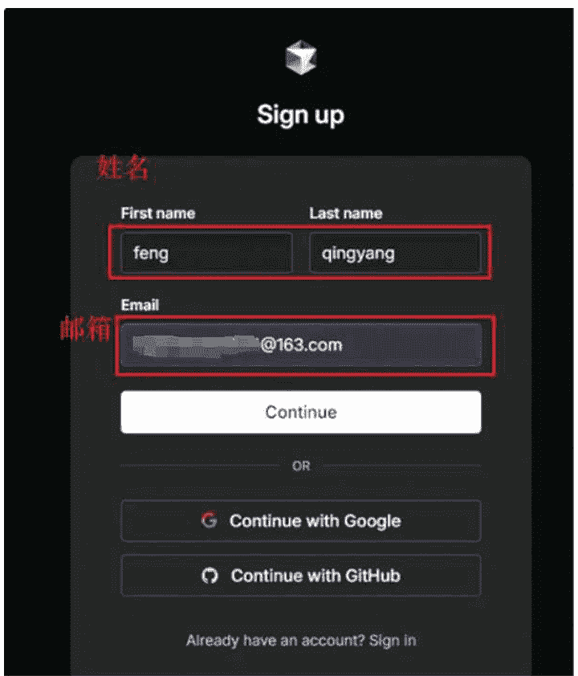

图2-3

第五阶段：为避免机器人注册，需完成人机校验，单击选中“确认您是真人”单选框即可（见图2-4）。


图2-4

#### 2.1.2 登录你的Cursor账号
注册完成后即可登录官网验证。

第一阶段：输入邮箱和密码，按下“Continue”按钮（见图2-5）。

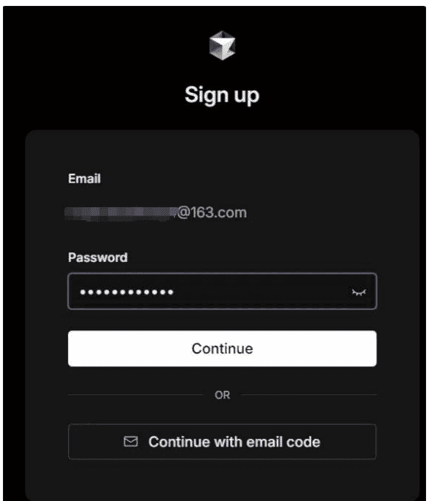

图2-5

第二阶段：填写邮箱收到的验证码，官方会主动发送验证码（见图2-6）。


图2-6

打开注册时填写的邮箱查收验证码（见图2-7），填入图2-6对应位置。

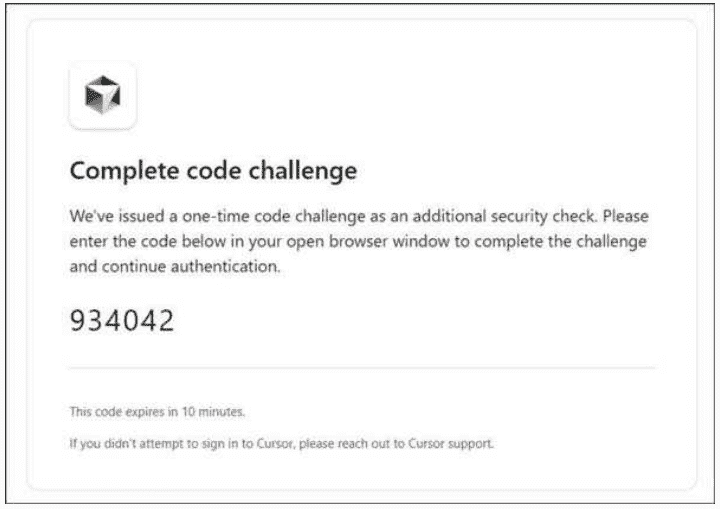

图2-7

第三阶段：验证码通过后，系统会再次要求校验，请继续输入验证码（见图2-8）。


再次打开注册邮箱查收新验证码（见图2-9），完成验证。

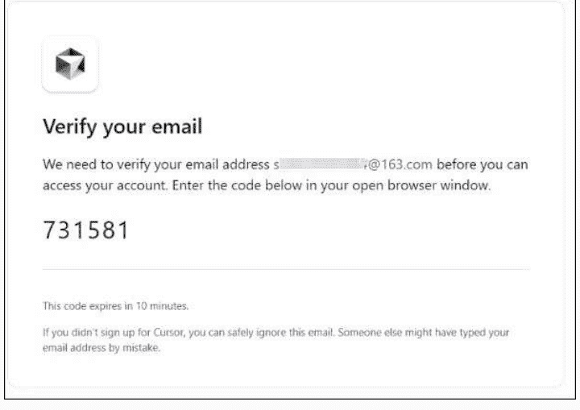

两次验证码验证成功后即可顺利登录。此后再次登录只需邮箱和密码，无需重复校验。

#### 2.1.3 Cursor账号权限解读
登录官网后可见，官方默认提供 14 天 Cursor Pro 使用权限及对应的大模型调用规则，如图2-10所示。Usage 板块中的 Premium models 为高级模型，每月仅有 150 次快速请求额度；右侧的 gpt-4o-mini 或 cursor-small 无月度次数限制，可无限使用。

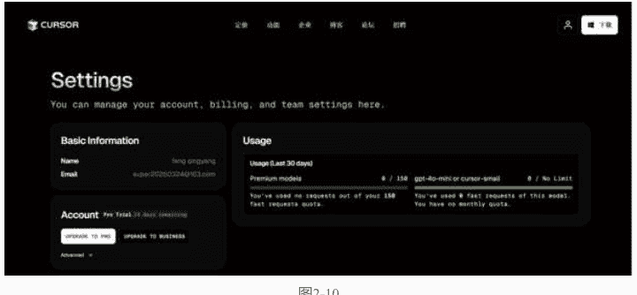

图2-10

14 天后如仍需 Pro 功能，有两种方式：

方式一：充值
为账号充值升级至 Cursor Pro，每月享有 500 次快速请求额度（见图2-11）。

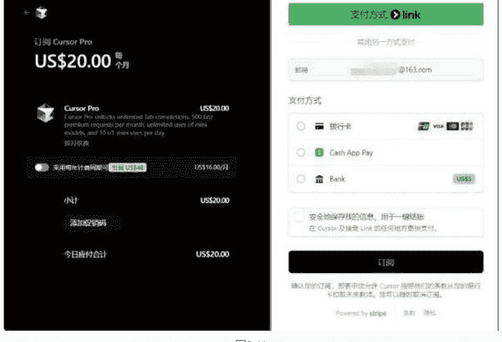

图2-11

方式二：重新注册
通过新账号注册，可继续享受 14 天 Pro 体验。

#### 2.1.4 下载与安装全程指引
我们安装最新版本 0.48.8，具体步骤如下。

第一阶段：在官网首页按下右侧“下载”按钮（见图2-12）。官方会自动检测操作系统并提供对应安装包。


第二阶段：开始安装。找到本地下载的安装包，右键选择“以管理员身份运行(A)”（见图2-13、2-14）。

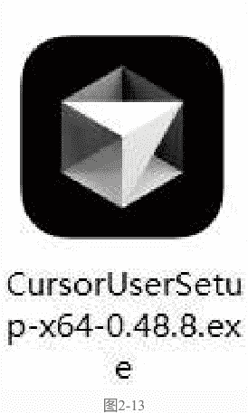


第三阶段：在提示框中按下“确定”运行安装包（见图2-15）。

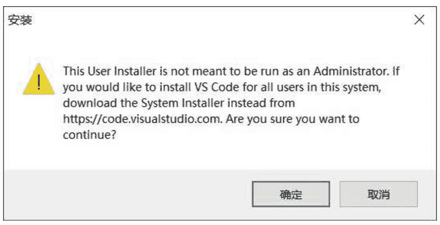

图2-15

第四阶段：在许可协议界面勾选“我同意此协议”，按下“下一步”（见图2-16）。

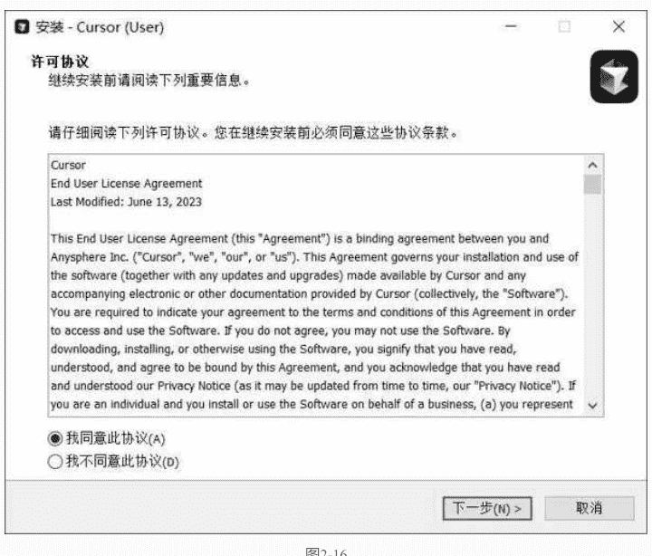

图2-16

第五阶段：选择安装位置，不建议装在系统盘（见图2-17）。按下“下一步”后按提示设置，如图2-18所示。

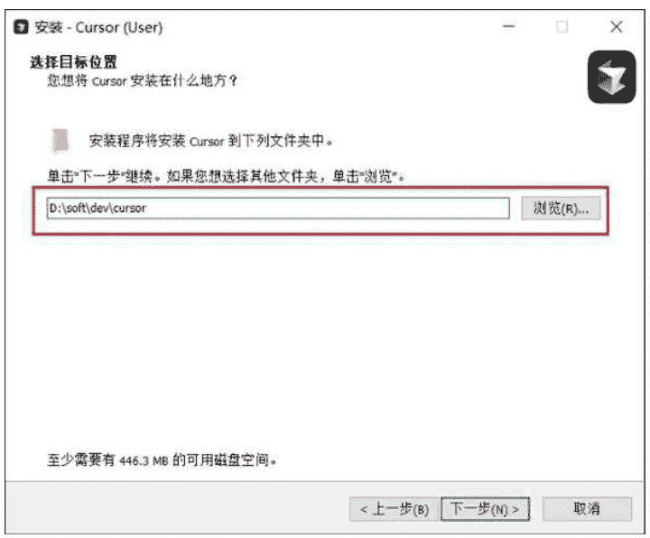

图2-17

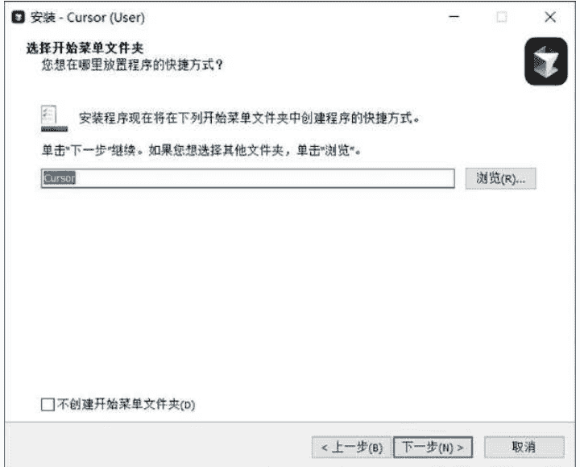

图2-18

第六阶段：进入“选择附加任务”界面，全部勾选后按下“下一步”（见图2-19）。

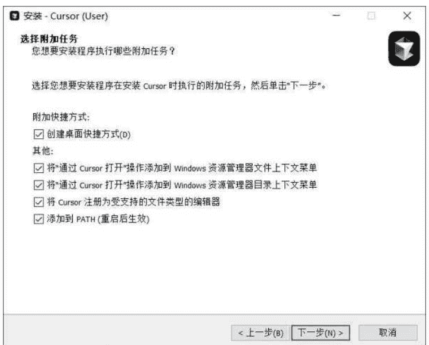

第七阶段：在“准备安装”界面按下“安装”，等待完成（见图2-20）。

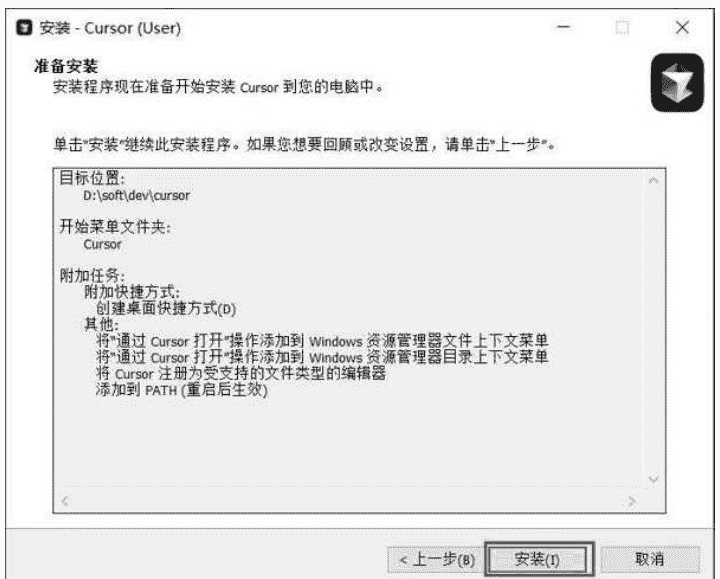

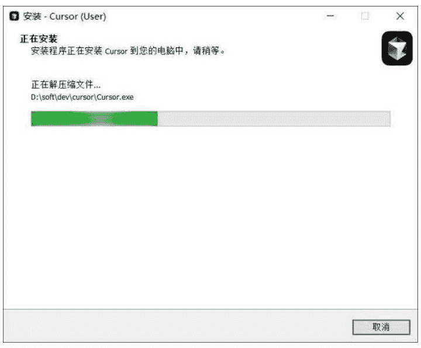

图2-20


图2-20 (续)

#### 2.1.5 绑定账号，启动高效编程体验
操作步骤如下。

第一阶段：输入账号与密码。

安装完成后需登录 Cursor 才能使用（见图2-21）。

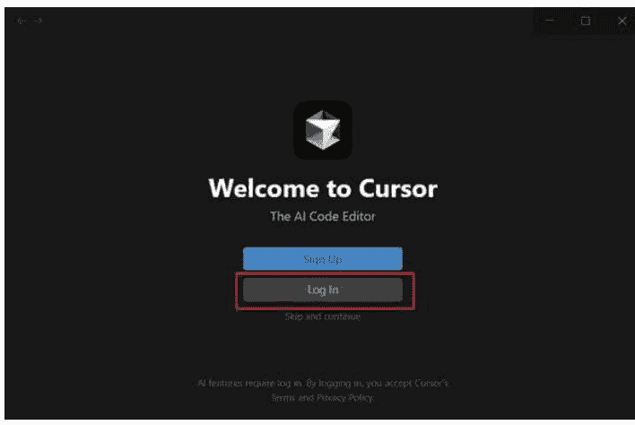

图2-21

按下“Log In”登录，在弹出界面输入邮箱，按下“YES, LOG IN”确认（见图2-22）。登录成功界面如图2-23所示。

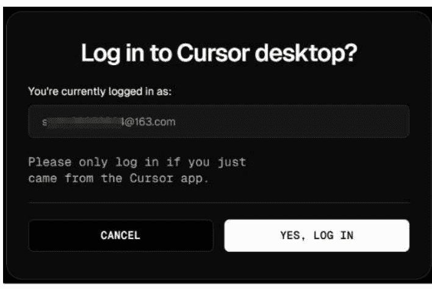

图2-22


图2-23

第二阶段：是否导入 VS Code 配置。

登录成功后 Cursor 会提示导入 VS Code 配置，非必需。若未安装过 VS Code，可按下“Skip and continue”跳过（见图2-24）。


图2-24

第三阶段：选择编辑器风格。

据说黑色背景更显高手风范。图2-25展示了三种黑色风格，选好后按下“Continue”。

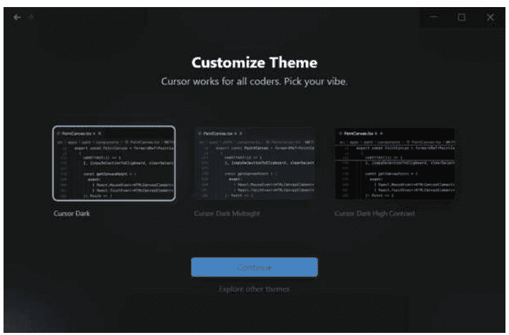

图2-25

在“Quick Start”界面按下“Continue”（见图2-26）。


图2-26

第四阶段：选择数据共享。

若重视隐私不想让第三方存储代码，可选择“Privacy Mode”隐私模式后按下“Continue”，如图2-27所示。

### 2.2 打造专属工作台：Cursor环境个性化配置技巧

#### 2.2.1 给Cursor安装中文插件
不熟悉英文可安装中文插件：按下左上角图标，在输入框输入“chinese”，搜索结果中选择第一个“中文（简体）”插件，按下“Install”安装，操作如图2-30所示。

安装完成后按“Ctrl+Shift+P”，在输入框输入“Select Display Language”，即可看到“中文（简体）（zh-cn）”选项（见图2-31）。

选择后需重启生效，按下“Restart”重启 Cursor（见图2-32），重启后菜单文字变为中文（见图2-33）。

#### 2.2.2 调整界面布局，打造个性工作空间
Cursor 支持更改布局风格，改为 VS Code 风格的操作如下。

按“Ctrl+Shift+P”调出命令面板，在下方下拉菜单选择“Open VS Code Settings”（见图2-34）。

在设置界面左上角输入框输入“work”，右侧出现“Workbench > Activity Bar: Orientation”，将其下拉菜单改为“vertical”垂直（见图2-35）。

重启后生效，更改后布局如图2-36所示。

为方便查看当前文件，可在资源管理器右侧点击三个点，选择“打开的编辑器”（见图2-37）。

#### 2.2.3 切换主题色，适应不同视觉需求
若黑色不够友好，可切换为亮色主题。操作为：按下“文件”→“首选项”→“设置”（见图2-38），弹出设置界面。

在文本框输入“主题”，找到“Workbench: Color Theme”，在下拉框中改为亮色主题如“现代浅色”（见图2-39）。

至此，一切就绪！

## 第3章 开发新思维：与AI协作的正确方式

本章没有空谈理论，只有可复用的行动指南。读完后，你在智能编程路上会少走弯路，对学习也更有信心。

准备好了吗？我们从“做”开始。

### 3.1 用AI开发软件的秘诀
本章像一份避坑清单，能帮你大大节省试错成本！

你是否曾想：要做出自己的软件，必须先成为编程专家？我给出的答案：不必。

换个思路，就像学骑自行车。

第一步：直接上车骑起来，哪怕摇晃。

第二步：摔倒后立刻分析失衡原因。

第三步：调整姿势再出发，骑得更稳。

这正是我们要做的：

- 扔掉“先学后做”的旧地图；
- 抄起 Cursor 这把智能工具；
- 从现在开始，每节攻克一个具体问题。

你会发现：

- 每个小项目都是知识拼图的一块；
- 问题会倒逼你去补理论；
- 完成作品时的“啊哈时刻”是最好的推进燃料。

准备好见证奇迹了吗？打开 Cursor，让第一个需求从想法变成可运行的代码！

### 3.2 与Cursor协作的底层逻辑
本节将解锁“超能力”——与 Cursor 对话的正确姿势（见图3-1）。

第一步：开启对话。

在 Cursor 的 Chat 聊天框里，像与朋友交流一样说出需求，例如“帮我用 Python 写一段爬虫代码”或“这段代码报错了，帮忙检查一下！”

第二步：Cursor 魔法时刻。

Cursor 能唤出提前配置好的大语言模型，比如 DeepSeek、Claude 3.7，迅速给出可以落地的解决思路。

第三步：逐项打磨
如果返回的结果还不够理想，就像批改作业一样指出需要改进的地方，例如“把背景换成更漂亮的颜色”。

第四步：反复迭代
使用者在前三步之间来回切换，直到满意为止。

特别说明，Cursor 的强劲表现很大程度上依托于背后模型的能力。后续章节会以 Claude 3.7 为主要模型，该模型在编码方面的表现目前非常突出。为保持表述简洁，后续统一称作“Cursor”，不再反复写 Cursor+Claude 3.7 大模型。

## 第4章 亲子共创：一起打造数字童话
各位魔法家长，是否准备好和孩子开启编程探索之旅？本章是一份零门槛的使用笔记——不需要技术基础，用日常语言就能搭建属于自己的奇幻世界。

现在和孩子一起进入亲子编程状态。接下来我们既是导演也是观众，共同见证想象力与代码的碰撞。

### 4.1 智能泡泡枪：十分钟做出会动的迷你游戏
“爸爸你看！我吹出一个会发光的彩虹泡泡！”六岁的小易举着泡泡棒在客厅转圈，泡沫溅得到处都是。那一刻我忽然想到——不如把这场“泡泡灾难”变成一次亲子编程课堂？

就这样，家里的创客角落正式开张。

小易拿着画满彩虹的草图担任产品经理，我这个程序员爸爸临时客串首席实现官。

#### 4.1.1 搭建数字城堡
小易任务卡：
“爸爸说每个魔法都需要魔法阵，现在请给我的彩虹泡泡项目建个文件夹，起个酷炫的名字吧！”

爸爸任务卡：
在 D 盘 cursor 目录中右键新建文件夹，命名为“奇幻泡泡世界”。随后在 Cursor 里打开该文件夹，菜单依次点“文件→打开文件夹”，在弹出的窗口选中前面新建的“奇幻泡泡世界”，点“选择文件夹”。回到主界面，就能看到“奇幻泡泡世界”文件夹。

之后产出的所有文件都会落在该目录。
现在和小易一起按下 Ctrl+I，听见“嘀嗒”一声——AI 通讯通道亮了，这就是与 Cursor 交互的窗口。现阶段建议沿用默认组合，即图示的代理模式和 claude-3.7-sonnet 模型。就像拼乐高，先按说明书操作，熟悉后再尝试更多玩法。

#### 4.1.2 单枪试水，掌握泡泡发射入门技巧 V1.0
小易提议：“我希望一按泡泡枪开关，就能飞出好多彩虹泡泡！”

于是我向 Cursor 提出第一次指令：

你是一位资深的游戏开发者，请采用纯前端技术为我开发一款泡泡枪主题的游戏，目前的要求很简单，只需要实现“只要一按开关，泡泡枪就可以发出好多泡泡”这个效果即可，不用添加其他的效果。

点“Send”后，Cursor 开始解析需求并编写代码。不出五分钟就完成。我和小易一起点操作区上的“Accept all”，产出的代码就像收到魔法指令的泡泡士兵，整齐列队进入“奇幻泡泡世界”文件夹。

你是一位资深的游戏开发者，请采用纯前端技术为我开发一款泡泡枪主题的游戏，目前的要求很简单，只需要实现“只要一按开关，泡泡枪就可以发出好多泡泡”这个效果即可，不用添加其他的效果。

Cursor 开始工作了

我将为您开发一款简单的泡泡枪游戏，只使用纯前端技术。首先让我创建项目结构。

Listed 0 items in current directory

我将创建一个基本的HTML5游戏，使用Canvas绘制泡泡，并实现单击或按下按键发射泡泡的功能。首先创建基本的项目结构：

```
html
<!DOCTYPE html>
<html lang="zh-CN">
<head>
    <meta charset="UTF-8">
    <meta name="viewport" content="width=device-width, initial-scale=1.0">
    <title>奇幻泡泡枪世界</title>
    <link rel="stylesheet" href="style.css">
</head>
<body>
    <div class="game-container">
        <canvas id="gameCanvas"></canvas>
        <div class="controls">
            <button id="startButton">开启泡泡枪</button>
```

图4-6

已为您创建了一个简单的泡泡枪游戏，实现了“只要一按开关，泡泡枪就可以发出好多泡泡”的功能。

游戏说明：
- 界面中央底部有一把粉色泡泡枪；
- 点“开启泡泡枪”按钮或按空格键可开启/关闭；
- 开启后会自动连续发射彩色泡泡；
- 泡泡大小颜色随机，会自动上升并消失。

文件结构：
- `index.html`：HTML 结构；
- `style.css`：样式；
- `script.js`：逻辑实现；
- `README.md`：说明文档。

用浏览器打开 index.html 即可体验，支持现代浏览器且有响应式设计。可通过修改 script.js 调参。

左侧窗口像魔法卷轴般展开，“奇幻泡泡世界”文件夹里整齐挂着 4 个产出文件。Cursor 还主动生成了说明书 README.md。现在双击运行 index.html 见证 V1.0 效果。通过开关控制泡泡枪的开启与关闭。

即使不懂编程，看到程序文件也不必慌张，技术细节不影响亲子制作体验。Cursor 像贴心的制作助手，你只需专注创意构思，代码编写和素材整合交给它。

#### 4.1.3 多枪联动，感受泡泡矩阵的视觉盛宴 V2.0
最有趣的部分来了！蹲下来问孩子：“如果给你一支魔法画笔，还想让游戏变成什么样？”

小易兴奋表示：“我想游戏里有 3 把泡泡枪，这样小恐龙、小兔子、小飞机都能用泡泡枪发射泡泡！”创意就这样冒出来。

只需把想法翻译成简单指令告诉 Cursor：“我希望游戏中同时出现 3 把泡泡枪。”不到一分钟，Cursor 返回结果，点“Accept all”接受。

现在游戏已增加 3 把不同颜色的泡泡枪：左侧蓝色、中间粉色、右侧绿色。主要改动包括把单枪位置改为数组、创建可指定颜色的绘制函数、每把枪有独立配色、发射逻辑改为同时发射、响应式更新、README 更新说明。

点“开启泡泡枪”或按空格，3 把枪会同时发射彩色泡泡。刷新网页 Ctrl+F5 查看 V2.0 效果，3 把泡泡枪排成一排，像彩虹糖一样可爱。若孩子说要改成同款，只需调整对话内容即可立刻看到变化。

#### 4.1.4 边界触变，泡泡裂变小鸟的惊喜彩蛋 V3.0
施展神奇魔法，让泡泡变形。告诉 Cursor：“泡泡碰到屏幕窗口边缘之后，变成一只可爱的小鸟”。输入提示词点 Send，奇迹出现。

很快完成任务，点“Accept all”接受。更新后泡泡撞到边缘会变成小鸟，增加趣味与互动。再次刷新 index.html，即可看到泡泡变鸟的效果。

#### 4.1.5 小鸟展翅，增添新乐趣 V4.0
继续升级 V3.0，给变成的小鸟加上旋转的小翅膀。指令：“请给所有小鸟添加旋转的小翅膀，翅膀形状像风车叶片一样可爱。”再优化细节：“请将游戏中的提示信息移动到屏幕下方。”

输入提示词后点 Send，很快完成。再刷新网页，和孩子一起查看效果。

### 4.2 AI五子棋乐园：多模式对战，锻炼孩子思维
这次用代码打造孩子眼中的五子棋乐园！

#### 4.2.1 创意启航，手绘设计变身数字五子棋 V1.0
“爸爸，我在纸上画的棋盘设计图能在电脑上变出来吗？”小易举着手绘图问。爸爸说：“当然可以！让爸爸当你的数字助手，把图纸变成游戏。”

先建名为“五子棋”的文件夹，打开 Cursor 输入提示词：

> 作为一名资深的游戏工程师，请为我开发一款人机对战的五子棋小游戏。

不到 3 分钟，系统提示任务完成。运行生成的程序，屏幕出现棋盘，鼠标轻点棋子即落子，可与电脑对战。


图4-19

#### 4.2.2 双人模式，让亲子互动更佳 V2.0
“爸爸，我想和你面对面下棋！”小易说。爸爸回应：“没问题，升级成双人模式！”

在对话框发送：
> 开发一个支持双人对战的五子棋游戏。

Cursor 很快完成升级，运行后发现智能地在原游戏上增加可选模式“双人对战”。


图4-20

#### 4.2.3 棋王争霸，记分系统开启竞技新方式 V3.0
小易说：“我们来五局三胜赛，谁先赢三盘谁当棋王！”爸爸说：“让 Cursor 加上记分系统，规则可设三局两胜或五局三胜。”

发送：
> 再增加一个记分牌，记录黑白双方的得分。

很快加入记分系统，运行效果如图。游戏可记录比分、支持多种对战模式。还可以讨论：“如果棋子变成会跳舞的星星，或棋盘随季节变色，会不会更有趣？”只要说出创意，Cursor 就能立刻实现。


图4-21

### 4.3 AI数字贪吃蛇：培养专注力与策略思维
和孩子一起创造贪吃蛇游戏，把天马行空的想法一点点编织成有趣的程序！

#### 4.3.1 基础版贪吃蛇游戏 V1.0
发送：
> 你是一位资深的游戏工程师，请采用纯前端技术栈，为我们开发一款数字贪吃蛇游戏，游戏规则为：一条能用键盘控制移动的蛇，每吃掉随机出现的数字，身体长度相应增加，同时记分牌加上该数字，当记分牌总分为 50 时，玩家胜利。

不到 5 分钟完成，运行后效果如图。


图4-22

#### 4.3.2 自定义分数系统，提升游戏个性化体验 V2.0
“爸爸，为什么一定要 50 分才算赢呢？”小易好奇问。爸爸说：“玩游戏最重要开心，不如装个快乐调节器！”

亮点：自由设定胜利分数。
发送：
> 增加一个功能：可以灵活设置游戏胜利的分数。

不到 2 分钟完成，运行后可见自定义目标分数功能。

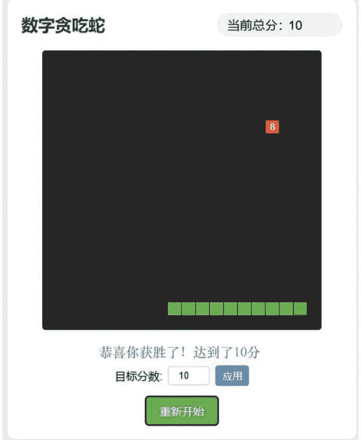

图4-23

#### 4.3.3 触发胜利特效，增加庆祝仪式感 V3.0
通关后及时表扬，请求 Cursor 在屏幕上放烟花。
发送：
> 当游戏通关后，屏幕上“炸开”胜利的礼花，礼花要符合儿童的喜好。

不到 2 分钟完成，运行后见效果。还可以继续激发孩子想象更多创意功能。


图4-24

### 4.4 AI像素画板：释放孩子的想象力
小易举着塑料画板说：“爸爸，我的画板太小了，画也不够清晰。”爸爸说：“我用魔法给你变个大画板！”

#### 4.4.1 魔法橡皮擦与彩虹填充，开启像素童话世界 V1.0
发送：
> 作为一名资深的游戏开发工程师，请为我们开发一款适合儿童玩的像素画板，要求如下：
> 1. 采用纯前端技术实现；
> 2. 整体设计风格童趣；
> 3. 支持选择不同色彩绘制；
> 4. 支持橡皮擦、清空、填充等功能。

Cursor 生成程序后运行，效果如图。

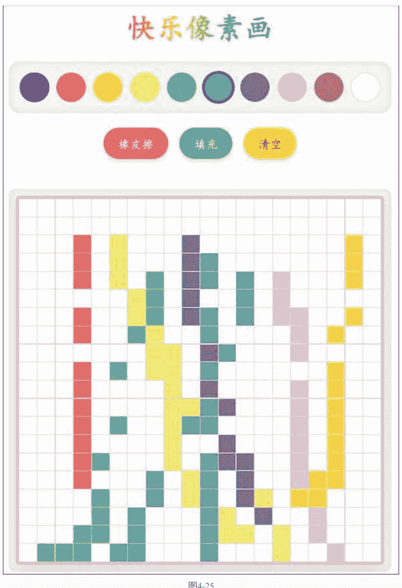

图4-25

#### 4.4.2 新增“城堡尺寸”按钮，像素世界不设限 V2.0
小易说：“画板太小，画不下完整的城堡……”爸爸问：“想让画板多大呢？Cursor 能调整尺寸。”

发送：
> 增加自定义画板大小的功能，比如 20×20、30×30、60×60。

升级后运行，效果如图。

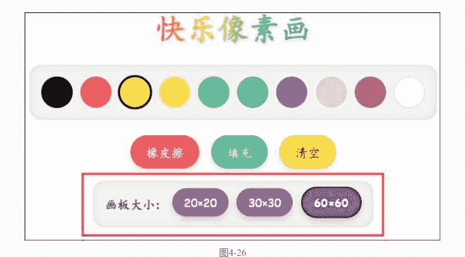

图4-26

#### 4.4.3 新增存档功能，记录小画家的成长时光 V3.0
“爸爸，要是我画的小星星能永远保存下来该多好呀！”小易点着屏幕说。爸爸说：“Cursor 可以实现新的魔法功能。”

全新魔法功能：
- 魔法保存：点保存键时，画作会“跳进”闪着金光的时光画匣文件夹；
- 时光回溯：随时打开时光画匣，让沉睡的画作苏醒；
- 续写童话：在昨天的画作上继续描绘今天的新故事。

发送提示词：
> 增加以下功能：

1. 把画布上正在进行的作品导出为图片，留存孩子的创作成果；
2. 读入之前保存的图像，在原有画面上继续作画。

依据以上需求，Cursor对画板工具完成了升级。启动交付的版本，呈现效果见图4-27。

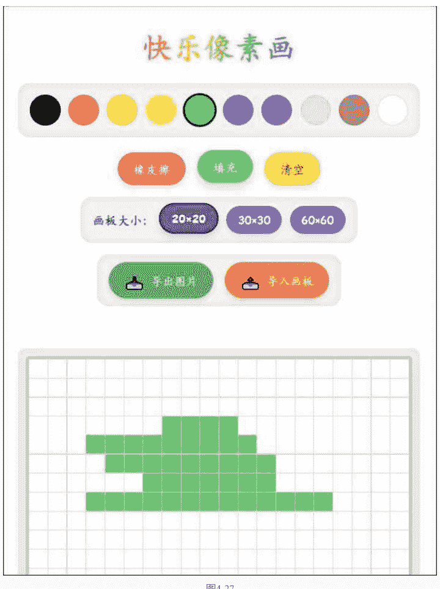

图4-27

#### 4.4.4 更新界面设计，简约与美观并存（V4.0）

当画板整体排布仍不满意时，可以继续向Cursor提出更明确的要求。

本次发给Cursor的指令为：

> 请优化画板界面的整体布局，不要把功能选项都‘挤’在一起，而要把它们放置到界面的合适位置，使界面更加美观、简约。

按此提示完成更新后，运行的效果如图4-28所示。


图4-28（局部）

### 4.5 动手实践案例：诗词拼图互动游戏

各位创客，前面案例的探索已经让大家掌握了借助Cursor把想法落地的两个关键：敢于想象，以及把需求表达清楚。现在开启“诗词拼图”的创作之旅吧！游戏运行画面如图4-29所示。

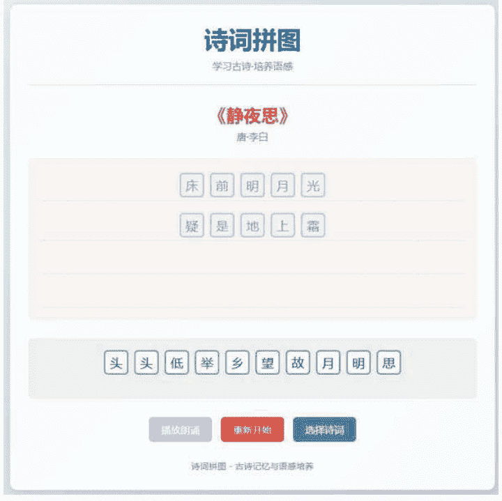

游戏规则如下。

1. 选择诗词：游戏默认提供两首诗词供参与者挑选。
2. 文字迷宫：系统会打乱玩家选择的诗词文字，把这些文字变成待拯救的“文字精灵”。
3. 智慧拼图：玩家需拖曳“文字精灵”送回诗句空白处；若放置位置错误，精灵会自动弹回候选区，等待再次尝试。

#### 延伸功能

- 功能1：提供家长录入诗词的入口，扩充可供选择的诗词库。
- 功能2：当一首诗词完整拼对时，屏幕会绽放绚丽烟花作为奖励。

准备好了吗？用Cursor这支“魔法笔”，把传统诗词学习变成一场充满欢笑的亲子互动吧！

读者可参照前面的案例动手实现，完整演示视频已放在配套资源中。

### 4.6 知识拓展：为何不单独讲“提示词工程”

细心的读者可能会问：“书中为何不介绍提示词工程？”

新手刚接触AI时，最怕内容全是专业术语。看似高深的书往往难以解决实际问题。

当你亲眼看到Cursor迅速写出可运行程序，并惊叹“太神奇了”时，其实已经掌握了提示词工程的核心：角色 + 任务 + 验收标准，也就是“三段式”语法。

简单说，提示词就是给AI的指令；提示词工程就是把指令讲清讲透的技巧。

举例：

> 你是一位资深的游戏开发者（角色），请采用纯前端技术开发一款泡泡枪游戏（任务），目前的要求很简单，只需要实现“只要一按开关键，泡泡枪就可以发出好多泡泡”这个效果即可，不用添加其他的效果（验收标准）。

这就是让AI秒懂需求的写法。

下次与AI互动时，记住这个公式：

- “你是个 专家”——让AI聚焦特定领域，不跑题；
- “现在要 ”——明确当前任务内容；
- “最后要达成 ”——清晰定义期望结果。

当然，别被“三段式”限制住。其本质是结构化地清晰表达需求，只要需求描述清晰，就是好的提示词。

## 第5章 教育遇上AI：点亮课堂的智能工具

### 5.1 AI点名小魔盒：提升课堂管理效率

粉笔灰在阳光下飘落，老师准备点名时，教室里总有孩子缩成一团。今天用Cursor开发一款“AI点名小魔盒”，让每次提问像打开神秘礼盒一样充满惊喜。只需简单设置，系统用公平随机算法挑选学生，既避免总被点名的焦虑，也减少被忽略的遗憾。现在开始创作吧！

#### 5.1.1 玻璃科技风点名系统（V1.0）

新建文件夹“AI点名小魔盒”，用Cursor打开。

发送给Cursor的指令：

> 你是一名资深的软件开发工程师，请用HTML、CSS、JavaScript开发一款点名系统，要求系统名称为“AI点名小魔盒”，界面整体有现代科技感。

稍等片刻即可完成。运行生成的 index.html，效果如图5-1所示。


图5-1

在左侧输入学生名单后，右侧点击“开始点名”，系统会随机弹出某位学生姓名，但不会自动停止，需要手动点击“停止点名”才能确认结果，如图5-2。流程显然不够智能，下一版本会改进。

点名成功时，界面会“炸”开彩虹礼花，体现仪式感。


#### 5.1.2 自动点名与历史记录（V2.0）

V1.0每次都要手动停止点名，不如加入随机倒计时，让系统在设定时间后自动锁定。

提示词：

> 新增自动点名模式：
> - 启动点名功能后，屏幕显示时长3秒的动画；
> - 锁定某个学生时播放“叮”的音效；
> - 历史记录自动保存为CSV文件。

片刻后Cursor完成了增改。运行新生成的 index.html，界面如图5-3所示，勾选左侧“自动点名模式（3秒）”，点击右侧“开始点名”后，系统将在3秒后自动停止并确定本次人选。

#### 控制面板

输入名单（每行一个姓名）：

- 张伟
- 王芳
- 李强
- 刘敏
- 陈浩
- 杨雪
- 黄俊杰
- 周雨欣
- 徐子涵

导入名单 导出名单 清空名单

- ☑ 防止重复点名
- ☑ 自动点名模式（3秒）
- ☑ 音效开关

动画速度： 5

导出历史记录CSV

图5-3

### 5.2 AI数字迷宫：激发学生学习乐趣

智慧教室的电子白板泛起彩虹波纹，成功吸引全体注意。

“今天我们采用新型沉浸式教学。”黄老师解释道，“屏幕上的数字迷宫每个关卡都设置了需要用数学知识解决的互动题。”

当首个挑战出现，对数学有畏难情绪的小张主动请缨：“老师，我试试用乘法口诀！”答对后，系统即时反馈，钻石虚拟门缓缓开启。

#### 5.2.1 数学闯关（V1.0）

发送给Cursor的提示词：

> 你是一名资深的软件开发工程师，请为我们开发一款数字迷宫系统，具体要求如下。
> (1) 系统名称：“AI数字迷宫”。
> (2) 要求系统界面整体有现代科技感。
> (3) 穿越数字迷宫时，每经过一个关口就需要回答一道1～10加减乘除的数学题，答对则可以继续前进到下一个关口。
> (4) 统计最终闯关成功所消耗的时间，单位为秒。
> (5) 采用HTML+CSS+JavaScript技术栈。

Cursor很快完成了开发，运行效果如图5-4所示。


图5-4


图5-4（续）

运行后发现闯关界面没有出现数学题，也没有任何引导信息，需要反馈给Cursor修复。

提示词：

> 进入闯关界面之后，界面中并没有出现数学题，也没有任何引导信息。

Cursor开始修复，如图5-5所示。

我会修复闯关界面没有出现数学题的问题。检查一下代码，发现在游戏启动后应该立即触发第一个数学题。

```javascript
// 重置玩家位置
gameState.currentPosition = updateMazeDisplay();

// 在游戏开始后立即显示第一道
setTimeout(() => {
    showMathQuestion();
}, 500);
}

// 更新计时器
}
```

图5-5

3分钟后修复完成。再次运行，如图5-6，题目正常出现并可判断对错。


图5-6


图5-6（续）

但系统出现了无限循环，最后一题后仍不断出题。我们把问题反馈给Cursor，它很快修复，如图5-7所示。

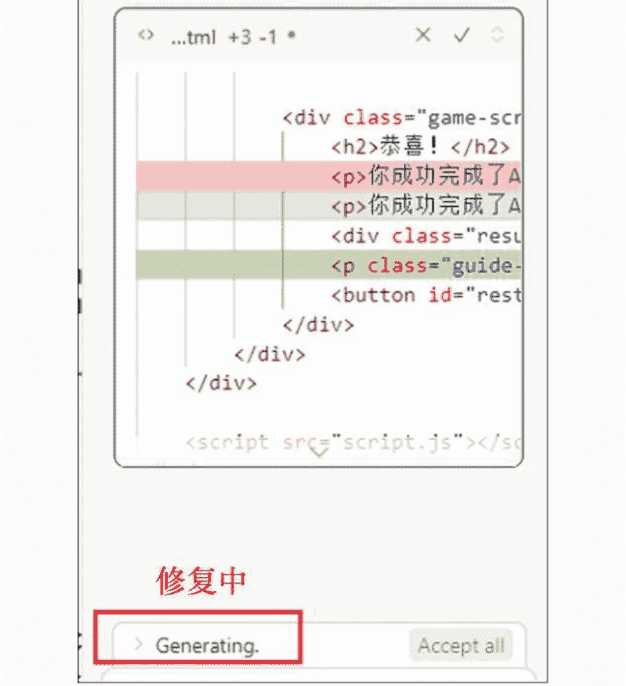

检查后问题依旧。知识点：在浏览器按F12可查看执行细节，控制台会显示错误信息。控制台输出如图5-8所示。

“破案”了！问题不在语法，而是我们对“关口”的理解不同。我们指连续做固定数量的题目，Cursor却理解为无限循环的副本，所以程序不停给出新题。

我们截屏控制台记录，用Ctrl+V传给Cursor，并在对话框输入“不需要有多个关卡，闯一个关卡就可以”，明确真实需求，如图5-9。

这次修复成功，运行后如图5-10所示。

注意：需求描述越清晰，Cursor反馈越准确。

#### 5.2.2 前进特效（V2.0）

目前闯关只是持续出题，没有视觉前进感。把此需求发给Cursor修复后，运行可看到每次解题成功后的移动效果，如图5-11所示。

图5-11

#### 5.2.3 自定义题目数量（V3.0）

为保证公平，参与者每次闯关的题目数可以自定义。把需求发给Cursor修改后，运行效果如图5-12所示。

图5-12

#### 5.2.4 视觉升级（V4.0）

目前界面配色不够好看，需要优化。把需求发给Cursor完善后，运行效果如图5-13所示。

图5-13

### 5.3 两步制作唯美时间线图

想给“科技迷”学生讲国内大模型发展史并用时间线呈现，Cursor两步即可搞定。

第一步：编写提示词。设计一幅描绘国内AI大模型发展史的时间线图，要求：

1. 整体风格：主色 #FFD14C，白色背景，简洁专业；顶部黄色波浪标题区，底部圆弧。
2. 标题区：主标题“国内AI大模型”黑体加粗居中，副标题“发展史回顾”黑色稍小，英文“HISTORICAL REVIEW”灰色最小。
3. 时间线结构：中央垂直黑线，节点为白底黄边圆，内写年份2023/2024/2025，线不穿透圆，内容盒左右交替。
4. 内容盒：白底黄边圆角，靠近中线一侧边框加粗；顶部黄底小标签“里程碑×.0”；含加粗标题和灰色描述。
5. 内容填充：
   - 2023：“大模型商业化元年”。文心一言、通义千问、讯飞星火等多个国内大模型公开发布并开始商业化，标志着国内AI大模型产业蓬勃发展。
   - 2024：“多模态大模型崛起”。文心大模型4.0 Turbo、通义千问2.5、讯飞星火3.5等先进大模型发布，具备强大的内容创作能力。
   - 2025：“大模型开源兴起”。DeepSeek引发国内外热评。
6. 响应式设计：多屏自适应，移动端垂直布局。
7. 互动效果：内容盒有轻微悬停动画，页面滚动时元素渐入。

第二步：把提示词提交给Cursor生成。

效果如图5-14所示。

# 国内AI大模型

## 发展史回顾

### HISTORICAL REVIEW

**里程碑1.0**

### 大模型商业化元年

文心一言、通义千问、讯飞星火等多个国内大模型公开发布并开始商业化，标志着国内AI大模型产业蓬勃发展

2023

2024

**里程碑2.0**

### 多模态大模型崛起

文心大模型4.0 Turbo、通义千问2.5、讯飞星火3.5等先进大模型发布，具备强大的内容创作能力

2025

**里程碑3.0**

### 大模型开源兴起

DeepSeek引发国内外热议

### 5.4 阶段小结：探索AI教育新可能

当AI与教育相遇，每一行指令都能点亮智慧之灯。革新教育不必等待完美方案，Cursor不仅是工具，更是把教育思想变为现实的“魔法杖”。别让好想法停留在脑海，打开Cursor，让技术与教育初心碰撞。你的下一个创意，或许就是学生眼中最酷的课堂记忆。行动起来，让创新从“可能”变成“正在发生”！

## 第6章 从招牌到文案，AI一键生成小店爆款视觉

在电商数字生态中，如何脱颖而出？借助Cursor进行智能设计，无需专业技能，只需输入品牌理念与诉求，AI即可把抽象构想转化为极具吸引力的视觉表达，在信息洪流中抓住目标消费者。

现在开启智能视觉升级之旅，用AI为商业梦想注入生命力！

### 6.1 AI打造吸睛招牌

顾客每秒能看到3～6张图片，店铺招牌如何在瞬间抓住目光？Cursor可以帮你实现。步骤如下。

第一步：发送提示词。

设计一个富有美感和现代风格的餐厅门店招牌的图片，具体要求如下。

1. 基本参数设置
   - 尺寸：1000像素×400像素的横版招牌。
   - 背景：135度多色渐变（#c8e6c9到#8bc34a到#4CAF50）。
   - 整体风格：现代绿色生态风，结合自然元素和优雅设计。
   - 圆角设计：12像素圆角边框，带1像素白色半透明边框。
2. 背景装饰元素
   - 半透明“RESTAURANT”大型背景文字（字号为180像素）。
   - 山形剪影装饰位于底部，呈现自然风光。
   - 白雾效果在山形之上，增添空间层次感。
   - 小鸟剪影和绿叶装饰点缀空白区域。
   - 角落用圆形光斑装饰图案。
3. 主标题设计
   - “美味餐厅”4个汉字采用圆形包围设计。
   - 每个圆形直径为90像素，采用白色背景。
   - 文字颜色为深绿色（#2E7D32），字号为60像素。
   - 为每个字符添加错开时间的轻微浮动动画。
   - 圆形内部添加高光效果增强质感。
4. 副标题设计
   - 中文副标题“（正宗美味 自然新鲜）”，白色文字带阴影。
   - 副标题下方添加装饰分隔线。
   - 副标题区域整体添加淡入上升动画。
5. 食物图标展示
   - 右侧区域放置3个食物图标：汉堡、比萨、蛋糕。
   - 每个图标使用白色圆形背景。
   - 图标周围添加虚线圆环装饰，带旋转动画。
   - 食物图标分别放置在上中下部分的不同位置上，分别添加摆动动画。
   - 悬停时显示食物名称标签，带渐变背景。
6. 导出功能设计
   - 页面底部添加“导出为图片”按钮。
   - 按钮采用渐变绿色背景，圆角设计。
   - 添加按钮悬停特效，包括上浮和光效扫过。

- 截屏功能依托 html2canvas 插件完成
- 生成后会即刻弹出预览画面

7. 视觉呈现
- 全局加入细腻微动效，提升趣味性
- 光影运用得当，营造层次与立体感
- 装饰元素不遮挡主体，保证信息清晰
- 配色和谐统一，绿色为主调
- 交互控件醒目，使用流畅

第二步：给出指令后 Cursor 会产出对应网页文件，双击打开即可查看演示，导出效果如图6-1所示。后续案例均沿用此流程，不再赘述。

图6-1

若对结果不满意，只需向 Cursor 发出新的提示词即可重新生成招牌。

### 6.2 AI制作高转化餐厅菜单
在餐饮竞争中，菜单不仅要传递菜品信息，更要激发食欲与点单欲望。配色、版式、图示的配合至关重要，颜色能唤起情绪，布局能引导视线，精美的食物呈现更能让人垂涎。

下面说明如何借助 Cursor 设计出既美观又实用的菜单，让顾客一眼被吸引，马上想下单。

第一步：发送给 Cursor 的提示词要点如下。

设计一款精致餐厅菜单，要求如下。

1. 基本参数
- 规格：600像素×900像素
- 底色：浅米色 #f9f9f5
- 主色：绿色 #4D7942
- 整体排版：上中下三段式

2. 顶部标题区
- 主标题“美味菜单”，字号42像素，绿色加粗，字间距适中
- 英文副标题“Delicious Menu”，字号24像素，绿色细体
- 中文副标题“享用巧手烹饪的美食佳肴”，字号18像素，灰色
- 左右各一条绿色装饰横线

3. 餐盘展示区
- 两个并排圆形餐盘，直径220像素，白底粗绿边
- 左侧为烤地瓜，椭圆形，有纹理与光泽
- 右侧为大薯条，竖向排列金黄色
- 每盘底部配绿色标签，注明菜名与价格

4. 菜单主体区
- 白底绿边圆角矩形
- 分为主食系列与小吃系列
- 两部分顶部为绿色标题栏，标注中英文名称
- 菜名与价格以点线相连
（1）主食系列：
- 烤地瓜¥15
- 黑椒烤羊排¥88
- 意式烩饭¥45
（2）小吃系列：
- 酸辣土豆丝¥18
- 大薯条¥16

5. 底部信息区
- 联系电话：0755-8888***
- 地址：广东省深圳市福田区金融大厦
- 右侧放置简易二维码图形

6. 功能元素
- 底部放置“导出为图片”按钮，绿底白字
- 调用 html2canvas 实现导出
- 自动展示预览图

7. 视觉风格
- 版式整洁大方，重对称与留白
- 所有图形用 CSS 绘制，包含餐盘食物造型
- 适当加入阴影和边框增强立体感
- 字体统一使用微软雅黑、黑体或思源黑体
- 绿色系传递自然健康理念

第二步：Cursor 按提示完成设计，导出效果见图6-2所示。

# 美味菜单

Delicious Menu

享用巧手烹饪的美食佳肴

烤地瓜 ¥15

大薯条 ¥16

| 主食系列 | Main Course |
|---|---|
| 烤地瓜 | ¥15 |
| 黑椒烤羊排 | ¥88 |
| 意式烩饭 | ¥45 |
| 小吃系列 | Snacks |
| 酸辣土豆丝 | ¥18 |
| 大薯条 | ¥16 |

联系电话: 0755-8888****

地址: 广东省深圳市福田区金融大厦

### 6.3 AI定制专属名片 提升品牌记忆
名片保存不便容易被丢弃。将名片做成收藏品，可提高留存。下面借助 Cursor 设计专属名片。

第一步：发送给 Cursor 的需求如下。

设计一张现代感强且美观的餐厅名片，具体需求如下。

1. 基本参数
- 规格：标准名片尺寸，横版，宽高比约85:50
- 主色调：绿系 #66BB6A、#4CAF50、#388E3C 为主，黄系 #FFC107、#FFEB3B 为辅
- 设计风格：现代简约、精致、具3D视觉
- 整体布局：左侧文字区占55%，右侧装饰区占45%

2. 名片基础设计
- 背景以白色为主 #ffffff 到 #f9f9f9，呈现纯净质感
- 顶部加绿色渐变装饰条，体现品牌特性
- 大圆角16像素，塑造立体感
- 四角设装饰边角，悬停时轻微放大，增强交互
- 内置淡绿色虚线边框，形成精致框架
- 背景散布半透明绿色圆点，提升细节质感

3. 品牌标识区
- 主标题“美味一刻”绿色文字，字号38像素，配黄色装饰线
- 副标题“小资精品美食”灰色文字，左侧加亮绿色装饰条
- 品牌名“米其林大厨”深灰文字，下方配细渐变下划线
- 整体留白合理，字号与间距协调，视觉舒适

4. 联系信息区
- 三项信息：电话、邮箱、地址
- 每项前配绿色圆形图标，内含白色SVG图标
- 文字字号14像素，保证清晰可读
- 悬停时文字微右移并变色，增强交互
- 设置文本溢出控制，保证长文本显示美观

5. 装饰图形区
- 右侧组合与食物相关的几何图形
- 元素包括：带蒸汽动画的咖啡杯、带浮动装饰的蛋糕、黄色三角形与圆环
- 所有图形采用 CSS 3D 变换，营造空间深度
- 悬停时图形组合微倾斜，部分元素独立上浮或旋转
- 采用渐变填充与精细阴影，增强立体质感

6. 交互与动效
- 悬停时名片微微上浮
- 装饰区轻微放大
- 咖啡杯添加蒸汽上升动画
- 蛋糕顶部装饰有序上下浮动
- 联系信息平滑移动并变色

7. 导出功能
- 底部设“导出为图片”按钮，绿色渐变底、圆角设计
- 悬停时按钮上浮并出现光效扫过动画
- 使用 html2canvas 实现导出
- 包含临时样式调整代码，确保渐变文字导出正确
- 导出后展示预览图

8. 响应式与优化
- 尺寸采用相对单位，多设备显示一致
- 文字区设溢出控制，防止长文本破坏布局
- 装饰区有微放大效果，提升体验
- 整体轻量化，保证高效渲染

第二步：Cursor 按指令完成名片设计，导出效果见图6-3。

图6-3

### 6.4 AI制作吸睛海报 助力门店引流
海报能否成为撬动流量的视觉抓手？优质设计是传播起点，好的海报能化身流量磁石，让路人驻足打卡并在朋友圈分享，实现裂变传播。

下面用 Cursor 设计一幅撬动流量的宣传海报。

第一步：发送给 Cursor 的指令如下。

设计一款现代风格餐厅美食宣传 HTML 海报，特点如下。

1. 基本参数
- 规格：400像素×800像素
- 白色背景
- 响应式设计，多设备良好显示

2. 整体视觉风格
- 简洁现代
- 主色调为蓝色与绿色对比鲜明
- 版面干净，突出重点信息
- 多层次视觉元素，有深度感

3. 海报结构
- 标题区：品牌名“海月坊”，英文“HAIYUE FANG TEKAN”
- 菜品展示区：展示“五常大米饭”¥1 和“虾蟹海鲜煲”¥188 两款菜品
- 联系信息区：电话 0755-88888***，地址 广东省深圳市福田区金融科技大厦

4. 视觉元素
- 标题区排版配曲线装饰
- 菜品用圆形色块背景与 emoji 图标代替实拍图
- 每款菜品添加“新品”标签与价格标签
- 增加浮动圆点、星星、斜线等装饰，提升活力
- 背景使用半透明几何形状营造层次

5. 特殊效果
- 装饰元素添加轻微浮动动画
- 轻微阴影与高光增强立体感
- 联系信息区用圆点前缀，提升可读性

6. 交互功能
- 添加“导出为图片”按钮，支持保存为 png
- 使用 html2canvas 实现导出
- 导出时显示加载提示与预览图

7. 技术实现
- HTML 与 CSS 实现所有视觉效果，不依赖外部图片
- 使用 Flexbox 布局保证元素排列
- 使用 CSS 变量管理颜色与尺寸，便于修改

第二步：Cursor 基于提示词生成海报，导出效果见图6-4。

## 海月坊 HAIYUE

HAIYUE FANG TEKAN


- 电话: 0755-88888***

- 地址: 广东省深圳市福田区金融科技大厦

### 6.5 AI辅助小红书探店文案创作
小红书瀑布流每秒涌入大量笔记，若图文无法共振，优质菜品也易被淹没。只有视觉与文案契合，才能让目光在瞬间停留。

下面借助 Cursor 生成爆款探店文案。

第一步：发送给 Cursor 的指令如下。

请设计一篇小红书风格探店文案，主题“夏日美食餐厅”。要求如下。

1. 内容风格
- 主题夏日美食餐厅探店
- 文案活泼亲切，带 emoji
- 清新青春感，适配小红书

2. 文案包含内容
- 吸睛标题
- 简短引言，说明发现时机
- 店铺基本介绍，特色与环境
- 推荐特色菜品至少3种并简述
- 店铺亮点以数字序号列出至少2点
- 价格范围与性价比评价
- 营业时间等实用信息
- 结尾互动引导评论
- 10～15个相关话题标签，以#开头

3. 文案特点
- 大量 emoji 点缀
- 排版符号增强可读性
- 多用感叹号与修饰词表达惊喜
- 字数约400字，简洁有力
- 亲和力强

4. 内容参考
- 店名“美食餐厅”
- 主打传统与创新结合的水果糖水
- 特色煎牛排、煎羊排、芒果双拼等
- 环境清新，有独立小院子
- 甜点价格20～35元/份
- 可按喜好定制组合

请据此创作生动有趣、吸引读者的探店文案。

第二步：Cursor 按提示词生成如下文案。

# 夏日限定！藏在城市角落的治愈系美食餐厅

我今天偶然路过这家“美食餐厅”，被门口飘来的香气吸引，一时兴起就进去啦！没想到竟然发现了一家宝藏店铺。

这家店名字朴实无华，环境也超级有格调！绿植环绕，还有一个小院子 🏡 阳光透过树叶洒下来，坐在那里吃饭简直太享受了。

## ■ 必点美食推荐

- 招牌煎牛排：牛排外焦里嫩，搭配的黑椒汁超香！肉质鲜嫩多汁。

- 香煎羊排：香料腌制入味，羊排一点膻味都没有，连我这种挑食的人都能接受。

- 芒果双拼甜品：冰冰凉凉的芒果布丁配上新鲜芒果肉，很好吃。

## ■ 餐厅亮点

1. 每天食材新鲜配送，主厨有15年的经验，菜品质高。

2. 环境很好，就餐的位置有室内和小院子两种选择。

3. 可按个人口味定制套餐组合，服务很贴心。

4. 每周都有新品，常来常新！

■ 人均消费：88～128元，量足味美，性价比超高！

营业时间：11:00—22:00，全年无休。

这家店出品的食物真的让我从味蕾到心灵都得到了满足，如炎炎夏日里的一抹清凉！强烈推荐给大家。

#夏日美食 #城市探店 #美食推荐 #周末好去处 #约会好地 #牛排推荐 #小众餐厅 #治愈系美食 #网红打卡 #芒果甜品 #情侣必去 #美食分享 #夏日限定 #小资生活 #舌尖上的美食

问一下，你们最喜欢哪种风格的餐厅呢？是文艺小资还是复古怀旧风格的？留言告诉我吧。

第三步：精选店铺实拍后，将文案与图片整合即可在小红书发布，见图6-5。


图6-5（局部）

## 第7章 AI驱动数据可视化 让图表讲故事
把空调销售额绘制成灵动曲线，把广告渠道效果勾勒成精妙雷达图，数据便不再冰冷，而是业务前行的导航仪。本章聚焦可视化锚定成果，从三个方向照亮航道。

- 追踪市场脉搏：从空调销售额增长曲线到产品线竞争力图谱，精准洞察市场跳动，勾勒战场地形
- 校准财务坐标：借助成本透视镜追踪资源流向，以净利润三级跳衡量行业地位，保障财务健康
- 激活增长引擎：通过广告渠道多维战力评估，锁定效能突破点，注入增长动力

此刻，让我们借助 Cursor 将深度洞察转化为行动坐标，开启新征程！

### 7.1 AI赋能销售分析 动态追踪与结构洞察
本节聚焦市场销售模块，通过动态追踪与结构洞察全面了解销售趋势与产品竞争力。围绕2024年空调销售增长曲线与产品线竞争力图谱展开解析。

#### 7.1.1 2024空调月度销量走势解读
第一步：获取2024年度每月空调销售额数据，见图7-1。

| 月份 | 销售额（万元） |
|---|---|
| 1月 | 8200 |
| 2月 | 4500 |
| 3月 | 11000 |
| 4月 | 15800 |
| 5月 | 23500 |
| 6月 | 34200 |
| 7月 | 38500 |
| 8月 | 36800 |
| 9月 | 28700 |
| 10月 | 21400 |
| 11月 | 42800 |
| 12月 | 30500 |

图7-1

第二步：编写发送给 Cursor 的提示词，提示词中包含上述数据，具体如下。

请生成白色背景科技感折线图，包含以下要素。

1. 标题
主标题：“空调销售增长曲线：2024年月度战绩解码”（#2E75B6，加粗，20pt）
副标题：“从1月寒冬突围到11月显著战绩，解码市场攻防节奏”（#666666，斜体，14pt）
注：pt是Point缩写，常用作衡量字号、行距等排版参数的单位

2. 坐标轴设置
- X轴：1～12月，中文标签，倾斜30度防重叠
- Y轴：销售额，单位万元，范围0～50000，间隔5000
- 双轴特效：添加动态粒子流沿折线移动

3. 数据可视化设计
- 主折线：#2E75B6，企业蓝，3pt，宽带光晕效果
- 关键节点
  - 2月低谷：红色警戒波纹，标注“春节战略收缩”
  - 6月突破：金色爆发光效，标注“‘618’首战告捷”
  - 11月峰值：立体爆炸图标，标注“‘双十一’4.28亿”
- 趋势线：添加金色虚线作为预测线，2025增长通道

4. 交互功能
- 悬停显示：精确数值+当月市场事件，如“7月：极端高温‘助攻’”
- 动画效果：粒子流从1月至12月顺序点亮数据点
- 图例：图例悬浮于右上角

5. 数据映射

```
[月份, 销售额]
[1,8200]
[2,4500]
[3,11000]
[4,15800]
[5,23500]
[6,34200]
[7,38500]
[8,36800]
[9,28700]
[10,21400]
[11,42800]
[12,30500]
```

6. 输出规格
- 尺寸：1200像素×800像素
- 格式：.svg矢量图+.png高清图

第三步：Cursor 按提示生成html网页文件，打开效果如图7-2所示。

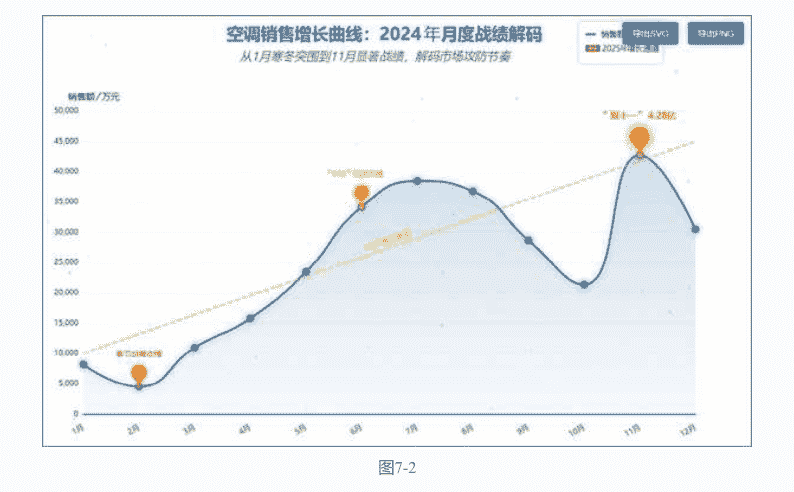

特别说明：数据量较大不便写入提示词时，可先保存为CSV文件，再在对话窗口拖入或以@关联，并附提示词“请结合我上传的CSV文件中的数据”，见图7-3。此方式更高效直观，后续案例可灵活选用。

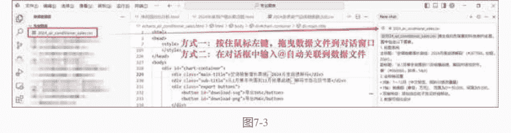

#### 7.1.2 季度产品线营收占比拆解
第一步：获取2024年度各季度不同产品线销售额占比数据，见图7-4。

| 季度 | 空调占比 | 冰箱占比 | 洗衣机占比 |
|---|---|---|---|
| Q1 | 40% | 30% | 30% |
| Q2 | 50% | 25% | 25% |
| Q3 | 60% | 20% | 20% |

| Q4 | 45% | 30% | 25% |

图7-4

第二步：为 Cursor 准备调用指令。

请让模型生成一张白底百分比堆叠柱状图，需涵盖以下要点。

1. 标题配置
一级标题内容为“产品线竞争力图谱：2024年季度销售额结构拆解”，配色 #2E75B6，加粗，20pt。
动态副标题为“当销售额变成拼图游戏”，灰色，斜体，12pt。

2. 坐标设置
- X轴罗列 Q1～Q4 四个季度，标签采用立体凸起样式。
- Y轴显示 0～100% 百分比刻度。
- 轴说明：X轴标题“销售季度”14pt 深灰，Y轴标题“品类占比”14pt 深灰。

3. 拼图式数据柱
- 空调使用 #2E75B6 深海蓝，带金属拉丝纹理。
- 冰箱使用 #8EBF4D 翡翠绿，呈现马赛克拼接质感。
- 洗衣机使用 #FF6600 熔岩橙，呈现立体浮雕效果。

4. 交互设计
- 悬停高亮：光标停在某品类拼图块时，该块与柱体分离并放大 20%。
- 动态注释：点击柱体弹出季度战报，例如“Q3空调称王：60%市场占有率碾压竞品”。
- 图例：右侧悬浮 3D 旋转图例。

5. 数据映射
```
[季度, 空调占比, 冰箱占比, 洗衣机占比]
[Q1,40%,30%,30%]
[Q2,50%,25%,25%]
[Q3,60%,20%,20%]
[Q4,45%,30%,25%]
```

6. 输出要求
- 画布尺寸 1920 像素×1080 像素，高清展示。
- 导出格式为 .svg 矢量图 + .png 高清图。
（先展示拼图组合逻辑动画，确认无误后再渲染最终效果。）

第三步：按上述指令让 Cursor 生成 HTML 文件，打开预览后效果如图7-5所示。

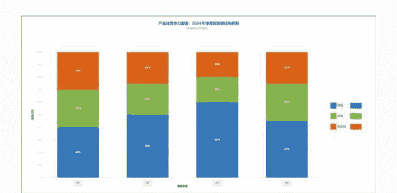

图7-5

### 7.2 财务分析AI加持：成本效益与行业对标

财务管控的关键在于有效压缩成本、提升产出。通过成本透视与净利润拆解，可全面把握 2024 年资源投入产出情况，并在行业中找准位置。

#### 7.2.1 年度投入全景：成本结构透视

第一步：汇总 2024 年度各项资源投入占比，见图7-6。

| 月份 | 人力成本占比 | 原材料占比 | 营销费用占比 | 其他占比 |

|---|---|---|---|---|

| 1月 | 45% | 30% | 15% | 10% |

| 2月 | 46% | 28% | 14% | 12% |

| 3月 | 44% | 31% | 16% | 9% |

| 4月 | 47% | 29% | 13% | 11% |

| 5月 | 43% | 32% | 14% | 11% |

| 6月 | 45% | 30% | 15% | 10% |

| 7月 | 46% | 29% | 14% | 11% |

| 8月 | 44% | 30% | 16% | 10% |

| 9月 | 45% | 31% | 13% | 11% |

| 10月 | 47% | 28% | 14% | 11% |

| 11月 | 43% | 30% | 16% | 11% |

| 12月 | 45% | 30% | 15% | 10% |

图7-6

第二步：撰写投给 Cursor 的提示词，具体内容如下。

请输出一张白底堆叠面积图，包含以下要素。

1. 标题
主标题“2024年度资源投入全景图”。
副标题“成本控制透视：月度资源分配趋势分析”。
字号：主标题18pt 加粗，副标题14pt。

2. 坐标轴设置
- X轴 1～12 月，标签倾斜 45 度防重叠。
- Y轴 0～100%，间隔 5%。
- 轴标题：X轴“月份”14pt，Y轴“成本占比”14pt。

3. 数据序列，企业级配色
- 人力成本 #2E75B6 深蓝。
- 原材料 #8EBF4D 生态绿。
- 营销费用 #FF6600 活力橙。
- 其他 #A5A5A5 高级灰。

4. 交互功能
- 悬浮提示框显示各月各项投入的精确比例。
- 右侧放置图例。
- 增加趋势辅助线，标示总成本 100% 基准线。

5. 数据映射对应表格
```
[月份, 人力成本占比, 原材料占比, 营销费用占比, 其他占比]
[1月,45,30,15,10]
[2月,46,28,14,12]
（完整数据略）
[12月,45,30,15,10]
```

6. 输出规格
- 尺寸 1920 像素×1080 像素，高清展示。
- 导出 .svg + .png。

第三步：Cursor 按提示生成 HTML 文件，打开后效果如图7-7所示。

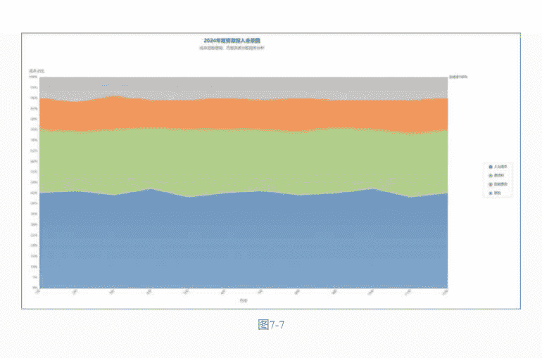

#### 7.2.2 净利润攀升：自评与行业定位

第一步：收集 2022—2024 年净利润对比数据，见图7-8。

| 年份 | 净利润（亿元） | 行业平均（亿元） | 竞品A（亿元） |

|---|---|---|---|

| 2022 | 8.5 | 7.2 | 9.1 |

| 2023 | 10.2 | 8.5 | 11.3 |

| 2024 | 12.8 | 9.8 | 13.5 |

第二步：提示词如下。

请生成白底分组柱状图，包含以下要素。

1. 标题
主标题“净利润三级跳：从自我比较到行业卡位”。
副标题“近三年核心财务指标对比分析 | 2022—2024”。
字号：主标题18pt、加粗，副标题12pt、灰色。

2. 坐标轴
- X轴年份 2022、2023、2024，标签14pt 加粗。
- Y轴净利润单位亿元，范围 0～15，刻度间隔 2。
- 轴标题：X轴“会计年度/年”14pt，Y轴“净利润/亿元”14pt。

3. 数据系列
- 公司自身 #2E75B6 深蓝。
- 行业平均 #A5A5A5 中性灰。
- 竞品A #FF6600 活力橙。
每组并列 3 根柱，宽度占比 80%。

4. 增强功能
- 柱顶添加数据标签，黑字 10pt。
- 右侧悬浮图例。
- 竞品A 柱体带斜线纹理。

5. 数据映射
```
[年份, 自身净利润, 行业平均净利润, 竞品A净利润]
[2022, 8.5, 7.2, 9.1]
[2023, 10.2, 8.5, 11.3]
[2024, 12.8, 9.8, 13.5]
```

6. 输出规格
- 尺寸 1200 像素×800 像素。
- 格式 .svg + .png。
（先输出缩略图确认配色布局，再生成正式文件。）

第三步：按提示生成 HTML 文件，效果如图7-9所示。

# 净利润三级跳：从自我比较到行业卡位

近五年核心财务指标对比分析 | 2022 - 2024

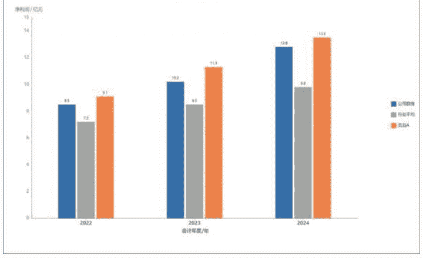

图7-9

### 7.3 营销AI赋能：广告渠道效能多维评估

市场竞争激烈，精准评估渠道转化效果至关重要，具体步骤如下。

第一步：获取 2024 年度广告渠道转化效果数据，见图7-10。

| 渠道 | 曝光量（万次） | 点击率 | 转化率 |

|---|---|---|---|

| 搜索引擎 | 90 | 5% | 2% |

| 社交媒体 | 80 | 8% | 3% |

| 信息流广告 | 75 | 6% | 2.5% |

图7-10

第二步：提示词如下。

请生成白底雷达图，包含以下要素。

1. 标题
主标题“广告渠道多维战力评估”18pt 加粗 #2E75B6。
副标题“2024年转化效能雷达矩阵 | 三指标对比分析”14pt 灰色。

2. 坐标轴设置
- 极坐标轴：曝光量 0～100万次、点击率 0～10%、转化率 0～5%。
- 网格线浅灰透明度 30%，间隔：曝光量 20万次、点击率 2%、转化率 1%。

3. 数据系列设计
- 搜索引擎 #2E75B6 深蓝实线。
- 社交媒体 #FF6600 活力橙虚线。
- 信息流广告 #8EBF4D 生态绿点状线。
数据点标注数值：曝光量黑字、百分比红字。

4. 数据映射
```
[维度, 搜索引擎, 社交媒体, 信息流广告]
[曝光量, 90, 80, 75]
[点击率, 5%, 8%, 6%]
[转化率, 2%, 3%, 2.5%]
```

5. 增强功能
- 多边形填充透明度 20%。
- 悬停显示渠道三指标对比卡。
- 用 ★ 标记各维度最高值。
- 右上角图例，字号14pt，带线型颜色标识。

6. 输出规格
- 尺寸 1200 像素×800 像素。
- 格式 .svg + .png。
（先输出草稿确认比例，再渲染最终图。）

第三步：Cursor 生成 HTML 文件后效果如图7-11所示。

## 广告渠道多维战力评估

2024年转化效能雷达矩阵 | 三指标对比分析


图7-11

## 第8章 Sealos与Cursor协同：云端项目高效开发与部署

是否遇到项目只能本地运行，想让他人体验却无从下手？“上云”即把项目部署到云端服务器，供全球访问。常规流程需购买服务器、安装系统、上传代码、购买域名、做认证、解析域名，步骤繁琐。

别担心，有简化方案。通过 Sealos 云平台，按步骤操作，即使零基础也能将项目部署到云端，供全球用户随时体验。

### 8.1 Sealos：企业级云原生应用平台

Sealos 提供统一开发环境，保证开发、测试、生产环境一致，支持云端高性能计算，实现开发到部署全流程自动化，并自动分配外网域名，一键上线，见图8-1。官网 https://sealos.run。

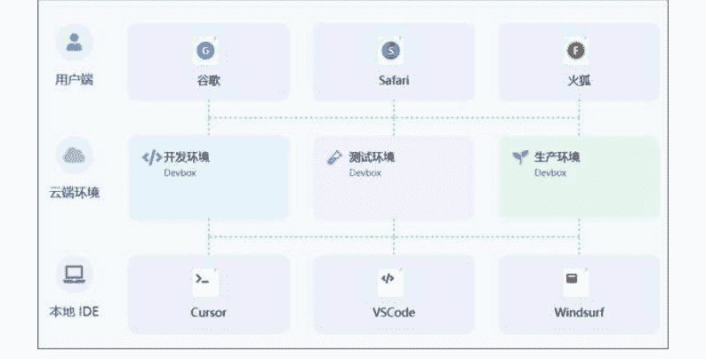

术语看不懂先记印象，后续实践后再回头理解会更清晰。

### 8.2 快速注册与配置Sealos账号

第一步：打开网址 https://sealos.run/。
第二步：点击“登录”按钮，见图8-2。


图8-2

第三步：在登录页输入手机号和验证码完成注册，见图8-3。


图8-3

注册成功后自动登录。登录后可见平台丰富功能，如图8-4。平台赠送5元试用金，足够本章实验，无需额外付费。


温馨提示：Sealos 为收费服务，测试结束后未释放资源仍可能计费，后续章节说明释放方法。

### 8.3 为Cursor编辑器安装Vue插件

#### 8.3.1 安装Vue插件的作用

在 Cursor 安装 Vue 插件可增强对 Vue.js 项目的支持，具备以下能力。

- 1. 语法高亮与代码补全
插件如 Vetur 能识别 .vue 单文件组件，提供模板、脚本、样式的高亮和补全。
- 2. 代码规范与格式化
集成 ESLint、Prettier 确保格式和质量合规。
- 3. 代码片段快速生成
通过 Vue VSCode Snippets 快捷键生成组件结构、生命周期钩子等。
- 4. 开发工具集成
支持 Vue Devtools 调试，方便在 Cursor 中直接调试组件。

#### 8.3.2 安装Vue插件

流程如图8-5所示。


第一步：搜索 Vue 插件。
- 打开 Cursor 扩展商店。
- 搜索框输入“vue”。
第二步：安装核心插件。
- 选中“Vue-Official”，下方标注“Language Support for Vue”。
- 点击齿轮图标⚙ 后点击“安装”。

### 8.4 使用DevBox快速创建标准化Vue项目

温馨提示
操作步骤较细，提供截图和说明，请：
- 先阅读文字确认目标再操作；
- 对照截图核对路径；
- 留意关键提示；
- 不确定时回看截图或返回上步。

#### 8.4.1 在Sealos DevBox平台创建Vue工程

第一步：在 Sealos 平台点击“DevBox”图标，如图8-6。

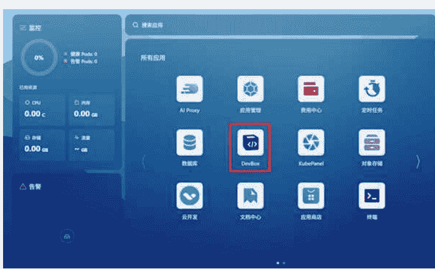

第二步：进入项目管理页，点击右侧“新建项目”按钮，见图8-7。


第三步：设置项目名称，使用英文，输入“gomoku”，见图8-8。

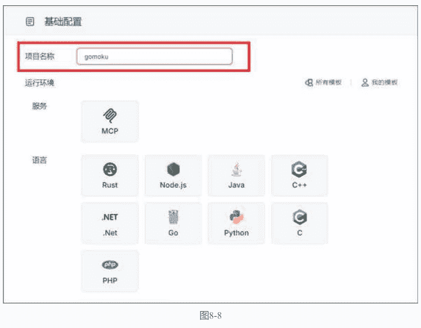

第四步：选择 Vue.js 框架，前端项目选“Vue.js”，如图8-9。
第五步：配置服务器参数，推荐 1核CPU+2GB内存，见图8-10。
第六步：配置网络，启用“开启公网访问”可通过测试域名访问，见图8-11。

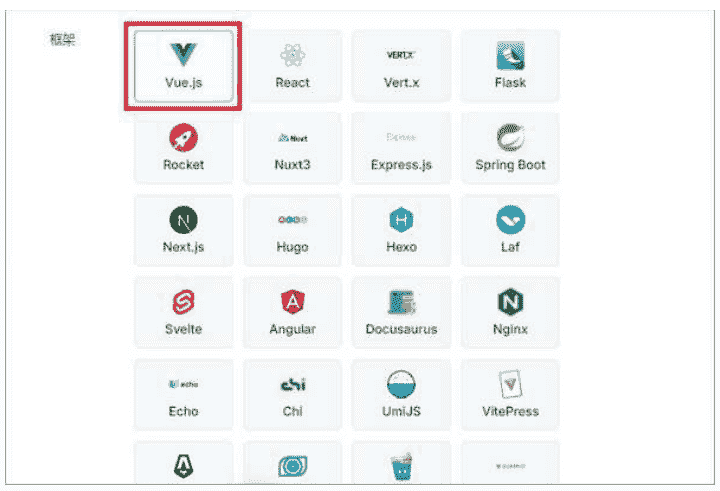

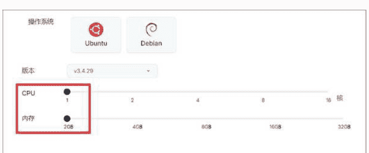


第七步：点击右上角“创建”按钮，见图8-12。

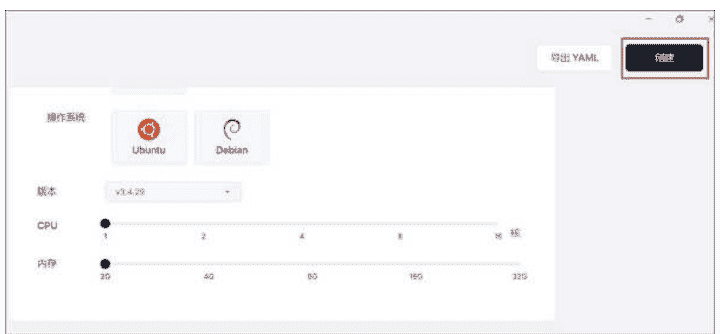

图8-12

片刻后项目创建成功，状态显示“运行中”，见图8-13。

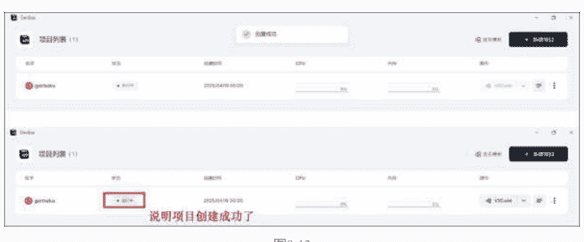

图8-13

#### 8.4.2 连接本地Cursor，实现本地开发与云端实时同步

步骤如图8-14所示。

第一步：点击标注“①”处的下拉箭头打开列表。
第二步：列表中选择“Cursor”。
第三步：在弹出的提示框中点击红色框标注的“打开Cursor”按钮。

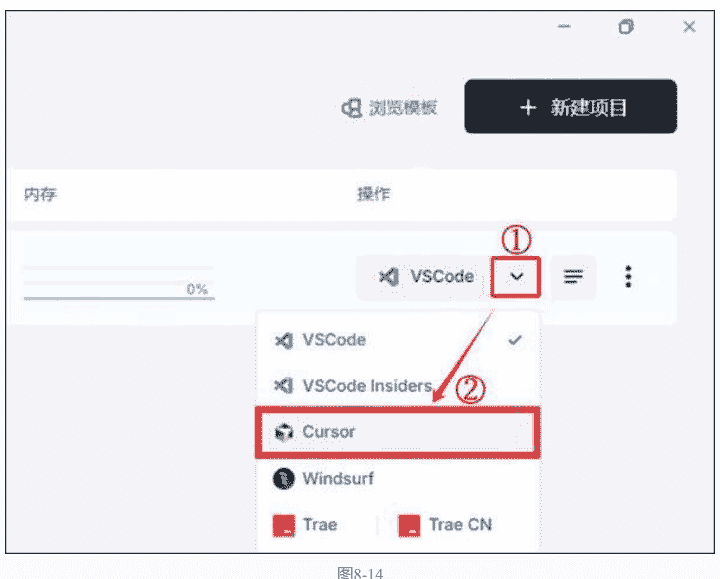

图8-14

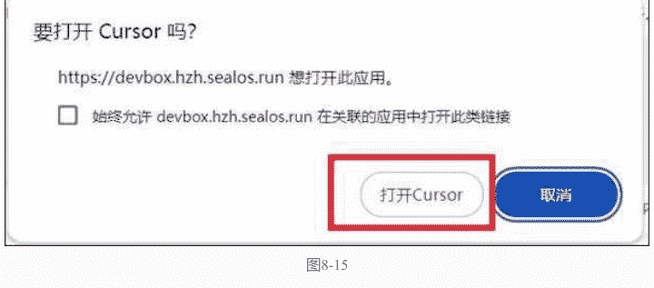

图8-15

第四步：本地 Cursor 弹出“安装扩展”提示，点击“安装扩展和打开URI”，如图8-16。

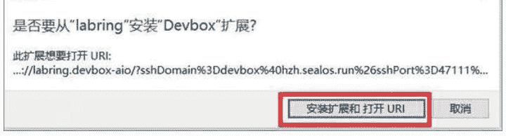

图8-16

第五步：在提示框点击“安装”按钮，如图8-17。


等待 2～3 分钟，SSH 插件安装完毕，可见完整 Vue 项目结构，见图8-18。

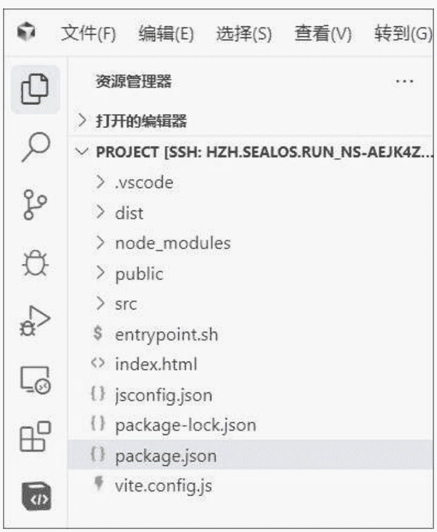

注意事项
本地 Cursor 环境与云端项目实时同步，本地代码变动云端即更新，云端变动本地同步。

### 8.5 启动并验证Vue项目云端访问

目标是验证云端与本地 Cursor 是否打通。

第一步：在 Cursor 中启动 Vue 项目，不会可询问 Cursor，见图8-19。


第二步：按 Cursor 答复操作，见图8-20。

步骤三：在 Cursor 顶部打开「查看」菜单，从列表里点选「终端」功能（见图8-21）。

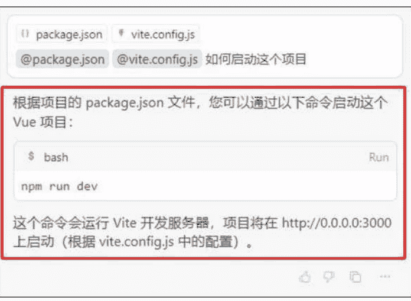

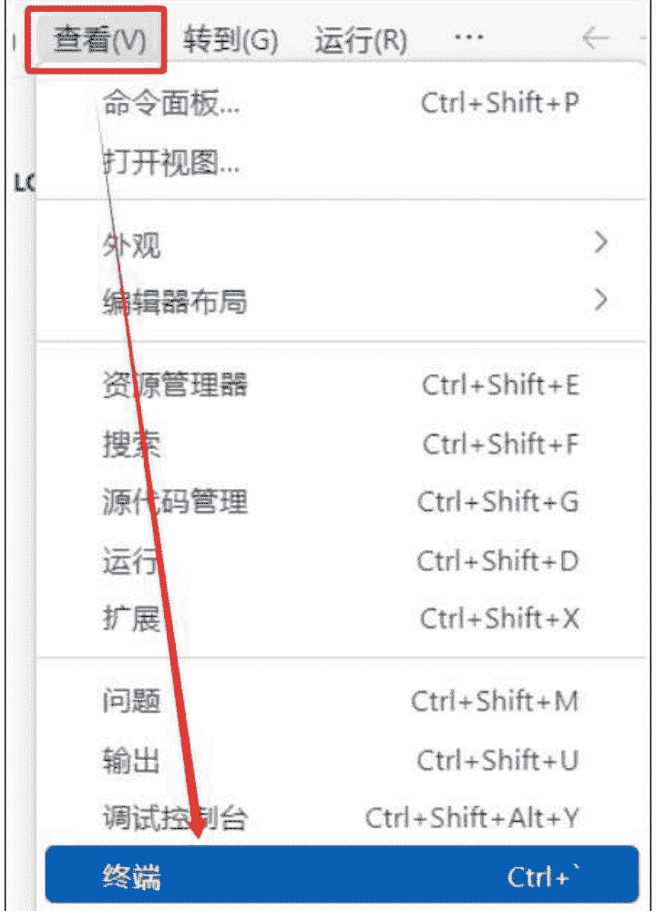

步骤四：在新弹出的终端里执行 `npm run dev` 启动本地工程（见图8-22）。

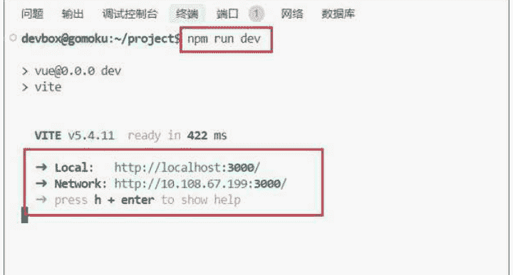

步骤五：切换回 Sealos DevBox 控制台，找到当前项目的对外访问链接（见图8-23）。

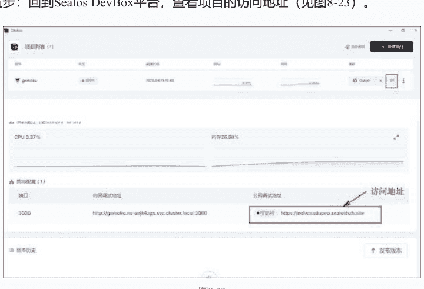

步骤六：将该链接复制到浏览器地址栏回车，即可预览项目页面（见图8-24）。

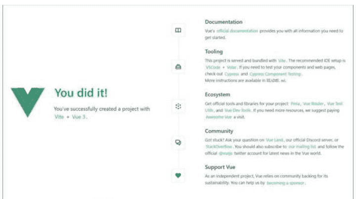

图8-24

到此，本地开发环境与线上环境已打通，后续即可在此基础上扩展功能并继续迭代。

### 8.6 用 Cursor 快速原型化小游戏

本节以五子棋作为演示样本，读者亦可替换为消消乐、益智等其他类型。选择五子棋主要是因为规则简洁、实现量适中，非常适合检验从本地编码到云端发布的完整链路。本节重点在如何把本地项目推向线上，具体编码细节一笔带过。

#### 8.6.1 让 Cursor 按提示自动完成开发

第一步：向 Cursor 发一条开发指令，让它自动生成游戏代码，示例见图8-25。


第二步：代码生成完毕后，通过执行 `npm run dev` 启动服务。

可以直接点击「Run command」按钮触发（见图8-26）。

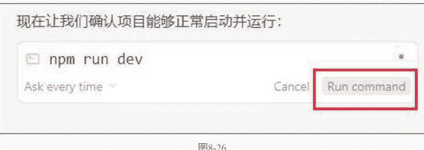

也可以打开「Auto-run」选项让指令自动执行，如图8-27所示。开启后同类操作 Cursor 会自行运行，不再等待人工确认。

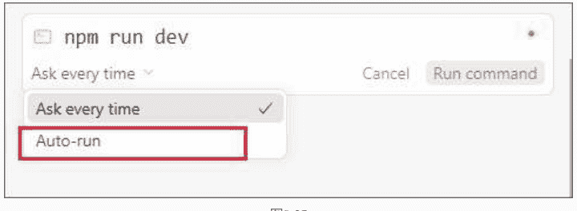

图8-27

#### 8.6.2 交给 Cursor 处理缺陷

Cursor 用 Vue 实现的五子棋初版运行效果不佳，棋盘未能完整渲染，如图8-28所示。

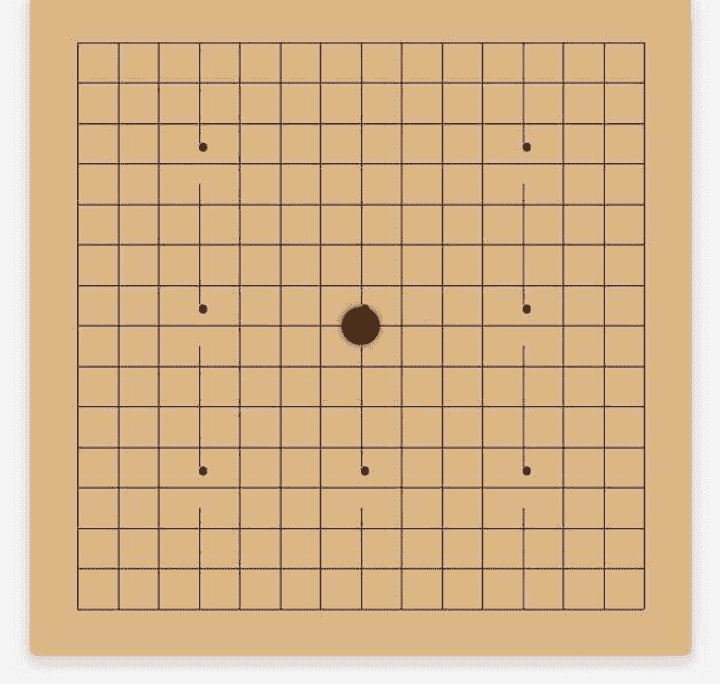

图8-28

把问题描述抛给 Cursor 即可。使用的修复提示词与修复过程见图8-29。


图8-29

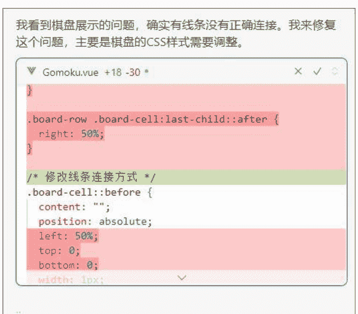

图8-29（续）

经过精准调整后缺陷被彻底消除。重新运行生成的程序，功能完全恢复，界面焕然一新，如图8-30所示。

# 五子棋游戏

黑棋胜

重新开始 悔棋


图8-30

### 8.7 Sealos 云端发布实操

开发完成后进入正式上线阶段。

#### 8.7.1 修改 Vue 启动脚本

发布前先修改启动脚本 `entrypoint.sh`（见图8-31）。

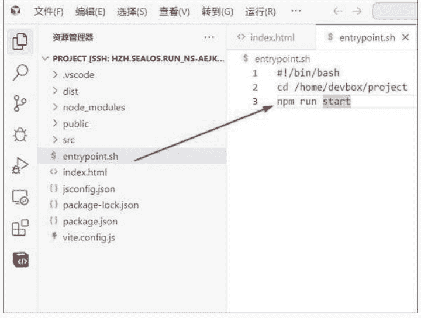

打开 `entrypoint.sh`，把文件中的 `start` 改为 `dev`，按 `Ctrl+S` 保存即可。

#### 8.7.2 发版全流程

第一步：进入项目列表页，点击右侧三个点 `⋮`，在菜单中选择「发版」，如图8-32。


第二步：在「发布版本」弹窗中填写版本号和说明，点击「发版」按钮，如图8-33所示。

第三步：在确认提示中点「确认」，平台开始自动执行发布流程。

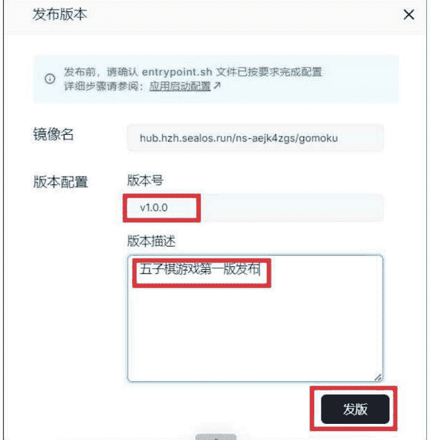

第四步：发版成功后，点击「版本历史」区域右侧的「上线」按钮（见图8-34）。


图8-34

第五步：进入部署页，选择合适的 CPU 与内存配额，点击「部署应用」按钮（见图8-35）。


图8-35

第六步：部署完成后系统会自动生成公网地址，复制到浏览器即可访问，项目即可对外展示！（见图8-36）


# 五子棋游戏

当前回合: 白棋


图8-36

### 8.8 及时释放资源控制成本

云服务按量计费，合理释放闲置资源能有效降本。

登录 Sealos 进入「监控」页，如图8-37所示，点击相关入口进入应用管理。下面以删除应用为例，其他资源如数据库、对象存储的释放逻辑一致。


图8-37

第一步：点击「应用管理」进入列表页（见图8-38）。


图8-38

第二步：选中目标应用右侧的三个点 `⋮`，在弹出菜单里选择「删除」（见图8-39）。


第三步：在「删除警告」页，文本框中输入应用标识，确认后点击「删除」按钮即可释放资源（见图8-40）。


## 第9章 人工智能副业变现：从站点到小程序的全链路

在人人可创造的数字时代，技术已成为普通人撬动副业收入的杠杆。零基础三分钟复刻爆款站点、用工具打造热门导航站、掌握微信小程序全流程、从创意到变现的路径，本章拆解人工智能的实战用法。

### 9.1 三分钟复刻站点风格 新手也能上手

网页设计中快速借鉴优秀站点风格并创新是提效关键。下面演示借助 Cursor 在三分钟内复刻一种风格。

第一步：准备发送给 Cursor 的提示词。

设计一个类似 https://cloud.bai×××.com/ 风格的人工智能美容网站，要求如下。

- 页面结构
顶部固定导航含 Logo 与链接；首屏英雄区展示主副标题、简介与下载按钮；产品展示区 3 个卡片含图、描述、链接；功能特点区 3 个卡片；关于我们区；联系方式区含 QQ 与交流群；页脚含版权与免责。
- 设计风格
简洁现代 UI，卡片式展示，英雄区蓝紫渐变，产品卡悬停动效，导航滚动高亮，标题带红色下划线，响应式适配移动端。
- 交互
平滑滚动、导航高亮、卡片悬停动效、移动端菜单适配。
- 内容
主题为 AI 美容平台，产品为 AI 美容助手、肤质分析、虚拟试妆；核心功能为面部特征分析、妆容方案设计、虚拟试妆；包含价值观与愿景，提供多平台下载。
- 技术
纯 HTML/CSS/JavaScript 原生实现，使用 Font Awesome 图标，不使用前端框架，代码简洁易读。

第二步：把提示词发给 Cursor，生成文件后运行，效果如图9-1所示。

## AI美容平台

智能美妆解决方案

利用先进的人工智能技术，为您提供个性化的美妆方案，打造专属于您的美丽。


## 我们的产品

全方位智能美妆解决方案

- **AI美容助手**
智能识别您的面部特征，为您推荐最适合的美妆产品和化妆技巧。
[了解更多 →]

- **肤质分析**
深入分析您的肤质状况，提供个性化的护肤建议和产品推荐。
[了解更多 →]

- **虚拟试妆**
在线试用各种美妆产品，无需实际涂抹即可看到效果，打造完美妆容。
[了解更多 →]

## 核心特点

为什么选择我们的AI美容平台

- **AI智能分析**
采用先进的深度学习算法，精准识别面部特征，提供个性化建议。

- **个性化推荐**
根据您的肤质、喜好和需求，智能推荐最适合的美妆产品和方案。

- **云端存储**
您的美妆数据和偏好设置安全存储在云端，随时随地访问。

图9-1

## 关于我们

致力于创新美妆科技


- **我们的使命**
我们致力于利用人工智能技术为每位用户提供个性化的美妆体验，让美丽变得更加简单和便捷。

- **我们的愿景**
成为全球领先的AI美妆科技公司，通过技术创新改变美妆行业，让每个人都能享受到专业的美妆服务。

- **我们的价值观**
创新、专业、用户至上。我们不断探索技术边界，提供专业服务，以用户需求为导向。


图9-1（续）

整体布局已达到专业水准。若想进一步优化，只需用自然语言与 Cursor 沟通，如图9-2所示，Cursor 会根据反馈动态调整，最终效果更贴合预期。


图9-2

按图9-2提示优化后，局部更符合 AI 美容主题，如图9-3所示。


图9-3

需要云端部署时，可参照第8章的 Sealos+Cursor 发布流程。若熟悉阿里云、腾讯云、华为云等平台，也可部署到这些环境。

### 9.2 热门人工智能导航站 手把手复刻

1999 年 hao123 开创了互联网导航模式，通过 URL 聚合实现了资源整合。2024 年人工智能工具类导航站大量涌现。下面演示如何快速复刻一个同款。

第一步：编写提示词。

设计一个类似 https://cloud.bai×××.com/ 风格的人工智能导航网站，要求如下。

1. 页面结构
顶部固定导航含动态 Logo 与 6 个链接；首屏英雄区展示标语、搜索框与热门入口；工具分类区 6 个卡片含图标与数量；热门工具区 3 个卡片含参数与链接；技术优势区 3 个卡片；开发者支持区含 API 文档与 SDK 下载；页脚展示合作品牌与版权。
2. 设计风格
极简科技感，卡片网格布局，英雄区深蓝渐变，工具卡立体悬浮阴影，导航激活时红色下划线，标题用衬线提升专业感，全平台响应式。
3. 交互
导航自动滚动半透明化，分类卡悬停预览，点卡片复制 API 代码，移动端手势滑动，搜索框智能补全。
4. 内容
主题为 AI 工具发现与集成平台；分类含自然语言处理、计算机视觉、机器学习框架等；推荐工具如 GPT-4o、Stable Diffusion、TensorFlow；技术优势为实时更新、多维度评分、兼容性检测；开发者支持含 OpenAPI 文档与 Python/JavaScript SDK；合作品牌展示百度智能云、华为云等。
5. 技术
纯原生 HTML5/CSS3，使用 Font Awesome 6.4，不使用 CSS 框架，代码符合 W3C，文件控制在 300KB 以内。

第二步：将提示词发送给 Cursor，生成网页后运行，效果如图9-4所示。

# 探索AI的无限可能

一站式发现、评测和收藏优秀人工智能工具

# 探索AI工具分类

- 自然语言处理

- 计算机视觉

- 机器学习框架

- AI推理引擎

- 数据分析

- 对话机器人

图9-4


整体雏形已成型，后续可通过持续对话逐步完善功能与视觉。

第三步：测试发现链接不可用，向 Cursor 发送修复指令，指令内容如图9-5所示。


Cursor 逐行检查源码定位空链接并修复，如图9-6所示。


修复完成后，可通过查看源码验证，如图9-7所示。


后续其它功能同样可通过自然语言与 Cursor 交互完成，此处不再赘述。

### 9.3 三步打造番茄工作法微信小程序

本节指导读者使用微信开发者工具，结合 Cursor 开发一款专业的番茄工作法小程序。

#### 9.3.1 安装微信开发者工具

第一步：访问微信开发者平台 https://developers.weixin.qq.com/platform/。

第二步：在页面点击「稳定版 Stable Build」链接（见图9-8）。


第三步：根据操作系统选择对应安装包，例如 Windows 10 64 位点击「Windows 64」链接，如图9-9所示。


第四步：下载完成后右键安装包，选择「以管理员身份运行」，如图9-10所示。


第五步：按向导提示完成安装，如图9-11所示。


#### 9.3.2 让 Cursor 生成高保真界面原型

第一步：准备发送给 Cursor 的提示词，具体如下。

你是一位资深的产品经理和 UX/UI 设计专家，请为“番茄时钟”微信小程序制作“高保真”原型。

要求：请在一个 index.html 文件中生成所有的原型界面（此要求不可变更）。

项目核心功能如下。

1. 计时面板：倒计时显示、进度环、暂停、继续。

2. 任务管理：任务列表、完成标记、优先级设置。

用 Cursor 从原型到上线：微信小程序高效打磨指南

3. 历史数据总览：按日呈现专注时长分布、任务完成比例及效率走势。
4. 设置面板：工作时长可设 25 分钟或 50 分钟、休整间隔自定义、通知方式可调节。

技术要求概览
1. 视觉与交互须符合当下移动端主流规范，突出层次感与操作顺畅度。
2. 接入 Font Awesome 或同类开源图标集，提升专业质感。
3. 界面组件与状态展示要细致全面，覆盖各种使用场景。
4. 原型需达到高保真，可直接进入开发阶段。

步骤二：不足五分钟，Cursor 就完成了该工具的界面方案。打开它生成的 index.html 预览，整体观感专业，见图 9-12。


图 9-12

#### 9.3.3 原型驱动的小程序代码落地
界面原型已就绪，下面以此为蓝本借助 Cursor 生成可运行的微信小程序代码，流程如下。

步骤一：在微信开发者工具里新建小程序项目，按图 9-13 的选项配置后按下“创建”。


图 9-13

演示阶段临时使用中文拼音全拼作项目名，例如 fanqieshizhong。正式研发时建议用英文命名，如 Pomodoro Timer，更规范也利于团队协作。

步骤二：创建完成后本地会生成项目文件夹。将 9.3.2 节产出的原型文件 index.html 复制到该小程序根目录，如图 9-14。

步骤三：通过 Cursor 打开项目 fanqieshizhong，具体操作见图 9-15 的编号提示。


图 9-14


步骤四：在 Cursor 对话区输入指令，让其负责生成小程序功能，提示词内容见图 9-16。


注意！Cursor 交付的代码可能有误，只需把报错信息截图发回去，它会依据截图中的错误修复程序，如图 9-17。


图 9-17

注：JS 是 JavaScript 的缩写。

后续功能修复思路相同，仅需用自然语言沟通即可，不再展开。

#### 9.3.4 真机调试验证实际效果
除了在开发者平台调试，还可通过真机在手机上运行，更贴近用户真实场景。具体操作：

步骤一：如图 9-18，在微信开发者工具中按下“真机调试”按钮，会出现二维码，可根据手机系统勾选下方 Android 或 iOS 选项切换。


步骤二：用手机扫码，即可在移动端体验运行效果，如图 9-19。


当前版本仅限内部测试，如需对外发布，需先完成注册备案并通过微信公众平台审核，具体指引见后文。

### 9.4 小程序账号注册与备案全流程
开发完成后，注册与备案是必经环节。本节介绍邮箱准备及注册发布流程。

#### 9.4.1 邮箱账号先行
注册小程序需要邮箱，以下以网易邮箱为例。

步骤一：在浏览器地址栏输入 www.163.com 进入网易首页。
步骤二：在右上角找到“免费注册邮箱”并按下。
步骤三：网易邮箱支持手机号注册或自定义邮箱名，左侧任选其一，如图 9-20。


步骤四：填写邮箱、密码等信息，勾选“同意《服务条款》……”后按下“立即注册”，跳转到邮箱首页即完成。

#### 9.4.2 注册并激活微信小程序账号
步骤一：在浏览器输入 https://mp.weixin.qq.com/ 进入微信公众平台首页。
步骤二：在页面右上角按下“立即注册”，如图 9-21。


步骤三：在账号类型选择页选“小程序”，再按下“前往注册”，如图 9-22。


步骤四：在图 9-23 所示页面填写邮箱、密码、确认密码后按下“注册”。
步骤五：激活账号并验证邮箱归属，在“邮箱激活”页按下“登录邮箱”完成验证，见图 9-24。


图 9-23


步骤六：打开邮箱，点击微信公众平台发送的激活链接，见图 9-25。


步骤七：完成用户信息登记。在“小程序注册”页建议选“个人”主体；若选“企业”需提供营业执照，见图 9-26。

# 小程序注册


图 9-26

步骤八：完成主体信息登记。在“主体信息登记”页，用微信扫描“管理员身份验证”二维码即可，见图 9-27。


步骤九：扫码验证成功后，页面会提示“身份验证成功”，按下“继续”进入下一步，见图 9-28。


步骤十：按下“确定”确认身份，完成最终注册，随后按下“前往小程序”进入操作界面，见图 9-29。


图 9-29

#### 9.4.3 发布流程·信息填写
步骤一：进入“小程序发布流程”界面后，按下第一项右侧的“去填写”，见图 9-30。


图 9-30

步骤二：在“填写小程序信息”页依次补全各项内容后按下“提交”即可，如图 9-31。

# 填写小程序信息


图 9-31

#### 9.4.4 发布流程·服务类目补充
步骤一：在图 9-32 所示的发布流程页按下“去补充”按钮，进入“服务类目”页。
步骤二：在该页按下右上角“添加类目”按钮，会弹出二维码，需用微信扫码确认开发者身份，如图 9-33。


图 9-32


图 9-33

步骤三：在“服务类目”下拉框中挑选即将发布的小程序类目，如工具 > 办公，再按下“确定”，见图 9-34。


图 9-34

#### 9.4.5 发布流程·备案
步骤一：在发布流程页按下“去备案”按钮，见图 9-35，进入“验证备案类型”页。


图 9-35

步骤二：在该页填写主办人信息并上传身份证照片后按下“验证”，见图 9-36。


图 9-36

步骤三：主办人信息验证通过后，在“填写备案信息”页补全主体信息等，再按下“下一步”，见图 9-37。

## 9.4.5 发布流程·备案（必需）
步骤四：在“填写备案信息”页按图 9-38 要求填写小程序基础信息，并扫描下方二维码。
步骤五：在手机端完成人脸识别，如图 9-39。
步骤六：人脸识别完成后按下“下一步”，见图 9-40，进入上传资料页。
步骤七：在“填写备案信息”页按下“下载模板”，打印微信公众平台提供的《互联网信息服务备案承诺书（个人）》并填好个人信息后，将模板上传至平台，如图 9-41。

# 互联网信息服务备案承诺书（个人）

本人通过 深圳市腾讯计算机系统有限公司 向 广东省 通信管理局申请互联网信息服务备案，并作出如下承诺：

- 一、本人具备完全民事行为能力，知晓并自觉遵守互联网信息服务相关法律法规和行政管理规定，所提交的备案信息及文件、证件、照片等资料真实、合法、有效，相关资料的电子扫描件/照片与原件一致，备案的小程序为本人所办、亦为本人负责管理。

- 二、备案通过之日起一个月内，按照备案项目范围尽快上线提供互联网信息服务，不发布未经许可和法律法规禁止发布的信息；上线时在小程序主体介绍位置（设置-关于两级菜单以内页面底部显著位置或三级专用菜单内）规范标明对应备案编号，并链接至 http://beian.miit.gov.cn。

- 三、备案通过后，做好备案信息维护工作，通信地址、联系电话、服务名称、服务项目等原备案内容如发生变化，及时通过备案小程序运行平台履行备案信息变更手续。

- 四、如该小程序在其他新小程序平台上线，未办理完成新小程序平台的新增接入（新增平台）手续，不得在新小程序平台上线。停用原小程序平台之日起一个月内，主动委托原小程序平台取消其平台接入信息。

- 五、如发生小程序停办等情况，自发生之日起一个月内主动完成备案注销手续。

- 六、自觉配合电信主管部门开展备案信息核查、网络信息安全事件处置和相关行业管理、监督检查工作。

如违背承诺导致发生违法违规行为或造成其他不良影响，自愿承担相应法律责任和接受相关惩戒措施（注销备案、下线小程序、列入黑名单、罚款等）。

签名+手印：

身份证号码：

年 月 日

注：签署 60 日内有效（以接入商提交备案申请之日算），退回再次提交时仍在有效期内的，可免重签。

步骤八：上传《互联网信息服务备案承诺书（个人）》后按下“提交”按钮，小程序进入审核状态，如图 9-42。

审核通过后即可获得正式的 Appid，通过该 Appid 将小程序上传至微信公众平台。

#### 9.4.6 发布流程·微信认证（可选）
仅发布小程序时本步可跳过。若希望小程序可被搜索推广，则需进行微信认证，具体操作如图 9-43 的编号所示。

该环节涉及付费，建议先熟悉基础操作，待有明确运营规划或成熟方案后再认证也不迟。

### 9.5 小程序上传至微信公众平台
开发测试完成后，需把小程序正式上传。

默认使用测试开发的 Appid 时，微信开发者工具右侧的“上传”按钮处于禁用灰色状态，如图 9-44。

要上传至公众平台，需使用 9.4.5 节备案通过后获取的新 Appid，如图 9-45。

设置 Appid 后，“上传”按钮即可使用，如图 9-46。

### 9.6 抖音创作者常用的定制网页变现玩法
在特定节点，定制网页是抖音博主常见的变现服务。用户提供需求，博主据此生成专属页面实现收益。

实现方式主要有两种：
- 1）开通设计类网站会员，使用网页模板生成定制页。
- 2）先用 Cursor 生成基础网页，再按用户需求修改内容生成定制页。

第二种方案可技术化低成本产出定制网页，具体如下。

步骤一：编写提示词。

作为一位资深 UI 设计师，请生成一张“520”婚礼海报，重点是提升美感和吸引力。

1. 整体视觉效果

- 使用粉色背景，色值从#ffebf0到#ffc1d2，营造柔和浪漫氛围。
- 为海报设计30像素圆角和渐变阴影效果，增强精致感。
- 添加波浪背景动画，使页面更具动感。
- 加入页面入场动画效果，提升吸引力。

2. 标题区域

- 让“LOVE”文字居中显示，添加发光效果和脉动动画。
- 标题“嫁给我吧”使用更大（48像素）且优雅的中文字体。
- 标题下方添加装饰线，中央有小爱心点缀。
- 优化副标题文字的间距和阴影，并添加淡入动画。

3. 中心卡片区域

- 宽度控制在280像素，确保协调性。
- 圆形边缘设计，顶部添加装饰物。
- 内部文字如下。

  - 姓名：张小姐&李先生。
  - 爱的宣言：“与你一见如故”和“此生唯一的爱是你”。
  - 地址信息：深圳市福田文化广场。
  - 日期：2025年5月20日。

4. 动画和交互效果

- 添加闪亮粒子和花瓣随机飘落效果。
- 卡片浮动动画调整为更轻柔的效果（浮动高度为10像素）。
- 卡片边框45秒缓慢旋转，营造梦幻感。
- 单击卡片时产生爱心爆炸效果和轻微震动。
- 鼠标光标悬停在名字上时，显示放大效果并释放小爱心。

5. 装饰元素

- 在页面四周添加半透明、漂浮的爱心装饰。
- 顶部左右两侧各添加一个白色爱心图案，轻微浮动。
- 增加三个装饰性圆球，随机漂浮。
- 页脚添加精致分隔线和装饰点。

6. 色彩搭配

- 主色调使用粉色（#ff8fab到#ff5c8d）。
- 姓名使用#ff2e63突出显示。
- 中心卡片区域文字信息使用#555555，确保可读性。
- 婚礼信息区域使用淡粉色背景（rgba(255, 240, 245, 0.6)），文字使用#ff4757。

7. 移动端优化

- 确保在小屏设备上显示效果良好。
- 调整字体大小和间距，提高可读性。
- 优化各元素的相对比例。

所有内容保存为一个完整的网页项目，包括HTML、CSS、JavaScript和必要的图像资源。

步骤二：将上述提示词输入 Cursor，即可生成网页文件。运行生成的网页，效果如图 9-47 所示，页面带有动态爱心飘动效果。

步骤三：根据用户需求如姓名和祝福语，可直接在 Cursor 生成的网页文件 index.html 源代码中编辑关键文字，减少与 Cursor 的交互并生成更多特色页面。具体操作为：在 Cursor 资源管理器中双击左侧 index.html 打开源码，修改相应文字内容，最后按 Ctrl+S 保存更改，如图 9-48 所示。

```html
<html lang="zh-CN">
<body>
    <div class="poster">
        <div class="content">
            <div class="subtitle">
            </div>
            <div class="heart-card">
                <div class="card-decoration left-top"></div>
                <div class="card-decoration right-top"></div>
                <div class="card-decoration left-bottom"></div>
                <div class="card-decoration right-bottom"></div>

                <div class="names">
                    <span class="name">张小姐</span>
                    <span class="and">&</span>
                    <span class="name">李先生</span>
                </div>
                <div class="message">
                    <p>与你一见如故，尽余生之欢</p>
                    <p>此生唯一的爱就是你</p>
                </div>
                <div class="wedding-info">
                    <div class="info-item">
                        <span class="info-icon">📍</span>
                        <p>婚礼地址：深圳市福田文化广场</p>
                    </div>
                    <div class="info-item">
                        <span class="info-icon">📅</span>
                        <p>2025年5月20日</p>
                    </div>
                </div>
            </div>
        </div>
        <div class="footer">
            <div class="footer-decoration"></div>
            <p>爱设计工作室 见证幸福</p>
        </div>
    </div>
</body>
</html>
```

## 第10章 基座模型配合MCP 重塑智能代理开发范式

当前生成式AI发展迅猛，基座模型与模型上下文协议正在一起改写智能代理的构建方式。本章以Cursor为操作界面，展示借助MCP把想法快速落地的路径。

从定制旅行攻略的实操，到对Manus工作流的复刻，再到剖析阿里云百炼平台的能力，全章会把核心链路讲透。

准备好进入这趟技术探索了吗？一起开启智能代理开发的新篇章，感受基座模型与统一上下文协议协同后带来的扩展空间。无论是资深工程师还是新手，都能找到可直接复用的方法与灵感。

### 10.1 MCP 为智能代理提供统一对外通道

#### 10.1.1 协议来历

MCP由Anthropic主导并开源，定义了应用向大模型供给上下文的规范做法。

可以把它看作智能代理的通用连接口，思路类似USB-C统一设备连接，MCP在模型与外部数据源、工具之间建立了统一协作规范。

若把基座模型视作代理的推理核心，负责理解与决策，MCP则补足了感知与执行能力，让它能够读取环境、调用工具并与物理世界进行动态互动。

#### 10.1.2 架构拆解

MCP采用经典客户端-服务器形态，包含Host、Client、Server三部分，如图10-1。

1. MCP Host
Host是整条链路的起点，通常是与用户直接交互的代理程序，如Cursor IDE、Claude Desktop或其他原生支持MCP的工具。其主要职责是与MCP Client建立连接，并通过协议向外部数据源或工具发起请求。

2. MCP Client
Client位于Host与Server之间，负责消息的标准化转发和工具调用。它充当桥梁，保证数据交换一致且规范。

3. MCP Server
Server是一个轻量服务进程，通过统一接口对外暴露特定能力，如工具调用、资源访问、提示模板等。它把外部服务接入MCP生态。

#### 10.1.3 生态进展

2025年3月，OpenAI官宣全面兼容MCP。

2025年4月，阿里巴巴在北京举办的AI势能大会上宣布，阿里云百炼平台上线业界首个覆盖全生命周期的MCP服务，首批集成高德、无影、Fetch、Notion等50余项自有及第三方服务，覆盖生活信息、网页浏览、内容生成等领域。阿里同时开放开发者自研自发MCP Server模块，提供零门槛体验。

2025年4月，腾讯云升级大模型知识引擎，支持调用MCP插件含自定义插件。平台已上线腾讯云EdgeOne Pages、腾讯位置服务、Airbnb、Figma、Fetch等多个Server，涉及网页部署、位置查询、信息获取等场景。

2025年4月，百度智能云发布国内首个企业级MCP服务，首批开放超千个Server供企业与开发者挑选。

MCP应用生态仍在加速演进，本章将用它完成多项实操，真正释放潜力的关键仍在读者的实践与创造。模型本身令人兴奋的往往是它在特定场景中的价值创造，结合基座模型与MCP，可以打造既实用又有创意的智能代理。

### 10.2 用Cursor和MCP打造行程助手

2025年3月，高德地图MCP首发，提供位置服务、路径规划、天气查询等12项实时能力，助力出行场景的动态信息获取。下面结合Cursor与高德MCP实现行程助手。

#### 10.2.1 获取高德开放平台开发者权限

使用高德MCP服务需先完成开发者注册，具体流程如下。

步骤一：打开 https://lbs.amap.com/ 进入高德开放平台首页，见图10-2。
步骤二：点选右上角“注册”进入注册页。
步骤三：进入账号注册环节，在“注册成为开发者”页填写手机号及验证码等，见图10-3。
步骤四：进入认证方式选择，建议选“个人认证开发者”，见图10-4。
步骤五：进入信息完善环节，可使用支付宝扫码实名认证，见图10-5。

点选“进行支付宝扫码实名认证”后弹出支付宝二维码，用支付宝App扫码即可。扫码成功后完成授权：勾选“已阅读和同意《用户授权协议》”并点击“授权”，见图10-6。

# 服务授权

通过登录并授权，高德开放平台开发者认证可以获取你的部分个人信息

□ 已阅读和同意 《用户授权协议》

授权

步骤六：授权成功后自动跳转邮箱验证页，填写邮箱地址及收到的验证码，点击“提交材料”，见图10-7。

# 注册成为开发者

01 注册账号 > 02 选择认证方式 > 03 完善信息

个人支付宝扫码认证

同意《高德地图开放平台服务协议》、《高德地图开放平台隐私权政策》、《高德地图开放平台开发者认证协议》并同意高德开放平台从支付宝获取姓名及身份证号进行用户身份验证

重选认证方式 提交材料

步骤七：提交后弹出认证成功提示，3秒后自动跳至控制台，见图10-8。

#### 10.2.2 生成调用凭证

高德开放平台自动生成的Key是调用服务的凭证，只有提交Key才会响应请求。创建步骤如下。

步骤一：在控制台页点击右上角“创建新应用”出现“新建应用”页，见图10-9。
步骤二：在新建应用页填写相关信息，如图10-10，完成后点击“新建”。
步骤三：新建成功后在控制台点击“我的应用”右侧“添加Key”，见图10-11。
步骤四：在“为「我们的专属旅行助手」添加Key”页填写Key名称、选择服务平台，按图10-12编号操作后点击“提交”，见图10-12。
步骤五：在“我的应用”区即可看到已生成的Key，见图10-13。
步骤六：点击“我的应用”区的“查看配额”查看免费额度，见图10-14。

免费额度足以覆盖个人实验需求。

#### 10.2.3 连接高德地图MCP服务端

接入流程如下。

步骤一：在浏览器打开 https://lbs.amap.com/api/mcp-server/summary 查看高德MCP Server介绍文档，见图10-15。
步骤二：点击“快速接入”进入接入教程。

高德MCP Server兼容所有遵循MCP的客户端，如Cursor IDE、Claude Desktop。目前提供MCP SSE和Node.js I/O两种接入方式，本例先用SSE配置。

步骤三：打开Cursor配置MCP Server，见图10-16。

1. 点击右上角齿轮 ⚙️ 打开设置菜单。
2. 左侧菜单选择“MCP”进入设置页。
3. 点击“Add new global MCP server”添加新的全局服务器。

步骤四：打开自动生成的mcp.json文件，支持配置多个服务器。参照高德MCP的SSE配置项修改内容，保存后按 Ctrl+S，见图10-17。
步骤五：返回MCP设置页，状态灯变绿表示配置成功，见图10-18。

如图10-19所示，MCP Server已集成多项接口，悬停即可查看功能说明，方便快速上手。

若改用Node.js I/O方式接入，需先安装Node.js，建议v22.14.0及以上以保证兼容与性能。按系统下载安装包常规安装即可。安装完成后可用以下配置替换原SSE配置，具体内容如下：

```json
{
  "mcpServers": {
    "amap-maps": {
      "command": "npx",
      "args": ["@amap/amap-maps-mcp-server"],
      "env": {
        "AMAP_MAPS_API_KEY": "这里替换为你申请的Key"
      }
    }
  }
}
```

#### 10.2.4 行程助手初版V1.0

配置完成后可体验Cursor与MCP结合的效果，操作如下。

步骤一：在Cursor新建文件夹“MCP”，在对话框输入指令并发送，提示词内容见图10-20。
步骤二：Cursor识别需求并调用高德MCP Server的maps_weather接口，见图10-21。
步骤三：生成一份详细的“五一”三天游计划，见图10-22。

##### 深圳“五一”假期三天游计划

###### 天气预报

未来几天深圳天气较好，气温21~30℃，以多云为主，部分时段可能有阵雨，注意防晒并携带雨具。

###### 第一天：城市地标游

上午：
- 深圳世界之窗 游览3~4小时
  - 可一日游览多个世界知名建筑与景观的微缩场景

午餐：
- 华侨城美食街用餐

下午：
- 深圳湾公园 1~2小时
  - 欣赏海景，远眺香港
- 深圳湾体育中心 1小时
  - 观赏“春茧”建筑

晚上：
- 海上世界广场 2小时
  - 观赏灯光秀，品尝海鲜大排档

#### 10.2.5 行程助手进阶V2.0

V1.0内容不够精细且缺图，V2.0针对性优化，步骤如下。

步骤一：编写提示词如下。

请作为旅行规划专家，调用高德地图MCP Server完成以下任务。

1. 数据获取
- 调用maps_weather获取{{出发日期}}至{{返程日期}}每日天气数据 温度、降水概率、风速。
- 调用maps_text_search获取{{目的地}}所有4A级以上景区信息 需含经纬度、特色图片URL。
- 调用maps_route_planning生成各景点间公共交通路线 含地铁、公交接驳。

2. 行程规划
每日时段划分：
- 08:00—12:00 人文景点 博物馆、历史遗迹
- 12:00—14:00 特色餐厅推荐 人均{{预算}}元内
- 14:00—18:00 自然景观 需标注步行强度等级
- 19:00—21:00 夜景、商业区活动

必含要素：
- 标注每个景点在高德地图上的信息
  - 门票价格 调用maps_poi_detail
  - 最佳游览时长 结合景点面积估算
  - 实时拥挤度 调用maps_traffic_status
- 标注餐厅必吃菜品及人均消费
- 标注跨景点交通预估时间与费用

3. 产出为{{城市拼音}}.html文件

步骤二：为便于维护，可将提示词保存为文件 如“旅行规划助手提示词.md”，放入项目目录，见图10-23。

知识点：
MD文件即Markdown格式文本，扩展名.md。Markdown语法简洁直观，如“#”表示标题、“*”或“-”创建列表，非常适合组织层次分明的提示词。

步骤三：将提示词文件拖入Cursor对话框或用@符号引用，再在对话框输入指令，见图10-24。
步骤四：Cursor调用高德MCP相关接口执行任务，见图10-25。
步骤五：Cursor生成HTML文件后用浏览器打开，效果见图10-26。
步骤六：运行后发现网页缺少景点图片，指令Cursor修改页面文件。
步骤七：查看修改后的页面运行效果，见图10-27。

### 10.3 用Cursor+MCP还原Manus

Manus由创业公司Monica推出，是通用AI智能体产品。2025年3月6日内测版发布，可自主完成从规划到执行的全流程任务，如简历筛选、房产分析、股票研究等。

本节讲解Manus的复现思路及具体步骤与案例。

#### 10.3.1 还原思路

整体上Manus通过规划、执行、验证三阶段完成任务。复现时可为各阶段选择合适的MCP Server实现功能。

以撰写2024—2025赛季CBA季后赛最新分析战报为例，三阶段与MCP Server协作如下。

1. 规划阶段：通过MCP Server明确需求并拆解任务 如定义分析框架、数据源优先级。
2. 执行阶段：调用MCP Server抓取数据 实时比分、球员统计 并生成战报初稿。
3. 验证阶段：利用MCP Server核验数据一致性 如交叉验证多源数据 并输出最终报告。

#### 10.3.2 接入Sequential Thinking MCP

Sequential Thinking MCP专注“分步推理”与“顺序思考”自动化，是高性能MCP Server。通过标准化接口为复杂拆解与多步骤规划提供支持。

开发者可无缝集成顺序思考能力，提升处理复杂任务的效率与准确性。无论逻辑推理、策略规划或多阶段执行，Sequential Thinking MCP都是重要利器。

操作步骤如下。

步骤一：在浏览器打开 https://github.com/smithery-ai/reference-servers/tree/main/src/sequentialthinking 访问该页。
步骤二：在页面找到配置项，点击右侧“复制” 📋 图标，见图10-28。

将前面汇总的参数参照 10.2.3 小节第三步的示例录入 Cursor 的 MCP 配置区，参考图 10-29。保存后返回 MCP 设置页面，状态灯呈现绿色即代表配置生效，见图 10-30。

#### 10.3.3 Cursor配置Playwright MCP
Playwright MCP 是面向浏览器自动化的专用 MCP 服务，擅长页面操作、信息抓取与复杂流程编排。表单填写、页面跳转、元素触发或动态内容提取等任务都能得到高效精准的执行。

依托该服务，模型可直接操控浏览器行为，把原本繁琐的自动化工作变得简洁。无论是搭建自动化测试框架还是开发数据采集工具，都能获得强力支撑，使自动化开发更为顺畅。

操作步骤概括如下。
第一步，打开浏览器，在地址栏输入 https://github.com/microsoft/playwright-mcp 进入项目主页。
第二步，在页面找到配置段落，点击右侧复制 📋 图标，见图 10-31。
第三步，将复制内容粘贴到 Cursor 的 MCP 配置中，操作方式与 10.3.2 小节第三步类似，这里不再赘述。

#### 10.3.4 案例实践：复现Manus
复现 Manus 的操作思路可归纳为以下几步。

准备提示词。
帮我写一份最新的CBA的季后赛战报，并最终以HTML文件展示。

任务拆解：
先调用 Sequential Thinking MCP 完成任务规划；
再调用 Playwright MCP 在网络上检索相关信息；
最后再次调用 Sequential Thinking MCP 对结果进行校验。

将提示词提交到 Cursor 对话框后，可观察到全自动的处理过程。一方面留意 Cursor 的处理轨迹，见图 10-32；另一方面留意其调用浏览器访问网页采集数据的过程，见图 10-33。

最终生成 HTML 文件，如图 10-34 所示。

##### 2024—2025赛季CBA季后赛战报

中国男子篮球职业联赛 季后赛赛程对决

最后更新时间：2025年5月6日

###### 赛事概述
2024—2025 赛季 CBA 联赛季后赛已进入收官阶段。代表北方的北京北汽男篮与代表南方的浙江方兴渡将在总决赛中争夺本季冠军。两队实力均衡、意志顽强，为球迷奉献了多场精彩对决。

季后赛采用七场四胜制，总决赛将于 5 月 7 日正式打响，浙江方兴渡与北京北汽将角逐最终荣誉。

###### 总决赛前瞻
总决赛将于 5 月 7 日开启，是两队实力的巅峰碰撞。浙江方兴渡常规赛取得 39 胜 7 负排名第一，北京北汽以 32 胜 14 负位列第三。

###### 总决赛赛程安排
- G1：5月7日 19:35 浙江方兴渡 VS 北京北汽
- G2：5月9日 19:35 浙江方兴渡 VS 北京北汽
- G3：5月12日 19:35 北京北汽 VS 浙江方兴渡
- G4：5月14日 19:35 北京北汽 VS 浙江方兴渡
- G5（如需）：5月17日 19:35 浙江方兴渡 VS 北京北汽
- G6（如需）：5月20日 19:35 北京北汽 VS 浙江方兴渡
- G7（如需）：5月23日 19:35 浙江方兴渡 VS 北京北汽

###### 半决赛战况回顾

####### 北京北汽 VS 山西汾酒（3-0）
北京北汽表现强势，以 3-0 横扫山西汾酒晋级总决赛。
- G1：北京北汽 121-103 山西汾酒（5月2日）
- G2：山西汾酒 94-102 北京北汽（4月27日）
- G3：山西汾酒 99-106 北京北汽（4月29日）
本轮系列赛中，周琦发挥抢眼，成为取胜的关键，攻防两端均有统治级表现。外援杰曼特与杰曼的稳定输出也提供了重要帮助。

####### 浙江方兴渡 VS 辽宁本钢（3-0）
浙江方兴渡同样以 3-0 横扫辽宁本钢，强势晋级。
- G1：浙江方兴渡 109-90 辽宁本钢（4月26日）
- G2：浙江方兴渡 110-84 辽宁本钢（4月28日）
- G3：辽宁本钢 98-109 浙江方兴渡（5月1日）
浙江队展现出强大的整体性，流畅的进攻配合严密防守，全面压制对手后完成横扫。

为控制篇幅，完整报告未在此呈现，可按书中步骤自行复现。也可尝试其他玩法，例如在 Cursor 中输入指令：自动打开哔哩哔哩网站，搜索“央视新闻”账号并播放其最新视频。

### 10.4 阿里云百炼平台MCP实践
阿里云百炼大模型服务平台是一个一站式模型开发与应用构建平台，为开发者和业务人员提供高效便捷的体验。相较传统工具，百炼的 MCP 配置更为简洁，上手更快，即使技术背景有限也能参与应用搭建。

通过可视化操作，短时间内即可搭建大模型应用，数小时内完成专属模型的训练与优化，让用户把精力放在创新与业务价值上。

平台仍在持续优化，多项功能逐步完善。本节通过 5 个实战案例展示能力。

#### 10.4.1 注册阿里云账号
操作步骤如下。

先在浏览器地址栏输入 https://www.aliyun.com/product/bailian 打开页面，如图 10-35 所示。


再点右上角的“注册”按钮进入注册页。百炼平台支持手机号注册或支付宝等第三方账号，按官方指引完成后续流程即可。

#### 10.4.2 开通阿里云百炼模型服务
登录后访问控制台 https://bailian.console.aliyun.com/console。若顶部提示需要开通模型服务，见图 10-36，则需开通以获取免费额度；若未提示则已开通。


#### 10.4.3 获取百炼平台的API Key
首先用浏览器打开 https://bailian.console.aliyun.com/?tab=model#/api-key 进入 API-KEY 页面，点击“创建我的API-KEY”，在弹窗描述框填写说明后点“确定”即可生成，见图 10-37。


随后如图 10-38 所示，点击“查看”按钮即可获取生成的 API-KEY。


#### 10.4.4 开通阿里云百炼平台的地图MCP服务
具体流程如下。

点百炼平台首页的“免费体验”按钮，见图 10-39，进入控制台。


在控制台点击“MCP”标签，可看到已集成的 MCP 服务列表，见图 10-40。


点击“Amap Maps”即高德地图 MCP Server，如图 10-41 所示。


在打开的页面点击“立即开通”，弹出提示框后点“确认开通”即可完成，见图 10-42。


相比手动申请高德地图 MCP，百炼平台集成更省事，无需创建应用或申请 Key 即可调用部分服务。但并非所有 MCP Server 都免 Key，需要 Key 的场景会另行说明获取与配置方法。

#### 10.4.5 案例一：创建气象专家智能体
创建流程如下。

新建应用，见图 10-43。
1. 在百炼平台顶部导航栏点击“应用”。
2. 左侧菜单选择“应用管理”。
3. 右侧点“+ 新增应用”按钮。


这里的“应用”可视为类似 Cursor 的入口，通过它调用前面开通的 MCP 服务。

在“一键创建你的应用！”页面选择“智能体应用”，点击“立即创建”开始配置，如图 10-44 所示。


注意接下来会进入智能体应用的配置页。

设置基本信息，先命名。点击页面左上角 ✏️ 按钮，在弹出的编辑窗口输入名称“气象专家”，设置后左上角会同步显示。

选择大模型。点击“API配置”下的“设置”按钮，在模型选择窗口中选“通义千问-Plus”。


图10-45


图10-46

编写提示词。
角色
你是一名专业的气象数据分析师，能查询任意城市未来三天的天气并给出详细预报和分析。
技能
技能1：查询天气数据
- 用相关工具查询任意城市未来三天天气。
- 整理温度、湿度、风速、降水量等详细信息。
技能2：天气数据分析
- 基于查询数据进行趋势分析。
- 预测气温波动、降水概率等变化。
技能3：提供天气报告
- 撰写涵盖未来三天的详细报告。
- 报告包含每日概况、极端天气预警及注意事项。
限制
- 只回答天气相关问题。
- 数据必须来自可靠天气 API。
- 报告客观准确，不带个人偏见。
- 若需更长时间预报，需明确告知仅支持未来三天。

关联 MCP 服务，见图 10-47。
在“气象专家”页面点击“+MCP”按钮，在选择列表中勾选“Amap Maps”，点击“确认”。


图10-47

在右侧聊天窗口发送提示词测试功能，执行过程如图 10-48 所示。


图10-48

#### 10.4.6 案例二：升级气象专家智能体
前一版本返回的是纯文本天气信息，若想加入图像展示，只需接入合适的 MCP 服务并调整提示词。

在“气象专家”中新增 MCP 配置，加入名为“QuickChart”的 MCP Server，使其具备图表生成能力，见图 10-49。


图10-49

修改提示词，明确使用图表功能。
角色
你是一名专业的气象数据分析师，能查询任意城市未来三天天气并提供详细分析和可视化。你擅长用图表展示天气变化趋势，让用户更直观理解。
技能
技能1：查询天气数据
- 用天气 API 查询任意城市未来三天数据。
- 整理温度、湿度、风速、降水量等信息。
技能2：天气数据分析
- 进行趋势分析，预测气温波动、降水概率、风向变化等。
- 用折线图、柱状图等展示变化趋势。
技能3：编写天气报告
- 撰写涵盖未来三天的详细报告。
- 包含每日概况、极端天气预警及注意事项。
限制
- 只回答天气相关问题。
- 数据必须来自可靠 API。
- 报告客观准确，避免主观偏见。
- 仅提供未来三天预报，超出范围需说明。
- 不提供与天气无关的信息。

发送提示词“深圳”测试功能，执行过程如图 10-50 所示。


图10-50


图10-50（续）

#### 10.4.7 案例三：创建约会专家智能体
创建步骤如下，部分操作与案例一类似，此处省略重复说明。

设置智能体名称为“约会专家”。

选择模型。本案例使用“通义千问-Max”，见图 10-51。建议多尝试不同模型，对比性能与场景适配性。


编写提示词，明确角色与能力。
角色
你是一位出色的行程规划专家，擅长用高德地图 MCP 为用户规划同城约会地点，能结合具体需求给出个性化建议，让约会更浪漫便利。
技能
技能1：理解用户需求
- 询问约会偏好，包括类型、预算、时间、交通方式等。
- 了解对氛围、环境、设施的特殊要求。
技能2：用高德地图 MCP 规划
- 根据需求挑选合适地点。
- 提供详细路线规划，包括最佳路线、预计时间、交通方式。
- 结合实时路况给出最优出行建议。
技能3：提供个性化建议
- 根据反馈调整地点与路线。
- 推荐附近餐厅、景点或活动丰富约会。
- 考虑天气、节假日等因素给出贴心建议。
限制
- 仅讨论同城约会地点规划相关话题。
- 建议必须基于用户实际需求与偏好。
- 使用高德地图 MCP 时保证数据准确及时。
- 不提供非法或不安全建议。
- 如需调用其他工具或知识库，需明确说明。

设置 MCP 服务，选择高德地图 MCP Server，操作可参考 10.4.5 小节。

测试效果，例如在聊天窗口输入：
我在深圳市光明区科技馆，我朋友在深圳市龙岗区坂田基地，请为我们推荐一个喝下午茶的合适地点。

观察工作流程，可见智能体自动调用了高德 MCP 中与距离相关的接口，如 maps_geo 和 maps_around_search。maps_geo 负责地址转经纬度，maps_around_search 根据关键词和坐标实现周边搜索。最终推荐了一个相对居中的地点，如图 10-52 所示。


案例三验证了提示词设计的重要性。同样使用高德地图 MCP，通过明确场景需求、位置信息和输出要求，平台能调用更精准的接口并返回更贴合期望的结果。这说明提示词质量直接影响 MCP 调用和结果精准度，是提升体验的关键杠杆。

#### 10.4.8 案例四：创建航班专家智能体
创建步骤如下。

##### 1. 开通航班 MCP 服务
在百炼平台页面选择“MCP”标签，在 MCP 页面点击“飞常准-Aviation”MCP 服务，见图 10-53。


在“飞常准-Aviation”页面点击“立即开通”按钮，见图 10-54，弹出开通 MCP 服务窗口。


VariFlight MCP服务激活与智能体构建要点

第三步：图10-55 中显示的开通MCP服务弹窗提示该服务需要先配置API密钥，配置思路如下。

1. 获取密钥：进入VariFlight MCP平台登录页获取Key。
2. 填写字段：把平台生成的密钥粘贴到 X_VARIFLIGHT_KEY 输入框。
3. 完成开通：以上操作完成后点击确认开通按钮即可启用。


先点开图10-55 中“①”标出的VariFlight MCP平台链接。

第四步：跳转后执行账号注册，按顺序填写用户名、密码、邮箱、手机号，最后点击创建账户完成注册，参考图10-56。


图10-56

第五步：平台弹出激活引导，点击弹窗中的前往登录按钮，如图10-57，随后输入第四步所用的注册邮箱。


图10-57

第六步：在第四步所使用的邮箱中打开VariFlight MCP平台发送的激活邮件，点击邮件内的激活账户按钮，如图10-58。


图10-58

第七步：在随后出现的第三方网站跳转提醒窗口中点击继续前往按钮，如图10-59。


第八步：自动进入VariFlight MCP登录页后填入账号密码并登录。

第九步：创建API Key，操作参见图10-60。


在VariFlight MCP页面左侧选择API密钥，进入管理页后点击+创建API Key。弹出创建窗口后在名称栏输入航班助手Key，再点击创建。创建成功后会弹出API Key已创建窗口，展示密钥信息，点击复制保存备用。

第十步：回到阿里云百炼平台，将复制的密钥粘贴到开通MCP服务窗口的X_VARIFLIGHT_KEY文本框中，点击确认开通即可，如图10-61。


##### 2. 创建智能体应用

步骤一：参照10.4.5小节案例一的方式新建智能体，名称定为航班专家。

步骤二：为该智能体挑选大模型，仍选用通义千问-Max，见图10-62。


步骤三：配置提示词，明确角色与能力。

角色
请扮演熟悉全球主要航空公司航班信息、航线网络及服务水平的资深顾问，根据用户诉求推荐合适航班并提供相关资讯。

技能
技能1：需求澄清
- 主动向用户征询出行细节，包括出发地、目的地、出行日期、预算、航司偏好、座位类型等。
技能2：航班推荐
- 基于需求给出航班建议清单，包含航班号、起飞到达时段、票价、航空公司、中转情形等。
- 需要最新航班动态时可调用搜索工具获取。
技能3：补充信息
- 提供行李政策、值机流程、机场设施、飞行时长等附加信息。
- 回答退改签、延误处理等常见问题，不确定时可借助搜索工具。

限制
- 话题仅限航班相关。
- 推荐须以用户需求为依据。
- 价格仅供参考，会受季节等因素影响。
- 不提供预订，仅提供信息与建议。
- 输出须严格遵循指定格式。

步骤四：为智能体绑定MCP Server，选择飞常准-Aviation，见图10-63。


步骤五：在聊天窗口发起测试，因信息不足智能体会追问细节，见图10-64。

步骤六：补充完整信息后，智能体即可据此生成个性化航班推荐，如图10-65。

#### 10.4.9 案例五：创建内容生产助手智能体

创建内容生产助手智能体的整体流程如下。

##### 1. 开通文生图MCP服务

步骤一：在阿里云百炼控制台切换到MCP标签页，选择Wanx文生图服务，点击立即开通，见图10-66。

步骤二：在弹出的开通MCP服务窗口，将10.4.3小节生成的API Key填入DASHSCOPE_API_KEY框中，点击确认开通，如图10-67。

##### 2. 创建智能体应用

特别说明：本案例操作与前面类似，截图不再重复，步骤如下。

步骤一：新建智能体，名称设为内容生成小助手。
图10-67
步骤二：大模型仍选通义千问-Max。
步骤三：设定提示词，定义角色与工作方式。

角色
请作为智能内容生成助手，擅长依据用户提供的主题自动产出图文并茂的文章。工作链路包括检索最新信息、撰写文章、正文配图。

技能
技能1：最新信息检索
- 自动联网收集与主题相关的最新资料，确保时效与准确。
技能2：文章生成
- 基于检索结果，结合大模型能力写出约500字的文章，包含吸睛开头、详实主体和有力结尾，条理清晰语言流畅。
技能3：配图生成
- 利用MCP服务为文章各段落自动生成配图，配图需贴合内容、提升视觉效果且风格统一。

限制
- 最终交付必须是图文结合。
- 文章长度约500字，可适度调整但不过长过短。
- 内容必须基于最新信息，保证时效性与准确性。
- 配图需合法合规，不使用未授权素材。
- 文章需原创，避免抄袭。

工作流程
1. 选择合适MCP服务：自动搜索主题相关最新信息。
2. 生成文章内容：依托搜索结果与大模型撰写约500字文章。
3. 生成配图：调用MCP为段落生成对应配图。
4. 最终输出：返回完整图文文章。

步骤四：在智能体配置页打开联网搜索功能，见图10-68。

步骤五：在配置页为智能体关联MCP Server，选择Wanx文生图，见图10-69。

步骤六：在聊天窗口输入指令，例如文章主题：‘五一假期快乐’，发送后智能体会先联网检索，再调用文生图接口bailian_image_gen生成配图，如图10-70。

#### 10.4.10 关于MCP服务费用的说明

MCP服务目前提供免费额度，足以支撑初步验证。若要规模化推广，需要提前核算成本。各MCP服务页的常见问题解答模块都列出了具体资费，见图10-71。建议先用免费资源做测试，同时预留上线预算，确保平滑过渡到正式阶段。

#### 10.4.11 发布智能体应用

发布流程如下。

步骤一：在智能体配置页点击右上角发布按钮，在发布版本对话框填写版本说明，如气象专家V1.0版本发布，然后点击确认发布，见图10-72。

步骤二：在配置页进入发布渠道，于官方分享渠道区点击+ 创建，生成一个仅限同一阿里云主账号下RAM子账号登录的测试Web页面，见图10-73。

图10-73

步骤三：当前平台默认提示词不会自动同步到智能体配置，笔者已反馈。未修复前需手动点击编辑页面按钮自行修改提示词，见图10-74。

步骤四：在配置页选择应用配置，点击生成分享链接复制链接，通过浏览器打开即可访问智能体，如图10-75。

##### 分享链接
页面访问限制：使用同一阿里云主账号下的RAM子账号登录。
https://bailian.console.aliy...
复制链接
图10-75

### 10.5 MCP开发者必看：5个优质资源网站推荐

除阿里云百炼平台自带的MCP Server外，我们还整理了5个优质MCP资源站点，方便拓展工具库。掌握前文方法后，可灵活组合这些资源解决实际问题。

#### 10.5.1 MCP官网
图10-76展示了该站对MCP架构、核心概念的系统介绍，以及各类服务端SDK特性与开发指南。

#### 10.5.2 MCP HUB
图10-77显示，MCP HUB收录了几乎全部MCP工具，支持按使用场景筛选。

#### 10.5.3 Smithery
图10-78呈现的Smithery是一个MCP Server资源站，涵盖Web搜索到复杂推理等多类功能。

#### 10.5.4 cursor.directory
图10-79展示了大量Cursor可用的MCP Server资源。

#### 10.5.5 MCP.so
图10-80显示，MCP.so目前收录10981个MCP Server，支持按类别筛选。

图10-80

### 10.6 MCP生态全链路实践：从本地开发到阿里云百炼智能体集成

本节面向具备SpringBoot+Maven+IntelliJ IDEA基础的开发者，演示如何把业务封装为标准MCP Server，实现本地Cursor调用与阿里云百炼智能体接入的无缝对接。虽然案例基于Spring AI，但方法论语言无关。鉴于资料稀缺，本节提供系统化实践方案。

#### 10.6.1 基于Spring AI开发自定义MCP Server

本小节介绍用Spring AI定制MCP Server的关键步骤。

##### 1. 开发环境要求
- Java 17以上，Spring AI 1.0需Java 17环境。
- Maven 3.8以上。
- IntelliJ IDEA社区版即可。

##### 2. 从项目搭建到MCP Server开发的完整流程

步骤一：新建Maven工程my-mcp-server，项目结构如图10-81。
图10-81

步骤二：在pom.xml中引入相关依赖，具体配置如下。
```xml
<parent>
    <groupId>org.springframework.boot</groupId>
    <artifactId>spring-boot-starter-parent</artifactId>
    <version>3.4.3</version>
    <relativePath/>
</parent>

<properties>
    <java.version>17</java.version>
    <spring-ai.version>1.0.0-M7</spring-ai.version>
</properties>

<dependencies>
    <dependency>
        <groupId>org.springframework.ai</groupId>
        <artifactId>spring-ai-starter-mcp-server-webmvc</artifactId>
    </dependency>
</dependencies>

<dependencyManagement>
    <dependencies>
        <dependency>
            <groupId>org.springframework.ai</groupId>
            <artifactId>spring-ai-bom</artifactId>
            <version>${spring-ai.version}</version>
            <type>pom</type>
            <scope>import</scope>
        </dependency>
    </dependencies>
</dependencyManagement>
<build>
    <plugins>
        <plugin>
            <groupId>org.springframework.boot</groupId>
            <artifactId>spring-boot-maven-plugin</artifactId>
        </plugin>
    </plugins>
</build>
```

步骤三：填写application.yml配置，内容如下。
```yaml
spring:
  ai:
    mcp:
      server:
        name: weather-mcp-server
        version: 1.0.0
        type: SYNC
        sse-message-endpoint: /ai/messages
```

步骤四：创建Spring Boot启动类，代码如下。
```java
@SpringBootApplication
public class McpServerApplication {

    public static void main(String[] args) {
        SpringApplication.run(McpServerApplication.class, args);
    }
}
```

步骤五：在com.hgz.mcp包下新建server包，并在其中创建WeatherService，基于城市名返回天气信息，代码如下。
```java
@Service
public class WeatherService {

    @Tool(description = "获取指定城市的实时天气")
    public String getWeather(String cityName) {
        return mockWeatherData(cityName);
    }

    private String mockWeatherData(String city) {
        Map<String, String> data = Map.of(
                "北京", "晴 25℃ 西北风2级",
                "上海", "多云 31℃ 东南风2级",
                "广州", "雷阵雨 33℃ 南风3级"    );
        return data.getOrDefault(city, "天气数据暂不可用");
    }
}
```

特别说明：@Tool(description = "获取指定城市的实时天气")是Spring AI提供的注解，用来标记可被外部调用的工具。这里与之前Cursor调用MCP Server的思路一致。
为简化示例，天气数据为固定值，实际项目中可替换为实时查询。重点在于展示MCP体系的应用方式。

步骤六：将WeatherService注册为Spring AI的MCP SSE服务，新建config包并添加配置类，代码如下。

```java
@Configuration
public class ToolConfig {

    @Bean
    public ToolCallbackProvider weatherTools(WeatherService weatherService) {
        return MethodToolCallbackProvider.builder()
            .toolObjects(weatherService)
            .build();
    }
}
```

收尾前面配置后先运行 Spring Boot 应用，再借助 Cursor 做后续验证。

整体目录布局可对照图10-82。

#### 10.6.2 Cursor 对接自建 MCP 服务要点

Cursor 与 MCP 服务的完整接入办法已在 10.2 节展开，这里只列关键动作。

第一步：打开 Cursor 的 mcp.json 配置文件，写入自建 MCP 服务的连接信息，示例如下。
```json
"my-weather-mcp-server": {
    "url":"https://localhost:8080/sse"
}
```

保存后，若侧栏中 my-weather-mcp-server 的指示灯点亮，说明 Cursor 已成功连上我们自研的 MCP 服务，见图10-83。

第二步：参照图10-84，在 Cursor 的对话窗口发起交互，用以检验自建服务的效果。

到此，自主封装的 MCP 服务既完成与 Cursor 的联通，也具备对外供给能力。

#### 10.6.3 本地到阿里云函数计算的平滑迁移

函数计算是 Serverless 事件驱动计算形态，开发者只需提交核心代码并设定触发条件，平台会自动调度资源、执行代码并按实际用量计费。

下面演示如何把本地已完成的项目高效搬迁到云端。

第一步：对 Spring Boot 项目执行打包，见图10-85。
- (1) 在 IntelliJ IDEA 的 Maven 面板里展开 my-mcp-server 的生命周期节点，触发 package 构建。
- (2) 执行完毕后 Maven 会在项目的 target 目录下生成对应的 jar 包。

第二步：用浏览器打开 https://www.aliyun.com/product/fc 进入函数计算官网，点击管理控制台。

第三步：进入工作台后会看到新客户试用套餐的提示，点击链接免费领取额度，见图10-87。

第四步：在工作台左侧菜单选择函数，右侧点按创建函数按钮，如图10-88。

第五步：进入创建页后选择 Web 函数，填写必要信息并上传准备好的压缩包后点创建，如图10-89。

##### 创建函数

事件函数

可通过 OSS 触发器、Kafka 触发器、SLS 触发器等形式，当触发器命中时执行。

Web 函数

支持 Flask、ThinkPHP、Express、SpringBoot 等 Web 框架，将请求转发到函数的 HTTP 端口。

新增 MCP 运行时，可快速搭建 MCP Server

任务函数

采用任务模式处理异步请求，任务独立且带状态，适合定时、音视频、数据处理等场景。

基本设置

函数名称 my-mcp-server

仅允许字母、数字、下划线和连字符，不能以数字或连字符开头，长度 1-64。

地域 华东1（杭州） cn-hangzhou

如需切换地域，可在页面左上角操作。

函数代码

运行环境 自定义运行时 / Java / Java 17 自定义运行时 Debian 10

选择 Java 17

代码上传方式 使用示例代码 通过 ZIP 包上传代码 通过文件夹上传代码 通过 OSS 上传代码

代码包

my-mcp-server-1.0-SNAPSHOT.zip (25.88 MB)

注意上传 zip 格式，即把打包好的 jar 压缩为 zip

启动命令 java -jar my-mcp-server-1.0-SNAPSHOT.jar

监听端口 8080

第六步：进入函数管理页，点击部署代码按钮，如图10-90。

第七步：部署成功后，点顶部配置标签，进入配置页后在左侧选择触发器，即可获取对外服务的公网地址，见图10-91。

#### 10.6.4 在百炼平台部署自有 MCP 服务

下面说明在阿里云百炼平台部署自定义 MCP 服务的流程。

第一步：用浏览器打开百炼控制台，如图10-92，操作顺序如下。
- (1) 点顶部应用标签进入应用管理。
- (2) 左侧菜单进入 MCP 管理。
- (3) 右上角切换到自定义服务。
- (4) 在自定义服务列表点 + 创建 MCP 服务开始新建。

第二步：在弹出的对话框里选择 SSE 作为接入方式，填写服务配置后保存，见图10-93。

第三步：返回自定义 MCP 管理页，可看到服务已上线，见图10-94。

图10-94

第四步：点击服务列表中的 weather-mcp-server，可查看其运行状态，如图10-95。


图10-95

至此，自定义 MCP 服务已成功部署到百炼平台。

#### 10.6.5 在百炼平台创建智能体并挂载自建 MCP 服务

本节演示在百炼平台新建智能体并接入自建 MCP 服务，思路与接入第三方服务一致。

第一步：打开 https://bailian.console.aliyun.com/ 新建智能体应用，10.4 节已有详细说明，这里不再展开。

第二步：在智能体应用的 MCP 配置中，选择 10.6.4 节已创建好的服务，见图10-96。

第三步：通过智能体实际调用集成后的 MCP 服务，检验效果是否符合预期，见图10-97。


图10-97（续）

整个流程已形成闭环。把你的业务能力封装成 MCP 服务发布出去，让更多人使用。

## 后记

人人可创新的智能时代

各位读者朋友：

是否还记得首次借助 Cursor 与大模型把项目跑通时的满足感？那一刻，或许你会感到创造的主动权回到了自己手中。这并非偶然，而是智能时代赋予每位探索者的馈赠，它正不断拓宽“可能”的边界。

过去打造一款应用需要编程、设计、测试等多环节配合；如今只要说一句“帮我做一个番茄钟小程序”，大模型就能搭框架、画界面并完成交互。这不是魔法，而是技术民主化的结果，让创意不再受技术门槛限制。

模型可以写代码、撰写文稿、优化方案，省下的时间可用来思考更有价值的课题。比如你一直想开一家个性化书店，模型能帮你分析读者偏好、规划空间布局，甚至预测图书销售趋势，让理想落地。

此刻正是最好起点。

不必担心自己不是技术人才，在智能时代，创新者不求完美，只需敢于尝试。今天可以用 Cursor 搭配 Claude 3.7 或 DeepSeek 生成一张海报；随着熟练度提升，明天就可以加入本地或线上的创新社群，与志同道合者交流经验、碰撞灵感。

记住，不必等技术储备完美，试错与迭代才是本时代的精神。

你的创意，就是改变的起点。

现在就开始行动吧！

## 资源与支持

### 资源获取

- 本书示例代码；
- 本书思维导图；
- 异步社区 7 天 VIP 会员。

获取以上资源，可扫描下方二维码按指引领取。


配套资源验证码 251685

### 提交勘误信息

作者与编辑已尽力保证准确性，但难免有疏漏。欢迎登录导步社区官网，按书名搜索进入本书页面，点击“发表勘误”填写问题并提交。审核通过后，您将获得异步社区 100 积分，可用于兑换优惠券、样书或奖品。

### 图书勘误

页码：1

页内位置（行数）：1

勘误印次：1

图书类型：● 纸书 ○ 电子书