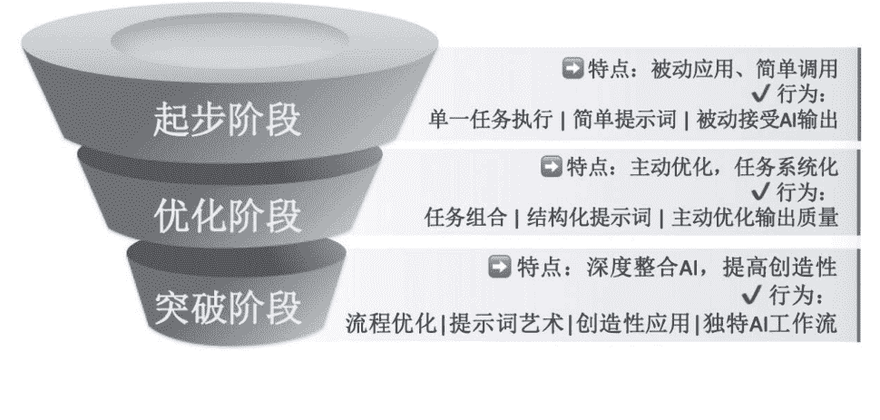
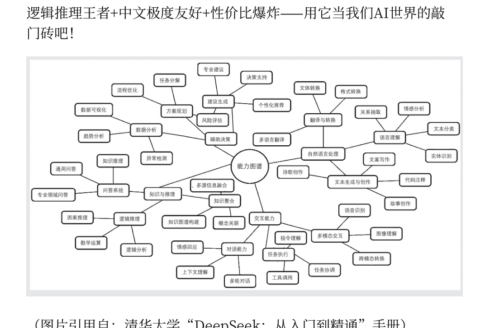
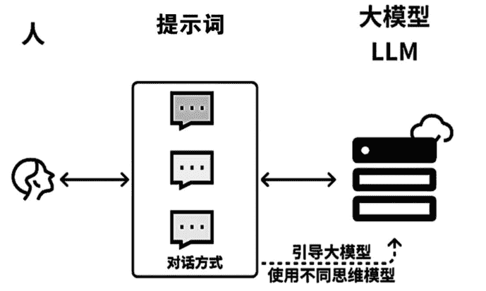

# DeepSeek实战手册：AI时代的超级个体指南

# 前言一
## 抓住DeepSeek，让时代为你所用

欢迎翻阅这本干货集。

当生成式智能以指数级速度重塑世界时，很多人都被卷入一场认知重构。手机新闻里AI话题铺天盖地，却常有人感到困惑：科研机构用的智能，和自己手里能触达的，仿佛是两套系统。“智能很强，但和我有什么关系？”

2025年1月20日，这个疑问有了答案。

那个深夜，杭州一座写字楼仍灯火通明，研发团队盯着屏幕，随着最后一行代码提交，中国AI发展迎来关键时刻——DeepSeek-R1正式发布且完全开源。数小时内，全球开发者社区被“Chinese miracle”刷屏，随后掀起技术震荡：

- 上线48小时内，用户增长近乎垂直，服务器屡次满载；
- 七天内，DeepSeek反超ChatGPT，首次登顶美区App Store免费榜；
- 同一时期，AI芯片龙头英伟达单日跌近17%，市值蒸发约5890亿美元，创下美股单日最大市值损失纪录。

DeepSeek的出现，把前沿技术与普通人的理解拉近，并从根本上改写了工作与生活规则。

今天的智能不再是电影里的遥远概念，而是可直接上手的生产力。依托R1出色的推理能力与对中文场景的深度适配，每个人都能驾驭这台智能副手，迅速拉开效率差距。

欢迎进入DeepSeek时代——掌控智能，即是掌控未来。

## 一、认知跃迁：跨越理解鸿沟
杭州私募基金经理张涛曾因未能读懂中文财报中的关键数据而险些巨亏。改用DeepSeek复盘后，识别准确率直接提升23%，风险点被清晰标注，他才及时止损。这说明智能工具的真正价值在于精准高效地拆解真实问题，而AIGC在分析领域正把人与人的认知差距拉大。

智能并非完美。《麻省理工科技评论》曾报道，某算法因训练集缺陷，把健康儿童胸片混入新冠诊断样本，导致模型把“儿童”当成疾病特征来识别。这印证了一个事实：模型表现始终受数据质量与训练方式制约，并非万能。

因此智能时代的分层很清晰：只会点工具的是入门者，能避开坑的是高手，而会调教模型的人才是王者。

## 二、倍速竞争：不进化就被淘汰
乌克兰教育科技公司Headway借助Midjourney与HeyGen在2024年上半年获得33亿次广告曝光，ROI提升40%，营销成本明显下降。Yum! Brands旗下塔可钟、必胜客、肯德基则用AI个性化邮件营销，大幅提升了用户互动与转化。

这些案例说明：把AIGC用对，就能打破传统创意的瓶颈，快速精准地满足目标人群，提升整体效率。

上海一家4A广告公司总监李薇被迫裁掉5名文案，并非能力问题，而是新人用DeepSeek两小时产出500条优质广告语，转化率还提升40%。广州某外贸企业的对照实验更直观：AI组处理100封英文询盘仅用11分37秒，成交率42%；传统组耗时3小时，成交率仅15%。

权威数据表明，2024年使用智能工具的职场人平均效率提升217%。当有人用DeepSeek一小时完成你三天的工作量，你的竞争力何在？在这个加速度时代，进化已是入场规则。

## 三、驾驭智能，塑造超级个体
《哈佛商业评论》指出，AI时代竞争力等于基础技能乘以工具效率。能力相近时，智能熟练度决定谁能指数级放大个人价值。

自由撰稿人贝丝·马尔卡斯过去写一篇深度长文需数日，借助ChatGPT后不到一小时即可完成，效率与收入同步飙升。美国Coda公司高级产品经理埃文·约翰斯顿，用AIGC几分钟生成以往需数小时的项目计划与报告，迅速在公司脱颖而出。

创业端同样如此。美国青年企业家贾斯汀·马雷斯用ChatGPT创立健康食品独立站Kettle & Fire，依托AI生成的SEO内容、产品描述与营销邮件，一年销售额突破700万美元，远超传统团队模式。

国内也不少。北京一位宝妈借助DeepSeek的错题本智能分析，把孩子数学从65分拉到98分；深圳95后创业者王昊用AI独立操盘跨境电商多品类，年净利润达800万。

共性很清晰：用对智能工具，每个人都能突破天花板，实现跃迁式成长。超级个体，从来不遥远。

## 四、拒绝空谈，这是一本实操手册
你可能听过无数智能改变世界的宏大叙事，却被技术名词绕晕；你可能试过各种提问技巧，却不懂底层逻辑，复制粘贴也得不到理想结果；你也可能踩过坑：合同因AI遗漏条款引发纠纷，“有机食品”被译成“有机器材”导致客户投诉订单流失……

我们不讲空洞理论，也不卖表面攻略。我们只关心如何真正驾驭AI，让它为你工作。会用不难，精准用才是竞争关键。



因此，我们以DeepSeek为向导，用通俗方式带你理解智能底层逻辑。从认识智能、使用智能，到精准调校智能，让它读懂意图、精准交付，成为工作与学习的强力副驾。

你不需要成为工程师，只需掌握有效提问，就能轻松驾驭DeepSeek。无论你是职场人、创业者、宝妈还是学生，本书都用最直接的方法帮你快速掌握AIGC核心技能，实现：

- 趣味科普——以轻松方式通过DeepSeek了解AI与AIGC，专为中文用户设计，对比主流大模型差异，帮助你建立认知框架。
- 场景覆盖——结合办公、新媒体创作、教育培训等真实场景，为不同身份提供可落地的智能实战技巧。
- 实战导向——由浅入深，从新手到高手，提供黄金提问公式与即用即学的Prompt模型。
- 进阶体系——全书分起步、优化、突破三阶段共6章，循序渐进提升智能竞争力。
- 前沿视野——解析智能发展趋势与安全使用法则，抢占时代红利。

记住，跑慢不丢人，不跑才是原罪。本书在Part 6留了作业：AI时代需要的能力清单。看到那一页时，请自检是否已通过学习+实操走在通关路上。

# 前言二
## 智能工具全景：为何以DeepSeek为实操抓手
本书目的不是讲DeepSeek本身，而是透过它掌握AI时代的核心竞争力。在智能浪潮中，除了会用工具，更要懂边界，才能真正驾驭它。

## 大模型与智能体：工具还是助手
智能正沿两条路径演进：大语言模型LLM与智能体AI Agent。

DeepSeek是典型LLM，擅长语言理解与生成，像“万能工具箱”，提供文本生成、翻译、摘要等能力。R1约6710亿参数，推理与语言处理突出，已开源并可通过网页、App和API访问。

Manus是智能体，更像“贴身助手”，不仅给建议，还能主动执行任务，把想法闭环为行动，学习适应能力更强，适合教育、客服等强交互场景。

## DeepSeek vs Manus：核心对照

| 维度 | DeepSeek 大语言模型 | Manus 智能体 |
| :--- | :--- | :--- |
| 核心定位 | 大规模预训练语言模型 | 任务导向的智能系统 |
| 功能侧重 | 通用性、多任务处理 | 执行特定任务、交互性强 |
| 模型规模 | 超大参数，适合复杂任务 | 参数适中，偏轻量任务 |
| 使用方式 | 提供基础能力，需用户微调 | 面向用户，提供完整方案 |
| 交互性 | 较低，偏底层模型 | 较高，强调体验与实时互动 |
| 适用场景 | 企业级应用、专业领域 | 个人用户、教育、客服等 |
| 技术架构 | 基于Transformer的大模型 | 基于大模型叠加多功能模块 |

简单说，DeepSeek是“工具箱”，你选工具自己用；Manus是“助理”，它理解需求自动干活。

以教育为例：DeepSeek能提供大量资料帮助理解概念，但需学生自行整理；Manus则可直接答疑、定制学习路径、提供个性化辅导，效率更高。

为何选DeepSeek？截至成书，Manus仍在内测且评价两极。掌握智能的关键是“会用工具”，精通大语言模型后，你既能高效自用，也更能指挥智能助手。

## 国产对国际
同为大模型，国产新秀DeepSeek与国际老牌ChatGPT都曾登顶。下面从实际应用对比。

### 1.核心能力与定位

| 对比项 | DeepSeek | GPT ChatGPT |
| :--- | :--- | :--- |
| 核心定位 | 知识检索+智能生成，强调精准信息获取与深度整合 | 泛化智能助手，擅长自然语言生成、创意写作 |
| 基础模型 | 可能结合搜索引擎、知识库与生成式智能 | 以大规模语言模型为核心，依赖训练数据 |
| 内容生成 | 强调事实性与逻辑性，适合精准内容 | 强调流畅性与创造力，适合开放式创作 |
| 交互方式 | 结构化问答，信息导向型 | 自由对话，适合多轮互动 |
| 数据更新 | 可能具备实时数据获取能力 | 知识更新受限于训练时间，需新版本迭代 |

### 2.具体应用场景

| 应用领域 | DeepSeek 适用场景 | GPT ChatGPT 适用场景 |
| :--- | :--- | :--- |
| 学术研究 | 适合搜索论文、提取关键信息、整合学术数据 | 适合论文摘要、学术润色、文献综述 |
| 代码编写 | 适合代码搜索、技术解析 | 适合代码生成、调试建议 |
| 内容创作 | 适合专业性写作，如数据驱动的文章写作 | 适合创意写作，如小说、广告文案的写作 |
| 商业应用 | 适用于市场调研、数据分析、行业报告 | 适用于品牌营销、商业文案 |
| 语言翻译 | 更关注专业领域术语的准确性 | 适合流畅表达，对上下文的理解力较强 |
| 决策辅助 | 结合多方数据，适合精准推荐 | 适合提供多角度思考建议 |
| 知识问答 | 强调事实性、精准信息 | 适合日常问答，但可能缺乏实时性 |

### 3.优势与局限性

| 维度 | DeepSeek 优势 | DeepSeek 局限性 | GPT ChatGPT 优势 | GPT ChatGPT 局限性 |
| :--- | :--- | :--- | :--- | :--- |
| 信息准确度 | 结合搜索，获取实时、精准信息 | 可能依赖搜索质量，受数据来源影响 | 训练数据广泛，能提供综合性解答 | 知识更新受限，可能会捏造信息 |
| 创意写作 | 逻辑性强，适合专业性写作 | 文学性表达可能较弱 | 擅长自由写作、情境化表达 | 可能生成重复或模板化的内容 |
| 多轮对话 | 更偏向精准问答，交互较直接 | 对话流畅度可能不如 GPT | 适合开放式聊天与深入讨论 | 有时会逻辑混乱或重复 |
| 代码生成 | 适合技术文档与代码优化 | 代码生成能力可能弱于 GPT | 代码生成能力强，适合开发者 | 可能生成低效或错误代码 |
| 适用人群 | 科研人员、开发者、专业人士 | 不适合创意性工作 | 作家、营销人员、学习者 | 需要用户具备一定的判断力 |

### 4.选择指南

| 你的需求 | DeepSeek 适合 | GPT ChatGPT 适合 |
| :--- | :--- | :--- |
| 需要精准的事实性信息 | √ | × 可能编造 |
| 进行深度研究、学术写作 | √ 结合搜索，信息更准确 | √ 适合润色、总结论文 |
| 想要代码搜索、技术解析 | √ | √ 但 GPT 更适合代码生成 |
| 进行创意写作 | 需要准确引导 | √ |
| 希望智能进行深度对话 | 需要准确引导 | √ 对话更流畅 |
| 数据分析、市场研究 | √ | √ 更适合数据解读 |

因此DeepSeek可以让我们获得更精准、专业、实时的信息，可以满足学习和工作的绝大多数应用场景。

## 国内主流模型全景

| 维度 | DeepSeek | 文心一言 | KIMI | 讯飞星火 | 豆包 MarsCode |
| :--- | :--- | :--- | :--- | :--- | :--- |
| 反应速度 | 快 | 中等 | 快 | 极快 | 中等 |
| 用户体验 | 专业用户友好 | 大众用户友好 | 个人用户友好 | 语音交互友好 | 教育用户友好 |
| 适用场景 | 企业级 | 通用 | 个人助手 | 语音、翻译、教育 | 教育 |
| 逻辑性 | 强 | 较好 | 中等 | 强 | 较好 |
| 文本处理 | 强 | 优秀 | 中等 | 较强 | 较好 |
| 插件/案例 | 支持插件和定制提示词 | 丰富案例和提示词 | 轻量级插件 | 语音插件和案例 | 教育案例和提示词 |
| 多模态 | 中等 | 较强 | 较弱 | 优秀 | 较弱 |
| 上传文档 | 支持 | 支持 | 支持 | 支持 | 支持 |
| 搜索 | 精准 | 较强 | 中等 | 较强 | 较好 |
| API 付费 | 高 | 中等 | 低 | 中等 | 低 |
| 特色 | 企业级高精度 | 接入百度搜索 | 超长文本处理；上下文 | 语音交互；多模态 | 教育领域专注 |

由此可见，DeepSeek是国内主流语言大模型中的佼佼者，具有强大的扩展性，适合企业级复杂应用。它的功能基本可以覆盖我们需要的各种场景。

因此，在众多大语言模型中，我们选择DeepSeek作为实操工具，主要基于以下三大核心优势：

- 超强逻辑推理能力，免费提供接近GPT-4o的推理能力，尤其在数学、编程、市场分析等复杂任务上表现卓越。
- 在中文环境下，DeepSeek的专业领域如金融、法律、医疗处理能力尤为突出。
- 支持多模态处理，能够处理文本、图像等多种数据类型。

逻辑推理王者+中文极度友好+性价比爆炸——用它当我们智能世界的敲门砖吧！



> 图片引用自：清华大学“DeepSeek：从入门到精通”手册

# Part 1
## AI向导：透过DeepSeek理解智能

真正掌握DeepSeek，先要明白一点——智能的进化不是一步到位，而是从“感知世界”到“协同创造”的技术狂飙。下面用三步拆解智能的面纱。

### 与时代相关的智能演进史，读懂大模型底层逻辑

从图灵测试到ChatGPT，从CNN视觉识别到Transformer语言理解，智能已不是冰冷代码，而是高速运转的智能引擎。不懂智能如何思考推理，就很难真正驾驭它。

### 读懂AIGC运行规律，厘清生成底层逻辑

为何智能文章有时像大师作品，有时漏洞百出？为何智能图像惊艳却细节“幻觉”？理解AIGC的工作机制，才能让智能成为创造力放大器，而不是随机乱码。

### 拆解DeepSeek-R1，实测功能边界

DeepSeek-R1不是普通模型，而是为推理密集型任务打造的逻辑引擎。

- 推理对决，DeepSeek硬刚GPT-4o；
- 数学、编程、科研领域更懂思考；
- 知识管理、文档分析、智能问答，全方位提升办公效率。

## 1.1
## 人工智能发展史：从感知到共创

你有没有想过，机器能像人一样思考吗？

1950年的一个午后，伦敦书房里，阿兰·图灵在思考一个疯狂问题：如果机器能模拟人类思维，是否有一天能拥有与我们等同的智慧？这一念头让智能的种子萌发，他提出图灵测试，用来判断机器是否具备智能，成为智能研究的起点。

1956年达特茅斯会议上，“人工智能”一词正式确立，标志智能研究进入学术阶段，开启全新科学领域。

AI的發展並非線性前進，而是隨著時間累積了三波明顯的起伏：

### 1.第一次浪潮（1956—1980）——萌芽與探索
1956 年達特茅斯會議被視為人工智能的起點，研究者試圖用邏輯推演與符號操作讓機器模仿人類思維，並誕生了 ELIZA、DENDRAL 等早期的專家系統雛形。受限於當時的算力與資料規模，這段時期的 AI 仍像剛出生的嬰兒，活動範圍被局限在實驗室，難以離開紙面。

### 2.第二次浪潮（1980—2000）——積累與沉澱
網路普及與硬體算力的提升為領域注入動能，AI 終於學會「行走」。專家系統開始在醫療、金融等行業落地，神經網路與統計學習方法逐步浮現，搜尋引擎、語音助手等產品也進入日常。然而這些系統本質仍是工具，面對複雜問題時力不從心，最後迎來第二次寒冬。

### 3.第三次浪潮（2006年至今）——爆發與騰飛
深度學習與大模型相繼登場，AI 不再只會「算」，開始會看、會聽、會讀、會寫、會畫、會編程，甚至參與科學發現，例如蛋白質結構預測與新材料探索。它已成為最強大的生產力工具，重塑全球創造力。AlphaGo、自動駕駛與多模態應用的出現，標誌 AI 正由工具向智能體轉型，其潛能仍在不斷釋放。

綜觀三次浪潮，分別以邏輯推理、專家系統與深度學習為代表，每次都帶來技術躍進，也都伴隨瓶頸。第三波仍在高歌猛進，以前所未有的方式改寫世界。

那麼，究竟有哪些轉折點改變了人與 AI 的關係？哪些技術突破真正深刻影響了生活？大致可以歸納為兩步：AI 先學會「感知理解世界」，再與人「協同生成創造世界」。

## AI覺醒：學會感知世界
1997 年 5 月 11 日，IBM 的深藍擊敗國際象棋世界冠軍卡斯帕羅夫，這是 AI 首度在複雜推理任務上勝出，人工智能正式進入智慧競技場。深藍能精準算出每步最佳解，卻只是計算怪獸，不會思考、不懂語言，也無法理解現實世界的樣貌。當時的 AI 就像剛睜眼的嬰兒，好奇卻懵懂。

## 2012年起，AI 開始學會「看見」世界
2012 年，全球圖像識別競賽 ImageNet 迎來視覺革命。傑弗裡·辛頓團隊推出的 AlexNet 採用深度神經網路 DNN，在此之前 AI 連貓狗都難以分辨，準確率低於 50%，AlexNet 將準確率推升到 85% 以上，視覺能力實現數量級提升。AI 的「眼睛」被打開：
- 圖像識別大幅躍進，能準確標識物體；
- 計算機視覺技術成熟，能區分人臉、道路、物品；
- 應用落地，醫學影像診斷、自動駕駛等開始成為現實。

## 與此同時，AI 也在學習「聽懂」世界
2010 年代初，語音識別迎來決定性突破。深度學習讓機器從「聽個響」進化到真正理解發音。
- 2006—2012 年深度學習進入語音識別，語音轉文字 ASR 準確率飆升；
- 2011 年 Siri 問世，蘋果首度將 AI 語音助手機制帶入大眾生活；
- 2012—2014 年谷歌、微軟等加大投入，語音識別進入實用階段，基礎對話成為可能。

僅會聽仍嫌不足，AI 還需理解語言深層含義。2017 年，論文《Attention Is All You Need》點燃 NLP 火種，Transformer 取代傳統 RNN 與 LSTM，AI 正式邁入深度語言理解時代。
- 2018 年 BERT 面世，AI 能把握句子上下文，從逐詞翻譯轉為語義理解；
- 2020 年 GPT-3 爆發，文本生成能力顯著增強，可寫作、編程、模仿風格；
- 2022 年 ChatGPT 大規模破圈，成為全球數億人每日使用的數字助手，用於寫報告、翻譯、優化代碼與閒聊。

至此，AI 不再是被動執行指令的工具，而是能真正理解並有效溝通的「超級對話者」。它的世界觀初具雛形，擁有基礎認知：能看、能聽、能懂。只是 AI 並未止步，它開始追求創造。

## AI夥伴：共同創造世界
2014 年深夜，伊恩·古德費洛與朋友爭論 AI 能否真正創造，醉意下敲出代碼，生成對抗網路 GAN 誕生。從此 AI 不再僅是觀察者，而是能「無中生有」的創造者。
- 能生成逼真人臉、繪畫、音樂，甚至模仿大師風格；
- Deepfake 技術出現，換臉真假難辨，影視與社群媒體被深度改寫；
- StyleGAN 於 2019 年推出，生成近乎真人級虛擬形象，被廣泛用於電影、廣告與遊戲。

## 主要技術大事件
| 時間 | 技術突破 | 主要意義 |
| :--- | :--- | :--- |
| 2020 | GPT-3 發佈 | AI 具備強大文本生成能力，開啟大模型時代 |
| 2021 | DALL-E & CLIP（OpenAI）發佈 | AI 進入多模態階段，實現看圖說話與文本生圖 |
| 2021 | AlphaFold 2 解決蛋白質折疊問題 | AI for Science 突破，推動生命科學研究 |
| 2022 | ChatGPT（GPT-3.5）發佈 | AI 進入全民可用時代，聊天助手成現實 |
| 2023 | GPT-4 發佈 | 推理能力更強，多模態融合 |
| 2023 | Gemini 1.0（Google）發佈 | 競爭進入 Google vs OpenAI 多模態主流 |
| 2024 | GPT-4o 發佈 | 低延遲高效能時代，人機交互更自然 |
| 2025 | DeepSeek-R1 發佈 | 國產 AI 參與全球競爭，在推理、數學、編程追趕 GPT-4o |

ChatGPT 的出現讓 AI 徹底破圈，成為每個人的超級助手，涵蓋寫作、編程、翻譯到陪聊。生成式內容顛覆內容產業，小說、劇本、廣告文案都可信手拈來。
國產 AI DeepSeek-R1 正面挑戰 GPT-4o，推動 AI 進入低成本高效率的全民時代。生成能力再度進化，人工智能不再是少數科技巨頭專屬，而是人手一部的創造力引擎。AI 不再只是工具，而是人類最強的創作夥伴，人機共創的新時代已來。

## AI應用：我們處在怎樣時代
從感知到創造，人工智能正以指數級速度改寫生活。AI 寫作、編碼、生圖只是開端。未來 AI 將顛覆科學、重塑個體生產力，甚至引領全新智能時代：
| 趨勢 | 可能影響 |
| :--- | :--- |
| 多模態 AI 發展（文本+圖像+音頻+視頻） | 改變內容創作、數據分析、科學研究 |
| AI4S 突破 | 發現新材料、優化新能源、推動生物醫藥 |
| AI 個人助理時代 | 每個人擁有專屬 AI 助手 |
| 通用人工智能 AGI 研究 | AI 是否能真正「思考」仍是最大懸念 |

AI for Science 正徹底改造研究。AlphaFold 2 精準預測蛋白質結構，加速新藥研發；AI 助力新材料與新能源突破；甚至在宇宙探索領域協助破解星際謎團。
與此同時，「超級個體」時代加速到來。未來每人或擁有 AI 影分身，協助寫作、分析、管理事務，甚至自動賺錢。善用 AI 者生產力或達普通人的十倍、百倍。對知識工作者、創作者與企業家而言，AI 既是強大助手，也是全新增長引擎。
終極問題仍在：AGI 是否會到來？若到來，AI 能否擁有意識、思考、創造甚至做夢？它會成為獨立的數字生命，還是更高級的工具？當技術跨越新階段，人類將如何抉擇。

## AI篩選：大小模型之戰
大模型與小模型的爭論從未停歇。選擇取決於需求。若把 AI 比作樂隊，大模型像是交響樂團，編制龐大、層次豐富；小模型則像三人組合，輕巧靈活、快速響應。
| 對比維度 | AI 大語言模型 | AI 小模型 |
| :--- | :--- | :--- |
| 參數規模 | 百億至千億級參數，處理複雜任務 | 億級參數，較輕量、響應快 |
| 代表性模型 | GPT-4、Claude 3、DeepSeek-V2、Gemini 1.5、LLaMA 3-70B | ChatGLM-6B、LLaMA2-7B、DeepSeek-Coder-7B |
| 計算資源 | 需超強算力，依賴 GPU/TPU，高能耗 | 消耗低，適用本地或移動設備 |
| 數據處理能力 | 適合海量數據，理解力更強 | 適合特定任務，針對性優化 |
| 任務複雜度 | 擅長推理、邏輯分析、創意生成 | 適合輕量 NLP、任務型對話、語音助手 |
| 訓練時間 | 以月計，成本高昂 | 訓練短，易部署 |
| 精度與泛化 | 處理複雜問題，泛化強 | 特定領域表現優異 |

簡單說：
- 任務需強大算力、海量數據、深度推理，選大模型；
- 重視響應速度、輕量應用、端側運行，選小模型。

參數可理解為 AI 的「神經元權重」，決定其理解與處理數據方式。參數越多越「聰明」，但成本與硬體需求也越高。
DeepSeek 之所以成為國產黑馬：
- DeepSeek-R1 是推理專家，擅長數學、代碼、邏輯；
- DeepSeek-Coder-7B 參數量小但高效，適合本地部署；
- DeepSeek-V2 通用大模型，中文理解與思維方式更貼近本土使用者。

選型可從三維度判斷：
| 決策維度 | 適合大模型 | 適合小模型 |
| :--- | :--- | :--- |
| 任務需求 | 複雜推理、長文本處理、代碼生成 | 日常對話、語音助手、輕量 NLP |
| 計算資源 | 需強大算力，雲端部署 | 可本地運行，移動端或私有服務器 |
| 成本 vs 效率 | 企業級應用、科研項目 | 個人開發者、初創公司 |

未來不是大模型取代小模型，而是大模型與小模型協同演化。大模型作為雲端智囊，處理高複雜任務；小模型作為本地執行者，嵌入手機與智能設備，實現更快響應與更低成本。

## 1.2

## 揭開 AIGC 神秘面紗，了解它、應用它
面對層出不窮的 AI 書籍與術語，普通人更需要直白的理解。AIGC 的核心概念可從幾個層級切入。

## 人工智能的不同層級：AI & AGI
AI 指能執行通常需人類智能任務的計算系統，如圖像識別、語音識別、自然語言處理。
AGI 則具備類人類泛化能力，能自主學習、理解複雜任務、創造新知識，仍處探索階段，被視為終極目標。
差異在於：窄 AI 在特定領域優異，AGI 能適應並解決多樣問題。

## AI 的不同應用類型：生成式 AI vs 決策式 AI
生成式 AI 能「創造」新內容，例如 ChatGPT 生成文本、MidJourney 生成圖像、Suno 生成音樂。代表技術有生成對抗網路與大語言模型，用於藝術、編程、寫作等。
決策式 AI 側重輔助決策，基於輸入數據與模型預測提供最佳選擇，用於金融風控、醫療診斷、自動駕駛等。

AIGC 已深度融入生活，從文本、圖像到音頻、視頻生成，重塑工作與學習模式。

### 1.AI 生成文本
最常用且便捷的場景，已廣泛應用於資訊檢索、代碼生成、社群媒體與創作。
| 領域 | 應用案例 | AI 技術表現 |
| :--- | :--- | :--- |
| 代碼創作 | 遊戲開發者用 GitHub Copilot 編寫 Unity 腳本，阿里雲通義靈碼在雙 11 期間為淘寶重構代碼 | Copilot 自動補全代碼、生成調試流程圖；通義靈碼 30 分鐘內生成 97% 基礎代碼並提供優化建議 |
| 文學敘事 | 微軟小冰與春風文藝出版社合作《AI 十四行詩·江南特輯》，豆包創作《天命使徒》群像戲 | 小冰實時生成評彈唱詞音頻；豆包生成含 27 個角色的複雜劇情，對話風格多樣 |
| 媒體生產 | 新華社快筆小新在杭州亞運會期間應用，第一財經 DT 稿王分析 Q2 財報 | 快筆小新 2.8 秒內生成多語言新聞稿並製作社媒海報；DT 稿王生成財經數據並用年輕化比喻 |
| 社群內容 | 小紅書美妝博主用「筆記助手」生成妝容指南，MCN 機構用 Windsurf 批量生成短視頻腳本 | 筆記助手據照片生成精準搭配指南並嵌入熱搜詞；Windsurf 生成 97 條差異化文案，含數據化標題 |

這些案例顯示 AI 文本生成從輔助工具向創意夥伴轉變，重定義內容生產效率與創造力邊界。

### 2.AI 生成圖像
杭州藝術家白小蘇與 AI 合作，誕生百米國風長卷《新西湖繁勝全景圖》。借助百度文心一格與 Stable Diffusion，作品復原了斷橋殘雪、雷峰夕照，並讓沉寂千年的大佛寺重現。輸入文獻描述後，AI 生成多種風格復原方案，包括南宋青綠山水、明代吳門寫意水墨與 AR 動態佛像。

技術亮點：
- 建築群生成：5000 棟建築按類型分類，每類有自身「風格密碼」。保俶塔依《營造法式》生成歇山頂；北山街民國建築融入 Art Deco 裝飾。
- 智能上色：傳統青綠山水需 20 道工序，AI 學習仇英《桃源仙境圖》筆觸後一鍵完成墨骨生成、礦物顏料模擬、絹本做舊，效率提升約 47 倍。
- 時空折疊敘事：長卷融合四季與古今，例如蘇堤段自動補全 20 世紀 30 年代風貌。

### 3. AI 生成音樂
從網易雲音樂「AI 創作助手」將 Demo 製作週期壓縮至 72 小時，到中央音樂學院「民樂 AI 自動作曲系統」復現《二泉映月》32 種現代改編，AI 已滲透音樂各環節。抖音「AI 聲線轉換」功能日均使用突破 200 萬次，讓創作者快速獲得明星音色模板。AI 不僅是工具，更是靈感加速器與藝術創新夥伴。
| AI 功能 | 應用內容 |
| :--- | :--- |
| 聲紋克隆與音色調整 | 提取聲紋特徵生成合成聲線；將用戶聲音轉換為特定風格音色，保留個性發音；音色遷移技術將人聲調整為未來感合成音效，保留顫音 |

# AI创作正在改写内容生产规则

当创作者把需求丢给模型时，AI能在古筝与电子音色的混合上给出多种编曲方案，让传统民乐与合成音效叠出层次感。调式切换时，系统会自动补上过渡片段，戏剧张力被放大，同时把制作周期压缩超过八成。另一条工作流围绕实时互动展开：用自然语言下指令就能调混响、衰减高频；声场图谱能标出频段冲突；方言自适应也会引导旋律走向更顺耳。

这些变化已经量化。国际唱片业协会的统计显示，2023年全球借助AI辅助完成的歌曲数量同比激增340%，AI正从工具变成创作伙伴。苹果旗下的GarageBand里，AI给出精准的和弦编排建议，让新手更快进入状态；老唱片修复中，缺失的声部被智能补全，时光的声音被重新唤醒。

### 4. AI生成视频

央视《国家宝藏》主创与百度文心一格、商汤如影AI视频引擎合作，打破手工制约，把《全唐诗》里的名篇转化为动态数字画卷，推出《千秋诗颂》系列，形成“诗里有画、画里有史”的沉浸体验。

以《山居秋暝》为例，AI据历史语境生成山水画面，并细致还原了唐制服饰。识别“浣女”形象后，系统加入竹编背篓等生活道具，文化质感随之加深。

跨模态特效也在进化。动态笔触引擎把怀素草书的运笔转成视频转场，增添艺术气息；智能运镜跟着诗句节奏微调镜头，仿佛让人听见竹叶沙响，身临其境。

敦煌莫高窟的重建项目里，AI完成4K超分辨率修复，把静止的飞天转为飘逸动态。声波驱动的物理模型让飘带随风摆动，穿越感被具象化。建筑生成模块接入《营造法式》OCR库，比例误差控制在0.7%以内；服饰生成系统依赖陕西历史博物馆的三维扫描，纹样还原度达93%。

杭州亚运会开幕式上，AI生成的《春江花月夜》数字长卷引发热议，抖音相关话题播放量冲破17亿次，全民围观传统文化。2024年抖音文化消费报告指出，《全唐诗》电子书下载量同比上涨320%，青少年成为主力。

由此可见，AIGC已深度渗入新闻、影视、电商、游戏等赛道，为企业带来降本提效的诱惑，也点燃了“岗位被取代”的焦虑。另一面，它在赋能个体：信息检索更快、决策优化更易、学习工作效率提升。但生成质量波动、数据隐私风险、版权侵权等问题仍在。就革命性而言，这些挑战无法掩盖趋势。未来主旋律是人机协同，成为会用AI的人，而不是被AI替代的人。竞争的核心将从技术本身转向驾驭技术与协同创新的能力。

## 1.3 AI的平民化：DeepSeek的颠覆式崛起

2025年1月20日，DeepSeek发布大语言模型DeepSeek-R1。推理能力与OpenAI的o1相当，部分场景更优，低门槛设计让国内外用户迅速增长。模型经蒸馏推出1.5B到70B共六个规模，全部开源，推进开放AI进程。这场突破让AI从高不可攀走向触手可及。

### 认识DeepSeek：AI界的“黑马”

杭州深度求索人工智能基础技术研究有限公司创立于2023年，深耕大语言模型。创始人梁文锋以长期主义著称，兼具基础设施工程、模型研究与资源调动能力，被视为技术极客。团队年轻、高校背景强，开源意识浓，目标明确。

技术层面，公司提出多头潜在注意力机制MLA与DeepSeek MoE混合专家架构，在权威评测中取得顶级成绩。彭博社报道称，其AI助手凭借性能与体验，成为覆盖140个市场的移动应用下载冠军。1月27日登顶苹果App Store全球榜，1月28日占据美国Android Google Play榜首。Sensor Tower数据显示，发布18天内下载1600万次，约为ChatGPT发布时900万次的近两倍，印度市场贡献15.6%。

R1在数学推理、编程、自然语言理解上表现突出，推理速度与准确度领先。用户无需复杂提示词技巧即可获得高质量输出，游戏、视频、办公场景下流畅度获好评。界面简洁，实时推送与内容推荐省去大量检索时间。

### DeepSeek打破硅谷“烧钱神话”：国产AI真正实现弯道超车了吗？

2025年1月24日，英伟达股价单日下跌3.12%，创年内最大跌幅。德国《世界报》评论称，DeepSeek仅用约2000块阉割版显卡、550万美元预算打造出媲美GPT-4的模型，击碎“烧钱神话”。硅谷Meta工程师通宵复现开源代码，有匿名留言说：“我们用16384块H100做Llama 3，他们用八分之一算力压我们，不科学。”

此前硅谷逻辑是烧钱融资画饼再烧钱。DeepSeek亮出账单“550万美元包月，换来GPT-4平替”，风险投资人纷纷删改PPT里的“独家技术壁垒”。

凤凰网测评对比显示两者各有优劣。信息检索上DeepSeek耗时77秒会给出来源与时间，ChatGPT15秒快速给出但更简洁；日常问答DeepSeek古诗翻译更贴合韵味但需92秒，ChatGPT23秒却带机翻痕；上下文与抗干扰方面DeepSeek保持逻辑，ChatGPT易跑题；数学计算DeepSeek耗时180秒反复求证，ChatGPT27秒直接给答；创作与知识面DeepSeek分析深入耗时2分24秒，ChatGPT40秒简洁但细节不足；小说分析DeepSeek逐角色细解约50秒，ChatGPT20秒像读后感；中文环境下DeepSeek表达自然，ChatGPT结构显外语味；推理流程上DeepSeek更复杂准确，ChatGPT高效但可能欠准。

总体看，DeepSeek凭借混合精度训练与MoE提升算力，提供定制化与私有部署保障数据安全；ChatGPT通用性强，聊天写作翻译易上手，持续推出GPT-4o等新品。DeepSeek生态相对薄弱，第三方工具少；ChatGPT使用成本高，数据或用于训练存在隐私隐患，生成质量偶有错误。凭借中文处理优势，DeepSeek被称“中文AI天花板”，甚至被戏称能听懂方言。

### DeepSeek大模型：生态与应用的全方位突破

2025年2月27日，DeepSeek应用登顶苹果中国区与美国区免费榜，超越ChatGPT。《环球时报》称其为黑马，外网赞为“神秘东方力量”。GitHub Star数首次超过OpenAI，DeepSeek-V3达7.7万星，DeepSeek-R1三周内超过OpenAI Cookbook项目。

国家超算互联网平台上线DeepSeek-R1的1.5B、7B、8B、14B版本，计划推出32B、70B，支持一键推理与私有数据定制训练，进一步降低门槛。据Tom’s Hardware，DeepSeek采用英伟达PTX而非CUDA训练，效率提升，为国产GPU适配奠基。

终端厂商跟进迅速。华为、荣耀、OPPO、魅族接入R1至智能助手与系统；视源股份、洲明科技、利亚德等显示企业接入优化教育交互；海信视像宣布智能电视全面支持DeepSeek。

应用场景扩张明显。阅文集团把R1集成至“作家助手”，实现网文创作商业化。编程领域Aider排行榜显示，DeepSeek-R1代码生成成功率56.9%，格式正确率96.9%，调用成本5.42美元，远低于Claude 3.5与GPT-4o；DeepSeek-V3成本仅0.34美元，性价比最高。模型支持70余种语言、64K长上下文、中文编程环境优化，与Cursor、Aider结合覆盖开发全周期。

加拿大Feroot Security分析指出，DeepSeek网页版依托中国移动基础设施运行，保障稳定。尽管受限制裁，其移动版在苹果与Google商店下载量仍居前列，体现全球化潜力。从开源社区到企业端、从文学到编程，DeepSeek正重塑生态，为国产AI崛起注入动能。

### DeepSeek的“核心技能”

不谈技术术语，也不制造焦虑，用大白话说明实力。

### 中文对ChatGPT来说是“外语”

ChatGPT很强，但母语是英语。OpenAI团队以美国为主，训练数据超九成英文，中文多为教科书式新闻、论文、官方文件。能写中文，却不一定懂弦外之音。问“领导说这个方案再斟酌一下怎么办”，它会建议优化可行性，职场人却读出“重做吧”。它擅长结构清晰的规范中文，对潜台词、方言梗、网络热词、阴阳怪气常显茫然。

DeepSeek从一开始就瞄准“最懂中文的AI”，走接地气路线。它甚至懂梗：“芭比Q了”指搞砸，自嘲用语；“绝绝子”形容极致赞美。

### 它甚至懂你的“面子文化”：

拒绝老板加班的委婉表达示例：先表达理解与尊重，再说明个人情况，最后给出替代方案，兼顾立场与礼貌。

### 而且部分中文图片，DeepSeek也可以更快地识别：

### DeepSeek的三种模式各显神通

DeepSeek提供三种模式，覆盖日常对话到专业推理与实时搜索，可自由切换。

基础模型V3以极速响应、广知识、稳定著称，适合日常使用。对话、问答、创意文案都能快速给出精准简明答案，知识库更新至2024年7月，涵盖历史文化科学社科等。适用场景包括社交聊天、常见问题、生活常识查询、短文案标题灵感等。

示例：键盘清洁方法、洗衣液网店广告词创作等。

深度思考模型R1则擅长精准推理，攻克复杂任务。

【模式怎么选：推理、通用、实时检索】

碰到需要长时间展开推演的难题，R1 的表现往往更突出。面对复杂逻辑、代码攻关或数学求解，它凭借扎实的推演能力和层层递进的思考路径，给出结构完整、条理清晰的解答。科研探索、难题拆解、程序实现，以及科学讨论、算法优化等工作，都能得到系统化的输出。

对比 V3，R1 更强调算力深度与推演精度，响应会慢一些，但换来的是更为细致透彻的分析结果。当诉求集中在高标准推演——比如学术研讨、哲学思辨、批判性审视；工程类任务——比如代码排错、算法改进、疑难解析；以及数理运算——比如复杂建模、逻辑演绎、公式推导，R1 通常是更合适的选择。

示例应用：

> 请对比康德的绝对命令与功利主义的差别。

康德的绝对命令与功利主义在伦理学里代表两种不同取向，主要差异如下：

1. 理论出发点
   - 康德体系：源自义务论，判断行为的善恶看动机与原则本身，而非结果。律令具有无条件性，要求出于责任行动。
   - 功利主义体系：属于结果论，强调行为价值由结果决定，核心在于能否最大化整体福祉或效用。

2. 核心准则
   - 康德体系：核心是“定言命令”，要求规范具备普遍适用性，并始终将人当作目的而非手段。
   - 功利主义体系：核心是“最大幸福原则”，行动正当与否取决于是否带来多数人的最大幸福。

联网检索模式：实时更新，紧跟时势。

DeepSeek 支持实时联网，可调用 2024 年 7 月之后的新信息，覆盖科技、金融、社会热点、行业动向等。无论查阅新闻、追踪前沿研究，还是分析市场走势，都能拿到即时资料。但需注意，联网模式擅长信息广度，不擅长深度推演。若需要严谨的逻辑拆解，建议单独切换至 R1，不要同时混用，以免广度与深度冲突导致结论不一致。

依据模式特性与使用场景选择：

| 模式（截至 2025 年 3 月） | 适用场景 | 特点 |
| :--- | :--- | :--- |
| V3（基础模型） | 日常对话、生活常识、创意写作 | 反应迅速、覆盖面广，适合通用需求 |
| R1（深度思考） | 逻辑推理、代码开发、数学计算 | 推理强劲、思路严谨，适合专业任务 |
| 联网模式 | 资讯查询、行业趋势、实时热点 | 获取最新信息，适合快速变化领域 |

## 1.4
## DeepSeek 入门路径：从零到上手

下面介绍最基础、最简便的操作方式，初学者或资深用户都能迅速掌握，马上体验核心能力。

## Step 1：安装部署，一步完成

- √ 电脑端：
  - 浏览器版：无需安装，直接打开官网即可使用。
  - 客户端版：获取官方客户端，体验更稳定流畅。
- √ 移动端：
  - 在应用商店搜索官方 DeepSeek 应用，随时随地使用。
  （请认准官方渠道，避免山寨软件带来的安全风险）
- √ 网络优化：
  - 若出现卡顿，可借助网络加速工具降低延迟。
  - 也支持本地化独立部署，提供更强的隐私保护与独立算力。

安装完成后打开 DeepSeek，会看到登录页。注册流程简洁：

- √ 注册方式多样，完成迅速
  - 支持手机号、微信、邮箱一键注册。
  - 建议设置强密码并开启双重验证，提升账号安全。
- √ 免费体验，无门槛上手
  - 基础功能永久免费，无需订阅。
  - 商用时请留意授权规则，确保合规。

注册完毕即可进入 DeepSeek，开启 24 小时在线的智能助手。

## Step 2：认识主界面，快速上手

进入主界面后，几个关键功能帮助你高效使用：

- 左侧“+”：点击新建对话，避免旧话题干扰新问题。
- 对话输入框：直接输入需求，无论是知识查询、创意写作还是复杂推理，都能快速响应。
- 左下角模式切换：根据任务类型选择联网检索或其他模式。
- 右下角文件上传：支持照片、PDF 等，提出需求后即可让模型分析文件并给出解决方案。

学完本章，你已掌握人工智能、AIGC 以及 DeepSeek 的核心功能，完成账号创建。现在可以随时启动这台不间断的智能助手，高效处理工作与生活任务。

## 模型密码起步：精准提问，让回应更值

## 为什么智能体常跑题？——学会沟通，提问质量决定答案质量

不少人下载智能工具后会发现：“这模型怎么有点笨，总是答非所问？”其实问题多在提问方式，而非模型本身。

赫尔·葛瑞格森在《问题即答案》中提到：

> “你可以通过一个人的答案判断他是否聪明。你可以通过一个人的问题判断他是否睿智。”

换句话说，提问越好，答案越深。

为何你的提问常常被忽略？常见的模糊提问有：

- × “在吗？”
- × “他为什么发财了？”
- × “我的年度项目规划怎么做？”
- × “我该跳槽还是骑驴找马？”
- × “GPT好还是DeepSeek好？”
- × “导师为什么不回我邮件？”

共同点是模糊、宽泛、缺少背景。范围过大让人无从下手；缺少关键信息导致无法精准作答；把思考推给模型，结果只能得到敷衍。

彼得·德鲁克曾说：

> “最重要且最困难的工作，并不是找到正确答案，而是发现正确的问题。”

对智能体或对人来说，让对方做选择题、填空题远比做开放问答题轻松。清晰具体的问题，才更容易得到有价值的回答。

| 错误提问（模糊）× | 优化提问（精准）√ |
|---|---|
| “GPT 好 还是 DeepSeek 好？” | “在 2024 年的 AI 语音助手市场中，DeepSeek 和 GPT-4o 在用户需求、语境理解、推理能力上各有哪些优劣势？” |
| “我的年度项目规划怎么做？” | “我的团队今年要拓展 B 端市场，目标是提升 30% 转化率，现有预算 50 万，DeepSeek 可以提供哪些 AI 解决方案来提升营销精准度？” |

优化后补充了时间、背景、目标、关键指标，需求一目了然。

提升可回答性的两种常用方式：

1. 明确指令。如：我在 AI 项目中遇到××问题，已尝试××方案，但卡在××难点，请给出建议，要求：1.不少于2000字；2.包含现状、市场分析、难点解读、解决方案预期；3.中英文输出；4.使用规范商业报告术语。
2. 提供背景。如：你是一名经验丰富的项目经理，需在公司会上就 AI 项目上的××问题做主题发言，请提供符合身份设定的发言稿。

## 模型密码一：指令式提问，目标明确避免跑题

工作学习中目标不清则事倍功半，提问亦然。明确目标是成功第一步。

> 心理学家本杰明·布鲁姆指出：“精准的提问能激发深入思考，让目标更聚焦，问题更具体。”

指令式提问通过清晰具体的要求，让模型按你的思路执行，而非自由发挥。指令越清晰，输出越准。

| 含蓄提问 × | 指令式提问 √ |
| --- | --- |
| “写个简历。” | “请帮我写一份市场营销岗位的简历，包含自我介绍、工作经验和技能。” |
| “那个……能不能帮我看看这篇文章？” | “请帮我修改这篇文章，重点关注语法错误和逻辑问题。” |
| “你觉得这个怎么样？” | “请分析这份商业计划书的可行性，从市场、财务、运营三方面评估。” |
| “帮我看看这个代码有问题吗？” | “请检查这段代码是否存在逻辑错误或性能瓶颈，特别是循环部分。” |
| “这张图还行吧？” | “请评价这张数据可视化图表，关注信息表达是否清晰和配色是否合理。” |

学术写作场景优化指令的三个技巧：

- √ 明确任务目标——说明需要摘要、数据分析、文献综述等哪类内容。
- √ 提供具体指示——包括字数、格式、参考来源等，减少猜测。
- √ 设定输出标准——要求包含关键理论、数据支撑、案例分析等要点。

对比案例：

**提示词：**
请给我一封催款邮件（说明不够明确）

**生成示例：**
“尊敬的客户，您好！关于您于[日期]产生的账单（金额：××元），我们尚未收到付款。请尽快处理，以免影响后续合作。如已付款，请忽略此邮件。感谢支持！”

更明确的需求：

**提示词：**
我是装修公司，甲方在装修项目中未及时结算，请写一封催款邮件，要求：1.不超过500字；2.语气礼貌；3.突出时间紧迫性。

**生成示例：**
尊敬的[甲方姓名]先生/女士：
您好！
感谢贵公司对我司的信任，让我们参与[项目名称]装修工程。目前项目已按合同完成，验收与结算资料已于[日期]提交。
根据合同，结算款应在[约定日期]支付，截至今日尚未收到。因我司财务流程紧张，延迟将影响资金周转及后续项目推进。恳请贵公司尽快安排结算，望于[具体日期，如7天内]完成支付。
如结算遇问题，请随时联系，我们愿全力配合。
再次感谢支持，期待继续良好合作！
祝商祺！
[你的姓名]
[公司名称]
[联系方式]
[日期]

## 模型密码二：角色设定法，赋予身份提升针对性

同一个问题，不同身份的人会给出不同回答。问投资人“创业成功的关键是什么”，他会谈融资与商业模式；问创业者，他会聊团队与产品；问朋友，可能只说运气。智能体也一样，设定角色等于设定视角。

通过角色设定提供背景，让模型进入正确思维模式：

- 想获得专业市场分析，让它扮演“资深市场顾问”。
- 想优化文案，让它化身“顶级广告文案策划师”。
- 想模拟面试，让它成为“500强HR主管”。

| 应用领域 | 普通提问 × | 优化提问（带角色设定）√ |
| :--- | :--- | :--- |
| 职场沟通 | “帮我写封邮件。” | “你是500强公司HR，请帮我写一封正式的入职通知邮件，语气专业，附上公司福利信息。” |
| 市场分析 | “分析一下这个行业。” | “你是资深市场研究员，请分析2024年新能源车市场趋势，并对比特斯拉和比亚迪的市场占比。” |
| 内容创作 | “写一篇公众号文章。” | “你是新媒体运营专家，请写一篇关于AIGC在营销领域应用的公众号文章，标题吸引人，语言通俗易懂。” |
| 产品策划 | “如何改进我的App？” | “你是UI/UX设计师，针对18—25岁用户，请优化我的App交互设计，提高留存率。” |
| 学术研究 | “帮我写论文摘要。” | “你是一名博士生导师，请用150字概括我的论文核心观点，包括研究背景、方法和主要发现。” |

创造角色可从三方面入手：

- √ 明确模型角色——说明身份与知识背景。
- √ 设定任务场景——结合具体情境作答。
- √ 调整回答风格——正式、学术、商业或幽默等。

对比案例：

**提示词：**
请以“DeepSeek融入学术写作”为主题写一篇研究生组会发言稿。

**生成示例：**
研究生组会发言稿：
**DeepSeek与学术写作的融合**
尊敬的导师，亲爱的同学们：
大家好！今天分享DeepSeek与学术写作的融合。作为研究生，学术写作是日常核心，如何高效高质量完成是挑战。AI技术正渗透学术，为写作与研究带来新可能。
### 一、应用场景
1. 文献检索与整理：快速提取关键信息，生成研究热点与趋势。
2. 语言优化与润色：优化句式、修正语法，提升可读性与学术性。
3. 数据分析与可视化：处理实验数据，生成图表并解读结果。
### 二、机遇与挑战
机遇：提高效率、提供多角度建议、降低语言障碍。
挑战：过度依赖降低创造力、存在学术不端风险、削弱基础写作能力。
### 三、融合建议
明确辅助定位、遵守学术规范、持续提升自身素养。
结语：DeepSeek改变了写作方式，工具虽强，仍需保持学术敬畏。

增加明确角色后对比：

**提示词：**
你是一名社会学在读硕士，被要求在研究生组会上就“DeepSeek融入学术写作”发言，请给出符合身份设定的发言稿，体现学术性。

**生成示例：**
研究生组会发言稿：
## DeepSeek融入学术写作的思考与实践
尊敬的导师，亲爱的同学们：
大家好！我是社会学专业研究生[你的名字]，今天从社会学视角探讨DeepSeek融入学术写作的应用与影响。
### 一、应用场景
1. 文献综述的高效完成

社会学写作中的智能辅助

撰写社会学论文时，文献量常常庞大，需要搭建理论框架或提炼问题。借助 DeepSeek 的自动化检索引擎与语义抽取功能，可迅速抓取相关论文的关键论点，显著提速文献回顾。以「城市化与社会不平等」为例，该系统能快速归纳经典范式与最新研究，为研究者提供系统性参考。

2. 方法选择的智能化建议
社会学强调研究的科学性与严谨度。DeepSeek 可依据具体议题匹配合适的研究设计与分析工具。量化路径下，它会提示适宜的统计模型；质性路径下，可提供访谈提纲优化思路或文本分析的操作方案。

3. 论文语言的国际化润色
与国际学界对话对文字规范要求较高。DeepSeek 能对稿件进行语言优化，修正语法错误，调整句式节奏，提供更贴合国际期刊惯例的学术表达。

### 二、机遇与风险并存
1. 机遇
——效率提升：文献检索、资料整理与撰写时长明显压缩，更多精力可投向核心议题。
——视野拓宽：智能分析能够发掘新的切入点或跨学科联结机会。
——语言门槛降低：对非母语作者而言，论文语言质量显著改善，有助于在国际平台发表。

2. 风险
——原创性受损：过度依赖可能削弱研究的独创性，甚至触及学术不端边界。
——能力依赖：长期使用智能工具可能导致文献阅读、理论建构等基础能力退化。
——伦理与隐私：处理访谈记录或敏感资料时，需审慎对待伦理规范与数据保密问题。

### 三、学科反思视角
从社会学看，DeepSeek 普及并非仅仅技术进步，也意味着知识创造方式的转变。
1. 知识创造流程的工具化转向
广泛应用使学术写作更高效，但也可能带来写作的标准化与工具化，要警惕技术对学术创造力的挤压，保持对研究问题的独立判断。
2. 学术资源差距放大
智能工具的普及可能拉大资源差距，技术条件优越的学者更容易产出高质量成果，资源有限者则可能处于不利位置。

### 四、实践建议
1. 明确工具定位：建议将 DeepSeek 定位为辅助而非替代，借助其提升效率，不替代研究者的思考。
2. 重视学术伦理：使用智能生成内容时严格遵守规范，保证研究原创与真实。
3. 强化自身能力：在使用工具的同时持续提升理论素养与研究能力，实现人机互补。

### 五、结语
DeepSeek 为学术写作打开了新空间，也带来了新考验。社会学研究者应以批判性态度使用技术，既发挥其优势，也防范潜在风险，在技术与学术间找到平衡，推动学科创新发展。

以上分享可根据实际需求调整篇幅与细节。

通过案例对比不难看出，设定角色后，DeepSeek 的回答会加入更多学科特色的例证，并从学科视角展开反思，从而增强定制回答的独特性。

## 全天候智能伙伴：模型何以类人对话

面对类“天才助手”的表现，你是否好奇它为何能像人类一样交流？有人用系统逻辑缜密、直击重点，有人用起来却像“智能复读机”；有的系统仅能闲聊，有的却能深度推理、拆解问题、推演逻辑。这并非随机发挥，而是底层架构与训练方式决定的。

很多人以为模型只是巨型数据库，整合信息后给出答案。真正强大的系统不仅存储知识，更要理解信息的内在含义与逻辑关联，并基于推理给出最优解。它与人类思维有何不同？

可从两方面拆解智能对话的实现：
逻辑增强型模型与语言优先型模型的区别，DeepSeek、GPT-4等为何逻辑更严密？
变换器结构加预训练与微调，大语言模型如何学会阅读与表达？

先了解再应用。

### 2.1
### 拆解类人对话的底层逻辑
### 逻辑增强型与语言优先型的分水岭
为何有些系统擅长写作翻译总结，却在复杂推理面前失灵？为何有些系统既能理解语言又能像人一样分析推理？关键在于大脑底层的设计。

在驾驭系统前，先判断面前的模型是“语言专家”还是“逻辑高手”。

大模型大致可分为两类：
- √ 逻辑增强型：不只会说，还会“想”，具备逻辑推理与数学分析能力。
- √ 语言优先型：擅长语言处理，推理能力有限，更像智能文本处理器。

核心差异如下：
### 逻辑增强型：让系统真正思考
传统系统像“背书型学霸”，逻辑增强型则像善于思辨的高智商人才。它不仅理解文本，还能推断因果、解决复杂问题，进行多步推演。
核心特征：
- 逻辑推理：理解前后因果，主动分析而非被动记忆。
- 数学能力：可处理复杂计算与公式推导，在竞赛级难题上表现突出。
- 实时决策：适用于金融预测、科研、战略分析等高阶任务。
代表：DeepSeek-R1、GPT-4o，在数学推理、逻辑分析、实时决策上表现优异，可用于数据分析、商业决策、科研计算、代码优化等场景。

### 语言优先型：语言强项，推理受限
语言优先模型的强项是语言理解与生成，如创作、翻译、对话。依托海量语料掌握语言模式，输出流畅自然，但在推理、数学、逻辑分析上相对薄弱。
特点：
- 语言理解：阅读理解、摘要、信息抽取。
- 流畅表达：文本创作、客服对话、营销文案。
- 数据驱动：靠大规模语料生成符合语境文本。
代表：GPT-3、GPT-4、BERT，广泛用于文本分类、机器翻译、对话系统，但在数学推理与深度逻辑上仍有限。
适用场景：写作、翻译、社媒运营、自动客服等语言任务。

语言大师 vs 逻辑高手
语言优先模型像语言大师，文本流畅但遇到复杂逻辑易出错；逻辑增强型是逻辑高手，既能表达又能解题、编程、分析趋势。能力、场景与局限差异明显。

| 对比维度 | 逻辑增强型（逻辑高手） | 语言优先型（语言大师） |
| :--- | :--- | :--- |
| 优势领域 | 数学推理、科学研究、数据分析、编程、战略决策、商业智能 | 文章创作、翻译、社媒营销、自动客服、文本摘要 |
| 劣势领域 | 自然语言生成不够流畅，偏严谨缺创意 | 逻辑推理弱，因果与计算易出现幻觉 |
| 性能本质 | 强化逻辑链，进行因果推理与决策优化 | 依赖语料，通过模式匹配生成文本 |
| 典型代表 | DeepSeek-R1、GPT-4o（推理增强） | GPT-3、GPT-4、BERT（通用NLP） |
| 适用场景 | 金融分析、学术研究、数据建模、代码优化、市场预测 | 新闻写作、品牌营销、客服聊天、内容生成 |

因此先根据需求选型：
需要“思考”型系统做分析建模、学术研究、编程优化，选择逻辑增强型模型；
需要“表达”型系统做写作、营销、内容生成，选择语言优先型模型。

不同模型对提示词的理解方式不同，提示设计也有差异。
### 逻辑增强型：高智商选手，一点即通
推理能力已内化，无需复杂提示，只需明确目标即可自主推演，过度手把手拆解反而限制发挥。
### 语言优先型：需要“扶一把”
推理能力未深度强化，若不给出清晰路径易跳步或片面，需显式引导步骤、分步分析、提供示例来弥补短板。

系统表达的核心结构
实现“类智能”的关键技术有三，变换器是语言能力的核心，预训练与微调则是“学霸养成”。
变换器要点：
- 多头注意力：并行分析句中不同层次关系。
- 位置编码：弥补顺序感知，判断词的重要性。
预训练：先在海量数据上学习语言模式，如自学。
微调：针对写代码、翻译等任务额外训练，如补习。

系统并不真正推理或理解情感，它通过预测生成最符合语言模式的结果，因而会出现问题：
| 问题类型 | 局限描述 | 具体表现 |
| :--- | :--- | :--- |
| 无法真理解题 | 依赖统计模式，不能因果推理 | 模仿专家回答却不理解逻辑 |
| 知识边界与幻觉 | 仅基于训练数据，数据不准则答案偏离 | 自信编造论文引用或数据 |
| 无法自检 | 生成答案不主动校验 | 计算错误仍输出结果 |

改进方向包括检索增强生成RAG提升事实性，强化学习人类反馈RLHF优化质量。现阶段使用建议：
- √ 问题表述清晰，避免模糊。
- √ 推理类任务要求分步思考。
- √ 创造性任务可提高温度。
- √ 事实类内容需结合搜索引擎验证。

### 2.2
### 系统的工作流：词元决定理解与记忆上限
系统为何能“理解”问题并流畅作答？本质是高级的文字接龙，通过统计概率预测随后的词，而非从知识库查找。

词元是语言理解的基本单位，相当于速记员的最小记录单元。系统不读整句，先拆解为词元再分析拼接，决定：
- √ 信息处理量，即记忆上限。
- √ 生成长度，即回答完整度。
- √ 语言解析方式。

词元切分方式：
| 词元类型 | 说明 | 示例 |
| :--- | :--- | :--- |
| 词级 | 完整单词为一个词元 | wonderful |
| 子词级 | 单词拆分为多部分 | won der ful |
| 字符级 | 每个字符单独为词元 | w o n d e r f u l |

词元是系统处理文本的砖块。
### 输入阶段：指令解析
系统先词元分解、编码、建模，如“模型是如何工作的？”会被拆成“模型”“是”“如何”“工作”“？”，再判断关键词关联度，过滤噪声，识别问题类型与语境，进而匹配模式。
### 生成阶段：接龙预测
系统逐个预测随后的最可能词元逐步拼接成句，像文字接龙，基于概率而非主动思考。

词元决定系统的输入、理解与输出全流程，是其工作流的核心。

模型选词的底层逻辑

我们向模型提问时，它并不会去知识库里调取现成答案。解析完输入后，它会依据训练时学到的语言规律，给一系列可能的续词分别算出出现概率，再按概率高低拼接成完整回复。比如读到“AI”开头时，内部评估大致是：

- 接“是一种”的概率约 60%
- 接“可以”的概率约 30%

它先取概率最高的那个 token 作为种子，再以此为基础继续推下一个，直到答案成形。

这一过程对应的就是语言模型的概率计算方式：

```
P（答案|问题）=∏P（词_i|问题，词_1，...，词_{i-1}）
```

换句话说，模型不是在检索，而是在做数学意义上的语境贴合，挑选最符合当前情境的下一个词。那整体回答的方向又是怎么确定的？

## 预测机制：总选大概率词

模型并没有存储固定问答。它从训练语料中估算各种可能的回应，并输出概率最高的那个。举例“AI的核心技术是什么？”：

- “深度学习”约 80%
- “神经网络”约 75%
- “人工智能”约 40%

它按概率取舍，逐步生成内容。

## 输出风格的关键控制点

### 温度：收敛与发散的开关
- 低温度，如 0.2，输出更聚焦、更理性，适合数学、法律、科技类任务。
- 高温度，如 0.8，随机性提升，表达更发散，适合诗歌、营销文案等创意场景。

### 采样策略：让连贯性更好
模型不会押注单一答案，而是同时生成若干候选，再挑选与语境最吻合、逻辑最顺的版本呈现。

因此模型有时很准，有时像在胡编，本质并不是思考，而是在不断计算“哪个词最可能出现”。

通俗讲，模型就是一台概率驱动的文字预测装置，靠统计概率推测后续词。它并无真实理解，只依托训练数据给出最可能的预测。Token 的使用量，直接牵动模型的“理解力”“记忆力”和“推理表现”。

掌握这些规律，才能更好地驾驭模型：

- √ 收紧输入的 token 量：表述简洁，剔除寒暄和废话，例如“你好，我想请教一个问题……”这些字都在消耗额度。
- √ 分步提问：复杂任务拆成多个短问，避免因长度限制丢失信息。
- √ 选用合适的版本：处理长文本如合同、论文时，优先用 GPT-4 Turbo、DeepSeek 等长上下文模型，避免遗忘。

懂得 token 规则，AI 才会成为可靠的智囊，而不是记性差的聊天工具。

## 2.3 指令力：为什么提示词决定成败

大模型能力很强，但出现时间短，还在快速迭代。弄清回答生成的底层原理后，可以把模型看作“知识储备充足的孩子”，必须用明确指令训练它，而不是让它靠概率猜意图。指令要清晰、具体、有引导，才能拿到想要的结果。

这就是提示工程——与 AI 沟通的艺术。提示词相当于和生成式工具如 ChatGPT、Midjourney、DeepSeek 对话的指令语言，用最精准的方式告诉模型你要什么，从而提升效率和质量。



（图片引用自CSDN）

提示词决定答案好坏，它可以是问题、命令、描述或一段完整指令，核心是让模型明白你的真实诉求。常见类型如下：

| 类别 | 含义 | 例子 | 模型反应 |
| :--- | :--- | :--- | :--- |
| 问题式提示词 | 用提问方式索取信息或知识 | “什么是黑洞？” | 依据知识库作解释或科普 |
| 命令式提示词 | 直接下指令，要求执行任务 | “请计算 10 的平方根。” | 执行计算、翻译、代码生成等 |
| 描述式提示词 | 给出详细描述，引导创意产出 | “画一幅太空中的星系图。” | 按描述生成图文内容 |
| 交互式提示词 | 多轮对话逐步收敛答案 | “我想找像《盗梦空间》那样烧脑的电影，请推荐几部。” | 结合语境推荐并可继续交互 |

提示词就是 AI 的“智商开关”，效果取决于提问方式：

模糊：“帮我写个文章。”
优化：“请写一篇 1000 字的科技趋势文章，聚焦 AI 在教育领域的应用，并给出 3 个案例。”

模糊：“推荐几本好书。”
优化：“请推荐 5 本适合初创公司 CEO 阅读的商业管理书籍，并简要概括核心内容。”

提示词不是附属物，而是沟通桥梁。权威的设计框架主要包括：

OpenAI 提出的一个常用框架：
1. 指令要明确，避免模糊，确保任务具体。
2. 提供示例或参考资料，帮助模型对齐理解。
3. 拆解复杂请求，分步执行。
4. 引导逐步推理，提升深度。
5. 结合外部工具，扩展信息能力。
6. 多次测试调整，找最佳表达。

Claude 团队给出的进阶教程：
### 初级
1. 基础结构：了解提示的基本组成。
2. 清晰直接：表述明确，减少歧义。
3. 角色分配：让模型扮演特定身份，提升专业度。

### 中级
4. 数据与指令分离：提升通用性。
5. 格式化输出：用 JSON 等格式约束结果结构。
6. 逐步思考：引导推理过程。
7. 使用示例：Few-Shot 帮助模型学会预期格式。

### 高级
8. 减少幻觉：降低错误或虚假信息。
9. 构建复杂提示：针对法律、金融、编程等领域定制。

别被各种原则绕晕，Part 1 提到的指令式提问和角色设定法，其实早已在用。

## 2.4 提问公式：“问得好” SOP

前面讲了模型如何“听懂”问题。知己知彼，才能让提问更有效。基于明确目标、补充背景两大原则，这里给出一套进阶操作流程，把随口一问升级为精准指令。

### 步骤一：用 5W1H 锁定需求

结构化提问是思维工具，能从多维度拆解目标，让任务更聚焦。核心思路是从宏观到微观，先问目标方向，再问具体效果；避免“尽量详细”“多点内容”这类无法量化的说法。

案例：要营销方案
× 差：“帮我写个营销方案。”模型不知道行业和场景。
√ 精准：“为某科技公司新品 AI 硬件制定一份社交媒体营销方案，目标提升品牌曝光，预算 20 万，重点投放在 B 站和小红书。”

借助 5W1H：

| 角度 | 示例问题 | 对模型的作用 |
| :--- | :--- | :--- |
| What | 任务的核心目标是什么？ | 让模型抓住关键 |
| Why | 为什么要做？目标是什么？ | 保证内容符合需求 |
| Who | 受众是谁？B 端还是 C 端？ | 输出更贴合人群 |
| When | 时间节点？ | 生成符合时效的内容 |
| Where | 哪个平台？公众号、微博、B 站？ | 适配不同渠道 |
| How | 具体怎么执行？ | 让方案更条理 |

案例：市场分析报告
× 低效：“帮我分析市场。”
√ 结构化：“请基于 2024 年数据，分析国内 AI 语音助手市场现状，重点关注用户需求变化、竞品对比（DeepSeek、GPT-4o、科大讯飞），并指出市场机会。目标读者为科技从业者、分析师和企业决策者。”

模型像逻辑执行者，信息越准，输出越高效。

### 步骤二：刨根问底，拆解任务主要因素

目标清晰不等于能达成。亨利·明茨伯格指出，有效策略必须基于对关键影响因素的深度分析。不知道什么在影响结果，就要主动列出要素继续追问。

把大目标拆小，难题更容易解。比如新品发布会：

| 子任务 | 关键影响因素 |
| :--- | :--- |
| 确定主题和目标 | 市场趋势、受众需求、品牌定位 |
| 设计活动流程 | 体验、时间合理性、创新性 |
| 选择场地和时间 | 容量设施、便利性、预算 |
| 邀请嘉宾和媒体 | 知名度、覆盖范围、受众匹配 |
| 宣传推广计划 | 渠道有效性、内容吸引力、预算 |
| 后勤保障 | 餐饮交通住宿安排与成本 |

用 5W1H 给 DeepSeek 下指令：
请基于 2024 年最新数据，分析 AI 在 K12 和高等教育市场应用现状，聚焦个性化学习、智能批改、虚拟教师等核心技术，对比 ChatGPT、DeepSeek、Kimi 在不同场景的优势与局限，并给出政策、技术、市场层面的落地建议。

示例回复节选：
应用现状、核心技术、产品对比、落地建议四部分都有覆盖，但数据细节和案例不足。

这时可按子任务继续追问：“能否提供具体案例及详细数据？”

拆解思路可从三方面：
| 分析维度 | 参考问题 |
| :--- | :--- |
| 任务分解 | 这项任务能拆成哪些子任务？每个环节的关键是什么？ |
| 关键影响因素 | 什么因素决定成功？外部环境如政策市场会怎样影响？资源是否受限？ |
| 预判挑战 | 最大阻碍是什么？如何预防？ |

如果仍不确定如何拆分，可以反问模型：“以上回答中，关于 AI 在 K12 和高等教育市场应用分析报告，还有哪些子任务没有说清？”

### 步骤三：创新外脑，重新定义问题

克莱顿·克里斯坦森说，创新源于对现有方法的质疑。让 AI 不只回答，更要挖掘新思路。

#### 重新定义问题：换角度提问
传统问法只得到标准答案。换个提问角度，能打破框架。

传统：“如何提高产品市场份额？”
创新：“如果目标不是提高份额，而是让用户主动分享产品，该怎么做？”

创新：“请从技术、市场、政策三角度分析人工智能对传统制造业的影响，每个角度至少三点。”

#### 多维度提问：激发创意
角色设定法就是典型，让模型扮演不同身份得到不同视角。

极端假设法：把“如何提高 AI 课程学习体验？”换成“如果课程必须 7 天让零基础学员上手，设计要如何调整？”

未来趋势探索：把“如何让 AI 提升内容创作效率？”换成“如果 3 年后 AI 能自主创作，内容创作者的核心竞争力该转向哪里？”

让 AI 自己挑战 AI：多角度对比分析
单一答案容易流于表面，要求模型多方案对比会更扎实。

把“如何提升用户留存率？”换成“请给出 3 种完全不同的用户增长策略并分析优缺点。”

下一步，还可以让模型反驳自己的观点，形成自我校验。

**让模型跟自己过招，答案才经得起推敲**

与其平铺直叙地问“如何提升短视频内容的互动率”，不如把问题升级为：“先输出一套提升短视频互动率的完整打法，再以反对者的视角点出这套打法可能失效的三个关键原因，并给出对应的改进思路。”让大模型在内部完成正反交锋，就能跳脱单向输出的局限，拿到攻守兼备的论证，方案也更扎实。

把AI当作真正的创新外脑，关键在于提问方式也要创新：

- 换一个切入角度，逼模型跳出常规路径，重新界定问题本身。
- 借助角色扮演、极端假设等手法，激发多维度的思考。
- 要求先给出多套解法再自我拆解，提升回答的深度与可落地性。

### Step4：从思路到落地，让AI给出可执行的行动方案

思路再清晰，若没有明确的推进清单也很难执行。怎样让AI不止提供方向，还能产出条理分明、便于操作的执行计划？

案例：让AI画出时间轴

提示句：

请为 “AI 在教育行业的市场推广” 制订 3 个月的行动计划，并以表格的格式输出，包括任务名称、开始时间、结束时间、任务依赖关系。

DeepSeek 生成示例：

以下是针对 “AI 在教育行业的市场推广” 制订的 3 个月行动计划，以表格形式呈现，包括任务名称、开始时间、结束时间及任务依赖关系。

| 任务名称 | 开始时间 | 结束时间 | 任务依赖关系 |
| :--- | :--- | :--- | :--- |
| **第一阶段：市场调研与需求分析** | | | |
| 1.1 确定目标市场（K12、高等教育） | 第1周 | 第1周 | 无 |
| 1.2 调研竞争对手产品及市场份额 | 第1周 | 第2周 | 依赖1.1 |
| 1.3 收集潜在客户（学校、教师、学生）需求 | 第2周 | 第3周 | 依赖1.1 |
| 1.4 分析政策环境及法规限制 | 第2周 | 第3周 | 无 |
| 1.5 形成市场调研报告 | 第3周 | 第4周 | 依赖1.2, 1.3, 1.4 |
| **第二阶段：产品优化与定位** | | | |
| 2.1 根据调研结果优化产品功能 | 第4周 | 第5周 | 依赖1.5 |
| 2.2 制定产品差异化定位策略 | 第4周 | 第5周 | 依赖1.5 |
| 2.3 开发试点版本（如个性化学习模块） | 第5周 | 第6周 | 依赖2.1 |
| 2.4 内部测试与反馈收集 | 第6周 | 第7周 | 依赖2.3 |
| **第三阶段：试点推广与合作** | | | |
| 3.1 选择试点学校或机构 | 第7周 | 第7周 | 依赖1.5 |
| 3.2 部署试点产品并培训教师 | 第7周 | 第8周 | 依赖2.4, 3.1 |
| 3.3 收集试点用户反馈 | 第8周 | 第9周 | 依赖3.2 |
| 3.4 根据反馈优化产品 | 第9周 | 第10周 | 依赖3.3 |
| **第四阶段：全面推广与营销** | | | |
| 4.1 制定市场推广策略（线上+线下） | 第10周 | 第10周 | 依赖1.5, 2.2 |
| 4.2 制作营销材料（宣传视频、案例研究） | 第10周 | 第11周 | 依赖4.1 |
| 4.3 开展线上推广（社交媒体、SEO） | 第11周 | 第12周 | 依赖4.2 |
| 4.4 开展线下推广（教育展会、研讨会） | 第11周 | 第12周 | 依赖4.2 |
| 4.5 与教育机构签订合作协议 | 第12周 | 第12周 | 依赖3.4, 4.1 |
| **第五阶段：效果评估与调整** | | | |
| 5.1 评估市场推广效果（用户增长、反馈） | 第12周 | 第12周 | 依赖4.3, 4.4 |
| 5.2 调整推广策略并制订下一步计划 | 第12周 | 第12周 | 依赖5.1 |

行动计划说明：

1. 第一阶段：通过市场调研明确目标市场和需求，为后续产品优化和推广奠定基础。

2. 第二阶段：根据调研结果优化产品功能，并制定差异化定位策略，确保产品符合市场需求。

3. 第三阶段：通过试点推广验证产品效果，并根据用户反馈进一步优化。

4. 第四阶段：全面开展市场推广活动，结合线上和线下渠道扩大品牌影响力。

5. 第五阶段：评估推广效果，及时调整策略，为后续长期推广提供依据。

通过以上计划，可以在3个月内完成市场调研到全面推广的完整流程。确保AI教育产品的市场推广高效且目标明确。

ChatGPT 回答：

| 任务名称 | 开始时间 | 结束时间 | 依赖任务 | 责任人 |
| :--- | :--- | :--- | :--- | :--- |
| 研究市场需求 | 2024-07-01 | 2024-07-07 | 无 | 市场分析团队 |
| 确定目标受众 | 2024-07-08 | 2024-07-12 | 研究市场需求 | 产品经理 |
| 设计营销方案 | 2024-07-13 | 2024-07-20 | 确定目标受众 | 市场团队 |
| AI 生成推广内容 | 2024-07-21 | 2024-07-30 | 设计营销方案 | 内容运营 |
| KOL（关键意见领袖）合作与推广 | 2024-08-01 | 2024-08-15 | AI 生成推广内容 | 商务拓展团队 |
| 复盘优化 | 2024-08-16 | 2024-08-25 | KOL 合作与推广 | 增长团队 |

从呈现来看，DeepSeek给出的清单更细，结构更严谨，逻辑衔接紧密，适合中长期规划；ChatGPT的版式更简洁直接，更适合快速启动。DeepSeek更侧重政策研判、技术打磨与趋势前瞻；ChatGPT则偏重执行效率，内容相对常规。

当需要把表格落地时，DeepSeek输出的代码块直接复制容易错位，该怎么处理？两个实用做法：

解决方案1： 使用Markdown表格

如果目标平台支持Markdown语法，如GitHub、Notion、Typora等，可以直接让模型按Markdown表格格式生成：

```
Markdown
| 任务名称 | 开始时间 | 结束时间 | 任务依赖关系 |
| --- | --- | --- | --- |
| 1.1 确定目标市场（K12、高等教育） | 第1周 | 第1周 | 无 |
| 1.2 调研竞争对手产品及市场份额 | 第1周 | 第2周 | 依赖1.1 |
| 1.3 收集潜在客户需求（学校、教师、学生） | 第2周 | 第3周 | 依赖1.1 |
| 1.4 分析政策环境及法规限制 | 第2周 | 第3周 | 无 |
| 1.5 形成市场调研报告 | 第3周 | 第4周 | 依赖1.2，1.3，1.4 |
```

然后把上述Markdown代码粘贴到兼容Markdown的编辑器中，编辑器会自动渲染为规范表格。

解决方案2：使用Excel或Google Sheets

如果目标平台不支持Markdown，比如Word，可以借助表格工具转换。

具体操作如下：
1. 打开Excel或Google Sheets。
2. 将模型回答中的表格内容粘贴到表格中。

| 任务名称 | 开始时间 | 结束时间 | 任务依赖关系 |
| --- | --- | --- | --- |
| 第一阶段：市场调研与需求分析 | | | |
| 1.1 确定目标市场（K12、高等教育） | 第1周 | 第1周 | 无 |
| 1.2 调研竞争对手产品及市场份额 | 第1周 | 第2周 | 依赖1.1 |
| 1.3 收集潜在客户（学校、教师、学生）需求 | 第2周 | 第3周 | 依赖1.1 |
| 1.4 分析政策环境及法规限制 | 第2周 | 第3周 | 无 |
| 1.5 形成市场调研报告 | 第3周 | 第4周 | 依赖1.2，1.3，1.4 |

3. 调整列宽和格式，使版面更整洁。
4. 再复制表格内容粘贴到Word、PPT或邮件等目标场景。

拿到初版行动方案后，结合行业最佳实践再迭代会更可靠。提问可分两步：

请基于 AI 在知名教育品牌（如VIPKID、Coursera、Duolingo）中应用的市场推广策略，分析这3个品牌在市场推广策略中可借鉴的最佳实践。

DeepSeek 生成示例：

基于 AI 在知名教育品牌（VIPKID、Coursera、Duolingo）中的市场推广策略分析

以下是针对 VIPKID、Coursera 和 Duolingo 这 3 个知名教育品牌中 AI 技术应用的市场推广策略分析，以及从中分别提炼出的每个品牌可借鉴的最佳实践。

### 1. VIPKID：AI 驱动的个性化学习体验

市场推广策略
核心应用：
VIPKID 利用 AI 技术分析学生的学习行为（如学习进度、知识点掌握情况），提供个性化的学习内容和推荐。
通过大数据和机器学习算法，优化教师匹配和课程设计。
推广策略：
精准营销：基于用户数据（如年龄、学习目标、兴趣）进行精准广告投放。
口碑传播：通过家长和学生的真实反馈，形成口碑效应。
免费试课：提供免费试课体验，降低用户决策门槛。
可借鉴的最佳实践
实践 1：个性化学习路径
描述：利用 AI 分析学生的学习数据，动态调整学习内容和难度，提供个性化的学习路径。
借鉴点：
在本次推广中，可以强化 AI 个性化学习功能，突出“因材施教”的教育理念。
通过试点推广收集学生学习数据，优化 AI 算法，提升用户体验。

### 2. Coursera：AI 驱动的课程推荐与学习分析

市场推广策略
核心应用：
Coursera 利用 AI 技术分析用户的学习兴趣和目标，推荐适合的课程和学习路径。
通过机器学习模型，动态调整推荐策略，提高用户满意度和课程完成率。
推广策略：
内容营销：通过博客、案例研究和用户故事，展示 AI 技术的实际应用效果。
合作伙伴关系：与高校和企业合作，扩大品牌影响力和用户基础。
免费课程：提供免费课程吸引用户，再通过增值服务（如证书）实现变现。

可借鉴的最佳实践
实践 2：智能课程推荐
描述：利用 AI 分析用户的学习行为和兴趣，推荐个性化的课程和学习路径。
借鉴点：
在本次推广中，可以开发 AI 驱动的课程推荐功能，帮助学生和教师快速找到适合的学习资源。
通过用户反馈和数据分析，持续优化推荐算法。

### 3. Duolingo：游戏化学习与 AI 结合

市场推广策略
核心应用：
Duolingo 通过游戏化设计和 AI 技术，提高用户的学习兴趣和参与度。
利用 AI 分析用户的学习进度和难点，动态调整学习内容和难度。
推广策略：
社交媒体营销：通过幽默、互动的内容吸引用户，形成病毒式传播。
游戏化设计：通过积分、排行榜和奖励机制，提高用户黏性。
多语言支持：支持多种语言学习，扩大全球用户基础。
可借鉴的最佳实践
实践 3：游戏化学习体验
描述：通过游戏化设计和 AI 技术，提供实时反馈和奖励机制，提高用户的学习兴趣和参与度。
借鉴点：
在本次推广中，可以引入游戏化学习元素，结合 AI 技术提供实时反馈和奖励机制。
通过试点推广测试游戏化学习的效果，优化用户体验。

### 4. 全面推广与营销（第 10 ~ 12 周）

新增任务：
4.6 利用 AI 生成个性化营销内容（第 11 ~ 12 周）。
4.7 开展 AI 教育主题的线上线下活动（第 11 ~ 12 周）。

### 5. 效果评估与调整（第 12 周）

新增任务：
5.3 制定长期优化策略（第 12 周）。

总结
通过借鉴 VIPKID、Coursera 和 Duolingo 的市场推广策略，本次“AI 在教育行业的市场推广”行动计划得到了显著优化。优化后的计划更加注重个性化学习、用户体验和数据驱动，能够更好地满足市场需求并提升品牌竞争力。以下是 3 个可借鉴的最佳实践：
1. 个性化学习路径（VIPKID）：通过 AI 分析学生学习数据，提供定制化学习体验。
2. 智能课程推荐（Coursera）：利用 AI 推荐个性化课程，提高用户满意度和完成率。
3. 游戏化学习体验（Duolingo）：结合游戏化设计和 AI 技术，提高用户参与度和黏性。

如果需要进一步调整或补充，请随时告诉我！

接着让 AI “结合这些案例优势来优化本次营销行动计划”，即可得到更贴合市场趋势的方案。

优化后的营销行动计划（结合最佳实践）

1. 市场调研与需求分析（第 1 ~ 4 周）
新增任务：
1.6 调研 AI 技术在教育领域的具体应用场景（第 3 ~ 4 周）。
1.7 分析竞品的 AI 技术应用及用户反馈（第 3 ~ 4 周）。
2. 产品优化与定位（第 4 ~ 7 周）
新增任务：
2.5 开发 AI 核心功能演示视频（第 6 ~ 7 周）。
2.6 制定品牌故事和传播策略（第 6 ~ 7 周）。
3. 试点推广与合作（第 7 ~ 10 周）
新增任务：
3.5 开展试点成果展示会（第 10 周）。
3.6 根据试点反馈优化 AI 算法（第 10 周）。

想让任务依赖更清晰，可继续拆解各阶段。

提示词：
请对以上 “AI 在教育行业的市场推广” 行动计划的 5 个阶段继续拆解，并生成表格，包括每个任务的时间安排、任务优先级、里程碑、关键依赖任务。

DeepSeek 生成示例：

以下是针对 “AI 在教育行业的市场推广” 行动计划的 5 个阶段进一步拆解的详细表格，包括每个任务的时间安排、任务优先级、里程碑和关键依赖任务：

行动计划详细拆解表

| 阶段 | 任务名称 | 开始时间 | 结束时间 | 任务优先级 | 里程碑 | 关键依赖任务 |
| :--- | :--- | :--- | :--- | :--- | :--- | :--- |
| 第一阶段：市场调研与需求分析 | 1.1 确定目标市场（K12、高等教育） | 第1周 | 第1周 | 高 | 目标市场确定 | 无 |
| | 1.2 调研竞争对手产品及市场份额 | 第1周 | 第2周 | 高 | 竞争对手分析完成 | 依赖 1.1 |
| | 1.3 收集潜在客户（学校、教师、学生）需求 | 第2周 | 第3周 | 高 | 客户需求报告完成 | 依赖 1.1 |
| | 1.4 分析政策环境及法规限制 | 第2周 | 第3周 | 中 | 政策分析报告完成 | 无 |
| | 1.5 形成市场调研报告 | 第3周 | 第4周 | 高 | 市场调研报告完成 | 依赖 1.2, 1.3, 1.4 |
| 第二阶段：产品优化与定位 | 2.1 根据调研结果优化产品功能 | 第4周 | 第5周 | 高 | 产品功能优化完成 | 依赖 1.5 |
| | 2.2 制定产品差异化定位策略 | 第4周 | 第5周 | 高 | 产品定位策略确定 | 依赖 1.5 |
| | 2.3 开发试点版本（如个性化学习模块） | 第5周 | 第6周 | 高 | 试点版本开发完成 | 依赖 2.1 |
| | 2.4 内部测试与反馈收集 | 第6周 | 第7周 | 高 | 内部测试完成 | 依赖 2.3 |
| 第三阶段：试点推广与合作 | 3.1 选择试点学校或机构 | 第7周 | 第7周 | 高 | 试点学校确定 | 依赖 1.5 |
| | 3.2 部署试点产品并培训教师 | 第7周 | 第8周 | 高 | 试点产品部署完成 | 依赖 2.4, 3.1 |
| | 3.3 收集试点用户反馈 | 第8周 | 第9周 | 高 | 用户反馈报告完成 | 依赖 3.2 |
| | 3.4 根据反馈优化产品 | 第9周 | 第10周 | 高 | 产品优化完成 | 依赖 3.3 |
| 第四阶段：全面推广与营销 | 4.1 制定市场推广策略（线上 + 线下） | 第10周 | 第10周 | 高 | 推广策略确定 | 依赖 1.5, 2.2 |
| | 4.2 制作营销材料（宣传视频、案例研究） | 第10周 | 第11周 | 高 | 营销材料完成 | 依赖 4.1 |
| | 4.3 开展线上推广（社交媒体、SEO） | 第11周 | 第12周 | 高 | 线上推广启动 | 依赖 4.2 |
| | 4.4 开展线下推广（教育展会、研讨会） | 第11周 | 第12周 | 高 | 线下推广启动 | 依赖 4.2 |
| | 4.5 与教育机构签订合作协议 | 第12周 | 第12周 | 高 | 合作协议签订 | 依赖 3.4, 4.1 |
| 第五阶段：效果评估与调整 | 5.1 评估市场推广效果（用户增长、反馈） | 第 12 周 | 第 12 周 | 高 | 推广效果评估完成 | 依赖 4.3，4.4 |
| | 5.2 调整推广策略并制订下一步计划 | 第 12 周 | 第 12 周 | 高 | 下一步计划确定 | 依赖 5.1 |

关键说明
1. 任务优先级：
高：关键任务，直接影响项目进展。
中：支持性任务，对项目有辅助作用。
2. 里程碑：
每个阶段的关键任务完成后，标志着该阶段的完成。
3. 关键依赖任务：
任务之间的逻辑关系，确保任务按顺序执行。

总结
通过以上表格，可以清晰地看到每个任务的时间安排、优先级、里程碑和依赖关系，确保“AI 在教育行业的市场推广”行动计划有序推进。如果需要进一步调整或补充，请随时告诉我！

GPT 生成示例：

| 任务名称 | 开始时间 | 结束时间 | 依赖任务 | 责任人 | 任务优先级 | 里程碑 |
| :--- | :--- | :--- | :--- | :--- | :--- | :--- |
| 研究市场需求 | 2024-07-01 | 2024-07-07 | 无 | 市场分析团队 | 高 | 完成市场调研报告 |
| 确定目标受众 | 2024-07-08 | 2024-07-12 | 研究市场需求 | 产品经理 | 高 | 受众画像确定 |

| 设计营销方案 | 2024-07-13 | 2024-07-20 | 确定目标受众 | 市场团队 | 高 | 方案确认并获批 |

| AI 生成推广内容 | 2024-07-21 | 2024-07-30 | 设计营销方案 | 内容运营 | 中 | 10 套营销文案完成 |

| KOL 合作与推广 | 2024-08-01 | 2024-08-15 | AI 生成推广内容 | 商务拓展团队 | 高 | 3 位 KOL 推广上线 |

| 复盘优化 | 2024-08-16 | 2024-08-25 | KOL 合作与推广 | 增长团队 | 高 | ROI（投资回报率）> 1.5 证明策略有效 |

### 用模型提前扫描风险并给出对策

纸面计划很完整，落地时常会碰到钱不够、市场反应差、技术受限等现实阻力。可以直接让模型分析：“请拆解该方案可能出现的三大执行阻碍，并给出可落地的解决办法。”

参考输出示例：

| 潜在风险 | 影响 | 解决方案 |

| :--- | :--- | :--- |

| AI 生成的营销内容质量不稳定 | 可能降低用户信任度 | 结合人工审核，调整 AI 生成策略 |

| KOL 营销效果低于预期 | 浪费预算，ROI 下降 | 数据驱动筛选 KOL，优化投放策略 |

| 预算消耗过快，ROI 低 | 影响整体增长策略 | 逐步增加预算，采用小步快跑策略 |

模型能直接画甘特图吗？可以。先让模型产出一份可转译成甘特图的文字描述，再用工具可视化。

## 文本版甘特图草图

时间轴：第1周～第12周

```
周数： 1   2   3   4   5   6   7   8   9  10  11  12
-----------------------------------------------------------------
1.1 确定目标市场          |=====|
1.2 调研竞争对手产品      |=======|
1.3 收集潜在客户需求          |=======|
1.4 分析政策环境及法规          |=======|
1.5 形成市场调研报告          |=====|
2.1 优化产品功能              |=====|
2.2 制定产品定位策略          |=====|
2.3 开发试点版本                  |=======|
2.4 内部测试与反馈收集              |=======|
3.1 选择试点学校或机构              |===|
3.2 部署试点产品并培训教师              |=======|
```

拿到文字稿后，可用 Excel 或 Google Sheets 的条形图功能生成可视化图表。也可借助 GanttProject、Monday.com 等在线项目管理工具一键成图。

## 从框架到落地：提问公式驱动执行

先用 5W1H 让模型梳理全局，明确目标、背景、方向。方向明确后，还要对每个子任务逐层追问，360°确认需求细节。

模型是否真的理解意图？方案是否可执行？有没有漏掉关键节点？这时甘特图就能起到校验作用。

## 甘特图是 AI 计划的落地检验仪

甘特图即横道图，为项目提供可视化排期与进度管控，强调计划与时间管理的重要性。其价值在于：

- √ 时间可视化——任务起止清晰，进度可控。
- √ 依赖关系明确——区分可并行与需串行的任务。
- √ 资源分配清晰——责任人明确，提升执行效率。
- √ 子任务拆解——判断模型是真正理解需求还是随意拼接。

5W1H 回答“做什么”，甘特图回答“何时做、怎么做”，两者配合才能确保输出可落地。

## 提示优化：让模型更懂你

## 提示密码三：模板提问，把开放题变成填空题

工作中很多任务是重复的：写周报要从零开始，发通知措辞常要反复改，让模型写东西又要重新构思。如果有一个万能框架，只需微调即可适配不同场景，效率会大幅提升。

模板提问是一种受控生成方式，能让模型按既定规则输出，保证格式、结构和内容的一致性。核心思路是把需求拆成可执行的指令，模型只需填入关键信息即可快速产出。关键在于结构清晰和字段可替换，用占位符区分固定部分与可变部分。

例如，可设定：“请按以下框架撰写产品说明会通知【时间、地点、内容、参与者、阅读材料、注意事项】”。把关键词换成“发布会”，即可快速得到新文案。固定部分通常包括：

- 固定格式：明确输出形式。
- 长度限定：如“请控制在500字以内”。
- 表述要求：限定语气与逻辑，如“请用正式学术语气”或“请用幽默方式”。

此方法特别适合标准化、格式统一、对一致性要求高的文本：

| 应用场景 | 模板示例 | 提示词 |

| :--- | :--- | :--- |

| 布置任务 & 发送通知 | 亲爱的 [团队/部门]，请大家在 [时间] 前完成 [任务]，具体要求如下：[要求列表]。如有问题，请联系 [负责人]。 | “请帮我生成一条关于‘周五下午5点前提交月度报告’的工作通知。” |

| 工作汇报 & 复盘总结 | 本周工作总结如下：1. 已完成的任务；2. 正在推进的项目；3. 遇到的问题；4. 下周计划。 | “请按照‘已完成、推进中、问题、计划’的格式，帮我写一份市场部的周报。” |

| 结构化写作 & 规则限定写作 | [事件名称] 于 [日期] 在 [地点] 成功举办，[公司/组织] 领导 [姓名] 表示：“[关键讲话]”。本次活动吸引了 [参会人员]，推动了 [成果/影响]。 | “请用新闻报道的格式，撰写一篇关于我们公司新品发布会的新闻稿。” |

黄金法则是把提问做成填空。模板从哪来？三种做法：

## 利用现成模板库

Google 文档、WPS、飞书等平台提供大量现成模板，挑选后调整即可。关键是拆解任务，明确哪些部分固定不变，哪些可灵活修改，提炼核心要素形成自己的工作模板。

## 让模型生成模板

若在线平台没有合适模板，可直接让模型生成模板并用 [] 标记可变字段，快速填充信息生成定制化内容。

> 请帮我生成一份活动通知的模板，并用[时间]、[地点]、[内容]、[注意事项]等占位符来标记可替换内容。

**活动通知**

尊敬的[参与者姓名或称呼]：

您好！

我们诚挚地邀请您参加即将举办的[活动名称]，以下是活动的详细信息：

## 从范文反推模板

如果以上都不符合“私人订制”，只需找一篇符合要求的范文交给模型。它会将其转成填空格式，创建高效提问模板。

> 我有一篇市场部的周报范文，请帮我将其转化为一个模板，并将可替换的内容部分用占位符代替。

**市场部周报模板**

**日期:** [日期]

**报告人:** [报告人姓名]

**部门:** 市场部

示范案例：

| 提示词示例 1 |

| --- |

| 请按照 [ 时间、地点、内容、参加者、阅读内容、注意事项 ] 的格式，生成一份关于 [ 线上读书会 ] 的 [ 通知 ]，要求包括 [ 不多于 500 字 ] |

| 提示词示例 2 |

| 请根据以下模板帮我总结 [ 论文 ]，不少于 1000 字，内容包括写作背景、主要问题、研究方法、重要概念、主要观点、学界评价 |

重点提示：复杂写作中的句式模板

撰写论文等复杂文本时，可直接套用句式。《高效写作的秘密》一书提供了许多实用句式，帮助快速完成写作。

## 提示词示例 3

背景信息：

我是一名 [ 专业领域，如社会学、传播学、经济学等 ] 专业的研究者，正在撰写一篇学术论文，论文拟定标题为 [ 论文标题 ]。你作为我的学术助理和合作者，请负责撰写该论文的潜在解释框架，以便供我们后续讨论。

## 任务要求：

1. 你需要按照 “结构—机制” 解释框架进行输出，匹配或组合你认为最合适的单一或多个理论。

2. 输出格式如下：

   结构解释：[ 宏观社会理论或社会事实的描述 ]

   机制解释：[ 机制解释的总体描述 ]

      机制 1：[ 机制 1 的具体描述，来自中观或微观理论 ]

      机制 2：[ 机制 2 的具体描述，来自中观或微观理论 ]

      机制 3：[ 机制 3 的具体描述，来自中观或微观理论 ]

3. 为加深你对 “结构—机制” 解释框架的理解，我对此框架做出具体解释：

   在社会科学研究中，“结构—机制” 解释框架是一种常用的分析工具。

   结构：指宏观层面的社会、经济、政治、文化等因素，例如 [ 社会转型、技术革命、数字经济等 ]。这些结构像一把覆盖性强的大伞，对在其下运行的群体和组织产生广泛影响。

   机制：指结构对行动者产生影响的具体路径，通常来自中观或微观理论。机制可以理解为自变量影响因变量的因果路径。在同一个结构下，可能存在不同的机制，导致不同的行动结果，也可能存在相同的机制，导致相似的行为模式。

## 具体要求：

1. 使用 “（作者，年份）” 的格式提供正文引文，并使用 APA 格式提供最终参考文献。请确保每个引文和参考文献的来源准确无误。

2. 参考文献需为英文文献，并在正文相应位置进行标注。

3. 总字数不少于 [ 字数要求，如 1000 字 ]。

## 输出示例：

结构解释：[ 宏观社会理论或社会事实的描述 ]

机制解释：[ 机制解释的总体描述 ]

   机制 1：[ 机制 1 的具体描述，来自中观或微观理论 ]

   机制 2：[ 机制 2 的具体描述，来自中观或微观理论 ]

   机制 3：[ 机制 3 的具体描述，来自中观或微观理论 ]

## 参考文献：

Author, A. A. ( Year ). Title of the work. *Journal Name*, *Volume*( Issue ), Page range. DOI/URL

## 提示密码四：案例示范法，让模型照样输出

有时候仅靠描述不够，模型需要样板。任务抽象时，给一个范例就能让模型学会模仿，精准输出目标结果。

案例示范法适用于任务定义模糊或难以用语言精确描述的情况：

- 任务不清易跑偏：写短文风格不符？给范文即可更精准模仿。
- 需遵循特定格式：总结数据却输出长篇？给表格示范即可按标准整理。
- 复杂任务难描述：创意广告千篇一律？提供成功案例即可产出更贴合市场的内容。

| 场景 | 普通提问（模型自由发挥×） | 案例示范提问（有样学样√） |

| :--- | :--- | :--- |

| 知识问答 | “列出几个国家的首都。” | “中国的首都是北京，美国的首都是华盛顿，法国的首都是（？）” |

| 产品描述 | “为新款耳机写一份产品介绍。” | “这款耳机采用降噪技术，音质清晰，续航30小时。请用相同风格为新款智能手表写产品介绍。” |

▼续表

| 场景 | 普通提问 (模型自由发挥×) | 案例示范提问 (有样学样√) |

| :--- | :--- | :--- |

| 学术总结 | “总结这篇论文的核心观点。” | “论文《AI时代的教育变革》主要研究了AI在教学中的应用，重点探讨了个性化学习与自动化评估的影响。请用相同结构总结我的论文。” |

| 市场分析 | “分析新能源汽车市场。” | “特斯拉Model 3以高续航和自动驾驶为主要卖点，占市场份额20%。请用相同方式分析比亚迪汉EV。” |

核心技巧：

- √ 示范标准答案：先提供清晰案例，让模型按相同模式输出。
- √ 固定格式：需要表格、清单、段落结构时，直接在示范中呈现。
- √ 引导风格模仿：明确告知“请按示例格式生成”，减少偏差。

示范案例：公文写作扩写

> **提示词：**

短句变长句：

原句：我局于 2023 年 10 月 1 日至 7 日开展安全生产大检查，重点检查了企业安全生产责任制落实、隐患排查治理及应急预案制定与演练情况。

改变后：根据上级部门的指示精神，我局于 2023 年 10 月 1 日至 10 月 7 日期间开展了为期一周的安全生产大检查活动，重点检查了辖区内各企业的安全生产责任制落实情况、隐患排查治理情况以及应急预案的制定与演练情况。

----

原句：市政府决定实施垃圾分类新政策。新政策自 2024 年 1 月 1 日起在全市范围内执行。要求各区县、街道办、社区居委会及相关单位严格按照政策要求落实工作。具体工作包括垃圾分类的宣传、设施建设、监督管理和考核评估。

改变后：（ ）

通过提供示范，模型能理解短句变长句的规则，并按相同逻辑处理下一个原句。

> **原句**：市政府决定实施垃圾分类新政策。新政策自2024年1月1日起在全市范围内执行。要求各区县、街道办、社区居委会及相关单位严格按照政策要求落实工作。具体工作包括垃圾分类的宣传、设施建设、监督管理和考核评估。

改变后：（ ）

根据市政府的统一部署，为推进生态文明建设，提升城市管理水平，我市将全面实施垃圾分类新政策。该政策自2024年1月1日起在全市范围内正式施行。各区县、街道办、社区居委会及相关单位需严格按照政策要求，全面落实各项工作任务。具体工作内容包括但不限于：广泛开展垃圾分类宣传教育、加快推进分类设施建设、强化日常监督管理，以及定期开展考核评估等环节，确保垃圾分类工作有序推进、取得实效。

# Part 3

## 私教模式：DeepSeek 助力高效学习

恭喜晋级！经过前面的学习，你已掌握模型的基本用法，告别“小白”阶段，迈入 DeepSeek 中级玩家。但真正的进阶之路才刚刚开始。

模型不是魔法，而是一种高效认知工具。无论是职场精英、自由创作者，还是大学生、科研学者，学习的本质都离不开三个核心环节：

输入→思考→输出

知识不是被动接收，而是通过这三个环节在脑中留下痕迹。如何让模型导师成为你的“认知外脑”，在以上三个维度实现质的飞跃？按进阶阶段梳理模型导师的核心作用：

| 阶段 | 输入（获取信息） | 思考（深度理解） | 输出（实践应用） |

| :--- | :--- | :--- | :--- |

| 启蒙者 | 智能个性化学习：根据个人水平推荐内容 | 实时反馈与知识诊断：查漏补缺，强化理解 | 基础练习与应用：任务驱动，巩固技能 |

| 塑能者 | 跨学科知识整合：联结不同领域的核心知识 | 多模态学习：通过多种形式增强认知 | 跨领域任务实践：培养复合型能力 |

| 突破者 | 高阶知识推荐：提供最新研究与前沿探索 | 批判性思维训练：逻辑推理，深度分析 | 创新性问题解决：结合知识输出新方案 |

| 进化者 | 智能共创：模型提供辅助创作与知识建构 | 认知边界拓展：挑战思维惯性，构建新框架 | 颠覆式创新应用：创造全新解决方案 |

本章正式进入模型导师阶段！你将解锁 DeepSeek 在个性化学习中的进阶玩法，围绕知识的“输入—思考—输出”环节展开示例，带你探索其在学习与创作中的极限应用，摆脱“模型只是聊天工具”的误区，让它真正成为定制私教、专属导师、高效写作搭子。准备好开启进阶之旅了吗？让我们开始！

方法得当，学习事半功倍。

## 3.1

## 超越文本：多模态识别助力高效阅读

在信息爆炸时代，我们每天接触大量论文、商业报告、行业白皮书，但真正能深度阅读并吸收的内容有限。面对海量信息，人们常感无所适从，难以快速定位关键内容。

你是否遇到过：论文太长，看完标题就累；报告繁杂，找核心观点比写论文还难；需要数据支撑，却翻了几十页 PDF 也没找到？

别担心，模型已为你解决这些问题。而且模型的识别能力早已超越文本解析，现在可识别语音、图像、视频、手写笔记、情感倾向、代码模式等多种内容。

模型不能 100% 取代人工判断，但作为高效辅助工具，能极大提升信息处理效率，且模型识别不仅“看懂内容”，更能深入理解、分析和应用。我们先看其主要应用场景：

| 类型 | 示例 & 应用场景 | 核心技术 |

| --- | --- | --- |

| 文本识别（OCR & NLP） | 解析 PDF、合同、论文、手写笔记 | OCR、NLP |

# DeepSeek 破解多模态识别

DeepSeek 早已跳出纯文字聊天的框架，能够把声音、图像、影像和代码拆解，转化为可直接使用的信息。下面梳理主流识别方向的常见用途和技术底座。

| 识别方向 | 常见应用 | 技术底座 |
| :--- | :--- | :--- |
| 语音转写ASR | 智能音箱互动、会议纪要产出、客服通话转录 | 语音识别、声频信号处理 |
| 视觉识别 | 车牌辨识、人脸核验、医学影像解读 | 卷积神经网络、计算机视觉 |
| 动态影像识别 | 监控行为解析、短视频标签自动生成、直播内容审查 | 目标探测、动作辨识、时序建模 |
| 情绪情感洞察 | 舆情追踪、客服情绪感知、用户评价洞察 | NLP 融合语音与视觉情感分析 |
| 代码模式分析 | 代码自动补全、漏洞排查、代码重构建议 | AST 抽象语法树、深度神经网络 |

# 阅读提速的解析引擎

DeepSeek 的核心价值在于把多模态输入转化为精准输出，让阅读与信息处理的效率明显提升。

| 处理维度 | 支持能力 | 典型用途 |
| :--- | :--- | :--- |
| 文本解析 OCR & NLP | PDF、合同、论文、手写笔记解析 | 学术：摘要抽取、要点归纳；办公：报告速览、合同审阅 |
| 语音转写 ASR | 语音转文字、会议纪要、音频分析 | 会议：音频自动转写并提炼要点；笔记：口述快速成文 |
| 视觉识别 CV | 文字抽取、物体识别、图像解读 | 生活识图：植物辨认、菜单翻译、海报信息抓取；PPT：读图读表读图表 |
| 动态影像识别 | 关键帧抽取、视频内容提要 | 课程视频：提炼教学核心；会议录像：自动生成回看摘要 |
| 情绪情感识别 | 语音与文字情绪判断 | 舆情分析：识别社交平台情绪倾向 |
| 代码模式识别 | 代码补全、漏洞检测、结构优化 | 编程学习：诊断错误、优化代码 |

借助这类解析能力，PDF、论文、报告等资料的利用效率被改写。它能做到：

- 阅读耗时大幅压缩，直击核心观点
- 快速生成论文摘要、实验数据、市场趋势，避免逐页翻阅
- 结果结构化呈现，可自动转为思维导图、PPT提纲或报告框架
- 对论文或报告的具体问题进行精准问答，实现对话式解读

下面围绕主要场景展开具体用法。

## 学术学习与知识获取

| 功能模块 | 使用目的 | 操作流程 | 案例 |
| :--- | :--- | :--- | :--- |
| 1.1 智能解析论文 | 迅速提炼摘要、数据与结论，缩短阅读周期 | 导入 PDF 至平台 → 切换论文解析模式 → 系统产出摘要、关键词、实验数据与结论，可导出文本或 Markdown → 复核微调 | 导入一篇文献，半分钟内拿到摘要、关键词与研究结论 |
| 1.2 自动整理读书笔记 | 抽取章节核心观点，形成结构化笔记 | 导入电子书或粘贴章节文字 → 启用读书笔记模式 → 自动提炼核心观点，按章节或主题列清单 → 下载 PDF、Word 或 Markdown | 输入《人类简史》第一章，生成农业革命、认知革命等要点清单 |
| 1.3 视频与录音总结 | 提取课堂录音、网课视频重点，减少回听 | 导入 MP3、MP4 等文件 → 切换视频/录音总结 → 系统输出结构化摘要并按时间标记重点段落 → 调整补充 | 导入 2 小时网课，五分钟内产出课程重点 |

## 论文与报告写作

在科研创作中，DeepSeek-R1 是强力伙伴。它不再局限于基础问答，能处理“为何选 A 而非 B”等深度推理问题。该模型在 AIME 2024、GPQA 等顶级测评中的表现接近 GPT-4，推理能力突出。

DeepSeek-R1 为学术写作提供三大支撑：

### 知识覆盖广 检索更精准
整合全网数十亿条数据与数千万篇学术文献，提供权威深入的解答，帮助快速锁定关键信息。

### 强推理化繁为简
具备动态专家负载调节机制，能理解跨段落、跨领域的复杂逻辑，让推理论证更严谨高效。

### 成本友好性能突出
训练成本下降 96%，性能大幅提升，实现低成本使用顶尖科研助手，释放更多创新精力。

## 学习科研

| 功能模块 | 目标 | 标准流程 | 示例 |
| :--- | :--- | :--- | :--- |
| 2.1 自动生成论文框架 | 按研究主题推荐结构与要点 | 输入主题或关键词 → 启用框架生成模式 → 获取引言、方法、实验、结论等结构及各部分建议 → 下载 Word 或 Markdown 并修改 | 输入“人工智能在医疗的应用”，得到背景、技术、案例分析等框架 |
| 2.2 文献综述辅助 | 提取研究成果并整理为可引用格式 | 批量导入 PDF 或文本 → 切换综述模式 → 自动抽取核心观点，按主题或时间线结构化 → 下载 Word 并自动生成参考文献 | 导入 10 篇深度学习文献，生成趋势、关键方法综述 |
| 2.3 PPT 生成 | 一键把论文或报告转为 PPT 提纲 | 导入 Word 或 PDF → 启用 PPT 模式 → 自动抽取核心内容生成幻灯片大纲 → 下载 PPT 并美化 | 20 页报告自动生成 10 页 PPT 骨架，含标题、要点、图表 |

## 职场办公提效

| 功能模块 | 目标 | 标准流程 | 示例 |
| :--- | :--- | :--- | :--- |
| 3.1 合同与业务报告分析 | 自动提取关键条款与风险点 | 导入 PDF 或 Word → 启用合同/报告分析 → 提取条款、风险或业务数据并高亮 → 下载文本或 Excel | 50 页合同提取付款条件、违约责任等风险点 |
| 3.2 邮件与文档总结 | 将长邮件或文档压缩为简洁摘要 | 粘贴邮件或导入文档 → 启用总结模式 → 生成精炼摘要并可按优先级排序 → 复核编辑 | 1000 字邮件压缩为 100 字摘要，提炼需求与时间节点 |
| 3.3 语音转录与会议纪要 | 音频自动转写并生成纪要 | 导入 MP3 或 WAV 录音 → 切换转录模式 → 自动转写并按发言人结构化纪要 → 下载 Word 或文本 | 1 小时会议录音 5 分钟内生成要点与决策记录 |

## 生活娱乐日常实用

| 功能模块 | 目标 | 标准流程 | 示例 |
| :--- | :--- | :--- | :--- |
| 4.1 拍照识别 | 识别植物、菜品、车牌、菜单等 | 拍照或导入图片 → 启用图像识别 → 获取名称、成分等信息并可翻译外文菜单 → 保存或分享 | 导入外文菜单，自动识别并翻译为中文点餐 |
| 4.2 语音助手 | 语音输入待办并生成日程提醒 | 语音说出任务如“明天上午 10 点开会” → 系统识别时间地点内容生成提醒并同步日历 → 查看管理 | 语音输入“下周一 15 点提交报告”，自动生成日历提醒 |
| 4.3 新闻与文章摘要 | 提取长文重点节省阅读 | 粘贴链接或导入文本 → 启用摘要模式 → 自动输出核心内容，按段落或主题分类 → 保存分享 | 5000 字新闻生成 200 字摘要，提炼事件与观点 |

## 编程学习与代码优化

| 功能模块 | 目标 | 标准流程 | 示例 |
| :--- | :--- | :--- | :--- |
| 5.1 代码纠错与优化 | 检测错误并优化结构 | 粘贴或导入代码 → 启用纠错模式 → 定位错误并给出修复建议，优化可读性 → 按建议修改 | Python 代码被检测语法错误并提供修正方案 |
| 5.2 智能生成代码 | 按需求生成可运行代码 | 描述功能如“实现快速排序” → 启用生成模式 → 输出带注释代码，支持多语言 → 运行测试 | 输入“简单网页爬虫”，得到 Python 代码与说明 |
| 5.3 API 文档解析 | 快速提取开发文档要点 | 导入 PDF 或文本 API 文档 → 启用解析模式 → 抽取功能、参数说明、示例代码并按模块分类 → 保存为 Markdown 或文本 | 100 页 API 文档提取核心功能与示例，加速上手 |

## 智能归类：从零散错误到精准提升

以 AI 错题本为例验证效果：某高三学生使用 DeepSeek 整理错题一个月，数学从 92 分提升至 134 分，进入年级前十。除错题外，笔记、文献、课程资源、学习策略均可按此流程系统化。

传统错题本手动整理耗时且难以形成知识体系。DeepSeek 可实现自动归类、知识点诊断与个性化路径。

### 四步构建智能错题本

1. 错题收集
| 步骤 | 内容 |
| :--- | :--- |
| 录入素材 | 以文字形式递交，图片手写可先用 OCR 转文字 |
| 结构化处理 | 让模型梳理为统一字段，如题目、我的答案、正确答案、来源 |
| 归档存储 | 写入 Excel、Google Sheets 或 Notion 方便后续分析 |

2. 知识点匹配
| 步骤 | 内容 |
| :--- | :--- |
| 提供题目与知识库 | 递交通错题与教材目录或知识点列表 |
| 关联知识点 | 分析题目涉及的核心知识点并输出 |
| 映射教材章节 | 将知识点对应到具体章节，如一次函数定义对应教材第三章第二节 |

3. 智能归类
| 步骤 | 内容 |
| :--- | :--- |
| 确定分类维度 | 知识结构、错误类型、难度等级等 |
| 递交规则与错题 | 按规则让模型分类 |
| 归类结果保存 | 输出结构化分类并存入数据库 |

4. 个性化复习
| 步骤 | 内容 |
| :--- | :--- |
| 诊断薄弱点 | 分析错题数据找出需重点复习知识点 |
| 制定复习方案 | 结合记忆曲线生成计划 |
| 执行与动态调整 | 按计划学习，定期检查据新错题动态调整 |

生成题库后，可指令 AI 重点推荐相关题目，自动匹配难度，实现针对性练习。AI 不替代学习，但能高效查漏补缺。

让 DeepSeek 成为知识整理专家，在信息过载时代实现高效管理。

### 智能整合，高效归纳
DeepSeek 可无缝对接 Notion、Obsidian 等工具，将碎片资料转为系统化知识库，深度阅读结合数据可视化，信息吸收效率倍增。

### 复杂论文与报告，一键解析
具备智能解构与可视化能力，能解析论文与行业报告并生成思维导图、PPT 结构、表格等，快速把握核心逻辑。

### 知识高效转化，助力深度学习
不仅摘要，还能提炼观点、分析趋势、建立关联，让知识从输入变为可调用智慧，支持学术、商业决策与个人成长。

## 第二大脑：链式思考vs思维树

AI 完成“输入”后，关键在于“如何思考”。真正的智能不仅给出答案，更要呈现推理过程。

如同数学考试要写过程，商业决策要权衡方案。人类思维兼具链式推理与树状发散，在 AI 中对应：

- 链式思考——像人一样逐步推理，把复杂问题拆解为逻辑环节，每一步承接前一步，形成完整推理链。

AI思考的双引擎：链式推理+思维树

想要让AI真正聪明起来，关键在于给它一套像人类一样思考的框架。思维树就是其中一招，它用分层分叉的结构帮AI发散开来，探索多条可能路径，把零散信息织成完整网络，最终锁定最优解。

| 思维方式 | 主要特征 | 典型用途 |
| :--- | :--- | :--- |
| 链式思考 | 线性推进、层层分析 | 逻辑推导、解题演示、论文论证、深度阅读 |
| 思维树 | 分层扩展、系统发散 | 知识管理、选题决策、批判性思维、创新研究 |

把链式思考和思维树合起来用，AI既能把道理讲清楚，又能把局面盘活。人在学习、科研、商业决策时用上这两种模式，思考的深度和解决问题的效率都会明显提升。下面就拆开来看怎么用。

### 链式思考：让AI学会一步步推理

链式思考在自然语言处理里，本质是一种逐步求解的提示技术。把复杂问题拆成若干逻辑环节，前一步的结论作后一步的前提，串成一条完整的推理链。

比如问：“一个班30人，每人5本书，共有多少本？”
普通回答直接给150本。链式思考的回答会是：
1. 每人拥有5本书
2. 班级共有30名学生
3. 总数=30×5=150本

核心区别在于展示过程而非只给结果。这种做法在数学推导、逻辑分析、论文解读、难题求解时特别好用，例如：
- 论文阅读：把研究问题、方法、实验、结论拆开逐步建构理解链，提升阅读效率
- 数学与逻辑：逐层分解难题，保证每步都有依据，避免跳步

## 思维树：给AI装上全局视野

如果说链式思考是让人一步步走，思维树就是让人看全盘。它用分支结构把大问题拆成多个子问题并行展开，像树枝一样不断延伸，同时探索多种可能性，形成系统的知识网，和决策树思路相通。

在概念拓展、批判性思维、知识梳理、创新研究里特别有效。每条分支都是一条推理路线，AI不仅能答题，还能提供多角度的决策参考。以相亲评估为例：

## 实战拆解：用思维树做相亲评估

1. 目标定位
   提问：你希望通过相亲找到怎样的伴侣？
   回复：希望兴趣契合、价值观相近、性格温和、有责任感。

2. 个人背景
   提问：能介绍下你的基本情况吗？
   回复：30岁，软件工程师，喜欢阅读、旅行、健身。

3. 价值观与关系观
   提问：你认为关系中最重要的是什么？
   回复：相互尊重、信任和沟通。

4. 家庭期待
   提问：对家庭有什么期望？
   回复：想要温馨和谐的家庭，共同分担家务和育儿。

5. 未来规划
   提问：对未来有什么规划？
   回复：未来几年提升职业技能，希望在城市安居。

6. 休闲爱好
   提问：平时喜欢做什么？
   回复：喜欢徒步露营、尝试新美食。

7. 沟通与冲突
   提问：遇到分歧怎么处理？
   回复：先冷静倾听对方观点，再找双方都能接受的方案。

8. 金钱观
   提问：对财务有什么看法？
   回复：合理规划、适度消费，同时做储蓄和投资准备。

9. 健康生活
   提问：如何平衡健康与生活方式？
   回复：健康是第一位，保持规律锻炼和饮食。

10. 情感表达
    提问：你通常怎样表达感情？
    回复：比较直接，通过言语和行动表达关心和爱意。

总结
通过这种分支提问，能系统掌握对象的基础信息、价值观、生活方式和未来打算，更好判断是否合适。笼统要AI给个相亲方案往往太宽泛，而用思维树拆解后就能像做商业决策一样做多维度对比。

在学习科研中，思维树的用法包括：
- 知识体系搭建：整理基础概念、核心理论、前沿研究，形成清晰脉络
- 论文写作与选题：拓展研究路径，筛选最优选题，避免视野受限
- 批判性阅读：归纳不同观点、辨析优劣、发现研究空白
- 跨学科创新：拓展问题视角，探索多种解法，激发灵感

落地四步：
首先确定中心主题，以核心问题为起点向外扩张分支。其次层层细化，从概念到细节再到具体应用，形成递进理解。然后动态优化，随着认知加深不断调整结构，保持完整性。最后借助AI工具，DeepSeek-R1 等模型能自动解析文献、提炼观点、生成可视化树状图。

下面是三种常见场景的标准化操作：

| 场景 | 目标 | 标准操作流程 | 示例 |
| :--- | :--- | :--- | :--- |
| 论文阅读与知识整理 | 快速把握核心并建立知识网络 | 1. 用思维树画出论文结构<br>2. 用链式思考拆解推理过程<br>3. 用DeepSeek-R1可视化总结并提取要点 | 主题：机器学习在医疗诊断中的应用<br>树状结构：背景、方法、实验、结论<br>链式推演：实验设计、数据分析、结论<br>输出：摘要+思维导图 |
| 解决复杂科研问题 | 拆解难题找到最优解 | 1. 用思维树列出所有研究路径<br>2. 用链式思考做深度可行性分析<br>3. 形成实验方案并预测结果 | 问题：如何提升太阳能电池光电转换效率？<br>树状分支：材料、结构、工艺<br>链式分析：逐项评估可行性<br>输出：实验方案大纲 |
| 学术写作 | 写出逻辑清晰的结构化文本 | 1. 用思维树构建文章框架<br>2. 用链式思考搭建论证链条<br>3. 优化表达并生成可视化内容 | 题目：社交媒体对大学生心理健康的影响<br>树状框架：引言、方法、结果、讨论<br>链式论证：方法论证、数据分析<br>输出：摘要+思维导图 |

## 3.3 内容生产：借助DeepSeek搭建AI学习矩阵

在AI时代，内容的速度和质量被重新定义。DeepSeek不仅能当灵感催化剂生成文本，在思维梳理、学术研究中也能深度参与，形成个人的AI学习矩阵。

## 用DeepSeek高效绘制思维导图，提升创作力

思维导图是整理信息、发散创意、规划项目的利器。DeepSeek把生成过程变得智能、省心。输入主题即可一键生成结构清晰、层级合理、视觉美观的图谱。

它带来的改变：
- 更智能：自动识别逻辑关联，减少手工调整
- 更高效：关键词输入即可瞬间成图
- 更直观：层级分明、样式统一，适合分享展示

具体操作：

| 步骤 | 功能 | 操作要点 |
| :--- | :--- | :--- |
| 1. 关键词驱动生成 | 输入核心主题自动生成初稿框架 | 输入如“AI在学术研究中的应用”，生成主干分支 |
| 2. 智能分类梳理 | 基于NLP自动分层归类信息 | 自动分析文本并生成结构化图谱 |
| 3. 一键优化可读性 | 自动调整排布、层次和视觉样式 | 点击优化，调整节点、颜色、字体和连线 |
| 4. 双模式适配 | 学术模式与创作模式切换 | 学术模式用于大纲综述，创作模式用于构思策划 |
| 5. 多格式导出 | 方便插入论文报告或分享 | 导出Markdown、PPT、PDF、图片等格式 |

以整理书籍为例：
有文件版：上传PDF或Word后，提示“请帮我生成Xmind思维导图并以Markdown输出”，模型会自动提取概念、章节结构和关键观点。
无文件版：提示“请把史蒂芬·柯维《高效能人士的7个习惯》的核心内容整理成至少三级结构的思维导图，保留原著观点并配案例，以Markdown呈现”，即可得到逻辑清晰的导图文本。

后续可将Markdown导入Xmind等工具，快速得到可编辑的思维导图。

通过链式思考让AI像人一样推理，通过思维树让问题结构化拆解，二者结合配合多轮优化，就能把AI的能力发挥到极致。

| 拷贝模型输出的 Markdown 源 | 以《高效能人士的7个习惯》原著要点为核心的思维导图结构化方案（Markdown格式）：<br>```markdown<br># 高效能人士的7个习惯思维导图<br><br>## 一、个人成功（依赖期→独立期）<br>### 1. 积极主动（Be Proactive）<br>#### 核心理论<br>- 刺激与反应之间「选择的自由」<br>- 关注圈 vs 影响圈<br>- 语言模式转变（从“不得不”到“我选择”）<br><br>#### 案例应用<br>- 工作场景：项目延期时主动寻求解决方案而非抱怨<br>- 生活场景：被负面评价时选择建设性回应而非自我否定<br><br>### 2. 以终为始（Begin with the End in Mind）<br>#### 核心理论<br>- 两次创造原则（智力创造→实际创造）<br>- 个人使命宣言（核心原则为中心）<br>- 管理正确的事 vs 正确地管理事<br><br>#### 案例应用<br>- 临终遗憾写作法制定人生目标<br>- 企业制定宪章式核心价值观<br><br>### 3. 要事第一（Put First Things First）<br>#### 核心理论<br>- 时间管理矩阵（四个象限）<br>- 授权原则（指令型授权→责任型授权）<br>- 勇气与平衡的动态艺术<br>```<br>复制 |
| 本地新建一份 TXT 文本，把内容粘入后保存并把扩展名改成 .md |  |
| 启动 Xmind 并新建一张导图 |  |
| 选择左上角“文件”→“导入”，指定 Markdown 格式并加载 .md 文件 |  |
| Markdown 结构会被自动解析成导图节点，导图即完成 |  |

## 用 DeepSeek 搭起你的创作工作台：小说 文言 诗歌

DeepSeek 不只是问答工具，也能当你的智能写作伙伴。以下是一套上手快的用法。

小说起草的实操路径：

| 步骤 | 说明 |
| --- | --- |
| 锁定核心要素 | 先确定人物、世界观、冲突与节奏。可让模型先出人物小传，再自行调整框架 |
| 选定文体基调 | 如严肃文学、推理悬疑、言情玄幻、赛博朋克，基调决定语言风格 |
| 分段推进 | 1）先让模型搭梗概，再扩成详细提纲；2）按章或按场景分批写，避免逻辑跑偏；3）必要时换视角重写，反复打磨细节 |
| 人工润色 | 把初稿过一遍，校准叙事逻辑和个人语感 |

小说生成的示范：

提示词：
角色设定：请帮我设计一个［外冷内柔的杀手］，他背负着［不愿触碰的过往］，并［被一名记者盯上］。请描述外形、性格、经历和内心冲突。
场景描写：请用［沉浸式第一人称］描写一场［古堡密室凶杀］，氛围阴冷，烛火摇曳，主角发现了一具怪异的尸体。
故事大纲：请给出一部［赛博朋克风］的小说大纲，主角是被陷害的黑客，要揭开大企业的阴谋，设转折并留开放式结局。

模型输出：
角色设定：外冷内柔的杀手

外貌：
身形挺拔约185厘米，肌肉线条流畅不显粗。黑发微乱，额前碎发遮住一双灰色深眸，眼神冷冽。左眼角有一道淡疤，增添危险感。常穿黑色风衣，衣领高竖，整个人显得疏离神秘。

性格：
表面冷血果决，从不拖沓。作为杀手精准高效，从未失手。但内心藏着温柔，对弱者和无辜者有强烈的保护欲。极少说话，常流露出孤独与疲惫。

经历：
曾是特种部队成员，因一次任务失败同袍全灭，留下心理创伤。退役后被神秘组织招募成为职业杀手。过去血腥黑暗，却始终摆脱不了对那次失败的愧疚，冷酷外表只是掩护。

心理矛盾：
一方面渴望退出杀手生涯重新开始，另一方面又觉得自己配不上平静，因为手上血债太多。同时一名执着调查的女记者不断纠缠，她让他想起曾想保护的人，既厌恶又好奇。

场景描写：古堡密室谋杀案

第一人称视角
我推开沉重橡木门，门轴发出刺耳嘎吱，仿佛警告我止步。密室里弥漫腐朽味混着铁锈和霉气。墙上烛台摇曳，投出斑驳影子，像无数眼睛在窥视。

我踏入房间，木板轻微呻吟。空气里有一丝甜腻味让我皱眉。脚下一绊，撞到一具尸体。

蹲下细看，死者是中年男人，穿着考究西装，脸却扭曲变形，像在死前承受极大痛苦。皮肤泛青紫，嘴角凝着黑液。脖子冰凉僵硬，已死多时。

奇怪的是他手里紧攥一张泛黄纸条。费力掰开手指取出，上面潦草写着：“真相藏在镜子里。”

我环顾，墙上挂着古老镜子，镜框雕花繁复。走近看镜面布满裂纹，像随时会碎。伸手触碰时，镜中闪过模糊人影，似有人在背后盯着。

猛地回头，只剩摇曳烛光和空屋。那种被注视的感觉却挥之不去，黑暗里仿佛有东西蠢蠢欲动。

故事大纲：赛博朋克风格小说

标题：《代码之影》

背景：
高度发达的赛博朋克世界，巨企掌控社会，贫富极化。主角是天才黑客，因揭露企业黑幕被陷害成通缉犯。

主要角色：
主角林夜，28岁，天才黑客，冷静且有正义感。
反派凯恩·沃克，巨企CEO，外表慈善家，实则操控城市地下交易。
盟友艾琳，独立记者，追查真相，逐渐与林夜建立信任。
神秘人代号“幽灵”，身份不明黑客，时帮时阻。

故事结构：

1. 开端：
林夜因揭露数据造假被陷害，沦为通缉犯。躲在贫民窟寻找洗清罪名的证据。

2. 发展：
林夜发现神秘程序“黑匣子”，疑与企业高层秘密相关。艾琳找上门合作，共同渗透企业内网。调查中多次被“幽灵”干扰，也在关键时刻获其救援。

3. 转折：
二人发现企业在研发能控制人类思维的芯片，计划植入操控全城。林夜的黑客小队被雇佣杀手团灭，他几近绝望。正面接触“幽灵”，发现对方竟是前女友苏珊，她被企业洗脑成了工具。

4. 高潮：
林夜与艾琳潜入总部，试图摧毁芯片数据。网络攻防战中与凯恩对峙。苏珊在关键时刻恢复记忆，协助摧毁控制系统，却因系统崩溃消失。

5. 结局：
企业被曝光，凯恩被捕，但林夜明白这只是冰山一角。林夜与艾琳决定继续追查，却被更高层势力盯上。开放式收尾——林夜站在高楼俯瞰霓虹，低声说：“这只是开始。”

主题：科技与人性的碰撞，个体对抗强权的勇气，真假博弈。
风格：霓虹雨夜与贫民窟对比，紧张情节与角色心理并重，开放结局为续作埋线。

模型几秒就能完成从零到一的搭建，还能切换多种文风、搭建世界观和人物设定。但模型小说也有短板：情感细腻度不足，需要人工打磨；写法偏模板化，需加入个性；长篇逻辑容易自相矛盾，需人工校对。

用 DeepSeek 写文言文：

| 步骤 | 内容 |
| :--- | :--- |
| 确定文体 | 先明确体裁，如赋、策论、碑文、志怪、传记，让模型匹配对应表达方式 |
| 设定风格 | 指定语料风格，如《左传》史笔、《聊斋志异》志怪、《古文观止》散文，并在提示中说明 |
| 提供素材 | 给出白话草稿或要点，减少翻译失真 |
| 生成初稿 | 让模型把白话转成文言，并要求符合指定文体 |
| 细化润色 | 要求更贴近某文本风格，优化句感与流畅度 |
| 人工校对 | 检查语法准确性，避免生造词和现代语法残留 |
| 反复优化 | 多轮调整，贴合预期和受众 |

例子：
> 请将以下白话转成古文，风格接近《世说新语》：“有一个聪明的小孩，他年纪轻轻就会作诗。一天，他看到池塘里的荷花，随口吟道：‘荷花开了，真美！’”

有童子聪慧，年虽幼，已能赋诗。一日，见池中荷花开，遂吟曰：“荷花开矣，何其美也！”

提示词模板：
志怪故事：
请用文言写一个《聊斋志异》风格的短篇，书生夜宿破庙，遇化为女子之狐。

策论写作：
请用文言写一篇论“人工智能对社会影响”的策论文章，风格近《贞观政要》。

用 DeepSeek 写诗歌：

| 步骤 | 说明 |
| :--- | :--- |
| 1. 设定主题与意象 | 确定主题，选择意象，融合视觉听觉触觉等多感官元素 |
| 2. 确定情感基调 | 明确悲伤喜悦思念等基调，让诗句更有共鸣 |
| 3. 关键词与创意映射 | 提供关键词，让模型把抽象概念具象化 |
| 4. 初步生成与递归优化 | 先出初版，再多轮优化节奏韵律意象 |
| 5. 文化元素融合 | 可融合唐诗宋词、俳句、象征主义等跨文化风格 |
| 6. 语言与韵律润色 | 调整词句，优化韵律节奏和美感 |
| 7. 反复调整与定稿 | 人机协同反复打磨，形成独特意境 |

提示词模板：
> 请以 [诗歌类别] 风格创作一首诗，题目为 [主题]。
1. 情感基调：传递 [忧伤喜悦孤独思念等]。
2. 多感官诗意：融合 [视觉听觉触觉味觉嗅觉]。
3. 创意映射：用比喻象征把抽象具象化。
4. 文化元素：参考 [唐诗宋词等]。
5. 韵律与节奏：选用 [平仄自由诗五言绝句等]。
6. 诗画联动：末尾配画面描述。
7. 递归优化：初稿后再优化情感层次与意象。

实操范例：
请以中国古典诗风创作《秋夜沉思》，情感基调为深沉思念与孤独，融入落叶月色秋风钟声等感官，象征手法，参考杜甫李清照，写成五言律诗，配画面描述并生成两版，第二版优化情感层次。

参考以上模板即可开始创作，对联也能同理生成。

论文写作全流程的 DeepSeek 辅助策略

田纳西大学放射科医生索姆·比斯瓦斯用 ChatGPT 四个月发了16篇论文，其中5篇已发表。首篇《ChatGPT与医学写作的未来》明确标注模型辅助，通过同行评审。事件引发学界对模型角色的讨论。

结合“子任务拆解”法，DeepSeek 可辅助起草学术初稿：

| 步骤 | 子任务 | 内容 |
| :--- | :--- | :--- |
| 1. 选题与趋势分析 | 1.1 确定研究方向 | 输入感兴趣领域，让模型分析趋势、热点、空白 |
| | 1.2 选题优化 | 结合百科与学术搜索推荐高影响力热点，生成关键词与多个选题建议并对比可行性 |
| 2. 文献综述与资料整理 | 2.1 自动检索与筛选 | 搜高引用论文与综述，归纳理论框架与核心概念 |
| | 2.2 生成摘要与归纳 | 提取摘要方法结论，分类整理，提炼综述框架 |
| 3. 框架与内容生成 | 3.1 搭建结构 | 按期刊要求给出大纲：引言、文献综述、方法、结果与分析、结论展望 |
| | 3.2 逐步生成草稿 | 分段输出初稿，避免一次性混乱，结合研究内容人工调整 |

初稿后可继续用 DeepSeek 做数据处理与可视化：

1. 数据清理与预处理：自动处理缺失值、异常值、标准化。
提示词：清理缺失值并标准化。检测并去除异常值。

2. 自动统计分析：t检验、回归分析等并生成报告。
提示词：对数据进行 t 检验并输出报告。进行多元回归并解释结果。

3. 内容优化：推荐最优模型与参数，优化图表。
提示词：优化回归模型参数。推荐最适合的聚类算法。

4. 数据解读与结论撰写：生成解读并提供学术表达。
提示词：根据回归结果生成数据解读。提供方差分析的学术表达。

还能润色、生成引用格式、制作自查清单，以及查重后改写：“帮我改写，更贴近××风格”。整体上把难写的论文变成高效智能协作。

模型密码优化（二）——专属教练进阶

模型密码五：关键词模型——让模型有的放矢

关键词模型通过提供具体关键词或短语引导模型生成符合学术要求的内容，提升专业性和聚焦度。

提示公式：“请根据以下关键词生成文本”+关键词+任务描述
可与角色设定法、指令式提问结合。

应用步骤：
1. 明确关键词，先确认核心术语，不熟悉可先让模型解释
2. 设计精准提示词，加入核心概念与学术任务，限定场景角色受众
3. 调整输出标准，设定格式与要求

案例1：定义社会科学术语
提示词：请作为社会学研究者，结合“社会资本”理论，撰写“防疫社会资本”的学术定义，参考帕特南与布尔迪厄，论文风格。
生成：防疫社会资本指公共卫生危机期间社会网络、互信与集体行动对防控和资源分配的影响。帕特南将其分为联结型与桥梁型，前者体现社区互助，后者体现跨群体共享。布尔迪厄强调社会资本与权力不均，这在防疫执行中明显，影响不同群体的资源可得性与应对能力。

案例2：批判性分析
提示词：请作为劳动社会学者，批判分析“情感劳动”与“情绪劳动”区别，结合霍赫希尔德、哈特与奈格里，约300字综述。
生成：情感劳动与情绪劳动理论脉络不同。霍赫希尔德提出情感劳动，指服务业个体调节情绪以符合规范。哈特与奈格里认为情绪劳动不仅是情绪调控，更是全球资本主义下情绪价值生产。数字经济与平台劳动中，情绪劳动成为无形资产，超越传统服务。情感劳动重个体心理，情绪劳动重全球生产体系中的价值再生产。

案例3：论文假设构建
提示词：请作为数字社会研究者，基于“数字身份”，结合卡斯特网络社会理论，构建3个研究假设，涵盖建构、认同冲突、社会影响。
生成：数字身份多样性与匿名性增强在线社区身份建构能力，也加剧认同冲突。数字身份稳定性与社交网络信任度正相关，强社交资本提升可信度。政府监管程度影响在线行为，严格环境下用户倾向单一身份策略。

关键词模型能让输出更专业、聚焦。

模型密码六：头脑风暴模型——让模型成为“学术导师”

核心是通过“让我们考虑……”引导开放探索，递进提问，拓展视角。

提示公式：“让我们考虑+主题+背景+任务”

应用步骤：
1. 明确任务
2. 设定背景，限定模型角色
3. 递进讨论，从宽到窄
4. 设定输出标准

案例1：优化选题
提示词：请思考模型在学术写作中的作用。假设我是博士生找选题，列举3个有价值方向并说明意义。
生成：模型赋能论文写作的影响；模型在文献综述中的应用与局限；查重与模型生成内容，学术原创性界定。

案例2：理论框架探讨
提示词：让我们考虑模型在科研中的角色。假设我是研究分布式认知的学者，从该理论分析模型作为认知扩展工具的作用。
生成：分布式认知认为认知依赖外部工具。模型作为信息处理器、分析协作者、反思工具，分别增强存储、协助分析、通过苏格拉底式提问挑战假设。

头脑风暴可拓展思维、优化选题、强化批判性思维。

Part 4

AI 拍档：优化工作流的效率专家

麦肯锡预测2030-2060年约50%现有工作被自动化，2045年为中位点。模型替代力因工作性质而异，可分前端、中台、后端。

DeepSeek 在三层面可承担任务：

| 类别 | 任务 |
| :--- | :--- |
| 创意驱动（前端） | 电商文案、公众号文章、标题、小红书笔记、知乎文章、朋友圈文案、书评、短视频脚本、营销故事、新闻稿、品牌故事、活动文案、旅游攻略、活动方案、产品推广方案、商业计划、品牌执行思路、宣传册、产品说明书、选题挖掘、翻译、提炼主题大纲等 |
| 提效中枢（中台） | 会议纪要、邮件收发、岗位要求、产品文档、图书大纲、前言、答疑文档、培训大纲、采购清单、路线图、培训计划、案例分析、学科辅导、教学评估、职业指导等 |
| 数智引擎（后端） | 标书、财务报告、套版合同、预算规划、竞品分析、代码补全、预算咨询、投资分析、市场分析、企业财务流程规划等 |

4.1 创意驱动：激发灵感的伙伴

DeepSeek 能写文案、优化营销方案、整理会议纪要、生成脚本、打造品牌内容。能按同一主题自动生成多版本，适配不同受众。

短视频脚本：公式为热点话题+情绪钩子+平台风格。

提示词：以“00后整顿职场”为主题，生成3个剧情反转脚本，含冲突、BGM推荐、结尾话术，匹配平台风格。

示范脚本1：00后整顿职场之准时下班
冲突：临下班领导要求加班，00后新人淡定拒绝并引用劳动法，同事跟风，领导妥协。
BGM：《信徒》梦龙乐队高潮。
结尾：字幕“准时下班不是任性，是权利”，画外音“整顿职场，从拒绝无效加班开始”。

脚本2：拒绝画饼
冲突：领导画上市股东饼，新人要求股权方案并拿出行业薪资对比，集体施压。
BGM：《金钱》丽萨。
结尾：字幕“拒绝画饼，只谈实际”。

脚本3：反PUA
冲突：领导说教，新人用录音回击效率论。
BGM：《战歌》瑞秋·普拉滕。
结尾：字幕“反PUA，从我做起”。

口播文案需求：简洁直白，直击痛点。

提示词：创作1分钟口播，主题“如何快速提升职场竞争力”，前30秒点痛点，后30秒给方案加案例，结尾强互动。

生成：先问“每天忙却不涨薪”“小透明”困惑，核心是价值而非苦劳。方案：聚焦核心技能、向上管理、打造个人标签，结合案例。结尾引导评论点赞关注。

电商文案：卖点挖掘、场景化文案、违禁词检测、多平台适配、客服话术优化。能复现头部主播高转化话术，提炼关键词。

自媒体运营：选题策划、标题优化、内容撰写。

提示词模板：选题方向“ChatGPT如何颠覆职场”，生成5个选题及大纲；标题优化；HR视角2000字深度文。

标题示例：悬念式《职场AI革命：你会赢还是输？》；数据导向《90%的人在用ChatGPT办公，你还没上车？》；情绪触发《ChatGPT让我年薪翻倍也焦虑！》

小红书种草文案：输入产品与用户画像，生成多风格文案并引导互动。

提示词：我是小红书博主，要卖××产品，请设计3条文案，要求亲切真实、总结核心卖点、结尾引导互动。

生成示例：亲测轻薄本是职场神器，2秒开机，出差续航12小时，制作PPT剪辑流畅。互动：用同款的小伙伴觉得哪个品牌最好？

4.2 提效中枢：结构化内容生成与规划

DeepSeek 帮整理周报、写邮件、提炼大纲、做案例分析。

周报生成：输入职位、工作内容、关键数据。

提示词：我是互联网运营，本周做用户增长活动，数据涨15%，帮我写逻辑清晰的周报，突出困难与解决。

生成结构：核心数据全景表、STAR叙事破局三板斧、挑战与解决、下周计划、总结。突出数据驱动、逻辑清晰。

表格制作：上传数据文件，指令“按大区统计同比增速，找出增速前三且客单价超5000的品类，生成组合柱状图”，导出Python或Power BI代码。

会议纪要拯救：录音转文字后投喂 DeepSeek。

步骤：转文字并修正口误，标注发言人；输入指令整理成结构化纪要，含核心议题、关键讨论、结论、待办事项表格含责任人截止时间；复制使用。

效果：省时90%，任务明确。

4.3 数智引擎：AI赋能职场决策

DeepSeek 作为数智引擎，支持智能合同管理、高效代码补全、深度市场分析。

智能合同管理：自动提取条款、风险审查、优化标书。

场景：采购合同审查发现单方解除权；投资协议审查股权转让条款；劳动合同缺少竞业补偿；跨境合同法律冲突。

操作：模型自动识别关键条款并合规检查；风险识别：模糊表述、权责失衡、隐藏风险；逻辑一致性校验；对标模板。

提示词示例：检查数据保密条款是否符合《个人信息保护法》，标注风险点。

优化功能：条款重构精简、智能修订标注、多版本对比、行业合规检查。

分工建议：模型负责标准化审查与结构优化；律师/投标专家负责个性化调整与策略；模型提供数据支持，人工最终决策。

高效代码补全：从代码补全到SQL生成、API文档编写，提升开发速度。自然语言描述即可生成实现方案。

以上内容展示 DeepSeek 如何在创意、中台、后端全面赋能，解放重复劳动，聚焦核心创造。

DeepSeek 编程能力速览

先看基础算法实现的场景。 给出指令让模型用 Python 写出 binary search 的完整实现，返回目标位置或 -1。 得到的结果包含指针初始化、循环收敛、中点计算和分支返回，是一段可直接运行的函数。
def binary_search ( arr, target ) :

    left, right = 0, len ( arr ) - 1

    while left <= right:

        mid = ( left + right ) // 2

        if arr[mid] == target:

            return mid

        elif arr[mid] < target:

            left = mid + 1

        else:

            right = mid - 1

    return -1
```

然后我们还可以让DeepSeek帮我们识别潜在优化点，自动优化，例如：使用递归版本、增加类型注解、优化边界处理。

而SQL查询往往是数据库开发的瓶颈，尤其是复杂的数据筛选、多表关联查询，即使是经验丰富的开发者，也可能因为语法错误导致查询失败。DeepSeek让SQL语句生成更加智能化，只需用自然语言描述查询需求，AI便能自动生成SQL代码，并提供优化建议。例如：

> 提示词：
“查询 2024 年 3 月销售额超过 5000 的所有订单信息。”

```

再看数据库查询的场景。 需求是从 orders 表中抽取 2024 年 3 月份且 total_amount 高于 5000 的订单明细，模型直接给出对应的 SELECT 语句。
SELECT order_id, customer_name, total_amount, order_date

FROM orders

WHERE total_amount > 5000 AND order_date BETWEEN '2024-03-01' AND '2024-03-31';
```

同样我们可以用AI识别索引缺失、查询性能问题，并建议优化，如：

> “建议在total_amount和order_date字段上添加索引，提高查询效率。”

使用DeepSeek辅助编程SQL语句错误率可以降低80%，查询优化时间缩短70%！

编写API文档是开发流程中最容易被忽略但又至关重要的环节，没有清晰的API说明，前后端协作容易出现问题。DeepSeek可自动解析代码逻辑，生成结构化API文档，让开发者不再为文档编写发愁。

```

最后看文档自动生成的效果。 输入是一段极简的 Flask 路由，GET /get_user 读取查询串中的 id 并返回固定的 JSON。 基于这段代码，模型产出标准化的接口说明，采用 Markdown / Swagger 风格，包含端点、说明、入参和示例。
from flask import Flask, request, jsonify

app = Flask(__name__)

@app.route('/get_user', methods=['GET'])

def get_user():

    user_id = request.args.get('id')

    return jsonify({"user_id": user_id, "name": "Alice"})
```

```

### GET /get_user

#### 描述：

获取用户信息

#### 请求参数：

- `id`（string，必填）- 用户 ID

#### 响应示例：

json

{

  "user_id": "123",

  "name": "Alice"

}

```

DeepSeek还能自动检查缺失字段，建议添加错误响应示例、字段类型说明等细节内容。

### 深度市场分析

在AI迅猛发展的时代，市场竞争加剧，用户需求不断变化，企业要想保持竞争优势，精准的市场洞察与高效的竞品分析至关重要。传统分析方式费时低效、数据复杂，但DeepSeek可实时监测行业动态，让这一切变得自动化、数据化、智能化。

DeepSeek如何助力竞品分析？首先，可以进行自动化数据收集和分析：实时监测竞品动态、市场趋势，自动生成分析报告；其次，可以进行用户情感分析：基于社交媒体和用户评论，提炼消费者真实反馈。

那么AI生成竞品报告，需要哪些要点呢？

- 竞品市场份额 & 增长率（对比行业平均水平）
- 价格 & 营销策略对比（竞品促销方式、定价策略）
- 品牌影响力 & 口碑分析（社媒热度 & 用户情感评价）
- 准确率（有明确的来源）

那么具体让DeepSeek如何做？比如你是某新能源汽车行业资深的产品经理，现在要进行市场调查和竞品分析，那么我们需要：

| 步骤 | 提示词示例 |
| :--- | :--- |
| 1. 输入目标品牌和关键词 | “新能源汽车市场趋势” |
| 2. 让DeepSeek抓取和处理竞品数据，自动分析市场格局和增长趋势 | “抓取特斯拉 Model Q、蔚来 ET7、小鹏 X9 的①续航 ②智能驾驶方案 ③定价策略，输出 SWOT 分析。” |
| 3. 要求 DeepSeek 进行数据验证 | “标注信息来源并评估可信度” |

在输入以上提示词后，我们很快可以看到DeepSeek帮我们生成的报告：

### 1. 竞品概览

| 车型 | 续航 (CLTC) | 智能驾驶方案 | 定价策略 |
| :--- | :--- | :--- | :--- |
| 特斯拉 Model Q | 约 550 km | Autopilot（基础版）+ FSD（全自动驾驶选配） | 约 25 万人民币起，主打性价比 |
| 蔚来 ET7 | 约 700 km | NOP（领航辅助驾驶）+ NAD（全栈自动驾驶） | 约 45 万人民币起，定位高端市场 |
| 小鹏 X9 | 约 650 km | XNGP（全场景智能辅助驾驶） | 约 35 万人民币起，主打高端市场 |

以及我们提了需求的市场分析：

| 车型 | 优势 | 劣势 | 机会 | 威胁 |
| :--- | :--- | :--- | :--- | :--- |
| 特斯拉 Model Q | 强大的品牌影响力<br>Autopilot 和 FSD 技术领先<br>25 万元人民币起，性价比高 | · 550 km 续航相对较低<br>· 部分地区售后服务网络不完善 | · 新能源汽车市场增长<br>· 各国政策支持 | · 竞争加剧<br>· 智能驾驶技术面临监管和公众质疑 |
| 蔚来 ET7 | 高端定位，吸引高品质消费者<br>700 km 续航领先<br>NAD 技术领先 | · 45 万元人民币起，价格较高<br>· 国际品牌认知度较低 | · 高端市场需求增长<br>· 拓展国际市场 | · 经济波动影响高端市场消费<br>· 其他厂商智能驾驶技术进步 |
| 小鹏 X9 | XNGP 技术先进<br>35 万元人民币起，价格适中<br>650 km 续航良好 | · 品牌影响力较弱<br>· 中高端市场定位面临特斯拉和蔚来的双重竞争压力 | · 精准市场细分<br>· 与其他科技公司合作提升技术水平 | · 特斯拉和蔚来的竞争压力<br>· 智能驾驶技术面临监管和公众质疑 |

如果有图表需求，在这里还可以要求DeepSeek为我们继续提供绘制竞品市场份额饼图、用户情感分析图，以及增长趋势预测曲线等数据，然后就可以使用Excel、Python或其他工具快速绘制你需要的报告图了。

当然，如果其他工具你也不太会用怎么办呢？让DeepSeek给你生成具体的步骤即可，比如，我们希望用Excel绘制市场份额饼图，那么向DeepSeek发出指令，DeepSeek就会回答：

使用Excel绘制市场份额饼图：

1. 打开Excel，输入上述数据。
2. 选中数据区域（包括品牌和市场份额）。
3. 点击“插入”选项卡，选择“饼图”。
4. 根据需要调整图表样式、颜色和标签。

接下来我们可以分析用户情感，用AI解读用户反馈。

理解用户需求是提升转化的关键，DeepSeek用户情感分析系统可通过社交媒体、用户评论、电商平台反馈，快速提取用户情绪、关注点、痛点，帮助企业精准调整营销策略。

使用DeepSeek进行用户情感分析步骤如下：

| 步骤 | 步骤描述 | 具体操作及提示词示例 | 输出示例 |
| :--- | :--- | :--- | :--- |
| 1. 数据收集与输入 | DeepSeek 支持从多个渠道（如社交媒体、用户评论、电商平台反馈）自动收集用户数据 | 具体操作：输入数据来源（如微博评论、京东商品评价、小红书笔记）<br>提示词示例：“请分析以下平台的用户评论，提取情感和关键词：微博、京东、小红书。” | 数据收集完成，准备进行分析 |
| 2. 情绪分类与情感分析 | DeepSeek 通过 NLP 技术，自动分类用户情绪（正面、中立、负面），并生成情感分布报告 | 提示词示例：“对用户评论进行情感分析，分类为正面、中立、负面，并输出情感分布比例。” | 正面情绪：65%<br>中立情绪：20%<br>负面情绪：15% |
| 3. 高频关键词提取及分析 | DeepSeek 分析用户评论中的高频关键词，提取产品卖点、用户关注点及改进建议 | 提示词示例：“提取用户评论中的高频关键词，并分析用户关注点和改进建议。” | 高频关键词：续航、智能驾驶、性价比、售后服务<br>用户关注点：续航里程、智能驾驶体验<br>改进建议：提升售后服务响应速度，优化智能驾驶算法 |
| 4. 竞品用户反馈对比 | DeepSeek 支持对比竞品用户反馈，找出自身产品的竞争优势和差异化策略 | 提示词示例：“对比特斯拉 Model Q、蔚来 ET7、小鹏 X9 的用户反馈，分析竞争优势和差异化策略。” | 竞争优势：特斯拉 Model Q 的智能驾驶技术认可度高<br>差异化策略：蔚来 ET7 的换电模式受到用户青睐，小鹏 X9 的性价比优势明显 |
| 5. 生成分析报告 | DeepSeek 自动生成用户情感分析报告，包括情感分布、关键词提取、竞品对比等内容 | 提示词示例：“生成一份用户情感分析报告，包含情感分布、高频关键词、竞品对比和建议。” | 生成 PDF 或 Markdown 格式的报告，可直接用于团队讨论或决策 |

DeepSeek生成的用户情感分析报告，包含情感分布、关键词提取、竞品对比和改进建议。通过DeepSeek生成的用户情感分析报告，企业可以快速了解用户情绪、关注点和痛点，精准调整营销策略，提升转化率和用户满意度。

## 模型密码突破（一）——深度思考专家

## 模型密码七：决策模型——让AI帮你高效精准决策

在工作场景中，我们每天都会面对大量的决策，从简单的任务分配到复杂的商业战略。决策模型通过提供明确的问题或任务，并限定答案范围，帮助AI在预定义的选项中生成符合逻辑的答案。这样可以提高决策的精准度，避免AI自由发挥导致的不确定性，使其在信息筛选、文本分类、情感分析等任务中发挥最大效能。

决策模型的核心逻辑：

1. 明确问题或任务（如文本分类、选择最优方案）；
2. 设定预定义选项（限定可选答案，防止AI过度发散）；
3. 规定输出标准（明确答案形式、数据支持或逻辑推理）。

这种方法在需要分类、筛选或优先排序时，可以让AI输出的内容更聚焦，更符合实际需求。

### 决策模型的具体步骤：

### 1. 明确问题或任务

确定需要AI协助决策的具体问题，例如筛选最佳商业方案、分类客户反馈、优化任务分配等。

## 2.设定预定义选项

预设合理的答案范围，例如：

- 情感分析：正面/中立/负面
- 商业策略选择：保守/平衡/激进
- 任务优先级：高优先级/中优先级/低优先级

## 3.规定输出标准

规定具体的输出要求，如：

- 格式（是否需要表格、分点总结）
- 数据支持（是否引用相关统计或案例）
- 逻辑推理（是否需要解释选择原因）

应用案例：

案例1：商业战略选择——确定市场进入策略

任务：公司正在评估进入某个新市场的战略，应选择“保守”“平衡”或“激进”的策略。

> **提示词：**
请基于以下市场数据，选择适合的市场进入策略（保守 / 平衡 / 激进），并解释选择理由。
市场数据：
- 目标市场增长率：15%
- 竞争对手数量：5家
- 现有市场份额：0%
- 资金储备：中等

**DeepSeek 生成：**
选择策略：平衡
理由：该市场增长率较高（15%），意味着有一定的增长空间。但竞争对手数量较多，且公司当前市场份额为0%，需要稳步推进。因此，选择“平衡”策略，即逐步建立市场份额，同时控制初期投资风险。

模型解析：

- 明确任务：市场进入策略选择
- 设定预定义选项：保守/平衡/激进
- 规定输出标准：选择+理由（结合数据分析）

## 案例2：任务优先级管理——优化团队任务分配

任务：经理需要根据紧急程度和重要性对任务进行分类。

> **提示词：**
请基于以下任务清单，以高优先级 / 中优先级 / 低优先级的标准进行分类，并解释理由。
任务清单：
1. 修复影响大量用户的系统漏洞
2. 设计新产品 logo
3. 审查上季度财务报告

**DeepSeek 生成：**
1. 修复影响大量用户的系统漏洞 → 高优先级（该任务涉及核心业务，影响面广，应立即处理。）
2. 设计新产品 logo → 低优先级（该任务虽重要，但无紧急时间限制，可延后。）
3. 审查上季度财务报告 → 中优先级（该任务需要完成，但不会影响短期业务运营。）

模型解析：

- 明确任务：任务优先级管理
- 设定预定义选项：高优先级/中优先级/低优先级
- 规定输出标准：分类+理由

因此，我们可以通过明确决策任务（如市场选择、任务分类、情感分析），设定预定义选项（限制AI回答范围，防止过度发散），设定输出标准（让AI提供选择理由或数据支持）来高效使用决策模型。

## 模型密码八：文本分类模型——让AI帮你高效组织信息

我们经常需要从大量文本中提取关键信息，例如整理客户反馈、分析新闻报道、筛选学术文献等。文本分类模型提供了一种高效的方法，帮助我们将文本归类到不同类别，精准提取有用信息，提高分析效率。

文本分类是一种自动将文本归入特定类别的技术，广泛应用于文本分析、内容筛选、信息归档等任务。

与情感分析不同，文本分类的分类标准可以多种多样，不仅限于正面/负面/中性情绪，还可以从多个角度切入，例如事件分析、影响因素分析、要素分析等。

提示公式：

> “请将以下文本分类为 [分类标准] 中的某一类别，并简要解释分类理由。”

这种方法适用于新闻分析、客户反馈整理、政策解读、学术文献筛选等多种场景，帮助AI精准归纳信息，使输出更加结构化。

## 文本分类模型的应用步骤：

### 1.设定分类标准

- 事件分析（时间、地点、人物、事件、原因、结果）
- 影响因素分析（政治、经济、文化、环境）
- 要素分析（研究问题、研究方法、研究结论、研究背景、研究意义）
- 行业特定分类（如客户反馈分类、产品评价归类等）

### 2.设计精准的提示词

- 指定分类标准
- 规定输出格式
- 限定分类依据

### 3.设定输出标准

- 提供分类，并说明理由
- 设定字数要求
- 结合数据或案例支持

应用案例：客户反馈分析

任务：将客户评价归类为产品质量问题/客服服务问题/物流配送问题，便于企业优化服务。

> **提示词：**
请根据以下客户反馈，将其归类为产品质量问题 / 客服服务问题 / 物流配送问题，并解释分类理由。
客户反馈：“收到的产品颜色和网站上展示的不一样，而且材质比想象中要差。”

**DeepSeek 生成：**
分类：产品质量问题
分类理由：该反馈涉及“颜色不符”和“材质问题”，均属于产品本身的质量问题，而非客服或物流问题。

模型解析：

- 任务：客户反馈分类
- 设定分类标准：产品质量/客服/物流
- 输出格式：分类+分类理由

高效使用文本分类模型需要：

- 明确分类标准（事件/影响因素/文献要素）。
- 设定AI任务（如新闻归类、客户反馈分析、论文分类）。
- 设计精准的提示词（提供文本、预定义分类，并要求解释分类理由）。
- 优化输出格式（确保分类逻辑清晰，包含必要信息）。

文本分类模型能帮助我们高效处理大规模文本（减少手动归类工作），精准筛选关键信息（提升决策效率）。此模型适用于多种场景，如新闻采集、客户服务、学术研究、商业分析等。

# Part 5

## AI伙伴：改变各产业

在AI技术的迅猛发展下，多个行业正经历深刻变革，各行业从业者都感受到了人工智能带来的冲击，其中受到影响最大的是白领阶层。脉脉创始人兼CEO林凡曾表示，未来2—3年内，80%的白领工作可能会被AI取代。

这一趋势在广告和公关行业尤为显著。2023年4月，知名公关及广告服务商蓝色光标宣布，将“全面、无限期”停止创意设计、文案撰写等外包支出，转而拥抱AIGC技术。此举引发了业界对AI技术在广告行业中作用和影响的热议。

在AI时代，仍然能够有竞争力的人可能是三类人：一是能够帮助技术不断迭代的人，二是具备机器目前所不具备的综合性管理能力的人，三是能够批判且创新的人。

总的来说，AI正以前所未有的速度和深度改变各个行业，这既带来了挑战，也带来了机遇。接下来我们主要以教育行业、电商行业以及传媒行业为例，以小见大，看看AI对行业的具体改变，以及我们要如何应对。

AI伙伴助力，为自己赋能。

## 5.1

## DeepSeek如何重塑产业生态？

DeepSeek大模型自2025年2月4日正式上线昇腾社区以来，迅速成为AI领域的焦点。华为小艺助手在次日宣布接入DeepSeek-R1，用户可通过原生鸿蒙系统的“小艺助手App—发现—智能体广场”直接体验更智能、自然的AI交互。这一合作标志着DeepSeek在AI助手生态融合方面迈出了重要一步，进一步推动了AI服务的普及化。

与此同时，DeepSeek的影响力迅速扩展至通信、云计算、汽车等多个行业。2025年2月8日，工信部发布的春节通信业务报告显示，中国移动、中国电信、中国联通三大运营商已全面接入DeepSeek开源大模型，并在多场景中深度应用，为DeepSeek-R1提供专属算力支持，加速AI普惠化进程。在云计算领域，京东云、阿里云、百度智能云、华为云、腾讯云等国内巨头，以及亚马逊AWS、微软Azure等海外企业，纷纷宣布支持DeepSeek大模型，推动其成为全球云计算生态的重要组成部分。

在智能驾驶领域，DeepSeek的入局被视为2025年AI智驾爆发的关键驱动力。吉利、极氪、岚图、宝骏、智己等车企相继宣布将DeepSeek-R1整合至智能座舱系统，推动AI在汽车行业的深度应用。小鹏汽车董事长何小鹏表示：“AI将驱动汽车产业发生翻天覆地的变革，而DeepSeek正站在这场变革的前沿。”

DeepSeek的技术突破也赢得了全球科技巨头的认可。英伟达宣布DeepSeek-R1登陆NVIDIA NIM平台，在HGX H200系统上实现高达3872 token/秒的推理速度，展现了其强大的性能优势。亚马逊和微软也分别将DeepSeek-R1整合至Amazon Bedrock、SageMaker AI和Azure平台，进一步拓展其全球应用场景。

在金融领域，DeepSeek的影响力同样显著。截至2025年2月，国泰君安、兴业证券、广发证券等至少16家券商已完成DeepSeek-R1的本地化部署，应用于智能投研、AI中台和知识驱动等场景。中金财富通过DeepSeek-R1升级智能投顾助手，实现了“热点发现—资讯处理—策略生成”三位一体的服务模式，标志着AI投研时代的全面到来。

从智能助手、云计算、车载AI到金融行业，DeepSeek正在快速渗透各大产业链，成为驱动AI变革的核心引擎。2025年不仅是AI技术爆发的一年，更是国产大模型崛起的拐点。DeepSeek的成长正在塑造一个全新的AI生态，推动全球产业升级。

## 5.2

## DeepSeek：技术变革、生态重塑与全球AI格局的分水岭

完成前面的探索后，我们来总结一下——为什么DeepSeek不仅是一个新技术的诞生，更是AI产业格局的分界点？

## 技术革新：从算力竞赛到智能优化

DeepSeek的崛起，不只是一次普通的AI技术升级，而是一次范式转移，直接挑战了“算力决定一切”的传统信仰。长期以来，AI行业的共识是：“更强的模型需要更强的算力。”但DeepSeek用事实证明，技术创新同样可以打破算力壁垒。

## 算力依赖的终结者

DeepSeek的突破让全球AI研究者重新审视AI发展的可能性。吴恩达曾评论，DeepSeek仅用不到600万美元的计算成本，便在H800 GPU上成功训练出媲美顶级模型的AI。这意味着，未来AI发展不再只是资金和算力的竞争，而是算法优化、架构创新和高效训练方法的竞争。

## 知识蒸馏：小模型的大智慧

DeepSeek的另一大技术创新在于知识蒸馏，它通过数据与模型蒸馏，使大模型的知识迁移至轻量级模型，从而降低计算成本、提升推理速度。然而，这一技术也面临“隐性天花板”问题，即学生模型的能力仍然受制于教师模型的固有限制（《DeepSeek技术白皮书》）。即便如此，这项技术的突破，也已经让AI应用在资源受限场景（如移动端、边缘计算）成为现实。

## 产业生态变革：开源与硬件优化的双重革命

DeepSeek不仅是一个技术创新者，更是产业生态的重塑者。它选择了一条与OpenAI封闭体系截然不同的道路——开源！

DeepSeek开放了模型权重和代码，不仅降低了企业AI研发成本，还极大地加速了技术迭代。数据显示，DeepSeek开源模型在短短6个月内，获得的优化建议相当于原团队3年的积累（深度求索开源报告）。这意味着，AI技术的发展正从“闭门造车”转向全球协作式进化。

DeepSeek在硬件优化方面同样大胆突破，它直接使用英伟达的PTX汇编语言，绕过CUDA，实现了更精细的计算控制，从而提升GPU计算效率。尽管PTX的编程难度极高，维护复杂，但它也为未来适配国产GPU奠定了坚实基础。

DeepSeek的高效能、低算力依赖模式，也让全球数据中心的建设思路发生变化。CDCC（以国家标准推广、市场调研等服务内容为主的标准技术组织）专家指出，DeepSeek的优化技术将推动智算中心向分布式、小规模集群发展，并促进ARM（精简指令集）架构在数据中心的渗透。同时，尽管AI计算的整体能耗可能降低，但液冷等绿色算力技术将成为主流。

## 国际竞争：颠覆商业模式，重塑全球AI格局

DeepSeek的横空出世，远不只是技术上的胜利，更是直接撼动了全球AI商业模式和科技巨头的格局。

DeepSeek的高效能、低成本策略，直接影响了英伟达、台积电等传统硬件巨头的市场预期。分析师指出，如果AI行业不再盲目追求算力扩张，而是转向更优化的计算架构，高端GPU的需求可能会受到冲击。

与此同时，OpenAI、Anthropic（美国人工智能初创公司）等依赖大模型收费的AI公司，也面临商业模式的严峻挑战。DeepSeek的API调用成本仅为OpenAI的3%，几乎是AI服务的价格屠夫（纳斯达克市场分析）。

2025年1月，DeepSeek的影响力在全球资本市场引发震荡：

- 英伟达股价单日暴跌17%，投资者对算力需求的未来产生疑虑。
- 中国A股“DeepSeek概念股”大涨，资本市场对国产AI技术的信心空前高涨（A股市场数据）。

DeepSeek不仅打破了大公司对AI的垄断，也为独立开发者和创业公司创造了前所未有的机会。过去只有科技巨头才能负担的AI训练，如今小型企业、个人开发者也能轻松实现。这意味着，AI在医疗、教育、内容创作等领域的创新应用将迎来新一轮爆发（AI创业趋势报告）。

因此，DeepSeek不仅是一款新的AI模型，更是AI产业变革的引领者。它带来的影响不仅仅是技术上的进步，更是整个AI产业生态的重构：

- 从算力至上的思维，转向技术驱动的优化路径。
- 从封闭商业模式，转向开源协作与低成本应用。
- 从依赖欧美AI技术，转向国产技术独立创新。
- 从资本驱动的AI投资，转向创业者与开发者的普惠时代。

2025年，DeepSeek的上线不仅是AI行业的一个里程碑，更是全球科技竞争格局的分水岭。接下来我们以部分主要行业为例，看下AI给产业带来的具体变革。

## 5.3

## 以教育行业、电商行业、传媒行业为例

## AI改变教育行业：从智能教学到个性化学习

AI正以前所未有的速度重塑教育行业，为教师和学生提供更加智能、高效、个性化的学习体验。DeepSeek等先进AI工具的应用，使教育行业在出题、批改、课堂互动等方面实现了革命性突破。

## 个性化学习：AI如何让教学更精准？

在传统教育模式中，学生往往被要求按照统一进度学习，但每个学生的认知能力、学习兴趣和知识基础都不同，导致教学效果参差不齐。AI通过深度学习和数据分析，使个性化学习成为现实。

### 1.自适应学习路径

DeepSeek能够实时分析学生的学习数据，精准评估其知识掌握情况，并动态调整教学内容。例如，某学生在数学学习中表现较强，但在阅读理解方面较为薄弱，AI可以针对其弱点推荐更适合的学习资源，同时调整练习难度，以确保该学生的学习效果能有效提升。

### 2.AI智能出题

传统的题库系统往往是人工编写的，难以满足不同学生的需求。而AI可以根据学生的知识掌握情况，动态生成个性化试题。例如，DeepSeek的生成式AI技术可以基于语义分析自动创建习题，并结合大数据分析推荐最佳解题策略，从而使出题更加智能化。

### 3.实时学习反馈

AI还可以通过NLP分析学生的学习习惯，提供即时反馈。例如，当学生提交答案后，AI不仅可以给出对错判断，还能提供详细解析，帮助他们理解知识点，进而优化学习路径。

以AI智能出题为例：

如果你是一名老师，需要设计一套完形填空练习题。过去，这可能要花费你一整天的时间：先构思一篇符合教学目标的文章，再手动挑选关键单词挖空，并为每个空格提供合理的干扰选项。现在，这一切只需一个AI指令，DeepSeek便能在几分钟内完成！

> **第一步，AI 智能生成文章，精准匹配教学内容**
首先，我们需要一篇能考查特定词汇和语法点的文章。我们让DeepSeek以“突发状况与应对”为主题写一篇生动的小故事，同时在指令中列出了本单元的核心词汇，如“burst（爆裂）”“dispose of（处理）”“alter（改变）”等，以确保生成的内容符合教学目标。
以下是 DeepSeek 的输出：
**When Life Alters Plans**
Last weekend, my dorm life took an unexpected turn. It all started when a water pipe in our building burst suddenly, flooding the hallway. The noise was so loud it felt like a blast had gone off nearby! We had to dispose of the water quickly, using mops and buckets, while waiting for the repair team.
But that wasn’t the end. The repair work altered our plans completely. Our study group had to move to the library, and my roommate’s birthday party was canceled. To make things worse, construction crews used small blasts to fix the underground pipes, shaking our windows every afternoon.
In the end, we learned to adapt. Life doesn’t always go smoothly, but how we dispose of challenges truly matters. Even a burst pipe can’t alter our determination to stay positive—though I’ll never forget the sound of that first blast!
评价：这篇文章不仅情节紧凑，语言自然，还完美融入了目标单词，使其成为一篇高质量的教学材料。

## 第二步，AI 一键生成完形填空题

我为您设计了一套完形填空练习题。这些题目旨在考查学生对核心词汇的理解和运用，同时也涉及一些常见的语法点。

完形填空练习题

## When Life Alters Plans

Last weekend, my dorm life took an unexpected turn. It all started when a water pipe in our building ________ (1) suddenly, flooding the hallway. The noise was so loud it felt like a ________ (2) had gone off nearby! We had to ________ (3) the water quickly, using mops and buckets, while waiting for the repair team.

But that wasn’t the end. The repair work ________ (4) our plans completely. Our study group had to move to the library, and my roommate’s birthday party was ________ (5). To make things worse, construction crews used small ________ (6) to fix the underground pipes, shaking our windows every afternoon.

In the end, we learned to ________ (7). Life doesn’t always go smoothly, but how we ________ (8) challenges truly matters. Even a ________ (9) pipe can’t ________ (10) our determination to stay positive—though I’ll never forget the sound of that first ________ (11)!

选项

- (1) A) burst B) broke C) exploded D) leaked
- (2) A) burst B) blast C) noise D) sound
- (3) A) dispose of B) clean up C) remove D) handle
- (4) A) changed B) altered C) shifted D) modified
- (5) A) postponed B) canceled C) delayed D) rescheduled
- (6) A) bursts B) blasts C) explosions D) noises
- (7) A) adapt B) adjust C) cope D) manage
- (8) A) dispose of B) deal with C) handle D) manage
- (9) A) burst B) broken C) leaking D) damaged
- (10) A) change B) alter C) shift D) modify
- (11) A) burst B) blast C) noise D) sound

答案

- 1. A) burst
- 2. B) blast
- 3. A) dispose of
- 4. B) altered
- 5. B) canceled
- 6. B) blasts
- 7. A) adapt
- 8. A) dispose of
- 9. A) burst
- 10. B) alter
- 11. B) blast

## 第三步，AI 智能解析，提高学习效果

DeepSeek不仅能生成试题，还能提供详细的答案解析，帮助学生理解考点。例如：

解析
(1) burst：根据上下文，水管爆裂，符合“burst”的意思。
(2) blast：形容声音非常大，像爆炸一样。
(3) dispose of：处理水的意思，符合上下文。
(4) altered：改变计划，符合“alter”的意思。
(5) canceled：生日派对被取消，符合上下文。
(6) blasts：施工队使用小型爆炸来修复管道。
(7) adapt：学会适应，符合上下文。
(8) dispose of：处理挑战，符合上下文。
(9) burst：爆裂的水管，符合上下文。
(10) alter：改变我们的决心，符合“alter”的意思。
(11) blast：第一次爆炸的声音，符合上下文。

评价：这套练习题不仅考查了学生对核心词汇的理解，还通过上下文帮助他们更好地掌握这些单词的用法。希望这套练习题能帮助您的学生更好地理解和运用这些单词和语法点。

DeepSeek还能基于学生的回答情况，自动调整难度，确保不同水平的学生都能获得最佳学习体验。

与传统出题方式相比，DeepSeek的智能出题系统具备以下优势：

- √ 精准匹配教学目标：AI可以根据教学大纲，确保考查的词汇和语法点符合课程要求。
- √ 高效省时：过去可能需要几个小时甚至一天的出题工作，现在只需几分钟即可完成。
- √ 提高试题质量：AI能够智能选择易混淆选项，提高试题的区分度和考查价值。
- √ 自动批改与解析：DeepSeek不仅能出题，还能即时批改，并提供详细解析，帮助学生更快提高成绩。

在AI的帮助下，教育可以真正回归“因材施教”！

## AI智能评估：减轻教师负担，提高教学效率

过去，教师在作业批改、考试评估等方面耗费了大量时间，而AI的智能批改与评估功能极大地提升了教学效率，使教师能够更专注于教学创新和学生培养。

### AI自动批改作文

DeepSeek等AI模型已具备强大的文本理解能力，能够对学生的作文进行语法、逻辑、结构等多维度评估。例如，在英语写作评测中，AI不仅能纠正拼写和语法错误，还能针对文章结构、论点逻辑等方面提供改进建议，让学生能够更快地提升写作能力。

### AI自动评分与考试评估

人工批改试卷往往需要耗费大量时间，特别是在主观题方面，评分标准难以统一。而AI可以基于大量历史评分数据，自动分析答案质量，并给出合理评分。例如，DeepSeek的智能批改系统能够识别开放性问题的回答逻辑，并基于评分规则给出客观评估，减少人为误差，提高评估的公正性。

### 案例：AI如何自动批改作文

提示词：

目标：
请你作为一名专业的英语教师，帮助批改以下学生的作文，指出拼写、语法、句子结构、逻辑表达等问题，并给出修改建议和评分。

要求：
纠正拼写错误：高亮标记拼写错误的单词，并提供正确拼写。
语法检查：识别时态、主谓一致、介词使用等语法错误，并解释正确用法。
句子结构优化：如果句子冗长、不通顺，建议更好的表达方式。
逻辑连贯性：分析段落衔接是否自然，建议改进逻辑过渡的方式。
词汇和表达改进：指出低级词汇的替换建议，提高文章的用词丰富度。
智能评分：按照雅思、托福或其他评分标准（如 0 ~ 10 分），给予合理分数，并解释评分依据。
个性化反馈：总结学生的写作优点和需要改进的地方，提供改进建议。

作文批改格式：
原文展示（带错误标注）
批改后文本（修正后的完整文章）
错误分析与建议
最终评分
改进方向
学生作文：
[在这里粘贴学生的作文]

**DeepSeek 生成：**
学生作文原文（带错误标注）

# **My Favorite Hobby**

My favorite hobby is reading. I like to read books because they are interesting and I can learn many things from them. I usually read in my free time, especially on weekends. Sometimes, I read for hours without stopping. I think reading is a good way to relax and improve my knowledge.
I like to read different types of books, such as novels, history books, and science books. My favorite book is "Harry Potter". It is a very exciting story and I have read it many times. I also like to read books about history because they teach me about the past. Science books are also interesting because they explain how things work.
Reading is not only fun but also helpful. It helps me to improve my vocabulary and writing skills. I think everyone should read more books because they are very useful. Reading can also help you to understand different cultures and ideas. I believe that reading is one of the best hobbies in the world.

评价：我们可以看到，DeepSeek 帮我们在需要改进或修正的地方加粗标记了。

批改后文本（修正后的完整文章）

# **My Favorite Hobby**

My favorite hobby is reading. I enjoy reading books because they are fascinating, and I can learn a lot from them. I usually read in my free time, especially on weekends. Sometimes, I read for hours without taking a break. I believe reading is an excellent way to relax and expand my knowledge.
I enjoy reading various genres, such as novels, historical books, and scientific literature. My favorite book is *Harry Potter*. It is an incredibly captivating story, and I have read it multiple times. I also love reading historical books because they provide insights into the past. Scientific books are equally intriguing as they explain how the world works.
Reading is not only enjoyable but also beneficial. It helps me enhance my vocabulary and improve my writing skills. I think everyone should read more books because they are incredibly valuable. Reading can also broaden your understanding of different cultures and perspectives. I firmly believe that reading is one of the most rewarding hobbies in the world.

### 错误分析与建议

- 1. 拼写错误
无明显的拼写错误。

- 2. 语法错误
原文："I like to read books because they are interesting and I can learn many things from them."
修正："I enjoy reading books because they are fascinating, and I can learn a lot from them."
解释：将 “like to read” 改为 “enjoy reading” 更自然； “interesting” 改为 “fascinating” 提升词汇丰富度； “many things” 改为 “a lot” 更简洁。

原文："I think reading is a good way to relax and improve my knowledge."
修正："I believe reading is an excellent way to relax and expand my knowledge."
解释： “think” 改为 “believe” 更正式； “good” 改为 “excellent” 提升表达效果； “improve” 改为 “expand” 更准确。

原文："I like to read different types of books, such as novels, history books, and science books."
修正："I enjoy reading various genres, such as novels, historical books, and scientific literature."
解释： “like to read” 改为 “enjoy reading” 更自然； “different types of books” 改为 “various genres” 更专业； “history books” 改为 “historical books” 更准确； “science books” 改为 “scientific literature” 更正式。

原文："It is a very exciting story and I have read it many times."
修正："It is an incredibly captivating story, and I have read it multiple times."
解释： “very exciting” 改为 “incredibly captivating” 提升表达效果； “many times” 改为 “multiple times” 更正式。

原文："Reading can also help you to understand different cultures and ideas."
修正："Reading can also broaden your understanding of different cultures and perspectives."
解释： “help you to understand” 改为 “broaden your understanding” 更高级； “ideas” 改为 “perspectives” 更准确。

- 3. 句子结构优化

原文："Sometimes, I read for hours without stopping."
修正："Sometimes, I read for hours without taking a break."
解释：“without stopping” 改为 “without taking a break” 更自然。

原文："I think everyone should read more books because they are very useful."
修正："I think everyone should read more books because they are incredibly valuable."
解释：“very useful” 改为 “incredibly valuable” 提升表达效果。

- 4. 逻辑连贯性

文章逻辑清晰，段落衔接自然。建议在第二段开头加入过渡句，如 “In addition to novels, I also enjoy...” 以增强连贯性。

- 5. 词汇和表达改进

将 “like” 改为 “enjoy” 或 “love” 以提升词汇丰富度。
将 “interesting” 改为 “fascinating” 或 “captivating” 以增强表达效果。
将 “many things” 改为 “a lot” 或 “a great deal” 以简化表达。

### 最终评分

评分标准：雅思写作评分标准（0-9分）
得分：7.0

### 评分依据：

- 1. 任务完成度：7.5
   文章内容切题，观点明确，论述充分，但部分表达可以更深入。
- 2. 连贯与衔接：7.0
   文章逻辑清晰，段落衔接自然，但缺少一些过渡词和句子。
- 3. 词汇丰富度：7.0
   词汇使用较为基础，但修改后有所提升。
- 4. 语法多样性及准确性：7.0
   语法基本正确，但句子结构较为简单，缺乏多样性。

### 改进方向

- 1. 提升词汇丰富度：多使用高级词汇和同义词替换，如 “fascinating” 替代 “interesting”，“expand” 替代 “improve”。
- 2. 增强句子多样性：尝试使用复合句和复杂句，避免使用过多简单句。
- 3. 加强逻辑过渡：在段落之间和句子之间添加过渡词，如 “in addition” “furthermore” “however” 等。
- 4. 深化内容：在论述观点时，可以加入具体例子或个人经历，使文章更有说服力。

> 个性化反馈

优点：
文章结构清晰，主题明确，内容切题。
表达流畅，能够清楚地传达自己的观点。

需要改进的地方：
词汇和句子结构较为简单，缺乏多样性。
逻辑过渡可以进一步加强。

提升建议：
多阅读英文原版书籍，积累高级词汇和表达。
练习写作时，尝试使用不同的句型和语法结构。
在写作前先列提纲，确保逻辑清晰，内容充实。

希望这些建议对你有帮助，继续加油！

DeepSeek不仅能指出错误并进行评分，还能提供修改理由和优化建议，让学生能够清楚地理解错误类型，并快速掌握正确用法。那我们如何优化提示词呢？

需要更详细解析？加上“请逐句分析错误，并提供详细解释”。

需要更有创意的表达？加上“请提供更高级的句式替换建议”。

需要评分标准？加上“请按照CEFR（欧洲共同语言参考标准）或Band Score（雅思考试的总分）评分”。

与此同时，AI正在革新课堂互动，使学习更具吸引力，学生更主动。传统课堂受限于教师精力和设备，而AI的引入为教学带来更多创新。例如，DeepSeek的对话式AI助手可实时解答学生问题，并拓展知识点，使学习不再局限于教材，而能探索更广阔的领域。

结合VR（虚拟现实）/AR（增强现实）技术，AI让教学更直观、生动。在历史课上，学生可“亲历”历史事件；在生物课上，可利用AR观察细胞结构，增强理解深度。AI还能将学习游戏化，基于学生数据生成挑战任务，通过闯关模式和实时反馈提升学习动力。

此外，AI推动教育公平化。在线学习平台让偏远地区学生也能获得优质资源，多语言翻译AI则打破语言障碍，实现跨文化学习。DeepSeek等AI技术正让教育更智能、高效、个性化，并将在大数据和云计算的加持下，进一步推动教育向灵活、多元、公平的方向发展。

## AI改变电商行业：以虚拟主播为例

在AI技术的推动下，虚拟主播正以前所未有的速度颠覆电商行业。从直播带货到品牌营销，这一技术不仅优化了成本结构，还极大地提升了销售转化率和用户体验。以下，我们将从行业现状、技术突破、商业价值及未来趋势四个方面探讨AI虚拟主播如何改变电商行业。

### 虚拟主播的行业现状

虚拟主播已成为各大电商平台的重要布局方向，以下是几个典型案例：

#### 京东“言犀虚拟主播”

AI数字人技术，使直播成本降低95%，同时提升GMV（商品交易总额）30%，有效实现降本增效。

#### 百度优选数字人直播

在2023年双十一期间，虚拟主播带来的GMV同比增长740%，创造了电商直播的新高度，验证了AI的商业价值。

#### 抖音电商虚拟主播

依托高度拟真的数字人形象，实现24小时不间断直播，打破时间和地域限制，极大提升商品曝光率和用户触达率。

### 技术突破：多维度创新

虚拟主播的成功离不开核心技术的进步，具体体现在以下几个模块上：

| 模块 | 具体内容 |
| :--- | :--- |
| 数字形象构建 | 采用计算机图形学和深度学习算法，生成高度拟真的虚拟人；通过精细的面部建模和动作捕捉，确保人物交互体验接近真人 |
| 智能交互系统 | 基于自然语言处理和情感识别，虚拟主播能够精准理解用户需求，实现智能客服式对话；智能商品推荐，可根据用户喜好动态调整话术，提高销售转化率 |
| 多场景适配 | AI 赋能虚拟主播适应不同商品类目，实现精准营销；结合AR/VR技术，让用户获得更具沉浸感的购物体验 |

### 虚拟主播的优势与潜力：成本、效率与用户体验

首先，虚拟主播在降低直播成本方面表现出显著优势。根据行业数据，虚拟主播的运营成本仅为传统主播的20%，大幅节省了薪酬、培训、化妆造型等费用。此外，传统直播需要专业设备和场地布置，而虚拟主播仅需前期开发和技术对接，后续可无限次复用，极大地降低了硬件成本。

其次，虚拟主播突破了生理极限，能够实现7×24小时不间断直播。研究数据显示，这种全天候直播模式使GMV贡献率提升了26%，尤其在夜间销售时段优势明显。此外，虚拟主播可同时面向不同国家和地区市场进行直播，无须额外成本，实现了全球化推广。

最后，虚拟主播能够根据用户的浏览历史和购买行为提供个性化商品推荐，显著提高转化率。同时，AI主播情绪稳定，话术一致，避免了真人主播因情绪波动影响直播效果的问题。例如，虚拟主播“Cover”在B站开播100天，粉丝数迅速增长至129.9万，其背后的瑞士公司The Ari Universe月收入高达2500万日元，充分展现了虚拟主播在提升用户体验和商业价值方面的潜力。

虚拟主播不仅是直播电商的降本增效工具，更是品牌营销、跨境电商、智能客服的核心载体。随着AI技术的不断进化，未来的虚拟主播将拥有更高的智能交互能力，成为品牌的长期数字化代言人，为电商行业带来更深层次的变革。

## AI重塑传媒行业：高效创作、精准分发与内容监管

传媒行业的变革我们在之前的章节中也提到过，从新闻采编、内容创作到个性化推荐，再到智能审核，AI正以前所未有的方式重塑着媒体生态。这里我们将从AI赋能内容生产、AI优化传播效率、AI强化内容审核3个核心方向，探讨AI如何改变传媒行业，并结合实际案例与数据，揭示AI驱动的未来趋势。

### AI赋能内容生产

其中AI在内容创作领域的突破，极大提升了生产效率，使传媒行业能够以更低的成本、更快的速度产出优质内容。AIGC的应用涵盖了新闻采编、短视频创作、广告创意等多个方面。

- 1. AI在新闻采编方面的应用：新华社AI记者和彭博新闻社自动新闻系统

传统新闻采编往往需要大量的记者和编辑投入，而AI通过自然语言处理技术，可以迅速抓取、分析海量新闻素材，并自动生成新闻摘要。例如：

## AI在传媒行业的应用

### 1. AI在新闻生产中的应用
- 新华社AI记者已能快速生成市场快报、突发新闻，提高新闻报道的实效性。
- 彭博新闻社采用自动化新闻生成系统，能在几秒钟内完成财经新闻的撰写，提高新闻机构的生产力。

### 2. AI在短视频创作方面的应用：DeepSeek和Runway Gen-2的应用
短视频已成为新媒体时代的主流内容形式，而AI可以大幅降低创作门槛。例如：
- Runway Gen-2可根据文本指令生成高质量视频，让内容创作更加自动化。
- DeepSeek可一键生成热门短视频标题，助力自媒体创作者打造爆款内容。

**案例：用DeepSeek零成本打造自媒体账号**
1. 打开DeepSeek，输入提示词，例如：“请帮我生成50个关于‘女性成长’的爆款标题，标题中要有数字、情绪词、动词，最好能结合当下热点。标题需符合小红书的平台调性。”
2. DeepSeek立即生成高度吸引人的标题，如：
   “30岁后才明白的10条人生真相，早看早受益！”
   “你还在瞎努力？这5个高效学习法才是聪明人的秘密！”
3. 结合DeepSeek生成的标题与Runway Gen-2生成的视频素材，即可快速打造零成本高质量的短视频内容。

## AI优化传播效率：精准推荐，增强用户互动

在传媒行业，获取流量与用户留存至关重要。AI通过个性化内容推荐、粉丝互动自动化等方式，提高用户黏性和传播效率。

### 1. 个性化内容推荐：精准匹配用户兴趣，提高用户黏性
AI通过用户行为分析，精准匹配用户兴趣，使内容推送更加智能。例如：
- 抖音、今日头条依靠AI推荐算法，使用户在短时间内沉浸式浏览感兴趣的视频，提高用户留存率。
- Netflix通过AI预测用户喜好，为不同观众推荐最适合的影视内容，增加观看时间。

个性化推荐如何提高用户参与度？根据Netflix发布的数据，其AI推荐系统使用户观看量提高了80%，大幅增强了平台用户黏性。

### 2. 粉丝互动自动化：AI自动回复粉丝评论，提高互动率
社交媒体平台上的粉丝互动，往往决定了账号的活跃度。AI可通过自动回复系统，提高用户互动效率。例如：
- AI机器人可实时分析粉丝评论情绪，并自动生成回复，提高社交媒体账号的运营效率。
- Facebook、微博等平台已采用AI进行评论自动化管理，以增强用户互动体验。

某自媒体公司在使用ChatGPT自动回复粉丝评论后，发现其粉丝互动率提升了37%，极大减少了人工管理成本。

## AI强化内容审核：保障信息真实性与合规性

随着AIGC的大规模应用，信息真实性和版权问题成为媒体行业不可忽视的挑战。AI也正被用于内容审核，以提升信息可信度。

### 1. AI在社交平台内容监管中的应用
- Facebook、微博采用AI过滤虚假新闻和不良内容，防止谣言传播。
- TikTok利用AI识别敏感内容，确保平台内容符合社区规范。

据Facebook公布的数据显示，其AI识别不良信息的准确率达97.6%，显著提升了平台内容的合规性。

### 2. AI在版权保护中的应用
由于AI生成内容的普及，版权归属问题变得越来越复杂。例如：
- AI生成的新闻、视频、图片是否受著作权保护？
- 使用AI生成的内容进行商业化是否侵权？

目前，部分国家正在制定AI版权保护法律，以规范AI生成内容的使用范围。

2024年的《AI版权与伦理报告》显示：
- 62%的传媒公司认为需要新的法律框架来规范AI生成内容的版权归属。
- 45%的受访者担心AI可能侵犯原作者的知识产权。

因此，AI时代的传媒行业，机遇与挑战并存。

AI在传媒行业的应用已涵盖内容生产、传播优化、智能审核三大核心环节，大幅提升了生产力。但与此同时，也带来了信息真实性、版权争议、算法推荐导致的信息茧房等新挑战。

## AI在传媒行业的未来发展趋势
- 技术突破：AI在内容生成、自动剪辑、智能审核方面将进一步进化，提升内容生产效率。
- 规范与监管：AI生成内容的版权和真实性问题，将成为媒体行业监管的重要议题。
- 人机协同创作：AI并不会取代媒体工作者，而是成为他们的工具，人机协同提高内容创作质量。

AI在传媒行业的变革才刚刚开始。无论是新闻记者、内容创作者，还是社交媒体运营者，都应学会利用AI工具，提高生产力，适应新媒体时代的变化，人机共创将成为传媒行业的新常态。

## 模型密码突破（二）——创新应用搭档

## 模型密码九：强化学习模型——让AI成为你的成长伙伴

在技术驱动的时代，AI正在重塑各个行业，从医疗到金融，从教育到制造业。强化学习模型通过不断迭代、优化输出，帮助我们深入挖掘行业变革的核心驱动因素，揭示潜在模式，并形成高质量的分析结论。

强化学习的核心逻辑是AI通过不断获取反馈、调整自身行为，最终实现更高质量的输出。在与AI交互时，用户可以不断调整问题，让AI生成更深层次、更符合预期的答案。

**提示公式：**
> “让我们进一步探讨……+主题+递进问题+设定输出标准”

这种方法适用于：
- 深入分析行业变革（如AI如何改变金融、教育、医疗等）
- 最大化挖掘理论视角（例如用不同经济学理论分析市场趋势）
- 构建系统性分析框架（通过递进式提问，形成完整研究模型）

### 强化学习模型的应用步骤：

#### 1. 明确核心问题
- 确定行业变革的研究问题，例如：
  - “AI如何改变金融行业的决策模式？”
  - “AI在风险管理中的作用是什么？”
  - “强化学习在算法交易中的应用有何优势？”

#### 2. 递进式问题设计
- 第一步：广泛探讨（如“AI在金融行业的主要应用有哪些？”）
- 第二步：聚焦细节（如“在算法交易中，AI如何优化投资策略？”）
- 第三步：挑战假设（如“AI是否会导致市场风险增加？”）

#### 3. 设定输出标准
- 要求AI结合案例、数据、理论
- 让AI不断迭代答案，提高分析质量
- 设定最终结论的完整性和深度

**案例：强化学习模型在金融行业的应用**
任务：探讨AI如何引发金融行业的变革。

> **提示词：**
让我们进一步探讨 AI 在金融行业的应用。请从以下四个方面进行分析，并提供相关案例：1）算法交易，2）风险管理，3）个性化金融服务，4）反欺诈系统。

**DeepSeek 生成：**
1. 算法交易
    AI 通过强化学习优化交易策略，例如高频交易使用 AI 进行微秒级市场分析，实现快速套利。
    案例：2021 年，摩根大通推出 AI 交易算法 “LOXM”，显著提高市场执行效率。
2. 风险管理
    AI 能够通过大数据分析预测市场风险，并自动调整投资组合，以降低潜在损失。
    案例：高盛使用 AI 进行信用风险评估，提高贷款审批的精准度。
3. 个性化金融服务
    通过 AI 识别客户行为模式，银行和金融机构可提供定制化理财方案。
    案例：摩根士丹利 WealthDesk 使用 AI 提供个性化财富管理建议。
4. 反欺诈系统
    AI 通过模式识别检测异常交易，防止金融欺诈。
    案例：PayPal 采用 AI 监控交易，实时识别欺诈行为，降低损失。

**模型解析：**
- 任务：AI在金融行业的应用分析
- 递进式提问：从宏观（行业整体）到微观（具体案例）
- 输出标准：分类说明+案例支持

强化学习模型可以持续优化问题，挖掘深层次信息；帮助我们突破思维定式；形成完整的行业变革分析框架。

## 模型密码十：知识生产模型——让AI成为你的创新引擎

在学术研究中，知识的价值不仅仅在于总结已有的理论和数据，更在于探索新的解释、提出新的观点、拓展未知领域。知识生产模型通过AI的知识整合能力，帮助研究者生成独特的见解和创新的假设，从而提升研究的创造性和前沿性。

本模型适用于论文写作、理论创新、跨学科研究、数据分析解释等场景，特别是在需要产生新想法或提出新解释的学术任务中尤为关键。

知识生产模型的核心在于利用AI生成新的、原始的信息，帮助研究者进行知识创新。相比于传统的信息检索，AI能够：
1. 从不同理论框架出发，提供新解释（如重新解读经典理论）。
2. 基于已有数据推测新的趋势（如发现潜在模式）。
3. 在跨学科领域整合信息，产生新理论（如社会学+人工智能的交叉研究）。

**提示公式：**
> “请生成关于××的最新研究和原始信息。”
> “请基于已有研究，对××提出新的解释。”
> “请结合不同理论，生成关于××的新观点。”

这种方法适用于探索未知领域、提出新假设、生成创新解释、分析数据结果等研究任务。

### 知识生产模型的应用步骤：

#### 1. 明确研究目标
- 确定要生成新知识的主题，例如：
  - “AI时代的知识生产机制”
  - “社交媒体如何影响学术传播？”
  - “AI在哲学研究中的应用可能性”

#### 2. 设定任务类型
- 生成新观点（如重新解释社会资本理论）
- 提出新假设（如AI对社会行为的影响）
- 预测趋势（如未来10年人工智能的发展方向）

#### 3. 设定输出标准
- 明确AI需要结合哪些理论、提供哪些数据支持
- 要求AI提供新见解，而非仅总结已有研究

**案例：数据分析解释**
任务：解释数据中的新模式，并推测可能的原因。

> **提示词：**
请分析以下数据，并生成关于影响消费者行为的新见解。
数据：80% 的消费者在社交媒体上看到广告后，会在一周内进行购买决策。

**DeepSeek 生成：**
该数据表明社交媒体对消费决策的影响力显著，可能有以下几种新解释：
1. 即时满足心理的强化：社交媒体平台通过算法推送高相关性广告，使消费者更倾向于即时购买。
2. 影响力营销的作用：KOL 在社交媒体上的影响，使得用户对推荐内容的信任度更高，加速了购买决策。
3. 购买决策路径的缩短：传统消费模式经历多个阶段（搜索—对比—购买），而社交媒体广告直接提供购买链接，减少决策时间。

**模型解析：**
- 任务：对数据进行新解释
- 输出标准：提出3种新的理论推测
- 生成新信息：社交媒体缩短了消费决策路径

因此，知识生产模型可以提供新观点、新假设，推动理论创新；帮助研究者跨学科思考，拓展知识边界；生成有创意的学术内容，提高研究的前沿性。

# Part 6

## AI共生：时代的挑战与机遇

在AI迅猛发展的时代，我们与AI不再是单纯的使用者和工具的关系，而是深度共生、协作进化。如何在这个新时代占据主动，关键在于掌握以下六大核心能力——它们决定了你能否真正驾驭AI，而不是被AI裹挟前行。以下是六大核心能力的表格，帮助你快速理解每项能力的关键点和实战技巧。

| 核心能力 | 定义 | 关键问题 | 实战技巧 |
| :--- | :--- | :--- | :--- |
| AI 思维 | 了解 AI 的工作机制、数据逻辑和局限性，学会用 AI 提升学习和决策能力 | AI 的决策逻辑是什么？<br>AI 的输出是否有偏差？如何高效利用 AI 辅助学习？ | 学习 AI 原理，避免盲目信任 AI<br>结合多种 AI 工具优化任务<br>让 AI 帮助整理知识体系 |
| 提问与引导能力 | 通过精准提问，引导 AI 提供高质量答案，提升互动效率 | 我的问题是否具体清晰？<br>如何拆解问题，让 AI 更好地理解？<br>如何优化提问方式，提高 AI 回答质量？ | 练习“层层拆解”提问法<br>用“为什么？”“还有别的可能吗？”等问题帮 AI 拓展思维<br>让 AI 从多个角度回答问题 |
| 系统整合力 | 处理和整合 AI 提供的大量信息，形成完整的知识体系 | 这些信息之间的联系是什么？<br>AI 的不同来源数据是否可靠？<br>我如何用 AI 整理我的知识库？ | 用 AI 生成思维导图<br>结合不同 AI 工具进行交叉验证<br>让 AI 帮助归纳和总结复杂内容 |
| 判断与决策力 | 在 AI 辅助下做出正确决策，筛选和验证 AI 的信息 | AI 提供的信息可靠吗？<br>如何避免 AI 的偏见和错误？<br>在哪些情况下，我需要自己决策？ | 交叉对比 AI 的不同答案<br>查找权威来源进行验证<br>结合 AI 分析和人为判断，优化决策 |
| 创造力 | 让 AI 成为创意放大器，增强创新能力，而不是限制思维 | AI 的答案是否千篇一律？<br>我如何在 AI 基础上进行创新？<br>AI 能帮我激发哪些新的创意思维？ | 用 AI 进行头脑风暴，探索新思路<br>让 AI 提供多个不同风格的答案<br>AI 辅助 + 人为创意，打造个性化内容 |
| 元认知能力 | 反思和优化自己的学习与 AI 互动方式，不断提升效率 | 我的学习方法是否高效？<br>我如何优化与 AI 的互动，提高产出质量？<br>AI 如何帮助我加速成长？ | 记录和分析与 AI 的对话，优化提问方式<br>让 AI 帮助制订个性化学习计划<br>用 AI 复盘任务，提高反思能力 |

所以我们要问问自己，是否掌握了以下能力：
1. AI思维：能否理解AI的逻辑，而不是盲目使用？
2. 提问与引导能力：能否精准提问，让AI给出真正有价值的回答？
3. 系统整合力：能否把AI的输出整合成自己的知识体系？
4. 判断与决策力：能否筛选和验证AI的信息，而不是直接接受？
5. 创造力：能否让AI成为创意放大器，而不是局限自己的想象力？
6. 元认知能力：能否不断优化自己的学习方式，让AI成为成长助推器？

这个时代最好的工具已经摆在你面前，但怎么用它，取决于你自己！

## 6.1

## AI共生的挑战

技术变革的每一次浪潮，都带来了阵痛和机遇。20世纪，电力和计算机的出现让大量手工业者和文书工作者面临转型，而AI的时代同样如此。

AI目前还在高速发展的过程中，可能有许多方面的挑战，本书主要分析与我们最相关的：传统行业的转型要走向何方？传统岗位会如何变化？该如何应对假信息及对AI的依赖？AI的权利和责任要如何界定？如何保护自己的数据安全和隐私？

### 一、传统岗位的替代与转型

20世纪初，福特汽车的流水线革命彻底改变了制造业的生产模式，而今天，AI和自动化技术正在掀起一场更为深远的产业革命。从富士康的智能工厂到特斯拉的“黑灯工厂”，我们正迅速步入一个“无人化制造”时代。这场变革不仅改变了生产方式，也对传统岗位带来了前所未有的冲击。

#### 制造业：从人力密集到智能制造

富士康，这家全球最大的电子制造商，是制造业自动化转型的典型代表。2012年，富士康宣布计划在3年内部署100万台机器人（Foxbots），以降低对人工劳动力的依赖。如今，这些机器人已经能够执行精密装配、检测和包装等任务，大幅提升生产效率。据统计，在引入智能自动化后，富士康在部分工厂的工人数量减少了60%。

特斯拉的“黑灯工厂”则将自动化推向极致。这种工厂几乎完全由机器操作，甚至不需要开灯，因为工人已被高度自动化的机械臂取代。特斯拉的上海超级工厂就是一个典型例子，其生产线自动化率高达95%，成为全球制造业的标杆。这种趋势正在汽车制造、电子装配等行业迅速蔓延，传统工厂工人的就业形势因此变得更加严峻。

#### 服务业：AI客服与虚拟助手的崛起

在银行、电信、电子商务等行业，AI客服和聊天机器人正在迅速替代传统客服岗位。以中国工商银行为例，其AI客服系统“工小智”已经能够处理90%以上的客户咨询，显著降低了人力成本。在美国，摩根大通通过COIN系统，每年减少36万小时的法律合同审核工作量，大幅提升了效率。

一项由高德纳咨询公司发布的研究预测，到2030年，全球超过85%的客户服务将由AI驱动。这意味着，传统的电话客服、在线客服乃至部分销售岗位，都将面临AI的极大冲击。

#### 数据处理行业：算法比人工更高效

数据分析员曾被誉为“信息时代的黄金职业”，但AI的崛起让这一职业也开始面临挑战。AI不仅可以快速分析海量数据，还能识别趋势并预测未来。例如，高盛在2017年用AI取代了600名交易员，仅留下2名人工监督员。

在医疗领域，IBM沃森人工智能医疗（IBM Watson Health）能够在几秒钟内分析数百万份病历，并为医生提供最佳治疗方案，大幅减少了传统数据分析员的工作量。可以预见，未来在保险、金融、市场研究等行业，AI将在数据处理和分析方面承担更多任务。

#### 低技能岗位被淘汰的风险加剧

世界银行的一项研究显示，全球约40%的工作可能在未来20年内被自动化取代，尤其是低技能岗位。例如，美国快餐行业已经开始广泛引入AI点餐系统和自动烹饪机器人。麦当劳测试了一款AI驱动的自动点餐系统后，发现错误率比人工减少80%，因此计划在全球推广。

#### 所以我们该如何应对AI时代的就业挑战？

- 提升数字技能：无论是程序员还是市场营销人员，都需要掌握AI工具，如数据分析、自动化软件等。
- 培养跨学科能力：未来的热门职业往往是AI与某个行业的结合，如AI+法律、AI+医学、AI+教育。
- 发展软技能：未来我们需要及时调整自己，培养AI无法替代的能力，如创造力、情商、团队协作能力，将成为职场竞争力的重要指标。

### 二、假新闻和对AI的依赖性

尽管AI非常智能但仍有传播虚假信息的风险，而我们可能会过度依赖AI，导致自身的批判性思维能力下降。例如，很多人在使用AI生成答案时，往往忽略了对信息的验证，而是直接接受其结果。

那么如何应对AI带来的依赖性与批判性思维的衰退？

首先，要养成“AI+人工验证”的习惯，不要直接接受AI的回答，学会交叉验证。
- 多渠道核实信息：AI可能会生成错误或虚假信息（即“幻觉”现象）。在使用AI提供的信息前，主动查阅权威来源（如学术期刊、政府官网、专业机构官网等）。
- 用多个AI对比答案：不同的AI模型可能会给出不同的答案，尝试在不同工具间交叉验证，避免被单一AI误导。

其次，可以训练AI帮你“质疑”AI，在与AI交互时，不要只让它提供直接答案，而是可以这样提问：
> “这个答案有哪些潜在的不准确性？”
> “如果从相反角度来看，这个问题的答案会是什么？”
> “请提供数据来源和证据以支持你的回答。”

通过这种方式，让AI成为你的“思维对手”，而不是你的“思想替代品”。

然后，要建立“AI辅助思考，而非替代思考”的心态。AI只是你的“加速器”而非“最终决策者”，比如在写论文时，可以用AI来启发思路，但最终论证和整合必须由自己完成。
- 可以设定AI的使用范围：思考哪些任务可以完全交给AI（如数据整理），哪些必须自己参与（如分析推理）。

最后，要练习“逆向思维”，主动挑战AI的结论，当AI给出答案时，尝试提出反例，从不同角度评估它的正确性。
比如：如果AI告诉你“AI可以提高工作效率”，你可以反问：
> “是否有行业或情况是AI无法提高效率的？”
> “AI可能会造成哪些新的问题，反而降低效率？”

这种训练可以强化批判性思维，让自己成为一个更独立的思考者。

## 三、数据安全与隐私问题

AIGC技术的应用引发了对数据隐私和信息安全的担忧，例如模型训练数据可能涉及用户隐私。2023年，OpenAI的ChatGPT因数据泄露问题引发关注，意大利数据保护机构甚至暂时禁止其在该国的使用，并要求OpenAI改进隐私保护措施。

为应对这些挑战，业界已采取多项关键措施：

- 加强数据保护和管理：通过数据加密、访问控制等手段确保安全。例如，苹果公司的“差分隐私”技术，在保护用户隐私的同时提升AI算法的学习能力。
- 引入隐私保护技术：使用差分隐私、同态加密等技术降低隐私泄露风险。谷歌的联邦学习技术已广泛应用于智能手机，使数据无须上传即可训练AI模型。
- 监管与自律：制定行业标准，确保AIGC技术的合法合规应用。欧盟《人工智能法案》正不断完善，以建立全球范围内的数据合规体系。

所以我们为了保护隐私，应该：

优先选择可信的AI平台，如DeepSeek、百度文心一言等，避免使用来源不明的工具。

限制敏感信息输入，如身份证号、银行账户等，并开启隐私保护设置，例如ChatGPT的“关闭聊天记录”模式，避免数据被存储。

警惕AI“社工”风险，不点击AI生成的未知链接，避免透露敏感信息。

使用本地AI或开源模型，对于高隐私需求，使用ChatGLM等模型，确保数据不上传云端。

关注隐私法规（如《中华人民共和国个人信息保护法》）和AI工具的隐私协议，定期更新安全意识，学习密码管理、多因素认证等网络安全知识。

通过选择可信工具、限制敏感信息、开启隐私设置、防范AI“社工”风险、使用本地模型、关注法规和提升安全意识，我们可以在享受AI便利的同时，有效保护个人隐私和数据安全。

## 四、AI的权利与责任边界

在AI高速发展的时代，我们不仅需要思考它带来的便利，还要深入探讨AI在法律、伦理以及版权归属上存在的问题。当AI成为决策的一部分时，那么决策带来的后果由谁来负责？借助AI取得的创作成果归谁所有？这不仅是技术问题，更是法律与伦理的博弈。

设想这样一个场景：一辆搭载AI辅助驾驶系统的汽车在路上行驶，突然前方出现障碍物，AI需要在撞向障碍物或变道撞上行人之间做出决策。然而，一旦发生事故，责任究竟应该由谁来承担？

目前，对于AI参与决策的责任归属，法律界仍在争论不休，主要有以下几种观点：

1. 制造商责任说：AI系统的开发者，如特斯拉、Waymo（谷歌母公司Alphabet旗下的自动驾驶子公司）需要承担主要责任，因为他们设计了决策算法，但未能预见或避免事故。
2. 使用者责任说：AI只是辅助驾驶，最终决策仍由人类完成，因此驾驶员应承担主要责任。
3. 混合责任模式：在部分情况下，制造商与使用者需共同承担责任，依据具体情况划分责任比例。

国际上，一些国家已开始探索相关法规。例如，欧盟《人工智能法案》建议，高风险AI（如自动驾驶、医疗AI）需要具备更严格的责任机制，而美国则倾向于将责任归结于使用者。但一个共识是，AI不可能独自“承担”责任，因为它并非法律意义上的主体。

除了决策责任，AI在内容创作领域也引发了版权归属的争议。如今，AI可以生成文本、音乐、绘画甚至代码，那么这些作品的版权应当归属于AI及AI开发者，还是使用AI的创作者？

目前不同国家对AI创作的版权归属持不同态度：

- 美国：2023年，美国版权局明确规定了AI全自动生成的作品不享有版权，但如果AI只是辅助创作，而人类对作品有“足够的创造性贡献”，则人类仍可获得版权。
- 欧盟：欧盟《版权指令》倾向于将AI生成的内容归入公共领域，即任何人都可以使用，不受版权保护。
- 中国：目前尚未有专门针对AI创作的版权法，但在司法实践中，法院倾向于认为AI是工具，版权归人类创作者。

那我们作为使用者应该如何规避版权风险，保护自己的创作权益呢？

首先，要了解AI生成内容的版权归属：目前，大多数国家的法律（如美国版权局）认为，完全由AI生成的内容不受版权保护，因为《版权法》通常要求作品具有“人类作者”的创造性贡献。这意味着，如果你直接用AI生成一幅画或一篇文章，你可能无法对其主张版权。但如果你对AI生成的内容进行了实质性修改或添加了独创性元素，这部分内容可能受到版权保护。例如，你用AI生成了一幅草图，然后在此基础上进行了大量手绘和设计，最终作品呈现的是你的创意，那么这幅画的版权可能归属于你。

因此，在使用AI工具时，要尽量增加自己的创造性贡献，以确保你对最终作品拥有版权。

其次，我们要阅读AI工具的用户协议：许多AI平台（如DeepSeek、ChatGPT）会在用户协议中明确说明，用户输入的数据和生成的内容是否会被用于训练模型或与其他用户共享。例如，某些平台可能默认将你的输入数据用于改进AI模型。许多AI平台的用户协议中还会包含版权声明：部分AI工具可能对生成的内容拥有一定的使用权。例如，某些平台可能要求用户授予其非独占的、全球范围内的使用权。

因此在使用AI工具前，要仔细阅读用户协议，了解平台对生成内容的权利和义务。如果条款不明确或过于苛刻，可以考虑选择其他工具。我们建议将AI视为你的“创意助手”，而不是“创作者”，来确保你对最终作品拥有主导权。

然后，避免直接使用AI生成内容：如果你希望完全拥有作品的版权，尽量避免直接使用AI生成的内容作为最终成果。可以将AI生成的内容作为灵感或素材，在此基础上进行二次创作，加入自己的创意、设计或文字，确保最终作品具有足够的独创性，从而符合版权保护的要求。

最后，添加透明化声明：如果你在创作中使用了AI工具，建议在作品中明确标注“AI辅助创作”或“部分内容由AI生成”。这不仅是对版权的尊重，也能避免未来的法律纠纷。

## 6.2 AI共生带来的机遇

比尔·盖茨曾说：“AI的本质不是取代人，而是增强人的能力。”未来的工作世界不会是“AI和人类的对抗”，而是“AI和人类的协同共生”。对劳动者来说，唯一的出路是与AI共生，学会驾驭AI，而不是被AI取代。

> “技术不会取代人，但懂技术的人将取代不懂技术的人。”
——埃隆·马斯克

AIGC技术正在加速全球就业市场的重塑。从自动化替代重复性任务到赋能创新岗位，AI技术不仅改变了工作方式，更催生了全新的职业生态。根据世界经济论坛（WEF）《未来就业报告》，到2025年，“机器人革命”虽然将使8500万个工作岗位被机器取代，但也将创造9700万个新就业岗位。那么，在AI驱动的未来，哪些领域将迎来高速增长？哪些行业将成为红利行业？

## 一、人机协作的全新范式

随着人工智能技术的飞速发展，AI已经从简单的工具演变为人类真正的协作者。过去，AI主要用于执行特定任务，如数据分析、图像识别等，而未来，AI将与人类进行深度协作，共同探索未知领域、解决复杂问题。这种全新的人机协作范式正在重塑我们的工作方式、学习模式和创新路径。

人与AI的互动不再局限于指令执行，而是进化为一种深度协作关系。例如，AI不仅可以帮助学者撰写论文，还能与研究者共同探讨研究方向，提供数据支持和趋势预测。根据麦肯锡全球研究院的报告，到2030年，AI将在全球范围内创造13万亿美元的经济价值，其中大部分来自人机协作带来的效率提升和创新突破。

> “在AI时代，最重要的能力不是执行任务，而是创造价值。”
——凯文·凯利（《失控》作者）

未来不再仅仅拼效率，更是拼系统思维、创新能力和复合技能：

### 1. 系统思维

在AI时代，复杂系统的优化和跨学科整合将成为关键。能够理解并连接不同领域知识的人将更具竞争力。例如，特斯拉通过AI技术优化其自动驾驶系统，不仅需要工程师的技术能力，还需要他们具备系统思维，将AI算法与车辆动力学、交通规则等多领域知识相结合。

### 2. 创新能力

随着AI逐步取代重复性工作，人类的角色将转向探索新领域和开拓新业务模式。例如，OpenAI的GPT-4不仅能够生成文本，还能帮助设计师、作家和程序员激发创意，推动跨领域的创新。

### 3. 复合技能

AI与行业背景的结合将成为职场标配。例如，医疗数据科学家不仅需要医学知识，还需要掌握AI算法和数据分析技能。这类跨学科人才在AI驱动的医疗、金融、教育等领域中具有显著优势。

与此同时，AI正在成为每个人的“第二大脑”，赋能个人成长，帮助个体在学习、研究和职场中提高效率。例如，学者可以利用AI进行文献综述和数据分析，企业管理者可以通过AI优化决策流程，而创作者则可以用AI激发灵感，提高生产力。根据高德纳的研究，到2025年，超过50%的知识工作者将使用AI工具来辅助日常工作。

这也增加了低门槛创业机会：AI降低了多个行业的进入门槛，使更多人能够以低成本、高效率的方式进行创新。例如，以前需要专业编程技能才能完成的任务，如今可以通过AI辅助工具轻松实现。像可画（Canva）这样的设计平台，利用AI技术让普通用户也能制作出专业级的设计作品。根据全球统计数据库（Statista）的数据，全球AI市场规模预计将从2021年的3270亿美元增长到2030年的1.8万亿美元，其中很大一部分来自低门槛创新工具的普及。

AI不会让人类失业，但不会使用AI的人将面临淘汰。面对AI重塑的产业格局，我们需要主动拥抱变革，不断学习新技能，提高创造力和跨学科思维。未来将属于那些能够驾驭AI、创造价值的人。正如凯文·凯利所言：“未来属于那些能够与机器协作的人。”

## 二、AI技术重构就业版图

AI技术的迅猛发展正在深刻改变全球就业市场。尽管AI取代了一些传统岗位，但它也创造了大量新兴职业，尤其是在高技能和跨学科领域。根据领英（LinkedIn）的《新兴工作报告》，过去5年中，AI工程师、数据科学家和机器学习专家的岗位需求增长了74%。

这种就业版图的重构表明，高技能人才的需求将持续增长，尤其是人工智能工程师、数据科学家和机器学习专家等岗位的需求预计将增长30%以上。

## 三、AI驱动的核心高技能岗位

AI技术的普及催生了对高技能人才的强烈需求，尤其是在STEM（科学、技术、工程、数学）领域。以下岗位将成为AI时代的“金饭碗”：

### 1. 数据科学家

数据科学家负责构建和优化AI模型，从数据中提取商业价值。根据领英2024年《全球人才趋势报告》，AI相关技能需求同比增长了75%，数据科学家的平均年薪在美国已达到13.6万美元。

### 2. 机器学习工程师

机器学习工程师是AI的“建筑师”，负责算法优化和模型部署。全球范围内，机器学习工程师的需求增长了近50%。科技巨头如谷歌、亚马逊和特斯拉正在大力招聘这类人才，薪资待遇也水涨船高。

### 3. AI架构师

在大模型时代，AI架构师需要设计和搭建复杂的计算框架，以支持自动化和智能化应用。这类岗位的需求正在快速增长，尤其是在云计算和AI平台领域。

### 4. 自动驾驶工程师

自动驾驶技术的快速发展催生了对相关工程师的强烈需求。例如，Waymo和特斯拉正在大力招聘这类人才，推动自动驾驶技术的商业化落地。

## 四、AI+行业融合催生的跨学科职业

AI与各行各业的深度融合催生了许多跨学科职业，这些岗位要求从业者不仅具备AI技术能力，还需掌握行业知识。接下来，让我们一起了解这些新兴职业吧！

### 1. AI医疗分析师

AI在医疗影像识别、远程诊疗等领域的应用逐渐普及。例如，腾讯觅影已在中国数百家医院落地，推动了这一岗位的需求。根据麦肯锡的研究，AI在医疗行业的应用预计每年可为全球节省1000亿美元的医疗支出。

### 2. AI金融分析师

AI在金融风控、投资决策中的应用正成为主流。例如，摩根大通的AI系统COIN可秒级完成合同审查，节省90%的时间成本。根据普华永道的研究，到2030年，金融科技领域将新增超过100万个工作岗位。

### 3. AI法律顾问

AI法律分析系统可处理合同审核、案件分析，但最终的法律策略仍需人类律师把关。例如，美国瑞生律师事务所已将AI工具纳入日常工作流。

### 4. 学习设计师

结合AI技术，学习设计师设计个性化学习方案，推动智能教育的发展。例如，纽顿（Knewton）等智能教育平台利用AI分析学生的学习行为，提供定制化的学习路径，显著提高了学习效率。

## 五、AI无法取代的社会情感技能岗位

尽管AI在数据处理和自动化任务上表现出色，但在创造力、情感共鸣和伦理决策领域，人类仍然有着不可替代的优势。以下岗位需求将持续增长：

### 1. AI伦理顾问

随着AI在司法、医疗、金融等领域的深度应用，伦理问题日益凸显。例如，OpenAI的GPT-4引发的版权争议，使得企业对AI合规专家的需求激增。微软和谷歌已成立专门的AI伦理委员会，AI伦理顾问成为各大科技公司争相招揽的人才。

### 2. 心理咨询师

虽然AI可进行初步心理健康分析，但面对复杂情绪，人类仍是最佳倾听者。根据《哈佛商业评论》的研究，到2030年，社会情感技能岗位需求将增长26%。

### 3. 创意职业（如作家、艺术家）

AI虽能生成内容，但真正的情感共鸣仍依赖人类创作。例如，《流浪地球2》的特效虽由AI优化，但剧本仍依赖人类创作。Adobe推出的文本和图像视频AI生成器Firefly（萤火虫）也表明，AI辅助设计已成趋势，但创意指导仍依赖人类。

AI技术的快速发展正在重构全球就业版图，尽管一些传统岗位可能消失，但更多新兴职业正在崛起。高技能人才、跨学科复合型人才以及具备社会情感技能的从业者将在AI时代占据重要地位。企业和个人需要积极拥抱变革，提升AI相关技能，以应对未来的挑战与机遇。

## 6.3 如何在AI共生时代保持竞争力？

我们常听到这样的担忧：“AI会不会取代我的工作？”但换个角度思考，我们真正应该关注的是：“我如何在AI时代拥有不可替代的价值？”

著名心理学家卡罗尔·德韦克在《终身成长》一书中提出“成长型思维”的概念，她认为，真正的成功源于不断突破自我，而不是依赖外部工具。同样，在AI时代，我们的竞争力并不在于掌握某款AI软件，而在于能否提升自己的行动力、毅力和创造力。

正如埃隆·马斯克所说：“真正的困难不是学会如何使用AI，而是培养自己的第一性原理思维。”换句话说，AI可以帮助我们更快地执行任务，但它无法取代我们的深度思考和创新能力。

## 一、提升AI素养与核心能力

> “人工智能的最大风险，不是AI变得太聪明，而是人类变得太懒惰。”
——牛津大学AI伦理学家尼克·博斯特罗姆

### 1. 增强AI素养

理解AI的基本原理并掌握高效使用AI的技巧至关重要。例如，精准的提示词设计可以最大化AI的辅助作用。国内企业如百度推出的文心一言，已经在教育、医疗等领域广泛应用，帮助用户通过优化提示词设计提升工作效率。此外，学习如何使用AI工具（如ChatGPT、Midjourney等）已成为职场必备技能。

### 2. 培养批判性思维

AI生成的信息可能存在“幻觉效应”，即输出看似合理但实际上错误的内容。因此，我们需要学会质疑和验证AI的答案。例如，国内学术研究者利用百度学术等AI工具整理文献时，仍需通过交叉验证确保信息的准确性。

### 3. 强化创造力与跨学科思维

AI可以提升效率，但创造力、情感共鸣和故事讲述等能力仍然是人类的独特优势。例如，阿里巴巴推出的AI设计工具鹿班虽然能辅助设计，但创意指导仍依赖人类。跨学科思维也尤为重要，它能帮助我们将不同领域的专业知识整合起来，解决复杂的问题。这一点也是人类的优势。

## 二、深耕专业领域，打造“护城河”

“护城河”是巴菲特提出的商业概念，指企业为了保持竞争优势而建立的壁垒。打造个人的“护城河”也同样重要，尤其是在AI快速发展的今天。

### 1. 培养AI协作能力

掌握AI数据分析、自动化工具应用是未来职场的关键。例如，记者用AI辅助采访，设计师用AI生成概念图，医生用AI辅助诊断。

### 2. 深耕专业领域，提升不可替代性

在医疗、法律等高门槛行业，专业背景和实践经验仍然是核心竞争力。例如，AI可以分析医学影像，但最终的诊断和治疗方案仍依赖医生的专业判断。根据《自然》杂志（Nature）的报道，AI在医疗领域的应用已经将某些疾病的诊断准确率提高了30%以上。

### 3. 跨领域能力与资源整合

未来的职场需要跨学科人才，能够整合资源、协调团队。例如，马斯克既懂工程又懂商业，才能成功打造特斯拉和SpaceX。这种跨领域能力将成为个人竞争力的重要组成部分。

## 三、关注AI无法替代的软技能，坚持长期主义

> 长期主义者才是最终的赢家。

——查理·芒格

### 1. AI无法替代的软技能

在AI飞速发展的今天，软技能——如同理心、创造性思维与沟通表达能力，已成为不可被机器替代的核心竞争力。以心理咨询为例，虽然AI可以辅助诊断，但唯有人类才能真正实现情感共鸣与深层次的理解。根据相关部门的未来就业趋势报告，到2025年，中国将新增2000万个AI相关岗位，其中对社会情感技能的需求显著增长。例如，“简单心理”平台的咨询师通过深度倾听与个性化建议，成功帮助客户解决复杂的情感困扰，这种深入人心的理解与沟通能力远非AI算法所能及。

### 2. 坚持长期主义，深耕专业领域

短期来看，AI能够大幅提升工作效率，但真正的竞争优势源于长期深度学习与核心技能的积累。以编程领域为例，尽管AI可快速生成代码，但卓越的程序员必须掌握背后的算法逻辑与深层的业务需求。阿里巴巴的工程师们不仅使用AI工具，更致力于持续钻研算法优化与系统架构设计，进而保持技术领先地位。正如高瓴资本创始人张磊在著作《价值》中所言：“在长期主义之路上，与伟大格局观者同行，做时间的朋友。”数据分析领域亦如此，具备扎实统计学知识和敏锐商业洞察力的分析师，远比单纯依赖AI工具的人更具持久竞争力。

### 3. 持续学习，紧跟技术前沿

AI技术迭代速度极快，拥有终身学习的心态成为关键竞争优势。以程序员为例，越来越多的开发者主动学习AI编程提升个人市场价值。比如，国内开源社区码云（Gitee）的开发者们积极掌握最新的框架和工具，始终保持与技术前沿接轨。再如百度的阿波罗（Apollo）自动驾驶团队，通过不断学习先进算法和传感器技术，实现自动驾驶技术的高速发展。

### 4. 关注AI带来的行业变革，提前布局

提前洞察AI技术在行业内的应用趋势，对职业规划至关重要。例如，法律行业的未来人才不仅需要扎实的法律基础，还需熟练掌握AI合同审查技术。国内某大型律师事务所引入AI工具后，合同审查效率提升了30%。又如，根据《中国AI医疗产业研究报告》显示，AI在医疗影像诊断领域的准确率已超过90%，腾讯觅影正是通过AI辅助诊断技术，帮助医生制定更精准的治疗方案。然而，真正的医疗决策依然依赖医生不可替代的临床经验与判断力。

时代在变，技术在进步，但真正的胜利属于那些拥有AI无法替代的技能，并善于深耕长期价值的人。

## 结语：成为AI时代的“超级个体”

马云曾说：未来不是技术的竞争，而是智慧的竞争，是体验的竞争，是服务别人能力的竞争。真正的竞争力不在于与AI对抗，而在于如何借助AI放大自身优势，创造价值，提升认知能力。未来属于那些能够与AI协同共生、不断学习进化的“超级个体”。

AI不会取代你，但它会取代那些拒绝学习、无法驾驭AI的人。你的核心竞争力，不是技术本身，而是如何利用技术，将其融入个人智慧，创造独特价值。通过提升AI素养、深耕专业领域、培养软技能，并保持终身学习的态度，我们可以在与AI共生时代立于不败之地。

AI的崛起不仅是一场技术革命，更是一场深刻影响社会、经济与个体发展的时代巨变。在这股浪潮中，我们不能是被动的使用者，而要成为AI的引导者、创新者和责任承担者。唯有掌握AI时代的核心能力，才能主动拥抱变革，而非被时代裹挟，被动适应。

未来已来，愿你成为AI时代的“超级个体”，以智慧为舵，乘风破浪！

## 后记

## 浪潮之下，携手前行

我裸辞读博时，AIGC还没真正走进大众视野，国内更是鲜有人专门研究或教授这一领域。直到我博二的时候，GPT的崛起才引发广泛关注，我才终于可以清晰地向大家解释：我在研究什么。也正是借助这一契机，我开始教授AI应用课程，尝试将AI的潜力带入更多人的学习与工作之中。

在这个过程中，我由衷感谢我的导师萨米尔·库马尔（Sameer Kumar）教授，他长期深耕技术对社交的影响，并在我犹豫不前时告诉我：“如果你想做一件事，那么永远都不算晚。”我还要感谢李景怡博士，她无数次在我想放弃的时候把我骂醒，在我也听不懂很多术语的时候帮我翻译，“逼”着我努力走到今天。

因此，当策划编辑王远哲老师找到我，希望我撰写这本书时，我曾一度犹豫，觉得自己或许还过于年轻，业内有太多比我更有声望、更具阅历的专家。然而，在王远哲老师和朱子叶老师的鼓励下，我决定尽我所能，分享自己的研究心得与教学经验。除了撰写内容外，他们几乎包揽了所有其他工作，经常熬夜讨论如何让这本书的呈现更具实用性、更易于理解。当然，由于撰写时间紧迫，书中难免仍有疏漏和不足，恳请读者与专业人士不吝指正。

我们的初心，是希望帮助大家在这股浪潮中找到方向。我们希望用最简单通俗的语言，让你快速对AI有一个基本的认知，并快速掌握AI的实战用法，让技术不再是遥不可及的概念，而是切实可用的工具。毕竟，AI再先进，为我们所用才是关键。

因此，在书中，我们不仅介绍了AI的基本概念，还结合了多个场景的应用实践，并深入解析了提示词在不同任务中的核心作用。希望这些内容能帮助你快速上手，让AI真正好用。

当然，AI的演进仍在继续，新技术、新工具、新模型层出不穷。如果你有更专业化的需求，或希望了解最新的AI发展动向，欢迎在未来与我们交流。期待在新的技术浪潮中，我们能共同探讨、分享、成长。

本书的完成离不开许多朋友的支持与帮助。特别感谢宋晨希老师，他从头到尾细致审阅，标注了所有可能需要解释的专业术语，并给予我诸多宝贵建议和鼓励，他似乎比我自己更坚定地相信，我能够做好。杨琪每天都要搜集最新案例，查阅所有截至定稿前的相关报道，使本书内容更加具体、翔实，便于大家理解。

除此之外，还有苏晓庆、吕小倩等许多给予我支持和帮助的朋友，在这里就不一一列举了。我始终相信，当你渴望改变，并愿意为之付诸行动时，命运自会安排那些最重要的人出现在你的身边，给予你前行的力量。

AI会成为你最得力的伙伴，让我们拥抱AI，一起大步向前吧！

# 附录1

## AI世界趣味辞典

这本趣味辞典让你轻松理解关键术语，是不是比冷冰冰的技术文档更有趣？快收藏，随时查阅，AI世界不迷路！

## 1.AI核心概念和发展趋势

| 英文及简写 | 中文解释 | 注释 | 趣解 |
| :--- | :--- | :--- | :--- |
| **1.1 AI 核心概念** | | | |
| Artificial Intelligence (AI) | 人工智能 | 指由人制造出来的机器所表现出的智能，通常通过计算机系统模拟人类的思维和行为，包括学习、推理、问题解决和感知等能力 | 让机器变聪明，能聊天、画画、玩游戏，甚至写小说，成为真正的“全能选手” |
| Artificial General Intelligence (AGI) | 通用人工智能 | 指具备与人类相当或超越人类的广泛认知能力的人工智能，能够在各种任务和环境中灵活应用 | AI的终极形态，像《钢铁侠》里的贾维斯一样，能应对各种任务，不再是个“专才”而是“全才” |
| AI Alignment | 人工智能对齐 | 研究如何确保人工智能系统的目标与人类价值观和利益一致，以避免潜在的危害 | 确保 AI 按照人类的价值观行事，不“叛变”，不会哪天突然决定统治世界 |
| AI Safety | 人工智能安全 | 研究如何防止人工智能系统在运行过程中产生意外或有害的行为，确保其安全性和可控性 | 研究如何让 AI 既聪明又听话，避免变成“失控的终结者” |
| AI Governance | 人工智能治理 | 指对人工智能技术的开发、部署和使用进行规范和管理的框架，旨在确保其符合社会和法律的要求 | 给 AI 定规则，防止它成为无法无天的科技狂魔 |
| AI Singularity | 人工智能奇点 | 指人工智能超越人类智能的临界点，可能导致技术发展迅速加速，超出人类控制或理解的范围 | AI 智商碾压人类的那一天，人类开启的是躺平时代，还是终结倒计时？ |
| AI Winter | 人工智能寒冬 | 指人工智能研究和发展经历的低谷期，通常由于技术瓶颈、资金不足或社会期望过高导致 | AI 的“失宠期”，投资人不再买账，研究进展放缓，整个行业像被冻住了一样 |
| AI Benchmarking | 人工智能基准测试 | 通过标准化测试评估人工智能系统的性能，以比较不同模型或算法的优劣 | AI 的“跑分大赛”，看看哪个 AI 更聪明、更厉害 |
| AI Democratization | 人工智能民主化 | 指降低人工智能技术的使用门槛，使更多人和组织能够轻松获取和应用人工智能工具 | 让 AI 不再是科技巨头的“独享特权”，让每个人都能玩得起 |
| AI Ethics | 人工智能伦理 | 探讨人工智能在设计、开发和应用过程中涉及的道德问题，如公平性、透明性和责任归属等 | 让 AI 学会当“好人”，“做好事”，避免 AI 在应用过程中出现歧视、欺骗、作恶等问题 |
| Algorithmic Bias | 算法偏见 | 指算法在决策过程中由于数据或设计问题导致的偏见，可能对某些群体产生不公平的影响 | AI 也会“带节奏”？如果训练数据有偏见，它也会跟着“学坏” |
| Algorithmic Fairness | 算法公平性 | 研究如何确保算法在决策过程中对所有群体公平，避免歧视和不公正的结果 | 让 AI 公平对待所有人，不管你是谁，都不会被“数据歧视” |

### 1.2 伦理、监管与社会影响

| 英文及简写 | 中文解释 | 注释 | 趣解 |
| :--- | :--- | :--- | :--- |
| Bias in AI | 人工智能中的偏见 | 指人工智能系统在训练或运行过程中由于数据或模型问题导致的偏见，可能会影响其决策的公正性 | AI “见多”未必“识广”，数据偏差可能让它误判，比如以为程序员都是男的 |
| Data Privacy | 数据隐私 | 指在数据收集、存储和使用过程中保护个人隐私的权利，以防止数据被滥用或泄露 | 别让 AI “偷看”你的私人信息，数据安全是重中之重 |
| AI Regulation | 人工智能法规 | 指政府对人工智能技术的开发和应用制定的法律和规范，旨在确保其安全、公平和透明 | 给 AI 戴上法律的“紧箍咒”，不然它太自由了，可能惹祸 |
| Content Moderation | 内容审核 | 指通过人工或自动化手段对互联网内容进行审查和管理，以防止有害或违法信息的传播 | AI 变身“网络警察”，过滤不当内容，让互联网更安全 |
| AI Transparency | 人工智能透明度 | 指人工智能系统的决策过程和逻辑能够被人类理解和解释，避免“黑箱”操作 | AI 决策不能是“黑箱操作”，得让大家知道它是怎么想的 |
| AI Accountability | 人工智能责任 | 指在人工智能系统出现问题时，明确责任归属并采取相应的纠正措施 | AI 如果搞砸了，谁来背锅？这事得说清楚 |
| AI Copyright Issues | 人工智能版权问题 | 指由人工智能生成的内容（如文本、图像、音乐等）涉及的版权归属和法律问题 | AI 画的画、写的诗，版权归谁？这个问题越来越烧脑 |
| AI Misinformation | 人工智能生成虚假信息 | 指通过人工智能技术生成虚假的或有误导性的信息，这可能对社会造成负面影响 | AI 一本正经地胡说八道，假新闻、假图片层出不穷 |
| AI Surveillance | 人工智能监控 | 指利用人工智能技术对个人或群体进行监控和分析，可能涉及隐私和伦理问题 | AI 变身“千里眼”，随时随地监控世界，隐私保护“压力山大” |
| AI Job Displacement | 人工智能导致的岗位替代 | 指人工智能技术的应用导致某些工作岗位被自动化取代，这种变化会引发就业问题 | AI 来了，抢了谁的饭碗？哪些工作会被取代？哪些工作还能继续？ |

### 1.3 新兴 AI 发展趋势

| 英文及简写 | 中文解释 | 注释 | 趣解 |
| :--- | :--- | :--- | :--- |
| AI Agent | 人工智能代理 | 指能够自主执行任务或与人类交互的人工智能系统，通常具备学习和适应能力 | AI 的“自动驾驶”模式，能自主执行任务，不用人类时刻盯着 |
| AI in Metaverse | 人工智能在元宇宙中的应用 | 指利用人工智能技术增强元宇宙中的虚拟体验，如虚拟人物、场景生成和交互系统等 | 让 AI 在虚拟世界里打工，操控虚拟人物、管理虚拟空间，打造更真实的元宇宙 |
| AI for Sustainability | 人工智能促进可持续发展 | 指利用人工智能技术解决环境、社会和经济领域的可持续发展问题，如能源优化和资源管理 | AI 也能为环保出力？从智能电网到气候监测，它能帮忙减少碳足迹 |
| AI-Powered Robotics | 人工智能驱动型机器人技术 | 指通过人工智能技术增强机器人感知、决策、学习和自主执行能力的交叉领域 | 让机器人变聪明，从扫地机到机械臂，AI 帮它们更高效地工作 |
| AI in Space Exploration | 人工智能在太空探索中的应用 | 指利用人工智能技术辅助太空任务，如行星探测、数据分析、任务规划等 | AI 去太空当“宇航员”，帮人类探索宇宙奥秘 |
| AI for Social Good | 人工智能促进社会公益 | 指利用人工智能技术解决社会问题，如医疗、教育和贫困等，以促进社会公平和福祉 | AI 也有“善良的一面”，它可以用于医疗、教育、救灾，造福社会 |
| Quantum Machine Learning | 量子机器学习 | 指结合量子计算和机器学习的技术，旨在利用量子计算的并行性和高效性加速完成机器学习任务 | 量子计算 +AI，计算力“狂飙”，未来或许能秒杀所有经典计算机 |
| Neuromorphic Computing | 神经形态计算 | 指模仿生物神经系统结构和功能的计算模型，旨在实现更高效更智能的计算系统 | 模仿人脑工作方式，让计算机更快、更节能，甚至更像人 |

## 2.AI技术与模型

### 2.1 机器学习与深度学习

| 英文及简写 | 中文解释 | 注释 | 趣解 |
| :--- | :--- | :--- | :--- |
| Machine Learning (ML) | 机器学习 | 指通过数据训练模型，使计算机系统能够自动学习和改进性能，而无须显式编程 | 让 AI 变成学霸，通过数据自己悟出规律，而不是靠程序员手把手教 |
| Supervised Learning | 监督学习 | 指通过标注数据训练模型，使其能够预测新的输入数据的输出结果 | 就像带 AI 上补习班，给它标准答案让它“死记硬背”，之后通过训练让它举一反三 |
| Unsupervised Learning | 无监督学习 | 指通过未标注数据训练模型，使其能够发现数据中的潜在结构和模式 | 让 AI 自己“蒙眼摸象”，从一堆杂乱无章的数据里找到隐藏的模式 |
| Reinforcement Learning | 强化学习 | 指通过试错和奖励机制训练模型，使其能够在动态环境中做出最优决策 | 让 AI 像玩游戏一样试错，赢了有奖励，输了有惩罚，直到练成高手 |
| Transfer Learning | 迁移学习 | 指将在一个任务中学到的知识应用到另一个相关任务中，以提高学习效率和性能 | AI 的“举一反三”技能，比如学会猫的识别后，立刻能认出老虎 |
| Federated Learning | 联邦学习 | 指在分布式设备上训练模型，同时保护数据隐私，避免数据集中存储和传输 | 让多个设备各自训练 AI，不共享数据，但共享“经验”，像开小组讨论会 |
| Zero-Shot Learning | 零样本学习 | 指模型在没有见过某类样本的情况下，能够识别或处理该类样本 | AI 没见过这道题，但还能推理出答案，就像靠常识蒙对了一样 |
| Few-Shot Learning | 小样本学习 | 指模型在仅见过少量样本的情况下，能够快速学习和适应新任务 | 只给 AI 看几个例子，它就能学会新任务，比“死记硬背”更高效 |
| Self-Supervised Learning | 自监督学习 | 指模型通过从未标注数据中自动生成标签进行训练，以减少对人工标注数据的依赖 | AI自学成才，自己出题、自己答题，简直是“学霸中的学霸” |

### 2.2 计算机视觉与自然语言处理

| 英文及简写 | 中文解释 | 注释 | 趣解 |
| :--- | :--- | :--- | :--- |
| Computer Vision (CV) | 计算机视觉 | 指通过计算机系统分析和理解图像或视频数据的技术，包括目标检测、图像分类和场景理解等 | 让AI拥有“千里眼”，能识别人脸、看懂照片，甚至检测缺陷 |
| Natural Language Processing (NLP) | 自然语言处理 | 指通过计算机系统处理和理解人类语言的技术，包括文本分析、机器翻译和情感分析等 | 让AI变成“语言大师”，能读、能写、能翻译，还能跟人聊天 |
| Contrastive Language-Image Pre-training (CLIP) | 对比语言-图像预训练 | 指一种多模态模型，能够同时理解图像和文本，并在两者之间建立联系 | AI同时理解文字和图片，比如看到“猫”的照片，立刻知道是猫 |
| Transformer | 变换器 | 指一种基于自注意力机制的深度学习模型，广泛应用于自然语言处理和计算机视觉任务 | AI的大脑引擎，能高效处理语言，像ChatGPT这样的AI全靠它支撑 |

### 2.3 生成式 AI 与多模态 AI

| 英文及简写 | 中文解释 | 注释 | 趣解 |
| :--- | :--- | :--- | :--- |
| Generative AI | 生成式人工智能 | 指能够生成新内容（如文本、图像、音频等）的人工智能技术，通常基于深度学习模型 | AI变身创意大师，能写小说、作曲、画画，甚至编段子 |
| Text-to-Image | 文本生成图像 | 指根据文本描述生成对应图像的技术，通常基于生成对抗网络或扩散模型 | 让AI把文字变成图片，比如你说“赛博朋克风的猫”，它就画了出来 |
| Text-to-Video | 文本生成视频 | 指根据文本描述生成对应视频的技术，通常结合计算机视觉和自然语言处理技术 | 让AI把文字变成短片，比如你输入“宇航员跳舞”，它就给你生成一段太空迪斯科 |
| Text-to-Speech (TTS) | 文本生成语音 | 指将文本转换为自然语音的技术，通常基于深度神经网络 | 让 AI 开口说话，有了这项技术 AI 能模仿各种声音，配音、播报样样行 |
| Speech-to-Text (STT) | 语音生成文本 | 指将语音转换为文本的技术，通常用于语音识别和转录任务 | AI 的“速记技能”，把你说的话精准转换成文字，解放双手 |
| Generative Adversarial Network (GAN) | 生成对抗网络 | 指一种由生成器和判别器组成的深度学习模型，通过对抗训练生成高质量的数据 | AI 的“创意擂台”，两个 AI 互相较劲，一个画画，一个挑剔，最终让作品越来越真实 |
| StyleGAN | 风格生成对抗网络 | 指一种改进的生成对抗网络，能够生成高质量且具有可控风格的图像 | AI 的“化妆术”，能生成超真实的人脸，甚至能创造全新的艺术风格 |
| Stable Diffusion | 稳定扩散模型 | 指一种基于扩散过程的生成模型，能够生成高质量的图像和视频 | AI 的“自由创作引擎”，能把简单的描述变成高质量的艺术作品 |
| DALL-E | — | 指一种基于变换器的文本生成图像模型，能够根据文本描述生成高质量的图像 | OpenAI 出品的 AI 画家，给它一句话，它就能画出你脑海中的画面 |
| Diffusion Models | 扩散模型 | 指一种通过逐步去噪生成数据的深度学习模型，广泛应用于图像和视频生成任务 | AI 的“想象力升级器”，通过不断优化，生成越来越逼真的图像 |
| Large Language Model (LLM) | 大语言模型 | 指一种基于海量文本数据训练的深度学习模型，能够理解和生成自然语言文本 | AI 的大脑库，能记住海量知识，进行对话、写作，甚至考高分 |
| Generative Pre-trained Transformer (GPT) | 生成式预训练变换器 | 指一种基于变换器架构的大语言模型，能够生成高质量的自然语言文本 | AI 界的“聊天大师”，可以生成各种风格的文本，ChatGPT 的幕后功臣 |

### 2.4 大模型

| 英文及简写 | 中文解释 | 注释 | 趣解 |
|---|---|---|---|
| GPT-4 | — | 指 OpenAI 开发的第四代生成式预训练变换器模型，具备更强的语言理解和生成能力 | ChatGPT 的最新升级版，智商爆表，连做数学题和写代码的能力都更上一层楼 |
| Large Language Model Meta AI (LLaMA) | — | 指 Meta 公司开发的大语言模型，旨在提供高效且可扩展的自然语言处理能力 | Meta 家的大模型，主打开源，给 AI 研究者提供一大堆“玩具” |
| Pathways Language Model (PaLM) | 路径语言模型 | 指 Google 开发的大语言模型，旨在通过多任务学习提高模型的通用性和性能 | Google 的大脑级 AI，擅长复杂推理、逻辑分析，号称“更聪明、更强大” |
| BigScience Large Open-science Open-access Multilingual Language Model (BLOOM) | — | 指由 BigScience 项目开发的多语言大语言模型，旨在促进开放科学和多语言自然语言处理研究 | 由全球科学家联合开发的 AI 多语言大模型，让 AI 说“世界语” |
| Text-To-Text Transfer Transformer (T5) | 文本到文本转换变换器 | 指一种基于变换器的通用文本处理模型，能够将各种自然语言任务统一为文本到文本的转换任务 | AI 的“万能翻译器”，能把任何输入都转换成文本输出，比如总结、翻译、问答 |

### 2.5 AI 框架与工具

| 英文及简写 | 中文解释 | 注释 | 趣解 |
|---|---|---|---|
| LangChain | — | 指一种用于构建大语言模型应用的框架，支持链式调用和模块化设计 | AI 的“积木搭建器”，让开发者能轻松组合出不同 AI 模型，搭出强大的应用 |
| Hugging Face Transformers | Hugging Face 变换器库 | 指一个开源的自然语言处理工具库，提供预训练模型和便捷的 API，支持多种语言任务 | AI 界的“百宝箱”，提供各种预训练模型，让开发者随取随用 |

## 3. AI生态与行业

### 3.1 AI 硬件与基础设施

| 英文及简写 | 中文解释 | 注释 | 趣解 |
| :--- | :--- | :--- | :--- |
| TensorFlow | — | 指由 Google 开发的开源机器学习框架，支持深度学习模型的构建和训练 | Google 打造的 AI “体操房”，让研究者训练、部署 AI 模型，打造更强智能体 |
| PyTorch | — | 指由 Facebook 开发的开源机器学习框架，以动态计算图和易用性著称，广泛应用于研究和生产环境 | Meta 打造的 AI “训练场”，灵活、易用，深受科研人员和工程师喜爱 |
| Edge AI | 边缘人工智能 | 指在边缘设备（如智能手机、传感器）上运行的人工智能技术，能够实时处理数据并减少对云端的依赖 | 让 AI 直接在你的手机、智能手表等设备上动脑子，而不是每次都问云端要答案，既快又省电 |
| AI Chips | 人工智能芯片 | 指专门为人工智能任务设计的硬件芯片，能够高效执行深度学习和其他计算任务 | AI 的“大脑升级包”，专门为 AI 计算打造的芯片，让它跑得更快、算得更多 |
| AI Hardware | 人工智能硬件 | 指支持人工智能技术运行的硬件设备，包括 GPU、TPU 和专用 AI 芯片等 | AI 的“健身房设备”，从智能音箱到超级计算机，都是让 AI 更强的“硬件外挂” |

### 3.2 AI 在行业中的应用

| 英文及简写 | 中文解释 | 注释 | 趣解 |
| :--- | :--- | :--- | :--- |
| Autonomous Driving | 自动驾驶 | 指利用人工智能技术实现车辆自主驾驶的系统，包括感知、决策和控制等功能 | AI 当司机，负责转向、刹车、超车，让你在路上可以更轻松 |
| Chatbot | 聊天机器人 | 指通过自然语言处理技术与用户进行交互的人工智能程序，通常用于客服、娱乐和信息查询等场景 | AI 的“话痨模式”，能陪聊、解答问题，还能帮你写论文（但不保证全对） |
| Voice Assistant | 语音助手 | 指通过语音识别和自然语言处理技术与用户进行交互的人工智能程序，如 Siri、Alexa 等 | 听话的“AI小助手”，喊它一声，它就能播放音乐、查天气，甚至给你讲笑话 |
| Recommendation System | 推荐系统 | 指利用人工智能技术分析用户行为和偏好，为用户推荐个性化内容（如电影、商品等）的系统 | 贴心的“AI闺蜜”，精准推荐你可能喜欢的电影、音乐、商品，让你一刷就停不下来 |
| Application Programming Interface (API) | 应用程序编程接口 | 指软件系统提供的接口，允许开发者调用其功能或数据，通常用于集成不同系统或服务 | 让不同AI“对话”的桥梁，就像语言不通的人用翻译软件沟通一样 |
| Virtual Streamer | 虚拟主播 | 指通过人工智能技术生成的虚拟人物，能够实时进行直播或与观众互动 | AI变身网红主播，既不会累，也不会翻车，还能随时换造型，堪称“直播界的永动机” |
| Virtual Influencer | 虚拟偶像 | 指通过人工智能技术生成的虚拟偶像，能够在社交媒体上发布内容并与粉丝互动 | AI打造的虚拟偶像，不会塌房，不用睡觉，还能365天不间断营业，比真人更敬业 |
| Midjourney (MJ) | — | 指一种基于生成对抗网络的文本生成图像工具，能够根据用户描述生成艺术风格的图像 | 一个专门为艺术家们准备的AI绘画神器，帮你实现无限创意 |
| DeepSeek | 深度求索 | 指一种基于人工智能的搜索工具，能够快速定位和分析目标信息 | AI版“福尔摩斯”，更聪明的搜索引擎，帮你精准找到想要的信息 |
| Kimi | Kimi聊天机器人 | 指一种基于人工智能的聊天机器人或语音助手，能够与用户进行自然语言交互 | AI版聊天好伙伴，既能陪聊又能帮你整理资料，比“AI小助理”更智能 |
| AI Writing Assistant | 人工智能写作助手 | 指利用人工智能技术辅助用户生成文本内容的工具，如文章写作、邮件撰写等 | AI版“文案高手”，写论文、编剧本、起标题，哪怕是朋友圈文案它都能搞定 |
| AI Video Editing | 人工智能视频编辑 | 指利用人工智能技术自动或半自动地编辑视频，如剪辑、特效添加和字幕生成等 | 让AI帮你剪视频，自动加字幕、配乐，剪辑小白也能轻松出大片 |
| AI Voice Cloning | 人工智能语音克隆 | 指利用人工智能技术生成与特定人物声音相似的语音，通常用于语音合成和虚拟助手等场景 | 让AI模仿你的声音，甚至能“复刻”名人嗓音，堪称配音神器 |
| Synthetic Media | 合成媒体 | 指通过人工智能技术生成的媒体内容，包括图像、视频、音频等，通常用于娱乐、广告和教育等领域 | AI创作的数字内容，从打造虚拟人到创作个性化视频，无所不能，甚至让已故明星“复活”出演新电影 |
| Deepfake Detection | 深度伪造检测 | 指利用人工智能技术检测和识别深度伪造内容（如伪造视频或音频），以防止虚假信息的传播 | 让AI防AI，利用AI识破AI伪造的假视频、假音频，防止被骗 |
| AI Art | 人工智能艺术 | 指利用人工智能技术生成的艺术作品，包括绘画、音乐和雕塑等，通常结合生成式AI技术 | AI的“毕加索模式”，输入一句话，它就能画出梦幻般的艺术作品 |
| AI Music | 人工智能音乐 | 指利用人工智能技术生成的音乐作品，包括作曲、编曲和演奏等，通常基于深度学习模型 | AI变身音乐制作人，自动作曲、编曲，甚至能模仿贝多芬的曲风 |

### 3.3 主要 AI 企业与组织

| 英文及简写 | 中文解释 | 注释 | 趣解 |
| :--- | :--- | :--- | :--- |
| OpenAI | — | 这是一家致力于人工智能研究和开发的公司，旨在确保人工智能技术造福全人类 | AI界的“复仇者联盟”，打造了ChatGPT、DALL-E，推动AI走进大众生活 |
| DeepMind | — | 这是一家专注于人工智能研究的公司，以其在深度学习和强化学习领域的突破性成果闻名 | AI科学家的天堂，开发了AlphaGo、AlphaFold，让AI能下棋、破解生物奥秘 |
| Anthropic | — | 这是一家专注于人工智能安全和伦理研究的公司，旨在开发对人类有益的人工智能技术 | 专注AI安全的研究机构，打造了Claude模型，致力于让AI“更靠谱” |
| Cohere | — | 这是一家专注于自然语言处理技术的公司，提供基于大语言模型的文本分析和生成工具 | AI企业级服务商，专攻大模型应用，帮企业实现AI落地 |
| Hugging Face | — | 这是一家专注于自然语言处理技术的公司，提供开源的大语言模型和工具库 | AI界的“开源宝库”，提供各种预训练模型，开发者的最爱 |
| Microsoft AI | 微软人工智能 | 微软公司的人工智能研究和开发部门，提供多种人工智能产品和服务 | AI界的巨头之一，投资OpenAI，把AI塞进Word、Excel，让工作更轻松 |

# 附录2

## DeepSeek王炸组合

| 组合工具 | 主要作用 | 应用场景 |
| :--- | :--- | :--- |
| DeepSeek + Kimi | 结合 Kimi 的自然语言处理能力，提升文本生成、对话交互和内容创作的效率 | 智能客服、文案创作、知识问答等 |
| DeepSeek + Cline | 利用 Cline 的数据分析能力，增强商业智能和决策支持 | 市场分析、用户行为预测、数据可视化等 |
| DeepSeek + Neo4j | DeepSeek 用于知识图谱构建与推理，Neo4j 用于图谱数据存储与查询 | 金融风控、社交网络分析等 |
| DeepSeek + 剪映 | 结合剪映的视频编辑功能，实现智能视频剪辑、字幕生成和内容优化 | 短视频制作、广告创意、教育培训等 |
| DeepSeek + Midjourney | 利用 Midjourney 的图像生成能力，结合 DeepSeek 的创意策划，打造高质量视觉内容 | 广告设计、游戏开发、艺术创作等 |
| DeepSeek + Notion | 结合 Notion 的笔记和项目管理功能，提升知识管理和团队协作效率 | 团队协作、知识库搭建、任务管理等 |
| DeepSeek + Otter | 利用 Otter 的语音转文字技术，增强会议记录和语音分析能力 | 会议记录、语音笔记、内容整理等 |
| DeepSeek + 即梦 | 结合即梦的虚拟现实技术，打造沉浸式交互体验 | 虚拟会议、教育培训、娱乐体验等 |
| DeepSeek + Photoshop (PS) | 利用 Photoshop 的图像编辑功能，结合 DeepSeek 的创意生成能力，提升设计效率 | 广告设计、品牌形象、视觉艺术等 |
| DeepSeek + Tripo | 利用 Tripo 的 3D 扫描技术，结合 DeepSeek 的创意生成，快速构建 3D 模型 | 工业设计、虚拟展览、影视制作等 |
| DeepSeek + WPS AI | 结合 WPS AI 的智能办公功能，提升文档处理、表格分析和演示文稿制作效率 | 文档创作、数据分析、演示文稿制作等 |
| DeepSeek + ChatGPT | 结合 ChatGPT 的自然语言生成能力，提升对话交互、内容创作和知识问答的表现 | 智能客服、文案创作、教育培训等 |
| DeepSeek + Grammarly | 结合 Grammarly 的语法检查和写作优化功能，提升文本质量和专业性 | 英文写作、内容审核等 |
| DeepSeek + Canva | 结合 Canva 的图形设计功能，快速生成高质量的视觉内容 | 社交媒体、品牌形象、教育培训等 |
| DeepSeek + Zapier | 结合 Zapier 的自动化工作流功能，实现跨平台任务自动化 | 数据同步、任务管理、营销自动化等 |
| DeepSeek + Hugging Face | 结合 Hugging Face 的预训练模型库，提升自然语言处理和机器学习能力 | 文本分类、情感分析、机器翻译等 |
| DeepSeek + Tableau | 结合 Tableau 的数据可视化功能，提升数据分析和展示能力 | 商业智能、市场分析、财务报告等 |
| DeepSeek + Runway ML | 结合 Runway ML 的创意 AI 工具，实现视频编辑、图像生成和艺术创作 | 视频制作、艺术创作、广告设计等 |
| DeepSeek + Airtable | 结合 Airtable 的数据库和项目管理功能，提升团队协作效率 | 项目管理、客户管理、内容管理等 |
| DeepSeek + Luminar AI | 结合 Luminar AI 的图像编辑功能，实现智能修图和照片优化 | 摄影后期、广告设计、社交媒体等 |
| DeepSeek + Descript | 结合 Descript 的音频和视频编辑功能，提升多媒体内容制作效率 | 播客制作、视频剪辑、教育培训等 |
| DeepSeek + Jasper AI | 结合 Jasper AI 的文案生成能力，提升内容创作效率和质量 | 广告文案、博客写作、产品描述等 |

主要示例：

## 一、DeepSeek+Kimi快速生成PPT

PPT不管是在工作中还是在学习中都是刚需。这里我们介绍如何利用DeepSeek生成PPT大纲，并借助Kimi一键转换为精美PPT。

### 第一步：使用DeepSeek生成PPT大纲

1. 访问DeepSeek官网，进入对话界面。
2. 输入以下指令：
3. 复制DeepSeek生成的Markdown大纲，作为后续PPT制作的基础。

> “请用Markdown格式生成一份关于AI发展历程的PPT大纲，需包含封面、目录、3个核心章节、总结页，要求语言简洁专业，同时需数据支撑。”

### DeepSeek 生成示例：

AI 发展历程 PPT 结构

封面
标题：AI 发展历程与技术演进
副标题：1950—2024：从图灵测试到生成式 AI

目录
1. 奠基阶段（1950—1980）
2. 转折突破（1990—2010）
3. 爆发增长（2012—2024）
4. 未来展望

### 第一章：奠基阶段（1950—1980）

里程碑事件
1950 年：图灵测试提出，开启 AI 研究。
1956 年：达特茅斯会议确立 AI 概念，正式开启 AI 时代。
1966 年：ELIZA（人工智能软件伊丽莎）诞生，奠定 NLP 研究基础。
1974 年：AI 遭遇“寒冬”，研究资金锐减。

技术瓶颈
计算能力不足 [仅 0.001 GFLOPS（每秒进行十几次浮点运算）]。
资金投入有限（年均 2000 万美元）。

### 第二章：转折突破（1990—2010）

技术驱动
1997 年：Deep Blue 战胜国际象棋世界冠军。
2006 年：Hinton 提出深度学习概念，AI 迎来新纪元。

算力升级
GPU 性能从 0.01 TFLOPS（每秒能执行的浮点运算次数）（1999）提升至 515 GFLOPS（2010）。

产业应用
AI 相关专利 10 年内增长 340%。
语音识别错误率从 45% 下降至 23%。

### 第三章：爆发增长（2012—2024）

深度学习爆发
2012 年：AlexNet 在 ImageNet 竞赛夺冠，推动 AI 主流化。
2024 年：GPT-4 训练参数突破 1.8 万亿。

数据与算力提升
AI 训练数据从 2012 年 2.8 EB（艾字节，计算机存储容量单位）增长至 2024 年 120 ZB（泽字节，计算机存储容量单位）。
算力从 5.6 TFLOPS（2012）跃升至 624 TFLOPS（2024）。

### 第四章：未来展望

算力需求持续增长
AI 训练计算需求每 3.4 个月翻倍，超越摩尔定律。

多模态 AI 崛起
2024 年跨模态模型准确率达 89%。

边缘计算兴起
2025 年边缘 AI 设备芯片出货量预计超 25 亿片。

社会挑战
AI 伦理治理仍存短板，73% 企业未建立相关框架。
AI 自动化预计到 2030 年影响 3.75 亿个就业岗位。

数据来源
技术参数： IEEE Spectrum、MLCommons
市场数据： Gartner、IDC、Statista
学术研究： Nature Machine Intelligence、NeurIPS 会议论文

### 第二步：利用Kimi转换生成PPT

1. 访问Kimi官网（kimi.ai）并登录，点击左侧菜单栏的“Kimi+”，选择“PPT助手”。

2. 粘贴DeepSeek生成的Markdown大纲，Kimi会自动优化内容，使其更具逻辑性和可读性。

3. 点击“一键生成PPT”，系统将基于优化内容创建PPT结构。

4. 选择合适的PPT模板，建议使用科技风格（Kimi提供商务、科技、教育等多种风格）。

5. 生成PPT并预览，确认内容与视觉效果后即可导出。

通过DeepSeek+Kimi组合，你可以在10分钟内生成一份专业的关于AI发展历程的PPT，省去烦琐的内容整理与格式设计，实现PPT制作流程的高效、精准、专业。

## 二、DeepSeek+Neo4j：知识图谱——从碎片信息到系统认知

在信息爆炸的时代，我们每天都在接收大量碎片化的信息，但如何将这些信息转化为系统化的认知？

知识图谱提供了一种结构化的知识表示方式，能够帮助学习者梳理复杂的知识点，构建系统化的认知体系。借助人工智能和自然语言处理技术，知识图谱可以自动从文本中提取关键概念、实体关系，并以可视化的方式呈现出来，极大地提升学习效率。

### 核心概念解析

- 实体：指知识图谱中的核心概念，如“人工智能”“自然语言处理”。
- 关系：实体之间的关联，如“人工智能包含自然语言处理”。
- 属性：描述实体的特性，如“人工智能的关键技术包括深度学习”。

### AI生成知识图谱的实操指南

| 步骤 | 操作 |
| :--- | :--- |
| 1. 上传或输入学习资料 | 在 DeepSeek 上传教材、论文、课程笔记等学习资料，支持多种文件格式，如 PDF、Word、TXT、Markdown 等 |
| 2. 自动概念提取 | 选择“知识图谱生成”功能，AI 自动识别文本中的关键概念，利用深度学习模型分析概念间的语义关系，构建知识网络 |
| 3. 生成知识图谱 | AI 自动构建概念之间的逻辑网络，以可视化方式呈现，用户可调整节点布局，手动编辑、添加、删除节点，以优化知识结构 |
| 4. 应用与导出 | 知识图谱可用于个人学习笔记、教学展示或研究分析，支持导出为图片、PDF 或可交互的 HTML 文件，方便共享与使用 |

虽然DeepSeek本身不能直接生成知识图谱，但可以结合其他工具（如Neo4j、Gephi、yEd等）来实现这一目标。以下是具体的操作步骤：

### 第一步：使用DeepSeek提取知识信息

1. 准备数据

将需要分析的文本资料（如论文、教材、报告等）整理成文本文件（TXT、PDF、Word等格式）。

2. 输入指令

在DeepSeek中输入以下指令：“请从以下文本中提取关键实体、实体之间的关系以及属性，并以结构化格式（如JSON或CSV）输出。”

将整理好的文本粘贴到输入框中，或上传文本文件。

3. 获取输出

DeepSeek会输出结构化数据，包括实体、关系和属性。例如：

```json

AI 体系如何层层展开

人工智能是一个上层概念，它内部覆盖着深度学习这条主线。深度学习在技术上以神经网络为典型代表，并正在广泛落到自然语言处理这个应用方向上。

简单来说，人工智能的关键技术指向机器学习，深度学习作为其重要的组成部分，凭借神经网络的模型形态，正驱动着自然语言处理的持续进化。

```

### 第二步：使用知识图谱工具构建图谱

方法1：使用Neo4j

1. 安装Neo4j

下载并安装Neo4j Desktop（社区版免费）。

## 2. 导入数据

将DeepSeek输出的结构化数据（JSON或CSV）导入Neo4j。

使用Cypher查询语言创建节点和关系。例如：

```cypher

CREATE (ai:Entity {name: "人工智能"})

CREATE (dl:Entity {name: "深度学习"})

CREATE (nlp:Entity {name: "自然语言处理"})

CREATE (ai)-[: 包含 ]->(dl)

CREATE (dl)-[: 应用于 ]->(nlp)

```

## 3. 生成可视化图谱

在Neo4j Browser中查看生成的知识图谱，调整布局和样式。

## 制作知识图谱的相关工具推荐

- 1. Neo4j：适合需要存储和查询大规模知识图谱的场景。
- 2. Gephi：适合需要高质量可视化的场景。
- 3. yEd：适合需要手动编辑和调整图谱的场景。

## 知识图谱在学习中的实际应用

1. 个人学习：通过AI自动提取教材、讲义中的核心概念，并构建知识网络，帮助学习者将零散知识点归纳到同一知识体系中，提高理解能力，甚至跨学科探索潜在的研究方向。
2. 教育教学：帮助教师快速构建课程知识结构图，提升授课逻辑性。学生可通过可视化知识图谱进行关联探索，加深对概念的理解。
3. 学术研究：AI从论文中提取核心概念，构建研究脉络，帮助研究者发现不同领域之间的关联，拓展研究思路。

## 知识图谱与AIGC的结合

随着AIGC的发展，知识图谱的构建将更加自动化和智能化。结合大语言模型，我们可以实现：

- 自动补全知识图谱：根据已有知识自动生成缺失的概念和关系。
- 智能问答：基于知识图谱提供精准的问答服务，提高学习和研究效率。
- 多模态知识融合：结合文本、图片、视频等多种形式，实现更全面的知识表示。

知识图谱不仅是信息整理的工具，更是未来智能学习与知识管理的重要支撑。通过AI，我们可以更高效地将碎片化的信息转化为系统的认知，让知识真正为我们所用。下一步，你可以尝试在AI平台上输入自己的学习资料，构建属于你的知识图谱！

# 附录3

## AIGC国内常用工具导航

如果有单一方向需求，或DeepSeek不稳定，以下导航推荐大家使用。
为方便大家查找，我将常用AIGC工具分别列入以下场景：

- 通用场景：涵盖日常生活、娱乐、创作等场景的工具。
- 学习场景：聚焦学术研究、论文写作、知识整理等需求。
- 工作场景：针对办公、数据分析、团队协作等场景的工具。

| 工具类型 | 名字 | 主要功能 |
| :--- | :--- | :--- |
| | **通用场景** | |
| 提示词库 | AIPRM | ChatGPT 提示词库 |
| | ChatGPT 引导语 | 分门别类的提示词大全 |
| | ChatGPT 指令大全 | 提供丰富的 ChatGPT 使用指令 |
| AI 工具集合 | AI 工具导航 | 汇聚各种 AI 工具入口 |
| | 深度网址导航 | 收录国内外 AI 工具 |
| | SaaS AI Tools | AI 工具与新闻集合 |
| | Futurepedia | AI 工具集合 |
| AI 对话 | DeepSeek Chat | AI 对话工具，支持长上下文和多模态 |
| AI 对话 | Kimi Chat | AI 对话工具，可处理长对话、PPT、学术搜索 |
| AI 对话 | 讯飞星火 | AI 对话工具 |
| AI 对话 | 文心一言 | AI 对话工具 |
| AI 对话 | 豆包 | AI 对话工具 |
| AI 对话 | 通义 | AI 对话工具 |
| AI 对话 | NewBing 国内镜像 | 基于 Bing 的 AI 对话工具 |
| AI 对话 | ForeFront AI | 支持多模态的 AI 对话工具 |
| AI 图像生成 | 文心一格 | AI 图像生成工具 |
| AI 音乐创作 | 网易天音 | AI 音乐创作平台 |
| 笔记与任务管理 | Notion AI | 集成 AI 的笔记与任务管理工具 |
| 办公工具 | WPS AI | 集成 AI 的办公工具 |
| 可视化图表 | MyLens AI | 支持 AI 图表、计划表 |
| **学习场景** | | |
| AI 工具箱 | 课堂派 | 教育类 AI 工具集合 |
| 学术写作 | 青泥学术 | 学术写作辅助平台 |
| 学术写作 | 爱写作 | 学术写作工具 |
| 论文排版 | 论文畅 | 论文排版工具 |
| 文档阅读 | ChatDOC | 上传文档后快速获取摘要与重点 |
| 文档阅读 | ChatPDF | 基于 ChatGPT 的 PDF 阅读工具 |
| 文档阅读 | PandaGPT | 支持边聊天边阅读文档 |
| **工作场景** | | |
| PPT 制作 | Gamma | AI 生成 PPT，支持一键美化 |
| PPT 制作 | Beautiful.ai | 智能 PPT 设计工具 |
| PPT 制作 | Tome | AI 生成演示文稿（销售侧） |
| 表格处理 | ChatExcel | 用对话实现 Excel 复杂操作 |
| | Ajelix | Excel 等表格处理 |
| | Airtable | 智能表格与数据库工具 |
| 思维导图 | MindMeister | AI 辅助生成思维导图，支持团队协作 |
| | Xmind AI | 基于 AI 的思维导图生成与优化工具 |
| 会议工具 | Otter.ai | AI 会议记录与实时转录 |
| | Fireflies.ai | 自动记录会议内容并生成摘要 |
| | Zoom AI Companion | Zoom 内置 AI 助手，支持会议摘要与任务管理 |
| 效率提升 | RescueTime | AI 时间跟踪与效率分析工具 |
| | 办公小浣熊 | AI 生成 Excel 公式与脚本 |
| | 微信智能应答机器人 | ChatGPT 微信版 |

## 小贴士

加入本书高质量读者群即可领取电子版资料。

由于AI实用工具会不断更新，电子版将持续为大家提供最新内容和资源。
```