# DeepSeek AI全场景实战从入门到精通

工作、学习与创作效率使用教程

94个硬核实例，AI实战全覆盖
办公提速×内容创作×编程开发×金融投资×心理咨询……
10大领域深度解析，一本解决全场景需求

卢敏辉 阳海清◎著

5大核心能力，从入门到高阶突破
AI写作、代码优化、数据分析、跨平台联动、智能创作
——打通AI工具应用全链路

6大工具联动，解锁AI无限潜能
剪映×PS×Kimi×可灵×即梦×Canva
——跨平台协同，效率翻倍

超值附赠海量资源
DeepSeek应用技巧+提问指令模板+本地部署
（获取方式见封底）

全书视频解析
随书扫码
看教学视频

化学工业出版社

## 卢敏辉

广州山地计算机软件开发有限公司，技术总监。计算机及应用领域资深从业者，长期专注于信息化应用与信息安全技术的研发与实践。作为AI技术的早期实践者，在AI相关工具的开发与应用中积累了丰富经验。擅长项目管理与流程优化，研究方向聚焦于AI技术在业务重塑和信息安全上的应用。

## 阳海清

广州市数字政府运营中心，专业技术七级。硕士研究生毕业，深耕企业信息化与政务数字化领域多年，主导多个国家项目落地，擅长运用信息化、AI技术优化业务流程。作为深度求索（DeepSeek）技术实践者，率先将DeepSeek-R1大模型应用于智能办公、数据分析等场景，实现降本增效。研究方向：业务流程自动化、生成式人工智能的场景应用。

# DeepSeek AI全场景实战从入门到精通

工作、学习与创作效率使用教程

卢敏辉 阳海清◎著

· 北京 ·

## 内容简介

本书是一部系统介绍DeepSeek人工智能工具应用的实战指南，精选94个典型实例，涵盖办公、生活、艺术创作、教育、娱乐配文、媒体内容构思、法律、编程、心理咨询、金融等多个领域，帮助读者全面掌握DeepSeek的核心功能，并在不同场景下高效应用。

本书共12章，采用案例驱动、实践导向的编排方式，依次讲解DeepSeek的基础功能和在不同场景的应用。首先，从注册、登录、提示词编写及优化等基础操作入手，帮助AI新手快速上手。随后，通过办公助手、内容创作、生活娱乐、专业领域应用等多个章节，深入解析DeepSeek在实际工作和个人生活中的高效用法。例如，如何撰写商业计划书、优化会议纪要、辅助论文写作、进行代码调试、生成法律合同等。最后，探索DeepSeek与剪映、Photoshop、Kimi、可灵、即梦AI和Canva等AI工具的联动应用，进一步拓展AI在跨平台场景中应用的可能性。

全书采用通俗易懂的语言讲解AI应用技巧，每个实例均配有详细的操作步骤与优化策略，确保读者可以即学即用。无论是职场人士、内容创作者、专业人士，还是AI技术爱好者，都能在本书中找到适合自己的内容，并借助DeepSeek提升工作效率、优化创作流程、拓展创新应用。

## 图书在版编目（CIP）数据

DeepSeek AI全场景实战从入门到精通：工作、学习与创作效率使用教程 / 卢敏辉，阳海清著. -- 北京：化学工业出版社，2025. 3. -- ISBN 978-7-122-47602-9
Ⅰ. TP18
中国国家版本馆CIP数据核字第2025AC9290号

责任编辑：王婷婷 孙 炜
责任校对：张茜越
封面设计：异一设计
装帧设计：盟诺文化

出版发行：化学工业出版社（北京市东城区青年湖南街13号 邮政编码100011）
印 装：大厂回族自治县聚鑫印刷有限责任公司
710mm x 1000mm 1/16 印张14½ 字数287千字 2025年4月北京第1版第1次印刷

购书咨询：010-64518888
网 址：http://www.cip.com.cn
凡购买本书，如有缺损质量问题，本社销售中心负责调换。
售后服务：010-64518899

定 价：99.00元
版权所有 违者必究

## 前言

2025年1月20日，深度求索发布DeepSeek-R1模型，以低训练成本、高性能、开源等特点被国内外众多AI业内人士评论、点赞。而随着DeepSeek的爆火，目前多数用户面临“知道DeepSeek有用，但不知道如何正确使用”的困境，急需一本覆盖全场景的“应用案例大全”，本书因此应运而生。

本书围绕DeepSeek的94种应用，定位为一部兼具实用性、系统性和创新性的AI工具应用指南，面向职场人士、内容创作者、专业人士及AI探索者，帮助读者高效掌握DeepSeek的核心功能，并在各自的领域实现AI赋能。内容结构遵循从基础入门到行业应用，再到跨工具联动的逻辑，确保不同层次的读者都能找到适合自己的部分。

### ◎ 本书特色

5大核心能力，全方位提升AI应用技巧——本书不仅介绍DeepSeek的基础操作，还涵盖AI写作、智能创作、数据分析、代码优化、跨平台联动5大核心能力，助你实现从入门到精通的AI进阶之路！

6种跨平台联动玩法，解锁DeepSeek高阶应用——介绍DeepSeek与剪映、Photoshop、Kimi、可灵、即梦AI、Canva等AI工具的深度结合，探索AI在短视频创作、PPT设计、智能修图、图片生成、图文笔记创作等方面的强大能力，让AI赋能更多场景！

94个精选实例，覆盖10大应用领域——深度解析办公、教育、内容创作、法律、编程、金融等10大核心场景，全面展示DeepSeek在不同行业和日常生活中的应用，让AI真正成为你的高效助手！

### ◎ 内容框架

第1章 DeepSeek：世界都为之惊叹
介绍DeepSeek的基本功能，包括注册及登录、基础页面及功能、本地部署、提示词编写步骤和技巧、DeepSeek App的下载与使用，帮助用户快速上手。

第2章 办公助手：迅速提升工作效率
展示DeepSeek在办公场景中的应用，如翻译、职业规划、创业指导、简历制作、创意策划、电子邮件、图书框架、会议发言、会议纪要、商业计划书、通知、演讲稿、工作总结等，提高工作效率。

第3章 生活品质：赋能美好生活
探索DeepSeek在日常生活中的作用，包括烹饪、健身、旅游、营养搭配、形象设计、化妆、家政服务等，让生活更便捷。

第4章 艺术创作：赋予语言文字美感
介绍DeepSeek在诗歌、小说、剧本、故事、散文、歌词创作方面的应用，激发创作者的创意灵感，提高文字的表现力。

第5章 教育教学：助力实现学而无忧
讲解DeepSeek如何辅助论文写作、降重、调研、知识整理、长文阅读、知识图谱构建、作文写作、作文润色、文章续写、学业规划等，提升学习效率。

第6章 娱乐用法：配文增添生活乐趣
展示DeepSeek在日常社交和娱乐中的作用，如生成朋友圈文案、日记、自传、贺词、祝福语、旅游规划、高情商回复等。

第7章 媒体构思：轻松实现内容创作
介绍DeepSeek在媒体和内容创作中的应用，包括新闻稿件、爆款标题、小红书笔记、豆瓣书评、短视频脚本、故事构思、画面设计、人物台词等。

第8章 法律合规：风险防控与效率升级
展示DeepSeek在法律领域的应用，包括电子合同审查、生成律师函模板、提供合规建议、生成知识产权申请文件、提供法律咨询服务等。

第9章 IT与编程：开发效率的革命性提升
讲解DeepSeek在编程中的应用，如代码编写、修正、优化、翻译、测试、注释、错误解释等，提升开发效率。

第10章 心理咨询：情感支持新范式
介绍DeepSeek在心理健康领域的作用，包括压力评估、认知行为训练、情绪调节、心理治疗、亲密关系模拟、冲突解决等。

第11章 金融投资：数据驱动规避风险
探索DeepSeek在金融领域的应用，如市场分析、量化交易、投资建议与组合管理、投资调研、理财规划、金融风险识别等，助力投资决策。

第12章 与其他AI工具联动：覆盖各行各业
介绍DeepSeek与其他AI工具的结合应用，如剪映（短视频创作）、Photoshop（修图）、Kimi（PPT制作）、可灵（图片生成）、即梦AI（动态海报）、Canva（图文笔记）等，拓展AI应用边界。

### ◎ 适读人群

- （1）正在学习AI对话类工具的读者。
- （2）企业管理者：如制造业、零售业老板等。
- （3）职场白领：提升办公效率（写报告、做PPT、数据分析）。
- （4）创业者/个体户：电商文案生成、私域流量运营、广告投放优化等。
- （5）学生/教师：辅助学习、论文写作、课程设计。
- （6）高校相关专业的教学应用，以及对对话类工具感兴趣的读者。

### ◎ 版本说明

在编写本书时，笔者是基于当时的软件界面截取的实际操作图片，但书从编辑到出版需要一段时间，在此期间，这些软件的功能和界面可能有变动，请在阅读时，根据书中的思路，举一反三，进行学习。

书中AI生成的内容仅供参考，可能存在不准确或不适用的情况。读者在使用AI生成内容时，应自行承担相应的风险和责任。如需专业意见，请咨询相关专业人士。

## 目录

- 第1章 DeepSeek：世界都为之惊叹
    - 001 DeepSeek的注册及登录
    - 002 DeepSeek的基础页面及功能
    - 003 DeepSeek本地部署
    - 004 提示词的编写步骤和技巧
    - 005 DeepSeek App的下载与使用
- 第2章 办公助手：迅速提升工作效率
    - 006 充当翻译助手
    - 007 指导职业规划
    - 008 提供创业指导
    - 009 生成个人简历
    - 010 生成创意策划
    - 011 撰写电子邮件
    - 012 制定图书框架
    - 013 生成会议发言
    - 014 生成会议纪要
    - 015 生成商业计划书
    - 016 生成通知内容
    - 017 生成演讲稿
    - 018 生成工作总结
- 第3章 生活品质：赋能美好生活
    - 019 充当厨师
    - 020 充当健身教练
    - 021 充当导游
    - 022 充当营养师
    - 023 充当形象设计师
    - 024 充当化妆师
    - 025 充当保姆
    - 026 充当家庭维修师
- 第4章 艺术创作：赋予语言文字美感
    - 027 创作诗歌
    - 028 虚构小说
    - 029 撰写剧本
    - 030 编写故事
    - 031 创作散文
    - 032 创作歌词
- 第5章 教育教学：助力实现学而无忧
    - 033 协助论文写作
    - 034 进行论文降重
    - 035 优化调研报告
    - 036 生成调查问卷
    - 037 整理读书笔记
    - 038 指导长文阅读
    - 039 提供知识图谱
    - 040 拟写命题作文
    - 041 帮助作文润色
    - 042 帮助续写文章
    - 043 指导学业规划
- 第6章 娱乐用法：配文增添生活乐趣
    - 044 生成朋友圈文案
    - 045 协助社媒动态更新
    - 046 整理日常形成日记
    - 047 协助编写个人自传
    - 048 按格式拟写贺词
    - 049 生成节日祝福语
    - 050 生成旅游规划
    - 051 生成高情商回复
- 第7章 媒体构思：轻松实现内容创作
    - 052 撰写新闻稿件
    - 053 生成爆款标题
    - 054 撰写小红书笔记
    - 055 撰写豆瓣书评
    - 056 撰写短视频脚本
    - 057 构思故事
    - 058 设计画面
    - 059 生成人物台词
- 第8章 法律合规：风险防控与效率升级
    - 060 审查电子合同
    - 061 生成律师函模板
    - 062 提供合规建议
    - 063 生成知识产权申请文件
    - 064 提供法律咨询服务
- 第9章 IT与编程：开发效率的革命性提升
    - 065 编写代码
    - 066 修正代码
    - 067 优化代码
    - 068 翻译代码
    - 069 测试代码
    - 070 添加代码注释
    - 071 解释代码错误
- 第10章 心理咨询：情感支持新范式
    - 072 进行压力评估
    - 073 进行认知行为训练
    - 074 进行情绪调节
    - 075 提供心理治疗
    - 076 模拟亲密关系
    - 077 解决冲突
- 第11章 金融投资：数据驱动规避风险
    - 078 进行市场分析
    - 079 进行量化交易
    - 080 提供投资建议与组合管理
    - 081 进行投资调研
    - 082 进行理财规划
    - 083 识别金融风险
- 第12章 与其他AI工具联动：覆盖各行各业
    - 084 剪映：短视频创作
    - 085 Photoshop：修图
    - 086 Kimi：PPT制作
    - 087 可灵：图片生成
    - 088 即梦AI：动态海报
    - 089 Canva：图文笔记
    - 090 联动应用：短视频+图文
    - 091 联动应用：PPT+演讲稿
    - 092 联动应用：修图+文案
    - 093 联动应用：图片生成+视频脚本
    - 094 联动应用：全平台内容分发

## 第10章 心理咨询：情感支持新范式

- 076 进行压力评估
- 077 提供认知行为训练
- 078 模拟亲密关系对话
- 079 辅助心理治疗
- 080 充当心理咨询师
- 081 进行情绪调节
- 082 解决冲突

## 第11章 金融投资：数据驱动规避风险

- 083 分析金融新闻与市场
- 084 生成量化交易策略
- 085 投资建议与组合管理
- 086 撰写投资调研报告
- 087 生成理财方案
- 088 识别金融风险

## 第12章 与其他AI工具联动：覆盖各行各业

- 089 DeepSeek+剪映，生成原创视频
- 090 DeepSeek+Photoshop，轻松解决修图难题
- 091 DeepSeek+Kimi，轻松搞定PPT制作
- 092 DeepSeek+可灵，生成图片素材
- 093 DeepSeek+即梦AI，实现动态海报效果
- 094 DeepSeek+Canva，批量生成图文笔记

## 第1章 DeepSeek：世界都为之惊叹

DeepSeek是由中国人工智能公司深度求索（DeepSeek Inc.）自主研发的多模态大模型，凭借其强大的中文语义理解能力和行业垂直场景的深度适配，迅速成为国内大模型领域的代表性产品之一。它不仅能够处理文本生成、对话交互等基础任务，还在图像解析、语音合成、数据分析等复杂场景中展现出独特优势。

DeepSeek AI 全场景实战从入门到精通：工作、学习与创作效率使用教程

### 001 DeepSeek 的注册及登录

为了让用户更便捷地使用DeepSeek，注册并登录DeepSeek是每位用户踏入这一创新平台的第一步。只有通过注册并登录账号，你才能全面体验到DeepSeek带来的强大功能和高效便捷的智能交互。本节将详细介绍注册流程中的关键步骤、注意事项，以及常见问题的解决方案，帮助你快速建立专属账号，顺利登录平台。

- ❶ 打开DeepSeek官方网站，用户将看到如图1-1所示的DeepSeek欢迎页面。该页面中有两个按钮，分别是“开始对话”和“获取手机App”。手机App功能后面会详细说明，这里单击“开始对话”按钮，进入注册页面进行下一步操作。
- ❷ 注册页面如图1-2所示，在输入框内输入手机号、密码和验证码，选择其用途并选中“我已阅读并同意用户协议与隐私政策”复选框，单击“注册”按钮，即可完成注册。


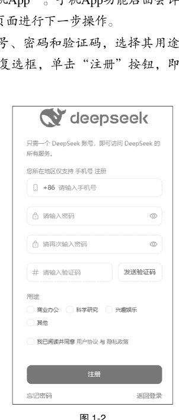

- ❸ 完成注册后，用户可以选择使用手机验证码登录和密码登录，如图1-3所示。
- ❹ 或者使用第三方微信扫码登录，如图1-4所示，登录完成后就可以自由使用DeepSeek的各项功能了。

### 002 DeepSeek 的基础页面及功能

登录完成后，界面如图1-5所示。

DeepSeek的主页面很整洁，大致分为三个板块，第一个板块是左侧的辅助功能区，第二个板块是问答区，第三个板块是提问区。

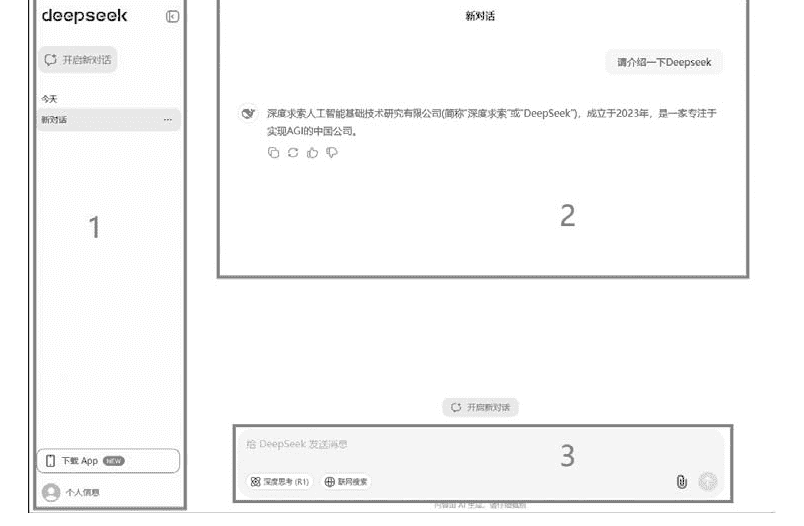

下面将一一介绍DeepSeek各板块的功能及用法。

#### 1. 左侧辅助功能区

位于主页面左侧的这一区域，也就是如图1-5所示的序号1，为辅助功能区，也可分为历史对话记录和其他两部分。

历史对话记录：历史对话记录功能是指DeepSeek可以保存和展示之前与用户的对话记录，如图1-6所示。这个功能可以帮助用户回顾之前的交流内容，便于用户在需要时快速获取之前的对话信息。

另外需要注意的是，历史对话记录功能只是一种辅助功能，不能替代用户的记忆和判断。在任何情况下，用户都应该有自主权来决定是否保存和使用这个功能。

其他：其他区域包括DeepSeek App下载二维码和个人信息区域。使用手机扫描二维码即可下载其App。个人信息页面包括系统设置、删除所有对话、联系我们和退出登录四个功能，如图1-7所示。


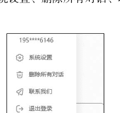

#### 2. 问答区

问答区是用户与DeepSeek互动、探讨各类问题的主要区域。问答区也分为问题区和答复区两个部分。如图1-8所示。

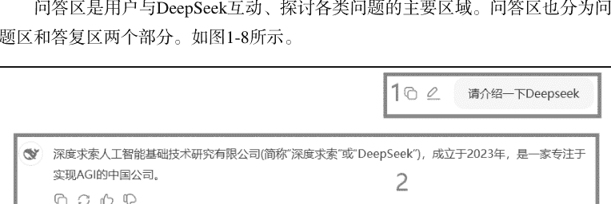

问题区：如图1-8中标号1的区域所示。该区域就是DeepSeek的问题区，该区域用于显示用户的提问内容。当用户将鼠标指针移动至此区域上方时，该问题左侧会出现“复制”和“编辑”图标。借助这两个功能用户可以将问题进行复制和对已提出的问题进行二次编辑，然后重新提问，这让交流变得更精确、更灵活。

答复区：如图1-8中标号2的区域所示。该区域为DeepSeek的答复区，该区域用于DeepSeek针对用户的提问展示回复。在该区域的左下方有四个小图标“📋”“🔄”“👍”“👎”，它们分别用于复制答复全文、重新生成答复、对答复内容进行点赞和对答复内容表示不满意。当用户单击不满意图标时，系统会弹出一个反馈意见表单，让用户提供更详细的反馈意见，确保用户的体验得到更好的优化，如图1-9所示。

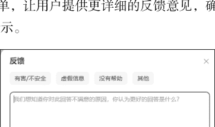

图1-9

#### 3. 提问区

提问区是用户跟DeepSeek进行交互的重要渠道，它会根据用户的提问来生成相应的反馈和建议，从而帮助用户解决所提出的问题。提问区也包括问题输入框、思考模式和上传附件功能。下面将对DeepSeek提问的步骤、深度思考和联网搜索以及上传附件功能进行详细介绍。

（1）向DeepSeek提问：向DeepSeek提问的操作步骤如下。

- ❶ 在提问区中的输入框内输入问题，如图1-10所示。


图1-10

- ❷ 单击提问区右下方的发送按钮⬆或按【Enter】键，即可将问题发送给DeepSeek进行处理，并在答复区显示生成该提问的反馈和建议，如图1-11所示。

DeepSeek AI 全场景实战从入门到精通：工作、学习与创作效率使用教程

> 深度求索人工智能基础技术研究有限公司（简称“深度求索”或“DeepSeek”）是一家专注于实现AGI的中国公司，成立于2023年。作为一家专注于AGI研究的公司，深度求索致力于探索人工智能领域的前沿技术，推动AI的创新和应用。

**主要研究方向**

1. 通用人工智能（AGI）：深度求索的核心目标是实现通用人工智能，即能够像人类一样在各种复杂环境中进行推理、学习和执行任务的AI系统。
2. 自然语言处理（NLP）：公司在自然语言处理领域有着深入的研究，致力于开发能够理解和生成自然语言的AI模型。
3. 计算机视觉：深度求索在计算机视觉领域也有显著的研究成果，专注于图像识别、视频分析等技术。
4. 强化学习：公司积极探索强化学习算法，以提升AI系统在动态环境中的决策能力。

图 1-11

（2）深度思考和联网搜索：在提问区中还包含两种思考模式，分别是“深度思考”和“联网搜索”模式，如图1-12所示。使用这两种思考模式也很简单，只需要在输入问题后，单击“深度思考”和“联网搜索”任一按钮即可。


图 1-12

深度思考：专为数学、编程等复杂的逻辑推理问题而设计，与处理简单的问题相比，它能够提供更全面、清晰且逻辑严谨的高质量解答，充分彰显长思维链的独特优势。

联网搜索：模型会深入解析海量网页内容，生成既全面又精准且符合个性化需求的回答。面对复杂的问题，模型自动提取多个关键词进行并行搜索，从而在更短的时间内提供多样化的搜索结果。

如表 1-1所示为这两种思考模式适合解决的问题类型和示例。

表 1-1

| 模式 | 适合解决的问题类型 | 示例 |
| :--- | :--- | :--- |
| 深度思考 | 1. 需要逻辑推理、分析和总结的问题。<br>2. 基于已有知识进行深入探讨的问题。<br>3. 需要创造性解决方案的问题。 | 1. 解释复杂的概念（如量子力学）。<br>2. 提供写作建议或创意灵感。<br>3. 分析历史事件的因果关系。 |
| 联网搜索 | 1. 需要实时信息或最新数据的问题。<br>2. 需要特定事实或具体答案的问题。<br>3. 需要验证或补充信息的问题。 | 1. 查询今天的天气情况。<br>2. 查找某公司的最新财报。<br>3. 获取某事件的新闻报道。 |

（3）上传附件功能：除了深度思考和联网搜索，DeepSeek还支持上传附件。通过上传附件，用户可以将自己的私密资料、知识库，甚至是一些需要深度推理的材料直接交给DeepSeek，让它基于这些专有的文件进行分析和推理。下面是使用上传附件功能的具体操作步骤。

- ❶ 单击提问区右下方的“上传附件”功能按钮，在弹出的“打开”对话框内选择需要上传的文件，如图1-13所示。选择完成后，单击“打开”按钮，即可上传该附件。

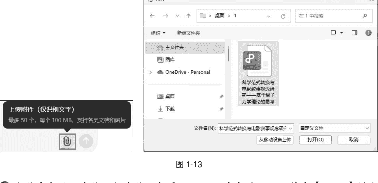

- ❷ 上传完成后，在输入框内输入想要DeepSeek完成的问题，单击【Enter】键即可，如图1-14所示。


提示：上传附件最多支持50个文件，每个文件最大100MB，且DeepSeek只能识别附件中的文字，不能识别图表等。

### 003 DeepSeek 本地部署

本地部署指的是将软件或应用程序安装在用户自己的服务器、电脑或内部网络中运行，而不是依赖第三方云服务或远程数据中心。换句话说，本地部署是将所有的运行环境、数据存储和处理任务都转移到用户自己掌控的硬件上，从而使软件的运行与管理完全在内部进行。

下面介绍对DeepSeek进行本地部署的具体操作步骤。

- ❶ 本地部署DeepSeek需要用到Ollama工具，在浏览器中搜索Ollama，进入Ollama主页，如图1-15所示。


图 1-15

提示：Ollama 是一款专注于本地部署和管理大型语言模型（LLM）的开源工具，旨在为开发者、AI 爱好者以及企业用户提供一个高效、便捷且安全的 AI 应用环境。Ollama 允许用户在自己的设备上加载和运行各类大型语言模型，从而摆脱对云端服务的依赖。

- ❷ 执行操作后，单击页面中间的“Download”按钮，在跳转的下载页面中选择自己所需的下载方式，如图1-16所示。

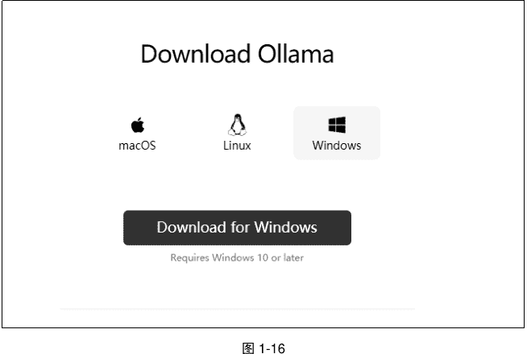

图 1-16

- ❸ 将Ollama解压安装完成后，再返回Ollama主页，单击页面左上方的“Models”按钮，出现的第一个大模型就是deepseek-r1，说明热度可见一斑，如图1-17所示。若单击“Models”按钮后，没有出现deepseek-r1，在上方的搜索框内搜索对应关键词即可。

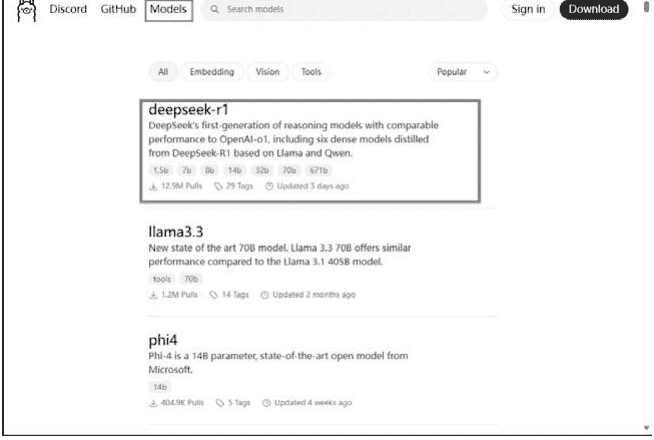

图 1-17

- ❹ 单击 “deepseek-r1” ，进入下载主页，在下拉列表中选择适配的模型。这里由于电脑配置不是很高，因此选择的是较低的7b。如果想要生成效果更好的模型，则需要较高的电脑配置，如图1-18所示。然后复制右边的这行代码，稍后会用到。

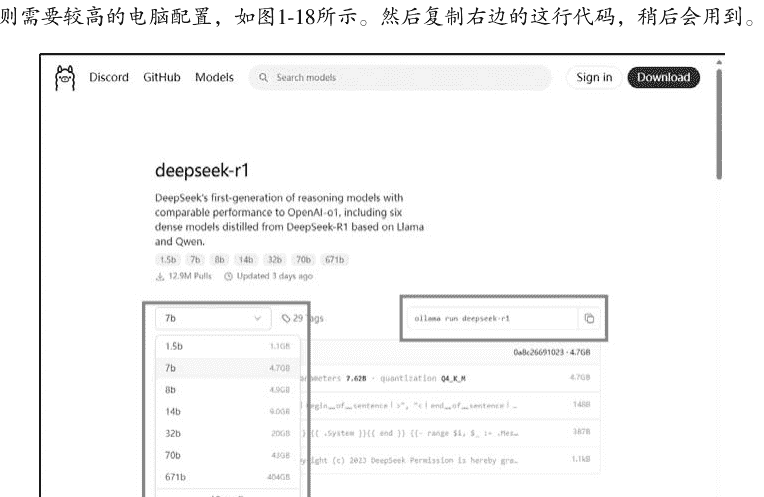

图 1-18

> 提示：根据显存大小适合的不同模型如下。
> （1）显存低于4GB适合1.5b。
> （2）显存在8GB ~ 12GB适合7b或8b。
> （3）显存在12GB以上适合14b。
> （4）显存在32GB以上适合32b。
> （5）显存在70GB以上适合70b。

- ❺ 按【Win+R】组合键打开“运行”对话框，然后输入“cmd”单击“确定”按钮，如图1-19所示，打开命令提示符。

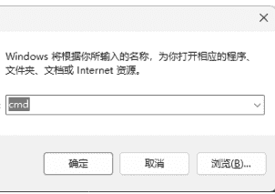

- ❻ 执行操作后将复制的那行代码复制到命令提示符内，按【Enter】键运行即可自动下载7b模型，如图1-20所示。

图 1-19

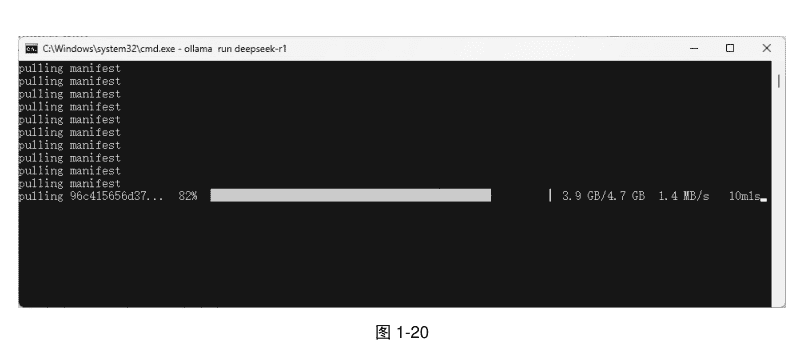

图 1-20

### 004 提示词的编写步骤和技巧

要想从DeepSeek中获得最佳的反馈结果，关键在于了解如何正确使用提示词。提示词可以让用户引导模型输出并生成相关、准确且高质量的内容。下面将详细介绍提示词的编写步骤和技巧。

#### 1. 提示词的编写步骤

编写提示词包括明确目标、构思、修改、提交等过程，具体编写步骤如下。

明确目标：在编写提示词之前，必须明确希望通过DeepSeek获取什么信息，无论是生成一篇文章、回答问题、编写代码还是进行数据分析，明确目标有助于指导后续提示词的设计。

收集并整理背景信息：为了让模型更好地理解上下文，准备好所有相关的背景信息和细节，包括任务相关的主题、需要涵盖的重点、所需的风格或语气等。这一步能确保生成的内容与预期保持一致。

确定输出格式和要求：指定期望的输出形式，如段落、列表、代码块、对话格式等。同时，明确文字的风格（正式、口语化、学术等）、字数限制或其他具体要求，使模型生成的答案更加符合实际需求。

分解复杂的任务：如果任务较复杂，可以将其拆分为多个子任务或分步要求。例如，先要求模型列出要点，再对每个要点进行详细说明。这样分解有助于模型逐步完成任务，降低出错率。

撰写清晰、具体的提示词文本：将目标、背景信息和输出格式有机地整合在一起，形成一条逻辑清晰、表达具体的提示词。例如：“请撰写一篇关于人工智能的科普文章，要求通俗易懂，包含三个主要观点，并以列表形式呈现。”

调整提示词的长度和精炼度：保持提示词简洁明了，避免冗长或歧义。语言应尽可能精炼，同时确保包含所有关键信息。如果提示词过于复杂，模型可能会分散注意力，导致输出不够集中。

#### 2. 提示词的编写技巧

提问一直是一门艺术，向AI提问也是如此。有效的提问往往能够更容易获得想要的答案，下面就来介绍一下向AI提问的6种技巧。

（1）简明扼要：AI喜欢简洁明了的问题，避免冗长的描述和复杂的句子结构。用简单直接的语言表达问题，可以提高AI理解问题的准确性。例如以下几个例子。

- ➤ 冗长的问题：“我在××城市有点事，我需要一个在市中心附近、价格适中的酒店，带有免费早餐和免费停车场。你能推荐一些吗？”
  ➤ 简明的问题：“请在××推荐一个价格适中、位于市中心的酒店，带免费早餐和免费停车场。”

- ➤ 冗长的问题：“我对新闻感兴趣，尤其是科技和娱乐方面的新闻。你有什么推荐的新闻源吗？”
  ➤ 简明的问题：“请推荐一些科技和娱乐新闻源。”

- ➤ 冗长的问题：“我最近在学习编程，我想知道最好的在线编程课程是什么，哪个平台有最好的编程教学资源？”
  ➤ 简明的问题：“请推荐一些在线编程课程和优质的编程教学平台。”

通过使用简洁明了的语言，可以让问题更易于AI理解和处理。这有助于AI系统更好地捕捉到问题的核心，提供更相关和准确的回答。避免过多的细节和复杂的句子结构，有助于提高交流的效率和准确性，使您与AI的对话更加流畅和顺利。

（2）避免二义性：在向AI提问时，需确保问题不会引起歧义或模棱两可。AI可能会根据问题字面意思进行回答，而忽略其中潜在的含义。如果问题有多种解释，需提供更多上下文信息以避免混淆。下面是一些例子。

- ➤ 二义性问题：“请告诉我有关苹果的信息。”
  ➤ 避免二义性：“我对苹果公司感兴趣，你能提供一些关于其历史和产品的信息吗？”

- ➤ 二义性问题：“这部电影好看吗？”
  ➤ 避免二义性：“你个人认为这部电影是否值得观看？”

- ➤ 二义性问题：“明天的天气怎么样？”
  ➤ 避免二义性：“请告诉我明天早上8点纽约的天气预报。”

在避免二义性问题时，需要提供足够的上下文或具体细节，以确保AI能够正确理解您的意图。通过明确指定对象、时间、地点等关键信息，可以避免不必要的歧义和混淆。尽量将问题的背景和条件清晰地传达给AI，以便它能够提供更准确和有针对性的回答。

（3）避免绝对化的问题：AI通常不能提供绝对性的回答。避免使用诸如“永远”“最好的”或“最适合”的绝对化词汇。相反，尽量以更加客观和相对的方式提问，以便AI可以给出更有用的答案。

避免绝对化问题是确保AI回答准确性的关键，下面举例来说明如何避免绝对化问题。

- 绝对化问题：“什么品牌的手机是世界上最好的手机？”
  避免绝对化：“请介绍一些当前市场上受欢迎的手机品牌和型号。”

- 绝对化问题：“哪个城市是全球最美丽的城市？”
  避免绝对化：“你能推荐一些风景优美的城市吗？”

- 绝对化问题：“什么是最有效的减肥方法？”
  避免绝对化：“你有一些建议帮助我减肥吗？”

通过使用相对性的表达方式，可以让AI提供更具有客观性和实用性的答案。询问用户个人意见、建议或提供一些可选项和不同的观点，可以帮助AI给出更灵活和有用的回答。

（4）利用引导词：在提问时，可以使用一些引导词来指导AI回答。例如，使用“如何”“为什么”“哪个”等引导词可以引导AI提供更详细和有针对性的回答。这样可以帮助你更好地理解问题的背景和答案的原因。

利用引导词可以帮助你引导AI回答，使其更加详细和有针对性。下面举例来说明如何利用引导词。

引导词：如何；问题：“如何学习一门新的编程语言？”

DeepSeek AI 全场景实战从入门到精通：工作、学习与创作效率使用教程

这个引导词可以引导AI提供关于学习编程语言的步骤、资源或技巧的回答。

引导词：为什么；问题：“为什么锻炼对身体健康很重要？”

这个引导词可以引导AI解释锻炼对身体健康的益处、影响或科学原理。

引导词：哪个；问题：“在纽约市，哪个博物馆是最受欢迎的？”

这个引导词可以引导AI提供关于纽约市最受欢迎博物馆的信息和评价。

通过使用不同的引导词，你可以调整问题的语气和期望的回答类型。这些引导词可以指示AI提供指导、解释、推荐或比较的回答，以满足你的具体需求和意图。根据你的问题，选择适当的引导词可以帮助AI更好地理解你的问题，并提供更加有针对性和详细的回答。

需要注意的是，引导词只是一种提示方式，AI仍然根据其训练和模型来生成回答，因此结果可能因模型的理解和数据限制而有所差异。

（5）检查语法和拼写：在与AI对话之前，检查你的问题的语法和拼写错误。虽然AI可以理解一些错误拼写或语法错误，但确保问题清晰、准确无误可以提高回答的质量和效果。

（6）追问细节：有时候AI可能无法准确理解你的问题或需求。如果得到的回答不完全符合期望，可以追问一些细节来进一步得到更好的回答。通过进一步的对话和交流，可以与AI建立更好的理解和沟通，从而得到更准确的回答。以下是一些追问细节的例子。

问题：“我正在计划去旅行，你有什么建议？”

回答：“您可以考虑去欧洲或亚洲旅行。”

追问：“对于欧洲和亚洲，你能给我一些具体的目的地建议吗？”

问题：“我想买一本好书，有什么推荐吗？”

回答：“你可以试试《人类简史》或者《1984》。”

追问：“这两本书的主题是什么？”

问题：“我需要一份健康的早餐食谱。”

回答：“您可以尝试燕麦片和水果的组合。”

通过追问细节，可以向AI提供更具体和详细的信息需求，以获取更加准确和个性化的回答。这样可以帮助AI更好地理解你的意图，并提供更符合具体需求的建议或答案。

### 005 DeepSeek App 的下载与使用

DeepSeek App 是 DeepSeek 平台推出的移动客户端，旨在将强大的 AI 能力和深度思考工具带到手机和平板设备上，让用户无论何时何地都能便捷地体验和利用先进的人工智能技术。下面将介绍DeepSeek App的下载与使用。

1. 打开DeepSeek网页版，单击左侧辅助功能区的“下载App”按钮，用手机扫描二维码。
2. 执行操作后，会跳转至下载方式页面，DeepSeek App提供多种渠道的下载方式，如图1-21所示。任选一种方式进行下载并安装即可。
3. 安装完成后，打开DeepSeek App登录即可进入到其主界面，如图1-22所示。DeepSeek App的功能与DeepSeek网页版相同，这里不过多介绍。

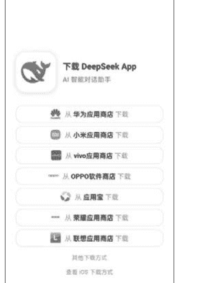

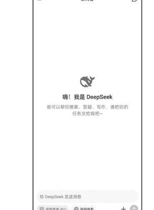

# 第 2 章
## 办公助手：迅速提升工作效率

在快节奏的职场环境中，高效处理各类任务已成为每位职场人士的核心需求。无论是撰写商业计划、整理会议纪要，还是优化创意策划、制订职业规划，掌握高效的办公工具都能极大地提升工作效率。本章将围绕13个核心办公场景展示DeepSeek在职场中的应用价值。

### 006 充当翻译助手

在全球化背景下，跨语言沟通已成为职场、学术和日常生活的重要组成部分。然而，传统的翻译方式往往存在效率低、准确度不稳定、语境理解不足等问题，如何借助 AI 实现高效、精准、自然的翻译，成为越来越多人的需求。

DeepSeek可以顺畅地翻译多种语言，包括但不限于英语、中文、西班牙语、法语、德语、葡萄牙语、俄语等。但面对一些小语种时，翻译质量可能不高。在处理某些涉及高度技术性或特定领域的翻译任务时，还需要人工介入提高翻译质量。下面是DeepSeek将中文翻译成英语、西班牙语、法语的具体示例对话。

> 请把下面一段中文分别翻译成英语、西班牙语、法语。
没有规划的人生叫拼图，有规划的人生才叫蓝图；没有目标的人生叫流浪，有目标的人生叫航行。

英文翻译：
“A life without a plan is called a jigsaw puzzle, while a life with a plan is called a blueprint; a life without goals is called wandering, but a life with goals is called sailing.”
西班牙语翻译：
“Una vida sin plan se llama rompecabezas, mientras que una vida con plan se llama plano; una vida sin metas se llama vagar, pero una vida con metas se llama navegar.”
法语翻译：
“Une vie sans plan s’appelle un puzzle, tandis qu’une vie avec un plan s’appelle un blueprint ; une vie sans objectifs s’appelle errance, mais une vie avec des objectifs s’appelle navigation.”

DeepSeek同时把中文翻译成英语、西班牙语和法语，从翻译质量来看，DeepSeek的翻译水平可以达到中级译员的水平。

当只需要两种语言进行相互翻译时，不妨让DeepSeek充当互译器，在两种语言之间互相翻译，使用起来非常方便。下面以中文和英语互译为例，进行具体对话。

> 请你充当一个中文和英语互译器，当我输入中文时，你翻译成英语；反之，亦然。
好的，请输入需要翻译的内容。
有时候，换个视角看世界，世界更好；有时候，换个环境再看你自己，你也比原来更幸福了。
Sometimes, when you change your perspective on the world, the world becomes better; sometimes, when you look at yourself in a different environment, you find yourself happier than before.

> He that doth what he should not, shall feel what he would not.

> 他若做不该做之事，必将尝不愿尝之苦。

DeepSeek能够识别多种语言，这对于经常处于多语言交流环境的用户特别适用，只要把某种语言文字输入DeepSeek，它就能自动识别该语言的种类，并按照要求进行翻译。

> 我现在需要你充当一个语言识别器，当我输入任何语言时，你需要将它翻译成中文，并用中文告诉我这是什么语言。

> 好的，请输入内容，我会识别语言并翻译成中文。

> scarecrow

> 语言：英语
翻译：稻草人

> п у г а л о

> 语言：俄语
翻译：稻草人

> かかしは、農家が鳥から畑を守るために使用する藁で作られた人形であり、穀物などの作物を踏みつけられるのを防ぎます。

> 语言：日语
翻译：稻草人是农民用稻草制作的人形模型，用于保护农田免受鸟类侵害，并防止谷物等作物被踩踏。

### 007 指导职业规划

在快速变化的时代，职业生涯不再是“一劳永逸”的选择，而是一个不断调整和优化的过程。无论是刚进入职场的新人，还是希望突破职业瓶颈的职场人士，一个清晰的职业规划能够帮助你更快地找到方向，提升竞争力，并在职业生涯中获得更高的成就感。本节将介绍如何使用DeepSeek AI来辅助职业规划。

在向AI进行提问前，需要明确你的职业规划需求，例如：

（1）你目前的职业或行业是什么？
（2）你希望在哪些方面提升？（如技能、职位、薪资等）
（3）你是否有明确的目标职业或行业？
（4）你面临的主要困惑是什么？

根据上述提供的具体情况，AI可以提供更精准的职业规划指导，包括职业路径、技能提升、求职策略等。下面是具体示例对话。

我目前在行政领域工作，已有3年的经验，主要负责日常行政管理、会议安排和客户接待等。虽然我的工作比较稳定，但我对市场营销，尤其是社交媒体营销和内容创作很感兴趣。现在，我希望能转行进入市场营销领域，如何做好职业规划，顺利实现这个转型？

嗯，用户现在在行政领域工作了三年，想转行到市场营销领域，尤其是社交媒体营销和内容创作。首先，我需要理解她的现状和需求。她已经有行政经验，可能具备组织能力、沟通技巧和客户服务经验，这些都可以迁移到市场营销中。但市场营销需要不同的技能，比如数据分析、创意策划、数字营销工具的使用等。她需要补充这些技能。
其次，用户可能没有明确提到她是否有相关的教育背景或证书，因此建议她获取相关认证，比如Google Analytics或Facebook Blueprint。另外，她可能需要积累实际的项目经验，比如通过兼职、志愿者工作或个人博客来展示她的内容创作能力。
还要考虑她转行的方式，是直接申请初级职位，还是通过内部转岗？如果她现在的公司有市场部门，内部转岗可能更容易；如果没有，可能需要从实习或初级职位开始。此外，建立行业人脉也很重要，参加相关活动或加入专业社群可以帮助她了解行业动态和机会。
她可能担心自己没有相关经验，建议在简历和面试中突出行政经验中与市场相关的部分，比如活动策划、客户沟通等；建议她将现有技能转化为市场需要的技能，比如强调组织能力，用于项目管理和活动执行。
另外，时间管理和学习计划也是关键。她需要平衡现有工作和学习新技能的时间，制订一个可行的学习计划，比如在线课程、周末工作坊等。可能需要推荐一些资源，比如Coursera上的数字营销课程，或者HubSpot的免费认证。
最后，她可能需要心理准备，因为转行可能会遇到挫折，她需要了解如何保持动力和调整策略。建议她设定短期和长期目标，定期评估进展，并根据反馈调整计划。
以下是针对你从行政转向市场营销的详细转型规划，结合可落地的步骤与资源推荐，帮助你系统化地实现职业跨越。

#### 一、转型底层逻辑：行政与市场营销的能力迁移模型

你的行政工作经验并非归零，而是可迁移技能资产，具体如下。
组织协调力：会议统筹→营销活动执行。
细节把控力：行程安排→内容排期与数据监控。
客户服务意识：接待沟通→用户需求洞察。
需补充的市场营销核心能力如下。
硬技能：SEO/SEM、社交媒体运营、数据分析（GA/UTM）、内容创作（图文/短视频）。
软技能：市场敏感度、创意策划、跨部门协作。

#### 二、分阶段转型路径（6～12个月）

阶段1：知识储备与技能验证（1～3个月）

（1）学习路径
免费资源：Google Digital Garage（数字营销基础认证）、HubSpot内容营销课程。
付费精学：Coursera《Meta社交媒体营销专业认证》（约每个月$49）。
工具掌握：Canva（设计）、Hootsuite（社媒管理）、Google Analytics（数据分析）。

（2）实战验证
- 创建个人自媒体账号（小红书/公众号/抖音），每周发布3篇原创内容，目标3个月积累1000粉。
- 为亲友的小生意免费运营社交媒体账号，积累案例（截图留存过程数据）。

阶段2：经验背书与身份转换（4～6个月）
（1）内部转型机会
- 主动申请参与公司市场部的线下活动执行（利用行政协调经验切入）。
- 向市场部提议行政—市场协作项目，如《员工故事系列内容策划》。
（2）外部积累方式
- 在Upwork/Fiverr接单初级营销任务（如文案撰写、社群运营），完成5个以上付费项目。
- 参加36氪/虎嗅等平台的线上营销案例拆解大赛。

阶段3：求职策略与长期发展（6～12个月）
（1）岗位瞄准
初级岗：社交媒体运营专员、内容营销助理。
优势岗：B2B市场协调（行政经验可迁移至与企业客户沟通）。
（2）简历与面试技巧
简历改造：

```
#### 行政工作经验（转译市场相关价值）
- 统筹200+场跨部门会议 → 擅长资源协调与deadline管理（可迁移至活动策划）
- 优化接待流程使客户满意度提升30% → 用户需求洞察与体验优化能力
```

作品集构建：制作PDF作品集，包含：个人账号运营数据截图（粉丝增长、互动率）、内容案例（爆款图文/视频链接）、项目报告（如某产品小红书投放ROI分析）。
（3）行业人脉搭建
- 加入“数英网”“SocialBeta”等营销人社群。
- 参加Marketing Summit等行业峰会（用学生票或以志愿者身份入场）。

#### 三、关键风险与应对策略

（1）薪资落差
目标企业选择：优先考虑有完善培训体系的中大型公司（如快消品、互联网平台）。
谈判话术：强调行政经验带来的组织力与执行效率，争取薪资不低于原岗位80%。

（2）技能断层
- 考取高含金量证书：Google Analytics Individual Qualification（GAIQ）。
- 参与企业实训项目：如巨量引擎“星火计划”培养体系。

（3）竞争压力
- 差异化定位：聚焦“行政转型营销”独特标签，主打B端客户服务型营销岗位。

#### 四、转型资源包

| 类型 | 推荐资源 | 价值点 |
| :--- | :--- | :--- |
| 行业洞察 | 《2023中国内容营销白皮书》（秒针系统） | 掌握最新趋势与雇主需求 |
| 工具模板 | 艾瑞咨询《社交媒体运营SOP模板》 | 快速上手标准化作业流程 |
| 案例库 | 数英网项目库（dmg.com） | 学习成熟企业实战案例 |
| 求职平台 | LinkedIn（设置#OpenToWork标签）、BOSS直聘（筛选“接受零经验”岗位） | 精准触达转型友好型企业 |

#### 五、成功转型者画像参考

案例：某3年行政经验转行至某美妆品牌社媒运营。
路径：行政助理→内部调岗活动执行→考取Meta认证→跳槽至现岗位。
关键动作：
- 用公司年会筹备经验争取到市场部活动支持机会。
- 自学拍摄剪辑，制作员工访谈短视频提升内部 visibility。
- 考取证书后通过内推获得面试机会。

通过以上规划，你可在12个月内系统性完成转型。记住：行政经验不是负担，而是让你在营销领域具备独特视角的资产。下一步行动建议：今日注册Google Digital Garage课程，并创建个人小红书账号开始内容试水。

### 008 提供创业指导

DeepSeek可以提供创业指导，为创业者或有创业意向的人群提供全面的咨询、建议和支持，帮助他们从创业想法到业务落地的各个环节顺利推进。一般来说，创业过程可分为以下几个方面。

（1）市场调研与机会分析

帮助创业者了解目标市场的规模、竞争格局和潜在机遇，识别行业趋势和消费者需求，明确创业方向。

（2）商业模式与战略规划

协助构建可行的商业模式，确定目标客户、核心价值、收入来源和成本结构，并制定短期和长期的发展战略与目标。

（3）产品开发与运营管理

提供从产品概念设计、功能规划到实际开发、测试、发布的指导，确保产品能满足市场需求；同时，对运营管理、用户增长和品牌推广等方面给予建议。

（4）财务规划与风险控制

帮助创业者进行资金筹措、成本预算和财务预测，识别可能面临的技术、市场和管理风险，并提出相应的应对措施。

（5）团队建设与资源整合

指导创业者吸引、招募和培养合适的团队成员，以及整合内外部资源（如合作伙伴、投资人和行业专家），以支撑企业发展。

知道创业的流程后，我们可以根据自身情况向DeepSeek进行提问，从而得到指导和建议，下面是相关示例对话。

> 我最近对智能健康管理很感兴趣，想打造一个基于智能穿戴设备和大数据分析的健康管理平台。请问我应该如何开始，确定市场机遇与目标用户？

> 要确定市场机遇与目标用户，建议你按照以下步骤进行。

1. 市场趋势调研
收集行业报告、调研数据和政府政策文件，了解当前智能健康管理市场的规模、增长速度和主要趋势。
关注智能穿戴设备的普及率、健康意识的提升，以及数字医疗服务的发展，这些都是推动市场需求的重要因素。
2. 竞争对手分析
识别现有的健康管理平台和产品（如 Apple Health、Fitbit、华为健康等），分析它们的产品定位、功能特点、用户评价和价格策略。
了解竞争对手的优势与不足，找出市场中的空白点和未满足的用户需求，为你未来的产品定位提供参考。
3. 目标用户调研
通过问卷调查、深度访谈或焦点小组讨论，收集潜在用户对健康管理服务的实际需求和痛点。
明确你想要服务的用户群体，例如 20～40 岁的都市白领、健身爱好者或对健康有特殊需求的人群。
构建详细的用户画像，包括年龄、收入水平、生活习惯和健康关注点等，以便更精准地满足他们的需求。

4. 需求匹配与痛点分析

整理调研数据，确定用户最迫切需要解决的问题，是实时数据监测、个性化健康建议、数据记录与分析，还是综合健康管理服务。

分析这些需求与现有市场产品之间的差距，验证你的平台是否能够解决这些痛点，从而捕捉到市场机遇。

5. 市场机遇验证

根据调研结果和竞争对手分析，评估目标市场的潜在规模和盈利空间。

考虑用户的付费意愿、市场饱和度以及未来的发展前景，确保你的创业构想在市场上具有足够的竞争优势和发展潜力。

通过以上步骤，你不仅可以系统地了解智能健康管理市场的整体环境，还能明确目标用户的需求和痛点，为你的平台定位、产品设计和商业模式构建奠定坚实的基础。这样，你的创业项目将更有针对性和竞争力。

确定市场机遇和目标用户后，就可以构建可行的商业模式和未来战略规划了。

> 在明确市场后，我该如何设计商业模式？有哪些收入来源可以考虑？

> 在明确目标市场后，设计商业模式的核心在于围绕目标用户创造独特的价值，并通过多样化的收入渠道实现盈利。下面是一些关键步骤和可考虑的收入来源。

1. 明确价值主张

用户价值：确定你的平台能为目标用户解决哪些健康管理问题，比如实时数据监测、个性化健康建议、全面健康管理方案等。

差异化优势：分析竞争对手，找出你平台在数据精准度、服务个性化或用户体验上的独特优势，确保提供无法替代的价值。

2. 确定目标客户细分

根据市场调研，将用户细分为不同群体，如都市白领、健身爱好者、慢病管理用户等。

针对不同用户群体的需求，设计专属功能或服务，提高用户黏性和满意度。

3. 设计关键渠道与客户关系

推广渠道：确定如何将产品传递给目标用户，线上渠道（App、官网、社交媒体）和线下合作（体验店、健康机构）都可以作为有效渠道。

客户服务：建立完善的用户反馈机制和售后支持体系，确保用户在使用过程中的问题得到及时解决，形成长期稳定的客户关系。

4. 规划收入来源

你可以采用多种收入模式，形成多元化盈利体系，包括但不限于以下几种。

硬件销售：通过销售智能穿戴设备获取直接收益。

订阅服务：提供健康管理App的高级订阅服务，如个性化数据分析、定制健康方案、专

#### 5. 成本结构与关键资源

评估平台在硬件研发、软件开发、数据处理、营销推广等方面的主要成本，确保收入覆盖成本并实现盈利。
确定关键活动（如数据采集、健康算法研发、用户运营等）和合作伙伴（如硬件供应商、技术服务商、医疗专家团队等），以优化运营效率。
通过以上步骤，你可以构建一个以用户需求和市场趋势为导向的商业模式，并通过多元化收入渠道降低风险，实现可持续发展。这种商业模式不仅能满足目标用户的需求，还能在激烈的市场竞争中脱颖而出，为平台的长远发展打下坚实的基础。

用户可以通过上述创业过程并结合自身状况，对DeepSeek进行提问，从而得到全面、可供选择的建议和想法。

### 009 生成个人简历

在实际工作中，生成一份结构清晰、内容翔实的个人简历是求职过程中的关键环节。利用DeepSeek可以快速根据提示词初步生成简历，再根据个人实际情况进行校对和定制。通常一份完整的简历包含以下几个部分。

- 基本信息：姓名、性别、联系方式、居住地等。
- 求职意向：应聘岗位、期望薪资、工作性质及到岗时间。
- 教育背景：学校名称、专业、学历、在校时间。
- 工作经历：公司名称、职位、工作时间、主要职责和成就。
- 技能专长：掌握的软件、数据分析能力、沟通与协调能力等。
- 自我评价：个人优势、职业规划、工作态度等。
- 兴趣爱好：个人兴趣和业余活动。

我们可以根据完整的简历内容，引导DeepSeek生成符合要求的简历内容，下面是详细的对话内容。

请生成一份个人简历，内容包括基本信息、求职意向、教育背景、工作经历、技能专长、自我评价和兴趣爱好。要求简历结构清晰、语言专业，适用于市场营销岗位。

#### 个人简历

**基本信息**
姓名：张明阳
性别：男
出生年月：1995年8月
联系电话：138-1234-5678
电子邮箱：zhangmingyang@email.com
所在地：上海
LinkedIn：linkedin.com/in/mingyangzhang

**求职意向**
市场营销经理
方向：品牌推广、数字营销、市场策略规划
期望行业：互联网/快消品/科技
工作性质：全职

**教育背景**
2014.09—2018.06
复旦大学 | 市场营销专业 | 管理学学士
GPA：3.7/4.0（专业前10%）
主修课程：消费者行为学、数字营销、品牌管理、市场数据分析
荣誉奖项：校级优秀毕业生、全国大学生市场调研大赛二等奖

**工作经历**
2020.07至今
ABC科技有限公司 | 市场营销主管
品牌推广：
策划并执行年度品牌活动，覆盖线上线下渠道，活动曝光量超500万次，品牌知名度提升35%。
主导新品发布会，联合KOL及媒体资源，实现首月销售额突破1200万元。
数字营销：
管理公司社交媒体矩阵（微信、微博、抖音），粉丝量从10万增长至80万，互动率提升至8%。
优化SEM/SEO策略，官网自然搜索流量增长60%，获客成本降低25%。
数据分析：
搭建用户行为分析模型，通过A/B测试优化落地页，转化率提升22%。

2018.07—2020.06
XYZ快消品集团 | 市场专员
市场活动策划：
负责华东区促销活动，协调50多家门店资源，季度销售额同比增长18%。
策划“健康生活月”主题活动，联合健身房与营养师，新增会员1.2万人。
客户洞察：
主导消费者调研项目（样本量2000多份），输出市场细分报告，助力产品线优化，客户满意度提升20%。

**技能专长**
专业技能：
精通Google Analytics、SEO/SEM工具（Ahrefs、SEMrush）、社交媒体运营（Hootsuite）。
熟练使用SPSS、Tableau进行数据分析，擅长市场趋势洞察与竞品分析。
熟悉CRM系统（Salesforce）及自动化营销工具（Mailchimp）。
语言能力：
英语CET-6，可熟练进行商务沟通与文案撰写。
证书：
Google Analytics认证、Facebook Blueprint数字营销认证。

**自我评价**
数据驱动：擅长通过数据分析挖掘用户需求，曾主导多个成功优化案例，如转化率提升22%、获客成本降低25%。
创新思维：具备敏锐的市场嗅觉，成功策划多场跨界营销活动（如“健康生活月”），提升品牌影响力。
团队协作：跨部门协调经验丰富，擅长整合资源推动项目落地，目标导向性强。

**兴趣爱好**
附件：作品集（含活动方案、数据分析报告等） | 推荐信（可提供）
注：可根据目标公司需求调整内容重点，突出相关性。

格式说明：使用简洁的模块化设计，重点数据加粗或标亮，确保HR快速捕捉关键信息。

在使用DeepSeek生成初稿后，仔细检查内容是否符合实际情况和岗位需求。例如：
（1）数据准确性：确认工作经历和教育背景的时间、名称等信息无误。
（2）内容针对性：根据应聘岗位突出相关技能和经验，必要时调整描述。
（3）语言风格：确保简历整体语言专业、简洁有力，符合行业标准。

### 010 生成创意策划

在自媒体和品牌营销中，一份独特且具吸引力的创意策划方案往往是项目成功的关键。用户可以通过使用DeepSeek快速生成创意策划初稿，并通过不断优化形成最终方案。为了让DeepSeek能够生成符合预期的创意策划，用户需要给DeepSeek提供清晰的创意指引，包括指定的品牌以及方案中需要包含的要点，从而让DeepSeek能够根据要求进行创意策划的生成。此外，还可以提供一些要求，以帮助DeepSeek更好地理解和把握写作要求。

下面以为一家新兴健康饮品品牌制定创意策划方案为案例，以供参考。

> 请为一家主打“自然健康、活力生活”的新兴健康饮品品牌制定一个创意策划方案。方案需要包括品牌故事、市场推广活动、社交媒体策略和消费者互动设计。要求语言生动，风格活泼且专业。

> “自然觉醒NaturaBloom”健康饮品品牌创意策划方案
> ——以自然之力，唤醒每一刻活力——

#### 一、品牌故事：从森林到舌尖的纯净承诺

1. 品牌初心

“自然觉醒NaturaBloom”诞生于一群户外爱好者的灵感碰撞——在一次阿尔卑斯山徒步中，他们发现当地居民用野生浆果、草本植物制作天然饮品，瞬间焕活疲惫的身心。回国后，团队联合营养学家，以“0添加、全植物、轻功能”为核心理念，打造天然成分+科学配方的健康饮品，口号定为：“自然不打扰，活力刚刚好”。

产品差异化
原料溯源：精选全球5大生态产区原料（如云南有机玫瑰、北欧越橘、巴西阿萨伊果），每瓶标注“成分身份证”，扫码可追溯生长环境。
功能细分：推出三大系列。
“晨光系列”：早晨饮用，含生姜+柑橘，提神醒脑；
“午后系列”：低卡路里+膳食纤维，轻负担办公伴侣；
“夜安系列”：褪黑素+洋甘菊，助眠舒缓。

2. 视觉符号
LOGO：叶片脉络交织成水滴形状，配色以森林绿、晨曦橙、暮霭紫为主；
包装：可回收磨砂瓶身+手绘风插画（不同口味对应不同自然场景）。

#### 二、市场推广活动：让健康“破圈”

1. 线下事件：城市森林快闪计划
主题：“一口饮尽自然”沉浸式体验馆
内容：
五感唤醒区：用雾森系统模拟雨林环境，提供试饮并搭配植物香气盲盒（猜中气味赠饮品）；
DIY实验室：消费者自选原料调配专属饮品，拍照打卡可获“自然探索家”徽章；
公益联动：每售出1瓶，捐赠0.1元用于沙漠植树，现场设置“绿色能量树”装置实时显示捐赠进度。
目标：3天内吸引5000以上的人次参与，社交媒体曝光量超100万。

2. 线上营销：21天“自然活力挑战赛”
规则：用户每日完成健康任务（晨跑10分钟/自制健康餐等），上传至小程序打卡，累积积分兑换新品或联名周边（瑜伽垫、种子盲盒）。
爆点设计：
KOL带队：邀请健身博主@刘畊宏、素食达人@素食少女阿柒发起挑战；
数据可视化：生成个人“活力报告”，分享可抽奖。
目标：吸引10万以上用户参与，转化率达到15%。

#### 三、社交媒体策略：打造“自然系社交货币”

1. 平台矩阵与内容规划

| 平台 | 内容方向 | 示例 |
| :--- | :--- | :--- |
| 小红书 | “成分党测评”“生活方式美学” | 《揭秘！云南玫瑰如何48小时锁鲜成瓶》 |
| 抖音 | 短剧+科普动画 | 《打工人续命暗号：午后系列的3种隐藏喝法》 |
| 微信 | 深度长图文+社群运营 | 《夜安配方公开：失眠星人自救指南》 |
| B站 | 纪录片风品牌短片 | 《寻味自然觉醒》系列（探访原料产地） |

2. 爆款内容模板
“自然冷知识”系列：用趣味动画讲解成分功效（如“阿萨伊果的抗氧化力=蓝莓的5倍”）；
UGC征集：#自然觉醒时刻#话题，鼓励用户分享饮品与户外场景的创意照，每周评选“最美自然星推官”（奖励定制野餐套装）。

#### 四、消费者互动设计：从用户到共创者

1. “自然灵感工坊”会员体系
进阶权益：
萌芽会员（注册即享）：新品9折+电子食谱；
森林会员（消费满500元）：专属配方顾问+线下品鉴会邀请；
生态会员（年度消费TOP100）：参与新品口味投票+产地溯源之旅。

2. 沉浸式私域运营
微信社群：
早7点“自然闹钟”：推送晨间拉伸视频+晨光系列优惠券；
周五“自然放映厅”：直播户外纪录片，同步抽奖。
小程序游戏：“丛林寻宝”互动（收集虚拟原料兑换礼品），结合LBS技术推荐附近门店。

#### 五、预算与效果预估

| 项目 | 预算 | 预期效果 |
|---|---|---|
| 快闪店搭建 | 50万元 | 线下体验转化率20%，社群新增用户2万以上 |
| KOL合作 | 30万元 | 总曝光500万以上，互动率8% |
| 社交媒体广告 | 20万元 | CTR 3.5%，引流至天猫店ROI 1:4 |
| UGC活动激励 | 10万元 | 征集内容5000多条，话题阅读量破亿 |

方案亮点：
情感共鸣：用“自然溯源”强化品牌信任感，将健康饮品转化为生活方式符号；
闭环设计：从线下体验到私域留存，形成“体验—分享—复购”链路；
数据赋能：通过打卡挑战和会员体系沉淀用户行为数据，反哺产品迭代；
Slogan延展：“每一口自然，都是活力的答案！”

DeepSeek按照要求快速生成创意策划方案，其大纲较为全面，设计的市场推广活动生动有趣，预算规划合理，具有落地参考性。

### 011 撰写电子邮件

电子邮件是现代交流中最常见的沟通方式之一。过去，人们需要手动撰写邮件，而现在，借助 DeepSeek，可以轻松生成各类电子邮件内容。无论是私人信函、公务邮件、商务沟通，还是营销推广邮件，只需提供具体需求，DeepSeek便能高效完成撰写，提升沟通效率。

> 我叫Xiao Xiao，在IBM工作，请写一封邮件给我的同事Miss Chang，请其尽快完成项目流程审批，要求按照商务英语的标准，300字以内。

Subject: Urgent: Project Process Approval Required

Dear Miss Chang,

I hope this email finds you well. I am reaching out to kindly request your prompt attention to the approval of our project process. As we are approaching the deadline, it is crucial to have the necessary approvals completed as soon as possible to ensure smooth progress.

Could you please review the pending documents and finalize the approval at your earliest convenience? If there are any concerns or additional information needed, please let me know, and I will be happy to assist.

Your prompt response would be greatly appreciated. Thank you in advance for your support.

Best regards,
Xiao Xiao
IBM

DeepSeek能够按照要求快速提供标准的商务英语，语法准确且有逻辑，读者只需修改具体细节就可以立即使用。

### 012 制定图书框架

图书框架是整个书籍创作的骨架，它决定了书的整体逻辑和内容分布。一个合理的框架不仅能帮助作者理清写作思路，还能确保读者在阅读时获得系统、连贯的信息。

下面以一本儿童图书为例，为大家演示如何使用DeepSeek制定图书框架。

我需要写一本关于儿童早期启蒙和成长的图书，书名暂定为《快乐成长：儿童启蒙与成长指南》，目标读者为家长和幼教工作者。请帮我制定一个包含八章的图书框架，要求每章内容既有理论支持又结合实际案例。

#### 《快乐成长：儿童启蒙与成长指南》图书框架
——科学理论×实践案例，赋能儿童全面发展——

**第一章：儿童早期发展的科学基础**
核心理论：皮亚杰认知发展四阶段理论、埃里克森心理社会发展理论。
脑科学视角：0～6岁神经元可塑性及敏感期的重要性。
实践案例：案例1：通过“触摸感官盒”游戏（不同材质物品）刺激触觉发育的幼儿园实践。
案例2：芬兰“家庭阅读计划”如何通过亲子共读促进语言与情感联结。
家长工具箱：
0～6岁发展里程碑自查表（附国际儿童发展量表简化版）。

**第二章：认知启蒙——从探索到思考**
核心理论：维果茨基“最近发展区”理论、蒙台梭利感官教育理念。
实践案例：
案例1：用“问题解决游戏”（如“如何用三块积木搭高塔”）培养逻辑思维。
案例2：日本幼儿园“自然观察日记”如何激发科学探究兴趣。
活动设计：
家庭版“认知闯关卡”：每周一个探索主题（如“水的浮力实验”）。

**第三章：情感与社会能力培养**
核心理论：鲍尔比依恋理论、戈特曼“情绪训练”模型。
实践案例：
案例1：美国“情绪脸谱图”帮助孩子识别并表达情绪。
案例2：上海某幼儿园“合作搭桥”活动如何减少同伴冲突。
家长指南：
5步应对“发脾气”场景：共情→命名情绪→提供选择→复盘→强化正向行为。

**第四章：语言与沟通能力开发**
核心理论：语言习得关键期理论（莱尼伯格）、互动式阅读策略。
实践案例：
案例1：新加坡“童谣手势互动法”提升双语儿童表达流畅度。
案例2：家长通过“扩展对话法”（如孩子说“车”，家长回应“红色的消防车在救火”）丰富词汇量。
资源推荐：
分龄绘本书单（0~3岁/3~6岁）+ 亲子对话100句模板。

……

**第八章：常见挑战与科学应对**

核心理论：行为主义强化理论、正面管教工具。

实践案例：
- 案例1：用“选择轮”解决孩子拖延问题（如“先刷牙还是先穿睡衣？”）。
- 案例2：幼儿园通过“社交故事法”帮助孤独症儿童适应集体生活。

问题库：
高频难题Q&A（如“分离焦虑”“电子设备依赖”“挑食”）。

#### 附录：资源与工具包

发展评估工具：
儿童社交能力观察表（含评分标准）。

亲子活动日历：
按月份主题设计（如“1月感官探索月”“4月自然观察月”）。

专业机构推荐：
国内外儿童发展研究机构及公益组织联络方式。

#### 图书特色：
- 双栏排版：左栏理论摘要+右栏案例图解，便于快速阅读。
- 图标系统：用“科学原理”“家庭实践”“幼教应用”三类图标标注内容侧重点。
- 扫码扩展：书中案例附二维码链接视频示范或专家解读。

目标效果：
为家长提供“拿来即用”的策略，为幼教工作者补充理论依据与课程灵感，最终帮助儿童在快乐中实现全面发展的“软着陆”。

DeepSeek所生成的图书框架系统性强，涵盖了儿童早期启蒙与成长的多个关键领域，能够帮助家长和幼教工作者更好地理解儿童的发展规律并进行科学引导。框架逻辑清晰，从儿童认知、情感、社交、体能、艺术、科技等多个维度进行展开，确保全面性和科学性，能够满足不同背景的读者需求。

### 013 生成会议发言

会议发言是指在正式会议或讨论场合中，与会人员围绕会议主题发表意见、汇报工作、提出建议或作出决策的讲话。会议发言通常具有正式性、针对性和逻辑性，目的是传达信息、阐述观点、交流经验或达成共识。

常见的会议发言类型有工作汇报型、经营分析型、经验交流型、讨论决策型、动员鼓励型等。下面以经营分析型为示例，使用DeepSeek生成会议发言的具体提示词对话。

> 请根据以下信息撰写一份公司季度经营分析会议的发言稿。会议主题：2024年第一季度经营情况总结与目标展望。会议时间：2024年4月10日14：00。参会人员：公司管理层及各部门负责人。主要内容：回顾第一季度的销售数据、成本控制情况、市场反馈，分析当前面临的挑战，并提出下一季度的优化策略。目标：明确改进方向，提高业绩指标，确保年度目标的实现。

#### 2024年第一季度经营情况总结与目标展望发言稿

尊敬的各位领导、各位同事：
大家下午好！
今天，我们齐聚一堂，召开2024年第一季度经营分析会议，旨在总结过去3个月的经营情况，剖析当前面临的挑战，并明确下一季度的目标和优化方向，以确保全年经营目标的顺利达成。

**一、第一季度经营情况回顾**
首先，让我们回顾第一季度的经营数据。整体来看，公司销售业绩稳步增长，营收同比提升×%，部分业务板块表现突出，特别是在**（具体业务领域），实现了×的增长，市场反馈良好。与此同时，我们在成本控制方面也取得了一定成效，通过**（具体措施，如优化供应链、减少运营开支等），有效降低了×%**的运营成本。
不过，我们也要正视当前面对的挑战。一方面，市场竞争日趋激烈，某些产品线的盈利能力有所下降；另一方面，客户需求变化较快，对我们的产品和服务提出了更高要求。此外，部分业务在推广和市场渗透方面仍有较大提升空间。

**二、市场反馈与问题分析**
从市场反馈来看，客户对我们的**（某项产品或服务）较为认可，但在**（某一方面，如交付周期、服务体验等）仍需优化。竞争对手在**（某一市场或产品）上的积极布局，也对我们形成了一定压力。面对这些问题，我们要积极调整策略，提升竞争力。

**三、第二季度优化策略与目标**
针对上述问题，我们将在以下几个方面重点发力。
优化产品与服务——加强产品研发和迭代，提高市场匹配度，确保产品优势更加突出。

DeepSeek AI 全场景实战从入门到精通：工作、学习与创作效率使用教程

强化市场推广——加大品牌宣传力度，拓展线上线下营销渠道，提升市场渗透率。
加强成本控制——继续优化供应链管理，提升运营效率，在保证质量的前提下，进一步降低成本。
提升客户体验——优化售后服务，完善客户反馈机制，提升客户满意度和忠诚度。
在第二季度，我们的核心目标是：提升销售额×%，优化运营成本×%，确保整体盈利能力稳步增长。

#### 四、总结与展望

各位同事，2024年第一季度已经过去，我们取得了一定的成绩，但更大的挑战和机遇还在前方。希望各部门能够紧密协作，落实优化措施，全力冲刺第二季度目标，为公司全年业绩增长奠定坚实的基础。
让我们携手共进，全力以赴，迎接新的挑战，创造更好的成绩！
谢谢大家！

从生成的会议发言稿来看，还是比较具有参考价值的，结构清晰、层次分明，语言简洁而有力，较好地达到了总结第一季度经营情况、分析问题、明确改进方向并激励团队的目标。

### 014 生成会议纪要

在任何职业领域，整理会议记录都被视为一项关键的职业技能。尽管整理会议记录可能是一项烦琐的任务，但DeepSeek能够轻松应对。只需在DeepSeek中输入会议内容，并要求会议纪要格式，即可生成满足要求的会议纪要。

> 请将以下会议内容整理为一份格式规范的会议纪要，确保内容清晰、结构完整，并准确提炼会议要点。
会议内容如下：
2023年5月21日下午3点，公司主要领导在贵宾室组织召开安全生产会议，参会人员包括项目经理、项目总工等相关负责人。会议重点围绕5月20日发生的安全事故展开，分析事故带来的严重后果，并就安全防范措施、部分工程复工的开工动员，以及项目部管理加强等方面进行了讨论。
副总在会上作出重要报告，强调做好以下6个方面的安全工作。

1. 进行全面的安全自查。
2. 对发现的安全隐患及时整改。
3. 健全和完善项目部的安全检查机制。
4. 建立健全安全台账，确保管理规范。
5. 专职安全员以身作则，严格落实安全管理要求。
6. 在施工人员及机械设备进场前，必须召开专项安全生产会议，确保安全教育覆盖到每个人。

会议由总经理主持，董事长在会上作出重要讲话和工作部署，强调：“安全生产是企业的生命线”“企业发展要着眼长远”“让每位员工都能在公司找到归属感，公司将提供良好平台助力员工成长与发展”。

#### 安全生产专项会议纪要

时间：2023年5月21日下午3:00
地点：公司贵宾室
主持人：总经理
参会人员：公司主要领导、项目经理、项目总工等相关负责人

#### 会议议题

围绕5月20日发生的安全事故，分析事故后果，讨论安全防范措施、工程复工动员及项目部管理加强等事项。

#### 会议内容

1. 副总重要报告
副总就安全生产工作提出以下6个方面的要求。
全面安全自查：对项目部安全生产状况进行全面排查。
及时整改隐患：发现安全隐患必须第一时间整改，确保隐患不延续。
完善检查机制：健全项目部安全检查机制，确保检查工作常态化、制度化。
建立安全台账：做好安全台账的记录与管理，确保安全管理规范化。
安全员落实责任：专职安全员要以身作则，严格落实安全管理要求。
强化安全教育：在施工人员及机械设备进场前，必须召开专项安全生产会议，确保安全教育覆盖所有人员。

2. 董事长讲话要点
董事长在会上强调了以下几点。
安全生产是企业的生命线：安全事故的发生将严重影响企业的正常运营和社会形象，必须引起高度重视。
企业发展要着眼长远：在追求效益的同时，必须将安全生产放在首位，确保可持续发展。
关注员工成长与归属感：公司将为员工提供良好的工作平台，帮助员工实现个人成长与发展。

#### 会议决议

全体参会人员高度认同副总和董事长的工作部署，立即组织落实。
各项目部必须对安全生产工作进行全面梳理，确保及时排查安全隐患并整改到位。
加强安全管理，完善安全检查机制和安全台账，确保安全生产工作规范化、制度化。各项目部必须在施工人员及机械设备进场前召开专项安全生产会议，落实安全教育工作。

会议结束。

从上述DeepSeek给出的会议纪要来看，格式规范，包含全部会议重点内容，是一份高质量的会议纪要。

### 015 生成商业计划书

商业计划书是一份系统描述企业未来发展规划的书面文件，通常用于指导企业运营、吸引投资、申请融资或合作洽谈。它详细阐述了企业的商业模式、市场定位、营销策略、财务预测等内容，帮助投资者或合作伙伴理解企业的核心价值与发展潜力。一份高质量的商业计划书具有清晰简洁、直击重点、数据支持、逻辑清晰、突出竞争优势等，如果使用DeepSeek撰写商业计划书，则需要尽可能为他提供更多关于计划书的信息，如公司介绍、商业模式、运营计划、风险需求与投资回报等，这样不仅生成的计划书质量好，而且效率更高。

> 请根据以下信息撰写一份商业计划书，确保结构清晰、内容翔实，并符合专业标准。企业名称：绿活健康科技有限公司；行业：智能健康管理；主要产品/服务：基于智能穿戴设备和大数据分析的个性化健康管理平台；目标市场：关注健康管理的个人用户、企业健康管理部门、医疗机构；商业模式：订阅服务+硬件销售+企业健康管理解决方案；融资需求：5000万元人民币；发展目标：短期内完成产品研发及市场推广，长期目标是成为智能健康管理行业的领先者。

绿活健康科技有限公司商业计划书
——引领智能健康管理新时代——

#### 一、执行摘要
公司使命：以科技赋能健康，让每个人享有数据驱动的个性化健康管理服务。
核心产品：基于智能穿戴设备与AI算法的健康管理平台，实时监测用户生理数据（心率、睡眠、血氧等），提供定制化健康建议及风险预警。
市场定位：聚焦健康管理需求旺盛的高净值个人用户（25～45岁）、企业员工健康管理及医疗机构慢病管理场景。
融资需求：5000万元人民币，用于产品研发（40%）、市场推广（30%）、团队扩张（20%）、运营储备（10%）。

#### 二、公司概述

成立时间：2023年
总部地点：上海
核心团队：
- CEO 李明：前某健康科技上市公司副总裁，主导过3款智能穿戴产品研发，用户超千万。
- CTO 王然：人工智能专家，拥有10年医疗大数据建模经验，发表SCI论文20余篇。
- CMO 张薇：资深市场营销专家，曾操盘某健康品牌从0到10亿规模增长。

技术优势：
- 独家AI健康分析模型（已申请专利），预测准确率超行业平均水平15%。
- 多设备兼容能力：支持Apple Watch、华为手环等主流智能硬件数据接入。

#### 三、市场分析

1. 行业趋势
- 智能健康管理市场高速增长：2023年全球市场规模达$380亿，年复合增长率22%（数据来源：Grand View Research）。
- 政策驱动：中国“健康中国2030”规划推动健康管理服务普及，企业健康福利支出年均增长18%。

2. 目标市场细分

| 用户类型 | 需求痛点 | 解决方案 |
| :--- | :--- | :--- |
| 个人用户 | 数据分散、缺乏个性化建议 | 整合多设备数据+AI健康报告 |
| 企业客户 | 员工健康成本高、效率下降 | 定制化企业健康管理SaaS平台 |
| 医疗机构 | 慢性病患者院外管理难度大 | 远程监测+医生协同系统 |

3. 竞争格局
- 直接竞品：Keep健康、华为Health（优势：流量入口；劣势：缺乏深度健康干预）。
- 差异化机会：医疗级数据分析能力+企业端B2B2C模式。

......

#### 九、发展目标

短期（1~2年）：
- 完成产品医疗二类认证，签约50家中型企业客户。
- 用户突破100万，营收达1.5亿元。
长期（3~5年）：
- 建成覆盖2000家医疗机构的慢病管理网络。
- 成为智能健康管理行业市占率前三品牌。

附件：
专利证书及技术认证文件（略）
核心团队完整简历（略）
详细财务预测表（略）

注：本计划书数据基于市场调研及合理假设，实际执行需根据市场动态调整策略。

DeepSeek生成的商业计划书中详细涵盖了企业概况、市场分析、商业模式、营销策略、财务计划等内容，整个计划书语言专业、结构清晰、逻辑严密，能够吸引投资者的兴趣，算得上一份高质量的商业计划书。

### 016 生成通知内容

通知是一种常见的公文文种，广泛用于政府机关、企事业单位、社会团体等发布信息、指示工作、传达决策。它通常具有正式性、权威性和时效性，要求语言简洁、内容清晰、条理分明。要通过DeepSeek生成通知内容，需提供详细的通知信息，如通知目的、通知对象、内容、时间等。

> 请帮我撰写一份通知，主题是关于调整公司作息时间，通知对象是全体员工，具体内容包括：自2024年3月1日起，工作时间调整为上午9：00—12：00，下午13：30—18：00，周末双休，请各部门知悉并执行。

关于调整公司作息时间的通知
全体员工：
为优化工作效率，提升员工的工作体验，经公司研究决定，自2024年3月1日起，对作息时间进行调整，具体如下。
1. 工作时间：上午9：00—12：00，下午13：30—18：00。
2. 休息时间：周六、周日为固定休息日，法定节假日按国家规定执行。
3. 请各部门负责人通知本部门员工，并确保调整顺利实施。
请全体员工合理安排工作时间，严格遵守新的作息制度，共同营造高效、和谐的工作环境。如有特殊情况，请与人力资源部联系。
特此通知。

×××公司
2024年2月13日

DeepSeek生成的这份通知内容结构清晰、语言简洁、表述得体，符合正式企业通知的规范。

### 017 生成演讲稿

演讲稿是一种为正式演讲而准备的书面文稿，旨在通过有组织、有逻辑的内容传达信息、表达观点或激励听众。演讲稿通常围绕一个中心主题展开，结合演讲者的个人风格、语言表达和演讲技巧，以增强感染力和说服力。使用DeepSeek生成演讲稿，只需为它提供一个主题和演讲的场景，它就能围绕主题生成一篇逻辑清晰、内容充实的演讲稿。

> 请撰写一篇关于“突破自我，迎接挑战”的演讲稿，目标听众为企业员工。

突破自我，迎接挑战
尊敬的全体同事：
大家好！
今天，我很荣幸能够站在这里，与大家分享一个与我们每个人息息相关的话题——“突破自我，迎接挑战”。在这个充满变化与机遇的时代，我们每个人都在追求成长，都在努力实现自己的价值。而要实现这一目标，就需要我们不断突破自我，勇敢面对各种挑战。

#### 一、回顾过去，感恩成长
首先，让我们回顾一下过去的旅程。无论是公司的发展，还是每个人的成长，都离不开我们共同的努力。回想起我们一起经历的困难与挫折，那些时候，我们是如何团结一致、迎难而上的？正是因为有了这些经历，我们才能站在今天的位置，迎来更加广阔的发展空间。
然而，回顾过去的同时，我们也要清醒地认识到，过去的成功并不意味着未来可以依靠惯性前行。市场环境在变化，竞争压力在增加，我们需要以更加开放的心态和更强的能力，去迎接未来的挑战。

#### 二、挑战与机遇并存
在我们的职业生涯中，挑战无处不在。它可能是工作中的困难，也可能是行业中的不确定性，甚至是我们内心的恐惧和不安。面对这些挑战，有些人可能会选择逃避，但我相信，在座的每一位同事都有勇气去直面它。
因为，挑战不仅是成长的动力源泉，也是我们实现自我价值的重要途径。每一次突破自我，都是对自己的一次超越；每一次迎接挑战，都是对未来的一次探索。
我常常想，为什么有些人能够在逆境中脱颖而出？为什么有些团队能够在困难中不断突破？答案很简单：因为他们敢于直面挑战，并将挑战转化为前进的动力。

#### 三、突破自我，需要勇气与智慧

那么，如何突破自我，迎接挑战呢？我想从以下几个方面与大家分享一些思考。

认识自我，明确目标
突破自我，首先需要清楚地认识自己，了解自己的优势和不足。只有正确认识自己，才能找到需要改进和突破的方向。同时，明确的目标会让我们在面对挑战时更加清晰和坚定。

勇于尝试，突破舒适区
我们每个人都有一个“舒适区”，这个区域能让我们感到安心，但也可能成为限制我们成长的枷锁。突破自我，就需要我们走出舒适区，勇于尝试新的事物，接受新的挑战。

学习与成长，提升能力
能力是突破自我的基础。无论是学习新知识，还是提升专业技能，都需要我们持续投入时间和精力。只有不断学习，才能在快速变化的环境中立于不败之地。

团结协作，互相支持
突破自我并不意味着单独奋斗。在工作中，我们需要团结协作，互相支持。一个优秀的团队，往往能够激发每个人的潜力，帮助大家共同成长。

#### 四、迎接挑战，共创未来

在未来的日子里，我们将面临更多的挑战，也将迎来更多的机遇。作为企业的一分子，我们不仅要有迎接挑战的勇气，更要有实现目标的信心。
我相信，只要我们每个人都能够突破自我，勇敢面对挑战，我们就一定能够在竞争中脱颖而出，在发展中不断成长。让我们携手共进，共同创造更加辉煌的未来！

#### 五、结语

最后，我想用一句话结束今天的演讲：
“挑战是成长的阶梯，突破是成功的起点。”
让我们以更加积极的态度迎接每一个挑战，以更加坚定的信念突破自我，用实际行动书写属于我们的精彩篇章！
谢谢大家！

DeepSeek按照要求快速生成了演讲稿，其内容逻辑清晰、语言生动并具有感染力，能有效调动听众情绪，具有参考价值。

### 018 生成工作总结

工作总结是对一定时期内工作情况的回顾与分析，它是对过去一段时间工作目标的完成情况、任务执行状况及个人表现的全面反思。工作总结不仅是个人对自己工作成果的评价，也是上级评估员工工作表现、制定未来工作计划的重要依据。如果使用DeepSeek生成工作总结，则需提供一些工作背景信息、任务目标、工作成果、问题以及未来计划等内容，DeepSeek可以根据这些信息帮助你快速生成一份结构化、清晰且有针对性的工作总结。

> 我是策划公司的一名活动策划，请写一份工作总结，工作内容是策划一个周年庆活动，按下面的结构来撰写：1.工作背景。2.工作内容。3.工作建议。4.总结感言。

周年庆活动策划工作总结

1. 工作背景
本次周年庆活动的策划任务源自公司为庆祝成立×周年而举行的庆典。为了进一步提升公司品牌形象，加强与客户、合作伙伴的关系，并回馈员工对公司的支持，我们决定通过一场别开生面的庆典活动来彰显公司的成就和未来的发展愿景。活动目标是聚集客户与员工，提升公司曝光度，创造一次难忘的品牌体验。

2. 工作内容
为确保活动圆满成功，我负责以下几个方面的工作。
活动策划与设计：确定活动主题、活动形式（如晚宴、展览、互动环节等），设计活动流程，确保环节有序且互动性强。
预算与资源规划：根据预算，制定活动物资的采购清单、场地布置要求，以及所需的人员安排，确保资源充足并得到最大化利用。
合作伙伴沟通：与供应商、场地方、嘉宾、媒体等各方进行有效的沟通和协作，确保活动前期准备充分，合作无缝。
宣传与推广：通过公司官网、社交媒体平台、邮件等多渠道进行活动宣传，提前吸引目标群体的关注和参与。
活动当天执行：现场协调各项工作，确保活动进程顺畅，及时处理突发问题，确保嘉宾和参与者的良好体验。
后期总结与反馈：活动结束后，进行参与者反馈的收集和分析，评估活动效果，为下一次活动策划提供借鉴。

3. 工作建议
通过这次周年庆活动的策划与执行，结合实际情况，以下是我提出的一些工作建议。
提前准备与沟通：活动前期的准备工作尤为重要，所有环节的沟通和协调都应提前完成，避免临时出现问题影响活动顺利进行。
加强预算管理：对于活动预算，要有详细的规划和预留空间，避免在活动过程中由于预算超支而影响整体效果。
提升现场管理效率：活动当天的现场管理需要有专门的团队负责，确保每个环节顺利衔接，避免出现延误或混乱。
增加互动与参与感：除了传统的活动形式，可以增加更多互动环节，提升参与者的互动性与体验感，增强活动的吸引力。
活动数据分析：活动结束后，建议对活动效果进行详细的分析，不仅包括参与人数，还应关注参与者的反馈和社交媒体上的讨论情况，做出更加科学的评估。

4. 总结感言

此次周年庆活动的策划与执行让我深刻体会到，活动策划不仅需要创意和激情，更需要周密的计划和团队的默契配合。虽然活动中也遇到了一些挑战，但最终我们通过团队的共同努力和细致的准备，成功地完成了任务，达到了预期效果。

通过这次工作，我不仅在活动策划和执行方面积累了更多的经验，也在与客户、供应商的沟通协调上得到了锻炼。未来，我将更加注重细节的把控，以及与各方协作的效率，提升自己在活动策划领域的专业能力。

感谢公司给予的机会，也感谢团队的支持与配合。期待在未来的工作中，能够策划更多精彩的活动，继续为公司创造更大的价值！

从生成的工作总结来看，质量还是比较高的，重点突出，结构符合要求，内容充实，表达清晰，层次感强。

# 第 3 章

## 生活品质：赋能美好生活

在人们的日常生活中，DeepSeek能够扮演多重角色，成为各个领域的导师，协助人们解决各种实际问题。无论是作为厨师提供烹饪建议，还是作为健身教练制订个性化的健身计划，DeepSeek都能提供帮助，提高人们的生活质量。此外，作为导游，它能带领人们领略世界各地的风光，提供旅行建议；作为营养师，它能为人们提供科学的饮食建议，帮助人们保持健康。通过这些多样化的角色，DeepSeek在生活的各个方面提供了全方位的帮助，让人们享受更加便捷和高效的生活。

### 019 充当厨师

DeepSeek可以作为虚拟厨师，为用户提供食谱推荐、烹饪技巧、食材选择及饮食搭配等全方位的服务。它不仅能够帮助用户提升烹饪技能，还能轻松指导用户制作美味的菜肴，让每一次烹饪过程变得更加轻松愉悦，同时带来更多的乐趣和满足感。

> 你知道湘菜剁椒鱼头的做法吗？

> 当然知道！剁椒鱼头是湘菜中的经典名菜，以鲜辣开胃、鱼肉嫩滑著称。以下是一份详细的正宗做法，附实用小贴士。

剁椒鱼头（湘菜版）
食材准备
主料：新鲜胖头鱼鱼头1个（约1.5斤，选鱼鳃鲜红、眼睛清亮的）
剁椒酱：自制或市售剁椒200g（喜辣可加倍）
辅料：姜末20g、蒜末30g、葱花10g、豆豉10g（可选）
调料：料酒2勺、生抽1勺、蚝油1勺、白胡椒粉1/2勺、白糖1小勺、盐适量、食用油50mL

制作步骤
1. 处理鱼头
将鱼头从背部劈开，分成两半（不断开），去除黑膜和残留鱼鳃，用刀在鱼肉厚处划几刀，方便入味；
用清水冲洗后沥干，用1勺料酒、1/2勺盐、姜片涂抹鱼头内外，腌制15分钟去腥。
2. 炒制剁椒酱
热锅冷油，小火煸香姜蒜末、豆豉；
加入剁椒炒出红油，调入1勺生抽、1勺蚝油、1小勺糖、白胡椒粉，翻炒均匀，关火备用。
3. 蒸制鱼头
将鱼头平铺于深盘（鱼皮朝上），均匀地铺满剁椒酱；
蒸锅里的水沸后放入，大火蒸8～10分钟（1.5斤鱼头约8分钟，时间过长肉质会老）；
出锅后撒葱花，淋上烧至冒烟的热油激香。

关键技巧
去腥关键：
务必去净鱼头黑膜和血水；
腌制时加料酒和姜片，蒸制前可在鱼头下方垫葱段。

剁椒选择：
自制剁椒更香：剁碎红辣椒后加盐、蒜末、白酒密封发酵3天；
市售剁椒需提前尝咸淡，避免过咸。
火候把控：
蒸制时间按鱼头大小调整，用筷子戳鱼眼部位，能轻松穿透即熟；
蒸出的汤汁可保留，拌面条绝佳！

升级版吃法
加料版：蒸前垫一层嫩豆腐或粉丝吸味；
减辣版：混合一半红剁椒+一半黄灯笼椒，辣味温和且增色；
宴客摆盘：用香菜叶或鲜红小米辣圈装饰，淋油后撒熟白芝麻。
试试看吧！鲜辣嫩滑的剁椒鱼头配一碗米饭，绝对让你停不下筷子。
（实际制作中如有疑问，欢迎随时交流！）

> 如果我家中只有鸡胸肉、花生米、干辣椒、大葱、大蒜和生姜，其他配料齐全，能做什么菜呢？

如果家中只有鸡胸肉、花生米、干辣椒、大葱、大蒜和生姜，其他配料齐全，你可以做一道经典的宫保鸡丁。这道菜是川菜中的经典之作，口味麻辣、鲜香，并且花生米的加入增加了酥脆感。下面介绍做法。

宫保鸡丁所需材料：

- 鸡胸肉
- 花生米
- 干辣椒
- 大葱
- 大蒜
- 生姜
- 酱油
- 料酒
- 醋
- 白糖
- 盐
- 食用油
- 淀粉

步骤：
1. 准备食材
将鸡胸肉切丁，用少许盐、酱油、料酒和淀粉腌制10～15分钟，帮助入味。
将花生米提前炒熟，或者用少许油炸至金黄酥脆，捞出备用。
将干辣椒剪成小段，去籽。
将大葱切段、大蒜切片、生姜切丝。

2. 调制宫保汁
准备一个小碗，加入2勺酱油、1勺白糖、1勺醋、少许盐，搅拌均匀，做成宫保汁备用。

3. 炒鸡肉丁
在锅中加油，油热后放入腌制好的鸡丁，用中火炸至表面金黄，捞出备用。

4. 炒香配料
在锅中再加入适量油，加入干辣椒段、姜蒜片炒香，注意火候，不要炒焦。

5. 翻炒鸡丁和花生
加入炒过的鸡丁，再加入炒香的葱段，翻炒均匀。
倒入事先调好的宫保汁，快速翻炒，使鸡肉入味，最后加入炒好的花生米，翻炒均匀。

6. 出锅装盘
快速翻炒至汁水收干，鸡肉完全入味后，关火装盘，即可享用。

宫保鸡丁这道菜的特点是色香味俱佳，辣中带甜，鸡肉鲜嫩，花生酥脆，干辣椒与大葱的香味更为浓烈。简单的食材也能做出令人回味的美味。
宫保鸡丁和剁椒鱼头是湘菜和川菜的代表菜品。DeepSeek给出的制作过程都是十分正宗的，制作步骤清晰，调料搭配也很合理。

### 020 充当健身教练

DeepSeek能够充当私人健身教练，为用户提供专业的健身建议、科学的锻炼计划和合理的饮食指导。无论是健身新手还是有经验的训练者，都可以从中获得个性化的运动方案。

针对不同的健身目标，如减脂、增肌、塑形等，DeepSeek能够根据用户的体质、运动习惯和生活方式，量身定制训练计划。通过精准的指导，它帮助用户科学锻炼，避免运动损伤，同时提升训练效果，使健身过程更加高效和可持续。

> 如果我想让我的上肢肌肉线条更美观，请问有什么方法？

> 如果你想让上肢肌肉线条更美观，关键在于力量训练+合理饮食+适当的有氧运动。以下是具体的方法。

1. 重点训练上肢肌群
上肢肌肉主要包括胸肌、背肌、三角肌、肱二头肌（肱二头）和肱三头肌（肱三头）。
针对这些部位，推荐以下训练动作。

（1）胸肌塑形
杠铃/哑铃卧推（主攻胸大肌）；
俯卧撑（标准/钻石/宽距，雕刻胸部线条）；
哑铃飞鸟（增强胸部轮廓感）。

（2）肩部塑形（增强肩部线条，打造倒三角）
哑铃侧平举（强化三角肌中束，塑造肩宽感）；
肩推（哑铃/杠铃/器械）（全面强化三角肌）；
俯身反向飞鸟（针对三角肌后束，提升肩部立体感）。

（3）手臂塑形（打造精致手臂线条）
杠铃/哑铃弯举（强化肱二头肌，打造饱满手臂）；
俯身臂屈伸/窄距俯卧撑（刺激肱三头肌，让手臂更紧致）；
绳索下拉（精准雕刻肱三头肌）。

（4）背部塑形（增强上肢平衡感）
引体向上/高位下拉（打造宽厚背部，增强上肢比例）；
杠铃划船（强化背阔肌，让上身更有层次感）。

2. 训练频率与安排
建议每周训练3~4次，每次选择3~5个动作，每个动作做3~4组，每组8~12次，确保肌肉得到足够的刺激。训练时可采用渐进超负荷原则，逐步增加重量或次数，以促进肌肉生长。

3. 合理饮食（控制体脂，突出肌肉线条）
（1）蛋白质摄入（增强肌肉）
推荐食物：鸡胸肉、鱼、瘦牛肉、蛋白、豆类、乳制品等。
每天摄入约1.6~2.2g蛋白质/千克体重，促进肌肉修复和生长。
（2）健康碳水化合物（提供能量）
推荐食物：糙米、燕麦、红薯、全麦面包等，避免过多精制糖类。
（3）健康脂肪（帮助激素调节，提高训练表现）
推荐食物：坚果、牛油果、橄榄油、深海鱼类。
多吃蔬菜和水果，补充维生素和矿物质，帮助恢复体能。

4. 适当进行有氧运动（降低体脂，提高肌肉清晰度）
如果你的体脂率较高，可以搭配适量的有氧运动，如HIIT（高强度间歇训练）、跳绳、跑步、划船机等，帮助燃烧脂肪，使肌肉线条更加明显。

5. 充足休息（促进肌肉恢复）
肌肉在休息时生长，因此确保每天7~9小时高质量睡眠，并在训练日之间安排休息，以防止过度训练。

6. 规律训练 & 持之以恒
肌肉塑形是一个长期的过程，需要坚持训练和健康饮食，一般4~6周就能看到初步的线条变化，3~6个月能明显改善上肢肌肉形态。

坚持以上方法，你的上肢肌肉线条会逐渐变得紧致、匀称、有型！

除了为用户提供相应的健身建议，还可以使用DeepSeek生成特定的健身计划和饮食计划。

> 我希望你充当一个私人健身教练，我目前的身高是175cm，体重是80kg，想要在最短的时间内瘦到70kg，且没有任何健身基础，请你为我提供一份专业的健身计划和饮食计划。

专业减脂计划（目标：80kg→70kg，健康减重10kg）
执行周期：12～16周（安全减重速度：每周0.6～0.8kg）
核心原则：热量缺口（每日500～700kcal）+运动消耗+肌肉保护

一、运动计划（每周5～6天）
1. 有氧运动（减脂主力，每周3～4次）
初期（第1～4周）
项目：快走/椭圆机/游泳（心率控制在120～140次/分钟）
时长：40分钟/次，可拆分为早晚各20分钟
中期（第5周起）
项目：慢跑（配速7～8分/千米）、爬楼梯、跳绳（间歇式：跳1分钟+休息30秒）
时长：30分钟/次，逐步提升至45分钟
2. 力量训练（维持肌肉，每周2～3次）
家庭版（无须器械）：

| 动作 | 组数×次数 | 目标肌群 |
| :--- | :--- | :--- |
| 深蹲 | 3×15 | 臀腿 |
| 跪姿俯卧撑 | 3×10 | 胸、手臂 |
| 平板支撑 | 3×30秒 | 核心 |
| 椅子臂屈伸 | 3×12 | 手臂后侧 |

健身房版：
选择固定器械（坐姿推胸、高位下拉等），每组12～15次，完成全身循环
3. 灵活性训练（每日5分钟）
动态拉伸（运动前）：摆臂弓步、侧向伸展
静态拉伸（运动后）：婴儿式、猫牛式

二、饮食计划（每日1600～1800kcal）
三大营养素比例：蛋白质30%（120～135g）｜碳水45%｜脂肪25%

#### 1. 三餐模板

| 推荐搭配 | 参考分量 |
| :--- | :--- |
| 燕麦50g+鸡蛋2个+牛奶200mL+小番茄5颗 | 约400kcal |
| 杂粮饭100g+鸡胸肉150g+西蓝花200g+橄榄油5g | 约500kcal |
| 蒸红薯150g+清蒸鱼200g+凉拌蔬菜300g+豆腐100g | 约450kcal |
| 无糖酸奶100g+坚果15g/苹果1个（下午或运动后） | 约150kcal |

#### 2. 关键饮食规则

控糖：戒除含糖饮料、糕点，水果每日≤200g（优选蓝莓、草莓、柚子）。
烹饪：蒸煮为主，食用油每日≤25g（约2.5汤匙）。
饮水：每日≥2.5L，运动时每小时补水300～500mL。
欺骗餐：每周1次（不超过1顿），避免暴饮暴食。

三、注意事项与风险控制

健康监测：
每周固定时间（如晨起空腹）测量体重、腰围；
警惕头晕、乏力（可能热量缺口过大，需增加100～200kcal摄入）。
运动安全：
运动前后充分热身/拉伸，初期避免高强度间歇训练（HIIT）；
膝关节不适时，用椭圆机替代跑步。
心理调节：
设置阶段奖励（如每减2kg买新运动装备）；
加入社群或寻找伙伴互相监督。

四、每日时间表示例

行动安排
起床，喝温水300mL，空腹快走20分钟；
早餐：燕麦+鸡蛋+牛奶；
午餐：杂粮饭+鸡胸肉+蔬菜；
加餐：无糖酸奶+坚果；
晚餐：红薯+蒸鱼+菠菜；
力量训练30分钟+有氧30分钟；
热水泡脚，23：00前入睡。

五、紧急问题处理

平台期（连续两周体重不降）：
调整运动模式（如加入游泳）、重新计算热量需求（体重下降后基础代谢降低）。
饥饿感强烈：
增加高纤维食物（魔芋、芹菜），餐前喝300mL水。
执行建议：前两周以适应为主，第3周起严格按计划执行。健康减脂需耐心，快速掉秤易反弹！
（如需个性化调整，请提供更多作息/饮食偏好信息）

DeepSeek生成的这份针对健身计划和饮食计划涵盖了有氧运动、力量训练、均衡的营养摄入、分餐制及保持动力、检测进度和休息恢复的建议，非常全面且有针对性。

### 021 充当导游

DeepSeek能够充当智能导游，为用户提供全面的旅游咨询服务，涵盖目的地推荐、行程规划、景点介绍、美食探索和住宿建议等多个方面。
无论是国内旅行还是国际出游，DeepSeek都能根据用户的偏好和需求，提供个性化的行程安排，帮助合理规划时间与路线。此外，它还能实时提供天气信息、交通指南和文化习俗等实用资讯，确保旅行更加顺畅。

> 我打算带上我的家人去新西兰游玩一周，共三人，预算5万元以内，请你给出一份详细的旅游计划，需要考虑住宿、旅游景点、特色活动、天气和季节因素。

新西兰家庭7日游计划（3人预算5万元以内）
季节推荐：春季（9—11月）或秋季（3—5月），气候温和，游客较少，适合家庭出行。
行程亮点：自然风光+亲子活动+文化体验，兼顾舒适与性价比。

一、行程概览
路线：南岛经典环线（克赖斯特彻奇→蒂卡普湖→库克山→瓦纳卡→皇后镇）
总预算：约4.8万元（不含签证/保险，含国际机票）

二、详细日程安排
Day 1：国内出发→克赖斯特彻奇（Christchurch）
交通：国际航班（上海/广州→克赖斯特彻奇，经济舱往返约1.8万元/3人）
住宿：克赖斯特彻奇民宿（2室1厅带厨房，约800元/晚）
活动：
抵达后休整，逛克赖斯特彻奇植物园（免费）；
超市采购食材（推荐Countdown，自制晚餐省预算）。

Day 2：克赖斯特彻奇→蒂卡普湖（Lake Tekapo，3小时车程）
交通：租车自驾（丰田RAV4，7日租车+全险约3500元）
住宿：蒂卡普湖汽车旅馆（家庭房，约1000元/晚）
活动：
好牧羊人教堂观星（免费，夜晚参加天文台观星团，成人300元/人，儿童半价）；
湖畔骑行（租车约200元/3小时）。

Day 3：蒂卡普湖→库克山（Mt Cook，1.5小时车程）
住宿：库克山Hermitage酒店（山景房，约1500元/晚）
活动：
胡克谷步道徒步（Hooker Valley Track，3小时往返，免费）；
塔斯曼冰川直升机观光（可选，成人1500元/人，儿童1200元）。

Day 4：库克山→瓦纳卡（Wanaka，2.5小时车程）
住宿：瓦纳卡湖滨度假屋（带厨房，约1200元/晚）
活动：
瓦纳卡树独木舟体验（家庭套餐600元，2小时）；
迷宫世界（Puzzling World，门票家庭套票300元）。

Day 5：瓦纳卡→皇后镇（Queenstown，1小时车程）
住宿：皇后镇公寓式酒店（3人套房，约1300元/晚）
活动：
乘坐天空缆车+山顶自助午餐（家庭套票1000元）；
皇后镇花园散步（免费）。

Day 6：皇后镇→米尔福德峡湾一日游（Milford Sound）
交通：跟团大巴往返（家庭套票2500元，含游船午餐）
活动：
峡湾游船观瀑布/海豹（2小时）；
返程途中游览镜湖（Mirror Lakes）。

Day 7：皇后镇→国内返程
活动：
上午自由活动，选购伴手礼（推荐Manuka蜂蜜，预算1000元）；
下午航班返程（克赖斯特彻奇→国内）。

三、预算分配（总计：约4.8万元）

| 项目 | 费用/元 | 说明 |
| :--- | :--- | :--- |
| 国际机票 | 18000 | 经济舱往返（提前3月预订） |
| 住宿（6晚） | 7000 | 民宿+舒适型酒店 |
| 租车+油费 | 4500 | 丰田SUV+全险+油费 |
| 餐饮 | 4000 | 自制早餐/晚餐+外食午餐 |
| 门票/活动 | 9000 | 观星团、缆车、独木舟等 |
| 签证+保险 | 3000 | 旅游签证+旅行保险 |
| 其他 | 2500 | 购物、零食、应急支出 |

四、实用建议

节省开支技巧：
- 租车选择第三方全险（比租车公司便宜50%）；
- 去超市采购牛排、三文鱼，自制晚餐，人均餐费控制在50元/餐。
家庭友好设施：
- 住宿均选带厨房的公寓，方便儿童饮食需求；
- 行程每日车程≤3小时，避免疲劳。
季节注意事项：
- 春季需备防风外套，秋季早晚温差大；
- 库克山徒步穿防滑鞋，随身携带雨具。

五、特色体验推荐

- 文化类：克赖斯特彻奇纸板教堂（免费）；
- 自然类：蒂卡普湖鲁冰花海（11月盛开）；
- 亲子类：皇后镇Kiwi Birdlife Park（近距离观察国鸟）。
提示：提前下载CamperMate App查询加油站/厕所，确保自驾便利。

这份计划兼顾了自然探索与亲子互动，预算可控，祝你们一家在新西兰收获美好回忆！

这份新西兰旅行计划整体较为合理，符合预算，并充分考虑了家庭出游的需求。行程安排涵盖了城市文化、自然风光和特色体验，既有轻松的景点，也有深度探索活动，动静结合，节奏适中。总体来看，这是一份兼顾舒适度、性价比和家庭需求的高质量旅行计划，稍作优化后会更加完善。

### 022 充当营养师

DeepSeek可以充当营养顾问，为用户提供科学的营养知识，帮助制定个性化饮食计划，满足不同的健康需求。无论是日常膳食优化，还是针对特殊饮食需求的建议，DeepSeek都能提供实用的参考。

此外，DeepSeek还能根据用户的健康目标，如减脂、增肌或均衡饮食，推荐合适的膳食补充方案，并提供合理的减肥策略，帮助用户养成更健康的生活方式。

需要注意的是，DeepSeek虽然能够提供丰富的营养信息和饮食建议，但它并不能替代专业营养师或医生。如需更精准或个性化的营养指导，建议咨询专业人士，以确保科学、安全的健康管理。

> 我今天的饮食摄入如下。
早餐：一碗白米粥、一个煎蛋、两片吐司、一杯牛奶。
午餐：一碗白米饭、红烧鸡腿、清炒生菜、一碗紫菜蛋花汤。
晚餐：一碗白米饭、蒸鱼、炒西兰花、一个苹果。
请分析我的营养摄入是否均衡，并给出优化建议。

#### 营养摄入分析及优化建议

根据您提供的饮食记录，以下是基于《中国居民膳食指南（2022）》的专业分析及调整方案。

#### 一、营养摄入分析

| 营养素 | 现状评估 | 推荐标准 |
| :--- | :--- | :--- |
| 碳水化合物 | 全天摄入以精制碳水为主（白米粥、白米饭×2、吐司） | 建议全谷物占比≥1/3，膳食纤维不足 |
| 蛋白质 | 总量达标（煎蛋、牛奶、鸡腿、鱼），但来源单一（动物蛋白为主） | 需增加植物蛋白（豆类、坚果） |
| 脂肪 | 煎蛋、红烧鸡腿隐含油脂偏高，Omega-3摄入不足（仅晚餐少量蒸鱼） | 建议控制饱和脂肪，增加不饱和脂肪 |
| 维生素/矿物质 | 蔬菜种类单一（仅生菜、西兰花），深色叶菜不足；水果仅苹果，可能缺乏维生素C/D | 每日蔬菜≥5种（300～500g），水果≥2种 |
| 膳食纤维 | 预估约15g（推荐量25～30g） | 需增加全谷物、菌菇类 |

#### 二、三餐优化方案

早餐：精细碳水过量，膳食纤维不足。
调整建议：
白米粥→杂粮粥（燕麦+小米+红豆，增加B族维生素）；
煎蛋改成水煮蛋（减少油脂）；
白吐司→全麦吐司（膳食纤维翻倍）；
增加一份蔬菜（如凉拌菠菜或小番茄）。

午餐：油脂盐分偏高，蔬菜量不足。
调整建议：
红烧鸡腿→去皮蒸鸡腿（减少饱和脂肪和钠）；
清炒生菜→混合蔬菜沙拉（生菜+紫甘蓝+胡萝卜，淋橄榄油）；
白米饭→糙米饭（膳食纤维提升3倍）；
紫菜汤减少盐，加豆腐丁（补钙和植物蛋白）。
晚餐：结构较合理，可微调营养密度。
调整建议：
白米饭→藜麦饭（增加蛋白质和矿物质）；
蒸鱼保留（优质蛋白来源）；
西兰花搭配彩椒（增加维生素C）；
苹果+无糖酸奶（增加钙和益生菌）。

三、全天营养补充策略
加餐选择（弥补膳食缺口）：
上午：10颗原味杏仁（补充维生素E和健康脂肪）；
下午：1小杯蓝莓（抗氧化剂+维生素C）。
关键营养素强化：
钙：每日300mL低脂牛奶+100g北豆腐；
Omega-3：每周吃2次深海鱼（三文鱼、鲭鱼）；
铁：每周2次牛肉或鸭血，搭配维生素C食物促进吸收。

四、改进后三餐示例

| 优化菜单 | 营养升级点 |
| :--- | :--- |
| 杂粮粥1碗+水煮蛋1个+全麦吐司1片+凉拌菠菜100g | 膳食纤维↑50%，维生素K↑，饱和脂肪↓30% |
| 糙米饭1碗+蒸鸡腿（去皮）+混合沙拉200g+豆腐紫菜汤 | 钠含量↓40%，植物蛋白↑，纤维↑ |
| 藜麦饭1碗+清蒸鲈鱼+彩椒炒西兰花+苹果酸奶杯 | Omega-3↑，维生素C↑，钙↑ |

五、长期饮食建议
主食多样化：全谷物、薯类、杂豆类轮流替换白米饭；
彩虹饮食法：每日摄入5种颜色蔬果（红番茄、黄玉米、黑木耳等）；
烹饪方式：蒸、煮、炖替代煎炸，控制食用油≤25g/天。
通过以上调整，可在不改变食量的前提下，显著提升营养均衡度，降低患慢性病的风险。建议每周记录3天饮食，持续优化结构。

这份营养计划的核心是确保每日饮食均衡，涵盖碳水化合物、蛋白质、脂肪、维生素和矿物质，同时优化膳食结构，提高膳食纤维和优质营养素的摄入。此外，计划建议每日饮水2000mL以上，避免高糖饮料，确保水分摄入充足，有助于新陈代谢和身体健康。

### 023 充当形象设计师

尽管DeepSeek并非真正的形象设计师，但它依托海量数据与智能算法，能够深入分析用户提供的个人信息，包括外貌特征、气质风格、个人喜好及场合需求，从而为用户提供精准的形象建议。

基于个性化的审美匹配和流行趋势分析，DeepSeek可以推荐适合的穿搭风格、妆容方案和发型设计，帮助用户塑造理想的形象。此外，它还能提供美容护理建议，让用户在日常生活中更好地管理个人形象。

> 我想让你充当形象设计师，我是一名中学男老师，身高178cm，体重150kg，请你为我推荐合适的服装款式，并给出合适的发型和配饰等。

> 作为一名中学男教师，你的形象应体现专业、稳重、亲和力，同时兼顾舒适性和个人风格。根据你的身高178cm、体重150kg（约68kg）的体型特点，以下是适合你的服装搭配、发型及配饰建议。

服装搭配建议

1. 正装风格（适合正式场合，如会议、家长会）
款式：合身剪裁的西装或休闲西服，避免过于宽松或紧身的款式。可选择单排扣西装，利落简约。
颜色：深蓝、深灰、炭黑等沉稳的色调，搭配白色或浅蓝色衬衫，显得干练大方。
裤子：西装裤或修身休闲裤（避免过紧），选择高腰款式拉长腿部比例。
鞋子：经典牛津鞋、德比鞋，黑色或棕色均可，提升正式感。
2. 休闲风格（适合日常教学、课后活动）
上衣：POLO衫、修身衬衫或V领针织衫，叠搭休闲西装或夹克，既得体又舒适。
下装：深色休闲裤、牛仔裤（建议选择深蓝色或黑色），避免过于宽松或破洞设计。
鞋子：休闲皮鞋、小白鞋、乐福鞋，保持简约大方。
3. 秋冬搭配
外套：经典大衣（羊毛或呢子材质）、羽绒服或中长款风衣，适合通勤和教学环境。
叠穿：高领毛衣+西装外套/风衣，温暖且富有层次感。

## DeepSeek AI 全场景实战从入门到精通：工作、学习与创作效率使用教程

#### 发型推荐

1. 短寸头（精干利落）
适合教师的经典发型，易打理，展现稳重感。
适合发量较多或偏硬的发质，保持清爽干练。
2. 三七分油头（绅士感）
偏正式风格，适合西装搭配，让整体形象更有气质。
需定期修剪，并使用发蜡或发胶打造光泽感。
3. 纹理短发（自然随性）
如果不想过于正式，可以选择带有自然纹理感的短发，显得年轻而有活力。
适合搭配休闲装，适量使用发泥可增强立体感。

额外提示：
避免过长的刘海，会显得过于稚嫩或拖沓。
如果有白发，可以适当修剪，保持整洁感。

#### 配饰推荐

1. 眼镜（如有近视）
方框/椭圆框眼镜（显得成熟、稳重），避免过于浮夸的款式。
金属框架/黑色框架更适合教师气质，简洁大方。
2. 手表（提升气质）
商务风：金属表带或皮质表带腕表（如天梭、浪琴）。
休闲风：简约款智能手表（如Apple Watch、华为WATCH GT）。
3. 领带/领结（正式场合）
细条纹、纯色或深色系领带，避免过于花哨的图案。
领结适用于特殊场合（如晚会或重要会议），日常不建议佩戴。

#### 总结

你的形象风格应以稳重、专业、简约、干练为主，既符合教师身份，又展现个性魅力。
日常可选择修身休闲搭配，正式场合穿着合身西装，配合简洁利落的短发和精致的配饰，整体形象会更有气质和亲和力。
你更倾向哪种风格呢？我可以帮你进一步优化搭配！

DeepSeek基于对身高、体重、职业等信息的理解和分析，提供一些基础的服装搭配建议。然而，由于缺乏直接的个性化信息和深度沟通，这些建议在精准性和针对性上存在一定的不足。如果用户能够提供更多关于个人喜好、气质和实际需求等信息，DeepSeek能更准确地挑选出最符合用户个人风格和需求的服装搭配方案。

我个人更偏向于自然随性的风格类型，请你给出至少3套服装搭配。

既然你偏向自然随性的风格，我会为你推荐3套既舒适又得体的穿搭，适合不同的场合，同时展现你的个人风格。

搭配一：轻松休闲（适合日常教学、课后活动）
上衣：纯色或条纹 POLO 衫 / 牛津纺衬衫（颜色建议：深蓝、米白、卡其）。
外套：薄款针织开衫 / 休闲夹克（颜色建议：深灰、藏蓝）。
下装：九分休闲裤 / 深色牛仔裤（避免过紧，选择稍微修身款）。
鞋子：小白鞋 / 休闲乐福鞋（舒适、百搭）。
配饰：黑色金属框眼镜（如有近视）+ 低调简约款腕表。
风格特点：既有轻松感，又不失稳重，很适合课堂教学和日常出行。

搭配二：文艺雅致（适合通勤、学校会议）
上衣：浅色休闲衬衫 / 灰色高领毛衣（天冷时可内搭白色T恤）。
外套：中长款风衣 / 羊毛大衣（颜色建议：卡其、深蓝）。
下装：直筒休闲裤 / 深色牛仔裤（避免破洞款）。
鞋子：棕色牛津鞋 / 低帮皮鞋（比运动鞋更正式，但仍然随性）。
配饰：真皮表带手表 + 质感帆布包 / 皮质单肩包。
风格特点：不刻板但富有质感，适合课堂、开会或家长见面会。

搭配三：户外休闲（适合课外活动、出游）
上衣：宽松圆领T恤 / 格纹休闲衬衫（颜色建议：卡其、藏蓝、军绿）。
外套：运动风夹克 / 连帽卫衣（轻松自然）。
下装：深色束脚休闲裤 / 卡其工装裤（有型且实用）。
鞋子：运动鞋 / 复古跑鞋（如New Balance、Nike）。
配饰：棒球帽 + 运动款腕表（如Apple Watch）。
风格特点：更加放松，适合运动、短途旅行或户外课堂活动。

总结
如果你想轻松随性又不失正式感，搭配一是最佳选择。
如果你想在通勤或稍正式场合显得有气质，搭配二是不错的方案。
如果你希望在课外活动时更舒适自由，搭配三会非常适合你。
这些风格都兼具随性与稳重，你更喜欢哪一套？或者需要针对某种场景进一步调整？

通勤或会议，展现文雅气质；搭配三则更适合户外活动，兼具休闲和实用性。如果有更具体的偏好，例如更文艺、更潮流或更商务的方向，可以让DeepSeek进一步调整。

### 024 充当化妆师

DeepSeek作为智能化妆师，能够根据用户提供的个人信息和需求，推荐合适的妆容风格，并提供实用的化妆技巧和妆容搭配建议。无论是日常通勤、重要会议，还是特殊场合的精致妆容，DeepSeek都能结合用户的肤质、五官特点和个人喜好，给出具有针对性的化妆方案。

然而，化妆不仅仅是技术的运用，更是一种需要实践经验的艺术。不同的光线、环境以及个人肌肤状态都会影响妆容的呈现效果。因此，在实际使用化妆品时，用户仍需根据自身情况进行调整，并结合实际操作不断优化，以确保最终妆效自然，贴合个人风格，展现最佳状态。

> 我现在需要你充当一名专业的化妆师，为我提供一份完整的化妆建议。我脸型稍显圆润，五官较为立体，皮肤属于干性皮肤，容易卡粉。

专属化妆方案（针对圆脸、立体五官、干性皮肤）
核心目标：增强面部立体度，修饰圆润的轮廓，打造水润服帖妆效。

#### 一、妆前准备（关键！解决卡粉问题）
深度保湿：洁面后，用含玻尿酸的精华液（如修丽可B5）打底，轻拍至吸收；
干皮急救：敷一片保湿面膜（推荐蒂佳婷蓝药丸）5分钟，剩余精华按摩至吸收；
妆前乳选择滋润型：Smashbox妆前乳（填补毛孔）+ 局部使用娇兰金箔妆前乳（T区提亮）。
工具建议：用温水浸湿美妆蛋（推荐Beautyblender），挤至半干再上妆，提升底妆贴合度。

#### 二、底妆步骤（轻薄水润+局部遮瑕）

| 步骤 | 产品与技巧 |
| :--- | :--- |
| 粉底 | 选择保湿型粉底液（如雅诗兰黛沁水粉底液），点涂全脸后，用美妆蛋垂直拍打上妆，避免摩擦起皮。 |
| 遮瑕 | 用指腹温热IPSA三色遮瑕膏，浅色提亮泪沟，中间色遮盖黑眼圈，深色修饰鼻翼泛红。 |
| 定妆 | 干皮避免全脸散粉！仅用MUF定妆喷雾全脸喷一次，T区轻扫Hourglass柔光散粉（控油不拔干）。 |

#### 三、轮廓修饰（视觉拉长脸型）

修容
位置：颧骨下方凹陷处（从耳中到嘴角连线）、下颌线、发际线两侧。
产品：Fenty Beauty修容棒#Amber（灰棕调更自然），用刷子晕染至无边界。

高光
位置：额头中央、鼻梁（分段提亮）、下巴尖、眼下三角区。
产品：Charlotte Tilbury液体高光，用手指点拍更服帖。

腮红
画法：从颧骨最高点斜向上扫至太阳穴（拉长脸型），选择倩碧小雏菊#05（裸粉微珠光）。

#### 四、眼唇重点（放大立体五官优势）

眉眼
眉毛：用植村秀砍刀眉笔画出微挑眉峰，将眉尾延长1cm（视觉上缩窄脸宽）。

眼妆
用哑光大地色（Too Faced哑光盘）铺满眼窝，深棕色加深眼尾；
内眼线（Kissme眼线胶笔）+睫毛夹翘后刷艾杜纱打底+兰蔻天鹅颈。

唇妆
唇形：用唇线笔（MAC#Spice）稍外扩唇峰，下唇略向下勾画，增加纵向比例。
色号：干皮优先用YSL圆管#83（水红带细闪）或Bobbi Brown精油唇膏#Claret（滋润豆沙色）。

#### 五、补妆急救（针对干皮脱妆）

卡粉处理：
用棉签蘸取HABA鲨烷油轻擦起皮处，再补拍少量粉底液。

唇部维护：
随身携带La Mer润唇膏，补口红前薄涂打底。

#### 六、产品清单与预算参考

| 类别 | 推荐产品 | 价格区间 | 必入指数 |
| --- | --- | --- | --- |
| 妆前乳 | 娇兰金箔妆前乳 | 600～800元 | ★★★★☆ |
| 粉底 | 雅诗兰黛沁水 | 500～600元 | ★★★★★ |
| 修容 | Fenty Beauty修容棒#Amber | 200～300元 | ★★★★☆ |
| 定妆喷雾 | Make Up For Ever | 200～300元 | ★★★★☆ |
| 口红 | YSL圆管#83 | 300～350元 | ★★★★★ |

总预算参考：基础套装2500～3500元（可选择平替，如妆前乳换Embryolisse）。

#### 七、注意事项
干皮禁忌：
避免含酒精的护肤品/化妆品（如雪肌精化妆水）；
慎用粉状修容（改用膏状/液体更服帖）。
卸妆要点：
用卸妆膏（EVE LOM）充分乳化，避免摩擦，后续叠加保湿面膜。

每日快速通勤妆流程：妆前乳→粉底→遮瑕→眉毛→单色眼影→睫毛膏→腮红→口红（全程15分钟）。
按此方案操作，可最大化发挥你的五官优势，同时解决卡粉困扰！

DeepSeek所提供的建议极具实用价值，其风格简练而自然，还包含了化妆品的清单与预算参考，并针对用户的圆脸、干性皮肤等实际情况提供了专业的建议。

### 025 充当保姆

在家庭环境中，DeepSeek能够有效地协助保姆提高照看孩子和管理家务的效率。它不仅提供有关家庭安全的实用建议，比如预防孩子误食和婴儿座椅的正确安装方法，还能帮助家长营造一个更安全的生活空间。
此外，凭借其庞大的知识库，DeepSeek可以为保姆提供专业的婴幼儿护理指导。从喂养、换尿布到安抚情绪，DeepSeek都能提供详尽的技巧和实用建议，助力保姆更好地照顾孩子的日常需求，同时使家庭管理更加高效和有序。

> 如何预防孩子误食小物件？请提供详细的安全建议。

> 如何预防孩子误食小物件——详细的安全建议
为了确保孩子的安全，家长和看护者需要从环境管理、玩具选择、监护教育及应急准备等多个方面采取措施。下面分几个层级详细介绍预防孩子误食小物件的安全建议。

#### 一、环境安全管理
1. 定期检查和清理
检查重点区域：定期检查客厅、卧室、厨房、玩具箱及孩子常活动的区域，清理掉地上的硬币、纽扣、珠宝、螺丝钉等小物件。
建立清洁习惯：养成每日或每周定时清理的习惯，确保家中环境整洁有序，减少误食风险。

2. 物品安全存放
高处存放：将容易误食的小物件存放在孩子够不着的高处或上锁的柜子内。
分类管理：对各类小物件进行分类，并确保使用后及时归位，避免散落在孩子活动区域。

#### 二、选择适合的玩具
1. 挑选符合年龄的玩具
遵循安全标准：选择符合国际或国内安全认证的玩具，确保玩具中的小零件不会轻易脱落或被孩子误食。
注意包装说明：仔细阅读玩具包装上的适用年龄说明，确保所选玩具适合孩子当前的年龄段。

2. 避免含有危险小零件的产品
检查零件大小：选择零件尺寸较大、不会被孩子整只放入口中的玩具。
避免过于复杂的结构：复杂的玩具容易损坏并掉落小部件，家长应谨慎挑选。

#### 三、密切监护与安全教育
1. 实时监督
观察孩子行为：在孩子玩耍时，家长应密切关注是否有将物品放入口中的行为，及时提醒和阻止。
合理安排玩耍时间：在户外或室内玩耍时，确保家长或看护者始终在附近，便于及时干预。

2. 开展安全教育
寓教于乐：通过讲故事或角色扮演等方式，教育孩子认识哪些物品是不可以放进嘴里的，培养基本的安全意识。
反复强调：定期与孩子交流安全知识，使其牢记误食危险物品的后果。

#### 四、应急准备与急救措施
1. 制定家庭安全预案
备好急救包：家中常备急救包，内含基本急救药品和器械，以备不时之需。
急救知识培训：家长和看护者应学习基本的急救措施，比如如何处理孩子误食后出现的窒息或呕吐等症状。

2. 紧急情况处理
观察症状：一旦发生误食事件，密切观察孩子的反应，如咳嗽、呼吸困难、持续哭闹等。
迅速求助：如出现异常情况，应立即联系医生或拨打急救电话，并提供详细情况以便迅速救治。

通过以上多层次的措施，从环境管理、玩具选择到安全教育和应急准备，家长和看护者可以有效预防孩子误食小物件，保证孩子在安全、健康的环境中成长。

#### 适合在家进行的亲子游戏和活动推荐

在家庭中，亲子活动不仅能促进亲子关系，还能锻炼孩子的动手能力和创造力。以下是一些适合在家进行的亲子游戏和活动建议，从互动游戏到创意手工，再到家庭烹饪和运动活动，多层次、多角度满足全家人的需求。

##### 一、互动游戏

###### 1. 室内寻宝游戏
玩法说明：家长事先在家中设置一些线索和小奖励，设计一条寻宝路线。
益处：培养孩子的观察力、逻辑思维和团队合作精神，同时增进亲子互动。
小贴士：可根据孩子年龄调整难度，让游戏既有趣又具有挑战性。

###### 2. 桌游与卡牌游戏
推荐游戏：UNO、飞行棋、拼图或其他适合家庭参与的桌游。
益处：增强孩子的专注力和社交技能，同时让家人共享轻松愉快的时光。
小贴士：选择适合各年龄段的游戏，确保每位家庭成员都能参与其中。

##### 二、创意手工活动

###### 1. 亲子手工制作
活动内容：一起制作简易的手工艺品，如折纸、串珠、手绘贺卡或DIY装饰品。
益处：激发孩子的创造力和动手能力，同时增强家庭成员之间的沟通和合作。
小贴士：准备好安全无毒的手工材料，根据孩子的兴趣选择不同主题进行创作。

###### 2. 家庭绘画或涂鸦
活动内容：准备好画纸、颜料和画笔，一起进行绘画或自由涂鸦，设定一个主题（如家庭、动物或自然风景）。
益处：培养孩子的艺术兴趣，释放创意，并通过共同创作建立情感联系。
小贴士：可以将完成的作品装裱起来，作为家庭纪念展示在家中。

##### 三、家庭烹饪活动

###### 亲子厨房
活动内容：与孩子一起准备一顿简单的餐点，如比萨、饼干或沙拉，让孩子参与切菜、搅拌和装盘。
益处：培养孩子对食物的兴趣和基本的烹饪技能，同时增加对健康饮食的认识。
小贴士：选择适合孩子操作的食材和工具，确保安全，并鼓励孩子发挥创意装饰美食。

##### 四、户内运动与舞蹈

###### 1. 家庭健身操
活动内容：在客厅或空旷区域播放轻松的健身操或瑜伽视频，全家一起跟着做。
益处：促进全家人共同运动，提高体能和协调性，缓解日常生活压力。
小贴士：选择适合全家人参与的运动项目，注意活动前的热身和拉伸。

###### 2. 家庭音乐舞蹈会
活动内容：播放喜欢的音乐，进行家庭舞蹈或模仿秀，甚至可以进行简单的舞蹈比赛。
益处：增强亲子间的互动乐趣，培养孩子的节奏感和音乐欣赏能力。
小贴士：在活动中适当调整音量，确保每个人都有展示自我的机会，并注意安全，防止滑倒或碰撞。

##### 五、家庭故事会与角色扮演

###### 1. 故事接龙
活动内容：家长与孩子轮流讲故事，每人接着前一个人的故事发展情节。
益处：锻炼孩子的想象力、语言表达能力和逻辑思维，同时增进家庭沟通。
小贴士：设定一个简单的开头或主题，让每个人都有参与的空间，也可以录音保存这些有趣的瞬间。

###### 2. 角色扮演游戏
活动内容：选择一个大家感兴趣的主题（如超级英雄、童话故事或职业扮演），全家分角色进行演绎。
益处：培养孩子的创造力和表演能力，同时让家长体验不同角色，共同营造欢乐氛围。
小贴士：可以简单制作道具或服饰，让角色扮演更具真实感和趣味性。

通过这些亲子游戏和活动，不仅能够丰富家庭生活，还能在玩乐中促进孩子的全面发展。家长可以根据家庭的实际情况和孩子的兴趣，灵活调整活动内容，让每一次亲子时光都变得充满乐趣与意义。

DeepSeek所推荐的这些游戏和活动，有助于培养他们的身体协调性、认知能力、创造力和社交技能。它不仅给出了游戏和活动的详细玩法，还阐述了这些游戏和活动的意义。

### 026 充当家庭维修师

DeepSeek借助其卓越的学习和理解能力，能够为家庭常见的维修问题提供精准的指导和排错技巧。无论是日常家务中的小故障，还是影响生活质量的维修难题，DeepSeek都能快速给出详细的解决方案。

例如，在面对水龙头漏水的问题时，DeepSeek不仅能帮忙识别漏水的原因，还会提供分步骤的维修方案，指导用户如何调整或更换零件。同样，对于墙壁上出现的破洞问题，DeepSeek能够根据墙体材料的不同，推荐合适的补救措施，确保修复后的效果既美观又牢固。

此外，DeepSeek还涵盖了其他多种家居维修任务，如更换灯泡、修复家具、排查电器故障，以及解决网络连接问题等。每一种问题，DeepSeek都能以简洁、直观且安全的方式，协助用户迅速找到问题根源并进行处理，从而大幅提高维修效率，减少不必要的开支和麻烦。

> 我的厨房水龙头漏水了，如何判断原因并进行修复？请提供详细步骤。

#### 厨房水龙头漏水的判断与修复步骤

厨房水龙头漏水的原因可能有多种，主要包括阀芯损坏、密封圈老化、螺丝松动或管道接口问题。以下是详细的判断方法和修复步骤。

第一步：确定漏水部位
先观察水龙头的具体漏水位置，常见漏水部位包括以下几个。
出水口滴水（即关闭水龙头后仍然滴水）：可能是阀芯损坏或密封圈老化。
手柄底部漏水（旋转手柄时有水渗出）：可能是阀芯或橡胶垫圈老化。
水龙头与台面或墙壁连接处漏水：可能是安装松动、螺母未拧紧或接口垫圈损坏。
软管连接处漏水：可能是软管破损或螺母松动。

第二步：准备维修工具
在开始修理前，准备以下工具和材料。

- 活动扳手
- 一字/十字螺丝刀
- 防水胶带或生料带
- 新的密封圈或阀芯（如需要更换）
- 干布或抹布

第三步：关闭水源
在维修前，务必先关闭水龙头的总进水阀，避免在维修过程中水流喷出造成麻烦。然后打开水龙头，释放管道内残余的水压。

第四步：具体维修方法
根据漏水位置，进行相应的修复。

（1）出水口滴水
拆卸水龙头手柄：通常用一字螺丝刀撬开手柄盖子，拧下固定螺丝，取下手柄。
更换阀芯或密封圈：取下固定螺母，拔出旧阀芯，安装新阀芯或更换密封圈。
重新安装：按拆卸步骤的相反顺序安装回去，并拧紧所有螺丝。

（2）手柄底部漏水
拆开水龙头手柄，找到阀芯底部的密封圈。
更换密封圈，可以在新密封圈上涂抹少量硅脂，提高密封性。
安装回去，检查是否仍有漏水情况。

（3）水龙头连接处漏水
用活动扳手拧紧螺母，如果松动可能会导致渗水。
检查接口密封圈，如果破损，则更换新的密封圈。
使用防水胶带或生料带缠绕接口，增强密封效果。

（4）软管连接处漏水
检查软管是否老化或破裂，如有损坏，需要更换新的软管。
用扳手拧紧螺母，避免因松动导致的漏水。
重新连接软管，并用生料带缠绕接口，增强密封性。

第五步：恢复水源，测试效果
维修完成后，打开水龙头的总进水阀，缓慢开启水龙头，检查是否仍然漏水。如有漏水情况，可能是螺丝未拧紧或密封圈未安装到位，可重新调整。

第六步：定期维护
为了避免水龙头再次漏水，有以下几点建议。
定期检查密封圈和阀芯的磨损情况，及时更换。
避免用力过大关闭水龙头，以减少密封圈的损耗。
清理水垢，保持水龙头内部通畅，提高使用寿命。

如果经过这些步骤仍然无法解决漏水问题，建议联系专业维修人员进行处理。

## 第 4 章

## 艺术创作：赋予语言文字美感

语言文字是思想的载体，更是情感的传达者，以其独特的魅力成为艺术创作中不可或缺的元素。本章将深入探索DeepSeek在艺术创作中的妙用，学习如何借助其语言处理能力更精准地选择词汇，巧妙地运用修辞，雕琢句子的韵律与节奏，使语言文字焕发出新的生命力。

### 027 创作诗歌

诗歌是一种以语言为媒介，通过节奏、韵律、意象和情感表达来传递思想与美感的文学形式。DeepSeek能够根据用户的设定，生成多种类型的诗歌作品。使用DeepSeek创作诗歌要明确主题、关键词和情感基调，以引导其生成符合需求的作品。指定诗歌风格和语言特点可以进一步优化结果，提供背景和场景描述有助于生成更具画面感的诗句。如果初次生成效果不理想，可调整指令或多次尝试，使诗歌更贴合个人创意。

DeepSeek还支持多语言创作，让不同文化背景的用户都可以创作出有特色的诗歌作品，享受文学创作的乐趣。还可以结合中国古典诗歌的意境与西方现代诗的自由风格，生成既含蓄又富有哲理的跨文化作品。

> 请以“樱花飘落”为主题，创作一首七言绝句，风格清新淡雅，融入日本俳句中对自然细腻观察的元素。

> 樱花纷落似雪飘，
小径清幽意韵饶。
风抚花枝添雅趣，
春情逸韵入诗飘。

> 请以法式浪漫为基调，结合非洲部落传说中的神秘元素，创作一首现代自由体诗。

> 在塞纳河畔的微光里，
神秘的鼓点从遥远的非洲传来。
部落的传说如幻影，
在埃菲尔铁塔的阴影下徘徊。
月光洒在古老的石板路上，
故事的种子悄然发芽，
绽放出跨越大陆的浪漫之花。

> 用维吾尔语创作一首描绘草原四季的诗歌，展现草原人民与自然和谐共生的情感，融入现代诗歌简洁明快的节奏。

> 《草原的呼吸》
春天
羊群在融雪中寻找嫩芽
牧人的长鞭甩出第一道彩虹
夏日
毡房在热浪中起伏
像一艘停泊的船
等待远方的季风
秋草
把金黄铺向天际
马蹄踏过
惊起一片沉睡的星
冬夜
炉火在风雪中跳动
古老的歌谣
温暖了游牧人的梦
四季
在草原的胸膛上
起伏
如一首永不完结的诗

DeepSeek在模仿和创作上表现出色，可以辅助创作，提供灵感和初步构思，但诗歌的深度仍需要人类的情感体验来创造。

### 028 虚构小说

虚构小说是一种以想象和创造为核心的文学形式，其内容并非基于真实事件或事实，而是经作者艺术加工和构思构建出来的故事。虚构小说通常包括多种类型，如奇幻、科幻、历史、悬疑、爱情等，每种类型都有其独特的叙事风格和主题。在使用DeepSeek虚构小说时，输入核心事件和想加入的虚构的冲突，就能生成大致的故事脉络，从而帮助作者创作出富有创意的情节、独特的世界观、生动的角色形象，并提供符合故事背景的对话与描述。DeepSeek还能一键切换多重视角，让创作者从不同的角色视角审视故事，丰富剧情发展。以不同视角重写故事，能挖掘出更多隐藏情节，让故事更加立体丰满。

> 学校图书馆突然丢失了一本珍贵的古籍，警方介入调查，怀疑对象锁定在经常出入图书馆的学生小李、管理员张老师和清洁工王阿姨身上。请以小李、张老师、王阿姨这3个不同角色的视角，分别讲述学校图书馆古籍丢失事件，每个视角突出该角色的内心想法、行为动机，以及与事件相关的隐藏情节。

小李的视角：
我最近真的烦死了！马上就要参加一个超级重要的历史知识竞赛，那本丢失的古籍里有好多关键资料，对我来说简直是救命稻草。我每天都泡在图书馆，就盼着能多研究研究它。那天我像往常一样去图书馆找那本书，结果发现它不见了！我当时就慌了，满图书馆找。后来警察居然怀疑我，我承认我是很想得到那本书，可我绝对没偷啊！我只是想着能不能和管理员张老师商量商量，在竞赛结束后把书借回家几天，好好钻研一下。为了这次竞赛，我准备了好久，要是因为这事儿被冤枉，我的努力就全白费了，我必须得证明自己的清白。

张老师的视角：
作为图书馆管理员，古籍丢失让我压力巨大。我在这个学校干了这么多年，一直尽心尽力，从没出过这种事。其实，最近我家里出了点状况，急需一笔钱。我知道那本古籍很珍贵，黑市上能卖不少钱。有那么一瞬间，我确实动过歪心思，想着卖掉古籍解燃眉之急。但我很快就打消了这个念头，我不能因为一时糊涂毁了自己的职业生涯。可现在警方怀疑我，我百口莫辩。我平时对小李这个学生挺关注的，他最近为了竞赛天天来图书馆，对那本古籍的痴迷程度我都看在眼里，难道真的是他？我得帮警方找到真相，洗清自己的嫌疑。

王阿姨的视角：
我就是个普普通通的清洁工，每天在图书馆打扫卫生。最近我发现图书馆里有个奇怪的现象，有个神秘人经常在闭馆后偷偷溜进来。我一开始没在意，以为是哪个调皮的学生。直到古籍丢失后，我才觉得事情不对劲。我没敢跟别人说，我怕惹麻烦。我家里条件不好，这份工作对我很重要，要是因为多管闲事丢了工作，我真不知道该怎么办。可看着警方把怀疑的目光投向小李和张老师，我心里很不是滋味。我是不是该站出来，把我看到的告诉警察呢？万一那个神秘人是小偷，我要是早点说出来，说不定就能找回古籍了。

> 请帮我创作一部以神秘古宅为背景的悬疑冒险小说。故事设定在一座远离城市喧嚣的深山之中，有一座被岁月尘封的古老宅院。宅子里藏着一个足以颠覆世界认知的秘密，吸引了各路心怀鬼胎的人前来探寻。

> 好的，我将按照您的要求创作一个神秘古宅题材的悬疑冒险故事。为了让故事更精彩，我会先构建一些基本的设定。请您看看以下设定是否符合您的预期。如果您有其他想法，可以随时提出，我会进行调整。

世界观设定
时间设定：现代背景，但古宅保留着民国时期的建筑风格和神秘气息。
地点设定：故事发生在一座深山中与世隔绝的百年古宅，建筑风格中西合璧，充满神秘色彩。
基本背景：古宅中隐藏着一个足以颠覆世界认知的秘密，吸引各方势力前来探寻。宅子本身似乎具有某种超自然力量，能够影响进入者的心智。

主题元素
神秘建筑：古宅的建筑结构暗藏玄机，处处都是机关和密室。
超自然力量：古宅中存在无法用科学解释的现象和力量。
历史谜团：宅子与一个世纪前的重大历史事件有关。

章节概要
第一章：神秘邀请。建筑系高材生林夏收到一封来自已故祖父的奇怪信件，指引她前往深山古宅。
第二章：初入古宅。林夏抵达古宅，遇到考古学家陈墨和神秘男子顾言，三人各怀目的。
第三章：诡异迹象。古宅中发生一系列超自然现象，暗示着不寻常的存在。
第四章：暗流涌动。三方势力在古宅中展开明争暗斗，各自寻找线索。
第五章：真相浮现。林夏发现古宅与祖父的关联，以及一个世纪前的惊天秘密。
第六章：终极抉择。面对足以改变世界的发现，三人必须做出选择。

本次写作重点
第一幕：通过林夏的视角，展现古宅的神秘氛围和诡异之处。
第二幕：描写三位主要人物的初次相遇，暗示他们各自隐藏的目的。
第三幕：通过一系列超自然现象，渲染悬疑氛围，为后续剧情埋下伏笔。

林夏站在古宅斑驳的铁门前，仰头望着这座被藤蔓缠绕的建筑。深秋的山风裹挟着潮湿的腐叶气息扑面而来，她下意识地紧了紧风衣的领口。
铁门上的铜锁早已锈迹斑斑，却依然顽固地扣在门环上。她从背包里掏出那封泛黄的信，再次确认上面的字迹——确实是祖父的笔迹，尽管他已经去世三年了。
“吱呀——”
就在她犹豫要不要翻墙进去时，铁门突然发出一声刺耳的响动，缓缓开启了一条缝隙。
林夏的心跳陡然加快，她分明看见门缝里闪过一道白影，但定睛看去，又什么都没有。
古宅的主体建筑是一座中西合璧的三层洋楼，外墙爬满了爬山虎，在暮色中显得格外阴森。她踩着枯叶铺就的小径往里走，每一步都能听见脚下传来细碎的断裂声。
突然，一阵冷风从背后袭来，她猛地回头，只见一个高大的身影不知何时出现在她身后。
那是个穿着黑色风衣的男人，面容隐没在阴影中，只能看见他高挺的鼻梁和紧抿的薄唇。
“这里不是你该来的地方。”男人的声音低沉而冰冷。
林夏下意识后退一步，却撞上了身后的石柱。她感觉到一股寒意顺着脊背爬上来，不知是因为男人的话，还是因为这座宅子本身散发出的诡异气息。
“我是受人之托来的。”她强作镇定，从包里掏出那封信，“这是我祖父的遗物，他让我来这里……”
话未说完，男人的目光突然变得锐利起来。他大步上前，一把夺过那封信，借着微弱的天光快速浏览。林夏注意到他的手指在微微发抖。
“林教授……”男人喃喃自语，随即猛地抬头，“你是他的孙女？”
就在这时，二楼突然传来一声重物坠地的巨响。两人同时抬头，只见一个穿着卡其色工装的男人正从二楼的窗户探出头来。
“抱歉，我不是有意偷听。”那人推了推鼻梁上的金丝眼镜，“不过既然大家都是冲着同一个目标来的，不如开诚布公地谈谈？”
风衣男冷哼一声：“考古学家陈墨，我早该想到你会来。”
林夏感觉自己的太阳穴突突直跳。她突然意识到，这座古宅里藏着的秘密，恐怕比她想象的要复杂得多。
夜幕完全降临，古宅的轮廓在月光下显得愈发狰狞。林夏注意到，风衣男的影子在月光下似乎比常人要淡一些，就像……就像随时会消散一样。
接下来故事可能会沿着以下这些方向发展。
- 祖父身份：林教授的遗物暗示他与古宅有特殊联系
- 顾言身份：风衣男异常的影子暗示他可能不是普通人
- 古宅之谜：陈墨的考古学家身份暗示古宅与某个重大历史发现有关

希望这个故事设定和开篇能满足您的期待。如果需要更多细节或调整，请随时告诉我。

DeepSeek的多重视角功能为创作者提供了一种全新的叙事工具，能够显著提升故事的广度，适合复杂剧情或多角色叙事的作品，是提升创作质量的有效手段。

### 029 撰写剧本

撰写剧本是将故事转化为适合表演的文本形式，常常用于电影、电视剧或舞台剧。在撰写剧本时，可以将DeepSeek作为灵感来源，使用其快速生成情节构思和角色对话，但需注意结合个人创意进行二次创作，优化语言细节和节奏，避免内容模板化，使剧本保持独特又不失感染力。

另外，用户可以尝试向DeepSeek提问，寻求创作上的建议，或者将文字作品提交给DeepSeek进行点评，与DeepSeek互动磨练文字驾驭能力，获取专业的反馈和指导。互动学习方式能帮助用户发现自身创作中的不足，激发创作灵感，提升创作效率。

> 请帮我创作一个时长15分钟左右的微电影剧本，主题是“梦想与现实”。要求人物形象鲜明，情节有矛盾与冲突，故事要符合常规逻辑。

> 按照您的要求创作一个关于“梦想与现实”的微电影剧本。为了让故事更完整，我会先列出一些基本的情节安排。请您看看以下内容是否符合您的预期。如果您有其他想法，可以随时提出，我会进行调整。

故事梗概
现实困境：林夏是一名广告公司设计师，每天面对枯燥的修改需求和上司的刁难，内心充满对绘画梦想的渴望。
意外契机：在地铁站遇到街头画家陈默，被他的画作触动，开始重新思考自己的人生选择。
内心挣扎：在工作和梦想之间摇摆不定，直到一次重要提案失败，促使她下定决心改变。
勇敢追梦：辞去工作，跟随陈默学习街头绘画，在艺术创作中找回自我。
现实考验：面对经济压力和家人的不理解，依然坚持自己的选择。
梦想绽放：举办个人画展，获得认可，证明梦想与现实可以共存。

本次我们将重点描写林夏从职场失意到遇见街头画家，再到下定决心追求梦想的转变过程。这个段落将展现主角内心的矛盾与挣扎，以及面对现实压力时的勇气。

微电影剧本《色彩人生》

场景一：广告公司办公室（日）
（特写）用鼠标在屏幕上机械地点击，修改着第27版设计稿。
林夏（25岁）疲惫地揉了揉太阳穴，她的办公桌上摆满了咖啡杯和设计草图。
上司（画外音）：“林夏，客户说这个LOGO还不够大气，再改一版。”
林夏（强打精神）：“好的，王总。”
（镜头转向）她的电脑桌面，是一幅未完成的油画作品，与周围的设计稿形成鲜明对比。

场景二：地铁站（傍晚）
（全景）林夏拖着疲惫的步伐走出地铁站。
（中景）她的目光被一群围观的人吸引。
（特写）一双沾满颜料的手正在墙上作画。
（推镜头）陈默（28岁）专注地在墙上创作，他的画作充满生命力。
林夏（惊讶）：“这是...我的画？”
陈默（抬头）：“你画的？难怪总觉得少了点什么。”
（镜头切换）林夏电脑桌面的油画与墙上的画作重叠。

场景三：街头（夜）
（全景）城市霓虹闪烁，陈默继续作画。
林夏：“你为什么选择在街头画画？”
陈默：“因为这里最真实。每个人都是观众，每个人都是评委。”
（特写）林夏的手指轻轻触碰墙面，颜料沾上指尖。

场景四：广告公司会议室（日）
（中景）林夏在提案会议上心不在焉。
客户：“这个方案太普通了，我们要的是惊艳！”
（特写）林夏的笔记本上，画满了街头涂鸦的草图。

场景五：天台（黄昏）
（全景）林夏和陈默并肩坐在天台边缘。
林夏：“我可能要辞职了。”
陈默：“因为画画？”
林夏：“因为我想活得真实一点。”
（特写）夕阳将两人的影子拉得很长。

场景六：街头（日）
（全景）林夏支起画架，开始她的第一次街头创作。
（中景）路人驻足观看，有人摇头，有人拍照。
（特写）她的手在颤抖，但眼神坚定。

场景七：画室（夜）
（特写）林夏的手上沾满颜料，正在创作一幅大型油画。
（闪回）办公室里的修改意见、客户的挑剔、上司的指责。
（镜头拉远）画作逐渐成型，是一幅充满生命力的街头景象。

场景八：画廊（日）
（全景）“林夏个人画展”的横幅。
（中景）陈默站在一幅画前微笑。
（特写）画作标签：《重生》
（镜头切换）林夏接受采访。
记者：“是什么让你决定放弃稳定的工作？”
林夏：“不是放弃，是选择。我选择了真实的自己。”

场景九：街头（日）
（全景）林夏和陈默并肩作画。
（特写）他们的画作在阳光下熠熠生辉。
（镜头拉远）城市的天际线渐渐模糊，只剩下色彩在流动。
（淡出）
字幕：献给每一个在现实与梦想之间挣扎的人

剧本特点
视觉对比：通过办公室的灰暗色调与街头创作的鲜艳色彩形成强烈对比。
细节刻画：反复出现的手部特写，展现主角从机械工作到自由创作的变化。
场景转换：利用闪回和快速剪辑，表现主角内心的矛盾与挣扎。

希望这个微电影剧本能满足您的要求。如果需要更多细节或调整，请随时告诉我。

DeepSeek在撰写剧本方面表现出了显著的优势，根据创作者提供的主题要求，快速生成了一个包括故事起因、发展、高潮和结局的基本框架。

### 030 编写故事

编写故事是将一个想法转化为具有吸引力的叙事作品的过程。需要清晰的故事结构，塑造具有明确动机与完整成长弧线的角色，并用生动的对话、细致的场景描述和世界构建让故事生动可信。编写故事的过程结合了创意、技巧和反复打磨，目标是呈现一个逻辑严密、情感饱满的故事。运用DeepSeek可以生成多样化的角色对话和场景描述，为故事增添细节和深度，让创作者更专注于核心创意和情感表达，从而打造出更引人入胜的作品。

> 帮我创作一个出身普通的毕业大学生想在电商领域创业的热血故事。要求着重刻画主人公在困境中不屈不挠的精神，以及创业路上的艰难险阻，字数在1500字左右。

“叮”的一声，电梯门缓缓打开。林默站在写字楼顶层，透过落地窗俯瞰着这座繁华的城市。夜幕初临，万家灯火次第亮起，像一片璀璨的星河。他握紧了手中的辞职信，指节微微发白。

三个月前，他还是这家知名电商公司的运营专员。“996”的工作节奏让他疲惫不堪，但最让他难以忍受的，是日复一日机械化地重复劳动。每天盯着后台数据，做着千篇一律的促销方案，他感觉自己就像一台没有灵魂的机器。

“我要辞职。”那天，他站在总监办公室，声音不大却异常坚定。

总监推了推金丝眼镜，露出一丝讥讽的笑：“小林啊，你知道现在电商行业有多难做吗？大平台垄断流量，小商家举步维艰。你一个刚毕业两年的毛头小子，凭什么觉得自己能成功？”

林默没有回答，只是将辞职信放在桌上，转身离开。他知道，自己骨子里流淌着不安分的血液，就像父亲当年毅然放弃国企铁饭碗下海经商一样。

创业初期，林默选择了母婴用品这个细分市场。他租了一间二十平方米的仓库，白天跑厂家谈货源，晚上自学运营知识。困了就在仓库角落的行军床上打个盹，饿了就泡一碗方便面。

然而现实给了他当头一棒。第一个月，店铺浏览量只有可怜的两位数，成交额更是惨不忍睹。林默看着后台数据，额头渗出细密的汗珠。他意识到，在这个流量为王的时代，没有推广就意味着死亡。

“要不要试试直播带货？”某天深夜，大学室友陈昊的一句话点醒了他。陈昊现在是某MCN机构的运营总监，对直播行业颇有研究。

说干就干。林默开始研究各大直播平台的规则，学习优秀主播的话术技巧。没有专业设备，他就用手机支架；没有美颜灯，他就把台灯改装成补光灯。第一次直播时，他紧张得声音都在发抖，直播间只有零星几个观众。

但他没有放弃。每天坚持直播六小时，反复练习产品介绍，研究用户心理。渐渐地，直播间开始有了固定的观众。一位ID叫“小豆包妈妈”的用户经常来捧场，还会给他提一些中肯的建议。

转机出现在第三个月。那天，林默照常开播，突然发现直播间涌入大量观众。原来是一位母婴领域的大V无意间刷到了他的直播，觉得内容不错就转发到了自己的粉丝群。

“这款婴儿湿巾采用天然棉纤维，不含酒精和香精，特别适合新生儿使用……”林默抓住机会，详细介绍产品特点。他的声音依然有些颤抖，但多了几分自信。当晚，店铺成交额突破五万元，创下开业以来的最高纪录。

然而好景不长。随着销量上升，供应链问题开始显现。某天，一位顾客投诉收到的奶瓶有裂痕，紧接着差评接踵而至。林默连夜驱车赶往供应商工厂，发现对方为了降低成本，偷偷更换了劣质原材料。

“这是要砸我的招牌啊！”林默气得浑身发抖。他当即终止了与这家工厂的合作，自掏腰包给所有顾客补发新品，并承诺假一赔十。这一举动虽然让他损失惨重，却赢得了顾客的信任。

资金链断裂、团队出走、平台规则变动……在创业路上，林默遇到了一个又一个坎。最艰难的时候，他连仓库租金都付不起，只能把货品暂时存放在陈昊家的车库里。

但他始终记得父亲说过的话：“做生意和做人一样，要经得起摔打，才能站得稳。”

功夫不负有心人。凭借优质的产品和真诚的服务，林默的店铺口碑越来越好。他开始组建自己的小团队，从一个人单打独斗到有了专业的客服、运营和仓储人员。直播间里，“小豆包妈妈”成了他的忠实粉丝，经常帮他解答其他顾客的问题。

一年后的“双11”，林默的店铺单日销售额突破百万。站在重新租下的宽敞仓库里，他看着忙碌的员工们，眼眶有些发热。这一路走来，他哭过、笑过、绝望过，但从未放弃过。

手机震动，是“小豆包妈妈”发来的消息：“小林，恭喜你！看着你一步步走过来，真的很为你骄傲。”

林默笑了笑，回复道：“谢谢您一直以来的支持。其实我知道，您就是陈昊的妈妈吧？”

对方沉默了一会儿，发来一个笑脸：“被你发现了。当初陈昊跟我说起你创业的事，我就想着要帮帮你。不过，能走到今天，靠的全是你自己的努力。”

窗外，朝阳初升，金色的阳光洒进仓库。林默知道，这只是一个新的起点。电商江湖风云变幻，但他已经不再害怕。因为他明白，只要心中有光，就永远不会迷失方向。

在使用DeepSeek时，提出的要求越具体，生成的故事就越符合用户的期望。用户也可以将DeepSeek与其他写作工具结合使用，创作更复杂和身临其境的故事。

### 031 创作散文

散文的核心是真实与自然，可以是抒情的、叙事的、哲理的，也可以是写景的，其内容往往贴近生活，却又超越日常。创作散文需要敏锐的观察力、丰富的情感体验，以及对语言的精准驾驭，最终呈现出一篇有温度又有深度的作品。DeepSeek能够快速生成优美的语言和细腻的描写，为创作者提供丰富的灵感与视角，帮助突破表达的边界。或者生成多篇不同风格或角度的同主题散文，将它们与自己的创作进行对比，分析各自的优缺点，从而找到改进和提升的方向，不断完善自己的作品。

> 请帮我创作一篇以“故乡的老井”为主题的抒情散文。要求情感真挚、语言生动、结构清晰。

#### 《井》

老井在村口，青石砌就的井台已经被岁月磨得发亮。井绳在辘轳上缠了一圈又一圈，像一条沉睡的蛇。记得小时候，我总爱趴在井台上，看井水映出自己模糊的影子。那影子随着水波荡漾，时而清晰，时而模糊，就像记忆中的故乡。

清晨，井台边最是热闹。扁担吱呀作响，水桶碰撞发出清脆的声响。女人们一边打水，一边说着家长里短。张婶家的母鸡下了双黄蛋，李叔家的儿子考上了县里的中学……井台成了村里的新闻集散地。一桶水打上来，往往要等上半个时辰。井水清冽，带着地底的凉意。夏天，人们喜欢把西瓜吊在井里，傍晚取出来，切开时还带着井水的清甜。

井台边的青苔总是湿漉漉的，像抹了一层油。我常看见奶奶蹲在那里洗菜，她的身影和井台融为一体，仿佛生来就在那里。井水从她指间流过，带着青菜的清香。有时她会给我讲井的故事，说这口井比村子还要老，是先祖们一凿一凿挖出来的。井水从未干涸，就像乡愁，永远滋润着游子的心。

后来，村里通了自来水，老井渐渐冷清。井台上长出了野草，辘轳也生了锈。只有几只麻雀还在井边跳跃，啄食着井台上的青苔。偶尔有老人来打水，说是自来水有股怪味，不如井水清甜。他们的身影在夕阳下拉得很长，和井台的影子重叠在一起。

去年回乡，发现井台被重新修葺过。村里人说，这是为了留住乡愁。我蹲在井边，像小时候一样看着井水中的倒影。水波荡漾中，我看见了奶奶洗菜的身影，看见了清晨热闹的井台，看见了那些已经远去的日子。井水依然清冽，带着记忆的味道。

井绳在辘轳上轻轻摇晃，发出细微的声响。这声音穿越时光，在记忆深处回响。老井像一位沉默的守望者，见证着村庄的变迁，守候着游子的归期。井水映着天空，云影徘徊，仿佛在诉说着一个关于乡愁的古老故事。

DeepSeek生成的散文通常语言通顺，结构完整，符合基本的语法规范和逻辑。

### 032 创作歌词

歌词是音乐的灵魂，是情感与旋律的完美结合。在创作歌词的过程中，灵感与语言的碰撞往往决定了作品的感染力。DeepSeek为歌词创作注入了新的活力，无论是抒发爱情的甜蜜与苦涩，还是表达对生活的思考与感悟，它都能快速生成押韵的段落，帮助创作者突破思维局限，找到更贴合旋律的情感表达。歌词创作不再是孤独的探索，而是一场与智能伙伴的协作之旅，让每一句词都成为旋律中打动人心的音符。

> 请帮我创作一首讲述校园友情，名为《青春同行》的歌词。风格要轻快活泼，适合在校园活动、毕业季等场合演唱。

#### 《青春同行》

（主歌1）
清晨阳光洒满操场
我们并肩追逐梦想
书包里装着秘密和愿望
课桌下藏着零食和漫画

（副歌）
青春的路上有你同行
笑声在走廊回荡不停
考试前的紧张
运动会的疯狂
都是我们最美的风景

（主歌2）
自习室的灯光昏黄
我们分享同一首歌
你教我解不开的数学题
我借你忘带的英语笔记

（副歌）
青春的路上有你同行
泪水也变成甜蜜回忆
毕业照里的笑容永远那么年轻
时光带不走我们的约定

（桥段）
未来的路或许不同
但记得此刻的感动
无论天涯海角
这份情谊永远在心中

（副歌）
青春的路上有你同行
一起走过的每个晨昏
就算各奔东西也要勇敢追梦
我们的故事永远未完待续

（尾声）
青春同行永远同行
这份友情永远年轻

DeepSeek可以根据不同的音乐风格和主题需求，创作出相应风格的歌词。在歌词创作上展现出了一定的创新性和文学性，但在情感表达、个性化与原创性方面仍有待提升。

## 第5章 教育教学：助力实现学而无忧

深度求索（DeepSeek）作为一款前沿的人工智能产品，具备强大的数据处理能力和深度学习算法，它能够整合和分析大量信息，提供精准的知识解答和决策支持。DeepSeek的智能系统能够记录和分析用户的历史交互数据，基于这些数据生成深入的洞察和预测，其输出的分析结果逻辑严密、条理清晰，便于用户理解和应用，这一特点使DeepSeek在教育领域展现出极高的实用价值。本章将结合具体实例，详细阐述如何利用DeepSeek的技术优势，为教育事业的发展注入新的活力。

### 033 协助论文写作

论文写作是将学术成果、系统研究转化为结构化文本的过程，需要扎实的理论基础、严谨的研究方法和精准的语言表达能力等。DeepSeek是专为学术写作设计的智能工具，旨在为科研人员提供从选题到成稿的全流程辅助，帮助用户更高效地完成高质量的论文，从而推动学术研究的创新与发展。

使用DeepSeek可以全面协助论文写作，具体功能包括以下几项。

- （1）选题与创新：挖掘具有学术价值的创新选题，并进行可行性分析，确保研究方向的前沿性和实用性。
- （2）文献支持：高效检索国内外学术文献，辅助撰写文献综述，快速梳理研究现状与理论背景。
- （3）框架设计：构建逻辑清晰的论文框架，生成并优化大纲结构，确保论文内容完整。
- （4）内容创作：提供写作思路与灵感，辅助内容撰写，帮助用户高效地组织论点和论据。
- （5）语言优化：检查语法错误，润色语言表达，提升文本的学术性与可读性。
- （6）数据分析：推荐合适的分析方法，协助解读数据结果，确保研究结论的科学性与可靠性。
- （7）总结与改进：自动生成关键词与摘要，提出改进建议，助力论文质量的进一步提升。

下面是相关示例对话。

> 我是一名环境科学专业的研究生，需要选择一个关于绿色建筑材料的毕业论文选题。请提供4个具有创新性和实践价值的选题，并简要说明每个选题的研究意义和可行性。

- 1. 选题1：绿色环保混凝土的环境效益评估
  研究意义：绿色环保混凝土通过减少水泥使用量，显著降低碳排放，对实现建筑行业碳中和目标具有重要意义。
  可行性：已有大量关于绿色混凝土的研究数据，可通过实验和生命周期评估方法进行研究。
- 2. 选题2：基于工业废渣的绿色建筑材料开发与应用
  研究意义：利用工业废渣生产建筑材料，既能减少环境污染，又能实现资源循环利用。
  可行性：相关技术已较为成熟，可通过实验室研究和实际工程案例验证其性能。
- 3. 选题3：绿色建筑材料的全生命周期环境影响评价
  研究意义：通过全生命周期评价方法，全面分析绿色建筑材料的环境效益，为政策制定提供科学依据。
  可行性：需要收集大量数据，但已有成熟的评价模型可供参考。
- 4. 选题4：绿色建筑材料在极端气候条件下的性能研究
  研究意义：研究绿色建筑材料在极端气候下的耐久性和适应性，为其推广应用提供技术支持。
  可行性：可通过模拟实验和实地测试相结合的方式进行研究。

我选择“绿色环保混凝土的环境效益评估”作为选题，请帮我设计一个数据收集方案，并推荐合适的分析方法。

#### 数据收集方案

- 1. 实验数据：通过实验室制备绿色环保混凝土样本，测试其抗压强度、耐久性等性能指标。
- 2. 文献数据：收集已有研究中关于绿色混凝土的碳排放、能耗等数据。
- 3. 案例数据：选取实际工程案例，收集绿色混凝土的应用效果和环境影响数据。

#### 分析方法

- 1. 生命周期评估（LCA）：用于全面评估绿色混凝土从原材料获取到废弃处理的全过程对环境的影响。
- 2. 对比分析：将绿色混凝土与传统混凝土的环境效益进行对比，突出其优势。
- 3. 统计分析：对实验数据进行统计分析，验证结果的显著性和可靠性。

请根据以上选题和数据，帮我生成一篇论文的详细大纲，包括引言、研究方法、结果与讨论、结论等部分。

#### 论文大纲

- 1. 引言
  - 研究背景与意义
  - 研究目标与问题陈述
  - 文献综述
- 2. 研究方法
  - 实验设计
  - 数据收集方法
  - 分析方法
- 3. 结果与讨论
  - 绿色混凝土的性能测试结果
  - 生命周期评估结果
  - 与传统混凝土的对比分析
- 4. 结论
  - 主要研究发现
  - 研究局限性
  - 未来的研究方向

通过DeepSeek的协助，用户从确定选题到生成论文大纲都得到了高效的支持。DeepSeek提供了创新的选题建议，还设计了详细的数据收集方案和分析方法，最终生成了结构清晰的论文大纲。

### 034 进行论文降重

写完论文后，还需要对论文进行查重，如果重复率比较高，则需要对论文进行修改和降重。论文降重的方法有很多，如多语言翻译降重、改写降重和续写降重等。同样，也可以借助DeepSeek进行论文降重。

DeepSeek降重的原理是先提取原论文中的关键词、关键信息和结论等内容，再根据这些关键词、关键信息和结论重新构建论文内容，重新生成全新的表述，最后对生成的论文进行微调和精修，以确保质量。经过去重，论文的重复率大幅度降低，同时也保持了原始论文的核心思想和主要结论。下面从知网上随机节选已经发表过的论文《AIGC是人工智能的下一个风口吗》的片段，演示整个去重过程。

> 请总结下面文字的结论、数据、示例：
在算法模型方面，AIGC的发展离不开开源模式的推动。以深度学习模型CLIP为例，开源模式加速了CLIP模型的广泛应用，使之成为当前最为先进的图像分类人工智能，并让更多机器学习从业人员将CLIP模型嫁接到其他AI应用中。同时，Stable Diffusion已经正式开源（包括模型权重和代码），这意味着任何用户都可以以此建立针对特定文本到图像创作任务的应用程序。Stable Diffusion的开源直接促使AIGC在2022年下半年被广泛关注，在短短几个月时间内出现大量二次开发，从模型优化到应用拓展，大幅降低用户使用AIGC进行创作的门槛，提升创作效率，并长期霸占软件源代码托管服务平台GitHub热榜第一名。
在训练数据集方面，机器学习离不开大量的数据学习，LAION作为全球非营利机器学习研究机构，在2022年3月开放了当前规模最大的开源跨模态数据库LAION-5B，使近60亿个“文本—图像”对可以用来训练，从而进一步加快AI图像生成模型的成熟，帮助研究人员加快推动从文字到图像的生成模型。正是CLIP和LAION的开源模式构建起当前AI图像生成应用的核心。未来，随着模型趋于稳定，开源将成为AIGC成熟的催化剂，开源模式有望让相关模型成为海量应用、网络和服务的基础，应用层面的创造力有望迎来拐点。

#### 总结：结论、数据与示例

##### 结论

- 开源模式是AIGC发展的核心驱动力：通过开放模型权重、代码和数据集，极大地降低了技术应用门槛，加速了技术迭代与应用创新。
- 开源推动技术与应用协同进化：模型开源促进二次开发，形成从底层优化到应用扩展的生态链，使AIGC创作效率显著提升。
- 开源将成为AIGC成熟的催化剂：未来模型稳定后，开源模式有望成为海量应用的基础，推动应用创造力进入拐点。

##### 关键数据

- CLIP模型：通过开源成为“当前最先进的图像分类AI”，并被广泛嫁接至其他AI应用。
- Stable Diffusion：
  - 开源后迅速占据GitHub热榜第一名（2022年下半年）；
  - 用户使用门槛大幅降低，数月内涌现大量二次开发（模型优化、应用拓展）。
- LAION-5B数据集：
  - 全球最大开源跨模态数据库，含60亿个“文本—图像”对（2022年3月开放）；
  - 直接加速AI图像生成模型的成熟，助力文字到图像的生成技术突破。

##### 核心示例

- 技术模型开源：
  - CLIP：开源后成为多模态应用基础，例如图像分类、跨模态搜索；
  - Stable Diffusion：开源代码与权重，支持用户定制化开发（如艺术创作、设计工具）。
- 数据集开源：
  - LAION-5B：为研究者提供免费训练数据，推动DALL·E 2、Midjourney等模型的进化。
- 生态影响：
  - 开源促使AIGC从实验室走向大众，例如普通用户可通过Stable Diffusion快速生成高质量图像；
  - GitHub上AIGC相关项目爆发式增长，形成开发者与用户共创的社区生态。

请根据下面的结论、数据、示例、原因，生成一段500字左右的内容。

> “结论
开源模式是AIGC发展的核心驱动力：通过开放模型权重、代码和数据集，极大地降低了技术应用门槛，加速了技术迭代与应用创新。开源推动技术与应用协同进化：模型开源促进二次开发，形成从底层优化到应用扩展的生态链，使AIGC创作效率显著提升。开源将成为AIGC成熟的催化剂：未来模型稳定后，开源模式有望成为海量应用的基础，推动应用创造力进入拐点。”

关键数据
CLIP模型：通过开源成为“当前最先进的图像分类AI”，并被广泛嫁接至其他AI应用。
Stable Diffusion：开源后迅速占据GitHub热榜第一名（2022年下半年）；用户使用门槛大幅降低，数月内涌现大量二次开发（模型优化、应用拓展）。LAION-5B数据集：全球最大开源跨模态数据库，含60亿个“文本—图像”对（2022年3月开放）；直接加速AI图像生成模型的成熟，助力文字到图像的生成技术突破。

核心示例
技术模型开源：CLIP——开源后成为多模态应用基础，例如图像分类、跨模态搜索；Stable Diffusion——开源代码与权重，支持用户定制化开发（如艺术创作、设计工具）。数据集开源：LAION-5B——为研究者提供免费训练数据，推动DALL·E 2、Midjourney等模型的进化。生态影响——开源促使AIGC从实验室走向大众，例如普通用户可通过Stable Diffusion快速生成高质量图像；GitHub上AIGC相关项目爆发式增长，形成开发者与用户共创的社区生态。”

近年来，人工智能生成内容（AIGC）的爆发式增长，与开源模式的深度渗透密不可分。通过开放模型权重、代码和数据集，开源模式不仅降低了技术应用门槛，更构建起技术与应用协同进化的生态系统，成为推动AIGC从实验室走向产业化的核心驱动力。
以CLIP模型为例，其开源后迅速成为多模态人工智能的基石。作为当前最先进的图像分类AI，CLIP被广泛嫁接至图像搜索、内容审核等场景。开发者无须从头训练模型，仅需调用接口即可实现跨模态能力迁移，这种“乐高式开发”大幅缩短了创新周期。而2022年开源的Stable Diffusion则更具里程碑意义——其完整开放模型权重与代码后，迅速占据GitHub热榜榜首，短短几个月内催生出数百个二次开发项目，涵盖艺术创作、电商设计、影视特效等领域。例如，开发者通过微调模型实现了动漫风格生成、3D建模辅助等定制化功能，用户甚至无须编程基础即可通过图形界面生成高质量图像。这种“技术民主化”使AIGC创作效率提升超10倍，彻底改变了内容生产模式。
在模型开源之外，数据资源的开放同样关键。2022年3月，非营利机构LAION发布的LAION-5B数据集，以60亿个“文本—图像”对构建起全球最大开源跨模态数据库。这一举措直接加速了DALL·E 2、Midjourney等图像生成模型的进化——研究者无须耗费数年收集数据，即可基于标准化数据集优化模型性能。开源数据与开源模型的结合，形成“燃料+引擎”的双轮驱动：LAION-5B为Stable Diffusion提供了训练基础，而后者又通过开源反哺社区，形成“数据→模型→应用→反馈”的闭环。
开源模式正在重构AIGC的价值链。在GitHub上，AIGC相关项目代码库的星标数半年内增长超300%，开发者与用户共同参与的社区生态已然成型。例如，设计师利用Stable Diffusion插件实现一键生成海报初稿，作家通过微调模型定制小说配图，这种“全民共创”模式让技术突破快速转化为生产力。更深层次看，开源正在将AIGC从工具升级为基础设施：当CLIP成为视觉理解的通用接口、Stable Diffusion化作创意生产的底层平台时，开发者得以聚焦差异化创新，而非重复“造轮子”。
随着模型性能趋于稳定，开源模式将从技术创新引擎转变为产业成熟催化剂。正如Linux通过开源成为操作系统基石，未来AIGC开源模型有望成为海量应用的服务底座。医疗、教育、娱乐等行业可基于开源框架快速构建垂直解决方案，而开放生态中的协同优化将持续降低边际成本。当技术普惠与商业价值形成共振时，AIGC的应用创造力必将迎来爆发式拐点——这一切的起点，正是开源模式所构建的“共享、共创、共赢”生态。

通过不断重复这一过程，逐段进行降重，并在每次修改后重新检测，可以确保内容的独特性。经过多轮优化调整，最终使整篇论文的重复率从最初的93%降至约5%。这一过程不仅提升了论文的原创性，也确保了内容的流畅性和表达的准确性。

该案例充分证明了DeepSeek在论文修改和去重方面的实用性和有效性。它能够在不改变论文核心思想的前提下，对内容进行智能调整，使表述更加独特，从而显著降低重复率。

### 035 优化调研报告

调研报告是深入探索某一领域现状的重要成果。依据详细的数据收集和系统的分析，全面梳理调研对象的基本情况、存在的问题及发展潜力，有助于人们清晰地认识问题的本质、成因及影响，为后续的决策提供科学依据，促进工作更有效地进行。使用DeepSeek能高效处理大量的数据，及时补充相关领域的最新信息和关键数据，使报告内容更加丰富，使调研结论更具说服力。

> 请帮我优化关于长沙生鲜电商市场的调研报告。要求加入成功与失败运营模式的典型案例。

以下是针对长沙生鲜电商市场的优化版调研报告及典型案例补充建议，结合行业最新动态与运营模式分析。

#### 成功模式标杆

- 案例1：盒马鲜生（智慧零售融合）
  - 创新点：首创“超市+餐饮+App”三角模型。
  - 本土化策略：推出臭豆腐小龙虾、剁椒鱼头预制菜·湘江新区前置仓密度达3千米/仓。
  - 数据成果：会员复购率达81%，坪效超传统超市4.2倍。
- 案例2：兴盛优选（社区团购突围）
  - 模式亮点：“团长裂变”体系。发展2.7万社区触点；反向供应链：72小时田间到社区。
  - 关键数据：单仓日均处理量8000件，损耗率控制在3.8%。

#### 失败模式警示

- 案例1：呆萝卜（激进扩张之殇）
  - 败因分析：盲目补贴。客单补贴达40%，资金链断裂。
  - 供应链失控：省外采购占比超60%，品质投诉率31%。
  - 数据警示：关停前月亏损超3000万，负债率287%。
- 案例2：天鲜配（本土企业定位失误）
  - 战略失误：错估高端市场。如进口牛排占比65%，超出本地消费力。
  - 冷链基建不足：配送超时率42%，客诉处理周期5.7天。
  - 市场结果：运营18个月即退出，累计亏损1.2亿。

与传统的调研报告制作方式相比，DeepSeek能够显著降低人力和时间成本，同时提高报告的质量和效率。使企业在市场调研和决策支持方面能够更加高效和准确，从而提升企业的竞争力和盈利能力。

### 036 生成调查问卷

调查问卷是以问题的形式系统地记载调查内容的，是社会调查研究中用来收集资料的一种常用工具。在使用DeepSeek生成调查问卷时，用户可以通过明确问卷主题、精准下达指令，借助其强大的语言理解和生成能力，快速获取符合需求的问卷。

> 请生成一份关于消费者对智能手机满意度的调查问卷，要求问题涵盖手机的性能、外观设计、拍照功能、续航能力、操作系统、价格、售后服务等方面，包含单选题、多选题和简答题，共15～20个问题，每个问题需有简要说明。

> 以下是一份关于消费者对智能手机满意度的调查问卷，涵盖性能、外观设计、拍照功能、续航能力、操作系统、价格、售后服务等方面，包含单选题、多选题和简答题，共18个问题。

#### 消费者对智能手机满意度的调查问卷

尊敬的受访者，您好！
感谢您参与本次关于智能手机满意度的调查。本问卷旨在了解消费者对智能手机各方面的使用体验和满意度，您的回答将为我们提供宝贵的数据支持。问卷采用匿名形式，所有数据仅用于统计分析，请根据您的实际情况填写。感谢您的配合！

##### 一、基本信息

1. 您的年龄段是（ ）。（单选题）
   - A. 18岁以下
   - B. 18～25岁

##### 二、手机性能

1. 您对当前使用智能手机的整体性能满意度如何？（ ）（单选题）
   - A. 非常满意
   - B. 满意
   - C. 一般
   - D. 不满意
   - E. 非常不满意

   说明：评估消费者对手机整体性能的主观感受。

2. 您认为手机的性能主要体现在哪些方面？（ ）（多选题）
   - A. 运行速度
   - B. 多任务处理能力
   - C. 游戏性能
   - D. 存储容量
   - E. 其他（请注明）

   说明：了解消费者对手机性能的具体关注点。

......

DeepSeek提供了简洁明了的问卷设计，使得用户能够轻松提供相关信息。DeepSeek操作简单，即使是没有问卷设计经验的用户，也能够通过简单的操作生成符合需求的问卷。

### 037 整理读书笔记

当你读完一本晦涩难懂的学术著作，或发人深省的文学作品后，整理读书笔记总是让人头疼。借助DeepSeek能快速梳理书名、作者、出版年份等书籍基本信息，还能把你阅读时结合自身经历产生的感悟，以及对书中观点的独特见解融入笔记，分析感悟与书中内容的关联，最后以清晰的结构化格式呈现，让你的读书笔记逻辑清晰，方便日后随时回顾。

> 请帮我整理《人类行为的经济分析》的读书笔记。要求明确书籍基本信息，包括书名、作者、出版社、出版年份、核心观点简述。

#### 《人类行为的经济分析》读书笔记

**书籍基本信息**
书名：人类行为的经济分析
作者：加里·S·贝克尔（Gary S. Becker）
出版社：格致出版社
出版年份：2015年（中文版）

**核心观点简述**
贝克尔将经济学的分析方法应用于传统上属于社会学、人口学、犯罪学等学科的研究领域，提出了“经济人”假设，即人类行为是理性的，人们会根据成本收益分析做出决策。他认为，经济学分析可以解释广泛的人类行为，包括婚姻、家庭、教育、犯罪、歧视等。

**主要章节及内容**
第一章 导论：阐述经济分析方法的普适性，以及将经济学应用于非市场行为的必要性。
第二章 价格理论：介绍价格理论的基本概念和分析工具，为后续章节的分析奠定基础。
第三章 法律与犯罪：运用经济学理论分析犯罪行为，认为犯罪是理性选择的结果，并提出相应的犯罪控制政策建议。
第四章 人力资本：将教育、培训等视为人力资本投资，分析其对个人收入和社会经济发展的影响。
第五章 时间配置理论：提出时间是一种稀缺资源，分析个人如何在工作和闲暇之间分配时间。
第六章 非理性行为：探讨非理性行为的经济学解释，例如上瘾、冲动消费等。
第七章 婚姻、生育和家庭：运用经济学理论分析婚姻、生育、离婚等家庭行为，以及家庭内部的资源配置问题。
第八章 社会相互作用：分析社会相互作用对个人行为的影响，例如利他主义、嫉妒、社会规范等。

**读书感悟**
1. 贝克尔将经济学分析方法应用于非市场行为，拓展了经济学的研究领域，为我们理解人类行为提供了新的视角。
2. “经济人”假设虽然简化了现实，但在解释许多人类行为方面具有很强的解释力。
3. 经济学分析方法并非万能，需要结合其他学科的理论和方法，才能更全面、深入地理解人类行为。

**其他**
1. 本书是贝克尔经济学思想的集中体现，对于理解当代经济学的发展具有重要意义。
2. 阅读本书需要一定的经济学基础，建议先学习微观经济学的基本概念和分析方法。

088

DeepSeek从书籍中提取出了核心观点、重要细节和关键信息，极大地节省了人工整理读书笔记的时间。这对需要阅读大量书籍、文献或资料的用户来说，无疑是一个巨大的帮助。

### 038 指导长文阅读

长文阅读是读者运用预览规划、批注笔记、精读与泛读结合等技巧，对篇幅较长、内容复杂的文本进行系统性阅读的过程，旨在全面理解文本的主旨大意、细节信息及内在逻辑，深入体会作者的思想情感与观点态度，进而实现知识的获取、情感的共鸣，以及语言能力的提升。DeepSeek能够将冗长的文章拆解为易于理解的模块，并提炼出核心观点和关键信息。同时，DeepSeek还提供背景知识补充、术语解释和阅读路径规划，帮助用户构建系统的知识框架。

> 请为我规划《人类简史》的阅读路径，明确从哪些章节了解人类历史基本脉络与主要事件，以及按什么顺序阅读其他章节梳理发展规律和趋势。

> 《人类简史》以宏大的视角审视人类历史，信息量庞大。为了更有效地理解书中内容，建议采用以下阅读路径。

#### 一、建立基本脉络（1～2周）
目标：了解人类历史发展的主要阶段和关键事件，形成整体框架。
阅读顺序：
1. 第一章：人类——一种也没什么特别的动物（了解人类起源和早期演化）
2. 第二章：知善恶树（认知革命，人类思维和文化的起源）
3. 第四章：毁天灭地的人类（农业革命，人类生活方式的巨大转变）
4. 第九章：历史的方向（统一的方向，人类历史发展的趋势）
5. 第十章：金钱的味道（金钱的本质和全球经济体系的形成）
6. 第十一章：帝国的愿景（帝国的兴衰和全球政治格局的演变）
7. 第十二章：宗教的法则（宗教的起源、发展和影响）
8. 第十三章：成功的秘密（科学革命，人类认知和技术的飞跃）
9. 第十六章：资本主义教条（资本主义的兴起和全球经济的运行机制）
10. 第十七章：工业的巨轮（工业革命，人类生产和生活方式的变革）
11. 第十八章：一场永远的革命（现代社会的特征和未来发展趋势）

#### 二、深入分析，梳理规律（3～4周）
目标：深入理解人类历史发展的规律和趋势，思考未来的发展方向。
阅读顺序：
1. 第三章：亚当和夏娃的一天（采集社会的特征和人类天性）
2. 第五章：史上最大的骗局（农业革命的利弊分析）
3. 第六章：盖起金字塔（人类合作和组织形式的演变）
4. 第七章：记忆过载（文字和官僚制度的产生）
5. 第八章：历史从无正义（社会等级和不平等的起源）
6. 第十四章：发现自己的无知（科学革命的本质和影响）
7. 第十五章：科学与帝国的联姻（科学与帝国的关系）
8. 第十九章：从此过着幸福快乐的日子（现代社会的幸福观）
9. 第二十章：智人末日（人类未来的可能性和挑战）

#### 三、思考与拓展（持续进行）
目标：结合自身兴趣和思考，拓展阅读，形成自己的见解。
建议：
1. 关注书中提到的历史事件和人物，查阅相关资料，加深理解。
2. 思考书中提出的观点，结合现实世界，形成自己的看法。
3. 阅读其他相关书籍，例如《未来简史》《今日简史》等，拓宽视野。

DeepSeek能够为用户提供准确、全面的阅读指导，帮助用户更好地理解文章主旨和细节，提升阅读效率和理解能力。

### 039 提供知识图谱

知识图谱是一种以图形化方式组织和表示知识的工具，它通过节点（实体）和边（关系）构建起一个结构化的语义网络。在这个网络中，实体可以是人、地点、事件或概念，而边则描述实体之间的关联或属性。DeepSeek主要通过自动化知识抽取、多源数据融合、动态更新机制等技术来提供知识图谱，运用自然语言处理和深度学习模型从非结构化文本中抽取实体及关系，支持整合网页、数据库等多源异构数据形成统一的知识体系，并能实时或定期更新以确保信息的时效性。

> 请提供一份关于新能源汽车产业的知识图谱，要求涵盖产业链、关键技术、市场趋势、政策环境等多个维度。

以下图谱希望能帮助你系统地理解新能源汽车产业的整体框架和关键要素。

#### 1. 产业链
**上游**
- 原材料：锂、钴、镍、石墨等电池关键材料。
- 零部件：电池、电机、电控系统（三电系统）。
- 设备制造：电池生产设备、电机生产线。

**中游**
- 整车制造：纯电动汽车（BEV）、插电式混合动力汽车（PHEV）、燃料电池汽车（FCEV）。
- 系统集成：电池管理系统（BMS）、动力总成系统。

**下游**
- 充电基础设施：充电桩、换电站、充电网络运营。
- 售后服务：维修保养、电池回收与梯次利用。
- 出行服务：共享汽车、网约车平台。

#### 2. 关键技术
**电池技术**
- 锂离子电池：高能量密度、长寿命。
- 固态电池：更高安全性、更高能量密度。
- 燃料电池：氢燃料电池技术。

**电机与电控技术**
- 永磁同步电机：高效率、高功率密度。
- 电控系统：智能能量管理、动力分配。

**智能化技术**
- 自动驾驶：L2～L5级自动驾驶技术。
- 车联网：V2X（车与万物互联）技术。

**轻量化技术**
- 材料轻量化：铝合金、碳纤维复合材料。
- 结构优化：模块化设计、集成化设计。

#### 3. 市场趋势
**市场规模**
- 全球新能源汽车销量持续增长，中国市场占据主导地位。

**竞争格局**
- 传统车企（如特斯拉、比亚迪）与新势力（如蔚来、小鹏）竞争激烈。

**消费者需求**
- 对续航里程、充电便利性、智能化功能的需求不断提升。

**政策环境**
**国家政策**
- 双积分政策：推动车企生产新能源汽车。
**地方政策**
- 限行限购：部分城市对燃油车限行限购，鼓励新能源汽车。
- 充电设施建设：地方政府推动充电桩建设。
**国际政策**
- 碳排放法规：欧洲、美国等地区严格碳排放标准。
- 禁售燃油车时间表：多国宣布未来禁售燃油车计划。
……

### 040 拟写命题作文

命题作文是一种常见的写作形式，写作者需要围绕出题人给定的主题进行写作。使用DeepSeek能够根据用户提供的主题或关键词，自动生成结构清晰、内容充实的命题作文。DeepSeek通过分析题目要求，结合丰富的语言模型和知识库，生成符合逻辑的论点、论据和结论，还能按照用户需求调整文章风格，如学术化、通俗化或情感化，确保作文既贴合主题又满足个性化需求，为用户提供高质量的写作参考。

> 请以“不期而遇的温暖”为题，写一篇记叙文。要求字数不少于600字。

那是一个寒冷的冬日清晨，我站在公交站台，不停地跺着脚取暖。寒风像刀子一样刮在脸上，我缩着脖子，把脸埋进围巾里。站台上零星站着几个人，都低着头，沉默不语。
我要去参加一场重要的考试，可公交车却迟迟不来。我看了看手表，离考试开始只剩四十分钟了。就在这时，一辆出租车缓缓停在我面前。车窗摇下，一位中年大叔探出头来：“小姑娘，是要去考试吗？我送你吧。”
我愣住了。在这个人人都行色匆匆的早晨，竟然会有人主动停下来帮助一个陌生人。大叔见我犹豫，笑着说：“快上车吧，别耽误了考试。我也是送女儿去考试的，她刚下车，我看你穿着校服，猜你也是要去考试。”
车里开着暖气，冻僵的手指渐渐恢复了知觉。大叔一边开车一边跟我聊天：“我女儿也总是这样，考试前紧张得睡不着觉。你们这些孩子啊，压力太大了。”他的声音温和，让我想起了爸爸。爸爸在外地工作，已经很久没回家了。
路过一个路口时，大叔突然把车停在了一家早餐店前。“等我一下。”他说着就下了车。我看着他快步跑进店里，不一会儿就拎着一个塑料袋出来了。“趁热吃吧，考试要吃饱才行。”他递给我一个热腾腾的包子。
我捧着包子，热气透过塑料袋温暖了我的手心。咬一口，是白菜猪肉馅的，正是我最喜欢的口味。大叔笑着说：“我女儿也爱吃这个馅的，每次考试前都要吃两个。”
到了考场门口，我正要掏钱，大叔却摆摆手：“快进去吧，祝你考个好成绩。”我站在路边，看着出租车渐渐远去，在晨光中化作一个小小的黑点。手中的包子还带着余温，就像这个陌生人的善意，在这个寒冷的早晨温暖了我的心。
那天的考试我发挥得特别好。后来我才知道，那位大叔每天早上都会在那个公交站台附近转悠，专门接送要去考试的学生。他说，这是为了弥补没能经常接送自己女儿的遗憾。
现在每当我路过那个公交站台，总会想起那个寒冷的早晨，想起那个热腾腾的包子，想起大叔温暖的笑容。在这个世界上，总有一些不期而遇的温暖，让我们相信善良的存在。这些温暖就像冬日里的阳光，虽然微弱，却足以驱散寒冷，照亮前路。

DeepSeek拟写的命题作文主题鲜明、结构完整、情感真挚，细节描写生动，充分展现了“不期而遇的温暖”这一主题。虽然在情节多样性和人物刻画上还有提升空间，但整体质量较高，能够为写作提供很好的参考和启发。

### 041 帮助作文润色

DeepSeek的作文润色功能能够深入分析原文，识别并替换掉那些表述不够准确、生动的词汇和句式。选择更加贴切、优美的语言来重新表述，从而提升作文的整体质量。经过润色的文章，表达更加流畅自然，内容更加丰富多彩，可以给读者带来更好的阅读体验。

> 请帮我润色这篇以“我的家乡”为题的作文。
要求保持原意，运用修辞手法和优美的词汇，增加细节描写，提升文章的文采。以下是原文：
我的家乡是一个美丽的小镇，那里有青山绿水。春天，田野里的油菜花都开了，一片金黄。夏天，我们会去河里游泳。秋天，山上的果子熟了，我们就去采摘。冬天，虽然很冷，但也别有一番风味。家乡还有很多传统节日，比如春节，大家一起包饺子、放鞭炮。我很爱我的家乡，它给我留下了很多美好的回忆。

我的家乡坐落在群山环抱之中，宛如一颗镶嵌在翡翠中的明珠。清晨，薄雾轻笼，远山如黛；傍晚，炊烟袅袅，晚霞似锦。这里的一山一水，一草一木，都镌刻着我最珍贵的记忆。

春日的家乡是一幅水彩画。漫山遍野的油菜花竞相绽放，金灿灿的花海随风起伏，仿佛大地的绸缎外衣在轻轻摇曳。蜜蜂在花间穿梭，蝴蝶在阳光下翩跹，空气中弥漫着淡淡的花香。我常常和小伙伴们在田埂上奔跑，欢笑声惊起一群群觅食的麻雀，它们扑棱着翅膀，在蓝天中画出优美的弧线。

夏日的小河是我们的乐园。河水清澈见底，鹅卵石在阳光下闪烁着微光。我们光着脚丫，踩着清凉的河水，追逐着游动的小鱼。岸边的垂柳轻拂水面，蝉鸣声此起彼伏，编织成夏日最动听的乐章。有时，我们会在河边捉螃蟹，看着它们举着钳子横着走路的滑稽模样，总会忍不住开怀大笑。

秋天的山野是一幅丰收的画卷。山坡上的果树挂满了沉甸甸的果实，红彤彤的苹果、黄澄澄的柿子，在阳光下散发着诱人的光泽。我们挎着竹篮，踩着松软的落叶，在果林间穿梭。秋风拂过，树叶沙沙作响，偶尔有几片金黄的叶子轻轻飘落，像一只只翩翩起舞的蝴蝶。

冬日的家乡别有一番韵味。虽然寒风凛冽，但家家户户升起的炊烟却让人倍感温暖。屋檐下挂着的冰凌晶莹剔透，在阳光下折射出七彩光芒。春节是家乡最热闹的时候，火红的灯笼高高挂起，鞭炮声此起彼伏。我们围坐在暖炕上包饺子，面团在手中揉捏，馅料在指尖滚转，欢声笑语中饱含着浓浓的亲情。

家乡的四季，就像一首悠扬的田园诗，每一个音符都跳动着生命的韵律。这里有我童年的欢笑，有亲情的温暖，更有对这片土地深深的眷恋。无论走到哪里，家乡永远是我心中最美的风景，是我魂牵梦萦的港湾。

经过DeepSeek的润色，原本平实的叙述变得生动有趣，语言更加流畅自然，内容更加丰富多彩，这篇作文的整体品质得到了极大提升。

### 042 帮助续写文章

DeepSeek的续写文章功能能够根据用户输入的原文，自动生成逻辑连贯、风格一致的后续内容。用户只需选择语言风格，即可快速获得流畅的续写段落，并可根据需求进一步编辑调整。该功能具备强大的上下文理解能力，适用于小说、新闻、论文等多种写作场景，帮助用户突破创作瓶颈，显著提升写作效率。

> 请帮我续写一篇以“坚持梦想”为主题的短文。对以下文本内容进行续写：
“晓妍从小就怀揣着成为舞蹈家的梦想，她每天都会在狭小昏暗的舞蹈室里练习基本功，压腿、下腰，每一个动作都重复无数次，酸痛感时常让她忍不住落泪。在一次重要的舞蹈比赛选拔中，她因为紧张而发挥失常，没有获得参赛资格。”
要求围绕晓妍面对挫折、重新振作并坚持梦想展开续写。运用心理描写和动作描写，展现她积极的心态与行动，字数在500字左右。结尾要升华主题，体现坚持梦想的意义。

> 选拔赛的失利像一记重锤，将晓妍的心击得粉碎。她蜷缩在舞蹈室的角落，泪水模糊了视线，镜中的自己显得那么渺小而无助。窗外的梧桐叶沙沙作响，仿佛在低声诉说着什么。
“就这样放弃吗？”晓妍望着镜中那个泪眼婆娑的自己，脑海中浮现出这些年来的点点滴滴：凌晨五点，当别人还在梦乡时，她已经在舞蹈室开始热身；深夜十点，当别人已经休息时，她还在反复练习一个动作。膝盖上的瘀青、脚踝上的伤疤，都是她追梦的印记。

擦干眼泪，晓妍缓缓站起身。她打开音乐，闭上眼睛，让熟悉的旋律在耳边流淌。这一次，她不再想着比赛，不再想着名次，只是单纯地享受舞蹈带来的快乐。她的身体随着音乐舒展，每一个动作都倾注着对舞蹈的热爱。汗水顺着脸颊滑落，在地板上绽放出一朵朵晶莹的花。

日复一日，晓妍在舞蹈室挥洒汗水。她开始尝试不同的舞蹈风格，从古典芭蕾到现代舞，从民族舞到街舞。她发现，舞蹈不仅仅是技巧的展示，更是情感的传递。她学会了用肢体语言诉说故事，用旋转跳跃表达心声。

一年后，晓妍再次站在了选拔赛的舞台上。这一次，她的眼中没有忐忑，只有坚定。音乐响起，她的身体仿佛与旋律融为一体，每一个动作都饱含力量与美感。当最后一个音符落下，全场响起了热烈的掌声。

站在领奖台上，晓妍明白，梦想的意义不在于是否到达终点，而在于追梦的过程。正是那些跌倒后重新站起的时刻，那些在黑暗中依然坚持的勇气，那些用汗水浇灌的日日夜夜，才让梦想绽放出最耀眼的光芒。追梦的路上，重要的不是结果，而是那颗永远跳动着的充满希望的心。

### 043 指导学业规划

学业规划的核心意义在于帮助个人更有条理地完成学习任务，最大化发挥潜力，并为未来的职业发展奠定坚实基础。DeepSeek的学业规划功能通过分析用户的兴趣、能力、学业成绩以及未来的职业目标，为用户提供个性化的学习路径建议，帮助用户明确学习方向、优化课程选择，并制订合理的学习计划。

> 请你帮我制订一份本科阶段计算机科学专业的学业规划。

#### 一、总体目标
1. 扎实掌握计算机科学核心基础知识，包括数据结构与算法、计算机组成原理、操作系统、计算机网络、数据库系统等。
2. 培养较强的编程能力和解决问题的能力，能够熟练运用至少一门编程语言，并具备独立开发软件项目的能力。
3. 了解计算机科学前沿领域，如人工智能、机器学习、大数据、云计算等，并选择感兴趣的方向进行深入学习和研究。
4. 提升英语水平，能够熟练阅读英文文献和技术文档，并具备一定的英语交流能力。
5. 积极参与科研项目和实习实践，积累实践经验，为未来的职业发展打下坚实的基础。

#### 二、分阶段规划
##### 1. 大一阶段：夯实基础，培养兴趣
**课程学习：**
重点学习数学基础课程，如高等数学、线性代数、概率论与数理统计等，为后续专业课程学习打下坚实的基础。
认真学习计算机科学导论、程序设计基础等专业基础课程，了解计算机科学的基本概念和发展趋势，培养编程兴趣。

**能力提升：**
熟练掌握至少一门编程语言，如Python、C++等，并尝试编写一些简单的程序。
积极参加编程竞赛、开源项目等活动，锻炼编程能力和解决问题的能力。

**拓展学习：**
阅读计算机科学相关书籍和文章，了解行业动态和前沿技术。
参加学术讲座和技术沙龙，与老师和同学交流学习心得。

##### 2. 大二阶段：深入学习，明确方向
**课程学习：**
系统学习数据结构与算法、计算机组成原理、操作系统、计算机网络等专业核心课程，掌握计算机系统的基本原理和设计方法。
根据个人兴趣选择专业选修课程，如数据库系统、软件工程、人工智能导论等，为未来的职业发展做好准备。

**能力提升：**
深入学习算法设计与分析，掌握常用算法和数据结构，并能够运用算法解决实际问题。
学习使用版本控制工具、调试工具等软件开发工具，提高软件开发效率。

**科研实践：**
积极参与老师的科研项目，了解科研流程和方法，培养科研能力。
尝试撰写学术论文，参加学术会议，提升学术素养。

##### 3. 大三阶段：实践应用，提升技能
**课程学习：**
学习软件工程、数据库系统、编译原理等专业课程，掌握软件开发的全流程和关键技术。
根据个人兴趣选择专业方向课程，如机器学习、计算机视觉、自然语言处理等，进行深入学习和研究。

**实习实践：**
积极寻找实习机会，进入企业参与实际项目开发，积累实践经验，了解行业需求。
参与开源项目贡献，提升代码质量和团队协作能力。

**能力提升：**
学习使用云计算平台、大数据处理框架等工具，提升解决实际问题的能力。
加强英语学习，提高英语阅读、写作和口语表达能力。

成果。

职业规划：

根据自身兴趣和能力，确定未来的职业发展方向，如软件开发、数据分析、人工智能等。

积极准备求职材料，参加招聘会，寻找理想的工作机会。

继续学习：

关注计算机科学前沿技术，不断学习新知识，提升自身的竞争力。

考虑继续深造，攻读硕士研究生学位，进行更深入的专业研究。

#### 三、其他建议

保持良好的学习习惯，制订合理的学习计划，并坚持执行。

积极参与课外活动，锻炼沟通能力、团队合作能力和领导能力。

保持积极乐观的心态，勇于面对挑战，不断突破自我。

#### 四、资源推荐

在线学习平台：Coursera、edX、Udacity、慕课网等。

编程练习网站：LeetCode、HackerRank、Codewars等。

开源项目平台：GitHub、GitLab等。

技术社区：StackOverflow、CSDN、知乎等。

#### 五、总结

计算机科学是一个充满挑战和机遇的领域，需要不断学习和实践才能取得成功。希望这份学业规划能够帮助你更好地规划本科阶段的学习和生活，为实现你的梦想打下坚实的基础。

# 第6章

## 娱乐用法：配文增添生活乐趣

在人工智能飞速发展的今天，DeepSeek凭借其强大的语言处理能力，已然成为人们生活中的得力助手。除了在工作、学习等方面大显身手，它在娱乐生活中的用途更是丰富多样，给人们带来了不少惊喜与便利，下面介绍DeepSeek如何为人们增添生活乐趣。

### 044 生成朋友圈文案

生活中处处都是值得分享的精彩瞬间，可当你满心欢喜地想发个朋友圈时，却常常被“词穷”绊住了脚步。别担心，DeepSeek 堪称“文案小能手”，能帮你轻松解决这一难题。

> 请生成一条有趣且有氛围感的朋友圈文案，内容关于“今天去了周杰伦2024嘉年华世界巡回演唱会”。

好的，用户让我生成一条关于参加周杰伦2024嘉年华世界巡回演唱会的朋友圈文案，要求有趣且有氛围感。首先，我需要明确用户的需求。他们可能刚刚参加完演唱会，想要在朋友圈分享自己的感受，同时希望文案能够吸引人，引起朋友的共鸣或点赞。
接下来，我得考虑周杰伦的粉丝群体。周杰伦的歌迷可能年龄跨度较大，但大多数应该是80后、90后，甚至00后。他有很多经典歌曲，比如《七里香》《晴天》《双截棍》等，可以将这些歌名或歌词作为元素融入文案，唤起共鸣。
然后，有趣和氛围感是关键。需要用到一些生动的词汇和形象的比喻，比如“银河倾倒在耳畔”“音符在血液里沸腾”这样的表达，让读者感受到现场的热烈和震撼。同时，加入一些视觉元素，比如星海、荧光棒、合唱的场景，可以增强画面感。
用户可能还希望文案中包含一些个人感受，比如青春、回忆、感动等，这样更容易引起情感共鸣。例如“青春在今晚有了具象的回声”，这样的句子既有诗意，又能让同龄人感同身受。
另外，考虑到朋友圈的特点，文案不宜过长，需要简洁有力，同时使用恰当的表情符号或符号来增加视觉效果，比如可以将🎵🎶✨等符号点缀在文字间，使整体更生动。
还要注意避免使用太俗套的语句，比如“太棒了”“超high”这样的词可能不够有创意。应该用更有文学性的表达，比如“赴一场跨越时光的狂欢”“每一帧都是流动的诗”等，提升文案的质感。
最后，检查是否有合适的标签，比如#周杰伦嘉年华2024#，增加话题性，方便其他用户搜索或参与讨论。同时，确保整体结构流畅，每句之间有节奏感，读起来顺口。

🎵是谁的青春在今晚有了具象的回声？是我的！
今晚沉浸式体验了一场无与伦比的《范特西》，从《稻香》到《晴天》，每一首歌都是回忆的开关，仿佛又回到了那些充满故事的年少时光。这一刻，青春和现实重叠，我沉醉在这音乐的宇宙里，不愿醒来。
当星海吞没荧光棒的潮汐，才懂刻进DNA的旋律原来会呼吸，是银河倾倒在耳畔，是音符在血液里沸腾，每一帧都是流动的诗。
今晚，我们不是听歌的人，是万人大合唱时，宇宙爆裂的星辰碎片✨
#耳机里的青春终于有了全景声##周杰伦嘉年华2024#

DeepSeek AI 全场景实战从入门到精通：工作、学习与创作效率使用教程

总结：整体文案构思精巧，富有创意，很好地满足了有趣且有氛围感的要求。从情感层面看，精准击中了周杰伦粉丝的青春情怀，能引发大量共鸣。在语言运用上，文字优美且生动，通过形象的描写和比喻，让未到现场的人也能感受到演唱会的热烈氛围。在结构上，起承转合自然流畅，层层递进，将现场感受、回忆与情感抒发融合得恰到好处。

### 045 协助社媒动态更新

在社交媒体时代，每天都有海量的内容被发布。用户的注意力变得越来越稀缺，他们每天被海量的信息包围，对内容的要求也越来越高。无论是品牌方想要扩大影响力，还是个人希望展示自我，都需要精准地把握平台的特点和用户的喜好。而不同社交媒体平台的用户喜好和内容风格差异巨大。

社交媒体账号运营者时常会陷入创意枯竭的困境，不知道发什么内容才能吸引粉丝。DeepSeek就像一个创意无限的智囊团，能根据不同社交平台的调性和用户喜好，量身定制各类优质动态。

在微博上，它能生成紧跟热点、简洁有趣的动态。

> 基于“电影《哪吒之魔童闹海》全球票房排行榜进入TOP8”这一热点创作一篇微博。
核心要求：
1. 陈述事实（50字）：客观描述核心事件；
2. 专业解读（300字）：结合传播学视角分析；
3. 延展思考（50字）：提供独特的观点。
差异化要求：
1. 避开热门观点角度，结合领域专业知识；
2. 预设1～2个讨论问题。

> 【#哪吒2票房杀入全球TOP7】中国动画再破次元壁！《哪吒之魔童闹海》以约145亿元票房跻身影史前7，成为首部进入该榜单的纯中国血统动画，同时也是首部进入全球票房榜前7亚洲电影。（数据实时更新，当前仅供参考）
#传播学显微镜
在好莱坞叙事霸权中突围，《哪吒之魔童闹海》的跨文化破圈密码值得深挖。
1. 符号转译的降维打击
将传统水墨元素转化为赛博朋克视觉系统（如动态卷轴式片头），既保留“中国性”认知符号，又适配Z世代审美。通过“混血美学”消解文化折扣，实现东方叙事的无障碍输出。

第6章 娱乐用法：配文增添生活乐趣

2. 议程设置的范式革新
片方联动抖音开展“全民二创哪吒妆”挑战，借UGC内容重构传播链路。数据显示，海外平台#NeZhaCosplay话题播放量超3.6亿次，用户自发成为文化转码器，完成从“文化展示”到“文化共创”的质变。

3. 集体记忆的超级接口
巧妙唤醒“闹海”经典IP的群体潜意识，同时注入元宇宙、AI等时代议题。这种“记忆嫁接术”既可以降低认知成本，又构建出了传统与现代的对话场域，形成跨代际的情感共振。

> 冷思考：当“中国故事”成为全球刚需，我们更需要警惕文化符号的景观化陷阱——是创造新的神话体系，还是继续消费传统IP？

互动话题：
1. 续集电影如何平衡文化传承与创新焦虑？
2. 在海外发行时，“饺子”导演的名字该用拼音还是译名？

#国漫出海启示录 #哪吒票房神话
你怎么看中国文化IP的全球化之路？

总结：DeepSeek生成的这篇微博，首先用简洁的语言客观陈述电影取得的傲人成绩，接着从传播学视角进行专业解读，分析电影在跨文化传播中的成功要素，避开了常见观点，从符号转译、议程设置、集体记忆等独特角度出发，结合电影中的具体元素，如动态卷轴式片头、抖音二创挑战等，深入剖析电影的跨文化传播策略，展现出扎实的专业知识和敏锐的分析能力。最后给出延展思考，提出应警惕文化符号景观化陷阱，并预设两个互动话题，引发读者对国漫发展相关问题的讨论，同时带上相关话题标签，增强微博的传播性。

在小红书中，它可以为你打造图文并茂、吸引人的种草笔记。

> 请为一款面向年轻女性的美白面膜写一篇小红书推广文案，突出提亮肤色和补水保湿的功效，风格要活泼有趣，带有emoji表情，结尾需要引导用户点赞、收藏、评论。

> 好的，我现在需要帮用户写一篇针对年轻女性的美白面膜的小红书推广文案，要求突出提亮肤色和补水保湿的功效，风格要活泼有趣，还要用emoji表情，结尾引导点赞、收藏、评论。
首先，我得分析用户的需求。
用户是年轻女性，因此语言要亲切，符合她们的交流习惯。小红书的用户喜欢视觉冲击和生动的描述，因此需要多用emoji表情和夸张的形容词。提亮肤色和补水保湿是主要卖点，得把这两个功效讲清楚，同时让文案看起来有趣不枯燥。
接下来，我需要考虑如何解构这篇文案。通常小红书推广文案会有吸引眼球的标题，然后分点介绍产品、使用体验、效果对比，最后引导互动。可以用一些表情符号分隔不同

DeepSeek AI 全场景实战从入门到精通：工作、学习与创作效率使用教程

的部分，让阅读更轻松。
标题要活泼，可以用✨🌟这样的符号，加上“亲测有效”之类的词增加可信度。比如“✨熬夜党尖叫！黄皮逆袭灯泡肌的作弊神器来咯～💡”这样既点出目标人群（熬夜党），又突出效果（灯泡肌），用💡（灯泡）符号将作用形象化。
正文部分需要分点说明，比如成分、效果、使用感受。可以用🔍成分大揭秘、🩹急救模式、✨效果实测这样的标题，每个部分用emoji表情开头，增加可读性。在成分方面，提到烟酰胺、透明质酸等常见有效成分，用“吨吨灌水”这样活泼的词汇描述补水效果。
在使用体验部分，可以描述面膜的质地，比如“奶皮膜布”，敷在脸上的感觉，如“贵妇SPA”，让读者有画面感。在效果方面，用对比法，比如敷前、敷后的变化，加入表情符号🔄来区分前后状态。
结尾部分需要引导互动，可以用“姐妹们快冲”“在评论区蹲反馈”这样的句子，加上相关的话题标签，比如#美白面膜 #护肤好物，增加曝光率。
还要注意避免使用过于专业的术语，保持口语化，比如“熬夜脸自救指南”比“夜间修护方案”更亲切。同时，加入一些网络用语，比如“妈生皮”“黄黑皮退退退”，让读者感觉更贴近。
最后检查是否符合所有要求：活泼有趣、emoji、突出功效、引导互动。还可以调整用词，让整体节奏更轻快，比如使用波浪号（～）和感叹号（！）来传达兴奋感，增加emoji表情的密度，但不过分堆砌，保持视觉平衡。

✨【熬夜脸自救指南！黄黑皮退退退！】✨
姐妹们！本年度最卷的“反光板面膜”被我挖到了！💡
敷完直接亮成行走的钨丝灯泡💡，毛孔都在发光！！
🔍#成分党狂喜
☁️烟酰胺+维C王炸组合：暗沉黄气一键粉碎机！
💧5D玻尿酸：给脸蛋吨吨灌满北海道深海水！
（本沙漠皮揭下面膜那刻，直接滑跪喊妈😭）
💧#奶皮膜布の玄学
软fufu趴在脸上像第二层皮肤！
追剧敷它半小时都不拔干～
精华多到能抹脖子！🧴25岁全款拿下天鹅颈！
✨#实测7天换皮魔法
DAY1：熬夜暗沉脸→💡自带柔光灯
DAY3：上粉底不卡粉！闺蜜问是不是打了水光💉
DAY7：男朋友偷捏我脸问：“怎么偷吃果冻不擦嘴？”🍮
🌙【深夜emo修复套餐】🌙
1. 敷上反光板面膜💎

2. 收获韩剧女主同款妈生皮🌸

👉现在戳左下角🔗还能get明星中样三件套！

⚠️警告：使用后可能需要更换粉底色号‼️

💬在评论区蹲个课代表：

“黄黑皮逆袭计划DAY__”

（点赞破888抽3个宝送同款面膜！）

#美白面膜 #护肤好物 #学生党必备

🔥点赞暴富！收藏变美！评论吸欧气！🔥

总结：该文案风格活泼有趣，充满网络流行语，如“熬夜脸自救指南”“黄黑皮退退退”“妈生皮”等，贴合年轻女性的语言习惯，易拉近与读者的距离，引发共鸣。emoji表情的大量运用，如👀✨💧等，不仅增强了视觉效果，还使文案节奏轻快，阅读体验良好。结尾通过引导点赞、收藏、评论，设置抽奖活动，以及“在评论区蹲个课代表”等方式，极大地激发读者参与热情，增强与读者的互动，提高文案的传播效果。

### 046 整理日常形成日记

每天的生活琐碎又充实，想要记录下来却觉得烦琐。DeepSeek 能将你一天的经历、感受整理成一篇有条理的日记。你只需简单描述今天做了什么，遇到了什么有趣的人或事，它就能把这些碎片化的信息转化为一篇充满生活气息的日记。

> “我今天去了书店，购买了《绿山墙的安妮》，回家途中看见两只小狗在吵架。”请根据以上信息帮我完成一篇日记，要求语言生动活泼，富有生活气息。

2024年7月14日 星期日 天气：晴

书店的冷气像一块薄荷味果冻，啪嗒贴在我冒汗的鼻尖上。穿着碎花裙的《绿山墙的安妮》躲在畅销书架第三层冲我眨眼，红头发在烫金标题下翘成小烟花——谁能拒绝和话痨少女回家呢？结账时收银员姐姐笑出酒窝：“戴蝴蝶结的书签是附赠的魔法哦！”
回家路上抱着新书哼歌，梧桐叶在风里翻着《绿山墙》同款脆响。突然，前方绿化带窜出两团毛茸茸的乌云——卷毛比熊和短腿柯基正为半根磨牙棒召开街头辩论会！柯基撅着翘臀用短爪子拍地，比熊抖成蒲公英炸毛状，汪呜汪呜震得紫薇花直颤。
我停下回家的脚步，成为临时围观群众里的一员，旁边穿人字拖的大爷举起手机录像：“这气势，能竞选业委会主任嘞！”穿背带裤的小女孩突然掏出宠物饼干，两位辩手瞬间切换营业模式，尾巴摇成螺旋桨，刚刚的深仇大恨仿佛被太阳蒸发的水渍。
抱着书小跑回家时，突然觉得安妮要是遇见这两只，准会给它们起名叫“雪皇后”和“风骑士”。你看，连小狗吵架都像童话的番外篇呢！

DeepSeek AI 全场景实战从入门到精通：工作、学习与创作效率使用教程

总结：这篇日记以生动活泼的语言，记录了作者从书店买书回家途中的见闻。DeepSeek 运用丰富的比喻和拟人的修辞手法，使文字充满画面感。如“书店的冷气像一块薄荷味果冻”“卷毛比熊和短腿柯基正为半根磨牙棒召开街头辩论会”等表述，将生活场景描绘得鲜活有趣，让读者仿佛身临其境。从书店的细节，如收银员的微笑与赠礼，到街头小狗吵架及路人的反应，如大爷录像、小女孩拿出宠物饼干，都真实地展现了日常生活中的点滴，贴近读者的生活体验，容易引发共鸣。

### 047 协助编写个人自传

每个人的人生都是一部独一无二的传奇，那些成长的足迹、奋斗的汗水、收获的喜悦，都值得被铭记。DeepSeek 就像一位耐心的倾听者和专业的写手，能协助你梳理人生脉络，将那些散落的记忆碎片编织成一部完整的个人自传。

它会引导你回忆人生中的重要节点，从童年时第一次学会骑自行车的兴奋，到求学路上为了梦想挑灯夜战的坚持，再到工作中克服重重困难取得成就的喜悦。在 DeepSeek 的帮助下，你能将自己的人生故事娓娓道来，为自己的人生留下一份珍贵的记录，也能让家人和朋友更深入地了解你的成长历程。

> 请协助我完成一份个人自传。

好的，用户需要我协助完成一份个人自传。首先，我需要明确用户的具体需求。自传有很多种类型，有的是为了求职，有的是记录人生经历，或者家庭传承。用户没有提供太多细节，因此可能需要进一步询问。
接下来，我要考虑用户可能没有说出的深层需求。比如，用户可能希望自传突出某些成就，或者克服困难的故事，或者传达特定的价值观。也有可能用户对如何组织内容感到困惑，需要结构上的建议。
我需要确定自传的目标读者是谁。如果是求职，可能需要强调职业经历和技能；如果是家庭用途，可能更侧重个人成长和家庭影响。不同的目的会影响内容的重点和风格。
然后，我会考虑用户的基本信息，比如年龄、职业、教育背景、重要经历等。这些信息是构建自传的基础。但用户没有提供这些，可能需要通过提问来收集。
在结构方面，通常自传包括引言、童年、教育、职业生涯、重大事件、人生哲学等部分。但用户可能需要个性化的结构，比如按时间顺序或主题分类。
另外，用户可能希望自传既专业又有个人特色，避免过于枯燥。这需要用户加入生动的故事和具体事例，使内容更吸引人。
还要注意文化敏感性，如果用户来自不同的文化背景，可能需要调整表达方式。同时，用户可能希望自传真实自然，不过分自夸，但又能突出成就。
最后，可能需要提醒用户检查事实的准确性，确保所有日期和事件正确无误。或者是否

需要帮助润色语言，使自传更流畅。
总结来说，我需要先询问用户更多细节，才能提供有针对性的帮助。这可能需要分步骤引导用户提供信息，逐步构建自传框架，然后填充内容，最后润色完善。

好的！撰写自传是梳理人生脉络的深度思考过程。为了更精准地为您定制内容，需要先了解以下信息。

1. 基础信息采集
（1）您希望自传的核心主线是什么？（例如：职业成长/家族传承/突破困境）
（2）最想突出的3个关键转折点是什么？
（3）是否有特别想呈现的价值观或人生信条？

2. 内容结构建议

```
【可选框架】
一、破茧时刻：塑造价值观的重大事件
  • 童年记忆中的决定性瞬间
  • 青年时期认知颠覆时刻

二、暗涌十年：那些未被看见的沉淀期
  • 职业/学业关键转折剖析
  • 重要人际关系带来的认知升级

三、解构与重建：当代人的精神突围
  • 对抗焦虑/迷茫的方法论
  • 正在践行的未来规划
```

3. 风格选择
请选择更倾向的表达方式。
（1）文学性叙事（场景化描写/隐喻手法）
（2）思辨性写作（夹叙夹议/哲学思考）
（3）纪实风格（时间轴+关键事件清单）
提供1～2个具有象征意义的物品/场景（如：祖父的旧怀表、暴雨中的毕业典礼），我将为您设计贯穿全文的意象线索。
请分享以上任意维度的信息，我将基于传播学中的“生命故事模型”为您构建既有文学价值又具备人格张力的自传文本。

请协助我完成一份个人自传，表达风格倾向于思辨性写作。
基础信息采集：
1. 您希望自传的核心主线是什么？
职业成长。
2. 最想突出的3个关键转折点是什么？
毕业的迷茫：考研升学、考公考编还是就业？
择业的困难：如果选择就业是否要与专业所学对口？

DeepSeek AI 全场景实战从入门到精通：工作、学习与创作效率使用教程

就业的成长：基于自身兴趣与擅长的领域，选择一份对个人成长有帮助的工作。

3. 是否有特别想呈现的价值观或人生信条？

先就业后择业，种一棵树最好的时间是十年前，其次是现在。

#### 《根系与年轮：一个当代青年的职业认知重构》

（引言）

深夜翻阅普鲁斯特的《追忆似水年华》，惊觉生命的本质是时间的艺术。当我们将职业发展置于存在主义的显微镜下，那些曾经困扰我的选择焦虑，都成为折射时代精神的棱镜。在三次重大职业抉择的断面上，我触摸到了当代青年特有的生存困境与突围轨迹。

##### 一、知识分子的祛魅：在价值真空处播种

2019年的春天像块破碎的棱镜。当我捧着“优秀毕业生”证书站在校史馆前，却感觉自己在知识的迷宫中失去了坐标系。考研大军在图书馆垒砌的纸墙，考公培训班外攒动的人头，校招会现场飘摇的简历海洋，构成了存在主义式的荒诞图景。

在存在与虚无的夹缝中，我忽然意识到：我们这代人正经历着知识资本化的阵痛期。那些被精心编织的“生涯规划”神话，不过是消费主义制造的认知泡沫。某次实习时，看见建筑工人在烈日下浇筑混凝土，顿悟加缪笔下西西弗斯的隐喻——重要的不是推石上山的结果，而是推石者内心的觉醒。这个瞬间，我决定让双脚先踏上土地。

##### 二、符号体系的解构：在身份焦虑中抽枝

进入教育出版行业的第一年，我像闯入符号森林的异乡人。当发现中文系训练的诗意语言在教材编写中必须转化成标准化的知识模块，当目睹学术理想在印厂油墨间被量化成码洋数字时，某种精神分裂感时常撕扯着认知结构。

直到某次山区送教，看见藏族孩子用我编纂的教材拼读汉语时眼里的光，那些关于“专业对口”的形而上学争论突然消散。萨特说“存在先于本质”，职业身份不该是柏拉图式的理念原型，而是海德格尔所称的“在世之在”。我开始学会用现象学方法悬置既有认知，在编辑工作中重构知识传播的伦理维度。

### 048 按格式拟写贺词

在亲朋好友的重要时刻，送上一份真挚的贺词是必不可少的。但有时候，你绞尽脑汁也想不出合适的话语，总觉得自己的祝福不够独特、不够走心。DeepSeek可以很好帮助到你，根据不同的场合和对象，它为你量身定制最恰当的贺词。

> 我的哥哥在不久后结婚，请帮我生成一份合适的新婚贺词。

> 挚爱见证，幸福启航
——在哥哥×××与嫂子×××婚礼上的致辞
尊敬的各位长辈、亲友：
大家好！我是今天最幸福的新郎的弟弟/妹妹×××。站在这里，看着哥哥身着礼服的模样，忽然想起他第一次教我骑单车时说的那句话：“抓紧把手，目视前方，哥哥永远在你身后。”今天，请允许我代表全家人，把这份守护的承诺传递给我们的新家人——最美丽的嫂子。
【时光馈赠】
27年前那个抱着玩具枪满屋跑的男孩，15年前熬夜为我补习功课的少年，3年前独自扛起家庭重担的男人……这些记忆碎片在今日汇聚成最耀眼的光芒。哥哥用行动教会我：真正的男子汉既能从容应对生活挑战，又能细心珍藏每份温情。
【幸福三重奏】
一愿琴瑟共鸣：希望你们保持恋爱时的分享欲，让书房里的学术探讨与厨房里的美食实验同样有趣；
二愿风雨同舟：当生活偶尔泛起涟漪，记得婚礼上此刻十指紧扣的温度；
三愿成长共进：祝愿你们既是彼此最安心的港湾，又是互相激励的追梦伙伴。
【家的新篇章】
从今天起，我们家的餐桌上会多一副碗筷，阳台上会多一盆绿植，相册里会多无数张笑脸。亲爱的嫂子，谢谢你让哥哥眼里的星光更加璀璨，我们全家已准备好双倍的爱，欢迎你加入这个温暖的小宇宙。
最后，让我们共同举杯：
敬时光温柔，许白首之约不改初颜！
敬岁月慷慨，赠烟火人间细水长流！
祝新人永沐爱河，干杯！

总结：这份新婚贺词以弟弟/妹妹的视角，向哥哥嫂嫂表达诚挚的祝福。采用“总分总”的结构，条理分明。开篇回忆哥哥对自己的关爱，自然引出对嫂子的欢迎与承诺。接着通过回顾哥哥不同成长阶段展现出的担当与温情，进而提出对新人琴瑟共鸣、风雨同舟、成长共进的美好期许。最后强调家庭因嫂嫂加入而更温馨，以诗意的语言祝新人永浴爱河。

### 049 生成节日祝福语

每一个节日都承载着特殊的意义和情感，在这个时候，发送一条独特又温馨的祝福语，能让亲朋好友之间的情谊更加深厚。DeepSeek就是你的“节日祝福宝库”，能根据不同节日的特点和文化内涵，为你创作出别具一格的祝福语。

> 请帮我生成一份发给亲人的元宵节祝福。

> 亲爱的××[称呼，如爸爸妈妈/爷爷奶奶/叔叔阿姨等]：
元宵佳节到，月圆人团圆！🌸
愿这一碗甜甜的汤圆，暖进您的心间；
愿这一盏盏花灯，照亮新年的美满！
感谢您一直以来的牵挂与陪伴，
在这灯火可亲的日子里，
祝您：
身体安康似明月圆满🌸
日子红火如灯笼灿烂🏮
生活甜蜜比汤圆更糯更甜🍡
元宵节快乐！我们永远心连心♡

总结：这是一份简洁温馨、充满节日氛围的元宵节祝福，以亲切的口吻向亲人表达祝愿。先点明元宵佳节，借汤圆、花灯等元宵元素，传递温暖与美好期盼；接着感恩亲人陪伴，最后用明月、灯笼、汤圆等形象，从身体健康、生活红火、日子甜蜜等方面，向亲人送上真挚的节日祝福。

### 050 指导旅游规划

当你计划一场旅行时，是不是常常被烦琐的行程规划搞得焦头烂额？不知道哪些景点值得一去，也不清楚当地有哪些特色美食，更不知道如何合理安排时间和预算。别着急，DeepSeek能为你提供全方位的旅游规划服务，让你的旅行变得轻松又愉快。

一份完整的旅游规划，通常涵盖行程、交通、住宿、餐饮、预算等多个关键板块，具体如下。

- （1）目的地和时间：明确要去的地方，以及计划旅行的天数和具体时间段。
- （2）行程安排：按日期梳理每天的行程，细化到景点、活动。
- （3）交通规划：往返目的地的交通方式，如飞机、火车、高铁等，以及抵达当地后的市内交通，如公交、地铁、打车或者租车自驾等。
- （4）住宿预订：根据预算和喜好选择合适的住宿，如酒店、民宿、青年旅社，明确住宿的位置和预订信息。
- （5）餐饮推荐：列出当地的特色美食和餐厅，标注店铺位置和人均消费。
- （6）景点门票和活动预订：提前了解景点门票价格、开放时间，预订热门景点门票和特色活动。
- （7）预算规划：预估各项费用，如交通、住宿、餐饮、门票、购物等，准备应急资金应对突发情况。
- （8）行李清单：根据目的地、季节和行程准备行李。
- （9）应急信息：准备当地的紧急联系电话，如医院、警察局、大使馆，了解当地常用语言的基本词汇和应急求助用语。

通过向DeepSeek提供一些相关信息，你可以获得一份完整旅游规划。

> 我计划下个月和家人从长沙去成都旅行，预算是5500元，旅行时间为3天，一共4个人，我们都喜欢美食和自然风光，帮我制订一个详细的旅行计划，包括每天的行程安排、交通方式、餐饮推荐、景点门票费用、行李清单和应急信息等。

长沙至成都三天两夜4人旅行计划（预算5500元）
出行时间：3天，人数：4人（家庭）
偏好：美食+自然风光
总预算分配：车票约2244元+交通约380元+住宿约600元+门票约872元+餐饮约1110元=总计约5206元

#### 第一天：抵达成都 | 市区美食与文化体验

- 1. 交通
  长沙→成都：火车硬卧（K字头），夕发朝至，单程约15小时，票价约280.5元/人，往返总费用2244元。
  市内交通：地铁/公交，全天约20元。
- 2. 行程安排
  （1）上午：抵达成都，入住经济型酒店/民宿（双人间×2，一间150元/晚，合计600元）。
  午餐：陈麻婆豆腐（青华路店），人均40元，合计约160元。
  （2）下午：
  宽窄巷子（免费）：体验川西民居，喝茶看变脸表演（茶水30元/人，约120元）。
  人民公园（免费）：鹤鸣茶社喝盖碗茶（20元/人，80元）。
  （3）晚上：
  夜游锦里（免费）：小吃推荐糖油果子、三大炮，花费约50元。
  晚餐：蜀大侠火锅（春熙路店），人均60元，合计240元。
- 3. 首日费用：交通（2244+20）+住宿600+餐饮（160+120+80+50+240）= 3514元

#### 第二天：大熊猫基地+都江堰 | 自然与历史

- 1. 交通
  熊猫基地：地铁3号线+景区直通车，往返约15元/人，合计60元。
  成都→都江堰：高铁（犀浦站→离堆公园站），往返票价20元/人，合计80元。
  景区内电瓶车：都江堰观光车15元/人，合计60元。
- 2. 行程安排
  （1）上午：
  成都大熊猫繁育研究基地（门票58元/人，232元），游览3小时。
  午餐：老号罗记多味小食，人均20元，合计80元。
  （2）下午：
  都江堰景区（门票80元/人，320元），游览水利工程、二王庙。
  （3）晚餐：回成都后吃“冒椒火辣”串串（奎星楼街），人均40元，合计160元。
- 3. 次日费用：交通（60+80+60）+门票（232+320）+餐饮（80+160）= 992元

#### 第三天：青城山半日+返程 | 山水与休闲

- 1. 交通
  成都→青城山：高铁（犀浦站→青城山站），单程10元/人，往返合计80元。
  青城山观光车：20元/人，合计80元。
  返程成都→长沙：硬卧夜班火车（费用已计入总交通）。
- 2. 行程安排
  （1）上午：
  青城山前山（门票80元/人，320元），徒步或缆车（缆车单程35元/人，可选）。
  午餐：山脚农家菜（腊肉、竹笋），人均30元，合计120元。
  （2）下午：
  返回成都，春熙路自由购物（可选特产：张飞牛肉、火锅底料）。
  （3）晚上：
  晚餐：钟水饺（人民公园店），人均25元，合计100元。
  返程：晚上乘火车返回长沙。
- 3. 第三日费用：交通（80+80）+门票320+餐饮（120+100）＝700元

#### 行李清单

- 证件类：身份证、学生证（如有）、现金500元。
- 衣物：轻便外套、运动鞋、雨伞（成都多雨）。
- 日常用品：充电宝、常用药（肠胃药+晕车药）、口罩。
- 其他：自拍杆、便携水杯、小吃收纳袋。

#### 应急信息

- 成都医疗急救：120
- 报警电话：110
- 高铁客服：12306
- 医院推荐：华西医院（武侯区国学巷37号）。

#### 注意事项

- 火锅选微辣，备好肠胃药；
- 景区提前预约门票（如熊猫基地），学生/老人凭证件享半价；
- 避免景区高价纪念品。

总结：这份旅行计划充分考虑了从长沙前往成都旅行的家庭需求，以5500元预算规划了3天的行程，紧密围绕一家人喜爱的美食与自然风光展开。详细涵盖了每日行程安排，包括交通方式及费用、餐饮推荐及花费、景点门票费用等，还贴心准备了行李清单、应急信息及注意事项。第一天着重市区美食与文化体验，第二天安排大熊猫基地与都江堰之行，第三天则是青城山半日游后返程，整体行程紧凑且丰富多样。

### 051 总结沟通话语

在日常的工作和生活中，人们每天都会进行大量的沟通交流。有时候，和人沟通后，想要快速总结要点，以便更好地理解和处理信息；而在一些重要的谈话前，又需要提前准备思路，让自己的表述更加清晰、有条理。DeepSeek在这方面也能发挥重要作用，它可以帮助你提炼谈话中的关键信息，将冗长复杂的对话内容精简成简洁明了的要点。

> 在融媒体中心就任一年干事后，我想要竞选融媒体中心部长一职，在换届大会后成功当选，此时部门老师约我两天后谈话，目的是确定这一学期部门工作的重点任务。请帮我准备一份与部门负责老师第一次谈话的思路、重点。

融媒体中心部长与老师第一次谈话思路及重点

- 1. 自我介绍与感谢（2～3分钟）
  （1）简要回顾在融媒体中心一年的工作经历，突出个人贡献和成长。
  （2）表达对老师和部门成员信任与支持的感谢。
  （3）表明对部长职位的重视和责任感，以及为部门发展贡献力量的决心。
- 2. 对融媒体中心现状的理解（5～7分钟）
  （1）优势
  列举部门现有的优势，例如：团队凝聚力强、专业技能扎实、作品质量高、平台资源丰富等。
  结合具体案例和数据，增强说服力。
  （2）不足
  客观分析部门目前存在的问题，例如：内容创新不足、平台运营效率低、与其他部门联动不够等。提出问题时注意措辞，避免过于尖锐，并提出初步的改进思路。
- 3. 本学期工作重点及计划（10～15分钟）
  （1）内容创作方面
  提出内容创新方向，例如：聚焦校园热点、打造特色栏目、尝试新的表现形式等。
  强调内容质量把控，例如：建立选题策划机制、完善审核流程、加强内容数据分析等。
  （2）平台运营方面
  提出平台运营优化方案，例如：提升平台活跃度、加强与用户互动、拓展新的传播渠道等。
  强调数据驱动运营，例如：建立数据监测体系、定期进行数据分析、根据数据反馈调整运营策略等。
  （3）团队建设方面
  提出团队建设目标，例如：提升团队专业技能、加强团队凝聚力、培养后备人才等。
  强调团队协作和沟通，例如：建立定期例会制度、搭建信息共享平台、鼓励成员之间交流学习等。
  （4）与其他部门联动方面
  提出与其他部门联动的具体方案，例如：联合策划主题活动、共享资源平台、互相宣传推广等。
  强调合作共赢，例如：明确合作目标、制定合作计划、建立沟通机制等。
- 4. 需要的支持与资源（3~5分钟）
  坦诚地提出部门发展需要的支持和资源，例如：经费支持、设备更新、培训机会等。
  说明这些支持和资源将如何帮助部门更好地完成工作目标。
- 5. 总结与展望（2~3分钟）
  （1）再次表达对老师和部门成员的感谢。
  （2）强调对部门未来发展的信心和期待。
  （3）表示将全力以赴，带领部门成员共同创造更好的成绩。
- 6. 谈话技巧
  （1）自信大方，真诚表达：展现对部门工作的热情和责任感，以及带领团队共同进步的决心。
  （2）逻辑清晰，重点突出：谈话内容要有条理，重点突出，避免冗长乏味。
  （3）积极倾听，虚心请教：认真倾听老师的意见和建议，并虚心请教，展现出良好的沟通能力和学习态度。
  （4）保持互动，营造氛围：注意与老师的互动，适时提出问题或分享自己的想法，营造轻松愉快的谈话氛围。

总结：这份与部门负责老师谈话的思路和重点，全面且有条理地规划了从开场到结束的各个环节。先进行自我介绍与感谢，接着深入分析融媒体中心现状，阐述本学期工作重点及计划，提出所需支持与资源，最后总结展望。同时，还给出了实用的谈话技巧，旨在帮助新当选的部长在与老师的首次沟通中，清晰传达想法，获取支持，为部门发展奠定良好基础。

### 052 生成高情商回复

在生活中，难免会遇到一些让人尴尬或不好回答的问题，如何巧妙回应，既能化解尴尬，又能维护良好的人际关系，是一门不小的学问。DeepSeek就像一位高情商导师，能教你如何用智慧和温暖回应各种难题。

> 拜年期间，你见到一位几年没见的阿姨。你看见她就说：“阿姨真漂亮，看着好年轻呀！”阿姨说：“我都53啦，老喽！”这时候应该如何高情商回复？

- 1. 高情商回复可以结合赞美技巧与化解年龄焦虑的共情，以下是几种方向供参考。
  （1）巧用对比法
  “难怪人家说岁月从不败美人！您要是不说年龄，我还以为您和小区里跳广场舞的阿姨们是两代人呢！”
  （2）制造认知反差
  “53？！您这皮肤状态说是35岁我都信！阿姨平时是不是偷偷报了什么冻龄课程呀？快教教我妈妈！”
  （3）概念升维法
  “美人在骨不在皮呀，您这身段、气质一看就是从小美到大的，年轻时候是青春靓丽，现在是岁月沉淀的优雅，不同的阶段有不同韵味呢！”
  （4）逆向思维赞美
  “您这状态才叫正当好年纪！既有丰富的人生阅历，又有年轻人羡慕的从容气度，这才是最难得的。”
- 2. 进阶技巧
  可以边说边轻抚对方衣襟/袖口等非敏感部位，配合真诚的眼神：“您看这皮肤多细腻，眼角一点细纹都没有，我要是到这个年纪有您一半的状态就知足啦！”
- 3. 关键要点
  （1）避免空洞的“不老神话”，要给出具体证据（皮肤/体态/衣品）。
  （2）用惊叹的语气加强可信度。
  （3）最后把话题引向养生/保养，长辈最乐意分享生活智慧。
  （4）适时转移话题：“阿姨平时都怎么保养的？快传授几招让我妈也学学。”
- 4. 示例完整版
  “天呐，这不可能！您要是不说年龄，我还以为顶多40出头呢（瞪大眼睛）！看看这皮肤光泽度（轻指手背），连个斑点都没有，平时肯定特别注重养生吧？我妈总说要向您学穿搭，您这大衣搭配丝巾的品位比我们年轻人还时髦！”

总结：DeepSeek提供了丰富且实用的回复思路，从不同的角度进行赞美，能满足各种场景和个人风格需求。无论是对比同龄人、制造认知反差，还是从气质韵味、人生阅历等方面进行赞美，都能巧妙化解阿姨的年龄焦虑，让对方感受到真诚的夸赞。

### 053 提供辩论素材

当你参与辩论比赛或者和朋友进行观点讨论时，充足的论据是说服对方的关键。然而，要在短时间内找到丰富、有力的辩论素材并非易事。DeepSeek就像一座知识宝库，能为你提供多维度、多角度的辩论素材。无论是社会热点话题，还是学术专业问题，它都能从不同的立场和视角进行分析，为你提供相关的案例、数据和理论依据。

> 我即将参加一场辩论赛，辩题是“被误解是不是表达者的宿命”，请从正、反两方面进行分析，提供相关的辩论素材。

针对“被误解是不是表达者的宿命”这一辩题，下面为正、反双方提供了分析框架和辩论素材。

#### 正方观点：被误解是表达者的宿命

- 1. 核心逻辑
  表达者与接收者之间存在不可调和的认知差异，导致误解具有必然性。
- 2. 理论支撑
  （1）哲学阐释学与接受理论
  伽达默尔提出“视域融合”：受众基于自身经验解读信息，前理解必然导致差异。
  罗兰·巴特“作者已死”：文本脱离作者后，解释权完全属于读者，作者意图无法被还原。
  （2）语言的局限性
  维特根斯坦“语言游戏论”：词语意义依赖语境，同一词汇在不同情境中的含义可能相反（如“卷”可褒可贬）。
  索绪尔符号学：能指（符号）与所指（意义）的关系是任意的，存在解释空间。
  （3）传播学噪音理论
  香农-韦弗模型：信息传递受编码、渠道、解码等多重干扰，误解是技术性必然。
- 3. 实例与类比
  （1）文学领域
  《哈姆雷特》的“生存还是毁灭”独白，被解读为懦弱、反抗、存在主义等截然不同的含义。
  李商隐《锦瑟》千年无定解，作者本意已不可考。
  （2）科学史
  哥白尼“日心说”被教会曲解为异端，直至百年后才被正视。
  孟德尔遗传定律被埋没30年，因同时代科学家无法理解其突破性。
  （3）日常生活
  情侣吵架时说出的“我没生气”被误读为愤怒，因语气、表情与字面矛盾。
  网络梗“六边形战士”脱离原语境后，可能被误认为几何学术语。
- 4. 反驳预判
  反方可能主张“精准表达可避免误解”，但语言符号的开放性决定了绝对精准是不可能的（如法律条文仍需司法解释）。
  反方举技术文档为例，但即使说明书清晰，用户仍可能因操作习惯差异误用产品。

#### 反方观点：被误解并非表达者的宿命

- 1. 核心逻辑
  通过优化表达策略与沟通环境，误解可被有效规避。
- 2. 理论支撑
  （1）语言工具论
  弗雷格“语义三角”：通过严格定义符号、指称对象与概念，可建立共识性意义。
  乔姆斯基“普遍语法”：人类具备共通的深层语言逻辑，为理解提供基础。
  （2）传播学反馈机制
  奥斯古德-施拉姆循环模型：双向沟通允许实时澄清，打破单向传播的误解困境。
  （3）认知心理学
  （2）反方：否定宿命是表达者的责任，激发精益沟通的社会进步。

#### 结辩方向

- （1）正方：人类因误解而丰富，思想在误读中裂变出全新可能（如尼采哲学被重构为存在主义）。
- （2）反方：文明因共识而延续，从结绳记事到5G通信的历史证明人类能不断逼近“零误解”。

可根据赛场实际情况选择理性论证或感性叙事策略。

总结：DeepSeek针对“被误解是不是表达者的宿命”这一辩题，对正、反两方进行了全面且深入的分析，为辩论赛提供了丰富的辩论素材。正方基于表达者与接收者的认知差异，从哲学阐释学、语言局限性、传播学噪声理论等多方面阐述被误解是宿命的观点，并列举文学、科学史及日常生活的实例支撑。反方则以优化表达策略与沟通环境为核心逻辑，借助语言工具论、传播学反馈机制、认知心理学等理论，通过专业领域精准表达、技术辅助沟通及跨文化成功案例等说明误解可避免。同时，还指出了双方攻防的关键点、数据引用方向以及结辩方向，兼顾理性论证与感性叙事。

## 第 7 章
### 媒体构思：轻松实现内容创作

无论是新闻媒体、自媒体，还是广告营销、影视制作等领域，都对优质、高效的内容有着强烈的渴望。而DeepSeek作为一款备受瞩目的人工智能工具，在内容创作领域闪耀着独特的光芒。它拥有对海量文本数据进行深度分析和学习的能力，能够理解人类语言的复杂语义和语境，基于其强大的自然语言处理和生成技术，能够生成高质量、富有逻辑性和创意的文本内容，从而成为众多创作者的得力助手。

### 054 撰写新闻稿件

新闻，就是对新近发生事实的报道。在新闻行业，“时间就是生命”这句话体现得淋漓尽致。传统的新闻撰写过程，记者们常常要面临巨大的压力。时间紧迫是常态，尤其是在突发新闻事件面前，往往需要在极短的时间内完成稿件撰写并发布，稍有延误，新闻就可能变成“旧闻”。

同时，收集和整理素材也是一项艰巨的任务。记者需要从各种渠道获取信息，可能是现场采访、电话沟通、网络搜索等，然后对这些海量的信息进行筛选、甄别和整合，确保信息的准确性和可靠性，这一过程既耗时又费力。除此之外，要写出一篇逻辑清晰、内容丰富、语言生动的新闻稿件，还需要记者具备深厚的文字功底和敏锐的新闻洞察力。

DeepSeek的出现，就像是为新闻工作者们注入了一针“强心剂”。它能够快速生成新闻稿件的初稿，大大缩短了写作时间。一方面，DeepSeek能提供丰富的素材和多角度的观点。它可以从海量的新闻数据库中检索相关信息，帮助记者拓宽写作思路，使稿件内容更加丰富和全面，为记者的写作提供有力的支持。另一方面，它能根据不同的新闻主题和受众群体，调整语言风格和写作方式，无论是严肃的时政新闻，还是轻松的社会新闻，DeepSeek都能应对自如，让新闻稿件更具专业性和可读性。

> 请基于“电影《哪吒之魔童闹海》票房突破100亿元”这一热点事件，撰写一篇面向大学生群体的新闻稿，要求逻辑清晰，内容丰富。

国漫新纪元：《哪吒之魔童闹海》票房破百亿元背后的青年文化共鸣与产业启示

2025年春节档，国产动画电影《哪吒之魔童闹海》以摧枯拉朽之势突破100亿元票房大关，成为中国首部跻身“百亿俱乐部”的动画电影。这部由彩条屋影业出品、饺子导演操刀的续作，不仅打破了《长津湖》保持的国产电影票房增速纪录，更在社交媒体引发#国漫觉醒#、#当代哪吒精神#等话题的持续发酵。对于身处文化消费前沿的大学生群体而言，这一现象级事件早已超越单纯的娱乐范畴，成为观察中国青年文化演进与产业升级的绝佳样本。

一、解构爆款基因：从技术奇观到价值共振

《哪吒之魔童闹海》的视觉革新堪称颠覆性：自主研发的“山河社稷图”粒子引擎系统，将水墨美学与数字技术深度融合，片中“四海龙王现世”的12分钟长镜头在IMAX银幕上构建出震撼的东方神话宇宙。但真正引发大学生热议的，是影片对传统神话的解构重塑——当哪吒喊出“我想试试”时，银幕内外形成了奇妙的价值共振。

> 中国传媒大学动画学院李教授指出：“影片将‘对抗天命’的传统母题置换为‘突破算法牢笼’的当代隐喻，数丙化身数据生命体的设定，恰是Z世代在算法社会中身份焦虑的镜像投射。”这种改编策略成功触到了大学生群体对个体价值实现的深层思考。北京某高校观影调研显示，78%的受访学生认为影片中“逆天改命”的精神内核与考研、就业压力下的自我突围形成情感共鸣。

二、文化消费新范式：参与式创作与二度解构

不同于传统票房奇迹的单一消费模式，《哪吒之魔童闹海》的传播链条呈现出鲜明的青年文化特征。B站上“哪吒AI换脸”“数丙代码级解析”等二创视频播放量超5亿次，清华大学计算机系学生团队更开发出开源版的“混天绫物理引擎”，这种深度参与的互动模式重构了影视作品的消费边界。

影片预留的20处“文化彩蛋”成为高校论坛热议焦点：从陈塘关城墙的青铜器纹样，到太乙真人酒壶上的三星堆图腾，考据派观众在豆瓣组建的“封神宇宙考古小组”两周内聚集了12万成员。这种知识型观影趋势，印证了当代大学生对传统文化创新表达的更高诉求。

三、产业启示录：国漫崛起的底层逻辑重构

《哪吒之魔童闹海》商业成功的背后，是中国动画工业体系的质变飞跃。制作团队披露的数据显示，影片78%的镜头采用虚幻引擎5实时渲染，渲染效率较前作提升300%；衍生品开发同步启动的“全产业链运营”模式，使得电影IP价值在游戏、潮玩、虚拟偶像等领域持续变现。

更为重要的是，该片验证了“新文化消费”的可行性模型。中国电影资料馆的产业报告指出：“影片通过构建‘神话元宇宙’世界观，为后续封神系列开发预留接口，这种长线IP运营思维正在改变国产电影‘单片决胜’的传统格局。”北京大学文化产业研究院的调研显示，该片带动相关专业报考人数同比增长45%，预示着人才储备的结构性变化。

结语

当《哪吒之魔童闹海》片尾彩蛋中“姜子牙元宇宙计划”的字样浮现时，这已不仅是一部电影的谢幕，更是国漫新时代的启程。从技术突破到文化表达，从产业升级到价值共鸣，这场百亿狂欢为当代大学生提供了多重思考维度：我们既是文化消费的主体，也将是文化创新的主力。哪吒用混天绫搅动的不只是东海之水，更是中国青年重新定义文化话语权的时代浪潮。

总结：这篇新闻稿以电影《哪吒之魔童闹海》票房突破100亿为切入点，深入剖析了该热点事件对大学生群体的多重意义。文章开篇点明事件，强调其在国产电影票房及社交媒体上的影响力，将其定位为观察青年文化与产业升级的样本。随后从三个方面展开论述：一是影片的爆款基因，分析其视觉革新与价值重塑引发大学生共鸣的原因；二是文化消费新范式，阐述大学生深度参与的二创活动及知识型观影趋势；三是产业启示，探讨电影成功背后的工业体系质变与新文化消费模型。结尾总结影片对国漫发展的意义，呼吁大学生在文化创新中发挥主力作用。

## 第7章 媒体构思：轻松实现内容创作

> 请为我提供一些撰写中国动画电影行业发展新闻的相关素材、报道，要求素材、报道时限为2020至2025年。

以下是为您整理的中国动画电影行业（2020—2025年）发展的相关素材与报道要点，涵盖行业趋势、市场表现、政策支持、典型案例及未来展望等内容，供撰写新闻时参考。

一、行业发展历程与政策支持

1. 政策驱动与产业升级
（1）自2015年起，国家出台《关于推动数字文化产业创新发展的指导意见》等政策，设立专项资金支持动画电影创作，并通过税收优惠、版权保护等措施推动行业发展。
（2）地方政府如北京、上海等地推出专项扶持计划，打造动画产业基地，促进区域集聚效应。

2. 技术赋能与产业链完善
（1）数字技术（如3D、VR/AR）和人工智能的应用显著提升了制作效率，降低了成本。例如，《哪吒之魔童闹海》采用高性能算力集群处理特效镜头，单帧渲染耗时32小时。
（2）产业链逐步完善，涵盖制作、发行、衍生品开发等环节，形成“联邦制”合作模式（如彩条屋影业联合多家公司共同创作）。

二、市场规模与市场表现

1. 票房增长与市场结构
（1）2019年中国动画电影票房达200亿元，其中国产片占比超60%，《哪吒之魔童降世》以50.35亿票房创国产动画纪录。
（2）预计2025年市场规模将突破200亿元，年复合增长率约20%。
（3）市场从儿童向拓展至全年龄段，合家欢类型（如《哪吒之魔童闹海》）成为主流趋势。

2. 区域与线上市场拓展
（1）一线城市贡献70%票房，但三、四线城市及农村市场潜力逐步释放。
（2）线上放映平台（如腾讯视频、B站）成为新增长点，推动线上线下融合。

三、典型案例与内容创新

1. 现象级作品推动行业标杆
（1）《哪吒之魔童降世》（2019）和《西游记之大圣归来》（2015）以传统文化IP结合现代叙事，开启“国漫崛起”浪潮。
（2）《哪吒之魔童闹海》（2025年春节档）集结138家动画公司、4000余名创作者，特效镜头占比80%，体现工业化制作水平。

2. 内容多元化与国际化探索
（1）题材从神话改编（如《白蛇：缘起》）扩展到现实题材（如《中国奇谭》），并融入“国潮”元素吸引年轻观众。
（2）中外合拍片（如《龙之谷：破晓奇兵》）及海外发行（如《哪吒》系列登陆北美院线）提升国际影响力。

四、挑战与未来的发展趋势

1. 当前挑战
（1）2024年电影市场低迷，全年票房425亿元（同比下滑124亿元），国产动画仅两部票房过亿，内容创新压力增大。
（2）产业链仍存短板，如衍生品开发不足、人才短缺。

2. 未来发展方向
（1）技术驱动：AI生成动画、虚拟制片技术加速应用，提升制作效率。
（2）IP多元化运营：跨领域联动（如动画+游戏+文旅）延长IP生命周期，典型案例包括《熊出没》系列与主题公园合作。
（3）国际化布局：通过国际合拍、海外发行及参与国际电影节（如安纳西动画节）提升品牌认知。

五、行业热点事件（2025年）

2025年春节档竞争激烈。
（1）预售6小时破亿，《哪吒2》《封神第二部》等6部影片角逐，排片争夺白热化，票补与密钥控制成焦点。
（2）影院收入高度依赖票房（占比90%），广告与衍生品收入下滑加剧行业压力。

六、素材来源与扩展阅读建议

1. 行业报告
《2020—2025年中国动画电影行业市场运营现状及发展趋势报告》提供市场规模、政策与技术的深度分析。

2. 典型案例报道
《哪吒》系列制作细节与市场反响。

3. 政策与趋势解读
国家文化产业政策对动画行业的影响。

如需更具体数据或案例分析，可进一步查阅上述来源的完整报告或新闻报道。

> 总结：DeepSeek围绕2020—2025年中国动画电影行业发展展开分析，从多维度呈现行业全貌。从政策支持方面阐述国家及地方推动产业升级的举措，以技术进步提升制作效率并完善产业链；在市场层面，票房增长、结构变化，以及区域和线上市场拓展显著；典型案例展示现象级作品的引领作用及对内容多元化、国际化的探索；也指出行业面临市场低迷、产业链短板等挑战，展望技术驱动、IP多元化运营及国际化布局的发展方向，并列举2025年春节档热点事件。同时推荐了行业报告、案例报道等素材来源。

### 055 生成爆款标题

俗话说：“看书先看皮，看报先看题。” 在信息洪流中，标题就如同内容的“敲门砖”，决定着受众是否愿意点击进来一探究竟。一个好的标题，能够瞬间抓住读者的眼球，激发他们的好奇心和阅读欲望，从而大大提高内容的传播效果。如果标题平淡无奇，就算内容再精彩，也可能被淹没在海量的信息之中，无人问津。

DeepSeek在生成爆款标题方面有着独特的优势。它通过对大量热门内容的分析，深入了解不同平台用户的喜好和关注点，以及各平台的调性特点，从而生成极具吸引力的标题。比如，在生成小红书标题时，它会采用简洁、吸睛且互动感强的表述方式。而对于公众号文章，DeepSeek则会生成更具深度和引导性的标题。

> 请结合近期时事热点，生成几个用于小红书平台的标题。

> 结合2025年2月当前时事热点及小红书平台的用户偏好（如健康、科技、季节性需求、情感共鸣等），针对性生成一些爆款标题示例，涵盖美妆、生活、穿搭、科技等热门领域，并融入近期趋势关键词。

1. 美妆护肤类
（1）“抗老黑科技实测！这瓶‘胶原蛋白精华’让细纹一周消失？素颜状态绝了”（结合“抗衰老成分”的热点，如胶原蛋白、胜肽，强调快速见效和科技感）
（2）“冬季保湿不踩雷！返工季必备的5款‘不油腻’面霜，干皮救星闭眼入”（针对冬季干燥和返工季需求，突出“不油腻”这一关键词和实用性）
（3）“手纹消失术！冬季护手霜红黑榜，玫瑰精华款真的能嫩回18岁？”（结合手部护理精细化趋势，用疑问句引发好奇）

2. 时尚穿搭类
（1）“‘发热内衣’真的有用吗？2025科技保暖内衣测评，零下10℃也能单衣出街！”（贴合冬季科技服饰热点，如“发热科技”“动态保暖”，引发对实用性的讨论）
（2）“情人节刚过就被问爆！2025最火情侣穿搭公式，甜酷风直接抄作业”（借势情人节余热，提供可复制的搭配方案）

3. 健康食品类
（1）“0糖黑巧+有机蓝莓 | 2025刷屏的健康零食清单，减脂期也能放肆吃”（结合健康化饮食趋势，如“0糖”“有机”，突出场景化需求）
（2）“打工人续命指南！办公室‘抗疲劳’饮品TOP3，提神不伤胃，亲测有效”（针对返工季职场人群，强调功能性和真实体验）

4. 科技生活类
（1）“AI写标题真的靠谱？ChatGPT生成小红书爆款标题实测，结果惊呆……”（结合AI工具应用热点，用悬念吸引用户点击）
（2）“2025家居黑科技！‘声控取暖器’测评，懒人冬天终于不用离开被窝”（科技赋能生活场景，突出便捷性和季节需求）

5. 情感共鸣类
（1）“月薪5k也能精致生活！2025省钱版‘仪式感清单’，穷和浪漫我都要”（针对经济实用主义趋势，用反差感引发共鸣）
（2）“30岁单身女生独居日记：一个人住到底有多爽？看完想立刻搬家”（契合单身经济热点，强化情感代入和生活方式讨论）

6. 标题设计技巧总结
（1）数字+痛点：如“5款”“TOP3”，量化信息增强可信度；
（2）悬念与对比：用疑问句或反差词（如“惊呆”“真的有用吗”）激发用户点击欲；
（3）场景化关键词：如“返工季”“零下10℃”，贴合用户当下需求；
（4）热点趋势词：如“抗老黑科技”“AI生成”，紧跟平台流量密码。

总结：该内容紧密结合2025年2月的时事热点，精准把握小红书用户的喜好和当下热点，所拟标题贴合不同领域的用户需求，无论是追求时尚的爱美人士，还是关注健康、科技的群体，都能找到对应的内容，易引发共鸣。每个标题都巧妙地融入热点趋势、满足用户特定的场景需求，通过数字、悬念、对比等多种标题设计技巧，有效提升标题的吸引力和点击量，为创作者提供了可借鉴的实用方法。

### 056 创作小红书笔记

小红书，这个以“种草”闻名的社交平台，已经成为人们分享生活、获取信息的重要阵地。在小红书上，一篇好的笔记能够迅速吸引大量用户关注，收获点赞、收藏和评论，甚至还能带动相关产品的销售。然而，要想在众多的笔记中脱颖而出，打造出爆款内容，并非易事。它需要创作者具备敏锐的选题眼光、出色的文案撰写能力、独特的内容呈现方式，以及对平台规则和用户喜好的深入了解。

DeepSeek就像是一位贴心的创作伙伴，能够在各个环节为创作者提供有力的支持。在选题策划阶段，它可以通过对小红书平台上的热门话题、用户搜索的关键词，以及同类优质笔记的分析，为创作者提供具有潜力的选题建议。

结合热点话题“DeepSeek”和“MBTI”撰写一篇小红书笔记，面向00后群体。

救命！用DeepSeek+MBTI测恋爱事业，00后玄学新顶流！

姐妹们！最近小红书被“DeepSeek”+“MBTI”刷爆了！这一组合简直是赛博算命界的王炸！我连夜试了三天，测恋爱、算事业、挖隐藏人格……结果惊到下巴掉地！今天手把手教你们玩转这套“AI玄学”，速来抄作业！

Part1：DeepSeek+MBTI=玄学开挂？

测正缘画像，比相亲简历还详细！

输入你的MBTI类型+出生时间，DeepSeek直接生成“理想型模板”！比如我（INFP）的官配是ENFJ，AI连对方的穿搭风格（日系盐系混搭）、约会场景（咖啡书店偶遇）、吵架后哄人方式（写小作文+送手作礼物）都算到了……简直像定制恋爱剧本！

事业运分析，卷王必备！

让DeepSeek结合MBTI的职业倾向，生成“专属搞钱攻略”。比如ENTJ会被推荐“创业赛道+管理技巧”，而ISFP则收到“自由职业避坑指南”。更绝的是，它还能预测未来3个月的升职概率，连跳槽时机都算准了！

Part2：保姆级教程，3步get神仙结果

1. 输入的信息越详细，结果越准！
出生时间（精确到分钟）+地点+MBTI+感情史（可选）。
指令模板：“你是一位精通MBTI和周易的专家，请根据我的MBTI（××型）分析正缘特质，并给出2025年脱单建议。”

2. 追问细节！
AI第一版回答太笼统？直接甩问题：
“正缘的MBTI类型是什么？我们吵架了AI怎么调解？”
“我的INFJ人格适合考编还是外企？请用SWOT分析！”
（亲测追问3次后，答案详细到像开了上帝视角！）

3. 反向训练AI！
有人将《甄嬛传》剧情“喂”给DeepSeek，让它用宫斗逻辑分析职场！比如：“ISTJ安陵容如何在国企生存？”——AI连“站队技巧+汇报话术”都安排得明明白白！

避雷指南：玄学虽香，小心上头！

理性吃瓜：结果当参考就行！有网友发现自己和闺蜜的“正缘画像”一模一样……（AI：这届人类太难带了！）
保护隐私：别傻乎乎输入身份证号/家庭住址！小心泄露信息！
防沉迷警告：深夜别玩！别问我怎么知道的（凌晨三点还在问AI“前任会不会后悔”……）

Final彩蛋：玄学整活大赛

MBTI版“人生重启计划”：让DeepSeek为你的性格弱点定制逆袭方案！比如拖延症INTP，AI会建议“番茄工作法+INFJ监督员”组合拳～
CP相性占卜：把暗恋对象的MBTI丢给AI，秒测合拍指数！附赠《撩汉/撩妹话术宝典》（ENFP亲测有效！）

互动时间

评论区交出你的“MBTI+DeepSeek神回复”！点赞最高的姐妹，送你《2025玄学指令大全》电子版～
💎#DeepSeek算命 #MBTI爱情玄学 #00后赛博烧香
↓点击主页，get更多AI搞钱+玄学秘籍↓
（偷偷说：用DeepSeek写小红书笔记，流量暴涨200%！）

总结：既介绍了DeepSeek与MBTI结合在恋爱和事业方面的应用，又给出了详细使用教程和避雷指南，还有有趣的彩蛋，内容全面且具有很强的实用性和可操作性，能满足00后对新鲜事物的探索欲和对生活各方面的求知欲。语言风格轻松活泼，使用了“赛博算命界的王炸”“惊到下巴掉地”“神仙结果”等网络流行语和夸张的表达，符合小红书平台风格和00后群体的喜好，容易吸引用户的注意力，引发共鸣。

### 057 拟写豆瓣书评

在豆瓣这个充满文艺气息的社区里，书评是读者与书籍、作者之间沟通的桥梁。一篇优秀的豆瓣书评，不仅能够帮助其他读者更好地理解书籍的内容和价值，还能引发大家的思考和讨论。然而，要写出一篇高质量的豆瓣书评并非易事。它需要读者深入阅读书籍，准确把握书籍的主题、核心观点和独特之处，还需要具备良好的文字表达能力和批判性思维，能够从不同的角度对书籍进行分析和评价。

DeepSeek在拟写豆瓣书评方面能发挥重要的作用。当你读完一本书，想要撰写书评却不知从何下手时，DeepSeek可以成为你的得力助手。它能够快速梳理书籍的要点，帮助你回顾书中的关键内容。比如，对于一部小说，DeepSeek可以总结出书中的主要情节、人物关系和故事发展脉络；对于一本学术著作，DeepSeek能提炼出核心理论、研究方法和重要结论。

> 请撰写一篇发在豆瓣平台上的关于《绿山墙的安妮》的书评，要求语言流畅、可读性高、具有批判性思维。

> 红发少女的生存策略：当我们谈论安妮时，我们在美化什么？

当玛莉拉第一次见到这个满脸雀斑的瘦小女孩时，她绝不会想到这个聒噪的孤儿会改变整个爱德华王子岛。在二十一世纪重读《绿山墙的安妮》，那些被枫糖浆包裹的田园牧歌突然显露出锋利的棱角——这个用想象力武装自己的红发少女，何尝不是维多利亚时代的“小镇做题家”？

安妮的喋喋不休本质上是一种生存策略。当她用“闪光的小湖”代替“巴里家的池塘”，用“恋人的小径”命名林荫道时，这位寄人篱下的孤女正在用语言重构现实世界的秩序。在成人社会的规训体系里，唯有将艾凡里镇的每处褶皱都编织进自己的叙事网络，她才能在这座等级森严的绿山墙庄园里获得立足之地。
蒙哥马利精心设计的“过失—救赎”叙事模式，暴露了维多利亚时代对女性规训的残酷温柔。安妮打碎石板、染绿头发、误醉好友的每个“错误”，都在马修温和的银币与玛丽拉严厉的圣经间获得救赎。当这个野性未驯的少女最终选择放弃大学留在绿山墙，不是出于高尚的自我牺牲，而是父权制规训下必然的自我阉割——她终于学会用束腰衬裙包裹住灵魂里的山毛榉。
小说中反复出现的镜子意象暗含深意。安妮对自我形象的病态焦虑，恰是十九世纪女性集体困境的隐喻。当她终于接纳红发，不是战胜了审美霸权，而是将社会规训内化为自我规训的完成仪式。那些被当代读者称道的“女性觉醒”，不过是戴着镣铐的独舞。
在“丧文化”蔓延的今天，人们热衷于将安妮塑造为对抗内卷的精神偶像。但当我们为她的乐观主义热泪盈眶时，是否意识到这种赞美本身正在制造新的规训？每个时代都需要自己的安妮，只是她手中的玻璃珠，已经从想象力的碎片变成了绩点与KPI。当绿山墙的童话照进现实，红发少女的生存智慧，依然在叩问着每个渴望突围的现代灵魂。

总结：这篇书评以独特的视角对《绿山墙的安妮》展开批判性解读。开篇点明在当代重读该书，其田园表象下藏有尖锐之处，将安妮比作“小镇做题家”。接着指出安妮的喋喋不休是在成人规训体系下生存的策略，通过语言重构现实以立足。随后剖析书中“过失—救赎”模式，揭示其背后维多利亚时代对女性规训的本质，安妮放弃大学是父权制规训下的自我阉割。还解读镜子意象，表明安妮接纳红发是将社会规训内化为自我规训。最后联系当下的“丧文化”，反思把安妮塑造成对抗内卷偶像这一现象，强调其生存智慧对现代灵魂的叩问。

> 请帮我快速梳理小说《巴黎圣母院》，总结其主要情节、人物关系和故事发展脉络。

#### 《巴黎圣母院》核心脉络解析（1482年巴黎时空切片）

【核心戏剧结构】
美与丑的镜像倒置：吉卜赛少女（外在美/内在善）VS 敲钟人（外在丑/内在善）VS 副主教（外在圣/内在恶）VS 卫队长（外在俊/内在伪）

##### 一、三幕式命运齿轮
1. 愚人节狂欢（命运铰链）
（1）丑人王选举：卡西莫多因畸形被选为“丑人王”。
（2）爱斯梅拉达的曼陀铃：吉卜赛舞娘点亮中世纪的暗夜。
（3）克洛德·弗罗洛的凝视：副主教欲望觉醒的开端。
2. 欲望螺旋（人性实验室）
（1）深夜绑架：克洛德指使卡西莫多劫持爱斯梅拉达。
（2）英雄救美：腓比斯卫队长击退袭击者（虚伪的骑士精神展演）。
（3）诗人格兰古瓦的生存游戏：因闯入奇迹宫廷被判绞刑，与爱斯梅拉达缔结“四年婚约”。
3. 审判与毁灭（哥特式终章）
（1）克洛德刺杀腓比斯并嫁祸爱斯梅拉达（宗教与司法共谋）。
（2）卡西莫多刑场救赎：圣母院钟楼庇护所的政治隐喻。
（3）乞丐王国围攻圣母院：底层暴动中的权力解构。
（4）双重绞刑架：爱斯梅拉达的死亡之舞与卡西莫多的殉道。

##### 二、人物关系拓扑图
1. 爱斯梅拉达（绝对圆心）。
2. 克洛德·弗罗洛：宗教禁欲外壳下的病态占有欲。
3. 卡西莫多：畸形躯壳中纯粹的精神之爱。
4. 腓比斯·德·夏托佩：贵族阶层的欲望投射器。
5. 皮埃尔·格兰古瓦：中世纪知识分子的生存困境镜像。
6. 隐形操纵者
（1）中世纪教会威权体系（克洛德的制度性暴力）。
（2）巴黎城市空间（圣母院/河滩广场/绞刑架构成命运剧场）。

##### 三、雨果的哥特编码
1. 建筑叙事学：圣母院既是物理空间更是权力符号，石墙雕刻见证人性寓言。
2. 命运复调：所有人都在追寻爱斯梅拉达，实则是追逐被禁锢的自由幻影。
3. 丑学革命：通过卡西莫多的躯体政治学，解构中世纪“美即善”的经院哲学。

##### 四、悲剧内核
当钟楼的阴影覆盖河滩广场，每个人都是自己欲望的囚徒。爱斯梅拉达的绞刑绳不仅是中世纪司法暴力的具象，更是整个文明进程中对“异质者”的系统性清除。最终缠绕在蒙特佛贡尸窟的骷髅，成为人类永恒的精神困境化石。

> 总结：这段内容围绕小说《巴黎圣母院》展开，DeepSeek打破了常规情节梳理方式，以独特的视角深入剖析其核心内容。首先点明核心戏剧结构为美与丑的镜像倒置，通过三幕式结构梳理故事发展脉络：从愚人节狂欢引出主要人物，到欲望螺旋中人物间复杂事件的交织，再到审判与毁灭的悲剧结局。同时构建了人物关系拓扑图，突出爱斯梅拉达的核心地位及其他人物与她的关联，还挖掘出作品的深层内涵，为读者提供全新的理解维度。它阐述了雨果在小说中的哥特编码，如建筑叙事、命运复调、丑学革命等创作手法，并揭示小说悲剧内核，即人物皆为欲望之囚徒，爱斯梅拉达的遭遇象征文明对“异质者”的清除。

### 058 构思短视频脚本

短视频脚本就像是短视频的灵魂，它决定了视频的节奏、情节和表现力。一份好的脚本能够让短视频在众多内容中脱颖而出，吸引观众的注意力并引发他们的共鸣。然而，创作一份优秀的短视频脚本并非易事，它需要创作者具备丰富的创意和严谨的逻辑思维。

DeepSeek在构思短视频脚本方面展现出了强大的实力。它能够根据用户输入的简单指令，结合当下的热门趋势和用户喜好，快速生成详细且富有创意的短视频脚本。同时，它也可以帮助创作者梳理脚本的结构，按照起承转合的原则，合理安排情节的发展，让短视频能够更好地传达信息。

> 我是即将毕业的大四学生，请帮我构思一份面向90后、00后群体，以“毕业季”为主题的短视频脚本。要求视频风格有趣活泼，能引起观众共鸣。

#### 短视频脚本：《毕业通关秘籍》

【封面】
荧光大字弹幕式标题：“毕业季生存实录：从论文难民到社畜预备役”。
背景音：游戏关卡选择音效。

【开场：3秒】
镜头：手机闹钟特写（显示6:00），一只手猛拍，让闹钟停止。
字幕：“毕业倒计时30天”。
音效：炸弹倒计时滴答声。
主角（穿睡衣炸毛状态）突然弹起：“淦！我的毕业论文还在导师邮箱里流浪！”
画面：头顶弹出“论文BOSS血量30%”游戏血条。

【第一幕：校园跑毒区——12秒】
蒙太奇快剪：打印店老板狂按计算器：“第8版修改？加急费够你买三杯奶茶。”
特效：打印机吐出钞票（经费在燃烧.jpg）。
食堂阿姨打菜时手突然不抖了：“最后一顿了，多给你个鸡腿。”
字幕：“四年唯一VIP待遇”。
宿舍夜谈会手机闪光灯乱晃，集体嘶吼：“和××学院联谊的秘密带进坟墓啊！”

【第二幕：魔幻现实主义求职——15秒】
分屏对比
左屏：
美颜滤镜拉满的证件照；
简历写“精通Word（打开过）”。
右屏：
面试官推眼镜：“用三个词形容你的缺点。”
主角（OS颤抖声）：“……太完美？”
弹出微信对话框
老妈：“有没有offer？你王姨问二十遍了。”
主角秒回：“在谈年薪30w的岗位（奶茶店时薪30）。”

【第三幕：校园NPC集体暴走——10秒】
综艺式花字轰炸
教务处老师突然温柔：“欠图书馆的书……算了，毕业快乐！”
校猫大黄端坐宿舍门口（配内心OS字幕：“罐头上供呢？”）
教学楼保洁阿姨（手持扫把指点江山）：“那个戴眼镜的小伙，去年在这儿哭过三回吧？”

【第四幕：终极大考——8秒】
伪纪录片镜头：
摇晃镜头对准宿舍四件套；
泛黄课程表（马赛克遮住“早八”）；
阳台多肉，蔫得宛如标本；
椅子上的“脏衣山”（突然倒塌）；
门后镜子（浮现四张鬼脸：“今晚不醉不归？”）。
音效：恐怖片惊悚音效+爆笑声。

【尾声：暴风雨前的宁静——12秒】
慢镜头：
四把椅子空荡的宿舍（风卷起零食袋）；
学士服衣角扬起瞬间（露出洞洞鞋彩蛋）；
手机相册自动生成“回忆杀”混剪（配乐突然变抒情）。
主角画外音（带笑哽咽）：“这个夏天，我们终于学会把‘再约’说成‘再见’。”

【彩蛋：2秒】
黑屏后突然亮起：
主角（敷面膜对镜头）：“毕业照记得给我P发际线啊！”
表情包弹幕：“下次一定.jpg！”

【技术Tips】
1. 全程加速1.5倍保持沙雕节奏。
2. 关键帧添加校园标志性建筑表情包贴纸（比如将校门P成“新手村出口”）。
3. 用AI换脸让校猫开口说：“记得充猫粮会员卡。”

【传播点埋设】
结尾飘过小字：“毕业前必做10件小事清单→评论区自取”。
（清单含“和讨厌的食堂窗口和解”“偷拍辅导员表情包”等损招）。

【风格定位】
用《后浪》的拍摄手法解构《甄嬛传》的毕业宫斗，让观众在爆笑中猝不及防被回忆刀片击中。

总结：该脚本以“毕业季”为主题，围绕即将毕业的大四学生的经历展开，通过一系列有趣且贴近生活的场景，呈现毕业前的忙碌与复杂情绪。巧妙融合了多种元素，以幽默夸张的风格，结合类似游戏、综艺、纪录片等多种表现手法，像“校园跑毒区”“论文BOSS”等游戏化设定，以及综艺式花字轰炸等，使视频极具趣味性与吸引力，精准贴合90后、00后喜好。同时提供技术操作要点，在结尾埋设“毕业前必做10件小事清单”这一传播点，以有趣的任务清单吸引观众互动，增加视频的话题性与传播度。

### 059 生成短视频标题

观众在浏览短视频时，往往只是匆匆一瞥，要在这极短的时间内抓住他们的注意力，标题就必须具有足够的吸引力。一个好的短视频标题，不仅能够准确传达视频的核心内容，还能激发观众的好奇心和观看欲望，让他们忍不住点击播放。

DeepSeek在生成短视频标题方面有着出色的表现。它能够根据视频的内容和目标受众，生成多种风格的标题，满足不同类型短视频的需求，还能根据不同平台的特点和用户喜好，调整标题的风格和语言。

#### 生成一个适合抖音平台使用的短视频标题，主题是DeepSeek助力内容创作。

1. 🎯挑战用AI做一周短视频，结果流量炸了
2. 🚀#DeepSeek创作神器 把我的肝还给我！
3. 💡当00后开始用AI整活，爆款流水线诞生了
4. 🤖和AI组队搞创作，从0到百万粉的骚操作
5. 📈你的下个爆款，可能就差和DeepSeek击个掌

创意解析：

1. 悬念钩子：用“挑战”“结果”制造认知冲突，植入抖音最火的“××挑战”模式。
2. 情绪燃点：使用00后黑话“整活”“骚操作”，配合🤖表情包式emoji强化视觉冲击。
3. 价值外露：通过“还肝”“百万粉”直击创作者痛点，用“击掌”拟人化体现工具的亲和力。
4. 算法适配：埋设“流量”“爆款”等平台流量密码关键词，天然吸引推荐机制。
（选一个最适合账号调性的标题，建议搭配动态文字+科技粒子特效封面更吸睛）。

总结：DeepSeek在生成标题时充分考虑了抖音平台的特点和用户喜好，无论是流行的挑战模式、00后黑话，还是对创作者痛点的把握，都精准契合抖音以年轻用户为主、追求创意与实用的调性。通过不同的创意手法打造标题。设置悬念钩子，引发用户好奇心，如“挑战用AI做一周短视频，结果流量炸了”；情绪燃点可唤起用户共鸣，如“🚀#DeepSeek创作神器把我的肝还给我！”价值外露突出产品对创作者的益处，“🤖和AI组队搞创作，从0到百万粉的骚操作”；算法适配则有助于提高视频在平台上的曝光率，各标题都巧妙埋设流量关键词。

#### 生成一个适合小红书平台使用的短视频标题，主题是DeepSeek助力内容创作。

🔥【DeepSeek创作自由】解放996打工人的摸鱼生产力！🤯
AI自动生成脚本/文案配乐三件套，流量翻倍的小秘密被我挖到了！🚀
（附：10秒生成周报模板教程）✨#AI打工神器 #摸鱼天花板 #新媒体运营 #职场生存指南

设计解析：

1. 情绪锚点：用“996打工人”引发共鸣，“摸鱼生产力”制造反差萌感。
2. 痛点直击：针对职场人“脚本/文案/配乐”三大高频场景。
3. 小红书特色：括号补充教程福利，增强点击欲。
4. 数据暗示：“流量翻倍”给予明确的效果预期。
5. 场景化标签：#摸鱼天花板等创新组合标签精准“狙击”打工人群体。

总结：DeepSeek在生成标题时，抓住了小红书平台的大量职场用户，尤其是新媒体运营等岗位人群的痛点，以“996打工人”为切入点，引发共鸣。通过“摸鱼生产力”这种趣味性表述，在展现产品功能的同时，贴合年轻人诙谐的语言风格，极具吸引力。同时，标题还直接点明DeepSeek助力内容创作的具体功能，即自动生成脚本、文案和配乐，让用户迅速了解产品价值。“流量翻倍”的效果暗示，进一步刺激用户对产品的兴趣。

#### 生成一个适合B站平台使用的短视频标题，主题是DeepSeek助力内容创作。

1. 悬念吸睛类
（1）用AI做视频居然被粉丝催更？DeepSeek让我日更10条
（2）你的爆款就差一步！揭秘UP主私藏神器DeepSeek
（3）99%的UP主不知道！这个工具让播放量从0到10w+
2. 直击痛点类
（1）一键生成文案+剪辑灵感！DeepSeek拯救秃头创作人
（2）拒绝灵感枯竭！用DeepSeek半小时搞定一周选题
（3）剪视频效率翻10倍？实测DeepSeek如何暴打拖延症
3. 蹭梗玩梗类
（1）《重生之我在B站当卷王》全靠DeepSeek给我开挂
（2）一键三连算什么？DeepSeek直接给我一键爆款
（3）《论如何用AI气死同区UP主》DeepSeek实战
4. 数据对比类
（1）用DeepSeek前VS用DeepSeek后：我的播放量裂开了
（2）挑战24小时蹭热点！看DeepSeek怎么让我涨粉1W+

标题加分技巧

1. 加入B站热门话题标签，如“#AI工具”“#内容创作”“#干货分享”。
2. 搭配表情符号（如🔥🖥️📢），增强视觉冲击。
3. 结合近期平台热点（如考试季可写“用DeepSeek做学习区视频，同学以为我开挂！”）。

示例完整标题：

【深度实测】用DeepSeek做视频一周后，我的粉丝竟以为我雇了团队？！#AI工具 #内容创作神器🔥

总结：整体标题风格非常符合B站年轻、潮流、充满创意的平台氛围，无论是玩梗还是强调痛点、效果等，都能与B站用户的喜好和语言习惯相匹配，容易引发他们的兴趣和互动，并且每个标题都紧紧围绕DeepSeek助力内容创作这一主题，从不同角度突出了DeepSeek在提高创作效率、增加播放量、获取灵感等方面的强大功能和优势，能有效吸引内容创作者的关注。

### 060 进行画面设计

画面设计是吸引观众注意力的关键环节。它能够通过独特的视觉元素、巧妙的构图和色彩搭配，营造出强烈的视觉冲击力，让观众在瞬间被画面吸引，并留下深刻的印象。然而，对很多创作者来说，进行画面设计并非易事，需要具备专业的设计知识和丰富的创意灵感。

虽然DeepSeek本身并不能直接绘制，但它在画面设计方面却能发挥重要的辅助作用。它可以根据用户的需求和创意，提供详细的画面设计思路和描述，帮助创作者更好地构思和规划画面。

> 我现在需要设计一张宣传口红的海报，希望整体风格时尚前卫，视觉效果具有强烈的冲击力。请帮我构思画面元素，使其能够吸引目光并突出产品魅力。

#### 海报构思方案

1. 核心视觉焦点
（1）口红形态重构：将口红膏体设计成液态金属质感，呈现向下流淌凝固的瞬间，末端飞溅出星芒状粒子，背景用激光切割般的几何裂痕强化未来感。
（2）超现实唇部特写：微距镜头下呈现刚涂抹口红的双唇，唇纹中暗藏流动的霓虹光带，唇峰处悬浮着半透明全息品牌LOGO。

2. 色彩碰撞体系
（1）主色调采用暗夜黑叠加激光银渐变。
（2）撞色方案：玛瑙红×电光紫×量子蓝的三角对冲。
（3）动态光效：在关键部位添加故障艺术（Glitch Art）风格的像素化光斑。

3. 三维空间构成
（1）背景层：全息网格构成的虚拟城市天际线。
（2）中景层：悬浮破碎的镜面棱柱折射不同唇妆效果。
（3）前景层：口红管身解构成赛博机械结构，内部可见流动的液态色彩。

4. 动态视觉引导
（1）用AI生成的粒子轨迹线引导视觉动线，从右下方的产品实物延伸至左上方的虚拟唇部。
（2）在关键信息点设置数据可视化元素，如色彩饱和度能量条、持妆度雷达图。

5. 材质冲突表现
（1）口红膏体呈现矛盾质感：外层哑光磨砂与内层液态高光并存。
（2）金属管身结合生物科技感纹路，表面覆盖流动的二进制代码光膜。

6. 交互暗示设计
（1）在画面边缘设置AR触发提示图标（悬浮的半透明指纹图案）。
（2）管身侧面隐藏动态视错觉图案，在不同观看角度呈现不同色号。

7. 执行建议
（1）使用Cinema 4D+Octane渲染核心产品模型。
（2）背景采用houdini制作的程序化生成纹理。
（3）光影处理使用虚幻引擎5的Lumen全局光照系统。
（4）最终合成在After Effects中添加光学耀斑和粒子特效。

这种设计通过数字艺术与超现实主义的结合，既保持高端美妆的质感，又注入科技未来感，符合Z世代对“科技美妆”的审美期待，同时预留AR交互入口增强传播延展性。

总结：该海报的设计创意独特新颖，整体设计大胆融合多种前沿元素，如液态金属质感的口红、超现实唇部特写、全息网格背景等，构建出充满科技感与未来感的画面，与传统口红海报形成鲜明区别，极易吸引目光，满足Z世代对独特审美的追求。DeepSeek提供了详细且专业的执行建议，明确使用多种专业软件来实现不同部分的设计效果，使整个设计方案具有较强的可操作性，有助于设计师准确实现设计意图。

### 061 进行故事设计

一个好的故事，能够跨越时空的界限，触动人们内心深处最柔软的地方，引发强烈的情感共鸣。它可以是一部扣人心弦的小说，让读者沉浸其中；也可以是一部感人至深的电影，让观众在光影交错中，体验人生百态；还可以是一个简短而温馨的短视频故事，在短短几分钟内，带给人们满满的正能量。无论是哪种形式的内容，精彩的故事设计都是吸引观众、留住观众的关键所在。

DeepSeek在故事设计方面展现出了卓越的能力。它就像是一位经验丰富的故事大师，能够帮助创作者们构思出引人入胜的故事框架。当创作者有了一个模糊的故事创意时，DeepSeek可以通过与创作者互动，不断挖掘创意的核心，将其细化为具体的故事元素，从而帮助创作者逐步构建起一个完整的故事框架，让故事的脉络更加清晰。除此之外，DeepSeek还可以协助创作者设定个性鲜明的人物形象。它会从人物的性格特点、外貌特征、家庭背景、兴趣爱好等多个方面入手，为每个角色赋予独特的魅力。

> 我想要创作一个关于校园青春的故事，请帮我设计一个关于校运动会的故事情节，该情节的目的是推动男女主的情感。要求风格活泼有趣，能够吸引观众的兴趣。

> 好的，我将按照您的要求创作一个校园青春故事。为了让故事更生动，我会先梳理一些基本设定。请您看看以下内容是否符合您的预期。如果您有其他想法，可以随时提出，我会进行调整。

#### 1. 世界观设定
（1）时间设定：现代校园秋季运动会期间，银杏树金黄的时节，充满青春活力。
（2）地点设定：以“晨星中学”为背景的校园环境，重点场景包括操场、器材室、看台后的秘密训练基地。
（3）基本背景：运动会保留“两人三足”等传统趣味项目，学生会用抽签方式随机组队，为男女主创造意外相遇的机会。

#### 2. 章节概要
（1）第一章：厄运抽签。女主抽到与冰山校草组队，被迫开启搞笑训练日常。
（2）第二章：秘密特训。男主意外发现女主在器材室偷偷练习，开启毒舌指导模式。
（3）第三章：默契危机。运动会当天突发状况，两人用独创的螃蟹步化解危机。
（4）第四章：暗藏玄机。赛后庆功时揭晓抽签背后的暖心秘密。

#### 3. 关键剧情
现在让我们聚焦在运动会当天的关键剧情，这段将集中展现男女主从尴尬到默契的转变过程。我采用双重视角交替叙述，通过细节展现角色性格的反差萌。

“林小满！你的脚是装了发条吗？”
陆星野第三次被拽得踉跄时，终于忍无可忍地停下脚步。晨光透过银杏叶的间隙洒在他蹙起的眉间，连生气时都像是从少女漫画里走出来的男主角。
我讪讪地扯了扯绑在脚踝的红色绸带，上面用金粉写着“必胜”两个字——今早闺蜜苏晓晓特意系上的，说是能带来桃花运。现在看来，桃花运有没有不知道，“杀身之祸”

## DeepSeek AI 全场景实战从入门到精通：工作、学习与创作效率使用教程

倒是近在眼前。
“对……对不起啊。”我仰头看他绷紧的下颌线，“要不我们喊口令？就像体育老师说的，一左二右……”
“从起跑到现在，你总共踩了我七次。”他弯腰解开绷带，黑色碎发垂落时掠过我的鼻尖，带着薄荷洗发水的味道，“知道为什么总出错吗？”
我盯着他骨节分明的手指发呆，突然被提问吓得一激灵：“因……因为我不协调？”
“因为你在数自己先迈哪条腿。”他直起身，校服领口的银色纽扣晃得我眼花，“人体有肌肉记忆，刻意控制反而会打乱节奏。”
我张了张嘴，还没来得及反驳，远处突然传来苏晓晓的尖叫：“小满！你的发卡掉进排水沟了！”
下意识要转身的瞬间，脚踝上的绷带猛地收紧。陆星野不知何时重新绑好了结，在我重心不稳的刹那稳稳托住我的手肘。阳光突然变得滚烫，我甚至能看清他睫毛在脸颊投下的扇形阴影。
“看路。”他松开手，耳尖泛起可疑的粉色，“明天决赛要是摔跤，我就把你绑在终点柱上当吉祥物。”

#### 4. 故事发展

- （1）银色纽扣：男主特意更换的校服第二颗纽扣，在后续雨天训练时意外掉落，成为女主珍藏的信物。
- （2）秘密训练：器材室出现的哑铃摆放位置变动，暗示男主每天提前到场加练却假装偶遇。
- （3）银杏标本：女主赛后收到的匿名礼物里藏着运动会当天飘落的银杏叶，叶脉上刻着两人名字缩写。

希望这个故事框架能满足您的需求。如果需要更多细节调整或新增剧情点，我可以随时进行修改。

> 总结：DeepSeek设定的该世界观富有青春活力，以秋季运动会为背景，选择“两人三足”这种需要高度配合的趣味项目，通过抽签组队的方式让男女主相遇，为故事发展提供了自然且有趣的契机，容易引发观众对校园生活的美好回忆和向往。同时，关键剧情描写细腻，如男女主在训练过程中的对话、动作以及心理活动，展现出两人性格的反差萌，使角色形象鲜活立体。女主的呆萌与男主表面的“冰山”、实际的细心指导形成对比，充满了青春的青涩与趣味，读起来活泼有趣，能有效吸引观众的兴趣。

### 062 创编人物台词

人物台词就像是角色的灵魂之声，它不仅仅是角色之间交流的工具，更是展现角色性格、推动剧情发展的关键要素。一句恰到好处的台词，可以让角色瞬间活灵活现，让观众深入地理解角色的内心世界，产生强烈的情感共鸣。

DeepSeek能够根据角色的性格、背景、经历以及剧情的发展，为角色生成极具个性的台词。比如，在古装武侠剧中，对于行侠仗义的剑客角色，DeepSeek可能会生成这样的台词：“路见不平，拔刀相助，这是我身为剑客的本分！今日，我定要为这无辜的百姓讨回公道。”短短几句话，就将剑客的豪爽性格和侠义精神展现得淋漓尽致。另外，DeepSeek还能根据不同的场景和情境，为角色生成合适的台词，达到推动剧情的发展、塑造人物形象的作用。

> 在一个紧张刺激的悬疑剧中，主角发现了关键线索。请为这一情节编写人物台词，要求符合逻辑，语言流畅。

（在昏暗的证物室内，紫外线灯在墙面上投射出幽幽蓝光。刑警队长陈默突然停住翻找档案的手，指节叩在布满灰尘的保险箱夹层。）
陈默（呼吸骤然变轻）：“老秦，把‘3·12’案现场照片调出来——要原图，未经锐化处理的那版。”
（法医秦川推了推金丝眼镜，平板电脑冷光映出他眉间的沟壑。陈默抓过设备，指尖在死者手腕特写上反复缩放。）
秦川：“尸检报告写得很清楚，死者体内有丙泊酚残留，但剂量不足以致命。你怀疑……”
陈默（突然用镊子夹起证物袋里的机械表）：“看十二点刻度内侧！紫外线！（表盘在蓝光下显现出暗红色斑渍）这是喷溅型血迹，但案发现场的地板被擦得太干净了。”
（忽然转身撞倒档案架，泛黄纸页雪花般飘落。他跪在地上扒开碎纸，瞳孔因亢奋微微收缩。）
陈默：“第三起案子的冰箱制冰盒！你们当时有没有拆开检查？（不等回答突然抓起电话）技术科现在去冷库取7号证物，立刻做凝血酶检测！”
（听筒里传来杂音时，他的手指正抚过墙上全市地图，三条红钉连成的三角形中心点突然颤抖。）
秦川（看着突然僵住的背影）：“怎么了？”
陈默（声音沙哑）：“还记得第一个死者胃里的银杏果吗？（指尖点在三角形中心）市立植物园东侧墙根——那棵四百年的雌性银杏树，上周三开始飘雄花花粉。”
（忽然抓起车钥匙冲向门口，撞翻的咖啡在血迹分布图上洇开狰狞图案。）
秦川（追到走廊大喊）：“至少带上枪！”
陈默（回声在廊道震荡）：“来不及了！天气预报说今夜有雨——（脚步声中传来最后半句）……他必须在雨水冲走花粉前完成仪式！”
（特写：翻倒的证物箱里，露出半张被忽略的超市小票，购买清单上“工业级除味剂”的购买时间正是第一起案发前36小时。）

#### 埋线细节：

- 1. 陈默右手小指始终戴着婚戒，但在触碰机械表时戒指内侧露出黑色文身——与死者手腕针孔排列形状吻合。
- 2. 秦川每次说话都会调整眼镜，镜头闪过他白大褂口袋里的药瓶，标签被刻意磨损。
- 3. 地图上第四个红钉正在陈默指尖颤抖的位置形成，窗外雷声压住了他未说完的“雌树周围五十米，还剩三户没排查”。

总结：整个情节紧扣“发现关键线索”这一主题，从照片到证物，再到植物花粉，线索层层递进，陈默的推理过程合理且连贯，让读者或观众能迅速跟上主角思路，沉浸在紧张的氛围中。同时故事的细节丰富，悬念丛生，文中设置多处细节，如陈默的文身、秦川药瓶标签等，不仅增加了故事的神秘感，还为后续剧情发展提供了多种可能性，引发观众强烈的好奇心，促使他们想要一探究竟。

## 第 8 章 法律合规：风险防控与效率升级

在当今数字化浪潮席卷全球的时代，法律领域正经历着深刻变革。企业面临着愈发繁杂的法律环境，从不断更新的行业监管政策，到日益复杂的商业交易规则，稍有不慎就可能陷入法律风险的泥沼。在此背景下，高效的法律合规管理成为企业稳健发展的关键。

DeepSeek作为人工智能领域的创新力量，凭借其强大的自然语言处理能力和深度学习算法，为法律工作带来了新的曙光。它不仅能大幅提升法律事务处理效率，更能在风险防控方面发挥关键作用，助力企业实现法律合规管理的效率升级，在复杂的商业环境中筑牢坚实的法律防线。

### 063 审查电子合同

在当今这个飞速发展的时代，商业活动愈发频繁，电子合同作为重要的交易载体，已成为企业日常运营不可或缺的部分。但合同条款复杂，涉及法律法规繁多，人工审查不仅耗时费力，还易因疏漏埋下风险隐患。

DeepSeek能迅速抓取合同关键信息，精准识别潜在风险点，为企业提供专业、高效的电子合同审查服务，有效降低法律风险，提升业务效率，助力企业在复杂多变的商业环境中稳健前行。

将电子合同上传至DeepSeek，或在对话框内输入需求（图8-1），DeepSeek能即可开始自动审查合同。

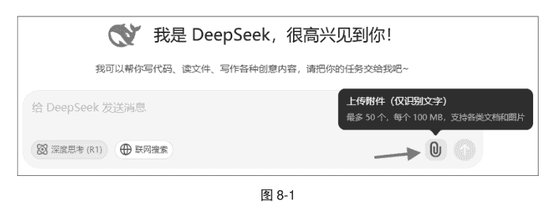

服务合同.pdf。请分析该合同并给出合理解释。

服务合同审查意见

一、合同主体

双方公司名称、法定代表人、地址及联系方式均有明确列出，基本信息完整，便于合同履行过程中的联系与沟通，符合合同规范要求。

建议核实双方主体的真实合法性，确保在签订合同时，甲方、乙方均具备相应的民事行为能力，以及从事相关业务的资质，避免因主体问题引发合同效力争议。例如，若涉及特定行业服务，如金融、医疗等，需查验相关经营许可证。

二、服务内容

服务需求有概括性描述，但详细服务内容部分，“包括但不限于服务的具体步骤、标准等”表述较笼统。应进一步细化，明确各项服务的具体流程、阶段性交付成果及质量验收标准，以防后期因标准不明产生纠纷。比如网站建设，需明确页面设计风格要求、功能模块细节、兼容性标准等。

服务期限起止日期明确，清晰界定了服务时长，有利于双方安排工作进度与资源调配，此部分合理。

#### 三、服务费用及支付方式

服务费用金额以人民币〔×〕元确定，支付方式按预付款、阶段性付款及尾款的设置，逻辑清晰，与常见的服务类合同支付安排相符，具有一定的合理性。

不过，对于“阶段性任务”的界定应在合同中详细说明，明确各阶段的任务内容、验收时间节点及对应的付款触发条件，避免双方对付款节点理解不一致。同时，可考虑增加若甲方逾期验收的处理条款，保障乙方权益。

#### 四、双方权利与义务

甲方权利义务方面：

对服务的监督、检查与验收权，以及提供协助资料、按时付款义务明确，保障了合同执行的双向制约与协作，合理。

建议补充若甲方提供资料有误或延迟，导致服务延误或问题产生时的责任划分条款，避免乙方单方面承担所有后果。

乙方权利义务方面：

按约定提供服务、不得转包分包及保密义务设定恰当，符合服务合同常规要求。

保密条款可细化保密信息范围、保密期限及违约责任，增强保密约束力度，防止信息泄露风险。

#### 五、违约责任

针对甲方、乙方各自违约情形设定了违约金计算方式及相应处理措施，违约成本明确，对双方有约束警示作用，有利于督促履约。

违约金比例〔×%〕的合理性需结合行业惯例、服务成本及预期利润等因素综合考量，若过高可能被认定显失公平，过低则不足以威慑违约行为，建议适当参考同类业务合同违约金标准进行调整。

#### 六、争议解决

采用先协商后诉讼的争议解决方式，符合一般商业合同惯例，且明确了诉讼管辖法院为合同签订地有管辖权的人民法院，确定性强，便于纠纷发生时快速确定受理法院，节省争议解决成本。

可考虑增加仲裁作为争议解决的可选方式之一，为双方提供更多纠纷解决途径，适应不同场景需求。

#### 七、其他条款

合同生效条款规定自双方签字（或盖章）之日起生效，简单明了，符合常规合同生效约定。

合同份数及双方各执一份、同等法律效力的说明清晰，保障合同文本管理与执行依据的规范性。

总体而言，该服务合同涵盖了主要合同要素，但部分条款存在细化完善空间，建议双方根据具体业务情况、行业特点及风险偏好，对上述提及问题进行协商修订，使合同更加严谨、完善，有效防范潜在风险，保障双方合法权益。

因此，当人们需要审查合同时，可寻求DeepSeek的援助。它能协助人们很好地理解合同并运用到实际法律工作中。

### 064 生成律师函模板

在法律实务中，律师函是维护权益、解决纠纷的有力工具。当面临侵权、违约等法律问题时，精准且专业的律师函能有效地传达诉求，化解矛盾。DeepSeek运用先进技术，深度剖析法律条文与案例，可以生成专业的律师函模板，协助人们快速理清思路，以专业的法律语言维护自身权益。

以下是生成律师函模板的要点（图8-2）。

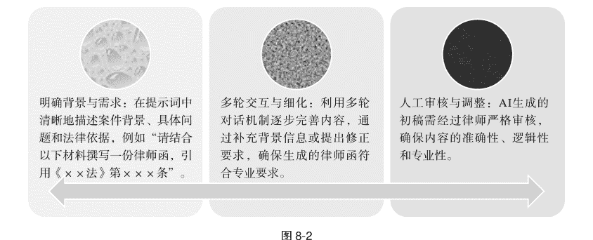

甲方（张三）于2024年5月1日向乙方（李四）借款人民币10万元，约定于2024年12月31日归还。截至2025年2月15日，乙方仍未归还欠款，且多次催促无效。甲方拟委托律师发送律师函，要求乙方限期还款。请撰写一份律师函。要求：

- 1. 引用《中华人民共和国民法典》中关于借款合同的相关条款（如第675条、第676条）。
- 2. 要求乙方在收到律师函后7日内归还欠款，否则将采取法律措施。
- 3. 请按照律师函的标准格式进行排版。

> 律师函
> （2025）××律函字第××号
> 致：李四（身份证号：）
> 地址：××××××××××××

联系电话：××××××××××××

日期：2025年×月×日

#### 关于限期归还借款的律师函

李四先生：

本所受张三（身份证号：，以下简称“委托人”）的委托，就您未依约偿还借款一事，郑重致函如下：

##### 一、事实概述

根据委托人提供的证据材料及陈述，您（乙方）于2024年5月1日向委托人（甲方）借款人民币100000元（大写：拾万元整），双方明确约定还款期限为2024年12月31日。然而，截至2025年2月15日，您仍未履行还款义务。委托人多次通过口头、书面形式催告，您均未予回应或履行债务。

##### 二、法律依据

根据《中华人民共和国民法典》第675条：“借款人应当按照约定的期限返还借款。对借款期限没有约定或者约定不明确，依据本法第五百一十条的规定仍不能确定的，借款人可以随时返还；贷款人可以催告借款人在合理期限内返还。”

根据《中华人民共和国民法典》第676条：“借款人未按照约定的期限返还借款的，应当按照约定或者国家有关规定支付逾期利息。”

您逾期未还款的行为已构成违约，依法应承担继续履行、赔偿损失等法律责任。

##### 三、要求与警示

现本所代表委托人郑重要求您：

于收到本函之日起7日内（即2025年×月×日前），向委托人张三全额偿还借款本金人民币100000元及相应逾期利息（利息计算方式：按同期全国银行间同业拆借中心公布的一年期贷款市场报价利率（LPR）计算，自2025年1月1日起至实际清偿之日止）。

还款账户信息：

户名：张三

开户行：

账号：

##### 四、法律后果

如您未在上述期限内履行还款义务，委托人将依法向人民法院提起诉讼，追究您的违约责任。届时，您除需偿还本金及利息外，还需承担诉讼费、律师费、保全费等一切因诉讼产生的费用，并可能面临财产查封、信用记录受损等不利后果。

请您慎重对待本函，立即履行义务！

（律师事务所公章）

附：

- 委托人张三签署的《授权委托书》；
- 借款凭证复印件；
- 催款记录材料。

（本函一式两份，一份送达乙方，一份存档。）

备注：

本函可通过邮寄、电子送达等方式发送，以乙方实际签收日期为准。

如有疑问，请与本所承办律师联系。

由此可见，DeepSeek可化身“专业律师”给予人们法律支持，能更好地帮助人们处理法律事务。

### 065 提供合规建议

法律是维护公平正义、保障各方权益的基石。随着时代的发展，在日常生活以及职场工作中，人们不可避免地要与法律法规打交道。而DeepSeek能梳理出合法、合理、合规的法律实践建议，助力人们规避风险，坚守法律底线。

要让DeepSeek提供合规法律建议，可参考以下方法。

1. 精准地描述问题：将法律合规问题尽可能具体、清晰地表述出来。比如，不要只问“公司如何合规”，而是具体到“一家互联网公司在收集用户数据时，需要遵循哪些数据保护方面的合规法律要求”，明确主体、行为和目标等要素，以获得更准确的建议。
2. 采用多轮对话：采用多轮对话逐步深入探讨问题。例如，先问“企业在跨境业务中涉及的知识产权合规要点有哪些”，得到初步回答后，再进一步询问“针对美国市场，有哪些特殊的知识产权合规法律规定”等，逐步缩小范围，获取更详细的信息。
3. 提供相关文件：若有具体的合同文本、规章制度等文件需要进行合规性分析，可以上传给DeepSeek。比如，上传一份公司与供应商签订的合作协议，让其分析其中是否存在法律合规风险，是否符合相关法律法规的要求。
4. 明确法律领域和地区：如果问题涉及特定领域的法律（如劳动法、税法等）或特定地区的法律，要在提问中明确指出。比如“在上海，餐饮企业在环保方面需要遵守哪些地方性法规和政策”，帮助DeepSeek更有针对性地提供建议。
5. 要求案例参考：除了要求提供法律条文和合规要点，还可以让DeepSeek提供相关的实际案例，以便更好地理解和应用法律规定。例如“请提供一些因违反《中华人民共和国网络安全法》而受到处罚的企业案例，并分析其违规点”。
6. 限定输出格式：根据自己的需求，要求DeepSeek以特定的格式输出内容，如表格、列表等。比如“以表格形式列出企业在广告宣传中常见的合规法律风险及对应的法律条款”，使信息更清晰直观。

> 某连锁餐饮企业计划推出会员制度，因此会收集会员的姓名、联系方式、消费习惯等信息。从隐私保护和商业营销合规的角度出发，请使用DeepSeek为该企业分析，依据欧盟的《通用数据保护条例》（GDPR），该企业需要提前做好哪些工作？例如对数据的加密处理要求、会员信息的共享限制等，并提供一些因违反该条例而受罚的欧洲餐饮企业案例。

> 根据欧盟《通用数据保护条例》（GDPR），连锁餐饮企业在推出会员制度时需重点落实以下合规工作，并结合实际案例提示风险。

#### 一、核心合规要求

1. 合法性基础与透明度
   - 明确法律依据：收集会员姓名、联系方式等需基于用户明示同意（需主动勾选且可撤回），或证明为履行合同所必需（如配送服务）。
   - 隐私政策透明化：以简明语言告知数据用途（如营销推送）、存储期限、第三方共享对象（如合作支付平台）及用户权利行使方式。

2. 数据最小化与目的限制
   - 仅收集必要数据：例如消费习惯分析无须获取用户家庭住址（除非涉及外卖服务）。
   - 禁止超范围使用：不得将消费记录用于与会员服务无关的用途（如未经同意的保险推销）。

3. 技术安全措施
   - 加密与匿名化：对联系方式等敏感信息采用AES-256加密存储，对消费行为数据可进行聚合分析以降低个体识别风险。
   - 访问权限控制：限制内部员工仅能访问职责所需数据（如客服无权查看支付信息）。

4. 用户权利保障机制
   - 建立自助系统：允许会员在线导出消费记录（数据可携带权）、一键关闭个性化广告（反对权）。
   - 快速响应机制：设置专门的团队处理删除账号（被遗忘权）请求，需在30天内完成。

5. 第三方合作管理
   - 签订DPA协议：与营销公司、云服务商等明确数据处理责任，例如要求AWS提供GDPR合规证明。
   - 共享监控：定期审计合作方数据使用情况，如发现违规转售行为立即终止合作。

6. 跨境数据传输
   - 采用合法工具：若使用中国服务器处理欧盟用户数据，需与欧盟实体签订SCC标准合同条款或通过BCR集团规则。

#### 二、典型处罚案例与教训

- H&M（2020年）
  - 违规行为：过度收集员工健康信息及家庭琐事，且未加密存储导致内部随意浏览。
  - 处罚结果：罚款3530万欧元，创当时德国最高纪录。
  - 启示：即使是内部数据也需严格加密，且收集范围必须合理。

- Foodinho（意大利外卖平台，2021年）
  - 违规行为：算法自动化解雇骑手，但无法解释决策逻辑，侵犯数据主体的知情权。
  - 处罚结果：罚款260万欧元。
  - 启示：自动化决策需提供人工申诉渠道，并向用户说明算法基本原理。

- Domino’s Pizza（荷兰，2020年）
  - 违规行为：未及时报告数据泄露事件，导致60万用户信息外泄。
  - 处罚结果：罚款52万欧元。
  - 启示：必须建立72小时应急报告流程，定期进行渗透测试。

#### 三、实操建议

1. 开展DPIA（数据保护影响评估）
   - 重点评估消费习惯分析与用户画像的隐私风险，对涉及种族、健康（如过敏记录）等特殊数据需额外审批。
2. 设计合规营销策略
   - 邮件/SMS营销需设置双重确认机制（如注册时勾选+首次发送前二次确认）。
   - 个性化推荐需提供“关闭此推荐”的即时选项。
3. 员工培训与模拟演练
   - 每季度对门店员工进行数据采集规范培训（如不得诱导用户提供非必要信息）。
   - 每年模拟数据泄露场景测试响应速度。

#### 四、延伸风险提示

- Cookie与追踪技术：若通过App收集用户位置信息用于门店推荐，需单独获得同意而非捆绑在隐私政策中。
- 儿童数据保护：若涉及未成年人会员，需开发年龄验证系统（如关联银行卡信息核验），并获取监护人同意。

通过上述措施，企业可在提升客户黏性的同时将罚款风险降低90%以上（据欧盟EDPB统计）。建议引入GDPR合规管理软件（如OneTrust）实现自动化consent管理及数据流监控。

由此可见，DeepSeek确实能在法律顾问层面为人们提供大量合理且合规的支持及建议，有利于个人或企业解决现实法律问题。

### 066 生成知识产权申请文件

在知识经济蓬勃发展的当下，知识产权已然成为创新主体的核心资产。申请知识产权不仅是对智慧结晶的法律守护，更是抢占市场先机、提升竞争力的关键举措。本节利用DeepSeek生成知识产权申请文件，旨在凭借前沿技术，严谨、高效地完成申请流程，切实维护权益，助力创新成果转化。

下面是生成知识产权申请文件的要点。

1. 明确申请类型和目标
   - 在开始之前，需要明确是申请专利、商标还是著作权，并了解每种类型的申请文件要求。
   - 专利申请：需要准备说明书、权利要求书、摘要和附图（如果有）。
   - 商标申请：需要准备商标图样、商品或服务描述、使用说明等。
   - 著作权登记：需要准备作品样本、创作说明、权利归属证明等。

2. 提供详细的技术或创意描述
   - 向DeepSeek提供清晰、详细的技术或创意描述，包括以下几点。
   - 技术背景和创新点。
   - 具体的技术方案或设计细节。
   - 商标的图样和使用场景。
   - 著作权作品的类型和内容。

3. 引用相关法律条款和要求
   - 根据申请类型，要求DeepSeek引用相关的知识产权法律条款和申请要求。
   - 专利申请：引用《中华人民共和国专利法》和《中华人民共和国专利法实施细则》的相关条款。
   - 商标申请：引用《中华人民共和国商标法》的相关条款。
   - 著作权登记：引用《中华人民共和国著作权法》的相关条款。

4. 审核和补充
   - DeepSeek生成的文件需要经过专业人员的审核和补充，确保内容的准确性和完整性。特别是专利申请，撰写的权利要求书需要高度专业，建议由专利代理人或律师进行最终审核。

> 某公司开发了一种新型的智能家居控制系统，能够通过语音指令实现多种设备的联动控制，现需申请发明专利。
> 请根据以下技术描述生成一份专利申请文件。
> 1. 技术背景：目前智能家居系统多依赖手机App控制，操作复杂且设备联动性差。本发明旨在通过语音指令实现多种设备的联动控制，提升用户体验。
> 2. 创新点：本发明采用多模态语音识别技术，结合物联网协议，实现设备之间的无缝联动。
> 3. 技术方案：系统包括语音识别模块、设备控制模块和物联网通信模块。用户通过语音指令激活系统，系统解析指令并发送控制信号给相应的设备。
> 4. 请按照专利申请文件的标准格式，生成说明书、权利要求书、摘要和附图说明（如果有）。
> 5. 引用《中华人民共和国专利法》第26条（说明书要求）和第59条（权利要求书要求）。

> 以下是根据您提供的技术描述生成的专利申请文件（模板格式）。

#### 专利申请文件

##### 一、说明书

###### （一）技术领域

本发明涉及智能家居控制技术领域，具体涉及一种基于多模态语音识别与物联网协议的智能家居联动控制系统。

###### （二）背景技术

当前智能家居系统普遍依赖手机App进行单一设备控制，存在以下缺陷。

1. 操作复杂：用户需手动操作多个App，学习成本高。
2. 联动性差：设备间缺乏统一协议，难以实现场景化联动。
3. 交互效率低：语音控制仅支持单一设备指令，无法识别复合场景需求。

（引用现有专利CNXXXXXXA说明技术局限性）

###### （三）发明内容

目的：提供一种通过自然语言指令实现多设备智能联动的控制系统，提升用户体验。

####### 1. 技术方案

1. 语音识别模块：采用多模态识别技术（声纹+语义分析），支持模糊指令解析。
2. 设备控制模块：内置场景化逻辑引擎，将语音指令转化为设备控制序列。
3. 物联网通信模块：集成Zigbee、Wi-Fi、蓝牙多协议适配器，兼容主流智能家居设备。

###### （四）具体实施方式

实施示例：用户语音指令“打开回家模式”，语音识别模块提取关键词“回家模式”。逻辑引擎调用预设场景：开启客厅灯光（通过Zigbee协议）；调节空调至25℃（通过Wi-Fi协议）；启动安防摄像头（通过蓝牙协议）；系统通过物联网模块同步发送控制指令。

###### （五）附图说明

图1：系统架构图（语音识别→逻辑处理→协议适配→设备执行）

图2：多模态语音识别流程图（声纹验证→语义分割→意图匹配）

> （依据《中华人民共和国专利法》第26条，本说明书已充分公开技术方案）

##### 二、权利要求书

1. 独立权利要求

一种智能家居联动控制系统，其特征在于包括以下几点。

1. 语音识别模块，用于接收并解析多模态语音指令。
2. 设备控制模块，包含场景化逻辑引擎，将语音指令转化为设备控制序列。
3. 物联网通信模块，支持多种协议适配，实现跨品牌设备联动控制。

2. 从属权利要求

根据权利要求1（1）所述系统，其特征在于：所述语音识别模块采用声纹验证技术，绑定特定用户语音特征。

根据权利要求1（2）所述系统，其特征在于：所述逻辑引擎支持自定义场景规则，通过机器学习优化指令映射关系。

根据权利要求1（3）所述系统，其特征在于：所述物联网通信模块包含协议转换中间件，兼容Zigbee 3.0、Wi-Fi 6及蓝牙5.3标准。

> （依据《中华人民共和国专利法》第59条，权利要求书明确限定保护范围）

##### 三、摘要

本发明公开了一种基于多模态语音识别的智能家居联动控制系统，通过集成声纹验证、语义分析技术和多协议物联网通信模块，实现自然语言指令到多设备协同控制的自动转化。系统突破传统App控制模式，支持“一句话场景”操作，显著提升智能家居交互效率与设备兼容性。

##### 四、法律声明

本专利申请文件撰写符合《专利审查指南》要求，技术方案具备新颖性、创造性和实用性，请求授予发明专利权。

（注：需补充附图及具体实施数据后提交正式申请）

注意事项：

- 建议补充实验数据证明技术效果（如对比测试报告）
- 附图需标注各模块连接关系及信号流向
- 需进行专利检索确认创新点的新颖性

综上所述，DeepSeek能生成完整的知识产权申请文件，节省人们大量时间与精力，并对知识产权的保护构筑强有力的支撑。

### 067 提供法律咨询服务

当前社会发展迅速，法律领域也在不断创新。DeepSeek作为先进的人工智能技术，拥有强大的自然语言处理能力，能快速分析各类法律问题，提供专业的咨询服务。借助丰富的法律知识储备，DeepSeek能为人们答疑解惑，助力人们高效解决法律难题。

以下是向DeepSeek咨询法律问题的方法（图8-3）。

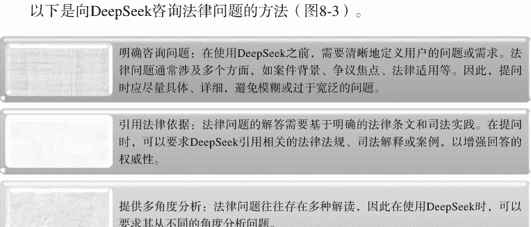

我与某公司签订了一份服务合同，但对方未按约定提供服务，导致我遭受经济损失。合同中约定了违约责任，但对方拒绝赔偿。请问：

1. 我是否可以要求对方承担违约责任？
2. 如果对方拒绝赔偿，我应该如何维权？

根据中国的法律，针对您的情况，分析如下。

#### 一、是否可以要求对方承担违约责任？

可以。根据《中华人民共和国民法典》相关规定，您有权要求对方承担违约责任，具体法律依据如下。

##### 1. 合同有效性

若双方签订的合同合法有效（不存在欺诈、胁迫、违反法律强制性规定等情形），则双方均需依约履行义务（《中华人民共和国民法典》第143条、第502条）。

##### 2. 违约责任的构成

- 对方未按约定提供服务，构成违约（《中华人民共和国民法典》第577条）。
- 若合同中已明确约定违约责任（如违约金、赔偿范围等），您可依据合同条款主张赔偿（《中华人民共和国民法典》第585条）。
- 即使合同未明确约定，您仍可要求赔偿实际损失（包括直接经济损失和合理预期利益损失，但需举证证明），法律依据为《中华人民共和国民法典》第584条。

##### 3. 免责事由的排除

若对方主张因不可抗力或您的过错导致违约，需由对方承担举证责任（《中华人民共和国民法典》第590条）。若其无法证明，则不能免除责任。

#### 二、对方拒绝赔偿时如何维权？

维权途径与步骤如下。

##### 1. 协商优先

建议先通过书面函件（如律师函）与对方协商，明确要求其限期履行或赔偿。协商成本低、效率高，且可能避免诉讼。

##### 2. 第三方调解

若协商无果，可向以下机构申请调解。
- 消费者协会（如属于消费合同）；
- 行业调解组织（如行业协会）；
- 人民调解委员会（基层调解组织，调解协议可司法确认）。

##### 3. 仲裁或诉讼

- 仲裁：若合同中约定仲裁条款，需向约定的仲裁机构申请仲裁（一裁终局，效率较高）。
- 诉讼：若无仲裁条款，可向被告所在地或合同履行地法院起诉。
- 诉讼流程如下。

1. 准备起诉材料（起诉状、合同、违约证据、损失证明等）。
2. 法院立案后进入审理程序。
3. 判决生效后申请强制执行（若对方仍不履行）。

##### 4. 财产保全

诉讼中可申请财产保全，冻结对方银行账户或查封财产，确保判决后可执行。

#### 关键证据清单

- 合同原件（证明双方权利义务）；
- 违约证据（如未提供服务的记录、沟通函件、现场照片等）；
- 损失证明（如财务凭证、替代交易成本单据、第三方评估报告等）；
- 其他材料（如催告履行的通知、律师函、对方拒绝赔偿的回复等）。

#### 补充建议

1. 诉讼时效：自知道或应当知道权利受损之日起3年内起诉（《中华人民共和国民法典》第188条），逾期可能丧失胜诉权。
2. 律师协助：建议委托律师代理，尤其是损失金额较大或证据复杂时。
3. 电子证据保存：若合同或沟通记录为电子形式（如邮件、微信），需及时公证固定证据。

#### 法律依据摘要

- 《中华人民共和国民法典》第577条：违约方应承担继续履行、赔偿损失等责任。
- 《中华人民共和国民法典》第584条：赔偿范围包括实际损失和可得利益损失。
- 《中华人民共和国民事诉讼法》第122条：起诉需满足原告适格、明确被告、具体诉求等条件。

建议您尽快采取法律行动，避免损失扩大或证据灭失。

因此，DeepSeek就是人们“身边的律师”，遇到不懂的法律问题都能向它求助。

## 第 9 章 IT 与编程：开发效率的革命性提升

虽然DeepSeek并非专门为编程设计的工具，但它可以作为一款高效的编程辅助工具，帮助用户更轻松地完成各类编程任务。

通过自然语言描述，DeepSeek能够理解用户的需求，并提供相应的代码示例或解决方案。这大大降低了编程的门槛，使初学者也能快速上手，完成简单的编程工作。除此之外，DeepSeek还可以轻松处理编程任务、修正代码错误、解读代码、为代码添加注释、优化代码、进行代码翻译等。

### 068 生成代码

DeepSeek支持多种编程语言，涵盖了从后端开发到前端设计的广泛技术栈。其适用语言包括但不限于Python、Java、JavaScript、C++、C#、Ruby、PHP、Swift、Kotlin、TypeScript和Go等。此外，DeepSeek还能够编写HTML和CSS代码，帮助用户构建网页结构和样式，实现基本的前端页面开发。

借助DeepSeek，用户只需用自然语言清晰地描述需求，它便能根据指示生成相应的代码。这种方式不仅降低了编程的门槛，使初学者能够更快上手，同时也在很大程度上减轻了程序员的工作负担，提高开发效率。

> 请用Python编写一个简单的待办事项（Todo List）程序，用户可以添加任务、查看任务和删除任务。请确保代码清晰易懂，并添加注释，帮助初学者理解每一部分代码的作用。

以下是一个简单的Python待办事项程序，包含详细的注释说明。该程序实现了添加任务、查看任务、删除任务和退出程序功能。

```python
# 待办事项列表程序
# 作者：DeepSeek-R1

# 初始化一个空列表来存储任务
tasks = []

def show_menu():
    """显示程序菜单"""
    print("\n=== 待办事项列表 ===")
    print("1. 添加任务")
    print("2. 查看任务")
    print("3. 删除任务")
    print("4. 退出程序")
    print("====================")

def add_task():
    """添加新任务到列表"""
    task = input("请输入要添加的任务内容：")
    tasks.append(task)  # 将新任务添加到列表末尾
    print(f"任务'{task}'已成功添加！")

def show_tasks():
    """显示当前所有任务"""
    if not tasks:
        print("当前没有任务！")
    else:
        print("\n当前任务列表：")
        # 使用enumerate同时获取索引和任务内容
        for index, task in enumerate(tasks, start=1):
            print(f"{index}. {task}")

def delete_task():
    """根据序号删除任务"""
    show_tasks()  # 先显示当前任务
    if tasks:
        try:
            # 获取用户输入的序号并转换为列表索引
            task_num = int(input("请输入要删除的任务序号："))
            if 1 <= task_num <= len(tasks):
                removed_task = tasks.pop(task_num - 1)  # 索引需要减1
                print(f"任务 '{removed_task}' 已删除")
            else:
                print("无效的任务序号！")
        except ValueError:  # 处理非数字输入
            print("请输入有效的数字序号！")

def main():
    """主程序循环"""
    print("欢迎使用待办事项管理系统！")
    while True:
        show_menu()
        choice = input("请选择操作（1-4）：")

        if choice == "1":
            add_task()
        elif choice == "2":
            show_tasks()
        elif choice == "3":
            delete_task()
        elif choice == "4":
            print("感谢使用，再见！")
            break  # 退出循环
        else:
            print("无效的输入，请重新选择！")

if __name__ == "__main__":
    main()
```

#### 1. 代码说明

（1）数据结构
使用列表tasks存储所有任务；
索引从1开始显示（更符合日常习惯）。

（2）主要函数
show_menu()：显示操作菜单；
add_task()：添加新任务；
show_tasks()：显示所有任务；
delete_task()：删除指定任务；
main()：主程序循环。

（3）异常处理
在删除任务时使用try-except处理非数字输入；
检查任务序号是否在有效范围内。

（4）用户交互
使用简单的数字选择操作方式；
每个操作都有明确的反馈提示。

#### 2. 功能特点

- 持续运行直到用户选择退出；
- 清晰的菜单界面；
- 人性化的序号显示（从1开始）；
- 输入错误时的友好提示；
- 删除前会显示当前任务列表。

#### 3. 使用示例

```
欢迎使用待办事项管理系统！
=== 待办事项列表 ===
1. 添加任务
2. 查看任务
3. 删除任务
4. 退出程序
====================
请选择操作（1~4）：1
请输入要添加的任务内容：完成Python作业
任务'完成Python作业'已成功添加！
=== 待办事项列表 ===
```

……（后续操作类似）

这个程序可以作为学习以下Python特性的范例：

- 列表操作（append/pop）；
- 循环结构（while True）；
- 条件判断（if-elif-else）；
- 异常处理（try-except）。

函数定义与调用如下：

- 用户输入处理（input）；
- 字符串格式化（f-string）。

这个待办事项程序结构清晰、逻辑简明，适合作为初学者学习Python基础的示例；它使用了函数来组织代码，使得各个功能模块独立、易于维护和扩展；主程序采用循环结构，确保用户可以多次执行操作，直到选择退出。

### 069 代码 debug

DeepSeek不仅具备代码编写能力，还能协助程序员高效地检查和修正代码错误。无论是初学者还是资深开发者，都可以利用DeepSeek来提升代码质量，减少调试时间。

当用户提供代码片段时，DeepSeek会进行深入分析，精准识别其中的语法错误、逻辑漏洞，以及可能影响性能的隐患。它不仅能定位问题，还能结合编程经验和最佳实践，提供优化建议，帮助开发者编写更高效、稳定的代码。

> 请检查下面的代码存在什么问题。

```python
num = 10
denominator = 0
result = num / denominator
print(result)
```

> 这段代码存在一个明显的运行时错误——除以零（ZeroDivisionError），具体分析如下。

#### 问题诊断

1. 错误位置：第3行 `result = num / denominator`
2. 错误类型：`ZeroDivisionError: division by zero`
3. 错误原因：变量`denominator`被赋值为0。
在数学和编程中，任何数除以0都是非法操作，会导致程序崩溃。

#### 错误重现

直接运行代码会触发以下错误：

```
Traceback (most recent call last):
  File "<stdin>", line 3, in <module>
ZeroDivisionError: division by zero
```

#### 解决方案

**方案1：避免分母为0（静态检查）**

```python
num = 10
denominator = 0
if denominator != 0:
    result = num / denominator
    print(result)
else:
    print("错误：分母不能为0！")
```

**方案2：异常捕获（动态处理）**

```python
num = 10
denominator = 0
try:
    result = num / denominator
    print(result)
except ZeroDivisionError:
    print("错误：除法运算中分母不能为0！")
```

**方案3：逻辑修正（实际问题场景）**
如果分母值应来自用户的输入或动态计算，需添加校验逻辑：

```python
def safe_divide(numerator, denominator):
    if denominator == 0:
        return None  # 或 raise ValueError("分母不能为0")
    return numerator / denominator

num = 10
denominator = 0
result = safe_divide(num, denominator)
print(result if result is not None else "无法计算：分母为0")
```

#### 根本原因分析

- 编程规范缺失：未对关键操作（如除法）的输入进行有效性校验；
- 异常处理不足：未使用try-except机制捕获潜在错误；
- 业务逻辑漏洞：分母值被硬编码为0（可能是测试遗漏或赋值错误）。

#### 扩展建议

- 防御性编程：对关键变量（尤其是作为分母、数组索引等）进行前置条件检查；
- 单元测试：编写测试用例覆盖分母为0的边界场景；
- 用户输入验证：若分母来自用户输入，需增加类型和范围校验。

修正后的代码应始终确保分母非零，或在发生除以零时明确处理错误。

这是一个Python中经典的除零错误。在Python中，不能用0作为除数，否则会引发“ZeroDivisionError”。DeepSeek成功指出了问题代码，并给出了相应的3个解决方案。

### 070 理解代码

在训练过程中，DeepSeek学习并吸收了大量的编程示例和专业知识，使其具备广泛的编程理解能力。无论是主流编程语言，还是各种开发框架，DeepSeek都能迅速掌握其基本结构和核心概念。

凭借这一优势，DeepSeek能够准确解析代码的功能与逻辑，帮助开发者理解程序的运行机制。例如，它可以分析Python、Java、C++等多种语言的代码，并对不同的编程范式（如面向对象编程、函数式编程）提供具有针对性的解读。

> 请你解释下面这段代码的功能和运行结果。

```java
public class Counter {
    public static void main(String[] args) {
        for (int i = 1; i <= 5; i++) {
            System.out.println("计数: " + i);
        }
    }
}
```

> 这段Java代码的功能是使用for循环实现一个简单的计数器，并将计数结果输出到控制台。

#### 代码解析

1. 类定义：`public class Counter`
定义了一个名为 Counter 的公共类，类名通常与文件名相同（即 Counter.java）。
2. 主方法：`public static void main(String[] args)`
这是 Java 程序的入口点，所有 Java 程序的执行都是从 main 方法开始的。
3. for循环：`for (int i = 1; i <= 5; i++)`
`int i = 1;`：初始化变量 i，初始值为 1。
`i <= 5;`：循环条件，只有当 i 小于等于 5 时，循环才会继续执行。
`i++`：每次循环结束后，i 递增 1。
4. `System.out.println("计数: " + i);`
每次循环都会输出当前 i 的值，形成递增的计数结果。

#### 运行结果

当程序运行时，for 循环会执行 5 次，每次 i 递增 1，最终输出以下内容。

```
计数：1
计数：2
计数：3
计数：4
计数：5
```

这段代码的主要作用是演示 Java 中 for 循环的基本用法，适用于遍历固定次数的循环结构。

对于这段代码，DeepSeek能准确地识别出其为Java程序，然后正确地解读了该代码用于演示Java中for循环的基本用法，并成功地给出了正确的输出结果。

### 071 代码性能优化

DeepSeek在代码优化方面为程序员提供了强大的支持，不仅能够简化代码逻辑，还能合并冗余代码，使代码更加高效。同时，它还能推荐更简洁的语法结构，让代码更加清晰易读，减少维护成本。

此外，DeepSeek还可以检查代码的可读性，例如命名是否规范、注释是否清晰、空格和缩进是否合理等，从而提升代码的整体质量。与此同时，它还能帮助程序员提高代码的模块化程度，优化代码结构，使其更具复用性和扩展性。

> 请将下面一段代码进行优化。

```java
public class StringConcatenationExample {
    public static void main(String[] args) {
        String result = "";
        for (int i = 1; i <= 100; i++) {
            result += i + ", ";
        }
        System.out.println(result);
    }
}
```

以下是优化后的代码，主要改进点如下。

- 使用StringBuilder进行字符串拼接，避免String的重复创建，提高性能。
- 去除末尾多余的 ", "，确保输出格式正确。
- 代码模块化：将拼接逻辑拆分到一个独立方法 `generateNumberString`，提高代码复用性和可读性。

优化后的代码如下：

```java
public class StringConcatenationExample {
    public static void main(String[] args) {
        String result = generateNumberString(1, 100);
        System.out.println(result);
    }

    private static String generateNumberString(int start, int end) {
        StringBuilder sb = new StringBuilder();
        for (int i = start; i <= end; i++) {
            sb.append(i);
            if (i < end) {
                sb.append(", ");
            }
        }
        return sb.toString();
    }
}
```

#### 优化点解析

- 性能提升：StringBuilder通过可变字符串缓冲区高效拼接，避免String的不必要创建。
- 去除末尾逗号：通过 `if (i < end)` 控制，只在非最后一个元素后添加 ", "。
- 模块化设计：`generateNumberString` 方法可复用，也方便后续扩展，如更改范围或格式。

运行结果如下。

```
1, 2, 3, …, 99, 100
```

DeepSeek所提供的优化代码充分利用了代码模块化和字符串拼接，提高了代码的性能、复用性和可读性。

### 072 进行代码翻译

DeepSeek具备一定的代码翻译能力，可以将一种编程语言的代码转化为另一种编程语言。然而，需要注意的是，对于一些复杂的代码转换任务，ChatGPT可能无法直接处理。因此，针对复杂的代码，建议将其拆解成更小的片段进行逐一翻译。通过这种方式，不仅能简化转换过程，还能显著提高翻译的准确性和可靠性。

> 请将下面的Java代码翻译成Python和C++代码。

```java
public class BubbleSort {
    public static void main(String[] args) {
        int[] arr = {64, 34, 25, 12, 22, 11, 90};
        bubbleSort(arr);
        System.out.println("Sorted array:");
        for (int i = 0; i < arr.length; i++) {
            System.out.print(arr[i] + " ");
        }
    }

    public static void bubbleSort(int[] arr) {
        int n = arr.length;
        for (int i = 0; i < n - 1; i++) {
            for (int j = 0; j < n - 1 - i; j++) {
                if (arr[j] > arr[j + 1]) {
                    int temp = arr[j];
                    arr[j] = arr[j + 1];
                    arr[j + 1] = temp;
                }
            }
        }
    }
}
```

下面是将Java代码翻译成Python和C++代码的版本。

1. Python版本

```python
def bubble_sort(arr):
    n = len(arr)
    for i in range(n - 1):
        for j in range(n - 1 - i):
            if arr[j] > arr[j + 1]:
                arr[j], arr[j + 1] = arr[j + 1], arr[j]

def main():
    arr = [64, 34, 25, 12, 22, 11, 90]
    bubble_sort(arr)
    print("Sorted array:")
    print(arr)

if __name__ == "__main__":
    main()
```

2. C++版本

```cpp
#include <iostream>
using namespace std;

void bubbleSort(int arr[], int n) {
    for (int i = 0; i < n - 1; i++) {
        for (int j = 0; j < n - 1 - i; j++) {
            if (arr[j] > arr[j + 1]) {
                int temp = arr[j];
                arr[j] = arr[j + 1];
                arr[j + 1] = temp;
            }
        }
    }
}

int main() {
    int arr[] = {64, 34, 25, 12, 22, 11, 90};
    int n = sizeof(arr) / sizeof(arr[0]);
    bubbleSort(arr, n);
    cout << "Sorted array:" << endl;
    for (int i = 0; i < n; i++) {
        cout << arr[i] << " ";
    }
    cout << endl;
    return 0;
}
```

3. 代码解释

（1）Python代码

- 定义了`bubble_sort()`函数实现冒泡排序。
- `main()`函数用于初始化数组并调用排序函数，然后打印排序后的数组。
- 使用`if __name__ == "__main__":`确保在直接运行脚本时执行`main()`函数。

（2）C++代码

- 定义了`bubbleSort()`函数实现冒泡排序，接受数组和数组长度作为参数。
- `main()`函数用于初始化数组、计算数组长度，并调用排序函数后打印结果。

这是一段经典的冒泡排序代码，经过DeepSeek的精确处理，这段代码成功地被转译成Python和C++的代码形式，并且准确无误。

### 073 添加代码注释

代码注释是代码中的说明性语句，旨在解释代码的意图和功能。它们使得代码更加易于理解，帮助开发人员快速理解程序的工作原理。在团队合作中，良好的注释能让其他开发人员更容易地根据需求修改和维护代码。注释不仅有助于当前开发者清晰地记录思路，还能为未来的维护者提供有价值的参考。

通过DeepSeek，开发人员可以轻松地为代码添加注释。只需要将需要注释的代码输入到DeepSeek中，它便能够自动为代码提供清晰、简洁的注释，帮助开发人员节省时间，提高代码的可读性和可维护性。

> 请为下面的代码逐行添加中文注释。

```java
public class Example {
    public static void main(String[] args) {
        int[] numbers = {3, 7, 1, 9, 5};
        int sum = 0;
        for (int i = 0; i < numbers.length; i++) {
            sum += numbers[i];
        }
        double average = sum / (double) numbers.length;
        System.out.println("Sum: " + sum);
        System.out.println("Average: " + average);
    }
}
```

以下是为给定代码逐行添加中文注释后的版本。

```java
public class Example { // 定义一个名为Example的公共类
    public static void main(String[] args) { // 主方法，程序的入口
        int[] numbers = {3, 7, 1, 9, 5}; // 定义一个整数数组并初始化其元素
        int sum = 0; // 初始化一个变量sum，用于存储数组元素的总和

        // 遍历数组中的每个元素，计算总和
        for (int i = 0; i < numbers.length; i++) { // 循环遍历数组中的每个元素
            sum += numbers[i]; // 将当前元素加到sum中
        }

        // 计算数组元素的平均值
        double average = sum / (double) numbers.length; // 将总和除以数组的长度，得到平均值

        // 输出总和
        System.out.println("Sum: " + sum); // 输出总和到控制台

        // 输出平均值
        System.out.println("Average: " + average); // 输出平均值到控制台
    }
}
```

这段代码的功能是计算并打印一个整数数组的总和平均值。注释可以帮助用户解释每一行代码的作用。
需要注意的是，这些注释是基于代码的逻辑编写的。在使用这些注释时，要确保其准确地描述了代码的功能和行为。如果有需要，用户可以根据实际情况对注释进行修改。

这是一段计算并打印一个整数数组的程序，DeepSeek所提供的中文代码注释清晰明了，这说明DeepSeek对这段代码功能有深入了解。

### 074 编写测试脚本

尽管DeepSeek无法直接进行代码测试，但用户依然可以将代码、测试案例或测试计划提交给DeepSeek。在收到这些信息后，DeepSeek会提供关于优化测试的专业建议，帮助用户提高测试效率和准确性。这种方式能够在代码开发的各个阶段为开发者提供重要的支持。

此外，DeepSeek不仅能够帮助用户分析和优化测试，还具备编写单元测试代码的能力。用户提供自动化单元测试代码，DeepSeek能够进一步提升代码质量，确保功能的稳定性和可维护性，减少人工测试的工作量。

请为下面的Java代码编写单元测试代码。

```java
public class Calculator {
    // 加法
    public int add(int a, int b) {
        return a + b;
    }
    // 减法
    public int subtract(int a, int b) {
        return a - b;
    }
    // 乘法
    public int multiply(int a, int b) {
        return a * b;
    }
    // 除法
    public double divide(int a, int b) {
        if (b == 0) {
            throw new ArithmeticException("Cannot divide by zero");
        }
        return (double) a / b;
    }
}
```

以下是为你的Calculator类编写的JUnit单元测试代码，使用JUnit 5进行测试。

JUnit单元测试代码（CalculatorTest.java）

```java
import static org.junit.jupiter.api.Assertions.*;
import org.junit.jupiter.api.Test;

public class CalculatorTest {

    // 测试加法方法
    @Test
    public void testAdd() {
        Calculator calculator = new Calculator();
        int result = calculator.add(10, 5);
        assertEquals(15, result, "10 + 5 应该等于 15");
    }

    // 测试减法方法
    @Test
    public void testSubtract() {
        Calculator calculator = new Calculator();
        int result = calculator.subtract(10, 5);
        assertEquals(5, result, "10-5 应该等于 5");
    }

    // 测试乘法方法
    @Test
    public void testMultiply() {
        Calculator calculator = new Calculator();
        int result = calculator.multiply(4, 5);
        assertEquals(20, result, "4 × 5 应该等于 20");
    }

    // 测试除法方法
    @Test
    public void testDivide() {
        Calculator calculator = new Calculator();
        double result = calculator.divide(10, 2);
        assertEquals(5.0, result, 0.0001, "10 / 2 应该等于 5.0");
    }

    // 测试除数为零的情况，应该抛出异常
    @Test
    public void testDivideByZero() {
        Calculator calculator = new Calculator();
        assertThrows(ArithmeticException.class, () -> {
            calculator.divide(10, 0);
        }, "除数为零时应抛出 ArithmeticException");
    }
}
```

说明

1. `assertEquals(expected, actual, message)`
   确保方法返回的结果符合预期值。
   例如`testAdd()`用于验证 10 + 5 是否等于 15。
2. `assertThrows()`
   验证除数为零时，方法是否正确抛出`ArithmeticException`。
   `testDivideByZero()`用于确保`divide(10, 0)`会抛出异常。
3. `assertEquals(expected, actual, delta, message)`
   用于double类型比较，delta指定允许的误差范围（例如 0.0001）。

运行测试

如果你的开发环境（如IntelliJ IDEA、Eclipse）已集成JUnit，可以右击`CalculatorTest`运行测试。

如果使用Maven，可以运行以下命令：

```
mvn test
```

所有测试通过，则表示Calculator类的基本功能正确！

DeepSeek提供的测试代码简洁、结构清晰、易于理解和维护，涵盖了大部分场景，有助于确保代码的正确性。

### 075 解释错误信息

在编程过程中，各种报错是常见的挑战。传统的错误处理方式通常依赖于通过搜索引擎查找相关资料，或者在Stack Overflow等技术社区中寻找解决方案。然而这种方法不仅费时费力，还可能因为信息过载或答案质量参差不齐而增加解决问题的难度。

用户只需将程序的异常信息提交给DeepSeek，便能快速获得精准的分析和解决方案。DeepSeek能够智能解析错误信息，提供清晰的故障原因，并给出优化建议，从而大大提高解决问题的效率，帮助开发者更专注于代码实现和功能优化。

> 请问下面的异常信息是什么原因造成的。
> Exception in thread "main" java.lang.ArrayIndexOutOfBoundsException: Index 10 out of bounds for length 5 at Main.main ( Main.java:5 )

这个异常是数组越界访问导致的，具体原因如下。

异常解析
异常类型：`java.lang.ArrayIndexOutOfBoundsException`
关键信息：`Index 10 out of bounds for length 5`
触发位置：`Main.java`第5行代码

直接原因：非法索引访问
你的代码试图访问数组的第11个元素（索引从0开始），但该数组实际长度只有5，有效索引范围是 0~4。
例如：

```java
int[] arr = new int[5];  // 最大索引为4
System.out.println(arr[10]); // 触发异常
```

常见场景
场景1：循环条件错误
```java
int[] data = new int[5];
// 错误：i <= data.length会导致i=5时越界
for (int i = 0; i <= data.length; i++) {
    data[i] = i; // 当i=5时抛出异常
}
```
修复：
```java
for (int i = 0; i < data.length; i++) {...}
```
场景2：硬编码索引
```java
String[] names = {"Alice", "Bob", "Charlie"};
System.out.println(names[3]); // 最大索引为2
```
场景3：动态计算索引
```java
int index = userInput; // 若用户输入超过数组长度-1
int value = arr[index]; // 可能触发异常
```

解决方案
1. 检查索引范围
```java
if (index >= 0 && index < array.length) {
    // 安全访问
} else {
    System.out.println("Invalid index: " + index);
}
```

2. 调试定位问题行

查看`Main.java`第5行代码，常见问题模式：

```java
// 示例错误代码
int[] arr = new int[5];
int errorValue = arr[10]; // ← 第5行
```

使用增强for循环（避免手动控制索引）

```java
for (int num : arr) { // 自动遍历所有元素
    System.out.println(num);
}
```

验证案例

假设你的代码如下：

```java
public class Main {
    public static void main(String[] args) {
        int[] numbers = {10, 20, 30, 40, 50};
        System.out.println(numbers[10]); // ← 第5行
    }
}
```

修正后如下：

```java
System.out.println(numbers[4]); // 输出最后一个元素50
```

预防建议

- 始终用`array.length`控制循环条件
- 避免硬编码索引值
- 对外部输入的索引值进行有效性校验
- 使用IDE断点调试工具检查运行时数组状态

DeepSeek指出了程序异常的原因并提供了解决方案，让程序的异常问题得到了快速解决。

# 第 10 章

## 心理咨询：情感支持新范式

在当代社会，心理健康问题日益受到关注，情感支持转向更为互动、共情的协作模式。这一新范式不仅强调专业知识的应用，更注重建立真诚的情感连接，通过倾听、共情和赋能，帮助个体在安全、包容的环境中探索自我、释放情感，并找到内在的力量与解决方案。本章将围绕7个实例来展示DeepSeek在心理咨询领域的应用价值。

### 076 进行压力评估

在这个生活节奏加快，人人变得焦虑的时代，越来越多的人开始关注心理健康，生活压力也催生了各种各样的心理支持方式。比如，有人开始寻求DeepSeek的帮助。

DeepSeek在进行压力评估时，能够通过结构化的问卷和清晰的分值系统，帮助用户快速了解自身的压力水平。它的评估问题涵盖了情绪、身体反应、社交影响等多个维度，较为全面。

> 请给我做一份压力评估测试，看看我最近的压力水平。

> 好的，我可以帮助你进行一个简单的压力评估。请根据以下问题回答，选择最符合你当前感受的选项。每个选项对应不同的分值，最后将所有分值相加，评估你的压力水平。

压力评估问卷

1. 最近你是否感到焦虑或紧张？
   A. 从未（0分）
   B. 偶尔（1分）
   C. 经常（2分）
   D. 总是（3分）
2. 你是否感到难以放松或休息？
   A. 从未（0分）
   B. 偶尔（1分）
   C. 经常（2分）
   D. 总是（3分）
3. 你是否感到疲惫或精力不足？
   A. 从未（0分）
   B. 偶尔（1分）
   C. 经常（2分）
   D. 总是（3分）
4. 你是否因为压力而感到身体不适（如头痛、胃痛等）？
   A. 从未（0分）
   B. 偶尔（1分）
   C. 经常（2分）
   D. 总是（3分）
5. 你是否因为压力而影响睡眠（如失眠、多梦等）？
   A. 从未（0分）

B. 偶尔（1分）
C. 经常（2分）
D. 总是（3分）

6. 你是否因为压力而影响工作或学习效率？
A. 从未（0分）
B. 偶尔（1分）
C. 经常（2分）
D. 总是（3分）

7. 你是否因为压力而感到情绪低落或易怒？
A. 从未（0分）
B. 偶尔（1分）
C. 经常（2分）
D. 总是（3分）

8. 你是否因为压力而减少社交活动，以及与朋友、家人的互动？
A. 从未（0分）
B. 偶尔（1分）
C. 经常（2分）
D. 总是（3分）

评估结果
0~5分：你的压力水平较低，目前处于相对轻松的状态。
6~10分：你有一些压力，但仍在可控范围内。建议适当放松，调整心态。
11~15分：你的压力水平较高，可能需要采取一些措施来缓解压力，如运动、冥想或寻求专业的帮助。
16~24分：你的压力水平非常高，建议尽快采取措施减压，并考虑寻求心理咨询师或专业的帮助。
请根据你的选择计算总分，并参考上述评估结果。如果你有任何进一步的问题或需要更多建议，请告诉我！

> 我的评估结果为14分，请问你有什么好的措施和建议，帮助我缓解压力，请详细进行说明。

压力测试评估结果为14分，表明你可能正经历中度压力。以下是一些详细的建议和措施，帮助你缓解压力。

1. 识别压力源
记录压力来源：每天记录让你感到有压力的事件或情境，了解压力产生的根源。
分类压力：将压力源分为可控和不可控两类，专注于你能改变的部分。

2. 时间管理
优先级排序：使用“重要紧急”矩阵，优先处理重要且紧急的任务。
分解任务：将大任务拆解为小步骤，逐步完成，避免拖延。
设定合理的目标：避免过高的期望，设定可实现的目标。

3. 放松技巧
深呼吸：每天进行几分钟的深呼吸练习，帮助放松。
渐进性肌肉放松：从脚到头逐步放松身体各部位，缓解紧张。
冥想：每天冥想10~20分钟，专注于呼吸或正念，减少焦虑。

4. 运动与健康
规律运动：每周进行3~5次有氧运动，如跑步、游泳等，释放内啡肽，提升情绪。
健康饮食：保持均衡饮食，减少咖啡因和糖分摄入，避免情绪波动。
充足睡眠：确保每天7~9小时的高质量睡眠，帮助身体恢复。

5. 社交支持
与他人交流：与朋友或家人分享感受，获得情感支持。
寻求专业的帮助：如果压力持续，考虑进行心理咨询或治疗。
加入支持小组：参与压力管理小组，获得更多支持和建议。

6. 调整心态
接受不完美：允许自己犯错，不必追求完美。
积极思考：关注积极面，培养乐观的心态。
学会放手：接受无法控制的事情，专注于自己能改变的部分。

7. 兴趣爱好
培养兴趣：从事喜欢的活动，如阅读、绘画等，转移注意力。
享受自然：多接触大自然，如散步或远足，放松身心。

8. 工作与生活平衡
设定界限：明确工作与生活的界限，避免工作侵占个人休息时间。
定期休息：工作间隙短暂休息，避免长时间紧张。

9. 自我反思
定期反思：每周或每月反思压力管理情况，调整策略。
记录进展：记录压力缓解的进展，增强信心。

10. 专业帮助
心理咨询：如果压力持续影响生活，寻求心理咨询师的帮助。
药物治疗：在医生建议下，考虑使用药物缓解焦虑或抑郁症状。

总结
缓解压力需要从多个方面入手，结合时间管理、放松技巧、运动、社交支持和心态调整等方法。如果压力持续，及时寻求专业的帮助。希望这些建议对你有所帮助。

### 077 提供认知行为训练

认知行为训练是一种通过识别和调整负面思维模式，进而改变不良情绪和行为的心理干预方法。它强调自我觉察，帮助个体识别自动化思维中的认知偏差，并通过练习和实践，建立更积极、理性的思维方式，从而改善情绪状态和行为反应。

使用DeepSeek进行认知行为训练是一种创新且高效的方法，它结合了先进的人工智能技术与心理学原理，为用户提供个性化的心理支持。

> 请根据认知行为训练的方法，为一位因焦虑导致社交回避的年轻人制订一个训练计划。计划应包括认知重构、行为暴露、放松训练等具体步骤，并提供实际操作示例，以帮助其逐步改善社交焦虑。

> 以下是一套简化的认知行为训练（CBT）练习，旨在帮助你改善负面情绪。这套训练基于CBT的核心原则，包括识别负面思维、挑战认知偏差和建立积极行为模式。你可以每天练习，逐步培养更健康的思维和情绪管理能力。

第一步：情绪记录与觉察

1. 记录情绪：每天记录让你产生负面情绪的事件（如焦虑、愤怒、悲伤）。
事件：发生了什么？
情绪：你感受到什么情绪？（用具体的词语描述，如“沮丧”“焦虑”）
强度：情绪的强度是多少？（用1-10分评估）
2. 识别自动思维：在情绪出现时，问自己：
“我在想什么？”
“我对自己说了什么？”
记录下这些自动思维（如“我永远做不好”“没人喜欢我”）。

第二步：挑战负面思维

1. 识别认知偏差，分析你的自动思维，看看是否存在以下常见的认知偏差：
非黑即白思维（极端化）
过度概括（以偏概全）
灾难化（把小事想得过于严重）
个人化（把责任全归咎于自己）
2. 反驳负面思维，问自己：
“这种想法有证据支持吗？”
“有没有其他可能的解释？”
“如果朋友遇到这种情况，我会怎么劝他？”
写下更理性、平衡的想法。

第三步：行为激活与积极行动

1. 制定小目标：每天设定一个小的、可实现的目标，例如：散步10分钟、给朋友发一条消息、完成一项简单的任务。
2. 记录成就感：完成后，记录你的感受，并肯定自己的努力。

第四步：放松与正念练习

1. 深呼吸练习：每天花5分钟进行深呼吸，专注于呼吸的节奏，缓解紧张情绪。
2. 正念觉察：练习关注当下，观察自己的情绪和想法，但不评判它们。

第五步：反思与调整

1. 每周回顾：回顾一周的情绪记录和思维挑战，看看哪些方法有效，哪些需要调整。
2. 奖励自己：为你的进步设定奖励，强化积极行为。

示例练习
情境：你在工作中犯了一个错误，感到非常焦虑。
自动思维：“我真是个失败者，我永远做不好。”
认知偏差：过度概括、灾难化。
理性回应：“每个人都会犯错，这并不代表我失败。我可以从中学到东西，下次做得更好。”
行动：制订一个改进计划，并告诉自己“我在努力进步”。
通过持续练习，你会逐渐学会识别和调整负面思维，建立更积极的情绪和行为模式。如果需要更深入的支持，建议寻求专业心理咨询师的帮助。

DeepSeek能够通过智能分析用户的思维模式和情绪状态，提供实时的反馈和指导，帮助用户识别和调整认知偏差，从而促进积极的行为改变。这种训练方式不仅便捷，还能根据用户的进展动态调整训练内容，使认知行为训练更加精准和有效。

### 078 模拟亲密关系对话

随着社会的发展，越来越多缺乏社交支持或感到孤独的人使用AI提供一种情感陪伴，缓解孤独感。DeepSeek通过自然语言处理和情感分析，可以模拟伴侣的回应，提供中立的反馈和建议，帮助用户更好地理解自己和对方的需求。下面是DeepSeek模拟亲密关系中好朋友一角的具体示例对话。

接下来你将充当我的好朋友来跟我对话。

好的！那现在我就是你的好朋友啦！我们可以像闺蜜/兄弟一样轻松自在地聊天！你今天有什么有趣的事情发生吗？或者有什么想吐槽的？我随时都在哦！

今天工作好累呀，感觉自己超负荷了！

哎呀，听起来你今天真的挺辛苦的！工作超负荷的感觉真的很不好受，特别容易让人身心俱疲。要不要先放松一下？比如泡杯热茶，或者听听你喜欢的音乐？有时候给自己一点小小的奖励，也能让心情好起来。你平时工作压力大的时候，都会怎么调节呀？

我会一边听音乐一边健身。

哇，这真是个超棒的习惯！一边听音乐一边健身，既能释放压力又能让身体放松，简直是一举两得！你平时都喜欢听什么类型的音乐呀？是那种节奏感很强的，还是更舒缓一点的？说不定下次我也能试试你的歌单，感觉会很有动力呢！对了，健身的时候你最喜欢做哪些运动？

我喜欢听民谣呢！最喜欢跑步运动了。

民谣配跑步，这组合听起来真的很治愈啊！民谣的旋律和歌词总是能让人放松心情，特别适合在跑步的时候慢慢沉浸其中。你跑步的时候会不会觉得时间过得特别快？因为听着喜欢的音乐，脚步也跟着节奏走，感觉整个人都轻松了不少～你一般跑多久呀？有没有特别喜欢的民谣歌手推荐？

一般跑半个小时左右。我累了，我们下次再聊吧！

当然没问题！你今天已经做得很棒了，跑步半小时真的很厉害呢！好好休息一下吧，记得给自己补充点水分，放松一下身体。下次再聊哦，随时找我！晚安，愿你有个好梦！

这种模拟对话不仅安全无压力，还能随时随地进行，适合用于提升沟通技巧或缓解孤独感。

### 079 辅助心理治疗

心理治疗是一种通过专业心理学方法帮助个体解决心理困扰、改善情绪状态和提升生活质量的系统性过程。DeepSeek可以针对焦虑、抑郁、创伤、人际关系等多种问题，采用认知行为疗法、精神分析、人本主义等多种技术，帮助个体更好地了解自己、应对挑战并开发自我潜能。

用DeepSeek辅助心理治疗是一种创新且高效的方式。DeepSeek通过人工智能技术为用户提供个性化的心理支持和情绪管理工具。DeepSeek能够分析用户的情绪状态和思维模式，提供实时反馈和建议，帮助用户识别负面认知偏差并引导其进行积极调整。同时，它可以模拟对话、提供放松练习或正念引导，辅助用户缓解焦虑、抑郁等情绪问题。下面是DeepSeek辅助心理治疗的具体实例。

> 我最近半年总是情绪失落，闷闷不乐，悲观消极，行为迟缓，喜欢自己独处，对任何事情都提不起兴趣，时常有睡眠障碍，且食欲减退，体重下降，请问我有什么心理疾病？有什么治疗方法？请详细说明。

根据你描述的症状，你可能正在经历抑郁症（Depression）。抑郁症是一种常见的心理健康问题，主要表现为持续的情绪低落、兴趣丧失、行为迟缓、睡眠障碍、食欲改变等症状。以下是对您情况的详细分析和建议。

#### 可能的心理疾病

1. 抑郁症
你提到的情绪低落、悲观消极、兴趣丧失、行为迟缓、睡眠障碍、食欲减退和体重下降等症状，符合抑郁症的诊断标准。
抑郁症的严重程度可能从轻度到重度不等，具体需要专业的心理医生进行评估。
2. 其他可能性
焦虑症：如果伴随明显的焦虑、紧张或恐慌情绪，可能与焦虑症有关。
适应障碍：如果症状与近期生活中的重大变化（如失业、失恋、亲人离世等）有关，可能是适应障碍。
季节性情感障碍（SAD）：如果症状与季节变化相关（如冬季加重），可能是季节性情感障碍。

#### 治疗方法

抑郁症是可以治疗的，通常需要结合心理治疗、药物治疗和生活方式调整。以下是详细的治疗方法。

1. 心理治疗
认知行为疗法（CBT）
- 帮助你识别和改变消极的思维模式和行为习惯。
- 通过练习，学会用更积极的方式看待问题和应对挑战。
人际疗法（IPT）
- 专注于改善人际关系，解决人际冲突，增强社会支持。
正念疗法
- 通过冥想和正念练习，帮助你专注于当下，减少对负面情绪的过度反应。
2. 药物治疗
抗抑郁药
- 常用的抗抑郁药包括选择性5羟色胺再摄取抑制剂（SSRIs，如氟西汀、舍曲林）、5羟色胺与去甲肾上腺素再摄取抑制剂（SNRIs，如文拉法辛）。
- 药物需要在精神科医生的指导下使用，通常需要几周时间才能见效。
其他药物
- 如果伴随焦虑或失眠，医生可能会开具抗焦虑药或助眠药物。

3. 生活方式调整
规律作息
- 保持固定的睡眠时间，避免熬夜，改善睡眠质量。
健康饮食
- 多吃富含Omega-3脂肪酸（如鱼类）、维生素B（如全谷物）和抗氧化剂（如水果蔬菜）的食物。
适度运动
- 每天进行30分钟的有氧运动（如散步、跑步、瑜伽），可以促进大脑释放内啡肽，改善情绪。
社交活动
- 尽量与家人、朋友保持联系，避免孤立自己。
减少压力
- 学习放松技巧，如深呼吸、冥想或渐进性肌肉放松。

4. 社会支持
- 寻求家人和朋友的支持。
- 与信任的人分享你的感受，获得情感支持。
- 加入支持小组。
- 参加抑郁症患者支持小组，与有类似经历的人交流。

5. 专业的帮助
心理咨询师
- 寻找专业的心理咨询师或心理医生，进行系统的心理评估和治疗。
精神科医生
- 如果症状严重，建议尽快就医，精神科医生可以评估是否需要药物治疗。

自我评估工具
你可以使用PHQ-9抑郁症筛查量表初步评估自己的抑郁程度（仅供参考，不能替代专业诊断）。
这是一个常用的自评工具，可以帮助你了解自己的抑郁症状严重程度。
- 情绪极度低落，无法正常生活和工作。
- 症状持续加重，影响日常生活。

总结
你描述的症状可能与抑郁症相关，但具体诊断需要专业医生的评估。建议你尽快寻求心理咨询师或精神科医生的帮助，结合心理治疗、药物治疗和生活方式调整，逐步改善情绪状态。记住，抑郁症是可以治愈的，你并不孤单，寻求帮助是迈向康复的第一步。

DeepSeek更适合作为心理健康的补充工具，与专业治疗结合使用，以实现更好的效果。同时，用户在使用过程中应注意平衡AI支持与真实的人际互动，避免过度依赖。

### 080 充当心理咨询师

当意识到自己有心理问题的时候，人们会寻找心理咨询师提供专业的、个性化的情感支持和心理干预，深入了解自己的情绪和行为，解决心理困扰，并促进个人成长和心理健康。

因时间、经济或地域限制无法接触专业的心理咨询师，或希望获得即时、便捷心理支持的人，可以选择用DeepSeek充当心理咨询师。在找DeepSeek充当心理咨询师之前，首先要清楚它无法完全替代专业的心理咨询师，需注意隐私保护和自身需求的匹配性。接下来展示DeepSeek充当心理咨询师时的具体表现。

> 你现在是心理咨询师，我将作为因工作压力感到焦虑的患者与你对话。

> 好的，我会以心理咨询师的身份与你对话。请放心，这里是一个安全、无评判的空间，你可以自由地表达你的感受和想法。最近你有什么想聊的吗？或者有什么情绪或困扰让你感到需要支持？

> 我总是担心做不好，睡不着觉。

> 我能理解这种担心和失眠给你带来的困扰。首先，我想告诉你，这种感受是很常见的，尤其是在面对压力或不确定性的时候。你能具体说说，是什么样的情境让你感到“做不好”吗？是工作、学习，还是其他方面？另外，失眠对你的日常生活有什么影响吗？我们可以一起探讨一些方法来缓解这些焦虑。

我总是失败。

听到你这样说，我能感受到你内心的挫败感和无助。失败确实会让人感到沮丧，但我想提醒你，失败并不意味着你不够好，而是你在尝试和成长的过程中遇到了一些挑战。每个人都会经历失败，重要的是我们如何面对它。你能和我分享一下，最近让你感到“失败”的具体事情是什么吗？这样我们可以更具体地分析，并找到一些积极的应对方式。

我该怎样放松？

放松是一个非常重要的技能，尤其是在你感到焦虑或压力大的时候。以下是一些简单有效的方法，你可以尝试找到最适合你的方式：

1. 深呼吸练习
找一个安静的地方，坐下或躺下。
闭上眼睛，深吸一口气，数到4，然后屏住呼吸数到4，再缓慢呼气数到4。
重复几次，感受身体的放松。
2. 渐进性肌肉放松
从脚趾开始，逐步紧张并放松身体的每一部分（如脚、腿、腹部、手臂、肩膀等）。
每个部位紧张5秒，然后彻底放松10秒。
3. 正念冥想
专注于当下的感受，比如呼吸的声音、身体的触感或周围的环境。
如果思绪飘走，轻轻把它拉回来，不要评判自己。
4. 听音乐或白噪声
选择一些舒缓的音乐或自然声音（如海浪、雨声），让自己沉浸其中。
5. 运动
适度的运动（如散步、瑜伽）可以帮助释放压力，提升情绪。
6. 写日记
把你的感受写下来，这可以帮助你理清思绪，释放情绪。

你可以从这些方法中选择一两个尝试，看看哪种对你最有效。记住，放松是一个过程，不必急于求成。如果你愿意，我们可以一起探讨更多适合你的放松方式。

再给我一点建议吧！

当然可以！除了放松技巧，以下还有一些额外的建议，帮助你更好地应对压力和焦虑。

1. 调整思维方式
挑战负面思维：当你想到“我总是失败”时，试着问自己：“这是真的吗？有没有例外？”
用积极语言替代：例如，把“我做不到”换成“我正在努力，每一步都是进步”。
2. 建立小目标
把大任务分解成小的、可实现的步骤。每完成一个小目标，给自己一些肯定和奖励。
例如，如果你觉得工作压力大，可以设定“今天完成一项任务后休息10分钟”。
3. 建立健康的生活习惯
规律作息：尽量每天在同一时间睡觉和起床，帮助身体建立生物钟。
健康饮食：避免摄入过量咖啡因或糖分，它们可能会加剧焦虑。
适度运动：每天哪怕只是散步10分钟，也能帮助缓解压力。
4. 社交支持
与信任的朋友或家人聊聊你的感受，分享你的困扰。
如果你觉得难以开口，可以试着写一封信或发一条消息。
5. 练习自我接纳
告诉自己：“我现在感到焦虑是正常的，这并不意味着我不好。”
每天睡前，写下3件今天做得不错的事情，哪怕是很小的成就。
6. 寻求专业帮助
如果焦虑和失眠持续影响你的生活，考虑寻求心理咨询师或医生的帮助。他们可以为你提供更专业的支持和治疗方案。
7. 尝试创意活动
画画、写作、手工等创意活动可以帮助你转移注意力，同时表达情感。
即使你不擅长，也可以把它当作一种放松的方式。

记住，改变需要时间，不必对自己要求过高。你已经迈出了重要的一步——愿意面对问题并寻求帮助。如果你需要更多支持或具体的建议，我随时在这里。

### 081 进行情绪调节

情绪调节能够帮助人们更好地应对压力、改善心理健康、提升人际关系，并提升生活的幸福感，是维持心理平衡和适应能力的关键。用DeepSeek进行情绪调节是作为日常情绪管理的有效补充工具。用户可以直接向DeepSeek提出需要进行情绪调节的诉求，下面展示它的表现。

> 我白天无故遭人谩骂，回到家后，久久不能平静，请你教我一些调节这些情绪的方法。

> 好的！我会通过以下几个步骤帮助你进行情绪调节，尽量让这个过程简单且有效。

1. 情绪识别
我会先问你：“现在你感受到的主要情绪是什么？是焦虑、愤怒、悲伤，还是其他情绪？”
你可以用简单的词语描述，比如“我感到很烦躁”或“我有点难过”。
2. 情绪评分
请给你的情绪强度打分（1-10分），比如“我的焦虑是7分”。
这能帮助我们更清楚地了解你当前的状态。

#### 3. 探索情绪来源
我会问：“是什么事情引发了这种情绪？能具体说说吗？”
通过探索情绪的根源，我们可以更好地理解你的感受。

#### 4. 认知调整
如果你有负面想法（如“我什么都做不好”），我会引导你问自己：“这种想法有证据吗？有没有其他可能性？”
帮助你找到更理性、平衡的思维方式。

#### 5. 放松练习
我会引导你进行简单的放松练习，比如深呼吸：
“闭上眼睛，深吸一口气，数到4，屏住呼吸数到4，然后缓慢呼气数到4。重复几次，感受身体的放松。”

#### 6. 行为建议
根据你的情绪状态，我会建议一些小的行动，比如：散步10分钟、听一首喜欢的音乐、写下3件让你感到感激的事情。

#### 7. 后续支持
我会提醒你：“情绪调节是一个过程，不必急于求成。如果你需要进一步的支持，随时可以回来聊聊。”
现在，你可以告诉我你现在的情绪状态吗？我们可以从第一步开始！

说明了自己的需求后，DeepSeek会马上整理出一套精准的调节方法，并进一步询问你的状态，再进行下一步。

总之，DeepSeek在用于心理咨询时，作为一种情感支持新范式，优势在于即时性、便捷性和个性化支持，适合轻度情绪调节和日常心理管理；局限性在于缺乏情感深度和专业性，无法完全替代人类心理咨询师，更适合作为辅助工具而非核心解决方案。

### 082 解决冲突

人际关系矛盾往往会引发冲突，导致矛盾不断升级，而人们往往难以有效地处理这些冲突。DeepSeek可以通过模拟人类的思维和逻辑，帮助人们妥善处理冲突，找到合适的解决方案，以达到缓解甚至化解矛盾的目的。

> 我和同事之间因为意见不合，导致工作上的合作出现问题，请问我该怎么处理？

> 在职场中出现意见分歧是常见现象，但若处理不当可能影响团队效率和人际关系。以下是分阶段的解决思路，结合心理学和职场沟通技巧，帮助你化解矛盾。

# DeepSeek AI 全场景实战从入门到精通：工作、学习与创作效率使用教程

#### 一、冷静期：先处理情绪，再处理问题

- 1. 暂停争论，避免情绪升级
冲突时人的杏仁核（情绪脑）会占据主导，此时讲道理往往无效。建议主动说：“这个问题可能需要更深入的讨论，我们是否先整理思路，下午/明天再沟通？”
通过短暂离开现场、深呼吸或写情绪日记（记录自己当下的感受而非指责对方）平复心情。

- 2. 区分“立场”与“利益”
心理学中的“冲突冰山理论”指出：表面争论的“立场”（如方案A VS 方案B）往往掩盖了深层的“利益需求”（如效率、安全感、被认可感）。

- 3. 举例
同事坚持某个方案，可能因为TA曾因此被上级表扬（渴望价值感）；
你反对该方案，可能因担心风险影响项目进度（追求稳定性）。

#### 二、重建沟通：用“非暴力沟通”打开僵局

- 1. 倾听先行：制造心理安全感
主动邀请对方表达：“关于这个项目，我很想听听你的完整思路，哪些部分是你特别看重的？”
用肢体语言（点头、眼神接触）和复述确认：“你刚才提到××是关键，我的理解对吗？”

- 2. 表达自己时聚焦事实与需求
避免说“你总是……”（攻击性语言），改用“我观察到……+ 我的担忧/需求”结构：
“我注意到这个环节时间压缩了30%（事实），担心测试周期不足可能导致返工（担忧），我们能否一起评估风险？”（需求）

- 3. 引入客观依据降低对抗性
将争议点转化为可量化的讨论：“我们可以对比两个方案的数据支撑/客户反馈/成功率吗？”
借用外部视角：“之前市场部提过类似情况，他们当时的选择逻辑是什么？”

#### 三、协同解决：从对立到共创

- 1. 寻找“第三选择”
跳出“非此即彼”的思维，用白板列出双方的核心诉求，共同头脑风暴新方案。例如：
你的核心诉求：保证项目质量 → 同事的核心诉求：缩短执行周期
可能的第三选择：分阶段交付，先上线核心功能满足时效性，迭代期加入优化模块。

- 2. 建立“小步试错”机制
若无法立刻达成一致，建议：“我们能否用两天时间分别做简化版A/B方案模拟推演，用数据辅助决策？”

通过低成本实验让结果说话，避免纯粹的主观争论。

#### 四、长期关系维护

- 1. 事后修复关系
解决冲突后，可通过非正式沟通淡化紧张感，例如午餐时自然提起：“上次讨论让我更了解你的考量，之后我们可以多互补。”
适时肯定对方的价值：“你在××方面的经验确实帮我们规避了风险。”

- 2. 建立“冲突预防”机制
与同事约定“信号词”：当讨论开始激烈时，用轻松的方式暂停。（如“触发警报了，我们需要呼叫休战咖啡吗？”）
定期同步工作底层逻辑：“我习惯优先考虑风险控制，是因为曾经历过××教训，你的决策风格更偏向哪些因素？”

#### 关键心理学工具

换位思考的“空椅子技术”：想象坐在同事的位置，写下TA可能面临的KPI压力、过往经验导致的思维惯性。
情绪ABC理论：意识到冲突激化往往源于对事件的解读（Belief）而非事件本身（Activating event），调整认知即可改变结果。

> 切记：职场冲突的本质是不同视角的碰撞，处理得当反而能成为创新的契机。保持“对事不对人”的立场，聚焦共同目标（如项目成功、团队荣誉），往往能化阻力为助力。

DeepSeek给出的这个解决步骤涵盖了在处理同事间因意见不合导致的工作问题时需要考虑的关键因素，强调了保持冷静、倾听、沟通、寻求共识、妥协和调整、请求第三方帮助，以及总结与反思等方面。这能有效帮助解决冲突，促进团队沟通和合作。

# 第 11 章

## 金融投资：数据驱动规避风险

金融投资是通过分析市场数据、经济指标和企业财务信息，做出理性决策以获取收益的过程。数据驱动的投资策略主要利用大数据、人工智能等技术，深入挖掘市场趋势、风险因素和投资机会，帮助投资者规避潜在的风险，优化资产配置。DeepSeek为金融投资提供了智能化、科学化的决策支持，助力投资者在风险可控的前提下实现长期回报。本章将围绕6个实例来展示 DeepSeek 在金融投资中的价值。

### 083 分析金融新闻与市场

金融新闻是投资者了解市场动态的重要渠道，涵盖全球经济、政策变化、企业财报及行业发展趋势等信息。通过DeepSeek来实时跟踪新闻与市场反应，投资者可以更敏锐地把握发展趋势，做出理性的决策。在利用DeepSeek分析之前首先要选择好进行金融市场发展趋势分析的角度和方法。下面从6个不同的角度深入阐述进行金融市场发展趋势分析的方法。

- （1）技术分析
技术分析主要基于金融市场的历史价格和交易量数据，通过图表和指标来观察市场走势。
- （2）基本面分析
基本面分析侧重于研究经济、行业和公司的基本数据和财务指标，以了解金融市场的长期发展趋势。
- （3）市场情绪分析
市场情绪分析关注的是投资者的情绪和市场参与者的情感指标，以预测市场短期的走势。
- （4）新闻事件分析
分析金融市场中的新闻事件和宏观经济政策对市场走势的影响。
- （5）国际因素分析
全球化的金融市场使得国际因素对市场发展趋势产生重要影响。跟踪全球主要经济体的政策变化、地缘政治风险、国际贸易局势等，评估这些因素对本国金融市场的传导效应和影响。
- （6）数据模型和算法分析
运用大数据和人工智能技术，建立模型和算法进行金融市场发展趋势预测。

DeepSeek无法实时访问互联网数据（包括最新的金融新闻和市场动态），因此用户需要提供具体新闻或市场数据，DeepSeek可以帮助用户更详细地分析这些事件对市场的影响。例如，用户需要知道2025年初的金融市场趋势，可以按下面的方式提问。

> 中国的银行业进入了一个较长的低利率周期。当前银行净息差已经处于历史低位，但仍在不断收窄。国内银行营收普遍高度依赖利息收入，如果不做出调整，未来绝大多数银行将无法保持当前营收增长速度和盈利水平。同时，由于房地产市场和地方政府债券问题，企业和个人客户违约率上升也将使银行的资产质量进一步承压。

在此背景下，毕马威重磅发布《2025年中国银行业展望报告》，相较去年，今年我们对国内多类型商业银行进行了调研，共同探讨了对过去发展态势的回顾和对未来发展趋势的展望；同时，我们邀请了多位来自不同业务领域的毕马威专家，分享他们就未来一年中国银行业发展的前瞻观点，分别从新要素、新范式、新机遇、新挑战4个方向讨论了中国银行业未来的发展趋势，并提出了相应的策略建议，期望能助力银行同业抓住机遇，应对挑战，实现高质量可持续发展。

请你根据给出的实例分析2025年的金融市场趋势。

根据您提供的背景信息和毕马威发布的《2025年中国银行业展望报告》，我们可以推测2025年中国金融市场可能呈现以下趋势和特点。

- 1. 银行业收入结构转型加速
趋势：由于净息差持续收窄，银行将加速从依赖利息收入向多元化收入结构转型，重点发展非利息收入业务，如财富管理、投资银行、金融科技服务等。
市场反应：零售银行和财富管理业务表现突出的银行（如招商银行、平安银行）可能获得更高估值；传统依赖存贷业务的银行可能面临更大的盈利压力。

- 2. 金融科技与数字化转型深化
趋势：为应对盈利压力和客户需求变化，银行将进一步加大金融科技投入，推动数字化转型，提升运营效率和客户体验。
市场反应：金融科技公司以及与银行合作的技术服务商（如蚂蚁集团、腾讯金融科技）可能迎来新的增长机会；数字化能力强的银行将更具竞争力。

- 3. 资产质量压力与风险管控升级
趋势：房地产市场和地方政府债问题可能导致银行资产质量承压，银行将加强风险管控，优化信贷结构，减少高风险资产配置。
市场反应：资产质量较好的银行（如国有大行）可能更受投资者青睐；高风险资产占比较高的银行可能面临股价下行压力。

- 4. 低利率环境下的投资策略调整
趋势：在低利率周期下，银行和投资者将调整投资策略，寻求更高收益的资产，如绿色金融、科技创新等领域。
市场反应：绿色债券、ESG（环境、社会和治理）相关金融产品可能受到追捧；科技创新企业融资环境可能进一步改善。

- 5. 政策支持与监管导向
趋势：监管机构可能出台更多政策支持银行业转型，如鼓励绿色金融、普惠金融发展，同时加强对房地产和地方债风险的管控。
市场反应：政策支持的领域（如绿色金融、普惠金融）可能成为市场热点；监管趋严可能导致部分银行短期盈利承压。

- 6. 行业整合与差异化竞争
趋势：部分中小银行可能因盈利压力和资产质量问题面临整合或重组，行业集中度可能提升；同时，银行将更加注重差异化竞争，聚焦特定客户群体或业务领域。
市场反应：行业龙头银行（如工商银行、建设银行）可能通过并购进一步扩大市场份额；中小银行可能面临估值分化。

- 7. 国际化与跨境金融发展
趋势：为拓展收入来源，部分银行可能加快国际化步伐，推动跨境金融业务发展，特别是在“一带一路”沿线国家和地区。
市场反应：国际化布局较早的银行（如中国银行）可能受益；跨境支付和结算相关金融科技公司可能迎来新机遇。

#### 总结

2025年中国银行业将面临低利率周期、资产质量压力和收入结构转型的多重挑战，但也将迎来金融科技、绿色金融和国际化发展的新机遇。银行需加快转型步伐，优化资产结构，提升风险管控能力，同时抓住政策支持和市场热点，实现高质量可持续发展。投资者可关注数字化转型领先、资产质量稳健、业务多元化的银行，以及金融科技和绿色金融相关领域的投资机会。
如果您有更多具体问题或需要进一步分析，欢迎随时补充！

DeepSeek凭借其强大的自然语言处理和大数据分析能力，能够高效解析海量金融新闻与市场数据，实时捕捉关键信息并生成深度洞察。通过智能算法，DeepSeek可以帮助投资者识别潜在风险与机会，优化投资决策，在复杂的市场中把握先机，实现稳健收益。

### 084 生成量化交易策略

量化交易策略是通过数学模型和算法分析市场数据，自动执行买卖决策，以捕捉市场机会并实现收益最大化的系统性投资方法。利用DeepSeek强大的数据处理和机器学习能力，构建并优化量化交易策略，预测趋势变化，自动生成高精度交易信号，能够帮助投资者实现高效、科学的投资决策。

> 请你根据以下数据分析生成量化交易策略：2025年1月末，广义货币（M2）余额318.52万亿元，同比增长7%；社会融资规模存量415.20万亿元，同比增长8%；社会融资规模增量7.06万亿元，为历史同期最高水平。

> 根据2025年1月末的宏观经济数据，广义货币（M2）余额、社会融资规模存量及增量的表现，可以设计一个基于流动性宽松环境的量化交易策略。以下是一个可能的策略框架。
策略名称：流动性驱动因子策略

# DeepSeek AI 全场景实战从入门到精通：工作、学习与创作效率使用教程

#### 策略逻辑

1. 宏观经济背景分析
M2同比增长7%，表明市场流动性较为宽松。
社会融资规模存量同比增长8%，增量创历史同期新高，说明实体经济融资需求旺盛，金融体系对经济的支持力度增强。
综合来看，流动性宽松和融资需求增长可能推动资本市场（尤其是股市）的上涨。

2. 核心假设
流动性宽松环境下，资金更容易流入股市，推动股价上涨。
社会融资规模增长可能利好金融、基建、房地产等对融资依赖较大的行业。

3. 策略设计
因子选择
流动性因子：M2增速、社会融资规模增速。
行业因子：金融、基建、房地产等对融资敏感的行业。
市场情绪因子：成交量、资金流入等。
选股逻辑
优先选择流动性敏感行业中的龙头公司。
选择近期资金流入明显、成交量放大的股票。
交易信号
当M2增速和社会融资规模增速同时上升时，增加股票仓位。
当市场情绪因子（如成交量）出现明显回落时，逐步减仓。

4. 风险控制
设置止损线，例如单只股票回撤超过10%时止损。
监控宏观经济数据变化，如果M2增速或社会融资规模增速显著下降，及时降低仓位。

5. 回测与优化
使用历史数据回测策略表现，优化因子权重和交易信号阈值。
考虑加入其他宏观经济指标（如CPI、PPI）以增强策略的稳定性。

#### 策略示例

1. 选股池
金融行业：银行、券商、保险。
基建行业：建筑、工程机械。
房地产行业：龙头房企。

2. 交易信号
买入信号：M2增速 > 6%且社会融资规模增速 > 7%，同时成交量放大。
卖出信号：成交量连续3天下降，或M2增速 < 5%。

3. 仓位管理
初始仓位：50%。
信号强化（如成交量持续放大）：加仓至80%。
信号减弱：减仓至30%。

策略优势：
基于宏观经济数据，具有较强的逻辑支撑。
流动性因子和市场情绪因子结合，能够捕捉市场趋势。

策略风险：
宏观经济数据可能存在滞后性，导致策略信号延迟。
外部因素（如政策变化、国际局势）可能影响市场流动性。
通过以上策略框架，可以在流动性宽松的环境下捕捉市场机会，同时通过严格的风险控制降低回撤风险。

总的来说，使用DeepSeek生成量化交易策略快速、高效，能结合多因子生成逻辑清晰的风控建议，但其质量依赖输入数据的准确性和实时性，需结合人工优化和回测验证。

### 085 投资建议与组合管理

投资建议与组合管理是通过分析市场、行业和资产数据，提供个性化投资策略，并动态调整资产配置以实现风险控制和收益最大化的过程。
DeepSeek在帮助用户做投资建议与组合管理时，通常会执行以下步骤。

- （1）基于数据、市场行情或个股信息，识别潜在的投资机会。
- （2）结合多维度因子，生成策略框架。
- （3）提供风险控制建议，以降低组合风险。
- （4）支持策略回测和优化，最终输出组合管理方案。

以下是DeepSeek在做投资建议与组合管理时的具体表现。

> 请你帮我做2025年的投资建议与组合管理。

> 根据2025年的宏观经济环境（如2025年1月末的M2同比增长7%、社会融资规模存量增长8%等数据），结合当前的市场趋势和投资逻辑，我可以为您提供一份基于流动性宽松环境的投资建议与组合管理方案。以下是具体步骤和策略。

#### 一、投资建议

1. 宏观经济背景分析
流动性宽松：M2同比增长7%，表明市场资金充裕，可能推动资本市场（尤其是股市）上涨。
融资需求旺盛：社会融资规模存量增长8%，增量创历史同期新高，显示实体经济融资需求强劲，利好金融、基建、房地产等行业。
政策支持：预计2025年政府将继续实施稳健的货币政策，支持经济复苏和高质量发展。

2. 投资方向
金融行业：受益于社会融资规模增长，银行、券商、保险等行业有望表现良好。
基建行业：政策支持基建投资，建筑、工程机械等行业可能迎来机会。
科技行业：科技创新是长期主题，关注人工智能、半导体、新能源等领域的龙头企业。
消费行业：随着经济复苏，消费升级趋势延续，关注食品饮料、家电、医药等板块。

#### 二、组合管理方案

1. 组合目标
收益目标：年化收益率10%~15%。
风险控制：最大回撤控制在10%以内。

2. 资产配置
股票（70%）
金融行业：30%（银行20%、券商10%）。
基建行业：20%（建筑10%、工程机械10%）。
科技行业：30%（人工智能10%、半导体10%、新能源10%）。
消费行业：20%（食品饮料10%、医药10%）。
债券（20%）
配置高评级企业债或国债，以降低组合波动性。
现金（10%）
保持流动性，用于捕捉市场短期机会或应对风险。

3. 选股逻辑
龙头优先：选择各行业中的龙头企业，具有较强的盈利能力和抗风险能力。
估值合理：选择市盈率（PE）和市净率（PB）处于历史低位的公司。
资金流入：优先选择近期资金流入明显、成交量放大的股票。

4. 交易策略
买入信号：
M2增速和社会融资规模增速同时上升。
个股成交量放大，且技术指标（如MACD、RSI）显示买入信号。
卖出信号：
个股回撤超过10%。
市场情绪指标（如成交量）连续回落。

5. 风险控制
止损规则：单只股票回撤超过10%时止损。
动态调仓：每季度根据宏观经济数据和市场表现调整组合权重。
分散投资：通过行业和个股分散降低非系统性风险。

#### 三、策略回测与优化

1. 回测方法
使用2020—2024年的历史数据，验证策略在不同市场环境下的表现。
重点关注策略在流动性宽松和经济复苏阶段的表现。
2. 优化方向
调整行业权重和选股因子，提升策略的稳定性和收益风险比。
加入更多宏观经济指标（如CPI、PPI）以增强策略的适应性。

#### 四、示例组合

以下是一个示例组合（假设总资金为100万元）。

| 资产类别 | 细分行业 | 标的示例 | 配置比例 | 金额（万元） |
| :--- | :--- | :--- | :--- | :--- |
| 股票 | 银行 | 招商银行 | 20% | 20 |
| 股票 | 券商 | 中信证券 | 10% | 10 |
| 股票 | 建筑 | 中国建筑 | 10% | 10 |
| 股票 | 工程机械 | 三一重工 | 10% | 10 |
| 股票 | 人工智能 | 科大讯飞 | 10% | 10 |
| 股票 | 半导体 | 中芯国际 | 10% | 10 |
| 股票 | 新能源 | 宁德时代 | 10% | 10 |
| 股票 | 食品饮料 | 贵州茅台 | 10% | 10 |
| 股票 | 医药 | 恒瑞医药 | 10% | 10 |
| 债券 | 企业债 | AAA级企业债 | 20% | 20 |
| 现金 | | | 10% | 10 |

#### 五、总结

以上投资建议与组合管理方案基于2025年的宏观经济环境和市场趋势，旨在通过流动性驱动和行业轮动捕捉市场机会，同时通过严格的风险控制降低回撤风险。建议定期（每季度）调整组合，并根据市场变化动态优化策略。如果您有更多个性化需求或数据，可以进一步调整和优化方案。

DeepSeek在投资建议与组合管理中表现卓越，能够基于多维度数据分析生成逻辑清晰的策略框架，提供精准的资产配置建议和风险控制方案，同时支持策略回测与优化，帮助投资者实现收益最大化与风险最小化。

DeepSeek AI 全场景实战从入门到精通：工作、学习与创作效率使用教程

### 086 撰写投资调研报告

投资调研报告是对特定投资项目或公司进行全面分析的文件，用户可以使用DeepSeek快速生成调研报告初稿，并通过不断优化形成最终报告。为了让DeepSeek能够生成符合预期的调研报告，用户需要提供清晰的调研要点，从而让DeepSeek能够根据要求进行调研报告的生成。此外，还可以提供一些要求，以帮助DeepSeek更好地理解和把握写作要求。

下面以撰写2025年上海商品期货燃料油0902投资的调研报告方案为案例进行展示，以供参考。

> 请为2025年上海商品期货燃料油0902投资撰写一份调研报告。报告需要包括项目概要、行业分析、参与投资的理由和投资操作与收益，以及风险评估与设计。要求语言专业、简洁。

2025年上海商品期货燃料油0902投资调研报告

##### 一、项目概要

本报告针对2025年上海商品期货燃料油0902合约（FU0902）进行投资调研分析。燃料油作为全球能源市场的重要组成部分，其价格波动受国际原油市场、地缘政治、供需关系及宏观经济环境等多重因素影响。本报告旨在通过对燃料油行业的深入分析，结合市场趋势与风险因素，为投资者提供科学的投资建议与操作策略。

##### 二、行业分析

1. 全球能源市场概况

2025年，全球能源市场预计将继续向绿色能源转型，但传统化石燃料（包括燃料油）仍将在能源结构中占据重要地位。燃料油主要用于船舶运输、发电及工业领域，其需求与全球经济活动和贸易量密切相关。

2. 供需关系

供给端：燃料油是原油炼化的副产品，其供给受原油产量和炼厂开工率影响。2025年，随着OPEC+产量政策的调整及美国页岩油产量的波动，燃料油供给可能出现区域性紧张。

需求端：国际海事组织（IMO）的环保法规（如限硫令）将继续影响燃料油需求，低硫燃料油（LSFO）需求增长，而高硫燃料油（HSFO）需求逐渐减少。

3. 价格驱动因素

- 国际原油价格波动（布伦特原油和WTI原油）。
- 地缘政治风险（如中东局势、俄乌冲突）。
- 全球经济复苏情况，特别是中国、印度等新兴市场的能源需求。
- 美元汇率波动及通胀预期。

4. 中国市场特点

上海商品期货燃料油合约（FU）是中国能源期货市场的重要品种，其价格受国际市场和国内政策的双重影响。2025年，中国“双碳”目标的推进可能对燃料油需求产生一定压制，但航运业的复苏将提供支撑。

##### 三、参与投资的理由

1. 市场机会

- 燃料油价格波动性较高，为期货投资者提供了较好的套利和投机机会。
- 2025年全球经济复苏预期强劲，航运业需求回暖将推动燃料油价格上行。
- 国际原油价格可能因供给紧张而上涨，进一步带动燃料油价格。

2. 政策支持

上海商品期货交易所不断完善燃料油期货合约规则，提升市场流动性，为投资者提供了良好的交易环境。

3. 对冲风险

燃料油期货可作为能源相关企业（如航运公司、炼油厂）对冲价格风险的工具。

##### 四、投资操作与收益

1. 投资策略

- 趋势跟踪：根据国际原油价格走势及燃料油供需基本面，采取多头或空头策略。
- 套利交易：利用燃料油期货与现货之间的价差进行套利，或进行跨品种套利（如与原油期货、天然气期货的价差交易）。
- 波段操作：结合技术分析，捕捉短期价格波动带来的收益。

2. 收益预测

- 假设2025年燃料油价格波动区间为2500~4000元/吨，投资者可通过波段操作获取10%~20%的收益。
- 若全球经济复苏超预期，燃料油价格可能突破4000元/吨，多头策略收益可达30%以上。

##### 五、风险评估与设计

1. 市场风险

- 国际原油价格大幅下跌可能导致燃料油价格同步下行。
- 全球经济复苏不及预期，燃料油需求疲软。

2. 政策风险

- 中国“双碳”政策可能进一步限制高硫燃料油的使用。
- IMO环保法规的调整可能对燃料油需求结构产生重大影响。

3. 操作风险

- 期货市场杠杆较高，价格波动可能导致较大亏损。
- 流动性风险，特别是在市场剧烈波动时，可能出现难以平仓的情况。

4. 风险控制措施

- 设置严格的止损位（如价格下跌5%即平仓）。
- 分散投资，避免单一品种过度集中。
- 关注国际原油市场动态及宏观经济数据，及时调整投资策略。

##### 六、结论与建议

2025年上海商品期货燃料油0902合约具备较高的投资价值，但其价格波动受多重因素影响，风险与机遇并存。建议投资者在充分了解市场基本面的基础上，结合技术分析，灵活运用趋势跟踪、套利交易等策略，同时严格控制风险，以实现稳健收益。

免责声明：本报告仅供参考，不构成任何投资建议。投资者应根据自身风险承受能力及市场情况独立决策。

DeepSeek可以通过大数据分析和人工智能技术，快速收集并处理海量市场数据，结合行业趋势、公司财报等信息，生成精准的投资分析报告。DeepSeek的智能算法能识别潜在的风险与机会，帮助投资者做出更明智的决策。

### 087 生成理财方案

在进行金融投资的过程中，一份完整且合理的理财方案往往是投资成功的关键。在生成自己的理财方案之前，首先要明确自己的理财目标，在对自己的财务状况进行分析的基础上，考虑个人的风险承受能力，综合规划后再通过使用DeepSeek快速生成理财方案初稿，并通过不断优化形成最终方案。

下面以为一家拥有中高等收入家庭生成理财方案为案例进行介绍，以供参考。

> 刘女士和方先生已近中年，中高等收入，投资策略应偏向于平衡稳定型。除房地产投资外，还可将剩余的存款分为两部分，一部分用于老人平时生病时的应急款项，另一部分则可投资于人民币理财产品、国债、债券。每年方先生的收入结余部分也可不断进行这方面投资的追加。请为其生成一套理财方案。

刘女士与方先生中年家庭理财方案

##### 一、家庭背景分析

- 年龄阶段：中年，接近退休年龄。
- 收入水平：中高等收入，收入稳定。
- 风险偏好：偏向平衡稳定型，注重资产保值与稳健增值。
- 理财目标：保障家庭财务安全，应对突发事件，实现资产稳健增长，为退休生活做准备。

##### 二、理财方案设计

1. 应急资金储备

- 用途：用于老人医疗应急及其他突发事件。
- 金额：建议储备6～12个月的家庭月支出作为应急资金。
- 存放方式：
    - 货币基金：流动性高，收益优于活期存款。
    - 银行活期存款：确保随时可取。
- 建议配置：将应急资金总额的50%存入货币基金，50%存入银行活期存款。

2. 稳健投资组合

- 投资目标：在控制风险的前提下实现资产稳健增值。
- 配置建议：
    - 人民币理财产品（40%）：选择中低风险的银行理财产品，年化收益率约3%~4%。
    - 国债（30%）：投资3-5年期国债，年化收益率约3%~3.5%，安全性高。
    - 债券基金（30%）：配置优质债券基金，年化收益率约4%~5%，分散风险。
- 追加投资：每年将方先生的收入结余部分按上述比例追加投资。

3. 房地产投资

- 现状：已有房地产投资。
- 建议：
    - 定期评估房产价值及租金收益，确保资产保值。
    - 如有闲置房产，可考虑出租以获取稳定租金收入。

4. 保险规划

- 健康保险：为老人配置高额医疗保险，覆盖重大疾病及住院费用。
- 意外保险：为家庭成员配置意外险，防范突发风险。
- 养老保险：考虑补充商业养老保险，为退休生活提供额外保障。

5. 退休规划

- 养老金储备：
    - 将每年收入结余的一部分（如10%~15%）定投于养老目标基金或年金保险。
    - 利用税收优惠政策，参与个人养老金账户投资。
- 投资期限：以10～15年为周期，逐步积累退休资金。

##### 三、资产配置比例

| 资产类别 | 配置比例 | 投资工具 | 预期年化收益率 |
| :--- | :--- | :--- | :--- |
| 应急资金 | 20% | 货币基金、银行活期存款 | 2%~3% |
| 人民币理财产品 | 32% | 银行中低风险理财产品 | 3%~4% |
| 国债 | 24% | 3-5年期国债 | 3%~3.5% |
| 债券基金 | 24% | 优质债券基金 | 4%~5% |

##### 四、风险管理

1. 分散投资：通过多元化配置降低单一资产的风险。
2. 定期调整：每年根据市场情况和个人需求调整资产配置比例。
3. 应急保障：确保应急资金充足，避免因突发事件影响家庭财务稳定。

##### 五、预期收益

- 稳健投资组合：年化收益率约3.5%~4.5%。
- 应急资金：年化收益率约2%~3%。
- 综合收益：在控制风险的前提下，实现家庭资产的稳健增长。

##### 六、总结

本方案以平衡稳定为核心，兼顾流动性、安全性和收益性，适合刘女士与方先生的家庭财务状况。通过合理的资产配置和风险管理，既能应对突发事件，又能实现资产的稳健增值，为退休生活提供坚实保障。建议定期（每年）与理财顾问沟通，根据市场变化和家庭需求调整投资策略。

### 088 识别金融风险

一家金融机构发生的风险所带来的后果，往往超过对其自身的影响。金融机构在具体的金融交易活动中出现的风险，有可能对该金融机构的生存构成威胁。一旦发生系统风险，金融体系运转失灵，必然会导致全社会经济秩序的混乱，甚至引发严重的政治危机，因此识别金融风险尤为重要。

DeepSeek可以通过大数据分析和人工智能技术，实时监测市场动态、经济指标及企业财务数据，识别潜在的风险并生成预警，帮助用户做出更安全的投资决策。以下为DeepSeek在风险评估方面的具体表现。

> 2025年我想投资贵州茅台的股票，请为我识别其中的金融风险。

投资贵州茅台（600519.SH）股票可能面临一些金融风险，以下是详细分析及建议。

1. 市场风险

- 股价波动：贵州茅台作为A股市场的龙头股，其股价受市场情绪、资金流动性和宏观经济环境影响较大。2025年若市场整体下行，茅台股价可能承压。
- 估值风险：茅台市盈率（PE）通常高于行业平均水平，若市场对高估值股票的偏好下降，可能导致股价回调。

2. 行业风险

- 白酒行业政策风险：国家对白酒行业的税收政策、限价政策或环保政策可能影响茅台的盈利能力。2025年若出台更严格的禁酒令或消费税上调，将对行业造成冲击。
- 消费趋势变化：年轻消费者对白酒的偏好可能下降，转向低度酒或其他饮品。健康消费观念的普及可能影响高端白酒的需求。

3. 公司经营风险

- 产能限制：茅台酒的产量受制于生产工艺和地理环境，扩产难度较大，可能限制收入增长。
- 管理层变动：若公司核心管理层发生变动，可能影响战略执行和公司治理。
- 产品质量风险：若出现产品质量问题或负面新闻，将严重损害品牌形象和销售。

4. 宏观经济风险

- 经济增速放缓：若2025年中国经济增速放缓，高端白酒作为可选消费品，需求可能下降。
- 通胀压力：原材料成本上涨可能压缩利润率，同时通胀可能导致消费者购买力下降。

5. 竞争风险

- 行业竞争加剧：其他高端白酒品牌（如五粮液、泸州老窖）可能通过营销或价格策略抢占市场份额。
- 替代品威胁：洋酒、葡萄酒等替代品的流行可能分流部分高端白酒消费者。

6. 流动性风险

- 大资金进出：茅台作为大盘股，虽然流动性较好，但若机构投资者大规模减持，可能导致股价短期波动。

7. 风险应对建议

- （1）分散投资：不要将所有资金集中于单一股票，可配置其他行业或资产以分散风险。
- （2）长期持有：茅台作为优质蓝筹股，长期持有可平滑短期波动带来的风险。
- （3）关注政策与行业动态：及时了解白酒行业政策变化及消费趋势。
- （4）设置止损位：根据自身风险承受能力，设定合理的止损点，避免大幅亏损。
- （5）定期评估：每季度或半年评估茅台的基本面及市场环境，调整投资策略。

8. 总结

贵州茅台作为中国高端白酒的代表，具有强大的品牌护城河和盈利能力，但投资其股票仍需警惕市场、行业、经营及宏观经济等方面的风险。建议结合自身风险承受能力，谨慎决策，并采取适当的风险管理措施。

DeepSeek在识别金融风险时表现优异，能够通过大数据分析和机器学习技术，快速识别市场、信用、流动性等风险，并提供实时预警和应对建议，帮助用户有效地管理风险。

# 第 12 章

## 与其他 AI 工具联动：覆盖各行各业

在人工智能高速发展的时代，单一AI工具的功能已经无法满足用户日益增长的需求。越来越多的人开始探索不同AI工具之间的联动，让它们相互协作，以实现更高效、更专业的创作。DeepSeek作为强大的AI助手，不仅能独立完成文本生成、代码编写、文档处理等任务，还能与其他AI工具结合，发挥更大的作用。

### 089 DeepSeek + 剪映，生成原创视频

要迅速且高效地创作出优质的原创视频，一个极为便捷且高效的途径便是借助DeepSeek来自动生成脚本与文案，然后使用剪映的图文成片功能生成原创视频。这种方法不仅简化了创作流程，还能凭借其强大的数据处理与分析能力，快速生成既符合逻辑又引人入胜的内容框架，从而帮助创作者在短时间内实现视频内容的快速产出与质量的提升。

下面是使用DeepSeek+剪映生成原创视频的详细步骤。

1. 打开DeepSeek，进入其主页面，在输入框内输入相关提示词并按【Enter】确认，提示词及其回答内容如下。

> 你是视频脚本创作大师，也是视频拍摄专家，请为橘子洲头生成一个宣传片脚本，脚本的具体要求：有镜头、旁白及场景，对话场景，背景音乐（请给出具体的音乐名称），整体能吸引人的眼球，开头5秒要能抓住观众，视频大概3分钟。

《橘子洲头·湘江诗画》宣传片脚本
时长：3分钟
核心主题：自然与人文交织的千年诗篇

#### 一、开场（0：00—0：15）

镜头：
- 航拍湘江晨曦（0：00—0：05）：朝阳从岳麓山后升起，金光穿透薄雾洒向橘子洲头，毛泽东青年艺术雕像轮廓渐显。
- 特写江浪击石（0：05—0：10）：慢镜头捕捉浪花飞溅，水珠折射彩虹光斑。
- 推近雕像面部（0：10—0：15）：镜头沿雕像肩部上升，定格于毛泽东目光坚定的眼神。

背景音乐：Two Steps From Hell《Victory》（高潮段落）
旁白（浑厚男声，混响处理）：
“独立寒秋，湘江北去，橘子洲头——这里是诗与历史的交点，是山河与热血的交响。”

#### 二、自然画卷（0：15—1：00）

镜头：
- 移动镜头穿越橘园（0：15—0：25）：盛夏阳光透过绿叶，金橘果实挂满枝头，露珠滑落特写。
- 航拍沙洲全貌（0：25—0：35）：沙洲形似长舰劈开湘江，两岸现代高楼与古树相映。
- 微观镜头（0：35—1：00）：蝴蝶停驻望江亭雕花栏杆，蜻蜓点水掠过江面。

背景音乐：Yiruma《River Flows in You》（钢琴版）
对话场景（年轻情侣倚栏远眺）：
女（惊叹）：“你看江面的波光，像不像撒了一把钻石？”
男（轻笑）：“不如说，是橘子洲头把星河揉进了湘江。”

#### 三、历史脉搏（1：00—2：00）

镜头：
- 黑白历史影像穿插（1：00—1：10）：1910年青年毛泽东与同学渡江旧照，叠加现代大学生朗诵《沁园春·长沙》。
- 特写书法墙（1：10—1：20）：苍劲毛体诗词随镜头移动逐句显现。
- 黄昏剪影（1：20—2：00）：老者执毛笔在江边石板上书写，孩童蹲坐模仿。

背景音乐：S.E.N.S.《故宫的记忆》（改编缩短版）
旁白（沧桑男声）：
“百年前，一句‘问苍茫大地，谁主沉浮’在此叩响时代；百年后，江风依旧传诵着觉醒的回声。”

#### 四、活力新生（2：00—2：45）

镜头：
- 快切市民生活（2：00—2：15）：晨练太极的老人、写生的美院学生、拍摄婚纱照的新人。
- 夜景延时摄影（2：15—2：30）：洲头灯光渐次点亮，江面游船划过金色光轨。
- 第一视角镜头（2：30—2：45）：手持稳定器穿越烟火夜市，糖油粑粑、臭豆腐特写，摊主笑问：“恰杯芝麻豆子茶不？”

背景音乐：Alan Walker《Faded》（二胡改编版）
对话场景（父亲抱起女儿看雕像）：
女儿（稚气）：“爸爸，这个大石头叔叔是谁呀？”
父亲（郑重）：“他是告诉我们‘敢教日月换新天’的人。”

#### 五、尾声升华（2：45—3：00）

镜头：
- 全景旋转镜头（2：45—2：55）：从雕像头顶俯拍，沙洲、湘江、城市天际线次第展开。
- 定版LOGO（2：55—3：00）：水墨晕染出“橘子洲头”篆刻印章，下方浮现“一洲观万象，千载汇风流”。

背景音乐：回归《Victory》尾声乐章
旁白（男女声交替）：
男：“这是江河写给大地的情书！”
女：“是历史留给未来的请柬！”
合：“橘子洲头——等你续写新的诗篇！”

执行建议

设备要求：
- 航拍使用DJI Inspire 3（8K电影级镜头）。
- 微观镜头搭配Laowa 24mm探针镜头。

服装设计：
- 历史场景人物着民国学生装，现代游客服装需色彩明快（避免黑白灰）。

特效处理：
- 诗词显现采用AR特效，让毛体字如烟云浮现在实景中。

创意亮点

- 时空对话：通过黑白/彩色画面交替、古今人物动作镜像衔接（如旧时渡江与现当代游船）形成历史纵深感。
- 五感营销：刻意收录江浪声、蝉鸣、夜市吆喝等环境音，增强沉浸感。
- 情感锚点：以“诗”贯穿全片，从毛泽东诗词到普通人的诗意生活。

此脚本通过“自然—历史—人文—未来”的叙事逻辑，兼顾视觉震撼与情感共鸣，可有效吸引文旅爱好者、历史研学群体及年轻打卡族。

2. 打开剪映电脑版，单击界面中的“图文成片”按钮，如图12-1所示。


3. 执行操作后，即可进入图文成片编辑页面，单击“自由编辑文案”按钮，如图12-2所示。

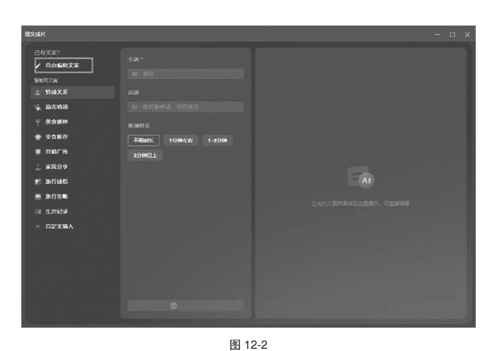

4. 进入自由编辑文案页面，将刚刚的脚本文案复制、粘贴至输入框内，如图12-3所示。

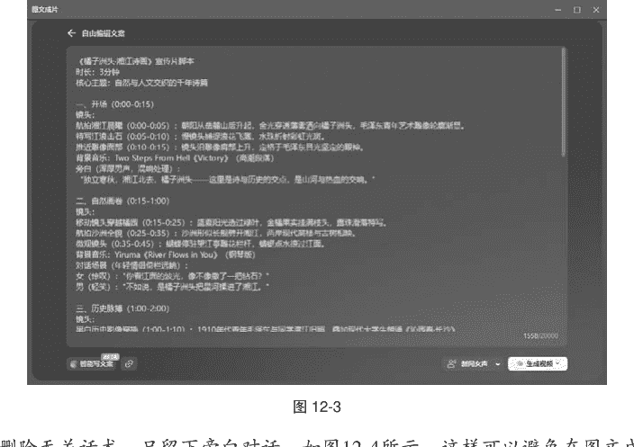

5. 删除无关话术，只留下旁白对话，如图12-4所示。这样可以避免在图文成片时，AI将一些镜头语言也朗读出来。

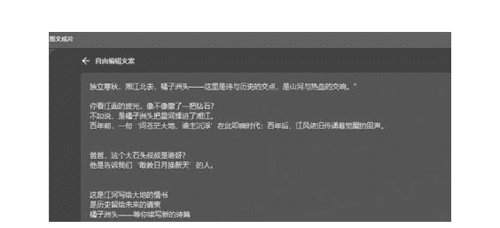

图 12-4

6. 执行操作后，单击界面右下角的“生成视频”按钮，选择“智能匹配素材”选项，如图12-5所示。


图 12-5

7. 执行操作后，稍等片刻即可完成视频的制作，如图12-6所示。然后根据自身的需求简单修改一下，即可得到一个原创视频。


图 12-6

DeepSeek AI 全场景实战从入门到精通：工作、学习与创作效率使用教程

### 090 DeepSeek+Photoshop，轻松解决修图难题

在处理图片的过程中，遇到复杂的修图需求是常见的挑战。传统方法需要手动调整各类参数，耗时费力，而结合使用 DeepSeek与Photoshop（以下简称 PS），使得修图变得更加高效和智能。下面介绍详细步骤。

01 打开DeepSeek，进入其主页面，在输入框内输入相关提示词并按【Enter】确认，提示词及回答内容如下。

> 我要用PS对照片进行调色，使画面更有电影感，请你给我一个调色方案，并根据这个方案给我提供一份PS脚本，用于实现自动调色，我的PS版本为v 25.0。

> 以下是为照片添加电影感的调色方案及配套的Photoshop自动化脚本，该方案模仿好莱坞电影《银翼杀手2049》的赛博朋克色调风格，同时保留通用性。

电影感调色方案
核心参数（适用于大多数场景）
基础调整
对比度：+15
高光：-80
阴影：+30
黑色色阶：-20
曲线调整
RGB曲线：利用S形曲线强化对比。
红色通道：将高光端轻微下压。
蓝色通道：将暗部上提增加青调。
色彩平衡
阴影：青色+10 / 蓝色+5
中间调：红色+5 / 黄色-3
高光：红色+8 / 蓝色-5
渐变映射
使用#2a2a5a到#d4af37的渐变，混合模式为“柔光”，“不透明度”为20%。
胶片颗粒
“数量”为15%，“大小”为5，“粗糙度”为50。

一键式PS自动化脚本
将以下代码保存为.jsx文件，通过执行“文件 | 脚本 | 浏览”命令运行。

```
// CinemaColor Pro.jsx
var doc = activeDocument;
// 创建基础调整层
var adjLayers = [
    ["Levels", [0, 1.20, 255]],
    ["Curves", [118,118], [149,133], [195,183]],
    ["Color Balance", [10,0,-5], [-3,0,5], [8,-5,0]]
];
adjLayers.forEach ( function ( layer ) {
    var adj = doc.AdjustmentLayers.add ( ) ;
    adj.kind = layer[0];
    setAdjustmentParams ( adj, layer.slice ( 1 ) ) ;
} ) ;
// 添加胶片颗粒
var grainLayer = doc.ArtLayers.add ( ) ;
grainLayer.name = "Film Grain";
grainLayer.applyAddNoise ( 15, 1, 0 ) ;
grainLayer.blendMode = BlendMode.SOFTLIGHT;
grainLayer.opacity = 30;

// 宽屏画幅遮罩
var bars = doc.ArtLayers.add ( ) ;
bars.name = "Cinemascope Bars";
bars.opacity = 100;
bars.blendMode = BlendMode.NORMAL;
var black = new SolidColor ( ) ;
black.rgb.hexValue = "000000";
doc.selection.select ( [[0,0], [doc.width, doc.height*0.09]],
                      [[0,doc.height*0.91], [doc.width, doc.height]] ) ;
bars.filledSelection ( black ) ;
// 函数：设置调整层参数
function setAdjustmentParams ( layer, params ) {
    switch ( layer.kind ) {
        case "Levels":
            layer.properties.inputRange = params[0];
            break;
        case "Curves":
            var curve = layer.properties.curves[0];
            params.forEach ( function ( pt ) { curve.addPoint ( pt[0], pt[1] ) } );
            break;
        case "Color Balance":
            ["shadows", "midtones", "highlights"].forEach ( function ( tone, i ) {
                layer.properties[tone] = params[i];
            } ) ;
    }
}
```

操作说明
打开需要处理的照片，
通过执行“文件 | 脚本 | 浏览”命令加载此脚本。
脚本将自动完成以下操作：添加三级调色层（色阶/曲线/色彩平衡）；生成赛博朋克风格渐变光晕；添加电影级颗粒质感；创建2.35：1宽屏遮罩。

效果微调建议
光影适配：双击“Curves”层根据原图亮度调整锚点。
色调强化：修改“Color Balance”层的蓝色通道值（+3~5）增强科技感。
风格切换：将渐变映射颜色改为#341515到#e3d8c1的渐变，可获得《布达佩斯大饭店》的复古色调。

技术亮点
非破坏性编辑：所有调整通过图层实现。
参数化控制：每个效果独立可调。
自适应画幅：自动计算21：9遮罩比例。
此方案可使普通照片在15秒内获得专业电影级调色效果，特别适合城市夜景、人像写真等题材。

02 在桌面新建一个文本文档，将生成的代码复制并粘贴至文本文档中，如图12-7所示。
03 选择“文件|另存为”命令，将“保存类型”设置为“所有文件”，在文件名后添加“.jsx”扩展名，单击“保存”按钮即可，如图12-8所示。

## 第12章 与其他AI工具联动：覆盖各行各业

04 打开PS，单击“打开”按钮，上传一张风景照，如图12-9所示。

05 执行操作后，选择菜单栏中的“文件|脚本|浏览”命令，选择“调色脚本.jsx”文件，即可自动完成调色工作，调色前后对比如图12-10所示。

### 091 DeepSeek+Kimi，轻松搞定 PPT 制作

在当今高效办公的时代，一份清晰、美观、逻辑严谨的PPT不仅能增强演示效果，还能有效传达核心信息。然而，PPT制作往往需要花费大量时间精心排版、优化配色、调整动画，甚至构思演讲逻辑。

虽然DeepSeek不能直接生成PPT，但是可以借助R1模型的文本生成能力和Kimi强大的PPT生成能力，轻松搞定烦琐的PPT制作。下面介绍其详细操作步骤。

1. 打开DeepSeek，进入其主页面，在输入框内输入相关提示词并按【Enter】确认，提示词及回答内容如下。

   > 帮我生成一份主题为“AIGC高效应用”的PPT，用来做项目汇报，注意生成结果的专业性和严谨性。

   > 我将为你生成一份专业、严谨的“AIGC高效应用”项目汇报PPT，涵盖项目概述、技术优势、应用场景、实施方案、效益评估等核心内容。请稍等，我会提供PPT文件。

   AIGC高效应用

   一、项目概述
   1. 项目背景
   自2022年起，AIGC技术高速发展，成为人工智能中最有应用前景的领域之一。
   通过应用深度学习和生成工具，AIGC能够大幅提升创作效率和质量。
   2. 项目目标
   分析AIGC技术在各个产业中的应用值和实际效益。
   提出高效应用方案，实现AIGC在互联网市场中的创新应用。
   认识技术挑战，定义安全和规约策略。

   二、AIGC技术优势

   自动生成高质量内容，大幅降低人力成本。
   通过深度学习自造合适样式，提升认知与创造能力。
   优化用户体验，简化处理流程，能快速解决应用场景中的实际问题。

   三、AIGC应用场景

   1. 媒体传播
   自动生成新闻报道、文章编辑和多媒体产出。
   AI动画生成，为媒体内容创作提供助力。
   2. 营销辅助
   智能生成营销文案，优化产品推广效果。
   核心内容自动生成，提升SEO效率和互动性。
   3. 课程教育
   核心产作助力，自动生成教案和光演资料。
   AI翻译和自动处理，增强国际教育进程。

   四、实施方案与技术核心

   1. 实施方案
   选择适合项目的AIGC工具（如DeepSeek）。
   实施工具集成，实现自动化效率最优化。
   2. 技术核心
   安全性和隐私保护策略。
   基于云服务的高效计算解决方案。

   五、效益评估与未来发展

   1. 效益评估
   大幅提升产出效率，减少人力成本。
   提升内容创造性，实现高度自动化生成。
   2. 未来发展
   提升认知系统策略，根据用户需求进行自动选择和更新。
   研发运用于更实际场景的行业解决方案。

基于上述内容，用户可通过PPT软件将其制作为演示文件。
已生成《AIGC高效应用》项目汇报PPT文稿，你可以根据需要调整内容并转换为PPT文件。如需优化或补充，请告诉我！

02 复制中间生成的PPT文件。打开Kimi主页，使用 “PPT助手” 功能，将复制的生成的PPT文件粘贴至输入框内，如图12-11所示。按【Enter】键发送生成的结果即可。

03 执行操作后，Kimi的PPT助手会自动补充更为详细的PPT文字信息，等待生成完成后，单击“一键生成PPT”按钮，如图12-12所示。

04 执行操作后，即可进入选择模板页面，如图12-13所示，选择合适的模板、风格、主题颜色后，单击“生成PPT”按钮即可。

05 执行操作后，即可自动生成相应的PPT内容，用户可以直接选择编辑或下载至本地后进行编辑，如图12-14所示。

06 如图12-15所示为最终的PPT效果展示。

### 092 DeepSeek+可灵，生成图片素材

在创意设计领域，高质量的图片素材至关重要。然而，传统的素材收集方式不仅耗时费力，还难以精准地匹配需求。DeepSeek+可灵的强大组合，为图片生成提供了高效便捷的解决方案。DeepSeek负责提供专业的AI绘画提示词，而可灵则负责生成高质量的图片，让素材获取变得轻松、快捷。下面将介绍详细的操作步骤。

01 打开DeepSeek，在输入框内输入提示词，具体提示词和回复如下。

> 请帮我生成一段适用于可灵AI的文生图提示词，主题是吉卜力动画，画面由一个小女巫和森林狼构成。

> 以下是一段适用于可灵AI的文生图提示词，主题是吉卜力动画风格的小女巫和森林狼：
“生成一张吉卜力动画风格的插图，在画面中，一个小女巫和一只森林狼站在一起。小女巫穿着一顶点缀着星辰的魔女帽，身着简洁但优雅的黑色连衣裙，手持一根闪烁着微光的魔杖，表情坚定而神秘。森林狼体型修长，毛发银白如月光，眼睛闪烁着智慧的光芒，显得威严而又温柔。两者站在一片魔法森林中，背景是浓密的夜晚森林，月光洒满树梢，微光点缀其间，画面充满了奇幻与冒险的氛围。整体风格细腻，色彩柔和，充满吉卜力动画的独特魅力，细节丰富，笔触流畅，画面温馨而充满故事感。”
如果需要进一步调整，可以补充更多细节，比如：
“画面分辨率高，比例适中，突出角色和背景的和谐统一。”
“加入更多魔法元素，如飘浮的粒子、发光的符文等，增强画面的奇幻感。”
希望这段提示词能帮助你生成出理想的画面！

02 复制相应的绘画提示词，打开可灵AI，选择“AI图片|文生图”功能，在创意描述中粘贴绘画提示词，如图12-16所示。

03 执行操作后，选择图片比例并单击“立即生成”按钮，如图12-17所示。

04 稍等片刻，即可获得一组精美的图片素材，如图12-18所示。

### 093 DeepSeek + 即梦AI，实现动态海报效果

动态海报（也叫动效海报或动画海报）是将传统的静态海报与动态元素相结合形成的一种广告或宣传媒介。与传统的平面海报不同，动态海报通过动画、视频或者其他形式的动态效果增强视觉冲击力，吸引观众注意，并能够更生动地表达信息或情感。

下面将介绍如何利用DeepSeek+即梦AI实现动态海报效果。

01 打开DeepSeek，在输入框内输入提示词，具体提示词和回复如下。

我想要用即梦AI制作一张海报，你帮我准确描述这张海报，生成相应的提示词，模仿最近超火的《哪吒之魔童降世》，要有国风的感觉，背景稍微亮一点。海报主题是齐天大圣孙悟空，但构图要模仿哪吒画风的国风海报。

好的！以下是一段详细且准确的提示词，帮助你用即梦AI生成一张模仿《哪吒之魔童降世》画风的齐天大圣孙悟空海报，带有国风元素和明亮的背景。

提示词：
“国风插画，齐天大圣孙悟空，金甲红袍，凤翅紫金冠，金箍棒挥动，动态战斗姿势，桀骜眼神，火焰环绕，金色光晕，水墨云雾背景，碎裂地面，天宫楼阁，红金色高饱和色调，强侧光，工笔细节，水墨泼溅纹理，粒子火花，无文字，史诗感构图，8K超清。”
这样描述应该能帮你生成理想的海报效果！

02 复制生成的提示词，打开即梦AI，单击“AI制图|图片生成”按钮，将复制后的提示词粘贴至创意描述框内，如图12-19所示。

03 选择生图模型和图片比例，单击“立即生成”按钮。稍等片刻，即可获得一组精美的海报图片，如图12-20所示。

04 回到DeepSeek，在输入框内输入提示词“我想要刚刚生成的图片动起来，请帮我生成相应的提示词”，DeepSeek回复如下。

好的！以下是针对动态图片的提示词，帮助你让齐天大圣孙悟空的海报“动起来”，保持国风画风和《哪吒之魔童降世》的风格。

提示词：
“国风风格的动态图片，画风模仿《哪吒之魔童降世》的动漫风，超高饱和色调，8K超清。画面中央是齐天大圣孙悟空，金甲红袍，凤翅紫金冠，桀骜眼神，金箍棒挥动，释放强大力量。动态效果：金箍棒散发金色光芒，挥动时伴随火焰和粒子火花四溅，火焰环绕全身，形成炽热的光晕。背景是水墨云雾与天宫楼阁的结合，云雾流动、楼阁光芒闪烁，地面碎裂，烟尘飞扬，增强战斗场景的冲击感。整体画面中加入水墨波溅纹理和粒子效果，红金色高饱和色调，强侧光照明，工笔细节鲜明，史诗感构图，动态流畅，充满力量与活力。”
这样描述的动态图片会更加生动有趣，同时保留原有的国风和史诗感！

05 回到即梦AI，在生成的一组图片中，选择一张较为满意的图片，单击“生成视频”按钮，如图12-21所示。

06 在创意描述框内粘贴刚刚复制的提示词，如图12-22所示。

07 选择视频模型，单击“生成视频”按钮，即可让图片动起来，生成一张动态海报，如图12-23所示。

### 094 DeepSeek+Canva，批量生成图文笔记

DeepSeek凭借强大的文本生成能力，可以帮助用户高效地提炼关键信息，而Canva则以其直观的设计工具，使图文笔记的排版与美化变得更加便捷。两者结合，不仅能快速生成逻辑清晰的笔记内容，还能轻松打造视觉吸引力强的图文笔记，提升阅读体验。

下面介绍详细的操作步骤。

1. 打开Canva，在左侧的导航栏中选择“模板”|“社交媒体”|“小红书帖子”选项，如图12-24所示。
2. 选择一个合适的图文模板，观察该模板的结构，如图12-25所示，在该模板中，第一段是整段内容的主题、第二段是经典台词、第三段是台词出处。
3. 根据该结构，让DeepSeek规定其输出格式，生成类似的文本内容，具体提示词和回复如下。

## DeepSeek AI 全场景实战从入门到精通：工作、学习与创作效率使用教程

给我生成10份热门电影中的经典台词，是需要能引人思考的一句话，并附带其电影名称，按表格的形式生成。

以下是10部热门电影中的经典台词及其电影名称，按表格形式整理。

| 经典台词 | 电影名称 |
|---|---|
| “希望是好事，也许是人间至善，而美好的事永不消逝。” | 《肖申克的救赎》（1994） |
| “人生就像一盒巧克力，你永远不知道下一颗是什么味道。” | 《阿甘正传》（1994） |
| “有些人活着，却渴望死去；有些人死去，却仿佛永远活着。” | 《寻梦环游记》（2017） |
| “我们读诗写诗，并不是因为它们好玩，而是因为我们是人类的一分子，而人类是充满激情的。” | 《死亡诗社》（1989） |
| “你永远不能真正了解一个人，除非你从他的角度去看问题……除非你钻进他的皮肤里，像他一样走来走去。” | 《杀死一只知更鸟》（1962） |
| “这世上只有一种东西是别人无法从你身上夺走的，那就是你的思想。” | 《美丽人生》（1997） |
| “你以为你只是接受了现实，其实你早已放弃了反抗。” | 《黑客帝国》（1999） |
| “我们注定要失去所爱之人，不然我们怎么知道，他们在生命中有多重要？” | 《本杰明·巴顿奇事》（2008） |
| “世界不需要拯救，需要的是每天做出微小善举的普通人。” | 《神秘巨星》（2017） |
| “人生不能像做菜，把所有的料准备好了才下锅。” | 《饮食男女》（1994） |

这些台词涵盖人生哲理、人性探讨、存在意义等主题，适合引发对自我、社会和价值的深层思考。部分电影中的台词如《肖申克的救赎》《死亡诗社》等被广泛引用至教育、心理学领域，成为文化符号。

04 复制生成后的电影台词和名称，回到Canva模板中，单击导航栏中的“应用”|“批量创建”按钮，如图12-26所示。

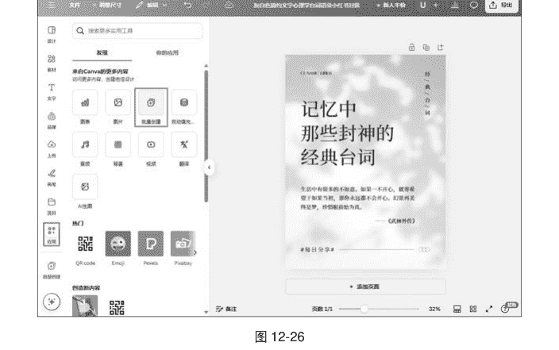

## 第12章 与其他AI工具联动：覆盖各行各业

05 执行操作后，在跳转的页面中单击“手动输入数据”按钮，如图12-27所示。

06 将刚刚复制的电影台词和名称粘贴至表格中，单击“完成”按钮即可，如图12-28所示。

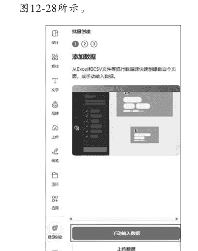

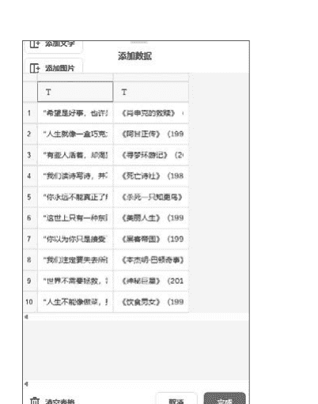

07 添加数据后，就是关键数据，将鼠标指针移至第二段上方并单击鼠标右键，在弹出的快捷菜单选择“关联数据”命令，如图12-29所示。

08 执行操作后，在弹出的关联数据框内选择“电影台词”选项，如图12-30所示。然后，以同样的方式，与“电影名称”进行关联。

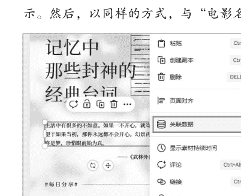

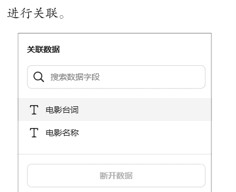

09 关联完成后，单击“批量创建”面板下方的“继续”按钮，如图12-31所示，然后继续单击“生成10个设计”按钮，如图12-32所示。

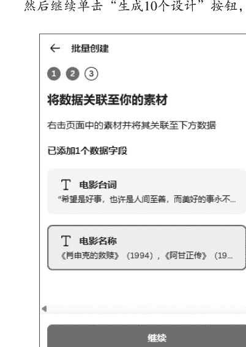

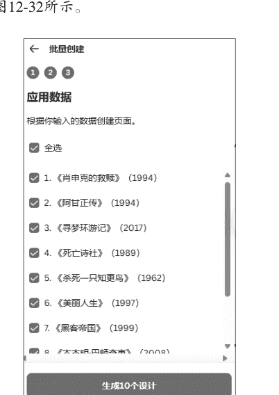

10 如图12-33所示为最终的效果展示，单击右上角的“导出”按钮，即可将该设计保存至本地，并发布至各大社交平台上，从而获取收益。


## 好书推荐


《剪映短视频剪辑教程自学一本通（电脑版+手机版）》
ISBN：978-7-122-19264-6


《高手运镜：手机短视频拍摄镜头与剪辑技巧大全（视频教学版）》
ISBN：978-7-122-46123-0


《人工智能 AI绘画、设计与视频从入门到精通：
Midjourney+Stable Diffusion+Photoshop+即梦Dreamina》
ISBN：978-7-122-46124-7

封面设计：🐧异一设计

## 一本书解锁AI应用全场景
DeepSeek带你开启高效生活！


加入本书读者群，获取更多素材

方法①：扫描二维码加入QQ群获取书中配套资源
方法②：登录“化学工业出版社有限公司”官网搜索书名下载书中配套资源

销售分类建议：计算机/人工智能
ISBN 978-7-122-47602-9
定价：99.00元