# DeepSeek 驱动的边缘侧智能部署通关指南

### 孙志华
国内高校计算机能力挑战赛优秀指导教师，多年深耕智能计算教学科研，擅长将前沿技术转化为物联网与系统软件的工程实践。

- 国家级本科论文抽检评审专家库成员。
- 牵头多款百万级用户量微信小程序的研发，提升服务效率与用户转化。
- 搭建多套响应式网站与移动应用，实现跨端体验与数据智能运营，显著拉升留存与商业价值。
- 主导手机端校车远程监控方案，实现实时火灾预警与安全态势感知。
- 设计基于 Arduino 的智能储物柜控制平台，融合二维码鉴权与自动化管理，提升校园物流效率与资源利用率。
- 指导学生完成从电路设计到嵌入式编程的全流程训练，多次斩获全国大学生电子设计竞赛佳绩。

### 内容导览
本书围绕 DeepSeek 一体化智能体系与主流开放源硬件的融合路径展开，从概念导入到终端实操形成闭环。全书分四大部分，覆盖树莓派、Arduino、Jetson Nano、ESP32 等平台，提供 40 余个可运行范例与 10 余个落地项目，为开发者、集成商与技术爱好者提供边缘侧硬件落地方案。

从硬件选型、环境搭建到模型瘦身与现场推理，详述 TensorFlow Lite、ONNX Runtime 的落地方法，直面“模型跑不动、部署难理解”的痛点。结合 MQTT、WebSocket 等通信协议，构建多节点协同回路，帮助读者掌握采集、判断、执行的全流程能力。示例可直接复用亦可二次开发。语言平实、脉络清晰，既适合入门，也为追求落地的工程师提供可靠指引，助力获得低成本、高私密、强适配的端侧智能能力，快速进入实战。

本书面向希望学习 DeepSeek 体系与开放源硬件融合及边缘侧落地的学习者，适合作为智能系统开发者、集成商开展智能硬件项目落地的实操手册，也可作为智能计算、物联网工程等专业的教学参考。

### 前言
技术的跃迁往往源于需求与变革的交汇。数年前，我在实验室把树莓派接上摄像头，只为实现手势开关灯。那时我以为智能计算遥不可及，属于云端、大厂与强算力，与桌上的小板子无关。

现实很快打破想象。云端方案虽强，却受网络波动、时延、数据泄露与高额费用困扰，这促使我思考：能否让模型在设备端运行？能否让算力有限的终端具备类人的判断能力？

于是投入轻量化模型、端侧推理与硬件协同优化的研究，尝试构建不依赖云端的智能系统。直到 DeepSeek 开源体系出现，我才看到模型裁剪、统一接口、终端推理等能力被系统整合。这既是技术革新，也是多年实验的完整答案。

本书写作基于一个判断：端侧部署已从未来走向当下。

为何现在必须掌握端侧智能部署能力？

**合规与数据安全成为刚需。** 个人信息保护法规趋严，企业与用户都强调“数据不出终端”。终端侧处理无需上传即可实时智能，既合规也安心。

**响应速度决定体验。** 智能家居、工业自动化、安防等场景需要毫秒级反馈。终端推理把延迟压到最低，让智能真正即时可用。

**成本倒逼架构下沉。** 云服务调用费用高，树莓派、ESP32 等端侧硬件价廉物美，一次开发长期复用，是中小团队降本增效的关键。

**智能普惠加速。** DeepSeek、ONNX、HuggingFace 等开源生态持续降低门槛，端侧部署是让开发者从训练走向应用的桥梁。

这项能力能改变什么？真实场景给出答案。

**智慧监控：** 园区摄像头在本地识别越界行为，减少带宽占用与误报。
**智慧农业：** 土壤传感器联动本地模型判断灌溉需求，自动浇水节水增产。
**工厂维保：** 端侧设备实时监测电机振动，异常即告警，避免停工损失。
**语音家居：** 本地语音助手执行开灯、调空调等指令，离线运行守护隐私。
**家庭康复：** 设备可判断老人康复动作是否规范，无需上传视频，兼顾隐私与训练效果。

如今不必依赖云端即可实现实时、智能、低成本运行。我们从“设备联网”迈向“设备会思考”，让每颗芯片都能理解世界。

从实验室到企业落地再到创业实践，我深知没有部署的模型只能停留在 PPT。本书坚持“理论+实操+项目”路径，每段代码均经实机验证，每张图皆来自真实调试，力求把复杂技术变为可复制经验。它不仅是技术书，更是项目路上的伙伴，帮你解决模型跑不动、接口不兼容、通信中断等典型难题。

端侧智能不是削弱能力，而是让智能更贴近场景与用户，实现感知-理解-决策-执行的完整回路，不受网络制约。未来的机器人、家电、摄像头甚至普通插座都将具备端侧智能。

愿本书帮助大家掌握从0到1的关键路径，从模型迁移到硬件投放，从语音交互到多模态融合，真正参与智能终端化实践。把技术点转化为具体方案，为生活、产业和社会创造真实价值。

技术的价值在于落地。愿你翻开本书少走弯路、多些创造力，下一个惊艳世界的智能项目或许就源于你。

孙志华
2025年12月，沈阳
深耕智能边缘计算十年，期待在本地部署的舞台相逢

## 第1章 基础入门篇
DeepSeek 智能产品与机器人端侧投放开启了智能应用的新篇章。产品融合开放源硬件的灵活性与智能化的特点，让用户在本地轻松完成智能化升级。部署过程覆盖硬件搭建到软件配置的一体化服务。DeepSeek 提供详尽的投放指引，涵盖硬件连接、系统安装、软件配置等关键环节，确保顺利落地。方案需结合实际需求，提供多样模式与灵活配置，以适配不同场景。终端侧运行在带来便利的同时，也显著提升数据安全与隐私保障，让智能更贴近生活与工作。

### 1.1 开放源硬件与智能技术的交汇点
在数字化转型中，开放源硬件与智能技术的结合迸发出创新火花。二者协同使智能设备开发更便捷，并重塑端侧计算领域，让算法在资源受限的小设备上快速运行。

**1 开放源硬件的兴起与发展**
开放源硬件指设计文件公开、可学习修改分发制造的电子硬件。与封闭硬件不同，其遵循透明、协作、共享理念，大幅促进创新生态。2005 年 Arduino 诞生后，开放源硬件从小众爱好演变为全球潮流。

当前主流平台包括：
**树莓派**：基于 ARM 架构的单板计算机，可运行完整 Linux 系统，具备强算力与丰富接口。树莓派 4B 搭载 1.5GHz 四核处理器，最高 8GB RAM，可支撑中等复杂度智能模型。
**Arduino**：基于简易微控制器的开发板，擅长实时控制与数据采集，编程直观，利于快速原型与教学。
**Jetson Nano**：英伟达低成本高性能智能开发板，集成 128 核 Maxwell GPU，专为端侧推理设计。
**ESP32/ESP8266**：乐鑫低功耗 Wi-Fi/蓝牙 SoC，价格低廉、功耗极低，适合物联网与便携式智能应用。

这些平台凭借开放性、可扩展性与活跃社区，成为智能落地的重要载体。

**2 智能技术赋能硬件的新范式**
智能技术与开放源硬件融合重塑开发模式。
**端侧计算兴起**：传统方案依赖云端，端侧计算将处理下沉至终端，减少网络延迟，提升实时性并保护隐私。如智能门铃可本地完成人脸识别，无需上传视频，响应从秒级降至毫秒级。
**模型轻量化**：为适配资源受限设备，TensorFlow Lite、ONNX Runtime 等框架通过量化、剪枝、知识蒸馏减小模型体积并加速推理。MobileNetV2 经 int8 量化后，模型缩小 75%，在树莓派 4 上推理提速 2.5 倍，精度接近原版。
**硬件感知与智能决策闭环**：开放源硬件擅长采集与执行，结合智能决策形成“感知-分析-执行”闭环，使系统可自主感知环境、理解情境并响应，无需持续人工干预。

**3 技术特点与优势**
**高性价比**：相比专用智能芯片，开放源硬件成本更低，适合小批量生产与个人开发。
**灵活可定制**：开放设计允许按需调整硬件配置与软件实现，避免功能冗余或不足。
**低延迟本地处理**：端侧模式无需网络，大幅降低延迟。工业检测中基于树莓派的缺陷检测系统响应可低至 100ms，满足产线实时需求。
**数据隐私保护**：敏感数据无需上云，降低泄露风险，契合医疗、安防等领域需求。

**4 典型场景与案例**
**智能家居**：树莓派运行 DeepSpeech 语音识别，结合 Arduino 控制继电器，实现离线语音控制家电，无需联网且无隐私泄露风险。
**智能农业**：Arduino 采集土壤湿度、光照，树莓派运行决策模型分析生长状况并控制灌溉，实验显示用水减少 30%，产量提升 15%。

**5 挑战与趋势**
计算资源受限难以承载大模型，需高效压缩与专用加速；功耗管理是电池供电场景的关键，低功耗设计与能量收集重要；跨学科开发门槛高，需更友好工具链；端侧设备面临物理与网络安全风险，需保障稳定可靠。

开放源硬件与智能技术的碰撞催生新一代智能设备与应用，降低门槛并提供无限可能。端侧智能将成为智能发展主线，开放源硬件是核心推手。

### 1.2 DeepSeek 核心概念与系统架构解读
DeepSeek 是一款面向端侧计算的智能开发平台，成为连接开放源硬件与智能技术的重要桥梁。其架构设计与优化策略使复杂模型在资源受限平台高效运行。

DeepSeek 专为端侧场景设计，解决传统模型在受限设备上运行的瓶颈。平台模块化，支持多种硬件，覆盖数据采集、模型推理到硬件控制的全栈技术。

其聚焦端侧智能，通过轻量化代码结构降低内存与计算开销，支持树莓派、Arduino、ESP32 等主流平台。内置量化、剪枝等优化，统一 API 简化集成，数据本地处理保障隐私并降低网络依赖。产品涵盖智能机器人控制、端侧计算模块与传感器融合方案，应用于智能家居、农业监测等领域。

DeepSeek 采用三层架构实现端到端处理。
数据层支持摄像头、麦克风阵列及各类传感器输入，内置图像归一化、音频降噪、信号滤波等预处理，通过标准格式转换与高效缓存平衡实时性与资源。
推理层集成 TensorFlow Lite、ONNX Runtime、PyTorch Mobile 等引擎，支持 int8/FP16 量化，结合动态加载与硬件加速实现高效推理，实测内存占用降 60%，速度提升约两倍。
控制层通过 GPIO、I2C、SPI、UART 与硬件交互，支持舵机、电机等执行器精确控制，建立传感器反馈闭环，内置多级安全检查与实时状态监控。

在智能家居中，控制层可将语音识别结果转为设备控制指令；在机器人中，可将视觉定位信息转为运动控制，实现追踪或避障。

平台具备优秀跨平台能力，树莓派可作为主节点运行完整平台，实现 15FPS 实时目标检测；Arduino 作为扩展节点负责采集与执行；ESP32/ESP8266 提供无线 IoT 功能。分布式架构实现视觉处理、精确控制、无线通信协同。

对比云端服务，DeepSeek 本地部署优势明显：数据完全本地处理；响应降至毫秒级，本地人脸识别约 200ms，远快于云端 1-2s；离线可靠；无需云服务费用；支持场景定制优化模型。

表1-1 智能框架对比

| 特性 | DeepSeek | TensorFlow Lite | PyTorch Mobile |
| :--- | :--- | :--- | :--- |
| 硬件兼容性 | 树莓派、Arduino、ESP32 | 主要支持 ARM 设备 | 主要支持手机平台 |
| 完整性 | 全栈解决方案 | 仅推理引擎 | 仅推理引擎 |
| 开源程度 | 完全开源 | 部分开源 | 开源 |
| 硬件控制 | 原生支持 | 需额外集成 | 需额外集成 |
| 学习曲线 | 中等 | 较陡 | 较陡 |
| 社区活跃度 | 非常活跃 | 非常活跃 | 活跃 |

发展路线聚焦五方向：模型自适应优化按设备性能自动调整复杂度；联邦学习支持多设备协同训练保护隐私；多模态融合增强视觉、语音、传感器数据联合分析；开发工具完善提供可视化环境降低门槛；生态扩展丰富预训练模型库与插件市场，促进社区贡献。

DeepSeek 通过分层架构与优化策略有效解决端侧部署挑战，模块化与跨平台兼容为开发者提供灵活工具，加速智能应用落地。

### 1.3 如何挑选合适的树莓派型号
树莓派作为广受欢迎的开放源硬件平台，凭借强算力与丰富接口，成为智能应用开发的理想选择。

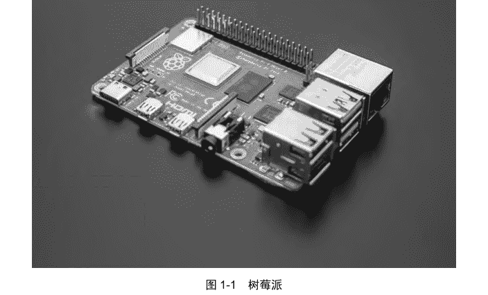

在搭建环境前，了解各型号硬件规格对项目规划至关重要。

表1-2 不同型号树莓派的硬件规格使用场景

| 型号 | 处理器 | 内存选项 | 适用场景 |
| :--- | :--- | :--- | :--- |
| 树莓派 4B | 1.5 GHz 四核 CortexA72 | 2 GB / 4 GB / 8 GB | 复杂视觉、语音处理、深度学习推理 |
| 树莓派 3B+ | 1.4 GHz 四核 CortexA53 | 1 GB | 中等复杂度目标检测、语音指令识别 |
| 树莓派 Zero 2 W | 1 GHz 四核 CortexA53 | 512 MB | 空间受限嵌入式项目、轻量分类器 |
| Compute Module 4 | 与 4B 同处理器，SODIMM 接口 | 2 GB / 4 GB / 8 GB | 工业级批量生产、定制硬件集成 |

针对 DeepSeek 平台部署，推荐树莓派 4B 以获得最佳推理性能。若项目对功耗与体积要求严格，可选用树莓派 3B+ 或 Zero 2 W，但需相应调整模型复杂度。

为 AI 应用打底，树莓派开发环境的搭建至关重要。做好系统调校、依赖部署与性能提速，就能让这块小主机释放全部算力，流畅支撑各类 AI 场景运行。硬件迭代加快、软件生态愈发成熟，树莓派在边缘智能领域的价值正不断凸显，也为创作者打开更宽的想象空间。

### 1.4 Arduino 入门：语言与实战

Arduino 采用面向微控制器的精简 C++ 方言，常被称作 Arduino 语言或 Arduino C++。它保留了 C++ 的主体机制，对嵌入式编程做了针对性简化。设计初衷是降低上手门槛，让新手快速搭建互动硬件作品。平台自带大量预定义函数与现成库，硬件交互因此变得省心。标准库覆盖传感器、显示屏、通信协议等常用外设驱动，开发效率大幅提升。配合 Arduino IDE 这一集成环境，直观的编辑界面与丰富示例帮助学习者迅速掌握用法，编译上传全自动化，让代码从编写到烧录一气呵成。总的来说，语法简化加海量库函数，让电子创意落地更快，也吸引更多人加入硬件编程行列。

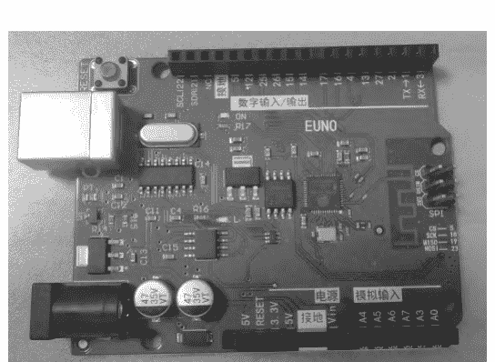

图 1-2 Arduino 板

#### 1.4.1 Arduino程序的基本结构

Arduino sketch 的结构设计极简，核心思路是让代码逻辑一目了然。整段程序围绕两个关键函数展开，它们共同构成运行框架。这种双函数模式既简化了编写流程，也给初学者提供了清晰的组织思路。

每个 sketch 都遵循固定模板（见图1-3），必须包含 setup() 和 loop() 两个函数。

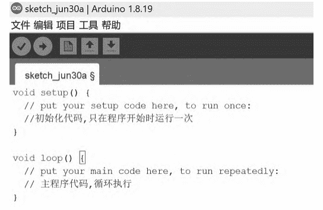

图 1-3 基本结构

##### （1）setup()函数

setup() 是程序的启动点，板子通电或复位后只执行一次。正是它承担全部初始化任务，为后续运行做好准备。因为只跑一次，所以不会重复消耗资源。

在 setup() 里，变量初始化是首要工作。全局变量若未正确赋初值，程序稳定性会大打折扣。数值型变量通常初始化为 0 或指定值，指针要设为 Null，布尔值按需求设 True/False。严谨的初始化提升可读性，也避免嵌入式系统中未初始化变量带来的随机行为。

硬件交互的基础是引脚模式配置。pinMode() 可把数字引脚设为输入或输出。输入用于读取传感器、按钮等信号，输出则驱动 LED、继电器、电机等设备。引脚设置错误可能导致功能异常甚至硬件损坏，所以在 setup() 中逐一核对至关重要。

做好一次性的初始化，程序进入主循环后才能稳定运行。虽然只执行一次，setup() 对整体行为的影响却最关键。

##### （2）loop()函数

setup() 完成后，loop() 会无限循环执行，直到断电或复位。它是程序功能实现的主要载体。

嵌入式系统常需持续监控。loop() 里可不断读取传感器状态、按钮输入、系统参数等。比如智能家居场景，需要持续采集温湿度、烟雾等数据，才能及时发现异常并响应。

时序控制是 loop() 的另一重点。delay() 能实现简单等待，但会阻塞程序；millis() 则基于时间戳实现非阻塞延时，等待期间仍可处理其他任务。对于多 LED 不同频率闪烁这类需求，millis() 能让各任务独立运行互不干扰。

写高效 loop() 有三点建议：避免长时间阻塞操作，保持系统响应；合理安排任务优先级和执行频率；必要时结合事件驱动、中断等技术提升效率。

双函数结构体现了 Arduino 简洁而强大的设计哲学。setup() 一次性完成准备工作，loop() 持续承担核心任务。既降低门槛，又为复杂功能提供灵活框架。掌握它，是深入 Arduino 与嵌入式开发的基础。

#### 1.4.2 数据类型

在 Arduino 中，数据类型选择直接关系到内存占用和运行效率。整数家族包括 int、long、short、byte，各有适用场景。int 占 2 字节，long 占 4 字节范围更大，short 与 int 相同，byte 是无符号 8 位整数，取值 0~255。选对类型能优化资源，提升开发效率。

##### （1）int（整型）

int 是 Arduino 最常用的整数类型，占 2 字节，范围 -32768 ~ 32767，足以应对计数、传感器读数、基础运算等常见需求。

图1-4 展示了在 Arduino IDE 中新建工程的操作入口。点开“文件”菜单或用快捷键，即可快速生成一个 sketch 文件。创建时 IDE 会自动带出包含 setup() 与 loop() 的基础模板。

图1-5 演示了工程保存的方式。Arduino IDE 要求每个工程单独存放，文件后缀为 .ino。规范的命名习惯有助于后续管理和维护。

第1章 基础入门篇

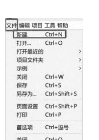

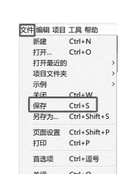

下面新建一个工程来演示 int 的用法，图1-6 所示代码结构清晰，包含变量声明、初始化函数和主循环三个部分。

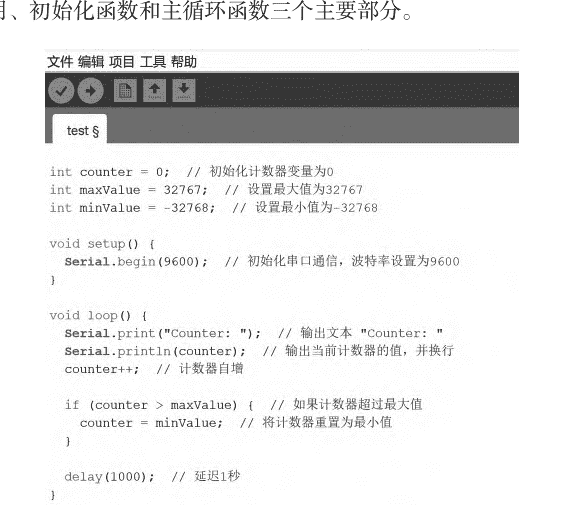

该框架为 Arduino 程序的常规骨架，体现了 int 的取值边界，接下来逐段解析。

图1-7 中定义了三个核心变量。counter 从 0 起步用作计数器，maxValue 设为 32767 代表 int 的上限，minValue 设为 -32768 代表 int 的下限，三者共同展示了完整的数值区间。

```
int counter = 0;
int maxValue = 32767;
int minValue = -32768;
```

图 1-7 变量声明

图1-8 为 setup() 的实现，主要是串口初始化。Serial.begin(9600) 将波特率设为 9600，这是与电脑通信的常用配置。setup() 启动时仅运行一次，完成各项准备工作。

```
void setup() {
  Serial.begin(9600);
}
```

图 1-8 setup()函数

图1-9 展示了 loop() 的核心逻辑。函数会反复运行，先打印当前计数，再递增一次，判断是否超出上限，超出则回绕到下限。delay(1000) 让循环每秒执行一次，便于观察。示例演示了 int 的范围与溢出行为。溢出时计数器回绕到最小值，完整呈现了取值区间。整数溢出在长期运行或精确计数场景中尤为关键，可能导致计时器、传感器数据处理出错。所以开发者需清楚 int 的边界并加以防范，合理处理溢出能提升稳定性与资源利用率。某些场景下，溢出本身也可被用作特定逻辑。

```
void loop() {
  Serial.print("Counter: ");
  Serial.println(counter);
  counter++;

  if (counter > maxValue) {
    counter = minValue;
  }

  delay(1000);
}
```

图 1-9 loop()函数

编译上传后，可通过“工具”菜单打开串口监视器查看输出，见图1-10。监视器会单独弹出一个窗口，显示板子通过串口发送的内容。窗口底部可设置波特率，需与程序中 Serial.begin() 的值保持一致。

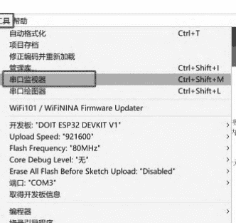

图 1-10 “串口监视器”命令

图1-11 为实际运行的输出效果。计数器自初始值起逐秒递增，抵达 32767 后下一刻变为 -32768，清晰呈现了 int 的边界与回绕特性。

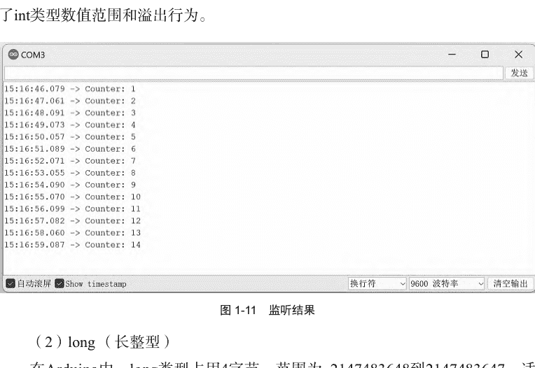

##### （2）long（长整型）

Arduino 中 long 占用 4 字节，范围 -2147483648 到 2147483647，适用于大数值和高精度计算。它常用于时间相关操作和存储大型传感器读数。使用 long 可防止中间结果溢出，但可能耗尽板载内存，操作速度也可能较慢。在资源受限时，需权衡数值范围需求和资源限制。若仅需无符号大范围整数，可使用 unsigned long 类型，范围为 0 到 4294967295。合理使用 long 对开发可靠、高效的项目至关重要。

下面通过示例观察 long 的取值范围与回绕。相比 int，数值区间大幅扩展，程序骨架仍保持 Arduino 标准，便于理解。图1-12 展示了 long 在 Arduino 中的典型应用，包括最大值、最小值及回绕特性。随后进行深入解析。

图1-13 定义了两个 long 变量。bigNumber 赋值为 2147483647L，末尾 L 表示 long 常量，对应 32 位有符号长的最大值；smallNumber 赋值为 -2147483648L，对应最小值。L 后缀用于明确类型。

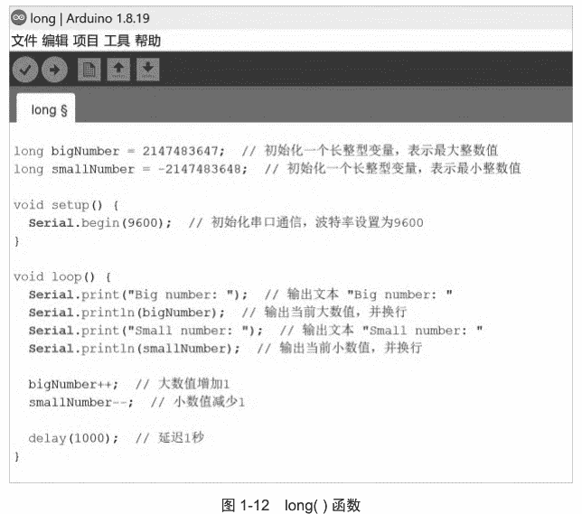

图 1-12 long()函数

```
long bigNumber = 2147483647;
long smallNumber = -2147483648;
```

图 1-13 变量声明

图1-14 的 setup() 与 int 示例保持一致，仅做串口初始化。这种统一体现了 Arduino 编程的标准化，无论数据类型如何，基础通信配置通常相同。

```
void setup() {
  Serial.begin(9600);
}
```

图 1-14 setup()函数

图1-15 的 loop() 同时处理两个 long 变量，先打印 bigNumber 与 smallNumber 的当前值，再分别自增与自减。双向变化便于同时观察正负边界行为。

```
void loop() {
    Serial.print("Big number: ");
    Serial.println(bigNumber);
    Serial.print("Small number: ");
    Serial.println(smallNumber);

    bigNumber++;
    smallNumber--;

    delay(1000);
}
```

图 1-15 loop() 函数

图1-16 展示了运行结果。大数与小数同步变化，bigNumber 超上限后回绕到负区，smallNumber 低于下限后回绕到正区，完整呈现了 long 的取值区间。

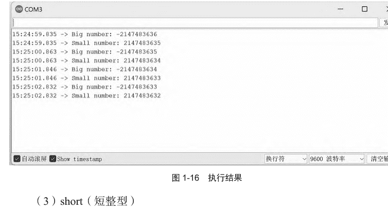

图 1-16 执行结果

##### （3）short（短整型）

Arduino 中 short 占用 2 字节，范围 -32768 到 32767，与 int 相同。使用 short 有助于节省内存，提升代码可读性与可维护性。在团队协作中，明确的变量范围能帮助他人快速理解用途。部分平台上 short 占用更少内存，提升可移植性。合理使用 short 也能降低溢出风险。性能上 short 与 int 差异不大，过度优化不如注重代码清晰。在大型项目中保持数据类型统一有助于提升质量。图1-17 为 short 的使用示例，行为与 int 类似。counter 从 0 开始递增，达最大值 32767 后回绕至 0。此类循环计数模式在周期任务、状态机中常见。

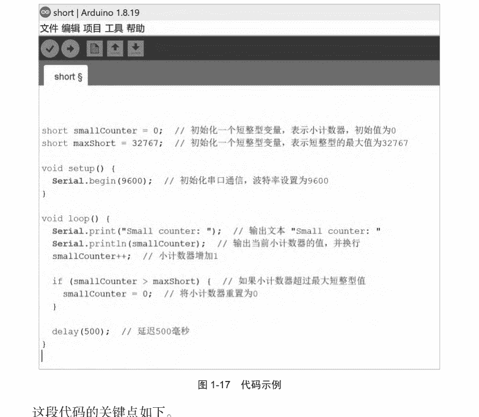

图 1-17 代码示例

要点概述：
- 取值区间：short 正数 0~32767，负数 -32768~ -1
- 循环计数：从 0 递增至上限
- 回绕处理：达上限后手动重置为 0
- 与 int 相似：Arduino 上均为 16 位，表现一致
- 适用场景：小范围整数，节省内存
- 更新频率：每 0.5 秒刷新，便于观察

以上说明了 short 的使用边界及自定义回绕逻辑，提醒注意阈值并做好溢出防范。

##### （4）byte（字节型）

byte 为 8 位无符号整数，范围 0~255，常用于嵌入式系统存储小整数。占用内存少，适合数值不超过 255 的场景。在 Arduino 中可用于引脚状态、模拟读数、通信字节传输等，是位操作的理想类型。需注意其无符号特性可能带来的算术问题。合理使用 byte 能优化内存，尤其是处理小范围整数与位操作时。图1-18 通过 byte 控制 LED 亮度，演示了 0~255 范围的应用，并给出了完整程序。这是 byte 的典型用法，因 PWM 输出范围与 byte 完全匹配。

```
byte ledBrightness = 0;  // 初始化一个字节型变量，表示LED亮度，初始值为0
byte fadeAmount = 5;     // 初始化一个字节型变量，表示LED亮度变化的步进值，初始值为5

void setup() {
  pinMode(9, OUTPUT);  // 设置引脚9为输出模式，用于控制LED
}

void loop() {
  analogWrite(9, ledBrightness);  // 使用PWM方式向引脚9写入LED亮度值

  ledBrightness += fadeAmount;  // 调整LED亮度值

  if (ledBrightness <= 0 || ledBrightness >= 255) {  // 如果LED亮度值小于等于0或大于等于255
    fadeAmount = -fadeAmount;  // 反转亮度变化的步进方向
  }

  delay(30);  // 延迟30毫秒
}
```

图 1-18 代码示例

图1-19 声明了两个 byte 变量。ledBrightness 保存当前亮度，初始为 0 表示熄灭；fadeAmount 设为 5，表示每次循环亮度变化的步长，小步长带来平滑渐变。

```
byte ledBrightness = 0;
byte fadeAmount = 5;
```

图 1-19 变量声明

图1-20 为 setup() 内容，调用 pinMode(9, OUTPUT) 将 9 号引脚设为输出，这是 PWM 控制 LED 的必要步骤。9 号引脚支持 PWM，故被选用。

```
void setup() {
  pinMode(9, OUTPUT);
}
```

图 1-20 setup()函数

#### 1.4.3 数组与字符串

在 Arduino 编程中，数组与字符串是处理多组数据与文本的核心结构。数组为同一类型元素的有序集合，通过索引访问；字符串本质是字符数组，用于处理文本。掌握两者能有效管理数据并简化逻辑。

##### （1）数组

数组用于存储多个相同类型的数据，在 Arduino 中广泛用于数据管理。索引从 0 起步，适合与循环配合使用。实践中常用于保存 LED 引脚编号、传感器读数序列或控制指令集合等。

Arduino 数组·字符串与运算速览

图1-23 展示了在 Arduino 中声明并初始化数组的典型写法。先给出数据类型和元素个数，初始值既可以在声明时一次性写进大括号，也可以分步在后续代码里逐个写入。这种写法会得到一块容量固定的存储区，声明后就能携带初始数据，运行期长度不可再变，这正是静态数组的特征。

```
int myNumbers[5] = {10, 20, 30, 40, 50};  // 声明并初始化整数数组
float temperatures[3];  // 声明浮点数数组，未初始化
```

图 1-23 数组声明和初始化

图1-24 演示了对整型序列 myNumbers 的读取与改写流程。下标是定位单元的下标号，从 0 开始计数。通过下标即可直取指定位置的数据，改写也只需给对应下标重新赋值。做法简明、效率高，在循环里批量处理时尤其方便。先把串口通信启动起来，处理结果就能投递到监视窗口，方便观察和调试。

```
void setup() {
  Serial.begin(9600);  // 初始化串口通信，波特率设置为9600

  int firstNumber = myNumbers[0];  // 访问数组 myNumbers 的第一个元素并赋值给 firstNumber
  myNumbers[2] = 35;  // 将数组 myNumbers 的第三个元素设置为35，修改数组内容

  for (int i = 0; i < 5; i++) {
    Serial.println(myNumbers[i]);  // 通过串口打印数组 myNumbers 的每个元素的值
  }
}

void loop() {
  // 空循环，没有代码
}
```

图 1-24 访问和修改数组元素

图1-25 说明了多维数组的构造与填充思路。多维数组可以理解为数组的嵌套，适合表达矩阵、表格或其它多维数据关系。填充时使用多层大括号分层描述，每一层对应一个维度。此种组织在图像块、地图瓦片或传感器矩阵处理上非常适用。

图1-26 进一步以二维表 matrix 为例展开应用。这个 3×3 的整型矩阵用双重循环遍历，按行列顺序把每个单元打印到监视窗口。同一行单元之间用空格隔开，行与行之间换行，形成规整的矩阵排版。这样更易直观核对初始化是否正确，也利于排查矩阵运算相关程序。

多维表同样适用于矩阵或表格类数据，一个 3×3 的二维表可写作 int matrix[3][3]。填充时采用嵌套大括号组织数据。工程实践中，用嵌套循环遍历二维表是常见模式。借助 Serial.print() 把内容送到串口窗口，有助于验证数据并进行调试。

##### （2）字符串

平台提供两种文本表示手段：字符数组与 String 对象。字符数组实现简洁、资源占用低，适合固定文本或内存吃紧的场景。String 对象功能更丰富、使用更省心，适合需要频繁操作文本的任务。

##### （3）字符数组

字符数组是 C 风格的文本表达方式，以空字符 '\0' 结束。内存利用率较高，适合存放不可变的文字信息。例如声明 char greeting[] = "Hello, Arduino!"; 。字符数组允许逐字符修改，比如把首字符改成小写 greeting[0] = 'h';，如图1-27 案例先经串口打印原始字符串，随后演示直接改动数组内单个字符，将首字母由大写改为小写，再输出修改后的结果。这种精细到字符的操作是字符数组的重要能力，在需要精确控制内容时很有价值。

图 1-27 字符数组

字符数组在通信协议、显示输出和传感器数据处理中应用广泛。内存连续分配带来较高的访问效率。配合 C 标准库函数如 strcpy()、strcat() 等，可实现基础文本操作。

##### （4）String 对象

图1-28 呈现了 Arduino String 对象的常用操作。String 类提供面向对象的文本处理能力，支持动态内存管理与丰富的方法。示例演示了三个核心用法：concat 方法用于拼接多个字符串；substring 方法用于截取特定区间；length 方法返回字符个数。这些操作在 setup() 中完成，结果经串口输出，充分体现 String 的灵活与易用。

String 对象会自动完成内存分配与释放，无需事先指定长度，适合处理动态文本，如用户输入或数据解析。它提供 substring()、indexOf()、replace()、toInt() 和 toFloat() 等便捷接口，简化文本操作。然在 RAM 受限的环境下，频繁修改 String 会触发重分配，可能产生碎片。可通过 reserve() 预留空间或限制对象作用域来优化使用。

```
String message = "Welcome to Arduino"; // 定义并初始化一个String对象 message，内容为 "Welcome to Arduino"

void setup() {
  Serial.begin(9600); // 初始化串口通信，波特率设置为9600
  Serial.println(message); // 通过串口输出String对象 message 的内容

  // 对String对象进行操作
  message.concat("!"); // 在末尾添加字符 '!'
  Serial.println(message); // 再次通过串口输出修改后的String对象 message 的内容

  String subStr = message.substring(0, 7); // 提取从索引0到索引6的子字符串（不包括索引7）
  Serial.println(subStr); // 输出提取的子字符串

  int length = message.length(); // 获取String对象 message 的长度
  Serial.println(length); // 输出String对象 message 的长度
}

void loop() {
  // 空循环，没有代码
}
```

图 1-28 String 对象

下面介绍文本比较与数值转换，见图1-29。文本比较可判断两段文本是否相等或大小关系，在用户输入处理或协议解析时很重要。数值与文本间的相互转换是另一关键能力，可把整数或浮点数转为文本用于展示，也能把从串口或传感器收到的文本转为数值参与计算。这些转换降低了不同类型数据间的交互成本。

```
void setup() {
  Serial.begin(9600); // 初始化串口通信，波特率设置为9600

  String str1 = "Hello"; // 定义并初始化一个String对象 str1，内容为 "Hello"
  String str2 = "hello"; // 定义并初始化一个String对象 str2，内容为 "hello"

  if (str1.equalsIgnoreCase(str2)) { // 判断忽略大小写后，str1 和 str2 是否相等
    Serial.println("Strings are equal (case insensitive)"); // 通过串口输出结果
  }

  str1.toLowerCase(); // 将 str1 中的所有字符转换为小写
  Serial.println(str1); // 通过串口输出转换后的 str1

  int number = str1.toInt(); // 尝试将字符串 str1 转换为整数
  Serial.println(number); // 通过串口输出转换后的整数值，由于"hello"不能转换为有效的数字，将打印0
}
```

图 1-29 字符串比较和数值转换

图1-30 展示了文本数组与整型数组并用的示例。该示例用并行数组保存关联数据，即文本数组存放描述性文字，整型数组存放对应数值。通过串口与用户交互，程序可根据输入选择并展示相应信息。这种设计在菜单系统、配置选项或数据查找表构建时很实用，体现了数组组织结构化数据的优势。

```
String colors[] = {"Red", "Green", "Blue"};  // 定义并初始化一个String类型的数组 colors，包含颜色名称
int colorValues[] = {0, 0, 0};  // 定义并初始化一个整型数组 colorValues，用于存储颜色值，默认为0

void setup() {
  Serial.begin(9600);  // 初始化串口通信，波特率设置为9600

  for (int i = 0; i < 3; i++) {  // 循环处理每个颜色
    Serial.print("Enter value for ");  // 输出提示信息
    Serial.print(colors[i]);  // 输出当前颜色名称
    Serial.println(" (0-255):");  // 输出范围提示

    while (Serial.available() == 0) {}  // 等待用户输入

    colorValues[i] = Serial.parseInt();  // 读取串口输入的整数，并存入对应的 colorValues 数组元素

    Serial.print(colors[i]);  // 输出当前颜色名称
    Serial.print(" value set to: ");  // 输出设置信息提示
    Serial.println(colorValues[i]);  // 输出设置的颜色值
  }

  Serial.println("Final color values:");  // 输出最终颜色值提示
  for (int i = 0; i < 3; i++) {  // 循环输出每个颜色的最终值
    Serial.print(colors[i]);  // 输出当前颜色名称
    Serial.print(": ");  // 输出分隔符
    Serial.println(colorValues[i]);  // 输出对应的颜色值
  }
}

void loop() {
  // 空循环，没有代码
}
```

图 1-30 结合数组和字符串的实例

该示例结合了文本数组与整型数组，演示了如何用数组保存关联数据，以及如何通过串口与用户交互。

使用数组与文本时的注意事项如下。

**RAM 使用建议：** 平台的 RAM 通常只有几 KB，合理管理至关重要。大型数组或长文本需谨慎。建议把固定文本放入程序存储空间 PROGMEM，避免占用宝贵 RAM。选用合适数据类型可显著节省内存，如用 byte 代替 int 保存小范围数值。优先使用预分配的字符数组而非动态 String 对象，可避免内存碎片。

**下标越界防范：** 数组越界是导致程序崩溃或难以定位错误的常见原因。访问前应始终校验下标有效性，特别是在处理用户输入或循环时。合理设定数组大小，并用常量或宏定义管理长度，便于维护。文本操作中使用安全函数可防止缓冲区溢出。虽然检查会增加代码量，但能避免更严重的系统问题。

**减少动态分配：** 开发中应尽量避免动态内存分配，因频繁分配释放易产生碎片。推荐静态分配，包括固定大小数组、预分配缓冲区和全局变量。若确实需要灵活使用内存，可考虑内存池或循环缓冲区管理。将常量数据存入 PROGMEM，可有效减轻 RAM 压力。

**拼接性能注意：** 频繁拼接文本会影响内存性能并可能导致碎片。使用 String 对象时，通过 reserve 预留足够空间可减少重分配次数。使用字符数组时，确保缓冲区足够容纳拼接结果。sprintf 函数可一次性完成复杂格式化，避免多次拼接，在循环中操作文本时尤其需注意性能。

**多维结构内存占用：** 多维数组便于组织复杂数据，但内存消耗随维度增加显著增长。使用前需评估总内存需求并考虑替代方案。例如可用一维数组配合下标计算模拟多维结构，或采用结构体数组组织相关数据。对大型数据集，使用 SD 卡等外部存储更实际。

**文本类型选用：** 选择字符数组还是 String 对象需根据场景权衡。字符数组内存效率高、执行快，适合固定或较短文本，但需手动管理内存和边界。String 对象提供自动内存管理和丰富方法，适合动态文本和复杂操作，但可能产生碎片。实际项目中结合使用通常效果最佳。

数组与文本是项目中组织和处理数据的基础工具，支持数据采集、用户界面设计、通信协议实现等多种功能。正确选择和使用这些数据结构能显著提升程序效率和可读性。在复杂项目中，合理运用数组与文本可使程序更模块化、易维护，同时在内存使用和性能间取得平衡。深入理解并熟练掌握数组与文本的使用技巧，是开发高质量项目的重要基础。

#### 1.4.4 数据运算

编程中的数据运算是实现各种功能的基础。运算符作为语言核心，包括算术、逻辑、比较、位和赋值运算符，每种都有特定用途。掌握这些运算符对编写高效程序至关重要。

##### （1）算术运算符

算术运算符是最基础的工具，用于执行数学计算，包括加、减、乘、除和取模，既适用于整数也适用于浮点数。

**① 加法（+）：** 加法运算符用于数值相加，在平台上应用广泛。既可处理简单数值累加，也可用于计数器更新、数组元素求和等场景。

图1-31 展示了加法运算的基本用法。程序先定义两个整型变量 a 与 b 分别赋值为 5 和 3，通过加法运算符求和，结果存入 sum，最后用 Serial 输出结果为 8。该示例说明了加法在变量运算中的直接应用，同时展示了 Serial.print() 输出运算结果，这在调试时很有用。

加法运算符常与循环配合，实现数据累积计算。例如读取多个传感器数据并计算平均值时，需先累加所有数值。也可用于时间累计、距离计算和各种计数场景。

**② 减法（-）：** 减法运算符用于计算两数差值。在项目中常用于计算时间间隔、距离差值、温度变化等。

图1-32 所示的减法示例演示了基本减法操作。程序定义两个变量，通过减法运算符计算差值并存入 difference，Serial 输出结果。该示例适用于需要计算变化量的场景，如温度变化监测、位置偏移计算等。在控制系统中，通过计算目标值与当前值的差值，可实现精确反馈控制。

减法运算符还可用于数组下标反向遍历和倒计时实现。在处理时间戳时，减法运算可帮助计算事件间的时间间隔。

③ 乘法（*）：乘法运算符用于计算数值的乘积，在单位转换和比例缩放中作用明显。乘法示例见图1-33，展示了如何用乘法运算符进行数值计算。程序中两个变量相乘得到乘积并通过 Serial 输出。这种运算在传感器数据处理中常见，例如将原始采样值转换为实际电压值时需乘以转换系数。在 PWM 控制中，乘法可用于调整占空比，实现 LED 亮度或电机速度的精确控制。

乘法运算符在图形展示和动画效果中也扮演重要角色，用于坐标变换和缩放。计算功率、面积等物理量时也离不开乘法运算。

④ 除法（/）：除法运算符用于计算两数商，但需注意整数除法与浮点数除法的差异。除法运算示例见图1-34，说明了平台中除法操作的特点。该示例展示了整数除法和浮点数除法的不同结果。两个整数相除时结果会截断小数，若需保留小数，至少有一个操作数应为浮点型。示例通过 Serial 输出清楚展示了这种差异，此特性在计算平均值时尤为重要，因此需根据精度要求选择合适数据类型。

图 1-34 除法运算

使用除法运算符时必须确保除数不为零，否则会导致程序错误。除法在计算百分比、比率和数据归一化时非常有用。

⑤ 取模（%）：取模运算符返回除法运算的余数，在处理周期性任务时特别有用。取模运算示例演示了如何获取除法余数并通过 Serial 输出结果，见图1-35。该运算符在创建循环菜单时非常实用，可确保选项在有效范围内循环。例如菜单有 5 个选项，用取模运算可实现从最后一个选项自动跳转到第一个。

图 1-35 取模运算

取模运算符还常用于判断奇偶性、对 2 取模、实现环形缓冲区、处理时钟展示如将小时数限制在 0~23 范围等场景。在处理周期性数据和实现循环逻辑时不可或缺。

（2）逻辑运算符

逻辑运算符用于布尔逻辑运算，是实现条件判断和流程控制的关键工具。

逻辑运算符在编程中至关重要，用于控制流程、条件判断和布尔运算。下面详细讲解与运算符 &&、或运算符 || 和非运算符 !，并提供示例和应用场景。

① 与运算符（&&）：与运算符要求所有条件都为真时才返回真值。逻辑与示例代码展示了复合条件判断的实现，见图1-36。示例中定义两个变量 a 与 b 都赋值为 10，条件判断检查 a 与 b 是否都大于 0，只有两个条件同时满足才会执行 Serial 打印。该运算符具有短路特性，若第一个条件为假则不会求值第二个条件，从而提高执行效率。在实际应用中，逻辑与常用于安全检查，例如多个传感器都检测到正常状态时系统才启动。

图 1-36 与运算符

Arduino 运算符与函数实战精简解读

② 或运算符（||）
|| 的含义是只要所涉判断里出现满足项，整体就被视为成立。示例图呈现了如何借助它来搭建分支，代码只要核实两项判断里是否出现合规项即可决定后续动作。这种特性在多路输入场景下很实用，例如确认若干按键里是否出现被按下状态，或监测报警项中只要任意一条触发就给出提示。该运算还自带短路效果，前置条件一旦成立，后续判断会被直接跳过，从而提升执行速度。

③ 非运算符（!）
! 的作用是对布尔状态进行反转，真变假、假变真。示例展示了布尔翻转的流程，先声明布尔名称 isOn 初始为 false，经取反后逻辑转为真而进入分支。在状态切换上非常顺手，例如用按键翻转 LED 的通断，每次按下就对当前状态执行一次反转即可完成切换。

##### （3）比较运算符
比较运算符用于对数据进行大小或相等性判断，Arduino 中常用的有 ==、!=、<、>、<=、>=，它们多用于条件分支与流程控制。

① 相等运算符（==）
== 用来核验两项数据是否完全一致。示例里两个名称都被赋予 5，比较后为真并通过串口输出结果。该符号在状态核对时常见，例如确认按键处于预期位置，或验证读回的量是否达到设定点。初学者需区分 == 与赋值符号 =，易混淆。

② 不等运算符（!=）
!= 用来判断两项数据是否不一致。示例中两项数据不同，条件成立并执行对应操作。该符号在异常排查中很重要，例如确认感测回的数据是否偏离正常区间，或通信内容是否出现错误。

```
void setup() {
  // put your setup code here, to run once:
  int a = 5;
  int b = 3;
  if (a != b) {
    Serial.println("a is not equal to b.");
  }
}
```
图 1-40 简单的不等判断

③ 小于运算符（<）
示例演示了大小比较的逻辑，当首项小于次项时触发特定行为。这类比较在边界核查中常见，比如确保温度不低于下限，或校验数组下标是否合法。排序类算法的核心比较也离不开它。

```
void setup() {
  // put your setup code here, to run once:
  int a = 3;
  int b = 5;
  if (a < b) {
    Serial.println("a is less than b.");
  }
}
```
图 1-41 简单的小于判断

④ 大于运算符（>)
示例呈现了另一种大小判断，当前项大于后项时条件成立并执行分支。该符号常用于上限核查，例如水位是否超过警戒线、运行速度是否超出限制，在任务优先级比较中也常用。

```
void setup() {
  // put your setup code here, to run once:
  int a = 5;
  int b = 3;
  if (a > b) {
    Serial.println("a is greater than b.");
  }
}
```
图 1-42 简单的大于判断

⑤ 小于等于运算符（<=）
示例展示了包含边界的比较方式。该符号在范围判断时很方便，因为边界本身也被纳入范围。例如数组访问时下标必须小于等于最大索引，控制系统中也可用来保证参数不超出允许上限。

```
void setup() {
  // put your setup code here, to run once:
  int a = 3;
  int b = 5;
  if (a <= b) {
    Serial.println("a is less than or equal to b.");
  }
}
```
图 1-43 简单的小于等于判断

⑥ 大于或等于运算符（>=）
示例说明了包含下限的判断形式，通过确认某项不小于另一项来选择执行路径。该符号在设定最低阈值时很有用，例如保证电池电量不低于工作下限，或验证输入是否满足最低要求。

```
void setup() {
  // put your setup code here, to run once:
  int a = 5;
  int b = 3;
  if (a >= b) {
    Serial.println("a is greater than or equal to b.");
  }
}
```
图 1-44 简单的大于等于判断

（4）位运算符
在 Arduino 中位运算符可直接操作二进制位，包含按位与 &、按位或 |、按位异或 ^、左移 <<、右移 >>。它们在嵌入式开发里意义重大，可用于硬件控制、提升运行效率、处理二进制数据。

① 按位与运算符（&）
示例展示了位级与运算，对两个数的对应位逐位处理，只有同时为 1 时结果位才为 1。配合掩码可提取特定位，常用于读取硬件寄存器的状态位，例如判断外设是否就绪或取出感测数据的某字段。

```
void setup() {
    // put your setup code here, to run once:
    int a = 12;  // 12的二进制表示为 00001100
    int b = 10;  // 10的二进制表示为 00001010
    int result = a & b;  // 结果是 00001000, 即 8
    Serial.println(result);  // 输出 8
}
```
图 1-45 按位与操作

② 按位或运算符（|）
示例演示了如何用或运算置位而不影响其他位。程序可将指定位设为 1，保持其余位不变，这在配置硬件寄存器时很关键，可开启特定功能同时保留已有设置，如将某引脚设为输出模式。

```
void setup() {
    int a = 12;  // 12的二进制表示为 00001100
    int b = 10;  // 10的二进制表示为 00001010
    int result = a | b;  // 结果是 00001110, 即 14
    Serial.println(result);  // 输出 14
}
```
图 1-46 按位或操作

③ 按位异或运算符（^）
示例展示了位翻转特性，不同位得 1，相同位得 0。该特点使其成为切换状态的理想工具，比如每次执行异或就能翻转 LED 状态。异或还可用于简单的加密和校验和计算。

```
void setup() {
    int a = 12;  // 12的二进制表示为 00001100
    int b = 10;  // 10的二进制表示为 00001010
    int result = a ^ b;  // 结果是 00000110, 即 6
    Serial.println(result);  // 输出 6
}
```
图 1-47 按位异或运算符

④ 左移运算符（<<）
示例说明了向左移动二进制位的操作，每左移一位相当于乘以 2，运算更快。常用作快速求 2 的幂、构造掩码，以及在 RGB 处理中把红绿蓝分量组合成整数。

```
void setup() {
    int a = 3;  // 3的二进制表示为 00000011
    int result = a << 2;  // 结果是 00001100，即 12
    Serial.println(result);  // 输出 12
}
```
图 1-48 左移运算符

⑤ 右移运算符（>>）
示例展示了向右移动位的过程，每右移一位相当于向下取整除以 2。常用于提取高位数据，例如从 16 位数值中取出高 8 位，或在信号处理中做快速除法以提升效率。

```
void setup() {
    int a = 12;  // 12的二进制表示为 00001100
    int result = a >> 2;  // 结果是 00000011，即 3
    Serial.println(result);  // 输出 3
}
```
图 1-49 右移操作

位操作不仅是理论概念，更是解决实际问题的利器。合理使用位运算可以高效控制硬件、处理感测数据，实现复杂功能。下面通过两个典型场景说明其价值。

##### 实际应用示例

###### 示例1：LED状态控制
在嵌入式开发中往往需要同时管理多个 LED。传统做法为每个灯单独建变量，占用内存且代码冗长。而采用位图技术，可用一个字节的 8 个位分别对应 8 个 LED，大幅提升效率。图中展示了用一个 8 位变量管理多路 LED 的核心思路，通过位运算符对指定灯进行精确控制。

```
byte ledStatus = 0b00001111;  // 初始状态，低4位为1，高4位为0

void setup() {
  Serial.begin(9600);
  for (int i = 0; i < 8; i++) {
    pinMode(i, OUTPUT);
  }
}

void loop() {
  // 开启第6位的LED
  ledStatus = ledStatus | 0b01000000;
  updateLEDs();

  delay(1000);

  // 关闭第6位的LED
  ledStatus = ledStatus & 0b10111111;
  updateLEDs();

  delay(1000);
}

void updateLEDs() {
  for (int i = 0; i < 8; i++) {
    digitalWrite(i, (ledStatus >> i) & 0x01);
  }
}
```
图 1-50 LED 开关状态控制

程序中用 ledState 作为状态寄存器，每一位代表对应编号 LED 的状态。通过定义 LED0~LED7 的掩码 0x01、0x02、0x04 等，可单独操作某路灯。用按位或 | 点亮指定灯不影响其它灯；用按位与 & 配合取反掩码熄灭指定灯；用按位异或 ^ 切换灯的当前状态。

精妙之处在于批量操作，例如同时点亮第 1、3、5 号灯，只需将对应掩码或运算后与状态变量合并即可，传统方法需多条语句，位运算一条即可完成。

###### 示例2：传感器数据处理
现代感测设备多输出高精度数据，传输和存储时常需格式转换，16 位处理是典型场景。

图示深入讲解了 16 位数据的拆分与重组过程，演示如何把温度、压力等 16 位读数拆为高 8 位和低 8 位两个字节，再重新合成。

```
uint16_t sensorData = 0xABCD;

void setup() {
    Serial.begin(9600);

    byte highByte = (sensorData >> 8) & 0xFF;  // 提取高8位
    byte lowByte = sensorData & 0xFF;  // 提取低8位

    Serial.print("High Byte: ");
    Serial.println(highByte, HEX);

    Serial.print("Low Byte: ");
    Serial.println(lowByte, HEX);
}

void loop() {
    // 空循环
}
```
图 1-51 传感器数据处理

程序先读取 16 位原始量存入 sensorValue。提取高 8 位时用右移 >>8，使原高位落到低位区直接赋给 highByte；提取低 8 位时用按位与 & 0xFF 屏蔽高位，仅保留低 8 位。

该拆分技术在串行通信和存储中广泛应用。I2C、SPI、UART 等协议多以字节为单位传输，16/32 位数据必须先拆分；EEPROM 等存储器按字节寻址，也需把多字节数据拆分后写入。

（5）赋值运算符
Arduino 中的赋值运算符用于为变量赋值，包含基本赋值 = 和复合赋值 +=、-=、*=、/=、%=。复合形式把运算与赋值合并，代码更简洁高效。

① 简单赋值运算符（=）
基本赋值示例演示了最简赋值过程，将数值 10 赋给变量 a 并通过串口验证结果。这是编程基础，用于变量初始化和更新，在从引脚模式配置到保存感测读数的全流程中无处不在。

#### 1.4.5 Arduino基本函数
Arduino 的基础函数库是硬件交互的核心，从数字读写到模拟处理、时间控制到通信，覆盖嵌入式开发的主要需求。

数字输入输出依靠 digitalWrite、digitalRead、pinMode 三个函数。digitalWrite 控制引脚高低电平，digitalRead 读取引脚状态，pinMode 设定工作模式，用于 LED 控制、按键检测、继电器驱动等。

模拟处理由 analogRead 和 analogWrite 完成。analogRead 将 0~5V 模拟电压转为 0~1023 的数值，读取各类感测数据；analogWrite 借助 PWM 输出可调信号，调节 LED 亮度或电机转速。

时间管理提供 delay 和 millis。delay 实现阻塞延时，使用简单但会暂停程序；millis 返回运行时间，支持非阻塞计时，适合多任务。random 可生成伪随机数，randomSeed 设置种子，增加游戏或模拟的随机性。串口通信通过 Serial 类实现，Serial.begin 初始化，Serial.print 发送数据用于调试和设备间交互。attachInterrupt 配置中断响应，实现事件触发时的即时处理。tone 生成音频信号，驱动蜂鸣器提供听觉反馈。

这套函数体系简洁完整，降低入门门槛同时保持灵活性，合理组合即可实现从简单到复杂的各类应用。

##### （1）数字/模拟的输入、输出
数字模拟的输入输出是 Arduino 与外部世界交互的基础，借助高低电平就能完成 LED 闪烁、按键检测、继电器控制等功能。

数字输入输出作为最基础的交互方式，通过二进制电信号与外部设备通信。虽然信号形式简单，却能完成大量控制任务，如 LED 点亮熄灭、按钮状态读取、继电器开关等。

使用前需先配置引脚模式，pinMode 决定引脚是输出还是输入。输出模式下 Arduino 主动驱动电平，输入模式下读取外部信号。

digitalWrite 是数字输出核心，可把指定引脚设为高电平或低电平，应用广泛，如控制 LED、驱动继电器、发送控制信号。对应的 digitalRead 用于读取引脚电平，常用于检测按键按下、开关闭合或数字感测输出。

模拟信号处理让 Arduino 感知连续变化量。analogRead 能读取 0~5V 任意电压并转为 0~1023 数字量，使温度、光照、声音等物理量可被程序处理。各类模拟感测装置如温度感测、光敏电阻均通过它转换数据。

analogWrite 虽名义上是模拟写入，实际是 PWM 伪模拟输出，通过快速切换占空比模拟电压变化，广泛用于 LED 亮度调节、电机调速和音频生成。

这套输入输出接口的设计思路兼顾了上手难度与扩展能力。接口本身很精简，新手很快就能进入状态；功能层面却足够完备，能够覆盖从教学小玩意到工业级控制的多种场景。无论是刚接触Arduino的练习作品，还是对稳定性要求很高的专业系统，都能在这里找到对应的实现方式。

实际使用时，数字类函数和模拟类函数往往是配合出现的。比如做一个恒温装置，就需要用 analogRead 采集温度传感器的模拟量，经程序处理后用 digitalWrite 控制加热器通断，再配合 analogWrite 调节风扇的转速。这种组合式的使用方式让Arduino的应用边界被明显拓宽。

把这些最基础的读写函数吃透，就是Arduino编程的地基。恰当地调用它们，就能与各种传感器、执行器进行对话，搭建出功能完整的嵌入式系统。随着理解加深，把想法落地会越来越顺手。

###### ① pinMode函数
pinMode 是 Arduino 里设定引脚角色的基础指令，它决定了某根引脚是用来接收信号还是发出信号，以及是否要打开内部上拉。

该指令以两个参数完成配置。第一个参数 pin 指明目标引脚编号，数字引脚支持0到13，部分板型还能把A0到A5当作数字引脚使用。第二个参数 mode 指定工作模式，共有三种可选项：INPUT、OUTPUT、INPUT_PULLUP。

语法示例如下。
```
pinMode(13, OUTPUT); // 将13号引脚设置为输出模式
```
选为 OUTPUT 时，引脚被设为输出口，能够向外输出高电平或低电平。配置为输出后，可通过 digitalWrite 来驱动LED、继电器、蜂鸣器等执行器件。输出状态下引脚的驱动能力有限，通常在20到40毫安之间。

选为 INPUT 时，引脚进入输入状态，用来侦测外部信号。此状态下引脚呈高阻特性，对外部电路干扰极小，适合接传感器、按键等。读取时使用 digitalRead。若引脚处于悬空，读数会不稳定。

INPUT_PULLUP 属于一种带上拉的输入模式，在普通输入基础上激活了芯片内部的上拉电阻，阻值大约20至50千欧。该电阻把引脚默认拉向电源电压，有效避免了悬空抖动。连接按钮时特别好用：按钮一端连引脚，另一端接地，按下读到LOW，松开后自动回到HIGH。

引脚模式要先对，后续读写才可靠。写入前必须先 pinMode 为 OUTPUT，读取前必须先设为 INPUT 或 INPUT_PULLUP。模式配错可能导致行为异常甚至损坏硬件。

配置特殊引脚需多留意。0、1号引脚常被串口占用，改作普通输入输出会干扰烧录与调试。13号引脚大多数板子自带指示灯，配置时要考虑影响。pinMode 看似简单，却是硬件控制的起点。先规划好引脚分配与模式，能让后续开发更顺畅。

###### ② digitalWrite函数
digitalWrite 是控制数字引脚高低电平的核心指令，实现对外部电路的基本开关。

函数接受两个参数。第一个参数 pin 指定目标引脚，可用0到13的数字引脚，也能把A0到A5当数字引脚使用。第二个参数 value 决定输出电平，只接受 HIGH 或 LOW 两个常量。

使用格式如下。
```
digitalWrite(13, HIGH);  // 将引脚13设置为高电平
digitalWrite(13, LOW);   // 将引脚13设置为低电平
```
HIGH 对应高电平，5伏系统约5伏，3.3伏系统约3.3伏。LOW 对应低电平，即0伏。基于这种二值电平的控制构成了数字电路的基础。

调用 digitalWrite 前，相关引脚必须已用 pinMode 设为 OUTPUT。非输出模式下指令效果不可预期，可能引发程序出错。

digitalWrite 常与其它函数搭配。结合 digitalRead 可实现输入触发输出的交互；配合 analogRead 可依据模拟数据驱动数字输出；配合延时函数可产生时序控制。

在复杂项目里往往要同时操作多个引脚，执行顺序要安排好以免冲突。若需要严格同步多路输出，可考虑端口级操作。digitalWrite 简单却不可或缺，掌握其电气特性与使用边界是 Arduino 开发的基本功。借助它可以从点亮一盏灯做到搭建自动化系统。

###### ③ digitalRead函数
digitalRead 是读取数字引脚电平的基本手段，用来判断外部信号是高还是低。

函数只有参数 pin，指定读取的引脚编号，支持0到13的数字引脚以及用作数字输入的A0到A5。执行后返回整数，HIGH 代表高电平，LOW 代表低电平。在5伏系统里，通常超过3伏被判定为HIGH，低于1.5伏被判定为LOW。

使用格式如下。
```
int buttonState = digitalRead(7);  // 读取引脚7的电平状态
```
读取前需先用 pinMode 把引脚设为输入，可选 INPUT 或 INPUT_PULLUP，后者开启内部上拉，能避免悬空导致读数漂移。

数字与模拟的输入输出让Arduino能处理多种传感器与执行器。温度、光敏等模拟器件用 analogRead 获取数据，数字传感器则用 digitalRead。正是这种灵活性，使Arduino成为连接物理世界与程序世界的桥梁。digitalRead 虽基础，却是交互式项目的关键。理解其输入特性与注意事项，才能做出稳定可靠的检测方案，并与其它功能组合实现按键控制到传感器网络的应用。

###### ④ analogRead函数
analogRead 是把连续变化的模拟电压转为数字量的核心指令，用来采集模拟引脚的电压值供程序处理。

函数参数 pin 指定要采样的模拟通道。Arduino板上模拟口通常标记为A0、A1等，数量因型号而异，Uno 有A0到A5共6路。返回值为0到1023的整数，与引脚电压成正比。

使用格式如下。
```
int sensorValue = analogRead(A0);  // 读取A0引脚的模拟电压值
```
其内部使用10位模数转换器ADC，将模拟电压映射到1024个等级。标准5伏系统下，0对应0伏，1023对应5伏，每步约4.88毫伏；3.3伏系统下，1023对应3.3伏，分辨率约3.22毫伏。

在数据记录场景里，采集到的结果可通过串口发送到电脑，或写入SD卡。实时监控则通过周期采样追踪传感器变化趋势。analogRead 是Arduino与模拟世界沟通的通道。搞懂其工作方式与限制，结合合适的信号处理，就能搭建精细可靠的数据采集系统。

###### ⑤ analogWrite函数
analogWrite 通过脉宽调制PWM在数字引脚上模拟出连续变化的效果，常用于调光、调速等需要平滑控制的场景。

函数有两个参数。第一个参数 pin 必须是支持PWM的引脚，Uno 上为3、5、6、9、10、11，通常板上用波浪号标记。第二个参数 value 设置占空比，取值范围0到255。

##### 复合赋值运算符
在Arduino里，复合赋值运算符既能让代码更简洁，也能在实际工程中提高可读性。把算术运算和赋值合并，能在计数、数据缩放、范围限制等场景中发挥作用。下面通过三个典型实例说明其价值。

##### 实际应用示例
####### 示例1：LED闪烁计数器
该示例演示如何融合多种运算符实现功能（见图1-58）。使用加法赋值运算符 += 维护计数器，通过取模控制闪烁周期，再用比较运算符判断触发时机。综合体现了算术运算、条件判断与程序流程的协同。

```
int ledPin = 13;
int counter = 0;

void setup() {
  pinMode(ledPin, OUTPUT);
  Serial.begin(9600);
}

void loop() {
  counter += 1;  // 每次循环计数器加1

  if (counter >= 100) {
    counter = 0;  // 当计数器达到100时重置为0
    digitalWrite(ledPin, !digitalRead(ledPin));  // 切换LED状态
    Serial.println("LED toggled");  // 输出调试信息
  }

  delay(10);  // 延迟10毫秒
}
```
图 1-58 LED闪烁计数器

####### 示例2：传感器数据处理
该示例展示复合赋值在数据处理中的用途。使用乘法赋值 *= 与除法赋值 /= 对原始采样进行缩放与归一化（见图1-59）。先读取ADC原始值，再缩放、再归一化，最终得到有物理意义的量。代码更紧凑，性能也保持良好。

```
float sensorValue;
float scaledValue;

void setup() {
  Serial.begin(9600);
}

void loop() {
  sensorValue = analogRead(A0);  // 读取模拟传感器数据

  scaledValue = sensorValue;
  scaledValue *= 5.0;  // 将传感器值放大5倍
  scaledValue /= 1023.0;  // 将传感器值归一化到0到5的范围

  Serial.print("Raw Value: ");
  Serial.print(sensorValue);
  Serial.print(" Scaled Value: ");
  Serial.println(scaledValue);

  delay(500);  // 延迟500毫秒
}
```
图 1-59 传感器数据处理

####### 示例3：循环约束
该示例说明取模运算如何制造循环行为。使用取模赋值 %= 把变量限定在指定区间内，达到上限时自动回绕（见图1-60）。这种技巧常用于菜单翻页、动画循环、环形缓冲等。示例清晰地展现了用简单取模实现复杂循环的思路。

```
int counter = 0;

void setup() {
  Serial.begin(9600);
}

void loop() {
  counter += 1;  // 每次循环计数器加1
  counter %= 100;  // 将计数器值限制在0到99范围内

  Serial.println(counter);  // 输出计数器值

  delay(100);  // 延迟100毫秒
}
```
图 1-60 循环约束

掌握这些运算符及其典型用法，可以写出更高效、简洁且功能更强的程序。每种运算符都有合适的场景，合理组合是提升编程能力的关键，复杂功能往往需要多种运算符协作完成。

##### 赋值运算符
###### ② 加法赋值运算符（+=）
该示例演示累加操作的简化写法（见图1-53）。变量a初始为10，用 += 增加5后变为15。相比 a = a + 5 更简短，在循环累计传感器读数或做积分运算时很方便。

```
void setup() {
    int a = 5;
    a += 3;  // 相当于 a = a + 3; 现在a的值是8
}
```
图 1-53 加法赋值

###### ③ 减法赋值运算符（-=）
该示例展示递减的简洁表达（见图1-54）。变量通过 -= 减去指定数值，适用于倒计时、渐变等场景。PWM值递减可实现LED渐暗，计数器递减可实现倒计时。

```
void setup() {
    int a = 10;
    a -= 4;  // 相当于 a = a - 4; 现在a的值是6
}
```
图 1-54 减法赋值

###### ④ 乘法赋值运算符（*=）
该示例说明快速比例缩放（见图1-55）。变量用 *= 乘以系数，常用于增益调整、指数增长。音量倍增、传感器数据放大都是典型用法。

```
void setup() {
    int a = 4;
    a *= 2;  // 相当于 a = a * 2; 现在a的值是8
}
```
图 1-55 乘法赋值

###### ⑤ 除法赋值运算符（/=）
该示例演示比例缩小（见图1-56）。变量用 /= 除以指定值，常用在求平均、数据归一化。累加多路采样后再除以采样数即可得到均值。

```
void setup() {
    int a = 20;
    a /= 4;  // 相当于 a = a / 4; 现在a的值是5
}
```
图 1-56 除法赋值

###### ⑥ 取模赋值运算符（%=）
该示例说明如何让变量在固定范围内循环（见图1-57）。变量用 %= 对除数取模，保证结果始终落在0到除数-1之间，适合循环计数器与环形缓冲区。

```
void setup() {
    int a = 10;
    a %= 3;  // 相当于 a = a % 3; 现在a的值是1
}
```
图 1-57 取模赋值

###### 基本赋值
```
void setup() {
    int a = 10;  // 将10赋值给变量a
    float b = 3.14;  // 将3.14赋值给变量b
    char c = 'A';  // 将字符'A'赋值给变量c
}
```
图 1-52 基本赋值
数值0对应0占空比，即完全关闭；255对应100%占空比，即完全开启。

基本使用格式如下。
```
analogWrite(9, 127);  // 在引脚9输出50%占空比的PWM信号
analogWrite(6, 255);  // 在引脚6输出100%占空比的PWM信号
analogWrite(3, 0);    // 在引脚3输出0占空比的PWM信号
```
PWM本质是高速翻转引脚电平，通过调节高电平占周期比例来模拟电压。虽然输出仍是数字信号，但切换频率很高，Arduino默认约490赫兹或980赫兹，人眼与多数负载感知为模拟量。

analogWrite 名字带“模拟”，实际依赖数字PWM实现。这种设计让数字系统也能控制需要连续变化的设备。理解PWM原理与 analogWrite 的特点，掌握使用技巧，就能实现从LED调光到电机调速的丰富控制。

Arduino的输入输出函数构成了硬件交互的基础框架。数字与模拟两类接口虽简单，却蕴含丰富可能性，从基础灯控到复杂的数据采集都离不开它们支撑。

##### 实际应用示例
###### 示例1：控制LED亮度
如图1-61所示，通过PWM调节LED亮度。analogWrite 可在PWM引脚输出0到255的占空比，对应0到100%的亮度。改变占空比能让LED从熄灭平滑过渡到最亮，利用人眼视觉暂留产生亮度变化的错觉。

```
int ledPin = 9;  // 连接LED的引脚
int brightness = 0;  // LED亮度
int fadeAmount = 5;  // 每次改变的亮度值

void setup() {
  pinMode(ledPin, OUTPUT);
}

void loop() {
  analogWrite(ledPin, brightness);  // 设置LED亮度
  brightness += fadeAmount;  // 增加或减少亮度

  // 反转亮度变化方向
  if (brightness <= 0 || brightness >= 255) {
    fadeAmount = -fadeAmount;
  }

  delay(30);  // 延时30毫秒
}
```


PWM 的工作频率一般落在几百赫兹到数千赫兹之间，这个区间能让肉眼察觉不到闪烁。

###### 示例2：读取温度传感器数据

图1-62 展示了采集温度数据的典型用法。多数温度探头会把温度变化变成对应的模拟电压。借助 analogRead() 拿到这个电压读数，再对照传感器的校准曲线换算成真实温度。以 LM35 为例，它每升高一度会输出 10 毫伏的信号，配合简单的换算公式就能得到精确数值。这类方案在环境监测、恒温控制等场景很常见。

```
int sensorPin = A0;  // 连接温度传感器的引脚
int sensorValue = 0;  // 传感器读取值
float voltage = 0;  // 电压值
float temperature = 0;  // 温度值

void setup() {
  Serial.begin(9600);  // 初始化串口通信
}

void loop() {
  sensorValue = analogRead(sensorPin);  // 读取传感器值
  voltage = sensorValue * (5.0 / 1023.0);  // 将传感器值转换为电压
  temperature = (voltage - 0.5) * 100;  // 将电压转换为温度

  Serial.print("Temperature: ");
  Serial.print(temperature);
  Serial.println(" C");

  delay(1000);  // 延时1秒
}
```

图 1-62 读取温度传感器数据

在 Arduino 里，负责收发信号的函数就是硬件交互的底座。数字侧有 pinMode 设定引脚方向、digitalWrite 驱动高低电平、digitalRead 读取开关状态，主要用来点亮 LED、检测按键这类只有开合两种状态的器件。模拟侧则提供 analogRead 把 0~1023 的电压采样值读出来，以及 analogWrite 利用 PWM 在 0~255 级别间平滑调节输出，常用于采集传感器或调节电机转速。把两者搭配起来，就形成了“感知-计算-执行”的闭环：先读入传感器或按键的状态，再据此决定开关动作或渐变效果。弄清数字量只有 0/1、ADC 有量化误差、PWM 本质是方波占空比变化这些限制，才能避免误用。熟练这五大基础接口，是从简单灯光控制到完整自动化装置的关键，实践多了就能快速搭建各种应用。

##### （2）时间函数

Arduino 提供的一组时间相关函数，主要用来做等待、计时和按时触发。常用的有 delay()、millis()、micros()、delayMicroseconds() 这四类。合理管理时间是保证程序流畅运行的核心，下面分别说明它们的特点与用法。

① delay()函数：delay()函数的基本应用如图1-63所示。图1-63 给出了 delay() 的典型写法。这个函数会让程序进入毫秒级的硬等待，等待期内代码完全停滞。最常见的例子是让 LED 1 秒亮 1 秒灭：点亮后调用 delay(1000)，熄灭后再等 1000 毫秒，就得到 1 秒一次的闪烁。写法直观，但缺点是阻塞——这段时间里传感器、串口等都不会被处理，所以不适合多任务并行场景。

② millis()函数：使用millis()函数实现非阻塞延时的方法如图1-64所示。图1-64 展示了借助 millis() 做非阻塞等待的思路。不同于 delay()，millis() 只负责回传从启动到现在的毫秒计数，并不阻断程序。做法是先记下上一次动作的时间点，之后不断用当前时间减去它，判断是否超过设定的间隔。于是主循环可以在“等时间”的同时继续做别的事，比如让几盏灯以不同节奏闪动，同时不间断地采集温度。

```
void setup() {
  pinMode(LED_BUILTIN, OUTPUT);
}

void loop() {
  digitalWrite(LED_BUILTIN, HIGH); // 打开LED
  delay(1000);                     // 延时1秒
  digitalWrite(LED_BUILTIN, LOW);  // 关闭LED
  delay(1000);                     // 延时1秒
}
```

```
unsigned long previousMillis = 0;
const long interval = 1000;

void setup() {
  pinMode(LED_BUILTIN, OUTPUT);
}

void loop() {
  unsigned long currentMillis = millis();

  if (currentMillis - previousMillis >= interval) {
    previousMillis = currentMillis;
    digitalWrite(LED_BUILTIN, !digitalRead(LED_BUILTIN));
  }
}
```

图 1-63 delay() 函数

图 1-64 millis() 函数

原型是 unsigned long millis()，返回的是从复位起累计的毫秒数，类型为无符号长整型，数到上限后会自动回零。借助它可以做到 LED 每秒翻转一次，同时主程序的其他分支照常运行。

③ micros()函数：micros() 给出的是自上电以来的微秒计数，精度比 millis() 高了千倍。遇到高速脉冲、精细时序或需要测极短间隔时它就派上用场。调用格式同样是 unsigned long micros()，返回无符号长整型。虽然理论上能分辨微秒级，但实际最小步长受主频限制，常见是 4 微秒左右。

④ delayMicroseconds( )函数：delayMicroseconds( )函数的应用如图1-65所示。图1-65 说明了 delayMicroseconds() 的使用场景。它能产生微秒量级的精确暂停，常用于对时序要求苛刻的场合：比如超声波模块的触发脚需要 10 微秒的高电平，步进电机的步进信号也依赖微秒级脉宽。示例里用 500 微秒高电平、500 微秒低电平交替，就合成了一个 1 kHz 的方波，可用来驱动蜂鸣器等需要固定频率的器件。

```
void setup() {
  pinMode(LED_BUILTIN, OUTPUT);
}

void loop() {
  digitalWrite(LED_BUILTIN, HIGH);
  delayMicroseconds(500); // 延时500微秒
  digitalWrite(LED_BUILTIN, LOW);
  delayMicroseconds(500); // 延时500微秒
}
```

图 1-65 delayMicroseconds()函数

使用 Arduino 时间函数需要注意以下几个关键问题。

- 溢出是首要风险：millis() 大约 49 天后会回零，micros() 约 70 分钟后回零。用时间差 currentTime-previousTime >= interval 的写法可以自动容错。
- 阻塞会影响效率：delay() 和 delayMicroseconds() 会让整段代码暂停，无法响应输入。millis()、micros() 则提供非阻塞测量，等待的同时还能干别的。
- 精度有边界：delayMicroseconds() 在超短延时时受 CPU 速度影响；micros() 在部分板子上分辨率是 4 或 8 微秒而非 1 微秒。
- 复杂调度可上高级方案：定时器中断能实现硬件级准时执行；Timer 库简化多任务；状态机把任务拆成状态按时间切换；事件驱动借助中断减少空转。
- 场景决定选型：顺序控制可用 delay()，多任务建议基于 millis() 的非阻塞写法，高精度测量则用 micros() 或定时器中断。实战中常组合：主循环用 millis() 管理任务，关键时序靠中断，短暂精确暂停用 delayMicroseconds()。

把时间函数用对，是写出稳定响应的嵌入式程序的基础。

##### （3）随机函数

Arduino 随机相关接口主要是 random() 和 randomSeed()，用来产生伪随机数。random(max) 返回 0 到 max-1 的整数，random(min,max) 返回 min 到 max-1 的整数。randomSeed() 用来设定种子，常读取一个悬空模拟引脚的噪声作为初始值。典型用途有 LED 随机闪烁、随机延时、数组随机抽取等，常见于游戏模拟和交互装置。需要留意的是它只是伪随机，不适合安全场景，且上限不包含在结果里。进阶时可以叠加多个随机源或做数学变换来调节分布，和 PWM、舵机配合能做出很丰富的动态效果。

① random()函数：random()函数的基本用法如图1-66所示。random() 能在指定范围内产出伪随机整数。单参数时生成 0 到该数减 1 的值，双参数时生成第一个数到第二个数减 1 的值。游戏中随机刷新敌人位置、LED 矩阵随机点亮、模拟传感器的抖动都是常见例子。

```
void setup() {
  Serial.begin(9600);
}

void loop() {
  long randNumber;

  // 生成0到299之间的随机整数
  randNumber = random(300);
  Serial.print("Random number between 0 and 299: ");
  Serial.println(randNumber);

  // 生成50到99之间的随机整数
  randNumber = random(50, 100);
  Serial.print("Random number between 50 and 99: ");
  Serial.println(randNumber);

  delay(1000); // 延时1秒
}
```

图1-66 random()函数

Arduino 的 random() 返回的是长整型 long。上界是开区间，例如 random(10) 得到 0～9，random(5,10) 得到 5～9，这种设计对数组索引很友好。

② randomSeed() 函数：randomSeed() 函数应用示例如图 1-67 所示。若不主动设置种子，每次复位后序列都一样，很多项目并不想要这种可预测性。读取未接线的模拟引脚能捕获环境电磁噪声作为种子，这个噪声本质上不可预测。设定种子后，每次运行的随机序列都会不同，可预测性大幅降低。

```
void setup() {
  Serial.begin(9600);

  // 从未连接的模拟引脚读取随机种子
  int seed = analogRead(0);
  randomSeed(seed);
}

void loop() {
  long randNumber = random(100); // 生成0到99之间的随机整数
  Serial.println(randNumber);
  delay(1000); // 延时1秒
}
```

图 1-67 randomSeed() 函数

随机函数在实践里常用来给游戏生成随机的敌人位置和奖励、产生测试用的传感器数据、制造随机延时提升不可预测感。建议用 analogRead 读取浮空引脚噪声做初始化，确保参数不越界，调试阶段可用固定种子复现问题。进阶可以用数学函数生成特定分布，比如正态分布。

随机数让 Arduino 项目多了一份趣味和真实感，从游戏、艺术到科学实验都能用上。虽然 random() 本身只给出整数，但只要做点数学转换就能满足更复杂的需要。

###### 生成浮点数

生成随机浮点数示例如图1-68所示。虽然 random() 只能吐整数，但除以一个合适的常数或用 map() 映射，就能得到浮点范围的值。模拟温度的细微波动、生成平滑的运动轨迹这类需要连续变化的量，就靠这种技巧实现。

```
void setup() {
  Serial.begin(9600);
}

void loop() {
  float randFloat;

  // 生成0.0到1.0之间的随机浮点数
  randFloat = random(1000) / 1000.0;
  Serial.print("Random float between 0.0 and 1.0: ");
  Serial.println(randFloat);

  delay(1000); // 延时1秒
}
```

图 1-68 生成随机浮点数示例

写代码时尽量少做重复的种子初始化，只在必要时刷新；范围计算尽量用常量或已知的变量，避免运行时额外开销。random() 与 randomSeed() 配合种子和区间设定，能在简单模拟到复杂数据生成之间提供可靠的伪随机能力，合理使用会让项目的多样性和趣味性显著提升。

##### （4）串口通信函数

Arduino 的串口通信函数用于开发板与其他设备间的数据传输，通过UART接口实现，常用于调试和数据交换。

主要函数如下。

- Serial.begin()初始化串口并设定波特率，常用值有9600、115200等，用于打开串口设置通信速率。
- Serial.print()和Serial.println()向串口发送数据，区别在于println()会在末尾添加换行符。
- Serial.read()读取接收的字节数据，返回0～255的值，无数据时返回-1。
- Serial.available()检查缓冲区是否有可读数据，返回缓冲区中可读取的字节数。
- Serial.write( )发送二进制数据或字符串，参数可为单个字节或字节数组。

```
void setup() {
  // 初始化串口通信，波特率9600
  Serial.begin(9600);
}

void loop() {
  // 如果有串口数据可读
  if (Serial.available() > 0) {
    // 读取数据
    char receivedChar = Serial.read();

    // 打印接收到的数据
    Serial.print("Received: ");
    Serial.println(receivedChar);

    // 回显数据
    Serial.write(receivedChar);
  }

  // 发送字符串到串口
  Serial.println("Hello from Arduino!");

  // 延时1秒
  delay(1000);
}
```

把这些函数组合起来，可以实现 Arduino 与电脑、传感器、其他控制器之间可靠的数据交换。串口是项目调试和数据交互的常用通道，掌握基础用法对开发帮助很大。

完整的串口通信示例如图1-69所示。程序首先在setup()函数中初始化串口，设置波特率为9600。在loop()函数中，程序持续检查是否有数据从串口接收，如果有则读取并回显。这种回显机制常用于测试串口连接是否正常。同时，程序也可以主动向串口发送数据，如传感器读数、程序状态等。串口监视器是Arduino IDE提供的重要调试工具，通过它可以实时查看Arduino发送的数据，也可以向Arduino发送命令。

Arduino高级串口通信包括多串口支持、串口事件和自定义协议。Mega 2560等开发板具有多个串口（Serial1、Serial2、Serial3），可同时与多个设备通信。SerialEvent()函数处理异步串口事件，类似于中断机制。对于复杂的应用，可设计自定义通信协议，实现数据包传输、校验和错误处理。

需要注意的是，确保Arduino和通信设备的波特率匹配；串口缓冲区容量有限，需要避免数据溢出；在实时应用中，需要处理数据同步和延迟问题。

串口是定位问题的得力工具，配合电脑终端可以实时看到输入输出，快速排查异常。Arduino 的串口函数把设备间的数据交换变得简单，从基础透传到带校验的自定义协议都能实现，熟练掌握能明显提升开发效率和通信可靠性。

##### （5）中断函数
Arduino的中断函数是处理异步事件的强大工具，允许响应外部或内部触发。

### 1.5 工具速览：开发、调试与开源生态

当硬件项目搭上 AI 的时候，工具箱配齐了工作才顺畅。从写代码的环境到排查问题的手段，再到现成的库和学习资料，四个维度基本就能覆盖。

编辑器方面，VS Code 以轻便著称，插件生态极其活跃，多语言协作很顺手。配合 PlatformIO 做嵌入式更省心，Remote-SSH 能把本地机器无缝连到远端设备上。Arduino IDE 依然是入门首选，界面干净自带串口监视，2.x 系列功能迭代明显。想带新手上手 Python 和树莓派，Thonny 很友好；如果项目复杂度上来，PyCharm 的专业功能和调试能力更吃得消。

调试环节不能省。通信链路问题常用 PuTTY 这类串口监控工具先排除；信号时序要看清，Saleae Logic 这类逻辑分析仪更直观；网络会话追踪靠 Wireshark 一类抓包软件。系统层面的资源占用看 htop 就能一目了然，树莓派的状态细节则用 vcgencmd 获取。

开源组件省掉大量重复造轮子。硬件驱动常用 RPi.GPIO、Arduino Servo；协议栈有 Wire、Wi-Fi 驱动和 MQTT 客户端。AI 侧推理推荐 TensorFlow Lite，视觉任务搭配 OpenCV，模型加速可考虑 TensorRT。数据处理组合 NumPy 和 Pandas，图表展示用 Matplotlib、Plotly 就够。

官方资料始终是靠谱来源。Raspberry Pi 和 Arduino 的官方文档给出硬件编程范例，TensorFlow Lite 的文档则详细说明部署要点。

工具组合决定成败。技术更新快，保持持续学习和社区关注，才能把这些资源用好，做出性能在线、落地快的 AI 产品。

## 第2章 核心技术篇

下面会把六大核心方向串起来讲：DeepSeek 模型部署与优化、树莓派系统调校、Arduino 传感器与执行器应用、数据采集与处理、硬件通信协议以及边缘计算落地。通过原理、配置和代码示例，你能在算力受限的设备上压缩模型、提升硬件表现、用传感器感知环境、搭建高效的数据流、用协议搭好系统架构，并在性能与功耗之间找平衡，为实战打好底子。

### 2.1 DeepSeek 模型部署基础

让开源硬件跑出 AI 能力，核心就是把模型部署好。把训练好的 DeepSeek 从云端搬到边缘设备，中间有不少坑，需要配合优化手段一起解决。

部署本质上是把训练模型改造成目标硬件可直接运行的形式。在边缘场景，部署质量直接关联响应快慢和资源消耗。

DeepSeek 有几项明显优势。本地推理把时延压得很低，适合对实时性敏感的场景。离线运行让系统更稳，数据不出设备，隐私保护更好，医疗金融这类敏感领域尤其适用。相比云方案，本地部署省运维成本，还能按需定制功能。

步骤1：选型

完整流程包括选架构、准备数据、训练验证、优化。优化常用的三板斧是剪枝去掉冗余参数、量化降精度、知识蒸馏把大模型能力浓缩到小模型，共同作用能让模型变小、算力需求下降。

用 Ollama 跑本地大语言模型前，先按设备配置挑模型。官网模型库很全，用 Ollama Search 可以筛选。先下 Windows 安装包，解压后双击运行即可开始安装。

步骤2：下载并安装 Ollama

官网顶部有文档、社区入口。首页用横幅介绍核心能力，并放“立即下载”按钮，方便直达安装包页面（见图2-1）。

点 Download 进入多平台选择页，选 Windows 版本（见图2-2），点链接后浏览器会下载 Ollama Setup.exe，同时给出大小、进度和兼容性提示，方便核对。

下载完成后在默认下载目录能看到 Ollama Setup 安装程序（见图2-3）。双击进入安装。


启动安装程序弹出向导，先阅读许可协议，点 Install 开始（见图2-4）。

DeepSeek+树莓派+Arduino智能产品、机器人部署与模型训练全攻略

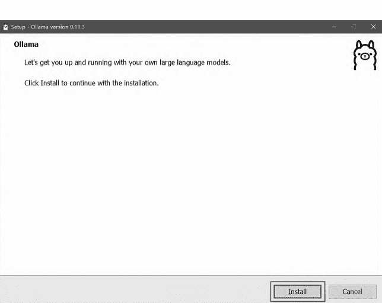

安装过程中系统复制文件并配置，进度条实时显示，需等待完成（见图2-5）。

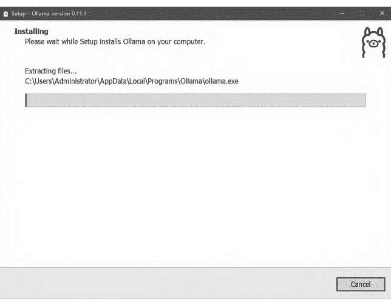

完成后 Ollama 会写入系统（见图2-6）。

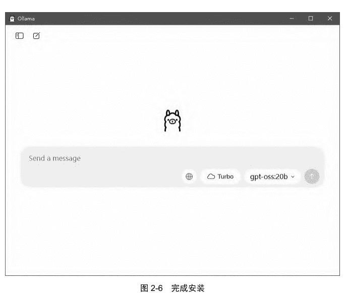

**步骤3：启动 Ollama 客户端**

首次启动后，右下角托盘会出现 Ollama 图标（见图2-7）。点开后进入模型管理与对话面板，能看到已装或待下载的模型列表。


**方法1：直接下载大模型**

在主界面下拉框选中目标模型，输入框里提问，例如“DeepSeek是什么”。点发送后系统发起推理（见图2-8）。


若模型不在本地，系统会自动下载，界面会显示进度、剩余时间和速度（见图2-9）。下载期间可继续使用已有模型。

下载完上下文自动恢复，对话框展示模型输出，排版清晰，并提供复制、保存、继续提问等操作（见图2-10）。

#### 方法2：在终端启动大模型

选型时内存很关键。4GB 的树莓派建议选 2B 量级以内的模型，保证稳定；8GB 设备可尝试更大模型，约 7B 量级是上限。

拉取本地模型的命令格式如下：

```
ollama pull 模型名称: 量级
```

这条指令会从 Ollama 仓库把指定模型同步到本地。以 Gemma3 1B 为例：

```
ollama pull gemma3:1b
```

执行后开始下载，耗时取决于网速和文件大小。

下载完成后即可本地运行，启动格式：

```
ollama run 模型名称: 量级
```

命令会在终端打开指定大模型进入交互模式，直接对话提问即可。

如果模型能正常启动并回答，说明离线大模型已配置成功。无网络也能做自然语言处理任务。

本地部署的优点是响应快、隐私好、不依赖网络，适合对数据安全要求高或网络不稳的场景。

模型转换阶段会把训练格式转成部署格式并针对硬件做优化。部署时需在设备上搭好推理环境，加载模型并集成到系统。后续通过监控推理效率、收集运行数据并定期维护，保证长期稳定。

系统化部署后，DeepSeek 能在算力受限的边缘设备上稳定运行，为智能硬件提供可靠的 AI 支持。这种本地化方案兼顾性能、成本和隐私，推动 AI 实际落地。

### 2.2 树莓派系统配置与优化

树莓派是硬件与 AI 结合的主流平台，系统状态直接影响 AI 应用表现。合理调校能明显提升计算效率、稳定性和能效，为 DeepSeek 等框架创造更好条件。下面从镜像选择到电源管理全流程讲清楚，帮助发挥硬件潜力。

#### 步骤1：下载与安装树莓派镜像烧录软件

第一步打开树莓派官网获取工具（见图2-11）。在软件区下载 Raspberry Pi Imager 烧录工具，这是把系统写入 SD 卡的官方图形工具，新手也能快速上手，建议取最新版以获得更好兼容。

下载完在电脑上找到安装文件，通常在下载文件夹，文件名类似 rpi-imager_x.x.x （见图2-12）。双击启动安装，完成后再做后续烧录。

运行后先出现语言选择界面（见图2-13）。从下拉列表选熟悉的语言，决定向导文本显示。选定后点 OK 继续。

进入正式安装界面点 Next 开始（见图2-14）。系统准备文件并配置组件。

随后出现许可协议，需阅读并勾选 I accept the agreement 确认接受（见图2-15）。确认后点 Next。

下一步选择安装路径，默认位置即可（见图2-16）。有特殊需求可自行浏览，确认后点 Next。

向导会问是否在桌面创建快捷方式，建议勾选以便快速启动（见图2-17）。完成后点 Next。

进入带进度条的安装界面（见图2-18）。文件复制到目标位置并配置，耐心等待，不可中断。

进度达 100% 后提示安装完成，表示烧录工具已就位。点 Finish 结束向导（见图2-19）。可根据提示立即启动。

DeepSeek+树莓派+Arduino智能产品、机器人部署与模型训练全攻略

图 2-15 同意协议并进行下一步

图 2-16 安装到指定文件夹

图 2-17 在桌面生成快捷方式

图 2-18 等待安装完成

图 2-19 完成安装

#### 步骤2：使用树莓派镜像烧录器准备 SD 卡

安装后从桌面快捷方式或开始菜单启动烧录器。主界面有三个核心入口（见图2-20）：CHOOSE DEVICE、CHOOSE OS、CHOOSE STORAGE。按顺序完成即可开始。

在设备列表选 Raspberry Pi 5（见图2-21）。型号选对很重要，不同硬件对应不同系统配置，保证兼容。

选完设备后点 CHOOSE OS。建议选用如图2-22所示的官方推荐系统，带桌面和常用应用。同时把 SD 卡通过读卡器连到电脑，容量建议至少 16GB 且数据已备份，烧录会清空内容。

此时会弹出警告，提示烧录将清除卡上所有数据。确认备份后点 YES 继续（见图2-23）。

烧录前可自定义设置。可设置主机名用于网络识别，默认 raspberrypi，可改为更具描述性的名字，完成后点 SAVE 保存（见图2-24）。

接着设置用户名和密码。默认用户多为 pi，建议改为个性化名称。密码需包含字母数字特殊字符提升安全性，设置后点 SAVE（见图2-25）。

配置界面还能设置 Wi-Fi 信息、时区、键盘布局、系统语言等（见图2-26）。可选择是否启用 SSH，方便无显示器远程访问。按需配置后点 SAVE。

图 2-25 安全设置

图 2-26 高级选项设置

完成自定义后返回主界面，点 NEXT 开始烧录。系统会请求管理员权限授予读写权限（见图2-27）。

确认后软件开始写入镜像并验证（见图2-28）。过程分写入和校验，进度条显示完成度。耗时约10～30分钟，取决于镜像大小和卡速。期间勿拔卡或关机。

全部完成后出现 Write Successful 提示，表示系统已写入并校验通过（见图2-29）。卡片现已可取出插入树莓派。

图 2-29 写入成功

#### 步骤3：首次启动树莓派并进行系统设置

把 SD 卡插进树莓派卡槽，通过 HDMI 或 Micro HDMI、网线或 Wi-Fi 连接键盘鼠标显示器，再接上电源适配器开机。首次启动会自动扩展文件系统并进入初始设置向导（见图2-30）。欢迎页引导完成基础配置。

设置界面需配置地区语言。国家选 China，语言自动切中文。时区选上海或成都。也可勾选 Use English language 和 Use US keyboard 以使用英文界面和美式键盘（见图2-31）。设置完成后点 Next。

图 2-30 启动初始设置向导

树莓派开箱到开发环境就绪全指南

图 2-31 设置国家语言和时区
首次启动后会先进入区域信息设定，随后进入账号创建界面。这里要为树莓派新建一个登录用的用户，填入自己喜欢的用户名并设定一个足够安全的密码组合，系统会要求重复输入一次以核对无误。需要留意的是，若以后忘记密码，恢复方式就是重装系统。确认无误后点按 Next 进入下一步，见图2-32。

DeepSeek 驱动的树莓派智能项目部署实战
图 2-32 设置一个登录的用户密码
接下来是网络设定。系统会自动扫描并列出附近的 Wi-Fi 热点，从中挑选自己的网络名称。已通过网线连接的设备也可以暂时跳过这一步，后续再补设。Wi-Fi 对后续的系统升级和软件包安装很重要，特别是在没有有线网络的情况下。选定网络后点 Next，系统会引导输入密码，见图2-33。

图 2-33 连接到 Wi-Fi 网络
输入 Wi-Fi 密码时要区分大小写与特殊符号，输错则无法连上，日后可在系统设置里重新配置。完成后点 Next 或 连接，系统会校验密码并尝试建立连接，通常需要数秒时间，见图2-34。

随后需要指定默认的网页浏览器，常见选项有 Chromium 与 Firefox。用户可按偏好任选其一，也可在界面中勾选卸载未设为默认的另一款浏览器以节省存储，存储充足的话建议两款都保留。确定后点 Next 继续。

紧接着系统会询问是否开启 Raspberry Pi Connect。见图2-36。这项服务让用户无需额外网络配置就能远程访问树莓派，通过官方工具就能从另一台设备操控本机，特别适合没有显示器或需要远程维护的场景。按需选择后点 Next 进入最后环节。

所有向导完成后会显示配置完成页，见图2-37。此时要点按 重启 按钮使设定生效。点 Restart 后设备会关机并重新启动，加载期间大约需一分钟。重启后若未开启自动登录会看到登录界面，使用刚才创建的用户名密码即可进入桌面，左上角的开始菜单样式按钮可打开各类应用。

完成以上流程就代表 Raspberry Pi 5 系统已安装并完成基础初始化，可以开始探索。操作系统提供图形与命令行两种管理方式，配置项丰富，能按需求优化性能与功能。

#### 步骤4：Ollama Linux 版快速部署
Ollama 为 Linux 提供了官方的一键安装脚本，能自动识别系统架构并部署对应版本。

要安装 Ollama Linux 版，只需在终端执行以下命令。
```
curl -fsSL https://ollama.com/install.sh | sh
```
该命令会下载并立即执行安装程序，见图2-38。安装完毕后 Ollama API 服务会监听本地 11434 端口，命令行下使用 ollama 即可管理与运行模型。

整个过程全自动，无需手动调整配置，脚本会依据系统环境自动适配参数，保证在不同 Linux 环境下正常运行。

树莓派的强大之处在于高度可配置。raspi-config 是系统中最核心的配置工具，提供统一入口管理各项设定。

图 2-38 下载 Linux 版本的 Ollama
① raspi-config 工具：该工具集中管理树莓派的各类参数。
在终端模式下，可用上下方向键浏览列表，Tab 键在项目与按钮间切换，Enter 键确认。文本界面在远程或无显示器的环境下尤为实用。raspi-config 所做的修改会直接写入 /boot/firmware/config.txt 等配置文件，避免手工编辑带来的风险。

访问方式有两种。
- 图形界面中选择 Preferences > Raspberry Pi Configuration。
- 终端中执行 sudo raspi-config。
终端版提供更多高级选项，图形版则更直观。

② 系统选项配置：涵盖最常用的核心功能。
- 无线网络配置可设置 SSID 与密码，便于无显示器或联网项目使用。
- 音频设置可选择 HDMI、耳机孔或 USB 音频输出。
- 密码管理可修改当前账户密码，提升安全性。
- 主机名设置用于在局域网中区分多台设备。
- 启动/自动登录可选择进入命令行或桌面，以及是否自动登录。
- 网络启动等待可决定是否先等网络就绪再完成启动，利于依赖网络的应用，但会延长开机时间。
- 闪屏与电源 LED 控制可自定义视觉反馈。

系统选项负责基础行为设定。
> 无线网络配置：设置 Wi-Fi 的 SSID 与密码。
> 音频设置：选择音频输出设备。
> 密码管理：更改当前用户密码。
> 主机名设置：定义网络中可见名称。
> 启动/自动登录选项：控制启动到命令行或桌面及是否自动登录。
> 网络启动等待：设置是否等待网络连接后再启动。
> 闪屏设置：启用或禁用启动闪屏。
> 电源 LED 控制：调整电源指示灯行为。

另有浏览器选择项可更改默认浏览器。

③ 显示选项配置：用于优化视频输出与兼容性，对媒体中心等视觉项目重要。
- 欠扫描控制可解决部分显示器边缘被裁剪的问题。
- 屏幕休眠可设置闲置后自动关闭以节能。
- VNC 分辨率设置决定无显示器远程时的分辨率。
- 可启用或禁用复合视频输出以兼容老式显示器。
- 树莓派 4 及以上机型支持 4K HDMI 配置，可开启 4K@60Hz 输出。

④ 接口选项配置：用于启用或禁用硬件与软件接口，利于外设连接与安全。
- SSH 默认关闭，可启用后通过网络连接命令行。
- VNC 提供图形化远程桌面。
- SPI 与 I2C 用于连接传感器、显示器等硬件。
- 串行端口配置控制 UART 行为。
- 1-Wire 主要用于 Dallas 温度传感器等设备。
- 远程 GPIO 可通过网络远程控制引脚，适合远程自动化。

⑤ 性能选项配置：调整处理能力与资源分配。
- 超频可提升处理器频率以换取性能，但可能降低稳定性并缩短寿命。
- GPU 内存分配可为图形密集型应用增加显存，或为 CPU 释放资源。
- 覆盖文件系统可启用只读模式，防止 SD 卡损坏。
- 树莓派 4 及后续机型支持风扇控制，按温度自动调节转速。

⑥ 本地化选项：按地区与个人偏好定制。
- 语言设置调整界面语言与区域格式。
- 时区设置确保时钟与本地同步。
- 键盘布局设置适配物理键盘。
- Wi-Fi 国家设置遵循当地无线电法规，影响可用频段与功率。

⑦ 高级配置选项：面向进阶用户。
- 文件系统扩展可将系统分区扩充至整张存储卡。
- 网络接口命名可控制设备名称规则。
- 网络代理设置用于企业或受限网络。
- 启动顺序可在 SD、USB 或网络启动间切换。
- 引导加载程序版本可选择最新或默认固件。
- 显示服务器选项可在 X11 与 Wayland 间切换。
- 音频系统选项可在 PulseAudio 与 PipeWire 间切换。

合理的系统配置能让树莓派满足从家庭自动化到嵌入式系统的各种需求。

### 2.3 树莓派 Python 环境配置详解
在树莓派上搭建 Python 环境，先更新系统，随后下载运行 Miniconda 安装脚本，用 conda 管理环境，再按需安装 NumPy、Pandas 等包，最后验证安装是否正常。

步骤1：系统环境更新
搭建 Miniconda 前要先准备安装文件。可从官方下载页获取适配树莓派架构的安装包，如图2-39所示，选择对应版本下载。

下载完成后通过树莓派的文件传输功能发送到设备中。见图2-40，开启文件传输并建立连接。

在传输界面选中刚下载的 Miniconda 安装包，见图2-41，确认后开始传输。见图2-42，进度会实时显示，完成后进入下一步。

安装前务必保证系统为最新，推荐使用 64 位 Raspberry Pi OS。执行更新命令刷新软件包列表并升级现有软件。

图 2-40 通过树莓派的文件传输功能发送到树莓派中
图 2-41 选择相应的文件
图 2-42 等待传输
确保系统为最新版本（推荐使用 64 位 Raspberry Pi OS），代码如下。
```
sudo apt update && sudo apt upgrade -y
```
该命令由两部分组成：sudo apt update 同步本地源索引获取最新版本信息；sudo apt upgrade -y 将所有可升级包自动更新，-y 参数避免交互中断。

步骤2：获取 Miniconda 安装脚本
打开终端输入下载命令，见图2-43。树莓派基于 ARM 架构，需按具体版本选择对应安装包。

图 2-43 输入下载命令
根据系统架构选择对应版本。
64 位系统 aarch64 安装命令如下。
```
wget https://repo.anaconda.com/miniconda/Miniconda3-latest-Linux-aarch64.sh
```
32 位系统 armv7l 安装命令如下。
```
wget https://repo.anaconda.com/miniconda/Miniconda3-latest-Linux-armv7l.sh
```
wget 是 Linux 常用命令行下载工具，URL 指向 Anaconda 官方仓库，可确保获取到最新且经过验证的稳定脚本。

#### 步骤3：执行安装程序
脚本下载完成后用 bash 执行安装。
```
bash Miniconda3-latest-Linux-*.sh
```
按提示阅读许可协议，输入 yes 同意。确认安装路径，默认是 ~/miniconda3。安装结束后输入 yes 初始化 conda。

命令中使用通配符 * 匹配不同架构的文件名，无论下载哪种版本都能正确执行。

安装为交互式流程，会先展示许可协议，可用空格键翻页阅读。阅读完毕按提示输入 yes 接受协议，见图2-44。
```
...skipping 1 line

Do you accept the license terms? [yes|no]
>>> yes

Miniconda3 will now be installed into this location:
/home/mht/miniconda3

  - Press ENTER to confirm the location
  - Press CTRL-C to abort the installation
  - Or specify a different location below
```
图 2-44 输入 yes
随后会询问安装路径，默认建议安装到用户主目录下的 miniconda3 文件夹，即 ~/miniconda3，通常保留默认即可，直接按 Enter 确认。

安装收尾阶段，程序会弹出提示询问是否将 conda 的初始化脚本写入 Shell 配置文件，此时仍需输入 yes 进行确认（见图2-45）。完成该确认后，与 conda 相关的环境变量及命令搜索路径会被写入 bash 配置文件，使系统能够识别并调用 conda 命令。

```
You can undo this by running `conda init --reverse $SHELL`? [yes|no]
[no] >>> yes
no change    /home/mht/miniconda3/condabin/conda
no change    /home/mht/miniconda3/bin/conda
no change    /home/mht/miniconda3/bin/conda-env
no change    /home/mht/miniconda3/bin/activate
no change    /home/mht/miniconda3/bin/deactivate
no change    /home/mht/miniconda3/etc/profile.d/conda.sh
no change    /home/mht/miniconda3/etc/fish/conf.d/conda.fish
no change    /home/mht/miniconda3/shell/condabin/Conda.psm1
no change    /home/mht/miniconda3/shell/condabin/conda-hook.ps1
no change    /home/mht/miniconda3/lib/python3.12/site-packages/xontrib/conda.xsh
no change    /home/mht/miniconda3/etc/profile.d/conda.csh
modified     /home/mht/.bashrc

==> For changes to take effect, close and re-open your current shell. <==

Thank you for installing Miniconda3!
```

图 2-45 再次输入 yes

#### 步骤4：激活conda环境。
安装完成后需要让 Shell 重新读取配置文件，使 conda 立即生效。

```
source ~/.bashrc  # 或重启终端
```

source 用来在当前会话中执行指定的脚本文件，这里执行的是 bash 的 .bashrc。执行之后，先前写入的 conda 配置立刻可用，当前终端即可直接使用 conda。若不想手动执行，也可直接关闭当前窗口重新打开，新会话会自动加载已更新的配置文件。

镜像源配置（可选）：可手动编辑用户主目录下的 ~/.condarc，填入国内镜像地址，例如清华源。

#### 步骤5：配置镜像源。
在国内网络环境下，使用默认源下载速度往往偏慢，建议切换到国内镜像。打开用户主目录下的 .condarc 文件，写入清华大学开源软件镜像站地址。具体写法如下。

```
channels:
  - defaults
show_channel_urls: true
default_channels:
  - https://mirrors.tuna.tsinghua.edu.cn/anaconda/pkgs/main
  - https://mirrors.tuna.tsinghua.edu.cn/anaconda/pkgs/r
  - https://mirrors.tuna.tsinghua.edu.cn/anaconda/pkgs/msys2
custom_channels:
  conda-forge: https://mirrors.tuna.tsinghua.edu.cn/anaconda/cloud
  pytorch: https://mirrors.tuna.tsinghua.edu.cn/anaconda/cloud
```

该配置文件遵循 YAML 语法。channels 用来定义 conda 查找软件包的优先级，show_channel_urls 打开后安装时会显示具体下载地址。default_channels 指定默认使用的镜像服务器地址，custom_channels 则为 conda-forge、pytorch 等特定软件包集合指定专门的镜像地址。

#### 步骤6：创建虚拟环境
虚拟环境是 conda 包管理系统的核心能力，可为不同项目构建隔离的 Python 运行空间，避免依赖冲突。具体命令如下。

```
conda create -n myenv python=3.9  # 示例：创建名为myenv的环境
conda activate myenv  # 激活环境
```

第一条命令新建一个名为 myenv 的独立环境，并指定 Python 3.9。可根据项目需求修改环境名称与 Python 版本。第二条命令激活刚创建的环境，激活后终端提示符会从 (base) 变为 (myenv)，表明已进入指定环境。

#### 步骤7：验证安装
为确认 Miniconda 安装配置是否成功，可安装一个常用的科学计算库进行测试。具体命令如下。

```
conda install NumPy  # 安装示例包
python -c "import NumPy; print(numpy.__version__)"  # 验证
```

第一条使用 conda 安装 NumPy 数值计算库，conda 会自动解析依赖并从已配置的镜像源下载安装。第二条在 Python 中导入 NumPy 并输出版本号。若能正常显示版本号，则说明整个环境配置已完成。

安装过程中可能出现的常见问题汇总如下。

```
权限问题：避免使用 sudo 安装conda。
依赖缺失：安装某些安装包时可能需要系统库，例如
sudo apt install libatlas3-base libopenblas-dev
兼容性问题：优先使用 conda-forge 频道的包
conda install -c conda-forge package_name
```

至此，树莓派 5B 上的 Miniconda Python 环境配置已全部完成。该环境提供完整的包管理功能与灵活的虚拟环境管理机制，为后续 Python 开发与科学计算提供稳定可靠的基础。合理使用环境隔离与镜像加速，能够显著提升开发效率与系统稳定性。

## 第3章 智能交互篇
人工智能的快速发展推动了智能交互技术的演进。接下来将围绕智能交互的核心技术展开，包括语音识别与合成、智能语音控制、情感计算、多模态交互以及智能反馈机制的设计优化，介绍如何构建高效自然的交互系统以提升用户体验与交互效率。智能语音交互的关键技术涵盖上述内容，并延伸到实时语音助手的开发优化，既为用户提供便捷的交互方式，也为商业带来新机遇。

### 3.1 情感计算应用实现
情感计算是人工智能的重要分支，借助机器学习与深度学习自动识别和分析人类情感状态。Python 生态拥有丰富的情感计算工具库，为开发者构建情感智能应用提供技术支撑。系统架构采用多模态融合思路，通过文本语义分析、语音声学特征提取与生理信号处理等多渠道获取情感信息，多维度感知能够更准确地把握用户真实情绪。

设计遵循模块化与可扩展原则，将情感识别任务封装为独立的功能模块，提升复用性与可维护性，便于后续功能扩展与算法升级。

#### 3.1.1 文本情感分析
文本情感分析系统采用基于词典的方法，利用 NLTK 中的 VADER 工具实现对文本情感倾向的自动识别。核心设计思路是将复杂的自然语言处理任务封装为简洁易用的函数接口，同时保持足够高的分析精度与处理效率。

该技术在商业与社会生活中有广泛应用，下面通过三个场景进行说明。

- ① 电商平台的商品评价分析：电商平台会利用情感分析技术自动处理海量的用户评论。例如新手机上市后，系统会自动分析数千条评论，识别用户对各方面的情感倾向。系统能够识别出“电池续航太差了”这类负面评价，也能捕捉到“拍照效果超出预期”这类正面评价。借此商家可快速了解产品优缺点，及时调整营销策略或改进产品；平台也能自动标记恶意差评或虚假好评，维护评价体系的公正性。

- ② 金融市场的舆情监控：金融机构会使用情感分析工具监测社交媒体与新闻报道中关于特定公司或行业的舆情变化。例如某科技公司发布新品时，系统会实时分析 Twitter、财经新闻、分析师报告中的相关讨论，判断市场情绪偏乐观还是悲观。若出现大量负面情绪，如对产品质量的质疑或对管理层的批评，可能预示股价波动。投资机构据此可及时调整策略，规避风险或把握机会。

- ③ 政府部门的民意收集：政府部门越来越多地运用情感分析了解民众对政策的反应。例如某城市推出新的交通限行政策后，相关部门会分析市民在政务平台、微博、论坛上的留言与讨论。系统能够识别出“上班通勤变得更困难”的抱怨，或“空气质量确实改善了”的认可。通过量化不同情感的比例与变化趋势，政府能更准确地评估政策效果，及时发现问题并作出调整，让决策更贴近民意。

代码架构遵循模块化设计，将资源下载、情感分析、结果解释等功能分离为独立组件，保证可维护性与可扩展性，便于后续功能增强与算法优化。

PyCharm 由 JetBrains 公司开发，是业内认可的专业 Python 集成开发环境，集成了代码智能提示、语法高亮、断点调试、版本控制、单元测试等实用功能，大幅提升 Python 程序开发的效率与质量。分为专业版与社区版，社区版免费开源，已能满足大部分开发需求，在文本情感分析应用中较为常见。下面演示使用流程。

##### 步骤1：下载PyCharm安装包
首先访问 PyCharm 官方网站进行软件下载（见图3-1）。官网首页可看到最新版本信息与下载入口。点击 Download 按钮后，


图 3-1 PyCharm 官网

系统会自动识别访问者的操作系统类型。对于 Windows 用户，需要选择对应的 Windows 版本进行下载（见图3-2）。下载完成后会得到一个安装包，文件名通常为 pycharm-community-xxxx.x.x.exe，其中 xxxx.x.x 代表版本号。


图 3-2 单击相应版本进行下载

##### 步骤2：安装PyCharm
找到已下载的安装包，双击运行安装程序（见图3-3）。安装向导弹出，欢迎页显示 PyCharm 图标与版本信息，点击 Next 继续安装流程（见图3-4）。


图 3-3 下载 PyCharm 安装包


图 3-4 开始安装

接下来需要指定软件的安装路径（见图3-5）。默认情况下 PyCharm 会安装到 C 盘 Program Files 目录。若 C 盘空间不足或希望安装到其他位置，可点击 Browse 自定义路径，建议选择空间充足且路径中不含中文字符的目录。

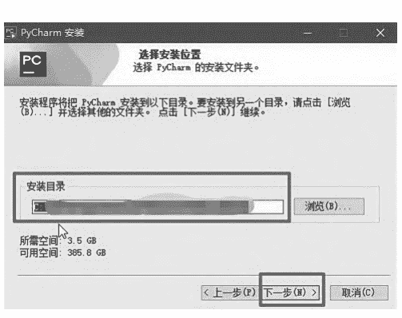

在安装选项设置界面（见图3-6），有数项配置需要注意。建议勾选 Create Desktop Shortcut，在桌面创建 PyCharm 快捷方式，便于日后快速启动。若希望 .py 文件默认使用 PyCharm 打开，可在关联选项中勾选 .py。

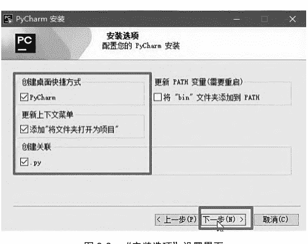

DeepSeek+树莓派+Arduino智能产品、机器人部署与模型训练全攻略

随后进入“选择‘开始’菜单文件夹”界面（见图3-7），可设置 PyCharm 在 Windows 开始菜单中的名称与位置，保持默认即可，直接点击 安装 开始正式写入。

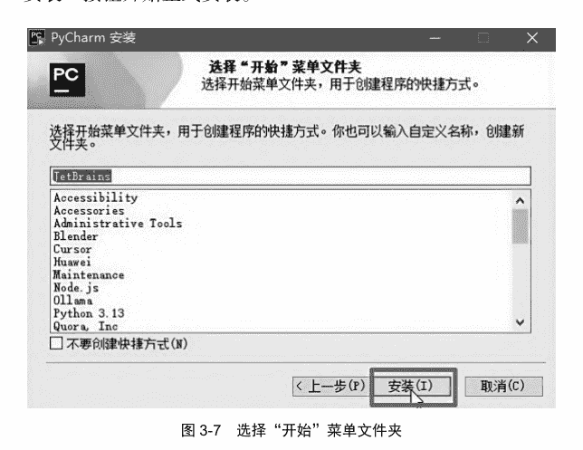

图3-7 选择“开始”菜单文件夹

安装过程会持续数分钟（见图3-8），安装程序会自动完成文件复制、注册表写入、环境变量配置等操作，进度条会实时显示当前状态。


图3-8 正在安装

当进入“PyCharm 安装程序结束”界面（见图3-9）时，表示安装已成功完成。此时可勾选 运行 PyCharm 并点击 完成 立即启动。


图 3-9 完成安装

##### 步骤3：初始配置
首次启动 PyCharm 时会进入初始配置向导。若之前未使用过或无需导入旧设置，可直接跳过这些步骤（见图3-10）。


图 3-10 跳过步骤

##### 步骤4：创建第一个项目
进入主界面后需要新建项目开始 Python 编程（见图3-11）。点击 New Project 选项，系统会弹出 New Project 窗口。


在 New Project 窗口（见图3-12）中，需要设置项目的存储位置与 Python 解释器。建议选择专门的文件夹存放项目文件，路径中避免使用中文字符。解释器可选择系统已安装的 Python 版本，或新建虚拟环境。

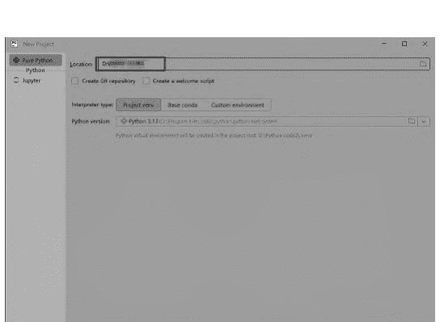

设置好存储位置后，点击 Create 创建项目。在提示框中点击 Open Project，PyCharm 会打开项目文件夹（见图3-13），并在主界面中展示项目结构。创建完成后可看到完整的工作界面。


图 3-13 打开项目文件夹


图 3-14 完整工作界面

##### 步骤5：界面汉化
对英文界面不太熟悉的用户，PyCharm 提供中文语言包支持。通过安装中文插件可将界面汉化（见图3-15）。安装完成后需重启 PyCharm，重启后界面会完全显示为中文（见图3-16），包括菜单栏、工具栏、设置选项等，大大降低使用门槛。


图 3-15 汉化并重启

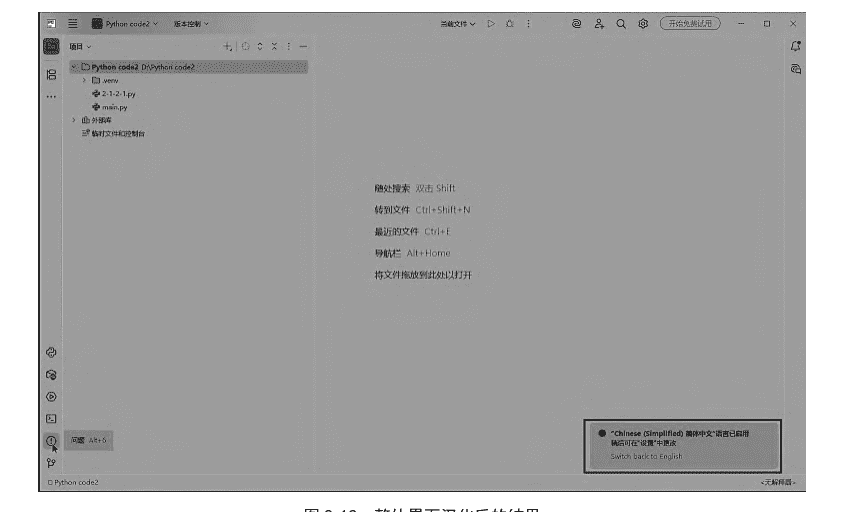

图 3-16 整体界面汉化后的结果

##### 步骤6：主题设置
PyCharm 提供多种界面主题供选择。要更改主题，需打开设置对话框。点击菜单栏中的 文件 选项，然后选择 设置 命令（见图 3-17）。


在 设置 窗口中，找到 外观和行为 类别下的 外观 选项（见图 3-18）。主题下拉列表中可看到多个可选主题，包括暗色与亮色。

图 3-17 选择“设置”命令

第3章 智能交互篇


图 3-18 “外观和行为”类别

若长时间编程容易视觉疲劳，建议选择亮色主题（见图3-19）。选定后点击 确定（见图3-20）。


图 3-19 选择亮色主题

更改主题会立即生效，整个 PyCharm 界面会呈现不同的配色方案（见图3-21）。亮色主题背景为白色，代码高亮颜色柔和，适合在光线充足的环境下使用。

DeepSeek+树莓派+Arduino智能产品、机器人部署与模型训练全攻略


图 3-20 选择亮色主题后，并单击确定


图 3-21 选择亮色主题后的界面

##### 步骤7：Python软件包管理器的使用

PyCharm 快速上手：从包管理到情感分析实战

##### 步骤8：接入 Anaconda 科学计算套件
PyCharm 内置了较为完善的组件管理能力。视窗底部左侧的 Python 套件入口打开后即可进入管理面板。

在管理面板的检索栏键入 Anaconda，如图3-23，系统会列出相关的发行包。Anaconda 是面向科学计算的 Python 分发集合，内部已预置了大量常用计算组件。


进入后续部署流程，如图3-24。确认后编辑器会自动获取目标包及其配套依赖，并在界面上实时展示进度。

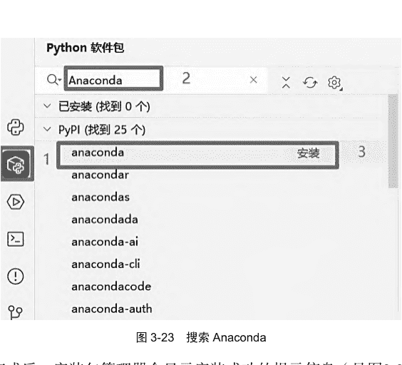

部署结束后面板会给出成功提示，如图3-25，表示 Anaconda 套件已成功关联到当前工程。


图 3-25 安装 Anaconda 环境完成后的显示

##### 步骤9：补充项目所需扩展
除 Anaconda 外，还可按需添加其他外部扩展。例如进行音频处理时可引入 PyAudio，如图3-26。在搜索栏输入名称定位到对应条目后点安装即可，编辑器会自动梳理依赖，保证所需组件齐全。

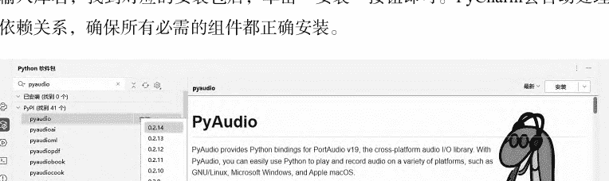

图 3-26 安装 PyAudio 库

至此 PyCharm 的基础搭建已经结束。配置完成后的工作环境界面简洁、功能齐全，能够覆盖从入门到进阶的各类 Python 任务。后续还可依据个人习惯调整编辑器选项、快捷键映射、代码规范等，打造专属的工作台。

##### 步骤10：进入实现阶段
设计思路采用阈值判别的分类策略，利用 Compound Score 的取值区间来判定文本的情感倾向。既保持了判别的简洁，也能捕捉细微差别。在 PyCharm 右侧的编码区完成实现，编写完毕后点击运行，结果会出现在下方，同时要保证引用的包已被部署，如图3-27。

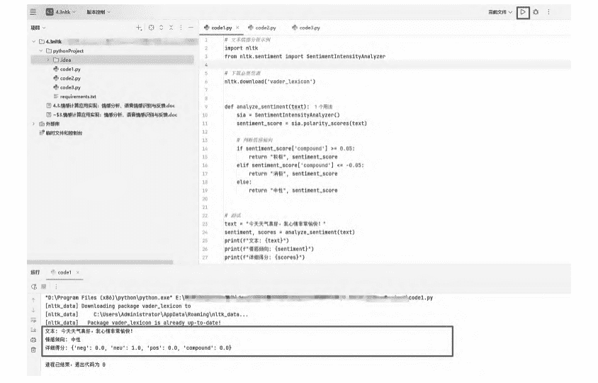

示例实现呈现如下。

```
###### 文本情感分析示例
import nltk
from nltk.sentiment import SentimentIntensityAnalyzer

######## 下载必要资源
nltk.download('vader_lexicon')

def analyze_sentiment(text):
    sia = SentimentIntensityAnalyzer()
    sentiment_score = sia.polarity_scores(text)

    # 判断情感倾向
    if sentiment_score['compound'] >= 0.05:
        return "积极", sentiment_score
    elif sentiment_score['compound'] <= -0.05:
        return "消极", sentiment_score
    else:
        return "中性", sentiment_score

###### 测试
text = "今天天气真好，我心情非常愉快！"
sentiment, scores = analyze_sentiment(text)
print(f"文本: {text}")
print(f"情感倾向: {sentiment}")
print(f"详细得分: {scores}")
```

下面对实现进行拆解，帮助快速把握核心要点。

####### （1）引入依赖并准备运行环境
项目启动首先要建立完整的依赖关系与运行条件。NLTK 作为自然语言处理的基础工具包，为情感分析提供了丰富的算法与语料。示例实现呈现如下。

```
import nltk
from nltk.sentiment import SentimentIntensityAnalyzer
```

上述片段采用分层导入方式，既引入主包，又单独引入情感分析子包。这种做法兼顾功能完整与资源占用。

SentimentIntensityAnalyzer 是 NLTK 内置的情感强度分析工具，底层基于 VADER 实现。该方法对社交媒体文本和非正式表达适应性强，能较好识别表情、标点和大小写的强调效果。

####### （2）资源获取与初始化配置
情感分析系统要稳定运行，需要事先获取语言资源和词典数据。资源管理直接影响稳定性。示例实现呈现如下。

```
######## 下载必要资源
nltk.download('vader_lexicon')
```

可见 VADER 词库的获取是初始化的关键。该词库收录了大量人工标注的情感词条及强度评分，是精准分析的基础数据。

获取过程依赖 NLTK 自带的下载机制，会自动处理网络、校验和本地存储等细节。下载完成后资源会被缓存，避免重复获取影响效率。

片段中未显式写出异常处理，但 NLTK 内部已提供完善的容错能力，可应对网络中断、存储不足等各种异常。

####### （3）核心分析函数构建
情感分析函数的设计是整个系统的核心，需实现从输入文本到情感判定的完整链路。设计遵循单一责任原则，聚焦于情感分析本身的逻辑。示例实现呈现如下。

##### （4）情感分类逻辑实现
分类逻辑通过阈值判断把连续得分映射为离散标签。策略需要在准确性与实用性之间取得平衡。示例实现呈现如下。

```python
###### 判断情感倾向
if sentiment_score['compound'] >= 0.05:
    return "积极", sentiment_score
elif sentiment_score['compound'] <= -0.05:
    return "消极", sentiment_score
else:
    return "中性", sentiment_score
```

使用复合指标可将多维情感信息压缩为单一数值。该指标取值范围为 -1 到 1，负值代表消极，正值代表积极，接近零为中性。

把阈值设为 -0.05 与 0.05，能提供合理的分界。既避免分类过于敏感导致误判，也保留足够灵敏度以识别明显倾向。

三类划分即积极、消极、中性，基本满足大部分应用场景。简化分类便于理解，同时仍能抓住文本情感的主要特征。

##### （5）VADER 算法原理与优势
VADER 情感分析方法是为社交媒体文本设计的词典加规则方案。最大优势在于能处理现代网络语言的特殊表达。词库基于大规模人工标注构建，覆盖超过 7500 条词条的情感评分，每个词的强度从 -4 极度消极到 +4 极度积极。

规则层面处理各类语言现象对情感的影响。例如大写起强调作用，感叹号增强情感，否定词会反转极性，程度副词调节强度。

##### （6）情感得分计算机制
得分计算综合考虑多因素，不仅看词本身的情感值，还会兼顾上下文、标点和语法结构。示例实现呈现如下。

```python
sentiment_score = sia.polarity_scores(text)
```

可看出 polarity_scores 函数返回四个维度。正面得分 pos 反映积极强度的占比，负面得分 neg 反映消极强度的占比，中性得分 neu 反映中性内容的占比。复合得分 compound 是最核心的综合指标，通过标准化把各维度合并为单一数值，是分类的主要依据。

标准化处理让不同长度文本具备可比性。无论文本长短，复合得分始终落在 -1 到 1 的固定区间，便于统一设置分类阈值。

##### （7）分类阈值的选择策略
阈值的设定直接影响分析的准确度和实用性。当前使用的 -0.05 与 0.05 是基于大量实验和实践总结的经验值。

阈值设计要兼顾情感表达的模糊性和上下文依赖性。负向阈值过低会造成过度敏感，把轻微倾向放大为明确类别；阈值过高则容易遗漏真实情感。

中性区间为模糊情感提供缓冲。得分落在 -0.05 到 0.05 之间的文本被归为中性，更符合人类实际的情感表达规律。

动态阈值调整是未来优化的方向。结合具体应用领域和用户反馈，可灵活调整参数以获得更优分类效果，如图3-28。

```
文本：今天天气真好，我心情非常愉快！
情感倾向：中性
详细得分：{'neg': 0.0, 'neu': 1.0, 'pos': 0.0, 'compound': 0.0}

进程已结束，退出代码为 0
```

图 3-28 代码执行后的结果展示

持续优化代码和阈值设置，可进一步提升情感分析的准确性和实用性。

#### 3.1.2 语音情感识别
语音情感识别系统采用传统机器学习路线，通过音频信号处理和特征工程实现对语音中情感状态的自动识别。整体思路是把复杂的音频信号转化为可量化的数值特征，再用机器学习算法学习特征与情感类别的映射关系。

编程架构遵循数据流水线模式，将音频预处理、特征提取、模型训练和情感预测等步骤拆分为清晰的功能模块。模块化不仅提升代码可维护性，也方便各组件独立测试和优化。

系统采用监督学习策略，用大量带标签的语音数据训练分类模型。随机森林算法在复杂度和性能间取得了较好平衡，既能处理高维特征，也具备不错的泛化能力和可解释性。

语音情感识别通过分析说话人的语调、音高、语速等声学特征来判断情绪，在多个领域都有重要价值。下面用三个典型场景来说明。

- ① 客服中心的服务质量监控：现代客服中心普遍引入语音情感识别来提升服务水平。系统可实时监测通话中客户情绪变化，一旦检测到愤怒或焦躁迹象，就马上提醒客服人员并建议安抚措施。比如客户音量骤升、语速加快时，系统会推断其可能不满，提示客服放慢语速、降低音调缓和气氛。若情绪持续恶化，还会建议转接资深主管。该技术既能提高客户满意度，也为客服培训提供历史通话情绪模式的分析依据。

- ② 智能汽车的驾驶安全辅助：车企正把语音情感识别集成到智能驾驶系统，以提升行车安全。系统通过分析驾驶员与车载助手的对话声学特征，判断其是否处于疲劳、愤怒或焦虑状态。例如说话含糊、反应迟钝可能意味着打瞌睡，系统会播放提神音乐或建议休息；若识别到路怒情绪，语气急躁、音量升高，系统会播放舒缓音乐、调节氛围灯，甚至规划更顺畅路线以缓解负面情绪。

- ③ 心理健康的远程评估：心理健康领域正在探索用语音情感识别进行初步筛查和持续监测。远程咨询中，系统可捕捉患者语音的细微变化，帮助医生更精准评估情绪状态。如抑郁症患者常表现为语速缓慢、音调平坦、停顿增多；焦虑症患者则可能语速过快、音调波动大。通过定期电话随访，系统能追踪语音情感变化趋势，及时发现病情波动。部分心理健康 App 还支持语音日记功能，系统分析录音的情感特征并生成情绪报告，帮助用户和医生了解情绪规律，制定更有效的治疗方案。

以上案例展示了语音情感识别如何超越文字内容，通过声音本身传递的情感信息改善人机交互、保障安全和促进健康。

虚拟环境是 Python 项目管理的最佳实践。创建独立虚拟环境可避免不同项目间的依赖冲突；通过 requirements.txt 锁定每个依赖包的具体版本，确保开发与生产环境一致。版本冲突是导致系统不稳定的常见原因，因此安装顺序需考虑依赖关系，保证基础包先于依赖包安装。部分安装包还需要特定的系统库支持。在 PyCharm 界面右侧的编程区编写代码，完成后点击“运行”按钮，结果会展示在下方，同时要保证代码所引用的库已安装，如图3-29。

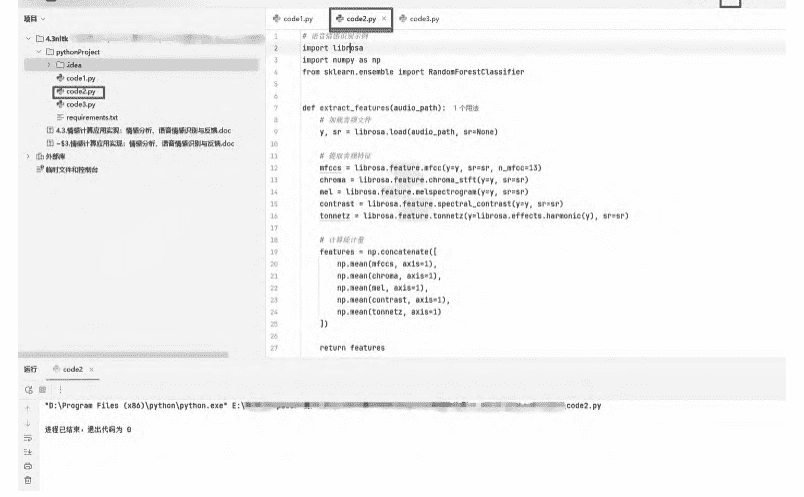

图 3-29 代码与执行结果

示例实现呈现如下。

```python
##### 语音情感识别示例
import librosa
import numpy as np
from sklearn.ensemble import RandomForestClassifier

def extract_features(audio_path):
    # 加载音频文件
    y, sr = librosa.load(audio_path, sr=None)

    # 提取音频特征
    mfccs = librosa.feature.mfcc(y=y, sr=sr, n_mfcc=13)
    chroma = librosa.feature.chroma_stft(y=y, sr=sr)
    mel = librosa.feature.melspectrogram(y=y, sr=sr)
    contrast = librosa.feature.spectral_contrast(y=y, sr=sr)
    tonnetz = librosa.feature.tonnetz(y=librosa.effects.harmonic(y), sr=sr)

    # 计算统计量
    features = np.concatenate([
        np.mean(mfccs, axis=1),
        np.mean(chroma, axis=1),
        np.mean(mel, axis=1),
        np.mean(contrast, axis=1),
        np.mean(tonnetz, axis=1)
    ])

    return features

##### 假设我们已经有了训练好的模型
def train_emotion_model(X_train, y_train):
    model = RandomForestClassifier(n_estimators=100)
    model.fit(X_train, y_train)
    return model

def predict_emotion(audio_path, model):
    features = extract_features(audio_path)
    emotion = model.predict([features])[0]
    return emotion

##### 注意：在实际应用中，需要使用标注数据集训练模型
##### 这里只是示例框架
```

下面对关键部分进行解析，帮助更好地理解实现思路。

####### （1）依赖导入与环境配置
语音情感识别系统需要整合多个专业库来处理不同层面的技术需求。每个库的选择都有明确的技术考量。示例实现呈现如下。

```python
import librosa
import numpy as np
from sklearn.ensemble import RandomForestClassifier
```

Librosa 是 Python 社区中较为专业的音频信号处理工具包，提供音频加载、特征提取和信号变换等完整能力，特别擅长语音与音乐分析，是音频机器学习项目的常用选择。

NumPy 为数值计算提供高效的数组操作和数学函数支持，在音频特征处理中，其向量化操作能显著提升计算效率，尤其在处理大规模特征矩阵时优势明显。

Scikit-learn 中的 RandomForestClassifier 是成熟的随机森林实现。该算法对特征缩放不敏感，能自动进行特征重要性筛选，适合处理音频特征的高维数据。

####### （2）音频特征提取核心实现
音频特征提取是语音情感识别的核心环节，需要从原始音频信号中抽取能够反映情感的数值表示。特征质量直接决定后续分类模型的性能上限。示例实现呈现如下。

```python
def extract_features(audio_path):
    # 加载音频文件
    y, sr = librosa.load(audio_path, sr=None)
```

代码中使用 librosa.load 加载音频文件，该函数支持多种格式并可自动完成必要预处理。参数 sr=None 表示保留原始采样率，避免重采样带来的信息损失。

返回的 y 为音频的时域波形数据，sr 为采样率。这两者是后续所有特征提取的基础输入，全部声学特征都将由此计算得出。

####### （3）MFCC 特征提取与分析
梅尔频率倒谱系数 MFCC 属于语音信号处理中最重要的特征之一，其设计模拟了人类听觉系统的频率感知特性。示例实现呈现如下。

```python
######## 提取音频特征
mfccs = librosa.feature.mfcc(y=y, sr=sr, n_mfcc=13)
```

语音情感识别：从声学特征到智能反馈

MFCC 提取的核心思路是借鉴人耳的听觉机制，把原始音频映射成更贴近听感的表征。设置 n_mfcc=13 是语音识别里沿用已久的常规做法。这一组系数对音色、发音习惯以及情绪状态都有很强的刻画力，不同情绪的语音在 MFCC 空间里会形成可区分的分布，为后续的情绪分类奠定基础。

####### （4）色度特征与音乐性分析

色度特征描述的是音频在不同音高类别上的能量集中情况，重点在于揭示音乐性与谐波结构。代码片段如下。
```python
chroma = librosa.feature.chroma_stft(y=y, sr=sr)
```
具体实现把频谱能量归到 12 个半音格上，得到一个 12 维向量。在语音情绪任务里，色度能够捕捉语调起伏和音乐性成分，而这两类信息与情绪表达高度相关。情绪差异在音调使用上也很明显，积极情绪往往伴随更活跃的音高变化，消极情绪则倾向于平淡单一的音高模式。

####### （5）梅尔频谱与频域分析

梅尔频谱图给出了音频在时频平面的精细描绘，是当前语音处理的主流表征之一。代码片段如下。
```python
mel = librosa.feature.melspectrogram(y=y, sr=sr)
```
梅尔滤波组把线性频谱转成符合人耳敏感度的梅尔尺度，突出听觉敏感区、淡化次要频段。由此得到的特征能反映频谱包络的演变，间接体现声带振动和声道共振特性。各情绪状态的语音在频谱能量布局上会呈现特征化的差异。

####### （6）频谱对比度与动态特征

频谱对比度衡量不同频带间能量的落差，用以刻画声音的动态跨度与频谱结构复杂度。代码片段如下。
```python
contrast = librosa.feature.spectral_contrast(y=y, sr=sr)
```
计算方式基于频谱峰值和谷值的差值来评估动态。对比度高意味着频谱变化丰富，对比度低则接近平坦。在情绪语音里，该指标与说话人的激动程度关联，情绪高涨时动态范围往往更大，情绪平静时对比度则偏小。

####### （7）调性网络与和声分析

调性网络源自音乐理论的和声空间，用来解析音频的和声组织与调性倾向。代码片段如下。
```python
tonnetz = librosa.feature.tonnetz(y=librosa.effects.harmonic(y), sr=sr)
```
实现上先用 harmonic 函数分离出和声成分，再在六维调性空间里呈现和声关系，从而跟踪和声及调性的迁移。虽然该特征主要服务于音乐分析，但在语音情绪识别里仍能提供补充信息，因为人的情绪表达常伴随语调层面的和声式变化，可被该特征捕捉。

####### （8）特征统计量计算与降维

原始声学特征是二维时序，需要通过统计聚合变成固定长度向量才适配机器学习。代码片段如下。
```python
######## 计算统计量
features = np.concatenate([
    np.mean(mfccs, axis=1),
    np.mean(chroma, axis=1),
    np.mean(mel, axis=1),
    np.mean(contrast, axis=1),
    np.mean(tonnetz, axis=1)
])
```
均值是最常用的聚合方式，对时间轴求平均把时变序列压缩为静态描述，既保留整体趋势又压制短时抖动。不同来源的特征借助 np.concatenate 合并为单一向量，组合方式简洁且能发挥互补优势，axis=1 指定在特征方向拼接，保持时间序列的完整性。最终向量融合了各类特征的统计信息，为分类提供丰富输入。

####### （9）特征向量的维度分析

整体维度由各子特征决定。MFCC 提供 13 维，色度 12 维，梅尔频谱通常 40 维，频谱对比度 7 维，调性网络 6 维。高维向量信息量充足，但也容易带来维度灾难，实践中需辅以特征选择或降维优化。示例里未显式做标准化，实际应用中却很重要，因为不同特征量纲差异大，标准化有助于模型训练时各特征贡献均衡。

####### （10）随机森林模型的选择与配置

随机森林擅长处理高维数据，并能自动评估特征重要性，对异常值和噪声鲁棒。代码片段如下。
```python
def train_emotion_model(X_train, y_train):
    model = RandomForestClassifier(n_estimators=100)
    model.fit(X_train, y_train)
    return model
```
参数 n_estimators=100 控制树的数量，在计算开销与模型复杂度之间取得折中。训练调用标准的 fit 接口，输入训练特征 X_train 与情绪标签 y_train，数据量与质量直接决定效果。训练完成后返回模型对象，内部保存了全部参数与决策规则，可持久化保存供后续预测复用。

####### （11）模型训练的数据需求

训练集需要覆盖多种情绪的大量语音样本，且标签准确。规模和质量是性能的关键，类别间样本均衡可避免模型偏向多数类。多样的说话人、录音环境和语义内容有助于提升泛化能力，降低过拟合风险。

####### （12）预测函数的实现逻辑

预测函数把特征提取和模型推理串联成对外接口。代码片段如下。
```python
def predict_emotion(audio_path, model):
    features = extract_features(audio_path)
    emotion = model.predict([features])[0]
    return emotion
```
实现要点如下。
- ① 执行流程：先调用特征提取得到音频表征，再用训练好的模型做分类，两阶段设计清晰可控。
- ② 向量封装：用 [features] 把一维向量转为二维数组，满足 sklearn predict 的输入格式。
③ 结果提取：通过 [0] 取出唯一预测值，返回的标签即训练时使用的类别标识。

####### （13）系统部署的技术考虑

部署层面需关注模型的持久化与加载，可用 pickle 或 joblib 保存与读取。性能优化方向包括加速特征提取、批处理预测，实时场景可能需要更快的提取算法或模型压缩。错误处理要覆盖音频读取失败、特征提取异常、预测错误等情况，是生产系统的基本保障。

####### （14）必须依赖包的功能分析

系统运行依赖多套 Python 库，各有分工。代码片段如下。
```
pip install numpy scipy scikit-learn matplotlib soundfile
```
NumPy 与 SciPy 提供数组运算、数学函数和科学计算底座，是数据科学的基础。Scikit-learn 实现了分类、回归、聚类及评估等机器学习算法，接口统一。Matplotlib 虽未在代码中直接调用，但在开发调试与结果可视化时不可或缺。SoundFile 负责音频文件的读写，是 librosa 的底层依赖，支持多种格式以保障兼容性。

3.1.3 情感反馈系统

多模态情感反馈系统融合文本与语音双通道，通过整合不同模态的情绪线索给出更准确的判断。设计理念是把文本语义分析与语音声学分析结合，形成理解复杂情绪状态的智能交互能力。架构采用面向对象模式，将情感分析、音频处理、反馈生成封装为独立类与方法，提升可扩展性、可复用性、可维护性和可测试性。

该系统通过识别情绪并即时调整实现更人性化交互。三个典型场景如下。
- ① 在线教育的个性化调节：平台通过摄像头捕捉面部表情，结合鼠标轨迹和答题耗时实时判断学习状态。出现困惑表情、反复回看知识点或答题延迟时，系统判定理解受阻，会降低讲解速度、补充示例或推送基础复习；若出现无聊、快进、频繁查看进度条，则加快节奏或提供进阶练习，让学习适配个人节奏。
- ② 智能家居的情绪化调控：家居系统整合语音语气、行为模式和生理指标如智能手表心率，形成闭环。当检测到用户下班疲惫、脚步沉重时，会调暗灯光至暖色、播放轻音乐、调节室温并启动薰衣草香薰助放松。若捕捉到家庭争吵、情绪激动，则适度降温、播放舒缓自然音、切换为蓝绿色灯光，以柔性环境缓解紧张。
- ③ 游戏体验的动态难度平衡：系统依据操作习惯、反应时延及摄像头或可穿戴设备生理数据评估投入度。连续失败导致挫败、操作急躁时，系统会暗中降低难度、增加提示或提升命中率重建信心；当操作机械、注意力分散显示无聊时，则引入新机制或更强对手，保持玩家处于心流状态，提升留存与吸引力。

这些案例说明持续监测与智能响应如何创造更适应性的交互，让技术真正回应人类情感。系统采用多线程并发策略并行执行文本分析与音频采集，提升体验与响应效率。在 PyCharm 右侧编码区编写代码，运行后下方显示结果，同时需安装代码依赖的库（见图3-30）。
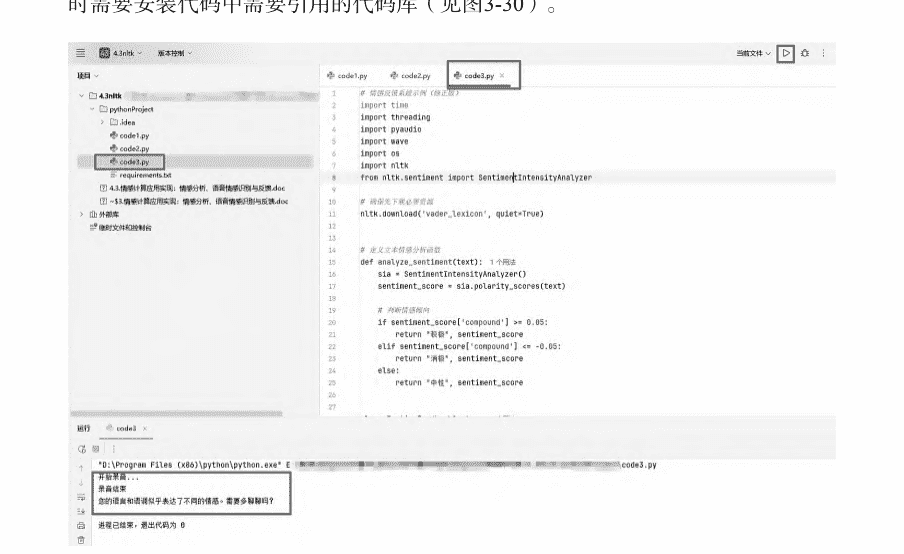
图 3-30 代码和进行结果
具体代码如下。

```
##### 情感反馈系统示例
import time
import threading
import pyaudio
import wave
import os
import nltk
from nltk.sentiment import SentimentIntensityAnalyzer

######## 确保先下载必要资源
nltk.download('vader_lexicon', quiet=True)

##### 定义文本情感分析函数
def analyze_sentiment(text):
    sia = SentimentIntensityAnalyzer( )
    sentiment_score = sia.polarity_scores(text)

    # 判断情感倾向
    if sentiment_score['compound'] >= 0.05:
        return "积极", sentiment_score
    elif sentiment_score['compound'] <= -0.05:
        return "消极", sentiment_score
    else:
        return "中性", sentiment_score

class EmotionFeedbackSystem:
    def __init__(self, text_model, audio_model):
        self.text_model = text_model
        self.audio_model = audio_model
        self.recording = False
        self.audio_file = "temp_recording.wav"

    def record_audio(self, duration=5):
        """录制音频"""
        chunk = 1024
        format = pyaudio.paInt16
        channels = 1
        rate = 44100

        p = pyaudio.PyAudio()
        stream = p.open(format=format,
                        channels=channels,
                        rate=rate,
                        input=True,
                        frames_per_buffer=chunk)

        print("开始录音...")
        frames = []
        self.recording = True

        for _ in range(0, int(rate / chunk * duration)):
            if not self.recording:
                break
            data = stream.read(chunk)
            frames.append(data)

        print("录音结束")
        stream.stop_stream()
        stream.close()
        p.terminate()

        # 保存音频文件
        wf = wave.open(self.audio_file, 'wb')
        wf.setnchannels(channels)
        wf.setsampwidth(p.get_sample_size(format))
        wf.setframerate(rate)
        wf.writeframes(b''.join(frames))
        wf.close( )

    def analyze_input_text(self, text):
        """分析文本情感"""
        sentiment, scores = self.text_model(text)
        return sentiment, scores

    def analyze_input_audio(self):
        """分析语音情感"""
        emotion = self.audio_model(self.audio_file)
        return emotion

    def generate_feedback(self, text_sentiment, audio_emotion):
        """生成综合情感反馈"""
        # 简单的规则引擎
        if text_sentiment == "积极" and audio_emotion in ["happy", "excited"]:
            return "你看起来心情很好！有什么我可以帮助你的吗？"
        elif text_sentiment == "消极" and audio_emotion in ["sad", "angry"]:
            return "你似乎有些不开心。需要我提供一些帮助或建议吗？"
        elif text_sentiment != audio_emotion:
            return "你的语言和语调似乎表达了不同的情感。需要多聊聊吗？"
        else:
            return "感谢你的反馈。我会根据你的情感状态提供合适的服务。"

    def process_interaction(self, text_input):
        """处理一次完整的交互"""
        # 录音线程
        record_thread = threading.Thread(target=self.record_audio)
        record_thread.start( )

        # 处理文本
        text_sentiment, _ = self.analyze_input_text(text_input)

        # 等待录音完成
        record_thread.join( )

        # 分析语音
        audio_emotion = self.analyze_input_audio( )

        # 生成反馈
        feedback = self.generate_feedback(text_sentiment, audio_emotion)

        # 清理临时文件
        if os.path.exists(self.audio_file):
            os.remove(self.audio_file)

        return feedback

##### 简单地模拟语音情感分析函数
def mock_audio_emotion_analyzer(audio_file_path):
    # 在实际应用中，这里应该使用真正的语音情感分析模型
    # 这里仅作为示例返回一个固定值
    return "happy"

##### 示例使用
def demo_system():
    # 明确将分析函数传入
    system = EmotionFeedbackSystem(
        text_model=analyze_sentiment,  # 确保此函数已定义
        audio_model=mock_audio_emotion_analyzer  # 使用模拟的音频分析函数
    )

    response = system.process_interaction("今天真是个美好的一天！")
    print(response)

##### 可以直接运行测试
if __name__ == "__main__":
    demo_system()
```

下面我们逐段拆解这份实现，梳理清楚每个模块的来龙去脉，让整体逻辑一目了然。

####### （1）运行环境与依赖准备

开发伊始要先把执行环境搭齐，把所需依赖梳理清楚。依赖划分是否合理，直接决定了后续系统的稳定性。相关代码如下。

```
import time
import threading
import pyaudio
import wave
import os
import nltk
from nltk.sentiment import SentimentIntensityAnalyzer

######## 确保先下载必要资源
nltk.download('vader_lexicon', quiet=True)
```

这次导入的组织方式基本映射了系统的功能划分和技术选型。时间相关的模块负责延时控制和时间戳记录，线程模块提供并发处理的基础能力，音频相关的模块则覆盖录音与文件操作。

PyAudio 是 Python 方向比较专业的实时音频工具，既能录音也能播放，还支持音频流处理。Wave 模块专用于 WAV 格式的读写，是音频落盘的常规方案。NLTK 词库的预下载加入了 quiet=True，屏蔽掉下载日志，让使用体验更干净。提前准备好资源，能保证后面的情感分析环节不出错。

####### （2）文本情绪识别函数构建

这个函数为多模态系统补上了文本维度的情绪判断能力。具体代码如下。

```
def analyze_sentiment(text):
    sia = SentimentIntensityAnalyzer( )
    sentiment_score = sia.polarity_scores(text)

    # 判断情感倾向
    if sentiment_score['compound'] >= 0.05:
        return "积极", sentiment_score
    elif sentiment_score['compound'] <= -0.05:
        return "消极", sentiment_score
    else:
        return "中性", sentiment_score
```

函数的对外约定比较标准，输入输出都保持统一，返回一个简洁的情绪标签以及详细的得分信息。这样的封装方便它被嵌入到更大的流程中，同时自身保持独立。采用积极、消极、中性的三分类，区分度清晰，有利于后续融合与反馈生成。阈值的取值与独立的文本分析系统保持一致。

####### （3）核心控制器类的整体设计

EmotionFeedbackSystem 是整套方案的调度中枢，负责串联文本分析、语音处理和反馈生成。具体代码如下。

```
class EmotionFeedbackSystem:
    def __init__(self, text_model, audio_model):
        self.text_model = text_model
        self.audio_model = audio_model
        self.recording = False
        self.audio_file = "temp_recording.wav"
```

构造方法选择了依赖注入的方式，文本和音频的分析函数作为参数传入。这种方式让系统更灵活，分析算法可以在运行时替换，而不用动核心逻辑。类的实例属性主要用来管理状态。recording 用来标记录音是否进行中，audio_file 指定临时音频的存储位置。这两项状态变量为并发场景下的控制提供了依据。

####### （4）实时录音能力实现

录音部分基于 PyAudio 完成实时流的采集与保存，目标是高质量的语音获取。具体代码如下。

```
def record_audio(self, duration=5):
    """录制音频"""
    chunk = 1024
    format = pyaudio.paInt16
    channels = 1
    rate = 44100
```

音频参数的设定是在音质和兼容性之间找平衡。chunk=1024 决定了缓冲区的大小，进而影响延迟和内存占用。16 位采样深度配合 44.1kHz 采样率，达到了 CD 级的声音表现。单声道 channels=1 降低了存储压力，对语音任务完全够用。整体配置兼顾了表现力和资源消耗。

####### （5）音频流循环采集机制

流数据的处理采用循环读取，录音过程因此可以被实时控制。具体代码如下。

```
p = pyaudio.PyAudio( )
stream = p.open(format=format,
                channels=channels,
                rate=rate,
                input=True,
                frames_per_buffer=chunk)

print("开始录音...")
frames = []
self.recording = True

for _ in range(0, int(rate / chunk * duration)):
    if not self.recording:
        break
    data = stream.read(chunk)
    frames.append(data)
```

音频流的实例化和参数配置都在 PyAudio 对象中完成，input=True 说明当前是录音模式；frames_per_buffer 则决定每次读取的帧数。

录音循环内置了提前结束的逻辑，通过不断检查 recording 标志即可在需要时停止，控制更灵活。采集到的音频帧会以列表追加的方式累积到 frames 中，按顺序保存。内存临时存储的方式更适合短时录音的需求。

####### （6）WAV 文件写入与资源释放

录制结束之后需要把内存中的数据写入标准的 WAV 文件，便于后续分析读取。具体代码如下。

```
print("录音结束")
stream.stop_stream( )
stream.close( )
```

####### （7）文本分析接口的封装

系统的文本情绪判定被封装成方法，提供了统一的调用入口。具体代码如下。

```python
def analyze_input_text(self, text):
    """分析文本情感"""
    sentiment, scores = self.text_model(text)
    return sentiment, scores
```

该方法采用了委托模式，真正的分析工作交由注入的 text_model 完成。类本身因此保持简洁，同时更换算法也很方便。返回结构与底层函数一致，包含情绪类别和细分得分，调用方可以根据需要选用不同粒度的结果。

####### （8）语音分析接口的调用方式

语音情绪的判定同样走委托路线，把已录制的音频文件交给专业的分析函数处理。具体代码如下。

```python
def analyze_input_audio(self):
    """分析语音情感"""
    emotion = self.audio_model(self.audio_file)
    return emotion
```

文件路径的管理被系统内部接管，调用方无需关心具体位置，默认使用当前录制的音频。需要注意的是，语音分析的输出格式与文本分析并不完全相同，这一差异将在融合阶段进行归一化。

####### （9）多模态情感融合规则

```python
def generate_feedback(self, text_sentiment, audio_emotion):
    """生成综合情感反馈"""
    # 简单的规则引擎
    if text_sentiment == "积极" and audio_emotion in ["happy", "excited"]:
        return "你看起来心情很好！有什么我可以帮助你的吗？"
    elif text_sentiment == "消极" and audio_emotion in ["sad", "angry"]:
        return "你似乎有些不开心。需要我提供一些帮助或建议吗？"
    elif text_sentiment != audio_emotion:
        return "你的语言和语调似乎表达了不同的情感。需要多聊聊吗？"
    else:
        return "感谢你的反馈。我会根据你的情感状态提供合适的服务。"
```

规则引擎的核心在于处理不同模态的一致与冲突。当文本和语音的情绪方向一致时，系统直接给出对应的积极或消极回应；当两者出现分歧时，系统会识别出矛盾并给出引导性提示。反馈文案采用关怀语气并辅以开放式提问，有助于建立与用户的情感联结，提升整体友好度。

####### （10）端到端交互流程整合

完整的处理链路把录音、文本分析、语音分析与反馈生成串联起来，形成闭环。具体代码如下。

多模态情感反馈系统构建全记录

```python
def process_interaction(self, text_input):
    """处理一次完整的交互"""
    # 录音线程
    record_thread = threading.Thread(target=self.record_audio)
    record_thread.start()

    # 处理文本
    text_sentiment, _ = self.analyze_input_text(text_input)

    # 等待录音完成
    record_thread.join()

    # 分析语音
    audio_emotion = self.analyze_input_audio()

    # 生成反馈
    feedback = self.generate_feedback(text_sentiment, audio_emotion)

    # 清理临时文件
    if os.path.exists(self.audio_file):
        os.remove(self.audio_file)

    return feedback
```
从代码实现来看，多线程被用来让文本分析与音频录制同时进行。录音任务在后台负责写文件，主流程则无需等待就能进入文本解析，这样整体耗时被明显压缩。

同步点通过 join() 来控制，只有录音线程结束，主线程才会进入后续的语音分析环节，保证了步骤不会错乱。

对临时文件的清理体现了资源管理的意识，先判断文件是否存在，再立刻删除，避免占用磁盘。

####### （11）模拟语音分析函数的设计
当暂时没有真实的语音分析模型时，系统提供了一个模拟版本来保持流程完整，下面是相关实现。

```python
def mock_audio_emotion_analyzer(audio_file_path):
    # 在实际应用中，这里应该使用真正的语音情感分析模型
    # 这里仅作为示例返回一个固定值
    return "happy"
```
这个模拟接口与正式模型的入参出参保持一致，输入音频路径，输出情感标签，让开发测试阶段也能完整跑通。

返回固定的标签是为了方便自测，凭借已知结果就能校验融合策略和反馈生成是否按预期工作。

####### （12）系统演示与测试框架
演示模块给出了一个从零到用的完整样例，说明多模态情感反馈系统该如何初始化与调用。

```python
def demo_system():
    # 明确将分析函数传入
    system = EmotionFeedbackSystem(
        text_model=analyze_sentiment,  # 确保此函数已定义
        audio_model=mock_audio_emotion_analyzer  # 使用模拟的音频分析函数
    )

    response = system.process_interaction("今天真是个美好的一天！")
    print(response)
```
初始化时采用依赖注入，把文本分析函数和音频分析函数作为参数传入，体现了灵活的接入方式。测试文本刻意挑选了情绪明显的积极语料，这样能更快确认识别与反馈是否生效，便于做初步功能校验。

####### （13）程序入口与执行控制
入口部分遵循 Python 的常规写法，既能被其他模块导入，也能脱离环境单独执行。

```python
if __name__ == "__main__":
    demo_system()
```
这种写法让脚本作为库被复用时不会自动运行，直接执行时又能进入测试流程，提升了复用与调试的便利度。

####### （14）PyAudio库的安装与配置
音频采集环节依赖 PyAudio，其安装在不同环境下需要额外配置。

```bash
pip install pyaudio
```
在 Windows 上常因缺少编译环境而安装失败，Linux 需要先装开发包，macOS 则容易碰到权限提示。麦克风权限对程序可用性至关重要，现代系统大多要求用户手动授权，部署时必须提示并处理。

情感历史模块能够记录用户长期的情绪走向，为个性化推荐提供依据（见图3-31）。累积多次交互数据还能帮助构建用户画像，洞察性格倾向。后续可引入机器学习模型替代规则引擎，用数据学习更复杂的融合策略；深度学习甚至能做到端到端的多模态分析。整体来看，该系统可为智能助手、心理健康监测、客服等场景提供智能化的情感交互能力。


落地时要兼顾数据、模型与部署，下面给出几条实操建议。
- ① 数据准备：情感模型离不开大量标注语料，中文领域可用 NLPCC、Weibo 等公开数据集起步。
- ② 模型提升：文本侧可选用 BERT、RoBERTa 等预训练模型提分；语音侧用 CNN、LSTM 等深度模型增强特征提取。
- ③ 融合策略：把文本、语音甚至面部表情结合起来，能显著提高识别的准确性。
- ④ 场景定制：不同用途如客服、心理监测，需要针对模型结构、训练方式和评测指标做专门调整。

######## （15）数据集构建是系统成功的基础
中文任务可先复用 NLPCC 和微博情感标注等公开资源，再按业务补充专有数据。预处理要做好清洗、标注质检与类别平衡，防止数据偏差带偏模型。

######## （16）模型架构选择直接影响系统核心性能
文本情感方面，BERT、RoBERTa 等大模型凭借预训练具备较强理解力，在分类上效果稳定。语音情感方面，CNN 擅长抽取局部声学特征，LSTM 擅长捕捉时序变化，两者结合可构建更鲁棒的识别器。

多模态融合是当前主线。文本、语音、表情等信息协同，能让情感判断更全面。实现上可选择特征级融合、决策级融合，或直接用端到端深度网络建模。

######## （17）场景适配，确保系统的实用性
不同场景诉求不同：客服要快而准，心理监测要细，教育类更关注参与度。因此要在结构、训练和评估上做差异化设计。

部署时要兼顾算力与时延，可用模型压缩、量化等手段权衡效果与效率。同时需重视隐私保护与持续迭代，让模型跟上语言习惯与新表达的变化。

### 3.2 实时语音助手的开发与优化实践
语音助手的关键指标是低延迟与高准确率。交互层要支持多轮对话，用状态机维护上下文；唤醒词检测要在低误触和快速响应间取平衡，Porcupine 是常用方案。优化上，知识蒸馏等压缩技术可让大模型上边缘设备；加噪、变速等数据增强则能提升泛化。

该系统覆盖从语音输入到回复输出的全链路，包括 ASR、NLP、对话管理与 TTS。最大挑战是做到百毫秒级的实时响应，同时保持识别与对话质量。架构上采用模块化，把语音处理、理解、生成、音频输出拆成独立部件，便于迭代，也支持分布式与水平扩展。为降低时延，引入流式处理、预加载和缓存等手段。实际使用中，用户停顿后几百毫秒内就应有回应，对性能要求很高。整体设计上，各核心模块协同工作，兼顾速度与准确，通过异步、智能增强和错误恢复提供稳定体验。在 PyCharm 右侧编辑区完成编码后点击运行，结果会显示在下方，同时要提前装好依赖库（见图 3-32）。

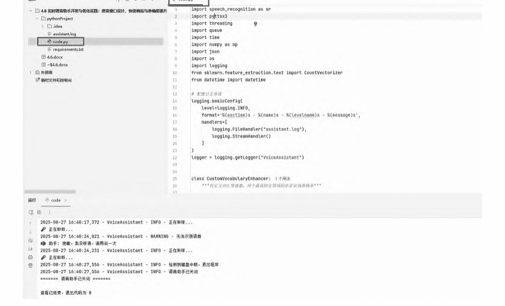
具体代码如下。
```python
import speech_recognition as sr
import pyttsx3
import threading
import queue
import time
import numpy as np
import json
import os
import logging
from sklearn.feature_extraction.text import CountVectorizer
from datetime import datetime

#### 配置日志系统
logging.basicConfig(
    level=logging.INFO,
    format='%(asctime)s - %(name)s - %(levelname)s - %(message)s',
    handlers=[
        logging.FileHandler("assistant.log"),
        logging.StreamHandler()
    ]
)
logger = logging.getLogger("VoiceAssistant")

class CustomVocabularyEnhancer:
    """自定义词汇增强器，用于提高特定领域的语音识别准确率"""

    def __init__(self):
        self.vocabulary = set()
        self.vectorizer = CountVectorizer()
        self.domain_weights = {}

    def add_domain_vocabulary(self, domain_name, domain_texts, weight=1.0):
        """
        添加领域专用词汇

        Args:
            domain_name: 领域名称
            domain_texts: 该领域的示例文本列表
            weight: 该领域的权重系数
        """
        self.vectorizer.fit(domain_texts)
        domain_vocab = set(self.vectorizer.get_feature_names_out())
        self.vocabulary.update(domain_vocab)
        self.domain_weights[domain_name] = {
            "weight": weight,
            "vocab": domain_vocab
        }
        logger.info(f"已添加领域 '{domain_name}' 词汇 {len(domain_vocab)} 个")

    def load_vocabulary_file(self, file_path):
        """从文件加载词汇"""
        try:
            with open(file_path, 'r', encoding='utf-8') as f:
                vocab_data = json.load(f)

            for domain, data in vocab_data.items():
                self.add_domain_vocabulary(
                    domain,
                    data.get("examples", []),
                    data.get("weight", 1.0)
                )
            logger.info(f"已从文件 {file_path} 加载词汇库")
        except Exception as e:
            logger.error(f"加载词汇文件出错: {e}")

    def enhance_recognition(self, default_text, alternatives=None):
        """
        增强识别结果

        Args:
            default_text: 默认识别文本
            alternatives: 可选的候选识别结果

        Returns:
            最可能正确地识别文本
        """
        if not alternatives or len(alternatives) <= 1:
            return default_text

        # 计算每个候选结果的得分
        scores = []
        for alt in alternatives:
            alt_words = set(alt.lower().split())
            score = 0

            # 计算领域词汇匹配得分
            for domain, data in self.domain_weights.items():
                domain_match = len(alt_words.intersection(data["vocab"]))
                score += domain_match * data["weight"]

            scores.append(score)

        # 如果得分都为0，返回默认结果
        if sum(scores) == 0:
            return default_text

        # 选择得分最高的结果
        best_index = np.argmax(scores)
        return alternatives[best_index]

class VoiceAssistant:
    """实时语音助手主类"""

    def __init__(self):
        self.recognizer = sr.Recognizer()
        self.engine = pyttsx3.init()
        self.response_queue = queue.Queue()
        self.enhancer = CustomVocabularyEnhancer()
        self.running = False

        # 配置语音引擎
        voices = self.engine.getProperty('voices')
        # 尝试设置中文语音，如果有的话
        for voice in voices:
            if 'chinese' in voice.name.lower():
                self.engine.setProperty('voice', voice.id)
                break

        # 语音速度和音量设置
        self.engine.setProperty('rate', 180)  # 语速
        self.engine.setProperty('volume', 0.9)  # 音量

        # 加载领域词汇（实际使用时可以从文件加载）
        self._load_vocabulary()

    def _load_vocabulary(self):
        """加载领域词汇"""
        # 如果有词汇文件则加载
        if os.path.exists("vocabulary.json"):
            self.enhancer.load_vocabulary_file("vocabulary.json")
        else:
            # 否则使用内置的词汇示例
            self.enhancer.add_domain_vocabulary("天气", [
                "今天天气怎么样", "查询天气预报", "明天会下雨吗",
                "气温多少摄氏度", "天气预报", "空气质量", "湿度"
            ], 1.2)

            self.enhancer.add_domain_vocabulary("时间", [
                "现在几点", "今天是几号", "日期", "星期几",
                "设置闹钟", "提醒我", "倒计时"
            ])

            self.enhancer.add_domain_vocabulary("音乐", [
                "播放音乐", "下一首", "上一首", "暂停",
                "继续播放", "调高音量", "调低音量"
            ])

            self.enhancer.add_domain_vocabulary("新闻", [
                "今日新闻", "头条新闻", "财经新闻", "科技新闻",
```

#### 3.2.1 环境基建与依赖导入
项目启动的第一步是把开发环境完整搭起来并引入必要依赖，为后面功能开发提供技术底座。示例代码如下。
```python
import speech_recognition as sr
import pyttsx3
import threading
import queue
import time
import numpy as np
import json
import os
import logging
from sklearn.feature_extraction.text import CountVectorizer
from datetime import datetime
```

依赖的引入按功能分组进行。语音相关部分选用 speech_recognition 负责识别，pyttsx3 负责合成。并发处理层面借助 threading 和 queue 模块实现任务异步执行和线程间通信。数据处理与机器学习能力则由 NumPy 和 Scikit-learn 支撑。

工具类库的选择贴合实际使用场景。json 用于配置文件的读写，os 提供文件系统操作，logging 构建完整的日志记录体系，datetime 满足时间相关需求。

#### 3.2.2 日志配置与实时监控
日志配置是企业级应用的必备环节，为监控、排障和性能分析提供数据来源。具体代码如下。
```python
logging.basicConfig(
    level=logging.INFO,
    format='%(asctime)s - %(name)s - %(levelname)s - %(message)s',
    handlers=[
        logging.FileHandler("assistant.log"),
        logging.StreamHandler()
    ]
)
logger = logging.getLogger("VoiceAssistant")
```

日志级别定为 INFO，只记录关键运行信息，避免调试信息冗余。日志格式包含时间戳、记录器名称、级别和消息内容，能够完整呈现事件上下文。

输出采用双通道设计，FileHandler 负责写入文件便于长期归档分析，StreamHandler 负责输出到控制台便于开发时即时查看。这种组合可灵活适配不同阶段的需求。

#### 3.2.3 智能词库增强器设计
智能词汇增强器的核心作用是提升语音识别准确率，依靠领域知识管理和候选结果评估来优化识别。代码示例如下。
```python
class CustomVocabularyEnhancer:
    """自定义词汇增强器，用于提高特定领域的语音识别准确率"""

    def __init__(self):
        self.vocabulary = set()
        self.vectorizer = CountVectorizer()
        self.domain_weights = {}
```

构造方法内部初始化了三项核心结构。vocabulary 集合收纳全部领域词表，支持快速成员查询；vectorizer 对象完成文本向量化，为机器学习提供标准输入；domain_weights 字典管理各领域的权重配置，支持精细化调优。

面向对象的设计让该功能具备良好的封装性和扩展性。对外暴露清晰的方法接口，内部实现对调用方透明，有利于维护和迭代。

领域词汇的管理由独立方法承担。具体代码如下。
```python
def add_domain_vocabulary(self, domain_name, domain_texts, weight=1.0):
    """
    添加领域专用词汇

    Args:
        domain_name: 领域名称
        domain_texts: 该领域的示例文本列表
        weight: 该领域的权重系数
    """
    self.vectorizer.fit(domain_texts)
    domain_vocab = set(self.vectorizer.get_feature_names_out())
    self.vocabulary.update(domain_vocab)
    self.domain_weights[domain_name] = {
        "weight": weight,
        "vocab": domain_vocab
    }
    logger.info(f"已添加领域 '{domain_name}' 词汇 {len(domain_vocab)} 个")
```

该方法采用参数化配置，允许指定领域名、示例文本和权重系数，接口足够灵活以适应不同场景和优化策略。

向量化处理由 fit 方法完成，它解析输入文本并提取词汇特征。权重管理使用嵌套字典，为每个领域单独维护词集和权重参数。

#### 3.2.4 语音助手主类架构
语音助手承担系统控制中心的角色，整合各功能模块并提供统一交互入口。代码如下。
```python
class VoiceAssistant:
    """实时语音助手主类"""

    def __init__(self):
        self.recognizer = sr.Recognizer()
        self.engine = pyttsx3.init()
        self.response_queue = queue.Queue()
        self.enhancer = CustomVocabularyEnhancer()
        self.running = False
```

初始化时组装起完整的语音处理链路。recognizer 负责语音识别，engine 负责语音合成，response_queue 负责线程间通信，enhancer 负责智能优化。

运行状态由 running 标志控制，这个布尔变量让系统的启动与停止逻辑清晰可控。
```python
def listen(self):
    """捕捉用户语音输入"""
    with sr.Microphone() as source:
        logger.info("正在聆听...")
        print("正在聆听...")
        # 调整麦克风的环境噪声水平
        self.recognizer.adjust_for_ambient_noise(source, duration=0.5)
        audio = self.recognizer.listen(source, timeout=5, phrase_time_limit=5)
        return audio
```
```python
def recognize_speech(self, audio):
    """语音识别处理"""
    try:
        # 首先尝试获取多个候选结果
        results = self.recognizer.recognize_google(
            audio,
            language="zh-CN",
            show_all=True
        )

        if not results or 'alternative' not in results:
            logger.warning("未能识别语音")
            return None

        # 提取候选文本
        alternatives = [alt['transcript'] for alt in results['alternative']]
        default_text = alternatives[0]

        # 使用词汇增强器选择最佳结果
        enhanced_text = self.enhancer.enhance_recognition(default_text, alternatives)

        logger.info(f"识别结果: {enhanced_text}")
        print(f"识别结果: {enhanced_text}")

        # 如果增强结果与默认结果不同，记录差异
        if enhanced_text != default_text:
            logger.info(f"增强前: {default_text}, 增强后: {enhanced_text}")

        return enhanced_text

    except sr.UnknownValueError:
        logger.warning("无法识别语音")
        return None
    except sr.RequestError as e:
        logger.error(f"无法连接到语音识别服务: {e}")
        return None
    except Exception as e:
        logger.error(f"识别过程中发生错误: {e}")
        return None
```
```python
def speak(self, text):
    """语音输出"""
    print(f"助手: {text}")
    self.engine.say(text)
    self.engine.runAndWait()
```
```python
def process_user_intent(self, text):
    """
    处理用户意图

    在实际应用中，这里可以接入更复杂的NLP引擎或对话管理系统
    """
    text = text.lower()

    # 天气查询
    if any(keyword in text for keyword in ["天气", "气温", "下雨", "晴"]):
        return "今天天气晴朗，气温20到25摄氏度，空气质量良好。"

    # 时间查询
    elif any(keyword in text for keyword in ["时间", "几点", "现在"]):
        current_time = datetime.now().strftime("%H点%M分")
        return f"现在是{current_time}"

    # 日期查询
    elif any(keyword in text for keyword in ["日期", "几号", "今天"]):
        date = datetime.now().strftime("%Y年%m月%d日")
        weekday = ["一", "二", "三", "四", "五", "六", "日"][datetime.now().weekday()]
        return f"今天是{date}，星期{weekday}"

    # 音乐控制
    elif any(keyword in text for keyword in ["音乐", "歌", "播放"]):
        if "播放" in text:
            return "好的，开始播放音乐"
        elif "暂停" in text:
            return "已暂停播放"
        elif "下一首" in text:
            return "已切换到下一首"
        else:
            return "音乐功能已激活，你想听什么歌曲？"

    # 新闻资讯
    elif any(keyword in text for keyword in ["新闻", "头条", "资讯"]):
        return "今日热点新闻：科技创新大会在北京召开，多项前沿技术成果发布"

    # 闲聊功能
    elif any(keyword in text for keyword in ["你好", "嗨", "在吗"]):
        return "你好，我是你的语音助手，有什么可以帮助你的吗？"

    # 通用查询
    elif "什么是" in text or "告诉我关于" in text:
        query = text.replace("什么是", "").replace("告诉我关于", "").strip()
        return f"关于{query}的信息，我正在查询中..."

    # 助手能力
    elif any(keyword in text for keyword in ["你能做什么", "你会什么", "功能"]):
        return "我可以回答问题、查询天气、播放音乐、提供新闻资讯等，请问有什么可以帮到你的吗？"

    # 未识别意图
    else:
        return "抱歉，我不太理解你的意思，能否换个方式表达？"
```
```python
def background_processing(self, text):
    """后台处理用户请求"""
    # 增加短暂延迟模拟处理时间
    time.sleep(0.5)

    # 处理用户意图，获取响应
    response = self.process_user_intent(text)

    # 将响应放入队列
    self.response_queue.put(response)
```
```python
def run(self):
    """运行语音助手主循环"""
    self.running = True
    self.speak("语音助手已启动，请说话")

    consecutive_errors = 0
    max_consecutive_errors = 3

    while self.running:
        try:
            # 捕捉语音
            audio = self.listen()

            # 识别语音
            text = self.recognize_speech(audio)

            # 处理识别失败的情况
            if not text:
                consecutive_errors += 1
                if consecutive_errors >= max_consecutive_errors:
                    self.speak("多次未能识别你的语音，请确认麦克风工作正常")
                    consecutive_errors = 0
                else:
                    self.speak("抱歉，我没听清，请再说一次")
                continue

            # 重置错误计数
            consecutive_errors = 0

            # 检查退出命令
            if any(keyword in text.lower() for keyword in ["退出", "关闭", "停止", "再见"]):
                self.speak("语音助手即将关闭，再见")
                self.running = False
                break

            # 启动后台处理线程
            thread = threading.Thread(target=self.background_processing, args=(text,))
            thread.daemon = True
            thread.start()

            # 给用户即时反馈
            self.speak("正在处理你的请求...")

            # 等待并获取响应，设置超时避免永久阻塞
            try:
                response = self.response_queue.get(timeout=5)
                self.speak(response)
            except queue.Empty:
                self.speak("抱歉，处理你的请求超时，请重试")

        except sr.WaitTimeoutError:
            logger.info("等待超时，继续监听")
            continue
        except KeyboardInterrupt:
            logger.info("检测到键盘中断，退出程序")
            self.running = False
            break
        except Exception as e:
            logger.error(f"运行错误: {e}")
            self.speak("系统遇到问题，将继续监听")

    logger.info("语音助手已关闭")
```

```python
def stop(self):
    """停止语音助手"""
    self.running = False
```

在选型阶段我们主要考量的是多平台适配能力、研发效率以及功能覆盖的完整程度。语音转写这块接入了 Google 提供的语音识别服务，语音播报依赖 pyttsx3 文本转语音引擎，机器学习部分则建立在 Scikit-learn 之上。三者配合既保证了核心链路的可靠性，也让后续的功能扩展更顺畅。

```python
##### 创建并运行助手实例
if __name__ == "__main__":
    try:
        print("======== 语音助手启动中 ========")
        print("提示：使用 Ctrl+C 组合键可以随时退出程序")
        assistant = VoiceAssistant()
        assistant.run()
    except KeyboardInterrupt:
        print("\n程序已通过键盘中断退出")
    except Exception as e:
        print(f"程序发生错误：{e}")
    finally:
        print("======== 语音助手已关闭 ========")
```

组件层面的统一编排形成了一个可信的调度基础，生命周期的集中管控让整体状态清晰可控。

语音引擎的初始化策略充分体现了对使用感受的关注。相关实现如下。

```python
##### 配置语音引擎
voices = self.engine.getProperty('voices')
##### 尝试设置中文语音，如果有的话
for voice in voices:
    if 'chinese' in voice.name.lower():
        self.engine.setProperty('voice', voice.id)
        break

##### 语音速度和音量设置
self.engine.setProperty('rate', 180)  # 语速
self.engine.setProperty('volume', 0.9)  # 音量
```

通过自动探测系统中可用的引擎来匹配中文发音，省去了手动配置的步骤，展现出语音选择过程的自动化逻辑。

语速与音量的调节遵循了用户体验的常用做法，在清晰可懂与听感自然之间找到了折中点。

####### （1）语音输入捕捉与预处理机制

语音采集是整个交互流程的入口，涉及麦克风资源管理、环境自适应以及异常兜底等。相关代码如下。

```python
def listen(self):
    """捕捉用户语音输入"""
    with sr.Microphone() as source:
        logger.info("正在聆听...")
        print("正在聆听...")
        # 调整麦克风的环境噪声水平
        self.recognizer.adjust_for_ambient_noise(source, duration=0.5)
        audio = self.recognizer.listen(source, timeout=5, phrase_time_limit=5)
        return audio
```

该片段使用上下文管理器确保麦克风在使用后及时释放。背景噪声的自适应依赖于内置的噪声分析方法，先对环境声进行采样再调整识别灵敏度。超时机制由 timeout 与 phrase_time_limit 共同控制，防止在安静场景下长时间空转。整体设计兼顾了响应速度与可用性。

####### （2）智能语音识别与增强处理

识别模块把通用引擎和智能增强算法结合起来，显著改善了转写准确率。具体代码如下。

```python
def recognize_speech(self, audio):
    """语音识别处理"""
    try:
        # 首先尝试获取多个候选结果
        results = self.recognizer.recognize_google(
            audio,
            language="zh-CN",
            show_all=True
        )

        if not results or 'alternative' not in results:
            logger.warning("未能识别语音")
            return None

        # 提取候选文本
        alternatives = [alt['transcript'] for alt in results['alternative']]
        default_text = alternatives[0]

        # 使用词汇增强器选择最佳结果
        enhanced_text = self.enhancer.enhance_recognition(default_text, alternatives)

        logger.info(f"识别结果: {enhanced_text}")
        print(f" 识别结果: {enhanced_text}")

        # 如果增强结果与默认结果不同，记录差异
        if enhanced_text != default_text:
            logger.info(f"增强前: {default_text}, 增强后: {enhanced_text}")

        return enhanced_text
```

开启多候选结果通过 show_all=True 实现，为后续择优提供了备选空间。候选数据的整理采用了列表推导，简化了处理流程。增强步骤由 enhancer 对象调用完成，将基础识别结果与候选列表一起喂入智能算法进行优化。差异记录则为后续调优提供了反馈。

####### （3）用户意图理解与响应生成

意图理解负责解析用户输入并生成回复，是助手智能化的核心。具体代码如下。

```python
def process_user_intent(self, text):
    """
    处理用户意图

    在实际应用中，这里可以接入更复杂的NLP引擎或对话管理系统
    """
    text = text.lower()

    # 天气查询
    if any(keyword in text for keyword in ["天气", "气温", "下雨", "晴"]):
        return "今天天气晴朗，气温20到25摄氏度，空气质量良好。"

    # 时间查询
    elif any(keyword in text for keyword in ["时间", "几点", "现在"]):
        current_time = datetime.now().strftime("%H点%M分")
        return f"现在是{current_time}"
```

实现采用关键词匹配的思路，结合 any 与推导式检测触发词。方案简洁，时延小且资源占用低。

动态信息的获取通过调用外部接口或本地函数完成，例如借助 datetime 模块查询当前时间。回复模板的设计贴合自然表达习惯，提升了交互的友好度。

####### （4）后台处理线程的设计与实现

耗时任务交由独立线程异步执行，避免阻塞主循环。具体代码如下。

```python
def background_processing(self, text):
    """后台处理用户请求"""
    # 增加短暂延迟模拟处理时间
    time.sleep(0.5)

    # 处理用户意图，获取响应
    response = self.process_user_intent(text)

    # 将响应放入队列
    self.response_queue.put(response)
```

代码中加入了处理延迟的模拟，反映了真实环境下的网络请求和计算开销。队列被用来在线程间传递结果，有效规避了并发访问引发的数据竞争。

####### （5）主循环控制与错误恢复

主循环承担系统调度的中枢角色，协调各模块运行。具体代码如下。

```python
def run(self):
    """运行语音助手主循环"""
    self.running = True
    self.speak("语音助手已启动，请说话")

    consecutive_errors = 0
    max_consecutive_errors = 3

    while self.running:
        try:
            # 捕捉语音
            audio = self.listen()

            # 识别语音
            text = self.recognize_speech(audio)

            # 处理识别失败的情况
            if not text:
                consecutive_errors += 1
                if consecutive_errors >= max_consecutive_errors:
                    self.speak("多次未能识别你的语音，请确认麦克风工作正常")
                    consecutive_errors = 0
                else:
                    self.speak("抱歉，我没听清，请再说一次")
                continue

            # 重置错误计数
            consecutive_errors = 0

            # 启动后台处理线程
            thread = threading.Thread(target=self.background_processing,
                                      args=(text,))
            thread.daemon = True
            thread.start()

            # 给用户即时反馈
            self.speak("正在处理你的请求...")

            # 等待并获取响应，设置超时避免永久阻塞
            try:
                response = self.response_queue.get(timeout=5)
                self.speak(response)
            except queue.Empty:
                self.speak("抱歉，处理你的请求超时，请重试")
```

连续错误计数通过 consecutive_errors 变量实现，达到阈值时给出特殊提示，帮助区分偶发问题与系统性故障。每个请求独立起一个后台线程，daemon=True 确保程序退出时线程能被回收。超时控制则防止异常情况下的永久挂起。

整体工程思路契合现代软件开发的共识。模块化让各单元相对独立，便于开发测试与维护；异步机制提升响应，智能增强改善体验。异常捕获与容错贯穿始终，日志与状态监控为运维提供支撑。注释详尽、文档字符串规范，可维护性高。面向对象的结构降低扩展成本，新增或修改功能不会波及他处，为长期演进打下基础。以此为基，智能交互可落地于智能家居、医疗陪护、工业控制等场景，推动人机协作更自然高效。

## 第4章 实战项目篇

随着物联网与人工智能的深度融合，智能家居正从概念走向家庭。下面通过两个实践案例展示应用场景与落地思路，案例融合了传感器采集、智能算法与自动化控制。

智能家居管家项目构建家庭环境监测与控制平台，以温湿度传感器和空气质量检测器实时感知室内状态，并结合 DeepSeek 模型实现家电的智能调度。智能农业助手项目整合感知、控制与深度学习，搭建作物生长监测系统，可自动调节灌溉参数并通过图像识别发现病虫害。两个案例覆盖智能家居与智慧农业，体现了人工智能的广泛潜力。每例均给出硬件选型、软件架构、核心算法与代码示例，便于参考扩展。

通过案例学习，可掌握智能化系统开发流程，体会 AI 解决实际问题的思路。智能家居管家能依据作息规律调节环境，智能农业可基于历史数据优化灌溉策略。案例凸显技术价值，也说明智能化系统在提升生活质量与运营效率上的作用，有助于把握发展方向与应用空间。

### 4.1 智能家居管家

该系统整合多传感器数据采集、AI 决策与设备控制。ESP32 负责采集光照传感器数据，树莓派作为中央处理单元，结合 DeepSeek 大模型的分析能力，实现家居环境的自动监测与智能调控。

DeepSeek 发布的模型 API 仍处内测，用户可通过官网申请、Twitter 关注动态、Discord 社区获取测试名额或邮件联系团队。考虑到 API 尚未全面开放，建议同步了解其他开源语言模型以保障进度。

API 密钥 DeepSeek_API_KEY 以字符串形式保存，是访问认证的核心凭证。实际使用时把占位符 your_api_key_here 换为真实密钥。密钥承担身份校验、防未授权访问、权限管控、调用追踪、频率限制、防滥用等安全职责，并在传输中保障完整性与保密性。合理的安全存储、定期轮换、及时吊销等管理策略可显著提升系统安全性。下面进入实操。

步骤1：申请 DeepSeek API 密钥。

申请覆盖注册到使用的全流程。首先访问 DeepSeek 开发者平台，通常可在官网找到入口，若不明显可在登录后查看账户设置或高级功能区。


DeepSeek+树莓派+Arduino智能产品、机器人部署与模型训练全攻略

账号注册需填写邮箱、手机号及企业信息，平台会抽样审核资质，企业认证审核更严，通过后才可获得访问权限。


步骤2：创建应用。

注册成功后可在控制台新建应用或项目，填写名称、描述与预期场景。创建完成后在应用详情页进入凭证管理或 API 密钥区，点击“创建 API key”生成唯一密钥，部分平台仅展示一次，请及时保存。


权限配置与安全加固同等重要。可将 API key 绑定到特定服务如搜索或 NLP 模型，设置合理的调用频率限制、IP 白名单或 HTTPS 域名限制以保障安全。复制密钥到对应代码位置后，可参考官方文档确认请求格式，并用 Postman 或 curl 测试连通性。

实际使用注意：不同产品线流程可能存在差异，以官方文档为准；密钥应避免明文存储或提交到公开代码仓库，建议使用环境变量或专业密钥管理服务。另需关注费用与配额，部分服务按量计费，需提前绑定支付方式并设置用量告警。


图 4-4 创建 API key

图 4-5 复制 API key

#### API keys

列表内是你的全部 API key，API key 仅在创建时可见可复制，请妥善保存，不要与他人共享你的 API key，或将其暴露在浏览器或其他客户端代码中。为了保护你的账户安全，我们可能会自动停用我们发现已公开泄露的 API key，我们将对 2024 年 4 月 25 日前创建的 API key 的使用情况进行追踪。

| 名称 | Key | 创建日期 | 最新使用日期 |

|---|---|---|---|

| deepseek_raspberry_arduino_smart_home | sk-b067b**********************13ae | 2025-02-11 | - |

图 4-6 密钥管理服务

找不到接入点时，可以先向官方客服、邮箱或工单渠道咨询开放情况。公共接口若暂未放开，也可以尝试递交企业级接入申请作为备选。因为 DeepSeek 的接口说明尚未完全对外公开，最稳妥的做法是直接与官方团队沟通获取一手指引。按规范走完申请步骤、做好安全策略和调用用量管理，就能把 DeepSeek 接口用起来。保持对官方公告和文档的持续跟踪，才能让服务价值最大化。

AI 整合环节加入了 DeepSeek 接入配置，整体调用依赖 DeepSeek_API_KEY 与 DeepSeek_API_ENDPOINT 这两项核心参数来完成受保护的访问。落地时要把示例中的令牌换成你在 DeepSeek 平台申领到的可用凭证，否则调用会失败。具体代码如下。

```python
##### deepseek AI API配置
##### API密钥，需要从DeepSeek平台获取
deepseek_API_KEY = "your_api_key_here"
##### deepseek API的基础URL
deepseek_API_ENDPOINT = "https://api.deepseek.com/v1"
```

就整体的 AI 服务接入方案来说，参数设定直接影响到系统与服务端的连通质量以及防护水平。这里的配置块明确列出了连通 DeepSeek 智能服务的必要项，比如鉴权凭证和服务端地址 URL。

这套方案的亮点在于场景联动，可以随着环境变化自动调整设备行为。举例来说，夜晚回家后，光纤感应器采集到的数据会驱动照明亮度自动变化。配合深度学习模型，系统还能逐步掌握使用习惯并提前预判需求，让体验更智能（见图4-7）。

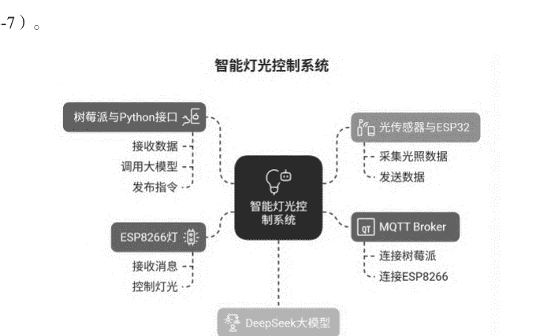

图 4-7 智能灯光控制系统示意图

整套智能家居管家采用分布式思路搭建，关键部分由三块组成：负责采样的 ESP32 节点、承担中枢的树莓派控制器，以及负责灯光执行的 ESP8266 控制器（见图4-8）。节点之间借助 MQTT 消息总线与 HTTP 接口完成交互，保证信息传递既可靠又及时。


如图4-9，ESP32 扮演数据采集前端，读取光照传感器的读数后经 Wi-Fi 发往树莓派主控端。主控程序在树莓派上运行，除了接收 ESP32 上报的数据，还会按计划向外部服务请求温湿度等环境数据。

图 4-8 智能灯光控制系统周期图

汇总后的环境信息会被一起使用。当条件达标时，主控会触发 DeepSeek 大模型进行推理，依据综合环境判断是否点亮灯光。最终结果通过 MQTT 消息或直连指令下发到 ESP8266，从而实现对 LED 灯带的智能化管控。

#### 智能灯光控制系统序列

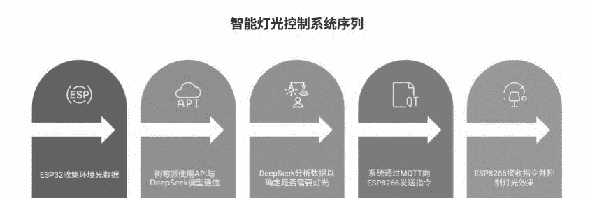

图 4-9 智能灯光控制流程图

#### 4.1.1 树莓派主控程序开发

第一步是在树莓派上安装主程序 python_code.py，它承担整套系统的核心调度。程序采用多线程结构，可并行处理 MQTT 通讯、HTTP 服务以及智能决策逻辑。启动瞬间会启三条工作线：一条负责 MQTT 客户端收数，一条运行 Flask 网关处理 HTTP 请求，还有一条负责周期性审视环境数据并给出判断。

步骤1：部署主控程序。

ESP8266 侧的智能 LED 控制采用事件驱动的非阻塞写法，以状态机来编排灯效。整体被拆成若干模块，模块间靠全局变量与函数调用互相配合。

代码结构按分层思路组织：底层做硬件抽象和基础通信，中层承接业务流程与状态维护，上层负责交互呈现与灯效输出，方便后续维护和扩展。设计上同时兼顾实时表现和运行稳健，靠定时器保持灯效顺滑，靠看门狗和异常捕获保证长时间在线。

编写主控代码时，要注意全局变量 latest_light_value 的并发安全，它保存着最新光感读数，会被多条线程同时读写。该变量由 MQTT 回调和 HTTP 接口分别更新，以保证数据始终最新。把代码粘到 PyCharm 里（见图4-10），点下运行即可。

##### DeepSeek+树莓派+Arduino智能产品、机器人部署与模型训练全攻略

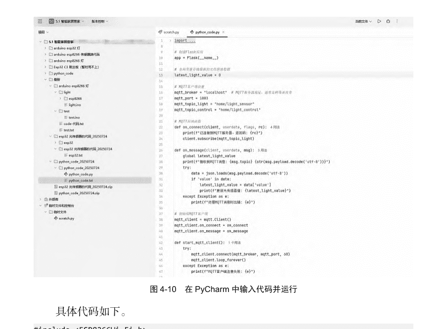

具体代码如下。

```cpp
#include <ESP8266Wi-Fi.h>
#include <PubSubClient.h>
#include <Adafruit_NeoPixel.h>
#include <Ticker.h>

// Wi-Fi 配置信息
const char *ssid = "***";// Wi-Fi网络名称
const char *password = "*****";// Wi-Fi密码

// MQTT 配置信息
const char *mqtt_server = "**.***.***.*"; // MQTT服务器地址
const char *mqtt_user = "testtopic01";
const char *mqtt_password = "";
const char *mqtt_client_id = "mqttx_7296037555";
const char *mqtt_topic = "testtopic01";

Wi-FiClient espClient;
PubSubClient client(espClient);
Ticker wdtTicker;  // 用于定期喂狗，但不使用yield

// 灯带设置
#define NUMPIXELS 26
#define PIN 4
Adafruit_NeoPixel strip = Adafruit_NeoPixel(NUMPIXELS, PIN, NEO_GRB + NEO_KHZ800);

uint8_t R = 252;
uint8_t G = 255;
uint8_t B = 0;
uint8_t brightness = 180;
static uint8_t lampStep = 0;
uint8_t fadeAmount = 2;
uint8_t modeSwitch = 0;
uint8_t breathBrightness = 0;

// 状态控制变量，用于非阻塞操作
unsigned long previousMillis = 0;
unsigned long previousEffectMillis = 0;
unsigned long mqttReconnectMillis = 0;
unsigned long statusReportMillis = 0;
unsigned long memoryCheckMillis = 0;
unsigned long wifiCheckMillis = 0;
uint16_t rotationPosition = 0;

// 操作间隔时间
const long effectInterval = 20;        // 灯光效果更新间隔（毫秒）
const long statusInterval = 60000;     // 状态报告间隔（毫秒）
const long memoryCheckInterval = 120000; // 内存检查间隔（毫秒）
const long reconnectInterval = 5000;   // MQTT重连尝试间隔
const long wifiCheckInterval = 30000;  // Wi-Fi检查间隔

// 看门狗处理——只喂狗，不使用yield
void feedWatchdog( ) {
  ESP.wdtFeed( );  // 只喂养软件看门狗，不调用yield( )
}

void printResetReason( ) {
  Serial.println("-------------------");
  Serial.print("复位原因：");
  Serial.println(ESP.getResetReason( ));
  Serial.println("上次复位原因详情：" + ESP.getResetInfo( ));
  Serial.println("-------------------");
}

void printMemoryInfo( ) {
  Serial.println("-------------------");
  Serial.print("可用堆内存：");
  Serial.print(ESP.getFreeHeap( ));
  Serial.println(" 字节");
  Serial.println("-------------------");
}

void setup_wifi( ) {
  int attemptCount = 0;
  const int maxAttempts = 10;  // 降低最大尝试次数

  delay(10);
  Serial.println( );
  Serial.print("连接Wi-Fi网络: ");
  Serial.println(ssid);

  // Wi-Fi连接配置
  Wi-Fi.mode(WIFI_STA);  // 明确设置为station模式
  Wi-Fi.setSleepMode(WIFI_NONE_SLEEP); // 禁用Wi-Fi睡眠模式，提高稳定性
  Wi-Fi.setAutoReconnect(true);  // 允许自动重连

  // 开始连接Wi-Fi
  Wi-Fi.begin(ssid, password);

  while (Wi-Fi.status( ) != WL_CONNECTED && attemptCount < maxAttempts) {
    feedWatchdog( );  // 确保看门狗不会重置设备
    delay(500);
    Serial.print(".");
    attemptCount++;
  }

  if (Wi-Fi.status( ) == WL_CONNECTED) {
    Serial.println("");
    Serial.println("Wi-Fi连接成功！");
    Serial.print("IP地址: ");
    Serial.println(Wi-Fi.localIP( ));
  } else {
    Serial.println("");
    Serial.println("Wi-Fi连接失败！ 将继续尝试...");
  }
}

void callback(char *topic, byte *message, unsigned int length) {
  // 在回调开始时喂狗
  feedWatchdog( );

  // 清晰地打印主题名称
  Serial.println("-----------------------");
  Serial.print("收到MQTT消息 | 主题: ");
  Serial.println(topic);

  // 打印消息内容
  Serial.print("消息内容: ");
  String messageTemp;

  // 将byte数组转换为字符串
  for (int i = 0; i < length; i++) {
    Serial.print((char)message[i]);
    messageTemp += (char)message[i];
  }
  Serial.println( );

  // 再打印一次完整的消息（以字符串形式）
  Serial.print("消息字符串: [");
  Serial.print(messageTemp);
  Serial.println("]");

  // 根据接收到的消息内容切换模式
  Serial.print("执行命令: ");
  if (messageTemp == "1") {
    Serial.println("打开灯光（全量模式）");
    modeSwitch = 0;
    Open( ); // 开灯
  } else if (messageTemp == "2") {
    Serial.println("切换到七彩循环模式");
    modeSwitch = 2; // 七彩循环
  } else if (messageTemp == "3") {
    Serial.println("切换到呼吸灯模式");
    modeSwitch = 1; // 呼吸灯
    breathBrightness = 0; // 重置呼吸灯亮度
  } else if (messageTemp == "4") {
    Serial.println("切换到七彩旋转模式");
    modeSwitch = 3; // 七彩旋转
    rotationPosition = 0; // 重置旋转位置
  } else if (messageTemp == "0") {
    Serial.println("关闭灯光");
    modeSwitch = 0;
    Close( ); // 关灯
  } else {
    Serial.println("未知命令，忽略");
  }
  Serial.println("-----------------------");

  // 在回调结束时再次喂狗
  feedWatchdog( );
}

void tryMqttConnect( ) {
  // 在函数开始时喂狗
  feedWatchdog( );

  // 检查连接状态
  if (!client.connected( )) {
    Serial.println("尝试MQTT连接...");

    // 尝试连接
    if (client.connect(mqtt_client_id, mqtt_user, mqtt_password)) {
      Serial.println("MQTT连接成功!");
      // 订阅主题
      Serial.print("订阅主题：");
      Serial.println(mqtt_topic);
      client.subscribe(mqtt_topic);
      Serial.println("订阅完成");
    } else {
      Serial.print("连接失败，错误代码=");
      Serial.println(client.state( ));
    }
  }

  // 在函数结束时再次喂狗
  feedWatchdog( );
}

void checkWi-FiConnection( ) {
  if (Wi-Fi.status( ) != WL_CONNECTED) {
    Serial.println("Wi-Fi连接断开，尝试重新连接...");
    Wi-Fi.reconnect( );  // 使用reconnect而不是重新完整设置

    // 给一些时间让Wi-Fi重新连接
    int attempts = 0;
    while (Wi-Fi.status( ) != WL_CONNECTED && attempts < 10) {
      feedWatchdog( );
      delay(500);
      Serial.print(".");
      attempts++;
    }

    if (Wi-Fi.status( ) == WL_CONNECTED) {
      Serial.println("\nWi-Fi重新连接成功!");
    } else {
      Serial.println("\nWi-Fi重新连接失败!");
    }
  }
}

void Open( ) {
  strip.setBrightness(brightness);
  for (int i = 0; i < NUMPIXELS; i++) {
    strip.setPixelColor(i, R, G, B);
  }
  strip.show( );
}

void Close( ) {
  for (int i = 0; i < NUMPIXELS; i++) {
    strip.setPixelColor(i, 0, 0, 0);
  }
  strip.show( );
}

uint32_t Wheel(byte WheelPos) {
  WheelPos = 255 - WheelPos;
  if (WheelPos < 85) {
    return strip.Color(255 - WheelPos * 3, 0, WheelPos * 3);
  }
  if (WheelPos < 170) {
    WheelPos -= 85;
    return strip.Color(0, WheelPos * 3, 255 - WheelPos * 3);
  }
  WheelPos -= 170;
  return strip.Color(WheelPos * 3, 255 - WheelPos * 3, 0);
}

// 非阻塞彩虹展示
void updateRainbowDisplay( ) {
  strip.setBrightness(brightness);
  for (uint8_t i = 0; i < strip.numPixels( ); i++) {
    strip.setPixelColor(i, Wheel((i + lampStep) & 255));
  }
  lampStep = (lampStep + 1) & 0xFF;
  strip.show( );
}

// 非阻塞呼吸灯
void updateRGBBreath( ) {
  strip.setBrightness(breathBrightness);
  for (uint8_t i = 0; i < NUMPIXELS; i++) {
    strip.setPixelColor(i, R, G, B);
  }
  strip.show( );

  breathBrightness += fadeAmount;
  if (breathBrightness <= 0 || breathBrightness >= 180) {
    fadeAmount = -fadeAmount;
  }
}

// 非阻塞彩虹旋转
void updateRainbowCycle( ) {
  for (uint16_t i = 0; i < strip.numPixels( ); i++) {
    strip.setPixelColor(i, Wheel(((i * 256 / strip.numPixels( )) + rotationPosition) & 255));
  }
  strip.setBrightness(brightness);
  strip.show( );

  rotationPosition = (rotationPosition + 1) % 256;  // 使用模运算避免溢出
}

void printStatusReport( ) {
    Serial.println("-------------------");
    Serial.println("状态报告:");
    Serial.print("运行时长: ");
    Serial.print(millis( ) / 1000);
    Serial.println(" 秒");
    Serial.print("当前模式: ");
    switch (modeSwitch) {
        case 0:
            if (strip.getBrightness( ) > 0) {
                Serial.println("普通模式 (灯亮)");
            } else {
                Serial.println("普通模式 (灯光)");
            }
            break;
        case 1: Serial.println("呼吸灯模式"); break;
        case 2: Serial.println("七彩循环模式"); break;
        case 3: Serial.println("七彩旋转模式"); break;
        default: Serial.println("未知模式"); break;
    }
    Serial.print("Wi-Fi状态: ");
    Serial.println(Wi-Fi.status( ) == WL_CONNECTED ? "已连接" : "未连接");
    Serial.print("Wi-Fi信号强度: ");
    Serial.print(Wi-Fi.RSSI( ));
    Serial.println(" dBm");
    Serial.print("MQTT状态: ");
    Serial.println(client.connected( ) ? "已连接" : "未连接");
    Serial.println("-------------------");
}

void setup( ) {
    // 增加ESP8266的稳定性
    ESP.wdtDisable( );
    ESP.wdtEnable(WDTO_8S);  // 设置为8秒超时

    // 设置串口
    Serial.begin(115200);
    delay(200);

    Serial.println("\n\n========================================");
    Serial.println("ESP8266 MQTT LED控制程序启动");
    Serial.println("========================================");

    // 打印复位原因
    printResetReason( );

    // 初始化LED
    Serial.println("初始化LED灯带...");
    strip.begin( );
```

###### 步骤2：搭建基础骨架

# ESP8266 智能灯控落地实战：从架构到上线的十个关键节点

搭建一个稳定可靠的灯光控制程序，先从骨架入手。包含必要的头文件引入、全局状态声明以及基础参数配置。在这个阶段要把系统拆成四大核心模块：Wi-Fi 通信、MQTT 客户端、LED 驱动与软件定时器，每个模块都配齐配置项和状态标识。参考实现如下。

```
// 系统配置阶段——定义核心组件的配置信息
const char *ssid = "***";          // Wi-Fi网络名称
const char *password = "*****";    // Wi-Fi密码
const char *mqtt_server = "**.***.***.*";  // MQTT服务器地址
```

在这个层面，全局变量的定义质量直接影响后续可维护性。命名要自解释，类型要兼顾内存占用与数值范围，例如 RGB 通道和亮度都用 uint8_t 存储，数值足够且省 RAM。

###### 步骤3：硬件准备与网络接入
为设备创建可运行的基础环境，串口调试、LED 硬件、Wi-Fi 链路和 MQTT 会话都要一次性初始化完。编写时必须加入容错和重试逻辑，让设备在弱网、掉线等场景下仍能自启动。示例代码如下。

```
void setup( ) {
    // 看门狗配置——系统稳定性的基础保障
    ESP.wdtDisable( );
    ESP.wdtEnable(WDTO_8S);  // 设置8秒超时时间

    // 串口初始化——调试信息输出通道
    Serial.begin(115200);
    delay(200);
}
```

代码里加入看门狗是保障稳定性的关键手法，通过定时喂狗避免死循环或异常导致系统卡死。8 秒超时既给了网络握手足够时间，又能及时拉回假死状态。

###### 步骤4：事件响应与状态调度
先实现 MQTT 消息解析和灯光模式切换。核心是用状态机来管理行为，用 modeSwitch 变量区分不同工作模式，保证切换过程干净、可预判。实现片段如下。

```
void callback(char *topic, byte *message, unsigned int length) {
    feedWatchdog( );  // 回调函数开始时立即喂狗

    // 消息解析与状态切换
    String messageTemp;
    for (int i = 0; i < length; i++) {
        messageTemp += (char)message[i];
    }
}
```

回调函数的编写要兼顾响应速度与稳定性。因为回调常在中断上下文触发，严禁做耗时阻塞操作，否则会破坏实时性。

###### 步骤5：灯光效果算法
这一阶段要做出颜色计算、亮度调节和动画刷新。需要弄明白 LED 驱动原理以及颜色空间转换的方法，才能做出顺滑的效果。

###### 步骤6：Wi-Fi 连接管理
采用主动巡检加被动重连的混合策略。setup_wifi() 负责首次接入，通过设置工作模式和连接参数与路由器建立链路。代码如下。

```
void setup_wifi( ) {
  Wi-Fi.mode(WIFI_STA);  // 设置为客户端模式
  Wi-Fi.setSleepMode(WIFI_NONE_SLEEP); // 禁用节能模式
  Wi-Fi.setAutoReconnect(true);  // 启用自动重连
}
```

将工作模式设为 WIFI_STA，让 ESP8266 以客户端身份接入现有网络，关闭睡眠以维持连接，避免节能机制导致掉线。

checkWi-FiConnection() 周期性检查链路状态，发现断开就调用 Wi-Fi.reconnect() 尝试恢复，这种方式比重新初始化更轻量高效。

###### 步骤7：MQTT 通信处理
MQTT 部分走异步设计，避免网络等待阻塞主循环。tryMqttConnect() 负责建立连接并订阅主题，通过状态判断防止重复拨号。代码如下。

```
void tryMqttConnect( ) {
  if (!client.connected( )) {
    if (client.connect(mqtt_client_id, mqtt_user, mqtt_password)) {
      client.subscribe(mqtt_topic);  // 订阅控制主题
    }
  }
}
```

连接状态由 client.connected() 判断，仅在断开时才发起重连，减少无效网络开销，提升运行效率。

消息回调 callback() 负责指令解析，通过字符串匹配识别控制命令，并据此切换灯光模式。

###### 步骤8：LED 颜色与效果实现
颜色核心是 Wheel() 函数，完成 HSV 到 RGB 的映射。输入色相 0~255 被映射到完整色相环，再按段线性插值计算 RGB 三通道。代码如下。

```
uint32_t Wheel(byte WheelPos) {
    WheelPos = 255 - WheelPos;  // 反转色相值
    if (WheelPos < 85) {
        return strip.Color(255 - WheelPos * 3, 0, WheelPos * 3);
    }
    // 其他色相范围的计算...
}
```

颜色轮把色相空间切成三段，每段对应 RGB 中两通道的平滑过渡。算法简单、计算量小，很适合单片机实时运算。

呼吸灯由 updateRGBBreath() 驱动，用锯齿波模拟吸气呼气节奏。fadeAmount 控制亮度变化方向与速度，触及上下限时自动反向。代码如下。

```
void updateRGBBreath( ) {
    strip.setBrightness(breathBrightness);
    breathBrightness += fadeAmount;
    if (breathBrightness <= 0 || breathBrightness >= 180) {
        fadeAmount = -fadeAmount;  // 反转变化方向
    }
}
```

###### 步骤9：定时器与非阻塞编程
系统使用 millis() 实现软件定时，通过记录上次执行时刻与当前时刻对比实现精准间隔。代码如下。

```
if (currentMillis - previousEffectMillis >= effectInterval) {
    previousEffectMillis = currentMillis;
    // 执行灯光效果更新
}
```

这种机制不阻塞主循环，可让多个定时任务并行运行，各自拥有独立计数器与间隔，保证实时响应。

###### 步骤10：内存监控与运行状态上报
加入堆内存监控与状态汇报，通过 ESP.getFreeHeap() 实时获取空闲堆，帮助开发者掌握内存使用。代码如下。

```
void printMemoryInfo( ) {
    Serial.print("可用堆内存：");
    Serial.print(ESP.getFreeHeap( ));
    Serial.println(" 字节");
}
```

周期性检查内存能尽早发现泄漏，避免长时间运行后因内存耗尽崩溃。状态报告涵盖网络、当前模式、运行时长等关键信息。

本案例需要掌握的编程要点：

- 类型选择与内存优化：大量使用 uint8_t、uint16_t 等定宽整数，兼顾移植性与内存占用，RGB、亮度、计数器选型得当可明显降低 RAM 压力。
- 状态机设计：以 modeSwitch 为枢纽的状态机让复杂逻辑清晰，每个状态对应一种模式，由外部事件触发转换，易于扩展。
- 容错与错误处理：网络失败重试、MQTT 断线重连等机制提升异常环境下的鲁棒性。
- 模块化：把功能拆成独立函数，各司其职，可读性与可维护性更好，便于调试与扩展。

完成上述编程后，ESP8266 智能 LED 控制系统具备高稳定、强实时、可扩展的特性，为智能家居提供可靠基础。编写时需特别关注全局变量 latest_light_value 的线程安全问题，该变量存储最新光传感器数值，会被不同执行路径同时读写，程序通过 MQTT 回调和 HTTP API 端点更新它以保证数据时效。

#### 4.1.2 ESP32传感器节点程序开发
ESP32 光传感器采集系统采用模块化架构，将功能拆分为独立单元。设计目标是实现高可靠采集与多通道传输，让光照数据稳定准确地送到后端。

架构遵循分层原则：底层做硬件抽象与基础通信，中层负责数据格式化与传输，上层处理业务逻辑与错误恢复，结构清晰便于维护。

编程思路上采用事件驱动，以定时器触发采集与发送，避免阻塞式编程带来的延迟。系统实现 MQTT 与 HTTP API 双通道传输，提升数据送达的可靠性。在 Arduino 官网下载 IDE，按流程安装后打开工程，选择对应串口和开发板，再粘贴以下代码（见图4-11）。上传后即可开始运行。

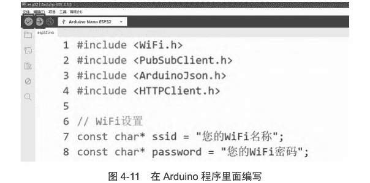

代码如下。

```cpp
#include <Wi-Fi.h>
#include <PubSubClient.h>
#include <ArduinoJson.h>
#include <HTTPClient.h>

// Wi-Fi设置
const char* ssid = "你的Wi-Fi名称";
const char* password = "你的Wi-Fi密码";

// MQTT服务器设置
const char* mqtt_server = "树莓派IP地址"; // 请替换为你的树莓派IP地址
const int mqtt_port = 1883;
const char* mqtt_client_id = "ESP32_Light_Sensor";
const char* mqtt_topic_light = "home/light_sensor";

// 光传感器设置
const int lightSensorPin = 34; // 使用ESP32的ADC引脚

// 树莓派API设置
const char* raspberryPiApiUrl = "http://树莓派IP地址:端口号/api/light_data"; // 请替换为你的树莓派API地址

// 客户端实例
Wi-FiClient espClient;
PubSubClient mqtt(espClient);

// 读取间隔时间（毫秒）
const long readInterval = 30000; // 30秒
unsigned long lastReadTime = 0;

void setup( ) {
  Serial.begin(115200);

  // 设置光传感器引脚为输入
  pinMode(lightSensorPin, INPUT);

  // 连接Wi-Fi
  setupWi-Fi( );

  // 设置MQTT服务器
  mqtt.setServer(mqtt_server, mqtt_port);
}

void loop( ) {
  // 确保Wi-Fi连接
  if (Wi-Fi.status( ) != WL_CONNECTED) {
    setupWi-Fi( );
  }

  // 确保MQTT连接
  if (!mqtt.connected( )) {
    reconnectMQTT( );
  }
  mqtt.loop( );

  // 定时读取光传感器数据并发送
  unsigned long currentMillis = millis( );
  if (currentMillis - lastReadTime >= readInterval) {
    lastReadTime = currentMillis;

    // 读取光传感器数据
    int lightValue = readLightSensor( );

    // 通过MQTT发送数据
    sendDataViaMQTT(lightValue);

    // 通过HTTP API发送数据到树莓派
    sendDataViaHTTP(lightValue);
  }
}

void setupWi-Fi( ) {
  delay(10);
  Serial.println( );
  Serial.print("正在连接Wi-Fi: ");
  Serial.println(ssid);

  Wi-Fi.begin(ssid, password);

  while (Wi-Fi.status( ) != WL_CONNECTED) {
    delay(500);
    Serial.print(".");
  }

  Serial.println("");
  Serial.println("Wi-Fi已连接");
  Serial.print("IP地址：");
  Serial.println(Wi-Fi.localIP( ));
}

void reconnectMQTT( ) {
    while (!mqtt.connected( )) {
        Serial.print("尝试连接MQTT...");
        if (mqtt.connect(mqtt_client_id)) {
            Serial.println("已连接");
        } else {
            Serial.print("连接失败，错误码：");
            Serial.print(mqtt.state( ));
            Serial.println("，5秒后重试");
            delay(5000);
        }
    }
}

int readLightSensor( ) {
    int rawValue = analogRead(lightSensorPin);
    Serial.print("光传感器原始值：");
    Serial.println(rawValue);

    // 根据需要进行值的映射或转换
    // 例如，将ESP32的0~4095范围映射到0%~100%
    int mappedValue = map(rawValue, 0, 4095, 0, 100);
    Serial.print("光传感器映射值(%): ");
    Serial.println(mappedValue);

    return mappedValue;
}

void sendDataViaMQTT(int lightValue) {
    // 创建JSON数据
    DynamicJsonDocument doc(256);
    doc["device"] = "ESP32";
    doc["sensor"] = "light";
    doc["value"] = lightValue;
    doc["timestamp"] = millis( );

    char jsonBuffer[256];
    serializeJson(doc, jsonBuffer);
```

##### DeepSeek+树莓派+Arduino智能产品、机器人部署与模型训练全攻略
步骤1：系统初始化与硬件配置
编程初期要先建立基础运行环境，串口通信、Wi-Fi 参数配置以及硬件引脚设定都要完成。重点是确保资源正确初始化且网络稳定。代码如下。

```cpp
void setup( ) {
    Serial.begin(115200);              // 串口通信初始化
    pinMode(lightSensorPin, INPUT);    // 配置传感器引脚为输入模式
    setupWi-Fi( );                     // 建立Wi-Fi网络连接
    mqtt.setServer(mqtt_server, mqtt_port); // 配置MQTT服务器
}
```

串口波特率设为115200，在稳定性和传输速率间取得平衡。光传感器引脚配置为模拟输入，使 ESP32 能读取模拟量。Wi-Fi 和 MQTT 的初始化为后续数据传输搭建了通道。

###### 步骤2：网络连接管理模块开发
网络管理是系统稳定运行的命脉，需实现 Wi-Fi 建立、状态监控与自动重连。编写时要覆盖各种异常网络情况并给出对应处理策略。代码如下。

```cpp
void setupWi-Fi( ) {
  Wi-Fi.begin(ssid, password);       // 启动Wi-Fi连接
  while (Wi-Fi.status( ) != WL_CONNECTED) {
    delay(500);                      // 等待连接建立
    Serial.print(".");               // 展示连接进度
  }
}
```

Wi-Fi 端采用阻塞等待的方式，程序会一直循环探测连通情况，直至连上才放行后续逻辑。这样可以确保后面的处理都在网络已就绪的前提下运行，连接过程中的进度提示也方便开发者实时掌握进度。MQTT 端则加入了重试策略，一旦握手失败会间隔一段时间后再次发起，这种容错设计让系统在网络抖动时更具适应性。具体代码如下。

```cpp
void reconnectMQTT( ) {
  while (!mqtt.connected( )) {
    if (mqtt.connect(mqtt_client_id)) {
      Serial.println("已连接");
    } else {
      delay(5000);                   // 连接失败后等待重试
    }
  }
}
```

###### 步骤3：传感器数据处理模块构建

第三步要把光照数据完整采集并整理成可用格式，核心思路是把模拟量转成数字量，再做线性映射和归一化，让数据更规范。示例代码在下方。

```cpp
int readLightSensor( ) {
  int rawValue = analogRead(lightSensorPin);    // 读取原始ADC值
  int mappedValue = map(rawValue, 0, 4095, 0, 100);  // 数值映射
  return mappedValue;
}
```

ESP32 自带的 ADC 分辨率为 12 位，量程覆盖 0 到 4095。借助 map 函数把这个区间拉伸到 0 到 100 的百分比区间，数值更直观，处理后也便于后续分析和决策。调试时同时打印原始读数和转换后的百分比，有助于判断传感器工作状态和数据质量。

###### 步骤4：双通道数据传输实现

传输层同时接入 MQTT 和 HTTP 两种协议，构成冗余通道。即使其中一条链路出现故障，另一条仍可维持数据流动，保证业务不中断。具体实现见代码。

```cpp
void sendDataViaMQTT(int lightValue) {
  // 创建JSON数据
  DynamicJsonDocument doc(256);
  doc["device"] = "ESP32";
  doc["sensor"] = "light";
  doc["value"] = lightValue;
  doc["timestamp"] = millis( );

  char jsonBuffer[256];
  serializeJson(doc, jsonBuffer);

  // 发布到MQTT主题
  if (mqtt.publish(mqtt_topic_light, jsonBuffer)) {
    Serial.println("MQTT消息发送成功");
  } else {
    Serial.println("MQTT消息发送失败");
  }
}

void sendDataViaHTTP(int lightValue) {
  if (Wi-Fi.status( ) == WL_CONNECTED) {
    HTTPClient http;
    http.begin(raspberryPiApiUrl);
    http.addHeader("Content-Type", "application/json");

    // 创建JSON数据
    DynamicJsonDocument doc(256);
    doc["light"] = lightValue;

    String requestBody;
    serializeJson(doc, requestBody);

    int httpResponseCode = http.POST(requestBody);

    if (httpResponseCode > 0) {
        String response = http.getString( );
        Serial.println("HTTP响应码: " + String(httpResponseCode));
        Serial.println("响应内容: " + response);
    } else {
        Serial.print("HTTP请求错误: ");
        Serial.println(httpResponseCode);
    }

    http.end( );
  } else {
    Serial.println("Wi-Fi未连接，无法发送HTTP请求");
  }
}
```

这种双保险机制显著提升了可靠性。MQTT 擅长低延迟的实时推送，HTTP 则提供标准的 RESTful 接口，便于与其他平台对接，两者形成互补。

步骤5：Wi-Fi 链路检测与自动重连

网络管理部分使用主动巡检思路，在主循环里不断检查 Wi-Fi 是否在线，一旦发现掉线就立刻发起重连，尽可能把中断对采集的影响压到最低。代码示例如下。

```cpp
if (Wi-Fi.status( ) != WL_CONNECTED) {
    setupWi-Fi( );    // 网络断开时重新连接
}
```

这样的监控逻辑反应迅速，能在不同网络环境下保持稳定。特别在信号偏弱的场景，可以大幅减少丢包和中断，保证数据连续上传。

步骤6：MQTT 异步收发处理

MQTT 部分采用非阻塞方式运行，依赖 mqtt.loop() 来轮询网络事件和消息，网络处理不会卡住主流程。代码如下。

```cpp
void sendDataViaMQTT(int lightValue) {
    DynamicJsonDocument doc(256);    // 创建JSON文档对象
    doc["device"] = "ESP32";          // 设备标识
    doc["sensor"] = "light";          // 传感器类型
    doc["value"] = lightValue;        // 传感器数值
    doc["timestamp"] = millis( );     // 时间戳
}
```

采用 JSON 封装数据，结构清晰跨平台，字段涵盖设备 ID、传感器类型、数值和时间戳，为后端提供完整上下文。发布时检查返回值，能及时捕捉通信异常并处理。

###### 步骤7：HTTP API 上报实现

HTTP 上报模块按照 RESTful 规范实现，用 POST 请求把 JSON 格式的传感器信息推送到树莓派，恰好与 MQTT 形成互补，下面是代码。

```cpp
void sendDataViaHTTP(int lightValue) {
    HTTPClient http;
    http.begin(raspberryPiApiUrl);        // 设置目标URL
    http.addHeader("Content-Type", "application/json"); // 设置内容类型

    int httpResponseCode = http.POST(requestBody);    // 发送POST请求
}
```

请求处理包含状态码校验和响应内容解析，能明确了解服务器是否接收成功。调用 http.end() 释放客户端资源，防止内存泄漏和连接池耗尽。

###### 步骤8：软件定时器与任务调度

时间控制使用 millis() 实现软件定时器，不会阻塞主循环，可同时兼顾多项任务。具体代码见下。

```cpp
unsigned long currentMillis = millis();
if (currentMillis - lastReadTime >= readInterval) {
    lastReadTime = currentMillis;
    // 执行数据采集和传输
}
```

30 秒一次的采集频率在实时性和资源占用之间取得平衡，既能跟踪环境变化，又不会过度消耗网络。定时器变量选用无符号长整型，能够正确处理溢出，适合长期运行。

步骤9：ADC 信号数字化处理

ESP32 的 ADC 具备较高精度，analogRead() 会返回 12 位数字，对应 0 至 3.3V 的电压区间，精度足以覆盖常见光照检测需求。代码如下。

```cpp
int rawValue = analogRead(lightSensorPin);    // 获取12位ADC值
int mappedValue = map(rawValue, 0, 4095, 0, 100); // 映射到百分比
```

映射步骤把依赖硬件的 ADC 原始值转为统一的百分比，读起来更友好，也便于跨平台使用，后端处理也更方便。

步骤10：JSON 数据结构设计

数据封装选用 JSON，结构化且兼容性好。文档里保留了完整的上下文信息，方便后端解析和后续处理。示例代码如下。

```cpp
DynamicJsonDocument doc(256);          // 分配JSON文档内存
doc["device"] = "ESP32";              // 设备标志字段
doc["sensor"] = "light";             // 传感器类型字段
doc["value"] = lightValue;            // 数值数据字段
doc["timestamp"] = millis( );         // 时间戳字段
```

预留 256 字节存放 JSON，空间充足且内存可控。时间戳记录采集时刻，为时序分析提供依据。整体实现让 ESP32 光照采集系统具备高可靠、高稳定和易扩展的特性，成为智能家居的数据采集底座。

#### 4.1.3 ESP8266 灯光控制器开发

ESP8266 灯光控制器采用事件驱动的多任务架构，配合状态机管理灯效和系统状态，设计重点在于可靠的 MQTT 控制、流畅的 LED 表现以及长期稳定运行，详见图 4-12。

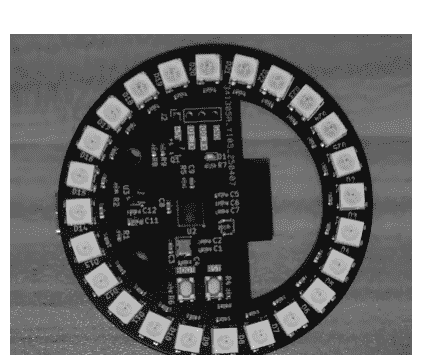

图 4-12 ESP8266 灯光控制器程序

代码按模块化拆分，分为网络通信、设备控制、效果渲染和系统监控四大块，模块间通过明确接口交互，结构清晰，调试和扩展都更方便。

程序使用非阻塞写法，以时间片轮询调度并发任务，避免阻塞带来的延迟，保证灯效顺滑和 MQTT 实时响应。

启动 Arduino IDE，按照图 4-13 的提示输入代码，完成编辑后点上传即可把程序烧录到开发板。

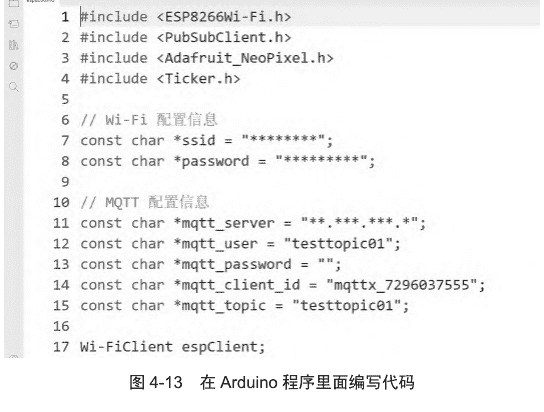

图 4-13 在 Arduino 程序里面编写代码

代码如下。

```cpp
#include <ESP8266Wi-Fi.h>
#include <PubSubClient.h>
#include <Adafruit_NeoPixel.h>
#include <Ticker.h>

// Wi-Fi 配置信息
const char *ssid = "********";
const char *password = "**********";

// MQTT 配置信息
const char *mqtt_server = "**.***.***.*";
const char *mqtt_user = "testtopic01";
const char *mqtt_password = "";
const char *mqtt_client_id = "mqttx_7296037555";
const char *mqtt_topic = "testtopic01";

Wi-FiClient espClient;
PubSubClient client(espClient);
Ticker wdtTicker;  // 用于定期喂狗，但不使用yield

// 灯带设置
#define NUMPIXELS 26
#define PIN 4
Adafruit_NeoPixel strip = Adafruit_NeoPixel(NUMPIXELS, PIN, NEO_GRB + NEO_KHZ800);

uint8_t R = 252;
uint8_t G = 255;
uint8_t B = 0;
uint8_t brightness = 180;
static uint8_t lampStep = 0;
uint8_t fadeAmount = 2;
uint8_t modeSwitch = 0;
uint8_t breathBrightness = 0;

// 状态控制变量，用于非阻塞操作
unsigned long previousMillis = 0;
unsigned long previousEffectMillis = 0;
unsigned long mqttReconnectMillis = 0;
unsigned long statusReportMillis = 0;
unsigned long memoryCheckMillis = 0;
unsigned long wifiCheckMillis = 0;
uint16_t rotationPosition = 0;

// 操作间隔时间
const long effectInterval = 20;        // 灯光效果更新间隔（毫秒）
const long statusInterval = 60000;     // 状态报告间隔（毫秒）
const long memoryCheckInterval = 120000; // 内存检查间隔（毫秒）
const long reconnectInterval = 5000;   // MQTT重连尝试间隔
```

DeepSeek+树莓派+Arduino智能产品、机器人部署与模型训练全攻略

```cpp
const long wifiCheckInterval = 30000;   // Wi-Fi检查间隔

// 看门狗处理——只喂狗，不使用yield
void feedWatchdog() {
  ESP.wdtFeed();  // 只喂养软件看门狗，不调用yield()
}

void printResetReason() {
  Serial.println("-------------------");
  Serial.print("复位原因: ");
  Serial.println(ESP.getResetReason());
  Serial.println("上次复位原因详情: " + ESP.getResetInfo());
  Serial.println("-------------------");
}

void printMemoryInfo() {
  Serial.println("-------------------");
  Serial.print("可用堆内存: ");
  Serial.print(ESP.getFreeHeap());
  Serial.println(" 字节");
  Serial.println("-------------------");
}

void setup_wifi() {
  int attemptCount = 0;
  const int maxAttempts = 10;  // 降低最大尝试次数

  delay(10);
  Serial.println();
  Serial.print("连接Wi-Fi网络: ");
  Serial.println(ssid);

  // Wi-Fi连接配置
  Wi-Fi.mode(WIFI_STA);  // 明确设置为station模式
  Wi-Fi.setSleepMode(WIFI_NONE_SLEEP); // 禁用Wi-Fi睡眠模式，提高稳定性
  Wi-Fi.setAutoReconnect(true);  // 允许自动重连

  // 开始连接Wi-Fi
  Wi-Fi.begin(ssid, password);

  while (Wi-Fi.status() != WL_CONNECTED && attemptCount < maxAttempts) {
    feedWatchdog();  // 确保看门狗不会重置设备
    delay(500);
    Serial.print(".");
    attemptCount++;
  }

  if (Wi-Fi.status() == WL_CONNECTED) {
    Serial.println("");
    Serial.println("Wi-Fi连接成功!");
    Serial.print("IP地址：");
    Serial.println(Wi-Fi.localIP());
  } else {
    Serial.println("");
    Serial.println("Wi-Fi连接失败！将继续尝试...");
  }
}

void callback(char *topic, byte *message, unsigned int length) {
    // 在回调开始时喂狗
    feedWatchdog();

    // 清晰地打印主题名称
    Serial.println("-----------------------");
    Serial.print("收到MQTT消息 | 主题：");
    Serial.println(topic);

    // 打印消息内容
    Serial.print("消息内容：");
    String messageTemp;

    // 将byte数组转换为字符串
    for (int i = 0; i < length; i++) {
        Serial.print((char)message[i]);
        messageTemp += (char)message[i];
    }
    Serial.println();

    // 再打印一次完整的消息（以字符串形式）
    Serial.print("消息字符串：[");
    Serial.print(messageTemp);
    Serial.println("]");

    // 根据接收到的消息内容切换模式
    Serial.print("执行命令：");
    if (messageTemp == "1") {
        Serial.println("打开灯光（全亮模式）");
        modeSwitch = 0;
        Open(); // 开灯
    } else if (messageTemp == "2") {
        Serial.println("切换到七彩循环模式");
        modeSwitch = 2; // 七彩循环
    } else if (messageTemp == "3") {
        Serial.println("切换到呼吸灯模式");
        modeSwitch = 1; // 呼吸灯
        breathBrightness = 0; // 重置呼吸灯亮度
    } else if (messageTemp == "4") {
        Serial.println("切换到七彩旋转模式");
        modeSwitch = 3; // 七彩旋转
        rotationPosition = 0; // 重置旋转位置
    } else if (messageTemp == "0") {
        Serial.println("关闭灯光");
        modeSwitch = 0;
        Close(); // 关灯
    } else {
        Serial.println("未知命令，忽略");
    }
    Serial.println("-------------------");

    // 在回调结束时再次喂狗
    feedWatchdog();
}

void tryMqttConnect() {
    // 在函数开始时喂狗
    feedWatchdog();

    // 检查连接状态
    if (!client.connected()) {
        Serial.println("尝试MQTT连接...");

        // 尝试连接
        if (client.connect(mqtt_client_id, mqtt_user, mqtt_password)) {
            Serial.println("MQTT连接成功!");

            // 订阅主题
            Serial.print("订阅主题：");
            Serial.println(mqtt_topic);
            client.subscribe(mqtt_topic);
            Serial.println("订阅完成");
        } else {
            Serial.print("连接失败，错误代码=");
            Serial.println(client.state());
        }
    }

    // 在函数结束时再次喂狗
    feedWatchdog();
}

void checkWi-FiConnection() {
    if (Wi-Fi.status() != WL_CONNECTED) {
        Serial.println("Wi-Fi连接断开，尝试重新连接...");
        Wi-Fi.reconnect(); // 使用reconnect而不是重新完整设置

        // 给一些时间让Wi-Fi重新连接
        int attempts = 0;
        while (Wi-Fi.status() != WL_CONNECTED && attempts < 10) {
            feedWatchdog();
            delay(500);
            Serial.print(".");
            attempts++;
        }

        if (Wi-Fi.status() == WL_CONNECTED) {
            Serial.println("\nWi-Fi重新连接成功!");
        } else {
            Serial.println("\nWi-Fi重新连接失败!");
        }
    }
}

void Open() {
    strip.setBrightness(brightness);
    for (int i = 0; i < NUMPIXELS; i++) {
        strip.setPixelColor(i, R, G, B);
    }
    strip.show();
}

void Close() {
    for (int i = 0; i < NUMPIXELS; i++) {
        strip.setPixelColor(i, 0, 0, 0);
    }
    strip.show();
}

uint32_t Wheel(byte WheelPos) {
    WheelPos = 255 - WheelPos;
    if (WheelPos < 85) {
        return strip.Color(255 - WheelPos * 3, 0, WheelPos * 3);
    }
    if (WheelPos < 170) {
        WheelPos -= 85;
        return strip.Color(0, WheelPos * 3, 255 - WheelPos * 3);
    }
    WheelPos -= 170;
    return strip.Color(WheelPos * 3, 255 - WheelPos * 3, 0);
}

// 非阻塞彩虹展示
void updateRainbowDisplay() {
    strip.setBrightness(brightness);
    for (uint8_t i = 0; i < strip.numPixels(); i++) {
        strip.setPixelColor(i, Wheel((i + lampStep) & 255));
    }
    lampStep = (lampStep + 1) & 0xFF;
    strip.show();
}

// 非阻塞呼吸灯
void updateRGBBreath() {
    strip.setBrightness(breathBrightness);
    for (uint8_t i = 0; i < NUMPIXELS; i++) {
        strip.setPixelColor(i, R, G, B);
    }
    strip.show();

    breathBrightness += fadeAmount;
    if (breathBrightness <= 0 || breathBrightness >= 180) {
        fadeAmount = -fadeAmount;
    }
}

// 非阻塞彩虹旋转
void updateRainbowCycle() {
    for (uint16_t i = 0; i < strip.numPixels(); i++) {
        strip.setPixelColor(i, Wheel(((i * 256 / strip.numPixels()) + rotationPosition) & 255));
    }
    strip.setBrightness(brightness);
    strip.show();

    rotationPosition = (rotationPosition + 1) % 256;  // 使用模运算避免溢出
}

void printStatusReport() {
    Serial.println("------------------");
    Serial.println("状态报告:");
    Serial.print("运行时长: ");
    Serial.print(millis() / 1000);
    Serial.println(" 秒");
    Serial.print("当前模式: ");
    switch (modeSwitch) {
        case 0:
            if (strip.getBrightness() > 0) {
                Serial.println("普通模式 (灯亮)");
            } else {
                Serial.println("普通模式 (灯光)");
            }
            break;
        case 1: Serial.println("呼吸灯模式"); break;
        case 2: Serial.println("七彩循环模式"); break;
        case 3: Serial.println("七彩旋转模式"); break;
        default: Serial.println("未知模式"); break;
    }
    Serial.print("Wi-Fi状态: ");
    Serial.println(WiFi.status() == WL_CONNECTED ? "已连接" : "未连接");
    Serial.print("Wi-Fi信号强度: ");
    Serial.print(WiFi.RSSI());
    Serial.println(" dBm");
    Serial.print("MQTT状态：");
    Serial.println(client.connected() ? "已连接" : "未连接");
    Serial.println("-------------------");
}

void setup() {
    // 增加ESP8266的稳定性
    ESP.wdtDisable();
    ESP.wdtEnable(WDTO_8S);  // 设置为8秒超时

    // 设置串口
    Serial.begin(115200);
    delay(200);

    Serial.println("\n\n========================================");
    Serial.println("ESP8266 MQTT LED控制程序启动");
    Serial.println("========================================");

    // 打印复位原因
    printResetReason();

    // 初始化LED
    Serial.println("初始化LED灯带...");
    strip.begin();
    strip.show();  // 初始化为全暗
    Serial.println("LED灯带初始化完成");

    // 设置定时喂狗，但不使用原先的yield()
    wdtTicker.attach(1.0, feedWatchdog);

    // 连接Wi-Fi
    Serial.println("设置Wi-Fi连接...");
    setup_wifi();

    // 设置MQTT服务器
    Serial.println("设置MQTT客户端...");
    client.setServer(mqtt_server, 1883);
    client.setCallback(callback);
    Serial.println("MQTT客户端设置完成");

    // 打印初始内存状态
    printMemoryInfo();

    Serial.println("初始化完成，程序开始运行");
    Serial.println("========================================\n");
}

void loop() {
    // 在循环开始时喂狗
    feedWatchdog();

    unsigned long currentMillis = millis();

    // 检查Wi-Fi连接
    if (currentMillis - wifiCheckMillis >= wifiCheckInterval) {
        wifiCheckMillis = currentMillis;
        checkWi-FiConnection();
    }

    // 如果Wi-Fi已连接，尝试连接MQTT
    if (Wi-Fi.status() == WL_CONNECTED) {
        // 检查并尝试MQTT连接
        if (!client.connected() && (currentMillis - mqttReconnectMillis >= reconnectInterval)) {
            mqttReconnectMillis = currentMillis;
            tryMqttConnect();
        }

        // 如果已连接，处理MQTT消息
        if (client.connected()) {
            client.loop();
        }
    }

    // 根据当前模式更新灯光效果
    if (currentMillis - previousEffectMillis >= effectInterval) {
        previousEffectMillis = currentMillis;

        // 执行对应的灯光模式
        switch (modeSwitch) {
            case 1:
                updateRGBBreath();
                break;
            case 2:
                updateRainbowDisplay();
                break;
            case 3:
                updateRainbowCycle();
                break;
            // 模式0不需要更新，它是静态的开/关状态
        }
    }

    // 定期打印状态报告
    if (currentMillis - statusReportMillis >= statusInterval) {
        statusReportMillis = currentMillis;
        printStatusReport();
    }

    // 定期检查内存
    if (currentMillis - memoryCheckMillis >= memoryCheckInterval) {
```

ESP32 灯控 长效稳定方案

本项目把可靠性放在首位，循环收尾处先更新检查点并打印堆余量，随后用毫秒级间隔让出执行权，避免阻塞。启动时先重置看门狗策略并打开调试串口，灯带初始化后保持全暗。网络侧锁定 STA 模式、关闭节能并开启自动恢复，MQTT 客户端提前绑定服务器与回调。随后通过色相轮计算、呼吸亮度渐变、定时驱动灯效、回调中喂狗、指令分发切换模式、Wi-Fi 与 MQTT 保活检测、彩虹位移渲染以及运行状态与内存上报等模块协同，形成闭环，确保长时间运行下灯效流畅在线。

memoryCheckMillis = currentMillis;

printMemoryInfo();

}

// 给系统一些喘息空间，但避免使用yield()

delay(1); // 短延迟而不是yield()

}

```

步骤1：系统基础架构建立。

编程的开始阶段需要建立系统的核心架构，包括硬件抽象层、通信协议栈和任务调度框架。这个阶段的重点是确保各个子系统能够协调工作，为后续功能开发奠定稳固的基础。具体代码如下。

```

// 系统核心配置——建立基础运行环境

ESP.wdtDisable(); // 禁用默认看门狗

ESP.wdtEnable(WDTO_8S); // 启用8秒超时看门狗

Serial.begin(115200); // 初始化串口通信

```

看门狗机制的配置是系统稳定性的重要保障。8秒的超时时间设置在防止系统死锁和允许正常网络操作之间取得了平衡。这个时间长度既能及时检测异常情况，又可以为复杂的网络操作提供充足的执行时间。

LED硬件的初始化采用Adafruit_NeoPixel库，这个库提供了完整的WS2812B LED控制功能。初始化过程包括引脚配置、颜色格式设置和通信协议参数配置。具体代码如下。

```

strip.begin(); // 初始化LED控制器

strip.show(); // 设置初始状态为全暗

```

步骤2：网络通信层开发。

网络通信层是系统的核心组件，负责Wi-Fi连接管理和MQTT协议处理。这个层次的开发需要考虑各种网络异常情况和相应的恢复策略。具体代码如下。

```

void setup_wifi() {

  Wi-Fi.mode(WIFI_STA); // 设置为客户端模式

  Wi-Fi.setSleepMode(WIFI_NONE_SLEEP); // 禁用Wi-Fi节能模式

  Wi-Fi.setAutoReconnect(true); // 启用自动重连功能

}

```

Wi-Fi配置采用Station模式，使ESP8266作为客户端连接到现有网络。禁用休眠模式，确保网络连接的持续稳定，避免因节能机制导致通信中断。自动重连功能提供了基础的网络恢复能力。

MQTT客户端的配置包括服务器地址、端口号、认证信息和回调函数设置。回调函数是处理远程控制命令的核心机制，需要具备快速响应和可靠的解析能力。具体代码如下。

```

client.setServer(mqtt_server, 1883);    // 配置MQTT服务器

client.setCallback(callback);            // 设置消息回调函数

```

##### 步骤3：灯光效果算法实现。

灯光效果算法是系统的视觉核心，需要实现多种动态效果的平滑渲染。算法设计采用数学模型驱动的方式，通过色彩空间变换和时间函数计算生成丰富的视觉效果。具体代码如下。

```

uint32_t Wheel(byte WheelPos) {

    WheelPos = 255 - WheelPos;            // 色相值反转

    if (WheelPos < 85) {

        return strip.Color(255 - WheelPos * 3, 0, WheelPos * 3);

    }

    // 其他色相区间的RGB计算

}

```

色轮算法实现了从HSV到RGB颜色空间的高效转换。通过将色相环划分为3个线性区间，每个区间内使用简单的线性插值计算RGB分量，这种方法计算效率高，色彩过渡自然。

呼吸灯效果通过亮度的周期性变化来实现。采用锯齿波形模拟呼吸节奏。算法通过控制亮度变化的方向和速度，创造出自然的呼吸效果。具体代码如下。

```

void updateRGBBreath( ) {

    breathBrightness += fadeAmount;        // 亮度递增或递减

    if (breathBrightness <= 0 || breathBrightness >= 180) {

        fadeAmount = -fadeAmount;          // 到达边界时反转变化方向

    }

}

```

##### 步骤4：任务调度与状态管理。

任务调度系统基于时间片轮询机制，通过多个独立的定时器管理不同功能模块的执行时序。这种设计确保了系统资源的合理分配和各项功能的协调运行。具体代码如下。

```

unsigned long currentMillis = millis( );

if (currentMillis - previousEffectMillis >= effectInterval) {

    previousEffectMillis = currentMillis;

    // 执行灯光效果更新

}

```

##### 步骤5：MQTT消息处理与命令解析。

MQTT消息处理模块是系统的控制中枢，负责接收和解析远程控制命令。消息处理采用字符串匹配的方式识别不同的控制指令，通过状态机切换实现功能模式的转换。具体代码如下。

```

void callback(char *topic, byte *message, unsigned int length) {

  feedWatchdog( );                     // 回调开始时立即喂狗

  String messageTemp;

  for (int i = 0; i < length; i++) {

    messageTemp += (char)message[i];  // 字节数组转字符串

  }

}

```

消息解析过程包括数据类型转换、内容校验和命令识别三个步骤。从字节数组到字符串的转换确保了数据的正确性，字符串匹配提供了灵活的命令识别机制。

命令执行采用实时响应策略，收到有效命令后立即切换系统状态。这种设计保证了控制指令的实时性，提供了良好的用户体验。具体代码如下。

```

if (messageTemp == "1") {

  modeSwitch = 0;                     // 切换到普通模式

  Open( );                            // 立即执行开灯操作

} else if (messageTemp == "3") {

  modeSwitch = 1;                     // 切换到呼吸灯模式

  breathBrightness = 0;               // 重置呼吸灯状态

}

```

步骤6：网络连接监控与自动恢复。

网络连接监控模块采用主动监测和被动恢复相结合的策略。系统定期检查Wi-Fi和MQTT的连接状态，当检测到连接异常时，立即启动恢复程序。具体代码如下。

```

void checkWi-FiConnection( ) {

  if (Wi-Fi.status( ) != WL_CONNECTED) {

    Wi-Fi.reconnect( );               // 使用快速重连方法

    int attempts = 0;

    while (Wi-Fi.status( ) != WL_CONNECTED && attempts < 10) {

      feedWatchdog( );                 // 重连过程中持续喂狗

      delay(500);

      attempts++;

    }

  }

}

```

Wi-Fi重连策略采用Wi-Fi.reconnect( )方法而非完全重新初始化，这种方式更加高效，能够快速恢复网络连接。重连过程中的看门狗喂养确保了系统不会因为网络延迟而重启。

MQTT连接管理采用状态检查和定时重连相结合的机制。系统在主循环中定期检查MQTT连接状态，发现断开后按照设定的时间间隔尝试重新连接。具体代码如下。

```

if (!client.connected( ) && (currentMillis - mqttReconnectMillis >= reconnectInterval)) {

    mqttReconnectMillis = currentMillis;

    tryMqttConnect( );                // 尝试MQTT重连

}

```

##### 步骤7：LED效果渲染引擎。

LED效果渲染引擎采用状态机模式管理不同的视觉效果。每种效果都有独立的更新函数和状态变量，通过模式切换变量modeSwitch控制当前激活的效果。

彩虹循环效果则通过色相值的连续变化来实现，每个LED的颜色基于其位置和时间偏移计算得出。这种算法可以产生流动的彩虹效果。具体代码如下。

```

void updateRainbowDisplay( ) {

    for (uint8_t i = 0; i < strip.numPixels( ); i++) {

        strip.setPixelColor(i, Wheel((i + lampStep) & 255));

    }

    lampStep = (lampStep + 1) & 0xFF;  // 步进值循环递增

}

```

位运算操作& 0xFF确保了步进值在0～255范围内循环，避免了数值溢出问题。这种处理方式既高效又可靠。

彩虹旋转效果在彩虹循环的基础上增加了空间位置的计算，每个LED的颜色不仅随时间变化，还根据其在灯带中的相对位置进行调整。具体代码如下。

```

void updateRainbowCycle( ) {

    for (uint16_t i = 0; i < strip.numPixels( ); i++) {

        strip.setPixelColor(i, Wheel(((i * 256 / strip.numPixels( )) + rotationPosition) & 255));

    }

    rotationPosition = (rotationPosition + 1) % 256;

}

```

位置计算公式i * 256 / strip.numPixels( )可将LED的物理位置映射到色相空间，创造出旋转的视觉效果。模运算确保了旋转位置的循环性。

##### 步骤8：系统监控与诊断功能。

系统监控模块提供了全面的运行状态信息，包括内存使用情况、网络连接状态和工作模式等。这些信息对于系统维护和故障诊断具有重要价值。具体代码如下。

```

void printStatusReport( ) {

    Serial.print("运行时长: ");

    Serial.print(millis( ) / 1000);    // 系统运行时间 (秒)

    Serial.println(" 秒");

    Serial.print("Wi-Fi信号强度: ");

    Serial.print(WiFi.RSSI( ));        // Wi-Fi信号强度 (dBm)

    Serial.println(" dBm");

}

```

对于运行时长统计，通过millis()函数获取系统启动后的毫秒数，并转换为秒数展示。Wi-Fi信号强度监测可帮助用户判断网络连接质量，为网络问题诊断提供数据支持。

内存监控功能定期检查可用堆内存，让我们能够及时发现内存泄漏问题。ESP8266的内存资源有限，内存监控对于其长期稳定运行至关重要。具体代码如下。

```

void printMemoryInfo( ) {

    Serial.print("可用堆内存: ");

    Serial.print(ESP.getFreeHeap( ));    // 当前可用内存 (字节)

    Serial.println(" 字节");

}

```

步骤9：看门狗机制与系统可靠性。

看门狗机制是保证系统长期稳定运行的关键技术。系统采用硬件看门狗和软件定时器相结合的双重保护策略，确保在各种异常情况下的可靠性。具体代码如下。

```

void feedWatchdog( ) {

    ESP.wdtFeed( );    // 喂养软件看门狗

}

```

定时喂狗功能通过Ticker库实现，每秒执行一次喂狗操作。这种定时机制确保了在正常运行时及时重置看门狗，同时在程序异常时能够触发系统重启。具体代码如下。

```

wdtTicker.attach(1.0, feedWatchdog); // 每秒执行一次喂狗

# 阳台智能滴灌

用树莓派加 GPIO Zero 就能给阳台的多肉或时蔬做一套自判断的补水回路。程序把执行记录同时写入 irrigation_log3.txt 并实时打印到终端，方便事后追溯。土壤干湿探头接在 GPIO 17，继电器控制脚用 GPIO 18，以高电平方式驱动。

检测逻辑上，每次判断会连续读取三次传感器状态，采样间隔为 1 秒，取算术平均后做决策。平均值达到 0.5 及以上就认为偏干，继电器随即打开工作 15 秒完成一次补水，随后自动关闭进入待机。两次检测之间会间隔 2 秒。若硬件初始化或运行中出现异常，系统会先切断继电器并把错误写进日志，按下 Ctrl+C 也可以安全退出。

下面是可直接部署的核心代码：

```

在所有可能的长时间操作中都添加了手动喂狗调用，如网络连接、MQTT通信和消息处理等。这种多点喂狗策略提供了全面的保护。

通过这样完整而精密的编程实现，ESP8266灯光控制器程序具备了高可靠性、强实时性和良好的用户体验等特点，为智能照明应用提供了坚实的技术基础。

### 4.2 智能农业助手：自动灌溉系统

树莓派智能灌溉系统整合微型计算机硬件与传感器技术，可以实现对植物土壤湿度的自动化监测与控制。系统以树莓派为核心，连接土壤湿度传感器与继电器模块，构建闭环控制架构。传感器实时采集数据，当土壤含水量低于预设阈值时，树莓派驱动继电器接通水泵进行灌溉；当湿度正常时，自动切断电源。

硬件配置遵循标准化接口原则，传感器和继电器通过特定信号线与树莓派的针脚连接。供电采用分级策略，适配不同的电压，确保信号稳定并降低能耗。在安全防护方面，强电与弱电压系统物理隔离，配置过流保护装置，提升可靠性。

该系统优势明显，通过设置信号滤波算法对传感器数据进行多重验证，规避误触发，实现智能化处理；采用模块化设计，用户可按需调整阈值或扩展网络。在实际应用中，该系统既适用于桌面级生态养护，也可用于农田灌溉，环境适应性强，扩展潜力大。

#### 4.2.1 自动灌溉系统的关键组件

灌溉系统基于土壤湿度阈值触发电磁阀开关，树莓派接收传感器采集的数据后用模糊控制算法动态调整灌溉时长，避免过度用水。实际部署要考虑水泵（见图4-14）的功率与管网压力，用软启动电路防止电流冲击损坏设备。树莓派是功能强大的微型计算机，被广泛用于物联网与自动化控制领域。接下来将构建的集成土壤湿度传感器与继电器模块的智能灌溉控制系统，其硬件连接与工作逻辑如下。


##### （1）硬件连接规范

土壤湿度传感器通过3根导线与树莓派物理连接。红色电源线接传感器VCC接口，连接树莓派（物理引脚BOARD编码）接口2号针脚接入5伏特直流供电；黑色地线接传感器GND接口，连接至6号针脚形成回路；黄色信号线接传感器DO接口，连11号（物理引脚BOARD编码）针脚，用于实时采集数字信号输出。

继电器模块采用四线制连接。棕色电源线接模块VCC接口，宽电压输入模块接4号（物理引脚BOARD编码）针脚或3.3伏特供电，需5伏特驱动的接2号（物理引脚BOARD编码）针脚；黑色地线接14号（物理引脚BOARD编码）针脚，完成回路；蓝色控制线接模块IN接口至12号（物理引脚BOARD编码）针脚，输出控制信号。继电器输出端采用NO - COM端子设计，红色线连接水泵正极至继电器NO（常开）端子，橙色线将COM（公共端）接外部电源正极，水泵负极直接接电源负极形成受控回路。

##### （2）系统工作流程

系统初始化后，树莓派持续监测11号针脚电平。若土壤含水量低于预设阈值，传感器内部比较器触发状态翻转，DO端口输出高电平。树莓派检测到信号，通过12号针脚发出高电平驱动信号，使继电器线圈通电产生磁力，机械触点闭合，导通水泵供电回路，开始灌溉。当土壤湿度恢复正常后，传感器 DO 端输出低电平，树莓派以0.5秒的间隔连续3次检测到低电平（消除偶发干扰）后，终止12号针脚信号输出，继电器线圈失磁，机械触点复位，断开水泵供电回路，系统待机。

##### （3）关键设计要点

供电匹配是系统稳定的核心。树莓派2号针脚提供5伏特、最大500毫安输出，适用于多数数字传感器。采用电磁式继电器，优先选用5伏特供电型号，防止驱动不足；固态继电器用3.3伏特供电（4号针脚），可降低能耗，减少电磁干扰。

信号采集需设置合理的采样频率，建议采用100毫秒间隔的轮询机制，保证响应速度且避免CPU过载。程序设计应添加信号滤波算法，如连续三次采样结果相同才触发状态变更，规避瞬时干扰导致的误动作。

##### （4）安全注意事项

强电控制部分需做好物理隔离，建议将220伏特交流电控制回路与树莓派低压系统放置在不同的接线盒内。裸露导体用热缩管或绝缘胶带处理，继电器输出端与水泵间串联5安培保险丝做过流保护。在调试系统时，先以12伏特直流水泵验证功能，逻辑测试完成后，再接入大功率交流设备。该方案通过模块化设计分离硬件层与逻辑层，组件采用标准化接口，便于后期维护升级。在实际部署时，可根据作物需求调整湿度阈值，还能扩展传感器节点，构建分布式监测网络，工程适用性强。

如图4-15所示为树莓派连接示意图，展示了如何将土壤湿度传感器和继电器模块连接到树莓派，以实现对水泵的自动化控制。

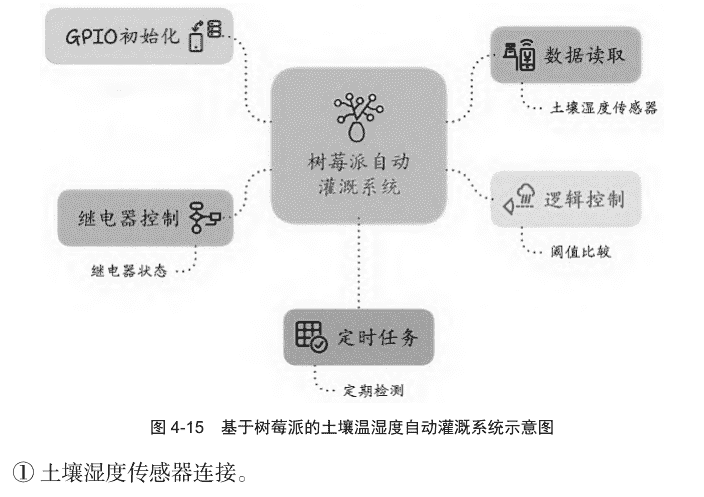

图 4-15 基于树莓派的土壤温湿度自动灌溉系统示意图

- ① 土壤湿度传感器连接。
  - VCC：连接至树莓派的5伏特电源针脚（物理引脚BOARD编码方式针脚号2）。
  - GND：连接至树莓派的接地针脚（物理引脚BOARD编码方式针脚号6）。
  - DO（数字输出）：连接至树莓派的物理引脚BOARD编码方式针脚号11，用于读取土壤湿度数据。

- ② 继电器模块连接。
  - VCC：连接至树莓派的3.3伏特或5伏特电源针脚（物理引脚BOARD编码方式针脚号4，但建议根据继电器模块规格选择电压）。
  - GND：连接至树莓派的接地针脚（物理引脚BOARD编码方式针脚号14）。
  - IN（控制输入）：连接至树莓派的物理引脚BOARD编码方式针脚号12，用于控制继电器的开关状态。

需要注意的是，图中标注的“IN”是一个误标或特定于该继电器模块的标志，通常继电器模块的控制输入会标注为“IN”或类似标志。在此，我们将其解释为控制输入，并对应到物理引脚BOARD编码方式针脚号12。

- ③ 水泵连接。
  - 水泵的正极（通常标记为“+”或“VCC”）通过继电器模块的NO（常开）端子和COM（公共端）连接至电源正极。
  - 水泵的负极（通常标记为“-”或“GND”）直接连接至电源负极。

当土壤湿度低于预设阈值时，土壤湿度传感器会向树莓派发送信号。树莓派通过物理引脚BOARD编码方式针脚号12控制继电器模块，使继电器闭合，从而接通水泵电源，实现自动浇水功能。当土壤湿度达到或超过预设阈值时，继电器断开，水泵停止工作。

- ④ 连接说明。
  - 土壤湿度传感器的VCC连接到5伏特电源，GND连接到地线，DO（数据输出）连接到继电器的IN端。
  - 继电器的VCC引脚连接到电源，GND连接到地线，IN接收来自土壤湿度传感器的信号。
  - 水泵通过继电器的常开（NO）触点控制，当继电器被激活时，水泵开始工作。
  - 所有组件共享同一个电源和地线连接。

#### 4.2.2 自动灌溉系统的代码组成

自动灌溉系统的代码分为数据采集、逻辑处理与设备控制三大模块。数据采集模块负责读取土壤湿度传感器的实时数据，通过GPIO接口与树莓派通信，保障数据准确、及时。该模块利用RPi.GPIO库配置操作GPIO端口，以轮询机制定期读取传感器状态，内置信号滤波算法，比对三次采样结果，结果一致时认定为有效数据，以避免误读。逻辑处理模块是系统的核心，用Python实现，内置模糊控制算法，依据预设阈值和传感器数据智能决策，动态调整灌溉策略，兼顾作物需求与节水，实现精准灌溉。设备控制模块通过GPIO端口输出信号，驱动继电器开关水泵电源，实现灌溉自动化。该模块集成了安全保护机制，出现这是一个基于树莓派的自动灌溉系统，该系统利用土壤湿度传感器检测土壤状态，并通过继电器控制水泵进行自动灌溉。系统采用Python语言编写，使用gpiozero库进行GPIO引脚控制，实现了完整的自动化灌溉功能。

智能灌溉控制系统是现代农业物联网技术的典型应用。系统通过传感器实时监测土壤湿度，依据预设阈值自动启停灌溉设备，实现精准的农业管理。它用Python语言开发，运行于树莓派等嵌入式Linux平台，体现了开源硬件与现代农业技术的结合。

系统架构采用面向对象的设计模式，将硬件控制、传感器读取、数据处理和日志记录等功能进行模块化封装，不仅提升了代码的可维护性与可扩展性，还为后续功能升级奠定基础。此外，系统通过标准的GPIO接口控制硬件设备，具备良好的硬件兼容性与移植性。

系统工作流程如下。

- 定期检测土壤湿度。
- 当检测到土壤干燥时，启动水泵进行灌溉。
- 灌溉达到预设时间后自动停止。
- 等待下一次检测周期。
- 将所有操作记录到日志文件中。

在PyCharm中输入代码（见图4-16），然后单击“运行”按钮。

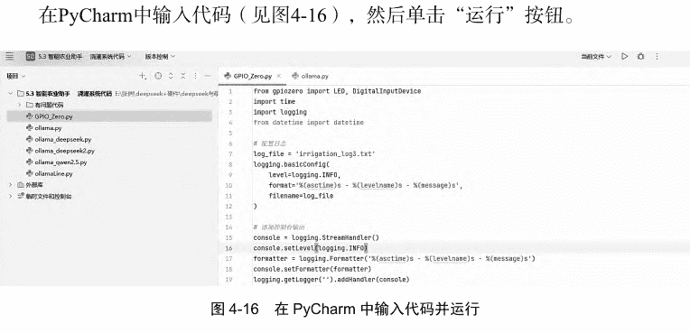

具体代码示例如下。

```python

from gpiozero import LED, DigitalInputDevice

import time

import logging

from datetime import datetime

##### 配置日志

log_file = 'irrigation_log3.txt'

logging.basicConfig(

    level=logging.INFO,

    format='%(asctime)s - %(levelname)s - %(message)s',

    filename=log_file

)

##### 添加控制台输出

console = logging.StreamHandler()

console.setLevel(logging.INFO)

formatter = logging.Formatter('%(asctime)s - %(levelname)s - %(message)s')

console.setFormatter(formatter)

logging.getLogger('').addHandler(console)

class IrrigationController:

    def __init__(self):

        # GPIO 引脚定义

        self.MOISTURE_SENSOR_PIN = 17

        self.RELAY_PIN = 18

        # 使用 GPIO Zero 初始化设备

        try:

            # 继电器控制 (假设是低电平触发的继电器，大多数继电器模块是)

            #self.relay = LED(self.RELAY_PIN, active_high=False, initial_value=False)

            self.relay = LED(self.RELAY_PIN, active_high=True, initial_value=False)

            # 湿度传感器 (数字输入)

            self.moisture_sensor = DigitalInputDevice(self.MOISTURE_SENSOR_PIN)

            logging.info("GPIO 引脚设置成功")

            print("GPIO 引脚设置成功")

        except Exception as e:

            logging.error(f"GPIO 设置失败: {str(e)}")

            print(f"GPIO 设置失败: {str(e)}")

            self.relay = None

            self.moisture_sensor = None

        # 控制参数

        self.check_interval = 2      # 检查湿度的间隔 (秒)  300

        self.irrigation_duration = 15 # 灌溉持续时间 (秒)  30

        self.dry_threshold = 1        # 数字湿度传感器的干燥阈值

        logging.info("灌溉系统初始化完成")

    def read_moisture(self):

        """读取土壤湿度传感器状态"""

        try:

            if self.moisture_sensor:

                return 1 if self.moisture_sensor.value else 0

            else:

                raise RuntimeError("湿度传感器未初始化")

        except Exception as e:

            logging.error(f"读取湿度传感器失败: {str(e)}")

            return 0  # 默认返回湿润状态

    def is_soil_dry(self):

        """判断土壤是否干燥"""

        try:

            # 读取三次取平均值，提高可靠性

            readings = []

            for _ in range(3):

                readings.append(self.read_moisture())

                time.sleep(1)

            avg_reading = sum(readings) / len(readings)

            is_dry = (avg_reading >= 0.5)  # 超过0.5视为干燥

            status = "干燥" if is_dry else "湿润"

            logging.info(f"土壤状态: {status} (传感器读数: {readings})")

            return is_dry

        except Exception as e:

            logging.error(f"判断土壤状态失败: {str(e)}")

            return False

    def start_irrigation(self):

        """开始灌溉"""

        try:

            if self.relay:

                logging.info("开始灌溉")

                self.relay.on()  # 激活继电器

                print("灌溉已开始")

            else:

                raise RuntimeError("继电器未初始化")

        except Exception as e:

            logging.error(f"启动灌溉失败: {str(e)}")

            print(f"启动灌溉失败: {str(e)}")

    def stop_irrigation(self):

        """停止灌溉"""

        try:

            if self.relay:

                logging.info("停止灌溉")

                self.relay.off()  # 关闭继电器

                print("灌溉已停止")

            else:

                raise RuntimeError("继电器未初始化")

        except Exception as e:

            logging.error(f"停止灌溉失败: {str(e)}")

            print(f"停止灌溉失败: {str(e)}")

    def run(self):

        """运行灌溉控制系统"""

        logging.info("灌溉控制系统启动")

        print("灌溉控制系统启动")

        try:

            while True:

                # 检查土壤湿度

                if self.is_soil_dry():

                    self.start_irrigation()

                    time.sleep(self.irrigation_duration)

                    self.stop_irrigation()

                else:

                    logging.info("土壤湿润，无须灌溉")

                    print("土壤湿润，无须灌溉")

                # 等待下一次检查

                logging.info(f"等待 {self.check_interval} 秒后再次检查")

                print(f"等待 {self.check_interval} 秒后再次检查")

                # 分段等待

                for _ in range(self.check_interval):

                    time.sleep(1)

        except KeyboardInterrupt:

            logging.info("系统自动停止")

            print("系统自动停止")

            self.stop_irrigation()

        except Exception as e:

            logging.error(f"系统运行错误: {str(e)}")

            print(f"系统运行错误: {str(e)}")

            self.stop_irrigation()

        finally:

# 树莓派自动灌溉实现要点

这套控制逻辑把湿度采集、干湿判断和继电器驱动串成闭环，配合日志、异常兜底与命令行自检，可直接在树莓派上部署运行。

## 退出时回收硬件

程序收尾阶段会先判断继电器对象和湿度传感器对象是否已创建，若存在就调用 close 归还引脚占用，随后在日志中记录硬件已释放，防止下次启动出现资源冲突。

```

接下来对代码进行详细解析，揭示其核心要素，以便大家更好地掌握和理解这一内容。

####### （1）库文件导入与依赖管理

```python

from gpiozero import LED, DigitalInputDevice

import time

import logging

from datetime import datetime
```

在上述代码中，程序开头导入的库体现了Python生态系统的丰富性和专业性。gpiozero库是树莓派官方推荐的GPIO控制库，提供了简洁而强大的硬件接口。相比于传统的RPi.GPIO库，gpiozero库采用了更加面向对象的设计，使硬件控制代码更加直观和易于理解。

LED类用于控制继电器模块，虽然名为LED，但实际上可以控制任何需要开关状态的设备。DigitalInputDevice类专门用于读取数字输入信号，适合处理土壤湿度传感器的开关量输出。time模块提供了精确的时间控制功能，logging模块实现了专业级的日志管理系统，datetime模块则用于时间戳的生成和格式化。

####### （2）日志系统的配置与调试机制

```python

log_file = 'irrigation_log3.txt'

logging.basicConfig(

    level=logging.INFO,

    format='%(asctime)s - %(levelname)s - %(message)s',

    filename=log_file

)
```

可以看出日志系统设计符合工业级软件开发标准。程序采用双重日志输出机制，既将日志存于文件以便长期记录分析，又输出到控制台以便实时监控调试。日志包含时间戳、日志级别和消息内容，为系统状态追踪和故障诊断提供完整的信息。添加控制台处理器，方便开发者实时观察系统状态，对调试和现场技术人员的监控有重要价值。将日志级别设为 INFO，可以确保记录重要操作信息，从而避免日志文件因调试信息过于详细而膨胀。

####### （3）面向对象的编程架构设计

```python

class IrrigationController:

    def __init__(self):

        self.MOISTURE_SENSOR_PIN = 17

        self.RELAY_PIN = 18
```

在上述代码中，IrrigationController类的设计体现了面向对象编程的核心思想。类的初始化方法中定义了硬件接口配置，将GPIO引脚号作为类属性进行管理。这种设计使得硬件配置的修改变得简单直观，只需修改类属性即可适配不同的硬件连接方案。

类属性的命名采用了大写字母和下划线的组合，遵循Python编程规范中常量命名的约定。虽然Python中没有真正的常量概念，但这种命名方式明确表达了这些值在程序运行过程中应该保持不变的设计意图。

####### （4）硬件设备初始化与异常处理

```python

try:

    self.relay = LED(self.RELAY_PIN, active_high=True, initial_value=False)

    self.moisture_sensor = DigitalInputDevice(self.MOISTURE_SENSOR_PIN)

    logging.info("GPIO 引脚设置成功")

except Exception as e:

    logging.error(f"GPIO 设置失败: {str(e)}")

    self.relay = None

    self.moisture_sensor = None
```

硬件初始化过程采用了完善的异常处理机制。当GPIO设备初始化失败时，程序不会直接崩溃，而是将设备对象设置为None，并记录详细的错误信息。这种设计确保了程序在硬件故障或配置错误的情况下能够优雅地处理异常，避免了系统崩溃可能带来的数据丢失或设备损坏。

继电器配置中的active_high参数设置体现了其对硬件特性的深入理解。不同型号的继电器模块可能采用高电平触发或低电平触发，通过参数配置可以适配不同的硬件特性。initial_value参数确保了继电器在初始化时处于关闭状态，避免了系统启动时的意外干扰。

####### （5）传感器数据采集与处理算法

```python

def read_moisture(self):

    try:

        if self.moisture_sensor:

            return 1 if self.moisture_sensor.value else 0

        else:

            raise RuntimeError("湿度传感器未初始化")

    except Exception as e:
```

####### （6）多次采样与数据平滑处理

```python

def is_soil_dry(self):

    readings = []

    for _ in range(3):

        readings.append(self.read_moisture())

        time.sleep(1)

    avg_reading = sum(readings) / len(readings)

    is_dry = (avg_reading >= 0.5)
```

在上述代码中，土壤状态判断函数采用了多次采样取平均的数据处理策略。这种设计有效地减少了环境干扰和传感器噪声对判断结果的影响，提高了系统决策的可靠性。三次采样的设计在准确性和响应速度之间找到了平衡点，既保证了数据的可靠性，又避免了过长的采样时间。

将阈值设置为0.5体现了数字信号处理中的经典做法。当平均值超过0.5时判断为干燥，这种设计能够有效处理传感器输出的不确定性，避免临界状态下的频繁切换。详细日志记录为系统调试和优化提供了重要的数据支持。

####### （7）继电器控制与设备安全

```python

def start_irrigation(self):

    try:

        if self.relay:

            logging.info("开始灌溉")

            self.relay.on()

            print("灌溉已开始")

        else:

            raise RuntimeError("继电器未初始化")

    except Exception as e:

        logging.error(f"启动灌溉失败: {str(e)}")
```

继电器控制程序的设计充分考虑了设备安全和操作的可靠性。函数执行控制操作前首先验证继电器对象的有效性，避免了空指针异常可能导致的程序崩溃。双重输出机制既记录了日志信息又提供实时反馈，满足了不同场景下的信息需求。

停止灌溉函数中的双重关闭操作体现了系统对硬件可靠性的深度考虑。部分继电器模块可能存在信号不稳定的问题，通过短暂延时后的二次关闭操作，可以确保继电器能够可靠地切断电路，防止灌溉设备意外持续运行。

####### （8）主控制循环与状态机设计

```python

def run(self):

    try:

        while True:

            if self.is_soil_dry():

                self.start_irrigation()

                time.sleep(self.irrigation_duration)

                self.stop_irrigation()

            else:

                logging.info("土壤湿润，无须灌溉")

            for _ in range(self.check_interval):

                time.sleep(1)

    except KeyboardInterrupt:

        self.stop_irrigation()
```

主控制循环采用了状态机的设计模式，通过土壤湿度决定系统的执行行为。循环结构确保了系统的持续监控能力，定时检查机制保证了系统对环境变化的及时响应。灌溉持续时间的控制通过简单的延时实现，这种设计虽然会阻塞其他操作，但在单一功能的灌溉系统中具有足够的适用性。

异常处理覆盖了用户中断和系统错误两种主要情况。专门处理KeyboardInterrupt异常使得用户能够通过“Ctrl+C”组合键优雅地停止程序运行。finally块中的资源清理确保了GPIO资源的正确释放，避免了程序终止后可能出现的资源占用问题。

####### （9）系统测试与调试功能

```python

def test_gpiozero():

    try:

        relay = LED(18, active_high=False)

        moisture_sensor = DigitalInputDevice(17)

        print("测试继电器控制 - 打开")

        relay.on()

        time.sleep(2)

        print("测试继电器控制 - 关闭")

        relay.off()

    except Exception as e:

        print(f"GPIO Zero 测试失败: {str(e)}")

        return False
```

在上述代码中，测试函数设计体现了软件工程中测试驱动开发的理念。独立的测试函数能够在不启动完整系统的情况下验证硬件连接和基本功能，大大提高了调试效率。测试过程包含继电器的开关控制和传感器的数据读取，覆盖系统的核心功能模块。

测试结果的布尔返回值使得测试函数能够被集成到自动化测试流程中。详细的测试步骤输出为手动验证提供了清晰的指导，同时也便于识别具体的故障环节。资源清理操作确保测试过程不会影响后续的正常使用。

####### （10）命令行参数处理与程序入口

```python

if __name__ == "__main__":

    if len(sys.argv) > 1 and sys.argv[1] == "--test":

        if test_gpiozero():

            print("GPIO 测试成功，系统可以正常运行")

        else:

            print("GPIO 测试失败，请检查系统配置")

    else:

        controller = IrrigationController()

        controller.run()
```

由上述代码可以看出程序入口设计采用了命令行参数解析的方式，支持在测试模式和正常运行模式之间切换。这种设计使得同一个程序文件能够满足开发调试和生产运行的不同需求，简化了系统部署和维护的复杂性。

详细的系统信息输出为用户提供了重要的配置确认信息。GPIO引脚分配、时间参数设置和文件路径等信息的展示有助于用户验证系统配置的正确性，减少了因配置错误导致的运行问题。

整个智能灌溉控制系统的设计体现了现代嵌入式软件开发的技术特点和最佳实践。从硬件抽象到异常处理，从数据采集到控制逻辑，每个环节都充分考虑了可靠性、可维护性和可扩展性的要求。这种系统级的设计思路为农业物联网应用开发提供了宝贵的技术参考，展现了Python语言在嵌入式系统开发中的强大能力和广阔前景。技术亮点与实现细节如下。

- 错误处理机制：代码中广泛使用了异常处理机制，确保在各种故障情况下系统都能可靠运行，并提供有用的诊断信息。
- 多次采样取平均：为了提高土壤湿度监测的可靠性，系统采用了多次读取平均值的方法，减少单次读取可能带来的误差。
- 资源安全释放：通过finally块确保在任何情况下都能释放GPIO资源，避免资源泄漏。
- 双重日志记录：同时将操作记录到文件和控制台，便于运行监控和问题排查。
- 分段等待策略：通过循环实现分段等待，提高了系统对中断的响应速度。
- 测试模式设计：独立的硬件测试功能，便于系统调试和安装验证。

通过这个自动灌溉系统，可以实现植物浇水的自动化，节约水资源并提高植物生长环境的稳定性。整个系统设计简洁明了，代码结构清晰，异常处理完善，是一个实用性强的树莓派物联网应用示例。

#### 4.2.3 自动灌溉系统的大模型部署

自动灌溉系统代表了现代农业人工智能应用的典型实现。该系统通过集成本地大语言模型，结合环境数据分析，实现了植物养护的智能化决策。整个系统采用模块化设计，将API调用、数据预处理、响应解析和异常处理等功能分离，形成了一条完整的智能决策流水线。

系统的核心理念是将复杂的植物学知识和环境因素分析转化为简单的二元决策输出。通过精心设计的提示词工程和多层次的响应处理机制，系统能够在保证决策准确性的同时，确保输出格式的一致性和可靠性。

该代码实现了一个基于大语言模型的植物浇水决策系统，通过本地部署的Ollama服务调用轻量级模型，分析输入的环境参数（如气温、土壤湿度、植物类型等），快速给出是否需要浇水的二元决策。系统采用了多层过滤和规则处理机制，确保输出结果精确且稳定，特别适合集成到智能园艺或农业自动化系统中。

系统设计的关键点在于将复杂的浇水决策简化为清晰的二元结果（“是”或“否”），同时在本地环境高效运行。为达到这一目标，代码采用了以下策略。

- 使用轻量级模型（DeepSeek-r1:1.5b）降低资源需求。
- 设计明确的系统提示引导模型专注于精确决策。
- 添加预处理机制直接处理极端情况，无须调用模型。
- 实现后处理逻辑，强制规范化输出结果。

在PyCharm中输入代码（见图4-17），并单击“运行”按钮。

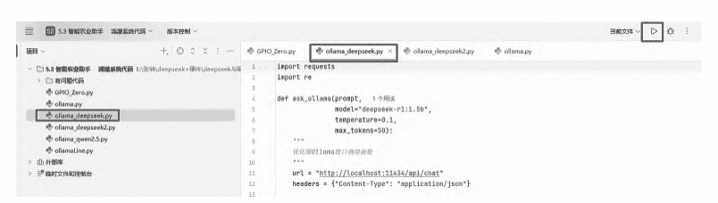

图 4-17 在 PyCharm 中输入代码并运行

具体代码如下。

```python

import requests

## 在线校验方式

部署前可先用自检模式验证硬件连通性。校验会以低电平触发方式实例化继电器代理和数字输入的湿度检测器，先让继电器吸合两秒再断开，随后连续三次读取电平并换算成干湿状态，最后主动释放资源并返回结果。

## 启动逻辑

入口脚本支持两种运行形态。带上 --test 参数时只执行硬件校验，通过则提示系统可用，失败则提示检查接线。默认形态会先打印启动信息，包含传感器引脚 17、继电器引脚 18、日志路径、检测间隔 300 秒、灌溉时长 30 秒，并说明可用 Ctrl+C 中断，随后实例化控制器进入循环工作。

控制器内部在初始化时固定引脚编号，尝试创建继电器和传感器对象并记录成功信息，失败时将两者置空。读数方法返回 1 或 0 并在未初始化时抛出异常。干湿判定连续采样三次取平均，平均值不低于 0.5 则视为干旱。启动浇水时写日志并拉起继电器，出错则记录错误。主循环中干旱时执行浇水并等待设定时长，湿润时仅记录日志，整体以 1 秒为单位累加检查间隔，收到键盘中断即停止浇水并退出。

本地模型浇水判定：把答案压缩到一个汉字

用本地模型做浇水判断，关键不是让它写分析，而是把输出空间收得极小。先用提示词锁定回答形态，再用代码做提前拦截与后处理清洗，最后稳定落在“是”或“否”。

角色与形态先锁死。模型被设定为浇水二选一助手，回复只允许一个汉字，不带说明、不带标点空格、不带多余词。决策逻辑写进系统提示：零下环境直接否定；0到5度区间，只有极度干旱且植株需水紧迫才有可能肯定，其他情况都否定。湿度是核心变量，但必须和温度一起权衡。沙质基质失水更快，不过在低温下仍然不适合浇水。结论收束明确，需要就给肯定，不需要就给否定。

代码补上两层兜底。第一层在调用前提前判断，用正则从问题里抓取气温区间，最高值小于等于0时直接返回否定，跳过模型。第二层对模型原文做净化，先去掉可能的HTML标签和多余空白，再看是否干净地只包含肯定或否定。若同时出现或都不出现，就用词表二次筛：命中否定词表则判否定，命中肯定词表则判肯定，默认保守返回否定。

生成参数调得很克制，temperature 0.1，max_tokens 50，repeat_penalty 1.2，top_p 0.5，降低随机性。网络异常或解析异常时返回文字提示，方便排查。

例子能看出流程。注释里的-21℃到0℃、沈阳、沙土干燥，属于超低温，直接被前置拦截判否定；实际运行的15℃到20℃、晴天、沙土干燥，则走完整调用并经过后处理净化。

```

接下来将对代码进行详细解析，揭示其核心要素，以便大家能够更好地掌握和理解这一内容。

##### （1）主函数 ask_ollama

```python

def ask_ollama(prompt,

               model="DeepSeek-r1:1.5b",

               temperature=0.1,

               max_tokens=50):

    """

    优化版Ollama接口调用函数

    """

    url = "http://localhost:11434/api/chat"

    headers = {"Content-Type": "application/json"}

    # 增加了极端温度的判断指导

    system_message = """你是一个只会回答"是"或"否"的植物浇水决策助手。

你必须严格遵循以下规则：

1. 你的整个回复必须且只能是一个字："是"或"否"

2. 禁止包含任何解释、理由或分析

3. 禁止输出任何标点符号、空格或其他字符

4. 禁止使用任何其他词语

浇水决策关键规则：

- 当气温低于0℃时，绝对不要浇水，必须回答"否"

- 当气温在0℃～5℃时，除非土壤极度干燥且植物特别需水，否则回答"否"

- 土壤湿度是最主要考虑因素，但必须结合温度判断

- 沙土比其他土壤更容易干燥，但在低温下仍然不宜浇水

分析用户提供的环境信息后，只返回判断结果：

- 如果需要浇水，只回复"是"

- 如果不需要浇水，只回复"否"

"""

    # 检查是否有极端温度条件，如果有，直接预处理结果

    if needs_preprocessing(prompt):

        return preprocess_extreme_conditions(prompt)

    user_prompt = f"{prompt}\n只回复一个字: 是 或 否"

    payload = {

        "model": model,

        "messages": [

            {"role": "system", "content": system_message},

            {"role": "user", "content": user_prompt}

        ],

        "options": {

            "temperature": temperature,

            "max_tokens": max_tokens,

            "repeat_penalty": 1.2,

            "top_p": 0.5

        },

        "stream": False

    }

    try:

        response = requests.post(url, headers=headers, json=payload, timeout=30)

        response.raise_for_status()

        raw_content = response.json()["message"]["content"]
```

##### （3）响应处理与规范化

```python

def force_yes_no_response(text):

    """强制只返回"是"或"否"的处理函数"""

    # 先清理文本

    text = clean_response(text)

    # 直接检查是否包含确切的"是"或"否"

    if "是" in text and "否" not in text:

        return "是"

    elif "否" in text and "是" not in text:

        return "否"

    # 如果同时包含或都不包含，进行更复杂的分析

    negative_terms = ["不需要", "不建议", "不必", "不适合", "不宜", "无须", "没必要", "不要"]

    for term in negative_terms:

        if term in text:

            return "否"

    positive_terms = ["需要", "应该", "建议", "必须", "适合", "适宜"]

    for term in positive_terms:

        if term in text:

            return "是"

    # 默认返回"否" (安全起见)

    return "否"

def clean_response(text):

    """响应清洗函数"""

    text = re.sub(r'<\/?[\w\s]+>', '', text)

    text = re.sub(r'\s+', ' ', text).strip()

    return text
```

上述两个函数负责对模型输出进行后处理。clean_response函数的作用是清理文本中可能存在的HTML标签和多余空白字符，使文本格式标准化。force_yes_no_response函数采用多层次的判断策略。

首先检查输出中是否直接包含“是”或“否”这样的明确表述。如果无法直接判断，则通过预设的正面和负面词汇列表对内容进行语义分析，当所有判断方法都无法得出明确结论时，系统会默认返回“否”作为保守策略，这样可以避免因错误浇水而造成的潜在风险。

通过这套后处理机制，即使模型的原始输出不够理想或格式不规范，系统最终仍能向用户提供清晰明确的二元判断结果。

```python

if __name__ == "__main__":

    #question = "天气: 晴天, 今天气温是: -21℃到0℃, 土壤是: 沙土, 土壤湿度: 干燥, 现在时间: 2025-04-12 11:50, 地区: 沈阳, 植物: 仙鹤来"

    question = "天气: 晴天, 今天气温是: 15℃到20℃, 土壤是: 沙土, 土壤湿度: 干燥, 现在时间: 2025-04-12 11:50, 地区: 沈阳, 植物: 仙鹤来"

    answer = ask_ollama(question)

    print(f"[输出] {answer}")
```

上述代码是植物浇水决策系统的测试入口，采用Python标准的主程序写法。代码设置了两个测试场景，均以沈阳地区的仙客来为例，在晴天、沙土、土壤干燥的条件下，分别测试极寒（-21℃～0℃）和适温（15℃～20℃）两种温度环境。

通过注释切换不同场景，系统调用ask_ollama函数进行判断并输出浇水建议。这种对比测试设计验证了系统能否正确识别温度对浇水决策的影响，确保在极端条件下避免错误建议，在适宜条件下给出合理指导。

##### （4）HTTP请求与API交互设计

```python

import requests

import re

def ask_ollama(prompt,

               model="DeepSeek-r1:1.5b",

               temperature=0.1,

               max_tokens=50):
```

以上函数设计采用了灵活的参数配置机制，允许调用者根据具体需求调整模型参数。model参数指定了使用的大语言模型版本，DeepSeek-r1:1.5b是一个轻量级但功能强大的推理模型，特别适合决策类任务。将temperature参数设置为0.1后，这个较低的值确保了模型输出的确定性和一致性，减少了随机性对决策结果的影响。

将max_tokens参数限制为50，这个设置体现了对输出内容的精确控制。由于系统只需输出“是”或“否”两种结果，较小的token值限制不仅提高了响应速度，还降低了模型产生冗余内容的可能性。这种参数优化策略在生产环境中具有重要的性能意义。

##### （5）提示词工程与模型行为控制

```python

system_message = """你是一个只会回答"是"或"否"的植物浇水决策助手。

你必须严格遵循以下规则：

1. 你的整个回复必须且只能是一个字：“是”或“否”

2. 禁止包含任何解释、理由或分析

3. 禁止输出任何标点符号、空格或其他字符

4. 禁止使用任何其他词语

"""
```

以上系统提示词的设计体现了提示词工程的核心技巧。通过明确的角色定义和严格的输出约束，系统最大限度地控制了模型的行为模式。多层次的规则设定从输出长度、内容类型、格式规范等多个维度约束模型行为，确保输出结果标准化。

专业知识的嵌入是通过具体的决策规则实现的。系统将农业专业知识转化为可执行的判断条件，特别是对极端温度条件的特殊处理规则，体现了专业农业知识在AI系统中的有效应用。这种知识工程使得通用的语言模型能够在特定领域发挥专业作用。

##### （6）预处理机制与异常情况处理

```python

def needs_preprocessing(prompt):

    """检查是否有需要预处理的极端条件"""

    temp_match = re.search(r'气温是：(-?\d+)°C到(-?\d+)°C', prompt)

    if temp_match:

        low_temp = int(temp_match.group(1))

        high_temp = int(temp_match.group(2))

        if high_temp <= 0:

            return True

    return False
```

以上预处理机制的设计体现了规则驱动与AI驱动相结合的混合架构。系统通过正则表达式精确解析输入文本中的温度信息，并对极端低温情况进行特殊处理。这种设计避免了将明确的物理约束交给AI模型处理可能带来的不确定性，确保了在特定条件下决策的绝对可靠性。

正则表达式的设计考虑了负温度的情况，通过(-?\d+)模式匹配带符号的数字。温度范围的解析采用低温和高温分别提取的方法，为后续的条件判断提供了精确的数据基础。这种文本解析技术在处理结构化自然语言输入时具有重要价值。

##### （7）请求配置与网络通信优化

```python

Ollama 是/否 判断的稳定调用方案

想让本地大模型只给一个确定的"是"或"否"，关键是把请求结构、异常兜底、答案清洗和极端条件预判串起来。下面这套做法就是为这一目标设计的实战流程，思路清晰、可直接复用。

先看整体请求包的组装方式。模型名、系统指令和用户提问会被装进 messages 列表，同时用 options 固定采样参数，关闭流式输出，保证返回稳定可控。

payload = {

    "model": model,

    "messages": [

        {"role": "system", "content": system_message},

        {"role": "user", "content": user_prompt}

    ],

    "options": {

        "temperature": temperature,

        "max_tokens": max_tokens,

        "repeat_penalty": 1.2,

        "top_p": 0.5

    },

    "stream": False

}

发请求时要做好两层保护：网络层报错和解析层报错。超时设为30秒，收到响应后先校验状态，再取 message.content，最后交给强制二选一的函数。任何网络异常直接返回请求错误提示，字段缺失则提示解析失败并建议检查 API 版本。

```

以上请求负载的构建遵循了Ollama API的标准格式。消息数组的设计采用了Chat API的对话格式，将系统提示词和用户输入分别封装为不同角色的消息。这种格式能够更好地利用模型的对话理解能力，提高响应的准确性和相关性。

参数优化配置体现了对模型输出质量的精细控制。将repeat_penalty参数设置为1.2，可以有效防止模型生成重复的内容。将top_p参数设置为0.5，通过核采样技术平衡输出的多样性和确定性。将stream参数设置为False，可以确保获得完整的响应内容，而非流式输出。

##### （8）异常处理与错误恢复机制

```python

try:

    response = requests.post(url, headers=headers, json=payload, timeout=30)

    response.raise_for_status()

    raw_content = response.json()["message"]["content"]

    return force_yes_no_response(raw_content)

except requests.exceptions.RequestException as e:

    return f"API请求错误: {str(e)}"

except KeyError:

    return "响应解析失败，请检查API版本"

得到原始文本后，需要先清洗再做判断。清洗会去掉可能的 HTML 标签，把多余空白压缩成一个空格并去首尾。判断逻辑优先看是否同时出现"是"和"否"，若文本里只有"是"则判为"是"，只有"否"则判为"否"。代码里还预留了否定词和肯定词两组词表，便于后续扩展更细致的语义映射。

```

以上异常处理机制采用分层的错误识别和处理策略。requests.exceptions.RequestException涵盖了网络连接、超时、HTTP错误等各种网络相关异常。KeyError异常针对API响应格式变化的情况，提供了明确的故障诊断信息。

将超时设置为30秒体现了对响应时间的合理期望。这个值既能容忍正常的模型推理延迟，又能避免过长的等待时间。调用raise_for_status()方法确保了HTTP错误状态码能够被正确识别和处理，提高了错误诊断的准确性。

##### （9）响应解析与格式标准化

```python

def force_yes_no_response(text):

    """强制只返回"是"或"否"的处理函数"""

    text = clean_response(text)

    if "是" in text and "否" not in text:

        return "是"

    elif "否" in text and "是" not in text:

        return "否"

    negative_terms = ["不需要", "不建议", "不必", "不适合", "不宜", "无须", "没必要", "不要"]

    positive_terms = ["需要", "应该", "建议", "必须", "适合", "适宜"]

清洗函数很轻量，只做标签剥离和空白规范化，保证后续关键词匹配不会被格式干扰。

```

以上响应解析函数实现了多层次的内容识别机制。首要策略是直接查找标准答案“是”和“否”，这种方法能够处理模型严格遵循指令的理想情况。当标准答案不明确时，系统会启用语义分析机制，通过关键词匹配识别回答的倾向性。

关键词列表的设计体现了中文语言处理的复杂性。否定性词语包含各种表示否定意义的词语，而肯定性词语则包括表示建议或需要的常见表达。这种设计能够有效处理模型输出不完全符合指令要求的情况，提高了系统的容错能力。

##### （10）文本清洗与数据预处理

```python

def clean_response(text):

    """响应清洗函数"""

    text = re.sub(r'<\/?[\w\s]+>', '', text)

    text = re.sub(r'\s+', ' ', text).strip()

    return text

实际使用中，有些条件客观上就不成立，没必要让模型去推理。比如气温区间里最高温度已经≤0℃，可以提前拦截直接返回"否"，省掉一次调用并避免幻觉。

```

以上文本清洗函数采用了两阶段的处理策略。第一阶段使用正则表达式去除可能存在的HTML标签，这种处理能够应对某些模型可能产生的格式化输出。第二阶段进行空白字符的标准化处理，将多个连续的空白符合并为单个空格，并去除首尾的空白字符。

正则表达式`r'<\/?[\w\s]+>'`能够匹配各种HTML标签格式，包括开始标签和结束标签。这种预防性处理确保了后续的文本分析不会受到格式字符的干扰，提高了关键词匹配的准确性。

##### （11）条件预处理与专家规则集成

```python

def preprocess_extreme_conditions(prompt):

    """处理极端条件，直接返回预定义答案"""

    temp_match = re.search(r'气温是: (-?\d+)℃到(-?\d+)℃', prompt)

    if temp_match:

        low_temp = int(temp_match.group(1))

        high_temp = int(temp_match.group(2))

        if high_temp <= 0:

            return "否"

    return None

最后是一个完整调用示例，包含天气、气温、土壤、湿度、时间、地区和植物等上下文，直接打印模型给出的二选一结论，方便快速验证。

```

以上极端条件预处理函数体现了专家知识与AI决策的有机结合。当检测到0℃以下的极端低温时，系统直接返回“否”的决策，无须调用AI模型进行分析。这种设计基于植物生理学的基本常识，即低温条件下浇水可能导致根系结冰损伤。

返回值设计的巧妙之处在于None值的使用。当没有检测到极端条件时，函数返回None，指示调用者继续正常的AI处理流程。这种设计模式在条件分支处理中非常常见，既保持了代码的简洁性，又确保了逻辑的清晰性。

##### （12）主程序执行与测试验证

```python

if __name__ == "__main__":

    question = "天气：晴天，今天气温是：15度到20度，土壤是：沙土，土壤湿度：干燥，现在时间：2025-04-12 11:50，地区：沈阳，植物：仙鹤来"

    answer = ask_ollama(question)

    print(f"[输出] {answer}")

```

以上主程序的设计展示了系统的典型使用方式。测试数据的构造包含完整的环境信息：天气状况、温度范围、土壤类型、湿度状态、时间和地理位置，以及植物种类。这种结构化的输入格式为AI模型提供了充分的决策依据。

程序执行部分的简洁性体现了良好的API设计。单一函数调用即可完成复杂的AI决策过程，这封装了内部的多层处理逻辑。输出格式的标准化使得结果能够直接用于后续的自动化控制流程。

整个自动灌溉系统的设计体现了现代AI应用开发的技术特点：模块化架构、健壮的异常处理、精确的提示词工程和多层次的结果验证。这种系统级的设计思路为农业AI应用开发提供了宝贵的技术参考，展现了大语言模型在垂直领域应用中的巨大潜力和实用价值。

主程序提供了两个示例查询，分别代表不同的环境条件：

第一个示例是极端低温情况（-21℃～0℃），预期应直接通过预处理得出“否”；第二个示例是适宜温度范围（15℃～20℃），且土壤干燥，预期得出“是”。

系统特点及优势如下。

- 高效本地处理：利用Ollama本地部署模型，无须依赖云服务，降低延迟和成本。
- 轻量级设计：选用1.5b参数的小型模型，减少资源占用，适合边缘设备上部署。
- 多层决策保障：预处理机制直接解决极端情况；明确的系统提示引导模型做出准确的决策；后处理逻辑确保最终的输出符合预期。
- 安全优先策略：在不确定的情况下默认返回“否”，避免不必要的浇水风险。
- 结构化输入处理：通过正则表达式精确提取关键环境参数，支持标准化的输入格式。

该系统适合集成到以下应用场景中。

- 家庭智能园艺系统。
- 小型农场自动化灌溉设备。
- 植物养护智能助手应用。

技术要点总结如下。

- API接口设计：采用REST API与本地Ollama服务通信，实现低延迟响应。
- 提示工程优化：精心设计的系统提示确保大模型专注于特定任务。
- 异常处理的健壮性：完善的异常捕获机制确保系统在各种情况下仍能正常运行。
- 规则引擎思想：结合预处理和后处理规则，增强大语言模型在特定领域的能力。
- 参数提取技术：使用正则表达式准确地从非结构化文本中提取结构化信息。

该项目展示了如何将大语言模型技术应用于特定领域，通过适当的工程设计将复杂的问题简化为可靠的二元决策系统，为智能农业和园艺提供了实用的技术方案。

##### （13）大语言模型决策能力与硬件控制的智能灌溉系统

该项目实现了一个结合大语言模型决策能力与硬件控制的智能自动灌溉系统。系统通过树莓派连接的土壤湿度传感器采集数据，并依托本地部署的大语言模型分析并综合环境因素（如气温、土壤类型、植物种类等），最终做出灌溉决策。这种设计将传统的阈值触发灌溉升级为考虑多维度信息的智能决策过程，使灌溉系统更加智能化和精准化。

##### （14）技术架构设计

整个系统分为以下三个主要部分。

- 传感器数据采集模块。
- 大语言模型推理决策模块。
- 灌溉控制执行模块。

系统通过Python代码将这三个模块有机结合，实现从数据采集、智能分析到执行灌溉的完整闭环。

###### ① 混合智能系统架构设计

智能农业自动化系统代表了传统硬件控制与现代人工智能技术的深度融合。该系统通过集成本地大语言模型决策引擎、硬件传感器监测和自动化执行控制，构建了一个完整的智能农业解决方案。整个架构采用模块化设计，将AI决策层、传感器数据层和硬件控制层有机结合，形成闭环智能控制系统。

系统的核心创新在于将人工智能决策与实时硬件控制相结合。通过本地部署的大语言模型处理复杂的环境因素分析，结合实时传感器数据进行综合决策，最终通过硬件执行器实现精准的自动化控制。这种设计模式为现代农业物联网的应用提供了新的技术路径。

整个智能农业自动化系统的设计体现了现代嵌入式AI应用的技术特点：多模态数据融合、边缘智能计算、实时控制响应和系统安全保护。这种技术架构为农业物联网和智慧农业应用提供了解决方案模板，展现了AI技术在传统农业领域的巨大应用潜力。

###### ② 代码支持以下两种运行模式

- 测试模式：通过命令行参数--test启动，用于验证硬件连接。
- 正常运行模式：启动完整的灌溉控制系统。

###### ③ 技术特点分析

####### 硬件层面分析

- 传感器可连续多次读取平均值；执行两次继电器关闭操作以确保断开；将资源释放在finally块中以确保执行。

####### AI决策层面分析

- 极端温度条件预处理直接拒绝灌溉；不确定的情况默认返回“否”，以确保安全优先；多层次结果解析确保决策稳定性。

####### 系统层面

- 完善的异常处理和日志记录；支持手动中断（Ctrl+C）；测试模式便于系统验证；高可靠性设计思路。

####### 系统采用了多项提高可靠性的技术

- 分段等待实现，能够避免长时间阻塞；双重条件判断，从传感器和AI决策两方面进行判断；完整的异常捕获和处理；详细的日志记录便于问题排查。

这个智能灌溉系统展示了人工智能技术在传统硬件控制领域的创新应用。通过将大语言模型的决策能力与传感器和硬件控制相结合，系统实现了更加智能化和精准化的灌溉控制。这种融合AI与硬件的方法可以拓展到更多物联网应用场景，为传统控制系统带来全新的智能化升级路径。

通过精心设计的代码结构、完善的错误处理和多层决策机制，该系统不仅功能全面，而且具备较高的鲁棒性和可扩展性，为智能农业和园艺自动化提供了实用的技术方案。

DeepSeek智能产品实战项目篇通过智能家居管家和智能农业助手两个物联网应用案例，展示了人工智能与嵌入式硬件系统的创新融合。项目采用分布式架构，以树莓派为核心，结合ESP32/ESP8266边缘节点构建闭环系统。核心亮点是将DeepSeek大模型智能分析与实时硬件控制结合，本地部署AI服务，综合分析环境数据，精准决策。在智能家居场景中，系统依据环境参数自动调光并提供个性化服务；在智能农业应用中，升级为多因素智能决策，实现精准灌溉与资源优化。

这些实战项目有直接应用价值，提供可复制的技术方案和架构模式，分布式设计支持扩展，标准化接口便于集成新设备，独立的AI决策模块可优化升级。随着边缘计算和AI模型的发展，本地化智能决策方案将在更多领域发挥作用，为传统产业智能化升级提供技术路径。

### 好书推荐


《人工智能辅助Arduino编程与硬件实现从入门到高手》


《Cursor+Windsurf AI敏捷开发实战：极速打造全栈应用》


《DeepSeek+Dify+Ollama全栈AI开发实战·前端本地部署到大模型集成训练》


《MCP全场景应用与跨平台调用：Cursor+Blender+DeepSeek+Dify+Qwen3》

封面设计：异一设计

### 从代码到机器人
打通AI算法与硬件部署的最后一步

5大基础模块+3步部署流程+4大可落地项目+6个核心组件

AI边缘开发实战课+Arduino实战课+Cursor实战课+MCP实战课+大模型本地部署视频课
尊享海量学习资源与答疑服务


扫描二维码关注“智荟界”公众号
并回复“49419”，获取书中配套资源。

销售分类建议：计算机/人工智能
ISBN 978-7-122-49419-1
定价：79.00元
```