# DeepSeek 全场景实战手册
工作学习创作效率提升教程

94个实操案例贯穿始终，覆盖AI落地全链路
办公加速 × 内容生产 × 编程开发 × 资产配置 × 情绪陪伴……
十大垂直领域逐层拆解，一册满足多样化需求

卢敏辉 阳海清◎著

五大核心技能，助你由浅入深实现进阶
智能写作、代码精进、数据洞察、跨端协同、创意生成
——串联起人工智能工具应用的完整路径

六大工具组合，激活协同效应
剪映 × PS × Kimi × 可灵 × 即梦 × Canva
——多平台配合，效率翻倍

随书附赠资源包
DeepSeek使用诀窍＋指令模板＋本地部署方案
领取方式见封底

全书配套视频讲解
扫码即可观看教学

化学工业出版社

## 卢敏辉
现任广州山地计算机软件开发有限公司技术总监，计算机应用领域资深从业者，长期聚焦信息化应用与信息安全技术的研发落地。作为人工智能技术早期实践者，在AI工具研发与场景化应用上积累丰富经验。擅长项目管理与流程再造，研究方向集中在AI对业务重塑及信息安全的价值。

## 阳海清
广州市数字政府运营中心专业技术七级，硕士。长期深耕企业信息化与政务数字化，主导多项国家级项目落地，擅长借助信息化与AI优化业务流程。作为DeepSeek技术践行者，率先将DeepSeek-R1大模型引入智能办公、数据分析等场景，实现降本增效。研究方向为流程自动化与生成式AI的场景化应用。

# DeepSeek AI全场景实战从入门到精通
工作、学习与创作效率使用教程
卢敏辉 阳海清◎著
· 北京 ·

## 内容简介
本书是系统讲解DeepSeek人工智能工具应用的实战指南，精选94个典型案例，覆盖办公、生活、艺术创作、教育、娱乐配文、媒体策划、法律、编程、心理咨询、金融等多个维度，帮助读者吃透核心功能，并在不同场景实现高效落地。

全书共12章，采用案例驱动、实践优先的编排思路。先从注册登录、提示词编写优化等基础操作切入，助力新手快速上手；再通过办公助手、内容创作、生活娱乐、专业领域应用等章节，深入讲解DeepSeek在真实工作与个人生活中的提效用法，例如撰写商业计划书、优化会议纪要、辅助论文写作、代码调试、生成法律合同等。最后探讨DeepSeek与剪映、Photoshop、Kimi、可灵、即梦AI、Canva等工具的联动玩法，进一步拓展跨平台应用边界。

语言通俗易懂，每个实例均配有详尽操作步骤与优化思路，确保即学即用。无论是职场人、内容创作者、专业人士还是AI爱好者，都能在此找到匹配内容，借助DeepSeek提升效率、优化创作流程、拓展创新可能。

## 图书在版编目数据
DeepSeek AI全场景实战从入门到精通：工作、学习与创作效率使用教程 / 卢敏辉，阳海清著. -- 北京：化学工业出版社，2025. 3. -- ISBN 978-7-122-47602-9

Ⅰ. TP18

中国国家版本馆CIP数据核字第2025AC9290号

责任编辑：王婷婷 孙 炜

责任校对：张茜越

封面设计：异一设计

装帧设计：盟诺文化

出版发行：化学工业出版社（北京市东城区青年湖南街13号 邮政编码100011）

印 装：大厂回族自治县聚鑫印刷有限责任公司

710mm x 1000mm 1/16 印张14½ 字数287千字 2025年4月北京第1版第1次印刷

购书咨询：010-64518888

网 址：http://www.cip.com.cn

凡购买本书，如有缺损质量问题，本社销售中心负责调换。

售后服务：010-64518899

定 价：99.00元

版权所有 违者必究

## 前言
2025年1月20日，深度求索发布DeepSeek-R1模型，以低训练成本、高性能、开源等特质获得业内广泛关注。随着DeepSeek爆火，多数用户陷入“知道有用却不会用”的困境，迫切需要一本覆盖全场景的案例合集，本书由此应运而生。

本书围绕DeepSeek的94种应用，定位为兼具实用性、系统性与创新性的AI工具应用指南，面向职场人士、内容创作者、专业人士及AI探索者，帮助读者高效掌握核心功能，并在各自领域实现AI赋能。内容逻辑遵循从基础入门到行业应用再到跨工具联动的递进路径，满足不同层次读者需求。

### ◎ 本书特色
五大核心能力，全方位提升AI应用技巧——既讲解DeepSeek基础操作，也涵盖智能写作、创意生成、数据分析、代码优化、跨平台联动五大核心能力，助你实现由浅入深的进阶。

六种跨平台联动玩法，解锁高阶应用——详解DeepSeek与剪映、Photoshop、Kimi、可灵、即梦AI、Canva的深度融合，探索在短视频创作、PPT设计、智能修图、图像生成、图文笔记创作等场景的强大能力，让AI赋能更广。

94个精选实例，覆盖十个应用领域——深度解析办公、教育、内容创作、法律、编程、金融等十个核心场景，全面呈现DeepSeek在不同行业与日常生活中的价值，让AI真正成为高效助手。

### ◎ 内容框架
第1章 DeepSeek：世界都为之惊叹
介绍DeepSeek的基础功能，包括注册登录、基础页面与功能、本地部署、提示词编写步骤与技巧、DeepSeek App下载与使用，帮助用户快速上手。

第2章 办公助手：迅速提升工作效率
展示DeepSeek在办公场景中的应用，如翻译、职业规划、创业指导、简历制作、创意策划、邮件撰写、图书框架、会议发言、会议纪要、商业计划书、通知、演讲稿、工作总结等，提升工作效率。

第3章 生活品质：赋能美好生活
探索DeepSeek在日常生活中的作用，包括烹饪、健身、旅游、营养搭配、形象设计、化妆、家政服务等，让生活更便捷。

第4章 艺术创作：赋予语言文字美感
介绍DeepSeek在诗歌、小说、剧本、故事、散文、歌词创作方面的应用，激发创作者灵感，提升文字表现力。

第5章 教育教学：助力实现学而无忧
讲解DeepSeek如何辅助论文写作、降重、调研、知识整理、长文阅读、知识图谱构建、作文写作、作文润色、文章续写、学业规划等，提升学习效率。

第6章 娱乐用法：配文增添生活乐趣
展示DeepSeek在日常社交和娱乐中的作用，如生成朋友圈文案、日记、自传、贺词、祝福语、旅游规划、高情商回复等。

第7章 媒体构思：轻松实现内容创作
介绍DeepSeek在媒体和内容创作中的应用，包括新闻稿件、爆款标题、小红书笔记、豆瓣书评、短视频脚本、故事构思、画面设计、人物台词等。

第8章 法律合规：风险防控与效率升级
展示DeepSeek在法律领域的应用，包括电子合同审查、生成律师函模板、提供合规建议、生成知识产权申请文件、提供法律咨询服务等。

第9章 IT与编程：开发效率的革命性提升
讲解DeepSeek在编程中的应用，如代码编写、修正、优化、翻译、测试、注释、错误解释等，提升开发效率。

第10章 心理咨询：情感支持新范式
介绍DeepSeek在心理健康领域的作用，包括压力评估、认知行为训练、情绪调节、心理治疗、亲密关系模拟、冲突解决等。

第11章 金融投资：数据驱动规避风险
探索DeepSeek在金融领域的应用，如市场分析、量化交易、投资建议与组合管理、投资调研、理财规划、金融风险识别等，助力投资决策。

第12章 与其他AI工具联动：覆盖各行各业
介绍DeepSeek与其他AI工具的结合应用，如剪映、Photoshop、Kimi、可灵、即梦AI、Canva等，拓展AI应用边界。

### ◎ 适读人群
- 正在学习AI对话类工具的读者。
- 企业管理者：如制造业、零售业老板等。
- 职场白领：提升办公效率，写报告、做PPT、数据分析。
- 创业者/个体户：电商文案生成、私域流量运营、广告投放优化等。
- 学生/教师：辅助学习、论文写作、课程设计。
- 高校相关专业的教学应用，以及对对话类工具感兴趣的读者。

### ◎ 版本说明
本书编写时基于当时的软件界面截取实际操作图片，但从编辑到出版需时，软件功能与界面可能已变动，请读者依书中思路举一反三。

书中AI生成内容仅供参考，可能存在不准确或不适用情况，使用时请自行承担风险与责任。如需专业意见，请咨询相关专业人士。

## 目录
- 第1章 DeepSeek：世界都为之惊叹
    - 001 DeepSeek的注册及登录
    - 002 DeepSeek的基础页面及功能
    - 003 DeepSeek本地部署
    - 004 提示词的编写步骤和技巧
    - 005 DeepSeek App的下载与使用
- 第2章 办公助手：迅速提升工作效率
    - 006 充当翻译助手
    - 007 指导职业规划
    - 008 提供创业指导
    - 009 生成个人简历
    - 010 生成创意策划
    - 011 撰写电子邮件
    - 012 制定图书框架
    - 013 生成会议发言
    - 014 生成会议纪要
    - 015 生成商业计划书
    - 016 生成通知内容
    - 017 生成演讲稿
    - 018 生成工作总结
- 第3章 生活品质：赋能美好生活
    - 019 充当厨师
    - 020 充当健身教练
    - 021 充当导游
    - 022 充当营养师
    - 023 充当形象设计师
    - 024 充当化妆师
    - 025 充当保姆
    - 026 充当家庭维修师
- 第4章 艺术创作：赋予语言文字美感
    - 027 创作诗歌
    - 028 虚构小说
    - 029 撰写剧本
    - 030 编写故事
    - 031 创作散文
    - 032 创作歌词
- 第5章 教育教学：助力实现学而无忧
    - 033 协助论文写作
    - 034 进行论文降重
    - 035 优化调研报告
    - 036 生成调查问卷
    - 037 整理读书笔记
    - 038 指导长文阅读
    - 039 提供知识图谱
    - 040 拟写命题作文
    - 041 帮助作文润色
    - 042 帮助续写文章
    - 043 指导学业规划
- 第6章 娱乐用法：配文增添生活乐趣
    - 044 生成朋友圈文案
    - 045 协助社媒动态更新
    - 046 整理日常形成日记
    - 047 协助编写个人自传
    - 048 按格式拟写贺词
    - 049 生成节日祝福语
    - 050 生成旅游规划
    - 051 生成高情商回复
- 第7章 媒体构思：轻松实现内容创作
    - 052 撰写新闻稿件
    - 053 生成爆款标题
    - 054 撰写小红书笔记
    - 055 撰写豆瓣书评
    - 056 撰写短视频脚本
    - 057 构思故事
    - 058 设计画面
    - 059 生成人物台词
- 第8章 法律合规：风险防控与效率升级
    - 060 审查电子合同
    - 061 生成律师函模板
    - 062 提供合规建议
    - 063 生成知识产权申请文件
    - 064 提供法律咨询服务
- 第9章 IT与编程：开发效率的革命性提升
    - 065 编写代码
    - 066 修正代码
    - 067 优化代码
    - 068 翻译代码
    - 069 测试代码
    - 070 添加代码注释
    - 071 解释代码错误
- 第10章 心理咨询：情感支持新范式
    - 072 进行压力评估
    - 073 进行认知行为训练
    - 074 进行情绪调节
    - 075 提供心理治疗
    - 076 模拟亲密关系
    - 077 解决冲突
- 第11章 金融投资：数据驱动规避风险
    - 078 进行市场分析
    - 079 进行量化交易
    - 080 提供投资建议与组合管理
    - 081 进行投资调研
    - 082 进行理财规划
    - 083 识别金融风险
- 第12章 与其他AI工具联动：覆盖各行各业
    - 084 剪映：短视频创作
    - 085 Photoshop：修图
    - 086 Kimi：PPT制作
    - 087 可灵：图片生成
    - 088 即梦AI：动态海报
    - 089 Canva：图文笔记
    - 090 联动应用：短视频+图文
    - 091 联动应用：PPT+演讲稿
    - 092 联动应用：修图+文案
    - 093 联动应用：图片生成+视频脚本
    - 094 联动应用：全平台内容分发

## 第10章 心理咨询：情感支持新范式
- 076 进行压力评估
- 077 提供认知行为训练
- 078 模拟亲密关系对话
- 079 辅助心理治疗
- 080 充当心理咨询师
- 081 进行情绪调节
- 082 解决冲突

## 第11章 金融投资：数据驱动规避风险
- 083 分析金融新闻与市场
- 084 生成量化交易策略
- 085 投资建议与组合管理
- 086 撰写投资调研报告
- 087 生成理财方案
- 088 识别金融风险

## 第12章 与其他AI工具联动：覆盖各行各业
- 089 DeepSeek+剪映，生成原创视频
- 090 DeepSeek+Photoshop，轻松解决修图难题
- 091 DeepSeek+Kimi，轻松搞定PPT制作
- 092 DeepSeek+可灵，生成图片素材
- 093 DeepSeek+即梦AI，实现动态海报效果
- 094 DeepSeek+Canva，批量生成图文笔记

## 第1章 DeepSeek：世界都为之惊叹
DeepSeek是由中国人工智能公司深度求索自主研发的多模态大模型，凭借强大的中文语义理解能力和行业垂直场景适配能力，迅速成为国内大模型领域的代表性产品之一。它不仅能处理文本生成、对话交互等基础任务，还在图像解析、语音合成、数据分析等复杂场景中展现独特优势。

DeepSeek AI 全场景实战从入门到精通：工作、学习与创作效率使用教程

### 001 DeepSeek 的注册及登录
要便捷使用DeepSeek，注册并登录是进入平台的第一步。只有完成账号创建，才能全面体验平台的强大功能与智能交互。本节详细介绍注册流程要点、注意事项及常见问题解决方案，帮助你快速建立专属账号并顺利登录。

- ❶ 打开DeepSeek官方网站，用户会看到如图1-1所示的欢迎页面。页面提供“开始对话”和“获取手机App”两个入口，手机App后续再介绍，这里点击“开始对话”进入注册页面。

- ❷ 注册页面如图1-2所示，在输入框内填写手机号、密码和验证码，选择用途并勾选“我已阅读并同意用户协议与隐私政策”，点击“注册”即可完成。


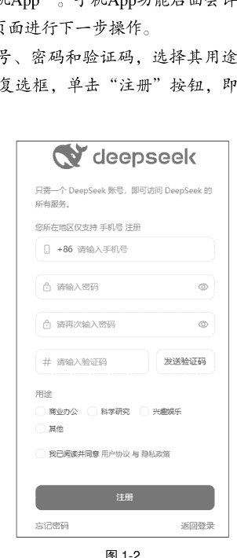

- ❸ 注册完成后，可选择手机验证码登录或密码登录，如图1-3所示。

- ❹ 也可使用第三方微信扫码登录，如图1-4所示，登录后即可自由使用DeepSeek各项功能。

### 002 DeepSeek 的基础页面及功能
登录后界面如图1-5所示。

DeepSeek主页面布局简洁，主要分为三块：左侧辅助功能区、中央问答区、底部提问区。

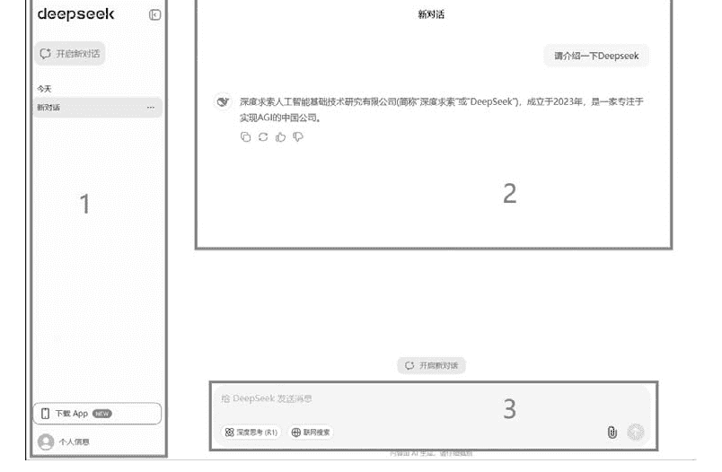

各板块功能介绍如下。

#### 1. 左侧辅助功能区
位于主页面左侧，如图1-5序号1所示，为辅助功能区，包含历史对话记录和其他两部分。

历史对话记录：DeepSeek可保存并展示过往对话，如图1-6所示。该功能便于回顾交流内容，快速调取历史信息。需注意其仅为辅助，不能替代用户记忆与判断，用户应自主决定是否保存使用。

其他：包括DeepSeek App下载二维码和个人信息区域。用手机扫描二维码即可下载App。个人信息页含系统设置、删除所有对话、联系我们、退出登录四个功能，如图1-7所示。


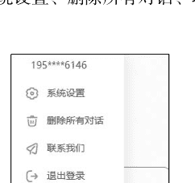

#### 2. 问答区
问答区是用户与DeepSeek互动探讨问题的主要场所，分为问题区和答复区。如图1-8所示。

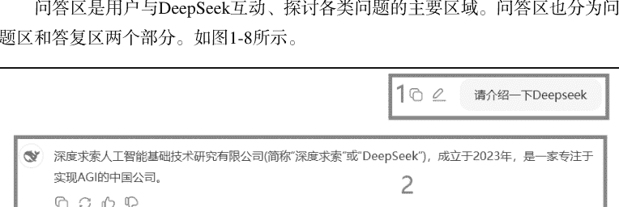

问题区：如图1-8标号1所示区域，用于展示用户提问内容。将鼠标移至上方时，左侧会出现“复制”和“编辑”图标，用户可复制问题或对已提问题进行二次编辑后重新提问，使交流更精准灵活。

DeepSeek 全流程实战指南：交互、部署与提问

图1-8中标记为2的区域为输出区，这里是DeepSeek呈现回答的地方。区域左下角集中了四枚操作图标 📋 🔄 👍 👎，功能依次为复制整段内容、重新生成答案、对回答点赞以及表达不满意。点击不满意图标后会弹出反馈填写面板，引导用户补充具体意见以便优化体验，如图1-9所示。


图1-9

#### 3. 提问区
提问区是与DeepSeek进行对话的核心入口，会根据用户输入自动生成解答与建议。该模块整合了问题输入框、思考模式切换与文件上传能力。下面分别说明提问流程、思考模式与附件上传的使用方式。

（1）向 DeepSeek 提问：常规操作如下。

- ❶ 在提问区的输入栏中输入想要咨询的内容，如图1-10所示。


图1-10

- ❷ 点击提问区右下角的发送箭头⬆或按下【Enter】键，问题即被提交，生成结果会显示在输出区，如图1-11所示。

DeepSeek AI 全场景实战从入门到精通：工作、学习与创作效率使用教程

> 深度求索人工智能基础技术研究有限公司，简称深度求索或DeepSeek，成立于2023年，是一家以通用人工智能为愿景的中国公司，聚焦AGI前沿探索，推动AI技术创新与落地。

**主要研究方向**

1. 通用人工智能（AGI）：构建可在复杂环境中实现类人推理、学习并完成任务的智能系统。
2. 自然语言处理（NLP）：深耕语言理解与生成，研发可读懂并产出自然语言的模型。
3. 计算机视觉：聚焦图像识别、视频分析等方向并取得明显进展。
4. 强化学习：探索强化学习算法，提升系统在动态环境中的决策能力。

图 1-11

（2）深度思考和联网搜索：提问区提供“深度思考”和“联网搜索”两种辅助模式，如图1-12所示。输入问题后点选对应按钮即可启用。


图 1-12

深度思考：面向数学、编程等需要严谨逻辑推导的任务设计，相较常规处理可输出更全面、结构清晰且自洽的高质量结果，体现长思维链优势。

联网搜索：模型会解析大量网页内容，输出全面、精准且贴合个性化需求的回答。面对复杂提问时，系统会自动抽取多个关键词并行检索，在较短时间内汇总多样化结果。

如表 1-1 所示为两种模式的适用范围和示例。

表 1-1

| 模式 | 适合解决的问题类型 | 示例 |

| :--- | :--- | :--- |

| 深度思考 | 1. 需要逻辑推理、分析和总结的问题。<br>2. 基于已有知识进行深入探讨的问题。<br>3. 需要创造性解决方案的问题。 | 1. 解释复杂的概念（如量子力学）。<br>2. 提供写作建议或创意灵感。<br>3. 分析历史事件的因果关系。 |

| 联网搜索 | 1. 需要实时信息或最新数据的问题。<br>2. 需要特定事实或具体答案的问题。<br>3. 需要验证或补充信息的问题。 | 1. 查询今天的天气情况。<br>2. 查找某公司的最新财报。<br>3. 获取某事件的新闻报道。 |

（3）上传附件功能：除思考模式外，DeepSeek 还支持文件上传。用户可将私密资料、知识库或需深度推理的材料上传，由模型基于专有文件进行分析和推理。具体步骤如下。

- ❶ 点击提问区右下角的“上传附件”按钮，在弹出的“打开”对话框中挑选待上传文件，如图1-13所示。确认后点“打开”即可完成上传。
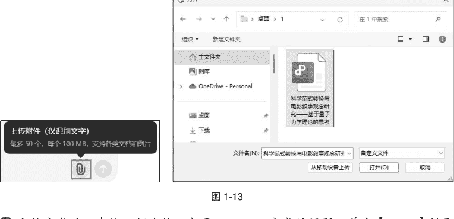
- ❷ 上传完成后在输入框内输入希望模型完成的问题，按【Enter】发送即可，如图1-14所示。


提示：上传附件最多支持50个文件，每个文件上限100MB，且DeepSeek 仅能识别附件中的文字内容，图表等无法识别。

### 003 DeepSeek 本地部署
本地部署指将应用安装在自有服务器、电脑或内网环境中运行，不依赖第三方云服务或远程数据中心。所有运行环境、数据存储与处理均置于用户可控硬件之上，实现内部自主管理。

下面介绍 DeepSeek 本地部署的操作流程。

- ❶ 本地部署需借助 Ollama 工具，在浏览器搜索 Ollama 进入官网首页，如图1-15所示。

图 1-15

提示：Ollama 是一款开源的本地大语言模型部署与管理工具，为开发者、AI 爱好者及企业用户提供高效、便捷且安全的本地 AI 环境，支持在本地设备加载运行各类大模型，减少对云服务的依赖。

- ❷ 执行后点击页面中央的“Download”按钮，进入下载页选择合适的下载方式，如图1-16所示。
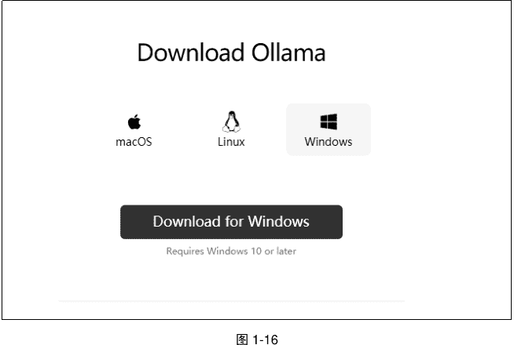
图 1-16

- ❸ 安装完成后返回 Ollama 首页，点击左上角的“Models”按钮，首个大模型通常为 deepseek-r1，可见其热度，如图1-17所示。若未显示，可在上方搜索框输入关键词查找。
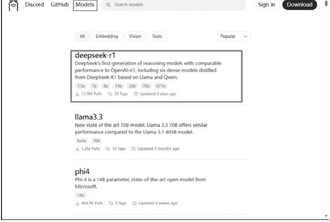
图 1-17

- ❹ 进入 “deepseek-r1” 的下载页，从下拉列表中选择适配本机的模型版本。配置不高时可先选 7b，想要更优生成效果则需更高配置，如图1-18所示。随后复制右侧代码备用。
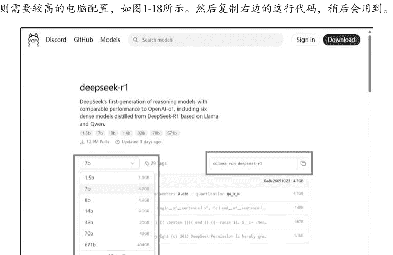
图1-18

> 提示：根据显存大小适合的不同模型如下。
> （1）显存低于4GB适合1.5b。
> （2）显存在8GB ~ 12GB适合7b或8b。
> （3）显存在12GB以上适合14b。
> （4）显存在32GB以上适合32b。
> （5）显存在70GB以上适合70b。

- ❺ 按【Win+R】打开“运行”对话框，输入“cmd”并确定，打开命令提示符，如图1-19所示。

- ❻ 将前面复制的代码粘贴到命令提示符中，按【Enter】运行即可自动下载 7b 模型，如图1-20所示。

图 1-19
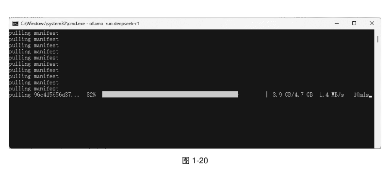
图 1-20

### 004 提示词的编写步骤和技巧
要从 DeepSeek 获得优质反馈，关键在于提示词的用法。提示词用于引导模型输出相关、准确且高质量的内容。下面介绍编写步骤与技巧。

#### 1. 提示词的编写步骤
编写提示词涵盖明确目标、构思、修改、提交等环节，具体步骤如下。

明确目标：在动笔前先确定希望通过 DeepSeek 获取何种信息，无论是生成文章、解答问题、编写代码还是数据分析，目标清晰可指导后续设计。

收集并整理背景信息：准备与任务相关的上下文和细节，包括主题、重点、需要的风格或语气，确保输出与预期一致。

确定输出格式和要求：明确期望的形式，如段落、列表、代码块或对话格式，同时约定文体风格、字数限制等具体要求，使答案更贴合需求。

分解复杂的任务：若任务繁杂，可拆分为多个子任务或分步指令。例如先让模型列出要点，再逐点展开，有助于逐步完成并降低出错率。

撰写清晰、具体的提示词文本：将目标、背景和格式要求融合，形成逻辑清晰、表达明确的提示。例如：“请撰写一篇关于人工智能的科普文章，要求通俗易懂，包含三个主要观点，并以列表形式呈现。”

调整提示词的长度和精炼度：保持简洁明了，避免冗长或歧义。语言尽可能精炼，同时保留关键信息。提示过复杂会导致模型注意力分散，输出不集中。

#### 2. 提示词的编写技巧
提问是一门技巧，向 AI 提问亦然。有效的提问更容易获得想要的答案，下面介绍六种常用技巧。

（1）简明扼要：AI 偏好简洁的问题，避免冗长描述和复杂句式。用简单直接的语言表达，可提升理解准确性。例如：

- ➤ 冗长的问题：“我在××城市有点事，我需要一个在市中心附近、价格适中的酒店，带有免费早餐和免费停车场。你能推荐一些吗？”
  ➤ 简明的问题：“请在××推荐一个价格适中、位于市中心的酒店，带免费早餐和免费停车场。”

- ➤ 冗长的问题：“我对新闻感兴趣，尤其是科技和娱乐方面的新闻。你有什么推荐的新闻源吗？”
  ➤ 简明的问题：“请推荐一些科技和娱乐新闻源。”

- ➤ 冗长的问题：“我最近在学习编程，我想知道最好的在线编程课程是什么，哪个平台有最好的编程教学资源？”
  ➤ 简明的问题：“请推荐一些在线编程课程和优质的编程教学平台。”

使用简洁语言可让 AI 更快捕捉核心，减少歧义，提升沟通效率。

（2）避免二义性：提问时要确保不会产生歧义。AI 通常按字面理解，若问题有多重解释，需补充上下文。例如：

- ➤ 二义性问题：“请告诉我有关苹果的信息。”
  ➤ 避免二义性：“我对苹果公司感兴趣，你能提供一些关于其历史和产品的信息吗？”

- ➤ 二义性问题：“这部电影好看吗？”
  ➤ 避免二义性：“你个人认为这部电影是否值得观看？”

- ➤ 二义性问题：“明天的天气怎么样？”
  ➤ 避免二义性：“请告诉我明天早上8点纽约的天气预报。”

明确对象、时间、地点等关键信息，有助于获得准确答案。

（3）避免绝对化的问题：AI 难以给出绝对答案。避免使用“永远”“最好的”“最适合”等绝对化词汇，改用相对客观的表述：

- 绝对化问题：“什么品牌的手机是世界上最好的手机？”
  避免绝对化：“请介绍一些当前市场上受欢迎的手机品牌和型号。”

- 绝对化问题：“哪个城市是全球最美丽的城市？”
  避免绝对化：“你能推荐一些风景优美的城市吗？”

- 绝对化问题：“什么是最有效的减肥方法？”
  避免绝对化：“你有一些建议帮助我减肥吗？”

相对表达能让 AI 提供更客观实用的建议。

（4）利用引导词：在提问时使用“如何”“为什么”“哪个”等引导词，可引导 AI 给出更详细、有针对性的回答。

引导词：如何；问题：“如何学习一门新的编程语言？”
这个引导词可让 AI 提供学习步骤、资源或技巧。

引导词：为什么；问题：“为什么锻炼对身体健康很重要？”
这个引导词可让 AI 解释益处、影响或科学原理。

引导词：哪个；问题：“在纽约市，哪个博物馆是最受欢迎的？”
这个引导词可让 AI 提供信息和评价。

选择合适的引导词有助于匹配期望的回答类型。

DeepSeek AI 全场景实战从入门到精通：工作、学习与创作效率使用教程

需要注意的是，引导词仅为提示，实际结果仍取决于模型训练和数据限制。

（5）检查语法和拼写：在发送前检查问题的语法和拼写。虽然 AI 能容忍少量错误，但清晰准确的表述能提升回答质量。

（6）追问细节：若首次回答不完全符合期望，可通过追问细化需求。例如：

问题：“我正在计划去旅行，你有什么建议？”
回答：“您可以考虑去欧洲或亚洲旅行。”
追问：“对于欧洲和亚洲，你能给我一些具体的目的地建议吗？”

通过递进式追问，可获得更精准个性化的建议。

### 005 DeepSeek App 的下载与使用
DeepSeek App 是平台推出的移动客户端，将强大的 AI 能力与深度思考工具带到手机和平板，让用户随时随地使用先进 AI 技术。下面介绍下载与使用流程。

1. 打开 DeepSeek 网页版，点击左侧辅助功能区的“下载App”按钮，用手机扫描二维码。

2. 跳转至下载方式页面，App 提供多种渠道下载，任选其一完成下载与安装即可，如图1-21所示。

3. 安装完成后打开 App 登录，进入主界面，如图1-22所示。App 功能与网页版保持一致，这里不再赘述。

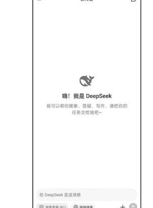

# 第 2 章

## 办公助手：迅速提升工作效率
在快节奏的职场环境中，高效处理各类任务已成为核心需求。无论是撰写商业计划、整理会议纪要，还是优化创意策划、制订职业规划，掌握高效办公工具都能极大提升效率。本章围绕13个核心办公场景展示 DeepSeek 在职场中的应用价值。

### 006 充当翻译助手
在全球化背景下，跨语言沟通日益重要。传统翻译方式常存在效率低、准确度不稳定、语境理解不足等问题，如何借助 AI 实现高效、精准、自然的翻译成为普遍需求。

DeepSeek 可流畅翻译多种语言，包括但不限于英语、中文、西班牙语、法语、德语、葡萄牙语、俄语等。小语种场景下质量可能下降，涉及高度技术性或专业领域的翻译仍需人工介入提升质量。下面是中文译为英语、西班牙语、法语的示例对话。

> 请把下面一段中文分别翻译成英语、西班牙语、法语。

没有规划的人生叫拼图，有规划的人生才叫蓝图；没有目标的人生叫流浪，有目标的人生叫航行。

英文翻译：

“A life without a plan is called a jigsaw puzzle, while a life with a plan is called a blueprint; a life without goals is called wandering, but a life with goals is called sailing.”

西班牙语翻译：

“Una vida sin plan se llama rompecabezas, mientras que una vida con plan se llama plano; una vida sin metas se llama vagar, pero una vida con metas se llama navegar.”

法语翻译：

“Une vie sans plan s’appelle un puzzle, tandis qu’une vie avec un plan s’appelle un blueprint ; une vie sans objectifs s’appelle errance, mais une vie avec des objectifs s’appelle navigation.”

DeepSeek 多语转换与智能场景应用

同一个会话里，DeepSeek 能把一段中文分别渲染成英文、西班牙文和法文，整体译文水准大概落在中级译者水平。

如果只需要两种语言往返，可以让它充当双语转译器来回转换，用起来很省事。下面以中英互译为例。

> 请你充当中文与英文的互译助手，我输入中文时请译成英文，输入英文时请译成中文。

好的，请提供需要处理的文本。

换个角度看世界，世界就会更美好；换个环境看自己，自己也会比从前更快乐。

Sometimes, looking at the world from a different angle makes it better; looking at yourself in another setting can make you happier than before.

> He that doth what he should not, shall feel what he would not.

> 做不该做的事，终会尝到不想尝的苦。

模型自带多语识别，对长期处在多语环境的人很友好，直接把文本丢进去就能自动判断语种并按要求转换。

> 现在请你做语种识别工具，我输入任意语言时，请先说明是什么语言，再译成中文。

> 好的，请输入内容，我会先判断语种再给出中文译文。

> scarecrow

> 判定语种：英语

> 中文译文：稻草人

> п у г а л о

> 判定语种：俄语

> 中文译文：稻草人

> かかしは、農家が鳥から畑を守るために使用する藁で作られた人形であり、穀物などの作物を踏みつけられるのを防ぎます。

> 判定语种：日语

> 中文译文：稻草人是农户用稻草扎成的人形模型，用来驱赶鸟类并避免作物被践踏。

### 007 指导职业规划

在变化很快的时代，职业路径不再一成不变，而是一个持续校准的过程。对刚入行的新人以及想突破瓶颈的人来说，一份清晰的规划能更快找准方向、提升竞争力并获得更高成就感。下面介绍如何借助 DeepSeek 进行职业规划。

提问前先厘清诉求：
1. 现阶段的岗位或行业是什么
2. 希望在哪些维度成长，比如技能、层级、薪酬等
3. 是否已有明确的目标赛道
4. 当下最主要的困惑点

基于这些要素，模型才能给出更精准的路径建议，包括方向选择、能力补强、求职打法等。示例对话如下。

我现在在行政岗位工作三年，主要负责日常行政管理、会议安排与客户接待，岗位比较稳定，但对市场营销尤其是社媒运营和内容创作很感兴趣，想转到营销方向，该怎么规划？

从描述来看，用户在行政岗位积累三年，希望切向营销特别是社媒与内容创作。首先要盘点现状：行政带来的组织能力、沟通能力、服务意识具备迁移价值，但营销需要补上数据分析、创意策划、数字营销工具等硬核能力。相关证书可能不足，建议考取 Google Analytics 或 Facebook Blueprint 等认证；同时需要实操背书，例如兼职、志愿项目或个人自媒体来证明内容能力。

转型路径可以内部也可以外部。若本公司有市场部门，内部切入更顺滑；若没有，则可从实习或初级岗位起步。行业人脉同样关键，参与活动、加入专业社群能更快获取资讯。

对经验不足的担忧，可在简历和面试中把行政经历与营销相关点关联，例如活动策划、客户沟通；把现有能力转译为营销语言，例如组织力对应项目管理。

学习节奏与时间管理很重要，建议在职学习、分阶段推进，例如 Coursera 的数字营销课程、HubSpot 的免费认证等。

转行难免遇到挫折，需要保持动力并动态调整。建议设定短期与长期目标，定期复盘。

以下是一套可落地的转型方案，帮助系统完成职业跨越。

#### 一、能力迁移逻辑：行政到营销的技能转换
行政经验并非归零，而是可迁移资产。
组织协调力：会议统筹 → 营销活动执行
细节把控力：行程安排 → 内容排期与数据监控
客户服务意识：接待沟通 → 用户需求洞察

需要补充的核心营销能力：
硬技能：SEO/SEM、社媒运营、数据分析 GA/UTM、内容创作 图文/短视频
软技能：市场敏感度、创意策划、跨部门协作

#### 二、分阶段推进路径 6～12 个月
阶段1 知识储备与技能验证 1～3 个月
1. 学习方向
免费资源：Google Digital Garage 数字营销基础认证、HubSpot 内容营销课程
付费精学：Coursera《Meta 社交媒体营销专业认证》约每月 $49
工具掌握：Canva、Hootsuite、Google Analytics
2. 实战验证
创建个人自媒体账号如小红书/公众号/抖音，每周发 3 篇原创，3 个月目标 1000 粉
为亲友小生意免费运营社媒账号，留存过程数据截图作为案例

阶段2 背书积累与身份转换 4～6 个月
1. 内部机会
主动申请参与公司市场部线下活动执行，用行政协调经验切入
向市场部提议协作项目，如《员工故事系列内容策划》
2. 外部积累
在 Upwork/Fiverr 接初级营销单，如文案撰写、社群运营，完成 5 个以上付费项目
参加 36 氪/虎嗅等平台的营销案例拆解大赛

阶段3 求职策略与长期发展 6～12 个月
1. 岗位定位
初级岗：社交媒体运营专员、内容营销助理
优势岗：B2B 市场协调，行政经验可迁移至企业客户沟通
2. 简历与面试
简历改造：
```
#### 行政工作经验（转译市场相关价值）
- 统筹200+场跨部门会议 → 擅长资源协调与deadline管理（可迁移至活动策划）
- 优化接待流程使客户满意度提升30% → 用户需求洞察与体验优化能力
```
作品集：做成 PDF，包含个人账号运营数据截图 粉丝增长、互动率、内容案例 爆款图文/视频链接、项目报告 如某产品小红书投放 ROI 分析
3. 人脉搭建
加入数英网、SocialBeta 等营销社群
参加 Marketing Summit 等峰会，可用学生票或志愿者身份入场

#### 三、主要风险与对策
1. 薪资落差
优先选择有完善培训体系的中大型公司，如快消、互联网平台
谈判时强调行政带来的组织与执行效率，争取薪资不低于原岗位 80%
2. 技能断层
考取高含金量证书：Google Analytics Individual Qualification
参与企业实训项目：如巨量引擎“星火计划”
3. 竞争压力
差异化定位：打出“行政转营销”标签，主攻 B 端客户服务型营销岗位

#### 四、转型资源清单
| 类型 | 推荐资源 | 价值点 |
| :--- | :--- | :--- |
| 行业洞察 | 《2023 中国内容营销白皮书》秒针系统 | 把握趋势与雇主需求 |
| 工具模板 | 艾瑞咨询《社交媒体运营 SOP 模板》 | 快速上手标准化流程 |
| 案例库 | 数英网项目库 dmg.com | 学习成熟企业实战 |
| 求职平台 | LinkedIn 设 #OpenToWork 标签、BOSS 直聘 筛选接受零经验岗位 | 精准触达友好型企业 |

#### 五、转型参考画像
案例：3 年行政经验转美妆品牌社媒运营
路径：行政助理 → 内部调岗活动执行 → 考取 Meta 认证 → 跳槽
关键动作：用年会筹备经验争取市场部支持、自学拍摄剪辑制作员工访谈短视频提升曝光、持证后内推获得面试

按此规划，12 个月内可系统完成转型。行政经验不是负担，而是赋予营销视角的独特资产。建议立即行动：今天注册 Google Digital Garage，并开设个人小红书账号开始试水。

### 008 创业指导全流程

DeepSeek 能为有创业想法的人提供从构想到落地的全链路咨询，帮助把想法变成可执行业务。一般创业可分为五个环节。

1. 市场调研与机会分析
了解目标市场体量、竞争格局和潜在机会，捕捉行业趋势和消费者需求，明确方向
2. 商业模式与战略规划
搭建可行模式，确定目标客户、核心价值、收入来源、成本结构，制定短期长期战略
3. 产品开发与运营管理
从概念设计、功能规划到开发测试发布，并给出运营、用户增长、品牌推广建议
4. 财务规划与风险控制
做资金筹措、成本预算、财务预测，识别技术市场管理风险并给出对策
5. 团队建设与资源整合
指导招募培养团队，整合内外资源如合作伙伴、投资人、行业专家

明确流程后，可结合自身情况提问获取建议，下面是示例对话。

> 我最近对智能健康管理很感兴趣，想打造一个基于智能穿戴设备和大数据分析的健康管理平台。请问我应该如何开始，确定市场机遇与目标用户？

> 要确定市场机遇与目标用户，建议按以下步骤操作。

1. 市场趋势调研
收集行业报告、调研数据和政策文件，了解智能健康管理市场规模、增速和主要趋势
关注穿戴设备普及率、健康意识提升、数字医疗发展等驱动因素
2. 竞争对手分析
梳理现有平台如 Apple Health、Fitbit、华为健康，分析定位功能用户评价价格策略
找出优势不足和市场空白，为产品定位提供参考
3. 目标用户调研
通过问卷、深度访谈或焦点小组收集潜在用户需求和痛点
明确用户群体，如 20～40 岁都市白领、健身爱好者或特殊健康需求人群
构建用户画像，包含年龄、收入、生活习惯、健康关注点
4. 需求匹配与痛点分析
整理数据，确定用户最迫切问题如实时监测、个性化建议、数据记录分析或综合管理服务
分析需求与现有产品的差距，验证平台能否解决痛点
5. 市场机遇验证
评估目标市场潜在规模和盈利空间
考虑付费意愿、市场饱和度、未来前景，确保构想具备竞争优势和发展潜力

完成以上步骤，就能系统把握市场环境并明确目标用户需求，为产品定位和商业模式打基础。

确定市场和用户后，就能设计商业模式和战略规划了。

> 在明确市场后，我该如何设计商业模式？有哪些收入来源可以考虑？

> 明确目标市场后，设计商业模式核心是围绕用户创造独特价值并通过多元化收入盈利。关键步骤如下。

1. 明确价值主张
用户价值：平台能解决哪些健康管理问题，如实时数据监测、个性化健康建议、全面管理方案
差异化优势：对比竞品，在数据精准度、服务个性化或用户体验上的独特点
2. 确定目标客户细分
按调研将用户分为都市白领、健身爱好者、慢病管理用户等
针对不同群体设计专属功能，提升粘性和满意度
3. 设计关键渠道与客户关系
推广渠道：线上 App 官网社交媒体，线下体验店健康机构合作
客户服务：建立反馈机制和售后支持，形成长期关系
4. 规划收入来源
可采用多种模式，包括但不限于：
硬件销售：销售智能穿戴设备获取收益
订阅服务：提供 App 高级订阅，如个性化数据分析、定制健康方案、专属咨询等
5. 成本结构与关键资源
评估硬件研发、软件开发、数据处理、营销推广等主要成本，确保覆盖并盈利
确定关键活动如数据采集、健康算法研发、用户运营及合作伙伴硬件供应商、技术服务商、医疗专家团队，优化运营效率

通过以上步骤，可构建以需求和趋势为导向的商业模式，多元化收入降低风险，在竞争中脱颖而出。

用户可结合自身情况提问，DeepSeek 会给出全面可选择的建议。

### 009 快速生成个人履历

在求职中，一份结构清晰、内容扎实的履历很关键。借助 DeepSeek 可快速生成初稿，再结合实际情况校对定制。完整履历一般包含：
基础资料、求职目标、学历经历、职业阅历、技能专长、自我评价、兴趣爱好。

可通过完整提示引导它生成符合要求的履历，下面是对话示例。

请生成一份个人履历，内容包括基础资料、求职目标、学历经历、职业阅历、技能专长、自我评价和兴趣爱好。要求履历结构清晰、语言专业，适用于市场营销岗位。

#### 个人履历

**基础资料**
姓名：刘晨
性别：男
出生年月：1995年8月
联系电话：139-0000-0000
电子邮箱：liuchen@email.com
所在地：上海
LinkedIn：linkedin.com/in/liuchen

**求职目标**
市场营销经理
方向：品牌推广、数字营销、市场策略规划
期望行业：互联网/快消品/科技
工作性质：全职

**学历经历**
2014.09—2018.06
复旦大学 | 市场营销专业 | 管理学学士
GPA：3.7/4.0（专业前10%）
主修课程：消费者行为学、数字营销、品牌管理、市场数据分析
荣誉奖项：校级优秀毕业生、全国大学生市场调研大赛二等奖

**职业阅历**
2020.07至今
星辰科技有限公司 | 市场营销主管
品牌推广：
策划并执行年度品牌活动，覆盖线上线下渠道，活动曝光量超500万次，品牌知名度提升35%
主导新品发布会，联合 KOL 及媒体资源，实现首月销售额突破1200万元
数字营销：
管理公司社交媒体矩阵微信微博抖音，粉丝量从10万增长至80万，互动率提升至8%
优化 SEM/SEO 策略，官网自然搜索流量增长60%，获客成本降低25%
数据分析：
搭建用户行为分析模型，通过 A/B 测试优化落地页，转化率提升22%
2018.07—2020.06
耀阳快消品集团 | 市场专员
市场活动策划：
负责华东区促销活动，协调50多家门店资源，季度销售额同比增长18%
策划“健康生活月”主题活动，联合健身房与营养师，新增会员1.2万人
客户洞察：
主导消费者调研项目样本量2000多份，输出市场细分报告，助力产品线优化，客户满意度提升20%

**技能专长**
专业技能：
精通 Google Analytics、SEO/SEM 工具 Ahrefs、SEMrush、社交媒体运营 Hootsuite
熟练使用 SPSS、Tableau 进行数据分析，擅长市场趋势洞察与竞品分析
熟悉 CRM 系统 Salesforce 及自动化营销工具 Mailchimp
语言能力：
英语 CET-6，可熟练进行商务沟通与文案撰写
证书：
Google Analytics 认证、Facebook Blueprint 数字营销认证

**自我评价**
数据驱动：擅长通过数据分析挖掘用户需求，曾主导多个成功优化案例，如转化率提升22%、获客成本降低25%
创新思维：具备敏锐市场嗅觉，成功策划多场跨界营销活动如“健康生活月”，提升品牌影响力
团队协作：跨部门协调经验丰富，擅长整合资源推动项目落地，目标导向性强

**兴趣爱好**
附件：作品集含活动方案、数据分析报告等 | 推荐信可提供
注：可根据目标公司需求调整内容重点，突出相关性

格式说明：使用简洁模块化设计，重点数据加粗或标亮，确保 HR 快速捕捉关键信息

初稿生成后要仔细核对：
1. 数据准确性：确认职业阅历和学历经历时间、名称等无误
2. 内容针对性：按应聘岗位突出相关技能经验，必要时调整描述
3. 语言风格：保持专业简洁有力，符合行业标准

### 010 生成创意策划

# DeepSeek让创意与文档输出提速

在内容运营和品牌传播里，一份有差异化又能打动人的策划往往决定项目成败。现在借助DeepSeek，可以在很短时间内拿到可用初稿，再通过迭代沉淀成定稿。关键在于先把品牌调性、交付清单和写作约束讲清楚，后续就能按需生成、快速落地。

下面把同一套打法拆成几个常见场景，示范如何用。

## 创意策划实战案例
以一家以纯净健康和积极生活为核心主张的新锐饮品项目为例，指令模型输出完整方案，要求覆盖品牌内核、市场动作、社交玩法和用户互动，语气要生动不失专业。

**自然觉醒 NaturaBloom 规划要约——以自然之力点亮每刻活力**

品牌内核 从山林到杯口的纯净主张
NaturaBloom 的灵感源自一次阿尔卑斯山系的徒步经历，一批户外运动爱好者看到当地居民用野生浆果与草本现制饮品，瞬间缓解疲劳。回国后团队与营养师协作，提出零添加、全植物、轻功能的核心定位，宣传语定为自然不干预、活力恰到好处。
产品差异化体现在原料可追溯和功能分线。原料来自全球五大生态区，如云南有机玫瑰、北欧越橘、巴西阿萨伊果，每瓶附带成分身份证，扫码可见生长环境。产品分三条线：晨光线含生姜与柑橘助提神；午后线低热量加膳食纤维适合办公；夜安线含褪黑素与洋甘菊助舒缓助眠。
视觉上Logo以叶片脉络构成水滴，配色为森林绿、晨曦橙、暮霭紫。包装采用可回收磨砂瓶身，配手绘风插画，口味对应不同自然场景。

市场动作 让健康破圈
线下以城市森林快闪为主。主题馆名为一口饮尽自然，设置感官唤醒区，用雾森还原雨林氛围并提供试饮，搭配植物香气盲盒，猜中赠饮品；自助调配工坊让用户自选原料调配专属口味，打卡可获自然探索家徽章；公益联动上每售出一瓶捐0.1元用于沙漠植树，现场绿色能量装置实时显示进度。预期三天客流超五千，社媒曝光破百万。
线上以21天活力跃动打卡为主。用户在小程序每日完成健康任务如晨跑十分钟、自制健康餐，积分可换新品或联名周边如瑜伽垫、种子盲盒。传播点邀请健身博主刘畊宏、素食达人素食少女阿柒带队，并生成个人活力报告，分享可参与抽奖。目标参与十万人以上，转化约百分之十五。

社交媒体 打造自然风社交话题
平台分工上小红书做成分测评与生活美学，示例内容揭秘云南玫瑰48小时锁鲜到瓶；抖音做短剧加科普动画，示例打工人续命暗号午后线的三种隐藏喝法；微信做深度长文加社群运营，示例夜安配方详解失眠人群自救指南；B站做纪录片风格品牌短片，系列寻味自然觉醒探访原料产地。
爆款模板有自然冷知识系列，用趣味动画解释功效如阿萨伊果抗氧化力约为蓝莓五倍；UGC征集话题自然觉醒时刻，鼓励用户晒饮品与户外场景，每周评选最美自然星推官奖励定制野餐套装。

用户互动 从使用者到共创者
会员体系命名自然灵感工坊。萌芽会员注册即享新品九折与电子食谱；森林会员消费满五百元获专属配方顾问与线下品鉴会邀请；生态会员年度前一百可参与新品口味投票与产地溯源之旅。
私域运营上微信社群早七点推送自然闹钟，含晨间拉伸视频与晨光线优惠券；周五自然放映厅直播户外纪录片并同步抽奖。小程序游戏丛林寻宝收集虚拟原料兑换礼品，结合LBS推荐周边门店。

预算与预期
快闪搭建约五十万，线下体验转化约两成，社群新增用户超两万；达人合作约三十万，总曝光超五百万，互动率约八个点；社媒广告约二十万，点击率约3.5%，天猫引流ROI约1比4；UGC激励约十万，征集内容超五千条，话题阅读破亿。整体亮点在于情感共鸣、体验到私域的闭环、数据驱动迭代，宣传语可延展为每一口自然都是活力的答案。模型按要求快速给出大纲，内容饱满、活动有趣、预算合理，可直接参考落地。

## 011 商务邮件速写
邮件是高频沟通工具。以“Xiao Xiao在IBM工作，给同事Miss Chang写一封不超过三百字的商务英文邮件，催办项目流程审批”为指令，模型可输出规范稿件。主题为Urgent: Project Process Approval Required，正文礼貌说明临近截止、请尽快审阅待批文件，如有疑问随时联系，结尾致谢。语法准确、逻辑清晰，只需替换细节即可使用。

## 012 图书骨架搭建
书架决定成书逻辑。以《快乐成长：儿童启蒙与成长指南》为例，要求八章结构，兼顾理论与案例，目标读者为家长与幼教工作者。模型给出从早期发展科学基础，到认知启蒙、情商社交、语言沟通、体能艺术、科技启蒙，再到家庭实践，最后到常见挑战与科学应对的完整脉络。
例如第一章引入皮亚杰认知四阶段、埃里克森心理社会理论和0到6岁神经可塑性敏感期，并配触摸感官盒游戏和芬兰家庭阅读计划案例；第八章聚焦行为主义强化与正面管教，提供选择轮解决拖延、社交故事法帮助适应集体生活的案例。附录包含发展评估工具、月度亲子活动日历和专业机构推荐。图书特色为双栏排版、图标分类标注、扫码观看视频示范。框架系统全面，兼顾理论依据与可操作策略。

## 013 会议发言稿生成
以经营分析型为例，输入主题时间参会人员和回顾要点。模型输出《2024年第一季度经营情况总结与目标展望》发言稿，结构清晰，先回顾营收同比提升、成本下降举措，再点出竞争加剧、需求变化、推广渗透不足等挑战，随后提出优化产品迭代、强化市场推广、持续成本控制、提升客户体验四项举措，并明确第二季度销售、运营成本和盈利目标。语言简洁有力，兼顾总结、分析与动员。

## 014 会议纪要整理
输入原始会议内容，要求规范格式。模型输出2023年5月21日下午三点公司贵宾室安全生产会议纪要，列明主持人、参会人员、议题。记录副总六项要求：全面自查、及时整改隐患、完善检查机制、建立安全台账、安全员以身作则、进场前专项安全教育。归纳董事长讲话：安全是企业生命线、发展需着眼长远、关注员工归属感。决议要求各项目部立即梳理隐患、完善制度、落实安全教育。格式规范、要点完整。

## 015 商业计划书撰写
商业计划书是企业规划与融资沟通的核心文件。提示模型需包含公司介绍、商业模式、运营计划、风险与投资回报等信息，模型即可快速生成结构清晰、数据支撑、逻辑严谨的计划书。信息越完整，输出质量与效率越高。

总体来看，DeepSeek在策划、邮件、框架、发言、纪要、计划书等全场景都能快速产出高质量初稿，为自媒体创作和企业文档生产提供强力加速。

绿活健康科技商业方案：以数据驱动个性化健康管理

——构建智能健康管理新生态——

#### 一、执行摘要

企业使命：借助科技力量赋能健康，让每位用户都能获得基于数据的定制化健康管理服务。

核心产品：依托智能可穿戴设备采集与AI算法分析相结合的健康管理平台，可实时追踪心率、睡眠、血氧等生理指标，并输出个性化建议与风险预警。

市场定位：主要面向25至45岁健康意识强的高净值个人、企事业员工健康管理部门以及医疗机构的慢病管理场景。

资金需求：本次寻求人民币5000万元，资金用途为研发投入占40%、市场推广占30%、人才扩充占20%、运营储备占10%。

#### 二、公司概况

成立年份：2023年

办公总部：上海市

核心人员：

- 创始人兼CEO李明，来自某健康科技上市公司前副总裁，领衔研发过3款智能可穿戴产品，累计用户超过千万。
- 首席技术官王然，AI领域专家，拥有十年医疗大数据建模经验，发表SCI论文逾20篇。
- 首席营销官张薇，市场营销资深人士，曾将某健康品牌从零带到年销售额10亿元。

技术壁垒：

- 自主研发的AI健康分析模型已申请专利，预测准确率较行业均值提升15%以上。
- 具备多终端兼容能力，能够接入Apple Watch、华为手环等主流智能硬件的数据。

#### 三、市场研判

1. 行业动向

- 智能健康管理行业保持高速扩张，2023年全球规模约380亿美元，年复合增速达22%，数据来源Grand View Research。
- 国内政策加持，《健康中国2030》推动健康服务普及，企业健康福利支出年均增幅约18%。

2. 目标客群拆分

个人用户  痛点是数据分散缺乏个性化指导  方案为多设备数据整合并生成AI健康报告
企业客户  痛点是员工健康成本高、工作效率下降  方案为定制化企业健康管理SaaS平台
医疗机构  痛点是慢病患者院外管理困难  方案为远程监测配合医生协同系统

3. 竞争态势

- 主要竞品为Keep健康、华为Health，优势在于流量入口，短板在于健康干预深度不足。
- 我司差异化空间在于医疗级数据解析能力与B2B2C企业端协同模式。

#### 九、发展规划

短期目标1至2年：

- 完成医疗二类产品认证，签约50家中型企业客户。
- 用户规模突破100万，营收达1.5亿元。

中长期目标3至5年：

- 搭建覆盖2000家医疗机构的慢病管理网络。
- 成为智能健康管理行业市占率前三的品牌。

附件说明：专利证书及技术认证文件略，团队简历略，财务预测表略。

说明：本方案数据基于调研与合理假设，具体执行需随市场变化动态调整。

本次商业计划书完整呈现了公司背景、市场分析、商业模式、营销策略与财务规划等要点，语言专业、逻辑严谨，具有较强投资吸引力，可评为高质量方案。

### 016 通知文本生成示例

通知作为常见公文，用于机关单位及企业发布信息、传达决策，具有正式、权威与时效性，要求表达简练、条理清晰。通过DeepSeek生成通知时，需明确目的、对象、事项与时间等要素。

> 请为我拟一份关于作息时间调整的通知，发至全体员工，自2024年3月1日起工作时段改为上午9:00至12:00、下午13:30至18:00，双休。

作息调整通告

全体同仁：

为提升工作效能与员工体验，经公司研究决定，自2024年3月1日起调整作息安排，具体如下。

1. 工作时段：上午9:00—12:00，下午13:30—18:00。
2. 休息安排：周六周日固定休息，法定节假日按国家规定执行。
3. 部门负责人请将本通知传达到位，确保平稳过渡。

请全体员工合理规划工作，严格遵守新的作息制度，共同营造高效和谐环境。如有特殊情况请联系人力资源部。

特此通告。

×××公司

2024年2月13日

上述通知结构清晰、用语得体、规范完整，符合企业正式公文要求。

### 017 演讲稿生成示范

演讲稿是为正式演讲准备的书面材料，围绕中心主题展开，通过组织化表达传递信息。提供主题与场景后即可生成逻辑清晰、感染力强的稿件。

> 请创作一篇面向企业员工的演讲，主题为“突破自我，迎接挑战”。

超越自我，拥抱挑战

尊敬的各位同事：

大家好！

今天与大家交流的主题是超越自我、迎接挑战。在变革与机遇并存的时代，成长与价值实现都离不开突破与担当。

#### 一、回望过去，感恩成长

公司与个人的发展都凝聚着共同努力。历经困难与挫折，我们团结应对、砥砺前行，正是这些经历让我们站上今天的平台。但过去的成绩不等于未来可自动延续，市场与竞争都在变化，需要更开放的心态与更强能力。

#### 二、挑战与机遇并存

职业生涯中挑战无处不在，或是工作难题，或是行业不确定，甚至是内心的焦虑。逃避并非出路，直面挑战方能成长。每一次突破都是自我超越，每一次迎战都是未来探索。敢于把挑战转化为动力的人，往往能在逆境中脱颖而出。

#### 三、突破自我需勇气与智慧

认识自我、明确目标：清晰优劣势才能找到突破方向，明确目标才能坚定前行。

走出舒适区、敢于尝试：舒适区带来安全感却也限制成长，突破需要主动尝试新事物。

持续学习、提升能力：能力是基础，不断积累知识与技能才能立于不败。

协作共进、相互支持：突破不是单打独斗，团队协作能激发潜能。

#### 四、迎接挑战，共创未来

未来挑战更多、机遇更大。作为组织一员，我们既要有迎战的勇气，也要有实现目标的信心。唯有每个人不断突破，才可在竞争中领先、实现持续成长。

#### 五、结语

“挑战是成长的阶梯，突破是成功的起点。”愿我们以积极心态迎接挑战，以坚定信念突破自我，以实际行动书写精彩。

谢谢大家！

该演讲稿逻辑顺畅、语言生动，具有调动情绪的效果，可作参考。

### 018 工作总结生成示范

工作总结是对阶段性工作目标完成情况的回顾与反思，是个人评价与上级决策的重要依据。提供背景、目标、成果、问题与计划后可快速生成结构化总结。

> 我是活动策划人员，请对一次周年庆策划活动做工作总结，按工作背景、工作内容、工作建议、总结感言四部分撰写。

周年庆策划活动复盘

1. 工作背景

为庆祝公司成立周年，提升品牌形象、强化客户与合作伙伴关系、回馈员工，公司决定举办庆典。目标是聚集客户与员工、扩大品牌曝光、营造难忘体验。

2. 工作内容

主题与流程设计：确定活动主题与形式，规划晚宴、展示、互动环节，确保流程顺畅。

预算与资源：制定采购清单、场地布置方案与人员安排，保证资源充足并高效使用。

协同沟通：与供应商、场地、嘉宾、媒体对接，确保准备充分。

宣传推广：通过官网、社媒、邮件多渠道预热，吸引目标人群参与。

现场执行：现场统筹各环节，及时处置突发问题，保障体验。

后期复盘：收集反馈、评估效果，为后续活动提供借鉴。

3. 工作建议

提前筹备与沟通：关键事项应前置确认，避免临期风险。

强化预算管控：细化规划并预留弹性，防止超支影响效果。

加强现场管理：设立专业现场团队，确保衔接顺畅。

提升互动体验：增加参与感强的新颖环节，提升吸引力。

重视数据复盘：不仅统计人数，还需关注反馈与社媒声量，科学评估。

4. 总结感言

此次策划让我体会到创意需以周密计划与团队默契为支撑。虽遇挑战，最终在团队协作下达成预期。通过本次工作，我在策划执行与跨方沟通上都有提升，未来将更注重细节与协作效率，持续输出更有价值的活动。

该总结重点突出、结构规范、表达清晰，层次感强。

# 第 3 章

## 生活品质：以多元角色助力美好生活

在日常生活中，DeepSeek可扮演多种导师角色，帮助解决实际问题。无论是提供烹饪建议、制定个性化健身计划，还是担任导游推荐旅行路线、作为营养师给出科学饮食方案，都能提升生活质量，实现更便捷高效的生活体验。

### 019 厨艺指导

DeepSeek可作为虚拟厨师，提供食谱推荐、技巧指导、食材挑选与搭配建议，帮助用户提升烹饪水平，让制作过程更轻松愉悦。

> 湘菜剁椒鱼头做法？

当然会。剁椒鱼头鲜辣开胃、肉质细嫩，是湘菜代表。参考做法如下。

剁椒鱼头

主料：新鲜胖头鱼头约1.5斤。

调料：剁椒酱200克，姜末、蒜末、葱花、豆豉适量，料酒、生抽、蚝油、白胡椒粉、白糖、盐、油。

步骤：

1. 处理鱼头，劈半、去黑膜与鱼鳃，划口，腌制15分钟去腥。
2. 热锅煸香姜蒜豆豉，加入剁椒炒出红油，调入生抽、蚝油、糖与胡椒，备用。
3. 将鱼头平铺深盘，覆盖剁椒料，沸水上锅蒸8至10分钟，出锅撒葱花，淋热油激香。

要点：彻底去黑膜与血水，腌制去腥；剁椒可自制发酵，市售品注意咸度；蒸制时间依大小调整，筷子能轻松穿透即熟。汤汁可拌面。

> 仅有鸡胸肉、花生米、干辣椒、大葱、大蒜、生姜，能做什么？

可做宫保鸡丁。

材料：鸡胸肉、熟花生米、干辣椒、葱蒜姜、酱油、料酒、醋、白糖、盐、淀粉、油。

做法：鸡丁用盐、酱油、料酒、淀粉腌制；花生米炒熟；干辣椒剪段；将鸡丁滑炒至金黄；锅中煸香干辣椒、姜蒜；下鸡丁与葱段翻炒；加入调好的宫保汁快速拌匀；最后加入花生米收汁出锅。

两道菜分别代表湘菜与川菜，步骤清晰、调味合理。

### 020 私人健身指导

DeepSeek可担任私人健身教练，提供专业建议与个性化计划，兼顾新手与进阶者，依据减脂、增肌、塑形目标定制方案，避免损伤、提升效率。

> 如何让上肢线条更美观？

需力量训练结合饮食与有氧。

1. 上肢重点肌群训练

胸肌：卧推、俯卧撑、哑铃飞鸟。

肩部：侧平举、肩推、俯身反向飞鸟。

手臂：弯举强化二头、臂屈伸与窄距俯卧撑刺激三头、绳索下拉精雕。

背部：引体向上、高位下拉、杠铃划船。

建议每周3至4次，每次3至5个动作，每组8至12次，遵循渐进超负荷。

2. 饮食

蛋白质每日约1.6至2.2克/公斤体重，来源鸡胸肉、鱼、瘦肉、蛋白、豆类、乳制品。

碳水选择糙米、燕麦、红薯等；摄入健康脂肪如坚果、牛油果、橄榄油。

蔬菜水果保证维生素与矿物质。

3. 有氧运动

适当进行有氧降低体脂，使肌肉线条更清晰。

上肢线条塑造要点

当整体体脂偏高时，可加入适量的有氧来帮助消耗脂肪，让肌肉轮廓更分明，常用方式有高强度间歇、跳绳、慢跑、划船机等。

5. 高质量恢复
肌肉在休息时完成修复与增长，建议每晚保证七到九小时优质睡眠，训练日之间安排恢复，避免过度训练。

6. 规律坚持
塑形是长期工程，需要持续训练配合合理饮食，通常四到六周能看到初步变化，三到六个月上臂形态会明显改善。

坚持上述方法，上肢线条会逐步变得紧致匀称有型。除了通用建议，也可借助DeepSeek定制专属的健身与饮食方案。

> 我希望你充当一个私人健身教练，我目前的身高是175厘米，体重是80公斤，想要在最短的时间内瘦到70公斤，且没有任何健身基础，请你为我提供一份专业的健身计划和饮食计划。

体重管理方案（目标由80公斤降至70公斤，健康减重10公斤）

执行时长：12至16周，安全减重速度每周约0.6到0.8公斤
核心思路：每日制造五百到七百卡热量缺口+运动消耗+肌肉保留

一、运动安排（每周五到六天）
1. 有氧减脂（每周三到四次）
起步第1到4周：快走、椭圆机或游泳，心率控制在120到140次每分钟，每次四十分钟，可拆成早晚各二十分钟
第5周起：慢跑配速七到八分每公里、爬楼梯、间歇跳绳跳一分钟休三十秒，每次三十分钟逐步加到四十五分钟

2. 力量维持（每周两到三次）
居家无器械版：
深蹲 三组各十五次 目标臀腿
跪姿俯卧撑 三组各十次 目标胸部与手臂
平板支撑 三组各三十秒 目标核心
椅上臂屈伸 三组各十二次 目标手臂后侧
健身房器械版：选用坐姿推胸、高位下拉等固定器械，每组十二到十五次，完成全身循环

3. 灵活性训练（每日约五分钟）
运动前动态拉伸：摆臂、弓步、侧向伸展
运动后静态放松：婴儿式、猫牛式

二、饮食安排（每日一千六百到一千八百卡）
营养配比：蛋白质约百分之三十 一百二十到一百三十五克、碳水百分之四十五、脂肪百分之二十五

1. 三餐参考
燕麦约五十克加两个鸡蛋加一杯牛奶约二百毫升加五颗小番茄 约四百卡
杂粮饭约一百克加鸡胸肉约一百五十克加西蓝花约二百克加橄榄油约五克 约五百卡
蒸红薯约一百五十克加清蒸鱼约二百克加凉拌蔬菜约三百克加豆腐约一百克 约四百五十卡
无糖酸奶约一百克加坚果约十五克或一个苹果作为加餐 约一百五十卡

2. 饮食要点
控糖：杜绝含糖饮料与糕点，水果每日控制在二百克以内，优先蓝莓、草莓、柚子
烹调：以蒸煮为主，日常用油不超过二十五克，约二点五汤匙
补水：每日至少二点五升，运动时每小时补充三百到五百毫升
放纵餐：每周允许一次且不超过一顿，防止暴食

三、风险管控
健康自检：固定在早起空腹时记录体重与腰围；若出现头晕乏力，提示缺口过大，需增加一百到二百卡
运动安全：训练前后充分热身拉伸，起步阶段避免高强度间歇；膝盖不适改用椭圆机替代跑步
心理激励：每减两公斤设置小奖励，如添置运动装备；加入社群或找搭档互相督促

四、作息示例
起床饮温水约三百毫升后空腹快走二十分钟；早餐燕麦鸡蛋牛奶；午餐杂粮饭鸡胸肉蔬菜；加餐酸奶坚果；晚餐红薯蒸鱼菠菜；晚间完成三十分钟力量加三十分钟有氧；热水泡脚后二十三点前入睡

五、常见问题应对
停滞期连续两周体重不降：更换运动形式如加入游泳，并根据体重下降后基础代谢变化重新评估热量需求
饥饿感强：多摄入魔芋、芹菜等高纤维食物，餐前先饮用三百毫升水

执行建议前两周以适应为主，第三周起严格执行。健康瘦身需要耐心，短期速降容易反弹。如需个性化微调，可补充作息与饮食偏好信息。

DeepSeek 所产出的减重方案涵盖了有氧、力量、营养分配、分餐、动力维持、进度追踪和恢复等维度，较为完整且针对性强。

### 021 充当导游

DeepSeek 能充当智能旅游助手，提供目的地推荐、行程设计、景点解读、美食挖掘和住宿建议等一站式服务。无论国内游还是海外游，都能依据偏好定制个性化路线，并实时推送天气、交通和文化礼仪等实用信息，让出行更顺畅。

> 我打算带上我的家人去新西兰游玩一周，共三人，预算五万元以内，请你给出一份详细的旅游计划，需要考虑住宿、旅游景点、特色活动、天气和季节因素。

新西兰家庭七日行程方案，三人预算控制在五万元内

推荐季节：春季九到十一月或秋季三到五月，气候温和游客较少，适合家庭出行
亮点：自然景观加亲子体验加文化接触，兼顾舒适与性价比

一、行程总览
路线：南岛经典环线 克赖斯特彻奇到蒂卡普湖到库克山到瓦纳卡到皇后镇
总预算约四万八千元不含签证保险，已含国际机票

二、每日安排
第一天 到达克赖斯特彻奇
交通：上海或广州往返克赖斯特彻奇经济舱约一万八千元三人
住宿：市区民宿两室一厅带厨房约八百元每晚
活动：植物园散步，超市采购自制晚餐

第二天 克赖斯特彻奇到蒂卡普湖 车程约三小时
交通：租中型SUV自驾七天含全险约三千五百元
住宿：湖畔汽车旅馆家庭房约一千元每晚
活动：好牧羊人教堂夜观星团，湖畔骑行约二百元三小时

第三天 蒂卡普湖到库克山 车程约一小时半
住宿：库克山山景酒店约一千五百元每晚
活动：胡克谷步道往返约三小时免费；可选塔斯曼冰川直升机观光

第四天 库克山到瓦纳卡 车程约两小时半
住宿：湖滨度假屋带厨房约一千二百元每晚
活动：瓦纳卡树独木舟家庭套餐约六百元两小时；探访迷宫世界家庭票约三百元

第五天 瓦纳卡到皇后镇 车程约一小时
住宿：公寓式酒店三人套房约一千三百元每晚
活动：天空缆车加山顶自助午餐家庭套票约一千元；皇后镇花园漫步

第六天 皇后镇一日游米尔福德峡湾
交通：跟团大巴往返含游船午餐家庭套票约二千五百元
活动：峡湾游船观瀑布海豹约两小时；返程经镜湖观景

第七天 皇后镇返程
上午自由选购伴手礼如新西兰特产蜂蜜预算约一千元；下午航班回国

三、预算分配约四万八千元
国际机票一万八千元、住宿六晚七千元、租车油费四千五百元、餐饮四千元、门票活动九千元、签证保险三千元、其他杂费二千五百元

四、实用建议
省钱技巧：选第三方全险比租车公司便宜约一半；超市购买食材自制晚餐人均控制五十元每餐
家庭友好：均选带厨房住宿方便儿童饮食；每日车程不超过三小时
季节注意：春季需防风外套，秋季早晚温差大；库克山徒步需防滑鞋和雨具

特色体验推荐：克赖斯特彻奇纸板教堂、蒂卡普湖十一月鲁冰花海、皇后镇奇异鸟公园近距离观鸟

该计划在预算内兼顾了自然探索与亲子互动，节奏适中，经过微调后性价比更高。

### 022 充当营养师

DeepSeek 可以作为营养咨询助手，提供科学膳食知识与个性化饮食方案，覆盖日常优化及特殊需求。还能按瘦身、增肌或均衡目标推荐补充策略，但不能替代专业营养师或医生，具体问题建议面诊。

> 我今天的饮食摄入如下。
早餐：一碗白米粥、一个煎蛋、两片吐司、一杯牛奶。
午餐：一碗白米饭、红烧鸡腿、清炒生菜、一碗紫菜蛋花汤。
晚餐：一碗白米饭、蒸鱼、炒西兰花、一个苹果。
请分析我的营养摄入是否均衡，并给出优化建议。

营养评估与优化建议
参照中国居民膳食指南二零二二版分析如下

一、摄入概况
碳水以精制为主白米粥、白米饭、吐司，膳食纤维不足，全谷物占比不足三分之一
蛋白质总量达标但以动物蛋白为主，缺乏豆类坚果等植物来源
脂肪来自煎蛋红烧鸡腿偏高，Omega-3摄入不足
蔬菜种类单一仅生菜西兰花，深色叶菜不足；水果仅苹果维生素C可能不足
预估膳食纤维约十五克，推荐二十五到三十克

二、三餐优化
早餐：白米粥改为燕麦小米红豆杂粮粥；煎蛋改为水煮蛋；白吐司改为全麦吐司；增加凉拌菠菜或小番茄
午餐：红烧鸡腿改为去皮蒸鸡腿；清炒生菜改为生菜紫甘蓝胡萝卜混合沙拉淋橄榄油；白米饭改为糙米饭；紫菜汤加入豆腐丁降低盐分
晚餐：白米饭改为藜麦饭；西兰花搭配彩椒提升维生素C；苹果搭配无糖酸奶增加钙与益生菌

三、全天补充策略
上午加餐原味杏仁十颗补维生素E与健康脂肪
下午加餐蓝莓一小杯补抗氧化与维生素C
钙强化每日三百毫升低脂奶加一百克北豆腐
Omega-3每周吃两次深海鱼鲑鱼鲭鱼
铁质每周两次牛肉或鸭血，搭配富含维生素C食物促进吸收

优化后示例
杂粮粥加水煮蛋加全麦吐司加凉拌菠菜，纤维提升百分之五十饱和脂肪下降百分之三十
糙米饭加蒸鸡腿加混合沙拉加豆腐紫菜汤，钠下降百分之四十植物蛋白提升
藜麦饭加清蒸鲈鱼加彩椒西兰花加苹果酸奶杯，Omega-3与维生素C与钙均提升

长期建议主食多样化全谷薯豆轮换；彩虹饮食每日摄入五种颜色蔬果；烹调以蒸煮炖为主，食用油控制在二十五克每天内；每日饮水二千毫升以上，避免高糖饮料。

### 023 充当形象设计师

DeepSeek 并非真人形象师，但可基于外貌特征、气质偏好、场合需求进行数据化分析，给出穿搭、妆容、发型建议，并提供日常护理指导。

> 我想让你充当形象设计师，我是一名中学男老师，身高178厘米，体重150公斤，请你为我推荐合适的服装款式，并给出合适的发型和配饰等。
> 作为一名中学男教师，你的形象应体现专业、稳重、亲和力，同时兼顾舒适性和个人风格。根据你的身高178厘米、体重150公斤的体型特点，以下是适合你的服装搭配、发型及配饰建议。

服装建议
正装场合：合身剪裁单排扣西装或休闲西服，深蓝深灰炭黑搭配白衬衫，修身西裤拉长比例，配牛津鞋或德比鞋
日常教学：POLO衫、修身衬衫或V领针织衫叠搭休闲西装或夹克，深色休闲裤或深蓝牛仔裤，搭配小白鞋乐福鞋
秋冬：羊毛呢大衣、中长风衣或羽绒服，内搭高领毛衣加西装外套层次感

发型推荐
短寸头干练易打理，呈现稳重感
斜分油头绅士感，适合西装搭配，需定期打理
自然纹理短发随性年轻，搭配休闲装用发泥塑形
避免过长刘海，保持整洁

配饰推荐
眼镜选方框或椭圆金属黑框简洁成熟
手表选皮质或金属商务表提升气质
领带选细条纹或纯色深色，正式场合使用

总结形象以稳重专业简约为主，日常休闲正式西装结合简洁短发和低调配饰即可兼顾亲和与权威。

用户倾向自然随性风格，三套搭配示例
轻松休闲：深蓝条纹牛津纺衬衫加薄针织开衫加九分深色休闲裤加小白鞋，配金属框眼镜简约腕表
文艺雅致：浅色休闲衬衫或灰色高领毛衣加卡其中长风衣加直筒深色裤加棕色牛津鞋，配皮表和帆布包
户外休闲：卡其圆领T恤或格纹衬衫加运动夹克加深色束脚休闲裤加复古跑鞋，轻松自然

DeepSeek 能基于基础信息给出初步搭配，但精准度受限于个性信息不足，补充喜好与气质后建议会更贴合。

三套穿搭，一键切换气质

首推棒球帽搭配运动感智能腕表，比如 Apple Watch，整体感觉很松弛自在，特别适合跑步、周末短途出行或户外课堂场景。

总结
想要随性又不失得体，第一套组合最对味。
通勤或轻商务想显气质，第二套会更合适。
课外活动追求舒适自在，第三套最舒服。
三套思路都在随意与稳重之间做了平衡，你更偏好哪一种？有明确场景的话可以再细化。

通勤会议时显雅致，第三套则主打户外，兼顾休闲与实用。若你有更清晰的方向，例如偏文艺、偏潮流或偏商务，可以让 DeepSeek 继续细化。

### 024 充当化妆师
DeepSeek 可化身智能美妆顾问，依据肤况与需求给出妆容方向，并提供上妆手法和搭配建议。日常通勤、重要会议或特殊场合的精致造型，都能结合肤质、五官特征与个人喜好给出针对性方案。

不过化妆不只是技术叠加，更需要实操积累。光线、环境及当天皮肤状态都会影响呈现效果，实际使用时要结合自身情况灵活调整，反复优化，才能让妆效自然贴合气质，达到最佳状态。

> 我现在需要你充当一名专业的化妆师，为我提供一份完整的化妆建议。我脸型稍显圆润，五官较为立体，皮肤属于干性皮肤，容易卡粉。

专属化妆方案（圆脸、立体五官、干皮易卡粉）
核心目标：提升面部立体感，柔化圆润轮廓，呈现水润服帖的妆面。

#### 一、妆前打底（解决卡粉的关键）
补水：洁面后使用含玻尿酸的精华，例如修丽可 B5，轻拍至完全吸收。
急救：敷一片高保湿面膜，推荐蒂佳婷蓝药丸，5分钟后把剩余精华按压吸收。
打底乳：Smashbox 妆前乳整体填平毛孔，T区叠加娇兰金箔妆前乳提亮。
工具：美妆蛋用温水浸湿，如 Beautyblender，拧到半干再上妆，底妆更服贴。

#### 二、底妆流程（轻薄水润+局部遮瑕）
粉底：选用保湿型粉底液，例如雅诗兰黛沁水粉底液，点涂后以美妆蛋垂直轻拍，避免来回摩擦起皮。
遮瑕：用指腹温热 IPSA 三色遮瑕膏，浅色提亮泪沟，中色遮盖黑眼圈，深色修饰鼻翼泛红。
定妆：干皮避免全脸大面积散粉，先喷一次 MUF 定妆喷雾，T区再少量扫 Hourglass 柔光散粉，控油不拔干。

#### 三、轮廓修饰（视觉拉长脸型）
修容：颧骨下方凹陷处，即耳中到嘴角连线、下颌线、发际线两侧。选用 Fenty Beauty 修容棒 #Amber，灰棕调更自然，用刷子晕开无痕。
高光：额头正中、鼻梁分段提亮、下巴尖、眼下三角区。Charlotte Tilbury 液体高光，用指腹点拍更服贴。
腮红：从颧骨最高点斜向上扫向太阳穴，有拉长效果。推荐倩碧小雏菊 #05，裸粉带微珠光。

#### 四、眼唇重点（放大立体优势）
眉眼：植村秀砍刀眉笔勾出微挑眉峰，眉尾延长约1cm，视觉上收窄脸宽。
眼妆：哑光大地色 Too Faced 盘铺满眼窝，深棕加深眼尾；内眼线用 Kissme 眼线胶笔，睫毛夹翘后先用艾杜纱打底再刷兰蔻天鹅颈。
唇妆：MAC #Spice 唇线笔在唇峰处轻微外扩，下唇略向下勾画，增加纵向比例。干皮建议 YSL 圆管 #83，水红带细闪；或 Bobbi Brown 精油唇膏 #Claret，滋润豆沙色。

#### 五、补妆急救
卡粉：棉签蘸取 HABA 鲨烷油轻擦起皮处，再少量补拍粉底液。
唇部：随身带 La Mer 润唇膏，补口红前薄涂打底。

#### 六、产品清单与预算参考
妆前乳：娇兰金箔妆前乳 600～800元 必入指数 ★★★★☆
粉底：雅诗兰黛沁水 500～600元 ★★★★★
修容：Fenty Beauty 修容棒 #Amber 200～300元 ★★★★☆
定妆喷雾：Make Up For Ever 200～300元 ★★★★☆
口红：YSL 圆管 #83 300～350元 ★★★★★
基础套装约2500～3500元，也可平价替代，如妆前乳换 Embryolisse。

#### 七、注意事项
干皮禁忌：避开含酒精护肤彩妆，如雪肌精化妆水；粉状修容易浮粉，建议改用膏状或液体。
卸妆：使用卸妆膏如 EVE LOM 充分乳化，避免拉扯，之后叠加保湿面膜。
通勤速妆：妆前乳→粉底→遮瑕→眉毛→单色眼影→睫毛膏→腮红→口红，约15分钟。

按此执行，可最大化发挥五官优势，同时改善卡粉困扰。

DeepSeek 给出的建议实用性强，表述简练，还附带产品清单与预算，并针对圆脸、干皮等具体情况给出专业指导。

### 025 充当保姆
在家居场景中，DeepSeek 能有效帮助保姆提升照看孩子和整理家务的效率。它会提供家庭安全方面的实用建议，比如防止误食和婴儿座椅的正确安装，帮助营造更安全的居住环境。

依托庞大知识库，DeepSeek 还能给出专业的婴幼儿护理指导。从喂养、换尿布到情绪安抚，都能提供详细技巧和实用建议，助力保姆更好地满足孩子的日常需求，让家庭管理更高效有序。

> 如何预防孩子误食小物件？请提供详细的安全建议。

> 如何预防孩子误食小物件——详细的安全建议

为保障孩子安全，家长和看护者需从环境管理、玩具挑选、监护教育和应急准备等多层面着手。以下分层次说明。

#### 一、环境安全管理
1. 定期检查与清理
重点区域：定期排查客厅、卧室、厨房、玩具箱及孩子活动区，清理地上的硬币、纽扣、首饰、螺丝等小物件。
建立习惯：养成每日或每周固定清理的习惯，保持环境整洁，减少误食风险。
2. 物品安全存放
高处或上锁：易误食的小物件应放在孩子够不到的高处或上锁柜内。
分类归位：各类小物件分类存放，使用后及时归位，避免散落在活动区。

#### 二、选择适合的玩具
1. 挑选符合年龄的玩具
安全认证：选择通过国内外安全认证的玩具，确保小部件不会轻易脱落。
看清说明：仔细阅读包装上的适用年龄提示，确保适合孩子当前阶段。
2. 避免危险小零件产品
零件尺寸：优先选择尺寸较大、无法整颗放入口中的玩具。
结构简洁：过于复杂的玩具易损坏掉落小部件，挑选时需谨慎。

#### 三、密切监护与安全教育
1. 实时监督
行为观察：在玩耍时密切注意孩子是否将物品放入口中，及时提醒制止。
合理安排：在室内外活动时，确保大人始终在侧，便于即时干预。
2. 安全教育
寓教于乐：通过讲故事或角色扮演，教孩子认识不可放进嘴里的物品，培养安全意识。
反复强调：定期沟通安全知识，让孩子牢记误食的危险后果。

#### 四、应急准备与急救措施
1. 制定家庭安全预案
急救包常备：家中备好急救包，内含基本药品和器械。
急救知识培训：家长和看护者应学习基础急救，如误食后窒息或呕吐的处理方法。
2. 紧急情况处理
观察症状：发生误食后注意咳嗽、呼吸困难、持续哭闹等异常反应。
迅速求助：出现异常立即联系医生或拨打急救电话，详细说明情况以便快速救治。

通过环境、玩具、教育和应急的综合措施，可有效降低孩子误食小物件的风险，让孩子在安全健康的环境中成长。

#### 适合在家进行的亲子游戏和活动推荐
亲子活动有助于增进感情，还能锻炼动手能力和创造力。以下为多层次的在家活动建议。

##### 一、互动游戏
###### 1. 室内寻宝游戏
玩法：家长在家中设置线索和小奖励，设计寻宝路线。
益处：培养观察力、逻辑思维和团队合作，增强亲子互动。
小贴士：根据年龄调整难度，保持趣味与挑战。

###### 2. 桌游与卡牌游戏
推荐：UNO、飞行棋、拼图等适合全家参与的桌游。
益处：提升专注力和社交技能，共享轻松时光。
小贴士：挑选适合各年龄段的游戏，确保人人参与。

##### 二、创意手工活动
###### 1. 亲子手工制作
内容：一起折纸、串珠、手绘贺卡或 DIY 装饰品。
益处：激发创造力和动手能力，加强沟通合作。
小贴士：准备安全无毒材料，按孩子兴趣选主题。

###### 2. 家庭绘画或涂鸦
内容：准备画纸颜料，一起绘画或自由涂鸦，可设定家庭、动物等主题。
益处：培养艺术兴趣，释放创意，建立情感连接。
小贴士：可将作品装裱展示在家中作纪念。

##### 三、家庭烹饪活动
亲子厨房
内容：与孩子共做简易餐点，如披萨、饼干或沙拉，让孩子参与搅拌、装盘。
益处：培养食物兴趣和基础烹饪技能，增强健康饮食认知。
小贴士：选用适合操作的食材和工具，确保安全并鼓励创意装饰。

##### 四、户内运动与舞蹈
###### 1. 家庭健身操
内容：在客厅跟随健身操或瑜伽视频全家一起练习。
益处：提升体能协调性，缓解生活压力。
小贴士：活动前热身拉伸，选择全家宜参与的项目。

###### 2. 家庭音乐舞蹈会
内容：播放喜欢的音乐，进行舞蹈或模仿秀，可办小型舞蹈比赛。
益处：增进互动乐趣，培养节奏感和音乐欣赏力。
小贴士：控制音量，注意安全防滑防碰撞。

##### 五、家庭故事会与角色扮演
###### 1. 故事接龙
内容：家长与孩子轮流续写故事，每人接上一个情节。
益处：锻炼想象力、语言表达和逻辑思维，增进沟通。
小贴士：设定简单开头或主题，可录音保存有趣瞬间。

###### 2. 角色扮演游戏
内容：挑选超级英雄、童话或职业主题，全家分角色演绎。
益处：培养创造力和表演力，让家长体验不同角色。
小贴士：简单制作道具服饰，提升真实感和趣味。

这些活动能丰富家庭生活，在玩乐中促进孩子全面发展。可根据家庭情况和孩子兴趣灵活调整，让每一次亲子时光都充满意义。

DeepSeek 推荐的游戏和活动有助于培养身体协调、认知、创造力和社交技能。不仅给出详细玩法，还阐述了活动的意义。

### 026 充当家庭维修师
DeepSeek 凭借强大的学习与理解能力，能为常见家居维修问题提供精准指导和排错思路。无论是小故障还是影响生活质量的维修难题，都能快速给出详细解决方案。

例如水龙头漏水时，它不仅能帮你判断原因，还会提供分步维修方案，指导调整或更换零件。墙面破洞问题也能根据墙体材质推荐合适的补救措施，确保修复美观牢固。

此外还涵盖换灯泡、家具修复、电器排查、网络连接等多种家居任务。每类问题都能以简洁直观安全的方式，帮助用户快速找到根源并处理，大幅提升效率，减少开支。

> 我的厨房水龙头漏水了，如何判断原因并进行修复？请提供详细步骤。

#### 厨房水龙头漏水的判断与修复步骤
厨房水龙头漏水常见原因包括阀芯损坏、密封圈老化、螺丝松动或管道接口问题。以下为判断方法和修复步骤。

第一步：确定漏水部位
观察具体漏水位置，常见部位如下。
出水口滴水，即关水后仍滴水，多为阀芯损坏或密封圈老化。
手柄底部渗水，旋转手柄时有水渗出，多为阀芯或橡胶垫圈老化。
水龙头与台面或墙壁连接处渗水，多为安装松动、螺母未拧紧或接口垫圈损坏。
软管连接处漏水，多为软管破损或螺母松动。

第二步：准备维修工具
活动扳手、一字/十字螺丝刀、防水胶带或生料带、新的密封圈或阀芯、干布或抹布。

第三步：关闭水源
维修前务必先关闭总进水阀，打开水龙头释放管道内残余水压。

第四步：具体维修方法
（1）出水口滴水
拆卸手柄，用一字螺丝刀撬开手柄盖，拧下固定螺丝取下手柄。
更换阀芯或密封圈，取下固定螺母拔出旧阀芯，装入新件。
按原路装回，拧紧所有螺丝。

（2）手柄底部漏水
拆开手柄找到阀芯底部密封圈，更换新密封圈，可在新圈上涂少量硅脂提升密封性。
装回后检查是否仍漏水。

（3）水龙头连接处漏水
用活动扳手拧紧螺母，检查接口密封圈是否破损，破损则更换。
接口处缠绕防水胶带或生料带增强密封。

（4）软管连接处漏水
检查软管是否老化破裂，如有损坏需更换新软管。
用扳手拧紧螺母，避免松动渗水。
重新连接软管并用生料带缠绕接口。

第五步：恢复水源，测试效果
打开总进水阀，缓慢开启水龙头检查是否仍漏水。如有漏水，可能是螺丝未拧紧或密封圈未装到位，需重新调整。

第六步：定期维护
定期检查密封圈和阀芯磨损情况，及时更换。
避免过度用力关闭水龙头，减少密封圈损耗。
清理水垢，保持内部通畅，延长使用寿命。

若按以上步骤仍无法解决，建议联系专业维修人员处理。

## 第 4 章
## 艺术创作：赋予语言文字美感
语言文字是思想的载体，也是情感的传递者，以独特魅力成为艺术创作不可或缺的要素。本章探讨 DeepSeek 在艺术创作中的妙用，学习如何借助其语言处理能力更精准选词，巧妙运用修辞，雕琢句子的韵律节奏，让文字焕发新生命。

### 027 创作诗歌
诗歌是以语言为媒介，通过节奏、韵律、意象和情感表达思想与美感的文学形式。DeepSeek 可根据设定生成多种类型诗歌。创作时明确主题、关键词和情感基调，能引导生成符合需求的作品。指定风格和语言特点可进一步优化，提供背景和场景描述有助于生成更具画面感的诗句。若初稿不理想，可调整指令多次尝试，使之更贴合创意。

DeepSeek 还支持多语言创作，让不同文化背景的用户都能创作特色诗歌，享受文学乐趣。也可融合中国古典诗歌意境与西方现代诗自由风格，生成含蓄又富哲理的跨文化作品。

> 请以“樱花飘落”为主题，创作一首七言绝句，风格清新淡雅，融入日本俳句中对自然细腻观察的元素。

> 樱花纷落似雪飘，
小径清幽意韵饶。
风抚花枝添雅趣，
春情逸韵入诗飘。

> 请以法式浪漫为基调，结合非洲部落传说中的神秘元素，创作一首现代自由体诗。

> 在塞纳河畔的微光里，
神秘的鼓点从遥远的非洲传来。
部落的传说如幻影，
在埃菲尔铁塔的阴影下徘徊。
月光洒在古老的石板路上，
故事的种子悄然发芽，
绽放出跨越大陆的浪漫之花。

> 用维吾尔语创作一首描绘草原四季的诗歌，展现草原人民与自然和谐共生的情感，融入现代诗歌简洁明快的节奏。

> 《草原的呼吸》
春天
羊群在融雪中寻找嫩芽
牧人的长鞭甩出第一道彩虹
夏日
毡房在热浪中起伏
像一艘停泊的船
等待远方的季风
秋草
把金黄铺向天际
马蹄踏过
惊起一片沉睡的星
冬夜
炉火在风雪中跳动
古老的歌谣
温暖了游牧人的梦
四季
在草原的胸膛上
起伏
如一首永不完结的诗

DeepSeek 在模仿与创作上表现突出，可辅助提供灵感和初稿，但诗歌的深度仍需人类情感体验来完成。

### 028 虚构小说
虚构小说以想象和创造为核心，内容并非基于真实事件，而是经过艺术加工构建的故事。常见类型有奇幻、科幻、历史、悬疑、爱情等，各有独特叙事风格与主题。使用 DeepSeek 创作时，输入核心事件和虚构冲突即可生成故事脉络，帮助创作出富有创意的情节、独特的世界观、生动的角色形象及符合背景的对话与描写。它还能一键切换多重视角，让创作者从不同角色审视故事，丰富剧情。以不同视角重写故事，可挖掘更多隐藏情节，让故事更立体丰满。

> 学校图书馆突然丢失了一本珍贵的古籍，警方介入调查，怀疑对象锁定在经常出入图书馆的学生小李、管理员张老师和清洁工王阿姨身上。请以小李、张老师、王阿姨这3个不同角色的视角，分别讲述学校图书馆古籍丢失事件，每个视角突出该角色的内心想法、行为动机，以及与事件相关的隐藏情节。

小李的视角：

三重视角，一桩古籍疑案

最近压力大到快要崩溃了。历史知识大赛就在眼前，凭空失踪的那本古籍里恰好藏着能决定胜负的关键资料，对我而言基本等于救命稻草。平常我几乎常驻图书馆，就盼着能多研读几页。那天照常去找书，书架空了。我一下子慌了神，把整座馆翻了个遍。更糟的是，警方把怀疑的目光投向了我。我确实渴望得到那本书，可偷窃绝对没有。我原本的打算只是等比赛结束，和管理员张老师商量看能否先借回家几天细读。准备了这么久，若因误会被冤枉，一切心血都白费，我必须证明自己清白。

张老师的说法
古籍不见让我整夜难眠。我在这个学校干了多年，从未出过纰漏。近来家里出了变故，手头拮据。我清楚那册古籍在外头价值不菲，脑中闪过变现解燃眉之急的念头，但很快就压下了，糊涂一次会毁掉职业生涯。如今自己也被列为怀疑对象，难以自证。平时我尤其留意小李这个学生，他为比赛天天泡馆，对古籍的执念我都看在眼里，难道是他？只能配合警方查清，还自己清白。

王阿姨的说法
我就是馆里一名普通保洁。最近总觉得不对劲，闭馆后常有陌生人影溜进来。起初以为是调皮的学生，没在意。古籍丢了后我才觉事态严重，一直不敢开口，怕多管闲事丢了工作。家里条件一般，这份活儿是经济支柱。现在警方把焦点放在小李和张老师身上，我心里很不是滋味。要不要站出来说出所见？若真有小偷在暗中行动，晚说一天，找回的希望就少一分。

> 想做一部以神秘古宅为舞台的悬疑冒险小说。背景是一座远离都市喧嚣的深山，有一座被岁月封存的老宅。宅子里藏着足以颠覆认知的秘密，吸引各路心怀鬼胎的人前来探寻。

下面先搭一个框架，请看方向是否合适，有想法随时调整。

世界观设定
时间设定：当代，但古宅保留民国建筑风貌与神秘氛围。
地点设定：与世隔绝的深山百年宅院，中西合璧，压抑且神秘。
基本背景：宅内隐藏足以撼动世界认知的秘密，多方势力虎视眈眈。宅子似乎自带超自然影响，能扰乱进入者心智。

主题元素
神秘建筑：结构暗藏机关与密室。
超自然力量：无法用科学解释的异象频现。
历史谜团：宅子与上世纪一场重大历史事件相关。

章节概要
第一章：神秘邀请。建筑系高材生林夏收到已故祖父的怪信，被引向深山古宅。
第二章：初入古宅。林夏抵达后遇见考古学者陈墨与神秘男子顾言，三人目标各异。
第三章：诡异迹象。宅内接连出现超自然现象，暗示另有存在。
第四章：暗流涌动。三方在宅中明争暗斗，各自搜集线索。
第五章：真相浮现。林夏牵出古宅与祖父的关联，以及百年前的惊天隐秘。
第六章：终极抉择。面对足以改写世界的发现，三人必须做出选择。

本次写作重点
第一幕：以林夏视角呈现古宅压抑氛围与怪异细节。
第二幕：刻画三位主角初次相遇，埋下各自隐藏动机。
第三幕：用一系列超自然现象推高悬疑，为后续埋伏笔。

林夏站在斑驳铁门前，仰望被藤蔓缠绕的建筑。深秋山风裹着潮湿腐叶气息扑来，她下意识拢紧风衣。

门上铜锁锈迹斑斑，却仍扣在门环。她从包里取出发黄信件，再次确认笔迹，是祖父的字，他已离世三年。

就在她犹豫是否翻墙时，铁门忽然发出刺耳声，缝隙缓缓打开。

林夏心跳骤紧，门缝里似闪过一道白影，再定睛时已空无一人。

主体是一座中西合璧的三层洋楼，外墙爬满爬山虎，暮色中显得阴沉。她踩着枯叶小径往里走，每一步都带起细碎断裂声。

忽然冷风从背后袭来，她猛回头，一个高大身影已站在身后。

那人穿黑风衣，面容隐在阴影，只能辨出高挺鼻梁与紧抿薄唇。
“你不该来这里。”声音低沉冰冷。

林夏本能后退，撞上身后石柱。寒意顺脊背爬起，不知是对方的话，还是宅子本身散发的诡异气场。
“我受托而来。”她强作镇定，掏出信，“这是祖父遗物，他让我来……”

话未说完，男人目光骤然锐利，上前夺过信，借微光快速翻阅。林夏注意到他手指在微微颤抖。
“林教授……”他低喃，随即抬头，“你是他孙女？”

这时二楼传来重物坠地的巨响。两人抬头，一个穿卡其工装的男子正探出窗外。
“不好意思，我不是有意偷听。”他推了推金丝眼镜，“既然大家目标一致，不如坦诚谈谈？”

风衣男冷哼：“陈墨，我就知道你会来。”
林夏太阳穴突突直跳，她忽然明白，宅中隐秘远比想象更复杂。

夜幕彻底降临，古宅轮廓在月光下愈发狰狞。林夏注意到，风衣男的影子在月光下比常人淡，像随时会消散。

后续可沿三条线展开。
- 祖父身份：遗物暗示林教授与古宅有特殊牵连。
- 顾言身份：异常影子暗示他并非寻常人类。
- 古宅之谜：陈墨的考古背景暗示宅子与重大历史发现相关。

以上设定与开篇供参考，欢迎提出细节调整。

多视角功能为创作者提供全新叙事工具，能明显拓宽故事广度，适合复杂剧情或多角色作品，是提升创作质量的有效手段。

### 029 撰写剧本
剧本是将故事转成可表演文本的形式，用于影视或舞台。创作时可把DeepSeek当作灵感来源，快速生成情节构思与角色对白，但需结合个人创意二次打磨，优化语言细节与节奏，避免模板化，保持独特感染力。

也可向DeepSeek请教创作建议，或把成稿提交点评，通过互动磨练文字驾驭力，获取专业反馈，激发灵感，提升效率。

> 想创作一部约15分钟的微电影剧本，主题“梦想与现实”，要求人物鲜明，情节有冲突，逻辑合理。

按要求先列出框架，请确认是否符合预期，如有想法可调整。

故事梗概
现实困境：广告公司设计师林夏，每天被枯燥修改和上司刁难压住，内心渴望绘画。
意外契机：在地铁站遇见街头画家陈默，被作品触动，开始反思人生。
内心挣扎：在工作与梦想间摇摆，直到一次重要提案失败，促使她下定决心改变。
勇敢追梦：辞职跟随陈默学习街头绘画，在创作里找回自我。
现实考验：面对经济压力与家人不理解，仍坚持选择。
梦想绽放：举办个人画展获认可，证明梦想与现实可以并存。

本次重点描写林夏从职场失意到遇见画家，再到决心追梦的转变，展现内心矛盾与面对现实时的勇气。

微电影剧本《色彩人生》
场景一：广告公司办公室，日
特写鼠标机械点击，修改第27版设计稿。林夏25岁，疲惫揉太阳穴，桌上堆满咖啡杯与草图。
上司画外音：“林夏，客户说LOGO不够大气，再改一版。”
林夏：“好的，王总。”
镜头转向电脑桌面，一幅未完成油画与周围设计稿形成对比。

场景二：地铁站，傍晚
全景林夏拖着疲惫步伐走出站。中景目光被围观人群吸引。特写沾满颜料的手在墙上作画。推镜头陈默28岁专注创作，作品充满生命力。
林夏惊讶：“这是……我的画？”
陈默抬头：“你画的？难怪总觉得差点意思。”
镜头切换，林夏电脑桌面油画与墙上画作重叠。

场景三：街头，夜
全景霓虹闪烁，陈默继续作画。
林夏：“为什么选择街头画画？”
陈默：“这里最真实。每个人都是观众，每个人都是评委。”
特写林夏手指轻触墙面，颜料沾上指尖。

场景四：广告公司会议室，日
中景林夏提案时心不在焉。客户：“方案太普通，我们要惊艳！”特写笔记本上满是街头涂鸦草图。

场景五：天台，黄昏
全景林夏与陈默并肩坐天台边缘。
林夏：“我可能要辞职了。”
陈默：“因为画画？”
林夏：“因为我想活得真实一点。”
特写夕阳将两人影子拉得很长。

场景六：街头，日
全景林夏支起画架，开始第一次街头创作。中景路人驻足，有人摇头有人拍照。特写手在颤抖，眼神坚定。

场景七：画室，夜
特写林夏手上沾满颜料创作大型油画。闪回办公室里的修改意见、客户挑剔、上司指责。镜头拉远，画作成型，是一幅充满生命力的街头景象。

场景八：画廊，日
全景“林夏个人画展”横幅。中景陈默站在画前微笑。特写画作标签：《重生》。林夏接受采访。
记者：“为何放弃稳定工作？”
林夏：“不是放弃，是选择。我选择真实的自己。”

场景九：街头，日
全景林夏与陈默并肩作画。特写画作在阳光下熠熠生辉。镜头拉远，城市天际线渐模糊，只剩色彩流动。淡出。
字幕：献给每一个在现实与梦想间挣扎的人

剧本特点
视觉对比：办公室灰暗调与街头创作鲜艳色彩形成强烈对比。
细节刻画：反复出现手部特写，展现从机械工作到自由创作的变化。
场景转换：利用闪回与快速剪辑表现内心矛盾与挣扎。

希望剧本符合要求，如需细节调整随时告知。

DeepSeek在剧本撰写上优势明显，能根据主题快速生成包含起因发展高潮结局的基础框架。

### 030 编写故事
编写故事是把想法转化为有吸引力的叙事，需清晰结构、鲜明动机与成长弧线的角色，生动对话与细致场景。过程结合创意与打磨，目标是逻辑严密情感饱满。运用DeepSeek可生成多样对话与场景描写，增加细节深度，让创作者聚焦核心创意与情感表达。

> 帮我写一个出身平凡的应届毕业生在电商领域创业的热血故事，着重刻画困境中不屈精神与创业艰辛，约1500字。

叮的一声，电梯门打开。林默站在写字楼顶层，透过落地窗俯瞰城市。夜幕降临，万家灯火如星河。他紧握辞职信，指节发白。

三个月前他还是知名电商公司运营专员。996节奏让他疲惫，机械重复劳动让他感到像没有灵魂的机器。
“我要辞职。”他站在总监办公室，声音不大却坚定。
总监推金丝眼镜，带讥讽笑：“小林，现在电商多难你知道吗？大平台垄断流量，小商家举步维艰。你一个毕业两年的人，凭什么觉得能成功？”
林默没回，只是把信放在桌上转身离去。他骨子里不安分，像当年放弃国企铁饭碗下海的父亲。

创业初期他选了母婴用品细分市场。租了二十平米仓库，白天跑厂家谈货源，晚上自学运营。困了在角落行军床打盹，饿了泡方便面。

现实给了当头一棒。第一个月店铺浏览量只有两位数，成交惨淡。林默看着后台，额头冒汗。他明白没推广等于死亡。
“要不要试试直播带货？”深夜室友陈昊的一句话点醒他。陈昊是某MCN运营总监，对直播颇有研究。

说干就干。林默研究平台规则，学习主播话术。没专业设备就用手机支架，没补光灯就改装台灯。第一次直播紧张到声音发抖，间只有零星观众。
他没放弃。每天直播六小时，反复练习产品介绍，研究用户心理。渐渐有了固定观众。ID叫“小豆包妈妈”的用户常来捧场，还提中肯建议。

转机在第三个月。那天直播间突然涌入大量观众，原来母婴领域大V无意刷到并转发到粉丝群。
“这款婴儿湿巾采用天然棉纤维，不含酒精香精，特别适合新生儿……”林默抓住机会详细介绍。当晚成交额突破五万，创开业以来最高。

好景不长。销量上升供应链问题显现。某天顾客投诉奶瓶有裂痕，随后差评接踵。林默连夜赶工厂，发现对方为降成本偷换劣质原料。
“这是砸招牌啊！”他气得发抖。当即终止合作，自掏腰包给所有顾客补发新品，承诺假一赔十。损失惨重却赢得信任。

资金链断裂、团队出走、平台规则变动……创业路上一个个坎。最艰难时连仓库租金都付不起，只能把货暂存陈昊家车库。
他始终记得父亲的话：“做生意和做人一样，要经得起摔打才能站稳。”

凭借优质产品和真诚服务，口碑越来越好。他开始组建小团队，从单打独斗到有专业客服运营仓储。直播间里“小豆包妈妈”成忠实粉丝，常帮解答顾客问题。

一年后双11，店铺单日销售额突破百万。站在重新租下的宽敞仓库，看着忙碌员工，眼眶发热。一路哭过笑过绝望过，从未放弃。

手机震动，“小豆包妈妈”发来：“小林，恭喜！看着你一步步走过来，很为你骄傲。”
林默回：“谢谢一直支持。其实我知道您是陈昊妈妈吧？”
对方沉默后发笑脸：“被发现了。当初陈昊说起你创业，我就想帮帮你。不过能走到今天，全靠你自己努力。”

窗外朝阳初升，金色阳光洒进仓库。林默知道这只是新起点。电商江湖变幻，但他不再害怕。因为只要心中有光，就永远不会迷失。

提出越具体的要求，DeepSeek生成的故事越贴合期望。也可以结合其他写作工具，创作出更复杂身临其境的故事。

### 031 创作散文
散文核心在于真实自然，可抒情叙事哲理写景，贴近生活却超越日常。创作需敏锐观察、丰富情感体验和精准语言驾驭。DeepSeek能快速生成优美语言与细腻描写，提供灵感与视角，帮助突破表达边界。

> 请创作一篇以“故乡的老井”为主题的抒情散文，要求情感真挚语言生动结构清晰。

《井》
老井在村口，青石砌的井台被岁月磨得发亮。井绳在辘轳上缠了一圈又一圈，像一条沉睡的蛇。小时候我爱趴在井台上，看井水映出自己模糊影子。那影子随水波荡漾，时而清晰时而模糊，就像记忆中的故乡。

清晨井台最热闹。扁担吱呀作响，水桶碰撞清脆。女人们一边打水一边聊家长里短。张婶家母鸡下了双黄蛋，李叔家儿子考上县中学……井台成了村里新闻集散地。一桶水打上来往往要等半个时辰。井水清冽，带着地底凉意。夏天人们爱把西瓜吊在井里，傍晚取出来切开时还带着井水清甜。

井台边青苔总是湿漉漉的，像抹了一层油。我常看见奶奶蹲在那里洗菜，她的身影与井台融为一体，仿佛生来就在那里。井水从指间流过，带着青菜清香。有时她会讲井的故事，说这口井比村子还老，是先祖一凿一凿挖出来的。井水从未干涸，就像乡愁，永远滋润游子心。

后来村里通自来水，老井渐渐冷清。井台长出野草，辘轳生锈。只有几只麻雀还在井边跳跃，啄食青苔。偶尔有老人来打水，说自来水有怪味，不如井水清甜。他们的身影在夕阳下拉得很长，与井台影子重叠。

去年回乡，发现井台被重新修葺。村里人说这是为了留住乡愁。我蹲在井边像小时候一样看井水中倒影。水波荡漾中，我看见奶奶洗菜的身影，看见清晨热闹的井台，看见那些远去的日子。井水依然清冽，带着记忆味道。

井绳在辘轳上轻轻摇晃，发出细微声响。这声音穿越时光，在记忆深处回响。老井像沉默的守望者，见证村庄变迁，守候游子归期。井水映着天空，云影徘徊，仿佛在诉说一个关于乡愁的古老故事。

DeepSeek生成的散文通常语言通顺，结构完整，符合基本语法规范与逻辑。

### 032 创作歌词
歌词是音乐灵魂，是情感与旋律的结合。创作过程中灵感与语言的碰撞决定感染力。DeepSeek为歌词创作注入活力，无论抒发爱情甜蜜苦涩，还是表达对生活的思考，都能快速生成押韵段落，帮助创作者突破思维局限，找到更贴合旋律的情感表达。

> 请创作一首讲述校园友情名为《青春同行》的歌词，风格轻快活泼，适合校园活动毕业季演唱。

《青春同行》
主歌1
清晨阳光洒满操场
我们并肩追逐梦想
书包里装着秘密和愿望
课桌下藏着零食和漫画

副歌
青春的路上有你同行
笑声在走廊回荡不停

再也回不来的同班岁月

考场前的焦灼、操场上的喧闹，都成了最珍贵的画面
（主歌2）
灯下自习室泛着暖黄，我们循环同一支歌
你帮我拆开那道卡住的数学习题
我把没带的英语讲义递到你手边
（副歌）
年少路上有人作伴
眼泪也被酿成了甘甜的记忆
毕业合影里的神情依旧鲜活
岁月抹不去当初的约定
（桥段）
前行的轨迹或许分岔
却请记得此刻的温度
不管身处何方
这份情谊始终在心上
（副歌）
并肩走过晨昏与黄昏
即便分散各地也要追寻梦想
我们的篇章仍在继续
（尾声）
同窗常在，情谊不老
这份友情一直年轻

在不同风格与主题下，DeepSeek能产出贴合需求的歌词，创意与文采尚可，但在情感细腻度、个性塑造和原创深度上仍有提升空间。

第5章 教育赋能 让学业更从容

DeepSeek作为前沿人工智能工具，拥有强劲的信息整合与深度学习能力，能够汇聚海量资料给出精准解答和决策参考。系统会记录并分析用户交互轨迹，据此推演洞察与预测，输出的结论条理分明、逻辑严密，便于理解运用，因此在教育场景中具备很高的实用性。本章通过典型案例说明如何借助其技术优势为教育发展注入新动力。

### 033 全流程辅助论文撰写
把学术成果转化为规范文本，需要扎实理论、严谨方法与精准表达。DeepSeek可作为学术写作助手，覆盖从选题到定稿的完整链路，帮助研究者更高效产出高质量论文，推动学术创新。

借助该工具可实现全链路支持，主要包括：
- （1）选题与创新：挖掘具有学术价值的前沿方向并进行可行性评估，确保主题新颖且具实践意义。
- （2）文献支持：快速检索中外学术文献，辅助撰写综述，梳理研究现状与理论基础。
- （3）框架搭建：构建逻辑清晰的论文骨架，生成并优化提纲，保证内容完整。
- （4）内容辅助：提供写作思路与灵感，助力论点与论据的组织。
- （5）语言润色：校对语法问题，优化表达，提升学术性与可读性。
- （6）数据分析：推荐适配的分析方法，协助解读结果，确保结论科学可靠。
- （7）总结改进：自动生成关键词与摘要，提出优化建议，助力质量提升。

示例对话如下。

> 我是环境科学专业的研究生，想为毕业论文选一个关于绿色建材的方向。请给出4个兼具创新性与实践价值的题目，并简述各自的研究价值与可行性。

- 1. 题名一：低碳环保混凝土的环境效益评估
研究价值：削减水泥用量可明显降低碳排放，对建筑行业碳中和目标意义重大。
可行性：已有不少相关研究数据，可通过实验与生命周期评价开展。

- 2. 题名二：基于工业余渣的绿色建材研发与应用
研究价值：利用工业余渣生产建材，既减少污染又实现资源循环。
可行性：相关技术已较成熟，可通过实验室研究和工程案例验证性能。

- 3. 题名三：绿色建材全生命周期环境影响评价
研究价值：运用全生命周期评价全面分析环境效益，为政策制定提供依据。
可行性：需收集大量数据，但已有成熟评价模型可参考。

- 4. 题名四：绿色建材在极端气候下的性能研究
研究价值：探究耐久性与适应性，为推广应用提供技术支撑。
可行性：可结合模拟实验与实地测试开展。

我选“低碳环保混凝土的环境效益评估”作为题名，请帮我设计数据收集方案并推荐分析方法。

#### 数据收集方案
- 1. 实验数据：实验室制备环保混凝土试件，测试抗压强度、耐久性等指标。
- 2. 文献数据：收集已有研究中关于环保混凝土碳排放、能耗等数据。
- 3. 案例数据：选取实际工程案例，收集应用效果与环境影响数据。

#### 分析方法
- 1. 生命周期评价：全面评估从原材料获取到废弃处理全过程的环境影响。
- 2. 对比分析：将环保混凝土与传统混凝土的环境效益进行对比，突出优势。
- 3. 统计分析：对实验数据做统计处理，验证结果显著性与可靠性。

请根据以上选题和数据，帮我生成一份论文详细提纲，包含引言、研究方法、结果与讨论、结论等部分。

#### 论文提纲
- 1. 引言
- 研究背景与意义
- 研究目标与问题陈述
- 文献综述
- 2. 研究方法
- 实验设计
- 数据收集方法
- 分析方法
- 3. 结果与讨论
- 环保混凝土性能测试结果
- 生命周期评价结果
- 与传统混凝土对比分析
- 4. 结论
- 主要研究发现
- 研究局限性
- 未来研究方向

在该工具配合下，用户从选题到提纲生成均得到高效支持，既得到创新选题建议，又得到详细的数据收集方案与分析方法，最终输出结构清晰的论文提纲。

### 034 降重改写实操
论文完成后通常要查重，重复率偏高时需修改降重。常见做法有跨语言翻译降重、改写降重、续写降重等，也可借助DeepSeek实现。

降重思路是先抽取原文的关键词、核心信息与结论，再基于这些要素重构内容，用全新表述重新生成，最后做微调精修以保证质量。去重后重复率大幅下降，同时保持原论文核心思想与主要结论。以下以知网一篇《AIGC是人工智能的下一个风口吗》的片段演示。

> 请总结下面文字的结论、数据、示例：

在算法模型层面，AIGC 的发展离不开开源推动。以深度学习模型 CLIP 为例，开源加速了 CLIP 的广泛应用，使其成为当前较为先进的图像分类模型，并让更多机器学习从业者将其嫁接至其他 AI 应用。同时，Stable Diffusion 已正式开源，包括模型权重与代码，任何用户都可据此构建特定文本到图像创作应用。Stable Diffusion 开源后直接推动 AIGC 在 2022 年下半年受到广泛关注，数月内出现大量二次开发，从模型优化到应用拓展，大幅降低创作门槛，提升效率，并长期占据代码托管平台 GitHub 热榜首位。

在训练数据层面，机器学习依赖海量数据。LAION 作为全球非营利机器学习研究机构，于 2022 年 3 月开放了规模最大的开源跨模态数据库 LAION-5B，使近 60 亿条“文本—图像”对可用于训练，加速 AI 图像生成模型成熟。CLIP 与 LAION 的开源模式共同构筑了当前 AI 图像生成应用的核心。未来模型趋稳后，开源将成为 AIGC 成熟的催化剂，有望让相关模型成为海量应用、网络与服务的基础，应用层创造力有望迎来拐点。

#### 总结：结论、数据与示例

##### 结论
- 开源模式是 AIGC 演进的核心动力：开放权重、代码与数据集，大幅降低应用门槛，加速迭代与创新。
- 开源推动技术与应用协同进化：模型开源促进二次开发，形成底层优化到应用扩展的生态链，提升创作效率。
- 开源将成为 AIGC 成熟的催化剂：模型稳定后，开源有望成为海量应用的基础，推动创造力进入拐点。

##### 关键数据
- CLIP 模型：开源后成为“当前最先进的图像分类 AI”，被广泛嫁接至其他 AI 应用。
- Stable Diffusion：开源后迅速占据 GitHub 热榜第一名，2022 年下半年；使用门槛大幅降低，数月内涌现大量二次开发。
- LAION-5B 数据集：全球最大开源跨模态数据库，含 60 亿条“文本—图像”对，2022 年 3 月开放；加速图像生成模型成熟。

##### 核心示例
- 技术模型开源：CLIP 开源后成为多模态应用基础，如图像分类、跨模态搜索；Stable Diffusion 开源代码与权重，支持用户定制化开发，如艺术创作、设计工具。
- 数据集开源：LAION-5B 为研究者提供免费训练数据，推动 DALL·E 2、Midjourney 等模型进化。
- 生态影响：开源使 AIGC 从实验室走向大众，如普通用户可通过 Stable Diffusion 快速生成高质量图像；GitHub 上相关项目爆发式增长，形成开发者与用户共创社区。

请根据结论、数据、示例、原因，生成一段 500 字左右的内容。

> “结论
开源模式是AIGC发展的核心驱动力：通过开放模型权重、代码和数据集，极大地降低了技术应用门槛，加速了技术迭代与应用创新。开源推动技术与应用协同进化：模型开源促进二次开发，形成从底层优化到应用扩展的生态链，使AIGC创作效率显著提升。开源将成为AIGC成熟的催化剂：未来模型稳定后，开源模式有望成为海量应用的基础，推动应用创造力进入拐点。”

关键数据
CLIP模型：通过开源成为“当前最先进的图像分类AI”，并被广泛嫁接至其他AI应用。
Stable Diffusion：开源后迅速占据GitHub热榜第一名（2022年下半年）；用户使用门槛大幅降低，数月内涌现大量二次开发（模型优化、应用拓展）。LAION-5B数据集：全球最大开源跨模态数据库，含60亿个“文本—图像”对（2022年3月开放）；直接加速AI图像生成模型的成熟，助力文字到图像的生成技术突破。

核心示例
技术模型开源：CLIP——开源后成为多模态应用基础，例如图像分类、跨模态搜索；Stable Diffusion——开源代码与权重，支持用户定制化开发（如艺术创作、设计工具）。数据集开源：LAION-5B——为研究者提供免费训练数据，推动DALL·E 2、Midjourney等模型的进化。生态影响——开源促使AIGC从实验室走向大众，例如普通用户可通过Stable Diffusion快速生成高质量图像；GitHub上AIGC相关项目爆发式增长，形成开发者与用户共创的社区生态。”

近年来 AIGC 的爆发式增长与开源模式深度绑定。开放权重、代码与数据集不仅降低了使用门槛，也构建起技术与应用协同进化的生态，成为推动 AIGC 从实验室走向产业的核心动力。

以 CLIP 为例，开源后迅速成为多模态 AI 的基石。作为当时领先的图像分类模型，CLIP 被广泛用于图像搜索、内容审核等场景。开发者无需从零训练，只需调用接口即可实现跨模态迁移，这种“积木式开发”大幅缩短创新周期。而 2022 年开源的 Stable Diffusion 更具里程碑意义，其完整开放权重与代码后迅速登顶 GitHub 热榜，数月内催生数百个二次开发项目，覆盖艺术创作、电商设计、影视特效等领域。例如开发者通过微调实现动漫风格生成、3D 建模辅助等定制功能，用户甚至无需编程基础即可通过图形界面生成高质量图像。这种技术民主化使创作效率提升十倍以上，改变了内容生产模式。

数据资源的开放同样关键。2022 年 3 月非营利机构 LAION 发布的 LAION-5B，以 60 亿条“文本—图像”对构建起全球最大开源跨模态库。该举措直接加速了 DALL·E 2、Midjourney 等图像生成模型的进化，研究者无需耗时收集数据即可基于标准化集优化性能。开源数据与开源模型的结合形成“燃料+引擎”双轮驱动：LAION-5B 为 Stable Diffusion 提供训练基础，后者又通过开源反哺社区，形成数据→模型→应用→反馈的闭环。

开源正重塑 AIGC 价值链。GitHub 上相关项目星标数半年内增长超 300%，开发者与用户共同参与的社区生态已成型。例如设计师利用 Stable Diffusion 插件实现一键生成海报初稿，作家通过微调模型定制小说配图，这种全民共创模式让技术突破迅速转化为生产力。更深层次看，开源正把 AIGC 从工具升级为基础设施：当 CLIP 成为视觉理解通用接口、Stable Diffusion 化作创意生产的底层平台时，开发者可聚焦差异化创新。

随着模型性能趋稳，开源将从创新引擎转变为产业成熟催化剂。正如 Linux 通过开源成为操作系统基石，未来 AIGC 开源模型有望成为海量应用的服务底座。医疗、教育、娱乐等行业可基于开源框架快速构建垂直方案，而开放生态中的协同优化将持续降低边际成本。当技术普惠与商业价值共振时，AIGC 应用创造力必将迎来爆发拐点，这一切源于开源构建的共享、共创、共赢生态。

通过反复降重并每次修改后复检，可确保内容独特性。经多轮优化，整篇论文重复率从最初约 93% 降至约 5%。该过程不仅提升原创性，也保证表达流畅与准确。

该案例充分证明深度求索在论文修改与去重方面的实用性与有效性。它能在不改变核心思想的前提下，对内容进行智能调整，使表述更独特，从而显著降低重复率。

### 035 调研报告精进
调研报告是探索领域现状的重要成果，基于详实数据收集与系统分析，梳理对象的基本情况、问题及发展潜力，有助于把握本质、成因与影响，为决策提供科学依据。借助深度求索能高效处理大量数据，及时补充最新信息与关键数据，使报告更丰实、结论更有说服力。

> 请帮我优化关于长沙生鲜电商市场的调研报告。要求加入成功与失败运营模式的典型案例。

以下是针对长沙生鲜电商市场的优化版调研报告及典型案例补充建议，结合行业最新动态与运营模式分析。

#### 成功模式标杆
- 案例1：盒马鲜生（智慧零售融合）
创新点：首创“超市+餐饮+App”三角模型。
本土化策略：推出臭豆腐小龙虾、剁椒鱼头预制菜·湘江新区前置仓密度达3千米/仓。
数据成果：会员复购率达81%，坪效超传统超市4.2倍。
- 案例2：兴盛优选（社区团购突围）
模式亮点：“团长裂变”体系。发展2.7万社区触点；反向供应链：72小时田间到社区。
关键数据：单仓日均处理量8000件，损耗率控制在3.8%。

#### 失败模式警示
- 案例1：呆萝卜（激进扩张之殇）
败因分析：盲目补贴。客单补贴达40%，资金链断裂。
供应链失控：省外采购占比超60%，品质投诉率31%。
数据警示：关停前月亏损超3000万，负债率287%。
- 案例2：天鲜配（本土企业定位失误）
战略失误：错估高端市场。如进口牛排占比65%，超出本地消费力。
冷链基建不足：配送超时率42%，客诉处理周期5.7天。
市场结果：运营18个月即退出，累计亏损1.2亿。

与传统调研报告制作方式相比，深度求索 能显著降低人力与时间成本，同时提高报告质量与效率，使企业在市场调研与决策支持方面更高效准确，从而提升竞争力与盈利能力。

### 036 问卷快速生成
调查问卷是以问题形式系统记载调查内容的，是社会调查研究中收集资料的常用工具。使用深度求索 生成问卷时，用户只需明确主题并给出精准指令，就能借助其强大的语言理解与生成能力快速获得符合需求的问卷。

> 请生成一份关于消费者对智能手机满意度的调查问卷，要求问题涵盖手机的性能、外观设计、拍照功能、续航能力、操作系统、价格、售后服务等方面，包含单选题、多选题和简答题，共15～20个问题，每个问题需有简要说明。

> 以下是一份关于消费者对智能手机满意度的调查问卷，涵盖性能、外观设计、拍照功能、续航能力、操作系统、价格、售后服务等方面，包含单选题、多选题和简答题，共18个问题。

#### 消费者对智能手机满意度的调查问卷

尊敬的受访者，您好！
感谢您参与本次关于智能手机满意度的调查。本问卷旨在了解消费者对智能手机各方面的使用体验和满意度，您的回答将为我们提供宝贵的数据支持。问卷采用匿名形式，所有数据仅用于统计分析，请根据您的实际情况填写。感谢您的配合！

##### 一、基本信息
1. 您的年龄段是（ ）。（单选题）
- A. 18岁以下
- B. 18～25岁

##### 二、手机性能
1. 您对当前使用智能手机的整体性能满意度如何？（ ）（单选题）
- A. 非常满意
- B. 满意
- C. 一般
- D. 不满意
- E. 非常不满意
说明：评估消费者对手机整体性能的主观感受。

2. 您认为手机的性能主要体现在哪些方面？（ ）（多选题）
- A. 运行速度
- B. 多任务处理能力
- C. 游戏性能
- D. 存储容量
- E. 其他（请注明）
说明：了解消费者对手机性能的具体关注点。
......

深度求索 提供了简洁明了的问卷设计，使得用户能够轻松提供相关信息。深度求索 操作简单，即使是没有问卷设计经验的用户，也能够通过简单的操作生成符合需求的问卷。

### 037 读书笔记梳理
读完一本晦涩的学术著作或发人深省的文学作品后，整理读书笔记往往让人头疼。借助深度求索 能快速梳理书名、作者、出版年份等基本信息，还能把阅读时结合自身经历产生的感悟，以及对书中观点的独特见解融入笔记，分析感悟与书中内容的关联，最后以清晰的结构化格式呈现，让笔记逻辑清晰，便于日后回顾。

> 请帮我整理《人类行为的经济分析》的读书笔记。要求明确书籍基本信息，包括书名、作者、出版社、出版年份、核心观点简述。

#### 《人类行为的经济分析》读书笔记

**书籍基本信息**
书名：人类行为的经济分析
作者：加里·S·贝克尔（Gary S. Becker）
出版社：格致出版社

《人类行为的经济分析》2015年中译本精读

中译本于2015年出版。

核心理念概览
加里·贝克尔把经济学的分析工具拓展到社会学、人口学、犯罪学等原本非经济的领域，提出理性人假说，即个体行为本质上是理性的，会在行动前进行成本收益权衡。基于这一前提，他用经济视角解释婚姻、家庭、教育、犯罪、歧视等广泛的社会现象。

章节要点
第一章 导论，说明经济分析的普适价值，论证其适用于非市场行为的必要性。
第二章 价格理论，梳理价格体系的基本概念与分析方法，为后文奠定基础。
第三章 法律与犯罪，从经济学模型解读违法行为，认为犯罪多为理性选择，并据此提出治理思路。
第四章 人力资本，把受教育、培训视作对人力资本的投资，分析其对个人收入与社会发展的推动作用。
第五章 时间配置理论，把时间视作稀缺资源，探讨人们在工作与休闲间的分配逻辑。
第六章 非理性行为，尝试用经济视角解释成瘾、冲动消费等看似不理性的表现。
第七章 婚姻、生育和家庭，用经济学框架解析婚姻、生育、离婚及家庭内部资源分配。
第八章 社会相互作用，分析社会互动对个体选择的影响，涉及利他、嫉妒与社会规范等议题。

阅读感悟
1. 贝克尔把经济分析延伸到非市场领域，拓展了研究边界，为理解人类行为提供了新视角。
2. 理性人假说虽简化了现实，但在解释大量行为时仍具备较强说服力。
3. 经济学分析并非万能，需要结合其他社会科学才能更全面深入地认识人类行为。

补充
1. 本书集中体现了贝克尔的经济学思想，对把握当代经济学演进有参考价值。
2. 阅读建议先具备微观经济学基础，熟悉基本概念与分析方法后再进入。

088
DeepSeek可快速从文本中抽取出关键论点、细节与信息，大幅节省人工整理笔记的时间成本，对需要处理大量阅读材料的人尤其有帮助。

### 038 长文阅读攻略
长文阅读需要预览、规划、批注、笔记以及精读与泛读结合，通过系统化处理把握主旨、细节与内在逻辑，体会作者的思想与态度，实现知识获取与语言能力的提升。DeepSeek能把冗长文章拆解为易懂模块并提炼核心观点，同时提供背景补充、术语解释与阅读路径规划，帮助构建系统知识框架。

> 请为《人类简史》制定阅读顺序，明确先从哪些章节掌握人类历史基本脉络，再按何种次序梳理发展规律与趋势。

《人类简史》视野宏大、信息密集，建议按以下路径推进。

#### 一、建立基本脉络 1～2周
目标：掌握人类发展的主要阶段与关键事件，形成整体框架。
阅读顺序：
1. 第一章：人类——一种也没什么特别的动物，聚焦人类起源与早期演化。
2. 第二章：知善恶树，理解认知革命与人类思维文化起源。
3. 第四章：毁天灭地的人类，认识农业革命带来的生活方式巨变。
4. 第九章：历史的方向，把握人类历史发展的整体趋势。
5. 第十章：金钱的味道，探究货币本质与全球经济体系形成。
6. 第十一章：帝国的愿景，梳理帝国兴衰与全球政治格局演变。
7. 第十二章：宗教的法则，探讨宗教起源、演进及其影响。
8. 第十三章：成功的秘密，了解科学革命带来的认知与技术跃升。
9. 第十六章：资本主义教条，分析资本主义兴起与全球经济运行机制。
10. 第十七章：工业的巨轮，认识工业革命对生产与生活的改造。
11. 第十八章：一场永远的革命，概括现代社会特征与未来走向。

#### 二、深入分析梳理规律 3～4周
目标：深入理解发展规律与趋势，思考未来方向。
阅读顺序：
1. 第三章：亚当和夏娃的一天，描绘采集社会的特征与人性。
2. 第五章：史上最大的骗局，对农业革命利弊进行分析。
3. 第六章：盖起金字塔，探讨人类合作与组织形式的演进。
4. 第七章：记忆过载，说明文字与官僚制度的产生。
5. 第八章：历史从无正义，追溯等级与不平等的来源。
6. 第十四章：发现自己的无知，阐释科学革命的本质与影响。
7. 第十五章：科学与帝国的联姻，分析科学与帝国的关系。
8. 第十九章：从此过着幸福快乐的日子，反思现代社会的幸福观。
9. 第二十章：智人末日，探讨人类未来的可能性与挑战。

#### 三、思考与拓展 持续进行
目标：结合个人兴趣与思考延展阅读，形成独立见解。
建议：
1. 关注书中提及的历史事件与人物，查阅相关资料加深理解。
2. 对书中观点进行反思，结合现实形成自己的判断。
3. 拓展阅读《未来简史》《今日简史》等相关作品，拓宽视野。

DeepSeek可提供准确全面的阅读指引，帮助更好地把握主旨与细节，提升效率与理解力。

### 039 新能源汽车产业知识图谱
知识图谱以图形化方式组织知识，通过实体节点与关系边构建语义网络。DeepSeek主要通过自动化抽取、多源融合、动态更新等技术，利用自然语言处理与深度学习从非结构化文本中抽取实体与关系，并整合网页、数据库等多源异构数据形成统一体系，同时保持信息时效性。

> 请提供一份关于新能源汽车产业的知识图谱，要求涵盖产业链、关键技术、市场趋势、政策环境等多个维度。

以下图谱有助于系统理解整体框架与核心要素。

#### 1. 产业链
上游
- 原材料：锂、钴、镍、石墨等电池关键材料。
- 零部件：电池、电机、电控系统即三电系统。
- 设备制造：电池生产设备、电机生产线。

中游
- 整车制造：纯电动汽车BEV、插电式混合动力汽车PHEV、燃料电池汽车FCEV。
- 系统集成：电池管理系统BMS、动力总成系统。

下游
- 充电基础设施：充电桩、换电站、充电网络运营。
- 售后服务：维修保养、电池回收与梯次利用。
- 出行服务：共享汽车、网约车平台。

#### 2. 关键技术
电池技术
- 锂离子电池：高能量密度、长寿命。
- 固态电池：更高安全性、更高能量密度。
- 燃料电池：氢燃料电池技术。

电机与电控技术
- 永磁同步电机：高效率、高功率密度。
- 电控系统：智能能量管理、动力分配。

智能化技术
- 自动驾驶：L2至L5级技术。
- 车联网：V2X车与万物互联技术。

轻量化技术
- 材料轻量化：铝合金、碳纤维复合材料。
- 结构优化：模块化设计、集成化设计。

#### 3. 市场趋势
市场体量
- 全球新能源汽车销量持续增长，国内市场占大头。

竞争格局
- 传统车企如特斯拉、比亚迪与新势力如蔚来、小鹏竞争激烈。

消费者需求
- 对续航里程、充电便利性、智能化功能的需求不断提升。

政策环境
国家政策
- 双积分政策推动车企生产新能源汽车。

地方政策
- 限行限购：部分城市限制燃油车，鼓励新能源汽车。
- 充电设施建设：地方政府推动充电桩布局。

国际政策
- 碳排放法规：欧洲、美国等地区制定严格碳排放标准。
- 禁售燃油车时间表：多国公布未来禁售燃油车计划。

### 040 命题作文示范
命题作文要求围绕给定主题展开。DeepSeek可根据主题或关键词自动生成结构清晰、内容充实的文章，通过分析题目要求结合语言模型与知识库生成符合逻辑的论点、论据与结论，并可按需调整学术化、通俗化或情感化风格。

> 请以“不期而遇的温暖”为题，写一篇记叙文。要求字数不少于600字。

示例生成的记叙文以冬日清晨赶考为场景，描写陌生司机主动搭载、赠送热包子的细节，突出善意在寒冷中带来的体温与心安。文章结构完整、情感真挚，细节描写生动，主题突出，可作为写作参考。

### 041 作文润色案例
DeepSeek的润色功能可深入分析原文，替换表述不精准、不生动的词汇与句式，选择更贴切优美的语言，提升文章整体质量，使表达更流畅自然，内容更丰富多彩。

> 请帮我润色这篇以“我的家乡”为题的作文。

要求保持原意，运用修辞手法和优美词汇，增加细节描写，提升文采。以下是原文：
我的家乡是一个美丽的小镇，那里有青山绿水。春天，田野里的油菜花都开了，一片金黄。夏天，我们会去河里游泳。秋天，山上的果子熟了，我们就去采摘。冬天，虽然很冷，但也别有一番风味。家乡还有很多传统节日，比如春节，大家一起包饺子、放鞭炮。我很爱我的家乡，它给我留下了很多美好的回忆。

润色后以群山环抱的意象开篇，通过四季描写与节日细节强化画面感，语言更具诗意与画面感，整体品质显著提升。

### 042 文章续写示范
续写功能可根据用户输入的原文自动生成逻辑连贯、风格一致的后续内容，支持选择语言风格，快速获得流畅段落，并可进一步编辑调整，适用于小说、新闻、论文等多种场景。

> 请帮我续写一篇以“坚持梦想”为主题的短文。对以下文本内容进行续写：
“晓妍从小就怀揣着成为舞蹈家的梦想，她每天都会在狭小昏暗的舞蹈室里练习基本功，压腿、下腰，每一个动作都重复无数次，酸痛感时常让她忍不住落泪。在一次重要的舞蹈比赛选拔中，她因为紧张而发挥失常，没有获得参赛资格。”

续写部分描写失败后的低落、自我省视、回归舞蹈本身的热爱，之后通过风格拓展与持续训练再次登台并获得掌声，结尾升华梦想意义在于过程而非终点，整体心理与动作描写细腻。

### 043 本科计算机学业规划
学业规划帮助个人更有条理地完成学习任务，最大化发挥潜力，为职业发展奠定基础。DeepSeek可通过分析兴趣、能力、成绩与职业目标，提供个性化学习路径建议，明确方向、优化课程、制定计划。

> 请你帮我制订一份本科阶段计算机科学专业的学业规划。

#### 一、总体目标
1. 扎实掌握计算机科学核心基础，包括数据结构与算法、计算机组成原理、操作系统、计算机网络、数据库系统等。
2. 培养较强编程与解决问题的能力，熟练使用至少一门编程语言并具备独立开发软件项目的能力。
3. 了解人工智能、机器学习、大数据、云计算等前沿领域，选择感兴趣方向深入学习。
4. 提升英语水平，能熟练阅读英文文献与技术文档，具备一定交流能力。
5. 积极参与科研与实习实践，积累经验，为职业发展打基础。

#### 二、分阶段规划
##### 1. 大一阶段：夯实基础，培养兴趣
课程学习：重点学习高等数学、线性代数、概率论与数理统计等数学基础；认真学习计算机科学导论、程序设计基础等专业基础课程，了解学科概念与发展趋势，培养编程兴趣。
能力提升：熟练掌握Python、C++等至少一门语言，尝试编写简单程序；参加编程竞赛、开源项目锻炼能力。
拓展学习：阅读相关书籍与文章，了解行业动态；参加学术讲座与技术沙龙交流心得。

##### 2. 大二阶段：深入学习，明确方向
课程学习：系统学习数据结构与算法、计算机组成原理、操作系统、计算机网络等核心课程；根据兴趣选修数据库系统、软件工程、人工智能导论等。
能力提升：深入学习算法设计与分析，掌握常用算法与数据结构；学习版本控制、调试工具等开发工具。
科研实践：参与教师科研项目，了解科研流程；尝试撰写学术论文，参加学术会议提升素养。

##### 3. 大三阶段：实践应用，提升技能
课程学习：学习软件工程、数据库系统、编译原理等课程，掌握软件开发全流程；按方向学习机器学习、计算机视觉、自然语言处理等。
实习实践：寻找实习机会参与企业项目开发，积累实践经验；参与开源项目贡献，提升代码质量与协作能力。
能力提升：学习云计算平台、大数据处理框架等工具；加强英语阅读、写作与口语。

持续关注计算机科学领域的前沿动态，主动吸收新知识来提升个人的竞争优势。

若有更深入研究的诉求，可以考虑攻读硕士学位，通过系统进修拓展专业深度。

#### 三、其他建议
养成稳定高效的学习习惯，提前规划学习路径并严格执行。
积极参与校园外的实践活动，锻炼表达沟通、协同合作以及组织领导方面的能力。
保持乐观积极的心理状态，敢于直面挑战并不断突破自我边界。

#### 四、资源推荐
线上学习平台：Coursera、edX、Udacity、慕课网等。
刷题练习网站：LeetCode、HackerRank、Codewars等。
开源协作平台：GitHub、GitLab等。
技术交流社区：StackOverflow、CSDN、知乎等。

#### 五、总结
计算机科学兼具挑战性与发展机会，唯有持续学习并付诸实践才能够取得进步。期望这份规划能够帮助你更清晰地安排本科阶段的学习与生活，为未来目标的实现提供坚实基础。

# 第6章

## 娱乐应用：用配文让日常更有趣

在生成式模型快速普及的背景下，DeepSeek凭借自然语言处理能力，已成为许多人日常使用的工作伙伴。除办公学习外，它在休闲娱乐场景的发挥也十分丰富，下面介绍其如何为生活增添乐趣。

### 044 朋友圈文案自动生成
生活里值得记录的瞬间很多，但真正要发朋友圈时却常因表达困难而犹豫。借助DeepSeek这类工具，可以快速获得灵感，化解写作用困。

> 请生成一条有趣且有氛围感的朋友圈文案，内容关于“今天去了周杰伦2024嘉年华世界巡回演唱会”。

生成的文案以第一人称回顾现场，融入《范特西》《稻香》《晴天》等代表曲目唤起共鸣，用星海、荧光棒、合唱等意象描绘现场氛围，并以青春回望、音乐具象化等情感表达收尾，整体节奏轻快且富有画面感。文末加上话题标签提升传播度。

总结：该文案构思巧妙，情绪把握准确，既能触动周杰伦粉丝的青春记忆，也能让未到场者感受到现场热度。语言生动形象，结构由感受切入再到情感升华，衔接自然。

### 045 社媒动态辅助创作
社交媒体信息量庞大，用户注意力高度分散，对内容质量要求越来越高。无论是品牌运营还是个人表达，都需要精准把握平台调性和受众偏好。

DeepSeek能够依据不同平台特性定制动态内容，避免创意枯竭。

在微博场景中，可基于热点进行结构化创作。

> 基于“电影《哪吒之魔童闹海》全球票房排行榜进入TOP8”这一热点创作一篇微博。

核心要求：
1. 陈述事实（50字）：客观描述核心事件；
2. 专业解读（300字）：结合传播学视角分析；
3. 延展思考（50字）：提供独特观点。

差异化要求：
1. 避开热门观点角度，结合领域专业知识；
2. 预设1～2个讨论问题。

生成微博先以简短事实点明影片票房成绩并指出其历史意义，随后从符号转译、议程设置、集体记忆三个维度展开专业分析，引用动态卷轴片头、水墨赛博融合、抖音二创挑战等具体案例。结尾提出对文化符号景观化的反思，并设置关于续集平衡与译名规范的互动问题，配合话题标签增强传播。

总结：内容先事实后分析，视角独特且专业，结合具体传播案例，结尾留讨论点并带标签，整体符合微博传播逻辑。

在小红书场景中，可输出图文种草笔记。

> 请为一款面向年轻女性的美白面膜写一篇小红书推广文案，突出提亮肤色和补水保湿的功效，风格要活泼有趣，带有emoji表情，结尾需要引导用户点赞、收藏、评论。

生成笔记以吸睛标题切入，围绕成分解析、使用体验、7天实测三个板块展开，使用烟酰胺、维C、玻尿酸等成分说明，并以亲身体验口吻描述使用感受。语言口语化，配合emoji提升可读性，结尾设置互动引导与抽奖提示，并添加相关话题标签。

总结：文案贴合年轻女性表达习惯，卖点突出，互动设计完整，具备较强种草效果。

### 046 日记整理自动化
日常琐碎却充满细节，记录起来往往耗时。DeepSeek可以将零散的经历整理成条理清晰的生活日记。

> “我今天去了书店，购买了《绿山墙的安妮》，回家途中看见两只小狗在吵架。”请根据以上信息帮我完成一篇日记，要求语言生动活泼，富有生活气息。

生成的日记以书店冷气、书架寻书等细节开篇，用比喻描绘安妮的形象，结账时赠送书签的温情作为过渡。回家路上描写梧桐叶声与街头两只小狗为磨牙棒“辩论”的有趣场景，加入路人大爷录像、小女孩喂饼干等旁观细节，最后以安妮命名联想收束，整体充满画面感。

总结：以拟人比喻和细节描写增强代入感，生活片段拼接自然，易引发共鸣。

### 047 个人自传撰写助力
每个人的成长轨迹都值得被记录。DeepSeek可作为梳理助手，帮助回忆关键节点并将其编织成完整自传。

> 请协助我完成一份个人自传。

为提高定制精度，需先明确主线与关键信息。

1. 基础信息采集
（1）自传希望围绕的核心主线是什么？
（2）最想突出的3个关键转折点是什么？
（3）是否有特定的人生信条需要呈现？

2. 内容结构建议

```
【可选框架】
一、破茧时刻：塑造价值观的重大事件
  • 童年记忆中的决定性瞬间
  • 青年时期认知颠覆时刻

二、暗涌十年：那些未被看见的沉淀期
  • 职业/学业关键转折剖析
  • 重要人际关系带来的认知升级

三、解构与重建：当代人的精神突围
  • 对抗焦虑/迷茫的方法论
  • 正在践行的未来规划
```

3. 风格选择
（1）文学性叙事
（2）思辨性写作
（3）纪实风格

提供1～2个具有象征意义的物品或场景，可作为贯穿全文的意象线索。

在用户确认核心主线为职业成长，并提供毕业迷茫、择业困惑、就业成长三个转折点，以及“先就业后择业，种树最好的时间是十年前，其次是现在”的信条后，生成《根系与年轮：一个当代青年的职业认知重构》。

引言将职业选择置于存在主义视角，点出时代焦虑。第一部分讨论毕业时考研、考公、就业的多重选择与知识资本化困境，并以西西弗斯隐喻引出先踏实落地的决定。第二部分展开入职教育出版后的身份解构与符号体系适应，描写从诗意语言到标准化教材转化的冲突，体现职业认知的重塑过程。

一次去高原山区送教，亲眼看着藏族孩子用我参与编写的教材读通汉语，眼睛里亮起的光瞬间让那些“专业必须对口”的空谈全都烟消云散。萨特的“存在先于本质”提醒我，职业不是柏拉图式的固定蓝图，而是海德格尔说的“在世存在”。于是我学会用现象学的方式暂时搁置成见，在编辑实践里重新审视知识传递的伦理分量。

### 048 贺词模板智能生成
人生的喜事上，一段合适的祝福往往能让情绪落地。但不少人面对亲友婚嫁生日等场合，总觉得自己说得干巴、说得俗套。借助 DeepSeek 这种工具，就能按场景和关系快速生成贴合心意的致辞。

> 我的哥哥快要结婚了，麻烦帮我写一段新婚致辞。

> 挚爱见证，幸福启航

——在哥哥×××与嫂子×××婚礼上的发言

各位长辈、各位朋友，大家好！我是今天新郎的弟弟/妹妹×××。站在这里看见哥哥穿上礼服的样子，脑海里忽然闪回他小时候教我骑自行车的画面，他当时说：“扶稳龙头，看向前方，我一直在你身后。”今日我想把这份守护传递给我们新加入的家人，最珍贵的嫂子。

【时光馈赠】

二十七年前，背着玩具枪满院子跑的孩子；十五年前，熬夜给我补习到深夜的少年；三年前，独自挑起家务重担的男人……这些片段在今天汇聚成一道光。哥哥用行动告诉我，真正的担当是既能从容应对风浪，也懂得珍惜每一份柔软。

【幸福三重奏】

第一愿琴瑟和鸣。愿你们保留热恋时的分享习惯，让书房的学术交流和厨房的烹饪实验同样有趣。

第二愿风雨同舟。若生活偶有波澜，请记得今天十指紧扣时的温度。

第三愿并肩成长。愿你们既是彼此最安心的港湾，也是互相打气的追梦同伴。

【家的新篇章】

从此刻起，我们的餐桌会多一副碗筷，阳台会多一盆绿植，相册会多无数笑颜。亲爱的嫂子，感谢你让哥哥眼里的光更亮了，全家都准备好加倍的爱迎接你加入这个温暖的小宇宙。

最后，请共同举杯：

愿时光温柔，初心不改白首作陪；愿岁月慷慨，人间烟火细水长流。新人幸福长久，干杯！

小结：这篇致辞以弟妹视角展开，整体“总分总”。开篇以骑车记忆切入自然过渡，回顾哥哥三个成长阶段的担当与温情，再提出琴瑟和鸣、风雨同舟、共同成长三层祝愿，最后以家庭变化收束，用诗意语言祝福新人。

### 049 节日祝福一键定制
每个节日都有独特情感载体，一条合适的祝福能让亲情更厚。DeepSeek 可以结合节日意象和文化内涵，创作出既有温度又有新意的问候。

> 请帮我写一条给家人的元宵节祝福。

> 亲爱的××[如爸爸妈妈/爷爷奶奶/叔叔阿姨等]：

元宵已至，月圆人团圆！🌸

愿一碗热气腾腾的汤圆，甜进您心里；

愿一盏盏花灯，为新一年照亮坦途！

谢谢您一直以来的牵挂与陪伴，

在灯火温柔的夜里，

祝您：

身心康泰如明月般圆满🌸

日子红火似灯笼璀璨🏮

生活甜糯胜过汤圆🍡

元宵快乐，咱们心始终连着♡

小结：这则祝福简洁温暖，紧扣汤圆、花灯等元宵符号。先点节日，再借物寄情表达感恩，最后以明月、灯笼、汤圆三重意象分别祝愿健康、兴旺、甜蜜。

### 050 全流程旅行规划攻略
出游前被行程、交通、住宿搅得焦头烂额很常见，不知道去哪、吃啥、怎么省时省钱。DeepSeek 能提供覆盖全流程的规划建议，让旅行更轻松。

一份完整方案一般包含以下板块：

- （1）目的地与时间：明确城市、出行天数和具体时段。
- （2）行程安排：按天拆解景点和活动。
- （3）交通规划：往返大交通及当地市内出行方式。
- （4）住宿预订：按预算挑选酒店民宿并锁定位置。
- （5）餐饮推荐：列出地道美食、地址及人均消费。
- （6）门票与活动预订：了解价格、开放时间并提前预约。
- （7）预算规划：估算交通住宿餐饮门票购物等并留应急金。
- （8）行李清单：按季节和行程准备物品。
- （9）应急信息：当地急救、报警、客服及基础求助用语。

> 我们一家四口下个月从长沙去成都玩三天，预算5500元，偏爱美食和自然，麻烦做一份详案，包含行程、交通、餐饮、门票、行李和应急信息。

长沙—成都3天2夜4人家庭行程 预算约5500元

出行：3天，4人，美食+自然
预算分配：车票约2244元+当地交通约380元+住宿约600元+门票约872元+餐饮约1110元≈5206元

#### 第一天：抵达成都｜市区文化美食
- 交通：长沙至成都K字头硬卧，夕发朝至，约15小时，280.5元/人，往返合计2244元；市内地铁公交约20元/天。
- 行程：
上午：抵达入住经济型双人房两间，150元/间/晚，共600元。
午餐：陈麻婆豆腐青华路店，人均40元约160元。
下午：宽窄巷子免费游览，品茶看变脸约30元/人120元；人民公园免费，鹤鸣茶社盖碗茶20元/人80元。
晚上：锦里夜游免费，小吃糖油果子三大炮约50元；晚餐蜀大侠火锅春熙路店，人均60元240元。
首日花费约3514元

#### 第二天：熊猫基地+都江堰｜自然历史
- 交通：地铁+直通车往返熊猫基地约15元/人60元；成都至都江堰高铁往返20元/人80元；景区电瓶车15元/人60元。
- 行程：
上午：成都大熊猫繁育研究基地门票58元/人232元，游览3小时；午餐老号罗记多味小食人均20元80元。
下午：都江堰景区门票80元/人320元，观水利工程与二王庙。
晚餐：冒椒火辣串串奎星楼街人均40元160元。
次日花费约992元

#### 第三天：青城山半日+返程｜山水休闲
- 交通：成都至青城山高铁往返10元/人80元；山上观光车20元/人80元；返程火车费用已计入车票。
- 行程：
上午：青城山前山门票80元/人320元，可徒步或选缆车35元/人单程；午餐山脚农家菜腊肉竹笋人均30元120元。
下午：返回成都春熙路自由购物，可带张飞牛肉、火锅底料。
晚餐：钟水饺人民公园店人均25元100元；晚间乘火车返长沙。
第三日花费约700元

行李清单
证件：身份证、学生证（如有）、现金500元。
衣物：轻外套、运动鞋、雨伞。
用品：充电宝、肠胃/晕车常备药、口罩。
其他：自拍杆、便携水杯、小零食袋。

应急信息
医疗急救120，报警110，高铁客服12306，推荐华西医院武侯区国学巷37号。

注意事项：火锅选微辣准备肠胃药；热门景区提前预约，学生老人可半价；避免景区高价纪念品。

小结：方案围绕家庭需求和5500元预算，紧扣美食与自然。第一天体验市区文化，第二天看熊猫览水利，第三天登青城山后返程，兼顾时间、费用与趣味。

### 051 谈话思路提炼与准备
工作中沟通后需要快速归纳要点，沟通前也需要提前理清思路。DeepSeek 能帮你把对话提炼成清晰框架。

> 在融媒体中心工作一年后我当选部长，换届后老师约我两天后谈话，确定本学期重点工作，请帮我准备第一次谈话的思路。

部长与指导老师首次沟通框架

- 1. 自我介绍与致谢 2-3分钟
简述一年来的工作与成长，感谢老师与团队信任，表达担任部长后的责任感。
- 2. 对中心现状的理解 5-7分钟
优势：团队凝聚力、专业能力、作品质量、平台资源等并举例支撑。
不足：内容创新不足、运营效率待提升、跨部门协同不够等，措辞温和并给出初步改进想法。
- 3. 本学期工作重点 10-15分钟
内容创作：聚焦校园热点、打造特色栏目、尝试新形式；建立选题机制、完善审核、做数据分析。
平台运营：提升活跃度、加强互动、拓展渠道；建数据监测、定期复盘、据反馈调整。
团队建设：提升技能、增强凝聚力、培养新人；常态例会、信息共享、鼓励交流。
跨部门联动：联合策划活动、共享资源、互相推广；明确目标、制定计划、建立联络机制。
- 4. 所需支持与资源 3-5分钟
提出经费、设备、培训等需求，并说明如何助力目标达成。
- 5. 总结展望 2-3分钟
再次致谢，表达对未来的信心，承诺带领团队创造更好成绩。
- 6. 沟通技巧
自信真诚、逻辑清晰重点突出、积极倾听虚心请教、保持互动营造轻松氛围。

小结：该方案从开场到收尾全流程覆盖，先自我回顾再诊断现状，提出创作、运营、团队、联动四方面重点，并明确资源需求与技巧提示，便于新任部长清晰表达、赢得支持。

### 052 高情商回应话术
面对尴尬提问，巧妙回应既能解围又能维系关系。DeepSeek 可提供温暖智慧的回复思路。

> 过年见到多年未见的阿姨，我说“阿姨真漂亮，好年轻”，她回“我都53了，老了”，该怎么高情商接？

- 1. 回应方向
巧用对比：“岁月从不败美人，您要是不说年纪，我还以为和跳广场舞的小辈是同龄呢！”
制造反差：“53？皮肤状态像35岁吧！阿姨平时上什么冻龄课？快教教我妈！”
概念升维：“美在气质，您现在是岁月沉淀的优雅，和当年青春靓丽同样动人。”
逆向赞美：“您正是最好年纪，有阅历也有从容，这是年轻人学不来的。”
- 2. 进阶细节
边说边轻抚衣袖，眼神真诚：“您皮肤多细腻，眼角几乎没纹，我到您这岁数有您一半就知足了。”
- 3. 关键要点
给出具体证据而非空话，用惊叹语气增强可信，最后把话题引向保养，方便长辈分享。
- 4. 完整示例
“天哪，不可能！您要是不说，我看顶多四十出头呢！这手背光泽、手腕线条，肯定特别会养生吧？我妈总说要学您穿搭，这大衣配丝巾的品位比我们年轻人还时髦！”

小结：通过对比、反差、升维、逆向等多种赞美方式化解年龄焦虑，具体化细节并转移到保养话题，既真诚又得体。

### 053 辩论论据双向梳理
辩论需要多角度的论据支撑。DeepSeek 能提供正反双向的理论、案例与数据。

> 辩题“被误解是不是表达者的宿命”，请给出正反素材。

正方：被误解是表达者的宿命

核心逻辑：表达与接收存在认知鸿沟，误解必然。

理论：伽达默尔视域融合，受众前理解导致差异；巴特“作者已死”，解释权归读者；维特根斯坦语言游戏，语境决定意义；索绪尔能指所指任意性；香农-韦弗噪音模型，编码解码全程易受干扰。

例证：文学《哈姆雷特》独白多义解读，李商隐《锦瑟》千年无定解；科学哥白尼日心说被曲解为异端，孟德尔遗传定律被埋没三十年；日常情侣“我没生气”因语气被误读，网络梗“六边形战士”脱离语境被误解。

反方：被误解并非宿命

核心逻辑：优化表达与沟通环境可减少误解。

理论：弗雷格语义三角，通过定义建立共识；乔姆斯基普遍语法提供共通理解基础；奥斯古德-施拉姆循环模型，双向反馈可实时澄清；认知心理学强调语境管理与共情。

例证：法律条文虽需司法解释，但定义与程序大幅降低歧义；技术说明书配合图解和客服反馈，可显著提升使用准确率；企业内部用标准术语库和复述确认机制，减少跨部门误会。

结辩方向：正方强调误解催生思想裂变与丰富性；反方强调人类通过制度与技术不断逼近零误解，文明因共识而延续。

总结：DeepSeek围绕“被误解是否属于表达者宿命”这一辩题，对正反双方的论证进行系统梳理，形成一套可直接用于辩论准备的素材库。正方从表达者与受众的认知落差出发，援引诠释学、语言边界与传播噪声等视角，论证误读难以根除，并以文学经典、科学史节点与生活场景佐证。反方围绕提升表达方法与改善沟通情境展开，借助语言工具观、反馈机制与认知心理等框架，通过行业内精准传达、技术辅助交流和跨文化成功案例说明偏差能够被控制。整体还点明了攻防要点、数据援引方向与收束思路，在理性推演与情感叙述间取得平衡。

## 第 7 章
### 媒体构想：内容生产提速思路
新闻、短视频、自媒体、广告投放及影视制作等场景，对兼具质量与效率的内容需求持续上升。DeepSeek作为当前备受关注的大模型，在生产环节释放出明显效能。它可对海量文本做深度学习与语义解析，借助强大的自然语言处理及生成能力输出条理清晰、创意充足的稿件，成为不少创作者的协作伙伴。

### 054 撰写新闻稿件
新闻的核心是记录新近发生的事实。业内有“时间就是生命”的说法，记者常在高压下作业，突发事件要求极短时间内完成成稿，稍有滞后热度即会衰减。信息搜集与整理也极耗精力，需从现场、电话、网络等多渠道核实、筛选、整合，保证准确。写出结构清楚、信息饱满、语言生动的稿件，还需扎实的文字功底与敏锐的新闻嗅觉。
DeepSeek的出现为新闻室提供了提速路径。它能迅速给出初稿，压缩写作周期。从一方面看，它可提供素材与多元视角，在海量新闻库中检索相关信息，拓宽思路，使稿件更充实；从另一方面看，它可依据主题与受众调节语调与写法，从严肃政务到轻松社会新闻都能灵活切换，提升专业度与可读性。

> 请基于“电影《哪吒之魔童闹海》票房突破100亿元”这一热点事件，撰写一篇面向大学生群体的新闻稿，要求逻辑清晰，内容丰富。

百亿哪吒：青年共鸣驱动的国漫拐点
2025年春节档，国产动画《哪吒之魔童闹海》以迅猛势头突破百亿票房，成为首部进入百亿俱乐部的动画作品。由彩条屋出品、饺子导演执导的续集，不仅刷新了此前《长津湖》保持的国产片增速记录，也在社交平台掀起#国漫觉醒#、#当代哪吒精神#等热议。对身处文化消费前沿的高校学子而言，这次现象级事件已超出观影本身，成为审视青年文化走向与产业变革的典型样本。

一、爆款密码：技术张力与价值共鸣
视觉层面实现跃升，自研的“山河社稷图”粒子引擎将水墨美学与数字技术融合，“四海龙王现世”的十二分钟长镜头在IMAX银幕上构建出震撼的东方神话场域。但更引发校园讨论的是神话的重塑。当哪吒喊出“我想试试”，银幕内外产生明显的价值呼应。
中国传媒大学动画学院李教授点评：“影片把‘逆天改命’的传统母题转化为‘突破算法束缚’的当代隐喻，数丙化身数据生命的设定，正是Z世代在算法社会里身份焦虑的映射。”这种改编触及高校学子对个体实现的思考。北京某高校的观影调研显示，超过七成受访者认为影片中逆天改命的精神内核与考研就业压力下的自我突破形成情感共振。

二、观看新形态：共创与二次解构
与传统票房奇迹不同，本片的传播呈现出鲜明的青年参与特征。B站上“哪吒AI换脸”“数丙代码解析”等二创内容播放量超五亿，清华计算机系团队还开源了“混天绫物理引擎”，深度互动重塑了作品的消费边界。
影片预埋的二十处文化彩蛋成为高校论坛热点：陈塘关城墙的青铜纹样、太乙真人酒壶上的三星堆图腾等，考据派在豆瓣组建的“封神宇宙考古小组”两周内聚集十二万成员，体现了高校学子对传统文化创新表达的更高期待。

三、产业信号：工业升级与长线运营
票房背后是中国动画工业的质变。制作方透露，七成以上镜头采用虚幻引擎5实时渲染，渲染效率较前作提升约三倍；衍生品同步启动的全产业链运营，让IP在游戏、潮玩、虚拟偶像等领域持续变现。
更关键的是新文化消费模式的验证。中国电影资料馆报告指出，影片构建“神话元宇宙”世界观，为后续封神系列预留接口，长线IP运营思维正在改变“单片决胜”的旧格局。北京大学文化产业研究院调研显示，该片带动相关专业报考人数同比增长近半，人才储备出现结构性变化。

结语
当片尾彩蛋浮现“姜子牙元宇宙计划”时，这已不仅是电影的结束，更是国漫新时代的开篇。从技术到表达，从产业到价值，这场百亿狂欢为高校学子提供了多维思考：我们既是文化消费的主体，也是文化创新的主力。哪吒搅动的不仅是东海之水，更是青年重新定义文化话语权的时代浪潮。

总结：该稿以《哪吒之魔童闹海》破百亿为切口，剖析其对高校学子的多重意义。开篇点明票房与社媒热度，将其定位为观察青年文化与产业升级的样本。随后分三点展开：一是技术革新与价值重塑如何引发共鸣；二是参与式创作与知识型观影构成的新消费形态；三是工业体系质变与长线IP运营带来的产业启示。结尾强调影片对国漫的推动意义，呼吁高校学子在文化创新中发挥主导作用。

## 第7章 媒体构想：内容生产提速思路
> 请为我提供一些撰写中国动画电影行业发展新闻的相关素材、报道，要求素材、报道时限为2020至2025年。

以下是2020—2025年中国动画电影行业的发展要点，供新闻撰写参考，涵盖趋势、市场、政策、案例与展望。

一、行业发展历程与政策支持
1. 政策驱动与产业升级
（1）自2015年起，国家相继出台《关于推动数字文化产业创新发展的指导意见》等文件，设立专项资金扶持创作，并通过税收优惠与版权保护推动发展。
（2）北京、上海等地推出区域扶持计划，建设动画产业基地，形成集聚效应。
2. 技术赋能与产业链完善
（1）3D、VR/AR、人工智能等数字技术应用提升制效并降低成本。如《哪吒之魔童闹海》借助高性能算力集群处理特效，单帧渲染耗时32小时。
（2）产业链逐步成型，覆盖制作、发行、衍生品，形成多公司协同的联邦式合作模式。

二、市场规模与市场表现
1. 票房增长与结构变化
（1）2019年中国动画电影票房约200亿元，其中国产片占比超60%，《哪吒之魔童降世》以50.35亿创纪录。
（2）预计2025年市场规模将突破200亿元，年复合增速约20%。
（3）受众从低龄向全年龄扩展，合家欢成为主流。
2. 区域与线上拓展
（1）一线城市贡献约70%票房，三四线及农村市场潜力释放。
（2）腾讯视频、B站等线上平台成为增量，推动线上线下融合。

三、典型案例与内容创新
1. 现象级作品引领标杆
（1）《哪吒之魔童降世》《西游记之大圣归来》等以传统IP结合现代叙事开启国漫崛起。
（2）《哪吒之魔童闹海》汇聚138家动画公司、4000余名创作者，特效镜头占比80%，体现工业化水平。
2. 内容多元与国际化探索
（1）题材从神话改编扩展至现实题材，并融入国潮元素吸纳年轻观众。
（2）中外合拍与海外发行提升国际影响力。

四、挑战与未来趋势
1. 当前挑战
（1）2024年电影市场承压，全年票房425亿元，同比下滑约124亿元，国产动画仅两部过亿，创新压力增大。
（2）衍生品开发不足、人才缺口仍存。
2. 未来方向
（1）技术驱动：AI生成动画、虚拟制片加速应用。
（2）IP多元运营：动画+游戏+文旅联动延长生命周期。
（3）国际化布局：合拍、海外发行、国际影展参与提升认知。

五、行业热点事件（2025年）
2025春节档竞争激烈，预售6小时破亿，《哪吒2》《封神第二部》等多片同台，排片争夺白热化，票补与密钥控制成焦点。影院收入仍高度依赖票房，广告与衍生品下滑加剧经营压力。

六、素材来源与扩展阅读建议
1. 行业报告：《2020—2025年中国动画电影行业市场运营现状及发展趋势报告》。
2. 案例报道：《哪吒》系列制作细节与市场反响。
3. 政策解读：国家文化产业政策对动画行业的影响。

总结：DeepSeek围绕2020—2025年中国动画电影发展作系统梳理。从政策支持到技术赋能，从市场规模与结构变化到区域线上拓展，再到现象级案例、内容多元与国际化尝试，均有呈现；同时指出市场低迷、产业链短板等现实挑战，并展望AI驱动、IP多元运营、国际化布局等未来路径，并列举2025春节档热点及参考来源。

### 055 生成爆款标题
在信息流中，标题是内容的敲门砖，决定是否被点击。一个好的标题能瞬间抓住眼球，激发好奇，从而提升传播效果。若标题平淡，即便内容精彩也易被淹没。
DeepSeek通过分析大量热门内容，了解不同平台用户偏好与调性，能生成高吸引力的标题。如小红书倾向简洁吸睛且互动感强，公众号则偏深度引导。

> 请结合近期时事热点，生成几个用于小红书平台的标题。
> 结合2025年2月当前时事热点及小红书平台的用户偏好（如健康、科技、季节性需求、情感共鸣等），针对性生成一些爆款标题示例，涵盖美妆、生活、穿搭、科技等热门领域，并融入近期趋势关键词。

1. 美妆护肤类
（1）“2025冬季修护清单！这款胜肽精华让干皮告别卡粉”
（2）“返工季保湿避坑！5款低刺激面霜干皮闭眼入”
（3）“手部护理精细化！玫瑰精华护手霜真的能嫩回少女手？”

2. 时尚穿搭类
（1）“发热内衣测评！零下10℃单衣出街的科技保暖方案”
（2）“情人节余热！2025最火情侣穿搭公式直接抄作业”

3. 健康食品类
（1）“0糖黑巧+有机蓝莓｜2025热搜健康零食清单，减脂期也能吃”
（2）“打工人续命指南！办公室抗疲劳饮品TOP3提神不伤胃”

4. 科技生活类
（1）“AI写标题靠谱吗？用大模型生成小红书标题实测结果意外”
（2）“2025家居黑科技！声控取暖器评测懒人冬天不用下床”

5. 情感共鸣类
（1）“月薪5k也能精致！2025省钱仪式感清单穷与浪漫都要”
（2）“30岁单身女生独居手记：一个人住有多爽看完想搬家”

6. 标题设计技巧总结
（1）数字+痛点，增强可信度；
（2）悬念与对比，激发点击欲；
（3）场景化关键词，贴合当下需求；
（4）热点趋势词，紧跟平台流量密码。

总结：以上标题贴合2025年2月热点与小红书用户偏好，覆盖美妆、穿搭、健康、科技、情感等领域，通过数字量化、悬念设置、场景植入与趋势词使用，提升吸引力与点击率，为创作者提供可参考方法。

### 056 创作小红书笔记
小红书以种草著称，是生活分享与信息获取的重要阵地。一篇优质笔记能快速吸粉并带动转化。要脱颖而出需敏锐选题、扎实文案与平台理解。
DeepSeek可在选题、文案、呈现上提供支持，通过挖掘平台热话题与关键词，为创作者提供潜力选题。

结合热点话题“DeepSeek”和“MBTI”撰写一篇面向00后群体的笔记。

00后新玩法：用AI+MBTI拆解感情与职场
姐妹们，最近小红书被“AI+MBTI”刷屏了，这一组合简直是赛博测评界的新宠。我连试三天，测正缘、算事业、挖隐藏人格，结果惊到下巴。今天手把手教你们玩转这套AI测评，速来抄作业！

Part1：AI+MBTI=测评开挂？
测正缘画像，比相亲资料还细！
输入MBTI类型+出生时间，AI直接生成理想型模板。比如我INFP的官配是ENFJ，模型连对方穿搭风格、约会场景、吵架哄人方式都推演出来，像定制恋爱剧本。
事业运分析，卷王必备！
结合MBTI职业倾向生成专属搞钱攻略。ENTJ会被推创业赛道+管理技巧，ISFP则收到自由职业避坑指南，还能预测未来三个月升职概率，跳槽时机都算清。

Part2：保姆级教程，三步拿神仙结果
1. 信息越细结果越准
出生时间精确到分钟+地点+MBTI+感情史可选。指令示例：“你是一位精通MBTI和命理的专家，请根据我的MBTI分析正缘特质，给出2025脱单建议。”
2. 追问细节
首版回答笼统就追问：“正缘的MBTI是什么？吵架AI怎么调解？”“INFJ适合考编还是外企？用SWOT分析！”追问三次后答案详细到上帝视角。
3. 反向训练AI
有人把《甄嬛传》剧情喂给AI，让它用宫斗逻辑分析职场，如“ISTJ安陵容在国企如何生存”，AI连站队技巧与汇报话术都安排好。

避雷指南：测评香但别上头
理性看待：结果仅供参考，有人发现自己和闺蜜正缘画像一模一样。
保护隐私：别输入身份证号、家庭住址等敏感信息。
防沉迷：深夜勿玩，别问我怎么知道凌晨三点还在问前任会不会后悔。

彩蛋
MBTI版人生重启计划：为性格弱点定制逆袭方案，如拖延症INTP建议番茄工作法+INFJ监督。
CP相性占卜：把暗恋对象MBTI丢给AI秒测合拍指数，附撩人话术。

评论区留下你的MBTI+AI神回复，点赞最高送《2025测评指令合集》。
💎#AI测评 #MBTI爱情玄学 #00后赛博烧香

总结：笔记融合AI与MBTI在恋爱与事业上的应用，给出详细操作与避雷提示，并配趣味彩蛋。内容实用可操作，语言轻松活泼，运用网络流行语与夸张表达，契合小红书风格与00后喜好，易引发关注与共鸣。

### 057 拟写豆瓣书评
豆瓣社区文艺氛围浓厚，书评是读者与书、作者沟通的桥梁。优秀书评能帮助他人理解内容价值并引发讨论。撰写高质量书评需深入阅读、把握主题与核心观点，并具备文字表达与批判思维，能多角度分析与评价。

AI 创作提效实操合集

在文字生产环节，DeepSeek 能带来可感知的效率提升。读完一本书却找不到切入点时，它可以迅速把结构拆开，把零散的感受整理成条理清晰的论述。面对小说，能梳理情节走向、人物互动和叙事脉络；面对学术著作，能提炼出核心观点、研究方法和主要结论，让书评成稿的门槛明显降低。

豆瓣书评的效率伙伴
当需要为《绿山墙的安妮》写一篇可读性高且带批判性的评论时，模型可以给出完整的思路框架。

重读安妮，我们在美化什么
玛丽拉第一次见到那张满是雀斑的小脸时，恐怕没料到这个话多的孤女会改写爱德华王子岛的生活。以当下眼光回看《绿山墙的安妮》，裹着枫糖的田园风景下藏着棱角。靠想象力武装自己的红发女孩，何尝不是维多利亚时代的本土内卷代表。

安妮的口若悬河本质上是自保手段。她把普通的池塘说成闪光湖，把林荫路命名为恋人小径，寄人篱下的孤女正用语言重塑外部秩序。在成人世界的规训下，只有把艾凡里镇的细节编织进个人叙事网，她才能在等级森严的绿山墙立足。

蒙哥马利设计的失误与宽恕循环，暴露出时代对女性的温柔残酷。打碎石板、染绿头发、误醉好友等一系列差错，都在马修的宽容与玛丽拉的圣经教诲之间被抚平。野性未驯的少女最终放弃求学留在庄园，并非高尚的自我牺牲，而是父权规训下的自我消音，她学会了用束腰衬裙把灵魂里的山毛榉裹住。

镜子的意象反复出现暗藏玄机。安妮对形象的病态焦虑，是十九世纪女性集体困境的隐喻。她最终接纳红发，不等于战胜审美霸权，而是把社会标准内化为自我监督的仪式。坊间称道的觉醒，其实是戴着镣铐的独舞。

在丧文化蔓延的今天，人们爱把安妮塑造成对抗内卷的精神图腾。可当我们为她的乐观落泪时，是否意识到这种赞美本身也在制造新规训。每个时代都需要自己的安妮，只是她手中的玻璃珠，已从想象碎片变成绩点与KPI。绿山墙的童话照进现实，红发少女的生存智慧仍在拷问每个想突围的现代灵魂。

要点回顾：当代重读撕开田园表象，称安妮为小镇卷王；话多是规训下的生存术；失误被赦映照女性规训；弃学是自我阉割；镜子象征规训内化；当下神化需反思。

小说脉络速览
让模型在几分钟内把《巴黎圣母院》的主干、人物与进程理清，能得到一种非传统的结构化解析。

《巴黎圣母院》核心脉络：1482巴黎切片
核心戏剧结构
美丑镜像倒置：外美内善的吉卜赛舞女、外丑内善的敲钟人、外圣内恶的副主教、外俊内伪的卫队长。

三幕式命运齿轮
一、愚人节狂欢作为命运铰链。畸形的卡西莫多被推为丑人王，吉卜赛女爱斯梅拉达的曼陀铃点亮中世纪夜色，克洛德·弗罗洛的凝视开启欲望。
二、欲望螺旋构成人性实验室。副主教指使卡西莫多劫持爱斯梅拉达，腓比斯卫队长上演虚伪骑士救美，诗人格兰古瓦闯入奇迹宫廷被判死刑并与爱斯梅拉达订立四年婚约。
三、审判与毁灭收束为哥特终章。克洛德刺杀腓比斯嫁祸爱斯梅拉达，卡西莫多在刑场救人并以钟楼为庇护所，乞丐王国围攻圣母院，爱斯梅拉达与卡西莫多在绞架上走向双重毁灭。

人物关系拓扑
爱斯梅拉达为绝对圆心；克洛德是禁欲外壳下的病态占有；卡西莫多以畸形之躯承载纯粹精神之爱；腓比斯是贵族欲望的投射器；格兰古瓦映照中世纪知识分子的生存困境；隐形操盘手为教会威权与巴黎城市空间本身。

雨果的哥特编码
建筑叙事让圣母院既是物理空间也是权力符号；命运复调揭示众人追逐爱斯梅拉达实为追逐被禁锢的自由幻影；丑学革命借卡西莫多的身体政治解构美即善的经院哲学。

悲剧内核
当钟楼阴影笼罩河岸广场，每个人都是欲望的囚徒。爱斯梅拉达的绞绳既是司法暴力，也是文明对异质者的系统清除，蒙特费贡洞窟的骸骨成为永恒精神困境的化石。

058 构思短视频脚本
短视频脚本决定节奏与表现力，优质脚本能让内容脱颖而出。DeepSeek 可依据指令结合热点与受众偏好，快速生成结构完整、富有创意的脚本，并按起承转合梳理情节。

面向九零后、零零后、以离校季节为主题的活泼脚本《毕业通关秘籍》
封面用荧光弹幕大字毕业季生存实录：从论文难民到职场预备役，配游戏关卡音效。
开场三秒，手机闹钟六点被拍停，字幕离校倒数三十天，主角穿睡衣炸毛：我的论文还在导师邮箱流浪。头顶弹出论文BOSS血条。
校园跑毒区约十二秒，打印店老板狂按计算器加急费，食堂阿姨最后一顿多给鸡腿，宿舍夜谈集体嘶吼联谊秘密。
魔幻求职约十五秒，分屏对比证件照美颜与简历自嘲，面试被问缺点，微信里母亲催offer，主角回年薪三十万在谈奶茶时薪三十。
校园NPC暴走约十秒，教务处老师突然温柔说图书馆欠书算了，校猫内心OS要罐头，保洁阿姨回忆去年哭过。
终极大考约八秒，伪纪录片手持镜头拍宿舍四件套、泛黄课程表、蔫多肉、脏衣山倒塌，镜中鬼脸约酒。
尾声约十二秒，慢镜头空荡宿舍、学士服衣角扬起露出洞洞鞋、相册回忆混剪，主角画外音带笑哽咽说学会把再约说成再见。
彩蛋两秒敷面膜对镜：毕业照记得P下发际线。弹幕下次一定。
技术建议含一点五倍加速保持沙雕节奏、校园地标表情包贴纸、AI人脸替换让校猫开口。传播点埋设评论区自取离校前十件小事清单。风格定位是用后浪手法解构甄嬛传式离校宫斗。

059 生成短视频标题
标题是抓住注意力的关键。DeepSeek 可按平台调性与用户喜好生成多风格标题。

抖音平台助力创作示例
用AI连做七天短视频，流量意外爆发了；#DeepSeek创作助手 让我的创作负担变轻了；当95后开始用AI整活，爆款形成流水线；和AI搭档做内容，从零到百万粉的套路；你的下一个爆款，或许差一次和DeepSeek协作。创意逻辑是悬念钩子、年轻黑话与表情强化、价值外露直击创作者痛点、算法关键词埋设。

小红书平台示例
【DeepSeek创作自由】帮996打工人把摸鱼时间变成生产力
AI一键生成脚本文案配乐组合，流量翻倍的小技巧被我找到了
附赠10秒生成周报模板教程 #AI办公神器 #摸鱼天花板 #新媒体运营 #职场生存指南。设计点在996共鸣与摸鱼反差、直击脚本文案配乐痛点、括号教程福利、效果暗示与场景标签。

B站平台示例
悬念类：用AI剪视频居然被粉丝催更？DeepSeek让我能日更十条；你的爆款就差一步，揭秘UP主私藏工具DeepSeek；九成UP主不知道的工具，让播放从零到十万加。痛点类：一键出文案加剪辑灵感，DeepSeek拯救创作焦虑的人；拒绝灵感枯竭，用DeepSeek半小时定一周选题。玩梗类：《重生之我在B站当卷王》全靠DeepSeek开挂；一键三连算什么，DeepSeek直接给我一键爆款。数据对比类：用DeepSeek之前VS之后，我的播放量裂开了。加分技巧是加入#AI工具等话题、表情符号、结合平台热点。

060 进行画面设计
画面设计是视觉冲击力的来源。DeepSeek 虽不能直接绘制，但能提供详细构思与描述。

时尚前卫口红海报方案
核心视觉焦点是口红形态重构为液态金属质感向下流淌并飞溅星芒粒子，背景用激光切割几何裂痕；超现实唇部微距特写，唇纹内流动霓虹光带，唇峰悬浮全息LOGO。
色彩体系采用暗夜黑叠加激光银渐变，撞色玛瑙红乘电光紫乘量子蓝，局部加入故障艺术像素光斑。
三维空间分背景全息网格虚拟城市、中景悬浮破碎镜面棱柱折射唇妆、前景口红管身解构为赛博机械结构内部流淌色彩。
动态引导用粒子轨迹线连产品与虚拟唇部，信息点加入饱和度能量条与持妆雷达图。
材质冲突表现为膏体外哑光磨砂内液态高光，金属管身带生物科技纹路与二进制代码光膜。
交互暗示在边缘放置AR触发指纹图标，管身侧面隐藏动态视错觉随角度呈现不同色号。
执行建议Cinema 4D+Octane建模、Houdini程序化纹理、虚幻引擎5 Lumen光照、After Effects光学耀斑与粒子合成。该方案融合数字艺术与超现实主义，契合Z世代科技美妆审美并预留AR传播入口。

061 进行故事设计
好故事能跨越时空引发共鸣。DeepSeek 可在故事架构、人物弧光与情感节奏上提供系统性辅助，把灵感转化为可执行的叙事方案，无论小说、影视还是短视频，都能提升吸引力与留存度。

DeepSeek做故事搭档

在故事搭建这件事上，DeepSeek的表現相當亮眼，幾乎能充當一位閱歷豐富的編劇夥伴。創作者只要拋出一點模糊的靈感，它就能透過反覆互動把核心挖掘出來，拆解成具體的人物、場景與情節，幫忙搭起清晰可循的整體框架。除了結構，人物塑造也是它的強項，會從性格、外觀、家庭、興趣等維度入手，為每個角色賦予鮮明而獨特的魅力。

> 想寫一個校園青春題材，請幫忙設計一段以校運會為主的劇情，重點是推動男女主角的感情走向，風格要輕快有趣、能抓住觀眾。

> 沒問題，我按你的需求先搭一個校園青春案子。為了讓整體更立體，我先整理一些基礎設定，你看看是否符合預期，有想法隨時提我調整。

#### 1. 世界觀設定

（1）時間點：當代校園的秋季運動會，銀杏正黃，青春感十足。
（2）空間點：故事發生在晨星中學，重點場景有操場、器材室以及看台後方的一處私密練習角落。
（3）背景點：運動會保留兩人三足等趣味項目，學生會以抽籤決定隊伍，無意間為男女主創造了碰撞機會。

#### 2. 章節概要

（1）第一章：壞運抽籤。女主被分到冰山校草同組，被迫展開一連串搞笑訓練。
（2）第二章：暗中特訓。男主意外發現女主在器材室偷練，開啟毒舌指導模式。
（3）第三章：默契受挫。比賽當天遇突發狀況，兩人用自創螃蟹步化解難關。
（4）第四章：抽籤內幕。頒獎後揭開抽籤背後溫暖的安排。

#### 3. 關鍵劇情

接下來聚焦運動會當天的核心段落，呈現兩人從尷尬到配合的轉變，採用雙視角交替推進，凸顯反差萌。

“林小滿，你腳底是不是裝了彈簧？”

陸星野被拽得踉蹌第三次時終於停下。晨光穿過銀杏葉灑在他蹙起的眉間，生氣的模樣也像漫畫裡走出的男主。

我訕訕扯了扯腳踝上的紅色絲帶，上面用金粉寫著“必勝”——今早閨蜜蘇曉曉特意幫我系上，說能招桃花。現在看來桃花有沒有不知道，“災難”倒是近在眼前。

“對……對不起。”我抬頭看他緊繃的下頜線，“要不我們喊口令？像體育老師說的一左二右……”

“從起跑到現在，你踩了我七腳。”他彎腰解開綁帶，碎發垂落時掃過我的鼻尖，有薄荷洗髮水的氣息，“為什麼總是錯？”

我盯著他修長的手指發呆，被問得一驚：“因……因為我不靈活？”

“因為你在數自己先抬哪條腿。”他站直，校服領口的銀色釦子晃得我眼花，“人體有肌肉記憶，你越刻意控制節奏越亂。”

我剛想反駁，遠處傳來蘇曉曉的尖叫：“小滿！你的髮卡掉進水溝了！”

下意識想轉身的瞬間，腳踝上的絲帶猛地收緊。陸星野不知何時已重新綁好，在我重心不穩時穩穩扶住我的手肘。陽光忽然變得滾燙，我甚至看清他睫毛在臉頰投下的扇形陰影。

“看路。”他鬆開手，耳尖泛起可疑的粉色，“明天決賽要是摔跤，我就把你綁在終點柱當吉祥物。”

#### 4. 故事推進

- （1）銀色釦子：男主特意換上的校服第二顆釦子，在後續雨天練習時不慎掉落，成為女主珍藏的信物。
- （2）暗中加練：器材室裡啞鈴擺放位置的變化，暗示男主每天提前到場練習卻假裝偶遇。
- （3）銀杏標本：女主賽後收到匿名禮物，裡面藏著當天飄落的銀杏葉，葉脈上刻著兩人的名字縮寫。

整體來看，這個世界觀充滿青春活力，以秋季運動會為舞台，選用需要高度配合的兩人三足項目，透過抽籤組隊讓男女主自然相遇，為後續發展提供了有趣契機，也容易喚起觀眾對校園生活的美好想望。關鍵情節描寫細膩，訓練時的對白、動作與心理活動都展現出反差萌，女主呆萌與男主表面冰冷、實際細心的反差十足青澀又好笑，閱讀起來輕快能吸睛。

### 062 創編人物台詞

人物台詞好比角色的聲音靈魂，不只用於交流，更是刻畫性格、推進劇情的核心。一句精準的台詞能讓角色瞬間鮮活，讓觀眾快速理解其內心並產生共鳴。

DeepSeek能依據角色的性格、經歷與情節走向，生成極具辨識度的對白。例如古裝武俠劇裡的行俠仗義劍客，它可能會寫出：“路見不平拔刀相助，本就是劍客本分！今日我必為受害百姓討回公道。”寥寥數語便把豪爽與俠義表現出來。不同場景下，它也能產出合適的台詞，推動劇情與塑造形象。

> 有一個緊張的懸疑劇情，主角剛發現關鍵線索。請為這一情節寫人物台詞，要求合理流暢。

（證物室昏暗，紫外線燈在牆面投出幽藍光。刑警隊長陳默停下翻閱檔案的動作，指節敲在蒙塵保險箱的夾層。）

陳默（呼吸放輕）：“老秦，把‘3·12’案現場照片調出來——要原檔，未經銳化的版本。”

（法醫秦川推了推金絲眼鏡，平板冷光映出他眉間的紋路。陳默抓過設備，指尖在死者手腕特寫上反覆放大。）

秦川：“屍檢報告寫得清楚，死者體內有丙泊酚殘留，但劑量不足以致命。你懷疑……”

陳默（用鑷子夾起證物袋裡的機械錶）：“看十二點刻度內側！紫外線下！（表盤在藍光中浮現暗紅斑漬）這是噴濺型血跡，但案發現場地面被擦得太乾淨。”

（忽然轉身撞倒檔案架，泛黃紙頁如雪花飄落。他跪地撥開碎紙，瞳孔因亢奮微微收縮。）

陳默：“第三起案子的冰箱製冰盒！當時有拆開檢查嗎？（不等回應便抓起電話）技術科立刻去冷庫取七號證物，做凝血酶檢測！”

（聽筒傳來雜音時，他的手指正撫過牆上的全市地圖，三枚紅釘連成的三角形中心點忽然震動。）

秦川（看著僵住的背影）：“怎麼了？”

陳默（聲音沙啞）：“還記得第一個死者胃裡的銀杏果嗎？（指尖點在三角形中心）市立植物園東側牆根那棵四百年的雌性銀杏，上週三開始飄雄花花粉。”

（他抓起車鑰匙衝向門口，撞翻的咖啡在血跡分佈圖上暈開猙獰圖案。）

秦川（追到走廊大喊）：“至少帶槍！”

陳默（回聲在廊道震盪）：“來不及了！今晚有雨——（腳步聲中傳來最後一句）……他必須在雨水沖走花粉前完成儀式！”

（特寫：翻倒的證物箱裡露出一張被忽略的超市小票，購買清單上‘工業級除味劑’的購買時間正是第一起案發前36小時。）

#### 埋線細節：

- 1. 陳默右手小指始終戴著婚戒，觸碰機械錶時戒指內側露出一枚黑色紋身，與死者手腕針孔排列形狀吻合。
- 2. 秦川每次發言都會調整眼鏡，鏡頭閃過他白袍口袋的藥瓶，標籤被刻意磨損。
- 3. 地圖上第四枚紅釘正於陳默指尖顫動的位置成形，窗外雷聲壓住他未說完的“雌樹周圍五十米，還剩三戶沒排查”。

整個段落緊扣“發現關鍵線索”主題，從照片到證物再到植物花粉，線索層層推進，陳默的推理合理連貫，讓觀眾能迅速跟上思路沉浸其中。細節豐富懸念十足，陳默的紋身、秦川的藥瓶標籤等埋線不僅增添神秘感，也為後續發展提供多重可能，極易引發強烈好奇心。

## 第 8 章 法律合規：風險防控與效率升級

在數位浪潮席捲之下，法律環境變得越發複雜。企業面對不斷更新的監管政策與繁瑣的交易規則，稍有疏忽便可能陷入風險。在此背景下，高效的合規管理成為穩健發展的關鍵。

DeepSeek憑藉強大的自然語言處理與深度學習能力，為法律工作帶來新動力。它不僅能大幅提升處理效率，更能在風險防控上發揮作用，助力企業在複雜商業環境中構築堅實的法律防線。

### 063 審查電子合同

當下商業往來頻繁，電子合同已成企業日常不可或缺的載體。但條款繁複、法規眾多，人力審查耗時易漏。

DeepSeek能快速抓取合同重點、精準定位風險點，為企業提供專業高效的電子合同審查服務，降低法律風險、提升業務效率。

將電子合同上傳至DeepSeek，或在對話框輸入需求，DeepSeek即可開始自動審查。

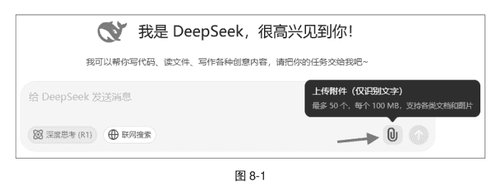
服務合同.pdf。請分析該合同並給出合理解釋。

服務合同審查意見

一、合同主體
雙方公司名稱、法定代表人、地址及聯繫方式均有明確列出，基本資訊完整，便於履約聯繫，符合規範要求。
建議核實雙方主體真實合法性，確保簽約時甲乙雙方均具備相應民事行為能力及相關業務資質，避免因主體問題導致效力爭議。例如涉及金融、醫療等特定行業，需查驗經營許可證。

二、服務內容
服務需求有概括性描述，但詳細部分“包括但不限於具體步驟、標準等”表述較籠統。應進一步細化，明確各項服務流程、分階段交付成果及品質驗收標準，以防後期因標準不明產生糾紛。如網站建設，需明確頁面設計風格、功能模組細節、相容性標準等。
服務期限起止日期明確，清晰界定服務時長，有利雙方安排進度與資源，此部分合理。

三、服務費用及支付方式
服務費用金額以人民幣〔×〕元確定，支付方式按預付款、分期付款及尾款設置，邏輯清晰，與常見服務類合同安排相符，具合理性。
不過“分期任務”的界定應在合同中詳述，明確各階段任務內容、驗收時間節點及對應付款觸發條件，避免理解不一致。同時可增設甲方逾期驗收的處理條款，保障乙方權益。

四、雙方權利與義務
甲方權利義務方面：
對服務的監督、檢查與驗收權，以及提供協助資料、按時付款義務明確，保障雙向制約與協作，合理。
建議補充若甲方提供資料錯誤或延遲，導致服務延誤或問題產生時的責任劃分，避免乙方單方面承擔後果。
乙方權利義務方面：
按約提供服務、不得轉包分包及保密義務設定恰當，符合常規要求。
保密條款可細化保密資訊範圍、保密期限及違約責任，加強保密約束力，防止資訊外洩風險。

五、違約責任
針對甲乙雙方違約情形設定了違約金計算方式及相應處理措施，違約成本明確，對雙方有約束警示作用，有利督促履約。
違約金比例〔×%〕的合理性需結合行業慣例、服務成本及預期利潤綜合考量，若過高可能被認定顯失公平，過低則不足以威懾，建議參照同類業務合同標準調整。

六、爭議解決
採先協商後訴訟的爭議解決方式，符合一般商業慣例，且明確訴訟管轄法院為合同簽訂地有管轄權的人民法院，確定性強，便於快速確定受理法院，節省成本。
可考慮增加仲裁作為可選途徑，為雙方提供更多解決選項，適應不同場景需求。

七、其他條款
合同生效條款規定自雙方簽字蓋章之日起生效，簡明符合常規。
合同份數及雙方各執一份、同等法律效力的說明清晰，保障文本管理與執行依據的規範性。

整體而言，該服務合同涵蓋主要要素，但部分條款尚有細化空間，建議雙方依具體業務、行業特點及風險偏好對上述問題協商修訂，使合同更嚴謹完善，有效防範潛在風險，保障合法權益。

因此，審查合同時可借助DeepSeek協助理解並應用於實務。

### 064 生成律師函模板

在法律實務中，律師函是維護權益、化解爭議的有力工具。面對侵權、違約等問題，精準專業的律師函能有效傳達訴求。DeepSeek運用先進技術深度剖析法條與案例，可生成專業律師函模板，協助快速理清思路，以專業法律語言維護權益。

以下是生成律師函模板的重點。

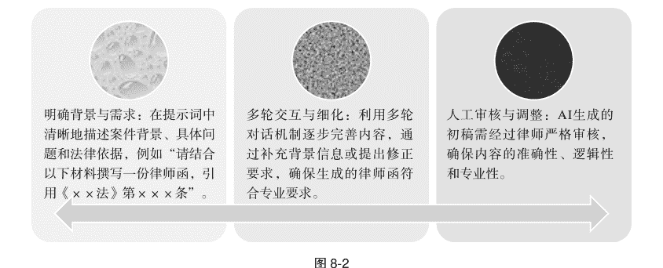
甲方（張三）於2024年5月1日向乙方（李四）借款人民幣10萬元，約定於2024年12月31日歸還。截至2025年2月15日，乙方仍未歸還欠款，且多次催促無效。甲方擬委託律師發送律師函，要求乙方限期還款。請撰寫一份律師函。要求：

- 1. 引用《中華人民共和國民法典》中關於借款合同的相關條款（如第675條、第676條）。
- 2. 要求乙方在收到律師函後7日內歸還欠款，否則將採取法律措施。
- 3. 請按照律師函的標準格式進行排版。

> 律師函
> （2025）××律函字第××號
> 致：李四（身份證號：）
> 地址：××××××××××××
> 聯絡電話：××××××××××××
> 日期：2025年×月×日
> 
> 關於限期歸還借款的律師函
> 
> 李四先生：
> 
> 本所受張三（身份證號：，以下簡稱“委託人”）委託，就您未依約償還借款一事，鄭重致函如下：
> 
> 一、事實概述
> 據委託人提供的證據及陳述，您（乙方）於2024年5月1日向委託人（甲方）借款人民幣100000元（大寫：拾萬元整），雙方明確約定還款期限為2024年12月31日。然而截至2025年2月15日，您仍未履行還款義務。委託人多次以口頭、書面方式催告，您均未回應或履行債務。
> 
> 二、法律依據
> 根據《中華人民共和國民法典》第675條：“借款人應當按照約定的期限返還借款。對借款期限沒有約定或者約定不明確，依據本法第五百一十條的規定仍不能確定的，借款人可以隨時返還；貸款人可以催告借款人在合理期限內返還。”
> 
> 根據《中華人民共和國民法典》第676條：“借款人未按照約定的期限返還借款的，應當按照約定或者國家有關規定支付逾期利息。”
> 
> 您逾期未還款的行為已構成違約，依法應承擔繼續履行、賠償損失等法律責任。
> 
> 三、要求與警示
> 現本所代表委託人鄭重要求您：
> 於收到本函之日起7日內（即2025年×月×日前），向委託人張三全額償還借款本金人民幣100000元及相應逾期利息（利息計算方式：按同期全國銀行間同業拆借中心公布的一年期貸款市場報價利率LPR計算，自2025年1月1日起至實際清償之日止）。
> 
> 還款帳戶資訊：
> 戶名：張三
> 開戶行：
> 帳號：
> 
> 四、法律後果
> 如您未在上述期限內履行還款義務，委託人將依法向人民法院提起訴訟，追究您的違約責任。屆時您除需償還本金及利息外，還需承擔訴訟費、律師費、保全費等一切因訴訟產生的費用，並可能面臨財產查封、信用記錄受損等不利後果。
> 
> 請您慎重對待本函，立即履行義務！
> 
> （律師事務所公章）
> 附：
> - 委託人張三簽署的《授權委託書》；
> - 借款憑證影本；
> - 催款記錄材料。
> 
> （本函一式兩份，一份送達乙方，一份存檔。）
> 備註：
> 本函可透過郵寄、電子送達等方式發送，以乙方實際簽收日期為準。
> 如有疑問，請與本所承辦律師聯繫。

由此可見，DeepSeek可化身專業律師，提供法律支援，幫助人們處理法律事務。

### 065 提供合規建議

法律是維護公平正義、保障各方權益的基石。隨著時代發展，日常生活與職場工作不可避免地涉及法規。DeepSeek能梳理出合法、合理、合規的法律實踐建議，協助人們規避風險、堅守底線。

要讓DeepSeek提供合規法律建議，可參考以下方法。

1. 精準描述問題：將法律合規問題盡可能具體清晰地表述。例如，不要只問“公司如何合規”，而是具體到“一家互聯網公司在收集用戶資料時，需遵循哪些資料保護方面的合規法律要求”，明確主體、行為與目標，以獲取更準確建議。
2. 採用多輪對話：逐步深入探討問題。例如先問“企業在跨境業務中涉及的知識產權合規重點有哪些”，得到初步回答後再追問“針對美國市場，有哪些特殊知識產權合規規定”等，逐步縮小範圍，獲取更詳盡資訊。
3. 提供相關文件：若有具體合同文本、規章制度等文件需要合規性分析，可上傳給DeepSeek分析其中是否存在法律風險，是否符合相關法規要求。
4. 明確法律領域和地區：若問題涉及特定領域法律如勞動法、稅法等，或特定地區法律，需在提問中明確指出。例如“在上海，餐飲企業在環保方面需遵守哪些地方性法規與政策”，幫助更有針對性地提供建議。
5. 要求案例參考：除要求提供法條與合規要點外，還可請DeepSeek提供相關實際案例，以便更好理解與應用法律規定。例如“請提供一些因違反《中華人民共和國網絡安全法》而受罰的企業案例，並分析其違規點”。
6. 限定輸出格式：依需求要求DeepSeek以特定格式輸出內容，如表格、列表等。例如“以表格形式列出企業在廣告宣傳中常見的合規法律風險及對應法律條款”，使資訊更清晰直觀。

> 某連鎖餐飲企業計劃推出會員制度，因此會收集會員的姓名、聯繫方式、消費習慣等資訊。從隱私保護與商業營銷合規角度出發，請使用DeepSeek為該企業分析，依據歐盟《通用資料保護條例》GDPR，該企業需提前做好哪些工作？例如對資料的加密處理要求、會員資訊的共享限制等，並提供一些因違反該條例而受罰的歐洲餐飲企業案例。

> 依據歐盟《通用資料保護條例》GDPR，連鎖餐飲企業在推出會員制度時需重點落實以下合規工作，並結合實際案例提示風險。

#### 一、核心合規要求

1. 合法性基礎與透明度
   - 明確法律依據：收集會員姓名、聯繫方式等需基於使用者明示同意需主動勾選且可撤回，或證明為履行合同所必需如配送服務。
   - 隱私政策透明化：以簡明語言告知資料用途如營銷推送、儲存期限、第三方共享對象如合作支付平台及使用者權利行使方式。
2. 資料最小化與目的限制
   - 僅收集必要資料：例如消費習慣分析無須取得使用者家庭住址，除非涉及外送服務。

# 会员数据合规与风控要点

数据使用范围必须划清界线，会员的消费流水只能服务于会员体系自身的运营，不得在未获明确同意的情况下转用于保险推销等无关场景。

3. 技术安全措施
- 加密与去标识：联系方式等敏感字段采用 AES-256 方式加密保存，消费行为类数据建议做聚合处理以降低个体识别风险。
- 访问权限管控：内部人员仅能接触岗位职责所需的数据范围，例如客服账号无权查看支付信息。

4. 用户权利保障机制
- 自主操作入口：会员可在官网自行导出个人消费记录以行使可携带权，也可一键关闭个性化广告以行使反对权。
- 响应机制：设立专门团队受理注销账号及被遗忘权请求，承诺 30 天内办结。

5. 第三方合作管理
- 数据处理协议约束：与营销公司、云服务商等签署 DPA，明确处理责任，例如要求 AWS 出具 GDPR 合规证明。
- 协同审计：定期核查合作方的数据使用情况，一旦发现违规转售等行为立即终止合作。

6. 跨境数据传输
- 合规路径：若在中国服务器处理欧盟用户数据，需与欧盟主体签订 SCC 标准合同条款或适用 BCR 集团规则。

#### 二、典型处罚案例与教训
- H&M（2020年）
  - 违规点：过度收集员工健康信息及家庭私事，且未加密存放导致内部随意浏览。
  - 处理结果：被处以 3530万欧元 罚款，为当时德国最高纪录。
  - 启示：内部数据同样需要严格加密，采集范围必须合理可控。
- Foodinho（意大利外卖平台，2021年）
  - 违规点：以算法自动解雇骑手却无法解释决策逻辑，侵害主体知情权。
  - 处理结果：被处以 260万欧元 罚款。
  - 启示：自动化决策需提供人工申诉渠道，并向用户说明算法基本原理。
- Domino’s Pizza（荷兰，2020年）
  - 违规点：数据泄露事件未及时上报，导致 60 万条用户信息外泄。
  - 处理结果：被处以 52万欧元 罚款。
  - 启示：必须建立 72 小时应急上报流程，并定期开展渗透测试。

#### 三、实操建议
1. 开展 DPIA 数据保护影响评估
   - 重点审视消费习惯分析与用户画像的隐私风险，涉及种族、健康如过敏记录等敏感数据需额外审批。
2. 设计合规营销策略
   - 邮件/SMS 营销须设置双重确认，如注册时勾选并在首次发送前二次确认。
   - 个性化推荐必须提供“关闭此推荐”的即时选项。
3. 员工培训与模拟演练
   - 每季度为门店员工开展数据采集规范培训，如禁止诱导用户提供非必要信息。
   - 每年模拟一次数据泄露场景，检验响应速度。

#### 四、延伸风险提示
- Cookie 与追踪技术：若通过 App 采集位置用于门店推荐，需单独取得同意，不能捆绑进隐私政策。
- 未成年人数据保护：涉及未成年会员时，需搭建年龄验证机制，如关联银行卡核验，并取得监护人同意。

落实上述安排，企业在提升客户粘性的同时，可将罚款风险降低 90% 以上，据欧盟 EDPB 统计。建议引入 GDPR 合规管理软件如 OneTrust，实现同意管理的自动化与数据流监控。

由此可见，DeepSeek 在法律顾问层面能提供大量合理合规的支持与建议，有助于个人和企业解决现实法律问题。

### 066 生成知识产权申请文件
在知识经济时代，知识产权已成为创新主体的核心资产。申请知识产权既是对智力成果的法律护卫，也是抢占市场先机、提升竞争力的关键。本节介绍借助 DeepSeek 生成知识产权申请文件的方法，以实现严谨高效的流程，推动创新成果转化。

生成知识产权申请文件的要点如下：

1. 明确申请类型和目标
   - 启动前先确定是申请专利、商标还是著作权，并了解各类文件的具体要求。
   - 专利申请需要说明书、权利要求书、摘要和附图。
   - 商标申请需要图样、商品或服务描述及使用说明。
   - 著作权登记需要作品样本、创作说明、权利归属证明。
2. 提供详细的技术或创意描述
   - 向 DeepSeek 提供清晰详尽的技术或创意说明，包括技术背景与创新点、具体技术方案或设计细节、商标图样及使用场景、著作权作品类型与内容。
3. 引用相关法律条款和要求
   - 按申请类型要求引用对应法律条款。
   - 专利申请引用《中华人民共和国专利法》及实施细则。
   - 商标申请引用《中华人民共和国商标法》。
   - 著作权登记引用《中华人民共和国著作权法》。
4. 审核和补充
   - DeepSeek 生成的文件需经专业人员复核补充，确保准确完整。专利权利要求书撰写专业性强，建议由专利代理人或律师做最终审核。

> 某公司开发了一种新型智能家居控制系统，可通过语音指令实现多设备联动，现需申请发明专利。
> 请依据以下技术描述生成专利申请文件：
> 1. 技术背景：现有智能家居多依赖手机 App 控制，操作繁琐且联动性差。本发明旨在通过语音指令实现多设备联动，提升体验。
> 2. 创新点：采用多模态语音识别技术，结合物联网协议，实现设备无缝联动。
> 3. 技术方案：系统包括语音识别模块、设备控制模块、物联网通信模块。用户语音激活系统后，系统解析指令并发送控制信号给对应设备。
> 4. 按专利申请标准格式生成说明书、权利要求书、摘要和附图说明。
> 5. 引用《中华人民共和国专利法》第26条说明书要求和第59条权利要求书要求。

以下是基于上述描述生成的专利申请文件模板：

#### 专利申请文件
##### 一、说明书
###### （一）技术领域
本发明涉及智能家居控制技术，具体是一种基于多模态语音识别与物联网协议的智能家居联动控制系统。
###### （二）背景技术
当前智能家居普遍依赖手机 App 进行单设备控制，存在：
1. 操作复杂：用户需操作多个 App，学习成本高。
2. 联动性差：设备间缺乏统一协议，难以实现场景化联动。
3. 交互效率低：语音控制仅支持单一设备指令，无法识别复合场景需求。
（可引用现有专利 CNXXXXXXA 说明技术局限）
###### （三）发明内容
目的：提供一种通过自然语言指令实现多设备智能联动的控制系统，提升用户体验。
####### 1. 技术方案
1. 语音识别模块：采用多模态识别技术，声纹加语义分析，支持模糊指令解析。
2. 设备控制模块：内置场景化逻辑引擎，将语音指令转化为设备控制序列。
3. 物联网通信模块：集成 Zigbee、Wi-Fi、蓝牙多协议适配器，兼容主流智能家居设备。
###### （四）具体实施方式
实施示例：用户说“打开回家模式”，语音识别模块提取关键词。逻辑引擎调用预设场景：通过 Zigbee 开启客厅灯光；通过 Wi-Fi 将空调调至 25℃；通过蓝牙启动安防摄像头；系统经物联网模块同步发送控制指令。
###### （五）附图说明
图1：系统架构图，语音识别→逻辑处理→协议适配→设备执行
图2：多模态语音识别流程图，声纹验证→语义分割→意图匹配
> 依据《中华人民共和国专利法》第26条，本说明书已充分公开技术方案

##### 二、权利要求书
1. 独立权利要求
一种智能家居联动控制系统，其特征在于包括：
1. 语音识别模块，用于接收并解析多模态语音指令。
2. 设备控制模块，包含场景化逻辑引擎，将语音指令转化为设备控制序列。
3. 物联网通信模块，支持多种协议适配，实现跨品牌设备联动控制。
2. 从属权利要求
根据权利要求 1（1）所述系统，其特征在于：语音识别模块采用声纹验证技术，绑定特定用户语音特征。
根据权利要求 1（2）所述系统，其特征在于：逻辑引擎支持自定义场景规则，通过机器学习优化指令映射关系。
根据权利要求 1（3）所述系统，其特征在于：物联网通信模块包含协议转换中间件，兼容 Zigbee 3.0、Wi-Fi 6 及蓝牙 5.3 标准。
> 依据《中华人民共和国专利法》第59条，权利要求书明确限定保护范围

##### 三、摘要
本发明公开了一种基于多模态语音识别的智能家居联动控制系统，集成声纹验证、语义分析及多协议物联网通信模块，实现自然语言指令到多设备协同控制的自动转换。突破传统 App 控制模式，支持“一句话场景”操作，显著提升交互效率与设备兼容性。

##### 四、法律声明
本申请文件撰写符合《专利审查指南》要求，技术方案具备新颖性、创造性和实用性，请求授予发明专利权。
（注：需补充附图及具体实施数据后提交正式申请）

注意事项：
- 建议补充实验数据证明技术效果，如对比测试报告
- 附图需标注各模块连接关系及信号流向
- 需进行专利检索确认创新点的新颖性

总体来看，DeepSeek 能生成完整的知识产权申请文件，节省大量时间和精力，为知识产权保护提供有力支撑。

### 067 提供法律咨询服务
社会快速发展，法律也在不断创新。DeepSeek 凭借强大的自然语言处理能力，能迅速解析各类法律问题，提供专业咨询，借助丰富知识储备为用户解惑，助力高效解决法律难题。

以下是向 DeepSeek 咨询法律问题的方法。

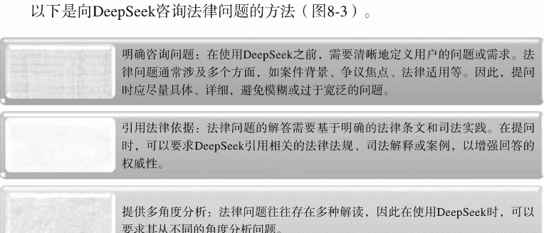
我与某公司签订了一份服务合同，但对方未按约定提供服务，导致我遭受经济损失。合同中约定了违约责任，但对方拒绝赔偿。请问：
1. 我是否可以要求对方承担违约责任？
2. 如果对方拒绝赔偿，我应该如何维权？

根据中国法律，分析如下。

#### 一、是否可以要求对方承担违约责任？
可以。根据《中华人民共和国民法典》相关规定，您有权主张违约责任，具体依据如下。
##### 1. 合同有效性
若合同合法有效，不存在欺诈、胁迫、违反强制性规定等情形，双方须依约履行义务，《中华人民共和国民法典》第143条、第502条。
##### 2. 违约责任构成
- 对方未按约定提供服务，构成违约，《中华人民共和国民法典》第577条。
- 合同明确约定违约责任时，可依约主张赔偿，《中华人民共和国民法典》第585条。
- 即使未明确约定，仍可要求赔偿实际损失，包括直接经济损失和合理预期利益损失，需举证，《中华人民共和国民法典》第584条。
##### 3. 免责事由排除
对方若以不可抗力或己方过错抗辩，需自行举证，《中华人民共和国民法典》第590条。无法证明则不能免责。

#### 二、对方拒绝赔偿时如何维权？
维权途径与步骤如下。
##### 1. 协商优先
建议先以书面函件如律师函与对方协商，要求限期履行或赔偿，成本低、效率高。
##### 2. 第三方调解
协商不成可向以下机构申请调解：
- 消费者协会，如属消费合同；
- 行业调解组织，如行业协会；
- 人民调解委员会，调解协议可司法确认。
##### 3. 仲裁或诉讼
- 仲裁：合同有仲裁条款的，向约定仲裁机构申请仲裁，一裁终局。
- 诉讼：无仲裁条款的，可向被告所在地或合同履行地法院起诉。
诉讼流程：
1. 准备起诉材料，起诉状、合同、违约证据、损失证明等。
2. 法院立案后进入审理程序。
3. 判决生效后申请强制执行。
##### 4. 财产保全
诉讼中可申请财产保全，冻结银行账户或查封财产，确保后续可执行。

#### 关键证据清单
- 合同原件，证明权利义务；
- 违约证据，未提供服务的记录、沟通函件、现场照片等；
- 损失证明，财务凭证、替代交易成本单据、第三方评估报告等；
- 其他材料，催告通知、律师函、对方拒绝赔偿回复等。

#### 补充建议
1. 诉讼时效：自知道或应当知道权利受损之日起3年内起诉，《中华人民共和国民法典》第188条，逾期可能丧失胜诉权。
2. 律师协助：损失较大或证据复杂时建议委托律师代理。
3. 电子证据保存：邮件、微信等电子记录需及时公证固定。

#### 法律依据摘要
- 《中华人民共和国民法典》第577条：违约方应承担继续履行、赔偿损失等责任。
- 《中华人民共和国民法典》第584条：赔偿范围包括实际损失和可得利益损失。
- 《中华人民共和国民事诉讼法》第122条：起诉需满足原告适格、明确被告、具体诉求等条件。

建议尽快采取法律行动，避免损失扩大或证据灭失。

因此，DeepSeek 就像人们身边的律师，能随时解答法律疑问。

## 第 9 章 IT 与编程：开发效率的革命性提升
DeepSeek 并非专门的编程工具，但可作为高效编程助手，帮助用户更轻松完成各类编程任务。

通过自然语言描述需求，DeepSeek 能理解意图并给出代码示例或解决方案，大幅降低编程门槛，让初学者快速上手。除此之外，它还能处理编程任务、修正错误、解读代码、添加注释、优化代码、进行代码翻译等。

### 068 生成代码
DeepSeek 支持多种编程语言，覆盖后端到前端的广泛技术栈，包括但不限于 Python、Java、JavaScript、C++、C#、Ruby、PHP、Swift、Kotlin、TypeScript、Go 等，也能编写 HTML 和 CSS，帮助构建网页结构与样式。

借助 DeepSeek，用户只需用自然语言清晰描述需求，即可获得对应代码，既降低门槛，也减轻程序员负担，提升开发效率。

> 请用 Python 编写一个简单的待办事项 Todo List 程序，用户可添加任务、查看任务和删除任务。请确保代码清晰易懂，并添加注释，帮助初学者理解每一部分代码的作用。

以下是一个简单的 Python 待办事项程序，包含详细注释，实现了添加、查看、删除和退出功能。

```python
# 待办事项列表程序
# 作者：DeepSeek-R1

# 初始化一个空列表来存储任务
tasks = []

def show_menu():
    """显示程序菜单"""
    print("\n=== 待办事项列表 ===")
    print("1. 添加任务")
    print("2. 查看任务")
    print("3. 删除任务")
    print("4. 退出程序")
    print("====================")

def add_task():
    """添加新任务到列表"""
    task = input("请输入要添加的任务内容：")
    tasks.append(task)  # 将新任务添加到列表末尾
    print(f"任务'{task}'已成功添加！")

def show_tasks():
    """显示当前所有任务"""
    if not tasks:
        print("当前没有任务！")
    else:
        print("\n当前任务列表：")
        # 使用enumerate同时获取索引和任务内容
        for index, task in enumerate(tasks, start=1):
            print(f"{index}. {task}")

def delete_task():
    """根据序号删除任务"""
    show_tasks()  # 先显示当前任务
    if tasks:
        try:
            # 获取用户输入的序号并转换为列表索引
            task_num = int(input("请输入要删除的任务序号："))
            if 1 <= task_num <= len(tasks):
                removed_task = tasks.pop(task_num - 1)  # 索引需要减1
                print(f"任务 '{removed_task}' 已删除")
            else:
                print("无效的任务序号！")
        except ValueError:  # 处理非数字输入
            print("请输入有效的数字序号！")

def main():
    """主程序循环"""
    print("欢迎使用待办事项管理系统！")
    while True:
        show_menu()
        choice = input("请选择操作（1-4）：")

        if choice == "1":
            add_task()
        elif choice == "2":
            show_tasks()
        elif choice == "3":
            delete_task()
        elif choice == "4":
            print("感谢使用，再见！")
            break  # 退出循环
        else:
            print("无效的输入，请重新选择！")

if __name__ == "__main__":
    main()
```
#### 1. 代码说明
（1）数据结构
使用列表tasks存储所有任务；
索引从1开始显示，更符合日常习惯。
（2）主要函数
show_menu()：显示操作菜单；
add_task()：添加新任务；
show_tasks()：显示所有任务；

delete_task 函数用于按编号删除指定待办项；main 函数承担程序的主循环控制。

（3）异常处理
删除操作中通过 try-except 捕获非数字输入的异常；同时会校验输入序号是否落在合法区间内。

（4）用户交互
交互方式采用简洁的数字菜单；每一次操作后都会给出明确的提示反馈。

#### 2. 核心亮点
- 程序会一直运行，直到用户主动选择退出；
- 菜单展示清晰易懂；
- 序号从 1 开始，更符合人的阅读习惯；
- 输入出错时给出友好的提示信息；
- 执行删除前会先展示当前的任务列表。

#### 3. 运行演示
```
欢迎使用待办事项管理系统！
=== 待办事项列表 ===
1. 添加任务
2. 查看任务
3. 删除任务
4. 退出程序
====================
请选择操作（1~4）：1
请输入要添加的任务内容：完成Python作业
任务'完成Python作业'已成功添加！
=== 待办事项列表 ===
```

后续步骤与上述类似。

该示例可用来学习 Python 的多项基础特性：

- 列表的增删操作，如 append 与 pop；
- 无限循环结构 while True 的使用；
- 条件分支 if-elif-else 的判断逻辑；
- 异常捕获机制 try-except 的运用。

在函数层面涉及：

- 用户输入获取 input；
- f-string 字符串格式化。

整体来看，这个待办事项小程序结构紧凑、逻辑清晰，非常适合初学者掌握 Python 基础。它借助函数划分职责，让各模块独立且易于维护扩展；主程序靠循环驱动，支持用户反复操作直至退出。

### 069 精准定位代码缺陷
DeepSeek 不仅能生成代码，还能在调试环节提供高效支持，帮助程序员快速发现并修复错误。无论是新手还是资深开发者，都能借助它提升代码质量，缩短排错时间。

当提供一段代码片段时，DeepSeek 会深入剖析，准确找出语法问题、逻辑漏洞以及可能影响性能的隐患，并结合工程实践给出优化建议，助力写出更稳健高效的代码。

> 能否指出下面代码的问题所在。

```python
num = 10
denominator = 0
result = num / denominator
print(result)
```

> 分析显示该代码存在典型的运行时除零错误 ZeroDivisionError，具体情况如下。

#### 问题诊断
1. 报错位置：第 3 行 `result = num / denominator`
2. 异常类型：`ZeroDivisionError: division by zero`
3. 产生原因：变量 denominator 被赋值为 0。

在数学和编程里，除数为 0 都是非法操作，会直接导致程序崩溃。

#### 错误复现
直接执行即可触发如下报错：

```
Traceback (most recent call last):
  File "<stdin>", line 3, in <module>
ZeroDivisionError: division by zero
```

#### 解决思路
**方案一：先行校验避免分母为零**
```python
num = 10
denominator = 0
if denominator != 0:
    result = num / denominator
    print(result)
else:
    print("错误：分母不能为0！")
```

**方案二：运行时捕获异常**
```python
num = 10
denominator = 0
try:
    result = num / denominator
    print(result)
except ZeroDivisionError:
    print("错误：除法运算中分母不能为0！")
```

**方案三：修正业务逻辑**
如果分母来源于用户输入或动态计算，需要增加校验：
```python
def safe_divide(numerator, denominator):
    if denominator == 0:
        return None  # 或 raise ValueError("分母不能为0")
    return numerator / denominator

num = 10
denominator = 0
result = safe_divide(num, denominator)
print(result if result is not None else "无法计算：分母为0")
```

#### 根本原因
- 缺少规范校验，未对除法等关键操作做输入有效性检查；
- 异常处理不足，未用 try-except 包裹可能出错的逻辑；
- 逻辑漏洞，分母被硬编码为 0，可能是测试遗漏或赋值失误。

#### 进阶建议
- 防御式编程，对分母、数组下标等关键变量做前置检查；
- 编写单元测试，覆盖分母为 0 的边界情况；
- 加强用户输入校验，确保类型和范围正确。

修正后应始终保证分母非零，或对除零场景给出明确处理。Python 中使用 0 作为除数会抛出 ZeroDivisionError，DeepSeek 已准确指出问题并给出了三种可行方案。

### 070 解读代码逻辑
在训练过程中，DeepSeek 吸收了大量编程范例和专业知识，具备跨语言的代码理解能力。无论是主流语言还是各类框架，都能快速把握其结构和核心概念。

依托这一能力，DeepSeek 能准确解析程序功能与运行逻辑，帮助开发者理解实现原理。例如对 Python、Java、C++ 等语言，以及面向对象、函数式等不同范式，都能给出针对性解读。

> 请说明下面这段代码的作用及输出。

```java
public class Counter {
    public static void main(String[] args) {
        for (int i = 1; i <= 5; i++) {
            System.out.println("计数: " + i);
        }
    }
}
```

> 这段 Java 代码利用 for 循环实现了一个简易计数器，并把结果打印到控制台。

#### 代码解析
1. 类声明：`public class Counter`
定义名为 Counter 的公共类，类名一般与文件名保持一致 Counter.java。
2. 入口方法：`public static void main(String[] args)`
Java 程序的执行起点，所有流程从 main 开始。
3. for 循环：`for (int i = 1; i <= 5; i++)`
`int i = 1;` 初始化计数器为 1；
`i <= 5;` 当 i 不大于 5 时继续循环；
`i++` 每次迭代后递增。
4. 输出语句：`System.out.println("计数: " + i);`
每次循环输出当前 i 的值，形成递增序列。

#### 运行结果
程序执行 5 次循环，i 从 1 递增到 5，最终输出：

```
计数：1
计数：2
计数：3
计数：4
计数：5
```

该示例主要演示 Java 中 for 循环的固定次数遍历用法。

DeepSeek 能正确识别语言类型，并准确说明其为 for 循环演示，并给出正确输出。

### 071 提升代码运行效率
DeepSeek 在代码优化方面能有效简化逻辑、合并冗余，并推荐更简洁的语法，提升可读性与维护性。同时可审查命名规范、注释清晰度、空格缩进等细节，整体提升代码质量，并促进模块化与复用。

> 对下面代码做一次性能优化。

```java
public class StringConcatenationExample {
    public static void main(String[] args) {
        String result = "";
        for (int i = 1; i <= 100; i++) {
            result += i + ", ";
        }
        System.out.println(result);
    }
}
```

优化后的实现及改进要点如下。

- 采用 StringBuilder 拼接字符串，避免频繁创建 String 对象，提升性能；
- 去掉末尾多余的 ", "，保证输出格式规范；
- 将拼接逻辑抽离到独立方法 `generateNumberString`，增强复用与可读性。

优化后代码：

```java
public class StringConcatenationExample {
    public static void main(String[] args) {
        String result = generateNumberString(1, 100);
        System.out.println(result);
    }

    private static String generateNumberString(int start, int end) {
        StringBuilder sb = new StringBuilder();
        for (int i = start; i <= end; i++) {
            sb.append(i);
            if (i < end) {
                sb.append(", ");
            }
        }
        return sb.toString();
    }
}
```

#### 优化要点
- 性能：StringBuilder 使用可变缓冲区，高效拼接；
- 格式：通过 `if (i < end)` 控制，仅在非最后一个元素后加分隔符；
- 模块化：`generateNumberString` 可独立复用，便于后续扩展范围或格式。

执行结果：

```
1, 2, 3, …, 99, 100
```

DeepSeek 的优化方案兼顾性能、复用与可读性，实现了更高效的代码。

### 072 跨语言代码转换
DeepSeek 具备代码翻译能力，可将一种语言实现迁移到另一种语言。面对复杂转换时，建议拆分为小片段逐段处理，以提高准确性与可靠性。

> 请把下面 Java 代码分别转为 Python 和 C++ 版本。

```java
public class BubbleSort {
    public static void main(String[] args) {
        int[] arr = {64, 34, 25, 12, 22, 11, 90};
        bubbleSort(arr);
        System.out.println("Sorted array:");
        for (int i = 0; i < arr.length; i++) {
            System.out.print(arr[i] + " ");
        }
    }

    public static void bubbleSort(int[] arr) {
        int n = arr.length;
        for (int i = 0; i < n - 1; i++) {
            for (int j = 0; j < n - 1 - i; j++) {
                if (arr[j] > arr[j + 1]) {
                    int temp = arr[j];
                    arr[j] = arr[j + 1];
                    arr[j + 1] = temp;
                }
            }
        }
    }
}
```

翻译结果如下。

1. Python 实现
```python
def bubble_sort(arr):
    n = len(arr)
    for i in range(n - 1):
        for j in range(n - 1 - i):
            if arr[j] > arr[j + 1]:
                arr[j], arr[j + 1] = arr[j + 1], arr[j]

def main():
    arr = [64, 34, 25, 12, 22, 11, 90]
    bubble_sort(arr)
    print("Sorted array:")
    print(arr)

if __name__ == "__main__":
    main()
```

2. C++ 实现
```cpp
#include <iostream>
using namespace std;

void bubbleSort(int arr[], int n) {
    for (int i = 0; i < n - 1; i++) {
        for (int j = 0; j < n - 1 - i; j++) {
            if (arr[j] > arr[j + 1]) {
                int temp = arr[j];
                arr[j] = arr[j + 1];
                arr[j + 1] = temp;
            }
        }
    }
}

int main() {
    int arr[] = {64, 34, 25, 12, 22, 11, 90};
    int n = sizeof(arr) / sizeof(arr[0]);
    bubbleSort(arr, n);
    cout << "Sorted array:" << endl;
    for (int i = 0; i < n; i++) {
        cout << arr[i] << " ";
    }
    cout << endl;
    return 0;
}
```

3. 说明
（1）Python
- `bubble_sort()` 实现冒泡排序；
- `main()` 初始化数组、调用排序并打印；
- `if __name__ == "__main__":` 确保直接运行时执行主函数。
（2）C++
- `bubbleSort()` 接收数组与长度，完成冒泡排序；
- `main()` 初始化数据、计算长度、调用排序并输出。

这段经典冒泡排序在 DeepSeek 精确转换下，成功以 Python 和 C++ 形式呈现，且逻辑无误。

### 073 为代码补充注释
代码注释是对程序意图和功能的说明，有助于快速理解逻辑。在协作开发中，清晰的注释能降低维护成本，为后续修改提供参考。通过 DeepSeek，可快速为代码生成简洁明了的中文注释，节省时间并提升可维护性。

> 请为下面代码逐行添加中文注释。

```java
public class Example {
    public static void main(String[] args) {
        int[] numbers = {3, 7, 1, 9, 5};
        int sum = 0;
        for (int i = 0; i < numbers.length; i++) {
            sum += numbers[i];
        }
        double average = sum / (double) numbers.length;
        System.out.println("Sum: " + sum);
        System.out.println("Average: " + average);
    }
}
```

注释后的版本如下。

```java
public class Example { // 定义一个名为Example的公共类
    public static void main(String[] args) { // 主方法，程序的入口
        int[] numbers = {3, 7, 1, 9, 5}; // 定义一个整数数组并初始化其元素
        int sum = 0; // 初始化一个变量sum，用于存储数组元素的总和

        // 遍历数组中的每个元素，计算总和
        for (int i = 0; i < numbers.length; i++) { // 循环遍历数组中的每个元素
            sum += numbers[i]; // 将当前元素加到sum中
        }

        // 计算数组元素的平均值
        double average = sum / (double) numbers.length; // 将总和除以数组的长度，得到平均值

        // 输出总和
        System.out.println("Sum: " + sum); // 输出总和到控制台

        // 输出平均值
        System.out.println("Average: " + average); // 输出平均值到控制台
    }
}
```

代码可读性与自动化测试要点

该片段的核心目标是对一个整数序列进行求和并据此算出均值，再把结果打印出来。注释的意义在于用易懂的语言把每一步的实现意图讲清楚。编写说明时务必对照真实的执行流程来落笔，保证描述与实际行为一致，不符时可自行调整。总体而言，DeepSeek 给出的中文解释结构清晰，体现了它对这段逻辑的把握。

### 074 如何借助 DeepSeek 优化测试

DeepSeek 不能直接拉起测试运行，但开发者可以把源码、案例或测试方案交给他。收到材料后，它会给出提升测试效率与准确度的专业化建议，并在开发的不同阶段提供支撑。除了思路上的优化，它还能基于用户提供的自动化需求生成单元测试代码，帮助固化功能、提升可维护性，降低手工验证的成本。

下面为 Calculator 类生成对应的单元测试示例。

```java
public class Calculator {
    // 加法
    public int add(int a, int b) {
        return a + b;
    }
    // 减法
    public int subtract(int a, int b) {
        return a - b;
    }
    // 乘法
    public int multiply(int a, int b) {
        return a * b;
    }
    // 除法
    public double divide(int a, int b) {
        if (b == 0) {
            throw new ArithmeticException("Cannot divide by zero");
        }
        return (double) a / b;
    }
}
```

JUnit 5 下的 CalculatorTest.java 示例

```java
import static org.junit.jupiter.api.Assertions.*;
import org.junit.jupiter.api.Test;

public class CalculatorTest {

    // 测试加法方法
    @Test
    public void testAdd() {
        Calculator calculator = new Calculator();
        int result = calculator.add(10, 5);
        assertEquals(15, result, "10 + 5 应该等于 15");
    }

    // 测试减法方法
    @Test
    public void testSubtract() {
        Calculator calculator = new Calculator();
        int result = calculator.subtract(10, 5);
        assertEquals(5, result, "10-5 应该等于 5");
    }

    // 测试乘法方法
    @Test
    public void testMultiply() {
        Calculator calculator = new Calculator();
        int result = calculator.multiply(4, 5);
        assertEquals(20, result, "4 × 5 应该等于 20");
    }

    // 测试除法方法
    @Test
    public void testDivide() {
        Calculator calculator = new Calculator();
        double result = calculator.divide(10, 2);
        assertEquals(5.0, result, 0.0001, "10 / 2 应该等于 5.0");
    }

    // 测试除数为零的情况，应该抛出异常
    @Test
    public void testDivideByZero() {
        Calculator calculator = new Calculator();
        assertThrows(ArithmeticException.class, () -> {
            calculator.divide(10, 0);
        }, "除数为零时应抛出 ArithmeticException");
    }
}
```

要点说明

1. `assertEquals(expected, actual, message)`

   用来校验方法的返回值是否与预期一致。
   
   `testAdd()` 正是用来确认 10 加 5 的结果是否为 15。

2. `assertThrows()`

   用来检查在除数等于零的情况下是否会抛出 `ArithmeticException`。
   
   `testDivideByZero()` 的作用是保证 `divide(10, 0)` 能触发异常。

3. `assertEquals(expected, actual, delta, message)`

   针对双精度数值的近似比较，delta 用来限定可接受的误差，例如 0.0001。

执行方式

开发工具如 IntelliJ IDEA 或 Eclipse 若已接入 JUnit，可直接右键运行 CalculatorTest。

若使用 Maven，可执行如下指令：

```
mvn test
```

当所有用例都通过时，可认为 Calculator 的基础功能运行正常。

DeepSeek 提供的测试实现简洁、结构紧凑，便于阅读与后续维护，覆盖相对全面，有助于验证正确性。

### 075 错误信息解读与定位

编程过程中碰到报错是常事。传统做法多是去搜索引擎检索，或在技术社区寻找答案，不仅耗时，还易被信息噪声干扰。把异常文本直接交给 DeepSeek，就能快速得到定位思路和修复建议，让开发者把精力放回功能实现上。

> 请问下面的异常信息是什么原因造成的。

> Exception in thread "main" java.lang.ArrayIndexOutOfBoundsException: Index 10 out of bounds for length 5 at Main.main ( Main.java:5 )

该异常属于下标越界，具体拆解如下。

异常解析

异常种类：`java.lang.ArrayIndexOutOfBoundsException`

关键提示：`Index 10 out of bounds for length 5`

触发位置：`Main.java` 第5行

直接诱因：非法下标访问

代码试图读取数组的第11个位置，而该数组实际仅有5个元素，有效下标为0到4。

例如：

```java
int[] arr = new int[5];  // 最大索引为4
System.out.println(arr[10]); // 触发异常
```

常见情形

情形一：循环边界写错

```java
int[] data = new int[5];
// 错误：i <= data.length会导致i=5时越界
for (int i = 0; i <= data.length; i++) {
    data[i] = i; // 当i=5时抛出异常
}
```

修正：

```java
for (int i = 0; i < data.length; i++) {...}
```

情形二：下标写死

```java
String[] names = {"Alice", "Bob", "Charlie"};
System.out.println(names[3]); // 最大索引为2
```

情形三：下标由表达式计算产生偏差

```java
int index = userInput; // 若用户输入超过数组长度-1
int value = arr[index]; // 可能触发异常
```

处置建议

1. 核查下标范围

```java
if (index >= 0 && index < array.length) {
    // 安全访问
} else {
    System.out.println("Invalid index: " + index);
}
```

2. 调试定位具体行

查看 Main.java 第5行的实现，典型模式为：

```java
// 示例错误代码
int[] arr = new int[5];
int errorValue = arr[10]; // ← 第5行
```

采用增强 for 循环可避免手工管理下标

```java
for (int num : arr) { // 自动遍历所有元素
    System.out.println(num);
}
```

验证示例

假设代码如下：

```java
public class Main {
    public static void main(String[] args) {
        int[] numbers = {10, 20, 30, 40, 50};
        System.out.println(numbers[10]); // ← 第5行
    }
}
```

调整后如下：

```java
System.out.println(numbers[4]); // 输出最后一个元素50
```

防范提示

- 循环边界统一以 `array.length` 为准
- 避免硬编码下标
- 对外部传入的下标做合法性校验
- 利用 IDE 断点观察运行时的数组状态

DeepSeek 快速指出了异常根源并给出可行的修复方案，排查效率明显提升。

# 第 10 章

## 心理支持：共情协作的新方向

当下社会对心理健康的关注持续上升，情感支持正从单向指导转向更具互动与共情的协作形态。这种新形态不仅依赖专业知识，更强调建立真诚的情感联结，通过倾听、共情与赋能，让个体在安全包容的氛围中探索自我、释放情绪、找到内在力量。本章以七个案例展示 DeepSeek 在心理咨询场景中的价值。

### 076 压力自测：快速了解状态

生活节奏加快，焦虑感普遍提升，很多人开始借助 DeepSeek 进行压力筛查。

DeepSeek 在筛查时采用结构化问卷配合计分体系，能迅速呈现当前压力程度。题目覆盖情绪体验、身体反应、人际影响等多个维度，较为全面。

> 请帮我做一次压力筛查，了解近期状态。

> 可以，我为你准备一个简易筛查。请按下面问题作答，选择最贴近现状的选项。每题对应不同分值，最后汇总即可判断。

压力筛查问卷

1. 近期焦虑或紧绷的感觉出现频率？
   选项一：完全没有 0分
   选项二：间或出现 1分
   选项三：经常出现 2分
   选项四：持续存在 3分

2. 放松和休息是否困难？
   选项一：完全没有 0分
   选项二：间或出现 1分
   选项三：经常出现 2分
   选项四：持续存在 3分

3. 是否常感疲劳、精力不足？
   选项一：完全没有 0分
   选项二：间或出现 1分
   选项三：经常出现 2分
   选项四：持续存在 3分

4. 压力是否带来身体不适，如头痛、胃部不适等？
   选项一：完全没有 0分
   选项二：间或出现 1分
   选项三：经常出现 2分
   选项四：持续存在 3分

5. 睡眠是否受影响，如入睡难、多梦等？
   选项一：完全没有 0分
   选项二：间或出现 1分
   选项三：经常出现 2分
   选项四：持续存在 3分

6. 是否因压力导致工作或学习效率下降？
   选项一：完全没有 0分
   选项二：间或出现 1分
   选项三：经常出现 2分
   选项四：持续存在 3分

7. 是否出现情绪低落或易怒？
   选项一：完全没有 0分
   选项二：间或出现 1分
   选项三：经常出现 2分
   选项四：持续存在 3分

8. 社交互动是否因压力而减少？
   选项一：完全没有 0分
   选项二：间或出现 1分
   选项三：经常出现 2分
   选项四：持续存在 3分

结果对照

0~5分：压力程度较低，整体较为轻松。

6~10分：存在一定压力，仍在可控范围，建议适度放松、调整心态。

11~15分：压力偏高，可考虑运动、冥想或寻求专业支持来缓解。

16~24分：压力程度很高，建议尽快减压并考虑咨询心理专业人士。

> 我的总分为14分，有什么具体做法可以缓解，请详细说明。

得分14分提示你正处中等偏高的压力状态。以下建议可供参考。

1. 厘清压力来源
每日记录触发压力的事件与情境，找出根源。把来源分为可控与不可控，集中精力在能改变的部分。

2. 时间管理
使用重要紧急矩阵进行优先级排序。将大任务拆解为若干小步骤逐步完成，避免拖延。设定可实现的目标，避免期望过高。

3. 放松技巧
每日进行数分钟慢吸慢呼练习。练习渐进式肌肉舒缓，从脚到头依次放松。每日安排10~20分钟正念练习，专注呼吸，降低焦虑。

4. 身体与营养
每周进行3~5次有氧活动，如慢跑、游泳等，促进快乐激素释放。保持均衡膳食，减少咖啡因与糖分摄入。保证每日7~9小时高质量睡眠。

5. 社会支持
与亲友交流感受，获取情感支持。若压力持续，可考虑心理咨询。加入压力管理小组，获取更多经验与建议。

6. 心态调整
接纳不完美，允许犯错。关注积极面，培养乐观思维。对无法掌控的事学会放下。

7. 兴趣转移
培养阅读、绘画等喜爱的活动，分散注意力。多接触自然，如散步或远足，放松身心。

8. 工作生活边界
明确工作与生活的界限，避免工作侵占休息时间。工作间隙安排短暂休息，避免长时间紧绷。

9. 自我复盘
每周或每月回顾压力管理效果，适时调整策略。记录缓解进展，增强信心。

10. 专业介入
若压力持续影响生活，建议寻求心理咨询师帮助。在医生指导下，可考虑药物辅助缓解焦虑或抑郁。

缓解压力需从时间、放松、运动、支持和心态等多维度入手。若持续不减，及时寻求专业帮助。希望这些建议对你有用。

### 077 认知行为训练方案

认知行为训练是通过觉察并调整负面思维模式来改善情绪与行为的心理干预手段。它强调自我觉察，帮助个体识别自动化思维中的认知偏差，并通过练习建立更积极理性的思维方式，从而改善情绪状态和行为反应。

借助 DeepSeek 进行认知行为训练是一种新颖高效的方式，结合人工智能技术与心理学原理，为用户提供个性化心理支持。

> 请根据认知行为训练的方法，为一位因焦虑导致社交回避的年轻人制订一个训练计划。计划应包括认知重构、行为暴露、放松训练等具体步骤，并提供实际操作示例，以帮助其逐步改善社交焦虑。

> 以下是一套简化的认知行为训练练习，旨在帮助你改善负面情绪。该练习基于 CBT 核心原则，包括识别负面思维、挑战认知偏差和建立积极行为模式。可每日练习，逐步培养更健康的思维和情绪管理能力。

第一步：情绪记录与觉察

情绪重塑五步实操指南

第一步 捕捉触发瞬间
把一天里让你心绪不稳的片段记下来，拆成三个维度：当时的情境发生了什么、主要心境用具体词汇命名比如沮丧、焦虑、难过、强度用1到10自评。

第二步 抓取内心自动对白
当不适感升起时自问：脑中在盘算什么？我在对自己说什么？把那些冒出来的快速独白写下来，比如我根本不行、没人会喜欢我。

第三步 拆解扭曲信念并重建
1. 找思维偏差
对照常见扭曲：非黑即白的极端化、以偏概全的过度推广、把小事夸成灾难、把责任全往自己身上揽。
2. 提问质证
问自己三点：这个判断有事实依据吗？是否还有别的解释？如果好朋友遇到同样情况，我会怎么安慰他？在此基础上写出更理性平衡的替代说法。

第四步 微行动激活
1. 设定可达成的小目标
每天给自己一个能做到的微事，比如十分钟散步、给朋友发条问候、完成一件简单的工作模块。
2. 记录满足感
完成后写下当时的感受，明确肯定自己的付出。

第五步 正念放松与周复盘
1. 呼吸练习
每天抽五分钟安静坐好，专注呼吸节奏，吸四秒、停四秒、呼四秒，帮助身体松弛。
2. 正念觉察
练习回到当下，观察情绪和念头的起伏，不过度介入也不跟随。
3. 每周回顾
翻看七天的情绪日志和思维练习，总结哪些做法有效、哪些需要改动，并为阶段性进步设定小奖励来强化积极行为。

示范
场景：工作中出现失误，焦虑明显升高。
自动对白：我就是个失败者，永远搞不定。
思维偏差：过度推广、灾难化。
理性回应：犯错很正常，不等于我一无是处，可以吸取经验，下次做得更好。
行动：列出改进清单，并对自己说我在持续进步。

持续练习后识别与调整负面思维会越来越自然，心境和行为也会逐步积极。情况严重时仍建议寻求持证心理工作者的支持。

DeepSeek能通过智能解析用户的思维模式与心境状态，提供即时反馈与引导，帮助辨认认知偏差并进行积极矫正，推动行为改变。因为操作便捷且能随进展动态调整内容，使认知行为训练更精准高效。

### 078 模拟亲密关系对话
随着社会发展，越来越多缺乏社交支持或感到孤独的人会向AI求助以获得情感陪伴来缓解孤独。DeepSeek借助自然语言处理和情感分析，能够模拟伴侣或朋友式的回应，给出中立的建议和反馈，帮助用户更清晰地理解自己的需求和他人的需求。下面是一段模拟好朋友对话的例子。

接下来你就当我的好朋友来聊吧。

好的，现在我就以朋友的身份陪你聊。可以像闺蜜兄弟一样随意说说，今天有什么趣事或者想吐槽的？我在这儿。

今天工作太累了，感觉快被榨干了。

哎呀，听起来今天真的很辛苦。超负荷的疲惫感很容易让人身心俱疲。要不要先给自己一点喘息？比如泡杯热茶，或者放一段喜欢的音乐，有时候一点小犒赏就能让心情回暖。你平时压力大时一般怎么缓和呢？

我会边听音乐边去健身。

这个习惯很棒！边听歌边运动既能释放压力又能放松身体，一举两得。你平时喜欢什么风格的音乐？是节奏感强的还是偏舒缓的？说不定我也可以试试你的歌单。运动时你最爱做什么？

我偏爱民谣，最喜欢跑步。

民谣配跑步，听起来超治愈！民谣的旋律和歌词很适合跑步时慢慢沉浸，时间感也会变柔和。你跑步时是不是会觉得步伐更轻松？一般跑多久呀，有没有特别喜欢的民谣歌手？

大概半个小时吧。我有点累了，下次再聊。

完全理解！今天你能坚持跑半小时已经很厉害了。好好休息，记得补充水分放松一下身体。下次再来聊，随时找我。晚安，愿你做个好梦。

这种模拟对话安全无压力，可以随时随地进行，适合练习沟通或缓解孤独感。

### 079 AI辅助心理疗愈
心理治疗是通过专业方法帮助个体缓解心理困扰、改善情绪、提升生活质量的系统过程。DeepSeek能针对焦虑、抑郁、创伤、人际困扰等问题，结合认知行为疗法、精神分析、人本主义等技术，帮助个体更了解自己、应对挑战并开发潜能。

DeepSeek以AI技术为用户提供个性化的心理支持和情绪管理工具，能分析情绪状态和思维模式，提供即时建议，帮助识别负面认知偏差并引导积极调整，同时可模拟对话、提供放松或正念引导，辅助缓解焦虑抑郁等情绪。下面是一个具体实例。

> 过去半年我一直情绪低落、闷闷不乐，悲观消极、行动迟缓，喜欢独处，对一切提不起兴趣，睡眠差食欲减、体重下降，我可能有什么心理问题？怎么治？请详细说。

根据描述，你可能正经历抑郁。抑郁常见表现就是持续低落、兴趣丧失、行为迟缓、睡眠障碍、食欲与体重变化。严重程度需专业评估。

可能情况
1. 抑郁症
你提到的情绪低落、悲观、兴趣丧失、迟缓、睡眠食欲变化等符合抑郁的典型表现。
2. 其他可能
焦虑症：若伴随明显紧张恐慌。
适应障碍：症状与近期重大生活变动相关。
季节性情感障碍：症状随季节波动，冬季加重。

治疗方向
1. 心理治疗
认知行为疗法：识别并改变消极思维和行为模式，学会积极应对。
人际疗法：改善人际关系，解决冲突，增强支持。
正念疗法：通过冥想正念聚焦当下，减少对负面情绪的过度反应。
2. 药物治疗
抗抑郁药如SSRIs、SNRIs，需在精神科医生指导下使用，通常数周后才显效。若伴随焦虑失眠，医生或会加用相关药物。
3. 生活方式调整
规律作息，避免熬夜；饮食多摄入Omega-3、B族维生素、抗氧化食物；每天30分钟有氧运动；保持社交，避免孤立；学习深呼吸、冥想等减压技巧。
4. 社会支持
与家人朋友分享感受，加入支持小组。
5. 专业帮助
心理咨询师做系统评估与治疗；症状较重时建议精神科就诊。
可使用PHQ-9自评量表初步了解抑郁程度，仅供参考，不能替代诊断。

总结：你描述的症状可能指向抑郁，但具体诊断需专业评估。建议尽早求助心理咨询师或精神科医生，结合心理、药物和生活方式综合干预。抑郁是可以改善的，寻求帮助是康复的第一步。

DeepSeek更适合作为心理健康的补充工具，与专业治疗结合效果更好。使用时需平衡AI支持与真实人际互动，避免过度依赖。

### 080 AI扮演咨询师
当察觉自己有心理问题时，人们会寻找心理咨询师获得专业个性化的情感支持和干预，以了解情绪行为、解决困扰、促进成长。因时间、经济或地域限制，很多人会让DeepSeek充当咨询师。在此之前要明确它无法完全替代专业咨询，需注意隐私和需求匹配。下面是具体表现。

> 你现在是心理咨询师，我因工作压力焦虑来咨询。

好的，我以咨询师身份与你对话。这里是安全无评判的空间，你可以自由表达。最近有什么想聊的或困扰你？

我总担心做不好，而且睡不着。

我能体会这种担心和失眠带来的折磨。这种感受在压力或不确定时很常见。你能具体说说，让你觉得做不好的情境是什么？是工作、学习还是其他？失眠又如何影响你的日常？我们可以一起找缓解方法。

我总是失败。

听到你这样说，能感受到内心的挫败和无助。失败让人沮丧，但不等于你不好，而是成长尝试中遇到的挑战。每个人都会失败，关键是如何面对。你能分享最近让你觉得失败的具体事情吗？这样我们可以更具体地分析并找到积极应对方式。

我该怎么放松？

放松是缓解焦虑的重要技能。可以尝试：
1. 深呼吸练习
找安静处坐下或躺下，闭眼深吸四秒，屏息四秒，缓慢呼气四秒，重复数次感受身体放松。
2. 渐进性肌肉放松
从脚趾开始依次绷紧再放松身体各部位，每处绷紧约五秒后放松十秒。
3. 正念冥想
专注呼吸声、身体触感或环境，思绪飘走时温和拉回，不评判。
4. 听音乐或白噪声
选择舒缓音乐或自然声，帮助沉浸。
5. 适量运动
散步、瑜伽等可释放压力。
6. 写日记
把感受写出来，有助理清思绪。

从中挑一两项试试，看看哪种最适合你。放松是一个过程，不必急于求成。愿意的话我们可一起探索更适合你的方式。

再给我点建议吧！

当然。除了放松技巧，还有：
1. 调整思维
挑战负面想法：“我总是失败”是真的吗？有例外吗？用积极语言替代：我正在努力，每一步都是进步。
2. 建立小目标
把大任务拆成小步骤，完成一个就给自己肯定和奖励。比如工作压力大时设定“完成一项任务后休息十分钟”。
3. 健康生活习惯
规律作息，稳定睡眠起床时间；避免过量咖啡因和糖分；每天哪怕十分钟散步也有助缓解压力。
4. 社交支持
与信任的朋友家人聊聊感受，难以开口可写信或发消息。
5. 自我接纳
告诉自己：焦虑是正常的，不代表我不好。睡前写下当天三件做得不错的小事。
6. 专业帮助
若焦虑失眠持续影响生活，建议寻求心理咨询师或医生。
7. 创意活动
绘画、写作、手工作业等可转移注意力并表达情绪。

改变需要时间，不必苛求自己。你已迈出面对问题并求助的重要一步。需要更多支持随时告诉我。

### 081 AI情绪调节实操
情绪调节有助于应对压力、改善心理健康、提升人际关系和幸福感，是维持心理平衡的关键。DeepSeek可作为日常情绪管理的有效补充，用户直接提出诉求即可获得操作指导。下面展示其表现。

> 白天被无端谩骂，回家后久久平静不下来，请教我调节情绪的方法。

好的，我会用以下步骤帮助你简单有效地调节。

1. 情绪识别
先问自己：此刻主要情绪是什么？是愤怒、烦躁、难过还是其他？用简短词语描述，比如“我很烦躁”。
2. 情绪评分
给情绪强度打分1到10，比如“愤怒7分”，更清晰了解状态。
3. 探索来源
问：什么事触发了这份情绪？能具体说说吗？找到根源更易理解感受。
4. 认知调整
若出现负面想法如“我什么都做不好”，引导自问：这想法有证据吗？有没有别的可能？帮助找到更理性平衡的视角。
5. 放松练习
引导深呼吸：闭眼深吸四秒，屏息四秒，慢呼四秒，重复几次感受放松。
6. 行为建议
根据状态建议小行动：散步十分钟、听首喜欢的音乐、写下三件感恩的事。
7. 后续支持
提醒：情绪调节是过程，不必急于求成。需要进一步支持随时回来聊。

说明需求后，DeepSeek会迅速整理出精准的调节方法并追问状态，再进入下一步。总之，DeepSeek在心理咨询中作为情感支持新范式，优势是即时、便捷、个性化，适合轻度情绪调节和日常管理；局限是缺乏情感深度和专业性，无法完全替代人类咨询师，更适合作为辅助工具。

### 082 AI化解职场冲突
人际矛盾容易导致冲突升级，人们往往难以有效处理。DeepSeek可通过模拟人类思维逻辑，帮助妥善处理冲突，找到合适方案，缓解甚至化解矛盾。

> 我和同事因意见不合导致合作出问题，该怎么处理？

职场意见分歧很常见，处理不当会影响效率和关系。以下是分阶段思路，结合心理学和沟通技巧。

一、冷静期，先处理情绪再处理问题
暂停争论避免情绪升级。冲突时情绪脑主导，此时讲道理无效。可说：“这个问题需要更深入讨论，我们是否先整理思路明天再聊？”离开现场、深呼吸或写情绪日志记录感受而非指责对方，有助平复。
区分立场与利益。表面争论是立场，比如方案A对方案B，深层是利益需求，如效率、安全感、被认可。
举例：同事坚持方案可能因曾因此获表扬，渴望价值感；你反对可能因担心风险影响进度，追求稳定。

二、重建沟通，用非暴力沟通打开僵局
倾听先行，制造心理安全感。邀请对方表达：“关于这个项目，我很想听听你的完整思路，哪些部分你特别看重？”用点头、眼神和复述确认理解。
表达自己时聚焦事实与需求。避免“你总是”，改用“我观察到…我的担忧/需求…”结构：“我注意到时间压缩了30%，担心测试不足导致返工，我们能否一起评估风险？”
引入客观依据降低对抗。可对比数据、客户反馈、成功率，或借用外部经验。

三、协同解决，从对立到共创
寻找第三选择。跳出非此即彼思维，列出双方核心诉求共同头脑风暴新方案。例如你的诉求是保证质量，同事诉求是缩短周期，第三选择可为分阶段交付先上线核心功能再迭代优化。
建立小步试错机制。若无法立刻一致，可提议：“我们用两天分别做简化版A/B推演，用数据辅助决策？”低成本实验让结果说话。

四、长期关系维护
事后修复关系。解决冲突后可通过非正式沟通淡化紧张，如午餐时说：“上次讨论让我更了解你的考量，以后可多互补。”适时肯定对方价值。
建立冲突预防机制。约定信号词在讨论激烈时轻松暂停；定期同步各自决策逻辑，增进理解。

关键心理学工具
空椅子技术：想象坐到同事位置，写下其可能面临的KPI压力和思维惯性。
情绪ABC理论：冲突激化往往源于对事件的解读而非事件本身，调整认知即可改变结果。

温馨提示：职场摩擦往往源于视角分歧，处理得当就能转化为创新动能。坚持对事不对人的原则，把焦点放在项目落地、团队荣誉等共同目标上，就能把阻力化为助力。

DeepSeek归纳的处理路径，覆盖了同事因观点不一致导致工作受阻时的关键环节：先稳住情绪、认真倾听、清晰表达、寻找共识、灵活让步调整、必要时引入第三方协助，以及事后复盘总结。按此推进，有助于化解对立、提升协作效率。

# 第 11 章

## 金融投资：以数据管控风险

金融投资的本质，是以市场数据、宏观指标、企业财务信息为依据做出理性判断以获取回报。借助大数据、人工智能等技术实现数据驱动，能够深挖趋势、识别风险点、发掘机会，帮助投资者在可控风险下追求长期收益。DeepSeek在金融投资领域提供可验证的智能化决策辅助。本章以六个实操案例呈现其价值。

### 083 金融资讯研判与市场判断

金融新闻是捕捉市场脉动的窗口，涵盖全球经济、政策动向、企业财报、行业演进等信息。借助DeepSeek追踪新闻与市场反馈，能更敏锐把握走向并做出冷静决策。使用前先明确分析视角与方法。以下从六个维度展开：

- （1）技术面研判
以历史价格与成交量为基础，借助图表与指标观察走势形态。
- （2）基本面研判
侧重研究经济、行业、企业核心数据与财务指标，把握长期趋势。
- （3）市场情绪研判
关注投资者心态与情绪指标，用以推测短期波动。
- （4）事件驱动研判
剖析新闻事件与宏观政策对市场走势的冲击。
- （5）国际关联研判
全球市场联动下，需追踪主要经济体政策变化、地缘风险、贸易局势等，评估其对国内市场的传导。
- （6）模型与算法研判
利用大数据与人工智能构建预测模型与算法。

DeepSeek本身不具备实时联网能力，需要使用者提供具体文本或数据，其可对事件影响进行深度解读。例如想了解2025年初市场走向，可这样提问。

> 当前国内银行业进入较长低利率周期，净息差已处历史低位且持续收窄。银行收入高度依赖利息，若不转型，多数银行难以维持既有增速。叠加地产与地方债风险，企业与个人违约率抬升，资产质量承压。

在该背景下，毕马威发布《2025年国内银行业展望报告》，调研多类商业银行并邀请专家从新要素、新范式、新机遇、新挑战四个方向展望行业发展并给出对策。请据此分析2025年金融市场趋势。

基于上述背景与报告，可推断2025年国内金融市场呈现以下特征。

- 1. 银行收入结构加速转型
趋势：净息差收窄倒逼银行由息差收入转向多元化，非息业务如财富管理、投行、金融科技服务成为重点。
市场反应：零售与财富业务突出的银行如招行、平安估值或获青睐，传统存贷型银行盈利压力加大。
- 2. 金融科技与数字化深化
趋势：为缓解盈利压力并响应客户需求，银行加大科技投入，推动数字化提升效率与体验。
市场反应：蚂蚁集团、腾讯金融科技等服务商有望受益，数字化能力强的银行竞争力增强。
- 3. 资产质量承压与风控升级
趋势：地产与地方债风险可能拖累资产质量，银行强化风控、优化信贷结构、压缩高风险敞口。
市场反应：资产质量稳健的国有大行更受青睐，高风险敞口银行股价承压。
- 4. 低利率下的投资策略调整
趋势：银行与投资者转向高收益资产，关注绿色金融、科技创新等领域。
市场反应：绿色债券、ESG产品受捧，科技创新企业融资环境改善。
- 5. 政策导向与监管预期
趋势：监管或加大对绿色金融、普惠金融的支持，同时严控地产与地方债风险。
市场反应：政策扶持板块成热点，监管收紧或令部分银行短期业绩承压。
- 6. 行业整合与差异化竞争
趋势：中小银行受盈利与资产质量压力或面临整合集中度提升，行业内部差异化竞争加剧。
市场反应：工行、建行等龙头或借并购扩大份额，中小银行估值分化。
- 7. 国际化与跨境业务发展
趋势：银行为拓宽收入加速出海，重点布局一带一路沿线跨境金融。
市场反应：中行等国际化早的银行受益，跨境支付结算相关金融科技公司迎来机会。

#### 小结
2025年国内银行业将面临低利率、资产质量、收入结构转型的多重挑战，同时受益于金融科技、绿色金融与国际化的机会。银行需加快转型、优化资产、强化风控，并捕捉政策与市场热点。投资者可关注数字化领先、资产稳健、业务多元的银行，以及金融科技与绿色金融赛道。

DeepSeek依托强大的自然语言处理与大数据解析能力，能快速梳理海量金融新闻与数据，捕捉关键信息并形成深度洞察，通过智能算法识别风险与机会，助力在复杂市场中抢占先机。

### 084 量化交易策略构建

量化交易策略是借助数学模型与算法自动执行买卖决策的系统化方法。依托DeepSeek的数据处理与机器学习能力，可构建并优化策略，预测行情、生成高精度信号，实现高效科学决策。

> 请基于以下数据生成量化策略：2025年1月末，广义货币M2余额约318.52万亿，年增7%；社会融资规模存量约415.20万亿，年增8%；社会融资规模增量7.06万亿，创同期历史新高。

基于上述流动性宽松环境，可设计如下框架。

策略名称：流动性驱动因子策略

DeepSeek AI 全场景实战从入门到精通：工作、学习与创作效率使用教程

#### 策略逻辑

1. 宏观背景
M2增速7%显示流动性宽松，社融存量增速8%且增量创新高，表明实体融资需求旺盛，金融体系支持力度增强，整体利好资本市场尤其是股市。
2. 核心假设
宽松流动性下资金易流入股市推升估值，社融增长利好金融、基建、地产等融资敏感行业。
3. 策略设计
因子选择：流动性因子M2增速、社融增速；行业因子金融、基建、地产；情绪因子成交量、资金流向。
选股逻辑：优先流动性敏感行业的龙头，挑选资金流入明显、成交放量的个股。
交易信号：M2与社融增速同步抬升时加仓，情绪因子如成交量明显回落时逐步减仓。
4. 风险控制
单股回撤超10%止损；若M2或社融增速显著下滑，及时降仓。
5. 回测优化
用历史数据回测，优化因子权重与阈值，可加入CPI、PPI等指标增强稳定性。

#### 策略示例

1. 股池
金融：银行、券商、保险；基建：建筑、工程机械；地产：龙头房企。
2. 交易信号
买入：M2增速>6%且社融增速>7%且成交放量；卖出：成交量连续3日下降或M2增速<5%。
3. 仓位管理
初始50%，信号强化加至80%，信号减弱降至30%。

策略优势在于宏观数据支撑强，流动性与情绪因子结合捕捉趋势。风险在于宏观数据滞后与政策、外围扰动对流动性的冲击。使用DeepSeek生成量化策略高效且逻辑清晰，但需人工优化与回测验证。

### 085 投资建议与组合管理

投资建议与组合管理是通过分析市场、行业与资产数据给出个性化策略并动态调仓，实现风控与收益最大化的过程。

DeepSeek处理该任务通常分：识别机会、构建多因子策略框架、给出风控建议、支持回测优化并输出方案。

> 请给出2025年投资建议与组合管理方案。

基于2025年初M2同比7%、社融存量增8%等数据，结合趋势，可给出如下方案。

#### 一、投资建议

1. 宏观分析
流动性宽松，资金充裕利于股市；融资需求旺盛利好金融、基建、地产；预计货币政策保持稳健支持经济复苏。
2. 投资方向
金融行业：银行、券商、保险受益于社融增长。
基建行业：政策扶持下建筑、工程机械有机会。
科技行业：人工智能、半导体、新能源龙头长期可期。
消费行业：经济复苏带动消费升级，食品饮料、家电、医药值得关注。

#### 二、组合管理方案

1. 目标
年化收益10%~15%，最大回撤控制10%以内。
2. 资产配置
股票70%
金融30% 银行20%、券商10%
基建20% 建筑10%、工程机械10%
科技30% 人工智能10%、半导体10%、新能源10%
消费20% 食品饮料10%、医药10%
债券20% 配置高评级企业债或国债平滑波动
现金10% 保持流动性捕捉机会
3. 选股逻辑
龙头优先，盈利与抗风险能力强；估值合理，PE、PB处于历史低位；资金面活跃，近期流入明显成交放大。
4. 交易策略
买入信号：M2与社融增速同步上升，个股成交放量且MACD、RSI等指标显示买入。
卖出信号：个股回撤超10%，市场情绪指标连续回落。
5. 风险控制
单股止损10%，每季根据宏观与市场表现动态调仓，分散行业与个股降低非系统性风险。

#### 三、回测与优化
用2020-2024年数据验证策略在不同环境下的表现，重点看宽松与复苏期的效果。优化行业权重与选股因子，加入CPI、PPI增强适应性。

#### 四、示例组合
假设100万元：
股票 银行 招商银行 20% 20万
股票 券商 中信证券 10% 10万
股票 建筑 中国建筑 10% 10万
股票 工程机械 三一重工 10% 10万
股票 人工智能 科大讯飞 10% 10万
股票 半导体 中芯国际 10% 10万
股票 新能源 宁德时代 10% 10万
股票 食品饮料 贵州茅台 10% 10万
股票 医药 恒瑞医药 10% 10万
债券 AAA级企业债 20% 20万
现金 10% 10万

#### 五、小结
方案依托流动性驱动与行业轮动捕捉机会并严格风控，建议每季调整并动态优化。DeepSeek可基于多维数据输出清晰框架与配置建议，配合回测提升收益风险比。

DeepSeek AI 全场景实战从入门到精通：工作、学习与创作效率使用教程

### 086 撰写投资调研报告

投资调研报告是对目标项目或公司进行系统分析的文件，DeepSeek可快速生成初稿并迭代优化。使用者需提供清晰要点与写作要求以保证质量。以下以2025年上海商品期货燃料油0902投资调研为例。

> 请为2025年上海商品期货燃料油0902投资撰写调研报告，需含项目概要、行业分析、投资理由、操作与收益、风险评估，要求专业简洁。

2025年上海商品期货燃料油0902投资调研报告

##### 一、项目概要
本报告聚焦2025年上海期货交易所燃料油0902合约。燃料油作为能源体系重要一环，价格受国际原油、地缘政治、供需、宏观经济等多因素影响。报告旨在通过行业剖析与市场研判为投资者提供科学建议。

##### 二、行业分析
1. 全球能源格局
2025年全球加速绿色转型，但传统化石燃料仍具地位。燃料油主要用于航运、发电、工业，需求与经济活动与贸易量高度相关。
2. 供需关系
供给端：受原油产量与炼厂开工率制约，OPEC+政策与美国页岩油波动可能导致区域性紧缺。
需求端：IMO限硫令推动低硫燃料油LSFO需求增长，高硫燃料油HSFO需求下降。
3. 价格驱动
国际原油价格、地缘政治风险、全球经济复苏特别是中印需求、美元汇率与通胀预期。
4. 国内市场特点
上海期货燃料油合约受内外双重影响。双碳目标对需求形成一定压制，航运复苏提供支撑。

##### 三、参与投资理由
1. 市场机会
燃料油波动性高，适合套利与投机。全球经济复苏预期强化航运需求，国际原油供给趋紧或带动价格上行。
2. 政策支持
上期所持续完善合约规则，提升流动性。
3. 对冲功能
可为航运、炼化企业提供价格风险管理工具。

##### 四、投资操作与收益
1. 操作策略
趋势跟踪：跟随原油走势与基本面做多或做空；套利交易：期货与现货价差、跨品种价差；波段操作：结合技术指标捕捉短期波动。
2. 收益预测
假设2025年价格区间2500~4000元/吨，波段操作收益约10%~20%。若经济复苏超预期，价格突破4000元，多头收益可达30%以上。

##### 五、风险评估与设计
1. 市场风险
国际原油大幅下跌带动燃料油下行；经济复苏不及预期导致需求疲软。
2. 政策风险

燃料油期货投资观察

- 在国内双碳目标推进力度加大的背景下，高硫燃料油的后续使用空间很可能进一步收窄。
- 国际海事组织不断优化的环保标准，有望对燃料油整体需求结构形成显著扰动。

操作性风险
- 期货交易杠杆偏高，价格剧烈波动时回撤幅度可能被放大。
- 市场流动性在极端行情下会受限，平仓难度明显提升。

风控要点
- 预设刚性止损规则，例如价格下滑5%即退出头寸。
- 保持组合多元化，避免资金过度集中于单一品种。
- 持续跟进海外原油走势与宏观经济数据，及时优化交易策略。

##### 六、总体研判与操作建议
2025年上期所燃料油0902合约仍具一定参与价值，但价格走势受多重变量牵引，机遇与风险并存。建议在充分研判基本面的前提下，融合技术分析，灵活运用趋势跟踪、套利等手段，同时严格执行风控，力争稳健回报。

免责说明：以上信息仅供参考，不构成投资建议，个人需结合自身风险承受力与市场环境独立决策。

依托大数据与人工智能，DeepSeek能快速抓取并处理海量市场信息，融合行业趋势与企业财报等资料形成精准分析，其智能模型可捕捉潜在风险与机会，为决策提供支撑。

### 087 量身打造理财方案
金融投资实践中，一套完整且合理的规划往往决定成败。制定方案前应先明确理财目标，结合自身财务状况与风险承受力进行综合设计，再借助DeepSeek快速生成初稿并持续优化。

以下以刘女士与方先生家庭为例说明。

刘女士与方先生中年家庭理财规划

##### 一、家庭状况梳理
- 阶段：中年，接近退休。
- 收入：中高水平，来源稳定。
- 风险偏好：偏向平衡稳健，重视保值与稳步增值。
- 目标：保障家庭财务安全，应对突发状况，实现资产平稳增长，为退休做准备。

##### 二、方案设计
1. 应急资金储备
- 用途：应对老人医疗急需及其他突发事件。
- 规模：建议储备6至12个月家庭月支出。
- 存放形式：
    - 货币基金：流动性强，收益高于活期。
    - 银行活期存款：可随时支取。
- 配置建议：应急资金总额的50%配置于货币基金，50%存放活期。

2. 稳健投资组合
- 目标：在可控风险下实现资产稳步增值。
- 配置建议：
    - 人民币理财产品40%：选择中低风险银行产品，年化约3%~4%。
    - 国债30%：配置3-5年期品种，年化约3%~3.5%，安全性较高。
    - 债券基金30%：优选优质产品，年化约4%~5%，起到分散作用。
- 追加安排：每年将方先生收入结余按上述比例持续追加。

3. 房地产投资
- 现状：已持有房产。
- 建议：定期评估房产价值与租金回报，保持资产保值；闲置房产可考虑出租获取稳定现金流。

4. 保险规划
- 健康保险：为老人配置高额医疗险，覆盖重大疾病及住院费用。
- 意外保险：为家庭成员投保，降低突发风险。
- 养老保险：补充商业养老保险，为退休提供额外保障。

5. 退休规划
- 养老金储备：
    - 将每年收入结余的10%~15%定投于养老目标基金或年金保险。
    - 依托税收优惠政策参与个人养老金账户投资。
- 投资期限：以10~15年为周期逐步累积退休资金。

##### 三、资产配置比例

| 资产类别 | 配置比例 | 投资工具 | 预期年化收益率 |
| :--- | :--- | :--- | :--- |
| 应急资金 | 20% | 货币基金、银行活期存款 | 2%~3% |
| 人民币理财产品 | 32% | 银行中低风险理财产品 | 3%~4% |
| 国债 | 24% | 3-5年期国债 | 3%~3.5% |
| 债券基金 | 24% | 优质债券基金 | 4%~5% |

##### 四、风险管理
1. 分散投资：通过多元化配置降低单一资产风险。
2. 定期调整：每年依据市场情况与个人需求调整配置比例。
3. 应急保障：确保应急资金充足，避免突发事件冲击家庭财务稳定。

##### 五、预期收益
- 稳健投资组合年化约3.5%~4.5%。
- 应急资金年化约2%~3%。
- 综合来看可在可控风险下实现家庭资产稳健增长。

##### 六、总结
本方案以稳健平衡为核心，兼顾流动性、安全性和收益性，契合刘女士与方先生家庭状况。通过合理配置与风险管控，既能应对突发事件，也能实现资产稳步增值，为退休生活提供保障。建议每年与理财顾问沟通，根据市场变化与家庭需求灵活调整策略。

### 088 金融风险识别实战
金融机构风险的外溢效应往往超出自身范畴。交易环节出现风险可能威胁机构存续，系统性风险一旦爆发将扰乱经济秩序甚至引发政治动荡，因此识别尤为重要。

DeepSeek可实时监测市场动态、经济指标与企业财务数据，识别潜在风险并发出预警，帮助用户做出更安全的投资决策。以下以贵州茅台为例。

> 2025年我想投资贵州茅台的股票，请识别风险。

投资600519.SH可能面临以下风险：

1. 市场风险
- 股价波动：作为A股龙头，其价格受市场情绪、资金流向与宏观环境影响明显，若2025年市场整体走弱可能承压。
- 估值风险：茅台市盈率通常高于行业均值，若市场偏好转向低估值股票，可能引发回调。

2. 行业风险
- 政策风险：国家对白酒行业的税收、限价或环保政策变化可能影响盈利，若出台更严厉禁酒令或消费税上调，行业将受冲击。
- 消费趋势变化：年轻群体对白酒偏好可能下降，转向低度酒或其他饮品，健康消费观念普及可能影响高端白酒需求。

3. 公司经营风险
- 产能限制：茅台酒产量受工艺与地域限制，扩产难度大，可能制约收入增长。
- 管理层变动：核心团队更迭可能影响战略执行与公司治理。
- 质量风险：产品质量问题或负面舆情将严重损害品牌与销售。

4. 宏观经济风险
- 增速放缓：经济下行时高端白酒作为可选消费品，需求可能下降。
- 通胀压力：原材料成本上涨压缩利润率，通胀也可能降低消费者购买力。

5. 竞争风险
- 竞争加剧：五粮液、泸州老窖等可能通过营销或价格策略抢占份额。
- 替代品威胁：洋酒、葡萄酒等替代品兴起可能分流高端白酒消费者。

6. 流动性风险
- 大资金进出：茅台流动性虽好，但机构集中减持或导致短期价格波动。

7. 应对建议
- （1）分散投资，避免重仓单一标的。
- （2）长期持有，蓝筹属性可平滑短期波动。
- （3）关注政策与行业动向，及时了解变化。
- （4）设定合理止损点，避免大幅亏损。
- （5）每季度或半年评估基本面与市场环境，动态调整策略。

8. 总结
贵州茅台品牌护城河与盈利能力强，但投资仍需警惕市场、行业、经营与宏观等多重风险，建议结合自身风险承受能力审慎决策并做好风控。

DeepSeek在风险识别方面表现突出，可利用大数据与机器学习快速识别市场、信用、流动性等风险并提供实时预警与应对建议。

# 第 12 章

## AI 跨工具协同：覆盖各行业

在人工智能快速发展的背景下，单一AI工具已难以满足日益增长的需求。用户倾向于让不同AI工具协作，以实现更高效的专业创作。DeepSeek作为强大的AI助手，既可独立完成文本生成、代码编写、文档处理等任务，也能与其他工具联动，放大价值。

### 089 DeepSeek 协同剪映 快速生成原创视频
先用DeepSeek自动生成脚本文案，再借助剪映图文成片功能制作视频，能大幅简化流程并快速形成逻辑清晰、吸引力强的框架。

操作步骤如下。

1. 打开DeepSeek主页面，在输入框输入提示词并回车，提示词与回答如下。

> 你是视频脚本创作大师，也是视频拍摄专家，请为橘子洲头生成一个宣传片脚本，脚本的具体要求：有镜头、旁白及场景，对话场景，背景音乐（请给出具体的音乐名称），整体能吸引人的眼球，开头5秒要能抓住观众，视频大概3分钟。

《橘子洲头·湘江诗画》宣传片脚本

时长：3分钟

核心主题：自然与人文交织的千年诗篇

#### 一、开场（0：00—0：15）

镜头：
- 航拍湘江晨曦（0：00—0：05）：朝阳从岳麓山后升起，金光穿透薄雾洒向橘子洲头，毛泽东青年艺术雕像轮廓渐显。
- 特写江浪击石（0：05—0：10）：慢镜头捕捉浪花飞溅，水珠折射彩虹光斑。
- 推近雕像面部（0：10—0：15）：镜头沿雕像肩部上升，定格于毛泽东目光坚定的眼神。

背景音乐：Two Steps From Hell《Victory》（高潮段落）
旁白（浑厚男声，混响处理）：
“独立寒秋，湘江北去，橘子洲头——这里是诗与历史的交点，是山河与热血的交响。”

#### 二、自然画卷（0：15—1：00）

镜头：
- 移动镜头穿越橘园（0：15—0：25）：盛夏阳光透过绿叶，金橘果实挂满枝头，露珠滑落特写。
- 航拍沙洲全貌（0：25—0：35）：沙洲形似长舰劈开湘江，两岸现代高楼与古树相映。
- 微观镜头（0：35—1：00）：蝴蝶停驻望江亭雕花栏杆，蜻蜓点水掠过江面。

背景音乐：Yiruma《River Flows in You》（钢琴版）
对话场景（年轻情侣倚栏远眺）：
女（惊叹）：“你看江面的波光，像不像撒了一把钻石？”
男（轻笑）：“不如说，是橘子洲头把星河揉进了湘江。”

#### 三、历史脉搏（1：00—2：00）

镜头：
- 黑白历史影像穿插（1：00—1：10）：1910年青年毛泽东与同学渡江旧照，叠加现代大学生朗诵《沁园春·长沙》。
- 特写书法墙（1：10—1：20）：苍劲毛体诗词随镜头移动逐句显现。
- 黄昏剪影（1：20—2：00）：老者执毛笔在江边石板上书写，孩童蹲坐模仿。

背景音乐：S.E.N.S.《故宫的记忆》（改编缩短版）
旁白（沧桑男声）：
“百年前，一句‘问苍茫大地，谁主沉浮’在此叩响时代；百年后，江风依旧传诵着觉醒的回声。”

#### 四、活力新生（2：00—2：45）

镜头：
- 快切市民生活（2：00—2：15）：晨练太极的老人、写生的美院学生、拍摄婚纱照的新人。
- 夜景延时摄影（2：15—2：30）：洲头灯光渐次点亮，江面游船划过金色光轨。
- 第一视角镜头（2：30—2：45）：手持稳定器穿越烟火夜市，糖油粑粑、臭豆腐特写，摊主笑问：“恰杯芝麻豆子茶不？”

背景音乐：Alan Walker《Faded》（二胡改编版）
对话场景（父亲抱起女儿看雕像）：
女儿（稚气）：“爸爸，这个大石头叔叔是谁呀？”
父亲（郑重）：“他是告诉我们‘敢教日月换新天’的人。”

#### 五、尾声升华（2：45—3：00）

镜头：
- 全景旋转镜头（2：45—2：55）：从雕像头顶俯拍，沙洲、湘江、城市天际线次第展开。
- 定版LOGO（2：55—3：00）：水墨晕染出“橘子洲头”篆刻印章，下方浮现“一洲观万象，千载汇风流”。

背景音乐：回归《Victory》尾声乐章
旁白（男女声交替）：
男：“这是江河写给大地的情书！”
女：“是历史留给未来的请柬！”
合：“橘子洲头——等你续写新的诗篇！”

执行建议
设备要求：
- 航拍使用DJI Inspire 3（8K电影级镜头）。
- 微观镜头搭配Laowa 24mm探针镜头。
服装设计：
- 历史场景人物着民国学生装，现代游客服装需色彩明快（避免黑白灰）。
特效处理：
- 诗词显现采用AR特效，让毛体字如烟云浮现在实景中。
创意亮点
- 时空对话：通过黑白/彩色画面交替、古今人物动作镜像衔接形成历史纵深感。
- 五感营销：收录江浪声、蝉鸣、夜市吆喝等环境音，增强沉浸感。
- 情感锚点：以“诗”贯穿全片，从毛泽东诗词到普通人的诗意生活。

此脚本以“自然—历史—人文—未来”的叙事逻辑，兼顾视觉震撼与情感共鸣，可有效吸引文旅爱好者、历史研学群体及年轻打卡族。

2. 打开剪映电脑版，单击界面中的“图文成片”按钮，如图12-1所示。


3. 执行操作后，即可进入图文成片编辑页面，单击“自由编辑文案”按钮，如图12-2所示。

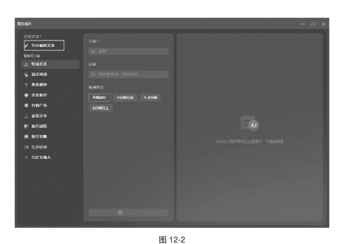

4. 进入自由编辑文案页面，将刚刚的脚本文案复制、粘贴至输入框内，如图12-3所示。

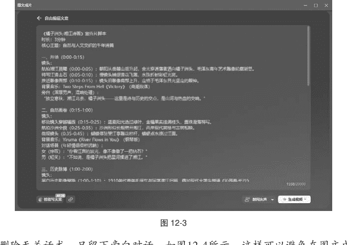

5. 删除无关话术，只留下旁白对话，如图12-4所示。这样可以避免在图文成片时，AI将一些镜头语言也朗读出来。

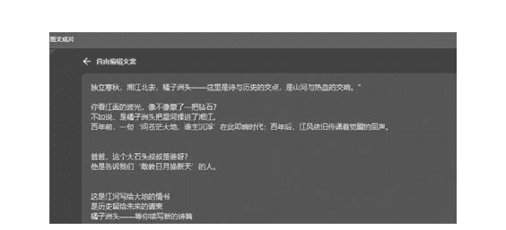

图 12-4

6. 执行操作后，单击界面右下角的“生成视频”按钮，选择“智能匹配素材”选项，如图12-5所示。


图 12-5

7. 执行操作后，稍等片刻即可完成视频的制作，如图12-6所示。然后根据自身的需求简单修改一下，即可得到一个原创视频。


图 12-6

DeepSeek AI 全场景实战从入门到精通：工作、学习与创作效率使用教程

### 090 DeepSeek 联动 Photoshop 智能修图
修图常遇到复杂需求，手动调参费时费力。结合DeepSeek与Photoshop可实现更高效智能的处理。

01 打开DeepSeek主页面，在输入框输入提示词并回车，提示词及回答如下。

> 我要用PS对照片进行调色，使画面更有电影感，请你给我一个调色方案，并根据这个方案给我提供一份PS脚本，用于实现自动调色，我的PS版本为v 25.0。

> 以下是为照片添加电影感的调色方案及配套的Photoshop自动化脚本，该方案模仿好莱坞电影《银翼杀手2049》的赛博朋克色调风格，同时保留通用性。

电影感调色方案

核心参数（适用于大多数场景）

基础调整
对比度：+15
高光：-80
阴影：+30
黑色色阶：-20

曲线调整
RGB曲线：利用S形曲线强化对比。
红色通道：将高光端轻微下压。
蓝色通道：将暗部上提增加青调。

色彩平衡
阴影：青色+10 / 蓝色+5
中间调：红色+5 / 黄色-3
高光：红色+8 / 蓝色-5

渐变映射
使用#2a2a5a到#d4af37的渐变，混合模式为“柔光”，“不透明度”为20%。

胶片颗粒
“数量”为15%，“大小”为5，“粗糙度”为50。

一键式PS自动化脚本

将以下代码保存为.jsx文件，通过执行“文件 | 脚本 | 浏览”命令运行。

```
// CinemaColor Pro.jsx
var doc = activeDocument;
// 创建基础调整层
var adjLayers = [
    ["Levels", [0, 1.20, 255]],
    ["Curves", [118,118], [149,133], [195,183]],
    ["Color Balance", [10,0,-5], [-3,0,5], [8,-5,0]]
];
adjLayers.forEach ( function ( layer ) {
    var adj = doc.AdjustmentLayers.add ( ) ;
    adj.kind = layer[0];
    setAdjustmentParams ( adj, layer.slice ( 1 ) ) ;
} ) ;
// 添加胶片颗粒
var grainLayer = doc.ArtLayers.add ( ) ;
grainLayer.name = "Film Grain";
grainLayer.applyAddNoise ( 15, 1, 0 ) ;
grainLayer.blendMode = BlendMode.SOFTLIGHT;
grainLayer.opacity = 30;

// 宽屏画幅遮罩
var bars = doc.ArtLayers.add ( ) ;
bars.name = "Cinemascope Bars";
bars.opacity = 100;
bars.blendMode = BlendMode.NORMAL;
var black = new SolidColor ( ) ;
black.rgb.hexValue = "000000";
doc.selection.select ( [[0,0], [doc.width, doc.height*0.09]],
                      [[0,doc.height*0.91], [doc.width, doc.height]] ) ;
bars.filledSelection ( black ) ;
// 函数：设置调整层参数
function setAdjustmentParams ( layer, params ) {
    switch ( layer.kind ) {
        case "Levels":
            layer.properties.inputRange = params[0];
            break;
        case "Curves":
            var curve = layer.properties.curves[0];
            params.forEach ( function ( pt ) { curve.addPoint ( pt[0], pt[1] ) } );
            break;
        case "Color Balance":
            ["shadows", "midtones", "highlights"].forEach ( function ( tone, i ) {
                layer.properties[tone] = params[i];
            } ) ;
    }
}
```

15秒电影级调色脚本

使用方法

把需要处理的照片打开，通过菜单 文件 | 脚本 | 浏览 载入本脚本。脚本会自动完成：叠加三层调色图层——色阶、曲线、色彩平衡；生成赛博朋克风格渐变光晕；赋予胶片颗粒质感；生成2.35:1宽屏遮罩。

微调建议

光线适配：双击 Curves 图层，依据原片亮度移动锚点。
色温强化：打开 Color Balance 图层，把蓝色通道提升+3~+5，科技感更明显。
风格切换：将渐变映射换成 #341515 到 #e3d8c1 的渐变，可复刻《布达佩斯大饭店》复古暖调。

技术亮点

非破坏编辑：全部调整以图层形式存在，可随时撤销。
参数独立：各效果分层可调，互不影响。
画幅自适应：自动按21:9计算遮罩比例。

整套流程约15秒就能让普通照片达到专业电影调色水准，尤其适合城市夜景、人像写真。

02 桌面新建文本文档，把生成的代码复制粘贴进去，如图12-7所示。
03 选择“文件|另存为”，保存类型设为“所有文件”，文件名后加上“.jsx”扩展名，点击“保存”即可，如图12-8所示。

## 第12章 与其他AI工具联动：覆盖各行各业

04 打开PS，点击“打开”按钮上传一张风景照，如图12-9所示。
05 操作后，选取菜单栏“文件|脚本|浏览”，选择“调色脚本.jsx”文件，即可自动完成调色，调色前后对比如图12-10所示。

### 091 DeepSeek+Kimi，轻松搞定 PPT 制作

在高效办公需求下，一份逻辑清晰、视觉专业的演示文稿能显著提升沟通效率。但手工排版、配色、动画往往耗费大量时间。

DeepSeek本身不直接导出PPT，却可借助R1模型的文本生成能力完成提纲与文案撰写，再配合Kimi强大的PPT生成能力，省去繁琐制作。实操如下。

1. 打开DeepSeek，在输入框输入提示词并回车，提示词及回答内容如下。

> 帮我生成一份主题为“AIGC高效应用”的PPT，用来做项目汇报，注意生成结果的专业性和严谨性。

> 我将为你生成一份专业、严谨的“AIGC高效应用”项目汇报PPT，涵盖项目概述、技术优势、应用场景、实施方案、效益评估等核心内容。请稍等，我会提供PPT文件。

AIGC高效应用

一、项目概述

1. 项目背景

自2022年起，AIGC技术高速发展，成为人工智能中最有应用前景的领域之一。

通过应用深度学习和生成工具，AIGC能够大幅提升创作效率和质量。

2. 项目目标

分析AIGC技术在各个产业中的应用值和实际效益。

提出高效应用方案，实现AIGC在互联网市场中的创新应用。

认识技术挑战，定义安全和规约策略。

二、AIGC技术优势

自动生成高质量内容，大幅降低人力成本。

通过深度学习自造合适样式，提升认知与创造能力。

优化用户体验，简化处理流程，能快速解决应用场景中的实际问题。

三、AIGC应用场景

1. 媒体传播

自动生成新闻报道、文章编辑和多媒体产出。

AI动画生成，为媒体内容创作提供助力。

2. 营销辅助

智能生成营销文案，优化产品推广效果。

核心内容自动生成，提升SEO效率和互动性。

3. 课程教育

核心产作助力，自动生成教案和光演资料。

AI翻译和自动处理，增强国际教育进程。

四、实施方案与技术核心

1. 实施方案

选择适合项目的AIGC工具（如DeepSeek）。

实施工具集成，实现自动化效率最优化。

2. 技术核心

安全性和隐私保护策略。

基于云服务的高效计算解决方案。

五、效益评估与未来发展

1. 效益评估

大幅提升产出效率，减少人力成本。

提升内容创造性，实现高度自动化生成。

2. 未来发展

提升认知系统策略，根据用户需求进行自动选择和更新。

研发运用于更实际场景的行业解决方案。

基于上述内容，用户可通过PPT软件将其制作为演示文件。

已生成《AIGC高效应用》项目汇报PPT文稿，你可以根据需要调整内容并转换为PPT文件。如需优化或补充，请告诉我！

02 复制中间生成的文稿。打开Kimi主页，使用“PPT助手”功能，将复制的文稿粘贴至输入框内，如图12-11所示。按【Enter】键发送生成的结果即可。
03 执行操作后，Kimi的PPT助手会自动补充更为详细的PPT文字信息，等待生成完成后，单击“一键生成PPT”按钮，如图12-12所示。
04 执行操作后，即可进入选择模板页面，如图12-13所示，选择合适的模板、风格、主题颜色后，单击“生成PPT”按钮即可。
05 执行操作后，即可自动生成相应的PPT内容，用户可以直接选择编辑或下载至本地后进行编辑，如图12-14所示。
06 如图12-15所示为最终的PPT效果展示。

### 092 DeepSeek+可灵，生成图片素材

在创意设计里，高质量图片素材至关重要。传统收集方式费时费力且难以精准匹配。可灵负责出图，DeepSeek负责撰写专业绘画提示词，组合使用效率很高。下面介绍操作步骤。

01 打开DeepSeek，在输入框内输入提示词，具体提示词和回复如下。

> 请帮我生成一段适用于可灵AI的文生图提示词，主题是吉卜力动画，画面由一个小女巫和森林狼构成。

> 以下是一段适用于可灵AI的文生图提示词，主题是吉卜力动画风格的小女巫和森林狼：

“生成一张吉卜力动画风格的插图，在画面中，一个小女巫和一只森林狼站在一起。小女巫穿着一顶点缀着星辰的魔女帽，身着简洁但优雅的黑色连衣裙，手持一根闪烁着微光的魔杖，表情坚定而神秘。森林狼体型修长，毛发银白如月光，眼睛闪烁着智慧的光芒，显得威严而又温柔。两者站在一片魔法森林中，背景是浓密的夜晚森林，月光洒满树梢，微光点缀其间，画面充满了奇幻与冒险的氛围。整体风格细腻，色彩柔和，充满吉卜力动画的独特魅力，细节丰富，笔触流畅，画面温馨而充满故事感。”

如果需要进一步调整，可以补充更多细节，比如：

“画面分辨率高，比例适中，突出角色和背景的和谐统一。”

“加入更多魔法元素，如飘浮的粒子、发光的符文等，增强画面的奇幻感。”

希望这段提示词能帮助你生成出理想的画面！

02 复制相应的绘画提示词，打开可灵AI，选择“AI图片|文生图”功能，在创意描述中粘贴绘画提示词，如图12-16所示。
03 执行操作后，选择图片比例并单击“立即生成”按钮，如图12-17所示。
04 稍等片刻，即可获得一组精美的图片素材，如图12-18所示。

### 093 DeepSeek + 即梦AI，实现动态海报效果

动态海报通过加入动画元素增强视觉冲击力，比静态更能吸引注意。下面介绍用DeepSeek+即梦AI实现的方法。

01 打开DeepSeek，在输入框内输入提示词，具体提示词和回复如下。

我想要用即梦AI制作一张海报，你帮我准确描述这张海报，生成相应的提示词，模仿最近超火的《哪吒之魔童降世》，要有国风的感觉，背景稍微亮一点。海报主题是齐天大圣孙悟空，但构图要模仿哪吒画风的国风海报。

好的！以下是一段详细且准确的提示词，帮助你用即梦AI生成一张模仿《哪吒之魔童降世》画风的齐天大圣孙悟空海报，带有国风元素和明亮的背景。

提示词：

“国风插画，齐天大圣孙悟空，金甲红袍，凤翅紫金冠，金箍棒挥动，动态战斗姿势，桀骜眼神，火焰环绕，金色光晕，水墨云雾背景，碎裂地面，天宫楼阁，红金色高饱和色调，强侧光，工笔细节，水墨泼溅纹理，粒子火花，无文字，史诗感构图，8K超清。”

这样描述应该能帮你生成理想的海报效果！

02 复制生成的提示词，打开即梦AI，单击“AI制图|图片生成”按钮，将复制后的提示词粘贴至创意描述框内，如图12-19所示。
03 选择生图模型和图片比例，单击“立即生成”按钮。稍等片刻，即可获得一组精美的海报图片，如图12-20所示。
04 回到DeepSeek，在输入框内输入提示词“我想要刚刚生成的图片动起来，请帮我生成相应的提示词”，DeepSeek回复如下。

好的！以下是针对动态图片的提示词，帮助你让齐天大圣孙悟空的海报“动起来”，保持国风画风和《哪吒之魔童降世》的风格。

提示词：

“国风风格的动态图片，画风模仿《哪吒之魔童降世》的动漫风，超高饱和色调，8K超清。画面中央是齐天大圣孙悟空，金甲红袍，凤翅紫金冠，桀骜眼神，金箍棒挥动，释放强大力量。动态效果：金箍棒散发金色光芒，挥动时伴随火焰和粒子火花四溅，火焰环绕全身，形成炽热的光晕。背景是水墨云雾与天宫楼阁的结合，云雾流动、楼阁光芒闪烁，地面碎裂，烟尘飞扬，增强战斗场景的冲击感。整体画面中加入水墨波溅纹理和粒子效果，红金色高饱和色调，强侧光照明，工笔细节鲜明，史诗感构图，动态流畅，充满力量与活力。”

这样描述的动态图片会更加生动有趣，同时保留原有的国风和史诗感！

05 回到即梦AI，在生成的一组图片中，选择一张较为满意的图片，单击“生成视频”按钮，如图12-21所示。
06 在创意描述框内粘贴刚刚复制的提示词，如图12-22所示。
07 选择视频模型，单击“生成视频”按钮，即可让图片动起来，生成一张动态海报，如图12-23所示。

### 094 DeepSeek+Canva，批量生成图文笔记

DeepSeek擅长提炼关键信息，Canva提供直观设计工具，两者结合能快速产出逻辑清晰且视觉吸引的图文笔记。

1. 打开Canva，左侧导航栏选择“模板”|“社交媒体”|“小红书帖子”选项，如图12-24所示。
2. 选择合适的图文模板，观察结构，如图12-25所示，该模板第一段为主题，第二段为经典台词，第三段为出处。
3. 按此结构让DeepSeek规定输出格式，生成相应文本，具体提示词和回复如下。

## DeepSeek AI 全场景实战从入门到精通：工作、学习与创作效率使用教程

给我生成10份热门电影中的经典台词，是需要能引人思考的一句话，并附带其电影名称，按表格的形式生成。

以下是10部热门电影中的经典台词及其电影名称，按表格形式整理。

| 经典台词 | 电影名称 |
|---|---|
| “希望是好事，也许是人间至善，而美好的事永不消逝。” | 《肖申克的救赎》（1994） |
| “人生就像一盒巧克力，你永远不知道下一颗是什么味道。” | 《阿甘正传》（1994） |
| “有些人活着，却渴望死去；有些人死去，却仿佛永远活着。” | 《寻梦环游记》（2017） |
| “我们读诗写诗，并不是因为它们好玩，而是因为我们是人类的一分子，而人类是充满激情的。” | 《死亡诗社》（1989） |
| “你永远不能真正了解一个人，除非你从他的角度去看问题……除非你钻进他的皮肤里，像他一样走来走去。” | 《杀死一只知更鸟》（1962） |
| “这世上只有一种东西是别人无法从你身上夺走的，那就是你的思想。” | 《美丽人生》（1997） |
| “你以为你只是接受了现实，其实你早已放弃了反抗。” | 《黑客帝国》（1999） |
| “我们注定要失去所爱之人，不然我们怎么知道，他们在生命中有多重要？” | 《本杰明·巴顿奇事》（2008） |
| “世界不需要拯救，需要的是每天做出微小善举的普通人。” | 《神秘巨星》（2017） |
| “人生不能像做菜，把所有的料准备好了才下锅。” | 《饮食男女》（1994） |

这些台词涵盖人生哲理、人性探讨、存在意义等主题，适合引发对自我、社会和价值的深层思考。部分电影中的台词如《肖申克的救赎》《死亡诗社》等被广泛引用至教育、心理学领域，成为文化符号。

04 复制生成后的电影台词和名称，回到Canva模板中，单击导航栏中的“应用”|“批量创建”按钮，如图12-26所示。
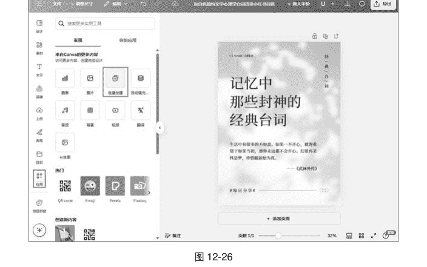

## 第12章 与其他AI工具联动：覆盖各行各业

05 执行操作后，在跳转的页面中单击“手动输入数据”按钮，如图12-27所示。
06 将刚刚复制的电影台词和名称粘贴至表格中，单击“完成”按钮即可，如图12-28所示。
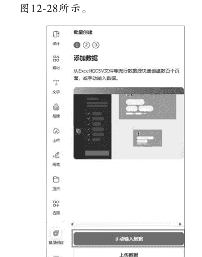

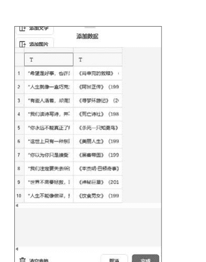

07 添加数据后，就是关键数据，将鼠标指针移至第二段上方并单击鼠标右键，在弹出的快捷菜单选择“关联数据”命令，如图12-29所示。
08 执行操作后，在弹出的关联数据框内选择“电影台词”选项，如图12-30所示。然后，以同样的方式，与“电影名称”进行关联。
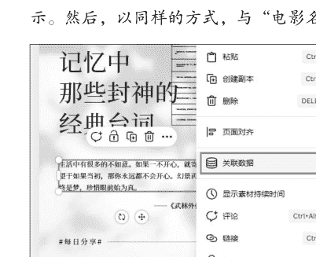

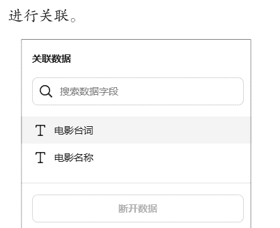

09 关联完成后，单击“批量创建”面板下方的“继续”按钮，如图12-31所示，然后继续单击“生成10个设计”按钮，如图12-32所示。
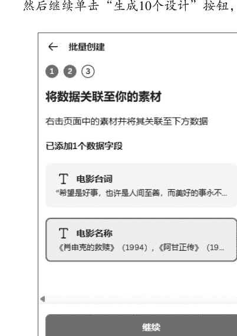

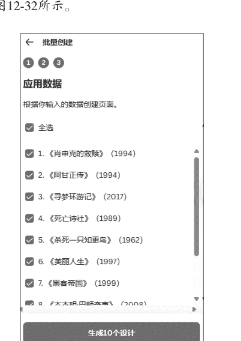

10 如图12-33所示为最终的效果展示，单击右上角的“导出”按钮，即可将该设计保存至本地，并发布至各大社交平台上，从而获取收益。


## 好书推荐


《剪映短视频剪辑教程自学一本通（电脑版+手机版）》

ISBN：978-7-122-19264-6


《高手运镜：手机短视频拍摄镜头与剪辑技巧大全（视频教学版）》

ISBN：978-7-122-46123-0


《人工智能 AI绘画、设计与视频从入门到精通：

Midjourney+Stable Diffusion+Photoshop+即梦 Dreamina》

书号：978-7-122-46124-7

封面出品：🐧异一团队

## 一册在手，AI全域活用

用DeepSeek把效率生活跑起来！


想要延伸资料？来读者交流圈

方式A：用手机扫码进QQ群聊，拿下随书资料包
方式B：访问 Chem Industry Press Co., Ltd. 官方网站，输入书名后下载配套内容

类目推荐：电脑 / AI

国际标准书号 978-7-122-47602-9

建议零售价 99.00元