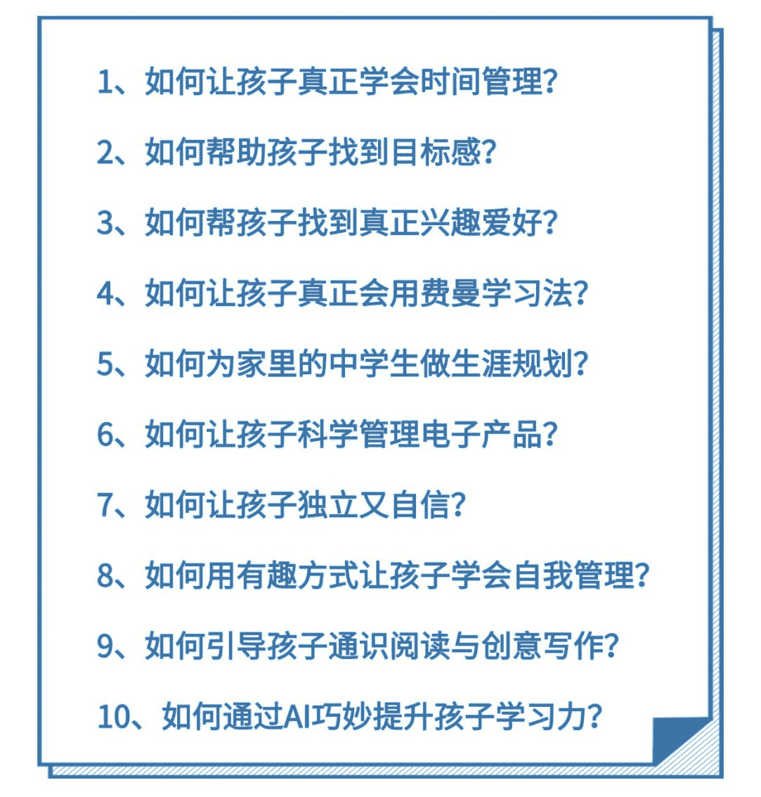

# 少年商学院 · DeepSeek 中⼩学⽣使⽤⼿册

中⼩学⽣和家⻓

向**DeepSeek**提问的⼗⼤原则

3 / 83

少年商学院 · DeepSeek 中⼩学⽣使⽤⼿册

1、明确⽬标，有的放⽮

原则 ： 提问前想清楚你想解决什么问题，希望得到什

么帮助。

例⼦ ： 不要问“怎么学好数学？”，⽽是问“我初⼆，⼏

何证明题总是没思路，有什么⽅法可以提⾼？”

原理 ： 明确的⽬标能让 DeepSeek 更精准地提供帮

助，避免泛泛⽽谈。

4 / 83

少年商学院 · DeepSeek 中⼩学⽣使⽤⼿册

2、具体描述，提供背景

原则 ： 尽量详细描述你的问题，包括你的年龄、学习

情况、遇到的困难等。

例⼦ ： 不要问“怎么提⾼英语成绩？”，⽽是问“我初

三，英语单词记不住，听⼒也跟不上，有什么⽅法可以

快速提⾼？”

原理 ： 详细的背景信息有助于 DeepSeek 更好地理解

你的问题，提供更个性化的建议。

5 / 83

少年商学院 · DeepSeek 中⼩学⽣使⽤⼿册

3、拆分问题，化繁为简

原则 ： 将复杂的问题拆分成⼏个⼩问题，逐个解决。

例⼦ ： 不要问“怎么规划未来？”，⽽是问“我对计算机

感兴趣，但不知道具体⽅向，能推荐⼀些相关的职业

吗？”

原理 ： 拆分问题可以降低难度，更容易找到解决⽅

案。

6 / 83

少年商学院 · DeepSeek 中⼩学⽣使⽤⼿册

4、积极思考，主动探索

原则 ： 不要只依赖 DeepSeek 的答案，要结合⾃⾝情

况思考和实践。

例⼦ ： 不要问“这道题怎么做？”，⽽是问“这道题的解

题思路是什么？我哪⾥想错了？”

原理 ： 主动思考和实践能加深理解，提⾼解决问题的

能⼒。

7 / 83

少年商学院 · DeepSeek 中⼩学⽣使⽤⼿册

5、保持开放，接受多元

原则 ： 不要局限于⼀种答案，要接受不同的观点和建

议。

例⼦ ： 不要问“学⽂科好还是理科好？”，⽽是问“⽂科

和理科分别有哪些优势和劣势？我该如何选择？”

原理 ： 多元的观点能拓宽视野，帮助你做出更明智的

选择。

8 / 83

少年商学院 · DeepSeek 中⼩学⽣使⽤⼿册

6、尊重隐私，保护安全

原则 ： 不要透露个⼈隐私信息，如姓名、住址、学校

等。

例⼦ ： 不要问“我住在 XX⼩区，附近有什么好的补习

班？”，⽽是问“XX 科⽬有什么好的在线学习资源？”

原理 ： 保护隐私和安全是⽹络交流的基本原则。

9 / 83

少年商学院 · DeepSeek 中⼩学⽣使⽤⼿册

7、理性判断，避免盲从

原则 ： 对 DeepSeek 的答案要保持理性判断，不要盲

⽬相信。

例⼦ ： 不要问“DeepSeek 说 XX⽅法⼀定有效，是真的

吗？”，⽽是问“XX⽅法的原理是什么？有哪些成功案

例？”

原理 ： 理性判断能帮助你辨别信息的真伪，避免被误

导。

10 / 83

少年商学院 · DeepSeek 中⼩学⽣使⽤⼿册

8、持续学习，不断进步

原则 ： 将 DeepSeek 作为学习⼯具，不断探索新的知

识和技能。

例⼦ ： 不要问“怎么应付考试？”，⽽是问“如何培养终

⾝学习的习惯？”

原理 ： 持续学习是个⼈成⻓和发展的关键。

11 / 83

少年商学院 · DeepSeek 中⼩学⽣使⽤⼿册

9、积极反馈，共同进步

原则 ： 对 DeepSeek 的答案进⾏反馈，帮助其不断改

进。

例⼦ ： 不要只问问题，也可以分享你的学习经验和⼼

得。

原理 ： 积极的反馈能促进 DeepSeek 的进步，也能帮

助更多⼈。

12 / 83

少年商学院 · DeepSeek 中⼩学⽣使⽤⼿册

10、享受过程，快乐学习

原则 ： 将提问和学习视为⼀种乐趣，享受探索知识的

过程。

例⼦ ： 不要问“学习好累，怎么办？”，⽽是问“如何让

学习变得更有趣？”

原理 ： 快乐学习能提⾼学习效率，让你更享受学习的

过程。

13 / 83

如何使⽤**DeepSeek** 提升中⼩学⽣的阅读能⼒

14 / 83

少年商学院 · DeepSeek 中⼩学⽣使⽤⼿册

1\. 个性化阅读推荐，激发阅读兴趣

⽅法 ： 利⽤DeepSeek 分析学⽣的阅读历史和兴趣，

推荐适合其年龄和认知⽔平的书籍。

例⼦ ： ⼀位初⼀学⽣喜欢历史故事，DeepSeek 推荐

《明朝那些事⼉》等通俗易懂的历史读物，并引导其关

注书中的⼈物性格和历史背景分析。

原理 ： 兴趣是最好的⽼师，个性化推荐能激发学⽣的

阅读兴趣，使其主动投⼊阅读。

15 / 83

少年商学院 · DeepSeek 中⼩学⽣使⽤⼿册

2\. 智能问答互动，深化阅读理解

⽅法 ： 学⽣在阅读过程中遇到问题，可以随时向

DeepSeek 提问，获得即时解答和拓展知识。

例⼦ ： ⼀位初⼆学⽣阅读《红楼梦》时，对贾宝⽟的

⼈物形象感到困惑，DeepSeek 不仅解释了贾宝⽟的性

格特点，还分析了其背后的社会⽂化因素。

原理 ： 及时的互动解答能帮助学⽣扫清阅读障碍，深

化对⽂本的理解。

16 / 83

少年商学院 · DeepSeek 中⼩学⽣使⽤⼿册

3\. 思维导图⽣成，梳理逻辑结构

⽅法 ： 利⽤DeepSeek 将阅读内容⾃动⽣成思维导

图，帮助学⽣梳理⽂章的逻辑结构和关键信息。

例⼦ ： ⼀位初三学⽣阅读⼀篇关于“⼈⼯智能”的科普

⽂章，DeepSeek⽣成思维导图，清晰地展⽰了⼈⼯智

能的定义、发展历程、应⽤领域等信息。

原理 ： 思维导图能帮助学⽣将零散的信息系统化，提

升逻辑思维能⼒和信息整合能⼒。

17 / 83

少年商学院 · DeepSeek 中⼩学⽣使⽤⼿册

4\. 创意写作辅助，拓展思维边界

⽅法 ： 利⽤DeepSeek 提供写作素材、灵感提⽰和语

⾔润⾊，帮助学⽣进⾏创意写作。

例⼦ ： ⼀位⾼⼀学⽣想写⼀篇关于“未来城市”的科幻

⼩说，DeepSeek 提供了未来交通、能源、建筑等⽅⾯

的素材，并引导学⽣思考未来城市可能⾯临的社会问

题。

原理 ： 创意写作能激发学⽣的想象⼒和创造⼒，拓展

思维边界，培养批判性思维能⼒。

18 / 83

少年商学院 · DeepSeek 中⼩学⽣使⽤⼿册

5\. 跨学科知识链接，构建知识⽹络

⽅法 ： 利⽤DeepSeek 将阅读内容与其他学科知识进

⾏链接，帮助学⽣构建跨学科的知识⽹络。

例⼦ ： ⼀位⾼⼆学⽣阅读《三国演义》，DeepSeek 引导学⽣关注其中的兵法策略，并结合历史课上学到

的“⾚壁之战”进⾏分析，同时推荐相关的地理知识和古

代兵器知识。

原理 ： 跨学科学习能帮助学⽣打破学科壁垒，建⽴知

识之间的联系，形成更全⾯、更系统的认知体系。

19 / 83

如何让**DeepSeek**做

你的英语学习助⼿

20 / 83

少年商学院 · DeepSeek 中⼩学⽣使⽤⼿册

## 1. 词汇积累与记忆

⽅法 ：每天通过我学习 5-10 个新单词，并复习前⼀天

的内容。

举例 ：你可以问我“今天学习哪 5 个单词？”我会给出单

词、⾳标、中⽂意思和例句。⽐如：apple（苹果）、

book（书）、cat（猫）、dog（狗）、egg（鸡蛋）。

21 / 83

少年商学院 · DeepSeek 中⼩学⽣使⽤⼿册

2\. 语法理解与应⽤

⽅法 ：通过问答形式学习基础语法规则，并进⾏简单

练习。

举例 ：你可以问我“⼀般现在时的⽤法是什么？”我会解

释并举例：“I eat breakfast every day.（我每天吃早

餐。）”然后你可以尝试造⼏个句⼦。

22 / 83

少年商学院 · DeepSeek 中⼩学⽣使⽤⼿册

## 3. 阅读理解与翻译

⽅法 ：阅读简短英⽂段落，并尝试翻译成中⽂，再对

照我的翻译进⾏修正。

举例 ：你可以给我⼀段英⽂：“The sun is shining brightly today.”我会翻译：“今天阳光明媚。”然后你可以

尝试翻译其他句⼦。

23 / 83

少年商学院 · DeepSeek 中⼩学⽣使⽤⼿册

4\. ⼝语练习与模仿

⽅法 ：通过模仿我的例句来练习发⾳和语调。

举例 ：你可以问我“如何⽤英语介绍⾃⼰？”我会给出例

句：“Hello, my name is Li Ming. I am 12 years old.”你

可以跟着读并模仿。

24 / 83

少年商学院 · DeepSeek 中⼩学⽣使⽤⼿册

## 5. 写作训练与反馈

⽅法 ：写简短英⽂句⼦或段落，让我帮你检查和修

改。

举例 ：你可以写：“I like play basketball.”我会指出错

误并给出正确版本：“I like playing basketball.”然后你可

以根据反馈进⾏修改。

这些⽅法简单易⾏，适合中⼩学⽣的⽇常学习。如果有

其他需求或问题，随时告诉我哦！

以下是⼗种更⾼级的⽅式，利⽤我的功能帮助中⼩学⽣

提升英语能⼒，更具趣味性和挑战性：

25 / 83

少年商学院 · DeepSeek 中⼩学⽣使⽤⼿册

6\. 通过⽣成⽂章记忆单词

⽅法 ：输⼊10 个陌⽣单词，我会⽣成⼀篇包含这些单

词的短⽂，帮助你在语境中理解和记忆。

举例 ： 你输⼊：butterfly, forest, sunlight, adventure, discover, hidden, treasure, map, courage, mysterious 我会⽣成： One sunny morning, a butterfly flew into a mysterious forest. The sunlight shone through the trees, lighting up a hidden path. With courage, a young explorer named Lily decided to follow the path on her old map. She discovered an adventure waiting for her—a treasure hidden deep in the forest! 你可以

通过阅读故事记住这些单词。

26 / 83

少年商学院 · DeepSeek 中⼩学⽣使⽤⼿册

7\. ⽤英语单词创作趣味对话

⽅法 ：输⼊⼀组单词，我会⽣成⼀段有趣的对话，帮

助你在实际场景中学习如何使⽤这些单词。

举例 ： 你输⼊：pizza, hungry, share, delicious, restaurant 我会⽣成： A: "I’m so hungry! Let’s go to that new restaurant." B: "Good idea! I heard their pizza is delicious." A: "Should we share one? It’s big enough for two!" B: "Sure! Let’s go!" 你可以模仿对话并练习⼝

语。

27 / 83

少年商学院 · DeepSeek 中⼩学⽣使⽤⼿册

8\. ⽣成单词联想⽹络

⽅法 ：输⼊⼀个核⼼单词，我会⽣成⼀个联想⽹络，

包括同义词、反义词、相关短语和例句，帮助你扩展词

汇量。

举例 ： 你输⼊：happy 我会⽣成：

同义词：joyful, cheerful, delighted 反义词：sad, unhappy, gloomy 短语：feel happy, make someone happy, happy birthday

例句：She felt happy when she saw her friends. 你可

以通过联想记忆更多相关词汇。

28 / 83

少年商学院 · DeepSeek 中⼩学⽣使⽤⼿册

9\. ⽤英语单词设计谜题或游戏

⽅法 ：输⼊⼀组单词，我会⽣成⼀个谜题或⼩游戏，

帮助你在互动中学习。

举例 ： 你输⼊：apple, banana, orange, grape, strawberry 我会⽣成： Riddle: I am a fruit. I am yellow and curved. What am I? (Answer: banana) Game: Unscramble the letters to find the fruit—E G A R P

(Answer: grape) 你可以通过解谜或玩游戏记住这些单

词。

29 / 83

少年商学院 · DeepSeek 中⼩学⽣使⽤⼿册

10\. ⽣成跨学科英语学习内容

⽅法 ：输⼊⼀个主题（如科学、历史、艺术），我会

⽣成⼀段英⽂内容，结合学科知识和英语学习。

举例 ： 你输⼊：solar system 我会⽣成： The solar system consists of the Sun and eight planets. The closest planet to the Sun is Mercury, and the farthest is Neptune. Earth is the third planet and the only one known to support life. The solar system also includes moons, asteroids, and comets.

30 / 83

少年商学院 · DeepSeek 中⼩学⽣使⽤⼿册

11\. 解决“哑巴英语”——模拟真实对话场景

痛点 ：很多学⽣学了多年英语，但不敢开⼝说，缺乏

实际对话练习。

⽅法 ：我可以模拟真实对话场景（如点餐、问路、⾃

我介绍等），学⽣可以与我进⾏互动对话，逐步建⽴⾃

信。

举例 ：场景：餐厅点餐

我：Hello! Welcome to our restaurant. What would you like to order?

学⽣：I’d like a hamburger and a glass of orange juice.

我：Got it! Would you like anything else?

学⽣：No, that’s all. Thank you! 通过反复练习，学⽣

可以熟悉⽇常对话，克服“不敢说”的问题。

31 / 83

少年商学院 · DeepSeek 中⼩学⽣使⽤⼿册

12\. 解决“写作没思路”——提供写作框架和灵

感

痛点 ：学⽣在英语写作时常常不知道如何开头、组织

内容或表达观点。

⽅法 ：我可以提供写作框架、开头句、过渡句和结尾

句，帮助学⽣理清思路。

举例 ：

题⽬：My Favorite Season

我提供的框架：

开头：介绍你最喜欢的季节。 My favorite season is…

because…

中间：描述这个季节的特点和你喜欢的活动。 During this season, the weather is… I enjoy…

结尾：总结为什么这个季节对你特别。 That’s why… is my favorite season. 学⽣可以根据框架填充内容，轻松

完成作⽂。

32 / 83

少年商学院 · DeepSeek 中⼩学⽣使⽤⼿册

13\. 解决“听⼒听不懂”——提供听⼒材料并分

解难点

痛点 ：学⽣听⼒能⼒弱，常常因为语速快或⽣词多⽽

听不懂。

⽅法 ：我可以提供短篇听⼒材料，并分解难点（如⽣

词、短语、句型），帮助学⽣逐步理解。

举例 ：

听⼒材料：The cat is sitting on the mat. It is looking at the bird outside the window.

我分解难点：

⽣词：mat（垫⼦）

短语：look at（看着）

句型：The cat is sitting…（现在进⾏时） 学⽣可以先

学习难点，再听材料，逐步提⾼听⼒能⼒。

33 / 83

少年商学院 · DeepSeek 中⼩学⽣使⽤⼿册

14\. 解决“语法混乱”——通过例句理解语法规

则

痛点 ：学⽣对语法规则感到枯燥，容易混淆。

⽅法 ：我可以通过⽣动例句和对⽐分析，帮助学⽣理

解语法规则。

举例 ：

语法点：⼀般现在时 vs. 现在进⾏时

我提供的例句：

⼀般现在时：I play basketball every weekend.（我每

周末打篮球。）

现在进⾏时：I am playing basketball now.（我正在打

篮球。）

对⽐分析： ⼀般现在时表⽰习惯性动作，现在进⾏时

表⽰正在发⽣的动作。 通过例句和对⽐，学⽣可以更

直观地理解语法。

34 / 83

少年商学院 · DeepSeek 中⼩学⽣使⽤⼿册

15\. 解决“学习没兴趣”——通过趣味故事学习

英语

痛点 ：学⽣对传统学习⽅法感到枯燥，缺乏学习兴

趣。

⽅法 ：我可以⽣成趣味故事或情景剧，将英语学习融

⼊其中，激发学⽣的兴趣。

举例 ：

主题：太空冒险

我⽣成的故事： One day, a little robot named Spark flew to the moon. He met a friendly alien named Zog.

Zog said, “Welcome to the moon! Let’s explore together!” They found a shiny crystal and decided to bring it back to Earth.

学习点：

⽣词：robot, alien, crystal 句型：Let’s explore together!（让我们⼀起探索！） 学

⽣可以通过阅读故事学习新单词和句型，同时享受阅读

的乐趣。

35 / 83

如何让**DeepSeek** 做你的数学学习导师

36 / 83

少年商学院 · DeepSeek 中⼩学⽣使⽤⼿册

作为数学学习导师，针对中国中⼩学⽣从⼩学三年级到

⾼三的数学学习痛点，张华读书会整理⼗个实⽤的⽅

法。每个⽅法都结合了 DK 的特质与能⼒，并举例说明

如何对话、解决问题以及提升孩⼦的思维⽅式。

37 / 83

少年商学院 · DeepSeek 中⼩学⽣使⽤⼿册

1\. 解决“应⽤题理解困难”——情境化建模

痛点 ：⼩学⽣（三年级以上）对应⽤题的⽂字描述难

以理解，⽆法转化为数学问题。

⽅法 ：通过对话引导孩⼦将问题情境化，逐步建⽴数

学模型。

举例 ：问题：⼩明有 5 个苹果，⼩红有 3 个苹果，他们

⼀共有多少个苹果？

对话： 我：我们先找出问题中的关键信息。⼩明有⼏

个苹果？ 学⽣：5 个。 我：⼩红有⼏个苹果？ 学⽣：3

个。 我：那他们⼀共有多少呢？我们可以⽤什么运

算？ 学⽣：加法！5 + 3 = 8。

提升思维：通过引导，学⽣学会从⽂字中提取关键信息

并转化为数学运算。

调⽤能⼒：⾃然语⾔理解、逻辑推理、分步引导。

38 / 83

少年商学院 · DeepSeek 中⼩学⽣使⽤⼿册

2\. 解决“⼏何空间想象能⼒弱”——动态可视化

引导

痛点 ：⼩学⽣（四年级以上）对⼏何图形的空间关系

难以理解。

⽅法 ：通过语⾔描述动态过程，帮助孩⼦在脑海中构

建⼏何图形。

举例 ：问题：⼀个正⽅形被切成 4 个⼩正⽅形，每个⼩

正⽅形的边⻓是多少？

对话： 我：想象⼀个⼤正⽅形，像⼀块巧克⼒。如果

我们把它切成 4 块，每块的⼤⼩⼀样，那每块是什么形

状？ 学⽣：⼩正⽅形。 我：对！那每块⼩正⽅形的边

⻓是⼤正⽅形边⻓的⼀半。

提升思维：通过动态描述，帮助学⽣建⽴空间想象⼒。

调⽤能⼒：语⾔描述能⼒、逻辑推理、抽象思维引导。

39 / 83

少年商学院 · DeepSeek 中⼩学⽣使⽤⼿册

3\. 解决“分数运算混淆”——分步拆解与类⽐

痛点 ：⼩学⽣（五年级以上）容易混淆分数的加减乘

除规则。

⽅法 ：通过分步拆解和类⽐⽣活场景，帮助学⽣理解

分数运算。

举例 ：问题：1/2 + 1/3 = ?

对话： 我：想象你有半个披萨，⼜拿了三分之⼀披

萨，怎么算总共有多少？ 学⽣：不知道怎么加。 我：

我们需要把两个分数变成同样的“⼤⼩”，就像把披萨切

成相同的块数。1/2 变成 3/6，1/3 变成 2/6，然后加起

来就是 5/6。

提升思维：通过类⽐和分步拆解，帮助学⽣掌握分数运

算的核⼼逻辑。

调⽤能⼒：类⽐推理、分步引导、逻辑拆解。

40 / 83

少年商学院 · DeepSeek 中⼩学⽣使⽤⼿册

4\. 解决“⽅程解题思路不清晰”——逆向思维训

练

痛点 ：初中⽣（七年级以上）解⽅程时容易迷失⽅

向，不知道从何⼊⼿。

⽅法 ：通过逆向思维训练，从结果反推步骤。

举例 ：问题：解⽅程 2x + 3 = 7。

对话： 我：我们⽬标是找到 x 的值。先看最后⼀步，x 会被乘以 2 再加 3。那我们可以反过来，先减 3，再除

以 2。 学⽣：7 - 3 = 4，然后 4 ÷ 2 = 2。 我：对！x =

2。

提升思维：通过逆向思维，帮助学⽣理清解题思路。

调⽤能⼒：逆向推理、逻辑拆解、分步引导。

41 / 83

少年商学院 · DeepSeek 中⼩学⽣使⽤⼿册

5\. 解决“函数概念抽象难懂”——⽣活化类⽐

痛点 ：初中⽣（⼋年级以上）对函数的概念感到抽

象，难以理解。

⽅法 ：通过⽣活化类⽐，将函数与⽇常场景结合。

举例 ：问题：什么是函数？

对话： 我：想象你有⼀个魔法盒⼦，你放进去⼀个

数，它会按照某种规则变成另⼀个数。⽐如，放进去

2，出来 4；放进去 3，出来 6。这个规则就是函数。

学⽣：那这个函数是什么规则？ 我：可能是“乘以 2”，

也就是 y = 2x。

提升思维：通过类⽐，帮助学⽣理解抽象概念。

调⽤能⼒：类⽐推理、抽象概念具象化。

42 / 83

少年商学院 · DeepSeek 中⼩学⽣使⽤⼿册

6\. 解决“概率问题理解困难”——情景模拟

痛点 ：初中⽣（九年级以上）对概率问题缺乏直观感

受。

⽅法 ：通过情景模拟，让学⽣“体验”概率事件。

举例 ：问题：掷⼀枚硬币，正⾯朝上的概率是多少？

对话： 我：想象你掷了 100 次硬币，⼤概有多少次是

正⾯？ 学⽣：50 次？ 我：对！所以概率是 50%，也就

是 1/2。

提升思维：通过情景模拟，帮助学⽣建⽴概率直觉。

调⽤能⼒：情景模拟、逻辑推理。

43 / 83

少年商学院 · DeepSeek 中⼩学⽣使⽤⼿册

7\. 解决“⽴体⼏何难以想象”——分层拆解

痛点 ：⾼中⽣（⾼⼀以上）对⽴体⼏何的图形关系难

以理解。

⽅法 ：通过分层拆解，将⽴体问题转化为平⾯问题。

举例 ：问题：⼀个正⽅体的对⻆线⻓度是多少？

对话： 我：我们先看⼀个⾯的对⻆线，再把这个对⻆

线和⾼度结合起来，就能算出空间对⻆线的⻓度。

提升思维：通过分层拆解，帮助学⽣理解复杂⼏何关

系。

调⽤能⼒：逻辑拆解、空间思维引导。

44 / 83

少年商学院 · DeepSeek 中⼩学⽣使⽤⼿册

8\. 解决“数列问题⽆从下⼿”——模式识别训练

痛点 ：⾼中⽣（⾼⼆以上）对数列问题的规律难以识

别。

⽅法 ：通过模式识别训练，帮助学⽣发现数列规律。

举例 ：

问题：1, 3, 5, 7, 9… 下⼀个数是什么？

对话： 我：看看这些数之间有什么规律？每次增加多

少？ 学⽣：每次加 2。 我：对！所以下⼀个数是 11。

提升思维：通过模式识别，帮助学⽣掌握数列规律。

调⽤能⼒：模式识别、逻辑推理。

45 / 83

少年商学院 · DeepSeek 中⼩学⽣使⽤⼿册

9\. 解决“导数概念难以理解”——动态变化描述

痛点 ：⾼中⽣（⾼三以上）对导数的物理意义和数学

意义感到困惑。

⽅法 ：通过动态变化描述，帮助学⽣理解导数的本

质。

举例 ：问题：什么是导数？

对话： 我：想象⼀辆⻋在⾏驶，速度表显⽰的速度就

是距离随时间的变化率，这就是导数。

提升思维：通过动态描述，帮助学⽣理解抽象概念。

调⽤能⼒：抽象概念具象化、动态描述。

46 / 83

少年商学院 · DeepSeek 中⼩学⽣使⽤⼿册

10\. 解决“综合题⽆从下⼿”——分步拆解与多

⻆度分析

痛点 ：⾼中⽣（⾼三以上）对综合题感到⽆从下⼿。

⽅法 ：通过分步拆解和多⻆度分析，帮助学⽣理清解

题思路。

举例 ：问题：⼀个综合题涉及函数、⼏何和代数。

对话： 我：我们先看函数的性质，再结合⼏何图形，

最后⽤代数⽅法求解。

提升思维：通过分步拆解，帮助学⽣掌握复杂问题的解

决⽅法。

调⽤能⼒：逻辑拆解、多⻆度分析。

这些⽅法结合了 dk 的⾃然语⾔理解、逻辑推理、分步引

导、类⽐推理等能⼒。其实仔细看⼀下，dk 借鉴了新加

坡数学 CPA 学习法：具象-图像-抽象？

尤其在帮助学⽣学习抽象概念时，通过“想象⼀下”或“类

⽐⽣活场景”的⽅式，将抽象的数学概念具象化，再逐

步引导到抽象理解。这种⽅法特别适合中⼩学⽣，因为

他们的思维⽅式往往是从具体到抽象逐步发展的。

47 / 83

CPA 学习法的核⼼

具象（ Concrete ）：

通过实物或具体操作来理解数学概念

图像（ Pictorial ）：

通过图形或图表来展⽰数学关系。

抽象（ Abstract ）：

⽤符号和公式来表达数学概念。

48 / 83

如何让**DeepSeek** 成为孩⼦的成⻓顾问

49 / 83

少年商学院 · DeepSeek 中⼩学⽣使⽤⼿册

以下是张华读书会整理的就中⼩学⽣时间管理、学习计

划、情绪调节、选科选专业、⽣涯规划等 20 个中国家庭

最关注的痛点话题。如何使⽤deepseek 提问，每个话

题都结合了问题的本质、家⻓的困惑、以及如何通过调

⽤dk 功能提出更⾼级的提问⽅法。

50 / 83

⼀、时间管理

51 / 83

少年商学院 · DeepSeek 中⼩学⽣使⽤⼿册

1\. 痛点：孩⼦学习效率低，总是拖延

本质 ：时间管理的核⼼是选择优先级，⽽⾮单纯延⻓

学习时间。

家⻓困惑 ：为什么孩⼦学了这么久，成绩还是没提

⾼？

⾼级提问 ：

如何帮助孩⼦区分“重要”和“紧急”的任务？

如何⽤“番茄⼯作法”提升孩⼦的专注⼒？

提⽰语 ：

“你觉得哪些任务是最重要的？哪些可以稍后再做？”

“试试每 25 分钟专注学习，然后休息 5 分钟，看看效果如

何？”

我的分析与回答 ：

通过引导孩⼦区分任务优先级，并结合番茄⼯作法，帮

助他们在有限时间内⾼效完成任务。

52 / 83

少年商学院 · DeepSeek 中⼩学⽣使⽤⼿册

2\. 痛点：孩⼦总是 multitasking（多任务处理），结果

每件事都做不好

本质 ：多任务处理会降低效率， 专注单⼀任务 才是关

键。

家⻓困惑 ：为什么孩⼦同时做⼏件事，反⽽效果更

差？

⾼级提问 ：

如何帮助孩⼦养成“⼀次只做⼀件事”的习惯？

如何⽤“时间块法”规划每天的学习任务？

提⽰语 ：

“试试把每项任务分配到⼀个固定的时间段，专注完成

后再做下⼀件事。”

我的分析与回答 ：

通过时间块法，帮助孩⼦将任务分配到具体时间段，避

免多任务处理的低效。

53 / 83

⼆、学习计划

54 / 83

少年商学院 · DeepSeek 中⼩学⽣使⽤⼿册

3\. 痛点：孩⼦学习没有计划，总是临时抱佛脚

本质 ：学习计划的核⼼是 ⽬标分解 ，⽽⾮盲⽬学习。

家⻓困惑 ：为什么孩⼦总是到考试前才开始复习？

⾼级提问 ：

如何帮助孩⼦将⼤⽬标分解为⼩任务？

如何⽤“倒推法”制定复习计划？

提⽰语 ：

“如果考试还有 30 天，每天需要完成哪些任务？”

我的分析与回答 ：

通过倒推法，帮助孩⼦从考试⽇期反推每⽇任务，确保

复习有条不紊。

55 / 83

少年商学院 · DeepSeek 中⼩学⽣使⽤⼿册

4\. 痛点：孩⼦计划总是完不成，挫败感强

本质 ：计划的可⾏性⽐完美性更重要， 适度弹性 是关

键。

家⻓困惑 ：为什么孩⼦制定了计划却总是做不到？

⾼级提问 ：

如何帮助孩⼦制定“弹性计划”？

如何⽤“80/20 法则”聚焦最重要的任务？

提⽰语 ：

“计划不需要完美，完成 80%就已经很棒了！”

我的分析与回答 ：

通过 80/20 法则，帮助孩⼦聚焦最重要的任务，避免因

计划过于严格⽽产⽣挫败感。

56 / 83

三、情绪调节

57 / 83

少年商学院 · DeepSeek 中⼩学⽣使⽤⼿册

5\. 痛点：孩⼦学习压⼒⼤，情绪容易崩溃

本质 ：情绪调节的核⼼是⾃我 接纳 ，⽽⾮压抑情绪。

家⻓困惑 ：为什么孩⼦总是因为⼩事发脾⽓？

⾼级提问 ：

如何帮助孩⼦识别和表达情绪？如何⽤“深呼吸法”缓解

焦虑？

提⽰语 ：

“当你感到压⼒时，试试深呼吸，数到 5 再慢慢呼⽓。”

我的分析与回答 ：

通过情绪识别和深呼吸法，帮助孩⼦学会管理情绪。

58 / 83

少年商学院 · DeepSeek 中⼩学⽣使⽤⼿册

6\. 痛点：孩⼦对失败过于敏感，害怕挑战

本质 ：失败是学习的⼀部分， 成⻓型思维 是关键。

家⻓困惑 ：为什么孩⼦总是害怕尝试新事物？

⾼级提问 ：

如何帮助孩⼦建⽴“成⻓型思维”？

如何⽤“失败复盘法”从错误中学习？

提⽰语 ：

“失败不是终点，⽽是学习的机会。我们⼀起看看哪⾥

可以改进。”

我的分析与回答 ：

通过失败复盘法，帮助孩⼦从错误中总结经验，培养成

⻓型思维。

59 / 83

四、选科与选专业

60 / 83

少年商学院 · DeepSeek 中⼩学⽣使⽤⼿册

7\. 痛点：孩⼦不知道⾃⼰喜欢什么，选科迷茫

本质 ：选科的核⼼是 兴趣与能⼒匹配 ，⽽⾮盲⽬跟

⻛。

家⻓困惑 ：为什么孩⼦对选科毫⽆头绪？

⾼级提问 ：

如何帮助孩⼦探索⾃⼰的兴趣和优势？

如何⽤“职业兴趣测试”辅助选科？

提⽰语 ：

“你平时最喜欢做什么？哪些科⽬让你觉得有趣？”

我的分析与回答 ：

通过兴趣测试和对话引导，帮助孩⼦发现⾃⼰的兴趣和

优势。

61 / 83

少年商学院 · DeepSeek 中⼩学⽣使⽤⼿册

8\. 痛点：家⻓和孩⼦在选科上有分歧

本质 ：选科的核⼼是 共同决策 ，⽽⾮单⽅⾯决定。

家⻓困惑 ：为什么孩⼦不听我的建议？

⾼级提问 ：

如何通过“家庭会议”达成选科共识？

如何⽤“SWOT 分析”评估选科⽅案？

提⽰语 ：

“我们⼀起来分析每个选项的优缺点，看看哪个最适合

你。”

我的分析与回答 ：

通过家庭会议和 SWOT 分析，帮助家⻓和孩⼦达成共

识。

62 / 83

五、⽣涯规划

63 / 83

少年商学院 · DeepSeek 中⼩学⽣使⽤⼿册

9\. 痛点：孩⼦对未来没有⽅向，缺乏⽬标感

本质 ：⽣涯规划的核⼼是 探索与尝试 ，⽽⾮⼀步到

位。

家⻓困惑 ：为什么孩⼦对未来毫⽆想法？

⾼级提问 ：

如何帮助孩⼦设定短期和⻓期⽬标？

如何⽤“⽣涯幻游法”激发孩⼦的梦想？

提⽰语 ：

“想象⼀下，10 年后的你会是什么样⼦？你希望做什么

⼯作？”

我的分析与回答 ：

通过⽣涯幻游法，帮助孩⼦激发梦想并设定⽬标。

64 / 83

少年商学院 · DeepSeek 中⼩学⽣使⽤⼿册

10\. 痛点：孩⼦对职业世界缺乏了解

本质 ：职业认知的核⼼是 信息获取与实践体验 。

家⻓困惑 ：为什么孩⼦对职业⼀⽆所知？

⾼级提问 ：

如何通过“职业访谈”了解真实职业世界？

如何⽤“职业体验活动”拓宽孩⼦的视野？

提⽰语 ：

“我们可以找⼀些从事不同职业的⼈，听听他们的故

事。”

我的分析与回答 ：

通过职业访谈和体验活动，帮助孩⼦了解职业世界。

65 / 83

六、亲⼦关系

66 / 83

少年商学院 · DeepSeek 中⼩学⽣使⽤⼿册

11\. 痛点：家⻓和孩⼦沟通不畅，容易争吵

本质 ：沟通的核⼼是 倾听与共情 ，⽽⾮说教。

家⻓困惑 ：为什么孩⼦总是不愿意和我说话？

⾼级提问 ：

如何⽤“⾮暴⼒沟通”改善亲⼦关系？

如何通过“共情对话”理解孩⼦的感受？

提⽰语 ：

“我理解你现在很⽣⽓，能告诉我发⽣了什么吗？”

我的分析与回答 ：

通过⾮暴⼒沟通和共情对话，帮助家⻓和孩⼦建⽴信

任。

67 / 83

少年商学院 · DeepSeek 中⼩学⽣使⽤⼿册

12\. 痛点：家⻓过度⼲预，孩⼦缺乏⾃主性

本质 ：⾃主性的核⼼是 信任与放⼿ ，⽽⾮控制。

家⻓困惑 ：为什么我越管，孩⼦越叛逆？

⾼级提问 ：

如何通过“逐步放权”培养孩⼦的⾃主性？

如何⽤“责任清单”让孩⼦学会⾃我管理？

提⽰语 ：

“你可以⾃⼰决定这件事，如果需要帮助，我随时在这

⾥。”

我的分析与回答 ：

通过逐步放权和责任清单，帮助孩⼦建⽴⾃主性和责任

感。

68 / 83

少年商学院 · DeepSeek 中⼩学⽣使⽤⼿册

13\. 痛点：孩⼦沉迷⼿机，家⻓束⼿⽆策

本质 ：⼿机管理的核⼼是 规则与替代活动 ，⽽⾮强制

禁⽌。

家⻓困惑 ：为什么孩⼦总是离不开⼿机？

⾼级提问 ：

如何通过“家庭协议”规范⼿机使⽤时间？

如何⽤“兴趣替代法”减少孩⼦对⼿机的依赖？

提⽰语 ：

“我们可以⼀起制定⼀个⼿机使⽤规则，同时找⼀些有

趣的活动替代刷⼿机。”

我的分析与回答 ：

通过家庭协议和兴趣替代法，帮助孩⼦合理使⽤⼿机。

69 / 83

七、社交能⼒

70 / 83

少年商学院 · DeepSeek 中⼩学⽣使⽤⼿册

14\. 痛点：孩⼦在学校没有朋友，感到孤独

本质 ：社交能⼒的核⼼是 主动与共情 ，⽽⾮被动等

待。

家⻓困惑 ：为什么孩⼦总是交不到朋友？

⾼级提问 ：

如何通过“⻆⾊扮演”提升孩⼦的社交技巧？

如何⽤“共同兴趣法”帮助孩⼦找到朋友？

提⽰语 ：

“试试和同学聊聊你们都喜欢的事情，⽐如游戏或运

动。”

我的分析与回答 ：通过⻆⾊扮演和共同兴趣法，帮助

孩⼦主动建⽴社交关系。

71 / 83

少年商学院 · DeepSeek 中⼩学⽣使⽤⼿册

15\. 痛点：孩⼦害怕公众场合，不敢表达⾃⼰

本质 ：表达能⼒的核⼼是 练习与⾃信 ，⽽⾮天赋。

家⻓困惑 ：为什么孩⼦在家⾥能说会道，在外⾯却不

敢开⼝？

⾼级提问 ：

如何通过“⼩步练习法”提升孩⼦的表达能⼒？

如何⽤“正向反馈”增强孩⼦的⾃信⼼？

提⽰语 ：

“你可以先在家⼈⾯前练习，慢慢再尝试在更多⼈⾯前

表达。”

我的分析与回答 ：

通过⼩步练习法和正向反馈，帮助孩⼦逐步建⽴表达⾃

信。

72 / 83

⼋、升学压⼒

73 / 83

少年商学院 · DeepSeek 中⼩学⽣使⽤⼿册

16\. 痛点：孩⼦对考试过度焦虑，影响发挥

本质 ：考试焦虑的核⼼是 认知重构 ，⽽⾮单纯放松。

家⻓困惑 ：为什么孩⼦平时成绩不错，考试却总是失

常？

⾼级提问 ：

如何通过“认知⾏为疗法”缓解考试焦虑？

如何⽤“模拟考试法”帮助孩⼦适应考试环境？

提⽰语 ：

“考试只是检验学习效果的⼀种⽅式，不⽤太紧张。”

我的分析与回答 ：

通过认知⾏为疗法和模拟考试法，帮助孩⼦缓解焦虑并

适应考试。

74 / 83

少年商学院 · DeepSeek 中⼩学⽣使⽤⼿册

17\. 痛点：孩⼦对升学⽬标感到迷茫

本质 ：升学⽬标的核⼼是 ⾃我认知与外部信息结合 。

家⻓困惑 ：为什么孩⼦对升学毫⽆想法？

⾼级提问 ：如何通过“⽬标分解法”明确升学路径？

如何⽤“学校调研法”帮助孩⼦了解⽬标学校？

提⽰语 ：

“我们可以先了解⼏所学校的特⾊，再结合你的兴趣选

择。”

我的分析与回答 ：

通过⽬标分解法和学校调研法，帮助孩⼦明确升学⽬

标。

75 / 83

九、学习⽅法

76 / 83

少年商学院 · DeepSeek 中⼩学⽣使⽤⼿册

18\. 痛点：孩⼦学习没有⽅法，效率低下

本质 ：学习⽅法的核⼼是 刻意练习与反馈 ，⽽⾮盲⽬

重复。

家⻓困惑 ：为什么孩⼦学了这么久，成绩还是没提

⾼？

⾼级提问 ：

如何通过“费曼学习法”提升孩⼦的理解能⼒？

如何⽤“错题本”帮助孩⼦针对性提⾼？

提⽰语 ：

“试试把学到的知识讲给别⼈听，看看⾃⼰是否真的理

解了。”

我的分析与回答 ：

通过费曼学习法和错题本，帮助孩⼦提⾼学习效率和针

对性。

77 / 83

少年商学院 · DeepSeek 中⼩学⽣使⽤⼿册

19\. 痛点：孩⼦对某些科⽬特别抵触

本质 ：学科抵触的核⼼是 兴趣缺失与成就感不⾜ 。

家⻓困惑 ：为什么孩⼦总是讨厌数学/英语？

⾼级提问 ：

如何通过“游戏化学习”激发孩⼦的兴趣？

如何⽤“⼩⽬标达成法”增强孩⼦的成就感？

提⽰语 ：

“我们可以把学习变成⼀个⼩游戏，每完成⼀个任务就

奖励⾃⼰。”

我的分析与回答 ：

通过游戏化学习和⼩⽬标达成法，帮助孩⼦重拾学习兴

趣。

78 / 83

⼗、⼼理健康

79 / 83

少年商学院 · DeepSeek 中⼩学⽣使⽤⼿册

20\. 痛点：孩⼦情绪低落，家⻓不知道如何帮助

本质 ：⼼理健康的本质是 情感⽀持与专业帮助结合 。

家⻓困惑 ：为什么孩⼦总是闷闷不乐？

⾼级提问 ：

如何通过“情感倾听”⽀持孩⼦的情绪？

如何⽤“专业咨询”解决孩⼦的⼼理问题？

提⽰语 ：“我在这⾥倾听你的感受，如果你需要更多帮

助，我们可以找专业⼈⼠聊聊。”

我的分析与回答 ：

通过情感倾听和专业咨询，帮助孩⼦⾛出情绪低⾕。

80 / 83

少年商学院 · DeepSeek 中⼩学⽣使⽤⼿册

总结

这 20 个痛点话题覆盖了中⼩学⽣成⻓中的关键问题，从

时间管理到⼼理健康，每个问题都结合了本质分析和实

⽤⽅法。通过调⽤deepseek 的

逻辑推理、分步引导、类⽐分析、情景模拟 等能⼒，

家⻓和孩⼦可以更⾼效地解决问题。

81 / 83

少年商学院 · DeepSeek 中⼩学⽣使⽤⼿册

张华读书会

张华，少年商学院创始⼈，新加坡国⽴⼤学⾼级访问学者，创新教育

实践家，专注于 AI 时代家庭教育与学习⽅法，著有《世界是我们的课

堂》《重新学会学习》等；三娃⽗亲。

国内最早在线素质教育创业⽼兵，⼗年来帮助⼗万少年提升⾃我领导

⼒，并为数⼗所知名中⼩学、世界 500 强企业和⾦融机构客⼾家庭赋

能。曾为南⽅周末资深记者，采访调研百位中外企业家，和胡润合著

《中国富豪这⼗年》等。

每天⼀场直播，已经完成 800 场+

直播内容围绕⼗⼤主题

82 / 83

