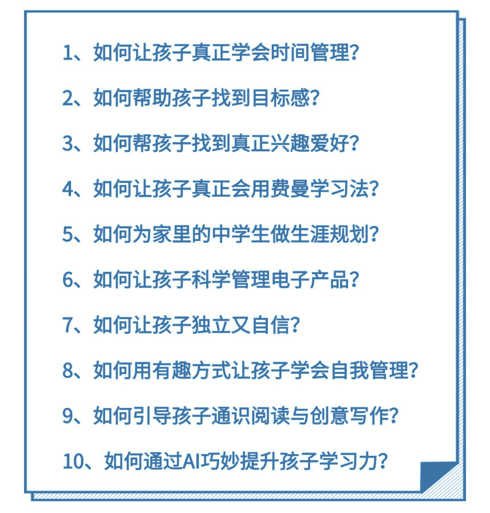

# DeepSeek 中小学家庭实操手册

面向孩子和家长的实用指南

## 给 DeepSeek 提问的十条核心法则

1、目标先行，提问更准
要点：开口前先想清楚想解决的具体问题、想要哪方面的帮助。
示范：别只问“怎么学好数学”，换成“我初二，几何证明题总卡住，如何培养解题思路”。
作用：目标越明确，DeepSeek 的回复越聚焦，不会泛泛而谈。

2、信息充足，背景要清
要点：把年龄、学习现状、遇到的具体困难说清楚。
示范：不要问“英语怎么提高”，而是说“我初三，单词背不住、听力跟不上，有没有快速提分的办法”。
作用：背景越具体，得到的建议越个性化、越好用。

3、化整为零，分步推进
要点：把复杂难题拆成几个小问题，逐个攻破。
示范：别问“未来怎么规划”，可以问“我对计算机感兴趣，具体有哪些方向可供选择，能推荐相关职业吗”。
作用：拆分后难度降低，更容易找到可执行的答案。

4、主动思考，别当复读机
要点：不要只索要标准答案，要结合自身情况去思考和实践。
示范：不问“这道题怎么做”，而是问“这道题的思路是什么？我哪里理解错了”。
作用：主动探究能加深理解，提升解决问题的能力。

5、保持开放，兼容并蓄
要点：不要固守单一答案，愿意接受不同视角。
示范：不问“文科好还是理科好”，改成“文科理科各有什么优势劣势，我该怎么判断”。
作用：多元观点能拓宽思路，做出更明智的选择。

6、保护隐私，注意安全
要点：网络交流中不要透露姓名、住址、学校等个人信息。
示范：别问“我住在 XX 小区附近有什么好补习班”，换成“XX 科目有哪些靠谱的在线学习资源”。
作用：隐私保护是线上使用最基本的安全准则。

7、理性甄别，不盲从
要点：对 DeepSeek 的输出保持判断力，不照单全收。
示范：不问“DeepSeek 说 XX 方法一定有效是真的吗”，而是问“XX 方法的原理是什么，有哪些成功案例”。
作用：理性判断能辨别真伪，避免误导。

8、把工具用成成长习惯
要点：将 DeepSeek 当作长期学习伙伴，不断探索新知识和技能。
示范：不问“怎么应付考试”，而是问“如何养成终身学习的习惯”。
作用：持续学习是个人成长的关键动力。

9、及时反馈，共建进步
要点：对回答进行反馈，分享自己的学习心得和经验。
示范：除了提问题，也主动分享使用感受和学习体会。
作用：好的反馈能让模型持续优化，也帮助更多人。

10、把学习变成乐趣
要点：把提问和探索当成一种享受。
示范：不问“学习好累怎么办”，而是问“怎么让学习更有趣”。
作用：快乐学习能提高效率，让过程更轻松愉悦。

## 用 DeepSeek 提升阅读能力的五种打法

1. 个性化推荐，点燃阅读兴趣
做法：让 DeepSeek 根据孩子的阅读历史和兴趣，推送符合年龄和认知水平的书目。
示范：一名初一学生喜欢历史故事，DeepSeek 推荐《明朝那些事儿》等通俗读物，并引导关注人物性格与历史背景。
原理：兴趣是驱动力，合适的推荐能让孩子主动读下去。

2. 即时问答互动，加深理解
做法：阅读中遇到疑问随时提问，获取解释和拓展。
示范：初二学生读《红楼梦》对贾宝玉形象困惑，DeepSeek 解释其性格特点并分析背后的社会文化因素。
原理：及时解答扫清障碍，帮助吃透文本。

3. 思维导图生成，理清结构
做法：把阅读内容自动整理成思维导图，呈现逻辑和要点。
示范：初三学生读人工智能科普文，DeepSeek 生成导图，清晰展示定义、发展历程、应用领域等。
原理：导图把零散信息系统化，提升逻辑和整合能力。

4. 创意写作辅助，拓宽思维
做法：借助素材、灵感提示和语言润色进行创意写作。
示范：高一学生想写《未来城市》科幻小说，DeepSeek 提供交通、能源、建筑方面的素材，并引导思考城市可能面临的社会问题。
原理：创意写作激发想象力和创造力，培养批判性思维。

5. 跨学科链接，搭建知识网
做法：把阅读内容与其它学科关联，形成知识网络。
示范：高二学生读《三国演义》，DeepSeek 引导关注兵法策略，并结合历史课的赤壁之战分析，同时推荐地理和古代兵器知识。
原理：跨学科学习打破壁垒，形成更全面系统的认知。

## 让 DeepSeek 成为英语学习助手

## 1. 词汇积累与记忆
做法：每天学习 5-10 个新词，并复习前一天内容。
示范：可问“今天学哪 5 个单词”，会得到单词、音标、中文释义和例句，如 apple 苹果、book 书、cat 猫、dog 狗、egg 鸡蛋。

2\. 语法理解与应用
做法：用问答方式掌握基础语法，并做简单练习。
示范：问“一般现在时的用法是什么”，会得到解释和例句“I eat breakfast every day. 我每天吃早餐。”随后可尝试造句。

## 3. 阅读理解与翻译
做法：读简短英文段落，尝试译成中文再对照修正。
示范：给出“The sun is shining brightly today.”会得到翻译“今天阳光明媚。”再练习其他句子。

4\. 口语练习与模仿
做法：模仿示范例句练习发音和语调。
示范：问“如何用英语自我介绍”，会给出“Hello, my name is Li Ming. I am 12 years old.”跟读模仿即可。

## 5. 写作训练与反馈
做法：写简短句子或段落，请其检查修改。
示范：写“I like play basketball.”会指出错误并给出“I like playing basketball.”据此修改即可。
以上方法简单易操作，适合日常学习。后续还有更进阶的玩法。

6\. 通过生成文章记忆单词
做法：输入 10 个陌生单词，让其生成一篇包含这些词的短文，在语境中记忆。
示范：输入 butterfly, forest, sunlight, adventure, discover, hidden, treasure, map, courage, mysterious，会生成关于小探险的故事，帮助记忆。

7\. 用英语单词创作趣味对话
做法：输入一组单词，生成一段有趣对话，学会在真实场景中使用。
示范：输入 pizza, hungry, share, delicious, restaurant，会生成点餐对话，方便模仿口语。

8\. 生成单词联想网络
做法：输入核心词，得到同义词、反义词、相关短语和例句，扩展词汇量。
示范：输入 happy，会得到 joyful、cheerful 等同义词，sad 等反义词，以及 feel happy 等短语和例句。

9\. 用英语单词设计谜题或游戏
做法：输入一组单词，让其生成谜语或小游戏，在互动中学习。
示范：输入 apple, banana, orange, grape, strawberry，会生成水果谜语和字母重排游戏。

10\. 生成跨学科英语学习内容
做法：输入主题如科学、历史、艺术，生成结合学科知识的英文内容。
示范：输入 solar system，会得到关于太阳系构成、行星顺序等英文介绍。

11\. 解决“哑巴英语”——模拟真实对话场景
痛点：多年学习不敢开口，缺乏实战。
做法：模拟点餐、问路、自我介绍等场景进行角色对话。
示范：餐厅点餐模拟中，逐步练习“I’d like a hamburger...”，反复练习建立自信。

12\. 解决“写作没思路”——提供写作框架和灵感
痛点：不会开头、组织内容。
做法：提供框架、开头句、过渡句、结尾句，帮助理清思路。
示范：题目 My Favorite Season，框架包括开头介绍、中间描述特点和活动、结尾总结，让学生填充即可成文。

13\. 解决“听力听不懂”——提供材料并拆解难点
痛点：语速快、词汇多听不懂。
做法：提供短篇听力材料并拆解生词、短语、句型。
示范：材料“The cat is sitting on the mat.”拆解 mat 垫子、look at 看着、现在进行时结构，先学难点再听。

14\. 解决“语法混乱”——通过例句理解规则
痛点：语法枯燥易混淆。
做法：用生动例句和对比分析讲解规则。
示范：一般现在时“I play basketball every weekend.” vs 现在进行时“I am playing basketball now.”对比说明习惯动作与正在发生动作的区别。

15\. 解决“学习没兴趣”——通过趣味故事学习英语
痛点：传统方法枯燥。
做法：生成趣味故事或情景剧融入学习。
示范：主题太空冒险的故事中出现 robot、alien、crystal 等生词和句型 Let’s explore together!，在阅读乐趣中学习。

## 让 DeepSeek 担任数学学习导师

1\. 解决“应用题理解困难”——情境化建模
痛点：小学三年级以上学生读不懂应用题文字描述，无法转化为数学问题。
做法：通过对话引导孩子把问题情境化，逐步建立数学模型。

让数学和成长的痛点，变成一次次有引导的对话

把难题拆成一步步的提问，用类比、想象和逆向推演，让孩子自己把抽象的问题具象化。下面是一套可直接模仿的对话式引导范例，以及把 DeepSeek 用作成长顾问的 20 个家庭高频场景提问法。

**数学思维训练实战**

1. 从文字题里抓取运算要素
问题：小明有5个苹果，小红有3个苹果，两人一共多少个？
引导过程：先问“题里谁拥有什么”，学生答“小明5个”，再问“小红呢”，学生答“3个”。接着问“要总数该用什么运算”，学生答“加法”5+3=8。
思维收获：学会把描述性语言拆成可计算的数据，再匹配运算。
调调用力：自然语言理解、逻辑推理、分步引导。

2. 解决几何空间想象薄弱——用动态画面描述
痛点：小学四年级以上对图形间的位置关系理解吃力。
方法：用语言描绘变化过程，让孩子在脑中形成画面。
问题：一个正方形被均分成4个小正方形，每个小正方形的边长是多少？
对话：把大正方形想象成一块巧克力，切成4块大小一样，每块是什么形状？学生答“小正方形”。对，那边长就是大正方形边长的一半。
思维收获：动态描述帮助建立空间感。
调调用力：语言描写、逻辑推理、抽象思维引导。

3. 解决分数运算混淆——分步拆解加生活类比
痛点：五年级以上学生容易混用分数加减乘除规则。
方法：借助生活场景把分数换成相同份数再运算。
问题：1/2+1/3=？
对话：想象你有半个披萨，又得到三分之一披萨，怎么算总数？学生说不会加。提示需要把两种分法统一成同样的块数。1/2变成3/6，1/3变成2/6，相加得5/6。
思维收获：类比和拆解让分数运算的核心逻辑清晰。
调调用力：类比推理、分步引导、逻辑拆解。

4. 解决方程解题方向不清——逆向推演训练
痛点：七年级以上解方程时找不到起点。
方法：从目标结果反向回溯操作顺序。
问题：解方程2x+3=7。
对话：目标是求x，先看x最后被“乘2再加3”。反过来就先减3，再除2。7-3=4，4÷2=2，所以x=2。
思维收获：逆向思考理清解题路径。
调调用力：逆向推理、逻辑拆解、分步引导。

5. 解决函数概念抽象——生活化类比
痛点：八年级以上对函数感到抽象。
方法：把函数映射成日常操作规则。
问题：什么是函数？
对话：想象一个魔法盒子，丢进去一个数，按固定规则吐出另一个数。放2出来4，放3出来6。这个规则就是函数，可能是“乘以2”，即y=2x。
思维收获：类比让抽象概念可感。
调调用力：类比推理、抽象概念具象化。

6. 解决概率直觉不足——情景模拟体验
痛点：九年级以上对概率缺乏体感。
方法：用大量重复的模拟情境建立直觉。
问题：抛一枚硬币，正面朝上的概率是多少？
对话：想象抛100次，大概有多少次正面？学生答约50次。对，所以概率是50%，即1/2。
思维收获：模拟帮助建立概率直觉。
调调用力：情景模拟、逻辑推理。

7. 解决立体几何难以想象——分层拆解
痛点：高一以上对立体图形关系理解困难。
方法：把立体问题拆成平面问题叠加。
问题：正方体的空间对角线长度是多少？
对话：先看一个面的对角线，再把这条对角线与高度结合，就能得到空间对角线。
思维收获：分层拆解降低复杂几何难度。
调调用力：逻辑拆解、空间思维引导。

8. 解决数列规律难辨——模式识别训练
痛点：高二以上不易识别数列规律。
方法：引导观察增量模式。
问题：1,3,5,7,9…下一个是什么？
对话：看相邻两数差多少？学生答每次加2。所以下一个是11。
思维收获：模式识别掌握数列递推。
调调用力：模式识别、逻辑推理。

9. 解决导数意义困惑——动态变化描述
痛点：高三以上对导数的物理和数学意义不清晰。
方法：用运动变化描述变化率本质。
问题：什么是导数？
对话：想象一辆车行驶，仪表盘的速度就是位移随时间的变化率，这正是导数的意义。
思维收获：动态描述让抽象概念落地。
调调用力：抽象概念具象化、动态描述。

10. 解决综合题无从下手——分步拆解与多角度分析
痛点：高三以上综合题感到迷茫。
方法：先分块再综合。
问题：一道题同时涉及函数、几何、代数。
对话：先分析函数性质，再结合几何图形，最后用代数方法求解。
思维收获：分步拆解掌握复杂问题解法。
调调用力：逻辑拆解、多角度分析。

以上方法共同依托自然语言理解、逻辑推理、分步引导、类比推理等能力，本质上借鉴了新加坡数学CPA学习法：从具体到图像再到符号。

**CPA学习法的核心**
具象：用实物或动手操作来理解概念。
图像：用图形、图表展示数学关系。
抽象：用符号和公式表达数学概念。
在抽象概念教学时，先“想象一下”或“类比生活场景”具象化，再逐步过渡到符号理解，更符合中小学生的认知发展规律。

**如何让DeepSeek成为孩子的成长顾问**

以下按家庭常见痛点整理提问思路。

一、时间管理
1. 痛点：学习效率低，常拖延
本质：核心是优先级选择而非延长时长。
家长困惑：为什么学很久成绩仍不提升？
高级提问：如何区分重要与紧急任务？番茄工作法怎样提升专注？
提示语：你觉得哪些事最该先做？哪些可以往后放？试试25分钟专注+5分钟休息，效果如何？
分析与回答：引导孩子先排序再用番茄法，在有限时间内高质完成。

2. 痛点：多任务并行，样样做不好
本质：一次专注单一任务效率更高。
家长困惑：同时做多件事为何更差？
高级提问：如何培养“一次只做一件事”的习惯？时间块法怎么规划？
提示语：给每项任务固定时段，做完再换下一个。
分析与回答：时间块法避免并行低效。

二、学习计划
3. 痛点：无计划，临时抱佛脚
本质：目标分解是关键。
家长困惑：为何总到考前才复习？
高级提问：大目标如何拆成小任务？倒推法怎么制定复习计划？
提示语：如果还有30天，每天该完成什么？
分析与回答：倒推法让复习有条理。

4. 痛点：计划总完不成，挫败感强
本质：可执行性比完美更重要，需弹性。
家长困惑：为何制定计划仍做不到？
高级提问：如何制定弹性计划？80/20法则如何聚焦关键？
提示语：计划不必完美，完成80%已很棒。
分析与回答：聚焦核心任务，减少挫败。

三、情绪调节
5. 痛点：学习压力大易崩溃
本质：自我接纳而非压抑。
家长困惑：为何因小事发脾气？
高级提问：如何识别并表达情绪？深呼吸法怎么缓解焦虑？
提示语：压力来时深呼吸，数到5再慢慢呼气。
分析与回答：情绪识别+呼吸练习帮助自我调节。

6. 痛点：对失败敏感，怕挑战
本质：成长型思维是关键。
家长困惑：为何不敢尝试新事物？
高级提问：如何建立成长型思维？失败复盘如何从错误学习？
提示语：失败是学习机会，一起看看哪里可改进。
分析与回答：复盘培养从错误中成长的习惯。

四、选科与选专业
7. 痛点：不知喜欢什么，选科迷茫
本质：兴趣与能力匹配。
家长困惑：为何对选科无头绪？
高级提问：怎样探索兴趣与优势？职业兴趣测试如何辅助？
提示语：你平时最爱做什么？哪门课让你觉得有趣？
分析与回答：对话+测试帮助发现优势。

8. 痛点：家长与孩子选科分歧
本质：需共同决策。
家长困惑：为何孩子不听建议？
高级提问：家庭会议如何达成共识？SWOT分析如何评估方案？
提示语：一起分析各选项优劣，哪个更适合你。
分析与回答：会议+SWOT促成共识。

五、生涯规划
9. 痛点：对未来无方向，缺乏目标感
本质：探索与尝试为主。
家长困惑：为何对未来没想法？
高级提问：如何设定短中长期目标？生涯幻游法如何激发梦想？
提示语：想象10年后的你，理想工作是什么？
分析与回答：幻游法激发梦想并落地目标。

10. 痛点：对职业世界认知不足
本质：需要信息获取与实践体验。
家长困惑：为何对职业一无所知？
高级提问：职业访谈如何了解真实工作？体验活动如何拓宽视野？
提示语：可以访谈不同职业的人听他们的故事。
分析与回答：访谈与体验提升职业认知。

六、亲子关系
11. 痛点：沟通不畅易争吵
本质：倾听与共情。
家长困惑：为何孩子不愿说话？
高级提问：非暴力沟通如何改善关系？共情对话如何理解感受？
提示语：我理解你现在很生气，能告诉我发生了什么吗？
分析与回答：共情建立信任。

12. 痛点：过度干预，孩子缺乏自主
本质：信任与放手。
家长困惑：管得越紧越叛逆？
高级提问：逐步放权如何培养自主？责任清单怎样促进自我管理？
提示语：你可以自己决定，需要帮助我随时在。
分析与回答：放权与责任清单培养自主。

13. 痛点：沉迷手机束手无策
本质：规则+替代活动。
家长困惑：为何离不开手机？
高级提问：家庭协议如何规范使用时间？兴趣替代法如何减少依赖？
提示语：一起定使用规则，再找有趣活动替代刷手机。
分析与回答：规则+替代降低依赖。

七、社交能力
14. 痛点：在校无朋友感到孤独
本质：主动与共情。
家长困惑：为何交不到朋友？
高级提问：角色扮演如何提升社交技巧？共同兴趣法如何破冰？
提示语：试着聊聊大家都喜欢的话题，比如游戏或运动。
分析与回答：主动寻找共同点建立关系。

15. 痛点：怕公众场合不敢表达
本质：练习与自信。
家长困惑：为何在家能说在外不敢开口？
高级提问：小步练习法如何提升表达？正向反馈如何增强自信？
提示语：先在家人面前练习，再慢慢扩大场合。
分析与回答：渐进练习+鼓励建立表达自信。

八、升学压力
16. 痛点：考试焦虑影响发挥
本质：认知重构。
家长困惑：为何平时好考时失常？
高级提问：认知行为疗法如何缓解焦虑？模拟考试如何适应环境？
提示语：考试只是检验学习的一种方式，不必过度紧张。
分析与回答：认知调整+模拟降低焦虑。

17. 痛点：对升学目标迷茫
本质：自我认知结合外部信息。
家长困惑：为何对升学没想法？
高级提问：目标分解法如何明确路径？学校调研法如何了解目标校？
提示语：先了解几所学校的特色，再结合兴趣选择。
分析与回答：分解+调研明确方向。

九、学习方法
18. 痛点：学习无方法效率低
本质：刻意练习与反馈。
家长困惑：为何学多久成绩不升？
高级提问：费曼学习法如何提升理解？错题本如何针对性提高？
提示语：试着把知识讲给别人听，自己是否真懂了。
分析与回答：输出+错题反馈提升效率。

19. 痛点：对某些学科抵触
本质：兴趣缺失与成就感不足。
家长困惑：为何讨厌数学/英语？
高级提问：游戏化学习如何激发兴趣？小目标达成法如何增强成就感？
提示语：把学习变成小游戏，完成一个任务就给自己小奖励。
分析与回答：趣味化+小成就重建兴趣。

十、心理健康
后续可延续上述思路，结合情绪识别、自我接纳与正向反馈，帮助孩子建立心理韧性与长期成长观。

DeepSeek 青少年陪伴手册：情绪低谷篇 · 少年商学院

20. 关键痛点：孩子长期情绪低落，家长难以介入

底层逻辑：身心稳健的形成，需要家庭层面的情感陪伴与专业层面的干预共同发力。

家长疑惑：孩子为何时常情绪低沉，缺乏活力？

进阶提问：
- 怎样通过共情式的聆听来回应孩子的情绪体验？
- 当心理困扰超出日常范畴时，如何引入专家援助进行疏导？

沟通示例：
“我现在全神贯注在你的感受上，如果你觉得需要更进一步的支持，我们可以一起约见一位专业人士聊聊。”

解析与建议：
以温暖的共情聆听搭建安全感，在必要时对接专业资源，逐步陪伴孩子恢复情绪平衡。

总结
本书梳理了20个影响中小学成长的核心议题，从时间规划到心理调适均有覆盖，每一处都给出底层拆解与可落地的实践方法。借助DeepSeek的推理拆解、分步引导、类比说明与情境演练能力，家长与孩子能够更高效地找到解决路径。

80 / 83
81 / 83

少年商学院 · DeepSeek 中小学使用手册

张华读书会

张华系少年商学院创办人，同时担任新加坡国立大学的高级访问研究员，是一位深耕创新教育的实践者，长期关注人工智能时代的家庭教养与学习策略，出版作品包括《世界是我们的课堂》和《重新学会学习》等，育有三个孩子。

他是中国线上素质教育领域的早期开拓者，过去十年间辅导过约十万名青少年提升自我管理能力，服务对象涵盖多所知名中小学、众多世界五百强企业及金融行业家庭。早年其担任《南方周末》资深记者，曾走访上百位海内外企业家，并与胡润合作出版《中国富豪这十年》。

保持每日直播的节奏，累计已进行八百余场

直播议题覆盖十大核心方向
82 / 83

