# DeepSeek 企业应用指南


## 内容简介

《DeepSeek 企业应用指南》面向企业管理者、数字化转型负责人和专业技术人员，系统地阐述了 DeepSeek 在企业场景中的落地方法论和技术实现指南。全书从部署方法到行业集成再到落地应用，全面覆盖环境搭建与配置、企业应用基础、提示语设计与优化、模型微调与个性化定制、多模态数据处理与融合、分布式训练、与企业级专用 AI 的结合、与 ERP 等企业业务管理系统的结合、创建企业应用 AI Agent、创建和集成工作流、DeepSeek 应用驱动产业转型升级，以及企业应用 DeepSeek 面临的挑战与应对等相关议题，旨在帮助读者实现从“能用”迈向“用好”，真正构建起可持续的企业 AI 能力体系。


## 自 序

### 在 AI 浪潮中探寻企业进化路径

人工智能（Artificial Intelligence，AI）正在从技术革命的边缘，走向产业结构的深处。过去两年，以大语言模型（Large Language Model，LLM）为代表的通用人工智能技术发展突飞猛进，掀起了新一轮全球性的技术竞赛与认知变革。我们不再讨论“AI 是否能够应用于企业”，而是思考“如何系统性地将 AI 嵌入企业的核心流程”。这是时代赋予所有组织的命题，也是所有企业无法回避的挑战，更是所有企业变道超车的历史性机遇。

在这场浪潮中，DeepSeek 的诞生与迅速迭代，标志着中文大模型生态迈入了一个全新的发展阶段。这一进展不仅代表着国产大模型研发能力的突破，还因其在语言理解、多任务泛化、部署灵活性上的卓越表现，成为众多企业关注与试点部署的首选平台。

然而，在实际的企业应用过程中，我们可以频繁地观察到一种“错位”的现象，即很多组织带着“个人用户的直觉”进入企业级 AI 应用实践，结果却收效甚微。这种认知偏差，不仅浪费资源，还可能会错过真正转型升级的关键机遇。

于是，在电子工业出版社学术出版分社董亚峰社长的鼓励下，我决定编写《DeepSeek 企业应用指南》，本书不谈宏观远景，也不止于应用案例，而是定位为“指南”。它不是宣传册，不是白皮书，也不是开发教程，而是试图在 DeepSeek 的企业应用中，搭建一套完整、结构化的认知框架与方法论，帮助组织找到通向“企业智能化”道路的真实坐标。

### 1. 从个人惊艳到企业冷静：AI 应用的分水岭

LLM 最初的爆发令人兴奋，当许多用户第一次接触 ChatGPT 或 DeepSeek 时，惊叹于其对自然语言的理解力与创作力。LLM 能写诗、能翻译、能答题，具备“普适智能”的潜力。随之而来的是 LLM 在各种个人应用场景的普及，如写作助手、邮件生成、代码补全、知识问答等。这些普及非常成功，营造了“AI 已经准备好、人人皆可用”的氛围。当同样的工具被引入企业时，却通常会遭遇现实的反噬。企业关心的不是一句优美的回答，而是它对企业业务生产和效率提高是否有用；它如何融入企业现有的业务系统和业务流程，并与客服流程、审批流程、生产流程协同；它的知识来源是否可控、更新机制是否健全；以及它的输出是否可追踪、是否支持权限管理与责任归属。

在这里，我们看到 DeepSeek 的企业应用与个人应用存在本质性的区别。在部署方式方面，个人用户偏向云端即用，企业重视私有部署与数据主权；在功能复杂程度方面，个人追求单点智能，企业需要构建流程级智能；在知识结构方面，个人依赖通识能力，企业必须构建行业与组织定制化的知识体系；在可控性与责任边界方面，企业必须关注可解释性、合规性与运营审计；在成本结构与性能要求方面，企业需要考虑并发、高可用、弹性扩容与长期运维策略。

企业不是放大版的个人，企业的 AI 应用也不是“换个账号接入模型”那么简单。企业要的是系统能力，而不是个体感受。

### 2. 构建认知体系是第一要务

出于深刻的反思与实践积累，我将本书定位为“指南”，而不是“实战手册”。

在 AI 快速演进的背景下，一味强调“某个企业如何落地”“某个 Prompt（提示语）如何调用”“某次试点带来多少投资回报率（Return on Investment, ROI）”，确实能吸引眼球，却不能真正为多数企业提供稳定的方向。因为技术在变、产品在变、接口在变，认知结构是唯一能变化的“元能力”。换句话说，实战案例可以参考，却不能复制；调用代码可以学习，却不能替代顶层设计和框架构建。

因此，本书将围绕六个关键路径展开。一是 DeepSeek 在中文语境下的模型能力剖析与技术优势定位；二是企业如何选择合适的部署路径、模型版本与访问模式；三是如何设计企业级的智能体体系，超越问答走向流程协同；四是如何构建支持长期演化的知识管理与检索增强生成（Retrieval-Augmented Generation, RAG）体系；五是如何处理权限、安全、合规与人机协同等企业级治理问题；六是如何在不同行业的业务流程中制定 AI 融合策略，包括金融、制造、教育、政务等。

我们将用结构化、渐进式的方式，构建一套企业“拿来即用”的 AI 应用认知地图，而不是只关注“这个企业做了什么”或“某个插件怎么接”。

### 3. 这不只是一本技术书，更是一次认知升级

很多人会问，“现在写 AI 企业应用指南，会不会太早？”在我看来，真正的拐点，通常来自提前做好认知准备的组织。

DeepSeek 的快速发展，是中文大模型生态自主能力崛起的重要标志。在 DeepSeek 基础上构建的企业应用，不再依赖外部接口、不再拘泥于英文语料、不再只能“试试看”，真正进入了深水区，即以组织的需求为锚点、以知识和系统为抓手、以可控智能为目标。

虽然未来的企业不一定都要成为 AI 公司，但一定都会成为“以 AI 为中枢的公司”。我们必须清醒地认识到，AI 的本质不是替代员工，而是改变整个企业运转的方式，即如何获取信息、如何做出决策、如何执行任务、如何评估成效。

在这场演化中，企业需要的不只是一个工具，而是一套方法论；不只是一个大模型，而是一套能力体系。DeepSeek 是技术平台，更是变革引擎。

### 4. 致所有在浪潮中探索的实践者

编写本书的过程，本身就是一次深度对话——与企业一线技术负责人的对话，与产品经理、运营总监、人力主管的对话，与许多正在搭建 AI 平台的研发团队的对话。当然，也是与 AI 工具和应用的对话。

我看到不同企业在面对 AI 时的犹豫、激进、试错与修正，也看到最早实践者积累的结构性优势，正在悄然转化为竞争壁垒。我希望本书能够为正在路上的企业提供一些稳定的结构参考，为那些犹豫不决的管理者提供行动的信心，也为所有探索数字化转型、智能化重构的人们提供一个对照的标尺。

时代的浪潮浩浩荡荡，而企业智能的建设，需要一点慢思考。我们需要的不只是技术发展的速度，更是方向的确定性。愿本书成为你探索这条路的一个清晰信标。

——作者启于 2025 年春

## 前 言

### DeepSeek 企业应用开启智能商业新时代

在当今数字化浪潮席卷全球的商业环境下，AI 技术正以前所未有的速度重塑各个行业的竞争格局。企业若想在激烈的市场竞争中脱颖而出，实现可持续发展与创新突破，就必须抓住这股科技革命的浪潮，将 AI 深度融入自身的核心业务流程与战略规划之中。DeepSeek 作为一种先进且强大的 AI 技术，迅速成为众多企业开启智能商业新时代的关键引擎，为各个领域的企业发展注入全新的活力与智慧。

“企业智能化”不是遥远的愿景，而是现实中的竞争门槛。

从办公自动化、内容生成，到智能客服、商业洞察，AI 正在成为企业日常运转的底层能力；随着大模型推理能力、自主性和行业定制化水平的不断提高，它也正在扮演越来越多过去依赖人力完成的决策与执行角色。然而，在技术变革的浪潮中，企业容易陷入两种常见的误区，一是认为 AI 只是“用起来很炫”的小工具，忽视了它对生产力系统性重构的本质；二是急于部署，缺乏系统的落地路径和清晰的方法论，导致“雷声大雨点小”。

于是，我便有了写这本《DeepSeek 企业应用指南》的初衷。

### 一、AI 发展与 DeepSeek 的时代价值

过去十年，AI 经历了三个重要阶段。

1.0 阶段是算法驱动，以图像识别、语音识别、推荐算法为代表的浅层学习模型，解决了“能看、能听、能学”的问题；2.0 阶段是数据驱动，以大数据训练为基础，提高了 AI 对复杂场景的理解能力；3.0 阶段是以大模型为核心的通用智能跃迁。3.0 阶段的核心是 LLM 具备了强泛化能力、上下文记忆能力、任务泛适应能力，能够与人进行近似自然语言的交流，甚至完成复杂逻辑链条的推理与决策。

DeepSeek 正是在这一背景下迅速崛起的。作为国产大模型中的佼佼者，其不仅具备通用模型的性能指标优势（如语言理解、代码生成、知识问答等），还具有本地化部署、行业定制能力和开放生态策略，为中国企业提供了一个更可控、更易接入的大模型解决方案。

2025 年春节后，DeepSeek 在三个维度上，逐步确立了在企业端的优势地位。

一是技术适配度高，支持私有化部署、国产算力适配、中文长文本处理等，符合国内企业对数据安全与性能的双重需求；二是工具链完备，围绕模型应用程序接口（Application Program Interface，API）、开发框架、智能体调度器等形成完整的应用链条；三是积极共建生态，与软件厂商、行业软件即服务（Software as a Service，SaaS）系统、地方政府及高校合作，持续推进“模型+行业”深度融合。

DeepSeek 不仅是一个大模型，还是企业智能化升级过程中的“基础设施”。

### 二、DeepSeek 在企业中的应用价值和部署的关键考量

在企业实际运营中，DeepSeek 的应用价值体现在多个关键环节。它能够优化客户服务体验，通过智能客服系统实现 7×24 小时的全天候服务，精准解答客户咨询，提高客户满意度与忠诚度；在生产运营方面，DeepSeek 能够协助企业优化生产流程，检测与预测质量，降低生产成本，提高生产效率与产品质量；在市场营销方面，DeepSeek 能够助力企业进行精准的市场分析、内容创作与个性化推荐，增强品牌影响力，提升营销效果与转化率；在企业管理决策层面，DeepSeek 能够整合企业内外部数据，进行深度分析与预测，为管理层提供全面、准确的信息，辅助制定科学合理的发展战略，推动企业实现高质量、可持续发展。

尽管 DeepSeek 为企业带来了诸多潜在价值，但企业在部署过程中仍需综合考量多个关键因素，确保其能与企业现有业务体系深度融合并发挥最大效能。首先，企业需明确自身的业务需求与应用场景，精准定位 DeepSeek 在企业中的应用方向，避免盲目跟风与资源浪费；其次，企业需根据自身规模、业务复杂度、预算等因素合理选择 DeepSeek 的版本、数值精度及部署方式，如本地部署、云端部署或混合部署等，以满足企业对数据安全、性能、成本等方面的个性化需求；再次，企业需关注与 DeepSeek 部署相关的配套基础设施建设，包括硬件设备、软件环境、网络带宽等，确保运行环境稳定可靠，同时建立专业的技术团队或与专业的技术服务商合作，负责 DeepSeek 的安装、调试、维护与优化工作，保障系统的持续稳定运行；最后，企业需制定完善的数据管理策略，确保数据的质量、安全与合规性，为 DeepSeek 的有效应用提供高质量的数据基础。

### 三、DeepSeek 企业应用的全方位探索

随着 DeepSeek 在企业中应用的不断深入，企业需积极探索 DeepSeek 在不同业务领域与场景中的创新应用模式。在智能制造领域，将 DeepSeek 与工业物联网（Internet of Things）、机器人技术结合，实现生产设备的智能化监控、故障预测与自动化运维，打造智能化工厂；在金融领域，利用 DeepSeek 的数据分析与风险评估能力，构建智能风控模型，优化投资决策流程，提高金融服务的质量与效率；在医疗健康领域，借助 DeepSeek 的知识整合与推理能力，辅助医生进行疾病诊断、治疗方案推荐与医学研究，推动智慧医疗的发展；在教育领域，通过 DeepSeek 为学生提供个性化学习辅导、智能答疑与学习路径规划，提升教育教学效果，提高人才培养质量。同时，企业还需不断探索 DeepSeek 与其他新兴技术的融合创新，如大数据、云计算、区块链等，充分发挥技术的协同效应，开拓更广阔的应用空间与商业价值。

本书将视角聚焦于三个方面。一是部署路径明确，从接入模型、构建智能体和工作流程到与现有系统集成、建立治理机制，每一步应如何推进？二是风险与合规意识强，如何规避大模型在企业应用中可能带来的幻觉、误导、安全隐患等？三是行业视野开阔，哪些行业已率先应用？成功与失败的案例分别体现了什么逻辑？

我们希望通过一套结构化、工程化、面向未来的 AI 企业应用地图，帮助企业以更加从容、系统化的方式拥抱大模型技术。

本书将深入探讨 DeepSeek 在企业中的应用，从技术基础、部署实施、业务场景应用到多模态数据处理、与其他系统集成及行业解决方案等多方面进行详细的阐述。通过阅读本书，读者将全面了解 DeepSeek 的技术特点与优势，掌握企业部署与应用 DeepSeek 的关键，探索其在不同领域的创新应用模式，为企业智能化转型提供有力支持与实践指导，助力企业在智能商业时代的浪潮中乘风破浪，实现可持续发展的宏伟目标。

DeepSeek 代表的大模型力量，是一次从“辅助工具”到“工作伙伴”，再到“流程主导者”的角色跃迁。这意味着，未来企业的核心竞争力，不只是人才或技术，更是“人与 AI 如何协作”的系统能力。

我们正在经历的不仅是技术进步，还是“人—机—组织”关系的重构。本书希望为这次重构提供清晰的坐标与行动指南。

愿你在阅读本书的过程中获得启发，在实践中收获成果。

## 目 录

- 第 1 章 企业应用入门
    - 1.1 AI 的发展和 DeepSeek 的横空出世
    - 1.2 DeepSeek 的核心功能和独特优势
    - 1.3 DeepSeek 在企业中的应用价值
    - 1.4 企业部署 DeepSeek 需要考虑的因素
    - 1.5 企业部署 DeepSeek 的主要环节
- 第 2 章 环境搭建与配置
    - 2.1 共性工作
    - 2.2 不同部署方式下的环境搭建与配置
    - 2.3 本地部署方式下的环境准备与配置
    - 2.4 云端部署方式下的环境准备与配置
    - 2.5 企业级部署方式下的环境准备与配置
- 第 3 章 企业应用基础
    - 3.1 数据准备与预处理
    - 3.2 模型训练与评估
    - 3.3 模型部署与应用
- 第 4 章 提示语设计与优化
    - 4.1 企业应用环境下提示语设计与优化的作用
    - 4.2 不同环节下的提示语设计与优化
- 第 5 章 模型微调与个性化定制
    - 5.1 模型微调
    - 5.2 个性化定制方法
- 第 6 章 多模态数据处理与融合
    - 6.1 数据采集与预处理
    - 6.2 特征提取
    - 6.3 模态融合
    - 6.4 模型训练与优化
- 第 7 章 分布式训练
    - 7.1 计算集群架构
    - 7.2 并行策略
    - 7.3 关键技术优化
    - 7.4 启动分布式训练
- 第 8 章 与企业级专用 AI 的结合
    - 8.1 与专用 AI 结合的原因
    - 8.2 与办公协作 AI 工具钉钉的结合
    - 8.3 与知识管理工具 HelpLook 的结合
    - 8.4 智能客服与对话工具助小咖的结合
- 第 9 章 与 ERP 等企业业务管理系统的结合
    - 9.1 与企业业务管理系统结合的特殊性
    - 9.2 制造业 ERP 系统的特点和不足
    - 9.3 DeepSeek 可以解决的制造业 ERP 系统问题
    - 9.4 DeepSeek 与 ERP 系统结合的方式、方法和步骤
    - 9.5 案例
- 第 10 章 创建企业应用 AI Agent
    - 10.1 什么是 AI Agent
    - 10.2 AI Agent 作用发挥的主要领域和适用场景
    - 10.3 AI Agent 的结构组成和创建方法
    - 10.4 基于 DeepSeek 创建企业应用 AI Agent
    - 10.5 多 Agent 系统
    - 10.6 MCP、A2A 和 ANP
- 第 11 章 创建和集成工作流
    - 11.1 什么是工作流
    - 11.2 工作流的分类
    - 11.3 工作流的适用领域和场景
    - 11.4 创建工作流的一般方法

## 第 12 章 DeepSeek 应用驱动产业转型升级

12.1 智能客服系统
12.2 质量检测与预测
12.3 内容推荐与个性化服务
12.4 疾病诊断与治疗方案推荐
12.5 供应链优化与智能调度
12.6 智能教学辅助系统
12.7 DeepSeek 及应用驱动产业转型升级

## 第 13 章 企业应用 DeepSeek 面临的挑战与应对

13.1 数据安全与隐私保护策略
13.2 模型幻觉与准确性问题
13.3 可解释性与逻辑推理能力不足
13.4 长文本处理和上下文理解的局限
13.5 领域适应性与多语言支持问题

## 第 1 章 企业应用入门

2025 年春节，全世界几乎都被一个从来没见过的词——DeepSeek 刷屏了。其实大多数人关注的只是 DeepSeek 最惊艳的那一刻，从其发展历程来看，DeepSeek 的惊艳自有渊源。DeepSeek 发展历程如图 1-1 所示。

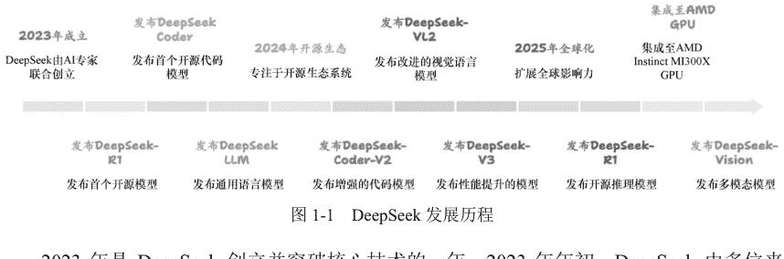

2023 年是 DeepSeek 创立并突破核心技术的一年。2023 年年初，DeepSeek 由多位来自中国顶尖高校和科技企业的人工智能（Artificial Intelligence，AI）专家联合创立，致力于通过“更高效的模型架构”与“更低成本的训练方法”实现通用人工智能（Artificial General Intelligence，AGI）。2023 年 3 月，首个开源模型 DeepSeek-R1<sup>①</sup>发布，在自然语言理解（Natural Language Understanding，NLU）任务中以百亿参数量达到千亿级模型的性能，吸引投资机构的关注，完成数亿元天使轮融资。2023 年 11 月 2 日，首个开源代码模型 DeepSeek Coder 发布，支持多种编程语言的代码生成、调试和数据分析任务。2023 年 11 月 29 日，参数规模高达 67 B 的通用语言模型 DeepSeek LLM（Large Language Model，大语言模型）发布，涵盖 7 B 及 67 B 两种规格，并提供基础模型与对话模型两个版本。

2024 年是 DeepSeek 开源生态与行业落地之年。2024 年 1 月 5 日，DeepSeek LLM 宣布在 2 万亿标记（Token<sup>②</sup>）的数据集上进行训练。2024 年 1 月 25 日，DeepSeek-Coder-V2 发布，专注于代码生成和补全。2024 年 2 月 5 日，DeepSeekMath 推出，基于 DeepSeek-Coder-V1.5 7B，专注于数学相关任务。2024 年 3 月 11 日，DeepSeek-VL 发布，一个开源视觉语言模型，具有较高的视觉任务处理能力。2024 年 5 月 7 日，DeepSeek-V2 发布，采用混合专家模型（Mixture of Experts，MoE）架构，实现了显著的性能提升。2024 年 6 月 17 日，DeepSeek-Coder-V2 推出，提高了编码和数学推理能力，增加了支持的编程语言数量。2024 年 12 月 13 日，DeepSeek-VL2 发布，改进了视觉语言模型的多模态理解能力。2024 年 12 月 26 日，DeepSeek-V3 发布，显著提高了知识类任务的效率和生成速度。

2025 年是 DeepSeek 公司多模态发展与全球化布局之年。2025 年 1 月 20 日，发布开源推理模型 DeepSeek-R1，性能超越 OpenAI 的 o1 模型，并迅速登顶中美应用商店下载榜。2025 年 1 月，AMD 宣布将 DeepSeek-V3 模型集成至 Instinct MI300X GPU，优化算力生态。2025 年 2 月 3 日，DeepSeek-R1、DeepSeek-V3 等模型上线国家超算互联网平台，加速科研与产业落地。2025 年 2 月 8 日，中国移动、中国电信、中国联通三大运营商全面接入 DeepSeek，提供专属算力方案，同时发布了千亿参数级多模态模型 DeepSeek-Vision，支持文本、图像、视频的跨模态推理，并在医疗影像分析、工业质检等领域实现商业化落地。

DeepSeek 通过技术创新和开源战略，迅速崛起并成为全球 AI 领域的重要力量，其发展速度之迅猛、技术实力之雄厚，令人刮目相看。

2025 年 1 月 31 日，英伟达宣布 DeepSeek-R1 模型登陆 NVIDIA NIM。同一时段内，亚马逊和微软也接入了 DeepSeek-R1 模型，DeepSeek 公司与微软 Azure 达成战略合作，推出企业级 AI 平台 DeepSeek Enterprise，服务金融、制造、教育等行业的 500 余家客户。2025 年 2 月 3 日，DeepSeek-R1、DeepSeek-V3、Coder 等系列模型陆续上线国家超算互联网平台。2025 年 2 月 6 日，澳大利亚政府以“担心安全风险”为由，禁止在所有政府设备中使用 DeepSeek。2025 年 2 月 8 日，DeepSeek 正式登陆江苏省苏州市，并在江苏省苏州市公共算力服务平台上完成部署上线，为用户提供开箱即用的软硬件一体化服务。截至 2025 年 2 月 9 日，DeepSeek App 的累计下载量已超 1.1 亿次，周活跃用户规模最高达 9 700 万人次。2025 年 2 月 20 日，已有超过 200 家企业宣布接入 DeepSeek。2025 年 2 月 26 日，DeepSeek 公司宣布开源 DeepGEMM。

① 这一款 R1 版本，与 2025 年 1 月 20 日发布的 R1 版本不同。2025 年 1 月 20 日推出的 DeepSeek-R1 版本在推理能力、强化学习优化、开源支持和应用场景方面都有显著提升，适合复杂的推理任务和科研应用。
② Token 和参数是 LLM 的两个不同指标。参数是模型的“大脑”，决定了模型如何处理和生成文本。Token 是模型处理文本的基本单位。二者共同作用，使模型能够处理和生成自然语言。

### 1.1 AI 的发展和 DeepSeek 的横空出世

DeepSeek 是基于 Transformer 架构的通用 LLM，是 AI 技术最新发展的典型代表。我们简要回顾 AI 的发展历史，在此基础上，能够更深刻地认识 DeepSeek 问世的意义。

#### 1.1.1 AI 的发展历程

AI 从概念提出到现在，经历了半个多世纪的时间。在半个多世纪里，AI 的发展浪潮几起几落。AI 的发展历程如图 1-2 所示，在每个发展阶段，AI 都会形成主流的技术路线，也会由于各种因素最后陷入低潮。目前，我们处于 AI 的第 3 个发展阶段。

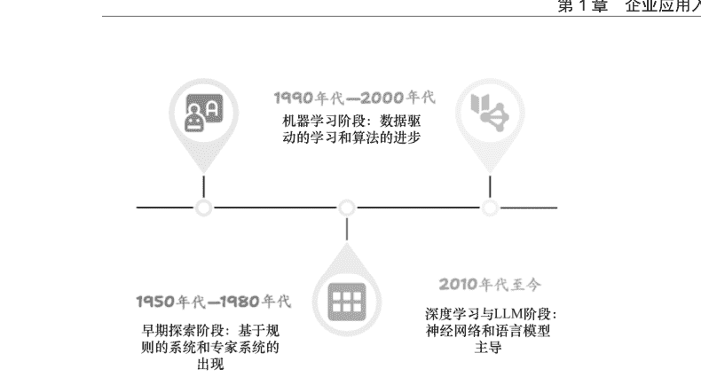

##### 1. 早期探索阶段

20 世纪 50 年代至 80 年代是 AI 的早期探索阶段。科学家们试图通过编写规则和知识库来模拟人类的智能行为，这一阶段的 AI 应用主要体现在专家系统上，如医疗诊断系统、化学结构分析系统等。这些系统在特定领域能够提供专业的建议和决策支持，然而其局限性也十分明显。专家系统的知识库需要人工构建和维护，难以应对复杂多变的现实问题，因此表现为知识获取面临瓶颈、系统缺乏通用性和适应性。

##### 2. 机器学习阶段

20 世纪 90 年代至 21 世纪初是以机器学习为主要研究方法的发展阶段。随着计算机技术的发展和数据量的增加，研究人员开始关注如何让计算机从数据中自动学习和提取知识。常见的机器学习算法包括决策树、支持向量机（Support Vector Machine，SVM）、朴素贝叶斯等。机器学习在图像识别、文本分类、推荐系统等领域取得了显著的应用成果，如在金融领域，机器学习算法被用于信用评估和风险预测。然而，传统的机器学习方法通常需要大量的特征工程，对数据质量和数量要求较高，模型的可解释性和泛化能力有限。

##### 3. 深度学习与 LLM 阶段

21 世纪 10 年代至今是以深度学习和 LLM 主导的 AI 时代。深度学习的兴起标志着 AI 进入了一个新的时代，深度神经网络通过构建多层的神经元结构，能够自动从数据中学习高层次的特征表示。GPT 系列、DeepSeek 等 LLM 是深度学习在自然语言处理（Natural Language Processing，NLP）领域的重要成果。

LLM 的发展经历了多个阶段，从 GPT-3 到 GPT-4，再到最新的 GPT-4.5 和 GPT-5，模型的参数规模和性能不断提升。例如，GPT-4 拥有超过 1 万亿个甚至达到 1.8 万亿个参数，采用 Transformer 架构和 MoE 等技术，可以处理多达 12.8 万个文本 Token，在执行 NLP 任务时表现出色。

LLM 在文本生成、机器翻译、问答系统等 NLP 任务中表现出色，它们能够生成流畅、自然的语言文本，为各种应用场景提供强大的语言理解与生成能力。然而，LLM 也存在一些局限性，如对训练数据的依赖、计算资源的高消耗、可能会出现偏见和错误信息等。例如，GPT-4 虽然在文本创作、数据分析、艺术创作等方面有较多应用，但仍会出现判断失误和“机器幻觉”，编造不存在的内容。

#### 1.1.2 全球主要 LLM 及其发展

除了广为人知的 GPT 和 DeepSeek，全球还有很多 LLM。中国信息通信研究院发布的《全球数字经济白皮书》显示，截至 2025 年 1 月，全球 AI LLM 已达 1 328 个，其中 36% 来自中国，中国成为仅次于美国的第二大 AI 技术贡献国。全球主要 LLM 如图 1-3 所示。

| 特点 | GPT系列 | DeepSeek | LLaMA系列 | Le Chat |
| :--- | :--- | :--- | :--- | :--- |
| 开发者 | OpenAI | 中国团队 | Meta | Mistral AI |
| 优势 | 语言生成、多模态处理 | NLU、自然语言生成、领域适配 | 新的模态、推理、性能 | 速度、开源、文档理解 |
| 未来 | 增强的生成式AI能力 | 算法创新，工程优化 | 优化的AI聊天机器人，用户体验 | 高精度内容理解，跨平台支持 |

图 1-3 全球主要 LLM

##### 1. GPT 系列

OpenAI 的 GPT 系列是 LLM 的代表之一。GPT-3 已经展示了强大的语言生成能力，GPT-4 在多模态处理和推理能力上有了显著提升。GPT-4 不仅能处理文本，还能接收图像作为输入，具备出色的图像描述能力。GPT-4.5 和 GPT-5 将进一步提升多模态特性的生成式 AI 能力。

##### 2. DeepSeek

DeepSeek 是一款由中国团队研发的 LLM，具备 AGI 潜质。DeepSeek 从早期版本（V1、V2）到 V3 与衍生版本 R1、R2 等，展现了国际前沿的算法创新与实际生产环境的工程优化。DeepSeek 在 NLU 和自然语言生成（Natural Language Generation，NLG）的任务上表现出色，同时也在编程、数学推理、知识检索等垂直领域具备较强的适配能力。

##### 3. LLaMA 系列

Meta 的 LLaMA 系列模型不断发展。LLaMA 4 模型正在由 10 万片 H100 GPU 组成的集群上进行训练，新版本将引入“新的模态”“更强的推理能力”“更快的性能”。Meta 将进一步优化 Meta AI 聊天机器人和其他 AI 功能，提升用户体验。

##### 4. Le Chat

Le Chat 是法国 AI 初创公司 Mistral AI 发布的 AI 大模型，首次发布就登顶法国免费 App 榜首。Le Chat 是完全开源的应用，每秒可处理 1 100 个 Token（约 1 000 个单词），比 ChatGPT 快 13 倍，图像生成能力超过 DALL·E。Le Chat 依托行业领先的视觉识别与光学字符识别（Optical Character Recognition, OCR）技术，对 PDF、Excel、日志文件、复杂图片、文档等内容进行高精度理解和解析，同时支持 iOS 和 Android。

#### 1.1.3 DeepSeek 横空出世

DeepSeek 在 2025 年春节推出的 R1 版本能够在全球所有 LLM 中脱颖而出的原因如下。

（1）技术创新与高效训练
DeepSeek-R1 在特定基准测试中接近美国先进水平，这种进步不仅体现在模型性能上，还体现在训练效率的提高上。DeepSeek 在训练过程中使用了强化学习等多种原创技术，实现了训练效率的提高。例如，DeepSeek-R1 通过强化学习替代了传统的监督微调（Supervised Fine-Tuning, SFT），提升了训练效率和模型性能。同时，DeepSeek 实现了训练和推理成本的大幅降低，DeepSeek-V3 的参数规模是 671 B，训练时长为 280 万 CPU（Graphics Processing Unit, 图形处理器）小时，训练成本却不足 560 万美元。相比之下，GPT-4o 的训练成本约 1 亿美元。

（2）开源策略推动生态繁荣
DeepSeek 完全开源，使产业链上下游的企业和开发者都能从中受益。上下游企业和开发者可以基于开源的 DeepSeek 开展各种创新应用，并成为 DeepSeek 生态建设的积极贡献者，从而推动 DeepSeek 的生态繁荣。同时，DeepSeek 支持私有化部署，对于拥有私有数据的企业是一个好处，企业能够在确保数据安全的前提下，借助大模型强大的能力提高生产效率，优化业务流程。

（3）市场表现和行业影响
DeepSeek 的出现震撼了全球模型市场，引起了硅谷多家科技巨头的关注。DeepSeek 低成本、高性能的特点不仅挑战了传统 AI 巨头的地位，推动了 AI 技术的普惠化，还以极低成本和少量芯片实现了与 OpenAI 等巨头相媲美的性能，挑战了“唯有科技巨头才能研发尖端 AI”的行业共识。DeepSeek 通过开源模式与极致性价比，迅速覆盖多种生活场景，其实用性和趣味性引发了全民关注，实现了技术破圈与大众化普及的双重突破。DeepSeek 应用在谷歌 Play 商店美国区下载榜位居榜首，发布 18 天累计下载量达 1 600 万次。DeepSeek App 在中国的下载量从 1 月 25 日的 160 万次增长到 4 月 2 日的 4 000 万次，日活用户数在 2 月 8 日达到 3 494 万人次，并在 3 月 27 日突破 1.8 亿人次。

### 1.2 DeepSeek 的核心功能和独特优势

DeepSeek 不仅在技术上取得了重大突破，还在企业应用中展现出巨大的价值和潜力。DeepSeek 强大的推理能力、免费开源策略、联网搜索功能等优势，使其在 AI 领域迅速崛起，成为企业数字化转型和智能化升级的重要工具。随着技术的不断发展和完善，DeepSeek 有望在更多领域和场景中发挥更大的作用，进一步推动 AI 技术的广泛应用和普及。

#### 1.2.1 核心功能

DeepSeek 作为一款先进的 AI 工具，在 NLP、代码生成与理解、数据分析与可视化、计算和推理、多模态处理等多个领域展现了卓越的性能和广泛的应用前景。DeepSeek 不仅能够为用户提供高效、准确的 AI 服务，还能够激发用户的创造力和想象力，为各个领域的发展带来新的机遇。DeepSeek 核心功能结构图如图 1-4 所示。

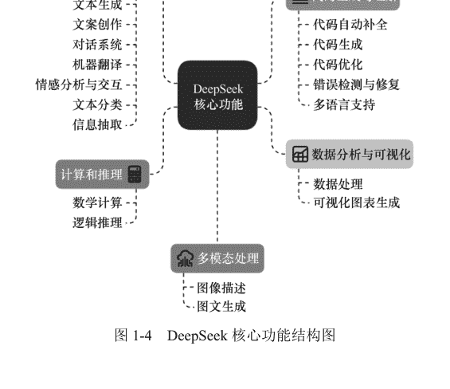

##### 1. NLP

（1）文本生成
DeepSeek 在文本生成方面能够根据给定的提示或上下文，生成高质量、连贯并富有逻辑的文本内容。无论是撰写新闻报道、商业文案，还是创作故事、诗歌等文学作品，DeepSeek 都能提供出色的生成效果。DeepSeek 能够理解用户的意图和需求，生成符合预期的文本，为用户提供创作灵感和辅助。

（2）文案创作
DeepSeek 在文案创作方面也有出色的表现，不仅能够生成广告文案、宣传文案、产品介绍等，还能够根据产品的特点和目标受众，创作吸引人的文案，帮助用户提升宣传效果。

（3）对话系统
基于强大的自然语言处理能力，DeepSeek 能够实现与用户自然、流畅地交互。DeepSeek 不仅能够理解用户的问题，还能够根据问题的语境和背景知识，提供准确、详细的回答。在多轮对话中，DeepSeek 能够记住之前的对话内容，保持对话的连贯性和逻辑性，并根据用户的追问和补充信息，进一步完善回答。在智能客服、虚拟助手等应用场景中，DeepSeek 的对话系统能够提供高效、个性化的服务，提升用户体验。

（4）机器翻译
DeepSeek 支持多种语言的翻译，包括中英互译等。DeepSeek 能够将一种语言的文本准确地翻译成另一种语言。在跨语言交流、信息获取等场景中，DeepSeek 的机器翻译功能帮助用户突破语言障碍，实现顺畅沟通。

（5）情感分析与交互
DeepSeek 具备情感交互能力，能够感知用户的情绪状态，给予相应的情感回应，提升用户体验。例如，当用户表达高兴、悲伤、愤怒等情绪时，DeepSeek 能够用合适的语言和语气进行回应，让用户感受到被理解和关心。DeepSeek 还能够对文本中的情感倾向进行分析和判断，识别文本表达的情感是积极、消极还是中性，此功能在市场调研、舆情监测等领域具有重要应用价值，能够帮助企业和组织了解公众对其产品、服务或事件的态度和看法，从而做出相应的决策和调整。

（6）文本分类
DeepSeek 可以对文本进行分类，将其归入预定义的类别中。例如，在垃圾邮件检测中，DeepSeek 能够快速准确地识别垃圾邮件，帮助用户过滤不必要的信息；在新闻分类中，DeepSeek 能够将新闻文章分类到不同的主题类别中，方便用户查找和阅读。

（7）信息抽取
DeepSeek 能够从非结构化文本中抽取关键信息，如实体名称、日期、地点等。此功能在信息检索、知识图谱构建等领域具有重要作用，能够帮助用户快速获取文本中的关键内容，提高信息处理效率。

##### 2. 代码生成与理解

（1）代码自动补全
DeepSeek Coder 能够根据开发者输入的代码片段，预测并补全后续代码。它通过分析代码的上下文和语法结构，提供准确的代码补全建议，帮助开发者提高编程效率，减少代码输入错误。

（2）代码生成
DeepSeek Coder 可以根据自然语言描述，直接生成可执行的代码。开发者只需用自然语言描述需求，DeepSeek Coder 就能生成相应的代码片段，极大地简化了编程过程。

语言描述所需的功能，DeepSeek Coder 就能生成相应的代码，简化了开发流程，提高了开发效率。

（3）代码优化
DeepSeek Coder 能够对代码进行优化，提供优化建议，如减少冗余代码、提高代码性能等。它能够帮助开发者优化代码质量，提高代码的运行效率和可读性。

（4）错误检测与修复
DeepSeek Coder 能够自动检测代码中的错误，并提供相应的修复建议。它能够识别语法错误、逻辑错误等问题，并提供详细的错误信息和修复方案，帮助开发者快速定位和解决问题。

（5）多语言支持
DeepSeek Coder 支持多种主流编程语言，如 Java、Python、C++、JavaScript、Go 等，使开发者可以在不同的编程语言环境下使用 DeepSeek Coder，满足多样化的开发需求。

##### 3. 数据分析与可视化

（1）数据处理
DeepSeek 能够处理各种类型的数据，包括 Excel 表格数据、CSV 文件数据等。它可以进行数据清洗，去除重复数据、纠正错误数据；进行数据统计分析，计算平均值、中位数、标准差等统计指标；还能进行数据分类和排序，帮助用户快速整理和分析数据。

（2）可视化图表生成
在数据分析的基础上，DeepSeek 可以将数据转化为直观的可视化图表，如柱状图、折线图、饼图、散点图等。用户只需说明想要展示的数据维度和图表类型，它就能生成对应的图表，使数据一目了然，便于理解和展示。

##### 4. 计算和推理

（1）数学计算
DeepSeek 能够处理各种复杂的数学问题，从基础的四则运算、代数方程求解，到高等数学中的微积分、线性代数等，它都能轻松应对。它可以根据题目条件，运用所学的数学知识和推理规则，找到解题思路并得到准确答案。

（2）逻辑推理
DeepSeek 能够进行演绎推理、归纳推理、类比推理等多种形式的推理任务。它可以根据给定的前提条件，推导出合理的结论，帮助用户解决逻辑推理问题。

##### 5. 多模态处理

（1）图像描述
DeepSeek 能够对图像进行描述，生成与图像内容相关的文本描述。它可以通过分析图像中的物体、场景、人物等元素，生成准确、生动的描述，帮助用户更好地理解和表达图像内容。

（2）图文生成
目前 DeepSeek-R1、DeepSeek-V3 等模型的原生版本尚未支持图片生成功能，DeepSeek-R1 支持通过生成可缩放矢量图形（Scalable Vector Graphics，SVG）代码或 HTML 文件，用户可在运行代码后将图形手动保存为 PNG、JPG 等格式的图片。另外，预计后期发布的 V4 或 R2 版本可能支持图片生成，尤其是在多模态技术成熟后。此功能在创意设计、广告制作等领域具有重要的应用价值，能够帮助用户将创意转化为直观的视觉效果。

#### 1.2.2 独特优势

对于国内企业用户来说，DeepSeek 还具备以下独特优势。DeepSeek 的独特优势如图 1-5 所示。

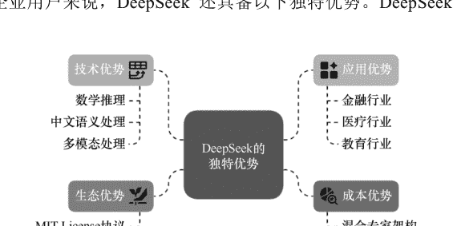

图 1-5 DeepSeek 的独特优势

##### 1. 技术优势

DeepSeek 在多个领域展现卓越的性能，如在数学推理和中文语义处理上具有显著优势，能够与国际顶尖模型相媲美。在中文理解和生成方面，DeepSeek 能够精准地把握本土用户的需求与语言习惯，为用户提供更个性化、更精准的服务。

此外，DeepSeek 具备多模态处理能力，能够处理文本、图像等多种数据类型，可以为企业提供更全面的 AI 解决方案。例如，在医疗领域，DeepSeek 能够辅助疾病诊断、进行数据治理；在传媒领域，DeepSeek 能够实现更精准的新闻推荐、高效的交互式问答及个性化内容生成服务。

##### 2. 成本优势

DeepSeek 依托 MoE 和高效训练策略，大幅降低了模型的研发与运维成本。DeepSeek-V3 训练成本约为开源模型 LLaMA 3 的 1%，DeepSeek-R1 推理成本约为国际头部闭源模型的 3%，显著降低了企业应用 AI 的门槛。DeepSeek 的 API 调用成本约为国际主流商业模型的 2%~4%，使企业能够以更低的成本使用具备国际一流性能的大模型，推动了 AI 技术的普惠化发展。

##### 3. 应用优势

DeepSeek 在多个行业具有广泛并深入的应用，如金融、医疗、教育、制造业和交通运输等。在金融行业，DeepSeek 能够提高合同质检与资产对账效率，具有精准的数据分析能力并赋能决策；在医疗行业，DeepSeek 可以助力精准诊疗与新药研发；在教育行业，DeepSeek 可以提升教学个性化和互动性。DeepSeek 还提供多层次的部署方案，大型企业可以采用私有化部署方案，深度利用其开源特性进行场景定制；中小型企业可以借助 API 快速接入模式，实现高性价比的业务创新。

##### 4. 生态优势

DeepSeek 采用 MIT（Massachusetts Institute of Technology，麻省理工学院）许可证协议，企业无须申请即可自由使用，无须担心技术封锁，促进知识的共享和技术的进步，开发者可以根据自身需求对模型进行优化和定制，提高了模型的适用性和灵活性。

DeepSeek 的出现还推动了多个行业的变革和发展，促进了产业联动与合作。例如，在信息传输、软件和信息技术服务业，华为云、腾讯云等与 DeepSeek 合作，优化模型推理服务，提高部署效率。

### 1.3 DeepSeek 在企业中的应用价值

作为一款强大的 AI 工具，DeepSeek 在多个行业展现了显著的应用价值。

##### 1. DeepSeek 在制造业中的应用价值

在制造业中，及时发现生产线上的故障隐患对于保障生产效率和降低维修成本至关重要。DeepSeek 可以通过预测性维护功能，提前识别潜在的设备故障，避免生产中断，并优化系统能耗，显著降低故障率和碳排放①。福田汽车引入 DeepSeek-V3 模型后，在研发、财务、质量等业务中实现了运营效率提高和决策支持②。

在电子产品制造行业，传统的产品质量检测主要依赖人工，效率低下并容易出现漏检和误检情况。富士康在其智能手机组装线中引入 DeepSeek 技术，利用强化学习模型协调 2000 多台机器人协同作业，实现毫秒级动态调度，解决多机器人路径冲突问题。采用 DeepSeek 技术后，富士康 iPhone 主板贴片环节的节拍时间缩短了 12%，产能提升至 120 万台/日，显著提升了产品的市场竞争力③。

##### 2. DeepSeek 在交通运输、仓储和邮政业中的应用价值

在物流配送行业，订单的合理分发和骑手的高效调度对于提高配送效率和提升客户满意度至关重要。顺丰同城接入 DeepSeek 后，实现了智能业务规划、骑手融合调度及智能订单分发等功能，能有效地预测订单波动情况，提高了订单与骑手匹配的准确性和效率。通过 DeepSeek 的应用，顺丰同城的配送效率显著提高，客户满意度也得到了提升①。

##### 3. DeepSeek 在信息传输、软件和信息技术服务业中的应用价值

在信息传输、软件和信息技术服务业，模型推理效率的提高对于降低运营成本和提高服务质量至关重要。DeepSeek 为华为云推出的推理服务提供了强大支持，使模型部署效率大幅提高②。腾讯云将 DeepSeek-R1 大模型部署到 HAI 平台，开发者仅需 3 分钟即可接入，实现了高效开发的目标③。DeepSeek 的应用使华为云和腾讯云的模型推理效率显著提高，开发者能够更快速地部署和使用 AI 模型，降低了开发成本和缩短了开发时间。

##### 4. DeepSeek 在金融业中的应用价值

在金融行业，智能合同质检和自动化估值对账对于提高工作效率和降低风险至关重要。江苏银行引入 DeepSeek，在智能合同质检环节，识别综合准确率跃升至 96%，较传统方案提升 12%；在自动化估值对账环节，实现邮件分类、产品匹配、交易录入、估值表解析等对账全链路自动化处理，识别成功率达 90%以上。按照平均手工操作水平测算，每天可以节约 9.68 小时工作量，初步实现业务集中运营，降低了人工操作的风险和成本④。

##### 5. DeepSeek 在医疗行业中的应用价值

在医疗行业，辅助诊断和治疗对于提高医疗质量和效率至关重要。深圳市龙岗区妇幼保健院将产前诊断知识库导入 DeepSeek，开发宣教对话助手与答疑助手，提高了市民获取产前诊断知识的效率。在心血管疾病诊断辅助方面，DeepSeek 通过分析患者病史和症状，为医生提供诊断建议，辅助医生进行更科学的决策。DeepSeek 的应用使深圳市龙岗区妇幼保健院的产前诊断知识普及效率显著提高，心血管疾病诊断的准确性和效率也得到了提高⑤。

##### 6. DeepSeek 在教育行业的应用价值

在教育行业，智能化教学升级对于提高教学质量和学生学习效果至关重要。高途教育接入 DeepSeek 后，在学习评估过程中能够快速生成个性化的学习规划和策略，AI 助手的日访问量提高了 200%，高中数学测评的准确率提高了 15%。DeepSeek 的应用使高途教育的教学质量和学生学习效果显著提升，个性化学习规划和策略的生成更高效⑥。

##### 7. DeepSeek 在农业领域的应用价值

在农业行业，病虫害的精准预测与防治对于保障农作物产量和质量至关重要。通过整合虫情数据、气象信息和作物生长周期等多维度数据，DeepSeek 能够精准地预测病虫害的发生风险，并为农户提供个性化植保建议。在河南云飞科技的合作案例中，DeepSeek 的应用使小麦种植区的病虫害防治更科学、精准，显著提高了农户的经济收益①。

##### 8. DeepSeek 在政务领域的应用价值

DeepSeek 可以辅助政策制定，通过数据分析和智能决策，更精准地分配公共资源，提高社会公平性。例如，在城市规划中，DeepSeek 可以根据人口分布、需求情况等因素，为公共设施的布局提供科学建议，确保资源的合理分配。

DeepSeek 在应急响应和城市治理方面也发挥着重要作用。例如，在交通管理中，结合实时交通数据、车辆行驶轨迹数据、交通设施运行数据等，DeepSeek 能够实现智能交通调度，缓解交通拥堵，提高交通安全性；在环境监测中，通过对空气质量、水质、噪声等环境数据的实时监测和分析，DeepSeek 能够及时发现环境问题，预测环境变化趋势，为环境治理提供科学依据。

##### 9. DeepSeek 在能源与可持续发展领域的应用价值

在能源管理方面，DeepSeek 可以通过对能源市场需求、能源价格波动、能源生产设备运行状态等数据的分析，优化能源生产计划，合理调配能源，提高能源利用效率，降低能源损耗。例如，正泰新能源售电交易事业部与信息管理部联合，将 DeepSeek 模型应用于上海市松江区虚拟电厂项目，通过构建多维度能源画像、智能语音交互和动态数据挖掘等功能，提高了负荷响应预测准确率，辅助运营人员进行精准数据提取与智能辅助决策②。

DeepSeek 可以在绿色计算和可持续发展决策方面提供支持。例如，通过对能源数据的分析和处理，DeepSeek 可以为企业提供节能减排的建议和方案，帮助企业实现可持续发展目标。

DeepSeek 是一种基于 LLM 的 AGI 应用。凡是涉及语言及多模态需求的场景，都可以通过使用 DeepSeek 提高效率和准确度。

### 1.4 企业部署 DeepSeek 需要考虑的因素

由于 DeepSeek 具有上述一系列核心功能和独特优势，并在企业的大部分场景中都能应用，所以在企业部署和应用 DeepSeek 以提质增效，成为企业的共同选择。企业在部署和应用 DeepSeek 时会碰到一些困扰，如 DeepSeek 有不同版本和不同参数，企业部署哪个版本、选择哪种参数更合适？DeepSeek 部署在哪里更符合企业的需要？DeepSeek 部署在哪种操作系统上、通过哪种方法部署，使企业技术人员学习曲线更平缓等。

#### 1.4.1 版本选择

在 DeepSeek 的部署中，“版本”至少有三种含义，分别是功能版本、参数规模版本和优化版本。功能版本决定了模型的核心能力和应用场景；参数规模版本影响模型的性能和资源消耗；优化版本在性能和资源之间进行权衡，适应不同的部署环境。DeepSeek 的版本选择需要根据任务复杂度、硬件条件和预算进行综合决策。

1. 功能版本的选择
功能版本是指 DeepSeek-V3 或 DeepSeek-R1。
DeepSeek-V3 是一个高性能的信息检索和 NLP 模型，适用于大规模应用。它采用 MoE 架构，广泛应用于客户服务、文本摘要和内容生成等领域。
DeepSeek-R1 是一个针对特定任务优化的轻量级模型，专注于高级推理任务，并利用强化学习技术提升推理能力，适用于涉及逻辑推理和问题求解的应用场景。

2. 参数规模版本的选择
参数规模版本是对小型模型（1.5 B、7 B）、中等模型（8 B、14 B）和大型模型（32 B、70 B、671 B）的区分。DeepSeek-V3 和 DeepSeek-R1 都支持以上参数规模。
小型模型（1.5 B、7 B）参数较少，资源消耗低，适合在本地设备上部署。例如，普通的消费级 GPU（如 RTX 3090、4090）能轻松带动模型运行，适用于轻量级任务，如搭建本地的小型智能问答系统。
中等模型（8 B、14 B）在推理能力上有显著提升，能够处理更复杂的任务，如代码补全和数据分析。中等模型对硬件的要求相对较高，需要高端的 GPU（如 A100 或 H100）。
大型模型（32 B、70 B、671 B）代表 DeepSeek 的顶尖水平，能够进行复杂的推理和决策。大型模型对硬件和计算资源的需求极大，通常需要在大规模的云端计算环境中才能充分发挥优势。

3. 优化版本的选择
优化版本是对满血版、蒸馏版和量化版的区分。在 DeepSeek 的本地化部署中，满血版、蒸馏版和量化版的区分适用于 DeepSeek-R1，DeepSeek-V3 目前并没有明确的证据显示存在类似的版本区分。
（1）满血版
满血版是 DeepSeek-R1 的完整版本，参数量高达 671 B，通过强化学习训练优化推理能力，性能对标 OpenAI 的商业版本。虽然满血版在复杂任务中思考时间更长，但输出质量也是远超其他版本的。满血版适用于处理复杂推理任务、大规模内容生成、跨领域深度理解等高端应用场景。
满血版需要 16 张 A100 显卡和 2 TB 固态硬盘，部署成本极高，适合企业级应用和科研项目。

（2）蒸馏版
蒸馏版通过 DeepSeek-R1 生成的数据对开源模型（如 Qwen、LLaMA）进行 SFT，模型参数较少（7 B、14 B、32 B、70 B 等），本质上是“带有 R1 风格”的 Qwen 或 LLaMA 模型。蒸馏版的运行速度更快，但由于未经过强化学习训练且参数规模较小，所以输出质量远低于满血版。蒸馏版适合技术极客、有高性能设备的开发者及企业级应用中的特定场景，如私有数据库搭建和模型微调。

蒸馏版的硬件需求相对较低，70 B 蒸馏版需要 150 GB 以上的显存，8 张 NVIDIA GeForce RTX 4090 显卡或 6 张 NVIDIA GeForce RTX 5090 显卡即可满足需求；32 B 蒸馏版需要 70 GB 以上的显存，3 张 NVIDIA GeForce RTX 4090 显卡即可实现；8 B、7 B、1.5 B 等较小的模型对计算机性能要求很低，近几年普通计算机也能轻松运行。

（3）量化版
量化版通过降低模型精度（如 4-bit 量化）减少显存占用，可以在消费级显卡上运行较大的模型，可能会影响推理精度，适合普通用户。

量化版的硬件需求较低，70 B 量化版需要 48 GB 内存，2 张 NVIDIA GeForce RTX 4090 显卡即可满足需求；32 B 量化版需要 20 GB 以上的显存，魔改 22 GB 显存的 NVIDIA GeForce RTX 2080 Ti 显卡都能够胜任。

4. 优化版本和参数规模版本的对应关系
在 DeepSeek 的本地化部署中，优化版本和参数规模版本之间存在一定的对应关系，DeepSeek 本地化部署中优化版本和参数规模版本的对应关系如表 1-1 所示。

表 1-1 DeepSeek 本地化部署中优化版本和参数规模版本的对应关系

| 优化版本 | 参数规模版本 | 性能与资源消耗 | 适用场景 |
| :--- | :--- | :--- | :--- |
| 满血版 | 671 B | 性能最强，资源消耗最高 | 复杂推理任务，如金融风控、基因分析等 |
| 蒸馏版 | 1.5 B、7 B、8 B、14 B、32 B、70 B | 性能接近满血版，资源消耗降低 | 资源有限的场景，如中小企业本地部署、客服系统、教育辅导等 |
| 量化版（FP8/INT8） | 基于蒸馏版或满血版进行量化，参数规模与原版相同 | 在保持性能的前提下，显存占用减少，推理速度提高 | 移动端、嵌入式设备，如智能硬件、机器人等 |

#### 1.4.2 数值精度选择

在 LLM 中，数值精度是指模型在计算和存储过程中使用数值表示的精确程度，通常以浮点数的位数进行衡量。数值精度的选择直接影响模型的计算效率、存储需求和推理性能。

1. 模型数值精度的定义
数值精度是计算机能够表示的最小非零浮点数与 1 之间的差值，由浮点数的位数决定。

#### 1.4.2 数值精度选择

模型精度分为以下 5 个类别。

- ① FP32（单精度浮点数）是一种 32 位的浮点数格式，使用 32 位存储，能够表示约 7 位有效数字，提供较高的数值精度，适用于大多数深度学习模型的训练和推理过程。它在数值表示上更精确，适用于需要高精度计算的任务。
- ② FP16（半精度浮点数）使用 16 位存储，精度较低，但计算速度更快，适用于资源受限的场景。
- ③ FP8（8 位浮点数）是一种 8 位的浮点数格式，通过减少数值的位宽，降低计算和存储成本。DeepSeek 在训练过程中使用 FP8 减少 GPU 内存使用和计算开销，同时保持较高的模型性能。
- ④ TF32（Tensor Float 32）是一种特殊的浮点数格式，虽然保持了 FP32 的动态范围，但尾数位减少到 10 位，适用于深度学习训练。
- ⑤ INT8 或 INT4（8 位或 4 位整数量化）将浮点数转换为低精度整数，减少存储和计算需求，常用于推理阶段。例如，INT4 是一种 4 位的整数格式，通过将模型参数从浮点数转换为低精度整数，可以显著减少模型的存储和计算资源占用。INT8 或 INT4 虽然可以加速模型的推理过程，但可能会对模型的精度产生一定影响。

##### 2. 不同精度对应用场景的影响

FP32 适用于科学计算、工程模拟、财务分析等需要高精度计算的领域及需要高精度计算的模型训练任务。虽然高精度格式能够提供更准确的计算结果，但会占用更多的存储空间和计算资源。

FP8 在 DeepSeek 模型中被用于大多数计算密集型操作，可降低训练成本，如通用矩阵乘法（General Matrix Multiplication，GEMM）。BF16（16 位大幅度浮点数）①和 FP32 在需要高精度的关键操作中使用，如嵌入层和注意力机制，确保数值稳定性。混合精度策略在性能和精度之间取得了最佳平衡。

通过模型量化技术将模型参数从浮点数转换为 INT4 低精度整数，可以减小模型尺寸、提高计算速度、降低能耗。例如，DeepSeek-7B-chat 模型使用 4 位量化技术（如 QLoRA）进行微调，显著减少了随机存取存储器（Random Access Memory，RAM）占用，同时保持了较高的推理性能。低精度格式适用于资源受限的设备和需要快速推理的场景。

> ① BF16，全称 BFloat16，是一种 16 位的浮点数格式。BF16 的设计目标是在保持与 FP32（32 位单精度浮点数）兼容的同时，减少计算和存储需求。BF16 的指数部分与 FP32 相同，因此它能够表示的数值范围几乎与 FP32 一致，使 BF16 在数值稳定性方面表现良好，特别是在涉及较大数值范围的计算中。BF16 的尾数部分为 7 位，比 FP32 的 23 位尾数少，因此其精度低于 FP32。然而，对于许多深度学习应用来说，这种精度已经足够，尤其是在模型训练和推理过程中。

##### 3. 实际应用中的选择

DeepSeek 在本地化部署中，不同精度对后期企业应用的影响主要体现在以下几个方面。

###### （1）资源占用与硬件需求

高精度（如 FP32、FP16）模型在推理过程中需要更多的计算资源和显存，对硬件要求较高。例如，DeepSeek-R1 32 B 模型在 FP16 精度下，显存需求约 1.3 TB，需要高性能的图形处理器（Graphics Processing Unit，GPU）支持。低精度（如 INT8、4-bit 量化）模型通过量化技术减少显存占用和计算量，可以在普通 GPU 甚至中央处理器（Central Processing Unit，CPU）上运行。例如，使用 INT8 量化，内存占用可以从 381.47 MB 锐减至 95.37 MB，显著降低了对硬件资源的要求。

###### （2）模型性能与精度

高精度模型在金融风险评估、医疗诊断辅助等对精度要求极高的复杂任务中表现更好。例如，DeepSeek-R1 32 B 模型在 FP16 精度下，能够在复杂的语义理解任务中保持较高的准确率。低精度模型在某些任务上可能会使精度下降，但在特定任务中仍能保持良好的性能。例如，4-bit 量化后的 DeepSeek-R1 32 B 模型在代码生成任务中，生成速度可以提高 10%～15%，生成代码的准确性和可读性并未受到明显影响。

###### （3）部署灵活性

高精度模型通常需要高性能计算环境，部署在企业级服务器上，适用于对性能和稳定性有严格要求的场景。低精度模型可以部署在资源受限的设备上，如嵌入式设备、移动设备等，适用于实时交互应用，如聊天机器人、智能客服等。

###### （4）成本效益

高精度模型的部署和运行成本较高，适合对性能要求极高的企业应用。低精度模型的部署和运行成本较低，适合资源有限的企业，尤其适用于对精度要求不高的场景。

###### （5）安全性与稳定性

高精度模型在高性能计算环境中运行，通常具有更高的稳定性和安全性。低精度模型通过量化技术优化，也能在资源受限的环境中保持较高的稳定性和安全性，但需要确保量化过程的正确性。

当选择 DeepSeek 的数值精度时，企业需要根据自身的硬件条件、实际应用需求及对模型精度和性能的期望，进行综合考虑。高精度模型适用于对性能和精度要求极高的场景，而低精度模型可以在资源有限的环境中提供更高的灵活性和成本效益。

#### 1.4.3 部署方式选择

部署方式是将软件系统或应用程序安装、配置和运行在特定的计算环境中的方法和策略。不同的部署方式适用于不同的应用场景、用户需求和技术条件。通常将部署方式分为本地部署、云端部署和企业级部署。

##### 1. 本地部署

DeepSeek 的本地部署是将模型完全部署在企业的本地服务器或个人计算机上，确保数据完全自主可控并符合合规要求。本地部署具有高隐私性、数据安全、用户完全控制等优点，需要本地硬件支持，如 NVIDIA GPU 等，适合个人开发者、小型企业、科研实验，以及对数据安全要求高的应用。

##### 2. 云端部署

DeepSeek 的云端部署是将模型部署在云服务器上，通过云服务提供商的资源对模型运行进行管理。云端部署具有便捷性、弹性扩展、安全性等优点。便捷性指通过云服务提供商的资源，可以快速部署和扩展模型，无须自行准备硬件环境；弹性扩展指用户根据业务需求，可以灵活地调整资源使用量，实现弹性扩展；安全性指云服务提供商通常提供完善的安全保障措施，确保数据的安全性和合规性。云端部署依赖网络连接，适合中大型企业和高并发处理的应用。

##### 3. 企业级部署

DeepSeek 的企业级部署是将模型部署在企业级的硬件或云服务器上，满足企业对高性能和大规模应用的需求。企业级部署具有高性能、定制化等优点，高性能指企业级硬件或云服务器通常具备更高的计算能力和更大的存储容量，能够支持复杂的 AI 应用；定制化指企业可以根据自身业务需求，对模型进行微调和优化，实现定制化的 AI 解决方案。企业级部署适合对性能要求高、预算充足的企业用户，以及需要处理大规模数据和复杂任务的企业，如大型企业、金融机构、政府机构，以及需要高度安全和定制化应用的客户。

#### 1.4.4 部署方法选择

DeepSeek 每种部署方式都有独特的特点和适用场景，还有对应的部署方法。

##### 1. 本地部署的方法选择

DeepSeek 本地部署通常包括使用 Ollama、使用 vLLM、通过 Chatbox 前端搭建、使用 Docker 和使用 Cherry Studio 等方法，每种方法都有对应的优缺点。

###### （1）使用 Ollama

Ollama 的优点是部署简单、对硬件要求低、交互方便、可选择的模型丰富。Ollama 支持 macOS 操作系统、Linux 操作系统和 Windows 操作系统，用户只需通过简单的命令行操作即可完成安装和部署，无须复杂的环境配置和依赖管理。Ollama 提供命令行交互界面，用户可以直接在命令行中与 DeepSeek 模型进行对话，操作简单直观，适合快速测试和验证模型的基本功能。此外，Ollama 的模型库中包含多种开源模型，除 DeepSeek 外，还有阿里云通义千问的 Qwen2.5、Meta 公司的 LLaMA 3.3 等，用户可以根据需求选择不同的模型进行部署和使用。

在硬件要求方面，即使 Ollama 只有 CPU 和 16 GB 内存，也能运行 7 B 参数的 DeepSeek 模型，使更多用户能够在本地运行该模型。

Ollama 有两个缺点：一是存在性能限制，二是功能拓展性弱。由于 Ollama 主要面向个人开发和实验场景，所以性能优化程度相对有限，当处理大规模数据或高并发请求时，可能无法满足其需求。此外，Ollama 专注于单机本地化运行，缺乏对分布式部署、多 GPU 并行等高级功能的支持，难以满足企业级应用中对模型性能和扩展性的高要求。

###### （2）使用 vLLM

vLLM 有 3 个优点，分别是高性能、适合生产环境和定制化能力强。vLLM 优化了显存管理和批处理，支持千级别并发请求，适合企业级 API 服务、高并发推理等场景，能够高效地处理大规模的数据和请求。

vLLM 支持分布式部署、动态批处理、多 GPU 并行等高级功能，可以满足企业级应用对模型性能和扩展性的高要求，适用于将 DeepSeek 集成到其他应用程序中，如开发智能助手、构建批量文档处理系统等。

用户可以通过 Python 代码调用 vLLM，并根据业务需求修改模型参数或添加自定义的业务逻辑，实现对模型的深度定制和优化。

vLLM 的缺点是部署复杂，对硬件要求高。vLLM 依赖 Python 环境，需要用户手动配置 GPU 驱动和统一计算设备架构（Compute Unified Device Architectures，CUDA）等依赖项，对用户的技术水平要求较高，部署过程相对烦琐，需要一定的技术知识和经验。同时，vLLM 必须使用 NVIDIA GPU，并且显存越大越好，才能充分发挥其高性能计算能力，这提高了硬件成本和部署门槛，不适合硬件配置较低的用户。

###### （3）通过 Chatbox 前端搭建

通过 Chatbox 前端搭建的优点是操作便捷，并且 Chatbox 具有丰富的功能和多平台支持能力。

Chatbox 提供图形化的用户界面，用户无须在命令行中操作，只需通过简单的点击和配置即可完成部署和使用，降低了操作难度，适合对命令行不熟悉或希望获得更直观交互体验的用户。

Chatbox 支持联网搜索、本地知识库集成等高级功能，用户可以根据需求灵活配置和使用这些功能，提升模型的实用性，扩大应用范围。Chatbox 还支持 Windows 操作系统、Mac 操作系统和手机等多种平台，用户可以在不同设备上随时随地使用 DeepSeek 模型，满足多样化的使用场景和需求。

通过 Chatbox 前端搭建有两个缺点：一是需要依赖 Chatbox 的稳定性，Chatbox 本身可能会存在一些稳定性问题，如在某些系统环境下可能会出现兼容性问题或运行卡顿等问题，可能会影响用户的使用体验；二是功能定制受限，Chatbox 虽然提供了一些基本的配置选项，但在功能定制方面相对有限，对于一些特殊的业务需求或高级功能的实现，可能无法像通过代码调用或自定义开发一样灵活和深入。

###### （4）使用 Docker

使用 Docker 的优点是环境隔离、可移植性强、资源管理灵活。

Docker 提供了良好的环境隔离，避免了不同环境之间的冲突，确保了模型运行环境的一致性和稳定性，特别是在不同操作系统或硬件环境下进行部署时，能够有效地减少环境差异导致的问题。

使用 Docker，用户可以轻松地将 DeepSeek 及其运行环境打包成 Docker 镜像，并在不同的服务器或设备上迁移和部署，提高了模型的可移植性和复用性。

此外，Docker 允许用户对容器的资源使用进行精细的控制和管理，如限制 CPU、内存等资源的使用，从而在多个用户或多个应用程序共享同一台服务器时能够合理分配资源，避免资源竞争和冲突。

Docker 的缺点是安装和配置复杂，用户需要先安装 Docker 和 Docker Compose 等工具，并要熟悉 Docker 的基本操作和配置方法。对于不熟悉 Docker 技术的用户来说，存在一定的学习曲线和操作难度。Docker 容器本身会占用一定的系统资源，可能会对服务器的整体性能产生一定的影响。

###### （5）使用 Cherry Studio

使用 Cherry Studio 的优点是 Cherry Studio 提供了集成化体验，具有丰富的功能和工具，并支持多模型协同。

Cherry Studio 提供了一个完整的集成开发环境，用户可以在集成开发环境中方便地进行模型的部署、管理和调用，无须在多个工具和平台间切换，提高了工作效率和使用便捷性。除基本的模型部署和调用功能外，Cherry Studio 还提供一系列丰富的功能和工具，如数据可视化、模型评估、任务调度等，帮助用户更全面地管理和优化模型的应用。Cherry Studio 可以同时部署和管理多个不同的模型，并实现协同工作，满足复杂业务场景对多个模型联合应用的需求。

使用 Cherry Studio 的缺点是学习成本较高。Cherry Studio 功能丰富且复杂，对于初次使用的用户来说，需要花费一定的时间熟悉和掌握其操作流程和功能，存在一定的学习曲线。此外，Cherry Studio 系统资源占用大。由于集成了众多功能和工具，所以 Cherry Studio 对系统资源的要求也相对较高，运行时可能会占用较多的内存和 CPU 资源。

##### 2. 云端部署的方法选择

DeepSeek 的云端部署的方法包括使用 CAP（Cloud Application Platform，云原生应用开发平台）、使用云服务器、使用云 API 调用和使用混合部署等。

###### （1）使用 CAP

CAP 是一个一站式的应用开发及应用生命周期管理平台，内置了丰富的 Serverless（无服务器）和 AI 应用模板、先进的开发者工具和企业级的应用管理功能。无论是个人开发者还是企业级开发者，都能利用 CAP 快速地构建云上应用并持续迭代，从而大幅提高研发、部署和运维的效率。CAP 具有快速部署、弹性扩展、便捷管理和功能丰富等优点。

通过 CAP，可以快速创建和部署 DeepSeek 模型，无须复杂的环境配置和依赖管理①。云原生平台还支持按需扩展资源，能够灵活应对业务波动，在高并发情况下也能稳定运行。CAP 提供了便捷的管理工具，简化了系统的维护工作，用户可以专注于模型的应用和优化。此外，CAP 还支持多种模型版本和配置选项，用户可以根据具体需求选择合适的模型和资源配置。

CAP 有 3 个缺点：一是需要稳定的网络连接，网络波动可能会影响系统性能；二是数据存在安全隐患，因为数据存储在云端，所以需要考虑数据安全和隐私保护的问题；三是相比本地部署，性能可能会受云服务商资源的限制。

> ① 依赖管理是软件开发中的一个重要概念，它涉及对软件项目中依赖的外部库、框架、模块等资源的管理和控制。

###### （2）使用云服务器

使用 AWS、Google Cloud、Azure、阿里云、腾讯云等云服务器进行 DeepSeek 的云部署有 4 个优点：一是支持弹性扩展，用户可以根据需求动态调整计算资源（如 GPU 实例），适合大规模训练和高并发推理；二是可以实现低成本启动，按需付费，无须一次性投入大量资金；三是维护简单，云服务商提供预配置的环境和工具，降低部署难度，用户可以快速上手；四是可以全球访问，通过网络随时随地访问模型，适合分布式团队和远程办公。

使用云服务器有 3 个缺点：一是长期成本高，长期高频使用按需付费模式可能比本地部署更贵；二是存在数据隐私泄露风险；三是需要稳定的网络连接，网络延迟可能会影响使用体验。

###### （3）使用云 API 调用

云 API 调用是通过发送超文本传输协议（Hyper Text Transfer Protocol，HTTP）请求操作和管理云服务提供商提供的各种云资源和服务的过程。云 API 通常基于 RESTful API 标准设计，允许用户通过简单的 HTTP 请求执行复杂的操作，如创建虚拟机、配置存储、调整网络设置等。云 API 调用具有低成本、灵活选择和快速应用等优点，能够帮助用户快速管理和操作云资源，提高开发和运维效率。

使用云 API 调用有 3 个缺点：一是需要共享算力，如果调用了劣质 API，那么风险较高，需要企业具备一定的甄别能力；二是数据存储在云端，存在一定的安全风险；三是性能可能会受到云服务商资源的限制，不适用于对性能要求极高的场景。

###### （4）使用混合部署

混合部署是一种结合了本地部署和云端部署优势的部署方式，允许企业在本地服务器和云端服务器上灵活分配资源和数据。混合部署适用于需要同时处理本地和云端数据的场景，以及从本地向云端迁移的过渡阶段。

混合部署具有一系列优点，如灵活性高、可扩展性好、成本效益高、安全性好、合规性高、业务连续性和可靠性高等。混合部署将敏感数据和关键应用部署在本地服务器上，将非敏感数据和应用运行在公有云中，确保数据的安全性和隐私性。根据业务需求向上或向下扩展资源，在高峰期可以利用云端资源提高计算能力。通过战略性地使用公共云资源，企业可以降低成本，避免不必要的硬件投资。通过将某些类型的信息存储在组织本地环境中，可以满足相应法律法规的要求。混合部署还可以提供更好的灾难恢复解决方案，通过将数据和应用冗余分布在本地和云端，可以在发生故障时快速恢复业务，确保业务连续性。

混合部署的缺点非常明显。一是复杂性高，企业需要管理和维护本地和云端两套环境，提高了系统复杂度；二是具有一定的安全风险，混合环境可能包含了一些新的安全风险，需要确保不同环境的安全性；三是管理成本高，当成本没有得到有效的控制和监控时，可能会出现成本增加的情况；四是需要数据集成，保持私有云和公共云的数据一致性和集成至关重要，实现起来可能较复杂；五是依赖网络连接，要确保本地和云端有强大并安全的连接，避免数据传输中断；六是对技能和专业知识要求高，企业需要具备适应混合环境特性的必要技能，确保 IT 团队能够有效地管理本地和云端资源。

混合部署适用于医疗、零售、金融、政府等场景，因为这些场景中的一部分数据需要存储在本地或私有云上，另一部分数据需要存储在公有云上供公共使用。

##### 3. 企业级部署

DeepSeek 的企业级部署方法包括云端部署、本地或内网部署、混合部署、容器化或微服务部署、边缘部署和联邦部署。每种方法都有独特的优点和适用场景，选择合适的部署方法可以更好地满足不同企业的需求，确保模型的高效运行和数据安全。

###### （1）云端部署

云端部署是外部客户端通过 RESTful API 或 gRPC 等 API 网关接口协议访问部署在云端的模型服务。云端部署实现了安全访问与数据加密，用户通过点对点专线对接模型服务和企业内应用；同时，云平台采用虚拟私有云（Virtual Private Cloud，VPC）、安全组策略、访问控制列表（Access Control List，ACL）等方式确保数据传输和存储的安全性。云端部署采用 Kubernetes 等分布式计算框架和分布式文件系统（Hadoop Distributed File System，HDFS）等存储系统管理计算资源的并发效率和海量数据的访问效率，同时确保资源的可扩展性。

云端部署有 3 个主要特点：一是具有灵活性与可扩展性，可以根据业务需求动态调整资源，无须担心硬件限制；二是具有较高的成本效益，企业无须投资昂贵的硬件设备，只需按需支付云服务费用，大幅降低了初期投资成本；三是维护简便，云服务提供商负责硬件维护和软件更新，企业可以专注于核心业务，减少 IT 部门的负担。

云端部署的优点是灵活性高、可扩展性强、成本效益高、维护简便；缺点是需要特别关注数据安全性和隐私保护、网络依赖性强。

###### （2）本地或内网部署

本地或内网部署指在企业内部数据中心已有的高性能 GPU 服务器或服务器集群上部署 DeepSeek 模型服务，或企业直接采购 DeepSeek 一体机或一体机集群。本地或内网部署通过内网 IP 或专用网络实现模型推理任务的调度和访问，结合企业已有的防火墙、入侵检测系统等安全体系保障数据安全与访问控制，具有较好的安全防护体系。

本地或内网部署的特点是数据安全性高，所有数据均在内部网络中传输，避免了外部网络风险。同时，资源自主可控，企业可以完全掌握硬件、软件和安全策略，便于根据企业需求进行定制化优化。

本地或内网部署的优点是数据安全性和系统可控性高，便于进行定制化优化；缺点是需要大量的前期投资和专业的运维团队，扩展性相对有限。

###### （3）混合部署

混合部署在实现上采用分层架构设计，将 DeepSeek 中或小参数模型部署在企业内网环境或边缘节点，处理前端需要实时响应的推理任务；将 DeepSeek 大参数或全参数模型托管在专有云环境，处理复杂场景的推理任务；边缘设备对数据作初步处理和本地推理，将需要进一步处理的关键信息推送至云端，由云端模型进行二次推理和精细化分析。

混合部署的主要特点有三个：一是具有灵活的数据管理机制，企业可以将敏感数据存储在本地，非敏感数据存储在云端，实现数据的安全与高效利用；二是能够根据业务需求动态调整资源分配，在高峰期利用云端资源扩展计算能力，在低谷期则使用本地资源以降低成本；三是提供了更好的业务连续性保障，通过本地和云端的冗余部署，确保在部分系统故障时业务仍能正常运行。

###### （4）容器化或微服务部署

容器化或微服务部署在实现上有不同的方案。Docker 容器化将 DeepSeek 模型及依赖环境打包成 Docker 镜像，实现一键部署。Kubernetes 编排利用 Kubernetes 等容器编排工具，实现多实例部署、自动伸缩、故障恢复及迭代更新等。微服务通信通过 RESTful API、高性能远程过程调用协议（gRPC Remote Procedure Calls，gRPC）或消息队列等机制，将大模型服务与其他业务模块解耦，实现灵活调用和分布式协作。

容器化或微服务部署有 3 个主要特点：一是具有高可移植性，容器化部署使服务在不同环境间迁移时降低部署和配置的复杂性，提高了系统的跨平台兼容性和迁移效率；二是可以灵活扩展，便于管理，借助 Kubernetes 等平台，可以动态调整副本数、监控容器健康状况，并实现自动故障恢复，保证服务稳定性；三是降低了开发与运维的复杂性，微服务架构使各个模块解耦，便于独立开发、测试和更新，提高团队开发效率，同时便于后期系统的维护和监控。

容器化或微服务的缺点是企业需要具备相应的技术能力，容器管理平台的配置和维护可能会带来额外的复杂性。

###### （5）边缘部署

边缘部署包括边缘节点部署和数据预处理。边缘节点部署将 DeepSeek 模型部署在靠近数据源的边缘节点，减少数据传输延迟。数据预处理是边缘设备对数据进行初步处理和本地推理，减少数据上传量。

边缘部署有 3 个主要特点：一是减少了数据传输延迟，适合实时性要求高的场景；二是实现了带宽优化，减少了数据上传量，适合带宽有限的环境；三是实现了离线运行，在网络不稳定或离线时仍能正常运行。

边缘部署的缺点是，需要在边缘节点上进行数据预处理，这可能会增加边缘设备的计算负担。

###### （6）联邦部署

联邦部署通过联邦协议将多个独立系统连接起来，从而实现数据和资源的共享与协作。联邦部署可以在保护数据隐私的前提下进行数据共享和分布式计算。

联邦部署有 3 个主要特点：一是实现了跨组织协作，多个组织需要共享数据但保持独立管理；二是需要在保护数据隐私的前提下进行数据共享；三是需要在多个节点上分布式处理数据，如联邦学习。

联邦部署的缺点是需要多个组织或部门的紧密合作和协调，这增加了管理和沟通的成本。

#### 1.4.5 操作系统选择

在 DeepSeek 的部署中，操作系统是一个重要的考虑因素。

##### 1. 本地部署方式下的操作系统选择

在 DeepSeek 的本地部署中，操作系统平台的选择包括 Linux 操作系统、macOS 操作系统和 Windows 操作系统。

###### （1）Linux 操作系统

Linux 操作系统在服务器环境下表现出色，能够高效地管理资源和处理高并发任务。Linux 操作系统提供强大的性能优化工具和灵活的配置选项，适合深度学习模型的部署和运行。Linux 操作系统对资源的管理和调度更精细，可以更好地满足 DeepSeek 的运行需求，提高系统的稳定性和效率。同时，Linux 操作系统拥有丰富的开源工具和社区支持，用户可以方便地找到所需的软件和解决方案，降低部署和维护的成本。

Linux 操作系统具有一定的学习难度，对于不熟悉 Linux 操作系统命令行和系统管理的用户，存在一定的学习成本和使用门槛。部分 DeepSeek 相关工具或依赖可能会在 Linux 操作系统上存在兼容性问题，需要额外的配置和调整。

对于后期的领域知识训练，Linux 操作系统提供了强大的命令行工具和脚本支持，便于进行模型训练和数据处理的自动化和批处理操作。同时，Linux 操作系统的稳定性和安全性也为领域知识训练提供了可靠的环境。如果用户不熟悉 Linux 操作系统环境，可能会增加领域知识训练的复杂性和时间成本。

###### （2）macOS 操作系统

macOS 操作系统界面友好，操作简便，用户可以轻松地完成 DeepSeek 的安装和部署过程，降低了使用门槛。macOS 操作系统与 Ollama 等工具集成良好，通过简单的命令即可完成模型的下载和运行，方便用户快速上手。此外，苹果硬件有良好的兼容性，能够充分利用 Mac 计算机的性能，减少硬件适配问题。

macOS 操作系统存在一定的性能限制。与 Linux 操作系统相比，macOS 操作系统的系统架构和资源管理方式，在运行 DeepSeek 时性能可能略逊一筹，特别是在多任务处理和资源密集型任务上。此外，在 macOS 操作系统上可选择的 DeepSeek 版本相对较少，可能无法满足一些高级用户或特定领域的需求。

对于后期领域知识训练，macOS 操作系统提供了良好的开发环境和工具链，如 Xcode，结合 DeepSeek 的领域知识训练功能，可以为开发者提供流畅的开发体验。macOS 操作系统的硬件性能瓶颈可能会限制领域知识训练的规模和复杂度，特别是在处理大规模数据和复杂模型时。

###### （3）Windows 操作系统

Windows 操作系统拥有庞大的用户群体和丰富的硬件资源，用户可以方便地找到合适的硬件配置和相关支持。对于大多数用户来说，更熟悉 Windows 操作系统的操作界面和使用习惯，降低了学习成本，方便用户部署和使用 DeepSeek。此外，Windows 操作系统有众多的社区资源和论坛支持，用户在遇到问题时可以更容易找到解决方案和帮助。

对于后期的领域知识训练，Windows 操作系统提供了丰富的开发工具和集成开发环境（Integrated Development Environment，IDE），如 Visual Studio 等，结合 DeepSeek 的领域知识训练功能，可以为开发者提供良好的开发环境。

受底层架构的限制，与 Linux 操作系统相比，Windows 操作系统在运行 DeepSeek 时性能通常低了 10%~15%，可能会影响模型的运行效率和响应速度。

总体来讲，Linux 操作系统适合追求高性能和资源管理精细的用户；macOS 操作系统适合追求易用性和与苹果硬件良好兼容的用户；Windows 操作系统具有更广泛的用户基础。操作系统的选择对后期领域知识训练也有影响，Linux 操作系统提供了强大的工具支持和稳定的环境，macOS 操作系统提供了良好的开发体验，Windows 操作系统在开发工具和社区支持方面具有优势。

##### 2. 云端部署方式下的操作系统选择

在企业应用中，DeepSeek 的云端部署方式和本地部署方式下的操作系统选择存在一定区别，主要体现在以下 4 个方面。

（1）操作系统选择的灵活性
云端部署通常需要使用云服务提供商支持的操作系统平台，如 AWS、Azure 等主流云平台通常支持多种操作系统，包括 Linux 操作系统、Windows 操作系统等。企业用户在选择操作系统时，需要考虑云服务提供商的支持情况。
在本地部署方式下，企业用户可以根据自身的硬件环境和技术能力，自由选择操作系统，如 Linux 操作系统、Windows 操作系统、macOS 操作系统等。例如，对于高性能的 GPU 服务器，Linux 操作系统能够更好地发挥其计算能力；而对于一些特定的硬件设备，可能需要特定的操作系统支持。

（2）数据安全和隐私保护
当云端部署时，数据存储在云服务提供商的服务器上，企业需要关注数据的安全性和隐私保护。当选择操作系统时，需要考虑安全机制和合规性认证。例如，Linux 操作系统具有较高的安全性和稳定性，能够为数据提供可靠的保护。
当本地部署时，数据存储在企业内部的服务器上，企业可以完全掌控数据的安全和隐私。操作系统的选择应注重安全性能和企业内部的安全策略。例如，Windows 操作系统提供了丰富的安全功能和管理工具，有助于保障数据的安全。

（3）维护和更新
云服务提供商通常负责操作系统的维护和更新，企业用户无须操心。企业需要关注云服务提供商的服务水平和更新策略，确保系统的稳定性和兼容性。
在本地部署方式下，企业需要自行负责操作系统的维护和更新，要求企业具备专业的 IT 团队和技术能力，确保操作系统的正常运行和安全性。

（4）对后续领域知识训练的影响

当云端部署时，操作系统的选择对后续领域知识训练的影响主要体现在资源管理和性能支持上。例如，Linux 操作系统提供强大的命令行工具和脚本支持，便于进行模型训练和数据处理的自动化和批处理操作。

当本地部署时，操作系统的选择对后续领域知识训练的影响更直接。企业需要根据训练任务的需求和硬件环境，选择合适的操作系统。例如，对于大规模数据处理和复杂模型训练，Linux 操作系统能够提供更好的性能和资源管理能力；对于一些特定的开发工具和框架，可能需要特定的操作系统支持。

##### 3. 混合部署方式下的操作系统选择

在企业应用中，DeepSeek 混合部署方式下的操作系统选择与本地部署和云端部署方式下的选择存在一些区别，主要体现在以下 5 个方面。

（1）操作系统选择的灵活性

在混合部署方式下，需要同时考虑本地和云端环境的操作系统选择。企业用户需要确保本地和云端的操作系统具有良好的兼容性，便于实现数据和应用的无缝集成与协同工作。

（2）性能和资源管理

在混合部署方式下，需要在本地和云端合理分配计算和存储资源，实现性能的最优化。操作系统应支持高效的资源管理和调度，确保本地和云端资源的充分利用和协同工作。

（3）数据安全和隐私保护

在混合部署方式下，需要在本地和云端实现数据的安全传输和存储。操作系统应具备强大的安全机制和加密功能，确保数据在不同环境中的安全性和隐私性。

在本地部署方式下，数据存储在企业内部的服务器上，企业可以完全掌控数据的安全和隐私。操作系统的选择应注重安全性能和企业内部的安全策略。

在云端部署方式下，数据存储在云服务提供商的服务器上，企业需要关注数据的安全性和隐私保护。当选择操作系统时，需要考虑安全机制和合规性认证。

（4）维护和更新

在混合部署方式下，需要同时管理本地和云端的操作系统的维护和更新。企业需要具备一定的技术能力，确保操作系统的稳定性和兼容性。

（5）对后续领域知识训练的影响

在混合部署方式下，操作系统的选择对后续领域知识训练的影响体现在本地和云端环境的协同工作上。企业需要确保操作系统能够支持高效的模型训练和数据处理，以及本地和云端的数据同步和共享。

在本地部署方式下，操作系统选择对后续领域知识训练的影响更直接。企业需要根据训练任务的需求和硬件环境，选择合适的操作系统。

在云端部署方式下，操作系统选择对后续领域知识训练的影响主要体现在资源管理和性能支持上。

### 1.5 企业部署 DeepSeek 的主要环节

在企业应用 DeepSeek 前，从环境搭建与配置开始，需要经过以下 6 个主要环节。企业部署 DeepSeek 的主要环节如图 1-6 所示。

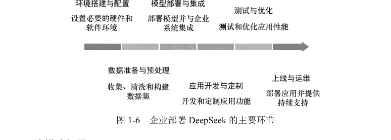

##### 1. 环境搭建与配置

在环境搭建与配置环节，首先，需要完成硬件准备、操作系统安装、依赖环境配置、深度学习框架安排、模型部署工具安排等前期工作。
其次，根据企业需求，基于对 DeepSeek 部署的不同考虑因素，准备合适的服务器、GPU 等硬件设备。
最后，需要安装合适的操作系统，CUDA、cuDNN（CUDA Deep Neural Network Library，深度神经网络库）等深度学习框架依赖库，Python、PIP 等工具，TensorFlow、PyTorch 等深度学习框架，以及 Ollama、Docker、vLLM 等模型部署工具。

##### 2. 数据准备与预处理

数据准备与预处理环节的工作内容包括数据收集、数据清洗与标注、数据集构建。
数据收集的主要工作是收集企业内部的相关数据，如文档、图片、音频等。数据清洗与标注的目的是确保数据质量和可用性，在此基础上构建训练集、验证集和测试集，为模型训练做准备。
数据准备与预处理是构建模型领域知识的基础，其质量直接影响模型的性能和效果。高质量的数据准备与预处理，可以确保模型能够准确地学习领域的知识和规律，为实际应用提供强大的支持。

##### 3. 模型部署与集成

根据企业需求，选择合适的 DeepSeek 模型版本并下载。使用部署工具加载模型，并进行必要的参数配置。根据需要开发 RESTful API 或 gRPC 接口，使模型能够与企业应用集成。最后将模型集成到企业的前端和后端系统中，实现功能交互。

##### 4. 应用开发与定制

一是应用功能开发，基于 DeepSeek 模型，开发企业所需的应用功能，如智能客服、内容生成等。二是设计友好、高效的用户界面，提升用户体验。三是进行业务流程整合，将 DeepSeek 应用与企业的现有业务流程整合，实现自动化和智能化。

##### 5. 测试与优化

测试与优化包括功能测试、性能测试、模型优化及用户体验优化等内容。
功能测试的目的是确保 DeepSeek 各项功能正常运行。性能测试是对模型的响应时间和吞吐量等指标进行评估。模型优化是指根据测试结果，对模型进行优化，如参数调整、量化等。用户体验优化是指收集用户反馈，优化应用的用户界面和交互流程。

##### 6. 上线与运维

经过以上环节，可以将经过测试和优化的 DeepSeek 应用部署到生产环境。同时，建立监控系统，实时监控应用的运行状态，及时发现和解决问题。企业在应用过程中还需要定期更新模型和应用，获取最新的功能支持和性能提升。
此外，需要为用户提供培训和支持，确保用户能够充分利用 DeepSeek 提供的各项功能。
经过以上环节，企业可以将 DeepSeek 应用到实际业务中，实现智能化升级和业务创新。

# 第2章 环境搭建与配置

DeepSeek 企业应用一般都需要环境搭建与配置、数据准备与预处理、模型训练与评估，以及模型部署与应用 4 个基础性环节。在企业应用中，DeepSeek 的本地部署、云端部署和企业级部署在环境搭建与配置方面既有相同的部分，也有不同的部分。

### 2.1 共性工作

无论是本地部署、云端部署，还是企业级部署，在环境准备与配置环节都有一些共同点。例如，在软件环境准备方面，都需要进行基础环境搭建和依赖库安装；在数据准备方面，都需要进行数据收集与清洗，也需要对数据进行预处理；在安全配置方面，都需要实施数据加密、访问控制、安全监控和定期安全审计；在性能优化方面，都需要进行数据库优化并引入缓存机制，提高系统的响应速度。

#### 2.1.1 软件环境准备

在软件环境准备方面，无论是本地部署、云端部署还是企业级部署，都需要确保以下 6 个关键步骤的完成。企业部署 DeepSeek 的软件环境准备如图 2-1 所示。

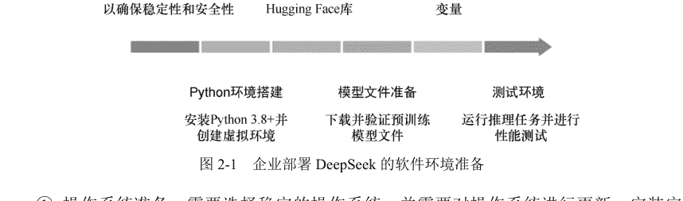

① 操作系统准备，需要选择稳定的操作系统，并需要对操作系统进行更新，安装安全补丁，防止已知漏洞被利用。
② Python 环境搭建，包括安装 Python，确保安装的是 Python 3.8 及以上版本，这是 DeepSeek 运行的基础。还需要创建虚拟环境，使用 Conda 或 Python 的 venv 模块创建虚拟环境，隔离项目依赖，避免版本冲突。
③ 安装依赖库，如 PyTorch、TensorFlow 等深度学习框架，以及 Transformers、Accelerate、SentencePiece 等 Hugging Face 库。此外，还需要安装额外依赖库，根据具体需求安装其他依赖库，如 Flask、FastAPI 等用于构建 API 服务。
④ 模型文件准备，包括获取模型文件，从 DeepSeek 的官方仓库或可信来源下载预训练模型文件，进行模型加载与验证，确保模型文件能够正确加载，并进行简单的推理测试，验证环境配置是否正确。
⑤ 配置环境文件，如 config.json 等，用于设置模型参数和运行环境。设置必要的环境变量，如 MODEL_PATH、API_KEY 等，便于模型能够正确访问资源。
⑥ 测试环境，在准备好的环境中运行简单的推理任务，确保模型能够正常工作。同时进行性能测试，确保环境配置满足性能要求。

#### 2.1.2 硬件准备

当准备 DeepSeek 的硬件环境时，无论是本地部署、云端部署，还是企业级部署，都需要确保完成以下 2 个关键步骤。

##### 1. 最基本的共性硬件需求

（1）GPU 配置
对于大规模模型的推理，都需要选择合适的 GPU 配置，如 NVIDIA A100 80GB×4 或 RTX 3090 等，以满足模型对计算能力的需求。

（2）内存与存储
无论选择哪种部署方式，DeepSeek 都需要确保具有足够的内存和存储空间，满足模型的运行和数据存储的需求。

（3）网络带宽
云端部署和企业级部署需要高速网络带宽，确保数据传输的稳定性和效率。

##### 2. 准备硬件环境的步骤

首先，评估模型需求，根据要部署的 DeepSeek 模型的规模（如 1.3 B、7 B、32 B、70 B），评估所需的硬件资源。小型模型可以在较低配置的硬件上运行，大模型需要高端 GPU 和大量内存。

其次，选择合适的硬件配置，如 CPU 要求至少 4 核处理器，推荐使用 8 核或更高配置的 CPU；需要根据模型大小选择合适的 GPU，如 NVIDIA GTX 1080 Ti、RTX 3090、A100 等，内存至少 16 GB，推荐 32 GB 或更高；存储至少要 100 GB 的 SSD 存储空间，用于存储模型和数据集。

再次，确保硬件兼容性，确保所选硬件与 DeepSeek 的软件环境兼容，包括操作系统、CUDA 版本等。

最后，设置网络环境，确保网络带宽充足，特别是在云端部署和企业级部署中，支持高效的数据传输。
此外，需要确保电源供应稳定，并配备适当的散热系统，特别是在多 GPU 配置或高性能计算环境中。

#### 2.1.3 数据准备

在数据准备环节，DeepSeek 本地部署、云端部署和企业级部署具有以下共同点和具体步骤。

##### 1. 数据准备的共同点
首先，数据收集。无论部署方式如何，都需要收集与目标任务相关的数据。数据来源可以是公开数据集、企业内部数据或通过爬虫技术获取的网络数据。
其次，进行数据清洗。原始数据通常包括噪声、缺失值和异常值，需要进行去重、填充缺失值、删除异常值等操作，确保数据的质量。
再次，进行数据标注工作。对于监督学习任务，需要对数据进行标注，提供监督信息，标注的质量直接影响模型的性能。
最后，进行数据预处理，将数据转换为模型可接受的格式，并进行必要的归一化或标准化处理。

##### 2. 数据准备的具体步骤
在数据收集环节，需要根据任务需求，从公开数据集或自有数据源中收集相关数据。例如，对于文本分类任务，可以使用 IMDb（互联网电影数据库）电影评论数据集。
在数据清洗环节，需要去除噪声数据、重复数据及不完整的数据，确保数据集的纯净性。例如，在文本数据中，去除无意义的符号或乱码。
数据标注是指为模型提供监督信息。标注的质量直接影响模型的性能，因此需要确保标注的准确性。
数据增强指通过对原始数据进行变换，增加数据量，常用的方法包括图像翻转、旋转、缩放，文本的同义词替换、随机删除等。数据增强可以有效地防止模型过拟合，提高泛化能力。
数据预处理是指将数据转换为模型可接受的格式，并进行必要的归一化或标准化处理。例如，将图像数据压缩到统一尺寸，将文本数据转换为词向量或 Token 序列。

#### 2.1.4 安全配置

在安全配置方面，本地部署、云端部署和企业级部署具有以下共同点和具体实施步骤。

##### 1. 安全配置的共同点

在数据传输和存储过程中，都需要使用加密协议，如 HTTPS 或 TLS 1.3，确保数据的安全性；都需要设置严格的访问控制策略，确保只有授权用户才能访问敏感数据；都需要安全监控，部署实时异常行为检测系统，及时发现和应对潜在的安全威胁；都需要进行定期安全审计和漏洞修复，保持系统的稳定性和安全性。

##### 2. 安全配置的共性实施步骤

- ① 启用 API 鉴权，确保所有 API 请求都经过身份验证，防止未授权访问。
- ② 限制访问 IP，通过防火墙规则限制对模型服务的访问，仅允许特定 IP 地址或范围的访问。
- ③ 启用 HTTPS 加密，在传输层启用 HTTPS 加密，确保数据在传输过程中不被窃取或篡改。
- ④ 配置反向代理与防护层，通过 Nginx 等反向代理配置 HTTP Basic 认证或 OAuth 集成，增加一层安全防护。
- ⑤ 实时行为监测，部署入侵检测系统（Intrusion Detection System，IDS），分析异常流量和访问模式，及时发现潜在威胁。
- ⑥ 定期审计系统日志，排查可疑操作，确保系统的安全性和合规性。
- ⑦ 漏洞扫描与渗透测试，定期进行漏洞扫描和渗透测试，从内部和外部检查系统的安全风险，确保整个系统的安全基线。
- ⑧ 保持版本更新，关注官方公告，定期升级相关软件，更新补丁库和漏洞库，防止已知漏洞被利用。
- ⑨ 强化访问控制，限制端口暴露范围，禁止不必要的端口对公网开放，仅允许本地或内网访问。
- ⑩ 全面安全检查，通过漏洞扫描、渗透测试等安全检查手段，确保整个大模型环节达到安全基线。

#### 2.1.5 性能优化

DeepSeek 在本地部署、云端部署和企业级部署的性能优化上，具有以下 4 种优化方法。DeepSeek 企业部署的性能优化如图 2-2 所示。

##### 1. 模型优化

在架构优化方面，共性的有 2 种方法：一是多头潜在注意力机制（Multi-Head Latent Attention，MLA）架构，DeepSeek 的 MLA 架构在保持超强表达能力的同时大幅减少了 KV-Cache 的大小，从而降低内存带宽与显存需求；二是 MoE 架构，MoE 架构通过将 Dense 模型拆分为多个专业化专家，仅激活部分专家，使每个 Token 只需要计算和读取较少的权重，大幅降低计算与内存访问成本。

在量化与混合精度训练方面，一是采用低精度 FP8 训练与量化，直接采用 FP8 权重使读写数据量减少一半，同时对 KV-Cache 进行量化（DeepSeek-V2 将 KV-Cache 压缩至平均 6 bit），在保持精度的同时大幅降低内存占用；二是采用混合精度训练，结合浮点数和低精度运算，在保证精度的同时大幅提高训练速度。DeepSeek 模型支持自动混合精度训练，开发者可以轻松实现性能优化。

##### 2. 系统优化

在分布式计算与存储方面，可以采用分布式训练，采用数据并行和模型并行相结合的方式，充分利用硬件资源，大幅缩短训练时间。同时采用分布式缓存，在高并发场景下，采用 Redis 或 Memcached 等分布式缓存技术，确保缓存数据的一致性和高可用性。

在动态资源调配方面，可以采用流量波动进行应对，根据实时请求量和系统负载，自动调整计算资源的分配，确保系统在高并发下的稳定运行。同时进行资源回收，当请求量减少时，回收多余资源，避免浪费。

在通信优化方面，需要优化网络配置，选择稳定的网络环境，调整带宽限制，使用内容分发网络（Content Delivery Network，CDN）加速等，缩短下载时间，降低网络延迟。同时可以采用硬件级通信加速器，针对节点内 NVLink 与跨节点无限宽带（InfiniBand，IB）的分层通信，采用硬件级通信加速器或网络协处理器，进一步降低通信延迟。

##### 3. 数据优化

在数据预处理方面，通过对数据的清洗、标注和增强，提高数据质量，确保数据符合模型的输入要求。

在缓存机制方面，将频繁访问的数据和计算结果存储在缓存中，减少重复计算和数据库查询，提高系统的响应速度。同时利用本地缓存减少重复下载，节省时间和资源。

##### 4. 硬件优化

在 GPU 优化方面，选择高性能 GPU。对于大规模模型的推理，选择合适的 GPU 配置，如 NVIDIA A100 或 H100 等，这些 GPU 具有高显存和强大的计算能力，能够满足模型的推理需求。同时进行多卡并行配置，使用多卡并行技术（如 NVLink 或 InfiniBand）提升大规模模型的推理性能，确保显卡之间的高效通信。

在 CPU 优化方面，利用多线程技术，充分发挥 CPU 的并行计算能力，提高任务处理效率。同时，减少 CPU 与 GPU 通信开销，优化 CPU 与 GPU 之间的数据传输，减少通信延迟，确保两者协同工作。

在内存优化方面，根据模型规模，合理增加内存容量，避免因内存不足导致的性能瓶颈。同时选择高频内存（如 DDR5 6000 MHz 及以上），加快数据传输速度，缩短 CPU 的等待时间。

在存储优化方面，使用高速 NVMe SSD 作为系统盘和模型存储盘，提高模型加载和数据处理速度。同时使用 RAID 技术提高存储的可靠性和读写速度，确保数据安全。

### 2.2 不同部署方式下的环境搭建与配置

#### 2.2.1 主要工作

- 1. 本地部署
在本地部署情况下，企业需要自行准备服务器、GPU 等硬件设备，根据 DeepSeek 模型的需求，确保硬件配置满足模型运行要求。例如，对于 1.5 B 模型版本，可能需要 GTX 1650 显卡和 8 GB 内存；而对于较大的模型版本，如 671 B 需要多块 A100 或 H100 显卡和 512 GB 内存等高端硬件配置。还需要安装相应的软件和工具，包括选择合适的操作系统平台，安装 CUDA、cuDNN 等深度学习框架的依赖库和 Python、PIP 等工具，安装深度学习框架，如 TensorFlow、PyTorch 等，安装 Ollama、Docker、vLLM 等模型部署工具。
由于是本地部署，所以企业需要根据硬件配置进行性能优化，如调整显存使用、优化计算资源分配等。对于大规模模型，可能还需要进行分布式训练和推理的优化。

- 2. 云端部署
在云端部署情况下，企业需要具有云平台认证账号，并确保账号具备足够的权限和配额，便于后续的资源创建与管理。确保本地网络环境稳定，配置虚拟专用网络（Virtual Private Network, VPN）或专线，便于顺畅地访问云服务。同时，为云环境规划 IP 地址段和子网划分，确保网络架构的合理性和安全性。
在云端部署情况下，企业数据需要上传到云端，因此云端部署对安全性的要求超过本地部署的要求。为此，企业需要创建安全组并配置入站和出站规则，以确保只有授权的 IP 和端口才能够访问云资源。同时，启用防火墙功能，进一步提升系统的安全性。
在云端部署情况下，企业通常通过云平台提供的模型仓库或容器服务进行部署。企业可以快速加载预训练的 DeepSeek 模型，通过简单的配置即可启动服务。
云端部署后，企业需要配置性能监控工具，实时跟踪 CPU、内存、磁盘和网络的使用情况；集中管理应用日志，便于进行故障排查和性能分析；使用自动化运维工具，定期执行系统更新和补丁安装；设置报警机制，当系统出现异常或资源使用率过高时，及时通知运维人员处理。

##### 3. 企业级部署

企业级部署需要结合本地和云端特点，根据业务需求和数据敏感度，合理规划硬件资源和云资源，确保环境的稳定性和可扩展性；在本地和云端分别进行环境搭建与配置，确保二者的兼容性和协同工作能力。

企业级部署面临更复杂的数据安全与隐私保护环境，因此需要建立全面的安全防护体系，结合本地和云端的安全措施，确保数据在传输和存储过程中的安全。在性能优化与资源管理方面，需要综合考虑本地和云端资源的性能优化，确保模型在不同环境下的运行效率。同时，合理管理资源，实现资源的最优配置和成本控制。

此外，企业级部署需要企业建立专业的运维团队，制订完善的运维流程和管理制度，确保系统的稳定运行。同时，企业可能需要与云服务提供商合作，共同处理运维问题。

#### 2.2.2 主要工作环节的区别

不同部署方式下主要工作环节的区别如表 2-1 所示。

表 2-1 不同部署方式下主要工作环节的区别

| 环节 | 本地部署 | 云端部署 | 企业级部署 |
| :--- | :--- | :--- | :--- |
| 环境准备 | 自行准备硬件设备，安装操作系统和依赖环境 | 云服务账号注册与认证，网络环境配置，安全组与防火墙设置等 | 综合考虑本地和云端环境的规划与搭建 |
| 模型部署 | 自行下载和安装 DeepSeek 模型，配置运行参数 | 通常通过云平台提供的模型仓库或容器服务进行部署 | 在本地和云端分别进行模型部署，并确保两者的协同工作 |
| 性能优化 | 根据硬件配置进行性能优化 | 可以利用云平台提供的性能优化工具和自动扩展功能 | 综合考虑本地和云端资源的性能优化 |
| 安全与隐私 | 对数据安全和隐私具有更好的控制 | 依赖云服务提供商的安全保障机制，并采取额外的安全措施 | 需要建立全面的安全防护体系 |
| 运维管理 | 企业自行负责运维工作 | 主要由云服务提供商负责 | 需要企业建立专业的运维团队，并可能需要与云服务提供商合作 |

### 2.3 本地部署方式下的环境准备与配置

在本地部署的 5 个环节中，环境准备中的操作系统选择见 1.4.5 节，模型部署方法见 1.4.4 节。这里不再展开讨论。

#### 2.3.1 环境准备

本地部署方式下的环境准备包括硬件准备、依赖环境配置安装、深度学习框架安装和模型部署工具安装等。

##### 1. 硬件准备

本地部署 DeepSeek 的服务器应配备强大的 GPU 和 CPU，以及充足的内存。例如，基础推荐配置为 8 核 CPU、32 GB 内存、100 GB 以上 SSD 存储和一块高性能 GPU（如 NVIDIA GTX 1080 或更高）。对于更大型号（如 DeepSeek-70 B 甚至 671 B），需要更高规格的硬件（多块高端 GPU、64 GB+内存、高速大容量存储等）来满足推理和微调的计算需求。

模型文件和数据存储在本地高速存储上。建议使用 NVMe SSD 存放模型权重文件和缓存，提供足够的读写带宽。完整的 DeepSeek-R1 模型文件高达数百 GB，需要规划专门的存储空间；即使是蒸馏后的中小型模型也有数十 GB 规模。不同规模参数的 DeepSeek-R1 模型本地化部署的配置要求如表 2-2 所示。

表 2-2 不同规模参数的 DeepSeek-R1 模型本地化部署配置要求

| 参数规模 | CPU | 内存 | 硬盘 | 显卡（存）/推荐配置 | 适用场景 |
| :--- | :--- | :--- | :--- | :--- | :--- |
| 1.5B | 最低 4 核 | 8 GB+ | 3 GB + | 纯 CPU 推理非必要，若 GPU 加速可以选择 4 GB +，推荐 GTX 1650 | 低资源设备部署，如树莓派、旧款笔记本电脑、嵌入式系统或物联网设备 |
| 7B | 8 核以上 | 16 GB+ | 8 GB + | 8 GB +，推荐 RTX 3070/4060 | 中小型企业的本地开发测试、中等复杂度 NLP 任务 |
| 14B | 12 核以上 | 32 GB+ | 15 GB+ | 16 GB +，推荐 RTX 4090/A5000 | 企业级复杂任务、长文本理解与生成 |
| 32B | 16 核以上，AMD Ryzen 9/ Intel i9 | 64 GB+ | 30 GB+ | 24 GB +，推荐 A100 40 GB/双卡 RTX 3090 | 高精度专业领域任务、多模态任务预处理 |
| 70B | 32 核以上服务器级 | 128 GB+ | 70 GB+ | 多卡并行，推荐 2x A100 80 GB/4x RTX 4090 | 科研机构、大型企业、高复杂度的生成任务 |
| 671B | 64 核以上服务器集群 | 512 GB+ | 300 GB+ | 多节点分布式训练，推荐 8x A100/H100 | 国家级、超大规模 AI 研究、AGI 探索 |

##### 2. 依赖环境配置安装

在选定满足企业需要的操作系统基础上，对于使用 GPU 加速的模型，需要安装相应的 CUDA 和 cuDNN 版本，确保深度学习框架能够充分利用 GPU 的计算能力。

Python 是深度学习模型的主要编程语言，安装 Python 解释器和 PIP 包管理工具，是 DeepSeek 本地部署所必需的。还需要根据模型运行的需求，安装如 NumPy、Pandas、Matplotlib 等科学计算和数据处理库。

##### 3. 深度学习框架安装

根据模型后期的开发需求，选择合适的深度学习框架，如 TensorFlow、PyTorch 等。按照框架的官方文档，完成安装和配置，确保框架能够正确识别和利用硬件资源，特别是 GPU。

##### 4. 模型部署工具安装

DeepSeek 的本地化部署方法多种多样，每种方法都有适用场景和用户群体，具体可见 1.4.4 节。

Ollama 适合初学者或不希望手动配置环境的用户。

Docker 适合熟悉 Docker 且需要灵活配置的用户，因为 Docker 提供更高的灵活性和可移植性。

LM Studio 提供图形化界面，对新手友好，无须操作代码。

Cherry Studio 适合希望使用图形化界面进行模型管理和交互的用户。

vLLM 需要通过编写 Python 脚本或使用其他工具，调用 vLLM 的 API 与 DeepSeek 交互，适合需要高性能推理和低延迟的用户。

可以通过部署工具，下载对应的 DeepSeek 模型版本并直接进行安装。

#### 2.3.2 性能优化

在企业应用背景下，DeepSeek 本地部署下的性能优化包括模型层面优化、系统层面优化、硬件层面优化、软件层面优化和性能监控与优化。这些优化内容，有些在模型本身层面，作为应用企业，在一般意义上是难以进行优化的。下述内容是普通 DeepSeek 应用企业可以实施优化的。

（1）提升并行度

企业可以通过多线程编程技术，将任务分解为多个线程并行执行，从而提高系统的并发处理能力。同时，采用异步编程模型，当处理输入输出（Input/Output，I/O）密集型任务时，可以使系统在等待 I/O 操作完成期间继续处理其他任务，从而提高资源利用率和响应速度。

（2）投机解码

投机解码是一种用于加速 LLM 推理过程的技术，其核心思想是利用一个较小、较快的模型（称为“投机者”或“草稿模型”）预测多个未来的 Token，由主要的 LLM 并行验证预测。投机解码可以在不损失生成效果的前提下，显著提高推理速度。

企业可以引入多线程处理（Multi-Threaded Processing，MTP）模块，在推理阶段通过投机采样方式提高解码效率。当具体实施时，需要根据 DeepSeek 的官方文档或社区资源，了解 MTP 模块的使用方法和参数配置，并在实际应用中测试和调优。可以根据数据特点和业务需求，调整解码过程中的采样概率、解码步长等参数，在保证准确率的前提下，进一步提高解码速度。

（3）缓存机制

企业可以搭建 Redis 服务器，并在应用中配置缓存策略，将频繁访问的数据存储在 Redis 中。当用户再次提问时，直接从缓存中获取答案，减少模型推理的次数和时间。企业还可以使用 Memcached 缓存，类似 Redis，Memcached 也是一种常用的分布式缓存系统。企业可以根据自身技术栈和需求选择合适的缓存技术，并在应用中合理使用缓存，减轻数据库和模型的负载，提高系统响应速度。

（4）增加硬件资源

根据企业的业务规模和模型应用的性能要求，评估当前硬件配置是否满足需求。评估的对象包括 CPU 的使用率、内存的占用情况、磁盘 I/O 速度等指标，确定是否需要升级硬件。根据评估结果，采购合适的硬件设备，如更高性能的 CPU、更大容量的内存、更快的存储设备等，并进行安装和配置。同时，需要确保硬件与现有的系统和软件兼容。

（5）使用 GPU 加速

检查企业现有的服务器或工作站是否具备支持 CUDA 的 NVIDIA GPU，如果没有，需要采购合适的 GPU 设备，并安装相应的驱动程序。按照 NVIDIA 官方文档，安装与 DeepSeek 模型和深度学习框架兼容的 CUDA 和 cuDNN 版本，通常涉及下载安装包、配置环境变量等步骤。确保使用的深度学习框架（如 TensorFlow、PyTorch）已正确安装 GPU 支持版本，并在应用中能够识别和利用 GPU 资源进行加速计算。

（6）环境变量调优

查阅 DeepSeek 官方文档或相关技术资料，了解与模型性能相关的环境变量，如 OLLAMA_FLASH_ATTENTION、OLLAMA_KV_CACHE_TYPE 等。根据实际情况和官方推荐，尝试调整环境变量的值，并进行性能测试，观察其对模型响应速度和资源利用率的影响。通过反复试验，找到最适合企业应用的配置组合。

（7）模型加载层数调整

了解 DeepSeek 模型的加载层数与性能的关系，以及不同层数对模型功能和准确率的影响。根据企业的硬件资源和性能要求，制定模型加载层数的调整策略。例如，在硬件资源有限的情况下，可以适当地减少加载层数以提升性能；在对模型准确率要求较高的场景中，可以适当地增加加载层数。按照制定的策略调整模型加载层数，并在实际应用中进行性能和功能验证，确保调整后的模型能够满足企业的业务需求。

（8）性能监控与优化

安装和配置 Prometheus 和 Grafana 等性能监控工具，在 DeepSeek 模型运行过程中实时收集和展示系统的各项性能指标，如 CPU 使用率、内存占用、显存使用情况、模型推理时间等，制订性能评估计划，定期分析监控数据，评估模型的性能表现。根据评估结果，找到性能瓶颈和优化方向，制订并实施相应的优化措施，如调整模型参数、优化系统配置、升级硬件等，不断提升模型的性能、效率。

通过以上方法，企业可以在本地部署 DeepSeek 模型时，充分发挥其性能潜力，满足企业应用对高效处理的需求。

#### 2.3.3 安全与隐私

尽管在本地部署方式下，企业完全掌控数据，但是如果不在本地设置和使用系统，企业还是会面临一些安全和隐私问题。

- 1. 本地部署方式下企业可能面临的数据安全和隐私问题
（1）未授权访问风险
例如，使用 Ollama 等工具进行本地部署时，默认配置可能会存在未授权访问和模型窃取风险，导致数据泄露、服务中断等问题。
（2）数据泄露风险
在训练和推理过程中，需要处理大量敏感数据，如个人隐私、商业秘密等，数据泄露将给个人或企业造成重大损失。
（3）模型参数被窃取
攻击者可能会通过未授权访问窃取大模型的核心参数，对涉密等敏感重要部门会造成严重危害。
（4）模型投毒
攻击者可能会通过接口查看正在运行的模型，下载有毒模型，删除正常模型，迁移有毒模型到正常模型路径，通过有毒模型污染使用者的对话。
（5）模型资源消耗
攻击者可能会通过使用者的 Ollama 模型进行商业服务，非法获利，造成私有 Ollama 服务器被人“薅羊毛”。
（6）安全机制缺陷
DeepSeek 在抵御越狱攻击中的得分较低，表明其安全机制存在严重缺陷，可能在面对恶意提示时无法有效过滤有害输出。
（7）数据存储合规性挑战
DeepSeek 的隐私政策可能会与一些国家的法律产生冲突，导致合规性风险。
（8）跨境合规冲突的复杂性
在 AI 大模型的全球化应用中，跨境数据流动是一个重要问题，不同国家和地区的法律法规对跨境数据流动有不同的要求，这增加了企业运营的复杂性和风险。

- 2. 企业可以采取的措施
（1）保持版本更新
关注官方公告，定期升级 Ollama，定期更新补丁库和漏洞库。
（2）强化访问控制
限制端口暴露范围，禁止 11434 端口对公网开放，仅允许本地或内网访问，或通过防火墙规则进行限制。

#### 2.3.4 运维管理

在本地部署方式下，企业需要对 DeepSeek 进行硬件、软件、数据、安全、性能、文档与团队培训等方面的运营维护。
企业需要定期检查和维护服务器、GPU 等硬件设备，确保其正常运行；需要定期更新 DeepSeek 模型和相关依赖库，确保软件环境的稳定性和兼容性；需要关注官方更新渠道，及时获取最新版本的模型和依赖库，并在更新前进行充分的测试；需要监控数据 I/O，确保数据质量，定期清理和备份数据，优化存储管理；需要实施严格的访问控制和数据加密，防止未授权访问和数据泄露。在性能方面，企业需要定期评估系统性能，根据业务需求进行优化调整，建立性能监控体系，使用 Prometheus 和 Grafana 等工具进行实时监控，根据监控结果调整硬件资源配置和软件参数。在文档与团队培训方面，企业需要维护详细的系统文档，确保团队成员了解系统的架构和操作流程；定期进行技术培训，提升团队的维护能力。为此，企业需要建立文档管理系统，记录系统的安装、配置和维护过程；制定培训计划，对团队成员进行定期培训。

当更新模型时，通常需要重新进行领域数据的训练和微调，因为模型更新可能会改变模型的参数或结构，从而影响模型在特定领域的性能。为了确保模型在更新后仍能保持良好的性能，需要重新使用领域数据进行训练和微调。

### 2.4 云端部署方式下的环境准备与配置

云端部署方式下的环境准备与本地部署方式有明显不同。硬件和软件主要依靠云服务提供商提供。DeepSeek 的云端部署有几种常见的方法，每种方法的环境准备与配置流程不同，具体见 1.4.4 节。

#### 2.4.1 环境准备和模型安装

云端部署 DeepSeek 模型，对本地硬件、软件和环境配置具有相应的要求。

##### 1. 云端部署仍需本地支持的原因
为了确保模型能够高效、稳定运行，并满足数据安全和性能优化的需求，当在云端部署 DeepSeek 时，仍需本地在硬件、软件和环境方面予以支持，具体原因如下。
（1）数据安全与隐私保护
即使在云端部署，某些敏感数据仍需在本地进行预处理或后处理，减少数据传输风险，确保数据始终在企业可控范围内。此外，本地环境配置有助于保护企业对 DeepSeek 模型的定制化修改和训练数据，防止知识产权和商业机密被泄露到云端。
（2）性能优化与资源管理
云端部署可能会面临网络延迟和带宽限制问题，本地硬件的优化可以缩短数据传输时间，提高整体系统的响应速度。同时，本地硬件和软件配置允许企业根据实际需求灵活分配和隔离资源，避免云端资源竞争和过度消耗，确保关键任务的稳定运行。
（3）系统兼容性与稳定性
本地环境的配置可以确保与云端环境的一致性，减少因环境差异导致的兼容性问题，提高系统的稳定性和可靠性。当云端服务出现故障或中断时，本地环境可以作为备用方案，快速接管关键任务，确保业务的连续性。
（4）成本控制与灵活性
对于高频调用和长期使用的场景，本地硬件的初始投资可能低于持续的云端服务费用，有助于企业控制成本。此外，本地硬件也可以根据业务增长灵活扩展，不受云端服务提供商的限制，提供更高的灵活性和自主性。
由于是通过云端方式部署 DeepSeek，所以对本地硬件、软件和环境方面的要求，除共性要求外，基本没有特殊要求。

##### 2. 以阿里云为例的 DeepSeek 云端部署

在阿里云上部署 DeepSeek 模型，可以通过其 AI 平台，即 PAI-Model Gallery 实现一键式部署，全程无须编写代码。
首先，开通 PAI 服务并登录控制台。访问阿里云 PAI 平台，完成账号登录及服务开通。首次使用需要根据提示完成角色授权和服务开通。
其次，进入 Model Gallery 选择模型。在 PAI 控制台左侧导航栏选择目标工作空间，单击“快速开始”按钮，单击“Model Gallery”按钮，输入“DeepSeek”关键词，找到所需模型，如 DeepSeek-R1-Distill-Qwen-7B 或 DeepSeek-V3。
再次，配置部署参数并启动部署。进入模型详情页后，单击“部署”按钮，根据模型类型选择加速框架。DeepSeek-R1 支持 vLLM 加速部署，DeepSeek-V3 支持 vLLM 加速或 Web 应用部署，DeepSeek-R1-Distill-Qwen-7B 等蒸馏版小模型支持阿里云自研框架 BladeLLM 或 vLLM 加速。然后选择 GPU 类型、显存配置等资源规格，单击“确认”按钮完成部署。
最后，获取调用信息。在服务页面单击“查看调用信息”按钮，获取 API 调用的 Endpoint 和 Token。部署后的服务可通过 REST API 调用，支持多种编程语言集成。示例代码和详细接口文档可在模型详情页查看。

#### 2.4.2 性能优化

DeepSeek 的云端部署和本地部署，在性能优化方面是有一些差异的，主要体现在优化的重点、适用的措施及实施的便利性方面。

##### 1. 性能优化的差异

云端部署的性能优化重点在于如何充分利用云平台的资源弹性、高可用性和分布式计算能力，同时降低延迟和提高吞吐量。在适用措施方面，云端部署可以利用云平台提供的各种性能优化工具和服务，如自动弹性扩展、负载均衡、分布式缓存等。企业可以根据业务需求灵活调整资源配置，实现性能的动态优化。在云端部署方式下，云平台通常提供便捷的部署工具和丰富的技术支持，大幅缩短部署时间，使用户能够快速上线 DeepSeek 模型。当模型更新时，云平台可以集中处理，用户能迅速获取最新版本，享受新功能和优越的性能。

##### 2. 硬件优化

当在云端部署 DeepSeek 模型时，硬件性能优化主要针对云端的硬件资源进行，同时优化本地硬件也对整体性能具有重要影响。

###### （1）云端硬件优化

- ① 在 GPU 方面，对于大规模模型，推荐使用 NVIDIA A100 或 H100 GPU，这些 GPU 具有高显存和强大的计算能力，能够满足模型的推理需求。
- ② 在优化显存利用方面，可以通过量化技术（如 4-bit 量化）减少显存占用，同时保持较高的推理质量，还可以通过多卡并行配置，使用 NVLink 或 InfiniBand 等多卡并行技术，提升大规模模型的推理性能，确保显卡之间的高效通信。需要使用 GPU 加速库，如 TensorRT-LLM 等，优化推理过程，提高吞吐量。
- ③ 在分布式部署方面，采用分布式部署方案，将模型的计算任务分散到多个计算节点上，避免单点过载。根据实时请求量和系统负载，自动调整计算资源的分配，确保系统在高并发情况下的稳定运行。同时，使用高速网络通信技术加速节点间的通信，降低通信延迟。

###### （2）本地硬件优化

- ① 选择高性能 CPU。对于大规模数据处理，建议使用多核高性能 CPU，如 Intel Core i9 系列或 AMD Ryzen 9 系列，确保提供足够的计算能力。
- ② 优化 CPU 多线程技术。利用多线程技术，充分发挥 CPU 的并行计算能力，提高任务处理效率。
- ③ 减少 CPU 与 GPU 通信开销。优化 CPU 与 GPU 之间的数据传输，降低通信延迟，确保二者协同工作。
- ④ 利用 CPU 缓存，降低内存访问延迟，提高数据处理速度。
- ⑤ 根据模型规模，合理增加内存容量，避免因内存不足导致性能瓶颈。
- ⑥ 选择高频内存。使用高频内存（如 DDR5 6000 MHz 及以上），提高数据传输速度，缩短 CPU 等待时间。
- ⑦ 优化内存分配，避免内存碎片化，提高内存利用率。
- ⑧ 使用内存缓存。利用内存缓存（如 Redis）存储频繁访问的数据，减少磁盘 I/O。
- ⑨ 使用高速 SSD。选择高速 NVMe SSD 作为系统盘和模型存储盘，提高模型加载和数据处理速度。同时配置 RAID，使用 RAID 技术提高存储的可靠性和读写速度，确保数据安全；选择适合的文件系统（如 Ext4 或 XFS），优化文件系统的读写性能；在大规模数据处理场景中，使用分布式存储系统（如 Ceph 或 GlusterFS）提升存储性能。

此外，云端部署需要利用云平台的弹性资源调配能力，根据业务需求灵活调整 CPU、GPU、内存等硬件配置。业务高峰期可以增加资源配置，保障模型高效运行；业务低谷期可以减少资源配置，降低成本。本地部署需要根据实际需求，选择合适的硬件配置，增加 CPU 核心数、内存容量和存储带宽，有效地提高数据处理速度。

##### 3. 软件优化

当云端部署 DeepSeek 模型时，软件性能优化不仅针对云端的软件环境进行优化，同时本地软件优化也对整体性能具有重要影响。

###### （1）云端软件优化

- ① 模型优化。在部署前，对大模型进行优化，如采用剪枝、量化和知识蒸馏等技术，降低模型复杂度和计算需求。
- ② 分布式训练。利用 DeepSeek 的分布式训练能力，加速模型训练过程。通过合理配置并行策略，大幅缩短训练时间。
- ③ 缓存机制。在应用层面和数据库层面广泛使用缓存技术，减少重复计算和数据库查询，提高系统的响应速度。
- ④ 代码优化。在代码编写上注重性能优化，如减少不必要的循环、使用高效的库函数和避免内存泄漏。
- ⑤ 监控与调优。在部署后，持续监控模型性能，及时发现和解决潜在问题。DeepSeek 提供实时监控和自动调优功能，帮助开发者提高模型运行效率。

###### （2）本地软件优化

- ① 模型选择。从较小的模型变体开始，如 1.5 B 或 8 B 版本，衡量性能和资源需求，然后扩展到较大的模型（如 32 B 或 70 B）。
- ② 优化推理管道。实现上下文预处理与令牌生成的分离，降低交互式任务期间的延迟，这在需要实时响应的应用中非常有用。
- ③ 安装必要的工具。确保设置了正确的软件环境，包括用于模型执行的 Ollama 和 Chatbox 作为用户友好的接口，用于与模型交互，这些工具简化了设置过程并增强了可用性。
- ④ 配置调整。当设置环境时，需设定模型参数，以适配硬件能力、优化运行性能。例如，调整聊天框中的 API 主机设置，确保与本地运行模型的平稳通信。

通过以上软件性能优化措施，可以显著提高 DeepSeek 在云端部署后的运行效率和稳定性，满足高并发和复杂业务场景的需求。同时，本地软件的性能优化也能在一定程度上提升整体性能，特别是在数据预处理和模型调用方面。

##### 4. 分布式部署

当在云端部署 DeepSeek 时，分布式部署会针对云端资源进行优化，同时本地资源的分布式部署也对整体性能具有重要影响。

###### （1）云端资源分布式部署

云端资源分布式部署进行性能优化，主要包括以下 4 个方面。

- ① 采用分布式计算与存储。例如，利用云平台的分布式计算框架（如 Kubernetes、Spark）和存储系统（如 S3、HDFS）管理海量数据和模型参数。采用混合并行策略（如 Pipeline Parallelism + Tensor Parallelism），将模型切分为多个阶段，每个阶段在不同的 GPU 节点上运行。
- ② 采用负载均衡与弹性伸缩机制。利用云平台的负载均衡器和自动伸缩机制，动态调整计算资源，确保在高并发访问下的稳定性。
- ③ 网络优化。使用高速网络通信技术加速节点间的通信，降低通信延迟。
- ④ 进行资源调度与隔离。通过智能资源调度技术，确保计算资源的高效利用，避免资源浪费。同时使用 VPC、安全组、ACL 等手段确保数据传输和存储的安全性。

###### （2）本地资源分布式部署

本地资源分布式部署主要包括以下 5 个方面的内容。

- ① 进行分布式计算。在本地部署高性能服务器、GPU 集群或边缘计算节点，构建专用服务器集群，使用容器编排工具（如 Kubernetes）管理和调度任务。
- ② 进行数据预处理与缓存。在本地对数据进行预处理，确保数据格式和内容符合模型要求，减少云端处理负担，同时使用本地缓存机制存储频繁访问的数据，减少对云端的依赖。
- ③ 进行模型优化与量化。对模型进行剪枝、量化等处理，获得轻量化模型版本，以适应本地资源。
- ④ 网络优化。确保本地网络能够稳定连接到云端服务，避免因网络问题导致模型部署失败或性能下降。
- ⑤ 进行资源调度与隔离。通过合理分配和隔离资源，避免本地资源竞争和过度消耗，确保关键任务的稳定运行。

##### 5. 缓存机制

当云端部署 DeepSeek 模型时，缓存机制的性能优化针对云端资源进行，同时本地缓存机制也可以在一定程度上提升模型的整体性能。

###### （1）云端缓存机制优化

- ① 选择合适的缓存策略。根据业务需求选择合适的缓存策略，如 LRU（最近最少使用）、LFU（最不经常使用）或 FIFO（先进先出）策略，以提高缓存命中率。
- ② 设置合理的缓存过期时间。根据数据更新频率和业务特点，设置合理的缓存过期时间，避免缓存频繁失效或数据不一致。
- ③ 使用分布式缓存。在高并发场景下，采用 Redis 或 Memcached 等分布式缓存技术，确保缓存数据的一致性和高可用性。
- ④ 缓存预热。在系统启动或高峰期前，提前将热点数据加载到缓存中，避免高峰期因缓存不足导致的数据库压力过大。
- ⑤ 低秩键值（Key Value，KV）缓存联合压缩技术。DeepSeek 通过压缩键值对的表示形式，减少缓存存储需求，同时保持多头注意力的优势，提高缓存效率。

###### （2）本地缓存机制优化

具体包括使用 Guava 或 Ehcache 等本地缓存框架，缓存频繁访问的数据，减少对云端的依赖；当系统启动时，通过后台任务将热点数据加载到本地缓存中，确保高峰期的快速响应；设置合理的缓存失效时间，避免缓存雪崩或缓存穿透问题；通过同步双写或延迟队列等策略，确保本地缓存与云端数据的一致性。

##### 6. 模型优化

当云端部署 DeepSeek 时，模型优化针对云端资源进行，同时本地模型优化在某些情况下也很重要。

###### （1）云端模型优化

云端模型优化的主要方法包括模型压缩、量化部署、分布式计算与存储、弹性伸缩与负载均衡等，以及加强安全与监控。模型压缩是指通过知识蒸馏技术，将复杂模型的知识迁移到轻量化模型中，从而显著提升模型性能。量化部署是指使用 TensorRT 和 OpenVINO 等工具进行量化部署，提高模型的精度和推理速度。同时采用分布式计算框架和存储系统管理计算资源和数据，提高计算效率。根据访问流量的变化进行资源的动态调整，保证服务的稳定。此外，还需要利用云平台的安全策略和监控工具，确保数据安全和系统维护。

###### （2）本地模型优化

在环境准备与依赖安装环节，需要确保本地环境满足模型运行需求，包括安装必要的依赖项和框架。在模型下载与配置环节，需要从官方仓库下载预训练模型，并进行适当的配置。在模型微调环节，需要根据具体需求对模型进行微调，提升其在特定任务中的表现。此外，使用 TensorBoard、Prometheus 和 Grafana 等工具进行性能监控和优化，如果硬件支持，利用 GPU 加速模型推理，添加输入过滤、异常处理等，提高系统的鲁棒性。

#### 2.4.3 安全与隐私

云端面临数据泄露风险、模型攻击风险、模型滥用风险、共享责任带来的管理上的复杂性风险。数据泄露风险是指数据在传输和存储过程中存在被窃取或泄露的风险，特别是当处理敏感数据时。同时，模型可能会受到分布式拒绝攻击（Distributed Denial of Service Attack, DDoS）、服务质量（Quality of Service, QoS）问题和模型投毒等安全威胁。若未严格限制员工的访问权限，可能会导致越权操作，如导出模型权重、复制训练数据等。此外，云端服务的共享责任模型要求用户和云服务提供商共同负责安全，增加了安全管理的复杂性。

##### （1）数据泄露风险

当云端部署 DeepSeek 模型时，数据泄露风险是一个重要的安全问题，广泛存在于数据存储、传输和访问环节。可以采取以下措施，解决云端数据泄露风险。
首先，数据加密，在数据传输过程中，使用 HTTPS 或 TLS 1.3 等加密协议，确保数据在传输过程中不被窃取或篡改。对存储在云端的敏感数据进行加密，使用加密算法和密钥管理系统保护数据。
其次，实施严格的访问控制策略，确保只有授权用户和系统可以访问敏感数据，包括使用多因素认证（Multi-Factor Authentication, MFA）和基于角色的访问控制（Role-Based Access Control, RBAC）来限制对敏感数据和模型的访问。
再次，对数据脱敏，在提交数据到云端前，删除敏感信息，使用符号或代号替代真实信息，避免敏感数据被上传。
最后，选择可靠的云服务提供商、定期进行安全审计与漏洞修复，以及避免上传敏感数据，都是必备的选项。

##### （2）模型攻击风险

当云端部署 DeepSeek 模型时，模型可能会面临 DDoS 攻击、提示注入攻击、对抗样本攻击、模型逆向工程、数据投毒、越狱攻击、恶意代码生成、供应链攻击等多种手段的攻击。

DDoS 攻击是指攻击者通过大量请求使模型服务瘫痪，导致资源耗尽和成本激增。为此，首先限制不必要的端口、协议和应用程序的通信，减少潜在的攻击入口；通过 Anycast 技术将流量分散到多个节点，降低单点故障的风险；追踪攻击源 IP 地址，便于在必要时采取法律手段或采取进一步的技术措施。其次利用云服务提供商的托管防护服务，抵御大规模 DDoS 攻击；结合本地防护和基于云的托管服务，混合型 DDoS 防护架构，应对不同规模和类型的 DDoS 攻击；同时实时监测和过滤进入的网络流量，识别并过滤 DDoS 攻击流量。最后部署高性能网络设备和本地硬件设备，提供紧密的控制力和灵活性；通过负载均衡技术分散流量，减轻单一服务器的压力；使用反向代理服务器隐藏后端服务器的真实 IP 地址，防止其被直接攻击；利用分布式缓存技术减少对后端服务器的请求压力，提高系统的抗攻击能力。

提示注入攻击是指攻击者构造恶意提示，诱骗模型输出意料之外的内容。为此，需要建立身份验证和访问控制机制，确保只有授权用户才能与模型交互。同时，在将请求发送给模型前，进行提示内容的检查，限制模型的响应行为；使用模板化的请求将实际输入限制在安全的参数范围内，包括使用第三方服务来审查提示请求及模型的响应内容，确保安全。

对抗样本攻击是指攻击者通过输入精心设计的样本，使模型产生错误的输出。为此，需要在训练过程中引入对抗样本，提高模型的鲁棒性；使用差分隐私等技术对模型进行加固，防止从模型结果中反推个人数据；同时部署实时异常行为检测系统，及时发现和应对潜在的安全威胁。

模型逆向工程是指攻击者通过反复查询模型，推断训练数据中的敏感信息。为此，需要对训练数据进行脱敏处理，防止敏感信息泄露；对模型权重和训练数据进行加密存储，确保数据的隐私，这是需要采取的技术手段。同时实施最小权限原则，使用 MFA 和 RBAC 限制对敏感数据和模型的访问。

数据投毒是指攻击者在训练数据中注入恶意数据，影响模型的训练和推理结果。为此，普通用户在训练数据中引入验证机制，确保数据的完整性和准确性；定期对训练数据进行清洗，去除异常或恶意数据；实时监控模型的输出，及时发现异常行为并采取措施。

越狱攻击是指攻击者利用模型的漏洞，绕过安全限制，获取未授权的访问权限。为此，需要采用安全对齐技术，采用“宪法 AI”框架①，通过规则库和强化学习微调模型行为，减少对人工反馈的依赖；引入“可证明安全”机制，通过数学验证确保模型输出的安全性边界；同时对模型进行加固，如使用沙箱隔离技术，限制模型在受限环境中运行，防止恶意代码扩散。

> ① 宪法 AI 是一种新的方法，它通过在模型训练过程中加入一组预定义的“宪法”规则（即道德和伦理规范），使 AI 模型的行为和决策能够遵循这些规则。这些规则是基于人类的伦理和社会价值观制定的，旨在避免生成带有偏见或有害的内容。

恶意代码生成是指模型可能会生成恶意代码，攻击者会利用恶意代码进行进一步的攻击。为此，需要对生成的代码进行严格审查，确保代码的安全性；通过安全过滤机制，防止模型生成恶意代码；同时可以使用第三方服务审查生成的代码，确保代码的安全性和合规性。

供应链攻击是指攻击者通过第三方库或预训练模型中植入后台或恶意代码。为此，需要定期检查依赖库的漏洞，及时更新补丁；对使用的预训练模型进行严格验证，确保其来源可靠。同时，加强供应链安全管理，防止恶意软件包的植入。

##### （3）模型滥用风险

当云端部署 DeepSeek 模型时，模型滥用风险主要包括以下 8 种情况。

- ① 生成恶意内容。模型可能被用于生成恶意代码、虚假信息或其他有害内容。为此，需要使用第三方服务审查模型的输出，确保模型的安全性和合规性；同时采用“宪法 AI”框架，通过规则库和强化学习微调模型行为，减少对人工反馈的依赖。
- ② 传播虚假信息。模型可能被用于生成和传播虚假信息，以操纵公众舆论。为此，需要在模型输出内容前进行严格审核，确保信息的准确性和真实性；同时引入权威信息源对模型生成的内容进行验证，防止传播虚假信息。
- ③ 深度伪造风险。模型可能被用于合成高度逼真的虚假视听内容。为此，需要开发和部署深度伪造检测工具，识别生成的虚假内容；同时在生成内容中嵌入数字水印，便于追踪和识别生成源。
- ④ 越狱攻击。攻击者可能会利用模型的漏洞，绕过安全限制，获取未授权的访问权限。为此，需要实施最小权限原则，使用 MFA 和 RBAC 限制对敏感数据和模型的访问；同时使用安全对齐技术，通过数学验证确保模型输出的安全边界。
- ⑤ 对抗性漏洞。攻击者可能会通过输入精心设计的样本，使模型产生错误的输出。为此，需要在训练过程中引入对抗样本，提高模型的鲁棒性；同时部署实时异常行为检测系统，及时发现和应对潜在的安全威胁。
- ⑥ CBRN（Chemical Biological Radiological Nuclear，化学、生物、放射、核能）安全风险。模型可能被用于生成与化学、生物、放射性和核能相关的有害内容。为此，需要对输入内容进行严格验证，确保输入内容不包含敏感或有害信息；同时通过安全过滤机制，防止模型生成有害内容。
- ⑦ 偏见与歧视风险。模型可能会因训练样本存在偏差而生成刻板印象或歧视性观点。为此，需要确保训练数据的多样性和代表性，减少偏见；同时优化模型算法，减少偏见和歧视的产生。
- ⑧ 代码安全风险。模型可能会生成恶意代码，攻击者会利用恶意代码进行进一步的攻击。为此，需要对生成的代码进行严格审查，确保代码的安全性；同时通过安全过滤机制，防止模型生成恶意代码。

##### （4）共享责任带来的管理上的复杂性风险

当在云端部署 DeepSeek 时，共享责任带来的管理上的复杂性风险主要体现在以下 5 个方面。

- ① 责任划分不清晰。用户和云服务提供商在数据安全、系统维护等方面的责任界限不明确，可能会导致问题发生时双方互相推诿，影响问题的及时解决。为此，需要通过合同或服务协议明确双方的责任，确保出现问题时能够迅速确定责任方并采取相应措施。
- ② 安全策略协调困难。用户和云服务提供商可能有不同的安全策略和标准，导致在实施过程中出现冲突或不一致。为此，需要在部署前与云服务提供商进行深入沟通，确保双方的安全策略协调一致，避免冲突。
- ③ 数据管理复杂。在共享责任模型下，需要同时考虑数据的共享和保护，增加了数据管理的复杂性。为此，需要采用数据加密、访问控制等技术手段，确保数据在共享过程中的安全性和隐私性。
- ④ 安全监控与审计。由于责任共享，安全监控和审计的范围和深度可能会受到限制，难以全面覆盖所有潜在的安全风险。为此，需要建立统一的安全监控和审计机制，确保能够全面覆盖用户和云服务提供商的系统和数据。
- ⑤ 合规性要求。用户和云服务提供商都需要遵守相关的法律法规和行业标准，这增加了合规性管理的复杂性。为此，需要定期进行合规性审计，确保双方的系统和操作符合相关法律法规和行业标准。

#### 2.4.4 运维管理

当在云端部署 DeepSeek 时，做好运维管理是确保系统高效、稳定运行的关键。

##### （1）智能监控与告警
使用 DeepSeek-NLP 模型自动解析日志，提取关键错误模式（如 OutOfMemory、Timeout）。通过分析日志内容，快速定位问题根源。基于历史监控数据（CPU、内存、磁盘），训练 DeepSeek-TimeSeries 模型预测资源瓶颈，提前采取措施避免系统过载。

##### （2）故障自愈与自动化处理
结合拓扑关系与实时数据，DeepSeek 定位故障源头（如数据库连接池耗尽导致服务雪崩）。预设规则引擎触发修复动作（如重启服务），减少人工干预，提高故障恢复效率。

##### （3）变更管理与风险评估
利用 DeepSeek-Graph 模型分析服务依赖，评估代码发布或配置修改的潜在风险。当监控到错误率突增时，自动触发回退至上一个稳定版本，确保系统的稳定性。

##### （4）技术栈整合
集成 Prometheus、ELK 等工具，进行日志结构化提取和异常模式识别。结合 Ansible、Kubernetes 等工具，基于 AI 决策实现自动化扩缩容和服务调度。利用 Grafana、Kibana 等工具进行智能告警合并和根因拓扑展示。

##### （5）系统架构优化
使用 DeepSeek-CostAdvisor 分析资源利用率，推荐空闲实例释放或预留实例（Reserved Instances，RI）购买建议，优化成本。通过 RBAC 控制 AI 模型的操作权限，确保安全性。

##### （6）持续迭代与优化
构建测试集覆盖高频场景（如容灾切换），通过人工评分和自动化指标（如 BLEU、ROUGE）量化准确率。建立反馈闭环，通过用户评分自动标注错误答案，定期微调模型，动态更新知识库。

### 2.5 企业级部署方式下的环境准备与配置

DeepSeek 的企业级部署在环境准备与配置方面，需要企业具备更高的技术能力和管理能力，以应对复杂的硬件和软件环境。与本地部署和云端部署相比，企业级部署在硬件管理、软件更新、监控与故障处理、数据管理、成本管理、安全与隐私及扩展性等方面都有更高的要求和更复杂的流程。
DeepSeek 的企业级部署有几种常见的方法，每种方法的环境准备与配置流程不完全相同，具体见 1.4.4 节。

#### 2.5.1 性能优化

DeepSeek 的企业级部署在性能优化方面，需要企业具备更高的技术能力和管理能力，以应对复杂的混合环境。与本地部署和云端部署相比，企业级部署在资源管理、服务通信、监控与故障处理、扩展性等方面都有更高的要求和更复杂的流程。

##### 1. 企业级部署的特点

企业级部署通常涉及混合环境，包括本地资源和云端资源的整合。性能优化需要综合考虑本地和云端的资源利用率，确保数据在不同环境中的高效传输和处理。例如，企业可能需要优化数据在本地和云端的同步机制，降低数据传输延迟。
在企业级部署方式下，企业需要精细化管理资源配额，合理设置 Pod 的资源请求与限制，避免因资源争抢导致的性能波动。同时，利用节点亲和性、污点与容忍度等高级调度策略，确保关键服务运行在最优节点上，提高整体资源利用率。
在混合部署环境下，企业级部署会导致服务的通信成本增加。企业需要优化服务通信机制，采用 Protocol Buffers 或 Apache Thrift 等高效的序列化协议，减少数据传输量，降低延迟。同时，利用 API 网关或 Istio、Linkerd 等服务网格技术统一管理服务调用链路，提高安全性，避免因单点故障导致的整体性能下降。
在企业级部署方式下，企业需要自行部署监控系统，实时监测模型的运行状态和资源使用情况，及时发现并处理故障。企业还需要提前规划硬件资源，进行硬件采购和部署，响应时间较长。扩展性策略需要综合考虑本地和云端资源的动态调整。

##### 2. 性能优化的独有内容

在企业级部署方式下，大部分优化内容同本地部署和云端部署基本相同。在 DeepSeek 的企业级部署中，模型层面的优化可能会涉及层数优化，在本地和云端部署下通常不涉及。

模型层数调整是指在神经网络模型中，对网络的深度（即层数）进行修改，包括增加或减少网络中的隐藏层数量，以适应不同的任务需求和计算资源限制。当调整模型层数时，首先要分析模型结构，了解 DeepSeek 模型的加载层数与性能的关系，以及不同层数对模型功能和准确率的影响；其次要制定调整策略，根据企业的硬件资源和性能要求，制定模型加载层数的调整策略，如在硬件资源有限的情况下，可以适当地减少加载的层数以提高性能，在对模型准确率要求较高的场景中，可以适当地增加层数；最后要实施调整并验证，按照制定的策略调整模型加载层数，并在实际应用中进行性能和功能验证，确保调整后的模型能够满足企业的业务需求。

企业级部署通常需要根据企业的特定业务需求和数据特点，对模型进行高度定制化的优化。层数优化作为一种精细的模型优化技术，能够针对特定任务和数据分布调整模型参数，在企业特定场景下提升模型的性能，提高效率。

企业级部署通常需要对模型进行定制化开发，以满足特定的业务需求。层数优化可以作为定制化开发的一部分，根据企业的具体需求调整模型的深度和复杂度。

企业级部署通常对模型的性能有更高的要求，特别是在处理大规模数据和高并发请求时。层数优化可以显著提高模型的推理速度和资源利用率，满足企业级应用的高性能需求。

#### 2.5.2 安全与隐私

与本地部署和云端部署相比，企业级部署 DeepSeek 面临的安全与隐私问题不同。

##### 1. 企业级部署方式下的数据安全与隐私问题特点

在企业级部署方式下，企业对数据拥有完全的控制权，数据存储在企业内部的服务器或私有云上，适合高度敏感的数据，如金融交易记录、医疗患者病历等。企业可以自行实施严格的数据加密和访问控制措施，确保数据的隐私性和安全性。企业需要自行管理和维护安全措施，包括防火墙配置、入侵检测系统配置、采用数据加密技术等，需要企业具备较强的技术能力和安全意识。

在本地部署方式下，企业需要自行管理安全措施，其规模和复杂度通常低于企业级部署。云端部署是由云服务提供商负责大部分的安全管理，如数据加密、安全审计等，企业只需关注应用层面的安全。

此外，企业级部署由于涉及混合环境，安全机制最复杂，所以需要综合考虑本地部署和云端部署的安全策略，确保数据在传输和存储过程中的安全。本地部署的安全机制相对简单，主要关注本地服务器的安全性，如物理访问控制、本地网络的安全配置等。云端部署通常由云服务提供商提供标准化的安全机制，企业可以根据需要选择合适的安全服务，复杂性较低。

##### 2. 企业级部署方式下的数据安全与隐私问题及解决方法

（1）数据隐私与控制权
尽管数据存储在企业内部的服务器或私有云上，企业对数据拥有完全的控制权，但是企业仍需确保数据在传输和处理过程中的安全。特别是在混合部署环境下，当数据在本地和云端传输时，可能会面临更多的安全威胁。为此，企业应实施严格的数据加密措施，确保数据在传输和存储过程中的安全，同时建立完善的访问控制机制，限制对敏感数据的访问权限。

（2）访问控制与权限管理
企业级部署通常涉及多个用户和团队的协作，如何确保只有授权人员能够访问敏感数据和模型成为一个关键问题。为此，企业应建立 RBAC（基于角色的访问控制）系统，对不同用户和团队的访问权限进行精细化管理，同时定期审查和更新访问控制策略，确保其有效性和适应性。

（3）安全机制的复杂性
企业级部署的安全机制相对复杂，需要综合考虑本地和云端的安全策略，确保数据在不同环境中的安全性。为此，企业应制订统一的安全策略，涵盖本地和云端环境，同时建立安全监控和审计机制，实时监测和记录系统的安全状态，及时发现和处理潜在的安全威胁。

（4）数据传输与共享风险
在企业级部署中，数据可能需要在不同的部门、团队甚至不同的地理位置进行传输和共享，增加了数据泄露的风险。为此，企业应采用安全的传输协议，如 TLS 或 SSL，确保数据在传输过程中的加密和完整性，同时建立数据共享的审批和审计机制，对数据的共享和访问进行严格的管理和监控。

（5）模型安全
模型本身可能会面临安全威胁，如模型参数被窃取、模型被恶意篡改等。为此，企业应实施模型加密和水印技术，保护模型的知识产权和完整性，同时定期对模型进行安全评估和更新，修复潜在的安全漏洞。

（6）安全意识与培训
企业员工的安全意识不足可能会导致数据泄露和其他安全问题。为此，企业应定期组织安全意识培训，培养员工对数据安全和隐私保护的意识，同时制定明确的安全操作规范和应急预案，确保员工在日常工作中能够遵循安全最佳实践。

#### 2.5.3 运维管理

在运维管理方面，企业级部署 DeepSeek 需要企业具备更高的技术能力和管理能力，以应对复杂的硬件和软件环境。与本地部署和云端部署相比，企业级部署在硬件管理、软件更新、监控与故障处理、数据管理、成本管理、安全与隐私及扩展性等方面具有更高的要求和更复杂的流程。

##### （1）硬件管理

在企业级部署方式下，企业需要自行管理硬件，包括服务器的采购、安装、维护和更新。需要专业的 IT 团队监控硬件状态，及时发现并解决硬件故障。在本地部署方式下的硬件管理方式与企业级部署类似，但规模和复杂度通常低于企业级部署。在云端部署下，无须企业自行管理硬件，云服务提供商负责服务器、GPU 等硬件的维护和更新，企业只需关注软件环境的配置和优化。

##### （2）软件更新与维护

在企业级部署方式下，企业需要自行管理软件的更新和维护，包括定期下载并安装更新包，进行软件的更新和维护。在本地部署方式下，企业也需要自行进行软件的更新和维护。在云端部署方式下，由云服务提供商提供自动更新和维护服务，企业可以定期获取 DeepSeek 模型的最新版本和补丁，减少维护工作量。

##### （3）监控与故障处理

在企业级部署方式下，企业需要自行部署监控系统，如 Prometheus 和 Grafana，实时监测模型的运行状态和资源使用情况，及时发现并处理故障。在本地部署方式下，也需要企业自行部署监控系统。在云端部署方式下，由云平台提供完善的监控工具和故障处理机制，企业可以实时监控模型的运行状态，快速响应故障。

##### （4）数据管理

在企业级部署方式下，企业需要自行制定数据备份和恢复策略，确保数据的安全性和完整性。在本地部署方式下，虽然企业需要自行制订数据备份和恢复策略，但比企业级部署更简单。云端部署的数据存储在云端，企业依赖云服务提供商的数据备份和恢复机制。

##### （5）成本管理

企业级部署需要一次性投入较多的硬件成本，长期使用成本相对固定，需要考虑硬件的折旧成本和更新换代成本。本地部署的硬件成本和维护成本介于企业级部署和云端部署之间。云端部署采用按需付费模式，企业可以根据实际使用量灵活调整费用，避免不必要的硬件投资。

## 第 3 章 企业应用基础

DeepSeek 在企业环境下应用，通常会涉及大量敏感信息或内部数据，一般情况下还需要处理大规模数据，对性能要求较高。企业应用需要满足行业和所在国家的合规要求。企业应用还需要根据企业的具体业务需求进行深度定制，如开发特定功能、集成现有系统等。因此，DeepSeek 在企业中的应用与个人日常使用，在很多方面是存在根本性区别的。

本章主要对企业应用中的数据准备与预处理、模型训练与评估以及模型部署与应用环节进行讨论。

### 3.1 数据准备与预处理

在 DeepSeek 的企业应用中，数据准备与预处理是帮助模型生成领域知识不可或缺的环节。一是明确的领域能够指导数据收集的方向和重点。例如，在金融领域，了解行业特定的术语、流程和法规，可以有针对性地收集与金融相关的数据，如市场动态、交易记录、客户信用信息等。这种数据收集方式不仅提高了数据的相关性，还为后续的模型训练和优化提供了高质量的数据素材。二是数据准备是领域知识应用的基础。数据准备过程包括数据的收集、清洗、标注等操作，这些操作的质量直接影响模型对领域知识的理解和应用。三是通过数据清洗去除噪声和错误数据，通过特征工程提取关键信息，这些预处理步骤有助于模型更高效地学习领域知识。例如，当处理文本数据时，进行词向量转换、去除停用词等操作，可以使模型更专注于文本中的关键语义信息，提高对领域知识的理解和生成能力。

数据准备与预处理过程通常分为以下 5 个步骤，如图 3-1 所示。

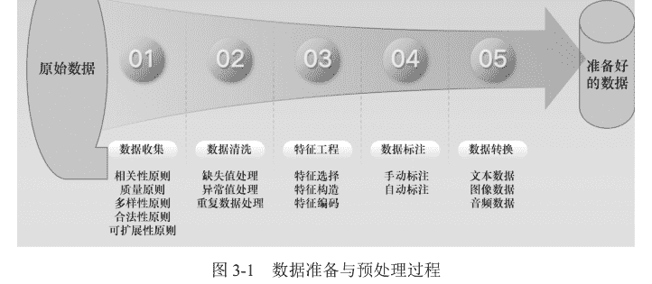

#### 3.1.1 数据收集

数据收集是指需要收集与业务场景和需求相关的数据，为模型训练提供基础。数据的质量和多样性直接影响模型的性能和泛化能力。

数据收集阶段包括确定数据来源和数据接入两个步骤。数据可以来自内部业务系统、公开数据集或第三方数据提供商，使用 DeepSeek 提供的数据接入工具将数据接入系统。这些数据支持工具支持多种数据格式和来源，便于企业快速整合数据资源。

数据收集通常遵循以下 5 个原则。

- （1）相关性原则
收集的数据应与业务场景和需求紧密相关，确保数据对模型训练和应用具有实际价值。例如，金融领域需要收集与信贷风险评估相关的数据，包括用户的收入、信用记录、负债情况等，因为这些数据有助于模型更准确地评估用户的信贷风险。

- （2）质量原则
数据的质量直接影响模型的性能，应确保数据的准确性和完整性。收集的数据应经过严格的质量控制，去除错误、不一致或重复的数据记录，提高数据的可靠性和可用性。

- （3）多样性原则
数据应具有多样性，涵盖不同的业务场景、用户群体和数据类型，以增强模型的泛化能力和适应性。例如，医疗领域需要收集不同疾病类型、不同年龄段患者的数据，这有助于模型更好地理解和处理各种医疗场景。

- （4）合法性原则
数据的收集工作应符合相关法律法规和道德规范，确保数据的来源合法、合规。收集用户数据应获得用户的明确授权，并保护用户的隐私和数据安全。

- （5）可扩展性原则
数据收集的方式和存储结构应具备可扩展性，能够适应数据量的增长和业务需求的变化。例如，采用分布式存储和计算技术，可以提高数据处理的效率和可扩展性。

DeepSeek 提供多种数据接入工具，便于企业快速整合数据资源。这些数据接入工具如下。

- （1）命令行工具
DeepSeek 提供基于命令行的数据处理工具，支持多种数据格式和数据源。用户可以通过命令行直接导入和处理数据，如使用 deepseek data import 命令导入数据。

- （2）API 网关
DeepSeek 提供了统一管理的 API 网关工具 One-API，可以统一管理 DeepSeek 及 10 余款主流模型的 API，便于企业进行数据接入和管理。

- （3）本地化调试客户端
DeepSeek 提供本地化调试客户端 Chatbox，支持敏感数据隔离，便于企业在本地环境中进行数据调试和处理。

- （4）检索增强生成框架
DeepSeek 提供基于深度文档理解构建的开源检索增强生成（Retrieval-Augmented Generation，RAG）引擎 RAGFlow，支持 PDF、Word、Excel 等 12 种格式，企业级文档理解准确率提高 40%以上，满足合规要求。

DeepSeek 接入数据工具，支持结构化数据和非结构化数据。结构化数据格式包括 CSV、JSON、SQL 等，这些格式的数据可以通过命令行工具或 API 网关直接导入 DeepSeek。此外，DeepSeek 还支持多种非结构化数据格式，包括文本文件、图片文件和视频文件，这些格式的数据可以通过上传文件的方式导入 DeepSeek。

DeepSeek 支持从本地文件系统导入数据，用户可以将数据文件放置在指定目录下，然后通过命令行工具或 API 网关导入；支持从多维数据库中导入数据，包括 MySQL、MongoDB、Redshift 等，用户可以通过数据库直连的方式，一键配置数据库连接，然后导入数据；支持通过 API 接入数据，企业可以通过 API 网关 One-API 进行数据接入和管理；支持从云端同步数据，如自动抓取 Google Drive 指定文件夹中的数据。

#### 3.1.2 数据清洗

数据清洗是指处理数据中的缺失值、异常值和重复数据等异常内容，提高数据质量，确保数据的准确性和一致性，避免数据问题导致模型训练失败或性能下降。

数据清理包括缺失值处理、异常值处理、重复数据处理等内容，处理方法与通常的数据清洗没有特别的区别，不再赘述。

#### 3.1.3 特征工程

特征工程指使用专业的背景知识和技巧处理数据，使特征能在机器学习算法上更好地发挥作用，从而提升模型的性能。特征工程步骤分为特征选择、特征构造和特征编码。

##### 1. 特征选择

特征选择是指根据业务需求和数据特点，选择与目标变量相关的特征。为此，首先需要理解业务需求，深入了解业务场景和目标，明确模型需要解决的问题和预测的目标变量，如在金融领域，如果目标是预测客户的违约风险，那么与客户信用历史、收入水平、负债情况等相关的特征可能非常重要；其次需要分析数据特点，对数据进行初步的探索性分析，了解特征之间的相关性、分布情况及与目标变量之间的关系，可以使用统计方法（如计算相关系数）和可视化方法（如绘制散点图、箱线图）分析数据；最后需要确定特征选择方法，根据业务需求和数据特点，确定合适的特征选择方法。

常见的特征选择方法包括 Filter 方法（过滤法）、Wrapper 方法（包装法）和 Embedded 方法（嵌入法）。

方法（嵌入法）。Filter 方法是按照发散性或相关性对各个特征进行评分，设定阈值或待选择阈值的个数，然后选定特征。例如，可以使用方差阈值法去除低方差特征，或使用相似系数法选择与目标变量相关性高的特征。Wrapper 方法是根据目标函数（通常是预测效果评分），每次选择若干特征或排除若干特征。例如，可以使用递归特征消除（Recursive Feature Elimination，RFE）法选择特征。Embedded 方法是使用某些机器学习算法和模型对数据进行训练，得到各个特征的权值系数，根据系数从大到小确定特征。例如，使用决策树、随机森林等模型确定特征。

基于选定的方法，在训练集上应用特征进行选择，可能涉及计算特征的得分、对训练模型进行特征排序等工作。需要对模型性能进行评估，在经过特征选择的特征集上训练模型，并使用验证集或交叉验证进行评估，观察模型性能是否有所改善，如准确率、召回率、F1 分数等指标是否提高。根据模型评估结果，调整特征选择方法和参数，迭代优化特征选择过程，直到找到最优的特征集。

##### 2. 特征构造

完成特征选择后，可以通过组合、转换等方法构造新的特征，提高模型的表达能力。

###### （1）特征组合

特征组合将两个或多个特征组合成一个新的特征，以捕捉特征的交互信息。例如，在金融领域，可以将客户的收入和负债特征组合成一个新的特征“债务收入比”，从而更好地评估客户的还款能力。特征组合适用于特征存在明显的交互作用，并且这种交互作用对目标变量具有重要影响的情况。例如，在电商领域，可以将用户的购买频率和购买金额特征组合成一个新的特征“购买强度”，从而更好地评估用户的购买行为。

###### （2）特征转换

特征转换是对原始特征进行数学变换，改变特征的分布或突出某些信息。例如，对数变换可以将偏态分布的数据转换为近似正态分布的数据，便于处理模型。特征转换适用于特征的分布不符合模型的假设，或需要突出某些信息的情况。例如，当处理房价数据时，可以对房价特征进行对数变换，以减小数据的偏态程度，提高模型的预测准确性。

###### （3）特征交互

特征交互通过创建特征的交互项，使模型学习特征的相互作用。例如，在推荐系统中，可以创建用户特征和物品特征的交互项，捕捉用户对不同物品的偏好。特征交互适用于特征变量存在复杂的交互作用，并且这种交互作用对目标变量具有重要影响的情况。例如，在医疗领域，可以创建年龄和疾病的交互项，评估不同年龄段患者对不同疾病的易感性。

###### （4）特征衍生

特征衍生是从原始特征中衍生新的特征，增加特征的维度和信息量。例如，时间序列数据可以衍生滞后特征、移动平均特征等。特征衍生适用于需要增加特征的维度和信息量，以提高模型的表达能力的情况。例如，股票数据可以衍生股票价格的滞后特征、移动平均特征等，帮助模型更好地捕捉股票价格的变化趋势。

##### 3. 特征编码

特征编码将数据集中的分类特征转换为数值特征。分类特征是机器学习模型（尤其是线性回归、SVM等数值模型）无法直接处理的数据类型，必须通过特征编码进行转换。

基于不同数据特征，特征编码可分为独热编码和标签编码。

独热编码是一种将分类变量转换为二进制向量的编码方法，每个类别都会被转换为一个独立的二进制特征，这些特征中只有一个为1，其余为0。例如，对于三个类别（如猫、狗、斑马），独热编码会将它们转换为[1, 0, 0]、[0, 1, 0]和[0, 0, 1]这样的向量。

标签编码将每个类别都映射为一个唯一的整数值。例如，将三个类别（如猫、狗、斑马）分别映射为0、1、2这样的整数值。

标签编码假设类别之间存在数值关系，这可能会导致模型错误地认为某些类别具有顺序或数值上的关联。独热编码避免了这种数值假设，每个类别都是独立的二进制特征，没有数值上的关联。

因此，标签编码适用于具有有序关系的类别特征，如学历（本科、硕士、博士）；独热编码适用于没有明显顺序关系的类别特征，如性别（男、女）。

标签编码将每个类别转换为一个整数，特征空间较小。独热编码为每个类别创建一个新的二进制特征，特征空间较大。当类别数量较多时，可能会导致维度爆炸。

#### 3.1.4 数据标注

数据标注为模型提供监督学习所需的标签数据，帮助模型学习数据与标签的映射关系。数据标注是开展监督学习的基础。

数据标注分为手动标注和自动标注。

##### 1. 手动标注

手动标注由专业人员根据业务规则和标准对数据进行标注。手动标注是一个系统性的工作流程，旨在确保数据的准确性和一致性，为模型训练提供高质量的监督学习数据。手动标注过程一般包括5个阶段。

（1）明确标注任务和目标

此阶段应明确需要标注的数据类型，如文本、图像、音频等。例如，在医疗领域，标注目标可能是医学影像数据、病历文本等。还需要明确标注的具体目标，如分类、检测、分割等。例如，在金融领域，标注目标可能是识别文本中的风险等级、检测图像中的异常交易模式等。此外，还需要制定标注标准，根据业务需求和数据特点，制定详细的标注标准和规范。例如，在电商领域，标注任务可能包括产品分类的定义、属性的描述等。

（2）制定标注指南

制定标注指南包括以下3项工作。

首先，编写标注手册。详细说明标注的流程、方法和注意事项。例如，在文本标注中，标注手册应包括如何识别和标注不同的文本类型、如何处理模糊情况等。

其次，提供标注示例。帮助标注人员更好地理解标注标准。例如，在图像标注中，可以提供已标注的图像示例，展示如何标注不同的物体、区域等。

最后，培训标注人员。对标注人员进行培训，确保他们理解标注任务和标准。例如，可以通过线上课程、线下培训等方式，对标注人员进行系统地培训。

（3）数据预处理

首先，去除噪声、错误和不一致的数据后，需要进行数据划分，将数据划分为训练集、验证集和测试集，可以按照 70%、15%、15%的比例进行划分。

其次，准备数据标注工具，选择合适的标注工具。例如，在图像标注中，可以使用 LabelImg 进行标注。

（4）标注过程

根据标注任务的复杂程度和标注人员的技能水平，合理分配标注任务，标注人员应按照标注指南开展标注工作。

此阶段最重要的工作是建立标注质量控制机制，如定期检查标注结果、标注人员的交叉验证等，通过定期抽取标注数据进行检查，确保标注质量。

（5）标注结果审核与评估

标注结果审核与评估阶段包括结果审核、质量评估和结果反馈。标注结果审核的意义是确保标注结果的准确性和一致性，可以由标注负责人或领域专家对标注结果进行审核。

标注质量评估是使用评估指标对标注质量进行评价，如准确率、召回率、F1 分数等。例如，可以计算标注结果与真实标签之间的准确率、召回率、F1 分数等指标。

标注结果反馈是将标注结果反馈给标注人员，帮助标注人员改进标注工作。

##### 2. 自动标注

自动标注是指利用自动化工具或算法对数据进行标注，减少人工标注的工作量，提高标注效率和准确性。常见的自动标注工具和算法如下。

###### （1）自动标注工具

- ① Labelbox 是一个功能强大的数据标注平台，支持图像、文本、视频等多种数据类型的标注；它提供自动标注功能，可以利用预训练模型对数据进行初步标注，然后由人工进行审核和修正。Labelbox 适用于需要高精度标注的项目，尤其是在图像和视频标注领域。Labelbox 效率较高，能够显著减少人工标注的时间和成本，同时准确性也较高，能够满足大多数项目的需求。
- ② Supervisely 是一个开源的数据标注平台，支持图像和视频的标注；它提供丰富的标注工具和强大的数据管理功能，适合中小型项目和个人开发者使用。Supervisely 的自动标注功能可以显著提高标注效率，其预训练模型能够自动标注部分数据，减少人工标注的工作量。此外，Supervisely 还支持数据集管理和版本控制，方便数据的管理和共享。
- ③ Amazon Mechanical Turk（MTurk）是亚马逊提供的一个众包平台，用户可以在该平台发布各种任务，包括数据标注任务，由全球的“Turkers”（工人）完成。MTurk 适用于需要大量标注数据的项目，成本相对较低，还适用于需要快速完成、大规模的标注任务。然而，由于 MTurk 是众包模式，所以标注质量可能会参差不齐，需要通过质量控制机制确保标注数据的准确性。
- ④ T-Rex Label 是由 IDEA 计算机视觉团队基于 T-Rex2 模型创建的 AI 自动标注工具。T-Rex Label 支持一键标注和零样本检测，适用于农业、工业、生物医药等多个行业，它基于视觉提示简化工作流程，提高标注效率和准确度，无须额外训练，可以直接应用于各类场景。T-Rex Label 无须下载安装，支持 GitHub 账号一键登录，大幅降低上手成本。
- ⑤ EISeg 是由飞桨 PaddleSeg 团队开源的交互式分割工具，支持多种场景的图像分割标注。EISeg 提供自动标注功能，可以利用预训练模型对图像进行初步标注，然后由人工进行修正。EISeg 适用于需要高精度图像分割标注的项目，能够显著提高标注效率和准确性。
- ⑥ X-AnyLabeling 是一款全新的交互式自动标注工具，集成了多种深度学习算法，支持图像和视频标注。X-AnyLabeling 提供自动标注和交互式修正功能，用户可以对自动标注结果进行交互式修正，提高标注精度。X-AnyLabeling 适用于需要高精度标注的项目，尤其适用于图像和视频标注领域。

###### （2）自动标注算法

- ① 基于规则的算法利用预设的规则识别和标注数据。例如，基于正则表达式标注文本数据。基于规则的算法适用于结构化和格式统一的数据集，能够快速生成标注结果，但难以处理复杂和模糊的文本内容。
- ② 基于统计的算法利用大量标注好的数据进行训练，通过统计模型对未知文本进行标注，包括隐马尔可夫模型（Hidden Markov Model，HMM）、条件随机场（Conditional Random Field，CRF）等，适用于序列标注任务，如命名实体识别（Named Entity Recognition，NER）和关系抽取。基于统计的算法能够处理较复杂的文本内容，准确性较高，需要大量的标注数据进行训练。
- ③ 近年来，深度学习在文本自动标注领域取得了显著进展。常用的深度学习方法包括卷积神经网络（Convolutional Neural Network，CNN）、循环神经网络（Recurrent Neural Network，RNN）、长短期记忆网络（Long-Short Term Memory，LSTM）等。基于深度学习的算法能够自动提取文本的高级特征，实现更准确的数据标注；该算法适用于各种复杂的文本标注任务，准确性较高，需要大量计算资源和训练时间。

#### 3.1.5 数据转换

数据转换将原始数据转换为模型能够接受的格式，确保数据与模型兼容，避免数据格式不匹配导致训练失败或性能下降，包括将文本、图像、音频等不同格式的数据转换为模型能够处理的数值向量或张量。对于不同类型的数据，需要进行不同的格式转换和实现方式。

##### 1. 文本数据

文本数据可以采用分词和编码、序列填充等方式进行格式转换。分词和编码是将文本数据进行分词，将每个单词或字符转换为对应的编码。例如，通过使用词嵌入技术，将单词转换为固定长度的向量。序列填充是指将文本序列填充到相同的长度，以满足模型的输入要求。例如，使用 pad_sequence 函数对文本序列进行填充。

##### 2. 图像数据

图像数据的格式转换包括图像预处理和图像增强。图像预处理是对图像进行缩放、裁剪、旋转等操作，以满足模型的输入要求。例如，使用 ImageProcessor 对图像进行缩放和归一化处理。图像增强是对图像进行随机旋转、翻转、调整亮度等增强处理，以增加数据的多样性。例如，使用 random_rotate 函数对图像进行随机旋转。

##### 3. 音频数据

音频数据的格式需要通过频谱提取、降噪和分段环节。频谱提取是将音频数据转换为频谱图，提取音频的特征。例如，使用 extract_spectrogram 函数提取音频的频谱。降噪和分段的对象是频谱图，通过降噪和分段处理提高数据的质量。例如，使用 denoise 函数对频谱图进行降噪，使用 segment 函数对频谱图进行分段。

### 3.2 模型训练与评估

完成环境搭建与配置和数据工程后，就可以进入模型训练与评估环节了。模型训练与评估环节通常可以分为 5 个主要步骤。模型训练与评估过程如图 3-2 所示。

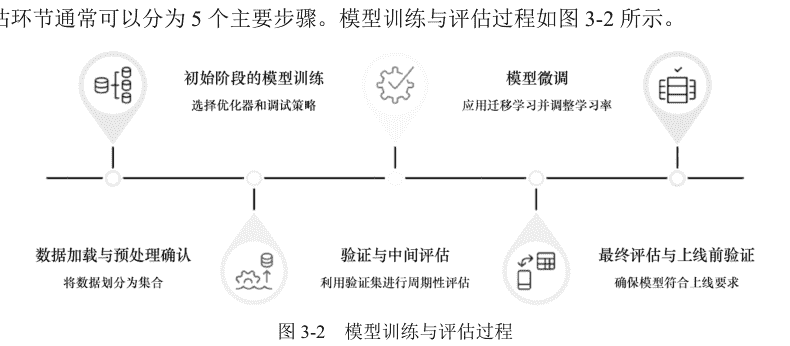

#### 3.2.1 数据加载与预处理确认

数据加载与预处理是为了确保训练、验证和测试数据的质量与一致性，为后续训练提供干净、标准化的数据。数据加载与预处理包括数据划分、数据增强与标准化和数据管道构建 3 个环节。

##### 1. 数据划分

将数据划分为训练集、验证集和测试集是模型训练与评估环节的重要步骤。训练集的数据用于训练模型，使模型学习数据的特征和规律。验证集的数据用于验证模型的性能，调整模型的超参数，如学习率、模型架构等。验证集可以帮助我们观察模型的泛化能力，防止模型过拟合。测试集的数据用于评估模型的最终性能，得到模型的测试精度或误差等指标。测试集的数据是模型从未见过的数据，可以真实地反映模型的泛化能力。

数据划分通常按以下步骤进行。

（1）确定数据划分比例

在通常情况下，数据集可以按照一定的比例划分为训练集、验证集和测试集，常见的划分比例有 70% : 15% : 15% 或 80% : 10% : 10% 等。例如，如果数据集共有 10 000 条数据，可以将 7 000 条数据作为训练集，1 500 条数据作为验证集，1 500 条数据作为测试集。

（2）使用数据划分工具或函数

可以使用数据处理工具或编程语言中的函数实现数据划分。例如，在 Python 中可以使用 sklearn.model_selection 模块中的 train_test_split 函数实现数据划分。

（3）考虑数据的随机性和代表性

当划分数据时，需要确保数据的随机性和代表性，可以通过设置随机种子来保证数据划分的随机性。同时，需要确保训练集、验证集和测试集中的数据分布具有代表性，能够反映整个数据集的特征。

（4）验证数据集划分结果

数据划分后，需要验证数据划分结果的正确性，可以通过检查数据集的大小、数据分布等指标进行验证。例如，可以检查训练集、验证集和测试集的大小是否符合预期的比例和数据分布是否一致等。

##### 2. 数据增强与标准化

数据增强与标准化等预处理操作是为了进一步提升模型的性能和泛化能力。

（1）数据增强

数据增强通过各种变换生成大量新的数据，扩大数据集规模，可以有效解决数据不足的问题，从而提高模型的泛化能力和鲁棒性。在数据量有限的情况下，数据增强非常重要，它可以帮助模型学习更多特征和模式，降低过拟合的风险。

DeepSeek 提供多种数据增强技术，可以根据不同的数据类型和任务需求进行选择和应用。例如，对于图像数据，可以使用随机旋转、翻转、缩放、裁剪、颜色变换等操作来增强数据；对于文本数据，可以使用同义词替换、句子重组、文本风格转换等方法生成新的文本样本。

在具体操作上，首先根据数据类型和任务需求选择合适的数据增强方法；其次使用相应的工具或库（如 DeepSeek 自带的增强工具或第三方库）对数据进行增强处理；最后将增强后的数据与原始数据合并，形成新的训练集。

（2）归一化和标准化

归一化指将数据缩放到一个固定的范围（如[0, 1]），消除数据的量纲差异，通常使用 MinMaxScaler 实现。

标准化是将数据调整为均值为 0、标准差为 1 的分布，消除数据的量纲差异，通常使用 StandardScaler 实现。

（3）Tokenization（分词）

数据标准化和归一化后，需要进一步完成数据的 Tokenization。Tokenization 是将文本数据转换为模型可以理解的数字序列的过程。在 NLP 任务中，文本数据通常需要经过 Tokenization 处理，便于模型有效地处理和理解文本信息。

DeepSeek 使用字节对编码（Byte Pair Encoding，BPE）分词器对文本进行 Tokenization。BPE 分词器可以将文本分割成更小的子词单元，从而提高模型对文本的处理效率和准确性。

在具体操作上，首先使用 BPE 分词器对文本进行 Tokenization；其次将 Tokenization 后的子词单元转换为对应的数字 ID；最后将数字序列输入到模型中进行训练和推理。

##### 3. 数据管道构建

数据管道是将各种数据处理步骤整合成一个统一的工作流程，确保数据从原始状态到模型输入的整个过程顺畅、高效，有助于自动完成数据加载、转换和预处理等任务，减少人工操作和潜在错误。通过标准化数据处理步骤，数据管道可以在不同阶段保持数据质量的一致性，可以对所有数据应用相同的转换和清洗操作，确保训练集、验证集和测试集都经过相同的处理。同时，精心设计的数据管道可以通过提供高质量、经过良好处理的数据来提升模型性能。数据管道还可以帮助优化数据加载和预处理步骤，缩短训练时间，提高模型准确性。

数据管道构建，首先定义数据管道的清晰结构，概述数据处理步骤的顺序和依赖关系；可以使用工作流管理工具或编程框架定义管道结构，如在 Python 中可以使用 Apache Beam 或 Luigi 等库将管道定义为一系列任务和依赖关系。其次实现数据加载，从各自的存储位置将训练集、验证集和测试集数据加载到管道中；此步骤可以根据数据源使用适当的数据加载技术，如若数据存储在数据库中，使用 SQL 查询或数据库连接器加载数据；若数据存储在文件中，使用文件读取函数将数据加载到管道中。最后，将预处理后的数据加载到模型中进行训练，并验证数据以确保模型的准确性和完整性。

通过以上步骤和方法，在 DeepSeek 私有化部署中就构建了一个稳健的数据管道，确保高效的数据处理和提升模型性能。

#### 3.2.2 初始阶段的模型训练

初始阶段需要通过大规模训练，使模型捕捉通用特征，降低整体损失，为进一步的任务微调打下坚实基础。初始阶段的具体工作包括选择合适的优化器和调试策略进行训练，同时可以通过分布式训练加速训练进程，实时跟踪损失曲线等指标，确保训练过程的稳定性。

##### 1. 优化器和调试策略选择与训练

初始阶段的模型训练准备包括以下内容。

（1）选择合适的优化算法

Adam 是一种自适应学习率优化算法，结合了动量和均方根传播（Root Mean Square Propagation，RMSProp）的优点，能够根据梯度的一阶矩估计和二阶矩估计动态调整学习率，从而实现稳定且高效的训练过程。在 PyTorch 中，可以使用 torch.optim.Adam 优化器来实现 Adam 优化算法。

LAMB（Layer-wise Adaptive Moments optimizer for Batch training）优化算法是一种专为大规模分布式训练设计的优化算法，特别适用于大批次训练场景。LAMB 算法能够在保持模型精度的同时，支持更大的批次规模，从而提高训练效率。可以使用 torch-optimizer 库中的 LAMB 优化器实现 LAMB 优化算法。

（2）学习率调度策略

训练初期可以选择预热策略，逐渐增加学习率，从一个较小的值增加到初始学习率。学习率调度策略有助于在训练初期稳定模型的训练过程，避免因学习率过大导致的训练不稳定或发散问题。预热策略可以使用 get_cosine_schedule_with_warmup 函数实现预热策略与余弦退火策略的结合。

训练后期可以选择余弦退火策略，通过逐渐减小学习率，使模型在接近收敛时能够更细致地调整参数，从而提升模型的泛化能力和最终性能。可以使用 PyTorch 中的 CosineAnnealingLR 调度器实现余弦退火策略。

（3）结合使用优化器和学习率调度策略

训练早期使用 Adam 优化器或 LAMB 优化器结合预热策略，有助于模型快速适应优化过程，稳定训练。通过逐渐增加学习率，模型能够在训练初期避免因学习率过大导致的不稳定问题，同时提高模型的收敛速度。

训练中后期引入学习率调度器，如余弦退火算法或基于性能的调度器，当验证集上的性能不再提升时，通过调整学习率进一步优化模型，这有助于模型在训练后期更好地收敛，提高模型的泛化能力和最终性能。

在训练过程中，除了需要确保数据的隐私和安全以避免数据泄露，在大规模分布式训练中合理分配和利用资源避免资源浪费，还需要通过正则化技术（如 L1 或 L2 正则化）和早停策略，防止模型过拟合，提高模型的泛化能力。

##### 2. 利用多 GPU 或分布式计算平台加速训练

为了加速 DeepSeek 模型的大规模分布式训练并确保训练过程的稳定性，可以通过以下方式利用多 GPU 或分布式计算平台加速训练。

- ① 使用 PyTorch 的分布式数据处理（Distributed Data Processing，DDP）。DDP 是 PyTorch 提供的一种分布式训练方法，能够有效地在多个 GPU 上并行训练模型，通过在多个 GPU 上同步梯度和参数，实现模型的并行训练，从而加速训练进程。
- ② 使用 Hugging Face 的 Accelerate 库。Accelerate 库提供简单的 API，用于在多个

#### 3.2.3 验证与中间评估

在 DeepSeek 模型的初始训练阶段，可以通过以下方式利用验证集对模型进行周期性评估，及时发现并防范过拟合或欠拟合问题，同时指导超参数调整。

-   （1）利用验证集进行周期性评估
    在每个训练周期或一定数量的批次后，可以使用验证集对模型进行评估。评估指标包括损失值、准确率、F1 分数等。记录每个周期的训练损失和验证损失，绘制学习曲线。如果训练损失持续下降而验证损失开始上升，这可能是过拟合的迹象；如果二者都较高且下降速度缓慢，可能是欠拟合的迹象。

-   （2）防范过拟合的策略
    一是增加数据量，通过收集更多数据或使用数据增强技术增加训练数据的多样性，降低模型过拟合的风险。二是简化模型，如果模型过拟合，可以尝试减少模型的层数或神经元数量，降低模型的复杂度。三是正则化，使用 L1 或 L2 正则化技术，在损失函数中加入正则化项，限制模型参数的复杂度；L1 正则化可以使一些参数变为 0，实现特征选择；L2 正则化可以使参数保持较小的值，使模型更平滑。四是采用早停法，在训练过程中，如果模型在验证集上的性能在连续多个周期内没有显著提升，应提前停止训练，保存当前的最佳模型参数。五是 Dropout，在训练过程中随机地让一些神经元不工作，降低模型对特定神经元的依赖，提高模型的泛化能力。

-   （3）防范欠拟合的策略
    一是增加模型复杂度，如果模型欠拟合，可以尝试增加模型的层数或神经元数量，提高模型的拟合能力。二是调整正则化参数。如果模型欠拟合，可以尝试减小正则化参数，允许模型学习更复杂的模式。三是使用能够有效学习复杂特征的激活函数，如 LeakyReLU。四是增加训练轮数，提高模型的拟合能力。

-   （4）超参数调整策略
    一是初始学习率设置，设置合适的初始学习率，通常可以尝试 1e-3、1e-4 等值；如果发现损失下降速度缓慢，可以尝试提高学习率；如果损失波动较大，可以尝试降低学习率。二是学习率调度策略，使用学习率调度器，如余弦退火或循环学习率（CyclicLR），动态调整学习率。三是批量规格调整，根据显存大小和计算资源，合理设置批量规格；较小的批量规格可以提高模型的泛化能力，但可能需要更多的训练时间；较大的批量规格可以提高训练速度，但可能需要更多的显存。四是权重衰减，合理设置权重衰减参数，通常可以尝试 1e-4、1e-5 等值；权重衰减可以防止模型参数过大，提高模型的泛化能力。

-   （5）实时跟踪损失曲线、梯度分布和其他关键指标
    在训练过程中，使用 TensorBoard 实时监控损失曲线、梯度分布和其他关键指标。通过可视化关键指标，可以及时发现训练过程中的问题，如过拟合或欠拟合。同时，使用 Weights & Biases 丰富的可视化功能，帮助用户更好地理解训练过程。

#### 3.2.4 模型微调

模型微调是指在预训练模型的基础上，使用特定任务或领域的数据对模型进行进一步训练，使模型更好地适应目标任务，提升模型在该任务上的性能。模型微调通常有以下 4 种方法。

##### 1. 迁移学习

迁移学习将一个模型在某个任务上学习到的知识和特征，应用到另一个相关任务上，以加速模型的训练过程，提升模型的性能。迁移学习在微调环节可以减少数据需求，加速训练过程，并提升模型性能。利用预训练模型的知识，可以在目标任务上使用较少的数据进行训练，减少数据收集和标注的成本。预训练模型已经在大量数据上进行了训练，具有较好的初始权重，可以在目标任务上更快地收敛。预训练模型学习到的通用特征可以为目标任务提供良好的基础，提升模型在目标任务上的性能。

实施迁移学习前，首先选择一个与目标任务相关的预训练模型，根据目标任务的需求，对预训练模型的结构进行调整，如修改输出层的大小和激活函数；其次是冻结预训练模型的部分层，只训练模型的顶层或特定层，以保护预训练模型中已经学习到的通用特征；再次是使用目标任务的数据对模型进行训练，此环节通常会使用较小的学习率，避免预训练模型中已经学习到的通用特征被破坏；最后在验证集上评估模型的性能，根据评估结果调整模型的超参数，如学习率、批量大小等，优化模型性能。

##### 2. 调整学习率

调整学习率是在模型训练过程中，根据训练的进展和模型的性能，动态调整学习率的大小，优化模型的训练过程和性能。调整学习率在微调环节的作用，包括加速训练收敛、避免模型振荡，以及提升模型性能。通过调整学习率，可以使模型更快地收敛到最优解，过高的学习率可能会导致模型在训练过程中出现震荡。通过调整学习率，可以避免这种情况的发生。此外，适当的学习率可以提升模型在目标任务上的性能。

当实施调整学习率时，首先，要选择合适的学习率范围，根据模型和数据的特点，选择一个合适的学习率范围，如 1e-5～1e-3。其次，使用学习率调度器，如 StepLR、CosineAnnealingLR 等，在训练过程中，监控模型在验证集上的性能，根据性能调整学习率。最后，根据模型性能和训练进展，调整学习率的大小，如当模型性能停滞时降低学习率。

##### 3. 局部更新

局部更新是在模型训练过程中，只更新模型的某些部分，其他部分保持不变。局部更新在微调环节既可以减少计算资源消耗，又可以保护预训练模型的通用特征，还可以提升模型性能。只更新模型的部分参数，可以减少计算资源的消耗；冻结预训练模型的部分层，可以保护已经学习到的通用特征，避免在微调过程中丢失这些特征。局部更新可以使模型更快地适应目标任务，提升模型性能。

实施局部更新首先根据目标任务的需求，选择需要更新的模型层，如顶部层或特定层；其次冻结模型的其他层，使其在训练过程中不更新；再次使用目标任务的数据对模型进行训练，只更新选择的层；最后在验证集上评估模型的性能，根据评估结果调整模型的超参数，如学习率、批量大小等，优化模型性能。

##### 4. 其他常用方法

除了上面提到的方法，还有以下方法可以用于模型微调。

###### （1）适配器微调

适配器微调是一种用于微调预训练模型的方法，通过在模型的中间层插入轻量级的适配器模块来适应特定任务。适配器微调在不改变预训练模型主体参数的情况下，通过调整适配器模块的参数来优化模型性能。

适配器微调适用于多种 NLP 任务，包括文本分类、机器翻译和问答系统等。

适配器微调通过只更新适配器模块的参数，减少了训练时的计算量和内存占用。预训练模型的主体参数被冻结，避免了灾难性遗忘，保留了模型的通用知识。适配器模块的引入使模型的调整更模块化，便于分析和理解模型的行为。适配器模块可以在不同的任务和数据集上复用，提高了模型的灵活性和可扩展性。

适配器微调的缺点是需要设计和调整适配器模块的结构和参数，提高了模型设计的复杂度。同时，适配器模块的设计和性能直接影响最终模型的效果，设计不当可能会导致模型性能下降。

###### （2）模型蒸馏

模型蒸馏的核心思想是通过知识迁移的方式，将一个复杂的大模型（教师模型）的知识传授给一个简单的小模型（学生模型），在保持较高预测性能的同时，大幅降低模型的复杂性和计算资源需求，实现模型的轻量化和高效化。

模型蒸馏的实现过程包括定义教师模型、训练教师模型、定义学生模型和蒸馏训练等环节。在模型蒸馏中，通常会采用一种结合了传统监督学习损失函数和蒸馏损失的综合损失函数，其中传统监督学习损失函数用于衡量学生模型在标注数据上的预测精度，蒸馏损失函数用于衡量学生模型与教师模型的相似性和一致性。通过联合优化这两部分损失，学生模型可以同时学习到有效的特征表示和知识迁移。

模型蒸馏在 NLP、计算机视觉等领域均取得了显著的成功，并在实际应用中具有广泛的适用性和重要的价值。

###### （3）强化学习微调

强化学习微调（Reinforcement Learning Fine-Tuning, RLFT）通过引入奖励信号，使模型在特定任务上能够动态调整其行为，最大化累积奖励，从而提升模型的性能和泛化能力。RLFT 的核心思想是将预训练模型视为一个智能体，在与环境的交互过程中，根据环境反馈的奖励信号调整模型参数。具体来说，预训练模型在特定任务中生成输出，环境根据输出的质量给予奖励，模型根据奖励信号更新自身参数，优化模型在任务上的表现。

通过 RLFT，模型可以更好地适应特定任务，提高准确率和效率。RLFT 可以帮助模型更好地泛化为未见过的数据，提高模型的鲁棒性。RLFT 允许模型在训练过程中根据环境反馈动态调整策略，从而提高模型的灵活性。

RLFT 需要设计实现环境和奖励函数，提高了训练的复杂度。RLFT 通常需要更多的计算资源和时间，尤其是在处理大规模数据和复杂模型的情况下。设计合适的奖励函数是强化学习微调的关键，设计一个能够准确反映任务目标的奖励函数具有挑战性。

###### （4）稀疏微调

稀疏微调通过在训练过程中引入稀疏性，使模型中的部分参数变为零，从而减少计算量和提高推理速度。稀疏微调通常在预训练模型的基础上进行，通过调整模型参数的一个子集来适应特定任务，而不是调整所有参数。

稀疏微调首先需要选择一个预训练模型作为基础。其次在训练过程中，通过特定的稀疏优化算法（如梯度下降法结合剪枝策略）逐步使模型中的部分参数变为零。在训练过程中，需要平衡模型的稀疏度和性能，找到最佳的权衡点。最后将稀疏微调后的模型应用于实际任务中，如文本分类、问答系统等。

稀疏微调的优点是通过引入稀疏性，使模型中的部分参数变为零，减少计算量；在推理过程中可以跳过零参数，提高推理速度。稀疏微调在减少计算量的同时，能够保持模型的性能和泛化能力。稀疏微调需要设计和实现稀疏优化算法，提高了训练的复杂度。此外，还需要设计合适的稀疏微调模式，确保模型在不同任务上的有效性和高效性，增加了稀疏微调的设计难度。

###### （5）多任务学习微调

多任务学习微调是一种在模型训练过程中同时处理多个相关任务的方法，旨在通过学习任务的共享表示，提升模型的性能和泛化能力。多任务学习微调扩展了传统的单任务学习微调，通过同时训练多个任务，使模型能够更好地利用不同任务的内在联系，从而在多个任务上取得更好的性能。多任务学习微调的实现通常包括以下 5 个环节。

-   ① 任务定义与数据准备，明确模型需要处理的多个任务，并为每个任务准备相应的训练数据。这些任务通常是相关的，可以共享某些底层特征或知识。
-   ② 进行模型架构设计，构建一个能够同时处理多个任务的模型架构。这种架构通常包含一个共享的底部网络和多个任务特定的顶部网络，共享网络提取通用特征，任务特定网络根据各自任务的需求进行定制。
-   ③ 设计损失函数，定义一个联合损失函数，用于综合衡量模型在所有任务上的表现。常见的做法是将各个任务的损失函数进行加权求和，权重可以根据任务的重要性或难度进行调整。
-   ④ 制定训练策略，在训练过程中，同时使用多个任务的数据进行训练，优化联合损失函数。可以通过动态调整任务权重、使用对比学习等策略来平衡不同任务的学习进度和性能。
-   ⑤ 进行模型评估与优化，在训练过程中定期评估模型在各个任务上的性能，根据评估结果调整模型参数和训练策略，实现最佳的综合性能。

多任务学习微调通过学习任务的共享表示，使模型在多个任务上都能取得更好的性能，有助于模型更好地泛化未见过的数据，提高模型的鲁棒性和适应性。此外，多任务学习微调还提高了资源利用效率，避免为每个任务单独微调所需的大量训练资源投入，降低了维护和部署的复杂度。

多任务学习微调的挑战是不同任务可能存在目标冲突，需要合理设计损失函数和训练策略进行平衡；各个任务的数据量可能不平衡，需要采取措施以确保模型对每个任务都能进行充分学习。同时，多任务模型的架构和训练过程相对复杂，需要更多的计算资源和时间。

###### （6）增量微调

增量微调是一种在已微调的模型基础上，用新数据进一步微调模型的方法，类似“持续学习”。增量微调的主要特点是保留之前任务的知识，避免灾难性遗忘，并通常结合正则化或弹性权重固化（Elastic Weight Consolidation，EWC）等技术。增量微调通常用于提高模型的准确率和效率，特别是在处理特定领域或任务时。当预训练模型需要适应新的数据或任务时，增量微调可以快速更新模型，使模型更好地服务实际应用。通过在原有数据基础上增加新的数据样本，增量微调可以提高模型的泛化能力和鲁棒性。在跨领域应用中，增量微调可以帮助模型更好地适应目标领域的数据特征和任务要求。

相较于重新训练整个模型，增量微调只需要在新的数据上进行少量的训练，节省了计算资源和时间，使模型能够更好地适应不同的任务和数据集，提高其在实际应用中的灵活性和实用性。在微调过程中，预训练模型已经学习到的通用知识和特征表示得以保留和利用，避免了因从头开始训练而造成知识丢失。

增量微调的效果高度依赖新数据的质量和代表性。如果新数据存在噪声、偏差或不完整等问题，可能会影响模型性能。如果微调过程中参数设置不当或训练数据有限，也可能会导致模型过拟合，失去泛化能力。需要根据具体任务和数据集进行参数调整，增加了调参的复杂度和难度。

###### （7）早停法

早停法的核心思想是通过监测模型在验证集上的性能，当性能不再提升时提前停止训练，避免模型过度拟合训练数据，从而降低模型的泛化能力。早停法的优点是可以有效防止过拟合，提高模型的泛化能力；缺点是需要频繁评估验证集的性能。早停法适用于所有需要防止过拟合的场景。

###### （8）分层学习率

分层学习率是指对不同的网络层设置不同的学习率，允许模型的不同层以不同的速度更新，有助于更好地控制模型的训练过程，提升模型的性能和泛化能力。当预训练模型进行进行微调时，较小的学习率可以防止对预训练权重的过度调整，降低过拟合的风险。分层学习率的缺点是需要为不同层设置和调整多个学习率参数，提高了调参的复杂度；同时在训练过程中，需要对不同层的参数独立进行更新和优化，可能会增加计算资源的消耗。

###### （9）量化微调

量化微调是一种在量化过程中保留模型性能，通过微调优化低精度模型的技术，其主要目标是平衡模型的精度与资源消耗，使模型在保持较高性能的同时，能够更高效地运行。量化微调特别适用于大规模预训练模型的优化，能够在资源受限的环境中提升模型的部署效率和性能。

以上是几种常见的模型微调方法，每种方法都有特定的原理、优点、缺点和适用场景。根据实际需求和资源情况，可以选择合适的微调方法优化模型性能。

#### 3.2.5 最终评估与上线前验证

DeepSeek 模型初始训练阶段结束后，进行最终评估与上线前验证是确保模型成功部署和应用的关键步骤。

##### 1. 最终评估与上线前验证的作用

最终评估与上线前验证，至少具有以下 5 个方面的作用。

###### （1）确保模型性能

通过独立测试集和真实场景模拟测试，可以评估模型在未见过的数据和实际业务场景中的表现，确保模型具有良好的泛化能力，可以适应各种未知情况。此外，最终评估可以检测模型在不同条件下的稳定性和可靠性，确保模型在实际应用中不会出现性能波动或故障。

###### （2）优化用户体验

综合评估指标可以评价模型的响应速度和错误率。响应速度快可以满足用户对实时交互的需求，低错误率可以提高用户对模型的信任度和满意度。

###### （3）风险控制

压力测试和 AB 测试可以发现模型可能存在的问题，如性能瓶颈、错误率过高等。通过及时优化和调整，可以降低模型上线后出现问题的风险。模拟实际业务场景可以确保模型在实际部署后的稳定运行，避免因模型问题导致业务中断。

###### （4）符合业务需求

最终评估可以确保模型的性能指标符合业务需求，如准确率、召回率、F1 分数等。真实场景模拟测试可以确保模型在实际业务场景中表现良好，满足业务的具体要求。

###### （5）提升模型价值

综合指标评估和上线前验证可以确保模型在实际应用中能够发挥最大的价值，为业务带来实际价值的提升。稳定可靠的模型表现还可以提高用户和业务部门对模型的信任度，为模型的进一步推广和应用打下坚实的基础。

##### 2. 最终评估与上线前验证的实施方法

最终评估与上线前验证的实施方法如下。

###### （1）独立测试集评估

独立测试指使用独立测试集对模型进行全面评估，为此，需确保测试集与训练集和验证集完全隔离，以真实反映模型的泛化能力。独立测试集是最后一组完全独立于训练集和验证集的数据，用于评估模型的最终性能。测试集不参与任何模型训练和调优过程，其目的是衡量模型在未知数据上的泛化能力。使用独立测试集对模型进行评估时，可以使用之前设置的评估指标，如准确率、精确率、F1 分数等。

###### （2）综合指标评估

综合测试评估指结合响应速度、鲁棒性、错误率等多种性能指标进行全方位考量，确保模型在各个方面都表现出色。在实际应用中，模型的响应速度可能会直接影响用户体验，鲁棒性则决定了模型在面对异常输入或噪声数据时的表现。

-   ① 响应速度。通过记录模型在处理请求时的响应时间，评估模型的实时性能。可以使用工具测量模型的响应时间，如 timeit 或 profiler。
-   ② 鲁棒性。通过向模型输入异常数据或噪声数据，观察模型的输出是否稳定，评估模型的鲁棒性。例如，可以向模型输入含有噪声的图像或文本，观察模型是否能够正确处理噪声。
-   ③ 错误率。记录模型在测试集上的错误率，分析模型在不同场景下的错误情况，找出模型的弱点并改进。

###### （3）压力测试

压力测试指在预生产环境中模拟高并发请求和大数据量处理等实际业务场景，评估模型的稳定性和性能瓶颈。

可以使用以下方法进行压力测试。

-   ① 模拟高并发请求，使用 Locust 或 JMeter 等工具模拟大量用户同时访问模型，观察模型的响应时间和错误率。
-   ② 模拟大数据量处理，使用大规模数据集对模型进行测试，观察模型的处理速度和资源占用情况。

###### （4）A/B 测试

A/B 测试指在预生产环境中对不同模型版本进行对比测试，选择最优模型版本，确保模型在实际部署后表现稳定。在预生产环境中，可以将用户随机分为几组，每组使用不同的模型版本，收集各组用户的反馈和数据，通过比较不同模型版本的性能，选择最优模型版本。

通过以上方法，可以在 DeepSeek 初始阶段模型训练结束后，全面验证模型的泛化能力、稳定性和实际应用效果，确保模型符合上线要求。

### 3.3 模型部署与应用

模型部署是指将训练好的模型应用于实际的生产环境或业务场景中，使模型能够为用户提供服务或为企业的业务流程提供支持。完成环境准备、模型加载与调优等工作后，需要将模型集成到实际的业务系统中，使模型能够被用户访问和使用。此外，需要对模型进行性能优化、性能监控、容错机制设置，确保模型能够正常访问。模型部署与应用过程如图 3-3 所示。

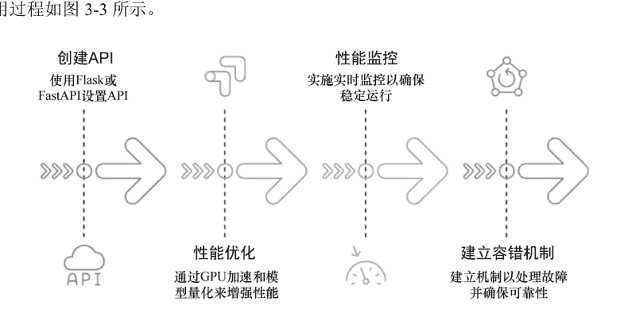

#### 3.3.1 创建 API

完成模型训练和验证后，使用 Flask 或 FastAPI 创建 LLM 的 API 是模型部署的关键步骤。

Flask 是一个轻量级、灵活的 Python Web 框架，适用于创建各种类型的 Web 应用程序和 API 服务。在 Flask 的帮助下，可将 DeepSeek 模型高效地部署为 Web 服务，实现模型的快速推理与便捷调用，充分满足生产环境的实际需求。

FastAPI 是一个用于构建 API 的现代、快速的 Web 框架，基于 Python3.7+标准类型提示，其设计目标是实现高性能、高效开发、简洁代码和强类型检查。

#### 3.3.2 性能优化

性能优化通常包括使用 GPU 加速、使用 TensorFlow Lite 或 TensorRT 进行模型量化等内容，以减少模型的存储和计算需求。

##### 1. 使用 GPU 加速

GPU 拥有大量的核心，能够同时处理多个计算任务，特别适合深度学习中矩阵运算和卷积运算等高度并行化的操作。GPU 的高内存带宽可以快速读取和写入数据，缩短数据传输等待时间，进一步提高计算效率。在实际应用中，GPU 加速可以显著缩短模型训练和推理时间，提高模型的响应速度和吞吐量，从而在处理大规模数据和高并发请求时发挥重要作用。

使用 GPU 加速前，首先要确保 TensorFlow 或 PyTorch 安装了 GPU 支持版本，系统中有适当的 CUDA 和 cuDNN 库，可以使用 GPU 加速。

模型性能优化包括模型训练优化和模型推理优化。此外，还可以实施高级优化策略。

###### 1）模型训练优化

####### （1）使用混合精度训练

混合精度训练通过结合使用 FP32 和 FP16 两种数据格式，在保持模型精度的同时，减少内存占用并加速计算。FP16 格式的数据占用内存更少、计算速度更快，FP32 格式用于保存关键的精度信息。

在 TensorFlow 中，可以通过 tf.keras.mixed_precision 模块启用混合精度训练。此外，还可以结合 NVIDIA 的 Tensor Core 技术，进一步加速混合精度训练。Tensor Core 是 NVIDIA GPU 中专门用于加速矩阵计算的硬件单元，能够高效处理混合精度计算任务。

####### （2）优化数据加载与预处理

使用 tf.data API 构建高效的数据加载管道，实现数据的异步加载与预处理。通过 tf.data.Dataset 的 map、batch、shuffle 等方法，可以并行处理和优化数据，缩短数据加载时间。

将数据预处理操作放在 GPU 上执行，利用 GPU 的并行计算能力来加速数据处理。例如，使用 tf.image 模块进行图像数据的解码、缩放、归一化等操作，这些操作都可以在 GPU 上高效运行。

###### 2）模型推理优化

TensorRT 引擎进行加速推理。例如，在 Python 中可以使用 TensorRT 库进行模型转换和推理。

####### （2）开启 FP16 半精度推理

FP16 半精度格式相比 FP32 单精度格式，数据位宽减半，内存占用减少，带宽需求降低，从而可以提高数据传输和计算速度。在推理阶段，开启 FP16 模式可以在保持模型精度基本不变的前提下，显著提升模型的推理性能。

在 TensorRT 模型优化过程中，可以通过设置 `builder_config` 的 `precision` 参数为 `trt.DataType.HALF` 开启 FP16 推理。此外，当使用 CUDA 进行自定义推理代码开发时，也可以通过指定 FP16 计算来实现半精度推理。

###### 3）高级优化策略

此外，还可以采用多个 GPU 并行计算和内存管理优化进行性能优化。

####### （1）多个 GPU 并行计算

在多个 GPU 系统中，采用数据并行策略可以显著提高训练效率。具体做法是将训练数据分割成多个小批量，每个 GPU 处理一部分数据，然后在每次迭代后同步模型参数。

对于超大模型，当单个 GPU 无法容纳整个模型时，可以采用模型并行或流水线并行策略。模型并行将模型的不同层放置在不同的 GPU 上，流水线并行将模型分成多个阶段，不同阶段的计算在不同的 GPU 上并行执行。这些策略需要根据模型结构和 GPU 资源进行定制化设计和实现。

####### （2）内存管理优化

在模型训练和推理过程中，合理管理显存资源可以有效减少内存碎片和分配开销。通过预先分配足够的显存给深度学习模型，可以避免在运行过程中频繁地申请和释放显存。同时，利用特定的库优化显存使用，如 NVIDIA 的 cuDNN 等，通过复用已分配的显存来减少显存的额外需求。

对于显存容量有限的情况，可以通过梯度累积的方式减少每次迭代需要的显存大小，即在进行参数更新前，累积多个小批量的梯度。这样可以在不降低批量大小的前提下，减少显存的占用。

##### 2. 使用 TensorFlow Lite 或 TensorRT 模型量化

TensorFlow Lite 和 TensorRT 都能充分利用硬件加速能力，如 GPU 和特定的边缘设备加速器，进一步提升模型性能。TensorFlow Lite 适用于多种平台和设备，包括移动设备和嵌入式系统；TensorRT 与 NVIDIA 的 GPU 生态系统紧密结合，确保在支持的硬件上可以实现最佳性能。

###### 1）使用 TensorFlow Lite 模型量化

使用 TensorFlow Lite 模型量化，可以提高推理速度、缩小模型规模、优化内存带宽，并具有兼容性和灵活性。

TensorFlow Lite 模型量化通过将模型的权重和激活值从浮点型转换为整数型，降低了计算复杂度，从而提高了模型的推理速度。例如，动态范围量化可以使模型速度加快 2～3 倍。量化还可以显著减少模型的存储需求，动态范围量化可以将模型大小缩减至原来的四分之一。整数量化减少了数据传输量，从而降低了对内存带宽的需求，进一步提高了模型的运行效率。TensorFlow Lite 还提供了多种量化方法，包括动态范围量化、全整数量化和 Float16 量化，用户可以根据具体需求和硬件支持情况选择最合适的方案。

使用 TensorFlow Lite 进行模型量化，可以在不显著降低模型精度的前提下，显著提高模型的推理速度和部署效率。量化过程包括选择合适的量化方法、转换模型格式及对输入数据进行相应的预处理。

###### 2）使用 TensorRT 进行模型量化

TensorRT 模型量化不仅可以进行高性能推理、进行 INT8 量化，还可以优化工具链。TensorRT 是 NVIDIA 专门用于深度学习推理的优化库，能够充分利用 GPU 的硬件加速能力，显著提升模型的推理性能。TensorRT 也支持 INT8 量化，将模型的权重和激活值从 32 位浮点数转换为 8 位整数，从而减少计算量和内存占用，同时保持模型的精度。TensorRT 还提供了 trtexec 等工具，可以方便地将模型转换为 TensorRT 引擎，并进行量化和优化，简化模型部署和性能优化的流程。

使用 TensorRT 进行模型量化，可以在不显著降低模型精度的前提下，显著提高模型的推理速度和部署效率。量化过程包括加载模型、配置量化参数、构建 TensorRT 引擎及对输入数据进行相应的预处理。在实际应用中，需要根据具体需求和硬件支持情况选择最合适的量化方案，并进行充分的测试和调优，以达到最佳的性能表现。

#### 3.3.3 性能监控

部署 DeepSeek 后，实施性能监控能够实时检测模型的运行状态，确保其在生产环境中稳定运行。

通过监控模型的响应时间、吞吐量、错误率等性能指标，可以及时发现潜在问题，避免因模型故障导致服务中断或性能下降。通过性能监控，还可以确保模型的响应速度，提高用户的满意度，提升用户的体验，及时发现和解决性能瓶颈，能够使模型在处理用户请求时更高效。性能监控也可以帮助我们及时发现模型在实际应用中可能会出现的问题，如数据分布变化、性能下降、异常预测等。通过实时监控和预警，可以快速采取措施优化和调整。模型性能监控还能实现资源优化，通过监控内存、CPU 或 GPU 使用率等模型推理的资源消耗，有助于优化资源分配，提高计算资源的利用率。

实施性能监控可以采用以下方法。

##### 1. 日志记录

日志记录在模型性能监控中占据核心地位，是实现有效监控和优化的关键手段。首先，其记录了模型运行状态，通过分析日志中的推理延迟、吞吐量等性能指标，可以及时发现模型运行中的性能瓶颈。当模型出现异常或性能下降时，日志记录提供详细的运行信息，帮助开发人员快速定位问题的原因。日志记录中的数据还可以作为性能优化的依据。通过分析日志，可以确定模型在哪些方面需要优化，如调整模型参数、优化算法、升级硬件等。日志记录有助于建立持续改进的机制，通过定期分析日志数据，企业可以不断发现模型运行中的问题和优化空间，推动模型的持续改进。

为了通过日志记录实现对模型性能的监控，可以按照以下步骤进行。

- ① 在模型应用中配置全面的日志记录功能，确保记录模型运行的关键指标和状态信息。可以使用 Python 的 logging 模块或其他专业的日志记录库。
- ② 在模型运行过程中，记录推理时间、资源使用情况、输入输出数据的规模和特征关键性能等指标。
- ③ 使用专业的日志分析工具，如 ELK Stack（Elasticsearch, Logstash, Kibana）、Grafana 等，对日志数据进行可视化分析。
- ④ 根据性能要求设置监控阈值，当性能指标超出阈值时触发警告。例如，当推理时间超过一定阈值时，发送警告邮件或通知。
- ⑤ 定期分析日志数据，生成性能报告，评估模型的运行状态和性能趋势。根据分析结果，制订优化策略和计划。

##### 2. 使用工具

当前有多种工具可以对模型性能进行监控。

- （1）Neptune：Neptune 具有灵活的元数据结构，允许用户以自定义的方式组织训练和生产元数据，可以构建仪表板显示性能和硬件指标，支持对模型训练、评估、测试等多个阶段进行监测，适用于需要记录和显示大量机器学习元数据的场景。
- （2）Arize AI：Arize AI 监测模型性能下降和预测漂移，支持 A/B 测试，适用于需要实时监控模型性能并快速发现问题的场景，集成简单，提供详细的文档和社区支持，支持预发布验证和自动监控。
- （3）WhyLabs：WhyLabs 能自动监测模型性能，检测数据质量下降、数据漂移和数据偏差，支持与其他工具的集成，适用于需要自动检测模型性能问题和数据质量下降的场景。
- （4）Prometheus 和 Grafana：Prometheus 和 Grafana 都能记录和可视化监测指标，适用于需要实时监控和可视化模型性能指标的场景。Prometheus 负责收集和存储时间序列数据，Grafana 负责可视化这些数据，提供丰富的图表和仪表板功能。
- （5）Evidently：Evidently 支持数据漂移、数值目标漂移、分类目标漂移等多种报告，帮助分析模型性能和错误，适用于需要详细分析模型性能和数据漂移的场景。
- （6）Qualdo：Qualdo 支持从生产机器学习 I/O 数据、日志和应用程序数据中获取见解，提供模型部署和自动监控数据漂移和数据异常的功能，适用于需要基本模型性能监控功能的场景。
- （7）Fiddler：Fiddler 提供性能监控、数据完整性检查、异常值跟踪、服务指标监控和警报功能，适用于需要用户友好界面和清晰监控功能的场景。
- （8）Amazon SageMaker Model Monitor：Amazon SageMaker Model Monitor 通过自动检测模型预测中的偏差和问题，确保模型保持高质量和准确性。Amazon SageMaker Model Monitor 可以检测模型漂移和概念漂移，及时提醒用户采取行动，维护模型的性能和可靠性。
- （9）Seldon Core：Seldon Core 是在 Kubernetes 上部署机器学习模型的开源平台，支持高级指标、异常检测器、金丝雀部署等功能，适用于大规模模型生产部署。
- （10）Censius：Censius 支持完整的机器学习管道监测，提供可配置的监控器、实时通知、自定义仪表板和 A/B 测试框架支持，适用于需要全面监控整个机器学习管道的场景。

这些工具各有特点和适用场景，选择合适的监控工具可以帮助团队及时发现和解决模型性能下降、数据漂移和概念漂移等问题，提高模型的可靠性和准确性。

##### 3. 实时监控与反馈

为了确保 DeepSeek 模型在部署后能够及时响应问题，可以利用其实时监控和异常检测功能。

###### （1）实时监控

可以利用 DeepSeek 的仪表盘功能创建一个性能监控仪表盘，添加准确率、召回率、推理时间等与模型性能相关的指标。通过实时监控这些指标，及时发现模型性能的波动。

可以使用 Kolmogorov-Smirnov 检验（K-S 检验）等方法，比较训练数据和实际输入数据的分布差异。如果 p 值小于某个阈值（如 0.05），说明数据分布发生了显著变化，可能需要重新训练模型。

###### （2）异常检测功能

异常检测可以通过设定重构误差或聚类距离阈值进行实施，如果超出阈值则判定为异常。基于 DeepSeek 的生成能力，计算端口行为偏离基线的概率，一旦检测到异常，系统立即触发警报。

同时对模型的预测结果进行监控，如果预测结果出现异常波动或趋势，可能是模型性能下降或数据分布变化的征兆。通过设置预警规则及时发现这些问题。

> ① 金丝雀部署是一种软件部署策略，核心思想是在将新软件版本全面推向生产环境之前，先将其部署到一部分特定的服务器或用户群体中进行测试，就像把金丝雀放入煤矿中检测有害气体一样，提前发现潜在问题，降低部署风险。

##### 4. 性能分析与优化

在对模型进行实时监控和反馈的基础上，需要定期分析模型的性能，识别性能瓶颈并进行优化。

###### （1）性能瓶颈识别

定期分析模型性能指标变化趋势，如准确率、召回率、推理时间等，识别模型性能下降或波动的原因。检测 CPU、内存、GPU 等资源利用率，定位因资源瓶颈导致的性能问题。例如，如果 GPU 内存使用率长期接近 100%，可能是模型规模过大或批量大小设置不合理。检查数据预处理和加载过程，确保数据质量和格式正确，避免数据问题导致的性能瓶颈。

###### （2）优化实践

在性能瓶颈识别基础上，通过对模型进行剪枝和量化，减少冗余计算，降低模型体积，提高推理速度。同时利用 GPU 或 TPU 等硬件加速推理过程，使用 TensorFlow Lite 或 TensorRT 进行模型优化和加速。对重复请求的结果进行缓存，避免重复计算，提高响应速度。采用分布式处理和并行计算策略，分担负载，提高处理速度。还可以调整模型的批量大小、学习率等超参数，优化模型的性能。

###### （3）使用性能分析器进行分析和优化

使用性能测试场景生成器，创建不同类型的负载测试场景，如稳定负载、峰值负载、渐进负载等，模拟在实际应用中的不同情况。利用性能数据收集器，在测试过程中收集关键性能指标，包括响应时间、吞吐量、错误率及 CPU、内存、网络等资源使用情况。借助 DeepSeek 的性能分析器，智能分析收集到的数据，分析内容包括性能瓶颈识别、趋势分析和异常检测等，以确定模型性能下降或波动的具体原因。根据分析结果，使用性能优化建议生成器生成针对性的优化建议，这些建议包括缓存优化、缩放优化、参数调优等，有效解决性能问题并提升模型性能。

###### （4）性能测试最佳实践

基于真实用户行为设计测试负载，逐步增加负载强度，并考虑峰值场景，全面评估模型在不同负载条件下的性能表现。确保全面收集性能指标，选择合适的采样频率，并将数据持久化存储，便于后续分析和长期趋势监控。从多个维度对性能数据进行分析，建立长期趋势监控机制，并持续优化改进模型和系统配置。

通过以上步骤，可以定期对 DeepSeek 本地化应用进行全面的性能分析，及时发现性能瓶颈并采取有效的优化措施，确保模型在实际应用中始终保持高性能和稳定性。

##### 5. 持续改进机制

模型部署后，可以通过机器学习和 NLP 技术，不断优化模型的算法和参数。例如，可以定期使用新的数据对模型进行微调，以适应数据分布的变化。持续改进的内容如下。

- ① 对数据进行预处理，持续确保数据的质量和一致性，进行数据清洗、缺失值处理等。
- ② 持续进行特征工程，根据业务需求进行特征选择、构造和归一化。
- ③ 进行超参数调优，选择合适的超参数调优方法，如网格搜索、随机搜索等。
- ④ 持续模型训练，使用训练集对模型进行训练，使用验证集评估和调优模型。
- ⑤ 持续模型评估，使用测试集对模型进行最终评估，确保模型的性能和泛化能力。
- ⑥ 持续模型监控，将优化后的模型部署到实际业务系统中，实时监控和性能分析。
- ⑦ 持续反馈与迭代，根据模型在实际应用中的表现，收集反馈数据，进行模型的迭代优化。

###### （1）超参数优化

在机器学习中，超参数是模型性能非常敏感的因素，选择合适的超参数对提升模型性能至关重要。超参数优化的目标是找到使模型在特定任务上表现最佳的超参数组合。

超参数优化的方法包括网格搜索、随机搜索、贝叶斯优化等，这些方法旨在高效探索超参数空间，找到最佳组合。例如，网格搜索通过遍历所有可能的超参数组合，寻找最佳组合，随机搜索通过随机选择超参数组合，避免网格搜索中的维度灾难问题。

此外，“超参数高优①”指超参数的高性能或高质量。在超参数优化过程中，除寻找最佳超参数组合外，还需要确保模型在超参数下的高性能，这可能会涉及对模型的评估和验证，确保其在测试数据上具有良好的泛化能力。

在实际应用中，“超参数高优”可以通过网格搜索、随机搜索、贝叶斯优化、遗传算法、基于梯度的优化等算法实现。

网格搜索通过定义超参数网格，遍历所有可能的超参数组合，找到最优的超参数，适用于参数空间较小的情况。随机搜索从预定义的超参数分布中随机采样进行训练和验证，适用于参数空间较大的情况，计算成本较低。贝叶斯优化通过构建一个概率模型（通常是高斯过程）来预测超参数的性能，并选择最有可能提升性能的超参数进行下一次评估，计算效率高，适用于复杂问题。遗传算法模拟自然选择和遗传机制，通过选择、交叉和变异等操作逐步优化超参数组合，适用于复杂非线性问题，但计算成本高，实现复杂。基于梯度的优化通过计算目标函数对超参数的梯度来更新超参数，通常用于连续超参数的优化。

###### （2）模型集成

模型集成是指组合多个机器学习或深度学习模型，通过一定的策略或方法，使它们能够协同工作，从而提升整体的性能和泛化能力。

结合多个模型的预测结果，可以提高整体预测的准确性。例如，在分类任务中，集成模型可以通过投票的方式决定最终的类别预测，从而减少错误。集成模型还能更好地泛化到未见过的数据上，降低过拟合的风险，因为不同的模型可能会对训练数据有不同的拟合方式，而集成可以平衡不同的拟合结果。集成模型也会使异常值和噪声数据更具鲁棒性，即使某些模型受到数据噪声的影响，其他模型也可以提供准确的预测，从而在整体上提高模型的稳定性。

模型集成的具体方法包括 Bagging、Boosting 和 Stacking。Bagging 通过结合多个模型的预测结果，提升整体模型的性能，常见的方法包括随机森林、梯度提升树等。Boosting 通过逐步训练模型，每个新模型都专注于修正旧模型的错误，从而提升整体模型的性能。Stacking 将多个模型的预测结果作为输入，训练一个元模型进行最终预测。

> ① 超参数高优指超参数的一种优化方向，即朝着使模型性能指标达到更高水平的方向调整超参数。超参数高优意味着要找到一组超参数值，使模型在特定的性能指标上达到最优或尽可能高的水平。

#### 3.3.4 建立容错机制

在 DeepSeek 的应用环节设立容错机制，可以确保模型服务的稳定性，提高模型的鲁棒性，提升用户体验，同时便于问题排查和修复。

在 DeepSeek 的企业化应用中，容错机制是确保模型在复杂多变的生产环境中稳定、可靠运行的关键。容错机制贯通从模型部署到应用的所有环节，通常包括不确定性建模、自检与监控模块、持续学习机制、异常处理与恢复、安全与可信框架、部署与资源管理、数据质量与隐私保护，以及用户反馈与迭代等诸多内容，其中诸多内容我们在其他部分进行了阐释，这里只讨论异常处理与恢复。

异常处理与恢复是指在模型运行过程中，遇到硬件故障、网络中断、数据异常等异常情况时，能够及时采取措施进行处理和恢复的机制。

异常处理与恢复能够确保服务的连续性，减少数据损失，提高系统的稳定性。当发生异常时，模型必须能够迅速切换到备用节点或资源，确保服务不中断。在异常处理和恢复过程中，需要确保数据的一致性和完整性，避免因故障造成数据丢失或损坏。通过有效的异常处理和恢复机制，减少异常情况对系统稳定性的影响，提高整体服务质量。

在 DeepSeek 的企业化应用中，实现异常处理与恢复是确保模型在复杂多变的生产环境中稳定、可靠运行的关键。以下是一些具体的实现方法。

##### 1. 建立实时监控与预警机制

实现实时监控与预警机制是确保模型在复杂多变的生产环境中稳定、可靠运行的关键。一是通过 Prometheus 和 Grafana 等监控工具实时跟踪模型的关键性能指标，如预测准确率、响应时间等，及时发现性能下降或异常波动。二是使用统计方法或机器学习技术，监测输入数据的分布变化，如均值、方差、直方图等，及时发现数据漂移、缺失值增加等问题。三是通过对模型运行状态的持续监控，提前发现可能的故障或性能瓶颈，为维护和优化争取时间。

可用的监控工具除了 Prometheus 和 Grafana，常用的监控工具还有 ELK Stack 和 TensorBoard。

预警机制的实施方法包括根据业务需求和模型性能要求，设置关键性能指标的监控阈值；配置邮件、短信、即时通讯工具等多个警告通道，确保警告信息能够及时送达；对于常见的异常情况，可以设置自动重启服务、自动切换到备用节点等自动化处理流程。

##### 2. 建立故障转移与恢复机制

在 DeepSeek 的企业化应用中，建立故障转移与恢复机制是确保模型在复杂多变的生产环境中稳定、可靠运行的关键。为了在异常情况下能够实现故障转移与恢复机制，需要从多个层面做相应的准备。

（1）硬件层面的准备

一是配置备用节点，当部署模型时，配置备用节点或资源；当主节点发生故障时，系统能够自动切换到备用节点，继续提供服务。二是使用负载均衡器将请求均匀分配到多个节点，避免单点故障，如使用 Nginx 或 HAProxy 等工具实现负载均衡。三是采取一定程度的硬件冗余措施，如冗余的电源、网络接口等，确保模型在硬件故障时能够继续运行。

（2）软件层面的准备

一是建立数据备份与恢复机制，定期备份数据，确保在数据丢失或损坏时能够快速恢复，备份数据应存储在安全的位置并加密处理。二是建立请求重试与排队机制，对于因临时性错误导致失败的请求，自动进行重试或排队处理，确保请求最终得到正确响应。三是使用 Kafka、RabbitMQ 等高可用的中间件，确保消息队列的可靠性。

（3）模型层面的准备

持续进行增量学习与模型更新。在不重新训练整个模型的情况下，使用新数据对模型进行增量更新，如使用 TensorFlow 或 PyTorch 的增量学习功能。同时，部署多个模型实例，当一个模型实例出现故障时，其他模型实例接管请求。此外，定期保存模型的检查点，便于在模型出现故障时能够快速恢复到最近的状态。

（4）运维流程的准备

一是建立监控与预警机制，通过 Prometheus 和 Grafana 等监控工具实时跟踪模型的关键性能指标，及时发现模型性能下降或异常波动情况。二是制订详细的故障转移与恢复流程，包括故障检测、诊断、修复和验证等步骤，确保当发生故障时，能够迅速、有序地进行处理。三是建立人工干预机制，在自动处理无法解决问题的情况下，及时通知运维人员进行人工干预。同时建立知识库，记录常见的异常情况及解决方法，便于快速响应。

（5）自检与自我修复功能

自检与自我修复功能是指模型在运行过程中能够自动检测自身的性能和状态，并在发现问题时自动采取措施进行修复。自检与自我修复功能对于确保模型在复杂多变的生产环境中稳定、可靠地运行至关重要。自检与自我修复功能有以下 4 种实现方法。

① 自我纠错强化学习

自我纠错强化学习（Self-Correction via Reinforcement Learning，SCoRe）通过两个阶段的强化学习方法，使模型能够在没有任何外部反馈的情况下进行自我纠错。第一阶段是初始化阶段，训练模型优化纠错性能，同时保持初始回答接近基础模型的回答。第二阶段是强化学习阶段，模型进行多轮强化学习，最大化初始回答和纠正后回答的奖励。

② 基于自动反馈的纠错策略

基于自动反馈的纠错策略包括训练时纠正和事后纠正。

训练时纠正包括从人类反馈中学习和利用自动化反馈学习。从人类反馈中学习通过收集人类对模型输出的反馈，直接优化模型参数并训练奖励模型模拟人类反馈，然后使用强化学习算法优化模型。利用自动化反馈学习，利用外部指标提供的反馈进行训练并纠正，或通过自我训练利用语言模型自身的输出提供反馈。

事后纠正包括自我纠正、以模型或工具作为反馈和多智能体辩论。自我纠正并使用模型生成的反馈改进自身输出，如 Self-Refine、Clinical Self-Verification 等方法。以模型或工具作为反馈利用代码解释器、逻辑处理器、外部知识等作为反馈源，或微调专门的模型用于生成反馈。多智能体辩论通过多个模型实例相互提出和辩论各自的回答，得到共同的最终答案。

③ 推理时的自我验证

推理时的自我验证包括通过解码模型的内部状态缓解幻觉，确保模型的推理过程和结果的可靠性；通过检查模型输出的一致性，确保模型的预测结果稳定且可靠；使用外部数据进行验证，提高模型推理的准确性和可信度。

通过以上措施，企业可以在 DeepSeek 的企业化应用中建立健全自检和自我修复机制，确保模型在复杂多变的生产环境中稳定、可靠地运行。

④ 异常处理流程与人工干预

建立异常处理流程与人工干预机制是确保模型在复杂多变的生产环境中稳定、可靠运行的重要措施。为此，需要明确异常处理流程，包括制定详细的异常处理流程，包括异常检测、诊断、修复和验证等步骤。确保当发生异常时，能够迅速、有序地进行处理。异常处理流程与人工干预也包括通过脚本和 API 实现自动化数据处理流程，减少人工干预。

人工干预机制是在自动处理无法解决问题的情况下，及时通知运维人员进行人工干预。同时建立知识库，记录常见的异常情况及解决方法，便于快速响应。

## 第 4 章 提示语设计与优化

本章对提示语的设计与优化进行进一步的分析和探讨。
无论是在 DeepSeek 的个人应用中，还是在企业应用中，提示语的设计与优化都具有至关重要的作用。提示语是人与 LLM 交互的主要工具，它在明确任务需求、提供上下文信息、设定输出格式和引导模型行为方面具有核心作用。提示语不仅能提高模型的输出质量和相关性，还能显著提高用户与模型的交互效率。与个人应用相比，企业应用中的提示语设计与优化具有更高的复杂性和更明确的目标导向。

### 4.1 企业应用环境下提示语设计与优化的作用

在企业应用环境下，提示语设计与优化具有一些显著的特点和不同于个人用户的作用。

1. 企业环境下提示语设计与优化的特点
   (1) 目标明确
   企业应用中的提示语设计与优化通常具有更明确的目标导向，旨在解决具体的业务问题或优化工作流程。个人应用可能更注重满足个体的多样化需求，目标相对灵活。
   (2) 具有一定的复杂性
   企业应用涉及的业务流程和数据更复杂，提示语设计与优化需要考虑多维度的因素和约束条件。个人应用相对简单，通常针对单一任务或问题。
   (3) 需要相应的数据支持
   在企业应用中，数据的准确性和完整性对模型输出至关重要，提示语设计与优化需要强调数据驱动的决策。个人应用可能更依赖模型的通用知识和少量个人数据。
   (4) 需要多模型整合
   企业应用更倾向于整合多种理论和工具，提供全面的解决方案。个人应用可能倾向于单一模型的使用，满足特定需求。
   (5) 需要动态调整
   企业应用需要根据业务变化不断调整策略，提示语设计与优化应支持动态调整。个人应用可能更注重一次性任务的完成，对动态调整的要求较低。

2. 企业环境下提示语设计与优化对 DeepSeek 的作用
   企业应用环境下提示语设计与优化需要起到以下作用。

(1) 明确角色定位
在企业应用中，明确角色定位可以帮助模型更好地理解用户的需求背景和职责范围，从而提供更贴合实际工作场景的解决方案。例如，作为企业培训经理，需要为全国分公司制订在线营销学习项目，明确角色定位后，模型能够提供更有针对性的培训规划。

(2) 限制思考条件
企业应用通常涉及多种资源、时间和工具的限制，通过在提示语中注明这些限制条件，可以使模型基于真实情况制订更可行的方案。例如，当设计员工培训计划时，明确每天可利用的培训时间，确保方案具有实际操作性。

(3) 分步式问题拆解
将复杂的需求分解为多个小目标时，能够使模型逐步分析、层层深入，避免遗漏重要环节。例如，当优化团队协作流程时，分步式问题拆解可以帮助模型明确每个阶段的关键任务和改进措施。

(4) 数据支撑验证
提供真实数据作为支撑，可以避免模型基于主观推测输出答案。在企业应用中，数据驱动的决策至关重要。通过提示要求模型基于实际数据进行分析和验证，能够提高决策建议的可靠性和实用性。

(5) 多模型多维度整合
结合多种理论或工具，可以使模型输出更全面、更具弹性的综合方案。在企业应用中，面对复杂的业务问题，单一的管理方法可能无法满足需求，多模型整合可以提供更系统的解决方案。

(6) 动态修正迭代
企业环境和需求是动态变化的，提示语设计与优化应支持模型根据新情况不断修正和优化。例如，当培训计划中新增海外分公司需求时，提示语可以引导模型考虑时差和语言因素，生成分批次执行的方案。

3. RTGO 和 CO-STAR 提示语框架

在具体实施中，除了需要明确角色和任务、设定目标和要求，还需要使用一定的框架，并在执行过程中进行动态修正。例如，在提示语中明确 AI 的角色和任务，如“作为经验丰富的数据分析师”或“创意文案撰写专家”，同时明确期望达成的目标和具体的操作要求，如“通过该文案吸引潜在客户，促成消费”。可以采用 RTGO 或 CO-STAR 等提示语框架，确保提示语的完整性和逻辑性，根据实际情况的变化，不断更新提示语，引导模型进行动态调整和优化。

(1) RTGO 框架
RTGO 框架是一种用于优化与 AI 模型交互的提示设计方法，旨在提高生成内容的准确性、相关性和效率。RTGO 框架适用于数据分析、技术文档等结构化任务，其四层递进式结构包括角色（Role）、任务（Task）、目标（Goal）和操作要求（Objective）。Role 负责定义 AI 在任务中扮演的角色或身份，旨在帮助 AI 理解其视角和职责；Task 负责具体描述需要 AI 完成的任务或动作，清晰界定任务范围；Goal 说明任务的目的或期望达到的效果，帮助 AI 理解任务的深层次需求；Objective 要明确输出的格式、风格或具体要求，确保生成内容符合用户需求。RTGO 提示语框架如图 4-1 所示。

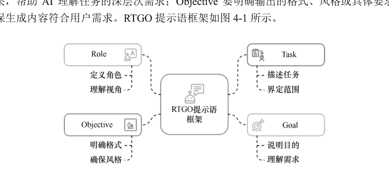

以下是基于 RTGO 的提示语。

```
Role: 资深 Python 开发工程师。
Task: 分析 2025 年 Q1 用户行为数据。
Goal: 生成包含 3 个关键趋势的可视化报告。
Objective: 使用 Markdown 表格呈现，附带 Matplotlib 代码示例。
```

RTGO 框架通过四层递进结构，清晰地定义了 Role、Task、Goal、Objective，特别适用于结构化任务，如数据分析和技术文档生成。该提示语适用于需要明确任务指令和输出规范的场景，如生成数据报告、技术文档或代码。RTGO 框架在创意类任务中可能显得过于约束，不适合需要高度灵活性的场景。

(2) CO-STAR 框架

CO-STAR 框架是一个用于提高 LLM 生成结果质量的工具，通过提供详细和具体的提示，指导 LLM 生成更准确和有用的内容。CO-STAR 框架适合市场营销、产品设计等复杂创意任务，其六维网状结构为上下文（Context）、目标（Objective）、风格（Style）、语调（Tone）、受众（Audience）和回应类型（Response）。Context 为任务提供背景信息，帮助 AI 精确地理解讨论的具体场景；Objective 要明确要求 AI 完成的任务，使其 LLM 专注地调整回应；Style 要明确期望的写作风格，如商业分析师报告风格等；Tone 负责设定回应的情感基调，如正式、幽默、富有同情心等；Audience 要识别目标受众，确保内容在特定上下文中适当且容易理解；Response 类型要规定输出的格式，如列表、JSON 格式的数据、专业报告等。CO-STAR 提示语框架如图 4-2 所示。

以下是基于 CO-STAR 框架的提示语案例。

```
Context: 健康监测智能手表新品上市。
Objective: 两周内达成 1000 台预售。
Style: 科技博主“何同学”解说风格。
Tone: 专业而不失趣味。
Audience: 25~35岁运动爱好者。
Response: 3个15秒抖音脚本+详情页架构。
```

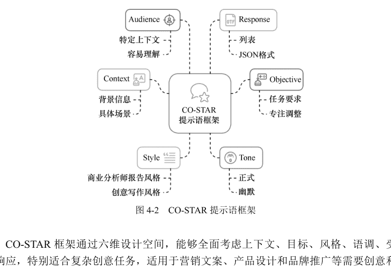

CO-STAR 框架通过六维设计空间，能够全面考虑上下文、目标、风格、语调、受众和响应，特别适合复杂创意任务，适用于营销文案、产品设计和品牌推广等需要创意和灵活性的任务。CO-STAR 框架在结构化任务中可能显得过于复杂，并需要更多时间定义和调整各个维度。

### 4.2 不同环节下的提示语设计与优化

提示语在 DeepSeek 部署和应用的不同环节具有不同的作用。在数据准备环节，提示语可以通过设计特定的提示语，引导模型更好地理解数据特征。在模型训练环节，提示语可以帮助模型更准确地学习数据中的规律和模式。在模型评估环节，提示语可以用于生成测试用例，评估模型的性能和泛化能力。在应用部署环节，提示语可以嵌入应用界面中，指导用户如何与模型交互。在持续优化环节，通过收集用户反馈和实际应用场景中的提示语使用情况，可以不断改进和优化模型性能。提示语在 DeepSeek 部署和应用不同环节中的作用如图 4-3 所示。

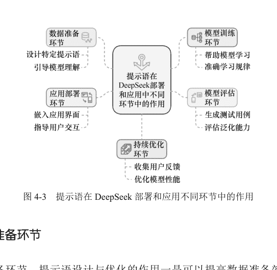

#### 4.2.1 数据准备环节

在数据准备环节，提示语设计与优化的作用一是可以提高数据准备效率，明确的提示语可以指导模型快速理解数据准备的需求，从而提高数据收集、清洗和预处理的效率；二是可以提高数据质量，良好的提示语可以帮助模型更好地识别和处理数据中的异常值、缺失值等问题，确保数据的准确性和完整性；三是提高模型的泛化能力，通过优化提示语，模型能够更好地理解数据的特征和模式，在不同的任务和场景中表现更好的泛化能力。

在数据收集阶段，良好的提示语可以指导模型收集与任务相关的数据，确保数据的全面性和代表性。在数据清洗环节，提示语可以帮助模型提高数据的质量。在特征工程环节，提示语可以帮助模型选择和提取与任务相关的特征，提升模型的性能。在数据变换环节，提示语可以指导模型对数据进行必要的变换，如归一化、标准化等，便于更好地适应模型的要求。

数据准备环节提示语设计的特点一是目标明确，提示语设计通常具有更明确的目标导向，旨在指导数据的收集、清洗和预处理，确保数据的质量和适用性；二是涉及的业务流程和数据类型可能较复杂，提示语设计需要考虑多维度的因素和约束条件；三是数据的准确性和完整性对模型输出至关重要，提示语设计需要强调数据驱动的决策；四是需要根据业务变化和数据特点不断调整策略，提示语设计应支持动态调整。

以下是一个基于 RTGO 框架的数据准备环节提示语设计案例。

```
Role: 数据工程师。
Task: 准备电商销售数据用于机器学习模型训练。
Goal: 生成清洗后的数据集，包含用户 ID、购买时间、商品类别、购买金额、用户地域。
Objective: 基于以下要求完成数据准备：
-数据来源：MySQL 数据库中的 sales 表。
-数据清洗要求：去除重复记录；处理缺失值（用均值填充购买金额，删除用户 ID 缺失的记录）；转换购买时间为 'YYYY-MM-DD' 格式；过滤购买金额小于 0 的异常记录。
-输出格式：CSV 文件，包含表头。
-附加要求：生成数据清洗报告，包括原始数据行数、清洗后数据行数、缺失值处理情况等。
```

上述案例明确了任务目标，即准备电商销售数据用于机器学习模型训练，确保模型能够理解任务的最终目的；通过明确目标，模型可以专注于数据清洗和格式转换的具体要求。

二是提供了上下文信息；提示语提供了数据来源（如 MySQL 数据库中的 sales 表），帮助模型了解数据的初始状态和存储位置，上下文信息包括需要保留的特征（用户 ID、购买时间、商品类别、购买金额、用户地域），确保模型在数据处理过程中不会遗漏关键信息。

三是提示语详细地列出了数据清洗的具体要求，包括去除重复记录、处理缺失值、转换日期格式和过滤异常值；通过明确每一步的操作要求，模型可以逐步完成数据清洗任务，确保输出结果符合预期。

四是提示语指定了输出格式为 CSV 文件，并要求包含表头，确保生成的数据集可以直接用于后续的机器学习任务；附加要求生成数据清洗报告，进一步提高了任务的完整性和透明度。

五是该提示语具有一定的灵活性与可扩展性；提示语允许模型根据实际情况调整数据处理策略，如当处理缺失值时，提示语建议用均值填充购买金额，模型可以根据数据分布选择其他方法（如中位数填充）；提示语的结构清晰，便于在需要时扩展或修改数据清洗规则。

#### 4.2.2 模型训练环节

模型训练环节的提示语设计与优化具有至关重要的作用。一是能够提升模型性能，明确的提示语能够指导模型在训练过程中更好地理解任务目标，从而提升模型的性能。二是提高模型泛化能力，通过优化提示语，模型能够更好地理解数据的特征和模式，从而在不同的任务和场景中表现更好的泛化能力。三是提高训练效率，设计良好的提示语可以提高模型与数据之间的交互效率，使模型能够更快速地收敛。

模型训练环节的内容包括任务定义、数据格式说明、性能指标要求及训练策略的制订。提示语应明确模型的任务，如“进行文本分类”或“生成摘要”。提示语也需要说明输入数据的格式和结构，如“输入数据为 CSV 文件，包含以下列：文本、标签”。提示语还可以指定模型优化的性能指标，如“优化目标为准确率和 F1 分数”。提示语也可以指导模型采用特定的训练策略，如“使用交叉验证来评估模型性能”或“采用早停法防止过拟合”。

模型训练环节的提示语设计更注重指导模型在训练过程中如何更好地学习和优化，提升模型的性能和泛化能力，关注点集中在模型的优化和性能提升方面，通常针对特定的训练任务和优化目标。同时更依赖模型的通用知识和训练数据，提示语设计与优化需要考虑如何有效利用这些数据优化模型，更注重一次性任务的完成，对动态调整的要求相对较低。

1. 模型训练环节提示语设计与优化的方法

在 DeepSeek 的模型训练环节中，设计提示语可以帮助模型更准确地学习数据中的规律和模式。以下是一些具体的方法和示例。

（1）提示重写

通过重写提示语，尝试不同的表达方式和措辞，寻找能够让模型输出更准确或更符合需求的版本。例如，改变提示中的关键动词、调整语序、提供更详细的背景信息等，都会对模型的表现产生影响。通过反复实验和对比不同的提示设计，可以有效地提高模型对提示的响应质量。

（2）提示调优

提示调优是一种参数高效的优化技术，通过将提示向量化并作为参数进行微调来提升模型性能。提示调优可以被视为在模型中嵌入提示的向量表示，而不是简单的文本提示。提示调优常用于高效地适应特定任务，而不需要调整整个模型。提示调优的优势在于它比标准微调更轻量，所需计算资源更少，却能够取得更显著的效果。

（3）链式提示

链式提示将任务分解为一系列逻辑步骤，更清晰地引导、帮助模型逐步推理。通过提示设计者引导模型逐步完成任务，每一步都给出明确的方向，从而使模型能够更好地理解复杂任务的推理过程。例如，当回答复杂的数学题时，首先可以提示模型分解问题，然后逐步回答每个子问题。通过分步骤的方式，模型可以依次完成每个计算步骤，从而得到正确的答案。链式提示减少了模型在面对复杂任务时直接生成错误答案的概率。

（4）零样本提示和少样本提示

零样本提示是直接向 AI 大模型提出任务，不提供任何具体的示例或执行步骤，AI 大模型必须依赖其预训练知识来生成答案。零样本提示适用于不需要领域特定知识的通用任务，或任务相对简单，模型能够凭借通用知识完成的任务。当设计提示语时，应直接指示模型执行任务，不提供任何额外的示例。

少样本提示通过提供少量示例来引导模型生成更符合预期的输出。少样本提示利用了 LLM 的上下文学习能力，通过在提示语中提供少量示例，帮助模型理解任务的模式和规则，从而更准确地生成符合要求的输出。

零样本提示适用于不需要领域特定知识的通用任务；少样本提示适用于特定领域的任务，如法律、医学等领域。零样本提示无须额外的示例输入，仅依赖模型的预训练；少样本提示依赖少量示例输入，引导模型朝正确的方向发展。零样本提示由于缺乏特定上下文，所以有时可能会提供不准确或一般的答案；少样本提示由于示例提供了帮助模型细化输出的上下文，所以通常可以为具有高特异性的任务提供更准确的答案。

零样本提示可扩展性强，因为它不需要针对任务进行特定的准备；少样本提示可扩展性较差，因为每种新任务类型可能都需要创建新的提示示例。

（5）提示语设计的进阶技巧

提示语需要精准定义任务，降低模糊性，明确任务目标和需求。需要对复杂任务进行分解，将复杂任务拆解为多个子任务，以降低模型的认知负荷。需要引入引导性问题，通过提问引导模型进行深度思考和推理。还需要控制提示语的长度，保持简洁，避免冗长的指令干扰模型的理解。当设计提示语时，如果问题需要背景信息，可以在提示语中加入相关背景信息，还可以设定特定的角色或身份，使模型更好地理解任务的背景信息和需求。

通过上述方法，可以在 DeepSeek 的模型训练环节中设计有效的提示语，帮助模型更准确地学习数据中的规律和模式。

##### 2. 案例

以下是一个基于 RTGO 框架的模型训练环节提示语设计案例。

```
Role: 机器学习工程师。
Task: 训练一个电商销售预测模型。
Goal: 提高销售预测的准确率，达到 90%以上。
Objective:
- 数据集：使用清洗后的电商销售数据 CSV 文件。
- 模型类型：选择适合时间序列预测的模型（如 LSTM、Prophet）。
- 特征工程：提取时间特征（如月份、星期几）、商品类别特征、用户地域特征等。
- 训练要求：划分训练集和测试集（80%训练集，20%测试集）；使用交叉验证评估模型性能；调整超参数以优化模型性能。
- 性能指标：准确率、召回率、F1 分数、均方误差（Mean Square Error, MSE）。
- 输出要求：生成模型训练报告，包括训练过程、评估结果和最佳模型参数。
- 附加要求：保存训练好的模型，便于后续部署和使用。
```

上述提示语，一是清晰地定义了任务目标，即提高销售预测的准确率，达到 90%以上，确保模型能够理解任务的最终目的；通过明确目标，模型可以更专注于选择合适的算法和优化策略。

二是提示语提供了数据集来源（清洗后的电商销售数据 CSV 文件），帮助模型了解数据的初始状态和可用特征；上下文信息包括模型类型（如 LSTM、Prophet），为模型选择提供了方向。

三是提示语详细地列出了特征工程的具体要求，包括提取时间特征、商品类别特征、用户地域特征等，确保模型在训练过程中能够充分利用这些特征。训练要求包括划分训练集和测试集、使用交叉验证评估模型性能、调整超参数等，通过明确每一步的操作要求，模型可以逐步完成训练任务，确保输出结果符合预期。

四是提示语设定了性能指标，包括准确率、召回率、F1 分数、MSE，确保模型训练过程中具有明确的评估标准；通过设定性能指标，模型可以不断优化，达到预期的性能目标。

五是提示语要求生成模型训练报告，包括训练过程、评估结果和最佳模型参数，确保训练过程的透明度和可追溯性。附加要求是保存训练好的模型，便于后续部署和使用，确保模型的可用性和可维护性。

基于 RTGO 框架的模型训练提示语设计能够有效地引导模型完成训练任务。通过明确任务目标、提供上下文信息、详细的操作要求、性能指标设定和规范的输出格式，提示语确保了模型训练过程的高效性和准确性。同时，提示语的结构清晰，便于在需要时扩展或修改训练策略，以适应不同的模型训练需求。

#### 4.2.3 模型评估环节

模型评估环节的提示语设计与优化与其他环节相比，具有更明确的目标导向和更注重结果验证的特点。

##### 1. 提示语设计与优化的作用

(1) 提高评估的准确性
明确的提示语可以指导模型更准确地理解评估任务，从而提高评估结果的可靠性。

(2) 增强模型的可解释性
提示语可以帮助模型更好地解释推理过程和结果，提高模型的透明度和可信度。

(3) 优化模型的性能
优化提示语可以发现模型在不同任务上的表现差异，从而有针对性地进行优化。

##### 2. 提示语设计与优化的方法

(1) 明确评估目标
当设计提示语时，需要明确评估的具体目标和指标，如“评估模型在文本分类任务上的准确率”。

(2) 提供评估标准
在提示语中明确评估的标准和期望输出格式，如“请按照以下标准评估模型的性能：准确率、召回率、F1分数”。

(3) 使用评估模板
设计通用的评估模板可以确保评估过程的标准化和一致性。

(4) 进行测试和优化
通过多次测试不同的提示语、分析评估结果、优化提示语，可以提高评估的准确性和效率。

##### 3. 与其他环节的区别

(1) 目标明确性方面
模型评估环节的提示语设计更注重明确的评估目标和指标，旨在准确衡量模型的性能；而数据准备环节的提示语设计旨在指导数据的收集、清洗和预处理，确保数据的质量和适用性；模型训练的提示语设计与优化更注重指导模型在训练过程中如何更好地学习和优化，提高模型的性能和泛化能力。

(2) 复杂程度方面
模型评估环节涉及的评估指标和流程相对明确，提示语设计与优化需要考虑如何准确衡量模型性能；而数据准备环节涉及的业务流程和数据类型可能较复杂，提示语设计与优化需要考虑多维度的因素和约束条件；模型训练环节相对集中在模型优化和性能提升上，通常针对特定的训练任务和优化目标。

(3) 数据支持方面
模型评估环节依赖评估数据集的质量和代表性，提示语设计与优化需要确保评估数据的准确性和完整性。在数据准备环节中，数据的准确性和完整性对模型输出至关重要，提示语的设计与优化需要强调数据驱动的决策。模型训练环节更多依赖模型的通用知识和训练数据，提示语的设计与优化需要考虑如何有效利用这些数据优化模型。

(4) 在动态调整方面
模型评估环节需要根据评估结果不断调整评估标准和流程，适应模型的优化和业务需求的变化。在数据准备环节中，需要根据业务变化和数据特点不断调整策略，提示语设计与优化应支持动态调整；模型训练环节可能更注重一次性任务的完成，对动态调整的要求相对较低。

##### 4. 案例

以下是基于 RTGO 框架的模型评估环节提示语设计案例。

```
Role: 机器学习工程师。
Task: 评估电商销售预测模型的性能。
Goal: 确定模型是否达到预期的性能指标（如准确率、召回率、F1 分数、MSE）。
Objective:
- 评估数据集：使用准备好的测试数据集。
- 评估指标：准确率、召回率、F1 分数、MSE。
- 评估方式：自动化评估。
- 输出要求：生成评估报告，包括模型性能指标、评估结果可视化（如 ROC 曲线、混淆矩阵）。
- 附加要求：与训练过程中的评估结果进行对比，分析模型的泛化能力和过拟合情况。
```

上述提示语，一是清晰地定义了任务目标，即评估电商销售预测模型的性能，确保模型能够理解任务的最终目的。通过明确目标，模型可以更专注于评估过程和结果分析。

二是提供了评估数据集来源（准备好的测试数据集），帮助模型了解评估数据的初始状态和可用特征；上下文信息包括评估指标（准确率、召回率、F1 分数、MSE），为模型评估提供了明确的方向。

三是详细地列出了评估的具体要求，包括评估指标、评估方式等，确保模型在评估过程中能够充分利用这些信息；通过明确每一步的操作要求，模型可以逐步完成评估任务，确保输出结果符合预期。

四是指定了性能指标，包括准确率、召回率、F1 分数、MSE，确保在模型评估过程中具有明确的评估标准；通过设定性能指标，模型可以不断优化，以达到预期的性能目标。

五是要求生成评估报告，包括模型性能指标、评估结果可视化（如 ROC 曲线、混淆矩阵），确保评估过程的透明度和可追溯性；将附加要求与训练过程中的评估结果进行对比，分析模型的泛化能力和过拟合情况，进一步提高任务的完整性和透明度。

#### 4.2.4 应用部署环节

与上述环节相比，应用部署环节的提示语设计与优化具有更明确的操作指导性和环境适配性。

##### 1. 提示语设计与优化的作用

(1) 提升部署效率
明确的提示语可以指导技术人员快速理解部署需求，从而提高部署效率，缩短部署时间。

(2) 降低部署风险
提示语可以帮助技术人员更好地识别和处理部署过程中的潜在问题，确保部署的准确性和完整性。

(3) 增强模型可操作性
通过优化提示语，技术人员可以更好地理解模型的部署结构和运行环境，从而在不同的任务和场景中表现出更出色的操作能力。

##### 2. 提示语设计与优化的内容

(1) 部署环境说明
提示语可以指导技术人员准备与任务相关的部署环境，确保部署环境的适用性和稳定性。

(2) 模型加载指导
通过提示语，技术人员可以了解如何正确加载和初始化模型，提高部署的准确性。

(3) 服务配置
提示语可以帮助技术人员配置与任务相关的服务参数，提升模型的性能。

(4) 监控与维护
提示语可以指导技术人员设置监控和维护机制，确保模型在部署后的稳定运行。

##### 3. 与其他环节的区别

应用部署环节的提示语设计与优化更注重明确的操作指导和环境适配，旨在确保模型能够顺利部署并稳定运行；涉及的环境配置和操作流程可能较复杂，提示语设计与优化需要考虑多维度的因素和约束条件；依赖部署环境的配置和模型文件的完整性，提示语设计与优化需要确保部署过程的顺利进行；需要根据部署环境和业务需求的变化不断调整策略，提示语设计与优化应支持这种动态调整。

##### 4. 案例

以下是一个基于 RTGO 框架的模型应用部署环节提示语设计案例。

```
Role: AI 系统架构师。
Task: 部署电商销售预测模型到生产环境。
Goal: 确保模型在生产环境中稳定运行，响应时间小于 1 秒，准确率达到 90% 以上。
Objective:
- 部署环境：AWS 云服务器（EC2 实例）。
- 部署方式：使用 Docker 容器化部署。
- 监控与维护：
    - 设置监控指标：CPU 使用率、内存使用率、响应时间、预测准确率。
    - 配置自动扩展策略：当 CPU 使用率超过 80% 时，自动增加实例。
    - 定期更新模型：每周从模型训练平台获取最新模型版本。
- 用户交互：
    - 提供 API：支持 POST 请求，输入为 JSON 格式的销售数据，输出为预测结果。
    - 返回结果格式：JSON 格式，包含预测值、置信区间、模型版本等信息。
- 性能测试：在部署前进行压力测试，确保系统能够处理 100 次/秒的请求。
- 安全性：配置 HTTPS 协议，确保数据传输安全；设置访问控制，限制只有授权用户才能调用 API。
```

上述提示语一是清晰地定义了任务目标，即确保模型在生产环境中稳定运行，响应时间小于 1 秒，准确率达到 90% 以上，确保模型能够理解任务的最终目的；通过明确目标，模型可以更专注于部署过程中的性能优化和稳定性保障。

二是提供了部署环境（AWS 云服务器）、部署方式（Docker 容器化部署）等上下文信息，帮助模型了解部署的具体要求和约束条件；上下文信息包括监控指标、自动扩展策略等，为模型部署提供了明确的方向。

三是详细地列出了部署的具体要求，包括设置监控指标、配置自动扩展策略、定期更新模型等，确保模型在部署过程中能够充分利用这些信息；通过明确每一步的操作要求，模型可以逐步完成部署任务，确保输出结果符合预期。

在性能指标设定方面，提示语指定了性能指标，包括响应时间小于 1 秒、准确率达到 90% 以上，确保在模型部署过程中具有明确的评估标准。通过设定性能指标，可以不断优化模型，达到预期的性能目标。

在输出格式规范方面，提示语要求提供 API，支持 POST 请求，输入为 JSON 格式的销售数据，输出为预测结果，确保部署过程的透明度和可追溯性。返回结果格式规范为 JSON 格式，包括预测值、置信区间、模型版本等信息，进一步提高了任务的完整性和透明度。

在灵活性与可扩展性方面，提示语允许模型根据实际情况调整部署策略，如当性能测试中发现瓶颈时，可以调整自动扩展策略或优化模型性能。提示语的结构清晰，便于在需要时扩展或修改部署要求，以适应不同的部署环境和任务需求。

#### 4.2.5 持续优化环节

持续优化环节的提示语设计与优化是一个贯穿整个模型生命周期的重要过程。与其他环节相比，持续优化环节的提示语设计与优化更注重模型在实际运行中的性能监控、反馈收集及基于这些反馈的模型更新和优化。

##### 1. 提示语设计与优化的作用

在性能监控与反馈方面，持续优化环节的提示语设计与优化能够引导模型实时监控自身性能，并收集用户和系统的反馈信息，有助于及时发现模型在实际应用中的不足之处，为后续的优化提供依据。

在模型更新与迭代方面，通过优化提示语，可以指导模型根据反馈信息进行有针对性的更新和迭代，不断提升模型的性能，提高模型的适应性。

在适应业务变化方面，企业业务环境和数据特征可能会随时间发生变化，持续优化环节的提示语设计与优化能够帮助模型及时适应变化，保持模型在不同阶段的业务适用性。

##### 2. 提示语设计与优化的方法

持续优化环节提示语设计与优化的方法，主要有以下 4 种。

(1) 实时性能监控提示
设计提示语可以实时获取模型的性能指标，如响应时间、准确率等。例如，“请记录模型每次预测的响应时间，并在超过阈值时触发警报”。

(2) 用户反馈收集提示
通过引导用户提供对模型输出的反馈，便可了解模型在实际应用中的表现。例如，“请对模型的预测结果进行评分（1～5分），并提供具体的改进建议”。

(3) 定期评估与迭代提示
设置定期评估模型性能的提示语，根据评估结果决定是否需要进行模型更新。例如，“每周五下午进行模型性能评估，若准确率下降超过 5%，则启动模型更新流程”。

(4) A/B 测试提示
在优化过程中，使用 A/B 测试比较不同模型版本的性能。设计提示语指导 A/B 测试的实施，如“将用户随机分为两组，分别使用模型版本 A 和版本 B 进行预测，并收集两组的反馈数据进行对比分析”。

##### 3. 提示语设计与优化的内容

在性能指标监控方面，需要明确监控的性能指标及阈值，确保模型在实际运行中的性能符合预期。

在反馈收集机制方面，需要建立有效的用户反馈收集渠道，并通过提示语引导用户积极参与反馈。

在模型更新策略方面，需要根据性能监控和反馈收集的结果，制订合理的模型更新策略，包括参数调整、结构优化等。

在测试与验证方面，更新模型后，通过提示语指导进行充分的测试与验证，确保新模型版本的稳定性和优越性。

##### 4. 与其他环节的区别

持续优化环节的提示语设计与优化，更注重模型在实际运行中的长期性能提升和适应性提高，这是一个动态的、持续的过程；需要综合考虑模型在不同业务场景下的表现，以及随着时间推移可能出现的各种问题，具有较高的复杂性和不确定性；依赖实际运行中的性能数据和用户反馈数据，这些数据具有实时性和动态性。同时，持续优化环节是一个动态调整的过程，需要根据实时反馈和业务变化不断优化模型。

##### 5. 案例

以下是一个基于 RTGO 框架的模型持续优化环节提示语设计案例。

```
Role: AI 模型优化工程师。
Task: 持续优化电商销售预测模型。
Goal: 通过定期更新和调整，使模型在生产环境中的预测准确率长期保持在 92%以上。
Objective:
- 监控指标：设置实时监控，重点关注预测准确率、响应时间、资源利用率。
- 数据反馈：收集用户反馈和新数据，每周更新训练数据集。
- 超参数调整：每月进行超参数优化，使用网格搜索和随机搜索相结合的方法。
- 模型融合：探索模型融合策略，如集成学习，提高模型的稳定性。
- 性能评估：每两周进行一次全面性能评估，并对比上一版本的模型。
- 安全更新：确保更新过程不影响线上服务，采用蓝绿部署策略。
```

上述提示语一是清晰地定义了持续优化的目标，即保持模型预测准确率在 92%以上，为优化工作提供明确的方向。

二是提供监控指标、数据反馈、超参数调整等上下文信息，帮助模型了解优化的具体要求和约束条件。

三是详细地列出优化的具体要求，包括设置监控指标、收集用户反馈、超参数调整等，确保模型在优化过程中能够充分利用这些信息。

四是制定性能指标，如预测准确率、响应时间等，确保模型优化过程中有明确的评估标准。

五是要求定期输出优化报告，包括性能评估结果、超参数调整情况等，确保优化过程的透明度和可追溯性。

## 第 5 章 模型微调与个性化定制

在企业应用场景下，模型微调和个性化定制是关键步骤，能够使模型更好地适应特定的业务需求，提升模型的性能，提高模型的实用性。

### 5.1 模型微调

模型微调是指根据特定领域的数据优化模型，提升其在特定任务上的性能。它关注模型在特定数据集上的适应性和准确性。数据适应性是通过在特定领域的数据上进行训练，使模型可以更好地理解该领域的特征和模式。性能优化是指通过模型微调帮助模型在特定任务上达到更高的准确率和效率。

#### 5.1.1 数据适应性微调

数据适应性微调是一种在机器学习中用于优化模型性能的技术，它通过在预训练模型的基础上，针对特定任务或数据集进行进一步训练，调整模型的参数，使模型能够更好地适应新的数据分布和任务需求。

数据适应性微调可以提升模型性能、提高模型泛化能力，同时也可以节省计算资源。通过在特定任务的数据上进行微调，模型能够更好地学习任务相关的特征和模式，从而提升在该任务上的性能。数据适应性微调可以帮助模型更好地适应不同的数据分布，提高模型的泛化能力，使模型在新的数据上也能保持良好的性能。相比于从头开始训练一个模型，数据适应性微调通常只需要在较小的数据集上进行训练，能够显著减少计算资源的消耗。

数据适应性微调被广泛应用于 NLP（Nature Language Processing，自然语言处理）、计算机视觉及推荐系统等场景。

完成数据准备、预训练模型选择、数据预处理和超参数配置后，进入模型微调环节，在模型微调的同时还需要对模型性能进行评估。

数据适应性微调包括全参数微调、冻结层微调、适应性微调和低秩近似微调 4 种实现方法。数据适应性微调方法如图 5-1 所示。

##### 1. 全参数微调

全参数微调是在微调过程中，模型的所有参数都会根据新任务的数据进行更新。全参数微调适用于新任务与预训练任务差异较大，或新任务的数据量较大的情况。全参数微调能够充分利用微调数据，提升模型在特定任务上的表现。全参数微调需要大量计算资源和显存，特别是对于如 7B、65B 参数等大型模型的微调。

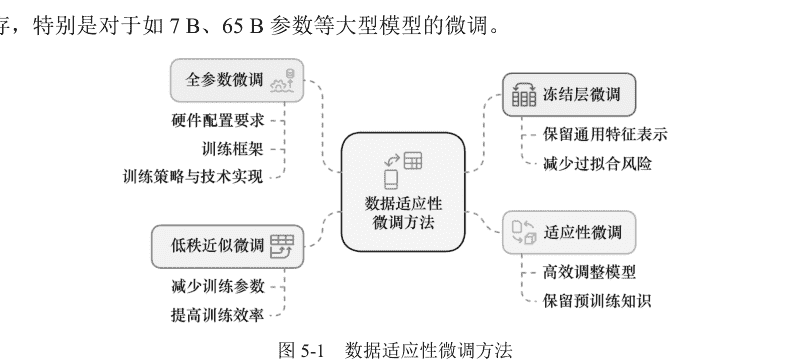

###### （1）硬件配置要求

全参数微调对硬件配置的要求因模型规模和具体任务而异，不同规模模型进行全参数微调时的硬件配置需求如表 5-1 所示。

表 5-1 不同规模模型进行全参数微调时的硬件配置需求

| 硬件配置 | 7B 参数模型 | 67B 参数模型 | 671B 参数模型 |
| :--- | :--- | :--- | :--- |
| GPU 配置 | 2 个 NVIDIA V100 GPU（32 GB 显存） | 8 个 NVIDIA A100 GPU（40 GB 显存） | 32 台 H100 服务器（每台配备多个 GPU） |
| CPU 配置 | 多核 CPU（如 Intel Xeon 或 AMD Ryzen，主频 3.6GHz 或更高） | 高核数 CPU（如 AMD Threadripper 或 Intel Xeon） | 每台服务器都配备高核数 CPU（如 Intel Xeon Gold 6330） |
| 内存 | 至少 64 GB RAM | 至少 256 GB RAM | 每台服务器至少 1 TB RAM |
| 存储 | 至少 1 TB NVMe SSD | 至少 8 TB NVMe SSD | 集群共享 100 TB 存储空间 |
| 网络 | 10 Gbps 以太网 | 高速互连（如 NVIDIA NVLink 或 InfiniBand） | 1B 网络 |

###### （2）训练框架

对 DeepSeek 模型进行全参数微调，需要相应的训练框架。训练框架是用于模型训练和优化的一整套软件工具和配置，包括模型的加载、训练参数的设置、优化器的选择、训练过程的执行及训练结果的评估和保存等环节。一个高效的训练框架能够帮助我们充分利用计算资源，提高训练速度，提升模型的性能。

在训练参数的设置方面，学习率通常设置为较小的值，如 2e-5，避免模型参数更新过快导致的不稳定性。批量大小需要根据硬件资源选择合适的批量大小，如 2 或 4，平衡内存消耗和训练速度。训练轮数通常设置为 3 或更多，确保模型充分学习数据中的特征。其他参数，如 max_new_tokens、eos_token_id、attn_implementation 等，需要根据具体任务需求进行设置。

在优化器的选择方面，AdamW 优化器适用于大多数深度学习任务，具有自适应学习

###### （3）训练策略与技术实现

当对 DeepSeek 模型进行全参数微调时，数据并行（如 DeepSpeed ZeRO）和序列并行（Sequence Parallelism，SP）是两种关键的并行训练策略，能够在高性能计算集群上高效地完成大规模模型的微调。

数据并行是一种常见的并行计算方法，通过将训练数据集分割成多个小批次，并将这些批次分配到多个计算设备（如 GPU）上进行并行处理，从而加速模型的训练过程。DeepSpeed ZeRO 是数据并行的一种优化形式，通过在不同 GPU 之间分割模型的优化器状态、梯度和参数，显著减少每个 GPU 的内存占用，能够在单个 GPU 上训练更大的模型。

序列并行是指在训练过程中，将模型的序列维度进行切分，并将切分后的数据并行处理。序列并行主要应用于处理长序列数据，通过减少每个 GPU 上的计算量和内存需求，提高训练效率。序列并行通过将序列切分并在不同的 GPU 上并行处理，能够有效降低每个 GPU 的内存占用和计算复杂度，特别适用于处理长序列数据。

###### （4）在高性能计算集群上完成大规模模型微调的步骤

- ① 硬件配置，确保集群中的每个节点都具备高性能的 GPU 和充足的内存，并使节点之间通过高速网络（如 InfiniBand）连接。
- ② 环境配置，在集群上安装和配置深度学习框架（如 PyTorch）和分布式训练库（如 DeepSpeed、PyTorch Distributed）。
- ③ 数据准备，将训练数据集分割成多个批次，并将数据分布到集群中的各个节点。
- ④ 模型加载与分发，加载预训练的 DeepSeek 模型，并将模型分发到集群中的各个 GPU。
- ⑤ 训练参数设置，根据硬件资源和数据集规模，设置合适的训练参数，如学习率、批量大小、训练轮数等。
- ⑥ 训练执行，启动分布式训练，通过数据并行和序列并行策略，将训练任务分配到集群中的各个 GPU，实现高效并行训练。
- ⑦ 训练监控与优化，实时监控训练过程中的性能指标，如损失值、准确率等，并根据需要进行参数调整和优化。
- ⑧ 模型评估与保存，在训练过程中定期评估模型性能，并保存最优模型。

###### （5）一个全参数微调案例

以下是一个使用 Hugging Face Transformers 库对 DeepSeek-671B 模型进行全参数微调的案例，展示了从环境准备到训练完成的完整流程。

- ① 准备环境，硬件配置：使用 32 台 H100 服务器集群，每台服务器配置如下：GPU：H100；CUDA 版本：12.6；存储：共享 100 TB 存储空间；操作系统：Ubuntu 22.04；网络：IB 网络和 NVLink 通信；软件环境：pip install torch transformers datasets peft accelerate。
- ② 准备数据，数据格式：基于 Open AI 标准数据格式进行扩展，支持 Reasoning 数据；数据样例：项目提供了转换后的数据样例文件，供开发者参考。
- ③ 加载模型和分词器

```python
from transformers import AutoTokenizer, AutoModelForCausalLM
model_name_or_path = "DeepSeek/DeepSeek-LM"
tokenizer = AutoTokenizer.from_pretrained(model_name_or_path, use_fast=True)
model = AutoModelForCausalLM.from_pretrained(model_name_or_path)
```

- ④ 配置训练参数，使用 xtuner 框架，支持 DeepSeek-V3 或 DeepSeek-R1 模型架构的全参数微调；提供多组实验配置对比，推荐最优训练参数。
- ⑤ 训练模型，支持数据并行与 SP，在 32 台 H100 服务器集群上完成 671B 模型的微调；提供完整训练逻辑代码，确保其与官方架构兼容。
- ⑥ 评估与优化，使用验证集实时观察模型的损失变化；提供详细的训练日志和优化建议，帮助开发者“少走弯路”。

##### 2. 冻结层微调

冻结层微调是指模型的一部分参数（通常是预训练模型的底层参数）被冻结，不参与微调过程，只有顶层的参数会被更新。冻结层微调适用于新任务与预训练任务相似度较高，或新任务的数据量较小的情况。

冻结层微调通过仅更新模型的一部分参数，降低了显存占用和计算量，使模型能够在资源受限的环境中运行。冻结底层参数有助于保留预训练模型的通用特征表示，降低过拟合的风险，特别是在训练数据有限的情况下。

同时，冻结层微调在保留预训练模型大部分知识的同时，通过微调少量参数适应新任务，实现参数的高效利用。由于只更新部分参数，所以训练速度较快，适合在短时间内完成模型优化。

在具体执行层面，冻结层微调要选择需要更新的层，通常选择模型的顶层或部分中间层进行微调，冻结其他层的参数。例如，在 Transformer 模型中，可以冻结前几层的 Transformer 层，只微调后面的层。在学习率设置方面，一般选择较低的学习率，避免对预训练权重进行过大的更新。例如，学习率可以设置为 1e-5 左右。训练过程也使用标注数据进行训练，仅优化选定层的参数，其他层的参数保持不变。

在迁移学习中，我们通常会使用一个在大规模数据集（如 ImageNet）上预训练的模型，并将其应用于新的任务（如医学图像分类）。为了保留预训练模型的通用特征提取能力，同时减少计算资源消耗，我们选择冻结模型的大部分层，仅对最后几层进行微调。以下是一个基于 PyTorch 的冻结层微调案例，展示了如何在迁移学习中冻结预训练模型的特定层，以适应新的任务。

- ① 加载预训练模型，使用 PyTorch 内置函数加载预训练的 ResNet 模型。

```python
import torch
import torchvision.models as models
# 加载预训练模型
model = models.resnet18(pretrained=True)
```

- ② 冻结特定层。遍历模型的所有参数和名称，指定需要冻结的层，并将这些层的 requires_grad 属性设置为 False。

```python
# 冻结所有层
for param in model.parameters():
    param.requires_grad = False
# 解冻最后一层（全连接层）
model.fc.requires_grad = True
```

- ③ 修改模型结构。根据新任务的需求，修改模型的最后几层。例如，对于分类任务，通常需要修改最后的全连接层。

```python
import torch.nn as nn
num_classes = 10  # 假设新任务有 10 个类别
model.fc = nn.Linear(model.fc.in_features, num_classes)
```

- ④ 设置优化器并设置学习率。通常，微调时学习率会比从头训练时小。

```python
import torch.optim as optim
optimizer = optim.SGD(model.parameters(), lr=0.001, momentum=0.9)
```

- ⑤ 在新任务的数据集上进行训练。

```python
criterion = nn.CrossEntropyLoss()
num_epochs = 10
for epoch in range(num_epochs):
    for inputs, labels in dataloader:
        optimizer.zero_grad()
        outputs = model(inputs)
        loss = criterion(outputs, labels)
        loss.backward()
        optimizer.step()
```

##### 3. 适应性微调

适应性微调是一种在预训练模型中添加小型可训练模块（称为适配器）的方法，这些模块在微调过程中被训练以适应特定任务，同时预训练模型的主体参数保持不变。适应性微调旨在高效地调整模型以适应新任务，同时保留预训练模型的大部分知识。适应性微调与全参数微调和冻结层微调的区别如表 5-2 所示。

表 5-2 适应性微调与全参数微调和冻结层微调的区别

| 特征 | 适应性微调 | 全参数微调 | 冻结层微调 |
| :--- | :--- | :--- | :--- |
| 参数更新范围 | 仅更新适配器模块的参数，预训练模型的主体参数保持不变 | 更新模型的所有参数 | 仅更新模型的一部分参数（通常是顶层或最后几层） |
| 计算资源需求 | 较低，因为只更新少量参数 | 较高，因为需要更新所有参数 | 中等，因为只更新部分参数 |
| 过拟合风险 | 较低，因为只更新少量参数 | 较高，特别是在数据量有限的情况下 | 较低，因为只更新部分参数 |
| 任务适应性 | 适用于多种任务，特别是在资源有限的情况下 | 适用于复杂任务，能够最大化模型性能 | 适用于任务与预训练任务相似度较高的情况 |
| 灵活性 | 高，可以通过调整适配器模块的设计和数量适应不同任务 | 高，可以适应各种任务场景 | 中等，适用于任务与预训练任务相似的情况 |

在环境准备、加载预训练模型后的实施层面，需要为适应性微调添加适配器模块，即在模型的每一层或某些层中添加适配器模块。例如，可以在每个 Transformer 模型中添加适配器模块。适配器模块通常由两个线性层和一个非线性激活函数组成。之后冻结预训练模型的主体参数，只训练适配器模块的参数。其他环节是相同的。

###### （1）适应性微调案例 AdaFilter

AdaFilter 是一种自适应性微调方法，通过动态调整预训练模型的滤波器权重，适应目标数据集的特性。AdaFilter 旨在解决标准微调方法在目标数据集与源数据集分布差异较大时的性能下降问题，通过引入一个 RNN（Recurrent Neural Network，循环神经网络）门控机制，AdaFilter 能够为每张图像动态选择需要微调的预训练滤波器，从而提高模型的泛化能力。

实现步骤如下。

- ① 加载预训练模型，使用在 ImageNet 等大规模数据集上预训练的模型。
- ② 添加 RNN 门控层，在每个批量归一化（Batch Normalization，BN）层的输出后添加 RNN 门控层，用于选择性地调整滤波器的权重。
- ③ 动态调整滤波器。根据输入图像的特征，动态调整预训练滤波器和微调滤波器的权重组合

$$x_{i+1} = G_{i}(x_{i}) \odot BN_{1}(x_{i+1}) + (1 - G_{i}(x_{i})) \odot BN_{2}(x_{i+1})$$

其中，$G_{i}(x_{i})$ 是 RNN 门控层的输出，用于控制滤波器的权重组合。

- ④ 训练模型，使用目标数据集对模型进行训练，优化 RNN 门控层和微调滤波器的参数。

AdaFilter 能够根据输入图像的特性动态调整滤波器，从而保留更多有用的预训练特征。由于重用了大量预训练滤波器，所以当目标数据集较小时，AdaFilter 也能有效地避免过拟合。当测试时，AdaFilter 的有效滤波器数量与标准微调相同，保持了相同的测试效率。

AdaFilter 特别适用于目标数据集与源数据集分布差异较大的场景，如跨领域图像分类任务。

###### （2）适应性微调案例 AMCF

AMCF（Adaptive Multi-Source Domain Collaborative Fine-Tuning）是一种多源领域协作的适应性微调方法，通过结合多个源领域模型的特征，提升目标任务的性能。AMCF 旨在解决单源领域微调方法在目标数据集与源数据集分布差异较大时的性能限制问题。通过结合多个源领域模型的特征，AMCF 能够更全面地捕捉目标任务的关键特征。

实现步骤如下。

- ① 选择多个在不同数据集上进行预训练的模型。
- ② 融合多个源领域模型的特征，生成目标任务的特征表示。
- ③ 在目标数据集上对融合后的特征表示进行微调，优化模型参数。

AMCF 能够结合多个源领域模型的特征，提升模型在目标任务上的表现。即使目标数据集与单个源领域模型的分布差异较大，AMCF 也能通过多源特征融合提升模型性能。AMCF 特别适用于目标数据集与多个源领域模型的分布差异较大的场景，如跨领域图像分类任务。

##### 4. 低秩近似微调

低秩近似微调通过在预训练模型中引入两个低秩矩阵模拟全参数微调的效果，显著减少需要训练的参数数量，从而提高训练效率并降低资源消耗。

在实施上，低秩近似微调需要创建低秩近似微调配置，定义低秩矩阵的秩、缩放系数等参数，然后使用 `get_peft_model` 将低秩近似微调配置应用到预训练模型。实施的其他环节与上述微调是相同的。

下面是一个文本分类任务的低秩近似微调案例。在一项文本分类任务中，使用低秩近似微调对 BERT（Bidirectional Encoder Representations from Transformers，双向变换器模型）模型进行微调。与全量微调相比，低秩近似微调将微调参数数量减少了 90%，同时保持了 95% 的准确率，训练时间和内存消耗分别减少了 60% 和 70%。其实现步骤如下。

- ① 加载在大规模数据集上进行预训练的 BERT 模型。
- ② 冻结 BERT 模型的权重矩阵，使其不参与微调。
- ③ 添加低秩分解层，在 BERT 模型的每个全连接层后添加低秩分解层，将权重矩阵分解为两个低秩矩阵 $A$ 和 $B$。
- ④ 训练模型，在目标数据集上对低秩分解层进行训练，优化矩阵 $A$ 和 $B$ 的参数。
- ⑤ 评估模型，在测试集上评估模型的性能，记录准确率、损失等指标。

用到的优化技巧包括选择合适的秩 $r$，通过交叉验证来确定最优值；使用较小的学习率，并结合学习率调度器（如 Cosine Annealing）进行训练；使用混合精度训练，减少显存占用并加速训练。

低秩近似微调通过在预训练模型中引入低秩矩阵，能够在保留预训练模型大部分知识的同时，高效地调整模型以适应新任务。与全参数微调相比，低秩近似微调降低了计算资源消耗和过拟合风险；与冻结层微调相比，低秩近似微调提供了更高的灵活性和适应性；与适应性微调相比，低秩近似微调通过低秩矩阵的引入进一步减少了参数量，降低了计算复杂度。通过上述步骤，企业可以在 DeepSeek 模型的微调中实施低秩近似微调，提升模型在特定任务上的性能，同时节省计算资源。

#### 5.1.2 性能优化

性能优化是指通过一系列技术手段和策略，提升模型在特定任务上的表现，同时尽可能地降低计算资源的消耗。性能优化贯穿微调的整个过程，从数据处理到模型评估，每个步骤都旨在提高效率和效果。

性能优化既涉及数据层面的数据处理与增强，又涉及模型层面的架构选择与调整，还涉及训练参数的调整。使用超参数调优、早停法、自适应学习率调整、正则化技术提升模型微调性能，防止模型过拟合，提高泛化能力，建立相应的评估与反馈机制，也是性能优化的必要步骤。

##### 1. 超参数调优

超参数调优是指在机器学习和深度学习模型训练过程中，选择和调整模型的超参数，使模型在特定任务上达到最佳性能的过程。超参数是在模型训练前需要设定的参数，它们不直接通过训练数据学习，而是由用户或自动调优算法确定。常见的超参数包括学习率、正则化参数、网络结构参数（如层数、每层神经元数量）、优化器类型及参数等。

通过超参数调优，可以使模型在训练数据上更好地学习特征和模式，从而提高模型在测试集上的准确率、召回率、F1 分数等评价指标。合适的超参数可以降低模型的过拟合风险，使其在未见数据上的表现更好。合适的超参数可以加快模型的训练进程，提高训练效率。合适的超参数还可以使模型在不同的数据集和任务上表现得更稳定，减少模型的波动和不确定性。此外，合理的超参数设置可以减少模型的存储需求和计算资源消耗，使模型在资源受限的环境下也能高效运行。

在实施上，超参数调优既可以手动调优，又可以自动调优。手动调优的对象包括学习率调整、批量大小选择、训练轮数确定和正则化参数调整。合适的学习率需要通过实验找到，或采用学习率调度策略。批量大小需要根据硬件资源和数据集大小选择合适的批量规模。训练轮数需要通过观察验证集上的性能指标来确定。正则化参数调整是调整正则化参数的强度，防止过拟合，如 L1、L2 等。

自动调优方法包括网格搜索、随机搜索和贝叶斯优化。网格搜索是指系统地搜索给定范围内所有可能的超参数组合，确保以更系统的方式找到最佳超参数集。随机搜索指从指定的值范围内随机选择并评估超参数组合，能够探索较大的参数空间。贝叶斯优化使用概率模型预测不同超参数的性能，并根据预测选择最佳超参数，效率较高。

超参数调优在实施步骤上包括定义评估指标、对数据进行拆分、选择调优方法，执行超参数调优后，再进行评估和选择最佳模型。定义评估指标指根据模型性能衡量标准，选定如准确率、精确率、召回率或 F1 分数等作为评估指标。数据拆分指将数据拆分为训练集、验证集和测试集。选择调优方法指根据资源和需求选择合适的调优方法，如网格搜索、随机搜索或贝叶斯优化等。

以下是基于贝叶斯定理和最优化方法，用 Python 代码实现的超参数调优方法示例。基于贝叶斯定理和最优化方法，构建参数性能的概率模型，选择下一个参数组合进行评估，适用于高维参数空间和非凸优化问题，其优点是迭代次数少，速度快，适用于计算资源有限且对精度要求较高的场景；缺点是实现和理解较复杂，计算代价较高，在高维超参数空间中性能可能会下降。

```python
from skopt import BayesSearchCV
from skopt.space import Real, Integer
# 定义贝叶斯搜索空间
param_space = {
    'n_estimators': Integer(50, 300),
    'max_depth': Integer(5, 15),
    'min_samples_split': Integer(2, 10),
    'learning_rate': Real(0.01, 0.1, prior='log-uniform')
}
# 创建贝叶斯搜索实例
bayes_search = BayesSearchCV(
    estimator=model,
    search_spaces=param_space,
    n_iter=50,
    cv=3,
    scoring='accuracy'
)
# 进行训练
bayes_search.fit(X_train, y_train)
# 输出最佳参数
print("Best parameters found: ", bayes_search.best_params_)
```

##### 2. 早停法

早停法是在模型训练过程中，提前停止训练的一种方法。具体来说，早停法是指在每个训练周期后，使用验证集评估模型的性能。如果验证集的性能在连续若干个周期内没有改善或开始变差，则提前停止训练。在模型性能优化环节，早停法是一种常用的正则化技术，用于防止模型过拟合，提高模型的泛化能力。

在具体实现上，早停法有两种常用方法。一是监测验证集性能，在训练过程中定期在验证集上评估模型性能，当性能在一定数量的轮次内没有提升时，停止训练。二是设置训练轮数限制，预先设定一个较大的训练轮数，在训练过程中通过早停法提前结束训练，避免过拟合。

##### 3. 自适应学习率调整

自适应学习率调整是一种优化算法，能够在模型训练过程中自动调整学习率，以适应不同的训练阶段和数据特性。自适应学习率调整通过监测梯度信息或其他训练指标，动态地改变学习率，从而提高模型的收敛速度并提升模型的性能。

自适应学习率调整在模型微调过程中，能够提高收敛速度、减少过拟合情况的发生、提高训练稳定性，并节省调参时间。自适应学习率调整在训练初期可以使用较大的学习率，使模型快速接近最优解；在训练后期逐渐减小学习率，进行精细调整，提高模型的精度。通过动态调整学习率，自适应学习率调整能够避免模型在训练过程中过拟合训练数据，从而提高模型的泛化能力。自适应学习率调整还能够避免因学习率设置不当导致的训练不稳定，如梯度爆炸或收敛速度缓慢等问题。自适应学习率调整也内含减少手动调整学习率的试验次数，提高训练效率。

自适应学习率调整的优化算法包括 Adam、RMSProp 和 Adagrad。Adam 结合了动量和 RMSProp 的优点，能够根据参数梯度的估计值动态调整学习率。RMSProp 通过除以梯度平方的指数移动平均值来调整学习率，适用于非平稳目标。Adagrad 为每个参数维护一个累积梯度平方和，并根据累积值调整学习率，适用于稀疏数据。

个自适应学习率，能够针对稀疏数据进行有效的自适应学习率调整。

需要根据任务和模型的特性，设置一个合理的学习率范围，如 1e-5～1e-3。在学习率调度策略方面，可以使用学习率调度器，如 **StepLR**、**CosineAnnealingLR** 等，按照预设的规则动态调整学习率。

早停法和模型检查点是自适应学习率调整经常用的方法。例如，在训练过程中，监控验证集的性能指标，当指标在一定轮次内不再提升时停止训练。定期保存模型的参数和优化器状态，便于在需要时恢复训练或选择最佳模型。同时，结合超参数调优，使用如 **Optuna**、**Ray Tune** 等超参数调优工具，自动搜索最佳的学习率和其他超参数组合，通过交叉验证评估不同学习率设置下的模型性能，选择最优的学习率，这也是自适应学习率调整经常用的方法。

##### 4. 正则化技术

正则化技术在模型训练过程中加入额外的约束或惩罚项，防止模型过拟合，提高模型的泛化能力和鲁棒性。常见的正则化技术包括 L1 正则化、L2 正则化、Dropout 层等。

通过在损失函数中添加正则化项，限制模型参数的复杂度，避免模型对训练数据的过度拟合。正则化技术使模型在新的、未见过的数据上具有更好的预测性能，从而提升模型的泛化性能。正则化技术还能降低模型对噪声和异常数据的敏感性，提高模型在不同环境下的稳定性。

###### （1）L1 和 L2 正则化

L1 正则化通过在损失函数中添加参数绝对值的和，鼓励稀疏解，即某些参数变为零，从而实现特征选择。L2 正则化通过在损失函数中添加参数平方的和，防止参数过大，从而降低模型的复杂度。

当具体实施时，需要首先定义模型和损失函数，在模型的损失函数中添加 L1 或 L2 正则化项；其次设置正则化强度，选择合适的正则化系数（如 alpha），控制正则化项在损失函数中的权重；最后使用优化算法（如 **SGD**、**Adam**）进行模型训练，优化包含正则化项的损失函数。

###### （2）Dropout 层

**Dropout** 层通过在训练过程中随机忽略（丢弃）一部分神经元的输出，从而减少神经元之间的共适应，使模型更健壮。在每次训练迭代中，**Dropout** 层会随机选择一部分神经元，并将它们的输出设置为零，被选择的神经元在该次迭代中不参与前向传播和反向传播。在训练过程中，**Dropout** 层会根据指定的丢弃率（如 0.5）随机丢弃神经元。在测试阶段，所有神经元都参与计算，输出会被按比例缩小，保持期望值不变。

在训练过程中，通过随机丢弃神经元，**Dropout** 层减少了神经元之间的共适应，使模型不过度依赖某些特定的神经元，从而提高了模型的泛化能力。**Dropout** 层使模型在训练过程中模拟了神经元的随机失活，提高了模型对不同输入的适应能力，即鲁棒性。通过丢弃部分神经元，**Dropout** 层在一定程度上降低了模型的复杂度，减少了参数的数量，从而降低了模型的计算成本和过拟合的风险。

在神经网络中实施 Dropout 层，通常需要在模型定义时添加 Dropout 层，并指定丢弃率。
早停法在某种意义上是正则化技术的一种实现方式。

### 5.2 个性化定制方法

模型微调旨在实现模型在特定数据集上的性能优化，而个性化定制则关注模型在实际应用中的功能和用户体验。虽然二者在具体作用上有所不同，但可以相互结合，共同提高模型的性能和实用性。

个性化定制关注满足用户的个性化需求，为用户提供更贴合使用习惯和业务场景的模型输出。个性化定制主要体现在模型的功能扩展、用户界面设计、集成企业现有系统等方面。功能扩展是根据企业的特定需求，开发定制化的功能模块。例如，在智能客服系统中，可以添加多语言支持、情绪识别等功能。此外，设计符合企业品牌形象和用户使用习惯的界面，提升用户体验，以及将模型与企业的现有系统集成，如客户关系管理（Customer Relationship Management，CRM）、企业资源计划（Enterprise Resource Planning，ERP）等，实现数据的无缝流动和业务流程的自动化，也是个性化定制需要关注的问题。

个性化定制通常需要对模型的应用场景和用户需求进行深入分析，通过开发和集成等手段实现个性化定制的功能。在需求分析阶段，需要与企业相关部门和用户沟通，了解其具体的业务需求和使用场景。在功能开发阶段，需要根据需求分析的结果，开发个性化定制的功能模块。在界面设计阶段，需要设计用户友好的界面，提高用户的满意度和使用效率。在系统集成阶段，需要将模型与企业的现有系统进行集成，实现数据的共享和业务流程的自动化。

在 DeepSeek 企业应用的个性化定制方面，可以通过模型的功能扩展来满足用户的个性化需求，并提供更贴合其使用习惯和业务场景的模型。为此，首先要进行数据准备与处理，其次通过数据对模型进行微调。

此过程会涉及 5 个方面的知识和技术。个性化定制过程如图 5-2 所示。

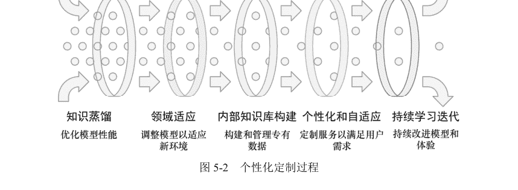

#### 5.2.1 知识蒸馏与领域适应

##### 1. 知识蒸馏及在个性化定制中的应用

知识蒸馏是一种模型压缩技术，旨在通过从教师模型（大型复杂模型）中提取知识，将其传递给学生模型（较小的模型），提升学生模型的性能。教师模型通常是性能良好的大型神经网络，学生模型通过模仿教师模型的行为进行学习，而不只是学习原始标签。

知识蒸馏在个性化定制中特别适用于资源受限的环境，如移动设备或嵌入式系统。知识蒸馏在实施中需要经过以下步骤。

- ① 训练教师模型，需要在源领域数据上训练一个性能良好的教师模型。
- ② 生成软标签，使用教师模型对目标领域数据进行推理，生成软标签。
- ③ 训练学生模型，在目标领域数据上训练学生模型，同时使用教师模型生成的软标签和原始硬标签。
- ④ 优化损失函数，使用包含硬标签损失和软标签损失的复合损失函数，平衡学生模型的学习目标。

通过知识蒸馏，可以将 LLM（如 DeepSeek-R1）的知识迁移到小型模型（如 Qwen 7B）中，实现更高效的推荐服务。例如，SLIM（Supervised Loss Induced Mixture）框架利用知识蒸馏将 LLM 的链式推理能力传递给小型语言模型，显著降低计算成本，同时保留较高的推理能力。在医疗领域，知识蒸馏可以用于将大型医学图像模型的知识迁移到小型模型中，实现更高效的诊断。

##### 2. 领域适应及在个性化定制中的作用

领域适应通过学习源领域和目标领域的差异，将源领域的模型迁移到目标领域。源领域通常具有丰富的标注数据，目标领域可能会缺乏标注数据或数据分布不同。领域适应的目的是减少源领域和目标领域的分布差异，提升模型在目标领域的性能。

领域适应在具体实施中需要经过以下步骤。

- ① 特征提取，从源领域和目标领域数据中提取特征。
- ② 实施特征变换，通过特征变换减少源领域和目标领域的分布差异，常用的技巧包括对齐特征分布、使用对抗训练等。
- ③ 模型微调，在目标领域数据上对模型进行微调，以适应目标领域的数据分布。

在推荐系统中，领域适应可以将一个领域的推荐知识迁移到另一个相关领域。例如，通过领域适应技术，可以将通用领域的推荐模型迁移到特定领域的推荐模型中，如电商、媒体内容分发、智能社交等领域。在多模态学习中，领域适应可以在不同模态之间传递知识，如从视觉模型到语言模型。

##### 3. 知识蒸馏与领域适应的关系及共同在个性化定制中的作用

知识蒸馏与领域适应存在 3 种关系，一是知识蒸馏在领域适应中应用，二是领域适应在知识蒸馏中应用，三是协同作用。

（1）知识蒸馏在领域适应中的应用
知识蒸馏可以作为一种手段，帮助模型更好地适应新的领域。通过使用不同领域的教师模型，学生模型可以学习跨领域的知识，从而增强其在新领域上的表现。在知识蒸馏中，教师模型中的输出分布、中间层特征等知识，可以帮助学生模型更好地理解和适应目标领域的数据分布。

（2）领域适应在知识蒸馏中的作用
领域适应技术可以帮助教师模型更好地适应目标领域的数据分布，从而使蒸馏过程更有效。例如，通过减少源领域和目标领域的特征分布差异，可以提升教师模型在目标领域的性能，从而提升学生模型的学习效果。

（3）协同作用
知识蒸馏和领域适应可以协同工作，实现更高效的模型迁移和性能提升。例如，在领域适应中使用知识蒸馏技术，可以让学生模型不仅能学习源领域的知识，还能更好地适应目标领域的数据分布。通过领域适应技术对源领域和目标领域的数据分布进行对齐，可以提升知识蒸馏的效果，使学生模型在目标领域上表现得更好。

#### 5.2.2 内部知识库构建

在个性化定制中，内部知识库扮演着至关重要的角色。内部知识库不仅能存储企业的专有数据和知识，还能通过智能化的手段帮助企业更高效地管理和利用专有数据和知识。

##### 1. 内部知识库构建

内部知识库构建需要经过多个步骤，以确保内部知识库的实用性和高效性。

一是明确目标和范围。确定需要收集哪些类型的信息，以及知识库将服务哪些业务流程，这是构建内部知识库的前提。

二是选择一个合适的技术平台。技术平台应具备良好的数据安全性、易用性和可扩展性，支持多种文件格式，以及强大的搜索和索引功能。例如，可以选择 Dify、Ollama、MaxKB 或 AnythingLLM 等技术平台，根据企业需求进行个性化定制。

三是收集和整理数据。收集企业内部的各种数据，包括文档、对话记录、结构化数据等。对数据进行清洗和标注，确保数据质量和隐私保护。可以使用 AI 工具（如 DeepSeek）对数据进行深度整合与精细化处理，构建独一无二的专属知识集合。

四是将收集的数据上传到知识库中，同时制订内容管理政策，包括内容的创建、审核、更新和删除，确保知识库中信息的质量和准确性。

五是知识库的智能化和个性化设置。可以利用 NLP、知识图谱等 AI 技术实现智能搜索、个性化推荐和精准检索，还可以根据用户的学习历史和行为习惯，提供量身定制的知识服务。例如，针对不同岗位和角色的员工，推送相应的培训资料和操作指南。

六是持续更新和维护。知识库需要定期更新和维护，确保信息的准确性和相关性，定期检查过时的信息，并更新数据和文档。

##### 2. DeepSeek 模型与知识库的融合

内部知识库构建完成后，要将知识库与 CRM、项目管理工具等其他企业系统深度集成，形成无缝的工作流，支持跨部门、跨地域的实时协作和讨论。此部分内容我们将在后续章节进一步展开和深化。

#### 5.2.3 个性化和自适应

在个性化定制中，个性化和自适应是两个重要的概念，它们共同作用于提升用户体验和系统性能。

##### 1. 个性化

个性化指根据用户的特定需求、偏好和使用习惯，提供定制化的产品或服务。个性化的目标是满足用户的独特需求，提高用户的满意度和参与度。个性化能够提高用户满意度，通过提供符合用户需求和偏好的内容，提高用户的满意度和忠诚度；还能提升用户体验，个性化的内容和功能使用户感到被理解和重视，从而提升用户的整体体验；此外，个性化还能提高用户参与度，使用户更愿意参与符合其兴趣的活动，从而提高用户的互动频率。

实施个性化，首先要完成用户画像构建；通过多模态交互（如语音、文字、表情）持续收集用户的行为数据，如浏览历史、购买记录、兴趣偏好等；利用机器学习和数据分析工具，构建用户画像，实时更新用户画像模型，反映用户的最新行为和偏好。其次要构建个性化推荐系统；根据用户画像，推荐符合用户兴趣和需求的内容，如文章、视频、产品等，生成基于用户画像的推荐模型，再融合图像、音频、文本等多种模态数据，开发多模态交互技术，提高用户与模型之间的交互效率，提升用户体验。最后要完成用户反馈机制设计；通过用户反馈机制，收集用户对产品或服务的意见和建议，实时调整推荐策略；同时根据用户反馈，不断优化用户画像和推荐算法，确保推荐内容的准确性和相关性。

##### 2. 自适应

自适应是指系统能够根据用户的使用习惯、环境变化或任务需求自动调整行为和功能。自适应的目标是提高系统的灵活性和适应性，使系统能够更好地应对变化和不确定性。

自适应系统能够根据不同的用户行为和环境条件，自动调整系统行为，提高灵活性和适应性，还能通过自动调整系统参数和功能，优化系统性能，提升效率和效果。此外，自适应系统能够更好地满足用户的动态需求，提高用户的满意度和信任度。

自适应系统在实施上包括以下 3 个环节。

（1）实施传感器与反馈机制设计
传感器要完成对环境的感知，通过摄像头、麦克风、温度传感器等传感器感知环境变化，收集环境数据。反馈机制的作用是实时监测用户行为，如操作习惯、使用频率等，作为反馈信息。

（2）构建自适应算法
算法包括机器学习与数据分析，并根据结果进行动态调整。利用决策树、神经网络等机器学习算法分析收集的数据，预测用户需求和环境变化。根据预测结果，动态调整系统参数和功能，如用户界面布局、内容推荐策略等。

（3）用户交互优化
一是开发语音识别和图像识别等多模态交互技术，提高用户与系统的交互效率，提升用户体验；二是根据用户的行为和反馈，实时调整系统行为，确保系统的自适应性和灵活性。

#### 5.2.4 持续学习迭代

持续学习迭代在个性化定制中具有重要作用，包括提升模型性能、适应变化的数据分布、提高模型的泛化能力及优化用户体验。

##### 1. 持续学习迭代的方法

持续学习迭代通常有以下 4 种方法。

- ① 基于梯度的持续学习方法（Gradient Episodic Memory，GEM）通过维护一个存储先前任务样本的情节记忆，并利用梯度信息避免在持续学习过程中对先前任务性能的损害，同时允许对先前任务有益的知识传递。
- ② 基于正则化的持续学习方法（Elastic Weight Consolidation，EWC）通过引入正则化项，保护对先前任务重要的参数，防止参数在学习新任务时被过度修改，从而减轻灾难性遗忘。
- ③ 基于数据回放的持续学习方法（Experience Replay，ER）通过存储和重放先前的样本，使模型在学习新任务时能够回顾和利用先前任务的数据，从而减少对先前任务性能的负面影响。
- ④ 基于模型架构的持续学习方法通过增加新的层或模块等动态扩展模型架构，在不显著增加计算量的情况下，容纳新的任务和知识。

##### 2. 实施持续学习迭代的具体流程

首先是数据准备与管理，持续收集用户交互数据和反馈信息，包括图像、音频和文本等多模态数据，将收集的数据进行清洗和标注，构建动态更新的数据集。
其次是模型训练与优化，定期使用新数据对模型进行微调，更新模型参数，确保模型能够适应新的任务和数据分布。通过自动化工具或手动调整，优化模型的超参数，提升模型性能。

再次是建立用户反馈机制，实时获取用户对模型输出的反馈信息；定期评估模型在测试集和验证集上的表现，根据评估结果进行调整和优化。

最后是多模态数据融合，从每种模态的数据中提取特征，并采用有效的融合策略整合特征。开发语音识别和图像识别等多模态交互技术，提升用户与模型之间的交互体验。

## 第 6 章 多模态数据处理与融合

多模态数据处理与融合是将来自不同模态（如图像、文本、音频、视频）的数据进行整合，旨在从多种数据类型中提取有价值的信息和特征，并将这些信息融合以提升系统的性能。

单一模态的数据通常不能提供全面的信息，多模态数据处理与融合具有提高信息理解能力、增强模型的鲁棒性、提供丰富的上下文信息、改进生成任务质量等多个方面的作用。

首先，多模态数据处理与融合可以显著提高模型对信息的理解能力，如在情感识别中，结合视觉、语音和文本数据，可以更准确地判断一个人的情感状态。其次，多模态数据处理和融合能够提高模型对不同环境和场景的适应能力，如在自动驾驶中，结合视觉、雷达和激光雷达数据，可以提高模型对环境感知的准确性和安全性。再次，多模态数据处理与融合可以获得更丰富的上下文信息，从而改进任务的执行效果，如在人机交互中，结合语音和手势信息，可以提供更自然和直观的交互体验。最后，在图文生成等任务中，多模态数据处理与融合能够生成更逼真和一致的内容，如结合文本描述和图像数据，可以生成符合描述的高质量图像。

此外，多模态数据处理与融合还能提高模型的泛化能力，提升用户体验。通过多模态数据处理与融合，模型可以处理不同类型的数据和任务，使模型更好地理解和处理复杂的问题。通过多模态数据处理，可以实现更自然和直观的人机交互体验，提高用户的满意度和参与度。

多模态数据处理与融合在 DeepSeek 企业应用中具有重要的地位，它能够帮助系统更全面、准确地理解和处理复杂的信息，从而在各种应用中取得更好的效果。

多模态数据处理与融合涉及 DeepSeek 企业应用的多个环节。

### 6.1 数据采集与预处理

在 DeepSeek 企业应用中，多模态数据处理与融合涉及的数据采集类型包括图像数据、文本数据、语音数据、传感器数据和视频数据。

#### 6.1.1 多模态数据类型及应用

多模态数据类型及应用如图 6-1 所示。

| 特征 | 图像 | 文本 | 语音 | 传感器 | 视频 |
| :--- | :--- | :--- | :--- | :--- | :--- |
| 数据描述 | 来自摄像头的视觉数据 | 自然语言数据 | 来自录音的音频数据 | 温度等物理量的测量数据 | 结合图像和音频的数据 |
| 应用场景 | 智能客服 | 自然语言处理 | 语音识别与生成 | 工业制造监控 | 视频内容管理 |

图 6-1 多模态数据类型及应用

文本数据主要是自然语言数据，如用户输入的文本、文档、日志等。在 NLP、文本生成、对话交互等任务中，DeepSeek 通过采集文本数据，提供更自然、智能的文本处理能力。

语音数据主要是音频数据，如用户语音输入、会议录音等。在语音识别、语音生成、会议分析等领域，DeepSeek 通过采集语音数据，结合其他模态数据，实现更高效的处理。

传感器数据主要是物理量的测量数据，如温度、湿度、压力等。在工业制造、设备监控等领域，DeepSeek 通过采集传感器数据，结合其他模态数据，实现设备状态的实时监控和故障预测。

视频数据主要是结合图像和音频的多模态数据，如会议录像、监控视频等。在视频内容管理、会议分析、监控等领域，DeepSeek 通过采集视频数据，结合其他模态数据，实现更高效的视频处理。

#### 6.1.2 图像数据预处理

图像数据预处理是多模态数据处理与融合中的一个重要环节，其目的是将原始图像数据转换为适合模型输入和处理的形式，提升模型的性能，提高模型的准确性。图像数据预处理包括数据清洗、格式转换、正则化和标准化及数据增强等环节。

##### 1. 数据清洗

在完成数据收集的基础上，需要对收集的数据去除噪声、处理异常值，并去除重复数据。

（1）使用滤波器去除图像中的噪声
在图像处理中，滤波器是去除图像噪声的重要工具。常见的滤波器包括高斯滤波器和中值滤波器。
高斯滤波是一种线性平滑滤波器，通过将图像与高斯核进行卷积来模糊图像，从而减少噪声。高斯核的权重值由高斯函数决定，中心像素的权重最大，周围像素的权重逐渐减小。读取图像后，根据定义的高斯核大小和标准差，使用高斯滤波对图像进行滤波处理即可。

##### 2. 格式转换

格式转换在图像预处理中的主要作用是将不同格式的图像数据转换为统一的格式，便于后续处理和分析。常见的图像格式包括 JPEG、PNG、BMP 等，这些格式在编码方式、压缩比、颜色深度等方面存在差异。通过格式转换，可以确保所有图像数据具有一致的格式，从而提高模型的兼容性和处理效率。

###### （1）统一图像格式

统一图像格式的作用是确保所有图像数据在预处理和模型训练过程中具有一致的数据结构和格式，有助于提高数据处理的效率和模型的训练效果。统一格式的图像数据还可以减少因格式差异导致的处理错误和兼容性问题。在实际应用中，可以将所有图像转换为常用的格式，如 JPEG 或 PNG。

###### （2）调整图像大小

调整图像大小的作用是将图像调整为模型所需的输入尺寸。不同的模型可能对输入图像的尺寸有特定的要求，因此需要对图像进行缩放或裁剪，确保图像符合模型的输入尺寸要求，这有助于提升模型的性能和准确性。使用 Python 的 Pillow 库或 OpenCV 库可以轻松地调整图像大小。当调整图像大小时，常用双线性插值、最近邻插值和立方插值①等方法。使用双线性插值估计新像素的值可以提供较好的图像质量。使用最近邻插值虽然简单、快速，但可能会导致图像质量下降。使用立方插值虽然可以提供更高的图像质量，但计算复杂度较高。

> ① 在图像处理中，插值是根据已知像素点的值估计未知像素点值的过程。最近邻插值将每个像素点的值设置为与其最近已知像素点的值。插值的计算复杂度低，可能会导致图像质量下降，尤其是在图像放大时会出现明显的锯齿效应。双线性插值是通过计算周围四个像素点的加权平均值来估计未知像素点值的方法，在计算复杂度和图像质量之间取得了较好的平衡，能够生成较平滑的图像。立方插值是使用多项式拟合的方法，通过引入更多邻域像素来提高插值的精度和图像质量。立方插值通常使用三次多项式函数，能够生成更平滑和自然的图像。

###### （3）通道处理

通道处理的目的是确保图像的通道数符合模型的要求。常见的图像通道数包括 RGB（Red、Green、Blue）、灰度图等。通道处理的主要作用是确保图像的通道数与模型的输入要求一致。如果模型要求输入为 RGB 图像，而输入图像为灰度图，则需要进行通道扩展，反之亦然。

##### 3. 正则化、标准化和归一化

正则化、标准化和归一化在图像数据预处理中分别具有防止过拟合、统一数据尺度和提升模型性能的作用。正则化通过添加惩罚项限制模型复杂度，防止过拟合；标准化和归一化通过调整数据的尺度，使数据分布更均匀，从而加快模型的收敛速度，提升模型的性能。

###### （1）正则化

正则化通过在损失函数中添加正则化项，对模型权重进行惩罚，可以有效地减少模型对训练数据的过度依赖，使其在未见数据上表现得更好。在模型训练过程中，通常使用 L1 或 L2 正则化、Dropout 等技术，防止模型过拟合，提高模型的泛化能力。L1 正则化通过对权重的绝对值进行惩罚，倾向于产生稀疏的模型参数，适合特征选择。L2 正则化通过对权重的平方进行惩罚，可以防止模型参数过大，使模型更平滑。Dropout 通过在训练过程中随机丢弃一部分神经元，防止模型过于依赖某些神经元，从而提高模型的泛化能力。Batch Normalization 通过归一化每层的输入，减少内部协变量偏移，稳定模型训练，提高模型的收敛速度和泛化能力。

###### （2）标准化

标准化在图像预处理中的主要作用是将特征数据调整为均值为 0、标准差为 1，使每个特征的数据都服从标准正态分布。在实际操作中，通常使用特定数据集的均值和标准差（如 ImageNet 数据集）进行标准化，这有助于提高模型的训练效率，提升模型的性能，特别是对于基于梯度下降的优化算法，标准化可以提高收敛速度。

###### （3）归一化

归一化在图像预处理中的主要作用是将特征数据缩放到一个固定范围，如[0, 1]或[-1, 1]，这有助于提高模型的训练效率，提升模型的性能，特别是对于基于梯度下降的优化算法。在图像预处理中，常用归一化将像素值从[0, 255]缩放到[0, 1]或[-1, 1]。归一化可以通过 ToTensor 或 Normalize 实现，主要通过 Min-Max 标准化实现，使用公式 (x-min)/(max-min)进行归一化。

##### 4. 数据增强

数据增强在图像预处理中的主要作用是增加训练集的样本数量，缓解过拟合，并提高模型的泛化能力，从而有效地提升算法的性能。通过模拟现实世界中的图像变化，如相机抖动、物体旋转、光照变化等，数据增强可以帮助模型更好地适应新的、未见过的数据。

常用的数据增强方法有以下 5 种。

###### （1）几何变换

几何变换包括随机裁剪、随机旋转、水平翻转和垂直翻转。随机裁剪从图像中随机选择一部分进行裁剪和缩放；随机旋转在一定范围内随机旋转图像，通常为 0～180 度；水平翻转将图像水平翻转，模拟图像在镜子中的反射；垂直翻转将图像垂直翻转。以上操作都适用于某些特定场景。

###### （2）颜色变换

颜色变换包括颜色抖动、随机调整亮度、随机调整对比度。颜色抖动可调整图像颜色的亮度、对比度、饱和度和色调。

###### （3）噪声注入

噪声注入包括高斯噪声注入和椒盐噪声注入。向图像加入高斯噪声，可以提高模型对噪声的鲁棒性；向图像加入椒盐噪声，可以模拟图像在传输过程中可能受到的干扰。

###### （4）遮挡和裁剪

遮挡和裁剪包括随机遮挡、随机裁剪和缩放。随机遮挡在图像中随机添加遮挡块，模拟物体部分被遮挡的情况。随机裁剪和缩放可以增加图像的多样性。

###### （5）高级增强技术

高级增强技术包括 Mixup、CutMix、AutoAugment 和生成对抗网络（Generative Adversarial Networks，GAN）等方法。MixUp 通过混合不同样本的特征和标签生成新的训练样本；CutMix 在图像上随机裁剪一个区域，并用另一个图像的区域代替，生成新的训练样本；AutoAugment 通过学习数据集的最佳增强策略自动化数据增强过程；利用 GAN 生成高逼真度的合成数据，尤其在数据稀缺的场景下，如医学图像分析。

#### 6.1.3 文本数据预处理

文本数据预处理是 NLP 中的一个重要步骤，其目的是将原始文本数据转换为适合模型输入和处理的形式，提升模型的性能并提高模型的准确性。具体来说，文本数据预处理通过去除噪声、统一格式和归一化等操作，可以提高模型的准确性和效率；通过词干提取和词形还原等操作，可以将不同的词形式转换为一种标准形式，提高模型的泛化能力；通过纠正拼写错误和去除重复数据等操作，可以提高数据的质量，减少模型的误判；通过分词和词性标注等操作，可以将文本数据转换为结构化的数据，便于模型的处理和分析。文本数据预处理具有以下 10 种方法。

- （1）分词：分词的作用是将文本分割成单词或子词，便于后续处理。可以使用 NLTK 或 spaCy 等库实现。
- （2）去除停用词：去除停用词的作用是去除常见的无意义单词，如“的”“是”“在”等，减少数据量，提高模型效率。可以使用 NLTK 或 spaCy 等库实现。
- （3）词干提取：词干提取的作用是将单词还原为词干形式，减少词的形式多样性，提高模型的泛化能力。可以使用 NLTK 或 spaCy 等库实现。
- （4）词形还原：词形还原的作用是将单词还原为基本形式（原型），提高模型的泛化能力。可以使用 NLTK 或 spaCy 等库实现。
- （5）去除特殊字符和数字：去除特殊字符和数字的作用是去除文本中的特殊字符和数字，减少噪声，提高模型的准确性。可以使用正则表达式或字符串操作实现。
- （6）拼写纠正：拼写纠正的作用是纠正文本中的拼写错误，提高数据质量。可以使用 TextBlob 或 Pyaspeller 等库实现。
- （7）词性标注：词性标注的作用是为每个单词标注其词性（如名词、动词、形容词），以便后续的语法分析和特征提取。可以使用 NLTK 或 spaCy 等库实现。
- （8）NER：NER 的作用是识别文本中的命名实体（如人名、地名、组织名等），便于信息提取和知识图谱构建。可以使用 NLTK 或 spaCy 等库实现。
- （9）文本归一化：文本归一化的作用是将文本数据转换为统一的格式，如小写化、去除空格等，提高模型的泛化能力。可以使用字符串操作实现。
- （10）数据增强：数据增强的作用是通过增加训练数据的多样性，提高模型的泛化能力和鲁棒性。可以使用 TextAttack 或 Nlpaug 等库实现。

#### 6.1.4 语音数据预处理

语音数据预处理是语音识别和语音处理中的一个重要步骤，其作用包括通过去除噪声、增强信号等操作，提高语音信号的清晰度和可懂度，从而提高模型的识别准确率；通过数据增强等技术，增加训练数据的多样性，使模型能够更好地适应不同的语音条件和环境；通过去除无效数据、纠正错误数据等操作，提高数据的质量，减少模型的误判；以及通过分帧、特征提取等操作，将语音数据转换为结构化的数据，便于模型的处理和分析。语音数据的具体预处理包括以下 7 个环节。

- （1）数据清洗：数据清洗的作用是提高数据的正确性，去除无效或错误的数据，其具体实现方法如下。
    - ① 信噪比（Signal to Interference plus Noise Ratio，SINR）估计算法，使用 WADA-SNR 等算法，去除信噪比很低的音频。
    - ② 语音激活检测（Voice Activity Detection，VAD），使用 VAD 算法，去除无法触发 VAD 的音频。
    - ③ 语音识别技术（Automatic Speech Recognition，ASR），使用 ASR 算法，去除文字结果为空或置信度很低的音频。
    - ④ 自监督清洗，使用已去除前两种错误的数据训练初始模型，计算每个说话人的中心点，去除距离中心点非常遥远的音频。
- （2）VAD：VAD 的作用是检测语音信号的开始和结束，避免静默区和非语言区域的干扰。具体实现方法如下。
    - ① 基于能量的 VAD，即通过检测语音信号的能量变化来判断语音活动。
    - ② 基于统计模型的 VAD，即使用高斯混合模型（Gaussian Mixture Model，GMM）等统计模型来检测语音活动。
- （3）特征提取：特征提取的作用是提取语音信号中的有效特征，提高模型的识别能力。具体实现方法如下。
    - ① 梅尔频率倒谱系数（Mel-Frequency Cepstral Coefficients，MFCCs），即提取语音信号的频谱特征，常用于语音识别。
    - ② 线性预测编码（Linear Predictive Coding，LPC），即通过线性预测模型提取语音信号的特征。
    - ③ 预加重，即通过提高高频分量的比重，提高信号的频谱分辨率。
- （4）数据归一化与标准化：数据归一化与标准化的作用是将语音信号的某些属性调整为标准形式，提高语音特征的稳定性和可比性。在具体实现上，包括音量标准化和语速调整。音量标准化要确保所有录音都具有大致相同的音量水平；语速调整是通过使用同步叠加法或波形相似叠加法等时间伸缩算法对语音信号进行拉伸或压缩。
- （5）数据增强：数据增强的作用是通过增加训练数据的多样性，提高模型的泛化能力。在具体实现上，包括时域增强、频域增强和基于深度学习的增强。时域增强的方法包括时域切割与拼接、添加噪声、语速调整等；频域增强的方法包括频谱减法、频谱加法等；基于深度学习的增强方法包括使用 CNN 和 RNN 等模型进行音频增强。
- （6）噪声消除与回声抵消：噪声消除与回声抵消的作用是去除背景噪声和回声，提高语音信号的清晰度。在具体实现上，包括频谱减法和回声消除。频谱减法估计噪声频谱并从受噪声污染的信号中减去噪声，回声消除使用特定算法消除回声。
- （7）预处理技术在不同应用场景下的优化：预处理技术在不同应用场景下的优化根据不同的应用场景，优化预处理流程，提升模型性能。在具体实现上，包括语音识别系统和实时语音通信系统。语音识别系统通过定制化预处理流程，针对特定环境和说话人特性进行优化。实时语音通信通过优化预处理流程，减少计算资源的消耗，确保系统快速响应。

#### 6.1.5 传感器数据预处理

传感器是一种能够检测和测量物理、化学或生物现象的设备，并将这些现象转换为电信号或其他形式的信号，便于进一步处理和分析。传感器数据是通过传感器获得的数据，可以是模拟信号或数字信号，具体取决于传感器的类型和应用场景。

##### 1. 传感器数据的类型

传感器数据的类型非常多样，以下是一些常见的类型。

- ① 环境传感器数据，包括温度传感器数据、湿度传感器数据、气压传感器数据、光照传感器数据、生物传感器数据、心率传感器数据、血压传感器数据、血糖传感器数据、血氧传感器数据等。
- ② 运动传感器数据，包括加速度传感器数据、陀螺仪传感器数据、磁力计传感器数据、步数传感器数据等。
- ③ 工业传感器数据，包括振动传感器数据、压力传感器数据、流量传感器数据、液位传感器数据等。
- ④ 其他传感器数据，包括声音传感器数据、气体传感器数据、图像传感器数据、视频传感器数据等。

##### 2. 传感器数据预处理的方法

传感器数据通常包含许多噪声、缺失值和异常值，这些问题可能会影响机器学习模型的性能。因此，在进行机器学习前，需要对传感器数据进行预处理，提高数据质量和可靠性。

- ① 数据清洗，实现方法包括去除噪声、处理缺失值和去除异常值。去除噪声指使用中值滤波器、卡尔曼滤波器及低通或高通滤波器来消除噪声。处理缺失值用均值填充法或插值法处理缺失值。去除异常值是过滤超出合理范围的数值。
- ② 数据转换与标准化的作用是将原始数据转换为机器学习模型可以理解的格式，消除量纲差异。实现方法包括归一化和标准化。
- ③ 数据集成将不同来源的数据集，形成一个更大的数据集，提高数据的多样性。
- ④ 数据减少的作用是将原始数据集缩减为一个更小的数据集，降低计算成本。为了实现降维，主要使用主成分分析（Principal Components Analysis，PCA）减少冗余特征。

#### 6.1.6 视频数据预处理

视频数据通常包含大量噪声、无效信息和冗余数据，这些问题可能会影响视频分析模型的性能。因此，在进行视频分析前，需要对视频数据进行预处理，提高数据质量和可靠性。视频数据预处理的通常方法有以下6种。

- ① 视频格式转换的作用是将视频转换为模型所需的格式，确保视频数据的兼容性和一致性。在实现上，可以使用 FFmpeg 等工具进行视频格式转换。
- ② 去隔行处理的作用是消除图像中的交错效应，提高图像的清晰度和稳定性。在实现上可以使用去隔行处理算法，如中值滤波、线性插值等。
- ③ 上采样或下采样的作用是调整视频的分辨率，提高或降低图像的细节表现能力。在具体实现上，可以使用 OpenCV 的 resize 函数进行上采样或下采样。
- ④ 降噪处理的作用是去除视频中的噪声干扰，提高图像的清晰度和信噪比。可以使用高斯滤波、中值滤波等空间域降噪和时间域降噪方法。
- ⑤ 视频镜头分割的作用是将视频分割成不同的镜头，便于后续的视频处理和分析。可以使用像素差异法、基于直方图的方法、块匹配法等方法实现。
- ⑥ 关键帧提取的作用是提取视频中的关键帧，减少数据量，提高处理效率。可以使用首尾帧法、中间帧法等方法提取关键帧。

### 6.2 特征提取

从预处理后的数据中提取有用的特征信息，这些特征信息能够代表数据的本质属性和特点。针对文本数据、图像数据、音频数据、视频数据，除了使用传统的特征提取方法，还可以使用 CNN、RNN、预训练模型和自编码器等深度学习方法进行特征提取。

#### 6.2.1 图像数据特征提取

从预处理后的图像数据中进行特征提取的传统方法包括尺度不变特征转换（Scale-Invariant Feature Transform，SIFT）、加速版旋转特征（Speeded Up Robust Features，SURF）、快速特征点提取和描述算法（Oriented FAST and Rotated BRIEF，ORB）和方向梯度直方图（Histogram of Oriented Gradients，HOG）。SIFT 通过检测图像中的关键点后生成描述，这些关键点对尺度、旋转和亮度变化具有不变性。SURF 是 SIFT 的改进版本，也称为加速鲁棒特征，通过使用积分图像和 Hessian 矩阵的近似值进行加速计算。ORB 结合了 FAST 角点检测和 BRIEF 描述符，通过引入方向信息提高特征匹配的鲁棒性。HOG 通过计算图像中每个像素点的 HOG 提取特征，适用于行人检测等任务。

深度学习方法包括使用预训练的 CNN 模型和自定义的 CNN 模型。VGG16、ResNet 等预训练的 CNN 模型已经在大规模数据集上训练过，可以提取高层次的特征。自定义 CNN 模型根据具体任务设计自定义的 CNN 模型，提取特定的图像数据特征。

#### 6.2.2 文本数据特征提取

从预处理后的文本数据中进行特征提取有以下 5 种方法。

- （1）词袋模型：词袋模型（Bag of Words，BoW）将文本表示为一个“词袋”，忽略词元的顺序和语法，只考虑是否出现词。在具体实现上，首先创建一个包含文本中所有唯一词汇的字典，其次对每个文本生成一个向量，向量的每个元素表示相应词汇在文本中的出现次数。BoW 的优点是实现简单、易理解，缺点是忽略了词序和上下文信息。
- （2）TF-IDF：TF-IDF（Term Frequency-Inverse Document Frequency）计算文本中每个词的重要性，考虑词在文本中的频率和其在整个语料库中的稀有性。词频（Term Frequency，TF）是某个词在文档中的出现频率。逆文本频率指数（Inverse Document Frequency，IDF）反映词在文档集中出现的稀有程度，计算公式为$$IDF(t) = \log\left(\frac{N}{df(t)}\right)$$

其中 $N$ 是总文档数，$df(t)$ 是包含词 $t$ 的文档数。

TF-IDF 通过将 TF 和 IDF 相乘得到

$$TF-IDF(t, d) = TF(t, d) \times IDF(t)$$

因为稀有词对文本的特征更关键，所以 TF-IDF 方法的优点是提高了模型对文本的区分能力，缺点是忽略了词序和句子结构。

（3）词嵌入

词嵌入使用低维空间的向量表示每个词，能够捕捉词之间的语义关系。常用方法包括 Word2Vec 和 GloVe。Word2Vec 通过上下文预测词（Skip-Gram）或用词预测上下文的连续词袋模型（Continuous Bag of Words，CBOW）训练模型。GloVe（Global Vectors for Word Representation）通过观察词在文本中出现的全局共现矩阵来学习词向量。

词嵌入的优点是能够捕捉词与词的上下文和语义关系，有助于提升模型在语义理解方面的能力；缺点是训练过程相对复杂，可能需要大量的语料。

（4）N-gram 模型

N-gram 模型通过将文本分割成连续的 $N$ 个词的序列来捕捉词的顺序信息。

（5）主题模型

主题模型是一种用于发现文档中隐藏主题的统计模型，常用的主题模型包括隐含狄利克雷分布（Latent Dirichlet Allocation，LDA）模型。

#### 6.2.3 语音数据特征提取

从预处理后的语音数据中提取特征是语音处理中的关键步骤，这些特征可用于语音识别、语音合成、说话人识别等多个任务。

##### 1. 传统特征提取方法

（1）梅尔频率倒谱系数

梅尔频率倒谱系数（Mel-scale Frequency Cepstral Coefficients，MFCC）模拟人耳听觉特性，将语音信号转换为基于梅尔（Mel）频率的倒谱系数。提取过程包括预处理、分帧、加窗、快速傅里叶变换（Fourier Transform）、Mel 滤波器组、对数能量和离散余弦变换（Discrete Cosine Transform，DCT）等步骤。MFCC 能有效保留语音信号的重要特征信息，在语音识别中表现出色。可以使用 Python 的 Librosa 库提取 MFCC 特征。

（2）线性预测倒谱系数

线性预测倒谱系数（Linear Predictive Cepstral Coefficients，LPCC）通过线性预测模型捕捉语音的声道特性，适用于语音识别和语音合成。可以使用 Pydub 和 Librosa 等库提取 LPCC 特征。

（3）F0 音频

基频在语音合成和语音转换中至关重要，影响语音自然度和情感表达。F0 音频表示语音的音高信息，反映声带振动频率。可以使用 Pyworld 库提取基频特征。

（4）声强

声强在语音活动检测和语音分割中用于区分语音段和非语音段。声强反映语音信号的响度，是语音信号能量的度量。可以使用 Librosa 库提取声强特征。

（5）韵律特征

韵律特征在情感语音合成和语音情感识别中用于表达情感和语义。韵律特征包括节奏、重音和语调等，对语音的情感和语义表达至关重要。可以使用 Librosa 和 Pyworld 等库提取韵律特征。

##### 2. 深度学习方法

深度学习方法通过 CNN、RNN 或 Transformer 模型自动学习和提取语音特征。这些模型可以学习更高级和复杂的特征表示，适用于语音识别、语音合成等任务。可以使用 PyTorch 或 TensorFlow 等深度学习框架构建和训练模型。

#### 6.2.4 传感器数据特征提取

传感器数据类型多种多样，针对不同类型的传感器数据，从预处理后的数据中特征提取的方法不同。

##### 1. 传统特征提取方法

（1）时域特征提取

时域特征提取是从时间序列数据中提取统计特征，如均值、方差、最大值、最小值、峰值等，这些特征能够反映数据的基本统计特性，适用于简单的分类和回归任务。可以使用 Numpy 或 Pandas 库计算统计特征。

（2）频域特征提取

频域特征能够揭示数据中的周期性模式和频率成分，适用于振动分析、心率变异性分析等。通过傅里叶变换，能够将时间序列数据转换为频域数据，提取功率谱密度、频谱峰值等频域特征。可以使用 Numpy 或 Scipy 库进行傅里叶变换。

（3）小波变换

小波变换可以将信号分解为不同频率的子信号，用于提取局部特征。小波变换适用于分析非平稳信号，能够捕捉信号中的突变和瞬态特征。可以使用 Pywt 库进行小波变换。

（4）PCA

PCA 是一种降维技术，通过将高维数据投影到低维空间，保留数据的主要特征。PCA 可以减少数据的维度，提高计算效率，同时保留数据的主要信息。可以使用 Sklearn 库进行 PCA。

##### 2. 深度学习方法

CNN 能够自动学习和提取复杂的特征，适用于分类、回归等任务。CNN 通过卷积层提取局部模式和特征，适用于处理图像化或时间序列数据。可以使用 PyTorch 或 TensorFlow 构建 CNN 模型。

RNN 及变体（如 LSTM）能够捕捉时间序列数据中的长期依赖关系，适用于处理时序数据，如传感器数据中的时间序列分析。可以使用 PyTorch 或 TensorFlow 构建 RNN 模型。

#### 6.2.5 视频数据特征提取

除了文生视频，大多数视频都可能来自各种传感器。因此，对视频数据特征提取在 3.3.2 节中已经有所阐述。除了传统特征提取方法和深度学习方法，还可以使用开源工具进行特征提取。

##### 1. Video Features

Video Features 是一个功能强大的视频特征提取工具包，支持从原始视频中提取多种模态的特征，包括视觉外观、光流和音频特征。Video Features 集成了多个主流的预训练模型，覆盖了不同的应用场景①。

##### 2. Video_Feature_Extractor

Video_Feature_Extractor 是一个基于 Python 的工具包，利用深度 CNN（2D 或 3D CNN）高效提取视频特征。Video_Feature_Extractor 通过 FFmpeg 进行实时视频解码，并采用 PyTorch 作为后端，支持高效的 GPU 多进程特征提取②。

### 6.3 模态融合

模态融合是指将文本、图像、音频、视频等不同模态的数据进行整合，生成联合表征或直接输出预测结果，其核心目标是通过跨模态互补提高模型的感知和理解能力。

模态融合的作用，一是通过整合不同模态的信息，使模型能够更全面地理解数据，提高预测准确性；二是使不同模态的数据相互补充，减少单一模态数据的噪声和缺失对模型的影响；三是支持需要多模态信息的任务，如多模态情感分析、视听语音识别等。

模态融合根据融合深度可以分为数据级融合、特征级融合、目标级融合和混合融合。多模态数据融合如图 6-2 所示。

> ① 具体可参考[Video Features：多模态视频特征提取利器]。
> ② 具体可参考[开源项目教程：视频特征提取器（video_feature_extractor）]。

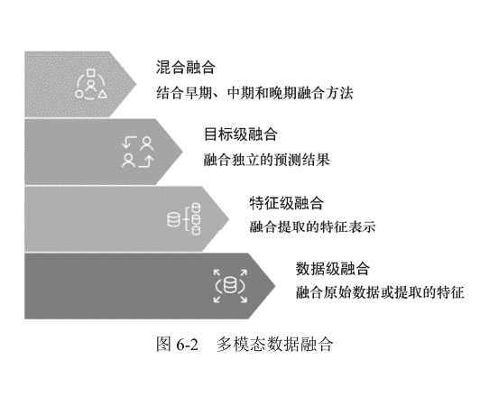

#### 6.3.1 数据级融合

数据级融合指在将多模态数据输入模型前，将不同模态的原始数据或已从原始数据中提取的特征融合，形成一个综合的表示作为模型的输入。数据级融合适用于原始数据具有高度相关性和互补性的情况，如图像和深度图的融合，其实现方式是将不同模态的原始数据直接拼接或叠加。以下是数据级融合的具体方法。

##### 1. 拼接

拼接是指将多个特征向量进行简单拼接，得到一个更长的向量。这种方法简单、直接，能够保留所有模态的原始信息。拼接适用于不同模态的数据具有不同的维度①和尺度②，需要保留所有模态的原始信息的情况。

##### 2. 加法

加法是指将不同模态的特征进行线性加权求和，融合多个模态的信息。这种方法可以减少数据维度，可能会丢失部分信息。加法适用于不同模态的数据具有相似的维度和尺度，并需要减少数据维度的情况。

> ① 维度指数据集中变量（特征）的数量，即数据表中列的数目，每个维度代表一个独立的数据属性。例如，在“学生成绩表”中，维度可能是“学号、姓名、数学成绩、语文成绩”等；在图像数据中，维度可能是像素的数量。维度影响计算复杂度、可视化难度和模型性能。高维数据可能会导致“维度灾难”（数据稀疏性增加）。
>
> ② 尺度指数据的测量类型，即变量的取值如何被量化或分类。统计学中数据尺度通常分为定类尺度、定序尺度、定距尺度和定比尺度。定类尺度的数据仅用于分类，无顺序或数值意义，如性别、颜色、国家名称，其统计方法主要包括频数、众数、卡方检验。定序尺度的数据有分类、顺序关系，无明确数值间隔，如教育程度、满意度等级，其统计方法主要包括中位数、百分位数、秩相关分析。定距尺度的数据有数值、顺序和固定间隔，无绝对零点，如温度、年份，其统计方法有均值、标准差、线性回归等。定比尺度的数据有数值、绝对零点，可计算比率，如身高、体重、收入、时间等，其统计方法有几何平均数、变异系数。
> 尺度决定了可用的统计分析和可视化方法。定类或定序数据适合分类统计（如饼图、条形图）；定距或定比数据适合数值运算（如折线图、散点图）。

以下是一个对不同模态的数据特征进行线性加权求和，以融合多个模态信息的案例。

在生物特征识别领域，单一模态的生物特征（如人脸、指纹、掌纹等）可能因环境变化或数据质量不佳造成识别准确率下降。为了提高识别的准确性和鲁棒性，可以采用多模态生物特征融合的方法。例如，将人脸和掌纹特征融合，实现更精准的身份验证。

为此，需要首先使用 PCA 对人脸图像和掌纹图像进行降维处理，提取人脸特征向量和掌纹特征向量。再将提取的人脸特征向量和掌纹特征向量进行线性加权求和，融合多个模态的信息。具体步骤包括对人脸和掌纹特征向量进行归一化处理，确保它们在相同的尺度范围内；为人脸和掌纹特征分配不同的权重，权重可以根据特征的重要性和相关性进行调整；将归一化后的特征向量进行线性加权求和，得到融合后的特征向量。

其次使用最近邻分类器对融合后的特征向量进行分类，将分类结果转换为后验概率，根据后验概率进行加权融合，得到最终的识别结果。

最后对实验结果进行验证。

以下是一个简单的 Python 代码示例，展示了对人脸和掌纹特征进行线性加权求和的实现过程。

```python
import numpy as np
# 假设人脸特征向量和掌纹特征向量已经提取并归一化
face_feature = np.array([0.2, 0.5, 0.8])  # 示例人脸特征向量
palm_feature = np.array([0.3, 0.4, 0.6])  # 示例掌纹特征向量
# 权重分配
weight_face = 0.6
weight_palm = 0.4
# 线性加权求和
fused_feature = weight_face * face_feature + weight_palm * palm_feature
print("融合后的特征向量:", fused_feature)
```

##### 3. 乘法

乘法是指将单模态特征向量相乘融合在统一的张量中，使子模态语义信息充分融合。虽然乘法可以增强模态之间的交互，但可能会导致数据维度的增加。乘法适用于需要增强模态交互的情况，如多模态情感分析。

在许多实际应用中，如图像描述生成、视觉问答等任务，需要同时处理图像和文本两种模态的数据。为了更好地捕捉图像和文本的复杂关系，可以采用数据级乘法融合的方法。

首先从图像中提取视觉特征，如使用 CNN 提取图像的特征向量；其次从文本中提取语义特征，如使用预训练的语言模型（如 BERT）提取文本的特征向量；最后使用预训练的 CNN 模型（如 ResNet）提取图像的特征向量，使用预训练的 BERT 模型提取文本的特征向量。

接下来将提取的图像特征向量和文本特征向量进行逐元素相乘，得到融合后的特征向量。为此，首先对图像和文本特征向量进行归一化处理，确保它们在相同的尺度范围内。其次将归一化后的图像特征向量和文本特征向量进行逐元素相乘，得到融合后的特征向量。最后可以将融合后的特征向量输入到下游任务的模型中，如用于图像描述生成或视觉问答任务。

为了验证这种方法的有效性，可以使用公开的数据集（如 COCO 数据集）进行实验。以下是一个简单的 Python 代码示例，展示了如何对图像和文本特征进行乘法融合。

```python
import numpy as np
# 假设图像特征向量和文本特征向量已经提取并归一化
image_feature = np.array([0.2, 0.5, 0.8])  # 示例图像特征向量
text_feature = np.array([0.3, 0.4, 0.6])  # 示例文本特征向量
# 乘法融合
fused_feature = image_feature * text_feature
print("融合后的特征向量:", fused_feature)
```

##### 4. 双线性融合

双线性融合首先将两个模态的特征进行张量外积，得到一个二维的双线性矩阵；其次通过展平操作将池化后的结果转换为一维向量。这种方法可以捕捉模态的高阶交互，如图像和文本的融合。

在视觉问答（Visual Question Answering，VQA）任务中，需要同时处理图像和文本两种模态的数据。为了更好地捕捉图像和文本的复杂关系，可以采用双线性融合的方法。

从图像和文本中分别提取图像的特征向量和文本的特征向量后，通过以下步骤实现双线性融合。首先对图像和文本的特征向量进行归一化处理，确保它们在相同的尺度范围内；其次将归一化后的图像特征向量和文本特征向量进行外积操作，得到一个双线性矩阵；再次将外积矩阵展平，并进行归一化处理，得到融合后的特征向量；最后对归一化后的特征向量进行线性映射，得到最终的融合特征向量。

为了验证这种方法的有效性，可以使用公开的 VQA 数据集（如 VQAv1）进行实验。以下是一个简单的 Python 代码示例，展示了如何对图像和文本的特征进行双线性融合。

```python
import numpy as np
# 假设图像特征向量和文本特征向量已经提取并归一化
image_feature = np.array([0.2, 0.5, 0.8])  # 示例图像特征向量
text_feature = np.array([0.3, 0.4, 0.6])  # 示例文本特征向量
# 外积操作
bilinear_matrix = np.outer(image_feature, text_feature)
# 展平和归一化
flattened = bilinear_matrix.flatten()
normalized = flattened / np.linalg.norm(flattened)
# 线性映射（假设 W 是预训练的权重矩阵）
W = np.random.rand(10, len(normalized))  # 示例权重矩阵
fused_feature = np.dot(W, normalized)
print("融合后的特征向量:", fused_feature)
```

##### 5. 基于 Transformer 的方法

利用 Transformer 模型的自注意力机制和交叉注意力机制，将不同模态的数据转换为统一的表示空间，并进行特征交互。这种方法适用于需要处理复杂多模态数据的任务，如多模态情感分析、视听语音识别等。

在 VQA 任务中，需要同时处理图像和文本两种模态的数据。为了更好地捕捉图像和文本之间的复杂关系，可以采用 Transformer 模型的自注意力机制和交叉注意力机制。

完成图像和文本数据准备、特征提取后，需要将提取的图像特征向量和文本特征向量转换为统一的表示空间，便于后续的特征交互融合。这个环节可以使用线性变换将特征映射到相同的维度。

图像特征向量应使用自注意力机制，捕捉图像内部的特征关系；对于文本特征向量，应使用自注意力机制，捕捉文本内部的特征关系。使用图像特征作为查询（Query），文本特征作为键（Key）和值（Value），进行交叉注意力操作，捕捉图像和文本的关系；再使用文本特征作为 Query，图像特征作为 Key 和 Value，进行交叉注意力操作，捕捉文本和图像的关系。将自注意力和交叉注意力的结果融合后，得到融合后的特征向量。然后可以采用加权求和或拼接的方式进行融合，将融合后的特征向量输入到分类器中，用于预测答案。

为了验证这种方法的有效性，可以使用公开的 VQA 数据集（如 VQAv1）进行实验。以下是一个简单的 Python 代码示例，展示了如何对图像和文本特征进行自注意力和交叉注意力融合。

```python
import torch
import torch.nn as nn
import torch.nn.functional as F
class MultiHeadAttention(nn.Module):
    def __init__(self, d_model, n_heads):
        super(MultiHeadAttention, self).__init__()
        self.d_model = d_model
        self.n_heads = n_heads
        self.d_k = d_model // n_heads
        self.W_q = nn.Linear(d_model, d_model)
        self.W_k = nn.Linear(d_model, d_model)
        self.W_v = nn.Linear(d_model, d_model)
        self.W_o = nn.Linear(d_model, d_model)
    def forward(self, query, key, value, mask=None):
        batch_size = query.size(0)
        Q = self.W_q(query)
        K = self.W_k(key)
        V = self.W_v(value)
        Q = Q.view(batch_size, -1, self.n_heads, self.d_k).transpose(1, 2)
        K = K.view(batch_size, -1, self.n_heads, self.d_k).transpose(1, 2)
        V = V.view(batch_size, -1, self.n_heads, self.d_k).transpose(1, 2)
        scores = torch.matmul(Q, K.transpose(-2, -1)) / (self.d_k ** 0.5)
        if mask is not None:
            scores = scores.masked_fill(mask == 0, -1e9)
        attn_weights = F.softmax(scores, dim=-1)
        attn_output = torch.matmul(attn_weights, V)
        attn_output = attn_output.transpose(1, 2).contiguous().view(batch_size, -1, self.d_model)
        output = self.W_o(attn_output)
        return output, attn_weights
class CrossAttention(nn.Module):
    def __init__(self, d_model, n_heads):
        super(CrossAttention, self).__init__()
        self.self_attn = MultiHeadAttention(d_model, n_heads)
```

#### 6.3.2 特征级融合

特征级融合是在特征提取后、决策前进行的融合。不同模态的数据首先被分别处理，提取各自的特征表示，然后将这些特征表示在某一特征层上进行融合。特征级融合广泛应用于图像分类、语音识别、情感分析等多模态任务中，通过将不同模态的特征向量拼接或通过加权平均等方式进行融合。特征级融合的主要方法是拼接、加法、乘法、双线性融合和基于 Transformer 的方法。

特征级融合和数据级融合是多模态数据融合中的两个主要内容，尽管它们在融合方法上基本相同，但是它们在融合阶段、处理方式、适用场景、优缺点及具体实现等方面存在明显区别。

首先是融合阶段不同。数据级融合是在数据预处理阶段进行的，直接对不同模态的原始数据或已从原始数据中提取的特征进行融合；而特征级融合是在特征提取后、决策前进行的，将不同模态的特征表示在某一特征层上进行融合。

其次是融合内容不同。数据级融合的融合内容主要是不同模态的原始数据，而特征级融合的融合内容是不同模态的特征向量。

再次是适用场景不同。在适用场景上，数据级融合适用于不同模态的数据具有高度相关性和互补性的情况，如图像和深度图的融合，适合需要在早期阶段进行模态融合的任务，如多模态目标检测。而特征级融合适用于不同模态的数据具有不同的特征维度和需要更精细融合的情况，如图像和文本的融合，适合需要在特征层面进行模态融合的任务，如多模态情感分析。

最后是优缺点不同。数据级融合的优点是简单、直接，能够保留所有模态的原始信息；缺点是可能会导致数据维度过高，增加计算复杂度；不同模态的数据需要进行预处理以确保一致性。而特征级融合的优点是能够更精细地控制融合过程、保留模态特定的特征信息；缺点是需要先进行特征提取，增加了处理步骤；不同模态的特征维度需要匹配或进行调整。

#### 6.3.3 目标级融合

目标级融合是在各个单模态模型分别做出决策后进行的融合。每个模态的模型首先独立地处理数据并给出自己的预测结果（如分类标签、回归值），然后将预测结果进行整合以得到最终的决策结果。

目标级融合适用于需要综合考虑多个独立模型预测结果的场景，如多传感器数据融合、多专家意见综合等。目标级融合有以下 5 种方法。

- （1）投票法
投票法是一种简单的融合方法，通过统计不同模态模型的预测结果，选择出现次数最多的类别作为最终预测结果。投票法可以减少单一模态模型的误判，提高整体预测的准确性。
投票法适用于分类任务，特别是当不同模态模型的预测结果具有一定的多样性时。

- （2）加权平均法
加权平均法通过为不同模态模型的预测结果分配不同的权重，计算加权平均值作为最终预测结果。加权平均法可以更好地利用不同模态模型的优势，提高预测的准确性。
加权平均法适用于回归任务，特别是当不同模态模型的预测结果具有不同的置信度时。

- （3）贝叶斯融合
贝叶斯融合通过贝叶斯定理将不同模态模型的预测结果进行融合，计算最终的后验概率。贝叶斯融合可以有效地处理不确定性，提高预测的可靠性。
贝叶斯融合适用于分类任务，特别是当不同模态模型的预测结果具有不同的置信度时。

- （4）Dempster-Shafer 证据理论
Dempster-Shafer 证据理论通过结合多个证据（模态模型的预测结果）计算最终的信念函数和似然函数。Dempster-Shafer 证据理论可以有效地处理不确定性和冲突信息，提高预测的准确性。
Dempster-Shafer 证据理论适用于分类任务，特别是当不同模态模型的预测结果存在冲突时。

- （5）卡尔曼滤波
卡尔曼滤波通过递归最小二乘法估计目标的状态，适用于动态系统的目标跟踪和预测。卡尔曼滤波可以有效地处理时间序列数据，提高预测的准确性和鲁棒性。
卡尔曼滤波适用于目标跟踪和预测任务，特别是当目标的运动状态随时间变化时。

#### 6.3.4 混合融合

混合融合是一种结合了早期融合（数据级融合）、中期融合（特征级融合）和晚期融合（目标级融合）的方法，它通过在不同处理阶段融合数据，既可以在特征层面进行融合，又可以在决策层面进行融合，从而综合各方法的优点，提升模型性能。

混合融合适用于需要处理复杂多模态数据的任务，特别是多模态情感分析、自动驾驶、医疗诊断和智能监控等场景。在多模态情感分析场景中，需要结合文本、音频和视频等多种模态数据，提高情感识别的准确性；在自动驾驶的场景中，需要结合摄像头、雷达和激光雷达等多模态传感器数据，提高对环境的感知和理解；在医疗诊断场景中，需要结合医学影像、生理信号和病历文本等多模态医疗数据，提高疾病诊断的准确性；在智能监控场景中，需要结合视频和音频数据，提高对异常事件的检测和识别能力。

混合融合的实现方式通常包括数据预处理和特征提取、特征级融合、模型训练和目标级融合和混合策略设计等环节。数据预处理和特征提取环节需要对不同模态的数据进行归一化、降噪等预处理，使用 CNN 提取图像特征、使用 RNN 提取文本特征等方法提取各模态的特征；在特征级融合阶段，需要将不同模态的特征进行融合，如拼接、加权平均或基于 Transformer 进行交互；在模型训练和目标级融合阶段，需要用到多层感知机（Multi-Layer Perceptron，MLP）或深度神经网络（Deep Neural Networks，DNN）等工具实现融合后的特征训练模型，并结合单独模态模型的预测结果，通过投票、加权平均或融合等策略进行目标级融合。最终完成混合策略设计，如先进行特征级融合，再进行目标级融合，或在不同层次上进行多次融合等合理的融合策略。

### 6.4 模型训练与优化

多模态数据融合后，就需要对模型进行训练和优化。

#### 6.4.1 模型训练

使用融合后的多模态数据训练模型的关键在于设计合理的模型架构和训练策略，确保模型能够有效地学习多模态数据的特征和关系。同时还需要监控训练过程，调整超参数，确保模型能够有效地学习多模态数据的特征和关系。

- 1. 模型架构设计

首先需要根据任务需求选择适合的模型架构，如 Transformer、CNN、RNN 等，其次需要在模型中设计专门的融合层，用于整合不同模态的特征。例如，使用共享注意力机制或 Transformer 融合层。

在训练策略方面，既可以采用联合训练，又可以采用分阶段训练，还可以进行对抗训练。联合训练同时训练多个模态的特征提取和融合部分，使模型能够同步学习各模态的信息。分阶段训练首先单独训练每个模态的特征提取器，其次进行融合训练，这种方式可以减少初期训练的复杂性。对抗训练通过 GAN 等方法，增强模型的鲁棒性，提高对抗样本的防御能力。

- 2. 监控训练过程

监控训练过程是确保模型训练效果的重要环节，可以及时发现和解决训练中出现的问题。

监控的指标包括损失值、准确率和学习率。通过监控训练集和验证集的损失值，能够确保模型在训练过程中逐渐收敛。通过监控模型在训练集和验证集上的准确率，能够确保模型的预测能力逐步提高。通过监控学习率的变化，确保学习率在合理范围内，避免训练不稳定。

相应的工具包括 TensorBoard 和日志记录。TensorBoard 等可视化工具可用于监控训练过程，实时查看损失值、准确率等指标的变化。日志记录了训练过程中的关键信息，如损失值、准确率、学习率等，便于后续分析和调整。

- 3. 超参数调整

调整超参数是优化模型性能的关键步骤，通过调整超参数可以提高模型的收敛速度和泛化能力。调整超参数的方法包括网格搜索、随机搜索和贝叶斯优化。前文对这几种方法有过介绍，这里不再赘述。

#### 6.4.2 模型优化

当使用融合后的多模态数据训练模型时，可以通过量化、剪枝等技术降低计算资源需求，提高模型的运行效率。以下是具体的方法和实现步骤。

- （1）量化

量化是一种将模型的权重和激活从高精度（如 32 位浮点数）降低到低精度（如 8 位整数）的技术，可以显著减少模型的大小和计算量，提高模型的运行效率。

在实现上，首先进行后训练量化，在模型训练完成后进行量化；其次进行量化感知训练（Quantization-Aware Training, QAT），即在训练过程中考虑量化误差，提升模型量化后的性能。

- （2）剪枝

剪枝是一种通过移除模型中不重要的权重或神经元来降低模型复杂度的技术。剪枝可以减少模型大小、降低计算复杂度，并且可能会提高模型的泛化能力。

剪枝包括权重剪枝、结构化剪枝和重要性剪枝。权重剪枝移除绝对值小于某个阈值的单个权重；结构化剪枝移除整个卷积核、神经元或通道，产生更规则的稀疏结构，有利于硬件加速；重要性剪枝基于权重或激活值的重要性评分决定剪枝对象。

- （3）模型优化的其他技术

除了量化和剪枝，还可以使用知识蒸馏、参数共享与模块复用、分布式计算和硬件加速等技术对模型进行优化，降低计算资源需求，提高模型的运行效率。

#### 6.4.3 综合案例

以下是一个综合案例，展示了多模态数据分别完成数据准备、特征提取、特征融合后，对模型使用共享注意力机制和 Transformer 融合层，采用联合训练，并对训练过程进行监控，通过量化、剪枝和知识蒸馏技术进行模型优化的过程。

首先从公开的 VQA 数据集（如 VQAv1）中获取图像数据，从同一数据集中获取与图像对应的文本问题。其次使用预训练的 ResNet50 模型提取图像的特征向量，使用预训练的 BERT 模型提取文本的特征向量。

在特征融合方面，将图像和文本特征向量输入到共享注意力模块中，捕捉图像和文本的复杂关系；使用 Transformer 编码器对融合后的特征进行进一步特征交互和建模。

在模型训练方面，将融合后的特征输入分类器中，预测答案。使用交叉熵损失函数进行训练；同时记录训练损失、验证损失、训练准确率和验证准确率等指标，并使用 TensorBoard 进行可视化。

在模型优化方面，使用 QAT 对模型进行量化，减少模型的存储和计算开销；对模型进行结构化剪枝，减少模型的参数量；通过跨模态蒸馏，将知识从教师模型迁移到学生模型，提升模型的性能。

以下是基于 Python 代码的实现示例。

```python
import torch
import torch.nn as nn
import torch.nn.functional as F
import torchvision.models as models
from transformers import BertModel

class MultiHeadAttention(nn.Module):
    def __init__(self, d_model, n_heads):
        super(MultiHeadAttention, self).__init__()
        self.d_model = d_model
        self.n_heads = n_heads
        self.d_k = d_model // n_heads
        self.W_q = nn.Linear(d_model, d_model)
        self.W_k = nn.Linear(d_model, d_model)
        self.W_v = nn.Linear(d_model, d_model)
        self.W_o = nn.Linear(d_model, d_model)

    def forward(self, query, key, value, mask=None):
        batch_size = query.size(0)
        Q = self.W_q(query)
        K = self.W_k(key)
        V = self.W_v(value)
        Q = Q.view(batch_size, -1, self.n_heads, self.d_k).transpose(1, 2)
        K = K.view(batch_size, -1, self.n_heads, self.d_k).transpose(1, 2)
        V = V.view(batch_size, -1, self.n_heads, self.d_k).transpose(1, 2)
        scores = torch.matmul(Q, K.transpose(-2, -1)) / (self.d_k ** 0.5)
        if mask is not None:
            scores = scores.masked_fill(mask == 0, -1e9)
        attn_weights = F.softmax(scores, dim=-1)
        attn_output = torch.matmul(attn_weights, V)
        attn_output = attn_output.transpose(1, 2).contiguous().view(batch_size, -1, self.d_model)
        output = self.W_o(attn_output)
        return output, attn_weights
```

```python
class SharedAttention(nn.Module):
    def __init__(self, embed_dim):
        super(SharedAttention, self).__init__()
        self.multihead_attn = nn.MultiheadAttention(embed_dim, num_heads=8)

    def forward(self, text_features, image_features):
        combined_features = torch.cat([text_features, image_features], dim=1)
        attn_output, _ = self.multihead_attn(combined_features, combined_features, combined_features)
        return attn_output
```

```python
class MultiModalTransformer(nn.Module):
    def __init__(self, text_dim=768, image_dim=2048, hidden_dim=512):
        super(MultiModalTransformer, self).__init__()

        # 图像编码器
        self.image_encoder = models.resnet50(pretrained=True)
        self.image_encoder = nn.Sequential(*list(self.image_encoder.children())[:-1])  # 去掉全连接层
        self.img_fc = nn.Linear(2048, hidden_dim)

        # 文本编码器
        self.text_encoder = BertModel.from_pretrained('bert-base-uncased')
        self.text_fc = nn.Linear(text_dim, hidden_dim)

        # 共享注意力机制
        self.shared_attn = SharedAttention(hidden_dim)

        # Transformer融合层
        self.transformer = nn.Transformer(d_model=hidden_dim, num_encoder_layers=3, num_decoder_layers=3)

        # 分类器
        self.classifier = nn.Linear(hidden_dim, num_classes)

    def forward(self, image, text_input_ids, text_attention_mask):
        # 提取图像特征
        image_features = self.image_encoder(image)
        image_features = image_features.view(image_features.size(0), -1)
        image_features = self.img_fc(image_features)

        # 提取文本特征
        text_outputs = self.text_encoder(text_input_ids, attention_mask=text_attention_mask)
        text_features = text_outputs.last_hidden_state
        text_features = self.text_fc(text_features)

        # 共享注意力融合
        combined_features = self.shared_attn(text_features, image_features.unsqueeze(1))

        # Transformer 融合
        fused_features = self.transformer(image_features.unsqueeze(1), combined_features)

        # 分类
        output = self.classifier(fused_features.squeeze(1))

        return output

# 假设图像特征向量和文本特征向量已经提取并归一化
image_input = torch.randn(2, 3, 224, 224)  # 假设有 2 张图片
text_input_ids = torch.randint(0, 10000, (2, 128))  # 假设文本输入 ID
text_attention_mask = torch.ones(2, 128)  # 假设注意力掩码
labels = torch.tensor([0, 1])  # 假设分类标签

# 初始化模型
model = MultiModalTransformer()

# 定义损失函数和优化器
criterion = nn.CrossEntropyLoss()
optimizer = torch.optim.Adam(model.parameters(), lr=0.001)

# 训练模型
model.train()
for epoch in range(10):
    optimizer.zero_grad()
    outputs = model(image_input, text_input_ids, text_attention_mask)
    loss = criterion(outputs, labels)
    loss.backward()
    optimizer.step()
    print(f"Epoch {epoch+1}, Loss: {loss.item()}")

print("训练完成")

# 量化感知训练
model.qconfig = torch.quantization.get_default_qconfig('fbgemm')
torch.quantization.prepare(model, inplace=True)
```

model(image_input, text_input_ids, text_attention_mask)
torch.quantization.convert(model, inplace=True)

# 剪枝
prune.ll_unstructured(model.img_fc, name='weight', amount=0.2)
prune.ll_unstructured(model.text_fc, name='weight', amount=0.2)

# 知识蒸馏
teacher_model = MultiModalTransformer()
teacher_model.load_state_dict(torch.load('teacher_model.pth'))  # 假设教师模型已训练
student_model = MultiModalTransformer()
criterion_distill = nn.KLDivLoss()
optimizer_distill = torch.optim.Adam(student_model.parameters(), lr=0.001)

for epoch in range(10):
    optimizer_distill.zero_grad()
    student_outputs = student_model(image_input, text_input_ids, text_attention_mask)
    with torch.no_grad():
        teacher_outputs = teacher_model(image_input, text_input_ids, text_attention_mask)
    loss_distill = criterion_distill(F.log_softmax(student_outputs / 2.0, dim=1),
                                     F.softmax(teacher_outputs / 2.0, dim=1))
    loss_distill.backward()
    optimizer_distill.step()
    print(f"Distillation Epoch {epoch+1}, Loss: {loss_distill.item()}")

print("蒸馏完成")

通过上述案例，可以有效地将不同模态的数据转换为统一的表示空间，并进行数据级特征交互融合，提升模型在多模态任务中的性能。同时，通过量化、剪枝和知识蒸馏技术，可以进一步优化模型，使其更适合部署和推理。

## 第 7 章 分布式训练

分布式训练将训练任务分配到多个计算节点（如 GPU、TPU）上并行执行，通过将模型和数据分布在多个计算节点上，利用多台计算机的资源共同完成模型训练任务。分布式训练能够有效地解决单机训练在处理大规模模型和数据时面临的效率低、内存不足等问题。

分布式训练在提高训练效率、提升模型性能、增强系统可扩展性、提高系统可用性等方面都具有重要作用。在提高训练效率方面，多个计算节点通过并行计算同时进行计算，能够大幅缩短训练时间。在模型性能提升方面，利用更多计算资源和数据样本进行训练，可以降低过拟合风险，提高模型的泛化能力和准确性。在增强系统可扩展性方面，分布式训练能够处理传统单机训练难以应对的大规模数据集和复杂模型，随着业务量的增长，分布式训练通过多台计算设备的协同工作，能够应对更大规模的应用场景。在提高系统可用性方面，分布式架构能够消除单点故障，提高系统的整体可用性，即使某台计算设备出现故障，也不会影响整个训练任务的进行。

分布式训练包括配置计算集群架构、采用并行策略、进行关键技术优化、执行训练过程、启动训练任务等环节。数据集的准备与处理是分布式训练过程中不可或缺的环节。

### 7.1 计算集群架构

计算集群架构是由多个计算节点（如 GPU、TPU）组成的硬件系统，这些计算节点通过高速网络互联，共同协作完成大规模的计算任务。在 DeepSeek 的分布式训练中，计算集群架构为模型训练提供了强大的计算能力支持，使大规模的模型和数据能够被高效地处理和分析。

#### 7.1.1 计算集群架构配置要素

计算集群架构配置要素包括计算节点配置、网络架构配置、存储系统配置和软件环境配置。

1. 计算节点配置

计算节点是分布式训练的基本单元，通常由高性能的 GPU 或 TPU 组成。一般来说，建议选择 NVIDIA A100 或 H100 等高性能的 GPU，并根据任务需求确定节点数量和 GPU 数量。

2. 网络架构配置

计算节点间的网络连接对于提高分布式训练的效率至关重要。采用 InfiniBand 或 NVLink 等高速网络技术，可以减少节点间的通信延迟，提高数据传输速度。DeepSeek-V3 的节点间采用了 InfiniBand（IB）技术进行高效通信。在企业应用中，应根据集群规模和性能需求选择合适的网络架构，并确保网络带宽和延迟满足分布式训练的要求。

3. 存储系统配置

大规模模型训练需要处理大量数据，因此存储系统需要具备高容量、高并发和高可靠性的特点。采用分布式文件系统或高性能的存储设备，如 NVMe SSD，可以满足数据存储和访问的需求。例如，DeepSeek-V3 的存储系统配置了 4PB 的 NVMe SSD。企业应根据数据量和访问模式选择合适的存储解决方案，并确保数据的安全性和隐私性。

4. 软件环境配置

计算集群需要配备适合的深度学习框架和库，如 TensorFlow、PyTorch 等，并安装相关的依赖项和驱动程序。同时，计算集群还需要配置分布式训练的环境变量和参数，确保训练任务的顺利进行。

#### 7.1.2 计算集群架构配置建议

在 DeepSeek 的企业应用中，计算集群架构的配置需要根据企业的具体需求和应用场景确定。计算集群配置金字塔如图 7-1 所示。

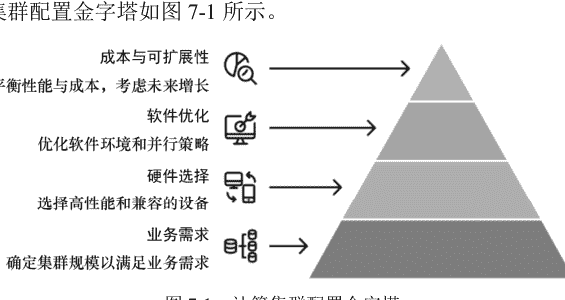

1. 根据业务需求确定规模

企业应根据自身的业务需求和数据规模确定计算集群的规模。如果企业的应用场景需要处理大规模的模型和数据，可能需要配置大规模的计算集群，如 DeepSeek-V3 的 2048 个 GPU 集群。对于较小规模的任务，可以考虑使用较小的集群配置，以降低成本。

2. 选择合适的硬件和网络设备

当选择硬件设备时，应考虑性能、成本和兼容性等因素。选择高性能的 GPU 和高速网络设备可以提升计算集群的性能，提高计算集群的效率。同时，需要注意设备的兼容性和可扩展性，以便于有需要时进行升级和扩展。

3. 优化软件环境和并行策略

除硬件配置外，软件环境和并行策略的优化也非常重要。企业应根据具体的模型和任务，选择合适的深度学习框架和并行策略，并进行相应的调整和优化，充分发挥计算集群的性能。

4. 考虑成本和可扩展性

计算集群的配置需要在性能和成本之间取得平衡。企业应根据预算和实际需求，合理地选择硬件设备和配置方案。同时，需要考虑计算集群的可扩展性，以便于当业务增长时能够方便地进行扩展和升级。

不同企业需求的 DeepSeek 企业应用分布式训练计算集群架构配置建议如表 7-1 所示。

表 7-1 不同企业需求的 DeepSeek 企业应用分布式训练计算集群架构配置建议

| 类别 | 小型企业（1～5 人） | 中型企业（5～20 人） | 大型企业（20～100 人） | 高阶企业（100 人+） |
| :--- | :--- | :--- | :--- | :--- |
| 计算节点 | CPU | 1～2 核 | 2～4 核 | 4～8 核 | 8 核+ |
| | GPU | 1 块 NVIDIA GPU | 2～4 块 NVIDIA GPU | 4～8 块 NVIDIA GPU | 8～16 块 NVIDIA GPU |
| | 内存 | 4～8 GB | 8～16 GB | 16～32 GB | 32～64 GB |
| | 存储 | 1 TB+SSD | 2～4 TB SSD | 4～8 TB SSD | 8～16 TB SSD |
| 网络架构 | 50～100 Mbps 带宽 | 100～200 Mbps 带宽 | 200～500 Mbps 带宽 | 500～1000 Mbps 带宽 |
| 存储系统 | 1 TB+SSD | 2～4 TB SSD | 4～8 TB SSD | 8～16 TB SSD |
| 软件环境 | 框架：TensorFlow/PyTorch<br>语言：Python<br>数据库：MySQL/PostgreSQL<br>容器化：Docker/Kubernetes<br>存储：云存储+本地存储 | | | |

### 7.2 并行策略

在分布式训练中，并行策略是提高训练效率、降低计算资源需求和提升模型性能的关键技术。并行策略将计算任务分配到多个设备或节点并行执行，显著缩短了训练时间。并行策略利用更多计算资源和数据样本进行训练，降低过拟合风险，提高模型的泛化能力和准确性。并行策略还能处理传统单机训练难以应对的大规模数据集和超大模型。此外，并行策略可以有效地利用多台计算机或多个 GPU 的资源，避免单机训练时的资源闲置和浪费。不同的并行策略如图 7-2 所示。

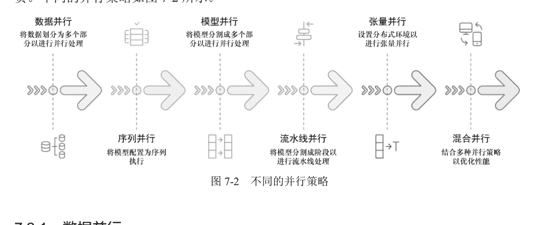

#### 7.2.1 数据并行

数据并行是一种分布式训练策略，其核心思想是将训练数据集划分为多个子集，每个子集分配给不同计算节点进行处理。每个计算节点拥有模型的完整副本，使用分配给它的数据子集进行前向传播和反向传播计算，然后将通过计算得到的梯度汇总到主节点，主节点根据梯度更新模型权重，并将更新后的权重广播给所有计算节点，便于进行下一轮迭代。

数据并行通过将数据集划分为多个子集，并在多个计算节点上并行处理子集，显著提高训练效率，缩短训练时间。在数据并行过程中，每个计算节点只需要存储模型的完整副本和分配给它的数据子集，而不是整个数据集，降低单个计算节点的内存需求，能够在内存有限的设备上训练更大的模型。数据并行能够处理大规模的数据集，通过将数据分布在多个计算节点上，克服单机内存和计算能力的限制，能够利用更多的数据训练模型，提升模型的性能，提高模型的泛化能力。

1. 数据并行的业务场景

数据并行适用于数据量大、模型训练时间长且资源充足的情况，当训练数据集非常大、单机无法在合理的时间内完成训练时，数据并行能够通过多个计算节点并行处理数据，提高训练效率。对于需要长时间训练的模型，数据并行可以显著缩短训练时间，提高开发和迭代效率。当企业或研究机构拥有多个计算节点（如多台 GPU 服务器）时，数据并行能够充分利用资源，提高设备的利用率。

2. 数据并行的开展和执行步骤

开展和执行数据并行策略，一般需要经过以下步骤。

（1）数据划分

将训练数据集划分为多个子集，每个子集分配给一个计算节点。数据划分方式包括随机划分、按顺序划分等。数据划分需要确保每个子集的数据分布尽可能均匀，避免某些节点的计算负载过重。

（2）模型副本创建

在每个计算节点上创建模型的完整副本，包括模型的参数、优化器状态等。每个计算节点的模型初始权重相同，通常是从相同的预训练模型或随机初始化的模型中复制得到的。

（3）前向传播与损失计算

每个计算节点使用分配给它的数据子集进行前向传播，计算模型的输出，并根据真实标签计算损失函数的值。

（4）反向传播与梯度计算

在前向传播的基础上，每个计算节点进行反向传播，计算模型参数的梯度。这些梯度反映了模型参数在当前数据子集上的更新方向。

（5）梯度汇总与权重更新

将所有计算节点得到的梯度汇总到主计算节点（或通过分布式通信机制直接在各计算节点间汇总），主计算节点根据汇总后的梯度更新模型权重。更新后的权重通过广播或其他通信方式发送给所有计算节点，便于进行下一轮迭代。

（6）通信优化

为了减少计算节点间的通信延迟和带宽消耗，可以采用一些通信优化技术，如梯度压缩、异步通信等。这些技术能够在保证模型收敛性能的前提下，提高数据并行的效率。

#### 7.2.2 序列并行

序列并行通过在序列维度上对输入数据进行切分，并将这些切分后的数据分配到不同的计算节点上进行并行计算。序列并行特别适用于处理长序列输入的模型，如 NLP 中的 Transformer 模型。序列并行通过将序列切分为多个部分，每个部分在不同的计算节点上计算，从而减少内存占用和通信开销。

当处理长序列输入时，模型的内存占用会显著增加。序列并行通过将序列切分为多个部分，每个部分在不同的计算节点上处理，从而减轻单个计算节点的内存压力。长序列输入会导致单个计算节点的计算时间过长，序列并行通过并行处理多个序列片段，提高整体计算效率。与其他并行策略（如张量并行）相比，序列并行在通信开销上具有优势，它通过在序列维度上切分数据，减少了需要在计算节点间传输的数据量。

1. 序列并行的应用场景

序列并行适用于处理长序列输入的模型，如 NLP 中的 Transformer 模型，特别是处理长文本序列时。当单个计算节点的内存不足以处理整个序列时，序列并行可以通过将序列切分到多个计算节点来解决内存不足的问题。此外，当需要在多个计算节点上高效利用计算资源时，序列并行可以提高整体计算效率。

2. 序列并行的开展和执行步骤

开展和执行序列并行策略，一般需要经过以下步骤。

（1）数据切分

将输入的长序列在序列维度上切分为多个子序列。例如，将一个长度为 N 的序列切分为 k 个子序列，每个子序列的长度为 N/k。

（2）模型配置

将切分后的子序列分配到不同的计算节点上。每个计算节点负责处理一个子序列，并配置相应的模型部分。

（3）前向传播与反向传播

前向传播需要每个计算节点独立处理其分配的子序列，计算相应的输出。在反向传播中，每个计算节点独立计算其分配的子序列的梯度，通过通信机制汇总梯度，更新模型参数。

（4）通信优化

为了减少计算节点间的通信开销，可以采用通信优化技术，如梯度压缩、混合精度训练等。同时，优化数据传输的顺序和方式，减少通信延迟。

此外，可以使用混合精度训练减少内存占用和计算时间，同时保持模型的精度。也可以通过压缩梯度信息，减少计算节点间的通信量，提高通信效率。

3. 序列并行与数据并行的区别

序列并行和数据并行都是分布式训练中常用的并行策略，它们在数据划分、模型处理和适用场景等方面存在一些区别。

（1）数据划分方式

数据并行将训练数据集划分为多个子集，每个子集被分配给一个计算节点。每个计算节点处理不同的数据子集，模型的结构和参数在所有计算节点上是相同的，每个计算节点拥有模型的完整副本，独立处理分配给它的数据子集。

序列并行将输入的长序列在序列维度上切分为多个子序列，每个子序列分配给一个计算节点，每个计算节点处理同一个数据样本的不同子序列部分。模型的不同部分（如不同层或模块）可能会分布在不同的计算节点上，或每个计算节点处理同一个模型的不同部分。

（2）模型处理方式

数据并行每个计算节点独立处理分配给它的数据子集，计算前向传播和反向传播，然后汇总梯度更新模型权重。计算节点主要在梯度汇总和权重更新时通信，通信频率相对较低。

序列并行计算需要在前向传播和反向传播过程中频繁通信，传递中间结果和梯度信息。每个计算节点处理同一个数据样本的不同子序列部分，结果需要在计算节点间合并。通信频率较高，特别是在前向传播和反向传播的每一步中都需要进行数据交换。

（3）适用场景

数据并行适用于数据量大、模型相对较小的情况。通过将数据划分为多个子集，利用多个计算节点的计算能力，提高训练效率。数据并行相对简单，通信开销相对较小，适用于大多数深度学习模型。

序列并行适用于处理长序列输入的模型，如 NLP 中的 Transformer 模型。通过将序列切分为多个部分，减少单个计算节点的内存压力，提高计算效率。当处理长序列时，可以有效地减少内存占用和通信开销，提高训练效率。

（4）内存占用

在数据并行中，每个计算节点需要存储模型的完整副本并将其分配给它的数据子集。内存占用取决于模型的大小和数据子集的大小。

在序列并行中，每个计算节点只需要存储模型的一部分数据和分配给它的子序列数据。通过将序列切分到多个计算节点，减少单个计算节点的内存压力。

（5）通信开销

数据并行主要在梯度汇总和权重更新时进行通信，通信频率相对较低，开销较小。

序列并行在前向传播和反向传播的每一步中都需要进行数据交换，通信频率较高，开销较大。

（6）实现复杂度

数据并行相对简单，大多数深度学习框架（如 PyTorch、TensorFlow）都提供内置支持，容易实现和部署。

序列并行相对复杂，需要仔细管理节点间的通信和同步，特别是处理长序列时，需要确保数据在节点间的正确传递。

#### 7.2.3 模型并行

模型并行的核心思想是将模型的不同部分分配到不同的计算节点上，每个计算节点只负责计算模型的一部分，所有计算节点协同工作，共同完成整个模型的前向传播和反向传播计算。例如，一个深度神经网络的不同层可以分别放置在不同的 GPU 上，每个 GPU 计算其对应层的输出，然后将结果传递给下一层所在的 GPU。

1. 模型并行的适用场景

当模型的参数量巨大，单个 GPU 或 TPU 的内存无法容纳整个模型时，必须使用模型并行。即使单个计算节点内存足够，但如果模型的计算复杂度很高，会导致单个计算节点计算速度过慢，此时也可以通过模型并行来提高计算效率。对于拥有不同硬件设备（如不同型号的 GPU）的异构硬件环境，可以根据各台设备的特性，将模型的不同部分分配到最适合的设备上，充分利用硬件资源。

2. 模型并行的开展和执行步骤

开展和执行模型并行策略，一般要经过以下步骤。

（1）模型分割

将模型的不同层或参数组分配到不同的计算节点上。可以根据层的类型、计算复杂度或内存需求进行分割，确保每个计算节点的负载均衡。

（2）数据传输与同步

确定计算节点间的数据传输方式和同步机制。在前向传播和反向传播过程中，需要在计算节点间传递中间结果和梯度信息，确保各个计算节点的计算能够正确进行。

（3）通信优化

可以采用通信优化技术减少计算节点间的通信开销，如梯度压缩、混合精度训练等。同时，优化数据传输的顺序和方式，降低通信延迟。

（4）计算节点配置

根据模型分割和通信需求，配置各个计算节点的硬件资源和软件环境，确保计算节点间能够高效协同工作。

（5）训练与推理执行

在模型并行架构下，执行模型的训练或推理过程。各个计算节点按照预定的分割和通信机制，协同完成计算任务。

#### 7.2.4 流水线并行

流水线并行是一种将模型的不同部分（如神经网络的层）分配到不同的计算节点（如 GPU 或 TPU）上进行计算的并行策略。每个计算节点负责计算模型的一个阶段，然后将结果传递给下一个阶段，形成一个流水线式的计算过程。流水线并行特别适用于深层模型，因为它可以充分利用多个设备的计算能力，减少模型对内存的依赖。

1. 流水线并行的应用场景

当模型的参数量巨大、单个 GPU 或 TPU 的内存无法容纳整个模型时，必须使用流水线并行。即使单个计算节点内存足够，如果模型的计算复杂度很高，也会导致单个计算节点计算速度过慢，也可以通过流水线并行提高计算效率。对于异构硬件环境来讲，在拥有不同硬件设备（如不同型号的 GPU）的环境中，可以根据各台设备的特性，将模型的不同部分分配到最合适的设备上，充分利用硬件资源。

2. 流水线并行和模型并行的区别

流水线并行和模型并行都是分布式训练中用于加速模型训练和提高计算效率的并行策略，它们在实现方式和应用场景上存在一些区别。

模型并行将模型的不同部分（如层或参数）分配到不同的计算节点上。每个计算节点负责计算模型的一部分，所有计算节点协同工作，共同完成整个模型的前向传播和反向传播计算。

流水线并行将模型的不同部分（如层或模块）按顺序切分成多个阶段，每个阶段被分配到不同节点上。每个计算节点负责计算模型的一个阶段，然后将结果传递给下一个阶段，形成一个流水线式的计算过程。

流水线并行和模型并行在数据流和计算方式、通信开销、实现复杂度、负载均衡等方面不同。对于企业应用来说，最主要的不同在于适用场景不同。流水线并行适用于深层模型。

##### 3. 流水线并行的开展和执行步骤

开展和执行流水线并行策略，一般需要经过以下步骤。

- （1）模型切分
将模型按层或模块顺序切分成多个阶段，每个阶段分配到不同的计算节点上。切分方式既可以是均匀分配，又可以根据各层的计算复杂度进行非均匀分配，实现负载均衡。
- （2）数据传输与同步
确定计算节点间的数据传输方式和同步机制。在前向传播和反向传播过程中，需要在计算节点间传递中间结果和梯度信息，确保各个计算节点的计算能够正确进行。
- （3）通信优化
为了减少计算节点间的通信开销，可以采用通信优化技术（如梯度压缩、混合精度训练等），优化数据传输的顺序和方式，降低通信延迟。
- （4）计算节点配置
根据模型切分和通信需求，配置各个计算节点的硬件资源和软件环境，确保计算节点间能够高效协同工作。
- （5）训练与推理执行
在流水线并行的架构下，执行模型的训练或推理过程。各个计算节点按照预定的切分和通信机制，协同完成计算任务。

#### 7.2.5 张量并行

张量并行是一种更细粒度的模型并行方法，它将单层内部的参数和计算任务拆分到不同的设备上执行。张量并行特别适用于具有大量参数的大规模模型，可以将矩阵乘法等计算操作的矩阵按行或按列切分，在不同设备上并行执行部分计算，通过集合通信操作合并结果。

##### 1. 张量并行的适用场景

当模型的参数量巨大、单个 GPU 或 TPU 的内存无法容纳整个模型时，必须使用张量并行。即使单个计算节点内存足够大，如果模型的计算复杂度很高，会导致单个计算节点的计算速度过慢，也可以通过张量并行提高计算效率。对于异构硬件环境来说，在拥有不同硬件设备（如不同型号的 GPU）的环境中，可以根据各台设备的特性，将模型的不同部分分配到最适合的设备上，充分利用硬件资源。

##### 2. 张量并行与模型并行和流水线并行在适用场景上的区别

模型并行适用于模型规模大、参数量多的场景，通过将模型的不同部分分配到不同计算节点，解决单个计算节点内存不足的问题。

流水线并行适用于深层模型，通过将模型按顺序切分成多个阶段，形成流水线式的计算过程，充分利用多个计算节点的计算能力，减少模型对单个计算节点内存的依赖。

张量并行适用于模型规模大、计算复杂度高的场景，通过将模型的各个层进行分片配置，充分利用多个计算节点的计算能力，提高整体计算效率。

在实际应用中，可以根据模型的规模、深度和计算资源，选择合适的并行策略，或结合多种并行策略以达到最佳的训练效果。

##### 3. 张量并行的开展和执行步骤

开展和执行张量并行策略，一般需要经过以下步骤。

- （1）初始化分布式环境
设置分布式训练环境，包括初始化进程组、设置通信后端等。例如，使用 PyTorch 的 torch.distributed 模块初始化分布式环境。需显式指定 world_size 和 rank 以匹配张量切分策略。
- （2）定义模型并配置张量并行
根据模型结构，确定哪些层或模块需要进行张量并行。使用 PyTorch 提供的张量并行 API，如 ColwiseParallel、RowwiseParallel 等，对模型的各个层进行分片配置。例如，对于 Transformer 模型中的 Attention 层和 FeedForward 层，可以分别配置其分片方式。
- （3）前向传播与反向传播
在前向传播过程中，数据在各台设备上按分片方式计算，通过通信操作合并结果。在反向传播过程中，梯度同样在各台设备上按分片方式计算，并通过通信操作汇总梯度。
- （4）通信优化
为了减少计算节点间的通信开销（如通信延迟和带宽消耗），可以采用一些通信优化技术，如梯度压缩、混合精度训练等。同时，优化数据传输的顺序和方式，降低通信延迟。
在张量并行策略中，可以采用序列并行和 Loss Parallel 的优化策略。

#### 7.2.6 混合并行

混合并行结合数据并行、模型并行、张量并行和流水线并行等多种并行方式的优势，更高效地利用计算资源，解决深度学习中的大模型训练问题。混合并行不仅能提高计算效率，还能在有限的硬件资源下处理更大的模型和数据集。

##### 1. 混合并行的适用场景

当模型的参数量非常大、单个计算节点的内存无法容纳整个模型时，混合并行可以通过结合模型并行和张量并行，将模型的不同部分分配到多个计算节点上，解决内存不足的问题。

当训练数据集非常大、单个计算节点无法在合理的时间内完成训练时，混合并行可以通过结合数据并行，将数据集划分为多个子集，提高训练效率。

通过结合多种并行策略，混合并行可以充分利用多个计算节点的计算能力，提高整体计算效率。
在拥有不同硬件设备（如不同型号的 GPU）的环境中，混合并行可以根据各台设备的特性，将模型的不同部分分配到最适合的设备上，充分利用硬件资源。

##### 2. 混合并行的开展和执行步骤

开展和执行混合并行策略，一般需要经过以下步骤。

- （1）初始化分布式环境
根据混合策略设置分布式训练环境，包括初始化进程组、设置通信后端等。例如，使用 PyTorch 的 torch.distributed 模块初始化分布式环境。
- （2）模型切分和配置
根据模型结构，确定哪些层或模块需要进行模型并行、张量并行或流水线并行。使用相应 API 对模型的各层进行分片配置。例如，对于 Transformer 模型中的 Attention 层和 FeedForward 层，可以分别配置其分片方式。
- （3）数据划分
将训练数据集划分为多个子集，每个子集分配给一个计算节点，每个计算节点处理不同的数据子集。
- （4）前向传播与反向传播
在前向传播过程中，数据在各台设备上按分片方式计算，需结合各种并行逻辑，并通过通信操作合并结果。在反向传播过程中，梯度需要在不同的并行维度间分别汇总，最终协同更新完整模型参数。
- （5）通信优化
为了减少计算节点间的通信开销，可以采用通信优化技术，如梯度压缩、混合精度训练等。同时，优化数据传输的顺序和方式，降低通信延迟。

3D 混合并行是一种在深度学习训练中常用的混合并行策略，它将数据并行、模型并行和流水线并行三种并行方式结合，优化资源利用率和训练效率。混合并行尤其适用于处理大规模的神经网络模型。由于每个维度至少需要 2 个 GPU，因此 3D 混合并行至少需要 8 个 GPU 才能实现完整的 3D 混合并行。

##### 3. GLM-130B 模型的 3D 混合并行训练案例

以下是一个 3D 混合并行的案例，展示了如何在大规模模型训练中结合数据并行、模型并行和流水线并行来提高训练效率。
GLM-130B 是一个拥有 1300 亿参数的 LLM，其预训练过程需要处理大规模的数据集和复杂的模型结构。为了高效地训练这个模型，采用了 3D 混合并行策略，包括数据并行、模型并行和流水线并行。
优化策略采用了 DeepSpeed 的 PipeDream-Flush 和 ZeRO 优化器分片两种策略。为了进一步减少流水线引入的气泡，利用 DeepSpeed 的 PipeDream-Flush 实现训练具有较大全局批量大小的 GLM-130B，减少时间和 GPU 内存的浪费。结合 ZeRO（Zero Redundancy Optimizer，零冗余优化器）技术，通过优化器状态分片、梯度分片和模型权重分片等方式，减少内存占用和通信开销。

通过 3D 混合并行策略，GLM-130B 在 96 个 DGX-A100（40G）计算节点、共 768 张 GPU 卡上进行了预训练，持续了 60 天。每个 GPU（40G）的算力达到了 135 TFLOP/s，展示了高效的资源利用。①

此外，可以使用混合精度训练、梯度压缩和拓扑感知映射等优化策略进行优化。

### 7.3 关键技术优化

在分布式训练中，关键技术优化是提高训练效率、降低成本、提升模型性能的重要手段，具体优化内容包括通信优化、计算优化、内存优化、数据处理与加载优化、训练稳定性优化和系统性能优化。分布式关键优化技术如图 7-3 所示。

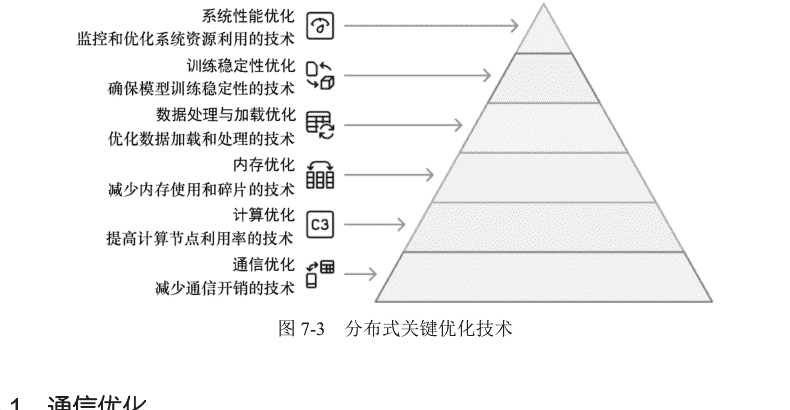

#### 7.3.1 通信优化

通信优化能缩短通信时间，使计算节点更高效地协同工作，加速模型收敛；还能减少数据传输量，降低对网络带宽的需求，节省通信资源；也能优化通信机制，使系统更方便地扩展计算节点数量，适应更大规模的模型和数据；同时能减少通信延迟和数据传输错误，提高分布式训练系统的稳定性和可靠性。几种大模型通信优化技术的区别如表 7-2 所示。

> ① 百度开发者中心。揭秘大模型分布式训练：多维混合并行的力量。

### 表 7-2 几种大模型通信优化技术的区别

| 技术名称 | 核心概念 | 实现方式 | 适用场景 | 优势 |
| :--- | :--- | :--- | :--- | :--- |
| 梯度压缩 | 通过压缩算法减少通信量 | 量化、剪裁、稀疏化等 | 大规模分布式训练 | 降低通信带宽需求，缩短通信时间 |
| 异步通信 | 非阻塞通信方式 | 使用非阻塞通信原语（如 NCCL 的 All-Reduce） | 需要高吞吐量的场景 | 提高训练速度，降低通信延迟 |
| 拓扑感知通信 | 根据网络拓扑结构优化通信路径 | 设计合理的网络拓扑（如星型、树型、网状等） | 大规模集群训练 | 降低通信开销，提高通信效率 |
| 通信与计算重叠 | 并行化通信和计算 | 当计算任务进行时异步执行通信操作 | 分布式训练 | 提高硬件利用率，缩短训练时间 |
| 混合并行策略 | 结合数据并行、模型并行和流水线并行 | 将不同的并行策略应用于不同的部分 | 超大规模模型训练 | 提高整体训练效率，充分利用资源 |
| 通信库与框架优化 | 优化通信库和框架的接口与性能 | 使用高效的通信库（如 NCCL、MPI）和优化的深度学习框架 | 各种分布式训练场景 | 提高通信效率，减少开销 |

这些技术在不同的场景下各有优势。例如，梯度压缩适用于大规模分布式训练，可以显著减少通信量；异步通信适用于需要高吞吐量的场景，可以提高训练速度；拓扑感知通信能在大规模集群训练中有效降低通信开销；通信与计算重叠通过并行化操作提高硬件利用率；混合并行策略能在超大规模模型训练中充分利用资源；通信库与框架优化适用于各种分布式训练场景，可以提高通信效率。在实际应用中，通常需要根据具体需求和场景选择合适的优化技术。

##### 1. 梯度压缩

在分布式训练中，各个计算节点在反向传播过程中计算得到的梯度需要进行全局聚合（如 All-Reduce 操作），然后更新模型参数。这个过程涉及大量数据传输，尤其是在大规模集群训练中，通信开销会显著影响训练效率。梯度压缩通过减少需要传输的梯度数据量，降低通信开销，提高训练效率。

梯度压缩将梯度值从高精度表示转换为低精度表示，如从 32 位浮点数转换为 8 位整数。梯度压缩可以显著减少通信数据量，通常对模型收敛影响较小，同时只传输梯度中的主要部分（如绝对值较大的梯度），忽略次要部分。梯度压缩可以大幅减少通信数据量，需要谨慎处理，避免影响模型收敛。

梯度压缩适用于大规模分布式训练场景和有限网络带宽的情况。在大规模集群训练中，通信开销较大，梯度压缩可以有效地减少通信数据量，提高训练效率。在网络带宽有限的情况下，梯度压缩可以减少对带宽的需求，提高通信效率。

梯度压缩采用的量化和稀疏化处理可能会导致梯度信息的损失，从而影响模型的收敛速度和最终性能。同时，梯度压缩需要在计算节点间进行复杂的通信和数据处理，提高实现的复杂度。

##### 2. 异步通信

在分布式训练中，异步通信允许计算节点在发送数据后立即继续执行其他任务，不需要等待接收方的确认或响应。异步通信可以有效地缩短同步等待时间，提高计算节点的利用率和训练效率。

异步通信的具体实现包括异步 All-Reduce、异步更新、流水线并行、异步执行等方法。异步 All-Reduce 在反向传播过程中，通过计算得到的梯度立即通过 All-Reduce 操作进行全局聚合，无须等待所有计算节点完成计算，可以缩短同步等待时间，提高训练效率。

在大规模集群训练中，通信开销较大，异步通信可以有效地缩短同步等待时间，提高训练效率。在计算资源有限的情况下，异步通信可以提高资源利用率，加速模型训练。异步通信可能会导致数据一致性问题，需要通过版本控制、冲突检测等其他机制来确保数据的一致性。同时，异步通信的实现相对复杂，需要仔细管理通信和计算的同步，增加了开发和调试的难度。

##### 3. 拓扑感知通信

拓扑感知通信根据计算节点的网络拓扑结构优化通信路径和策略。拓扑感知通信能够有效减少通信延迟和带宽消耗，提高分布式训练的效率。

拓扑感知通信会根据计算节点的网络拓扑结构优化通信路径和策略。通过智能路由算法，选择最优的通信路径，减少通信延迟和带宽消耗。结合树形和环形拓扑的优势，动态调整通信路径，避免通信拥塞，提高整体通信效率。

在大规模集群训练中，网络拓扑结构复杂，通信开销较大，拓扑感知通信可以有效地优化通信路径，提高训练效率。在网络带宽有限的情况下，拓扑感知通信可以减少对带宽的需求，提高通信效率。拓扑感知通信需要对网络拓扑结构进行详细的分析和优化，增加实现的复杂度。在动态变化的网络环境中，拓扑感知通信需要不断调整通信路径，增加维护难度。

##### 4. 通信与计算重叠

通信与计算重叠的核心思想是让通信操作和计算操作同时进行，而不是按顺序执行，可以有效缩短等待时间，提高资源利用率和训练效率。

通信与计算重叠的实现方法包括异步通信、流水线并行、任务划分与调度。

通过让通信和计算并行执行，缩短计算节点的空闲时间，提高整体资源利用率。通过有效地重叠通信和计算操作，缩短总体训练时间，提高训练效率。通信与计算重叠需要合理设计数据流和任务调度，确保通信与计算能够有效重叠，增加实现的复杂度。在异步通信中，需要确保数据的一致性，避免因通信与计算重叠导致的数据冲突。

##### 5. 混合并行策略

混合并行结合了多种并行方式（如数据并行、模型并行、张量并行和流水线并行）的优势，能够更高效地利用计算资源，解决深度学习中的大模型训练问题。混合并行策略包括数据并行与模型并行相结合、3D 混合并行、4D 混合并行等方法。

并行处理不同的数据子集。同时，利用张量并行、流水线并行和分组参数切片策略进一步优化计算和通信。通过四种并行策略的结合，可以更高效地处理超大规模模型，减少通信开销，提高训练效率。

当模型的参数量非常大，单个计算节点无法容纳整个模型时，混合并行可以通过结合多种并行策略，充分利用多个计算节点的资源，解决内存不足的问题。在计算资源有限的情况下，混合并行可以提高资源利用率，加速模型训练。

通过结合多种并行策略，充分利用多个计算节点的计算能力和内存资源，混合并行提高了整体资源利用率；通过优化通信路径和策略，减少通信延迟和带宽消耗，提高训练效率；通过合理划分模型和数据，优化通信和计算，显著提高训练效率，缩短训练时间。

混合并行策略的实现相对复杂，需要仔细管理模型的切分、数据的划分及通信的同步，增加了开发和调试的难度。在异步通信中，需要确保数据的一致性，避免因通信与计算的重叠导致数据冲突。

##### 6. 通信库与框架优化

通信库与框架优化是分布式训练中性能优化的重要环节，主要涉及对通信库和分布式训练框架的优化配置和使用，提高通信效率，提升训练性能。

在通信库优化方面，包括对高效通信库的使用和通信库的优化配置。

高效通信库的使用主要是对 NCCL（NVIDIA 集体通信库）、Gloo 和 MPI（Message Passing Interface，消息传递接口）的使用。NCCL 针对 NVIDIA GPU 进行了优化，支持单机多卡和多机多卡之间的高效通信。在分布式训练中，NCCL 能够充分利用 GPU 的计算能力和网络带宽，提高通信效率。Gloo 是 Facebook 开发的通信库，支持多种通信后端，如 TCP、UDP 和 RDMA。Gloo 在 CPU 和 GPU 之间提供高效的通信支持，适用于多种硬件环境。MPI 是一种广泛使用的并行计算通信库，支持多种网络协议和硬件环境。MPI 在分布式训练中提供了灵活的通信机制，需要进行更多配置和调优。

通信库的优化配置包括环形 All-Reduce 和分层通信。分层通信在多机多卡环境中，首先在单机内部进行通信，其次在多机之间进行通信，减少跨机通信的开销。例如，Hybrid+算法支持单机和多机的分层通信，充分利用单机内部高速带宽的同时减少多机之间的通信量。

框架优化方面包括分布式训练框架的选择与优化、通信与计算的重叠、通信协议和网络优化等内容。

分布式训练框架的选择与优化包括 Horovod、PyTorch Distributed 和 TensorFlow Distributed。Horovod 是由 Uber 公司开发的分布式训练框架，基于环形 All-Reduce 算法，支持多种深度学习框架，如 TensorFlow、PyTorch 等。Horovod 通过优化通信和计算的重叠，提高训练效率。PyTorch Distributed 是 PyTorch 提供的分布式训练库，支持数据并行和模型并行等多种并行策略。通过合理配置和使用 PyTorch Distributed，可以充分利用多个计算节点的资源，提高训练效率。TensorFlow Distributed 是 TensorFlow 提供的分布式训练框架，支持多种并行策略和通信方式；通过优化参数服务器和工作节点的配置，可以提升分布式训练的性能。

通信协议和网络优化主要指 RDMA 和 TCP 或 IP 优化。RDMA 是远程直接存储器访问技术，允许用户态进程直接读取和写入远端进程的地址空间，减少通信延迟和带宽消耗。在分布式训练中，使用 RDMA 可以大幅减少通信开销，提高训练速度。

#### 7.3.2 计算优化

计算优化在分布式训练中通过混合精度训练、梯度累积和算子融合等技术，减少计算开销，提高计算节点的利用率和训练效率。这些优化方法能够显著提升分布式训练的性能，特别是在处理大规模模型和数据集时。通过合理配置和实施这些优化技术，可以有效提升分布式训练的整体性能，提高模型的收敛速度。

混合精度训练是一种在深度学习中提高训练速度和减少内存占用的技术，通过结合使用不同精度的数值格式，尤其是半精度（FP16）和单精度（FP32），在不降低模型准确性的前提下，大幅降低内存消耗和提高计算速度。

梯度累积通过在多个小批次上累积梯度，进行一次参数更新，从而模拟大批次训练的效果。梯度累积可以在有限的内存资源下，支持更大的有效批次大小，从而提高模型的泛化能力和训练效率。通过合理配置和实施梯度累积，可以有效提升分布式训练的整体性能，提高模型的收敛速度。

算子融合用于将多个连续的独立算子合并成更大的算子，减少计算和内存访问的开销，提高计算效率，提升模型性能。算子融合通常在深度学习框架中，优化模型应用，有助于优化计算图①并提高模型执行的效率。

算子融合主要的实现方法包括基于规则的算子融合（如 XLA、TVM）、遍历路线（如特定设备优化）和手动算子融合。

TensorFlow 的 XLA 编译器可以自动进行算子融合，通过将计算图转换为 XLA 的中间表示形式，在 XLA 层进行优化。XLA 的主要优化之一是算子融合，通过减少通信和访存开销，提高计算效率。TVM 是一个开源的深度学习编译器，提供多种算子融合规则。例如，TVM 可以将多个算子合并为一个算子，减少中间结果的存储和传输。

遍历路线中的特定设备优化，是针对特定设备（如 GPU），枚举实现典型的计算密集型（Compute-Bound，CB）和访存密集型（Memory-Bound，MB）形式的融合算子，如 Conv+ReLU、Conv+BN+ReLU、Dense+ReLU 等。这种方法在 Intel 的 oneDNN 和许多大厂的推理框架中得到应用。

此外，在某些情况下，开发者可以通过手动方式将多个算子合并为一个算子。例如，将卷积、批量归一化和 ReLU 激活函数合并为一个算子。

#### 7.3.3 内存优化

内存优化能够有效地减少训练过程中的内存占用，提高内存利用率，从而支持更大规模的模型训练。

> ① 计算图是深度学习模型中用于表示计算过程的结构，支持自动微分、并行计算和分布式训练等。通过优化计算图，可以提升模型的性能，提高模型的效率。常见的优化方法包括操作融合、常量折叠、死码消除和算子内联等。

内存优化的主要方法包括 ZeRO 技术、梯度检查点、激活值重计算、CPU 卸载、显存碎片整理、数据集切分和异构存储。通过合理应用这些方法，可以在有限的硬件资源下显著提升分布式训练的性能，提高分布式训练的效率。

##### 1. ZeRO 技术

ZeRO 技术旨在通过减少模型参数、梯度和优化器状态的冗余存储，显著降低每个计算节点的内存占用。ZeRO 技术通过将这些数据结构在分布式环境中进行分割，使每个计算节点只需要存储一部分数据，从而大幅减少内存需求。

ZeRO 技术通过将模型参数、梯度和优化器状态在分布式环境中进行分割，每个计算节点的内存占用显著减少，从而能够在有限的硬件资源下训练更大规模的模型。通过减少内存占用，可以更高效地利用计算节点的资源，提高训练效率和吞吐量。ZeRO 技术特别适用于大规模模型的分布式训练，能够在有限的硬件资源下训练更大规模的模型。

ZeRO 技术分为三个阶段，每个阶段提供不同程度的内存优化。

在第一阶段，优化器状态（如 Adam 的动量和方差）在数据并行维度上进行分割。每个计算节点只存储部分优化器状态，而不是完整的优化器状态。通过减少每个计算节点的内存占用，能够在有限的硬件资源下训练更大规模的模型。

在第二阶段，除了优化器状态的分割，还对梯度进行分割。每个计算节点只存储部分梯度，而不是完整的梯度，进一步减少每个计算节点的内存占用，提高内存利用率。

在第三阶段，除了优化器状态和梯度的分割，还对模型参数进行分割。每个计算节点只存储部分模型参数，而不是完整的模型参数，显著减少每个计算节点的内存占用，能够在有限的硬件资源下训练非常大规模的模型。

##### 2. 梯度检查点

梯度检查点通过在前向传播时只保存部分中间激活值（称为检查点），并在反向传播时重新计算未保存的激活值来节省显存。

在标准的反向传播过程中，模型需要保存所有层的中间激活值，便于计算梯度，这对于大型模型来说会占用大量显存。梯度检查点技术首先选择检查点，当前向传播时只保存某些层的激活值作为检查点；其次丢弃激活值，不作为检查点的层的激活值会被丢弃；最后重新计算激活值，当反向传播时，如果需要已丢弃的激活值，则重新计算这些值，减少显存占用。

梯度检查点通过减少保存的激活值数量，可降低显存使用量高达 80%，从而允许在显存有限的硬件上训练更大模型，使训练大型模型成为可能。否则由于显存限制，训练将无法进行。在显存受限的情况下，通过减少显存使用，可以使用更大的批次大小，从而提高训练效率。

##### 3. 激活值重计算

激活值重计算也称为检查点重计算，其核心思想是当前向传播时保存部分中间激活值（检查点），当反向传播时重新计算未保存的激活值，而不是将所有激活值保存在内存中。

在前向传播过程中，选择某些层的输出作为检查点并保存到内存中。除检查点外的其他激活值在前向传播后会被丢弃以节省内存。在反向传播过程中，当需要计算梯度时，根据保存的检查点重新计算被丢弃的激活值。

##### 4. CPU 卸载

CPU 卸载通过将某些计算任务或数据处理从 GPU 转移到 CPU 上，充分利用 CPU 的计算能力，避免 GPU 资源的浪费，减少 GPU 的内存占用和计算负担，从而提高整体训练效率和资源利用率。

对于非常大规模的模型，CPU 卸载可以帮助克服显存限制，使模型能够在硬件资源有限的情况下进行训练。

在分布式训练中，CPU 卸载可以通过以下方式实现。

- （1）动态数据转移
在训练过程中，将不需要立即用于 GPU 计算的数据动态地从 GPU 转移到 CPU。例如，在反向传播过程中，将部分参数或激活值转移到 CPU，减少 GPU 的内存占用。

- （2）异构计算
利用 CPU 和 GPU 的异构特性，将适合 CPU 处理的任务分配给 CPU，将适合 GPU 处理的任务分配给 GPU。例如，将数据预处理、后处理等任务分配给 CPU，将大规模矩阵运算等任务分配给 GPU。

- （3）模型分割
将模型的不同部分分别部署在 CPU 和 GPU 上，根据各个部分的特点和计算需求进行合理分配。例如，将模型的某些层放在 CPU 上运行，将模型的其他层放在 GPU 上运行。

##### 5. 显存碎片整理

显存碎片整理用于减少显存碎片化带来的影响，提高显存的使用效率。

显存碎片整理首先识别碎片，识别显存中的空闲块和已分配块；其次将相邻的空闲块合并成更大的块，便于分配更大的连续内存。合并空闲块后，重新分配内存，提高显存的使用效率。

在 PyTorch 中，显存碎片整理主要通过显存管理机制实现。PyTorch 的显存管理机制包括以下 3 个关键组件。

- ① Block，分配和管理内存块的基本单位，包含指针、大小和所属的 CUDA 流等信息。
- ② BlockPool（内存池）用于存储空闲的 Block，按照大小和地址优先级排序。
- ③ DeviceCachingAllocator，维护两种 BlockPool（large_blocks 和 small_blocks），分别存储较小的块和较大的块。

通过这些关键组件，PyTorch 能够有效地管理显存，减少碎片化的影响。

##### 6. 数据集切分

数据集切分通过将大型数据集分割成多个较小的部分（称为数据片或分片），使每个节点（如 GPU 或 CPU）可以并行处理不同的数据片，从而提高数据加载和处理的效率，减少显存占用。

在分布式训练中，数据集切分可以通过以下方式实现。

- （1）使用数据加载器
在 PyTorch 等深度学习框架中，可以使用数据加载器类实现数据集的切分和并行加载。DataLoader 支持数据的打乱、批量化和并行加载。

- （2）使用分布式数据并行
在 PyTorch 中，分布式数据并行（Distributed Data Parallel, DDP）可以与 DataLoader 结合使用，实现分布式训练中的数据集切分。通过设置 DDP，可以确保每个计算节点处理不同数据片。

- （3）使用 MindSpore 的 SlicePatches 接口
在 MindSpore 框架中，可以使用 SlicePatches 接口对数据集进行切分，该接口支持在水平和垂直方向上将 Tensor 切片为多个块，适用于 Tensor 高宽较大的使用场景。

在多 GPU 或多个计算节点的分布式训练中，数据集切分可以显著提高数据加载和处理的效率。对于非常大的数据集，数据集切分可以减少每个计算节点的内存占用，使模型能够在有限的硬件资源下进行训练。

##### 7. 异构存储

异构存储是在同一个存储系统中使用多种不同类型的存储介质，根据数据的访问频率、性能要求和成本等因素，将数据存储在最适合的介质上。异构存储可以提升存储系统的整体性能，提高成本效益。在大规模数据存储和处理场景中，异构存储还可以有效地管理不同类型的存储资源，支持更高效的数据访问和处理。

异构存储包括 HDFS 异构存储和 MindSpore 异构存储。

- （1）HDFS 异构存储
HDFS 支持多种存储类型，包括 RAM_DISK（内存盘）、SSD（固态硬盘）、HDD（机械硬盘）和 Archive Storage（归档存储）。HDFS 还提供多种存储策略，如 Hot（热数据）、Warm（温数据）、Cold（冷数据）、All_SSD、One_SSD、Lazy_Persist 等，用户可以根据数据的访问频率和性能要求选择合适的存储策略。

- （2）MindSpore 异构存储
在训练过程中，将暂时不需要参与计算的参数或中间结果拷贝至 Host（主机）侧内存或硬盘存储，当需要数据参与计算时，再将其拷贝后恢复至设备侧。通过 MindSpore 异构存储，可以扩大相同硬件设备能够训练的模型规模。

#### 7.3.4 数据处理与加载优化

在分布式训练中，数据处理与加载优化是提高训练效率的关键环节。数据处理与加载优化是通过优化数据加载和预处理的方式，缩短数据加载时间，提高数据处理效率，从而提高整体训练效率。

CPU 或 GPU 流水线技术、内存映射技术和压缩与解压优化技术是实现数据处理与加载优化的重要技术手段。

##### 1. CPU 或 GPU 流水线技术

CPU 或 GPU 流水线技术是一种通过将任务分解为多个阶段并行处理的技术，可以提高计算效率和数据处理速度。CPU 的流水线技术通常将指令的执行过程划分为多个阶段，如取指令、译码、执行、写回结果等，每个阶段由一个专门的电路单元负责，这些电路单元并行工作，使 CPU 能够在一个小时内完成多条指令的不同阶段操作，从而显著提高指令的执行速度。GPU 的流水线更专注于大规模并行计算，特别是在图形渲染方面，通常包括顶点处理、几何处理、光栅化、像素处理等多个阶段，每个阶段都负责处理图形渲染过程中的特定任务。

##### 2. 内存映射技术

内存映射技术是一种通过将文件系统的数据直接映射到内存地址空间，从而减少 I/O 操作开销的技术。内存映射允许程序直接访问文件系统中的数据，无须将整个文件加载到内存中，特别适用于处理大文件和随机访问的场景。

内存映射通过直接访问文件系统中的数据，缩短数据加载时间，适用于处理大文件。在实现方法上，使用操作系统的内存映射功能，将文件映射到内存地址空间，通过内存映射，直接访问文件中的任意位置，无须按顺序读取。

##### 3. 压缩与解压优化技术

压缩与解压优化是一种减少数据存储空间和传输时间的技术。通过压缩数据，可以减少存储需求和 I/O 带宽消耗，同时通过高效的解压算法，可以快速恢复数据，缩短解压时间。

##### 4. 其他重要技术

除了 CPU 或 GPU 流水线、内存映射和压缩与解压优化，在数据处理与加载优化方面还有以下重要技术。

- (1) 数据流优化
数据流优化通过控制流图传播数据的某些属性，如公共子表达式消除和常量折叠与传播，避免重复计算，提高数据处理效率。数据流优化在编译器优化和代码优化中应用，通过静态分析和动态优化减少重复计算。

- (2) 高效算法和数据结构
选择合适的算法和数据结构，可以提高数据处理速度，减少资源消耗，如应避免使用二次 O(n²) 等高复杂度算法。

- (3) 代码优化
代码优化包括循环展开、使用较小的数据类型、使用整数运算代替浮点运算等。代码优化通过提高代码执行效率、缩短计算时间，并通过代码重构和优化减少不必要的计算和内存访问。

- (4) 懒加载
懒加载提供列表数据按需加载能力，可以解决一次性加载长列表数据耗时长、占用过多资源的问题，提高页面响应速度。懒加载通过缩短初始加载时间，提升用户体验。在实现上，当加载数据时，只加载当前需要的数据，其他数据在需要时再加载。

- (5) 缓存列表项
提供屏幕可视区域外列表项长度的自定义调节能力，配合懒加载设置可以缓存列表项参数，通过预加载数据提升列表滑动体验。

- (6) 动态预加载
动态预加载根据历史任务加载耗时情况，动态调整屏幕可视区域外数据预取数量，配合懒加载设置。当列表不断滑动时，可在屏幕可视区外实时更新列表数据。

- (7) 组件复用
组件复用提供可以复用组件对象的缓存资源池，通过重复使用已经创建并缓存的组件对象，降低相同组件在短时间内频繁创建和销毁的开销。

- (8) 布局优化
布局优化使用扁平化布局方案，减少视图嵌套层级和组件数，避免过度绘制，提高页面渲染效率。

- (9) 分批渲染
分批渲染将数据分成若干批次进行处理和渲染，避免一次性处理大量数据造成的卡顿现象。

- (10) 虚拟列表
虚拟列表只渲染用户当前可视区域内的数据，大幅减少文档对象模型（Document Object Model，DOM）操作并提升页面性能。

- (11) 数据增强与预处理优化
数据增强与预处理优化通过对输入数据进行清洗、转换和标准化等处理，便于模型更好地学习。可以使用数据增强技术，如随机裁剪、翻转、调整亮度等，以及数据标准化技术，实现数据增强与预处理优化。

- (12) 乐观并发
乐观并发允许多个用户或进程同时工作，并很少发生假定冲突，而不是锁定数据并阻止其他更新，可以缩短资源的等待时间，并提供高吞吐量。在实现上，需要使用版本控制和冲突检测机制，确保数据的一致性。

- (13) ETL 优化
ETL 优化通过优化数据提取、转换和加载过程，最大限度地缩短处理时间。

- (14) 并行处理
当多个线程或计算节点分配数据处理任务时，可以同时划分和处理工作负载，从而实现快速处理。在实现上，可以使用多线程、多进程或分布式计算框架。

- (15) 批处理
批处理将类似的任务组合，减少重复操作造成的开销。

这些技术通过不同的方式优化数据处理与加载过程，提高效率，提升性能，分别适用于不同的应用场景和数据规模。

#### 7.3.5 训练稳定性优化

在分布式训练中，训练稳定性优化通过多种技术手段确保模型训练的稳定性和可靠性。包括梯度裁剪、权重初始化、归一化技术、学习率调整、数据增强、正则化、小批量训练、模型结构设计、提前停止、多任务学习、迁移学习、硬件和分布式计算、容错机制和弹性训练。合理应用这些技术，可以显著提高分布式训练的稳定性和效率，确保模型能够顺利收敛并取得良好的性能。

梯度裁剪是一种防止梯度爆炸的技术。通过设定一个阈值，将梯度值限制在一定范围内，避免梯度值过大导致模型参数更新过快，提高训练的稳定性。

合适的权重初始化可以帮助模型更快地收敛，并降低过拟合的风险。常用的权重初始化方法包括 Xavier 初始化、He 初始化等。

归一化技术对输入数据或模型中间输出进行标准化处理，使其具有零均值和单位方差。归一化可以提高模型的收敛速度和泛化能力，并降低模型对输入数据的敏感性。常见的归一化技术包括 Batch Normalization、Layer Normalization 等。

学习率的设置对于大模型的训练非常关键。过大的学习率会导致训练不稳定，而过小的学习率会导致模型收敛速度过慢。可以采用学习率衰减、动态调整学习率等策略，使学习率在训练过程中逐渐减小，平衡模型的稳定性和收敛速度。

数据增强和正则化技术可以有效地避免大模型的过拟合问题，提高模型的泛化能力。数据增强通过对训练数据进行随机变换和扩增，增加训练样本的多样性，降低模型对输入的敏感度。正则化技术如 L1 或 L2 正则化、Dropout 等可以限制模型的复杂度，降低过拟合风险。

对于大模型的训练，通常采用小批量训练和分布式训练的方式。小批量训练可以提高模型的泛化能力，减少梯度更新的方差。在分布式训练中，将训练任务分布到多台机器上进行并行计算，可以有效地加速训练。

合理的模型结构设计是解决大模型训练稳定性问题的重要因素。可以考虑使用残差连接或注意力机制等技术，提高信息传递和模型的表达能力。这些设计可以帮助模型更好地捕捉不同输入的依赖关系，并减轻梯度消失和梯度爆炸的问题。

大模型的训练可能需要花费较长时间，因此在训练过程中及时进行模型调优是非常重要的。监控训练过程中的验证集性能，并根据性能变化提前停止或调整超参数，有助于避免模型的过拟合和不稳定。

多任务学习和迁移学习是解决大模型训练稳定性问题的有效策略之一，同时学习多项相关任务，可以增加数据量和提高模型的泛化能力。迁移学习可以将已经训练好的模型在新任务上进行微调，减少对大规模数据的需求，提高模型训练的稳定性。

大模型的训练通常需要海量的计算资源。借助 GPU、TPU 等高性能硬件，可以加速模型的训练过程。采用分布式计算和并行处理技术，将计算任务分配到多个设备或机器上协同处理，可以进一步提高训练效率和稳定性。

在分布式训练过程中，设备故障或网络问题可能会导致训练中断。引入容错机制，可以确保训练的连续性和稳定性。常见的容错机制包括检查点、任务重试等。例如，PAI-DLC 通过自研的容错引擎 AIMaster、高性能 Checkpoint 框架 EasyCKPT、健康检测 SanityCheck 及计算节点自愈功能，可以有效地解决多种稳定性问题。

根据集群中可用资源的动态变化，自动调整训练任务的分配，可以最大化资源利用率。通过动态调整训练任务的分配，确保资源变化时训练过程的稳定性和连续性。

#### 7.3.6 系统性能优化

在分布式训练中，系统性能优化是通过优化通信、计算、内存和数据处理等多个方面的内容，提高训练效率，提升模型性能。主要的优化内容包括异步通信与同步通信的权衡、Pipeline 并行化、局部梯度聚合、结合模型并行与数据并行、动态调整策略、数据通信优化、负载均衡和数据分布与划分。优化资源分配和使用可以缩短训练时间，提高训练效率。优化训练过程可以提高模型的准确性和泛化能力。提高资源利用率可以减少计算资源的浪费，降低成本。

性能剖析工具、瓶颈识别方法和资源利用监控是系统性能优化的关键。这些工具和方法可以有效地识别和解决系统中的性能问题，提升系统的整体性能，提高资源利用率。在实际应用中，应根据具体的需求和场景，选择合适的工具和方法，持续进行性能监控和优化，确保系统始终处于最佳工作状态。

##### 1. 性能剖析工具

性能剖析工具通过记录程序的执行时间和资源占用情况，可以找到程序中的瓶颈，便于进行优化。检查程序的内存使用情况，识别内存泄漏和不合理的内存占用；提供优化建议，指导开发人员改进代码或配置；优化系统性能；提供可视化界面和报告功能，帮助开发人员更直观地了解系统性能。

常见的性能剖析工具包括 JConsole、VisualVM、FlameGraph 和 SkyWalking。JConsole 是 Java 提供的图形化监控和管理工具，用于监控 JVM 的性能和资源使用情况。VisualVM 是 Oracle 提供的多合一性能分析工具，用于分析 CPU 使用率、内存使用率、线程状况等。FlameGraph 是开源的性能剖析工具，用于可视化 CPU 剖析数据，生成热图展示代码执行路径的频率和耗时。SkyWalking 是开源的分布式跟踪系统，用于监控和诊断分布式系统的性能问题。

##### 2. 瓶颈识别方法

瓶颈识别的主要对象包括网络瓶颈分析、数据库瓶颈分析、应用服务器瓶颈分析、代码瓶颈分析。网络瓶颈分析关注网络传输效率、网络拥塞等方面。数据库瓶颈分析关注查询性能、索引设计、数据表结构等方面。应用服务器瓶颈分析关注服务器配置、线程池设置、并发处理能力等方面。代码瓶颈分析关注代码的执行效率、资源消耗、内存泄漏等方面。

对计算瓶颈的识别方法主要是算子性能分析。通过分析 Profiling 数据，查看是否存在耗时明显异常的算子，如果存在明显异常的算子，则可以尝试替换等价算子，并将异常算子的耗时信息提交 Issue 进行反馈。在正常情况下，计算时长应主要集中于 Matmul、Flash Attention 等计算密集的算子上，如果在 Profiling 分析中发现耗时异常的计算算子导致性能瓶颈，则可以尝试替换等价算子，并同步提交算子性能 Issue 至 MindSpore Transformers 或 MindSpore。

对通信瓶颈的识别方式主要是通信耗时分析。通过分析通信耗时，查看是否存在更优的分布式策略，查看中间表示（Intermediate Representation，IR）分析是否存在不合理的重分布问题。此外，可以通过 Profiling 工具获取训练进程的通信时长占比，包括已掩盖通信和未掩盖通信；已掩盖通信和计算同时执行，不影响训练效率，未掩盖通信则会导致计算等待通信，这部分通信耗时过长将影响训练性能，需要优化。

在内存瓶颈的识别方面，可以查看是否存在异常大内存 Tensor，是否存在可融合的算子降低激活值内存，在内存富裕的情况下可以调整选择重计算的配置策略，利用空余内存换取训练性能，或降低模型切分的份数，减少模型切分带来的通信开销，从而提升性能。

在数据瓶颈识别方面，可以查看数据读取速度是否满足训练需求，如果数据读取速度慢，可以优化数据读取和预处理流程，采用并行处理或批处理技术。在异步训练模式下，由于计算节点间更新模型参数的频率不一致，所以会导致数据不一致。为此，需要设计合理的同步机制，如参数服务器、环形同步等。

在系统瓶颈识别方面，需要考虑硬件资源利用率和软件框架性能。查看硬件资源（如 CPU、GPU、内存等）的使用情况，如果硬件资源不足，可以考虑增加硬件资源或优化资源分配。查看软件框架的性能是否满足要求，如果软件框架性能低下，则可以考虑更换更高效的软件框架或优化现有框架。

此外，可以使用一些性能分析工具辅助识别性能瓶颈，如 MindStudio Insight、PyTorch Profiler、HolisticTraceAnalysis 等。这些工具可以提供详细的性能数据，帮助用户快速定位性能瓶颈。

##### 3. 资源利用监控

资源利用监控是指通过各种工具和技术，实时监控 CPU、内存、磁盘 I/O 和网络等系统资源的使用情况。资源利用监控的主要工具包括应用性能管理（Application Performance Management，APM）工具、系统监控工具和日志分析工具。APM 工具用于监控应用程序的性能，如 New Relic、Dynatrace 等。系统监控工具用于监控系统资源的使用情况，如Prometheus、Grafana 等。日志分析工具用于分析应用程序和系统的日志文件，如 ELK Stack（Elasticsearch、Logstash、Kibana）。

### 7.4 启动分布式训练

分布式训练过程通过环境初始化、数据准备、模型定义与配置、训练过程、性能监控与优化、模型保存与评估等环节，确保模型能够在多个计算节点上高效训练。每个环节都有特定的目的和内容，通过合理安排和优化这些环节，可以显著提高分布式训练的效率，提升模型性能。
在分布式训练中，模型配置和训练脚本编写是两个至关重要的环节，直接关系到训练的效率、模型的性能及结果的可靠性。

#### 7.4.1 模型配置

模型配置是分布式训练的基础，它决定了模型如何在多个设备（如 GPU、TPU）上分布和协同工作。模型配置的主要内容包括模型定义、并行策略选择、通信机制配置和内存管理等。
模型定义需要明确模型的结构和参数，确保其适合分布式环境。可以使用支持分布式训练的深度学习框架（如 PyTorch、TensorFlow）来定义模型。需要注意的是，模型应设计为可分割的结构，便于在不同设备上执行。例如，对于 Transformer 模型，可以将编码器和解码器分别放在不同 GPU 上。
并行策略选择环节，需要根据模型和数据的特点，选择合适的并行策略来优化训练过程。这些并行策略包括数据并行、模型并行、流水线并行和专家并行。
通信机制配置的作用是优化模型参数同步和数据传输，减少通信开销。可以使用高效的通信库加速 GPU 之间的通信，如 NCCL（NVIDIA 集体通信库）。
内存管理的作用是减少内存使用，提高内存使用效率。可以使用混合精度训练（如 FP16）减少内存使用，或使用梯度检查点技术在计算图中保存中间激活值，减少内存使用。

#### 7.4.2 训练脚本编写

训练脚本是分布式训练的具体实现，它不仅影响训练的效率，还决定模型的性能和结果的可靠性。训练脚本编写涉及初始化分布式环境、数据加载与分布式采样、模型封装与优化器配置、训练循环与梯度同步、学习率调度与模型保存等环节和内容。

（1）初始化分布式环境
初始化分布式环境的作用是设置分布式训练的通信参数，确保各个进程都能正确连接和通信。我们需要在脚本开头初始化分布式环境，设置进程的 rank 和 world_size。

（2）数据加载与分布式采样
数据加载与分布式采样的作用是确保每个 GPU 处理不同的数据子集，提高数据加载效率。我们可以使用 DistributedSampler 对数据集进行采样，确保每个 GPU 获取不同的数据批次。

（3）模型封装与优化器配置
模型封装与优化器配置的作用是将模型封装为支持分布式训练的形式，并配置优化器以更新模型参数。我们可以使用 Distributed Data Parallel（DDP）封装模型，并配置优化器。

（4）训练循环与梯度同步
训练循环与梯度同步的作用是实现模型的前向传播、反向传播和参数更新，并确保梯度在多个 GPU 之间正确同步。在训练循环中，我们可以进行前向传播、计算损失、反向传播和优化器更新。

（5）学习率调度与模型保存
学习率调度与模型保存的作用是根据训练进度调整学习率，提高模型的收敛速度和稳定性，并定期保存模型以防止训练中断。我们可以使用学习率调度器调整学习率，并在每个训练轮次或一定迭代次数后保存模型。

通过精心设计模型配置和编写高效的训练脚本，可以充分利用分布式训练的优势，加速模型训练，提升模型性能，并确保训练过程的稳定性和可靠性。

#### 7.4.3 一个基于 PyTorch 的分布式训练脚本

以下是一个基于 PyTorch 的分布式训练脚本示例，展示如何在多个 GPU 环境下进行分布式训练。
在该脚本中，使用 torch.distributed.init_process_group 初始化分布式环境，每个进程使用一个 GPU，定义一个简单的神经网络，使用 DistributedSampler 确保每个进程只处理一部分数据，使用 Distributed Data Parallel（DDP）包装模型。在每个训练周期中，设置分布式采样器的 Epoch（周期），确保数据的随机性。同时，仅在主进程中保存模型；训练结束后，清理分布式环境。

```python
import torch
import torch.distributed as dist
import torch.nn as nn
import torch.optim as optim
from torch.nn.parallel import DistributedDataParallel as DDP
from torch.utils.data import DataLoader, DistributedSampler, TensorDataset
import argparse
```

```python
# 定义一个简单的神经网络
class SimpleNet(nn.Module):
    def __init__(self):
        super(SimpleNet, self).__init__()
        self.fc1 = nn.Linear(784, 128)
        self.fc2 = nn.Linear(128, 10)

    def forward(self, x):
        x = torch.relu(self.fc1(x))
        x = self.fc2(x)
        return x

def train(rank, world_size, args):
    # 初始化分布式环境
    dist.init_process_group(
        backend='nccl',
        init_method='env://',
        rank=rank,
        world_size=world_size
    )

    # 设置设备
    device = torch.device(f'cuda:{rank}')

    # 创建模型
    model = SimpleNet().to(device)

    # 包装模型为分布式数据并行
    ddp_model = DDP(model, device_ids=[rank])

    # 创建数据集
    train_data = torch.randn(1000, 784)
    train_labels = torch.randint(0, 10, (1000,))
    dataset = TensorDataset(train_data, train_labels)

    # 创建分布式采样器
    sampler = DistributedSampler(dataset, num_replicas=world_size, rank=rank)

    # 创建数据加载器
    dataloader = DataLoader(dataset, batch_size=args.batch_size, sampler=sampler)

    # 定义损失函数和优化器
    criterion = nn.CrossEntropyLoss()
    optimizer = optim.Adam(ddp_model.parameters(), lr=args.lr)

    # 训练模型
    for epoch in range(args.epochs):
        ddp_model.train()
```

# DeepSeek 企业应用指南

```python
        sampler.set_epoch(epoch)
        total_loss = 0.0

        for batch_idx, (data, target) in enumerate(dataloader):
            data, target = data.to(device), target.to(device)
            optimizer.zero_grad()
            output = ddp_model(data)
            loss = criterion(output, target)
            loss.backward()
            optimizer.step()
            total_loss += loss.item()

        # 在主进程中打印损失
        if rank == 0:
            print(f'Epoch {epoch + 1}, Loss: {total_loss / len(dataloader)}')

    # 保存模型（仅在主进程中）
    if rank == 0:
        torch.save(ddp_model.module.state_dict(), 'model.pth')

    # 清理分布式环境
    dist.destroy_process_group()

if __name__ == '__main__':
    parser = argparse.ArgumentParser(description='Distributed Training Example')
    parser.add_argument('--nodes', default=1, type=int, help='number of nodes')
    parser.add_argument('--gpus', default=2, type=int, help='number of GPUs per node')
    parser.add_argument('--epochs', default=10, type=int, help='number of epochs')
    parser.add_argument('--batch_size', default=32, type=int, help='batch size per GPU')
    parser.add_argument('--lr', default=0.001, type=float, help='learning rate')
    args = parser.parse_args()

    world_size = args.nodes * args.gpus

    # 设置环境变量
    import os
    os.environ['MASTER_ADDR'] = '127.0.0.1'
    os.environ['MASTER_PORT'] = '29500'

    # 启动分布式训练
    torch.multiprocessing.spawn(train, args=(world_size, args), nprocs=world_size, join=True)
```

## 第 8 章 与企业级专用 AI 的结合

在 DeepSeek 等通用大模型飞速进步的同时，一些专业领域的企业级 AI 工具也纷纷涌现，如 IBM Watson 机器学习平台、Google Vision AI 计算机视觉工具、百度 UNIT 智能客服与对话系统、DataRobot 预测分析工具。这些专用 AI 工具在各自领域都发挥着重要的作用。
DeepSeek 与企业级专用 AI 结合，可以为企业应用带来进一步的功能扩展和效能提升。

### 8.1 与专用 AI 结合的原因

DeepSeek 等通用 LLM 和各种专用 AI 工具，既在技术基础上相通，又存在数据依赖性；既在应用场景上互补，又需要不断地学习和进化。

#### 8.1.1 DeepSeek 和专用 AI 的区别

DeepSeek 等 LLM 和各种专用 AI，都建立在深度学习等 AI 技术基础上，都需要通过大量数据进行训练，实现对数据的理解、分析和生成。无论是通用 LLM 还是专用 AI，它们的性能都依赖高质量的数据，因为数据的质量和数量直接影响模型的训练效果和应用表现。在实际应用中，通用 LLM 和专用 AI 可以相互结合，发挥各自的优势。例如，通用 LLM 可以为专用 AI 提供更自然的语言交互界面，专用 AI 则可以提高通用 LLM 在特定领域的专业能力。同时，两者都需要不断地进行学习和进化，适应不断变化的数据和用户需求，提升自身的性能和应用效果。
DeepSeek 等通用 LLM 与各种专用 AI 还是存在着一些根本性的区别，DeepSeek 等通用 LLM 与各种专用 AI 的区别如表 8-1 所示。

表 8-1 DeepSeek 等通用 LLM 与各种专用 AI 的区别

| 方面 | DeepSeek 等通用大语言模型 | 专用 AI |
| :--- | :--- | :--- |
| 通用性 | 具有广泛的适用性，能够处理多种类型的自然语言任务，如文本生成、问答、翻译等 | 通常针对特定领域或任务进行优化，如医疗影像分析、金融风险评估等，在其他领域或更广泛的场景中可能无法有效应用 |
| 推理能力 | 处理需要复杂逻辑推理和深度思考的任务时表现较好，能够进行多步推理和分析 | 在特定任务上经过优化，具有较高的执行准确性和效率，在复杂逻辑处理和深度推理方面可能不如通用 LLM |
| 多模态处理 | 通常具备多模态处理能力，能够整合文本、图像、语音等多种数据，为更复杂的应用场景提供支持 | 许多专用 AI 专注于处理一种类型的数据，如文本、图像或语音等，在多模态数据的融合处理方面可能功能有限 |
| 数据依赖 | 经过大规模的预训练，对数据的依赖相对较低，能够在一定程度上弥补数据不足的问题 | 性能高度依赖特定领域的高质量数据，当数据不足或数据质量不佳时，表现会受到较大影响 |
| 扩展性与可定制性 | 通常具有更开放的架构和更友好的接口，便于与其他系统进行集成和协同工作，可以通过二次开发、插件等方式实现功能的扩展和个性化定制 | 功能相对固定，难以根据用户的需求进行灵活的功能扩展和定制，与其他系统集成时可能会面临接口不兼容等问题 |
| 成本效益 | 开源的通用 LLM，如 DeepSeek，具有成本优势，能够降低开发和部署的成本 | 专用 AI 的开发和部署成本可能较高，尤其在需要大量数据和计算资源的情况下 |

#### 8.1.2 DeepSeek 和专用 AI 的短板

DeepSeek 等通用 LLM 存在逻辑断裂、事实性错误（如虚构文献或数据）和“幻觉”问题，尤其在复杂推理和跨领域场景中表现不稳定；训练与部署成本高昂，依赖高性能硬件且能耗巨大；缺乏对垂直领域深度知识的理解，难以满足企业定制化需求（如内部数据融合与角色扮演）。专用 AI 工具虽然在特定领域精准性更高，但泛化能力弱、场景适应性差，并需要依赖行业专家构建知识库，面临数据孤岛与更新滞后问题。

##### 1. DeepSeek 的短板和不足

DeepSeek 作为通用 LLM，虽然具有强大的逻辑推理能力和多模态信息处理能力，但也具有比较明显的短板和不足。除了上述的短板和不足，它还存在逻辑范式局限性、多模态融合能力有限、知识更新与准确性问题、复杂推理任务的局限性，以及专业领域深度有限等问题。

DeepSeek 的推理能力依赖预设的逻辑范式，对于需要创新性思维或超出其逻辑框架的问题，可能无法有效处理。尽管支持多模态数据处理，但是 DeepSeek 在多模态信息的深度融合和协同处理上仍有不足，对于复杂的多模态任务表现不够理想。和许多 LLM 一样，DeepSeek 的知识更新存在滞后性，无法实时获取最新信息，并且其知识库中可能存在错误或过时的信息。当处理需要超长思维链或极复杂的推理任务时，DeepSeek 可能会因思维链长度不够长等问题，无法完整地呈现推理过程或得到准确结论。DeepSeek 作为通用 LLM，在特定专业领域的深度和精度上不如专门针对某个领域训练的模型，对于高度专业化的任务支持有限。

##### 2. 专用 AI 的短板和不足

与 DeepSeek 等通用 LLM 相比，专用 AI 工具存在以下方面的短板和不足。专用 AI 与通用 LLM 的对比如图 8-1 所示。

（1）通用性不足

专用 AI 工具通常针对特定领域或任务进行优化，如医疗影像分析、金融风险评估等，在其他领域或更广泛的场景中可能无法有效应用。DeepSeek 等通用 LLM 具有更广泛的适用性，能够处理多种类型的自然语言任务，如文本生成、问答、翻译等。

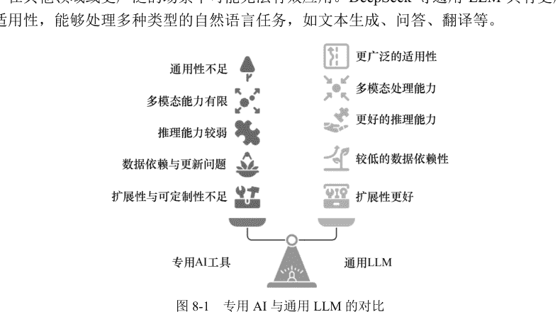

专用 AI 工具在面对新的问题或任务时，通常需要重新训练或调整模型参数，适应性较弱。相比之下，通用 LLM 可以通过简单的提示或指令调整，快速适应不同类型的任务。

（2）多模态能力有限
许多专用 AI 工具专注于处理一种类型的数据，如文本、图像或语音等。DeepSeek 等通用 LLM 通常具备多模态处理能力，能够整合多种数据形式，为更复杂的应用场景提供支持。

即使某些专用 AI 工具支持多模态数据输入，但在将不同模态的数据进行深度融合和协同处理方面，通常不如通用 LLM 表现优异，难以充分发挥多模态数据的优势。

（3）推理能力较弱
当处理需要复杂逻辑推理和深度思考的任务时，专用 AI 工具可能难以达到通用 LLM 的水平。例如，在数学问题求解、编程任务等需要长逻辑链条的场景中，DeepSeek 等模型能够更好地进行推理和分析。

通用 LLM 在理解自然语言的上下文和语义关系方面具有优势，能够更好地把握文本中的隐含信息和逻辑联系，而专用 AI 工具可能在这个方面存在不足，导致对某些复杂语句或情境的理解不够准确。

（4）数据依赖与更新问题
专用 AI 工具的性能高度依赖特定领域的高质量数据。在数据不足或数据质量不佳的情况下，其表现可能会受到较大影响。通用 LLM 经过大规模的预训练，对数据的依赖相对较低，能够在一定程度上弥补数据不足的问题。

与通用 LLM 类似，专用 AI 工具的知识更新也存在滞后性，无法实时获取和处理最新的信息，可能会影响在某些需要及时获取和处理信息的场景中的应用效果。

（5）扩展性与可定制性不足
专用 AI 工具通常具有固定的功能模块，难以根据用户的需求进行灵活的功能扩展和定制。通用 LLM 可以通过二次开发、插件等方式，实现功能的扩展和个性化定制。
当专用 AI 工具与其他系统或工具集成时，可能会面临接口不兼容、数据格式不一致等问题，从而增加集成的难度和成本。相比之下，通用 LLM 通常具有更开放的架构和更友好的接口，便于与其他系统集成和协同工作。

#### 8.1.3 与专用 AI 结合的新优势

DeepSeek 等通用 LLM 与专用 AI 工具结合，可以融合广泛知识理解与垂直领域能力，实现灵活性与专业性的互补，既能覆盖多场景需求，又能提高复杂任务的准确性与效率，同时降低幻觉风险并增强行业适配性。

##### 1. DeepSeek 赋能专用 AI

专用 AI 与 DeepSeek 等通用 LLM 结合，能够给专用 AI 带来以下层面的能力提升。
一是提高语义理解与交互能力。专用 AI 通常在特定领域或任务上表现出色，但在 NLP 和语义理解方面可能存在局限性。与 DeepSeek 结合后，专用 AI 可以借助 DeepSeek 强大的语言理解能力，更准确地解析用户的自然语言指令和问题，提供更符合用户意图的回答和解决方案，提升用户体验。
二是提高逻辑推理与决策能力。DeepSeek 具有强大的逻辑推理能力，能够处理复杂的逻辑关系并进行多步推理。与 DeepSeek 结合后，专用 AI 工具可以利用这个能力，在专业领域内进行更复杂的分析和决策。例如，在金融风险评估中，结合 DeepSeek 的推理能力，专用 AI 工具可以更全面地考虑各种因素，做出更准确的风险判断。
三是拓展新的应用场景和功能。借助 DeepSeek 的通用性和灵活性，专用 AI 可以拓展应用场景和功能范围。例如，一个专注图像识别的专用 AI，与 DeepSeek 结合后，可以增加对图像相关文本信息的理解和生成功能，为用户提供更丰富的图像搜索和分析服务。
四是实现多模态数据融合。DeepSeek 支持多模态信息处理，能够整合文本、图像、语音等多种数据。与 DeepSeek 结合后，专用 AI 可以实现多模态数据的融合处理，提高在复杂场景下的感知和理解能力。例如，在智能驾驶领域，相关专用 AI 工具结合 DeepSeek 可以更好地处理路况图像、车辆传感器数据及相关的文本信息，提高驾驶决策的准确性和安全性。

##### 2. 专用 AI 赋能 DeepSeek

专用 AI 与 DeepSeek 等通用 LLM 结合，可以为 DeepSeek 带来以下层面的能力提升。
一是增强 DeepSeek 的专业领域知识和技能。专用 AI 在特定领域积累了丰富的专业知识和技能，与 DeepSeek 结合后，可以为 DeepSeek 补充这些领域的专业知识和技能，使其在相应领域具有更深入的理解和更专业的处理能力。例如，与医疗影像分析专用 AI 结

### 8.2 与办公协作 AI 工具钉钉的结合

办公协作领域有大量 AI 产品或 AI 工具，如 Google Workspace、Slack、WPS AI、Microsoft 365、Notion AI、360AI 办公等。每种产品和工具都有各自的优势和不足，也都有各自适用的领域，在与 DeepSeek 结合方面，目前不同的产品结合程度不同，有些工具可能只是与 DeepSeek 进行简单的集成，有些则有深度的功能融合。例如，钉钉、AingDesk、ChatDOC 等工具，它们和 DeepSeek 的结合比较紧密，能够发挥各自的优势。钉钉在企业协作方面具有强大的功能，结合 DeepSeek 后，能够提供更智能的助手服务。AingDesk 侧重于模型部署和操作可视化，结合 DeepSeek 后，可以方便用户在本地部署和使用模型。

我们以钉钉为例进行相应的讨论。

#### 8.2.1 钉钉的适用领域和不足

钉钉是阿里巴巴集团打造的企业级智能移动办公平台，为企业和组织提供全新的工作、分享和协作方式，帮助企业实现数字化转型和数字化高效运营。钉钉覆盖互联网、医疗、教育、制造等全部一级行业和全部二级行业，从智能角度来看，钉钉存在以下方面的不足。

- ① 智能化功能的深度和广度有限。虽然钉钉提供了多种智能化功能，但是在处理复杂业务场景和深度智能分析方面，可能不如专业的 AI 工具深入和全面。
- ② 智能分析和预测能力有待提升。在某些需要高级智能分析和预测的场景中，钉钉可能无法提供足够精准和深入的洞察。
- ③ 定制化和灵活性不足。对于一些具有特殊需求的企业，钉钉的智能化功能可能无法完全满足其定制化需求，需要进一步开发和集成。

#### 8.2.2 与钉钉结合的新优势

DeepSeek 与钉钉至少在 5 个方面进行了结合。DeepSeek 与钉钉的结合的新优势如图 8-2 所示。

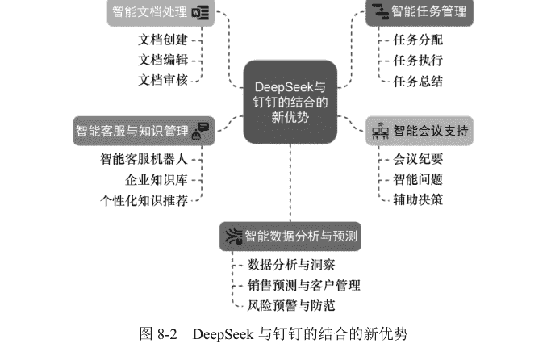

##### 1. 智能文档处理

钉钉通过 API 将 DeepSeek 的 NLP 能力与钉钉的文档模块集成，可以辅助用户快速生成各类文档，也可以帮助用户对文档进行校对、润色，提高文档质量，还可以帮助用户提取文档关键信息，生成摘要，方便用户快速了解文档核心内容。

（1）具体的结合环节

- ① 文档创建环节，用户在钉钉创建文档时，DeepSeek 根据用户输入的文档主题、类型等信息，自动生成文档大纲和初步内容。
- ② 文档编辑环节，在用户编辑文档过程中，DeepSeek 实时对文档进行语法检查、拼写纠错和语义分析，提供修改建议。
- ③ 文档审核环节，用户完成文档初稿后，DeepSeek 自动提取文档关键信息，生成摘要，方便审核人员快速了解文档核心内容，提高审核效率。

（2）带来的性能改进与提升

在内容生成与优化方面，DeepSeek 能够根据用户输入的关键词或主题，自动生成高质量的文档内容，如工作报告、项目策划等，帮助用户快速完成文档创作，提高工作效率。例如，用户只需提供项目的基本信息和目标，DeepSeek 即可生成一份完整的项目策划书，包括市场分析、执行计划、预算安排等内容。

在智能校对与润色方面，系统通过对文档进行语法检查、拼写纠错和语义优化，提高文档质量。DeepSeek 可以识别文档中的语病和不通顺的语句，并给出修改建议，使文档表达更准确、流畅。

在文档摘要与提取方面，系统可以快速提取文档中的关键信息并生成摘要，方便用户快速了解文档的核心内容。这对于处理长篇幅的合同、报告等文档非常有用，用户可以通过摘要快速把握重点，节省阅读时间。

（3）具体的结合方法

在 DeepSeek 与钉钉结合以提高智能文档处理能力方面，首先需要部署 DeepSeek 模型；其次需要在钉钉平台创建应用以提供 AI 助手服务；最后确保应用具有机器人功能，并配置相应的权限。

需要使用阿里云计算巢的 AppFlow 服务，将 DeepSeek 模型与钉钉机器人连接。具体步骤包括选择 AppFlow 模板、配置 DeepSeek 模型的鉴权凭证（如 Token）、配置钉钉应用的鉴权凭证（如 Client ID 和 Client Secret）、填写模型名称和钉钉卡片模板 ID。完成连接流配置，并发布应用。

需要配置钉钉机器人。将创建的钉钉应用添加到群聊中，并配置机器人接收和处理用户消息。需要在钉钉群管理中添加机器人，配置机器人的消息接收模式为 HTTP 模式，设置消息接收地址为 AppFlow 生成的 Webhook URL，然后发布机器人配置。

钉钉提供多种预设模板，用户可以一键创建基于 DeepSeek 模型的 AI 助理。这些模板支持文档处理、工作流自动化、低代码平台支持等功能。文档处理是利用 DeepSeek 的智能文档处理引擎，快速生成摘要、分析文档内容；工作流自动化需要通过 AI 助理实现任务自动化，如生成工作总结、管理待办事项等；钉钉的低代码平台结合 DeepSeek 能力，支持生成 Prompt 并调用 DeepSeek 模型，应用于数据分析、文本生成等场景。

为了确保数据安全和隐私保护，可以采用私有化部署方案。通过阿里云计算巢，用户可以独享资源，避免流量过大导致的服务不可用问题。完成配置后，测试 AI 助理的功能，确保其能够正确处理用户请求。最终在钉钉内部发布 AI 助理，邀请团队成员试用。

通过以上步骤，企业可以快速在钉钉平台上部署 DeepSeek AI 助理，实现智能文档处理和工作流程自动化，提升整体办公效率。

##### 2. 智能任务管理

钉钉的任务管理模块与 DeepSeek 的智能分析能力结合，可以进行合理的任务分配，确保任务分配给最适合的团队成员；可以实时跟踪任务进度，及时发现并解决潜在问题；还可以自动化重复性任务，提高工作效率。

（1）具体的结合环节

- ① 任务分配，DeepSeek 根据任务类型、难度、截止日期等信息，结合团队成员的技能、工作量和历史表现，智能推荐任务分配方案。
- ② 任务执行，在团队成员执行任务过程中，DeepSeek 实时收集任务进度信息，包括已完成的工作量、遇到的问题等，并及时反馈给项目管理者。
- ③ 任务总结，任务完成后，DeepSeek 自动生成任务总结报告，包括任务完成情况、遇到的问题及解决方案、经验教训等，方便团队成员总结和分享。

（2）带来的性能改进与提升

在任务分配与提醒方面，根据团队成员的技能和工作量，系统可以智能推荐任务分配方案，确保任务分配合理、高效。DeepSeek 可以分析团队成员的历史任务完成情况和专业技能，为每个任务找到最适合的执行者，并自动发送任务提醒，确保项目按时推进。

在任务进度跟踪与预测方面，系统实时监控任务进度，预测任务完成时间，及时发现潜在的延迟风险。DeepSeek 通过分析任务的历史数据和当前进度，为项目管理者提供准确的进度报告和预测，帮助项目管理者及时调整项目计划，避免延误。

在任务自动化方面，系统自动识别和执行重复性任务，如数据录入、文件整理等，减轻员工负担。例如，对于定期的财务报表整理任务，DeepSeek 可以自动从相关系统中提取数据，并按照预设的格式生成报表，无须人工手动操作。

（3）结合方法

DeepSeek 与钉钉结合，提高钉钉智能任务管理能力的具体实现，与前述实现智能文档处理的流程基本相同，唯一不同的环节是应用模板与功能设置。

钉钉提供多种预设模板，用户可以一键创建基于 DeepSeek 模型的 AI 助理。这些模板支持任务分配与提醒、任务进度跟踪与预测、任务自动化。

针对任务分配与提醒功能，通过钉钉机器人接收用户的任务指令，利用 DeepSeek 的 NLP 能力解析任务内容，并通过钉钉的 API 将任务分配给指定用户，同时设置提醒功能。为此需要构建任务分配模型，基于 DeepSeek 的数据分析和机器学习能力，构建任务分配模型。模型输入包括任务特征和团队成员特征，通过历史任务数据进行训练，学习任务分配的最优策略。

针对任务进度跟踪与预测功能，结合钉钉的低代码平台宜搭，利用 DeepSeek 的智能分析能力，跟踪任务进度并预测完成时间。为此需要开发任务进度跟踪工具，利用 DeepSeek 的 NLP 技术，结合钉钉的任务评论和更新记录，实时分析任务进度信息。它可以通过关键词提取、语义理解等技术，自动识别任务中的关键信息和问题。

针对任务自动化功能，通过钉钉的自动化流程，结合 DeepSeek 的智能分析和生成能力，实现任务的自动化管理，如自动生成任务总结、调整任务优先级等。为此需要实现任务自动化流程，对于重复性任务，如数据录入、文件整理等，使用 DeepSeek 的自动化脚本功能，结合钉钉的任务调度机制，实现任务的自动触发和执行。可以预设任务的执行条件和规则，当满足条件时，自动启动任务流程。

##### 3. 智能会议支持

将 DeepSeek 的语音识别、NLU 和文本生成能力与钉钉的会议模块进行深度集成，将在生成会议纪要、智能问答与辅助决策、会议内容总结和提炼等方面带来改进与提升。

在会议纪要生成方面，系统自动将会议语音转换为文字，并生成会议纪要，包括会议主题、参会人员、讨论要点、行动事项等。DeepSeek 可以准确识别会议中的关键信息，并以清晰的结构化形式呈现，方便会后回顾和执行。

在智能问答与辅助决策方面。在会议中，系统可以实时回答与会者的提问，提供相关数据和信息支持，辅助决策。例如，当讨论到某个项目的市场前景时，DeepSeek 可以迅速提供相关的市场调研数据和分析报告，为决策提供依据。

在会议内容总结与提炼方面，系统对会议内容进行总结和提炼，突出重点和关键决策，帮助参与者快速回顾会议核心内容。这对于跨部门会议或大型项目会议非常重要，能够确保所有参与者对会议结果有清晰一致的理解。

具体的结合环节包括以下 3 个环节。

- ① 在会议准备环节，当钉钉会议模块创建会议邀请时，DeepSeek 根据会议主题、议程等信息，自动生成会议准备材料，如相关文档、数据等。
- ② 在会议进行环节，DeepSeek 通过语音识别技术，将会议语音转换为文字，并实时显示在会议界面中。同时，DeepSeek 可以对会议内容进行语义分析，提取关键信息，如讨论要点、行动事项等。
- ③ 在会议结束环节，DeepSeek 根据会议记录和关键信息，自动生成会议纪要，并发送给所有参会人员。同时，DeepSeek 可以对会议内容进行总结和提炼，形成会议总结报告。

具体的结合方法：首先，要集成语音识别与转写技术，将 DeepSeek 的语音识别能力与钉钉会议的音频输入结合，实时将会议语音转换为文字。可以采用先进的语音识别算法，提高识别准确率，并支持多种语言和方言。其次，要应用 NLU 和 NLG，利用 DeepSeek 的 NLP 和 NLG 能力，对会议转写文本进行语义分析和信息提取。可以识别会议中的关键实体、事件和关系，提取讨论要点、决策结果等关键信息，并生成自然流畅的会议纪要和总结报告。最后，要开发智能问答功能，在会议进行过程中，与会者可以通过钉钉会议界面提问，DeepSeek 实时接收问题并进行语义理解，从相关知识库和会议上下文中检索答案，以简洁明了的方式回答问题，为与会者提供及时的信息支持。

##### 4. 智能客服与知识管理

钉钉的客服模块和知识库与 DeepSeek 的智能对话和信息检索能力结合，将在打造智能客服机器人、建设企业知识库、推荐个性化知识和学习资源等方面带来改进与提升。

通过打造更智能、更高效的客服机器人，可以准确理解用户问题并提供精准解答。DeepSeek 可以接入企业内部的知识库和常见问题解答（Frequently Asked Questions，FAQ），为用户提供 24 小时不间断的在线咨询服务，提高用户满意度。

在知识库建设与优化方面，系统可以自动整理和优化企业知识库，生成知识图谱，方便员工快速查找和获取所需知识。DeepSeek 可以对企业的大量文档和数据进行分析和整理，提取关键知识点，并建立关联关系，形成结构化的知识体系，提高知识管理效率。

在个性化知识推荐方面，根据员工的岗位、技能和工作需求，个性化推荐相关知识和学习资源，促进员工成长和发展。例如，对于新入职的员工，DeepSeek 可以根据其岗位职责和职业发展规划，推荐相关的培训课程、操作手册等学习资料，帮助其快速适应工作环境。

具体的结合环节包括客服接待环节、知识检索环节和知识推荐环节。

- ① 在客服接待环节，当用户通过钉钉客服渠道发起咨询时，DeepSeek 智能客服机器人接待用户，通过 NLU 技术识别用户问题的意图和关键词。
- ② 在知识检索环节，DeepSeek 根据用户问题，在企业知识库中进行精准检索，找到与问题最相关的知识条目和解答内容。
- ③ 在知识推荐环节，DeepSeek 分析员工的岗位信息、工作记录和学习历史，结合企业的知识体系，为员工推荐个性化的知识和学习资源。

为此，首先需要训练智能客服模型。利用 DeepSeek 的 NLP 和深度学习技术，训练智能客服模型。模型输入用户问题文本，输出对应的解答文本。可以采用大量客服问答数据进行训练，提高模型的准确性和泛化能力。其次需要构建知识图谱。对企业内部的知识库进行知识抽取和关系构建，形成知识图谱。DeepSeek 可以通过实体识别、关系抽取等技术，将知识库中的文本信息转化为结构化的知识图谱，方便快速检索和关联知识。最后需要实现个性化推荐算法。基于 DeepSeek 的数据分析和机器学习能力，开发个性化知识推荐算法。算法输入包括员工的个人信息、工作行为数据等，通过协同过滤、内容推荐等技术，为员工推荐符合其需求和兴趣的知识和学习资源。

##### 5. 智能数据分析与预测

DeepSeek 的数据分析和预测能力与钉钉的企业管理数据对接，将在以下 3 个方面带来效能改进与提升。

- ① 在数据分析与洞察方面，系统对企业的海量数据进行深度分析，挖掘潜在的业务洞察和趋势，为管理层提供决策支持。DeepSeek 可以结合企业的销售数据、市场数据、客户数据等，进行多维度的分析，发现业务增长点和潜在风险，助力企业制订更科学、合理的战略规划。
- ② 在销售预测与客户管理方面，系统可以更好地预测销售业绩，分析客户需求和行为，优化销售策略和客户关系管理。DeepSeek 分析历史销售数据和客户交互记录，为销售人员提供客户画像、购买意向预测等信息，帮助销售人员精准营销和个性化服务，提高销售转化率和客户忠诚度。
- ③ 在风险预警与防范方面，系统可以实时监测企业运营中的风险因素，如财务风险、市场风险等，并及时发出预警，帮助企业提前采取防范措施。DeepSeek 可以对企业的财务报表、市场动态、行业政策等信息进行实时监控和分析，一旦发现异常情况，立即通知相关人员进行处理，降低企业风险。

具体的结合包括数据收集、分析、预测与警告 3 个环节。

- ① 在数据收集环节，钉钉作为企业协作平台，收集企业内部的各类数据，如员工工作数据、业务流程数据等。同时，DeepSeek 可以从外部数据源获取相关数据，如市场数据、行业报告等。
- ② 在数据分析环节，DeepSeek 对收集的数据进行清洗、预处理和特征提取，然后运用机器学习和深度学习算法进行数据分析，挖掘数据中的潜在规律和模式。
- ③ 在预测与预警环节，DeepSeek 基于数据分析结果，构建预测模型，对销售业绩、客户需求等进行预测，并设置风险预警指标。当预测结果超出预设阈值或发现潜在风险时，及时通过钉钉的消息推送等功能通知相关人员。

为此，首先需要整合数据源，将钉钉内部数据与外部数据源进行整合，形成全面的数据集。可以采用数据融合技术解决数据格式不一致、数据缺失等问题，确保数据的完整性和准确性。其次需要应用机器学习与深度学习算法，根据具体的分析和预测任务，选择合适的机器学习和深度学习算法。例如，对于销售预测可以采用时间序列分析、线性回归等算法；对于客户分类可以采用聚类分析、决策树等算法。最后需要建立风险预警模型。结合企业的业务特点和风险指标体系，利用 DeepSeek 的数据分析和建模能力，建立风险预警模型。模型可以实时监测企业的关键运营指标，如财务指标、业务指标等，当指标出现异常变化时，及时触发预警机制，并通过钉钉的消息推送、邮件提醒等方式通知相关人员进行处理。

### 8.3 与知识管理工具 HelpLook 的结合

知识管理是通过一系列流程、工具和方法，对企业内外部的知识资源进行有效的获取、存储、共享、应用和创新，提高企业的决策质量、创新能力和运营效率，增强企业的核心竞争力。

近年来，在知识管理工具领域涌现了一些相对主流的 AI 产品、应用或工具，如侧重知识管理、智能客服和数据分析等细分领域的 HelpLook，侧重客服支持、知识管理等细分领域的 Zendesk Knowledge Base。这些 AI 产品、应用或工具都有各自侧重的细分领域，也都有各自的优势和不足。

#### 8.3.1 DeepSeek 在知识管理领域的短板

DeepSeek 在知识管理领域存在以下短板，这些短板限制了 DeepSeek 在知识管理领域的应用。

- ① 信息的时效性问题。DeepSeek-V3 的知识截止到 2024 年 7 月，DeepSeek-R1 版本的知识截止到 2023 年 12 月。由于无法及时获取和更新最新的行业动态和政策变化，所以 DeepSeek 难以满足对实时性要求较高的知识管理需求。
- ② 专业领域深度不足。在医疗诊断、工程计算、法律实务等专业领域，DeepSeek 的诊断能力、准确性、推理能力有限。
- ③ 复杂逻辑推理能力不足。在多步博弈论、哲学思辨、数学证明等复杂逻辑推理方面，DeepSeek 的准确率较低。
- ④ 多模态能力不足。DeepSeek 缺乏对图像、视频等非文本数据的直接解析能力，无法进行图文混合创作或对视频内容进行深入分析。
- ⑤ 数据安全与隐私。当 DeepSeek 使用第三方 API 平台部署时存在数据泄露风险，未经授权访问的风险也不容小觑。

#### 8.3.2 DeepSeek 与 HelpLook 结合的必要性

HelpLook 是一款功能强大、易于使用的知识管理工具，尤其适合需要快速搭建和管理知识库的企业。HelpLook 还集成了 AI 技术，支持自定义提示语和配置 API Key，打造专属的 AI 问答机器人，并轻松集成至网站、App 或小程序等第三方应用中。

HelpLook 主要用于企业外包知识管理，在零售电商企业、金融科技企业及互联网企业都有众多应用。

HelpLook 在管理企业外包项目中的知识资源方面表现出色，当面对多语言、多团队协作的复杂场景时，需要 DeepSeek 的 NLP 和多模态数据处理能力提高知识检索和推荐的精准度，打破语言壁垒，加速信息传播和协作。例如，在跨国外包项目中，DeepSeek 可以帮助处理多语言知识库，实现更高效的知识共享和协作。

HelpLook 在零售电商领域提供强大的知识管理和客服支持功能，当面对海量的市场数据和消费者行为分析时，需要 DeepSeek 的智能分析和预测能力来提高决策的科学性和精准性。例如，利用 DeepSeek 的预测模型，零售企业可以更准确地预测市场需求，优化库存管理和营销策略。

HelpLook 在金融科技领域满足企业与不同合作伙伴的合作需求，当企业在处理高度敏感的金融数据和复杂的交易监控时，需要 DeepSeek 的高级安全和隐私保护功能，以及强大的数据分析能力，提高风险评估和预警的效率。例如，在金融交易监控和风险评估中，DeepSeek 可以帮助分析大量交易数据，识别潜在风险，提供实时预警。

HelpLook 在互联网企业中支持与多个外部技术团队的合作，在自动化任务分配和流程优化方面，需要 DeepSeek 的自动化和智能工作流能力，提高团队协作和项目管理的效率。例如，在软件开发和产品迭代中，DeepSeek 可以帮助团队自动分配任务，跟踪进度，及时发现和解决潜在问题。

通过与 DeepSeek 等更高级的 AI 模型结合，可以进一步提高其智能化水平，弥补其在某些方面的不足。

#### 8.3.3 DeepSeek 与 HelpLook 结合的新优势

HelpLook 本身在知识管理、智能客服和数据分析方面表现出色，DeepSeek 的 NLP 和多模态数据处理能力可以进一步优化其智能客服和知识管理功能，提供更精准的搜索和推荐服务，显著提高企业的知识管理效率，提升用户体验。DeepSeek 与 HelpLook 结合的新优势如图 8-3 所示。

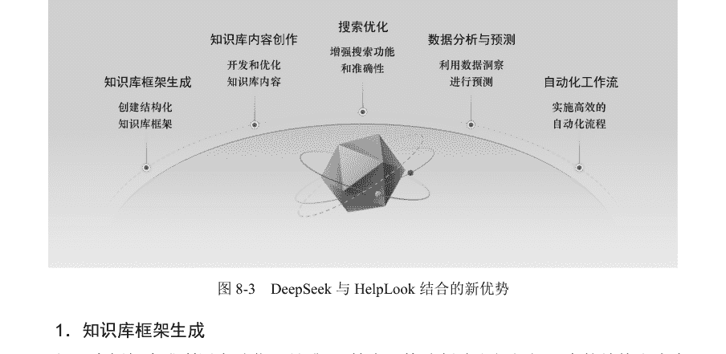

图 8-3 DeepSeek 与 HelpLook 结合的新优势

##### 1. 知识库框架生成

知识库框架生成利用自动化工具或 AI 技术，快速创建和组织知识库的结构和内容。这个过程通常包括确定知识库的主要分类、子分类和内容模块，以及它们之间的逻辑关系。

知识库框架生成在提高效率、确保完整性、提升用户体验、支持知识扩展和便于维护方面发挥重要作用。首先，自动化的框架生成可以大幅减少人工设计和组织知识库的时间和精力，特别是在知识库规模较大或内容复杂的情况下。其次，系统化的方法生成的框架，可以确保知识库覆盖所有必要的主题和内容，避免遗漏重要信息。再次，一个逻辑清晰、结构合理的知识库框架可以提高用户查找和获取信息的效率，增强用户满意度。最后，良好的框架结构便于后续的内容更新和扩展，使知识库能够持续适应企业的发展和变化。

HelpLook 自动生成的框架可能在逻辑上不够严谨，需要人工进行调整和优化；同时生成的框架可能过于通用，无法完全满足特定企业的个性化需求。此外，可能在多语言支持方面存在不足，限制了知识库的国际化应用。自动生成的框架可能在某些领域或主题的覆盖上不够深入或广泛，需要进一步的手动补充。

DeepSeek 与 HelpLook 结合，可以解决以下问题。

- ② 实现个性化定制。结合 DeepSeek 的智能分析，可以根据企业的特定需求和行业特点，生成更个性化的知识库框架。
- ③ 实现多语言支持。DeepSeek 的多语言处理能力可以增强 HelpLook 在多语言知识库框架生成中的表现，支持企业在全球范围内的应用。
- ④ 扩展深度和广度。DeepSeek 的知识图谱和语义理解能力可以帮助生成更深入、更广泛的知识库框架，覆盖更多主题和内容。

两者结合，可以提高框架生成的准确性。DeepSeek 的语义理解和逻辑推理能力可以提高框架生成的准确性和相关性，减少人工调整的工作量，增强框架生成的逻辑性和条理性。通过 DeepSeek 的逻辑推理，生成的框架更符合逻辑，条理清晰，便于用户查找和使用。DeepSeek 的多语言支持可以使 HelpLook 在国际企业中更好地应用，满足不同语言用户的需求。结合 DeepSeek 的知识图谱，生成的框架可以覆盖更广泛的领域和更深入的主题，提高知识库的实用性和价值。

以下是具体的结合环节和方面。

- ① 在输入需求分析环节，用户需要向 DeepSeek 描述知识库的目标、受众和核心内容范围，DeepSeek 根据这些信息生成初步的框架建议。
- ② 在框架生成与优化环节，DeepSeek 利用 NLP 和逻辑推理能力，生成知识库的初步框架，并对其进行优化，确保逻辑性和条理性。
- ③ 在个性化调整环节，用户根据企业的具体需求，对生成的框架进行个性化调整。DeepSeek 可以提供进一步的建议和优化方案。
- ④ 在多语言处理方面，对于需要多语言支持的知识库，DeepSeek 可以自动翻译和调整框架内容，确保不同语言版本的一致性和准确性。
- ⑤ 在深度和广度扩展方面，DeepSeek 通过知识图谱和语义理解，扩展框架的深度和广度，确保知识库覆盖所有必要的主题和内容。

##### 2. 知识库内容创作

知识库内容创作是指利用自动化工具或 AI 技术，快速生成和优化知识库中的文章、指南、FAQ 等内容。这个过程通常包括内容的生成、编辑、校对和优化，确保知识库内容的准确性和实用性。

自动化的内容生成可以大幅减少人工编写的时间和精力，特别是在需要大量内容的情况下。通过 AI 技术，可以减少人为错误，确保内容的准确性和一致性。高质量的内容可以提高用户查找和获取信息的效率，提高用户满意度。良好的内容创作工具便于后续的内容更新和扩展，使知识库能够持续适应企业的发展和变化。

自动生成的内容可能在逻辑性、连贯性和专业性方面存在不足，需要人工进一步优化。生成的内容也可能过于通用，无法完全满足特定企业的个性化需求。

DeepSeek 与 HelpLook 在知识库内容创作中的结合，可以提高内容质量，实现个性化定制，获得更好的多语言支持，同时在深度和广度方面也会有所扩展。DeepSeek 的 NLP 和逻辑推理技术可以帮助优化自动生成的内容，使生成的内容更准确、连贯和专业。结合 DeepSeek 的智能分析技术，可以根据企业的特定需求和行业特点，生成更个性化的知识库内容。DeepSeek 的多语言处理技术可以增强 HelpLook 在多语言知识库内容创作中的表现，支持企业在全球范围内的应用。DeepSeek 的知识图谱和语义理解能力可以帮助生成更深入、更广泛的知识库内容，覆盖更多主题和内容。

DeepSeek 与 HelpLook 可在以下方面进行具体结合。

- ① 内容生成方面。用户可以向 DeepSeek 输入指令，由 DeepSeek 生成知识库文章的初步草稿。用户也可以上传原始文件或产品具体资料，DeepSeek 快速提取关键信息，基于内容语义理解，生成具体完整的说明文内容。
- ② 在内容优化方面。DeepSeek 可以对生成的内容进行语法检查和纠错，确保内容的准确性，同时 DeepSeek 会对生成的内容进行语义优化，提高内容的连贯性和逻辑性。
- ③ 多语言支持方面。DeepSeek 支持多种语言的自动翻译，可以将生成的内容快速翻译成不同语言，满足国际用户的需求。用户也可以通过 DeepSeek 与知识库进行多语言的交互，编辑和优化不同语言版本的内容。
- ④ 深度和广度扩展方面。DeepSeek 可以通过知识图谱技术，将生成的内容与相关知识进行关联，扩展内容的深度和广度。同时 DeepSeek 提供语义搜索功能，帮助用户快速找到相关的内容，提高知识库的实用性。

##### 3. 搜索优化

搜索优化是通过一系列技术手段和策略，提高知识库在搜索引擎中的可见性，提升用户搜索体验，使用户能够更快速、更准确地找到所需信息。搜索优化包括优化内容的关键词、URL 结构、元标签等，以及利用 AI 技术提高搜索结果的相关性和准确性。

传统搜索优化主要依赖关键词匹配，对用户搜索意图的理解不够深入，可能会导致搜索结果不准确。在多语言搜索方面，传统方法可能无法有效处理不同语言的查询，限制了知识库的国际化应用。传统搜索优化方法难以实时更新和调整搜索结果，无法及时反映知识库内容的变化。同时，传统搜索优化缺乏个性化推荐能力，无法根据用户的历史行为和偏好提供定制化的搜索结果。

DeepSeek 与 HelpLook 在搜索优化方面的结合，可以利用 DeepSeek 的 NLP 和语义理解技术，更准确地理解用户搜索意图，提供更相关和准确的搜索结果。DeepSeek 的多语言处理技术可以提升 HelpLook 在多语言搜索方面的表现，支持企业在全球范围内的应用。DeepSeek 还可以实时分析和更新搜索结果，确保用户获取到最新的信息。最后，DeepSeek 可以根据用户的历史行为和偏好，提供个性化的搜索结果和推荐内容。

DeepSeek 与 HelpLook 在搜索优化方面的具体结合包括以下内容。

- ① 在语义搜索方面，用户在 HelpLook 中输入搜索查询，DeepSeek 可以对查询进行语义分析，理解用户的真实意图。根据语义分析结果，DeepSeek 可以从知识库中检索最相关的内容，并返回给用户。
- ② 在多语言支持方面，DeepSeek 支持多种语言的查询处理，自动识别和理解不同语言的搜索意图。DeepSeek 还可以自动翻译知识库内容，确保不同语言的用户都能获取准确的信息。
- ③ 在知识库实时更新方面，DeepSeek 定期检测知识库内容的更新，确保搜索结果的及时性。DeepSeek 可以根据内容更新，动态调整搜索结果，确保用户获取最新的信息。
- ④ 在个性化推荐方面，DeepSeek 分析用户的历史搜索记录和行为模式，了解用户的偏好。DeepSeek 根据用户行为分析结果，为用户提供个性化的搜索结果和推荐内容。

##### 4. 数据分析与预测

数据分析与预测是通过集成数据分析工具和机器学习算法，对知识库的使用数据、用户行为数据等进行深入分析，发现模式、趋势，并预测未来事件。数据分析与预测包括对用户搜索行为、知识库文章访问量、用户反馈等数据的分析，以及基于这些数据的预测、构建模型。

HelpLook 自带的数据分析功能可能在深度分析和复杂模型构建方面存在不足，无法满足企业对高级数据分析的需求。同时，HelpLook 的预测功能可能比较简单，无法提供高精度的预测结果，特别是在处理复杂业务时。此外，HelpLook 可能在整合外部数据源和多渠道数据方面存在限制，影响全面数据分析的能力。HelpLook 的数据分析和预测功能可能无法实现实时更新和分析，导致数据的时效性不足。

DeepSeek 的高级数据分析和机器学习能力可以弥补 HelpLook 在深度分析方面的不足，提供更深入的洞察和分析结果。DeepSeek 的预测建模功能可以提高 HelpLook 的预测精度，特别是当处理复杂业务时。DeepSeek 可以整合多种数据源，包括外部数据和多渠道数据，提供更全面的数据分析。DeepSeek 的实时数据分析能力可以确保 HelpLook 的数据分析和预测结果的时效性。

DeepSeek 与 HelpLook 可以在以下环节进行结合。

- ① 在数据收集与整合环节，可以将 HelpLook 中的用户行为数据、知识库使用数据等上传到 DeepSeek 的数据管理平台，由 DeepSeek 整合 HelpLook 的数据与其他业务数据，形成全面的数据集。
- ② 在数据分析与建模环节，DeepSeek 可以自动识别和处理数据中的缺失值、异常值和重复数据，确保数据的准确性和一致性。DeepSeek 也可以运用机器学习算法对整合后的数据进行深入分析，挖掘潜在规律和趋势。此外，DeepSeek 还可以构建预测模型，预测用户需求、市场趋势等，提供决策支持。
- ③ 在结果输出与可视化方面，DeepSeek 将分析结果自动生成详细的报告，支持 Word、PPT、PDF 等多种格式。DeepSeek 还提供丰富的可视化工具，将分析结果以图表、图形等形式展示，便于理解和分享。
- ④ 在实时更新与优化方面，DeepSeek 实时处理和分析新数据，确保分析结果的时效性，并根据新的数据和反馈，不断优化分析模型，提高预测和分析的准确性。

##### 5. 自动化工作流

自动化工作流是通过自动化工具和 AI 技术，将企业内部的重复性任务和业务流程进行自动化处理，减少人工干预，提高工作效率和准确性。自动化工作流包括任务分配、数据处理、内容生成、客户服务等多个方面的自动化。

HelpLook 的自动化工作流在处理极复杂的任务时可能表现不足，特别是在需要多步骤、多条件判断的场景中。在需要实时数据处理和响应的场景中，HelpLook 的自动化工作流可能无法满足实时性要求。HelpLook 在整合来自不同渠道和系统的数据方面可能存在限制，影响自动化工作流的全面性和准确性。HelpLook 的自动化工作流可能在满足特定企业的个性化需求方面存在不足，需要额外定制开发。

DeepSeek 与 HelpLook 在自动化工作流方面的结合，可以有针对性地解决上述问题。

在任务模块化设计环节，可以将复杂的业务流程分解为多个简单的任务模块，每个模块负责一个独立的功能。使用 DeepSeek 的 API 和工具，为每个任务模块实现自动化功能，如数据处理、内容生成等。

在智能任务处理环节，利用 DeepSeek 的数据清洗和转换功能，自动化处理原始数据，确保数据的准确性和一致性。通过 DeepSeek 的文本、图像和语音生成能力，自动化创建报告、文档和其他内容。

在实时数据分析环节，将实时数据源接入 DeepSeek，确保自动化工作流能够获取最新的业务数据。利用 DeepSeek 的实时数据分析和预测模型，为自动化工作流提供及时的决策支持。

在个性化定制方面，根据企业的具体业务需求，分析和定义所需的自动化工作流。使用 DeepSeek 的开发工具和 API，定制化地实现特定的自动化任务和流程。

### 8.4 智能客服与对话工具助小咖的结合

智能客服与对话工具是运用 AI 技术，通过 NLP、机器学习、语音识别等技术，实现与客户的自动交互，提供 24 小时不间断的客户服务。这些工具能够自动回答客户的常见问题，进行多轮对话，理解并回应复杂的用户需求，提高客户满意度和企业运营效率。

智能客服与对话工具可以自动化处理大量重复性任务，如订单查询、账户管理等，显著缩短人工操作时间；通过提供快速、准确的响应，24 小时不间断服务，增强用户体验；减少对人工客服的需求，降低人力成本和运营成本。同时通过数据分析和用户行为分析，提供及时准确的业务洞察，支持管理层的决策制定；还可以根据用户的历史交互和行为数据，提供个性化的产品或服务推荐，提高用户满意度。

#### 8.4.1 DeepSeek 直接作为智能客服与对话工具的短板

DeepSeek 具有强大的逻辑推理能力、多语言支持能力、高效能与低成本优势，以及开源和部署灵活等优势。这些优势使 DeepSeek 可以在一定的条件和环境下直接作为智能客服与对话工具。

当 DeepSeek 处理复杂任务时，逻辑推理能力表现不稳定，尤其是在复杂格式处理和深度逻辑推理方面，缺乏图像、视频生成等多模态处理能力，这也限制了其在一些场景下的落地。同时，DeepSeek 在训练和数据处理方式上存在一定的隐私和安全隐患，可能会引发用户对数据可信度的质疑。此外，DeepSeek 对硬件资源需求较高、私有化部署成本较高、开发者论坛问题解决率较低、社区活跃度持续下降也是其作为智能客服与对话工具的短板。DeepSeek 的用户主要集中在国内市场，国际化布局较有限，在一些国际市场的知名度和影响力较低。

#### 8.4.2 助小咖作为智能客服与对话工具的短板

“助小咖”是联想集团自主研发的智能客服与对话工具，在政务、教育等行业的适配性较好，能够满足特定行业的需求。同时，助小咖具备较好的多模态处理能力，能够处理图像、视频等多种形式的数据，适用于更多样化的应用场景。助小咖在数据安全和隐私保护方面采取严格的措施，能够更好地保障用户数据的安全性。

从智能化角度来看，助小咖的逻辑推理能力相对较弱。在逻辑推理任务中，助小咖可能不如 DeepSeek 表现优异，对于复杂问题的解答能力有限。在多语言处理方面，助小咖可能不如 DeepSeek 支持的语言种类多和处理效果好。

#### 8.4.3 助小咖与 DeepSeek 结合的新优势

DeepSeek 与助小咖结合，具有较强的互补性。DeepSeek 的逻辑推理能力和多语言支持可以弥补助小咖在这些方面的不足，助小咖的多模态能力和行业适配性可以为 DeepSeek 提供更多应用场景。DeepSeek 与助小咖结合后可以提供更全面、准确的服务，提升用户在使用智能客服过程中的体验。同时，助小咖完善的数据安全与隐私保护措施可以为 DeepSeek 提供更好的保障，增强用户对数据安全的信任。助小咖与 DeepSeek 结合带来的新优势如图 8-4 所示。

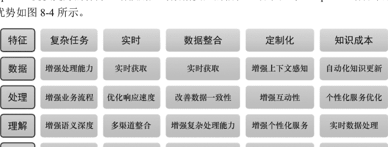

DeepSeek 与助小咖的集成复杂度高，将两种不同的智能客服工具结合，可能会面临技术集成上的复杂度，需要投入一定的时间和精力进行开发和调试。同时使用两种工具，可能会导致使用成本的增加，对于一些企业来说可能需要权衡成本和收益。

##### 1. 复杂任务处理能力提升

（1）助小咖在复杂任务处理能力方面的短板

- ① 多轮对话逻辑连贯性不足，当处理需要多轮对话且逻辑关系复杂的任务时，助小咖可能无法始终保持对话的连贯性和逻辑性，导致用户需要重复表达需求或澄清问题。
- ② 复杂业务流程处理能力有限，对于涉及多个步骤、多个条件判断或跨部门协作的复杂业务流程，助小咖可能无法有效地分解和处理这些任务，导致处理效率低下或出错。
- ③ 语义理解深度不足，当面对复杂语句、专业术语或模糊表达时，助小咖的语义理解能力可能不足，无法准确把握用户的真实意图，影响回答的准确性和针对性。
- ④ 实时数据处理和响应能力不足，在需要实时获取和处理外部数据的场景中，助小咖可能无法及时获取最新的信息，导致回答的时效性不足。

（2）DeepSeek 与助小咖结合可以带来的复杂任务处理能力提升

- ① 多轮对话逻辑连贯性提升，DeepSeek 的高级逻辑推理能力，可以提升助小咖在多轮对话中的逻辑连贯性。助小咖在多轮对话中可能无法始终保持逻辑连贯，导致用户需要重复表达需求。与 DeepSeek 结合后，助小咖可以更好地跟踪对话上下文，确保对话的连贯性和逻辑性。在上下文管理环节，DeepSeek 维护对话的上下文信息，确保每一轮对话都能基于上下文进行理解和回答。在逻辑推理环节，DeepSeek 分析对话中的逻辑关系，预测用户可能的后续问题，并提前准备相关回答。
- ② 复杂业务流程处理能力增强，DeepSeek 的任务分解和流程管理能力，可以优化助小咖在处理复杂业务流程时的表现。助小咖在处理涉及多个步骤和条件判断的复杂业务流程时可能会表现不足，结合 DeepSeek 后，可以更有效地分解和处理这些任务。在任务分解环节，将复杂的业务流程分解为多个简单的任务模块，每个任务模块负责一个独立的功能。由 DeepSeek 负责管理和协调各个任务模块的执行顺序和逻辑关系，确保整个流程的高效运行。
- ③ 语义理解深度扩展，DeepSeek 的高级 NLP 和语义理解能力，可以增强助小咖在处理复杂语句和专业术语时的表现。当助小咖面对复杂语句、专业术语或模糊表达时，其语义理解能力可能不足。结合 DeepSeek 后，助小咖可以更准确地理解用户的真实意图。在语义分析环节，DeepSeek 对用户输入的语句进行深度语义分析，提取关键信息和意图。在上下文关联环节，结合对话上下文，DeepSeek 可以提供更准确的语义理解和回答。
- ④ 实时数据处理和响应能力增强，DeepSeek 的实时数据处理能力，可以提升助小咖在需要实时数据支持的场景中的表现。助小咖在需要实时获取和处理外部数据的场景中，可能无法及时获取最新的信息。结合 DeepSeek 后，助小咖可以确保回答的时效性和准确性。在实时数据接入环节，将实时数据源接入 DeepSeek，确保助小咖能够获取最新的业务数据。务数据。在实时响应环节，DeepSeek 实时处理和分析数据，为助小咖提供即时的决策支持和回答。

（3）具体结合方法

- ① 在具体实施方面，可以通过 API 将 DeepSeek 的功能集成到助小咖中，实现数据和功能的无缝对接。
- ② 在模块化设计方面，可以使用 DeepSeek 的 API 和工具实现每个模块的自动化处理。
- ③ 在上下文管理方面，在对话过程中，使用 DeepSeek 维护对话的上下文信息，确保每轮对话都能基于之前的上下文进行理解和回答。
- ④ 在实时数据处理方面，将实时数据源接入 DeepSeek，可以确保助小咖能够实时获取和处理最新的业务数据。
- ⑤ 在语义分析方面，需要利用 DeepSeek 的 NLP 和语义理解能力，对用户输入的语句进行深度分析，提取关键信息和意图。

##### 2. 实时性增强

（1）助小咖在实时性方面的薄弱环节或短板

助小咖在获取实时数据时可能存在延迟，无法及时获取最新的业务数据，导致回答的时效性不足。当处理高并发的用户请求时，助小咖的响应速度可能较慢，影响用户体验。此外，当助小咖整合来自不同渠道的数据时，可能存在延迟，导致信息不一致或不及时。在需要实时调度和处理的任务中，助小咖可能无法高效地管理和执行这些任务，导致处理效率低下。

（2）DeepSeek 与助小咖在实时性增强方面的结合

- ① 实时数据获取与处理，利用 DeepSeek 的实时数据处理能力，确保助小咖能够及时获取和处理最新的业务数据。助小咖在获取实时数据时可能存在延迟，结合 DeepSeek 后，可以显著减少数据获取和处理的时间，提高回答的时效性。
  在具体实施上，将实时数据源（如数据库、API）接入 DeepSeek，确保数据的实时性和准确性。通过 DeepSeek 实时处理和分析数据，为助小咖提供即时的决策支持和回答。
- ② 响应速度优化，利用 DeepSeek 的高效计算和优化算法，提高了助小咖的响应速度。当助小咖处理高并发的用户请求时，响应速度可能较慢。结合 DeepSeek 后，可以提高响应速度，提升用户体验。
  在实施方法上，通过优化助小咖与 DeepSeek 之间的 API，缩短数据传输和处理时间。在 DeepSeek 中实现缓存机制，存储常用数据和预处理结果，减少重复计算，缩短数据获取的时间。
- ③ 多渠道数据整合，利用 DeepSeek 的多渠道数据整合能力，确保助小咖能够及时获取和整合来自不同渠道的数据。助小咖在整合来自不同渠道的数据时，可能存在延迟和不一致性。结合 DeepSeek 后，助小咖可以实现实时数据整合，确保信息的准确性和及时性。
  在具体实施上，通过构建统一的数据整合平台，将不同渠道的数据整合到 DeepSeek，实现数据的实时同步，确保助小咖能够获取最新的数据。
- ④ 实时性任务调度，利用 DeepSeek 的实时任务调度能力，优化助小咖的任务管理和执行。助小咖在需要实时调度和处理的任务中，可能无法高效地管理和执行这些任务。结合 DeepSeek 后，助小咖可以提升任务调度的效率和实时性。
  在具体实施上，使用 DeepSeek 的调度算法，优化任务的分配和执行顺序，确保高优先级任务优先处理。通过实时监控任务的执行情况，根据实际情况动态调整任务调度策略。

##### 3. 多渠道数据整合

（1）助小咖在多渠道数据整合方面的薄弱环节或短板

- ① 助小咖在整合来自不同渠道的数据时，可能存在数据孤岛问题，导致信息不一致或不及时。
- ② 助小咖在获取和整合实时数据方面可能存在延迟，无法及时反映最新的业务数据。
- ③ 助小咖整合来自不同渠道的数据时可能无法确保数据的一致性和准确性，影响分析和决策的可靠性。
- ④ 助小咖在处理复杂的数据整合任务时，可能无法有效分解和处理这些任务，导致处理效率低下或出错。

（2）DeepSeek 与助小咖在多渠道数据整合方面的结合

- ① 实时数据获取与整合，利用 DeepSeek 的实时数据处理能力，确保助小咖能够及时获取和整合来自不同渠道的最新数据。助小咖在获取和整合实时数据方面可能存在延迟，结合 DeepSeek 后，可以显著缩短数据获取和整合的时间，提高数据的时效性和准确性。
  在具体实施上，需要将实时数据源（如数据库、API）接入 DeepSeek，确保数据的实时性和准确性。DeepSeek 实时处理和分析数据，为助小咖提供即时的决策支持和回答。
- ② 数据一致性提升，利用 DeepSeek 的数据清洗和转换功能，确保助小咖在整合来自不同渠道的数据时，数据的一致性和准确性。助小咖在整合来自不同渠道的数据时，可能存在数据不一致的问题。结合 DeepSeek 后，可以确保数据的一致性和准确性，提高分析和决策的可靠性。
  在具体实施上，DeepSeek 对来自不同渠道的数据进行清洗和转换，去除噪声数据、填补缺失值，并对数据进行标准化处理，然后将不同渠道的数据按照预设的规则进行对齐和整合，确保数据的一致性。
- ③ 复杂数据处理能力增强，利用 DeepSeek 的高级数据处理和分析能力，优化助小咖在处理复杂数据整合任务时的表现。助小咖在处理复杂的数据整合任务时，可能表现较差。结合 DeepSeek 后，助小咖可以更有效地分解和处理这些任务，提高处理效率和准确性。
  在具体方法上，将复杂的整合任务分解为多个简单的任务模块，每个模块负责一个独立的功能。DeepSeek 运用机器学习算法对整合后的数据进行深入分析，挖掘潜在规律和趋势。
- ④ 多渠道数据整合平台，利用 DeepSeek 构建一个统一的数据整合平台，将来自不同渠道的数据整合到一个统一的数据仓库。助小咖在整合来自不同渠道的数据时，可能存在数据孤岛问题。结合 DeepSeek 后，助小咖可以构建一个统一的数据整合平台，打破数据孤岛，提高数据的可用性和分析效率。
  在实施方法上，从不同渠道抽取数据，按照预设的规则进行清洗、转换和整合。将整合后的数据存储在一个统一的数据仓库中，确保数据的完整性和一致性。

##### 4. 个性化定制

（1）助小咖在个性化定制方面的薄弱环节或短板

传统的智能客服系统通常无法处理涉及多轮对话的上下文信息，导致在一次会话中，即使是连续的问题，也需要用户重复提供信息，因为系统无法“记住”前一条查询的内容。传统智能客服系统通常按照固定的模式回应用户，缺乏灵活性和自然流畅的交互体验。它们很难根据对话的发展自然地调整回应方式，使对话显得机械和僵硬。此外，当出现新的产品特性、政策更新或者市场变化时，基于规则的系统需要人工更新知识库和规则，依赖大量手动维护的方式不仅成本高、效率低且容易出错。传统智能客服系统主要基于一般性解答，通常无法提供针对个别用户特定需求的个性化服务，对所有用户的回答往往是标准化的，缺乏针对性和个性化。

（2）DeepSeek 与助小咖在个性化定制方面的结合

- ① 增强上下文感知能力，利用 DeepSeek 的高级 NLP 和上下文管理能力，提高助小咖在多轮对话中的上下文感知能力。助小咖在多轮对话中可能无法始终保持逻辑连贯，导致用户需要重复表达需求。结合 DeepSeek 后，可以更好地跟踪对话上下文，确保对话的连贯性和逻辑性。
  在具体方法上，DeepSeek 会维护对话的上下文信息，确保每一轮对话都能基于上下文进行理解和回答。DeepSeek 通过分析对话中的逻辑关系，预测用户可能的后续问题，并提前准备相关回答。
- ② 提高交互性和灵活性，利用 DeepSeek 的智能对话和 NLG 能力，提高助小咖的交互性和灵活性。助小咖在交互性和灵活性方面表现不足，对话显得机械和僵硬。结合 DeepSeek 后，助小咖可以实现更自然和灵活的对话体验。
  在具体方法上，DeepSeek 根据对话的发展动态调整回答，使对话更自然和流畅。DeepSeek 支持多轮对话，能够根据用户的输入和上下文生成更贴合用户需求的回答。
- ③ 降低知识运维成本，利用 DeepSeek 的知识图谱和自动更新能力，优化助小咖的知识库管理和更新过程。助小咖在知识库的更新和维护方面可能需要大量人工干预，成本较高。结合 DeepSeek 后，助小咖可以实现自动化知识库的更新和优化，减少人工维护的工作量。
  在具体方法上，将 DeepSeek 的知识图谱技术集成到助小咖，自动更新和优化知识库内容，由 DeepSeek 定期检测知识库内容的更新，自动调整和优化知识库结构。
- ④ 增强个性化服务能力，利用 DeepSeek 的用户行为分析和个性化推荐能力，提高助小咖的个性化服务能力。助小咖在提供个性化服务方面表现不足，无法满足用户的特定需求。结合 DeepSeek 后，助小咖可以实现更贴合用户需求的个性化服务。
  在具体方法上，DeepSeek 通过分析用户的历史行为和偏好，了解用户的具体需求。DeepSeek 根据用户行为分析结果，为用户提供个性化的服务和推荐内容。

##### 5. 知识运维成本降低

（1）助小咖在知识运维成本方面的薄弱环节或短板

助小咖在知识库的更新和维护方面可能需要大量人工干预，导致知识库运维成本较高。当出现新的产品特性、政策更新或者市场变化时，需要人工更新知识库和规则，依赖大量手动维护的方式不仅成本高、效率低且容易出错。助小咖在整合来自不同渠道的数据时，可能存在数据孤岛问题，导致信息不一致或不及时，需要额外的技术和人力整合和清洗数据，增加运维成本。助小咖在提供个性化服务方面表现不足，无法满足用户的特定需求，可能会导致需要额外的客服人员来处理复杂的个性化问题，增加人力成本。助小咖在获取和整合实时数据方面可能存在延迟，无法及时反映最新的业务数据，可能会导致需要额外的系统或人工确保数据的实时性，增加运维成本。

（2）DeepSeek 与助小咖在降低知识运维成本方面的结合

- ① 自动化知识库更新，利用 DeepSeek 的知识图谱和自动更新能力，优化助小咖的知识库管理和更新过程。助小咖在知识库的更新和维护方面需要大量人工干预，成本较高。结合 DeepSeek 后，助小咖可以自动化知识库的更新和优化，减少人工维护的工作量。
  在具体方法上，将 DeepSeek 的知识图谱技术集成到助小咖中，自动更新和优化知识库内容。DeepSeek 定期检测知识库内容的更新，自动调整和优化知识库结构。
- ② 多渠道数据整合，利用 DeepSeek 的多渠道数据整合能力，解决助小咖因数据孤岛导致的信息不一致与不及时问题，实现数据的统一管理与及时同步。结合 DeepSeek 后，助小咖可以构建一个统一的数据整合平台，打破数据孤岛，提高数据的可用性和分析效率。
  在具体方法上，从不同渠道抽取数据，按照预设的规则进行清洗、转换和整合。再将整合后的数据存储在一个统一的数据仓库中，确保数据的完整性和一致性。
- ③ 个性化服务优化，利用 DeepSeek 的用户行为分析和个性化推荐能力，优化助小咖的个性化服务，精准满足用户的特定需求。结合 DeepSeek 后，助小咖可以实现更贴合用户需求的个性化服务，减少额外的客服人员需求。
  在具体方法上，由 DeepSeek 分析用户的历史行为和偏好，了解用户的具体需求。根据用户行为分析结果，DeepSeek 为用户提供个性化的服务和推荐内容。
- ④ 实时数据处理，利用 DeepSeek 的实时数据处理能力，确保助小咖能够及时获取和处理最新的业务数据。助小咖在获取和整合实时数据方面可能存在延迟，无法及时反映最新的业务数据。结合 DeepSeek 后，助小咖可以确保回答的时效性和准确性，减少额外的系统或人工需求。
  在具体方法上，将实时数据源（如数据库、API）接入 DeepSeek，确保数据的实时性和准确性。DeepSeek 实时处理和分析数据，为助小咖提供即时的决策支持和回答。

# DeepSeek 企业应用指南

上面以办公协作领域的钉钉、知识管理工具领域的 HelpLook 和智能客服与对话工具领域的助小咖为例，对专用 AI 工具或 AI 应用与 DeepSeek 的结合进行了讨论。企业应用，即使是最小型的企业，其包含的业务领域和涉及层面也五花八门，远不是上述三款应用所能覆盖的。

企业层面的专用 AI 应用或工具在 2025 年已经开始呈现多样化的发展趋势，涵盖从端侧 Agent 到营销技术、企业方案决策、客户关系管理、实时互动等多个领域。这些领域的专门 AI 工具或 AI 应用，在具有各自专业领域应用优势的同时，通常会在通用性方面存在一定的不足。DeepSeek 作为通用 LLM，与上述这些专门领域的 AI 工具或 AI 应用结合，可以达到取长补短的效果，共同提高企业的生产和运营能力。

## 第 9 章 与 ERP 等企业业务管理系统的结合

随着信息化、数字化系统建设的深入，企业采用的业务管理系统种类越来越丰富。从种类来讲，主要包括企业资源计划（Enterprise Resource Planning，ERP）、客户关系管理（Customer Relationship Management，CRM）系统、生产执行系统（Manufacturing Execution System，MES）、业务流程管理（Business Process Management，BPM）系统、供应链管理（Supply Chain Management，SCM）系统、企业内容管理（Enterprise Content Management，ECM）系统、财务管理系统（Financial Management System，FMS）、仓库管理系统（Warehouse Management System，WMS）、内容管理系统（Content Management System，CMS）等 10 余种。

企业业务管理系统在生产和运营中整合资源、优化流程、支持决策，提高效率和竞争力，它们多基于固定规则和流程，缺乏自适应和智能化处理能力，难以满足 AI 时代对灵活应变、智能决策和个性化服务的需求。

DeepSeek 与企业业务管理系统结合，可以通过自动化流程和智能决策支持提高效率与生产力；通过高效数据处理和深入数据分析增强数据处理与分析能力；通过 NLP 和智能预测与预警提高系统智能化水平；通过硬件级安全保障和动态权限管理提升数据安全与隐私保护；通过个性化服务和智能交互优化用户体验；通过减少人工干预并提高资源利用率降低运营成本；通过打破数据孤岛促进系统协同增强系统集成与协同；通过业务的深度定制和灵活的集成方式适应企业个性化需求。DeepSeek 与企业业务管理系统结合，解决传统系统在效率、数据处理、智能化、用户体验、成本、系统集成、数据安全、个性化需求等方面的不足，推动企业数字化转型和智能化升级。

### 9.1 与企业业务管理系统结合的特殊性

DeepSeek 与企业业务管理系统结合和与专用 AI 工具结合，在本质上存在以下区别。

1. 结合方式上的区别
DeepSeek 与专用 AI 工具结合的方式较灵活，通常通过 API 进行数据交互和功能调用，DeepSeek 提供 NLP 和逻辑推理能力，专用工具则专注于特定任务的执行，如图像识别、语音合成等。这种结合不需要对现有系统进行大规模改造，适用于多种业务场景。
DeepSeek 与企业业务管理系统的结合，需要更深入的系统集成，通常采用微服务架构对接传统 IT 系统，如 ERP、MES、CRM 等。这种结合需要对业务流程和数据进行深度整合，可能涉及系统改造和数据治理等工作。

2. 在数据处理方式上的区别
DeepSeek 与专用 AI 工具的结合，在数据处理方式上聚焦于特定任务所需的数据类型和格式，如图像数据、语音数据等。DeepSeek 主要负责对这些数据进行语义理解和逻辑推理，专用 AI 工具则进行专业化的数据处理和分析。
DeepSeek 与企业业务管理系统的结合，需要处理企业内部多种复杂的数据类型和关系，包括结构化数据和非结构化数据，需要建立数据治理体系，实现数据的融合、清洗和动态更新，支持 DeepSeek 的智能决策和业务优化。

3. 在应用深度上的区别
DeepSeek 与专用 AI 工具的结合，能够在特定领域或任务上实现功能增强和效率提高，应用深度相对较浅，主要针对某类问题提供解决方案，如智能客服中的问答系统、文档处理中的文本提取等。
DeepSeek 与企业业务管理系统的结合，需要深入企业的核心业务流程，实现对业务的全面优化和智能化改造，如生产制造中的预测性维护和工艺优化、供应链管理中的需求预测和网络优化等。

4. 业务影响
DeepSeek 与专用 AI 工具的结合，对业务的影响主要集中在特定环节或任务，对整体业务流程的改变相对较小。
DeepSeek 与企业业务管理系统的结合，会对企业的业务模式和运营方式产生更全面和深远的影响，通过进一步实现业务流程的自动化、智能化和协同化，提高企业的整体竞争力和市场响应能力。

限于篇幅，本章仅对 DeepSeek 与制造业中的 ERP 系统的结合展开讨论。

### 9.2 制造业 ERP 系统的特点和不足

ERP 系统是一个集成的信息系统，用于整合企业内部的财务、采购、生产、销售、库存和人力资源等各个业务流程，实现信息流、物流和资金流的统一管理，优化企业资源的配置和利用，提高企业的运营效率和管理水平。

制造业 ERP 系统具有以下特点。

- ① 供应链管理的复杂性更高。制造业 ERP 系统需要管理从原材料采购到产品生产的整个供应链，包括供应商管理、库存控制、生产计划和物流配送等。制造业的供应链涉及多个环节和众多参与者，数据整合和协同管理的难度更大。相比之下，其他行业的供应链管理可能相对简单，数据整合和协同管理的要求相对较低。
- ② 生产计划与调度的精确性要求更高。制造业 ERP 系统需要具备精确的生产计划和调度功能，确保生产资源的合理分配和生产流程的顺畅进行。制造业生产过程对资源的精确分配和流程的顺畅进行具有更高的要求，任何计划和调度的滞后或不准确都可能会导致生产中断和成本增加，其他行业可能对生产计划和调度的精确性要求相对较低。
- ③ 质量控制与管理的重要性更高。制造业 ERP 系统需要支持质量控制和管理功能，确保产品质量符合标准，减少次品和废品的产生。制造业产品质量直接影响企业的声誉和市场竞争力，因此对质量控制和管理的要求更高，其他行业可能对质量控制的要求相对较低。
- ④ 设备维护与管理的必要性更强。制造业 ERP 系统需要支持设备维护和管理功能，确保生产设备的正常运行，减少设备故障和停机时间。制造业依赖大量生产设备，设备的正常运行对生产至关重要。因此，制造业 ERP 系统需要更强的设备维护和管理功能。相比之下，其他行业可能对设备维护和管理的需求相对较少。
- ⑤ 成本控制与核算的复杂性更高。制造业 ERP 系统需要精确的成本控制和核算功能，帮助企业合理控制生产成本，提高盈利能力。制造业涉及多个生产环节和成本要素，成本控制和核算相对复杂，其他行业可能成本结构相对简单，成本控制和核算的难度相对较低。

制造业 ERP 系统的特点如图 9-1 所示。

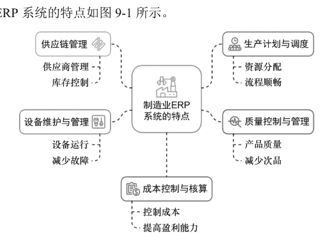

在 AI 时代，制造业 ERP 系统面临以下问题。

- ① 数据孤岛问题。尽管 ERP 系统旨在整合企业内部的各个业务流程，但在实际应用中，不同部门和业务环节的数据可能仍然存在孤岛现象，导致信息流通不畅，影响决策的及时性和准确性。
- ② 实时性不足。随着企业生产规模的扩大和业务复杂性的增加，传统 ERP 系统在数据处理和响应速度方面可能无法满足实时性要求，导致生产计划和调度的滞后，影响生产效率和客户满意度。
- ③ 智能化决策支持不足。传统 ERP 系统主要基于预设的规则和流程进行操作，缺乏智能化的决策支持功能，难以根据实时数据和市场变化进行灵活调整和优化。
- ④ 个性化定制能力有限。不同制造业企业有不同的生产流程和管理需求，传统 ERP系统的个性化定制能力有限，可能无法完全满足企业的特定需求。

⑤ 数据安全与隐私保护问题。随着企业数字化程度的提高，数据安全和隐私保护成为重要问题。ERP 系统作为企业核心数据的集中管理平台，需要加强数据安全防护措施，防止数据泄露和恶意攻击。AI 时代制造业 ERP 系统面临的挑战如图 9-2 所示。

### 9.3 DeepSeek 可以解决的制造业 ERP 系统问题

DeepSeek 与 ERP 系统结合，通过提高数据处理能力、实时分析、智能决策支持和自动化流程，解决传统 ERP 系统在数据孤岛、实时性、智能化决策支持、个性化定制和数据安全等方面的不足，推动制造业的智能化升级。

#### 9.3.1 解决数据孤岛问题

企业数据孤岛问题的本质在于数据在不同部门或系统之间无法共享和互通，导致信息孤立。这种现象会直接影响企业的运营效率，阻碍信息流通，导致各团队难以获得完整且准确的业务图景，从而错失数据驱动决策的机会。

数据孤岛问题首先是企业业务治理和数据治理问题，其次是技术层面的实现问题。DeepSeek 与制造业 ERP 系统结合，通过构建统一的数据底座、开展数据治理与制定标准，以及跨系统协同等多种方法，可以在一定程度上解决数据孤岛问题。

构建统一数据底座，首先需要完成数据的采集，如通过物联网边缘计算设备，实现毫秒级数据采集，覆盖设备振动、温度、能耗等传统 SCADA 系统忽视的“暗数据”。借助 DeepSeek 的异构系统集成驱动，快速对接与集成 ERP、OA、CRM 等信息系统，使所有数据完成汇聚并能统一调取使用，真正实现全要素连接。DeepSeek 可以自动识别数据血缘关系，建立动态数据目录，解决设备迭代、工艺变更导致的数据 Schema 漂移问题，实现动态数据治理。基于知识图谱技术自动建立“设备—工艺—人员—物料”的关联关系，为上层应用提供语义化数据服务，提高数据的利用效率和价值。

开展数据治理与制定标准，首先需要建立数据治理团队，结合 DeepSeek 的数据处理能力，制定数据标准和规范。确保数据在采集、传输、存储和使用过程中的一致性和准确性，保障数据融合的质量，数据治理团队负责制定数据的命名规则、数据格式、数据质量评估标准等，同时利用 DeepSeek 的语义理解和数据处理能力，对数据进行清洗、转换和整合。只有在良好的数据治理与标准制定的基础上，才可能相对完美地解决“数据孤岛”问题。

实现跨系统协同，首先要将 DeepSeek 作为“智能中台”，通过高效连接决策模型与 ERP、MES、CRM 等关键业务系统，实现数据的统一调度、智能化分析和指令的精准分发。例如，当大模型从 CRM 系统实时捕获到客户订单的变更信息时，需要迅速解析需求变化，并将相关信息同步至决策模型或其他生产排产优化工具，动态调整生产计划，适应新的订单要求。

#### 9.3.2 解决系统实时性不足问题

系统实时性不足是指系统在数据处理和响应速度方面无法满足实时性要求，导致信息更新不及时，影响决策的及时性和准确性。在制造业中，这种问题非常突出。

系统实时性不足在制造业 ERP 系统中，体现在以下 4 个方面。

- ① 生产数据更新延迟，导致管理层无法及时掌握生产进度和设备状态，影响生产计划的调整和决策的制定。
- ② 供应链信息不同步，企业难以实时掌握供应商的实际生产进度和库存情况，导致库存积压或缺货现象频繁发生。
- ③ 库存管理不及时，导致库存积压或缺货，增加库存成本或影响生产进度。
- ④ 设备状态监控滞后，设备运行数据无法实时采集和分析，导致设备故障无法及时发现和预警，影响设备的正常运行和生产效率。

DeepSeek 与制造业 ERP 系统结合，可以通过以下 5 种办法，解决实时性不足问题。

- ① 在完成数据实时采集的基础上，借助 DeepSeek 对异构系统的集成驱动，快速对接与集成 ERP、OA、CRM 等信息系统，使所有数据完成汇聚并能统一调取使用，真正实现全要素连接。
- ② 利用 DeepSeek 的实时监控功能，实时监控原材料、在制品及成品库水平，并与订单系统联动，动态更新订单生产与交付状态，确保信息在客户、计划与生产部门间的透明同步。
- ③ 通过 DeepSeek 的 API，快速对接现有 OA、MES 系统，实现数据的无缝流通和业务流程的协同优化。优先优化高频、高重复性的业务流程，如报表制作、审批流程等，实现流程自动化、智能化，减少人工干预，降低出错率。
- ④ 将 DeepSeek 作为“数据与指令中台”，通过高效连接决策模型与 ERP、MES、CRM 等关键业务系统，实现数据的统一调度、治理与指令的精准分发。
- ⑤ 利用 DeepSeek 的实时监控和异常预警功能，实时采集设备运行数据、生产环境数据等，利用 AI 模型进行分析处理，根据分析结果做出决策，如调整设备运行参数、发出维护预警等，实现生产流程的智能化、自动化。

#### 9.3.3 解决系统智能化决策支持不足问题

制造业 ERP 系统智能化决策支持不足的问题本质在于其主要基于预设的规则和流程进行操作，缺乏对实时数据和市场变化的灵活调整和优化能力。制造业 ERP 系统智能化决策支持不足主要表现为数据分析能力不足、决策支持滞后、灵活性不足及数据整合困难。

传统 ERP 系统在数据分析方面主要依赖预设的报表和查询功能，难以进行深入的数据挖掘和多维分析，无法及时发现数据中的潜在规律和趋势。由于数据分析能力的限制，传统 ERP 系统在提供决策支持时通常滞后于实际业务需求，无法实时响应市场变化和业务调整。此外，传统 ERP 系统的智能化决策支持功能通常基于固定的模型和算法，难以根据企业的具体业务需求进行灵活定制和调整。当整合来自不同部门和系统的数据时，传统 ERP 系统可能存在困难，导致数据不一致或不完整，影响决策支持的质量。

DeepSeek 与制造业 ERP 系统结合，可以通过以下 4 个层面解决智能化决策支持不足的问题。

- ① 利用 DeepSeek 的智能分析模块，深度挖掘供应链数据，提前发现潜在风险，如原材料供应短缺、物流延误等，并根据风险情况动态调整供应链策略，为管理者提供动态、前瞻的决策支持。
- ② 基于汇聚的含量数据，利用 DeepSeek 的先进 AI 模型进行深度分析与挖掘。生成涵盖运营、财务、市场的综合性分析报告。从被动响应转为主动洞察，辅助管理者进行战略规划与精准决策。
- ③ 将 DeepSeek 作为“智能中台”，通过高效连接决策模型与 ERP、MES、CRM 等关键业务系统，实现数据的统一调度、智能化分析和指令的精准分发。
- ④ 通过 DeepSeek 的代码生成与仿真建模支持，为智能研发提供强大助力。利用 DeepSeek 的多模态能力，快速生成多种设计方案，并对方案进行模拟分析，筛选最优解，提高研发效率和产品质量。

#### 9.3.4 解决个性化定制能力不足问题

制造业 ERP 系统个性化定制能力不足的问题本质在于其主要基于预设的规则和流程进行操作，缺乏对实时数据和市场变化的灵活调整和优化能力。制造业 ERP 系统个性化定制能力不足导致系统在数据分析、预测和决策支持方面表现不足，无法满足企业在复杂多变的市场环境中的个性化需求。

传统 ERP 系统的架构设计比较固定，难以灵活调整以适应不同的业务需求。同时定制化开发需要大量的开发工作和投入，并且每次改动都可能会增加系统的复杂性和维护难度。此外，传统 ERP 系统的更新周期较长，难以快速响应市场和技术的变化。不同部门和系统的数据格式和标准不一致，导致数据整合和共享困难。

DeepSeek 与传统 ERP 系统结合，可以通过以下层面解决传统 ERP 系统个性化定制能力不足的问题。

- ① 在打破数据孤岛的基础上，充分利用 DeepSeek 提供的高级数据分析工具，实现功能扩展与个性化定制。
- ② DeepSeek 通过 API，快速对接现有 OA、MES 系统，让 AI 技术深度融入企业日常运营，实现数据的无缝流通和业务流程的协同优化。
- ③ 组织可以根据特定要求选择 DeepSeek 的模块，这种灵活性可以确保企业根据增长来扩展运营。
- ④ 针对不同行业传统 ERP 系统用户的特定业务场景和痛点，定制化开发基于 DeepSeek 模型的行业解决方案，提供更精准、专业的智能服务，提升用户黏性和付费意愿。
- ⑤ 产品上线 AI 功能后，持续收集用户与 AI 交互的数据（遵守隐私政策的前提下），用于定期优化模型。
- ⑥ 通过反馈学习，使嵌入产品的 DeepSeek 模型逐步提高在特定领域的精准度。

#### 9.3.5 解决数据安全与隐私保护问题

制造业 ERP 系统存在的数据安全与隐私保护问题的本质在于其涉及大量的企业核心数据，包括财务数据、供应链数据、员工数据等，这些数据的泄露或滥用会对企业的运营和声誉造成严重影响。

ERP 系统作为企业核心管理系统，集中存储了大量敏感数据，安全措施不到位，容易成为攻击目标。随着互联网的普及，网络攻击手段不断升级，ERP 系统面临被黑客攻击、数据被窃取或篡改的风险。同时，内部人员可能因疏忽、错误操作或故意行为导致数据泄露或滥用。此外，当数据丢失或损坏时，企业需要建立可靠的数据备份和恢复机制，否则可能会面临运营中断的风险。数据保护法规的不断完善，如《通用数据保护条例》（GDPR），也对企业数据管理的合规性提出了更高要求。

DeepSeek 与制造业 ERP 系统在以下层面的结合，可以在一定程度上解决数据安全与隐私保护问题。

- ① 通过 DeepSeek 的本地化或私有云部署，数据不出企业内网，确保数据的自主可控和安全性。同时，DeepSeek 内置的可解释性接口能够支持审计模型的决策路径，满足金融、医疗等强监管行业的合规要求。
- ② DeepSeek 支持文本、表格、图像、视频等多种数据类型的统一分析，构建端到端的数据治理链路。例如，在零售行业，DeepSeek 可以校验 ERP 数据与扫描发票数据，财务异常识别准确率高达 98%，大幅减少人工核查的工作量。
- ③ DeepSeek 支持实时数据监控和异常检测功能，能够在发生问题时快速响应，避免潜在风险对企业造成重大影响。
- ④ 在数据融合过程中，建立严格的数据访问权限管理机制，明确不同部门、不同岗位人员对数据的访问权限，防止数据泄露和滥用。同时，采用加密、脱敏等技术手段，保护数据的安全和隐私。

### 9.4 DeepSeek 与 ERP 系统结合的方式、方法和步骤

DeepSeek 与 ERP 系统结合，在具体操作和执行层面需要经历以下 6 个阶段。DeepSeek 与 ERP 系统集成过程如图 9-3 所示。

#### 9.4.1 前期准备

企业首先要对业务场景进行优先级评估。在优先级评估环节，要梳理 ERP 系统现有痛点，针对痛点着手解决；在诸多痛点中，需要进行投资回报率（Return on Investment，ROI）测算，筛选高价值场景进行试点。当试点时，需要优先选择数据质量高、流程标准化的模块，如财务报销、库存预测等。

其次要进行数据治理。数据治理首先需要修复 ERP 系统中的数据缺失值（如供应商交货记录缺失率高于 15%），统一字段格式（日期、单位）；需要构建 AI 所需数据集，如销售预测需整合历史销量、促销活动、天气等数据。

最后要对非结构化数据打标签，如合同文本中标记“付款条款”“违约金比例”等。

#### 9.4.2 技术对接架构

完成业务场景优先级评估和数据治理阶段后，就进入了技术架构对接阶段。技术架构对接核心包括两个层面的内容，一是技术对接，二是权限与安全设计。

##### 1. 技术对接

###### （1）技术选型

技术对接需要进行技术选型。在 DeepSeek 与 ERP 系统对接的技术选型方案中，常用的方式包括 API 调用和私有化部署。

API 调用是最常见的集成方式。DeepSeek 提供丰富的 API，企业可以通过 HTTP 请求的方式向 DeepSeek 发送文本输入，获取推理结果。这种方式简单快捷，无须对现有系统进行大规模改造，适用于大多数业务场景。例如，在智能客服系统中，当用户发送咨询问题时，系统将问题通过 API 传递给 DeepSeek，DeepSeek 返回答案后，再由智能客服系统展示给用户。

对于企业来说，如果需要一些私有化的知识库作为大模型的数据参考，API 调用也能满足需求。通过云 API 形式访问 DeepSeek，在线调试并使用其功能，同时结合私有化的知识库，也能提高应用的智能化水平。

数据安全和隐私要求较高的企业，可以选择将 DeepSeek 模型进行私有化部署。为此，企业需要准备相应的硬件设施，如高性能的 GPU 服务器，以满足模型运行的计算需求。然后，将 DeepSeek 模型部署到企业内部的服务器上，通过内部网络进行访问。虽然这种方式能够更好地保护企业数据，但部署和维护的成本相对较高。

私有化部署允许企业将 DeepSeek 平台部署在自有服务器或私有云环境中，确保数据完全由企业自主掌控，避免数据泄露风险。同时，企业可以根据具体需求对模型进行详细定制和优化，适应特定业务场景。

私有化部署后，企业可以通过自定义 API 地址调用 DeepSeek 模型，实现业务系统的对接。这种方式既保证了数据的安全性，又方便地利用了 API 的灵活性，可以满足不同场景的应用需求。

###### （2）集成

集成为 3 个部分，一是接口对接，二是数据传输与预处理，三是模型适配与优化。

无论采用哪种集成方式，接口对接都是关键步骤。根据 DeepSeek 提供的 API 文档，在现有业务系统中编写相应的接口调用代码，确保接口参数的传递准确无误，包括输入文本的格式、长度限制，以及期望的输出结果格式等。同时，处理接口调用过程中的异常情况，如网络超时、服务器错误等，保证系统的稳定性。

将数据发送给 DeepSeek 进行推理前，需要对数据进行必要的预处理，可能包括文本清洗、分词、特征提取等操作，以及将数据转换为适合模型输入的格式。在文本分类任务中，需要对文本进行分词操作，并将词语转换为模型能够理解的向量表示。另外，建立高效的数据传输机制，确保数据能快速、准确地在业务系统和 DeepSeek 之间传递。

虽然 DeepSeek 已经经过了大量的预训练，但在具体的业务场景中，可能还需要进行一定的微调和适配。可以使用企业内部的业务数据对模型进行微调，使其更好地理解和处理企业特定领域的知识和任务。同时，对模型的推理性能进行优化，如采用模型量化、缓存机制等技术，可以提高推理速度，降低延迟。

###### （3）测试与验证

集成完成后，需要对系统进行全面的测试，确保 DeepSeek 与 ERP 系统的集成效果。测试内容包括接口的稳定性、数据传输的准确性、模型的推理性能等。可以使用模拟数据和实际业务数据进行测试，验证 ERP 系统的功能和性能。

通过对比测试结果与预期结果，验证 DeepSeek 的推理结果是否准确，是否能够满足业务需求。如果发现问题，需要及时调整和优化，确保系统的可靠性和稳定性。

##### 2. 权限与安全设计

当 DeepSeek 与 ERP 系统进行技术对接时，权限与安全设计具有重要意义和作用。

ERP 系统包含生产计划、库存信息、客户资料等大量敏感数据，权限与安全设计能够确保这些数据不被未授权访问，防止数据泄露，保护企业的核心竞争力和商业机密。身份验证与授权机制能够确保只有经过授权的用户才能访问系统和数据；通过加密技术对数据进行加密存储和传输，可以防止数据在传输过程中被窃取或篡改。

权限与安全设计不仅能提高系统的稳定性和可靠性，还可以防止恶意攻击和非法操作，减少系统故障和数据丢失的风险，保障生产的连续性。通过最小权限原则和角色分离原则限制用户对系统功能和数据的访问权限，可以避免错误操作或恶意行为导致系统崩溃或数据损坏。实施动态权限管理和权限审计，可以及时发现和修复权限配置错误，确保系统的稳定运行。

良好的权限与安全设计，还能确保企业运行符合相关法律法规与行业标准要求，优化资源分配并提高效率。

当 DeepSeek 与 ERP 系统进行技术对接时，在权限与安全设计环节涉及内容较多。

首先定义权限和角色。一是遵循最小权限原则，为 DeepSeek 相关角色仅分配执行任务所必需的权限。通过精细化的权限控制，确保每个角色只能访问工作范围内所需的资源，从而有效地防止权限滥用。二是实施严格的角色分离策略，将系统管理员、开发者、审计员等角色分离，并为每个角色定义明确的权限范围。即使某个角色的权限被破解，系统也能限制攻击者的影响范围。三是在具体的工作业务流程中要实施严格的身份验证与授权。企业 ERP 系统需要采用 MFA 等强身份验证机制，确保只有经过授权的用户才能访问 DeepSeek 和 ERP 系统。在实施上可以使用 RBAC 或属性基访问控制管理权限，确保用户只能访问权限范围内的数据和功能。

其次对敏感数据进行加密存储和传输，确保数据在采集、传输、存储和使用过程中的一致性和准确性。例如，可以根据需要和业务场景，使用 AES-256 等强加密算法。在非生产环境中，使用数据脱敏或匿名化技术，确保敏感信息不会被泄露。

再次实施动态的权限管理。根据实际需求实时调整 DeepSeek 相关角色的权限。例如，在开发阶段授予更多调试权限，在生产环境中则严格限制调试权限。这种动态管理方式可以确保权限的灵活性和安全性。

最后需要进行相关的权限审计与监控。定期对 DeepSeek 相关的权限进行审计，确保所有权限分配符合安全策略。同时，通过监控服务实时监控权限的使用情况，及时发现并处理异常行为。合规性检查和安全培训，也是企业在权限与安全设计环节需要开展的常规性工作。

#### 9.4.3 核心场景开发

核心场景开发在 DeepSeek 与制造业 ERP 系统结合中占据至关重要的地位，是整个结合过程中的关键。一是核心场景开发要紧密连接系统对接环节与实际业务需求，确保 DeepSeek 的能力能够精准落地到制造业的具体业务场景，解决实际问题，提高系统价值。二是在核心场景开发过程中，将权限与安全设计融入其中，可以确保制造业 ERP 系统在实际运行中的数据安全和隐私保护，防止数据泄露和未授权访问，为企业的数字化转型提供坚实的安全保障。三是通过核心场景开发，将 DeepSeek 的智能化能力与制造业 ERP 系统的业务流程深度融合，实现业务流程的自动化、智能化，提高企业的运营效率和决策科学性，是企业实现数字化转型的重要驱动力。四是核心场景开发能够针对制造业的具体业务场景，如智能采购预测、生产排程优化、供应链风险预警等，提供智能化的解决方案，帮助企业更高效地管理资源、优化生产计划、降低库存成本，从而提高企业的整体运营效率和市场竞争力。五是核心场景开发不是一蹴而就的，而是需要随着企业业务的发展和数据的积累不断优化和迭代。这个过程能够持续挖掘 DeepSeek 与制造业 ERP 系统结合的潜力，推动企业在数字化转型的道路上不断前行，保持创新活力。

##### 1. 以智能采购预测场景为例的开发步骤

在制造业 ERP 系统中，智能采购预测不仅是采购管理的核心功能，还是企业实现数字化转型、优化供应链管理、提高决策精准性和市场响应能力的关键工具。基于这个功能，企业能够更高效地管理资源、优化生产计划、降低库存成本，从而在竞争激烈的市场中占据有利位置。

DeepSeek 与制造业 ERP 系统在智能采购预测场景进行结合，在具体开发实施上有以下 8 个环节。

###### （1）数据整合

利用 DeepSeek 的语义理解能力进行采购预测，整合 ERP、CRM 等多系统数据，通过打破数据壁垒，实现数据的互联互通。例如，将历史采购数据、生产计划、供应商交货周期等数据进行整合，并确保数据的完整性和一致性。如果无法整合这些数据，就难以发挥 DeepSeek 的语义理解能力。

###### （2）模型训练

使用 DeepSeek 的时序预测模型，结合整合后的历史采购数据、生产计划和供应商交货周期等数据，进行模型训练。

##### 2. 需要注意的事项

在智能采购预测这个核心场景开发中，需要注意以下事项。

在数据整合与预处理环节，需要确保数据的准确性与一致性，避免数据质量问题影响后续的模型训练和预测效果。同时需要关注数据的实时性，保证数据能够实时更新和同步，便于 DeepSeek 基于最新的数据进行分析和预测。

在模型训练与优化环节，需要根据具体的业务场景和数据特点，选择最适合的算法和模型架构，提高预测的准确性和效率。例如，在需求预测场景中，可以尝试使用时间序列分析、机器学习回归模型等不同类型的算法，通过实验和比较，选择最适合企业数据的模型。调优训练好的模型，调整模型的参数和超参数，提升模型的性能。同时，通过交叉验证、留出验证等方法，评估模型的泛化能力和预测效果，确保模型在实际应用中能够稳定、准确地进行预测。

在系统集成与接口设计环节，需要关注接口的稳定性与兼容性，设计稳定、可靠的接口，确保 DeepSeek 与制造业 ERP 系统之间的数据传输稳定、高效，避免因接口问题导致数据丢失或系统故障。同时，考虑接口的兼容性，确保不同版本的 DeepSeek 和制造业 ERP 系统能够顺利对接。同时，在接口设计中，考虑各种可能的异常情况，如网络故障、数据格式错误等，并设计相应的容错机制，确保制造业 ERP 系统在出现异常时能够自动处理和恢复，保证业务的连续性。

此外，还需要建立用户体验与反馈机制，及时收集用户对系统的使用意见和建议，了解用户的需求和痛点，并根据用户反馈对系统进行优化和改进，不断提升系统的性能。

在持续优化与迭代环节，需要定期对 DeepSeek 与制造业 ERP 系统结合后的系统进行评估，分析系统的性能、效果和业务价值，找出存在的问题和不足之处，并制定相应的优化方案。例如，每个月对采购预测的准确率进行评估，根据评估结果调整模型和算法，提高采购预测的准确性。随着业务的发展和数据的积累，需要不断对 DeepSeek 进行训练和迭代，使其能够更好地适应业务变化和数据特征的变化，保持系统的先进性和竞争力。同时，关注行业动态和技术发展趋势，及时引入新的技术和方法，推动系统的持续创新和优化。

#### 9.4.4 部署与优化

部署与优化是 DeepSeek 与制造业 ERP 系统结合过程中的关键环节，是确保系统能够顺利运行并发挥最大效用的重要步骤。它不仅决定了系统能否在实际生产环境中稳定运行，还直接影响系统性能、用户体验和企业的运营效率。

##### 1. 渐进式上线策略

渐进式上线策略是一种分阶段、逐步增加流量或扩大用户范围的发布方式，旨在降低发布风险，确保系统平稳运行。它通过将新功能或新版本的发布分为多个批次，逐步增加流量或用户群体，实时监控系统的表现，及时发现并解决问题，从而实现平稳过渡。

渐进式上线策略适用于新产品发布、产品迭代、新功能上线、风险较大的变更上线、需要在真实环境下测试新版本性能和稳定性的情况、需要数据驱动决策的场景、大规模集群部署且资源有限的情况、对可用性要求极高的系统，以及需要快速回滚的场景。因此，DeepSeek 与制造业 ERP 系统的结合，无论从哪个层面来看，都适用于采用渐进式上线策略。

渐进式上线是一种风险可控、灵活性高的策略，同时通过实时监控和数据分析，为发布决策提供科学依据。渐进式上线还可以通过减少一次性发布的资源投入，降低发布成本，提高发布成功率。

在具体实施上，首先制订发布计划，将发布过程分为多个阶段，每个阶段设定明确的目标和验证标准，确定每个阶段的流量比例或用户群体范围，逐步增加流量。

其次进行小范围试点，在企业内部进行小范围测试，确保系统在小流量下的稳定性和功能，然后选择部分用户或流量进行灰度发布，观察系统表现和用户反馈。在此基础上逐步扩大范围，按照发布计划，逐步增加流量或用户群体，每个阶段进行充分验证。同时在每个阶段实时监控系统的关键指标，如响应时间、错误率等。

再次建立反馈与优化机制，及时收集用户和系统反馈，分析问题根源。根据反馈和监控数据，对系统进行优化和调整，确保后续阶段的顺利进行。

最后全量发布。完成所有阶段的验证和优化后，进行全面的全量发布。发布后仍然需要持续监控系统表现，确保系统的长期稳定运行。

##### 2. 持续优化机制

持续优化机制是一种长期的、系统的方法，通过不断评估、分析和改进系统或流程，提升系统性能和效果，提高系统效率。持续优化机制贯穿系统运行的整个生命周期，适用于系统性能随时间下降、需求发生变化，以及需要长期改进的场景。

制造业 ERP 系统随时需要根据外部变化，对自身进行调整。在 DeepSeek 与制造业 ERP 系统结合的过程中，可以从以下 4 个方面进行持续优化。

- (1) 模型微调
持续地使用企业内部的业务数据对 DeepSeek 模型进行微调，使其更好地理解和处理企业特定领域的知识和任务。

- (2) 缓存机制
在 DeepSeek 与制造业 ERP 系统集成中，引入缓存机制来存储频繁访问的数据，减少对数据库的重复查询，提高系统的响应速度。

- (3) 数据治理
建立数据治理团队，结合 DeepSeek 的数据处理能力，制定数据治理标准和规范。确保数据在采集、传输、存储和使用过程中的一致性和准确性，保障数据融合质量。

- (4) 反馈与优化
通过对比测试结果与预期结果，验证 DeepSeek 的推理结果是否准确，是否能够满足业务需求。如果发现问题，应及时调整和优化，确保系统的可靠性和稳定性。

##### 3. 变革管理

变革管理是指当企业内部引入重大变革时，通过系统化的方法和策略来管理和引导变革的过程。它旨在最小化变革过程中的阻力，确保变革地顺利进行，并促使组织适应新的情况和环境。

DeepSeek 与制造业 ERP 系统结合带来的管理变革，至少包括以下 3 个方面。

- (1) 角色重塑
DeepSeek 等 AI 技术的引入及与制造业 ERP 系统的结合，使传统的工作方式和技能需求发生了重大变化，员工需要通过角色重塑以适应新的技术环境。在新的技术环境下，员工需要掌握新的技能，提高工作效率和价值。

在 DeepSeek 与制造业 ERP 系统结合的背景下，企业需要重塑的角色及新角色方向如表 9-1 所示。

为了进行角色重塑，企业需要在战略层面明确角色重塑的目标和愿景，确保所有员工对角色重塑计划有清晰的认识。在执行层面，企业需要进行市场调研和内部分析，了解自身的优势和劣势，以及企业面临的市场机遇和挑战。在此基础上，企业需要根据自身情况制订具体的重塑步骤和策略，包括调整部门的职能和权责、优化流程，提高决策效率。

表 9-1 企业需要重塑的角色及新角色方向

| 传统角色 | 新角色 | 新角色职能 |
| :--- | :--- | :--- |
| 采购专员 | 采购数据分析师 | 利用 DeepSeek 的智能分析功能，优化采购决策 |
| 生产计划员 | 生产排程优化师 | 利用 DeepSeek 的预测模型，优化生产计划 |
| 设备维护人员 | 主动维护工程师 | 利用 DeepSeek 的预测性维护功能，减少设备故障 |
| 质量控制人员 | 智能质检工程师 | 利用 DeepSeek 的多模态能力，提高质检效率和准确性 |
| 供应链管理人员 | 供应链风险预警专家 | 利用 DeepSeek 的智能分析，提前发现潜在风险 |

- (2) 组织结构与流程优化
在组织层面，需要优化组织结构与流程，减少管理层级，提高决策效率和响应速度，整合不同部门的职能，形成跨部门协作组，促进信息流通和资源利用，同时明确职责与权力，确保每个团队成员的职责和权限清晰，避免职责重叠和冲突；还需要推进流程简化与标准化，通过标准化流程，减少不必要的步骤，提高工作效率。在人事方面，需要确保员工在重塑过程中能够得到充分的支持和帮助。

当组织实施时，利用 DeepSeek 相关技术构建统一数据底座，实现数据的互联互通，为决策提供全面的数据支持。

此外，企业需要构建 AI 人才梯队，实现从“技术焦虑”到“全员赋能”的转变。企业 IT 部门的职能将发生根本性转变，工程师需要掌握新技能，企业应设立专门的数据治理委员会，推动组织变革，培养“数据即资产”的共识，建立基于数据价值创造的绩效考核体系，完成文化转型。从长远发展来看，企业需要注重人才培养和团队建设，因为数字化转型需要既懂制造业业务又懂 AI 技术的复合型人才，企业需要加强内部培训和外部人才引进，打造一支高素质的数字化转型团队。

- (3) 重构智能生产流程
在此基础上，重构智能生产流程，从“人盯设备”调整到“AI 自决策”，利用 DeepSeek 技术推动生产流程向“AI 自决策”迈进。打造智能供应链，从“经验备货”到“需求先知”，通过融入 DeepSeek 技术，使供应链实现“需求先知”，提高运营效率。优化业务流程，实现从“烦琐低效”到“智能高效”的转变，利用 DeepSeek 对业务流程进行智能化改造，大幅提高效率。

在技术层面，通过使用 AI 技术自动化重复性的任务，使员工专注于更高价值的工作。建立“AI+工程师”协同平台。以 DeepSeek 为支撑，工程师可以通过自然语言与 AI 技术进行交互，快速获取设计建议、解决方案及技术文档，使非 AI 专业背景的工程师也能轻松运用 AI 技术，提高研发效率。

#### 9.4.5 技术挑战与对策

DeepSeek 在与制造业 ERP 系统结合的过程中，可能会面临数据整合与孤岛问题、实时性达不到要求、模型适配与优化、数据安全与隐私保护、系统集成复杂性高、长尾场景覆盖不全等技术层面的问题，还可能会面临用户接受度与流程改造阻力等非技术层面的问题。在某种程度上，非技术层面的问题是因为技术层面的问题没有得到解决而导致的。

如果这些技术问题不能得到很好的解决，可能会带来系统性能下降、业务流程中断、项目成本增加、项目周期延长、系统可靠性降低、数据挖掘与分析能力受限等多方面的影响。

##### 1. 数据整合与孤岛问题

数据整合与孤岛问题，大多数是系统异构性、传统数据 ETL 方式局限，以及数据管理分散造成的。制造业中存在多种异构系统，如 ERP、MES、SCADA 系统等，这些系统各自独立运行，数据格式和通信协议不统一，导致数据难以互通和整合。同时，传统的 ETL 方式难以实现实时数据融合，数据处理效率低，无法满足实时决策的需求。此外，数据分散在不同的部门和系统中，形成了许多数据孤岛，缺乏统一的数据管理和治理策略。

为了解决数据整合与孤岛问题，首先需要构建统一的数据底座。通过物联网边缘计算设备，实现毫秒级数据采集，覆盖设备振动、温度、能耗等传统 SCADA 系统忽视的“暗数据”。借助异构系统集成驱动，快速对接与集成 ERP、OA、CRM 等信息系统，使所有数据完成汇聚并能统一调取使用。

其次需要建立数据治理与标准化。一是建立数据治理团队，负责制定数据标准和规范，确保数据在采集、传输、存储和使用过程中的一致性和准确性。二是通过 AI 自动识别数据血缘关系，建立动态数据目录，解决因设备迭代、工艺变更导致的数据 Schema 漂移问题。三是基于知识图谱技术自动建立“设备—工艺—人员—物料”的关联关系，为上层应用提供语义化数据服务。

最后需要进行语义理解和数据整合，利用 DeepSeek 的语义理解能力，整合 ERP、CRM 等多个信息系统数据，打破数据壁垒，实现数据的互联互通。

##### 2. 高实时性要求

制造业中很多业务环节和场景都对实时性有较高的要求，如生产过程实时监控与调整、供应链的实时管理、质量检测与控制、设备预测性维护等。

制造业生产过程需要实时监控设备运行状态、生产环境参数等，便于及时调整生产计划和设备运行参数，确保生产过程的顺利进行。供应链管理需要实时获取销售订单、库存变化等数据，及时调整采购计划，确保生产不会因物料短缺造成停滞。生产线需要实时检测产品质量，及时发现和处理缺陷，避免不合格产品流入市场。此外，制造业企业需要通过实时监测设备运行数据，提前发现设备潜在故障，避免因设备停机造成生产中断。

- (1) 边缘计算部署
在工业设备运维和质量检测等需要实时数据处理和低延迟的场景中，可以采用边缘计算部署。通过将 DeepSeek 模型部署在靠近数据源的边缘设备，如物联网传感器或边缘服务器，可以实现快速数据处理和实时响应。

- (2) 实时计算优化
制造业的很多实时场景甚至需要秒级响应。为此，可以利用流式处理技术，确保数据处理与模型推理能够快速且高效地完成。生产监控、供应链管理等需要处理大量实时数据的场景，对实时性要求较高。这种情况也可以通过流式处理技术实时采集和处理数据，确保数据处理的高效和实时。

- (3) 采用混合云架构
利用公有云的弹性和可扩展性，将部分数据和应用部署在公有云，将核心数据和敏感业务部署在私有云或本地服务器，确保数据安全。通过混合云架构，实现数据的实时处理和分析，同时保证数据的安全性和隐私保护。

- (4) 渐进式迭代
渐进式迭代适用于需要逐步提升系统性能、提高系统实时性的场景。可以从简单的机器人流程自动化增强逐步过渡到自主决策系统，通过渐进式迭代，逐步提高系统的实时性和智能化水平。

##### 3. 模型适配与优化环节问题

当 DeepSeek 与制造业 ERP 系统结合时，可能有多个方面的原因会导致模型适配与优化环节出现问题。

- (1) 数据特征差异
制造业不同企业的数据特征存在显著差异，包括数据格式、数据量、数据质量等。这些差异会增加 DeepSeek 在不同企业中的适配难度。

- (2) 业务流程差异
不同制造业企业的业务流程和管理模式存在差异，导致 DeepSeek 在适配过程中需要针对特定企业的业务流程进行调整和优化。

- (3) 实时性要求高
在制造业生产过程中，需要实时数据处理和低延迟响应，对 DeepSeek 模型的实时数据处理和分析能力提出较高要求。

- (4) 计算资源限制
制造业企业可能面临计算资源的限制，特别是在需要高性能计算的场景中，如何在有限的资源下实现模型的高效运行是一个挑战。

- (5) 长尾场景覆盖不足
制造业中存在一些罕见故障类型等长尾场景，这类场景的数据积累不足，增加了 DeepSeek 模型的训练和优化难度。

解决以上问题，除增加计算资源、覆盖更多业务场景以获取更多数据外，也有必要采用以下方法。

- (1) 模型微调
使用企业内部的业务数据对 DeepSeek 模型进行微调，使其更好地理解和处理企业特定领域的知识和任务。

- (2) 数据预处理与标准化
将数据输入 DeepSeek 模型前，需进行数据清洗、转换和标准化，确保数据的一致性和准确性。

- (3) 场景化优化
针对不同的业务场景，如质量控制、生产调度、能耗管理等，进行场景化的模型训练和优化。

- (4) 边缘计算部署
在需要实时数据处理和低延迟的场景中，将 DeepSeek 模型部署在靠近数据源的边缘设备，如物联网传感器或边缘服务器，实现快速数据处理和实时响应。

- (5) 持续学习与反馈机制
通过对比测试结果与预期结果，验证 DeepSeek 的推理结果是否准确，是否能够满足业务需求。如果发现问题，应及时调整和优化，确保系统的可靠性和稳定性。

前面已经阐述了系统集成的复杂性问题，数据安全与隐私保护问题将在本书最后一章进行阐述。长尾场景覆盖问题本质上不是技术问题，而是需要通过增加更多的物联网传感器设备，获得更多数据来解决的问题。

#### 9.4.6 落地效果评估

DeepSeek 与制造业 ERP 系统结合，其落地效果可以从多个方面进行评估。以下是主要的方面。

- (1) 生产效率
生产效率至少可以从生产周期和设备利用率两个层面进行评估。在生产周期层面，通过实时监测和生产数据分析，DeepSeek 将生产周期缩短了多少？在设备利用率方面，DeepSeek 提前预警设备故障，缩短设备停机时间，提高设备利用率等指标提高了多少？

- (2) 成本
成本至少可以从库存成本、采购成本和维护成本 3 个方面进行评估。引入 DeepSeek 后，库存周转率提高了多少？供应链成本降低了多少？对需求的预测精准度提高了多少？预测性维护功能发挥得怎么样？减少了多少次设备突发故障？设备使用寿命延长了多少？设备维护成本降低了多少？

- (3) 质量管控与提升
在质量管控与提升方面，可以观测一些可以定量的指标，如以 DeepSeek 的 AI 质检功能替代人工目检，缺陷检出率提高了多少？装配错误率下降了多少？产品合格率提高了多少？由此带来的经济效益提高了多少？

此外，还有一些定性的指标，如决策支持与优化功能发挥得怎么样？数据的无缝流通和业务流程的协同程度高了还是低了？用户接受度提高了多少？

通过以上结构化实施路径，企业可在 6～12 个月内完成制造业 ERP 系统的 AI 能力升级，实现从“流程驱动”到“智能驱动”的转型。关键成功因素在于业务场景的精准聚焦、数据质量的严格把控，以及变革管理的持续推进。

### 9.5 案例

澎湃新闻①、江门市人民政府官网②及中国电信③等媒体报道了广东某某电子机械科技有限公司（以下简称“广东某某电子机械”）DeepSeek 与制造业 ERP 系统结合的真实案例。

广东某某电子机械是鹤山数字化转型的“优等生”，在制造业领域具有一定的代表性。此前，它通过“5G +工业 4.0”技术升级，接入智慧仓储和 ERP、MES 系统，实现全流程数字化生产管理，在生产数据实时互联和设备效率提升方面已经取得了一定成果。

##### 1. DeepSeek 与 ERP 系统结合的举措及作用

通过部署 DeepSeek，对企业数据进行训练和推理。在 3D 图形设计方面，利用 AI 的强大计算能力和学习能力，快速生成更精准、更符合设计要求的 3D 图形，减少设计时间和成本。在快速匹配客户需求方面，DeepSeek 可以分析客户的历史订单数据、偏好等信息，结合企业的产品库存、生产能力等，迅速为客户提供最适合的产品方案，提高客户满意度和订单成交率。

##### 2. 提炼“工业+ AI +数字化转型”六大应用场景

- (1) 企业知识库与智能客服调用
将企业的各类知识文档、技术资料等整合到知识库中，通过 DeepSeek 的 NLP 能力，实现智能客服的快速响应。当客户或员工有问题时，能够准确理解问题意图，从知识库中提取相关信息并进行解答，提高服务效率和准确性。

- (2) 多源数据采集、清洗、结构化、自动化处理调用
DeepSeek 可以对接企业的 ERP、MES 等系统，采集来自不同数据源的数据，包括生产设备数据、销售数据、库存数据等。对这些数据进行清洗和结构化处理，去除噪声和错误数据，为后续的分析和决策提供高质量的数据基础。

① 拥抱 DeepSeek，解锁数智新模式！鹤山首个中小企业数字化转型项目签约。
② 聚焦数字化转型，赋能工业未来 中国电信江门分公司“工业+5G+DeepSeek”项目成功签约。
③ 拥抱 DeepSeek！广东江门市首个“工业 5G + DeepSeek”中小企业数字化转型项目成功签约。

##### 3. 合作模式

广东某某电子机械作为产业需求方，鹤山电信作为网络基础与 DeepSeek 集成方，某某信息作为数字化系统开发方，三方深度合作。

鹤山电信基于 DeepSeek 技术，通过天翼云基座为企业构建本地专属节点，依托“息壤”平台实现分布式算力智能调度，支撑企业 AI 故障预测、智能排产等场景。天翼云采用“云一边一端”三级防护及量子加密技术，保障数据安全，实现生产数据本地留存与算力全局调度。

某某信息在数字化系统开发方面提供专业支持，确保 DeepSeek 与企业的 ERP、MES 等系统能够无缝对接和集成。

## 第 10 章 创建企业应用 AI Agent

DeepSeek 及企业业务管理系统虽然强大，但在某些场景下仍需要 AI Agent<sup>①</sup>的补充。例如，DeepSeek 擅长 NLP 和 NLG，却无法自主执行任务，AI Agent 可以弥补这个不足。因此，在企业的具体应用中，除了直接将 DeepSeek 作为工具和应用使用，还需要进一步发挥 DeepSeek 的工具属性，基于 DeepSeek 开发面向企业应用的 AI Agent。

### 10.1 什么是 AI Agent

AI Agent 是一种能够感知环境、进行自主决策并执行动作的智能实体，它不仅能够理解用户的需求，还能够主动规划和执行任务以实现目标。AI Agent 既可以是软件程序，也可以是具有物理形态的机器人。

AI Agent 的关键特性包括自主性、反应性、目标导向和学习能力。AI Agent 能够在没有人类直接干预的情况下运作，并能够对周围环境和接收到的信息作出及时响应。AI Agent 拥有明确的目标或任务并为之努力，同时可以通过经验不断改进自身的性能和策略。AI Agent 功能结构示意图，如图 10-1 所示。

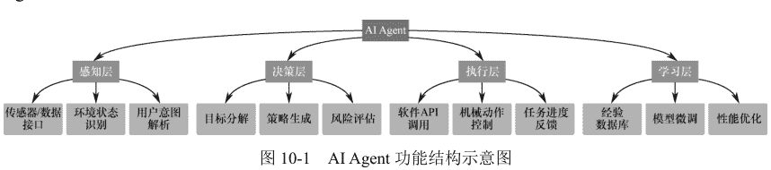

##### 1. AI Agent 与 AGI 的区别

AI Agent 和 DeepSeek 等 AGI 都属于 AI 技术的范畴，它们都利用了机器学习、NLP、计算机视觉等技术实现智能化的功能。两者都旨在提高效率、自动化任务、提供决策支持，并提升用户体验。AI Agent 和 AGI 在应用场景、目标能力、模型复杂度、数据需求、学习与训练、开发难度和评估标准等方面存在明显的区别，AI Agent 与 AGI 的区别如表 10-1 所示。

表 10-1 AI Agent 与 AGI 的区别

| 比较维度 | AI Agent | AGI |
| :--- | :--- | :--- |
| 应用场景 | 具有针对性，擅长处理特定任务，如客服对话、图像识别、数据分析等 | 适用于多种任务和领域，如文本生成、问答系统、数据分析、图像识别等 |
| 目标与能力 | 专注于完成特定任务，具备与任务相关的特定能力 | 追求通用智能，具备多种能力，能够处理各种类型的任务 |
| 模型复杂度 | 较低，通常针对特定任务进行优化 | 较高，需要处理多种类型的数据和任务 |
| 数据需求 | 需要与特定任务相关的数据 | 需要大量多样化数据训练模型 |
| 学习与训练 | 主要采用有监督学习，训练过程和优化目标相对明确 | 采用多种学习方法，包括无监督学习、强化学习等 |
| 开发难度 | 较低，有成熟的开发框架和工具可用 | 较高，需要深入的 AI 知识和大量的资源 |
| 评价标准 | 以特定任务的完成效果和效率为评价标准 | 以综合性能、适应性和泛化能力等作为评价标准 |

此外，在专用性与通用性方面，AI Agent 和 AGI 也存在明显的差异。当前的 LLM 基本都是通用模型。DeepSeek 等通用 LLM 通过在大规模数据上进行预训练，学习丰富的语言知识和上下文信息，能够处理多种自然语言任务，具有广泛的任务适应性、灵活的微调能力和跨领域应用能力。AI Agent 的设计目标是实现特定任务或场景中的自主决策和行动，需要与环境交互，因此通常面向特定应用，具有专用性。AI Agent 的专用性主要体现在以下 3 个方面。

- （1）特定任务导向
AI Agent 通常面向特定任务或场景设计，如智能客服、自动驾驶、任务管理等。
- （2）环境交互能力
AI Agent 能够与环境交互，通过感知和行动实现特定目标。
- （3）自主性和目标导向
AI Agent 具有一定的自主性，能够在特定任务中自主运行，专注于实现特定目标。

在具备明显区别的同时，AI Agent 和 DeepSeek 等 AI 工具也存在非常紧密的联系。在功能上，两者存在明显的互补关系，AI Agent 可以利用 DeepSeek 等 AGI 工具提供的语言理解和生成能力，提升其与用户的交互体验。AI Agent 也可以利用 DeepSeek 等 AGI 处理的数据进行学习和决策，同时 AI Agent 也可以为 DeepSeek 等 AGI 提供更多应用场景和数据支持。

##### 2. AI Agent 与专用 AI 的区别

AI Agent 与专用 AI 的区别主要体现在专用 AI 通常专注于特定领域的任务，如图像识别、语音识别等，具有高度的专业性和针对性，AI Agent 能够处理多种任务，相比专用 AI 工具具有更广泛的适用性和灵活性。在功能上，AI Agent 可以集成专用 AI 工具，利用其专业能力完成特定任务。AI Agent 与专用 AI 也可以协同工作，共同实现更复杂的目标和任务。

##### 3. AI Agent 与 Agent 的区别

AI Agent 和 Agent 也有多个方面的区别。Agent 指代的范围更广，是 AI 领域的通用概念，指能够感知环境、做出决策并执行行动以实现特定目标的实体，不局限于使用 AI 技术，可以是基于规则的简单程序、人等，如软件代理、机器人等，可应用于多种场景，如自动化任务、游戏等。AI Agent 是 Agent 的一种特定类型，专指利用 AI 技术实现感知、决策和行动的智能代理，如机器学习、深度学习、NLP 等。AI Agent 强调其智能性和自主学习等高级能力，能处理更复杂、不确定的任务，如智能客服、自动驾驶汽车等。

Agent 的智能程度可高可低，简单 Agent 仅依据预设规则反应，复杂 Agent 具备一定自主决策和学习能力，如高级机器人，相较于 AI Agent，其智能水平和自主性相对较低。AI Agent 具有较高智能程度，能通过 AGI 算法自动学习和改进，适应环境变化和新任务，如智能语音助手可以不断优化语音识别和对话生成能力，自主解决复杂用户问题。

### 10.2 AI Agent 作用发挥的主要领域和适用场景

AI Agent 在企业生产和运营中的应用领域非常广泛，也存在非常多的适用场景。AI Agent 不是万金油，也有其适用领域和场景边界。

##### 1. AI Agent 适用的领域和场景

以下是 AI Agent 在企业管理中能够发挥作用的主要领域和具体应用场景。

###### (1) 客户支持与服务自动化

AI Agent 能够自动处理常见的客户查询，通过聊天机器人和语音助手提供即时反馈。它们能够识别客户问题、提供解决方案，并在必要时将复杂问题转交给人工客服。例如，在金融行业，AI Agent 通过集成 Expertise AI 驱动的虚拟助手，提供 7×24 小时客户支持，帮助客户进行功能理解、问题排查、风险管理，实现工作流程优化。自动化客户服务提升客户体验，同时提高运营效率。

###### (2) 个性化推荐服务

AI Agent 能够深入分析客户偏好，追踪历史购买记录，并实时构建行为模型，提供精准的个性化产品推荐。例如，亚马逊的个性化推荐系统能够根据用户的购物历史、浏览行为和偏好，提供个性化的产品推荐，提高用户满意度并增加销售额。

###### (3) 供应链优化

AI Agent 在自适应决策方面表现出色，能够在发生运输或制造延误时动态调整供应链。当供应链环节发生问题时，AI Agent 可以很快找到替代路线，并根据供应链的实时状况调整库存分配。AI Agent 还可以通过模拟买方和供应商的谈判过程，基于可持续性参数评估供应商，促进供应链的可持续发展。

###### （4）自动化文档处理

AI Agent 利用先进的 NLP 技术，能够读取、解析和理解不同格式的文档，识别其中的关键信息并自动分类处理。例如，在司法领域，AI Agent 可以自动分析合同文档，提取合同条款、签约方信息、有效期等关键信息，帮助法律专业人员更快地审查和归档合同。

###### （5）财务决策支持

AI Agent 能够通过对大量财务数据的深入分析，为企业的管理层提供准确、及时的决策支持。例如，AI Agent 利用机器学习和数据挖掘技术，处理和分析公司财务报表、现金流、利润与损失等各类数据，从中识别潜在的财务趋势、风险和机会。

###### （6）商业管理

AI Agent 通过聊天机器人增强与客户的互动。聊天机器人能够及时处理客户查询，AI Agent 从中收集洞察信息，帮助营销人员了解趋势、调整策略并提供定制建议。例如，HubSpot 等平台利用 AI Agent 根据实时数据管理和优化营销活动，从而提高客户互动率和转化率。

###### （7）人力资源管理

AI Agent 在人力资源领域掀起了变革浪潮，通过筛选简历、识别最佳候选人，甚至进行初步面试，改变招聘流程。AI Agent 还可以协助新员工入职，提供培训材料，解答疑问，确保新员工顺利融入公司。

###### （8）物流与供应链管理

AI Agent 在物流和供应链管理中发挥重要作用，通过预测需求，优化库存水平，甚至实现自动化订单处理。亚马逊等公司使用 AI Agent 准确预测产品需求，从而优化库存水平并降低成本。物流公司使用 AI Agent 实时确定最有效的配送路线，最大限度地减少燃料消耗并缩短配送时间。

###### （9）房地产管理

AI Agent 可以分析市场趋势，提供房产估值，并根据历史数据预测价格走势。Zillow 等公司将机器学习算法应用于其 Zestimate 功能，该功能根据历史数据估算房屋价值。房地产管理平台利用 AI Agent 自动进行租户背景调查，确保租赁流程更高效，同时减少偏见。

###### （10）旅游和酒店业

AI Agent 可以个性化定制客户的行程，包括从行程规划到住宿期间的全部服务支持。Expedia 等旅游平台使用 AI Agent 根据用户偏好和过往行为提供个性化的旅行建议，提高客户满意度。许多酒店部署 AI 聊天机器人提供全天候客户服务，无须人工干预即可高效处理预订和设施相关的查询。

此外，AI Agent 在工作流程自动化、制造业等很多场景中都具有重要并广泛的应用。甚至在研发和软件开发等领域，AI Agent 也具有重要的应用价值。例如，在研发领域，IBM 的 Watson 被用于多个领域的研究，通过 Watson，研究机构能够快速分析海量数据集并识别能为新产品开发提供指导的模式。研发团队还利用 AI Agent 在产品设计过程中进行模拟建模，从而可以在实际生产之前快速进行原型设计和测试。在软件开发领域，GitHub Copilot 等工具使用 AI Agent，根据上下文建议代码片段，协助开发人员，显著加快编码过程。AI Agent 驱动的平台还可以通过分析代码变更和测试结果，在开发阶段自动识别软件中的错误，从而在发布前提高软件质量。

这些场景的共性在于它们都涉及重复性任务处理、数据驱动的决策支持、流程优化和提升用户体验。AI Agent 通过自主性、反应性、目标导向和学习能力，在这些领域能够显著提高效率、减少错误、降低成本，并提供更个性化的服务。

##### 2. 不适合 AI Agent 的领域或场景

尽管 AI Agent 在许多领域表现出色，但以下领域或场景可能不适合使用 AI Agent。

- （1）高度创造性和艺术性的领域
例如，在绘画、音乐创作等需要高度创造性和情感表达的领域，AI Agent 可能无法完全替代人类的创造力和艺术灵感。此外，虽然 AI 可以生成文本，但在需要深刻情感和复杂叙事结构的文学作品创作中，目前人类的独特视角和创造力仍然是不可替代的。

- （2）需要复杂情感交互的场景
心理咨询需要深刻理解人类的情感和心理状态，尽管 AI Agent 可以提供一定的支持，但当处理复杂情感问题时，人类心理咨询师的共情能力和专业判断更关键。此外，在需要与患者进行深度情感交流和提供心理支持的医疗场景中，人类护理人员的作用仍然是不可或缺的。

- （3）涉及高度机密和敏感信息的领域
在国家安全和军事战略等领域，由于高度敏感性和对信息安全的严格要求，所以不适合完全依赖 AI Agent。在涉及大量资金和高度敏感的金融交易中，尽管 AI Agent 可以提供分析和决策支持，但最终的决策仍需要人类的监督和干预。

- （4）需要复杂物理操作的场景
尽管 AI Agent 可以辅助手术规划并提供实时数据支持，但实际的手术操作仍需要外科医生的高度专业技能和实时判断。在高端手表制造等需要高精度手工操作的精密制造业中，人类工匠的精细操作和经验积累仍然是不可替代的。

- （5）伦理和法律判断复杂的领域
法律判决需要综合考虑法律条文、案例、伦理道德等多个方面因素，尽管 AI Agent 可以提供法律分析和案例参考，但最终的判决仍需要法官的深刻洞察和伦理判断。在医疗伦理、商业伦理等涉及复杂伦理问题的决策中，人类的伦理判断和价值权衡也仍然是不可替代的。

在这些领域或场景中，尽管 AI Agent 可以提供一定的辅助和支持，但人类的专业知识、创造力、情感智能和伦理判断仍然是不可替代的。企业在引入 AI Agent 时，需要根据具体需求和场景，合理选择和应用 AI Agent，实现最佳效果。

### 10.3 AI Agent 的结构组成和创建方法

AI Agent 是面向特定任务或场景中的自主决策和行动体，适用不同场景和需求的 AI Agent 具有一定的专用性，但不同 AI Agent 的内部结构组成及开发流程还是具有一些通用和共同性质的。

#### 10.3.1 AI Agent 的核心组件和组成

AI Agent 通常由一些具有共同性质的核心组件组成，这些核心组件通过一定的方式互相连通，实现特定功能。

##### 1. AI Agent 的核心组件

AI Agent 通常由以下核心组件以模块化和互联相结合的方式组成，这些组件共同协作以实现感知环境、进行决策并执行相应动作的任务。AI Agent 的核心组件如图 10-2 所示。

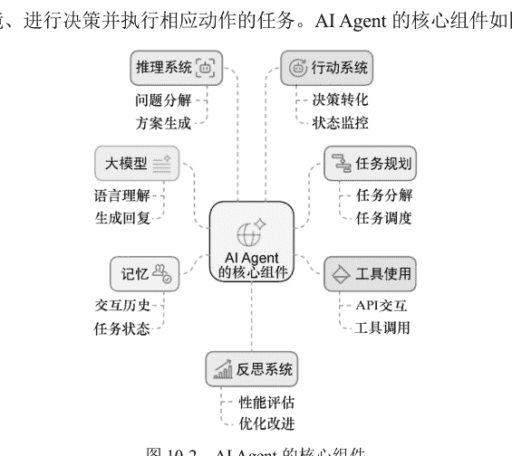

###### （1）大模型

大模型提供核心的语言理解和生成能力，是整个 Agent 的“大脑”，负责理解用户输入、生成回复、进行推理和决策。例如，AutoGen 框架①使用 OpenAI 的 GPT-4o-mini 作为模型客户端，提供强大的语言理解和生成能力。

###### （2）任务规划

任务规划组件负责对复杂任务进行分解、规划和调度，并及时观察子任务执行的结果与反馈，对任务进行及时调整，确保任务能够按照预设的逻辑和顺序高效执行。例如，在 CrewAI 框架②中，AI Agent 可以自主地委派任务并相互询问，提高解决问题的效率。

###### （3）工具使用

工具使用组件允许 AI Agent 调用外部工具和 API 以扩展能力，并根据决策结果执行具体的动作或指令，与外部 API、数据库、硬件设备等工具交互。例如，AutoGen 框架定义了一个 get_weather 工具函数返回城市天气信息，并将其作为工具提供给 AI Agent。

###### （4）记忆

记忆组件负责记录交互历史、任务状态和相关信息，便于在需要时快速准确地调用。在 CrewAI 框架中，每个 AI Agent 都配备了记忆系统，用于存储和检索交互经验，支持持续学习和提升能力。

###### （5）推理系统

推理系统负责问题分解、方案生成和决策优化，将知识和记忆转化为实际的行动方案。在现代 AI Agent 架构中，推理系统通过多目标优化算法，综合考虑效率、资源消耗、风险等因素，选择最优执行方案。

###### （6）行动系统

行动系统将内部决策转化为具体行动，执行任务，并实时监控执行状态，确保行动的可靠性和安全性。在 AutoGen 框架中，Runner 组件负责将 Agent 的决策转化为具体行动，并实时监控任务执行状态。

###### （7）反思系统

反思系统具备自我完善能力，通过持续的评估和优化，推动系统能力的不断提高，评估 Agent 的性能，诊断问题，并制订优化方案。例如，在现代 AI Agent 架构中，反思系统通过性能评估、问题诊断和优化改进，持续提升系统性能。

##### 2. 组件协作方式

这些组件通过精心设计的接口实现无缝协作，形成一个有机的整体。系统中的每个部分都专注于自己的核心功能，同时又与其他部分紧密配合，最终实现复杂的智能行为。

如，在 AutoGen 框架中，Agent 通过异步消息通信与其他 Agent 协作，共同完成复杂任务。AI Agent 架构示意图如图 10-3 所示。

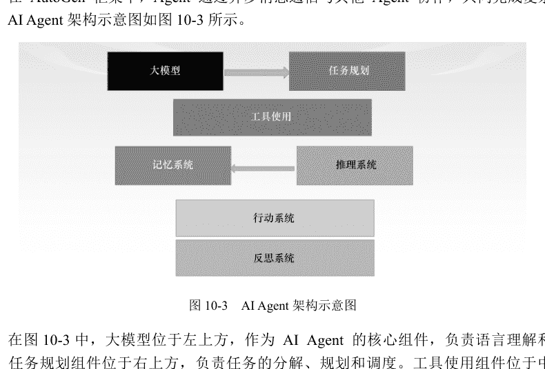

在图 10-3 中，大模型位于左上方，作为 AI Agent 的核心组件，负责语言理解和生成。任务规划组件位于右上方，负责任务的分解、规划和调度。工具使用组件位于中上方，负责调用外部工具和 API，执行具体动作。记忆系统位于左下方，负责存储和检索信息，支持长期学习。推理系统位于右下方，负责将知识和记忆转化为行动方案。行动系统位于中下方，负责将内部决策转化为具体行动。反思系统位于下方，负责自我完善，通过评估和优化提升系统性能。

大模型接收用户输入，进行语言理解和意图识别。根据对大模型的理解，任务规划组件将复杂任务分解为子任务，并制订执行计划。工具使用组件根据规划结果，调用所需的外部工具或 API。记忆组件提供历史数据和相关信息，支持决策。推理系统综合所有信息，生成最优的行动方案。行动系统将决策结果转化为具体行动，执行任务。反思系统评估执行结果，诊断问题，并优化系统性能。

#### 10.3.2 AI Agent 创建的路径和方法

AI Agent 的创建路径和方法多种多样，每种方法都有各自的特点和优缺点。

##### 1. 零代码搭建平台

零代码搭建平台允许非开发人员，甚至完全没有编程背景的用户，通过可视化界面和预构建的模块，不需要或只需少量编写代码，通过拖拽组件、配置参数等方式快速搭建应用程序。

###### （1）零代码搭建 AI Agent 的主要环节

一是搭建提示词框架。这个环节需要定义 AI Agent 的角色和行为准则，确保其能够理解并执行用户的需求。具体工作任务是要创建一个包含角色设定和行为规范的提示词框架，明确 AI Agent 在不同场景下的回答风格和内容边界。例如，为一个智能客服 Agent 设置提示词，规定其在处理客户投诉时保持礼貌和专业。

二是为 AI Agent 赋能。这个环节需要将数据库或 API 等外部工具与 AI Agent 集成，使 AI Agent 能够访问和处理数据，并执行实际任务。例如，连接一个天气 API，使 AI Agent 能够提供实时天气信息。

三是测试对话功能。这个环节需要验证 AI Agent 的性能和交互效果，确保其能够准确理解和响应用户输入。具体任务是通过模拟用户输入和交互场景，测试 AI Agent 的对话流程，观察其是否能够提供准确、相关且符合预期的回答。然后根据测试结果再调整优化，提升用户体验。

###### （2）零代码搭建平台的适用情况

零代码搭建平台创建 AI Agent，适用于以下情况。

一是快速原型开发。在这种情况下，企业或个人需要快速验证 AI Agent 的概念和功能，无须投入大量时间和资源进行开发。

二是小型企业或初创团队，这些团队通常缺乏专业的技术开发人员，需要快速构建和部署 AI 应用。

三是非技术背景的用户，如市场营销人员、业务分析师等，他们需要创建 AI 应用来支持日常工作，但没有编程经验。

四是教育和培训场景，学生可以通过零代码平台学习 AI 应用的开发和使用。

五是一些特定场景的应用，如简单的客户服务、内容创作、数据分析等场景，无须复杂的定制化开发。

###### （3）零代码搭建平台的优缺点

零代码搭建平台创建 AI Agent，用户无须具备编程背景，通过直观的图形化界面和简单的操作即可创建 AI 应用；同时能够快速构建和部署 AI 应用，缩短开发周期，提高应用上线速度。零代码搭建平台也提供多种预构建的组件和模板，用户可以根据需求快速组合和定制 AI 应用，界面友好，易于上手，后续维护和更新相对简单，这种方式成本效益高，特别适合资源有限的小型企业或个人开发者。

零代码搭建平台的缺点也很明显。一是功能有限，零代码平台通常提供的功能较基础，难以满足复杂业务需求或高度定制化的应用场景。二是定制化能力有限，虽然可以进行一定程度的个性化定制，但当面对复杂的业务逻辑或特定行业需求时，零代码搭建平台可能无法提供足够的灵活性。三是零代码搭建平台需要依赖平台服务，用户的应用依赖平台的稳定性和持续性，如果平台出现故障或停止服务，可能会影响应用的正常运行。四是存在数据安全和隐私问题，当使用零代码平台时，用户的数据可能存储在平台的服务器上，存在一定的数据安全和隐私风险。五是在功能上扩展性有限，随着业务的发展和需求的增加，零代码平台可能难以满足大规模、高性能的应用需求。

###### （4）主要的零代码搭建平台

常见的零代码搭建 AI Agent 平台及优缺点如表 10-2 所示。

表 10-2 常见的零代码搭建 AI Agent 平台及优缺点

| 平台名称 | 优 点 | 缺 点 |
| :--- | :--- | :--- |
| Coze | 无代码开发，丰富的插件库，内置多个大模型，多平台发布，知识库和数据库功能强大，支持图像流和工作流，多 Agent 模式，团队协作能力强 | 可能存在某些高级功能的定制化能力有限，可能需要额外开发复杂的企业级应用 |
| Dify | 功能完善，支持多种国内外大模型，提供云服务部署和本地部署，适合专业开发者 | 主要面向海外市场，国内开发者使用时会受到一定限制 |
| 千帆 AppBuilder | AI Agent 能力支撑较完备，适合创建各种类型的 AI 应用 | 可能对于非技术用户来说，学习曲线稍陡 |
| FastGPT | 在知识库方面具有独特优势，适合需要强大知识检索能力和文档处理能力的场景 | 功能专注于知识库领域，对于其他类型的应用可能支持不足 |
| 智谱智能体 | 主要侧重于对话类 Agent，适合需要强大对话能力的场景 | 在非对话类 Agent 的创建上可能功能有限 |
| 天工 SkyAgents | 零代码构建 AI Agent，模块化任务处理，个性化定制能力强，支持企业级应用与一键部署，知识库构建与大规模数据导入方便，第三方工具调用丰富 | 可能在某些特定行业的深度功能支持上稍显不足 |
| BetterYeah AI | 零代码搭建 AI Agent，一站式模型集成，知识库管理功能强大，数据库连接便捷，可视化工作流，多模态 ChatBot 支持 | 可能对于非常复杂的业务逻辑处理能力有限 |
| 百宝箱 Tbox | 无代码应用创建，一键发布，丰富的智能体类型，集成支付宝生态，主流大模型集成 | 主要面向支付宝生态内的应用开发，可能对于其他平台的支持有限 |
| Anakin.ai | 提供大量预制 AI 应用，覆盖多种场景，无代码操作，集成能力强，自动化工作流程 | 可能对于用户完全自定义的复杂应用支持不足 |
| 天壤小白应用开发平台 | 多样化的应用类型，灵活的配置功能，信息安全可控，丰富的模型选择，快速发布 AI 站点，API 管理与运营，零代码开发，优化提示词工程 | 可能对于某些高度复杂的 AI 应用开发能力有限 |

对于非技术背景的用户或小型企业，推荐使用 Coze、Dify 或 BetterYeah AI，这些平台提供友好的界面和丰富的功能，适合快速创建和部署 AI 应用。

需要强大知识库功能的用户，可以选择 FastGPT。FastGPT 在知识检索和文档处理方面表现出色。

专注于对话类应用的用户，智谱是一个不错的选择，它在对话能力上具有独特优势。

对于有企业级应用需求的用户，天工 SkyAgents 和智川 X-Agent 提供全面的企业级功能，支持复杂应用的快速构建和部署。

对于需要与支付宝生态集成的用户，百宝箱 Tbox 是理想的选择，它提供便捷的支付宝小程序发布和管理功能。

##### 2. 基于大模型框架的开发

基于大模型框架的开发是利用 DeepSeek、GPT-4、Claude 以及 Gemini 等 LLM 作为核心，结合提示工程和工具使用框架进行开发。这种开发模式通过模块化设计和灵活的接口，使开发者能够快速构建和部署 AI Agent，满足特定的业务需求。

###### （1）基于大模型框架开发的优缺点

基于大模型框架开发的优点是大模型具有强大的语言理解和生成能力，具有模块化设计功能，同时，具有丰富的工具集成和社区支持。这种方式能够处理复杂的自然语言任务，提供高质量的回答和建议，支持灵活的功能扩展和定制，开发者可以根据需求快速调整和优化。丰富的工具和 API 方便调用外部服务和数据。许多框架拥有活跃的社区，社区可以提供丰富的插件和扩展，加速开发和优化。

基于大模型框架开发的缺点是需要具备一定的编程能力和对大模型的理解，有较高的技术门槛。同时，大模型的训练和推理需要较高的计算资源，可能会导致较高的成本。对于某些特定领域的复杂需求，可能需要额外的开发和调优。

###### （2）适用情况

基于大模型框架的开发，适用于智能客服、自动化工作流程等需要进行多步骤处理和复杂逻辑的任务，同时也适用于需要快速开发和部署的情况。利用现有的大模型和工具，可以快速构建原型并投入生产。高度定制化任务也适用于基于 LLM 框架的开发，这种开发方式能够根据特定业务需求进行深度定制，满足个性化要求。

###### （3）具体环节及工作内容

基于大模型框架的开发，首先是选择 DeepSeek、GPT-4、Claude 等合适的大模型，将其集成到开发框架中，再配置模型参数，确保其能够理解并执行任务。

其次是提示工程，需要设计和优化提示词，引导模型生成符合预期的回答。通过调整提示词的结构和内容，提高模型的准确性和相关性。

再次是工具使用与集成，将 API 或数据库等外部工具与 AI Agent 集成，使其能够访问和处理数据。定义工具的使用逻辑，确保其能够正确执行任务。集成外部工具后，需要进行任务规划与流程设计。将复杂任务分解为多个子任务，定义不同子任务的逻辑关系和执行顺序，确保任务能够高效完成。然后需要完成记忆与状态管理，实现记忆功能，存储和检索任务状态和相关信息，确保 AI Agent 能够根据历史信息做出正确的决策。在推理与决策环节，需要利用大模型的推理能力，将知识和记忆转化为具体的行动方案。优化推理逻辑，提高决策的准确性和效率。在行动执行环节，需要将决策结果转化为具体行动以执行任务，实时监控任务执行状态，确保行动的可靠性和安全性。

最后是反思与优化，评估 AI Agent 的性能，诊断问题，并制订优化方案。通过持续的迭代和改进，提升系统的整体性能。

###### （4）不同大模型的优缺点对比

基于大模型框架的开发中不同模型对比如表 10-3 所示。

表 10-3 基于大模型框架的开发中不同模型对比

| 模型名称 | 优 点 | 缺 点 |
| :--- | :--- | :--- |
| DeepSeek | 专注高端推理和复杂逻辑问题，具有高效的训练策略和数据处理优势 | MoE 架构的复杂性，专家选择可能存在偏差 |
| GPT-4 | 强大的语言理解和生成能力，适合复杂任务处理 | 计算资源需求高，成本较高 |
| Claude | 高度可定制化，适合对话式应用 | 对多模态任务支持有限 |
| Gemini | 多模态支持，适合处理多种数据类型 | 在某些特定领域的专业性可能不如其他模型 |
| LLaMA | 开源，易于定制和扩展 | 计算资源需求较高，适合资源充足的场景 |
| Bard | 强大的语言生成能力，适合内容创作 | 对复杂任务的处理能力有限 |

在需要推理和复杂逻辑处理的场景中，DeepSeek 是一个高效、灵活且成本效益较高的选择，尤其适合中文语境下的应用场景。

对于需要强大语言理解和生成能力的复杂任务，推荐使用 GPT-4 或 Claude，它们在处理复杂任务和对话式应用方面表现出色。

对于多模态任务，Gemini 是一个不错的选择，它能够处理多种数据类型，适合需要多模态支持的场景。

对于资源有限但需要高度定制化的应用，LLaMA 是一个不错的选择，它开源并且易扩展。

对于内容创作和简单的对话应用，Bard 可以提供强大的语言生成能力，适合快速开发和部署。

##### 3. 基于特定平台的开发

基于特定平台的开发是利用特定平台提供的工具、接口和功能构建 AI Agent 的一种开发模式。基于特定平台通常提供丰富的预构建组件、工具和接口，简化 AI Agent 的开发和部署过程。基于特定平台的开发，与零代码搭建平台的开发具有非常多的相似性，其优缺点、适用场景也基本相同。

基于特定平台开发的具体环节及内容，与基于大模型框架的开发基本相同，只是多了一个平台选择与集成的环节。在这个环节中，开发者需要选择合适的 AI 开发平台，如阿里云魔搭社区、Coze 等，并将其集成到开发环境，配置平台参数，确保其能够与现有系统无缝对接。

基于特定平台的开发和零代码搭建平台开发看起来很相似，但两者还是有一些细微差别的，基于特定平台的开发和零代码搭建平台开发的区别如表 10-4 所示。

表 10-4 基于特定平台的开发和零代码搭建平台开发的区别

| 方 面 | 基于特定平台的开发 | 零代码搭建平台开发 |
| :--- | :--- | :--- |
| 开发门槛 | 需要开发者具备一定的编程知识和相关平台的技术基础，如熟悉平台的 API、开发工具等 | 无须编程基础，通过可视化界面、拖拽组件和配置参数等方式，普通用户也能快速上手 |
| 开发灵活性 | 具有较高的灵活性，开发者可以根据具体需求进行深度定制，充分利用平台提供的高级功能和扩展接口 | 灵活性相对较低，主要依赖平台预设的功能模块和模板，难以实现复杂的业务逻辑和深度定制 |
| 开发效率 | 对于熟悉平台的开发者来说，开发效率较高，能够快速实现复杂的功能和应用 | 开发效率极高，特别适合快速构建简单的 AI 应用，能够在短时间内完成应用的搭建和部署 |
| 应用场景 | 适合复杂的业务场景和对功能有深度定制需求的企业或开发者，如开发具有独特功能的企业级智能客服系统 | 适合中小型企业、创业者或个人用户快速构建简单的 AI 应用，满足常见的业务需求，如生成文本内容、创建聊天机器人等 |
| 可扩展性 | 通常具有良好的可扩展性，开发者可以随着业务的发展和需求的变化，不断扩展和优化应用 | 可扩展性相对较弱，一般只能在平台允许的范围内进行有限的扩展和调整 |
| 性能和稳定性 | 由于是基于特定平台开发，所以通常能够获得较好的性能和稳定性保障，特别是在处理高并发和复杂计算任务时 | 性能和稳定性取决于平台的支持能力，当处理大规模数据或高并发请求时可能会受到一定限制 |

目前有很多 AI Agent 开发平台，主要 AI Agent 开发平台在各个特性维度上的表现对比如表 10-5 所示。

表 10-5 主要 AI Agent 开发平台特性对比

| 特性维度 | 扣子 (Coze) | Dify | 千帆 AppBuilder | FastGPT | 智谱智能体平台 | 天工 SkyAgents | 腾讯元器 | BetterYeah | AWS AI Agent |
| :--- | :--- | :--- | :--- | :--- | :--- | :--- | :--- | :--- | :--- |
| 模型支持 | 支持多模型，包括国内和部分国外大模型 | 支持多模型，包括海外和国内大模型 | 支持百度文心大模型及部分国外模型 | 支持多模型，尤其在知识库方面表现突出 | 支持自家大模型 | 支持多模型，集成 Skywork LLM | 支持多模型，包括腾讯自研模型 | 支持多模型，包括国内外顶尖 AI 模型 | 支持多种大模型，灵活选择 |
| 核心功能 | 知识库、数据库、插件或工具、工作流功能完备 | 知识库、工具调用、工作流等功能较强 | 知识库、数据库、插件或工具功能较强 | 知识库功能独特，适合知识问答类 Agent | 对话类 Agent 功能较强 | 模块化设计，支持自然语言输入和可视化操作 | 功能正在快速完善，支持 API 创建插件 | 支持单一 Agent 和 Multi-Agent 系统开发 | 提供强大的开发和部署能力 |
| 操作难易度 | 操作便捷，适合非技术用户 | 操作难度适中，插件工具生态较丰富 | 操作难度适中，功能布局清晰 | 操作难度适中，知识库管理便捷 | 操作难度适中，适合非技术用户 | 操作便捷，适合快速开发 | 操作难度较低，适合新手 | 操作便捷，支持零代码开发 | 操作复杂度较高，适合专业开发者 |
| 生态能力 | 生态丰富，有插件商店、工作流商店等 | 生态能力较强，支持多种部署方式 | 生态能力较强，支持本地部署 | 生态能力一般 | 生态能力一般 | 生态能力较强 | 生态能力较强 | 生态能力较强，提供丰富学习资源 | 生态能力强大，支持多种部署方式 |
| 适用场景 | 零代码开发各类 AI Agent，适合企业级应用 | 适合专业开发者，支持多模型选择 | 企业级 AI 应用开发，支持多种模型 | 知识问答类 Agent 开发，需本地部署保障数据安全 | 对话类 AI 应用，如智能客服 | 广泛适用于各类业务场景 | 企业级 AI 应用开发 | 企业级 AI 应用，如客服、营销、销售等 | 企业级 AI 应用，尤其是国际化项目 |
| 优缺点 | 综合性能最佳，功能全面，社区活跃，部分功能需付费 | 功能完善，模型选择丰富，但主要面向海外市场，国内开发者可能受限 | 功能完善，支持本地部署，但插件市场功能较弱 | 在知识库方面有优势，但生态能力较弱 | 对话能力突出，但功能扩展性有限 | 技术先进，开发体验好，插件市场功能较弱 | 功能完善中，生态能力较强，但发布时间较晚 | 功能全面，生态丰富，可能对复杂任务支持有限 | 功能强大，生态丰富，但对非技术用户不够友好 |

选择合适的 AI Agent 创建路径和方法，需要根据企业的具体需求、技术能力和资源投入进行综合考虑。零代码搭建平台适合快速验证想法，基于大模型框架的开发适合复杂任务处理。

AI Agent 也可以从头开始创建，即从零开始编写代码，设计算法和模型，实现 AI Agent 的各项功能。这种方式需要开发者具备深厚的 AI、机器学习和编程知识，以及大量时间和资源投入。从头开始创建 AI Agent 的过程包括需求分析、算法设计、数据收集与预处理、模型训练与优化和系统集成与测试等步骤。

虽然从头开始创建 AI Agent 是可能的，但这种方式需要极高的技术门槛和资源投入。因此，在一般情况下，开发者更倾向于利用现有的 AI 工具创建 AI Agent，充分利用技术优势、功能组件和数据处理能力，提高开发效率，降低开发难度和成本，实现 AI Agent 的快速创建和持续优化。

#### 10.3.3 容器化与弹性扩展

容器化是一种轻量级的操作系统虚拟化方法，它允许开发者将应用程序及依赖项打包，形成一个独立的单元，可以在任何地方运行且无须关心底层环境差异。弹性扩展使系统能够根据负载动态调整资源分配，适应不同的工作负载需求。

##### 1. 容器化与弹性扩展和 AI Agent 构建的关系

容器化与弹性扩展是 AI Agent 构建的重要组成部分，它们为 AI Agent 的开发、部署和运行提供了强大的支持和保障。

##### 2. 容器化与弹性扩展的优缺点

容器化与弹性扩展具有高可扩展性，能够根据负载动态调整资源，支持高并发请求处理。通过提示词优化和动态资源分配，可以降低单次调用成本。容器化与弹性扩展还提供任务成功率、响应时间等核心指标的监控，确保系统稳定运行。容器化与弹性扩展具有灵活性，支持多种部署方式，如本地部署和云端部署，满足不同企业需求。
容器化与弹性扩展需要一定的容器化和云原生技术知识，在某些情况下，可能会增加计算资源的使用。

##### 3. 容器化与弹性扩展的适用情况

高并发请求处理、资源密集型任务及多环境部署，适用于容器化与弹性扩展。高并发请求处理是指在电商促销、金融交易等需要快速响应大量用户请求的场景中。资源密集型任务是指在 AI 模型训练和推理等方面需要动态调整计算资源以优化性能的任务。多环境部署是指 AI 应用需要在不同的环境中进行快速部署和运行。

##### 4. 容器化与弹性扩展的环节和工作任务

首先是容器化部署，需要将 AI Agent 及依赖项打包成 Docker 镜像，确保其可以在任何环境中无缝运行。具体任务是创建 Dockerfile，定义应用程序的运行环境和依赖项；构建 Docker 镜像，并测试其功能。
其次是 Kubernetes 集成，利用 Kubernetes 进行容器编排和管理，实现自动部署、扩展和管理容器化应用。具体任务是编写 Kubernetes Deployment 配置文件，定义容器的部署策略和资源需求；将 Docker 镜像部署到 Kubernetes 集群，并监控其运行状态。
再次是弹性扩展配置，配置 Kubernetes 的自动伸缩功能，根据负载动态调整容器数量。具体任务是定义 Horizontal Pod Autoscaler，设置最小和最大副本数，以及资源使用率的阈值。
最后是监控与优化，建立监控体系，实时监控系统的运行状态和性能指标，根据监控数据进行优化。具体任务是使用 Prometheus 和 Grafana 等工具，监控任务成功率、响应时间等核心指标；根据监控结果调整资源分配和优化系统配置。

### 10.4 基于 DeepSeek 创建企业应用 AI Agent

基于 DeepSeek 创建 AI Agent，选择基于大模型框架的开发技术路线，可以分为以下环节和步骤。基于 DeepSeek 创建企业应用 AI Agent 的流程如图 10-4 所示。

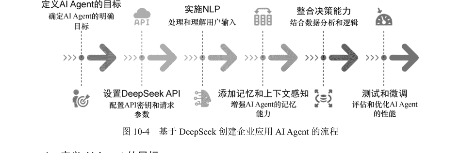

##### 1. 定义 AI Agent 的目标

定义 AI Agent 的目标是确保开发的 AI Agent 能够精准满足业务需求，为后续的开发工作提供明确的方向和指导。这个环节需要明确业务目标、定义应用场景、梳理功能需求。为此，需要与业务部门深入沟通，了解他们想要解决的实际问题，如提高客户服务效率、优化销售流程等。同时，收集潜在用户的反馈，确保 AI Agent 的功能符合他们的使用习惯和期望。

在此基础上，需要确定 AI Agent 应用的具体场景，如不论是聊天机器人、自动化流程机器人，还是推荐系统或决策支持系统等，这个步骤都是确定 AI Agent 功能和方向的关键。

根据业务需求，梳理 AI Agent 需要具备的功能，如 NLU、问题回答、任务调度、数据检索等。同时，考虑用户群体的特点，设计符合用户习惯和期望的界面和交互方式。

当定义目标时，需要充分考虑用户的实际需求和使用体验，确保 AI Agent 能够真正为用户带来价值；还需要评估技术的可行性，评估现有技术和资源是否能够支持目标的实现。最终，需要考虑灵活性和可扩展性，便于在开发过程中根据实际情况进行调整和优化。

##### 2. 设置 DeepSeek API

在基于 DeepSeek 创建 AI Agent 的过程中，设置 DeepSeek API 是至关重要的一步，它允许开发者将 DeepSeek 的强大语言理解和生成能力集成到自己的应用程序或服务中。通过 API，AI Agent 能够接收用户输入，处理请求并生成智能响应，从而实现与用户的交互。此外，API 的设置确保请求和响应的格式正确，优化 API 使用，避免不必要的成本或延迟。

这个环节的工作任务包括在 DeepSeek 开放平台创建 API Key，设置 API 请求的 URL、Headers 和 Body 等参数，确保 API 请求符合速率限制。

##### 3. 实施 NLP

NLP 使 AI Agent 能够理解和生成类似人类的文本，从而实现与用户的自然交互。DeepSeek 的 NLP 功能通过输入预处理清理和构建用户输入，提高对用户输入理解的准确性；通过情境理解识别含义、意图和情感，确保响应具有相关性和个性化；通过提示工程构建清晰的指令，提高输出的准确性和有用性；通过上下文管理保持对话的连贯性，确保多轮对话内容的一致性。必要时需要利用 DeepSeek 的多语言处理能力，确保 AI Agent 能够理解和生成多种语言的文本。

这个环节需要注意的内容包括以下 3 个方面。

- ① 在数据质量方面，需要确保输入数据的高质量，提升 LLM 的性能。
- ② 在模型调优方面，需要根据具体应用场景对 DeepSeek 进行微调，提升其在特定任务上的表现。
- ③ 在上下文一致性方面，需要确保 AI Agent 能够准确记住和引用之前的对话内容。

同时需要收集用户反馈，持续优化提示词和响应生成逻辑。

##### 4. 添加记忆和上下文感知

记忆和上下文感知是 AI Agent 能够参与有意义对话的关键，它们确保 AI Agent 在多次交互中保留信息，提供连贯且个性化的响应。

通过短期记忆，AI Agent 能够回忆同一次对话中的信息。为此，在对话过程中，需要将用户的输入和 AI Agent 的响应存储在一个短期记忆缓冲区，可以使用列表或队列管理这些对话，确保每次对话都能访问最近的上下文。

通过长期记忆，AI Agent 能够在多次对话中保留用户偏好，提供定制化体验。长期记忆需要存储用户的历史交互和偏好，可以使用 SQLite、MySQL 或 PostgreSQL 等数据库或 Pinecone、FAISS、ChromaDB 等向量数据库存储长期记忆。每次对话时，检索与当前对话相关的长期记忆，并将其与短期记忆结合，生成连贯的响应。

此外，知识检索功能使 AI Agent 能够访问存储的知识、过去的用户查询或外部数据库，确保提供准确的答案，无须用户重复提问。在对话中，该功能会根据用户输入的关键信息，从知识库或数据库中检索相关信息，并将其整合到 AI Agent 的响应中。

这个环节需要进行数据存储安全管理、上下文窗口管理、制定记忆更新策略，并关注用户体验。首先要确保存储的用户数据和交互记录是安全的，并遵守相关的隐私法规。在上下文窗口管理中，设置合理的上下文窗口长度，避免因上下文过长影响性能，超出窗口长度的部分可以截断或压缩。其次要定期更新长期记忆，确保信息的准确性和时效性。最后，确保记忆和上下文感知功能不会对用户体验产生负面影响，如响应延迟或不相关性。

##### 5. 整合决策能力

整合决策能力使 AI Agent 能够进行智能决策，提供准确和及时的响应，这需要 AI Agent 从数据库、API 和实时信息源中检索数据，确保响应准确且最新；同时需要处理结构化和非结构化数据，确保 AI 驱动的系统可以分析电子邮件、消息、文档等文本输入和交易、统计数据等数字数据，生成可操作的见解。AI Agent 还需要从过去的交互中学习并根据反馈和实际使用模式调整其响应，并随着时间的推移进行改进。

这个环节的具体工作任务包括数据集成、数据分析、决策逻辑设计和性能优化。数据集成涉及集成 API 和连接数据库，使用 DeepSeek 的 API 进行数据检索和处理，确保 AI Agent 能够访问所需的外部数据源。数据分析需要使用 DeepSeek 的 NLP 功能分析文本数据，提取关键信息，使用数据分析工具处理结构化数据，生成可操作的见解。决策逻辑设计需要确保 AI Agent 能够根据分析结果做出智能决策，包括实施强化学习算法，根据历史交互和用户反馈优化决策逻辑。还需要定期评估和优化模型性能，确保决策的准确性和效率，同时根据用户反馈调整模型参数和决策算法，持续改进 AI Agent 的性能。

##### 6. 测试和微调

微调和测试是确保 AI Agent 能够准确、高效完成任务的关键环节。微调通过调整模型参数，使其适应特定任务或领域并提升性能。测试通过评估 AI Agent 的性能，确保其在实际应用中的可靠性和稳定性，具体工作包括数据准备、模型微调、模型评估、性能优化、测试与优化等内容。

微调和测试需要高质量的训练数据，确保数据的多样性和代表性，如从 Hugging Face Hub 加载相关数据集，或医学领域的数据集，并使用 formatting_prompts_func 函数对数据进行预处理。

可以使用 LoRA 技术对 DeepSeek 模型进行微调，优化模型的性能，如使用 FastLanguageModel.get_peft_model 设置秩、目标模块、学习率等 LoRA 参数，使用 SFTTrainer 进行训练，设置批量大小、学习率、最大步数等训练参数。

可以通过测试数据集评估模型的准确性和效率，检查训练损失是否逐渐降低，使用 trainer.train() 进行训练，并通过 trainer_stats 查看训练结果，确保其在特定任务上的表现达到预期。

在性能优化方面，需要根据评估结果优化模型参数，提高模型的响应速度和准确性，如调整学习率、批量大小等参数，使用 use_gradient_checkpointing 优化显存使用，支持更大的批量，优化训练过程。

在测试与反馈环节，可以通过部署两个版本的 AI Agent，进行 A/B 测试，确定哪个版本能产生更高的参与度和满意度。同时收集用户反馈，优化模型参数和响应逻辑，持续改进 AI Agent 的性能。

### 10.5 多 Agent 系统

多 Agent 系统通过多个 Agent 的协作与交互解决复杂问题、执行多样化任务并模拟复杂系统行为。每个 Agent 负责特定的任务，通过信息共享和任务分配实现系统整体目标的优化。多 Agent 系统结构示意图如图 10-5 所示。

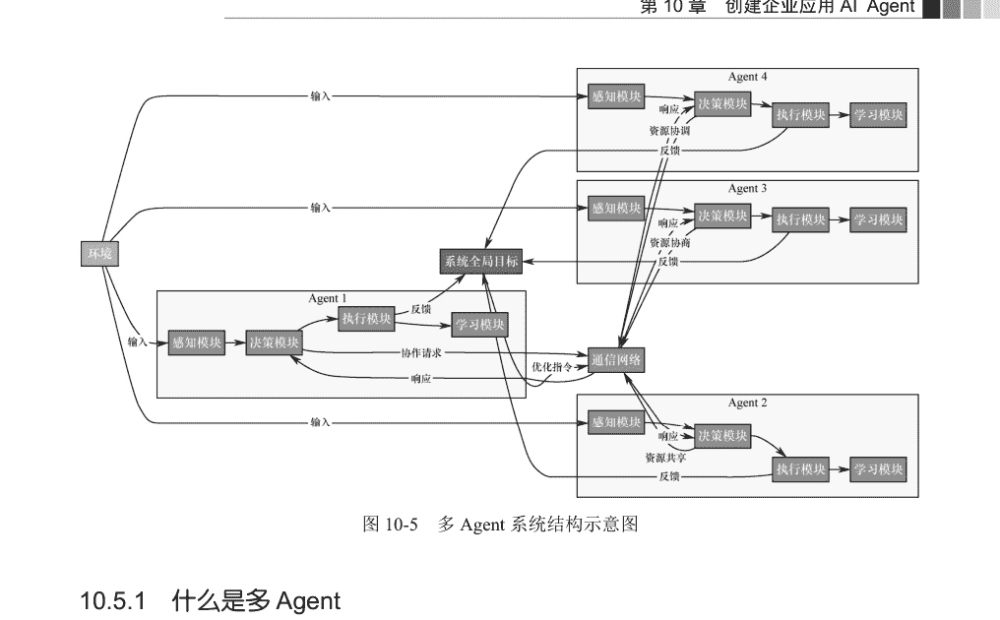

图 10-5 多 Agent 系统结构示意图

#### 10.5.1 什么是多 Agent

多 Agent 模式是一种强大的 AI 架构，在这种 AI 架构中，每个 Agent 都具备独立的感知、决策和行动能力，通过相互协作和信息共享，实现系统整体目标的优化。

##### 1. 多 Agent 与 DeepSeek AI Agent 的区别和联系

从定义与定位来看，DeepSeek AI Agent 是基于 DeepSeek 大模型构建的 AI Agent，专注于深度思考和推理，擅长处理复杂的信息并提供精准的决策方案。DeepSeek AI Agent 可以视为多 Agent 系统中的一个 AI Agent，负责深度思考和策略生成。

从技术架构来看，DeepSeek AI Agent 基于深度学习，使用神经网络和机器学习算法分析数据并随着时间的推移而改进，其技术架构包括长链推理、多模态融合、自我反思与优化等创新点。多 Agent 系统通常包括多个 Agent，每个 Agent 可以是基于规则的或基于深度学习的，它们通过协作和信息共享完成任务。技术架构复杂，涉及多 Agent 协作、任务分配和信息共享等。

从目标与应用场景来看，DeepSeek AI Agent 的目标是提供深度思考和推理能力，适用于需要复杂信息处理和精准决策的场景，如风险预测、智能客服、教育辅导等。多 Agent 的目标是通过多个 Agent 的协作解决复杂问题，适用于需要多个 Agent 协作的场景，如机器人协作、复杂系统模拟等。

从开源生态来看，DeepSeek 遵循 MIT 许可证，通过开源策略降低技术门槛，使中小企业和个人开发者能够轻松接入高性能 AI。多 AI Agent 开源项目较少，通常需要开发者自行构建和管理多智能体系统。

多 Agent 与 DeepSeek AI Agent 的对照如表 10-6 所示。

#### 表 10-6 多 Agent 与 DeepSeek AI Agent 的对照

| 对照维度 | 多 Agent | DeepSeek AI Agent |
| :--- | :--- | :--- |
| 定义与定位 | 利用多个 Agent 协作解决复杂问题，每个 Agent 具备独立的感知、决策和行动能力 | 基于 DeepSeek 大模型构建的 Agent，专注于深度思考和推理，提供精准决策支持 |
| 技术架构 | 包括多个 Agent，技术架构复杂，涉及多智能体协作、任务分配和信息共享等 | 基于深度学习，使用神经网络和机器学习算法，具有长链推理、多模态融合、自我反思与优化等创新点 |
| 目标与应用场景 | 通过协作解决复杂问题，适用于机器人协作、复杂系统模拟等场景 | 提供深度思考和推理能力，适用于风险预测、智能客服、教育辅导等需要复杂信息处理的场景 |
| 开源生态 | 开源项目较少，通常需要开发者自行构建和管理 | 遵循 MIT 许可证，开源策略降低技术门槛，便于中小企业和个人开发者使用 |
| 协作能力 | 强调多个 Agent 之间的协作与交互，通过信息共享实现系统整体目标的优化 | 侧重于单个 Agent 的深度思考和推理能力，通常与其他 Agent 协作以增强系统功能 |
| 适用场景 | 适用于需要多 Agent 协作的复杂场景，如智能交通系统、分布式任务管理等 | 适用于需要深度思考和推理的场景，如金融风险评估、智能客服、教育辅导等 |

多 Agent 通过各个 Agent 各司其职、协同配合，显著提高工作效率与任务完成的准确性。在复杂业务场景中，多 Agent 能够高效处理多种任务，减少人为错误和流程瓶颈。多 Agent 还能够复制领域专家的业务能力，减少对少数专家的依赖，降低人力成本和培养成本，同时提高整体业务的执行效率和质量。此外，多 Agent 模式具备强大的可扩展性，适应企业业务场景的变化和多样化需求，灵活构建和调整 Agent 的配置与协作方式。

##### 2. 多 Agent 中不同 Agent 的关系

在多 Agent 中，不同的 Agent 之间的关系是多样且复杂的，它们通过协作、任务分配、通信与信息共享、监督与反馈等方式相互作用，共同完成复杂任务。

（1）协作
多个 Agent 通过分工合作，共同完成一个复杂任务。例如，在智能客服系统中，一个 Agent 负责理解客户咨询，另一个 Agent 负责提供解决方案，还有一个 Agent 负责后续的跟进和反馈收集，它们共同协作，确保客户问题得到及时解决。

（2）任务分配
不同的 Agent 负责特定的子任务，通过任务分配机制确保每个 Agent 都在擅长的领域内工作。例如，在自动化工作流程中，一个 Agent 负责文档审批，另一个 Agent 负责会议安排，每个 Agent 专注于自己的任务，从而提高整体效率。

（3）通信与信息共享
Agent 通过通信机制共享信息，确保每个 Agent 都能够获取完成任务所需的数据。例如，在供应链物流中，一个 Agent 负责实时监控物流数据，另一个 Agent 负责分析数据并生成预测报告，它们通过通信机制共享数据，确保预测的准确性。

（4）监督与反馈
一个或多个 Agent 负责监督其他 Agent 的工作，并提供反馈，优化整个系统的性能。例如，在数据分析与预测系统中，一个 Agent 负责监督其他 Agent 的预测结果，并根据实际数据提供反馈，帮助其他 Agent 不断优化预测模型。

（5）角色扮演
不同的 Agent 在系统中扮演不同的角色，模拟人类团队的协作方式。例如，在市场研究与分析中，一个 Agent 负责数据收集，另一个 Agent 负责情感分析，还有一个 Agent 负责数据可视化。每个 Agent 扮演不同的角色，共同完成市场研究报告。

（6）动态调整
Agent 的关系可以根据任务需求和环境变化进行动态调整。例如，在智能办公助手中，根据用户的需求和任务优先级，不同的 Agent 可以动态调整自己的角色和任务，确保用户的工作流程高效、顺畅。

（7）竞争与协作
在某些场景中，Agent 之间可能存在竞争关系，通过竞争机制优化任务分配和执行效率。例如，在资源分配任务中，多个 Agent 可能竞争有限的资源，通过竞争机制确保资源分配给最需要的 Agent，提高整体系统的效率。

（8）监督与反馈循环
Agent 之间通过监督和反馈循环不断优化系统性能。例如，在智能客服系统中，一个 Agent 负责监督其他 Agent 的回复质量并提供反馈，帮助其他 Agent 不断提高回复的准确性和相关性。

多 Agent 系统通过协作、任务分配、通信与信息共享、监督与反馈等多种关系，确保不同 Agent 能够高效协作，共同完成复杂任务。这种多样化的协作方式不仅提高了系统的灵活性和适应性，还提升了系统的鲁棒性和整体性能，使系统能够更好地应对复杂多变的业务场景。

##### 3. 多 Agent 协同开发的优缺点

多 Agent 协同工作可以显著提高任务执行的速度和效率，特别是在大规模数据处理和分析场景中。单个 Agent 可能会因某些原因失效，但多 Agent 系统的冗余设计可以确保整体系统的稳定运行。面对不断变化的需求和环境，多 Agent 能够快速调整策略，灵活应对各种情况。同时，不同 Agent 的交互和学习有助于产生新的解决方案和思路，促进技术创新和发展。多 Agent 具有天然的开放性和可扩展性，可以通过引入新的 Agent 无缝扩展和升级整体能力。

多 Agent 协同工作的缺点非常明显。首先，其实现原理相对复杂，开发者需要理解和掌握多 Agent 框架、角色定义、任务分解、流程标准化等概念。其次，多 Agent 系统的运行需要较多计算资源，可能会导致较高的成本。最后，在某些框架中，多 Agent 的角色和流程相对固定，无法实现动态扩展。

##### 4. 多 Agent 协同开发的适用情况

多 Agent 协同开发适用于复杂任务处理、需要快速开发和部署、需要高度定制化及多领域协作等情况。

复杂任务处理是指需要处理多步骤、复杂逻辑的任务，如智能客服、自动化工作流程等。
需要快速开发和部署要利用现有的多 Agent 框架和工具，快速构建原型并投入生产。
高度定制化是指能够根据特定业务需求进行深度定制，满足个性化要求。多领域协作是指需要多个领域知识整合和多任务协同处理的场景。

#### 10.5.2 创建多 Agent

##### 1. 多 Agent 协同开发与基于大模型框架开发的区别

多 Agent 协同开发在流程上与基于大模型框架的开发完全相同，都需要经过大模型选择和配置模型参数、提示工程、工具使用与集成、任务规划与流程设计、记忆与状态管理、推理与决策环节、行动执行环节和反思与优化环节。在实际应用中，多 Agent 协同开发和基于大模型框架的开发也通常相互融合，共同推动 AI Agent 的发展。

多 Agent 协同开发和基于大模型框架的开发，在以下环节具有区别。

在需求分析环节，多 Agent 协同开发注重任务分解和角色定义，需要明确每个 Agent 的职责、能力及它们的交互方式，实现复杂任务的协同解决。基于大模型框架的开发主要关注大模型的应用场景和功能需求，如文本生成、问答系统、图像识别等，以及如何利用大模型的能力来满足这些需求。

在设计环节，多 Agent 协同开发侧重于设计多 Agent 的架构，包括不同 Agent 的通信机制、任务分配策略、协作流程等，需要考虑如何让不同 Agent 有效地协同工作，实现整体目标。基于大模型框架的开发侧重大模型的架构设计和调整，如选择合适的预训练模型、设计微调策略、优化模型参数等，提升模型在特定任务上的性能。

在开发与实现环节，多 Agent 协同开发基于选定的多 Agent 框架（如 AutoGen、CrewAI），开发每个 Agent 的具体功能模块，并实现它们的交互接口。为此，需要确保不同的 Agent 能够顺畅地通信和协作，共同完成任务。基于大模型框架的开发是指基于大模型框架（如 LangChain、LlamaIndex），进行模型的训练、调优和功能开发。重点关注如何充分利用大模型的能力，实现高效的模型推理和任务处理。

在测试与优化环节，多 Agent 协同开发除了需要对每个 Agent 进行单独测试，还需要对多 Agent 系统进行整体测试，重点关注不同 Agent 的协作效果、任务分配的合理性、系统的稳定性和效率等，并需要根据测试结果调整 Agent 的行为和交互策略，优化系统性能。基于大模型框架的开发主要对大模型的性能进行测试和优化，如模型的准确率、召回率、F1 值等指标。通过对模型参数的调整、优化算法的选择、数据增强等手段，提升模型的性能，提高模型的泛化能力。

在部署与维护环节，多 Agent 协同开发需要将多 Agent 系统部署到实际运行环境，确保各个 Agent 能够稳定运行，持续监控它们的交互和协作状态，并根据业务发展和用户反馈对系统进行功能更新和优化，同时保障系统的安全性和可靠性。基于大模型框架的开发需要将训练好的大模型部署到生产环境，提供相应的接口供应用程序调用，并需要定期对模型进行更新和维护，适应数据变化和业务需求的演进，同时保证模型服务的高可用性和低延迟。

##### 2. 多 Agent 协同开发的不同技术路线或技术方法

多 Agent 协同开发的不同环节存在不同的技术路线或技术方法。

在角色扮演机制方面，存在预定义角色扮演和动态更新角色扮演。预定义角色扮演根据人类经验或相关知识预先定义每个角色，为不同角色提供多样视角和知识，或将复杂任务拆解，让不同角色完成不同子任务。例如，在社交媒体文本立场检测任务中，Agent 分别扮演语言学家、领域知识专家、社交媒体达人，从多个角度对文本进行全面分析。动态更新角色扮演在合作中根据实际情况动态生成和更新角色，更好地适应任务需求和环境变化。

在协作流程方面，存在参考人类组织形式、自发讨论及其他形式等不同方法。参考人类组织形式，借鉴人类成熟的协作流程，Agent 按照人类的标准操作流程执行任务，如产品经理进行需求分析、架构师进行架构设计、项目经理进行系统设计、工程师写代码等。自发讨论模式通过多个 Agent 进行若干轮讨论，然后总结得到最终结果。讨论过程一般按顺序发言，总结方法包括投票、让大模型概括讨论内容、由裁判 Agent 得出结论等。除了上述 2 种主要方式，还有一些特殊的协作方式，如基于特定领域知识或任务需求的协作模式等。

在通信结构方式方面，存在集中式、分布式和分层式等结构。集中式结构将所有 Agent 连接到一个中央 Agent，由中央 Agent 负责管理和协调交互，其优势在于资源分配和任务协调的统一和高效，但存在中央节点故障可能会导致系统崩溃的风险。分布式结构指控制权和决策权分布在多个 Agent，每个 Agent 基于本地信息和有限通信进行操作，虽然这种结构在系统容错性和可扩展性方面有优势，但资源分配效率较低，通信开销较大。分层结构指 Agent 按层次组织，不同层次的 Agent 具有不同的功能和权限。这种方式在任务分配和资源管理方面具有优势，但边缘设备故障可能会导致系统失效。

协调与任务编排具有静态架构和动态架构的区别。静态架构依赖领域知识和预定义规则建立协作通道，虽然在提高任务执行一致性和利用领域知识方面具有优势，但这种模式缺乏灵活性，难以适应动态环境。动态架构能够适应变化的环境和任务需求，通过管理 Agent 或自适应机制实时分配角色和定义协作通道，虽然在处理复杂和动态任务时表现出色，但资源消耗较高，动态调整可能失败。

推理框架包括多阶段框架、集体决策框架和自我完善框架。多阶段框架是 Agent 在不同阶段扮演串行问题解决者的角色，如在软件开发领域，不同的 Agent 分别负责需求分析、代码编写、测试和部署等不同阶段的任务。集体决策框架是不同 Agent 为同一目标进行投票或辩论，如在医疗诊断领域，多 Agent 分析患者信息后共同决定诊断结果。自我完善框架是 Agent 通过自我反思机制分析自身行为和结果，识别不足并改进，提高任务完成效率和质量。

通信优化方式存在速度优化和分布式讨论的区别。速度优化可以提高不同 Agent 的通信速度，如使用非语言沟通或缩短生成时间以提高效率。分布式讨论是 Agent 在信息不足时尝试解决任务，通过相互交流共享信息，提高检索准确性和效率。

##### 3. 多 Agent 协同开发的应用框架

在应用框架方面，有 AutoGen、MetaGPT、CrewAI、LangGraph、Microsoft Semantic Kernel、Dify 等多种应用框架可供选择。

AutoGen 支持多 Agent 通信及外部工具集成，适用于对话式 AI 和协作式决策系统。

MetaGPT 强调角色扮演和协作，通过将标准操作程序编码为提示序列，实现复杂任务的分解和多 Agent 协作。

CrewAI 基于角色的 Agent 协作编排，动态任务分配，模拟人类团队协作，支持不同 Agent 的高效通信，适用于组织化建模、协作式模拟和高级团队 AI 应用。

LangGraph 是基于图的工作流设计，支持循环和非循环流程，可视化任务与 Agent 交互，适用于多步骤工作流、自适应 AI 应用和协作式问题解决。

Microsoft Semantic Kernel 提供轻量级软件开发工具包（Software Development Kit, SDK），支持多种编程语言，强调安全性、合规性和多步骤任务管理，适用于为企业软件提供 AI 能力增强。

Dify 界面直观，支持快速原型设计和生产级部署，内置多种工具，支持 RAG 和 ReAct 框架，适用于跨行业构建基于 LLM 的应用程序。

多 Agent 协同开发应用框架对比如表 10-7 所示。

表 10-7 多 Agent 协同开发应用框架对比

| 特性维度 | AutoGen | MetaGPT | CrewAI | LangGraph | Microsoft Semantic Kernel | Dify |
| :--- | :--- | :--- | :--- | :--- | :--- | :--- |
| 多智能体通信 | 支持多 Agent 通信 | 支持多 Agent 协作 | 支持多 Agent 协作 | 支持多 Agent 协作 | 支持多 Agent 协作 | 支持多 Agent 通信 |
| 外部工具调用 | 支持 | 支持 | 支持 | 支持 | 支持 | 支持 |
| 角色扮演 | 预定义角色 | 角色扮演 | 角色扮演 | 角色扮演 | 角色扮演 | 预定义角色 |
| 任务规划 | 任务分解 | 任务分解 | 任务分解 | 任务分解 | 任务分解 | 任务分解 |
| 记忆与状态管理 | 支持 | 支持 | 支持 | 支持 | 支持 | 支持 |
| 推理与决策 | 强推理能力 | 强推理能力 | 强推理能力 | 强推理能力 | 强推理能力 | 强推理能力 |
| 行动执行 | 支持 | 支持 | 支持 | 支持 | 支持 | 支持 |
| 反思与优化 | 支持 | 支持 | 支持 | 支持 | 支持 | 支持 |
| 适用场景 | 对话式 AI、协作式决策系统 | 复杂任务分解、现实场景应用 | 组织化建模、协作式模拟、高级团队 AI 应用 | 多步骤工作流、自适应 AI 应用、协作式问题解决 | 为企业软件提供 AI 能力增强 | 跨行业构建基于 LLM 的应用程序 |
| 优缺点 | 功能强大，适合复杂任务处理；需要较高的技术门槛和资源投入 | 高度可定制化，适合复杂任务；对多模态任务支持有限 | 模拟人类团队协作，支持高效通信；可能在某些特定行业的深度功能支持上稍显不足 | 提供可视化任务与智能体交互，适合多步骤工作流；可能在某些特定行业的深度功能支持上稍显不足 | 提供轻量级 SDK，强调安全性、合规性和多步骤任务管理；可能在某些特定行业的深度功能支持上稍显不足 | 提供直观界面，支持快速原型设计和生产级部署；主要面向海外市场，国内开发者使用时会受到一定限制 |

### 10.6 MCP、A2A 和 ANP

随着多 Agent 的涌现，不同 Agent 如何进行协同成为一个重要的问题。在这个背景下，出现了面向不同需求的协议和应用。
模型上下文协议（Model Context Protocol，MCP）为 AI 模型提供标准化接口，使其能便捷地调用外部工具和数据源，增强模型能力。A2A（Agent-to-Agent）协议聚焦多 Agent 协作，让不同系统、平台的 Agent 都能安全、高效地通信与协作，共同完成复杂任务。ANP（Agent Network Protocol，智能体网络协议）致力于构建去中心化的智能体网络，支持大量 Agent 加入，适应复杂环境，让 Agent 快速响应彼此请求，提高协作效率。
三者共同推动 AI 生态的发展，MCP 提供 Agent 感知世界的能力，A2A 赋予 Agent 相互协作的能力，ANP 则为 Agent 提供去中心化的通信和协作方式。

#### 10.6.1 MCP

MCP 是一种开放协议，旨在实现 LLM 应用与外部数据源和工具之间的无缝集成。MCP 为 AI 模型提供了一个标准化的接口，使 AI 模型能够与不同的数据源和工具进行安全、高效的交互。MCP 由 Anthropic 于 2024 年 11 月 25 日发布，被视为 AI 系统的“万能接口”，类似电子设备的 Type-C 接口，可以同时进行充电和数据传输。

##### 1. MCP 与 AI Agent 和多 Agent 的关系

MCP 在 AI Agent 的构建过程中扮演“中枢神经”或“桥梁”的角色，它将 AI Agent 与外部世界连接，帮助 AI Agent 顺利获得上下文、调用服务、自动化执行任务。MCP 为 AI Agent 提供标准化的接口，使 AI Agent 能够与各种外部工具和数据源无缝交互，从而扩展功能和适用性。

在多 Agent 系统中，MCP 提供一种标准化的通信协议，使不同的 Agent 能够更容易地集成和扩展。通过 MCP，多 Agent 系统可以保持上下文一致性，在不同的应用或服务间保持上下文一致，增强整体自主执行任务的能力；简化集成复杂性，通过标准化接口，减少为每个数据源或 AI 助手单独开发连接器的工作量；增强系统灵活性，支持各种传输方式和消息类型，使系统可以轻松地将新的服务和功能集成到现有的系统中。

在多 AI Agent 系统中，MCP 的作用主要表现为以下 3 点。

- （1）实现实时响应
MCP 通过优化消息传输机制和处理流程，确保消息在 Agent 之间迅速传递和处理，实现系统的实时响应。
- （2）增强安全性
MCP 在设计时充分考虑了通信安全问题，通过采用加密技术、身份认证、访问控制等多种安全手段，确保传输的信息不被窃取、篡改或伪造。
- （3）具备强大的可扩展性
MCP 的标准化设计使新的 Agent 能够轻松融入现有系统，与已有的 Agent 进行无缝通信。

MCP 的协调机制具有以下 3 种方式。

- （1）集中式协调
在集中式协调模式下，有一个单一的协调器负责分配任务并监控 Agent 的进展。协调器根据系统的整体目标和各个 Agent 的能力，将任务合理地分配给不同 Agent，并实时跟踪任务的执行情况，确保整个系统朝着共同目标有序推进。
- （2）分散式协调
分散式协调依赖 Agent 之间自行协商角色和责任。Agent 通过相互通信和交互，根据自身的能力和资源情况，自主确定在任务中的角色和承担的责任。分散式协调具有较高的灵活性和适应性，适用于复杂多变、难以预先定义任务的环境。
- （3）混合模型
混合模型结合集中式监督和智能体的局部自主性。它既利用集中式协调的高效性和可控性，又给予 Agent 一定的自主权，使其能够在局部范围内灵活应对突发情况。

##### 2. MCP 在企业生产和运营中的作用

MCP 通过简化开发流程、提高互操作性、增强系统灵活性、支持动态扩展、提升用户体验、推动行业标准化及降低个性化集成复杂性等方式，为企业提供一个强大的工具，使其能够更高效地利用 AI 技术，提高生产效率和运营效率。

- （1）简化开发流程
MCP 通过提供标准化接口，使开发者能够轻松接入各种外部工具和数据源，从而显著简化开发流程。例如，在需要同时处理文件系统、数据库和网络信息的 Agent 开发中，开发者只需通过 MCP 服务器，即可轻松接入相应工具。这种简化开发流程的能力，加速了整个应用的迭代和创新。

- （2）提升互操作性
MCP 增强系统的互操作性，使用 MCP 构建的应用程序可以与任何兼容的工具和数据源无缝协作，从而创建一个真正可组合的生态系统。这种互操作性使企业能够更灵活地集成和扩展 AI 应用。

- （3）增强系统灵活性
MCP 支持各种传输方式和消息类型，使系统可以轻松地将新的服务和功能集成到现有的系统中。这种灵活性使企业能够快速适应业务场景的变化和多样化需求。

- （4）支持动态扩展
MCP 允许企业将数据和工具由不同的团队封装成 MCP，使数据库成为与 Agent 交互的接口。这种动态扩展能力有助于提高数据利用效率，降低运营成本。

- （5）提升用户体验
MCP 通过标准化接口，使 AI 应用能够更灵活、更安全地与外部世界交互，从而提供更智能和便捷的服务。例如，在聊天软件中，MCP 让 AI 看到用户的历史记录、日程安排等，回复起来更有针对性。

- （6）推动行业标准化
MCP 作为一种标准化协议，得到多方开发者和业内专家的积极响应，为智能设备行业注入新的活力，推动 AI 应用领域的集成化发展。

- （7）降低个性化集成复杂性
MCP 减少每个数据源或 AI 助手单独开发连接器的工作量，降低个性化集成的复杂性。企业可以把数据和工具由不同的团队封装成 MCP，使数据库成为与 Agent 交互的接口，提高数据利用效率，降低运营成本。

##### 3. 开发或创建 MCP

企业开发或创建 MCP，可分为 5 个阶段，分别为规划阶段、实施阶段、测试阶段、部署阶段和优化阶段。

规划阶段需要明确 MCP 的目标、范围和时间计划，确定相关的质量控制方法和工具。具体工作任务包括需求分析，分析企业的需求，确定 MCP 需要解决的问题和实现的功能，评估所需的资源（包括硬件、软件、人员和预算），制订详细的开发计划（包括时间表和里程碑）。

实施阶段需要根据规划阶段的计划，实际开发和配置 MCP，具体工作任务包括搭建开发环境，安装必要的软件和工具；使用 MCP SDK 进行核心功能的实现，确保代码的规范性和可维护性；对每个功能模块进行测试，确保其正确性和稳定性；配置 MCP 的参数和环境变量，确保其能够与外部系统无缝集成。

测试阶段需要验证 MCP 的性能和功能，确保其在实际应用中的可靠性和稳定性。具体工作任务包括对每个功能模块进行单元测试，确保其独立运行的正确性；测试 MCP 与外部系统（如数据库、API）的集成情况，确保数据传输和交互的正确性；评估 MCP 在高负载下的性能表现，优化其响应速度和资源利用率；进行安全测试，确保 MCP 在数据传输和存储中的安全性。

部署阶段的作用是将经过测试的 MCP 部署到生产环境，确保其能够稳定运行。为此，需要准备生产环境，包括服务器配置、网络设置等，将 MCP 应用部署到生产服务器；建立监控系统，实时监控 MCP 的运行状态，及时发现和解决问题。

优化阶段需要根据实际运行情况，持续优化 MCP 的性能和功能，具体包括性能优化，根据监控数据和用户反馈，优化 MCP 的性能；功能扩展，根据业务需求，扩展 MCP 的功能，增加新的模块和功能；收集用户反馈，不断改进 MCP 的用户体验。

通过以上 5 个阶段，企业可以系统地开发和创建 MCP，确保其在实际应用中的高效性和可靠性。MCP 作为一种标准化协议，为企业提供一个强大的工具，使企业能够更高效地利用 AI 技术，提高生产效率和运营效率。

未来 MCP 将在三个方面持续演进。一是远程连接，进一步优化与 IoT 设备的连接，实现智能体对 IoT 设备的远程控制和管理；二是深化生态系统，促进不同多 Agent 系统的互联互通，形成更庞大、更复杂的 Agent 生态系统；三是创新 Connector，推动 Connector 的创新发展，使其能够适应更多样化的通信需求和应用场景。

MCP 作为多 Agent 系统协同工作的核心支撑，正深刻地改变着我们的生活和工作方式。MCP 以强大的功能、显著的优势和广泛的应用场景，为 AI 技术的落地应用注入强大动力。随着技术的不断发展和完善，MCP 将在未来的智能世界中发挥更重要的作用，引领我们走向一个更智能、高效、协同的时代。

#### 10.6.2 A2A 和 ANP

A2A 和 ANP 都是 Agent 协作领域的重要协议，A2A 侧重于企业级的跨平台协作，解决多 Agent 协作的协议不兼容问题，促进 Agent 之间的通信和互操作性；ANP 侧重于去中心化的协作网络，提供底层身份与通信保障，适合未来 Agentic Web<sup>①</sup>的发展。

> ① Agentic Web 是一种新型的互联网模式，使 Agent 可以代替人并与数字世界交互。在这种模式下，Agent 成为互联网的新入口，个人助理是未来重要的智能体形式，它在前端通过个性化界面与用户交互，在后端通过 API 或协议与其他 Agent 沟通。Agentic Web 中的 Agent 不仅包括直接与用户交互的个人助理，还包括大量位于互联网后台、不直接面向用户的 Agent，如酒店、餐厅、银行、学校等机构的 Agent，它们通过与个人助理的交互间接为人类提供服务。这些 Agent 可以跨越不同的公司和平台实现互联互通，降低中心化平台的作用，使互联网更加扁平化和去中心化。此外，Agentic Web 中的 Agent 能够自组织、自协商，构建高效的协作网络。

##### 1. A2A

A2A 协议是由 Google 推出的开源协议，旨在实现不同系统和平台中 Agent 的通信和互操作性。通过 A2A 协议，Agent 能够安全地交换信息、协调行动，并跨多种企业平台工作，无论底层框架或供应商是什么。

###### （1）A2A 与多 Agent 系统的区别

首先，从定义与范围来看，A2A 旨在实现不透明 Agent 应用程序之间的通信和互操作性，并跨多种企业平台工作。多 Agent 是由多个 Agent 组成的集合，这些 Agent 可以是不同的软件程序、机器人、传感器等，各自具备一定的智能和自主性，并处理各自擅长的领域和事情，通过多个 Agent 的协作与协调，共同完成一个复杂任务。

其次，从通信方式来看，A2A 基于现有标准（HTTP、SSE 和 JSON-RPC）构建，通过标准化接口与数据结构实现 Agent 之间的通信，如任务发送、任务状态跟踪、获取结果及 Agent 能力暴露等。多 Agent 系统的通信方式多样，不同 Agent 框架可能采用不同的通信协议和机制，不同 Agent 通过消息传递、黑板模型、合同网等通信机制进行信息交互和协作。

最后，从应用场景来看，A2A 侧重于跨企业系统、跨平台的 Agent 协作，如企业自动化、跨企业工作流、长时间运行任务、多模态交互等场景，实现不同企业平台上的 Agent 安全、自由地自动化交互数据。多 Agent 系统应用场景广泛，包括软件编写、智能营销、智能交通、机器人协作、电力系统控制等领域，通过多个 Agent 的协同工作解决复杂问题。

在实际应用中，多 Agent 中的 Agent 可能需要与不同系统或平台中的 Agent 交互和协作，此时 A2A 协议可以作为一种标准化的通信和互操作方式，为多 Agent 提供支持，促进不同 Agent 的互联互通。

###### （2）A2A 与 MCP 的区别

从主要用途来看，A2A 用于实现不同 Agent 的通信和协作，使 Agent 能够在不共享内存、工具和上下文的情况下，通过交换上下文、状态、指令和各自原生模态的数据共同完成任务。MCP 主要解决的是 AI 模型如何与外部数据源和工具交互的问题，为模型提供工具和上下文，使模型能够访问和使用外部资源，增强其功能。

从核心架构来看，A2A 基于客户端—服务器（代理—代理）架构，涉及用户、客户端和服务端三个参与者，而 MCP 基于客户端—主机—服务器（应用—LLM—外部资源）架构，参与者包括用户、客户端、主机、服务器。

从标准接口与协议来看，A2A 使用 JSON 规范、代理卡、任务、消息、工件等标准接口，通信协议包括 HTTP、JSON-RPC、SSE 等，而 MCP 以 JSON-RPC 2.0 作为基础通信协议，通常通过 Stdio 或 HTTP with SSE 进行通信，涉及资源、工具、记忆、提示等标准接口。

从关键特性来看，A2A 强调多模态、动态协作、安全性、任务管理、能力发现等特性，支持多种交互模式，允许 Agent 在自然、非结构化的模式下进行协作。MCP 注重模块化、安全边界、可重用连接器、SDK、工具发现等特点，提供一种标准化的方式来连接和管理各种外部工具和数据源。

从性能重点来看，A2A 侧重于异步通信，能够处理从快速任务到复杂研究的多种场景，支持在任务执行过程中提供实时反馈、通知和状态更新。MCP 关注高效上下文管理、并行处理、缓存等技术，提高吞吐量，提升性能，确保模型能够快速、准确地获取和处理外部数据。

A2A 和 MCP 可以相互补充，共同构建更强大的 AI 系统。A2A 负责 Agent 的通信和协作，MCP 为 Agent 提供与外部工具和数据源交互的能力。在实际应用中，一个 Agent 可以同时使用 A2A 和 MCP，与其他 Agent 协作并利用外部工具和数据完成任务。

###### （3）A2A 的应用场景

A2A 可以用于多个不同的应用场景。

例如，在企业自动化领域，A2A 可以用于跨部门协作以及供应链管理。

在大型企业中，A2A 使不同职能的 Agent 能够相互协作。例如，人力资源 Agent 负责员工入职手续，IT Agent 负责技术设备管理，设施 Agent 负责办公环境相关事务。通过 A2A，这些 Agent 可以无缝协作，自动化处理复杂的入职流程，无须人工在不同系统间传递信息。

在供应链管理中，不同公司的 Agent 可以通过 A2A 安全地通信和协作，实时共享信息，优化物流和库存管理。例如，供应链规划代理可以与库存管理、物流和采购代理协调，即使它们由不同的供应商或在不同的框架中构建。

在多智能体协作领域，A2A 可以用于复杂任务处理和多模态内容处理。

在复杂任务处理中，A2A 可以实现真正的多 Agent 场景，即使 Agent 不共享内存、工具和上下文，也可以在自然、非结构化的模式中协作。例如，在招聘流程中，企业可能部署不同的 Agent：一个负责筛选简历，另一个负责安排面试时间，还有一个负责回答候选人常见问题。通过 A2A，这些 Agent 可以互相通报进度并共享信息。

在多模态内容处理中，A2A 支持处理多种模态的内容，包括文本、文件、结构化数据，甚至未来可能支持音频或视频流、iframe 等。例如，用户请求可能包含文本描述和相关文件，Agent 可以处理这些多模态内容并返回相应的结果。

在跨平台集成中，A2A 可以用于企业应用程序生态协作和跨组织协作。

在企业应用程序生态协作中，A2A 允许 Agent 跨整个企业应用程序生态工作，这意味着 Agent 可以访问和协调跨各种平台的其他代理，如 CRM 系统、知识库、项目管理工具等。例如，一家大型电商公司使用多种企业平台和服务，如 Atlassian 用于团队项目管理，Box 用于文件存储和共享，Salesforce 用于客户关系管理，Workday 用于人力资源管理。通过 A2A，这些企业平台上的 Agent 可以安全、自由地自动化交互数据。

在跨组织协作中，不同组织的 Agent 可以通过 A2A 安全地通信和协作，同时确保数据安全和合规。例如，在供应链管理中，不同公司的 Agent 可以协同工作，实时共享信息，优化物流和库存管理。

###### （4）A2A 的开发方法

开发 A2A，从技术层面，一是要了解 A2A 的原理。A2A 通常基于常见的 Web 标准技术，如 HTTP 和 JSON-RPC，使 Agent 能够通过 Web 服务进行交互。A2A 允许 Agent 共享任务、资源，并在执行过程中实时反馈。同时，A2A 规定了任务的生命周期管理，包括任务的分配、执行与反馈机制。不同的 Agent 可以基于这些规则共同完成复杂任务。A2A 还内置了安全措施，确保 Agent 之间的通信符合企业级的认证和授权标准，从而保障数据的隐私和安全性。

二是开发环境搭建。根据 A2A 的官方文档，安装所需的开发工具和依赖库。通常需要 Python、HTTP 客户端库、JSON 库等。然后配置开发环境，包括设置服务器地址、端口号等。

三是代码编写与测试。根据具体需求，当编写 Agent 的代码时，可以参考官方提供的代码示例。例如，创建一个简单的 A2A 服务器 Agent 和客户端 Agent，实现基本的通信功能。然后对 Agent 进行测试，确保它们能够正常通信和协作，可以使用测试工具或编写测试脚本来模拟 Agent 之间的交互场景。

四是集成与部署，将开发好的 Agent 集成到现有的业务系统，与其他系统和组件交互；然后将 Agent 部署到生产环境，确保其稳定运行。可以使用容器化技术（如 Docker）进行部署，提高可移植性和可维护性。

五是持续优化与维护，持续监控 Agent 的性能和运行状态，及时发现和解决潜在问题。根据实际运行情况，优化 Agent 之间的协作流程，提高系统的效率和可靠性。

##### 2. ANP

ANP 是一个专为分布式 Agent 设计的开源通信协议，旨在为 Agent 之间的连接、通信和协作提供标准化框架。ANP 以 Agent 为中心，通过去中心化的身份认证和端到端加密通信，确保数据安全和隐私保护，目标是成为 Agent 互联网时代的 HTTP，为数十亿 Agent 构建一个开放、安全、高效的协作网络，从而推动未来 Agentic Web 的发展。

ANP 适用于多 Agent 协作场景，适合构建去中心化的 Agent 网络，如个人 AI 助手直接与第三方服务代理通信、物联网设备的 Agent 彼此协商行动，或多个自治 Agent 组成联盟完成复杂任务等。由于支持身份认证和加密，所以尤其适用于对安全要求高、缺乏统一信任中心的场景，如跨平台个人数据整合，还适用于研究性 Agent 社区，让不同团队的 Agent 按照开放协议互动。

ANP 目前主要在学术实验场景验证，适用于需要高度灵活协议的多 Agent 环境，如研究型多 Agent 系统，让 Agent 自行演化沟通方法。例如，不同任务需求下，Agent 动态协商最优通信方式以提高协作效率，或在未知环境中即时创造交流协议解决新问题，这在 AGI 研究、大规模 Agent 仿真中有价值，短期内更多应用于概念验证，未来若成熟，可应用于规模和异质性极高的 Agent 网络。

## 第 11 章 创建和集成工作流

AI 和工作流在企业应用中各有独特的优势和适用场景。AI 擅长处理复杂的数据分析和智能决策，工作流则专注于结构化流程的管理和执行。工作流和 AI 存在紧密的联系，工作流可以建立在 AI 之上，AI 作为工作流中的智能节点，提高工作流的能力。通过集成 AI 工具，工作流可以实现更智能的自动化。例如，使用 AI 进行数据清洗、异常检测、智能分类等。AI 可以根据实时数据动态调整工作流的执行逻辑，提高流程的灵活性和适应性。AI 也可以提供数据分析和预测，支持工作流中的决策节点，帮助做出更明智的决策。结合使用两者，可以实现更高效、更智能的企业管理和运营。

### 11.1 什么是工作流

工作流是一系列任务或活动按照预设的顺序和规则执行的过程，用于自动化和优化业务流程。工作流通过定义和管理任务的执行顺序、参与者和规则，确保业务流程的高效、准确和一致执行。工作流可用于各种业务场景，如 ERP、CRM、项目管理、生产调度等，提高工作效率、降低成本、优化资源利用。

工作的优势在于提高效率、减少错误、增强透明度并促进协作。工作流通过自动化执行任务，减少人工干预，加快流程进度；通过预定义的流程和规则，减少人为错误，提高工作质量；通过实时跟踪工作流的执行状态，提高流程的可见性和可控性。在工作流中，不同角色的任务分配和协作更明确，可以大幅提高团队协作效率。

#### 11.1.1 工作流与 AI、AI Agent 和多 Agent 的关系

工作流与 AI、AI Agent 和多 Agent，既有广泛而深刻的内在联系，又存在本质上的区别。工作流与 AI、AI Agent 和多 Agent 的对比，如表 11-1 所示。

表 11-1 工作流与 AI、AI Agent 和多 AI Agent 的对比

| 对比维度 | 工作流 | AI | AI Agent | 多 Agent |
| :--- | :--- | :--- | :--- | :--- |
| 定义 | 一系列任务或活动按照预设的顺序和规则执行的过程，用于自动化和优化业务流程 | 模拟人类智能的计算机系统，能够感知、推理、学习和决策 | 一个能够感知环境、进行决策和执行动作的智能实体 | 由多个 Agent 组成的系统，通过协作和交互完成复杂任务 |
| 主要功能 | 自动化业务流程、任务分配、进度跟踪、资源管理等 | 数据分析、模式识别、NLP、图像识别等 | 感知、推理、决策和执行 | 多 Agent 协作、任务分配、信息共享等 |
| 应用场景 | ERP、CRM、项目管理、生产调度等 | 数据分析、预测建模、智能决策支持、自动化流程等 | 智能客服、自动化工作流程、内容生成、风险预测等 | 智能交通系统、分布式任务管理、复杂系统模拟等 |
| 技术实现 | 流程设计工具、工作流引擎、规则引擎等 | 机器学习、深度学习、NLP、计算机视觉等 | LLM、强化学习、多模态处理等 | 多 Agent 系统框架、协作算法、通信协议等 |
| 数据处理 | 以结构化数据为主，处理流程和规则明确 | 结构化和非结构化数据，处理复杂模式和关系 | 结构化和非结构化数据，强调上下文理解和推理 | 多源数据，强调信息共享和协作处理 |
| 决策支持 | 基于预设规则和流程的自动化决策 | 基于数据分析和模式识别的智能决策 | 基于感知和推理的自主决策 | 基于多 Agent 协作的分布式决策 |
| 灵活性 | 较低，依赖预设规则和流程 | 较高，能够适应数据变化和新场景 | 较高，能够根据环境变化调整策略 | 最高，能够动态调整 Agent 的配置和协作方式 |
| 可扩展性 | 适中，依赖流程设计的复杂性 | 较高，通过模型优化和数据扩展提升性能 | 较高，通过微调和提示工程适应新任务 | 最高，能够灵活增加 Agent 和调整协作机制 |
| 用户体验 | 提供结构化的工作流程和任务管理 | 提供智能化的数据分析和决策支持 | 提供个性化和交互式的用户体验 | 提供协作式和动态适应的用户体验 |
| 数据安全与隐私保护 | 通过访问控制和权限管理确保数据安全 | 通过加密和隐私保护技术确保数据安全 | 通过数据加密和访问控制，保护用户隐私 | 通过分布式管理和协作机制确保数据安全 |

在具体业务流程上，工作流与 AI、AI Agent 和多 Agent 的联系如图 11-1 所示。

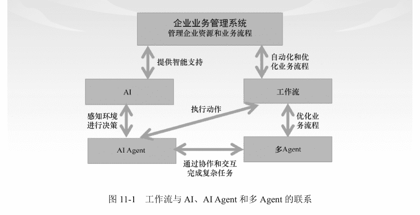

工作流、AI、AI Agent 和多 Agent 在企业应用中各有独特的作用和优势。工作流擅长结构化流程的管理和执行，AI 提供强大的数据分析和智能决策支持，AI Agent 在特定任务中表现出色，多 Agent 通过协作和信息共享解决复杂问题。结合使用这些技术可以实现更高效、智能的企业管理和运营。

工作流和 AI Agent 在功能和应用场景上存在互补性，可以相互结合实现更复杂、更智能的任务处理。AI Agent 可以作为工作流中的一个或多个节点，执行特定的任务或决策；工作流可以为 AI Agent 提供任务调度和数据流动的框架，使多个 AI Agent 协同工作，完成更复杂的业务流程。

##### 1. AI Agent 和工作流的联系

一方面，AI Agent 和工作流在很多场景下是互相联系、具有高度互补性的。例如，在任务自动化领域，AI Agent 可以集成到工作流中，自动化执行复杂的任务。例如，在一个智能客服系统中，可以有专门负责解答常见问题的 AI Agent、处理复杂技术问题的 AI Agent，以及引导客户流程的 AI Agent。通过工作流，AI Agent 可以协同工作，提高客户满意度。

在决策支持环节，AI Agent 可以为工作流中的决策点提供数据驱动的建议。例如，在贷款审批流程中，AI Agent 可以分析客户的信用数据并提供风险评估，帮助决策者做出更明智的决策。在数据处理与分析领域，AI Agent 可以处理和分析大量数据，为工作流提供有价值的洞察。例如，AI Agent 可以分析市场数据，为营销策略提供支持。

在跨平台集成方面，AI Agent 可以与多种平台和系统集成，提高工作流的灵活性和可扩展性。例如，AI Agent 可以与 ERP、CRM 等系统集成。

##### 2. AI Agent 和工作流的区别

AI Agent 和工作流主要区别于以下 3 个方面。

（1）确定性 vs 适应性
工作流在设计时假定任务的执行路径是已知的，步骤之间的依赖关系清晰，它更像一个“剧本”，每个角色按部就班地演绎。AI Agent 在设计时需要考虑动态环境，赋予其感知和决策能力，它更像一个“演员”，能根据现场情况即兴发挥。

（2）规则驱动 vs 目标驱动
工作流依赖预设的规则和条件，执行路径由开发者硬编码。例如，“如果条件 A 成立，则执行步骤 B”。AI Agent 以目标为导向，通过学习或推理选择实现目标的最佳路径。例如，“目标是解决问题”，AI Agent 可能会尝试多种策略。

（3）控制权归属
工作流的控制权在设计者手中，执行者（人或系统）只是按规则操作。而 AI Agent 的控制权被部分移交到 AI Agent，具有一定的自主权。

AI Agent 和工作流在企业应用中各有其独特的价值和适用场景。通过将 AI Agent 嵌入工作流，企业可以实现更智能、高效的业务流程自动化，提高竞争力和客户满意度。

#### 11.1.2 基于 AI 构建的工作流和 AI 与 ERP 等企业业务管理系统结合的区别

基于 AI 构建的工作流和 AI 与 ERP 等企业业务管理系统的结合的区别如表 11-2 所示。

表 11-2 基于 AI 构建的工作流和 AI 与 ERP 等企业业务管理系统结合的区别

| 对照内容 | 基于 AI 构建的工作流 | AI 与 ERP 等企业业务管理系统的结合 |
| :--- | :--- | :--- |
| 核心职能 | 任务自动化、智能处理、数据驱动决策支持 | 资源整合、业务流程管理、财务与供应链管理 |
| 目标 | 提高特定任务的效率和智能化水平 | 整体优化企业资源利用和业务流程 |
| 数据处理 | 侧重于实时数据分析、预测和智能决策支持 | 侧重于结构化数据的存储、查询和报表生成 |
| 流程管理 | 灵活、动态调整，适应快速变化的业务需求 | 相对固定，强调稳定性和标准化 |
| 决策支持 | 提供实时、个性化的决策建议 | 提供基于历史数据的综合分析和规划 |
| 集成与扩展 | 易与其他系统集成，支持快速扩展新功能 | 集成复杂，扩展时需考虑整体架构的影响 |
| 用户体验 | 交互性强，支持多轮对话和 NLP | 功能全面，但界面可能较为复杂 |
| 成本与效益 | 初始投入较低，按需扩展，适合中小企业快速部署 | 初始投入较高，适合大型企业长期战略规划 |

从核心职能来看，基于 AI 构建的工作流通过 AI 技术实现任务自动化和智能化处理，如自动化报告生成、智能客服等；AI 与 ERP 的结合是利用 AI 技术来增强 ERP 系统的功能，如财务预测、供应链优化等。

从目标来看，基于 AI 构建的工作流能够快速响应业务变化，提高特定任务的效率；AI 与 ERP 的结合是通过智能化升级，优化企业资源利用和整体业务流程。

从数据处理能力来看，基于 AI 构建的工作流擅长实时数据分析和预测，适合处理动态数据；AI 与 ERP 的结合旨在通过 AI 技术增强 ERP 系统的结构化数据处理能力，如发票解析、数据分析等。

从流程管理来看，基于 AI 构建的工作流流程相对灵活，支持一定程度的动态调整，可以适应一定程度变化的业务需求；AI 与 ERP 的结合流程相对固定，强调稳定性和标准化，适合长期规划。

从决策支持来看，基于 AI 构建的工作流提供实时、个性化的决策建议，如风险评估、客户洞察等；AI 与 ERP 结合，通过 AI 技术提供基于历史数据的综合分析和规划，如财务预算、资源分配等。

从集成与扩展程度来看，基于 AI 构建的工作流易于与其他系统集成，支持快速扩展新功能，适合敏捷开发；AI 与 ERP 结合集成复杂，扩展需要考虑整体架构影响，适合大型企业的长期战略。

从用户体验来看，基于 AI 构建的工作流交互性强，支持多轮对话和 NLP，能够提升用户体验；AI 与 ERP 的结合功能全面，但界面可能较复杂，需要一定的学习成本。

从成本与效益来看，基于 AI 构建的工作流初始投入较低，可按需扩展，适合中小企业快速部署；AI 与 ERP 结合的初始投入较高，适合大型企业长期战略规划，提供全面的资源管理。

### 11.2 工作流的分类

工作流根据适用场景和功能特点，可以有以下一些常见的分类方式及具体类型。

##### 1. 按功能分类

按功能分类，工作流可以分为自动化任务工作流、数据处理工作流、客户服务工作流、内容创建工作流、审批工作流、实时工作流、批量工作流、对话式工作流、非对话式工作流和行业特定工作流等多种类别。不同类别工作流分类及特点，如表 11-3 所示。

表 11-3 不同类别工作流分类及特点

| 工作流类型 | 特点 |
|---|---|
| 自动化任务工作流 | 通过自动化执行一系列任务，减少人工干预；适用于文件处理、数据清洗、报告生成、任务调度等场景 |
| 数据处理工作流 | 专注数据的处理、分析和转换；适用于数据清洗与预处理、数据分析与可视化、数据挖掘与机器学习任务、数据库同步与更新等场景 |
| 客户服务工作流 | 通过自动化或智能交互提升客户服务效率；适用于智能客服、客户反馈处理、多轮对话支持等场景 |
| 内容创建工作流 | 用于生成和优化内容；适用于文本生成、图像生成、视频编辑等场景 |
| 审批工作流 | 用于需要多级审批的业务流程；适用于采购审批、项目审批、文档审批等场景 |
| 实时工作流 | 任务需要即时执行，对响应时间要求高；适用于实时数据分析、实时客户服务、实时监控与报警等场景 |
| 批量工作流 | 任务可以批量处理，通常在特定时间执行；适用于大数据处理、定时任务、批量生成报告等场景 |
| 对话式工作流 | 通过对话方式与用户交互；适用于智能客服、虚拟助手、多轮对话应用等场景 |
| 非对话式工作流 | 无须用户交互，完全自动化；适用于批量数据处理、定时任务、自动化报告生成等场景 |
| 行业特定工作流 | 针对特定行业的需求设计；适用于医疗行业（如病历管理）、教育行业（如学生成绩管理）、金融行业（如交易审批）等场景 |

这些分类涵盖工作流在不同场景下的主要功能和特点。根据具体需求选择合适的工作流类型，可以显著提高效率和效果。

##### 2. 按复杂度分类

工作流按复杂程度可以分为简单工作流、复杂工作流和多 Agent 协作工作流。

简单工作流的特点是流程简单、节点较少、逻辑清晰，通常是一系列线性任务，没有复杂的分支或条件判断，适用于单一任务的自动化，如文件转换、数据计算等。例如，自动化文件格式转换、简单的数据清洗任务。

复杂工作流的特点是流程复杂，包含多个分支和条件判断，可能涉及多个系统或工具的协作，需要处理多种输入和输出，动态调整执行逻辑。例如，多步骤的业务流程，如订单处理、审批流程；需要多系统协作的场景，如 ERP 与 CRM 集成。

多 Agent 协作工作流的特点是涉及多个 Agent 的协作，每个 Agent 负责不同的任务，需要共享上下文信息，进行智能决策，适用于需要多轮交互和复杂决策的场景。例如，智能客服系统涉及多个 Agent 处理不同类型的用户问题，多 Agent 协作完成复杂任务，如自动化项目管理。

不同复杂程度工作流及特点，如表 11-4 所示。

表 11-4 不同复杂程度类型工作流及特点

| 工作流类型 | 特点 |
| :--- | :--- |
| 简单工作流 | 流程简单，节点较少，逻辑清晰，适用于单一任务的自动化 |
| 复杂工作流 | 流程复杂，包含多个分支和条件判断，可能涉及多个系统或工具的协作 |
| 多 Agent 协作工作流 | 涉及多个 Agent 的协作，共享上下文信息，适用于需要多轮交互和复杂决策的场景 |

简单工作流和简单任务的主要区别在于复杂性和流程结构。简单任务和简单工作流程的区别，如表 11-5 所示。

表 11-5 简单任务和简单工作流的区别

| 维度 | 简单任务 | 简单工作流 |
| :--- | :--- | :--- |
| 任务复杂性 | 单一操作（如发送邮件、计算总和） | 多个步骤或任务，按顺序执行以完成目标 |
| 自动化程度 | 可能需要人工干预或手动执行 | 自动化，任务之间有明确的执行顺序 |
| 流程结构 | 没有明确的流程结构，独立操作 | 有明确的流程结构（开始节点、处理节点、结束节点） |
| 系统集成 | 不涉及与其他系统的集成 | 可能涉及与其他系统的简单集成（如调用 API） |
| 应用场景 | 适用于单一、简单的操作 | 适用于需要多个步骤完成的场景（如文件转换） |
| 执行逻辑 | 执行逻辑简单，没有条件判断或分支 | 可能包含简单的条件判断或分支逻辑 |
| 任务依赖 | 任务之间没有依赖关系 | 任务之间有依赖关系，前一个任务的输出可能是下一个任务的输入 |
| 资源需求 | 对资源需求较低 | 可能需要更多的资源（如内存、存储） |
| 扩展性 | 扩展性较差，难以适应更复杂的场景 | 具有一定的扩展性，可以添加更多任务或节点 |
| 监控与管理 | 不需要复杂的监控和管理 | 可能需要简单的监控和管理（如日志记录） |

##### 3. 按执行方式分类

按执行方式，工作流可以分为以下 7 种类别。

- (1) 顺序工作流
按照顺序依次执行一系列任务或步骤的工作流，每个任务的执行都依赖上一个任务的完成。

- (2) 状态机工作流
在定义的状态或阶段内运行，任务不一定遵循严格的顺序，工作流程会根据某些条件或触发器在状态之间转换。这种灵活性对于动态流程非常有用，如客户支持票据解决，任务的顺序可能会有所不同。

- (3) 规则驱动的工作流
由预定义的条件和业务逻辑管理，任务根据这些规则执行，这些规则决定操作的流程。例如，电子商务退货流程可能会根据产品类型或退货原因而有所不同，自动将任务分配给合适的团队。

- (4) 事件驱动的工作流
由特定的事件触发并执行。例如，当某个条件满足或某个事件发生时，工作流便开始执行相应的任务。这种工作流适用于需要实时响应的场景，如监控系统中的异常检测和报警。

- (5) 基于 AI 的工作流
利用 AI 技术，如机器学习、NLP 等，自动化和优化工作流程。例如，智能客服系统可以根据用户输入自动理解问题并提供相应的解答。

- (6) 批量工作流
任务可以批量处理，通常在特定时间执行，适用于大数据处理、定时任务、批量生成报告等场景。

- (7) 实时工作流
任务需要即时执行，对响应时间要求高，适用于实时数据分析、实时客户服务、实时监控与报警等场景。

##### 4. 按交互方式分类

按照交互方式，可以将工作流分为对话式工作流和非对话式工作流。

- (1) 对话式工作流
对话式工作流的特点是通过对话方式与用户交互，适用场景包括智能客服、虚拟助手、多轮对话应用等。对话式工作流（如 ChatFlow）和基于提示词的 AI 工具（如普通的 LLM 应用）在不同方面具有显著区别。

在交互方式方面，对话式工作流支持多轮对话，能够根据用户的输入动态调整对话流程；内置记忆（Memory），用于存储和传递多轮对话的历史消息，确保对话上下文的连贯性，具有记忆功能；支持流式输出，可以逐步生成和返回响应。基于提示词的 AI 工具通常是一次性任务，用户输入提示词，AI 生成响应，没有上下文记忆；不存储对话历史，每次交互都是独立的，同时是一次性输出，生成完整的响应后一次性返回。

在任务复杂度方面，对话式工作流能够处理复杂的业务逻辑，通过多轮对话逐步解决问题；能够根据用户输入动态调整对话流程，支持条件判断和分支逻辑。基于提示词的 AI 工具适合简单的任务，如文本生成、翻译等，任务流程固定，无法根据用户输入动态调整。

在应用场景方面，对话式工作流具有智能客服功能，能够处理用户咨询，提供多轮对话支持，同时也是虚拟助手，能够提供个性化建议，支持多轮交互，具有复杂问题解答能力，能够逐步引导用户解决问题。基于提示词的 AI 工具，具有文本生成能力，能够生成文章、文案等，在数据处理方面仅能进行简单的数据清洗和分析，但可以优化文本内容。

在用户体验方面，对话式工作流具有自然交互功能，用户可以自然地与系统对话，体验更接近人类交流；还能够开展个性化服务，根据用户的历史输入提供个性化建议。基于提示词的 AI 工具，用户需要明确输入提示词，交互较为机械，并且无法根据用户历史提供个性化服务。

在技术实现方面，对话式工作流架构复杂，需要支持多轮对话的架构，包括 Memory、Context 管理等；通常包含多个处理节点，如文档提取、大模型调用等。基于提示词的 AI 工具架构简单，通常是一个简单的 API 调用，输入提示词，输出结果；通常只有一个处理节点，直接调用大模型。

对话式工作流和基于提示词的 AI 的对比如表 11-6 所示。

表 11-6 对话式工作流和基于提示词的 AI 的对比

| 维度 | 对话式工作流 | 基于提示词的 AI |
| :--- | :--- | :--- |
| 交互方式 | 多轮交互，支持记忆和流式输出 | 单轮交互，无记忆，一次性输出 |
| 任务复杂度 | 处理复杂任务，支持动态调整 | 处理简单任务，流程固定 |
| 应用场景 | 智能客服、虚拟助手、复杂问题解答 | 文本生成、数据处理、内容优化 |
| 用户体验 | 自然交互，个性化服务 | 机械交互，通用服务 |
| 技术实现 | 复杂架构，多节点处理 | 简单架构，单节点处理 |

DeepSeek 和 Kimi 等具有记忆功能的 AI 可以被视为一种工作流，尤其是 Agent 工作流。

- (2) 非对话式工作流
非对话式工作流的特点是无须用户交互，完全自动化，适用场景包括批量数据处理、定时任务、自动化报告生成等。

##### 5. 按应用场景分类

按应用场景，可以将工作流分为企业级工作流、个人工作流和行业特定工作流。
企业级工作流适用于企业内部的复杂业务流程，适用场景包括 ERP 系统集成、CRM 系统集成和项目管理等。
个人工作流适用于个人任务管理，适用场景包括个人任务自动化（如邮件分类）、个人数据处理（如日程管理）等。
行业特定工作流是针对特定行业的需求进行设计的，适用场景包括医疗行业（如病历管理）、教育行业（如学生成绩管理）、金融行业（如交易审批）等。

### 11.3 工作流的适用领域和场景

##### 1. 适用于工作流的领域和场景

在企业生产和运营中，以下领域和场景适用于工作流。

- (1) 企业内部流程管理
工作流技术可以帮助企业优化内部各项流程，如请假流程、报销流程、审批流程等。通过工作流系统，企业可以实现这些流程的自动化、规范化和透明化，提高工作效率，减少人为错误。

- (2) 跨部门协作
在大型企业中，不同部门的协作和信息共享至关重要。工作流技术可以帮助不同部门建立高效的协作机制，实现信息的快速传递和流程的协同处理。例如，在产品研发过程中，设计、生产、销售等部门可以通过工作流系统协同工作，确保产品从设计到上市的全过程顺畅无阻。

- (3) 客户关系管理
工作流技术可以用于客户投诉处理及客户服务流程管理。通过工作流系统，企业可以更好地响应客户需求，提高客户满意度。例如，当客户提交投诉时，工作流系统可以自动将投诉信息传递给相关部门进行处理，并实时跟踪处理进度，确保客户问题得到及时解决。

- (4) 生产流程管理
在制造业和生产领域，工作流技术可以帮助企业优化生产流程、物料流程和质量管理流程。通过实时监控生产线的运行情况，工作流系统可以及时发现并解决生产过程中的问题，提高生产效率和产品质量。

- (5) 项目管理
工作流技术可以在项目启动、执行、监控和收尾阶段提供支持。通过工作流系统，项目团队可以协调工作、跟踪进度和解决问题，确保项目按时、按质完成。

- (6) 营销活动管理
工作流技术可以用于营销活动的规划、执行和评估。通过工作流系统，企业可以更好地管理市场营销活动，提高营销效果。例如，当制订营销计划时，工作流系统可以帮助企业确定营销活动的目标、预算和执行方案；在执行过程中，工作流系统可以实时跟踪营销活动的进展情况，并根据实际情况进行调整和优化。

- (7) IT 与软件开发行业
工作流技术可以用于敏捷开发流程、项目进度管理、Bug 跟踪与修复等场景。通过 Jira、Trello 等工作流工具，企业可以管理迭代、Scrum 会议、任务分配，实时跟踪任务状态，确保项目按时交付，记录、分配和解决错误，确保开发与测试顺利进行。

- (8) 金融服务
工作流技术在金融行业应用广泛，包括贷款审批流程、理赔流程、风险管理等。通过工作流技术，金融机构可以实现流程标准化、自动化和监控，提高服务效率和客户满意度。

##### 2. 适用于工作流领域和场景的共性原因

适用于工作流的领域和场景，都具有流程重复、涉及多部门协作、需要复杂审批等共同点，这些共同点是适用于工作流的基础和前提，因为工作流适用于需要处理多个步骤并对最后结果要求很严格的任务场景。工作流还可以协调不同部门之间的任务，确保信息流畅和资源高效利用。工作流也可以处理复杂的审批流程，确保每个环节都按计划进行。

##### 3. 不适用于工作流的领域和场景

简单任务、对实时性要求极高的任务和调度依赖人工创意的任务，不适用于工作流。因为对于简单的、无须多步骤的任务，工作流可能显得过于复杂，反而增加不必要的管理负担。工作流通常适用于有状态的、异步的、长时间执行的业务场景。对于需要实时响应的任务，如高频交易系统，工作流可能无法满足其对实时性的要求。此外，对于艺术创作、广告创意设计等，这些任务通常需要高度的灵活性和创造性，而工作流的预设规则也可能限制灵活性。

### 11.4 创建工作流的一般方法

尽管不同的工作流有不同的应用领域和场景，也有不同的业务流程，但从创建角度来看，工作流的创建还是遵循基本相同的一般方法。

#### 11.4.1 创建工作流的6个阶段

开发或创建工作流，一般情况下需要从以下6个阶段着手。创建工作流的6个阶段如图11-2所示。


一是规划阶段。规划阶段需要明确工作流的目标、范围和时间计划，确定相关的质量控制方法和工具。具体工作包括分析企业的需求，确定工作流需要解决的问题和实现的功能；评估所需的资源，包括硬件、软件、人员和预算；制订详细的开发计划，包括时间表和里程碑。

二是设计阶段。设计阶段需要设计工作流的结构和流程，包括任务定义、流程定义、触发机制等。具体工作包括使用流程图或流程建模工具，绘制工作流的各个步骤和逻辑关系；明确每个任务的内容、目标和预期输出；规定任务之间的顺序和逻辑关系，以及定义工作流的启动条件和触发事件。

三是实现阶段。实现阶段需要根据设计阶段的计划，实际开发和配置工作流。具体工作包括搭建开发环境，安装必要的软件和工具；使用工作流引擎或工具进行核心功能的实现，确保代码的规范性和可维护性；对每个功能模块进行测试，确保正确性和稳定性；设置工作流的参数和环境变量，确保其能够与外部系统无缝集成。

四是测试阶段。测试阶段需要验证工作流的性能和功能，确保其在实际应用中的可靠性和稳定性。具体工作包括对每个功能模块进行单元测试，确保其独立运行的正确性；测试工作流与外部系统（如数据库、API）的集成情况，确保数据传输和交互的正确性；评估工作流在高负载下的性能表现，优化响应速度和资源利用率；进行安全测试，确保工作流在数据传输和存储中的安全性。

五是部署阶段。部署阶段将经过测试的工作流部署到生产环境中，确保其能够稳定运行。具体工作包括准备生产环境、服务器配置、网络设置等；之后将工作流应用部署到生产服务器，并建立监控系统，实时监控工作流的运行状态，及时发现和解决问题。

六是优化阶段。优化阶段需要根据实际运行情况，持续优化工作流的性能和功能。具体工作包括根据监控数据和用户反馈，优化工作流的性能；根据业务需求，扩展工作流的功能，增加新的模块和功能；收集用户反馈，不断改进工作流的用户体验。

#### 11.4.2 工作流的功能模块

从组成元素角度来看，工作流包括任务、流程、角色和规则4个构成要件。任务是工作流中的基本单元，代表需要执行的具体操作或活动；流程定义任务的顺序和逻辑关系，控制任务的执行流程；角色是工作的不同参与者或系统，负责执行特定的任务；规则定义工作流的行为和决策逻辑，根据条件触发不同的任务或流程。一个典型的工作流功能模块组成如图11-3所示。

一个典型工作流功能模块的具体定义如下。

- (1) 任务定义
任务定义是明确工作流中需要执行的具体任务或活动，定义每个任务的内容、目标和预期输出。例如，在客户订单处理工作流中，任务定义可能包括接收订单、验证库存、安排发货和更新客户记录等。

- (2) 流程定义
流程定义规定任务之间的顺序和逻辑关系，确定任务的执行顺序，以及在何种条件下任务可以开始或结束。例如，在订单处理工作流中，只有在库存验证通过后，才能安排发货。

- (3) 触发机制
触发机制是启动工作流的机制，需要定义工作流何时开始执行，通常基于特定的事件或条件。例如，客户下订单后，自动触发订单处理工作流。

- (4) 任务分配
任务分配是将任务分配给合适的执行者（人或系统），根据预设规则或动态条件，将任务分配给最合适的资源。例如，将高优先级的订单分配给经验丰富的客服人员。

- (5) 调度引擎
调度引擎管理任务的执行时间和顺序，确保任务按照预定的时间表或优先级执行。例如，在项目管理中，确保关键路径上的任务按时完成。

- (6) 数据处理
数据处理是处理工作流中涉及的数据，包括数据的输入、转换、存储和输出等操作。例如，在财务报销工作流中，处理员工提交的报销单据和数据。

- (7) 决策点
决策点根据条件判断决定工作流的分支路径，基于预设的规则或条件，决定工作流的下一步执行路径。例如，在客户投诉处理工作流中，根据投诉的严重程度决定是否升级到高级支持。

- (8) 通知和提醒
通知和提醒的作用是在关键点通知相关人员或系统，包括通过邮件、短信或其他通信方式发送通知，确保相关人员及时了解工作流状态。例如，在订单发货后，向客户发送发货通知。

- (9) 调整和优化
调整和优化是根据监控数据和用户反馈，持续改进工作流的效率和效果，调整工作流的参数和结构。例如，根据执行情况调整任务优先级或资源分配。

- (10) 资源管理
资源管理负责管理工作流所需的资源，确保工作流执行过程中有足够的人力、物力和财力资源。例如，在项目管理中，分配合适的团队成员和预算给每项任务。

- (11) 监控和日志记录
监控和日志记录提供实时监控和历史记录，跟踪和记录工作流的执行情况，帮助管理员了解工作流的执行状态和性能。例如，记录每个任务的执行时间、执行者和结果，用于后续分析和优化。

- (12) 集成接口
集成接口可与其他系统或应用进行集成，通过 API 或其他接口，与其他系统交换数据或协调工作。例如，与 ERP 系统集成，获取库存信息。

- (13) 安全和权限管理
安全和权限管理定义访问控制和权限管理机制，确保工作流的安全性和数据保护，以保护敏感信息。例如，只有授权人员才能访问财务数据。

- (14) 决策支持
决策支持利用数据分析和 AI 技术，提供智能分析和建议，辅助决策，为工作流中的决策点提供支持。例如，在库存管理中，根据历史销售数据预测库存需求。

- (15) 用户界面
用户界面提供与用户交互的界面，允许用户输入数据、查看状态和接收反馈。例如，员工通过工作流系统的 Web 界面提交请假申请。

- (16) 多 AI Agent
通过多个 Agent 协作和交互完成复杂任务，利用分布式智能和协同决策机制提升工作流的自动化水平与处理能力。

工作流功能模块与组成元素的对应关系如表 11-7 所示。

表 11-7 工作流功能模块与组成元素的对应关系

| 功能模块 | 任务 | 流程 | 角色 | 规则 |
| :--- | :---: | :---: | :---: | :---: |
| 任务定义 | ✓ | | | |
| 流程定义 | | ✓ | | |
| 任务分配 | | | ✓ | |
| 调度引擎 | | | | ✓ |
| 数据处理 | ✓ | ✓ | | |
| 用户界面 | ✓ | ✓ | ✓ | |
| 集成接口 | ✓ | ✓ | ✓ | |
| 监控和日志记录 | ✓ | ✓ | ✓ | ✓ |
| 安全和权限管理 | | ✓ | ✓ | ✓ |
| 通知和提醒 | ✓ | ✓ | ✓ | |
| 资源管理 | ✓ | ✓ | ✓ | |

| 功能模块 | 任务 | 流程 | 角色 | 规则 |
| :--- | :---: | :---: | :---: | :---: |
| 任务调度 | ✓ | ✓ | | ✓ |
| 协作工具 | ✓ | ✓ | ✓ | |
| 报告与仪表板 | ✓ | ✓ | ✓ | ✓ |
| 系统集成 | ✓ | ✓ | ✓ | ✓ |

#### 11.4.3 创建工作流与创建 AI Agent 的区别

创建工作流与创建 AI Agent，至少存在以下 10 个方面的区别。

（1）定义与目标
工作流是一系列任务或活动按照预设的顺序和规则执行的过程，用于自动化和优化业务流程；其目标是确保业务流程的高效、准确和一致执行。AI Agent 是一种能够感知环境、进行决策和执行动作的智能实体，专注于特定任务的处理，如智能客服、内容创作、数据分析等；其目标是通过智能分析和决策支持，提供高质量的交互体验。

（2）主要功能
工作流的主要功能是实现任务自动化、流程管理、资源分配和进度跟踪等。AI Agent 的主要功能是实现感知、推理、决策、执行、学习等。

（3）应用场景
工作流适用于 ERP、CRM、项目管理、生产调度等场景。AI Agent 适用于智能客服、自动化工作流程、内容生成、风险预测、教育辅导等场景。

（4）技术实现
工作流在技术实现方面需要流程设计工具、工作流引擎、规则引擎等。AI Agent 需要 LLM、强化学习、多模态处理等。

（5）数据处理
工作流的数据处理对象主要包括结构化数据，确保流程的高效执行。AI Agent 的数据处理对象包括结构化数据和非结构化数据，强调对上下文的理解和推理。

（6）决策支持
工作流是基于预设规则和流程的自动化决策。AI Agent 是基于数据分析和模式识别的智能决策。

（7）灵活性与适应性
工作流依赖预设规则和流程，灵活性较低。AI Agent 能够适应数据变化和新场景，灵活性较高。

（8）用户体验
工作流提供结构化的工作流程和任务管理。AI Agent 提供个性化和交互式的用户体验。

（9）开发阶段
工作流和 AI Agent 在开发阶段方面的对比见表 11-8。

表 11-8 工作流和 AI Agent 在开发阶段方面的对比

| 开发阶段 | 工作流 | AI Agent |
| :--- | :--- | :--- |
| 规划阶段 | 需求分析、资源评估、制订计划 | 需求分析、资源评估、制订计划 |
| 设计阶段 | 流程建模、任务定义、流程定义、触发机制 | 模型选择、提示工程、任务规划、记忆与状态管理、推理与决策、工具集成 |
| 实现阶段 | 环境搭建、核心实现（使用工作流引擎或工具）、功能测试、配置管理 | 环境搭建、模型训练、功能测试、配置管理 |
| 测试阶段 | 单元测试、集成测试、性能测试、安全测试 | 单元测试、集成测试、性能测试、安全测试 |
| 部署阶段 | 环境准备、部署应用、监控与维护 | 环境准备、部署应用、监控与维护 |
| 优化阶段 | 性能优化、功能扩展、用户反馈 | 性能优化、功能扩展、用户反馈 |

在设计阶段，工作流注重流程建模和任务定义，确保每个环节按顺序执行；在实现阶段，主要使用工作流引擎和规则引擎。AI Agent 更注重模型选择和提示工程，引导模型生成符合预期的回答。在实现阶段，需要进行模型训练，使用深度学习框架和 LLM。

（10）适用场景
工作流适用于需要结构化流程管理的场景，如订单处理、报销流程、审批流程等。AI Agent 适用于需要智能分析和决策支持的场景，如智能客服、内容生成、风险预测等。

工作流和 AI Agent 在目标、功能、应用场景和技术实现等方面存在显著区别。工作流擅长结构化流程的管理和执行，而 AI Agent 提供强大的数据分析和智能决策支持。二者结合使用，可以实现更高效、更智能的企业管理和运营。

#### 11.4.4 创建工作流的主要工具或平台

目前已经有很多可以进行工作流开发或创建的工具或平台，开发或创建工作流的主流工具或平台如表 11-9 所示。

表 11-9 开发或创建工作流的主流工具或平台

| 工具名称 | 特点 | 适用场景 |
| :--- | :--- | :--- |
| n8n | 开源自动化工作流工具，支持跨系统集成与 AI 任务编排，完全开源免费，高灵活性，支持 400 多个应用集成，兼容主流 AI 模型 | 企业 IT 自动化、金融数据合规处理、复杂 API 串联 |
| Dify | 企业级 AI 应用开发平台，支持复杂工作流与私有化部署，多模型支持，低代码开发，企业级功能 | 智能客服系统、数据分析助手、垂直领域内容生成 |
| Coze | 零代码对话机器人开发平台，主打轻量级 AI 应用，快速上线，免费模型，生态丰富 | 社交媒体 Bot、电商客服、个人娱乐助手 |
| Zapier | 无须编码，连接应用程序并自动化工作流程，用户友好，支持 5000 余个应用程序 | 项目管理、客户支持、市场营销 |
| Make | 可视化工作流设计，支持条件逻辑和多步骤操作，具有强大的集成能力 | 数据转换、API 调用、复杂自动化场景 |
| LangChain/Flowise | 面向开发者的 LLM 工作流工具，适合复杂 AI 链构建 | 需要有代码基础的开发者 |
| AutoGPT/AgentGPT | 自主任务代理，适合自动化决策，稳定性有待提升 | 自动化任务管理 |
| FastGPT | 专注知识库问答 RAG，适合文档分析与专业问答 | 法律、医疗等知识密集型任务 |
| UVdesk | 开源客户支持平台，多渠道整合和工作流自动化 | 客户支持流程优化 |
| Pipedream | 开源事件驱动的集成平台，连接应用程序并构建自动化工作流 | 实时事件处理和跨平台集成 |

这些工具或平台涵盖从无代码或低代码平台到高级开发者工具的广泛需求，可以根据自身的业务需求和技术背景选择最适合的工具。

### 11.5 基于 DeepSeek 创建企业应用工作流

DeepSeek 成为当前最为火爆的 AI 工具之一，除了卓越的性能和便宜的价格，其对中文环境的适配，以及国内外众多上下游产品对其的支持，使基于 DeepSeek 创建企业应用工作流成为企业的必然选择。

#### 11.5.1 基于 DeepSeek 开发工作流的优势

除了强大的模型性能、成本优势、技术创新和开源策略，基于 DeepSeek 创建工作流还具有以下优势。

（1）广泛的应用场景
基于 DeepSeek 创建的工作流，可以广泛应用于智能客服、文档处理、图像识别、NLP 等诸多场景。

（2）高度的可扩展性和灵活性
DeepSeek 可以与多个 AI Agent 结合，形成多 AI Agent 系统，实现复杂任务的自动化和智能化处理。同时，DeepSeek 也可以集成到现有的工作流中，通过可视化流程编排不同工具和模型，按顺序执行任务，像工厂流水线一样协作。

（3）实时响应和优化
DeepSeek 可以实时监控工作流的执行情况，及时发现和解决问题。根据实际运行数据和用户反馈，DeepSeek 可以持续对工作流进行优化。

（4）数据处理与分析能力
DeepSeek 能够处理各种类型和规模的数据，并随着数据量的增加，分析效果会不断提升。此外，DeepSeek 的自适应学习能力使其能够快速适应新的分析场景和数据特征，保持长期的分析效果。

安全与合规、易用性和开发效率，也是基于 DeepSeek 创建工作流的重要因素。

#### 11.5.2 基于 DeepSeek 创建工作流

基于 DeepSeek 创建工作流，可以按照以下步骤进行。

1. 明确不同类别业务需求和目标
首先确定需要自动化工作流的具体业务场景是订单处理，还是客户支持或者文档审批等。其次设定目标，明确工作流的预期成果，如提高效率、减少错误、增强合规性等具体指标。

基于 DeepSeek 适用于创建以下类型的工作流，因为这些工作流能够充分发挥 DeepSeek 的推理能力、多模态处理能力和智能决策支持能力，帮助企业提高效率、降低成本、优化决策和提升客户体验。

（1）数据处理工作流
DeepSeek 可以自动识别和提取关键信息，然后通过工作流将这些信息传递给下一个处理步骤，减少人工干预，提高处理速度和准确性。例如，在文本数据清洗场景中，DeepSeek 可以自动去除空值、重复值，并进行数据标准化等操作。

对于数据处理工作流，工作流的工作目标应是提高数据处理的效率和准确性，减少人工干预，具体应包括对数据清洗，应设定去除空值、重复值等数据清洗目标；对数据转换，应定义数据标准化、格式化等转换目标；对数据加载，应设定数据存储的目标位置和格式。

（2）内容生成工作流
DeepSeek 能够生成高质量的文本、图像和语音内容，可用于自动化内容创作，如新闻报道、博客文章、社交媒体文案等，提高创作效率和质量。

内容生成工作流的目标应是自动生成高质量的文本、图像和语音内容，提高创作效率和质量，具体包括对于文本生成，应设定生成文本的长度、风格和内容要求；对于图像生成，应定义生成图像的尺寸、格式和内容要求；对于语音生成，应设定生成语音的语种、语速和内容要求。

（3）客户服务工作流
DeepSeek 可以构建智能客服系统，自动回答客户问题，提高客户满意度，降低人工成本。DeepSeek 还可以理解用户意图，生成准确的回答，并实时更新客户信息，提供个性化的服务。

对于客户服务工作流，DeepSeek 的目标应是提高客户满意度，减少人工客服的工作量，具体任务至少应包括对于意图理解，应设定能够准确理解用户意图；对于回答生成，应定义生成准确、相关回答的目标；对于回答发送，应设定将回答发送到客户服务系统的机制。

（4）智能决策支持工作流
DeepSeek 可以实时分析业务数据，预测趋势和风险，为企业提供智能决策支持，优化库存管理和生产计划等。

智能决策支持工作流的目标是提供准确的预测和决策支持，优化业务流程，具体包括对于数据分析，应设定分析历史数据和市场趋势的目标；对于预测模型，应定义构建预测模型的目标；对于决策建议，应设定生成优化决策建议的目标。

（5）自动化报告生成工作流
DeepSeek 可以自动收集和分析数据，生成各种类型的报告，如销售报告、财务报告等，提高报告的准确性和及时性。

对于自动化报告生成工作流，目标应是自动生成各种类型的报告，提高报告的准确性和及时性，具体应包括对于数据收集，应设定收集和整理数据的目标；对于报告生成，应定义生成报告的格式和内容要求；对于报告发送，应设定将报告发送给相关人员的机制。

（6）项目管理自动化工作流
DeepSeek 可以用于项目管理，协调工作、跟踪进度和解决问题，确保项目按时按质完成。

对于项目管理自动化工作流，DeepSeek 的目标应是协调项目任务，跟踪进度，确保项目按时完成。具体应包括对于任务创建，应设定创建项目任务的目标；对于任务分配，应定义将任务分配给合适人员的机制；对于进度跟踪，应设定实时跟踪任务进度的目标；对于报告生成，应定义生成项目进度报告的目标。

尽管基于 DeepSeek 可以创建很多领域和场景下的工作流，也方便设定相应种类工作流的目标，但是基于 DeepSeek 不适用于开发学术论文检索、长文本写作、敏感内容处理、个人风格写作等方面的工作流。

DeepSeek 在学术论文检索方面表现不佳。例如，当要求 DeepSeek 收集关于 DeepSeek-R1 这类推理大模型的最新论文资料时，它给出的论文标题都是错的，提供的资料来源并非学术网站。对于长文本写作，DeepSeek 默认大小是 64 k，对于超过 4 000 字的文章容易出现逻辑断裂，不建议用于长文本写作场景。此外，DeepSeek 内置审核尺度严格，容易触发审核，导致无法正常回复或内容被修改，不适用于处理敏感内容。在个人风格写作方面，DeepSeek 虽然是一个推理模型，适合解决问题和模仿，但很难通过精确控制确保特定风格的写作效果，不适用于需要特定个人风格的写作场景。

2. 选择合适的工作流平台
11.4.4 节讨论了创建工作流的主要工具或平台，不同工具或平台也有对应的适宜应用场景。在选择合适的工作流平台方面，首先应根据需求选择合适的工作流平台；其次要考虑集成能力，确保平台能够与现有系统（如 ERP、CRM）集成。

从技术层面来讲，在主要的开发工作流的工具中，Dify 是最适合和 DeepSeek 结合开发工作流的工具。这里以 Dify 为例，进行相关讨论。

（1）Dify 的优势、不足和适宜场景
Dify 是一个支持 DeepSeek 的 LLM 应用开发平台，可用于创建 AI 助手、工作流、文本生成器等应用，它提供丰富的 API 和灵活的集成方式，方便地将 DeepSeek 集成到现有的业务系统，满足不同企业的个性化需求。Dify 作为一个支持 DeepSeek 模型的 LLM 应用开发平台，在开发工作流方面具有以下优势。

① 灵活性与扩展性，Dify 支持多模型协同（如 DeepSeek 与 GPT-4 混合调用），允许开发者自由扩展功能并完全自定义数据处理管道，还提供多种第三方工具插件和可视化拖拽式编排应用功能节点，能够实现复杂业务逻辑。
② 低代码开发，Dify 提供直观的可视化界面，开发者可以通过拖放界面快速构建 AI 工作流，无须深入的编码知识。Dify 还有预构建的组件和工作流程，加速应用程序的创建过程。
③ 私有化部署与安全性，Dify 支持私有化部署，可以确保数据在本地化运行，满足金融和法律等高合规需求场景。Dify 提供的数据隔离和自主掌控能力，避免敏感信息泄露。
④ 知识库增强，通过 RAG 功能，Dify 可以关联内部文档，构建精准问答系统。
⑤ 数据洞察力，Dify 内置的数据监控模块，支持与专业监控平台集成，帮助开发者实时优化应用性能。

Dify 的不足，一是表现为技术门槛，二是表现为部署成本，三是表现为密钥管理。Dify 需要具备一定的技术能力进行部署和管理，尤其是私有化部署需要技术专长。私有化部署需要内存和存储等较高的硬件资源，并且部署过程较复杂。此外，需要开发者自行管理 DeepSeek API 密钥，存在一定的泄露风险。

Dify 适合工作流开发场景，一是智能客服系统，尤其是结合 DeepSeek 模型，快速搭建能够自动回答客户问题的智能客服系统；二是本地知识库查询，构建本地知识库查询系统，通过自然语言提问检索信息；三是文档总结与分析，通过开发文档总结和分析工具，快速提取关键信息并生成摘要；四是创意生成助手，用于生成文案、广告语、营销策划等内容；五是企业级 LLM 基础设施，通过部署为企业内的 LLM 网关，实现中心化监管和数据监控；六是智能工作流，可以实现复杂的自动化任务，如处理客户订单、生成报告、安排会议等。

（2）Dify 与现有业务系统的集成能力
Dify 作为一个 AI 应用开发平台，在与现有系统（如 ERP、CRM）集成方面具有以下优势。

① 无代码集成，Dify 支持无代码开发，通过可视化界面和预置功能模块，用户可以轻松实现与 ERP、CRM 等系统的集成，无须复杂的编程。
② 具有丰富的 API 支持，Dify 提供 RESTful API 和 SDK，允许开发者方便地将 AI 功能集成到现有的业务系统，如智能客服、文档问答等。
③ 可以与第三方平台协作，Dify 可以与集简云等无代码连接平台结合，利用预置的数千款软件连接，实现数据的实时同步和业务流程的自动化。
④ 具备企业级集成能力，Dify 企业版提供强大的企业级集成能力，支持与企业内部系统的集成，如单点登录，确保数据安全和访问控制。

Dify 的挑战与不足表现如下。
① 具有一定的技术门槛，尽管 Dify 提供无代码开发选项，但对于复杂的集成场景，仍需要具备一定的技术知识和经验。
② 需要一定的集成成本，与第三方平台的集成可能涉及额外的成本，尤其是在处理大量数据或复杂业务逻辑时。
③ 可能涉及数据安全与隐私问题，在集成过程中，确保数据的安全性和隐私保护是一个重要的考虑因素，尤其是在处理敏感信息时。

Dify 适用的集成场景如下。
① 客户服务自动化，通过与 CRM 系统集成，Dify 可以用于构建智能客服应用，提供 7×24 小时的客户支持。
② 订单管理与跟踪，通过与 ERP 系统集成，可以实现订单状态的实时更新和跟踪。
③ 营销自动化，通过与广告推广系统集成，可以实现营销活动的自动化和数据驱动的决策。

总的来说，Dify 在与现有系统集成方面表现出色，特别是在需要快速构建和部署 AI 应用的场景中。然而，在复杂的集成需求下，仍需要考虑技术能力和成本等因素。通过 Dify 与 DeepSeek 的结合，开发者可以快速将大模型技术转化为业务生产力，尤其适合需要复杂逻辑处理和高安全性保障的场景。

3. 环境准备和 DeepSeek 模型配置
创建工作流需要一定的环境和工具准备，安装必要的软件，并确保服务器环境满足要求，如 Python 3.8 及以上版本、CUDA 11.2（如需使用 GPU 加速）、Docker 等，然后安装工作流平台。
下一步是配置 DeepSeek 模型。访问 DeepSeek 官网，注册账号并获取 API Key。在工作流平台中配置 DeepSeek 模型，如在 Dify 平台中，需要进入 Dify 管理界面，单击“模型供应商”按钮，选择“DeepSeek”选项，将获取的 API Key 粘贴至其中。然后选择“DeepSeek-R1”或“DeepSeek-V3”选项，并配置相关参数。

> ① 集简云是一款超级软件连接器，也是一个无代码集成 iPaaS 平台。它通过无代码集成与 AI 技术，帮助企业优化业务流程，实现从数字化到自动化和智能化的转型。

4. 创建和配置工作流
当创建和配置工作流时，在工作流平台中创建新应用，选择“聊天助手”选项并进行命名。进入工作流管理层面，创建新的工作流。使用可视化画布拖拽节点，添加特定类型的节点，如大模型节点、代码节点、参数提取节点等。单击“节点”按钮进入编辑界面，配置节点的参数，如选择 DeepSeek 模型、设置提示词、调整温度和最大长度等参数。

在 Dify 平台中，选择 ChatFlow 或 Workflow 两种不同类型的工作流模板。选择哪种模板取决于具体的应用需求，如果需要处理对话类任务，选择 ChatFlow；如果需要处理功能类任务，选择 Workflow。

5. 测试与优化
创建和配置工作流后，为了保证工作流能够正常工作，需要对工作流进行测试和优化。

（1）工作流测试
测试的对象主要是工作流功能，需要确保其按预期执行任务。工作流测试包括以下环节。

① 理解工作流，理解工作流的目的是识别工作流的组成部分，创建工作流图或流程图，清晰地展示各个步骤及关系。
② 定义测试目标，一是确定测试范围，包括功能测试、性能测试和可靠性测试。二是设定每个环节的成功标准，如响应时间、数据完整性等。
③ 设计测试用例，针对每个环节设计测试用例，确保所有功能按预期运行。设计边界条件测试用例以覆盖边界条件和异常情况。设计集成测试用例，测试工作流中各个环节之间的集成，确保数据流和控制流正确。
④ 准备测试环境，确保测试环境与生产环境尽可能相似，包括硬件、软件和网络配置。创建或导入测试数据，覆盖各种测试场景。
⑤ 执行测试，进行手动测试和自动化测试，自动化测试是使用测试工具进行测试，如 Selenium、JMeter、Postman 等，特别是重复性测试和性能测试。详细记录每个测试用例的执行结果，包括成功与失败的情况。
⑥ 监控和分析，在测试过程中，监控的对象是系统的性能指标，如响应时间、资源使用率等。对于失败的测试用例，需要分析错误原因，找到工作流中的瓶颈或缺陷。
⑦ 报告和反馈，撰写测试报告，详细地记录测试过程、结果和发现的问题。与开发团队和相关利益相关者沟通测试结果，讨论需要改进的地方。
⑧ 迭代测试，根据反馈和测试结果进行工作流的优化，然后重新进行测试。对工作流进行修改或更新后，定期进行回归测试，确保新改动没有引入新的问题。
⑨ 用户验收测试，邀请最终用户参与测试，确保工作流满足实际业务需求。根据用户的反馈进行必要的调整和优化。

##### （2）工作流优化

测试结束后，需要根据测试结果对工作流进行优化，提高效率和效果。工作流优化包括性能优化、质量优化和安全优化。

- ① 性能优化，性能优化的方法手段包括并行处理、采用缓存机制和优化资源调度。并行处理是将任务分解为多个子任务并行执行；缓存机制常用于数据缓存，减少重复计算；可以通过动态分配计算资源，提高效率。
- ② 质量优化，质量优化的内容包括数据校验、处理错误、建立反馈机制。在任务执行前后进行数据校验，自动重试失败任务，记录错误日志，根据用户反馈优化工作流。
- ③ 安全优化，安全优化的内容包括权限控制、数据加密及对日志进行审计。权限控制是限制任务的访问权限，防止数据泄露，对敏感数据进行加密存储和传输，同时记录任务执行日志，便于审计。

##### 6. 部署和监控

通过以上步骤，企业可以基于 DeepSeek 创建工作流，实现智能客服、文档处理、图像识别等多种应用场景，提高业务效率和竞争力。

工作流在测试和优化后，部署和监控环节需要进行以下工作。

###### （1）部署工作流

首先是服务器部署，将工作流系统源码和配置文件上传到服务器指定目录，并设置文件权限。其次是域名绑定，将系统域名绑定到服务器 IP 地址，确保用户可以通过域名访问系统；再次是安全配置，包括配置防火墙、SSL 证书等安全措施，保障系统运行的稳定性和安全性；最后是性能优化，根据服务器的硬件资源和系统的负载情况，调整系统性能参数，如 PHP-FPM 的进程数、MySQL 的连接数等。

###### （2）监控工作流

在工作流监控环节，首先进行系统监控，利用系统自带的监控工具或第三方监控平台，实时监控系统的运行状态、性能指标和异常报警；其次对数据进行备份，定期备份系统数据和配置文件，确保在数据丢失或系统崩溃时能够快速恢复；再次定期分析系统日志文件，发现潜在的问题和安全隐患，并及时进行处理；最后关注系统版本更新，及时升级系统版本，获取最新的功能和安全修复。

###### （3）异常处理

异常处理需要实时监控任务的执行情况，包括任务的状态、进度、执行结果等。根据预设的报警条件，系统自动发送报警通知给相关人员。根据报警信息，系统自动进行任务恢复操作，确保业务流程的正常运行。

###### （4）持续优化

持续优化的内容包括性能优化、质量优化和安全优化，主要方法与前面的测试环节基本相同。

通过以上步骤，可以确保工作流在部署后能够稳定运行，并及时发现和解决潜在问题，从而提高工作流的整体效率和可靠性。

##### 7. 一个典型案例

某企业需构建一个支持多语言、能够自动处理工单的智能客服系统，要求其能够基于企业知识库精准回答客户问题；自动生成工单并同步至 CRM 系统；支持企业微信通知与工单状态追踪；延迟低于 100 ms，并发能力达 1 000 QPS。

工作流架构的基本流程如下。

用户提问→知识库检索→DeepSeek 模型推理→工单生成→企业微信通知→数据监控。

基于以上分析，实现步骤与细节如下。

###### （1）环境准备与模型部署

首先进行本地部署 DeepSeek 模型。使用 Ollama 工具在本地服务器部署 DeepSeek-R1 模型，通过 Docker 运行 Dify 平台，并在.env 配置文件中指定模型 API 地址，如 OLLAMA_API_BASE_URL=http://xx.xx.xx.xx:11434。

其次进行 Dify 配置。在 Dify 的「模型供应商」中选择 Ollama，添加模型名称 DeepSeek-R1:7B（如果选择 7B 版本模型），并启用自定义模型功能。

###### （2）知识库构建与 RAG 优化

在数据准备环节中，需要上传企业产品文档、工单处理指南等数据（支持 PDF、TXT 格式），通过 Dify 的「高质量索引模式」进行分段和向量化处理，结合 Amazon OpenSearch 实现高效 RAG。

在知识库增强环节中，需要配置动态字段映射，如将“产品编号”映射至 CRM 系统的 ItemID，并启用实时数据更新插件，确保知识库与业务系统同步。

###### （3）工作流编排

在 Dify 中创建「智能工单助手」工作流，包含以下核心节点。

- ① 用户输入解析，使用正则表达式提取客户问题中的关键信息（如订单号、问题类型）；调用 Dify 内置的「多语言检测工具」自动识别语言并切换模型参数。
- ② 知识库检索与模型推理，通过 RAG 检索匹配文档，输入至 DeepSeek 模型生成回答；进行提示词设计。

下面是一个提示词设计的具体示例。

> 你是一名专业的客服代表，需根据知识库内容回答问题。若问题涉及工单创建，请按以下格式响应：
> 【工单类型】：<问题分类>。
> 【建议解决方案】：<基于知识库的步骤>。
> 【是否需要人工介入】：是/否。
> 注意：回答需使用企业微信支持的 Markdown 格式。

- ⑤ 性能优化与监控，优化与监控内容包括以下 3 个方面。
    - a. 弹性架构。可以结合 Amazon EC2 Auto Scaling 动态调整计算资源，支撑千万级文档检索，延迟控制在 80 ms 内。
    - b. 安全合规。可以使用 Amazon KMS 加密敏感数据，并通过 VPC 私有化部署 Dify 企业版，限制 IP 白名单访问。
    - c. 可观测性。可以内置 Prometheus 监控日志，实时追踪 API 调用成功率与 Token 消耗，当出现异常时触发 Slack 告警。

###### （4）扩展与进阶

一是实现混合 Agent 模式，结合全自动 Agent 与人工审核流程，对高风险工单（如退款请求）启用人工复核机制。二是实现多模态支持，扩展至图像识别场景，如通过 DeepSeek-Vision 模型解析客户上传的产品故障图片。

通过以上步骤与细节，企业可以快速实现从需求分析到生产部署的全流程自动化，显著降低运维成本。如果需要完整代码或配置模板，可以参考 Dify 官方文档及 GitHub 示例。

### 11.6 基于 DeepSeek 集成工作流

在企业真实生产运营环境中，很多时候需要通过 DeepSeek 将 AGI 或专用 AI 工具、AI Agent、多 Agent 与工作流结合。在这种情况下，可以按照以下步骤操作。

一是进行需求分析与目标定义，分析企业业务流程，识别需要优化或自动化的环节；定义工作流的目标，如提高效率、优化决策或降低成本。这是将各种 AI 工具、AI Agent、多 Agent 和工作流结合的基础和前提。如果没有这个根本基础和前提，就是为了集成而集成。

二是进行技术选型和工具集成。根据需求选择 DeepSeek 等合适的 AI 工具，将 AI Agent 嵌入工作流，发挥其自主决策和任务执行能力。在此基础上，构建多 Agent 系统，通过分工协作完成复杂任务。

三是进行工作流设计和实现。根据业务需求设计工作流的逻辑结构，包括任务节点和流程衔接。通过精准的提示词设计，确保 AI Agent 能够准确理解任务目标。同时利用 AI Agent 的动态决策能力，扩展工作流的应用边界。

四是进行多 AI Agent 协作。将复杂任务分解为多个子任务，分配给不同的 AI Agent；共享上下文，确保多 Agent 之间能够共享上下文信息，进行智能决策。然后进行协作，构建多 Agent 协作框架，集成 RAG 等技术，提高处理能力。

五是进行测试与优化、部署与监控。测试工作流和 AI Agent 的功能，确保其按预期运行。通过并行处理、缓存机制等手段提高工作流的执行效率。建立反馈闭环，持续优化工作流和 AI Agent 的性能。选择合适的部署方式（如云平台或私有化部署），并进行系统集成。实施日志监控和性能评估，确保系统的长期稳定运行。

六是人机协同与价值共创环节。任何系统都不可能独自发挥作用，为此需要构建人机双向增强回路，人类定义目标，AI 提供执行加速度；通过人类修正与标注，优化 AI Agent 的性能，进行持续迭代。

通过以上步骤，企业可以将 DeepSeek 的 AI 能力与工作流和多 Agent 结合，构建高效、智能的企业级应用，显著提高业务流程的效率，提升应用效果。

## 第 12 章 DeepSeek 应用驱动产业转型升级

DeepSeek 作为一种强大的 AI 技术，通过数据处理、智能决策和自动化能力，在企业业务转型升级中发挥重要作用。以下通过几个实例，进一步说明 DeepSeek，以及基于 DeepSeek 构建的 Agent、多 Agent、工作流或 DeepSeek 与企业已有业务系统的结合，在产业转型升级方面的作用。

### 12.1 智能客服系统

智能客服是一种利用 AI、NLP、机器学习等技术，自动回答用户问题并提供个性化服务的系统。它能够模拟人类客服的行为，通过文本、语音等方式与用户交互，实现客户服务的自动化和智能化。

#### 12.1.1 智能客服在产业应用中的地位和作用

客服在行业和企业应用中具有十分重要的地位和广泛的作用，是一个非常重要的企业直接面向市场的环节，几乎所有行业和所有企业都离不开客服。客服不仅是服务客户，在服务客户的过程中，还能为企业的生产运营甚至决策提供丰富的数据支持和决策辅助。智能客服相比传统客服，不仅能提高客户服务质量、降低运营成本，还能增强企业的数据分析与决策支持能力，助力企业数字化转型和竞争力提升。

除了提高客户服务质量、降低运营成本，智能客服还具有以下重要功能。

1. **增强数据分析与决策支持能力**
    - 在数据收集与分析方面，智能客服在与客户交互过程中，能收集大量客户数据和反馈信息。这些数据和信息可以用于分析客户需求、偏好、行为模式等，为企业的市场调研、产品优化、营销策略制定等提供有力支持。
    - 在预测与预警方面，基于数据分析结果，智能客服可以预测客户行为和需求，提前发现潜在问题和风险，为企业决策提供前瞻性建议。
    - 在优化业务流程方面，通过对客户服务数据的分析，企业可以发现业务流程中的瓶颈和问题，及时进行优化和改进，提高整体运营效率。

2. **进一步提升企业竞争力**
    - 首先，提供差异化竞争优势。高效、智能、个性化的客户服务，有助于企业在激烈的市场竞争中脱颖而出，树立良好的品牌形象。
    - 其次，提高客户忠诚度。通过对客户满意度和忠诚度的提高，促进客户的重复购买和口碑传播，为企业带来长期的业务增长。
    - 最后，实现对市场变化的快速响应。智能客服能够实时监测市场动态和客户需求变化，使企业能够快速调整服务策略和产品，适应市场变化。

3. **助力企业数字化转型**
    - 首先，推动业务流程自动化。智能客服是企业数字化转型的重要组成部分，有助于推动客户服务流程的自动化和智能化，提高企业的数字化水平。
    - 其次，促进数据驱动决策。通过数据分析和挖掘，智能客服为企业提供丰富的数据支持，促进企业从经验驱动向数据驱动的决策模式转变。
    - 最后，提高企业创新能力。智能客服可以激发企业的创新思维，推动企业在服务模式、业务流程、产品设计等方面进行创新，提高企业的核心竞争力。

#### 12.1.2 传统智能客服存在的不足

智能客服的发展历程在一般意义上可以分为4个阶段，分别是20世纪90年代至21世纪00年代的电话呼叫中心阶段、21世纪00年代至21世纪10年代的多渠道呼叫中心阶段、21世纪10年代至21世纪20年代的全渠道云客服阶段，以及21世纪20年代至今的全场景智能客服阶段和大模型驱动的智能客服阶段。

在没有采用大模型驱动之前，智能客服虽然每一代都比上一代有了巨大的进步，但仍存在不足。传统智能客服的不足如图12-1所示。

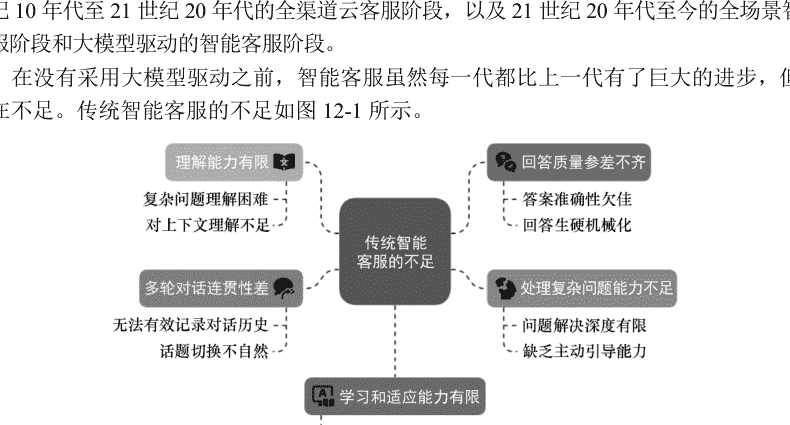

1. **理解能力有限**
    - 首先，复杂问题理解困难。传统智能客服在面对复杂、模糊或包含专业术语的问题时，可能无法准确理解用户的真实意图。例如，用户咨询涉及金融、法律等专业领域的复杂问题，传统智能客服可能无法准确把握问题的关键点。
    - 其次，对上下文理解不足。在多轮对话中，传统智能客服可能无法很好地理解上下文，导致回答不够连贯或准确。例如，当用户咨询产品使用问题时，传统智能客服可能无法根据之前的对话内容准确理解用户的具体需求。

2. **回答质量参差不齐**
    - 首先，答案准确性欠佳。由于理解能力的限制，传统智能客服生成的答案可能不够准确，无法完全满足用户的需求。例如，当用户咨询产品功能时，传统智能客服可能无法提供完整的功能介绍。
    - 其次，回答生硬、机械化。传统智能客服的回答通常基于预设的模板或规则，缺乏灵活性和人性化，导致回答生硬、缺乏情感，使用户在与传统智能客服交流时，像在与机器对话，而不是一个能够理解其需求的智能助手。

3. **处理复杂问题能力不足**
    - 首先，问题解决的深度有限。传统智能客服在处理复杂问题时，可能只能提供一些简单的解决方案或建议，无法深入分析问题的本质并提供有针对性的解决方案。例如，当用户反馈产品出现故障时，传统智能客服可能无法准确判断故障原因并提供有效的解决办法。
    - 其次，缺乏主动引导能力。当面对复杂问题时，传统智能客服通常需要用户明确指出问题所在，无法主动引导用户描述问题或提供必要的信息，从而影响问题的解决效率。

4. **多轮对话连贯性差**
    - 在多轮对话中，传统智能客服可能无法有效地记录和利用之前的对话历史，导致对话的连贯性受到影响。例如，当用户在咨询产品购买问题时，传统智能客服可能无法根据之前的对话内容准确推荐产品。
    - 此外，还存在话题切换不自然的情况。传统智能客服在处理话题切换时，可能无法自然地过渡，导致对话的流畅性和自然度下降，使用户在与智能客服交流时，感觉对话不够顺畅，影响用户体验。

5. **学习和适应能力有限**
    - 虽然传统智能客服号称智能，但知识更新不及时。传统智能客服的知识库通常需要人工维护和更新，无法自动学习和适应新的信息和变化，导致在面对新的问题或知识更新时，传统智能客服无法及时提供准确的答案。
    - 此外，个性化服务能力弱。传统智能客服难以根据用户的历史交互记录和偏好，提供个性化的服务和推荐，使每个用户在使用传统智能客服时，得到的服务体验和答案都相对一致，缺乏针对性。

#### 12.1.3 基于 DeepSeek 升级的智能客服系统

LLM 的发展，尤其是 DeepSeek 的高性能、低成本、本土化优势，给了智能客服系统全面升级的机会。以下是 DeepSeek 在智能客服系统中的 2 个典型应用案例，详细说明了其提质增效的效果及具体数据支持。

1. **深圳通接入 DeepSeek 智能客服系统**

深圳通作为深圳公共交通领域的核心服务商，每年需处理超 63 万笔客服咨询，传统客服模式依赖人工处理，效率低且成本高。2025 年 2 月，深圳通本地化部署 DeepSeek-R1 70B 大模型，对客服系统进行全面智能化升级①。接入 DeepSeek 后的深圳通客服界面如图 12-2 所示。

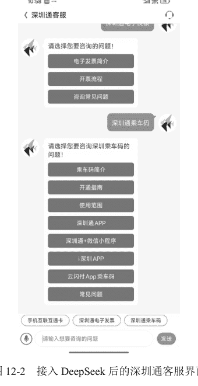

图 12-2 接入 DeepSeek 后的深圳通客服界面

具体升级的内容与成效有以下 4 个方面。

- ① 智能应答能力提高，实现从“有限回答”到“无所不答”的转变。基于 DeepSeek 的语义理解能力，客服系统可以精准解析用户的各类提问，覆盖乘车规则、充值、跨境出行等场景。例如，用户询问“一日游攻略”，系统能生成合理建议。将传统预设问答库难以覆盖的问题处理率提升至 80%以上，复杂问题可通过多轮推理解决。
- ② 交互效率优化，实现一键直达需求。通过 NLP 技术，用户输入问题（如“如何办理学生卡延期”）后，系统直接跳转至指引页面，减少菜单层级，交互效率提高 50%以上。平均处理时间缩短至秒级，24 小时在线服务覆盖率达 100%。
- ③ 人力成本降低，实现自动化处理常规咨询。系统可以自动处理 80% 的常规问题，释放客服人员精力，使客服人员专注于复杂问题。新员工培训周期缩短 40%，质检效率提升 3 倍，系统还能实时生成服务建议并润色话术。升级前，每人每天处理 250 笔业务，升级后人力需求减少，同时服务质量保持稳定。
- ④ 技术融合与场景拓展方面，结合 RAG 技术和本地化知识库，系统能动态更新信息（如政策调整），确保回答时效性。未来计划上线“智能通宝”AI 助手，进一步整合出行场景服务。

> ① 此案例被列为 2025 年深圳两会期间的重点成果，体现了 AI 技术赋能民生服务的标杆意义。

深圳通采用 DeepSeek 前后的数据对比如表 12-1 所示。

表 12-1 深圳通采用 DeepSeek 前后的数据对比

| 指标 | 采用前 | 采用后 | 提升幅度 |
| :--- | :--- | :--- | :--- |
| 日均处理量 | 250 笔/人 | 自动化处理 80% | 效率提高 50% |
| 复杂问题解决率 | 依赖人工 | 80%自动化 | 人力节省 40%以上 |
| 用户满意度 | 75% | 92% | 提升 17% |

深圳通的实践展示了 DeepSeek 在公共服务领域的落地潜力。通过大模型与本地知识库的融合，实现从“被动响应”到“主动服务”的转变；显著降低人力成本，同时扩大服务覆盖范围与提高服务质量。此外，深圳通还为市民提供更便捷、个性化的出行服务，推动智慧城市建设。

2. **来自 DeepSeek 官网的智能客服系统案例**

以下是 DeepSeek 在智能客服系统中的一个应用案例，展示了如何通过集成 DeepSeek 技术提高服务质量和运营效率，从而实现提质增效的效果。

一家知名电信运营商面临客户咨询量大、响应速度慢及人工客服成本高等挑战。为了提升客户体验、降低运营成本，该运营商决定与杭州深度求索公司合作，将 DeepSeek 技术嵌入智能客服系统。

实施过程包括三个环节，一是知识库构建与数据整合，企业将过去几年的客服对话记录、常见问题解答和产品说明文档整合到统一的知识库；利用 DeepSeek 的预处理能力，对原始文本进行标准化、分类和脱敏处理，确保数据合法、安全。二是检索增强与自动问答，系统通过 DeepSeek 的 RAG 技术，当用户提出问题时，自动从知识库中匹配最相关的信息；结合 NLU 和 NLG 能力，系统能够输出准确、自然的回答，支持多轮对话，并保持上下文连贯性。三是实现智能分流与人工协同，当系统识别出问题较为复杂或需要人工干预时，会自动将对话转接给人工客服，确保用户获得最优解答；同时通过统计与反馈机制，系统不断优化检索规则和回答策略，逐步减少人工介入。

该系统实施后，在响应速度提高方面，客户平均等待时间缩短约 30%；在自动处理率提高方面，自动解决问题的比率达 75%，大幅降低人工客服的工作量；在成本降低与客户满意度提高方面，运营成本下降约 50%，客户满意度提高约 20%，有效改善客户体验。

提高企业运营效率。

该案例充分展示了通过 DeepSeek 的智能检索与生成能力，企业不仅能高效整合和利用海量内部知识，还能在提高客服响应速度和准确性、降低人工成本等方面实现明显的提质增效。

### 12.2 质量检测与预测

质量检测是指在产品到达消费者手中前，对产品是否存在缺陷、异常或不一致进行评估的过程。质量预测是指通过分析当前数据和历史数据，运用统计学技术和机器学习算法，预测未来可能会出现的质量问题。

#### 12.2.1 质量检测与预测在行业和企业应用中的地位及作用

质量检测与预测应用于多个行业。

在制造业中的汽车制造、机械制造、电子设备制造等行业中，质量检测与预测技术广泛应用于生产过程中的缺陷检测、设备故障预测和产品质量控制。例如，汽车制造商利用传感器数据和机器学习算法预测装配线上的机械性能，提前发现潜在问题。

在食品与饮料行业中，质量检测与预测应用于预测食品的保质期、检测生产过程中的污染风险，确保食品安全。例如，通过分析传感器数据，预测一批啤酒何时可以装瓶。

在化工生产行业中，质量检测与预测应用于预测化学反应的最佳时间，优化生产过程，确保产品质量。

在制药行业中，质量检测与预测应用于药品生产过程中的质量控制，如检测药品的纯度、有效成分含量等，以确保药品的安全性和有效性。

在农产品行业中，质量检测与预测应用于保障农产品的质量，确保食品安全。

在环境行业中，质量检测与预测应用于监测空气质量、水质、土壤污染等，评估环境的健康状况。

在消费品制造业的服装、家居用品等行业中，质量检测与预测应用于确保产品的外观质量、耐用性等。

质量检测与预测在行业和企业运营中，至少具有以下 7 个方面的地位和作用。

- （1）确保产品质量
质量检测与预测是保障产品质量的关键环节，能够及时发现并解决生产过程中的质量问题，确保流入市场的产品符合质量标准。

- （2）提高生产效率
通过质量检测与预测，企业可以在发生质量问题前进行识别和预防，减少不良产品的生产数量，提高生产效率和设备利用率。

- （3）降低运营成本
减少因质量问题导致的返工、报废和客户投诉，降低企业的运营成本。

- （4）提高企业竞争力
高质量的产品能够提高企业竞争力，提高客户满意度和忠诚度，促进企业的可持续发展。

- （5）支持决策制定
质量检测与预测提供的数据和分析结果，为企业管理层提供决策支持，帮助企业优化生产流程、改进产品质量。

- （6）符合法规要求
在食品、药品、医疗器械等行业，严格的质量检测与预测是满足相关法规和标准要求的必要条件，有助于企业避免法律风险和市场准入障碍。

- （7）促进技术创新
质量检测与预测技术的发展推动相关行业技术的进步，如传感器技术、数据分析技术、AI技术等，促进企业的技术创新和工艺改进。

质量检测与预测在行业和企业运营中具有不可替代的地位和作用，是企业实现高质量发展和提高市场竞争力的重要保障。

#### 12.2.2 传统质量检测与预测方法面临的问题

传统质量检测与预测方法主要依赖人工和规则驱动的检测方式，这些方法在不同的发展阶段具有不同的特点和局限性。

##### 1. 传统质量检测方法

传统质量检测方法主要包括视觉检测、手工测试与检测、通过传统测量工具进行检测，以及基于规则的视觉技术检测。

视觉检测通过人工目视检测建筑构件和结构，识别可能存在的缺陷和不合格之处。这种方法虽然操作简单、直观，但受主观因素的影响较大，检测结果具有一定的主观性和随机性，对于一些隐蔽部位或微小缺陷，很难通过纯粹的视觉手段发现，从而导致质量隐患的漏检。

手工测试与检测主要依赖人工操作和简单的手工测量工具，如刷子、锤子等，进行表面敲击或检查，感知构件的坚固性和表面平整度。这种方法虽然在一定程度上能够发现表面缺陷和质量问题，但受工人经验水平的限制，检测效果难以达到一定的标准化水平，并且耗时费力，无法满足现代建筑工程对效率和精确度的要求。

通过传统测量工具进行检测是常见的质量控制手段，使用传统测量工具进行尺寸测量，如测尺、水平仪等。例如，在建筑工程的施工中，工人通过传统测量工具对建筑工程的质量进行检测，通过直接测量实现对构件尺寸的掌握，其精度受人为因素和测量工具自身精度的限制，难以满足对高精度建筑工程的要求。

基于规则的视觉检测技术是专家定义特定产品的理想颜色、形状和尺寸，如果摄像头或其他图像捕捉设备检测到与这些标准有偏差，系统会通知专家。这种方法需要遵循用户定义的规则和标准，如阈值、预先定义的检查清单和通过或未通过标准。

##### 2. 传统质量预测方法

传统质量预测方法主要包括数据驱动的预测方法、过程监控与预警系统，以及通过专家系统实现预测。

数据驱动的预测方法是通过收集历史数据，运用数据挖掘和机器学习等技术，建立预测模型，对产品装配质量进行预测。这种方法可以及时发现潜在的质量问题，为质量控制提供依据。

过程监控与预警系统需要通过实时监控装配过程，结合预警算法，当监测到异常情况时，及时发出预警，便于及时采取纠正措施，防止出现质量问题。

通过专家系统实现预测是利用专家的知识和经验，建立专家系统，对装配过程中的关键环节进行评估和预测。专家系统可以提供更准确的预测结果，为质量控制提供有力支持。

##### 3. 质量检测与预测的不同发展阶段及存在的问题

质量检测与预测的发展经历了从人工检测到自动化检测，再到智能化检测的多个阶段。

###### （1）传统质量检测方法存在的问题

传统质量检测方法存在的问题主要是效率低、主观性强、精度有限，以及无法进行实时检测。传统质量检测需要依靠人工检测和手工测试，耗时且费力，无法满足现代生产对效率的要求。视觉检查和手工测试依赖人的经验和判断，结果容易受主观因素的影响，缺乏客观性和一致性。传统测量工具的精度受人为因素和工具自身精度的限制，难以满足高精度要求。同时，传统质量检测方法通常需要在生产过程结束后进行检测，无法实时反馈生产过程中的质量问题，难以及时调整和优化生产过程。

###### （2）传统质量预测方法存在的问题

传统质量预测方法存在的问题，一是模型泛化能力有限，基于整体过程数据建立的全局模型无法充分考虑不同生产时段和过程变量的影响，导致模型的泛化能力和预测准确性受限。二是实时性差，传统质量预测方法通常需要较长的计算时间和数据处理过程，难以实现实时预测和在线反馈。

#### 12.2.3 DeepSeek 对质量检测与预测系统的改进及效果

针对传统质量检测与预测不同阶段的方法和存在的问题，DeepSeek 在多个方面进行了改进，同时取得了显著的效果。

##### 1. DeepSeek 对质量检测与预测系统的改进内容

DeepSeek 基于海量多模态数据和 AI 算法，以实时的方式对质量检测与预测系统进行了改进，还通过对质量检测与预测系统的改进和优化，对业务流程进行优化。

（1）质量检测

首先，DeepSeek 引入多模态数据，并实现多模态数据的融合。传统质量检测多依赖单一数据源，如视觉检测系统仅依赖光学成像。DeepSeek 融合成像、声纹识别、温度、压力等多模态传感数据，大幅提高缺陷检出率。其次，DeepSeek 实现实时监控与预警，可以实时分析生产数据，设置关键指标阈值，如温度、压力等，一旦数据超出正常范围，系统自动报警并记录，使企业及时发现生产过程中的异常，避免批量质量问题，这是传统质量检测方法做不到的。最后，DeepSeek 可以实现检测报告的自动生成，可以一键导出检测结果，支持自定义报告模板，包含图表、问题分类等内容，大幅减少人工整理和分析数据的工作量，提高检测效率。

（2）预测系统

通过深度学习算法，DeepSeek 对设备历史数据进行建模，结合实时监测数据，构建精准的质量预测模型。例如，在光纤生产中，通过整理大量生产、检测数据，梳理关键因子对应关系，建立质量预测系统，精确控制产品预测性能与实际检测性能的偏差。

此外，DeepSeek 能分析设备的振动频谱、温度曲线等参数，提前预判设备异常，实现故障预警。

（3）流程优化

DeepSeek 基于历史数据优化工艺标准，自动推荐参数调整方案，实现生产流程的动态优化。例如，在注塑成型中，通过分析历史数据确定最佳温度，并根据实时生产情况动态调整参数，提高产品质量和生产效率。当出现质量问题时，DeepSeek 能快速定位问题环节，自动关联生产数据与供应商信息，为改进工艺和优化供应链提供依据。

##### 2. DeepSeek 改进后的质量检测与预测系统案例

以下是 3 个 DeepSeek 对质量检测与预测系统进行改进以提升效果的案例和改进后的效果。

（1）新能源汽车电池厂的案例

某新能源汽车电池厂曾面临生产线上不同批次的电池性能波动较大的问题。利用 DeepSeek 分析原材料检测数据、生产过程数据及成品检测数据，构建精准的质量预测模型。该模型能够提前预测生产过程中的潜在质量问题，帮助工厂提前调整生产参数，从而减少电池性能的波动，提高产品的稳定性和一致性。

（2）3D 打印领域的案例

在 3D 打印领域，传统的质量检测方式主要依赖人工目视或简单仪器，效率低且容易漏检。DeepSeek 结合计算机视觉技术，能够实时自动检测打印件中的缺陷，如裂纹、气泡等，并通过分析历史数据预测可能的质量问题，从而实现事前预防。例如，某 3D 打印企业引入 DeepSeek 后，打印件的缺陷检出率从 93% 提升至 99.7%，大幅提高了质量控制的有效性与可靠性。①

> ① Deepseek 如何重塑 3D 打印：从设计到生产的智能革命。

（3）工业现场作业指导的案例

蒂姆维澳公司通过本地部署 DeepSeek，结合煤矿知识安全库进行问答，能够为工业现场人员提供实时的维修、质检和故障排查指导。这种实时的智能指导不仅能提高工业现场作业的安全性，还能通过精准的指导减少因操作不当导致的质量问题。①

> ① DeepSeek 企业级应用的案例分享：重塑行业格局。

DeepSeek 通过对质量检测与预测系统的改进，提高了效率和质量，降低了成本，同时优化了决策。

在检测环节，多模态数据融合和自动化检测工具的应用，大幅提高了检测速度和准确性。在预测和流程优化方面，实时监控与预警、精准质量预测等功能，使企业能够及时发现和解决潜在问题，避免因质量问题导致生产中断和返工，从而提高整体生产效率。

通过精准的质量预测和生产参数动态调整，企业能够更好地控制产品质量，减少缺陷和次品的产生，提高产品的合格率和一致性。

DeepSeek 的应用减少了人工检测和数据分析的工作量，降低了人力成本。同时，通过优化生产流程和预防设备故障，减少因质量问题和设备故障导致的生产损失和维修成本。

DeepSeek 为质量管理人员提供全面、准确的数据支持和智能分析工具，帮助质量管理人员更科学地制订质量改进方案和生产决策。

### 12.3 内容推荐与个性化服务

内容推荐与个性化服务是利用算法和数据分析技术，根据用户的行为、偏好和特征，为用户提供定制化内容和服务的一种方式。

#### 12.3.1 内容推荐与个性化服务在企业运营中的地位及作用

在企业运营的多个环节中，内容推荐与个性化服务都发挥着重要作用。

##### 1. 产品设计与开发环节

企业在产品设计与开发环节中，需要收集用户需求和反馈，并需要为用户设计个性化产品。

通过内容推荐与个性化服务，企业可以更好地了解用户的需求、痛点和期望。例如，企业通过分析用户对产品相关文章、视频等内容的浏览和互动数据，挖掘用户对产品功能、性能等方面的潜在需求，为产品设计提供参考，确保新产品更符合用户需求。

根据用户的偏好和使用习惯，为不同用户群体设计个性化的产品功能和特性。例如，对于一款智能手表，企业可以根据用户对健康监测功能的关注度和使用频率，为健身爱好者用户设计更专业的运动监测模式和训练计划，为普通用户优化日常健康提醒和睡眠监测功能，从而提高产品的市场竞争力。

##### 2. 生产环节

在生产环节，企业存在两个永恒的指标，即提高生产效率和进行质量控制。
内容推荐与个性化服务可以帮助企业实现个性化生产流程优化。通过分析生产线上工人的操作习惯、技能水平等数据，为不同工人推荐最适合他们的工作流程和任务安排，提高生产效率和质量。
利用个性化服务中的数据分析技术，实时监测生产线上的产品质量数据，结合历史数据和用户反馈，建立质量预测模型。当发现潜在质量问题时，及时调整生产参数或进行设备维护，减少废品和次品的产生，降低生产成本。

##### 3. 营销和推广环节

精准营销和个性化广告投放是所有企业一直追求的目标。
通过分析用户的浏览历史、购买行为等数据，了解用户的兴趣和需求，从而实现精准营销。例如，企业可以根据用户的历史购买记录和浏览行为，为用户推荐相关的产品或服务，提高营销效果和转化率。
根据用户的特征和行为模式，为不同用户群体定制个性化的广告内容和投放策略。广告内容更贴合用户的兴趣和需求，提高广告的点击率和转化率，同时降低广告投放成本，提高广告的 ROI。

##### 4. 销售环节

所有企业生产的产品或提供的服务，都需要进入销售环节。内容推荐和个性化服务在提升用户体验、增加销售额等方面，也具有重要作用。
在销售过程中，为用户提供个性化的产品推荐和购物体验，帮助用户更快找到自己感兴趣的产品，提高用户的购买意愿和满意度。
通过推荐相关产品、配件或升级选项等方式，引导用户购买更多产品。例如，当用户购买手机时，为其推荐合适的手机壳、耳机等配件，或推荐更高配置的手机型号，增加用户的平均订单金额，从而提高销售额。

##### 5. 售后服务环节

售后环节更需要进行个性化服务，需要根据用户的购买历史和产品使用情况，为用户提供个性化的售后服务。例如，对于购买了智能家电的用户，企业可以根据用户的使用习惯和常见问题，为用户提供定制化的维修保养建议和远程技术支持，提高用户对售后服务的满意度。此外，需要通过持续的个性化服务和关怀，增强用户与企业之间的黏性和信任感。企业可以定期向用户推送产品更新信息、使用技巧和个性化优惠活动，使用户感受到企业的关注和重视，从而提高用户的忠诚度和复购率。

#### 12.3.2 传统内容推荐与个性化服务存在的不足

##### 1. 内容推荐和个性化服务的发展阶段
内容推荐与个性化服务经历了 3 个发展阶段。内容推荐和个性化服务的发展阶段如图 12-3 所示。

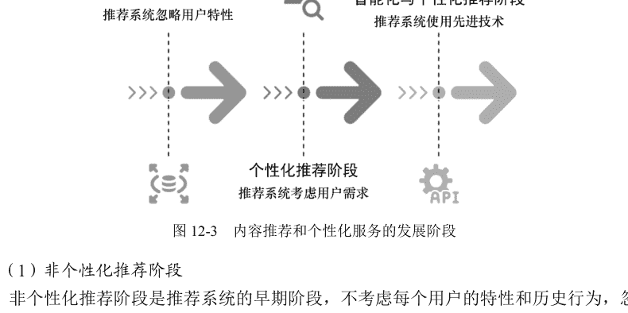

（1）非个性化推荐阶段
非个性化推荐阶段是推荐系统的早期阶段，不考虑每个用户的特性和历史行为，忽略对用户兴趣偏好的个性化建模，推荐结果通常是“千人一面”的，主要根据点击量、销量、热度、流行度等特征将物品、服务或内容排序后向用户进行推荐。

（2）个性化推荐阶段
随着技术的发展，推荐系统开始考虑用户的个性化需求，通过分析用户的行为数据、兴趣偏好等，为每个用户提供定制化的推荐结果。个性化推荐阶段可以细分为多个子阶段，如基于内容的推荐阶段、基于协同过滤的推荐阶段、基于深度学习的推荐阶段等。

（3）智能化与个性化推荐阶段
智能化与个性化推荐阶段是推荐系统发展的最新阶段，融合了多种先进技术，如深度学习、知识图谱等，能够处理多种类型的数据，并能够根据用户的实际需求、实时行为等提供更智能化和个性化的推荐服务。

##### 2. 传统内容推荐和个性化服务的方法
传统内容推荐与个性化服务方法主要包括基于内容的推荐、协同过滤和混合推荐方法。
基于内容的推荐通过对物品（如文章、电影、音乐等）的内容特征进行分析，然后根据用户的兴趣特征，为用户推荐与他们兴趣相似的物品。例如，通过分析用户浏览过的新闻文章的主题、关键词等，为用户推荐相似主题的其他文章。

协同过滤是推荐系统中较经典的方法，主要分为基于用户的协同过滤和基于物品的协同过滤。基于用户的协同过滤通过找到与目标用户有相似兴趣的其他用户，将这些相似兴趣用户喜欢的物品推荐给目标用户；基于物品的协同过滤则关注物品之间的相似性，根据用户对某物品的喜好，推荐与其相似的其他物品。

为了克服单一推荐方法的局限性，混合推荐将多种推荐方法结合，如将基于内容的推荐和协同过滤结合，提高推荐的准确性和多样性。

##### 3. 传统方法存在的不足

传统内容推荐和个性化服务存在以下 5 个方面的问题。

- （1）冷启动问题
无论是基于内容的推荐，还是协同过滤，都面临冷启动问题。对于新用户或新物品，由于缺乏足够的历史数据，所以推荐系统难以准确地为他们提供个性化的推荐。

- （2）数据稀疏性问题
在协同过滤中，当用户—物品交互矩阵比较稀疏时，算法的性能会受到影响，无法准确地找到相似用户或物品。

- （3）过度特化问题
基于内容的推荐可能会导致推荐结果过于集中在与用户已知兴趣相似的物品上，既缺乏创新性和多样性，也无法帮助用户发现新的兴趣点。

- （4）隐私保护问题
为了实现个性化推荐，系统需要收集和处理用户的大量个人信息，可能会引发用户的隐私担忧。

- （5）计算成本问题
随着数据量的增加，推荐系统的计算成本也会相应增加，需要在推荐效果和计算效率之间找到平衡。

#### 12.3.3 基于 DeepSeek 的内容推荐与个性化服务改进

针对传统内容推荐与个性化服务存在的不足，DeepSeek 通过以下方式进行改进。

- （1）冷启动问题的解决
DeepSeek 通过对多维数据融合和实时学习与反馈，解决了传统内容推荐与个性化服务存在的冷启动问题。DeepSeek 不仅依赖用户的历史行为数据，还结合用户的上下文数据（如时间、地点、设备）及内容的多模态特征（如文本、图像、音频），通过深度学习算法挖掘数据中的潜在关联，构建更全面的用户画像，从而为新用户或新物品提供更精准的初始推荐。DeepSeek 具备优秀的实时学习能力，能够基于用户的即时反馈不断优化推荐模型。例如，用户对推荐结果进行点击、收藏、评论等操作后，系统可以迅速调整推荐策略，确保推荐内容与用户的真实需求更匹配。

- （2）数据稀疏性问题的缓解

DeepSeek 通过深度学习算法与知识图谱技术、联邦学习技术与数据共享技术，缓解数据稀疏性问题。DeepSeek 利用深度学习算法从大量数据中学习复杂的模式和特征，并结合知识图谱技术，将不同物品或内容之间的语义关系和属性特征进行关联建模。即使在用户—物品交互数据比较稀疏的情况下，也能通过挖掘物品间的潜在联系和共享特征，为用户提供更准确的推荐。通过联邦学习技术，在保护用户隐私的前提下，实现不同平台或企业之间的数据共享和协同训练，可以增加推荐系统可利用的数据量，缓解单个平台数据稀疏的问题，提高推荐系统的准确性和扩大其覆盖范围。

- （3）过度特化问题的改善

DeepSeek 通过多样化与探索机制、多目标优化，改善过度专业化问题。DeepSeek 在推荐算法中引入随机性和多样性策略，避免用户陷入单一的内容循环。例如，通过设置一定的探索概率，在推荐结果中加入一些与用户兴趣相关性稍弱但具有潜在价值的内容，帮助用户发现新的兴趣点，拓宽用户的视野，不仅以点击率、转化率等单一指标作为优化目标，还综合考虑用户的满意度、推荐内容的质量和创新性等多个目标，平衡推荐结果的准确性和多样性，为用户提供更丰富、更有价值的推荐体验。

- （4）隐私问题的应对

DeepSeek 通过隐私保护透明化、数据匿名化与加密技术，应对隐私问题。DeepSeek 明确告知用户数据如何被收集、存储和使用，并提供用户控制数据权限的选项。例如，允许用户选择退出个性化推荐，或对某些数据的使用进行限制，增强用户对隐私的掌控感。在数据处理过程中，对用户数据进行匿名化处理，去除可识别个人身份的信息，并采用加密技术保护数据的安全，防止用户数据泄露或被恶意利用。

- （5）计算成本问题的优化

DeepSeek 通过模型剪枝与量化、缓存机制与并行计算，优化了计算成本问题。DeepSeek 采用模型剪枝和量化等技术，对深度学习模型进行优化，减少模型的参数量和计算复杂度，从而降低推理过程中的计算资源消耗，提高推荐的实时性和效率。通过引入缓存机制，对高频用户请求的推荐结果进行缓存，减少重复计算。同时，利用并行计算技术和分布式架构，提高数据处理和模型推理的速度，进一步降低计算成本。

#### 12.3.4 案例

以下是投资家发表于新浪财经《DeepSeek 的 100 个应用场景》中披露的基于 DeepSeek 优化内容推荐与个性化服务的案例。

某电商平台使用 DeepSeek 进行优化，通过融合多维度数据，结合用户的历史购买行为、浏览记录、上下文数据等，构建更全面的用户画像，为用户提供更精准的商品推荐。同时，利用实时学习与反馈机制，根据用户的即时反馈不断调整推荐策略，确保推荐结果匹配用户需求。此外，通过多样性与探索机制，避免用户陷入单一的内容循环，帮助用户发现新的兴趣点。

### 12.4 疾病诊断与治疗方案推荐

疾病诊断与治疗方案推荐在医疗过程中依据患者的具体病情、病史、检查结果等信息，结合医学知识、临床指南和大数据分析等手段，为患者提供精准的疾病诊断，并推荐最合适的治疗方案。它既包括医生基于自身经验和专业知识对患者病情的判断与治疗建议，又包括借助现代信息技术，对疾病诊断和治疗方案进行辅助推荐的情况，如 AI、大数据等。

疾病诊断与治疗方案推荐广泛应用于临床医疗决策支持、医学教育与培训、公共卫生与疾病防控及医疗资源管理与优化等诸多场景。疾病诊断与治疗方案推荐对于提高诊断准确性、优化治疗效果、促进医疗资源共享、提高医疗服务质量及推动医学研究与创新，都具有重要的作用和意义。

#### 12.4.1 疾病诊断与治疗方案推荐的发展历程

疾病诊断与治疗方案推荐的发展历程可以分为 4 个阶段。疾病诊断与治疗方案推荐的演变如图 12-4 所示。

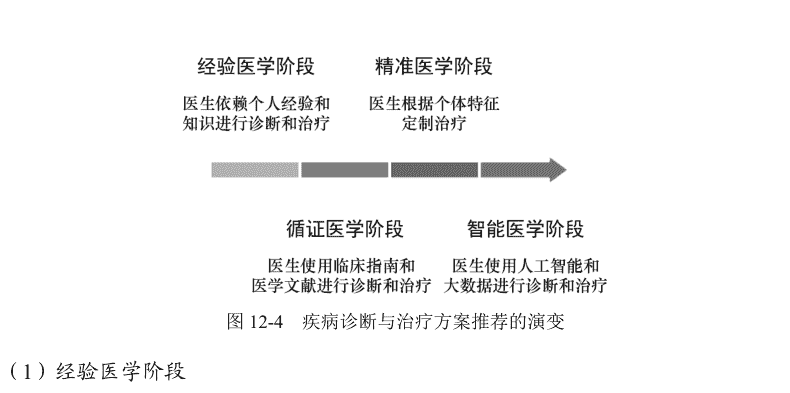

（1）经验医学阶段
经验医学阶段，医生主要依赖个人经验和知识进行疾病诊断和治疗方案推荐。诊断手段相对简单，主要依赖病史采集、体格检查及一些基本的实验室检查；治疗方案根据医生对疾病的理解和以往的经验制订。经验医学阶段的疾病诊断准确性受医生个人经验影响较大，容易出现误诊和漏诊的情况；治疗方案的制订缺乏系统性和科学性，个性化不足，难以满足不同患者的具体需求。

（2）循证医学阶段
随着医学科学的发展，循证医学理念逐渐兴起。医生开始依据临床实践指南和医学文献进行疾病诊断和治疗方案推荐。临床实践指南是基于大量临床研究证据制订的，为医生提供标准化的诊断和治疗流程。同时，医学数据库和文献检索系统的发展使医生能够更方便地获取最新的医学研究成果。在循证医学阶段，疾病诊断与治疗方案推荐可能存在的问题在于临床实践指南的制订和更新存在滞后性，不能及时反映最新的医学研究成果。此外，医学文献质量参差不齐，医生需要花费大量时间筛选和评估医学文献的可靠性。

（3）精准医学阶段
精准医学强调根据患者的个体特征，如基因信息、生物标志物等，进行精准的疾病诊断和治疗方案推荐。基因组学、分子诊断等技术的发展，使医生能够深入了解疾病的分子机制，从而为患者提供个性化的治疗方案。例如，通过基因测序技术检测肿瘤患者的基因突变情况，选择有针对性的靶向药物进行治疗。精准医学技术成本较高，限制了其在基层医疗机构的广泛应用。此外，基因组数据的解读和分析需要掌握专业的生物信息学知识，对医生的专业素养要求较高。

（4）智能医学阶段
随着 AI 和大数据技术的快速发展，智能医学已成为疾病诊断与治疗方案推荐的新趋势。利用机器学习、深度学习等算法，对大量的医疗数据进行分析和挖掘，构建智能诊断系统和治疗方案推荐平台。这些系统和平台能够快速处理复杂的医学信息，为医生提供诊断参考和治疗建议。医疗数据的隐私和安全问题是智能医学阶段面临的主要挑战。此外，AI 算法还可能存在偏见，影响诊断和治疗方案的准确性。

#### 12.4.2 基于 DeepSeek 的疾病诊断与治疗方案推荐发展

疾病诊断与治疗方案推荐涉及医学的方方面面。以下是 DeepSeek 在疾病诊断与治疗方案推荐方面的一些最新进展。

（1）疾病诊断

疾病诊断涉及数据的获取、处理、分析、匹配等多个环节。DeepSeek 在这些环节都具有广泛的应用。

例如，在医学影像分析方面，DeepSeek 利用深度学习算法和强大的图像识别能力，可以对 X 光、计算机断层扫描、磁共振成像等各类医学影像进行快速且精准的分析。例如，在肺部疾病的诊断中，DeepSeek 的准确率比传统诊断方式高约 20%；在肿瘤检测方面，DeepSeek 可以迅速识别影像中的微小肿瘤病灶，大幅提高肿瘤早期诊断的准确率。

在多源数据融合分析方面，DeepSeek 可以整合患者的症状、检查结果、病史等多源数据，进行全面的疾病诊断分析。DeepSeek 通过 NLP 技术理解患者描述的症状，推荐合适的科室和医生，还可以根据医生排班和患者时间偏好，提供最优预约选项。

在罕见病诊断支持方面，DeepSeek 通过患者症状描述匹配全球罕见病数据库，提供潜在诊断建议，为罕见病的诊断提供有力支持。

（2）治疗方案推荐

DeepSeek 可以基于患者的个体特征，如基因信息、生理指标、疾病史等，为医生提供个性化的治疗方案推荐。以肿瘤治疗为例，DeepSeek 可以分析患者的基因数据，找到关键基因靶点，推荐个性化的靶向治疗药物，并预测患者对治疗的反应和可能出现的不良反应。同时，DeepSeek 可以分析海量病例数据，发现潜在的疾病规律，助力诊疗方案优化。例如，某三甲医院试点数据显示，AI 辅助系统将影像判读效率提高了 40%，并显著降低了漏诊率。此外，DeepSeek 还可以基于患者基因、病史和用药记录，预测个体化药物不良反应风险，为医生选择药物治疗方案提供参考。

（3）诊疗流程优化和优化医疗资源配置

DeepSeek 在疾病诊断与治疗方案推荐领域作用的发挥，将为诊疗流程优化及相关工作带来改进。例如，DeepSeek 的 AI 智能导诊系统可以通过简单的交互界面，引导患者描述症状，并结合海量医学数据库，迅速推荐合适的就诊科室，缩短患者排队等候的时间，减少盲目挂号导致的医疗资源浪费。DeepSeek 可以帮助医生快速生成病历，并提供专业的修改建议，提高病历质量。同时，DeepSeek 还可以实现电子病历的自动结构化，将非结构化的病历文本转化为标准化字段，便于数据统计与分析。

此外，DeepSeek 的低成本和开源特征，使其能够加速在医疗行业的渗透，推动医疗 AI 从头部医院试点转向基层普惠应用，为基层医疗机构提供更高效、更准确的诊疗支持。DeepSeek 与医疗设备的结合，也推动了医疗设备的小型化与智能化，如便携式心电图仪、超声设备等，可以在偏远地区或急救场景中实现自动化诊断，降低对专业医师的依赖。

#### 12.4.3 案例

以下是 DeepSeek 在疾病诊断与治疗方案推荐方面的 2 个案例。

（1）医学影像与肺结节诊断
浙江大学医学院附属第二医院胸外科应用 DeepSeek 进行肺结节良恶性鉴别。范军强主任医师上传一例直径 6 mm 的磨玻璃结节影像后，DeepSeek 通过深度学习模型分析结节形态、密度及边缘特征，生成“早期肺癌可能性高”的诊断意见，并建议 3 个月后复查或进行病理活检。诊断结果与多学科会诊结论高度一致，系统还附带国际肺癌筛查指南的更新内容。AI 辅助诊断使影像科医生阅片效率提高 50%，使大规模筛查场景下的漏诊率降低 15%。①

（2）安图生物联合 DeepSeek 升级检验临床辅助决策系统
针对一份显示“糖化血红蛋白升高”的糖尿病筛查报告，DeepSeek 不仅可以解读指标意义，还可以分析可能的影响因素（如饮食结构、运动频率），并生成个性化建议（如每周 150 分钟有氧运动、减少精制碳水摄入）。对于慢性肾病患者，系统自动关联血肌酐、尿蛋白等多项指标，提示肾功能分期及用药调整风险。医疗机构使用 DeepSeek 后，患者满意度提高了 20%，复诊率下降了 12%。②

### 12.5 供应链优化与智能调度

供应链优化与智能调度是供应链管理和运营中的关键概念，它们相辅相成，共同提高供应链的效率和竞争力。

供应链优化是通过分析和改进供应链的各个环节，使整个供应链的效率最大化、成本最小化，并提高其对市场需求的响应速度和灵活性。供应链优化涉及从原材料采购、生产制造、物流配送到销售和服务的整个过程，旨在通过整合资源、优化流程、提高协同效率等方式，实现供应链的整体优化目标。

智能调度是利用先进的信息技术和算法，对供应链中的资源、任务和流程进行动态、智能的分配和调整。智能调度通过实时监测供应链的运行状态，结合数据分析和预测模型，自动做出决策，优化资源利用，提高生产效率和客户满意度，降低运营成本。

#### 12.5.1 供应链优化与智能调度的发展阶段及面临的不足

1. 供应链优化的发展阶段
供应链优化大体经历了以下四个发展阶段。
第一个阶段是孤岛阶段，企业内部各职能部门之间缺乏明确的职责定义和信息沟通，企业和外部企业只有简单的交易关系，主要依赖简单物料需求计划系统，甚至仅使用 Excel 等工具完成物料需求的计算。孤岛阶段的不足是库存高、订单反应速度慢、交货的持续性差等。
第二个阶段是供应链阶段，企业开始应用制造资源计划系统，能够初步控制库存，采购部门实施采购策略以获取更低价格的产品或服务，物流部门通过选取具有价格优势的运输供应商降低运输费用。供应链阶段的不足是部门之间仍然缺乏紧密合作，与客户和供应商之间没有形成伙伴的关系，系统软件的数据兼容性较差。
第三个阶段是内部供应链集成阶段，企业开始应用软件，使跨部门之间的合作变得更高效和容易，产品设计引入更多部门参与，库存水平得到更好地控制，需求预测变得更准确。内部供应链集成阶段的不足是主要关注企业内部流程的优化，对于外部供应链的协同和整合能力有限。
第四个阶段是扩展供应链阶段，企业作为全价值链中的核心，打破企业之间的边界，实现协同计划、设计、补货和配送的整合。利用区块链、AI 和物联网等技术和资源，最大限度地提高供应网络的效率和性能。扩展供应链阶段需要处理大量的数据和复杂的协同关系，对信息技术和数据管理能力要求较高，同时存在数据安全和隐私问题。

2. 智能调度的发展阶段
智能调度的发展同样经历了四个阶段。制造业智能调度的发展如图 12-5 所示。

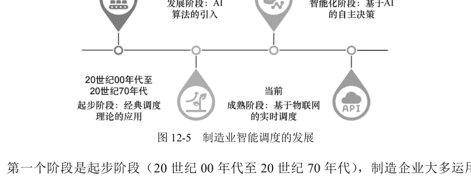

第一个阶段是起步阶段（20 世纪 60 年代至 20 世纪 70 年代），制造企业大多运用经典的调度理论，也开始将一些智能算法应用到实际调度，如车间调度、智能输电网、多 Agent 系统等。起步阶段的不足是计算过程烦琐、计算量过大，不适合对大规模问题进行运算求解，解的质量较低和全局最优解的差值较大。

第二个阶段是发展阶段（20 世纪 80 年代以后），人们受到自然现象和规律的启发，发明各种模拟自然界的 AI 算法，如遗传算法、蚁群算法等，并对传统算法进行完善和改进，如禁忌搜索算法、模拟退火算法等。发展阶段仅依靠单一的算法会出现各种局限性，如运算速度缓慢、全局最优解精度较低等。

第三个阶段是成熟阶段（当前），随着信息技术的发展，基于工业物联网的实时生产调度，利用智能传感器和监控摄像头对生产现场进行数据采集，掌握车间的设备、物料、人员等情况，再对数据进行关联分析、融合处理及可视化操作，最后在虚拟的总调度平台进行优化并生成实时生产调度决策。成熟阶段系统集成复杂，需要高并发能力、高吞吐能力、高计算能力和高可靠性的制造系统支持，同时对实时性要求高，对网络和设备的稳定性依赖较大。

第四个阶段是智能化阶段（未来），随着 AI 与机器学习的持续演进，通过深度学习算法对历史数据和实时运行数据的不断学习和训练，实现更智能化的自主决策和优化调度。例如，在智能物流、智能制造、智慧城市等领域，用于物流资源的优化调配、生产过程的智能监控与调度、城市综合管理的指挥协调等方面。智能化阶段需要大量高质量数据进行训练，数据获取和预处理成本较高，深度学习模型的可解释性较差，难以理解其决策过程和依据。

#### 12.5.2 基于 DeepSeek 对供应链的优化和智能调度

DeepSeek 在供应链优化和智能调度方面带来了多个方面的改变。

1. 供应链优化

在数据采集与监控方面，DeepSeek 能够通过传感器和物联网设备，实时采集生产线的各类数据，如设备状态、生产进度、质量参数等，并进行实时监控，及时发现异常情况并报警，确保生产过程的稳定性和可靠性。

在生产调度与优化方面，基于实时数据和历史数据，DeepSeek 能够进行智能调度，优化生产资源的分配，提高生产效率。同时，DeepSeek 通过分析生产计划和实际生产情况，提出优化建议，帮助企业更好地制订和调整生产计划。

在质量控制方面，DeepSeek 能够实时监控生产过程中的质量参数，及时发现并处理质量问题，降低次品率。此外，DeepSeek 通过记录生产过程中的各项数据，实现产品质量的全程追溯，帮助企业快速定位和解决质量问题。

在设备维护与管理方面，DeepSeek 通过分析设备运行数据，预测设备可能出现的故障，提前进行维护，缩短设备停机时间。同时，DeepSeek 能够对生产设备进行全面的管理，包括设备状态监控、维护记录、备件管理等，提高设备利用率。

在数据分析与决策支持方面，DeepSeek 凭借强大的数据分析能力，能够为企业的供应链决策提供实时、精准的智能支持，高效处理复杂任务，辅助提高企业运营效率。

在风险管理与应急响应方面，DeepSeek 结合全球经济、政治、社会等多方面的数据，实时监控外部环境的变化，提前预警可能会影响供应链的风险因素，并帮助企业根据数据制定应急响应策略。例如，调整供应商、变更物流路线、优化库存等，最大限度地减少风险对供应链的影响。

2. 智能调度

在智能任务调度方面，DeepSeek 的任务调度分片算法通过动态分片和智能调度，最大限度地提高系统的资源利用率。与传统任务调度方法相比，任务调度分片算法在相同资源条件下，能够将处理的任务量提高 30% 以上。

在负载均衡能力方面，DeepSeek 的任务调度分片算法在负载均衡方面表现出色，无论是在高负载还是低负载情况下，都能够确保各个计算节点的负载均匀分布，避免资源浪费和性能瓶颈。

在容错与恢复能力方面，在实际应用中，DeepSeek 的任务调度分片算法展现强大的容错与恢复能力。即使在部分计算节点故障的情况下，系统依然能够保持高效运行，确保任务的高可靠性和稳定性。

在智能对话与查询方面，DeepSeek 大模型被嵌入业务系统，实现大屏端业务全场景智能对话。

#### 12.5.3 案例

以下是 DeepSeek 在供应链优化与智能调度领域的两个案例。

（1）数商云助力某制造业企业降本增效

某制造业企业面临供应链成本高、响应速度慢的行业痛点，传统管理模式难以应对动态市场需求。通过引入数商云与 DeepSeek 整合的供应链解决方案，实现全链条优化。

DeepSeek 整合供应商、生产商、物流商数据，构建动态库存模型，实时监控库存水位并生成补货建议。例如，系统根据历史销售数据和市场需求预测，将安全库存阈值从 30 天缩短至 15 天，使库存成本降低 30%。通过智能预测算法优化采购计划，减少生产过剩或短缺导致的浪费，使采购成本下降 25%。

结合市场趋势与订单波动，DeepSeek 生成实时生产排程建议，避免产能闲置或超负荷运转。例如，在需求高峰期自动调整生产线的优先级，使响应速度提高 50%。

系统通过多维度数据分析（如供应商绩效、物流时效、客户满意度），生成供应链优化报告，帮助企业调整策略，使企业整体运营效率提高 40%，客户满意度提高 30%。

此案例展示了 DeepSeek 在供应链全链路优化中的核心能力，通过数据整合与智能分析实现降本增效，被列为数商云的标杆应用场景。①

（2）怡亚通物流接入 DeepSeek 实现动态路径规划

怡亚通物流作为全球供应链服务商，面临空驶率高、调度冗余等行业痛点。2025 年，其数字货运业务接入 DeepSeek，重点优化物流路径与资源匹配。

DeepSeek 整合订单、交通、天气等数据，通过深度学习模型实时规划最优运输路线。例如，在珠三角地区试点中，系统动态避开拥堵路段，使运输时效提高 20%，燃油成本降低 15%。利用非结构化数据（如提单影像、报关文件等）的智能解析能力，数据处理效率提高 50%，减少人工录入错误。

基于历史运输数据和实时需求预测，系统自动分配车辆与司机资源。例如，在电商旺季，调度算法将订单响应时间从 4 小时缩短至 30 分钟，使车辆利用率提高 35%。

DeepSeek 实时监测运输异常（如车辆故障、天气突变等），提前预警并调整计划，使货物延误率下降 40%。同时，优化后的运输路线减少碳排放 12%，符合绿色物流标准。

怡亚通物流通过 DeepSeek 实现调度智能化，成为行业数字化转型标杆。该案例入选《2025 年物流技术创新案例》，并被分析机构视为“AI 驱动供应链效率革命”的典型范例。①

### 12.6 智能教学辅助系统

智能教学辅助系统是一种利用 AI 技术辅助教学活动的系统，旨在提高教学效率、实现个性化学习、提高教育质量并促进教育公平。智能教学辅助系统广泛应用于教育行业，包括 K12 学校、高等教育机构、职业培训机构及在线教育平台等。例如，美国的 Classworks 公司面向 K12 特殊教育和分级干预平台，通过 AI 助手 Wittly 为学生提供量身定制的解释与支持。此外，企业培训机构也利用智能教学辅助系统对员工进行培训，提高员工的专业技能和工作效率。

智能教学辅助系统广泛用于课程开发、教学实施、学习评估和培训管理等诸多环节，对于提高教学效率、实现个性化学习、提高教学质量，甚至促进教育公平都具有不可替代的作用。

#### 12.6.1 智能教学辅助系统的发展历程

智能教学辅助系统的萌芽期可以追溯到 20 世纪 50 年代前，1957 年以后才开始进入黄金阶段。1960 年，世界上第一个计算机辅助教学系统柏拉图（PLATO）诞生；1965 年，爱德华·费根鲍姆等人开始研究历史上第一个专家系统 DENDRAL；1970 年，J.R.Carbonell 提出智能型计算机辅助教学的构想；1973 年，Hartley&Sleeman 提出智能教育系统的基本框架。这个阶段的智能教学辅助系统开发成本高，技术复杂，应用范围有限，主要集中在高等教育和研究机构。

随后因为技术发展缓慢，应用效果不理想，资金投入不足，研究热情下降。其间经历了几次发展和繁荣，从 1993 年至今是智能教学辅助系统的第三次繁荣期。1996 年，Brusilovsky 等人开发了第一个自适应教学系统；2011 年，韩国教育科学技术部颁布《推

> ① 数商云科技. 数商云 DeepSeek 场景解决方案，怎样助力企业实现降本增效超 50%？[EB/OL]. 2025-02-10.
> ① 金融界. 怡亚通物流业务接入 DeepSeek，深化数字化转型引领供应链智能化变革. [EB/OL]. 2025-02-19.

#### 12.6.2 DeepSeek 对智能教学辅助系统的改进

DeepSeek 等 LLM 对智能教学辅助系统几乎可以带来全方位的改进，在很多方面，这些改进已经开始实施并开始深入具体的教学实践活动。

1. 个性化学习路径的智能定制
DeepSeek 的深度强化学习模型通过分析大量学习行为样本，构建多维度的能力评估体系。例如，某智能教育平台利用 DeepSeek，可以根据学生的作答速度、错误类型甚至笔迹压力值，动态调整多种风格的教学方案，实验组学习效率较对照组大幅提高。

2. 教学反馈的实时响应机制
DeepSeek 的智能批改系统实现了极快的响应速度，速度较传统人工反馈大幅提高。DeepSeek 的 NLP 技术可以解析议论文中的逻辑漏洞，某写作辅助平台通过情感分析算法，精准识别学生隐藏在作文中的心理压力信号。

3. 跨学科能力的系统化培养
基于认知科学构建的 AI 训练系统，DeepSeek 在南京某创新学校成功将物理思维迁移至经济学学习的转化率提高至 67%。DeepSeek 的知识图谱技术打破学科壁垒，构建包含数百万个概念节点的跨领域认知网络，帮助学生建立多维知识联结。

4. 教学资源推荐的优化
DeepSeek 的算法融合协同过滤与知识图谱技术，当推荐教学资源时，既考虑群体学习规律，又尊重个体差异。某实验项目数据显示，这种双通道推荐机制使资源匹配效率大幅提高，特别在科学、技术、工程等学科中展现显著优势。

5. 备课效率的提升
DeepSeek 能够根据课程标准和教学大纲，自动生成教学目标和重点难点分析。例如，当教师准备高中物理“电磁感应”课程时，系统可以自动分析该知识点在高考中的考查频率和常见错误，帮助教师准确把握教学重点。

6. 教学内容的结构化组织
DeepSeek 能够根据知识点的逻辑关系，自动生成教学内容框架。教师可以根据实际需要进行调整，系统会实时更新相关内容。这种结构化组织方式，使教学内容更加系统、完整。

7. 教学策略的智能推荐
DeepSeek 可以根据教学内容和学生特点，推荐最适合的教学方法和活动设计。例如，当准备初中生物“生态系统”课程时，系统可能会推荐项目式学习或探究式学习等策略。

8. 教学资源的智能整合
DeepSeek 可以从海量资源库中智能筛选优质教学资源。系统根据教学内容自动匹配相关的文本、图片、视频等资源，并按相关性进行排序。教师可以快速找到最适合的教学素材，大幅节省资源搜索时间。

9. 多媒体课件的自动生成
DeepSeek 可以根据教案内容，自动生成相应的 PPT，包括适当的动画效果和版式设计。教师只需进行微调即可使用，节省大量制作 PPT 的时间。

10. 教学案例的智能匹配
DeepSeek 可以根据教学主题，自动匹配相似的教学案例和优秀课例。这些案例来自全国各地优秀教师的教学实践，为教师提供宝贵的参考。

11. 教学评估的智能化支持
DeepSeek 可以根据教学内容和目标，自动生成相应的测试题目。系统提供的题库覆盖各个难度层次，教师可以根据需要选择合适的题目。系统还可以自动生成试卷，大幅简化出题过程。

12. 学生学情的智能分析
DeepSeek 可以分析班级整体和个别学生的学习情况，为教师提供详细的分析报告。这些数据帮助教师准确把握学生的知识掌握情况，使备课更有针对性。

13. 教学效果的预测与优化建议
DeepSeek 可以根据教案内容和学生特点，预测教学效果，并提供优化建议。这种预测功能可以帮助教师在备课阶段预测可能会出现的问题，提前做好应对准备。

14. 个性化备课支持
DeepSeek 可以根据教师的教学风格和偏好，提供个性化的备课支持。系统会记录教师的使用习惯和偏好，自动调整推荐内容和界面设置，使备课过程更符合教师的习惯。

15. 协同备课功能
DeepSeek 支持教师团队的合作。系统提供云端协作平台，支持多位教师同时编辑和评论教案。这种协作方式可以促进教师间的经验交流，提高备课质量。

16. 备课过程的智能记录与分析
DeepSeek 会记录每次备课的过程和修改内容，定期生成备课分析报告。这些数据为教师反思和改进备课提供科学依据。

#### 12.6.3 案例

青软集团旗下教育平台 U+ 为了应对高校实验教学与项目实训场景中的效率瓶颈（如编程答疑耗时长、作业批改工作量大等），在 2025 年与 DeepSeek 大模型深度整合，依托华为昇腾 AI 算力平台，打造覆盖教学全流程的智能辅助系统。具体改进内容如下。

（1）AI 学伴小 U：从答疑到启智
一是编程问题深度解析，通过 DeepSeek 的 NLU 与推理能力，学生输入编程问题（如代码报错、算法逻辑等）后，系统可以生成分步骤的解决方案，并提供优化建议。例如，针对“递归函数栈溢出”问题，小 U 不仅可以指出错误原因，还可以推荐尾递归优化或迭代方案。二是实验教学场景适配，结合实践知识库，系统可以根据实验设备参数（如机器人传感器数据等）动态调整指导策略，提高问题解决的精准性。

（2）AI 出题与判题效率革新
一是千人千面题库生成，教师设定知识点范围（如“二叉树遍历”）后，DeepSeek 可以秒级生成包含选择题、编程题的多题型题库，并确保题目难度梯度合理，如在数据结构课程中，系统自动生成 10 道二叉树相关题目，覆盖先序、中序、层序遍历等核心知识点。二是大规模智能判题，在 2024 年某某大学期末考试中，U+ 平台利用 DeepSeek 对 1500+ 人次的编程题进行自动批阅；传统人工批改需要一周完成的任务，系统仅用数小时完成，并生成错误热力图，标注常见逻辑错误（如指针未初始化、循环条件缺失等）。

（3）教学智能体与本地化部署
一是制作教师专属 AI 分身，支持教师基于 DeepSeek 训练个性化教学 Agent，如“Python 课程助教”可以自动回答学生关于语法的问题，“电路实验助手”则专注于硬件调试建议。二是数据安全与隐私保护，通过昇腾 Atlas 硬件实现本地化部署，确保教学数据（如学生代码、实验记录）不外泄，同时保持低延迟响应。

基于 DeepSeek 构建智能教学辅助系统数据对比如表 12-2 所示。

表 12-2 基于 DeepSeek 构建智能教学辅助系统数据对比
| 指标 | 改进前 | 改进后 | 提升幅度 |
| :--- | :--- | :--- | :--- |
| 编程问题解决效率 | 平均 30 分钟/个问题 | 平均 2 分钟/个问题 | 15 倍 |
| 作业批改耗时 | 1500 人次需要 1 周 | 1500 人次仅需要数小时 | 90% 以上 |
| 学生满意度 | 78% | 93% | 15% |

该案例展示了 DeepSeek 在教育垂直场景的深度适配能力，通过“昇腾算力+DeepSeek 模型+教育知识库”的三层架构，实现从通用 AI 到教学专用 AI 的跨越；将教师从重复性工作中解放出来，转向课程设计与个性化指导，推动“以学生为中心”的教学模式的发展；已在多所高校推广，如太原理工大学、部分双高院校，成为产教融合的标杆案例。

### 12.7 DeepSeek 及应用驱动产业转型升级

DeepSeek 及构建的各种应用，正在通过多种方式，在多个领域或环节驱动传统产业转型升级。上面展示的案例，仅是这些领域或环节中的一部分。此外，还有更多领域或环节将被 DeepSeek 及应用优化。

#### 12.7.1 DeepSeek 及应用变革领域或环节的共同点

DeepSeek 及应用变革领域或环节通常都具有以下特点。

1. 数据驱动与智能决策
所有应用变革均依赖大规模数据整合与分析能力，通过文本、图像、时序数据等多模态数据处理实现精准决策。
（1）海量数据依托
众多能够被 DeepSeek 及应用变革领域都积累了海量的数据，如金融领域的交易数据、医疗领域的病例数据、制造领域的生产流程数据等。DeepSeek 能够对这些大规模数据进行处理、分析和挖掘，从而为智能决策提供基础。
（2）对效率提升有强烈需求
各个领域或环节普遍存在提高业务流程效率、优化资源配置、降低成本的需求。DeepSeek 通过智能决策和自动化流程，可以帮助企业快速识别关键问题、预测趋势并优化决策路径，从而提高整体运营效率。
（3）存在复杂问题求解需求
许多领域或环节涉及复杂问题的分析和求解，如金融风险评估、医疗诊断、生产调度等。DeepSeek 具备处理复杂逻辑和多变量问题的能力，能够为这些领域或环节提供精准的决策支持。

DeepSeek 及应用变革通过以下方式，作用到具体的领域或环节。

（1）数据挖掘与洞察
DeepSeek 能够深入挖掘数据中的潜在模式、趋势和关联关系，揭示隐藏在数据背后的业务洞察。例如，在市场分析中，DeepSeek 通过对海量市场数据的分析，为企业提供市场需求预测、消费者行为分析等，帮助企业制订更精准的市场策略。
（2）智能决策支持
基于对数据的分析和理解，DeepSeek 可以快速评估不同决策方案的潜在影响和风险，为决策者提供实时、精准的决策建议。例如，在金融投资领域，根据市场数据和风险偏好，为投资者提供个性化的投资组合建议，优化投资决策。
（3）流程优化与自动化
在业务流程中，DeepSeek 可以识别流程中的瓶颈和低效环节，通过智能自动化技术优化流程，减少人工干预和错误，提高流程的效率和质量。例如，在制造业的生产流程中，实现设备故障预测与维护、生产计划调度等功能的自动化和智能化。
（4）个性化体验提升
DeepSeek 利用数据分析和个性化推荐能力，为不同用户或客户提供量身定制的产品、服务或解决方案，提升用户体验和满意度。例如，在教育领域，根据学生的学习进度和特点，为学生提供个性化的学习内容和辅导方案。
（5）创新与业务拓展
DeepSeek 可以激发企业的创新思维和业务模式创新，帮助企业发现新的市场机会和业务增长点。例如，在数字内容创作领域，基于 DeepSeek 的创意生成和内容优化能力，推动数字内容创作产业向更高效、优质的生产模式转变，开拓新的业务领域和收入来源。

2. 流程自动化与效率提高
DeepSeek 及应用变革可以实现从研发到生产、服务的全链条自动化，减少人工干预，降低成本。DeepSeek 及应用变革的领域或环节，从流程自动化和效率提高的角度具有以下共同点。
（1）普遍存在重复性任务
在众多产业领域中都存在大量重复性、规律性的业务流程，如数据录入、文件处理、报表生成等。这些业务流程虽然烦琐，但操作相对固定，占用大量人力和时间，容易出错且效率低，需要通过自动化技术优化和提高效率。
（2）数据处理与分析需求强烈
各产业在日常运营中积累了海量数据，这些数据通常分散在不同的系统或平台中，需要进行整合、清洗、分析等处理，才能为决策提供有力支持。然而，传统的数据处理方式耗时费力，难以满足企业对实时、精准数据的需求。DeepSeek 的数据分析与处理能力能够帮助企业快速挖掘数据价值，实现数据驱动的决策和运营。
（3）业务流程标准化程度较高
能够实现流程自动化和效率提高的业务环节通常具有一定的标准化和规范化特点，其业务规则和操作流程相对明确，便于通过技术手段进行建模和优化，从而实现自动化执行和效率提高。
（4）对人力依赖度较高且成本压力大
在一些传统业务流程中，人力是主要的生产力，人力存在疲劳、失误等因素，导致工作效率不稳定且质量参差不齐。同时，随着人力成本的不断上升，企业面临较大的运营成本压力，希望通过自动化技术替代或辅助人工，降低人力成本，提高企业竞争力。

流程自动化与效率提高的具体作用方式有以下 5 点。
（1）流程自动化与优化
DeepSeek 能够通过与企业现有业务系统的集成，将多个任务串联并实现自动化执行，减少人工干预，提高任务执行速度和准确性。例如，在数据处理方面，可以自动完成数据清洗、转换、加载等工作，大幅缩短数据处理时间；在内容生成方面，可以自动生成报告、文案、设计稿等，提高内容生产效率；在客户服务方面，可以实现咨询解答、问题解决等自动化操作，提高客户满意度。
（2）智能决策支持
基于强大的数据分析和处理能力，DeepSeek 可以快速分析海量业务数据，为企业提供实时、精准的决策建议，帮助企业优化资源配置、降低风险、提高运营效率。例如，在制造领域，通过对生产数据的分析进行设备故障预测与维护、质量检测控制、供应链优化管理等，保障生产的连续性和稳定性；在金融领域，为投资决策、风险评估等提供数据支持和智能分析服务。
（3）提升工作效率与质量
通过自动化流程和智能决策，DeepSeek 能够显著提高企业的工作效率和业务质量。一方面，减少人为错误和重复性劳动的疲劳，提高工作的一致性和准确性；另一方面，提高业务流程的速度，使企业能够更快地响应市场需求，提高客户满意度和市场竞争力。例如，在法律领域，DeepSeek 可以将合同审查时间大幅缩短，同时降低错误率；在医疗领域，DeepSeek 图像识别与 OCR 技术使医疗票据处理效率大幅提高，错误率极低。
（4）促进业务创新与拓展
DeepSeek 的应用不仅可以优化现有业务流程，还可以为企业带来新的业务模式和创新机会。例如，在教育领域，通过个性化学习方案的制订和教育资源的智能推荐，推动教育模式的变革和创新；在制造领域，基于 DeepSeek 的智能研发辅助，加速产品研发进程，提高产品质量和创新能力，开拓新的市场空间。
（5）增强企业竞争力
通过以上多种作用方式，DeepSeek 帮助企业在效率、质量、成本、创新等方面取得显著优势，从而提高企业的综合竞争力，使企业能够在激烈的市场竞争中脱颖而出，实现可持续发展。

3. 垂直领域定制化能力
DeepSeek 支持基于行业数据的模型微调，满足制造、医疗等复杂场景的个性化需求。这些场景的共同特点为以下 4 点。
（1）专业知识与规则复杂
金融、医疗、法律、教育等领域都具有深厚的专业知识体系和复杂的业务规则。例如，金融领域的风险评估与投资决策需要依据大量财务、市场数据及专业分析模型；医疗领域涉及疾病诊断、治疗方案制订等，需要遵循严谨的医学知识和临床指南。
（2）对精准度和可靠性要求高
各个领域的工作通常直接关系客户的重大利益、生命健康或企业的核心业务运营，要求高度精准和可靠。例如，在法律领域的合同审查中，任何疏漏都可能会导致严重的法律风险；教育领域个性化学习方案的制定，需要精准匹配学生的学习需求和知识水平。
（3）存在大量非结构化数据
文本、图像、语音等形式的非结构化数据在垂直领域中普遍存在。例如，在医疗领域，病历、医学影像、科研文献等都是非结构化数据，需要强大的处理和分析能力提取有价值的信息。
（4）业务流程相对稳定但细节差异大
各个领域的核心业务流程通常比较稳定，但在具体操作和细节处理上存在较大差异。例如，不同医院的医疗诊断流程大致相似，但在科室设置、诊断设备使用、治疗方案选择等方面可能有所不同。

发挥作用的方式有以下 5 个方面。
（1）深度知识适配与融合
DeepSeek 能够针对特定领域的专业知识和术语进行深度学习和理解，并将其与自身的 LLM 能力相结合，实现对该领域知识的精准把握和运用。例如，在医疗领域，DeepSeek 可以学习大量医学文献和临床数据，理解疾病症状、诊断方法、治疗方案等专业信息，从而为医生提供辅助诊断和治疗建议。
（2）定制化模型微调与优化
通过模块化架构设计和监督微调、强化学习等 Post-Training 技术，DeepSeek 可以根据垂直领域的具体需求和业务逻辑，对模型进行定制化微调和优化。例如，在金融领域，可以针对风险评估、投资决策等特定任务，使用金融领域的专业数据和案例对模型进行训练和调整，使 DeepSeek 在这些任务上表现出更高的准确性和可靠性。
（3）工作流程整合与自动化
DeepSeek 可以与垂直领域的现有工作流程和系统进行深度整合，实现业务流程的自动化和智能化。例如，在法律领域，DeepSeek 可以嵌入法律文书管理系统，自动完成合同审查、案例检索等工作，提高工作效率，减少人为错误。
（4）个性化服务与决策支持
基于对大量用户数据和业务场景的分析，DeepSeek 可以为垂直领域的用户提供个性化的服务和决策支持。例如，在教育领域，DeepSeek 可以根据学生的学习进度、成绩、兴趣爱好等因素，为学生量身定制学习计划和推荐学习资源，满足不同学生的个性化学习需求。
（5）数据安全与隐私保护强化
对于金融、医疗、政务等对数据安全和隐私要求极高的垂直领域，DeepSeek 提供本地化部署等灵活的部署方式，确保数据在本地处理和存储，满足数据安全和隐私保护的相关法规要求，为企业和机构解决数据安全顾虑。

4. 安全性与合规性优先
一旦泄露会带来严重后果。例如，金融机构的客户账户信息、医疗领域的患者病历、政府部门的公民个人信息等，都需要严格保护。
（2）面临严格的监管要求
这些领域通常受到严格的法律法规和监管政策约束，对数据的收集、存储、处理、传输和使用等环节都有明确规定，企业和组织必须确保业务操作符合相关要求，如金融领域的反洗钱法规、医疗领域的 HIPAA 法规等。
（3）业务具有连续性的关键特点
相关业务的持续稳定运行至关重要，任何故障、中断或安全事件都可能会对社会经济秩序、公众利益等造成重大影响，如电力供应、通信网络、金融交易系统等，需要具备高可靠性和容灾能力。
（4）对错误容忍度低
由于业务的重要性和复杂性，决策、操作等环节对错误的容忍度极低，如医疗诊断、金融交易授权、政务审批等，出现错误可能会导致严重后果。

保障方式有以下 4 个方面。
（1）强化数据安全保障
DeepSeek 采用零知识证明、第三方审计等技术，从数据加密、访问控制、数据备份与恢复等方面入手，构建全方位的数据安全防护体系，确保数据在各个环节的安全性，满足金融、医疗等领域对数据安全的严格要求。
（2）实现业务流程优化与监控
DeepSeek 通过深度融入业务流程，自动化处理大量重复性任务，减少人工干预带来的风险和错误。同时，利用实时数据分析和监控功能，对业务流程进行全程跟踪和异常检测，及时发现并预警潜在问题，保障业务的连续性和稳定性，如在金融交易监测中及时发现异常交易并处理。
（3）助力风险防控与决策支持
DeepSeek 凭借强大的数据分析和处理能力，对业务数据进行深度挖掘和分析，为企业和组织提供风险评估、预测和决策支持。例如，在金融领域，DeepSeek 通过对市场数据、客户行为等的分析，准确识别潜在风险，帮助金融机构制定合理的风险管理策略，降低风险损失。
（4）增强合规管理能力
DeepSeek 基于知识和规则理解能力，帮助企业和组织更好地理解和遵循相关法规政策，实现自动化的合规检查和审计，能够及时发现业务操作中的合规风险点，提供合规建议和解决方案，确保企业的业务活动始终符合法律法规要求，并自动生成合规报告，提高合规管理的效率和准确性。

5. 技术生态开放性
DeepSeek 与开源模型及工具链集成，可以促进跨企业协作与生态共建。这类场景具

#### 12.7.2 DeepSeek 在企业中无法应用的场景及原因

以下是一些 DeepSeek 在企业中无法应用的场景。

（1）数据隐私与安全要求极高的场景
数据隐私与安全要求极高的场景包括政府核心部门，如国家安全部门、国防部门等，其处理的信息涉及国家安全、军事机密等极度敏感内容。DeepSeek 作为外部的 AI 工具，难以满足政府核心部门严格的数据主权和隐私保护要求，无法确保数据不会泄露或被恶意利用。
另外，金融机构内部的核心系统，如银行的客户账户管理系统、证券交易的核心交易系统等，包含大量用户的资金信息、交易密码等敏感数据。出于对客户资金安全和合规性的考虑，这些核心系统通常不会接入外部的 AI 工具，DeepSeek 也难以应用于其中。

（2）网络受限的场景
一是无网络环境的场所。一些特殊的工作场所，如部分工厂车间、矿山、海上作业平台等，可能因地理位置偏远或安全要求等因素，无法提供稳定的网络连接。DeepSeek 的许多功能需要依赖网络与服务器进行通信，否则无法正常使用。
二是内部隔离网络。某些企业的内部业务系统为了保障数据安全，会采用与外部网络完全隔离的方式。在这种情况下，DeepSeek 难以被部署和应用，除非进行特殊的本地化部署和安全配置，否则会面临较高的技术难度和成本。

（3）对实时性要求极高的场景
在金融市场的高频交易中，需要在极短的时间内做出交易决策，通常以微秒甚至纳秒计。DeepSeek 的响应速度可能无法满足这种对实时性极高的要求，导致无法及时提供有效的交易决策支持。
此外，部分工业自动化控制系统，如汽车生产线上的机器人控制、化工生产过程中的参数实时调控等，这些场景需要实时监测和快速响应，确保生产过程的稳定和安全。DeepSeek 目前的技术水平难以达到实时控制的要求。

（4）特殊专业领域的深度应用
虽然 DeepSeek 在医疗文献分析、辅助医学研究等方面具有一定应用，但在直接的医学临床诊断中，由于其无法像专业医生一样对患者进行面对面的详细检查、问诊，并综合考虑各种复杂的临床症状和检查结果，并且医疗诊断的责任重大，容错率极低，所以目前无法替代医生进行准确、可靠的临床诊断。
此外，在一些前沿的科学研究领域，如量子物理、天文学等，需要进行高精度的数据分析和复杂的模型计算。DeepSeek 在这些高度专业化的领域可能缺乏足够的专业知识和精确度，无法满足研究人员对科学计算和分析的严格要求。

（5）企业自身技术与管理限制的场景
一些中小企业可能缺乏专业的技术团队对 DeepSeek 进行部署、定制、开发和维护。DeepSeek 的应用需要一定的技术基础和开发能力，包括对 AI 模型的理解、数据处理的能力、系统集成的经验等，否则很难将 DeepSeek 有效地融入企业现有的业务流程。
此外，部分企业的管理流程较为传统和僵化，对于新技术和工具的接受和应用存在较大阻力。DeepSeek 的应用可能需要对现有的业务流程和管理模式进行调整和优化，企业内部的官僚主义和对变革的抵触情绪可能会限制 DeepSeek 的应用。

（6）特定行业监管限制的场景
在重要的教育考试中，为了保证考试的公平性和公正性，通常会严格限制考生使用外部的电子设备和工具。DeepSeek 作为智能 AI 工具，可能会被禁止在考场中使用，以防止考生通过其获取不正当的考试帮助。
此外，在司法审判过程中，法官、陪审团等需要依据严格的法律规定和证据进行裁决。虽然 DeepSeek 可以提供一定的法律知识检索和分析功能，但其并非具有法律执业资格的专业人士，并且无法保证输出结果的绝对准确性和法律效力，因此难以直接应用于司法审判的核心环节。

#### 12.7.3 企业应用 DeepSeek 需要关注的问题

企业应用 DeepSeek 需要关注以下 6 个方面的问题。

##### 1. 数据相关问题

数据相关问题包括数据安全与隐私保护问题、数据质量问题及数据合规性问题。

（1）数据安全与隐私保护问题
DeepSeek 的应用依赖大量数据，在使用过程中可能会涉及企业核心机密、客户隐私等敏感信息。若数据被泄露或滥用，不仅会损害企业声誉，还可能会面临法律诉讼和巨额赔偿。为此，企业应严格限制对敏感数据的访问权限，仅允许授权人员操作，并确保数据在传输和存储过程中的加密。同时，对数据进行脱敏处理，降低数据泄露风险。

（2）数据质量问题
低质量数据会严重影响 DeepSeek 的分析结果和决策建议。数据可能会存在错误、缺失、重复等问题，若不进行清洗和修正，可能会导致模型输出不准确或误导性信息。为此，需要建立完善的数据收集和审核流程，对数据进行严格的质量把控，包括数据清洗、去重、修正等操作。

（3）数据合规性问题
企业在使用 DeepSeek 时，需要确保数据的收集、存储、处理和使用符合相关法律法规，如《通用数据保护条例》（GDPR）、《中华人民共和国网络安全法》等。否则，企业可能会面临巨额罚款和法律风险。为此，企业应深入研究并严格遵守相关法律法规，在数据处理的各个环节确保合规性。

##### 2. 技术相关问题

技术相关问题包括模型性能与优化问题、技术适配性问题及持续更新与维护问题。

（1）模型性能与优化问题
DeepSeek 在不同业务场景下的性能表现可能存在差异。若企业未对模型进行针对性优化，可能会导致模型在实际应用中效率低、准确率低，无法满足业务需求。为此，企业应根据自身业务特点和需求，对 DeepSeek 进行微调和优化。利用企业内部数据对模型进行再训练，调整模型参数，提升其在特定业务场景下的性能表现。

（2）技术适配性问题
DeepSeek 需要与企业现有的技术架构和业务系统进行深度融合。若技术适配性不佳，可能会导致系统集成困难、兼容性问题等，影响企业的正常业务运营。为此，企业在引入 DeepSeek 之前，应对其技术架构和业务系统进行全面评估，确保其与企业现有环境的兼容性和集成性，必要时可以寻求专业技术团队的支持进行系统集成和适配。

（3）持续更新与维护问题
随着业务的发展和数据的不断更新，DeepSeek 模型需要持续更新，保持性能和准确性。若企业缺乏对模型的持续更新和维护机制，可能会导致模型逐渐失效，无法满足业务需求。为此，企业应建立专门的团队或与外部技术供应商合作，负责 DeepSeek 模型的持续更新和维护，定期对模型进行评估和优化，及时更新数据和算法，适应业务的变化和发展。

##### 3. 业务相关问题

业务相关问题包括明确业务需求与场景问题、员工培训与适应性问题及业务流程重塑问题。

（1）明确业务需求与应用场景问题
若企业对自身的业务需求和应用场景缺乏清晰认识，盲目引入 DeepSeek，可能会导致模型的应用效果不佳，无法为企业创造实际价值。为此，企业应深入梳理自身业务流程，明确业务痛点和需求，确定适合应用 DeepSeek 的具体场景。通过与业务部门紧密沟通和协作，确保 DeepSeek 的应用能够真正解决业务问题，提高业务效率和效益。

（2）员工培训与适应性问题
DeepSeek 的应用可能会改变企业的部分工作方式和业务流程，员工需要一定时间适应和掌握新的工具和技术。若缺乏对员工的培训和支持，可能会导致员工产生对新技术的抵触情绪，影响项目的实施效果。为此，企业应为员工提供全面的培训和支持，帮助他们了解 DeepSeek 的功能和优势，掌握 DeepSeek 的操作方法和应用场景。通过培训和实践，提高员工对新技术的接受度和熟练度，促进项目的顺利实施。

（3）业务流程重塑问题
DeepSeek 的引入可能会对企业现有的业务流程产生影响，需要对业务流程进行重新设计和优化。若企业在流程重塑过程中缺乏系统规划和协调，可能会导致业务流程混乱，影响企业运营效率。为此，企业应以 DeepSeek 为契机，对现有业务流程进行全面评估和优化：制订详细的业务流程重塑计划，明确各部门和岗位的职责和协作方式，确保业务流程的顺畅和高效。

##### 4. 成本相关问题

成本相关问题包括成本效益分析问题和成本控制问题等。

（1）成本效益分析问题
DeepSeek 的部署和应用需要一定的成本投入，包括硬件设备、软件授权、数据采集与整理、人员培训等。若企业未进行充分的成本效益分析，可能会导致投入产出比失衡，无法实现预期的经济效益。企业引入 DeepSeek 前，应对成本效益进行全面的分析和评估，综合考虑各项成本因素和预期收益，制订合理的预算和投资计划，确保项目的实施能够为企业带来可观的经济效益。

（2）成本控制问题
在 DeepSeek 的应用过程中，企业可能会面临硬件设备采购费用、云服务费用、模型训练与优化费用等方面的成本压力。若缺乏有效的成本控制措施，可能会导致成本超支，影响企业的盈利能力。为此，企业应合理规划硬件设备的采购和配置，避免过度投资；同时，企业可以考虑采用混合部署模式，结合本地部署和云服务的优势，优化成本结构。此外，企业可以通过持续优化模型性能，提高资源利用效率，降低模型训练和优化成本。

##### 5. 风险管理问题

风险管理问题包括模型输出的可信度问题、系统稳定性与可靠性问题、技术更新迭代风险问题。

（1）模型输出可信度问题
作为生成式 AI 模型，DeepSeek 的输出结果可能存在幻觉问题，即生成的内容看似合理却不符合实际情况。在一些对准确性要求极高的业务场景中，如金融风险预测、医疗诊断等，可能会导致决策失误，给企业带来重大损失。企业应对 DeepSeek 的输出结果进行严格审核和验证，结合人工专业知识和经验进行判断，确保信息的准确性和可靠性；同时，企业可以建立反馈机制，及时纠正模型的错误输出，不断优化模型性能。

（2）系统稳定性与可靠性问题
DeepSeek 的运行需要依赖一定的硬件和软件环境，若系统出现故障或不稳定，可能会导致模型无法正常工作，影响企业的业务运营。例如，在金融交易、客户服务等对实时性要求较高的场景中，系统故障可能会导致业务中断，给企业带来经济损失，造成客户不满。为此，企业应选择稳定、可靠的硬件设备和软件平台，确保 DeepSeek 的运行环境稳定。同时，企业应建立完善的系统监控和故障预警机制，及时发现和解决系统问题，保障业务的连续性。

（3）技术更新迭代风险问题
AI 技术发展迅速，DeepSeek 可能会面临技术更新换代的挑战。若企业未能及时跟上技术发展的步伐，可能会导致使用的 DeepSeek 版本逐渐落后，无法满足业务的更高需求。为此，企业应密切关注 AI 技术的发展动态，积极参与开源社区和技术交流活动，及时了解 DeepSeek 的最新技术进展和更新换代情况；必要时，可以对现有系统进行升级和改造，保持技术的先进性和竞争力。

##### 6. 其他问题

除了上述问题，还有其他问题需要关注，如用户体验问题、伦理道德标准问题。

（1）用户体验问题
若 DeepSeek 的应用界面不友好、操作复杂，可能会导致用户使用体验不佳，影响用户对产品的接受度和使用频率。企业应关注用户体验，设计简洁、直观、易用的操作界面，提供良好的用户交互体验；同时收集用户反馈，及时对产品进行优化和改进。

（2）伦理道德标准问题
DeepSeek 的应用可能会涉及一些伦理道德问题，如算法偏见、自动化决策对就业的影响等。若企业在应用过程中忽视这些问题，可能会引发社会争议和公众不满，对企业的形象和声誉造成负面影响。企业应确保 DeepSeek 的应用符合伦理道德标准，避免出现算法偏见等问题；在自动化决策过程中，充分考虑其对就业等社会因素的影响，积极采取措施进行应对和缓解。

#### 12.7.4 未来发展趋势

随着 DeepSeek 本身性能的进一步提升和基于 DeepSeek 的各种 Agent、多 Agent 和工作流、DeepSeek 与各种企业业务系统结合的进一步深化，以及 DeepSeek 对各行各业渗透的进一步深化，DeepSeek 及应用将在未来企业发展中发挥更重要的作用。

##### 1. 技术深化与创新

首先，模型性能将持续得到优化。DeepSeek 将不断优化自身架构和算法，进一步提升模型的性能，提高模型的效率。例如，通过改进 Transformer 架构、采用更先进的训练方法和优化技术，使其能够处理更复杂的任务，同时降低计算成本和资源消耗。

其次，多模态融合将加速到来。未来，DeepSeek 将更注重多模态的融合，整合文本、图像、音频、视频等多种数据形式，实现更全面、深入的业务洞察，有助于企业在各个领域获得更丰富的信息和更准确的决策依据，如智能客服、内容创作、工业质检等。

最后，与其他技术将进一步深度整合。DeepSeek 将与其他新兴技术进行深度结合与创新，如区块链、物联网、边缘计算等。例如，与区块链结合实现数据的安全共享和追溯，与物联网结合实现设备的智能监控和管理，为企业提供更多样化、智能化的解决方案和服务。

##### 2. 应用拓展与深化

首先，行业应用将广泛渗透。DeepSeek 的应用场景将不断拓展和深化，从金融、医疗、教育、政务等领域，逐步渗透到更多行业和业务环节，如智能制造、智慧供应链、智能营销等。DeepSeek 将成为企业智能化转型的核心引擎，为企业创造更大的价值。

其次，DeepSeek 及应用将从效率工具成长为增长引擎。企业在应用 DeepSeek 时，不应只将其视为提高效率的工具，而应作为推动业务增长和创新的引擎。通过利用 DeepSeek 的数据分析、智能决策等能力，企业能够发现新的商业机会，优化业务模式，提高核心竞争力，实现从“技术应用”到“生态构建”的跨越。

最后，成为全流程自动化推进的新动力。DeepSeek 将助力企业实现从数据采集、清洗、分析、洞察到决策执行的全链路自动化，成为企业智能决策的“超级大脑”，将大幅提高企业的运营效率和响应速度，降低人工成本和错误率，使企业能够在激烈的市场竞争中快速做出决策并付诸实施。

##### 3. 产业生态构建与完善

首先，开源生态将进一步繁荣发展。DeepSeek 的开源策略将继续促进开源生态的繁荣发展，吸引更多开发者、企业和机构参与其中。开源社区将不断涌现各种创新的应用和解决方案，丰富 DeepSeek 的应用场景和功能，同时有助于推动整个 AI 技术的快速发展和普及。

其次，产业链上下游企业将紧密合作。DeepSeek 将与产业链上下游企业形成更紧密的合作关系，包括芯片制造商、云计算供应商、系统集成商、应用开发商等。通过与各方的协同合作，共同打造完善的产业生态体系，为用户提供高效、优质、全面的智能化解决方案和服务，推动整个产业链的升级和重构。

最后，产学研用将深度融合。未来，DeepSeek 将加强与高校、科研机构的合作，促进产学研用的深度融合。一方面，借助高校和科研机构的科研力量，开展前沿技术研究和创新；另一方面，通过与企业的合作，将科研成果转化为实际应用，推动技术的落地和商业化，为产业发展提供持续的动力和支撑。

##### 4. 商业模式创新与市场拓展

首先，新的商业模式将不断涌现。基于 DeepSeek 的强大能力，将不断涌现新的商业模式和盈利模式。例如，云厂商可以通过提供模型即服务、私有化部署服务等，实现业务增长和市场竞争力的提高；应用开发商可以开发各种垂直领域的 AI 应用，通过付费订阅、授权使用等方式获取收益。

其次，市场空间将持续扩大。随着 DeepSeek 技术的不断进步和应用场景的不断拓展，其市场空间将呈现持续扩大的趋势。据预测，全球 AI 市场规模将在未来几年内保持高速增长，DeepSeek 作为其中的重要参与者，将占据更大的市场份额，推动 AI 技术的快速发展。

最后，全球化布局将加速。DeepSeek 凭借开源生态和低算力需求等优势，已经吸引了全球开发者的关注。未来，DeepSeek 全球化布局将进一步加速，与更多国家和地区的企业和机构开展合作，拓展国际市场，提高 DeepSeek 在全球范围内的影响力和竞争力。

##### 5. 数据安全与合规保障加强

首先，安全机制将不断完善。随着数据安全和隐私保护的重要性日益凸显，DeepSeek 将不断完善自身安全机制，加强数据加密、访问控制、数据备份与恢复等方面的技术研发和应用。同时，企业也将更重视数据安全管理系统的建设，确保在使用 DeepSeek 过程中的数据安全和合规性。

其次，合规性要求将更加严格。随着全球数据保护法规的不断完善和执行力度的加强，企业应用 DeepSeek 必须确保应用 DeepSeek 的业务流程和数据处理活动符合合规标准，避免因违规行为导致法律风险和经济损失。

最后，隐私保护技术的发展将为 DeepSeek 及应用添加更多保护。未来，隐私保护技术将在 DeepSeek 的应用中得到进一步发展和应用，如联邦学习、差分隐私等。这些技术可以在保护数据隐私的前提下，实现数据的共享和利用，为企业的智能化应用提供更多可能性，同时满足用户对数据隐私保护的需求。

通过上述路径，DeepSeek 及衍生的智能系统正在重塑传统产业的核心竞争力，推动“效率驱动”向“智能驱动”的全面转型。

## 第 13 章 企业应用 DeepSeek 面临的挑战与应对

虽然 DeepSeek 应用为企业发展带来了极大便利，但也会让企业面临一些新的问题和挑战。在诸多问题与挑战中，首先是数据安全与隐私保护问题。DeepSeek 从自身训练到企业本地化部署后的领域知识预训练，再到后期的微调，甚至在使用环节，都会面临不计其数的数据安全与隐私保护问题。数据安全与隐私保护问题，实际上也是企业本地化部署 DeepSeek 的最主要原因。

其次，DeepSeek 在使用过程中也会存在几乎所有 LLM 都有的幻觉与准确性问题、模型可解释性与逻辑推理能力不足的问题，这决定了企业在 DeepSeek 的使用上，需要投入更多的时间精力关注和克服这些问题，并需要把 DeepSeek 放在业务的恰当位置，不能形成对 DeepSeek 的过度依赖。根据 Vectara HHEM AI 幻觉测试的结果，DeepSeek-R1 的幻觉率为 14.3%，DeepSeek-V3 的幻觉率为 3.9%。这个数据表明，DeepSeek-R1 的幻觉率不仅显著超过 DeepSeek-V3，还远超行业平均水平。

再次，在 DeepSeek 的具体应用中，还会面临长文本处理和上下文理解的局限问题，需要对复杂的任务做必要的分解，通过人的智能来弥补 DeepSeek 能力的不足。

最后，企业在应用 DeepSeek 时，还会面临领域适应性问题和多语言支持问题。领域适应性问题是几乎所有专业机构在使用 DeepSeek 时都会遇到的问题，也是本地化部署 DeepSeek 后，企业需要花更多时间精力对 DeepSeek 进行领域知识训练的原因。如果企业的业务和客户遍布世界各地，那么在应用 DeepSeek 时还会遇到多语言支持问题。

### 13.1 数据安全与隐私保护策略

数据安全与隐私保护问题存在于 DeepSeek 从训练到使用的多个环节。数据准备与模型训练环节存在数据采集和预处理不当引发隐私泄露的风险；数据传输与存储环节存在数据在传输或存储过程中被截获或滥用的风险；模型使用环节存在因模型记忆和信息复现导致的敏感数据泄露的推理输出风险。除此之外，在 DeepSeek 应用的全过程，还面临满足各类隐私保护法规要求的合规性风险。DeepSeek 从训练到使用面临的数据安全与隐私挑战如图 13-1 所示。

##### 1. 数据准备与模型训练环节

为了使模型获得丰富的语言能力，通常需要大量数据，这些数据可能包含姓名、地址、电话号码、电子邮件等敏感的个人身份信息，以及商业秘密、财务数据、内部流程等企业的机密信息。如果数据在采集和预处理环节未对这些信息进行充分脱敏或匿名化处理，则会存在泄露风险。

为了应对数据准备与模型训练环节可能存在的数据安全与隐私风险，通常需要在数据采集、预处理、模型训练和部署各个阶段采取综合防护措施。

首先，在数据收集与预处理阶段，需要通过自动化工具或 NLP 算法识别并去除个人身份信息和其他敏感数据，确保训练数据中不包含用户的真实姓名、联系方式、地址等内容，从而降低隐私泄露风险。

其次，在模型训练过程中可以引入差分隐私机制，通过对敏感数据添加噪声，使单个样本的信息难以被恢复，同时保持整体统计特性。这种方法既能保护数据隐私，又能保证模型性能。

再次，可以采用联邦学习方案，将模型训练分散到多个数据持有方，模型参数经过安全聚合后再更新中心模型，从而避免对敏感数据的集中传输和存储。此外，安全多方计算技术允许在各方数据不外泄的情况下协同计算和训练模型。

最后，建立严格的数据访问控制与审计机制。建立完善的权限管理和访问审计系统，确保只有经授权的用户和系统才能够访问训练数据，并记录所有数据访问和操作日志，便于及时发现异常行为并进行追溯。

##### 2. 数据传输与存储环节

任何数字系统，在数据传输和存储环节都会面临安全问题。DeepSeek 在数据传输和存储环节同样面临数据的保密性和完整性问题。保密性问题是数据在网络中传输或在系统中存储时，如果没有采用加密协议，可能会被中间人攻击，导致数据被窃听或劫持。完整性问题是数据在传输或存储时被篡改或损坏，如果没有相应的完整性校验机制，接收方可能接收被篡改的数据，从而影响后续处理和决策。

DeepSeek 在使用过程中，还面临临时缓存与日志泄露风险。在模型推理过程中，为了提高效率，模型通常会在临时缓存或日志中存储部分数据，这些数据如果未经脱敏处理或加密保护，可能会在被攻击或泄露时暴露敏感信息。

通过在数据传输和存储环节引入加密技术、严格的访问控制、数据脱敏处理及合规性审计等多层防护措施，企业可以大幅降低 LLM 应用带来的数据安全风险。

##### 3. 模型使用环节

模型使用环节的敏感信息泄露，主要指当模型生成回答时，无意中将敏感或私密信息泄露，这类泄露可能来自模型在训练过程中记住的数据，也可能是用户输入中包含敏感信息，因此模型在生成回答时会“复制”或“联想”这些内容。使用环节的敏感信息泄露，主要存在于以下 3 个层面。

（1）训练数据记忆泄露
模型在预训练过程中会接触大量数据，其中可能包含个人身份信息、商业机密等敏感内容。当模型在推理过程中遇到特定触发语句时，可能会直接复现训练数据中存储的敏感信息，这种情况通常称为“训练数据重现”或“记忆泄露”。

（2）用户输入信息泄露
在交互式应用中，用户可能会在对话中输入密码、账号、个人隐私等敏感信息。如果系统没有对输入数据进行适当的脱敏或隔离处理，模型的回答可能会包含或依赖这些敏感信息，从而导致隐私泄露。

（3）提示注入攻击引发的泄露
恶意用户可能会通过设计特殊提示诱使模型输出不应公开的信息，如利用模型的生成特性，促使其“泄露”训练数据中的敏感内容或内部机密信息。

不同类型的隐私泄露问题都要求企业在模型部署和推理环节加强数据治理和安全控制，采取数据脱敏、差分隐私、访问控制等多种技术和管理措施，防止敏感信息在模型输出中被无意传播。

在企业或行业应用中，为了防止模型在推理时意外泄露敏感信息，常见的应对策略主要包括以下 5 类。

（1）输出内容过滤与审查
一是利用专门的内容审核系统，如敏感词检测、实体识别模型，实时扫描生成的文本，自动过滤或屏蔽包含个人身份信息或机密数据的内容。二是在模型生成初步输出后，通过规则匹配、定制安全模型等二次处理对输出内容进行检查和修改，确保输出不包含敏感信息。

（2）安全提示工程
在输入提示中明确加入安全指令，要求模型避免生成敏感信息。例如，“请不要提及任何真实的个人身份信息”之类的说明，可以在一定程度上引导模型生成更安全的回答。

（3）差分隐私处理
在模型输出后，对结果进行差分隐私处理，通过加入噪声降低个别训练样本信息被泄露的风险。这种方法适用于对隐私保护要求较高的场景，需要权衡输出准确性和隐私保护之间的关系。

（4）人工审核与反馈机制
在关键应用场景中，引入人工审核环节，对模型输出进行复核，确保不出现隐私泄露问题。同时建立完善的输出监控和日志审计系统，及时捕捉异常输出并进行追踪分析，形成闭环反馈机制，持续改进安全策略。

（5）安全沙箱与隔离部署
将敏感业务模块与公共服务模块进行物理或逻辑隔离，通过沙箱技术控制模型推理输出的流向，确保敏感数据不会被外部访问。

##### 4. 合规性与法律风险

企业或行业应用 DeepSeek，合规性与法律方面的风险主要包括数据隐私与跨境传输风险、知识产权与版权风险、算法透明性与偏见风险，以及监管风险。

数据隐私风险指在 DeepSeek 训练或推理过程中，如果使用的数据包含未经充分脱敏和匿名化处理的个人身份信息或敏感信息，可能会违反《通用数据保护条例》（GDPR）、《加州消费者隐私法案》等数据保护法规。对于全球性企业，数据在跨境传输时需要符合各国法律要求，处理不当会引发法律纠纷或监管处罚。

知识产权和版权风险包括两个方面的内容，一是 DeepSeek 在训练过程中如果使用受版权保护的文本数据，未经授权的使用可能会导致侵权纠纷。二是模型生成的内容如果过于依赖训练数据，可能会直接复现受版权保护的文本，从而引发版权争议。

算法透明性风险指由于模型内部决策过程复杂，缺乏足够透明度，一旦输出内容引发误导性、歧视性言论等争议，企业可能会面临法律诉讼和监管压力。偏见风险指模型可能因训练数据存在偏见而产生歧视性或不公平的输出，这类输出不仅会影响企业声誉，还可能会违反相关反歧视法规。

监管风险是 LLM 作为新兴技术，各国的监管政策可能尚未成熟或频繁调整，企业在部署应用时会面临不断变化的合规要求。

应对 DeepSeek 在行业或企业应用中面临的合规性与法律风险，可以从以下 6 个层面采取综合措施。

（1）建立严格的数据治理体系
确保所有用于模型训练与推理的数据都具备合法来源，并对其中的个人信息和敏感数据进行脱敏或匿名化处理，避免因数据不合规而产生法律责任。对数据传输和存储采用加密技术，设置严格的访问控制与审计机制，确保数据在整个处理流程中得到有效保护。

（2）完善知识产权管理
当使用第三方数据或开源数据集时，应明确数据的许可协议和使用范围，确保不会侵犯他人的著作权、商标权或商业秘密；同时，当模型训练和生成内容时应避免直接复制敏感内容，降低侵权风险。

（3）强化算法透明度与审计机制
建立内部和外部审计体系，对模型的决策过程、生成内容进行定期监控和风险评估，确保模型输出符合伦理与法律要求；同时，借助算法可解释性技术，提高模型决策的透明度，为监管部门和用户提供必要的解释说明。

（4）建立合规政策与培训体系
根据《通用数据保护条例》（GDPR）、《生成式人工智能服务管理暂行办法》等国家和地区的法规，制定详细的内部合规政策和应急预案；同时，对员工进行定期法律与合规培训，确保各个环节严格履行合规义务。

（5）加强合同管理和供应商尽职调查
与数据供应商、技术合作伙伴签订明确的数据处理协议，规定数据使用范围、责任分担和违约处罚措施；同时定期审核数据供应商的合规性，确保整个供应链符合相关法律法规。

（6）引入用户反馈与外部监督机制
建立便捷的用户投诉和反馈渠道，对模型生成的内容进行实时监控，确保出现不合规或有害内容时能迅速响应和整改；同时借助第三方专业机构进行独立评估和监督，形成多方联动的合规监管体系。

通过上述多层次、全流程的应对策略，企业既能发挥 LLM 的巨大应用潜力，又能有效管控合规性与法律风险，确保业务在持续创新的同时，依法合规、安全稳健地发展。

### 13.2 模型幻觉与准确性问题

模型幻觉和准确性问题是 DeepSeek 在使用过程中产生的主要问题。由于 LLM 可能会生成包含错误信息的内容，误导用户做出错误的决策，所以在需要精确知识的领域，如医学、法律、金融等领域，其应用会受到特别的限制。由于模型生成的虚假信息可能会被用户误认为是真实的，所以会影响知识的传播和学习的效果。频繁出现的幻觉和准确性问题会使用户对 LLM 的可靠性产生怀疑，降低对模型的信任度，可能会导致用户在需要使用 LLM 时犹豫不决。为了克服 LLM 的幻觉和准确性问题，用户在使用 LLM 生成的结果时，通常需要花费额外的时间和精力验证信息的正确性，不仅增加了使用成本，降低了使用效率，还会使企业在选择和应用 LLM 时更加谨慎，从而影响模型在产业中的推广和应用价值。

#### 13.2.1 模型幻觉与准确性问题的含义及分类

DeepSeek 应用中的模型幻觉是指 LLM 在生成文本时，可能会“自信”地输出错误或不存在的信息。幻觉现象至少可以分为以下 9 种类型。DeepSeek 大模型存在的幻觉问题如图 13-2 所示。

① 事实性幻觉是指生成的内容与可验证的现实世界事实存在差异。例如，回答历史事件的具体时间或人物关系时出现错误。

② 忠实性幻觉是指生成内容与用户构思或输入所提供上下文的差异，以及生成内容内部的自我一致性。例如，要求总结某篇文章的主要内容，模型生成的总结包含原文中没有提到的观点或信息。

③ 内在幻觉是指生成与输入信息源内容矛盾的输出。例如，在摘要生成任务中，生成的摘要与文章内容相矛盾。

④ 外在幻觉是指无法从输入信息源中验证模型生成的输出。此类输出既不能被源内容支撑，也不能被源内容反驳。例如，在摘要生成任务中，生成的输出在源信息中没有被提及。

⑤ 封闭域幻觉是指 DeepSeek 在特定的上下文或领域中进行推理时，生成的输出超出上下文的信息。例如，在摘要生成任务中，模型生成的摘要包含源文章中不存在的信息。

⑥ 开放域幻觉是指 DeepSeek 在更广泛的领域或任务中生成的输出存在虚假的情况。例如，在对话生成任务中，DeepSeek 为研究者提供不存在的文献、为律师提供不存在的案例。

⑦ 输入矛盾幻觉是指 DeepSeek 生成的内容与用户输入的任务指令或任务输入之间出现矛盾。例如，DeepSeek 误解用户意图或生成的内容与任务输入之间不一致。

⑧ 上下文矛盾幻觉是指 DeepSeek 在生成冗长或多回合响应时可能会出现自相矛盾的现象。例如，DeepSeek 在生成的文本中出现前后不一致或在对话过程中出现自相矛盾的现象。

⑨ 事实矛盾幻觉是指模型生成与既定世界知识矛盾的信息或文本。例如，DeepSeek 生成的内容与已知的事实相矛盾。

准确性问题指 DeepSeek 在生成文本时，可能无法准确地反映现实世界的真实信息。准确性问题可能表现为事实错误、逻辑不一致、数据不准确等。准确性问题又可分为事实准确性问题、逻辑准确性问题和数据准确性问题。

#### 13.2.2 模型幻觉与准确性问题的根源

模型幻觉与准确性问题的根源是 LLM 从数据和训练层面到模型层面，再到应用层面的全过程。模型幻觉与准确性问题的根源如图 13-3 所示。

##### 1. 数据和训练层面

无论是训练还是应用，数据都是不可或缺的。数据重复或缺失，以及数据标注存在的问题，都会使 DeepSeek 出现幻觉并导致准确性问题。

（1）数据重复或缺失
训练语料库中的重复示例会导致模型偏向生成重复或来自重复示例中记忆短语的输出，数据缺失可能会导致模型生成偏离事实的预测，从而产生幻觉现象。Google 团队已经发现在某些大模型数据集中存在许多近似重复的样本和长重复的子串，导致模型在无提示输出时直接复制重复文本。

（2）数据标注问题
标注数据集为模型提供宝贵的训练资源，常被用于指令微调和对齐等关键步骤。在大模型的发展背景下，数据标注方法正逐渐从纯人工方式向机器辅助，甚至全机器标注方式转变。新的标注方式在提高数据生成效率的同时，也带来了刻板印象、文本编写错误、不同个体回答风格的不一致，以及跨国和跨地区的文化差异等问题，从而使模型在解读或生成内容时出现偏离事实或预期的幻觉。

##### 2. 模型层面

模型结构设计、编码与解码缺陷、模型知识更新局限、基于概率的生成方式是在模型层面导致 DeepSeek 出现幻觉和准确性问题的 4 个根源。

（1）模型结构设计
模型的结构设计是大模型幻觉的关键成因之一。DeepSeek 基于 Transformer 的注意力机制，使模型能够专注于输入中相关的部分。在 Transformer 模型中，固定的注意力窗口限制了模型可以保留的输入上下文长度，当序列过长时，会导致较早的内容被“丢弃”。这个限制通常会导致连贯性崩溃，并增加在较长输出中出现幻觉或不相关内容的可能性。此外，LLM 以一次生成一个 Token 的方式输出结果。每个 Token 仅依赖于先前生成的 Token，无法对之前的输出内容进行修改。这种设计限制了实时纠错的能力，导致最初的错误可能会进一步升级，最终生成错误的内容。Parikh 等人的研究表明，即便采用了高质量的训练数据，模型的固有结构仍可能会出现幻觉。由模型结构引发的幻觉，可能与编码器、解码器、模型预训练阶段的知识偏好、曝光偏差及模型知识更新局限有关。

（2）编码与解码缺陷
在 LLM 中，编码器将一个可变长度的序列从输入文本中编码为一个固定长度的向量表示。由于模型对输入缺乏语义解释，所以会导致产生幻觉。

（3）基于概率的生成方式限制
生成式 LLM 可能会产生看似合理却缺乏对主题真实理解的响应。当生成回答时，LLM 通常会将多个来源的信息进行拼接。在某些情况下，这种拼接虽然表面上看起来是合理的，但实际上却可能会导致内容错误或误导，尤其是在缺乏权威数据支持的冷门知识领域，错误信息的传播可能更严重。当面对模糊或不明确的提示时，LLM 还会自动尝试“填补空白”，因此导致推测性和有时不正确的内容响应。

（4）模型知识更新局限
大模型无法及时更新迭代是产生事实错误和幻觉的关键来源之一。大模型训练的权重更新方式导致其存在“灾难性遗忘”问题。当使用新的数据集训练已有的大模型时，该模型会失去对原数据集的识别能力。模型的参数越多，网络结构层数越深，模型的表达能力越强，越容易出现“灾难性遗忘”，从而增加产生幻觉的可能性。

##### 3. 应用层面

DeepSeek 在应用层面会产生幻觉和准确性问题，如模型应用领域与训练数据分布的偏差、模型呈现同质化趋势。

（1）模型应用领域与训练数据分布的偏差
当为特定下游任务部署大模型时，模型通常展现应用领域的专业化特征。以摘要生成为例，大模型会被训练为从输入文本中抽取核心内容，并简洁地重组为摘要。为了确保摘要的准确性和专业性，模型可能需要专门针对特定领域进行优化，这种优化会限制模型处理其他更广泛任务的能力，从而在其他领域引发幻觉问题。

（2）模型呈同质化趋势
LLM 是通用模型，用相同方法预训练的模型可能会对某些输入过于敏感，对另外一些输入不敏感，因此在某些领域出现幻觉和准确性问题。此外，LLM 处理多模态数据的能力越来越强，增加了模型的复杂性，同时增加了产生幻觉的可能性。

#### 13.2.3 模型幻觉与准确性问题的应对

针对 LLM 出现模型幻觉和准确性问题的根源，可以从不同层面和环节采取不同的应对措施。

##### 1. 数据和训练层面

（1）数据清洗和增强
对训练数据进行严格的清洗和筛选，去除重复、错误和不一致的训练数据。例如，识别并删除训练数据集中的重复样本和长重复子串，以减少模型对重复短语的偏向。同时，修正文本编写错误，确保训练数据的准确性和可靠性。通过数据增强技术生成更多有效的训练数据，均衡不同类别训练数据的分布。

（2）优化训练算法
采用先进的训练算法和正则化技术，降低模型对噪声的敏感性，提高模型的稳定性和准确性。

（3）持续学习与更新
建立模型的持续学习机制，使其能够及时更新知识，减少因知识过时导致的幻觉问题。例如，通过在线学习或增量学习等方式，使模型不断吸收新的信息和知识。

##### 2. 模型层面

（1）模型结构优化
对模型的编码器和解码器进行改进，减少编码与解码的缺陷。例如，采用多编码器的候选评分系统，捕获上下文输入和候选项之间的语义相似性，从而提高模型的准确性和一致性。

（2）引入外部知识库
将外部知识库集成到模型中，为模型提供更多背景信息和上下文支持。例如，利用知识图谱来增强模型的推理能力，减少模型在生成内容时出现的幻觉问题。

（3）模型训练与微调
在训练过程中采用适当的损失函数和辅助任务，减少幻觉问题。例如，通过修改损失函数或引入强化学习等方法，提高模型的准确性和忠实性。

##### 3. 应用层面

（1）领域适配与专家模型
针对特定领域创建专家模型，对通用模型进行适配。例如，在医疗、法律等领域，结合高质量的领域数据和知识，提高模型在特定领域的准确性和专业性。

（2）提示词工程
通过优化提示词的设计，引导模型生成更准确且符合预期的内容。例如，使用更具体

### 13.3 可解释性与逻辑推理能力不足

可解释性问题是指模型的内部决策过程不透明，用户或开发者难以理解模型为何作出特定的判断和决策。逻辑推理能力不足指模型在面对需要严密推理、分步计算或解决复杂逻辑问题时，表现不稳定或容易出错，反映模型在“思考”过程中的局限性，虽然输出看似合理，但背后的推理链条可能存在断裂或漏洞。
可解释性与逻辑推理能力不足，既与幻觉和准确性问题相关，又有根本区别。模型幻觉与准确性问题关注模型生成内容的“结果”是否真实、正确，可解释性与逻辑推理能力不足问题关注模型“如何”得出这些结果的过程和内部机制。模型幻觉问题关注输出结果的正确性和真实性，模型准确性问题关注生成过程是否合理、透明及模型在面对复杂任务时能否进行严谨的逻辑推导。
提高准确性通常需要改善数据质量和训练方法，增强可解释性和逻辑推理能力可能需要引入可解释模型、后置推理验证和强化学习等技术手段，使模型的决策过程更透明、推理更严谨。

#### 13.3.1 可解释性与推理能力不足的原因及表现

LLM 的可解释性与逻辑推理能力不足，根源是模型自身复杂度高和采用方法的局限性、数据偏见或错误，以及伦理对齐困难。
LLM 的规模巨大，包含数百亿甚至上千亿个参数，其内部表示和推理过程非常复杂，难以针对具体的输出给出解释。这种复杂性使模型的行为难以预测和理解，增加模型的不可解释性。符号主义虽然使 AI 擅长演绎推理、具有可解释性，但不擅长处理非结构化数据、鲁棒性差、推理速度慢；连接主义虽然使 AI 擅长归纳学习、擅长处理非结构化数据、鲁棒性强、学习速度快，但泛化能力弱，不具有可解释性。此外，基于知识图谱嵌入和深度神经网络模型的推理方法，虽然泛化性能较好，但可解释性较差。这些方法只能看到输入和输出数值的相似度，缺乏对模型内部过程的解释，是一个黑盒的过程。因此，深度学习模型的复杂处理机制和大量参数使人类很难追溯和理解推理过程，导致端到端的黑盒学习方法可解释性较差。
LLM 在训练过程中依赖大规模文本语料，这些训练数据中的偏见、错误等都可能影响模型。然而，很难完整地判断训练数据的质量对模型的影响。LLM 的输出通常存在不确定性，对同一输入可能会产生不同的输出，增加了可解释性的难度。目前对话系统的自动评估指标不足以完整反映模型的可解释性，需要更多考虑人类理解的评估指标。

LLM 的 AI 应用目前面临伦理对齐困难的问题。在提高智能系统的可解释性方面，需要解决用于解释的知识的获取问题，以及知识的表示和推理问题。此外，需要研究有效的人机交互问题，确保模型的决策符合伦理和法律规范。

#### 13.3.2 可解释性与推理能力不足的应对

可解释性与推理能力不足涉及模型本身、文本语料、伦理对齐等诸多方面，因此，在应对上需要针对不同层面的问题采用不同的方法，甚至需要深入到模型内部，通过不同 AI 方法的相互校正进行解决，这些方法已经超出 DeepSeek 应用企业的能力范围。

- 1. 针对逻辑推理能力不足的应对策略
    (1) 构建混合推理架构
    结合神经网络与符号逻辑，提高模型的严谨性和可解释性。例如，通过引入外部知识库和符号推理机制，优化模型在复杂推理任务中的表现。
    (2) 优化评测体系
    开发更复杂的逻辑推理基准测试，推动 LLM 在不同推理范式下的能力提升。例如，设计涵盖演绎推理、归纳推理、溯因推理和类比推理等多种推理类型的基准测试。
    (3) 链式推理方法
    通过将复杂问题拆解为一系列可管理的中间步骤，引导模型逐步深入问题核心，从而显著提高其解决复杂推理任务的效率和准确性。例如，思维链方法及衍生的 Chain-of-X (CoX) 方法，包括链式反馈、链式指令和链式历史等。
    (4) 基于外部求解器的方法
    将自然语言问题转换为符号语言，然后利用外部逻辑求解器进行推理。这种方法可以提高答案的可信度，但可能会存在信息丢失和计算资源需求高的问题。
    (5) 基于提示的方法
    通过设计巧妙地提示，直接激发 LLM 的逻辑推理能力。例如，显式建模逻辑链和符号翻译与逻辑推理。
    (6) 预训练与微调方法
    通过增加训练数据的多样性、改进模型的内部结构和引入强化学习技术等方式，提高模型的逻辑推理能力。例如，数据增强、逻辑推理过程内化和自动生成逻辑数据。

- 2. 可解释性不足的应对策略
    (1) 可视化工具和技术
    使用可视化工具和技术来展示模型的决策过程，使用户能够更直观地理解模型的行为。例如，通过注意力机制的可视化来展示模型在处理文本时的关注点。
    (2) 简洁的网络结构
    设计更简洁的网络结构，降低模型的复杂度，从而提高模型的透明度和可解释性。例如，采用模型剪枝和量化技术减小模型体积，同时保持模型性能。
    (3) 引入注意力机制
    通过引入注意力机制，模型能够更好地解释决策过程。例如，在 Transformer 模型中，注意力机制可以显示模型在处理不同单词时的关注程度，帮助用户理解模型的推理过程。
    (4) 提高数据质量和代表性
    确保训练数据的多样性和广泛性，减少数据中的偏见和噪声，从而提高模型的泛化能力和可解释性。
    (5) 模型评估与监管
    在模型评估阶段，使用专门设计的评价指标，如公平性指标、可解释性指标等，对模型的性能进行全面评估。同时，制定相应的监管政策和规范，对模型的研发和应用进行指导和监督。
    (6) 透明度和开放性
    鼓励企业和研究机构公开大模型的训练数据、模型架构、训练过程等信息，提高模型的透明度和开放性，便于外界进行监督和评估。

通过这些应对策略，可以有效提高 LLM 的逻辑推理能力和可解释性，使其在实际应用中更可靠和可信。

### 13.4 长文本处理和上下文理解的局限

模型通常拥有一个固定的上下文窗口大小，这限制了模型能够同时处理的文本长度。当文本超出限制时，模型可能无法准确理解文本的整体结构和逻辑关系，无法保持上下文的一致性和连贯性，导致生成的输出不连贯或不准确。在对话或长文本生成中，模型可能会忽略先前的对话内容，无法有效地更新和记忆上下文信息，导致生成的输出不连贯或不准确。此外，在不同的任务中，模型对上下文理解的要求不同，可能在某些任务上表现良好，而在其他任务上表现不佳。

模型普遍采用自注意力机制。在长文本中，重要信息可能出现在文本的开始部分或中间部分，当前的自注意力机制可能难以有效捕捉长距离的依赖关系。此外，自注意力机制导致计算和内存开销随序列长度呈二次方增长，使模型在面对长文本时力不从心。

#### 13.4.1 针对长文本处理局限的应对策略

当企业应用 LLM 时，应对长文本处理的局限性，可以采取以下策略。

① 对上下文进行必要的限制，如将长文本分成多个块，每个块的大小在上下文窗口内，处理后再合并结果；可以使用滑动窗口技术逐步处理文本，结合前后窗口内容保持上下文的连贯性。引入 Transformer-XL 和 Reformer 等模型，改进上下文机制，通过相对位置编码和记忆机制扩展上下文长度，也是一个可选项。

② 应对长距离依赖关系，可以采用稀疏注意力机制，通过采用 Longformer、BigBird 等模型，降低计算复杂度，有效捕捉长距离依赖关系。分层注意力机制也是一种选择，使用 Linformer 等模型，通过调整注意力层结构来提高对长文本的处理能力。

③ 优化计算和内存开销，如通过上下文压缩技术，将长文本转化为简洁的摘要嵌入，减少令牌数量。此外，采用 LLoCO（Learning Long Contexts Offline）技术等离线学习和参数高效的微调方法，提高模型处理长文本的能力。

④ 在生成质量控制方面，通过优化生成策略，引入多步生成和逐步细化，提高生成文本的质量；也可以引入后处理技术，对生成的文本进行语法检查和逻辑校正，确保输出的准确性和连贯性。

⑤ 确保数据质量和多样性，数据质量和多样性是造成长文本处理局限的根源之一。可以通过数据增强技术扩充训练数据的多样性，提高模型的生成能力。同时对训练数据进行清洗和预处理，提高数据质量。

#### 13.4.2 针对上下文理解局限的应对策略

针对上下文理解的局限，可以采用以下策略。

① 调整上下文窗口大小，采用分块处理与滑动窗口机制，将长文本分成多个块进行处理，每个块大小在上下文窗口中，然后将处理结果合并或通过某种方法连接。使用滑动窗口技术逐步处理文本，将当前窗口中的内容与前一个窗口的内容结合，保持上下文的连贯。

② 改进长距离依赖关系，采用稀疏注意力机制（如 Longformer、BigBird 等）通过降低计算复杂度处理长文本，并能够有效捕捉长距离的依赖关系。引入分层注意力机制（如 Linformer 等），通过减少计算复杂度和调整注意力层的结构，提高模型对长文本的处理能力。

③ 上下文更新和记忆，引入记忆增强机制，如外部记忆模块，帮助模型更好地记住和更新上下文信息。同时将长文本转化为简洁的摘要嵌入，减少模型需要处理的令牌数量。

④ 增强任务适应性，针对特定任务进行微调，提升模型在该任务上的表现。通过多任务学习，使模型能够更好地适应多种任务。

⑤ 改进数据质量和多样性，通过数据增强技术扩充训练数据的多样性，提高模型的生成能力。对训练数据进行清洗和预处理，提高数据质量，从而提高生成结果的准确性和可靠性。

通过这些策略，可以有效提高 LLM 在长文本处理和上下文理解方面的能力，使其在实际应用中更可靠和高效。

### 13.5 领域适应性与多语言支持问题

在 LLM 的企业级应用中，领域适应性与多语言支持问题是关键挑战。

#### 13.5.1 领域适应性问题

LLM 虽然在广泛的数据上进行了训练，但对于特定专业的深层次知识理解有限。当应用于特定专业领域时，LLM 可能无法准确理解和生成符合该领域需求的内容。领域适应性问题主要表现在专业领域知识不足和任务泛化能力有限。

- 1. 领域适应性问题出现的原因
    领域适应性问题的存在，主要有以下 3 个方面的原因。
    (1) 数据方面的原因
    LLM 的训练数据通常来自互联网或大规模文本语料库，而互联网或大规模文本语料库中特定领域内的数据可能有限，无法支持通用 AI 代理的全能学习，因此导致大模型在特定领域的问题上表现不佳。同时，训练数据中存在的不准确、误导性或偏见，也会在文本生成时表现出来。
    (2) 模型训练与设计方面的问题
    大模型存在灾难性遗忘，即模型在学习新任务时可能会遗忘原有任务的知识。同时，模型结构和参数设置也可能会影响其性能，一些模型可能更容易受特定类型的误导，或在处理特定类型的输入时更容易出现问题。此外，结合领域特定的知识库或数据库与 LLM 存在挑战，模型需要具备将这些知识有效纳入输入、输出或二者中的能力。
    (3) 来自任务层面
    特定场景中的任务通常具有高度的专业性和复杂性，LLM 可能无法充分满足个性化或个别需求，因为它们是基于大规模通用数据训练而成的，对于个体差异化的需求反应可能相对较弱。
    此外，由于专业领域的知识和需求不断变化，LLM 模型需要持续更新和维护以保持性能。频繁的训练和微调成本高昂且复杂，是 LLM 存在领域适应性问题的原因之一。

- 2. 领域适应性问题的应对策略
    当企业应用 LLM 时，针对领域训练语料不足、模型结构和参数设置及任务复杂程度高等问题，可以采取以下策略解决领域适应性问题。
    针对领域训练语料不足的问题，一是加强领域训练数据收集与整理工作，积极收集特定领域的高质量数据，并进行清洗和标注，提高数据质量；可以与领域专家合作，确保数据的准确性和专业性。二是进行数据增强，通过数据增强技术扩充训练数据的多样性，提高模型的生成能力，如可以对现有训练数据进行变换或扩充，生成更多的训练样本，增强训练数据的代表性和多样性。三是通过知识蒸馏技术，将大规模预训练模型的知识传递给小模型，从而在有限语料下提升模型性能。具体来说，教师模型的输出可以作为学生模型的指导，帮助学生模型更好地学习。
    针对模型结构和参数设置问题，一是进行 LoRA 训练，在模型的线性层中添加小的可训练低秩张量，使模型适应新的能力；这种方法可以在小幅改变模型结构的情况下，提高模型的领域适应性。二是实行模型合并技术，通过模型合并技术，将多个模型的优势结合，提升模型在特定领域的性能。研究表明，模型合并可以通过模型参数之间的高度非线性相互作用，显著提高模型能力。三是调整模型超参数，根据具体任务和数据特点，调整模型的超参数，如学习率、批量大小等，优化模型性能。
    针对任务复杂程度高的问题，首先，进行指令调优，设计合适的提示语和指令，更好地引导模型输出符合特定领域需求的内容，如可以提高指令的复杂性，包含更多任务要求或需要更多推理步骤。其次，善于将复杂任务分解为多个简单的子任务，逐步解决后再将结果合并，有助于降低任务的复杂性，使模型更容易理解和处理。再次，结合多种方法，如先使用外部资源增强输入提示，通过梯度或损失值等方式改进提示。最后，采用微调方法根据已学习的策略和反馈来对模型进行微调。
    通过有针对性的策略，企业可以有效地解决 LLM 在特定专业领域应用时的领域适应性问题，提升模型在专业任务中的表现和实用性。

#### 13.5.2 多语言支持问题

LLM 的多语言支持问题是指 LLM 在处理和理解多种语言时存在局限性。尽管 LLM 在多语言处理方面取得了一定进展，但在实际应用中仍面临诸多挑战。

- 1. 多语言支持问题的表现
    多语言支持问题的表现包括 4 种情况。
    (1) 语言理解与生成的不平衡
    LLM 在理解多种语言方面表现较好，但在生成这些语言时存在不足。例如，LLM 在生成非英语内容时，可能无法准确传达信息，导致输出内容不符合目标语言的表达习惯或存在语法错误。
    (2) 语言资源不均衡
    不同语言的训练数据量和质量差异较大，导致 LLM 在资源较少的语言上表现不佳。例如，LLaMA 的词表主要包含拉丁和西里尔语系的字符，对中文等其他语言的支持有限。
    (3) 语言变体和方言处理困难
    不同地区的语言变体和方言会增加 LLM 理解和生成的复杂性，LLM 需要具备更强的适应性才能准确处理这些语言差异。LLM 可能无法准确识别和处理不同方言或变体中的特定词汇、语法和表达方式，导致生成的内容不符合特定地区的语言习惯。
    (4) 跨语言一致性问题
    在多语言任务中，LLM 需要保持信息在不同语言间的准确传递和一致性，目前的 LLM 在此方面仍有改进空间。

- 2. LLM 多语言支持问题的根源
    LLM 在多语言支持方面存在挑战，主要原因包括以下 3 个方面。
    (1) 数据方面的问题
    数据方面的问题包括数据不充分、数据质量差和标注数据稀缺 3 个方面。首先，特定语言的训练数据有限，无法支持模型在该语言上的充分学习，如一些小语种的文本数据稀缺，导致模型在这些语言上的表现不佳，这是 LLM 在多语言支持方面产生问题的最主要原因。其次，特定语言训练数据中可能包含的错误或不准确的信息，会影响模型的学习效果。最后，在多语言环境中，标注数据的稀缺性是一个主要问题，可能会导致模型在某些语言上的表现不佳。
    (2) 模型训练与优化方面的问题
    训练 LLM 需要大量计算资源，对于许多机构来说是一个挑战。如何有效地优化模型参数，使其在多语言环境下表现最佳，是一个需要解决的问题。
    (3) 语言自身方面的问题
    不同地区的语言变体和方言会增加模型理解和生成的复杂性，使模型需要具备更强的适应性才能准确处理这些语言差异。在多模态大模型中，如何有效地融合来自不同模态（如文本、图像、音频等）的多语言信息，是一个需要解决的问题，要求 LLM 具备更强的跨模态理解和生成能力。在多语言任务中，LLM 需要保持信息在不同语言间的准确传递和一致性，目前的 LLM 在这方面仍有改进空间。

- 3. LLM 在多语言支持方面的应对策略
    在企业应用中，针对数据不足、模型训练与优化及语言变体等问题，可以采取以下策略，有效地提高 LLM 的多语言支持程度。
    ① 针对数据不足的问题，一是进行数据增强与收集工作，通过数据增强技术扩充训练数据的多样性，收集特定领域的高质量数据，并进行清洗和标注，提高数据质量。例如，Viettel Solutions 处理高质量的越南语数据，将准确性提高 10%，将数据集大小减少 60%，并将训练时间缩短原来的 1/3。二是利用知识蒸馏技术，将大规模预训练 LLM 的知识传递给小模型，从而在有限语料下提升 LLM 性能。
    ② 针对 LLM 训练与优化的问题，一是通过 LoRA 技术，在 LLM 的线性层中添加小的可训练低秩张量，使 LLM 适应新的能力。二是开展 LLM 合并，通过模型合并技术，将多个 LLM 的优势结合，提升 LLM 在特定领域的性能。三是根据具体任务和数据特点，调整 LLM 的超参数，如学习率、批量大小等，以优化 LLM 性能。
    ③ 针对语言变体和方言处理困难的问题，一是通过监督微调等方法，优化 LLM 在特定语言变体和方言上的表现；二是使用包含多种语言变体和方言的多样化数据进行训练，增强模型的适应性。

通过这些分类和具体表现的分析，可以更全面地理解 LLM 在多语言支持方面的局限性，从而为 LLM 的改进和应用提供指导。

## 反侵权盗版声明

电子工业出版社依法对本作品享有专有出版权。任何未经权利人书面许可，复制、销售或通过信息网络传播本作品的行为；歪曲、篡改、剽窃本作品的行为，均违反《中华人民共和国著作权法》，其行为人应承担相应的民事责任和行政责任，构成犯罪的，将被依法追究刑事责任。

为了维护市场秩序，保护权利人的合法权益，我社将依法查处和打击侵权盗版的单位和个人。欢迎社会各界人士积极举报侵权盗版行为，本社将奖励举报有功人员，并保证举报人的信息不被泄露。

举报电话：（010）88254396；（010）88258888
传　　真：（010）88254397
E-mail：　dbqq@phei.com.cn
通信地址：北京市万寿路 173 信箱
　　　　　电子工业出版社总编办公室
邮　　编：100036