# DeepSeek 企业智能化落地手册

## 内容概览

《DeepSeek 企业应用指南》面向经营层、数智化转型负责人与技术实践者，系统梳理 DeepSeek 在真实商业场景中的落地思路与工程化路径。全书围绕部署、融合、应用三条主线，依次展开环境搭建与配置、组织级使用基座、提示词编排与调优、模型微调与个性化塑造、多模态数据采集处理与融合、分布式训练体系、与专属智能产品的协同、与 ERP 等核心业务系统的对接、AI Agent 的搭建、工作流的构建与集成、以 DeepSeek 为动力的行业升级，以及企业使用 DeepSeek 时常见的风险与应对。目标是帮助读者从“能用”走向“用得好”，形成可持续演进的组织智能能力。

## 序言

### 在智能浪潮中锁定组织演进方向

人工智能正从技术前沿向产业底座渗透。近两年以大语言模型为代表的通用智能演进迅猛，全球技术竞争与认知重塑同步展开。议题已从是否把 AI 引入公司，转向如何将 AI 以体系化的方式嵌入主营业务流程。这是每个组织必须回答的命题，也是无法绕开的挑战，更是实现战略跃迁的窗口。

这一轮变化中，DeepSeek 的面世与迭代，让中文大模型生态进入新阶段。它既体现了国产大模型研发水位的提升，也凭借中文理解力、多任务泛化能力与部署灵活性，成为大量组织试点与规模化落地的首选。

实践中常出现错位：不少团队用个人用户的直觉做组织级智能，结果事倍功半。这种认知偏差会消耗资源，也会错失真正的转型机会。

在电子工业出版社学术出版分社董亚峰社长的建议下，我决定撰写《DeepSeek 企业应用指南》。本书不做宏大叙事，也不堆砌案例，定位为“指南”。它不是宣传材料，不是白皮书，也不是纯开发教程，而是为 DeepSeek 的组织化使用搭建一套完整、结构化的认知框架与方法论，帮助组织找到通向智能化的真实坐标。

### 1. 个人惊艳与组织理性的分界线

大语言模型的首次爆发令人振奋。很多人初次接触 ChatGPT 或 DeepSeek，都被其自然语言理解与创作能力震撼。写诗、翻译、答题、普适智能的潜力，催生了写作助手、邮件生成、代码补全、知识问答等个人场景的普及，营造出 AI 已成熟、随时可用的氛围。但进入公司，现实往往打回原形。

组织关心的不是一句漂亮回复，而是能否提升业务产出与效率、能否融入现有业务系统与流程，与客服、审批、生产等环节协同；知识来源是否可控、更新机制是否健全；输出能否追溯、是否支持权限管控与责任界定。

由此可见，DeepSeek 在组织场景中的使用与个人场景存在本质差异。部署上，个人倾向云端即用，组织更看重私有化与数据主权；能力上，个人追求单点体验，组织需要流程级能力；知识上，个人依赖通用能力，组织必须构建行业与内部定制的知识体系；可控性上，组织必须兼顾可解释性、合规与运营审计；成本上，组织需要考量并发、高可用、弹性扩容与长期运维。

组织不是个人的放大版，组织智能也不是换个账号接入模型那么简单，组织要的是系统级能力而非个体感受。

### 2. 先建认知框架，再谈落地动作

基于反思与实践，本书定位为“指南”而非“实战手册”。

AI 演进很快，单纯强调“某家公司如何落地”“某个 Prompt 怎么写”“试点 ROI 有多高”，容易吸睛却难以提供稳定指引。技术会变、产品会变、接口会变，认知结构才是唯一具备元能力的底座。案例可参考但不可复制，代码可学习却替代不了顶层设计与框架搭建。

因此本书围绕六条关键路径展开。其一，解析 DeepSeek 在中文语境下的能力边界与技术优势；其二，组织如何选择部署路径、模型版本与访问方式；其三，如何设计组织级智能体体系，从问答走向流程协同；其四，如何构建可长期演进的知识管理与检索增强生成体系；其五，如何处理权限、安全、合规与人机协同等治理议题；其六，如何在金融、制造、教育、政务等不同行业的业务流程中制定 AI 融合策略。

我们以结构化、渐进的方式，打造一套可直接使用的 AI 应用认知地图，而非仅追问“谁做了什么”或“哪个插件怎么接”。

### 3. 技术之外，更是思维重塑

有人会问，如今写企业应用指南是否过早？我认为真正的拐点，往往来自提前做好认知准备的组织。

DeepSeek 的快速成长，是中文大模型自主能力崛起的重要信号。在此基础上构建的应用，不再受制于外部接口、不再局限于英文语料、不再停留在试试看，而是进入深水区，即以组织需求为锚点、以知识与系统为抓手、以可控智能为目标。

未来组织不必都成为 AI 公司，却一定会成为以 AI 为中枢的公司。必须清醒认识到，AI 的本质不是替代员工，而是重塑组织的运行方式，包括信息获取、决策制定、任务执行与成效评估。

这场演化中，组织需要的不仅是一个工具，而是一套方法论；不仅是一个大模型，而是一套能力体系。DeepSeek 既是技术底座，也是变革引擎。

### 4. 给正在路上的实践者

撰写本书的过程，本质上是一次深度对话，与一线技术负责人、产品经理、运营总监、人力主管以及众多搭建 AI 平台的研发团队的对话，也与 AI 工具本身的对话。

我看到不同组织在面对 AI 时的犹豫、激进、试错与修正，也看到早期实践者积累的结构性优势正悄然转化为竞争壁垒。愿本书为正在路上的团队提供稳定结构参考，为犹豫的管理者提供行动信心，为所有从事数字化转型与智能化重构的人提供对照标尺。

浪潮浩大，组织智能建设需要慢思考。我们需要的不只是技术速度，更是方向的确定性。愿本书成为你探索之路上的清晰信标。

——作者 起于 2025 年春

## 前言

### DeepSeek 推动智能商业新阶段

在全球数字化浪潮下，AI 正以前所未有的节奏重塑各行业的竞争格局。公司若想在激烈市场中脱颖而出、实现可持续发展，就必须抓住科技革命的浪潮，把 AI 深植于核心业务与战略规划。DeepSeek 作为领先的 AI 技术，迅速成为众多公司开启智能商业时代的关键动力，为各领域注入全新活力与智慧。

“企业智能化”并非遥远愿景，而是现实的竞争门槛。

从办公自动化、内容生成，到智能客服、商业洞察，AI 正在成为企业日常运转的基础能力；随着大模型推理能力、自主性与行业定制化水平的提升，它正承担越来越多过去依赖人力的决策与执行工作。然而变革浪潮中，企业容易陷入两种误区：一是把 AI 视作“好玩炫酷”的小工具，忽视其对生产力系统性重构的本质；二是急于部署，却缺乏系统落地路径与方法论，导致雷声大雨点小。

基于此，我萌生撰写《DeepSeek 企业应用指南》的想法。

### 一、AI 进化与时代价值

过去十年，AI 经历了三个关键阶段。

1.0 以算法驱动为主，图像识别、语音识别、推荐算法等浅层学习解决了“能看、能听、能学”的问题；2.0 以数据驱动为主，依托大数据训练提升了对复杂场景的理解力；3.0 以大模型为核心的通用智能跃迁，LLM 具备强泛化、上下文记忆、任务泛适应能力，能与人近似自然交流，完成复杂逻辑推理与决策。

DeepSeek 正是在这一背景下崛起。作为国产大模型的代表，其不仅拥有通用性能优势，如语言理解、代码生成、知识问答，还具备本地化部署、行业定制与开放生态策略，为中国公司提供更可控、更易接入的大模型方案。

2025 年春节后，DeepSeek 在企业端确立优势主要体现在三方面：技术适配度高，支持私有化部署、国产算力适配与中文长文本处理，契合国内公司对数据安全与性能的双重需求；工具链完善，围绕 API、开发框架、智能体调度器形成完整应用链条；生态共建积极，与软件厂商、SaaS 系统、地方政府及高校合作，推动“模型+行业”深度融合。

DeepSeek 不仅是模型，更是企业智能化升级的基础设施。

### 二、应用价值与部署关键考量

在实际运营中，DeepSeek 的价值体现在多个环节。它可优化客户服务体验，通过 7×24 小时智能客服精准解答咨询，提升满意度与忠诚度；在生产运营层面，可协助优化流程、检测与预测质量，降低成本、提升效率与品质；在市场营销层面，可助力精准分析、内容创作与个性化推荐，增强品牌影响力与转化率；在管理决策层面，可整合内外数据进行深度分析与预测，为管理层提供全面信息，辅助科学决策，推动高质量可持续发展。

尽管价值显著，部署时仍需综合考量：首先明确自身业务需求与应用场景，避免盲目跟风；其次依据规模、复杂度、预算选择版本、精度与部署方式，如本地、云端或混合部署，满足安全、性能、成本的个性化需求；再次关注配套基础设施，包括硬件、软件环境、网络带宽等，并组建专业团队或引入服务商负责安装、调试、维护与优化；最后制定完善的数据管理策略，保障数据质量、安全与合规，为有效应用提供高质量数据基础。

### 三、全方位探索企业应用

随着应用深化，公司需积极探索 DeepSeek 在不同业务领域的创新模式。在智能制造中，结合工业物联网与机器人，实现设备智能监控、故障预测与自动化运维，打造智能工厂；在金融中，利用数据分析与风险评估能力构建智能风控模型，优化投资决策；在医疗健康中，辅助诊断、治疗方案推荐与医学研究，推动智慧医疗；在教育中，提供个性化辅导、智能答疑与学习路径规划，提升教学效果。同时，还需探索与大数据、云计算、区块链等新兴技术的融合，发挥协同效应，开拓更广阔空间。

本书聚焦三个维度：一是部署路径清晰，从模型接入、智能体与工作流构建到系统集成与治理机制，每一步如何推进；二是风险与合规意识强，如何规避幻觉、误导、安全隐患等问题；三是行业视野开阔，哪些行业率先应用，成功与失败案例体现何种逻辑。

我们希望通过结构化、工程化、面向未来的 AI 企业应用地图，帮助企业以从容系统的方式拥抱大模型。

本书将深入探讨 DeepSeek 的技术基础、部署实施、业务场景、多模态数据处理、系统集成及行业解决方案。阅读后，读者可全面了解其技术特点与优势，掌握部署关键，探索创新应用，为企业智能化转型提供实践指导，助力在智能商业浪潮中乘风破浪。

DeepSeek 代表的大模型力量，正从“辅助工具”跃迁为“工作伙伴”，再到“流程主导者”。这意味着未来企业的核心竞争力，不只是人才或技术，更是“人与 AI 如何协作”的系统能力。

我们经历的不仅是技术进步，更是人机组织的重构。本书希望为这次重构提供坐标与行动指南。

愿你在阅读中获得启发，在实践中收获成果。

## 目录

- 第 1 章 企业应用入门

    - 1.1 AI 的发展和 DeepSeek 的横空出世

    - 1.2 DeepSeek 的核心功能和独特优势

    - 1.3 DeepSeek 在企业中的应用价值

    - 1.4 企业部署 DeepSeek 需要考虑的因素

    - 1.5 企业部署 DeepSeek 的主要环节

- 第 2 章 环境搭建与配置

    - 2.1 共性工作

    - 2.2 不同部署方式下的环境搭建与配置

    - 2.3 本地部署方式下的环境准备与配置

    - 2.4 云端部署方式下的环境准备与配置

    - 2.5 企业级部署方式下的环境准备与配置

- 第 3 章 企业应用基础

    - 3.1 数据准备与预处理

    - 3.2 模型训练与评估

    - 3.3 模型部署与应用

- 第 4 章 提示语设计与优化

    - 4.1 企业应用环境下提示语设计与优化的作用

    - 4.2 不同环节下的提示语设计与优化

- 第 5 章 模型微调与个性化定制

    - 5.1 模型微调

    - 5.2 个性化定制方法

- 第 6 章 多模态数据处理与融合

    - 6.1 数据采集与预处理

    - 6.2 特征提取

    - 6.3 模态融合

    - 6.4 模型训练与优化

- 第 7 章 分布式训练

    - 7.1 计算集群架构

    - 7.2 并行策略

    - 7.3 关键技术优化

    - 7.4 启动分布式训练

- 第 8 章 与企业级专用 AI 的结合

    - 8.1 与专用 AI 结合的原因

    - 8.2 与办公协作 AI 工具钉钉的结合

    - 8.3 与知识管理工具 HelpLook 的结合

    - 8.4 智能客服与对话工具助小咖的结合

- 第 9 章 与 ERP 等企业业务管理系统的结合

    - 9.1 与企业业务管理系统结合的特殊性

    - 9.2 制造业 ERP 系统的特点和不足

    - 9.3 DeepSeek 可以解决的制造业 ERP 系统问题

    - 9.4 DeepSeek 与 ERP 系统结合的方式、方法和步骤

    - 9.5 案例

- 第 10 章 创建企业应用 AI Agent

    - 10.1 什么是 AI Agent

    - 10.2 AI Agent 作用发挥的主要领域和适用场景

    - 10.3 AI Agent 的结构组成和创建方法

    - 10.4 基于 DeepSeek 创建企业应用 AI Agent

    - 10.5 多 Agent 系统

    - 10.6 MCP、A2A 和 ANP

- 第 11 章 创建和集成工作流

    - 11.1 什么是工作流

    - 11.2 工作流的分类

    - 11.3 工作流的适用领域和场景

    - 11.4 创建工作流的一般方法

## 第 12 章 DeepSeek 应用驱动产业转型升级

12.1 智能客服系统

12.2 质量检测与预测

12.3 内容推荐与个性化服务

12.4 疾病诊断与治疗方案推荐

12.5 供应链优化与智能调度

12.6 智能教学辅助系统

12.7 DeepSeek 及应用驱动产业转型升级

## 第 13 章 企业应用 DeepSeek 面临的挑战与应对

13.1 数据安全与隐私保护策略

13.2 模型幻觉与准确性问题

13.3 可解释性与逻辑推理能力不足

13.4 长文本处理和上下文理解的局限

13.5 领域适应性与多语言支持问题

## 第 1 章 企业应用入门

2025 年春节，DeepSeek 一词几乎席卷全球舆论场。虽然大众更多关注其惊艳瞬间，但从发展轨迹看，这份惊艳绝非偶然。DeepSeek 的演进脉络如图 1-1 所示。

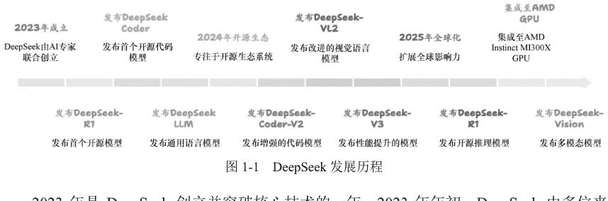

DeepSeek 三年闪电崛起

2023 年是 DeepSeek 起步并完成关键技术突破的节点。年初，由中国顶尖高校与科技公司的 AI 专家联合发起，目标是通过更省算力的模型结构和更低成本的训练方案逼近通用人工智能。3 月，首个开源模型 DeepSeek-R1① 面世，在自然语言理解测评里凭借十亿量级参数打出百亿量级效果，迅速吸引投资完成数亿元天使轮。11 月 2 日，开源代码模型 DeepSeek Coder 上线，覆盖多语言编程、调试与数据分析。11 月 29 日，67 B 级别通用语言模型 DeepSeek LLM 发布，提供 7 B 与 67 B 两档规格，以及基础版与对话版。

2024 年重心落在开源生态构建与产业落地。1 月 5 日，DeepSeek LLM 披露已在 2 万亿 Token② 语料上完成训练。1 月 25 日，DeepSeek-Coder-V2 发布，强化代码生成与补全。2 月 5 日，DeepSeekMath 面世，依托 DeepSeek-Coder-V1.5 7B 侧重数学。3 月 11 日，开源视觉语言模型 DeepSeek-VL 发布，视觉侧任务处理能力突出。5 月 7 日，DeepSeek-V2 发布，引入混合专家 MoE 结构，整体性能明显提升。6 月 17 日，DeepSeek-Coder-V2 再度迭代，编码与数学推理增强并扩充语言支持。12 月 13 日，DeepSeek-VL2 发布，多模态理解能力得到改进。12 月 26 日，DeepSeek-V3 发布，知识类任务效率与生成速度显著加快。

2025 年进入多模态深化与全球化布局阶段。1 月 20 日，开源推理模型 DeepSeek-R1 发布，综合表现超越 OpenAI 的 o1，并迅速登顶中美应用商店下载榜。1 月，AMD 公布将 DeepSeek-V3 集成至 Instinct MI300X GPU，优化算力生态。2 月 3 日，DeepSeek-R1、DeepSeek-V3 等模型上线国家超算互联网平台，加速科研与产业化。2 月 8 日，中国移动、中国电信、中国联通共同接入并提供专属算力，同时推出千亿参数级多模态模型 DeepSeek-Vision，支持文本、图像、视频跨模态推理，并在医疗影像分析、工业质检等场景实现商业落地。

凭借技术创新与开放策略，DeepSeek 迅速成长为全球人工智能的重要力量，其发展节奏与技术厚度引人关注。

2025 年 1 月 31 日，英伟达宣布 DeepSeek-R1 模型登陆 NVIDIA NIM。同期亚马逊与微软也接入该模型，DeepSeek 与微软 Azure 达成战略合作，推出面向金融、制造、教育等行业的企业级平台 DeepSeek Enterprise，已服务超 500 家客户。2025 年 2 月 3 日，R1、V3、Coder 系列陆续上线国家超算互联网平台。2025 年 2 月 6 日，澳大利亚以安全风险为由禁止政府设备使用 DeepSeek。2025 年 2 月 8 日，DeepSeek 落子江苏苏州，并在苏州公共算力服务平台完成部署，提供软硬一体开箱服务。截至 2025 年 2 月 9 日，DeepSeek App 累计下载超 1.1 亿次，周活峰值达 9 700 万。2025 年 2 月 20 日，超 200 家企业宣布接入。2025 年 2 月 26 日，DeepSeek 宣布开源 DeepGEMM。

① 此处 R1 与 2025 年 1 月 20 日发布的 R1 不同。2025 年 1 月 20 日版本在推理能力、强化学习优化、开源支持及应用场景上均有明显提升，适用于复杂推理与科研。
② Token 与参数是大语言模型的两个不同指标。参数可视作模型的大脑，决定处理与生成逻辑；Token 是文本处理的基本单元。二者协同使模型能够理解并生成自然语言。

### 1.1 人工智能演进与 DeepSeek 的出现
DeepSeek 采用 Transformer 结构，是通用大语言模型的典型代表。回顾人工智能演进，有助于更深刻理解 DeepSeek 出现的意义。

#### 1.1.1 人工智能发展历程
人工智能从概念提出至今已逾半个世纪，历经多次高潮与低谷。我们正处于第三个发展阶段。

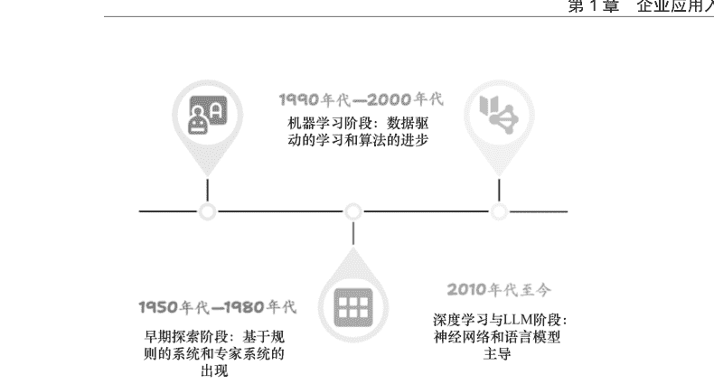
##### 1. 早期探索
20 世纪 50 年代至 80 年代为萌芽期。研究者尝试用规则与知识库模拟人类智能，典型应用是专家系统，如医疗诊断、化学结构分析等。该类系统在特定领域可提供专业建议，但知识库需人工构建维护，对复杂多变现实适应性差，存在知识获取瓶颈与通用性不足等局限。

##### 2. 机器学习时期
20 世纪 90 年代至 21 世纪初以机器学习为主。随着算力与数据积累，研究者转向让计算机从数据中自动学习知识。常见方法包括决策树、支持向量机 SVM、朴素贝叶斯等。机器学习在图像识别、文本分类、推荐系统等领域取得进展，金融领域的信用评估与风险预测即为代表。但传统方法对特征工程依赖强，对数据质量与规模要求高，可解释性与泛化能力有限。

##### 3. 深度学习与大语言模型时期
21 世纪 10 年代至今由深度学习与大语言模型主导。深度神经网络通过多层结构自动学习高层特征表示。GPT 系列、DeepSeek 等是深度学习在自然语言处理 NLP 领域的代表成果。

大语言模型持续演进，从 GPT-3 到 GPT-4，再到 GPT-4.5 与 GPT-5，参数规模与效果不断攀升。例如 GPT-4 参数超过万亿甚至达 1.8 万亿，采用 Transformer 与 MoE 等技术，可处理多达 12.8 万个文本 Token，在 NLP 任务中表现优异。

大语言模型在文本生成、机器翻译、问答系统等任务中表现突出，能产出流畅自然的语言文本，为多场景提供强劲的语言理解与生成能力。但也存在局限，如对训练数据依赖强、计算资源消耗大、易产生偏见与错误信息等。GPT-4 虽在创作、数据分析、艺术创作等领域广泛使用，仍会出现判断失误与“机器幻觉”，编造不存在的内容。

#### 1.1.2 全球主要大语言模型及其发展
除 GPT 与 DeepSeek 外，全球仍有多元大语言模型。中国信息通信研究院《全球数字经济白皮书》显示，截至 2025 年 1 月全球 AI 大模型达 1 328 个，其中 36% 来自中国，位居美国之后。全球主要大语言模型如图 1-3 所示。

| 特点 | GPT 系列 | DeepSeek | LLaMA 系列 | Le Chat |
| :--- | :--- | :--- | :--- | :--- |
| 开发者 | OpenAI | 中国团队 | Meta | Mistral AI |
| 优势 | 语言生成、多模态处理 | NLU、自然语言生成、领域适配 | 新模态、推理、性能 | 速度、开源、文档理解 |
| 未来 | 增强生成式 AI 能力 | 算法创新、工程优化 | 优化 AI 聊天机器人、用户体验 | 高精度内容理解、跨平台支持 |

图 1-3 全球主要 LLM

##### 1. GPT 系列
OpenAI 的 GPT 系列是 LLM 的代表。GPT-3 已展现强大语言生成能力，GPT-4 在多模态处理与推理上显著提升，不仅处理文本还能接收图像输入，具备出色图像描述能力。GPT-4.5 与 GPT-5 将进一步强化多模态生成式 AI 能力。

##### 2. DeepSeek
DeepSeek 由中国团队打造，具有 AGI 潜质。从早期 V1、V2 到 V3 及衍生版 R1、R2，呈现前沿算法创新与工程化优化。在 NLU 与自然语言生成 NLG 任务上表现突出，同时在编程、数学推理、知识检索等垂直领域适配力强。

##### 3. LLaMA 系列
Meta 的 LLaMA 系列持续演进。LLaMA 4 正由 10 万片 H100 GPU 集群训练，新版本将引入新模态、更强推理、更快性能。Meta 将进一步优化 Meta AI 聊天机器人等功能，提升用户体验。

##### 4. Le Chat
Le Chat 为法国 AI 初创 Mistral AI 发布的大模型，上线即登顶法国免费 App 榜。完全开源，每秒处理 1 100 个 Token，约 1 000 个单词，比 ChatGPT 快 13 倍，图像生成能力超过 DALL·E。依托领先视觉识别与光学字符识别 OCR 技术，可对 PDF、Excel、日志、复杂图片、文档等进行高精度解析，同时支持 iOS 与 Android。

#### 1.1.3 DeepSeek 突围原因
DeepSeek 在 2025 年春节推出的 R1 能在全球大语言模型中脱颖而出的原因如下。

（1）技术创新与高效训练
DeepSeek-R1 在特定基准测试中接近美国先进水平，进步体现在模型性能与训练效率双提升。训练过程采用强化学习等原创技术，实现效率跃升。例如 R1 以强化学习替代传统监督微调 SFT，提升训练效率与模型性能。同时实现训练与推理成本大幅下降，DeepSeek-V3 参数规模 671 B，训练时长 280 万 CPU 小时，训练成本不足 560 万美元。相比之下，GPT-4o 训练成本约 1 亿美元。

（2）开放策略推动生态繁荣
DeepSeek 完全开源，使产业链上下游企业与开发者均可受益。开发者可基于开源模型开展创新应用，成为生态建设的贡献者，推动生态繁荣。同时支持私有化部署，对拥有私有数据的企业意义重大，企业可在保障数据安全前提下借助大模型提升生产效率、优化业务流程。

（3）市场表现与行业影响
DeepSeek 的出现震撼全球模型市场，引发硅谷多家科技巨头关注。低成本高性能的特性挑战传统 AI 巨头地位，推动 AI 技术普惠化，并以极低成本与少量芯片实现与 OpenAI 等巨头媲美的性能，打破“唯有科技巨头才能研发尖端 AI”的共识。通过开源模式与极致性价比迅速覆盖多种生活场景，实用性与趣味性引发全民关注，实现技术破圈与大众化普及。DeepSeek 应用在谷歌 Play 商店美国区下载榜位居榜首，发布 18 天累计下载 1 600 万次。DeepSeek App 在中国下载量从 1 月 25 日的 160 万次增长至 4 月 2 日的 4 000 万次，日活用户数在 2 月 8 日达 3 494 万人次，并于 3 月 27 日突破 1.8 亿人次。

### 1.2 DeepSeek 的核心功能和独特优势
DeepSeek 不仅在技术上取得重大突破，在企业应用中也展现出巨大价值与潜力。强大的推理能力、免费开源策略、联网搜索功能等优势，使其在人工智能领域迅速崛起，成为企业数字化转型与智能化升级的重要工具。随技术不断完善，DeepSeek 有望在更多领域发挥更大作用，推动 AI 技术广泛应用与普及。

#### 1.2.1 核心功能
DeepSeek 作为先进 AI 工具，在自然语言处理、代码生成与理解、数据分析与可视化、计算与推理、多模态处理等多领域展现卓越性能与广泛前景。不仅能为用户提供高效准确的 AI 服务，还能激发创造力与想象力，为各领域发展带来新机遇。DeepSeek 核心功能结构图如图 1-4 所示。

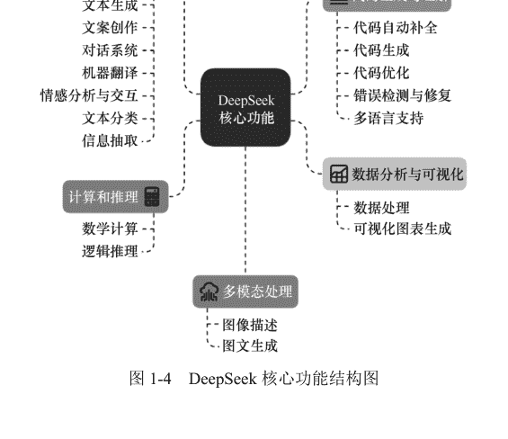
##### 1. 自然语言处理
（1）文本生成
DeepSeek 可根据提示或上下文生成高质量、连贯且富逻辑的文本内容。无论是新闻报道、商业文案，还是故事诗歌等文学创作，均能提供出色生成效果，帮助用户把握意图、提供创作灵感与辅助。

（2）文案创作
DeepSeek 在文案创作方面表现突出，能生成广告文案、宣传文案、产品介绍等，并依据产品特点与目标受众创作更具吸引力的内容，提升宣传效果。

（3）对话系统
依托强大的自然语言处理能力，DeepSeek 能与用户自然流畅交互。不仅理解问题，还能结合语境与背景知识给出准确详尽的回答。在多轮对话中可记住此前内容，保持连贯与逻辑性，并根据追问补充完善回答。在智能客服、虚拟助手等场景可提供高效个性化服务，提升体验。

（4）机器翻译
DeepSeek 支持多种语言互译，包括中英互译等，可将一种语言文本准确转译为另一种语言，在跨语言交流、信息获取等场景帮助用户突破语言障碍。

（5）情感分析与交互
DeepSeek 具备情感交互能力，能感知用户情绪并给予相应回应，提升体验。例如用户表达喜悦、悲伤、愤怒时，模型可用合适语言与语气回应。还能对文本情感倾向进行分析，识别积极、消极或中性情感，在市场调研、舆情监测等领域帮助企业了解公众态度，做出决策调整。

（6）文本分类
DeepSeek 可将文本归入预定义类别。例如在垃圾邮件检测中快速准确识别垃圾邮件，过滤不必要信息；在新闻分类中将文章归入不同主题，便于查找阅读。

（7）信息抽取
DeepSeek 能从非结构化文本中抽取关键信息，如实体名称、日期、地点等，在信息检索、知识图谱构建等领域帮助快速获取核心内容，提高处理效率。

##### 2. 代码生成与理解
（1）代码自动补全
DeepSeek Coder 可根据开发者输入片段，预测并补全后续代码，通过分析上下文与语法结构提供准确建议，提升编程效率，减少输入错误。

（2）代码生成
DeepSeek Coder 可依据自然语言描述直接生成可执行代码。开发者仅需用自然语言描述需求，即可获得相应代码片段，大幅简化编程流程。

（3）代码优化
DeepSeek Coder 可对代码进行优化并提供建议，如减少冗余、提升性能，帮助提高代码质量、运行效率与可读性。

（4）错误检测与修复
DeepSeek Coder 能自动检测代码错误并给出修复建议，可识别语法错误、逻辑错误等，提供详细错误信息与修复方案，帮助快速定位解决问题。

（5）多语言支持
DeepSeek Coder 支持 Java、Python、C++、JavaScript、Go 等主流编程语言，满足多样化开发需求。

##### 3. 数据分析与可视化
（1）数据处理

DeepSeek 从数据到决策：一份企业实操指南

数据处理与智能洞察
DeepSeek 能吃进 Excel、CSV 等多种结构化数据。拿到数据后可以先做清洗，去重、纠错；再做统计，算均值、中位数、标准差等指标；最后做分类与排序，让信息快速归位。

可视化图表生成
分析完的数据可以直接变成图表。柱状图、折线图、饼图、散点图等都能按需生成，只需说明想看的维度与图表样式，就能得到一目了然的成果，便于沟通与汇报。

4. 计算与推理
数学计算
从加减乘除、方程求解，到微积分、线性代数等高等内容，都能应对。依据题目条件调用数学知识与推理规则，给出思路与准确结果。

逻辑推理
支持演绎、归纳、类比等多种推理方式。基于给定前提推导出合理解释，帮助解决复杂逻辑问题。

5. 多模态处理
图像描述
能够解析图片中的物体、场景、人物等要素，生成准确生动的文字说明，提升图像理解与表达效率。

图文生成
目前 DeepSeek-R1、DeepSeek-V3 原生并不直接出图。R1 可输出可缩放矢量图形 SVG 代码或 HTML 文件，运行后手工导出为 PNG、JPG 等格式。未来 V4 或 R2 版本有望加入原生绘图能力，这对创意设计、广告制作等场景意义重大，能把想法直接转成视觉稿。

1.2.2 核心竞争力拆解
DeepSeek 对国内企业而言具备明显差异化优势。

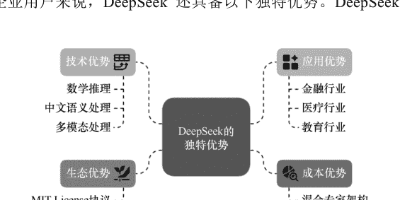

图 1-5 DeepSeek 的独特优势

1. 技术优势
在数学推理与中文语义理解上表现突出，与国际一流模型可比。中文理解与生成更贴合本土用户习惯，提供更个性化的服务。兼具多模态能力，可同时处理文本与图像等，为企业提供全链路 AI 方案。例如医疗场景可辅助诊疗与数据治理，传媒场景可实现精准推荐、互动问答与个性化内容生产。

2. 成本优势
依托 MoE 架构与高效训练策略，研发与运维开销被大幅压缩。DeepSeek-V3 训练成本约相当于开源模型 LLaMA 3 的 1%，DeepSeek-R1 推理成本约是国际头部闭源模型的 3%。API 调用费用仅为国际主流商业模型的 2%~4%，显著降低大模型使用门槛，推动 AI 普惠。

3. 应用优势
覆盖金融、医疗、教育、制造、交通等多个行业并实现深度落地。金融侧提升合同质检与资产对账效率，赋能决策；医疗侧助力精准诊疗与新药研发；教育侧提升教学个性化与互动性。部署方式灵活，大企业可私有化部署并结合开源特性做场景定制，中小企业可通过 API 快速接入，实现高性价比创新。

4. 生态优势
采用 MIT 许可，企业可自由使用，无技术封锁风险，便于共享与二次开发。开发者可按需优化与定制，提升适用性。DeepSeek 的出现也带动产业联动，华为云、腾讯云等与之合作，优化推理服务与部署效率。

1.3 企业应用价值实证

1. DeepSeek 在制造业中的应用价值
预测性维护可提前识别设备隐患，避免停线并优化能耗，降低故障率与碳排放。福田汽车引入 DeepSeek-V3 后，研发、财务、质量等环节效率提升，决策更稳。富士康在智能手机主板贴片线部署相关技术，用强化学习协同 2000 多台机器人毫秒级调度，解决路径冲突，节拍时间缩短 12%，日产能提升至 120 万台。

2. DeepSeek 在交通运输、仓储和邮政业中的应用价值
物流场景中，智能规划、分发与骑手调度能提高配效与客户满意度。顺丰同城接入后实现智能业务规划、骑手融合调度与智能订单分发，可预判订单波动，提升匹配精度与履约效率。

3. DeepSeek 在信息传输、软件和信息技术服务业中的应用价值
推理效率直接影响成本与服务质量。DeepSeek 为华为云推理服务提供支撑，部署效率显著提升。腾讯云将 DeepSeek-R1 部署到 HAI 平台，开发者 3 分钟即可接入，开发周期缩短，成本下降。

4. DeepSeek 在金融业中的应用价值
智能合同质检与自动化估值对账提升效率并降低风险。江苏银行落地后，合同质检综合准确率升至 96%，较传统方案提高 12%；估值对账实现邮件分类、产品匹配、交易录入、估值表解析等全链路自动化，识别成功率超 90%。按手工水平测算，日节约工时 9.68 小时，实现业务集中运营。

5. DeepSeek 在医疗行业中的应用价值
辅助诊断提升诊疗质量。深圳龙岗妇幼保健院将产前诊断知识库导入 DeepSeek，打造宣教与答疑助手，提升公众获取知识效率。在心血管诊断辅助中，系统基于病史与症状给出建议，辅助医生科学决策，提升准确性与效率。

6. DeepSeek 在教育行业中的应用价值
高途教育接入后，学习评估可快速生成个性化规划与策略，AI 助手日访问量提升 200%，高中数学测评准确率提高 15%，教学质量与学习效果同步改善。

7. DeepSeek 在农业领域的应用价值
整合虫情、气象与作物生长周期等多源数据，可精准预测病虫害风险并给出个性化植保建议。河南云飞科技合作案例显示，小麦种植区防治更科学，农户经济收益明显增加。

8. DeepSeek 在政务领域的应用价值
辅助政策制定，通过数据分析与智能决策优化公共资源配置，提升公平性。城市规划中可依据人口分布与需求建议公共设施布局。应急与城市治理方面，结合实时交通、轨迹、设施数据实现智能调度，缓解拥堵；环境监测中实时分析空气、水质、噪声数据，及时发现问题并预测趋势，为治理提供依据。

9. DeepSeek 在能源与可持续发展领域的应用价值
分析能源需求、价格波动与设备运行状态，优化生产计划与调配，提升利用率、降低损耗。正泰新能源将模型应用于松江区虚拟电厂项目，构建多维能源画像并实现智能语音交互与动态挖掘，负荷响应预测准确率提升，运营决策更精准。也可为绿色计算提供建议，助力企业达成可持续发展目标。

DeepSeek 本质上是基于 LLM 的 AGI 应用，凡涉及语言与多模态需求的场景，均可借助它提升效率与准确度。

1.4 企业部署 DeepSeek 需要考虑的因素
模型功能强、场景广，部署前需明确版本、参数与环境，否则容易踩坑。

1.4.1 版本选择
版本至少包含功能版、参数规模版与优化版三层，需结合任务难度、硬件与预算综合判断。

功能版本的选择
DeepSeek-V3 为高性能信息检索与 NLP 模型，基于 MoE 架构，适合客服、文本摘要、内容生成等大规模应用。DeepSeek-R1 为轻量化推理模型，强化学习增强逻辑与问题求解能力，适合需要深度推理的场景。

参数规模版本的选择
DeepSeek-V3 与 R1 都提供小型 1.5 B、7 B、中等 8 B、14 B、大型 32 B、70 B、671 B 等规格。小型模型资源占用低，消费级 GPU 如 RTX 3090/4090 可跑，适合本地轻量问答。中等模型推理能力明显增强，可处理代码补全、数据分析等，需 A100/H100 等高端卡。大模型代表顶尖推理与决策能力，通常需云端大规模算力。

优化版本的选择
本地化部署中以 R1 为例有满血版、蒸馏版、量化版三种形态。满血版为 671 B 完整体，强推理、输出质量高，适合复杂推理、大规模生成与跨域理解，需 16 张 A100 与 2 TB SSD，成本极高。蒸馏版用 R1 数据对 Qwen、LLaMA 等开源模型做 SFT，参数 7 B~70 B，速度更快但质量低于满血，适合私有库搭建与微调。70 B 蒸馏版约需 150 GB 显存，8 张 RTX 4090 或 6 张 RTX 5090 可满足；32 B 约需 70 GB 显存，3 张 RTX 4090 即可；8 B、7 B、1.5 B 对普通电脑友好。量化版通过 4-bit 等低精度压缩显存占用，可在消费卡运行，精度略有损失。70 B 量化版约需 48 GB 显存，2 张 RTX 4090 够用；32 B 量化版约需 20 GB 显存，改装 22 GB 的 RTX 2080 Ti 也能跑。

优化版本与参数规模的对应关系
满血版 671 B 性能最强资源最高，适合金融风控、基因分析等复杂推理；蒸馏版覆盖 1.5 B~70 B，性能接近、资源降低，适合中小企业本地部署、客服、教育辅导；量化版基于蒸馏或满血量化后显存与速度提升，适合移动端与嵌入式设备。

1.4.2 数值精度选择
数值精度决定模型计算与存储的精确度，直接影响效率、资源与效果。

模型数值精度的定义
精度由浮点位数决定，位数越少占用越小速度越快，精度越高结果越稳。

常见精度类型
FP32 单精度 32 位，提供约 7 位有效数字，训练与高精度推理常用。FP16 半精度 16 位，速度更快资源更省，适合受限场景。FP8 8 位浮点，DeepSeek 训练中用于 GEMM 等计算密集操作，降低显存与开销，同时保持性能。TF32 Tensor Float 32 保持 FP32 动态范围、尾数 10 位，利于深度学习训练。INT8/INT4 整数量化将参数转低精度整数，推理加速明显，INT4 压缩最强但可能带来精度损失。

不同精度对场景的影响
FP32 适合科学计算、工程模拟、财务分析及需高精度训练任务，结果准确但资源消耗大。FP8 在 DeepSeek 中用于大部分计算，配合 BF16 与 FP32 在嵌入层、注意力等关键操作保持稳定性，实现性能与精度的平衡。量化精度则更偏向推理部署与边缘侧使用。

通过模型量化把权重从浮点数压缩到 INT4 这类低精度整数，能明显缩小模型体积、提速推理并降低功耗。比如 DeepSeek-7B-chat 就采用了 4 位量化的微调方案如 QLoRA，在大幅削减随机存取存储器 RAM 占用的同时，仍保持可用的推理水准。低精度格式特别适合算力受限的终端，或对响应时延要求很高的场景。

> ① BF16，即 BFloat16，是一种 16 位浮点格式。其设计初衷是在兼容 FP32 的同时减少计算与存储开销。BF16 的指数位与 FP32 保持一致，所以数值覆盖范围几乎等同，数值稳定性较好，尤其在涉及大动态范围的运算时优势明显。尾数只有 7 位，远少于 FP32 的 23 位，精度因此下降，但对多数深度学习任务来说已经足够，训练与推理阶段普遍可接受。

##### 3. 实际应用中的选择

DeepSeek 在本地化落地时，不同精度的取舍主要体现在下面几个维度。

###### （1）资源占用与硬件需求

高精度如 FP32、FP16 推理时吃显存和算力，门槛较高。以 DeepSeek-R1 32B 为例，FP16 下显存需求约 1.3TB，必须依赖高性能图形处理器 GPU。低精度如 INT8、4-bit 量化则把显存与计算量压下来，可在普通 GPU 甚至中央处理器 CPU 上跑起来。以 INT8 为例，内存占用能从 381.47 MB 骤降到 95.37 MB，对硬件的依赖明显放宽。

###### （2）模型性能与精度

高精度在金融风险评估、医疗辅助诊断等对准确率极敏感的任务上更稳。DeepSeek-R1 32B 在 FP16 下可在复杂语义理解中维持较高准确率。低精度会带来一定精度损失，但在特定任务里表现仍可接受，例如 4-bit 量化后的 DeepSeek-R1 32B 在代码生成上速度提升约 10%～15%，生成代码的正确性与可读性并未明显变差。

###### （3）部署灵活性

高精度通常绑定高性能计算环境，多部署在企业级服务器，满足对性能与稳定性的严苛要求。低精度则能下沉到嵌入式设备、移动设备等资源受限侧，适配实时交互类应用，如聊天机器人、智能客服。

###### （4）成本效益

高精度方案的部署与运行费用偏高，适合对性能要求极致的企业应用。低精度方案成本更友好，适合预算有限或精度要求不高的场景。

###### （5）安全性与稳定性

高精度模型运行在高性能计算环境中，稳定性与安全性相对更好。低精度模型经量化优化后也能在受限环境中保持较好稳定与安全，前提是量化过程必须正确可控。

选型时要综合硬件条件、业务需求以及对精度与性能的预期。高精度适用于对性能和精度双高要求的场景，低精度则在资源受限下提供灵活性与成本优势。

#### 1.4.3 部署方式选择

部署方式是指把软件系统安装、配置并运行在特定计算环境的方法与策略。常见分为本地部署、云端部署和企业级部署。

##### 1. 本地部署

把 DeepSeek 完全放在企业自有服务器或个人电脑上，数据完全自主可控且合规。优点是隐私性强、数据安全、用户掌控度高，需要本地硬件如 NVIDIA GPU 支持。适合个人开发者、小型企业、科研实验，以及对数据安全要求极高的应用。

##### 2. 云端部署

借助云服务器运行模型，由云服务商统一管理资源。优势在于便捷、弹性扩容与安全性。便捷体现在可快速上线扩容，无需自建硬件；弹性体现在按需增减资源应对业务波动；安全性体现在云厂商提供完善的安全与合规保障。依赖网络连接，适合中大型企业和高并发场景。

##### 3. 企业级部署

模型运行在企业自有的高性能硬件或云服务器上，面向大规模高性能需求。特点是性能强与可定制。高性能体现在更大的算力与存储，支撑复杂 AI 应用；定制化体现在可按业务微调优化，形成专属方案。适合预算充足、对性能要求高、需处理海量数据与复杂任务的大型企业、金融机构、政府机构等对安全与定制有高要求的客户。

#### 1.4.4 部署方法选择

每种部署方式都有对应的实现路径。

##### 1. 本地部署的方法选择

DeepSeek 本地部署常见做法有 Ollama、vLLM、Chatbox 前端搭建、Docker、Cherry Studio。

###### （1）使用 Ollama

优点是上手快、硬件门槛低、交互顺畅、模型可选多。支持 macOS、Linux、Windows，命令行一键装好，无需繁琐环境配置。内置命令行对话界面，直观易用，适合快速验证。模型库除 DeepSeek 外还收录 Qwen2.5、LLaMA 3.3 等。仅 CPU 加 16GB 内存即可跑 7B 参数模型。

缺点是性能受限、扩展性弱。面向个人实验，优化有限，大数据和高并发下可能吃力。仅支持单机本地运行，不支持分布式部署、多 GPU 并行等企业级能力。

###### （2）使用 vLLM

优势为高性能、生产可用、定制能力强。优化了显存管理与批处理，支持千级并发，适合企业 API 服务和高并发推理。支持分布式部署、动态批处理、多 GPU 并行，可集成到智能助手、批量文档处理等系统。支持 Python 调用，可改参加业务逻辑。

缺点是部署复杂、硬件要求高。依赖 Python 环境，需手动配置 GPU 驱动与 CUDA，技术门槛高。必须使用 NVIDIA GPU 且显存越大越好，成本与门槛提升，不适合低配用户。

###### （3）通过 Chatbox 前端搭建

优点是操作便捷，功能丰富且跨平台。提供图形界面，点选配置即可，无需命令行。支持联网搜索、本地知识库集成等高级能力。兼容 Windows、Mac、手机，便于多设备使用。

缺点是受 Chatbox 稳定性制约，部分系统可能兼容或卡顿。功能定制有限，特殊业务或高级需求难以像代码级开发那样灵活深入。

###### （4）使用 Docker

优点是环境隔离、可移植性强、资源管理精细。隔离不同环境冲突，保证运行一致性。镜像可迁移到不同服务器，提升复用性。可限制 CPU、内存等避免资源争用。

缺点是安装配置重，需先装 Docker 与 Docker Compose，学习曲线较陡。容器本身占用系统资源，会影响整体性能。

###### （5）使用 Cherry Studio

优点是集成化体验强，功能工具丰富，支持多模型协同。提供统一 IDE，部署、管理、调用集中进行。内置数据可视化、模型评估、任务调度等工具。能同时管理多个模型协同工作。

缺点是学习成本高，功能复杂需熟悉流程。系统资源占用大，运行内存与 CPU 需求较高。

##### 2. 云端部署的方法选择

包括使用 CAP、云服务器、云 API 调用、混合部署。

###### （1）使用 CAP

CAP 是一站式云原生应用开发与生命周期管理平台，内置 Serverless 与 AI 模板、开发者工具与企业级管理。优势为快速部署、弹性扩展、便捷管理、功能丰富。可快速创建部署 DeepSeek，无须复杂环境与依赖配置①。支持按需扩缩容，高并发下稳定运行。管理工具简化运维，支持多版本与配置选择。

缺点是需稳定网络，波动影响性能；数据在云端存在安全与隐私隐患；性能受云厂商资源限制。

> ① 依赖管理是软件开发中对外部库、框架、模块等资源进行管理和控制的重要环节。

###### （2）使用云服务器

使用 AWS、Google Cloud、Azure、阿里云、腾讯云等。优点是弹性扩展，按需付费起步成本低，维护简便且可全球访问。缺点是长期高频使用成本可能超过本地部署，存在数据隐私泄露风险，依赖网络延迟影响体验。

###### （3）使用云 API 调用

通过 HTTP 请求操作云服务商资源，基于 RESTful API 标准。优点是成本低、选择灵活、上线快。缺点是算力共享，若 API 质量差风险高；数据在云端有安全风险；性能受限，不适合极致性能场景。

###### （4）使用混合部署

结合本地与云端，敏感数据与关键应用放本地，非敏感数据放公有云。优点是灵活性高、可扩展、成本效益好、安全合规性强、业务连续可靠。缺点是复杂度高，需维护双环境，存在新安全风险，管理成本与数据集成难度大，依赖网络连接，对团队技能要求高。适合医疗、零售、金融、政府等数据需部分本地化、部分公有的场景。

##### 3. 企业级部署

企业级方法包括云端部署、本地或内网部署、混合部署、容器化或微服务部署、边缘部署和联邦部署。

###### （1）云端部署

外部客户端通过 RESTful API 或 gRPC 网关访问云端模型服务。采用专线对接与点对点加密，配合 VPC、安全组、访问控制列表 ACL 保障传输存储安全。借助 Kubernetes 与分布式文件系统如 HDFS 管理并发与海量数据。特点是灵活可扩展、成本效益高、维护简便；需重点关注数据安全隐私与网络依赖。

###### （2）本地或内网部署

在企业内部数据中心的高性能 GPU 服务器或集群上部署，或采购 DeepSeek 一体机。通过内网 IP 或专用网络调度推理，结合防火墙、入侵检测等安全体系。特点是数据安全性高，所有数据不出内网；资源自主可控，便于按需定制优化。

本地或内网自建的优势在于数据主权更牢、系统可控性更强，针对业务做定制化优化也比较顺手；对应的门槛也明显，前期建设投入较大，必须配备专业的运维团队，后期弹性扩容能力相对受限。

###### （3）混合部署
混合方案本质是分层协同。参数量较小或轻量化的 DeepSeek 模型常放在企业内网或边缘节点上，负责时延敏感的前端推理；参数庞大或全量的模型则寄存在专属云里，承接复杂推理需求。边缘侧先做预处理和初步推理，只把关键信息挑出来传到云端，由云端模型再做深度分析与精细化判断。

混合部署的核心价值主要体现在三点：一是数据治理更灵活，敏感信息留在本地保安全，非敏感数据放云端提效率，兼顾安全与利用；二是资源调度可弹性，按业务波动实时增减云端算力，高峰拉满、低谷落回本地，既保证体验又控制开销；三是高可用性增强，本地与云端互为冗余，单点故障时业务仍能连续运行。

###### （4）容器化或微服务部署
落地方式比较多样。Docker 方案把模型及其依赖打包成镜像，一键式完成部署上线。Kubernetes 编排则借助 K8s 等工具，实现多副本运行、弹性伸缩、自动自愈以及版本迭代。微服务交互层面，通常通过 RESTful API、gRPC Remote Procedure Calls，gRPC 或消息队列把大模型服务与其它业务解耦，支持灵活调用和分布式协同。

容器化或微服务部署有三项突出优势：一是移植性强，容器封装让服务跨环境迁移成本大幅下降，跨平台兼容性和迁移效率提升；二是扩展与运维更灵活，依托 Kubernetes 等平台可动态调整副本数、监控容器健康并自动故障恢复，保证服务稳定性；三是开发运维负担减轻，微服务把模块解耦，可独立开发、测试和更新，提升团队效率，后期维护监控也更清晰。

代价是企业需要具备相应的技术能力，容器管理平台的配置与日常维护本身会增加复杂度，需要匹配的人才与流程。

###### （5）边缘部署
边缘模式主要由两部分构成。边缘节点下放：把 DeepSeek 模型部署到靠近数据源的边缘节点，降低数据传输延迟。数据预处理：边缘设备对数据做初步清洗和本地推理，减少上行数据量。

边缘部署的典型优点有三：一是时延明显下降，适合对实时性要求高的场景；二是带宽占用受控，上行数据被压缩，适合带宽有限的环境；三是离线可用，网络不稳或中断时仍可本地持续运行。

不足在于边缘侧要承担预处理和推理任务，会对计算负载、功耗与设备算力提出更高要求。

###### （6）联邦部署
联邦模式靠统一协议把多个独立系统串联起来，在不裸奔数据的前提下实现资源与能力的协同，支持隐私保护下的共享计算。

联邦部署的核心特征可概括为三点：一是跨组织协作，多个主体可在保持数据独立管理的前提下共享能力；二是隐私优先，数据共享与计算均在保护隐私的框架内进行；三是分布式处理，训练与推理分散到各节点，如联邦学习机制。

短板在于跨组织协作成本高，对流程对齐、信任机制和沟通管理提出更高要求，管理和协调难度加大。

#### 1.4.5 操作系统选择
在实际部署里，操作系统选型直接影响性能、稳定性和维护成本，是关键决策点之一。

##### 1. 本地部署方式下的操作系统选择
本地自建场景下，主流可选的操作系统主要有 Linux、macOS 和 Windows 三类。

###### （1）Linux 操作系统
服务器场景里 Linux 表现稳定，资源调度和并发处理能力强，内置大量性能调优工具，配置自由度高，很适合深度学习模型运行。资源管理更精细，稳定性与效率兼顾。开源生态丰富，社区资料充足，能显著降低选型与运维成本。

门槛在于学习成本较高，命令行与系统管理对新手不友好。部分工具链在 Linux 上可能出现兼容适配问题，需要额外调试。

在后期做领域知识训练时，Linux 的脚本能力和自动化生态优势明显，批量训练与数据处理更顺手，稳定安全也为长时间任务提供保障。若团队对 Linux 不熟，则会带来上手时间和操作复杂度。

###### （2）macOS 操作系统
macOS 面向用户友好，安装部署流程简洁，上手门槛低。与 Ollama 等常用工具配合默契，几条命令即可拉取模型并运行。苹果自家硬件兼容性好，能较好释放 Mac 性能，减少适配麻烦。

但性能天花板相对较低，系统架构与资源调度在重负载多任务场景下通常不如 Linux，算力释放受限。生态版本选择也相对有限，部分进阶功能在 macOS 上不可用。

做领域知识训练时，macOS 配合 Xcode 等开发工具链体验流畅，开发效率不错。硬件瓶颈在大数据与复杂模型训练时可能成为限制，规模受限。

###### （3）Windows 操作系统
Windows 用户基数庞大，硬件选择多，配套资料与社区支持丰富。界面习惯大众化，学习成本低，部署和使用门槛更友好。

后期训练方面，Visual Studio 等 IDE 生态完善，开发体验顺滑。受底层架构限制，同样配置下性能通常比 Linux 低约 10%~15%，在大模型推理时响应和吞吐可能打折。

总体看，Linux 适合追求高性能与资源精细管理的人；macOS 适合看重易用性与苹果硬件兼容的人；Windows 具有更广泛的用户基础。对后期领域知识训练的影响也不同，Linux 提供强大工具与稳定环境，macOS 提供良好开发体验，Windows 在工具与社区支持方面占优。

##### 2. 云端部署方式下的操作系统选择
云端与本地在系统选型逻辑上并不完全一致，主要区别体现在四个维度。

（1）操作系统选择的灵活性
云端受厂商限制，AWS、Azure 等平台虽提供 Linux、Windows 等多种镜像，但最终可选范围取决于服务商的支持清单。本地则自主度高，可按硬件与团队能力自由选用 Linux、Windows 或 macOS，例如 GPU 服务器上 Linux 能更好地释放算力，特殊硬件也可能绑定特定系统。

（2）数据安全和隐私保护
云端数据落到第三方服务器，安全合规要求前置，操作系统需具备完善的安全机制和认证能力，Linux 在此维度常被优先考虑。本地数据完全自管，选型更看重与内部安全策略的匹配度，Windows 凭借丰富的安全管理工具也常被采用。

（3）维护和更新
云端由厂商托管补丁与版本升级，企业只需关注服务水平和更新节奏。本地则需自建运维体系，团队要具备日常维护、安全加固能力。

（4）对后续领域知识训练的影响
云端下，系统对训练的影响主要在资源调度与性能支撑，Linux 的命令行与脚本生态更利于自动化批处理。本地下影响更直接，需按任务规模与硬件选型匹配系统，例如大规模训练更依赖 Linux 的调度能力，特定框架可能要求特定系统。

##### 3. 混合部署方式下的操作系统选择
混合部署的系统选型要兼顾两端协同，主要考量有五个方面。

（1）操作系统选择的灵活性
需同时评估本地与云端的系统组合，确保两者兼容顺畅，数据和服务能够无缝打通。

（2）性能和资源管理
两端算力需合理分配，系统要具备高效的调度能力，让本地与云端资源协同发挥最佳水平。

（3）数据安全和隐私保护
混合架构下数据在两端流动，操作系统需提供强加密与传输保护。本地仍强调自管安全，云端则要满足合规认证，双向加固。

（4）维护和更新
运维面扩大，需统一管理两端更新节奏与版本兼容，对技术能力要求更高。

（5）对后续领域知识训练的影响
训练阶段系统需支撑两端协同训练与数据同步，本地选型影响任务执行效率，云端选型影响资源调度与算力释放。

### 1.5 企业部署 DeepSeek 的主要环节
在企业应用 DeepSeek 前，从环境搭建与配置开始，需要依次完成六个关键环节。

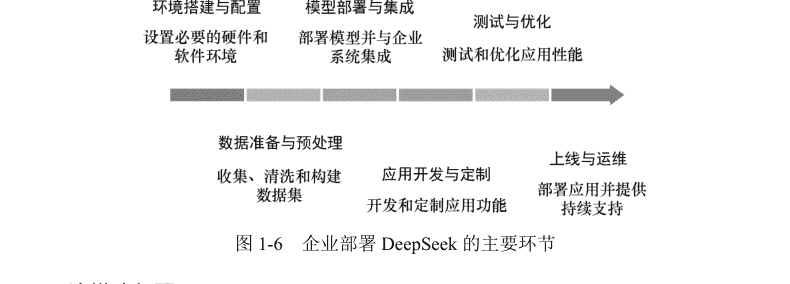

##### 1. 环境搭建与配置
先完成硬件准备、操作系统安装、依赖环境配置、深度学习框架与模型部署工具的整备；再依据业务需求选配合适的服务器、GPU 等硬件；最后安装操作系统、CUDA、cuDNN 等深度学习依赖、Python、PIP 等工具，以及 TensorFlow、PyTorch 等框架，并部署 Ollama、Docker、vLLM 等模型工具。

##### 2. 数据准备与预处理
包括数据收集、清洗标注与数据集构建。收集企业内部文档、图片、音频等素材，经清洗标注后划分训练集、验证集和测试集，为模型训练打好基础。数据质量直接决定模型效果。

##### 3. 模型部署与集成
按需选择合适版本并下载模型，使用部署工具加载并配置参数，开发 RESTful API 或 gRPC 接口，实现与企业应用的对接，最后嵌入前端后端系统完成功能交互。

##### 4. 应用开发与定制
基于模型开发智能客服、内容生成等业务功能，设计友好高效的用户界面，并将 DeepSeek 应用与现有业务流程整合，实现自动化与智能化。

##### 5. 测试与优化
涵盖功能测试、性能测试、模型优化和用户体验优化。验证各项功能正常，评估响应时间与吞吐量，根据结果做参数调优、量化等，并据用户反馈优化界面与交互。

##### 6. 上线与运维
将验证通过的应用推向生产环境，建立监控体系实时追踪运行状态，及时发现问题。定期更新模型与应用，保持功能与性能，并为用户提供培训与支持，确保价值充分释放。

# 第2章 环境搭建与配置
DeepSeek 企业应用通常包含环境搭建与配置、数据准备与预处理、模型训练与评估、模型部署与应用四个基础环节。本地、云端和企业级部署在环境准备上既有共性也有差异。

### 2.1 共性工作
无论本地、云端还是企业级部署，环境准备与配置都有共同要求。软件层面需完成基础环境搭建与依赖安装；数据层面需收集清洗并预处理；安全层面需落实加密、访问控制、安全监控与定期审计；性能层面需做数据库优化并引入缓存机制，提升响应速度。

#### 2.1.1 软件环境准备
在软件环境准备方面，各类部署方式都需要确保以下六个关键步骤完成。企业部署 DeepSeek 的软件环境准备如图 2-1 所示。

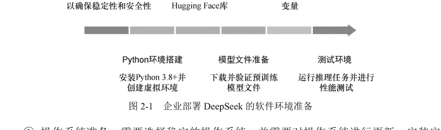

① 操作系统准备，选择稳定系统并及时更新，安装安全补丁避免已知漏洞被利用。
② Python 环境搭建，安装 Python 3.8 及以上版本，创建虚拟环境隔离依赖，避免版本冲突。
③ 安装依赖库，部署 PyTorch、TensorFlow 等深度学习框架，以及 Transformers、Accelerate、SentencePiece 等 Hugging Face 库；按需安装 Flask、FastAPI 等 API 服务依赖。
④ 模型文件准备，从官方仓库或可信来源获取预训练模型，加载验证并做简单推理测试，确认环境可用。
⑤ 配置环境文件，如 config.json 设置模型参数与运行环境，并配置 MODEL_PATH、API_KEY 等环境变量。
⑥ 测试环境，在已备环境中运行推理任务并做性能测试，确保满足需求。

#### 2.1.2 硬件准备
准备 DeepSeek 硬件环境时，无论哪种部署方式，都需完成以下两项关键工作。

##### 1. 最基本的共性硬件需求
（1）GPU 配置
大规模推理需选择合适的 GPU，如 NVIDIA A100 80GB×4 或 RTX 3090 等，以满足计算需求。
（2）内存与存储
需确保内存和存储充足，支撑模型运行与数据存储。
（3）网络带宽
云端和企业级部署需要高速网络带宽，保证数据传输稳定高效。

##### 2. 准备硬件环境的步骤
首先评估模型需求，按模型规模如 1.3B、7B、32B、70B 估算所需资源，小模型可低配运行，大模型需高端 GPU 与大内存。其次选择合适配置，CPU 建议 8 核以上，GPU 视模型大小选 GTX 1080 Ti、RTX 3090、A100 等，内存 32GB 以上，存储至少 100GB SSD 用于模型与数据集。再次确保硬件兼容性，包括操作系统、CUDA 版本等。最后设置网络环境，保证带宽充足，特别是在云端和企业级场景下支持高效传输。

在把 DeepSeek 跑起来的初期，供电与散热必须先行稳住。面对多卡并行或算力高度集中的部署，预留足够的电力余量与散热空间是底线，否则温度抬升和负载波动会直接拖慢整体效率。

#### 2.1.3 数据打底
本地、云端、企业混合三种形态在数据筹备上的思路是相通的，落地侧重点会有所不同。

##### 1. 筹备共性
首先是样本采集。无论哪种形态，都要围绕具体任务收集相关样本，来源可以是公开语料、企业私有数据，或通过爬虫抓取的网络信息。
第二步是治理清洗。原始样本往往掺杂噪声、缺失和异常，需要做去重、补全、剔除异常等工作，保证可用性。
第三步是标注。监督式任务必须为样本打上标签提供监督信号，标注质量直接决定模型天花板。
最后是归一化处理。把样本转成模型可读的形式，并视情况做归一或标准化。

##### 2. 落地要点
采集阶段要结合业务目标，比如文本分类可参考 IMDb 电影评论集。
清洗阶段要剔除噪音、重复和不完整记录，例如在文本中清理无意义符号与乱码，保持集合干净。
标注阶段必须保证准确，监督信号的质量会直接影响最终效果。
增强阶段通过对原始样本做变换来扩充规模，常见做法有图像翻转、旋转、缩放，以及文本同义替换、随机删词等，有助于缓解过拟合并提升泛化。
预处理的核心是统一格式与标准化，如把图像压缩到相同尺寸，文本转成词向量或 Token 序列。

#### 2.1.4 安全加固
本地、云端、企业级在安全上的共同诉求与落地动作如下。

##### 1. 安全共性
传输与存储环节建议全程启用加密通道如 HTTPS 或 TLS 1.3；访问权限要收紧，仅授权主体可接触敏感信息；部署实时异常感知，及时发现威胁；定期开展安全审计与漏洞修补，保持系统稳健。

##### 2. 常规实施清单
- ① 开启接口鉴权，确保所有 API 调用均经过身份核验，阻断非法访问。
- ② 用防火墙白名单限定模型服务的访问来源，仅放行指定网段。
- ③ 开启传输加密，保证链路内容不被窃听或篡改。
- ④ 配置反向代理与防护层，利用 Nginx 等实现 HTTP Basic 认证或 OAuth 接入。
- ⑤ 部署入侵检测系统 IDS，分析异常流量与访问模式，及时捕捉潜在威胁。
- ⑥ 定期审计系统日志，排查可疑操作以满足安全与合规要求。
- ⑦ 开展漏洞扫描与渗透测试，内外兼顾评估风险，维持安全基线。
- ⑧ 关注官方通告，及时升级软件与补丁库，防止已知漏洞被利用。
- ⑨ 收紧暴露面，限制端口开放范围，禁止非必要端口对外开放。
- ⑩ 实施全面安全巡检，通过扫描与渗透等手段确保大模型环节达标。

#### 2.1.5 提效策略
DeepSeek 三种形态的提速手段可归为四类，企业部署的思路见图 2-2。

##### 1. 模型提速
架构层面共性为多头潜在注意力 MLA 与 MoE。MLA 在保持表达力的同时大幅压缩 KV-Cache，降低带宽与显存占用；MoE 把稠密模型拆分为多个专家，仅激活部分专家，每个 Token 的计算与权重读取量更少。
量化与混合精度方面，采用低精度 FP8 训练与量化，权重读写量减半，KV-Cache 可压至约 6 bit，如 DeepSeek-V2；混合精度训练兼顾单精度与低精度运算，提升速度的同时保持精度，模型支持自动混合精度。

##### 2. 系统提速
分布式计算与存储上，采用数据并行加模型并行的分布式训练，充分利用算力；高并发场景使用 Redis 或 Memcached 等分布式缓存，保证一致性与高可用。
动态资源调度上，按实时请求量与负载自动调整算力分配，高峰期保稳，低谷时回收冗余资源避免浪费。
通信优化上，优化网络配置、带宽与 CDN 加速降低延迟；节点内 NVLink、跨节点 InfiniBand 可配合硬件级加速器或网络协处理器进一步降本。

##### 3. 数据提速
预处理层面，通过清洗、标注、增强提升样本质量，满足模型输入要求。
缓存层面，将热点数据与计算结果写入缓存，减少重复计算与查询；本地缓存可减少重复下载，节省时间与资源。

##### 4. 硬件提速
GPU 层面，选用高性能卡如 NVIDIA A100、H100，多卡并行借助 NVLink 或 InfiniBand 实现高效通信。
CPU 层面，利用多线程发挥并行能力，同时降低 CPU 与 GPU 间的数据传输开销。
内存层面，按模型规模扩容避免瓶颈，选用 DDR5 6000 MHz 及以上高频内存提升传输效率。
存储层面，使用 NVMe SSD 作为系统盘与模型盘，配合 RAID 技术提升读写速度与可靠性。

### 2.2 不同部署方式下的环境搭建与配置

#### 2.2.1 主要工作
- 1. 本地部署
自行准备服务器与 GPU，按模型需求配置硬件，例如 1.5 B 版本约需 GTX 1650 与 8 GB 内存，671 B 版本需多块 A100/H100 与 512 GB 内存。安装操作系统、CUDA、cuDNN、Python、PIP、TensorFlow/PyTorch、Ollama、Docker、vLLM 等工具链。基于硬件做显存与算力调优，大规模模型需做分布式推理优化。

- 2. 云端部署
需拥有云平台账号并具备足够权限与配额，本地网络稳定并配置 VPN 或专线，规划 IP 段与子网。安全要求高于本地，需创建安全组并配置入站出站规则，启用防火墙。部署通常通过云平台模型仓库或容器服务快速加载预训练模型并启动。部署后要配置性能监控、集中日志、自动化运维与告警。

##### 3. 企业级部署
结合本地与云端优势，按业务需求与数据敏感度规划硬件与云资源，确保兼容协同。构建本地加云端一体化的安全防护体系。综合优化本地与云端性能，合理管控资源以平衡效率与成本。需组建专业运维团队，制定流程制度，并可与云服务商协同运维。

#### 2.2.2 主要工作环节的区别

表 2-1 不同部署方式下主要工作环节的区别

| 环节 | 本地部署 | 云端部署 | 企业级部署 |
| :--- | :--- | :--- | :--- |
| 环境准备 | 自行准备硬件设备，安装操作系统和依赖环境 | 云服务账号注册与认证，网络环境配置，安全组与防火墙设置等 | 综合考虑本地和云端环境的规划与搭建 |
| 模型部署 | 自行下载和安装 DeepSeek 模型，配置运行参数 | 通常通过云平台提供的模型仓库或容器服务进行部署 | 在本地和云端分别进行模型部署，并确保两者的协同工作 |
| 性能优化 | 根据硬件配置进行性能优化 | 可以利用云平台提供的性能优化工具和自动扩展功能 | 综合考虑本地和云端资源的性能优化 |
| 安全与隐私 | 对数据安全和隐私具有更好的控制 | 依赖云服务提供商的安全保障机制，并采取额外的安全措施 | 需要建立全面的安全防护体系 |
| 运维管理 | 企业自行负责运维工作 | 主要由云服务提供商负责 | 需要企业建立专业的运维团队，并可能需要与云服务提供商合作 |

### 2.3 本地部署方式下的环境准备与配置

#### 2.3.1 环境准备
本地部署包含硬件准备、依赖环境安装、深度学习框架安装与模型部署工具安装。

##### 1. 硬件准备
建议服务器配备强劲 GPU、CPU 与充足内存，基础推荐 8 核 CPU、32 GB 内存、100 GB 以上 SSD 与 GTX 1080 及以上 GPU。更大模型如 70 B、671 B 需多卡、高内存、高速大容量存储。模型与数据建议放在 NVMe SSD 上，DeepSeek-R1 完整权重达数百 GB，蒸馏模型也有数十 GB。不同规模配置要求见表 2-2。

表 2-2 不同规模参数的 DeepSeek-R1 模型本地化部署配置要求

| 参数规模 | CPU | 内存 | 硬盘 | 显卡（存）/推荐配置 | 适用场景 |
| :--- | :--- | :--- | :--- | :--- | :--- |
| 1.5B | 最低 4 核 | 8 GB+ | 3 GB + | 纯 CPU 推理非必要，若 GPU 加速可以选择 4 GB +，推荐 GTX 1650 | 低资源设备部署，如树莓派、旧款笔记本电脑、嵌入式系统或物联网设备 |
| 7B | 8 核以上 | 16 GB+ | 8 GB + | 8 GB +，推荐 RTX 3070/4060 | 中小型企业的本地开发测试、中等复杂度 NLP 任务 |
| 14B | 12 核以上 | 32 GB+ | 15 GB+ | 16 GB +，推荐 RTX 4090/A5000 | 企业级复杂任务、长文本理解与生成 |
| 32B | 16 核以上，AMD Ryzen 9/ Intel i9 | 64 GB+ | 30 GB+ | 24 GB +，推荐 A100 40 GB/双卡 RTX 3090 | 高精度专业领域任务、多模态任务预处理 |
| 70B | 32 核以上服务器级 | 128 GB+ | 70 GB+ | 多卡并行，推荐 2x A100 80 GB/4x RTX 4090 | 科研机构、大型企业、高复杂度的生成任务 |
| 671B | 64 核以上服务器集群 | 512 GB+ | 300 GB+ | 多节点分布式训练，推荐 8x A100/H100 | 国家级、超大规模 AI 研究、AGI 探索 |

##### 2. 依赖环境配置安装
在选定操作系统后，GPU 加速需安装对应 CUDA 与 cuDNN。安装 Python 解释器与 PIP，并按需安装 NumPy、Pandas、Matplotlib 等科学计算库。

##### 3. 深度学习框架安装
根据后续开发需求选择 TensorFlow、PyTorch 等，按官方文档完成安装并确保能识别 GPU。

##### 4. 模型部署工具安装
Ollama 适合新手免配置；Docker 适合需要高灵活性和可移植性的用户；LM Studio 提供图形界面上手快；Cherry Studio 适合图形化模型管理与交互；vLLM 适合追求高性能低延迟的场景，需通过 Python 脚本调用 API。

#### 2.3.2 性能优化

企业可实施的本地优化包括模型、系统、硬件与软件层面。

（1）提升并行度
采用多线程将任务拆分并行，配合异步编程模型处理 I/O 密集型任务，提升并发与资源利用率。

（2）投机解码
利用小模型预测多个未来 Token，再由主模型并行验证加速推理。可引入多线程处理 MTP 模块，按官方文档配置参数，依据业务调整采样概率与解码步长。

（3）缓存机制
搭建 Redis 或 Memcached，将高频访问数据与结果缓存，减少重复推理；本地缓存可避免重复下载，降低负载。

（4）增加硬件资源
评估 CPU 使用率、内存占用、磁盘 I/O 等，必要时升级 CPU、内存、存储，确保兼容。

（5）使用 GPU 加速
检查是否具备 CUDA 支持的 NVIDIA GPU，安装驱动与兼容 CUDA、cuDNN 版本，确保框架启用 GPU 加速。

（6）环境变量调优
根据框架与部署工具要求，合理设置环境变量以优化显存分配、并发数与运行时参数。

想让 DeepSeek 跑得更顺，先去官方文档和技术资料里梳理一遍和性能挂钩的环境变量，比如 OLLAMA_FLASH_ATTENTION、OLLAMA_KV_CACHE_TYPE 这类参数。结合官方建议和自身情况，把变量值做微调，并跑性能测试看响应快慢和资源占用变化。反复试错，最终锁定一套最贴合企业业务的配置。

（7）模型加载层数调整
DeepSeek 的加载层数直接影响速度和效果。不同层数下，模型能力与准确度会有差别。先根据可用算力和业务诉求定策略：算力吃紧时适当削减加载层数换取流畅度；对精度要求苛刻的场景则适度增加层数。按策略改完后要在真实业务里验证性能与功能，确保达标。

（8）性能监控与持续优化
部署 Prometheus、Grafana 这类监控套件，实时抓取 CPU、内存、显存占用、推理耗时等核心指标。制定评估节奏，定期复盘数据判断模型表现。发现瓶颈后就动手优化：调参数、改系统配置、必要时升级硬件，让效率持续拉升。

综合以上做法，本地化部署 DeepSeek 就能把性能发挥到极致，满足企业对高速处理的需求。

#### 2.3.3 本地部署安全与隐私
本地部署看似数据在自己手里，可只要配置不当，还是会暴露出一堆安全和隐私隐患。

- 1. 本地部署常见的安全隐患
（1）未授权访问风险
用 Ollama 这类工具本地部署时，默认设置容易被钻空子，造成未授权访问、模型被盗，继而引发数据外泄和服务中断。
（2）数据泄露风险
训练和推理全程会触及个人隐私、商业机密等敏感信息，一旦泄露后果严重。
（3）模型参数被窃取
攻击者可能通过未授权通道窃取大模型核心参数，对涉密部门危害极大。
（4）模型投毒
攻击者可通过接口查看运行中的模型，下载带毒模型、删除正常模型、把有毒模型迁移到正常路径，用污染模型影响对话。
（5）模型资源消耗
攻击者可能借用你的 Ollama 模型做商业服务牟利，让私有服务器被“薅羊毛”。
（6）安全机制缺陷
DeepSeek 在抵御越狱攻击中的得分偏低，说明其安全机制存在明显短板，面对恶意提示时过滤能力不足。
（7）数据存储合规性挑战
DeepSeek 的隐私政策可能与部分国家法律冲突，带来合规风险。
（8）跨境合规冲突的复杂性
AI 大模型全球化应用中，跨境数据流动要求各国不同，合规操作更复杂、风险更高。

- 2. 企业可采取的应对措施
（1）及时更新版本
紧跟官方公告，定期升级 Ollama 及补丁漏洞库。
（2）收紧访问控制
把端口暴露面压到最小，11434 端口坚决不对外，限定本地或内网可用，配合防火墙规则加固。

#### 2.3.4 运维管理全攻略
本地部署 DeepSeek 需要覆盖硬件、软件、数据、安全、性能、文档与培训的全链路运维。
定期巡检维护服务器、GPU 等硬件，确保在线稳定；定期更新模型及依赖库，保持环境稳定兼容；关注官方更新通道，更新前充分测试。监控数据 I/O，保证数据质量，定期清理备份并优化存储。实施严格访问控制和数据加密，防止未授权访问和泄露。
性能层面要定期评估，按业务需求优化，搭建监控体系，用 Prometheus 和 Grafana 做实时监控，依监控结果调整硬件资源和软件参数。文档与培训方面要维护详尽系统文档，让团队吃透架构和操作流程；定期开展技术培训提升运维能力。建立文档管理系统记录安装配置维护过程，制定培训计划常态化执行。
模型更新时通常需重新做领域数据训练和微调，因为参数或结构变化会影响特定领域表现，只有重训才能保持效果。

### 2.4 云端部署环境准备
云端部署的环境准备逻辑和本地完全不同，硬件软件基本都交给云厂商。DeepSeek 云端有几种常见做法，各自准备流程不同，详见 1.4.4 节。

#### 2.4.1 环境搭建与安装
云端部署 DeepSeek 模型，对本地硬件、软件和环境配置仍有相应要求。

##### 1. 云端为何仍需本地支持
即便上云，本地在硬软件和环境上仍需配合，原因如下。
（1）数据安全与隐私保护
即便上云，部分敏感数据最好先在本地预处理后处理，减少传输暴露。本地环境也能守住模型定制和训练数据的知识产权，防止机密外泄。
（2）性能优化与资源管理
云端可能受网络延迟和带宽限制，本地硬件优化可缩短传输时间，提升整体响应。本地配置也能按需灵活分配隔离资源，避免云端资源争抢，确保关键任务稳定。
（3）系统兼容性与稳定性
本地环境可与云端保持一致，减少因环境差异导致的兼容问题，提升稳定性。云服务故障时，本地可作为备份快速接管，保证业务连续。
（4）成本控制与灵活性
高频调用长期使用，本地硬件一次性投入可能低于持续云费，有助控本。本地硬件还能随业务增长灵活扩容，不受厂商限制，自主性更强。
云端部署对本地硬软件的额外要求不多，基本沿用共性标准。

##### 2. 阿里云一键部署示例
在阿里云上可通过 PAI-Model Gallery 实现无代码一键部署。
先开通 PAI 服务并登录控制台，完成账号登录和服务开通，首次使用按提示完成授权。进入 Model Gallery，选择目标工作空间，点击快速开始，再点 Model Gallery，搜索 DeepSeek，找到如 DeepSeek-R1-Distill-Qwen-7B 或 DeepSeek-V3。进入详情页点部署，按模型选加速框架：DeepSeek-R1 适配 vLLM，DeepSeek-V3 支持 vLLM 或 Web 应用部署，蒸馏小模型支持 BladeLLM 或 vLLM。选定 GPU 类型和显存规格后确认部署。部署完成后在服务页查看调用信息，获取 Endpoint 和 Token，通过 REST API 调用，示例代码和接口文档在详情页可查。

#### 2.4.2 云端性能优化策略
云端和本地在性能优化的重点、手段和便利性上存在差异。
##### 1. 云端与本地优化差异
云端优化核心是充分利用弹性、高可用和分布式能力，降低延迟提吞吐。可调用云平台的弹性伸缩、负载均衡、分布式缓存等工具，实现资源动态调优。部署工具链成熟，模型更新由平台集中处理，上线更快。
##### 2. 硬件优化
###### （1）云端硬件优化
- ① GPU 选择：大模型建议用 NVIDIA A100 或 H100，显存大算力强，满足推理需求。
- ② 显存利用：用 4-bit 量化等技术降显存占用，保持推理质量；多卡并行配合 NVLink 或 InfiniBand 提升大模型推理，用 TensorRT-LLM 等加速库提升吞吐。
- ③ 分布式部署：把计算分散到多节点，避免单点过载；按实时请求和负载自动调配资源，高并发下保持稳定；用高速网络通信降低节点间延迟。
###### （2）本地硬件优化
- ① 选择高性能多核 CPU，如 Intel Core i9 或 AMD Ryzen 9，应对大数据处理。
- ② 发挥多线程并行能力提升处理效率。
- ③ 优化 CPU 与 GPU 间数据传输，降低通信延迟。
- ④ 利用 CPU 缓存减少内存访问延迟。
- ⑤ 按模型规模合理加内存，避免瓶颈。
- ⑥ 用高频内存如 DDR5 6000MHz+ 提升带宽。
- ⑦ 优化内存分配避免碎片化，提升利用率。
- ⑧ 用 Redis 等内存缓存存热数据，减少磁盘 I/O。
- ⑨ 用高速 NVMe SSD 作系统盘和模型盘，加载更快；可配 RAID 提升可靠性和读写；选 Ext4 或 XFS 优化文件读写；大规模场景可用 Ceph、GlusterFS 等分布式存储。
云端可按业务峰谷弹性调 CPU、GPU、内存；本地则需提前选配合适的核心数、内存和存储带宽。

##### 3. 软件优化
###### （1）云端软件优化
- ① 模型优化：部署前做剪枝、量化和知识蒸馏降低复杂度。
- ② 分布式训练：利用分布式训练能力，合理配并行策略缩短训练时间。
- ③ 缓存机制：应用和数据库层广泛使用缓存，减少重复计算和查询。
- ④ 代码优化：减少无效循环，使用高效库函数，避免内存泄漏。
- ⑤ 监控与调优：部署后持续监控，及时发现问题，借助平台自带的实时监控和自动调优提升运行效率。
###### （2）本地软件优化
- ① 模型选择：从 1.5B 或 8B 等小模型开始评估，再扩展到 32B、70B 等大模型。
- ② 优化推理管道：把上下文预处理与令牌生成分离，降低交互式任务延迟。
- ③ 安装工具：部署 Ollama 执行模型，用 Chatbox 等友好界面交互。
- ④ 配置调整：设定模型参数适配硬件，调整 API 主机设置确保与本地模型顺畅通信。

##### 4. 分布式部署
###### （1）云端资源分布式部署
- ① 用 Kubernetes、Spark 等分布式计算框架和 S3、HDFS 等存储系统管理海量数据和参数，采用 Pipeline Parallelism + Tensor Parallelism 等混合并行策略。
- ② 用负载均衡和自动伸缩动态调配计算资源，保持高并发稳定。
- ③ 用高速网络加速节点通信，降低延迟。
- ④ 通过智能调度提升资源利用率，用 VPC、安全组、ACL 保障传输存储安全。
###### （2）本地资源分布式部署
- ① 部署高性能服务器、GPU 集群或边缘节点，用 Kubernetes 等编排调度。
- ② 本地预处理数据，格式统一减少云端负担，用本地缓存存热数据。
- ③ 对模型做剪枝量化得到轻量化版本适配本地资源。
- ④ 保证本地网络稳定连接云端，避免网络问题导致部署失败。
- ⑤ 合理分配隔离资源，避免竞争和过度消耗。

##### 5. 缓存机制
###### （1）云端缓存机制优化
- ① 按业务选 LRU、LFU 或 FIFO 等策略提升命中率。
- ② 根据数据更新频率设合理过期时间，避免失效或不一致。
- ③ 高并发下用 Redis、Memcached 等分布式缓存保障一致性和高可用。
- ④ 系统启动或高峰前预热热点数据，减轻数据库压力。
- ⑤ 用低秩键值 KV 缓存联合压缩技术降存储需求，保持多头注意力优势。
###### （2）本地缓存机制优化
使用 Guava、Ehcache 等本地缓存框架存热数据，减少云依赖；启动时后台预热；设合理失效时间防雪崩穿透；通过双写或延迟队列保持本地缓存与云端一致。

##### 6. 模型优化
###### （1）云端模型优化
主要手段有模型压缩、量化部署、分布式计算存储、弹性伸缩负载均衡和安全监控。知识蒸馏把复杂模型知识迁移到轻量化模型；用 TensorRT、OpenVINO 量化部署提升精度和推理速度；分布式框架管理资源；按流量动态调资源；借助云平台安全策略和监控工具保障数据安全和系统维护。
###### （2）本地模型优化
环境准备阶段确保依赖和框架齐全；下载官方预训练模型并做必要配置；按需微调提升特定任务表现；用 TensorBoard、Prometheus、Grafana 监控优化；硬件支持时用 GPU 加速推理；增加输入过滤和异常处理提升鲁棒性。

#### 2.4.3 云端安全与隐私考量

将 DeepSeek 部署到云端，整体安全压力主要落在四个维度：数据可能外泄、模型本身易遭攻击、模型被滥用，以及因共享责任制导致的管理复杂度上升。数据在传输和落盘的环节都可能被截获或篡改，涉及敏感信息时风险更突出。模型服务还会面临 DDoS 洪水、QoS 劣化、投毒污染等威胁。员工权限若管控不严，就容易出现导出权重、复制训练集等越权操作。云服务采用共享责任模式，用户与厂商分摊安全义务，协同难度随之增加。

##### （1）数据泄露风险
云上运行 DeepSeek 模型，数据外泄的隐患贯穿存储、传输与访问全过程。可从以下方向加以控制。

其一是加密保护。传输链路建议采用 HTTPS 或 TLS 1.3 等协议，避免在途窃听或篡改；对已落盘的敏感数据使用加密算法配合密钥管理系统保管。

其二是收紧访问控制。仅允许授权主体接触敏感资产，通过多因素认证 MFA 与基于角色的访问控制 RBAC 限制对数据与模型的接触面。

其三是提前脱敏。上行前剔除敏感字段，用符号或代号替代真实信息，减少敏感内容进入云端。

此外，挑选信誉良好的云服务商、定期开展安全审计与漏洞修复、尽量避免上传高敏感数据，也是必须坚持的做法。

##### （2）模型攻击风险
云上 DeepSeek 可能遭遇 DDoS、提示注入、对抗样本、模型逆向工程、数据投毒、越狱攻击、恶意代码生成、供应链攻击等多类手段。

DDoS 攻击会以海量请求拖垮服务，导致资源耗尽与费用激增。可先收敛不必要的端口、协议与应用通信，缩小攻击面；借助 Anycast 技术将流量分摊到多节点，降低单点故障；记录攻击源 IP，便于后续处置。其次启用云厂商的托管防护，结合本地设备形成混合防护体系，并实时监测与过滤异常流量。最后部署高性能网络与本地硬件，通过负载均衡分流、反向代理隐藏真实后端 IP、分布式缓存削减后端压力，提升抗打击能力。

提示注入攻击是通过恶意提示诱导模型输出异常内容。需建立身份验证与访问控制，限定交互主体。对请求在送达模型前进行内容检查，限定响应行为；采用模板化请求把实际输入框定在安全参数内，并可接入第三方服务审查提示与响应。

对抗样本攻击是用精心构造样本误导模型。训练阶段引入对抗样本以提升鲁棒性；以差分隐私等技术加固模型，防止结果反推个人数据；同时上线实时异常行为检测，及时感知与阻断威胁。

模型逆向工程是通过反复查询推断训练数据中敏感信息。对训练数据做脱敏处理；对权重与训练数据加密存储；落实最小权限原则，借助 MFA 与 RBAC 限制接触。

数据投毒是向训练集植入恶意样本。可在数据入口加入校验机制，保障完整性与准确性；定期清洗训练集，剔除异常或恶意样本；实时跟踪模型输出，发现异常即处置。

越狱攻击是绕过安全限制获取未授权权限。可采用安全对齐技术，引入“宪法 AI”框架①，通过规则库与强化学习微调行为，降低对人工反馈的依赖；引入“可证明安全”机制，用数学验证划定输出安全边界；并以沙箱隔离等手段让模型在受限环境运行，防止恶意代码扩散。

> ① 宪法 AI 是一种新的方法，它通过在模型训练过程中加入一组预定义的“宪法”规则（即道德和伦理规范），使 AI 模型的行为和决策能够遵循这些规则。这些规则是基于人类的伦理和社会价值观制定的，旨在避免生成带有偏见或有害的内容。

恶意代码生成是模型输出可被利用的代码。需对生成代码做严格审查，部署安全过滤阻止恶意代码产出，并可借助第三方服务复核合规性与安全性。

供应链攻击是恶意代码通过第三方库或预训练模型植入。对依赖库定期扫描漏洞并及时打补丁；对使用的预训练模型做来源核验；强化供应链安全管理，防止恶意包进入。

##### （3）模型滥用风险
云端 DeepSeek 的滥用风险主要体现为以下八类情形。

- ① 生成恶意内容。模型可能被用来产出恶意代码、虚假信息等有害物。建议接入第三方服务审查输出，同时以“宪法 AI”框架通过规则库与强化学习微调行为，减少人工干预。
- ② 传播虚假信息。模型可能制造并扩散虚假叙事操纵舆论。应在输出前做严格审核，确保准确真实，并引入权威信源对生成内容进行校验。
- ③ 深度伪造风险。模型可合成高度逼真的虚假视听。应部署深度伪造检测工具，并对生成内容嵌入数字水印以便溯源。
- ④ 越狱攻击。攻击者利用漏洞绕过限制获取权限。应坚持最小权限原则，配合 MFA 与 RBAC 限权，并以安全对齐技术通过数学验证确定输出安全边界。
- ⑤ 对抗性漏洞。精心设计的输入可导致误判。训练中加入对抗样本提升鲁棒性，同时运行实时异常行为检测系统以便快速响应。
- ⑥ CBRN 安全风险。模型可能输出涉化学、生物、放射、核能的有害内容。需严格校验输入，过滤敏感或有害信息，并以安全过滤机制阻止危险产出。
- ⑦ 偏见与歧视风险。训练样本偏差会带来刻板或歧视性表述。应保证训练数据的多样性与代表性，并优化算法以削减偏见。
- ⑧ 代码安全风险。模型可能生成恶意代码被二次利用。应严格审查生成代码，并通过安全过滤避免其产生。

##### （4）共享责任带来的管理上的复杂性风险
云端部署 DeepSeek 时，共享责任带来的管理复杂性主要表现在五个方面。

- ① 责任划分不清晰。用户与云厂商在数据安全、系统维护等环节的边界模糊，易出现推诿影响处置速度。需通过合同或服务协议明确分工，确保问题发生时能迅速定位责任主体。
- ② 安全策略协调困难。双方策略与标准可能不一致。部署前应与厂商深入沟通，实现策略对齐，避免冲突。
- ③ 数据管理复杂。共享责任下既要共享又要保护，复杂度上升。可采用加密、访问控制等技术保障共享过程中的安全与隐私。
- ④ 安全监控与审计受限。因责任分摊，监控与审计覆盖面与深度可能不足。应建立统一的监控审计机制，贯穿用户与厂商侧系统与数据。
- ⑤ 合规性要求。双方均需遵守法规与行业标准。应定期开展合规审计，确保系统与操作符合要求。

#### 2.4.4 运维管理
云上部署 DeepSeek 时，运维能力是保障稳定高效运行的关键。

##### （1）智能监控与告警
借助 DeepSeek-NLP 模型自动解析日志，抽取 OutOfMemory、Timeout 等关键错误模式，快速定位根因。基于历史 CPU、内存、磁盘等监控数据，用 DeepSeek-TimeSeries 模型预测资源瓶颈，提前干预避免过载。

##### （2）故障自愈与自动化处理
结合服务拓扑与实时指标，DeepSeek 可定位故障源，如数据库连接池耗尽引发雪崩。预设规则引擎触发修复动作，例如自动重启服务，降低人工介入并提升恢复速度。

##### （3）变更管理与风险评估
利用 DeepSeek-Graph 分析服务依赖，评估代码发布或配置变更的潜在风险。当错误率异常升高时，系统可自动回滚至上一个稳定版本，保持稳定性。

##### （4）技术栈整合
集成 Prometheus、ELK 等工具实现日志结构化与异常模式识别。结合 Ansible、Kubernetes 等平台，依托 AI 决策完成自动化扩缩容与服务调度。使用 Grafana、Kibana 等工具进行智能告警合并与根因拓扑展示。

##### （5）系统架构优化
使用 DeepSeek-CostAdvisor 分析资源利用率，给出释放闲置实例或购买预留实例 RI 的建议以优化成本。通过 RBAC 控制 AI 模型操作权限，保障安全。

##### （6）持续迭代与优化
构建覆盖高频场景如容灾切换的测试集，以人工评分与自动化指标 BLEU、ROUGE 量化准确率。建立反馈闭环，通过用户评分自动标注错误答案，定期微调模型并动态更新知识库。

### 2.5 企业级部署方式下的环境准备与配置
企业级部署对技术与管理能力要求更高，硬件管理、软件更新、监控故障处理、数据管理、成本管控、安全隐私与扩展性等方面的流程远比本地与纯云部署复杂。

#### 2.5.1 性能优化
企业级部署在性能优化层面需应对更复杂的混合环境。

##### 1. 企业级部署的特点
企业级方案往往融合本地与云端资源，需兼顾两端利用率与跨环境数据传输效率，例如优化本地与云端同步以降低延迟。资源配额需精细化管理，合理设置 Pod 的请求与限制，避免争抢引发波动；利用节点亲和性、污点与容忍度等调度策略，让关键服务运行在最优节点，提升利用率。

混合环境会抬高服务通信成本，应采用 Protocol Buffers、Apache Thrift 等高效序列化协议减少传输量；借助 API 网关或 Istio、Linkerd 等服务网格统一管理调用链路，提升安全并规避单点故障。

企业需自主搭建监控体系，实时跟踪模型运行与资源状态；硬件采购部署周期长，需提前规划；扩展策略必须综合本地与云端资源的动态调整。

##### 2. 性能优化的独有内容
企业级部署的多数优化与本地、云端类似，模型层面常涉及层数调整。调整网络深度即增减隐藏层数量，需先分析模型加载层数与性能、准确率的关系，再依据硬件条件与业务要求制定加载层数策略，资源受限时适当减层追求性能，对准确率要求高时适度加层，最后实施并验证效果。

企业场景常需高度定制化优化，层数调整可针对特定任务与数据分布提升效率，也是定制化开发的重要手段之一，能在大数据与高并发场景下显著改善推理速度与资源利用率。

#### 2.5.2 安全与隐私
企业级部署的安全与隐私挑战与本地、云端有所不同。

##### 1. 企业级部署方式下的数据安全与隐私问题特点
企业级部署数据完全由企业掌控，存放于内部服务器或私有云，适合金融交易记录、医疗病历等高敏感数据。企业可自行实施加密与访问控制，但需自主配置防火墙、入侵检测、加密等措施，对技术与安全意识要求高。本地部署亦需自管安全但规模更小；云端部署则由厂商承担大部分安全基座，企业侧重应用层。混合环境安全机制最复杂，需融合本地与云策略；本地安全相对简单聚焦物理与网络；云端提供标准化服务，复杂度较低。

##### 2. 企业级部署方式下的数据安全与隐私问题及解决方法
（1）数据隐私与控制权
数据虽在内网或私有云，但跨本地与云传输时仍存在威胁。应实施严格加密保障传输与存储安全，并建立完善访问控制限制敏感数据接触面。

（2）访问控制与权限管理
多团队协作下需确保仅授权人员可触达敏感数据与模型。建议部署 RBAC 系统实现精细化授权，并定期复审策略以保持有效。

（3）安全机制的复杂性
需统一本地与云端安全策略，并建立安全监控与审计机制，实现全时态势感知与及时处置。

（4）数据传输与共享风险
跨部门、跨地域共享提升泄露风险。应使用 TLS/SSL 等安全传输协议，并对共享与访问实施审批与审计。

（5）模型安全
模型参数可能被窃取或篡改。应采用模型加密与水印保护知识产权与完整性，定期评估与更新以修复漏洞。

（6）安全意识与培训
员工意识薄弱易引发泄露。应定期开展安全培训，制定操作规范与应急预案，养成最佳实践。

#### 2.5.3 运维管理
企业级部署运维要求更高，硬件、软件、监控、数据、成本、安全与扩展性均需更严要求。

##### （1）硬件管理
企业需自行采购、安装、维护与更新服务器与 GPU 等设备，需专业 IT 团队实时监控状态并处理故障。本地部署方式类似但规模更小，云端部署则由厂商负责硬件。

##### （2）软件更新与维护
企业需自行下载安装更新包，完成升级维护。本地部署亦如此，云端则由厂商提供自动更新，企业可获取最新模型版本与补丁。

##### （3）监控与故障处理

私有化自建的交付模式下，运维团队必须自己搭建可观测栈，典型做法是搭配 Prometheus 与 Grafana 对模型运行指标和算力消耗进行持续追踪，以便在异常出现时迅速定位并修复。本地自管的场景里，观测能力同样由内部负责建设与维护。切换到公有云托管后，观测与应急处置能力由平台原生支持，业务方直接使用平台自带的仪表盘掌握模型健康状态，做到问题出现后快速响应。

##### （4）数据治理
私有化自建时，数据容灾与回滚方案的规划与执行完全由内部承担，核心目标是保障数据安全与完整。本地自管同样要由内部制定备份恢复流程，只是整体复杂度相对自建环境更低。公有云托管的数据由服务商保管，企业主要依赖厂商原生的备份与恢复服务。

##### （5）成本管控
私有化自建前期硬件投入规模较大，后续使用费用相对平稳，但需计入设备折旧与迭代更换成本。本地自管的硬件投入与运维开销介于自建与云托管之间。云托管采用按量计费，企业可以根据真实用量灵活调节支出，避免一次性重资产投入。

## 第 3 章 企业落地要点
DeepSeek 在企业环境中使用往往涉及大量敏感资料与内部知识，对数据体量与运行效率提出更高要求，同时必须满足行业规范与当地合规要求，并按具体业务做深度定制，例如拓展专属功能、与存量系统融合等。与个人日常使用相比，企业级应用在多方面存在本质差异。

本章主要围绕企业使用中的数据准备与预处理、模型训练与评估、模型部署与应用展开。

### 3.1 数据准备与预处理
在 DeepSeek 企业化应用里，数据准备与预处理是让模型习得领域知识的关键前提。首先，明确的领域能够指引采集方向与侧重点，例如金融场景下，熟悉行业术语、业务流程与监管规则后，可有针对性地采集市场动态、交易记录、客户信用信息等，提升数据相关性，为后续训练提供优质素材。其次，数据准备是领域知识落地的基石，采集、清洗、标注等环节的质量直接决定模型对领域的理解与应用效果。再者，通过清洗剔除噪声与错误，通过特征工程提炼核心信息，有助于模型更高效地学习领域知识，例如文本处理时做词向量化、停用词过滤，能让模型聚焦关键语义，提升理解与生成能力。

数据准备与预处理通常包含 5 个环节，如图 3-1 所示。

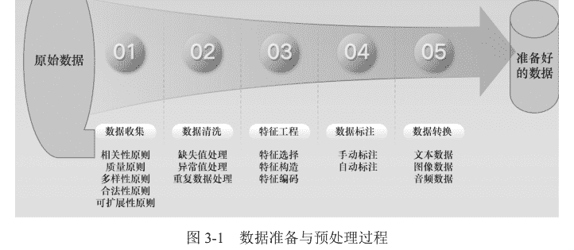

#### 3.1.1 数据采集
数据采集是指围绕业务场景与需求获取相关数据，为模型训练提供基础，数据质量与多样性直接影响模型性能与泛化能力。

采集阶段主要包括确定来源与接入方式。数据可来自内部业务系统、公开语料或第三方供应商，通过 DeepSeek 自带的接入组件完成导入。相关组件兼容多种格式与来源，便于企业快速整合资源。

采集通常遵循以下 5 条准则。

- （1）相关性准则
所采数据须与业务场景和需求高度匹配，确保对训练与应用有实际价值。例如信贷风险评估，需要收入、信用记录、负债情况等数据，才能支撑更准确的风险判断。
- （2）质量准则
数据质量决定模型表现，需保证准确与完整，采集后应做严格质检，剔除错误、不一致或重复记录，提升可靠性与可用性。
- （3）多样性准则
数据应覆盖不同场景、用户群体和数据类型，增强模型泛化与适应能力。例如医疗场景需涵盖多种病种与不同年龄段患者数据。
- （4）合法性准则
采集工作须符合法律法规与道德规范，来源合法合规，使用用户数据需获得明确授权并做好隐私保护。
- （5）可扩展性准则
采集方式与存储结构需具备扩展性，能随数据量增长和业务变化而演进，例如采用分布式存储与计算提升效率与扩展能力。

DeepSeek 配套的数据接入工具箱帮助企业整合数据。

- （1）命令行组件
官方自带的命令行处理工具支持多种格式与数据源，用户可通过 deepseek data import 等指令直接导入并处理数据。
- （2）API 网关
统一管理的网关 One-API 可统一管理 DeepSeek 及十余款主流模型接口，便于数据接入与管理。
- （3）本地化调试客户端
本地化调试客户端 Chatbox 支持敏感数据隔离，便于企业在本地环境调试与处理。
- （4）检索增强生成框架
基于深度文档理解的开源 RAG 引擎 RAGFlow，支持 PDF、Word、Excel 等 12 种格式，企业级文档理解准确率提升 40% 以上，满足合规要求。

接入工具兼容结构化与非结构化数据。结构化数据如 CSV、JSON、SQL，可通过命令行或 API 网关导入；非结构化文本、图片、视频文件可通过上传方式导入。

导入方式包括：从本地文件系统导入，将文件放到指定目录后通过命令行或 API 网关导入；从多维数据库导入，支持 MySQL、MongoDB、Redshift 等，通过直连配置后一键导入；通过 API 接入，由 One-API 网关统一管理；从云端同步，如自动抓取 Google Drive 指定文件夹数据。

#### 3.1.2 数据清洗
数据清洗旨在处理缺失值、异常值、重复数据等异常，提升数据质量，保证准确与一致，避免因数据问题导致训练失败或性能下降。

清洗涵盖缺失值处理、异常值处理、重复数据处理等，方法与常规数据清洗相近，此处不再赘述。

#### 3.1.3 特征工程
特征工程借助专业背景知识与技巧对数据进行处理，使特征在机器学习算法中更好发挥作用，从而提升模型性能。流程分为特征选择、特征构造与特征编码。

##### 1. 特征选择
特征选择是依据业务需求与数据特点挑选与目标变量相关的特征。首先要理解业务需求，明确解决的问题与预测目标，如金融违约风险预测需关注信用历史、收入水平、负债情况等；其次要分析数据特点，进行探索性分析，了解特征间相关性、分布及与目标关系，可用统计方法与可视化手段辅助；最后确定选择方法。

常见方法有 Filter 过滤法、Wrapper 包装法、Embedded 嵌入法。Filter 按发散性或相关性对特征打分，设定阈值后筛选，例如方差阈值法剔除低方差特征，或用相关系数筛选与目标相关性高的特征。Wrapper 根据目标函数每次增减特征子集，例如递归特征消除 RFE。Embedded 在训练模型时得到特征权重，按权重排序选择，例如决策树、随机森林。

在训练集上应用选定方法计算得分或排序后，用验证集或交叉验证评估模型性能，观察准确率、召回率、F1 等指标是否改善，根据结果迭代调整方法与参数，直至得到最优特征集。

##### 2. 特征构造
在特征选择后，可通过组合、转换等手段构造新特征，提升表达能力。

###### （1）特征组合
将两个或多个特征合并成新特征以捕捉交互信息。例如金融领域将收入与负债组合成债务收入比，更好评估还款能力。适用于特征存在明显交互且对目标有重要影响的情况，如电商将购买频率与金额组合成购买强度。

###### （2）特征转换
对原始特征做数学变换改变分布或突出信息。例如对数变换可将偏态数据转为近似正态，便于建模。适用于分布不符合模型假设或需突出特定信息的情况，如房价对数变换减小偏态。

###### （3）特征交互
创建特征交互项使模型学习相互作用。例如推荐系统创建用户特征与物品特征交互项捕捉偏好。适用于交互作用对目标影响显著的场景，如医疗中年龄与疾病交互评估易感性。

###### （4）特征衍生
从原始特征衍生新特征增加维度和信息量。例如时间序列可衍生滞后特征、移动平均特征。适用于需提升表达力的场景，如股票价格衍生滞后与均线特征捕捉趋势。

##### 3. 特征编码
特征编码把分类特征转为数值特征，以便数值模型处理。

编码方式主要分独热编码与标签编码。独热编码把每个类别转为独立二进制向量，仅一个位置为 1，例如猫、狗、斑马转为 [1,0,0]、[0,1,0]、[0,0,1]。标签编码把类别映射为唯一整数，如猫、狗、斑马映射为 0、1、2。

标签编码隐含顺序关系，可能引入错误关联；独热编码无数值假设，各类别独立。标签编码适用于有序类别如学历；独热编码适用于无顺序类别如性别。标签编码特征空间小，独热编码会随类别增多导致维度膨胀。

#### 3.1.4 数据标注
数据标注为监督学习提供标签，帮助模型学习数据与标签映射，是开展监督学习的基础。标注分为手动与自动。

##### 1. 手动标注
由专业人员按业务规则与标准进行标注，通过系统化流程保证准确性与一致性。流程一般分 5 个阶段。

（1）明确标注任务和目标
确定数据类型如文本、图像、音频等，明确目标如分类、检测、分割，并制定标注标准。例如医疗标注医学影像或病历文本，金融标注风险等级或异常交易模式。

（2）制定标注指南
编写标注手册说明流程、方法与注意事项；提供标注示例帮助理解；对标注人员进行培训确保理解任务与标准。

（3）数据预处理
去除噪声、错误与不一致数据后进行数据划分，通常划分为训练集、验证集、测试集，如 70%、15%、15%。准备标注工具，如图像标注可用 LabelImg。

（4）标注过程
根据任务复杂度与人员技能分配任务，按指南开展标注。核心是建立质量控制机制，如定期抽检、交叉验证确保质量。

（5）标注结果审核与评估
由负责人或领域专家审核结果准确性与一致性；用准确率、召回率、F1 等指标评估质量；将反馈回传给标注人员以改进工作。

##### 2. 自动标注
利用自动化工具或算法标注数据，降低人工工作量，提升效率与准确性。常见工具与算法如下。

###### （1）自动标注工具
- ① Labelbox 是功能强大的标注平台，支持图像、文本、视频等，利用预训练模型初步标注后人工复核，适合高精度项目，效率高且准确性好。
- ② Supervisely 是开源标注平台，支持图像与视频，提供丰富工具与数据管理功能，适合中小型项目，自动标注可减少人工工作量，支持版本控制。
- ③ Amazon Mechanical Turk 是亚马逊众包平台，发布标注任务由全球工人完成，适合大规模低成本需求，但质量参差需质量控制。
- ④ T-Rex Label 由 IDEA 团队基于 T-Rex2 构建，支持一键标注与零样本检测，适用于农业、工业、生物医药等，无需训练即可使用，支持 GitHub 登录。
- ⑤ EISeg 由飞桨 PaddleSeg 团队开源，交互式分割工具，利用预训练模型初步标注后人工修正，适合高精度分割场景。
- ⑥ X-AnyLabeling 集成多种深度学习算法，支持图像视频标注，提供自动标注与交互修正，提升精度。

###### （2）自动标注算法
- ① 基于规则的算法利用预设规则识别标注，如正则表达式处理文本，适合结构化统一数据，生成快但难处理复杂模糊内容。
- ② 基于统计的算法利用已标注数据训练统计模型，如隐马尔可夫模型 HMM、条件随机场 CRF，适用于序列标注如命名实体识别，需大量标注数据但准确性较高。
- ③ 深度学习方法近年进展显著，包括 CNN、RNN、LSTM 等，可自动提取高级特征实现更准确标注，适用于复杂任务，但需大量计算资源与训练时间。

#### 3.1.5 数据转换
数据转换把原始数据转为模型可接受格式，保证兼容性，避免格式不匹配导致训练失败或性能下降，涵盖文本、图像、音频等格式向数值向量或张量的转换。

##### 1. 文本数据

文本层面的格式归一化主要靠分词编码和序列补齐两类手段。先把原始句子拆成词或字符，再映射成模型能处理的编码形式，比如借助词嵌入把词转成固定维度的向量；随后用序列填充把不同长度的文本对齐到统一长度，例如调用 pad_sequence 让输入满足模型长度要求。

##### 2. 图像数据
图像侧的转换围绕预处理和增强展开。预处理是把图片缩放到目标尺寸、裁剪、旋转等操作，使其符合网络输入规范，例如用 ImageProcessor 完成缩放与归一化。增强则是引入随机旋转、水平翻转、亮度增减等扰动，提升样本多样性，例如用 random_rotate 对图像做随机旋转。

##### 3. 音频数据
音频侧需要先做频谱化、降噪、分段。频谱提取把波形转成频谱图拿到声学特征，例如用 extract_spectrogram 生成频谱。降噪与分段针对频谱图进行清洗，例如用 denoise 抑制噪声、用 segment 切分有效片段，整体提升数据可用性。

### 3.2 模型训练与评估
完成环境搭建和数据工程后即可进入训练评估阶段，该阶段通常拆成 5 个核心环节。模型训练与评估过程如图 3-2 所示。

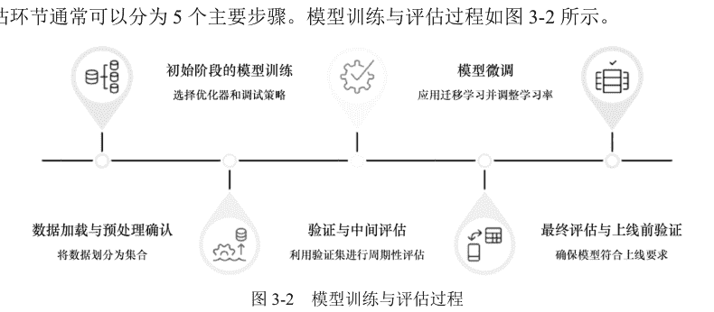

#### 3.2.1 数据加载与预处理确认
此环节的目的是保障训练、验证、测试三套数据的质量一致，为后续训练提供干净的标准输入。包含数据划分、增强标准化、数据管道搭建三部分。

##### 1. 数据划分
把样本划分为训练集、验证集、测试集是关键一步。训练集用于学习特征规律；验证集用于监测性能并调参，如学习率、网络结构，防止过拟合；测试集用于最终评测，样本从未见过，能真实反映泛化水平。

划分操作一般按以下流程进行。

（1）确定比例
常见比例为 70% : 15% : 15% 或 80% : 10% : 10%。以 1 万条为例，可划 7 千条训练、1 千 5 百条验证、1 千 5 百条测试。

（2）使用工具函数
可用现成的数据处理工具或编程函数实现，例如 Python 的 sklearn.model_selection.train_test_split。

（3）保证随机性与代表性
划分时设定随机种子确保随机性，同时使三套数据在分布上具有代表性，反映整体特征。

（4）校验结果
划分后检查各集大小及分布是否符合预期，确保比例和特征一致性正确。

##### 2. 数据增强与标准化
进一步预处理有助于提升泛化与收敛。

（1）数据增强
通过变换合成新样本扩大规模，缓解数据不足，提升鲁棒性。DeepSeek 提供多种增强方案，可按数据类型选择。图像可用随机旋转、翻转、缩放、裁剪、色彩变换；文本可用同义词替换、句子重组、风格转换等。操作上先选方法，再用 DeepSeek 自带增强工具或第三方库处理，最后把增强样本与原样本合并为新训练集。

（2）归一化与标准化
归一化把数值压缩到固定区间如 [0, 1] 消除量纲差异，通常用 MinMaxScaler。标准化把数据调整为均值 0、方差 1 的分布，通常用 StandardScaler。

（3）Tokenization 分词
标准化后需把文本转成数字序列。NLP 任务中文本需先 Tokenization。DeepSeek 采用字节对编码 BPE 分词器，把文本切成子词单元，提升处理效率与精度。具体先用 BPE 对文本分词，再把子词映射为数字 ID，最后输入模型。

##### 3. 数据管道构建
数据管道把加载、转换、清洗等步骤串成统一流程，实现从原始数据到模型输入的自动化。标准化流程保证各阶段数据质量一致，确保训练、验证、测试经过相同处理。合理的管道能提高数据质量、缩短训练时间、提升准确率。

构建时先明确管道结构，梳理步骤顺序与依赖，可用 Apache Beam、Luigi 等工作流工具定义任务关系。随后实现数据加载，从存储位置读取训练、验证、测试集，数据库用 SQL 或连接器，文件则用读取函数。最后把预处理后的数据送入模型训练，并校验完整性与准确性。在 DeepSeek 私有化部署中，这套流程可形成稳健高效的数据管道。

#### 3.2.2 初始阶段的模型训练
初始阶段以大规模训练为主，让模型捕捉通用特征并降低整体损失，为后续微调奠基。核心是选对优化器与调试策略，并借助分布式加速，同时实时跟踪损失等指标保持训练稳定。

##### 1. 优化器和调试策略选择与训练
（1）选择优化算法
Adam 属于自适应学习率方法，融合动量与 RMSProp 思想，按一阶二阶矩估计动态调整学习率，训练稳定高效，PyTorch 中可用 torch.optim.Adam。LAMB 专为大规模分布式和大批量设计，可在保持精度的前提下放大 batch，适合超大规模训练，可通过 torch-optimizer 库调用。

（2）学习率调度策略
初期常用预热策略，从很小的值逐步升至初始学习率，配合 get_cosine_schedule_with_warmup 实现预热加余弦退火，避免学习率过大导致震荡。后期可用余弦退火逐步降低学习率，让模型在接近收敛时精细调整，PyTorch 的 CosineAnnealingLR 可实现。

（3）组合使用
前期用 Adam 或 LAMB 配合预热，帮助模型快速适应并稳定收敛；中后期引入调度器如余弦退火或基于验证性能的调度器，进一步优化收敛与泛化。训练中还需注意隐私安全、资源合理分配，并配合 L1/L2 正则化与早停策略防止过拟合。

##### 2. 利用多 GPU 或分布式计算平台加速训练
为加速 DeepSeek 大规模训练并保持稳定，可采用：
- ① PyTorch 分布式数据并行 DDP，在多 GPU 上同步梯度和参数并行训练；
- ② Hugging Face Accelerate 库，提供简便 API 在多卡或多机环境部署训练。

#### 3.2.3 验证与中间评估
在初始训练阶段借助验证集做周期性评估，及时发现过拟合或欠拟合，并指导超参数调整。

- （1）周期性评估
每轮或每若干 batch 后用验证集测评，指标包括损失、准确率、F1 等。记录训练损失与验证损失曲线，若训练损失持续下降而验证损失上升，提示过拟合；若两者均高且下降缓慢，提示欠拟合。

- （2）防范过拟合
增加数据量或采用增强技术提升多样性；简化模型结构减少层数或神经元；加入 L1/L2 正则化限制参数复杂度；使用早停法在验证性能不再提升时停止；使用 Dropout 随机丢弃神经元降低依赖。

- （3）防范欠拟合
提升模型复杂度，增加层数或单元数；适当减小正则化强度；选用 LeakyReLU 等能学习复杂特征的激活函数；增加训练轮数。

- （4）超参数调整策略
初始学习率常尝试 1e-3、1e-4 等，损失下降慢则适当提高，波动大则降低；使用余弦退火或 CyclicLR 等调度器动态调整；批量大小根据显存与计算资源设定，小 batch 有助于泛化，大 batch 提升速度；权重衰减常用 1e-4、1e-5 防止参数过大。

- （5）实时监控
训练时用 TensorBoard 实时跟踪损失曲线、梯度分布等关键指标，配合 Weights & Biases 的可视化功能，便于快速定位问题。

#### 3.2.4 模型微调
微调是在预训练模型基础上用特定任务或领域数据继续训练，提升目标任务性能。常见方法有四种。

##### 1. 迁移学习
把源任务学到的知识迁移到相关目标任务，减少数据需求并加速收敛。预训练模型提供良好初始权重和通用特征。

实施步骤：挑选与目标任务相关的预训练模型，调整输出层尺寸与激活函数；冻结部分底层保留通用特征，只训练顶层或特定层；用小学习率在目标数据上训练；最后在验证集上评估并调参。

##### 2. 调整学习率
根据训练进展动态调整学习率，优化收敛速度、避免震荡并提升最终性能。

实施时先确定合理范围如 1e-5～1e-3，使用 StepLR、CosineAnnealingLR 等调度器，并监控验证集表现，当性能停滞时降低学习率。

##### 3. 局部更新
仅更新模型部分参数，其余冻结。优点是减少计算消耗、保护预训练通用知识、加快任务适配。

实施时按需求选择更新层如顶部层，冻结其余部分，用目标数据训练所选层，验证后调优超参数。

##### 4. 其他常用方法
###### （1）适配器微调
在中间层插入轻量适配器模块，仅训练适配器参数，模型主体冻结。适用于文本分类、机器翻译、问答等。优势是计算与内存开销小，避免灾难性遗忘，模块化便于复用。缺点是适配器结构设计增加复杂度，设计不当影响效果。

###### （2）模型蒸馏
通过知识迁移把大模型教师的输出指导小模型学生，在保持较高性能的同时降低复杂度。流程包括定义教师并训练、定义学生、蒸馏训练。损失函数结合监督损失与蒸馏损失，让学生同时学习标注信息与教师分布。在 NLP 与计算机视觉中应用广泛。

###### （3）强化学习微调 RLFT
引入奖励信号让模型在特定任务中动态调整行为，最大化累积奖励。预训练模型作为智能体与环境交互，依据输出质量获得奖励并更新参数。该方法可提升准确率与效率，增强对未见数据的泛化与鲁棒性，提高策略灵活性。

强化学习式微调需要搭建专门的实施环境并手工设计奖励信号，这让整体训练难度明显上升。实践中此类微调普遍消耗更多的算力和时长，尤其在数据量庞大、模型结构复杂的情形下更突出。奖励函数的构建是成败关键，要让奖励能够精准映射任务目标本身就具有相当挑战。

###### （4）稀疏微调
稀疏微调的核心是在训练阶段刻意引入参数稀疏，让模型的一部分权重被压缩为零，从而降低计算开销并加速推理。该方法通常以预训练模型为起点，仅对参数的子集进行调整，而非对全部权重进行改动。

操作流程大致包含四步。首先挑选合适的预训练模型作为基座。其次借助特定的稀疏优化手段，例如结合梯度下降的剪枝策略，逐步把不重要的参数置零。训练期间需要在稀疏程度与模型表现之间寻找平衡点。最后将完成稀疏化的模型投放到具体任务，如文本分类、问答系统等。

优势在于零值参数减少了计算量，推理时可直接跳过，速度更快；同时在压缩计算的同时仍能保持较好的性能与泛化。局限在于需要自行设计并实现稀疏优化算法，训练复杂度提升；还要规划合理的稀疏微调模式，以保证在不同任务上既有效又高效，从而增加了设计难度。

###### （5）多任务学习微调
多任务学习微调是在同一轮训练中并行处理多个相关任务，通过学习共享的表征来提升整体性能与泛化能力。它是对传统单任务微调的扩展，利用任务间的内在联系，在多个任务上同步获得收益。常规实现包含以下 5 个环节。

- ① 任务定义与数据准备，明确模型要覆盖的多个任务，并为每个任务准备对应的训练集。这些任务通常具备相关性，能够共享底层特征或知识。
- ② 进行模型架构设计，构建可同时处理多任务的网络结构。典型做法是底部共享网络负责提取通用特征，上层为各任务定制专属分支。
- ③ 设计损失函数，定义联合损失以综合衡量所有任务的表现。常见做法是对各任务的损失进行加权求和，权重可依据任务重要性或难度动态调整。
- ④ 制定训练策略，在训练中同时喂入多任务数据并优化联合损失。可通过动态调权、使用对比学习等手段平衡不同任务的学习进度与效果。
- ⑤ 进行模型评估与优化，周期性检查各任务的表现，据此调整参数与策略，追求综合最优。

多任务学习微调能够让模型在多任务上协同变好，有助于泛化到未见数据，提升鲁棒性与适应性，同时避免为每个任务单独微调带来的重复算力开销，降低维护部署成本。

主要挑战在于不同目标可能相互冲突，需要在损失与策略上做精细平衡；各任务数据规模不一时，容易出现学习不均；整体架构与训练流程更为复杂，对算力和时长的需求也更高。

###### （6）增量微调
增量微调是在已完成微调的模型基础上，利用新数据继续进行少量更新，原理类似持续学习。其特点是保留既有任务的知识，防止灾难性遗忘，常配合正则化或弹性权重固化等技术使用。该方法常用于提升特定领域的准确率与效率。

当预训练模型需要适应新数据或新任务时，增量微调能够快速完成更新，使模型更贴合实际应用。借助在原有数据上追加新样本，可增强泛化与鲁棒性；在跨领域场景中，有助于模型贴合目标领域的数据特性与任务需求。

与从头重训相比，增量微调只需在新数据上进行少量训练，节省算力与时间，提升灵活性与实用性。预训练模型已掌握的通用知识与特征表示得以保留，避免了知识丢失。

效果高度依赖新数据的质量与代表性。若数据存在噪声、偏差或不完整，性能可能受损。若超参设置不当或数据量有限，也易出现过拟合，泛化能力下降。因此需要针对具体任务与数据集进行精细调参，调参与难度随之上升。

###### （7）早停法
早停法的思路是通过持续监测验证集上的表现，一旦指标不再提升就提前终止训练，从而避免模型在训练集上过度拟合并损伤泛化能力。其优点是有效遏制过拟合，提升泛化；缺点是需要频繁评估验证集。适用范围覆盖所有需要防止过拟合的训练场景。

###### （8）分层学习率
分层学习率是对不同网络层赋予不同的学习率，使各层以差异化速度更新，从而更精细地控制训练过程并改善性能与泛化。微调预训练模型时，较小的学习率能防止对已有权重的过度改动，降低过拟合风险。

缺点是需要为多层分别设置并调整学习率参数，调参复杂度上升；训练时对各层参数独立更新与优化，也可能带来额外的计算开销。

###### （9）量化微调
量化微调是在模型量化过程中通过微调来保留性能，优化低精度模型，核心目标是在精度与资源消耗之间取得平衡，让模型在保持较高效果的同时运行更高效。该技术特别适合对大规模预训练模型进行轻量化，利于资源受限环境下的部署。

以上是几种常见的模型微调思路，每种都有各自的原理、利弊与适用条件，可依据实际需求与资源状况挑选合适的方案来优化模型。

#### 3.2.5 最终评估与上线前验证
DeepSeek 模型完成初始训练后，最终评估与上线前验证是确保成功部署与应用的关键环节。

##### 1. 最终评估与上线前验证的作用
最终评估与上线前验证至少发挥以下 5 方面作用。

###### （1）确保模型性能
借助独立测试集与真实场景模拟，可检验模型在未见数据与业务场景中的表现，确认其泛化能力。同时能检测不同条件下的稳定性与可靠性，避免上线后出现波动或故障。

###### （2）优化用户体验
综合指标可衡量响应速度与错误率。快速响应满足实时交互需求，低错误率提升用户信任与满意度。

###### （3）风险控制
压力测试与 AB 测试能够暴露潜在问题，如性能瓶颈、错误率升高等。及时优化可降低上线后风险，场景模拟确保实际部署的稳定运行，避免业务中断。

###### （4）符合业务需求
评估可确认准确率、召回率、F1 等指标满足业务要求，真实场景测试则保证模型在具体业务环境中表现达标。

###### （5）提升模型价值
系统化评估与验证确保模型在实际应用中发挥最大价值，为业务带来实质收益。稳定可靠的表现亦能增强用户与业务部门的信任，为后续推广奠定基础。

##### 2. 最终评估与上线前验证的实施方法
实施方法如下。

###### （1）独立测试集评估
使用与训练集、验证集完全隔离的独立测试集进行全面评估，以真实反映泛化能力。测试集不参与训练与调优，仅用于衡量未知数据上的表现。可沿用准确率、精确率、F1 等既有指标。

###### （2）综合指标评估
结合响应速度、鲁棒性、错误率等多维度指标进行全方位考察，确保各方面均表现良好。

- ① 响应速度。通过记录模型处理请求的耗时，对实时性进行评估，可借助 timeit 或 profiler 等工具测量。
- ② 鲁棒性。向模型输入异常或含噪声的数据，观察输出稳定性。例如输入带噪声的图像或文本，检验处理能力。
- ③ 错误率。统计测试集上的错误情况，分析不同场景下的弱点并改进。

###### （3）压力测试
在预生产环境模拟高并发与大数据量处理，评估稳定性与性能瓶颈。

- ① 模拟高并发请求，使用 Locust 或 JMeter 等工具模拟大量用户同时访问，观察响应时间与错误率。
- ② 模拟大数据量处理，用大规模数据集测试处理速度与资源占用。

###### （4）A/B 测试
在预生产环境对不同版本模型进行对比，选择最优版本。随机将用户分到不同组，使用不同模型版本，收集反馈与数据，通过性能比较选出最优方案。

通过上述手段，可在训练结束后全面验证泛化、稳定与实际效果，确保模型达到上线标准。

### 3.3 模型部署与应用
模型部署是将训练好的模型推向生产环境或业务场景，使其为用户服务或支撑业务流程。完成环境准备、模型加载与调优后，需将其集成到业务系统，保证可访问与可用，并进行性能优化、监控与容错设置。

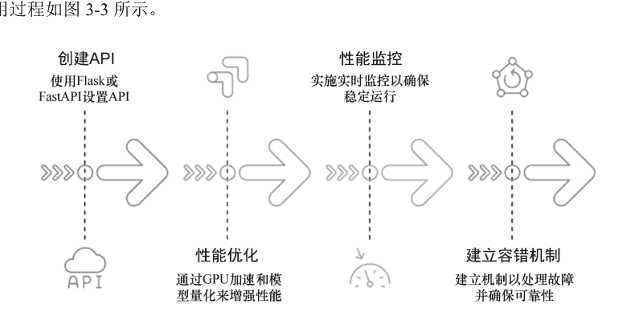

#### 3.3.1 创建 API
训练与验证完成后，使用 Flask 或 FastAPI 为 LLM 搭建 API 是部署的关键步骤。

Flask 是一个轻量灵活的 Python Web 框架，适合构建各类 Web 应用与 API 服务，可将 DeepSeek 模型高效封装为 Web 服务，实现快速推理与便捷调用，满足生产需求。

FastAPI 是一款现代高性能 Web 框架，基于 Python 3.7+ 类型提示，目标是高性能、快速开发、简洁代码与强类型检查。

#### 3.3.2 性能优化
性能优化通常包括 GPU 加速、借助 TensorFlow Lite 或 TensorRT 进行模型量化，以降低存储与计算需求。

##### 1. 使用 GPU 加速
GPU 拥有大量核心，可并行处理深度学习中的矩阵与卷积运算，高内存带宽缩短数据传输等待，从而显著提升训练与推理速度与吞吐量，在大规模数据与高并发场景下作用明显。

使用前需确保安装 GPU 版本的 TensorFlow 或 PyTorch，并配置好 CUDA 与 cuDNN。

模型性能优化涵盖训练优化与推理优化，也可采用高级策略。

###### 1）模型训练优化
####### （1）使用混合精度训练
混合精度训练结合 FP32 与 FP16，在保持精度的同时减少显存占用并加速计算。FP16 占用更少、更快，FP32 保留关键精度信息。

在 TensorFlow 中可通过 tf.keras.mixed_precision 模块启用，并结合 NVIDIA Tensor Core 进一步加速。

####### （2）优化数据加载与预处理
使用 tf.data API 构建高效数据管道，实现异步加载与预处理。通过 map、batch、shuffle 等操作并行处理数据，缩短加载时间。

可将预处理搬到 GPU，利用其并行能力加速，例如用 tf.image 进行解码、缩放、归一化等操作。

###### 2）模型推理优化
TensorRT 引擎可加速推理，Python 中可用 TensorRT 库转换与推理。

####### （2）开启 FP16 半精度推理
FP16 相比 FP32 位宽减半，内存与带宽需求下降，数据传输与计算速度提升。推理阶段开启 FP16 可在精度基本不变下显著提升性能。

在 TensorRT 优化时，可将 builder_config 的 precision 设为 trt.DataType.HALF 开启 FP16；自定义 CUDA 推理代码时也可指定 FP16 计算。

###### 3）高级优化策略
还可采用多 GPU 并行与内存管理优化。

####### （1）多个 GPU 并行计算
多 GPU 系统中采用数据并行，将数据分批到各 GPU 处理，迭代后同步参数，可大幅提升训练效率。

对超大模型，单个 GPU 无法容纳时，可用模型并行或流水线并行。模型并行把不同层分配到不同 GPU，流水线并行把模型分阶段并行执行，需按结构与资源定制设计。

####### （2）内存管理优化
训练与推理期间合理管理显存，减少碎片与分配开销。可预先分配足够显存，避免频繁申请释放；借助 cuDNN 等库复用显存，降低额外需求。

显存受限时，可用梯度累积减少单次迭代显存占用，在不降低批次大小的前提下降低显存压力。

##### 2. 使用 TensorFlow Lite 或 TensorRT 模型量化
TensorFlow Lite 与 TensorRT 均可利用硬件加速，如 GPU 与边缘加速器，提升性能。TensorFlow Lite 覆盖移动与嵌入式设备，TensorRT 与 NVIDIA GPU 生态深度结合，在支持硬件上表现最佳。

###### 1）使用 TensorFlow Lite 模型量化
量化可提升推理速度、减小模型体积、优化内存带宽，并保持兼容与灵活性。

TensorFlow Lite 量化将权重与激活值从浮点转为整数，降低计算复杂度。例如动态范围量化可使速度提升 2~3 倍，模型大小可压缩至约四分之一。整数量化减少数据传输量，降低带宽需求。支持动态范围量化、全整数量化与 Float16 量化，可按需求与硬件选择。

量化可在不显著损失精度的前提下提升推理速度与部署效率，流程包括选择量化方式、转换格式与对输入数据做相应预处理。

###### 2）使用 TensorRT 进行模型量化
TensorRT 支持高性能推理与 INT8 量化，并提供优化工具链。TensorRT 是 NVIDIA 面向推理的优化库，充分利用 GPU 加速。INT8 量化把权重与激活值由 32 位浮点转为 8 位整数，减少计算与内存占用，同时保持精度。工具如 trtexec 可便捷转换模型为 TensorRT 引擎并量化，简化部署流程。

在不明显降低精度的前提下提升推理速度与部署效率。流程包括加载模型、配置量化参数、构建引擎与预处理输入。实际应用中需按需求与硬件选择方案并充分测试调优。

#### 3.3.3 性能监控
部署 DeepSeek 后，性能监控可实时掌握运行状态，确保生产环境稳定。

通过监控响应时间、吞吐量、错误率等指标，可及时发现潜在问题，避免服务中断或性能下降。监控亦能保障响应速度，提升用户满意度与体验，快速定位性能瓶颈。实时监控可发现数据分布变化、性能衰减、异常预测等问题，预警后可迅速优化调整。监控内存、CPU、GPU 使用率等资源消耗，有助于优化资源分配，提高利用率。

实施性能监控可采用以下方式。

##### 1. 日志记录

日志，是洞察模型运行体征的核心载体，也是实现有效观测与持续优化的前提。日志完整记录了模型在服务中的行为状态，从推理耗时、吞吐量等关键表现入手，能快速捕捉性能拐点。一旦出现异常或表现下滑，日志提供的细节能帮助团队迅速定位根因。日志沉淀的数据同样为优化提供依据，可据此判断模型在哪些环节需要改进，例如参数调整、算法迭代或硬件升级。长期积累的日志还能支撑起闭环改进，随着定期复盘不断发现问题、挖掘提升空间，推动模型持续进化。

落地日志监控，推荐按下面流程推进。

- ① 在应用层搭建全量日志采集能力，覆盖模型运行的核心指标与状态。Python 自带的 logging 模块或专业日志库均可选用。
- ② 运行期间持续记录推理时长、资源占用、输入输出规模与特征等关键性能。
- ③ 借助 ELK Stack、Grafana 等专业分析平台，对日志进行可视化呈现与趋势分析。
- ④ 依据业务要求设定阈值，指标一旦越界即触发告警。例如推理时间超过设定上限时自动发送邮件或即时通知。
- ⑤ 定期梳理日志产出性能报告，评估运行状态与演进趋势，据此制定优化方案与排期。

##### 2. 监控工具全览
目前可用的模型性能观测方案不少，各有侧重。

- （1）Neptune：元数据结构高度灵活，支持自定义组织训练与生产期的全量信息，可搭建仪表盘呈现性能与硬件指标，覆盖训练、评估、测试等阶段，适合需要集中记录大量机器学习元数据的场景。
- （2）Arize AI：专注性能衰减与预测漂移的实时捕捉，支持 A/B 测试，集成便捷、文档社区完善，兼顾预发布校验与自动化监控，适合追求快速发现问题的团队。
- （3）WhyLabs：实现模型性能的自动化巡检，可识别数据质量下降、漂移与偏差，并与外部系统联动，适合对数据质量敏感、需要自动告警的场景。
- （4）Prometheus 和 Grafana：经典的时序指标采集与可视化组合。Prometheus 负责采集存储时序数据，Grafana 负责图形化展示，仪表盘丰富，满足实时监控需求。
- （5）Evidently：提供数据漂移、数值型与分类型目标漂移等报告，辅助深度剖析模型表现与错误模式，适合需要细粒度漂移分析的场景。
- （6）Qualdo：从生产侧的模型 I/O、日志及应用数据中提炼洞察，支持部署后的漂移与异常自动监控，适合希望获得基础监控能力的团队。
- （7）Fiddler：集性能监控、数据完整性校验、异常值追踪、服务指标与告警于一体，界面友好，适合追求清晰可操作监控的场景。
- （8）Amazon SageMaker Model Monitor：自动识别预测中的偏差与异常，保持模型质量与准确性，可检测数据漂移与概念漂移并及时提醒，维护模型可靠性。
- （9）Seldon Core：基于 Kubernetes 的开源模型 serving 平台，提供高级指标、异常检测、金丝雀发布等能力，适用于大规模生产部署。
- （10）Censius：覆盖全链路机器学习管道的观测方案，支持可配置监控器、实时通知、自订仪表盘与 A/B 测试框架，适合需要端到端监控的场景。

合理选用工具，可帮助团队更快定位性能下滑、漂移与概念变化，提升模型可信度。

##### 3. 实时监控与快速反馈
为让 DeepSeek 在上线后能即时响应风险，可依托实时观测与异常检测能力。

###### （1）实时监控
利用 DeepSeek 的仪表盘搭建性能看板，将准确率、召回率、推理耗时等关键指标接入，实现运行状态的实时呈现，及时捕捉波动。

可采用 Kolmogorov-Smirnov 检验等统计方法，对比训练分布与线上输入分布的差异。若 p 值低于阈值，例如 0.05，则认为分布显著变化，需考虑重训。

###### （2）异常检测功能
设定重构误差或聚类距离阈值，超出即判定为异常。结合 DeepSeek 的生成能力，评估端口行为偏离基线的概率，一旦触发即发出告警。同时持续跟踪预测结果，若出现异常波动或趋势性变化，很可能意味着性能退化或数据分布迁移，需设置预警规则提前介入。

> ① 金丝雀部署是一种渐进发布策略，先将新版本投放到有限的节点或用户群体中试运行，类似煤矿里的金丝雀用于提前探测风险，降低全量发布的风险。

##### 4. 性能剖析与提速
在实时反馈的基础上，需定期深挖性能，定位瓶颈并推动优化。

###### （1）性能瓶颈识别
定期追踪准确率、召回率、推理时长等指标的变化曲线，找出生效的衰减或波动原因。监控 CPU、内存、GPU 等资源占用，识别资源受限问题。如 GPU 显存长期逼近 100%，多半是模型过大或批大小不合理。同步检查数据预处理与加载环节，确保数据质量与格式，避免由数据侧引发瓶颈。

###### （2）优化实践
基于瓶颈分析，对模型进行剪枝与量化，削减冗余计算、压缩体积、提升推理速度。借助 GPU、TPU 等加速硬件，并使用 TensorFlow Lite、TensorRT 等工具做进一步加速。对重复请求的结果进行缓存，减少重复计算。引入分布式与并行策略分摊负载。适时调整批大小、学习率等超参，平衡吞吐与时延。

###### （3）借助分析器诊断与优化
先用性能测试场景生成器构建稳定负载、峰值负载、渐进负载等多种压测场景，贴近真实业务。运行期间由性能数据采集器记录响应时间、吞吐量、错误率及 CPU、内存、网络等资源指标。随后借助 DeepSeek 性能分析器智能解读数据，完成瓶颈定位、趋势研判与异常识别。最后由优化建议生成器输出针对性方案，如缓存优化、弹性扩缩、参数调优等，闭环解决性能问题。

###### （4）性能测试最佳实践
以真实用户行为为基准设计负载，逐步加压并覆盖峰值场景，全面评估不同强度下的表现。统一指标采集口径与采样频率，数据持久化保存以便长期跟踪。对多维数据进行交叉分析，建立长期趋势监控机制，持续改进模型与系统配置。

##### 5. 持续改进闭环
上线后可通过机器学习与 NLP 技术不断迭代算法与参数，例如定期用新数据微调模型以适应分布变化。持续改进要点包括：

- ① 持续数据预处理，保证质量与一致性，进行清洗、缺失值处理等。
- ② 持续特征工程，按业务需求挑选、构造与归一化特征。
- ③ 持续超参数调优，采用网格搜索、随机搜索等方法寻优。
- ④ 持续训练，使用训练集训练并以验证集评估调参。
- ⑤ 持续评估，用测试集做最终验证，确保泛化能力。
- ⑥ 持续监控，将优化后的模型投入业务并实时分析表现。
- ⑦ 持续反馈与迭代，收集线上表现数据，反哺模型升级。

###### （1）超参数优化
超参数对模型效果高度敏感，优化目标是找到在特定任务上表现最佳的组合。常用方法有网格搜索、随机搜索、贝叶斯优化等。网格搜索穷举所有组合，适合空间小；随机搜索随机采样规避维度灾难；贝叶斯优化通过高斯过程等概率模型预测性能并选择最有潜力的参数，效率更高。

“超参数高优①”指的是在优化过程中不仅追求最优组合，还要确保该组合下模型具备高性能与良好泛化。实现路径包括网格搜索、随机搜索、贝叶斯优化、遗传算法与基于梯度的优化。遗传算法模拟自然选择与变异，适用于复杂非线性问题；基于梯度的方法适用于连续超参数的精细调整。

###### （2）模型集成
将多个模型按策略组合，可提升整体准确率与泛化力。分类任务中可通过投票决定最终类别，降低单点错误。集成能更好地拟合未见数据，抑制过拟合，同时对异常与噪声更鲁棒。常见范式有 Bagging、Boosting 与 Stacking。Bagging 如随机森林，通过并行模型投票提升稳定性；Boosting 串行训练以修正前序错误；Stacking 用元模型融合基模型输出，取得更高层次的预测。

> ① 超参数高优指以提升性能指标为导向的超参数调整方向，即寻找使模型在指定指标上达到最优或更高水平的超参数取值。

#### 3.3.4 建立容错机制
企业化应用中，容错机制贯穿部署到运行全流程，确保服务稳定、鲁棒与可追溯。本文聚焦异常处理与恢复。

异常处理与恢复旨在硬件故障、网络中断、数据异常等情形下迅速处置并恢复，保证服务连续性、数据完整性与整体质量。

##### 1. 建立实时监控与预警机制
实时监控是稳定运行的基础。一方面用 Prometheus、Grafana 等工具追踪预测准确率、响应时间等核心指标，及时发现衰减或异常波动；另一方面用统计或机器学习方法监测输入分布，均值、方差、直方图等变化可提示数据漂移或缺失加剧；持续监控运行状态可提前发现潜在故障与瓶颈。常用工具还包括 ELK Stack 与 TensorBoard。

预警可通过设定阈值、配置邮件短信即时通讯等多通道通知实现。对常见异常可配置自动重启、自动切换至备节点等自动化处置流程。

##### 2. 建立故障转移与恢复机制
需从硬件、软件、模型与运维等多层面准备。

（1）硬件层面的准备
配置备用节点，主节点失效时自动切换；使用 Nginx、HAProxy 等负载均衡器分发请求，避免单点；适度冗余电源、网卡等硬件，确保故障时仍可运行。

（2）软件层面的准备
定期备份数据并加密存储在安全位置，保障快速恢复；对临时性错误请求实现自动重试或排队；采用 Kafka、RabbitMQ 等高可用中间件保障消息可靠。

（3）模型层面的准备
开展增量学习，用新数据在不全量重训的情况下更新模型；多实例部署，故障实例可被其他实例接管；定期保存模型检查点，便于快速回滚。

（4）运维流程的准备
以 Prometheus、Grafana 进行实时指标追踪，配合故障检测、诊断、修复、验证的标准流程；建立人工介入机制，对自动化无法解决的问题及时通知运维；建设知识库沉淀常见异常与处置方案。

（5）自检与自我修复功能
模型可自主检测状态并自愈，提升生产稳定性。

① 自我纠错强化学习
Self-Correction via Reinforcement Learning 在初始化阶段优化纠错能力并保持与基模型的接近性，随后通过多轮强化学习最大化初始与纠正后回答的奖励，实现无外部反馈的自我修正。

② 基于自动反馈的纠错策略
训练时纠正包括从人工反馈学习与利用自动化指标反馈；事后纠正包括自我纠正、借助外部模型或工具进行反馈校验，以及多智能体辩论共同达成答案。

③ 推理时的自我验证
通过解码内部状态缓解幻觉，检查输出一致性，确保预测稳定可靠，并结合外部数据源验证，提升推理可信度。

④ 异常处理流程与人工干预
明确异常检测、诊断、修复、验证的流程，减少人工介入。脚本与 API 可实现自动化数据处理。必要时触发人工介入，同时维护知识库加快响应。

## 第 4 章 提示语设计与优化
本章深入探讨提示词的设计思路与优化方法。

无论是个人日常使用 DeepSeek，还是帮助企业落地应用，提示词的设计与打磨都是决定成败的关键。提示词本质上是人与大模型沟通的桥梁，它负责把任务需求讲清楚、把背景信息补全、把输出格式框定、把模型行为牵住。写得好，模型回应更准、更相关，用户沟通效率也直线上升。放到企业里，提示词的复杂度与目标感会比个人使用高出一个量级。

### 4.1 企业场景里 Prompt 设计的特殊价值
在企业环境下，提示词的设计与优化呈现出与个人用户截然不同的特性与作用。

1. 企业 Prompt 设计的典型特征
   (1) 目标导向更强
   企业里的提示词通常直指业务痛点或流程优化，目标清晰可衡量。个人使用则更偏向满足多样化的随性需求，目标相对宽松。
   (2) 复杂度更高
   业务流程、数据关联和约束条件在企业里多而杂，提示词需要兼顾多个维度。个人场景往往只围绕单一问题展开。
   (3) 强依赖数据支撑
   企业输出对数据准确性和完整性敏感，提示词必须强调数据驱动的决策逻辑。个人使用更依赖模型的通用知识和少量自有数据。
   (4) 倾向多模型融合
   企业更喜欢把多种方法、工具串联起来给出系统化方案。个人使用多以单一模型满足特定需求为主。
   (5) 需要持续动态调整
   业务在变，策略也要随之迭代，提示词要具备弹性调整能力。个人任务大多一次性完成，对动态修正要求较低。

2. 对 DeepSeek 的实际作用
   (1) 角色定位先行
   明确模型扮演的身份能让它更快理解业务背景和职责边界，从而给出更贴合工作现场的建议。比如让模型扮演企业培训经理，定制全国分公司的线上营销课程，输出会更有针对性。
   (2) 约束条件要写明
   企业场景常受资源、时间、工具限制，把这些限制写进提示词，模型才能给出可落地方案。设计员工培训计划时标明每日可用时长，方案的执行性会大幅提升。
   (3) 复杂问题拆分
   把大需求拆成若干小目标，模型就能逐层深入推导，避免遗漏关键环节。优化协作流程时，分步拆解能让模型逐阶段明确关键任务与改进点。
   (4) 用真实数据验证
   提供真实数据可避免模型空想式推测。企业决策依赖数据，通过提示要求基于实际数据分析，结论的可靠性和实用性会显著提高。
   (5) 多模型多维度整合
   融合不同理论或工具，能让输出更全面、更具弹性。面对复杂业务问题，单一方法往往不够，整合才能形成系统解法。
   (6) 支持动态修正迭代
   企业需求是流动的，提示词应引导模型根据新情况不断修正。例如培训方案追加海外分公司，提示可要求模型考虑时差与语言差异，生成分批执行计划。

3. 两个常用 Prompt 框架
落地时除了明确角色、任务与目标，还需要借助框架保证结构完整，并在执行中动态更新。

(1) RTGO 四层框架
RTGO 是一种提升与大模型交互效果的提示设计思路，强调准确性、相关性和效率，特别适合数据分析、技术文档等结构化场景。结构为角色 Role、任务 Task、目标 Goal、操作要求 Objective 四层递进。
Role 定义模型身份视角；Task 具体描述要执行的动作；Goal 说明任务的深层目的；Objective 锁定输出格式、风格与细节要求。
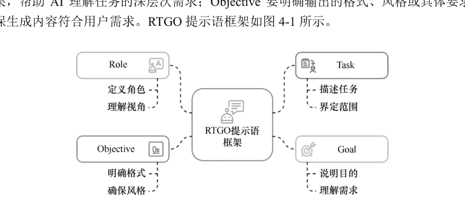
以下是基于 RTGO 的提示语。
```
Role: 资深 Python 开发工程师。
Task: 分析 2025 年 Q1 用户行为数据。
Goal: 生成包含 3 个关键趋势的可视化报告。
Objective: 使用 Markdown 表格呈现，附带 Matplotlib 代码示例。
```
RTGO 用四层递进把 Role、Task、Goal、Objective 讲透，特别适合需要清晰指令与规范输出的结构化任务，如数据报告、技术文档或代码生成。它在创意类任务中会显得束手束脚，不适合需要高度自由发挥的场景。

(2) CO-STAR 六维框架
CO-STAR 通过细化提示提升 LLM 产出质量，适用于营销、产品设计等创意型复杂任务。六个维度是上下文 Context、目标 Objective、风格 Style、语调 Tone、受众 Audience、回应类型 Response。
Context 提供背景让模型精准定位场景；Objective 明确交付物；Style 规定写作风格；Tone 设定情感基调；Audience 锁定读者；Response 规定输出形式。
以下是基于 CO-STAR 框架的提示语案例。
```
Context: 健康监测智能手表新品上市。
Objective: 两周内达成 1000 台预售。
Style: 科技博主“何同学”解说风格。
Tone: 专业而不失趣味。
Audience: 25~35岁运动爱好者。
Response: 3个15秒抖音脚本+详情页架构。
```
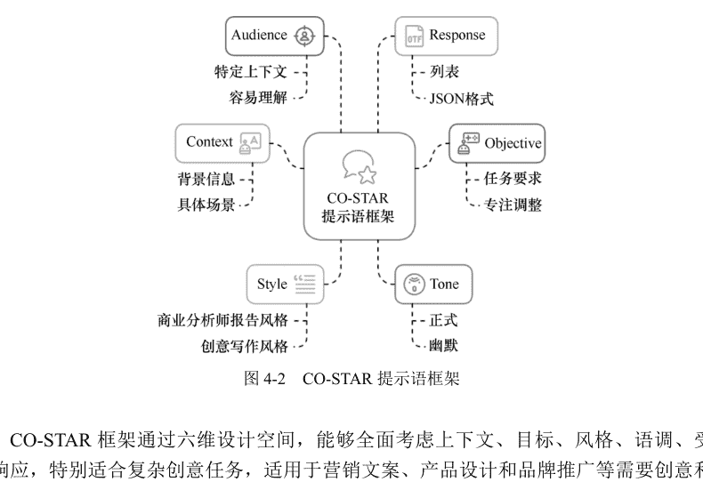
CO-STAR 以六维视角覆盖背景、目标、风格、语调、受众与格式，擅长营销文案、产品设计、品牌推广等需要创意与灵活性的任务。在高度结构化的任务中会显得繁琐，且需要花费更多时间定义各维度。

### 4.2 部署全流程中的 Prompt 作用
提示词在 DeepSeek 的部署与应用各环节扮演不同角色。数据准备时引导模型理解数据特征；模型训练时帮助模型捕捉规律；模型评估时用于生成测试用例检验性能与泛化能力；应用部署时嵌入交互界面指导用户；持续优化时结合反馈迭代提升效果。
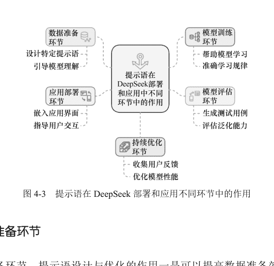

#### 4.2.1 数据准备环节
提示词在此环节能提升效率、质量与泛化能力。清晰指令可加快数据采集、清洗与预处理的节奏；好的提示可帮助识别异常值与缺失值，保障数据准确完整；优化后的提示让模型更好理解数据特征，在不同场景保持稳定表现。

数据采集阶段，提示词可确保收集到与任务相关且具代表性的样本；清洗阶段提升数据质量；特征工程阶段辅助筛选与提取关键特征；数据变换阶段指导归一化、标准化等处理。

该环节提示词的设计特点是目标明确、业务与数据类型复杂、对数据准确性要求高、需随业务与数据变化动态调整。

以下是一个基于 RTGO 框架的数据准备环节提示语设计案例。
```
Role: 数据工程师。
Task: 准备电商销售数据用于机器学习模型训练。
Goal: 生成清洗后的数据集，包含用户 ID、购买时间、商品类别、购买金额、用户地域。
Objective: 基于以下要求完成数据准备：
-数据来源：MySQL 数据库中的 sales 表。
-数据清洗要求：去除重复记录；处理缺失值（用均值填充购买金额，删除用户 ID 缺失的记录）；转换购买时间为 'YYYY-MM-DD' 格式；过滤购买金额小于 0 的异常记录。
-输出格式：CSV 文件，包含表头。
-附加要求：生成数据清洗报告，包括原始数据行数、清洗后数据行数、缺失值处理情况等。
```
案例先明确任务目标，即为机器学习准备电商销售数据，让模型理解最终用途；随后给出上下文，如数据来源 MySQL 的 sales 表及需保留的用户 ID、购买时间、商品类别、金额、地域等字段，防止信息丢失。清洗要求具体到去重、缺失值处理、日期格式转换、异常值过滤，步骤清晰可执行。输出要求指定 CSV 格式并带表头，并附加清洗报告以提升透明度。提示同时保留弹性，例如缺失值填充可建议均值但允许模型根据分布选用中位数，保持可扩展性。

#### 4.2.2 模型训练环节
提示词设计直接影响训练效果、泛化能力和收敛速度。合理的提示能让模型更准确理解任务目标、数据格式、评价指标和训练策略。

常见内容包括任务定义、输入格式说明、性能指标要求与训练策略。示例如“执行文本分类”“输入为 CSV，含文本与标签列”“优化准确率与 F1”“使用交叉验证并采用早停防止过拟合”。

该阶段更关注模型学习与优化本身，通常针对特定训练目标，对动态调整需求相对较低，依赖通用知识与训练数据。

1. 模型训练环节提示语设计与优化的方法
   （1）提示重写
   通过改写措辞、调整语序、补充背景等不同表达，寻找最能激发模型正确响应的版本，反复对比实验可显著提升质量。
   （2）提示调优
   将提示向量化后作为可训练参数进行微调，实现参数高效适配。相比全量微调更轻量，计算成本更低，效果更集中。
   （3）链式提示
   把复杂任务拆成逻辑链条，引导模型逐步推理。每步给出明确方向，能大幅降低复杂任务直接出错的概率，如数学题先分解再求解。
   （4）零样本提示和少样本提示
   零样本直接给出任务不带示例，依赖模型预训练知识，适合通用且简单的任务。少样本在提示中提供少量示例，利用上下文学习帮助模型把握模式，适合法律、医学等专业领域。零样本可扩展性强但易泛化；少样本更精准但需为每类任务准备示例。
   （5）提示语设计的进阶技巧
   精准定义任务降低模糊度，对复杂任务拆解，引入引导性提问，控制长度保持简洁，必要时补充背景信息并设定具体角色身份。

##### 2. 案例
以下是一个基于 RTGO 框架的模型训练环节提示语设计案例。
```
Role: 机器学习工程师。
Task: 训练一个电商销售预测模型。
Goal: 提高销售预测的准确率，达到 90%以上。
Objective:
- 数据集：使用清洗后的电商销售数据 CSV 文件。
- 模型类型：选择适合时间序列预测的模型（如 LSTM、Prophet）。
- 特征工程：提取时间特征（如月份、星期几）、商品类别特征、用户地域特征等。
- 训练要求：划分训练集和测试集（80%训练集，20%测试集）；使用交叉验证评估模型性能；调整超参数以优化模型性能。
- 性能指标：准确率、召回率、F1 分数、均方误差（Mean Square Error, MSE）。
- 输出要求：生成模型训练报告，包括训练过程、评估结果和最佳模型参数。
- 附加要求：保存训练好的模型，便于后续部署和使用。
```
该提示首先明确目标：提升销售预测准确率至 90%以上，让模型聚焦算法选择与优化；提供上下文，即清洗后的电商销售 CSV 及可选模型如 LSTM、Prophet；列出特征工程要求，如时间、商品类别、用户地域特征提取，以及训练集测试集划分、交叉验证、超参数调优等具体步骤；设定评价指标准确率、召回率、F1、MSE，形成明确评估标准；最后要求输出训练报告与最佳参数，并保存模型以便部署。结构清晰且可扩展，能稳定引导训练流程。

#### 4.2.3 模型评估环节
提示词在此环节更强调目标明确与结果验证。

##### 1. 提示语设计与优化的作用
(1) 提高评估的准确性
明确的指令能让模型更精准理解评估任务，提升结果可信度。
(2) 增强模型的可解释性
提示可引导模型解释推理过程与结果，提升透明度与信任度。
(3) 优化模型的性能

# 精准指令，把模型短板摊开看

调整提示方式能让大模型在不同任务上的能力落差变得更明显，为后续有针对性的改进提供抓手。

##### 2. 提示语设计与优化的方法

(1) 先厘清评测意图
写提示前先把本次要核查的核心问题与计算口径定下来，比如本轮重点看文本分类的命中情况。

(2) 明确评分细则与输出样式
提示里要写清评判依据和期望的返回格式，例如要求按精确率、召回率、F1 等维度打分并给出结论。

(3) 搭建可复用评测范式
形成一套通用评测模板，能让评测流程保持标准化、可对比，保证同质性。

(4) 反复试验持续打磨
多版本试跑，结合评测反馈不断优化提示，就能让评估更准确、更省时。

##### 3. 与其他环节的区别

(1) 目标清晰度方面
评测阶段的提示更强调把评测目的和量化指标钉死，用来准确度量表现；而数据准备阶段的提示侧重指引数据的采集、清洗与预处理，保证数据可用；训练阶段的提示则更关注如何引导学习过程，提升效果与泛化。

(2) 流程复杂度方面
评测环节的指标与流程相对明确，提示设计要考虑如何精准度量；数据准备环节涉及业务流程和数据类型更复杂，提示需兼顾多维度约束；训练环节聚焦效果提升，通常围绕特定训练任务展开。

(3) 数据依赖方面
评测依赖评测集的质量与代表性，提示需确保数据准确完整；在数据准备环节，数据质量直接决定输出，提示要强调数据驱动；训练环节更依赖模型先验知识与训练数据，提示要考虑如何有效利用。

(4) 动态调整方面
评测环节需按结果不断修正标准与流程，适应模型迭代与业务变化；在数据准备环节，需随业务与数据特征调整策略，提示要支持灵活变动；训练环节更偏一次性任务，动态调整要求相对较低。

##### 4. 案例
以下是基于 RTGO 框架的模型评估环节提示语设计案例。

```
Role: 机器学习工程师。
Task: 评估电商销售预测模型的性能。
Goal: 确定模型是否达到预期的性能指标（如准确率、召回率、F1 分数、MSE）。
Objective:
- 评估数据集：使用准备好的测试数据集。
- 评估指标：准确率、召回率、F1 分数、MSE。
- 评估方式：自动化评估。
- 输出要求：生成评估报告，包括模型性能指标、评估结果可视化（如 ROC 曲线、混淆矩阵）。
- 附加要求：与训练过程中的评估结果进行对比，分析模型的泛化能力和过拟合情况。
```

该提示先把任务说透：对电商销量预测模型做绩效评估，让模型明白最终目的。随后说明评测数据来自已准备好的测试集，并点出可用特征列；同时列出精确率、查全率、F1、均方误差等维度指引方向。之后细化评测维度和打分方式，要求按步骤执行。再设定绩效门槛，保证统一标准并可据此优化。最后要求输出评测报告，包含各项指标、ROC 曲线、混淆矩阵等可视化，并与训练期结果对比，分析泛化与过拟合，提升透明度与完整性。

#### 4.2.4 应用部署环节

与前面相比，部署环节的提示设计更强调实操指导和环境适配。

##### 1. 提示语设计与优化的作用

(1) 提升部署效率
清晰的提示能帮助工程师快速理解部署需求，缩短交付周期。

(2) 降低部署风险
提示能帮助识别和处理部署中潜在问题，保证部署准确完整。

(3) 增强可操作性
优化提示后，工程师更易理解模型结构与运行环境，在不同场景下操作更顺手。

##### 2. 提示语设计与优化的内容

(1) 部署环境说明
提示指导准备与任务相关的运行环境，保证适用与稳定。

(2) 模型加载指导
提示说明如何正确加载初始化模型，提升部署准确性。

(3) 服务配置
提示帮助配置任务相关服务参数，提升模型表现。

(4) 监控与维护
提示指导搭建监控维护机制，保证上线后稳定运行。

##### 3. 与其他环节的区别

应用部署环节的提示设计更侧重明确操作指引和环境匹配，目标是让模型顺利上线并稳定运行；涉及环境配置与操作流程较复杂，需兼顾多维度约束；依赖环境配置与模型文件完整性，提示需确保流程顺畅；需随环境与业务变化调整策略，提示要支持动态适配。

##### 4. 案例
以下是一个基于 RTGO 框架的模型应用部署环节提示语设计案例。

```
Role: AI 系统架构师。
Task: 部署电商销售预测模型到生产环境。
Goal: 确保模型在生产环境中稳定运行，响应时间小于 1 秒，准确率达到 90% 以上。
Objective:
- 部署环境：AWS 云服务器（EC2 实例）。
- 部署方式：使用 Docker 容器化部署。
- 监控与维护：
    - 设置监控指标：CPU 使用率、内存使用率、响应时间、预测准确率。
    - 配置自动扩展策略：当 CPU 使用率超过 80% 时，自动增加实例。
    - 定期更新模型：每周从模型训练平台获取最新模型版本。
- 用户交互：
    - 提供 API：支持 POST 请求，输入为 JSON 格式的销售数据，输出为预测结果。
    - 返回结果格式：JSON 格式，包含预测值、置信区间、模型版本等信息。
- 性能测试：在部署前进行压力测试，确保系统能够处理 100 次/秒的请求。
- 安全性：配置 HTTPS 协议，确保数据传输安全；设置访问控制，限制只有授权用户才能调用 API。
```

该提示把目标定为生产环境稳定运行，响应时间小于 1 秒、命中率 90% 以上，聚焦性能与稳定性。上下文提供 AWS 云服务器、Docker 容器化部署等环境信息，并给出监控指标、自动扩缩策略等方向。部署要求细化到设置监控指标、配置自动扩缩、定期更新模型等操作，保证可执行。性能门槛明确为响应时间和命中率，便于持续优化。输出规范要求提供支持 POST 请求的 API，输入 JSON 格式销售数据，输出预测结果，返回 JSON 含预测值、置信区间、模型版本等，提升可追溯性。提示还允许根据实测瓶颈调整扩缩策略或优化模型，结构清晰便于扩展。

#### 4.2.5 持续优化环节

持续优化环节的提示设计贯穿模型全生命周期。与其他环节相比，更注重模型在实际运行中的性能监控、反馈收集及基于反馈的更新优化。

##### 1. 提示语设计与优化的作用

在性能监控与反馈方面，提示能引导模型实时监控自身表现，并收集用户与系统的反馈，有助于及时发现实际应用中的不足，为后续改进提供依据。

在模型更新与迭代方面，通过优化提示，可指导模型依据反馈进行有针对性的更新，不断提升性能与适应性。

在适应业务变化方面，企业环境与数据特征会随时间演进，持续优化提示能帮助模型及时适应，保持不同阶段的业务适用性。

##### 2. 提示语设计与优化的方法

持续优化环节提示设计与优化的方法主要有以下 4 种。

(1) 实时性能监控提示
设计提示可实时获取性能指标，如响应时间、准确率等。例如，“请记录每次预测的响应时间，超过阈值时触发告警”。

(2) 用户反馈收集提示
引导用户对输出进行反馈，了解实际表现。例如，“请对预测结果打分 1～5 分，并给出改进建议”。

(3) 定期评估与迭代提示
设置定期评估提示，根据结果决定是否更新。例如，“每周五下午评估性能，若准确率下降超 5%，则启动更新流程”。

(4) A/B 测试提示
在优化中用 A/B 测试比较不同版本。例如，“将用户随机分两组，分别使用版本 A 与版本 B 预测，收集反馈对比分析”。

##### 3. 提示语设计与优化的内容

在性能指标监控方面，需明确监控指标及阈值，确保运行中性能符合预期。

在反馈收集机制方面，需建立有效渠道，并通过提示引导用户积极参与。

在模型更新策略方面，需依据监控与反馈制定合理策略，包括参数调整、结构优化等。

在测试与验证方面，更新后通过提示指导充分测试验证，确保新版本稳定优越。

##### 4. 与其他环节的区别

持续优化更注重模型长期性能提升与适应性，是动态持续的过程；需综合考虑不同业务场景表现及随时间出现的问题，复杂性与不确定性较高；依赖实际运行中的性能数据与用户反馈，数据具实时动态性。同时是一个动态调整过程，需按实时反馈与业务变化不断优化。

##### 5. 案例
以下是一个基于 RTGO 框架的模型持续优化环节提示语设计案例。

```
Role: AI 模型优化工程师。
Task: 持续优化电商销售预测模型。
Goal: 通过定期更新和调整，使模型在生产环境中的预测准确率长期保持在 92%以上。
Objective:
- 监控指标：设置实时监控，重点关注预测准确率、响应时间、资源利用率。
- 数据反馈：收集用户反馈和新数据，每周更新训练数据集。
- 超参数调整：每月进行超参数优化，使用网格搜索和随机搜索相结合的方法。
- 模型融合：探索模型融合策略，如集成学习，提高模型的稳定性。
- 性能评估：每两周进行一次全面性能评估，并对比上一版本的模型。
- 安全更新：确保更新过程不影响线上服务，采用蓝绿部署策略。
```

该提示把持续优化目标明确为保持预测命中率在 92% 以上，提供监控指标、数据反馈、超参数调整等上下文信息。要求细化到设置监控、收集用户反馈、调整超参数等具体动作，并制定预测命中率、响应时间等性能门槛。最后要求定期输出优化报告，包含性能评估结果和超参数调整情况，保证过程透明可追溯。

## 第 5 章 模型微调与个性化定制

在企业场景下，模型微调和个性化定制是关键步骤，能使模型更好适应特定业务需求，提升性能与实用性。

### 5.1 模型微调

模型微调是指依据特定领域数据优化模型，提升特定任务表现。它关注在特定数据集上的适应性与准确性。数据适应性是通过在领域数据上继续训练，使模型更好理解该领域特征与模式。性能优化是指通过微调帮助模型在特定任务上达到更高准确率与效率。

#### 5.1.1 数据适应性微调

数据适应性微调是在预训练模型基础上，针对特定任务或数据集进一步训练，调整参数，使模型更好适应新的数据分布与任务需求。

该方法可提升性能、提高泛化能力，同时节省算力。通过在特定任务数据上微调，模型能更好学习相关特征与模式，提升任务表现。也能帮助模型更好适应不同数据分布，保持在新数据上的表现。相比从零训练，微调通常在较小数据集上进行，能显著减少计算消耗。

该方法被广泛应用于自然语言处理、计算机视觉及推荐系统等场景。

完成数据准备、预训练模型选择、数据预处理和超参数配置后，进入微调环节，同时需对性能进行评估。

数据适应性微调包括全参数微调、冻结层微调、适应性微调和低秩近似微调 4 种实现方法。数据适应性微调方法如图 5-1 所示。

##### 1. 全参数微调

全参数微调在微调过程中模型所有参数都会随新任务数据更新。适用于新任务与预训练任务差异较大，或新任务数据量较大的情况。能充分利用微调数据，提升特定任务表现。需要大量计算资源与显存，特别是对 7B、65B 参数等大型模型的微调。

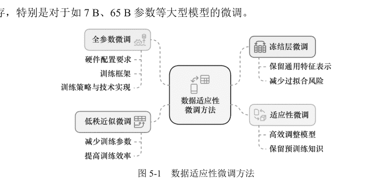

###### （1）硬件配置要求

全参数微调对硬件要求因模型规模和具体任务而异，不同规模模型进行全参数微调时的硬件配置需求如表 5-1 所示。

表 5-1 不同规模模型进行全参数微调时的硬件配置需求

| 硬件配置 | 7B 参数模型 | 67B 参数模型 | 671B 参数模型 |
| :--- | :--- | :--- | :--- |
| GPU 配置 | 2 个 NVIDIA V100 GPU（32 GB 显存） | 8 个 NVIDIA A100 GPU（40 GB 显存） | 32 台 H100 服务器（每台配备多个 GPU） |
| CPU 配置 | 多核 CPU（如 Intel Xeon 或 AMD Ryzen，主频 3.6GHz 或更高） | 高核数 CPU（如 AMD Threadripper 或 Intel Xeon） | 每台服务器都配备高核数 CPU（如 Intel Xeon Gold 6330） |
| 内存 | 至少 64 GB RAM | 至少 256 GB RAM | 每台服务器至少 1 TB RAM |
| 存储 | 至少 1 TB NVMe SSD | 至少 8 TB NVMe SSD | 集群共享 100 TB 存储空间 |
| 网络 | 10 Gbps 以太网 | 高速互连（如 NVIDIA NVLink 或 InfiniBand） | 1B 网络 |

###### （2）训练框架

对 DeepSeek 模型进行全参数微调，需要相应的训练框架。训练框架是一整套软件工具与配置，包括模型加载、训练参数设置、优化器选择、训练执行及结果评估与保存。高效框架能帮助充分利用算力，提升训练速度与模型表现。

在训练参数设置方面，学习率通常取较小值，如 2e-5，避免参数更新过快导致不稳定。批量大小需按硬件资源选择合适值，如 2 或 4，平衡内存消耗与训练速度。训练轮数通常设为 3 或更多，确保模型充分学习特征。其他参数，如 max_new_tokens、eos_token_id、attn_implementation 等，需按具体任务需求设置。

在优化器选择方面，AdamW 优化器适用于大多数深度学习任务，具有自适应学习

###### （3）训练策略与技术实现

对 DeepSeek 模型进行全参数微调时，数据并行如 DeepSpeed ZeRO 和序列并行 Sequence Parallelism，SP 是两种关键并行策略，能在高性能计算集群上高效完成大规模模型微调。

数据并行是一种常见并行方法，通过将训练集分割成多个小批，分配到多设备并行处理，加速训练。DeepSpeed ZeRO 是数据并行的一种优化形式，通过在不同 GPU 间分割优化器状态、梯度和参数，显著减少每个 GPU 的内存占用，可在单卡上训练更大模型。

序列并行在训练过程中将模型序列维度切分并行处理。主要用于长序列数据，通过减少每个 GPU 的计算量与内存需求提升效率。序列并行通过切分序列在不同 GPU 上并行处理，能有效降低内存占用与计算复杂度，特别适用于长序列数据。

###### （4）在高性能计算集群上完成大规模模型微调的步骤

- ① 硬件配置，确保集群每个节点都具备高性能 GPU 与充足内存，并使节点间通过高速网络如 InfiniBand 连接。
- ② 环境配置，在集群上安装配置深度学习框架如 PyTorch 和分布式训练库如 DeepSpeed、PyTorch Distributed。
- ③ 数据准备，将训练数据集分割成多个批次，并将数据分布到集群各个节点。
- ④ 模型加载与分发，加载预训练 DeepSeek 模型，并将模型分发到集群各个 GPU。

⑤ 超参设定
根据算力边界与数据体量挑选合适配置，核心涉及步长、小批量规模以及迭代轮次等。

⑥ 作业启动
在集群上拉起分布式任务，借助数据并行与序列并行把工作切分到各张 GPU，实现高效并行推进。

⑦ 在线调优
全程追踪损失、正确率等关键数值，按表现动态修正配置，持续提升训炼效率。

⑧ 评测保存
周期性以验证集检验效果，将最优版本固化留存。

###### （5）全量细调端到端实战

以下以 Hugging Face Transformers 对 DeepSeek-671B 做全量细调为例，完整呈现从环境准备到收尾的流程。

- ① 环境准备 32 台 H100 服务器构成集群，单机为 H100 显卡、CUDA 12.6、100TB 共享存储、Ubuntu 22.04、IB 网络加 NVLink 互联，依赖通过 pip 安装 torch transformers datasets peft accelerate。
- ② 数据准备 采用在 OpenAI 标准格式上扩展的格式，兼容 Reasoning 类数据；项目附带转换好的样例供参考。
- ③ 加载网络与分词器

```python
from transformers import AutoTokenizer, AutoModelForCausalLM
model_name_or_path = "DeepSeek/DeepSeek-LM"
tokenizer = AutoTokenizer.from_pretrained(model_name_or_path, use_fast=True)
model = AutoModelForCausalLM.from_pretrained(model_name_or_path)
```

- ④ 配置 超参基于 xtuner 框架，可对 DeepSeek-V3 或 DeepSeek-R1 架构实施全量细调；提供多套实验方案对照并给出推荐组合。
- ⑤ 训炼 支持数据并行与序列并行，在 32 台 H100 集群上完成 671B 级别的细调；提供与官方架构兼容的完整实现。
- ⑥ 评估与改进 利用验证集实时观察损失走势；输出详尽日志与改进建议，帮助使用者减少试错。

##### 2. 逐层冻结细调

逐层冻结指的是把预训练网络的底层变量锁住不参与更新，仅让顶层变量生效。此做法适用于新任务与原任务相似度高，或标注样本偏少的情况。

只更新部分权重可显著降低显存占用与计算开销，便于资源受限场景运行。保留底层通用表征有助于抑制过拟合，特别是在数据稀缺时。保留大部分预训练知识的同时用少量可训练变量完成适配，速度更快。

落地时通常开放顶层或部分中间层，其余层冻结。以 Transformer 为例，可冻结前几块 Transformer，仅微调后部。步长一般取较低值，如 1e-5 左右，避免对原权重产生过大扰动。训炼仅用标注数据优化指定层，其余层保持不变。

迁移学习中常选用 ImageNet 预训练网络迁移到医学图像分类等新任务。为兼顾通用特征提取能力与算力消耗，往往冻结大部分层，仅微调末几层。以下为 PyTorch 的冻结示例。

- ① 加载预训练网络，使用 PyTorch 内置接口载入预训练的 ResNet 网络。

```python
import torch
import torchvision.models as models
# 加载预训练模型
model = models.resnet18(pretrained=True)
```

- ② 冻结指定层。遍历网络所有变量与名称，指定冻结目标并把 requires_grad 置为 False。

```python
# 冻结所有层
for param in model.parameters():
    param.requires_grad = False
# 解冻最后一层（全连接层）
model.fc.requires_grad = True
```

- ③ 修改结构。按新任务需求调整最后几层，分类任务通常需重写最后的全连接层。

```python
import torch.nn as nn
num_classes = 10  # 假设新任务有 10 个类别
model.fc = nn.Linear(model.fc.in_features, num_classes)
```

- ④ 设定优化器与步长。细调阶段的步长一般小于从零开始训炼时的取值。

```python
import torch.optim as optim
optimizer = optim.SGD(model.parameters(), lr=0.001, momentum=0.9)
```

- ⑤ 在新任务数据集上训炼。

```python
criterion = nn.CrossEntropyLoss()
num_epochs = 10
for epoch in range(num_epochs):
    for inputs, labels in dataloader:
        optimizer.zero_grad()
        outputs = model(inputs)
        loss = criterion(outputs, labels)
        loss.backward()
        optimizer.step()
```

##### 3. 适配器细调

适配器细调是在保持预训练主体不变的前提下，植入小型可训练模块由其承担任务适配。目标是在保留大部分预训练知识的同时高效完成新任务。与全量细调、冻结细调的差异见表 5-2。

表 5-2 适配器细调与全量细调和冻结细调的区别

| 特征 | 适配器细调 | 全量细调 | 冻结细调 |
| :--- | :--- | :--- | :--- |
| 参数更新范围 | 仅更新适配器模块的变量，预训练主干保持不变 | 更新网络的所有变量 | 仅更新网络的一部分变量，通常是顶层或最后几层 |
| 计算资源需求 | 较低，因为只更新少量变量 | 较高，因为需要更新所有变量 | 中等，因为只更新部分变量 |
| 过拟合风险 | 较低，因为只更新少量变量 | 较高，特别是在数据量有限的情况下 | 较低，因为只更新部分变量 |
| 任务适应性 | 适用于多种任务，特别是在资源有限的情况下 | 适用于复杂任务，能够最大化网络性能 | 适用于任务与预训练任务相似度较高的情况 |
| 灵活性 | 高，可以通过调整适配器模块的设计和数量适应不同任务 | 高，可以适应各种任务场景 | 中等，适用于任务与预训练任务相似的情况 |

在预训练网络加载后，需为适配器细调植入适配器模块，可在每层或部分层中加入。例如在每个 Transformer 块中加入适配器，结构通常为两层线性变换加非线性激活。随后冻结主干，仅训炼适配器，其余流程与常规一致。

###### （1）适配器细调案例 AdaFilter

AdaFilter 是一种自适应细调方法，通过动态调节预训练滤波器权重来贴合目标数据分布。针对源域与目标域差异大导致性能下降的问题，AdaFilter 引入 RNN 门控机制，为每张图像动态挑选需要细调的滤波器，提升泛化能力。

实现步骤如下。

- ① 加载预训练网络，使用 ImageNet 等大规模数据上预训练的网络。
- ② 添加 RNN 门控层，在每个 Batch Normalization 层输出后接入 RNN 门控层，用于选择性调节滤波器权重。
- ③ 动态调节滤波器。依据输入图像特征，动态融合预训练滤波器与细调滤波器的权重。

$$x_{i+1} = G_{i}(x_{i}) \odot BN_{1}(x_{i+1}) + (1 - G_{i}(x_{i})) \odot BN_{2}(x_{i+1})$$

其中，$G_{i}(x_{i})$ 是 RNN 门控层的输出，用于控制滤波器的权重组合。

- ④ 训炼网络，使用目标数据集训炼，优化 RNN 门控层与细调滤波器的变量。

AdaFilter 可按图像特性动态调节滤波器，保留更多有用预训练特征。大量复用预训练滤波器使其在小目标集上仍不易过拟合。推理时有效滤波器数量与标准细调一致，保持同等效率。尤其适用于跨领域图像分类等源目标分布差异大的场景。

###### （2）适配器细调案例 AMCF

AMCF 即 Adaptive Multi-Source Domain Collaborative Fine-Tuning，是一种多源域协作的适配器细调方法，通过融合多个源域网络的特征提升目标任务表现。旨在解决单源细调在分布差异大时效果受限的问题。

实现步骤如下。

- ① 选择多个在不同数据集上预训练的网络。
- ② 融合多个源领域网络的特征，生成目标任务的特征表示。
- ③ 在目标数据集上对融合特征进行细调，优化网络变量。

AMCF 能综合多源特征，提升目标任务效果。即便目标集与单个源域差异较大，多源融合也能带来增益。适用于目标数据与多个源域分布均存在差异的跨领域图像分类等任务。

##### 4. 低秩近似细调

低秩近似细调在预训练网络中引入一对低秩矩阵来模拟全量更新，大幅减少可训练变量，提升效率并降低资源消耗。

实施时需先定义低秩配置，包括秩、缩放系数等，随后用 `get_peft_model` 将配置应用到预训练网络，其余环节与常规细调相同。

以文本分类为例，使用低秩近似细调对 BERT 进行细调，相较全量细调，变量量减少约 90%，正确率保持在 95% 左右，训炼时间与显存分别降低约 60% 与 70%。步骤如下。

- ① 加载在大规模语料上预训练的 BERT 网络。
- ② 冻结 BERT 的权重矩阵，使其不参与更新。
- ③ 添加低秩分解层，在每个全连接层后加入低秩分解，将权重矩阵分解为两个低秩矩阵 $A$ 和 $B$。
- ④ 训炼网络，在目标数据集上训炼低秩分解层，优化矩阵 $A$ 和 $B$。
- ⑤ 评估网络，在测试集上记录正确率、损失等指标。

常用技巧包括通过交叉验证选取合适的秩 $r$、采用较小的步长配合 Cosine Annealing 调度、使用混合精度训炼以节省显存并加速。

低秩近似细调在保留大部分预训练知识的同时高效适配新任务。相较全量细调，它降低算力与过拟合风险；相较冻结细调，它提供更高灵活性和适应性；相较适配器细调，它通过低秩矩阵进一步压缩变量量与计算复杂度。在 DeepSeek 网络的细调中亦可借此提升特定任务性能并节省资源。

#### 5.1.2 效能提升

效能提升贯穿细调全流程，通过技术手段在提升表现的同时控制算力开销，覆盖数据处理到网络评估每个环节。

它既涉及数据层面的清洗增强，也涉及网络架构的挑选调整，还涉及训炼参数的精细化设定。借助超参调优、早停、自适应步长调整和正则化，可提升细调效果、遏制过拟合、增强泛化，并建立评估反馈闭环。

##### 1. 超参调优

超参调优指在训炼前设定并优化步长、正则化强度、网络结构、优化器等不由数据学习的参数，以期网络在特定任务上达到最佳表现。合适的超参能提升正确率、召回率、F1 等指标，降低过拟合，加快收敛，提升稳定性，并在资源受限环境下更高效运行。

实施上可手动或自动进行。手动调优包括步长调整、小批量选择、轮次确定和正则化强度调整。步长常通过实验或调度策略探索；小批量需结合硬件与数据规模；轮次依据验证集表现判断；正则化强度用于防止过拟合。

自动调优包括网格搜索、随机搜索与贝叶斯优化。网格搜索系统遍历指定范围的组合；随机搜索在范围内随机采样，覆盖面更广；贝叶斯优化利用概率模型预测性能并挑选候选，效率更高。

步骤包括定义评估指标、拆分训炼集/验证集/测试集、选择调优方法，执行后评估并挑选最优网络。指标如正确率、精确率、召回率或 F1。以下为基于贝叶斯定理与最优化的超参调优示例，适合高维参数与非凸问题，迭代少速度快，但实现复杂度与计算开销较高。

```python
from skopt import BayesSearchCV
from skopt.space import Real, Integer
# 定义贝叶斯搜索空间
param_space = {
    'n_estimators': Integer(50, 300),
    'max_depth': Integer(5, 15),
    'min_samples_split': Integer(2, 10),
    'learning_rate': Real(0.01, 0.1, prior='log-uniform')
}
# 创建贝叶斯搜索实例
bayes_search = BayesSearchCV(
    estimator=model,
    search_spaces=param_space,
    n_iter=50,
    cv=3,
    scoring='accuracy'
)
# 进行训练
bayes_search.fit(X_train, y_train)
# 输出最佳参数
print("Best parameters found: ", bayes_search.best_params_)
```

##### 2. 早停法

早停法是在训炼过程中提前终止的一种正则化手段。每轮训炼后用验证集评估，若连续若干轮性能不再提升或开始下降，则停止训炼，避免过拟合并提升泛化。

常见做法有监测验证集性能，在一定轮次无提升时终止；或预设较大最大轮次，借助早停动态结束。

##### 3. 自适应步长调整

自适应步长调整可在训炼过程中依据梯度信息或其他指标动态改变步长，以适应不同阶段与数据特性，加快收敛并提升性能。

在模型微调里引入自适应学习率调整，能让训练收敛更快、过拟合风险更低、过程更稳，同时把调参的人工成本压下来。训练刚开始时给一个偏大的学习率，帮助模型迅速逼近最优区；进入后期再逐步收敛，细化参数以提升精度。动态变化的学习率既能防止模型死磕训练集导致泛化变差，也能避免学习率设置不当带来的梯度爆炸或爬行缓慢等不稳定问题，整体上减少反复试错的次数。

常用实现包括 Adam、RMSProp 和 Adagrad。Adam 融合了动量思想和 RMSProp 的思路，会根据梯度估计自适应地调整步长。RMSProp 用梯度平方的指数移动平均做分母缩放，特别适合目标分布不稳定的场景。Adagrad 为每个参数累计梯度平方后再做缩放，对稀疏特征的处理比较友好，也能实现针对稀疏数据的自适应调整。

实操上建议先给一个合理的范围，比如 1e-5 到 1e-3 之间，再配合调度策略使用。StepLR、CosineAnnealingLR 这类调度器可以按预设规律自动改变步长。早停和检查点也是常用搭配，观察验证集指标连续数轮不再提升就停止，并定期保存参数和优化器状态以便回溯。结合 Optuna、Ray Tune 等超参数搜索工具，通过交叉验证自动寻找学习率和其他超参的最优组合，也是提升效率的常见做法。

##### 4. 正则化让模型更稳更准
正则化是在训练时加入额外约束或惩罚，抑制过拟合，提升泛化与鲁棒性。典型的手段有 L1、L2 和 Dropout。

通过在损失里加入正则项来限制参数复杂度，避免模型过度记忆训练样本，从而在未见数据上表现更好，同时降低对噪声和异常值的敏感度，让模型在不同环境下更稳定。

###### （1）L1 与 L2 正则化
L1 在损失里加上参数绝对值之和，有助于产生稀疏解，部分权重被压缩到零，实现特征筛选。L2 则加入参数平方之和，抑制权重过大，从而降低模型复杂度。

落地时先明确模型结构与损失函数，把 L1 或 L2 项加进去；随后设置强度系数 alpha 控制正则项的权重；最后用 SGD、Adam 等优化器训练带正则的损失。

###### （2）Dropout 层
Dropout 在训练阶段随机屏蔽部分神经元的输出，减少单元间的共适应，让网络更健壮。每次迭代会按丢弃率，比如 0.5，随机把一批神经元输出置零，这批单元在该轮前向和反向中不参与计算。推理时全部单元启用，输出做缩放以保持期望一致。

随机丢弃能削弱对特定神经元的依赖，提升泛化；模拟神经元失活，增强对多变输入的适应性；同时降低有效参数量，减少计算开销和过拟合风险。实现时只需要在定义网络时插入 Dropout 层并指定丢弃率即可。

早停法在某种程度上也可以看作一种正则化的实现形式。

### 5.2 个性化定制思路
模型微调聚焦于特定数据集上的性能提升，而个性化定制更关注落地时的功能形态和使用者体验，两者可以协同发力。

个性化定制是围绕用户独特需求、操作习惯和业务场景来输出更贴合的结果。主要体现在功能扩展、界面设计以及与企业现有系统的融合。功能扩展是按企业需求开发定制模块，例如在智能客服里加入多语言、情绪识别能力；界面要契合品牌调性和使用习惯；接入 CRM、ERP 等内部系统，实现数据顺畅流动和流程自动化，也是个性化要兼顾的点。

落地通常要先深入分析场景与需求，再通过开发集成实现。需求分析阶段要和业务部门、使用者沟通，明确具体场景；功能开发按分析结果制作定制模块；界面设计阶段打造友好易用的交互；系统集成阶段打通模型与内部系统，实现数据共享和自动化。

在 DeepSeek 企业应用的个性化上，可以通过功能扩展满足差异化需求，并结合数据准备与处理后再对模型做微调。这个过程涉及五类知识与技术。个性化定制过程如图 5-2 所示。

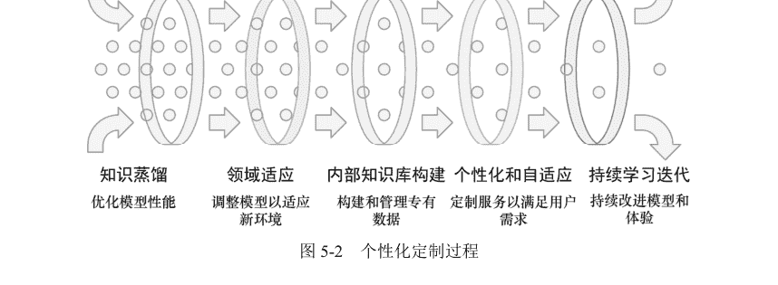

#### 5.2.1 知识蒸馏与领域适应
##### 1. 知识蒸馏在个性化定制中的用法
知识蒸馏是一种模型压缩思路，把大模型教师的经验迁移给小模型学生，提升学生在资源受限环境下的表现。教师模型通常是能力较强的复杂网络，学生通过模仿教师的行为而非仅拟合硬标签来学习。

在移动端、嵌入式等资源紧张场景下价值明显。操作流程大致分四步：① 在源域数据上训练出性能良好的教师模型；② 用教师对目标域数据推理，生成软标签；③ 在目标域上训练学生，同时使用软标签和原始硬标签；④ 用包含硬标签损失和软标签损失的复合目标平衡学习方向。

典型做法是把 LLM 如 DeepSeek-R1 的能力蒸馏到 Qwen 7B 这类轻量模型，实现更高效的推荐服务。SLIM 框架就用知识蒸馏把 LLM 的链式推理能力传给小模型，显著降低算力成本同时保留推理水平。医疗影像里也能把大模型的诊断知识迁移到小模型，提升部署效率。

##### 2. 领域适应在个性化定制中的作用
领域适应是让源域训练的模型更好适应目标域，通过缩小两者分布差距来提升目标域效果。源域通常标注充足，目标域可能数据稀缺或分布不同。

常见步骤：① 从源域和目标域提取特征；② 做特征变换，例如对齐特征分布或使用对抗训练来减小差距；③ 在目标域数据上做微调，让模型贴合新分布。

推荐系统里，领域适应能把通用推荐知识迁移到电商、媒体分发、智能社交等特定领域。多模态场景下也能实现跨模态知识传递，比如从视觉到语言。

##### 3. 知识蒸馏与领域适应的关系与协同
两者的关系主要体现在三方面：知识蒸馏用于领域适应、领域适应服务于知识蒸馏、以及两者协同。

知识蒸馏在领域适应中的应用是让学生借助不同领域的教师学习跨域知识，教师的输出分布和中间特征帮助学生更好理解目标域分布。

领域适应在知识蒸馏中的作用是先让教师更好地贴合目标域，减少源目标特征偏差，从而让蒸馏更有效，学生学习质量也随之提高。

协同工作时，可在领域对齐的基础上做蒸馏，让学生既学到源域知识又贴合目标域分布，从而实现更高效的迁移与更强的目标域表现。

#### 5.2.2 内部知识库构建
内部知识库在个性化定制中承担核心角色，既能沉淀企业专有知识，也能通过智能化手段提升使用效率。

##### 1. 内部知识库构建
构建要经历多个环节以保证实用高效。

先明确目标与范围，确定要收集的信息类型和服务业务，以及知识库的边界。再选技术平台，要求安全性好、易用、可扩展，支持多格式文件并具备强搜索索引能力，如 Dify、Ollama、MaxKB 或 AnythingLLM，可按需定制。

随后收集整理企业内部文档、对话记录、结构化数据等，进行清洗、标注并做好隐私保护。可借助 AI 工具如 DeepSeek 做深度整合与精细化处理，形成专属知识集合。

把数据上传到库中并制定内容管理规范，涵盖创建、审核、更新和删除，保证质量与准确性。接着做智能化和个性化设置，利用 NLP、知识图谱等实现智能检索、个性化推荐与精准召回，并依据学习历史和行为习惯提供定制化服务，例如按岗位推送培训材料。

最后要持续更新维护，定期检查过期内容并刷新，确保知识始终可用。

##### 2. DeepSeek 模型与知识库的融合
知识库成型后，需要与 CRM、项目管理等企业系统深度集成，形成无缝工作流，支持跨部门、跨地域的实时协作。后续章节会进一步展开。

#### 5.2.3 个性化和自适应
个性化与自适应是提升体验与性能的两大支柱。

##### 1. 个性化
个性化是按用户需求、偏好和使用习惯提供定制化服务，提升满意度、体验感和参与度。

实施路径：先构建用户画像，通过语音、文字、表情等多模态交互持续收集浏览历史、购买记录、兴趣偏好等行为数据，用机器学习与分析工具建模并实时更新；再构建个性化推荐系统，基于画像推荐内容，融合图像、音频、文本等多模态信息提升交互效率；最后设计反馈机制，收集意见实时调整推荐策略，并不断优化画像与算法，保证相关性。

##### 2. 自适应
自适应指系统能依据使用习惯、环境变化或任务需求自动调整行为与功能，提升灵活性和适应性。

自适应系统可根据不同行为和环境自动调节，提高效率；也能更好地满足动态需求，赢得信任。

落地包含三块：① 传感器与反馈机制设计，用摄像头、麦克风、温度传感器等感知环境，实时监测操作习惯、使用频率等作为反馈；② 构建自适应算法，用决策树、神经网络等分析数据预测需求与环境变化，并动态调整参数与功能，如界面布局、推荐策略；③ 用户交互优化，开发语音识别、图像识别等多模态交互，提高效率，并根据行为反馈实时调整系统行为，保证灵活自洽。

#### 5.2.4 持续学习迭代
持续学习迭代有助于保持模型性能、应对数据漂移、提升泛化并优化体验。

##### 1. 持续学习迭代的方法
常见四类：① 基于梯度的 GEM，通过维护先前任务样本的记忆，用梯度信息避免遗忘并允许正向迁移；② 基于正则化的 EWC，用正则项保护对旧任务重要的参数，减少灾难性遗忘；③ 基于数据回放的 ER，存储并重放旧样本，让模型在学新任务时回顾旧知识；④ 基于架构的持续学习，通过动态增加层或模块容纳新任务，控制计算增长。

##### 2. 持续学习迭代的具体流程
首先做数据准备与管理，持续采集用户交互与反馈，包括图像、音频、文本等多模态数据，经清洗标注后形成动态更新集。随后定期用新数据微调模型，更新参数以贴合新任务与分布，并通过自动化或人工手段优化超参。

同步建立用户反馈机制，实时获取对输出的评价，并在测试集和验证集上定期评估，根据结果调整优化。最后做多模态融合，从各模态提取特征并有效整合，并开发语音识别、图像识别等多模态交互技术，提升人机互动体验。

## 第 6 章 多模态融合实战
多模态处理与融合是将图像、文本、音频、视频等多源数据整合，从中提取有效特征并融合，以提升系统能力。

单一模态信息有限，多模态能增强理解力、鲁棒性、上下文丰富度和生成质量。情感识别里结合视觉、语音和文本，能更准判断情绪；自动驾驶中融合视觉、雷达、激光雷达，提高环境感知安全；人机交互里结合语音与手势，体验更自然；图文生成任务中结合描述与图像，可产出更逼真一致的内容。

多模态还能提升泛化能力和用户体验，让模型处理更复杂的任务，并带来更自然直观的交互。

在 DeepSeek 企业应用中，多模态融合贯穿多个环节，帮助系统更全面准确地处理复杂信息。

### 6.1 数据采集预处理
DeepSeek 企业应用中涉及的多模态采集类型包括图像、文本、语音、传感器和视频。

#### 6.1.1 多模态数据类型及应用
| 特征 | 图像 | 文本 | 语音 | 传感器 | 视频 |
| :--- | :--- | :--- | :--- | :--- | :--- |
| 数据描述 | 来自摄像头的视觉画面 | 自然语言类内容 | 来自录音的音频信号 | 温度等物理量的测值 | 含画面与声音的复合数据 |
| 应用场景 | 智能客服视觉理解 | 自然语言处理 | 语音识别与合成 | 工业制造监控 | 视频内容管理 |

文本数据主要是用户输入、文档、日志等自然语言内容。在 NLP、文本生成、对话交互等任务里，DeepSeek 通过采集文本提供更自然智能的处理能力。

多模态数据实战笔记

声音类信息本质都是音频的数字记录，典型来源包括用户口头指令、会议录音等。在语音识别、语音合成、会议洞察这类场景里，DeepSeek 会抓取声源并联动其它模态，一起把处理效率拉高。

传感器产出的是可量化的物理测量，常见指标有温度、湿度、气压等。工业制造、设备运维等领域里，DeepSeek 汇总传感器读数并与多模态信息交叉，实现设备运行的实时追踪与异常前置预警。

视频载体兼具画面与声音，是典型多模态形态，常见如会议实录、监控片段。在视频内容管理、会议解析、安防监控时，DeepSeek 采集视频并融合其它模态，让解析与处理更顺畅。

#### 6.1.2 图像预处理关键路径

在多模态融合链路里，图面预处理是必经环节，核心在于把原始采集的图转换成模型可直接使用的干净输入，从而提升判别力和准确度。整体可拆为净化、格式统一、尺度对齐与增强四个阶段。

##### 1. 样本净化
采集完成后先对样本做一次清理，剔除干扰、异常与重复。

（1）滤波削噪
去噪常用手段是滤波。高斯平滑与中值平滑是代表。高斯平滑属于线性模糊，通过图像与高斯核做卷积降低噪声，核权重按高斯分布，中心最大向外递减。读入图像后按设定核尺寸与方差执行即可。

##### 2. 格式与尺寸统一
不同来源图像格式不一，需先做标准化以便后续统一处理。常见格式 JPEG、PNG、BMP 在编码、压缩与色深上各不相同，统一后兼容性与吞吐都会改善。

###### （1）格式归一
格式归一的意义在于让预处理与训练阶段的数据结构保持一致，提升处理效率与训练质量，同时减少因格式差异引发的报错。实践中常把所有图转成 JPEG 或 PNG 这类通用格式。

###### （2）尺寸缩放
缩放是为了满足模型对输入分辨率的硬性要求，通过放大、缩小或裁剪把图像调到指定规格，有助于提升精度。Python 的 Pillow 与 OpenCV 都能完成。插值常用双线性、最近邻、立方三次①。双线性在质量与速度间平衡较好；最近邻最快但易失真；立方质量最高但计算开销大。

> ① 插值即依据已知像素推算未知像素。最近邻直接复用最近像素值，算得快但放大易锯齿。双线性取四邻点加权平均，平滑度不错。立方用三次多项式拟合更大邻域，效果更自然但更耗算。

###### （3）通道对齐
目的是让图像通道数匹配模型输入。常见通道有 RGB 与灰度。模型要 RGB 而图为灰度时需扩展通道，反之亦然。

##### 3. 正则化、标准化与归一化
三类操作分别用于防过拟合、统一尺度与提升训练效果。正则化通过惩罚项压制复杂度；标准化与归一化调整数值分布，加快收敛。

###### （1）正则化
在损失里加入惩罚，降低对训练集的依赖，提升泛化。常用 L1、L2 与 Dropout。L1 对权重绝对值惩罚，倾向稀疏解利于特征挑选；L2 对平方惩罚，防止权重过大让模型更平滑；Dropout 随机丢弃神经元缓解共适应；Batch Normalization 对每层输入做归一化，抑制内部协变量漂移，稳定训练并提升收敛与泛化。

###### （2）标准化
把特征调到均值 0 方差 1 的标准正态分布。实践多用 ImageNet 等数据集的统计量，配合梯度下降能加速收敛，提升训练效率。

###### （3）归一化
把像素值映射到固定区间如 [0,1] 或 [-1,1]，利于梯度优化。常见做法是把 0-255 的像素缩放到目标区间，可通过 ToTensor 或 Min-Max 公式 (x-min)/(max-min) 实现。

##### 4. 数据增强
增强核心是扩充训练样本多样性，缓解过拟合，提升泛化。通过模拟抖动、旋转、光照变化等让模型见过更多真实情况。

常用的五类方法如下。

###### （1）几何变换
包括随机裁剪、随机旋转、水平翻转与垂直翻转。随机裁剪截取局部再缩放；随机旋转在一定范围内旋转，通常 0～180 度；水平翻转模拟镜面反射；垂直翻转上下倒置，均适用于特定场景。

###### （2）色彩变换
包括颜色抖动、随机亮度、随机对比度。颜色抖动可同时改变亮度、对比度、饱和度与色调。

###### （3）噪声注入
包括高斯噪声与椒盐噪声。加入高斯噪声能提升抗噪鲁棒性；加入椒盐噪声可模拟传输干扰。

###### （4）遮挡与裁剪
包括随机遮挡、随机裁剪与缩放。随机遮挡在图像中添加遮挡块，模拟局部被挡；随机裁剪与缩放可增加多样性。

###### （5）高级增强
包括 Mixup、CutMix、AutoAugment 与生成对抗网络 GAN。Mixup 通过混合不同样本的特征与标签生成新训练样本；CutMix 在图像上随机裁剪区域并用另一张图区域替换；AutoAugment 通过学习数据集的最佳增强策略实现自动化；GAN 可生成高逼真合成数据，尤其在数据稀缺场景如医学影像分析中有效。

#### 6.1.3 文本预处理基础流程

文本预处理是 NLP 的基础，目标是把原始文本转为模型友好的形态，提升精度与效率。去噪、统一格式与归一化能提高准确率；词干提取与词形还原能把不同形态统一；拼写纠正与去重提升质量；分词与词性标注则把文本结构化。共 10 种常用手段。

- （1）分词：把文本切成词或子词，便于后续处理，可用 NLTK 或 spaCy 实现。
- （2）去停用词：剔除“的”“是”“在”等无意义高频词，减少数据量，提升效率，可用 NLTK 或 spaCy 实现。
- （3）词干提取：把单词还原为词干，减少形式多样性，提升泛化，可用 NLTK 或 spaCy 实现。
- （4）词形还原：把单词还原为基本原型，提升泛化，可用 NLTK 或 spaCy 实现。
- （5）去特殊字符与数字：剔除文本中的特殊符号与数字以降噪，提升准确性，可用正则或字符串操作实现。
- （6）拼写纠正：纠正拼写错误提升数据质量，可用 TextBlob 或 Pyaspeller 等库实现。
- （7）词性标注：为每个词标注名词、动词等词性，便于语法分析与特征提取，可用 NLTK 或 spaCy 实现。
- （8）命名实体识别：识别人名、地名、组织名等命名实体，便于信息抽取与知识图谱构建，可用 NLTK 或 spaCy 实现。
- （9）文本归一化：把文本转为统一格式，如小写化、去空格，提升泛化，可用字符串操作实现。
- （10）数据增强：通过 TextAttack 或 Nlpaug 等库增加训练多样性，提升泛化与鲁棒性。

#### 6.1.4 语音预处理七步法

语音预处理的任务是提升信号清晰度与可懂度，提高识别准确率；通过增强技术扩充数据多样性以适应不同环境；通过清洗与纠错提升质量；通过分帧与特征提取把语音转为结构化表征。共 7 个环节。

- （1）数据清洗：提升正确性并剔除无效或错误数据。具体包括：
    - ① 信噪比估算，如 WADA-SNR，去掉信噪比极低的音频。
    - ② 语音激活检测 VAD，使用 VAD 算法剔除无法触发的音频。
    - ③ 语音识别 ASR，使用 ASR 剔除文字为空或置信度极低的音频。
    - ④ 自监督清洗，用已清洗数据训练初始模型，计算说话人中心点，剔除偏离过远的音频。
- （2）VAD：检测语音开始与结束，避免静默与非语区干扰。具体包括：
    - ① 基于能量的 VAD，通过能量变化判断语音活动。
    - ② 基于统计模型的 VAD，使用高斯混合模型 GMM 等统计模型检测语音活动。
- （3）特征提取：提取有效声学特征以提升识别力。具体包括：
    - ① 梅尔频率倒谱系数 MFCCs，提取频谱特征，常用于语音识别。
    - ② 线性预测编码 LPC，通过线性预测模型提取特征。
    - ③ 预加重，提升高频分量比重，提高频谱分辨率。
- （4）数据归一化与标准化：把语音属性调至标准形式，提升稳定与可比性。具体包括音量标准化与语速调整。音量标准化使各录音音量大致一致；语速调整通过同步叠加法或波形相似叠加法等时间伸缩算法拉伸或压缩。
- （5）数据增强：扩充多样性提升泛化。具体包括时域增强、频域增强与基于深度学习的增强。时域增强有切割拼接、加噪、语速调整等；频域增强有频谱减法、频谱加法等；基于深度学习可使用 CNN、RNN 等模型增强。
- （6）噪声消除与回声抵消：去除背景噪声与回声提升清晰度。具体包括频谱减法与回声消除。频谱减法估计噪声频谱并从信号中减去；回声消除使用特定算法抵消回声。
- （7）预处理技术在不同应用场景下的优化：根据场景定制流程提升性能。具体包括语音识别系统与实时语音通信。语音识别系统针对特定环境与说话人特性做定制化预处理；实时语音通信优化流程以降低计算消耗并保证快速响应。

#### 6.1.5 传感器数据预处理

传感器是检测并把物理、化学或生物现象转为电信号的装置，传感器数据可为模拟或数字，具体取决于类型与场景。

##### 1. 传感器数据的类型
常见类型包括：
- ① 环境传感器数据，如温度、湿度、气压、光照、生物传感器、心率、血压、血糖、血氧等。
- ② 运动传感器数据，如加速度、陀螺仪、磁力计、步数等。
- ③ 工业传感器数据，如振动、压力、流量、液位等。
- ④ 其他传感器数据，如声音、气体、图像、视频等。

##### 2. 传感器数据预处理的方法
传感器数据常含噪声、缺失与异常，会影响模型表现，预处理可提升质量与可靠性。
- ① 数据清洗：实现方式包括去噪、处理缺失值、剔除异常值。去噪可用中值滤波、卡尔曼滤波及低通或高通滤波；缺失值可用均值填充或插值；异常值过滤超出合理范围的数值。
- ② 数据转换与标准化：把原始数据转为模型可理解格式并消除量纲差异。实现方法包括归一化与标准化。
- ③ 数据集成：将不同来源数据集合并形成更大集合，提升多样性。
- ④ 数据减少：把原始集缩减以降低计算成本。降维常用主成分分析 PCA 以减少冗余特征。

#### 6.1.6 视频数据预处理

视频常含大量噪声、无效信息与冗余，会影响分析模型性能，预处理可提升质量与可靠性。常用六种方法：
- ① 视频格式转换：将视频转成模型所需格式以保证兼容与一致，常使用 FFmpeg 等工具。
- ② 去隔行处理：消除交错效应提升清晰度与稳定性，可用去隔行算法如中值滤波、线性插值等。
- ③ 上采样或下采样：调节分辨率提升或降低细节表现，可用 OpenCV 的 resize 函数实现。
- ④ 降噪处理：去除噪声干扰提升清晰度与信噪比，可用高斯滤波、中值滤波等空间域与时间域方法。
- ⑤ 视频镜头分割：将视频切分为不同镜头便于后续处理，可用像素差异法、直方图法、块匹配法等。
- ⑥ 关键帧提取：提取关键帧以减少数据量并提升效率，可用首尾帧法、中间帧法等。

### 6.2 特征提取

从预处理后的数据中提取能代表本质属性的特征。针对文本、图像、音频、视频，既可用传统方法，也可用 CNN、RNN、预训练模型与自编码器等深度学习方法。

#### 6.2.1 图像数据特征提取

传统方法包括 SIFT、SURF、ORB 与 HOG。SIFT 通过检测关键点生成对尺度、旋转、亮度变化保持不变的描述；SURF 是 SIFT 的加速版，使用积分图像与 Hessian 矩阵近似加速计算；ORB 结合 FAST 角点检测与 BRIEF 描述符并引入方向信息提升匹配鲁棒性；HOG 通过统计局部梯度方向直方图提取特征，适用于行人检测等任务。

深度学习方法包括预训练 CNN 与自定义 CNN。VGG16、ResNet 等在大数据集上预训练的模型可提取高层语义特征；自定义 CNN 则按任务设计网络以提取特定图像特征。

#### 6.2.2 文本数据特征提取

从预处理后的文本中提取特征有以下 5 种方法。

## 文本表征的五种常用思路

（1）词袋思路
把一段文字当成随意装着词的集合，丢弃词出现的先后和语法关联，只统计词是否在场以及出现频次。实现时先汇总文本里出现过的所有不重复词汇构成词表，再为每篇材料生成对应长度的数值列表，列表里每个位置记录该词的出现次数。做法极其简洁直观，容易上手；但因彻底抛弃了顺序与上下文，表达力受限。

（2）TF-IDF 加权
Term Frequency-Inverse Document Frequency 用来衡量某个词对单篇材料的区分价值，既看词在当前篇内的密度，也看词在整体语料中的稀少程度。词频 Term Frequency 统计词在单篇中的出现次数。逆文档频率 Inverse Document Frequency 用以刻画词的罕见程度，计算式为$$IDF(t) = \log\left(\frac{N}{df(t)}\right)$$
其中 $N$ 为语料总篇数，$df(t)$ 为包含词 $t$ 的篇数。
最终得分由两项相乘得到$$TF-IDF(t, d) = TF(t, d) \times IDF(t)$$
稀有词的权重被放大，区分力因此提升，然而序列结构与句子组成仍被忽略。

（3）词向量表示
把词汇映射到低维连续空间，让相近语义的词在空间里靠得更近。代表做法有 Word2Vec 与 GloVe。Word2Vec 包含 Skip-Gram 用上下文预测中心词，以及 Continuous Bag of Words CBOW 用中心词反推上下文。GloVe 即 Global Vectors for Word Representation，依赖词在语料中全局共现统计来学习向量。
长处在于能捕捉语义邻近与上下文关联，对下游理解帮助明显；短板是训练成本较高，对数据规模要求较大。

（4）N-gram 技术
把文本切分为长度为 $N$ 的连续词块，用局部序列来保存顺序信息。

（5）主题发掘模型
用于从文档集合中挖掘潜在主题的统计方法，典型代表是 Latent Dirichlet Allocation 简称 LDA。

#### 6.2.3 语音资料的特征获取
在预处理完成后的语音上获取可用表征，是识别、合成、说话人辨识等任务的关键环节。

##### 1. 经典获取方式
（1）梅尔倒谱系数
Mel-scale Frequency Cepstral Coefficients，MFCC 模仿人耳听觉，把声波转成梅尔频域的倒谱参数。流程涵盖预处理、分帧、加窗、快速傅里叶变换、Mel 滤波组、取对数能量与离散余弦变换 DCT。MFCC 保留了语音的核心信息，在识别任务上表现稳健，Python 生态的 Librosa 就能完成提取。

（2）线性预测倒谱系数
Linear Predictive Cepstral Coefficients，LPCC 用线性预测模型刻画声道特性，适用于识别与合成场景，Pydub 与 Librosa 等工具均可借助来获取。

（3）基频信息
基频对合成与转换至关重要，影响自然度与情感色彩。F0 反映音高，体现声带振动速率，Pyworld 可用来估计。

（4）响度强度
声强在语音活动检测与分段中用于区分语音段与静音段，体现信号能量大小，Librosa 提供对应接口。

（5）韵律信息
韵律在情感合成与情感辨识中表达语义与情绪，涵盖节奏、重音、语调等，Librosa 与 Pyworld 等库可协同获取。

##### 2. 深度学习方式
借助 CNN、RNN 或 Transformer 自动学习表征，能得到更抽象的表达，适用于识别、合成等任务，常见实现框架为 PyTorch 或 TensorFlow。

#### 6.2.4 传感器资料的特征获取
传感器数据形态各异，获取策略需随数据类型调整。

##### 1. 经典获取方式
（1）时域统计
从时间序列中计算均值、方差、最大值、最小值、峰值等统计量，反映整体分布特性，适合简单分类与回归，Numpy 或 Pandas 可完成计算。

（2）频域分析
频域揭示周期性与频率成分，适用于振动分析、心率变异分析等。通过傅里叶变换把时序转为频域，可得到功率谱密度、频谱峰值等指标，Numpy 或 Scipy 可实现变换。

（3）小波分解
小波把信号拆成不同频段的子信号，用于捕捉局部细节，对非平稳信号与突变敏感，Pywt 是常用实现。

（4）主成分投影
PCA 为降维手段，把高维数据投影到低维子空间保留主要变异，降低计算负担并保持核心结构，Sklearn 提供实现。

##### 2. 深度学习方式
CNN 能自动学习局部模式与复杂表征，适用于时序或图像化数据，常用 PyTorch 或 TensorFlow 搭建。RNN 及 LSTM 等变体擅长捕捉时序的长期依赖，适合传感器时序建模，同样可基于 PyTorch 或 TensorFlow 构建。

#### 6.2.5 视频资料的特征获取
除文生视频外，大多数视频源于传感器。视频特征获取在 3.3.2 节已有介绍，除经典与深度方法外，还可借助开源工具。

##### 1. Video Features
Video Features 为视频特征获取工具包，支持从原始视频抽取视觉外观、光流、音频等多模态表征，集成多套预训练模型，覆盖不同应用场景①。

##### 2. Video_Feature_Extractor
Video_Feature_Extractor 为 Python 工具包，利用 2D 或 3D CNN 高效抽取视频表征。通过 FFmpeg 实时解码，以 PyTorch 为后端，支持高效 GPU 多进程提取②。

### 6.3 模态融合
把文本、图像、音频、视频等异构数据整合，形成联合表征或直接输出预测，核心目标是通过跨模态互补提升感知与理解。

作用体现在三方面：一是综合多源信息，使模型理解更全面，预测更准；二是不同来源相互补充，降低单一来源噪声与缺失的影响；三是支撑需要多源信息的任务，如多模态情感分析、视听语音识别等。

按融合深度可分为数据级融合、特征级融合、决策级融合与混合融合，多模态数据融合如图 6-2 所示。

> ① 具体可参考[Video Features：多模态视频特征提取利器]。
> ② 具体可参考[开源项目教程：视频特征提取器（video_feature_extractor）]。

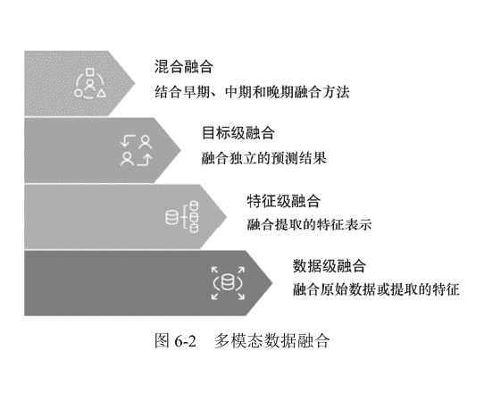

#### 6.3.1 数据级融合
在模型输入前把多源原始数据或已获取的表征合并，形成统一输入。适用于原始数据相关性强、互补性高的情形，如图像与深度图。常见做法为直接拼接或叠加。

##### 1. 拼接
把多个向量首尾相接形成更长的向量。实现简洁，能保留各来源的原始信息。适用于维度与尺度差异较大且需保留完整信息的情形。

##### 2. 加法
对不同来源的表征做线性加权求和，以压缩维度，可能损失细节。适用于维度与尺度相近且希望简化表示的情形。

> ① 维度指数据集中变量的数量，即表格中的列数。每个维度代表一个独立属性。例如成绩表中的学号、姓名、数学、语文等；图像中可能是像素数。维度影响复杂度、可视化难度与模型性能，高维易导致维度灾难。
> ② 尺度指数据的度量类型，即取值如何量化。常见分为定类、定序、定距、定比。定类仅作分类，无顺序，如性别；定序有顺序无固定间隔，如满意度等级；定距有数值与固定间隔无绝对零点，如温度；定比有绝对零点可比比率，如身高、收入。尺度决定可用统计与可视化方法。

生物特征识别示例：单一模态易受环境或质量影响，多模态融合可提升鲁棒性。例如人脸与掌纹融合实现更精准身份验证。
先用 PCA 对人脸图与掌纹图降维得到向量，再归一化到同一尺度后分配不同权重做线性加权求和，得到融合向量，随后用最近邻分类器分类并转为后验概率，加权融合后输出最终结果。

```python
import numpy as np
# 假设人脸特征向量和掌纹特征向量已经提取并归一化
face_feature = np.array([0.2, 0.5, 0.8])  # 示例人脸特征向量
palm_feature = np.array([0.3, 0.4, 0.6])  # 示例掌纹特征向量
# 权重分配
weight_face = 0.6
weight_palm = 0.4
# 线性加权求和
fused_feature = weight_face * face_feature + weight_palm * palm_feature
print("融合后的特征向量:", fused_feature)
```

##### 3. 乘法
把单模态向量逐元素相乘融合到统一张量中，增强来源间交互，但可能提升维度。适用于需要强化交互的场景，如多模态情感分析。

在图像描述生成、视觉问答等任务中需同时处理图像与文本。可先用 CNN 抽取视觉向量，用预训练语言模型如 BERT 抽取文本语义向量，再经归一化后逐元素相乘，得到融合向量供下游使用。可在 COCO 等公开集上验证。

```python
import numpy as np
# 假设图像特征向量和文本特征向量已经提取并归一化
image_feature = np.array([0.2, 0.5, 0.8])  # 示例图像特征向量
text_feature = np.array([0.3, 0.4, 0.6])  # 示例文本特征向量
# 乘法融合
fused_feature = image_feature * text_feature
print("融合后的特征向量:", fused_feature)
```

##### 4. 双线性融合
先对两个来源的表征做张量外积得到二维矩阵，再展平池化为一维向量，能捕捉高阶交互。

在视觉问答任务中，可对图像与文本向量分别归一化后做外积，展平并归一化，再经线性映射得到最终融合向量。可在 VQAv1 等数据集上验证。

```python
import numpy as np
# 假设图像特征向量和文本特征向量已经提取并归一化
image_feature = np.array([0.2, 0.5, 0.8])  # 示例图像特征向量
text_feature = np.array([0.3, 0.4, 0.6])  # 示例文本特征向量
# 外积操作
bilinear_matrix = np.outer(image_feature, text_feature)
# 展平和归一化
flattened = bilinear_matrix.flatten()
normalized = flattened / np.linalg.norm(flattened)
# 线性映射（假设 W 是预训练的权重矩阵）
W = np.random.rand(10, len(normalized))  # 示例权重矩阵
fused_feature = np.dot(W, normalized)
print("融合后的特征向量:", fused_feature)
```

##### 5. 基于 Transformer 的方法
利用 Transformer 的自注意与交叉注意，把不同来源映射到统一空间并交互。适用于复杂多模态任务，如多模态情感分析、视听语音识别。

在 VQA 中，先分别抽取图像与文本表征并线性投影到相同维度。用自注意捕捉图像内部关系与文本内部关系，再以图像为 Query、文本为 Key/Value 做交叉注意，反向亦然。融合自注意与交叉注意结果后，通过加权求和或拼接输入分类器预测答案。可在 VQAv1 等数据集上验证。

```python
import torch
import torch.nn as nn
import torch.nn.functional as F
class MultiHeadAttention(nn.Module):
    def __init__(self, d_model, n_heads):
        super(MultiHeadAttention, self).__init__()
        self.d_model = d_model
        self.n_heads = n_heads
        self.d_k = d_model // n_heads
        self.W_q = nn.Linear(d_model, d_model)
        self.W_k = nn.Linear(d_model, d_model)
        self.W_v = nn.Linear(d_model, d_model)
        self.W_o = nn.Linear(d_model, d_model)
    def forward(self, query, key, value, mask=None):
        batch_size = query.size(0)
        Q = self.W_q(query)
        K = self.W_k(key)
        V = self.W_v(value)
        Q = Q.view(batch_size, -1, self.n_heads, self.d_k).transpose(1, 2)
        K = K.view(batch_size, -1, self.n_heads, self.d_k).transpose(1, 2)
        V = V.view(batch_size, -1, self.n_heads, self.d_k).transpose(1, 2)
        scores = torch.matmul(Q, K.transpose(-2, -1)) / (self.d_k ** 0.5)
        if mask is not None:
            scores = scores.masked_fill(mask == 0, -1e9)
        attn_weights = F.softmax(scores, dim=-1)
        attn_output = torch.matmul(attn_weights, V)
        attn_output = attn_output.transpose(1, 2).contiguous().view(batch_size, -1, self.d_model)
        output = self.W_o(attn_output)
        return output, attn_weights
class CrossAttention(nn.Module):
    def __init__(self, d_model, n_heads):
        super(CrossAttention, self).__init__()
        self.self_attn = MultiHeadAttention(d_model, n_heads)
```

#### 6.3.2 中层特征融合

特征层融合的时机在表征提取之后、最终决策之前。各路模态先独立完成预处理和特征抽取，得到各自的向量表示，再在同一特征层上进行汇合。这种方式在图像分类、语音识别、情感分析等跨模态任务里很常见，常见的操作有向量拼接、逐元素相加、逐元素相乘、双线性交互以及基于 Transformer 的交互式融合。

它和数据级融合同属多模态融合的两大主线，但在几个维度上差异明显。

融合时机不同。数据级融合在原始数据预处理阶段就把不同源的数据合在一起；特征层融合则等到单模态特征已经抽好后再合并。

融合对象不同。数据级处理的是原始信号或刚提取的浅层信息；特征层处理的是已经编码好的模态特征向量。

适用场景不同。数据级更适合模态间高度相关且互补、需要早期介入的情形，比如图像与深度图的结合，多模态目标检测就是典型。特征层更适合模态特征维度差异较大、需要精细对齐的情形，比如图像与文本的结合，多模态情感分析更需要这种方式。

优缺点不同。数据级简单直接，能保留完整的原始信息，但容易导致维度爆炸、计算负担加重，且需要对齐不同模态的预处理规范。特征层能更精细地控制融合过程并保留模态特有信息，但多了一步特征提取，特征维度也需要匹配或做投影。

#### 6.3.3 决策层融合

决策层融合等到每个单模态模型都独立给出预测后再做整合。每个模型先自行推理出标签、回归值等结果，最后把这些结果汇总成最终决策。

它适合需要融合多个独立判断的场景，比如多传感器数据融合、专家意见综合等。常见做法有 5 种。

- （1）投票法
通过统计各模型预测类别的出现频次，以票数最多的类别作为最终输出。能削弱单一模型误判，适合分类任务，尤其在各模型结果存在多样性时效果更好。

- （2）加权平均法
为不同模态模型的输出赋予不同权重后求平均。能发挥各模型的长处，适合回归任务，特别是在模型置信度差异明显时。

- （3）贝叶斯融合
利用贝叶斯公式把各模型的输出转化为后验概率再合并。擅长处理不确定性，提升可靠性，适合置信度不同的分类融合。

- （4）Dempster-Shafer 证据理论
把各模型结果视作证据，计算信念函数与似然函数再合成。能容忍不确定性和冲突信息，适合分类任务中预测结果存在分歧的情况。

- （5）卡尔曼滤波
基于递归最小二乘估计目标状态，擅长动态系统的跟踪与预测。对时序数据鲁棒性强，适合目标运动状态随时间变化的跟踪任务。

#### 6.3.4 多阶段混合融合

混合融合把早期数据级、中期特征级、晚期决策级融合结合起来，在不同处理阶段都做信息汇合，既保留底层交互也保留高层决策优势，从而提升整体性能。

它对复杂多模态任务特别有效，比如多模态情感分析、自动驾驶、医疗诊断、智能监控。多模态情感分析要融合文本、音频、视频；自动驾驶要融合摄像头、雷达、激光雷达；医疗诊断要融合医学影像、生理信号、病历文本；智能监控要融合视频与音频以更好捕捉异常。

落地通常包含四部分：数据预处理与特征提取、特征层融合、模型训练与决策层融合、混合策略设计。预处理做归一化、去噪等，分别用 CNN 提取图像特征、用 RNN 提取文本特征等。特征层融合可采用拼接、加权平均或 Transformer 交互。训练与决策层融合常用 MLP、DNN 对融合特征建模，同时把各单模态模型的预测用投票、加权平均等方式再融合。最后设计策略，如先特征融合再决策融合，或在多层级反复融合。

### 6.4 训练与提效

多模态融合后，核心工作就是训练与优化模型。

#### 6.4.1 模型训练

关键在于设计合理的架构和训练策略，并持续监控与调参，让模型真正学会跨模态关联。

- 1. 模型架构设计
依任务选型 Transformer、CNN、RNN 等基座，并在网络中加入专门的融合层，如共享注意力或 Transformer 融合层，用来整合不同模态表征。
训练策略上可三选一或组合：联合训练同时优化特征提取与融合部分，信息同步学习；分阶段训练先单独训好各模态提取器再做融合，降低初期难度；对抗训练借助 GAN 类方法提升鲁棒性与抗样本能力。

- 2. 监控训练过程
监控是保障效果的闭环。关注损失值、准确率、学习率的变化。训练集与验证集损失的趋势反映收敛情况，准确率反映预测能力是否提升，学习率变化决定训练是否稳定。
工具上可用 TensorBoard 等可视化平台实时查看指标曲线，配合日志记录损失、准确率、学习率等关键数据，便于复盘与调整。

- 3. 超参数调整
调参直接影响收敛速度与泛化能力。常用网格搜索、随机搜索和贝叶斯优化来寻找最优组合。

#### 6.4.2 模型优化

针对融合后的模型，可通过压缩与加速技术降低资源消耗。

- （1）量化
把权重与激活从 32 位浮点压到 8 位整数等低精度，减少存储与计算。实现分两类：后训练量化在模型训练结束后转换；量化感知训练在训练期就模拟量化误差，保留精度。

- （2）剪枝
移除不重要参数或单元来简化网络。包括权重剪枝按阈值剔除绝对值小的单个权重；结构化剪枝整块移除卷积核、神经元或通道，得到规则稀疏结构更利于硬件加速；重要性剪枝依据权重或激活的重要性评分决定剪枝对象。

- （3）模型优化的其他技术
除量化剪枝外，还可用知识蒸馏、参数共享与模块复用、分布式计算与硬件加速等手段进一步降低算力需求、提升运行效率。

#### 6.4.3 综合案例

以下案例演示从数据准备到提效的完整链路：基于 VQA 数据集 VQAv1 获取图像与对应文本问题，用预训练 ResNet50 抽取图像特征向量，用预训练 BERT 抽取文本特征向量。

特征融合阶段先把两类向量送入共享注意力模块捕捉跨模态关联，再用 Transformer 编码器做进一步交互建模。

训练阶段把融合特征送入分类器预测答案，采用交叉熵损失，同时记录训练损失、验证损失、训练准确率、验证准确率并用 TensorBoard 可视化。

优化阶段使用量化感知训练做量化压缩，结构化剪枝降低参数量，并通过跨模态蒸馏把教师模型的知识迁移到学生模型，提升性能。

```python
import torch
import torch.nn as nn
import torch.nn.functional as F
import torchvision.models as models
from transformers import BertModel

class MultiHeadAttention(nn.Module):
    def __init__(self, d_model, n_heads):
        super(MultiHeadAttention, self).__init__()
        self.d_model = d_model
        self.n_heads = n_heads
        self.d_k = d_model // n_heads
        self.W_q = nn.Linear(d_model, d_model)
        self.W_k = nn.Linear(d_model, d_model)
        self.W_v = nn.Linear(d_model, d_model)
        self.W_o = nn.Linear(d_model, d_model)

    def forward(self, query, key, value, mask=None):
        batch_size = query.size(0)
        Q = self.W_q(query)
        K = self.W_k(key)
        V = self.W_v(value)
        Q = Q.view(batch_size, -1, self.n_heads, self.d_k).transpose(1, 2)
        K = K.view(batch_size, -1, self.n_heads, self.d_k).transpose(1, 2)
        V = V.view(batch_size, -1, self.n_heads, self.d_k).transpose(1, 2)
        scores = torch.matmul(Q, K.transpose(-2, -1)) / (self.d_k ** 0.5)
        if mask is not None:
            scores = scores.masked_fill(mask == 0, -1e9)
        attn_weights = F.softmax(scores, dim=-1)
        attn_output = torch.matmul(attn_weights, V)
        attn_output = attn_output.transpose(1, 2).contiguous().view(batch_size, -1, self.d_model)
        output = self.W_o(attn_output)
        return output, attn_weights
```

```python
class SharedAttention(nn.Module):
    def __init__(self, embed_dim):
        super(SharedAttention, self).__init__()
        self.multihead_attn = nn.MultiheadAttention(embed_dim, num_heads=8)

    def forward(self, text_features, image_features):
        combined_features = torch.cat([text_features, image_features], dim=1)
        attn_output, _ = self.multihead_attn(combined_features, combined_features, combined_features)
        return attn_output
```

```python
class MultiModalTransformer(nn.Module):
    def __init__(self, text_dim=768, image_dim=2048, hidden_dim=512):
        super(MultiModalTransformer, self).__init__()

        # 图像编码器
        self.image_encoder = models.resnet50(pretrained=True)
        self.image_encoder = nn.Sequential(*list(self.image_encoder.children())[:-1])  # 去掉全连接层
        self.img_fc = nn.Linear(2048, hidden_dim)

        # 文本编码器
        self.text_encoder = BertModel.from_pretrained('bert-base-uncased')
        self.text_fc = nn.Linear(text_dim, hidden_dim)

        # 共享注意力机制
        self.shared_attn = SharedAttention(hidden_dim)

        # Transformer融合层
        self.transformer = nn.Transformer(d_model=hidden_dim, num_encoder_layers=3, num_decoder_layers=3)

        # 分类器
        self.classifier = nn.Linear(hidden_dim, num_classes)

    def forward(self, image, text_input_ids, text_attention_mask):
        # 提取图像特征
        image_features = self.image_encoder(image)
        image_features = image_features.view(image_features.size(0), -1)
        image_features = self.img_fc(image_features)

        # 提取文本特征
        text_outputs = self.text_encoder(text_input_ids, attention_mask=text_attention_mask)
        text_features = text_outputs.last_hidden_state
        text_features = self.text_fc(text_features)

        # 共享注意力融合
        combined_features = self.shared_attn(text_features, image_features.unsqueeze(1))

        # Transformer 融合
        fused_features = self.transformer(image_features.unsqueeze(1), combined_features)

        # 分类
        output = self.classifier(fused_features.squeeze(1))

        return output

# 假设图像特征向量和文本特征向量已经提取并归一化
image_input = torch.randn(2, 3, 224, 224)  # 假设有 2 张图片
text_input_ids = torch.randint(0, 10000, (2, 128))  # 假设文本输入 ID
text_attention_mask = torch.ones(2, 128)  # 假设注意力掩码
labels = torch.tensor([0, 1])  # 假设分类标签

# 初始化模型
model = MultiModalTransformer()

# 定义损失函数和优化器
criterion = nn.CrossEntropyLoss()
optimizer = torch.optim.Adam(model.parameters(), lr=0.001)

# 训练模型
model.train()
for epoch in range(10):
    optimizer.zero_grad()
    outputs = model(image_input, text_input_ids, text_attention_mask)
    loss = criterion(outputs, labels)
    loss.backward()
    optimizer.step()
    print(f"Epoch {epoch+1}, Loss: {loss.item()}")

print("训练完成")

# 量化感知训练
model.qconfig = torch.quantization.get_default_qconfig('fbgemm')
torch.quantization.prepare(model, inplace=True)
```

model(image_input, text_input_ids, text_attention_mask)

torch.quantization.convert(model, inplace=True)

# 剪枝

prune.ll_unstructured(model.img_fc, name='weight', amount=0.2)

prune.ll_unstructured(model.text_fc, name='weight', amount=0.2)

# 知识蒸馏

teacher_model = MultiModalTransformer()

teacher_model.load_state_dict(torch.load('teacher_model.pth'))  # 假设教师模型已训练

student_model = MultiModalTransformer()

criterion_distill = nn.KLDivLoss()

optimizer_distill = torch.optim.Adam(student_model.parameters(), lr=0.001)

for epoch in range(10):

    optimizer_distill.zero_grad()

    student_outputs = student_model(image_input, text_input_ids, text_attention_mask)

    with torch.no_grad():

        teacher_outputs = teacher_model(image_input, text_input_ids, text_attention_mask)

    loss_distill = criterion_distill(F.log_softmax(student_outputs / 2.0, dim=1),

                                     F.softmax(teacher_outputs / 2.0, dim=1))

    loss_distill.backward()

    optimizer_distill.step()

    print(f"Distillation Epoch {epoch+1}, Loss: {loss_distill.item()}")

print("蒸馏完成")

从上面这组实践可以看出，多模态模型能够把图像、文本等不同来源的信息投射到同一个表征空间，并在特征层面完成交互融合，从而在跨模态任务上获得更强的判别力。叠加量化、剪枝和知识蒸馏这三类压缩手段后，模型体积与推理开销大幅下降，更贴合生产部署与在线推理的实际需求。

## 第 7 章 分布式训练

分布式训练本质上是把模型与数据的训练工作切分到多台计算设备上同步推进，让多块 GPU、TPU 等资源一起承担学习任务。这种方式有效缓解了单机在超大规模模型和海量数据面前出现的速度瓶颈与显存限制。

之所以被广泛采用，是因为它在训练提速、效果提升、体系弹性与系统韧性上都有明显优势。并行计算让迭代周期被显著压缩；更大的数据与算力配合可以降低过拟合，带来泛化与精度收益；随着业务增长可横向扩容，轻松承接更大规模的数据集与更复杂的网络结构；多节点架构还能规避单点故障，保障任务不因单机异常而中断。

完整流程涵盖集群搭建、并行方案选型、关键环节优化、数据准备与任务下发等多个环节，其中数据准备与处理是分布式训练中不可替代的基础步骤。

### 7.1 计算集群架构

计算集群架构由一组通过高速互联网络连接的计算节点构成，共同支撑大规模算力的需求。在 DeepSeek 的实践中，该架构为超大规模模型提供了稳定高效的训练底座，使海量参数与数据得以被快速处理。

#### 7.1.1 计算集群架构配置要素

搭建集群需要同时考虑硬件、网络、存储与软件四个维度。

1. 计算节点配置

节点是分布式训练的最小单元，通常以高性能 GPU 或 TPU 为核心。实践中多选用 NVIDIA A100、H100 等型号，并依据任务规模决定节点数量与单节点卡数。

2. 网络架构配置

节点间的通信效率直接决定整体吞吐。采用 InfiniBand、NVLink 等高速互联技术，可明显降低延迟、提升带宽。DeepSeek-V3 的内部互联即基于 InfiniBand 实现。企业需结合集群规模与性能目标挑选合适的网络方案，保证带宽与延迟满足训练需求。

3. 存储系统配置

大规模训练对存储提出高容量、高并发、高可靠的要求。分布式文件系统配合 NVMe SSD 等高速介质是常见选择，例如 DeepSeek-V3 部署了约 4PB 的 NVMe SSD 池。企业应依据数据体量与访问模式选择方案，同时兼顾安全与隐私。

4. 软件环境配置

集群需安装适配的深度学习框架与依赖，如 PyTorch、TensorFlow 等，并配置好驱动、环境变量与分布式参数，保证任务能够顺利启动与调度。

#### 7.1.2 计算集群架构配置建议

DeepSeek 在企业落地时，集群设计会根据具体业务与场景动态调整。计算集群配置金字塔如图 7-1 所示。

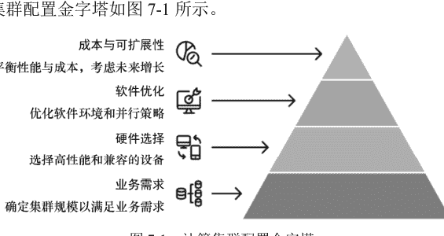

1. 根据业务需求确定规模

先评估业务对模型大小与数据量的真实需求。若需处理超大规模模型，可参考 DeepSeek-V3 的 2048 块 GPU 级别集群；中小任务则可选用更紧凑的配置以控制成本。

2. 选择合适的硬件和网络设备

在性能、成本与兼容性之间权衡，选用高性能加速卡与高速网络能够提升整体效率。同时关注设备的可扩展性与兼容性，便于未来升级。

3. 优化软件环境和并行策略

硬件之外，框架选型与并行策略的调优同样关键。依据模型特性选择合适的深度学习栈与并行方案，才能充分释放集群算力。

4. 考虑成本和可扩展性

配置需要在算力表现与投入预算间取得平衡，同时预留横向扩展空间，支持业务增长时的平滑扩容。

不同企业需求的 DeepSeek 企业应用分布式训练计算集群架构配置建议如表 7-1 所示。

表 7-1 不同企业需求的 DeepSeek 企业应用分布式训练计算集群架构配置建议

| 类别 | 小型企业（1～5 人） | 中型企业（5～20 人） | 大型企业（20～100 人） | 高阶企业（100 人+） |

| :--- | :--- | :--- | :--- | :--- |

| 计算节点 | CPU | 1～2 核 | 2～4 核 | 4～8 核 | 8 核+ |

| | GPU | 1 块 NVIDIA GPU | 2～4 块 NVIDIA GPU | 4～8 块 NVIDIA GPU | 8～16 块 NVIDIA GPU |

| | 内存 | 4～8 GB | 8～16 GB | 16～32 GB | 32～64 GB |

| | 存储 | 1 TB+SSD | 2～4 TB SSD | 4～8 TB SSD | 8～16 TB SSD |

| 网络架构 | 50～100 Mbps 带宽 | 100～200 Mbps 带宽 | 200～500 Mbps 带宽 | 500～1000 Mbps 带宽 |

| 存储系统 | 1 TB+SSD | 2～4 TB SSD | 4～8 TB SSD | 8～16 TB SSD |

| 软件环境 | 框架：TensorFlow/PyTorch<br>语言：Python<br>数据库：MySQL/PostgreSQL<br>容器化：Docker/Kubernetes<br>存储：云存储+本地存储 | | | |

### 7.2 并行策略

并行策略是分布式训练中提升效率、节省资源、增强模型表现的核心手段。它把计算负载分散到多设备并行执行，缩短训练时长；借助更多样本与算力降低过拟合风险；还能容纳单机无法承载的大模型与大数据。合理使用并行策略可以避免资源闲置，提高整体利用率。不同的并行策略如图 7-2 所示。

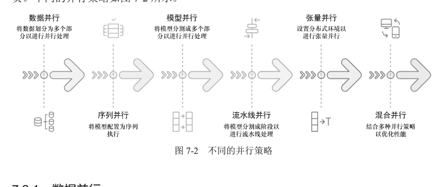

#### 7.2.1 数据并行

数据并行的思路是把训练集切成若干子集，分发到不同节点，每个节点保留完整模型副本，用本地子集做前向与反向计算后，将梯度汇总到主节点做参数更新，再把新权重广播回各节点进行下一轮迭代。

这种方式能在多节点上同时推进计算，明显加快训练速度。每个节点只需保存模型与自己的数据分片，显存压力下降，可在算力受限环境下训练更大规模模型。同时数据被分散存储与处理，突破单机内存与计算上限，有助于用更多数据提升泛化。

1. 数据并行的业务场景

适合数据体量巨大、训练周期长且具备多机资源的情况。当单机无法在可接受时间内完成训练时，多节点并行可大幅提速；对于需要长时间迭代的模型，能提升研发效率；当机构拥有多 GPU 服务器时，可充分利用闲置算力。

2. 数据并行的开展和执行步骤

（1）数据划分

把训练集拆分为多个子集分配给各节点。划分方式可随机或顺序，确保各分片分布均衡，避免负载失衡。

（2）模型副本创建

在每个节点上初始化一份完整的模型拷贝，参数与优化器状态保持一致，通常来源于同一预训练权重或随机初始化。

（3）前向传播与损失计算

各节点使用本地数据分片做前向推理，计算输出并得到损失值。

（4）反向传播与梯度计算

基于损失进行反向传播，得到当前分片上的参数梯度。

（5）梯度汇总与权重更新

将各节点梯度聚合到主节点完成参数更新，或通过分布式通信直接聚合，随后把更新后的权重分发给所有节点。

（6）通信优化

为降低通信开销，可引入梯度压缩、异步通信等手段，在不明显影响收敛的前提下提升并行效率。

#### 7.2.2 序列并行

序列并行沿序列长度维度对输入进行切分，将不同片段分派到各节点并行计算。长文本、语音等序列任务及 Transformer 类模型是典型适用场景。该策略通过切分序列降低单节点显存占用，同时减少节点间交互开销。

长序列显存瓶颈如何用序列并行缓解

当输入序列变得很长时，单设备显存很容易被占满，训练耗时也明显拉长。序列并行的思路是把一条长输入在长度上拆成若干片段，让不同计算单元各自处理自己的那一段。这样单卡需要维护的活数据变小，多卡并行推进也能把整体耗时压下来。相比张量并行这类对单层内部做更细切分的方案，序列并行在通信上更省心，因为切分维度是序列本身，跨设备搬运的数据量相对可控。

1. 序列并行的应用场景
这种并行主要面向长序列建模，在自然语言里的 Transformer 处理长文本时价值最明显。一旦单条序列超过单卡承载能力，把它分摊到多卡就能避免显存溢出；在多卡集群上追求算力利用率时，序列并行也能显著提升吞吐。

2. 序列并行的开展和执行步骤
落地时通常按下面流程进行。

（1）输入分割
把长序列沿长度维度拆成若干子段。举例来说，长度 N 的序列拆成 k 段，每段大约 N/k。

（2）模型部署
将拆好的子段映射到不同的计算单元，每个单元负责一段并加载对应的模型部分。

（3）正向与反向流程
正向时各单元各自算出自己片段的输出。反向时各单元独立得到片段梯度，再通过通信机制汇总梯度完成参数更新。

（4）通信开销控制
为降低单元间交互成本，可引入梯度压缩、混合精度等手段，并对传输顺序和方式做优化以减小延迟。混合精度能在精度损失不大的前提下兼顾显存与耗时；梯度压缩也能减少跨设备传输量。

3. 序列并行与数据并行的区别
两者都是分布式训练的常用手段，但在切分逻辑与适用条件上差异明显。

（1）数据切分方式
数据并行把整个训练集拆成多个子集分给不同设备，设备间数据不同但模型结构完全一致，各自保存完整模型副本。序列并行围绕同一样本，把输入序列切成多段分发，模型的不同部分可能分布在不同设备，或各设备处理同一模型的不同片段。

（2）模型处理方式
数据并行下各单元独立完成正反向，再汇总梯度更新权重，通信集中在梯度汇总与权重同步，频次偏低。序列并行需要在正向和反向的每一步交换中间结果与梯度，各单元处理同一样本的不同片段并最终合并，通信更频繁。

（3）适用场景
数据并行适合数据量大、模型相对适中的场景，通过多设备并行提升训练效率，实现简单且通信开销小。序列并行适合长序列输入的模型，如 NLP 中的 Transformer，通过序列切分缓解显存压力并提升效率，在长文本场景下对内存与通信的控制更好。

（4）内存占用
数据并行中每个单元需保存完整模型参数并加载自己的数据子集，消耗随模型大小与子集大小变化。序列并行中每个单元只需保存模型的部分结构和对应的子序列，序列分片后单机压力下降。

（5）通信开销
数据并行通信集中在梯度汇总阶段，频次低、开销小。序列并行在每一步正反向都需交换数据，频次高、开销相对较大。

（6）实现复杂度
数据并行门槛低，主流框架均提供内置支持。序列并行实现更复杂，需要精细管理单元间通信与同步，确保长序列在单元间正确传递。

#### 7.2.3 模型并行
模型并行的核心做法是把模型的不同组件放到不同计算单元上，各单元只计算自己负责的那一部分，前后向通过协同完成。比如深度神经网络的不同层可分别部署在不同 GPU 上，各自计算输出后再把结果传给下一层所在设备。

1. 模型并行的适用场景
当模型参数体量巨大，单张 GPU 或 TPU 放不下时必须借助模型并行。即使内存勉强够用，若单机计算过于耗时，也可通过拆分提升效率。在异构硬件环境中，还可依据设备特性把不同模块分配到最合适的硬件上，充分利用资源。

2. 模型并行的开展和执行步骤
一般包含如下环节。

（1）模型分割
按层或参数组把模型拆分到不同单元，可依据层类型、计算量或内存需求划分，确保负载均衡。

（2）数据搬运与同步
确定单元间的数据搬运方式和同步机制，前后向过程中需传递中间结果和梯度，保证计算正确。

（3）通信开销控制
采用梯度压缩、混合精度训练等手段降低通信成本，同时优化传输顺序与方式减少延迟。

（4）计算单元配置
根据拆分方案和通信需求，配置各单元的软硬件环境，保证协同高效。

（5）训练与推理执行
在模型并行架构下按既定拆分和通信机制执行训练或推理，单元协同完成任务。

#### 7.2.4 流水线并行
流水线并行把模型按层或模块顺序分配到不同设备上，每个设备处理一个阶段，输出传递给下一阶段，形成流水线式计算。特别适合层数很深的模型，能够利用多设备算力并降低对单机显存的依赖。

1. 流水线并行的应用场景
当模型参数过大无法放入单卡时需要流水线并行。即使单机内存够用，若计算复杂度高导致速度慢，也可通过流水线提升效率。在异构硬件环境下，可按设备特性把不同阶段分配到最合适的设备，发挥硬件优势。

2. 流水线并行和模型并行的区别
两者都用于加速训练，但在实现和侧重点上不同。模型并行把模型的不同部分分配到不同单元协同完成完整的前后向。流水线并行则把模型按顺序切成多个阶段，每个单元负责一个阶段，结果逐级传递，形成流水线。两者在数据流、通信成本、实现难度、负载均衡等方面各有差异，企业选型时最核心的区别在于适用场景，流水线并行更偏向深层模型。

##### 3. 流水线并行的开展和执行步骤
通常包括以下步骤。

- （1）模型切分
按层或模块顺序把模型切成多个阶段分配到不同单元，可均匀分配也可依据各层计算量进行非均匀分配以实现负载均衡。
- （2）数据搬运与同步
确定单元间传输方式和同步机制，前后向时在单元间传递中间结果和梯度，保证计算一致。
- （3）通信开销控制
借助梯度压缩、混合精度训练等技术减少通信开销，并优化传输顺序与方式降低延迟。
- （4）计算单元配置
按切分和通信需求配置各单元的硬件和软件环境，确保高效协作。
- （5）训练与推理执行
在流水线架构下按预定切分和通信机制执行训练或推理，单元协同完成任务。

#### 7.2.5 张量并行
张量并行是一种更细粒度的模型并行方式，把单层内部的参数和计算拆到不同设备执行。特别适合参数量巨大的模型，可将矩阵乘法等操作的矩阵按行列切分在不同设备上并行计算，再通过集合通信合并结果。

##### 1. 张量并行的适用场景
当模型参数过大无法容纳在单卡时需采用张量并行。即使单机内存足够，若计算复杂度高导致速度瓶颈，也可通过张量并行提升效率。在异构硬件环境中，可依据设备特性把模型不同部分分配到最适合的设备。

##### 2. 张量并行与模型并行和流水线并行在适用场景上的区别
模型并行适用于模型规模大、参数多的场景，通过拆分模型解决单机显存不足。流水线并行适用于深层模型，通过按顺序切分形成流水线，减少对单机显存的依赖并利用多单元算力。张量并行适用于模型规模大且计算复杂度高的场景，通过对各层分片充分利用多单元算力提升整体效率。实际使用中可根据模型规模、深度和资源选择单一或组合策略。

##### 3. 张量并行的开展和执行步骤
一般流程如下。

- （1）初始化分布式环境
搭建分布式训练环境，初始化进程组并设置通信后端。例如使用 PyTorch 的 torch.distributed 模块，需明确 world_size 和 rank 以匹配张量切分策略。
- （2）定义模型并配置张量并行
根据模型结构确定需要张量并行的层或模块，使用如 ColwiseParallel、RowwiseParallel 等 API 对各层进行分片配置。例如 Transformer 中的 Attention 层和 FeedForward 层可分别配置分片方式。
- （3）正向与反向流程
正向时数据按分片方式在各设备计算并通过通信合并结果，反向时梯度同样分片计算并通过通信汇总。
- （4）通信开销控制
为减少通信延迟和带宽消耗，可采用梯度压缩、混合精度训练等技术，并优化数据传输顺序与方式。张量并行中也可结合序列并行和 Loss Parallel 等优化手段。

#### 7.2.6 混合并行
混合并行整合数据并行、模型并行、张量并行和流水线并行等多种方式的优势，更高效地利用算力，解决大模型训练难题。不仅能提升计算效率，也能在有限硬件下处理更大模型和数据集。

##### 1. 混合并行的适用场景
当模型参数极大、单机放不下时，混合并行可结合模型并行和张量并行把模型拆分到多单元解决显存问题。当数据集极大、单机训练时间过长时，可结合数据并行分片数据集提升效率。通过组合多种并行方式可充分发挥多单元算力。在异构硬件环境中，可按设备特性把模型不同部分分配到最合适的设备。

##### 2. 混合并行的开展和执行步骤
通常经历以下阶段。

- （1）初始化分布式环境
按混合策略搭建分布式训练环境，初始化进程组并设置通信后端，如使用 PyTorch 的 torch.distributed。
- （2）模型切分和配置
根据模型结构确定哪些层采用模型并行、张量并行或流水线并行，使用相应 API 进行分片配置。例如 Transformer 的 Attention 层和 FeedForward 层可分别配置分片方式。
- （3）数据划分
把训练集切成多个子集分给不同单元，各单元处理不同数据子集。
- （4）正向与反向流程
正向时数据按分片方式在各设备计算，结合各种并行逻辑并通过通信合并结果。反向时梯度需在不同并行维度间分别汇总，最终协同更新完整参数。
- （5）通信开销控制
采用梯度压缩、混合精度训练等技术降低通信开销，并优化传输顺序与方式减少延迟。

3D 混合并行是常用的混合策略，融合数据并行、模型并行和流水线并行，优化资源利用与训练效率。尤其适用于大规模神经网络，每个维度至少需 2 个 GPU，因此完整 3D 混合并行至少需要 8 个 GPU。

##### 3. GLM-130B 模型的 3D 混合并行训练案例
GLM-130B 拥有 1300 亿参数，预训练需处理海量数据和复杂结构，采用了 3D 混合并行策略，融合数据并行、模型并行和流水线并行。

优化策略结合了 DeepSpeed 的 PipeDream-Flush 和 ZeRO 优化器分片。为缓解流水线气泡，使用 PipeDream-Flush 在较大全局批量下训练 GLM-130B，减少时间与显存浪费。配合 ZeRO 技术，通过优化器状态分片、梯度分片和权重分片降低内存占用和通信开销。

通过 3D 混合并行，GLM-130B 在 96 个 DGX-A100 40G 节点、共 768 张 GPU 上完成预训练，耗时 60 天。每张 GPU 达到约 135 TFLOP/s，体现了高效资源利用。①

此外还可借助混合精度训练、梯度压缩和拓扑感知映射等手段进一步优化。

### 7.3 关键技术优化
在分布式训练中，关键技术优化是提升效率、降低成本、改善模型性能的重要抓手，涵盖通信优化、计算优化、内存优化、数据处理与加载优化、训练稳定性优化和系统性能优化。分布式关键优化技术如图 7-3 所示。

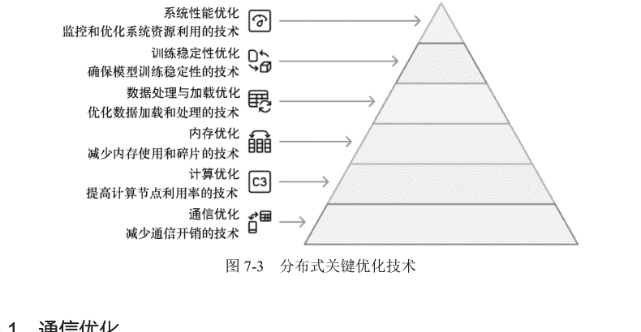

#### 7.3.1 通信优化
通信优化能缩短通信时间，使单元更高效协同，加速收敛；还能减少传输量，降低对网络带宽的依赖，节省资源；也能优化通信机制，便于扩展单元数量以适应更大规模模型和数据；同时可降低延迟和传输错误，提升系统稳定性和可靠性。几种大模型通信优化技术的区别如表 7-2 所示。

> ① 百度开发者中心。揭秘大模型分布式训练：多维混合并行的力量。

### 表 7-2 几种大模型通信优化技术的区别

| 技术名称 | 核心概念 | 实现方式 | 适用场景 | 优势 |
| :--- | :--- | :--- | :--- | :--- |
| 梯度压缩 | 通过压缩算法减少通信量 | 量化、剪裁、稀疏化等 | 大规模分布式训练 | 降低通信带宽需求，缩短通信时间 |
| 异步通信 | 非阻塞通信方式 | 使用非阻塞通信原语（如 NCCL 的 All-Reduce） | 需要高吞吐量的场景 | 提高训练速度，降低通信延迟 |
| 拓扑感知通信 | 根据网络拓扑结构优化通信路径 | 设计合理的网络拓扑（如星型、树型、网状等） | 大规模集群训练 | 降低通信开销，提高通信效率 |
| 通信与计算重叠 | 并行化通信和计算 | 当计算任务进行时异步执行通信操作 | 分布式训练 | 提高硬件利用率，缩短训练时间 |
| 混合并行策略 | 结合数据并行、模型并行和流水线并行 | 将不同的并行策略应用于不同的部分 | 超大规模模型训练 | 提高整体训练效率，充分利用资源 |
| 通信库与框架优化 | 优化通信库和框架的接口与性能 | 使用高效的通信库（如 NCCL、MPI）和优化的深度学习框架 | 各种分布式训练场景 | 提高通信效率，减少开销 |

这些技术在不同场景各有侧重。例如梯度压缩适用于大规模分布式训练，可显著降低通信量；异步通信适用于高吞吐需求场景，能提升训练速度；拓扑感知通信在大规模集群中可有效降低开销；通信与计算重叠通过并行操作提高硬件利用率；混合并行策略在超大规模模型训练中充分利用资源；通信库与框架优化适用于各类分布式训练场景。实际应用中需结合具体需求选择合适的优化手段。

##### 1. 梯度压缩
分布式训练中，各单元在反向传播后需对梯度进行全局聚合如 All-Reduce，然后更新参数。该过程涉及大量数据传输，尤其在集群规模较大时通信开销会显著拖累效率。梯度压缩通过减少需传输的梯度数据量来降低通信开销，提升训练效率。

梯度压缩：用低精度换带宽

把梯度从高精度格式降到低精度格式，比如把 32 位浮点压成 8 位整数，是分布式训练里最常见的降本手段。压缩后网络传输的数据量会被大幅压低，通常对收敛的干扰也很有限，因为只会保留梯度里权重更高的部分，例如绝对值较大的梯度，舍弃相对次要的成分。效果是通信开销肉眼可见地下降，但要格外小心，处理不当就会牵动收敛。

这套做法最适合超大规模集群和网络受限的环境。在上千卡一起训的场景里，通信常成为瓶颈，压缩能直接把数据量砍下来提速；带宽紧张时，它还能降低对网络的依赖。代价是量化和稀疏化会丢掉一部分梯度信息，可能拖慢收敛或影响最终效果，同时节点间的通信和数据处理逻辑会变复杂，实现难度上升。

##### 2. 异步通信：让节点不等就走

分布式训练里，异步通信允许节点在把数据发出后立刻继续干活，无需等对端回执。同步等待时间被压缩，设备利用率和整体训练效率因此提升。

常见落地形式有异步 All-Reduce、异步更新、流水线并行和异步执行。异步 All-Reduce 在反向传播算出梯度后就立刻触发全局聚合，不用等所有节点都算完，等待窗口被明显缩短。

在巨型集群里，通信占比高，异步能显著减少空闲；在算力捉襟见肘时，也能让资源被更充分使用。风险在于一致性难保证，需要版本控制、冲突检测等配套机制来兜底。而且异步的实现复杂度高，通信和计算的协同管理会增加开发和排错成本。

##### 3. 拓扑感知通信：顺着网络走最短路

拓扑感知通信会先读懂集群的网络结构，再据此规划通信路径和策略，从而降低延迟和带宽占用，提升分布式训练效率。

通过智能路由挑选最优路径，结合树形和环形拓扑的优点，动态调整路线以规避拥塞，整体通信更顺畅。

大规模集群网络错综复杂，通信开销大时，感知拓扑能更好地规划路径。对带宽有限的网络，也能减少占用。不足是需要对拓扑做精细分析和持续优化，动态网络下路径还要不断重算，维护负担加重。

##### 4. 通信计算重叠：边算边传

核心思路是让通信和计算同时进行，而不是串行等待，从而缩短空窗期，提升资源利用和训练速度。

实现上可借鉴异步通信、流水线并行和任务切分调度。通过并行执行，节点空闲时间被压缩，整体用时下降。设计时要合理规划数据流和调度，确保两类操作能真正重叠，复杂度会提升。异步场景下还需防止重叠带来的数据冲突，保证一致性。

##### 5. 混合并行策略：多管齐下

混合并行把数据并行、模型并行、张量并行和流水线并行结合起来，更好地利用算力和内存，解决大模型训练难题。常见组合有数据并行加模型并行、3D 混合并行、4D 混合并行等。

一边并行处理不同数据子集，一边用张量并行、流水线并行和分组参数切片来优化计算与通信，四种并行协同能让超大模型更高效训练，通信开销被压低。

当单机装不下模型时，混合并行能跨节点摊薄算力和内存压力，缓解显存不足；在资源受限时，也能提升利用率加速训练。通过多元并行，整体算力和内存被更充分使用，通信路径被优化，模型和数据的合理切分带来训练时间缩短。

代价是实现相对复杂，需要细致管理模型的切片、数据的划分和通信同步，开发调试难度上升。异步场景下还需防住通信与计算重叠带来的数据不一致。

##### 6. 通信库与框架调优

通信库和训练框架的选型与调参是性能优化的关键环节，目标是把通信效率拉满，提升训练表现。

通信库层面，重点在高效库的使用和配置。NCCL 专为 NVIDIA GPU 优化，单机多卡、多机多卡通信都很高效；Gloo 由 Facebook 开发，支持 TCP、UDP、RDMA 等多种后端，CPU GPU 通吃；MPI 是通用并行通信库，协议和硬件兼容性强，但调优工作量更大。

配置层面常用环形 All-Reduce 和分层通信。多机多卡时先在单机内聚合，再跨机通信，降低跨机开销。Hybrid+ 等算法就利用了单机高速带宽并减少跨机流量。

框架层面包括框架选择与优化、通信计算重叠、协议和网络优化。Horovod 基于环形 All-Reduce，兼容 TensorFlow、PyTorch 等，通过重叠提升效率。PyTorch Distributed 支持数据并行和模型并行，合理配置后能充分利用多节点。TensorFlow Distributed 支持多种并行和通信方式，调优参数服务器和工作节点可提升性能。

网络优化上，RDMA 允许用户态进程直连远端内存，减少延迟和带宽消耗，能明显降低通信开销；TCP/IP 优化也是常见手段。

#### 7.3.2 计算优化

计算优化通过混合精度、梯度累积和算子融合等手段降低计算负担，提升节点利用率和训练效率，对大规模模型和数据集尤为有效。

混合精度训练结合 FP16 和 FP32，在不明显损失精度的前提下大幅降低内存占用并加快计算。

梯度累积在多个小批次上累积梯度后才更新参数，模拟大批次效果，在显存有限时实现等效的大 batch，提升泛化与效率。

算子融合把多个连续独立算子合并为一个，减少计算和内存访问开销，提升执行效率。实现方式有基于规则的融合如 XLA、TVM，面向特定设备的遍历式融合，以及手动融合。TensorFlow 的 XLA 编译器能自动融合算子，减少访存。TVM 提供融合规则，可把多算子合并减少中间结果存储。特定设备优化常融合 Conv+ReLU、Conv+BN+ReLU、Dense+ReLU 等。开发者也可手动把卷积、BN、ReLU 合成一个算子。

#### 7.3.3 内存优化

内存优化能压低训练期的显存占用，提升利用率，支撑更大规模模型。

##### 1. ZeRO 技术
目标是削减参数、梯度和优化器状态的冗余存储。通过在分布式环境中分割这些数据，每个节点只保留部分，大幅降低内存需求。

三阶段逐级加深：第一阶段只切分优化器状态，如 Adam 的动量和方差；第二阶段再切分梯度；第三阶段进一步切分模型参数。越往后内存节省越明显，也越能训练超大模型。

##### 2. 梯度检查点
前向时只保存部分中间激活作为检查点，其余丢弃，反向时需要再重新算回来。标准反向需要保存全部激活，显存压力很大。检查点策略把显存占用可降低约 80%，换来少量重算，能在显存受限时用更大 batch。

##### 3. 激活值重计算
又称检查点重算。前向传播时只保留选定的检查点，其余激活产生后即丢弃；反向时根据检查点重新推算被丢弃的激活，避免全量常驻内存。

##### 4. CPU 卸载
把部分计算或数据从 GPU 搬到 CPU，利用 CPU 算力，减轻 GPU 内存和计算压力，提升整体效率。

常见做法有动态数据转移，如反向时把部分参数或激活暂存 CPU；异构计算，把预处理、后处理交给 CPU，矩阵运算留给 GPU；模型分割，把不同层分别放在 CPU 和 GPU 上执行，克服显存限制。

##### 5. 显存碎片整理
通过识别空闲块和已分配块，把相邻空闲块合并成更大连续空间，再重新分配，提升显存使用效率。

PyTorch 的显存管理包含 Block、BlockPool 和 DeviceCachingAllocator 三个核心组件，分别管理内存块、空闲池和缓存分配器，从而减少碎片影响。

##### 6. 数据集切分
把大数据集拆成多个数据片，让各节点并行处理不同片，提高加载和处理效率并减少显存占用。

实现可使用 DataLoader 实现打乱、批量化和并行加载；结合 DDP 确保各节点处理不同数据片；MindSpore 的 SlicePatches 接口支持在水平垂直方向切片 Tensor，适合高宽大的场景。

##### 7. 异构存储
在同一存储系统中混用不同介质，按访问频率和性能需求放置数据，提升性能和成本效益。

HDFS 支持 RAM_DISK、SSD、HDD、归档存储，并提供 Hot、Warm、Cold、All_SSD、One_SSD、Lazy_Persist 等策略。MindSpore 异构存储可在训练中把暂时不用的参数或中间结果搬到 Host 内存或硬盘，需要时再迁回设备，扩大可训练模型规模。

#### 7.3.4 数据处理与加载优化

分布式训练中，数据加载与预处理的速度往往决定整体效率。通过优化加载和预处理流程，可缩短等待时间并提升吞吐。

##### 1. CPU 或 GPU 流水线技术
把任务拆成多阶段并行处理，提升计算和数据处理速度。CPU 流水线把取指、译码、执行、写回等阶段并行化；GPU 流水线侧重大规模并行，常包括顶点处理、几何处理、光栅化、像素处理等，阶段协同提升渲染和计算效率。

##### 2. 内存映射技术
把文件系统数据直接映射到内存地址空间，减少 I/O 开销。程序可直接访问文件数据，无需一次性载入内存，特别适合大文件和随机访问场景。

大文件加载提速思路
借助操作系统提供的地址映射能力，把磁盘文件直接挂到进程的虚拟地址空间，程序就能像读写内存一样随机定位任意片段，无需整块载入也不用按顺序遍历，从而把超大文件的读取耗时拉低。

##### 3. 解压加速与体积压缩
压缩的核心是先减小体积，再靠高效解压快速还原。数据被压缩后占用更少存储、占用更少带宽，解压环节采用高性能算法即可在需要时迅速恢复，兼顾空间与时间。

##### 4. 数据加载与处理的实用招数
在流水线、映射、压缩之外，工程实践里还有一批高频优化手段。

- (1) 编译期数据流优化
通过控制流图在编译或运行期传播属性，典型操作有消除重复子表达式、常量折叠与传播，目的就是砍掉冗余计算。常在编译器与代码优化中使用，配合静态分析与动态优化来减少重复。
- (2) 算法与数据结构选型
选对算法与结构能直接提升速度并省资源。复杂度过高的方案比如二次方级别应尽量规避。
- (3) 代码级微调
常见手法有循环展开、改用更窄的数据类型、把浮点运算转为整数运算。通过提升执行效率缩短耗时，并通过重构剔除无用计算与多余内存访问。
- (4) 按需懒加载
长列表不必一次性全部拉取，按需分批进入可视区，避免启动慢与资源浪费。首次只取当前可见部分，其余延后到触发时再取。
- (5) 列表项缓存
为视口外项设定缓存长度，与懒加载配合保留已创建项的状态，适度预加载以让滑动更顺滑。
- (6) 动态预取
依据历史加载耗时动态调整视口外预取量，与懒加载联动，滑动时在后台实时补数。
- (7) 组件对象池
维护可复用的组件缓存池，短时间内重复使用已创建实例，避免频繁创建销毁的开销。
- (8) 布局扁平化
采用扁平层级减少嵌套与组件数，避免过度绘制，提升渲染效率。
- (9) 分批渲染
把大数据拆成若干小批依次处理与绘制，防止一次性渲染导致的卡顿。
- (10) 虚拟化列表
只绘制当前可见区域的数据，DOM 操作大幅减少，页面性能提升。
- (11) 数据增强与预处理优化
对输入做清洗、转换、标准化，提升模型学习效果。可使用随机裁剪、翻转、亮度调节等增强手段，以及标准化流程。
- (12) 乐观并发
默认冲突较少，允许多用户或多进程并行操作而非先加锁阻塞，缩短等待并提高吞吐。实现依赖版本控制与冲突检测保证一致性。
- (13) ETL 流程优化
精简抽取、转换、加载各环节，降低整体处理时长。
- (14) 并行化处理
利用多线程、多进程或分布式计算框架把任务切分到多个计算节点并行执行，加速整体处理。
- (15) 批式处理
把同类任务聚合成一批执行，降低重复开销。

这些手段从不同角度改善处理与加载效率，各自适配不同场景与数据规模。

#### 7.3.5 训练稳定性优化
分布式训练的稳定需要组合策略。常用做法包括梯度裁剪、权重初始化、归一化、学习率调节、数据增强、正则化、小批量训练、模型结构设计、提前停止、多任务学习、迁移学习、硬件与分布式计算、容错与弹性训练，合理搭配能显著提升收敛可靠性和效率。

梯度裁剪用于抑制梯度爆炸，设定阈值把梯度幅度限制在安全区间，避免参数更新过猛。
合适的初始化如 Xavier、He 能更快收敛并降低过拟合风险。
归一化对输入或中间输出做标准化，使其接近零均值单位方差，提升收敛速度与泛化能力并降低输入敏感度。常见有 Batch Normalization、Layer Normalization。
学习率设置关键，过大不稳过小收敛慢，可用衰减或动态调整让学习率随训练推移逐步下降，平衡稳定与速度。
数据增强与正则化能抑制过拟合，增强通过随机变换扩增样本多样性，正则化如 L1、L2、Dropout 限制模型复杂度。
大模型训练常结合小批量与分布式，小批量提升泛化并减小梯度方差，分布式把任务分摊到多机并行。
结构设计上可用残差连接或注意力机制提升信息传递与表达能力，缓解梯度消失与爆炸。
训练时持续监控验证集表现，按需提前停止或调参，避免过拟合与不稳定。
多任务学习与迁移学习也能增强稳定，多任务增加数据量与泛化，迁移学习在新任务上微调降低对大规模数据的依赖。
硬件层面借助 GPU、TPU 等加速，配合分布式计算与并行处理提升效率与稳定。
分布式环境下设备故障或网络问题可能中断，引入容错可保证连续性，常见有检查点、任务重试。例如 PAI-DLC 通过自研容错引擎 AIMaster、高性能 Checkpoint 框架 EasyCKPT、健康检测 SanityCheck 及计算节点自愈功能，有效解决多种稳定性问题。
集群资源动态变化时，自动调整任务分配可最大化利用率，确保资源波动下训练仍连续稳定。

#### 7.3.6 系统性能优化
分布式训练的系统优化覆盖通信、计算、内存与数据处理。核心方向包括异步与同步通信权衡、Pipeline 并行、局部梯度聚合、模型并行与数据并行结合、动态调整策略、数据通信优化、负载均衡与数据划分。优化资源分配与使用可缩短训练时间，提升准确性与泛化能力，同时提高利用率降低成本。

性能剖析工具、瓶颈识别与资源监控是优化关键。

##### 1. 性能剖析工具
这类工具记录程序执行时长与资源占用，帮助定位瓶颈。可检查内存使用、识别泄漏与不合理占用，提供优化建议，并提供可视化界面与报告。
常见工具包括 JConsole、VisualVM、FlameGraph 和 SkyWalking。JConsole 是 Java 提供的图形化监控工具，用于观测 JVM 性能与资源。VisualVM 是 Oracle 的多合一分析工具，可查看 CPU、内存、线程状态。FlameGraph 用热图可视化 CPU 剖析数据，展示执行路径耗时分布。SkyWalking 是开源分布式追踪系统，用于诊断分布式系统性能问题。

##### 2. 瓶颈识别方法
识别对象主要分网络、数据库、应用服务器与代码。
网络瓶颈关注传输效率与拥塞；数据库瓶颈关注查询性能、索引设计与表结构；应用服务器瓶颈关注配置、线程池与并发能力；代码瓶颈关注执行效率、资源消耗与内存泄漏。
计算瓶颈常通过算子性能分析。分析 Profiling 数据，看是否有异常耗时的算子，可尝试替换等价算子并反馈。正常时耗时应集中在 Matmul、Flash Attention 等计算密集算子上，若出现异常算子导致瓶颈，需替换并提交算子性能 Issue。
通信瓶颈主要看通信耗时。分析是否可用更优分布式策略，检查中间表示 IR 是否存在不合理重分布。可通过 Profiling 获取训练进程的通信时长占比，已掩盖通信与计算并行不影响效率，未掩盖通信会让计算等待，需优化。
内存瓶颈可检查是否存在异常大 Tensor，是否有可融合算子以降低激活内存。在内存富裕时可调整重计算策略，用内存换性能，或减少模型切分数以降低通信开销。
数据瓶颈要看读取速度是否满足训练需求，若慢则优化读取与预处理流程，采用并行或批处理。异步训练下参数更新频率不一致可能导致数据不一致，需设计参数服务器、环形同步等同步机制。
系统瓶颈要兼顾硬件资源利用率与软件框架性能。检查 CPU、GPU、内存使用是否充足，不足时扩容或优化分配；框架性能不达标可更换或优化。
辅助工具如 MindStudio Insight、PyTorch Profiler、HolisticTraceAnalysis 能提供细节数据，快速定位问题。

##### 3. 资源利用监控
实时监控 CPU、内存、磁盘 I/O、网络等资源使用。主要工具分 APM、系统监控与日志分析。
APM 如 New Relic、Dynatrace 用于监控应用性能；系统监控如 Prometheus、Grafana 用于资源使用；日志分析如 ELK Stack 用于解析应用与系统日志。

### 7.4 启动分布式训练
分布式训练流程包括环境初始化、数据准备、模型定义与配置、训练过程、性能监控与优化、模型保存与评估。合理安排各环节可显著提升效率与模型性能。

#### 7.4.1 模型配置
模型配置决定模型如何在多设备上分布协同，主要内容有模型定义、并行策略选择、通信机制配置与内存管理。
模型定义需明确结构与参数，适合分布式环境。可使用 PyTorch、TensorFlow 等框架，并设计为可分割结构，便于在不同设备执行。例如 Transformer 的编码器与解码器可分别部署到不同 GPU。
并行策略根据模型与数据特点选择，包括数据并行、模型并行、流水线并行与专家并行。
通信机制配置用于优化参数同步与数据传输，减少开销。可使用 NCCL 等高效通信库加速 GPU 间通信。
内存管理用于减少使用并提高效率。可采用混合精度训练如 FP16，或梯度检查点技术保存中间激活值以降低内存占用。

#### 7.4.2 训练脚本编写
脚本涉及初始化环境、数据加载与分布式采样、模型封装与优化器配置、训练循环与梯度同步、学习率调度与模型保存。
初始化分布式环境用于设置通信参数，确保各进程能正确连接通信。脚本开头初始化环境，设置 rank 与 world_size。
数据加载与分布式采样确保每个 GPU 处理不同子集，提升加载效率。常用 DistributedSampler 保证各 GPU 获取不同批次。
模型封装与优化器配置把模型转为分布式形式并配置优化器。常用 Distributed Data Parallel 包装模型并配置优化器。
训练循环与梯度同步实现前向、反向与参数更新，并确保梯度在多 GPU 之间正确同步。循环中完成前向传播、损失计算、反向传播与优化器更新。
学习率调度与模型保存用于按训练进度调整学习率，提升收敛速度与稳定性，并定期保存模型防止中断。可使用调度器动态调整学习率，并在每个轮次或指定迭代次数后保存模型。

#### 7.4.3 一个基于 PyTorch 的分布式训练脚本
示例展示多 GPU 下的分布式训练流程。脚本使用 torch.distributed.init_process_group 初始化环境，每个进程绑定一个 GPU，定义简单网络，用 DistributedSampler 保证各进程处理不同数据，用 DDP 包装模型。每轮训练设置采样器 Epoch 保持随机性，仅主进程保存模型，训练结束时清理环境。

```python
import torch
import torch.distributed as dist
import torch.nn as nn
import torch.optim as optim
from torch.nn.parallel import DistributedDataParallel as DDP
from torch.utils.data import DataLoader, DistributedSampler, TensorDataset
import argparse
```

```python
# 定义一个简单的神经网络
class SimpleNet(nn.Module):
    def __init__(self):
        super(SimpleNet, self).__init__()
        self.fc1 = nn.Linear(784, 128)
        self.fc2 = nn.Linear(128, 10)

    def forward(self, x):
        x = torch.relu(self.fc1(x))
        x = self.fc2(x)
        return x

def train(rank, world_size, args):
    # 初始化分布式环境
    dist.init_process_group(
        backend='nccl',
        init_method='env://',
        rank=rank,
        world_size=world_size
    )

    # 设置设备
    device = torch.device(f'cuda:{rank}')

    # 创建模型
    model = SimpleNet().to(device)

    # 包装模型为分布式数据并行
    ddp_model = DDP(model, device_ids=[rank])

    # 创建数据集
    train_data = torch.randn(1000, 784)
    train_labels = torch.randint(0, 10, (1000,))
    dataset = TensorDataset(train_data, train_labels)

    # 创建分布式采样器
    sampler = DistributedSampler(dataset, num_replicas=world_size, rank=rank)

    # 创建数据加载器
    dataloader = DataLoader(dataset, batch_size=args.batch_size, sampler=sampler)

    # 定义损失函数和优化器
    criterion = nn.CrossEntropyLoss()
    optimizer = optim.Adam(ddp_model.parameters(), lr=args.lr)

    # 训练模型
    for epoch in range(args.epochs):
        ddp_model.train()
```

# DeepSeek 企业落地手册

```python
        sampler.set_epoch(epoch)
        total_loss = 0.0

        for batch_idx, (data, target) in enumerate(dataloader):
            data, target = data.to(device), target.to(device)
            optimizer.zero_grad()
            output = ddp_model(data)
            loss = criterion(output, target)
            loss.backward()
            optimizer.step()
            total_loss += loss.item()

        # 在主进程中打印损失
        if rank == 0:
            print(f'Epoch {epoch + 1}, Loss: {total_loss / len(dataloader)}')

    # 保存模型（仅在主进程中）
    if rank == 0:
        torch.save(ddp_model.module.state_dict(), 'model.pth')

    # 清理分布式环境
    dist.destroy_process_group()

if __name__ == '__main__':
    parser = argparse.ArgumentParser(description='Distributed Training Example')
    parser.add_argument('--nodes', default=1, type=int, help='number of nodes')
    parser.add_argument('--gpus', default=2, type=int, help='number of GPUs per node')
    parser.add_argument('--epochs', default=10, type=int, help='number of epochs')
    parser.add_argument('--batch_size', default=32, type=int, help='batch size per GPU')
    parser.add_argument('--lr', default=0.001, type=float, help='learning rate')
    args = parser.parse_args()

    world_size = args.nodes * args.gpus

    # 设置环境变量
    import os
    os.environ['MASTER_ADDR'] = '127.0.0.1'
    os.environ['MASTER_PORT'] = '29500'

    # 启动分布式训练
    torch.multiprocessing.spawn(train, args=(world_size, args), nprocs=world_size, join=True)
```

## 第 8 章 让大模型与专业AI形成合力

通用大模型正快速迭代的同时，面向垂直场景的企业级AI产品也在集中爆发，比如IBM Watson机器学习平台、Google Vision AI视觉分析工具、百度UNIT智能客服与对话系统、DataRobot预测分析平台等。这些专业工具在各自赛道里发挥着关键作用。

把DeepSeek这类通用大模型与企业级专用AI联动使用，能让企业能力更完整，效率进一步提升。

### 8.1 融合的动因

通用LLM与专用AI工具在技术底座上同源，都依赖数据喂养，都要持续学习进化，但数据依赖度、应用侧重点存在差异，形成互补空间。

#### 8.1.1 通用模型与垂直AI的差异

两者都建立在深度学习之上，都需大量数据训练来实现理解、分析和生成，表现都受数据质量和规模制约。实践中可以互相增强，通用模型为专用AI提供更自然的语言交互入口，专用AI则提升通用模型在细分领域的专业度，双方都需要持续演进。

DeepSeek等通用大语言模型与各类专用AI在本质上仍有区别，具体对比见表8-1。

表8-1通用大模型与专业AI对比概览

|维度|DeepSeek等通用大语言模型|专用AI|
|---|---|---|
|通用性|适用范围广，可处理生成、问答、翻译等多类自然语言任务|聚焦特定领域或任务，如医疗影像判读、金融风控等，跨场景迁移弱|
|推理能力|擅长复杂逻辑、多步推理和深度思考|在定点任务上执行精准高效，复杂推理能力相对逊色|
|多模态处理|通常支持文本、图像、语音等多模态融合|多集中于单一模态，跨模态融合能力有限|
|数据依赖|依托大规模预训练，对增量数据依赖度相对低|高度依赖高质量垂直数据，数据匮乏时效果明显下滑|
|扩展与定制|架构开放、接口友好，便于集成、二次开发和插件扩展|功能相对固化，扩展定制难度大，集成常遇接口不兼容|
|成本效益|开源通用模型如DeepSeek部署成本更低|开发部署投入高，尤其在算力和数据采集上|

#### 8.1.2 双方的制约因素

通用大模型易出现逻辑断层、事实性错误如编造文献、幻觉现象，在复杂推理和跨领域场景下不稳定；训练部署成本高昂，对硬件和能耗要求大；对垂直领域深度知识理解不足，难以满足内部数据融合、角色扮演等定制化需求。专用AI虽在细分场景精度更高，但泛化能力弱、场景适应性差，依赖行业专家搭建知识库，面临数据孤岛与更新滞后问题。

##### 1.DeepSeek的局限

DeepSeek作为通用LLM，具备强推理和多模态潜力，但短板明显。除上述问题外，还存在逻辑范式局限、多模态融合不足、知识更新滞后与准确性风险、复杂长链推理受限、专业深度不够等。

其推理依赖预设逻辑范式，对需要创新思维或跳出框架的问题处理乏力；虽支持多模态，但深度融合和协同处理仍不足，复杂多模态任务表现一般；知识更新存在延迟，无法实时获取新信息，知识库可能含过时或错误内容；超长思维链任务易因链路过长而推理不完整；通用模型在高度专业化任务上的精度不及领域专训模型。

##### 2.专用AI的局限

与通用LLM相比，专业AI主要存在以下不足，对比如图8-1所示。

（1）通用性偏弱
专业AI多针对特定领域优化，如医疗影像分析、金融风险评估，超出目标场景即失效。通用LLM适用性更广，能处理多类自然语言任务。
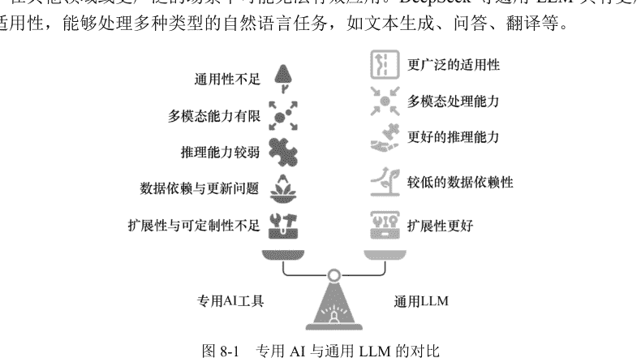
面对新问题，专业AI通常需重训或调参，适应性较弱。通用LLM仅需提示或指令调整即可快速迁移。

（2）多模态能力受限
多数专业工具只处理单一类型数据，如文本、图像或语音。通用LLM普遍具备多模态整合能力。部分专业AI虽能多模态输入，但在深度融合上仍不及通用模型。

（3）推理能力相对不足
处理需要复杂逻辑和深度思考的任务时，专业AI难以企及通用LLM。数学求解、编程等长逻辑链场景，通用模型推理更稳。通用LLM在上下文语义把握上优势明显。

（4）数据依赖与更新问题
专业AI性能高度依赖特定领域高质量数据，数据不足或质量差时表现受损。通用LLM因大规模预训练，对数据依赖相对较低。两者都存在知识更新滞后，难以及时处理时效性信息。

（5）扩展性与可定制性不足
专业AI功能模块固定，难以灵活扩展和个性化定制。通用LLM可通过二次开发、插件实现功能扩展。集成时专业AI易出现接口不兼容、数据格式不一致，增加成本。通用LLM架构更开放、接口更友好。

#### 8.1.3 融合后的新能力

通用LLM与专业AI结合，可融合广度理解与垂直能力，实现灵活性与专业性互补，覆盖多场景并提升复杂任务准确率与效率，降低幻觉风险，增强行业适配。

##### 1.DeepSeek赋能专业AI

结合后可带来四方面提升。
一是语义理解与交互升级。专业AI在领域执行强但自然语言理解有局限，借助DeepSeek可更精准解析用户指令，提供更贴合意图的答复。
二是逻辑推理与决策增强。DeepSeek的复杂推理能力可帮助专业AI在金融风控等场景中多因素权衡，判断更全面。
三是场景与功能拓展。视觉识别类专业AI接入DeepSeek后，可新增图文理解与生成能力，提供更丰富的检索与分析服务。
四是多模态数据融合。DeepSeek可整合文本、图像、语音，帮助专业AI在智能驾驶等复杂场景提升感知与决策安全。

##### 2.专业AI赋能DeepSeek

专业AI可为通用模型补充垂直知识与技能。例如医疗影像分析专用AI结合后，能让DeepSeek在医疗领域具备更深入理解与更专业的处理能力。

### 8.2 与办公协作AI工具钉钉的融合

办公协作领域产品众多，如Google Workspace、Slack、WPS AI、Microsoft 365、Notion AI、360AI办公等。融合深度不一，部分工具仅做简单集成，部分实现深度功能融合。钉钉、AingDesk、ChatDOC等与DeepSeek协同更紧密。钉钉在企业协作上能力强，结合DeepSeek后可提供更智能的助手服务。AingDesk侧重模型部署与可视化，结合后便于本地化使用。

下面以钉钉为例展开。

#### 8.2.1 钉钉的应用范围与短板

钉钉是阿里巴巴打造的企业级智能移动办公平台，覆盖互联网、医疗、教育、制造等全行业。智能化层面仍有不足：智能功能深度和广度有限，复杂业务场景的深度分析不如专业AI；高级智能分析和预测能力有待提升，洞察不够精准；定制化和灵活性不足，特殊需求企业需额外开发集成。

#### 8.2.2 融合带来的新价值

DeepSeek与钉钉在多个维度形成互补，融合价值如图8-2所示。
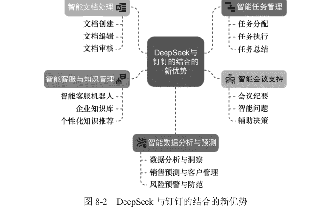
##### 1.智能文档处理

# 钉钉×DeepSeek：让办公从文档到决策全流程智能化

通过接口把 DeepSeek 的语言理解能力嵌入钉钉文档系统，帮助用户快速起稿、校对润色、提炼要点，提升文案品质。

（1）具体落地环节
- ① 新建文档时，用户输入主题与类型，DeepSeek 便据此生成提纲并填充初稿。
- ② 编辑过程中，系统实时审校语法、拼写、语义，并推送改进建议。
- ③ 初稿完成后，自动抽取核心信息生成摘要，方便审核人员快速判断重点。

（2）带来的效能变化
内容创作方面，系统可按关键词或主题生成高质量文稿，如周报、项目方案等。以项目策划为例，仅提供背景与目标，就能输出含市场研判、落地计划、费用预算的完整材料。
校对润色方面，对错句与表达不清之处进行识别并推荐修改，使行文更流畅准确。
摘要提取方面，对长篇合同、报告等快速归纳要点，用户可通过摘要锁定重点，节省阅读时间。

（3）实现路径
先部署 DeepSeek 服务，在钉钉内创建应用承载助理功能，再赋予机器人权限。
连接常用阿里云计算巢的 AppFlow：挑选标准流程，配置 DeepSeek 鉴权 Token，配置钉钉应用的 Client ID 与 Client Secret，填写模型名称及卡片模版 ID，发布连接流。
机器人部署：将应用加入群组，设消息接收为 HTTP 模式，地址指向 AppFlow 产出的 Webhook，发布配置。
钉钉提供开箱即用的模版，可一键搭建基于该模型的智能助理，涵盖文档处理、流程自动化、低代码支持。文档处理借助引擎快速生成摘要并解读内容；流程自动化实现周报生成、待办管理等闭环；宜搭平台结合模型能力，可生成 Prompt 用于数据分析与文本生成。
为保障安全可采用私有化部署，独享计算资源避免高峰拥堵。配置完毕后先测试交互，再在钉钉内正式上线，邀请团队试用。按此流程，企业能快速在钉钉上启用智能助理，实现文档自动化与流程提效。

##### 2. 智能任务管理
钉钉任务模块结合 DeepSeek 的分析能力，实现更合理的事项指派、进度实时跟进以及重复工作的自动化，提升整体执行效率。

（1）具体落地环节
- ① 事项指派，DeepSeek 综合任务类型、难度、截止时间，结合成员技能、当前负荷和过往表现，智能推荐指派方案。
- ② 执行期间，持续收集进度信息，包括已完成工作量、遇到的阻塞等，并及时反馈给项目负责人。
- ③ 任务收尾后自动生成复盘报告，涵盖完成情况、问题及对策、经验沉淀，方便团队复盘与分享。

（2）带来的效能变化
分配与提醒上，系统依据技能和负载智能推荐执行人，并自动推送提醒，确保项目推进不掉线。通过历史完成记录和专业技能匹配，为每个任务找到最合适的人选。
进度跟踪与预测上，系统实时监控进展并预测完成时间，提前识别延期风险。基于历史数据和当前进展，为管理者提供准确的进度报告和预警，支持计划动态调整。
自动化上，系统能识别并自动执行重复性操作，如数据录入、文件归档等。例如定期财务报表整理可由模型自动从源系统抽取数据，按预设格式生成，无需手工操作。

（3）实现方法
整体思路与智能文档处理类似，差异主要在模版与功能配置。钉钉提供预设模版，支持分配提醒、进度跟踪预测、任务自动化。
针对分配提醒，钉钉机器人接收任务指令，模型解析内容，通过钉钉 API 将任务派发给指定成员并设置提醒。需构建分配模型，输入为任务特征和成员特征，基于历史数据训练最优策略。
针对进度跟踪，结合宜搭低代码平台，利用模型分析任务评论和更新记录，通过关键词提取和语义理解实时解析进展与问题。
针对自动化，通过钉钉自动化流程结合模型的生成与分析能力，实现重复任务的自动触发与执行。可预设触发条件，满足后自动启动流程，如自动生成总结、调整优先级等。

##### 3. 智能会议支持
将语音识别、自然语言理解与文本生成能力嵌入钉钉会议模块，可在纪要生成、智能问答辅助决策、内容提炼等方面带来提升。

会议纪要生成上，系统自动把语音转文字并形成结构化纪要，包含主题、参会人、要点、行动项等，方便会后回顾。
智能问答与决策辅助上，会中可实时解答提问并提供数据支持，例如讨论市场前景时可迅速调取调研数据和报告辅助判断。
内容总结与提炼上，系统突出重点和关键决策，帮助参与者快速对齐认知，对跨部门或大型项目会议尤为关键。

具体环节包括：
- ① 会议准备，创建会议邀请时 DeepSeek 根据主题和议程自动生成准备材料，如相关文档和数据。
- ② 会议进行，通过语音识别实时转写并展示，同时进行语义分析提取讨论要点和待办事项。
- ③ 会议结束，基于记录和关键信息自动生成纪要并推送给参会人，同时形成总结报告。

结合方法上，先集成语音识别与转写，将语音能力与钉钉会议音频输入打通，支持多语种多方言。随后应用 NLU 与 NLG，对转写文本进行语义分析与信息抽取，识别实体、事件和关系，生成流畅纪要。最后开发智能问答，会中提问经语义理解后从知识库和会议上下文检索答案，及时反馈。

##### 4. 智能客服与知识管理
钉钉客服与知识库结合对话与检索能力，可打造更智能的客服机器人、完善企业知识库并实现个性化知识推荐。

智能客服机器人可接入内部知识库和 FAQ，实现 24 小时在线咨询，提升满意度。
知识库建设上，系统自动整理优化资料并生成知识图谱，提升查找效率。对海量文档进行分析抽取要点并建立关联，形成结构化体系。
个性化推荐上，根据岗位、技能和工作需求推送相关学习资源，帮助新员工快速上手，老员工持续成长。

结合环节包括客服接待、知识检索、知识推荐三步。
- ① 接待环节，用户通过钉钉客服发起咨询，机器人利用 NLU 识别意图和关键词。
- ② 检索环节，在企业知识库中精准检索相关条目和答案。
- ③ 推荐环节，结合岗位信息、工作记录和学习历史推送个性化知识。

实现上，先训练客服模型，利用 NLP 与深度学习能力，输入问题文本输出答案文本，基于大量问答数据提升准确性。再构建知识图谱，通过实体识别和关系抽取把文本转为结构化图谱，便于检索与关联。最后开发个性化推荐算法，输入员工画像和行为数据，采用协同过滤与内容推荐为其推送适配资源。

##### 5. 智能数据分析与预测
分析与预测能力对接钉钉企业管理数据，可在洞察、销售预测与客户管理、风险预警三方面提升效能。

数据洞察上，对海量销售、市场、客户数据进行多维分析，挖掘增长点和潜在风险，为战略制定提供依据。
销售预测与客户管理上，基于历史销售和交互记录提供客户画像与购买意向预测，助力精准营销和个性化服务。
风险预警上，实时监测财务、市场等运营指标，异常时及时推送预警，降低企业风险。

具体流程包括数据收集、分析、预测与预警。
- ① 收集环节，钉钉汇聚内部工作与业务流程数据，同时接入外部市场与行业数据。
- ② 分析环节，对数据清洗、预处理和特征提取后，使用机器学习与深度学习挖掘规律。
- ③ 预测与预警环节，构建预测模型并设置风险阈值，超出时通过钉钉消息推送通知相关人员。

实现上，先整合数据源，采用数据融合解决格式不一致与缺失问题，确保完整准确。再选用适配算法，如时间序列与线性回归用于销售预测，聚类与决策树用于客户分类。最后建立风险预警模型，结合业务特点与指标体系实时监测关键指标，触发预警后通过消息、邮件等方式通知处理。

### 8.3 与知识管理工具 HelpLook 的结合
知识管理通过流程、工具和方法对企业内外知识进行获取、存储、共享、应用和创新，提升决策质量与运营效率。近年知识管理领域出现多款 AI 产品，如聚焦知识管理、智能客服与数据分析的 HelpLook，以及 Zendesk Knowledge Base 等，各有侧重。

#### 8.3.1 DeepSeek 在知识管理领域的短板
- ① 时效性不足。DeepSeek-V3 知识截止 2024 年 7 月，R1 版本截止 2023 年 12 月，难以覆盖最新行业动态与政策。
- ② 专业深度有限。医疗诊断、工程计算、法律实务等领域准确性与推理能力不足。
- ③ 复杂逻辑推理弱。多步博弈、哲学思辨、数学证明等场景准确率偏低。
- ④ 多模态能力缺失。对图像、视频等非文本内容解析能力弱，难以图文混合创作或深度视频分析。
- ⑤ 安全与隐私风险。经第三方 API 部署时存在泄露与未授权访问风险。

#### 8.3.2 DeepSeek 与 HelpLook 结合的必要性
HelpLook 是一款易用的知识管理工具，支持自定义提示词与 API Key，可打造专属 AI 问答机器人并集成至网站、App、小程序。
在外包知识管理场景，零售电商、金融科技、互联网企业普遍使用 HelpLook。对多语言、多团队协作的复杂场景，需 DeepSeek 的 NLP 与多模态处理能力提升检索与推荐精准度，打破语言壁垒。
零售电商领域，HelpLook 提供知识与客服支持，面对海量市场与用户行为数据时，需 DeepSeek 的智能分析与预测能力提升决策科学性。
金融科技领域，处理敏感金融数据与交易监控时，需 DeepSeek 的安全与隐私保护及强数据分析能力，提升风险评估效率。
互联网企业在多外部技术团队协作中，需 DeepSeek 的自动化与智能工作流能力提升任务分配与流程优化效率。
结合更高级模型可弥补 HelpLook 的不足，进一步提升智能化水平。

#### 8.3.3 DeepSeek 与 HelpLook 结合的新优势
HelpLook 本身在知识管理、智能客服与数据分析方面表现突出，DeepSeek 的 NLP 与多模态处理能力可进一步优化其客服与知识管理功能，提供更精准的搜索与推荐，提升知识管理效率与体验。DeepSeek 与 HelpLook 结合的新优势如图 8-3 所示。

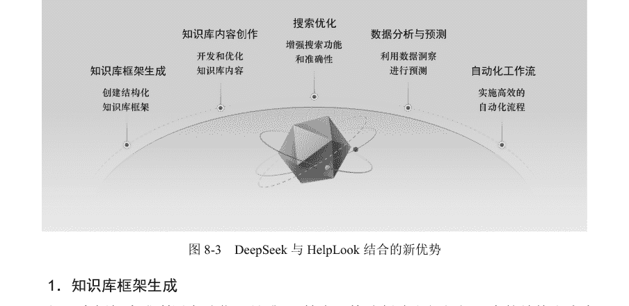
图 8-3 DeepSeek 与 HelpLook 结合的新优势

##### 1. 知识库框架生成

框架速搭的思路
借助自动化工具或 AI 手段，知识库骨架能在很短时间内成型并完成结构化梳理。核心动作是先厘清主类目、下级类目以及各类内容模块，并把模块之间的逻辑关系理清。

这种框架化做法对提效、保全、提升体验、支撑后续扩展以及方便维护都有明显助益。自动化手段能把原本需要大量人工投入的设计与组织成本大幅压缩，尤其在体量大、内容复杂的场景下效果更突出。体系化的方法可确保主题覆盖面齐全，避免关键信息被遗漏。结构清晰的骨架能让使用者更快定位所需内容，满意度随之提升。好的底座也让后续的更新与扩充变得顺畅，知识库能够持续跟上企业变化。

HelpLook 自主生成的框架在逻辑严谨度上还有提升空间，需要人工二次校准与优化；生成结果往往偏通用，很难贴合特定企业的专属诉求；语种能力不足，限制了海外应用；部分领域或主题的覆盖广度与深度不够，还需人工补充。

把 DeepSeek 和 HelpLook 联用，可以补足上述短板。

- 按需定制。借助 DeepSeek 的智能分析，能够依据企业的具体需求和行业特征，产出更贴合业务的知识库框架。
- 多语种覆盖。DeepSeek 的多语种处理能力强化了 HelpLook 在多语种框架生成上的表现，助力企业全球化落地。
- 范围拓展。DeepSeek 的知识图谱与语义理解能力可帮助框架更深入、更宽泛地覆盖主题，丰富内容面。

两者联动还能提升生成准确度。DeepSeek 的语义理解与逻辑推理让框架的相关性更强，减少人工校正量，条理与逻辑性得到增强。推理能力让输出的框架更符合逻辑、层次分明，便于查阅使用。多语种支持让 HelpLook 在国际化企业中发挥更好。知识图谱的加持让框架涵盖更广的领域与更深的主题，提升实用价值。

协同环节概览：

- 需求分析。使用者向 DeepSeek 阐述知识库的目标、受众和核心范围，DeepSeek 据此给出初步框架建议。
- 框架生成与优化。DeepSeek 依托 NLP 与逻辑推理生成初稿，并做逻辑与条理上的优化。
- 专属调整。使用者按企业具体需求对框架做个性化修改，DeepSeek 可提供进一步建议与优化方案。
- 语种处理。需要多语种时，DeepSeek 可自动翻译并调整框架内容，保证各语种版本一致且准确。
- 范围扩展。通过知识图谱与语义理解，DeepSeek 拓展框架的深度与广度，确保主题与内容不遗漏。

##### 2. 知识库内容生产
知识库内容生产指用自动化工具或 AI 技术快速生成、优化文章、指南、FAQ 等内容。流程覆盖生成、编辑、校对与优化，确保内容可用。

自动化生成大幅减少了人工撰写的时间成本，尤其在大批量需求下。AI 可降低人为失误，保持内容一致性。高质量内容提升查找效率与使用者满意度。好的生产工具也让后续更新与扩展更方便，知识库随业务演进。

自动生成的内容在逻辑性、连贯性与专业度上可能不足，需要人工再优化；输出也容易偏通用，难以完全满足企业专属诉求。

DeepSeek 与 HelpLook 联合，可在质量、专属定制、多语种、范围拓展上同步提升。NLP 与逻辑推理技术帮助优化自动生成内容，使其更准确、连贯、专业。智能分析可依据企业需求与行业特点生成更专属的内容。多语种处理技术强化 HelpLook 的多语种生产能力。知识图谱与语义理解帮助产出更深入、更宽泛的内容。

具体结合点：

- 生产。使用者向 DeepSeek 下指令生成文章初稿，也可上传原始文件或产品资料，DeepSeek 提取要点并依语义理解生成完整的说明性内容。
- 优化。DeepSeek 对生成内容进行语法检查与纠错，并做语义优化，提升连贯性与逻辑性。
- 多语种支持。DeepSeek 支持多语自动翻译，可把内容快速转为不同语种；使用者也能通过 DeepSeek 多语交互编辑各版本内容。
- 范围扩展。借助知识图谱关联相关知识，拓展内容深度与广度；语义搜索功能帮助使用者快速找到相关内容，提升实用性。

##### 3. 检索增强
检索增强是一套技术与策略，旨在提高知识库在搜索引擎中的可见度与使用者搜索体验，让使用者更快更准地找到信息。涉及关键词、URL 结构、元标签优化，以及通过 AI 提升结果相关性与准确性。

传统优化多依赖关键词匹配，对搜索意图理解不深，易导致结果不准。多语种检索处理能力弱，制约国际化。难以实时更新，无法及时反映内容变化。缺乏个性化推荐，无法基于历史行为给出定制结果。

DeepSeek 与 HelpLook 结合可改善上述问题。NLP 与语义理解让系统更准确把握搜索意图，返回更相关的结果。多语种处理提升多语检索表现。实时分析与更新保证信息时效。基于历史行为与偏好的个性化推荐得以实现。

具体结合：

- 语义检索。使用者在 HelpLook 中输入查询，DeepSeek 进行语义分析把握真实意图，按分析结果从知识库检索最相关内容并返回。
- 多语种支持。DeepSeek 可处理多种语种查询，自动识别意图并翻译知识库内容，保障不同语种使用者获取准确信息。
- 知识库实时更新。DeepSeek 定期检测内容更新，确保检索结果及时，按更新动态调整结果。
- 个性化推荐。DeepSeek 分析使用者历史检索记录与行为模式，据此提供个性化结果与推荐内容。

##### 4. 数据洞察与预测
数据洞察与预测通过集成分析工具与机器学习算法，对知识库使用数据、使用者行为数据等进行深度挖掘，发现模式与趋势并做预测。涵盖检索行为、文章访问量、使用者反馈分析，及基于数据的建模。

HelpLook 自带分析在深度与复杂建模上存在不足，难以满足高级需求。预测功能较为简单，精度有限，复杂业务场景下表现不佳。整合外部数据源与多渠道数据的能力受限，影响分析全面性。实时性不足导致数据时效性差。

DeepSeek 的高级分析与机器学习能力可弥补深度不足，提供更深入洞察。预测建模功能提升精度，尤其在复杂业务中。能整合多种外部与多渠道数据，实现全面分析。实时分析能力保障结果时效。

结合方式：

- 数据收集与整合。将 HelpLook 的使用者行为与使用数据上传至 DeepSeek 数据管理平台，与其他业务数据整合形成完整数据集。
- 分析与建模。DeepSeek 自动识别并处理缺失值、异常值与重复数据，保证准确一致；运用机器学习深入分析挖掘规律趋势；构建预测模型预测使用者需求、市场趋势等，为决策提供支持。
- 结果输出与可视化。分析结果自动生成详细报告，支持 Word、PPT、PDF 等格式；提供图表等可视化工具，便于理解与分享。
- 实时更新与优化。DeepSeek 实时处理新数据，保证时效性，并基于新数据与反馈不断优化模型，提升预测与分析精度。

##### 5. 自动化作业流
自动化作业流利用自动化工具与 AI 技术把企业内部重复性任务与业务流程自动化，降低人工干预，提升效率与准确性。覆盖任务分配、数据处理、内容生成、客户服务等。

HelpLook 在处理极复杂任务时表现有限，尤其多步骤多条件判断场景。实时数据处理与响应能力可能不足。跨渠道系统数据整合有限，影响全面性与准确性。专属需求常需额外定制开发。

DeepSeek 与 HelpLook 结合可针对性解决。

任务模块化设计层面，将复杂业务流程拆分为多个简单任务模块，各模块负责独立功能；用 DeepSeek API 与工具为各模块实现自动化，如数据处理、内容生成。

智能任务处理层面，借助 DeepSeek 的数据清洗与转换功能自动化处理原始数据，保证准确一致；利用文本、图像、语音生成能力自动化创建报告、文档等内容。

实时数据分析层面，将实时数据源接入 DeepSeek，确保作业流获取最新业务数据；用实时分析与预测模型为自动化流程提供即时决策支持。

专属定制层面，根据企业具体业务需求分析与定义自动化流程；使用 DeepSeek 开发工具与 API 定制化实现特定自动化任务与流程。

### 8.4 智能客服与对话工具助小咖的组合
智能客服与对话工具运用 AI 技术，通过 NLP、机器学习、语音识别等实现 24 小时不间断自动交互，提供常见问题解答、多轮对话、复杂需求理解，提升满意度与运营效率。

可自动化处理大量重复任务，如订单查询、账户管理，缩短人工操作时间；快速准确响应增强体验；降低人力与运营成本；通过数据与行为分析提供业务洞察，支持决策；依据历史交互提供专属推荐，提升满意度。

#### 8.4.1 DeepSeek 直接作为智能客服与对话工具的短板
DeepSeek 拥有强逻辑推理、多语种支持、高效低成本、开源灵活部署等优势，在特定条件下可直接充当智能客服。

短板在于处理复杂任务时推理稳定性不足，尤其复杂格式与深度逻辑推理方面；缺乏图像、视频生成等多模态能力，限制场景落地；训练与数据处理方式存在隐私安全隐患，易引发数据可信度质疑；硬件资源需求高、私有化部署成本高；开发者社区问题解决率低、活跃度下降；使用者主要集中国内，国际化布局有限、知名度较低。

#### 8.4.2 助小咖作为智能客服与对话工具的短板
“助小咖”是联想集团自研的智能客服与对话工具，在政务、教育等行业适配性好，满足特定行业需求。具备较好多模态处理能力，可处理图像、视频等数据，适用场景更丰富。数据安全与隐私保护措施严格，保障使用者数据安全。

从智能化看，逻辑推理能力相对较弱，复杂问题解答能力有限。多语种处理种类与效果不及 DeepSeek。

#### 8.4.3 助小咖与 DeepSeek 组合的新优势
DeepSeek 与助小咖互补性强。DeepSeek 的逻辑推理与多语种能力可弥补助小咖短板，助小咖的多模态与行业适配性为 DeepSeek 提供更多落地场景。组合后服务更全面准确，使用体验更好。助小咖完善的数据安全与隐私保护为 DeepSeek 提供保障，增强使用者信任。助小咖与 DeepSeek 组合带来的新优势如图 8-4 所示。

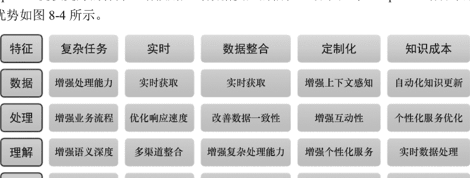

##### 1. 复杂任务处理能力提升
（1）助小咖在复杂任务处理能力方面的短板
- 多轮对话逻辑连贯性不足，处理需多轮且逻辑关系复杂的任务时，对话易断裂，使用者需重复表达或澄清。
- 复杂业务流程处理能力有限，面对多步骤、多条件判断或跨部门协作流程时，分解与处理效率低，易出错。
- 语义理解深度不足，遇到复杂句式、专业术语或模糊表达时难以准确把握真实意图，影响回答准确性与针对性。
- 实时数据处理和响应能力不足，需实时获取外部数据时难以及时更新，导致回答时效性差。

（2）DeepSeek 与助小咖组合可以带来的复杂任务处理能力提升
- 多轮对话逻辑连贯性提升。DeepSeek 的高级逻辑推理提升助小咖多轮对话的连贯性，保障上下文跟踪。在上下文管理环节，DeepSeek 维护对话上下文，确保每轮理解与回答基于前文；在逻辑推理环节，分析对话逻辑关系，预判后续问题并提前准备回答。
- 复杂业务流程处理能力增强。DeepSeek 的任务分解与流程管理能力优化助小咖处理复杂流程的表现，任务分解环节将复杂流程拆分为多个简单模块，各模块负责独立功能；DeepSeek 负责协调各模块执行顺序与逻辑，保证流程高效运行。
- 语义理解深度扩展。DeepSeek 的高级 NLP 与语义理解增强助小咖处理复杂语句与专业术语的能力。语义分析环节对使用者输入做深度语义分析，提取关键信息与意图；上下文关联环节结合对话上下文提供更准确理解与回答。
- 实时数据处理和响应能力增强。DeepSeek 的实时数据处理能力提升助小咖在需实时数据支持场景的表现。实时数据接入环节将实时数据源接入 DeepSeek，确保获取最新业务数据；实时响应环节实时处理分析数据，为助小咖提供即时决策支持与回答。

（3）具体组合方法
- 具体实施方面，通过 API 将 DeepSeek 功能集成到助小咖中，实现数据与功能的无缝对接。
- 模块化设计方面，使用 DeepSeek API 与工具实现各模块自动化处理。
- 上下文管理方面，对话过程中用 DeepSeek 维护上下文信息，确保每轮对话基于之前上下文理解与回答。

助小咖 × DeepSeek：让智能客服从“慢半拍”到“即时懂你”

- ④ 实时数据处理层面，将各类实时数据源接入 DeepSeek 后，助小咖即可做到对最新业务数据的即时抓取与处理。
- ⑤ 语义理解层面，借助 DeepSeek 的自然语言处理与语义解析能力，对用户输入做深度拆解，精准识别关键要素与真实意图。

##### 2. 实时性增强

（1）助小咖在实时性方面的薄弱环节或短板

助小咖在拉取实时信息时常常滞后，难以在第一时间拿到最新业务数据，导致回复的时效性打折。高并发场景下，响应速度容易变慢，用户体验受损。跨渠道数据融合时也常出现延迟，信息易不一致或过时。面对需要即时调度与执行的任务，助小咖的管理与执行效率偏低，整体处理速度不足。

（2）DeepSeek 与助小咖在实时性增强方面的结合

- ① 实时数据获取与处理，借助 DeepSeek 的实时数据处理能力，让助小咖能够更快拿到并处理最新业务信息。原本存在的获取延迟问题得以大幅压缩，回答的及时性明显提升。
具体落地时，可把数据库、API 等实时源接入 DeepSeek，利用其实时分析能力为助小咖提供即时决策依据和回复素材。
- ② 响应速度优化，依托 DeepSeek 的高效计算与优化算法，提升助小咖的整体反应速度，缓解高并发下的卡顿问题，改善用户体感。
实施上，可优化助小咖与 DeepSeek 间的 API 调用，减少数据在途与处理耗时；同时在 DeepSeek 侧引入缓存机制，预存高频数据与预处理结果，避免重复计算，加快取数。
- ③ 多渠道数据整合，发挥 DeepSeek 的跨渠道整合能力，让助小咖及时把来自不同来源的数据合拢。过去整合慢、数据易不一致的痛点被缓解，信息准确性与时效性同步提升。
具体做法是搭建统一的数据整合中台，把各渠道数据汇入 DeepSeek，实现实时同步，确保助小咖始终读到最新视图。
- ④ 实时性任务调度，利用 DeepSeek 的实时调度能力，改善助小咖在即时任务上的管理与执行效率，提升调度实时性。
实践中，可采用 DeepSeek 的调度算法对任务分配与执行顺序进行优化，优先保障高优先级事项；并通过实时监控执行状态，动态调整策略以适应变化。

##### 3. 多渠道数据整合

（1）助小咖在多渠道数据整合方面的薄弱环节或短板

- ① 跨渠道整合时易出现数据孤岛，信息不一致或更新不及时。
- ② 获取与整合实时数据存在明显滞后，难以反映业务最新态势。
- ③ 整合后的数据一致性与准确性难以保证，影响分析与决策可信度。
- ④ 面对复杂整合需求，拆解与处理能力不足，容易效率低下或出错。

（2）DeepSeek 与助小咖在多渠道数据整合方面的结合

- ① 实时数据获取与整合，利用 DeepSeek 的实时处理能力，帮助助小咖更快获取并整合各渠道最新数据，缩短时延，提升时效与准确度。
落地方式是把数据库、API 等实时源接入 DeepSeek，由其实时处理分析，为助小咖提供即时决策支持。
- ② 数据一致性提升，借助 DeepSeek 的清洗与转换功能，解决跨渠道数据不一致问题，提升可靠性。
具体是让 DeepSeek 对多源数据进行清洗、去噪、缺失值补全及标准化处理，按预设规则对齐后再整合，保证一致性。
- ③ 复杂数据处理能力增强，依托 DeepSeek 的高级分析能力，改善助小咖处理复杂整合任务的表现。
方法上把复杂任务拆分为若干功能清晰的小模块；DeepSeek 再用机器学习对整合结果做深度挖掘，提炼规律与趋势。
- ④ 多渠道数据整合平台，以 DeepSeek 构建统一整合平台，打破数据孤岛，提升可用性与分析效率。
实施时从各渠道抽取数据，按规则清洗转换整合后写入统一数据仓库，保证完整性与一致性。

##### 4. 个性化定制

（1）助小咖在个性化定制方面的薄弱环节或短板

传统智能客服往往丢失多轮对话的上下文，连续提问仍需用户重复信息。回复模式固定，交互生硬缺乏灵活性，对话机械。产品、政策或市场变化时，规则型系统需人工更新知识库，成本高、易错。整体以通用化回答为主，难以做到针对单个用户的个性化服务。

（2）DeepSeek 与助小咖在个性化定制方面的结合

- ① 增强上下文感知能力，利用 DeepSeek 的高级 NLP 与上下文管理能力，让助小咖在多轮对话中保持逻辑连贯，减少重复表达。
具体做法是让 DeepSeek 持续维护对话上下文，基于历史信息理解当前问题，并通过逻辑关联预测用户下一步需求，提前准备回应。
- ② 提高交互性和灵活性，借助 DeepSeek 的智能对话与自然语言生成能力，使助小咖交互更自然、灵活。
实施中 DeepSeek 会随对话进展动态调整表述，保持流畅；支持多轮交互，根据输入与上下文生成更贴合的答案。
- ③ 降低知识运维成本，利用 DeepSeek 的知识图谱与自动更新能力，优化知识库管理。
将知识图谱技术接入助小咖，实现知识内容的自动更新与结构优化；DeepSeek 定期巡检知识库变化并自动调整，减少人工维护。
- ④ 增强个性化服务能力，依托 DeepSeek 的用户行为分析与个性化推荐能力，提升服务针对性。
具体是让 DeepSeek 分析用户历史行为与偏好，洞察真实需求，据此推送个性化服务与内容。

##### 5. 知识运维成本降低

（1）助小咖在知识运维成本方面的薄弱环节或短板

知识库更新维护依赖大量人工，运维成本高；新品特性、政策或市场变动时需手工改规则，效率低且易错。跨渠道数据孤岛导致信息不同步，需额外人力技术清洗整合。个性化不足需额外人工客服介入复杂问题，增加人力负担。实时数据获取滞后，常常还要靠额外系统或人工兜底，进一步推高成本。

（2）DeepSeek 与助小咖在降低知识运维成本方面的结合

- ① 自动化知识库更新，借助知识图谱与自动更新能力，减少人工干预。
落地是把 DeepSeek 知识图谱技术集成进助小咖，实现内容自动更新与结构优化，并定期自动巡检与调整。
- ② 多渠道数据整合，利用 DeepSeek 的整合能力解决数据孤岛，实现统一管理与即时同步。
做法是从各渠道抽取数据，按规则清洗转换整合后存入统一数据仓库，保证完整与一致。
- ③ 个性化服务优化，借助用户行为分析与推荐能力，减少对人工客服的依赖。
由 DeepSeek 分析历史行为与偏好洞察需求，并据此提供个性化服务与推荐内容。
- ④ 实时数据处理，利用实时处理能力确保助小咖及时获取并处理最新业务数据，降低额外兜底成本。
将实时数据源接入 DeepSeek，保证数据新鲜度；由 DeepSeek 实时分析，为助小咖提供即时决策与回复。

# DeepSeek 企业应用指南

以办公协作里的钉钉、知识管理里的 HelpLook，以及智能客服与对话工具里的助小咖为例，文章探讨了专业 AI 工具或应用与 DeepSeek 结合的思路。企业应用场景极其宽泛，远不止上述几例。

到 2025 年，企业级专用 AI 工具已呈现多元化态势，覆盖端侧 Agent、营销技术、企业决策、客户关系管理、实时互动等多个赛道。这些工具在各自领域优势明显，但通用性往往受限。DeepSeek 作为通用大模型，与专业 AI 工具结合可取长补短，共同提升企业生产与运营效能。

## 第 9 章 与 ERP 等企业业务管理系统的结合

随着数字化建设深入，企业使用的业务管理体系日益丰富，涵盖 ERP、CRM、MES、BPM、SCM、ECM、财务管理、WMS、CMS 等十余类。

这类系统在整合资源、优化流程、支撑决策方面发挥关键作用，但多基于固定规则，缺乏自适应与智能化，难以满足 AI 时代对灵活应变、智能决策和个性化服务的需求。

DeepSeek 与业务管理系统融合，可通过流程自动化与智能决策提升效率与生产力；依托高效数据处理与深度分析增强洞察；借助 NLP 与智能预警提升智能化水平；以硬件级安全与动态权限管理强化数据安全与隐私；通过个性化服务与智能交互优化体验；减少人工干预、提高资源利用率来降低运营成本；打破数据孤岛促进协同，提升系统集成度；并以深度定制与灵活集成适配企业个性化需求。整体上弥补传统系统在效率、数据处理、智能化、体验、成本、集成、安全、个性化等方面的短板，推动数字化与智能化升级。

### 9.1 与企业业务管理系统结合的特殊性

DeepSeek 与专用 AI 工具结合与与企业业务管理系统结合存在本质差异。

1. 结合方式上的区别
DeepSeek 与专用 AI 工具通常以 API 交互，DeepSeek 提供 NLP 与推理，工具专注特定任务如图像识别、语音合成，无需大规模改造系统，灵活性高。
与企业业务管理系统结合则需更深的系统级集成，常采用微服务架构对接 ERP、MES、CRM 等传统 IT 系统，涉及业务流程与数据深度融合，可能带来改造与数据治理需求。

2. 在数据处理方式上的区别
与专用工具结合聚焦特定数据类型，如图像、语音，DeepSeek 负责语义理解与推理，工具做专业化处理。
与业务管理系统结合则需处理企业内部结构化与非结构化数据的复杂关系，需建立数据治理体系，实现融合、清洗、动态更新，以支撑智能决策与业务优化。

3. 在应用深度上的区别
与专用工具结合多为功能增强，应用相对浅层，解决某类具体问题。
与业务管理系统结合需深入核心业务流程，实现全面优化与智能化改造，如预测性维护、工艺优化、需求预测、网络优化等。

4. 业务影响
与专用工具结合影响集中在局部环节，对整体流程改变有限。
与业务管理系统结合则对业务模式与运营方式产生深远影响，推动流程自动化、智能化与协同化，提升整体竞争力与市场响应速度。

限于篇幅，本章仅讨论 DeepSeek 与制造业 ERP 系统的结合。

### 9.2 制造业 ERP 系统的特点和不足

ERP 系统是整合财务、采购、生产、销售、库存、人力等业务流程的信息化平台，实现信息流、物流、资金流统一管理，优化资源配置，提升运营效率与管理水平。

制造业 ERP 具有以下特点。
- ① 供应链管理复杂度更高，需覆盖原材料采购到成品生产的端到端链路，涉及供应商、库存、计划、物流等多环节，数据整合与协同难度更大。
- ② 生产计划与调度精度要求更高，资源分配与流程顺畅度要求严苛，计划滞后或失准易导致停产与成本上升。
- ③ 质量控制与管理重要性更高，产品质量直接关乎声誉与竞争力，对控制要求更严格。
- ④ 设备维护管理必要性更强，生产依赖大量设备，稳定运行至关重要，需更强的维护管理能力。
- ⑤ 成本控制与核算复杂度更高，生产环节多、成本要素繁杂，核算难度高于其他行业。

制造业 ERP 系统的特点如图 9-1 所示。

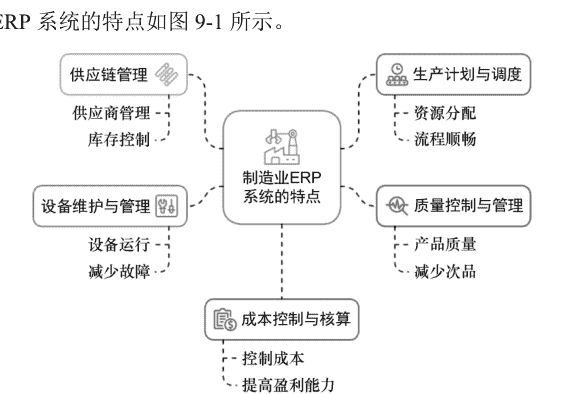

在 AI 时代，制造业 ERP 系统面临以下问题。

制造业 ERP 在智能化转型的路上，这些痛点正在拖后腿

传统 ERP 设计初衷是把企业内部业务串起来，但实操中仍常出现：
- 数据孤岛依旧存在。不同部门、不同环节的信息各自为政，流转不畅，让决策既慢又不准。
- 实时响应跟不上。随着产线规模扩大、业务更复杂，旧系统处理与反馈速度吃紧，排程计划经常滞后，效率和客户体验都受损。
- 决策智能不足。系统多靠预设规则跑，缺乏基于实时数据和市场变化的灵活判断与优化能力。
- 定制弹性不够。各家制造企业的流程和管理诉求各异，现成 ERP 的个性化扩展空间有限，很难完全贴合自身需求。
- 安全与隐私风险上升。数字化越深，ERP 汇聚的财务、供应链、人事等核心信息越多，一旦防护不到位，泄露或攻击的后果很严重。AI 时代制造业 ERP 系统面临的挑战如图 9-2 所示。

### 9.3 DeepSeek 如何补齐制造业 ERP 的短板

把 DeepSeek 引入 ERP，通过提升算力、实时洞察、智能决策和流程自动化，可以针对数据孤岛、实时性、智能决策、个性化定制与数据安全等痛点进行补强，推动制造向智能化迈进。

#### 9.3.1 解决数据孤岛问题

数据孤岛的根子是信息在不同系统、不同部门间无法互通共享，企业看不到完整的业务全景，也错失了数据驱动的机会。它既是业务与数据治理的问题，也是技术实现的问题。

DeepSeek 与 ERP 结合，可从数据底座、治理规范、跨系统协同三方面入手缓解。

构建统一数据底座，要先把数据收上来。借助物联网边缘设备，实现毫秒级采集，把设备振动、温度、能耗等 SCADA 体系容易忽略的“暗数据”纳入。依托 DeepSeek 的异构系统集成能力，快速打通 ERP、OA、CRM 等系统，让数据汇聚并统一调用。系统还能自动梳理数据血缘、生成动态目录，应对设备迭代、工艺变更带来的 Schema 漂移。配合知识图谱，把设备、工艺、人员、物料关联起来，为上层提供语义化服务，提升数据价值。

开展数据治理与标准制定，要组建治理团队，结合 DeepSeek 的处理能力，统一采集、传输、存储、使用的规范。明确命名规则、格式要求、质量评估标准，并用语义理解与清洗、转换、整合能力保证数据融合质量。没有规范的治理，孤岛难以根治。

实现跨系统协同，把 DeepSeek 设为智能中台，联动决策模型与 ERP、MES、CRM 等核心系统，统一调度数据、智能分析并精准下发指令。比如 CRM 端订单变更实时被捕捉后，需求被解析并同步到排产优化工具，生产计划即时调整以匹配新订单。

#### 9.3.2 解决系统实时性不足问题

实时性不足的核心是信息更新滞后，影响决策的时效与准确度。在制造场景里主要体现为：
- 生产数据刷新慢，管理层难以实时掌握进度与设备状态，计划调整被动。
- 供应链信息失步，供应商生产进度与库存看不清，常出现积压或缺货。
- 库存管理滞后，导致成本上升或断供影响生产。
- 设备状态监控延迟，故障难以及时预警，生产连续性受损。

结合 DeepSeek 可采取五条路径改善：
- 在实时采集基础上，用异构集成能力把 ERP、OA、CRM 等数据汇聚，实现全要素联通。
- 开启实时监控，对原材料、在制品、成品库存进行不间断跟踪，并与订单系统联动，动态更新生产与交付状态，让客户、计划、生产信息透明一致。
- 通过 API 快速对接 OA、MES，实现数据无缝流动与流程协同。优先改造高频重复环节，如报表生成、审批流，推动自动化、智能化，降低人工失误。
- 充当数据与指令中台，高效连接决策模型与 ERP、MES、CRM，完成数据统一调度与指令精准分发。
- 利用实时监控与异常预警，持续采集设备与环境数据，用 AI 模型分析并据此调参或发出维护预警，促成流程自动化。

#### 9.3.3 解决系统智能化决策支持不足问题

传统 ERP 的智能短板在于高度依赖固定规则，难以对实时数据与市场波动做出灵活响应。主要表现为分析深度不足、决策滞后、灵活性差、跨系统数据整合困难。

DeepSeek 结合后可在四层面上增强决策能力：
- 以智能分析模块深挖供应链数据，提前识别原材料短缺、物流延误等风险，并动态调整策略，为管理层提供前瞻性支持。
- 基于汇聚的多源数据，用先进 AI 模型做深度挖掘，输出覆盖运营、财务、市场的综合报告，从被动响应转向主动洞察，助力战略与精准决策。
- 作为智能中台，统一调度数据、完成智能分析并分发指令，打通 ERP、MES、CRM 的决策闭环。
- 以代码生成与仿真建模赋能研发，多模态能力可快速生成多套设计方案并模拟评估，挑出最优解，提升研发效率与产品质量。

#### 9.3.4 解决个性化定制能力不足问题

定制能力不足的本质是系统僵化、响应慢，难以满足复杂多变市场的个性需求。传统架构固定、改动成本高、迭代周期长，且各系统数据格式标准不一致，整合困难。

结合 DeepSeek 可从以下角度提升弹性：
- 在打通数据孤岛后，利用高级分析工具进行功能扩展与个性化定制。
- 通过 API 快速联通 OA、MES，让 AI 深入日常运营，保证数据流通与流程协同。
- 支持模块化选用，企业可按需选取 DeepSeek 模块，随业务增长灵活扩展。
- 针对不同行业痛点，基于 DeepSeek 模型定制行业级解决方案，提供更专业服务，提升用户黏性与付费意愿。
- 上线后在合规前提下持续收集用户与 AI 的交互数据，定期迭代模型。
- 依托反馈学习，让嵌入产品的模型在特定领域持续提精。

#### 9.3.5 解决数据安全与隐私保护问题

ERP 集中了财务、供应链、员工等核心数据，泄露或滥用将带来严重运营与声誉损失。系统本身易成攻击目标，网络攻击手段升级，内部操作失误或恶意行为也可能导致泄漏。数据丢失损坏若缺乏可靠备份恢复，会中断生产。法规如 GDPR 对合规要求不断提高。

结合 DeepSeek 可在以下层面提升防护：
- 本地化或私有云部署，数据不出内网，实现自主可控。可解释性接口支持决策路径审计，满足金融、医疗等强监管场景。
- 支持文本、表格、图像、视频等多类型数据统一分析，构建端到端治理链路。如零售场景可校验 ERP 数据与扫描发票，财务异常识别准确率可达 98%，大幅减少人工核查。
- 提供实时监控与异常检测，问题发生时迅速响应，降低潜在风险。
- 在数据融合中建立细粒度访问权限管理，按部门、岗位划分权限；同时采用加密、脱敏等技术保护数据安全与隐私。

### 9.4 DeepSeek 与 ERP 系统结合的方式、方法和步骤

落地需要按阶段推进，DeepSeek 与 ERP 系统集成过程如图 9-3 所示。

#### 9.4.1 前期准备

先做业务场景优先级评估。梳理 ERP 现有痛点，测算投资回报率，挑选高价值场景试点。试点优先选数据质量高、流程标准化的模块，如费用报销、库存预测。

再做数据治理。修复缺失值，例如供应商交货记录缺失率高于 15% 的情况，统一日期、单位等字段格式。构建模型所需数据集，如销售预测需融合历史销量、促销、天气等信息。对非结构化数据打标，例如在合同文本中标注“付款条款”“违约金比例”等。

#### 9.4.2 技术对接架构

在评估与治理后进入技术架构对接，核心是技术对接与权限安全设计。

##### 1. 技术对接

###### （1）技术选型

常见方式有 API 调用和私有化部署。
API 调用是主流集成手段。DeepSeek 提供丰富 API，企业通过 HTTP 请求发送输入、获取推理结果，改动小、见效快，适合多数场景。比如智能客服将用户问题经 API 投递给 DeepSeek，返回答案后再呈现。
若需结合私有知识库，云 API 方式也能在线调试并增强智能化。
对安全要求高的企业可选择私有化部署。需准备高性能 GPU 服务器，将模型部署在内网环境访问。成本较高，但数据完全可控，可按需深度定制。
私有化后，企业可用自定义 API 地址调用模型，既保安全又保留灵活性。

###### （2）集成

集成分接口对接、传输预处理、模型适配优化三步。
接口对接是关键，按 API 文档编写调用代码，确保参数格式、长度、输出规范正确，并处理超时、服务器错误等异常，保证稳定。
推理前需预处理数据，如清洗、分词、特征抽取并转为模型可读格式。文本分类任务中需做分词并向量化。同时要构建高效传输机制，保证业务系统与 DeepSeek 间的数据快速准确流动。
即使模型已预训练，在特定业务上仍需微调。用企业内部数据做领域微调，提升对行业知识的理解。也可采用量化、缓存等手段优化推理速度与延迟。

###### （3）测试与验证

集成完成后要全面测试接口稳定、传输准确、推理性能。用模拟数据与真实业务数据对比验证结果是否达标，问题及时调整优化，确保可靠。

##### 2. 权限与安全设计

ERP 涉及生产计划、库存、客户资料等敏感信息，权限与安全设计是底线。身份验证与授权确保仅授权用户可访问；加密存储与传输防止窃取篡改。
同时提升系统稳定性和抗攻击能力。最小权限与角色分离避免误操作或恶意行为导致崩溃。动态权限管理与定期审计可及时发现配置错误，保障稳定运行，也有助符合法规与行业标准，提升资源使用效率。
具体做法包括：
- 明确权限与角色。遵循最小权限，为 DeepSeek 相关角色只赋必要权限；实施角色分离，管理员、开发者、审计员职责隔离；业务流程中采用 MFA 等强身份验证，结合 RBAC 或属性基访问控制，限定访问范围。
- 敏感数据加密存储与传输，如使用 AES-256；非生产环境使用脱敏或匿名化。
- 动态权限管理，如开发期放宽调试权限，生产期严格收紧。
- 定期权限审计与监控，实时发现异常行为，配合合规检查与安全培训形成常态。

#### 9.4.3 核心场景开发

ERP 接入 DeepSeek：先把核心场景跑通

把大模型接到制造业 ERP，别追求一步到位，先挑几个能直接产生效益的业务点打透。场景化落地是检验融合价值的标尺。

核心场景的构建要承接系统对接与真实业务之间的落差，让模型能力真正映射到产线、仓储、采购等一线痛点，提升 ERP 的实际使用价值。搭建阶段就把权限和安全设计嵌进去，从源头堵住数据外泄和越权风险，为数字化转型提供安全底座。借助场景把智能能力与 ERP 流程深度咬合，推动手工流转转向自动化与智能化，带动运营效率和决策质量，发挥转型驱动作用。典型场景如智能采购预测、生产排程优化、供应链风险预警等都能沉淀为可复用的解决方案，助力企业更灵活调配资源、优化计划、压缩库存成本，进而提升整体竞争力。核心场景不是一次性交付物，会随业务演进和数据累积持续迭代，持续释放融合潜能，保持创新活力。

##### 1. 以智能采购预测场景为例的开发步骤

在制造 ERP 里，智能采购预测既是采购管理的关键能力，也是优化供应链、提升决策精准度与市场响应速度的重要抓手。真正落地后可以更高效调配资源、优化生产计划、缓解库存压力，在竞争中保持主动。

DeepSeek 与工厂 ERP 在此场景的结合可拆解为多个环节，这里聚焦前两个关键动作。

###### （1）数据汇聚
借助语义解析特性，将 ERP、CRM 等多源信息串联，打破信息壁垒，实现联通互用。典型做法是把历史采购记录、生产计划、供应商交期等融合，并保证完整度与一致程度。数据不打通，语义解析的价值难以体现。

###### （2）模型训练
以汇聚后的历史采购、生产计划和供应商交期数据为基础，采用时序预测能力进行训练，为后续预测提供基座。

##### 2. 需要注意的事项

搭建智能采购预测类核心场景时，有几个控制点值得注意。

信息汇聚与预处理要保证准确性与一致程度，避免质量问题拖累训练与预测效果；同时重视时效性，确保数据实时更新同步，让大模型基于最新信息进行分析。

模型训练与优化要结合具体业务和数据特征挑选合适的算法架构，提升准确性与效率。例如需求预测可尝试时间序列分析、机器学习回归等，通过实验对比选出最适配模型；训练完成后调参超参提升性能，并用交叉验证、留出验证等方法评估泛化与实战表现，确保稳定可靠。

系统集成与接口设计要兼顾稳定性与兼容性，设计可靠接口保障大模型与工厂 ERP 间的数据传输高效稳定，避免丢包或系统故障；兼容不同版本系统无缝对接；并在设计中预置异常处理，比如网络中断、数据格式错误等，实现容错自恢复，保障业务连续。

另外要建立用户体验与反馈闭环，持续收集使用意见与痛点，基于反馈迭代优化，提升系统性能。

持续优化与迭代层面，要定期评估融合后系统的表现、效果与业务价值，找出短板并制定改进方案。比如每月复盘采购预测准确率，据此调整模型算法。随着业务发展和数据积累，持续对大模型进行训练迭代，保持对业务变化和数据特征的适应性，维持先进性与竞争力，同时关注行业动态和技术趋势，及时引入新方法推动持续创新。

#### 9.4.4 部署与优化

部署与优化是 DeepSeek 融合工厂 ERP 的关键环节，直接决定系统能否在生产环境稳定运行并发挥最大效用，牵动性能、体验和企业运营效率。

##### 1. 渐进式上线策略

渐进式上线即分批分阶段扩大流量或用户范围，降低发布风险，实现平滑过渡。通过小批量投放、实时监控、快速问题修复来实现平稳迁移。

该策略适用于新产品发布、迭代上线、新功能灰度、风险较高的变更、需在真实环境验证性能稳定性、数据驱动决策、大规模集群资源受限、可用性要求极高、需要快速回滚的场景。DeepSeek 与工厂 ERP 的融合基本都符合这些条件，因而高度适用。

优势在于风险可控、灵活度高，且通过实时监控与数据分析为决策提供依据，同时减少一次性资源投入、降低发布成本、提升成功率。

具体做法：先制定发布计划，分阶段设定目标和验收标准，明确各阶段流量或用户范围，逐步递增；再小范围试点，企业内部小流量测试功能与稳定性后，挑选部分用户灰度发布，观察表现与反馈；随后逐步扩大范围，每阶段充分验证，并实时监控响应时间、错误率等关键指标；建立反馈与优化机制，及时收集问题并优化调整；最后完成全部验证后全量发布，发布后仍保持持续监控，确保长期稳定。

##### 2. 持续优化机制

持续优化是一种贯穿生命周期的系统方法，通过不断评估分析与改进提升性能与效果。适用于性能随时间衰减、需求变化、需长期改进的场景。

工厂 ERP 需随外部变化持续调整，DeepSeek 融合后可从四方面优化：

- (1) 模型微调
持续用企业内部业务数据对大模型进行微调，使其更懂企业特定领域知识与任务。
- (2) 缓存机制
集成时引入缓存存储高频访问数据，减少重复查询数据库，提升响应速度。
- (3) 数据治理
组建数据治理团队，结合大模型的数据处理能力制定采集、传输、存储、使用的标准规范，确保一致性与准确性，保障数据融合质量。
- (4) 反馈与优化
通过对比测试结果与预期结果验证推理是否准确、是否满足业务需求，发现问题及时调整优化，确保可靠稳定。

##### 3. 变革管理

变革管理是指引入重大变革时用系统化方法引导过程，目标是降低阻力、保障顺利推进、帮助组织适应新环境。

DeepSeek 与工厂 ERP 的结合至少带来三方面的管理变革：

- (1) 角色重塑
AI 引入改变了传统工作方式与技能需求，员工需重塑角色以适应新环境，提升效率与价值。

在该背景下，企业需重塑的角色及方向如表 9-1 所示。

为推进角色重塑，战略层面要明确目标与愿景，确保全员认知一致；执行层面需做市场调研与内部分析，摸清优势劣势与机遇挑战，据此制定重塑步骤与策略，包括调整部门职能权责、优化流程以提升决策效率。

表 9-1 企业需要重塑的角色及新角色方向

| 传统角色 | 新角色 | 新角色职能 |
| :--- | :--- | :--- |
| 采购专员 | 采购数据分析师 | 借助 DeepSeek 智能分析功能，优化采购决策 |
| 生产计划员 | 生产排程优化师 | 借助 DeepSeek 预测模型，优化生产计划 |
| 设备维护人员 | 主动维护工程师 | 借助 DeepSeek 预测性维护功能，减少设备故障 |
| 质量控制人员 | 智能质检工程师 | 借助 DeepSeek 多模态能力，提高质检效率和准确性 |
| 供应链管理人员 | 供应链风险预警专家 | 借助 DeepSeek 智能分析，提前发现潜在风险 |

- (2) 组织结构与流程优化
组织层面需精简层级、提升决策效率与响应速度，跨部门整合职能、促进信息与资源流动，明确权责避免重叠；推动流程标准化简化，减少无效步骤。人才方面要给予员工充分支持。

实施时可利用 DeepSeek 技术构建统一数据底座，实现数据互联互通，为决策提供全景数据支撑。

同时要构建 AI 人才梯队，实现从技术焦虑到全员赋能的转变。IT 部门职能将发生根本性变化，工程师需掌握新技能，企业应设立数据治理委员会推动变革，建立数据即资产共识，构建基于数据价值创造的绩效考核体系，完成文化转型。长期看，需注重复合型人才培养，加强内部培训与外部引进，打造懂业务又懂 AI 的数字化转型团队。

- (3) 重构智能生产流程
在此基础上重构生产流程，从人盯设备转向 AI 自决策，推动生产向智能自治迈进。打造智能供应链，从经验备货转向需求先知，通过 DeepSeek 让供应链具备预测性，提升运营效率。优化业务流程，从繁琐低效转向智能高效，利用 DeepSeek 对流程进行智能化改造，大幅提效。

技术层面，用 AI 自动化重复性任务，让员工聚焦高价值工作。建立 AI+工程师协同平台，以 DeepSeek 为支撑，工程师可用自然语言交互快速获取设计建议、解决方案与技术文档，让非 AI 背景人员也能轻松应用 AI，提升研发效率。

#### 9.4.5 技术挑战与对策

DeepSeek 与工厂 ERP 结合可能面临数据整合与孤岛、实时性不足、模型适配与优化、数据安全与隐私、集成复杂度高、长尾场景覆盖不全等技术问题，也可能遇到用户接受度与流程改造阻力等非技术问题，后者往往源于前者未解决。若未妥善处理，可能导致性能下降、流程中断、成本与周期增加、可靠性降低、数据挖掘分析能力受限。

##### 1. 数据整合与孤岛问题
成因多为系统异构、传统 ETL 局限、数据管理分散。制造现场存在 ERP、MES、SCADA 等异构系统，各自独立、格式与协议不统一，难以互通；传统 ETL 难以实现实时融合，效率低；数据散落在各部门形成孤岛，缺乏统一治理。

对策：构建统一数据底座。利用物联网边缘计算实现毫秒级采集，覆盖设备振动、温度、能耗等传统 SCADA 忽略的暗数据；借助异构系统集成驱动快速对接 ERP、OA、CRM 等系统，实现数据汇聚与统一调用。

建立数据治理与标准化：组建治理团队制定标准规范，保障数据全生命周期的一致与准确；用 AI 自动识别数据血缘，建立动态数据目录，解决设备迭代、工艺变更带来的结构漂移；基于知识图谱自动构建设备-工艺-人员-物料关联，为上层应用提供语义化服务。

同时利用语义理解能力整合多系统数据，打破壁垒实现互联互通。

##### 2. 高实时性要求
制造中生产实时监控调整、供应链实时管理、质量检测控制、设备预测性维护等环节对实时性要求极高。生产需实时掌握设备状态与环境参数以便即时调整；供应链需实时获取订单与库存变化以调整采购；产线需实时检测质量避免不良品流出；企业需实时监测设备数据提前发现潜在故障避免停机。

应对手段：
- (1) 边缘计算部署
在运维、质检等对低延迟敏感场景，将大模型部署于靠近数据源的边缘设备或服务器，实现快速处理与实时响应。
- (2) 实时计算优化
很多场景需秒级响应，可用流式处理技术保障数据处理与模型推理的高效完成，实时采集与处理满足生产监控、供应链等需求。
- (3) 采用混合云架构
利用公有云弹性扩展处理部分数据与应用，核心与敏感业务放私有云或本地，确保安全的同时实现实时分析。
- (4) 渐进式迭代
适用于逐步提升性能与实时性的场景，可从机器人流程自动化增强逐步过渡到自主决策系统，循序渐进提升智能化与实时水平。

##### 3. 模型适配与优化环节问题
可能原因包括：
- (1) 数据特征差异：不同企业数据格式、规模、质量差异大，增加适配难度。
- (2) 业务流程差异：流程与管理模式不同，需针对性调整。
- (3) 实时性要求高：生产需实时处理与低延迟，对模型实时分析能力提出高要求。
- (4) 计算资源限制：高性能场景下资源受限，难以高效运行。
- (5) 长尾场景覆盖不足：罕见故障等长尾场景数据稀缺，增加训练难度。

解决思路除增加算力与数据外，还可：
- (1) 模型微调：用企业内部业务数据微调模型，强化对特定领域知识与任务的理解。
- (2) 数据预处理与标准化：清洗、转换、标准化输入数据，确保一致与准确。
- (3) 场景化优化：针对质量控制、生产调度、能耗管理等不同场景做专项训练与优化。
- (4) 边缘计算部署：在实时、低延迟场景下就近部署，实现快速响应。
- (5) 持续学习与反馈机制：对比测试结果与预期验证推理准确性与业务匹配度，发现问题及时优化，确保可靠稳定。

系统集成复杂性与数据安全隐私问题已有阐述，长尾场景覆盖本质上需通过增加物联网传感器获取更多数据来解决。

#### 9.4.6 落地效果评估

DeepSeek 与工厂 ERP 的融合效果可从多维度量化评估：

- (1) 生产效率
从生产周期和设备利用率两方面看：实时监测与数据分析下，生产周期缩短了多少？设备故障提前预警后，停机时间减少多少，设备利用率提升多少？
- (2) 成本
从库存成本、采购成本、维护成本三方面看：库存周转率提升多少？供应链成本降低多少？需求预测精准度提高多少？预测性维护发挥如何？设备突发故障减少多少次？使用寿命延长多少？维护成本下降多少？
- (3) 质量管控与提升
可观测缺陷检出率、装配错误率、产品合格率等指标：用 AI 质检替代人工目检后缺陷检出率提升多少？装配错误率下降多少？合格率提高多少？由此带来的经济效益提升多少？

除硬性量化数据外，柔性评价维度同样关键：智能化辅助决策是否真正见效？跨系统之间数据流动是否顺畅，业务协同水平是得到增强还是出现松动？一线使用者对新能力的接受度和满意度提升了多少？

遵循上述分步推进思路，制造型企业通常能在 6 至 12 个月内完成 ERP 系统的 AI 升级，由流程驱动转向以智能驱动为主导。成败关键在于场景选择是否够聚焦、数据质量管控是否到位、变革管理是否持续跟进。

### 9.5 案例

澎湃新闻①、江门市人民政府官网②及中国电信③均披露了广东某某电子机械科技有限公司（以下简称“广东某某电子机械”）将 DeepSeek 与制造 ERP 融合的实践。

该企业是鹤山数字化转型的代表性样本，在制造行业具有一定的示范意义。此前已实施“5G + 工业 4.0”升级，引入智慧仓储、ERP、MES 等系统，实现全流程数字化管控，在生产数据实时互联与设备效能改善方面已有成效。

##### 1. 融合举措与实际成效
企业引入 DeepSeek 对内外部数据进行训练与推理。在三维图形设计环节，依托模型强大的计算与学习能力，可迅速生成更精确、更贴合设计意图的三维模型，压减设计周期并降低成本。在客户需求匹配环节，DeepSeek 能解析历史订单与偏好，结合库存与产能现状，快速给出适配方案，提升满意度与成交概率。

##### 2. 提炼“工业 + AI + 数字化转型”六大应用场景
- (1) 知识库整合与智能客服调用
各类知识文档、技术资料汇聚为统一知识库，借助 DeepSeek 的自然语言处理能力驱动智能客服。用户提问时系统可理解意图，从知识库抽取相关信息即时应答，提升服务效率与准确度。
- (2) 多源数据采集、清洗、结构化、自动化处理调用
DeepSeek 可对接 ERP、MES 等系统，采集生产设备、销售、库存等异构数据，完成清洗、结构化与自动化处理，剔除噪声与错误，为后续分析决策提供高质量底座。

① 拥抱 DeepSeek，解锁数智新模式！鹤山首个中小企业数字化转型项目签约。
② 聚焦数字化转型，赋能工业未来 中国电信江门分公司“工业+5G+DeepSeek”项目成功签约。
③ 拥抱 DeepSeek！广东江门市首个“工业 5G + DeepSeek”中小企业数字化转型项目成功签约。

##### 3. 合作框架
广东某某电子机械担任需求方，鹤山电信负责网络底座与 DeepSeek 集成，某某信息负责数字化系统开发，三方协同推进。

鹤山电信基于 DeepSeek 技术，通过天翼云基座为企业搭建本地专属节点，依托“息壤”平台实现分布式算力智能调度，支撑 AI 故障预测、智能排产等场景。天翼云采用“云-边-端”三级防护及量子加密技术，保障数据安全，实现生产数据本地留存与算力全局调度。

某某信息在系统开发端提供专业支持，确保 DeepSeek 与 ERP、MES 等业务系统实现无缝对接与集成。

## 第 10 章 构建企业专属 AI Agent

DeepSeek 与企业业务管理系统能力虽强，但在部分场景仍需 AI Agent 补位。例如 DeepSeek 擅长自然语言理解与生成，却不具备自主执行任务的能力，而智能体正好弥补此缺口。因此除直接作为工具使用外，还需在 DeepSeek 基础上构建面向业务的智能体。

### 10.1 什么是 AI Agent
智能体是一种能够感知外部环境、自主决策并执行行动的智能主体，不仅能够理解用户需求，还能主动规划并完成任务以达成目标。智能体可表现为软件程序，也可具备物理形态。

其关键特质包括自主性、反应性、目标导向与学习能力。它可在无需人工干预下运行，对环境变化与输入信息作出及时响应，围绕明确目标持续努力，并通过经验不断优化策略与性能。智能体功能结构示意图，如图 10-1 所示。

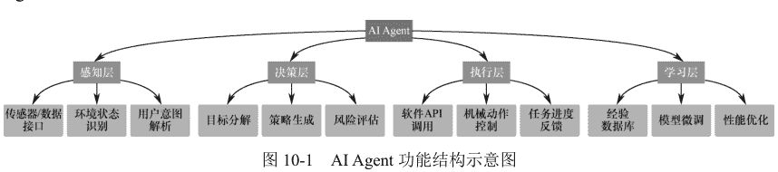

##### 1. 智能体与通用人工智能的差异
智能体与 DeepSeek 等通用人工智能均属 AI 技术范畴，均利用机器学习、自然语言处理、计算机视觉等实现智能化，旨在提效、自动化、辅助决策与改善体验。但两者在应用场景、能力目标、模型复杂度、数据需求、学习方式、开发难度与评估标准上差异明显，智能体与通用智能的对比如表 10-1 所示。

表 10-1 智能体与通用智能的区别

| 比较维度 | 智能体 | 通用智能 |
| :--- | :--- | :--- |
| 应用场景 | 聚焦特定业务场景，擅长客服对话、图像识别、数据分析等定向任务 | 可跨领域通用，涵盖文本生成、问答系统、数据分析、图像识别等多种任务 |
| 目标与能力 | 专注完成特定任务，具备与任务相关的专项能力 | 追求通用智能，具备多类能力，可处理各类任务 |
| 模型复杂度 | 相对较低，通常针对特定任务优化 | 较高，需处理多种类型数据与任务 |
| 数据需求 | 需要与特定任务相关的数据集 | 需要大量多样化数据训练模型 |
| 学习与训练 | 主要采用有监督学习，训练目标相对明确 | 采用多种学习范式，包括无监督、强化学习等 |
| 开发难度 | 较低，有成熟开发框架与工具可用 | 较高，需要深厚 AI 知识与大量资源投入 |
| 评价标准 | 以特定任务完成效果与效率评价 | 以综合性能、适应性与泛化能力评价 |

在专用性与通用性层面，智能体与通用智能亦有明显差异。当前大模型多为通用型，例如 DeepSeek 等通用大语言模型通过大规模预训练学习丰富语言知识与上下文信息，能够处理多种自然语言任务，具有广泛适应性、灵活微调与跨领域能力。智能体的设计目标是实现特定场景下的自主决策与行动，需要与环境交互，因而具有较强专用性，主要体现在：

- （1）特定任务导向
智能体通常面向特定任务或场景设计，如智能客服、自动驾驶、任务管理等。
- （2）环境交互能力
智能体能够与环境交互，通过感知和行动实现特定目标。
- （3）自主性与目标导向
智能体具有一定自主性，能够在特定任务中自主运行，专注实现特定目标。

尽管差异明显，智能体与 DeepSeek 等 AI 工具联系紧密。功能上互补，智能体可利用 DeepSeek 等提供的语言理解与生成能力，提升与用户的交互体验。智能体也可利用 DeepSeek 等处理的数据进行学习与决策，同时为 DeepSeek 等提供更多应用场景与数据回流。

##### 2. 智能体与专用 AI 的区别
专用 AI 通常聚焦某一领域任务，如图像识别、语音识别，具有高度专业性与针对性。智能体能够处理多种任务，适用面更广、灵活性更高。功能上，智能体可集成专用 AI 工具调用其专业能力，两者协同可完成更复杂目标。

##### 3. 智能体与 Agent 的区别
Agent 是 AI 领域的宽泛概念，指能够感知环境、做出决策并执行行动以实现特定目标的实体，不局限于 AI 技术，可以是基于规则的简单程序、人等。智能体是 Agent 的一种特定类型，专指利用 AI 技术实现感知、决策与行动的智能代理，强调其智能性与自主学习等高级能力，能处理更复杂、不确定的任务。

Agent 的智能程度差异较大，简单 Agent 仅依据预设规则反应，复杂 Agent 具备一定自主决策与学习能力，相较于智能体，其智能水平与自主性相对较低。智能体具有较高智能程度，能通过算法自动学习改进，适应环境变化与新任务。

### 10.2 智能体作用发挥的主要领域和适用场景
智能体在企业生产经营中的应用面很广，但并非万能，也有其适用边界。

##### 1. 适用的领域和场景
###### (1) 客户支持与服务自动化
智能体可自动处理常见咨询，通过聊天机器人与语音助手提供即时反馈。它们能够识别客户问题、提供解决方案，并在必要时将复杂问题转交给人工客服。例如金融行业借助 AI 驱动的虚拟助手提供 7×24 小时支持，帮助客户理解功能、排查问题、管理风险，实现流程优化。

###### (2) 个性化推荐服务
智能体能够深入分析客户偏好、历史购买记录与实时行为，构建行为模型，提供精准的产品推荐。例如电商平台的个性化推荐系统根据购物历史、浏览行为与偏好推送产品，提升满意度并增加销售额。

###### (3) 供应链优化
智能体在自适应决策方面表现突出，能够在运输或制造延误时动态调整供应链，寻找替代路线并重新分配库存。也可模拟买方与供应商谈判过程，基于可持续性参数评估供应商，促进供应链可持续发展。

###### （4）自动化文档处理
智能体利用先进自然语言处理技术，能够读取、解析并理解不同格式文档，识别关键信息并自动分类处理。例如司法领域可自动分析合同文档，提取条款、签约方信息、有效期等关键信息，帮助法律专业人员更快审查与归档。

###### （5）财务决策支持
智能体能够通过对大量财务数据的深入分析，为管理层提供准确、及时的决策支持。例如利用机器学习与数据挖掘技术处理财务报表、现金流、利润与损失等数据，识别潜在趋势、风险与机会。

###### （6）商业管理
智能体通过聊天机器人增强与客户互动，收集洞察信息帮助营销人员把握趋势、调整策略并提供定制建议。例如营销平台利用智能体基于实时数据管理与优化营销活动，提升客户互动率与转化率。

###### （7）人力资源管理
智能体在人力资源领域带来变革，通过筛选简历、识别最佳候选人、甚至进行初步面试改变招聘流程。还可协助新员工入职，提供培训材料，解答疑问，确保新员工顺利融入公司。

###### （8）物流与供应链管理
智能体在物流与供应链管理中发挥重要作用，通过预测需求、优化库存水平、实现自动化订单处理。例如电商企业使用智能体准确预测产品需求从而优化库存并降低成本；物流公司使用智能体实时确定最有效配送路线，减少燃料消耗并缩短配送时间。

###### （9）房地产管理
智能体可以分析市场趋势、提供房产估值，并根据历史数据预测价格走势。例如房产估值平台将机器学习算法应用于估值功能，根据历史数据估算房屋价值。房地产管理平台利用智能体自动进行租户背景调查，提升流程效率并减少偏见。

###### （10）旅游和酒店业
智能体可以个性化定制客户行程，从行程规划到住宿期间提供全程支持。例如旅游平台使用智能体根据用户偏好与过往行为提供个性化旅行建议，提升客户满意度。许多酒店部署 AI 聊天机器人提供全天候客户服务，高效处理预订与设施相关咨询。

此外，智能体在工作流程自动化、制造业、研发与软件开发等领域亦具有重要价值。例如研发领域研究机构通过智能体快速分析海量数据集并识别为新产品开发提供指导的模式。软件开发领域代码助手使用智能体根据上下文建议代码片段，协助开发人员显著加快编码过程。

这些场景共性在于涉及重复性任务处理、数据驱动决策支持、流程优化与用户体验提升。智能体凭借自主性、反应性、目标导向与学习能力，在这些领域能够显著提高效率、减少错误、降低成本，并提供更个性化服务。

##### 2. 不适合智能体的领域或场景
尽管智能体在许多领域表现优异，以下场景可能不适合使用。

- （1）高度创造性和艺术性的领域
绘画、音乐创作等需要高度创造性与情感表达的领域，智能体可能无法完全替代人类创造力与艺术灵感。文学创作中需要深刻情感与复杂叙事结构时，人类独特视角仍不可替代。
- （2）需要复杂情感交互的场景
心理咨询需要深刻理解人类情感与心理状态，智能体仅能提供有限支持。医疗护理中需要深度情感交流与心理支持时，人类护理人员作用不可或缺。
- （3）涉及高度机密和敏感信息的领域
国家安全、军事战略等因敏感性与信息安全要求高，不适合完全依赖智能体。涉及大量资金与高度敏感的金融交易中，最终决策仍需人类监督与干预。
- （4）需要复杂物理操作的场景
手术实际操作仍需外科医生高度专业技能与实时判断。高精度手工制造如高端手表，工匠精细操作与经验积累不可替代。
- （5）伦理和法律判断复杂的领域
法律判决需综合法律条文、案例、伦理道德等多因素，最终判决仍需法官深刻洞察与伦理判断。医疗伦理、商业伦理等涉及复杂伦理问题的决策，人类伦理判断与价值权衡不可替代。

在这些场景中，智能体可作辅助，但人类的专业知识、创造力、情感智能与伦理判断仍不可替代。企业引入时需结合实际需求审慎选择，实现最佳效果。

### 10.3 智能体的结构组成和创建方法
智能体面向特定任务或场景，是自主决策与行动体。不同场景的智能体具有专用性，但在内部结构与开发流程上存在通用共性。

#### 10.3.1 智能体的核心组件和组成
智能体通常由若干模块化、互联协作的核心组件构成，共同实现感知、决策与执行。

##### 1. 智能体的核心组件
智能体的核心组件如图 10-2 所示。

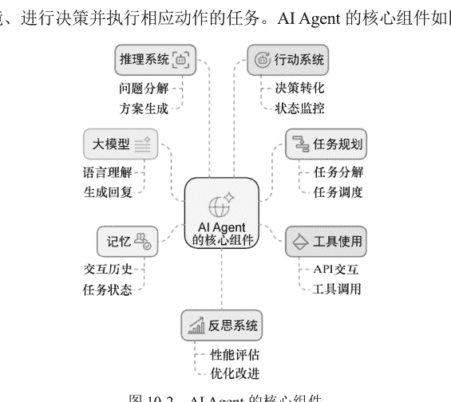

###### （1）大模型
大模型提供核心语言理解与生成能力，是整个智能体的“大脑”，负责理解用户输入、生成回复、进行推理与决策。例如 AutoGen 框架使用 OpenAI 的 GPT-4o-mini 作为模型客户端，提供强大的语言理解与生成能力。

###### （2）任务规划
任务规划组件负责对复杂任务进行分解、规划与调度，并及时观察子任务执行结果与反馈，对任务进行及时调整，确保任务按预设逻辑与顺序高效执行。例如在 CrewAI 框架中，智能体可自主委派任务并相互询问，提升解决问题效率。

###### （3）工具使用
工具使用组件允许智能体调用外部工具与 API 以扩展能力，并根据决策结果执行具体动作或指令，与外部 API、数据库、硬件设备等工具交互。例如 AutoGen 框架定义了一个 get_weather 工具函数返回城市天气信息，并将其作为工具提供给智能体。

###### （4）记忆
记忆组件负责记录交互历史、任务状态与相关信息，便于在需要时快速准确调用。在 CrewAI 框架中，每个智能体都配备记忆系统，用于存储与检索交互经验，支持持续学习与提升能力。

###### （5）推理系统

智能体运作全景与落地路线

推理模块承担任务拆解、备选方案生成以及决策提炼的功能，将长期积累的知识与记忆转化为可执行的行动蓝图。在当前主流的智能体架构里，推理通常采用多目标权衡机制，同时权衡执行效率、资源消耗与潜在风险，从若干候选路径中挑出最优解。

###### （6）行动系统
行动模块负责把内部决策映射为实际操作，推动任务进展并在线监控运行状态，保证执行过程可靠且安全。以 AutoGen 为例，其 Runner 组件正是将智能体的决策转为具体行为并持续把控进度的执行单元。

###### （7）反思系统
反思模块具备自我迭代能力，借助持续评估与调优来提升整体水准。它会衡量智能体表现、定位问题并制定改进计划。例如在现代架构中，反思机制通过绩效评估、根因诊断与迭代优化，实现能力的稳步增强。

##### 2. 组件协作方式
各单元依托精细设计的接口协同运转，构成有机整体。每个部分聚焦自身核心职责，同时与其它模块紧密配合，最终合力完成复杂智能行为。

以 AutoGen 为例，多个智能体间通过异步消息传递实现协作，共同完成复杂任务。AI 智能体的整体架构示意图如图 10-3 所示。

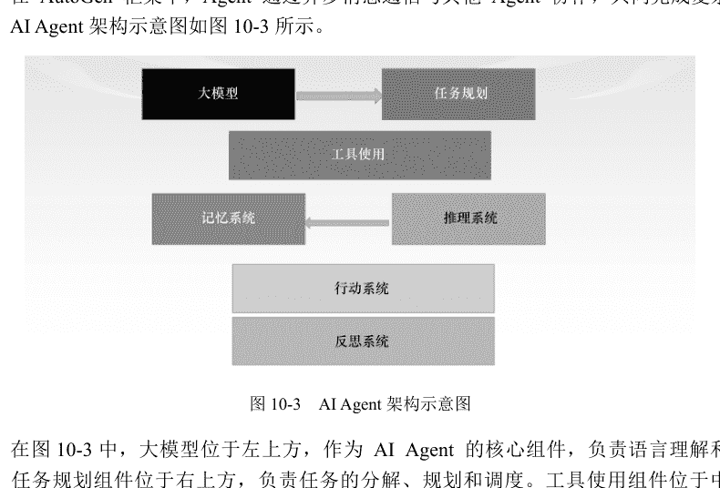

图 10-3 中，左上是基座大模型，承担语言理解与生成；右上是任务规划模块，负责拆分任务、制定计划并调度；中上是工具调用模块，负责激活外部工具与 API 完成具体操作；左下是记忆模块，负责信息存取以支撑长期学习；右下是推理模块，负责把知识与记忆转为行动方案；中下是行动模块，负责把内部决策落地执行；底部是反思模块，通过评估与优化实现自我完善。

运行流程上，大模型先接收用户输入，完成语言解析与意图抽取。基于理解结果，任务规划模块把复杂需求拆解为若干子任务并安排顺序。工具调用模块依据规划激活所需的外部工具或 API。记忆模块提供历史数据与关联信息供决策参考。推理模块汇总各方信息产出最优行动方案。行动模块把方案转为实际操作并推进任务。反思模块在任务结束后评估结果、排查问题并推动系统优化。

#### 10.3.2 智能体构建路径与方法
构建智能体的思路多样，不同路线在侧重点和取舍上各有差异。

##### 1. 免编程搭建环境
免编程环境让非研发背景人员也能参与构建，借助可视化界面与现成模块，通过拖拽、参数配置等操作快速搭建应用，几乎无需手写代码。

###### （1）免编程搭建智能体的关键步骤
第一步是搭建提示词骨架。明确智能体的角色定位与行为规范，确保其能准确理解需求并执行。具体是设计一套含角色定义与行为准则的提示模板，厘清不同场景下的表达风格与内容边界。例如为客服类智能体设定提示，要求处理投诉时保持礼貌专业。

第二步是赋能外部资源。把数据库、API 等外部工具接入智能体，使其具备数据访问与任务执行能力。例如接入天气接口，让智能体能返回实时天气。

第三步是验证对话效果。检验理解力与交互质量，确保能精准响应用户输入。可通过模拟用户提问与交互场景，检查对话流程是否给出准确、相关且符合预期的回复，并据此迭代优化以提升体验。

###### （2）更适合的情境
第一，快速验证原型。企业或个人希望迅速检验概念可行性，无需重投入即可完成验证。
第二，资源有限的小团队。初创公司或中小企业技术人力不足，需要低门槛方式快速上线。
第三，非技术岗位人员。营销、业务分析等角色想借助智能体辅助工作却不具备编程能力。
第四，教学与培训。学生可通过免编程环境上手智能体构建与使用。
第五，轻量级应用场景。如基础客服、内容生成、简单数据分析等无需深度定制的场景。

###### （3）利弊
优势在于无需编程基础，图形化操作直观易上手；搭建部署速度快，上线周期短；提供大量预制组件与模板，可灵活组合；维护更新便捷；整体成本效益高，适合人力预算有限的团队。

不足也很明显。第一，功能相对基础，难以支撑复杂业务或深度定制；第二，个性化能力受限，遇到复杂逻辑或行业特殊需求时灵活性不足；第三，高度依赖平台本身，平台故障或停止服务会直接影响应用可用性；第四，数据安全与隐私风险，数据常存储于平台服务器；第五，扩展性有限，面对大规模、高并发需求时难以支撑。

###### （4）主流免编程搭建工具
常见平台及特点如表 10-2 所示。

表 10-2 常见免编程搭建智能体平台及优劣

| 平台 | 优点 | 缺点 |
| :--- | :--- | :--- |
| Coze | 无代码开发，插件丰富，内置多款大模型，多端发布，知识库与数据库强，支持图像流与工作流，多智能体协作，团队协作强 | 高级功能定制空间有限，复杂企业级应用需额外开发 |
| Dify | 功能完善，兼容国内外多模型，提供云端与本地部署，适合专业开发者 | 主要面向海外，国内使用者受限 |
| 千帆 AppBuilder | 智能体能力完备，适配多种应用类型 | 对非技术用户学习曲线稍陡 |
| FastGPT | 知识库优势明显，检索与文档处理能力强 | 聚焦知识库，对其它类型支持不足 |
| 智谱智能体 | 侧重对话类智能体，对话能力强 | 非对话类创建功能有限 |
| 天工 SkyAgents | 无代码构建，模块化处理，定制能力强，支持企业级一键部署，知识库导入便捷，第三方调用丰富 | 特定行业深度支持稍弱 |
| BetterYeah AI | 无代码搭建，一体化模型集成，知识库管理强，数据库连接便捷，可视化工作流，多模态对话支持 | 复杂业务逻辑处理能力受限 |
| 百宝箱 Tbox | 无代码创建，一键发布，智能体类型丰富，集成支付宝生态，主流模型接入 | 主要面向支付宝生态，对外平台支持有限 |
| Anakin.ai | 预制应用丰富，覆盖多场景，无代码操作，集成强，自动化流程 | 完全自定义复杂应用支持不足 |
| 天壤小白应用开发平台 | 应用类型多样，配置灵活，信息安全可控，模型选择多，快速发布站点，API 管理与运营，提示词优化 | 高度复杂智能体应用开发能力有限 |

对非技术用户或小型企业，常推荐 Coze、Dify 或 BetterYeah AI，界面友好且功能丰富，利于快速创建部署。知识库需求强可选 FastGPT。对话类应用可考虑智谱智能体。企业级需求可选天工 SkyAgents 等。需接入支付宝生态可选百宝箱 Tbox。

##### 2. 基于大模型框架的开发
该模式以 DeepSeek、GPT-4、Claude、Gemini 等大语言模型为核心，结合提示工程与工具使用框架进行开发。通过模块化设计与灵活接口，使开发者能快速构建部署满足特定业务需求的智能体。

###### （1）基于大模型框架开发的优缺点
优点是模型具备强大的语言理解与生成能力，架构模块化，工具集成与社区生态丰富。可处理复杂自然语言任务，提供高质量建议，支持灵活扩展与定制，开发者可按需快速调整。工具与 API 丰富，便于调用外部服务；活跃社区提供大量插件与扩展，加速开发。

缺点是需要一定编程能力与模型理解，技术门槛较高。大模型训练与推理消耗计算资源，成本可能偏高。对特定领域复杂需求往往需额外开发与调优。

###### （2）适用情境
适用于需多步骤处理与复杂逻辑的智能客服、自动化工作流等场景，也适合希望快速搭建原型并投入生产的情况。高度定制化任务同样适用，可依据特定业务需求进行深度定制。

###### （3）具体流程与工作内容
首先是模型选型与集成，选择合适的大模型并接入开发框架，配置参数以确保理解与执行能力。
其次是提示工程，设计并优化提示词以引导模型产出符合预期的回答，通过结构与内容调整提升准确性与相关度。
再次是工具集成，把 API 或数据库等外部工具接入智能体，定义调用逻辑以确保任务正确执行。
随后是任务规划与流程设计，将复杂任务拆解为子任务，明确逻辑关系与执行顺序，保证高效完成。
接着是记忆与状态管理，实现记忆功能以存储和检索任务状态与相关信息，使智能体能依据历史信息决策。
然后是推理与决策，利用大模型的推理能力把知识与记忆转化为具体行动方案，优化推理逻辑以提升决策质量。
之后是行动执行，将决策结果转化为实际操作并实时监控执行状态，保障可靠与安全。
最后是反思与优化，评估智能体性能、诊断问题并制定改进方案，通过持续迭代提升整体表现。

###### （4）不同基础模型的差异对比
不同模型对比如表 10-3 所示。

表 10-3 基于大模型框架开发中不同模型对比

| 模型 | 优点 | 缺点 |
| :--- | :--- | :--- |
| DeepSeek | 专注高端推理与复杂逻辑，高效训练策略与数据处理优势 | MoE 架构复杂，专家选择可能偏差 |
| GPT-4 | 语言理解与生成强，适合复杂任务处理 | 计算资源需求高，成本较高 |
| Claude | 高度可定制，适合对话式应用 | 多模态任务支持有限 |
| Gemini | 多模态支持，处理多种数据类型 | 特定领域专业性可能不及他者 |
| LLaMA | 开源，易于定制与扩展 | 计算资源需求较高，适合资源充足场景 |
| Bard | 语言生成能力强，适合内容创作 | 复杂任务处理能力有限 |

推理与复杂逻辑场景，DeepSeek 效率高成本效益好，尤其适合中文语境。强语言理解与生成需求，推荐 GPT-4 或 Claude。多模态处理需求可选 Gemini。资源有限但追求定制可选 LLaMA。内容创作与轻量对话，Bard 可支撑快速开发部署。

##### 3. 基于特定平台的开发
该模式利用特定平台提供的工具、接口与功能构建智能体。通常提供丰富预构建组件、工具与接口，简化开发与部署。与免编程环境相似，优缺点与适用场景基本相近。

具体流程与基于大模型框架开发基本一致，仅多出平台选型与集成步骤。开发者需挑选合适的智能体开发平台，如阿里云魔搭社区、Coze 等，并接入现有环境，配置参数以实现无缝对接。

两者表象相近，实则存在差异，具体区别如表 10-4 所示。

表 10-4 基于特定平台开发与免编程环境开发的区别

| 方面 | 基于特定平台开发 | 免编程环境开发 |
| :--- | :--- | :--- |
| 开发门槛 | 需具备一定编程知识与平台技术基础，如熟悉 API、开发工具 | 无需编程基础，通过可视化、拖拽与配置即可上手 |
| 开发灵活性 | 灵活性较高，可深度定制，充分利用平台高级功能与扩展接口 | 灵活性相对较低，主要依赖预设模块与模板 |
| 开发效率 | 熟悉平台者效率较高，可快速实现复杂功能 | 效率极高，适合快速构建简单应用 |
| 应用场景 | 适合复杂业务与深度定制需求的企业，如企业级智能客服 | 适合中小企业、创业者、个人快速构建简单应用 |
| 可扩展性 | 通常可扩展性良好，可随业务发展不断扩展优化 | 可扩展性较弱，一般只能在平台允许范围内调整 |
| 性能与稳定性 | 通常性能与稳定性保障较好，适合高并发复杂计算 | 性能与稳定性取决于平台支持，大规模数据或高并发可能受限 |

目前主流开发平台特性对比如表 10-5 所示。

表 10-5 主要智能体开发平台特性对比

| 特性维度 | 扣子 Coze | Dify | 千帆 AppBuilder | FastGPT | 智谱智能体平台 | 天工 SkyAgents | 腾讯元器 | BetterYeah | AWS AI Agent |
| :--- | :--- | :--- | :--- | :--- | :--- | :--- | :--- | :--- | :--- |
| 模型支持 | 支持多模型，含国内国外 | 支持多模型，海内外兼顾 | 支持文心及部分国外模型 | 支持多模型，知识库表现突出 | 支持自家模型 | 支持多模型，集成 Skywork LLM | 支持多模型，含腾讯自研 | 支持国内外顶尖模型 | 支持多种模型，灵活选择 |
| 核心功能 | 知识库、数据库、插件、工具、工作流完备 | 知识库、工具调用、工作流强 | 知识库、数据库、插件工具强 | 知识库功能独特，适合问答 | 对话类功能强 | 模块化设计，支持自然语言与可视化操作 | 功能快速完善，支持 API 创建插件 | 支持单智能体与多智能体系统 | 提供强大开发部署能力 |
| 操作难易度 | 便捷，适合非技术用户 | 难度适中，插件生态丰富 | 难度适中，布局清晰 | 难度适中，知识库管理便捷 | 难度适中，适合非技术用户 | 便捷，适合快速开发 | 难度较低，适合新手 | 便捷，支持无代码 | 复杂度较高，适合专业开发者 |
| 生态能力 | 生态丰富，插件商店、工作流商店 | 生态较强，多部署方式 | 生态较强，支持本地部署 | 生态一般 | 生态一般 | 生态较强 | 生态较强 | 生态较强，提供学习资源 | 生态强大，多部署方式 |
| 适用场景 | 无代码开发各类智能体，适合企业级应用 | 适合专业开发者，多模型选择 | 企业级智能体应用开发 | 知识问答类开发，需本地部署保障数据安全 | 对话类智能体应用，如智能客服 | 广泛适用于各类业务 | 企业级智能体应用开发 | 企业级应用，如客服、营销、销售 | 企业级应用，尤其是国际化项目 |

企业 AI 智能体选型与落地实战

| 优劣对比 | 综合表现领先，功能矩阵完备，社区活跃，部分进阶功能需付费 | 生态成熟模型可选丰富，主打海外市场，国内接入受限 | 功能完备可私有化部署，插件市场相对薄弱 | 知识检索突出，整体生态建设仍在补强 | 对话表现优异，后续扩展余地有限 | 技术领先工程体验顺滑，插件生态待加强 | 功能持续迭代生态较强，上线时间较晚 | 功能全面生态成熟，对复杂长任务支撑不足 | 能力强劲生态丰富，对小白用户不够友好 |

落地路径要结合真实业务诉求、技术积累和预算投入综合权衡。零代码搭建平台适合快速试错验证想法，依托大模型框架的开发路线更适合吃透复杂业务逻辑。

自研一条路也是通的，就是全栈自主写代码、自主设计算法模型把能力造出来。这种打法对 AI、机器学习和工程能力要求极高，周期长、成本高。典型自研链路包括需求拆解、算法规划、数据采集清洗、模型训练优化、系统联调测试。

虽说自研可行，但门槛和投入都太高，实践里更多人选择复用现成工具来搭智能体，借成熟的技术底座、组件库和数据处理能力，提速降本，实现快交付与持续迭代。

#### 10.3.3 容器化与弹性扩展

容器化属于轻量级 OS 虚拟化思路，把应用及其依赖打包成独立单元，在不同环境保持一致运行，无需关心底层差异。弹性伸缩则让系统随负载动态调度算力，匹配不同工作压力。

##### 1. 容器化与弹性伸缩和智能体构建的关系

容器化与弹性伸缩是智能体研发、部署与运行的重要支撑，为全生命周期提供保障。

##### 2. 容器化与弹性伸缩的优缺点

容器化与弹性伸缩具备较强扩展性，可随负载动态调度算力，支撑高并发访问。通过提示词优化与算力动态分配，能压低单次调用开销。同时可观测任务成功率、响应时延等核心指标，保证运行稳定。部署形态灵活，既能本地私有化也能上云，满足不同企业诉求。

短板在于需要一定的容器与云原生技术储备，部分场景下算力消耗会上升。

##### 3. 容器化与弹性伸缩的适用场景

高并发请求处理、资源密集型任务、多环境部署是典型适用面。高并发指电商大促、金融交易等需快速响应海量请求的场景。资源密集型指模型训练与推理等需按需调整算力以提升性能的任务。多环境部署指 AI 应用需在多套环境间快速上线运行。

##### 4. 容器化与弹性伸缩的环节和工作任务

首先是容器化封装，把智能体及其依赖打包为 Docker 镜像，实现环境无关运行。具体包括编写 Dockerfile 描述运行环境与依赖、构建镜像并验证功能。

其次是 Kubernetes 集成，利用 K8s 进行编排与管理，实现自动部署、扩缩与运维。具体包括编写 Deployment 配置文件定义部署策略与资源需求、把镜像部署到 K8s 集群并监控运行状态。

再次是弹性伸缩配置，配置 K8s 自动伸缩功能按负载动态调整 Pod 数量。具体包括定义 Horizontal Pod Autoscaler，设定最小最大副本数及资源使用率阈值。

最后是监控与优化，搭建监控体系实时跟踪运行状态与性能指标，并据此优化。具体包括使用 Prometheus 与 Grafana 等工具监控任务成功率、响应时间等核心指标；根据监控结果调整资源分配与系统配置。

### 10.4 基于 DeepSeek 创建企业应用智能体

以 DeepSeek 为底座构建智能体，技术路线通常分为以下环节与步骤。基于 DeepSeek 创建企业应用 AI Agent 的流程如图 10-4 所示。

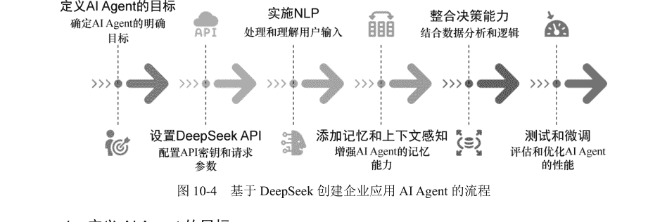

##### 1. 明确目标定位

明确目标是确保智能体真正贴合业务诉求，为后续工作指明方向。该环节需厘清业务目标、界定应用场景、梳理功能需求。与业务部门深度沟通，了解其希望解决的痛点，如提升客服效率、优化销售流程等；同时收集潜在用户反馈，确保功能符合使用习惯与期望。

在此基础上确定具体应用形态，如对话机器人、自动化流程机器人、推荐系统或决策支持系统等，明确功能边界与定位。根据需求梳理所需能力，如 NLU、问答、任务调度、数据检索等，并结合用户群体设计界面与交互方式。

目标设定时要兼顾实际需求与体验，评估技术可行性，判断现有技术与资源能否支撑；同时保持灵活可扩展，便于开发过程中根据实际情况调整优化。

##### 2. 接入 DeepSeek API

接入 DeepSeek API 是关键步骤，可把 DeepSeek 的语言理解与生成能力集成到自有应用或服务中。通过 API 实现用户输入接收、请求处理与智能回复。设置过程也保证请求响应格式规范，避免不必要的成本与延迟。

工作任务包括在 DeepSeek 开放平台创建 API Key，并配置请求 URL、Headers、Body 等参数，确保符合速率限制要求。

##### 3. 实施 NLP

NLP 使智能体能够理解并生成类人类文本，实现自然交互。DeepSeek 的 NLP 能力通过输入预处理提升理解准确性，通过情境理解识别意图、含义与情感，使回复更相关个性化；通过提示工程构建清晰指令，提升输出质量；通过上下文管理保持多轮对话连贯一致。必要时可利用多语言处理能力支持多语种交互。

需关注三方面：数据质量要高以提升大模型表现；模型调优需针对具体场景微调 DeepSeek 提升专项任务效果；上下文一致性需确保能准确记忆并引用历史对话。同时持续收集用户反馈，优化提示词与生成逻辑。

##### 4. 增加记忆与上下文感知

记忆与上下文感知是实现有意义对话的基础，确保多次交互中信息保留与个性化响应。

短期记忆用于回忆同一会话信息。实践中可在对话过程中将用户输入与智能体回复写入短期缓存，使用列表或队列管理，方便每次对话读取近期上下文。

长期记忆用于跨会话保留用户偏好，提供定制化体验。可采用 SQLite、MySQL、PostgreSQL 等关系型数据库，或 Pinecone、FAISS、ChromaDB 等向量数据库存储历史交互与偏好。每次对话时检索相关长期记忆，与短期记忆融合后生成连贯回复。

知识检索功能让智能体能访问内部知识、历史查询或外部数据库，避免重复提问。依据用户输入关键词从知识库或数据库提取相关信息并整合到回复中。

该环节需做好数据存储安全管理与隐私合规，合理设置上下文窗口长度，避免过长影响性能，超出部分可截断或压缩；定期更新长期记忆保证时效性；同时避免记忆功能带来延迟或不相关回复影响体验。

##### 5. 融合决策能力

决策能力让智能体能进行智能判断并给出及时准确响应。需从数据库、API 与实时信息源检索数据，保证信息最新；处理结构化与非结构化数据，分析邮件、消息、文档文本及交易、统计数据等，输出可执行洞察。智能体还需基于历史交互学习并根据反馈调整策略，持续改进。

具体任务包括数据集成、数据分析、决策逻辑设计与性能优化。数据集成涉及接入 API 与数据库，利用 DeepSeek API 完成数据检索与处理。数据分析利用 NLP 提取文本关键信息，并用分析工具处理结构化数据形成洞察。决策逻辑设计需让智能体能基于分析结果智能决策，可引入强化学习算法基于历史交互与用户反馈优化策略。定期评估与优化模型性能，根据反馈调整参数与算法。

##### 6. 测试与微调

微调与测试是保证智能体准确高效的关键。微调通过调整模型参数适配特定任务与领域；测试用于评估可靠性与稳定性，涵盖数据准备、模型微调、评估、性能优化与测试反馈。

微调需要高质量且多样代表性的训练数据，可从 Hugging Face Hub 加载相关数据集或行业数据，并用 formatting_prompts_func 预处理。

可用 LoRA 技术对 DeepSeek 模型进行高效微调，如用 FastLanguageModel.get_peft_model 设置秩、目标模块、学习率等参数，用 SFTTrainer 设定批量大小、学习率、最大步数等训练参数。

通过测试集评估准确率与效率，观察训练损失下降趋势，用 trainer.train() 训练并查看 trainer_stats 确认可否达到预期。

性能优化方面需据评估结果调整学习率、批量大小等，使用 use_gradient_checkpointing 优化显存以支持更大批量，优化训练流程。测试反馈环节可部署两个版本进行 A/B 测试，比较参与度与满意度；收集用户反馈持续优化参数与响应逻辑。

### 10.5 多智能体系统

多智能体系统通过多个智能体的协作与交互解决复杂问题、执行多样化任务并模拟复杂系统行为。各智能体负责特定任务，通过信息共享与任务分配实现整体目标优化。多 Agent 系统结构示意图如图 10-5 所示。

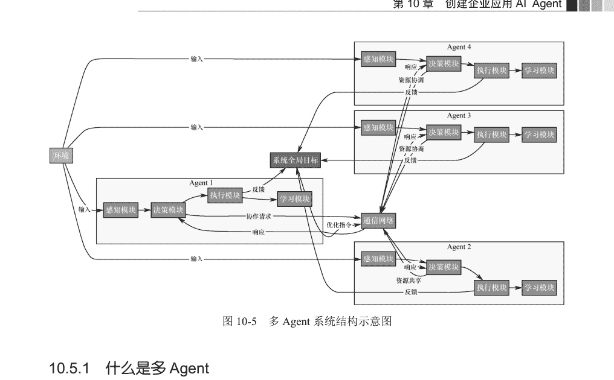

图 10-5 多 Agent 系统结构示意图

#### 10.5.1 什么是多 Agent

多 Agent 模式是一种强健的 AI 架构，每个智能体具备独立感知、决策与行动能力，通过协作与信息共享实现系统整体优化。

##### 1. 多 Agent 与 DeepSeek AI Agent 的区别和联系

从定义与定位看，DeepSeek AI Agent 是基于 DeepSeek 大模型构建的智能体，专注于深度思考与推理，擅长处理复杂信息并给出精准决策方案。可视为多 Agent 系统中的一个成员，负责深度思考与策略生成。

从技术架构看，DeepSeek AI Agent 基于深度学习，利用神经网络与机器学习算法持续改进，架构特点包括长链推理、多模态融合、自我反思与优化。多 Agent 系统通常包含多个智能体，个体可基于规则或深度学习，通过协作、任务分配与信息共享完成任务，架构更为复杂。

从目标与应用场景看，DeepSeek AI Agent 目标是提供深度思考与推理能力，适用于风险预测、智能客服、教育辅导等需复杂信息处理的场景。多 Agent 目标是通过协作解决复杂问题，适用于机器人协作、复杂系统模拟等场景。

从开源生态看，DeepSeek 遵循 MIT 许可证，开源策略降低门槛，便于中小企业与个人开发者接入。多 Agent 开源项目较少，通常需开发者自行搭建与管理。

多 Agent 与 DeepSeek AI Agent 的对照如表 10-6 所示。

#### 表 10-6 多 Agent 与 DeepSeek AI Agent 的对照

| 对照维度 | 多 Agent | DeepSeek AI Agent |
| :--- | :--- | :--- |
| 定义与定位 | 通过多智能体协同攻克复杂难题，每个个体具备独立感知、决策与行动能力 | 以 DeepSeek 大模型为底座构建的智能体，擅长深度推演与归纳，提供精准决策支持 |
| 技术架构 | 由多个智能体构成，架构复杂，涉及多智能体协作、任务分配与信息共享 | 基于深度学习，使用神经网络与机器学习算法，具有长链推理、多模态融合、自我反思与优化等特点 |
| 目标与应用场景 | 通过协作解决复杂问题，适用于机器人协作、复杂系统模拟等场景 | 提供深度思考与推理能力，适用于风险预测、智能客服、教育辅导等需复杂信息处理的场景 |
| 开源生态 | 开源项目较少，通常需开发者自行构建与管理 | 遵循 MIT 许可证，开源策略降低技术门槛，便于中小企业与个人开发者使用 |
| 协作能力 | 强调多智能体间的协作与交互，通过信息共享实现整体目标优化 | 侧重单体智能体的深度思考与推理能力，通常与其他智能体协作以增强系统功能 |
| 适用场景 | 适用于需多智能体协作的复杂场景，如智能交通系统、分布式任务管理等 | 适用于需深度思考与推理的场景，如金融风险评估、智能客服、教育辅导等 |

多 Agent 通过各司其职、协同配合显著提升效率与准确性。在复杂业务中可高效处理多元任务，减少人为错误与流程瓶颈。还能复用领域专家能力，降低对少数专家的依赖，减少人力培养成本，同时提升执行效率与质量。此外具备强大可扩展性，能适应业务变化与多样化需求，灵活调整智能体配置与协作方式。

##### 2. 多 Agent 中不同智能体的关系

多 Agent 内部关系多样复杂，通过协作、任务分配、通信信息共享、监督反馈等方式互动，共同完成复杂任务。

（1）协作
多个智能体分工合作完成复杂任务。例如智能客服中，一个智能体理解用户咨询，另一个提供解决方案，再一个负责后续跟进与反馈收集，共同保证问题及时解决。

（2）任务分配
不同智能体负责特定子任务，通过分配机制让各体在其擅长领域工作。例如自动化流程中，一个智能体负责文档审批，另一个负责会议安排，各自聚焦提升整体效率。

（3）通信与信息共享
智能体通过通信机制共享数据，确保各体获取所需信息。例如供应链物流中，一个智能体实时监控物流数据，另一个分析数据生成预测报告，通过通信保证预测准确性。

（4）监督与反馈
一个或多个智能体监督其他智能体工作并提供反馈，优化系统性能。例如数据分析与预测系统中，一个智能体监督其他智能体的预测结果，并基于实际数据反馈帮助优化模型。

（5）角色扮演
不同智能体在系统中承担不同角色，模拟人类团队协作。例如市场研究中，一个智能体负责数据收集，一个负责情感分析，一个负责数据可视化，共同完成研究报告。

（6）动态调整
智能体关系可随任务需求与环境变化动态调整。例如智能办公助手中，根据用户需求与任务优先级，不同智能体动态调整角色与任务，保证工作流高效顺畅。

（7）竞争与协作
某些场景下智能体间存在竞争，通过竞争机制优化任务分配与执行效率。例如资源分配任务中，多智能体竞争有限资源，确保资源流向最需要的智能体，提升整体效率。

(8) 反馈驱动的持续进化

在多 Agent 体系里，互相监督与持续回馈是让性能越跑越好的核心机制。以智能客服为例，专门负责质检的 Agent 会对其他 Agent 的应答进行评分并给出改进建议，被监督的 Agent 据此修正话术和逻辑，准确率与相关性就此进入正向循环。正是协作、分工、信息互通再加上监督回馈等多重关系配合，才让不同的 Agent 既能各司其职又能无缝配合，把复杂任务拆解完成，从而让系统的灵活性、抗风险能力和整体表现都更上一层楼。

##### 3. 多 Agent 协作的得与失

好处非常直观。任务完成速度和效率被显著拉高，尤其在海量数据处理与分析上优势明显。单点失效也不会拖垮全局，冗余设计提供了稳定性。需求和环境变化时，各 Agent 能迅速调整策略，适应力很强。Agent 之间交互学习还能碰撞出新解法，推动技术创新。整体上具备天然的开放性和可扩展性，新 Agent 可以平滑接入实现能力升级。

代价同样明显。实现门槛偏高，开发者必须吃透多 Agent 框架、角色设定、任务拆解、流程标准化等概念。运行期算力消耗较大，成本随之上升。在部分框架里，角色定义和流程走向相对固化，动态扩展的空间受限。

##### 4. 多 Agent 协作最适合的场景

多 Agent 协同开发主要面向四类需求：复杂任务处理、快速上线、深度定制以及跨领域协作。

复杂任务处理指流程长、逻辑纠缠的业务，比如智能客服、自动化办公流。快速上线则是借助现成框架和工具，迅速搭原型并推向生产。深度定制强调按具体业务做精细化改造，满足个性化诉求。跨领域协作则需要把不同专业知识和多任务并行处理整合到一起。

#### 10.5.2 多 Agent 构建指南

##### 1. 多 Agent 开发与大模型框架开发有何不同

从流程看，两者高度重合，都要经历模型挑选与参数配置、提示工程、工具调用与集成、任务规划与流程设计、记忆与状态管理、推理决策、行动执行以及反思优化。实践中两者常被融合使用。

分歧集中在几个环节。需求分析上，多 Agent 更关注任务拆解与角色划分，要明确每个 Agent 的职责边界、能力范围及交互方式；大模型框架开发则聚焦模型的应用场景与功能需求，比如文本生成、问答、图像识别等，如何发挥模型能力。

设计上，多 Agent 侧重架构层面，设计通信机制、任务分配策略和协作流程，让各 Agent 协同达成整体目标；大模型框架侧重模型架构本身，选择预训练模型、设计微调方案、调参优化以提升单点任务表现。

开发与实现上，多 Agent 通常基于 AutoGen、CrewAI 等框架，开发各个 Agent 的功能模块并打通交互接口，确保顺畅协作；大模型框架则基于 LangChain、LlamaIndex 等进行训练、调优和功能开发，核心是发挥模型推理与任务处理效率。

测试与优化上，多 Agent 既要单体测试，也要做系统级联测，重点看协作效果、分配合理性、稳定性和效率，并据此调整行为与交互策略；大模型框架主要看准确率、召回率、F1 等模型指标，通过参数调整、算法优化、数据增强提升泛化能力。

部署与维护上，多 Agent 需要把整个系统上线，持续监控交互状态，并随业务与反馈迭代功能，同时保障安全可靠；大模型框架则把训练好的模型部署提供接口，定期更新适应数据与业务演进，保证高可用与低延迟。

##### 2. 多 Agent 协作的技术路线全景

角色扮演机制分预定义和动态更新两种。预定义是依据人类经验或专业知识提前锁定角色，让不同视角和知识各司其职，比如立场检测任务里语言学家、领域专家、社交媒体达人分别发力。动态更新则在协作中根据任务变化实时生成或调整角色，更贴合实际。

协作流程可参考人类组织形式，也可自发讨论。参考人类组织形式是按标准作业流程推进，比如产品经理做需求、架构师做设计、工程师写代码。自发讨论则是多轮对话后汇总结论，汇总方式有投票、大模型总结或裁判 Agent 拍板。除此之外还有基于特定领域知识的定制化协作模式。

通信结构有集中式、分布式、分层式。集中式以中央 Agent 协调资源与任务，统一高效但单点故障风险高。分布式把控制权分散，各 Agent 基于本地信息和有限通信运行，容错与扩展性好但通信开销大。分层式按层级组织，权限与功能分层，任务与资源管理清晰但边缘故障易传导。

协调与编排分静态与动态。静态依赖领域知识与预设规则，执行一致性高但灵活性差。动态可实时分配角色与通道，自适应变化，但资源消耗大且调整可能失败。

推理框架包括多阶段、集体决策、自我完善。多阶段是串行问题解决，如软件开发中需求、编码、测试、部署分阶段推进。集体决策是多 Agent 投票或辩论出统一结论，如医疗诊断场景。自我完善靠反思机制检视自身行为与结果并迭代，提升效率与质量。

通信优化分速度优化和分布式讨论。速度优化通过非语言沟通或缩短生成时长提效。分布式讨论在信息不全时通过交流共享提升检索准确性。

##### 3. 主流多 Agent 应用框架盘点

AutoGen 支持多 Agent 通信与外部工具接入，适合对话式 AI 与协作决策。MetaGPT 强调角色扮演，将 SOP 编码为提示序列，实现复杂任务分解与协作。CrewAI 以角色为核心编排协作，动态分配任务，模拟人类团队，适合组织化建模与团队级 AI 应用。LangGraph 基于图结构设计工作流，支持环形与线性流程，可视化交互，适合多步工作流与自适应问题解决。Microsoft Semantic Kernel 提供轻量 SDK，多语言支持，强调安全合规与多步任务管理，适合为企业软件增强 AI 能力。Dify 界面友好，支持快速原型到生产部署，内置 RAG 与 ReAct，适合跨行业构建 LLM 应用。

表 10-7 多 Agent 协同开发应用框架对比

| 特性维度 | AutoGen | MetaGPT | CrewAI | LangGraph | Microsoft Semantic Kernel | Dify |
| :--- | :--- | :--- | :--- | :--- | :--- | :--- |
| 多智能体通信 | 支持多 Agent 通信 | 支持多 Agent 协作 | 支持多 Agent 协作 | 支持多 Agent 协作 | 支持多 Agent 协作 | 支持多 Agent 通信 |
| 外部工具调用 | 支持 | 支持 | 支持 | 支持 | 支持 | 支持 |
| 角色扮演 | 预定义角色 | 角色扮演 | 角色扮演 | 角色扮演 | 角色扮演 | 预定义角色 |
| 任务规划 | 任务分解 | 任务分解 | 任务分解 | 任务分解 | 任务分解 | 任务分解 |
| 记忆与状态管理 | 支持 | 支持 | 支持 | 支持 | 支持 | 支持 |
| 推理与决策 | 强推理能力 | 强推理能力 | 强推理能力 | 强推理能力 | 强推理能力 | 强推理能力 |
| 行动执行 | 支持 | 支持 | 支持 | 支持 | 支持 | 支持 |
| 反思与优化 | 支持 | 支持 | 支持 | 支持 | 支持 | 支持 |
| 适用场景 | 对话式 AI、协作式决策系统 | 复杂任务分解、现实场景应用 | 组织化建模、协作式模拟、高级团队 AI 应用 | 多步骤工作流、自适应 AI 应用、协作式问题解决 | 为企业软件提供 AI 能力增强 | 跨行业构建基于 LLM 的应用程序 |
| 优缺点 | 功能强大，适合复杂任务处理；需要较高的技术门槛和资源投入 | 高度可定制化，适合复杂任务；对多模态任务支持有限 | 模拟人类团队协作，支持高效通信；可能在某些特定行业的深度功能支持上稍显不足 | 提供可视化任务与智能体交互，适合多步骤工作流；可能在某些特定行业的深度功能支持上稍显不足 | 提供轻量级 SDK，强调安全性、合规性和多步骤任务管理；可能在某些特定行业的深度功能支持上稍显不足 | 提供直观界面，支持快速原型设计和生产级部署；主要面向海外市场，国内开发者使用时会受到一定限制 |

### 10.6 MCP、A2A 和 ANP

随着 Agent 数量激增，如何让它们协同成为关键。模型上下文协议 MCP 负责为 LLM 提供标准化外接接口，让模型能方便调用工具与数据源。A2A 协议聚焦 Agent 间跨系统、跨平台的安全高效通信与协作。ANP 智能体网络协议则着力构建去中心化网络，支持大规模 Agent 加入并快速响应。

三者共同推动生态演进，MCP 赋予 Agent 感知世界的能力，A2A 赋予协作能力，ANP 提供去中心化通信与协作底座。

#### 10.6.1 MCP

MCP 是开放协议，目标是让 LLM 应用与外部数据源、工具实现无缝集成，为模型提供统一接口实现安全高效交互。由 Anthropic 于 2024 年 11 月 25 日发布，被视作 AI 系统的“万能接口”，类比电子设备的 Type-C。

##### 1. MCP 在 Agent 生态中的定位

在 Agent 构建中，MCP 扮演中枢神经与桥梁角色，把 Agent 与外部世界连通，帮助其获取上下文、调用服务、自动化执行。标准化接口让 Agent 能与各类工具和数据源无缝对接，扩展功能边界。

在多 Agent 系统中，MCP 提供了统一通信协议，便于集成与扩展。它能保持上下文一致、简化连接器开发、提升灵活性，轻松接入新服务。

具体作用体现在三方面：实时响应，通过优化传输与处理实现消息快速传递；安全性，通过加密、鉴权、访问控制保障信息不被窃取篡改；可扩展性，标准化设计让新 Agent 能平滑接入。

协调机制有三种：集中式协调由单一协调器分配任务并监控进度；分散式协调依赖 Agent 自主协商角色与责任，灵活性高；混合模型结合集中监督与局部自主，既可控又能灵活应对突发。

##### 2. 企业落地 MCP 的七大价值

MCP 能简化开发、提升互操作、增强灵活性、支持动态扩展、优化体验、推动标准化并降低集成复杂度。

简化开发流程，标准化接口让开发者轻松接入文件系统、数据库、网络信息等多种资源，加速迭代。提升互操作，使用 MCP 的应用可与任意兼容工具协作，形成可组合生态。增强系统灵活性，支持多种传输方式与消息类型，快速适配业务变化。支持动态扩展，数据与工具可被不同团队封装为 MCP，数据库成为 Agent 接口，提升利用率并降本。提升用户体验，AI 能读取历史记录、日程等上下文，回复更精准。推动行业标准化，获得广泛响应，促进集成化发展。降低个性化集成复杂性，减少重复连接器开发，提升数据利用效率。

##### 3. MCP 从零到一的五步开发路径

企业创建 MCP 一般分为规划、实施、测试、部署、优化五个阶段。

规划阶段要明确目标、范围、时间计划与质量控制方法。工作包括需求分析，评估资源需求，制定详细开发计划与里程碑。

实施阶段按计划搭建环境，安装所需软件与工具，使用 MCP SDK 实现核心功能，保持代码规范可维护，对模块做单测确保正确稳定，并配置参数与环境变量以实现无缝集成。

MCP 全生命周期与 Agent 协作协议解析

在验证环节，重点是确认 MCP 的功能完整性与运行稳定性，让系统在真实业务场景下经得起考验。常规做法包括逐个功能模块做单元校验，确保模块独立可运行；把系统和数据库、API 等外部资源连通，进行联调检查数据交互是否准确；模拟高并发与高负载状态，观测响应时延和资源消耗，必要时开展调优；再执行安全评估，排查传输与存储环节是否存在风险。

进入上线环节，核心是把已验证的版本推送到生产环境。先行搭建生产侧基础，包括服务器参数、网络策略等配置，随后将应用正式部署到生产服务器。部署完成后要建立实时监控体系，持续观察运行指标，发现异常能够迅速定位并处置。

迭代环节强调持续改进。结合监控数据和用户反馈打磨性能表现；依据业务变化扩展能力，例如新增模块或功能点；同时收集使用体验，针对痛点优化交互与易用度。

按上述节奏推进，企业可以系统化构建 MCP，保障其在实战中的高效与可信。作为标准化协议，MCP 为 AI 与业务的衔接提供底层能力，帮助企业更高效地应用 AI，提升生产与运营效率。

展望演进方向，MCP 大体聚焦三条路径。首先是远程联动，强化与 IoT 设备的连接，使智能体可远程操控与管理设备；其次是生态融合，推动不同多智能体系统互联互通，形成更大规模、更复杂的智能体生态；再次是连接器创新，使 Connector 能适配更丰富的通信需求与应用场景。

作为多智能体协同工作的核心支点，MCP 正重塑工作与生活的形态。其功能强、优势明显、场景广泛，为 AI 落地注入强劲动力。随着技术成熟，MCP 有望在智能世界中承担更关键角色，引领更智能、高效、协同的时代。

#### 10.6.2 A2A 和 ANP

A2A 与 ANP 都是智能体协作领域的重要规范。A2A 更偏向企业级跨平台协作，解决多智能体之间协议不兼容问题，促进通信与互操作；ANP 更强调去中心化协作网络，提供身份与通信的基础保障，更贴合 Agentic Web 的发展方向。

> ① Agentic Web 是一种新型互联网形态，智能体可替代人工与数字世界交互，成为网络的新入口。个人助理类智能体在前端以个性化界面服务用户，后端通过 API 或协议与其他智能体协作。生态中既有面向用户的个人助理，也有大量后台运行的机构智能体，如酒店、餐饮、银行、学校等，它们间接为用户服务。智能体能跨公司、跨平台互联，降低中心化平台权重，使网络更扁平、更去中心化，同时具备自组织、自协商能力，构建高效协作网络。

##### 1. A2A

A2A 是 Google 发布的开源协议，目标是让不同系统、不同平台的智能体实现互通协作。依托该协议，智能体可以安全交换信息、协同行动，并在各类企业平台上运行，不受底层框架或厂商限制。

###### （1）A2A 与多 Agent 系统的区别

从定位看，A2A 的意图是让不透明的智能体应用之间实现通信与互操作，并跨企业平台运行。多 Agent 系统则是指由多个具备一定智能与自主性的软件程序、机器人、传感器等组成的集合，各自擅长不同领域，通过协作完成复杂任务。

从交互方式看，A2A 建立在 HTTP、SSE、JSON-RPC 等已有标准之上，通过统一的接口与数据结构实现任务派发、状态追踪、结果获取及能力暴露等。多 Agent 系统的交互形式更多元，不同框架可能采用不同协议，常见模式包括消息传递、黑板模型、合约网等。

从落地场景看，A2A 更侧重跨企业、跨平台的智能体协作，如企业自动化、跨组织工作流、长周期任务、多模态交互等；多 Agent 系统的应用面更广，涵盖代码编写、智能营销、智能交通、机器人协作、电力控制等需要协同解决复杂问题的领域。实践中，多 Agent 内部的智能体往往需要借助 A2A 与外部平台的智能体交互，实现标准化互联。

###### （2）A2A 与 MCP 的区别

用途上，A2A 让不同智能体在不共享内存、工具和上下文的前提下，通过交换上下文、状态、指令和原生模态数据协同完成任务。MCP 主要解决模型如何接入外部数据源与工具的问题，为模型提供上下文与工具调用能力。

架构上，A2A 采用客户端-服务器，即代理-代理架构，参与方包括用户、客户端、服务端。MCP 采用客户端-主机-服务器，即应用-LLM-外部资源架构，参与方包括用户、客户端、主机、服务器。

接口与协议上，A2A 使用 JSON Schema、Agent 卡、任务、消息、工件等规范，通信基于 HTTP、JSON-RPC、SSE。MCP 以 JSON-RPC 2.0 为基础，通常通过 Stdio 或 HTTP with SSE 通信，标准接口涵盖资源、工具、记忆、提示等。

特性上，A2A 强调多模态、动态协作、安全、任务管理、能力发现，支持自然非结构化的协作。MCP 强调模块化、安全边界、可复用连接器、SDK、工具发现，提供标准化的外部工具与数据源接入方式。

性能侧重点上，A2A 偏重异步通信，能应对从快速任务到复杂研究的场景，并提供实时反馈与状态更新。MCP 则聚焦上下文高效管理、并行处理、缓存等，提升吞吐与数据获取处理速度。

两者可互补共存：A2A 负责智能体间的协同，MCP 负责智能体与外部资源交互。实际部署中，一个智能体往往同时使用 A2A 与 MCP，既能协作又能调用外部能力。

###### （3）A2A 的应用场景

企业自动化方面，可用于跨部门协同与供应链管理。大型企业中，人力资源智能体、IT 智能体、行政智能体可通过 A2A 无缝协作，自动完成入职等复杂流程。供应链场景下，不同公司的智能体可安全通信、实时共享信息，优化物流与库存。

复杂任务与多模态处理方面，A2A 支持多智能体在不共享内存工具的情况下自然协作。例如招聘流程中，简历筛选智能体、面试安排智能体、问答智能体可互相通报进度。A2A 也支持文本、文件、结构化数据乃至未来音频、视频、iframe 等多模态内容的处理与返回。

跨平台集成方面，可实现企业应用生态协作与跨组织协作。智能体可横跨 CRM、知识库、项目管理、文件存储等平台，安全自动化交互数据。跨组织场景下，不同企业的智能体也能在保证安全合规的前提下协同，提升供应链等环节效率。

###### （4）A2A 的开发方法

先理解原理。A2A 基于 Web 通用技术如 HTTP 与 JSON-RPC，支持智能体间任务共享与实时反馈，并定义了任务生命周期管理，包括分配、执行与反馈。协议内置企业级认证授权机制，保障通信安全与数据隐私。

搭建开发环境。按官方文档安装依赖，通常需要 Python、HTTP 客户端、JSON 处理库等，并配置服务器地址、端口等参数。

编写代码并测试。参考官方示例创建简单的服务端智能体与客户端智能体，实现基础通信。随后编写测试脚本模拟交互场景，验证通信与协作是否正常。

集成与部署。将智能体接入现有业务系统，与其他组件协同。部署到生产环境时可采用容器化方案如 Docker，提升可移植性与可维护性。

持续优化与维护。监控运行指标与协作效率，及时修复问题并优化流程，保持系统稳定可靠。

##### 2. ANP

ANP 是面向分布式智能体设计的开源通信协议，为连接、通信与协作提供标准化框架。以智能体为中心，结合去中心化身份认证与端到端加密，保障安全与隐私，目标是成为智能体互联网时代的 HTTP，构建开放、安全、高效的数十亿智能体协作网络，推动 Agentic Web 发展。

ANP 适用于需要去中心化协作的场景，如个人 AI 助手与第三方服务智能体直连、物联网设备智能体协商行动、多个自治智能体组成联盟完成复杂任务等。其身份认证与加密能力使其适合安全要求高、缺乏统一信任锚点的场景，如跨平台个人数据整合；也适合研究型智能体社区，促进不同团队在开放协议下互动。

目前 ANP 主要在学术实验中验证，适用于对协议灵活性要求高的多智能体环境。例如研究型系统让智能体自主演化沟通方式，或在未知环境中即时生成交流协议解决新问题，在 AGI 研究与大规模智能体仿真中有价值。短期内多用于概念验证，若成熟后有望支撑规模庞大、异构性强的智能体网络。

## 第 11 章 创建和集成工作流

AI 与流程编排在企业中各有擅长。AI 擅长复杂数据分析与智能决策，工作流擅长结构化流程的管控与执行。两者结合时，工作流可依托 AI，AI 作为流程中的智能节点增强能力。引入 AI 工具后，工作流能实现更智能的自动化，如数据清洗、异常检测、智能分类；还能依据实时数据动态调整执行逻辑，提升灵活性；同时提供分析与预测，支撑流程中的决策环节。两者融合可带来更高效、更智能的管理与运营。

### 11.1 什么是工作流

工作流是指按照预设顺序与规则，自动有序执行的一系列任务或活动，用以优化业务流程。通过定义执行顺序、参与角色与规则，保障流程高效、准确、一致。常见于 ERP、CRM、项目管理、生产调度等场景，帮助提升效率、降低成本、优化资源。

其价值在于提效、降错、增强透明与促进协作。自动化减少人工干预，加快进度；标准化规则降低人为失误；实时追踪提升可见性与可控性；明确角色分工则让团队协作更顺畅。

#### 11.1.1 工作流与 AI、AI Agent 和多 Agent 的关系

工作流、AI、AI Agent、多 Agent 既相互关联又有本质差异。

表 11-1 工作流与 AI、AI Agent 和多 AI Agent 的对比

| 对比维度 | 工作流 | AI | AI Agent | 多 Agent |
| :--- | :--- | :--- | :--- | :--- |
| 定义 | 按预设顺序与规则自动执行任务以优化业务流程 | 模拟人类智能的计算机系统，可感知、推理、学习、决策 | 能感知环境、做决策并执行动作的智能实体 | 由多个 Agent 组成的系统，通过协作完成复杂任务 |
| 主要功能 | 流程自动化、任务分配、进度跟踪、资源管理 | 数据分析、模式识别、NLP、图像识别 | 感知、推理、决策、执行 | 协作、任务分派、信息共享 |
| 应用场景 | ERP、CRM、项目管理、生产调度 | 数据分析、预测建模、决策支持、流程自动化 | 智能客服、自动化流程、内容生成、风险预测 | 智能交通、分布式任务管理、复杂系统模拟 |
| 技术实现 | 流程设计工具、工作流引擎、规则引擎 | 机器学习、深度学习、NLP、计算机视觉 | LLM、强化学习、多模态处理 | 多 Agent 框架、协作算法、通信协议 |
| 数据处理 | 以结构化数据为主，流程规则明确 | 结构化与非结构化数据，处理复杂模式 | 结构化与非结构化数据，强调上下文与推理 | 多源数据，强调共享与协作处理 |
| 决策支持 | 基于预设规则的自动化决策 | 基于数据分析的智能决策 | 基于感知推理的自主决策 | 基于协作的分布式决策 |
| 灵活性 | 相对较低，依赖预设 | 较高，可适应数据变化 | 较高，可随环境调整策略 | 最高，可动态调整配置与协作方式 |
| 可扩展性 | 中等，受流程设计制约 | 较高，可通过模型与数据扩展 | 较高，可通过微调与提示工程适配 | 最高，可灵活增减 Agent 与协作机制 |
| 用户体验 | 结构化流程与任务管理 | 智能化分析与决策支持 | 个性化、交互式体验 | 协作式、动态适应体验 |
| 数据安全与隐私保护 | 访问控制与权限管理 | 加密与隐私保护技术 | 数据加密与访问控制 | 分布式管理与协作机制保障安全 |

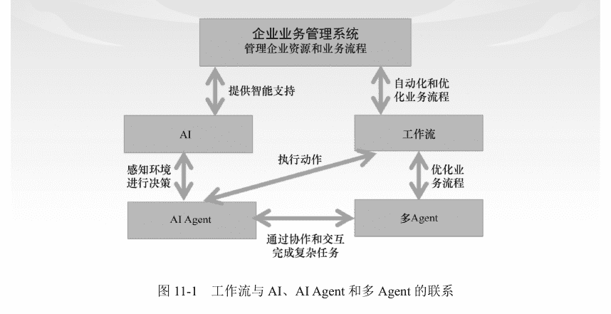

工作流、AI、AI Agent、多 Agent 在企业中各司其职。工作流擅长流程管控，AI 擅长分析决策，AI Agent 在特定任务中表现突出，多 Agent 通过协作解决复杂问题。融合使用可实现更高效智能的运营。

工作流与 AI Agent 在功能上互补，可结合处理更复杂的任务。AI Agent 可作为工作流中的节点执行特定任务或决策，工作流则为多个 AI Agent 提供调度与数据流框架，实现协同作业。

##### 1. AI Agent 和工作流的联系

在任务自动化层面，AI Agent 可嵌入工作流，自动完成复杂操作。例如智能客服中，常见问答 Agent、专业技术 Agent、流程引导 Agent 在工作流编排下协同，提升满意度。

在决策支持环节，AI Agent 可为流程中的决策点提供数据驱动建议。如贷款审批流程中，AI Agent 分析信用数据给出风险评估，辅助人工决策。

在数据处理与分析方面，AI Agent 能处理海量数据，为流程提供洞察。例如分析市场数据以支撑营销策略制定。

在跨平台集成方面，AI Agent 可对接 ERP、CRM 等系统，增强工作流的灵活与扩展能力。

##### 2. Agent 与流程的根本分野

Agent 与传统流程的差异可以归纳为三组对比。

（1）可预测 vs 可应变
流程在搭建时就把执行路线固定下来，环节间的依赖关系事先厘清，更像一份标准剧本，各参与方按既定台词推进。Agent 则面向不确定环境设计，内置感知与判断机制，更像现场即兴的主角，能依据实时反馈调整动作。

（2）规则执行 vs 目标导向
流程依赖事先写死的规则与条件，路径由设计者编码，例如满足条件 A 就触发步骤 B。Agent 以达成目标为核心，通过推理或学习自主挑选路径，例如给出“解决用户问题”的目标后，它会尝试多种策略收敛到最优解。

（3）控制权的去向
流程的掌控权始终在设计者手中，执行者只是按规办事。Agent 则把部分决策权让渡出去，拥有有限的自主空间。

在企业实践中两者各有长处。将 Agent 嵌入到既有流程里，既能保留规范性，又能注入智能，让自动化更灵活、效率与体验同步提升。

#### 11.1.2 AI 自建流程与 AI 赋能 ERP 的差异

AI 自主搭建的流程和 AI 与 ERP 等核心业务系统的融合，在定位上存在明显分野，具体对比见表 11-2。

表 11-2 AI 自建流程与 AI+ERP 融合的对比

| 对照维度 | 基于 AI 自建的流程 | AI 与 ERP 等系统的融合 |
| :--- | :--- | :--- |
| 核心职能 | 任务自动完成、智能化处理、数据驱动的决策辅助 | 资源统一管理、业务全景管控、财务与供应链运营 |
| 目标 | 提升单项任务的效率与智能水平 | 全面优化资源使用与全局业务运转 |
| 数据处理 | 侧重实时分析、预测及智能建议 | 侧重结构化数据沉淀、查询与报表输出 |
| 流程管理 | 高度灵活，可随业务快速调整 | 相对稳固，强调标准化与稳定性 |
| 决策支持 | 实时、个性化的建议 | 基于历史的综合分析与中长期规划 |
| 集成与扩展 | 对接成本低，新功能可快速上线 | 集成难度大，扩展需兼顾整体架构 |
| 用户体验 | 交互友好，支持多轮对话与自然语言 | 功能完备，界面相对复杂 |
| 成本与效益 | 起步门槛低，按需扩容，适合中小企业敏捷落地 | 前期投入高，适合大企业做长期战略布局 |

从职能看，自建流程侧重把报告生成、智能客服等场景自动化；AI+ERP 则用于强化财务预测、供应链优化等核心能力。
从目标看，前者追求单点效率的快速提升，后者追求企业整体资源与运转的智能升级。
从数据看，前者擅长动态数据的实时洞察，后者强化 ERP 结构化数据的解析能力，如发票识别、数据洞察。
从流程看，前者可变可调，后者稳定标准化，更利于长期规划。
从决策看，前者给出即时个性化建议，如风险评估、客户洞察；后者提供基于历史的综合分析与规划，如预算编制、资源分配。
从集成看，前者接入快、扩展敏捷；后者集成复杂、需考量全局影响。
从体验看，前者对话自然、学习成本低；后者功能全面但上手门槛较高。
从成本看，前者投入轻、适合中小企业快速试水；后者投入重、契合大企业长期布局。

### 11.2 流程的常见分类

按应用场景与特质，流程可做多种划分。

##### 1. 按功能划分
可分为自动化任务流程、数据处理流程、客户服务流程、内容生成流程、审批流程、实时流程、批量流程、对话式流程、非对话式流程、行业专属流程等，具体见表 11-3。

表 11-3 不同功能类型流程的特征

| 流程类型 | 特征 |
|---|---|
| 自动化任务流程 | 按序串行执行，减少人工干预；适用于文件处理、数据清洗、报告生成、任务调度 |
| 数据处理流程 | 聚焦清洗、分析与转换；适用于预处理、可视化、挖掘与机器学习、库同步 |
| 客户服务流程 | 以自动或智能交互提升效率；适用于智能客服、反馈处理、多轮对话支持 |
| 内容创建流程 | 生成并优化内容；适用于文本、图像、视频编辑 |
| 审批流程 | 支撑多级审批；适用于采购、项目、文档审批 |
| 实时流程 | 要求即时响应；适用于实时分析、实时客服、实时监控告警 |
| 批量流程 | 集中处理，通常定时触发；适用于大数据处理、定时任务、批量报告 |
| 对话式流程 | 以对话交互为核心；适用于智能客服、虚拟助手、多轮应用 |
| 非对话式流程 | 全自动无需人工参与；适用于批量处理、定时任务、自动报告 |
| 行业特定流程 | 按行业定制；适用于医疗病历管理、教育成绩管理、金融交易审批等 |

##### 2. 按复杂度划分
可分为简易流程、复杂流程、多智能体协作流程。

简易流程结构短、节点少、逻辑直观，多为线性操作，用于单一自动化，如格式转换、简单清洗。
复杂流程结构繁复，含多分支与条件判断，常跨系统协作，需处理多输入输出并动态调整，如订单处理、审批链路、ERP 与 CRM 整合。
多智能体协作流程由多个智能体分工，需共享上下文并协同决策，适合多轮交互与复杂决策，如多专家客服、自动化项目管理。

表 11-4 不同复杂度的特征

| 流程类型 | 特征 |
| :--- | :--- |
| 简易流程 | 结构简明、节点少、逻辑清晰，单任务自动化 |
| 复杂流程 | 结构复杂、分支条件多、跨系统协作 |
| 多智能体协作流程 | 多主体协同、共享上下文、适合多轮交互与复杂决策 |

简易任务与简易流程的区别见表 11-5。

表 11-5 简易任务 vs 简易流程

| 维度 | 简易任务 | 简易流程 |
| :--- | :--- | :--- |
| 复杂性 | 单一操作如发邮件、求和 | 多步骤按序执行以达成目标 |
| 自动化程度 | 需人工或手动完成 | 全自动，步骤间顺序明确 |
| 结构 | 无明确结构，独立操作 | 有起点、处理、终点节点 |
| 系统集成 | 不涉及 | 可能调用 API 等简单集成 |
| 适用场景 | 单一操作 | 需多步骤完成如文件转换 |
| 执行逻辑 | 简单，无分支 | 可能含简单条件分支 |
| 任务依赖 | 无依赖 | 有依赖，前置输出为后置输入 |
| 资源需求 | 较低 | 需一定内存存储等 |
| 扩展性 | 差 | 可增添节点，扩展性好 |
| 监控管理 | 无需 | 需简单日志监控 |

##### 3. 按执行方式划分
共 7 类。

- (1) 顺序流程 按序执行，每一步依赖前一步完成。
- (2) 状态机流程 在预定义状态间流转，顺序非固定，依赖条件或触发器，多用于动态场景如工单处理。
- (3) 规则驱动流程 由预设条件与业务逻辑控制，如电商退货按产品类型自动分派。
- (4) 事件驱动流程 由特定事件触发，按需启动，适用于实时响应如异常检测告警。
- (5) 基于 AI 的流程 利用机器学习、NLP 等实现自动化与优化，如智能客服自动理解并回复。
- (6) 批量流程 定时或集中处理大数据、定时任务、批量报告。
- (7) 实时流程 要求即时执行，适用于实时分析、实时客服、实时监控。

##### 4. 按交互方式划分

- (1) 对话式流程
特点是通过对话交互。场景包括智能客服、虚拟助手、多轮应用。
与基于提示词的 AI 工具相比，交互上支持多轮对话、记忆上下文、流式输出；后者多为单轮、无记忆、一次性输出。
任务复杂度上，对话式可处理复杂业务并动态分支；提示词工具适合简单生成、翻译。
应用上，对话式擅长客服、个性化建议、复杂问题引导；提示词工具擅长文本生成、简单数据处理。
体验上，对话式更自然、个性化；提示词工具交互机械、服务通用。
技术上，对话式架构复杂，含记忆、上下文管理、多节点；提示词工具简单，单次 API 调用。

表 11-6 对话式流程与基于提示词 AI 对比

| 维度 | 对话式流程 | 基于提示词的 AI |
| :--- | :--- | :--- |
| 交互方式 | 多轮交互，带记忆与流式输出 | 单轮交互，无记忆，一次性输出 |
| 任务复杂度 | 可处理复杂任务并动态调整 | 仅适合简单任务，流程固定 |
| 应用场景 | 智能客服、虚拟助手、复杂解答 | 文本生成、数据处理、内容优化 |
| 用户体验 | 自然交互，个性化服务 | 机械交互，通用服务 |
| 技术实现 | 复杂架构，多节点处理 | 简单架构，单节点处理 |

具备记忆能力的 DeepSeek、Kimi 等可被视作 Agent 类流程。

- (2) 非对话式流程
完全自动化，无需用户干预，适用于批量数据处理、定时任务、自动化报告生成。

##### 5. 按应用场景划分
分为企业级流程、个人流程、行业特定流程。

企业级用于内部复杂业务，如 ERP/CRM 集成、项目管理。
个人级用于任务管理，如邮件分类、日程管理。
行业特定针对行业需求定制，如医疗病历、教育成绩、金融审批。

### 11.3 流程的适用范围

##### 1. 适用领域和场景
- (1) 企业内部流程管控 优化请假、报销、审批等，实现自动化、规范化、透明化。
- (2) 跨部门协同 建立高效协作机制，信息快速传递，支撑研发、生产、销售全链路。
- (3) 客户关系管理 自动化投诉处理与服务流程，实时跟踪，提升满意度。
- (4) 生产流程管控 优化生产、物料、质量流程，实时监控并快速解决问题。
- (5) 项目管理 覆盖启动、执行、监控、收尾，协调进度与问题。
- (6) 营销活动管理 规划、执行、评估营销活动，实时跟踪并优化。
- (7) IT 与软件开发 用于敏捷开发、进度管理、Bug 跟踪，如 Jira、Trello。
- (8) 金融服务 贷款审批、理赔、风险管理，实现标准化与监控。

##### 2. 共性原因
适用场景多呈现流程重复、跨部门协同、复杂审批等特征，适合处理多步骤、结果要求严格的任务，能协调部门、保障信息顺畅、确保环节可控。

##### 3. 不适用场景
简单任务、无需多步骤的操作、极致实时性需求、依赖人工创造的任务不适合。流程擅长有状态异步长周期业务，对高频交易等极致实时场景响应不足；对艺术创作、广告创意等高度灵活任务，预设规则会限制创造力。

### 11.4 构建流程的通用方法

#### 11.4.1 构建流程的6个阶段
开发或创建流程，一般情况下需要从以下6个阶段着手。构建流程的6个阶段如图11-2所示。

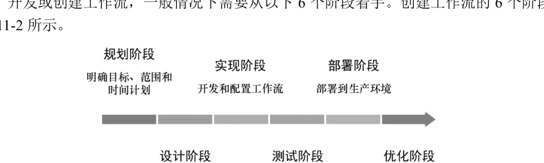

一是规划阶段。规划阶段需要明确工作流的目标、范围和时间计划，确定相关的质量控制方法和工具。具体工作包括分析企业的需求，确定工作流需要解决的问题和实现的功能；评估所需的资源，包括硬件、软件、人员和预算；制订详细的开发计划，包括时间表和里程碑。

# 企业流程自动化全景落地图

## 规划设计期
这一阶段的核心是把业务运行的骨架、规则与边界先行确定下来。实践中多采用流程图或专业建模工具，将各项环节、分支走向以及衔接方式可视化呈现；对每个环节明确其承担的工作内容、期望达成的结果以及交付物；梳理环节间的先后顺序与依赖关系；同时界定流程的启动前提与触发信号，确保系统知道何时开始运行。

## 构建实现期
进入编码与配置环节。先搭建开发环境，部署所需软件与工具；借助流程引擎或低代码平台将前期设计落地为可运行的核心功能，过程中强调代码规范与可维护性；对每个功能模块进行功能校验，确认逻辑正确且运行稳定；最后设定参数与环境变量，实现与外部系统的顺畅对接。

## 质量验证期
重点在于检验体系在真实场景下的可靠性。先对单一模块开展独立功能验证；再对接数据库、API 等外部系统进行集成验证，保证数据在传输与交互中的准确性；通过高并发压测评估性能表现，优化响应速度与资源占用；同步开展安全验证，检查数据在传输与存储环节的保护能力。

## 生产上线期
通过验证的方案推送至生产环境。完成生产服务器、网络及运行环境的准备工作；将应用发布到生产集群，并部署监控体系，实现运行状态的实时可见，快速定位并处置异常。

## 持续迭代期
上线后进入常态化改进。依据监控指标与用户反馈进行性能调优；结合业务变化扩展新能力或新增模块；持续收集使用体验，迭代交互细节，整体效率不断提升。

#### 11.4.2 工作流的功能模块

从构成要素看，自动化体系由任务、流程、角色、规则四大要素构成。任务是最小执行单元，代表具体操作；流程决定任务的先后与衔接方式；角色指参与执行的人员或系统；规则定义行为逻辑与决策依据。典型组成如图 11-3 所示。

典型功能的具体内涵如下。

- （1）任务定义  
  厘清体系需要完成的各项具体活动，明确活动的内容、目标与交付成果。以客户订单处理为例，涵盖接单、库存核查、安排发货、更新客户档案等。

- （2）流程定义  
  规定任务之间的先后与条件关系，确定启动或结束的时机。以订单处理为例，仅在库存核查通过后方可进入发货环节。

- （3）触发机制  
  明确体系启动的方式，通常由特定事件或条件触发。例如客户下单后自动启动订单处理流程。

- （4）任务分配  
  将任务派发给合适的人或系统，可按预设规则或动态条件进行资源匹配。例如高优先级订单交由资深客服处理。

- （5）调度引擎  
  管理任务的执行时间与顺序，确保按计划或优先级推进。例如保障项目关键路径上的任务准时交付。

- （6）数据处理  
  涵盖数据的采集、转换、存储与输出。例如财务报销流程中对报销单据及相关数据的处理。

- （7）决策点  
  根据条件判断执行分支，决定下一步走向。例如投诉处理中依据严重程度决定是否升级支持。

- （8）通知和提醒  
  在关键节点通过邮件、短信等方式告知相关方，确保状态同步。例如发货完成后向客户推送通知。

- （9）调整和优化  
  基于监控数据和反馈持续改进效率，调整参数和结构。例如根据执行结果优化优先级和资源分配。

- （10）资源管理  
  统筹体系所需的人力、物力和资金资源。例如为项目任务配置合适的团队和预算。

- （11）监控和日志记录  
  提供实时监控与历史追溯，记录执行时间、执行者与结果，支撑分析和优化。

- （12）集成接口  
  通过 API 等方式与其他系统协同，交换数据或协调动作。例如对接 ERP 获取库存信息。

- （13）安全和权限管理  
  建立访问控制和权限体系，保护敏感数据。例如仅授权人员可访问财务信息。

- （14）决策支持  
  借助数据分析与 AI 技术提供智能建议，辅助流程中的决策点。例如基于历史销售预测库存需求。

- （15）用户界面  
  提供数据输入、状态查看和反馈接收的交互入口。例如员工通过网页提交请假申请。

- （16）多 AI Agent  
  多个智能体协同完成复杂任务，通过分布式智能提升自动化水平和处理能力。

工作流功能模块与组成元素的对应关系如表 11-7 所示。

表 11-7 工作流功能模块与组成元素的对应关系

| 功能模块 | 任务 | 流程 | 角色 | 规则 |

| :--- | :---: | :---: | :---: | :---: |

| 任务定义 | ✓ | | | |

| 流程定义 | | ✓ | | |

| 任务分配 | | | ✓ | |

| 调度引擎 | | | | ✓ |

| 数据处理 | ✓ | ✓ | | |

| 用户界面 | ✓ | ✓ | ✓ | |

| 集成接口 | ✓ | ✓ | ✓ | |

| 监控和日志记录 | ✓ | ✓ | ✓ | ✓ |

| 安全和权限管理 | | ✓ | ✓ | ✓ |

| 通知和提醒 | ✓ | ✓ | ✓ | |

| 资源管理 | ✓ | ✓ | ✓ | |

| 功能模块 | 任务 | 流程 | 角色 | 规则 |

| :--- | :---: | :---: | :---: | :---: |

| 任务调度 | ✓ | ✓ | | ✓ |

| 协作工具 | ✓ | ✓ | ✓ | |

| 报告与仪表板 | ✓ | ✓ | ✓ | ✓ |

| 系统集成 | ✓ | ✓ | ✓ | ✓ |

#### 11.4.3 创建工作流与创建 AI Agent 的区别

两者在多个维度存在明显差异，至少包括以下十点。

（1）定义与目标  
工作流是按预设顺序和规则执行的任务集合，目标是让业务流程高效、准确、可重复。AI Agent 是具备感知、决策和行动能力的智能体，目标是通过智能分析和交互提供高质量体验。

（2）主要功能  
工作流侧重任务自动化、流程管控、资源调配和进度跟踪。AI Agent 侧重感知、推理、决策、执行和学习。

（3）应用场景  
工作流多用于 ERP、CRM、项目管理、生产调度等结构化业务。AI Agent 多用于智能客服、内容生成、风险预测、教育辅导等需要智能的场景。

（4）技术实现  
工作流依赖流程设计工具、工作流引擎和规则引擎。AI Agent 依赖大语言模型、强化学习和多模态处理等技术。

（5）数据处理  
工作流主要处理结构化数据，保障流程顺畅。AI Agent 同时处理结构化与非结构化数据，强调上下文理解与推理。

（6）决策支持  
工作流基于预设规则进行自动化决策。AI Agent 基于数据分析与模式识别进行智能决策。

（7）灵活性与适应性  
工作流受规则约束，灵活性相对较低。AI Agent 能更快适应数据变化和新场景。

（8）用户体验  
工作流提供结构化的任务管理。AI Agent 提供个性化、对话式的交互体验。

（9）开发阶段  
工作流与 AI Agent 在开发阶段的对比见表 11-8。

表 11-8 工作流和 AI Agent 在开发阶段方面的对比

| 开发阶段 | 工作流 | AI Agent |

| :--- | :--- | :--- |

| 规划阶段 | 需求分析、资源评估、制订计划 | 需求分析、资源评估、制订计划 |

| 设计阶段 | 流程建模、任务定义、流程定义、触发机制 | 模型选择、提示工程、任务规划、记忆与状态管理、推理与决策、工具集成 |

| 实现阶段 | 环境搭建、核心实现（使用工作流引擎或工具）、功能测试、配置管理 | 环境搭建、模型训练、功能测试、配置管理 |

| 测试阶段 | 单元测试、集成测试、性能测试、安全测试 | 单元测试、集成测试、性能测试、安全测试 |

| 部署阶段 | 环境准备、部署应用、监控与维护 | 环境准备、部署应用、监控与维护 |

| 优化阶段 | 性能优化、功能扩展、用户反馈 | 性能优化、功能扩展、用户反馈 |

设计期工作流侧重流程建模与任务拆解，实现期主要使用引擎与规则。AI Agent 更关注模型选型与提示设计，实现期需进行模型训练并借助深度学习框架。

（10）适用场景  
工作流适合订单处理、报销审批等强流程化场景。AI Agent 适合智能客服、内容创作、风险预测等需要智能判断的场景。

总体来看，工作流擅长结构化流程的执行管理，AI Agent 擅长数据驱动的智能决策，二者结合可实现更高效智能的企业运营。

#### 11.4.4 创建工作流的主要工具或平台

目前主流的工作流开发与创建平台如表 11-9 所示。

表 11-9 开发或创建工作流的主流工具或平台

| 工具名称 | 特点 | 适用场景 |

| :--- | :--- | :--- |

| n8n | 开源自动化工作流工具，支持跨系统集成与 AI 任务编排，完全开源免费，高灵活性，支持 400 多个应用集成，兼容主流 AI 模型 | 企业 IT 自动化、金融数据合规处理、复杂 API 串联 |

| Dify | 企业级 AI 应用开发平台，支持复杂工作流与私有化部署，多模型支持，低代码开发，企业级功能 | 智能客服系统、数据分析助手、垂直领域内容生成 |

| Coze | 零代码对话机器人开发平台，主打轻量级 AI 应用，快速上线，免费模型，生态丰富 | 社交媒体 Bot、电商客服、个人娱乐助手 |

| Zapier | 无须编码，连接应用程序并自动化工作流程，用户友好，支持 5000 余个应用程序 | 项目管理、客户支持、市场营销 |

| Make | 可视化工作流设计，支持条件逻辑和多步骤操作，具有强大的集成能力 | 数据转换、API 调用、复杂自动化场景 |

| LangChain/Flowise | 面向开发者的 LLM 工作流工具，适合复杂 AI 链构建 | 需要有代码基础的开发者 |

| AutoGPT/AgentGPT | 自主任务代理，适合自动化决策，稳定性有待提升 | 自动化任务管理 |

| FastGPT | 专注知识库问答 RAG，适合文档分析与专业问答 | 法律、医疗等知识密集型任务 |

| UVdesk | 开源客户支持平台，多渠道整合和工作流自动化 | 客户支持流程优化 |

| Pipedream | 开源事件驱动的集成平台，连接应用程序并构建自动化工作流 | 实时事件处理和跨平台集成 |

这些平台覆盖从无代码到专业开发的不同需求，可根据业务和技术背景选择。

### 11.5 基于 DeepSeek 创建企业应用工作流

DeepSeek 以强性能、低成本和中文适配度获得广泛关注，叠加上下游生态的支持，使其成为构建企业级应用工作流的热门选择。

#### 11.5.1 基于 DeepSeek 开发工作流的优势

除模型性能、成本、技术创新和开源策略外，还具备以下优势。

（1）广泛的应用场景  
可用于智能客服、文档处理、图像识别、自然语言处理等多种场景。

（2）高度的可扩展性和灵活性  
可与多 AI Agent 组合形成多智能体系统，完成复杂自动化；也能嵌入现有流程，通过可视化编排串联工具与模型，像流水线一样协作。

（3）实时响应和优化  
可实时监控执行情况，及时发现问题；基于运行数据和用户反馈持续优化流程。

（4）数据处理与分析能力  
能够处理多样化、规模化数据，分析效果随数据增长而提升，自适应学习使其快速适应新场景。

安全合规、易用性与开发效率也是重要考量。

#### 11.5.2 基于 DeepSeek 创建工作流

构建流程可按以下步骤进行。

1. 明确不同类别业务需求和目标  
先确定自动化场景，如订单处理、客户支持或文档审批；再设定量化目标，如提升效率、降低错误、强化合规等。

DeepSeek 适合构建以下类型工作流，充分发挥其推理、多模态和智能决策能力。

（1）数据处理工作流  
自动识别抽取关键信息并传递给下一步，减少人工干预，提高效率与准确性。目标包括数据清洗中的空值重复值去除、数据转换中的标准化与格式化、数据加载中的存储位置与格式设定。

（2）内容生成工作流  
生成高质量文本、图像和语音，自动完成新闻、文章、社媒文案等创作。目标包含文本长度风格、图像尺寸格式、语音语种语速等具体要求。

（3）客户服务工作流  
构建智能客服，自动理解意图、生成回答并更新客户信息，提供个性化服务。目标包括准确意图理解、相关回答生成、回答分发机制。

（4）智能决策支持工作流  
实时分析业务数据，预测趋势与风险，优化库存、生产计划。目标包括历史数据与市场趋势分析、预测模型构建、优化建议生成。

（5）自动化报告生成工作流  
自动采集分析数据，生成销售、财务等各类报告。目标包括数据采集整理、报告格式内容定义、报告分发机制。

（6）项目管理自动化工作流  
协调任务、跟踪进度、解决问题，确保按期交付。目标包括任务创建、任务分配机制、实时进度跟踪、进度报告生成。

DeepSeek 在学术论文检索、超长文本写作、敏感内容处理和强个人风格写作方面存在局限。论文检索准确性不足，长文本易出现逻辑断裂，内置审核严格易触发限制，个人风格难以精确控制。
2. 选择合适的工作流平台  
不同平台有不同适用场景，需考虑与 ERP、CRM 等现有系统的集成能力。技术层面看，Dify 是与 DeepSeek 结合开发工作流的常用选择，下面以 Dify 来举例说明。

（1）Dify 的能力画像、局限与匹配场景

Dify 定位是面向大模型的应用搭建底座，可在该底座上搭建对话类代理、自动化流程与内容生成等产品。它对外暴露完整的接口体系与灵活的接入方式，能把 DeepSeek 能力快速嵌入到已有业务中，满足企业个性化需求。从建设工作流的角度看，主要体现在以下方面。

① 多模型协同与可扩展，平台允许 DeepSeek 与 GPT-4 等模型混用，开发者可以自定义数据处理管线，还内置多种第三方工具插件与可视化拖拽节点，方便组装复杂业务逻辑。
② 少代码快速上手，可视化编排界面支持拖拽完成流程搭建，降低编程门槛；自带组件与流程模板可显著缩短交付周期。
③ 本地化部署与合规可控，支持私有化安装，数据保留在内网，适配金融、法律等高合规行业；提供数据隔离与自主管理能力，减少敏感信息外泄风险。
④ 知识库增强，借助 RAG 可挂载内部文档，构建高精度的问答能力。
⑤ 运维洞察，内置监控模块，支持对接专业监控平台，实现应用性能的实时优化。

短板主要集中在三点。技术门槛仍存，尤其是私有化部署需要专职运维能力；硬件与部署成本较高，对内存、存储要求高，配置流程复杂；API 密钥需自行保管，使用 DeepSeek 接口时存在泄露风险。

适用范围包括：依托 DeepSeek 快速搭建 7×24 小时智能客服；构建内部知识问答，通过自然语言检索资料；文档提炼与分析工具，快速抽取要点并生成摘要；创意产出助手，用于文案、广告语、营销策划；作为企业内部的 LLM 网关，实现统一管控与数据审计；复杂自动化流程，如订单处理、报表生成、会议预约等。

（2）Dify 与存量业务系统的联通能力

作为 AI 应用开发平台，Dify 在连接 ERP、CRM 等系统上具有明显优势。

① 无代码接入，通过可视化界面与预置模块，可实现与 ERP、CRM 的对接，无需大量编码。
② 丰富的接口体系，提供 RESTful API 与 SDK，便于将智能问答、文档检索等能力嵌入现有系统。
③ 第三方协同，可结合集简云等无代码 iPaaS，利用数千个软件连接器达成数据实时同步与流程自动化。
④ 企业级集成，企业版支持单点登录等内部系统集成，保证安全与权限管控。

存在的挑战：复杂场景仍需技术经验支撑；对接第三方平台可能产生额外费用，尤其在大数据量与复杂逻辑下更明显；集成过程中数据安全与隐私保护需重点考量。

典型联通场景：与 CRM 结合实现服务自动化，提供全天候支持；与 ERP 结合实现订单状态实时更新与追踪；与广告投放系统结合实现营销自动化与数据驱动决策。

总体来看，Dify 在快速构建与交付 AI 应用上表现突出，结合 DeepSeek 可将大模型技术快速转化为业务生产力，尤其适合逻辑复杂度高且对安全性要求严苛的场景。复杂需求仍需权衡技术资源与成本。

3. 环境准备和 DeepSeek 模型配置

搭建流程前需完成环境与工具准备。建议 Python 3.8 及以上，GPU 场景需 CUDA 11.2，并配合 Docker 运行平台。

模型配置流程：登录 DeepSeek 官网注册并获取 API Key；在 Dify 管理后台进入模型供应商，选择 DeepSeek，粘贴 Key 后选择 DeepSeek-R1 或 DeepSeek-V3，并设置相关参数。

> ① 集简云是一款超级软件连接器，也是一个无代码集成 iPaaS 平台。它通过无代码集成与 AI 技术，帮助企业优化业务流程，实现从数字化到自动化和智能化的转型。

4. 创建和配置工作流

在平台新建应用，选择聊天助手并命名；进入流程管理新建流程。用可视化画布拖拽节点，如大模型节点、代码节点、参数提取节点等，进入节点编辑页配置参数，包括模型选择、提示词、温度、最大长度等。

Dify 提供 ChatFlow 与 Workflow 两种模板，对话类任务选用 ChatFlow，功能类任务选用 Workflow。

5. 测试与优化

（1）工作流测试
先整体理解流程，梳理各环节关系并绘制流程图。明确测试范围，包含功能、性能、可靠性，设定响应时长、数据完整性等成功标准。为每个环节设计用例，覆盖正常、边界、异常及集成场景。测试环境尽量与生产一致，准备覆盖全场景的测试数据。

执行手动与自动化测试，自动化可借助 Selenium、JMeter、Postman 等工具，重点覆盖重复与性能测试。记录每个用例执行结果，监控响应时长、资源使用率等指标，分析失败原因定位瓶颈。输出测试报告，与开发与业务方沟通改进点。优化后进行回归测试，并邀请终端用户做验收测试，确保满足真实业务需求。

（2）工作流优化
性能优化：任务拆分并行执行、引入缓存减少重复计算、动态调度计算资源。
质量优化：前后端数据校验、失败任务自动重试、完善错误日志、建立用户反馈闭环。
安全优化：细粒度权限控制、敏感数据加密存储与传输、对任务执行日志做审计。

6. 部署和监控

部署环节：源码与配置文件上传服务器并设置权限；绑定域名到服务器 IP；配置防火墙、SSL 等安全措施；根据硬件负载调整 PHP-FPM 进程数、MySQL 连接数等性能参数。

监控环节：使用自带或第三方监控平台实时查看运行状态、性能指标与异常告警；定期备份数据与配置；定期分析日志排查隐患；关注版本更新及时修复安全漏洞。

异常处理：实时跟踪任务状态、进度与结果，按预设条件自动推送告警并触发恢复，确保业务连续。持续优化涵盖性能、质量、安全，保持系统长期稳定。

7. 一个典型案例
某企业需构建多语言、自动处理工单的智能客服，要求基于企业知识库精准答复、自动生成工单并同步 CRM、支持企业微信通知与状态追踪，延迟低于 100ms，并发 1000 QPS。

架构：用户提问→知识库检索→DeepSeek 推理→工单生成→企业微信通知→数据监控。

（1）环境准备与模型部署
本地用 Ollama 部署 DeepSeek-R1，通过 Docker 运行 Dify，并在 .env 中指定 OLLAMA_API_BASE_URL。在 Dify 的模型供应商中选择 Ollama，添加 DeepSeek-R1:7B 并开启自定义模型。

（2）知识库构建与 RAG 优化
上传产品文档、工单处理指南等 PDF、TXT，采用高质量索引模式分段向量化，结合 Amazon OpenSearch 提升检索效率。配置动态字段映射如产品编号到 CRM ItemID，并启用实时更新插件保持同步。

（3）工作流编排
创建“智能工单助手”流程，核心节点包括：
用户输入解析，用正则提取订单号、问题类型，并调用多语言检测工具自动切换模型参数。
知识检索与推理，RAG 检索相关文档后输入 DeepSeek 生成答案。提示词示例：你是一名专业客服，需基于知识库作答。若涉及工单创建，按【工单类型】、【建议解决方案】、【是否需要人工介入】格式回复，使用企业微信支持的 Markdown。

性能优化与监控：结合 Amazon EC2 Auto Scaling 实现弹性扩缩容，检索延迟控制在 80ms 内；用 Amazon KMS 加密敏感数据，通过 VPC 私有化部署并限制 IP 白名单；内置 Prometheus 可观测性，追踪 API 成功率与 Token 消耗，异常时触发 Slack 告警。

（4）扩展与进阶
引入混合 Agent 模式，对退款等高风险工单启用人工复核；扩展多模态能力，用 DeepSeek-Vision 解析客户上传的故障图片。

11.6 基于 DeepSeek 集成工作流
在真实生产环境中，常需将 DeepSeek 与 AGI 工具、AI Agent、多 Agent 结合到工作流中。可按以下步骤推进。

一是需求分析与目标定义，梳理业务流程、识别自动化点，明确效率提升、决策优化或成本降低的目标。
二是技术选型与工具集成，按需选择 DeepSeek 等模型，将 AI Agent 嵌入流程，构建多 Agent 分工协作系统处理复杂任务。
三是工作流设计与实现，设计节点与流程衔接，通过精准提示词确保 Agent 理解目标，利用动态决策能力拓展边界。
四是多 Agent 协作，将复杂任务拆解分配，共享上下文，构建协作框架并集成 RAG 提升处理能力。
五是测试优化、部署监控，验证功能与性能，通过并行、缓存等手段提升效率，建立反馈闭环持续迭代，选择云端或私有化部署并实施日志监控与性能评估。
六是人机协同与价值共创，建立人机双向增强回路，人类定目标、AI 加速执行，通过人工标注修正持续优化 Agent。

第 12 章 DeepSeek 应用驱动产业转型升级
DeepSeek 通过数据处理、智能决策与自动化，在企业转型中发挥关键作用。

12.1 智能客服系统
智能客服依托 AI、NLP 与机器学习，自动回答问题并提供个性化服务，可通过文本语音交互实现服务自动化与智能化。

12.1.1 智能客服在产业应用中的地位和作用
客服是企业面向市场的核心触点，几乎涵盖所有行业。智能客服不仅提升服务质量、降低运营成本，还增强数据分析与决策能力，支撑数字化转型。

增强数据分析与决策支持：在交互中收集客户数据与反馈，用于需求、偏好、行为模式分析，支撑市场调研与产品优化；基于分析结果预测客户行为、提前预警风险；通过服务数据发现流程瓶颈，推动优化。

提升企业竞争力：提供差异化服务体验，塑造品牌形象；提高客户满意度与忠诚度，促进复购与口碑；实时感知市场动态，快速调整策略与产品。

助力数字化转型：推动客户服务流程自动化与智能化，提升数字化水平；促进数据驱动决策，从经验驱动转向数据驱动。

智能客服的价值已经远超排队分流。它能够激活组织的创新思维，倒逼服务形态、业务流程和产品设计持续演进，最终成为提升企业核心竞争力的隐形引擎。

#### 12.1.2 老牌智能客服的典型短板

智能客服的演进大致经历了四个阶段：90年代到本世纪初以电话坐席为主的呼叫中心时代，本世纪初到10年代的渠道多元化呼叫时代，10年代到20年代的云端全渠道服务时代，以及20年代至今的全场景服务与大模型驱动时代。

在真正接入大模型之前，每代技术都在进步，但传统方案的瓶颈仍然很明显。传统智能客服的不足如图12-1所示。

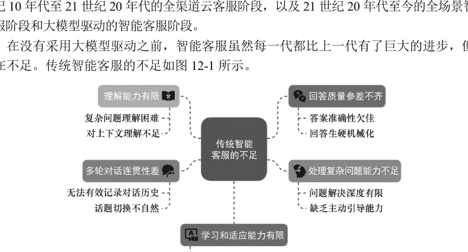
1. **意图捕捉能力偏弱**
   - 跨专业复杂提问难理解。面对模糊、复杂或包含专业术语的咨询，传统系统常抓不住用户真正的诉求。比如金融、法律等领域的深度提问，关键点容易被遗漏。
   - 对话记忆续接差。在多轮交互中，系统对前期内容的保留与利用不足，导致回复脱节、准确度下降。比如用户追问产品使用细节时，系统很难结合前文给出精准答案。

2. **回复质量不稳定**
   - 精准度参差。受限于理解能力，生成的答案往往不完整，无法完全满足需求。咨询产品功能时，常只能给出片段介绍。
   - 表达生硬机械。回复多依赖预设模板和规则，缺乏灵活性与人情味，用户感觉像在跟机器打交道，而不是被理解的助手。

3. **硬问题处理力不足**
   - 解决深度有限。面对棘手问题，通常只能给出简单建议，缺少本质剖析和针对性方案。如用户反馈设备故障，往往无法定位根因。
   - 缺乏主动引导。系统被动等待用户自行表述，无法主动索取关键信息，影响问题解决效率。

4. **多轮对话流畅度差**
   - 历史信息利用弱。难以有效保存并回溯前序对话，推荐与追问容易脱节。例如在购买咨询中，难以基于前期偏好做精准推荐。
   - 主题切换生硬。切换话题时过渡不自然，对话流畅度下降，用户体验受损。

5. **学习适应能力薄弱**
   - 知识更新滞后。知识库需要人工维护，无法自动吸收新信息，面对新政策或新品时易答非所问。
   - 个性化服务不足。难以根据历史交互和偏好提供差异化服务，各用户体验趋同，针对性不强。

#### 12.1.3 在 DeepSeek 加持下客服如何升级

大模型尤其是 DeepSeek 凭借高性能、低成本和本土化部署优势，为客服体系全面升级创造了条件。以下两个典型应用展示了质效提升的具体表现。

1. **深圳公共交通的升级实践**

深圳通作为深圳公共交通的核心运营方，每年客服咨询量超过63万笔，过去高度依赖人工，效率低成本高。2025年2月，深圳通在本地环境部署 DeepSeek-R1 70B，大规模改造客服体系①。改造后的界面如图12-2所示。

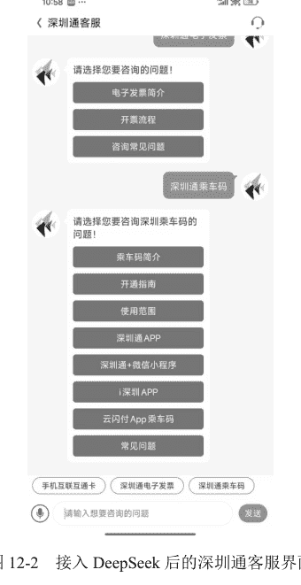
图 12-2 接入 DeepSeek 后的深圳通客服界面

升级体现在四个维度。

- ① 问答广度明显扩展，由有限覆盖转向全面覆盖。借助 DeepSeek 的语义解析能力，系统能准确理解乘车规则、充值、跨境出行等各类提问，甚至可以为单日游线路推荐生成合理建议。原问答库难以覆盖的问题处理率提升到80%以上，复杂问题可通过多轮推理求解。
- ② 操作路径被大幅简化，实现需求直达。通过自然语言处理技术，用户输入“如何办理学生卡延期”等问题后，系统直接跳转到指引页面，减少菜单层级，交互效率提升50%以上。平均响应缩短到秒级，24小时在线服务覆盖率达到100%。
- ③ 人效显著优化，常规咨询实现自助化。系统可自行处理约八成的常规问题，客服人员聚焦复杂工单。新员工培训周期压缩四成，质检效率提升三倍，并能实时生成服务建议并润色话术。升级前人均日处理250笔，升级后人力需求下降而服务质量保持稳定。
- ④ 技术融合与场景延展。结合检索增强生成技术和本地知识库，系统可以动态更新政策等信息，确保时效性。后续计划推出“智能通宝”智能助理，进一步整合出行服务。

> ① 该案例入选2025年深圳两会重点成果，体现 AI 赋能民生的标杆意义。

深圳通改造前后的数据对比见表12-1。

表 12-1 深圳通采用 DeepSeek 前后的数据对比

| 考核项 | 升级前 | 升级后 | 变化程度 |
| :--- | :--- | :--- | :--- |
| 日均处理量 | 250 笔/人 | 自动化处理 80% | 效率提高 50% |
| 复杂问题解决率 | 依赖人工 | 80%自动化 | 人力节省 40%以上 |
| 用户满意度 | 75% | 92% | 提升 17% |

实践表明，DeepSeek 与本地知识库融合后，服务由被动应答转向主动服务，既降本又扩面，为市民提供更便捷个性化的出行体验，助力智慧城市建设。

2. **电信运营商的智能客服案例**

一家大型电信运营商面临咨询量大、响应慢、人工成本高的困境，与杭州深度求索合作将 DeepSeek 嵌入客服系统。

实施分三步：一是知识库构建与数据整合，将多年对话记录、常见问答、产品文档统一汇聚，利用预处理能力完成标准化、分类与脱敏；二是检索增强自动问答，基于检索增强生成技术实时匹配知识库，结合自然语言理解与生成能力输出自然准确的回答，并支持多轮连贯对话；三是智能分流与人工协同，复杂问题自动转人工，同时通过统计反馈持续优化检索策略与回答质量。

上线后，客户平均等待时间缩短约30%，自动解决率达75%，运营成本下降约50%，客户满意度提升约20%，体验明显改善。

该案例显示，DeepSeek 的检索与生成能力帮助企业高效利用海量内部知识，在响应速度、准确性与成本控制上实现明显质效双提升。

### 12.2 质检与质量预测

质量检测指产品交付前对缺陷、异常或不一致的评估；质量预测则依托历史与当前数据，通过统计与机器学习预判未来可能出现的问题。

#### 12.2.1 质检预测的价值与作用

该技术已广泛应用：汽车、机械、电子制造等生产环节用于缺陷检测、设备故障预判；食品饮料用于保质期预估与污染风险检测；化工用于反应时机优化；制药用于纯度与有效成分把控；农产品用于安全保障；环境领域用于空气、水质、土壤监测；服装、家居等消费品用于外观与耐用性控制。

在企业运营中至少体现七方面价值。

- （1）保证出品合格，及时发现并解决生产问题，保证出厂产品合规。
- （2）提升生产效率，提前识别风险，减少不良品与停机。
- （3）降低运营成本，减少返工、报废与客诉支出。
- （4）增强竞争力，高质量产品提升满意度与忠诚度。
- （5）支撑决策，数据分析为流程优化与质量改进提供依据。
- （6）满足合规，食品、药品、医疗器械等行业须满足法规要求。
- （7）驱动创新，推动传感器、数据分析、AI 等技术进步，促进工艺革新。

#### 12.2.2 传统质检预测方法存在的问题

传统方式以人工与规则驱动为主，局限性明显。

##### 1. 传统质量检测方法

人工目视检测依赖肉眼，操作直观但主观性强，易漏检隐蔽或微小缺陷。手工测试使用刷子、锤子等简单工具感知坚固性与平整度，受工人经验限制，标准化与效率不足。传统量具测量受人为与工具精度限制，难以满足高精度需求。基于规则的视觉检测需专家预设颜色、形状、尺寸阈值，一旦偏差即报警，灵活性差。

##### 2. 传统质量预测方法

数据驱动预测收集历史数据建模，但对整体过程建模易忽略时段与变量差异。过程监控与预警系统实时监控异常并告警，但计算延迟影响即时性。专家系统利用专家经验评估关键环节，依赖人工知识沉淀，扩展性有限。

##### 3. 检测预测的发展阶段及问题
###### （1）传统质量检测方法的问题
效率低、主观性强、精度受限且难实时。人工检测耗时费力，视觉与手工结果易受经验影响，量具精度受限，多在生产结束后检测，无法即时反馈。

###### （2）传统质量预测方法的问题
泛化能力有限，整体模型难以兼顾不同生产阶段与变量，导致准确率下降；实时性差，计算与处理耗时长，难以在线反馈。

#### 12.2.3 DeepSeek 对质检预测系统的改进与效果

针对上述瓶颈，DeepSeek 在数据融合、实时性与流程优化上带来明显改进。

##### 1. 改进内容
（1）质量检测
首先实现多模态融合。传统检测多依赖单一光学成像，DeepSeek 融合成像、声纹、温度、压力等多源传感数据，提升缺陷检出率。其次实现实时监控预警，可实时分析关键指标，超阈值自动报警并记录，避免批量问题。最后自动生成检测报告，一键导出并支持自定义模板含图表与问题分类，减少人工整理。

（2）预测系统
依托深度学习对设备历史数据建模，结合实时监测构建精准预测模型。如在光纤生产中梳理关键因子关系，控制预测性能与实测偏差。同时分析振动频谱、温度曲线等参数，提前预判设备异常，实现故障预警。

（3）流程优化
基于历史数据优化工艺标准并自动推荐参数调整，支持动态优化。如注塑成型中据数据确定最佳温度并实时调整，提升质量与效率。出现质量问题时可快速定位环节，关联生产数据与供应商信息，为工艺改进与供应链优化提供依据。

##### 2. 改进后的典型案例
（1）新能源汽车电池厂。某电池厂面临批次性能波动问题。引入 DeepSeek 整合原材料、生产、成品检测数据，建立预测模型，提前预警潜在风险并动态调整参数，显著提升稳定性与一致性。

（2）3D 打印领域。传统检测依赖人工或简易仪器，效率低易漏检。DeepSeek 结合计算机视觉实现打印件裂纹、气泡等缺陷的实时自动检测，并基于历史数据预测质量风险。某企业引入后，缺陷检出率从93%提升至99.7%，质量控制可靠性大幅提高。①

> ① Deepseek 如何重塑 3D 打印：从设计到生产的智能革命。

（3）工业现场作业指导。蒂姆维澳公司本地部署 DeepSeek 并结合煤矿安全知识库，为一线人员提供实时维修、质检与故障排查指导，提升现场作业安全性，减少误操作导致的质量问题。①

> ① DeepSeek 企业级应用的案例分享：重塑行业格局。

总体来看，DeepSeek 通过多模态融合与自动化检测提升检测速度与准确性；通过实时监控、精准预测与参数动态调整帮助企业提前处置风险、减少停机与返工；同时降低人工分析成本，实现质量与效率的双提升。

DeepSeek 为质量管理团队输出更完整、更精准的数据洞察与智能分析能力，让质量改进方案的制定和生产决策更科学、更高效。

### 12.3 个性化内容推荐新解码
个性化内容推荐，本质是通过算法与数据分析，捕捉用户行为、偏好和画像特征，进而推送定制化内容与服务的机制。

#### 12.3.1 企业运营中的核心作用
在企业全流程中，个性化推荐都能发挥关键支撑。

##### 1. 产品设计与研发
设计研发阶段需要洞察用户需求并实现差异化供给。
借助推荐体系，企业可以更清晰地读懂用户痛点、期望与潜在诉求。比如通过分析用户对产品相关图文视频的浏览与互动行为，挖掘出对功能、性能等维度的隐性需求，为新品定义提供依据，让产品更贴合市场。
同时可依用户偏好和使用习惯做分群设计。例如智能手表品牌可针对健身人群强化专业运动监测与训练计划，对普通人群优化日常健康提醒与睡眠监测，从而提升竞争力。

##### 2. 生产制造环节
生产永恒的两大目标是提效和控质。
个性化推荐能助力生产流程的精细化优化。基于产线工人操作习惯、技能水平等数据，为不同人员匹配最适配的工作流与任务，提高效率与一致性。
依托数据分析实现质量的实时预警。结合产线实时质量数据、历史记录与用户反馈构建质量预测模型，一旦发现异常即自动调整工艺参数或触发设备维护，减少废品次品，降低成本。

##### 3. 营销推广环节
精准触达与个性化投放是营销的核心追求。
通过解析用户浏览轨迹与购买行为，洞察兴趣与需求，实现精准营销。如依据历史购买与浏览记录推荐关联商品，提升转化。
还能按用户画像与行为模式定制广告内容与投放策略，使广告更契合受众，提升点击与转化率，同时压缩投放费用，提高ROI。

##### 4. 销售环节
销售环节中，推荐对体验提升与业绩增长意义重大。
销售过程中提供个性化的商品推荐与购物体验，帮助用户快速锁定兴趣品类，提升购买意愿与满意度。
通过关联推荐配件、升级选项等，引导追加消费。如用户购买手机时推荐适配壳、耳机或更高配置机型，提升客单价与销售额。

##### 5. 售后服务环节
售后更强调一对一服务。
依据购买历史与使用情况提供定制化售后。例如智能家电用户可根据使用习惯与常见问题获得专属保养建议与远程技术支持，提升服务满意度。
持续的个性化关怀增强信任与粘性。定期推送固件更新、使用技巧与专属优惠，使用户感受到被重视，从而提高忠诚度与复购率。

#### 12.3.2 传统方案的五大短板
##### 1. 推荐技术演进阶段
内容推荐经历了三个阶段。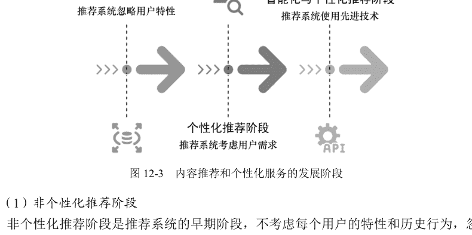
（1）非个性化推荐阶段
早期系统不考虑个体差异与行为历史，缺乏个性化建模，推荐结果千人一面，多按点击量、销量、热度等排序推送。
（2）个性化推荐阶段
技术成熟后开始面向个体需求，通过行为数据与兴趣偏好进行定制化分发。可细分为基于内容的推荐、协同过滤推荐、基于深度学习的推荐等子阶段。
（3）智能化与个性化推荐阶段
当前最新阶段，融合深度学习、知识图谱等多项技术，可处理多模态数据，并基于实时行为与真实需求提供更智能的个性化服务。

##### 2. 传统方法体系
主流方法包括基于内容的推荐、协同过滤与混合推荐。
基于内容的推荐先解析物品的文本、图像等特征，再为用户匹配兴趣相似的内容。
协同过滤分为基于用户的和基于物品的。基于用户的是寻找兴趣相近的其他用户并推荐其喜爱的物品；基于物品的是以物品间相似度为依据进行推荐。
混合推荐将多种方法叠加使用，以兼顾准确性与多样性。

##### 3. 传统方法存在的不足
- （1）冷启动问题
新用户或新物品因历史数据不足，导致个性化效果不佳。
- （2）数据稀疏性问题
用户-物品交互矩阵稀疏时，协同过滤难以找到可靠的相似关系。
- （3）过度特化问题
基于内容的推荐易陷入用户已知兴趣的窄圈，缺乏创新与探索。
- （4）隐私保护问题
个性化需要大量个人数据，易引发隐私担忧。
- （5）计算成本问题
数据规模扩大带来算力压力，需在效果与效率间权衡。

#### 12.3.3 DeepSeek 如何升级推荐能力
针对上述短板，DeepSeek 从五方面进行改进。
- （1）冷启动问题的解决
DeepSeek 融合多维数据与实时学习机制应对冷启动。除历史行为外，还结合上下文信息如时间、地点、设备，以及文本、图像、音频等多模态特征，通过深度学习挖掘潜在关联，构建更立体的用户画像，为新用户新物品提供更精准的冷启动推荐。系统具备即时学习能力，用户点击、收藏、评论等反馈会迅速驱动模型调整，确保推荐贴合真实意图。
- （2）数据稀疏性问题的缓解
借助深度学习、知识图谱、联邦学习与数据共享来缓解稀疏。深度学习提取复杂特征，知识图谱关联物品间的语义与属性关系，即使交互稀疏也能通过关联推断进行有效推荐。联邦学习在保护隐私前提下实现跨平台协同训练，扩大可用数据量，提升覆盖与准确性。
- （3）过度特化问题的改善
引入多样化与探索机制并做多目标优化。算法中加入随机性与探索概率，适度混入弱相关但有价值的内容，帮助用户发现新兴趣。优化目标不再单一，兼顾满意度、内容质量与创新性，平衡精准与多样。
- （4）隐私问题的应对
通过隐私透明化、匿名化与加密技术保障安全。明确告知数据采集、使用与存储方式，并提供退出或限制权限选项；在处理时进行匿名化脱敏并加密存储，防止泄露滥用。
- （5）计算成本问题的优化
采用模型剪枝与量化降低参数与计算复杂度，提升推理实时性。结合缓存机制对高频请求结果复用，并利用并行计算与分布式架构加速处理，降低整体算力成本。

#### 12.3.4 实践案例
投资家在新浪财经《DeepSeek 的 100 个应用场景》中披露，某电商平台引入 DeepSeek 后，通过融合历史购买、浏览记录与上下文等多源数据构建完整画像，实现更精准的商品推荐。实时学习与反馈机制使策略持续自适应，而多样化探索机制避免了内容同质化，帮助用户拓宽兴趣边界。

### 12.4 智能疾病诊断与治疗推荐
疾病诊断与治疗推荐是基于患者病情、病史、检查结果等，结合医学知识、临床指南与大数据，为患者提供精准诊断与最优治疗建议的过程。它既包含医生的经验判断，也包含AI等信息技术辅助决策。
该能力广泛应用于临床决策支持、医学教育培训、公共卫生防控与医疗资源优化，提升诊断准确性、治疗效果与服务质量，推动医学创新。

#### 12.4.1 四阶段演进历程
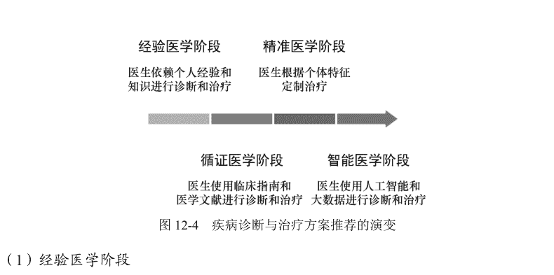
（1）经验医学阶段
医生主要依赖个人经验与基础查体、实验室检查进行诊断，治疗方案受个人认知影响大，易出现误诊漏诊，缺乏系统性与个性化。
（2）循证医学阶段
医生开始依据临床实践指南与医学文献决策。指南基于大规模研究证据提供标准化流程，文献检索系统便于获取前沿成果。但指南更新滞后，文献质量参差，筛选评估耗时。
（3）精准医学阶段
强调个体化特征如基因、生物标志物指导诊疗。基因组学与分子诊断使靶向治疗成为可能，如通过基因测序指导肿瘤用药。但成本高、基层普及难，且解读需专业生物信息学能力。
（4）智能医学阶段
AI与大数据驱动的阶段，通过机器学习、深度学习分析海量医疗数据，构建智能诊断与治疗推荐平台，可快速处理复杂信息提供决策参考。主要挑战是数据隐私安全与算法偏见。

#### 12.4.2 DeepSeek 的落地进展
（1）疾病诊断
DeepSeek 贯穿数据采集、处理、分析与匹配全链路。
医学影像分析方面，利用深度学习与图像识别对X光、CT、MRI等进行快速精准判读。肺部疾病诊断准确率较传统方式提升约20%，肿瘤筛查可迅速定位微小病灶，显著提高早诊率。
多源数据融合分析方面，整合症状、检查、病史等信息，NLP理解患者自述症状并推荐适宜科室与医生，结合排班与偏好给出最优预约方案。
罕见病诊断支持方面，可将症状描述与全球罕见病库匹配，给出潜在诊断线索。
（2）治疗方案推荐
基于基因信息、生理指标与病史提供个体化建议。以肿瘤为例，可分析基因数据锁定靶点、推荐靶向药物并预测疗效与不良反应。通过海量病例挖掘疾病规律优化方案。某三甲医院试点显示，AI辅助使影像判读效率提升40%，漏诊率明显下降。同时可基于基因、用药记录预测个体化药物不良反应风险。
（3）诊疗流程优化与资源配置
AI智能导诊引导患者描述症状并快速匹配科室，减少排队与盲挂造成的资源浪费。辅助医生快速生成并优化病历，提升质量；电子病历自动结构化便于统计分析。
DeepSeek 成本低、开源开放，推动医疗AI从头部医院向基层下沉，为社区医院提供高效诊疗支撑。与医疗设备结合促进小型化智能化，如便携式心电、超声可在偏远或急救场景实现自动化诊断，降低对专家的依赖。

#### 12.4.3 真实案例
（1）医学影像与肺结节诊断
浙江大学医学院附属第二医院胸外科应用 DeepSeek 鉴别肺结节良恶性。范军强主任上传直径6mm磨玻璃结节影像后，系统基于形态、密度、边缘特征分析给出“早期肺癌可能性高”的意见，建议3个月复查或病理活检，与多学科会诊结论高度一致，并附上国际筛查指南更新。AI辅助使阅片效率提升50%，大规模筛查漏诊率降低15%。
（2）安图生物联合 DeepSeek 升级检验临床辅助决策
针对“糖化血红蛋白升高”的糖尿病筛查报告，DeepSeek 不仅解释指标含义，还关联饮食、运动等影响因素并给出个性化建议，如每周150分钟有氧、减少精制碳水。对慢性肾病患者，系统自动关联肌酐、尿蛋白等指标提示分期与用药风险。应用后患者满意度提升20%，复诊率下降12%。

### 12.5 供应链优化与智能调度
供应链优化与智能调度是供应链管理中相辅相成的两大抓手，共同提升效率与竞争力。
供应链优化通过分析改进采购、制造、物流、销售、服务等环节，实现降本增效、提速增韧。智能调度则依托信息技术与算法对资源、任务与流程进行动态智能分配，通过实时监测与预测模型自动决策，提升利用率与客户满意度。

#### 12.5.1 发展阶段与痛点
1. 供应链优化的发展阶段
首个阶段是孤岛阶段。各职能部门职责不清、信息不通，外部合作仅止于交易，需求计算常依赖简易MRP甚至Excel。表现为库存高企、订单响应慢、交付不稳定。
第二个阶段是供应链阶段。企业引入MRP系统初步管控库存，采购以价格为导向，物流选择低价承运商。但部门间协作仍松散，与上下游缺乏伙伴关系，且系统间数据兼容性差。

供应协同与排程智能化进程总览

内部整合阶段
企业引入信息化工具后，部门间协作更顺畅，产品设计阶段纳入职能增多，库存管控更精细，市场需求预测精度提升。该阶段短板在于侧重内部流程改进，对外部伙伴的联动与融合能力相对薄弱。

价值链外延阶段
企业扮演全链枢纽，打破组织壁垒，推动计划、设计、补货、配送一体化协作。依托区块链、人工智能、物联网等手段，供应体系效率与效能显著提升。此阶段需消化海量信息与复杂协同关系，对信息技术与数据治理提出更高要求，同时数据安全与隐私风险凸显。

2. 智能排程演进脉络
制造业智能排程的演进可划分为四个阶段。

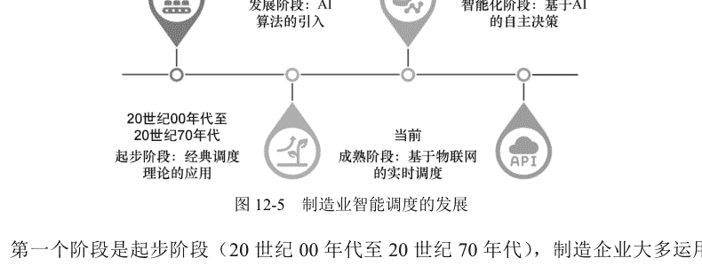
起步阶段对应1960年代至1970年代，制造厂商多采用经典排程理论，并尝试将少量智能化方法用于车间排程、智能配电、多主体系统等场景。局限在于运算复杂耗时，不适合大规模求解，解的质量偏低，与全局最优差距明显。

发展阶段始于1980年代以后，受自然规律启发，出现了遗传算法、蚁群算法等仿生方法，禁忌搜索、模拟退火等传统方法也得到改进。单一算法驱动易出现运行缓慢、全局最优精度不足等问题。

成熟阶段为现阶段，随着工业物联网普及，实时生产排程成为主流。智能传感器与监控设备采集车间设备、物料、人员等现场信息，经关联分析、融合处理与可视化后，在虚拟总排程平台完成优化并生成实时生产决策。系统集成难度提升，需要高并发、高吞吐、高算力、高可靠的制造系统支撑，对实时性要求严苛，高度依赖网络与设备稳定。

智能化阶段面向未来，随着人工智能与机器学习的持续演进，深度模型可对历史数据与实时运行数据持续学习，实现更自主的决策与排程优化。应用延伸至智能物流、智能制造、智慧城市等，用于物流资源调配、生产过程智能监控与排程、城市综合指挥协调。该阶段对高质量训练数据的依赖很强，数据获取与预处理成本高，且深度模型可解释性弱，决策依据难以追溯。

#### 12.5.2 DeepSeek在供应与排程上的升级路径
DeepSeek在供应优化与智能排程层面带来多维改变。

1. 供应优化
采集监控方面，通过传感器与物联设备实时抓取产线设备状态、生产进度、质量参数等信息，及时告警异常，保证生产稳定可控。
排程优化方面，融合实时数据与历史数据进行智能排程，优化资源配置提升效率，并基于计划与实际偏差给出改进建议，助力计划制定与动态调整。
质量管控方面，持续监控过程质量参数，及时处置问题降低不良率，全程记录生产数据实现产品质量可追溯，快速定位根因。
设备维护方面，分析运行数据预测潜在故障，提前维护缩短停机，涵盖状态监控、维护记录、备件管理在内的全面管控提升设备利用率。
分析决策支持方面，依托强大分析能力输出实时精准的智能建议，高效处理复杂任务，提升运营效率。
风险管理应急响应方面，结合全球经济、政治、社会等多源信息实时监测外部波动，提前预警可能影响供应体系的风险，并据此制定应急策略，如更换供应商、调整物流路线、优化库存，把风险影响降到最低。

2. 智能排程
任务调度方面，DeepSeek的分片机制以动态分片和智能调度提升资源利用率，相同资源下处理任务量可提升30%以上。
负载均衡方面，无论高负载或低负载，均能保持计算节点负载均匀，避免浪费与性能瓶颈。
容错恢复方面，即使部分节点故障，系统仍能高效运行，保证任务高可靠与高稳定。
智能对话查询方面，模型嵌入业务系统，实现大屏端全场景智能对话。

#### 12.5.3 两则实践案例
（1）数商云联动某制造厂商降本提效
该厂商长期受供应成本高、响应迟缓困扰，传统模式难以应对市场波动。引入数商云与DeepSeek整合方案，实现全链路优化。
打通供应商、生产商、物流商数据，构建动态库存模型并给出补货建议。以历史销售与需求预测为依据，安全库存阈值由30天降至15天，库存成本降30%。智能预测算法优化采购计划，减少积压与缺货浪费，采购成本降25%。
结合市场走势与订单波动生成实时生产排程，避免产能闲置或过载，需求高峰期自动调整产线优先级，响应速度提升50%。
多维度分析供应商绩效、物流时效、客户满意度并生成优化报告，整体运营效率提升40%，客户满意度提升30%。该案例成为数商云的标杆应用。

（2）怡亚通物流接入DeepSeek实现动态路径规划
怡亚通物流面临空驶率高、调度冗余难题。2025年数字货运业务接入DeepSeek，聚焦路径与资源匹配优化。
整合订单、交通、天气数据，通过深度学习模型实时规划最优运输路线。珠三角试点中系统动态规避拥堵，运输时效提升20%，燃油成本降低15%。对提单影像、报关文件等非结构化数据的智能解析使数据处理效率提升50%，人工录入错误减少。
基于历史运输数据与实时需求预测自动分配车辆与司机，电商旺季订单响应时间由4小时缩短至30分钟，车辆利用率提升35%。
实时监测车辆故障、天气突变等异常并提前预警调整，货物延误率下降40%，优化路线使碳排放减少12%，符合绿色物流要求。该案例入选《2025年物流技术创新案例》，被视为AI驱动供应体系效率革命的典型。

### 12.6 智能教学辅助系统
智能教学辅助系统依托人工智能提升教学效率、实现个性化学习、改善教育质量并促进教育公平，广泛应用于K12、高等教育、职业培训与在线教育等。例如美国Classworks面向K12特殊教育与分级干预，通过智能助手Wittly为学生提供定制化解释与支持，企业培训机构也借助该类系统提升员工专业技能。

系统在课程开发、教学实施、学业评估、培训管理等环节发挥不可替代的作用。

#### 12.6.1 智能教学助手的演进脉络
萌芽可追溯至20世纪50年代前，1957年后进入黄金期。1960年PLATO成为首个计算机辅助教学系统；1965年爱德华·费根鲍姆等人启动专家系统DENDRAL研究；1970年J.R.Carbonell提出智能型计算机辅助教学构想；1973年Hartley与Sleeman勾勒智能教育系统基本框架。该阶段开发成本高、技术复杂，应用范围有限，多集中于高等教育与科研机构。
其后因技术进展缓慢、效果不理想、投入不足，研究热度回落。1993年至今迎来第三次繁荣。1996年Brusilovsky等人推出首个自适应教学系统；2011年韩国教育科学技术部发布相关推动政策……

#### 12.6.2 DeepSeek对智能教学助手的全面赋能
1. 个性化学习路径智能定制
深度强化学习模型分析海量学习行为样本构建多维能力评估体系。某平台借助DeepSeek，可依据作答速度、错题类型甚至笔迹压力值动态调整多风格教学方案，实验组学习效率显著高于对照组。
2. 反馈响应的实时化
智能批改系统响应速度远超传统人工。自然语言处理可解析议论文逻辑漏洞，某写作平台以情感分析捕捉作文中隐藏的心理压力信号。
3. 跨学科能力系统化培养
基于认知科学的AI训练系统在南京某创新校将物理思维向经济学迁移的转化率提升至67%。知识图谱打通学科壁垒，构建含数百万概念节点的跨领域认知网络，帮助学生建立多维联结。
4. 教学资源推荐优化
融合协同过滤与知识图谱，既参考群体规律又兼顾个体差异。实验数据显示匹配效率大幅提升，在数理工程等学科优势明显。
5. 备课效率跃升
依据课程标准与教学大纲自动生成教学目标与重难点分析。如准备高中物理电磁感应，系统可自动统计高考考查频率与常见错因，帮助教师把握重点。
6. 教学内容结构化组织
按知识点逻辑关系自动生成教学框架，教师可据需调整，系统实时更新，使内容更系统完整。
7. 教学策略智能推荐
结合教学内容与学生特点推荐方法与活动设计，如初中生物生态系统可建议项目式或探究式学习。
8. 教学资源智能整合
从海量资源库筛选优质素材，自动匹配文本、图片、视频并按相关性排序，极大节省检索时间。
9. 多媒体课件自动生成
依教案自动生成PPT并附动画与版式，教师微调即可使用。
10. 教学案例智能匹配
按主题自动匹配各地优秀课例，为教师提供实践参考。
11. 教学评估智能化
按教学目标自动生成分层测试题，支持自动组卷，简化出题流程。
12. 学情智能分析
输出班级与个体学习报告，帮助教师精准把握知识掌握情况，使备课更具针对性。
13. 教学效果预测与优化建议
基于教案与学情预测教学效果并给出改进建议，便于提前应对潜在问题。
14. 个性化备课支持
记录教师教学风格与偏好，自动调整推荐内容与界面，适配个人习惯。
15. 协同备课功能
提供云端协作平台，支持多位教师同时编辑与评论教案，促进经验交流。
16. 备课过程智能记录与分析
记录每次备课与修改轨迹，定期生成分析报告，为反思改进提供依据。

#### 12.6.3 校园落地案例
青软集团旗下教育平台U+为破解高校实验教学与项目实训的答疑耗时、批改工作量大等痛点，2025年深度整合DeepSeek模型，依托华为昇腾AI算力，打造覆盖全流程的智能辅助系统。
（1）AI学伴小U：从答疑到启智
编程问题深度解析，结合自然语言理解与推理能力生成分步解决方案与优化建议。如递归函数栈溢出问题，既指出原因又推荐尾递归或迭代方案。实验教学适配实践知识库，依据机器人传感器等设备参数动态调整指导策略，提升精准度。
（2）出题与判题效率革新
千人千面题库生成，教师设定知识点如二叉树遍历，系统秒级生成选择、编程等题型并保持难度梯度。某数据结构课程自动生成10道覆盖先序、中序、层序遍历的题目。
大规模智能判题：2024年某大学期末考试中，U+利用DeepSeek自动批阅1500余人次编程题，传统人工需一周，系统数小时完成并生成错误热力图，标注指针未初始化、循环条件缺失等常见逻辑错误。
（3）教学智能体与本地化部署
可制作教师专属AI分身，如Python课程助教自动解答语法问题，电路实验助手专注硬件调试建议。通过昇腾Atlas硬件本地化部署，保证学生代码、实验记录等数据不出域，同时保持低延迟。

数据对比显示，编程问题解决效率由平均30分钟/个降至2分钟/个，提升15倍；作业批改耗时由1500人次1周降至数小时，降低90%以上；学生满意度由78%升至93%。该实践以“昇腾算力+DeepSeek模型+教育知识库”三层架构实现从通用AI到教学专用AI的跨越，已在太原理工大学等多所院校推广，成为产教融合标杆。

### 12.7 DeepSeek及应用驱动产业转型升级
DeepSeek及其构建的应用正多点驱动传统产业转型，上述案例仅为其一。

#### 12.7.1 变革领域的共同特征
1. 数据驱动与智能决策
所有应用均依托大规模数据整合与分析能力，通过文本、图像、时序等多模态处理实现精准决策。
海量数据依托：金融交易、医疗病例、制造流程等领域数据量庞大，DeepSeek可处理分析挖掘，为决策提供基础。
对效率提升的强烈需求：各领域普遍追求流程提效、资源优化、成本下降，DeepSeek通过智能决策与流程自动化助力快速识别问题、预测趋势、优化路径。
复杂问题求解需求：金融风控、医疗诊断、生产调度等涉及复杂逻辑与多变量，DeepSeek提供精准决策支持。

作用方式包括：数据挖掘与洞察，揭示数据背后的模式、趋势与关联，为市场需求预测、消费者行为分析提供依据；智能决策支撑，实时评估不同方案的影响与风险，如金融投资中的个性化组合建议；流程优化与自动化……

业务流程智能化与体验升级

在真实运营场景中，系统能够捕捉流程卡点与低效节点，借助智能自动化手段对整条链路进行再造，降低人工介入频次与操作失误，让效率与交付质量同步提升。典型的制造产线里，设备故障预测性维护、生产排程等模块已实现自动化与智能化升级。

个性化体验提升
依托数据洞察与智能推荐能力，平台可为不同用户或客户量身打造专属产品组合、服务形态或解决方案，推动感知度与满意度增长。教育场景下，依据学员学习进度与个人特质，匹配适配的学习材料与辅导方案。

创新与业务拓展
该能力有助于激发组织创新思维与商业模式迭代，助力发掘增量市场与增长点。以数字内容创作为例，借助创意生成与内容优化能力，推动行业向更高效率、更高品质的生产方式演进，拓展全新业务板块与创收渠道。

2. 流程自动化与效率提高
以 DeepSeek 为核心的应用改造，可把研发、制造到服务的全链条串联，实现自动化贯通，削减对人工的依赖、压缩运营成本。具备提效潜力的环节或场景往往呈现以下共性。

（1）普遍存在重复性任务
多数行业内部都沉淀了大量重复、规律性的操作，如信息录入、文件归档、报表编排等。这类工作路径固定却繁琐，耗费人力时间且易出错，亟需自动化改造。

（2）数据处理与分析需求强烈
企业在日常经营中积累了海量数据，常分散于不同系统平台。唯有整合、清洗后再进行洞察，才能为决策提供支撑。传统方式耗时费力难以满足实时精准需求。DeepSeek 的分析处理能力可快速提炼数据价值，推动数据驱动的运营。

（3）业务流程标准化程度较高
可被自动化的单元通常已具备较高的标准化和规范化特征，规则明确、操作路径清晰，便于建模优化并实现自动化执行。

（4）对人力依赖度较高且成本压力大
传统作业多以人工为主导，疲劳与失误导致效率波动、质量参差。随着用工成本攀升，企业亟需以自动化替代或辅助人工实现降本增效。

流程自动化与效率提高的具体作用方式有以下 5 点。

（1）流程自动化与优化
DeepSeek 可接入既有业务系统，将多项任务串联并实现自动化运行，减少人工干预，加快执行速度并提升准确率。数据侧可自动完成清洗、转换、加载等；内容侧可自动产出报告、文案、设计稿；客服侧可实现自助问答与问题处理，提升满意度。

（2）智能决策支持
依托强大的数据分析与处理能力，DeepSeek 可快速解读海量业务数据，提供实时精准的决策建议，帮助优化资源配置、管控风险。制造领域可用作设备故障预判与维保、质量检测、供应链管理；金融领域可辅助投资决策与风险评估等。

（3）提升工作效率与质量
自动化与智能决策能显著提效增质。减少人为差错和重复劳动带来的疲劳，提升一致性和精确度；加速业务对市场的响应，提升客户满意度与竞争力。法律领域可大幅缩短合同审查周期并降低失误；医疗领域图像识别与 OCR 可让票据处理更快、错误率更低。

（4）促进业务创新与拓展
DeepSeek 不仅优化既有流程，还能催生新模式。教育领域可通过个性化方案制定与资源智能推荐驱动教学模式创新；制造领域智能研发辅助可加速产品迭代、提升创新力，开拓新市场空间。

（5）增强企业竞争力
通过效率、质量、成本、创新等多维改善，DeepSeek 帮助机构建立综合优势，在市场竞争中脱颖而出，实现可持续发展。

3. 垂直领域定制化能力
DeepSeek 支持基于行业数据的模型微调，满足制造、医疗等复杂场景的个性化需求。共同特点为：

（1）专业知识与规则复杂
金融、医疗、法律、教育等领域专业体系深厚、规则复杂。风险评估需结合财务市场数据与专业模型；医疗诊断与治疗需遵循严谨医学知识与临床指南。

（2）对精准度和可靠性要求高
工作直接关乎客户利益、生命健康或核心运营，容错空间极小。法律合同审查疏漏即可能引发重大风险；教育个性化方案需精准匹配学习需求与知识水平。

（3）存在大量非结构化数据
文本、图像、语音等非结构化数据广泛存在。医疗的病历、影像、文献等都需要强处理能力提取价值。

（4）业务流程相对稳定但细节差异大
核心流程相对稳定，但具体操作细节差异明显。如不同医院诊断流程大体相似，但在科室配置、设备使用、治疗方案选择上各有不同。

发挥作用的方式有以下 5 个方面。

（1）深度知识适配与融合
DeepSeek 可针对特定领域术语和专业知识深度学习，与大模型能力结合，实现精准理解与应用。医疗场景中可学习医学文献与临床数据，理解症状、诊断、治疗等专业信息，为医生提供辅助建议。

（2）定制化模型微调与优化
通过模块化架构和监督微调、强化学习等后训练技术，按垂直领域需求对模型进行定制化优化。金融场景可针对风险评估、投资决策等任务，用专业数据训练，提升准确性和可靠性。

（3）工作流程整合与自动化
DeepSeek 可深度嵌入垂直领域现有系统，实现流程自动化与智能化。法律领域可嵌入文书管理系统，自动完成合同审查、案例检索等，提升效率并减少人为错误。

（4）个性化服务与决策支持
基于用户数据与场景分析，提供个性化服务与决策支持。教育领域可依据学习进度、成绩、兴趣等为学生定制学习计划与资源推荐。

（5）数据安全与隐私保护强化
对金融、医疗、政务等高敏感领域，提供本地化部署等灵活方案，确保数据本地处理存储，满足合规要求，消除数据安全顾虑。

4. 安全性与合规性优先
一旦泄露会带来严重后果。例如金融机构的客户账户信息、医疗领域的患者病历、政府部门的公民个人信息等，都需要严格保护。

（2）面临严格的监管要求
这些领域通常受到严格的法律法规和监管政策约束，对数据的收集、存储、处理、传输和使用等环节都有明确规定，企业和组织必须确保业务操作符合相关要求，如金融领域的反洗钱法规、医疗领域的 HIPAA 法规等。

（3）业务具有连续性的关键特点
相关业务的持续稳定运行至关重要，任何故障、中断或安全事件都可能会对社会经济秩序、公众利益等造成重大影响，如电力供应、通信网络、金融交易系统等，需要具备高可靠性和容灾能力。

（4）对错误容忍度低
由于业务的重要性和复杂性，决策、操作等环节对错误的容忍度极低，如医疗诊断、金融交易授权、政务审批等，出现错误可能会导致严重后果。

保障方式有以下 4 个方面。

（1）强化数据安全保障
DeepSeek 采用零知识证明、第三方审计等技术，从数据加密、访问控制、数据备份与恢复等方面入手，构建全方位的数据安全防护体系，确保数据在各个环节的安全性，满足金融、医疗等领域对数据安全的严格要求。

（2）实现业务流程优化与监控
DeepSeek 通过深度融入业务流程，自动化处理大量重复性任务，减少人工干预带来的风险和错误。同时，利用实时数据分析和监控功能，对业务流程进行全程跟踪和异常检测，及时发现并预警潜在问题，保障业务的连续性和稳定性，如在金融交易监测中及时发现异常交易并处理。

（3）助力风险防控与决策支持
DeepSeek 凭借强大的数据分析和处理能力，对业务数据进行深度挖掘和分析，为企业和组织提供风险评估、预测和决策支持。例如，在金融领域，DeepSeek 通过对市场数据、客户行为等的分析，准确识别潜在风险，帮助金融机构制定合理的风险管理策略，降低风险损失。

（4）增强合规管理能力
DeepSeek 基于知识和规则理解能力，帮助企业和组织更好地理解和遵循相关法规政策，实现自动化的合规检查和审计，能够及时发现业务操作中的合规风险点，提供合规建议和解决方案，确保企业的业务活动始终符合法律法规要求，并自动生成合规报告，提高合规管理的效率和准确性。

5. 技术生态开放性
DeepSeek 与开源模型及工具链集成，可以促进跨企业协作与生态共建。这类场景具

#### 12.7.2 DeepSeek 在企业中无法应用的场景及原因
以下是一些 DeepSeek 在企业中无法应用的场景。

（1）数据隐私与安全要求极高的场景
数据隐私与安全要求极高的场景包括政府核心部门，如国家安全部门、国防部门等，其处理的信息涉及国家安全、军事机密等极度敏感内容。DeepSeek 作为外部的 AI 工具，难以满足政府核心部门严格的数据主权和隐私保护要求，无法确保数据不会泄露或被恶意利用。
另外，金融机构内部的核心系统，如银行的客户账户管理系统、证券交易的核心交易系统等，包含大量用户的资金信息、交易密码等敏感数据。出于对客户资金安全和合规性的考虑，这些核心系统通常不会接入外部的 AI 工具，DeepSeek 也难以应用于其中。

（2）网络受限的场景
一是无网络环境的场所。一些特殊的工作场所，如部分工厂车间、矿山、海上作业平台等，可能因地理位置偏远或安全要求等因素，无法提供稳定的网络连接。DeepSeek 的许多功能需要依赖网络与服务器进行通信，否则无法正常使用。
二是内部隔离网络。某些企业的内部业务系统为了保障数据安全，会采用与外部网络完全隔离的方式。在这种情况下，DeepSeek 难以被部署和应用，除非进行特殊的本地化部署和安全配置，否则会面临较高的技术难度和成本。

（3）对实时性要求极高的场景
在金融市场的高频交易中，需要在极短的时间内做出交易决策，通常以微秒甚至纳秒计。DeepSeek 的响应速度可能无法满足这种对实时性极高的要求，导致无法及时提供有效的交易决策支持。
此外，部分工业自动化控制系统，如汽车生产线上的机器人控制、化工生产过程中的参数实时调控等，这些场景需要实时监测和快速响应，确保生产过程的稳定和安全。DeepSeek 目前的技术水平难以达到实时控制的要求。

（4）特殊专业领域的深度应用
虽然 DeepSeek 在医疗文献分析、辅助医学研究等方面具有一定应用，但在直接的医学临床诊断中，由于其无法像专业医生一样对患者进行面对面的详细检查、问诊，并综合考虑各种复杂的临床症状和检查结果，并且医疗诊断的责任重大，容错率极低，所以目前无法替代医生进行准确、可靠的临床诊断。
此外，在一些前沿的科学研究领域，如量子物理、天文学等，需要进行高精度的数据分析和复杂的模型计算。DeepSeek 在这些高度专业化的领域可能缺乏足够的专业知识和精确度，无法满足研究人员对科学计算和分析的严格要求。

（5）企业自身技术与管理限制的场景
一些中小企业可能缺乏专业的技术团队对 DeepSeek 进行部署、定制、开发和维护。DeepSeek 的应用需要一定的技术基础和开发能力，包括对 AI 模型的理解、数据处理的能力、系统集成的经验等，否则很难将 DeepSeek 有效地融入企业现有的业务流程。
此外，部分企业的管理流程较为传统和僵化，对于新技术和工具的接受和应用存在较大阻力。DeepSeek 的应用可能需要对现有的业务流程和管理模式进行调整和优化，企业内部的官僚主义和对变革的抵触情绪可能会限制 DeepSeek 的应用。

（6）特定行业监管限制的场景
在重要的教育考试中，为了保证考试的公平性和公正性，通常会严格限制考生使用外部的电子设备和工具。DeepSeek 作为智能 AI 工具，可能会被禁止在考场中使用，以防止考生通过其获取不正当的考试帮助。
此外，在司法审判过程中，法官、陪审团等需要依据严格的法律规定和证据进行裁决。虽然 DeepSeek 可以提供一定的法律知识检索和分析功能，但其并非具有法律执业资格的专业人士，并且无法保证输出结果的绝对准确性和法律效力，因此难以直接应用于司法审判的核心环节。

#### 12.7.3 企业应用 DeepSeek 需要关注的问题
企业应用 DeepSeek 需要关注以下 6 个方面的问题。

##### 1. 数据相关问题
数据相关问题包括数据安全与隐私保护问题、数据质量问题及数据合规性问题。

（1）数据安全与隐私保护问题
DeepSeek 的应用依赖大量数据，在使用过程中可能会涉及企业核心机密、客户隐私等敏感信息。若数据被泄露或滥用，不仅会损害企业声誉，还可能会面临法律诉讼和巨额赔偿。为此，企业应严格限制对敏感数据的访问权限，仅允许授权人员操作，并确保数据在传输和存储过程中的加密。同时，对数据进行脱敏处理，降低数据泄露风险。

（2）数据质量问题
低质量数据会严重影响 DeepSeek 的分析结果和决策建议。数据可能会存在错误、缺失、重复等问题，若不进行清洗和修正，可能会导致模型输出不准确或误导性信息。为此，需要建立完善的数据收集和审核流程，对数据进行严格的质量把控，包括数据清洗、去重、修正等操作。

（3）数据合规性问题
企业在使用 DeepSeek 时，需要确保数据的收集、存储、处理和使用符合相关法律法规，如《通用数据保护条例》（GDPR）、《中华人民共和国网络安全法》等。否则，企业可能会面临巨额罚款和法律风险。为此，企业应深入研究并严格遵守相关法律法规，在数据处理的各个环节确保合规性。

##### 2. 技术相关问题
技术相关问题包括模型性能与优化问题、技术适配性问题及持续更新与维护问题。

（1）模型性能与优化问题
DeepSeek 在不同业务场景下的性能表现可能存在差异。若企业未对模型进行针对性优化，可能会导致模型在实际应用中效率低、准确率低，无法满足业务需求。为此，企业应根据自身业务特点和需求，对 DeepSeek 进行微调和优化。利用企业内部数据对模型进行再训练，调整模型参数，提升其在特定业务场景下的性能表现。

（2）技术适配性问题
DeepSeek 需要与企业现有的技术架构和业务系统进行深度融合。若技术适配性不佳，可能会导致系统集成困难、兼容性问题等，影响企业的正常业务运营。为此，企业在引入 DeepSeek 之前，应对其技术架构和业务系统进行全面评估，确保其与企业现有环境的兼容性和集成性，必要时可以寻求专业技术团队的支持进行系统集成和适配。

（3）持续更新与维护问题
随着业务的发展和数据的不断更新，DeepSeek 模型需要持续更新，保持性能和准确性。若企业缺乏对模型的持续更新和维护机制，可能会导致模型逐渐失效，无法满足业务需求。为此，企业应建立专门的团队或与外部技术供应商合作，负责 DeepSeek 模型的持续更新和维护，定期对模型进行评估和优化，及时更新数据和算法，适应业务的变化和发展。

##### 3. 业务相关问题
业务相关问题包括明确业务需求与场景问题、员工培训与适应性问题及业务流程重塑问题。

（1）明确业务需求与应用场景问题
若企业对自身的业务需求和应用场景缺乏清晰认识，盲目引入 DeepSeek，可能会导致模型的应用效果不佳，无法为企业创造实际价值。为此，企业应深入梳理自身业务流程，明确业务痛点和需求，确定适合应用 DeepSeek 的具体场景。通过与业务部门紧密沟通和协作，确保 DeepSeek 的应用能够真正解决业务问题，提高业务效率和效益。

（2）员工培训与适应性问题
DeepSeek 的应用可能会改变企业的部分工作方式和业务流程，员工需要一定时间适应和掌握新的工具和技术。若缺乏对员工的培训和支持，可能会导致员工产生对新技术的抵触情绪，影响项目的实施效果。为此，企业应为员工提供全面的培训和支持，帮助他们了解 DeepSeek 的功能和优势，掌握 DeepSeek 的操作方法和应用场景。通过培训和实践，提高员工对新技术的接受度和熟练度，促进项目的顺利实施。

（3）业务流程重塑问题
DeepSeek 的引入可能会对企业现有的业务流程产生影响，需要对业务流程进行重新设计和优化。若企业在流程重塑过程中缺乏系统规划和协调，可能会导致业务流程混乱，影响企业运营效率。为此，企业应以 DeepSeek 为契机，对现有业务流程进行全面评估和优化：制订详细的业务流程重塑计划，明确各部门和岗位的职责和协作方式，确保业务流程的顺畅和高效。

##### 4. 成本相关问题
成本相关问题包括成本效益分析问题和成本控制问题等。

（1）成本效益分析问题
DeepSeek 的部署和应用需要一定的成本投入，包括硬件设备、软件授权、数据采集与整理、人员培训等。若企业未进行充分的成本效益分析，可能会导致投入产出比失衡，无法实现预期的经济效益。企业引入 DeepSeek 前，应对成本效益进行全面的分析和评估，综合考虑各项成本因素和预期收益，制订合理的预算和投资计划，确保项目的实施能够为企业带来可观的经济效益。

（2）成本控制问题
在 DeepSeek 的应用过程中，企业可能会面临硬件设备采购费用、云服务费用、模型训练与优化费用等方面的成本压力。若缺乏有效的成本控制措施，可能会导致成本超支，影响企业的盈利能力。为此，企业应合理规划硬件设备的采购和配置，避免过度投资；同时，企业可以考虑采用混合部署模式，结合本地部署和云服务的优势，优化成本结构。此外，企业可以通过持续优化模型性能，提高资源利用效率，降低模型训练和优化成本。

##### 5. 风险管理问题

DeepSeek 应用风险与机会概览

风险管控的核心围绕三类压力展开：生成结论的可信程度、运行基座的稳健程度、技术演进带来的不确定性。

（1）生成结果的可信度风险
DeepSeek 属于生成式架构，推理时偶发看似合理实则失真的现象。在金融风险研判、医疗辅助决策等容错极低的场景下，采信错误结论易引发连锁误判与规模化损失。落地时建议对产出实施人工复核，让领域专家的经验判断与模型结果交叉校对，以确保信息真实可靠；同时搭建错误反馈回路，把修正案例回流训练，持续提升表现。

（2）运行环境的稳健风险
该系统的运转依赖特定软硬件支撑，一旦环境波动或故障，就可能中断服务，进而拖累业务连续性。像线上交易、实时客服这类对响应时效极敏感的场景，服务中断不仅会造成直接经济损失，也会削弱客户满意度。建议选用验证过的稳定硬件和软件栈搭建运行基座，并部署全链路监控与异常预警体系，实现问题早发现早处置，保障业务不间断。

（3）技术迭代的不确定风险
人工智能演进节奏很快，DeepSeek 也面临被新技术取代的可能。若跟进滞后，所用版本会逐步老化，难以支撑业务升级。建议持续跟踪产业动态，参与开源社区和技术交流，及时掌握版本演进与路线变化；在必要时对现有架构进行升级改造，保持技术领先与竞争优势。

##### 6. 其他关注点
除上述风险外，使用感受与伦理合规同样值得关注。

（1）使用感受风险
界面不够友好、操作路径复杂，会显著降低使用意愿与粘性。组织应从用户视角设计简洁直观的操作界面，提供流畅交互体验，并持续收集使用反馈驱动产品迭代优化。

（2）伦理道德标准风险
落地过程中可能触及算法偏见、自动化决策对就业的影响等伦理议题。若忽视此类问题，易引发舆论争议并损害品牌声誉。机构需确保应用符合伦理底线，规避偏见风险，对自动化决策的社会影响进行全流程评估并采取缓解措施。

#### 12.7.4 未来走向
随着模型能力持续提升、Agent 与多 Agent 工作流丰富、与经营系统融合加深，以及在各行业渗透不断扩大，DeepSeek 及相关应用将在机构发展中承担更核心的角色。

##### 1. 技术深化与创新
首先，模型性能将持续优化。DeepSeek 将不断改进架构和算法，提升处理复杂度与运行效率，通过优化 Transformer 结构、引入更先进的训练和优化技术，实现复杂任务处理与算力成本下降的双重目标。

其次，多模态融合将加速到来。未来系统会更强调多源信息整合，将文字、图像、声音、视频等信息融合，实现更全面深入的业务洞见，为智能客服、内容创作、工业质检等场景提供更丰富的信息与更精准的决策依据。

最后，与其他前沿技术深度整合。DeepSeek 将和区块链、物联网、边缘计算等技术结合创新，例如借助区块链实现信息安全共享与可追溯，结合物联网实现设备智能监控与管理，为机构提供更多样化、智能化的解决方案。

##### 2. 应用拓展与深化
首先，行业渗透将更广泛。应用场景将从金融、医疗、教育、政务逐步扩展到智能制造、智慧供应链、智能营销等更多领域，成为机构智能化转型的核心驱动。

其次，DeepSeek 将从效率工具进化为增长引擎。机构不应仅将其视作提效手段，而应作为推动业务增长与创新的引擎，依托其信息分析与智能决策能力发掘新商业机会、优化经营模式、提升核心竞争力，完成从技术应用到生态构建的跃迁。

最后，成为全流程自动化的新动力。DeepSeek 将助力机构实现从信息采集、清洗、分析、洞见到决策执行的全链路自动化，充当智能决策的“超级大脑”，大幅提升运营效率与响应速度，降低人工成本和错误率，支持机构在竞争中快速决策执行。

##### 3. 产业生态构建与完善
首先，开源生态将持续繁荣。DeepSeek 的开源策略会吸引更多开发者、机构与组织参与，社区将涌现大量创新应用与方案，丰富功能与场景，推动人工智能技术更快普及发展。

其次，产业链上下游将紧密协作。DeepSeek 将与芯片厂商、云服务商、系统集成商、应用开发商形成更紧密的合作，共同打造完善的产业生态体系，为用户提供高效优质的智能化服务，推动全产业链升级重构。

最后，产学研用融合加深。未来 DeepSeek 将加强与高校、科研机构的合作，借助科研力量开展前沿探索，同时通过机构合作将科研成果转化为实际应用，推动技术落地与商业化，为产业提供持续动力。

##### 4. 商业模式创新与市场拓展
首先，新商业模式不断涌现。基于强大能力，云厂商可通过模型即服务、私有化部署等模式实现增长，应用开发商可面向垂直领域开发 AI 应用，通过订阅、授权等方式盈利。

其次，市场空间持续扩张。随着技术进步与场景拓展，全球人工智能市场规模预计保持高速增长，DeepSeek 作为重要参与者将占据更大份额。

最后，全球化布局加速。依托开源生态与低算力需求，DeepSeek 已获全球开发者关注，未来将进一步加速国际化，与更多国家和地区的机构开展合作，拓展国际市场，提升全球影响力与竞争力。

##### 5. 信息防护与合规保障加强
首先，防护机制不断完善。随信息安全和私密性维护需求上升，DeepSeek 将强化加密、访问控制、备份恢复等技术研发与应用，机构也将更重视信息安全管理系统建设。

其次，合规要求愈发严格。随着全球信息保护法规完善与执行力度提升，机构必须确保业务流程与信息处理活动符合合规标准，避免法律风险与经济损失。

最后，私密性保护技术提供更多保障。联邦学习、差分私密等技术将在应用中进一步发展，在保护信息私密前提下实现信息共享与利用，既满足智能化需求，也回应用户对私密的诉求。

通过上述路径，DeepSeek 及衍生智能系统正在重塑传统产业核心竞争力，推动从效率驱动向智能驱动的全面转型。

## 第 13 章 机构应用 DeepSeek 面临的挑战与应对
DeepSeek 虽为机构发展带来便利，也带来新的挑战与问题。首先是信息安全和私密维护。DeepSeek 从模型训练到本地化部署的领域预训练、微调以及使用环节，都存在大量信息安全与私密风险，这也是机构倾向本地化部署的核心动因。

其次是幻觉与准确性、模型可解释性与逻辑推理能力不足等共性大模型问题，机构需投入更多精力加以克服并合理定位 DeepSeek 的使用边界，避免过度依赖。根据权威机构的评估结果，DeepSeek-R1 在幻觉测试中的比例为14.3%，DeepSeek-V3 为3.9%，显示 R1 的虚构倾向不仅显著高于 V3，也远超行业平均水平。

再次，具体应用中存在长文本处理和对话背景理解的局限，需对复杂任务进行拆解，用人的智能弥补模型不足。

最后，机构还面临领域适应性与多语言支持问题。领域适应性是专业团队普遍遭遇的难题，本地化部署后仍需投入大量时间进行领域知识训练；若业务与客户遍布全球，多语言支持也成为现实挑战。

### 13.1 信息安全与私密维护策略
信息安全和私密风险贯穿 DeepSeek 训练到使用的全流程。信息准备与模型训练环节易因采集预处理不当导致私密泄露；信息传输与存储环节易受截获或滥用；模型使用环节则存在因模型记忆与信息复现引发的敏感信息泄露风险；同时还存在合规性风险。

##### 1. 信息准备与模型训练环节
模型需要海量信息训练，这些信息常包含姓名、地址、电话、邮箱等个人资料，以及商业机密、财务信息、内部流程等机构机密。若采集预处理阶段未充分脱敏匿名化，便存在泄露隐患。

应对措施需覆盖采集、预处理、训练、部署全阶段。首先在信息收集与预处理阶段，利用自动化工具或自然语言处理算法识别并去除个人资料及其他敏感信息，降低私密泄露风险。其次在训练中引入差分私密，通过对敏感信息加噪，使单一样本难以还原，同时保持整体统计特性。再次采用联邦学习，将训练分散至多个信息持有方，通过安全聚合更新中心模型，避免敏感信息集中传输存储；安全多方计算可在信息不外泄情况下协同训练。最后建立严格的信息访问控制与审计机制，通过权限管理与访问日志记录，确保仅授权主体可访问并可追溯异常行为。

##### 2. 信息传输与存储环节
任何数字系统在传输与存储环节都面临保密性与完整性挑战。未加密传输易遭中间人攻击导致窃听劫持；缺乏完整性校验则信息易被篡改损坏，影响后续处理决策。模型推理中临时缓存与日志也存在泄露风险，若未脱敏加密，攻击或泄露时可能暴露敏感信息。

通过加密技术、严格访问控制、信息脱敏与合规审计等多层防护，可显著降低大模型落地带来的信息安全风险。

##### 3. 模型使用环节
使用环节的敏感信息泄露主要指模型生成回答时无意泄露敏感或私密信息，源自训练信息记忆或用户输入内容被复现或联想，主要体现在三类情形。

（1）训练信息记忆泄露
预训练过程中模型接触大量信息，可能包含个人资料与商业机密。推理时遇到特定触发语句，可能直接复现训练信息中的敏感内容，即训练信息重现或记忆泄露。

（2）用户输入信息泄露
交互式应用中用户可能输入密码、账号、私人信息。若系统未做脱敏或隔离，模型的回答可能包含或依赖这些敏感信息，导致私密泄露。

（3）提示注入攻击引发的泄露
恶意用户可通过特殊提示诱导模型输出不应公开的信息，利用生成特性迫使模型“泄露”训练信息敏感内容或内部机密。

为防止推理时意外泄露，常见策略包括五类。

（1）输出内容过滤与审查
利用内容审核系统如敏感词检测、实体识别模型实时扫描生成文本，自动过滤屏蔽含个人身份或机密信息的内容；生成后可通过规则匹配与定制安全模型二次校验。

（2）安全提示工程
在输入提示中加入安全指令，要求模型避免生成敏感信息，如“请勿提及任何真实个人身份信息”，以引导更安全输出。

（3）差分私密处理
对模型输出进行差分私密处理，通过加噪降低个体训练样本信息泄露风险，适用于高私密要求场景，需权衡准确性与私密。

（4）人工审核与反馈机制
在关键场景引入人工复核，确保无私密泄露，并建立输出监控与日志审计，及时捕捉异常并形成闭环反馈持续改进。

（5）安全沙箱与隔离部署
将敏感业务模块与公共服务模块物理或逻辑隔离，通过沙箱控制推理输出流向，防止敏感信息外泄。

##### 4. 合规性与法律风险
机构应用 DeepSeek 面临信息私密与跨境传输风险、知识产权与版权风险、算法透明性与偏见风险，以及监管风险。

信息私密风险指训练或推理使用未经充分脱敏匿名化的个人信息，可能违反 GDPR、加州消费者私密法案等法规；跨境传输不当将引发法律纠纷或监管处罚。

知识产权与版权风险包括训练使用受版权保护文本未经授权导致侵权，以及模型生成内容过度依赖训练信息而直接复现受保护文本引发争议。

算法透明性风险源于决策过程复杂缺乏透明，若输出引发误导或歧视，机构可能面临诉讼与监管压力；偏见风险则因训练信息偏见导致歧视性或不公平输出，损害声誉并可能违反反歧视法规。

监管风险在于大模型为新兴技术，各国政策不成熟且频繁调整，机构需应对不断变化的合规要求。

应对可从六个层面综合施策。

（1）建立严格的信息治理体系
确保训练推理信息来源合法，对个人资料与敏感信息脱敏匿名化；采用加密传输存储，设置严格访问控制与审计，确保全流程有效保护。

（2）完善知识产权管理
使用第三方信息或开源数据集时明确许可协议与使用范围，避免侵权；训练与生成时避免直接复制敏感内容，降低侵权风险。

（3）强化算法透明度与审计机制
建立内外部审计体系，定期监控模型决策过程与生成内容，确保符合伦理法律；借助可解释性技术提升透明度，为监管与用户提供解释。

（4）建立合规政策与培训体系
依据 GDPR、《生成式人工智能服务管理暂行办法》等法规制定内部合规政策与应急预案；定期开展法律合规培训，保障各环节履约。

（5）加强合同管理与供应商尽职调查
与信息供应商、技术合作伙伴签订明确信息处理协议，约定使用范围、责任分担与违约措施；定期审核供应商合规性，确保供应链合规。

（6）引入用户反馈与外部监督机制
建立用户投诉反馈渠道，实时监控生成内容，出现不合规或有害内容时迅速响应整改；借助第三方专业机构独立评估监督，形成多方联动监管体系。

通过多层次全流程策略，机构既能发挥大模型的落地潜力，又能有效管控合规法律风险，实现创新与合规、安全稳健并重。

### 13.2 模型幻觉与准确性问题

DeepSeek 在真实使用场景里，最扎眼的短板就是幻觉和准确性失控。LLM 很容易生成看似合理实则错误的內容，一旦被当真，就会在医疗、法律、金融这类对精确度零容忍的领域被严格限制。虚假信息混进知识传播链，会扭曲学习和决策；频繁的失误会直接打击用户对模型的信任，让人每次调用前都犹豫不决。更麻烦的是，用户被迫花大量时间二次核验，成本上升、效率下降，企业也因此在投入商业化时更加谨慎，严重拖累了模型的推广价值。

#### 13.2.1 幻觉是什么，准确性问题怎么分
在 DeepSeek 的实际应用中，幻觉指模型在生成时表现得十分笃定，却输出了错误或根本不存在的信息。常见的幻觉形态至少有九类，如图13-2所示。

① 事实性幻觉：产出与可验证的现实事实不符的内容，比如把历史事件的时间、人物关系张冠李戴。
② 忠实性幻觉：生成结果偏离用户意图或输入上下文，且内部自相矛盾，例如摘要里混进了原文没有的观点。
③ 内在幻觉：输出与输入来源直接冲突，如摘要与原文意思对不上。
④ 外在幻觉：输出无法从来源材料中得到任何支撑，也推翻不了，只能算凭空捏造。
⑤ 封闭域幻觉：在限定上下文或特定领域推理时，超出给定信息范围编造细节。
⑥ 开放域幻觉：在更宽泛任务中出现捏造，如对话里给出不存在的论文、案例。
⑦ 输入矛盾幻觉：生成的內容与用户指令或输入任务本身冲突，说明模型误解了意图。
⑧ 上下文矛盾幻觉：在长文本或多轮对话中前后打架，自相矛盾。
⑨ 事实矛盾幻觉：输出与常识或既定世界知识相悖。

准确性问题指的是生成文本无法真实反映现实，可表现为事实错误、逻辑不通、数据偏差。它可细分为事实准确性、逻辑准确性、数据准确性三类。

#### 13.2.2 幻觉与准确性失控的根源
问题贯穿数据、训练、模型到应用全链路，如图13-3。

##### 1. 数据和训练层面
数据是根。重复、缺失、标注失误都会诱发幻觉。

（1）数据重复或缺失
训练语料里大量近似重复样本或长重复子串，会让模型偏向背诵重复片段。Google 团队就曾发现某些大模型数据集中存在大量近似重复，导致无提示时直接复读。数据缺失则会让模型靠猜测填补，偏离事实。

（2）数据标注问题
标注数据支撑指令微调和对齐。标注方式从纯人工转向机器辅助甚至全自动后，效率提升的同时也带来刻板印象、写作文法错误、风格不一致以及跨文化差异，模型解读时更容易偏离预期。

##### 2. 模型层面
结构设计、编解码缺陷、知识更新滞后、概率式生成是四大诱因。

（1）模型结构设计
DeepSeek 基于 Transformer 注意力机制，固定窗口限制了可保留的上下文长度，超长序列早期信息会被丢弃，导致连贯性崩塌，长输出里更容易出现胡编。逐 Token 生成且不可回改的特性，让早期错误被不断放大。

（2）编码与解码缺陷
编码器把变长序列压缩成固定向量，模型缺乏真正的语义理解，容易产生错位幻觉。

（3）基于概率的生成方式限制
生成式模型擅长拼接各来源信息拼凑出“看起来合理”的回答，缺乏真实理解。在冷门或无权威数据支撑的领域，拼接极易造假。面对模糊提示时，模型会主动“脑补”，输出推测性内容。

（4）模型知识更新局限
训练权重更新存在灾难性遗忘，新数据训练会削弱对旧知识的保留。参数越多、层数越深，遗忘越严重，事实错误风险越高。

##### 3. 应用层面
（1）模型应用领域与训练数据分布的偏差
下沉到特定下游任务时，专业化需求与通用训练分布不一致。比如摘要任务需要领域优化，优化过度会削弱泛化能力，在其他场景引发幻觉。

（2）模型呈同质化趋势
同类预训练方法让模型对某些输入过度敏感，对另一些输入不敏感。多模态能力增强带来复杂性，也放大了幻觉概率。

#### 13.2.3 如何应对幻觉与准确性风险
##### 1. 数据和训练层面
（1）数据清洗和增强
严格筛选训练集，剔除重复、错误、不一致样本，修正文本错误。利用数据增强平衡类别分布，提升数据质量。

（2）优化训练算法
引入先进算法和正则化，降低噪声敏感度，稳定输出。

（3）持续学习与更新
建立在线学习或增量学习机制，让模型及时吸收新知识，避免因过时导致幻觉。

##### 2. 模型层面
（1）模型结构优化
改进编码解码，减少信息丢失。采用多编码器候选评分，强化语义一致性。

（2）引入外部知识库
接入知识图谱等外部记忆，为推理提供背景支撑，减少凭空生成。

（3）模型训练与微调
调整损失函数，结合强化学习等手段，提升忠实度和准确性。

##### 3. 应用层面
（1）领域适配与专家模型
在医疗、法律等高风险领域，用高质量领域数据做适配，构建专家模型。

（2）提示词工程
设计更具体、结构化的提示，引导模型产出可控、符合预期的内容。

### 13.3 可解释性与逻辑推理的盲区
可解释性不足指模型决策黑盒，用户和开发者看不清为何如此判断。逻辑推理能力不足指在需要严密推导、分步计算的任务上表现不稳，推理链条易断裂，输出合理但过程不可靠。

两者与幻觉相关但不同：幻觉关注结果真假，可解释性和推理关注“怎么得出”的过程和机制。提升准确性靠数据和训练，强化可解释性和推理则需要可解释模型、后验验证、强化学习等手段，让决策更透明、推导更严谨。

#### 13.3.1 不足的原因和表现
根源在于模型复杂度、方法局限、数据偏见与伦理对齐难度。

LLM 参数动辄数百亿，上千亿，内部表征极复杂，难以追溯具体输出。符号主义可解释但处理非结构化数据弱，连接主义鲁棒但黑盒；知识图谱嵌入与深度网络推理泛化尚可，可解释性差。本质上是端到端黑盒学习。

训练语料本身含有偏见和错误，影响不可控。同一输入可能多次给出不同回答，增加解释难度。现有自动评测指标无法完整衡量可解释性，需更多人类可理解的评估。

伦理对齐也带来挑战：需要解决解释性知识的获取、表示与推理，以及人机交互的合规性。

#### 13.3.2 提升策略
- 1. 针对逻辑推理能力不足的应对策略
    (1) 构建混合推理架构
    融合神经网络与符号逻辑，引入外部知识库和符号推理，提升复杂推理的严谨性。
    (2) 优化评测体系
    设计覆盖演绎、归纳、溯因、类比等多种推理范式的基准测试。
    (3) 链式推理方法
    将复杂问题拆解为中间步骤，思维链 Chain-of-X 等方法引导逐步求解。
    (4) 基于外部求解器的方法
    把自然语言问题转成符号语言交由逻辑求解器处理，提升可信度，但可能丢信息且资源消耗高。
    (5) 基于提示的方法
    通过巧妙提示激发逻辑能力，如显式建模逻辑链、符号翻译。
    (6) 预训练与微调方法
    增加数据多样性、改进内部结构、引入强化学习，如数据增强、逻辑过程内化、自动生成逻辑数据。

- 2. 可解释性不足的应对策略
    (1) 可视化工具和技术
    用注意力可视化等展示模型关注点，让决策更直观。
    (2) 简洁的网络结构
    通过剪枝、量化等降低复杂度，提升透明度。
    (3) 引入注意力机制
    Transformer 中的注意力权重可辅助理解模型在不同词上的侧重。
    (4) 提高数据质量和代表性
    确保训练数据多样、无偏见，降低噪声对可解释性的干扰。
    (5) 模型评估与监管
    引入公平性、可解释性等评价指标，建立研发和应用监管规范。
    (6) 透明度和开放性
    鼓励公开训练数据、架构、流程，便于外部监督和复现。

### 13.4 长文本与上下文理解的局限
模型上下文窗口固定，超限后难以把握整体结构和逻辑，连贯性下降。对话中易遗忘先前内容，输出断裂。

自注意力机制在长文本中难以捕捉长距离依赖，且计算和显存开销随序列长度平方增长，力不从心。

#### 13.4.1 长文本处理的应对策略
① 上下文切分
将长文本分块处理，如滑动窗口逐段读取并合并，结合前后窗口保持连贯。可选 Transformer-XL、Reformer 等带记忆机制的模型。
② 处理长距离依赖
采用稀疏注意力如 Longformer、BigBird，降低复杂度。分层注意力如 Linformer 调整结构提升长文本能力。
③ 优化计算与内存
用上下文压缩把长文本转成摘要嵌入，减少 Token。采用 LLoCO 等离线学习与参数高效微调方法。
④ 生成质量控制
引入多步生成与逐步细化，后处理做语法和逻辑校正。
⑤ 保证数据质量
清洗预处理并做数据增强，提升模型对长文本的泛化。

#### 13.4.2 上下文理解的应对策略
① 调整上下文窗口
分块与滑动窗口处理，长文本分段后合并结果。
② 改进长距离依赖
稀疏注意力与分层注意力提升捕捉能力。
③ 上下文更新与记忆
引入外部记忆模块，摘要嵌入减少令牌负担。
④ 增强任务适应性
针对任务微调，多任务学习提升泛化。
⑤ 改进数据质量与多样性
清洗与增强数据，提升生成准确性和可靠性。

### 13.5 领域适应性与多语言支持问题
在企业级落地中，领域适应性和多语言支持是关键瓶颈。

#### 13.5.1 领域适应性问题

专业场景下大模型的适配瓶颈

大模型看似已经吞下了互联网的海量文本，但在细分专业的深度理解上仍然吃力。放到真实的行业场景中，它常常读不懂专业语境，也生成不出符合规范的内容。核心卡点就是垂直领域的知识储备不够扎实，以及面对新任务时的泛化迁移能力有限。

1. 适配落差的成因

领域适配问题集中在三个层面。

(1) 数据层面的制约
预训练语料主要来自公开网络和大规模通用文本，垂直领域的优质样本相对稀少，难以支撑全能型代理的学习。样本不足直接拉低细分问题的表现。网络语料里还混杂着错误信息、误导性内容和偏见，生成时容易被带偏。

(2) 模型训练与设计层面的制约
大模型有灾难性遗忘特征，学习新任务时会覆盖掉部分旧知识。架构设计和参数配置也会影响效果，某些模型更容易受特定误导影响，或在特定输入上出错。把领域知识库、专业数据库与大模型结合并不容易，模型需要具备把外部知识有效融进输入输出的能力。

(3) 任务层面的制约
真实场景的任务高度专业且复杂，个性化、差异化需求很多，基于通用数据训练的模型响应相对迟钝。更棘手的是专业知识和业务需求在持续变化，模型需要不断更新维护，频繁的再训练和微调成本高、复杂度大，也是适配受限的重要原因。

2. 可落地的应对思路

企业应用时可针对语料缺口、模型设计和任务复杂度分别施策。

针对领域语料不足，一方面加大高质量领域数据的收集与整理力度，做好清洗标注，并联合领域专家把关准确性和专业性；另一方面用数据增强技术扩充多样性，对已有样本做变换或合成，扩大代表性。还可借助知识蒸馏，把大模型的能力迁移到小模型上，在有限语料下提升性能，教师模型的输出可作为学生模型的指导信号。

针对模型结构和参数，一是采用 LoRA 微调，在线性层注入少量可训练的低秩张量，以小改动实现领域适配；二是做模型合并，把多个模型的长处融合，参数间的非线性交互可显著提升特定领域效果；三是根据任务和数据特点动态调整超参数，如学习率、batch size 等，优化表现。

针对任务复杂度高，首先做指令调优，设计更清晰、更复杂的提示和指令，引导模型输出符合专业需求；其次把复杂任务拆解为若干简单子任务，逐层求解后再合并结果，降低理解难度；再者结合外部资源增强提示，通过梯度或损失反馈改进提示；最后依据策略和用户反馈做持续微调，让模型逐步贴合实际需求。

通过有针对性的组合策略，可以明显改善大模型在专业场景下的实用性和表现。

13.5.2 多语言能力仍在爬坡

大模型在多语处理上已有进步，但实际使用中局限依然明显。

1. 具体表现有哪些
(1) 理解和生成的失衡
多语言理解相对顺畅，生成质量却明显掉队。非英语输出时易出现信息失真、表达不地道或语法错误。
(2) 语言资源分布不均
各语言的训练数据量和质量差距很大，资源稀缺的语言表现较弱。例如 LLaMA 的词表主要覆盖拉丁和西里尔字符，对中文等语言支持有限。
(3) 变体与方言处理困难
地区变体和方言增加了理解和生成的复杂度，模型难以准确识别方言特有词汇、语法和表达习惯，输出不符合本地用语习惯。
(4) 跨语言一致性不足
多语言任务要求信息在不同语言间准确传递且保持一致，目前模型在一致性保持上仍有提升空间。

2. 根源在哪里
(1) 数据问题
数据不充分、质量不佳、标注数据稀缺。小语种文本稀缺是最主要诱因；训练语料中存在的错误会干扰学习；多语言环境下标注资源不足导致部分语言表现下滑。
(2) 训练与优化问题
多语言训练需要大量算力，参数优化难度高，如何让模型在多语环境下均衡表现仍是挑战。
(3) 语言本身的复杂性
变体方言提升了适应难度；在多模态场景下融合文本、图像、音频等多语言信息需要更强的跨模态能力；跨语言信息一致性的保持也尚未解决。

3. 提升策略
① 针对数据不足，一是做数据增强与高质量采集，对特定领域的语料清洗标注，提升质量。例如 Viettel Solutions 优化越南语高质量数据，准确率提升 10%，数据集规模缩小 60%，训练时间降至原先的 1/3。二是利用知识蒸馏，将大规模预训练模型知识传导给小模型，在有限语料下提升能力。
② 针对训练与优化，一是通过 LoRA 在线性层添加可训练低秩参数，使模型更快适应新语言；二是开展模型合并，融合多个模型优势提升特定语言表现；三是依据任务特点调整超参数如学习率、批量大小等。
③ 针对变体方言，一是采用监督微调等方法优化特定变体和方言的表现；二是使用涵盖多种变体和方言的多样化数据训练，增强适应性。

通过分类分析，可以更全面地认识大模型在多语言支持上的短板，为后续改进和应用提供方向。

反侵权盗版声明

电子工业出版社依法对本作品享有专有出版权。任何未经权利人书面许可，复制、销售或通过信息网络传播本作品的行为；歪曲、篡改、剽窃本作品的行为，均违反《中华人民共和国著作权法》，其行为人应承担相应的民事责任和行政责任，构成犯罪的，将被依法追究刑事责任。

为了维护市场秩序，保护权利人的合法权益，我社将依法查处和打击侵权盗版的单位和个人。欢迎社会各界人士积极举报侵权盗版行为，本社将奖励举报有功人员，并保证举报人的信息不被泄露。

举报电话：（010）88254396；（010）88258888

传　　真：（010）88254397

E-mail：　dbqq@phei.com.cn

通信地址：北京市万寿路 173 信箱

　　　　　电子工业出版社总编办公室

邮　　编：100036