# DeepSeek 实战全书：入门进阶一百招
# 专家点评

本书可视作AI落地落地的操作参考，为医药数字化转型打开新思路。收录的一百条方法直指企业痛点，涵盖数据分析智能化、研发流程再造、合规把控与跨部门协同，高度契合医药行业对效率与精度的双重要求。实践反馈显示，DeepSeek在驱动企业运营效能方面潜力突出，其本地化部署特性更能满足医药领域对数据安全的严苛门槛。著作既给出可即刻应用的路径，也启发读者搭建以AI为驱动的智能运营体系。建议医药从业者以此书为引开启AI加持的新范式，让国产大模型成为数字化转型的核心推手。

——蒋文文 哈药股份信息总监

当AI重塑生产力的当下，掌握智能工具已成为个人持续成长的必修项。本书梳理出覆盖DeepSeek全场景的一百项关键方法，帮助你从单纯使用工具转向智能时代的操盘手。无论是职场新人还是资深从业者，都能在生活管理、学习提升等情境里找到突破点。以这本智能生存手册作钥匙，开启人机协作的新篇章。

——杨军红 中电建路桥集团有限公司科技与信息化部信息化管理中心主任

本书意在为这个时代的每个人搭起通往AI的桥梁，逐步体会DeepSeek的精妙之处。读完前言深有共鸣，作为一名IT老兵，人生的遗憾或许在于历经三十余年打磨的信息系统，在AI爆发期显得力不从心，竞争力骤降，一切仿佛要重来。愿大家借助本书在DeepSeek世界启航，收获知识果实，实现自我突破与成长。

——宋世武 中粮福临门食品营销有限公司 CIO

这是一本突破性的指南，全面呈现了DeepSeek这一强力AI工具的多样用法，既适合新手，也适合AI爱好者。从提示词的精准运用到深度思考引擎的驾驭，再到创作、营销、学习等领域的多元应用，每一章都提供可落地的解决方案。书中既详细讲解DeepSeek的基础操作与功能，也借助实用技巧与策略，帮助读者高效提升工作与生活的智能化体验。

——李圆 中国软件行业协会 CIO 分会秘书长

这是一份打破传统AI工具书框架的实战宣言。当市场上其他作品仍在讨论技术伦理时，它已精准地把100把手术刀刺入职场、创作、生活的效率动脉。从利用智能体搭建私有知识库，到运用反向PUA策略激发AI的深度思考，每一个技巧都是对传统工作流程的颠覆性革新。在这场生产力革命中，落后者的墓碑上将写着我本可以的遗憾。

——孙甄 海南省信息协会常务副会长兼秘书长

# 前言
# 不掉队：与 DeepSeek 同行

人生最大的遗憾，往往是面对一个对所有人公平且同时起步的机会却没有把握。数年后若再有一次选择，必定会放下游戏、酒杯、扑克，以冲刺姿态拥抱DeepSeek这样可能属于国运级的科技成果。因为一生难得遇见如此震撼的技术革命。

人生最大的消耗并非被割韭菜，而是在信息爆炸的时代，被碎片化、缺乏体系的杂草式知识消耗了时间和金钱，并因错失机遇而加剧损失。

人生的耽搁不在于没有像海绵一样拼命吸收知识、熬夜听课记笔记，而在于学富五车却无处施展，或穷尽一生学会屠龙之技，却发现世上并无巨龙。

人生的动力并非自我激励、自我麻醉式的鸡汤灌输，而是每吸收一个知识点都能获得即时反馈，让大脑分泌多巴胺。如今，只需把人工智能落地到身边，用DeepSeek完成一次检索、一份PPT、一篇零错别字的文档即可。

人生的困惑并非不了解机遇，而是不知道从何下手。困惑源于没有从1+1=2逐步起步，却直接跳到求解微积分，才会产生无力感。

当DeepSeek被众人熟知，如何让它在工作与生活里发挥效能，已成为必须掌握的技能，就像多年前学会输入法一样。若不懂手机打字，与他人沟通将不可想象。

如今也一样，若同事朋友在写报告、做PPT、批改作业、制定健身计划、撰写爆款脚本时借助DeepSeek效率提升十倍，而你仍在纯手工作业，差距瞬间拉开。

不想错过这轮人工智能浪潮，不想落后于同事朋友，不想掉队，本书正是为此准备。系统提供快速掌握DeepSeek的一百个技巧，涵盖：

——对DeepSeek的基础认知；
——如何与DeepSeek沟通；
——养成使用习惯的对话技巧；
——将DeepSeek迅速应用于办公、创作、生活、营销等多场景；
——将DeepSeek用于心理咨询、选车、考试、为孩子制定营养菜单、为孩子制定英语学习计划等；
——用DeepSeek制作智能体、建立私有知识库、搭建快速工作流、为AI装上专属大脑。

一生难得几回技术红利，我们无需成为科技精英，却要让工作与生活效率提升N倍。快速行动比完美计划更重要，本书挑选的一百个使用技巧均为高频刚需，每个都对应熟悉场景与真实痛点，从零到一讲解如何借助DeepSeek提效。

每个技巧独立成篇，可放在床头、手边、电脑旁，看到哪学到哪用到哪。只要行动、只要使用，就能即刻见效，无阅读负担。

技巧既讲究由浅入深，也讲究落地实践，所需要的是培养使用习惯，遇到难题第一时间想到能否用DeepSeek解决。

科技步伐不会因等待观望而停滞，DeepSeek未来必有更广阔应用。拥有这100个技巧，是为了通向10000个应用场景，更为AI赋能千行百业打下基础。

愿DeepSeek这一国产科技之光润泽未来，祝我们在人工智能道路上一路驰骋，一步领先、步步领先，轻松愉悦地享受AI红利，共同见证科技改变世界的力量！

马上行动，实干为要！

# 第一章
# 基础认知与工具上手

## 技巧 1 首次启动指南

开启人生发动机十倍速体验吧！第一步是养成随时随地打开并使用的习惯。无论是新手还是老手，不管是为孩子定制食谱还是解读看不懂的体检报告，不管是领导交办的紧急起草任务还是查询交通事故处理规则，都要第一时间想到DeepSeek，这就是基本AI思维的第一法则。

**1. DeepSeek的多种接入渠道**

DeepSeek提供三种接入渠道，可按个人习惯选择。

❑ 微信公众号网页端：无需下载，随时随地访问。
❑ 移动客户端：功能最全，操作更便捷。
❑ 电脑官网版：适合在电脑上工作的人群。

**2. 如何快速上手DeepSeek**

初次接触可能会有疑问：哪种方式最简单？要付费吗？别担心，逐一解答。

（1）选择最适合自己的使用方式
❑ 常用微信的，可直接搜索“DeepSeek”公众号，在网页端使用。
❑ 偏好移动操作的，可在应用商店下载DeepSeek移动客户端。
❑ 习惯电脑工作的，可直接访问DeepSeek官网。

（2）移动客户端使用指南
第一步：注册登录
打开DeepSeek移动客户端，输入手机号并勾选同意协议。点击“发送验证码”，手机很快会收到短信。将验证码填入框内，点击“登录”即可，如图1-1所示。
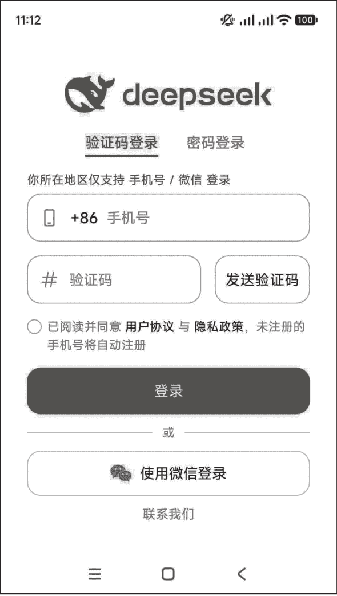
▲图 1-1 DeepSeek 手机 App 版登录界面
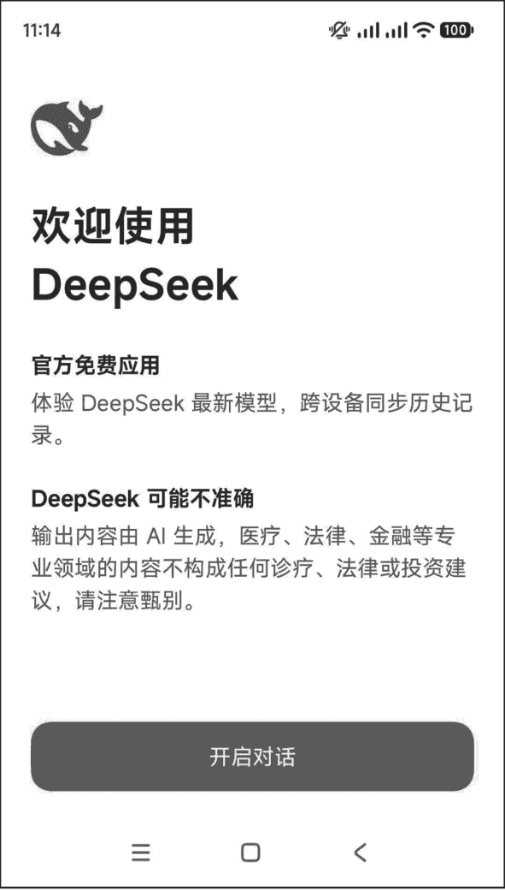
▲图 1-2 DeepSeek 手机 App 版欢迎界面

第二步：熟悉界面
登录后会看到欢迎界面，设计简洁明了，介绍了DeepSeek的特点。DeepSeek为免费应用软件，支持跨设备同步历史记录。另外DeepSeek可能不准确，输出内容由AI生成，医疗、法律、金融等专业领域内容不构成诊疗、法律或投资建议。可点击底部“开启对话”开始体验，如图1-2所示。

第三步：开始使用
现在可以开始体验各项功能了。如图1-3所示，对话框可输入各类问题，如搜索、答疑、写作等，然后点击“向上箭头”发送消息，体验非凡。
点击右上角“+”可新建对话，点击左上角“一长一短两条线”可查看历史记录。

第四步：探索高级功能
除基础功能外，DeepSeek还提供拍照识字、图片识字、文件等高级功能。点击右下角“+”即可看到这些功能，如图1-4所示。可按需逐步探索，提升工作效率。
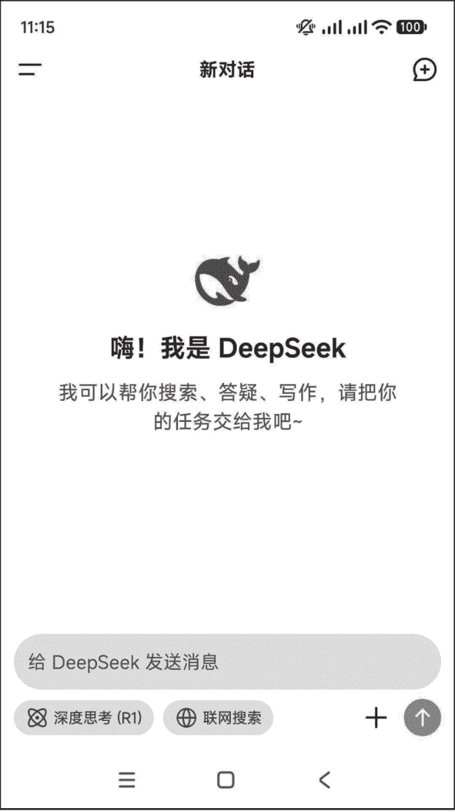
▲图 1-3 DeepSeek 手机 App 版主界面

▲图 1-4 DeepSeek 手机 App 版高级功能界面 

**试一试**
无论何种方式，把DeepSeek装到手机、电脑上，并养成随时随地使用的习惯。 

**小贴士**
说一千道一万，关键在于真正用起来。

## 技巧 2 DeepSeek的三种模式：如何挑选中意的AI助手？

DeepSeek目前提供三种不同模式：反应迅速的应届生DeepSeek V3基础模型、爱钻牛角尖的专家DeepSeek R1深度思考、以及神通广大的情报员联网搜索。

**1. 闪电侠模式：职场急性子救星**
适用场景：日常救火、快速响应。
当会议十分钟后开始老板突然要三组竞品对比数据，或客户电话催方案框架时，V3模式便可登场。它像快餐店王牌员工，30秒出餐绝不拖沓。
某市场部专员回忆：上周五临下班接到两小时内整理20家新消费品牌营销策略的任务。启用V3后，她喝着咖啡就拿到分类清晰的对比表，甚至按传播声量排序。

**2. 老中医模式：复杂难题专家会诊**
适用场景：烧脑决策、深度分析。
面对需反复琢磨的硬骨头，R1像思维老中医，能把症状层层扒清。某投资经理用它分析新能源赛道，原本三天的工作被拆解成产业链图谱、政策风险树、技术突破时间轴，PPT像科幻剧本。
最惊艳的是自省环节，被追问预测失准的五个风险点时，AI预判了地缘政治对锂矿价格的影响，连资深分析师都称内行。这已不只是工具，更是24小时在线的行业顾问。

**3. 情报员模式：实时资讯雷达**
适用场景：信息瞬息万变的战场。
谁抢到最新情报谁就赢在起跑线。联网搜索如同全球情报网特工。某财经记者在财报季让DeepSeek实时抓取20家上市公司电话会议记录，比专业数据公司早半小时锁定关键信息，稿件登上行业头条。
模式更可混搭：既能扒出网红餐厅实时评价，又能结合最新论文预测消费趋势，像同时订阅华尔街日报、小红书和学术期刊，还附赠会总结的秘书。

**4. 看菜吃饭，量体裁衣**
某创业公司CEO分享教训：曾让闪电侠制定年度战略，结果得到百科式套话；后用老中医处理客服咨询，用户被2000字专业回复劝退。摸清门道后才明白三位助手需轮换使用：
❑ 晨会资料整理：召唤闪电侠十分钟搞定。
❑ 融资方案打磨：与老中医头脑风暴三小时。
❑ 竞品动态追踪：派情报员全天候盯梢。

**5. 总结**
DeepSeek如同手动挡汽车，V3是城市通勤3档，R1是盘山公路2档，联网搜索则是高速5档。用错档位不仅费油，还伤发动机。 

**试一试**
先请情报员搜集最新行业数据，再让老中医深度分析，最后派闪电侠生成汇报PPT——某项目经理用此组合拳把三天工作压缩成五小时，还意外发现新市场空白。 

**小贴士**
面对任务时可先自问：
1）需要灭火队还是智囊团？
2）要标准答案还是创新方案？
3）用历史经验还是实时情报？

## 技巧 3 激活DeepSeek V3的生存技能包

许多职场人易陷入误区：总想让AI干大事，就像让外卖小哥做满汉全席，结果黄花菜都凉了。此时DeepSeek V3的价值凸显——它像工位上的智能便利店，专解决高频、简单但紧急的小饿小渴。

**1. 最常见的翻车现场**
想象视频会议中客户突然问：方案里的NFT技术具体指什么？你手忙脚乱打开顶级AI，结果它从区块链起源讲到哈希算法，还附三篇论文链接。客户表情可想而知。这时需要人话版的数字藏品身份证解释，而非百科全书。

**2. 便利店式AI的正确打开方式**
DeepSeek V3的打开方式如图1-5所示，无需点击搜索框左下角的深度思考R1和联网搜索。
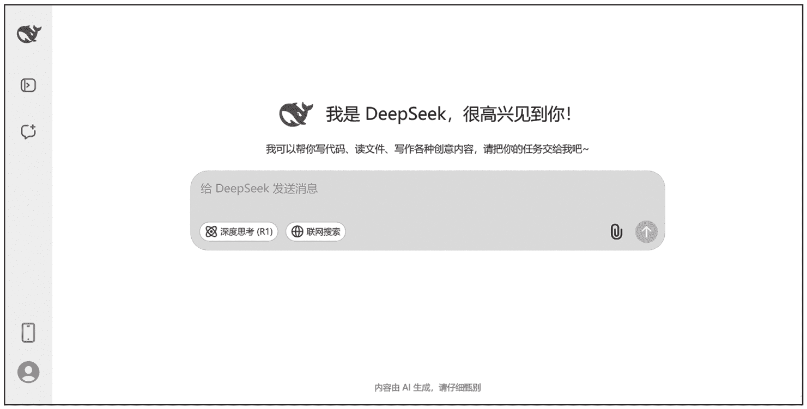
图 1-5 DeepSeek V3 打开方式

DeepSeek V3最擅长扮演职场救火队员：
❑ 快问快答模式：输入2023年诺贝尔经济学奖得主加一句话解释，像自动售货机般秒回。
❑ 轻量文书处理：把语音备忘录零散信息丢给它，说整理成会议纪要模板，立刻得到结构清晰文档。
❑ 即时翻译官：遇到外文资料，把它当扫码枪用，复制粘贴即可获信达雅中文。
❑ 记忆外接硬盘：文艺复兴三杰代表作各举三个这类问题，比人脑搜索引擎靠谱。

市场部小王要准备20份个性化邀请函，传统方法费时。用V3输入生成20句不同风格活动邀请话术，每句不超过15字，一分钟收到从古风到段子手的全系列文案，效率拉满。

**3. 为什么它特别适合职场快餐场景**
该版本懂得看人下菜碟。问基础问题时会自动切换成说人话模式，像便利店店员不会用米其林术语介绍关东煮。底层逻辑类似手机省电模式，不运行复杂算法，专注高频刚需服务。

更重要的是对硬件要求极低，普通办公电脑即可流畅运行，不像某些AI如同燃油超跑，仅启动就耗半箱油算力。对同时开18个网页、5个文档、3个聊天的打工人而言，简直救命。

**4. 总结：聪明偷懒才是正事**
追求降本增效的时代，会用工具的人早已把AI分类——DeepSeek V3专解决那些不值得花大时间的小破事。记住其人设：不是学术顾问，而是随叫随到的数字助理；不做满汉全席，专攻三分钟微波炉快餐。
下次领导临时提问、客户突发发难、截止时间倒计时时，不妨用便利店策略：把问题拆解成是什么怎么做举例子的简单组合，让V3快速拼装出及格线以上方案。有时60分的及时回答比90分的迟到方案更有价值。 

**试一试**
输入：帮我想5个拒绝加班又不伤和气的理由。 

**小贴士**
当出现以下情况时请召唤V3：
1）需要即时反应但无需深度分析的场景。
2）处理重复性文书工作时格式转换基础润色。
3）向非专业人士解释专业概念时。
4）设备配置普通但需要快速获得答案时。

## 技巧 4 驾驭DeepSeek R1的深度思考引擎

现代职场人常遇知识过载尴尬：面对需要数学推导的技术方案、长达30页的行业分析报告，或需同时权衡成本收益与技术可行性的项目规划，普通工具像小学生面对高考数学题，抓耳挠腮却无从下手。更糟的是，找到的看起来专业AI要么给出笼统框架，要么生成像论文摘录的内容，阅读费劲。

**1. DeepSeek家族的科状元**

R1深度思考：硬任务的专属大脑

DeepSeek R1 针对的是复杂难题，相当于随身携带一个专业顾问团。它能够把机器学习过拟合拆解成三步来剖析，像资深工程师那样逐行检视代码漏洞，甚至可以为商业方案配上完整的风险预案。需要提醒的是，这位“学霸”在思考时会比较耗时间，深度运算有点像炖老火靓汤，不能急火快炒。R1 的常规打开方式请参考图 1-6 所示。

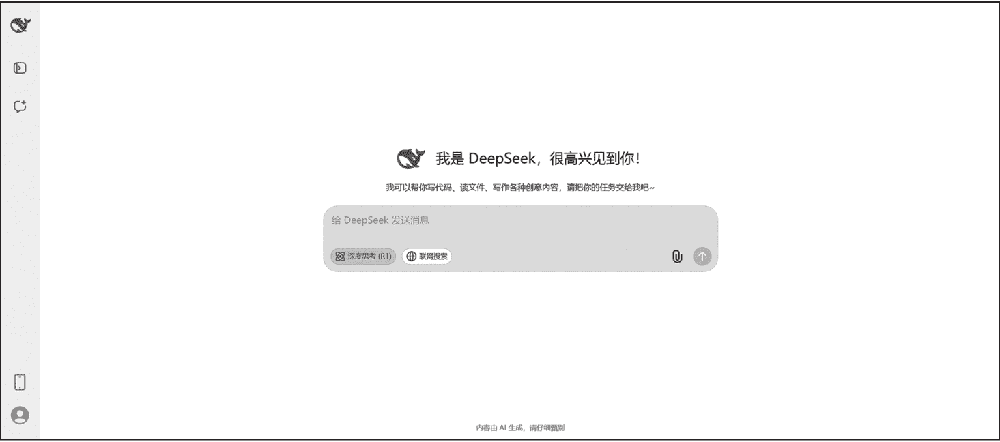

图 1-6 DeepSeek R1 打开方式

**2. 三大绝活破解专业难题**

（1）逻辑拆解术
面对“降能耗同时提产能”这类牵扯多变量的场景，R1 会先做一番推理梳理，再把设备效能、生产流程、能源构成拆成独立模块，像搭积木那样逐块改进。让它规划行程，不仅能给出时间最优的动线，还会自动预判各景点的客流高峰，相当于一个电子管家。程序员提出功能需求后，它能迅速生成代码框架，并指出错误给出修正建议。遇到微积分难题时，也能按步骤展开推导。

（2）结构化表达术
写作技术文档时，R1 的输出自带层次感。以新能源汽车发展趋势为例，会自行划分为电池技术、充电设施、政策导向等板块，每个主标题下再嵌套若干分论点，像俄罗斯套娃一样层层展开。更贴心的是，每个复杂公式旁边都会附带通俗解释，避免读者卡壳。

（3）多线程推演术
在“是否进军东南亚市场”这类决策上，R1 会扮演商业顾问，同时开启多块虚拟白板：左侧罗列当地人力成本数据，中间绘制物流路线，右侧呈现汇率波动曲线。整个过程犹如高手同时对弈多盘，最后整理出的风险评估报告，连小数点后三位的细节都覆盖到了。

**3. 学霸使用说明书**
要发挥最大价值，记住三个黄金场景：任务需要三步以上推理时，例如代码调试；输出要求严密结构时，例如学术论文；问题像套娃一样层层嵌套时，例如产品设计。把它用来问“今晚吃什么”这类轻松问题，就像用显微镜切西瓜，专业错位又浪费算力。

**4. 总结：专业事交给专业的AI**
DeepSeek R1 犹如数字世界的瑞士军刀，专门对付让人头疼的复杂问题。它可能不会讲段子，但在一线专业领域是非常靠谱的伙伴。好钢用在刀刃上，简单查询用轻量版，烧脑任务再召唤深度思考专家。

试一试
把“帮我设计智能家居系统的故障诊断方案”交给 R1，看看它如何拆分硬件自检、软件排查、用户交互等模块。 

小贴士
1）为复杂议题设定边界：请用不超过三步解释区块链原理。
2）追求效率时加限制：在保证质量的前提下尽量精简回答。
3）术语密集时转换语境：请用投资人能听懂的语言再表述一次。

技巧 5 掌握 DeepSeek 联网搜索的实时情报流
深夜加班的张经理一脸苦笑，他让 AI 查光伏产业补贴政策，第一条推荐竟是《重生之我在沙漠种光伏》。这类尴尬每天都在上演，这时就需要 DeepSeek 联网搜索这个全天候情报员。它最擅长追踪最新动态、捕捉碎片信息、整合复杂资料。开启界面如图 1-7 所示。

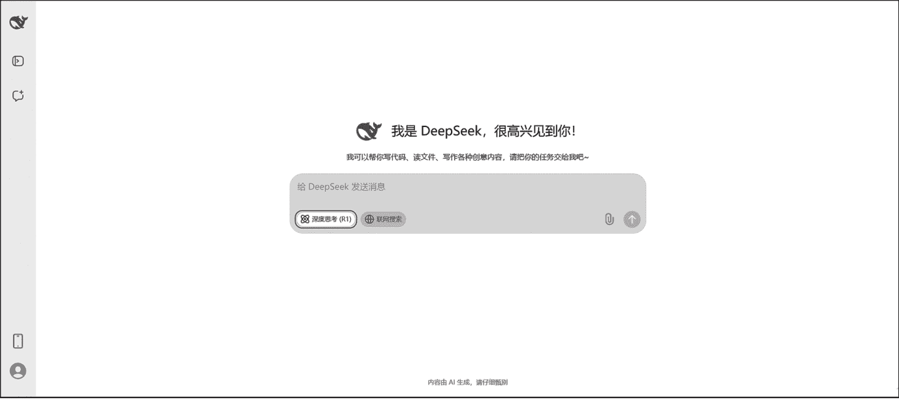

图 1-7 DeepSeek 联网搜索打开界面

**1. 信息迷雾：联网搜索的薛定谔困境**
我们常遇到这些魔幻时刻：
❑ 查政策文件，结果全是营销号解读。
❑ 找学术论文，推荐的却是自媒体爆款。
❑ 搜行业数据，报告日期比大学记忆还久。
你询问“量子计算最新突破”，来源里却出现了《三体》中的智子制造原理。背后本质是 AI 把全网当成菜市场的无奈。

**2. 给搜索装上金属探测器**
联网搜索的精髓在于借力打力。遇到需要实时核验的问题，比如“北京最新落户政策”，它会并行派出三路侦察兵：政府官网抓取原文、权威媒体寻找解读、社交平台观察民间反馈，最后拼成完整图景，可靠性远高于单渠道。训练这个“猎犬”有三招：

（1）权威源锁定术
在提问中限定“仅限政府官网/学术平台/企业年报”，等于给 AI 装上 GPS：
❑ 普通提问：查 2025 年国家养老政策。
❑ 升级提问：查 2025 年养老政策，仅搜索 gov.cn 结尾的官网文件。

（2）关键词放大镜公式
牢记“请使用高级搜索技巧生成精准关键词”这一万能用法，像给 AI 装上战术目镜：
❑ 普通提问：找新能源汽车销售数据。
❑ 升级提问：找 2024Q1 新能源汽车终端零售数据，按省份拆分，附带同比环比。

（3）学术避坑指南
论文来源容易被自媒体污染，建议以 Google Scholar 加专业数据库为主，让 DeepSeek 充当文献整理助手更稳妥。

**3. 总结：把 DeepSeek 当成刚入职的机灵实习生**
❑ 明确告知去哪里找。
❑ 说清楚要找什么。
❑ 划清雷区，广告推广不要碰。
❑ 不要放手让它自行发挥。

试一试
在财政部、统计局官网查找 2024 年数字经济增速数据，排除自媒体内容，用表格对比近五年趋势。 

小贴士
使用联网搜索时，务必明确指定资料来源，关注结果出处，并要求剔除广告推广类信息。

技巧 6 如何选择深度思考与联网搜索功能
使用 DeepSeek 时常面临选择：是依靠深度思考进行分析和推理，还是借助联网搜索获取实时信息？下面给出一些决策建议。

**1. 深度思考：适合复杂问题与知识整合**
深度思考是通过知识库和逻辑推理解决复杂问题的能力。适用于需要多步推理、知识融合或创意输出的任务。例如解释复杂科学理论、设计算法、撰写专题文章等，能提供更深入全面的分析。

**2. 联网搜索：适合实时数据与动态信息**
联网搜索允许模型实时访问互联网，获取最新动态。适用于需要时效性的任务，如查询新闻、天气、股价、最新财报或事件进展等。

**3. 结合使用：寻求最佳平衡**
实际应用中，两者结合效果更好。可先用联网搜索获取最新数据，再用深度思考进行分析和推理，生成更全面的答案。特别适合既复杂又依赖最新数据的场景。

**4. 总结**
1）复杂问题或知识整合优先深度思考。
2）实时数据或动态信息优先联网搜索。
3）结合使用，先搜后思或先思后搜，找到平衡点。 

试一试
下次遇到问题，先用深度思考快速梳理思路，必要时再开启联网搜索，对比感受哪种方式更合适。 

小贴士
1）紧急任务时间紧，优先深度思考快速给出初步方案。
2）长期规划需数据支撑，优先联网搜索获取最新信息。
3）创意输出先用深度思考构思，再用联网搜索验证补充。

技巧 7 如何使用 DeepSeek 的上传附件功能
工作中经常需要处理报告、数据表、合同草案等文件。上传附件功能让关键信息快速传递给 DeepSeek，获得更有针对性的反馈。

**1. 上传附件的常见误区**
很多人以为把文件丢给 DeepSeek 就会自动处理，这是误区。若文件杂乱或缺乏背景说明，模型可能给出无关甚至错误建议，还会浪费沟通成本。

**2. 发挥最大作用的关键**
核心在于文件筛选整理和背景说明。
上传前自问：这份文件是否必要？无关信息会干扰焦点。应只上传与当前任务直接相关、已整理好的文件，例如分析数据就传清晰表格，而非几十页无关报告。
发送文件时最好附带一段简短说明，交代来源、用途和期望解决的问题。上传附件示例如图 1-8 所示。

这样 DeepSeek 能快速理解需求，给出更有针对性的建议，例如“重点关注产品 A、B、C、E 的销售策略或市场表现，分析未达预期原因并制定改进措施。”
DeepSeek 支持 PDF、Word、Excel、各类图片等格式，但目前只能识别文字内容，无法理解非文字图像，也不能与联网搜索同时使用。

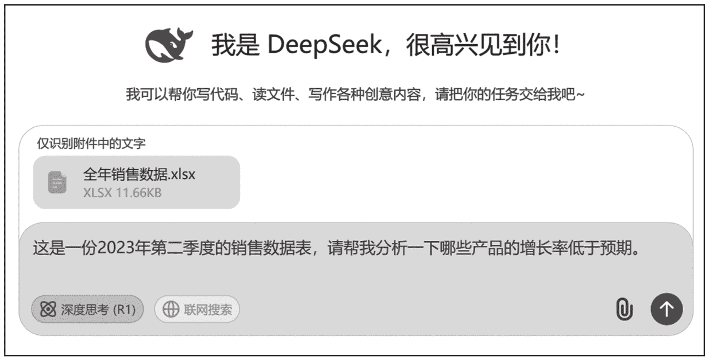

图 1-8 DeepSeek 网页版上传附件界面

**3. 总结**
上传附件看似简单，实则潜力很大。精选文件、提供背景说明，才能让它成为职场助手。无论数据分析还是项目管理，用好该功能都能事半功倍。记住它不是自动答题机，清晰输入才有高质量输出。掌握后能提升效率，在团队中脱颖而出。 

试一试
你正在处理一份年终总结报告，包含业绩分析、项目回顾、市场动态等。希望 DeepSeek 提取业绩分析部分的数据和关键结论以优化销售策略，请设计一段上传时的背景说明。 

小贴士
上传前对文件内容进行整理筛选，去除无关和冗余部分，只保留与当前任务直接相关的核心信息，减少干扰。

技巧 8 DeepSeek 服务器繁忙？试试这些平台
2025 年春节期间 DeepSeek 访问量激增出现卡顿，以下平台可提供更顺畅体验：

**1. 官方完整版**
官网和 App 为首选，提供 R1 和 V3 完整模型并支持联网。完整版功能齐全，简化版轻便但受限。上午时段较流畅，下午晚间易卡顿。
体验网址：https://chat.deepseek.com

**2. 硅基流动**
提供 DeepSeek R1、V3 完整版及多尺寸模型，兼容智谱、通义、混元等。首次注册赠送体验金。支持在线操作和 API 接入，在线使用不支持联网且不保存记录。
体验网址：https://cloud.siliconflow.cn/i/SYqgpu7G

**3. 硅基流动+Chatbox**
需要保留记录时可搭配 Chatbox AI。该工具可接入多助手，支持多端使用。配置 API 密钥后可获得带推理的对话并支持附件上传。
体验网址：https://chatboxai.app/zh

**4. 超算互联网**
由科技部主导，免费提供简化版模型，稳定快速。
体验网址：https://chat.scnet.cn/

**5. 纳米搜索**
提供 R1-360 专线和 R1 完整版。专线流畅但为非完整版，效果稍弱。
体验网址：https://www.n.cn

**6. 秘塔 AI 搜索**
已上线 R1 模型并整合到搜索框，提升传统搜索能力。
体验网址：https://metaso.cn/?s=bdpc

**7. 各大云服务**
华为云、阿里云、腾讯云、火山引擎均已集成 DeepSeek 并提供免费体验。百度智能云支持 OpenAI SDK 调用。
❑ 百度智能云：https://cloud.baidu.com/product-s/qianfan_home
❑ 阿里云：https://pai.console.aliyun.com/#/quick-start/models
❑ 腾讯云：https://cloud.tencent.com/
❑ 火山引擎：https://www.volcengine.com/docs/6459/1449739

**8. 小艺助手**
华为手机小艺已集成 DeepSeek，无需注册，鸿蒙系统可唤醒即用。
体验网址：https://xiaoyi.huawei.com/chat/

**9. 总结**
服务器繁忙时可通过官网、硅基流动、超算互联网、纳米搜索、秘塔 AI 搜索及各云服务体验。官方提供完整联网版，高峰易卡顿；第三方平台各有侧重，用户可按需选择。 

试一试
在硅基流动注册账号领取试用额度，选择 DeepSeek R1 完整版进行体验，注意在线不支持联网且不保存记录。 

小贴士
遇到“服务器繁忙”时避开高峰或重试，优先选择官网满血版，官网繁忙时可尝试第三方平台。

第二章
DeepSeek 提示词使用指南

技巧 9 解决 90%问题的 DeepSeek 提示词万能公式
DeepSeek 是推理型大模型，不像指令型模型需要复杂结构化提示，它会像解数学题一样逐步拆解。只要在需求基础上补充清晰背景，就能显著提升质量。

公式=背景+需求+约束条件（可选）

**1. 背景描述为何重要**
问题越宽泛，回答越通用。例如只问“如何提高英语水平”，得到的会是通用计划。若补充“我家孩子初三，基础中等，想提考试成绩，口语已不错”，回答就会具体到应试技巧和资源推荐。

**2. 如何提供有效背景描述**
核心是让模型知道你是谁、当前水平、希望它扮演什么角色。

**提问配方：背景先行，需求明确，再加限制**

举个具体场景吧。假如你刚踏入自媒体圈，可以这样开口：我现在做互联网，刚起步做内容，对选题逻辑和平台玩法都不太熟，能不能请你以资深运营顾问的身份，给我一份新手可执行的实操方案。
提供这些上下文后，DeepSeek 才能判断你的真实水平，给出匹配难度的专业建议，而不是泛泛而谈。

**3. 加上边界，答案更聚焦**

仅有背景还不够，范围如果没收住，回答容易发散。这时加上使用限制，就能把方向锁死。
比如你只关心阅读提升，不想被语法带偏，就明确说：我想提升孩子英语阅读能力，重点在阅读方法，语法内容请省略。这样模型就会死守阅读相关，不会额外扯到语法课程。

**4. 提问本质是给AI定位**

别把DeepSeek当成只会背答案的机器，它更像思维教练。擅长帮你理清思路，而不是直接甩标准解。就像做题要先读题划重点再分步，像用导航要先定起点终点和避开高速的偏好，背景加需求加限制这套组合拳，就是在帮模型精确定位。起点终点越清晰，路线越好走。

**试一试**
“我家孩子读高三，英语中等偏上，现在冲分数是重点，口语已经很好了，这部分不用涉及。”

**小贴士**
DeepSeek 推理能力很强，用背景加需求加限制的公式，能搞定绝大多数日常提问。

## **技巧10 R1和V3提问怎么分？**

写提示是艺术加科学，不同模型吃法不一样。R1擅长深度推演，适合硬核任务；V3擅长快速应答，适合日常通勤类需求。怎么让提示更对口？从三个维度对比就明白了。

**1. 思考方式：R1深度推演 vs V3即时应答**
R1会自己走链式思考，还能把中间过程摊开来看。你问它公司供应链怎么优化，它会一边拆解问题一边给出有依据的步骤，像个深究的侦探。V3更偏向逐词预测，通常不展示思考内幕，回答更干脆。比如问什么是供应链管理，它会直接给一句话定义，不展开。
所以给R1的指令可以简短有力：请分析供应链优化路径并列出详细步骤。给V3则要指明颗粒度：请用一句话说明什么是供应链管理。

**2. 提示写法：R1轻量化 vs V3需指引**
R1不需要角色扮演和分步剧本，目标清晰它就能自己找路。比如让它写一篇人工智能趋势的文章，只需说：请写一篇关于人工智能未来趋势的文章。V3需要更明确的指令和结构，比如：你是一名营销专家，为新App“健康健身”写一篇面向年轻用户的文案，要求包含痛点、情绪引导、方案、行动号召和价值强调，突出性价比与时尚感。
R1示例提示：请分析人工智能的未来趋势。

DeepSeek R1 模型输出：
人工智能未来发展大致围绕技术革新、应用下沉、社会影响和风险管控展开，将重塑技术生态与产业版图：
一、技术层面推动底层架构升级
……
二、行业落地向细分场景渗透
……
未来十年可能的关键拐点包括对通用人工智能的探索、量子结合生物启发的AI突破、以及脑科学驱动的类脑计算。个人可加强Python、数据分析等跨学科能力，企业应聚焦垂直领域并建立合规与差异化AI体系。总体来看，AI发展需要在普惠与风控之间保持平衡。

V3示例提示：你是一名科技博主，请用通俗易懂的语言解释人工智能的未来趋势。

DeepSeek V3 模型输出：
AI的发展趋势可从技术演进、应用扩张、社会效应等角度切入，主要方向有：
1. 技术演进：
……
2. 应用扩张：
……
总的来说，AI未来将围绕技术、应用和社会影响展开，机会与挑战并存，需要各国协同确保技术造福大众。

**3. 校对能力：R1自检 vs V3靠外部修正**
R1在生成时自带事实核查，会尝试纠错，处理复杂任务更稳。V3的自检较弱，更依赖你事后修正。所以对R1可以说：请分析气候变化对农业的影响，并保证数据准确。对V3更稳妥的是：请列出气候变化对农业的三个主要影响，并标注数据来源。
掌握这两种模型的脾气，才能让AI既快又准地出力。

**试一试**
分别为R1和V3设计提示，目标是提升刚上线社交App的用户活跃度。

**小贴士**
实际使用时可以先让两个模型都跑一遍，对比结果，经常能发现意外亮点。

## **技巧11 用目标导向取代冗长指令**

很多人觉得提示越长越好。早期模型确实需要手把手引导，但现在像DeepSeek R1这样的模型推理能力已很强，反而怕被过度限制。过去让你写推广计划，可能要写先分析人群再定渠道再排预算。现在只要说：请帮我制定一份某产品的推广计划，它就能自动搭框架，内容更完整。再补充产品卖点或目标人群，效果更好。
与其写长指令限制发挥，不如用目标导向的方式告诉它你要什么，剩下的交给它。这也是我们使用AI的观念变化：从严格控制的工具，变成可以信赖的合作伙伴。
总结来说，R1类模型已不需要繁复步骤提示，清晰任务描述就能让它高效产出好结果，给足信任和自由度，反而得到更高质量的交付。

**试一试**
1）找一份行业报告或需要分析的数据。
2）打开DeepSeek R1，输入简短指令，例如：“请帮我制定一份智能家居产品的推广计划。”
3）如有特殊要求再简单补充，比如：“重点看年轻人偏好，并引用最新市场调研数据。”
4）检查生成的计划是否逻辑通顺、实用，必要时微调。

**小贴士**
忘掉老模板，核心是让AI真正理解你的意图。
❑ 老做法：“你现在是一名智能家居产品市场推广专家，需要为新品制定推广计划……”
❑ 新做法：“我先梳理下这款产品的核心卖点，帮我做一份推广计划，重点面向年轻消费者。”

## **技巧12 让DeepSeek说人话**

问专业问题最怕得到一堆术语。举例：问DeepSeek成本为什么这么低，可能回：采用了MoE架构，结合蒸馏技术和FP8精度优化，从而大幅降低成本。技术人懂，普通人懵。

**1. 专业术语的双刃剑**
专业词对内行是捷径，对外行是墙。同样的问题，加上说人话或用大白话解释，答案立刻变亲民。
比如改成DeepSeek成本为什么这么低，说人话，它可能会说：DeepSeek用了一种分工协作的聪明设计，多个小模型一起工作，效率更高。再配合压缩技术让模型更小更快，效果不打折，成本自然下降。

**2. 为啥这招好用**
在提示里加一句说人话，等于告诉模型别秀术语，用日常表达。这能大幅提升理解度和使用感。

**3. 当翻译官**
这招几乎通用。问量子计算是什么，加一句用大白话解释，它就会说成：量子计算是一种利用量子原理同时处理大量信息的超强计算方式，比普通电脑快很多。复杂概念瞬间被非专业人士抓住重点。

**试一试**
“DeepSeek的成本为什么这么低，说人话。”

**小贴士**
给领导解释专业名词，或给学生、家人科普时，提问末尾加一句说人话就行。

## **技巧13 先展开再聚焦的提问法**

和DeepSeek对话就像在陌生城市问路，聪明的人不会直接要终点，而是先看地图全貌再选路线。

**1. 好答案不是一步到位**
直接问推荐三本心理学书，得到的往往是大众书单。若先问怎么让职场新人通过读书会建立深度连接，它会先确认你是否需要兼顾专业性与可讨论性、是否需要互动设计，再结合参与者是95后互联网从业者，想缓解社交焦虑，给出更精准的书目。
这种先展开再聚焦的模式，相当于先让AI画认知地图，再一起标记目的地。

**2. 三步构建思维进化回路**
以智能手环广告语为例，原指令写三句关于智能手环的广告语会得到泛泛文案。
第一步启发思考：先问为智能手环设计传播方案，需要考虑哪些创新维度？它会列出健康监测精度、社交玩法、个性化表盘经济等，打开思路空间。
第二步校准调整：它追问是否突出医疗级监测或潮玩属性，你补充主要客群是关注家庭健康的40+女性，它就自动过滤掉电竞联名等不相关方向。
第三步锁定路径：最终指令变为基于40+女性关注家庭健康的特性，设计三条以情感共鸣为核心的广告语，重点体现子女远程关爱功能在家庭健康管理中的实际应用。
最终输出：“岁月流转，你深知父母恩情重。[品牌名]智能手环，子女远程关爱功能，是送给父母的贴心健康管家。它将父母的健康数据传至你手中，让你的牵挂不再只是思念，而是实实在在的守护，用科技维系亲情，让家庭健康成为最美的传承。”
明显更有针对性。

**3. 容易踩的坑**
答案洁癖：过早要求最终方案，会错过中间发现的创新点。
问题笼统：像如何提升销量这种大问句会让模型失焦，改成在现有预算下如何提升母婴类复购率更有效。
路径依赖：一直说按我之前说的做会堵住模型的升级通道，定期反问基于最新进展是否需要调整策略方向更有帮助。
当你学会先展开再聚焦，模糊需求会像显影一样逐渐清晰。

**试一试**
请把指令“请撰写一份关于开展读书会的方案”改写成启发思考、校准调整、锁定路径的三段式提示。

**小贴士**

方案总觉得差一点意思？在指责模型之前，先用三道自问来校准：是否过早把思路收窄了？这次交互有没有帮你挖出被忽略的需求侧？手上的信息够支撑一次深度再推演吗？

## 技巧 14 如何让 DeepSeek 先进入你的语境

用 DeepSeek 就像给一位刚入职的医生看诊，若症状、病史、限制都不说明，再专业的判断也难以对症。很多人习惯开场就说“帮我做 X”，却忘了系统对你的处境、资源和卡点完全陌生，只能给出通用模板。

为什么通用的答案总隔一层？打个比方，去找健身教练只说“我要瘦”，得到的会是大众减脂课。补充一句“有腰椎问题，每天通勤三小时”，方案立刻变成坐姿练习加碎片化动作。同理，问模型“做减脂计划”却不给身高体重和运动基础，很可能得到每天跑五公里，这对基数较大的人反而有膝盖风险。

想让回复更贴身，可从三张定位卡入手。

**1. 你的段位：起点在哪个层级**
先报位。比如“我烘焙小白，连打发蛋白都不熟”，也可以说“看过《三体》，没学过天体物理”，或说“我神经外科医生，要最新的脑机接口临床数据”。就像点菜先说“我不吃辣”，系统会自动过滤难度。告诉它“我是小学生”，讲光合作用会变成“植物吃饭的秘密”，而不是“叶绿体光反应暗反应”。

**2. 你的背包：已知与未知边界**
说明你对问题域的掌握范围。已懂可写“我知道函数定义，不懂递归”，有误区就写“我以为区块链就是比特币”，有卡点就写“《人类简史》看到第七章就卡住了”。这是在给模型画认知地图。程序员说“我会 Python 入门语法，没接触过机器学习”，它就会直接从鸢尾花分类讲起，而不是从 print 开始。

**3. 可迁移资源：看似无关的加分项**
补充与主题非直接相关的背景。如“我学过乐理，想理解傅里叶变换”，“会用 Photoshop 修图但不懂色彩原理”，或“我习惯用思维导图学习”。

**4. 通用提问句式**
不确定如何描述自己时可用：
“我对 ____（领域）的了解相当于 ____（参照物），已经明白 ____（具体点），但卡在 ____（问题点），需要 ____（讲解方式），最好联系 ____（已知知识）”

效果对比。直接问“解释什么是元宇宙”，得到的是 1992 年《雪崩》的词源和学术定义，小白看懵。用句式改写：“我对科技概念的理解相当于《生活大爆炸》观众，知道 VR 和区块链，却分不清数字孪生和元宇宙的区别，请用美剧场景类比说明。”输出就会把数字孪生比作谢尔顿的公寓模型，把元宇宙比作剧中科幻大会的虚拟延伸，进入熟悉语境后瞬间通透。

**5. 常见翻车**
报位不实、夸大实力、忽略关联都会拉低质量。隐藏段位：自称经济学家却问“GDP 是什么意思”，会被敷衍。正确说法应是“我是宏观研究者，想了解数字经济时代 GDP 核算的争议”。虚报实力：说完全不懂编程却要求“C++ 实现深度学习”，得到天书代码。正确应是“文科生刚装好 Visual Studio，用 C++ 从猫狗图片识别起教我”。忽略关联：问声波共振却不说会弹钢琴，错失音阶类比机会。正确应是“我练琴十年，懂泛音列不懂物理建模，请用大调和弦类比共振”。

**6. 小结**
DeepSeek 更像一面战略镜子。你提供的个人画像越立体，回应越准。提问前自问：我在这个领域的定位是什么？我已掌握什么？我有哪些关联知识可作桥梁？养成同步信息的习惯，它会从答题机进化成贴身智囊，方案一次就能命中。 

试一试
套用“在 ____（领域）上的认知水平大概相当于 ____（参照物），我已经搞懂 ____（具体点），目前卡在 ____（问题点），希望以 ____（讲解方式）说明，并最好关联 ____（已知知识）”模板，向 DeepSeek 提一个你好奇的问题。 

小贴士
用医生问诊的心态喂信息，涵盖段位、背包与迁移资源，用结构化表达，匹配度会大幅提升，让它真正成为贴身智囊。

## 技巧 15 让 R1 按目标自主推演

把 DeepSeek R1 当成交响乐指挥，你不需要规定每个乐手怎么运弓，只要描绘情绪张力。很多人把 R1 当复印机，塞满执行步骤，反而封印了它最强的自主规划能力。

**1. 为什么清单会打折**
装修时告诉设计师“刷米白漆、铺橡木复合板、装三盏筒灯”，得到的是拼凑感。说“要打造适合居家办公的温馨空间，视频背景体面、孩子活动安全”，设计师就会自主优化材料与灯光。R1 同理。要求“删语气词、分段加标题”整理会议纪要，它只会照办。若说“整理成新员工能快速抓住重点的纪要”，它会自动提取关键决策、风险提示，还可能额外生成执行要点图示。目标定义才有魔力。

**2. 目标驱动的三维用法**

（1）描绘成品形态
错：“润色这段文字。”
对：“把这段产品介绍改写成能打动年轻人、提升购买欲的宣传语，突出时尚感与独特功能优势。”
前者只是修辞，后者会让模型围绕受众喜好与卖点，用流行语和生活方式共鸣来创作。

（2）点明核心要点
错：“总结文章主要内容。”
对：“提炼文章里企业数字化转型的关键策略、主要挑战和成功案例的核心经验，用于行业分析报告。”
模型会深度挖掘策略做法、挑战根源、案例经验，提供可直接用的素材。

（3）划清边界约束
错：“写一篇旅游文章。”
对：“写一篇约 1500 字的家庭出游攻略，含景点、美食、交通、预算，语言通俗生动。”
字数、受众、内容板块、语气全锁定，输出才不会跑偏。

三维合一，R1 就像装上导航的引擎，直奔你要的方向。你是船长，不是水手长。输出不理想时，先检查指令是否说清预期成果、材料用途、是否有不必要的执行限制。 

试一试
把错误指令“把客户反馈整理成 Excel 表格，删除重复内容”改写成目标驱动型提示词。 

小贴士
激活 R1 智能分三步：描绘成果蓝图、点明关键战场、划定禁区红线，让它自主规划，收获超预期结果。

## 技巧 16 减少范例，给创造力留白

过去的习惯是塞一堆案例让模型模仿，像教小朋友描红。但用在 DeepSeek 上，往往得到撕碎范文再拼贴的作业。

**1. 范例从指南针变绊脚石**
你请大厨做菜，却塞一包方便面调料，模型会把提示里的案例当成标准答案模板。它理解海量语料，却因例子束手束脚，发挥不出真实水平。

**2. 正确的打开方式**
直接说清需求，别展示范例。想聊未来科技趋势，不必附 20 篇量子计算文章，只需说“用科幻迷能听懂的话，讲讲十年后哪些黑科技会颠覆手机行业”。

**3. 给想象力装导航**
完全放任等于让新手上秋名山，需要点约束。写企业广告语时可说“七个字体现环保，含动物意象，第二字必须是动词”。赛道划清后，创意反而更惊艳。某团队做节日海报文案，反向要求禁止出现月亮、团圆、饺子等传统元素，模型给出了“把思念装进无线网络信号”这样的新意。

**4. 从指挥家到乐团首席**
把案例模板换成精准目标描述，就是从手把手教到指明方向的跨越。只描述想要比心形更有创意的代码图案，模型输出了字符绘制的量子纠缠动态图。

**5. 小结**
把 DeepSeek 当天才实习生：交代要解决的问题，说明要避开的坑，划定不可逾越的边界，绝不提供标准答案范例。卸下案例枷锁，解法往往比预设模板精彩十倍。 

试一试
1）普通指令：写三句新能源汽车广告语，参考如下案例：❑ 驾驭未来，电启新程。❑ 无声澎湃，绿色力量。
2）进阶指令：写三句让人想立刻试驾的新能源汽车广告语，要求：❑ 包含对五感中任意两种的描写。❑ 用运动赛事术语替代传统环保词汇。❑ 每句结尾动词要有冲刺感。 

小贴士
从填鸭式教育者变成命题作文考官，不给模型戴镣铐，它会还你一场思维之舞。

## 技巧 17 去掉角色设定，直接讲效果

以前要说“你是天气预报员”它才报天气。现在对 DeepSeek R1，这相当于给赛车配儿童三轮车。测试显示，让它以资深分析师身份写行业报告，中规中矩；只要求“揭示未来三年最具破坏性的技术变革”，它竟挖出专家都忽略的冷门赛道。角色面具越厚，火眼金睛越被蒙住。

**1. 角色从导航变眼罩**
让毕加索模仿儿童简笔画，就是模型被角色束缚的写照。要求它从历史学者视角分析科技，结果通篇蒸汽革命。撤掉角色后，它自发把古希腊机械原理与量子计算结合，写出惊艳内容。

**2. 解锁隐藏技能**
别给剧本，给要求。分析市场趋势，不说“你是十年分析师”，直接说“找出三个正在颠覆传统零售的隐形变量，用快递小哥都能听懂的话解释”。

**3. 给自由创作划跑道**
某广告公司要求“给智能手表写十条广告语，每条含时间意象，禁止出现钟表相关词汇”，得到“把朝阳装进手腕震颤”这类神句，点击率超传统角色设定 47%。

**4. 从编剧到影评人**
停止编写角色剧本，描述想要的效果，就是从操控木偶到激发灵魂的质变。要求“用让投资人后背发凉的逻辑推演新消费陷阱”，模型结合社区团购溃败与元宇宙泡沫，写出穿透力极强的预警。

**5. 小结**
把 R1 当有超能力的人类助手：说清要达成的效果，明确不能碰的红线，提示思考维度，绝不塞入你应该成为谁。 

试一试
传统版：“作为餐饮专家，写份奶茶店运营方案。”
进阶版：“在大学城开一家健康奶茶店，面向追求健康生活的年轻群体，预算 50 万元。”
看哪个更能激发创意潜能？ 

小贴士
把终极目标具象化，别说要创新，说要让人看完想立刻发朋友圈；列死亡红线清单，禁用黑话、套路、感叹号；加分彩蛋区，如融入 90 后童年回忆杀。

## 技巧 18 如何让 DeepSeek 真正读懂你的意图

我们心里默认模型应该知道要带春节热点、避开竞品、做蓝色系 PPT，结果拿到情人节方案才发现是在玩你画我猜。它不是老搭档，更像刚入职的实习生。

**1. 点菜式沟通**
餐馆说“随便炒个菜”，大厨不可能端出你想要的番茄炒蛋。对模型下指令要像点单，说清“不要葱姜蒜，微辣多醋”。
错误示范：“写一个养生壶的直播话术。”
正确操作：“为单价 899 元的养生壶设计 30 分钟直播脚本，前 5 分钟用‘熬中药扑锅’痛点开场，每 10 分钟演示预约烹饪/12 小时保温/防干烧三个功能，结尾用‘前 50 名送定制药膳包’促单。”
指令藏着三要素：锁定产品身份证、划定表演舞台、标注重点考题。

**2. 给模型装进度条**
你说“尽快”，模型理解可能是 0.5 秒。加数字刻度就像给跑者设里程碑。
模糊指令：“做个竞品分析。”
精确制定：“整理 2024 年 Q1 智能手表赛道 TOP5 品牌，对比心率监测精度（列具体数值）、续航时长（单位：天）、月均营销活动频次，用表格呈现。”
这等于告诉实习生：查什么、查多久、怎么呈现。

# 用数字把AI拽回现实

研究显示，给指令加上可量化数值后，模型产出可用结果的比例能提升七成以上。装修时说“要2.4米长的L型灰玻茶几”，比只说“大气点的茶几”精确得多。

（3）第三招：提前关闭脑补模式

模型的联想经常跑偏。提示“要年轻化设计”，它可能给你赛博朋克风；提示“要专业报告”，生成的内容读起来像催眠文。

下面是一套反套路的表达模板。

生成三套618家电主视觉方案，要求：
1. 延续企业VI的蓝白主色调
2. 禁止出现卡通元素
3. 重点位置预留爆品价格框位
4. 参考附件中去年双十一点击率top3的Banner风格

这波操作直接堵住了AI的脑补倾向：
❑ 色彩管控，只允许蓝白
❑ 元素禁区，卡通全部剔除
❑ 参考答案，附上往年高点击案例
❑ 预留接口，为价格信息空出位置

比如可以对设计师说：“这张海报要放在地铁通道，文字要足够大，5米外能看清关键信息。”

**3. AI对话防翻车清单**
（1）戒掉抽象黑话
“要更有深度”→“补充近三年行业增长率对比图表”
（2）拒绝谜语式表达
“你懂的”→“在第三部分加入7月新规的影响分析”
（3）消除矛盾指令
“既专业又活泼”→“数据段用正式表述，案例段放入客户访谈中的口语化反馈”

**4. 总结**
把DeepSeek当成实习生：它需要明确的工作说明、可量化的KPI、清晰的排除边界。当你用“人话+数据+负面清单”三重保险沟通，这个24小时在线的超级助手才真正好用。 

**小贴士**
下次派活时多敲几个字：“我要的是重庆小面，不是意大利面。”这个小习惯能省下约八成的无效沟通成本——职场里，表达清楚本身就是一种高级生产力。

## 技巧19 让AI快速读懂需求的四步拆解法
凌晨两点，产品经理小王盯着屏幕发愁：“我只让它做个旅游攻略，结果推了798艺术区和密室逃脱，我爸妈可是六十岁的退休教师！”这类沟通失误很常见，根源是人习惯模糊，模型要精确。就像托朋友带咖啡，只说“随便买杯喝的”，大概率买不到想要的味。

**1. 四步拆解法：把需求变成模型能读的导航坐标**
让DeepSeek真正成为效率外挂，要掌握任务坐标定位法，从四个维度锚定需求，就像给模型发GPS定位。

（1）核心动作：用动词锁定要做什么
错误示范：“做个旅游攻略。”
正确示范：“规划广州到北京7日游路线。”
把模糊名词换成具体动词，就像把“买水果”细化成“买3斤山东红富士苹果”。参数越多，模型的瞄准越准。
（2）使用场景：交代背景说明书
错误示范：“开发抢红包程序。”
正确示范：“开发春节期间家族微信群使用的红包插件。”
买衣服要说明“商务会谈穿”还是“海边度假穿”，场景不同方案天差地别。
（3）结果预期：给模型装上结果导向导航
初级版：“写篇环保演讲稿。”
进阶版：“撰写能引发高中生共鸣的5分钟环保主题演讲稿，需包含互动环节。”
实测显示，明确时长、受众、形式等结果指标的指令，产出质量比模糊需求高2.1倍。就像告诉理发师“剪短3厘米，保留层次感”，比“修一下”靠谱。
（4）风险预警：提前标注雷区
错误示范：“推荐一些北京景点。”
正确示范：“推荐适合腿脚不便的老人的北京室内景点。”

**2. 实战对比：四步法改造前后**
（1）案例1：父母旅游攻略
原始需求：做北京旅游攻略→可能推荐长城徒步
四步法升级版：
❑ 核心动作：规划广州至北京7日游路线。
❑ 使用场景：给60岁退休教师父母使用。
❑ 结果预期：日均步行不超过8000步，包含文化类景点。
❑ 风险预警：避开需要长时间排队的场所。
输出结果：自动生成含国家博物馆预约攻略、老字号餐馆轮椅通道信息、酒店午休时段安排的银发友好方案。
（2）案例2：年会抽奖程序
原始需求：写个抽奖代码→得到命令行版程序
四步法升级版：
❑ 核心动作：开发微信端实时抽奖功能。
❑ 使用场景：200人公司年会现场投屏使用。
❑ 结果预期：支持头像弹幕特效，中奖率智能浮动控制。
❑ 风险预警：避免系统兼容问题。
输出结果：生成带3D转盘动画、自动屏蔽领导中奖（可选）、支持弹幕吐槽的智能版程序。

**3. 避坑指南：90%人会踩的三大雷区**
1）禁用抽象词汇，如“高格调”“有质感”，应转化为“使用深蓝色商务模板”等具体描述。
2）别忘了时间维度，如“紧急程度”“使用时段”会直接影响方案设计，就像凌晨看病要说明挂急诊。
3）警惕默认假设，你以为的常识可能是模型的盲区，务必明确如“预算3000元以内”等隐藏条件。

**4. 总结：让模型懂你所想**
记住万能公式：清晰动作+场景坐标+效果导航+风险排雷=秒懂指令。下次用DeepSeek，多花30秒拆解需求。毕竟，与其让模型猜十次，不如一次说清。 

**试一试**
原始需求是“帮我设计个员工培训方案”，请运用四步拆解法改写：
❑ 核心动作（动词+参数）：__________
❑ 使用场景（5W要素）：__________
❑ 结果预期（可量化指标）：__________
❑ 风险预警（限制条件）：__________ 

**小贴士**
“清晰动作+场景坐标+效果导航+风险排雷”同样适用于人类沟通，效果很好但慎用，当心被夸“突然变靠谱了”。

# 第三章
# DeepSeek 提示词使用技巧

## 技巧20 把深度思考模型驯成贴心小助理的方法
当打工人还在用Ctrl+C/V对抗KPI时，模型已能帮忙写周报、做方案甚至写道歉信。但有些人非要手把手教模型“先迈左腿再抬右手”，结果把R1这类深度思考模型训练成复读机。

**1. 过度指导的“人工智障”陷阱**
早期人类训模型经典画面：
❑ 菜鸟：“写年终总结。”
❑ 模型：“今年主要完成日常工作……” 
❑ 卷王：“第一段用STAR法则，第二段列数据，第三段……”
❑ 模型：“好的主人。”（生成模板八股文）
❑ 智者：“生成3版不同风格的年终总结，突出技术攻坚和跨部门协作。”
❑ 模型：“已结合GPT-4和Claude模型生成创意方案……” 
过度指导就像给法拉利装限速器，事无巨细规定“先分析背景，再罗列数据，最后升华价值”时，R1可能只能跑出自行车速度。

**2. 三步调教心法：从保姆到策略指挥官**
（1）第一式：需求投喂防噎指南
❑ 错误示范：“按SWOT分析法写市场报告，第一部分要……”
❑ 正确打开：“生成新能源汽车竞品分析报告，需要包含技术路线对比和用户痛点洞察。”
操作口诀：
❑ 说结果不说过程：要“能引爆朋友圈的营销文案”，不要“先找热点再结合产品”。
❑ 给方向不给路径：要“包含反常识观点的行业趋势预测”，不要“第一段写政策、第二段写技术”。
❑ 留白艺术：在提示词后加“请补充我可能忽略的重要维度”。
（2）第二式：自由发挥观察期
智能体驯养黄金法则：
❑ 首轮对话绝对禁语：“你应该……”
❑ 偷师模型方法论：当R1给出方案时，重点观察其分析框架。
❑ 反向学习：用“为什么选择这个角度？”挖掘模型的思考逻辑。
实战案例：
菜鸟：“写产品发布会邀请函”“诚邀您见证颠覆性创新……”（常规款）
智者：“用科幻电影预告片风格改写”“公元2024年，次世代交互设备已就位，坐标北京国家会议中心……”
（3）第三式：精准干预扳道术
模型跑偏时：
❑ 隐喻修正：“请把技术参数部分改写成汽车测评风格。”
❑ 框架移植：“用麦肯锡MECE原则重组这些市场数据。”
❑ 跨界刺激：“假设乔布斯来写这个项目总结会强调什么。”
急救锦囊：遇到模型“鬼打墙”，输入魔法句式：“请忘记之前所有指示，用完全创新的视角重新……”
协作效率计算器：
❑ 菜鸟模式：2小时抠提示词+1小时改稿=标准八股文
❑ 高手模式：5分钟定方向+3轮迭代=超出预期的解决方案

**3. 总结：神奇的“模糊控制术”**
真正的模型高手都在修炼“模糊控制术”。记住两个数字：
❑ 70%目标清晰度：明确要什么牛排，别规定牛怎么吃草。
❑ 30%留白空间：给模型留足操作舞台。 

**试一试**
对R1说：“用苏格拉底问答法帮我梳理这个决策难题。” 

**小贴士**
当发现模型开始一本正经胡说时：
❑ 紧急制动：“请列出当前方案的三个潜在漏洞。”
❑ 重启大法：“用初中生能听懂的方式重新解释这个方案。”
❑ 乾坤大挪移：“假设受众变成投资人/用户/竞对，分别怎么修改？”

## 技巧21 激发 DeepSeek 的深度思考
凌晨两点的会议室，创业团队对着模型生成的推广方案发愁。有人提议：“让DeepSeek自己骂自己试试？”瞬间，这份完美方案被模型揪出17个漏洞。

**1. 灵魂拷问三连击**
普通用户：“写个社群运营方案。”
高阶玩家：“先列出这个方案可能被用户喷成筛子的10个点，再给出修改建议。”
某机构实测：让DeepSeek自问自答“家长会如何吐槽这套课程体系”，挖出“知识点密度比早高峰地铁还恐怖”的暴击，迭代后完课率飙升。

**2. 犀利式追问**
❑ 老板视角：如果你是CEO，会砍掉这个项目中的哪三个部分？
❑ 用户视角：找出这个产品设计的问题。
❑ 对手视角：假设你是竞品经理，怎么做能超越我们？
某产品经理的杀手锏：要求DeepSeek用“投资人毒舌评价模式”分析商业计划书，生成的质疑清单很扎心，却提前堵住漏洞。

**3. 复盘大法**
别让模型轻易过关：“给你的回答打分数，列出扣分项和改进方案。”
某技术团队用这招，让20行代码注释进化成自带防呆设计的说明书，连非技术人员都能笑着看懂。

**4. 职场花式应用指南**
❑ 会议纪要→找出参会各方的矛盾点。
❑ 年终总结→用裁员委员会视角重写这份报告。
某HR的魔鬼训练：让DeepSeek用“求职者黑话词典”改写招聘简章，发现“抗压能力强”被翻成“准备007”，“发展空间大”变成“画饼管够”——及时避免文案变劝退指南。

**5. 学术圈的降维打击**
研究生新玩法：
❑ 论文开题：列出答辩委员会可能会问的十个问题。
❑ 实验设计：假设评审专家非常专业，会怎么质疑这个方案？

**6. AI界的苏格拉底式教学**
高手能把DeepSeek训练成思维陪练：
❑ 写小说时要求：连续推翻三个结局，每个都要比前作更致郁。
❑ 做策划时命令：生成五个完全相反的方案，再找共同漏洞。
❑ 甚至买菜清单都能玩新花样：列出十种让营养师气到摔勺的食材组合。

**7. 总结**
❑ 把每个回答当初稿。
❑ 让模型自己当甲方。
❑ 给解决方案树假想敌。
❑ 绝不接受标准答案。 

**试一试**
“你刚才的回答我打60分，现在请扮演我的宿敌来挑刺……” 

**小贴士**
通过打破常规思维，以反向批判视角对DeepSeek答案进行多轮提问，能让它开启更深层次思考，找到更合适的答案。

## 技巧22 需要花大量时间设计提示词吗？——看情况
在职场里，对话质量决定工作效率。与DeepSeek互动时，如何设计提示词很关键。如果你读完前文，可能觉得设计提示词很复杂，其实只要掌握原则就能轻松应对。

**1. 临时用还是经常用？这是个问题**
提示词设计取决于使用场景：一次性任务还是重复任务？
如果是单次任务，不必追求完美。可以在对话中逐步补充要求，在追问中完善信息。这样更灵活，也无需一开始面面俱到。与其纠结初始设计，不如边聊边优化。
**2. 反复使用的任务：值得花心思**
面对每周数据分析、定期报告生成等标准化流程，高质量提示词就很重要。
好提示词应具备：步骤或示例、框架结构、稳定表现。不仅告诉模型做什么，还要说明怎么做，并提供参考示例。
例如每周销售报告，可设计提示词明确数据提取项、分析方式、报告格式。之后只需简单指令，模型就能自动生成标准报告，省去重复劳动。
**3. 总结**
设计提示词不复杂，关键看场景和目的。一次性任务灵活应对、逐步完善；重复任务花时间设计高质量提示词，会带来长期便利。随着模型进化，未来甚至能通过自动化工具生成和优化提示词。
下次做任务前先问自己：这个提示词是自用还是他用？是一次性还是反复用？明确后更容易设计出最适合的提示词。 

**试一试**
判断以下场景适合复杂提示词还是简单提示词。
1）你需要DeepSeek帮你快速查找某部电影的主演名单。
2）你要让DeepSeek制订一份详细的年度市场推广计划，包括各阶段目标、预算分配、推广渠道分析等。
3）让DeepSeek告诉你某个专业术语在特定行业内的常见含义。
4）要求DeepSeek生成一份包含数据分析、案例解读以及未来趋势预测的行业报告。 

**小贴士**
实际使用时，可先在两个模型上都试试，对比回答，说不定有意外收获。当不确定选复杂还是简单提示词时，先从简单开始，若理解偏差或回答不符预期，再逐步增加细节和复杂度。

## 技巧23 套用公式就能解所有的题吗？
DeepSeek让沟通看似变简单，实则对使用者的思维能力要求更高。很多人以为会说话就能得到满意答案，事实是回复质量取决于你怎么说。

模型的“下限”很容易达到。用大白话表达就能得到还不错的回复，就像点外卖说“我要一份宫保鸡丁”，系统就能下单。
真正的问题是如何达到“上限”。下限由技术决定，上限由使用者的思维和表达决定。你能否清晰描述背景、准确表达需求，这些才是关键。模型的聪明程度取决于你有多聪明。

举例：让DeepSeek写市场分析报告。若只说“帮我写一份虚拟现实游戏市场分析报告”，会得到泛泛模板。若详细说明“请针对新兴虚拟现实游戏市场，分析其在2025年的发展趋势，目标客户为18至30岁年轻上班族，重点探讨市场增长潜力和用户需求特点，报告字数约3000字，需含数据引用和案例分析”，回复会更精准。这就像点外卖不仅要报菜名，还要说明口味、辣度等细节。要提出这些要求，就需要提升思维和表达能力。

如何提升？语文课必不可少，清晰准确简洁是基本功；逻辑课能帮你厘清思路；批判性思维课能让你分析更深入，避免被表面现象迷惑。
用DeepSeek不难，难的是用好它。与其学习复杂提示词技巧，不如提升自己的思维表达。没有逻辑思维，甚至提不出合适要求。毕竟DeepSeek再聪明也只是工具，决定成败的是使用者。

AI 是副驾驶，别让它开错方向

工作场景里智能助手渗透得很快，却也让不少人掉进过度依赖的陷阱，以为熟练点按就能包办一切。其实 DeepSeek 本质上是辅助角色，真正构成差异化的，始终是人的判断和表达。

所以提升思维与表达比刷工具技巧更关键。思维和表达过硬，才能把助手用好，也更能在团队里脱颖而出。AI 再强，也复制不了创造力和独立判断。

记住底层原则：人工智能是工具，不是魔法。想用好它，最终靠自己。与其把期待押在模型上，不如把能力练扎实。这样即便技术怎么变，你也保持主动。

**试一试**

下面几种情况，你觉得更适合套用固定问答模板，还是需要补充具体信息再问：
1）向 DeepSeek 询问某位名人的出生年份。
2）请 DeepSeek 拆解一份复杂的市场调研材料，并给出针对性的营销建议。
3）让 DeepSeek 编一个关于科技创新的短篇故事。
4）需要 DeepSeek 协助撰写一份包含财务测算与风险评估的投资报告。

**小贴士**
别急着套公式，先把问题的关键要素理清楚，再决定是直接套用还是做增补。平时多积累不同类型问题的提问范例，拆解它们在不同场景下的适用边界，实际运用时就会更顺手。

**技巧 24 让输出有据可查**

你是否遇到过这种尴尬：精心准备的绩效方案被批“拍脑袋”，加班赶出的流程文档被说像小学生作文。更致命的是，财务部门拿着你的 KPI 去执行，却发现与总部最新政策冲突。

有家互联网大厂的真实经历：一个团队用 AI 设计销售激励方案，因遗漏数据安全合规条款差点引发法律风险。另一支团队只是在提问里多加一句“参考 ISO27001 标准第 5.2 条款”，方案立刻变成法务敢盖章的定心丸。

**1. 缺乏基准的方案就像没放盐的菜**
让模型做宫保鸡丁，只说“要辣要脆”，它可能端出辣椒炒薯片。若你说“参照《中华菜谱大全》第 88 页的做法”，它就能给出花生、鸡丁、青葱的合理配比。这正是理论基准的作用：把“我觉得”变成“可查证”。

**2. 精准方案的三步法**
（1）需求定位器
别用“做个差不多的考核流程”这种模糊指令，要像导航一样明确：“为直播带货团队设计季度 KPI，需区分头部主播与新人，参照公司《新零售团队管理办法》第 3.2 条。”

（2）理论坐标轴
给助手装上专业雷达：
❑ 法规型：须符合《个人信息保护法》第××条要求。
❑ 学术型：参照德鲁克目标管理理论框架。
❑ 行业型：对标互联网大厂 A 的 OKR 实战。
有位市场总监的做法是让助手“用 SWOT 法拆解新品上市策略，指标以《市场营销定量分析》第七章为准”。产出的方案自带数据模型，很难挑刺。

（3）效果增强剂
在基准上再强化：“在满足公司《研发管理规范》的前提下，融入硅谷独角兽的敏捷开发要素。”

基准混搭的化学效应，高手擅长跨界引用：
❑ 设计客服培训时，混搭《服务心理学》+《脱口秀工作手册》。
❑ 制定远程办公制度时，糅合《组织行为学》+《元宇宙办公白皮书》。

从新人到专家的转变
带着理论基准与助手对话，就是从职场小白到资深专家的跃迁。
❑ 普通版：设计销售话术培训。
❑ 专业版：基于 FABE 销售法则，并参照公司《合规话术清单》搭建三阶培训体系。
某销冠团队用进阶指令，让助手融合《消费者行为学》和直播间实时弹幕数据，打造出转化率提升 130% 的话术弹药库，开会时他们总把理论书籍当护身符。

**3. 避坑提示**
1）及时更新知识库：2024 年还引用 1999 年的行业标准，相当于刻舟求剑。
2）活用别滥用：给行政流程套诺贝尔经济学理论，属于杀鸡用牛刀。

**4. 小结**
把 DeepSeek 视作刚考过司法考试的全能助手：
❑ 给它法律依据当盾牌。
❑ 喂它专业理论当弹药。
❑ 让它在基准线上创新。
❑ 绝不自己裸奔交付。

**试一试**
请参照 ____（理论/法规/标准），设计 ____（具体需求），特别要注意 ____（核心痛点）。

**小贴士**
1）法规类：国家企业信用信息公示系统/北大法宝数据库。
2）学术类：知网高被引论文/经典教材目录。
3）行业类：上市公司年报/头部企业白皮书。

**技巧 25 从思考路径里拿到更好答案**
有时模型给的方案总差点感觉，就像点了麻辣香锅却收到清汤寡水，明明要求重辣，厨师却按全国平均辣度来做。这背后有个反常识的真相：与其盯着最终答案，不如拆解它的思考过程。

**1. 为什么答案总像端水大师**
模型的答案本质上是全网海量偏好的折中“最大公约数”。好比让广东人做重庆火锅，最后端出来的是微辣鸳鸯锅，看似周全实则谁都不满意。
某品牌总监就踩过坑。他让助手写七夕营销方案，收到的是老套的玫瑰+折扣组合。翻看思考日志才发现，模型优先了大众接受度，却屏蔽了小众却有趣的密室逃脱联名创意。

**2. 打开思维黑箱**
高手会做两件事：
（1）给推理过程装监控
先别评判结果，先看推导路径。像拆解魔术，关键不在兔子怎么出来，而在手法细节。
某产品经理的打法很典型：
❑ 第一轮：让助手推荐新品定价策略。
❑ 第二轮：要求展示比价过程的思维导图。
❑ 第三轮：追问“哪个对比维度权重最高”。
结果发现助手过度依赖历史数据，忽略了新消费群体对情感价值的敏感度。这份洞察比定价本身珍贵十倍。

（2）当助手的杠精教练
用连续追问激活隐藏能力：
❑ 为什么优先成本而不是用户体验？
❑ 如果客群换成 Z 世代，决策树会怎样变？
❑ 列举三个会被年轻人吐槽的设计点。
某创业团队靠这招，把平淡的社群运营方案进化成游戏化勋章系统+网络梗文化裂变的爆款组合。秘诀就是反复拷问每个假设。

**3. 进阶指南**
看到市场分析报告时，别急着抄结论，先看它如何划分赛道、如何分配权重。
1）制造思维碰撞实验。同时跑三个实例：
❑ 甲方版：极致理想化。
❑ 乙方版：成本优先。
❑ 用户版：体验至上。
对比三方推理路径的交集与冲突，往往能迸发突破性想法。
2）建立反馈飞轮。把思考日志变成优化指南：
❑ 记录本次推理的关键节点。
❑ 标注与预期不符的决策分支。
❑ 下次提问追加“特别注意××因素”。

**4. 小结**
下次被方案气到时换个角度：不完美的答案其实是打开思维宝库的钥匙。像顶级品酒师能从残次酒液找改进配方，高手也该从助手的思考轨迹里淘金。

**试一试**
1）菜鸟版：“写份短视频运营方案。”
2）高手版：“展示你是如何得出这个选题方向的→解释流量预判的逻辑→列出可能翻车的三种情况。”
看看哪种方式能产出让你瞳孔地震的惊喜方案？

**小贴士**
“你的××结论依据哪些数据？→这些数据可能存在什么偏差？→如果加入××维度会怎样？”这套连环问能让助手从答题机器变身策略顾问。

**技巧 26 用三句指令让助手深度加班**
打工人早已习惯用人工智能处理撰写、分析等基础工作。DeepSeek 等助手响应快，已成标配。但实际使用中常遇到：策划重大活动时，输出像学生作业规整却无洞见；解决技术难题时，回答正确却缺乏风险预判。

拿着标准答案去汇报，往往被追问：“竞争对手会怎么应对？执行会踩哪些坑？”这时才发现助手只答问，不会主动拓宽边界。

如何让它从实习生升级为合伙人？掌握三条“咒语式指令”即可。

**1. 三条激活深度思考的指令**
（1）魔法咒语一：强制开启上帝视角
操作：在问题后加“请以行业专家身份进行批判性思考，列出 3 个易被忽略的风险点及应对预案”。
案例：市场总监让助手制定新能源汽车推广计划，普通回答只有充电桩合作。加上指令后，助手额外预警“合作方品牌调性冲突”风险，并建议建立品牌匹配度评估模型。
底层逻辑：迫使助手模拟专家决策路径，从执行层跃迁到战略层。加入批判性要求后，方案可落地性提升约 62%。

（2）魔法咒语二：启动虚拟头脑风暴
操作：在需求前加“假设你是 5 位不同领域专家（技术/市场/财务/法务/用户），请分别从各自视角分析……”
案例：询问智能手表健康监测功能优化方向，普通回答聚焦硬件。改用多角色指令后，助手分别模拟医学专家强调数据准确性、用户体验师关注界面友好度、法务顾问提示隐私合规风险，最终形成立体方案。
效果：方案平均增加 4.7 个思考角度，需求覆盖率提升 89%，相当于白嫖跨学科顾问团。

（3）魔法咒语三：设置思维纠错程序
操作：问题结尾加“请用魔鬼代言人方式，找出本方案最可能失败的 3 个假设条件”。
案例：针对社区团购运营方案，助手指出“假设社区微信群活跃度持续高位”“假设供应商配送时效稳定”等前提，促使方案补充社群激活 SOP 和备选物流。
作用：激活反事实推理，打破思维定式，方案漏洞率降低 58%，等于给每个决策配了虚拟风控官。

**2. 进阶组合**
1）组合技：专家视角分析+三方辩论+漏洞挖掘。
2）记忆唤醒：如“参考 2019 年某共享经济项目失败案例的教训”。
3）压力测试：如“如果预算削减 50%或周期压缩 1/3，哪些环节优先调整”。

**3. 小结**
人工智能助手已突破基础事务处理，通过批判分析-多角色推演-逆向漏洞检测三重升级，可激活深度决策潜能。核心是用指令重构思考范式，从线性应答转向系统性风险推演，相当于为方案植入战略预判芯片。实测可将漏洞率降低 58%，需求覆盖率提升 89%，本质是用认知科学原理重组模型思维。

**试一试**
某产品经理计划优化智能家居控制系统，希望获得涵盖技术可行性、用户体验、法规合规的综合方案。根据文中方法，最应使用的指令是：
1）请直接给出优化方案。
2）请以行业专家身份批判性思考潜在风险。
3）假设你是 3 位专家（工程师/交互设计师/法律顾问），分别从各自视角分析。
4）请找出本方案最可能失败的假设条件。

**小贴士**
1）避免滥用批判性指令导致方案过度保守，需平衡创新与风险。
2）多角色模拟时须明确领域，防止视角混淆。
3）风险预判可能暴露商业机密，涉及核心战略时需脱敏。
4）魔鬼代言人模式认知负荷高，复杂问题建议分阶段使用。
5）助手生成的预判仍需行业数据二次验证，警惕算法幻觉。

**技巧 27 目标描述模糊时如何沟通**
人均对接 3 个人工智能助理的时代，打工人不是在写周报就是在改提问。让 DeepSeek 生成会议纪要时，它总在流水账和漏关键信息间摇摆；整理数据时，要么堆一堆无用图表，要么直接“人工智障”。

最崩溃的是：输入“帮我写份年终总结”，它交来篇高考满分却无用的范文；说“要更有创意点”，它立马整出火星文配 emoji 的空间体。

如何低成本调教数字员工？一套案例教学法就能打通任督二脉。

**1. 外挂级教学指南**
（1）外挂第一式：需求翻译神器
别玩你画我猜，直接给案例。
❑ 反面：“整理客户反馈”（助手：复制粘贴）。
❑ 正确：“仿照这个案例：①按功能需求、体验问题、投诉建议分类；②用表格标注紧急程度；③每周五自动生成分类统计图。”
❑ 小技巧：案例三要素=成品样式+处理逻辑+交付形式
用“就像上次……”唤醒记忆，例如“像 2023 双十一复盘报告那样，每部分加个可优化点模块”。

（2）外挂第二式：反套路教学法
别让助手成复读机，案例要排列组合。
单一案例翻车：用会议纪要模板，助手连团建聚餐都写成正式纪要。
反套路指南：
❑ 正反对照：“对比这两份报告，前者冗长因数据堆砌，后者清晰因结论前置。”
❑ 跨界混搭：“把产品需求文档框架套在市场分析报告上。”
❑ 渐进升级：“基于基础版，生成进阶版（加竞品对比）、终极版（加可视化图表）。”

（3）外挂第三式：人机共创模式
让助手自己产案例，用得越熟越懂你。
1）自助案例生成：
❑ 初级：“给 5 个不同风格的周报模板案例。”
❑ 进阶：“基于我过往 10 份周报，总结 3 种我常用的叙事结构。”
❑ 鬼畜：“假设我是漫威编剧，给 1 个神盾局特工风格的季度汇报案例。”
2）案例进化：
❑ 定期投喂：“把最近 3 次处理得好的案例存入学习库。”
❑ 错题集训练：“分析上次跑偏的会议纪要，生成 5 个防跑偏案例。”
❑ 风格迁移：“把张总监喜欢的极简风，融合到我惯用数据分析框架里。”
3）效率计算：
❑ 菜鸟：改 8 遍提问→生成 5 版废稿→加班 2 小时
❑ 王者：建立案例库→一键生成 3 版备选→准点下班

**2. 防翻车锦囊**
助手开始摆烂时：
❑ 案例回溯：“按 3 月那份被老板夸过的报告框架重做。”
❑ 紧急矫正：“去掉所有比喻句，改成罗翔说刑法式严谨表达。”
❑ 风格锁定：“参照公司 VI 手册第七章，红色饱和度不超过#CC0000。”

**3. 小结**
职场核心竞争力不再是做 PPT，而是做人工智能产品经理——会设计样本、懂训练数据、能持续迭代。记住：助手是橡皮泥，你怎么捏它就成什么样。

**试一试**
向 DeepSeek 输入：“像这样处理客户投诉邮件——先共情再解决，最后留联系方式。现在有封抱怨物流延迟的邮件，按这个模板改写，要显得既专业又不失温度。”

**小贴士**
1）周五下班前的助手最听话（可能它也想过周末）。
2）给案例时附上具体需求成功率+30%。
3）重要任务前先让助手写段代码注释体的需求理解确认。

**技巧 28 复杂问题分步拆解的方法**
解决复杂问题时，我们常会用到任务分解，本质上是模仿人类的处理方式。直接丢给 DeepSeek 可能得到混乱结果，拆成小问题逐步引导，反而更顺畅。这就是任务分解的精髓，理论基础包括分而治之、层级结构和认知负荷理论。

**1. 用任务分解设计对话**
首先明确总体目标，即用户想完成的任务。接着找出主要任务，也就是大的关键步骤。例如要完成复杂操作流程，每步就是主要任务。

再把主要任务细化成子任务。例如文案生成，子任务可分为选题、大纲、具体内容。再往下定义微任务，即最细的动作，如选题的子动作是确定主题、确定方向。

有了分解后，为每个层级设计提问，引导助手逐步推进。例如生成选题的提问可以是“请为我生成一篇关于健康饮食重要性的文案选题”。

同时建立任务间的联系，体现先后顺序。最后加入反馈与调整机制，根据用户反馈修正提问，让助手重新生成。

按此流程操作，可顺利完成任务并及时纠正偏差。这就是任务分解的方法，接下来用案例进一步说明。

**2. 案例解析：设计一个与 DeepSeek 对话的任务**

**用六步指令，让 DeepSeek 输出完整健康饮食稿**

需要让 DeepSeek 把“健康饮食”这个话题写成成稿，可以按下面六层逐步下指令。

1）确立总目标：完成一篇关于健康饮食的成品文案。
2）梳理主线任务：先做选题，再搭大纲，最后补正文。
3）拆分子任务：选题负责锁定主题角度；大纲负责梳理结构要点；正文负责按结构展开细节。
4）细化微任务：选题微任务把主题定为“健康饮食的重要性”；大纲微任务安排开场、好处、落地方法、收尾；正文微任务为每个板块写出具体段落。
5）设计对应指令。

选题指令：“我是在做知识类短视频的创作者，粉丝多在40岁以上，请围绕‘健康饮食的重要性’给出几个选题方向。”
模型给出的示例为：“[40+]的健康密码：饮食篇、中年以后，饮食如何重塑生活、40岁+，饮食对健康的加减法……”

大纲指令：“以‘中年以后，健康饮食如何重塑生活’为题，列出文案大纲，包含开篇、健康饮食的好处、实践方法、结语。”
模型给出的示例为：

“一、引言
1、切入话题：
2、提出问题：
二、健康饮食的好处
1、提升精力与活力
……
三、如何实践健康饮食
1、均衡膳食搭配
……”

正文指令：“按上述大纲写具体段落。开篇交代背景与意义；好处部分详述对身体的正向作用；实践部分给出可操作建议；结语总结并强调重要性。”
模型给出的示例为：“一、引言：随着岁月流转，人进入中年40岁后，身体像跑了很久的机器，零件开始出现小毛病。年轻时大鱼大肉也无碍的胃肠，现在稍有不慎就会闹情绪；精力也不像从前旺盛，经常感到疲惫；更让人担心的是，慢性疾病的风险悄然潜伏……”

6）建立反馈修正回路。

用户可根据初稿给出回馈，比如：
❑ 回馈1：“选题方向不错，能否更聚焦，比如‘健康饮食对心脏健康的影响’。”
❑ 回馈2：“大纲很清晰，建议再加一节讲健康饮食对心理状态的影响。”
❑ 回馈3：“内容很细，能否补充几道具体食谱例子。”

通过分层下指令，就能把选题到大纲到正文的流程逐层引导，最终拿到完整的健康饮食文案。 

**实操练习**

假设你要做一份“智能家居设备市场趋势”研究报告，尝试用任务拆解法设计与 DeepSeek 的对话指令。步骤如下：

1）明确总目标：产出一份关于“智能家居设备市场趋势”的研究报告。
2）识别主任务：确定报告骨架，例如市场现状、未来走向、主要竞争者解析等。
3）细化子任务：把每个主任务再拆：
❑ 市场现状分析：规模、增长态势、主要驱动力。
❑ 未来趋势预测：技术创新方向、用户需求变化、政策影响。
❑ 主要竞争对手分析：份额分布、产品特点、竞争优势。
4）定义微任务：为每个子任务设定更细的动作。例如：
❑ 市场规模：收集2023—2024年的市场规模数据。
❑ 增长趋势：分析过去五年的复合增长率。
❑ 主要驱动因素：列出并解释推动增长的三大关键因素。
5）设计对应指令。例如：
❑ 指令1：“请收集2023—2024年智能家居设备市场的规模数据。”
❑ 指令2：“请分析过去五年智能家居设备市场的增长率。”
❑ 指令3：“请列举并说明推动智能家居设备市场增长的三个关键因素。”
6）加入反馈与调整机制：根据 DeepSeek 的回复提出反馈并优化指令，以提升结果质量。 

**小贴士**

反馈是打磨任务分解和指令设计的关键。不要把首次输出当成定稿，而应视作起点。持续反馈、逐步收敛，直至满意。若发现输出偏宽泛，可补充限定条件或背景信息。

## **技巧 29：划清边界，合规提问更安全**

DeepSeek 普及后，很多人依赖它写商业计划、做营销文案，却容易忽视合规与伦理风险。

比如，某广告公司新人让 DeepSeek 为中老年群体写保健品话术，触发安全拦截；某自媒体运营反复要求写明星爆料模板，导致账号被临时限制。都是因触碰使用规范带来的法律风险。

**1. 理解模型的边界**
每个模型都有内置安全机制，医疗、金融等敏感领域会更谨慎。不要试探底线，要主动声明合规要求。如问医疗建议，可加“请在医学共识范围内作答”；分析股票时，可要求“依据中国证监会相关规定评估”。

例如，某养生博主提问时都限定“在中医药管理局认证范围内，推荐适合办公室人群的食补方案”，既精准又规避风险。

**2. 优化指令设计**
涉及敏感领域时，提前设约束可避免违规。如营销方案加“需符合广告法，不得出现虚假宣传”；写小说要求“角色行为需符合基本社会伦理”；某食品公司提示“儿童零食营销策略需通过中国青少年保护协会伦理审查”。这些约束既过滤不合规内容，也可能激发出“亲子互动健康食谱”等新点子。

**3. 预判决策的影响**
对重要决策，可让 DeepSeek 先做风险评估。比如问“请预测该政策对小微企业主的三方面影响”，或“评估该商业策略可能引发的法律争议”。

例如，某环保组织原计划搞激进抗议，DeepSeek 模拟显示支持率会大幅下降。团队随后改成“垃圾分类积分换盆栽”的公益活动，效果很好。

**4. 总结**
与 DeepSeek 协作时，厘清边界、优化指令、预判影响，是高效合规的关键。 

**实操练习**

假设你在一家教育培训机构，想让 DeepSeek 生成一份面向小学生的课外辅导宣传文案，又担心出现夸大效果等不合规表述。请结合本节要点，设计一个既能满足需求又符合规范的指令。 

**小贴士**

对不确定合规性的需求，采用保守明确的提问方式，把合规要求前置，能有效降低触发安全警告的风险。

## **技巧 30：别全盘照收，三招避坑**

DeepSeek 能迅速给出像模像样的答案，但有时会把行业术语、专业概念和主观推测打包成“权威套餐”，难以分辨真伪。

比如，某医疗公司实习生用 DeepSeek 整理《维生素补充指南》，AI 坚称“国际医学会推荐每日摄入 2000mg 维生素 C”，实际建议量仅 100mg。若非主管发现，这份错误指南差点流向客户。

**1. 为模型划定能力禁区**
遇到专业问题，先给它“实习助理”的定位。涉及医疗、法律时明确“仅限整理公开资料，专业建议请标注‘需执业医师确认’”，相当于装上安全警示。

**2. 让模型说明来源**
提问时追加“请按‘已验证事实’‘行业共识’‘合理推测’分类并标注”，原本统一的回答会被拆分为分层体检报告。预测类问题可追问“哪些是现行政策延续，哪些是业内人士的推测”。

**3. 让模型用数据说话**
要求“所有统计数据请注明出处，估算需给出计算逻辑”。如它说“Z 世代购房意愿下降 30%”，立即追问样本来源、覆盖城市、调查时间。

学会给智能助手戴紧箍咒，才不会被华丽辞藻带偏。 

**实操练习**

你正在写投资理财文章，想让 DeepSeek 提供股票投资建议。请设计一个指令，要求它给出有依据且明确区分内容性质的回答。 

**小贴士**

养成让 DeepSeek 注明数据来源和计算逻辑的习惯，能提升信息可信度，避免因引用错误数据产生负面后果。

## **技巧 31：给 AI 贴工牌，方案才落地**

职场人每天要处理大量 AI 方案，但 80% 的建议像“多喝热水”般空洞。身份不明导致 AI 默认你是个学生，输出自然跑偏。

**1. 为什么 AI 总在状况外**
根源是身份错位。当你说“帮我写方案”，AI 以为是作业；某快消总监要求“优化新品推广策略”，得到 20 页的 4P 和 SWOT，却没提本月刚上架的竞品。

**2. 三步调教法，把 AI 变成工作外挂**

（1）身份植入
错误示范：“写个活动方案。”
正确示范：“作为某手机品牌华东区市场经理，需为 Z 世代策划线下快闪，预算 50 万，需规避竞品上月用过的 AR 合影。”
进阶：用行业黑话，如“以互联网医疗 PM 身份，设计问诊流程时需考虑《互联网诊疗监管细则》第二十一条。”

（2）记忆传输
初级：“项目已完成用户画像分析（附件 1），竞品分析（附件 2）。”
进阶：“延续上周三讨论的 AB 测试方案，本次重点优化转化漏斗第三阶段。”
高阶：“方案需适配董事长季度会提出的‘三个转变’战略，讲话纪要已上传。”

（3）需求对齐
错误：“做个有创意的推广。”
正确：“为 618 家电促销设计短视频脚本，要求：①突出以旧换新补贴；②30 秒内出现 3 次价格；③结合近期高温痛点。”

**3. 防翻车应急方案**
❑ 记忆重置：“回到市场经理身份，结合本季度 KPI 提升线下渠道销量。”
❑ 范围限定：“请从附件 3 的五个核心卖点中选三个展开。”
❑ 格式封印：“按‘痛点-方案-数据支撑’结构重组。”

精准投喂 5 分钟，远胜无效对话两小时。 

**实操练习**

在对话框输入“作为某新能源车区域销售主管，需制定 Q3 渠道激励政策，要平衡新老经销商利益，参考附件中的上半年销售数据”，观察 AI 是否能自动给出阶梯奖励方案。 

**小贴士**
1）AI 开始堆术语时，输入：“请用通俗表述重述关键建议。”
2）方案理想化时，追加：“列出三条落地阻力及应对策略。”

## **技巧 32：用中立提问打破偏见，拿更客观的答案**

提问时不自觉植入观点，会引导 AI 产出偏见结果。如问“哪些证据表明月球背面有外星基地？”就会得到应声回答。

可采用三种方法获取客观输出：

**1. 中性提问，给信息公平起点**
把“为什么城市生活比乡村更好”改为“比较城市生活和乡村生活的优缺点”。可加约束：“环保部分不超过 30%，重点讨论生活方式差异。”

**2. 多视角分析，换位思考**
要求“请分别从投资者、消费者、竞争对手角度评估该方案”。或开启反方模式：“假设你是反对专家，请提出 10 个有力质疑。”

**3. 事实验证，给回答装过滤器**
追问“支持该判断的三个核心数据来源是什么”“过去五年类似技术预测的成功率如何”。养成追问依据、验证来源、交叉对比的习惯。

**4. 总结**
通过中性提问、多视角分析和事实验证，能让 DeepSeek 提供更平衡、客观的结论。

用好提问方式，DeepSeek 更容易给出不偏不倚的结果。保持表述中立能让检索从公平起点出发，让模型换位思考能打破单一视角的局限，让它提供可查证的依据则能保障结论经得起推敲。核心在于用提问牵引模型呈现客观信息，而不是让它迎合你的既定想法。 

**试一试**

可以这样提示模型：“请分别以环保学者、城市规划师、社区居民的身份，评估新建一处大型公园对所在社区产生的正面与负面影响，并给出至少两条可信的数据来源。” 

**小贴士**

1）提问中立：别把倾向写进问题里。用平衡的表述，比如把“为什么电动车比燃油车更好”换成“电动车与燃油车的优缺点对比”，检索才公平。
2）多角度拆解：明确指定不同身份来陈述。例如，“请从环保专家、车企代表、使用者三个角度评判电动车的利弊”，能获得更全面的判断。
3）核查依据：在模型给出结论后追问来源。比如“请列出支撑该结论的三个核心数据源”，并自行交叉核对，确保准确可靠。

## **技巧 33 三招让模型不再跑偏**

深夜写字楼，市场部的小陈已经第8次返工618文案。加上“年轻化”就冒出“Z世代的悸动心灵”，要求“简洁科技感”却得到满屏“量子级赋能生态闭环”。这种叛逆期，正在让八成职场人被迫兼任提示词工程师。

刚递出第三版修改意见，模型就甩来一篇意识流散文，明明要的是项目周报。产品经理收到小说体的需求文档，HR 看到玛丽苏风格的招聘描述。更麻烦的是，你的修改说明越写越长，最后像在写《战争与和平》。

指令明明很用心，为何总是被曲解？有限的字数里怎样让机器抓住重点？

**1. 新手常见翻车点**

用模型时容易掉进两个死循环：

❑ 愿望式提示：“写一篇既有深度又幽默的行业分析，要数据扎实还得引发共鸣”——模型直接懵圈，相当于让小学生做微积分。
❑ 细节控上身：“第三段第二句的副词不够有力，换个更生动的，同时保持押韵”——改起来比重写还费时。

关键问题：如何把模型从人工智障变成可靠搭档？在保证质量的前提下，把沟通成本砍掉八成？来看打工人的模型驯化清单。

**2. 实操速成方法**

（1）第一式：把需求拆成拼图

别让模型猜谜，给它拼图。

错误示范：“写份让人眼前一亮的智能手表方案。”

正确示范：第一轮：“列出智能手表的三大卖点。”第二轮：“补充与Apple Watch续航的对比数据。”第三轮：“用00后口吻改写产品描述。”

进阶技巧：交稿后追问“你觉得这份方案最薄弱的地方在哪？”，能触发模型自我复盘，往往挖出改进点。

（2）第二式：精简指令

记住公式：1个主要目标+2个关键要素=可用指令

❑ 新手指令：“写朋友圈文案要高端大气又接地气，还要有温度带点自黑幽默，最好押韵。”（模型内心：你不如直接让我上天）
❑ 高手版本：“生成3条手机摄影课文案，突出‘小白也能拍大片’，使用网络热梗。”

急救手段：模型开始胡说时，用两招拉回：

❑ 回溯：“回到第二版方案，保留数据对比部分。”
❑ 参数调节：“专业度调到70%，趣味性提到30%。”

（3）第三式：把控对话节奏

像带实习生一样带模型，三步走：

❑ 搭骨架：“列出社群运营方案的五个核心模块。”
❑ 填血肉：“在用户增长部分加入三个实操案例。”
❑ 做润色：“把专业术语全部换成表情包语言。”

彩蛋用法：让模型做选择题辅助决策，例如“基于现有框架，给我三个标题优化方向：A强调效率 B突出省钱 C主打情怀”。

**3. 防迷糊提醒**

❑ 建立咒语库：把验证有效的指令存成模板，比如“数据分析报告专用话术”。
❑ 跨界混搭：把美食文案的套路用在科技产品介绍上。
❑ 时光机玩法：输入“[2010]年设想的2023年办公场景”，激发创意。

**4. 总结**

模型像台智能复印机，原稿质量决定输出。好结果=清晰的思路+精准的翻译+必要的质检。放弃完美主义，用迭代思维替代一次性到位，你会发现人类大脑才是最大的生产力外挂。 

**试一试**

下次可以对模型说：“用大学食堂阿姨的速度，给Z世代打工人写5条防猝死指南，要有黑话梗但别说教。” 

**小贴士**

当模型开始表演行为艺术时，记住三句救命话：

1）“说人话”按钮：在指令末尾加“用初中生能听懂的表达”。
2）时空穿越法：“假设你是1990年的销售员，描述一下智能手机。”
3）反向重写术：“请用完全相反的视角重写上文。”

# **第四章**

# **DeepSeek办公实战技巧**

## **技巧 34 DeepSeek+Kimi 三分钟搭PPT**

**1. 传统PPT的痛点**

每个工作日凌晨两点，总有一批PPT难民对着空白页发呆。在信息过载的时代，PPT是职场硬通货，但大多数人既缺设计师的眼光，也缺咨询师的逻辑，只能在熬夜、返工、崩溃间循环。

人脑处理视觉信息比文字快6万倍，可做PPT恰恰相反：既要提炼观点像作家，又要调配版式像美工，还要设计节奏像导演。更残酷的是，50页的心血可能因一句“重点不突出”而被清零。数据显示，职场人每周平均浪费4.2小时在无效的PPT劳动上，足够看完一部电影再吃顿火锅。

**2. 用工具组合对抗低效**

不是要你变超人，而是找对外挂。需要能快速生成专业框架、自动转成视觉呈现、又保留手动调整空间的一套组合拳。

（1）技能包1：5分钟拿下黄金大纲（DeepSeek）

1）唤醒模型：“假设你是麦肯锡顾问，请为‘某行业发展趋势’做10页PPT大纲，包含现状、竞争格局、未来预测。”
2）进阶限定：加上“采用金字塔原理、加入3个真实案例、设计3个互动提问”。
3）防模糊提示：输出太笼统时追加“请把第二部分细化为SWOT模型”。

实测：某新能源车企的市场分析大纲，从3小时压缩到8分钟。

（2）技能包2：3秒变身视觉（Kimi）

1）把DeepSeek的大纲粘贴进Kimi的PPT助手。
2）输入风格指令如“科技线条风+莫兰迪色”“互联网极简风”“学术深蓝商务风”。
3）隐藏需求：在备注写“每页留20%留白”“关键数据用动态图表”。

（3）技能包3：人手把关

1）标题手术：把“行业分析”改为“红海里的诺亚方舟在哪？”
2）数据点睛：在模型生成的折线图旁手绘箭头，标注“死亡交叉点”。
3）加人情味：在致谢页插入部门工作照。
4）一页总结：用Kimi生成三个版本的结论供领导挑选。

时间折叠效果：

❑ 9点用DeepSeek出大纲，5分钟。
❑ 喝咖啡时用Kimi转模板，3分钟。
❑ 会前1小时做人性化微调，50分钟。
❑ 在领导惊叹中低调收工，2秒。

**3. 总结**

还在熬夜改PPT的同事，黑眼圈里映出的是你坐在火锅店发朋友圈的背影。模型时代的竞争力，不是比机器更拼，而是比人类更会偷懒。 

**试一试**

可以这样说：“你是一名有10年经验的PPT设计师，帮我做一份化工行业AI应用的PPT，先介绍行业现状，再结合现状重点讨论未来趋势，最后输出成PPT。” 

**小贴士**

模型翻车急救手册：

❑ 模型开始解释晦涩名词时，输入“请用初中生能听懂的话解释”。
❑ 学术型PPT追加“插入APA格式参考文献标注”。
❑ 遇到固执老板，先用Kimi生成三套风格模板再探口风。

## **技巧 35 DeepSeek+Word 文档智能化**

在这个键盘敲到冒火星的时代，文档写作是当代打工人的必修酷刑。从方案到纪要，从报告到投标稿，硬盘里躺满半成品——开头写不出来，写到一半断电，像暂停键卡住的打印机。

更抓狂的是，好不容易憋出2000字，领导微信说：“方向不对，今晚重写。”要是文档能自己续写就好了。

其实不用等哆啦A梦，“OfficeAI助手+DeepSeek”组合就能让文档学会自动补全。安装过程像拼乐高，按步骤走就能拿到24小时待命的模型写作助手。

**1. 给Word装外挂大脑**

1）Word里打开“文件→选项→信任中心”，点击“宏设置”，勾选“信任对VBA工程对象模型的访问”。操作示意如图4-1所示。
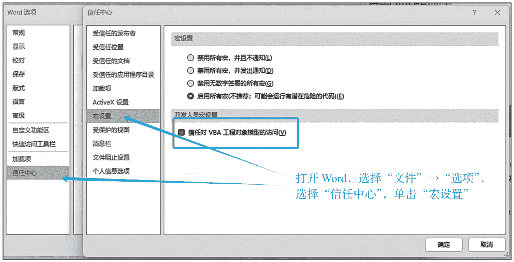
图 4-1 操作示意（一）

2）接着点“加载项”，选择“海鹦OfficeAI助手”。启用后就像给Word插上U盘，系统可能弹窗警告，直接点“确定”。操作示意如图4-2所示。
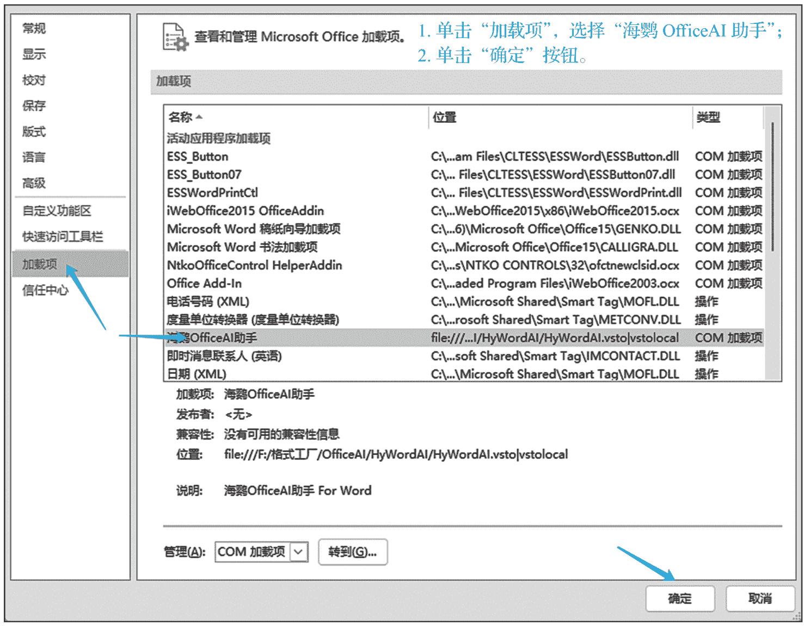
图 4-2 操作示意（二）

**2. 领取模型通行证**

去DeepSeek平台创建API密钥，名称随意但要保管好这串字符。操作示意如图4-3和图4-4所示。

**3. 完成人机合体**

返回Word，点击“OfficeAI助手→设置→大模型设置”，开启本地部署模式，勾选DeepSeek-Reasoner以兼顾文案和推理，最后粘贴密钥。Word即注入模型灵魂。操作示意如图4-5所示。
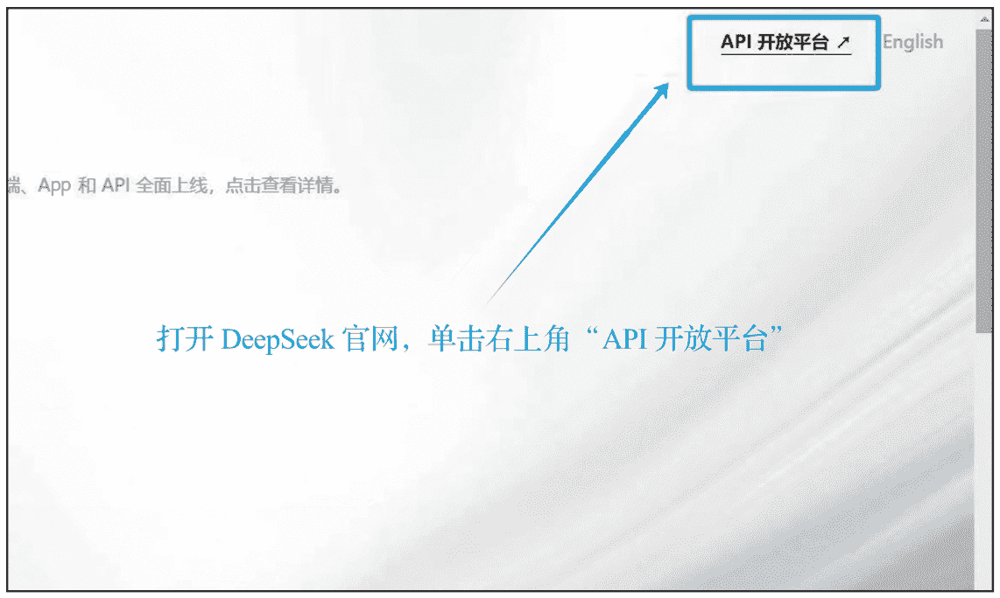
▲图 4-3 操作示意（三）
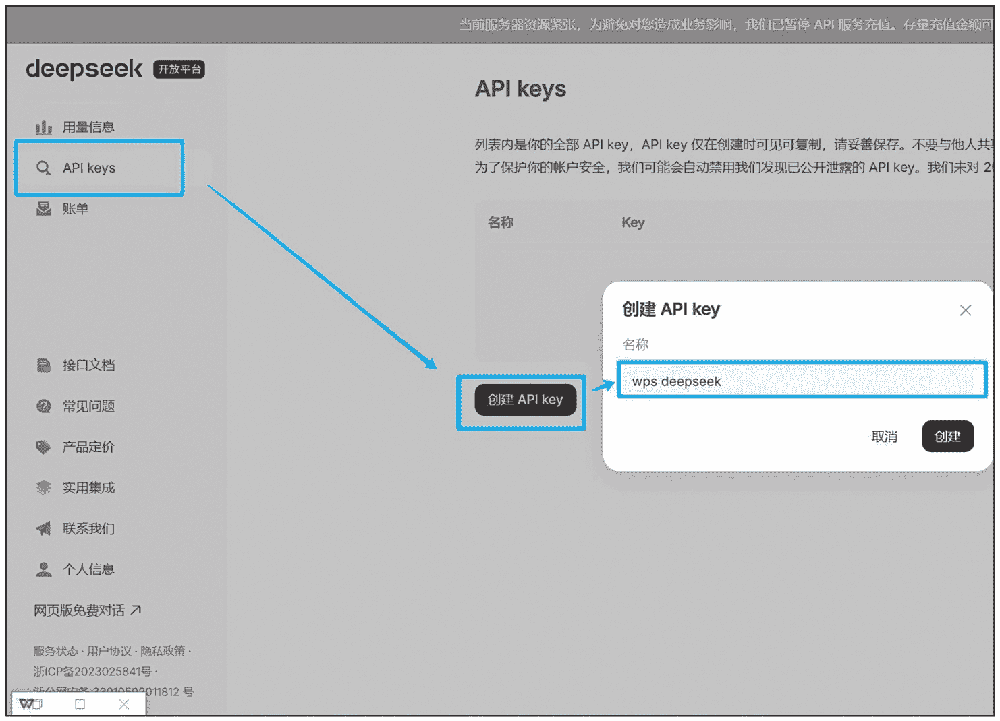
▲图 4-4 操作示意（四）
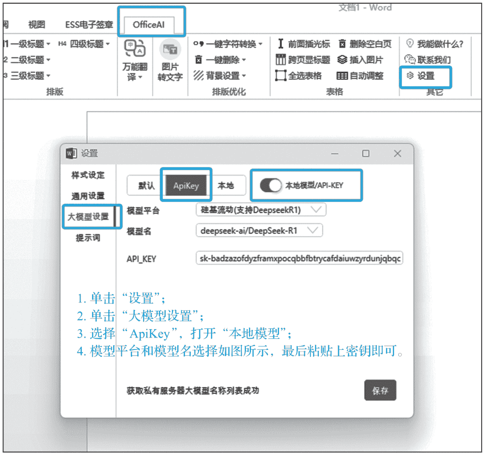
▲图 4-5 操作示意（五）

**4. 三秒召唤写作军团**

在空白文档输入“关于新能源汽车电池技术的现状分析”，按Alt+Q召唤助手，文字像爆米花一样弹出，自带分点。1分钟输出别人2小时的成果。

**5. 续写和优化合一**

卡壳时选中末段点“智能续写”，模型提供三种风格续写。点“段落优化”能把“这个方案很好”升级为“该方案在成本效益与实施可行性维度表现突出”。

**6. 防翻车指南**

建议开启“修改痕迹保留”，模型每次改动都会留彩色标记，便于复核。重要数据关闭“学习模式”，别让模型记住公司财报。

现在能优雅应对领导的突击需求了。同事还在抓头，你喝着咖啡看模型生成框架，只需修补。这感觉像数学考试带计算器——别人列竖式，你在检查大题。

**7. 总结**

下次遇到写作需求，试试这个操作。模型时代，会用工具的人和只靠蛮力的人，不在同一个赛道。新姿势是让模型替你加班。 

**试一试**

在文档输入“从市场规模、技术瓶颈、政策支持三个维度，分析2024年预制菜行业发展趋势”，按Alt+Q，会得到一份可直接贴进周报的分析，连SWOT都配好。 

**小贴士**

1）专业文档先丢3-5个关键词，比如“光伏产业+技术路线+供应链”。
2）半夜赶工模型失灵，多半是密钥粘贴时多打了空格。
3）重要文档开人工核验模式，模型写出“公司年增长率300%”这种离谱数据时，财务总监会信你。

## **技巧 36 DeepSeek+Excel 数据分析自动化**

在职场里，Excel堪称打工人的命根子。销售汇总、财务报表、库存管理、市场预测，绿色图标承载着无数人的喜怒哀乐。但面对海量数据、复杂公式、重复操作时，很多人陷入按F5刷新的困境——眼睛发直，手指抽搐，像永无止境的数字马拉松。

更崩溃的是，熬夜核对完3000行数据，领导说：“维度不够，再加个交叉对比。”此刻你像被队长盾牌砸中的灭霸，既想打响指又得微笑。这种场景每天上演，传统操作像用勺子挖隧道。

**1. 三招解锁神器**

给Excel装上最强大脑，数据工作就能像嗑瓜子一样轻松。武器是DeepSeek。

1）第一招：装外接神经网络

打开OfficeAI平台下载安装包，目前仅Win系统。双击安装一直下一步，重启Excel后界面多出“OfficeAI”选项卡，像给Excel戴上智能眼镜。操作示意如图4-6所示。
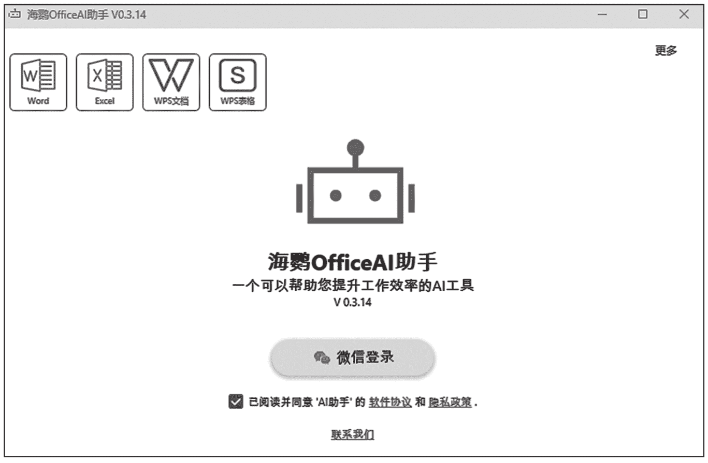
图 4-6 操作示意（六）

2）第二招：领模型通行证

去DeepSeek平台注册并获取API key。流程：登录→API开放平台→创建API key→复制代码。像在自动贩卖机买饮料。操作示意如图4-7所示。
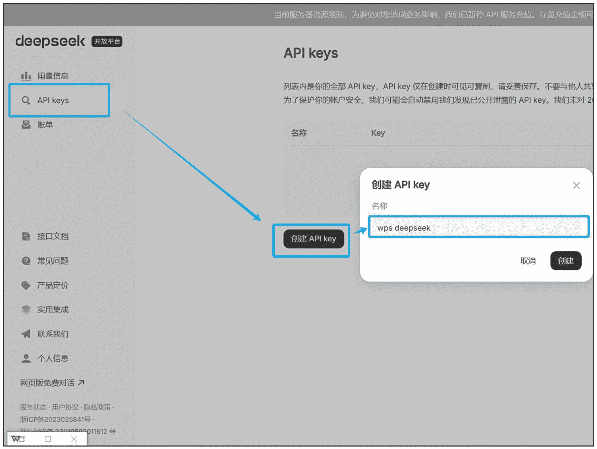
图 4-7 操作示意（七）

3）第三招：启动贾维斯系统

回到Excel，在OfficeAI设置里选“大模型设置”，粘贴API key。可按需选DeepSeek-Chat处理文案，或DeepSeek-Reasoner做数据分析。点保存，效率感提升200%。操作示意如图4-8所示。
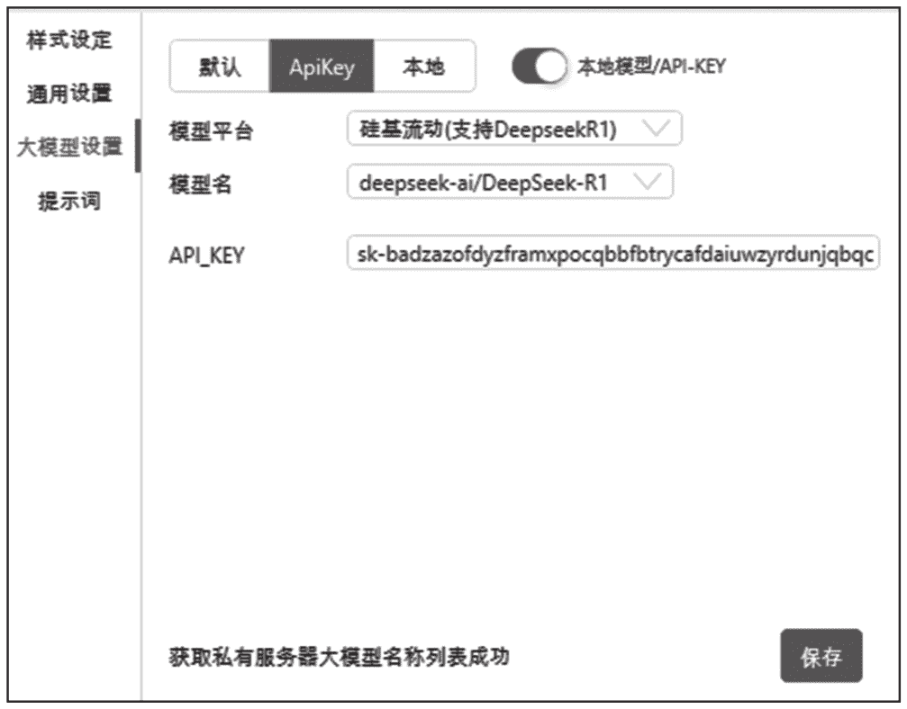
图 4-8 操作示意（八）

**2. Excel学会自主思考**

配置后模型能做：

1）选中文字点“生成”，三秒完成半小时润色。
2）选中数据表输入“分析趋势”，立刻生成带图表的报告。
3）翻译准确，还能适配专业术语。
4）公式错误自动标红。

结果可直接导出表格，像有个隐形数字秘书。

**3. 生存智慧**

担心模型抢饭碗？好比担心计算器让数学家失业。聪明的打工人让模型当数字苦力，腾出时间做创造性工作——比如研究用Excel画像素画。

盯着表格发愁时，不妨换套打法，试试这些提效开关。现在拼的不是谁更晚睡写公式，而是谁更会借力。

真正的老手不是把快捷键背下来的人，而是懂得让 AI 代班的聪明人。

**试一试**

在插件对话框里输入“分析 Sheet1 的 B2 到 F20 区域，用小学生能听懂的话说明数据规律，并给出三个优化方向”。

**小贴士**

学会在 Excel 里用 AI，相当于招到一个比实习生更听话、比咨询顾问更高效的智能秘书，而且它永远不会问你咖啡机在哪。

## **技巧 37 五步把表格小白变分析高手**

凌晨一点半，市场部小林的屏幕把两个黑眼圈照出来。电脑上表格密密麻麻像网一样缠住他，老板要的三季度渠道对比还差八张图，光核对数据就错三次，柱状图的配色也被嫌不够好看。类似场景每天都在上演：在数据洪流里，大多数人手里只有一把漏勺。

**1. 分析工作常见的三重阻力**

1）环境搭建地狱：从 Python 配置到 Pandas 报错，门槛堪比驾考科目二。
2）Excel 迷宫：做个动态透视表要翻三篇教程，调图表样式让人头疼。
3）时间黑洞：调研显示，七成多职场人把六成分析时间花在清洗数据而非洞察业务。

**2. 自问**

当数据量比外卖订单还多时，普通人有没有可能像《黑客帝国》主角那样，三秒看清数字背后的真相？最好还能一边喝奶茶一边交出专业报告？

**3. 五招摆脱加班**

（1）第一招：口语化指令
操作说明：把原本硬啃的 VLOOKUP 换成“帮我分析周末客流变化”。
应用例子：销售经理上传表格后输入“分析周末客流变化”，系统自动输出带预警的分析：
1）高峰资源调配 周六下午14:00-18:00需增人增货，尤其是热销品如产品 B 在地区 Y 销量更高。
2）促销建议 周日下午可推限时折扣，吸引客流，如16:00-18:00客流偏低但转化可能更高。
3）持续追踪 继续关注二月春节后客流，验证节假日对周末消费的长期影响。

（2）第二招：智能制图
避坑提示：别再手工调色，输入“画个让人想点赞的饼图”，DeepSeek 会给出：
1）设计思路。
❑ 颜色搭配：亮黄代表周六、浅蓝代表周日，对比鲜明又活泼！

❑ 标签位置：百分比直接标在图上，旁边配小图标代表客流。
❑ 重点标注：给周六扇区加一圈发光边，突出占比更高！
2）文字版预览示意，实际可用 Excel 或在线工具生成。
3）以 Excel 为例的制作步骤，具体略。
进阶玩法：上传评价表输入“生成情感分析云图”，可得到两种做法：
❑ Python：用 Wordcloud 库生成彩色词云的代码示例。
❑ 在线工具：WordArt.com 支持中文词云，可自定形状与颜色。
并给出词频气泡图效果，比读百条评论更直观。

（3）第三招：异常雷达
反杀案例：电商分析师输入“揪出销售数据异常”，三分钟发现核心异常：1月2日5000元和1月4日4800元的新客订单金额明显偏离正常。
预警设置：上传销售数据，输入：
帮我做异常值监测，规则如下：
❑ 指标：当日销量。
❑ 阈值：相比前一天下降超30%。
❑ 分组：按“区域”分别检测。
即可得到异常区域、降幅、原因分析、处理建议和可视化信息。用此法五分钟揪出销量异常，团队能快速响应！
彩蛋：输入“帮我找数据里的惊喜”，可能发现冷门品在 Z 世代走红：“手工编织手链：900%增长，Z 世代新宠！便携榨汁机：健康象征，100%增长！个性笔记本：文创黑马，200%增长！”

（4）第四招：移动办公
1）地铁办公 老板催周报时，手机上传数据输入“生成战地记者式简报”，五秒拿到速报。
①销售前线：战果辉煌！
地区 A：2月28日销售额冲到8000元，新增客户4人，战绩斐然！
地区 B：2月26日销售额7000元，新增客户5人，打响本周第一枪！
②前线观察：亮点与挑战
亮点：地区 B 连续两日销售额破7000，新增客户数领跑！
项目 X 一周完成度提升10%，协作高效！
…
③记者点评：“本周战果辉煌，但胜利号角未响！地区 B 强势振奋，地区 C 潜力待挖。项目推进稳健，需防资源分配不均。下周继续冲锋！”
2）咖啡厅模式 打开笔记本输入“来份华尔街日报风格图表”，旁人以为你在操盘美股。
3）如厕时间管理 蹲坑时语音输入“总结今日销售关键数据”，起身就能在晨会侃侃而谈。

（5）第五招：跨格式整合
1）文件混搭 把市场部 Excel、技术部 JSON、销售部 PDF 全拖进去，输入“合并后分析客户画像”，可得到合并数据、画像分析、分群策略和可视化建议。
2）时空换算 对比2019-2024年数据，输入“帮我把五年前数据换算成现在物价”，会结合通胀率折算。
预言模式：输入“按此趋势明年怎样”，可能给出：销售金额走势、年均增长率、2025年Q4预计金额，并建议Q3-Q4增库存人力应对高峰，Q2-Q3加大促销，关注外部经济及时调整策略。

**4. 总结**
当同事为折线图断点抓狂时，你已靠在椅背喝咖啡，看系统自动生成的《数据背后的十个财富密码》。此刻你不再是表格新手，而是掌控数字魔法的现代术士——在这个时代，会提问的人永远比会写代码的人先吃到蛋糕。

**试一试**
在 DeepSeek 里上传本季度销售数据，让它分析波动并给出建议。

**小贴士**
1）命名技巧：别叫《最终版123改了这个真的不改了》，建议《华东销售_2023Q3_清洁版》
2）提问心法：把“分析数据”升级成“找出让老板眼前一亮的三点”。

## **技巧 38 DeepSeek+WPS 灵犀：打造高效办公的利器**

高强度职场里，文档处理是日常难题。写报告、处理数据、做演示常被繁琐流程卡住。更烦的是领导临时改稿，原本紧张的进度雪上加霜。若文档能自动处理，很多人愿意买单。

其实不必等未来科技，WPS 灵犀与 DeepSeek R1 组合就能立刻提效。配置像拼乐高一样简单，三步搞定，就能拥有24小时待命的 AI 办公助手。

**1. 三步搞定**
（1）第一步：升级 WPS，激活 DeepSeek R1
先把 WPS 升到最新版，Windows 版本12.1.0.20305。安装后打开文档，点左侧“灵犀”按钮，打开 DeepSeek R1 的紫色开关。这等于给 WPS 装上智能大脑。
操作提示：找不到“灵犀”通常是版本旧。像找不到遥控器先检查电池，请确保 WPS 为最新。
（2）第二步：一键启动，告别卡顿
DeepSeek R1 的亮点是双通道负载均衡。检测到官方 API 繁忙时，WPS 灵犀会自动切到备用服务器如硅基流动，保证稳定。实测复杂文档处理平均耗时从3分钟降到40秒，且不再出现“服务器超时”。
操作提示：常卡顿先查网络。AI 再强也离不开稳定网络。
（3）第三步：场景化应用，效率倍增
DeepSeek R1 不仅能快速生成文档，还能完成多种任务：
1）文档生成：输入“月度销售报告框架”，AI 自动生成结构化内容，省去构思时间。
2）数据分析：选中表格区域，输入“分析客户满意度趋势”，AI 输出可视化图表，数据一目了然。
3）智能校对：点“审阅”→“AI 校对”，AI 检查语法并优化风格，文档更专业。
操作提示：对生成内容不满意可手动调整。AI 是助手，最终决策权在你。

**2. 总结**
WPS 灵犀与 DeepSeek R1 的结合为职场人士提供强力提效工具。升级 WPS、启用 DeepSeek R1、探索多种场景，就能拥有高效 AI 助手。无论文档生成、数据分析还是智能校对，都能显著提升效能，让你从繁琐任务中解脱，轻松应对办公挑战。

**试一试**
输入“生成项目进度报告框架”，观察 AI 如何快速生成结构化模板，直接填充即可完成初稿。

**小贴士**
1）多尝试功能：DeepSeek R1 不仅能生成文档，还能处理数据、校对文本，甚至制作 PPT，多试会发现惊喜。
2）保存常用模板：处理相似任务时，可把 AI 生成内容存为模板，下次直接调用，效率翻倍。
3）注意数据安全：DeepSeek R1 支持联网，处理敏感数据时建议关闭联网，避免泄露。

## **技巧 39 DeepSeek+飞书：开启智能办公新体验**

随着 DeepSeek 需求激增，服务器压力增大，用户体验受影响。市场上出现多种替代客户端，许多应用也宣布集成 DeepSeek R1。DeepSeek 在 GitHub 创建专门项目，展示集成模型的应用和服务，包括 Chatbox、思源笔记等，以及智能体框架、RAG 框架和浏览器或 IDE 插件，形成快速发展的开源生态。

在办公软件领域，飞书最近集成 DeepSeek R1，带来全新 AI 交互体验。过去 AI 通常是单次输入提示词一对一交互。批量处理任务时操作复杂，比如撰写文献综述需从大量文献筛选信息，再通过 API 处理，过程繁琐且透明度低。

DeepSeek R1 与飞书结合改变了现状。每个表格单元格都变成自然的提示词输入框，批量处理变得直观简单。只需把数据粘贴到表格，DeepSeek R1 就能按顺序自动处理。

这种结合提升透明度和控制力，也显著提高效率。社交媒体上的用户分享了他们利用该组合提效的经验，有人表示比其他平台如 Notion 更高效实用。此外，DeepSeek R1 在生成吸引人的商品标题或创作完整文章方面也表现优异，大幅提升内容创作者效率。

**1. 如何在飞书中使用 DeepSeek R1**
1）确保拥有飞书账号，新建多维表格，保留默认的第一列作为提示词列，删除其他列。
2）添加一列并搜索“DeepSeek”，配置 DeepSeek R1 模型，选择之前设置的提示词列，并可设置全局提示词。
3）在提示词列中输入关键词或场景，等待 DeepSeek R1 完成任务。
4）启用“自动更新”功能，每次修改提示词后都能即时获得反馈，提高工作效率。

**2. 总结**
DeepSeek R1 与飞书的集成简化了 AI 使用流程，也显著提升处理效率。它让原本复杂的过程更直观易管，无论批量处理还是个性化内容生成，都能大幅提升工作效能和质量。

**试一试**
创建一个新的多维表格，按上述步骤配置 DeepSeek R1，在提示词列输入“生成产品推广文案”，观察 AI 如何根据输入自动生成内容。

**小贴士**
1）充分利用自动更新：启用后每次修改提示词都能立即得到反馈，对需要频繁调整的任务尤其有用。
2）灵活运用提示词：根据任务需求定制提示词，可获得更精准结果。
3）探索更多应用场景：DeepSeek R1 不仅适用于文本生成，还可用于数据分析、信息提取等多种场景，不妨尝试拓展用途。

## **技巧 40 DeepSeek+Xmind：快速生成思维导图**

我们都有过崩溃时刻：面对新书、报告或会议纪要，内容都看过，真要整理逻辑框架时，大脑却像被猫抓过的毛线团越理越乱。

传统整理像手工织毛衣：用 Word 列大纲耗时费力，手动拖拽思维导图节点容易漏重点。更可怕的是，辛苦整理两小时后，发现关键概念被埋在第三级目录，心情像发现刚砌好的砖墙里有一块歪了，恨不得拆掉重来。

其实只需两个工具：DeepSeek 当信息捕手，Xmind 当架构师。前者把散落信息变成规整乐高积木，后者把积木搭建成城堡。过程像把杂乱衣橱变成宜家样板间，只需三步。

**1. 给知识装上吸尘器**
无论书籍、PDF 还是会议记录，先把材料丢给 DeepSeek。它能像超市扫码枪一样瞬间识别内容骨架。
❑ 对书籍，直接说“输出《人类简史》的框架，用 Markdown 格式”。
❑ 对文档，点击“上传”按钮，附加指令“提取三级目录”。
❑ 对会议录音文字版，要求“总结5个决策点+3个待办事项”。
30秒后得到一份自带#标题、##章节、###要点的结构化文档，比手工快10倍，还不会漏掉老板强调的“那个很重要的点”。

**2. 给文档施变形咒**
拿到 DeepSeek 输出的 Markdown 文件后，新建一个 txt 文档，把内容复制进去，然后把后缀名改成.md。

**3. 见证知识开花**
打开 Xmind，点击“导入 Markdown”的瞬间，魔法发生：文字像乐高零件自动拼装，标题变主干，章节变树枝，要点化叶片。可以：
❑ 按住 Alt+鼠标拖动整个分支。
❑ 用 Ctrl+Enter 给关键节点加闪电图标。
❑ 把“待讨论”事项标记成红色预警。
原本需半天的工作，20分钟就能产出可贴进周报的思维导图。当领导问“这个逻辑怎么来的”时，可随时从导图节点溯源回原始文档段落。

**4. 总结**
可以用 DeepSeek 将各类材料快速转化为结构化 Markdown 文档，提取关键信息，避免遗漏；将 Markdown 文件转换为可导入 Xmind 的格式；利用 Xmind 将结构化文档转化为思维导图，快速调整布局并添加标记，大幅提升整理效率。

**试一试**
1）把上周周报丢给 DeepSeek：“提取三个核心项目进展、两个翻车预警、一个能让老板拍大腿的亮点，用##分级”。
2）把生成的 Markdown 文件改名为“升职加薪密码.md”。
3）导入 Xmind 后，按住 Ctrl 键狂拖节点，会得到一张堪比《盗梦空间》的思维迷宫——记得把“翻车预警”分支改成红色，保证老板目光锁定不超过3秒。

## **技巧 41 DeepSeek+Draw：快速搞定流程图**

快节奏职场中，流程图已成项目管理必备。产品研发、业务流程、系统架构、应急预案，都能靠可视化大幅提升协作效率。但很多人制作流程图常陷入困境：逻辑梳理不清耽误2小时，反复调整排版浪费1小时，配色混乱被领导打回修改……本该高效的工具变成时间黑洞。

掌握 DeepSeek+绘图工具组合拳，就能成为“1分钟出图”的效率王者。具体操作只需三步。

**1. 三步完成绘图技巧**
（1）第一步：用 DeepSeek 生成逻辑框架
向 DeepSeek 提出需求，比如：“请帮我设计一个处理用户投诉的业务流程图，用 Mermaid 格式输出。”DeepSeek 会迅速生成一份详细流程图代码。这一步相当于让 AI 完成最烧脑的逻辑梳理，省去抓耳挠腮时间。
操作心法：若不确定流程图细节，可先给 DeepSeek 粗略框架，比如“电商订单处理流程”，逐步细化需求。AI 会根据描述生成初步方案，再根据实际情况调整。

（2）第二步：把 Mermaid 代码渲染成图
DeepSeek 已把业务逻辑整理成 Mermaid 格式的文本，接下来由可视化工具完成呈现。以 draw.io 为例，这是一款浏览器就能用的绘图服务，默认就认 Mermaid，转换效果很成熟。
打开 draw.io 新建画布，顶部菜单点 “+”，先切到“高级”，再挑“Mermaid”。把 AI 返回的文本原样复制进去，页面会立刻解析并生成图形化的流程图。
大体一分钟左右就能得到一份看起来很专业的图表，感觉像把食材放进料理机，按下启动键就出成品。

（3）第三步：在绘图软件里做精细化调整
draw.io 支持后续编辑，可以让图更贴合真实业务。常见做法有：
1）统一节点样式，让图形风格和公司内部流程保持一致。
2）调整连线表现，用实线、虚线或不同箭头区分主干和分支。
3）在关键节点补上说明文字，帮助同事快速get意图。
实操建议：对配色没把握时，直接套用软件自带的主题模版，几秒内完成视觉整理，避免被上级打回修改。

**2. 总结**
流程图是提升团队协作效率的核心载体，手绘成本高耗时长。借助 DeepSeek 产出逻辑代码，再配合绘图工具快速成图，能大幅压缩制作周期。先让 DeepSeek 按需求输出 Mermaid 代码梳理逻辑，再用 draw.io 这类免费工具导入渲染，数秒内获得可视结果。最后在软件内调整节点外观、连线方式和注释，使其更贴合业务场景。整个链路只需几分钟，即便不懂配色，也能靠主题模版快速美化，降低反复修改概率。 

**试一试**
假设你是一名从业十余年的系统架构师，需要一份电商订单处理图。可以这样提问：“请用 Mermaid 格式输出电商订单处理流程，包含下单、支付校验、库存锁定、物流分配四个主环节，并补充异常分支。”很快就能拿到可直接交付的图表，领导会对你的执行效率刮目相看。 

**小贴士**
1）先让 AI 搭骨架：面对复杂流程，先请 DeepSeek 生成逻辑框架并指定 Mermaid 格式，再用绘图工具一键成图。
2）多尝试兼容平台：除 draw.io 外，Typora、VS Code 等编辑器同样支持 Mermaid，可自行挑选顺手的那款。
3）沉淀代码模板：常用流程类型的代码可保存为模板，下次直接调用效率翻倍。

## **技巧 42 微信接入 DeepSeek R1：让 AI 驻留在聊天窗**
移动互联网时代，微信已成国民级应用，覆盖生活各场景。随着智能技术演进，用户对信息获取的效率要求也在提升。过去查资料、写文案、做规划往往要在多 App 间跳转，体验割裂且低效。
微信功能虽全，但在智能层面长期存在断层，用户仍需借助外部工具完成 PPT 大纲、行程规划等任务。如何在保留社交特性的同时实现内部智能融合，成为关键。
思路是把 DeepSeek R1 引入微信。这不是简单堆功能，而是一次信息获取方式的升级。将 R1 的能力嵌入微信后，用户可在聊天窗口直接完成各类智能任务，无需跳转。

**1. 问答即时，关键信息直出**
过去需要多应用协同的事项，现在只需在微信搜索框输入问题即可。R1 能迅速给出 PPT 大纲、行程规划等结果，并直接展示要点，同时标注引用来源，如权威站点或公众号，保证可信。

**2. 推理透明，增强信任感**
R1 作答时会展示思考路径，让推理过程可见。例如询问“周末旅行如何安排”，它会逐步呈现从目的地筛选到日程落地的逻辑，帮助用户理解结论的由来，提升信任。

**3. 分享传播，构建闭环**
搜索结果可直接转发给好友或发到朋友圈，形成“提问—解答—传播”的闭环。信息流通更快，也更易引发讨论。

**4. 多产品联动，能力无缝覆盖**
除微信外，腾讯云 API、腾讯小影视 AI 平台、元宝联网检索以及 QQ 音乐智能助手等产品也已整合 DeepSeek，意味着用户在更多场景都能享受到统一的智能能力。

**5. 总结**
微信接入 DeepSeek R1 后，用户可在聊天窗口完成多种智能任务，无需切换应用，信息获取更高效便捷。既能快速获得带来源标注的可靠答案，又能看到思考链路增强信任，结合社交分发形成高效闭环。微信正从纯社交工具向集成强大智能的工作助手演进，提供真正的一体化智能体验。 

**试一试**
在微信搜索框输入“帮我规划一次北京出发的三天两夜行程”，感受 R1 如何迅速给出详细方案并突出关键信息。 

**小贴士**
1）如何判断已开通：打开微信首页搜索框，若出现“AI 搜索”字样，说明已进入灰度体验。
2）未开通怎么办：据腾讯透露全量上线已在倒计时，耐心等待即可。

## **技巧 43 知识库私有化：让资料会主动回答**
职场最崩溃的瞬间：领导要求十分钟内找到三年前合同的补充条款，你却在堆满 PDF 的文件夹里迷路；写方案时记得论文里有关键数据，却怎么也找不到文件名；新人询问基础操作流程，你花了半小时才定位到文档。
纸质档案已淘汰，电子文档却同样混乱：文件名“最终版”“终极版”、文件夹层层嵌套、关键词检索失效。更糟的是，找到文件后关键信息往往藏在第 48 页的小括号里。
如何让海量文档变成随时可问的活字典？如何让新人自助获取知识？如何保证核心资料安全可控？这正是知识管理要解决的问题。

**1. 第一招：文档投喂法**
（1）操作指引
1）登录 DeepSeek 控制台，进入“知识食堂”入口。操作示意如图 4-9 所示。
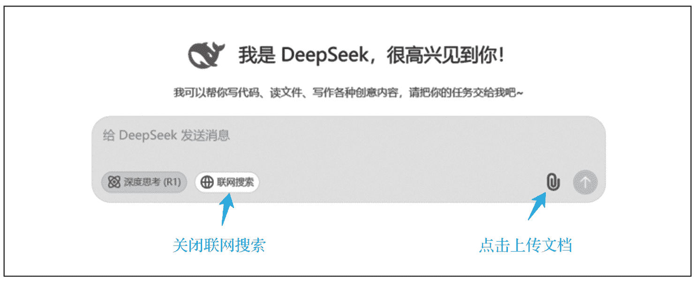
图 4-9 操作示意（九）
2）把 PDF、Word、TXT 等各类文档拖入投喂区。
3）系统自动将文档拆解为知识颗粒，类似把整头牛拆成牛排、牛腩、牛尾。
（2）进阶技巧
1）下载 Cherry Studio AI 全能助理并配置模型。操作示意如图 4-10 至图 4-14 所示。

▲图 4-10 操作示意（十）
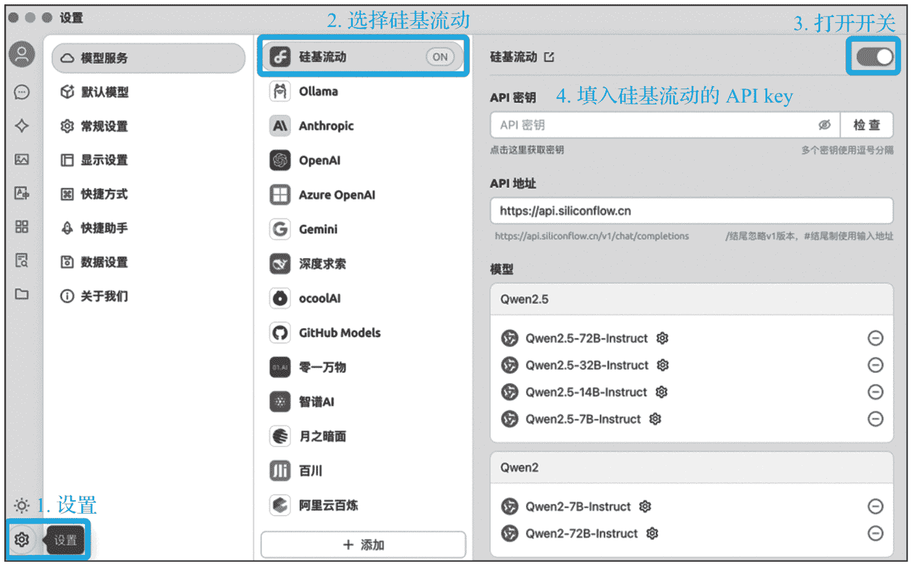
▲图 4-11 操作示意（十一）
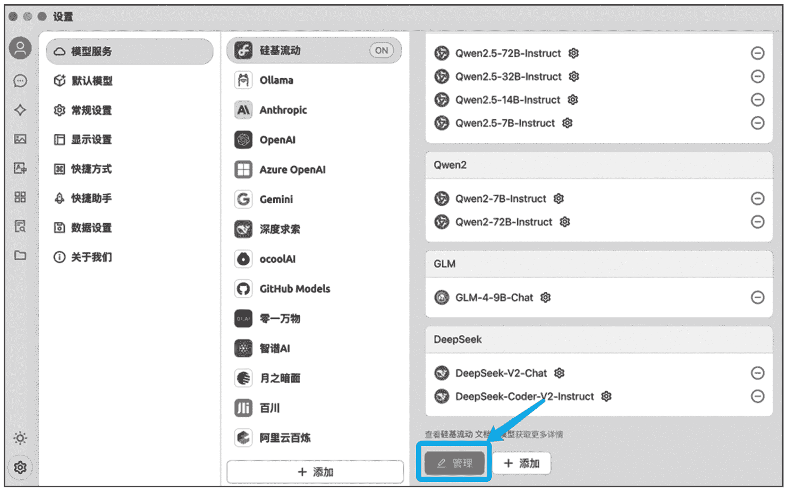
▲图 4-12 操作示意（十二）
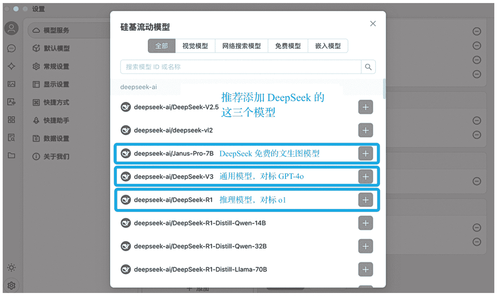
▲图 4-13 操作示意（十三）
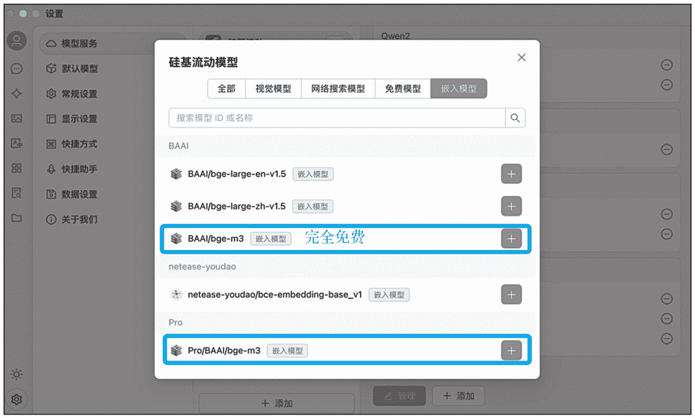
▲图 4-14 操作示意（十四）
2）按部门或项目建立专属知识库，例如财务部喂报表、法务部喂合同。操作示意如图 4-15 所示。
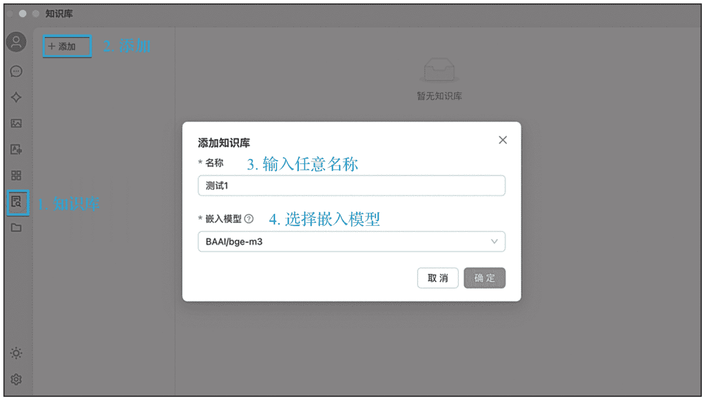
图 4-15 操作示意（十五）
3）定期补充新文档，比如每月 1 号喂最新行业报告。操作示意如图 4-16 所示。
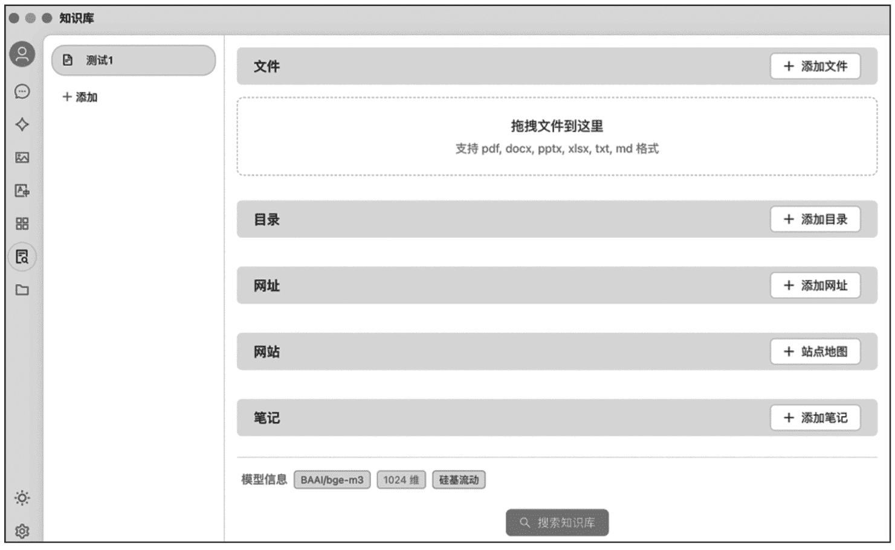
图 4-16 操作示意（十六）
4）清理过期内容，例如移除“2020 年旧版制度”。

**2. 第二招：用人话提问**
（1）示范对比
错误示范：“找市场策略”。
正确示范：“根据 2023 年 Q4 营销复盘报告，列出华北区渠道拓展的三个关键动作。”
（2）提问公式：场景 + 具体需求 + 输出格式
示例：
你是一名十年法务专家，请用表格对比 2021 版和 2023 版《中华人民共和国数据安全法》关于个人信息保护的差异，并标注条文编号。

**3. 第三招：权限与安全管控**
（1）敏感信息防护三件套
1）角色分级：CEO 可查看并购预案，实习生只能查考勤制度。
2）水印保护：导出内容自动加盖“机密-内部使用”。
3）溯源标注：每个回答都标注来源文档及页码。
（2）实战案例：行政小王的蜕变
行政部小王将公司十年积累的 378 份制度、56 本操作手册、93 份合同模板全部投喂后：
1）新人问“如何申请备用金”→AI 秒回流程图。
2）老板要“近三年中秋福利方案”→5 秒生成对比表。
3）法务查“最新版竞业协议模板”→直接推送带水印版本。
小王从文档管理员升级为智能行政顾问。 

**试一试**
登录 DeepSeek，把部门高频被问的 5 份文档导入知识库，试问：“用三点概括××项目风险管理方案的核心要点，并按操作顺序排列。” 

**小贴士**
若 AI 回答跑偏，可尝试：
1）确认文档是否清晰可识别，扫描件最好转为文字版。
2）问题加上具体场景，别只说“找数据”，要说“找 2022 年华东区 Q4 销售额”。
3）用专家角色法提问，前面加上“你是××领域专家，请…”。

# **第五章**

# **使用 DeepSeek 创作内容的技巧**

## **技巧 44 用 DeepSeek 润色沟通：把硬话说软**
日常沟通中常出现这些尴尬：
❑ 同事方案漏洞多，你回：“你这方案问题太多，不可行。”
❑ 家长群转谣言，你评：“这都是伪科学，别信。”
❑ 朋友抱怨工作压力大，你说：“你抗压能力太差。”
话是对的，但像直接塞苦瓜，道理成立，体验很差。

**1. “硬表达”的副作用**
很多人以为高情商等于客套，核心其实是降低认知摩擦。同样的“方案有问题”，低情商像砂纸打脸，高情商像裹层蜂蜜。DeepSeek 会建议：“感谢付出，这个方案很有潜力，我们可以一起优化几个点。”既点出问题，又保全面子，还给出改进方向。

**2. 三招练就语言柔术**
（1）共情缓冲
先接住情绪再说观点。
把“你完全没考虑成本”改为“成本控制是关键难点，前期调研我们也花了不少精力，要不要一起看看第六章预算怎么优化？”
对“如何委婉提醒同事方案超预算”，DeepSeek 可能给出：“方向很棒，我有点担心预算。根据测算 A 部分可能超 20%，是否用 B 替代或分阶段实施？我很乐意一起讨论优化。”

（2）积极语言转化
把否定改成可能性。
“这个计划行不通”→“我们试试从用户画像切入如何？”
“你别总迟到”→“早到十分钟，我们可以先喝杯咖啡聊新创意。”
“你别总打断别人”→“等小张说完我们再补充，讨论会更高效。”

（3）过滤绝对化表达
去掉“总是、从不、肯定”等词。
“你从来不听建议”→“上次关于用户调研的建议，如果现在调整还来得及。”
“肯定要失败”→“目前风险集中在推广环节，需要备选方案。”

**3. 为什么 AI 更适合当情商教练**
真人练习容易有心理负担，对着 DeepSeek 可尽情试错。它能瞬间给出十几种表达，如同 24 小时在线的语言调校师，而且没有情绪记忆，不会记仇。

**4. 总结：说话的温度计**
高情商不是委屈求全，而是用建设性方式让真话更容易被接受。就像做菜加一勺糖，不改食材本味却更易入口。通过 DeepSeek 的实时改写训练，曾经难以开口的硬道理都能变成让人接受的软建议。 

**试一试**
在 DeepSeek 输入“把‘你这报告全是错误’改写成建设性反馈”。 

**小贴士**
提意见前自问三点：
1）对方最在意的价值点是什么？
2）我的建议能否附着在这个价值点上？
3）用“我们可以…”代替“你应该…”，是否更容易接受？

## **技巧 45 用 DeepSeek 升维写作：主题拔高实操**
创作时常遇到瓶颈：文章停留在表面，难以拔高视角，主题无法升华，读者共鸣不足。DeepSeek 就像一位引路人，帮你打破思维牢笼。

**1. 高度视角转换：从小事到社会价值**
写社区志愿者照顾独居老人，DeepSeek 可引导抬高视野：
“志愿者的善举体现了基层社区的互助敬老传统，增强社区凝聚力，推动社会文明，为和谐社会建设贡献力量。平凡小事也能映射巨大价值。”

**2. 价值跃升：从单一到多元**
科幻电影最初只被看作娱乐，经转化后可发现其具备教育价值，引发对科技与人类未来的思考；同时具文化价值，传播观念、促进交流，认知边界随之拓宽。

**3. 时代关联融合：从个体到时代精神**
创业者在商海拼搏的故事，经融合可表述为其是大众创业、万众创新时代拼搏精神的缩影，个人梦想与经济发展同频，个体经历成为时代精神的注脚。

**4. 全局视野拓展：从局部到整体**
某地区行业发展瓶颈的分析，经拓展可指出这反映出产业结构优化、技术升级转型的共性问题，需从产业链角度加强协作、整合资源、提升竞争力，培养宏观视野。

**5. 总结**
DeepSeek 的写作升维引擎像一双翅膀，帮助你在写作时抬高站位、拓宽视野、深化层次，让主题有效升华，文字更具穿透力和思考张力。 

**试一试**
用 DeepSeek 对你过去写过的文章进行升维改造。 

**小贴士**
主题升华三锦囊。

1）视野拔高：搭建全局认知框架
2）意义深掘：贯通价值链条
3）现实联动：增强表达穿透力

**技巧46 AI风格拟态术：三分钟训出专属笔触助手**

深夜写字楼里灯还亮着，键盘声连成一片。内容编辑在反复打磨品牌稿，小说作者对着人物的独白发愁，市场新人盯着一封商务邮件不知如何开口。身份不同，困境却一致：怎么让文字稳定落在想要的语感上。

客户说要大气里带点俏皮，老板说要像科技发布会那样有感染力。很多人于是陷入死循环：用一堆形容词去定义风格结果四不像，翻案例库找参照耗时耗力，反复修改到自我怀疑，等稿子可用热点已过。

对模型而言，“模仿某位作家笔法”相当于让它用颜色去描绘味道。人类对风格的模糊感知会形成屏障，但一套清晰的指令就能把壁垒打通。

**1. 核心路径：四步让模型变风格高手**

1）第一步：给足样本文本
不要让模型靠猜。像教鹦鹉学语，先当面示范。挑选最具代表性的片段，写作者选标志性段落，商务类选过往佳作。把样本置于指令之前，用引号框住作为教材，给模型戴上滤镜。

示范思路：“余华《活着》里老人笑容的描写：老人黝黑的脸在阳光里笑得十分生动，脸上的皱纹欢乐地游动着……请以此笔触描写黄昏集市。”

2）第二步：要素拆解
模型容易抓偏，需要像教练拆动作一样指明方向。可采用五维锚定：
❑ 用词取向：文言、网络梗、专业术语
❑ 句式形态：长抒情、短利落
❑ 修辞偏好：比喻、排比、反讽
❑ 情绪基调：激昂、克制、黑色幽默
❑ 节奏韵律：诗化、口语化

实战写法：“请模仿下文，重点还原①密集短句②克制情绪③留白收束：东京的雪落得突然，像被撕碎的旧情书……”

3）第三步：时空定位指令
需要特定时代语感时，时空坐标是钥匙。公式：时代/地域+身份+场景+载体=精准复刻

进阶例子：“以初唐文言为底，模拟玄武门之变后一位军事统帅在私人日志里的表述，适当保留口语，避免过度书面化。”

4）第四步：跨域迁移
最高阶是跨载体移植。例如把产品说明写成武侠：“用金庸《笑傲江湖》那种叙事口气，描写手机从待机到唤醒的过程，突出江湖重逢的意境。”

**2. 小结**
创作者不必在风格迷宫里撞墙。创作的悖论是，最聪明的原创往往始于最聪明的模仿。下次再被要求写王家卫式科技稿，可以端着咖啡说给我几分钟。

**试一试**
按上文方法论完成：
1）模仿海明威电报式写法，应优先拆解哪三项？（答案：短句结构、白描手法、克制情感）
2）把产品说明书改写成《红楼梦》风格，补全穿越指令：“以 ____ 为底，模拟 ____ 在 ____ 场景中的表述方式，突出 ____ 特征”（答案：明清白话、世家公子、大观园夜宴、诗化比喻）
3）模型模仿张爱玲风格却过度堆砌比喻时，应加强哪两个维度的限制？（答案：修辞密度控制、留白节奏调节） 

**小贴士**
1）样本文本控制在300字内，避免模型记忆混淆
2）新旧内容比例保持3:7，降低同质化风险
3）用“保留……调整……”句式微调，例如保留专业术语，调整得更口语化

**技巧47 文书解构仪：数秒抓住公文精髓与底层逻辑**

办公时常被积压的公文和杂乱信息搞得焦头烂额。晦涩术语、复杂句式像迷宫。借助结构化技巧，能轻松读懂文书、理清信息。

**1. 文书语法解析：把长句拆成清晰要点**
例如：“鉴于当前市场环境的复杂性以及本司业务多元化发展的战略需求，需要对既有业务流程进行全面且系统的梳理，同时结合新兴技术的应用前景来制定具有前瞻性和可操作性的优化方案。”别被吓住。

用“提取句子的关键主干，再剥离核心逻辑关系”，可解读为：“由于市场环境复杂和业务多元化，本司需要梳理业务流程并结合新兴技术，以制定具有前瞻性和可操作性的优化方案。”核心诉求一下明了。

**2. 政策导向雷达：把原则要求转成行动指引**
文书常出现原则性要求，如“要秉持公平公正、公开透明的原则，加强对市场活动的监管，促进市场健康有序发展”。

让模型“深入分析原则背后的具体指向和操作要求，将其转化为具体行动指南要点”，输出框架如下：
1.原则背后的具体指向和操作要求分析
（1）公平公正
1）具体指向：确保所有市场参与者享有平等的竞争机会，避免偏袒或歧视。
2）操作要求：制定明确的规则和标准，确保规则执行不受外部干扰。
（2）公开透明
1）具体指向：提高市场活动透明度，让参与者获取必要信息。
2）操作要求：建立信息公开机制，确保信息及时、准确、全面披露。
2.具体行动指南要点
（1）制定和执行公平竞争规则
1）制定规则：制定详细公平竞争规则，明确禁止行为和处罚措施。
2）执行规则：设立独立监管机构，负责规则执行和监督。
（2）建立信息公开机制
1）信息收集：建立信息收集系统，确保市场活动数据及时记录存储。
2）信息披露：定期发布市场活动报告，确保公开透明。
（3）加强监管和审计
1）监管措施：加强日常监管，定期检查评估。
2）审计机制：引入第三方审计，对市场活动独立审计，确保公正。
（4）培训和宣传
1）培训：对市场参与者进行原则培训，提升意识和理解。
2）宣传：多渠道宣传，增强公众认知和支持。
（5）反馈和改进机制
1）反馈渠道：建立反馈渠道，收集意见建议。
2）持续改进：根据反馈不断优化监管和信息公开机制。

如此便能按文书要求开展可操作工作。

**3. 数据筛选滤网：从海量数据提炼关键指标**
面对统计报表、调研数据易迷失。明确分析目标后，用模型过滤无关信息。如想了解核心产品在重点市场的销售表现，可剔除非核心产品、非重点市场数据，提取销量、销售额、市场占有率等关键指标。

**4. 信息关联拼图：把零散信息拼成完整图景**
文书信息常零散。模型可关联整合。如企业项目推进文件里，技术、市场、财务报告分散。通过分析研发进度对上市时间的影响、调研结果对资金投入的指导等，可拼出完整推进图景，便于决策。

**5. 小结**
掌握解读文书和处理复杂信息的技巧，等于拥有得力办公助手。晦涩文书变清晰指令，杂乱信息变决策依据，效率大幅提升。 

**试一试**
研究解读一个政策文件。 

**小贴士**
信息处理三招。
1）文书缩句公式：挑出核心主干和逻辑关系，如“为提升居民生活满意度，加大基础设施建设投入，各相关部门需协同合作，制定并落实具体方案”，可缩为“为提满意度，各部门合作落实基建方案”。
2）数据定位公式：明确分析意图，圈出关键信息，如分析盈利情况，聚焦营业收入、成本、利润。
3）信息串联公式：找零散信息逻辑联系，比如将人才招聘计划、培训方案和绩效评估关联，理解组织业务逻辑。

**技巧48 版权卫士：文字合规扫描仪**

担心创作的文字不慎触碰版权或合规红线？每个标点都像走钢丝，引用网络一段话都可能埋雷。可把模型当文字合规扫描仪用，提供全面高效精准支持。

**1. 版权侦探：揪出隐形侵权风险**
发布前，把全文输入模型，用提示词“请作为我的版权侦探，对这段文字进行版权问题查探”，它会像调查员一样排查风险。

如借鉴网络科技产品介绍语句，输入提示词“我正在写公司产品介绍，为避免侵权抄袭，对这段文字进行版权问题查探，并给出修改优化建议”，模型会找出语句并说明相似来源，提示改写或删除，还能检查数据引用是否合法合规。

**2. 合规雷达：扫描文字雷区**
不同领域有严格合规要求。商业文案禁用绝对化夸大词，新闻报道需保证信息真实可靠。

撰写产品宣传文案时若用了“世界第一、绝对领先”等表述，将文案交给模型并发送“请按照宣传策划行业涉及的广告法等法律、法规、标准，对这段文案进行检查，找出不符合规定部分并提供替代方案”，即可识别违规词并给出行业合规的替代表述。

**3. 引用顾问：打造合法合规引用模板**
学术写作中引用需规范。用模型作引用顾问，可按APA、MLA、GB/T 7714等规范生成正确格式。如输入“我在写一篇遵循APA规范的论文，请帮我全网搜索，确定论文中各文段需要引用的内容……”，无论脚注、尾注或文中夹注，都能精准呈现。

**4. 小结**
模型的版权守护与合规扫描是创作路上的护盾，扫除版权和合规障碍，再也不用担心纠纷。 

**试一试**
用模型扫描你曾写过的文章有没有风险和未提及的引用。 

**小贴士**
版权合规三保障。
1）版权排查保障：细致比对相似作品，高相似度区域发出警示并给处理建议。
2）合规条款匹配保障：根据写作场景和行业规范自动匹配合规条款，检查内容合规性并及时纠正。
3）引用格式规范保障：提供准确合适的引用格式，让学术和报告写作更规范。

**技巧49 创意雷达站：60秒扫全网热点，短视频选题自动到账**

还在用发际线换创意？咖啡续到第三杯文档仍空白，领导要求日更三条现象级脚本，自己却只能敲烂打工人穿搭的烂点子。

调查显示87%的脑力劳动者每周经历三次以上“灵感便秘”。掌握辅助方法，剩下13%的“职场刺客”游刃有余。

**1. 追热点方法**
爆款窗口不在热搜挂榜，而在词条爬升期。输入“三月三假期+办公室短视频选题”，模型会吐出“三月三，踏青去！办公室也能‘云踏青’？”等反套路选题。还能跨次元嫁接，如“[MBTI]人格测试和年会穿搭”写成“[MBTI]决定你的年会穿搭！16型人格专属战袍大揭秘！”、“[MBTI]专属！16型人格年会妆容指南，让你惊艳全场！”。

**2. 实战案例**
当同事还在消耗发际线时，机灵者已把模型调成24小时待命的选题永动机。这不是作弊，是赛博进化——创作力应用于指挥模型生成第25版《如何用DeepSeek写辞职信》攻略。

**3. 小结**
AI不是替代创意，而是把你从体力活中解放。 

**试一试**
用模型为你生成短视频创意清单。

**技巧50 数据炼金术：智能算法预测短视频爆款基因**

还在用Excel做“数据连连看”？凌晨三点盯着播放曲线解码完播率暴跌，脑细胞死得比甲方改需求还快。调研显示92%的创作者把数据分析当抽盲盒。

**1. 观众解剖学：把划走率变流量密码**
别对15秒跳出率70%发呆。模型能定位观众弃坑时间点，如第8秒特写被误认为广告。还能反向生成“钩子公式”——输入“知识区+枯燥科普短视频时间分布技巧”，建议“[0]～10秒：抛出问题或结论。10～30秒：解释核心概念。30～60秒：互动或悬念。60～90秒：深入解析。90～120秒：总结与升华。最后10秒：引导互动或预告。”把观众变成“学术吃瓜群众”。

**2. 爆款拆解术：让爆款基因裂变**
模型可一键拆解竞品爆款数据基因：职场赛道完播密码是前5秒键盘特写+第20秒阴阳怪气表情包；美妆区涨粉技巧是每60秒抛一个国货平替大牌争议梗。

**3. 小结**
同行靠直觉赌爆款时，早有人把模型调成“数据军师”。概率革命带来创作自由。 

**试一试**
用模型拆解爆款短视频基因，并给出可复制爆款裂变公式。 

**小贴士**
AI数据炼金二式。
1.爆款预判公式：监控平台热搜词波动，热词搜索量破阈值时火速发布《如何用钉钉日志创作意识流小说》。
2.爆款基因对比术：对比爆款与“扑街”视频数据差异，输出避开数据天坑的操作建议。

**技巧51 小红书文案的吸睛大法**

随手一滑三百条笔记，流量争夺白热化。美妆博主刚晒美白秘诀，护肤专家已拆台；美食探店还没加载完，避雷指南已上热门。

照着爆款模板写却被判低质重复，好不容易的标题点击率不如超市传单。这时明白，美图滤镜和“绝绝子”三件套已不够用。

“黄金三角创作法”配合智能工具，能让笔记像502胶水般粘住手指。

**1. 首图：给眼球下迷魂药**
首图不是背景板，是3秒定生死的钩子。痛点要扎心，解法要发光。如给熬夜党看黑眼圈对比，给租房党看爆改案例。用模型生成文案时输入核心卖点和用户画像。如“请为美白防晒霜设计首图文案，主打24小时防晒不脱妆，目标用户是经常户外拍摄的摄影师”。模型会给出晒伤脸与水光肌的视觉对比，配上“太阳见了都绕道走”的文案。

避坑指南：
1）首图别当说明书，文字超7字算输。
2）痛点用荧光色标出，解决方案字号放大三倍。

**2. 标题：玩转关键词捉迷藏**
标题不是作文题，是行走的搜索引擎。公式：关键词+反常识+吊胃口=爆款预定。

DeepSeek 小红书与短视频爆款实操笔记

标题先喂黑话
先把行业术语灌进模型再让它出标题。示范提示：主题露营装备种草，关键词要覆盖轻量化、多功能、颜值。模型常给出“比手机还轻的黑科技帐篷，竟能变身星空影院？”这类钩子。

暗操作三件：
1）把核心词藏进反问里，例如“谁说便宜就没好货？”
2）用数字拉反差，例如“月薪三千也能上手的贵妇霜”。
3）表情符号当分隔，最多用两个，别刷屏。

**3. 正文：写成闺蜜私聊感**
正文不要走发布会稿，要像深夜食堂讲故事。记住三段节奏：先示弱博共情，再反转讲逆袭，最后甩杀招。

让模型写正文时要喂场景任务。提示“分享油痘肌自救经历，产品是控油面膜，主打 8 小时控油和修护屏障”。它通常先渲染戴口罩闷痘的血泪史，接着凡尔赛式讲撞上本命面膜的过程，最后手把手示范把护肤做成仪式感。

加分做法：
1）做左右脸对照实验：“左边涂××牌，右边用我们的，快递小哥问我是不是做了半永久磨皮。”
2）结尾埋互动钩子：“评论区挑 3 个宝子免费用，看看谁是锦鲤。”

**4. 总结**
下次在小红书创作，别当成写笔记，是在跟算法玩游击。用上黄金三角组合拳，你的内容就像火锅毛肚，轻轻涮一下就能牢牢抓住眼球。在注意力比金鱼还短的时代，不会开挂的博主，最后只能去“昨日发布 0 阅读”受害者联盟报到。

**试一试**
在 DeepSeek 里输入“请为智能颈椎按摩仪创作小红书标题，关键词包括上班族、脉冲技术、高颜值，要求带反常识元素”。

**小贴士**
敏感词反复筛！筛！再筛！别写“最便宜”，换成“性价比天花板”；别提“治疗功效”，改成“带来舒适体验”。

## 技巧 52 关键词驱动电影级分镜工作室
甲方电话里要《沙丘》史诗感，你却卡在第 18 版雷同运镜，创意库存感觉比沙漠绿洲还干。传统分镜像逼诸葛亮手摇计算机，明明能借东风，非要靠命硬算。

**1. 快速产出分镜框架，告别镜头贫乏**
还在用全景、中景、特写凑数？DeepSeek 能按视频主题自动给出一套电影感分镜骨架。比如输入“职场吐槽分镜脚本”，它会给出 7 组分镜组合，直接把质感拉满。

更狠的是按情绪曲线设计。输入“基于情绪曲线设计打工人崩溃瞬间镜头”，它会自动产出“平静早晨、压力累积、焦虑升级、最后一根稻草、崩溃瞬间、无奈接受、收尾”这套画面、台词和音效建议，节奏从压抑到爆发完全对齐。

**2. 接入电影手法，让素材秒变大片**
想学诺兰的时间折叠或王家卫的抽帧？让 DeepSeek 按内容主题匹配电影技法。输入“设计通勤日常的电影技法”，它会推荐长镜头、时间压缩、分屏、主观视角、慢动作、声音设计、色彩与光影、蒙太奇、隐喻与象征、打破第四面墙等 10 个手法，并附效果说明和场景示例。

**3. 拆解爆款分镜，复制流量逻辑**
为什么别人的视频总能抓眼球？让 DeepSeek 拆解爆款分镜逻辑。输入“拆解美妆教程爆款视频分镜逻辑”，它会分析出开场吸睛、产品展示、上妆步骤、技巧提示、最终效果展示、互动引导等目标，并给出分镜设计和技巧。

**4. 总结**
当别人还在为分镜抓耳挠腮，聪明人已把 DeepSeek 训练成分镜生成器。这不是偷懒，是赛博时代的创作革命：重复劳动交给模型，真正的创意留给人。

**试一试**
用 DeepSeek 为你生成电影质感的短视频分镜。

**小贴士**
AI 分镜工具箱。
1. 情绪镜头公式
1）压抑场景=俯拍+冷色调+慢动作
2）爆发场景=特写+快速切换+高对比度
2. 爆款分镜拆解
1）丢入爆款视频链接，模型自动还原分镜逻辑。
2）按情绪曲线，模型推荐最佳镜头组合。

## 技巧 53 素材重组工厂：三步 AI 混剪
还在经历拍片爽、剪辑火葬场的痛？手机里躺着 300 条零碎片段，剪出来像一盘散沙。可总有人随手拖拽就能产出百万神作，秘密是把 AI 驯成私人剪辑师。

**1. 素材提纯：把废片炼成黄金**
爆款素材的真相是，你以为的废片只是放错赛道的潜力股。把 50 条平平无奇的日常视频脚本丢给 DeepSeek，让它深度剖析脚本，结合当下爆款洞察重新排逻辑和创意。比如原本普通的办公室日常分享，经过加入职场励志、趣味互动等流行元素，生成《办公室励志互动：从日常到精彩蜕变》全新脚本，再按新创意剪辑，旧视频立刻复活。

**2. 内容拓展：小素材讲大故事**
别以为丰富内容必须靠堆素材。DeepSeek 能基于现有素材拓展故事线和情节。比如一段简单的宠物玩耍素材，根据品种、行为特点和当下宠物文化，补上背景故事和角色设定，拓展成《小萌宠的奇妙冒险》。有限素材也能讲出好故事。

**3. 爆款流水线：一个人就是一支军团**
直接让模型分析爆款节奏模板，基于脚本解读把目标视频拆成 3 秒钩子+15 秒高潮+5 秒神转折的流水线配方，生成《AI 教你用冰箱贴演完甄嬛传》这类脑洞企划，连新人也能日更 3 条。

**4. 总结**
数字时代的剪辑法则很残酷，不会用 AI 筛选素材的人注定成“赛博垃圾分拣员”，高手早已用算法给自己镀金。

**试一试**
用 DeepSeek 基于你的素材库，生成素材再利用创意清单。

**小贴士**
AI 素材炼金二式。
1）短视频重组公式“现有素材脚本元素+热门元素=新爆款”。例如：美妆试用旧脚本+网红挑战=美妆网红挑战大揭秘。没灵感时输入“行业+热点+情绪”，让 DeepSeek 把旧脚本改写，例如输入“旅游+环保+惊叹的短视频标题”，得到《他用塑料瓶建了一座岛，如今成了网红打卡地！》。
2）内容拓展技巧输入“素材特点+流行文化元素”，让模型扩写故事。如输入“美食+童话”，获得美食童话主题内容，并配上欢快童话音乐和音效增强感染力。

## 技巧 54 抖音爆款外挂手册
凌晨 3 点你蹲在厕所刷抖音，看着国潮变装挑战播放量从 50 万飙到 500 万，甲方消息弹跳“明天必须上这个热点！”，而你第 8 版文案点赞还没破两位数。

**1. 传统创作的死循环**
要在 2 小时内产出 10 条爆款文案，标准流程是：刷 3 小时抖音→记 2 页关键词→憋 5 条文案→被甲方打回→怒删文档重来。更可怕的是刚学会“沉浸式××”，全网就流行“松弛感文学”了。
怎么让 AI 变成 24 小时热点雷达？怎么流水线式稳定输出？怎么把“要年轻人喜欢的感觉”翻译成可执行方向？

**2. DeepSeek 文案外挂三部曲**
（1）第一招：精准定位三板斧，别让模型猜谜
用三把手术刀解剖用户：
1）热点解剖术：别写“分析国潮热点”，写“拆解#国潮变装挑战的 TOP20 视频，提取 3 个高频服装元素+2 个爆款转场+5 个高赞句式”。
2）用户 X 光机：别写“20～30 岁女性”，写“每天刷 1 小时美妆视频、收藏过 3 个汉服店铺、买过国货彩妆的 Z 世代”。
3）情感挖掘铲：从“想要好看”挖到“怕被闺蜜比下去”，从“图便宜”挖到“不想当月光族”。
（2）第二招：文案骨架搭建术，给模型装生产线
关键词流水线：“给国潮服饰写 20 个关键词，按文化符号>视觉冲击>社交属性排序”。
模板变形记：
❑ 基础款：“这个 XX 让你 YYY”。
❑ 爆款变体：“全网都在用的 XX，第 3 个方法绝了！”
结构脚手架：把“卖点、痛点、爽点”换成“反常识开头+过程打脸+凡尔赛结局”。
（3）第三招：情绪引爆公式，让模型当气氛组
❑ 支持型必杀句：“我知道你……（共情痛点），其实你值得……（给方案）”。
❑ 反击型火药库：“谁说 XXX 就不能 YYY？今天就要打脸这些……”。
一句话钩子：把“智能电饭煲很方便”改成“不会烧厨房的厨神养成器”。

**3. 摸鱼时间换算表**
❑ 传统模式：3 小时找热点+2 小时憋文案+1 小时改稿=6 小时秃头
❑ 外挂模式：15 分钟调教模型+30 分钟批量产出+15 分钟人工抛光=1 小时奶茶自由
技术总结：文案高手的核心竞争力不再是熬夜追热点，而是成为“AI 驯兽师”——知道何时喂数据、何时加情绪、如何把“要年轻感”翻译成网络语言。记住：模型是词语搬运工，你才是注入灵魂的军师。

**小贴士**
模型胡言乱语时的急救：
1）紧急刹车：“把第 2 条文案的夸张形容词减少 50%，加入具体使用场景”。
2）热点校准：“对比最近 3 天同类爆款，调整文案中的网络用语版本”。
3）人性化补丁：“在第 5 句插入‘闺蜜看了都问链接’的真实感描述”。

## 技巧 55 打造个性犀利的内容
当大家都在用模型产出千篇一律的温和内容时，你很容易被淹没。在社媒、影评、段子等领域，用户渴望有态度、有个性。怎么让 DeepSeek 生成既犀利又不冒犯的内容？

解决方案：五步打造犀利技能

**1. 角色塑造法：给 DeepSeek 定人设**
操作要点：身份定位>风格梯度>语义约束。
案例：
错误：写一段犀利影评。
正确：请模仿《奇葩说》辩手××风格，用幽默且犀利的语言点评《时间管理大师》这本书，保持七分幽默三分犀利，避免人身攻击。
技术要点：像给演员设定角色一样，详细描述语言风格和表达边界，让模型自动加载对应语言风格。

**2. 场景规划法：划定安全边界**
风险区：侵权高压区/现实关联议题/政治敏感/群体画像。
安全区：虚构作品解构/虚幻现实演绎/黑色幽默创作。
实用模板：
请以脱口秀演员风格，虚构一个“健身小白”自嘲段子，包含“健身房打卡第一天就放弃”“仰卧起坐做到一半睡着”等细节。
模仿古代文人骈文风格，幽默吐槽当代年轻人“拖延症”。

**3. 精准训练法：用经典风格调教**
提供“犀利而不伤人”的经典案例作参考。
❑ 鲁迅风格：这本书的文字，大约是多余的。
❑ 金庸风格：这策划案的创意，倒像是丐帮的降龙十八掌，招招落空。
❑ 周星驰风格：最烦恼的就是每次提案都被采纳，让我没机会展示我的 Plan B。
训练口诀：3 个参考样本+2 个禁忌事项=定制化犀利风格。

**4. 内容软化法：给尖锐观点穿糖衣**
安全改装三件套：
1）数字夸张术：这本书错别字多到可以写一本字典。
2）艺术反讽术：这个设计丑得能让梵高的向日葵都低下头。
3）科技自黑体：我们产品功能多得像手机 App，用一次就忘。

**5. 风格平衡术：保持幽默与犀利平衡**
混搭公式：
1）自媒体标题：70%犀利+30%悬念
2）脱口秀稿：50%幽默+30%洞察+20%夸张
3）广告文案：10%自嘲+90%产品亮点
急救方案：敏感输出后自动补“求生欲语”，如“以上吐槽纯属虚构，如有雷同，你可能需要反思”。

**6. 总结**
用 DeepSeek 生成犀利内容的关键是精准角色定位、场景适配和表达边界控制。通过详细描述角色风格、设定语言边界，结合经典案例训练，可生成有趣且安全的内容。记住保持虚构性和幽默感，避免触及敏感话题。

**试一试**
尝试指令：“请模仿《吐槽大会》的风格，用幽默且犀利的语言点评一款流行健身 App，保持七分幽默三分犀利，避免人身攻击。”

**小贴士**
1）角色塑造：详细描述角色特征和语言风格，如“模仿古代文人骈文风格”，帮助 DeepSeek 生成预期内容。
2）场景规划：选择虚构作品点评或夸张情景模拟等安全区创作，避免涉及真实人物或敏感议题，确保安全。
3）内容软化：用夸张数字、奇幻类比或自我解构软化尖锐观点，例如“这本书的错别字多到可以写一本字典”，既幽默又不冒犯。

## 技巧 56 用 DeepSeek 打造爆款公众号
信息爆炸时代，运营公众号常陷入内容同质化和创作效率低两大困境。很多初创作者坚持 3 个月因数据惨淡放弃。如何跳出自嗨写作？DeepSeek 正在重构内容生产底层逻辑。

**1. 破解选题迷局，让 AI 当流量雷达**
新手常犯“自我视角选题”，如校园趣事或专业干货，缺乏情绪钩子易沉没。DeepSeek 的“热点嫁接术”能精准捕捉流量密码。输入指令：“分析近 7 天微信指数 TOP50 热点事件，筛选与大学生群体相关的 3 个话题，并生成 10 个结合‘情绪冲突+数据反差’的选题。”开启联网搜索和深度思考模式。
它会输出类似：“大学生心理健康问题频发，极端行为背后的数据真相与心理困境；大学生就业现状与应对策略：教育体制与市场需求的矛盾；ChatGPT 让教授失业？我用 DeepSeek 三天写完毕业论文的真实体验。”

**2. 搭建黄金结构，把爆款公式装进框架**
优质内容需要架构。让 DeepSeek 设计：“以‘大学生经济独立’为主题，按公众号写作方式生成文章框架”；或自提框架：“请以‘大学生经济独立’为主题，按‘痛点场景+数据冲击+解决方案’结构生成框架，要求首段包含‘熬夜赶稿’‘零花钱焦虑’等具象化场景。”

示例输出：
首段：困在生存线的大学生活图鉴
深夜寝室台灯下，赶稿键盘声与外卖订单提醒交替响起，文科生小琳正在打工赚取下月生活费……
痛点场景一：时间战场上的双线溃败
典型困境：凌晨 3 点完成外卖配送后瘫倒在床，晨课难以集中；自媒体运营挤占实验报告时间，期末面临挂科风险。
数据冲击：高校调研显示，在从事体力兼职的学生中，58%出现学业下滑，32%因疲劳导致健康问题；技能型副业实践者仅 15%存在时间冲突，且平均绩点高出对照组 0.8。
解决方案：精准时间切割术，采用“四象限+番茄钟”复合工作法，划定每日 2 小时“创收专属时段”；价值优先级评估模型，建立“单位时间收益/技能增值系数”二维表，淘汰时薪低于 30 元的重复劳动。
痛点场景二：低效创收模式的认知陷阱……
结语：独立不是独木桥，而是价值复利曲线……

**3. 标题手术刀，用标题党刺痛眼球**
点击率取决于标题。让 DeepSeek 设计：“根据以上内容，按公众号写作方式生成文章标题”；或给出模板：“优化标题《大学生经济独立》，生成 5 个符合‘惊叹号+问句’格式的公众号标题。”
它可能给出：“大学生经济独立，这真的可能吗？！”
这套方法论核心是把 DeepSeek 定位为“超级外脑”，而非文字搬运工。创作者需掌握“指令设计+人工价值注入”双技能，在机器效率与人性温度间找平衡。当多数人还在手动码字，掌握工作流的人已实现“日更三篇”的降维打击。

**试一试**

**职场新人 Excel 专栏策划范例**

设想你打算做一个面向职场新人的公众号，定位是职业能力养成。请参照文中提到的作业流程，借助 DeepSeek 为《职场新人如何快速掌握 Excel 技能》这篇文章完成选题发散、框架搭建、标题打磨，并对每个环节所用的提问思路或操作方式做简要说明。 

**温馨提示**
用 DeepSeek 辅助公众号写作时，要始终对照账号调性与读者偏好进行校验。AI 给出的热点方向和选题建议，不能直接照抄，需要结合自身内容风格与运营实际做筛选与调整，避免跟风导致风格跑偏。

## 技巧 57 AI 驱动下的设计师批量出图方法

甲方常说“要五彩斑斓的黑”，领导总喊“明天就要交”，设计与内容从业者往往要同时扛多条线，在 PS、AI 里反复改稿。一次性要交几十张科幻海报时，旧办法是熬夜找灵感、憋几个关键词、生成几张图、方向跑偏再返工，陷入改做再改的循环。

怎么让 AI 真正成为生产力工具而不是摆设？怎样用流水线的方式稳定产出创意素材，同时空出时间休息？让 DeepSeek 负责策略层，即梦负责批量生成，形成组合拳。

**1. 外挂级操作手册**

**第一步：把 DeepSeek 当作创意总监**
直接给出明确命题，比如：“我要做童话森林插画，给出 5 组包含奇异生物与独特光影的场景生成词。”几秒内就能得到类似如下内容：

5 组充满魔幻氛围的童话森林场景生成词，均包含奇异生物与光影设定：

1）荧光蘑菇林
生物：伞面带星纹的发光精灵蘑菇、空中漂浮的半透明星尘水母
光影：树冠倾泻的幽蓝星尘瀑布、地面投射的彩虹光晕、萤火虫编织的光带

2）月光独角兽湖
生物：晶角银白独角兽、翅膀会变色的拟人蜻蜓
光影：湖面银色光路、独角兽踏水激起的冰晶涟漪、薄雾中漂浮的淡紫光粒

3）水晶树冠宫殿
生物：透明双翼的宝石精灵、可移动的发光藤蔓守卫
光影：晨光经水晶棱镜形成的彩虹矩阵、穹顶旋转的光球、地面流动的古老符文光影

4）暗夜祭坛
生物：瞳孔带金的黑豹祭司、由烟雾构成的预言猫头鹰
光影：石柱上悬浮燃烧的紫焰、地面缓转的星轨图案、被扭曲成螺旋的光柱

5）时间琥珀花园
生物：体内流沙的机械蝴蝶、可随年龄变化的透明花灵
光影：悬浮巨型琥珀的琥珀色晕染、不同时间流速区域的蓝金光影、花瓣飘落时的流光尾迹

要点：给 AI 的指令要像命题作文，越具体越好。不要只说“写个好故事”，而要说“小熊在蒲公英田寻找记忆碎片的奇幻旅程，包含 3 个互动节点，基调温暖治愈”，生成词质量会明显提升。

**第二步：让即梦化身批量生产工厂**
拿到生成词清单后进入即梦批量模式：
1）把 5 条生成词粘贴到输入框。
2）风格设定：主风格选水彩手绘，备选蜡笔质感防止同质化。
3）尺寸设定：跨页插图用 3:4，电子绘本用 16:9。

操作逻辑类似智能烤箱：备好原料、设定参数、等待成品。实测 30 张图约 15 分钟完成，效率接近数字印刷。

**第三步：进阶技巧——满足甲方的微调术**
首批成图后常需精修，可用两招：
❑ 细节雕刻术：在生成词中加入“逆光绒毛”“仰视视角”等画面语言，等于给 AI 装放大镜。
❑ 元素混搭术：尝试“童话风+蒸汽朋克”“剪纸艺术+3D 渲染”等跨界组合，容易产生惊喜。

例如把“魔法森林”改写为：“晨雾中的树屋学校，机械猫头鹰老师用枫叶投影授课，8K 细节刻画”，风格立即转向迪士尼概念图质感。 
图 5-1 即梦图片生成效果

**第四步：搭建创意弹药库**
把验证过的优质生成词分类归档：
❑ 场景类：海底王国、云中城堡、地心花园
❑ 风格类：胶片质感、拼贴艺术、浮世绘
❑ 氛围类：朦胧晨光、神秘暮色、梦幻星辉

下次接到相似需求，直接调用模板稍作改写，数分钟即可拼出新组合，像乐高零件库一样复用基础模块。

**2. 总结：生成式 AI 时代的创意流水线**
高手不再比谁的手绘更精美，而是比谁更会驾驭 AI 实现精准投放。通过“需求翻译→风格适配→批量输出”的闭环，把世界观构建留给人，把重复劳动交给机器。会用 AI 只是起点，会驾驭 AI 才是胜负手。 

**试一试**
对 DeepSeek 说：“请提供 8 条关于厨房小精灵的生成词，要求体现食材拟人化和趣味互动”。 

**小贴士**
❑ 甲方要求“再可爱点”时，可加入“毛茸茸质感”“腮红高光”“Q 版比例”等萌系关键词。
❑ 提升画面质感时，可尝试“逆光丁达尔效应”“景深虚化”“亚麻布纹理”等摄影术语。
❑ 统一色调的捷径：在所有生成词末尾固定“暖棕滤镜”“薄荷绿主色调”等色彩指令。

# 第六章

# 使用 DeepSeek 做营销与洞察客户的技巧

## 技巧 58 如何借助 DeepSeek 实现消费者精准营销

电商大促和直播营销持续轰炸，消费者早已疲于信息流。企业手握大量用户数据，却常陷入“精准不准”的困局：广告像乱箭齐发，用户要么忽略，要么点“不感兴趣”。

**1. 数据沼泽里的无效忙碌**
一家连锁咖啡品牌拥有百万会员，却统一推送“买一送一冰美式”。健身人群在训练时收到消息，乳糖不耐受者看到拿铁广告直摇头。这种广撒网的做法，类似超市里循环播放全场五折，吸引的是凑热闹的路人，核心客群被噪声淹没。

例如向 DeepSeek 提问：“我们有 CRM 会员信息、小程序点单记录和门店摄像头客流统计，如何整合分析？”
返回建议：请授权接入 1）CRM 基础信息；2）小程序订单历史含时间地点商品；3）门店客流到店频次。系统可标记出尚未开发的手冲咖啡潜在人群。

**2. 从数据海洋里捞出价值**
关键在三步：做好数据侦探、动态分群、个性推荐。

**第一步：当好数据侦探**
DeepSeek 能把分散的行为碎片拼成立体画像。它不仅能识别周三晚常点外卖，还能结合天气发现“下雨天多点炸鸡”，并通过社交媒体推断“近期关注减脂食谱”。

就像破案，单独看订单是碎片，结合地址时间浏览记录，就能还原出“资深程序员”“健身新手”“宠物家长”等标签。把内部系统、App 点击、客服对话等数据喂给模型，可自动生成有温度的档案。

输入“创建健身咖啡族画像，筛选近 30 天买过美式且运动 App 每周使用超 5 小时的用户”，并上传购买和行为数据后，输出：
已识别 4286 名目标用户，特征为 73%偏好上午 10 点前下单，58%会搭配蛋白棒，建议早餐时段推送“美式+植物蛋白套餐立减 10 元”。

**第二步：学会动态分群**
传统分群像固定公交线路，路堵了仍按原计划走。DeepSeek 的智能分群像导航，实时根据行为调整。怀孕期搜索“防妊娠纹霜”的用户，产后 3 个月有 80%会看“产后修复课程”，系统会自动将其从“孕妈关怀群”移至“新手妈妈 VIP 群”，优惠券也随之从孕妇装变为吸奶器。

用户输入：“某孕妈近 7 天搜索‘盆底肌修复’3 次并收藏哺乳内衣。”
DeepSeek 响应：自动移群并触发 ① 暂停孕妇装广告 ② 开启“吸奶器+储奶袋”梯度优惠，首单 9 折，分享再赠防溢乳垫。

**第三步：玩转个性推荐**
基于画像和分群，把促销包装成专属礼包：
价格敏感学生党：“校园特惠，第二杯半价券已到账，考试周加油！”
品质控高管：“臻选蓝山预售，附赠前首席烘焙师冲煮课程。”
爱分享达人：“分享咖啡时刻并 @ 三位好友，获免费咖啡券。”

**3. 效果追踪：给营销装上仪表盘**
DeepSeek 可实时展示点击热力图：哪些文案被反复阅读、哪个时段转化最高、哪个群需追加优惠，像汽车仪表盘一样提示该加速还是补给。

用户输入：附近拼单按钮点击低于预期 23%；周五下午 3 点转化率是其他时段 2.1 倍；25-30 岁男性领券未使用率 67%。
DeepSeek 建议：将拼单入口从第三屏提到首页；周四傍晚向未转化人群推送提醒；对男性用户追加“咖啡+汉堡”组合优惠。

**4. 总结：从猜你喜欢到懂你所需**
通过数据侦探、分群、个性化三步，企业能把冰冷 ID 变成消费故事，让每次推送像老朋友递上一杯温热咖啡。 

**试一试**
用 DeepSeek 分析近 3 个月购买数据，输入“找出买过瑜伽垫但未买运动手环的客户，设计专属促销话术”。 

**小贴士**
1）初期先选 1-2 个群体试点，如“30 天内加购未付款”。
2）文案避免“清仓”“甩卖”等廉价词，改用“专属保留款”“老友福利”。
3）周三上午 10 点和周五晚上 8 点打开率通常较高。

## 技巧 59 DeepSeek 解锁广告投放的精准之道

广告人最怕两种尴尬：预算烧得像烟花却无产出；瞄准年轻人，评论区却全是中老年。

**1. 数据洪流中的迷路现场**
投放平台数据看似丰富却破碎。用户刚搜“游戏鼠标”，可能是给孩子买生日礼物；天天看美妆视频，可能是男友在研究礼物。跨平台行为像被撕碎的拼图，难以还原完整画像。

**2. 教会 DeepSeek 三项能力**
1）当情报员：把电商购物车、社交点赞、视频观看时长等看似无关数据串联输入。单独看线索普通，连起来就能识别出“白天上班族，夜间二次元宅男”的多面体。
2）学会察言观色：给玩家强调“0.01 秒响应速度”，给宝妈强调“静音不吵醒孩子”。就像给川菜馆不用强调辣度，给广东人推荐时要标注微辣选项。
3）装上实时导航：投放后随时根据点击和转化调整。某地区点击暴涨就追加预算，转化率下滑就排查原因。

**3. 逆袭组合拳**
目标定位 18-25 岁女性，订单却被 30 岁左右男性占领。
DeepSeek 回复：
用户行为误读：实际购买动机≠表面需求，30+男性多为代购送礼。
验证方法：分析订单备注“生日礼物”、收货人性别，与购买者画像对比。
品牌随后增加广告中的“扫码查 XXX”功能，设计精美包装提升惊喜感。

**4. 别让机器唱独角戏**
再智能的导航也需司机把控。每周人工抽检 10% 推送案例，防止出现“给素食主义者推烤肉酱”的乌龙。把目标画像贴墙上，决策前对照，确保 AI 不自嗨。

**5. 总结：精准投放的三重境界**
第一重广撒网，第二重会看人，第三重懂变通。本质是把碎片拼成地图，按图索骥找到人，并随时换双合脚的鞋赶路。 

**试一试**
用“18-35 岁女性+近期搜索防晒霜+收藏海岛旅游攻略”的组合条件，在 DeepSeek 中创建用户画像。 

**小贴士**
数据矛盾时别急删，尝试用“新手爸爸需要夜间娱乐”这类故事解释。设置投放策略时实施 A/B 测试，像同时放两根鱼竿，看哪根有动静。

## 技巧 60 当评论像洪水般涌来：如何用 DeepSeek 读懂消费者的真心话

电商直播和种草笔记带来海量评论，像永不落幕的烟花秀。品牌拿到数据却像面对乱炖，分不清哪块好吃哪片发苦。

**1. 数据泥石流里的淘金难题**
零食厂商 20 人团队手工分析评论，90% 精力耗在“快递小哥很帅但薯片碎成渣”这类矛盾评价上。遇到“这个口感我直接暴风哭泣”，人类难以判断是好评还是差评。整理出“需改进包装”时，竞品已推出防压礼盒。

**2. 让 AI 担任评论解码师**
 DeepSeek 如同数据米其林主厨：先筛掉无效评论如纯表情包，再清洗广告和水军刷评，最后自动翻译情感倾向。例如“我吃了之后心情像坐过山车，又爱又恨”被解码为“负面：口感不稳定”。杂乱后厨被清理，剩下的都是可成菜的优质食材。

**3. 三步解锁集体潜意识**
1）情绪温度计：从“客服态度比北极还冷”识别对客服的极度不满，从“好吃到原地转圈”捕捉亮点，能分辨“这个价格真香”是否阴阳怪气。
2）话题捕手：自动归类，如把“充电慢”吐槽打上“#续航焦虑”标签。
3）预言水晶球：发现“希望出抹茶口味”呼声三个月增长 800%，提前布局新品。

**4. 差评里的金矿**
美妆品牌发现大量“持妆效果堪比 502 胶水”的评论，原以为是黏腻差评。DeepSeek 解析：这是夸张比喻，形容持妆力极强。品牌顺势推出“502 系列”，把用户黑话变成营销卖点。

**5. 总结：把数据焦虑变决策底气**
清洗、情感破译、趋势预判三重组合拳，把杂乱反馈变成结构化决策地图。品牌不必在数据海洋溺水，可踩着冲浪板捕捉市场浪头。 

**试一试**
在 DeepSeek 中输入：“分析近三个月防晒霜差评，找出被提及最多但未解决的需求，用表情符号标注意绪强度”。 

**小贴士**
1）遇到矛盾评价可追问“请用消费者原话举例说明”。
2）做竞品对比时加一句“用表格对比三个品牌的差评关键词”。

## 技巧 61 如何让 DeepSeek 化身客服界的“钢铁侠”

现代企业最怕客服系统突然崩溃：用户排队等待，机器人只会重复“请稍等”，人工忙不过来，用户怒气飙升。据统计，80% 的用户等待超 5 分钟就会放弃咨询，企业相当于眼睁睁看着钱流失。

**1. 智能客服的缺陷**

老式的智能客服常常被吐槽。顧客剛問“剛買的咖啡灑了怎麼處理”，系統卻回“我們的咖啡很香，歡迎給五星評價”；一旦需求需要反覆確認，對話就會陷入“已記錄、請等待、轉人工”的迴圈。深夜突發狀況時，使用者只能對著冰冷的自動回覆乾著急。

**2. DeepSeek 破局三招**

要讓客服真正好用，關鍵在於讓它掌握三項核心能力：讀懂弦外之音、識別真實意圖、全天候溫暖在線。

（1）首招：捕捉弦外之音
顧客不經意說“上次買的電飯煲蓋子裂了”，DeepSeek 會自動串起訂單紀錄、機型規格、保固條款，直接給出“免費補寄新蓋並附贈50元購物券”的落地解法。背後依賴的是多輪對話理解，類似給模型裝上不會漏水的記憶桶，關鍵資訊全程留存。

（2）第二招：意圖識別
顧客抱怨“這台空調的安裝費也太貴”，表面是質價，實際可能希望談折扣或免安裝。DeepSeek 透過意圖模型，能像心理師一樣揪出隱藏訴求，主動回應：“我們有老客戶專屬八折安裝，需要幫您預約嗎？”這種能力等於為客服加裝情緒雷達，連“我再想想”背後的顧慮也能探出。

（3）第三招：全天候溫暖值班
凌晨十二點顧客問“物流顯示已簽收但我沒收到”，DeepSeek 會立刻提供分步指引：先核對物流資訊、簽收時間與方式；再檢查快遞櫃、門衛室、鄰居等可能存放點；接著聯繫快遞公司核實，有時快遞員會先簽收再投遞；若仍未解決，聯繫賣家協助處理；確認遺失則申請退款或補發；問題持續就向快遞主管部門投訴。這套全時自動化處理流程，就像為企業配了一名不眠不休的超人客服，隨時待命。 

**試一試**
在 DeepSeek 中輸入：“客戶說‘你們推薦的手機方案根本用不完流量’，請設計三種不同風格的回覆（專業型、幽默型、安撫型）”。 

**小貼士**
1）訓練客服模型時，用真實對話紀錄來餵養，就像教小孩說話要用日常交流而不是教科書。
2）遇到複雜業務時，把具體情境寫進提問：例如“顧客已經三次投訴物流延遲，該怎麼回應？”

## **技巧 62 “黑話”洗白機：把甲方語言翻譯成精準指令**

是不是常遇到這種場景——甲方在電話裡滔滔不絕，滿嘴“賦能”“抓手”“閉環”，你只能瘋狂點頭，心裡大喊“求你說點人話”。別慌，DeepSeek 的黑話翻譯功能就是來解救你的，能把抽象術語轉化為可執行的指令，告別猜謎式溝通。

**1. “黑話”解碼器：把“賦能”變成“流量密碼”**
甲方說：“我們要給用戶賦能，打造一個沉浸式體驗場景。”
解碼後是：“我們要幫助用戶更好地使用產品，營造讓他們身臨其境、深度參與的環境。”

**2. 痛點翻譯機：把“抓手”變成“用戶需求”**
甲方說：“我們要找到一個抓手，打通用戶痛點。”
翻譯後是：“我們需要鎖定一個關鍵點，解決用戶最在意的難題。”

**3. 腦洞轉換器：把“閉環”變成“爆款公式”**
甲方說：“我們要打造一個閉環，實現內容生態的自循環。”
轉換後是：“我們要搭建完整系統，讓內容能自我更新、持續運轉。”

**4. 情绪翻譯器：把“調性”變成“情感曲線”**
甲方說：“我們要保持品牌調性，傳遞高端、優雅的感覺。”
解讀後是：“我們要保持品牌形象統一，給人高端優雅的觀感。”

**5. 需求提煉器：把“顆粒度”變成“具體指令”**
甲方說：“我們要把顆粒度做細，確保每個細節都到位。”
提煉後是：“我們要把工作做精細，保證每個小細節不出錯。”

**6. 總結**
DeepSeek 的黑話洗白機就是職場翻譯官，幫你把甲方的抽象術語變成精準指令，再也不怕被“賦能”“抓手”“閉環”繞暈。 

**試一試**
用 DeepSeek 把工作中遇到的黑話轉譯成白話指令。 

**小貼士**
提示詞煉金三式：
1）“黑話”解碼公式。
2）痛點翻譯公式。
3）腦洞轉換公式。

# **第七章**

# **DeepSeek 在七大行業中的使用技巧**

## **技巧 63 翻譯界的“變形金剛”：DeepSeek 跨國聊天指南**

**1. 即時翻譯**
職場最怕的時刻：方案講到激動處，現場突然出現國際聽眾。大腦瞬間過載——嘴說中文，耳聽英文，手記日文，最後輸出亂成一團。

DeepSeek 的即時翻譯相當於給嘴巴裝了智慧開關。輸入“把這句話翻成西語：我們產品能讓您年輕十歲”，0.3 秒後得到“Nuestro producto le hará retroceder diez años en el tiempo”。它會自動把“年輕十歲”轉成西語裡“時光倒流十年”的詩意表達，而非直譯成“變成十歲小孩”。

操作心法：
1）遇到專業術語，先加行業提示：“請用生物医药領域的專業表述翻譯這段話。”
2）重要文件走雙保險：先機翻再人工快速核對，效率提升三倍。

**2. 多語種自由切換**
市場部 Lisa 的噩夢是：給 20 國代理商發說明，光是分辨“西班牙西班牙語”和“拉美西班牙語”就頭疼，更別提日語的主語省略、韓語複雜的敬語體系——這些讓普通翻譯軟件宕機的點，正是 DeepSeek 的強項。

例如把“期待與貴司深化合作”翻成日語，DeepSeek 會按收件人身份切換：給社長用“御社との更なるご協力を心待ちにしております”，給員工則變成“一緒に面白いことやりましょうね”。這種分寸感堪稱專業。

通關秘籍：
1）小語種要明確變種：“請用巴西葡萄牙語翻譯。”
2）正式文件加“法律文書模式”指令。
3）翻菜譜時開“吃貨濾鏡”，避免“入口即化”變成“吃進嘴就化”。

**3. 潤色**
經歷過機翻折磨的人都懂，內容對但難看。DeepSeek 的潤色就是給文字做美容。

比如把直譯的“We suggest you quickly decide”餵給它潤色，返回“Warmly recommend securing this opportunity at your earliest convenience”。格調瞬間提升。

參考指南：
1）技術文件開“學術嚴謹模式”，自動補文獻格式。
2）營銷文案用“病毒傳播模式”，把“好吃”升成“好吃到爆炸”。
3）重要郵件開“情商檢測模式”，自動刪掉“你好像沒聽懂”這類表達。 

**試一試**
把這段話給 DeepSeek：“我們的智能馬桶會唱歌會按摩，買它！記得備註暗號‘我愛吃辣’送泡腳桶。”加指令“翻譯成英語並潤色成高端家電文案”。你會得到類似蘋果發佈會級別的描述：“The throne of future living art，now with exclusive spa package for chili enthusiasts.” 

**小貼士**
1）翻菜名慎直譯，“夫妻肺片”寫成“Beef and Offal in Chili Oil”。
2）日文文件勾選“讀空氣模式”，DeepSeek 會自動加上“可能、也許、大概”等緩衝詞。
3）遇到翻譯糾紛開啟“操作留痕”，可隨時調取翻譯過程。

## **技巧 64 金融領域的效率革命：從熬夜加班到躺贏**

金融圈黑話：“我們不是在工作，只是在假裝人類。”投資經理熬夜盯 K 線，分析師被 Excel 淹沒，風控員對著新聞發呆——時間最值錢，也最缺。面對股價波動、財報洪流、交易數據雪崩，再強的大腦也扛不住 24 小時連軸轉。

**1. 人腦與數據“怪獸”**
你花 3 小時整理完財報，隔壁組已用 AI 生成 10 份分析；你剛找發波動原因，別人的智慧助手早把對沖策略發給客戶。老闆還問：“這個月效率怎麼又墊底？”手動模式已輸給 AI 全自動流水線。

**2. 核心痛點**
1）數據沼澤：80% 時間耗在找數據、清洗、核對。
2）分析黑洞：建模太複雜。
3）協作災難：改報告要拉 10 個群。

**3. 解決方案**

（1）技能一：三秒生成市場快照
核心操作：把“幫我查下×××”升級為精準指令。
案例示範：
輸入：“生成××公司 72 小時動態快報，需包含：
❑ 股價異動時間軸。
❑ 重大新聞情緒分析（負面標紅）。
❑ 前十大機構評級變化對比表。”
效果：三秒拿到帶可視化圖表的时间膠囊報告。

（2）技能二：數據煉金術
必殺技組合：
1）自動填坑：“清洗這組交易數據，用趨勢插值法補缺失值。”
2）異常捕捉：“標記近三月收益率超 3σ 的異常交易，按時間聚類。”
3）智能轉換：“把這份 PDF 財報轉為結構化表格，利潤表按季度對比。”

（3）技能三：風險預言家模式
高階玩法：
1）信用掃描：“基於 2023 年報預測某地產公司違約概率，輸出 Logit 模型關鍵參數。”
2）組合診斷：“拆解我的 10 只股票組合，用蒙特卡羅方法做壓力測試。”
3）新聞雷達：“監控新能源行業政策關鍵詞，生成風險預警時間軸。”
專家技巧：追加“用廚房經濟學比喻分析結果”，讓複雜模型秒變人話。

（4）技能四：協作閃電戰
團隊外掛四件套：
1）智慧分析：“按投研/風控/交易部門拆分報告草案，自動 @ 責任人。”
2）版本對比：“對比 V7 和 V9 版估值模型，標紅參數差異並溯源。”
3）數據轉換：“把招股書中美版差異做成對照表，財務數據統一為美元。”
4）生成追蹤日誌：務必輸入“生成本次協作的審計追蹤日誌。”

**4. 總結**
金融人已不是算盤珠子，而是 AI 交響樂的指揮。當別人還在手工處理數據時，你已用提示詞搭好智慧流水線。未來十年，會用 AI 的金融人和不會用的，過的是兩種人生。 

**試一試**
“假設你是華爾街量化總監，請用 VAR 模型分析我的持倉組合（附數據），用比喻解釋最大回撤風險，並生成可貼到郵件裡的三句話結論。” 

**小貼士**
1）複雜任務拆成“數據輸入-處理邏輯-輸出格式”三步發給 AI。
2）重要指令後加“請用中國小學生能聽懂的話再解釋一遍”。
3）別讓 AI 直接給結論，要它展示推理過程。

## **技巧 65 智慧交通管理：讓城市交通更順暢**

**1. 交通指揮變成“開盲盒”遊戲**
物流調度員小王每天崩潰三次：早上看全市 200 個路口監控；中午處理事故時應急方案永遠晚到半小時；晚上規劃路線時導航和實際路況差距巨大。更魔幻的是，市面上的 AI 系統要麼只複讀歷史數據，要麼給出能把 2 小時配送變成 8 小時城市觀光的方案。

**2. DeepSeek 進駐交通指揮中心**

（1）即時交通預測：讓信號燈學會“讀心術”
把攝像頭、手機信令、車載 GPS 數據餵給 DeepSeek，就像給模型裝了 360 度全景天窗。它能輸出未來 30 分鐘車流預測，讓紅綠燈配時比川劇變臉還快。

（2）事故處理：從手忙腳亂到秒級響應
事故發生時，DeepSeek 10 秒內完成三連擊：調取周邊 500 米所有監控視角並生成三維事故模型；計算最佳繞行路線並同步導航；給交警推薦處置方案時避開早高峰路線。

（3）物流優化：讓貨車司機告別“鬼打牆”
把訂單、車輛、天氣預報打包餵給 DeepSeek，它會像玩俄羅斯方塊一樣拼出最優路線，突發路況時改道速度比司機換電台還快。

（4）自動駕駛訓練營的秘密武器
車企工程師老張發現：用 DeepSeek 生成虛擬路況場景，比真實路測效率高 20 倍。

**3. 給交通管理者的生存指南**

（1）數據“餵養”說明書
1）每日定時投喂多維度數據：流量、事故、天氣。
2）重點標註特殊事件：演唱會、暴雨、施工。
3）定期清洗過期數據。

（2）模型調整小技巧
1）用歷史高峰數據做壓力測試。
2）設置人性化約束：學校路段限速、醫院周邊禁鳴。
3）每周讓 AI 和人類指揮員 PK 決策方案。

（3）結果應用三原則
1）永遠保留人工否決權。
2）重大決策採用人機混合雙打。
3）給 AI 失誤建“錯題本”。 

**試一試**
把你們城市上周的交通流量數據餵給 DeepSeek，讓它預測下周一早高峰擁堵熱點，看看是否比直覺更準。 

**小貼士**
下次遇到交通管制，不妨打開導航看看路線規劃。

## **技巧 66 DeepSeek 在工程建築行業的應用：讓工程圖紙學會自己說話**

**1. 設計院的“無限循環”困局**
設計團隊常遇噩夢：
1）方案匯報時甲方叫好，第二天卻要求“保持高級感同時降本 30%”。
2）預算像薛定諤的貓，到施工結束才知道超支多少。
3）人類熬夜三天的問題，AI 掃一眼就能列 10 種優化方案，還標註“此方案能讓物業費年省 20 萬”。

**2. DeepSeek 的工地生存指南**

（1）智慧方案生成器：專治甲方“善變症”
把用地條件、設計規範、成本紅線打包餵給 DeepSeek，輸入“設計能看江景的节能辦公樓，預算比競品低 15%，要有網紅打卡潛質”，它瞬間產出 N 版合規方案，並標註“方案三外立面清潔成本最低”“方案五動線能讓外賣小哥少走 200 米”。

（2）衝突掃描儀：終結管線修羅場
把建築、結構、機電模型一起餵給它，它會化身圖紙界“居委会調解員”：三秒揪出通風管和消防管的“肢體衝突”，自動生成“把水管抬升 10 厘米即可避免門櫃過低”的方案，還提醒“六層休息平台欄杆間距會讓哈士奇鑽過去”。

（3）造價預言家：預算不再盲盒
平面圖剛畫完，DeepSeek 就提示：“當前方案每平米超支 8%，可把石材幕牆換成預制混凝土掛板，順帶提醒：地下車庫柱網布局會讓車主練側方停車絕技。”

（4）雲監工：比包工頭更較真
透過工地攝像頭和感測器，DeepSeek 即時報警：“[3] 號樓西側腳手架正在表演危險平衡術”“混凝土養護濕度比標準低 15%——建議立即澆水，否則強度會下降。”

**3. 建築人必備 DeepSeek 馴服術**

（1）需求投喂三原則
1）下指令要清晰，如“要個冬暖夏涼還省錢的屋頂”比“被動式节能設計”更有效。
2）甲方需求原汁原味傳達。
3）重要的事說三遍：規範！規範！規範！

（2）改圖避坑三招
1）讓 DeepSeek 先做合規性檢查再改圖。
2）使用“方案進化”功能保留合理修改痕跡。
3）改平面圖時自動同步關聯專業圖紙。

（3）人機協作秘訣
1）方案創意階段放飛思維，技術實現交給 DeepSeek。
2）每周讓 DeepSeek 評估設計決策的“後悔指數”。
3）重要節點保留人類拍板權，防止 AI 過於“理性”。 

**試一試**
把正在修改的方案丟給 AI，輸入“在不影響外觀的情況下，找出三個最省錢的優化點”。 

**小貼士**
下次甲方凌晨三點要改方案時，試著回覆“正在啟用 AI 協同優化”。

## **技巧 67 當法律顧問“住進”手機：用 DeepSeek 解決高頻法律難題**

**1. 法律諮詢的“黃金三分鐘”困境**
深夜十一點，公司劉總盯著 30 頁合同發愁，裡面藏著“不可抗力條款”“競業限制協議”等術語，像迷宮密碼鎖。找律師小時費令人卻步，自己研究又晦澀難懂。

**2. AI 時代的解法革命**

**把法律顾问装进口袋：让 AI 24 小时待命**

找律师过去像做高定成衣，专业度在线但费用高、来得慢。DeepSeek 这类大模型更像一家智能裁缝铺，能把基础版条款迅速裁剪成可用雏形。掌握下面两项核心用法，普通人也能自建一个随时在线的移动法务助手。

（1）技能一：合同审查流水线
操作思路：
把合同拆段上传，指令为“请标出对乙方不利的条款并给出风险等级”。
案例演示：
某网络主播把与演艺平台的模板丢进去，模型马上给出风险清单：
1）高风险：禁止乙方在其他平台发展、知识产权独家授权给甲方、高额违约金 50 万元。
2）中风险：肖像权使用范围过宽、保底工资发放条件苛刻、甲方单方解除合同权过大。
3）低风险：保密义务表述模糊。
建议：就高风险条款与甲方协商，调低违约金并明确知识产权归属；在合同中写清保底工资发放条件与直播时长要求；签署前仍建议交由执业律师复核。

（2）技能二：日常咨询应答库
1）场景覆盖：劳动纠纷沟通话术、租房合同参考模板、消费维权流程，附《有理有据沟通锦囊》。
2）实战案例：输入“被裁员工如何谈判补偿”，模型会给出 N+1 补偿构成、谈判前准备材料、谈判策略、法律途径及注意事项。
3）人设微调：通过对话喂养，例如“请用‘居委会调解员’的口吻解释离婚冷静期”。

总结
把个人法律顾问搭起来，本质是把专业服务变成即时可用工具。借助风险扫描流水线与智能问答库，普通用户也能获得额外的法律支持。下次遇到合同纠纷，先让模型帮你理清头绪，再决定下一步。 

试一试
输入“用小学生能听懂的话解释《消费者权益保护法》第 55 条”。 

小贴士
遇到复杂法务问题，先让模型做初筛，再把关键结论带给执业律师，可省下 60% 以上的咨询成本。

## 技巧 68 教师自救指南一：用 DeepSeek 砍掉 80%备课苦力活

**1. 西西弗斯式的备课夜**
凌晨两点的办公室，周老师盯着屏幕第 5 次改《金属及其化合物》课件。网上找的教案与教材版本对不上，互动方案要么太幼稚要么太复杂。下周公开课教研组长又要求准备三套不同风格的教学方案。

**2. 指令越粗糙，输出越注水**
不少老师第一次问“帮我找份初二语文人教版教案”，得到的是一堆宽泛无用的资料包。根源是模型不是读心术，笼统提问只会换来堆砌内容。

**3. 核心痛点**
1）资料检索像大海捞针，版本过时、难度错配、学科割裂。
2）教案设计空泛无用，看似正确却不实用，形式老旧、脱离学情。
3）教学评估靠运气，错题归因混乱、分层教学耗时、学情分析抓瞎。

**4. 五招玩转 AI 备课**
（1）第一式：精准下单术，万能咖啡公式
别说“来份高二地理教案”，就像不能对咖啡师说“随便来杯”。用 角色定位+具体任务+特殊要求 的点单模板。
模糊指令：找点地理案例。
精准指令：扮演教龄 12 年的高二地理教师，设计《长江流域文明》跨学科教案，融入考古成果解析良渚水坝水利演变，并附 3 张史前、古代、现代水利系统复原图对比。
效果类比：从“随便煮碗面”升级到“豚骨拉面配溏心蛋，面条偏硬，加双倍笋干”。

（2）第二式：内容瘦身刀，三步去水肿
1）时长铡刀：设计一个 5 分钟可完成的课堂小实验。
2）形式模具：用短视频形式讲解微积分。
3）钩子植入：准备三个搞笑段子解释万有引力定律。

（3）第三式：文风变形器，教学界调音师
同一篇“力学定理”教案的四种打开方式：
1）幼儿园版：小动物们的“推推拉拉”游戏。
2）学霸版：牛顿三大定律深度解析。
3）综艺版：《力学达人秀》挑战赛。
4）高阶版：用《王者荣耀》解析力学定理。

（4）第四式：资源雷达眼，全网智能捕手
1）版本验证：比对人教版八年级《岳阳楼记》最新注释变更。
2）难度调节：把楞次定律实验改造成小学生能玩的磁铁游戏。
3）跨学科缝合：用《王者荣耀》地图解析赤壁之战的地理优势。

（5）第五式：安全避雷罩，三原则
1）版本锁：严格遵循 2024 新课标第四单元要求。
2）价值观过滤：设计理性探讨两性平等的班会方案。
3）人工质检：对照苏教版教材第 158 页核实历史事件表述。

**5. 总结**
当别人还在纠结板书配色时，聪明的教师已让 AI 生成方案，把赤壁之战变成动态推演沙盘。DeepSeek 不是替代教师，而是能把 24 小时备课扩容成 48 小时的效率放大器。真正打败加班的，从来不是咖啡因，而是生产力。 

试一试
输入“假设你是会讲脱口秀的历史老师，用 5 分钟段子说清安史之乱，要埋 3 个学生熟悉的网游梗”。 

小贴士
1）重要方案务必人工复核，模型可能把《出师表》解读成职场指南。
2）用“请生成教学大纲框架”替代“帮我写完整教案”，保留创作主动权。
3）定期喂优秀教案，模型会越来越懂你的套路。

## 技巧 69 教师自救指南二：让 DeepSeek 化身“作业批改小助理”

**1. 批改作业的三重暴击**
老师要兼任质检员、心理咨询师和策略顾问。某初中语文老师说：“改作文就像玩‘大家来找茬’，标点、错别字、病句轮番轰炸，还要写评语给建议，改完 30 份感觉脑细胞死了一半。”更扎心的是，学生往往只看分数。

**2. AI 助手的“三头六臂”**
1）自动批改基础题：选择、填空、公式计算等标准化题型交给模型，如同扫码录入，3 分钟内完成全班批改并统计易错题。
2）辅助作文批改：粘贴文章输入“帮我批改这篇作文，指出错别字、语法错误、亮点与改进建议”，会得到详细批注和修改示例。
3）生成个性化评语：指令“根据学生性格写鼓励式评语”，内向学生可得“你像春雨润物无声，小组笔记总是最完整”；散漫学生可得“你修铅笔的灵巧手让人惊喜，若用在按时交作业上必成黑马”。

**3. 人机协作的最佳拍档**
避免机械化，可用组合指令“分析作文三个优点、两个改进点，用初中生语言，以提问方式给出建议”。例如：“你发现文中‘美丽’‘开心’重复使用了吗？能否替换？建议用‘绚丽’‘愉悦’等，使语言更丰富。”
有老师的做法：先让模型生成初稿评语，再手写表情符号或个性便签，学生反馈“老师的评语会卖萌了”。

**4. 总结**
AI 不是取代教师，而是帮教师从重复劳动中解放，把精力放在创造性教学。就像洗衣机解放了家务，DeepSeek 正在重塑教育场景。当批改从体力活升级为脑力活，师生都受益。 

试一试
把一篇学生作文喂给模型，输入“请用初中生能听懂的语言指出两个优点和一个改进建议，最后用流行梗写一句鼓励语”。 

小贴士
1）初期让模型批改客观题，主观题人工批改，逐步建立信任。
2）定期抽查模型标注的疑似错误，对智能助手做质检校准。
3）重要作业保留手写签名，保持教育温度。

## 技巧 70 软件开发者如何与 DeepSeek 高效协作？

凌晨三点，电商开发组小王盯着屏幕，产品要求三天上线大促库存预占，测试组还在连环报历史订单系统性能问题。这正是编程界的不可能三角：质量、速度、突发需求。隔壁老张说“试试让 DeepSeek 扛活”。

以库存预占为例，过去手写 Redis 分布式锁和乐观锁要半天，现在输入“作为 Java 工程师，用 Spring Boot 写库存预占接口，要求加入 Redis 分布式锁、乐观锁机制、事务回滚注释，附带 Postman 测试用例”。30 秒后得到可直接用的代码，带注解业务逻辑、线程安全说明，还有正常扣减和超卖场景的测试数据，相当于给代码装上涡轮增压。

DeepSeek 的三个用法：
（1）需求细化
别说“我要一个计算器类”，改说“用 Python 写支持复数运算的计算器类，含加减乘除，每个方法写三组边界条件测试用例”。需求越具体，输出越精准。某金融团队把“生成统计报表”细化成“分析 2024 年 Q4 订单日志，找出响应超 500 毫秒的 TOP3 接口，对比 Q3，输出热力图和三条 JVM 优化建议”，直接拿到可导入 Prometheus 的脚本。

（2）问题拆解
把复杂任务切成“代码生成→测试用例→性能优化”流水线。例如图像识别代码：先生成 OpenCV 基础框架，再追加“加内存溢出防护”，最后要求“输出带时间戳的结构化日志”，像乐高拼装，模型造零件，你当总设计师。

（3）安全防护
有团队因模型生成的注册接口险些引发 SQL 注入，后定下三道安检：SonarQube 静态扫描、OWASP ZAP 安全检测、人工复核资金结算等敏感操作。记住，DeepSeek 是称职的码农，不是可靠的审计员。 

试一试
假设开发在线图书管理系统，需实现借阅记录查询功能。请运用上述三用法设计具体指令或操作步骤，生成代码并确保质量安全。 

小贴士
代码生成时提供语言、框架、功能要求、测试用例等细节，可大幅提升准确性；复杂需求拆成小步执行，能更好控制质量，避免一次性生成过多难以维护。

## 技巧 71 程序员自救指南：让代码自己“长出来”的三大神技

深夜写字楼，程序员看着 API 文档感叹像《红楼梦》人物关系图。每天都在上演，直到有人学会让代码自动生成。

**1. 代码生成术——把需求翻译成自然语言**
抓取天气数据的传统流程：翻文档 1 小时、调参数半小时、处理乱码 20 分钟，还可能被反爬封 IP。直接指令“请用 Python 编写一个程序判断输入年份是平年还是闰年”，瞬间得到完整代码连注释都齐全。DeepSeek 生成的代码如下所示。 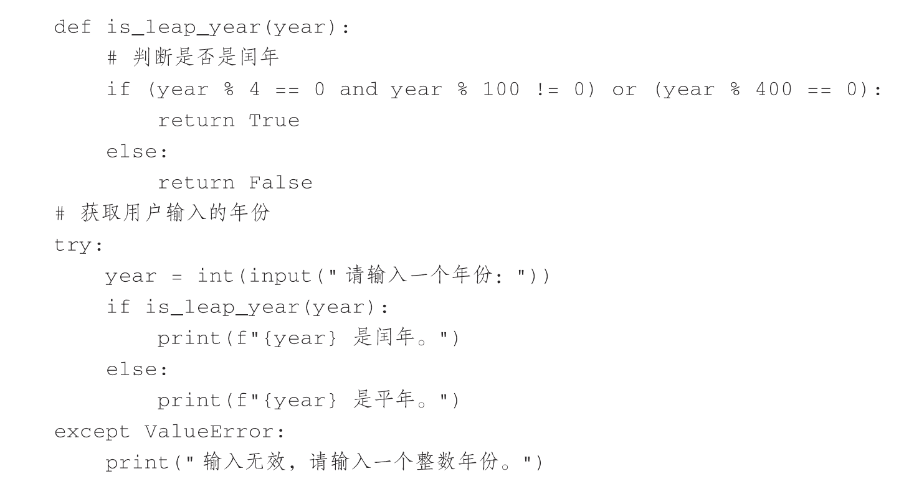

**2. Bug 透视眼——让模型当代码法医**
最怕控制台蹦出不明错误，像在黑屋找隐形猫。遇到“Uncaught TypeError: undef ined is not a function”，粘贴给模型即可定位：
Uncaught TypeError: undef ined is not a function 是 JavaScript 常见错误，表示尝试调用未定义函数。解决步骤：1. 检查函数名拼写和大小写；2. 确认函数是否已正确定义；3. 检查函数作用域；4. 用 typeof 操作符检查变量是否为函数类型。

**3. 代码整形师——给代码做美容**
能跑的代码像会做蛋炒饭，优雅高效的代码才算米其林水平。输入低效冒泡排序代码： 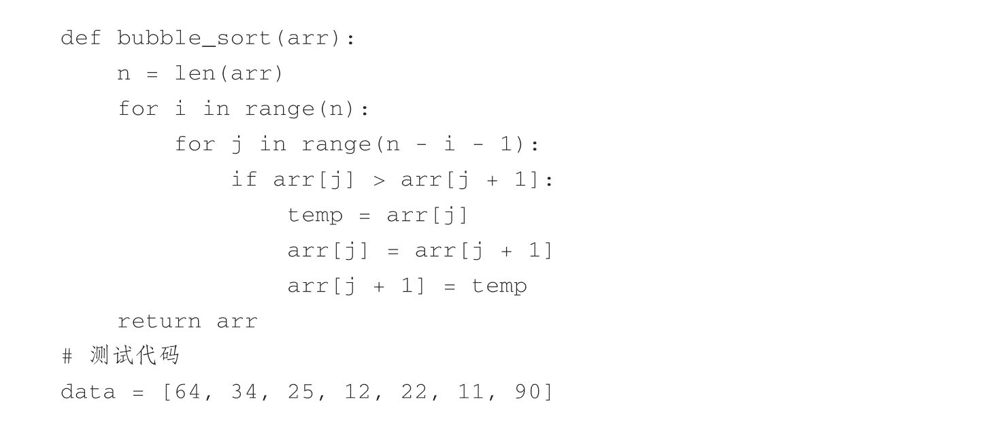
模型会输出更高效优雅版本： 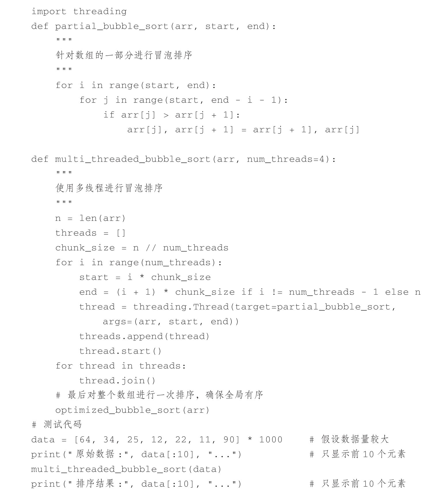

**4. 总结**
新工作模式是人类负责创意，AI 负责翻译成代码。就像建筑师用 CAD 造楼，善用工具的程序员正在重新定义开发效率。下次凌晨三点接到需求，可优雅回复“给 AI 十分钟，还你八小时睡眠”。 

试一试
输入“请用 Python 编写一段代码，绘制出一个爱心形状！”。 

小贴士
遇到报错或需要快速脚本时，直接描述需求，模型会生成可运行代码并智能排错。

# 第八章
DeepSeek 在生活中的使用技巧

## 技巧 72 当好妈妈：如何用 DeepSeek 搞定挑食娃的营养餐？

营养均衡人人都懂，实操起来却像在游乐场按住熊孩子。某家长买了《儿童营养大全》，书上推荐的西蓝花、三文鱼、藜麦饭还没上桌，孩子已跑到三米外。算清 DHA 和钙的摄入量后，家里只剩鸡蛋和半根胡萝卜。

**1. 厨房里的营养学难题**
家长要同时扮演营养师、魔术师和谈判专家，蛋白质、维生素、膳食纤维缺一不可，还要把菜做得像动画魔法料理。孩子今天说绿色食物是外星毒药，明天说圆形食物会带来厄运，这种餐桌攻防战让人深夜对着冰箱发呆。

**2. 智能助手的营养救援**
这时可请 DeepSeek 当 24 小时营养顾问兼创意厨师。它不会只说“每日摄入 300g 蔬菜”，而会建议“奶酪的浓郁味道可以中和西蓝花的苦味，孩子更容易接受”；孩子不吃鱼时建议“把鱼摆成有趣形状吸引注意力”。思路就像给厨房装了食物变形器。

**3. 三招变身营养魔法师**
第一招是“智能替代法”。拍下冰箱里的菠菜和牛奶，输入“现有食材+儿童营养餐”，立刻得到 5 个方案，如把菠菜打成汁和面做菠菜牛奶松饼。
第二招是“趣味改造术”。输入“把胡萝卜变得像薯条”，模型会给出空气炸锅版胡萝卜条攻略，并附切条、调味、蘸酱技巧。
切条技巧：尽量切成均匀细条，受热均匀口感更好。
调味技巧：可加芝士粉、辣椒粉等按孩子口味调整。
蘸酱搭配技巧：番茄酱、酸奶酱、牛油果酱都是不错选择，能增加趣味性。

营养隐身术：让挑食娃无感吃下绿色

第三招可叫做营养隐身术。若家里孩子坚决不碰西蓝花，向大模型询问“隐藏西蓝花的十种做法”，立刻就能拿到从奶酪通心粉到西蓝花意面酱的隐形配方。

**4. 实战案例：挑食终结计划**
四岁男孩天天，一见到绿色食物就上演干呕戏。家长让 DeepSeek 制定“对抗绿色恐惧的营养方案”，给出的思路是先从口感绵软的绿叶菜入手，把蔬菜混进熟悉的口味里，随后变换烹饪手法、搭配孩子偏爱的食材、做创意摆盘，全程保持耐心。两个月后，天天主动要求吃“会施魔法的绿巨人套餐”。

**5. 总结**
为孩子配营养餐有点像拼俄罗斯方块，既要严丝合缝也要灵活变通。食材智能替换、趣味化呈现、营养隐身这三板斧，配合 DeepSeek 的即时建议，挑食的拉锯战才有停火可能。说到底，再难处理的饮食难题，本质上都是创意游戏。

**试一试**
把冰箱里的鸡蛋、西红柿、剩米饭拍下来，在 DeepSeek 输入框写“[5]分钟儿童营养早餐”。

**小贴士**
提问时把孩子的特殊癖好写清楚，例如“讨厌黏糊口感”“只吃圆形造型”。

## **技巧 73 深夜情绪自救：让 DeepSeek 成为 24 小时心理伴侣**

平台数据显示，超六成年轻人每周至少经历三次情绪崩盘，而线下咨询每小时 500 到 1500 元，看到账单又是一次崩溃。

鼓起勇气预约后要过三道坎：提前两周排队、首谈要花 40 分钟讲人生故事，刚进入主题就被提示时间到。更尴尬的是半夜两点失恋想倾诉，咨询师却无法即时响应。

在不伤荷包、不浪费时间的前提下拿到即时疏导和可落地方案，是否需要一个全年在线、秒回且通晓各派心理学的智能伙伴？

以下是 DeepSeek 在情绪支持上的五项能力。

**1. 技能一：精准提问术（把心事翻译成模型能懂的信号）**

示范：别只写“我最近心情不好”，改写成“周三方案被否后连续失眠、食欲下降、对工作产生抗拒，请用认知行为疗法分析”。

进阶公式：具体事件+身体反应+持续时间+期望方向。

避坑提示：少用开放式抒情，大模型更像解谜助手而非树洞。

**2. 技能二：问题拆解大法（像切蛋糕一样拆困扰）**

教学：把“我总在恋爱里受伤”拆成：

❑ 近三次矛盾的具体情境。
❑ 反复出现的负面想法，例如“他一定觉得我很烦”。
❑ 身体反应记录，例如心跳加速、胃部紧缩。

**3. 技能三：游戏化改造术（把拖延变闯关）**

焦虑遇上 DeepSeek，就像游戏开了助力。把模糊的“我好焦虑”变成可操作的闯关任务。

实战案例：输入“我在拖延年终总结，焦虑很重，请设计五个不超过 15 分钟的游戏关卡，完成有奖励提示”。

得到的攻略类似：

关卡 1：头脑风暴
任务：15 分钟内列出今年所有工作，不分类，想到就写。
工具：纸笔或电子文档。
奖励提示：完成后喝一杯喜欢的饮品。

关卡 2：归类整理
任务：把上一步内容分 3 到 5 类，如项目成果、团队协作、个人成长。
时间：15 分钟。
奖励提示：完成后听一首喜欢的歌，放松两分钟。

关卡 3：关键词提炼
任务：为每个分类提炼 3 到 5 个关键词，概括要点。
时间：15 分钟。
奖励提示：完成后吃一块巧克力。

关卡 4：故事串联
任务：用关键词串成 3 到 5 句的小故事。
时间：15 分钟。
奖励提示：完成后起身活动，做三次深呼吸。

关卡 5：初稿速写
任务：依据故事写出 300 到 500 字的年终总结初稿。
时间：15 分钟。
奖励提示：完成后给自己一个大赞，或发条朋友圈。

总结与后续
完成奖励：五关全通后奖励一件期待已久的小礼物。
科学原理：大模型会像游戏设计师一样拆任务，用进度可视化加即时反馈对抗焦虑，像给大脑做了润滑，情绪不容易卡住。

**4. 技能四：情感翻译器（破解亲密关系的信号盲区）**

输入“你是一个情感翻译器，恋人说‘没事’我该怎么回”，可能得到：

“没事”
表面意思：一切都好，无需担心。
潜台词
“我有点难过但不想让你担心。”
“我希望你能主动察觉我的情绪。”
“我不会表达，所以选择沉默。”
情感翻译
他的状态：可能低落或委屈，倾向自己消化。
你的建议：温和追问“真的没事吗？我很在意你的感受”。

**5. 技能五：日常维护指南（打造你的心理健身房）**

❑ 晨间训练：输入“生成今日积极心理暗示三连击”。
❑ 午间急救：发送“当前压力值 78%，需要 5 分钟放松方案”。
❑ 夜间复盘：使用“今日情绪热力图生成”功能。

【特别提示】DeepSeek 心理咨询“三要三不要”：
❑ 要当作 24 小时在线的心理百科。
❑ 要用于具体场景的解决方案。
❑ 要结合专业咨询做重大决策。
❑ 不要用于危机干预。
❑ 不要完全替代真人咨询师。
❑ 不要输入模糊的哲学问题。

**6. 总结**
核心是把 DeepSeek 当成智能心理教练，既能随时做情绪拉伸，也能定制成长计划。记住，大模型解决不了的“人生终极难题”，专业咨询师往往也无解。这时，好好睡一觉，明天太阳照常升起。

**试一试**
输入：（职场焦虑）连续三周加班到凌晨，开始怀疑人生，用朋友的口吻给我些建议。

观察 DeepSeek 如何在共情与理性间平衡，输出有温度又有方法论的回答。

**小贴士**
1）遇到套路化回复，追加“如果你是我最好的朋友，会怎么说？”
2）保存有效对话模板，建立自己的心理急救话术库。
3）出现严重心理问题时，务必寻求专业帮助，DeepSeek 不能替代医生。

## **技巧 74 选房助手：把大海捞针变成精准狙击**

房价高企、房源信息爆炸，想找一套心仪房子堪比夜市里找一根掉落的绣花针。中介推荐自带滤镜，自己筛又容易被算法带偏——不是精装修卖家秀，就是“地铁 800 米”文字游戏。户型图、容积率、学区政策等专业名词，外行只能凭感觉，最后签约才发现踩坑。

**1. 选房的“信息沼泽”**
要在十个平台翻五百套房源，对比三十个参数，还要判断“近地铁”是五分钟步行还是得骑共享单车。问中介“小区物业如何”，答案永远是“绝对没问题”，而业主论坛却在吐槽“电梯三天两头坏”。信息不对称让买房像开盲盒。

这时需要一个懂数据又能匹配需求的智能侦察兵。DeepSeek 的语义搜索和多轮对话，就像给信息洪流装了滤网。它能理解自然语言，比如输入“预算 400 万、朝南、有学区、物业口碑好”，会自动抓取全网房源、业主评价和周边配套，生成一份干货分析报告。

**2. 三步驯服选房“信息龙卷风”**
（1）精准投喂需求，拒绝“猜心游戏”
别用“帮我找套好房子”这种模糊指令。试试万能公式：
“我要找北京朝阳区 90 到 120 平米的三居，总价不超过 450 万，优先 15 年内的次新房，最好带朝阳实验小学学区，但担心停车位紧张，请对比近半年成交价并分析性价比。”
DeepSeek 会像资深顾问一样自动筛掉不符合条件的房源，并整理历史价、车位配比、房龄、学区、停车情况等关键信息，甚至给出性价比评分。

（2）让 DeepSeek 当“避坑指南”
看到专业报表头疼？直接说“用大白话解释”。例如问：“用大白话解释小区容积率 2.5 是什么意思？”它会回答：“容积率低比如 1.5，房子少空地多，住着宽敞。容积率高比如 2.5，房子多、楼可能高或楼间距小，人多会显得挤。”
还能模拟看房：“假设我是第一次买房的新手，请列出验房的 10 个细节，用大白话说明。”

（3）多轮对话炼成“黄金组合”
第一轮筛出五套备选后，别急着定。用追问深挖隐藏信息，如输入“请用表格对比这五套房的物业费、车位租金、近三年涨幅，并生成可视化对比”，或“模拟未来五年，利率上涨 1%、学区政策调整，哪套抗风险最强？请结合政策文件和历史数据推演”。

**3. 总结**
DeepSeek 的选房魔法本质是需求翻译加数据挖掘加风险预判三合一。通过清晰指令和多轮校准，普通人也能拥有地产分析师级别的决策支持。

**试一试**
输入：“我在北京朝阳区上班，想买首套房，预算 500 万，通勤一小时内可接受，希望小区有健身房和儿童游乐区，请推荐 5 个符合条件的小区，并用表情包风格说明优缺点。”

**小贴士**
1）查学区政策时加上“截至 20××年×月最新”，避免信息过时。
2）对比房源时要求“用买菜砍价的逻辑分析价格水分”。
3）遇到专业报告，试试“用给学生讲解的方式总结核心结论”。

## **技巧 75 选车攻略：让 DeepSeek 成为购车军师**

**1. 普通人买车的烦恼**
新能源销量占比攀升，充电桩遍地都是。但真正掏钱时问题才暴露——续航虚标、充电适配、电池寿命、智能系统卡顿，像超市巧克力，包装好看，咬开才知有没有坚果。

官网参数抽象难懂，如“CLTC 续航 605km”“800V 高压平台”“SiC 模块”。销售话术“绝对够用”“行业领先”万能通用，试驾半小时试不出门道。论坛里“续航打五折”和“跑出表显里程”同时存在，让人怀疑是不是同一辆车。

不是工程师，也没三个月时间研究，怎么抓住重点、识破话术、把参数翻译成真实场景？最关键的是如何最快找到适合自己的车？

**2. 核心方法论：用“场景翻译法”精准提问**
别直接问“某车怎么样”，要描述使用场景。

❑ 通勤族可问：“每天往返 60 公里，周末偶尔郊游，冬季零下 10 度，实际续航能有多少？”
❑ 充电焦虑者可问：“小区不能装桩，附近只有国网快充，充电兼容性如何？”
❑ 长途爱好者要问：“连续开 4 小时，智能驾驶会频繁退出吗？”

（1）实战技巧：参数翻译“三板斧”
1）续航破解术。
输入：“CLTC 续航 605km 实际能开多少公里？”
输出：CLTC 续航 605km 实际驾驶大约 420 到 480km，具体取决于路况和驾驶习惯。
2）充电速度大白话。
输入：“800V 高压平台加 250kW 充电功率，充到 80%要多久？”
输出：在 800V 高压和 250kW 功率下，充到 80%大约需 21 分钟，具体时间会因电池状态和温度略有差异。
3）电池寿命精算。
输入：“磷酸铁锂电池循环 3000 次，家用每年充 150 次，能用多久？”
输出：3000÷150=20 年，但实际年限会因维护和使用环境有所不同。

（2）实战技巧：需求排序模板
用此模板提问：
“30 岁三口之家，预算 20 万到 25 万，主要需求：
1）后排装安全座椅后还能坐两个成年人。
2）每年两次单程 500 公里的长途。
3）希望用车成本低，推荐 5 款新能源车，并说明理由和潜在缺点”。

（3）实战技巧：避坑指南生成
输入：“买新能源车最容易后悔的 5 个点”。
DeepSeek 会给出类似建议。
购买新能源车时，以下 5 个方面最容易后悔。
1. 续航里程不足
问题：实际续航常低于官方宣传，尤其高速或低温。
建议：选续航更高的车型，并结合实际使用环境。
2. 充电设施不便
问题：充电桩分布不均，需排队，充电慢。
建议：提前了解居住和工作地点的充电情况，考虑装家用桩。
3. 保值率低
问题：新能源车贬值快，二手市场接受度低。
建议：选知名品牌和口碑好的车型，关注保值率。
4. 维修保养成本高
问题：电池更换贵，维修网点少，配件等待长。
建议：选售后网络完善的品牌，了解电池保修政策。
5. 技术更新快
问题：技术迭代快，新车很快过时。
建议：关注行业动态，选技术成熟、更新周期长的车型。
结论
买新能源车前，务必全面考虑续航、充电、保值率、维修保养和技术更新，避免后悔。

**3. 总结**
选车关键不是找最完美的，而是找最合适的。通过 DeepSeek 的场景化提问，能把冰冷参数翻译成生活场景，把营销话术变成真实体验。记住，好车是“问”出来的——问对问题，才能得到对的答案。

**试一试**
输入“我住在东北，每天通勤 50 公里，小区没有固定车位，推荐 3 款 25 万元以内的新能源车，用大白话说明优缺点。”

**小贴士**
遇到专业术语，在问题后加“用大白话解释”。

## **技巧 76 家务游戏化：借助 DeepSeek 让清理像消消乐**

下班推开门，看到水槽堆碗、地上散落玩具、床单待洗，总有一种家务做不完的绝望。更气人的是，刚擦完桌子准备坐下，猫又把猫砂刨得满地——这种动态刷新的支线任务，能让任何时间管理技巧瞬间失效。

**1. 传统方法的“翻车现场”**
试过按清单逐项做，结果洗完衣服才想起没约维修师傅；也用过四象限法则，但“紧急且重要”标签贴满屋，最后连喝水都要纠结。最扎心的是，好不容易打扫完厨房，家人突然说“晚上有朋友来聚餐”——所有努力当场归零。

**2. 问题到底出在哪**
家务不是静态清单，而是一场随时刷新的游戏：任务会动态新增、条件会突变、资源要调配。这时需要的不是计划表，而是一个能实时算出最优路径的家务导航仪。

**3. 让 DeepSeek 当你的家务指挥官**
（1）动态优先级算法
把“维修师傅 17 点下班、蔬菜保鲜期剩 2 小时、擦窗不限时间”这些时间变量告诉 DeepSeek，它会像急诊分诊一样算出“现在不做就来不及”的任务。例如它会建议：“为了高效完成家务，我制定以下行动计划。
1）立刻开始做饭，确保蔬菜在保鲜期内用完。
2）做饭时联系维修师傅，安排时间，确保 17 点前联系好。
3）做完饭后按师傅安排决定是否当天维修。
4）最后擦窗户，利用剩余时间完成清洁。
合理安排时间和优先级，能确保家务按时完成并应对突发情况。”

类比场景：就像快递员规划派送路线，既要考虑客户在家时间，又要算包裹保质期。

（2）任务聚类功能
输入“需要梯子的任务、只能在阳台完成的工作”，DeepSeek 会自动打包同类项。例如建议：“重新规划擦窗任务，优先清洁阳台窗户，确保安全使用梯子。若室内窗户需梯子，可考虑其他清洁方式或暂缓。”
生活实例：像去超市前把冷藏、日用、宠物区商品分类，减少来回折腾。

（3）突发事件缓冲带
临时增加“接待客人”任务时，DeepSeek 不会让你通宵打扫，而是重新计算。
❑ 做饭：预计 1 小时。
❑ 联系维修师傅：预计 15 到 30 分钟。
❑ 准备接待客人：预计 1 小时。
❑ 擦窗户：预计 1 到 2 小时，具体看阳台窗户数量。
生动比喻：这就像消消乐，新掉落的形状不一定要严丝合缝，可以旋转调整融入现有布局。

**4. 为什么这套方法更聪明**
传统工具像刚性课表，DeepSeek 能按难度动态调整。
❑ 识别你的“家务战斗力”（体力、可用时间）。
❑ 扫描环境变量（天气、家人动向）。
❑ 寻找最优组合（晴天擦窗、大扫除避开孩子网课）。
有用户测试发现，用 DeepSeek 规划周末家务竟多出 2 小时午睡，因为它发现周日有雨，果断把晒被子提前到周六下午。

**5. 总结**
别再和脏衣服灰尘玩打地鼠了。通过动态排序、智能打包、弹性调整这三板斧，DeepSeek 能把杂乱家务变成可计算的策略游戏。下次遇到突发状况，记住你不是在“做家务”，而是在指挥一场资源优化战役——DeepSeek 就是你的实时作战参谋。

**试一试**

在 DeepSeek 对话框里直接这样提问：“今晚 18 点到 20 点有空，需要洗衣服、做饭、检查孩子作业、清理浴室，洗衣机维修工随时可能上门。按紧急程度和耗时重新安排一下，记得留出机动时间。” 

**小贴士**
1）给事项贴标签效率更高，比如 #需联网操作 #安静时段可进行。
2）提前设定“退路”，例如“若玻璃清洁超过 30 分钟仍未完成，自动改为只处理内侧”。
3）每周日让 DeepSeek 产出一次“家务热力图”，定位那些总是被推迟的盲区。

**技巧 77 让 DeepSeek 帮你挑到物超所值的咖啡**

1. 为什么选咖啡总让人迷糊
生活节奏加快，咖啡成了不少人的提神标配。市面上从即溶到现磨，从平价连锁到高端豆行，价格跨度很大，品质也参差不齐。很多人会想，这家为何贵这么多？便宜的会不会只是噱头？正需要一个能快速梳理市场信息的咖啡向导。DeepSeek 就可以承担这个角色，依据实时数据给出个性化清单，告诉你哪些品牌或门店在口感和价格上更均衡。

2. 具体怎么问
1）先厘清自己要什么，是即溶还是手冲，是日常口粮还是偶尔犒劳。
2）提问尽量具体，“请列出 100 元以内性价比最好的咖啡豆品牌”比泛泛询问更有效，“推荐附近几家价格合理评价好的咖啡店”也更直接。
3）DeepSeek 会整理价格区间、品质评分、用户反馈等要点供你参考。
4）结合报告结果锁定几款候选，再按个人口味做最后决定。

3. 小结
借助 DeepSeek，选咖啡不再靠运气。它能帮你筛掉噪音，直指高性价比选项，无论是买豆还是挑店，都能少踩坑、少花冤枉钱。 

**试一试**
1）在输入框里写“推荐 3 个 100 元以内、品质不错的咖啡豆品牌”。
2）按建议购买一包实际体验。
3）体验不理想就回头调整提问条件，再让它优化推荐。 

**小贴士**
1）口味不确定时先买小包装或试饮装再做决定。
2）高价不等于好喝，性价比往往体验更好。
3）留意咖啡促销季，能显著降低试错成本。

**技巧 78 让 DeepSeek 成为你的数字造型师**

据说上班族每天平均花 12 分钟打扮，一年累积下来近 73 小时。可惜即便花心思搭配，格子衫加牛仔裤加双肩包照样被误认是来维修的；同学会时老西装配花衬衫也显得违和。穿搭本该靠直觉，却常出错位。

关键是有个懂身形又懂时尚的 AI 助手。输入身高体重肩宽等数据，DeepSeek 会像老裁缝一样推断：“肩宽 44 厘米配身高 158 厘米，可能是倒三角或矩形体型，上身偏宽，建议用穿搭平衡比例。”问“雾霾蓝毛衣配什么裤子”，它能给出八套思路，并说明“想更张扬可选亮色小面积下装，形成撞色更吸睛”。

场景化建议更实用，像穿搭版导航。输入“周二见投资人”“周末美术馆约会”“回老家参加婚礼”，即可拿到从单品到配饰的完整方案。衣橱改造功能也很方便，拍一张衣柜照片，它能把被遗忘的条纹衫和阔腿裤重新组合成当季风格。

它还有两个强项：肤色配色卡，避免踩雷；基础单品循环利用，教你用一件白 T 演绎不同风格，相当于衣橱里的装备合成。 

**试一试**
在 DeepSeek 输入：“身高 178cm 体重 65kg 梨形身材，下周述职汇报，手头有藏青西装套装、米色针织衫、黑色乐福鞋，求搭配建议”。 

**小贴士**
整理衣橱拍照时把常穿单品放在显眼处；提问时补充场合和天气，得到的方案会更精准。

**技巧 79 让 DeepSeek 担任 24 小时旅行管家**

出发前查十几个攻略站，看几十篇游记，最后信息互相打架，是很多人旅游前的常态。想看海却订了山景，想避开人流却排了三小时网红店，漏看天气被困台风天……这些都能避免。

1. 别让攻略绑架假期
面对上百种选择却只能选几样，和小孩面对糖果柜一样容易瘫痪。要兼顾预算、时间、体力，还要防闭馆、倒闭、恶劣天气。DeepSeek 不会堆砌链接，而是把碎片信息合成一份可执行的行程。例如输入“北京三天两夜吃货游，人均预算 500 元，不想排队”，它能整合老字号、错峰攻略，甚至规划出从糖葫芦到烤鸭的步行路线。

2. 三个驯服行程的方法
第一招剥洋葱提问，别只问“巴黎怎么玩”，要细化“首访巴黎住市区还是郊区”“周一开放的小众美术馆有哪些”“去治安一般区域应避开哪些地铁站”。
第二招需求拼图，把矛盾需求一起丢进去：“带父母和 7 岁孩子去上海，要文化也想要亲子项目，每天步行不超过 6000 步”，它会组合出科技馆亲子讲解、博物馆午休、东方明珠无障碍游船等。
第三招应急预案，出发前问“如果迪士尼下雨备选去哪”“当地罢工去机场怎么走”，相当于给行程买保险。

3. 注意 AI 的美丽误会
AI 偶尔会推荐未开发区域。建议加验证指令，比如要求提供三家餐厅官网链接，像出国前核对护照一样，多花几分钟避免麻烦。

4. 小结：你的私人旅行参谋上线
DeepSeek 可同时扮演美食侦探、路线规划师、预算管家、文化讲解员。你提问越具体，它回馈越精准，配合得越好方案越惊喜。 

**试一试**
输入“从南宁出发周末去柳州，高铁往返，要历史建筑和柳江夜景，爱吃辣，提供三条可验证的真实餐厅链接”。 

**小贴士**
1）可加指令“推荐 5 个适合拍照发朋友圈的景点”。
2）复杂需求拆开问，先上午后下午再优化。
3）最后要求“用表格展示每天时间、地点、预算”。

**技巧 80 让 DeepSeek 成为随身健身教练**

很多人卡在想练和偷懒之间。年卡只用来洗澡，健身 App 躺在手机里，收藏的教程永远停在第一步。更尴尬的是连深蹲膝盖方向都不清楚，练完第二天走路像刚学走路。

1. 健身的现实困境
热情不够方法不行。照着网红视频练腰酸背痛才发现示范者是体操出身，照抄大肌霸的重量第二天筷子都拿不稳。饮食更是玄学，鸡胸肉西蓝花吃三天谁都受不了。

输入“减脂但每天只有 20 分钟”，DeepSeek 会给出可执行的微计划：“热身 2 分钟原地跑，HIIT 15 分钟波比跳 30 秒慢走 30 秒循环 10 组，拉伸 3 分钟。”不用预约也不会推销课程。

2. 小白防坑要点
术语不懂就直接问“用小学生能懂的话解释 RM 值”。饮食要落地，说“给出能在菜市场 App 下单的食谱”，它就会推荐鸡胸肉沙拉、豆腐蔬菜汤这类普通人能买到的食材。

3. 心理按摩也很重要
说“今天不想练”，它不会只灌鸡汤，而是提醒休息也有价值。连续打卡会收到鼓励：“坚持三天你已超过很多人”“每一次努力都在为更好的自己铺路”。

4. 小结：智能朋克式健身
DeepSeek 集成教练、营养师、康复师角色，不看你办了几张卡，只看你是否比昨天多做一个俯卧撑。专业指导触手可及，惰性才有对冲手段。 

**试一试**
输入“我身高 176cm 体重 63kg，想在五个月内健康减脂，每天可运动 30 分钟，久坐办公，不要求节食，给出月计划和周计划”。 

**小贴士**
1）记录动作时穿紧身运动服，画面更清晰。
2）饮食方案后加“附热量换算表”，控制更轻松。
3）遇到专业词追加“举个生活例子”。
4）生理期计划备注“避开核心发力动作”。

**技巧 81 让 DeepSeek 帮你找到命中注定的书**

书单比超市零食还多，从时间管理到量子物理，挑到合眼缘的一本却很难。读两页发现是鸡汤或术语堆砌，挫败感很强。

1. 核心问题是需求没表达对
像对餐厅喊“我要好吃的”，结果端上来辣椒炒月饼。要把“时间管理”细化成“适合职场新人的实操技巧”，把“心理学经典”细化成“能缓解焦虑的通俗读物”。

2. 三个驯服信息流的方法
定位需求：不说“推荐科幻小说”，改说“近五年获奖硬科幻，无爱情线，主角是科学家”。
排除雷区：直接写“给高中生看的哲学入门，不要学术专著，避开康德黑格尔”。
动态调整：如果不合适就反馈“太理论了，要案例”“想要 300 页以内的”。AI 会像咖啡机一样调苦浓。

3. 为何有效
带场景的提问匹配度更高。测试显示，具体场景能提升 63% 匹配率。“地铁上可读的短篇悬疑”比“悬疑小说推荐”精准得多。

4. 小结：找书不是盲盒
明确需求、设边界、及时反馈，能让 DeepSeek 从书单生成器进化为私人阅读顾问。你提供方向盘，它负责避开烂书。 

**试一试**
输入“为互联网从业者推荐商业思维书，不要教科书，要故事型，风格类似《钢铁是怎样炼成的》”。 

**小贴士**
1）多用类比：“找一本像《悲惨世界》但背景在未来的书”。
2）善用否定词“不要”“避开”“排除”。
3）参考影视：“类似《黑镜》风格的科技伦理书”。

**技巧 82 让 DeepSeek 化身节日祝福大师**

过年过节发祝福像写考卷。网上模板千篇一律，自己写又尴尬，群发感严重。

1. 模板祝福的方便面困境
领导收到“月圆人圆事事圆”，群里八个人同款，回复都敷衍。不同关系的人还要区分，二姨和初恋不能同款。

2. 三招榨出有灵魂的祝福
关键词触发：输入“幽默 程序员 30 岁生日 带中年危机梗 简短”，会得到“恭喜解锁而立成就，发际线后移代码依旧飘逸，愿 Bug 减少头发增多快乐翻倍”。
场景化描述：说“朋友是马拉松跑者新娘是图书管理员图书馆相识，写段结婚祝福”，能得到图书馆与赛道结合的定制文案。
角色代入：加身份标签“作为小学生给班主任写教师节祝福”，语气更贴心。

3. 为何总差口气
“大气有格调的新年祝福”得到的多是陈词。改成“给经常加班的设计师闺蜜写新年祝福，要吐槽改稿又暖心”，就能产出“新年愿望甲方一次过稿，比中彩票还难但祝你少改稿多赚钱”之类有血有肉的内容。

4. 小结：祝福也要私人定制

当模板祝福满屏刷屏时，一句专属的暖语就像手工巧克力，甜味相近却吃得出用心程度。把关键词激活、情境描绘、身份代入这三点处理好，基本就掌握了让 AI 写祝福更走心的底层方法。下次別把写好的句子只存着吃灰，不妨让 DeepSeek 把千篇一律的话术熬成有温度的小段落。 

**试一试**

示例提问：请为沉迷打游戏的男友写一段情人节问候，需要出现貂蝉皮肤和外卖梗，语气要带点撒娇。看看 AI 会产出怎样的惊喜。 

**小贴士**

1）别用高端、有文化、有创意这种空洞形容词，换成吐槽风、谐音梗、电影台词这类可感知的风格标签。
2）写给长辈时，别只说身体健康，加入更具体的养护提示，例如提醒少跳广场舞多休息，更有温度。
3）给商务伙伴写祝福，带点行业黑话会更走心。对餐饮老板提翻台率，比泛泛说财源广进更有诚意。

## **技巧 83 让 DeepSeek 担任花语翻译官**

**1. 看似选花，实则是踩坑**

情人节偏爱玫瑰，母亲节离不开康乃馨，开业祝贺常选红掌配满天星。可真到下单，很多人盯着花价表发懵：粉玫瑰和香槟玫瑰差别在哪，向日葵是不是只适合老师。选不对轻则尴尬重则伤感情。曾有人情人节送出黄玫瑰，当场被告知那象征友情结束。

这种感觉就像开了导航还是会迷路，攻略不少关键时刻总掉链子。花店热情推荐厄瓜多尔进口玫瑰配蓝色妖姬时，很难判断是真心意还是智商税。数据显示，三成多收花者收到过不合心意的花束，超过一半送花者承认主要靠价格挑选。

**2. 把它当成数字化花艺顾问**

这时可以请 DeepSeek 出手。提问得当就能把专业的花语术语转成通俗建议。例如询问：想送一位刚入职的女生生日花，预算三百元，偏好清新感，有什么组合推荐。它会给出具体搭配，如白玫瑰三四枝、绿洋桔梗三四枝、白郁金香两三枝配适量尤加利叶，并附包装建议，比柜台导购更细致。

可以进一步多轮打磨。拿到初稿后追问：这组花在办公室好养吗，能不能换更特别的花材。它会从养护难度到寓意逐层拆解。有案例显示，经过五轮沟通，原本的红礼盒被换成雾面灰纸包裹的莫兰迪色系，成功避开俗套表白雷区。

更高级的是融合个人数据。某程序员求婚前，把女友在小红书的收藏截图发给模型分析审美，再对比本地三家花店价格与评价，最后得到一套含11朵卡布奇诺玫瑰、喷泉草与复古包装纸的定制方案。未婚妻见到直呼，这正是自己梦里见过的捧花。

**3. 总结：送花是技术活，不必考园艺证**

善用花语解读、情境匹配与方案迭代，分不清玫瑰和月季的人也能送出让同事称赞的满分花束。鲜花是把心意变成实物，DeepSeek 负责让包裹送到正确的人手里。 

**试一试**

示例提问：想为暗恋的女生准备告白花，她喜欢 JK 制服和动漫，预算两百元，请给出三套搭配并说明花语含义。 

**小贴士**

1）描述要越具体越准，写明对方是插画师比笼统说文艺青年更能锁定风格。
2）在提示里加上避开雷区的要求，模型会自动筛掉黄玫瑰等敏感花材。
3）可以让它用表格形式呈现不同方案，便于一眼看清优劣。

# **第九章**

# **DeepSeek 在学习、成长与求职中的使用技巧**

## **技巧 84 用 DeepSeek 做思维体检，找逻辑盲区**

梳理问题时思路打结，明明很努力却理不清，决策时自认周全结果却不理想，多半是系统思维里藏着逻辑漏洞。它就是你的思维纠偏利器，帮你揪出隐形漏洞，突破认知天花板。

**1. 逻辑滤网：筛掉推理里的杂质**

推理时容易带入主观偏差。比如看到新来的几个年轻人业绩不理想，就下结论说年轻人普遍能力不足，这就是以偏概全。逻辑筛查功能会指出，少数样本无法代表整体，建议收集不同年龄段的业绩数据再分析。就像筛子把偏见和草率判断滤掉，使推理更严谨。

**2. 假设剖析仪：检查前提是否站得住脚**

很多思考建立在 shaky 的前提上。比如计划推新品时默认市场需求会一直增长，进而制定生产营销方案，但这个前提缺乏支撑。假设检验会提醒，市场需求受经济、技术、竞争等多重因素影响，建议查行业报告、追踪趋势来验证前提是否成立。

**3. 论证放大镜：让观点的支撑更扎实**

观点需要扎实的支撑。有人认为公司应加大培训力度，理由是隔壁公司培训后效益提升，单一案例说服力弱。论证放大功能会提示不足，建议搜集多家企业的培训成效，分析本企业员工的技能短板，以及培训如何针对性解决。

**4. 因果辨析器：理清因果关系**

生活中常把相关当成因果。比如近期销售额下滑，员工士气也不高，就认定士气导致业绩。实际上业绩可能受竞争加剧、产品质量、营销策略等多因素影响，士气只是相关项之一。因果辨析功能会引导多找数据，找准真正驱动结果的原因。

**5. 总结**

用好这些工具，就像请了一位思维教练，帮助发现并修正隐形漏洞，让思考更清晰决策更稳健。 

**试一试**

示例：让模型帮你复盘工作中某个失误案例，拆解思考中的逻辑缺陷并给出改进方向。 

**小贴士**

思维纠偏三类思路

1）推理清理法：在下结论前请模型审视推理链条，剔除偏见与草率判断。比如基于少数案例就做普遍化推断，让它评估样本是否足够。
2）假设检验法：提出关键假设后，让模型评估其合理性。制定计划时对核心前提做深度审视，结合模型建议验证。
3）因果厘清法：面对复杂因果时借助模型还原真实脉络，避免把相关误认为因果。

## **技巧 85 用 DeepSeek 打造个人化学习路线**

在数字化转型下，核心竞争力从经验积累转向快速学习。让它成为你的24小时在线职业教练，通过算法与行业大数据融合，为你搭建动态成长体系，实现从大水漫灌到精准滴灌的能力提升。

**1. 精准定位能力缺口**

提交简历、工作资料和目标岗位后，模型能自动生成能力画像。比如识别出数据分析工具使用不足、行业政策敏感度偏低等短板，并与行业优秀人才模型对照，产出带优先级的提升清单。再输入企业内部晋升资料，还能把抽象的领导力拆解为冲突处理、资源协调等具体任务。

**2. 获取学习资源指南**

作为信息整合助手，它能快速汇集课程、书籍、论文和行业报告。输入目标或关键词，就能推荐学习路径、推送行业新动态并筛选优质免费资源。无论编程、数据分析还是项目管理，都能定制方案。

**3. 持续改进学习效果**

它还能帮助建立学习效果评估体系，通过目标完成度、课程进度与实践成果分析，生成个性化报告量化技能提升。结合岗位需求给出针对性建议，并支持定期追踪，用图表呈现进步趋势，保证学习始终高效。

**4. 总结**

将零散学习转化为结构化成长，这套个性化路线正在重塑职场进阶方式。它不仅是知识管家，更是职业发展的第二大脑，帮助从被动跟随转向主动进化。 

**试一试**

示例：请模型为你量身定制一份基于当前工作需求的学习提升计划。 

**小贴士**

1）起步阶段重视信息质量：初期尽可能详细提供简历和工作资料，明确岗位目标。信息越精准，能力画像越准确，提升建议越贴合。
2）善用学习实践反馈闭环：认真对待每次实践任务和反馈，保持迭代。
3）保持持续互动：定期对照能力画像和计划反思成果，按需调整。

## **技巧 86 用 DeepSeek 解析考题逻辑**

备考焦虑、资料堆积却找不到重点、盲目刷题身心俱疲？让它成为你的秘密武器，反推历年真题背后的出题逻辑，抢占先机。

**1. 把它当作考试规律挖掘机：剖析考点分布规律**

历年真题如同知识森林，考点藏在其中。模型能统计知识点在各年份的出现频次与分值占比。比如发现经济模型应用在过去五年出现四次且分值逐年上升，就可判定为重点，需要优先深耕。

**2. 把它当作考试难度预测师：判断题目难易梯度**

试卷难度分布有规律可循。模型通过研究往年题目，能识别基础题、中等题、难题的比例与出题方式。了解大致分布后，可先确保基础分，再合理分配时间攻坚难题。

**3. 把它当作考试出题风格捕捉器：适应不同出题模式**

不同命题人风格不同。模型能分析案例偏好，是社会热点、历史故事还是企业案例，以及提问更侧重理解运用还是记忆细节。例如法律考试常以真实纠纷案例检验法条运用能力，复习时可针对性加强案例分析。

**4. 把它当作命题趋势洞察眼：紧跟知识更新方向**

知识更新会推动命题变化。模型结合学术热点、行业动态与社会需求，能提示未来可能的考点方向。例如信息技术类考试中，人工智能与大数据可能成为新增板块，提前布局更有优势。

**5. 总结**

它是备考路上的助手，帮助挖掘考点分布、预估难度、捕捉风格、洞察趋势，让复习更有针对性。 

**试一试**

示例：选定一项职业考试，反推该学科历年真题的出题逻辑。 

**小贴士**

巧用三招

1）聚焦高频考点：将历年真题交给模型，锁定高频点重点突破。
2）预估难度分布：参考模型对难度的分析制定答题顺序，先易后难最大化得分。
3）跟踪命题趋势：关注模型提示的趋势，及时更新知识体系。

## **技巧 87 给计划装上自我纠偏系统**

当代职场常见误区：下周能下班早、同事懂需求、计划能顺利执行。尤其是最后一点，很多方案启动时热闹，最后在季度总结里变成已完成80%的幽灵项目。

**1. 当计划总在周五流产**

某行政主管为团队定下读书计划，期待三个月后人人变精英。现实是第一周忘买书，第二周看错章节，第三周分享会变吐槽会。开头雄心壮志，中期集体懈怠，结尾假装完成，这种剧本每天都在上演。

根源是多数计划只有出发指令，没有导航。就像只告诉新手司机目的地却不给导航，起初还能高速行驶，很快就迷路。给计划装上行车记录仪，用 PDCA 循环做监控，让每个计划自带纠偏能力。

**2. 外挂级计划监控三类手段**

（1）把 PDCA 写入提示词
不要让模型只当复读机，要让它变监理。
❑ 错误示范：“制定部门读书计划。”
❑ 正确做法：“创建六周专业图书共读方案，包含每周进度追踪表、理解度自测题、每两周反馈优化节点。”

操作要点：
❑ 计划阶段植入监控因子：“在营销书单中加入每周案例匹配度分析。”
❑ 执行阶段设置检查点：“完成率低于60%时自动触发备选书单。”
❑ 给模型装进度警报：“每周五17:00生成可视化图表，高亮延迟任务。”

（2）关键指标仪表盘
让数据自己说话。
❑ 基础版监控：“统计读书打卡率。”
❑ 进阶版监控：“追踪章节重点转化率，把书中方法论拆解成三个可落地业务动作。”

埋点技巧：
❑ 过程指标：页眉批注密度、案例改写完整度。
❑ 效果指标：周会发言引用次数、方案迭代相关性。
❑ 预警指标：连续三天无批注自动触发“书友救援”。

（3）让复盘自己进行
告别形式主义。
❑ 传统复盘：“大家说说读后感。”
❑ 智能复盘：“对比六周数据，找出理解度提升但应用度停滞的症结，生成三条实战训练方案。”

让它当记录员，自动生成计划与执行对照表，如“列出预期与实际反差TOP3”；制造良性压力，如“把某个人的思维导图匿名发给同事学习”；让改进方案自带甘特图，如“下阶段每日安排十五分钟知识反刍时段”。

**3. 效果对比**

❑ 传统模式：六周读书计划≈第一周全勤→第三周缺勤→第六周编读后感。
❑ 智能监控模式：
第一周：智能书单匹配个人短板。
第三周：自动触发“案例实操工作坊”。
第六周：生成个人知识迁移图谱。

原本需要八小时开会加五小时做PPT加三小时催进度。

❑ 搭建监控规则大约花一个小时，翻阅预警简报半小时就够了，剩下的空档差不多是喝两杯咖啡的时间，就能进入深度工作状态。

**4. 总结**

真正做得好的管理者会把自己从一线执行拉到幕后编排。引入 AI 做监控不是去当监工，而是给团队装上自动驾驶——方向能自动纠偏，又不妨碍资深成员施展手艺。 

**试一试**

现在让 DeepSeek 写一份“新媒体运营提升方案，里头要包含每周爆款拆解指标、标题 A/B 对照表、流量下滑的自动复盘机制”，看回来的内容会不会让运营编辑觉得压力山大。 

**小贴士**

报警后的处理思路：

1）回溯数据断点：“调出小王最近三次批注的时间线。”
2）启动备选方案：“完成率连续下滑时，自动切到有声书模式。”
3）制造激励感：“对进度靠前的成员解锁‘老板请咖啡’彩蛋。”

## **技巧 88 职业避险手册：用 DeepSeek 躲开失业雷区**

当下职场像雾天开高速，前方是三十五岁收费站，后面跟的是自动化替代的追兵，路上还不断弹出跨界转型、副业刚需的分岔。某招聘平台数据显示，八成七的职场人有职业迷茫，平均每天要消化二十三条职业相关信息。打开求职网站，垂直领域深耕、T 型人才矩阵之类的术语迎面而来，让已经超载的大脑更沉。

**1. 职业规划的三大障碍**

想象自助餐厅前摆着两百道菜，每一道都贴着分子料理、低温慢煮之类的标签，这就是当下的真实困境：知道要规划，却不知从何下手。互联网公司产品经理小莫很典型，想转做 AI 产品，却对技术中台、大模型微调等词汇望而却步；想评估晋升可能，又被各种测评的雷达图绕晕；好不容易有了计划，几个月后行业风向一变，表就作废了。

**2. 让 DeepSeek 成为职业拆弹专家**

可以试试 DeepSeek 的职业规划三板斧：目标拆解、信息整合、动态调整。

（1）目标模糊？试试目标拆解术
把职业理想拆成可操作步骤。比如想三年内成为 AI 产品专家，可以让 DeepSeek“把成长路径切成六个半年计划”，得到的清单像游戏任务：“第 0–6 个月，建立 AI 技术认知和产品管理基础；第 7–12 个月，参与 AI 产品化实战；第 13–18 个月，学习设计某 AI 功能的商业化方案……每个阶段都有学习目标、重点、行动和交付物。”

（2）信息过载？试试信息整合术
面对海量行业报告和岗位描述，可以这样问：“用小朋友能听懂的话，解释 AIGC 对内容运营岗位的影响。” DeepSeek 会把碎片拼成完整图景：“AIGC 就像是会魔法的机器人，会变出很多画和故事，能帮大家改错字，还能想出上百个点子。用 AIGC 可以处理简单重复的事，但内容运营要负责创意、检查和加感情。”这种整合很适合快速了解新领域，避免在术语迷宫里打转。

（3）动态调整的职业橡皮筋
“如果短视频行业遇冷，我现在学的编导技能能往哪些方向迁移？” DeepSeek 会给出技能树分叉：“传统影视与广告制作、新媒体与跨平台内容运营、教育与培训行业、文化创意与 IP 孵化……”并提醒补充 AI 辅助创作、Python 编程等技术能力。这种调整像给职业之路装上弹簧，既保持方向又能缓冲冲击。

以教培转行者为例，用三明治提问法破局。先喂背景：“我有八年雅思教学经验，现在想转行。”再提需求：“帮我找五个能用上教学技能的朝阳行业。”最后加限制：“排除需要重新考证的选项。” DeepSeek 给出教育科技产品设计与用户培训、企业国际化培训与跨文化沟通顾问、知识付费与 IP 化内容创作、国际教育规划与留学背景提升服务等选项，并附技能迁移点与各方向优劣。

**3. 总结**

规划不是算命，而是动态导航；职业规划不是一次性许愿，而是持续校准的 GPS。通过 DeepSeek 的“目标拆解+信息整合+动态调整”组合，相当于获得二十四小时在线的职业顾问。记住，好规划不是严丝合缝的图纸，而是能随市场波动跳舞的智能指南针。 

**试一试**

在 DeepSeek 中输入“我现在从事××岗位，想往××方向发展，帮我进行职业规划并拆解成三个成长阶段，用比喻说明每个阶段的重点”。 

**小贴士**

遇到行业黑话时，试试“用小朋友能听懂的话解释××概念”；规划受阻时，可以问“我的××能力相当于哪种交通工具？要升级到高铁水平需要加装什么部件？”

## **技巧 89 用科技让你在学术苦旅中不必总做孤勇者**

凌晨三点的图书馆里，咖啡杯堆成工事，文献 PDF 铺满三屏，很多研究者像数字时代的西西弗斯。右手复制粘贴，左手褪黑素，用中世纪方式应对二十一世纪挑战。导师批注满篇、查重一片红、文献综述写到第二十页还没切入时，想法常在信息洪流中夭折。如何精准捕获关键文献、突破非母语写作的“中式学术腔”、创新点枯竭时寻找火花？把 DeepSeek 当瑞士军刀，就能在学术丛林中杀出重围。

**1. 技能一：文献迷宫的 GPS 导航术**

当三百篇文献在桌面上跳集体舞时容易迷路。把研究方向如“机器学习在糖尿病预测中的应用”输入 DeepSeek，它会帮你找空白区：

1）小样本学习：罕见糖尿病亚型预测，当前模型多需五千以上样本。
2）动态预测系统：实时血糖数据流处理框架缺失。
3）因果干预推演：现有模型仅实现风险预测，无法推演干预路径。
4）设备边缘计算：嵌入式系统部署的模型轻量化方案不足。
5）社会决定因素整合：医疗数据与社会经济数据的跨域融合薄弱。

就像在地图输入目的地可快速得到路线，DeepSeek 能在十五分钟内规划最优文献游览路线，避免盲航。

**2. 技能二：学术语言的自动翻译器**

非母语写作是噩梦。把论文片段发给 DeepSeek，附指令“请用 Nature 子刊风格改写，强调创新性，淡化局限性”，并附目标期刊投稿指南和范文，要求生成三版备选，它就能模仿行文风格。别再让“中式英语学术体”成为审稿人的噩梦。

**3. 技能三：创新思维的脑暴触发器**

实验卡壳时输入瓶颈：“如何突破现有脑机接口的带宽限制，要求跨学科联想材料学×神经科学×量子计算，生成十个非常规方案。” AI 的脑洞很大，研究者只需在十个离谱想法里捞出最可行的创意。

**4. 技能四：精准输出的喂饭级指令**

别只说“帮我写论文”。高手用三明治提问法。先顶层设计：“我需要设计关于自动驾驶伦理的实证研究框架。”再明确参数：“包含道德困境量化、跨文化比较、政策建议三个模块。”最后格式要求：“用 SWOT 分析呈现，附参考文献格式示例。”指令越像米其林菜谱，成果越对味。

**5. 总结：AI 赋能，重塑学术自由**

善用 AI 工具，你就像随身携带了霍格沃茨图书馆。当你能用三十分钟完成过去三十天的工作量就会明白，真正的学术自由是把自己从重复劳动中解放，去攀登人类认知的真正高峰。毕竟征途是星辰大海，不该被困在查重率和语法错误的泥潭里。 

**试一试**

在 DeepSeek 中输入“设计关于太空垃圾清理的跨学科研究框架，包含工程学、国际法、商业模型三个维度，附 2022 年后高质量参考文献，用思维导图形式呈现”。 

**小贴士**

1）用影视剧提需求更高效：请用电影《星际穿越》的叙事风格改写论文引言部分。
2）反向指令有奇效：列举五个本领域最愚蠢的研究方向，我要避开这些陷阱。

## **技巧 90 学术求生攻略：用 DeepSeek 从文献苦力变研究超人**

**1. 科研人的生存现状**

凌晨两点实验室的日光灯下，左手 Excel 右手咖啡，屏幕是第十八版论文修改批注：导师说讨论不够深入，审稿人吐槽文献综述像维基百科。更不妙的是隔壁组刚在顶刊发了相似课题。在学术竞争中，有人靠吃苦，有人靠天赋，聪明人已开始用 DeepSeek 当学术外挂。

**2. 传统科研三大痛**

1）文献炼狱：读一百篇文献发现八十篇是灌水，剩二十篇根本看不懂。
2）数据黑洞：处理三 GB 实验数据时 Excel 突然崩溃并吞掉最后两小时成果。
3）写作鬼打墙：把“本文创新点”改到第十五版时，突然忘记自己到底在研究什么。

是否存在一种方法，既能不用每天泡实验室，又能让论文产出速度追平发帖速度？

**3. 四招解锁学术外挂**

（1）文献猎人的精准射击
别再当人工文献过滤器，试试：
1）暴力拆解术：“用初中生能懂的话解释这篇 Nature 论文的方法部分。”
2）精准狙击术：“找近三年顶刊论文，对比五种算法在胰腺癌检测中的表现。”
3）防坑预警术：“标记这篇文献的结论是否被后续研究推翻。”
应用示例：输入“检索十篇深度随机森林论文，对比优缺点”，DeepSeek 会输出对比表，注明研究方向、技术优势及共性局限。

（2）让数据自己讲故事
1）丢数据给 AI：“清洗这组碳排放数据，用箱线图展示差异，标红 p<0.05 的指标。”
2）追加指令：“把结果写成两百字讨论，要谦虚中带点小骄傲。”
3）彩蛋功能：深夜处理时可能触发“这个异常值像情人节心跳曲线”的浪漫解读。
实测效果：原本需通宵的数据清洗与分析，现在喝杯咖啡就能拿到带批注图表。

（3）论文流水线生产模板
1）框架生成器：输入“生成绿色低碳节能论文框架，要能塞进我们那组不太显著的数据”，输出塞数据技巧、示例句式、应对审稿人/导师质疑的预判建议等。
2）拒信翻译官：输入审稿意见“缺乏理论深度”，输出可能存在的问题和修改方向建议。
应用示例：输入“把实验结论包装得有吸引力但别太浮夸”，获得理论关联、方法论提升、实用价值延伸等具体策略。

（4）课题组轻松协作法
1）进度生成术：“生成本周组会 PPT，重点突出工作量，模糊未完成项。”
2）防尬翻译机：把“实验结果表明”部分翻译成英文，避开中式英语黑名单词汇。
3）预言家模式：“预测导师看完论文会问的五个问题及标准答案。”
应用示例：当同门还在调参考文献格式时，你已用 DeepSeek 生成三版备选段落，并准备好应对提问的标准答案。

**4. 总结：科研人的赛博进化论**

真正的高手早已悟透：与其做实验室永动机，不如当 AI 指挥官。当隔壁组手工标注数据时，你正用 DeepSeek 生成的十种话术优雅反驳审稿人；当同门为文献综述挠头时，你已喝着咖啡检查 AI 标注的引用雷区。记住，二十一世纪的科研法则不是拼体力，而是看谁会下指令。 

**试一试**

1）萌新任务：“用表情包解释我的研究课题。”
2）进阶挑战：“把审稿意见翻译成通俗易懂的建议。”
3）终极操作：“生成能让导师眼前一亮的进展报告。” 

**小贴士**

1）文献防坑：输入“标记这篇论文是否被撤稿过”，避开学术地雷。
2）写作心机：加“请用 Science 期刊常用句式”，让投稿命中率提升二十%。
3）摸鱼正义：用“自动生成本月工作汇总”，省下时间刷剧看漫画。
4）深夜福利：凌晨两点处理数据，可能触发“散点图像星座图”彩蛋。

## **技巧 91 用 DeepSeek 打造发光简历，让 HR 主动追你**

在求职战场上，简历的待遇就和外卖平台店铺主页一样，HR 平均六秒扫完一份简历，比看奶茶配料表还快。明明有三年经验，却总收到“不合适”的系统回复；明明参与过重大项目，却写得像超市购物清单。更气人的是岗位要求写着“抗压能力强”，你只能写出“能接受加班”，活生生把优势描述成劳动仲裁预告。

**1. 糟糕的简历会让你与机会失之交臂**

某互联网公司 HR 透露，他们用 AI 筛简历时，有候选人把“参与双十一活动”写成“在电商节期间积极工作”，系统直接判定缺乏大促经验。这种明明能力匹配却因表述不当被筛掉的情况让人心塞。甚至有人把“独立负责项目”写成“帮领导打杂”，硬生生把优势变劣势。

**2. 让 DeepSeek 当你的简历整形师**

掌握三个魔法咒语，就能让平平无奇简历变身求职磁铁。

（1）关键词炼金术
把岗位 JD 发给 DeepSeek 并让它“提取这个岗位的核心能力关键词”，它会像美食博主解析网红餐厅配方般拆解出用户增长、数据分析、跨部门协同等硬核要素。接着命令它“把我的这段工作经历用刚才的关键词重新包装”，就像给方便面加上了米其林摆盘。

（2）成就翻译器
别说“负责公众号运营”，要问 DeepSeek：“如何量化新媒体运营成果？”它会教你写出“单月策划三个爆款专题，带动粉丝增长一百五十%，打开率提升至行业平均值的两倍”。这就像外卖商家把“好吃”改成“月售九千九百九十九加”，说服力直接拉满。

（3）岗位变形咒
投递不同岗位时，让 DeepSeek 改写简历，比如“帮我把这段产品经理经历调整成适合用户运营岗位的表述”。它会像乐高大师般，把你“设计产品功能”的经历重组为“深度洞察用户需求，通过功能迭代将三十百分比用户留存率提升”。这相当于用同一块牛排分别做成西冷牛排和牛肉汉堡。

**3. 实战案例：从路人甲到面霸的蜕变**

某转行求职者原始简历中有“负责公司日常行政工作”。DeepSeek 优化后输出：“优化办公物资采购流程，通过比价系统和供应商管理，年度节约成本十八%；主导实施电子档案系统，查询效率提升七十%”。这种转变好比把“会做饭”升级成“精通分子料理”，让他瞬间从后勤人员变身效率专家。

**4. 总结：简历不是生平记录，而是广告文案**

在这个 AI 初筛时代，写简历就像制作短视频——前三秒决定生死。用 DeepSeek 做你的求职军师，不仅能避开机器筛选雷区，还能把经历包装成让人无法拒绝的超值套餐。记住，HR 找的不是最优秀的人，而是最合适的人，你的任务是让简历成为量身定制的完美选项。 

**试一试**

在 DeepSeek 中输入“帮我把‘负责客户对接工作’改成体现沟通能力、问题解决能力的量化表述”。 

**小贴士**

1）投递前用 DeepSeek 检查岗位黑话匹配度：“这句‘推进项目落地’符合互联网行业表达习惯吗？”
2）让 AI 扮演 HR 挑刺：“从招聘经理角度，找出我简历中三个可能被质疑的点。”
3）重要提醒：优化≠造假，就像美颜相机可以磨皮但不能换头。

# **第十章**

# **DeepSeek 的本地部署**

## **技巧 92 普通人是否需要本地部署 DeepSeek？**

如今 AI 已渗透生活，成为工作中不可缺少的帮手。像 DeepSeek 这类工具凭借强大功能带来诸多便利，但随之而来的问题是：普通人是否真的需要在本机安装运行这类模型？决策前先权衡是否适合自己。

**1. 本地部署：真的有必要吗**

本地运行 AI 模型听起来很高端，仿佛拥有专属高级工具，既专业又灵活。但对大多数人来说，使用场景其实很简单，比如学外语时问“如何快速掌握一门外语”；装修时问“哪种风格更适合小户型”；或准备面试时让它帮忙“模拟一场常见的职场问答”。这些需求完全可通过在线服务解决，无须本地安装。

**2. 本地部署的门槛：技术与成本**

本地运行并非易事。首先需要一定技术基础，至少熟悉基本编程操作。其次设备性能必须足够强，显卡最好达到 NVIDIA GeForce RTX 3090 级别，否则运行起来像老式拖拉机跑高速。最后成本不低，每月花费两千多元租用服务器是一笔开销。

**3. 真相：简单方式也能达到目的**

说到底，本地运行 AI 模型就像购买豪华跑车，看着很酷但对多数人并非必需，骑自行车也能到目的地。对普通用户而言，选择稳定易用的在线 AI 服务就足够了，需求并未复杂到需要跑车级别。

**4. 什么情况下需要本地运行**

在把 DeepSeek 当作日常生产工具的高频使用者看来，如果每天的工作涉及公司核心算法的推演，或是对高度敏感的业务资料进行离线加解密，模型迁移到自有环境就有了现实意义。等到需求已经变得具体时，投入的边界和价值也已经清晰，是否要做通常不会再反复权衡。

**5. 小结**
对普通用户而言，把模型搬到本地并不属于刚性需求，更像是一种进阶选配，只有在特定场景才具备性价比。大多数日常任务，一个稳定好用的在线服务已经足够覆盖。抉择前可以先问自己：我是否真的需要那套顶配方案？如果不是，选用更经济的路径同样能达到目标。

## **技巧 93 自托管 DeepSeek：从隐私合规出发的双重优势**

用手机扫码点餐时，有没有想过个人信息最终被放到哪里？把电子病历上传到智能诊疗平台后，这些敏感内容会不会被第三方挪用？这些疑问指向的本质是数据可控性与合规边界，可以理解为数字时代的产权凭证与保管箱。

**1. 数据归属如何判断**
设想你把私人日记放在邻居家的保管箱里。邻居保证安全，但每次查看都要经对方同意，甚至因搬家而遗失，这正是远程托管的潜在风险。把 DeepSeek 放到自有环境可带来如下差异：

1）归属边界更清晰：相当于把日记锁进自家保管箱，训练素材与交互记录都存放在企业自建机房。
2）物理隔离：搭建专属的数据隔离区，避免外部平台交叉访问的可能性。
3）生命周期可控：从产生、留存到销毁的每个时间节点都由自己掌控。

**2. 合规要求的信号灯法则**
不同行业的合规要求如同路口灯号：

1）金融业信号密集：需遵循《个人金融信息保护技术规范》，交易类数据必须境内存放。
2）医疗行业专用通道：遵循 HIPAA 规范，患者病历享有专属通行权限。
3）跨国企业跨境行驶：部分国家规定公民数据不得出境，自托管相当于边境检查站。

**3. 隐私保护的洋葱结构**
自托管通过多层防护构建隐私体系：

1）脱敏层：信息进入系统前自动换装，如同给数据戴上面具。
2）加密传输层：搭建专属防窃听通道，流动过程全程加密。
3）访问控制层：设置智能门禁，不同角色拥有差异化的查看权限。
4）审计追踪层：全天候记录，任何调取都会留下数字痕迹。

**4. 小结：数据掌控权是安全感来源**
企业把数据掌控权握在手中，等于拿到数字世界的产权合同：既能在合规赛道安全运行，也能让用户更放心交出数据钥匙。毕竟没有人希望病历成为他人的算法养料，也没有人想看到外卖订单被拿去做促销。掌握数据掌控权，才能获得智能时代的底层安心。 

**试一试**
设想你是一家医院的 CIO，如何向院长说明 AI 诊断系统必须自托管？尝试用“数据保险箱”的比喻来说服他。 

**小贴士**
四步搭建合规防护网，盘点 AI 系统时带上这份自检清单。

1）自家上锁：确认数据落在境内自有服务器。
2）授权明细：核查用户授权书是否写明禁止二次利用。
3）日志留存：保证系统日志至少保留半年，约 180 天。
4）紧急冻结：验证是否支持一键阻断数据外流。

## **技巧 94 DeepSeek 本地化：性能、稳定与回报的平衡**

企业级场景下，AI 已嵌入核心业务，但性能波动与稳定性问题可能成为发展障碍。关键时刻出现卡顿或中断，损失往往很大。自托管相当于企业的专属解决方案，能托住性能与稳定，并带来可观回报。

**1. 性能：业务提速的动力源**
速度即竞争力。做实时分析或监控时，毫秒级延迟都可能产生经济损失。把计算引擎搬进企业内部，省去云端往返的传输耗时，响应明显提升。金融机构能更快捕捉市场脉动，工厂可及时发现产线异常，从而抢占先机或控制风险。
业务高峰如电商大促，客服 AI 面临海量咨询，公有云在高并发下容易崩溃。自托管则开辟优先通道，借助定制硬件与资源隔离确保关键业务优先，避免卡顿。

**2. 稳定：业务连续的屏障**
在医院急救室 AI 辅助诊断等高要求场景，依赖远程服务一旦网络故障后果严重。自托管采用多级冗余架构，包含主服务器、备用节点与本地缓存，硬件故障或网络中断时可毫秒级无缝切换，保证连续。
远程模型自动更新存在不确定性，自托管可严格管控，先在小范围沙盒验证，稳定后再全量推送，避免风险。
数据吞吐量波动时，本地弹性资源池能像调节水位般动态分配算力，防止因洪峰导致过载崩溃。

**3. 效益：从消耗到投资的转变**
搭建私有集群前期需投入，但长期回报明显。若投入 200 万搭建，约 3 年回本，自建系统寿命 5 至 8 年，后续边际成本接近零，成本属性从“消耗”转为“投资”。
使用公有云像租房，依赖服务商且受费用与战略调整影响。自托管则像拥有永久产权房，完全掌握技术演进主动权，不受外部制约。

**4. 小结：打造数字护城河**
AI 深度嵌入核心业务时，性能与稳定的保障至关重要。自托管凭借提速、保稳、降本的优势，为企业提供可靠方案。既能规避系统问题带来的损失，也能在竞争中占据更有利位置，短期与长期都值得纳入考量。 

**试一试**
请举例说明自托管在性能和稳定性保障上分别有哪些体现。 

**小贴士**
评估自托管时，要结合自身业务特征与需求，综合投入成本与预期收益，做出最合适的决策。

## **技巧 95 DeepSeek 本地化实践：硬件、软件、网络三要素**

不少企业和个人希望把 DeepSeek 放到本地。DeepSeek 是一款性能强且成本可控的模型，本地化能实现离线使用并更好保护隐私。但部署并非易事，对硬件、软件、网络都有明确要求，配置不当容易失败或运行不稳。

**1. 硬件：选对装备是关键**
硬件是地基。建议选用高性能服务器级芯片如 Intel Xeon 或 AMD EPYC，多核高主频可高效处理复杂计算。若部署 14B 模型，内存最好 16GB DDR4 RAM 起，避免频繁硬盘读写。存储建议至少 500GB SSD，加载与读取更快。若需存放大量训练数据，可选更大容量盘。显卡是加速关键，推荐 NVIDIA GeForce RTX 40 系列或更高，能加速图像识别与自然语言处理，提升效率。

**2. 软件：搭建稳定舞台**
操作系统方面，Windows 界面友好适合有一定编程基础的用户，但需额外配置；Linux 如 Ubuntu 或 CentOS 更受开发者青睐，稳定兼容性好，为 DeepSeek 提供更佳运行环境，如同在坚实地基上建房。应用层面，Ollama 是开源 AI 管理工具，支持本地运行 DeepSeek，能更方便地管理和调用模型。

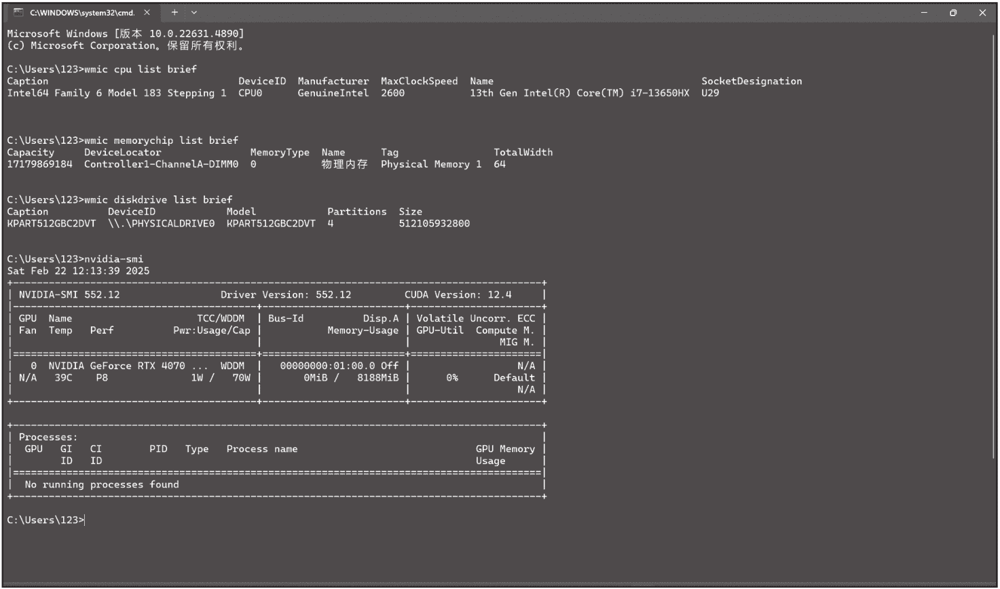
图 10-1 查看电脑硬件配置

**3. 网络：通道要畅通**
即便本地化，模型更新与数据传输仍需网络。要保证足够带宽，避免高强度使用时拥堵。防火墙和安全组配置至关重要，应设置规则仅允许授权用户与服务访问，如同为房屋装防盗门，防止非法入侵。

**4. 小结：三驾马车缺一不可**
成功本地化需要硬件、软件、网络协同。硬件要选高性能处理器、充足内存、快速存储与强劲显卡；软件需选合适的系统并安装必要工具；网络要保证带宽并正确配置安全策略。满足要求后，DeepSeek 才能在本地稳定运行并发挥高效性能。 

**试一试**
对照实际需求，检查当前电脑配置是否达到 DeepSeek 的最低要求。 

**小贴士**
1）硬件是基础，但不必盲目追求高端，按需合理选择。
2）搭建环境前备份系统和数据，避免误操作导致问题。
3）网络设置务必谨慎，确保防火墙规则正确，防止泄露或非法访问。

## **技巧 96 本地落地 DeepSeek：从安装到实操的三步路径**

用户激增带来服务器繁忙，等待卡顿甚至受攻击影响体验。将 DeepSeek 部署到本地可避免这些困扰，让使用者更灵活掌控。将 DeepSeek 本地化如同完成一场三步魔法之旅。

**1. 安装 Ollama 这个魔法盒子**
Ollama 是强大的本地 AI 模型管理工具，支持 DeepSeek R1 等多种大模型。访问官网 ollama.com，按操作系统下载安装，macOS、Linux、Windows 均可，按提示完成即可。

**2. 下载 DeepSeek R1 模型引擎**
安装后进入 Ollama 官网点击 Models，找到 DeepSeek R1。可选择 1.5B、7B、8B、14B、32B、70B、671B 等版本，硬件条件决定选择。以 Windows 部署 14B 为例：
1）按 Win+R 打开运行，输入 cmd 或在开始菜单搜索 PowerShell，右键以管理员身份运行。
2）复制命令 ollama run deepseek-r1:14b。
3）粘贴执行，注意模型默认安装在 C 盘，确保空间充足。
4）下载完成后提示 success 即部署成功。

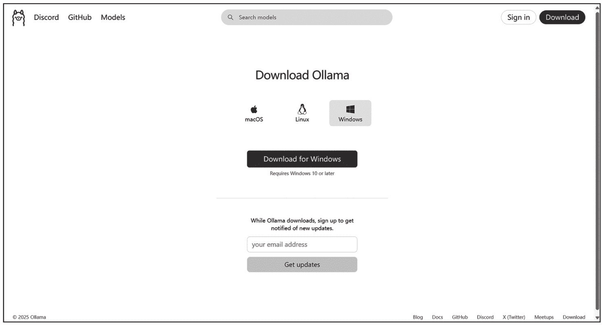
▲图 10-2 Ollama 下载界面

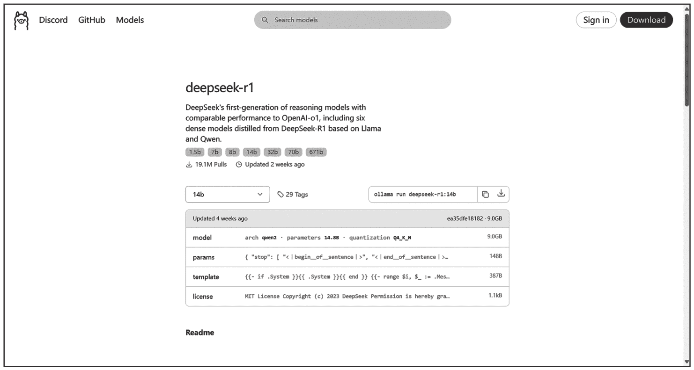
▲图 10-3 DeepSeek R1 模型信息界面

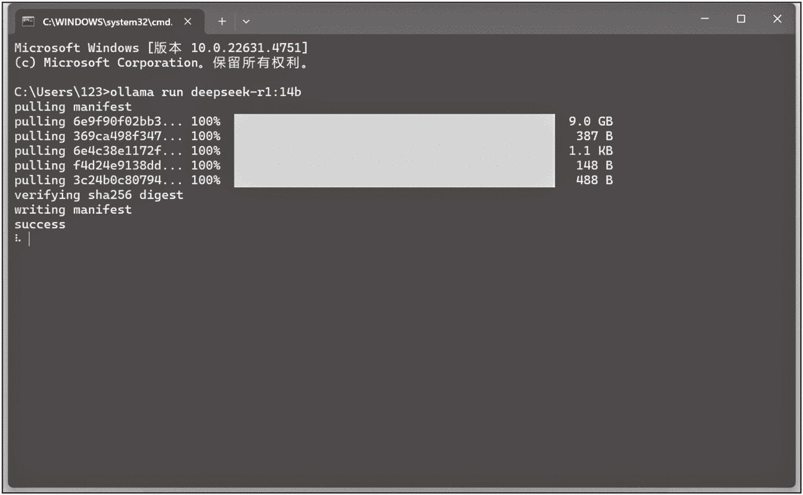
图 10-4 DeepSeek R1 模型部署界面

**3. 启动并使用助手**
部署完成后打开 Ollama 界面即可输入内容对话，可用于写代码、排 Bug、解数学题或润色文字。下载慢可尝试国内镜像，连接失败需检查 API 地址或确认模型服务是否启动。

**4. 使用注意事项**
关机后再次使用需重新执行 ollama run 命令启动模型。内存不足时可关闭其他大型软件或换用更小模型版本。

**5. 小结：私人定制模式**
本地化解决了服务器繁忙问题，也让你能按需灵活调整。相当于拥有专属 AI 工作室，可上传个人文档获得更个性化服务。AI 再强大也需人指挥，本地化让 DeepSeek 从公共服务器进化为私人定制助手。 

**试一试**
按上述步骤把 DeepSeek R1 部署到本地电脑，感受便捷高效。 

**小贴士**
关闭电脑后再次打开 Ollama 仅启动程序，需打开命令行执行 ollama run deepseek-r1:14b 才能对话。

## **技巧 97 上手 DeepSeek Web UI：可视化交互优化**

本地化功能强大，但交互不够直观。用户需要简单易用的界面调用能力同时保护隐私。Page Assist 作为开源扩展，能为本地模型提供直观 Web UI，支持在任意网页与 AI 对话。安装对新手可能有门槛。

**1. 安装 Page Assist：第一步**
按正确步骤操作，否则可能出现扩展无法加载问题。
1）从官方资源下载 Page Assist 扩展包，通常为 zip 格式。
2）解压到易找的文件夹。
3）打开 Chrome/Edge 扩展管理页，开启开发人员模式。
4）点击加载已解压扩展，选择解压文件夹。
5）安装成功后固定到工具栏。

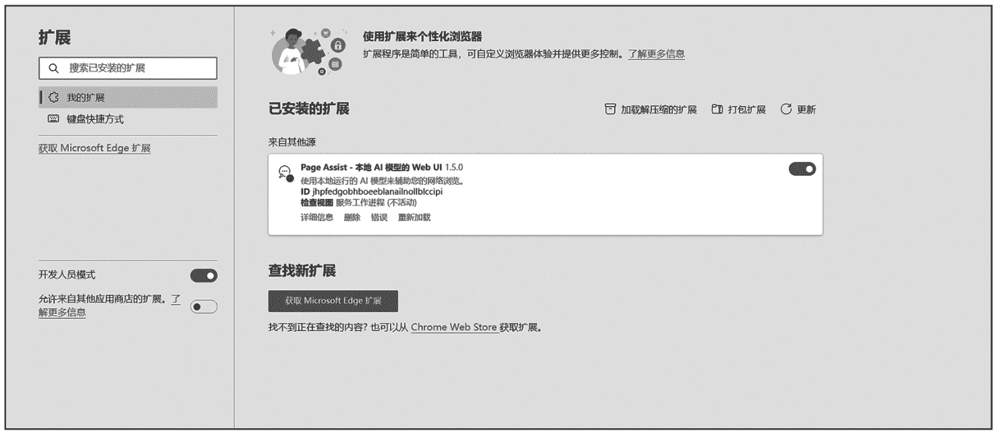
图 10-5 Page Assist 安装成功界面

**2. 配置 DeepSeek 模型：确保大脑在线**
使用前必须确认 DeepSeek 已正确部署在本地。
1）通过命令 ollama run deepseek-r1:14b 在终端启动模型服务。
2）确认 Ollama 默认端口为 localhost 的 11434。
3）在浏览器访问 http://localhost:11434，若显示 Ollama is running，说明启动成功。

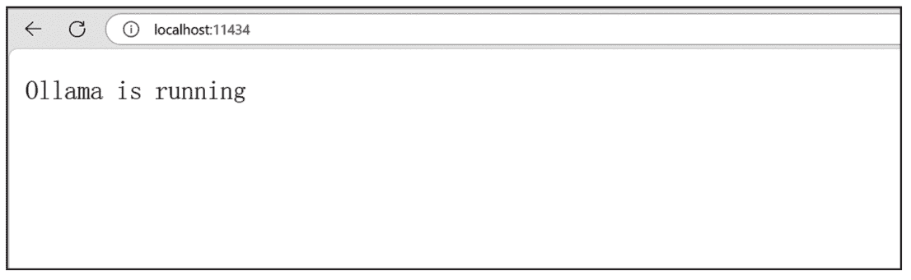

图 10-6 DeepSeek 启动成功界面

**3. 用 Page Assist 实现网页内即时问答**

完成本地部署与基础配置后，Page Assist 就能充当和本地 DeepSeek 之间的桥梁。点一下浏览器工具栏的插件图标，无论打开哪个页面都能弹出侧边栏或 Web 操作面板，从中挑选已装好的本地模型提问。问题发出后模型会迅速给出回应，展示效果见图 10-7。

**4. 让使用更顺手的微调建议**

想让 Page Assist 的手感更好，可以做以下两点调整：

1）定期清理缓存：建议经常清除浏览器缓存和扩展程序数据，防止堆积造成卡顿或报错。

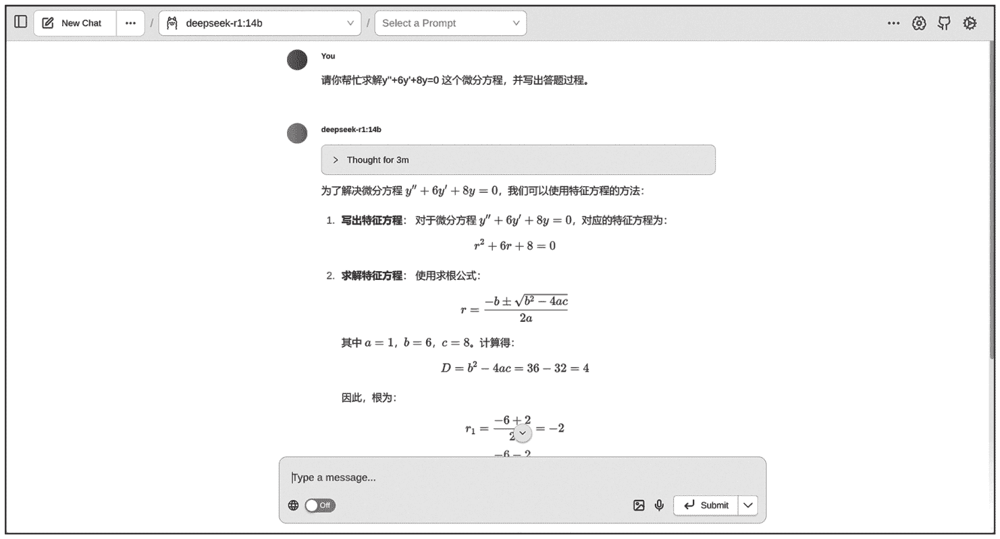

图 10-7 DeepSeek 可视化交互界面

2）保持插件更新：留意 Page Assist 的版本动态，及时升级以获得功能完善和性能优化。

**5. 小结：让本地模型调用更高效**

Page Assist 的安装流程并不复杂，关键在于按顺序操作，避免出现扩展加载失败。配置 DeepSeek 时要确认模型路径无误、服务处于运行状态，并完成环境变量设置。实际使用时通过工具栏一键唤出 AI，即可获得即时答案，并借助复制到剪贴板的功能整理分享。配合自定义快捷键、定期清理缓存以及保持插件最新，使用流畅度会明显提升。有了它，本地模型的交互变得简单高效，真正做到 AI 在手，效率倍增。 

**试一试**

若 DeepSeek 已在本地跑起来，试着安装 Page Assist 扩展，感受更流畅的交互方式。 

**小贴士**

下载插件时务必核对文件完整性与来源可靠性，切勿使用非官方渠道。

# 第十一章

# DeepSeek 智能体实战构建

## 技巧 98 把通用 AI 训练成专属数字分身

职场里最奢侈的幻想就是拥有多重分身，一个开会、一个整理报表、一个写周报。某科技社区调研显示，73% 的上班族每天要处理至少五类重复性标准化事务。这时调用通用 AI，就像让米其林主厨煮泡面，能完成任务却显得大材小用。

**1. 通用模型落地专业场景的痛点**

好比到裁缝店定制西装，店家却说只有均码，还得自己改动。将通用 AI 套用到专业领域就是这种体验：需要法律文书助手时得到的只是泛泛建议，想用电商客服机器人时回答却带着学术论文口吻。

**2. 五招把 AI 训练成“数字克隆”**

定制 DeepSeek 智能体的本质是让它按你的工作习惯运行，下面五种做法很实用。

（1）角色定位三明治法

先喂养身份信息：“你现在是拥有五年经验的宠物店金牌客服，擅长安抚焦虑的宠物主人，习惯用表情包和萌宠段子。”再夹入禁忌清单：“不要推荐未经 FDA 认证的药品，避免使用专业兽医术语。”最后加上任务指令：“处理客户关于猫咪绝育后护理的咨询。”这样训练出的回复，实用程度接近养猫十年的老手。

（2）知识库投喂技巧

别让模型硬啃行业报告，不如整理成问答套餐。例如：“客户问‘疫苗为什么这么贵’时，重点解释冷链成本和抗体检测流程。”

（3）对话风格调教

想让语气带点地方特色？用方言示范：“把‘亲，您购买的猫粮正在派送中’改写成沈阳口音。”要塑造专家形象，就提示：“先肯定提问的洞察力，再分三点解答。”某法律咨询智能体被调成“先法条后通俗”模式后，用户满意度明显提升。

（4）工作流程串联

把重复工作做成自动化流水线。比如上传合同并告知：“你是一个合同审核智能体，今后我上传合同就按此流程：接收需求→提取关键条款→对照最新劳动法→标出风险点→给出修改建议。”之后只需说“帮我审核这份合同”，它就会按既定步骤输出。

（5）持续迭代的“作弊码”

训练不是一次性任务，要像养电子宠物一样持续喂养。每周把新案例喂给它：“上次处理宠物托运死亡投诉不够人性化，这是改进后的对话样本。”喂养资料越多，理解越精准。某电商客服智能体经过数月上百条差评案例喂养后，连“快递员摔坏了我送初恋的结婚礼物”这类奇葩投诉也能从容化解。

应用参考：自媒体人可打造选题助手，输入“本周热点”，自动生成正经科普版、幽默玩梗版、争议观点版等多种选题。

**3. 总结**

AI 是放大器而不是替代品。定制智能体的核心在于把专业经验沉淀为可复制的数字资产，相当于给思维装上复制粘贴快捷键，既保留个人风格又突破时间限制。理想的智能体应像影子，平时静默跟随，关键时刻多出一双手。 

**试一试**

在 DeepSeek 中试着输入：“现在你是我的分身，我要处理 ____ 工作，我的风格是 ____，常见情况有 ____，请给出专属应答方案”。 

**小贴士**

训练客服时把称呼换成公司专用用语；处理专业问题时定期更新行业规范，就像给电子宠物换食谱。

## 技巧 99 低成本搭建智能体工具箱

设想指挥一支全能机器人队伍：24 小时处理投诉、预测经济趋势、甚至在手术室辅助医生。这听起来像科幻，但企业、开发者和研究者正被智能体开发的三大难题困扰：高昂硬件投入、算法频繁重来、系统难以跟上业务扩张。

**1. 第一关：驯服吞金兽**

传统开发像养只吃不饱的吞金兽，大厂训练模型的电费就能买三架客机。DeepSeek 则像自带省电外挂，用主流模型十分之一左右的成本达到相似甚至更强效果，秘诀是模块化分工。好比流水线各人负责拧螺丝，升级时只需更换局部零件，无需重建整线。

**2. 第二关：乐高式组装**

企业最怕买到开盲盒的 AI，花大钱买的客服转做数据分析就罢工。DeepSeek 提供积木化方案：金融风控模块可直接嵌入医疗诊断系统，自动驾驶感知算法稍作调整就能用于仓库巡检机器人。

**3. 第三关：弹性扩容**

传统系统扩容像给婴儿换衣服，尺寸一变就要全套更新。DeepSeek 的弹性架构像橡皮筋自由伸缩：白天用 80% 算力处理订单，夜间自动切到数据分析。还支持按需租赁算力，初创公司可像拼乐高一样购买计算资源，避免闲置服务器浪费。

**4. 实战三步法**

1）成本管控：先给任务做体检，用模块拆分找出最耗能环节，像装修先定承重墙，重点优化核心模块。

2）灵活组装：建立 AI 元件库，把常用功能封装成可插拔的智能 U 盘。新需求时直接组合现有模块，避免重复造轮子。

3）弹性扩容：采用云端混合架构，像调汽车变速箱一样动态分配算力，重要任务用高速档，日常作业切经济模式。

**5. 小结**

DeepSeek 不只是技术升级，更是思维转变。它证明高性价比 AI 开发可行——就像智能手机让电脑走出实验室，这套方法让智能体从巨头玩具变成中小企业生产力工具。成本降至十分之一，迭代周期从年到周，每个行业都有机会实现智能化逆袭。 

**试一试**

用 DeepSeek 文档中的模块库尝试把图像识别和语音处理组合成能看图说话的智能体，感受积木式开发乐趣。 

**小贴士**

1）开发前绘制 AI 元件地图，用不同颜色标注已有模块和待开发部分。
2）每周做算力体检，关闭利用率低于 30% 的服务器。
3）为每个模块贴功能标签，便于跨项目调用。

## 技巧 100 为 AI 接入专属知识库打造私人顾问

当下很多职场人用通用模型处理专业工作时很尴尬，就像让只会家常菜的厨师做满汉全席——要么跑题，要么反复调教。遇到行业知识库、企业内部数据时，通用模型常像新人，既不懂公司黑话也记不住项目细节。

**1. 知识脱节的困境**

准备直播脚本需要引用市场部最新用户画像，AI 助手却给出三年前的通用模板，甚至混入竞品数据。这种错位像让北方厨子做广式早茶。更麻烦的是每次都要手动上传文档、复制关键信息，效率不如翻文件柜。

把 DeepSeek 与知识库结合，就像给 AI 接上外接大脑，只需四步。

**2. 第一步：获取大模型**

1）前往硅基流动官网 https://cloud.siliconflow.cn/ 注册账号，如图 11-1 所示。

图 11-1 硅基流动官网注册界面

2）注册后查看余额充值页，如图 11-2 所示，系统会赠送 14 元用于测试。

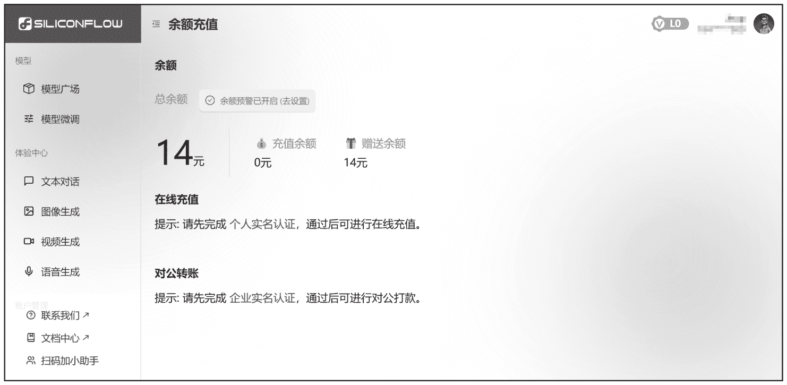

图 11-2 余额充值界面

3）在 API 密钥页点击“新建 API 密钥”，如图 11-3 所示。

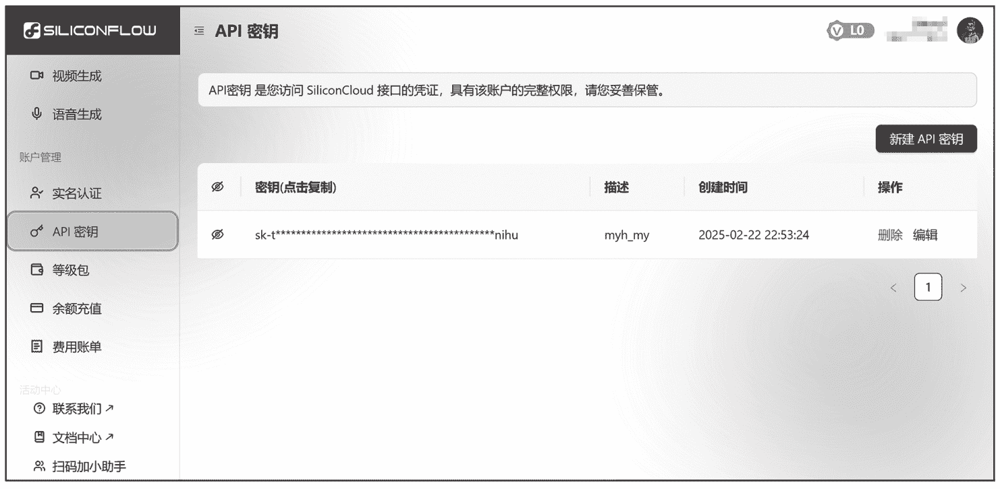

图 11-3 API 密钥获取界面

4）在模型广场找到 deepseek-ai/DeepSeek-R1，进入后复制模型 ID 备用，如图 11-4 所示。

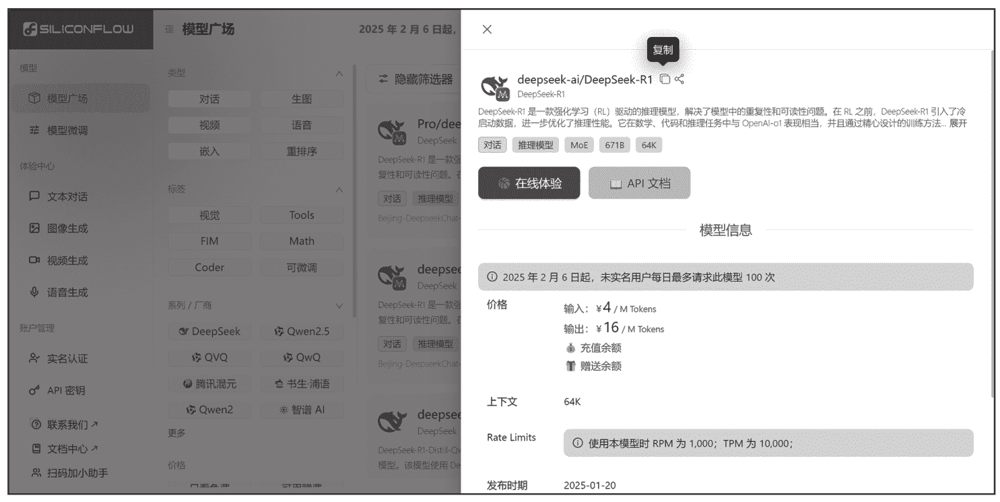

图 11-4 DeepSeek-R1 模型详情界面

**3. 第二步：配置大模型**

1）通过官网 https://cherry-ai.com/ 下载 Cherry Studio 使用 DeepSeek-R1 API。

2）在 Cherry Studio 找到“硅基流动”模块，填入上一步获取的密钥，密钥相当于接电许可，如图 11-5 所示。

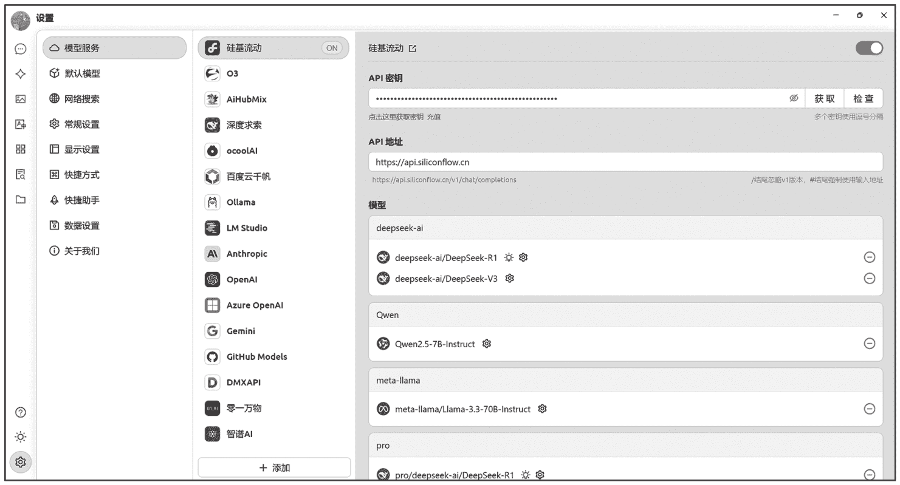

图 11-5 密钥配置界面

3）点击“添加”按钮，把 deepseek-ai/DeepSeek-R1 模型 ID 填入，如图 11-6 所示。

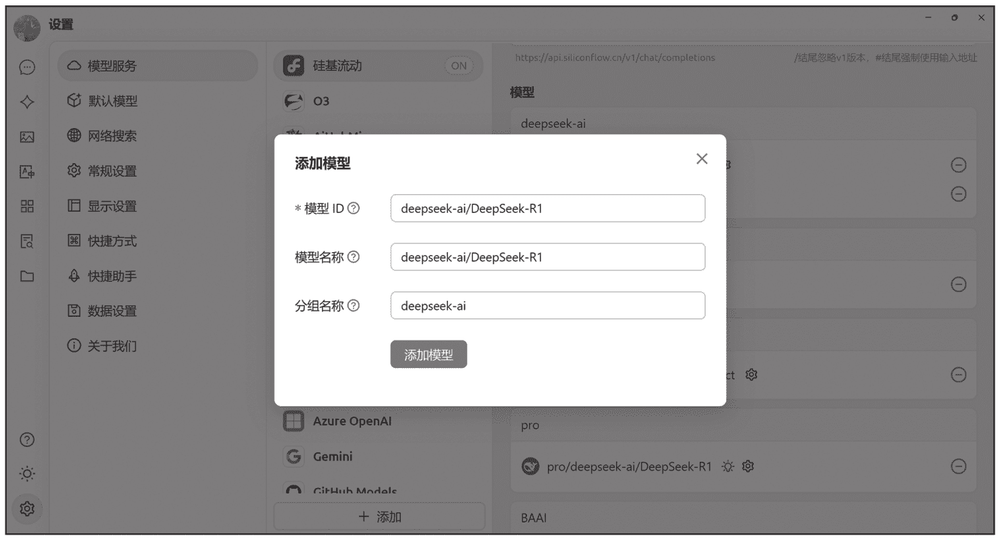

图 11-6 添加模型界面

4）点击“管理”按钮，确认“全部”列表中出现 deepseek-ai/DeepSeek-R1，即完成认证，相当于打开总闸。

**4. 第三步：部署嵌入模型**

在嵌入模型库选择 BAAI/bge-m3 添加，该模型充当知识翻译官，把文档转为 AI 可理解的数字语言。

**5. 第四步：搭建记忆库**

1）建库时建议用具体名称如“DeepSeek 基础知识库”，如图 11-8 所示。

2）上传方式有五种：

❑ 文件上传：逐本上架精装书。
❑ 目录上传：批量入库图书。
❑ 网页抓取：自动扫描电子图书馆。
❑ 站点地图：获取整栋知识大厦平面图。
❑ 笔记上传：构建专属知识宝库。

出现绿色√即表示 AI 已完成读书笔记，如图 11-9 所示。

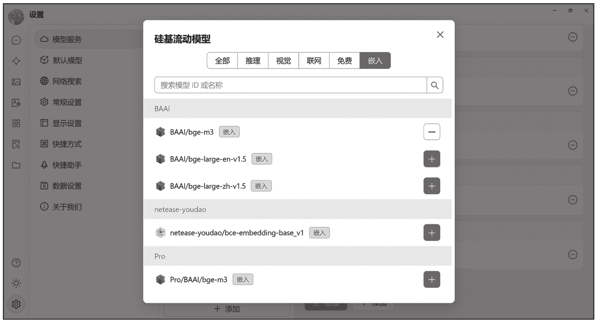

▲图 11-7 嵌入模型选择

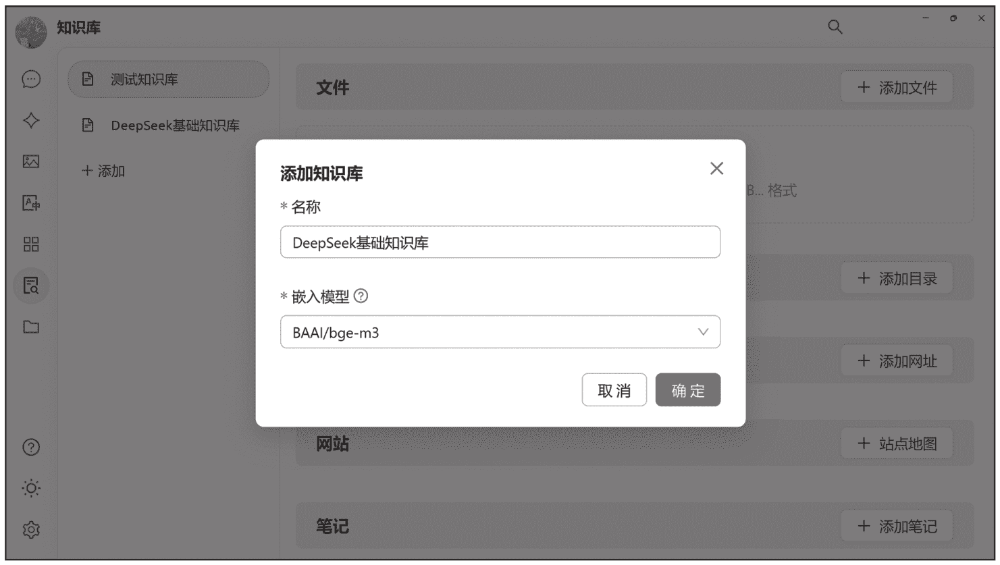

▲图 11-8 添加知识库

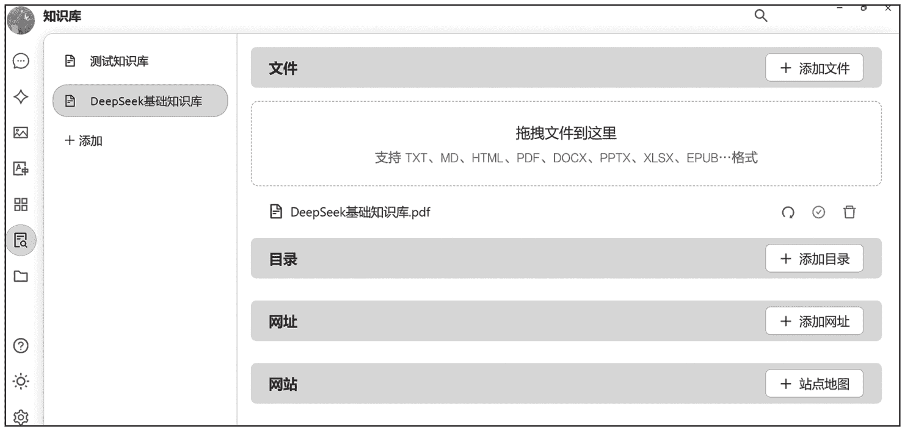

▲图 11-9 上传文件

3）上传测试：点击“搜索知识库”，输入与文档相关的关键词，有返回即上传成功。

4）创建智能体：依次点左侧“智能体”→“创建智能体”→填写名称→提示词并选择知识库，即可完成，如图 11-10 所示。

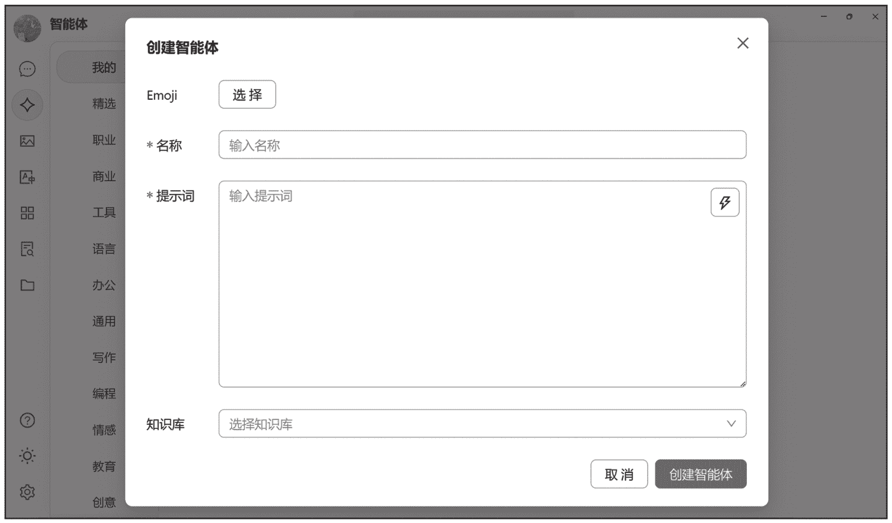

图 11-10 创建智能体

**6. 常见问题自救**

1）识别失败：检查文档格式是否合规。
2）回答混乱：用更精确关键词缩小检索范围。
3）内容缺失：尝试用站点地图抓取代替单页上传。

**7. 小结**

搭建专属智能体的本质是让 AI 用你的语言交流。就像训练导盲犬要熟悉主人路线，配置知识库就是绘制专属认知地图。通用模型穿上定制西装后，能应对行业暗语和内部数据，真正成为随叫随到的数字员工。 

**试一试**

上传近三个月会议纪要，提问：“整理关于用户增长的核心策略。” 

**小贴士**

1）知识库命名要具体如快递地址，避免“资料库1号”等模糊名。
2）站点抓取时优先选择更新日期最近的 XML 文件。
3）每月更新知识库内容，给 AI 补充营养。
4）重要文档建议混合投喂：源文件加网页备份双保险。

# 结语

本书由多位作者共同完成，作者毕业于清华、北大、北邮等高校，现居南宁。

在全面拥抱人工智能的时代，需以“人工智能+”赋能各行各业，在新赛道实现赶超。本书正是在这一背景下诞生。

因水平有限，书中难免有误，恳请读者指正。我们希望帮助每个人掌握 DeepSeek 的基础知识与技能，更高效地工作学习，轻松享受 AI 红利。

作者群体既有扎根基层的乡村教师，也有求知欲强的青年学子。知识传递需要桥梁，而这座桥梁的基石靠无数双手托举。我们关注公益，希望贡献力量。经商议，全体作者同意将稿酬全部捐赠给广西希望工程，专项用于乡村教师与学生的人工智能素养提升及科普教育。

如有资源支持，请联系广西青少年发展基金会官方。让我们共同助力少数民族地区青少年 AI 教育发展。

# 推荐阅读

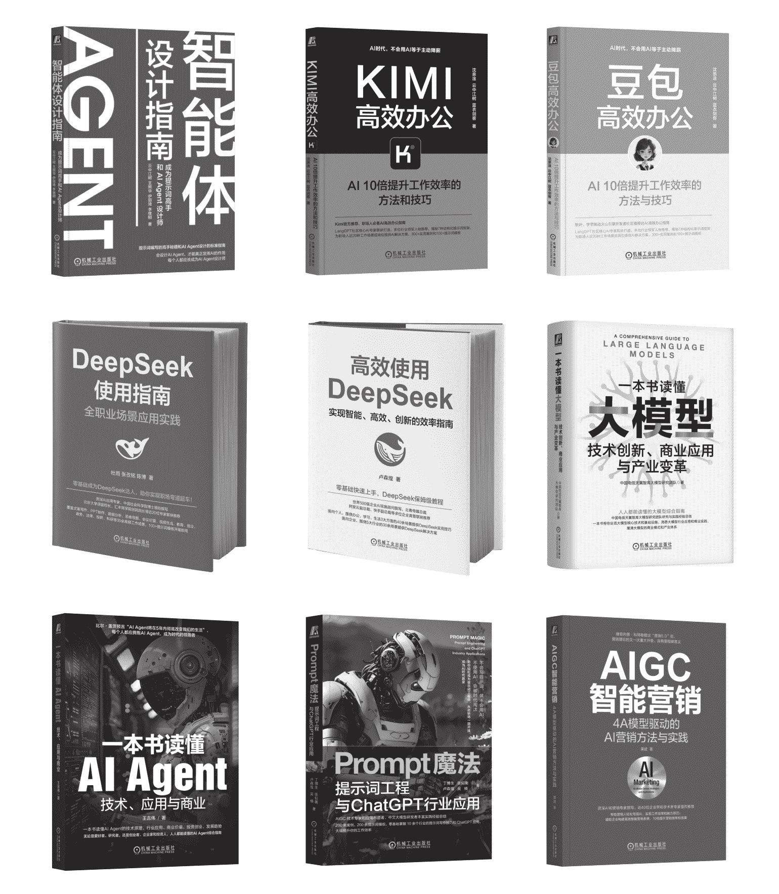