# 《DeepSeek入门宝典》第1册·技术解析篇

- DeepSeek是什么
- DeepSeek R1核心技术揭秘
- DeepSeek技术贡献及未来进化

# DeepSeek是什么？

- DeepSeek是什么？
- DeepSeek R1的三大特点
- 使用DeepSeek的五种方式对比

# DeepSeek是什么？

- DeepSeek是幻方量化于2023年创立的大模型子公司，创始人为梁文锋
- 2024年1月5日，其发布第一个同名AI大模型 DeepSeek LLM
- 2025年1月20日，DeepSeek R1正式发布，为对标 OpenAI o1正式版的高性能推理模型；R1上线后火速出圈，其应用创造了全球 APP 历史上增长最快的记录

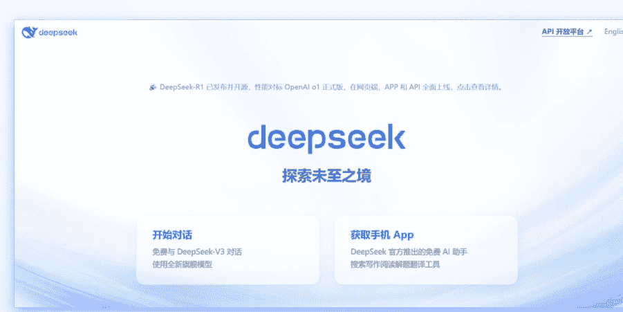

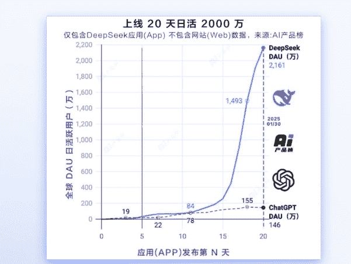

## DeepSeek R1的三大特点

- **高性能**
  推理表现媲美OpenAI o1正式版

- **开源**
  R1开源，并公开训练技术，允许开发者访问和学习

- **低成本**
  R1开发成本仅为OpenAI o1的2%左右

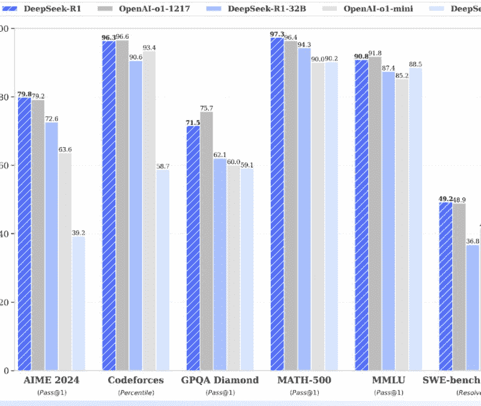

图注：DeepSeek与OpenAI各版本的准确率对比（图片来源：DeepSeek官网）

## 使用DeepSeek的五种方式对比

### 普通用户

作为生产力工具及技术尝鲜

- 官网: https://chat.deepseek.com/
- APP: https://chat.deepseek.com/

### 开发者、企业用户

保障访问稳定性和可扩展性

- API: https://deepseekapi.io/
- 本地部署: 可借助Ollama、vLLM 和 MNN等工具
- 云平台: 硅基流动、腾讯云、阿里云等

# DeepSeek R1核心技术揭秘

- R1的基座模型——V3
- R1的三种变体
- R1训练的技术路径
- R1的核心技术解析
- R1的关键技术贡献

## R1的基座模型：V3

### V3模型的特征

- V3是去年12月发布的自研 MoE 模型
- 参数与GPT-4大致在同一数量级：V3 有671B参数，每个Token的计算激活约37B
- 在 14.8T token 上进行了预训练

### R1在DeepSeek V3基础上进行了开发

- V3：对标GPT-4o，通过指令微调和偏好微调提升性能
- R1：专注于推理能力

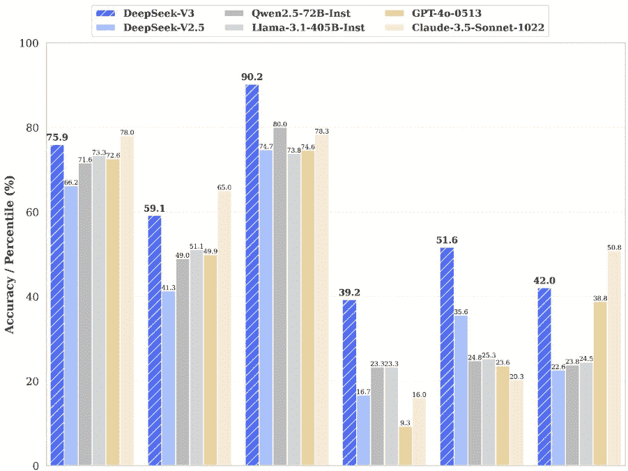

图注：DeepSeek V3与发布时其他主流大模型的准确率对比（图片来源：DeepSeek官网）

## R1的三种变体

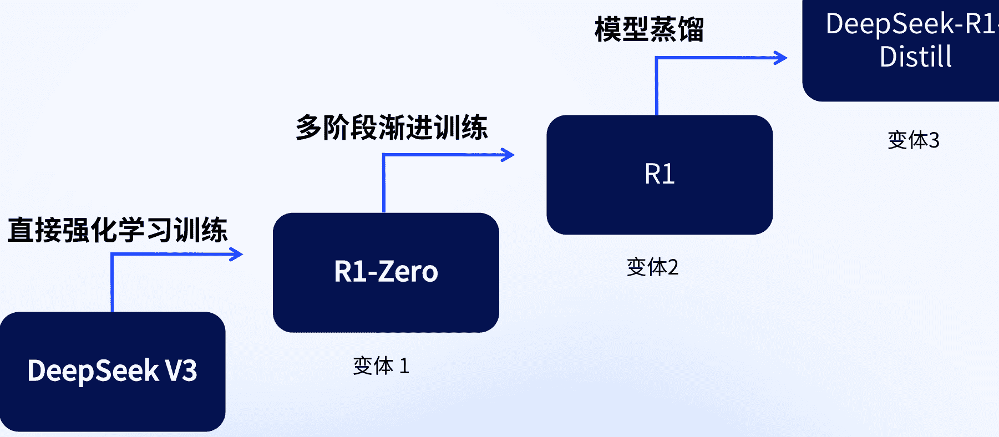

## R1训练的技术路径

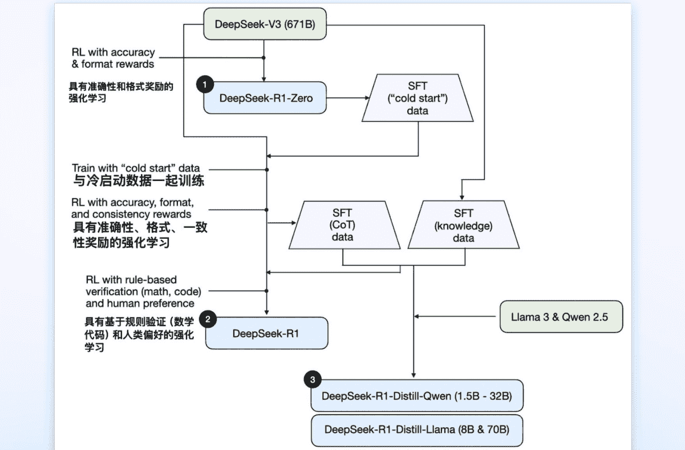

## R1的核心技术解析：强化学习

R1采用了多种奖励的强化学习，相当于模型的“综合评分系统”，模型在完成任务时根据多个标准获得不同的奖励信号。

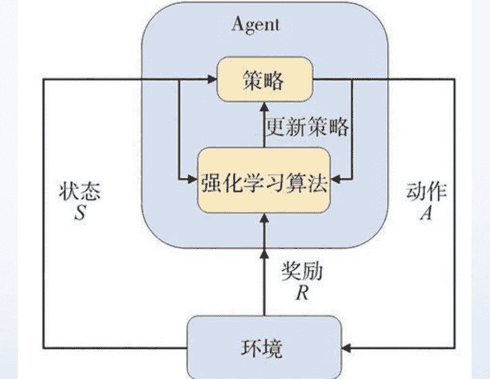

> 来源：《基于场景动力学和强化学习的自动驾驶边缘测试场景生成方法》

## R1的核心技术解析：冷启动数据

R1 策略性地将少量高质量数据作为冷启动。这相当于训练开始前的“入门教程”，帮助模型更快地学会如何进行清晰、有逻辑的推理。


## R1的核心技术解析：监督微调

R1训练包括两个监督微调 (SFT) 阶段。模型通过学习标注数据来调整模型，以在特定任务上表现得更精准。

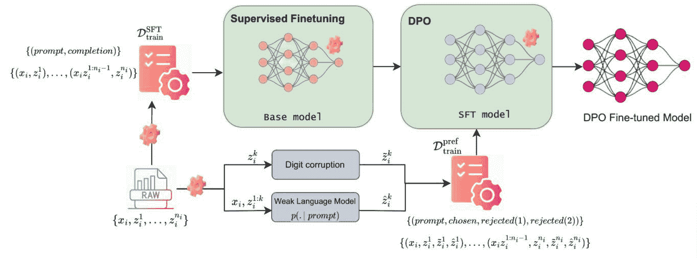

## R1的核心技术解析：蒸馏

R1-Distill采用蒸馏技术。大模型（老师）把自己的知识和推理能力教给小模型（学生），通过高质量的数据和训练方法，让小模型学会大模型的推理技巧。

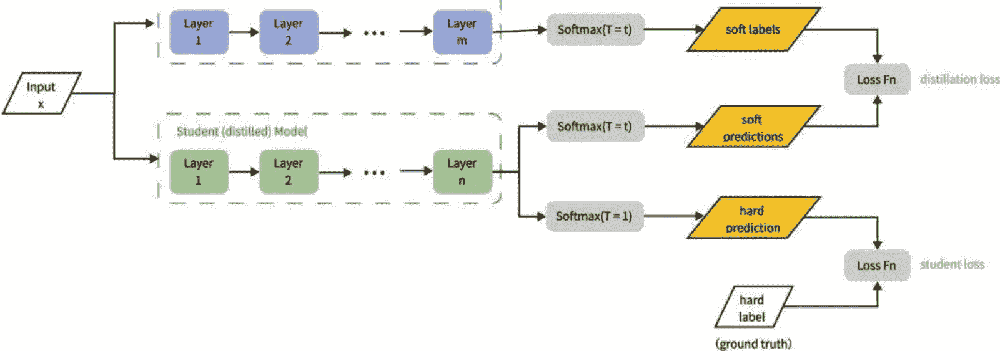

## 关键贡献1：‘纯RL’技术路线的可行性

首个公开研究，验证了LLMs的推理能力可以仅通过强化学习激励，而无需监督微调。

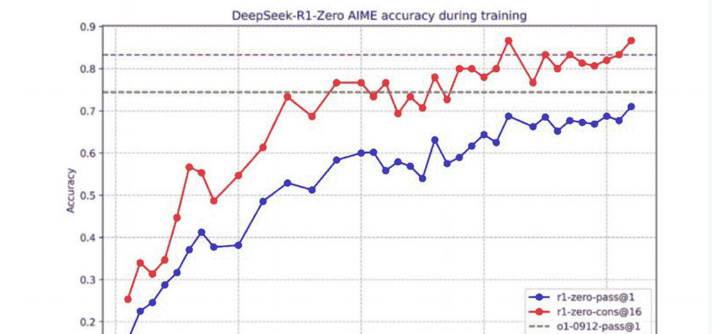

图注：随着RL训练逐步推进，R1-Zero的性能稳定且持续提升（图片来源：DeepSeek官方论文）

## 关键贡献2：R1的“啊哈时刻”

DeepSeek R1在推理时使用诸如“啊哈时刻”的高度拟人化语言，在解题找到突破口时产生了顿悟，被视为走向AGI的重要一步。

```
Question: If $a > 1$, then the sum of the real solutions of $\sqrt{a - \sqrt{a + x}} = x$ is equal to

Response: 
To solve the equation $\sqrt{a - \sqrt{a + x}} = x$, let's start by squaring both ...
$(\sqrt{a - \sqrt{a + x}})^2 = x^2 \implies a - \sqrt{a + x} = x^2$.

Rearrange to isolate the inner square root term:
$(a - x^2)^2 = a + x \implies a^2 - 2ax^2 + (x^2)^2 = a + x \implies x^4 - 2ax^2 - x + (a^2 - a) = 0$
...
Wait, wait. Wait. That's an aha moment I can flag here.
Let's reevaluate this step-by-step to identify if the correct sum can be ...
We started with the equation:
$\sqrt{a - \sqrt{a + x}} = x$
First, let's square both sides:
$a - \sqrt{a + x} = x^2 \implies \sqrt{a + x} = a - x^2$
Next, I could square both sides again, treating the equation: ...
...

Table 3 | An interesting “aha moment” of an intermediate version of DeepSeek-R1-Zero. The model learns to rethink using an anthropomorphic tone. This is also an aha moment for us, allowing us to witness the power and beauty of reinforcement learning.
```

> 9.11和9.9哪个数字大

好的，我现在得比较一下9.11和9.9这两个数哪个更大。首先，我应该回忆一下小数比较的方法。记得比较小数的时候，应该先比较整数部分，如果整数部分相同，再依次比较小数部分的每一位。

首先，这两个数的整数部分都是9，所以整数部分相等。接下来需要比较小数部分。不过这里有个问题，9.11的小数部分是两位，而9.9只有一位。可能有人会直接看小数部分的数字，比如9.11的小数部分是11，而9.9的是9，然后认为11比9大，所以9.11更大。但这其实是错误的，因为小数部分的位数不同，不能直接这样比较。

正确的方法应该是将两个数的小数位数统一，比如将9.9写成9.90，这样两者的小数部分都是两位。这时候，比较0.11和0.90，显然0.90更大，所以9.90也就是原来的9.9，要比9.11大。不过，这里好像哪里不对，因为按照这个逻辑的话，9.9应该比9.11大，但实际情况可能不是这样。

或者，可能我需要更仔细地分析。比如，9.11可以拆分为9 + 0.11，而9.9则是9 + 0.9。显然，0.9比0.11大很多，所以9.9实际上更大。那为什么之前会有混淆呢？可能是因为小数点后的位数不同，导致误以为更多的数字代表更大的值，但实际上小数点后的第一位是十分位，第二位是百分位，所以比较的时候应该先看十分位，再看百分位。

例如，比较9.11和9.9时，先看十分位的数字，9.11的十分位是1，而9.9的十分位是9。因为9比1大，所以不管后面的百分位是什么，9.9都比9.11大。因此，正确的结论应该是9.9比9.11大。

## 关键贡献3：蒸馏小模型超越 OpenAI o1-mini

蒸馏小模型的高性能，证明了该策略的经济和有效，但想要突破当前智能的边界，或仍需要更大规模的基础模型与强化学习。

| 模型 | AIME 2024 pass@1 | AIME 2024 cons@64 | MATH-500 pass@1 | GPQA Diamond pass@1 | LiveCodeBench pass@1 | CodeForces rating |
| :--- | :---: | :---: | :---: | :---: | :---: | :---: |
| GPT-4o-0513 | 9.3 | 13.4 | 74.6 | 49.9 | 32.9 | 759.0 |
| Claude-3.5-Sonnet-1022 | 16.0 | 26.7 | 78.3 | 65.0 | 38.9 | 717.0 |
| o1-mini | 63.6 | 80.0 | 90.0 | 60.0 | 53.8 | 1820.0 |
| QwQ-32B | 44.0 | 60.0 | 90.6 | 54.5 | 41.9 | 1316.0 |
| DeepSeek-R1-Distill-Qwen-1.5B | 28.9 | 52.7 | 83.9 | 33.8 | 16.9 | 954.0 |
| DeepSeek-R1-Distill-Qwen-7B | 55.5 | 83.3 | 92.8 | 49.1 | 37.6 | 1189.0 |
| DeepSeek-R1-Distill-Qwen-14B | 69.7 | 80.0 | 93.9 | 59.1 | 53.1 | 1481.0 |
| DeepSeek-R1-Distill-Qwen-32B | 72.6 | 83.3 | 94.3 | 62.1 | 57.2 | 1691.0 |
| DeepSeek-R1-Distill-Llama-8B | 50.4 | 80.0 | 89.1 | 49.0 | 39.6 | 1205.0 |
| DeepSeek-R1-Distill-Llama-70B | 70.0 | 86.7 | 94.5 | 65.2 | 57.5 | 1633.0 |

图注：通过 DeepSeek-R1 的输出，蒸馏了 6 个小模型开源给社区（图片来源： DeepSeek官方论文）

# DeepSeek技术贡献及未来进化

- R1与OpenAI o1的三大区别
- R1的四大进化方向
- 附录：DeepSeek产品家族全梳理

## DeepSeek R1 与 OpenAI o1 的三大区别

- **架构不同**
  R1：基于已有模型DeepSeek V3
  o1：不同于GPT-4o的新模型

- **训练方式不同**
  R1：证明可以仅通过强化学习激励，无需监督微调
  o1：监督微调和强化学习结合

- **生态不同**
  R1：开源，免费使用
  o1：闭源，ChatGPT Plus会员才可访问o1及o1 mini

## R1的四大进化方向

### 通用能力
R1在一些复杂任务上的表现不如V3，未来可以通过长链推理来提升

### 语言混合
优化R1处理中英文以外语言的能力，避免现在的语言混合问题

### 提示工程
R1对提示很敏感，少量示例提示会降低性能

### 软件工程任务
从软件工程数据、强化学习的异步评估入手，缩短评估时长，保障强化学习过程的效率

# 附：DeepSeek产品家族全梳理

| 模型类别 | 日期 | 名称 | 内容 | 对标 |
| :--- | :--- | :--- | :--- | :--- |
| LLM | 2023年11月2日 | DeepSeek Coder | 模型包括 1B， 7B， 33B 多种尺寸，开源内容包含 Base 模型和指令微调模型。 | Meta的CodeLlama是业内标杆，但DeepSeek Coder展示出多方位领先的架构。 |
| | 2024年6月17日 | DeepSeek Coder V2 | 代码大模型，提供了 236B 和 16B 两种版本。DeepSeek Coder V2 的 API 服务也同步上线，价格依旧是「1元/百万输入，2元/百万输出」。 | 能力超越了当时最先进的闭源模型 GPT-4-Turbo。 |
| | 2023年11月29日 | DeepSeek LLM 67B | 首款通用大语言模型，且同步开源了 7B 和 67B 两种不同规模的模型，甚至将模型训练过程中产生的 9 个 checkpoints 也一并公开。 | Meta的同级别模型 LLaMA2 70B，并在近20个中英文的公开评测榜单上表现更佳。 |
| | 2024年3月11日 | DeepSeek-VL | 多模态 AI 技术上的初步尝试，尺寸为 7B 与1.3B，模型和技术论文同步开源。 | |
| | 2024年5月 | DeepSeek-V2 | 通用 MoE 大模型的开源发布，DeepSeek-V2 使用了 MLA（多头潜在注意力机制），将模型的显存占用率降低至传统 MHA 的 5%-13% | 对标 GPT-4-Turbo，而 API 价格只有后者的 1/70 |
| | 2024年9月6日 | DeepSeek-V2.5 融合模型 | Chat模型聚焦通用对话能力，Code模型聚焦代码处理能力合二为一，更好的对齐了人类偏好。 | |
| | 2024年12月10日 | DeepSeek-V2.5-1210 | DeepSeek V2 系列收官之作，全面提升了包括数学、代码、写作、角色扮演等在内的多方能力。 | |
| | 2024年12月26日 | DeepSeek-V3 | 开源发布，训练成本估算只有 550 万美金 | 性能上全面对标海外领军闭源模型，生成速度也大幅提升。 |
| 推理模型 | 2024年2月5日 | DeepSeekMat | 数学推理模型，仅有 7B 参数 | 数学推理能力上直逼 GPT-4 |
| | 2024年8月16日 | DeepSeek-Prover-V1.5 | 数学定理证明模型 | 在高中和大学数学定理证明测试中，均超越了多款知名的开源模型。 |
| | 2024年11月20日 | DeepSeek-R1-Lite | 推理模型，为之后 V3 的后训练，提供了足量的合成数据。 | 媲美 o1-preview |
| | 2025年1月20日 | DeepSeek-R1 | 发布并开源，开放了思维链输出功能，将模型开源 License 统一变更为 MIT 许可证，并明确用户协议允许“模型蒸馏”。 | 在性能上全面对齐 OpenAI o1 正式版 |
| 多模态模型 | 2023年12月18日 | DreamCraft3D | 文生 3D 模型，可从一句话生成高质量的三维模型，实现了 AIGC 从 2D 平面到 3D 立体空间的跨越。 | |
| | 2024年12月13日 | DeepSeek-VL2 | 多模态大模型，采用了 MoE 架构，视觉能力得到了显著提升，有 3B、16B 和 27B 三种尺寸，在各项指标上极具优势。 | |
| | 2025年1月27日 | DeepSeek Janus-Pro | 开源发布的多模态模型。 | |
| 架构开源 | 2024年1月11日 | DeepSeekMoE | 开源了国内首个 MoE（混合专家架构）大模型 DeepSeekMoE：全新架构，支持中英，免费商用，在 2B、16B、145B 等多个尺度上均领先 | 被普遍认为是 OpenAI GPT-4 性能突破的关键所在 |

# 更多DeepSeek及AI学习资源

### DeepSeek官网
访问官网，可深入了解最新研究成果，获取源代码及官方提示词样例库等资源。
https://www.deepseek.com

### 51CTO官网AI专区
51CTO官网AI.x专区，获取DeepSeek及AI最新资讯、实战文章、实用资源及AI实战派大咖直播分享。
https://ai.51cto.com

### 51CTO在线课程DeepSeek专区
超过200门、超过1000小时AI（含DeepSeek）主题视频课程可供个人和企业学习。
https://b.51cto.com

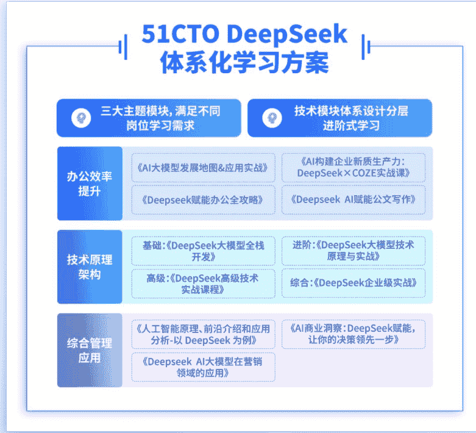

图注：51CTO企业学堂推出的企业DeepSeek体系化学习方案

## 51CTO

帮助一亿数字化人才终身成长！


扫码关注51CTO，获取更多资料