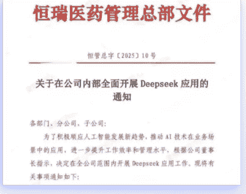
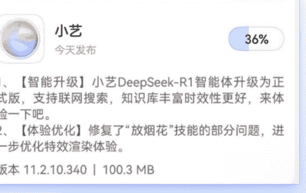
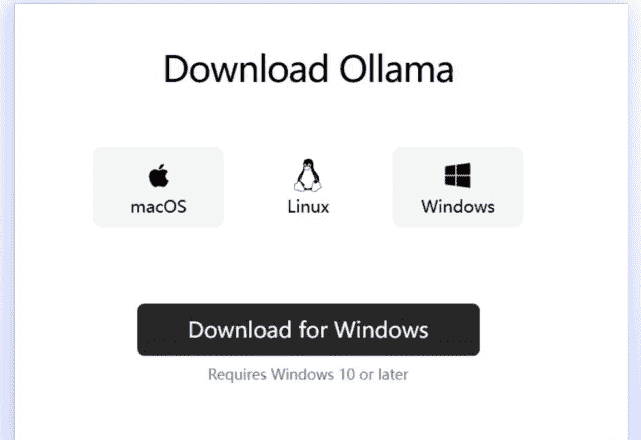
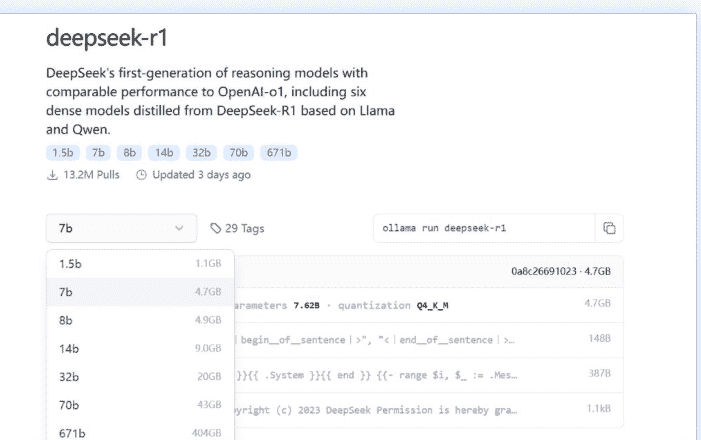
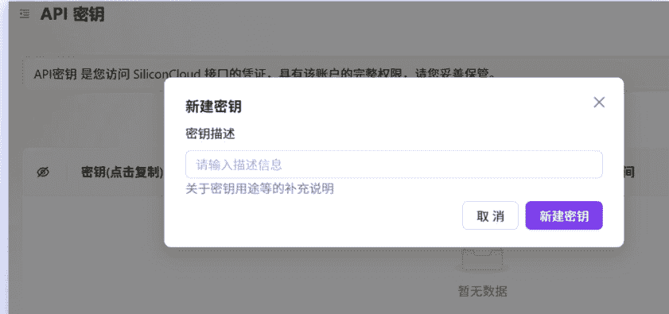
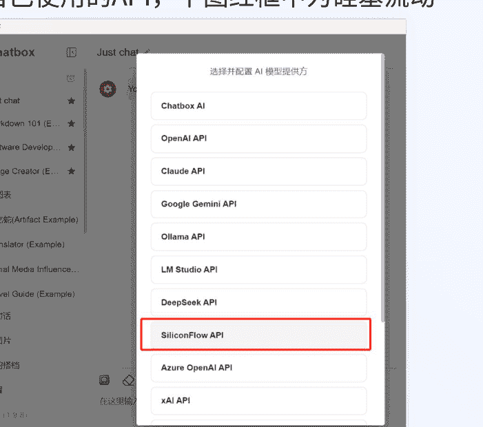
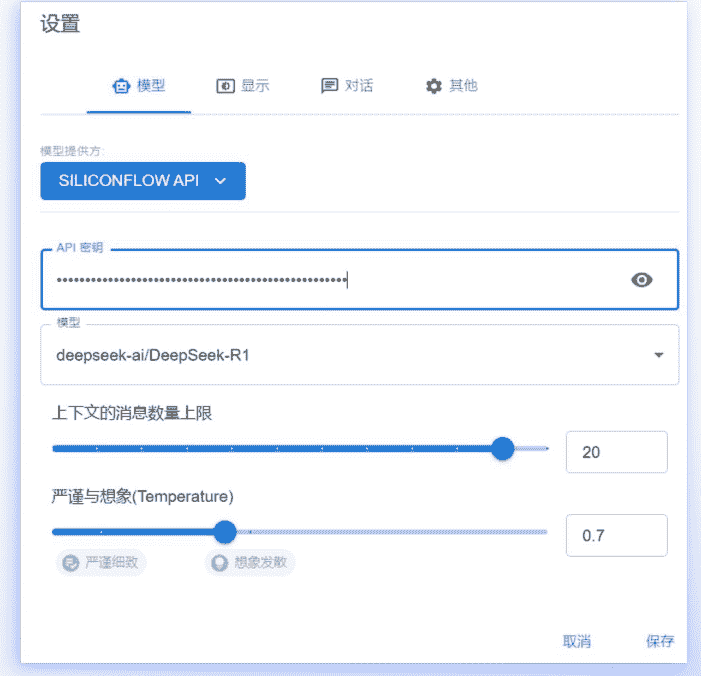
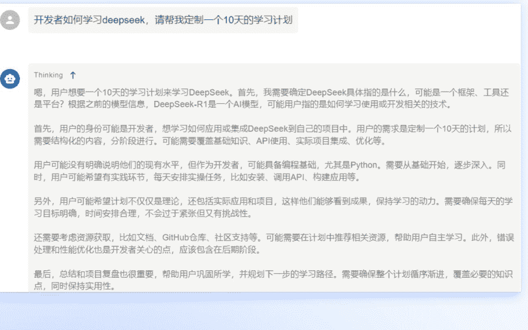
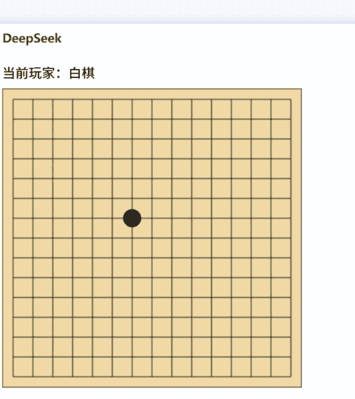
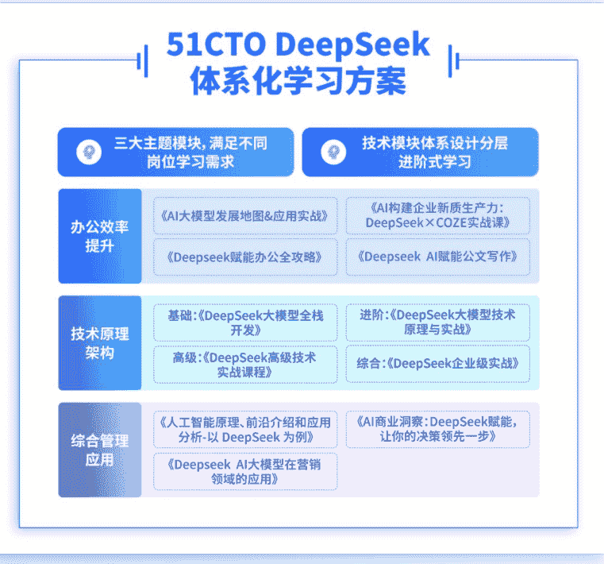

# 《DeepSeek入门宝典》第2册·开发实战篇

- DeepSeek开发者入门
- DeepSeek部署的主流方式及教程
- DeepSeek辅助开发及实例

51CTO智能研究院、51CTO传媒、51CTO学堂联合出品

# DeepSeek 赋能开发者

- DeepSeek 的核心价值及三大优势
- 部署DeepSeek的五大决策关键

## DeepSeek的核心价值

### 企业端：降本增效

代表企业：恒瑞医药、极氪



### 产品端：体验升级

代表产品：华为小艺、飞书



### 开发者：辅助开发

用法：代码生成、代码改写


## DeepSeek的三大优势

- **高性能**
  性能可对标OpenAI o1
- **低成本**
  R1比o1的API价格低20多倍
- **开发者友好**
  能兼容OpenAI的API格式

| 模型(1) | 上下文长度 | 最大思维链长度(2) | 最大输出长度(3) | 百万tokens输入价格(缓存命中)(4) | 百万tokens输入价格(缓存未命中) | 百万tokens输出价格 |
| :--- | :--- | :--- | :--- | :--- | :--- | :--- |
| deepseek-chat | 64K | - | 8K | 0.5元 | 2元 | 8元 |
| deepseek-reasoner | 64K | 32K | 8K | 1元 | 4元 | 16元(5) |

## 部署DeepSeek的五大决策关键

| 决策关键 | 条件 | 部署建议 |
|----------|------|----------|
| 使用频次 | 长期高频 | 本地、云托管 |
| 响应延迟要求 | 需要超低延迟 | 边缘计算 |
| 算力、技术资源 | 无运维团队 | API、云托管 |
| 数据敏感性评估 | 数据敏感 | 本地、私有云 |
| 合规性要求 | 高合规要求 | 本地部署+安全审计 |

# 开发者部署 DeepSeek

- 开发者部署DeepSeek的三种主流方式
  - 官方API使用
  - 私有化本地部署
  - 云平台托管部署
- 部署DeepSeek的其他方式

## 开发者部署DeepSeek的三种主流方式

以下为部署DeepSeek的三种主流方式，下文将提供入门教程：

官方API

- 优：零运维成本、按需付费
- 缺：网络延迟

本地化私有部署

- 优：数据安全，高度定制化
- 缺：需GPU资源、人工运维

云平台托管部署

- 优：弹性扩缩容、混合云支持
- 缺：云服务商依赖、跨云管理

### 官方 API 使用：首次调用

使用 DeepSeek API 之前，请先 创建 API 密钥

https://api-docs.deepseek.com/zh-cn/api/deepseek-api

在创建 API key 之后，你可以使用以下样例的python脚本访问 DeepSeek API

```
python
# Please install OpenAI SDK first: `pip3 install openai`

from openai import OpenAI

client = OpenAI(api_key="<DeepSeek API Key>", base_url="https://api.deepseek.com")

response = client.chat.completions.create(
    model="deepseek-chat",
    messages=[
        {"role": "system", "content": "You are a helpful assistant"},
        {"role": "user", "content": "Hello"},
    ],
    stream=False
)

print(response.choices[0].message.content)
```

#### 官方 API使用：关键参数

deepseek-chat 调用 DeepSeek-V3

deepseek-reasoner 调用 Deepseek-R1

max_tokens 默认最大输出长度为4K，可手动调整至8K

temperature 参数默认为1.0，建议根据使用场景进行配置

| 场景 | 温度 |
|---|---|
| 代码生成/数学解题 | 0.0 |
| 数据抽取/分析 | 1.0 |
| 通用对话 | 1.3 |
| 翻译 | 1.3 |
| 创意类写作/诗歌创作 | 1.5 |

#### 官方 API使用：常见错误与解决

**400 - 格式错误** → 根据错误信息提示修改请求体

**429 - 请求速率达到上限** → 合理规划请求速率

**401 - 认证失败** → 检查API key 是否正确

**500 - 服务器故障** → 稍后重试，联系官方

**402 - 余额不足** → 确认余额，及时充值

**503 - 服务器繁忙** → 稍后重试

**422 - 参数错误** → 请根据错误信息提示修改相关参数

### 私有化本地部署（1）

本地部署DeepSeek-R1蒸馏版，可通过Ollama、vLLM等工具，简化部署过程
以下教程以Ollama为示例，Ollama下载链接：https://ollama.com/download

1. 下载Ollama

2. 打开模型列表，下载DeepSeek R1

进入https://ollama.com/library/deepseek-r1
选择合适参数量的模型





### 私有化本地部署（2）

3. 安装下载的模型

4. 输入运行指令，与R1进行对话

打开本地的命令提示符，输入下列指令（以7b 模型为例）

```
ollama pull deepseek-r1:7b
```

通过ollama list指令查看所有本地模型占用的存储空间

```
C:\Users\EDY>ollama list
NAME            ID              SIZE    MODIFIED
deepseek-r1:7b  0a8c26691023    4.7 GB  3 days ago
```

```
C:\Users\EDY>ollama run deepseek-r1:7b
```

以下是对话以模型的输出：

```
>>> 证明1+2大于2

嗯，证明“1加2大于2”，听起来有点奇怪，因为1+2等于3，而3当然大于2啊！不过可能题目表达有点问题，或者是想让我用某种特殊的方式来看待这个问题？

首先，1加2等于3。3确实比2大。这是基本的数学事实，没有争议。

也许，用户想问的是“为什么1加2大于2”，或者是不是在某种不同的情况下？比如，在某些特定的定义下，或者说是在某种特殊的系统中，“大于”可能有不同的意义？

另外，也有可能是“证明1+2>2”，这是一种不等式。让我尝试从数学的角度来分析一下。

首先，我们可以写出来：1 + 2 = 3

然后比较3和2的大小：

因为3 > 2，

所以，1 + 2 > 2

这是不是太直接了呢？可能需要更深入地解释一下为什么“大于”是这样的关系，或者有没有什么隐藏的条件？

比如，在数学中，“大于”是一个基本的概念，表示左边的数在数值上更大。在这个例子里，3确实比2大，所以1加2大于2。

也许还有其他角度可以探讨这个问题？比如说，在不同的数域中，或者结合某些运算规则的情况下，结果会不会有所不同呢？
```

### 云平台托管部署（1）

目前国内主流云平台均已支持DeepSeek模型，如硅基流动×华为云、腾讯云、百度智能云等。

以下教程以硅基流动为示例， 地址：https://cloud.siliconflow.cn/i/adxzw8w3af

1. 注册并登录云平台

2. 新建API密钥

左侧导航栏→API密钥→新建




### 云平台托管部署（2）

3. 下载AI开发工具

下载Cherry Studio或Chatbox AI开发工具
教程以Chatbox AI为例，地址：
https://chatboxai.app/


4. 安装开发工具，选择模型提供方

选择自己使用的API，下图红框中为硅基流动



### 云平台托管部署（3）

5. 填写API密钥，选择模型

6. 与R1进行对话





## 部署DeepSeek的其他方式

以下为部署DeepSeek的三种进阶方式，此处进行简单介绍，本册不再展开：

### 边缘计算部署

在靠近数据源的边缘节点部署轻量化模型

- 优：超低延迟、断网可用
- 缺：模型需蒸馏、边缘硬件适配

### 容器化微服务部署

通过Docker/Kubernetes构建模型微服务集群

- 优：资源隔离、灰度发布
- 缺：需要K8s运维能力

### 混合架构部署

组合多种部署方式

- 优：兼顾安全与成本、灵活
- 缺：架构设计复杂度高

# DeepSeek 辅助开发

- 辅助开发基本功能
  - 代码改写
  - 代码解释
  - 代码生成
  - 实用集成工具

## 辅助开发实例1：代码改写

对代码进行修改，实现纠错、注释、调优等。

### 提示词

下面这段的代码的效率很低，且没有处理边界情况。请先解释这段代码的问题与解决方法，然后进行优化：

```
def fib(n):
    if n <= 2:
        return n
    return fib(n-1) + fib(n-2)
```

### 样例输出

#### 问题分析

这段代码实现了一个递归的斐波那契数列计算函数 `fib(n)`。虽然代码简洁，但它存在以下几个问题：

1. **重复计算**：递归调用会导致大量的重复计算。例如，计算 `fib(5)` 时，`fib(3)` 和 `fib(2)` 会被多次计算，导致效率低下。
2. **边界情况处理不完善**：虽然代码中处理了 `n <= 2` 的情况，但没有处理 `n < 0` 的情况。对于负数输入，函数会返回不正确的结果。
3. **递归深度限制**：对于较大的 `n`，递归深度可能会超过 Python 的默认递归深度限制，导致 `RecursionError`。

#### 解决方法

1. **使用记忆化（Memoization）**：通过缓存已经计算过的斐波那契数列值，避免重复计算，提高效率。
2. **处理边界情况**：增加对 `n < 0` 的检查，并返回适当的错误信息或默认值。
3. **使用迭代代替递归**：递归虽然简洁，但在处理大规模数据时效率较低。可以使用迭代方法来计算斐波那契数列，避免递归深度限制。

#### 优化后的代码

```
python
def fib(n, memo={}):
    if n < 0:
        raise ValueError("Input must be a non-negative integer")
    if n <= 2:
        return 1
    if n in memo:
```

## 辅助开发实例2：代码解释

对代码进行解释，理解代码内容。

### 提示词

请解释下面这段代码的逻辑，并说明完成了什么功能：

```
cpp
// weight数组的大小 就是物品个数
for(int i = 1; i < weight.size(); i++) { // 遍历物品
    for(int j = 0; j <= bagweight; j++) { // 遍历背包容量
        if (j < weight[i]) dp[i][j] = dp[i - 1][j];
        else dp[i][j] = max(dp[i - 1][j], dp[i - 1][j - weight[i]] + value[i]);
    }
}
```

### 样例输出

这段代码实现了一个经典的动态规划问题，通常用于解决“0/1背包问题”。下面是对代码逻辑的详细解释：

1. **初始化与遍历**：
   - `weight` 数组表示每个物品的重量。
   - `value` 数组表示每个物品的价值。
   - `bagweight` 表示背包的最大容量。
   - `dp` 是一个二维数组，`dp[i][j]` 表示前 `i` 个物品在背包容量为 `j` 时的最大价值。
2. **外层循环**：
   ```
   cpp
   for(int i = 1; i < weight.size(); i++) { // 遍历物品
   ```
   - 外层循环从第1个物品开始遍历到最后一个物品（`weight.size()`）。
3. **内层循环**：
   ```
   cpp
   for(int j = 0; j <= bagweight; j++) { // 遍历背包容量
   ```
   - 内层循环从背包容量为0开始遍历到背包的最大容量（`bagweight`）。

## 辅助开发实例3：代码生成（1）

让模型生成一段完成特定功能的代码。

### 提示词

请用xx编程语言生成一个实现xx目的的代码：

例：请帮我用 HTML 生成一个五子棋游戏，所有代码都保存在一个 HTML 中。

### 样例输出

当然！下面是一个简单的五子棋游戏的 HTML 代码。这个代码包含了一个基本的五子棋棋盘，玩家可以通过点击棋盘上的格子来下棋。游戏会检测是否有玩家获胜。

```
html
<!DOCTYPE html>
<html lang="zh-CN">
<head>
    <meta charset="UTF-8">
    <meta name="viewport" content="width=device-width, initial-scale=1.0">
    <title>五子棋游戏</title>
    <style>
        body {
            display: flex;
            justify-content: center;
            align-items: center;
            height: 100vh;
            background-color: #f0f0f0;
            font-family: Arial, sans-serif;
        }
        #board {
            display: grid;
            grid-template-columns: repeat(15, 30px);
            grid-template-rows: repeat(15, 30px);
            gap: 1px;
            background-color: #d18b47;
            padding: 10px;
            border-radius: 5px;
        }
    </style>
</head>
<body>
    <div id="board"></div>
    <script>
        // JavaScript code here
    </script>
</body>
</html>
```

## 辅助开发实例3：代码生成（2）

将生成的代码尝试运行：

### 五子棋效果展示

```
html
boardData[y][x] = currentPlayer;
drawPiece(x, y, currentPlayer);

if (checkWin(x, y)) {
    setTimeout(() => {
        alert(`${currentPlayer === 1 ? '黑棋' : '白棋'}获胜！`);
        boardData = Array(BOARD_SIZE).fill().map(() => Array(BOARD_SIZE).fill(0));
        initBoard();
    }, 10);
}

currentPlayer = currentPlayer === 1 ? 2 : 1;
status.textContent = `当前玩家：${currentPlayer === 1 ? '黑棋' : '白棋'}`;
});
// 初始化游戏
initBoard();
</script>
</body>
</html>
```



## 辅助开发实例4：实用集成工具

下列框架已集成DeepSeek API，能帮助开发者简化开发流程，提升效率。

### AI Agent 框架

| 图标 | 名称 | 描述 |
| :---: | :--- | :--- |
|  | [Anda](https://example.com) | 一个专为 AI 智能体开发设计的 Rust 语言框架，致力于构建高度可组合、自主运行且具备永久记忆能力的 AI 智能体网络。 |
|  | [YoMo](https://example.com) | Stateful Serverless LLM Function Calling Framework with Strongly-typed Language Support |
|  | [Alice](https://example.com) | 一个基于 ICP 的自主 AI 代理，利用 DeepSeek 等大型语言模型进行链上决策。Alice 结合实时数据分析和独特的个性，管理代币、挖掘 BOB 并参与生态系统治理。 |

### RAG 框架

| 图标 | 名称 | 描述 |
| :---: | :--- | :--- |
|  | [RAGFlow](https://example.com) | 一款基于深度文档理解构建的开源 RAG（Retrieval-Augmented Generation）引擎。RAGFlow 可以为各种规模的企业及个人提供一套精简的 RAG 工作流程，结合大语言模型（LLM）针对用户各类不同的复杂格式数据提供可靠的问答以及有理有据的引用。 |

### Solana 框架

| 图标 | 名称 | 描述 |
| :---: | :--- | :--- |
|  | [Solana Agent Kit](https://example.com) | 一个用于连接 AI 智能体到 Solana 协议的开源工具包。现在，任何使用 Deepseek LLM 的智能体都可以自主执行 60+ 种 Solana 操作： |

## 附录：已经集成DeepSeek的应用参考（部分）

图片来源：DeepSeek官方

| 图标 | 应用名称 | 描述 |
|------|----------|------|
|  | Chatbox | 一个支持多种流行LLM模型的桌面客户端，可在 Windows、Mac 和 Linux 上使用 |
|  | ChatGPT-Next-Web | 一键获取跨平台ChatGPT网页用户界面，支持流行的LLM |
|  | 留白记事 | 留白让你直接在微信上使用 DeepSeek 管理你的笔记、任务、日程和待办清单！ |
|  | Pal - AI Chat Client (iOS, ipadOS) | 一款可以在 iPhone 或 iPad 上使用的 AI 助手 |
|  | LibreChat | LibreChat 是一个可定制的开源应用程序，无缝集成了 DeepSeek，以增强人工智能交互体验 |
|  | PapersGPT | PapersGPT是一款集成了DeepSeek及其他多种AI模型的辅助论文阅读的Zotero插件. |
|  | RSS翻译器 | 开源、简洁、可自部署的RSS翻译器 |
|  | Enconvo | Enconvo是AI时代的启动器,是所有AI功能的入口,也是一位体贴的智能助理. |
|  | Cherry Studio | 一款为创造者而生的桌面版 AI 助手 |
|  | ToMemo (iOS, ipadOS) | 一款短语合集 + 剪切板历史 + 键盘输出的iOS应用，集成了AI大模型，可以在键盘中快速输出使用。 |
|  | Video Subtitle Master | 批量为视频生成字幕，并可将字幕翻译成其它语言。这是一个客户端工具，跨平台支持 mac 和 windows 系统, 支持百度，火山，deeplx, openai, deepseek, ollama 等多个翻译服务 |

## 更多DeepSeek及AI学习资源

### DeepSeek官网

访问官网，可深入了解最新研究成果，获取源代码及官方提示词样例库等资源。

https://www.deepseek.com

### 51CTO官网AI专区

51CTO官网AI.x专区，获取DeepSeek及AI最新资讯、实战文章、实用资源及AI实战派大咖直播分享。

https://ai.51cto.com

### 51CTO在线课程DeepSeek专区

超过200门、超过1000小时AI（含DeepSeek）主题视频课程可供个人和企业学习。

https://b.51cto.com



图注：51CTO企业学堂推出的企业DeepSeek体系化学习方案

## 51CTO

帮助一亿数字化人才终身成长！


扫码关注51CTO，获取更多资料