# DeepSeek 开发实战手册

覆盖范围：
- 开发者快速上手要点
- 常见部署路径与操作示例
- 编码辅助能力与实战案例

联合出品：51CTO 智能研究院、51CTO 传媒、51CTO 学堂

# DeepSeek 如何驱动开发

本部分聚焦：
- 模型带来的核心价值与三大竞争力
- 部署时需要权衡的五个关键决策点

## 核心价值解读

### 企业侧：降本提效
代表企业：恒瑞医药、极氪
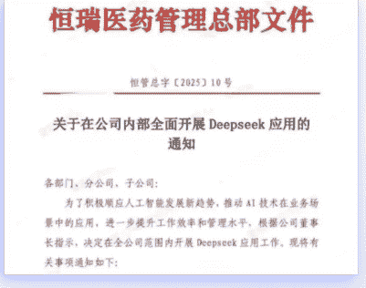

### 产品侧：体验升级
代表产品：华为小艺、飞书
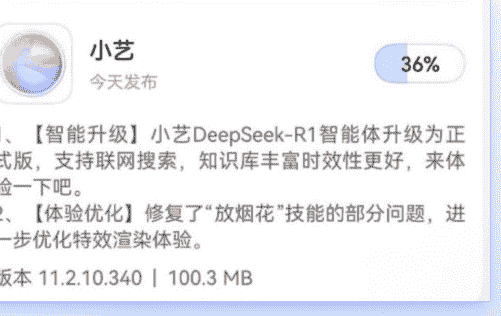

### 开发者侧：编码助力
典型用法：代码生成、代码重写


## 三大核心优势

- **性能强劲**
  水平可与 OpenAI o1 相较

- **成本更低**
  R1 的 API 费用约为 o1 的二十几分之一

- **对开发者友好**
  接口规范兼容 OpenAI 格式

| 模型(1) | 上下文长度 | 最大思维链长度(2) | 最大输出长度(3) | 百万tokens输入价格(缓存命中)(4) | 百万tokens输入价格(缓存未命中) | 百万tokens输出价格 |
| :--- | :--- | :--- | :--- | :--- | :--- | :--- |
| deepseek-chat | 64K | - | 8K | 0.5元 | 2元 | 8元 |
| deepseek-reasoner | 64K | 32K | 8K | 1元 | 4元 | 16元(5) |

## 部署 DeepSeek 的五大决策要素

| 决策要素 | 条件 | 建议方案 |
|----------|------|----------|
| 调用频率 | 长期高频 | 本地自建、云托管 |
| 延迟诉求 | 需极低时延 | 边缘侧部署 |
| 算力与技术储备 | 无运维团队 | 接口调用、云托管 |
| 数据敏感度评估 | 数据敏感 | 本地、私有云 |
| 合规要求 | 合规要求高 | 本地部署加安全审计 |

# 开发者部署方案

- DeepSeek 的三种主流部署方式
  - 官方接口接入
  - 私有化本地运行
  - 云厂商托管
- 其他进阶部署方式

## 三种主流部署方式概览

下文将对三种主流方式给出入门指引：

官方接口
- 亮点：无需运维、按量计费
- 短板：受网络时延影响

本地私有化运行
- 亮点：数据可控、可深度定制
- 短板：需要 GPU 及人工维护

云厂商托管
- 亮点：弹性伸缩、支持混合云
- 短板：依赖厂商、跨云管理复杂

### 官方接口首次接入

使用 DeepSeek 接口前，需先创建密钥
https://api-docs.deepseek.com/zh-cn/api/deepseek-api

创建密钥完成后，可用下面 Python 示例调用接口
```
python
# Please install OpenAI SDK first: `pip3 install openai`

from openai import OpenAI

client = OpenAI(api_key="<DeepSeek API Key>", base_url="https://api.deepseek.com")

response = client.chat.completions.create(
    model="deepseek-chat",
    messages=[
        {"role": "system", "content": "You are a helpful assistant"},
        {"role": "user", "content": "Hello"},
    ],
    stream=False
)

print(response.choices[0].message.content)
```

#### 官方接口关键参数

deepseek-chat 对应 DeepSeek-V3
deepseek-reasoner 对应 Deepseek-R1
max_tokens 默认最大输出为4K，可调至8K
temperature 默认为1.0，建议按场景配置

| 场景 | 温度 |
|---|---|
| 代码生成/数学求解 | 0.0 |
| 数据抽取/分析 | 1.0 |
| 通用对话 | 1.3 |
| 翻译 | 1.3 |
| 创意写作/诗歌创作 | 1.5 |

#### 官方接口常见报错处理

**400 - 格式错误** → 按提示修正请求体
**429 - 速率超限** → 调整请求频率
**401 - 鉴权失败** → 核对 API key 是否正确
**500 - 服务异常** → 稍后重试并联系官方
**402 - 余额不足** → 检查余额并及时充值
**503 - 服务繁忙** → 稍后重试
**422 - 参数错误** → 按错误提示修正对应参数

### 私有化本地部署（1）

本地运行 DeepSeek-R1 蒸馏版，可借助 Ollama、vLLM 等工具简化流程
演示选用 Ollama，下载地址：https://ollama.com/download

1. 安装 Ollama
2. 打开模型库下载 DeepSeek R1
访问 https://ollama.com/library/deepseek-r1
挑选合适的参数规模
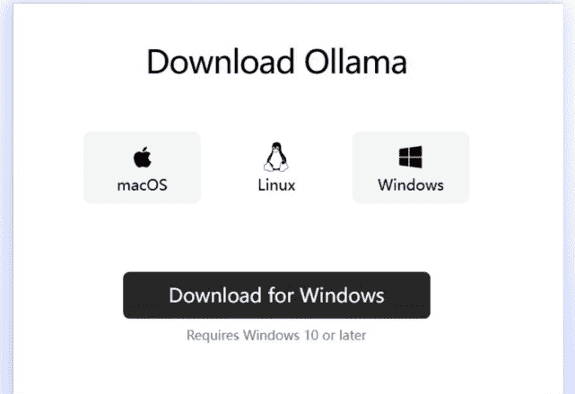
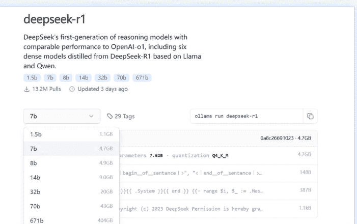

### 私有化本地部署（2）

3. 安装已获取的模型
4. 执行启动命令进行对话
在本地终端输入指令（以 7b 版本演示）
```
ollama pull deepseek-r1:7b
```
执行 ollama list 查看本地模型及占用
```
C:\Users\EDY>ollama list
NAME            ID              SIZE    MODIFIED
deepseek-r1:7b  0a8c26691023    4.7 GB  3 days ago
```
```
C:\Users\EDY>ollama run deepseek-r1:7b
```
对话示例的模型输出如下：
```
>>> 证明1+2大于2

嗯，证明“1加2大于2”，听起来有点奇怪，因为1+2等于3，而3当然大于2啊！不过可能题目表达有点问题，或者是想让我用某种特殊的方式来看待这个问题？

首先，1加2等于3。3确实比2大。这是基本的数学事实，没有争议。

也许，用户想问的是“为什么1加2大于2”，或者是不是在某种不同的情况下？比如，在某些特定的定义下，或者说是在某种特殊的系统中，“大于”可能有不同的意义？

另外，也有可能是“证明1+2>2”，这是一种不等式。让我尝试从数学的角度来分析一下。

首先，我们可以写出来：1 + 2 = 3

然后比较3和2的大小：

因为3 > 2，

所以，1 + 2 > 2

这是不是太直接了呢？可能需要更深入地解释一下为什么“大于”是这样的关系，或者有没有什么隐藏的条件？

比如，在数学中，“大于”是一个基本的概念，表示左边的数在数值上更大。在这个例子里，3确实比2大，所以1加2大于2。

也许还有其他角度可以探讨这个问题？比如说，在不同的数域中，或者结合某些运算规则的情况下，结果会不会有所不同呢？
```

### 云厂商托管部署（1）

国内主流云平台均已接入 DeepSeek 模型，如硅基流动×华为云、腾讯云、百度智能云等。
本例以硅基流动为例，地址：https://cloud.siliconflow.cn/i/adxzw8w3af

1. 注册并登录平台
2. 创建 API 密钥
左侧菜单→API密钥→新建
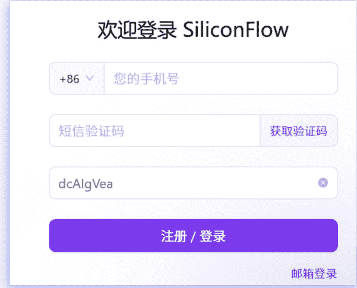
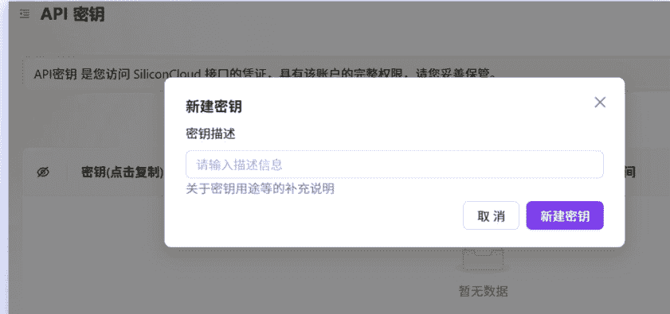

### 云厂商托管部署（2）

3. 安装 AI 开发工具
可选用 Cherry Studio 或 Chatbox AI，本例采用 Chatbox AI：
https://chatboxai.app/

4. 安装后选择接入方
在提供商列表中选择硅基流动
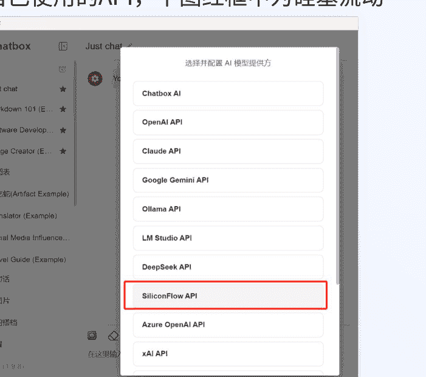

### 云厂商托管部署（3）

5. 填入密钥并选择模型
6. 开始与 R1 对话
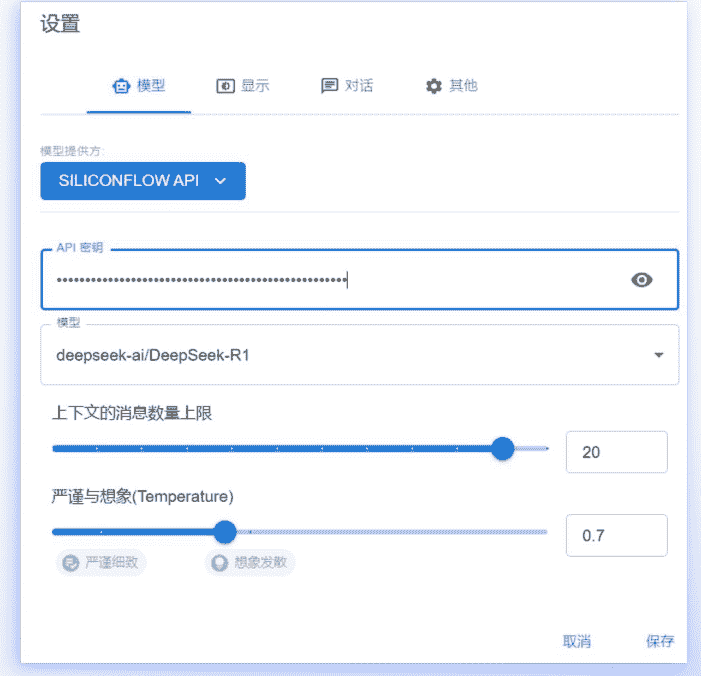
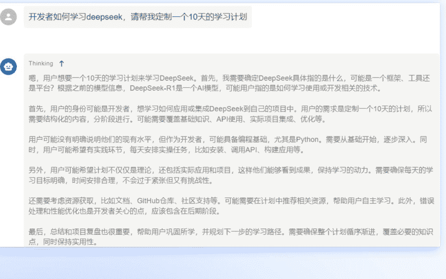

## 其他部署方式

以下为三种进阶部署方式，仅作简要说明，本册不展开：

### 边缘侧部署

在靠近数据源的边缘节点运行轻量化模型
- 亮点：时延极低、离线可用
- 短板：需蒸馏模型、适配边缘硬件

### 容器化微服务部署

通过 Docker/Kubernetes 构建模型微服务集群
- 亮点：资源隔离、支持灰度发布
- 短板：需要 K8s 运维能力

### 混合架构部署

组合多种部署形态
- 亮点：兼顾安全与成本、灵活度高
- 短板：架构设计复杂度提升

# DeepSeek 编码辅助

- 辅助开发基础能力
  - 代码改写
  - 代码解释
  - 代码生成
  - 实用集成工具

## 实例1：代码改写

对代码进行修正、注释、优化等操作。

### 提示词

下面这段代码效率偏低，且未处理边界情况。请先说明问题与解决思路，再给出优化版本：
```
def fib(n):
    if n <= 2:
        return n
    return fib(n-1) + fib(n-2)
```

### 样例输出

#### 问题分析

该函数用递归实现斐波那契数列 `fib(n)`，写法简洁但缺陷明显：

1. **重复计算**：递归会产生大量重复运算。例如计算 `fib(5)` 时，`fib(3)` 与 `fib(2)` 被多次求解，效率低下。
2. **边界处理不全**：仅处理了 `n <= 2`，未对负数输入校验，负数会返回错误结果。
3. **递归深度限制**：n 较大时递归层级可能超出 Python 默认限制，触发 `RecursionError`。

#### 解决方法

1. **记忆化**：缓存已计算值，避免重复。
2. **完善边界**：增加 `n < 0` 的检查并给出合理提示。
3. **迭代替代递归**：用循环计算，避免深度限制。

#### 优化后代码
```
python
def fib(n, memo={}):
    if n < 0:
        raise ValueError("Input must be a non-negative integer")
    if n <= 2:
        return 1
    if n in memo:
```

## 实例2：代码解释

对代码进行解读，理解其功能。

### 提示词

请说明下面这段代码的执行逻辑，并阐述完成的功能：
```
cpp
// weight数组的大小 就是物品个数
for(int i = 1; i < weight.size(); i++) { // 遍历物品
    for(int j = 0; j <= bagweight; j++) { // 遍历背包容量
        if (j < weight[i]) dp[i][j] = dp[i - 1][j];
        else dp[i][j] = max(dp[i - 1][j], dp[i - 1][j - weight[i]] + value[i]);
    }
}
```

### 样例输出

该代码实现了经典动态规划解法，常用于 0/1 背包问题。解析如下：

1. **初始化与遍历**：
   - `weight` 记录物品重量。
   - `value` 记录物品价值。
   - `bagweight` 为背包容量上限。
   - `dp` 为二维表，`dp[i][j]` 表示前 i 个物品在容量 j 下的最大价值。

2. **外层循环**：
   ```
   cpp
   for(int i = 1; i < weight.size(); i++) { // 遍历物品
   ```
   - 从第 1 个物品遍历至 `weight.size()`。

3. **内层循环**：
   ```
   cpp
   for(int j = 0; j <= bagweight; j++) { // 遍历背包容量
   ```
   - 从容量 0 遍历至 `bagweight`。

## 实例3：代码生成（1）

让模型按需求生成代码。

### 提示词

请用xx编程语言生成实现xx目的的代码：
例：请帮我用 HTML 写一个五子棋游戏，全部代码放在一个 HTML 文件中。

### 样例输出

好的！下面是一个基础五子棋网页实现，单文件 HTML 即可运行。可点击落子并自动判断胜负。
```
html
<!DOCTYPE html>
<html lang="zh-CN">
<head>
    <meta charset="UTF-8">
    <meta name="viewport" content="width=device-width, initial-scale=1.0">
    <title>五子棋游戏</title>
    <style>
        body {
            display: flex;
            justify-content: center;
            align-items: center;
            height: 100vh;
            background-color: #f0f0f0;
            font-family: Arial, sans-serif;
        }
        #board {
            display: grid;
            grid-template-columns: repeat(15, 30px);
            grid-template-rows: repeat(15, 30px);
            gap: 1px;
            background-color: #d18b47;
            padding: 10px;
            border-radius: 5px;
        }
    </style>
</head>
<body>
    <div id="board"></div>
    <script>
        // JavaScript code here
    </script>
</body>
</html>
```

## 实例3：代码生成（2）

将生成代码运行测试：

### 五子棋效果预览
```
html
boardData[y][x] = currentPlayer;
drawPiece(x, y, currentPlayer);

if (checkWin(x, y)) {
    setTimeout(() => {
        alert(`${currentPlayer === 1 ? '黑棋' : '白棋'}获胜！`);
        boardData = Array(BOARD_SIZE).fill().map(() => Array(BOARD_SIZE).fill(0));
        initBoard();
    }, 10);
}

currentPlayer = currentPlayer === 1 ? 2 : 1;
status.textContent = `当前玩家：${currentPlayer === 1 ? '黑棋' : '白棋'}`;
});
// 初始化游戏
initBoard();
</script>
</body>
</html>
```
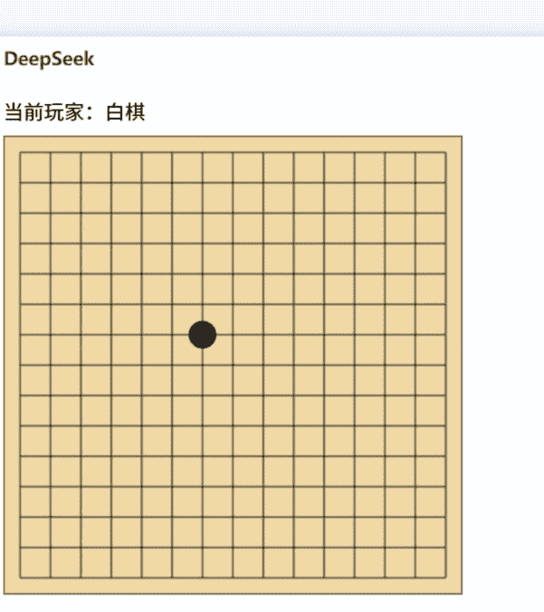

## 实例4：实用集成工具

以下框架已集成 DeepSeek API，可简化开发流程并提升效率。

### AI Agent 框架

| 图标 | 名称 | 描述 |
| :---: | :--- | :--- |

|  | [Anda](https://example.com) | 基于 Rust 打造的 AI 智能体开发框架，聚焦模块化组合、自主运转与长期记忆的智能体网络构建。 |
|  | [YoMo](https://example.com) | 支持状态保持的无服务器 LLM 函数调用框架，具备强类型语言支持。 |
|  | [Alice](https://example.com) | 运行于 ICP 的自主 AI 代理，借助 DeepSeek 等大模型执行链上决策。结合实时数据分析与独特个性，完成代币管理、BOB 挖矿及生态治理参与。 |

### RAG 方案集
| 图标 | 名称 | 描述 |
| :---: | :--- | :--- |
|  | [RAGFlow](https://example.com) | 以深度文档理解为基础的开源检索增强生成引擎，为企业与个人提供流程精简的 RAG 方案，依托 LLM 处理各类复杂格式数据，实现可追溯的可靠问答。 |

### Solana 生态工具
| 图标 | 名称 | 描述 |
| :---: | :--- | :--- |
|  | [Solana Agent Kit](https://example.com) | 开源工具包，用于把 AI 智能体连接到 Solana 协议。搭载 DeepSeek LLM 的智能体目前可自主完成 60 多种 Solana 操作： |

## 附录：已接入 DeepSeek 的应用示例
图片来源：DeepSeek官方

| 图标 | 应用名称 | 描述 |
|------|----------|------|
|  | Chatbox | 跨 Windows、Mac、Linux 的桌面客户端，兼容多款主流 LLM 模型。 |
|  | ChatGPT-Next-Web | 一键部署的跨平台网页界面，原为 ChatGPT 设计，现支持流行 LLM。 |
|  | 留白记事 | 在微信内部直接调用 DeepSeek 管理笔记、任务、日程与待办清单。 |
|  | Pal - AI Chat Client (iOS, ipadOS) | 适配 iPhone 与 iPad 的 AI 聊天助手。 |
|  | LibreChat | 开源且可定制的应用程序，已深度集成 DeepSeek，优化人工智能交互体验。 |
|  | PapersGPT | Zotero 插件，融合 DeepSeek 及其他 AI 模型，辅助论文阅读。 |
|  | RSS翻译器 | 开源轻量、可自行部署的 RSS 内容翻译工具。 |
|  | Enconvo | AI 时代的启动中心与功能入口，同时担任体贴的智能助理。 |
|  | Cherry Studio | 专为创作者打造的桌面版 AI 助手。 |
|  | ToMemo (iOS, ipadOS) | iOS 应用整合短语库、剪切板历史与键盘输出，接入大模型支持在键盘内快速生成内容。 |
|  | Video Subtitle Master | 客户端工具可批量生成视频字幕并翻译至多语言，兼容 mac 与 Windows，支持百度、火山、deeplx、OpenAI、DeepSeek、Ollama 等翻译服务。 |

## DeepSeek 与 AI 学习资源汇总

### 官方网站
访问官网可查阅最新研究进展，下载源代码及官方提示词样例库等资源。
https://www.deepseek.com

### 51CTO官网AI专区
51CTO AI 专区提供 DeepSeek 与 AI 的最新资讯、实战文章、实用资料及行业大咖直播分享。
https://ai.51cto.com

### 51CTO在线课程DeepSeek专区
涵盖 200+ 门、1000+ 小时的 AI 主题视频课程，含 DeepSeek 内容，面向个人与企业学习。
https://b.51cto.com

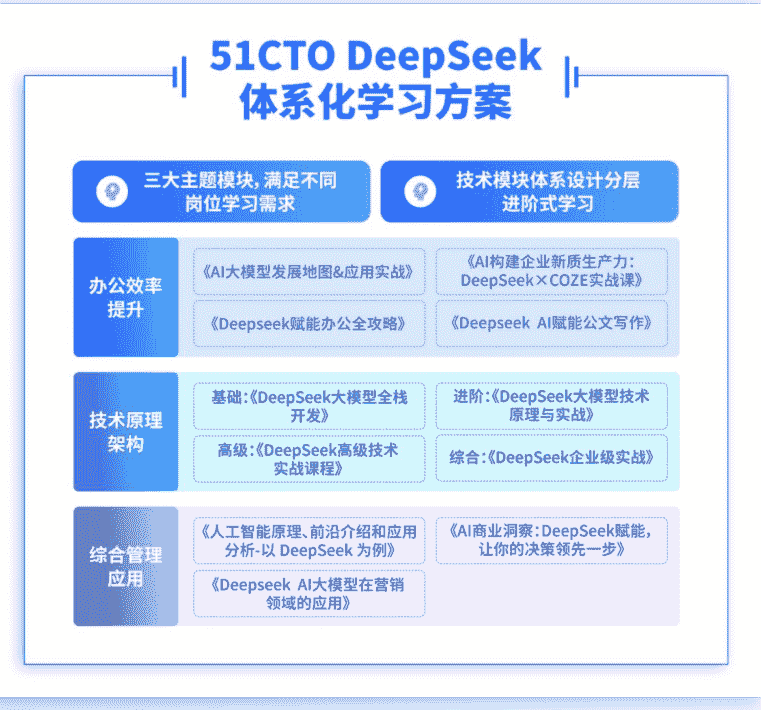
图注：51CTO 企业学堂推出的企业级 DeepSeek 系统化学习方案

## 51CTO
致力于让一亿数字化人才实现终身成长！


扫码关注51CTO，获取更多资料