# DeepSeek全场景实战宝典

# 前言

# 点亮你的随身智囊

欢迎打开这本《DeepSeek全场景应用》使用手册。

试想一下，身边常驻一位全天在线的数字顾问，能帮你起草材料、拆解数据、解答疑问、点燃灵感，甚至在空闲时陪你闲聊，生活会发生怎样的改变？DeepSeek就能做到。它是由国内团队自主研发的对话系统，只要掌握正确的沟通方式，就能明显拉高工作与生活的效能。

# 本书能解决哪些困惑

当你出现下面任一状况，这本书就能给出答案：

- 知道智能工具很强，却不知如何落到具体任务上。
- 已经试过，但回应的质量总是不尽人意。
- 关心该系统在专业场景里能怎么用。
- 希望比同行更早、更快掌握新型工具的使用节奏。

无论是学习者、上班族、创业者，还是任何想提升效率的人，这本书都能助你快速上手，让智能成为个人的效率放大器。

# DeepSeek的差异化能力

作为本土自研的语言系统，DeepSeek在以下维度表现突出：

- 推理深度：不止闲聊，能对复杂议题进行多角度拆解。
- 联网即时检索：可获取最新资讯，不受知识时效束缚。
- 图文混合交互：支持上传图片进行理解与分析。
- 中文本土化：对中文表达和本土文化有深入理解。
- 专业储备厚实：在教育、金融、医疗、法律等领域达到专业水准。

# 如何阅读本书

全书兼顾简洁与实用，像朋友手把手教学：

- 边读边练：打开DeepSeek，立刻复现书中案例。
- 按需查阅：可直接跳至最需要的章节。
- 收藏模板：把书中的提示词模板保存下来反复使用。
- 由浅入深：初学者建议先从第1到3章的基础内容入手。

全书分为四大板块：

- 基础篇：掌握核心功能与提问技巧。
- 行业应用篇：了解各行业的具体用法。
- 进阶技巧篇：学习高级使用策略。
- 未来展望篇：探索助手的发展趋势。

准备好开启学习之旅了吗？让我们一起挖掘DeepSeek的无限可能。

# 第一部分

## 基础篇

## 第1章

### 认识你的AI小伙伴

——DeepSeek

#### 1.1

##### DeepSeek是什么，从哪里来

初次接触这类产品时，你可能会好奇DeepSeek到底是什么，与市面上其他方案有何区别。下面用通俗语言带你认识。

###### 1. DeepSeek的“身世”

DeepSeek是国内自研的大规模语言模型，简单说就是能理解并生成人类语言的智能程序，由深度求索公司DeepSeek Inc.于2023年推出。核心研发人员来自清华大学、微软亚洲研究院等顶尖机构。

###### 2. 成长历程

- 2023年首发：亮相即展现出强大的语言理解与生成能力。
- 模型迭代：2024年5月发布升级版，整体技术显著提升，中文理解尤为突出。
- 功能扩充：2025年1月新增图像理解能力，并可通过联网获取最新信息。
- 专业化方向：逐步推出面向教育、金融、法律等领域的定制化方案。

###### 3. DeepSeek的“超能力”

从技术视角看，DeepSeek具有以下特点：

- 模型规模庞大：最新版本拥有数千亿参数，相当于海量文献的知识储备。
- 训练数据覆盖广：以中文资料为主，对国内用户尤其友好。
- 持续进化：通过人类反馈不断调优，更贴合用户期待。
- 知识可更新：借助联网功能获取新信息，避免陈旧。
- 中文优化到位：针对中文进行专项优化，理解与表达更地道。

简言之，DeepSeek像一位博学、反应快、持续学习的智能伙伴，特别擅长中文交流，懂得国内用户的需求。

#### 1.2

### DeepSeek能做什么

——核心功能概览

DeepSeek提供多种功能，适配不同场景。了解这些特长，有助于明确何时求助、如何求助。

#### 1.2.1 普通对话模式：随时随地的交流伙伴

##### 1. 这是什么
像与朋友聊天一样自然流畅的交流方式，是该模型的基础功能。

##### 2. 有什么特点
- 响应迅速：几乎即时给出回复。
- 对话自然：交流流畅如真人。
- 话题广泛：从生活琐事到专业知识都能聊。
- 保留上下文：能理解对话的前后关联。

##### 3. 适合用来做什么
- 快速查信息。例如，“什么是区块链”。
- 获取创意灵感。例如，“给我几个周末活动点子”。
- 修改润色文字。例如，“帮我润色这封邮件”。
- 简单学习辅导。例如，“解释牛顿第一定律”。

### 小提示
普通对话下，问题越简明，答案越直接。需要即时结果时，这是不二之选。

#### 1.2.2 深度思考模式：处理复杂问题的强力工具

##### 1. 这是什么
当需要更深入、全面的分析时使用的模式，如同请专家仔细推敲问题。

##### 2. 有什么特点
- 分析更深：兼顾多角度与可能性。
- 解答更全：提供系统性结论。
- 逻辑严谨：思路清晰，论证有力。
- 响应稍慢：高质量思考需要时间。

##### 3. 适合用来做什么
- 复杂议题分析。例如，“分析中美贸易关系的未来走向”。
- 决策支持。例如，“比较三种投资策略的优劣”。
- 知识梳理。例如，“总结AI在医疗领域的应用”。
- 多因素评估。例如，“分析开设新店的可行性”。

### 小提示
使用深度推理时，请提供充分背景并明确具体诉求。耐心等待，思考的价值值得等待。

#### 1.2.3 联网搜索模式：获取最新信息的窗口

##### 1. 这是什么
可搜索互联网获取最新信息，打破知识与时间限制的功能。

##### 2. 有什么特点
- 实时获取：可查询最新事件与数据。
- 标注来源：告知信息出处，更具可信度。
- 整合分析：不仅检索，还会归纳分析。

##### 3. 适合用来做什么
- 查询最新新闻。例如，“最近的奥运会进展如何”。
- 获取实时数据。例如，“今年的通胀率是多少”。
- 了解市场动态。例如，“近期智能手机市场趋势”。
- 事实核查。例如，“这个说法是否准确”。

### 小提示
需要最新信息时，明确提示联网查询。与深度推理模式结合，效果更佳。

#### 1.2.4 图文理解能力：不止于文字的交流

##### 1. 这是什么
不仅能读文字，还能“看懂”图片，实现图文结合交互。

##### 2. 有什么特点
- 识别图像内容：理解图片中的物体、场景与文字。
- 解析图像信息：对图面内容进行解读。
- 混合输入处理：同时处理图片与文字问题。

##### 3. 适合用来做什么
- 图片内容描述。例如，“这张图上有什么”。
- 图表数据解读。例如，“解析这份销售图表的趋势”。
- 提取图内文字。例如，“提取名片上的联系方式”。
- 基于图片创作。例如，“根据这张图写个小故事”。

### 小提示
上传图片时，说明关注重点可获得更精准回答。图片越清晰，分析越准确。

#### 1.3

### 为什么选择DeepSeek

——与其他产品的比较

在众多智能产品中，DeepSeek有哪些独特价值？对国内用户而言，这些差异能帮助你选择最合适的工具。

##### 1. 本土化优势
- 中文理解更到位：能捕捉语言微妙处与文化背景。例如理解“打酱油”并非字面意思。
- 熟悉国情：对国内社会制度、政策法规、文化传统有全面认知。
- 贴近本地场景：针对春节习俗、国内职场文化等本土需求优化。

##### 2. 功能组合优势
- 深度推理加联网检索：兼具分析力与信息新鲜度。
- 图文结合交互：可上传图片分析图表、截图等，拓展应用边界。
- 模式灵活切换：按需自由切换，优化体验。

##### 3. 擅长领域
- 教育辅导：了解国内教育体系与考试制度，提供针对性帮助。
- 职场应用：熟悉本土职场文化，协助起草带本土风格的商务文档。
- 创意写作：创作符合国内读者审美的文本，理解中文创作特点。
- 专业咨询：在医疗、法律、金融等领域具备国内相关知识。

DeepSeek与其他AI助手的对比如表1-1所示。

##### 表1-1 DeepSeek与其他AI助手的对比

| 对比角度 | DeepSeek | 其他 AI 助手 |
| :--- | :--- | :--- |
| 中文理解 | 深入理解中文表达习惯和文化内涵 | 可能对中文特殊表达理解有限 |
| 本土知识 | 熟悉中国国情和社会现实 | 对中国特色内容的了解不够深入 |
| 实时信息 | 通过联网获取最新信息 | 知识可能有时间限制 |
| 思考深度 | 有专门的深度思考模式 | 分析深度可能不够 |
| 应用场景 | 针对中国用户对场景进行优化 | 场景适配可能不够本土化 |

了解这些差异，能让你在合适场景充分发挥DeepSeek优势，获得更好体验。

#### 1.4

### 入门必知：基本概念简明解释

使用DeepSeek前，掌握几个基础概念会更顺畅。下面用最简单语言说明。

##### 1. 大语言模型
想象一个读过海量书籍、文章、网页的超级学霸，能记住并善于理解与表达，就是大语言模型LLM的核心。DeepSeek正是这样的“数字学霸”。

##### 2. 提示词
提示词就是你对DeepSeek说的话，即需求表达。像对朋友说“帮我查今天天气”一样，清晰表达越重要。提示词质量直接影响答案质量。

##### 3. 上下文
上下文即对话的前后关联。DeepSeek会“记住”既往内容，无需每次重复背景。比如在聊电影时直接问“导演是谁”即可。

##### 4. 令牌
令牌是AI处理文本的基本单位，类似计算机对文字的切分。中文约2~3个字符为一个令牌。普通用户只需知道对话有长度限制，超长可分段。

##### 5. 参数
参数可理解为AI的知识容量。参数越多，通常能力越强。DeepSeek拥有数千亿参数，是处理复杂问题的基础。

##### 6. 输出控制
指告诉DeepSeek期望的回答方式，如长度、格式、风格。例如要求“表格形式”或“不超过500字”。

##### 7. 知识截止日期
AI基础知识有时间边界，超出该时间的事可能不知。如截止2024年10月，则可能不知11月之事。联网功能可弥补时效。

##### 8. 多轮对话
多轮对话是持续来回交流而非一问一答。可逐步引导，让答案更贴合期望。

##### 9. DeepSeek的思维方式
- 并非真正理解，而是基于大数据学习模式预测合适回复。
- 如同统计学家，根据见过的文本生成新内容。
- 清晰具体指令有助于更准确回答。
- 富有创意，但也可能出现事实错误。
- 专业内容建议批判性核查。

掌握这些基础，你就能更得心应手地使用DeepSeek。后续章节将教你设计高效提示词，这是使用AI的关键技能。

### 本章小结：认识你的AI小伙伴

——DeepSeek

本章介绍了DeepSeek作为国产大语言模型的基本概况与核心功能。

核心功能：
- 1）普通对话模式：提供快速自然的交流体验。
- 2）深度推理模式：处理复杂问题，提供深入分析。
- 3）联网检索模式：获取最新信息，打破知识与时间限制。
- 4）图文理解能力：分析图片内容，实现图文结合交流。

比较优势：相比其他AI，DeepSeek中文理解更到位，熟悉国情，贴近本地生活，在教育辅导、职场应用、创意写作和专业咨询等领域具特殊优势。

基本概念：解释了大语言模型、提示词、上下文、令牌、参数等，帮助用户理解工作原理与使用方法。

### 【关键启示】

- 1）DeepSeek是强大的智能助手，特别契合国内用户需求。
- 2）了解不同功能模式，可针对需求选择合适方式。
- 3）掌握基本概念有助于更有效地使用智能助手。
- 4）DeepSeek的思维方式与人类不同，清晰指令带来更准确答案。
- 5）DeepSeek是实用智能工具，合理使用可节省时间精力。

## 第2章

### 如何正确“对话”

——提示词设计指南

与AI交流的关键在于提问方式。问路时，“附近有地铁站吗”和“请问最近的地铁站怎么走，我要去市中心”会得到不同质量的回答。本章教你设计高效提示词。

#### 2.1

### 提示词的基本结构与黄金法则

#### 2.1.1 提示词的四大组成部分

完整有效的提示词通常包含：

- 1）指令：明确告诉AI需要做什么，如“分析”“总结”“创作”。
- 2）背景：提供必要情境，帮助AI理解任务环境。
- 3）内容：需要处理的材料或信息。
- 4）期望：说明对回答格式、长度、风格的要求。

四者不必每次全备，但信息越完整，答案越准确。

#### 2.1.2 提示词设计的五条黄金法则

##### 1. 要明确，不要含糊
✗ 含糊：“帮我写点关于健康的东西”。
✓ 明确：“请写一篇800字文章，介绍上班族每天可做的5个简单健身动作”。

##### 2. 要具体，不要笼统
✗ 笼统：“给我一份营销方案”。
✓ 具体：“为北京一家新开奶茶店设计面向大学生的社交媒体营销方案，预算5000元”。

##### 3. 要相关，不要偏题
只提供与任务直接相关的信息，避免无关内容干扰理解。

##### 4. 要有条理，不要混乱
使用编号、分段或小标题，让复杂指令更有结构，便于理解。

##### 5. 要善于调整，不要一成不变
根据AI的回复适当调整提问方式，这是一个互动过程。

#### 2.1.3 五种常见的提示词类型

##### 1. 简单问答型：直接询问信息或解释
什么是元宇宙？请用通俗易懂方式解释。

##### 2. 任务指派型：要求完成特定任务
请为我的小型咖啡店设计一个春节促销方案，包含时间、折扣信息和宣传口号。

##### 3. 角色扮演型：让AI以特定身份回应
请你作为有10年经验的职业规划顾问，分析我目前的职业困境并给出建议。

##### 4. 步骤引导型：引导AI按步骤思考
请帮我分析销售问题。首先找出下滑的可能原因，再提出三项改进措施，最后设计实施计划。

##### 5. 格式指定型：要求特定输出格式
请以表格形式对比三种常见理财方式：基金、股票和储蓄，从风险、收益和适合人群三方面比较。

合理组合要素与类型，可设计出适配各种需求的有效提示词。与AI交流是一门艺术，需要不断练习。

#### 2.2

### 如何精准描述你的需求

向DeepSeek精准描述需求，就像向厨师详细说明口味偏好一样重要。

#### 2.2.1 使用明确的行动动词

以清晰动词开头，直接告知AI该做什么。

- 分析：深入研究主题，找出关键因素。
- 比较：对比异同。
- 总结：提炼关键信息保留要点。
- 解释：用通俗方式阐述复杂概念。
- 列举：以条目形式提供多个项目。
- 评估：按特定标准判断。
- 创作：生成原创内容。
- 改进：优化现有内容。

示例：
分析2024年电动汽车市场的三大变化趋势。
比较在线教育和传统课堂的优缺点。
总结这篇关于气候变化文章的主要观点。
解释人工智能工作原理，使10岁孩子也能理解。
列举提高工作效率的10个实用技巧。
评估三种营销策略的可行性和潜在效果。
创作一篇关于春天的散文，风格温馨感人。
改进这封求职信，使其更专业、更有说服力。

#### 2.2.2 明确任务的范围和界限

通过具体参数限定任务范围。

- 数量限制：指定数字。提供5个周末亲子活动创意。
- 时间范围：明确时段。分析最近三年中国电商行业发展变化。
- 地域限制：指定地区。介绍上海地区的特色小吃。
- 深度要求：说明分析深度。深入分析人工智能对就业市场的长期影响。
- 受众定位：指明对象。请写一篇面向小学三年级学生的科普文章，解释为什么会下雨。

#### 2.2.3 使用精确的限定词

#### 2.2.4 提供处理示例

通过示例说明期望的处理方式或结果格式。

请分析以下客户反馈，提取主要问题并分类。

写作示范格式：

- 品控问题：缺陷A，缺陷B。
- 服务问题：差评C，差评D。
用户原声：［把客户反馈原文贴在这里］。

提问效果对比：模糊提问 vs 精准提问。

模糊提问：
帮我写个广告。
问题所在：完全没有给出背景，AI不知道要推什么产品、面向谁、用什么调性。

精准提问：
请为我经营的手工皮具工作室写一篇微信公众号推文。主推一款售价600元的真皮手工钱包，面向25到40岁的都市白领。要突出手工打磨的细节和耐用性，语气简洁大气，控制在300字内，并配一个抓人眼球的标题。
亮点：产品、人群、卖点、风格、篇幅、格式全部讲清楚。

正是这种细化的表达方式，能让DeepSeek快速抓住重点，给出更对味的答案。记住，跟AI沟通，清晰比花哨更重要。

### 2.3 为AI设定角色与场景，获得更贴合的回答
让模型进入一个具体的身份或情境，就像给演员发剧本一样，输出会更专业、更贴心。

#### 2.3.1 角色设定方法
给模型一个明确的身份，能让它从对应专业的视角来回应。

##### 1. 指定专业身份
让DeepSeek化身某领域专家。
请以资深营销总监的身份，帮我审视这份推广方案的优缺点。
常见身份参考：
- 行业专家：营销专家、产品经理、HR总监
- 学术身份：历史学教授、物理学家、文学评论家
- 技术身份：软件工程师、数据科学家、UI设计师
- 创意身份：资深编剧、广告创意总监、小说家

##### 2. 明确经验年限
把角色的资历说清楚，专业度才会对上。
请扮演一位带班15年的小学语文老师，设计一个提升孩子阅读兴趣的家庭小活动。
经验分级参考：
- 初级：1~3年，基础扎实
- 中级：3~7年，实践丰富
- 高级：7~15年，能处理复杂问题
- 资深：15年以上，对行业有全局认知

##### 3. 多视角拆解
从不同立场看同一个问题，结论更全面。
请分别从家长、老师、孩子三个角度，分析限制电子游戏使用利弊。

##### 4. 面向特定受众
明确读者是谁，语言和深度自然调整。
请用科普作家的口吻，向6~8岁的孩子解释天空为什么是蓝色。

##### 5. 场景构建技巧
给任务加上真实背景，模型更容易理解上下文。

##### 6. 补充关键背景
描述任务相关的核心情况。
背景：我刚开了一家咖啡馆，位置在大学城，客群主要是大学生和年轻上班族，现在客流偏少。
任务：请设计一套拉新促活的优惠方案。

##### 7. 把目标说透
讲清楚想达到什么效果。
目标：通过这封续约邮件，既说服客户续签，又保持长期友好合作。语气专业亲和。

##### 8. 说明限制条件
把边界条件提前讲明。
限制：预算最高3000元，一周内落地，店里只有3名员工。

##### 9. 模拟真实场景
构建具体情境让任务更像真实工作。
场景：假设你是一家小科技公司的人事经理，需要劝回一位核心技术骨干。该员工工龄3年，离职原因指向薪酬和成长。
任务：给出挽留方案，包含沟通思路和可调整建议。

#### 2.3.2 组合应用案例

##### 例1：商业策略咨询
角色：请扮演一位在快餐业深耕8年的市场顾问。
背景：我们是南京一家小餐饮连锁，目前5家店，主要服务周边白领。近期对手纷纷推出健康餐线，对我们客流造成冲击。
任务：解读国内快餐的健康化趋势，并为我们定制菜单调整方案，涵盖新品方向和营销打法。
目标：3个月内客流提升15%，客单价提高10%。
限制：预算不超过5万元，需在现有厨房设备上实现。

##### 例2：教学内容设计
角色：请扮演一位有10年小学语文教学经验、市级优秀教师。
背景：我要给三年级学生上《狐狸和乌鸦》寓言课。孩子们对阅读兴趣一般，但对动物故事很感兴趣。
任务：设计一节40分钟的课堂活动，包含导入、讲解、互动讨论和延伸环节，要有趣且能抓住注意力。
目标：激发阅读兴趣，培养思考力与道德意识。
限制：普通教室，教具仅限黑板、粉笔和简单手工材料。

#### 2.3.3 操作要点总结
- 真实具体：场景要贴近现实，给出细节而不是空话
- 高度相关：背景信息必须与任务相关，避免无关累赘
- 目标清晰：明确期望结果
- 量身匹配：按任务挑选合适的角色与情境
- 适度详尽：信息足够理解任务即可，避免过度冗长

掌握角色与情境构建，就能引导DeepSeek更精准理解需求，给出更落地的答案。

### 2.4 精准控制回答的格式与范围
跟朋友请教时你会说“简单说两句”或“详细讲讲”。对AI也一样，提前约定格式和深度，成品更省心。

#### 2.4.1 把控长度与深度

##### 1. 约定字数篇幅
直接告诉模型需要多长。
请写一篇约600字的文章，介绍AI在家庭生活中的应用。
长度建议：
- 短文本300字内：简述、要点、摘要
- 中等300~800字：常规文章、简报
- 长文800~2000字：深度分析、报告
- 超长2000字以上：研究白皮书

##### 2. 设定专业深度
让内容与读者匹配。
请用新手能听懂的方式解释区块链是什么，少用术语，多打比方。
专业度划分：
- 小白级：零基础也能懂
- 入门级：有基础概念非专业者
- 专业级：行业从业者
- 专家级：资深研究者

##### 3. 约定风格语气
明确表达方式。
请用温暖鼓励的语气，给新入职员工写一封欢迎信。风格正式友好，体现人文关怀。
常用风格指引：正式/非正式、学术/通俗、严肃/轻松、专业/对话、客观/感性

##### 4. 指定内容要素
说明必须包含或排除的部分。
请分析近期楼市走势，必须覆盖价格变化、政策影响、购房建议三块，不要涉及海外市场。

#### 2.4.2 指定输出形式

##### 1. 结构化呈现
告诉模型如何组织。
请按以下框架分析公司经营：
1. 收入分析含同比
2. 成本结构
3. 利润率评估
4. 发展前景
5. 投资建议

##### 2. 表格形式
便于横向对比。
请用表格对比Python、Java、JavaScript，从学习难度、应用领域、就业前景、社区支持四个维度比较。

##### 3. 列表形式
适合条目化输出。
请列出10个提升工作效率的方法，每条配简短说明和一个小技巧。

##### 4. 问答形式
适合教学类内容。
请用问答形式整理健康饮食科普，包含8个常见问题及简明答案。

##### 5. 自定义模板
提供模板让模型填充。
请按以下模板写5条新品社媒文案。
标题：[突出产品亮点]
正文：[2~3句介绍]
行动号召：[一句促动语]
话题标签：[3~5个标签]

#### 2.4.3 综合示范
任务：撰写中国新能源汽车市场分析报告
格式要求：
- 字数：1000~1200字
- 专业度：懂商业但非汽车专业的决策者能读懂
- 风格：客观专业，数据支撑
- 语言：简洁，避免堆砌术语
结构：
1. 执行摘要100字内
2. 市场现状：规模、主流品牌、增速
3. 消费者画像：人群特征与决策因素
4. 技术趋势：聚焦三大方向
5. 政策环境：影响解读
6. 未来三年预测：要点呈现
7. 企业对策建议
其他要求：
- 每部分配小结
- 至少一个案例
- 突出中国市场特性，减少国际对比

明确格式与范围，能大幅减少返工。

### 2.5 高效提示词模板库
以下模板可直接套用，换成自己的内容即可。

#### 2.5.1 单轮对话常用模板

##### 1. 信息查询模板
请提供关于[主题]的详细资料，重点涵盖：
1. [要点1]
2. [要点2]
3. [要点3]
要求：
- 深度：[基础/中级/高级]
- 语言：[通俗/专业/学术]
- 字数：约[字数]字

##### 2. 方案设计模板
请为以下场景设计方案：
背景：[情况描述]
目标：[期望结果]
受众：[目标人群]
资源限制：[限制条件]
要求：
1. 需包含[要求1]
2. 需考虑[要求2]
3. 输出格式：[格式]

##### 3. 内容创作模板
请创作一篇[类型]，主题[主题]
要求：
- 字数：约[字数]
- 风格：[风格]
- 目标读者：[读者]
- 必须要点：[要点]
- 结构：[结构]
注意：[特殊要求]

##### 4. 分析评估模板
请分析以下内容：
[待分析内容]
分析要求：
1. 评估[维度1]
2. 分析[维度2]
3. 总结[维度3]
深度：[基础/深入/专业]
输出格式：[格式]

##### 5. 比较对比模板
请对比：
- A：[描述]
- B：[描述]
- C：[可选]
维度：
1. [维度1]
2. [维度2]
3. [维度3]
4. [维度4]
输出：
- 表格呈现
- 综合结论与推荐
- 其他说明

#### 2.5.2 多轮对话常用模板

##### 1. 分步解决问题模板
我需要解决[领域]的复杂问题，请分步思考。
问题：[描述]
第一步，分析核心问题及关键因素。
第二步，提出可行解法。
第三步，评估优缺点与可行性。
第四步，给出推荐方案与执行步骤。

##### 2. 反馈迭代模板
请帮我创作[内容类型]。
初始需求：[需求]
收到初稿后，请按以下反馈修改：
1. [反馈1]
2. [反馈2]
最终优化：
1. [优化1]
2. [优化2]

##### 3. 专家咨询模板
我想就[主题]做专业咨询，请以[专家类型]角度回答。
背景：[背景]
问题1：[问题]
后续问题：基于回答请进一步说明[细节]
最后请就[方面]给出建议与落地方案。

#### 2.5.3 创作类模板

##### 1. 文章写作模板
请撰写关于[主题]的[类型文章]
要求：
- 标题：吸引人且贴题
- 受众：[读者]
- 风格：[风格]
- 字数：约[字数]
- 结构：引言、2~4个主体部分、结论
- 要点：必须包含[要点]
- 语调：[语调]
- 专业度：[级别]
特别要求：[额外要求]

##### 2. 营销文案模板
请为[产品/服务]创作营销文案
产品信息：
- 名称：[名称]
- 特点：[特点]
- 目标用户：[用户]
- 卖点：[卖点]
- 价格：[价格]
需求：
1. 宣传口号20字内
2. 产品描述100字左右
3. 社媒短文案5条，每条60字内
4. 优势列表5~8点
5. FAQ 3~5问答
风格：[风格] 情感诉求：[诉求]

##### 3. 脚本创作模板
请创作[视频/短剧/广告]脚本，主题[主题]
基本信息：
- 时长：约[时长]分钟
- 受众：[观众]
- 核心信息：[信息]
- 基调：[风格]
要求：
- 角色设置：[角色]
- 场景：[场景]
- 结构：[结构]
- 特殊元素：[元素]
格式：标准脚本格式，含场景描述、对白、动作，场景转换清晰，对白自然

#### 2.5.4 分析类模板

##### 1. 数据分析模板
请分析以下数据：
[数据描述]
需求：
1. 总体趋势
2. 关键指标解读：[指标]
3. 异常值及原因
4. 比较分析：[维度]
5. 相关性分析：[变量]
输出：
- 主要发现≥5条
- 可视化文字描述
- 建议行动点3~5条
- 分析局限说明
专业水平：[级别]

##### 2. SWOT分析模板
请对[对象]进行SWOT分析
背景：[背景]
要求：
1. 优势：内外部积极因素
2. 劣势：内部消极因素
3. 机会：外部有利因素
4. 威胁：外部不利因素
5. 综合策略建议
输出：
- 每维度5~8条配简述
- 表格汇总
- 3~5条可执行行动

##### 3. 竞品分析模板
请分析[目标对象]竞品
对手：1.[A] 2.[B] 3.[C]
维度：产品功能、价格策略、目标用户、市场定位、营销策略、用户体验、技术实力、市场份额
输出：
- 表格对比
- 优劣分析
- 差异化优势识别
- 潜在威胁
- 战略建议

##### 4. 用户画像模板
请基于信息创建[产品/服务]用户画像
产品描述：[描述]
已知数据：[数据]
市场定位：[定位]
要求：
- 3~5个典型画像
- 每人含：人口统计、行为特征、需求痛点、价值观、场景、使用期望
输出：
- 具体人物名+简介
- 维度化呈现
- 优化或营销建议

灵活使用模板能显著提升沟通效率。最好的提示词是为具体任务定制的提示词。

### 本章小结：如何正确对话
- 提示词四要素：指令、背景、内容、期望，越完整越准确
- 五条黄金法则：明确具体、相关有序、灵活调整
- 精准描述：动词明确、范围界定、限定词准确、示例辅助
- 角色与情境：指定身份或背景，获取更贴切输出
- 格式与范围：控制长度、深度、专业度、风格并指定格式
- 模板库：覆盖单轮、多轮、创作、分析等常用场景

### 【关键启示】

# DeepSeek 零基础上手指南：从提问技巧到日常操作

提示词的优劣直接决定了AI回复的质量，掌握设计思路是关键。

清晰明确的指令能让DeepSeek更快抓住你的意图。

为AI设定角色和构建具体场景，回答会更贴合实际使用需求。

提前说明想要的格式和边界，能大幅减少反复修改的成本。

善用提示词模板，可以显著提升对话效率。

提示词设计本身就是一门需要不断练习的技艺。借助以上要点，你能让DeepSeek的回答更准确、更实用，真正成为工作和生活里的得力伙伴。

## 第3章 DeepSeek使用基础

### 3.1 界面概览：初识DeepSeek操作面板

把DeepSeek想象成一台智能车，界面就是操作舱。出发前先熟悉一下舱内布局。

##### 1. 如何进入DeepSeek
- 官方网站直接访问：https://www.deepseek.com。
- 记忆友好的快捷入口：https://ai.com。

##### 2. DeepSeek界面的四大区域
登录后页面主要由四个区块构成（见图3-1）。

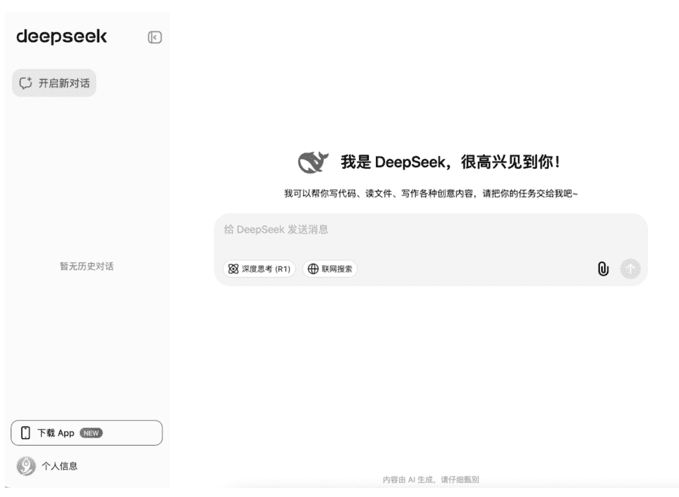

(1) 左侧边栏。相当于控制台，可以：
- 点“开启新对话”开始新会话。
- 查看历史对话列表。
- 下载App并调整个人设置。

(2) 中间对话区。这是与模型交互的主窗口，实时显示对话内容。

(3) 底部输入区。用于：
- 键入问题或需求。
- 上传附件。
- 语音输入，支持设备前提下可用。

(4) 功能控制区。提供三种工作模式切换：
- 普通对话模式，为默认状态。
- 深度思考模式，适合复杂推理。
- 联网搜索模式，可获取最新信息。🌐

### 小提示
想让理解更到位，可以试试：
- 用分段清晰的文字，避免信息堆砌。
- 复杂需求用数字序号 1、2、3 拆解。
- 重要词语可用引号或加粗强调。

##### 3. 移动端的差异体验
手机使用时：
- 布局自动变为竖向，适配小屏。
- 支持滑动、长按等手势操作。
- 外出场景下语音输入更便捷。

掌握基本布局后，就能开始探索更多功能了，就像学会了基础驾驶后，接下来就是去往各个目的地。

### 3.2 对话记录管理：打理你的个人知识库

DeepSeek的历史记录相当于你的私有知识库，整理得好就能随时调用过往智慧。只要同一账号登录，不同设备记录都会同步。

##### 1. 整理对话的基础方法
(1) 查看历史记录。
- 左侧边栏展示全部历史。隐藏时点左侧“打开边栏”图标即可显示。
- 最新会话排在最前，每个条目显示标题与最后更新时间。

(2) 为对话命名。
- 新建对话默认取开头内容作标题。
- 重命名方式：点击对话旁“…”选择“重命名”。
- 命名建议：用具体名称，如“2024年春季旅行计划”，避免仅写“旅行”。

(3) 快速定位。
- 浏览器内按 Command+F 或 Ctrl+F 搜索关键词。
- 以项目名、日期或专有词汇检索效率更高。

##### 2. 保持整洁的小习惯
(1) 定期维护。
- 每周花几分钟为新对话命名。
- 每月清理一次，删除无用记录。

(2) 提升质量。
- 单个对话聚焦一个主题，避免混杂。
- 新话题建议开新对话。
- 开场简要说明需求，便于日后查找。

(3) 重要内容保存。
- 可导出为ZIP压缩包保存。
- 也可复制到Word等文档备份。

##### 3. 跨设备使用
(1) 同步要点。
- 各设备使用同一账号登录。
- 电脑或手机都能看到相同记录。

(2) 无缝切换。
- 手机开始的会话可在电脑续聊。
- 不同设备操作细节略有差异。

##### 4. 隐私保护
谨慎处理敏感信息。
- 含隐私的对话定期导出或删除。
- 避免分享过度私密个人信息。

##### 5. 让历史成为助手
(1) 学习效率提升。
- 定期回顾重点对话，复习知识点。
- 横向对比相关主题，加深理解。

(2) 工作效率提升。
- 保存高频问题模板，避免重复输入。
- 统计常问问题类型，提前优化提问方式。

通过上述管理，你的对话历史会变成整洁可查的个人知识库。

### 3.3 文件上传功能：让AI阅读你的文档

DeepSeek不仅能聊天，还能读取各类文件，相当于一位随时待命的文档助理。

##### 1. 上传文件的基本常识
(1) 支持的文件类型。
- 文档类：TXT、DOCX、PDF、Markdown 等。
- 图片类：JPG、PNG 等。
- 数据类：CSV、XLSX 等。

(2) 上传方式。
- 点击输入框旁的“上传附件”图标。
- 直接拖拽文件至对话区。
- 手机端从相册或文件管理器选择。

(3) 大小限制。
- 单个文件上限100MB。
- 单次对话最多50个文件。
- 超大文件建议拆分或压缩。

##### 2. 上传后的操作
(1) 确认上传成功。
- 检查是否显示文件名。
- 失败时核对格式与大小。

(2) 下指令。
- 说明具体任务，如“请总结这份报告的核心观点”。
- 指定关注范围，如“请分析第二章的数据”。
- 明确输出形式，如“提取关键数据并整理成表格”。

(3) 示例。
上传季度报告后可说：
我刚上传季度报告，请：
① 提取主要财务数据。
② 概括市场分析要点。
③ 列出文中提到的未来计划。

##### 3. 不同类型文件的处理技巧
(1) PDF或Word。
- 指定页码：“请分析第10到15页”。
- 精准定位：“提取所有‘财务分析’段落”。
- 格式检查：“报告格式是否统一”。

(2) Excel或CSV。
- 数据分析：“找出销售最好的三类产品”。
- 可视化建议：“这些数据适合哪种图表”。
- 数据清洗：“排查异常或错误值”。

(3) 图片。
- 内容描述：“描述这张图的主要内容”。
- 文字提取：“识别图片上的所有文字”。
- 图表解析：“说明这张图表的趋势”。

##### 4. 进阶技巧
(1) 多文档对比。
上传多个相关文件后要求对比异同。
(2) 大文档策略。
- 分步处理：先整体概述，再指定深入部分。
- 按章节拆分逐一分析。
(3) 转换与提取。
- 格式转换：“转成PPT大纲”。
- 精准提取：“提取所有数据点和关键发现”。

##### 5. 常见问题与对策
(1) 上传失败。
检查格式是否支持，大小是否超限，换浏览器重试。
(2) 内容理解不准。
确保文档清晰可读，给出更具体的指引，扫描件需文字清晰。
(3) 处理不完整。
任务拆小，限定分析范围，提问更具体。

掌握文件上传，能节省大量阅读和分析时间。

### 3.4 模式选择：为任务匹配合适的工具

DeepSeek提供多种工作模式，像多功能工具，可根据需求切换。

##### 1. 三种主要模式
(1) 普通对话模式，默认。适合简单问答，响应快。
(2) 深度思考模式。适合复杂推理，回答更全面但耗时稍长。
(3) 联网搜索模式。可获取网络最新信息，适合时效性需求。

##### 2. 如何选择
(1) 先判断问题类型。
- 基础问答→普通模式。
- 复杂分析→深度思考。
- 最新信息→联网搜索。
(2) 考虑时间。
- 追求速度→普通模式。
- 允许等待→深度思考。
- 必须最新→联网搜索。

##### 3. 典型场景
(1) 普通模式：日常问答、短文写作、概念解释、简单建议。
(2) 深度思考：复杂问题分析、多角度评估、论文报告撰写、逻辑推理。
(3) 联网搜索：新闻查询、实时数据、产品价格、事实核验。

##### 4. 切换方式
切换时机：初始回答不够深入、需要最新资料、对话卡顿。
操作：通过界面开关切换。

##### 5. 组合使用技巧
- 联网搜索+深度思考：先搜集最新资料，再进行深度分析。
- 循序渐进：先用普通模式了解基础，再联网补充最新信息，最后深度整合。

##### 6. 使用提醒
- 明确期望，平衡时间、深度与准确性。
- 每种模式有适用边界，复杂问题仍需多轮交流。

选对模式往往比堆砌提示词更有效。

### 3.5 疑难解答：常见问题快速排解

使用中遇到问题可参考以下汇总。

##### 1. 输入与响应问题
**表3-1**

| 遇到的情况 | 可能原因 | 解决办法 |
| :--- | :--- | :--- |
| 无响应或很慢 | 网络不稳、系统繁忙、问题过复杂 | 检查网络、刷新重试、拆分为小问题 |
| 回答中断 | 网络中断、内容限制 | 提示“请继续”、重述问题、检查敏感内容 |
| 无法输入或提交 | 浏览器异常、登录状态异常 | 更换浏览器、清除缓存、重新登录 |
| 提示内容过长 | 超出输入限制 | 缩短文本、分次输入、简化格式 |

##### 2. 回答质量问题
**表3-2**

| 遇到的情况 | 可能原因 | 解决办法 |
| :--- | :--- | :--- |
| 回答不相关 | 问题不清晰、理解错误 | 表述更明确、重开对话、举例说明 |
| 回答太笼统 | 问题宽泛、未开启深度思考 | 提出具体问题、开启深度思考、缩小范围 |
| 出现错误信息 | 知识有限、未联网核实 | 开启联网搜索、提供正确信息纠正 |
| 重复或过长 | 指令不明确 | 要求简洁、设定格式、限制字数 |

##### 3. 文件处理问题
**表3-3**

| 遇到的情况 | 可能原因 | 解决办法 |
| :--- | :--- | :--- |
| 无法上传 | 格式不支持、文件过大 | 转为支持格式、压缩或分割 |
| 内容处理不准 | 格式复杂、质量差 | 使用标准格式、提升清晰度、补充说明 |
| 图片无法识别 | 格式问题、图片模糊 | 用JPG/PNG、提高质量、添加文字描述 |
| 图表解读不准 | 图表复杂、缺少说明 | 提供说明、指出关注数据 |

##### 4. 账户与隐私问题
**表3-4**

| 遇到的情况 | 可能原因 | 解决办法 |
| :--- | :--- | :--- |
| 历史不同步 | 设备登录不一致、同步失败 | 确认同一账号、手动触发同步 |
| 无法删除记录 | 权限问题、同步延迟 | 清除缓存、检查设置、等待同步 |
| 隐私担忧 | 敏感信息风险 | 避免输入敏感信息、阅读隐私政策、用通用示例 |

##### 5. 功能使用问题
**表3-5**

| 遇到的情况 | 可能原因 | 解决办法 |
| :--- | :--- | :--- |
| 深度思考无效 | 问题不适合、设置未生效 | 选择更复杂问题、确认模式已切换 |
| 联网搜索不准 | 关键词不精确、索引延迟 | 使用精确关键词、明确需最新信息 |
| 代码生成错误 | 需求描述不清、复杂度超限 | 提供详细需求、分步请求 |
| 创意内容质量不高 | 指导不足、风格模糊 | 给出具体方向、提供参考示例 |

##### 6. 手机特有问题
**表3-6**

| 遇到的情况 | 可能原因 | 解决办法 |
| :--- | :--- | :--- |
| 界面显示不全 | 屏幕适配问题 | 尝试横屏、更新最新版本 |
| 语音输入不准 | 噪声、口音 | 安静环境使用、放慢语速、关键词手动输入 |
| 电池消耗快 | 长时间连接、处理大数据 | 不用时关闭应用、减少连续使用 |

### 【实用技巧】
(1) 不满意的回答。
- 换种说法并增加细节。
- 明确指出问题：“请更具体解释第二点”。
- 换角度：“请从用户体验角度重新分析”。

(2) 复杂专业问题。
- 大问题拆小步解决。
- 补充背景：“我是初学者，请用通俗语言解释”。
- 熟悉术语时使用，提高精准度。

(3) 效率提升窍门。
- 保存常用问题模板。
- 使用键盘快捷键。
- 对成功对话做标记，便于复用。

与AI的交流是持续优化的过程，习惯越熟练，使用体验越顺畅。

### 本章小结：DeepSeek基础操作要点

本章覆盖了基础使用技能：
- (1) 界面认知：熟悉四大区域，掌握导航与输入。
- (2) 对话管理：学会重命名、搜索与整理历史记录。
- (3) 模式选择：理解普通对话、深度思考、联网搜索的特点与适用场景。
- (4) 问题排除：掌握常见故障的排查方法，确保体验流畅。

这些基础相当于驾驶技能，掌握后能更自如地驾驭DeepSeek。后续章节将介绍更高级功能。

#### 【实践建议】
- (1) 用三种模式解决同一问题，对比差异。
- (2) 上传一份PDF，尝试提取关键信息。
- (3) 整理对话历史，为重要会话命名。
- (4) 遇见一个使用问题，用本章方法解决。

打好基础后，你已经迈进了高效驾驭 DeepSeek 的门槛！

# 第二部分

## 行业应用篇

## 第4章

### 学习与教育应用

AI 助教已就位，学习模式正在被改写

> “期末下周就到，整本《红楼梦》还没啃完…”
> “要讲区块链的公开课，可我对这块几乎一无所知…”
> “得出一份英语口语测试题，要新颖又不能太难…”

无论是学生、老师还是终身学习者，都常被这类困境卡住。DeepSeek 能成为可靠的协作伙伴。本章用真实场景说明，在日常学与教里怎样让它真正发挥作用，让学习更省力、教学更有灵感。

#### 4.1

### 学生必备利器：复习备考与作业辅导

别只索要答案，让 DeepSeek 变成你的专属导师。

不少人第一次用 DeepSeek 就是简单问一句：“给我讲讲牛顿第三定律”或“帮我写篇环保作文”。能得到回应，却远没触及 AI 的价值。

看高三学生小张如何准备物理高考的例子。

##### 1. 初始提问
解释一下力学里的动量守恒定律。

> 【DeepSeek 回应】回答正确但像教科书复读，缺乏高考视角。经老师点拨后，小张学会了更精准地提问。

##### 2. 优化后的提问
我是高三考生，正在冲刺物理高考。请帮我梳理动量守恒定律：①核心概念与公式；②适用条件与常见误区；③与机械能守恒的异同；④ 2~3道典型高考题型及解题思路。要求通俗易懂，抓住得分要点。

> 【DeepSeek 回应】这次输出完全不同。内容按高考需求系统化，不仅讲清概念，还点出易错点和解题技巧，并给出典型例题剖析，帮助小张快速建立应试能力。

要点：在学习场景里说明你的阶段、目标和具体需求，得到的反馈才会更贴合。

#### 4.1.1 作业辅导：从给答案到教思路

“帮我把这题做出来”是最常见的请求，但拿到答案不等于学会。长期来看，理解思路比死记结果更关键。

初三学生小李求解数学题的过程如下。

##### 1. 初始提问
如果 f（x）=3x²-4x+2，求 f（a+h）-f（a）。

> 【DeepSeek 回应】直接给出计算结果，并没有让小李真正弄懂。

##### 2. 优化后的提问
我在学函数的平均变化率，题目是：如果 f（x）=3x²-4x+2，求 f（a+h）-f（a）。
我的做法：
已将 f（a+h）展开为 3（a+h）²-4（a+h）+2，但平方项处理卡住了。请只给思路提示，不要直接写最终答案，重点引导我理解每一步的数学原理，尤其是二项展开的使用。

> 【DeepSeek 回应】不再提供现成答案，而是给出步骤引导：
- 先说明函数差 f（a+h）-f（a）在微积分中的意义。
- 提示如何正确展开 (a+h)²。
- 提醒合并同类项的方法。
- 点出结果与导数的关联。
全程不揭晓最后结果，引导小李自行完成计算。这样既解决了当下问题，也提升了同类题的迁移能力。

### 【真实对话示例】
学生：“不太会做：一次函数 y=kx+b 的图像过（2,3）和（4,6），求 k 和 b。”
DeepSeek：“这是求一次函数参数的问题，我来带你走一遍：
已知点（2,3）和（4,6）都在直线上，可分别代入：
● 代入（2,3）：3=2k+b
● 代入（4,6）：6=4k+b
于是得到方程组 3=2k+b，6=4k+b。你能解出 k、b 吗？”
学生：“由第一个式子 b=3-2k，代入第二个：6=4k+3-2k → 6=2k+3 → 3=2k → k=1.5。再算 b=3-3=0。”
DeepSeek：“解法正确！验证一下：y=1.5x，经检验两点都满足。几何上斜率为1.5且过原点。这种互动式推进能显著加深理解与记忆。”

#### 4.1.2 考前冲刺的智能打法
考前一周内容堆积，是多数学生的痛点。单纯通读教材或盲刷题效率有限。DeepSeek 可以帮你搭出更聪明的复习框架。

研究生小刘备战管理学期末，输入了如下请求：
我下周二考管理学，只剩 3 天复习时间。请：
- （1）结合课程重点与考试规律，制订 3 天高效计划；
- （2）提炼管理学最核心的 10 个概念与理论，并说明关联；
- （3）提供 2~3 种记忆框架的方法；
- （4）出一份自测卷检验效果。
现有资料：《现代管理学》教材及本学期笔记。

【DeepSeek 回应】给出了详尽的 3 天计划，点明高频考点及其联系，并配上记忆策略与自测题。针对性强，小刘在有限时间内抓住要点，成绩明显提升。

### 【实用技巧】知识关联记忆法
记忆大量概念时，单纯罗列效果差。可用此提问模板：
> 请把 [学科] 的 [相关知识点] 用一个连贯的故事或场景串起来，形成知识关联。每个概念在故事中自然出现，并用情境解释其含义与用法。故事要生动，便于回忆。

例如，某文学专业的学生用此法记 20 世纪文学流派，DeepSeek 构造了一个虚构的文学沙龙，不同流派代表在沙龙交谈，自然呈现各自特征。情境化记忆远比死记硬背有效。

#### 4.2

### 教师的得力伙伴：教学设计与评价

从灵感到完整教案。

设计新课时常纠结：课时有限怎样覆盖要点？活动怎样既达标又有趣？

看中学语文教师王老师如何设计《论语》一课。

##### 1. 初始提问
帮我设计一节《论语》的语文课。

> 【DeepSeek 回应】提问过于宽泛，得到的教案也缺乏针对性。

##### 2. 优化后的提问
我为初二学生设计一节《论语》课。学生未系统学过《论语》，但熟悉“己所不欲，勿施于人”等名句。
目标：
- （1）了解《论语》背景与文化价值；
- （2）学习 3~5 条经典章句并理解当代意义；
- （3）激发传统文化兴趣。
条件：45 分钟，40 人，多媒体教室。
请设计互动性强、易调动积极性的方案，包括：创新导入、核心讲解框架、2 个课堂活动、作业建议。

【DeepSeek 回应】在充分信息下，生成了结构清晰、活动丰富的教案：
- ● 导入：用“你会怎样回应？”的现代情境切入孔子思想；
- ● 主体：精选 4 条适合初中生的章句，配故事与现代解读；
- ● 活动：“论语情景剧”与“现代版论语创作”；
- ● 板书与时间分配、差异化作业。
备课负担大幅减轻，且贴合学情。

#### 4.2.1 测验设计：超越题海生成
让 DeepSeek 直接“生成 10 道数学题”只能得到基础练习。好题目要对齐教学目标、覆盖不同能力层级并能诊断水平。

##### 1. 初始提问
请生成 10 道关于化学元素周期表的测试题。

##### 2. 优化后的提问
我要为高一学生做一次元素周期表的小测，检验基础掌握并找概念误区。
背景：刚学完周期表规律、元素分类与周期性变化；学生水平参差。
请出 15 题，包含：
- 5 道基础记忆题，考结构与分类，难度低；
- 5 道理解应用题，分析性质与规律，难度中；
- 5 道分析推理题，预测性质、解决实际问题，难度高。
每题附参考答案与考点说明，并标注常见错误思路，便于诊断。

> 【DeepSeek 回应】生成的测验兼顾难度梯度与认知层次，并附带教学诊断信息，帮助教师快速定位学生盲点。

### 【实用技巧】能力导向的测评矩阵
想要更系统的评估，可用此模板：
请为 [学科单元] 设计评估矩阵：横轴为 5~7 个核心知识点，纵轴为认知层级（记忆、理解、应用、分析、评价、创造）。在每个交叉点设计 1~2 题，确保全覆盖。

#### 4.2.2 个性化教学：因材施教的智能方案
班级里总有学习方式迥异的学生。DeepSeek 可帮助制定差异化策略。

上海某小学数学教师张老师为三年级困难生小明设计 1 个月辅导方案。

我班三年级学生小明数学吃力，尤其计算与应用题。情况：
- 数字概念不稳，进退位常错；
- 应用题数量关系难理解；
- 注意力易分散，但喜欢游戏化活动；
- 自信心不足。
资源：每周两次 30 分钟个别辅导；有平板与教具；家长愿配合但缺方法。
请设计方案，包含：
- （1）学习目标拆分；
- （2）每次辅导活动设计，要求有趣味；
- （3）教学方法与工具建议；
- （4）进步评估方式；
- （5）家长配合指南。

【DeepSeek 回应】方案包含：
- ● 把复杂技能拆成小目标，如 10 以内加减、进位概念等；
- ● 设计游戏化活动，如数字接龙、购物情景模拟；
- ● 推荐多感官教学法；
- ● 非竞争性评估，强调个人进步；
- ● 给出家长易操作的辅导建议。
方案贴合学情、兴趣与资源，可落地执行。

### 【实用技巧】学习风格匹配
不同学生有不同偏好。可让 DeepSeek 为同一知识点设计三种活动：
请为 [知识点] 针对以下学习风格各设计 1 个活动：
- 1. 视觉型：偏好图表、图像与视觉组织；
- 2. 听觉型：通过听与讨论学习；
- 3. 动觉型：喜欢动手实践。
说明目标、步骤、材料与预期效果，目标一致但呈现方式不同。

#### 4.3

### 学术研究的智能助力

在文献海洋里找方向。

研究生常被海量论文淹没，难快速形成领域全貌。

北京某大学硕士生李明在选定研究方向。

##### 1. 初始提问
请介绍人工智能在教育领域的应用。

> 【DeepSeek 回应】给出概括性介绍，对选题帮助有限。

##### 2. 优化后的提问
我是教育技术专业硕士，想找 K12 教育中人工智能应用的研究方向。请：
- （1）梳理近三年该领域热点与趋势；
- （2）指出当前 3~5 个主要问题或局限；
- （3）推荐 3 个研究潜力大但尚未充分探索的方向；
- （4）每个方向简述研究问题与方法；
- （5）评估应用前景与挑战。
我的兴趣在个性化学习与学习分析，偏好实证方法。

【DeepSeek 回应】围绕个性化系统、学习分析预警、智能评估等热点展开，指出数据隐私、算法偏见、跨文化适应等问题。推荐：情感计算在教育中的应用、混合现实与 AI 融合教学、低资源环境下的 AI 教育解决方案，并给出具体问题、方法与价值评估。帮助李明快速建立系统认知，找到契合兴趣的研究空白。

#### 4.3.1 研究设计：从问题到方法
确定问题后需设计可行方案，涉及理论、方法、伦理等。

上海某大学博士生张婷准备研究社交媒体使用与青少年心理健康。

我计划研究社交媒体使用对中国青少年心理健康的影响。初步问题：不同类型使用行为（主动社交 vs 被动浏览）如何影响心理健康？
请设计方案，考虑：
1. 理论框架；
2. 研究设计类型及理由；
3. 抽样策略与样本量；
4. 变量操作化与测工具；
5. 数据收集流程；
6. 混淆变量与控制；
7. 数据分析策略；
8. 局限与应对。
倾向混合方法，可进入 3~4 所中学，周期 8~10 个月。

【DeepSeek 回应】提供完整方案：
- 建议社会比较理论与使用与满足理论；
- 混合设计：质性访谈探索 → 量化调查验证 → 纵向追踪；
- 抽样与样本量计算、变量操作定义与量表推荐；
- 混淆变量控制与分析计划；
- 局限与伦理考量。兼顾规范与可行性。

### 【实用技巧】多元研究设计优化
试试此提问：
请为研究问题 “[研究问题]” 设计三种方法：
- （1）定量为主；
- （2）定性为主；
- （3）混合方法。
分别说明优势、局限、资源需求与发现类型。基于我的条件 [研究能力、资源、时间] 推荐最合适方案并说明理由。

#### 4.3.2 从数据到洞察：学术数据分析辅助
数据分析易卡关。DeepSeek 可作分析顾问。

北京某高校社会学博士生王力有城市居民环保行为调查数据，分析不顺。数据包括人口统计 4 项、环保态度量表 3 项、环保行为 4 项、社会因素 2 项。问题：
- 不同人口特征在环保行为上差异？
- 态度与行为关系？是否受社会因素调节？
曾用相关与多元回归，结果不清，不知是否需路径分析或结构方程。

请推荐分析方法与步骤。

### 【DeepSeek 回应】给出详细方案：
- 先做探索性分析，描述统计与相关检查数据特征；
- 分层比较：ANOVA/t 检验人口差异；多层次回归检验态度-行为关系；调节效应检验社会因素；
- 解释结构方程模型适用性并给出建模指引；
- 说明前提检验与结果解读框架、可视化建议。帮助王力提升研究质量。

### 【实用技巧】数据分析加速
对统计新手可用此框架：
我有一组 [数据描述]，想回答 [研究问题]。
作为初学者，请帮我：

统计分析沟通框架
1. 请用非专业人士也能听懂的说法，说明当前问题最合适的分析思路。
2. 给出一套从准备到输出的完整操作流程，并以你常用的统计软件为演示载体。
3. 汇总在分析过程中需要判断的关键节点，以及容易忽视的风险点。
4. 提供一份解读范例，解释每个统计量的实际含义和判断标准。
5. 说明在学术论文中如何规范地描述方法与报告结果。

这种结构化提问对统计功底不足的研究者特别有帮助，能同时获得专业度和可读性。

### 本章回顾：AI时代的学习方式
本章通过真实情境展示了DeepSeek在学习与教育中的实际价值：
- 扮演学生的个性化学习伙伴，帮助制定复习计划、解答作业、优化学习方法。
- 担任教师的教学助手，协助规划课程、设计评价、制定差异化教学方案。
- 作为研究者的学术协作者，支持文献梳理、研究设计与数据分析环节。

DeepSeek的核心作用不是替代思考，而是放大学习效率和问题解决能力。掌握本章的提问技巧和应用思路，能在AI时代的学习与教学中获得明显优势。

### 核心要点
1. 提供充分的背景与明确目标，让模型了解学习阶段和具体需求。
2. 追求思路启发而非直接答案，培养独立解决问题的能力。
3. 利用多轮对话，通过追问与反馈持续迭代结果。
4. 把DeepSeek视作学习旅程中的协作伙伴，而非终点。

善用AI的学习者和教育者，会逐步形成对未善用AI者的竞争优势。

## 第5章 工作场景应用
职场协作伙伴：让DeepSeek成为你的办公搭档。
> “下午三点要交季度汇报，数据却一团乱。”
> “客户投诉邮件在收件箱里，该怎么回复才专业？”
> “团队项目进度混乱，需要一份清晰的推进计划……”

这些困境对新人或资深员工都很常见。DeepSeek可以作为工作助手，帮助处理文档、解读数据、管理项目。
本章通过真实工作情境演示如何借助DeepSeek提升效率，无需专业背景即可像高手一样工作。

### 5.1 文案助手：让写作更顺手
#### 5.1.1 报告撰写：从平庸到出彩
写重要报告时常无从下笔或内容空泛。很多人在第一次使用DeepSeek时只问“帮我写一份市场分析报告”，得到的结果往往过于通用。

市场经理小李需要为老板准备智能家居市场分析报告，提问演进如下。
##### 1. 首轮尝试
帮我写一份智能家居行业市场分析报告。
> 生成结果虽完整，但像网络拼凑的通用信息，未结合公司实际，缺乏洞察，老板并不满意。

##### 2. 效果不佳的原因
提问过于简略，缺少关键要素：
- 未说明报告用途。
- 未提供公司背景与具体需求。
- 未明确需要覆盖的内容范围。
- 未指明目标读者。

##### 3. 优化后的提问
我需要为管理层准备一份中国智能家居市场的分析报告，用于支撑公司进入智能安防产品领域的决策。
请覆盖：
- 中国智能家居市场规模、增速与主要细分领域。
- 智能安防竞争格局，聚焦智能门锁、摄像头等品类。
- 消费者对智能安防的核心需求与痛点。
- 市场机遇与挑战。
我们公司是传统安防设备制造商，希望报告能分析我们如何将现有优势迁移到智能产品。篇幅约2000字，语言客观专业，需引用行业数据支撑。

> 优化后生成的报告有针对性，包含具体数据与趋势，并专门分析传统安防厂商转型的得失。结构清晰，结论有数据支撑，得到管理层认可。

##### 效果提升要点
- 明确用途：用于辅助决策。
- 提供背景：说明公司定位。
- 具体内容清单。
- 明确受众：管理层需要的决策参考。
- 格式要求：字数与风格。

小贴士：商务报告务必告知具体需求、目的和读者，信息越具体，产出越有价值。

#### 5.1.2 邮件沟通：从生硬到得体
邮件是职场沟通的重要载体，写好专业邮件并不容易。
销售代表小王需给一位看完演示仍在犹豫的重要客户写跟进邮件。
##### 1. 首轮尝试
帮我写一封跟进邮件给客户。
> 生成内容过于通用，像群发营销邮件，缺乏针对性。

##### 2. 效果不佳的原因
- 缺少客户信息与过往互动。
- 未说明销售阶段与客户顾虑。
- 未明确邮件目标。
- 缺少产品信息。

##### 3. 优化后的提问
请帮我写一封客户跟进邮件，背景如下：
客户：张总，某大型制造企业采购总监。
过往互动：上周四进行产品演示，介绍智能产线监控系统。
当前状态：对产品感兴趣，但担心与现有设备兼容。
目标：安排一次现场测试，展示兼容能力，推动成交。
时间压力：客户计划一个月内决策，有竞争对手在接触。
邮件需包含：感谢参与演示、简要回应兼容疑虑、提议现场测试、语气友好不强势。

> 生成的邮件专业且具针对性，回应了核心顾虑并自然提出测试建议。语气得体，小王稍作修改后发出，客户很快同意安排现场测试。

##### 效果提升要点
- 提供客户职位与公司背景。
- 说明过往接触内容。
- 指明当前兴趣点与顾虑。
- 明确想达成的目标。
- 列出邮件要点与语气要求。

小贴士：写重要邮件前先厘清目标与对方需求，商务邮件是关系维护和目标达成的工具。

#### 5.1.3 会议纪要：从零散到条理
会后整理纪要费时易漏重点，DeepSeek可将零散笔记转化为规范纪要。
项目经理小张参加完产品规划会，笔记凌乱。
##### 1. 首轮尝试
帮我整理会议纪要。
> 缺少具体信息，只能生成通用模板，无实际内容。

##### 2. 优化后的提问
请将以下笔记整理成正式会议纪要：
会议信息：2023年Q4产品路线规划会，2023年9月15日14:00-16:30，参会产品部李明王芳、技术部张强刘伟、市场部陈静、我项目经理。
原始笔记：李总回顾Q3，A功能延期、B功能完成；技术部建议Q4集中资源做C功能，预计两月；市场部希望D功能优先级更高；王芳展示调研，70%用户期待E功能；决定Q4并推进C与E，D推迟至明年Q1；张强提出需增两名开发，李总批准；各部门下周五前提交详细计划；陈静负责客户沟通方案说明D延期；约定10月初首次进度审查。
请按正式格式整理，突出决策事项与行动项，合理组织讨论。

> 生成的纪要结构清晰，包含概要、讨论要点、决策与行动清单，任务与截止日期明确，小张调整后发送获团队好评。

##### 效果提升要点
- 提供会议基本信息。
- 包含完整原始笔记。
- 明确需要突出的重点。
- 要求按正式格式组织。

实用技巧：可视化会议记录。可要求生成决策思维导图、行动甘特图、优先级2×2矩阵，让纪要更直观。

### 5.2 数据助手：让数字发声
#### 5.2.1 数据分析：让复杂变简单
面对大量数字容易无从下手，有了DeepSeek也能读懂数据背后的故事。
小王为管理层会议分析季度销售数据。
##### 1. 首轮尝试
分析这份销售数据。
> 缺少数据与需求，只能给出通用方法。

##### 2. 优化后的提问
请分析以下2023年第二季度全国各区域四类产品线销售数据，为管理层提供洞察。
销售额、同比增速、市场份额等数据已整理提供。
分析需求：识别最佳与最差的产品-区域组合、关键增长趋势、与竞争对手的对比、提出2-3条优化产品C和D的建议。
管理层特别关注华东华南增长机会及产品C在华北下滑问题。

> 生成的分析报告涵盖区域与产品表现、增长趋势、竞争态势与针对建议，指出华东产品C强势增长、西部产品B下滑、产品D受竞争对手Y挤压等问题，为决策提供依据。

##### 效果提升要点
- 提供完整数据。
- 明确具体问题。
- 说明管理层关注点。
- 要求可操作的洞察与建议。

实用技巧：竞品分析可采用SWOT框架，从优势劣势、机会威胁、区域策略三方面展开。

#### 5.2.2 数据可视化：让报表更直观
分析后如何展示同样重要。
小李需为季度财务报告设计可视化方案。
请基于过去8季度收入成本利润、各产品线占比与增速、费用结构、现金流等数据，面向高管设计PPT呈现方案，10-15页。
请推荐图表类型与理由、配色标注建议、报告逻辑结构、关键数据突出方式。

> 给出详细方案，收入成本利润建议组合折线，产品占比建议饼图加柱状，费用建议瀑布图等，并提供配色与结构建议。

##### 效果提升要点
- 说明数据类型。
- 提供受众与关注点。
- 说明呈现形式与篇幅。
- 列出具体设计需求。

实用技巧：叙事型数据呈现，可要求构建问题-发现-建议的主线，提炼3-5个关键洞察，并配可视化建议。

#### 5.2.3 决策支持：让选择更理性
面对复杂决策可进行系统分析。
产品经理小陈需确定下季度开发优先级，有A社交分享、B数据仪表盘、C性能优化三个方向，各自参数已整理。
团队OKR聚焦留存与收入，产品上线两年，主要反馈为偶发卡顿。
请分析优缺点并给出多因素下的优先级建议，可考虑组合或分阶段策略。

> 生成系统评估，从开发效率、用户影响、业务价值、战略契合度与风险维度打分，建议先实施C解决基础问题，再推进B提升收入，最后考虑A。

##### 效果提升要点
- 详细描述各选项参数。
- 说明背景与约束。
- 说明团队目标与现状。
- 要求多因素分析和分阶段可能性。

实用技巧：情景规划分析，可要求设计乐观基准悲观三情景，评估各选项表现并识别稳健选择。

### 5.3 项目管理助手：从混乱到有序
#### 5.3.1 计划制定：让目标可实现
制定可行计划常具挑战。
项目经理小方需为CRM系统实施项目制定详细计划。
##### 1. 首轮尝试
帮我做一个项目计划。

> 【DeepSeek回怼】问题提得太空泛，根本给不出精准支持，只能甩一个通用模板，空有框架没有落地价值。

##### 2. 提问升级后的效果

小方换了一种问法，把项目全貌和诉求都交代清楚：

请帮我梳理一个客户关系管理（CRM）系统落地项目的完整执行方案。

项目背景：

- 公司是一家200人规模的中型贸易企业，当前客户信息仍靠Excel手工维护，需要上CRM系统。

- 最终方案已锁定SugarCRM，并需做一定程度的二次开发。

- 整体工期控制在6个月以内，预算上限30万元。

- 核心团队由我担任项目负责人，配合2名IT同事及各业务部门抽调的业务代表。

项目边界：

- 客户档案统一管理、销售机会跟进、合同全流程管理、售后服务记录。

- 与现有ERP做基础数据对接。

- 历史数据迁移，约5000条客户记录。

- 终端用户培训，约50人。

主要难点：

- 业务部门对新系统抵触情绪较大。

- IT组缺乏CRM落地经验。

- 企业内部流程未标准化，需同步梳理优化。

期望交付：

1. 项目分期规划与整体时间表。
2. 任务拆解与工作包设计。
3. 关键节点与里程碑设定。
4. 资源投入建议。
5. 风险点排查与应对思路。
6. 沟通机制框架。

【DeepSeek回应】小方拿到了一份可直接执行的方案。计划共划分为7大阶段：启动准备、需求分析、系统设计、定制开发、测试验证、正式上线、持续支持。每阶段都对应明确的工作包与交付物，并设置了9个控制型里程碑。方案里针对用户抵触、数据质量等核心风险给出了具体对策，也提供了细化的资源安排。整体既有常规管控，也有对人、变革管理的深度考量，体现出对具体业务场景的理解。

##### 【提升效果的关键】

- 交代完整的项目上下文。
- 把范围和交付物说透。
- 如实点出主要阻力。
- 把需要的输出项列清楚。

##### 【实用技巧】敏捷项目规划

当传统瀑布式计划不匹配时，可以转向敏捷。

请帮我为一个 [项目类型] 制定敏捷规划，包含：

1. 产品愿景与项目目标。
2. 初步产品待办清单并按优先级排序。
3. 发布节奏与迭代周期设计。
4. 团队配置与职责划分建议。
5. 敏捷例会安排，如站会、评审会。

这是个 [项目规模与复杂度] 的项目，团队现状为 [团队情况]，可用周期为 [时间长度]。

敏捷特别适合需求波动或不明确的场景，通过小步快跑持续创造价值。

#### 5.3.2 风险管理：提前布局

项目成败很关键的一环是风险管控。先把潜在问题找出来并提前准备，应对起来才不会手忙脚乱。

IT经理小强正在筹备核心业务系统升级，希望得到风险管理的思路：

我正在做核心业务系统升级的风险计划，请给些建议。

项目概况：

- 将现有ERP升级到最新版本。
- 涉及数据库迁移、界面改版及新功能开启。
- 全员500人使用，覆盖销售、仓储、财务等核心部门。
- 切换窗口仅周末48小时。
- 团队由内部IT 5人加外部顾问3人组成。

已知的重点风险：

- 数据迁移可能导致丢失或损坏。
- 新界面用户上手困难。
- 切换时间极度紧张。
- 部分定制功能与新版本不兼容。

需要帮助：

1. 补充其他重要风险。
2. 对全部风险做优先级评估，含概率与影响。
3. 给出具体应对策略，规避、转移、减轻或接受。
4. 设计风险监控指标与预警机制。
5. 制定应急预案框架，重点覆盖最高优先级风险。

【DeepSeek回应】小强收到一份系统化的风险管理方案。不仅覆盖了他列出的风险，还补充了业务连续性、性能衰减、人员依赖等他未注意到的隐患。方案采用5×5风险矩阵进行分级，为每个风险匹配了可操作的应对措施，例如针对数据迁移设计多重备份与回滚机制。同时给出了监控指标、触发条件和针对最高风险的应急预案。项目执行期间部分风险确实出现，但因预案到位，团队从容处置，未造成实质影响。

##### 【提升效果的关键】

- 提供详实的项目背景。
- 列出已识别的风险清单。
- 明确风险管理所需要素。
- 提出应对与监控的具体要求。

##### 【实用技巧】风险关联性分析

想让风险分析更深一层，可以试试关联分析。

请对我的项目做风险关联性分析：

1. 绘制核心风险间的关联图，呈现触发与放大关系。
2. 找出风险链条和级联路径。
3. 锁定关键风险节点，即一旦触发会牵连多项风险。
4. 设计整合型应对策略，同时解决一组相关风险。

项目描述： [项目描述]。
已识别风险： [列出主要风险]。

关联分析能帮你看清风险间的互动，制定更立体的管控策略。

#### 5.3.3 协作升级：从各自为政到紧密配合

多人协作的项目里，高效配合机制是提效基础。即便团队分布各地，也能通过流程和工具实现顺畅协同。

技术负责人小张管理着一个跨城开发团队，协作效率低下，向DeepSeek求助：

我带一个分布式开发团队，协作问题比较多，请帮忙优化工作方式。

团队构成：

- 共10人：开发6人分在北京上海，设计2人在广州，测试2人在北京。
- 采用Scrum敏捷，迭代周期2周。
- 当前任务是开发电商平台。

痛点：

- 跨地域沟通不畅，信息不同步。
- 任务依赖不清晰，经常阻塞。
- 代码评审周期长，影响进度。
- 团队凝聚力弱，主动性不足。

现有工具：Jira管任务、GitLab存代码、钉钉沟通、飞书文档协作。

希望得到：

1. 优化后的协作流程与会议安排。
2. 任务分配与追踪的最佳实践。
3. 提升远程团队凝聚力的方法。
4. 现有工具的整合使用建议，减少沟通损耗。
5. 知识共享与技术协同的建设路径。

【DeepSeek回应】小张获得了一套完整的协作优化方案。包括重塑会议机制：本地每日短会+跨区隔日同步；按“特性团队”重新分组，让开发设计测试跨地域组成虚拟小组；明确任务状态与交接标准。方案还引入“伙伴制”，让跨地域成员结对工作增强连结，并给出工具自动化与知识管理建议。落地后，合并冲突下降60%，阻塞时间减少40%，团队满意度明显提升。

##### 【提升效果的关键】

- 详细说明团队规模与分布。
- 交代现行方法与工具栈。
- 具体罗列协作痛点。
- 提出全面优化需求。

##### 【实用技巧】责任分配矩阵

想把角色边界理清，可以用RACI。

请为我的项目团队生成RACI矩阵：

1. 横向列出核心流程与任务。
2. 纵向列出所有相关角色与成员。
3. 用R负责人、A审批人、C咨询人、I知情人标注角色。
4. 标出关键决策点与审批流。

项目是： [项目描述]。
团队成员： [列出成员及职责]。
主要任务： [列出任务]。

RACI能清晰划分职责，避免推诿与盲区，是团队协作的重要工具。

### 本章小结：让AI成为职场加速度

本章通过真实案例说明在办公场景中如何用好DeepSeek提质增效。

- 文档助手：高效产出报告、邮件、纪要。
- 数据顾问：辅助分析、报表设计与决策支持。
- 项目伙伴：助力规划、管理风险、促进协作。

核心是学会提问。别只说“帮我写个报告”，要给背景、目标和具体需求。AI信息越充分，输出质量越高。

#### 【实践建议】

1. 给背景：简述情境、目的与受众。
2. 说清楚需求：明确需要什么类型帮助。
3. 提供资料：附上必要数据或信息。
4. 明确偏好：风格、格式、重点。
5. 迭代优化：通过追问反馈不断打磨。

DeepSeek不是替代思考的工具，而是放大专业能力的杠杆。用好它，用更少时间完成更高质量的工作，在职场中脱颖而出。

> 正如一位资深经理所言：“未来淘汰的不是人，而是不会用AI的人。”掌握本章方法，你就能成为善用AI提升自我的职场赢家。

## 第6章 营销与内容创作：用AI点燃创意

> “公众号一个月没更新了，想不到话题……”  
> “短视频是风口，但创意总觉得不够抓人……”  
> “客户说产品文案打动不了人，我改了五版了……”

内容创作者和营销人常陷于这些困境。信息过载时代，做出真正吸睛的内容愈发困难。本章带你了解如何借助DeepSeek提升营销内容的创意与说服力，让品牌传播更高效。

### 6.1 社交媒体内容策划

#### 6.1.1 公众号文章创作

从千篇一律到个性突围

公众号运营者陈悦感慨：“4000万号里怎么脱颖而出？我写的东西总像在复制别人的套路。”

她最初只让AI写：

请帮我写一篇关于健康饮食的公众号文章。

【DeepSeek回应】生成了一篇格式规范但平淡无奇的稿子，缺乏个性与传播力，在激烈竞争中很难被看见。

“技术上没问题，但缺少打动人的力量。”陈悦后来换了问法：

请帮我创作一篇微信公众号文章，主题是“办公室久坐人群的健康饮食指南”。

目标读者：

- 25~35岁都市白领，互联网金融为主。
- 工作繁忙常加班，饮食不规律。
- 有健康意识，缺实操方法与执行力。

文章目标：

- 给出实用易执行的办公室饮食建议。
- 专业可信，表达轻松不说教。
- 产生共鸣并促进互动。

风格要求：

- 标题抓眼但不夸张。
- 开头用场景化描写引共鸣。
- 结构清晰，便于扫读。
- 语气亲切幽默，像朋友分享。
- 适量使用网络用语，不滥用。

内容框架：

1. 办公室常见饮食误区及危害。
2. 3~5个简单可行的改善建议。
3. 办公室可备的健康零食推荐。
4. 一周健康饮食规划示例。

额外需求：

- 加入2~3处互动设计如投票提问。
- 文末引导转发与留言的话术。
- 全文约1500字，含小标题与emoji。

【DeepSeek回应】这次生成的文章风格鲜明，标题《久坐8小时，你的身体正在偷偷抗议！办公室达人的明智饮食指南》，开头场景感强，内容专业又接地气，融入幽默与互动，结尾自然引导分享。整体高度匹配目标人群。

> “阅读量翻了2.3倍，点赞转发创纪录，评论区非常活跃，大家都在分享自己的饮食故事。”陈悦说。

##### 1. 真实对话示例

瑜伽馆老板小林想推广新课，不知如何下笔。

小林：我需要写篇公众号文章介绍新课程，有什么建议？

【DeepSeek回应】未直接写稿，而是引导她思考关键要素：锁定受众、设计共鸣开场、突出课程特色、加入真实细节、规划视觉、设置行动指引。此类引导帮助她建立思路。

小林补充信息后：新课程是“都市舒压瑜伽”，面向25~40岁上班族，结合呼吸疗法与传统体式，40分钟，适合午休。馆址在国贸CBD，教练持国际认证。

【DeepSeek回应】据此产出高度定制稿，标题《都市舒压瑜伽：献给疲惫都市人的40分钟“救赎”》，开头描绘职场疲惫，强调时长短与专业度，融入学员反馈与优惠信息，结构清晰，精准击中痛点并设置转化路径。

##### 2. 公众号内容的四个层次

第一层：基础内容。简单指令如“写一篇咖啡文章”，得到合格但平庸的稿子，仅适合应急。

第二层：定制内容。提供受众、风格、框架，能得到针对性内容，满足日常运营需求。

第三层：策略内容。关注整体内容规划与品牌建设。例如：

请为一家手工皮具小众品牌设计一个月微信公众号内容策略。

品牌信息：

- 主营手工真皮钱包、包袋、皮带。
- 客群25~45岁注重品质的都市专业人士。
- 中高端价位，强调匠心与可持续时尚。
- 公众号刚起步，粉丝不足1000。

目标：

- 建立调性，传递匠心与价值。
- 提升互动与转化。
- 形成稳定节奏。

请提供：

1. 月度主题日历，每周2~3篇。
2. 各主题目的与框架。
3. 内容带动销售的方法。
4. 提升粉丝互动的建议。

第四层：创新内容。追求形式突破，建立品牌独特性。例如：

我想为我的咖啡品牌公众号打造一个差异化内容系列，区别于常规知识科普或硬广。请设计一个独特概念。

要求：

- 体现咖啡与生活方式的深度连接。
- 有独特叙事角度或表现形式。
- 具备社交传播潜力。
- 形成读者期待的固定栏目。

请提供：

1. 3~5个创新系列概念。
2. 各概念卖点与发展潜力。
3. 最优概念的详细规划，含3~5期主题。
4. 建立品牌独特性的方法。

##### 【专家视角】创新栏目设计方法

资深创意总监周晓明认为，最成功的创新栏目来自“跨界思维”。他建议选取3个看似无关的行业，如电影、游戏、旅行，拆解其叙事与互动模式，再创造性融入内容。例如一家金融公司借鉴美食节目“盲品”，推出“盲测理财产品”系列，让用户在不知品牌下评价产品，引发广泛关注。

##### 【实用技巧】公众号选题策略

创意枯竭时，可用以下问法获取灵感。

我运营一个关于 [领域] 的公众号，读者是 [读者描述]。请生成30个选题，按以下分类：

1. 解决痛点的实用内容。
2. 引发共鸣的故事内容。
3. 传递见解的思考内容。
4. 适合分享的话题内容。
5. 节日热点应景内容。

每个选题需含主标题、副标题、内容简介及传播价值点。

#### 6.1.2 短视频脚本与文案

##### 1. 抓住8秒注意力

“抖音用户决定是否继续看，只需要8秒。”短视频导演李强说，“这8秒比电影前3分钟还关键。”

许多创作者只让AI写：

写一个关于减肥的短视频脚本。

【DeepSeek回应】输出了一份基础知识脚本，无错误但缺乏吸引力，未定位受众，也未考虑短视频表达与平台特性，难以出圈。

李强经验是：精心的开场与清晰的受众定位是爆款关键。

他实际使用的提问：

请帮我创作一个抖音短视频脚本，主题是“上班族15分钟快速健身法”。

目标受众：

- 25~35岁年轻白领。
- 有健身意愿但时间紧张。
- 偏爱快速见效方案。

视频风格：

- 实用科普+轻松幽默。
- 节奏快，信息密度高。
- 视觉简洁有力，贴合职场。

脚本要求：

1. 开场3秒内抓住注意力，利用强烈对比、悬念或情感触发。

##### 2. 不同平台的内容差异化

“我抖音爆了，搬到B站只有几十播放……”内容创作者常有此困扰。

平台调性差异决定内容成败。MCN内容总监王芳分享她的多平台规划思路。

我需要为一位美食博主规划多平台内容策略。她专做家常菜谱，有专业烹饪背景。请分析以下平台策略差异。

目标平台：

- 抖音，主攻点赞评论。
- 小红书，主攻收藏种草。
- B站，主攻专业度与粉丝粘性。

具体需求：

（1）各平台用户特点与内容偏好。
（2）针对菜品“红烧排骨”，分别设计三平台呈现方式。
（3）各平台的内容框架、亮点与互动策略。
（4）如何在保持个人风格前提下实现跨平台影响力。

重点关注平台调性差异与统一性平衡。

跨渠道内容分层实战拆解

DeepSeek的分析对多平台分发做了解构，先概括各渠道受众构成与偏好，再以红烧排骨为具体菜品给出了分渠道定制方案。抖音建议制作15至60秒轻量视频，突出视听冲击与情绪共鸣；小红书建议图文并结合短片，强化美感与生活质感；B站适合5至10分钟深度内容，加入科普与原理拆解。每套方案都配有标题示例、内容骨架与互动设计，同时始终锚定博主专业厨师的人设。

该案例清晰体现差异化打法的价值。同一主题，按渠道规则与受众口味调整形式与表达，效果会截然不同。

### 【创作误区】短视频制作的三大坑

与多位创作者交流后发现，用AI辅助做短视频容易掉入三类陷阱：

坑一：提问过泛。很多人只抛一个笼统主题，例如“写个美食视频脚本”，得到的内容千篇一律缺乏记忆点。
应对思路：给出独特视角、风格定位与人群画像，例如“为偏好轻食的都市年轻女性做一支藜麦沙拉制作的短视频”。

坑二：忽略视听表达。短视频是视听一体，却有人只盯着文字稿。
应对思路：在提问中明确要求画面描述、音效设定、动作提示与转场手法，才能做出完整的视听体验。

坑三：无视渠道属性。不同渠道的推荐机制与用户习惯差异很大。
应对思路：先锁定目标渠道，并结合该渠道的流行范式来提需求，例如“设计一个符合抖音竖屏、快节奏、强情绪的15秒开场”。

### 【实战模板】借势热点写脚本

一位常做热点的创作者分享了她的提问框架。

请帮我为近期热点“［具体热点］”设计一个［平台名］短视频脚本。
我的账号定位：［内容风格和人设］。
我的专业领域：［专业背景或擅长］。
切入角度：［想用的独特角度］。

请输出：
（1）15秒、30秒、60秒三个版本脚本。
（2）每个版本的抓眼开场和结尾互动。
（3）在不跟风的前提下，如何用专业视角给热点注入新价值。
（4）2~3个标题备选。

### 6.2 品牌营销与推广

#### 6.2.1 营销活动策划

##### 1.从概念到落地

> “又到策划618的时候，”营销总监李强在会上说，“今年我想做点不一样的。”

好活动需要创意、规划与执行三者结合。很多人在首次使用DeepSeek时提问太宽泛：

帮我想个营销活动。

> DeepSeek的反馈是一个通用概念，框架完整但缺少对具体产品、品牌与受众的个性化考量，很难在同质化中脱颖而出，也难产生显著效果。

后来李强用了更具体的提问方式。

请帮我策划一款夏季新品气泡水的线上营销活动。
产品信息：
- 产品：玫瑰花茶+柠檬气泡水，低糖天然，主打提神醒脑。
- 目标人群：25~35岁都市年轻白领，偏女性。
- 价格：15元/瓶，中高端。
- 核心卖点：自然提神无咖啡因，适合办公室解乏。
活动目标：
- 在小红书和抖音提升品牌认知。
- 吸引5000人以上参与。
- 直接带动2000瓶销售。
- 打造“时尚办公室必备饮品”形象。
限制条件：
- 预算10万元含KOL费用。
- 时间7~8月，为期一个月。
- 现有资源：自有小红书和抖音号各1万粉；合作过5位中小型美妆生活博主。
希望包含：
(1)创意概念和活动名称。
(2)传播策略与渠道选择理由。
(3)执行计划和时间线。
(4)预算分配建议。
(5)效果评估指标和监测方法。
(6)风险点及应对措施。

DeepSeek给出的“解锁夏日活力时刻——办公室花茶革命”方案，对小红书和抖音做了差异化传播规划，给出四周执行节奏、KOL协作6万元+渠道投放2万元等细化预算，以及多维度评估指标。整体贴合产品特性和人群，兼顾创意与可操作性，可直接拿来用。

### 【专家解读】好活动靠这三根支柱

资深营销策略师张玲认为，成功的营销通常建立在三根支柱上：
- 情感共鸣：触动受众的特定情绪或价值观。
- 参与机制：门槛低但有吸引力的互动方式。
- 传播动能：能促成自发扩散的结构和激励。

她建议向AI提需求时明确这三个维度。以减肥产品为例，成功的不是单纯促销，而是“21天改变挑战”的情感叙事+每日打卡机制+前后对比照的社交传播，形成了病毒式扩散。

关键提示：活动策划要兼顾创意与落地，向DeepSeek提供充足的品牌背景、明确目标和限制条件，才能拿到高质量方案。好的策划像一张地图，既指明终点，也标出路线与障碍。

##### 2.多渠道协同作战

> “现在的营销像交响乐，不是单渠道独奏，而是多渠道协同才能奏出品牌之声。”市场协同专家王丽分享道。

现代营销需要跨平台协同。DeepSeek可帮助设计整合传播方案。

王丽作为新创企业市场负责人，如何规划新品发布的多渠道投放？

请帮我设计一个新产品上市的多渠道传播方案。
产品：智能家居控制中心，语音+App控制全屋设备。
目标用户：25~45岁中高收入科技爱好者与忙碌家庭。
价格：1299元/台。
卖点：
- 一站式兼容各品牌智能设备。
- AI学习习惯，提供自动化方案。
- 隐私保护，数据本地存储。
- 即插即用，设置简单。
营销目标：
- 3个月内售出5000台。
- 建立“智能家居集成专家”形象。
- 获取1万名潜在用户线索。
可用资源：
- 数字：官网、微信公众号、小红书、抖音、知乎。
- 线下：北京3家核心商圈体验店。
- 合作：科技媒体和智能家居KOL。
- 预算：50万元。
请提供：
(1)整体传播策略和核心信息。
(2)各渠道的内容侧重点。
(3)线上线下协同设计。
(4)三个月时间表。
(5)预算分配建议。
(6)ROI追踪与优化建议。

DeepSeek给出以“智慧之家，由你掌控”为核心概念的整合方案。知乎做深度行业分析，微信做私域案例沉淀，小红书呈现产品与精致家居的融合，抖音做功能对比短视频，线下体验店打造沉浸式场景。方案设计了预热、发布、转化三阶段节奏，给出预算分配和ROI监测指标，战略与战术兼备，契合不同渠道特性和用户心理。

##### 3.跨平台协同的三个原则

基于多个案例总结出跨平台协同的核心原则。

原则一：同核不同形。核心信息统一，但表达方式随渠道调整。同一功能介绍，抖音可能是15秒演示，知乎则是2000字解析。

原则二：互相引流不重复。各渠道内容独立成篇，同时引导用户探索其他渠道的独家内容。例如抖音结尾提示“想看技术细节，关注知乎号”。

原则三：内容阶梯，层层深入。按认知到转化的漏斗设计内容路径，先用抖音建立初识，再到小红书看场景，知乎解疑虑，最后通过公众号获取专属优惠。

> “多数失败的多渠道活动，本质是几套孤立的单渠道活动拼凑。”一位资深营销总监指出，“真正的协同是精心设计的用户旅程，而非内容复制。”

#### 6.2.2 产品描述与卖点提炼

##### 1.从参数到价值

“产品研发两年，用了最好的材料技术，销量却远低于预期……”产品经理陈欣在会上感慨。看页面后问题明显——全是技术参数和功能清单，却没说明对用户有什么实际价值。

产品描述的关键是转化价值。DeepSeek可帮助实现从特性到价值的跃迁。

电商运营刘芳这样优化描述。

请帮我优化以下产品描述，提升吸引力和说服力。
产品：高端智能跑步机T8 Pro。
现状描述：“2.5HP静音电机，最高18km/h，15段自动坡度，12种训练模式，10寸高清触控屏，支持蓝牙音箱，可折叠，承重120kg。”
目标人群：25~45岁都市白领和年轻家庭，重视健康但时间紧，愿为品质付费。
销售平台：天猫旗舰店，价格4000~5000元。
请提供：
(1)重新组织的描述，含吸睛标题和分段。
(2)参数转化的价值方法。
(3)情感诉求与场景化描写。
(4)用户疑虑的解答。
(5)购买号召与保障承诺。

DeepSeek给出完整的价值转化方案，标题为“T8Pro智慧跑步空间|把健身房级体验搬回家，为忙碌生活打造的15分钟高效训练”。描述按板块重组，如“静享专业级跑步体验”突出静音对家庭的价值，“定制你的马拉松之路”把参数转化为个性化体验。场景化如“清晨5点或深夜11点也能自在锻炼，不打扰家人”，并针对噪音、占地等顾虑给出回应。将技术特性转化为生活价值和情感体验。

### 【提示词工坊】特性变价值的公式

系统化提升描述可用这个转化公式。

初始提问：请帮我优化产品描述。
分析：过于简单，缺少产品信息、受众和优化目标。

改进版1：请帮我把产品特性转化为用户价值，产品是智能手表。
分析：有产品类型，仍缺具体参数、用户和使用场景。

最终版：
请帮我把以下产品特性转化为具体用户价值和情感诉求。
产品：[产品名称]。
目标用户：[用户描述]。
特性清单：
(1)[特性1]+[参数]。
(2)[特性2]+[参数]。
…
对每个特性请提供：
(1)解决的具体痛点。
(2)使用后的实际收益与体验改善。
(3)情感化和场景化的表达方式。
(4)可能的顾虑及描述中如何化解。
最后按“特性-益处-情感”公式，为每个特性写一句简洁有力的价值主张。

DeepSeek对每个特性做了系统化分析，包括痛点解决、收益改善、情感化表达和疑虑对策。特别有价值的是按“特性-益处-情感”公式提炼主张句，如“50米防水，让你在游泳、淋浴或雨天无需摘表，尽情享受生活每一刻”。这些表述直接连接功能与日常，大幅提升说服力。

##### 2.差异化卖点提炼

“竞品越来越多，客户总问我们和别人有什么不同，我的回答总显得苍白……”一位创业者说。

在红海市场，差异化卖点是突围关键。DeepSeek可辅助竞品分析并提炼优势。

创业者张明这样找定位。

请帮我分析竞争格局并提炼差异化卖点。
产品：面向3~6岁儿童的AI互动绘本App。
核心功能：
- 100+原创绘本，语音朗读。
- AI角色互动，可对话。
- 实时绘画识别，涂鸦变动画融入故事。
- 家长控制面板，学习进度与个性化推荐。
竞品：
(1)竞品A：500+绘本库，基础朗读，无AI互动，月费15元。
(2)竞品B：有AI对话，内容少50+，动画精良，月费28元。
(3)竞品C：免费基础版+付费内容，简单涂鸦，无AI互动，广告多。
我们的优势：
- 原创内容由儿童教育专家和作家创作。
- AI互动领先，能理解儿童不完整表达。
- 绘画识别准确，支持复杂场景生成。
- 无广告，注重隐私。
定价：月费25元或年费198元。
请帮我：
(1)分析竞争格局与空白点。
(2)提炼3~5个核心差异化卖点。
(3)为每个卖点写产品页可用说辞。
(4)设计体现核心价值的标语。
(5)针对用户疑虑给回应策略。

DeepSeek识别出“高质量内容+先进AI互动+无广告安全环境”的市场空白。提炼4个卖点：“故事活起来”的AI角色互动、“想象力变魔法”的实时绘画融入、“为成长而设计”的教育专家内容体系、“安全无忧”的无广告与隐私保护。为每个卖点写出生动描述，如AI互动“不只是听故事，而是与故事对话”。给出标语“绘本之上，想象无限——让AI点亮孩子的创造力宇宙”，并针对价格、内容量、屏幕时间等疑虑给出回应策略。

### 【实操框架】独特卖点发掘法

系统找卖点可尝试以下分析框架。

请帮我系统挖掘产品的独特卖点。
产品：[名称及简介]。
分析维度：
(1)功能维度：独有功能？实现方式更优？
(2)体验维度：用户感受更好在哪？
(3)情感维度：满足哪些深层情感需求？
(4)价值观维度：代表什么理念和生活方式？
(5)社会认同维度：带来什么身份认同？
对每个潜在卖点分析：
- 竞品独特性1~5分。
- 目标用户吸引力1~5分。
- 可信度与可证明性1~5分。
- 传播性与话题潜力1~5分。
最后按综合评分提取3~5个最强卖点，并为每个卖点创建：
（1）简洁标题5~7字。
（2）支持性副标题15~20字。
（3）具体证明点。

DeepSeek提供多维度评分框架，从功能到体验、情感、价值观、社会认同全面挖掘。对每个卖点量化打分，确保既独特又有吸引力与可信度。最终卖点附带简洁标题、支持副标题和具体证明点，形成完整差异化传播体系。

#### 6.2.3 用户画像与精准营销

##### 1.从数据到洞察

“我们有大量用户数据，却总觉得没真正了解他们……”电商平台营销总监王华表示困惑。

用户画像是精准营销基础，但很多企业只停留在人口统计，缺失深层动机与行为理解。DeepSeek可帮助从数据中提炼洞察，构建立体画像。

王华这样分析数据。

请基于以下数据构建电商平台的用户画像与精准策略。
平台概况：主打中高端家居，月活约50万，售家具、家纺、厨卫、家居饰品。
数据摘要：
- 人口：女性占65%，25~40岁占73%，一二线城市占80%。
- 行为：客单价1200元，复购率32%，周末浏览量是工作日2.3倍。
- 互动：家居搭配与装修案例阅读最高，视频停留时长是图文1.8倍。
- 转化：从浏览到购买平均需4.2次访问，社媒引流转化高于搜索。
- 偏好：北欧、日式风格领先，客厅卧室家具为主。
业务目标：
(1)提升复购率。
(2)提升客单价。
(3)增加25~35岁男性比例。
请帮我：
(1)构建2~3个核心画像，含人口、行为、痛点、决策因素。
(2)为每个画像设计差异化营销策略与内容方向。
(3)提供提升复购与客单价的具体策略。
(4)分析如何吸引更多25~35岁男性用户。
(5)推荐3~5个可立即执行的精准活动。

### 【专家视角】画像构建的四个维度

构建全面画像建议关注四维度。
维度一：人口统计。年龄、性别、收入、职业等基础信息，易获取但洞察有限。
维度二：行为特征。购买频次、浏览习惯、决策路径等，价值更高，能反映真实偏好。
维度三：心理特征。价值观、生活方式、关注点、痛点等，解释行为动机。
维度四：情境特征。使用场景、触发条件、环境因素，常被忽视但对触达策略很关键。

> “了解用户是35岁女性只是起点；知道她周末浏览工作日下单、追求品质但重性价比、孩子睡后才有时间选购，才能真正洞察需求。”一位用户研究专家说。

### 【实操技巧】心理洞察挖掘

基础数据不足以理解深层动机，可尝试此方法。

请帮我基于以下用户数据挖掘可能的心理洞察：
用户群体：[简要描述]。
已知数据：

# 行为表象下的动机拆解

- [行为数据1]。
- [行为数据2]。
- [行为数据3]。
......

从上面留痕出发，可从四个心理层面拆解驱动：

1. 功能层需求背后的情绪诉求。如偏爱极速下单的商品，未必只是求快，更想对外传递“我行动力很强”的身份信号。
2. 表面动作背后的真实意图。如反复比价不等于只想省钱，更多是在证明自己眼光毒、算得准，获得掌控感。
3. 群体归属与自我定位的影响。如倾向于某牌子，本质可能是想贴近理想圈层，换取归属与认同。
4. 理性判断与感性偏好的张力。如嘴上强调性价比，实际下单仍集中在高端价位。

每条洞察建议补充：
1) 洞察核心表述。
2) 能佐证该点的行为痕迹。
3) 在沟通里如何运用。
4) 用研究怎样进一步验证。

> 【DeepSeek 的解读】模型把冰冷的留痕转化为可解释的人性逻辑。把“长期逛高价款却不成交”解读为理想自我与现实自我的拉扯，建议用分期、限时权益等手段缓解张力。洞察里还提炼出渴求专业背书、凸显个人独特性等深层诉求，并配上可落地的沟通做法与研究验证思路，帮助团队从功能卖点切入情感与身份层面。

## 从客群轮廓到定制化选题与触达设计

厘清心理层后，如何转化为差异化选题与精准触达？以美妆品牌数字营销负责人李娜的实操为参照。

为一家次高端护肤品牌制定定制化方案。基础信息如下：

### 牌子与商品
- 定位次高端，主打成分可溯源与温和配方。
- 核心线覆盖基础养护、抗老、敏肌。
- 销售渠道为官网、天猫旗舰店及线下高端商场。

### 人群轮廓
1) 成分派：25~35岁，对成分与功效做功课，相信科学护肤，习惯查成分表。
2) 快节奏白领女：30~45岁，时间紧，偏好简洁高效方案，愿为省时付费。
3) 敏肌群体：年龄跨度大，有明确肌肤困扰，对安全要求极高。

### 数据现状
- 注册会员超10万，含基础资料与消费历史。
- 平均浏览4.5款商品后才决策。
- 成分科普与使用方法类互动最强。
- 针对具体肌肤问题的解决方案类转化率是普通素材的2.3倍。

需求：
1) 为三类画像设计差异化选题策略。
2) 建立定制化触达机制，按合适时机、渠道推送匹配素材。
3) 设计自动化用户旅程，提升复购与客单。
4) 用内容营销强化专业形象与用户黏性。

请提供：
1) 三类画像的选题主题与形式建议。
2) 定制化触达的时机、渠道与素材组合策略。
3) 关键旅程节点的自动化触达设计。
4) 素材效果评估指标与优化机制建议。

【DeepSeek 的输出】模型给出完整定制方案。对“成分派”供给成分深度拆解与科学原理解读；对“快节奏白领女”输出流程简化与多效合一的素材；对“敏肌”呈现温和养护技巧与真实修复案例。触达机制融合行为触发与生命周期，如浏览未购后72小时内推送科学依据，首购后7天推送使用指导。同时覆盖多渠道协同与效果评估指标，形成可落地的定制营销体系。

### 【专家视角】定制成效与隐私的权衡

数字营销专家刘志强提醒，定制要在效果与隐私间找平衡，建议采用“分层定制”思路：
- 公开层：基于用户主动提供的信息与明确偏好，如注册时选择的兴趣标签。
- 行为层：基于站内浏览与购买历史。
- 推断层：基于算法对潜在需求的预测。

层级越深，定制越强，但对隐私合规与沟通透明度要求越高。例如某服饰品牌会在邮件底部说明“您收到此信因曾浏览过相关品类”，透明化反而提升了接受度。

### 【实用技巧】选题矩阵搭建方法

系统规划选题可采用矩阵：
牌子/产品：[简要描述]。
目标人群：[主要画像]。

维度一：触达历程阶段
- 认知：初次了解牌子/产品。
- 评估：对比多项选择。
- 决策：准备下单。
- 体验：首次使用。
- 忠诚：复购与推荐。

维度二：素材类型
- 教育型：解决问题与传授知识。
- 启发型：提供新视角。
- 娱乐型：提供轻松体验。
- 说服型：提供购买理由与证明。
- 转化型：直接促进行动。

对每个交叉点给出：
1) 适配的主题与形式。
2) 目标与关键信息。
3) 最佳分发渠道与触达时机。
4) 效果评估指标。

【DeepSeek 的输出】模型构建了完整的25个交叉点矩阵。例如认知阶段的教育型素材建议为“行业痛点解析长文”，目标是建立专业感；决策阶段的说服型素材为“用户证言与案例”，目标是用社会证明消除疑虑。每个交叉点均配有主题建议、形式、渠道和评估指标，形成可执行的规划体系。

### 【实用技巧】自动化触达规则设计

业务场景：[简要描述]。
用户数据点：[浏览历史、购买记录等]。
触达渠道：[邮件、短信、站内信等]。

请设计：
1) 行为触发型规则
- 触发条件：[具体行为]。
- 等待时长：[触发后多久发送]。
- 素材重点：[传递信息]。
- 优先渠道：[最合适方式]。
- 排除条件：[不触发情形]。
2) 时间触发型规则
- 时间节点：[生命周期时间点]。
- 目标用户：[条件]。
- 素材重点：[信息]。
- 定制化要素：[如何相关]。
- 测试方案：[效果验证]。
3) 分群规则
- 目标分群：[群体描述]。
- 触达策略：[频次、时间、渠道组合]。
- 素材差异化：[与其他群体区别]。
- 预期效果：[转化目标]。
- 评估指标：[衡量方式]。

【DeepSeek 的输出】模型设计了一套完整的触发规则体系。行为触发覆盖浏览、加购未付、首购等节点；时间触发覆盖注册周期、复购周期等系统节点；分群规则针对高价值用户、流失风险用户等制定差异化策略。每条规则都包含触发条件、等待时间、素材要点、渠道选择与排除逻辑，形成自动化且具定制化的触达机制。

### 创意写作与素材优化

#### 创意构思与头脑风暴

##### 突破创意瓶颈

“每天要写十条产品文案，感觉脑子被榨干了……”广告文案小王感叹，“总在重复‘高品质’‘专业之选’‘特价’。”创意枯竭是常态，DeepSeek可作为创意伙伴。

创意总监张伟的使用案例：
为一款主打生物酶技术、能在低温下高效去污，包装100%可回收且浓缩减塑的次高端环保洗衣液做头脑风暴。目标用户是环保意识强的年轻家庭，竞品多强调“温和不伤手”“强效去污”。

创意挑战：
- 避免环保品常见的说教与严肃感。
- 找到环保与生活品质的情感连接。
- 在红海市场提升牌子辨识度。

请：
1) 提供多角度创意思路，打破常规环保传播框架。
2) 给出具体表现形式建议。
3) 评估优缺点与潜在影响。
4) 推荐2~3个潜力方向并深化。

【DeepSeek 的输出】模型提供了多维度创意激发，包括“温度视角”——低温洗净，为地球降温；“生物视角”——把生物酶拟人化为微型超能战士；“时间视角”——当下选择对未来的影响；“平行宇宙视角”——构建海洋生物能对话人类的世界。每个方向均配表现形式、延展思路与优劣分析，推荐的方向兼具创意亮点与落地可行性。

### 【提示词工坊】创意思维的四种模式

初始提示：请帮我为一个咖啡品牌提供创意。分析：过于笼统。

改进版1：请帮我为精品咖啡品牌提供创意，目标年轻白领。分析：仍缺挑战与框架。

最终优化版：
请使用以下四种创意思维模式，为 [产品/品牌] 生成创意概念。
产品/品牌信息：[简要描述]。
目标受众：[描述]。
创意挑战：[难题]。

1) 反向思维：挑战常规假设。提示问题：如果 [产品] 不是用于 [常规用途]，而是……
2) 关联思维：连接看似无关概念。提示问题：[产品] 和 [看似无关的事物] 有何共通？
3) 极限思维：推向极端。提示问题：如果 [产品特性] 被放大到极致会怎样？
4) 类比思维：借用他域模式。提示问题：如果 [产品体验] 像一场 [他域活动]，会是什么样？

对每个概念提供：
1) 核心创意描述（25字内）。
2) 可能的表现形式。
3) 与目标受众的情感连接点。
4) 潜在传播价值。

【DeepSeek 的输出】模型运用四种模式生成突破性概念。反向思维产出“咖啡不是饮品而是时间的容器”；关联思维连接“咖啡与天气预报”；极限思维探索“咖啡香气可视化”；类比思维把“咖啡体验类比为音乐会”。每个概念均含核心描述、表现建议、情感点与传播价值评估，形成完整创意体系。

### 【实用技巧】四象限创意法

请为 [产品/服务/问题] 做头脑风暴。
背景信息：[简述]。

四个象限：
1) 放大：若核心特点/问题放大10倍会怎样？
2) 缩小：若规模/时间/成本缩到极致会怎样？
3) 消除：若去掉某个关键要素会怎样？
4) 逆转：若颠倒常规做法/观念会怎样？

每个象限提供：
1) 3~5个创意火花。
2) 核心概念与表现形式。
3) 转化为营销或素材方案的方法。

【DeepSeek 的输出】模型用四象限法生成多组构想。放大象限探索“环保影响放大十倍”的叙事；缩小象限提出“微型洗衣产品”方向；消除象限挑战“无泡沫洗衣液”；逆转象限颠覆“衣物保护洗衣液而非相反”的认知。每象限配具体火花、概念与落地建议，系统拓展思路。

##### 创意标题与话题生成

“我有素材却卡在标题……”自媒体创作者李明说，“好标题对阅读量影响可达300%。”

账号定位：面向25~45岁都市上班族，关注工作与健康平衡，风格轻松实用，主张“小改变大不同”。高认可方向：简易健康食谱、办公室微运动、减压技巧。

计划主题：
1) 久坐人群护脊指南。
2) 快节奏生活中的正念减压。
3) 忙碌上班族15分钟健康早餐。
4) 改善睡眠质量的方法。

要求为每个主题提供：
1) 5个不同风格标题（问题式、数字列表、对比、故事等）。
2) 2~3个可引发讨论的话题角度。
3) 潜在热点关联切入点。

希望风格：避免标题党，保持专业可信、具好奇心与情感触发，切中用户痛点。

【DeepSeek 的输出】模型为每主题提供多元标题与讨论点。以护脊为例，生成“久坐腰痛是宿命？3位脊柱专家教你办公室护脊诀窍”等问题式标题，“上班族必备：7个动作缓解95%腰背不适”等数字列表标题，并提出“效率与健康是否对立”等讨论角度，及结合人体工学办公设备评测的热点关联。

### 【专家视角】标题创作的AICDA 模型

A Attention 注意力：用强情绪词或意外元素抓住眼球。
I Interest 兴趣：提示有价值信息或解决方案。
C Credibility 可信度：提供专业来源或数据支撑。
D Desire 渴望：暗示素材能满足特定需求。
A Action 行动：提示阅读后能获得的具体收益。

“此公式帮助我系统提升标题效果”，一位主编分享，“过去只重抓眼球，忽视可信与行动引导，导致高点击低转化。现在标题既吸睛又促行动。”

### 【实用技巧】标题变体生成器

请为主题“[主题]”生成多风格标题变体。
目标受众：[简述]。
素材核心价值：[价值]。
传播平台：[平台]。

生成以下风格各2~3个：
1) 问题式。
2) 数字列表式。
3) 好奇心缺口式。
4) 紧迫感式。
5) 对比式。
6) 故事式。
7) 如何式。
8) 专家背书式。

对每个标题简析适用场景与潜在效果。

【DeepSeek 的输出】模型生成20余个标题。例如职场压力主题，有“职场压力让你透不过气？5个心理学家都在用的缓解技巧”问题式，也有“90%高绩效员工都避开的减压误区”好奇缺口式，还有“从崩溃边缘到从容应对：一个职场老手的自白”故事式。每条均附场景与效果分析。

#### 文案优化与表达力提升

##### 从平淡到生动

“产品不错，但文案像说明书……”产品经理陈欣无奈。

请优化如下原文案，使其更具吸引力与说服力。
原文案：“我们的智能手表XZ200具有多种运动模式，以及心率监测、睡眠跟踪等功能。采用高清彩屏，续航时间长，防水设计，是你运动和日常使用的理想选择。”

目标受众：25~40岁注重健康管理的都市专业人士，消费能力尚可，重视性价比，生活节奏快。
牌子调性：有科技感但亲和，避免冰冷专业，强调融入生活带来的实际改善，年轻有活力不浮夸。

优化需求：
1. 从用户痛点出发提升情感共鸣。
2. 增强生动性，避免功能罗列。
3. 加入场景化描述。
4. 突出独特卖点。
5. 优化结构提升流畅度。

请提供3个优化版本，各侧重不同风格与卖点。

【DeepSeek 的输出】模型给出三个版本：日常场景式，“闹钟还在沉睡，XZ200已为你排好晨跑计划”；问题解决式，“健身房卡闲置了吗？运动计划总半途而废？”；成就感驱动式，“每一步被记录，每一次心跳都有意义”。均将参数转化为用户价值，增加场景与情感触发。

##### 【专家视角】提升文案表达力的五个维度

维度一：感官化描述。让抽象具体，例如不说“高音质”，而说“清晰到能听见吉他弦的每一次震动”。

维度二：情境化表达。创造使用场景，例如不说“防水”，而说“淋浴时收到紧急邮件，瞥一眼手腕就能决定是否回复”。

维度三：比喻与类比。用熟悉事物解释新概念，例如不说“快速处理器”，而说“像为工作配备了一位不知疲倦的私人助理”。

文案穿透力的五维检视法

第四维度是情感共振。打动人的文案不是罗列参数，而是触达感受、拉近距离。不是泛泛说“高清镜头”，而是写成“把宝宝第一次迈步、第一次咧嘴笑的瞬间完整保留，不再因走神而留下遗憾”。

第五维度是节奏把控。靠长短句配合、适时留白与转折，给读者顺畅又有张力的阅读体验。长句营造沉浸，句末跟上短句就能制造冲击。

“这套标尺让品牌稿件质量变得可量化，”一位负责文案的主理人表示，“内部按每个维度1到5分打分，闭环管理短板。数据显示，五个维度均达4分以上的稿件，用户互动平均提升四成。”

【实操指南】表达力自检清单

想快速提质，用下面清单审视打磨。

请对我的文案表达力进行评估与优化。

原文案：[粘贴你的文案]。

请从以下角度自检：

1. 具体度。
   - 是否出现空洞笼统的说法？
   - 如何换成更细致、可视化的描绘？
2. 画面感。
   - 是否缺少感官细节与形象比喻？
   - 怎样加入更鲜活的画面？
3. 情感触发。
   - 文案是否缺少能打动情绪的切入点？
   - 如何植入易引发共鸣的情绪元素？
4. 辨识度。
   - 表达是否太套路、缺乏独特性？
   - 如何用新视角、新语言脱颖而出？
5. 凝练度。
   - 是否存在赘余或重复表述？
   - 如何在保留要点的前提下更精炼有力？

请给出全面优化后的版本并说明关键改进。

【助手回应】助手给出了系统化的评估与优化思路，对每个维度指出问题并给出改写方向。例如在具体度上，将“高效能电池”改写为“续航可连续工作18小时，从早会持续到深夜加班都无需充电”；在情感触发上加入“不用反复确认闹钟、安心入睡”之类的共鸣点。最终稿在保留原意的基础上，画面感、共情力和独特性明显增强。

2. 呈现与结构优化

“内容本身没问题，但排版让人提不起劲读完……”自媒体作者王倩对投入心血却阅读量低的文章感到困惑。

好文案不止靠内容，呈现方式同样关键。合理的排版与结构能明显改善阅读体验与信息吸收效率，助手可以协助优化。

下面是王倩借助助手重塑博客结构的过程。

请帮我优化以下博客文章的格式和结构，提升可读性和用户体验。

原文：如何提高工作效率。

现代职场人常觉得时间不够。提升效率可以从多方面入手，时间管理很关键，能用番茄工作法或时间块来安排时间。减少干扰也很重要，关闭手机通知，集中时段处理邮件。工作环境会影响效率，整洁舒适的环境有助于保持专注。合理使用工具也能提效，如项目管理软件、自动化工具等。身体状态直接影响表现，保持规律作息、适度运动、健康饮食很重要。心理状态也不容忽视，学会减压和自我激励能维持良好状态。最后，持续学习提升技能是长期提效策略。总之提高效率需综合考虑，找到适合自己的方法才最有效。

目标读者：
- 25~40岁的职场人群。
- 主要用移动设备阅读。
- 时间有限，需要快速获取干货。

优化需求：
1. 改善结构，让层次更清晰。
2. 优化段落句式，提升可读性。
3. 增加视觉引导，方便扫读。
4. 设计吸睛开头和有力结尾。
5. 保持核心内容不变，可适当调整表达。

请提供优化后的完整文章，并简述关键优化点。

【助手回应】助手给出了一版结构重塑的文章，标题定为《7个简单策略，让你的工作效率提升30%》；用情境共鸣做开场；采用清晰的标题层级与编号；加入引用、要点列表、加粗强调等视觉元素；段落变短、留白增多；每个板块配“实用技巧”清单；结尾设置互动引导与行动指令。原本一大段文字变为层次分明、便于浏览的内容，移动端阅读体验大幅提升。

【专家视角】移动端优先的内容设计原则

数字内容专家林志强指出，如今内容消费以移动端为主，但很多创作者仍用桌面思路写作。他总结了三条移动端优先的核心原则。

- 信息分层：用清晰的标题层级和视觉分隔，让读者在小屏上快速定位重点。
- 内容分块：把长文拆为300~500字的独立模块，每个模块有小标题和核心价值。
- 视觉锚点：每隔3~4段文字提供一个视觉元素，如引用、列表、强调，作为阅读锚点。

“我们的数据显示，遵循这三条原则的内容，在移动端的阅读完成率平均高出65%，”林志强分享道，“这不是简单的排版调整，而是内容组织方式的根本转变。”

【专家视角】内容结构的AIDA模型

设计更有效的内容结构，可借鉴经典AIDA模型。

- A 注意力：开篇迅速抓住眼球，可用问题、数据或情境描写。
- I 兴趣：展开内容，用价值承诺维持兴趣。
- D 渴望：展示内容如何解决问题，激发行动欲望。
- A 行动：给出明确的下一步指引，推动读者行动。

“AIDA不仅适用于广告，对任何内容都有效，”一位内容策略师分享道，“尤其当你希望内容不只是被读，还能促成行动时。我们发现，结构符合AIDA的文章，后续行动比例平均提升40%。”

【实操指南】移动端格式检查表

内容主要在移动端消费时，用这张清单优化可读性。

请帮我评估并优化以下内容的移动端可读性。

原文：[粘贴你的内容]。

移动端格式检查清单：

1. 标题与子标题。
   - 是否有清晰的层级结构？
   - 标题长度是否适合小屏？
   - 如何让标题更具扫描性？
2. 段落结构。
   - 段落是否简短，理想为3~4行？
   - 段落间是否留有充足空白？
   - 是否避免冗长复杂句？
3. 视觉引导元素。
   - 是否使用项目符号和编号列表？
   - 是否有强调、引用等视觉元素？
   - 如何增加更多视觉标记点？
4. 互动元素。
   - 内容是否包含易触控的互动元素？
   - 链接按钮点击区域是否足够？
   - 是否存在横向滑动等不友好设计？
5. 内容分块。
   - 是否把长内容拆成易消化模块？
   - 各部分是否有描述性小标题？
   - 是否使用进度提示，如第1/5部分？

请给出移动友好版本并说明主要改进。

6.3.3 多语言内容与本地化

“我们的产品在国内很受欢迎，进入美国市场后却反响平平……”跨国企业市场经理张婷在一次咨询会上表示困惑，“我们已经全部翻译成英文了。”

全球市场需要高质量的多语内容，简单直译常会失真，甚至产生文化冲突。助手可帮助进行文化敏感的翻译与适配。

下面是张婷进行内容本地化的案例。

请帮我把以下中文营销内容译成英文并做美国市场文化适配。

原文：
“‘干得漂亮’智能家居系统，让家庭更聪明！采用最先进AI技术，集成控制所有家电。告别繁琐操作，一键搞定全屋。过年回家，给父母装上这套系统，让生活更便捷。现在购买，享‘孝心满满’优惠套餐，赠送免费安装和一年VIP服务。”

本地化需求：
1. 保留核心价值主张，适应美国文化背景和用户习惯。
2. 调整“孝心”“过年”等文化特定表达。
3. 保持亲和力，符合美国营销语言习惯。
4. 考虑美国消费者对智能家居的关注点差异。

目标受众：
- 25~55岁美国中产家庭。
- 重视生活品质，技术接受度中等。
- 注重家庭生活，希望科技提升居家体验。

请提供：
1. 面向美国市场的英文版本。
2. 主要调整点说明及理由。
3. 可能的替代表达方案。

【专家视角】文化适配的五个维度

更全面的本地化建议关注以下五个维度。

维度一：语言习惯。不仅语法正确，还要地道自然。例如中文常用“安全感”，英文更倾向“peace of mind”。

维度二：文化参照。调整比喻、节日、历史参照。例如“过年”在美国可转为“假日季”或具体的家庭团聚场景。

维度三：社会价值观。适应家庭关系、个人成就、集体主义等差异。例如“孝心”在美国可转为“关爱家人”的表达。

维度四：视觉元素。颜色、图像、符号在不同文化含义不同。例如红色在中国代表喜庆，在部分西方文化可能关联危险。

维度五：消费习惯。考虑购物决策方式、影响因素、支付偏好。例如中国用户更看重功能数量，美国用户更关注使用体验和便利性。

“这五个维度构成了我们的全球营销本地化框架，”一位国际品牌总监说，“即使本土营销很成功，不经这五个维度的调整，也很难在海外复制效果。”

【实操指南】跨文化营销检查表

策划跨文化营销时可用以下清单规避误解。

请帮我评估以下营销内容的跨文化适应性，目标市场是[目标市场]。

原内容：[粘贴你的内容]。

跨文化检查清单：
1. 语言与表达。
   - 是否有直译却不地道的说法？
   - 是否使用目标市场难懂的俚语或习语？
   - 幽默能否在目标文化中有效传达？
2. 文化参照与象征。
   - 是否包含特定文化节日、人物或事件？
   - 颜色和数字在目标文化中有何含义？
   - 比喻类比是否合适？
3. 价值观与社会规范。
   - 强调的价值观是否与目标文化一致？
   - 对家庭、成功、权威的描述是否合适？
   - 是否触及敏感话题？
4. 视觉元素与设计。
   - 图片人物场景是否符合目标市场形象？
   - 设计风格是否契合审美？
   - 布局阅读方向是否考虑文化习惯？
5. 市场实践与消费者行为。
   - 促销方式是否符合当地习惯？
   - 产品定位是否匹配当地优先级？
   - 行动号召方式是否适合当地文化？

请指出需调整要点和具体建议。

本章小结：助手驱动的内容营销革新

“好内容靠灵感，伟大内容靠系统。”这是与众多创作者和营销人合作后的共识。

本章案例展示了助手如何改变内容营销和创意写作，帮助实现更高效有效的传播。

- 作为内容策划师，助手助力打造有深度、有特色的社交媒体内容和短视频脚本，避免同质化。
- 作为品牌传播顾问，它协助设计整体营销活动并提炼产品差异化价值，将特性转化为用户价值。
- 作为创意伙伴，它帮助突破思维局限，生成新颖创意概念和吸睛表达。

使用助手提升营销与内容创作的关键在于提问的艺术。如案例所示，不要只说“写篇文章”，而要给出目标受众、传播平台、品牌定位和预期效果，让AI理解营销语境，才能产出有价值成果。

【实践建议】
1. 分层提问：从基础需求开始逐步深化完善，如同与创意伙伴对话。
2. 场景导向：说明内容使用情境、面向人群、解决的问题。
3. 提供参照：分享成功案例或喜欢的风格，帮助AI把握期望。
4. 重视反馈循环：将AI输出视为草稿，通过对话不断迭代优化。
5. 保持人类判断：助手是强力协作者，最终品牌判断仍需人来把关，AI无法完全替代人类创意直觉。

正如一位资深营销总监所言：“未来营销不只是依赖AI，能引导AI创造独特内容体验的人将引领行业。”掌握本章方法，你将成为善用AI提升品牌传播力的先锋。

记住，助手不是替代创意思维，而是放大创意潜力，用更少资源创造更有影响力的内容，让品牌传播更精准有效。

第7章 技术与开发应用

代码助手与设计伙伴：助手如何革新技术工作。

“这周要重构一个旧PHP函数，却忘了语法了……”

“产品经理要一份详细的API文档，团队没人愿意写……”

“旧代码库越来越复杂，新成员上手要好几周……”

这些是技术团队的日常挑战。在快速迭代环境中，工程师不仅要写高质量代码，还要处理需求分析、文档编写和知识传递。本章探讨如何用助手辅助软件开发全生命周期，提升效率和成就感。

7.1 编程辅助

7.1.1 代码生成与优化

1. 从需求到代码：一次对话的进化

前端工程师李明需要为电商站开发购物车组件。过去他要查文档、写初版、多次调试。现在他尝试对话式开发：

请用React开发一个购物车组件，能添加商品、修改数量、计算总价，并支持优惠券。

初始回答给出了基础组件，功能简陋。李明逐步细化：

这个组件不错，但还需要：
1. 商品数量不能小于1。
2. 支持加入收藏夹。
3. 显示库存状态。

【助手回应】在更具体的描述下，助手提供了增强版组件，加入数量限制、收藏功能和库存显示，交互性和完整性明显提升。

李明继续提出：
代码很好，但还有两个问题：
1. 用户手动输入0或负数怎么办？
2. 如何优化移动端显示？

【助手回应】助手针对输入校验和响应式设计做了完善，数量输入增加了失焦校验确保无效值被纠正；移动端加入媒体查询和弹性布局。

最后需求：
最后一个需求，需要支持国际化，如何集成i18n？

【助手回应】助手给出了完整国际化方案，使用react-i18next实现多语言支持，包括组件重构、翻译文件组织和语言切换功能。

一次对话下来，李明得到一个功能完善的购物车组件，包含校验、收藏、库存、响应式和国际化。这展示了AI协作编程的优势：快速迭代、需求逐步明确、问题即时解决。

“从构思到实现不到一小时，代码质量和功能完整度超出预期，”李明的团队主管评价道，“这样我们可以把更多精力放在创新和业务理解上。”

2. 代码优化的艺术

很多开发者已有能跑的代码，但希望更高效、更易维护。张伟就遇到数据处理函数在用户量超千时变慢的问题。

我的用户数据处理函数运行很慢，特别是用户超过1000时，能帮我优化吗？

function processUserData(users) {
    let result = [];
    for(let i = 0; i < users.length; i++) {
        for(let j = 0; j < users.length; j++) {
            if(users[i].region === users[j].region && i !== j) {
                let temp = {
                    name:users[i].name,
                    region:users[i].region,
                    connections:[]
                };
                if(users[i].interests.some(interest =>
                    users[j].interests.includes(interest))) {
                    temp.connections.push(users[j].name);
                }
                result.push(temp);
            }
        }
    }
    return result;
}

【助手回应】助手不仅给出优化代码，还解释了原代码低效的原因。指出三大问题：嵌套循环导致O(n²)复杂度、重复计算同一区域用户、对同一用户产生多个结果对象，并提供优化版本。

3. 跨语言编程的桥梁

开发中常需处理多种语言。赵娜需要把一个Python数据处理脚本转为JavaScript，以便在网页使用。

我有一个Python脚本用于处理调查数据，现在需要转为JavaScript版本，能帮忙翻译并保证功能一致吗？

```python
### Python 版本
import pandas as pd
import numpy as np

def analyze_survey(data):
    df = pd.DataFrame(data)
    # 基本统计
    results = {
        "total_responses": len(df),
        "completion_rate": df['completed'].mean() * 100,
        "average_duration": df['duration'].mean()
    }
    # 按年龄分组
    age_groups = df.groupby('age_group').agg({
        'satisfaction': ['mean', 'count'],
        'would_recommend': ['mean']
    })
    # 转换结果
    results['age_groups'] = {}
    for age, values in age_groups.iterrows():
        results['age_groups'][age] = {
            "satisfaction": values[('satisfaction', 'mean')],
            "count": values[('satisfaction', 'count')],
            "recommendation_rate": values[('would_recommend', 'mean')] * 100
        }
    # 关键词分析
    if 'comments' in df.columns:
        common_words = {}
        for comment in df['comments'].dropna():
            for word in comment.lower().split():
                if len(word) > 3:  # 忽略短词
                    common_words[word] = common_words.get(word, 0) + 1
        # 前 10 个常见词
        results['common_words'] = sorted(
            common_words.items(),
            key=lambda x: x[1],
            reverse=True
        )[:10]
    return results
```
【DeepSeek回应】DeepSeek给出了一套完整的 JavaScript 实现，并点出了两种语言在数据处理上的本质差异。梳理下来可以发现，JavaScript 生态里并没有与 pandas 完全对应的现成库，部分数据处理逻辑只能自己手写。迁移时主要要做的是把 pandas 的 DataFrame 操作映射成 JavaScript 数组的操作，手工补上分组聚合能力，还要兼顾字符串处理的差异。

在测试层面，DeepSeek 也给出了提醒，浮点数的精度表现和字符串分割的细节在两边可能不一样。面对海量数据，它建议可以引入 Danfo.js 这种类 pandas 的 JS 库，或者借助 Lodash 来提升效率。

赵娜把这份代码直接用到了自己的网页项目里，她反馈说得到的不仅是功能对等的实现，更是两种语言数据处理思路的认知，这让她的开发节奏明显加快。

### 代码生成三步进阶法
使用 DeepSeek 生成代码的三个进阶策略。

策略一：由小到大迭代构建。别一口气让 AI 输出整个复杂系统，先拿到核心模块验证是否符合预期，再逐步追加功能。这样理解起来轻松，调试也更顺手。

```
// 良好示例
我需要一个简单的用户认证函数，只包含基本的用户名和密码验证。
// 确认基础功能后
现在请添加密码强度检查和登录尝试限制功能。
```
策略二：把上下文和依赖交代清楚。主动说明开发环境、框架版本以及各种限制条件，AI 才能给出贴合实际的代码。

```
//详细的上下文信息
我使用 Node.js 14. x 和 Express 4.17.1 开发一个 API。我们的团队规范要求使用 async/await 而非 Promise 链，并使用自定义错误处理中间件。请帮我编写一个用户注册接口。
```
策略三：要解释不要只给代码。优质代码离不开说明，提醒 AI 在输出代码的同时讲清关键设计取舍和可能踩坑的地方。

```
//请求带解释的代码
请编写一个 React 中的数据缓存 hook，并解释其中的缓存策略和内存管理考虑。
```
#### 7.1.2 调试与问题排查
##### 1. 从报错信息定位解法
开发者把不少时间都花在排错上。李刚在做一个 Node.js 应用时碰到了一处让他摸不着头脑的报错。

我的 Node.js 应用报了下面的错，怎么查都查不出原因。

```
Error:listen EADDRINUSE:address already in use:::3000
at Server.setupListenHandle [as_listen2] (node:net:1740:16)
at listenInCluster (node:net:1788:12)
at Server.listen (node:net:1876:7)
at Function.listen(/app/node_modules/express/lib/application.js:635:24)
at Object.<anonymous>(/app/server.js:42:5)
```
相关代码：

```javascript
// server.js
const express = require('express');
const app = express();
const port = process.env.PORT || 3000;
// 设置中间件和路由……
app.listen(port, () => {
  console.log('Server running on port ${port}');
});
```
【DeepSeek回应】DeepSeek 拆解了报错，判断是典型的 EADDRINUSE 问题，也就是端口 3000 已被其他进程占用。随后给出了即时处理的办法和长期的改进建议。

##### 2. 性能瓶颈排查
应用越做越大，性能往往最先掉链子。张婷在做一个数据可视化项目，发现数据量一上来页面渲染就明显变慢。

我的 React 可视化组件在大数据集下卡顿严重。用 Chrome 性能面板一看，是不断出现无谓的重渲染，具体原因却不确定。下面是组件代码：

```javascript
function DataVisualizer({data, filters, colorScheme}) {
  const [processedData, setProcessedData] = useState([]);
  // 处理数据用于可视化
  (代码省略)
  // 渲染图表
  return (
    (代码省略)
  );
}

// DataPoint 组件（另一个文件）
function DataPoint({x, y, color, label}) {
  (代码省略)
}
```
【DeepSeek回应】DeepSeek 找到了几个核心症结：频繁的组件重渲染、内联对象导致的状态误判、以及数据处理不够高效，并给出了系统性的优化思路。

##### 3. 代码问题的协作诊断
有些问题不是单点 bug，而是设计层面的短板。王强在做一个需要共享状态的 React 应用，发现各组件间状态经常不同步或丢失。

应用里有多个组件要共用用户配置状态，可更新经常不同步甚至丢失。现在我用 prop drilling 层层传递状态和更新函数，有没有更合理的方案？这是简化后的结构：

```javascript
// App.js
function App() {
  (代码省略)
}
// 深层嵌套的组件示例

function MainContent({userConfig, updateConfig}) {
  (代码省略)
}
// 使用配置的组件示例
function WidgetA({userConfig, updateConfig}) {
  (代码省略)
}
```
【DeepSeek回应】DeepSeek 深入分析后给出了几种实用的状态管理做法。首先点出两个痛点：prop drilling 会让维护变得繁琐；React 状态更新是异步的，直接读取可能拿到旧值。

### 专家视角：用模式化思路排错
资深开发者张教授在处理复杂系统的故障时发现，把错误当成“模式”而非孤立事件，能大幅提升调试效率。他的方法是：

- (1) 建立个人错误模式库，把各类错误的特征、常见诱因和对应解法记录下来。
- (2) 遇到新报错，先尝试对照已有模式，再做精细化分析。
- (3) 使用“五层问题”框架逐步深入：
    - 是表现层问题还是逻辑问题？
    - 是状态问题还是计算问题？
    - 是同步问题还是异步问题？
    - 是局部组件问题还是系统架构问题？
    - 是代码问题还是环境配置问题？

这种结构化诊断方法特别适合复杂系统的排查，但在简单问题上可能略显繁琐。初学者可以先从记录常见错误模式做起，逐步构建自己的诊断框架。

#### 7.1.3 代码注释与文档生成
##### 1. 自动化生成代码文档
大家都想要一份体面的代码文档，可写文档常常被当成苦差事。赵明在开发一个公共 API，想给函数补上完整的 JSDoc 注释。

我希望为这个处理文件操作的 Node.js 工具库生成专业的 JSDoc，目前几乎没有文档，能帮忙补全吗？

```javascript
// fileUtils.js
const fs = require('fs');
const path = require('path');
const zlib = require('zlib');
async function copyDirectory(source, destination, options = {}) {
    (代码省略)
}
function findFiles(directory, pattern, recursive = true) {
    (代码省略)
}
module.exports = {
    copyDirectory,
    findFiles
};
```
【DeepSeek回应】DeepSeek 为该工具库补齐了规范的 JSDoc，涵盖函数说明、参数含义、返回类型、异常抛出以及使用示例。文档不仅覆盖基础 API 调用，还说明了参数默认值、可选性，以及各类边界情况的处理方式。

除注释外，还给出了代码层面的优化建议：加强错误处理、对大目录采用流式读取提升性能、增加类型校验、并提供事件回调方便监控进度。

##### 2. 代码解释与教学
新人入队或接手老代码时，搞懂复杂实现是常见难题。李华正试图吃透一段递归算法。

我正在研究这个递归函数，工作机制一直没理清，能否分步讲讲它的算法思路？

```javascript
function traverseNestedObject(obj, path = ' ', result = {}) {
    (代码省略)
}
// 示例使用
const nestedObject = {
    (代码省略)
};
const flattened = traverseNestedObject(nestedObject);
console.log(flattened);
// 输出
{
    (代码省略)
}
```
【DeepSeek回应】DeepSeek 给出了系统性的讲解，先说明函数核心目标是把嵌套对象拍平成单层键值对，键名用点号连接。然后从多角度拆解实现：
- 解析函数签名与参数含义。
- 细化核心步骤：遍历属性、拼接路径、递归调用策略。
- 用示例代码一步步追踪执行，展示每次递归的状态变化。
- 用树状图呈现整体执行流程。
- 说明典型应用：配置管理、数据库存储、表单处理等。

这种由浅入深的讲解让李华真正吃透了递归：“比任何教程都清楚，尤其是可视化流程和分步追踪让我搞懂了递归的运行方式。现在我不仅能看懂这个函数，还学会了拆解其他递归逻辑。”

### 写文档的高效策略
用 DeepSeek 为代码生成文档时的三个关键策略如下。

策略一：让文档感知上下文。别只索要单个函数的注释，补充使用场景和关联代码，文档会更实用。

```
// 良好示例
我正在开发一个电子商务应用，这个函数处理购物车价格计算。能否为它生成详细的 JSDoc 文档，包括参数验证、折扣规则和税费计算的处理方式？
function calculateTotalPrice(items, discountCode, taxRate) {
    （代码省略）
}
```
策略二：明确风格与详略。不同项目对文档风格要求不同，提前说明偏好与详细程度。

```
// 详细的风格指导
请为这个工具函数生成 JSDoc 文档，我们团队的文档风格偏好：
（1）简洁的函数描述（1～2句）。
（2）每个参数的详细说明，包括类型、默认值和约束。
（3）返回值说明。
（4）至少 2 个示例代码，包括基本用法和高级用法。
（5）@throws 说明可能的异常情况。
```
策略三：迭代优化文档。好文档很少一次成型，先生成初稿再针对性细化。

```
//迭代式改进
这个文档基本不错，但还需要改进：
（1）添加更多关于 pagination 参数的细节，特别是当 totalItems 为 0 时的行为。
（2）返回值部分需要解释 meta 对象的所有可能字段。
（3）增加一个错误处理的示例代码。
（4）提供一个实际业务场景中的完整示例。
（5）添加与相关 API 的交叉引用，帮助开发者理解完整的工作流。
```
采用迭代方式可以逐步补全细节与覆盖面，保证文档真正贴合使用者需求，而不是追求一次做到完美。小步快跑的改进通常比一次性重写更高效。

### 7.2
### 产品设计与用户体验
#### 7.2.1 需求分析与功能规划
##### 1. 把模糊想法落地为明确规格
在产品开发里，需求常以模糊想法起步，需要逐步细化为清晰的功能规格。初创公司产品经理李梅正在规划一款面向小团队的项目管理工具。

我们想做一款给 5-15 人小团队用的项目管理工具，主打简单易用与协作，因为现有产品对他们来说太复杂。能否把这个大概思路拆成具体功能需求和规格？

【DeepSeek回应】DeepSeek 把这个初步想法整理成结构化的产品规格书，涵盖产品总览、用户画像、功能与非功能需求、界面设计原则、技术路线、成功指标及竞品分析等核心模块。

##### 2. 把用户故事转化为功能方案
在敏捷流程里，用户故事是需求与实现的纽带。移动端技术负责人王辉需要把产品经理给出的用户故事落地成具体功能设计。

产品经理给了三条用户故事，要在金融 App 里新增“支出分析”功能：预算有限的年轻人希望看到支出模式以便省钱；想改善理财习惯的人希望收到异常消费提醒；偏好视觉的用户希望用图表直观看到消费分布。能否把这些故事拆解成具体功能和技术方案？

【DeepSeek回应】DeepSeek 给出了一套完整的功能方案，把抽象的用户故事转化为可落地的实现规格，包含功能总览、详细设计、技术实现和排期路线图。

##### 3. 设计用户流程与关键交互
好的体验离不开精细的用户流程与交互。电商 UX 设计师张楠正在设计一套个性化商品推荐系统。

我们要在电商 App 里上线个性化推荐，提升用户发现感兴趣商品的概率与转化率。能否帮忙梳理用户流程和核心交互点？

【DeepSeek回应】DeepSeek 提供了完整的流程与交互方案，涵盖推荐入口与展示位、核心交互、推荐理由说明、用户反馈与学习机制、首用引导以及空状态设计等。

### 常见坑：需求描述太空泛
不少产品经理习惯用抽象词汇描述需求，比如“用户友好”“直观体验”“高质量推荐”，这些说法对设计和开发指导性很弱。例如：

“我们需要一个用户友好的注册流程”。

我们需要一个注册流程，要求用户只填写邮箱和密码，支持社交账号快速注册，整个过程不超过3个步骤，并在完成后立即显示个性化引导。

更有效的做法是：
- 用可衡量的具体描述代替抽象形容词。
- 明确说明关键约束和优先级。
- 提供用户情境和使用场景。
- 定义成功的标准和衡量方式。

#### 7.2.2 用户界面设计建议
##### 1. 从线框到交互原型
在产品落地中，把概念变成可视化设计是关键一步。创业公司前端开发者李华需要为一款移动应用设计界面。

我们正在做一款健康食品配送 App，目标用户是 25-45 岁的都市白领，重视健康但时间紧张。核心功能有个性化膳食推荐、食材与成品餐订购、营养追踪、健康目标设定。能否给出 UI 设计建议和关键界面的线框描述？

【DeepSeek回应】DeepSeek 给出了一套详细的 UI 方案，包含设计理念与原则、配色体系、核心界面、导航结构、交互方式和视觉建议。

##### 2. 跨屏自适应与一致体验
设备碎片化让同一套应用在不同尺寸与系统上流畅运行变得关键。企业内测工具负责人张伟希望打造适配性强的方案。

团队正在规划一套面向内部的数据看板，要在电脑、平板、手机上都可用。使用者以分析师和管理层为主，关注销售概览、客户行为、团队绩效等指标。希望围绕自适应布局与跨端统一获得建议？

【DeepSeek 回复】模型给出一套完整的弹性设计思路，涵盖断点划分、版式策略、内容优先级和视觉统一等层面。

#### 7.2.3 测试验证与意见收集

##### 1. 可落地的测试安排
测试是检验假设、发现交互问题的重要手段。教育产品负责人王琳需要为新功能制定方案。

即将上线“学习路径规划”功能，可让学生按目标生成个性化学习计划。发布前想通过测试确认可用性。受测人群为16至22岁的在校生，时间与预算都受限。请帮助制定可执行的测试方案？

【DeepSeek 回复】模型给出结构清晰的测试方案，包含目标设定、参与者招募、测试形式、任务设计、数据采集与结果解读框架等内容。

##### 2. 建立系统化的反馈闭环
产品上线后，持续收集和分析使用者的声音对迭代至关重要。协作工具负责人张志需要搭建规范的反馈机制。

协作工具当前已有5000名活跃使用者，但缺少统一的反馈收集体系。声音分散在产品内、邮件、社媒和客服记录中，难以汇总、归类和排优先级。请帮助设计一套完整的用户反馈管理体系？

【DeepSeek 回复】模型设计了一套完整的反馈管理方案，涵盖渠道整合、标签分类、优先级评估模型、处理流程和闭环跟进等核心环节。

### 【提示词工坊】用户测试计划打磨全过程
初始提示词：
帮我写一个用户测试计划。
分析：表述太笼统，没有给出产品背景、目的和限制等关键信息。

改进版1：
帮我写一个移动应用的用户测试计划，我们想测试新的支付功能。
分析：补充了形态和测试对象，但情境细节仍不足。

改进版2：
我需要为一个电商移动应用的新支付功能设计用户测试计划。目标用户是25到40岁的购物者，我们特别关注支付流程的易用性和安全感。测试预算有限，希望包含测试方法和关键指标。
分析：背景更清晰、目标更明确，但资源边界和交付要求还能再细化。

##### 最终优化版：
我需要为我们的电商应用“ShopEasy”设计一个用户测试计划，评估新推出的一键支付功能。具体情况如下：
产品背景：电商应用，月活10万，主要用户是25到40岁的城市上班族。
测试功能：新推出的指纹/面容识别一键支付功能。
测试目标：评估功能的易用性、支付流程顺畅度以及用户对安全性的感知。
资源限制：预算可招募8到12名测试者，测试周期不超过两周。
现有发现：内部测试发现部分安卓机型存在兼容性问题。
请提供完整计划，包括：参与者招募标准、测试方式选择（现场/远程）、具体测试任务设计、数据收集方法、评估指标和结果分析框架。
关键改进：锁定具体产品与功能，明确测试目标，补充资源限制与前期发现，并对输出结构做出清晰说明。

### 7.3 技术文档与知识库

#### 7.3.1 API 文档编写

##### 1. 更友好的开发者文档
优质的 API 文档不仅是技术参考，更是提升开发者体验的关键。支付 SDK 负责人林涛需要为新版本撰写文档。

我们开发了一套支付处理 SDK，支持信用卡、支付宝、微信支付等多种方式，以及标准支付、分期付款、退款等交易类型。需要一份对开发者友好的 API 文档以便集成。目标用户是移动应用和网站开发者，技术栈可能各异。能否帮助设计全面且易用的文档结构？

【DeepSeek 回复】模型给出完整的 API 文档架构与内容建议，涵盖文档结构、内容组织、示例设计和体验优化。

##### 2. 版本升级与迁移指引
API 升级时，清晰的变更说明和迁移指引对开发者至关重要。数据分析 API 产品经理王铭正在准备 v1 到 v2 的迁移材料。

数据分析 API 即将从 v1 升级到 v2，涉及多项重大变更：
(1) 鉴权方式由 API 密钥改为 OAuth 2.0。
(2) 部分端点路径调整，如 /analyze/text 改为 /text/analyze。
(3) 请求体格式由 XML 改为 JSON。
(4) 新增速率限制与分页机制。
(5) 废弃部分旧参数，并新增一批功能。
需要一份全面的迁移指南帮助现有用户平滑过渡。大部分用户为企业级客户，具备专业技术团队。能否协助编写迁移文档？

【DeepSeek 回复】模型设计了一份结构清晰的迁移指南，同时兼顾管理决策者与技术实施团队，包含执行摘要、升级规划、变更详解、迁移步骤、常见问题与排错等内容。

### 【常见错误】API 文档过度技术化且缺失上下文
许多 API 文档习惯机械罗列参数与返回值，缺少场景与真实示例，大大增加了认知负担。例如：
```
GET/users/{id}

参数：

id（integer）：用户ID

返回：User对象
```
更有效的做法是：
```
获取用户详情

GET/users/{id}

当需要显示用户资料页或处理用户的特定操作时，使用此端点获取完整的用户信息。

参数：

id (integer, required) : 用户的唯一标识符

例如：/users/12345

返回：成功时返回包含用户详细信息的User对象

示例请求：

curl -X GET "https://api.example.com/users/12345" -H "Authorization: Bearer token123"

示例响应：
{
    "id": 12345,
    "name": "张三",
    "email": "zhangsan@example.com",
    "created_at": "2023-01-15T08:30:00Z",
    "status": "active"
}
```
常见用例示例：
- 在用户资料页加载信息
- 在权限校验前查询用户状态
- 在发送通知前获取联系方式
更有效的做法是：
- 为每个端点说明使用场景与目的
- 提供完整的请求与响应示例
- 解释常见错误与边界情况的处理方式
- 增加相关端点的交叉引用

#### 7.3.2 技术博客与教程创作

##### 1. 吸引人的技术教程
技术教程既需准确，也要具备清晰的教学结构和吸引人的叙述。前端开发者陈玲需为公司新发布的图表库编写教程。

我需要为新发布的 JavaScript 图表库“ChartMaster”撰写入门教程系列。该库支持折线图、柱状图、饼图等多种类型，并提供动画、交互、响应式等高级特性。目标读者是有 JavaScript 基础但不熟悉数据可视化的前端开发者。如何设计一个既能展示功能又便于学习的教程体系？

【DeepSeek 回复】模型规划了一个系统化的教程系列，包含整体架构、内容组织、教学方法与互动元素设计。

##### 2. 技术博客的结构与叙事
技术博客是分享知识、塑造专业影响力的重要渠道。DevOps 工程师李冰想分享容器化迁移经验。

我近期带领团队将传统单体应用迁移至基于 Kubernetes 的微服务架构，过程中遇到不少挑战并积累经验。希望写一篇既有技术细节又有故事性的博客。目标读者是对容器化与微服务感兴趣的开发者与 DevOps 工程师。能否帮助设计博客结构与叙事方式？

【DeepSeek 回复】模型提供了一套兼顾技术深度与叙事性的博客结构设计，包含框架、故事线、技术平衡和读者参与策略。

### 【提示词工坊】技术博客结构优化路径
初始提示词：
帮我写一篇关于 React Hooks 的博客。
分析：过于笼统，未明确主题、受众与深度。

改进版1：
帮我写一篇关于 React Hooks 最佳实践的技术博客，面向中级前端开发者。
分析：明确了主题与受众，但缺乏写作目的与独特视角。

改进版2：
我想写一篇关于 React Hooks 常见陷阱及解决方案的技术博客，面向已掌握基础 Hooks 但在实际项目中遇到性能或状态管理问题的前端开发者。希望覆盖 useEffect 依赖数组问题、状态更新延迟和自定义 Hooks 设计模式等内容。
分析：锁定了具体问题域与读者痛点，但结构要求与预期效果尚可完善。

##### 最终优化版：
我想创作一篇关于“React Hooks：从陷阱到模式”的技术博客，面向中级前端开发者。重点聚焦 useEffect 依赖陷阱、状态更新竞态问题和自定义 Hooks 设计模式。
具体情况：
- 经验来源于大型 React 应用重构
- 读者已掌握基础 Hooks，但在复杂场景中遇到困难
- 期望博客兼具技术深度与实用性，可直接应用于项目
请帮我设计博客结构，包括：
- 吸睛的开场方式，避免平铺直叙
- 核心章节的组织与逻辑过渡
- 代码示例的展示策略，从问题到优化
- 理论解释与实践指导的平衡方法
- 有效的总结与行动建议
我期望文章成为开发者遇到 Hooks 问题时的实用参考，而非单纯概念介绍。
关键改进：明确了写作目的、作者视角、内容组织需求与预期效果，为创作提供了清晰的结构化指引。

#### 7.3.3 内部知识库构建

##### 1. 持续可用的技术知识管理
随着团队扩大，知识管理愈发重要。张涛是 50 人软件公司的技术负责人，需建立内部知识库。

团队规模与项目数量增长，知识碎片化和重复劳动问题加剧。希望搭建覆盖代码规范、架构决策、常见问题、最佳实践的知识库。最大挑战是保证持续更新与使用率。能否设计一套可持续的知识管理系统？

【DeepSeek 回复】模型提供了一套完整的技术知识管理方案，涵盖内容架构、贡献机制、质量控制、集成策略与文化建设。

##### 2. 技术入职文档设计
新成员上手是团队效率的关键。王明负责一个历史 10 年的复杂系统，涉及微服务、多数据库与丰富业务逻辑。

新成员通常需 1 到 2 个月才能独立开发，严重影响效率。现有入职资料零散，缺乏结构与实践指导。希望设计新入职体系，帮助新人在 2 到 3 周内独立编写代码。能否协助设计该系统？

【DeepSeek 回复】模型设计了一套结构化的入职体系，结合渐进式学习路径、实践项目与导师制度，形成完整入职体验。

### 【专家视角】提升技术文档可发现性的设计模式
资深知识管理专家林教授指出，内部文档系统最大的失败往往不是质量，而是可发现性差。他提出以下模式：
（1）上下文感知导航：依据用户当前活动如代码文件、错误信息、开发功能主动推荐相关文档。
（2）多路径访问：为同一文档建立多种检索路径，包括功能导向、角色导向、问题导向、技术栈导向。
（3）知识连接网络：在文档间建立丰富的交叉引用与关联，形成网络而非孤立页面。
（4）智能搜索增强：建立同义词与术语映射、提供搜索结果上下文预览、基于用户历史的个性化排序。
这些模式适用于大型技术组织，小团队可先从标签与交叉引用开始，逐步完善。

### 本章小结：技术与开发的 AI 助力
本章探讨了模型在技术与开发领域的支持：
- 作为编程助手，从需求生成高质量代码、优化性能、跨语言转换与排错
- 作为设计伙伴，协助需求澄清、界面设计、交互规划与体验评估
- 作为文档专家，支持清晰 API 文档、引人入胜的技术博客与可持续知识库建设
模型的价值不仅在于生成代码与文档，更在于提供思路与原理，帮助开发者真正理解与掌握。

### 【关键启示】
1. 迭代沟通是关键：从简到繁多轮对话，比一次性提供复杂说明更有效
2. 上下文与约束很重要：提供环境、技术栈与团队规范，获得更贴合实际的结果
3. 要求解释而非仅要结果：好的方案应包含清晰思路，便于团队理解与维护
4. 技术文档需平衡深度与易用性：无论 API 文档还是教程，都应兼顾读者体验与真实场景
技术开发既是代码与文档，也是思想与方法的结晶。模型作为思考伙伴，能帮助突破思维局限，发现更优解。
> 正如一位资深架构师所言：“与其说它帮我写了代码，不如说它帮我重新思考了问题。”

## 第8章 金融与投资分析
数据洞察与财富向导：用模型重塑投资决策。
> “我刚接手一个金融分析项目，需要快速了解新能源汽车行业趋势，分析几家主要竞争对手财务状况并给出投资建议。以前需一周，现在只剩两天了……”

作为新晋投资分析师李明，正面临严峻挑战。在信息爆炸时代，高效获取、筛选、分析金融数据并转化为洞察，成为核心能力。
模型可帮助快速处理海量金融信息，完成从市场研究到投资决策的全流程辅助。本章介绍金融与投资分析领域的高效使用方法。

### 8.1 市场研究与分析

#### 8.1.1 行业趋势解读
李锐是投资咨询分析师，需对芯片产业未来走势做深入分析以支持投资决策。
初始提问：
请分析半导体芯片产业的发展趋势。
问题分析：缺少时间范围、地域范围、分析目的、维度与专业视角引导。
改进后提问：
请作为资深半导体产业分析师，对全球芯片产业未来两年（2025—2026）发展趋势进行分析，重点关注：
（1）AI芯片、车用芯片、消费电子芯片等细分领域的规模预测与增长点
（2）美国、中国、欧洲的产业政策与竞争态势变化
（3）先进制程、封装技术、新材料应用等技术演进
（4）供应链风险与机遇
分析需：
- 基于过去五年历史给出前瞻判断
- 涵盖主要厂商竞争格局
- 指出投资者应关注的关键拐点与风险
请使用专业但易懂的语言，提供数据支撑，适合向非技术背景的决策者汇报。
【DeepSeek 回复】获得结构清晰、内容深入的产业分析报告，包含细分市场数据、区域对比、技术路线图与投资风险点，既有宏观视角也有微观细节。
该提示词有效在于：明确角色定位、设定时间地域范围、提供多维度分析框架、明确分析标准与目的、定义输出风格要求。

### 【专家视角】趋势分析的数据敏感度
先询问模型掌握的该行业最新数据截止时间，再进行分析，并在结果中明确标注基于已知数据的分析与前瞻性判断，提升可靠性与透明度。

#### 8.1.2 竞品分析与对比
风投经理张枫需评估在线教育头部企业的竞争态势。
初始提问：
比较几家在线教育公司的优劣势。
问题分析：未指明目标公司、对比维度、目的与格式要求。
改进后提问：
请以投资咨询专家身份，对以下四家在线教育企业进行多维度竞争力对比：
1. 好未来教育（NYSE:TAL）
2. 高途教育（NASDAQ:GOTU）
3. 网易有道（NYSE:DAO）
4. 作业帮（未上市）
分析维度包括：
1. 财务表现：收入增长率、盈利能力、现金流状况
2. 商业模式：收入结构、定价策略、获客成本与留存率
3. 产品矩阵：覆盖学科与年龄段、技术创新、用户体验
4. 市场地位：目标用户群、市场份额、品牌认知度
5. 风险因素：政策敏感度、竞争威胁、增长瓶颈
请提供：
1. 对比表格：以上述维度为行、四家公司为列的综合评分表（1~5分）
(2) 各公司 SWOT 分析：优势、劣势、机会与威胁
(3) 投资建议：基于估值与增长空间，对投资吸引力排序
分析应基于最新可得数据，适合为风险投资机构决策提供参考。
【DeepSeek 回复】获得详细的竞品分析报告，包含评分表、SWOT 分析和投资建议，全面覆盖财务、商业模式、产品、市场等关键维度。

### 【常见错误】忽视竞品分析的时效性
应明确要求基于“最新可得数据”或指定时间范围，确保分析的现实参考价值。

#### 8.1.3 市场机会识别
创业投资基金合伙人孙总需为下一轮投资寻找潜力市场。
初始提问：
哪些领域有好的投资机会？
问题分析：范围过宽，未提供投资标准、周期、规模与关注领域，缺乏输出格式要求。
改进后提问：
请作为创业投资战略顾问，分析中国“银发经济”市场中的投资机会。
背景信息：
- 基金主要投 A 轮，单笔 500万~1000万元
- 关注具备技术壁垒的项目，期望 3~5 年内有明确退出路径
- 已投资养老社区与老年营养保健领域
请识别并分析 5 个最具潜力的细分领域，对每个领域提供：
(1) 市场规模与增长预测（当前规模及未来五年的 CAGR）
(2) 需求缺口与痛点分析（现有方案不足之处）
(3) 商业模式可行性（盈利模式、回收周期、壁垒构建）
(4) 具体机会点（2~3 个创业方向及优势/风险）

银发经济蓝海机会研判与AI金融健康应用实操手册

（5）挑选中外各1-2家行业标杆，提炼差异化竞争亮点，聚焦科技如何赋能传统养老服务，结语明确点出最值得押注的两个细分赛道及判断依据。

【模型产出】获得一份围绕银发经济的系统机会研判，覆盖五大赛道的市场规模、核心痛点、商业模式、切入点与标杆案例，并完成投资价值排序。

### 【专家视角】把握机会的三步递进
先让模型批量列出20-30个潜在细分方向；再逐一追问成功或失败的逻辑进行初筛；最后对3-5个候选方向分别从投资人、创业者、用户三方视角做深度拆解。

### 8.2 辅助投资决策

#### 8.2.1 财报解读与研判
个人投资者王经理在学习价值投资，希望掌握年报阅读方法。
初始提问：
帮我看看腾讯的财报。
问题点：未界定报表区间、关注重点、投资理念与分析深度。
优化后提问：
请以资深财务分析师身份，深度剖析腾讯控股（00700.HK）最近一个会计年度的年报，目标是评估长期投资价值。本人偏好价值投资，关注基本面与长期成长潜力。

请按以下维度展开：
(1) 收入结构研判：各业务板块营收占比及同比变动；增速最快与最慢的板块及成因；收入多元化程度评价。
(2) 盈利能力研判：毛利率、营业利润率、净利率近三年的走势；与主要竞争对手的利润率横向对比；影响盈利的核心驱动因素。
(3) 现金流健康度：经营、投资、融资现金流结构；自由现金流测算与趋势。
(4) 资产负债状况：资产构成与质量评估；负债水平与偿债能力；股东权益回报率分析。
(5) 投资价值结论：主要财务风险点；未来增长动能评估；基于市盈率、市净率、现金流折现等方法的合理价值区间。

请用专业但易懂的语言表述，适合投资新手，最后给出“买入/持有/卖出”的明确建议及理由。
【模型反馈】获得一份涵盖收入、盈利、现金流、资产负债与投资判断的系统分析，既有数据支撑也有解读。

【常见失误】过度依赖单期报表
应要求对比3-5个季度的变化趋势，或与行业内2-3家可比公司横向对照，才能得到更有参考价值的洞见。

#### 8.2.2 风险评估与管控
家族办公室投资总监林总希望对组合风险做全景评估。
初始提问：
我的组合有哪些风险？怎么管理？
问题点：缺少组合明细、目标、风险偏好及评估方法要求。
优化后提问：
请以投资风险管理专家的身份，基于以下组合做风险评估并给出管控建议。
组合构成：
美国大盘科技股30%（苹果10%、微软8%、谷歌7%、亚马逊5%）。
中国大盘科技股15%（腾讯8%、阿里7%）。
美国国债20%（久期约5年）。
中国一线商办地产25%。
美元现金5%；人民币现金5%。
约束条件：
管理规模约5亿元；年化目标8%-10%；期限10-15年，短期无大额流动性需求；风险承受中等，可接受周期波动。
请提供：
(1) 综合风险评估：市场风险、地缘政治风险、流动性风险、汇率风险、集中度风险。
(2) 情景压力测试：科技股熊市、中美关系恶化、通胀抬升下的表现。
(3) 具体风控策略：配置调整、对冲工具、分散化改进方案。
请用清晰专业的语言，强调可操作性。
【模型反馈】得到一份定制化风险评估，包含风险画像、情景压力测试和落地策略。

【专家视角】风险评估的三维模型
从宏观经济、行业地区特征、单项资产特性三层拆解风险来源；为每项风险打上概率与影响评分，形成热力图；据此确定优先处置项与对策。

#### 8.2.3 投资组合优化
有5年经验的投资者吴女士希望优化100万元组合。
初始提问：
怎样优化组合收益更高？
问题点：缺少当前构成、财务状况、目标与风险偏好等关键信息。
优化后提问：
请以理财顾问身份，帮我优化组合以实现长期稳健增长与合理风险收益比。
个人情况：
35岁，已婚，5岁孩子；家庭年收入50万，有房贷月供8000元；5年后需20万教育金，15年后需退休金；风险承受中等，投资经验5年。
现有组合100万：
货币基金20万（年化约2.5%）；国内大盘股票40万（以银行保险为主）；美股科技ETF10万；国内债基15万；黄金ETF5万；P2P借贷10万（年化8%，风险较高）。
优化目标：年化6%-8%；降低整体波动；提升税收效率；保证关键时点流动性。
请提供：
（1）当前组合问题诊断。
（2）优化后资产配置建议。
（3）调整路径，一次性或分步。
（4）定期再平衡机制。
【模型反馈】获得个性化优化方案，涵盖问题诊断、配置建议、分步调整与再平衡方法。

【常见失误】忽视组合间相关性
应要求分析各资产类别的相关系数，按降低波动的原则配置。低相关或负相关的组合能在不牺牲收益前提下明显降风险。

### 8.3 金融文档处理

#### 8.3.1 合同与协议审阅
AI初创创始人陈女士需审阅投资协议，缺乏法律背景。
初始提问：
帮我看看这份投资协议有没有问题。
问题点：未提供原文、关注重点、自身角色诉求和审阅方向。
优化后提问：
请以具备金融法律背景的顾问身份，审阅该天使轮投资协议的关键条款，重点识别对创始人权益的潜在风险。
我是AI初创公司创始人，公司成立1年，估值1000万，拟接受100万天使投资，换取10%股权。
请重点审阅以下摘录：
> [协议摘录开始]
……投资方有权委派一名董事席位，重大决策须董事会一致通过……
……若公司3年内未实现营收500万或未完成B轮融资，投资方有权要求公司回购全部股份，回购价为投资金额1.5倍……
……创始人承诺5年内不得离职，否则按比例返还股份给公司……
……后续融资时，投资方享有优先认购权、跟投权和反稀释保护……
[协议摘录结束]
请逐条分析：
(1) 条款常规性：在天使轮是否常见。
(2) 潜在风险：对创始人控制权和公司发展的限制。
(3) 应对建议：如何修改或协商。
(4) 谈判要点：如何与投资方沟通。
最后，请列出最需优先协商的前3条条款。
【模型反馈】获得条款逐项精析，评估常规性、风险点、对策与谈判策略，并圈出最优先协商项。

【专家视角】合同审阅的红黄绿分类法
把条款分为“红色条款”必须修改的风险项、“黄色条款”需澄清商议项、“绿色条款”标准可接受项，帮助非法律人士快速抓住重点。

#### 8.3.2 金融报告生成
投资公司分析师赵经理需为高净值客户生成季报。
初始提问：
帮我写一份投资报告。
问题点：缺少内容、数据、受众、时间范围和格式要求。
优化后提问：
请撰写一份2024年第一季度的客户投资季报，发送给高净值客户，主要为40-60岁的企业家和专业人士。
背景信息：
客户组合：股票60%，债券30%，其他10%。
Q1市场表现：美股涨10.2%，欧洲股市涨5.7%，中国股市跌2.3%。
客户组合Q1整体回报：+7.6%，跑赢基准1.2个百分点。
表现最好：科技股+15.3%和美国国债+3.2%。
表现偏弱：新兴市场股票-1.8%和REITs-0.5%。
请按结构撰写：
(1) 执行摘要（200字内）。
(2) 宏观经济环境分析。
(3) 市场回顾与解析。
(4) 投资组合表现。
(5) 展望与策略调整。
(6) 附录：重点品种说明。
风格要求：专业不晦涩，减少术语；数据详实配简明解释；观点明确并给行动建议；篇幅1500-2000字。
【模型反馈】得到定制化季度报告，包含摘要、宏观分析、市场回顾、组合表现和投资展望，兼具数据支撑与清晰逻辑。

【常见失误】缺乏前后一致的投资逻辑
应要求保持“战略一致性”，即市场分析、业绩评估与未来建议之间形成逻辑闭环，提升专业度与说服力。

#### 8.3.3 政策解读与合规分析
金融科技初创CEO郑总计划推出P2P借贷产品，需要理解监管。
初始提问：
目前中国P2P借贷的监管政策是什么？
问题点：问题过于宽泛，未聚焦业务场景、使用目的、产品形态，仅索要政策复述。
优化后提问：
请以金融监管与合规专家身份，分析当前中国P2P借贷平台监管环境，并给出产品设计合规建议。
背景：
金融科技初创公司CEO，已获A轮融资，拟推出P2P借贷服务。
目标用户为小微企业主，单笔5万-50万元。
产品模式：平台撮合，收取服务费和管理费。
计划先在浙江省试点，后续全国推广。
公司暂无金融牌照，但有意与持牌机构合作。
请提供：
(1) 政策法规总览：监管框架、最新动向、地方细则。
(2) 合规风险分析：商业模式评估、高风险环节。
(3) 产品设计建议：模式调整、风控措施、信息披露要求。
(4) 牌照与资质要求：必要牌照、获取路径、过渡方案。
(5) 合规运营路径：短期方案、中长期规划、监管沟通。
请给出具体可执行的建议，而非原则性表述。
【模型反馈】获得全面的监管解读与合规建议，涵盖监管演进、风险评估、模式调整、牌照路径及分阶段实施方案。

【专家视角】政策解读的影响路径分析
先梳理政策对业务各环节的直接冲击；再分析由此引发的二级连锁反应如市场反应与格局变化；最后研判长期趋势，帮助前瞻决策。

本章小结：金融与投资的AI智能分析
学完本章应掌握利用DeepSeek做市场研究、投资决策辅助和金融文档处理的核心方法。

【关键启示】
(1) 提供充足背景信息：详尽的目标、偏好、时间范围直接决定分析质量。
(2) 建立结构化分析框架：用SWOT、多维度风险评估等框架提升深度。
(3) 要求可操作的具体建议：确保产出不仅是分析，更是可执行的行动方案。
(4) 利用角色设定提升专业性：指定专业身份可显著提高输出质量。
(5) 平衡定量与定性分析：好的金融分析需数据支撑，也需对趋势与风险的定性判断。

【实践建议】
(1) 用本章“优化后提示词”模板分析你关注的股票或基金价值。
(2) 为个人组合制作风险评估报告，运用“三维风险模型”识别风险点。
(3) 建立个人金融分析提示词库，覆盖市场研究、财报分析、风险评估等场景。
(4) 遇到复杂金融协议时，用“红黄绿”分类法评估条款风险。

正如彼得·林奇所言：“知道你为何投资比知道投什么更重要。”DeepSeek能助你厘清逻辑，但决策权与责任仍在你手中。随着经验积累，你会更精准地引导AI获取真正有价值的洞见。

### 第9章 医疗健康应用
健康顾问与医学解析：用DeepSeek重塑健康管理方式。
“最近工作压力大、饮食不规律，体检显示血脂偏高，医生建议调整生活方式却没给具体方案。我该如何制定适合自己的健康管理计划？拿到药单和检查报告，那些专业术语完全看不懂……”

这是当代人常见困境。DeepSeek可作为“数字健康顾问”，帮助理解医学知识、制定个性化健康计划、解读专业信息。本章探讨如何在医疗健康领域高效使用DeepSeek，让AI成为健康生活的助手。

### 9.1 健康管理与生活方式

#### 9.1.1 个性化饮食计划
35岁林女士体检发现胆固醇偏高，希望获得个性化饮食建议。
起初提问：
我胆固醇偏高，请给我一个健康的饮食建议。
问题点：缺少个人背景、具体指标、饮食习惯和限制条件。
优化后提问：
请以经验丰富的营养师身份，为我设计4周饮食改善方案，帮助降低胆固醇。
个人情况：
35岁女性，白领，久坐；身高165cm，体重62kg；近期体检总胆固醇5.8mmol/L（正常<5.2）；无慢性病，无食物过敏。
饮食习惯与限制：
工作日早餐常匆忙或跳过；午餐多靠外卖，晚餐偶在家做简餐；偏爱肉类海鲜，不喜豆制品；烹饪技能有限，每周能抽2-3晚备餐。
请提供：
（1）4周循环饮食计划，含快捷早餐、健康午餐指南、简易晚餐食谱。
（2）低胆固醇零食清单。
（3）外出就餐点餐策略。
【模型反馈】得到完全定制化的降胆固醇饮食方案，兼顾时间限制、烹饪能力和食物偏好，提供具体可执行方案。

【实用技巧】
请以 [专业角色] 为我设计一个 [目标] 计划。
我的个人情况：
- [基本信息]。
- [健康数据]。
我的习惯与限制：
- [习惯描述]。
- [限制条件]。
请提供：
(1) [具体需求1]。
(2) [具体需求2]。

【专家视角】饮食计划的80/20原则
80%严格遵循健康原则，20%保留灵活性和享受，可大幅提升长期坚持率。

#### 9.1.2 运动方案设计
42岁IT经理张先生长期久坐、体重上升、腰背不适，想开始规律锻炼。
起初提问：
我想开始锻炼，请推荐一些适合的运动方式。
问题点：缺乏个人情况、目标、体能水平和条件限制。
优化后提问：
请以专业健身教练身份，为我制定8周循序渐进健身计划，改善体态、缓解久坐不适。
个人情况：
42岁男性，信息技术主管，日坐8-10小时；身高178cm，体重86kg，血压轻度偏高；过去5年几乎无规律运动，膝盖偶不适。
条件与限制：
可用时间：工作日每天最多45分钟，周末1-1.5小时；设施：家有哑铃、瑜伽垫，附近有健身房；偏好：喜游泳，对力量训练感兴趣，不喜跑步。
请提供：
(1) 8周分阶段计划：适应期、进阶期、强化期。
(2) 每周训练安排：类型、时长、强度。
(3) 关键动作的标准姿势与易错提醒。
(4) 进展追踪方法。
【模型反馈】获得全面定制的8周健身方案，含阶段目标、训练安排和动作指导，适配年龄、健康状况与运动基础。

【常见失误】
运动计划起步过于激进，易导致难以坚持或受伤。建议明确要求以“适应与习惯养成”为主，控制每周运动量增幅在10%-20%以内，提升长期可行性。

#### 9.1.3 健康知识咨询
38岁职场妈妈王女士近来异常疲劳，网上搜索后焦虑加剧。
起初提问：
我最近总是特别累，这是怎么回事？
问题点：缺少个人情况、症状细节、持续时间及生活习惯。
优化后提问：
请以全科医生身份，帮我分析近期持续疲劳的可能原因，并判断是否需要就医。
情况与症状：
38岁女性，职场工作者，近期压力大，每晚睡约6小时；过去两个月明显疲劳，早起仍倦怠，下午更甚；周末多休息效果有限；饮食规律但蔬果摄入不足，几乎不运动；其他症状：偶头痛，注意力不集中；上次体检示轻度贫血。
想了解：
(1) 该症状的常见原因，生活习惯到医学因素。
(2) 何种情况下应就医。
(3) 可自行尝试的改善方法。
(4) 可能需要的检查项目。
(5) 如何区分普通疲劳与需医疗干预的疲劳。
【模型反馈】获得全面平衡的健康分析，将疲劳原因分类，并提供清晰的就医决策指引，既有自我调整建议，也指明需专业关注的警示信号。

【专家视角】健康咨询的三级分类法
要求把可能原因分为“生活方式因素、需专业评估的常见医学问题、需紧急关注的严重情况”三类，帮助用户理性评估。

### 9.2 医学知识辅助

#### 9.2.1 疾病预防知识
50岁男性刘先生，家族有冠心病史，体检血压升高，需心血管预防知识。
起初提问：
如何预防心脏病？
问题点：缺乏个人健康状况、风险因素、具体预防目标，“心脏病”范围过宽。
优化后提问：
请以心血管专科医生身份，基于最新研究为我提供针对性冠心病预防建议。
我的情况：
50岁男性，企业中层；近期体检：血压140/90mmHg，总胆固醇5.4mmol/L；身高178cm，体重82kg；家族史：父亲65岁确诊冠心病；生活习惯：久坐，饮食偏肉，每天吸半包烟。

#### 9.2.2 用药指导与参考
65岁退休教师陈女士同时服用多种药物，需了解新处方。
起初提问：
盐酸二甲双胍片和厄贝沙坦片有什么副作用？可以一起吃吗？
问题点：缺乏完整用药背景、健康状况、当前用药清单和具体疑虑。
优化后的提问：

以临床药师的立场，对这套用药组合做一次整体盘点，覆盖作用原理、用药方式与风险提示。

基本背景信息
- 年龄性别：65岁女性，退休教师
- 已知诊断：高血压病史10年、2型糖尿病5年、骨关节炎3年
- 肾功能：中度减退，估算肌酐清除率约65ml/min

正在规律使用的药物
- 厄贝沙坦150mg口服每日一次，控制血压
- 二甲双胍0.5g口服每日两次，调控血糖
- 阿司匹林100mg口服每日一次，心血管一级预防
- 布洛芬缓释胶囊300mg按需服用，缓解关节疼痛

新开具的处方
- 瑞舒伐他汀钙10mg睡前服用，调脂治疗

需要确认的5个问题
1. 各类药物联用是否安全，存在何种相互作用风险
2. 用药时间如何安排更合理
3. 需重点监测的不良反应有哪些
4. 饮食上应如何配合
5. 老年人用药有哪些额外注意

系统反馈给出一套完整的用药指导，涵盖联合用药安全性评估、个体化给药节奏和老年用药特殊提醒。

【专家视角】用药信息的分层呈现
把信息拆成“必须牢记”“应该了解”“可作参考”三层。必须牢记指关键禁忌与严重风险，应该了解指常见不良反应与监测点，可作参考指背景补充，便于快速抓住重点。

#### 9.2.3 文献理解训练
一名乳腺癌家属想弄懂一篇靶向治疗研究。

最初提问：
帮我看看这篇乳腺癌靶向治疗的论文，疗法到底有没有用？

提问缺陷：
缺少原文细节、患者具体情况、对“有效”的定义以及对证据等级的认识。

优化后的提问：
请以医学研究专家的身份，解读这篇关于HER2阳性乳腺癌靶向治疗的研究，并分析对我母亲病例的参考价值。

论文要点：
- 题目：《曲妥珠单抗联合帕妥珠单抗对HER2阳性转移性乳腺癌的疗效和安全性》
- 设计：III期随机对照试验，共808例
- 主要结果：双药组无进展生存中位数18.5个月，单药组12.4个月
- 不良反应：腹泻67% vs 46%，皮疹45% vs 24%

母亲情况：
- 62岁，HER2强阳性乳腺癌，已出现肝、骨转移
- 既往手术化疗，现用曲妥珠单抗
- 医生建议加用帕妥珠单抗，家属担心花费与获益

待解答：
1. 该研究的证据强度如何？
2. 研究结果在临床上意味着什么？
3. 对母亲病情有何参考价值？
4. 如何权衡获益与风险？
5. 与主治医生沟通时应重点询问哪些问题？

系统回复将复杂的统计结果转化为临床意义，结合个体情况展开分析，并给出医患沟通的实用建议。

【常见误区】
只盯结论忽略研究质量，应要求评估内部有效性如随机、盲法、样本量，以及外部有效性如研究人群与目标患者的相似度。

### 9.3 为医护提供支持

#### 9.3.1 病例研讨
社区全科医生张医生遇到疑似自身免疫病患者，暂时无法转专科。

原提问：
40岁女性，面部皮疹、关节痛、抗核抗体阳性，可能是什么病？

信息不足：
症状、体征、检查和既往处理描述过于简略。

优化提问：
请以风湿免疫科专家的身份，分析下面这个疑似自身免疫病的病例。我是社区全科医生，目前不能安排专科会诊。

患者概况：
- 40岁女性教师
- 主诉：面部皮疹3个月，关节痛2个月，伴乏力、低热
- 病史：甲状腺功能减退，服用左甲状腺素钠

现病史：
- 3个月前起面部蝶形红斑，日晒加重
- 2个月前对称性多关节痛，晨僵约1小时
- 近1个月持续低热、乏力明显

查体：
- 双颊及鼻梁对称性红斑
- 双手关节轻度肿胀压痛阳性
- 双膝关节轻度压痛

化验：
- 血常规：WBC 3.8×10^9/L，HGB 110g/L
- ESR 42mm/h
- ANA 1:320阳性，颗粒型
- 类风湿因子和抗CCP阴性

咨询：
1. 最可能的诊断及鉴别诊断有哪些？
2. 还需补充哪些关键检查？
3. 如何评估疾病活动度与脏器受累？
4. 确诊前能否先用药？
5. 何时必须紧急转诊？

系统给出专业分析报告，包含系统性鉴别、诊断标准解读与决策建议，并明确列出紧急转诊的危险信号。

【专家视角】临床决策四步法
1. 梳理所有关键线索，评估其对各诊断的支持权重
2. 按可能性排序并说明理由
3. 指出每种诊断的信息缺口
4. 综合前三步提出最合理的诊疗路径

#### 9.3.2 教学方案设计
内科教师赵教授为住院医师准备社区获得性肺炎课程。

原提问：
请帮我准备一份肺炎的教学讲义。

问题：未说明受众、目标、侧重点和形式。

优化提问：
请以医学教育专家的身份，为内科住院医师2-3年级设计一堂2小时互动课，主题为社区获得性肺炎的诊断与治疗。

教学目标：
- 掌握快速评估与分层方法
- 选择合适检查并解读
- 制定循证抗生素方案
- 识别需升级或转ICU的危险信号
- 熟悉指南更新的核心变化

资料需求：
1. 教学结构：90分钟授课+30分钟案例讨论
2. 1-2个复杂病例的互动设计
3. 视觉辅助建议：算法与决策流程图
4. 学习评估：情景题设计

要求贴近最新指南，注重实用，包含真实案例和教学技巧。

系统提供了完整教学方案，包含结构化大纲、互动病例与临床决策评估题，突出指南变化与临床工具。

【常见误区】
教学材料脱离临床情境，过度罗列知识点，应基于真实场景构建知识，培养临床思维而非背诵定义。

#### 9.3.3 患者教育手册撰写
内分泌科医生李医生需制作2型糖尿病教育手册。

原提问：
请写一份2型糖尿病患者的教育材料。

问题：未明确人群、认知水平、用途和表达要求。

优化提问：
请以健康教育专家的身份，创作面向新诊断2型糖尿病患者的教育手册《与糖尿病共处：新诊断患者实用指南》。读者为诊所45-70岁、教育程度各异的患者。

手册目标：
- 理解疾病机制与长期影响
- 消除常见误区和不必要恐惧
- 提供可操作的自我管理技巧
- 鼓励参与治疗决策

要求：
1. 语言通俗、语气友好，避免术语堆砌
2. 核心内容：疾病简介、血糖监测、饮食指导、安全运动、药物知识
3. 实用工具：自我评估清单、血糖记录表、低血糖应对步骤
4. 视觉：图表辅助，字体放大

篇幅约2000字，分小节，每节配要点回顾。

系统给出了高质量手册，专业准确且通俗易懂，采用对话式语言，配实用工具与视觉辅助。

【专家视角】患者教育的问答式结构
按患者最常问的问题组织，如“是否必须终身服药？”“还能吃米饭吗？”更贴合思维，有效解答真实困惑。

### 本章小结：医疗健康的智能顾问与知识伙伴
本章展示如何借助AI实现个性化健康支持、专业信息解读与教育资料准备。

【关键启示】
1. 个性化信息是关键：提供年龄、性别、健康状况、既往治疗等细节可显著提升相关性与实用性
2. 专业与通俗的平衡：保持医学准确性的同时使用受众能理解的表达层次
3. 强调实用与可操作：建议需考虑现实限制并给出具体执行步骤
4. 循证医学重要：要求基于最新证据回答，并区分高确定性建议与有争议观点
5. 多角度思考价值：采用结构化方法如信息分层、四步决策，可获得更全面分析

在医疗健康领域使用AI的黄金法则是作为知识来源和辅助工具，而非诊断治疗的决策者。让AI帮助更好理解健康知识，但关键医疗决策仍需咨询专业医生。

## 第10章 法律与咨询服务
法规顾问与风险守护：AI如何提升专业服务效能？

> “上周接到新客户，要求两周内完成跨境电商业务合规审查与风险评估报告。我手上已有三件案子，还要准备庭审，时间完全不够。若有助手帮忙整理法规、分析案例、起草初稿就好了……”

这是法律从业者和咨询顾问的典型困境。法规更新快，专业边界不断扩展，客户却要求更快响应和更精准建议。AI可成为强大盟友，助力高效处理专业资料、分析复杂问题、生成专业文档。

### 10.1 法律资料研究

#### 10.1.1 法规政策解读

1. 用户问题描述
张律师主要处理知识产权案件，客户咨询《个人信息保护法》对互联网应用业务的影响，他对个保法领域不够熟悉，需快速把握要点并形成专业解读。

2. 初始尝试
用户提问：《中华人民共和国个人信息保护法》的主要内容是什么？
系统仅给出法条框架与概括性条款，过于宽泛，难以直接用于业务场景。

3. 问题分析
初始提问存在：未指明具体业务场景与关注点，未明确解读深度与角度，提问过宽缺乏针对性，缺少实际应用指导需求。

4. 改进方法
请以资深数据合规律师的身份，解读《中华人民共和国个人信息保护法》关于互联网应用个人信息采集与处理的核心规定，以及对App运营方的合规要求。我需要一份专业且实用的分析，用于指导客户。

背景信息：
- 客户为移动健康App开发商，核心功能为健康数据记录与分析
- 用户含成年人与未成年人，约20%
- 收集数据包括：基础个人信息、身体指标、运动数据、睡眠记录、饮食习惯

请提供：
1. 法规核心要点解读：
- 健康数据作为敏感个人信息的特殊保护要求
- 未成年人个人信息的特别规定
- 个人信息跨境传输的合规路径
2. 实操合规清单：
- 产品设计阶段的合规措施
- 数据收集环节的操作要求
- 数据处理与共享环节的合规步骤
3. 关键风险点及应对建议：
- 现有业务模式的主要合规风险
- 数据商业化的法律边界
- 规避处罚的合规策略
- 与欧盟GDPR的主要差异

请使用清晰法律语言，避免过度晦涩，便于向非法律背景客户解释。需引用具体条款并结合案例或监管动态说明。

系统优化后给出全面且针对性强的法规解读，从健康数据保护、未成年人保护、跨境传输等角度分析要求，并提供移动健康App的具体合规清单与风险应对策略，引用条款并结合监管动态。

5. 原理解释
该提示词有效在于：明确专业角色定位，提供详细业务背景，聚焦具体条款与场景，要求多维度分析，明确表达风格要求。

6. 应用拓展
基础版：请解释[法规名称]的主要内容，特别是关于[具体方面]的规定。
标准版：请从[法律专业人士角色]视角，解读[法规名称]中关于[具体业务/行为]的规定。我的情况是[简要背景]，请包括关键条款解释、合规要求与主要注意点。
高级版：请作为[专业角色]，解读[法规名称]关于[具体方面]的核心规定及对[相关主体]的合规要求。我需要一份[需求特征]分析，用于[用途]。背景信息...

【专家视角】法规解读的三层分析法
资深合规律师建议采用三层分析：首先提供“法条原文解析”，其次给出“执行层面分析”，最后进行“案例参照解读”。由抽象到具体，有助非法律人士理解并落地。

#### 10.1.2 案例分析与比较

1. 用户问题描述
李律师需为商标侵权案件制定辩护策略，客户被指控侵害知名企业商标权，需评估胜诉可能性并制定策略。

2. 初始尝试
用户提问：请分析一些商标侵权案例和主要抗辩理由。
系统仅给出常见类型与抗辩理由概述，缺乏具体案例分析与策略建议。

3. 问题分析
未提供案件事实与争议焦点，未说明案例类型与范围，未描述案件关键特征与难点，缺少分析深度与应用目的说明。

4. 改进方法
请以知识产权诉讼专家的身份，分析近年中国法院审理的与我案相似的商标侵权案例，并提炼可用的辩护策略。我需要深入实用的分析指导诉讼准备。

当前案件要点：
- 客户为新创运动饮料公司，产品名“极速能量”
- 原告为领先能量饮料品牌“超能量”，主张侵权
- 争议点：使用“能量”二字、蓝色闪电图形、相似银色包装配色

请分析：
1. 案例梳理：
- 3~5个与本案争议点相近的典型案例，优选最高人民法院或知产法院
- 核心争议、裁判结果及关键理由
- 法院判断混淆可能性的主要考量
- 各案有效/无效的抗辩策略
2. 裁判规则分析：
- 通用词汇在商标中的保护边界
- 商品类别相同但目标消费群体不同的影响
3. 可能的辩护策略：
- 3~5个可行方向
- 法律依据、所需证据、成功概率评估

请引用具体案例案号案名，指出与我方情况的相似与差异，避免空泛。

系统获得一份专业案例分析，含5个高度相关的典型判例，详细解析法院对通用词汇保护、显著性与混淆可能的判断标准，并提出3个具体可行辩护策略，含法律依据、证据需求与成功概率评估。

5. 原理解释
有效性在于：提供详细案件背景，明确专业分析要求，设定案例梳理、规则分析、策略建议的分层框架，聚焦关键法律问题，要求实用性、可操作性建议。

6. 应用拓展
基础版：请分析几个[法律领域]典型案例，特别是关于[具体法律问题]的判决要点。
标准版：请从[法律专业人士角色]视角，分析[法律领域]中关于[具体争议点]的重要案例。我的情况是[简要案情]，请包括案例要点、裁判规则与应对策略。
高级版：请作为[专业角色]，帮我分析近年[司法辖区]审理的类似我案的[案件类型]案例，并提炼可能适用的[策略类型]。我需要一份[需求特征]分析，用于[用途]。当前案件关键事实...

### 【常见误区】案例对照要落到争议点

让模型做判例拆解时，很多人只要求通用的案例介绍，并没有要求结合本案争议点做针对性的比对与适用。更可靠的指令是明确写“请把每个案例与本案的关键事实在相似点和差异点上逐项对照，并说明差异可能带来的裁判分化”，这样得到的分析才具备实务指导价值。

#### 10.1.3 法律文档起草

##### 1. 业务场景
王律师主要处理知识产权业务，目前为一家科技初创企业起草技术开发合同。委托方拟外包给软件公司开发一套人工智能分析系统，希望快速拿到一份专业、完整且明显偏向委托方的初稿。

##### 2. 初次提问
提问：请起草一份技术开发合同。
> 【DeepSeek回应】得到了一份通用开发合同模板，结构完整，却缺少面向AI项目的特殊约定，对委托方权益的保障也较薄弱，直接套用风险不小。

##### 3. 问题所在
该提问的不足体现在：
(1) 未交代合同背景与核心诉求；
(2) 未说明双方主体及各方关注重点；
(3) 未描述技术开发的具体内容与特点；
(4) 缺少对重点条款与风险点的明确指引。

##### 4. 优化思路
更有效的起草指令示例：
请以资深技术合同律师身份，为我起草《人工智能分析系统委托开发合同》，整体要求专业全面，核心立场是最大化保护委托方的合法权益。

合同背景与关键信息：
- 委托方：创新智科技有限公司，成立两年，主营数据分析服务；
- 受托方：博锐软件开发有限公司，成立十年，具备AI开发经验；
- 开发成果：一套金融数据AI分析系统，包含数据采集模块、分析引擎与可视化界面；
……
合同需重点覆盖：
(1) 知识产权条款：成果归属的明确约定，委托方自有算法与数据的保密及限用，存量IP与新增IP的区分，开源代码使用规范与披露义务；
(2) 验收与质量保障：可量化验收标准与流程，性能指标与技术参数，稳定性与安全性要求，测试未通过时的处理与补救；
(3) 付款条件与进度管理：……
(4) 保密与数据安全：……
(5) 后续服务与维护：……
要求表述准确严谨、可执行，设置合理的争议解决机制，避免对委托方不利的表述，并标注需特别协商的条款。

【DeepSeek回应】优化后的指令得到一份高度针对性的AI系统开发合同，知识产权保护细致、验收标准严格、付款机制合理、数据安全全面、后续服务清晰，充分考虑了AI项目的特殊性，对委托方提供的算法与数据给予了特别保护，并对技术风险划分了责任与补救措施。

##### 5. 成效原理
该提示有效的关键是：
(1) 给出详尽的合同背景，明确主体、项目内容与特征；
(2) 指定专业角色，从资深技术合同律师视角撰写；
(3) 明确利益倾斜方向，重点保护委托方；
(4) 提供完整的关注框架，将条款拆分为五大核心领域并给出细节；
(5) 约定语言与可执行性要求。

##### 6. 迁移使用
该框架可复制到各类法律文件起草：
基础版：请起草一份[合同/文档类型]，用于[简要用途]。
标准版：请以[法律专业人士角色]的视角，起草一份[具体合同/文档名称]。双方为[甲方描述]与[乙方描述]，核心内容是[主要交易/合作内容]。请特别关注[2~3个关键条款]。
高级版：请作为[专业角色]，为我起草一份“[文档具体名称]”，该[文档类型]应[总体要求]。
[文档]背景与关键信息：- [主体1]：[描述]；- [主体2]：[描述]；- [关键内容1]：[描述]；……
[文档]需特别关注：(1)[关注点1]：- [具体要求1]；- [具体要求2]；……(2)[关注点2]：……
[文档]语言要求[风格要求]，同时应[其他特殊要求]。

### 【专家视角】法律文件的“风险-对策”编排法

资深合同律师李教授建议起草复杂法律文件时先采用风险-对策结构：先让模型列出该类合同典型的主要风险点5~8条；再针对每个风险设计2~3条防范性条款；最后把这些条款自然嵌入合同整体结构。这种做法既保证系统性，又能精准防范核心风险。

### 10.2 咨询服务辅助

#### 10.2.1 问题诊断与方案设计

##### 1. 业务场景
陈丽在某中型管理咨询公司任顾问，新客户是一家传统零售企业，近两年销售额持续下滑，希望通过数字化转型扭转局面。她需要做企业问题诊断并设计可落地的转型方案。

##### 2. 初次提问
提问：如何帮助一家零售企业进行数字化转型？
> 【DeepSeek回应】给出了零售数字化转型的通用建议，如搭建电商渠道、应用数据分析等，但缺少系统化的诊断方法与针对企业实际情况的策略，难以直接用于方案。

##### 3. 问题所在
(1) 未提供企业具体状况与困境；
(2) 未说明行业细分与竞争格局；
(3) 缺少现有能力与资源的介绍；
(4) 未指明方案要解决的具体问题。

##### 4. 优化思路
更有效的诊断与设计指令示例：
请以资深零售业数字化转型顾问身份，帮助我为一家传统零售企业做问题诊断并设计系统化转型方案。需要既有专业深度又具备可操作性的分析与建议。

客户企业情况：
- 拥有25年历史的区域连锁超市，华东地区42家门店；
- 主营食品、日用品、小家电与季节性商品；
- 近两年销售额年均下滑12%，新店业绩远低于预期；
- 客群以35岁以上为主，年轻客群比例持续下降；
……
请提供：
(1) 系统化问题诊断：内外部环境分析框架如SWOT，核心业务痛点识别与分类；
(2) 分阶段转型方案：短期0~6个月可快速见效的优先行动，中期6~18个月的核心能力建设；
(3) 具体实施建议：组织架构与人才配置调整，技术架构设计与系统选型指导；
(4) 行业对标与案例参考：2~3个同业成功转型的案例分析，关键差异化竞争策略，适合本企业的创新模式参考。
请确保方案兼具战略高度与可操作性，重点平衡投资回报率与实施难度，避免空泛的理论建议。

【DeepSeek回应】优化后的指令得到一份深入全面的诊断与方案报告，包含系统化SWOT、详细痛点识别与三阶段转型策略，强调数据驱动决策与全渠道融合，并给出优先级项目清单与关键里程碑。分析参考了沃尔玛与永辉超市的转型经验，对资源约束与组织挑战有现实考量。

##### 5. 成效原理
(1) 提供丰富的企业背景，涵盖规模、历史、经营状况与资源条件；
(2) 明确咨询专业角色；
(3) 构建完整的分析框架，覆盖诊断、方案、实施与案例；
(4) 要求分阶段路径，明确短、中期安排；
(5) 强调实用性与可行性的平衡。

##### 6. 迁移使用
基础版：请分析[企业/组织]在[领域]面临的问题，并提供解决方案建议。
标准版：请从[咨询专家角色]视角，为[企业类型]诊断[具体问题领域]的挑战并设计方案。企业背景是[简要背景]，主要困境是[问题描述]。请包括问题分析、解决策略与实施建议。
高级版：请作为[专业角色]，帮助我为一家[企业/组织类型]做问题诊断并设计一套系统化的[解决方案类型]方案。我需要一份[需求特征]的分析和建议。
客户企业情况：- [基本特征]；- [业务范围/产品]；- [现状/问题表现]；……
请提供：(1)[分析类别1]：- [具体点1]；- [具体点2]；……(2)[分析类别2]：……请确保方案[质量要求]，并[其他特殊要求]。

### 【常见误区】咨询方案缺少阶段性规划

在设计咨询解决方案时，常见错误是罗列出一堆并行的改进建议却没有优先级与执行顺序。更有效的做法是在提示中明确要求模型绘制“分阶段实施路线图”，并区分“立即可行的快赢项目”“中期能力建设项目”“长期战略转型项目”。阶段性规划有助于客户逐步推进并平衡短期绩效与长期收益。

#### 10.2.2 调研报告编写

##### 1. 业务场景
林强是市场研究公司分析师，受托撰写中国电动汽车市场深度调研报告，需覆盖市场规模、竞争格局、消费者偏好与未来趋势，时间紧迫，需要快速搭建专业完整的框架与内容。

##### 2. 初次提问
提问：请帮我写一份中国电动汽车市场的调研报告。
> 【DeepSeek回应】给出了市场概况介绍与部分基础数据和趋势描述，内容较为泛泛，缺乏深度分析与专业洞见，不符合专业调研报告要求。

##### 3. 问题所在
(1) 未明确报告用途与使用场景；
(2) 未说明深度与专业度标准；
(3) 未指明分析维度与关注重点；
(4) 缺少数据来源与分析方法要求。

##### 4. 优化思路
更有效的报告编写指令示例：
请以资深汽车行业分析师身份，帮我撰写《中国电动汽车市场深度分析报告（2025年展望）》的详细框架与核心内容。该报告将交付给计划进入中国市场的国际汽车零部件制造商用于战略决策参考。

报告需求与特点：
- 风格：专业、数据驱动、观点鲜明、逻辑严谨；
- 深度：不仅呈现数据，更要剖析驱动因素与发展逻辑；
- 焦点：以电动汽车市场为主，特别关注高端细分市场；
- 数据：引用政府工作报告、行业协会数据、上市公司财报等可信来源；
- 长度：15~20页，12000~15000字。
请提供：
(1) 完整框架设计与目录结构：各章节标题、主要分析点与逻辑关系、关键图表建议；
(2) 核心章节内容摘要：宏观政策环境分析，市场规模与增长分析，竞争格局分析……
(3) 2~3个深度分析案例示例：如价格竞争与盈利模式案例、供应链本地化与成本结构案例；
(4) 数据可视化建议：5~8个关键图表的构思与呈现方式，数据来源与获取方法。
请确保宏观与微观兼具，历史数据与前瞻判断并重，避免空泛描述，提供有深度的行业见解与战略启示。

【DeepSeek回应】优化后的指令得到一份专业完整的电动汽车市场分析报告框架与核心内容，包含六大板块二十余个小节的目录与关键章节摘要，突出价格战态势与电池供应链垂直整合趋势，并给出品牌渗透率象限图、电池成本结构瀑布图等数据可视化方案，呈现出分析师的深度洞察。

##### 5. 成效原理
(1) 明确专业角色定位；
(2) 提供详细的报告背景、目标读者与关注重点；
(3) 设定专业质量标准；
(4) 提供清晰的内容框架；
(5) 强调深度与洞察，要求案例与战略启示。

##### 6. 迁移使用
基础版：请写一份关于[行业/市场]的调研报告，包括市场规模、主要参与者与未来趋势。
标准版：请从[行业专家角色]视角，撰写一份[具体市场/行业]调研报告。应包括市场概况、竞争分析、消费者研究与发展趋势。报告用于[用途]，请确保专业且有深度。
高级版：请作为[专业角色]，帮助我撰写一份“[报告具体标题]”的详细框架与核心内容。该报告将提供给[目标读者]，用于[具体用途]。
报告需求与特点：- 报告风格：[风格要求]；- 分析深度：[深度要求]；- 内容焦点：[重点领域]；- 数据要求：[来源与质量]；- 长度预期：[预期长度]。
请提供：(1)[内容要求1]：- [要点1]；- [要点2]；……(2)[内容要求2]：……请确保内容[质量要求]，并[其他特殊要求]。

### 【专家视角】调研报告的“对立观点法”

资深市场研究专家张教授建议撰写高质量调研报告时采用对立观点法：对每个重要结论同时要求模型提供支持证据与质疑理由，再给出权衡后的最终判断与置信度评分。该方法可避免确认偏误，提升客观性与可信度，尤其适用于趋势预测等存在争议的议题。

#### 10.2.3 专业建议生成

##### 1. 业务场景
吴明是企业战略顾问，客户是一家中型制造企业，考虑进入东南亚市场，但对进入策略与风险管控缺乏经验。客户希望获得专业建议，而吴明对东盟市场了解有限，需要快速生成有深度的专业意见。

##### 2. 初次提问
提问：中国制造企业如何进入东南亚市场？
【DeepSeek回应】给出了一些通用建议，如做市场调研、挑选目标国家、考虑文化差异等，但缺少面向制造业的具体策略与系统化的风险应对方案。

##### 3. 问题所在
(1) 未提供企业具体行业与产品信息；
(2) 未说明企业规模、资源与国际化经验；
(3) 未明确进入目的与目标市场；
(4) 缺少对建议类型与深度的要求。

##### 4. 优化思路
更有效的专业建议指令示例：
请作为拥有丰富东南亚市场经验的国际化战略顾问，为一家拟进入东南亚市场的中国制造企业提供专业的市场进入策略建议。我需要一份兼具战略高度与实操指导的系统化建议。

企业背景与需求：
- 年营收约5亿元的精密机械零部件制造企业；
- 主打工业自动化设备核心零部件，具备技术优势与成本效益；
- 目前90%业务在国内，仅有少量对欧美出口经验，东南亚经验为零；
……
请提供：
(1) 目标市场评估与优先级排序：四国制造业环境对比，各市场特点优势劣势，市场进入顺序建议与理由，关键经济数据与政策解读；
(2) 市场进入模式选择与路径规划：可行的进入模式分析与利弊，阶段性进入路径1年/3年/5年规划，关键决策点与触发条件；
(3) 风险识别与应对策略：……
(4) 组织与资源配置建议：……
(5) 成功案例与失败教训：……
请确保建议具有针对性与可操作性，重点考量精密制造业特点，兼顾企业规模与资源，平衡战略愿景与执行可行性，提供清晰决策框架与行动指南。

【DeepSeek回应】优化后的指令得到一份全面专业的东南亚市场进入策略建议，包含系统化的四国市场评估、三阶段进入路径与详尽风险应对方案，建议将越南作为首选并推荐“先贸易、后合资、再独资”的渐进模式，特别强调知识产权保护与技术工人培训，并参考了多家精密制造企业的案例，给出决策流程图与行动清单。

##### 5. 成效原理
(1) 明确顾问身份与东南亚经验背景；
(2) 提供详尽企业背景；
(3) 设定全面建议框架，覆盖评估、模式、风险、组织与案例；
(4) 要求案例支撑增强可信度；
(5) 强调针对性与可操作性。

##### 6. 迁移使用
基础版：[企业/个人]想要[目标/行动]，请提供专业建议。
标准版：请从[专业顾问角色]视角，为[具体主体]提供关于[具体问题/领域]的专业建议。主体情况是[简要背景]，主要问题是[问题描述]。请包括分析、具体建议与实施指导。
高级版：请作为[专业角色]，为一家[企业/组织特征]提供[具体建议领域]的专业建议。我需要一份[建议特征]的系统化建议。
企业背景与需求：- [基本情况]；- [产品/服务描述]；- [当前状况]；- [资源条件]；- [动机/目的]。

### 10.3 让大模型做合规风险管家

#### 10.3.1 合规核查辅助

##### 1. 用户问题描述
周经理负责一家跨国集团在中国的分支合规工作，公司即将上线新的数据采集与使用规则，需要对照《个人信息保护法》《数据安全法》等要求判断是否达标。相关法条体量大且在更新，他想要一套可复用的系统化审查思路，而非零散的法规罗列。

##### 2. 初始尝试
用户提问：
我们的数据收集政策符合国内法律吗？

> 回复停留在对国内数据相关法规的通俗介绍和若干通用建议，未形成可执行的审查路径，也缺乏量化衡量手段，难以支撑一次真正的全面审查。

##### 3. 问题分析
首轮提问失效主要因为信息缺失：
- 未交代政策的具体条款和核心要点。
- 未描述业务形态、用户构成和数据处理的实际特征。
- 未明确需要对照的具体法条范围。
- 对审查深度、方法以及输出形式没有提出要求。

##### 4. 改进方法
更有效的提问示范。

请以数据合规专家的身份，帮我搭建一套系统化核查体系，用来判断我司的数据采集和使用规范是否符合中国最新的人格信息保护和数据安全规则，尤其涉及《个人信息保护法》《数据安全法》及配套细则。

企业和政策背景：
- 跨国科技企业中国分部，主营在线教育与培训平台。
- 用户结构：成人学习者约八成，未成年学生约两成。
- 采集内容：基础身份信息、学习进度与表现、行为日志、支付信息。
- 使用场景：服务交付、个性化学习、产品迭代、营销推广。
- 存储与流动：主要存放在境内服务器，部分汇总数据会回传美国总部。
- 对外共享：支付服务商、云服务商、广告合作方。
- 政策变化：新增人工智能分析学习行为、引入更精细的用户画像。

请给出：
###### (1) 合规核查清单与评估体系：
- 按法规条款分类的细化核查点，至少二十项关键点。
- 每项对应的法律依据，具体到条款编号。
- 合规/不合规的判断标准。
- 风险等级划分方法，高中低三档。

###### (2) 重点领域的深入指引：
- 个人敏感信息的特殊处理要求。
- 未成年人信息的额外保护举措。
- 用户同意的有效获取方式。
- 跨境数据传输的可行合规路径。
- 自动化决策和人工智能分析的透明度要求。

###### (3) 政策文本审查要点：
……

###### (4) 落地建议与资料准备：
……

请确保体系既严谨又好用，既满足法规刚性要求，也兼顾经营现实。最好附带评分或分级机制，便于识别必须立即处理的短板。

改进后的提问获得了完整可执行的数据合规核查体系，包含三十二个具体检查点及对应评判标准，每项均标注法条依据和分级判断。体系特别强化未成年人数据保护和跨境传输合规路径，并给出文本优化思路和监管应对准备清单，实现了法规刚性与业务可操作性的平衡。

##### 5. 原理解释
此次提问奏效的关键在于：
- 明确角色定位，要求从数据合规专家的视角展开。
- 提供详实的业务背景，包括模式、用户类型和处理特征。
- 精确界定审查对象和法规范围。
- 设计从清单到落地的结构化输出路径。
- 强调实用性，要求在合规严格性与运营可行性之间取得平衡。

##### 6. 应用拓展
该思路可迁移到各类合规核查场景。

基础版：
请判断 [政策/做法] 是否符合 [法规名称] 的要求，并给出改进方向。

标准版：
请以 [合规专家角色] 的身份，评估 [具体政策/流程] 对 [相关法规] 的契合度。背景是 [简要情况]，关注点为 [具体合规领域]。请给出核查要点、问题识别和优化建议。

高级版：
请作为 [专业角色]，为我构建一套系统化合规核查框架，评估 [评估对象] 是否符合 [具体法规]。

企业和政策背景：
- [组织类型与主营业务]。
- [用户/人群特征]。
- [核心业务活动/流程]。
- [特殊情形说明]。
……

请提供以下内容：
- (1) [输出内容1]：
  - [具体要求点1]。
  - [具体要求点2]。
  ……
- (2) [输出内容2]：
  ……
- (3) [输出内容3]：
  ……
- (4) [输出内容4]：
  ……

请确保审查框架 [质量要求]，并 [其他特殊要求]。

【专家视角】合规审查的“证据导向法】
资深合规专家刘博士建议采用“证据导向法”：先为每项合规要求确定“合规证据链”，即证明合规所必需的文件、流程记录和控制措施；再为每项要求界定“充分证据”“部分证据”“缺乏证据”的标准；最后据此设计检查项和整改优先级。这种做法把抽象要求转化为可验证要素，让审查更客观、可操作。

#### 10.3.2 风险评估与防控

##### 1. 用户问题描述
李总是一家中小型医疗器械企业的负责人，公司拟推出联网医疗监测设备，这是首次进入智能医疗领域。他希望在产品研发前完成全景式风险辨识，确保产品和商业模式合规且风险可控。

##### 2. 初始尝试
用户提问：
智能医疗设备有哪些风险需要注意？

系统罗列了数据安全、设备可靠性、隐私保护等常见风险点，但描述偏笼统，缺少系统评估框架和针对性防控手段。

##### 3. 问题分析
提问缺失导致回答空泛：
- 未说明产品的具体功能和技术特征。
- 未交代企业资源与风险承受能力。
- 未明确评估范围和深度。
- 未对防控方案提出具体要求。

##### 4. 改进方法
优化后的提问范式。

请以医疗器械行业风险管理专家的身份，对我计划开发的智能医疗监测设备做全面风险辨识，并提供可落地的分阶段防控方案，要求兼顾监管合规与实操指导。

产品和公司背景：
- 产品：面向高血压、糖尿病等慢性病患者的远程健康监测设备。
- 核心功能：生命体征持续监测、数据无线传输、异常预警、数据分析与趋势报告。
- 技术特征：多传感器、4G/WiFi连接、云端存储、人工智能辅助分析。
- 使用场景：居家自用，数据共享给医疗机构与家属。
- 企业现状：中小型器械制造商，有传统设备经验，首次做智能互联。
- 资源条件：研发团队约五十人，缺乏数据安全与人工智能专业人才。
- 目标市场：先中国，后考虑东南亚。

请提供以下内容：
###### （1）系统化风险识别与分类：
- 产品安全风险：可靠性、准确性、物理安全等。
- 数据和隐私风险：泄露、未授权访问、跨境传输等。
- 法规合规风险：医疗器械注册、数据保护法规、人工智能监管等。
- 责任风险：产品责任、专业责任、第三方责任等。
- 商业和运营风险：市场接受度、商业模式可持续性等。

###### （2）风险评估方法与结果：
- 各类风险的评估维度：发生概率、影响严重度、可控性。
- 风险评分或分级机制。
- 关键高风险项的详细剖析。
- 风险间的关联性与级联效应分析。

###### （3）分阶段风险防控策略：
……

###### （4）关键风险的具体防控方案：
……

###### （5）风险管理组织与流程建议：
……

请确保评估全面深入，防控方案符合《医疗器械监督管理条例》《网络安全法》《医疗器械软件注册审查指导原则》等监管要求，同时贴合企业实际与资源限制。重点关注医疗数据的特殊保护和器械功能安全。

系统返回一份系统全面的智能医疗设备风险评估报告，采用风险矩阵对五大类风险进行深入分析与优先级排序，重点凸显医疗数据安全与设备功能可靠性。报告提供分层防控策略，从安全架构设计到应急响应，并针对中小企业资源约束提出引入专业人才、第三方安全审计、分阶段投入等实用建议。

##### 5. 原理解释
提问有效主要因为：
- 指明专业角色，要求从医疗器械风险管理专家视角作答。
- 提供详实的产品与公司信息，包括功能、技术和资源状况。
- 构建覆盖产品安全到商业风险的完整评估框架。
- 要求按产品生命周期分阶段提出防控措施。
- 强调合规性与实用性的平衡。

##### 6. 模板迁移
该框架可用于各类风险辨识。

基础版：
请分析［产品/项目/活动］可能面临的主要风险，并提供防范建议。

标准版：
请从［风险管理专家角色］视角，评估［具体产品/项目］的潜在风险并给出防控策略。基本情况是［简要描述］，重点关注［具体风险领域］。请包含风险识别、评估和防控建议。

高级版：
请作为［专业角色］，对［评估对象］进行全面风险评估并提供系统化防控方案。我需要一份［需求特征］的风险分析。
产品和公司背景：
- [产品/项目描述]。
- [核心特点/功能]。
- [技术/实施特点]。
- [使用/应用场景]。
- [组织情况]。
- [资源条件]。
- [市场/实施范围]。
请提供以下内容：
- (1) [内容类别1]：
  - [具体要求点1]。
  - [具体要求点2]。
  ……
- (2) [内容类别2]：
  ……
- (3) [内容类别3]：
  ……
请确保风险评估 [质量要求]，并 [其他特殊要求]。

【专家视角】风险评估的“情景分析法”
资深风险管理专家田博士推荐用“情景分析法”：先识别三到五个最具破坏性的风险情景，如“数据泄露导致敏感信息公开”“设备故障导致误诊误治”；再描述各情景的发生路径、触发条件和连锁影响；最后为每个情景设计防控措施和应急预案。这种基于具体情景的分析比抽象清单更利于理解风险本质并做好准备。

#### 10.3.3 政策解读与应对

##### 1. 用户问题描述
郑董事长主导一家互联网金融科技公司，业务涵盖在线支付、供应链金融和小额贷款。近期监管密集出台新规，他需要判断政策对业务的影响并制定应对策略。

##### 2. 初始尝试
用户提问：
最近的金融科技监管政策有哪些变化？我们公司需要如何应对？

系统提供了金融科技监管的一般性介绍和基础应对建议，但缺乏针对具体业务的影响拆解和系统化策略，实用性不足。

##### 3. 问题分析
提问信息不充分：
- 未交代公司具体业务模式和关注重点。
- 未明确需要解读的具体政策范围。
- 未说明当前合规现状。
- 未指明应对需求的优先级。

##### 4. 改进方法
优化后的提问范式。

请以金融科技监管政策专家的身份，梳理2023年至今中国金融科技领域的关键监管变化，评估其对我司业务的潜在冲击，并提供系统化的应对策略。

公司和业务背景：
- 成立五年的中型金融科技公司，持有支付牌照和小贷牌照。
- 业务结构：第三方支付四成、供应链金融三成、小额消费信贷两成、财富管理工具一成。
- 用户规模：约五百万注册用户，以小微企业和个人为主。
- 数据处理：交易数据、信用信息、行为数据用于风控和产品推荐。
- 技术应用：大数据分析和人工智能算法做信用评估与风险定价。
- 当前合规：基本符合现有要求，但担忧新规带来合规成本上升。
- 战略规划：拟扩大消费信贷并探索跨境支付。

重点关注领域：
- (1) 金融科技平台监管要求的变化。
- (2) 个人信息和数据安全相关规定。
- (3) 小额贷款和消费金融监管新规。
- (4) 支付行业风控与反洗钱要求。
- (5) 人工智能和大数据应用的监管框架。

请提供以下内容：
###### (1) 关键政策梳理与趋势分析：
- 近期重要政策文件概述：名称、发布机构、生效时间。
- 政策变化方向和监管趋势。
- 不同业务领域的监管侧重点对比。
- 对行业整体的影响预判。

###### (2) 对我公司各业务线的影响评估：
- 政策对各业务线的合规影响，按严重程度排序。
- 可能的业务调整需求或限制。
- 新增的技术和数据合规要求。
- 成本与运营影响估算，如需增员或系统改造。

###### (3) 分优先级的应对策略建议：
……

###### (4) 监管沟通与合规管理建议：
……

请给出具体可执行建议而非原则性表述，并评估各项措施的成本效益。请标注政策不确定性领域及可能的走向。

系统返回一份深入全面的金融科技监管政策分析与应对方案，梳理了八项关键政策文件及核心要求，重点指出小额信贷监管趋严和数据合规提升需求。方案按影响严重性排序，提供三阶段策略，包括三十天内需完成的信贷业务合规自查、数据分级分类和消费者权益保护优化等紧急任务，以及中长期风控模型改造和合规体系建设方案。

##### 5. 原理解释
提问有效的要素：
- 明确专业角色定位，从监管政策专家的角度切入。
- 提供详细的公司背景，包含业务结构、用户和技术应用。
- 划定政策关注范围，明确五个重点领域。
- 设定从梳理到落地的系统化输出结构。
- 要求实用性与优先级，强调可执行建议并排序。

##### 6. 模板迁移
同样适用于各类政策解读。

基础版：
请解读 [新政策/法规] 的主要内容，并提供应对建议。

标准版：
请从 [政策专家角色] 视角，分析 [具体政策/法规] 对 [行业/业务] 的影响，并提供应对策略。我的情况是 [简要背景]，特别关注 [具体关注点]。请包括政策解读、影响评估和应对建议。

高级版：
请作为 [专业角色]，帮助我分析 [时间范围] [政策领域] 的关键政策变化，评估其对 [组织/业务] 的潜在影响，并提供系统化应对策略建议。
公司和业务背景：
- [组织基本情况]。
- [主要业务描述]。
- [规模/用户情况]。
- [关键流程/活动]。
- [技术应用情况]。
- [当前合规状况]。
- [战略规划]。
需要重点关注的政策领域：
- (1) [政策领域1]。
- (2) [政策领域2]。
……

请提供以下内容：
- (1) [内容类别1]：
  - [具体要求点1]。
  - [具体要求点2]。
  ……
- (2) [内容类别2]：
  ……
- (3) [内容类别3]：
  ……

请提供 [质量要求] 的建议，并 [其他特殊要求]。

【常见错误】政策解读缺乏执行层面指导
常见误区是只分析政策条文而缺少落地指引。更有效的做法是要求提供“政策-执行转化路径”，针对每项重要政策明确：要做什么、谁负责、如何判定合规、需留存哪些证据。只有执行导向的解读才能把政策要求转化为实际行动。

### 本章小结：法律与咨询的智能协作助手
本章展示了在法律与咨询服务领域如何借助大模型完成法规解读、案例分析、文书起草、问题诊断、方案设计和风险管控等工作，对法律从业者、咨询顾问和合规人员均具高实用价值。

### 【关键启示】
- (1) 专业背景信息是提质关键：详尽的企业特征、业务模式、法律关系等背景能显著提升模型回答的专业度和针对性。
- (2) 框架结构驱动深度思考：结构化分析框架如案例分析框架、风险评估矩阵，能引导模型做更系统全面的专业分析。
- (3) 角色设定增强专业视角：明确要求“资深合规律师”“风险管理专家”等特定角色，可让模型从该视角输出更专业建议。
- (4) 案例与理论相结合：让模型结合具体案例解释抽象法条，或用实际案例支撑咨询建议，能提升落地性与可读性。
- (5) 分级分类提升实用性：优先级排序、风险分级、分阶段实施等方法，可把复杂分析转化为可操作行动指南。

#### 【实践建议】
- (1) 为高频专业分析任务如合同审查、风险评估、政策解读建立个性化提示词模板，以便快速获得结构化输出。
- (2) 借助“专家视角”提到的方法深化分析，如案例分析的“对立观点法”、风险评估的“情境分析法”。
- (3) 对复杂问题采用多轮对话：首轮获取框架与初步分析，后续聚焦关键点追问，最后整合输出最终建议。

记住，大模型只是辅助工具，不能替代专业判断。专业服务的核心在于经验、判断力和行业洞察，大模型可提升效率与分析广度，最终决策仍需专业人员把关。对高风险决策如关键法律战略、重大投资决策，应将模型输出作为参考之一，与其他专业意见综合考量。

#### 【应用实操】
- (1) 为自己最常处理的几类法律文件或咨询报告创建专属提示词模板，包含通用结构与特定要素。

## 第11章 让 AI 成为设计伙伴

灵感催化与创意协作：DeepSeek 在设计思维中的新角色

星期一上午九点，平面设计师林晓盯着空画布发呆，键盘被敲得空响。客户要求周三前交出一枚既具当代感又带旧时情绪、简洁却有内涵的品牌标志。描述听起来美好，实则矛盾且模糊。周末他尝试过多个路数，最后只剩下被毙掉的草图和迫近的截止时间。“要是有个搭档能一起把这种矛盾拆开就好了。”他自言自语。

在视觉与创意领域，这类困境十分典型。无论是平面、界面、插画还是创意总监，都常被灵感枯竭、概念不清、时间压力困住。DeepSeek 这类模型可作为一个永不疲惫的协作者，协助点燃灵感、拓宽思路、理顺流程、提升产出效率。

下面围绕创意与设计场景，说明如何让 AI 真正成为催化剂与思考伙伴。

### 11.1 发散与成型

#### 11.1.1 头脑风暴

典型卡点：起点发散困难
林晓被“同时当代又复古”的标志要求卡住，项目里自相矛盾的描述很常见，直接导致设计师无处下手。

初次尝试
他先抛出一个宽泛需求：为一家咖啡品牌想点子，要兼具当代感和怀旧感。

> 【模型输出】回答停留在表面建议，专业性不足，方向过于宽泛难以直接使用。

更有效的做法：三阶段发散法
发散需要先明确目标、背景、边界，再用发散收敛推进。可按以下三阶段操作。

阶段一：概念拆解
先把关键词拆开，厘清核心要素与内在冲突。

请帮我拆解“当代与怀旧并存”的设计概念，具体落到名为“时光咖啡”的品牌上。

要点：
- “当代”和“怀旧”各自对应的视觉特征与情感联想是什么？
- 两个看似冲突的概念如何和谐共处？
- 咖啡行业里有哪些成功案例可供参考？

我是一名平面设计师，需要为客户打磨一枚既有当代气质又能唤起怀旧情绪的标志。

> 【模型输出】对关键概念做了深入拆分，明确了视觉要素和可能的融合点，为后续创意提供清晰框架。

阶段二：定向发散
在拆解基础上做有方向的发散。

基于对“当代与怀旧”的理解，请为“时光咖啡”列出十个标志创意方向，每个包含：核心视觉概念不超过十五字、关键视觉要素三到五个、色彩倾向、实现建议的技术或风格。目标人群是二十五到四十岁的城市职员，他们欣赏精致生活，也怀念质朴时光。

> 【模型输出】产出结构化的多个方向，每个都有明确概念和元素提示，便于筛选比较。

阶段三：精炼深挖
从发散结果里挑选潜力方向深入。

我对第三和第七个方向比较感兴趣，请分别展开：名片、包装、店面等场景的应用延展；如何体现“连接过去与现在的生命体验”的品牌主张；各自还能演化出三个子变体；可能遇到的设计难点及解决思路。请以专业设计师视角给出可操作建议。

> 【模型输出】对选中方向做深度拓展，包含应用场景、价值呼应、变体思路和风险预判，帮助设计师做出更稳妥选择。

【专家视角】限制激发创造力
资深创意总监张女士的经验是，不要让模型无限制发散。设置有意义的限制会让结果更有凝聚力。她常用“如果X设计Y会怎样”的提问方式，例如“如果包豪斯来设计一家中式茶馆会是什么风格？”、“如果日式极简与六十年代美国复古结合会产生什么语言？”有限约束往往撞出更独特的点子。

#### 11.1.2 概念深化与完善

典型卡点：概念不够扎实
林晓选定初步思路：用当代几何线条搭配复古印刷纹理，通过半透明叠加营造时间层次感。方向感觉对了，但缺乏理论与细节支撑，说服客户有难度。

完善框架
把一个想法做成熟，需要理论、文化、情感与实用性的多维加固。

我正在推进“时光咖啡”的标志，初稿概念是几何简约线条加老式印刷纹理，半透明叠加形成时间层次。

请帮我完善概念：
- 设计理论层面，这个做法如何契合视觉传达原理？
- 文化层面，能引用哪些设计史或文化元素增加深度？
- 情感层面，如何确保视觉上能触发目标人群的怀旧感？
- 实用层面，在小尺寸、单色等场景下识别度如何保障？
- 叙事层面，有什么品牌故事能强化这个视觉概念？

我需要既有理论深度又有落地性的建议，用于向客户陈述。

> 【模型输出】给出兼顾理论依据、文化背景、情感触发和实用考量的完整建议，把初稿升级为可陈述的成熟概念。

方案迭代技巧
设计本身就是迭代。让 AI 做针对性的对比分析，能大幅缩短决策时间。

我现在有三个迭代思路需要评估：强化印刷质感、削减几何元素；保持平衡，加入一个象征时间的核心图形；大幅简化，只保留最具识别性的要素，提升可扩展性。

请从独特性、品牌延展性、技术可行性、与核心价值契合度四个维度分析这三个方向，并推荐最有潜力的一个，给出两到三条具体改进点。

> 【模型输出】对三个方向做结构化对比，给出明确推荐和改进建议，避免凭直觉做选择。

#### 11.1.3 参考采集与风格探索

典型卡点：缺乏视觉参照
林晓想把概念落地，需要更具体的视觉参考和风格指引。

风格拼贴提问法
风格研究是确定视觉语言的关键步骤。

我正在为“时光咖啡”构建视觉风格，核心是当代简约与复古印刷的融合。请帮我做一个参考板：
- 推荐五到七个设计师或工作室，他们的作品体现了类似的风格融合；
- 找出三到五个成功案例，分析它们如何平衡当代与复古；
- 给出具体视觉要素建议：字体搭配、无衬线现代体与复古印刷体的组合、色彩方案、纹理与处理技巧；
- 指出可能的创新点或独特表达。

我需要专业的参考，而非泛泛描述。

> 【模型输出】提供具体的设计师名单、案例分析和可落地视觉要素建议，给出明确研究方向。

跨界风格融合
创意常来自跨领域碰撞。

请帮我分析三个看似无关领域的美学，并探讨如何融入“时光咖啡”：一、日本侘寂美学；二、二十世纪中期现代主义家具设计；三、旧式印刷工艺：凸版、套印错位、墨迹渗透。

对每个领域请给出核心美学原则、标志性视觉要素、可借鉴的处理技巧、与咖啡品牌的结合点。最后综合提炼一个独特视觉语言建议。

> 【模型输出】对跨领域美学做深度拆解，并给出融合为统一视觉语言的具体思路，打开新创意视角。

【常见误区】不要直接追热点
不少设计师上来就问“二零二五设计趋势是什么”“最流行的咖啡店 logo 风格”。这种问法易导致同质化。对比如下：
> “告诉我现在最流行的咖啡店标志风格。”
> “分析咖啡行业里经得起时间考验的标志要素，它们为何能超越短期潮流保持吸引力。”

真正有价值的设计是对趋势的理解与超越，而非盲目跟随。

### 11.2 设计评审与沟通

#### 11.2.1 评估与建议

典型卡点：缺少外部反馈
林晓完成初稿，身边没有同事能给专业意见，不确定是否达标。

全面评估框架
专业评估要多维度，不能只看个人喜好。

我刚完成“时光咖啡”标志初稿，概念是几何简约线条构成的咖啡杯形象，搭配复古印刷质感的手绘时钟，线条双重叠加制造层次，色彩以深褐与米白为主，带轻微印刷错位。

请从概念清晰度、视觉平衡、小尺寸及单色环境下的可识别性、原创性、与“连接过去与现在”品牌定位的一致性五个维度给出坦诚评价，并指出亮点与改进点。

> 【模型输出】给出结构化的专业点评，包含具体优缺点和针对性改进建议，远超“好看不好看”的评价。

迭代指导
评估后需要可执行的改进路径。

根据之前的评估，我需要提升可识别性和视觉平衡，请给出迭代建议：如何在保留核心概念前提下简化复杂要素；哪些要素可调整以增强视觉重点；哪些技术手法能在保留复古印刷感的同时保证清晰度；现有要素的比例关系如何优化。请给出循序渐进的步骤，而非推倒重来。

> 【模型输出】提供分步迭代方案和具体技术建议，帮助在保留原有意图基础上精准提升。

#### 11.2.2 描述撰写与说明文案

典型卡点：方案陈述
林晓要向客户汇报，不确定如何清晰表达理念与决策过程。

陈述框架
好的陈述要同时呈现成果与思考逻辑。

我需要为“时光咖啡”标志写一份专业说明，请按以下结构组织：开场概述一段简洁有力的理念概括；设计决策说明关键视觉要素的选择理由和象征意义；技术实现描述复古印刷质感如何实现；应用展望在不同场景的应用潜力及一致性保障；与品牌定位的呼应如何支撑“连接过去与现在”的主张。语言要专业但易懂，既让设计师认可，也让非设计背景客户听懂。

> 【模型输出】输出结构清晰、表述专业的说明文案，有效传达设计价值与逻辑。

分层表达策略
同一方案对不同受众要差异化表达。

我需要为同一标志准备三版表达，分别面向客户决策层、设计同行评审、社交媒体发布。对每类请给出核心信息点三到五条、合适的语言风格和专业度、应强调或弱化的设计侧面、以及开场与结尾示例句。

> 【模型输出】给出针对不同受众的差异化沟通策略，提升表达效率和说服力。

#### 11.2.3 反馈整合分析

典型卡点：反馈太多且冲突
林晓收到来自团队和用户测试的大量反馈，部分相互矛盾，需要梳理优先级。

结构化分析
关键是找模式和优先级，而不是试图满足所有意见。

我收到了关于“时光咖啡”标志的多条反馈：积极：复古要素有情感共鸣；整体平衡感不错；色彩恰到好处。消极：咖啡杯要素不够明显；文字小尺寸下可读性差；复古效果过重显“脏”；感觉像是模仿了其他品牌。中性：可尝试更现代的字体；考虑简化线条数量。

请帮我识别反馈模式和优先问题，区分个人偏好与真实设计问题，提出三到五个改进方向并排序，并给出处理矛盾意见的建议。

> 【模型输出】对反馈做结构化梳理，明确核心问题和优先级，帮助基于数据而非情绪做决策。

A/B 测试设计
关键决策需要数据支撑。

我考虑两个方向：A 版强调复古印刷质感，更艺术；B 版强调清晰度与当代感，更商业。请帮我设计一个简便的 A/B 测试方案：三到五个关键测试问题，用于获取有意义的对比数据；最佳展示情境；定量与定性数据的采集平衡；结果分析框架。测试对象是二十五到四十岁的城市职员，资源有限，需要高效获取洞察。

> 【模型输出】提供结构化的测试问题、情境和解读框架，帮助用数据驱动决策。

### 11.3 创意项目管理

#### 11.3.1 项目规划

典型卡点：项目统筹
林晓接下一个更大项目：为“时光咖啡”做完整视觉系统，包括标志、色彩、字体、图形、包装、店面等，需要系统规划。

结构化规划
创意项目需要在创造力与秩序间找平衡。

我需要为品牌视觉系统制定计划，范围包括标志、色彩系统、字体方案、图形要素、包装基础和店面视觉。

请帮我构建计划：如何划分为逻辑清晰的阶段；哪些节点需要客户确认才能继续；各阶段的时间与精力分配建议；如何在保持一致性的同时探索不同要素；可能的创意阻碍及应对策略。我是独立设计师，时间和资源有限，需要高效且有弹性的方案。

> 【模型输出】给出清晰的阶段划分和资源分配建议，将复杂项目拆解为可管理单元，同时保留探索空间。

简报模板
好的简报是项目成功的起点。

请提供一份结构化创意简报模板，用于与“时光咖啡”客户确认范围和预期，包含项目背景与目标、目标受众分析、品牌定位与价值、视觉风格探索、可交付成果与时间线、反馈机制。每个部分给出具体问题示例和填写指导，而非空标题。

> 【模型输出】提供包含具体提问和结构指导的简报模板，帮助全面收集信息并建立明确预期。

#### 11.3.2 进度与里程碑

典型卡点：时间管理
林晓需要在两个月内完成整套视觉系统，需要可执行的时间表。

时间线设计
时间规划要兼顾创意的非线性特点，同时确保整体可控。

未来八周完成品牌视觉系统，包含标志与规范、主辅色系统、字体方案、图形要素、包装基础、简单应用示例。

请提供：八周工作分解，每周关键任务与交付物；关键里程碑及客户审核节点；时间缓冲策略；创意探索与执行的比例分配；若时间紧张，哪些环节可简化，哪些必须保证质量。我偏好先做深后做广的工作方式。

> 【模型输出】给出详细的周计划和里程碑安排，兼顾创意节奏与交付可控性。

创意疲劳管理
长期创意项目容易出现疲劳，合理的节奏和方法能维持创造力。

# 时光咖啡项目中段重启与交付要点

项目推进到中期，连续两周高密度产出图形元素后，明显出现灵感枯竭的信号。需要一套可立刻执行的重启思路：

- 即时激活：2~3个立即可操作的创意唤醒微动作
- 排程调整：如何打乱同质化工作节奏，避免长时间陷入单一产出
- 感官补给：离开设计场景的日常体验能带来怎样的可迁移启发
- 工具切换：短期更换软件或改换执行路径的建议
- 孤立反馈：在单人作业条件下如何获取有效点评与新视角

#### 11.3.3 跨团队沟通与协作

##### 1. 用户场景：多领域联动
小林要把文案、市场、研发三方拉在一起推动品牌视觉体系落地，担心不同岗位的认知差异导致信息错位。

##### 2. 成果移交与说明
交付物不仅是成稿，还要配套通俗易懂的使用指引与底层逻辑。

即将把“时光咖啡”完整的品牌视觉体系交给运营团队，他们缺乏美术训练却需要正确使用各元素。请准备完整说明：

- 面向无美术背景同事的体系通俗阐释：如何用日常语言讲清设计原则
- 常见使用情境示例：应涵盖哪些典型应用案例
- 正例反例对照：怎样直观呈现正确与错误使用的差别
- 决策树引导：说明书未覆盖时，如何帮助他们做出符合品牌的选择
- 专业参数的通俗化转述：把色彩模式、留白关系等专业指标转化为可操作指导

目标是让视觉体系被准确执行，同时避免过度技术化带来的使用障碍。

> 该提问获得了面向执行团队的清晰交付框架，既保持专业度又提升可读性，有效弥合了设计师与落地团队的认知鸿沟。

##### 3. 跨领域协作策略
设计并非闭门造车，与其他专业的配合能大幅提升项目成功率。

需与“时光咖啡”的市场、文案、开发团队协作，确保视觉系统顺利实施。请给出可操作策略：

- 对接市场：如何保证视觉与营销策略保持一致
- 配合文案：如何建立设计与文案协同的工作框架
- 对接开发：如何提供既保留设计意图又具备技术可行性的规范
- 常见沟通雷区：协作中容易产生的误解有哪些，如何提前规避
- 反馈收集机制：如何搭建结构化的跨部门反馈流程

希望建立既保护设计完整性，又尊重各专业特性的协作模式。

> 该问题获得了针对不同部门的实用协作方法与风险预防建议，帮助设计师在守护设计完整性的同时更好地融入整体项目。

### 【专家视角】把设计语言转译
资深品牌总监李先生指出，与非设计团队沟通的核心是转译。向市场解释时，他强调“这个视觉如何强化品牌差异化定位”，而不是“形式美学的平衡”；向开发解释时，他关注“实现一致性的系统方法”，而不是“情感表达”。这种转译让各方更容易理解并支持决策。

### 本章小结：创意与设计的驱动力
本章讨论了借助AI提升工作效率与创意质量的方式。从灵感萌发到项目交付，AI可作为思考伙伴，解决创意过程中的各类难题。

重点覆盖三个应用场景：
- 创意启发与头脑风暴：通过三阶段流程打磨概念，探索多元风格参考，帮助突破瓶颈
- 设计支持与反馈：用评估框架获取专业意见，撰写有说服力的说明，整合用户反馈以持续优化
- 创意项目管理：构建结构化计划，制定创作节奏与里程碑，促进跨专业协作，提升执行效率

#### 【实践建议】
- 从当前的具体设计难题开始，尝试应用本章的头脑风暴三阶段流程
- 为下一个项目制作一份AI辅助的设计简报模板
- 用AI做一次设计评估，对比其视角与人工反馈的差异
- 建立个人提示词库，沉淀最有效的设计相关提问框架

把AI视为协作伙伴而非替代者，可以拓展思路边界、提供结构化支持、弥合专业沟通鸿沟。

## 第12章 让AI成为日常生活的智慧搭档

从琐碎决策到人生升级，AI可成为贴身助手。

周六早晨，林小雨起床看着待办清单发呆。今天要为侄子挑创意生日礼物、规划下月泰国行程、决定是否入手价格不菲的智能手表、准备下周的重要社交发言，还要想办法拒绝闺蜜周日加班的请求。

“要是有个人能帮我理清这些就好了，”她想，“一个懂我需求、能给客观建议、随时待命的助手……”

在信息过载的时代，我们每天都要处理大小决策，从购物选择到人际关系。DeepSeek可以成为生活中的智慧伙伴，帮助做更明智决定、高效学习新知、改善关系。

本章探讨AI如何融入个人生活的方方面面，解决日常难题，提升生活质量。

### 12.1 明智判断：从纠结到果断

#### 12.1.1 购物达人：精明比较与理性选择

##### 1. 场景：选择困难
林小雨想买新智能手表，面对众多产品和评价不知如何下手。

##### 2. 购物决策框架
面对选择需要结构化流程，而不是简单问“买哪个”。

我考虑买智能手表，主要用于健身追踪和日常通知，预算2000元内，优先续航和健康监测。

请帮我：
- 梳理评估智能手表的关键维度
- 按我的需求对维度排序
- 给出3~5款最匹配的产品
- 在关键维度上进行对比
- 基于对比指出最可能适合我的选项

希望得到客观分析而非简单推荐。

该提问获得了结构化的购物决策框架，包含个性化评估维度、产品对比与匹配分析，远超清单式推荐，帮助用户做出符合自身需求的选择。

##### 3. 消费心理剖析
了解自身消费心理可避免冲动消费。

我常因“限时折扣”“稀缺性”促销而冲动购物。最近看中一款1899元的智能手表，原价2499元，宣传限时24小时。

请帮我：
- 分析该促销利用了哪些消费心理学原理
- 给出5个自我提问判断是否真正需要
- 区分“想要”与“需要”
- 制定72小时冷静期决策流程

希望培养理性消费习惯，减少营销干扰。

该提问获得了对消费心理的深入剖析与实用自检工具，帮助用户识别营销套路，建立理性习惯，避免后悔。

### 【专家视角】逆向购物法
消费心理学家王教授建议用“逆向购物法”：先确定核心需求、设定明确标准，再有意识搜索并冷静对比，而非先看到产品再找理由购买。他建议用AI为不同品类定制购物决策模板，设定评估标准与冷静期，既省钱又降低心理负担。

#### 12.1.2 旅行规划师：从期待到完美体验

##### 1. 场景：旅行焦虑
林小雨计划来月去泰国，担心错过好地方又怕行程太满。

##### 2. 个性化行程规划
旅行规划需平衡偏好、时间、预算与现实限制。

我计划4月10-16日去泰国，7天曼谷+清迈，偏好文化体验与美食，购物兴趣不大，预算1.5万左右，倾向干净舒适的特色民宿。

请帮我：
- 设计兼顾体验与休闲的7天框架
- 推荐每个城市2~3个非主流但具当地风情的点
- 给出城际与城内交通建议
- 提供每日大致行程与时间分配
- 结合4月天气，列出携带物品与注意事项

希望行程丰富不赶，留有自由探索空间。

该提问获得了个性化旅行建议，包含符合喜好的小众景点、合理时间分配与实用技巧，帮助制定既丰富又轻松的计划。

##### 3. 旅行应急准备
完美规划也需应对意外。

我将首次出国自由行7天泰国，想了解突发状况与应对。

请帮我：
- 列出国际旅行最常见的5种突发情况
- 分别给出预防与应对策略
- 推荐必备应急物品与数字工具
- 提供一份旅行应急联系卡模板
- 给出泰国专属的安全建议与文化禁忌

希望做好准备从容应对。

该提问获得了实用应急指南，包含预防措施、应对策略与必备清单，帮助首次出国者建立信心。

#### 12.1.3 时间魔法师：从混乱到高效

##### 1. 场景：时间管理困境
林小雨感觉忙碌但效率低，重要事常被拖延。

##### 2. 个人时间审计
高效管理始于了解时间实际去向。

我总觉得很忙但重要任务完不成。请帮我设计3天时间审计计划：
- 提供活动、时长、能量水平、价值评估的跟踪模板
- 分析应关注的时间使用模式与指标
- 识别高能量时段与时间黑洞
- 完成审计后分析结果并找改进点
- 基于常见模式给出3~5个适合我的时间管理策略

我是市场专员，需创意写作、数据分析与客户沟通。

> 该提问获得了个性化时间审计方案，包含实用工具与分析框架，帮助发现使用模式，为高效管理奠定基础。

##### 3. 日常流程精简
优化小事可释放大量时间与精力。

我发现家务、信息回复、日常决策占用太多时间。请帮我优化：
- 分析日常最常见的5种时间黑洞活动
- 针对每种给出2~3个简化或批量处理方法
- 推荐减少决策疲劳的方法
- 设计“最小有效行动”清单快速恢复家居秩序
- 分享建立可持续微习惯逐步改善时间管理的方法

目标是减少琐事占用，腾出空间给重要事与休闲。

> 该提问获得了流程精简的具体策略与微习惯建议，帮助减轻琐事负担，提升生活质量。

### 【常见错误】过度规划不行动
许多人花太多时间做完美计划而非执行。用AI也易陷入陷阱：生成复杂系统与精美模板。应请求简单可用的“最小系统”，立刻开始，再基于体验迭代。最好的系统是你能坚持用的那个。

### 12.2 知识炼金术：从学习到掌握

#### 12.2.1 技能加速器：高效学习新领域

##### 1. 场景：学习障碍
林小雨想学基础编程提升竞争力，却因资源庞杂多次放弃。

##### 2. 学习路径设计
高效学习需要清晰路径，避免迷失信息海洋。

我想学Python做市场数据分析，无基础，每周约6小时，希望90天内能独立分析。

请帮我：
- 设计90天分阶段学习路径，按周分解目标
- 列出各阶段核心概念与技能，按优先级排列
- 推荐2~3类适合入门的学习资源类型
- 设计小里程碑项目检验所学
- 给出将学习与当前市场工作结合创造实践机会的方法

学习风格偏实践，希望快速应用。

该提问获得了个性化学习路径，包含阶段目标、核心概念与实践项目，帮助零基础者系统掌握新技能，避免挫折。

##### 3. 记忆与复习系统
有效复习显著提升保留率。

我学Python时常忘旧内容，进度慢。请帮我设计系统：
- 基于认知科学推荐最佳复习间隔与方法
- 设计便于复习检索的学习笔记模板
- 提供识别与优先记忆高杠杆知识点的方法
- 列出3~5个提升编程记忆效果的具体技巧
- 给出将被动学习转为主动练习的方法

希望建立可持续系统而非短期突击。

该提问获得了基于认知科学的记忆系统设计，包含复习间隔与主动练习方法，帮助建立长期保留。

#### 12.2.2 阅读增强器：从浏览到深度理解

##### 1. 场景：阅读效率低
林小雨书单很多，阅读慢且记忆零散。

##### 2. 主动阅读框架
主动阅读提升理解与记忆。

我计划读《思考，快与慢》，希望深入理解并应用。请帮我设计计划：
- 阅读前应了解哪些背景，带着哪些问题阅读
- 阅读中如何分章批判思考，应记录何种笔记
- 阅读后设计3~5个反思问题消化概念
- 提供“概念-例子-应用”笔记模板
- 给出将书中概念与日常决策工作联系的建议

希望真正改变思维方式。

> 该提问获得了结构化主动阅读框架，包含准备问题、批判思考与应用反思，帮助从被动接收转向主动建构。

##### 3. 知识整合与应用
整合分散知识是提升回报的关键。

过去半年我读了《影响力》《思考，快与慢》等心理学书籍，知识点仍分散。请帮我：
- 设计整合框架，找出共同主题与互补观点
- 创建决策思维导图，组织关键概念为实用工具
- 提供3~5个具体场景说明多书知识结合应用
- 设计个人知识复盘模板定期回顾强化
- 建立知识应用检验机制，避免知而不行

希望将分散知识转化为决策能力。

> 该提问获得了系统化整合方法，将分散阅读转为连贯体系并提供应用场景，帮助实现知识到能力转化。

#### 12.2.3 习惯建筑师：从意向到持久改变

##### 1. 场景：习惯养成困难
林小雨尝试晨跑三个月仍常中断。

##### 2. 习惯设计蓝图
科学设计可降低意志力消耗。

我想养成每天晨跑30分钟，已尝试两月未坚持。请帮我设计计划：
- 分析失败的常见心理与环境障碍
- 用微习惯与习惯叠加原理重新设计
- 创建4周递进计划，从最小可行习惯开始
- 设计2~3个环境触发器与奖励机制
- 提供习惯链断裂后的恢复策略

性格内向，动机为健康，早上7-9点可用。

> 该提问获得了基于行为科学的习惯设计方案，包含微习惯策略与环境优化，帮助以最小阻力培养新习惯。

##### 3. 目标实现系统
大目标需系统化方法。

今年目标完成8万字小说，至今仅5000字。请帮我建立系统：
- 将大目标分解为可测量的阶段里程碑
- 设计可持续的周写作计划，兼顾全职工作与家庭
- 推荐2~3个克服创作阻力的具体技巧
- 建立进度跟踪与调整机制
- 设计预防挫折策略，应对动机低谷

希望系统足够灵活，波动时仍能坚持。

> 该提问获得了实用目标实现系统，将大目标拆解为行动步骤并设计克服障碍策略，帮助在现实限制下持续推进。

### 【专家视角】微承诺策略

微习惯启动法

习惯研究者陈博士反复提醒，习惯养成的最大坑是起步门槛太高。他常推荐微承诺策略，把第一步压到几乎零失败风险。不是立誓每天晨跑半小时，而是先做到每天把跑鞋穿好站在门口一分钟。凭借 DeepSeek 可以把这种微承诺搭建成阶梯，每一级只比上一级略微吃力，却始终落在舒适区的边缘，由此形成正向的成功累积，而不是挫败循环。

### 12.3 关系炼金术：从隔阂到连结

#### 12.3.1 表达工匠：清晰表达更有底气

##### 1. 用户情境：社交表达卡壳
林小雨下周要在行业沙龙做自我介绍，过去在人际场合容易紧张口吃，难以把工作价值讲明白。

##### 2. 个人介绍设计
得体的自我介绍能快速建立第一印象。

下周我要去一个营销行业的交流会，需要简短介绍自己。我从事数字营销三年，擅长内容策划和数据分析，性格偏内向，想呈现专业又亲近的形象。

请帮我：
- （1）写一个约30秒的自我介绍框架，专业且有记忆点。
- （2）给出三种不同场合的开场白：正式会议、休闲社交、一对一交流。
- （3）提供自然提及专业优势而不显自夸的建议。
- （4）列出两到三个能带动互动的后续提问或话题引导。
- （5）说明肢体语言和语调如何配合提升表达效果。

希望既真实又能留下专业亲切的印象。

##### 3. 复杂议题阐释
专业内容对非专业人士解释很困难，DeepSeek 能给出清晰的沟通结构。

我想向没有技术背景的家人解释我在数字营销里做的“用户画像与精准投放”。每次要么全是术语，要么讲得太浅。请帮我：
- (1) 用类比和生活化例子搭建解释框架。
- (2) 写一个两分钟不含术语的通俗讲解稿。
- (3) 提示常见误解与提问的回应思路。
- (4) 设计一个简易的可视化或手势辅助。
- (5) 说明如何针对父母或年纪较小的表亲调整说法。

希望家人能感受到这份工作的意义和趣味，而非只知道我“做营销”。

【DeepSeek 回复】该提问获得了针对复杂议题的清晰表达方案，通过类比和日常事例把专业概念通俗化，帮助用户在不同情境下有效传递信息，增强理解与连结。

#### 12.3.2 礼物策划师：从普通到难忘

##### 1. 用户情境：礼物挑选困境
林小雨要为十岁侄子挑生日礼物，不知道怎样既走心又合孩子心意。过去送的礼物要么太实用缺惊喜，要么很快被遗忘。

##### 2. 有意义的礼物框架
好礼物要兼顾兴趣契合、实用度与情感联结。

我为十岁的侄子挑选生日礼物。他喜欢乐高、科学小实验和户外活动，性格好奇但有点腼腆，预算约三百元。请帮我：
- (1) 设计一个礼物评估维度，包含年龄适配、持久价值与成长意义。
- (2) 按此框架推荐三到五个贴合兴趣与性格的具体方向。
- (3) 分析每个选项的利弊及教育或成长价值。
- (4) 给出个性化包装或赠送方式建议，制造惊喜与亲密感。
- (5) 设计一张能强化亲情的生日卡片文案。

希望礼物能带来即时惊喜，也能产生长远的积极影响。

> 【DeepSeek 回复】该提问获得了礼物选择的思考框架与个性化建议，把收礼者的兴趣、年龄特点和教育意义结合起来，帮助送礼者挑选既有趣又有价值的礼物。

##### 3. 特殊场合准备
重要场合的准备不止穿搭和礼物，还包括心理预设和互动策略。

我受邀参加男友家春节聚会，这是第一次见他的大家庭，包括父母、祖父母、叔伯等。请帮我：
- 1. 列一个“家庭调研”清单，提前了解成员和家风传统。
- 2. 推荐得体的着装和小礼物，注意文化适宜性。
- 3. 准备三到五个适合不同年龄段家人的聊天话题。
- 4. 提供应对个人化提问如工作、规划等时的得体说法。
- 5. 给出两到三个缓解尴尬或紧张的小技巧。

我想给长辈留下真诚有教养的印象，同时保持自然不做作。

> 【DeepSeek 回复】该提问获得了针对特殊场合的完整准备指南，涵盖文化考量、交流策略和心理调节，帮助用户在重要社交中留下好印象并保持自我。

#### 12.3.3 关系修复师：从冲突到理解

##### 1. 用户情境：人际摩擦
林小雨与密友因工作边界问题产生摩擦，她不想委屈自己却也不愿伤了这段重要友谊。

##### 2. 边界设定对话
设立健康边界是维护关系与尊重自我的核心能力。

我的好朋友也是同事，经常周末要求我帮忙处理工作，最近又要我周日帮她准备周一提案。我已帮过很多次，这次真的需要休息。请帮我：
- (1) 分析如何在拒绝的同时保住友谊。
- (2) 设计一段坚定又温和的边界沟通脚本。
- (3) 预判可能的回应并给出对应策略。
- (4) 分析如何提出建设性的替代方案。
- (5) 从长远看，如何重建工作与友谊的健康边界。

我珍视这段关系，也需要个人时间避免职业倦怠。

> 【DeepSeek 回复】该提问获得了边界设定的沟通策略，在维护关系与自我保护间取得平衡，帮助用户以建设性方式处理人际需求，兼顾双方尊重。

##### 3. 冲突转化框架
冲突是关系中的常态，健康处理能深化理解。

我与室友因家务分工吵了一架，气氛有点僵。我们平时感情不错，但在清洁标准上差异很大。请帮我：
- (1) 解析此类生活习惯冲突的常见根源与心理因素。
- (2) 设计一个非指责的问题框架，引导表达需求而非指责。
- (3) 提供一次和解开场的表达，既接纳情绪又指向解决。
- (4) 建议两到三个实际方案，如清洁表、轮换制等。
- (5) 分析如何把这次冲突转化为理解加深与规则建立的机会。

希望能修复关系并建立可长期执行的家务安排，而非表面和解。

【DeepSeek 回复】该提问获得了冲突转化的实用框架，把具体问题提升到需求与价值观层面，帮助用户把冲突视为成长契机而非必须规避的负面体验。

##### 【常见错误】过度依赖逐字稿
处理人际关系时很多人渴望“完美台词”，但机械照搬往往适得其反。对比如下：

> “请给我一句准确的话，告诉朋友我不能再帮她加班。”

> “请拆解这个情境的核心问题，给出表达原则和多种方向，让我依现场灵活调整。”

有效的沟通需要真诚、灵活和当下聆听，而非预设的完美脚本。

### 本章小结：日常决策与个人成长的智能化导航

本章探讨了 DeepSeek 如何成为日常生活的智慧伙伴，在三个关键领域提供助力：

- (1) 明智决策：从购物、出行到时间管理，用结构化思考替代凭感觉或单一推荐，做出更贴合个人价值的判断。
- (2) 知识与成长：通过科学的学习路径、主动阅读策略和基于行为学的习惯养成系统，把知识转化为持久能力。
- (3) 人际关系：提升自我表达，精心策划有意义的礼物与场合准备，并把冲突转化为理解，建立更健康真实的连接。

#### 【实践建议】
- (1) 选一个当前困扰你的决策，用本章框架重新梳理。
- (2) 为正在学习的技能定制学习路径与复习节奏。
- (3) 挑一个有挑战的人际情境，套用关系修复框架改善沟通。
- (4) 建立个人提示词库，为常见生活场景预制模板。

DeepSeek 最大的价值不在于直接给答案，而在于帮助搭建思考框架，打开更多可能性，并据此做出更明智的选择。它既是具体问题的顾问，也是培养独立思考的导师。把 DeepSeek 当作思考伙伴而非替代品，用它拓展视野、检验假设、优化决策，最终成为更睿智、高效、更有连接感的人。

# 第三部分 进阶技巧篇

## 第13章 多轮对话策略

掌握复杂交流的艺术与科学。

林睿揉着疲惫的眼睛，桌上堆满会议记录和报表。作为资深企业战略咨询师，他正为一家经营三十年的跨国制造企业设计数字化转型方案。

“信息太碎了……”他看着各部门反馈直摇头。技术部担心系统整合难，运营部怕生产中断，市场部要先建客户数据平台，人力部则强调培训。这些零散观点怎么整合成连贯战略？

“要是能像跟经验丰富的同事深度讨论那样就好了，”他想，“我需要一个能随对话深化理解、帮我建立全局视角的智能伙伴，而不只是问答机。”

这正是高阶使用者与新手的分水岭——从单次问答转向有目的、有结构、有深度的多轮对话。接下来将介绍如何把 DeepSeek 从回答器变成思想协作伙伴。

### 13.1 对话规划与目标设定

##### 1. 用户情境：缺乏方向的对话混乱
林睿第一次用 DeepSeek 辅助项目时，兴致勃勃地乱问：

制造业数字化转型的关键技术是？

怎么评估数字化成熟度？

有哪些成功案例？

员工培训怎么做？

几轮后，笔记本全是零碎信息，却难以拼成完整思路。他意识到，没有提纲的采访或没有诊疗计划的医生，只会制造难以整合的信息垃圾。

##### 2. 对话规划框架：像设计访谈一样设计对话
有效的多轮对话需要先规划架构与目标，就像导演拍片前先定叙事结构，或顾问项目前先搭分析框架一样。

（1）明确对话意图与目标：先定终点再定路径。开始前先确认这次交流想达成什么具体结果。

林睿重新理清后输入：

我需要你协助我为一家中型制造企业制定数字化转型战略。这是一个多轮协作过程，最终要形成一份完整方案，包含：

- 1. 转型必要性分析与目标设定。
- 2. 核心业务流程数字化改造建议。
- 3. 技术基础设施升级规划。
- 4. 人员技能提升与组织调整方案。
- 5. 实施路线图与风险管理计划。

请帮助我系统思考，避免遗漏，并按讨论进展提供分析框架与专业洞见。

> 【DeepSeek 回复】DeepSeek 回应变得更有结构：“很好，我们先从了解企业基本情况开始，包括规模、产品、当前技术水平、市场挑战等，以便有针对性地设计方案……”

目标前置后，对话立即有了方向。DeepSeek 不再只是回单个问题，而是围绕核心目标组织信息并主动引导。

（2）设计对话路径图：为思想探索画地图。为复杂目标设计阶段性路径，就像绘制探险地图。林睿进一步细化：

为了提高效率，我想按以下路径讨论：

第一阶段：情境分析与目标明确
- 行业环境与竞争态势
- 企业现状与痛点诊断
- 转型目标与关键成功指标

第二阶段：核心方案构建
- 业务流程数字化设计
- 技术架构规划
- 组织与人员能力建设

第三阶段：实施与管控
- 分步实施路线设计
- 风险识别与应对
- 效果评估与优化机制

请确认结构是否合理，或提出改进建议以保证全面深入。

> 【DeepSeek 回复】“路径设计很系统，涵盖了关键环节。建议在第一阶段增加‘资源与约束评估’，如预算、IT团队能力、现有系统兼容性，使后续方案更可行……”

有了地图，双方对过程有了共同认知。林睿不再摸黑，DeepSeek 也能按阶段提供合适的思考工具。

##### 3. 会话目标管理技巧：保持长期对话的方向感
长期对话需要定期校准，就像长途驾车要看 GPS。

进度追踪与目标回顾：定期校准航向。几轮讨论后，林睿暂停回顾：

我们已完成企业现状与痛点分析，并初步确定转型目标。在深入前，请帮我：
- 1. 总结已达成的关键结论，特别是已识别的三项核心痛点和五项转型目标。
- 2. 根据原定路径，明确下一阶段要点。
- 3. 检查是否有重要信息被遗漏。

这能确保进入方案设计前基础分析完整。

> 【DeepSeek 回复】DeepSeek 给出清晰总结：“已确定的三项痛点是：计划与执行脱节导致效率低；质量数据分散无法支持预防分析；库存缺乏实时可见性。目标包括提升生产效率20%、降低质量问题30%……”并提示：“供应商与客户端的数字化接口尚未充分讨论，这对端到端供应链很重要……”

定期回顾大幅提升了连贯性与有效性，让讨论重新聚焦核心。

##### 【专家视角】“战略问题树”方法
资深管理顾问张教授在类似项目中向团队演示了“战略问题树”。白板中央写着核心问题：“如何实现数字化转型并创造可持续竞争优势？”

下面分出四个一级分支：
- 技术：如何构建适配业务的数字化架构？
- 业务：如何重塑流程以发挥数字化能力？
- 人员：如何培养人才与文化？
- 市场：如何用数字化创造新客户价值？

每个分支下再细分二级问题，如技术下有系统整合、数据战略、IT 升级等。

> “与其泛泛讨论数字化，不如先建一棵问题树，再逐个探索，”张教授说，“这确保系统全面，避免遗漏维度或过度纠结细节。”

### 13.2 渐进式信息引导技巧

##### 1. 用户情境：信息获取困境
林睿急需制造业数字化最佳实践。他直接问：“最佳实践是什么？”得到大量通用建议，如“加强数据集成”“重视变革管理”，正确却难以落地。他苦恼：“这些适用于所有企业，我要的是适合我们情况的具体方案。”

##### 2. 渐进式信息获取策略：挖掘定制化的深度洞见
获取有价值信息像打井，需要逐步下探。

（1）知识漏斗法：从宽到窄，由浅入深。像专业记者，先宽后窄逐步引导。

林睿调整提问：

我想了解制造业数字化转型最佳实践，分三步走。

第一步：请概括三到五个主要趋势与通用原则，帮助我建框架。

【DeepSeek 回复】列出智能工厂、数据驱动决策、端到端供应链集成等趋势。

第二步：基于“智能工厂”和“数据驱动决策”，我想了解适合中型传统制造企业的落地方法。这类企业设备老旧、系统分散、员工数字技能有限。会面临哪些特殊挑战？有哪些分阶段策略？

【DeepSeek 回复】回答更具体，涉及老旧设备加装传感器、跨系统数据集成、渐进路径等。

第三步：关于数据驱动决策，请具体说明从数据采集、存储到分析的完整体系，尤其在设备无传感器、数据孤岛严重时，有哪些可行的起点和渐进路径？请给出两到三个实施案例，含时间、资源、关键挑战与应对。

【DeepSeek 回复】提供了示例架构、供应商选择、分三阶段路线图及常见陷阱。

渐进式引导使回答从宏观趋势聚焦到特定场景的落地细节。关键在于通过策略性多轮对话逐步逼出深度信息。

（2）背景递进法：逐步增加情境约束。林睿先问一般问题：

请介绍制造企业实施数字孪生的基本步骤。

【DeepSeek 回复】给出通用实施框架。

随后补充背景：

谢谢。现在补充：我们是家有三十年历史的汽车零部件厂商，主做传动系统，三条线两个工厂。设备多为上世纪九十年代引进，无物联网功能，仅有基础PLC。我们想用数字孪生提升设备可靠性和产品质量。此情境下路径该如何调整？

【DeepSeek 回复】变得定制化，讨论利用现有PLC数据、选择改造传感器、汽车零部件质量控制应用等。

再追加约束：

再补充限制：技术团队仅三名工程师，无数字孪生经验，年度IT预算为营收1.5%约三百万元。在人力与预算限制下，应如何设计最小可行方案？哪些必须自建、哪些可外包？如何在六个月内展示初步价值以争取管理层支持？

把情境讲清楚，得到的才是能落地的方案

这一次 DeepSeek 给出的是一份高度可执行的精简推进蓝图：从一条关键产线切入做小范围验证、让外部顾问与内部团队形成协作闭环、采购建议采用分期支付缓解现金压力，并用半年内完成的快赢案例来证明投入产出。正是背景信息的逐步补充，让林睿看到回答的质感从泛泛的理论向贴合企业现实的定制化建议收敛。他总结的经验是，把组织的独特性与硬性约束写进提问里，比指望模型在信息不足时自行猜测要有效得多。

##### 3. 深度探究方法：从表层现象到本质洞见

拿到初步信息后，如何把对话推向更深的洞察？如同医生不只治表证，更要追根溯源。

林睿采用了一种结构化的五层递进探究法，围绕“制造业推进数字化为何常失败”展开：

第一层 现象描述：请呈现失败的典型外在表现与常见案例。

> 【DeepSeek回应】工期拖延、预算失控、系统使用率低、信息壁垒持续存在等外在症状被归纳出来。

第二层 直接诱因：针对“技术孤岛”“员工抵触”这两类表象，它们的直接成因通常有哪些？

> 【DeepSeek回应】技术选型偏差、系统整合不足、变革管理缺位、培训投入不够等被点出。

第三层 系统因素：这些表层诱因背后，是否存在组织结构、管控方式或行业惯性的系统性制约？

> 【DeepSeek回应】讨论延伸到部门壁垒、激励机制错位、传统制造重硬件轻软件的思维定式等。

第四层 思维模式：更深一层，制造企业的管理者与一线员工在观念与价值取向上有哪些特征在固化这些系统障碍？

### 【常见误区】追求一次问全的完美提问

在带新人做咨询时，林睿常看到他们试图设计一条包打天下的问题，一次拿到完整答案。他习惯用的反面例子是：

> “请全面拆解制造业数字化转型在技术、人力、流程、文化上的所有要点，并给出详细步骤与注意事项，同时兼顾不同规模企业的差异。”

这类提问往往收获范围很广但深度不足的教科书式内容，难以迁移到具体场景。

林睿的建议是：

> “先搭建宏观框架，再逐步收敛到特定领域与执行细节。每一轮的新问题都要依据上一轮的反馈进行修正。”

他常用烹饪类比：把所有食材一次性倒进锅里做不出好菜，关键在投料顺序与火候。高质量洞见来自对话序列的设计，而非单条“完美问题”。

### 13.3 回馈使用与调整策略

##### 1. 用户场景：输出质量波动

连续几天交流后，林睿发现 DeepSeek 的输出稳定性不佳：有时对数据治理模型的剖析很有启发，有时对技术架构的建议却浮于表面。他在笔记边写下：“同样的问题为何深度差异这么大？有没有系统化的办法提升一致性？”

##### 2. 质量评估与引导技巧：从被动接收到主动塑造

（1）结构化评估框架：设定标准并给出具体反馈。林睿不再被动接受，而是主动打分引导，自建了四个维度：

关于你给出的制造数据平台架构建议，我从以下角度反馈：

- 完整性：采集、存储、分析、应用环节覆盖较全，但缺少安全与合规的讨论，在制造环境中不可或缺。
- 实用性：分阶段落地的思路可行，尤其是单点起步很贴合现状，但如何让单点未来平滑整合未说明。
- 针对性：对传统制造的特殊痛点回应不足，例如老旧设备的采集难题与多厂商系统对接问题。
- 创新性：整体偏常规，希望看到更多边缘计算、低代码等新技术解决传统痛点的创新做法。

基于以上，我希望你：

- 深入讨论传统制造设备的数据采集方案，尤其是没有数字接口的设备。
- 补充安全与合规的策略。
- 给出两到三个能加速价值释放的创新架构思路。

【DeepSeek回应】质量明显提升，不仅补足了评估指出的短板，还主动关联建议：“边缘计算不仅解决老旧设备采集问题，还能在边缘侧预处理敏感数据，从而增强安全……”

林睿发现，结构化反馈相当于给模型一个学习支架，能让它精准定位不足并保留优势。

（2）引导性再提问：由点及面，由表入里。对回答中的关键点提出深化问题，像追踪调查一样层层推进。

读完关于转型成功因素的回答后，林睿觉得“构建跨部门数据治理机制”很有价值但描述太简，于是追问：

你提到跨部门数据治理是关键，这引出四个问题：

- 一个有效机制应包含哪些核心要素？组织、流程、标准、工具都要覆盖。
- 传统制造企业在数据治理上有哪些特殊挑战？例如部门定义不一致、数据质量意识弱等。
- 能否给一个循序渐进的实施路径，适合数据意识薄弱的企业？从最基础的数据词典开始。
- 有没有三到六个月内可落地的快赢举措，能快速展示价值争取支持？

> 【DeepSeek回应】回答变得非常具体：“核心要素包括数据权属定义、质量标准、生命周期管理流程……特殊挑战包括生产数据与业务数据分离、车间与办公室信息断层……”并给出从“建立共用数据词典”起步的渐进路径及若干快赢建议。

这种针对性追问把概念点扩展成实操指南，林睿称之为“信息雕刻”。

##### 3. 动态调整策略：对话进展中灵活转向

（1）对话策略转向：适时转换方向与重点。几轮讨论后，林睿发现团队过度聚焦技术，忽略人组织。他主动调整：

我感觉讨论偏重技术层面，组织文化与人员技能被忽视了。按麦肯锡的研究，七成转型失败与技术无关，而是人与组织的适应问题。

所以我想调整方向：

- 先搁置技术架构，转而深挖转型中的人的因素。
- 聚焦：如何评估提升员工数字素养、如何化解一线与中层阻力、如何培养从车间到高管的数据驱动文化。
- 希望得到具体的变革管理策略，包括沟通方案、培训路径、激励调整，而非“加强培训”式空话。
- 最好结合制造业案例说明落地细节。

若你认为技术与人密不可分，也请指出关联与统筹方法。

> 【DeepSeek回应】迅速切换为以人为本的框架，包含角色影响分析、分层培训策略和制造特有的变革方法，并指出：“技术选型应考虑用户接受度，比如为老员工设计更直观界面。”

明确的方向调整让讨论避免单向偏颇，保持全面平衡。

（2）深度与广度的平衡：在聚焦与全局间切换。连续深挖“智能工厂”后，林睿发现蓝图失衡。他提出：

我觉得对智能工厂的讨论已足够深入，现在先总结其核心结论与行动建议，避免遗漏。然后我想拓宽视野，简要浏览数字化转型的另两个关键领域：智能产品开发与数字化服务模式。对这两个领域先做概览，抓住与制造业最相关要点，再择一深入。

这种“深入-总结-拓展-再深入”的节奏是否合理？有何建议？

> 【DeepSeek回应】先简明总结智能工厂要点，再拓展到智能产品与数字化服务，指出两者可形成闭环，并建议：“在每次拓展前先厘清领域关联，避免产出孤立点。”

这种有意识的节奏让对话兼具深度与广度。

### 13.4 复杂问题的拆解与重组

##### 1. 用户场景：问题过大思路混乱

CEO布置任务：设计覆盖生产运营、供应链到客户服务的三年全盘数字化路线图，兼顾技术人才流程。林睿的笔记很快被箭头填满，思路混乱。他意识到需要先拆解再攻克。

##### 2. 系统性拆解方法：化繁为简

（1）多维度拆解法：从不同角度切开问题。

制造业数字化转型可拆为：

业务流程向：
- 核心生产流程数字化：计划、执行、监控、质量。
- 供应链数字化：采购、库存、物流、供应商协同。
- 客户与服务数字化：订单、定制、售后。

技术基础设施向：
- 设备互联与数据采集：传感器、PLC对接、边缘计算。
- 数据平台与分析：数据湖/仓、分析工具、AI应用。
- 系统集成与互操作：ERP、MES、PLM、CRM整合。

组织能力向：
- 数字技能与人才：技术技能、数据素养、创新思维。
- 组织结构与决策：跨部门协作、敏捷机制、数据驱动决策。
- 数据文化建设：从经验决策到数据决策转型。

变革管理向：
- 变革沟通与阻力：愿景传递、疑虑解答、参与机制。
- 实施节奏与价值展示：快赢与长期建设平衡。
- 效果评估与优化：KPI、监测、反馈闭环。

请先确认框架是否完整，有无遗漏，再从业务流程向起步。

> 【DeepSeek回应】肯定框架全面性，建议增加“战略目标与商业模式”作为第五个维度，随后从核心生产流程数字化展开分析。

系统化拆解让庞大任务变得可管理。

（2）层级式探究法：自上而下逐层推进。

战略层：
- 数字化如何支撑整体战略：成本领先、差异化、细分聚焦。
- 优先领域如何确定：基于痛点、价值、难度。

业务层：
- 优先领域核心流程及依赖关系。
- 现状问题与数字化改进点。

技术层：
- 业务优化所需技术能力。
- 技术评估、选型与落地方式。

实施层：
- 路径、时间表、里程碑设计。
- 变革与风险管理：资源、技能、阻力。

请从战略层起步，逐层构建连贯框架。

> 【DeepSeek回应】从战略对齐开始，提出“痛点严重性×价值创造×实施可行性”优先级矩阵，逐层保持逻辑一致。

层级探究使讨论既有高度又有细节。

##### 3. 信息整合与综合分析：重构全局

（1）系统性整合方法：超越简单罗列。

我们已分别分析业务、技术、组织三个维度，现在请整合：

- 归纳各维度关键发现与依赖关系。
- 分析冲突点与协同效应。
- 提出整合框架，说明三者如何协同。
- 基于多维视角给出三到五条战略建议。

> 【DeepSeek回应】构建“数字化转型三维矩阵”，指出技术部署速度需匹配组织吸收能力，否则导致闲置，并建议设立跨职能数字化办公室统筹推进。

整合让分散洞见形成整体图景。

（2）矩阵决策法：科学择优。

三条路径：
- 以智能工厂为核心，升级生产系统。
- 以客户体验为核心，建设数字化客户界面。
- 以数据能力为核心，先建企业数据平台。

请建立评估矩阵，维度包括实施难度、投资规模、回报周期、战略契合度、风险水平、组织准备度；打分并结合我司现状加权，得出优先建议。

> 【DeepSeek回应】给出详细评分，考虑技术基础薄弱但管理层支持度高、面临成本压力与定制化需求，路径A加权最高，建议以A为主线并同步启动C的关键数据底座建设。

矩阵化决策让选择更透明、可解释。

【专家视角】问题解构与重构循环

战略咨询专家李博士认为，复杂问题解决不是线性拆解-组合，而是“解构-分析-重构-再解构”的循环。“整合时常会暴露新关联，需要新一轮拆解，像建筑师在整体与局部间往复。”她举例零售数字化项目中，客户旅程横跨技术流程人员，最终以客户旅程为中心重构框架才更统一。

### 13.5 多轮对话中的记忆管理

##### 1. 用户场景：连贯性与记忆迷失

两周十余轮对话后，林睿发现 DeepSeek 推荐云平台方案，却与此前确定的“核心生产数据需本地部署”约束相悖。他翻查笔记不确定是否遗漏共识，意识到长期对话缺乏记录员，易导致前提遗忘与冲突。

##### 2. 主动记忆管理：共建可复用的对话记忆
（1）关键信息锚定：给长对话钉下不变基准
长周期交流容易漂移，根源是核心前提没有固定。负责人林睿开始主动把控记忆，开场即提出边界要求：

希望后续讨论保持连贯，请先把下面信息作为前提锚点。

企业画像与硬约束：
- 员工约五百人的传统制造企业，年销售额约四点五亿元。
- 主营工业阀门及控制系统，客户集中在石化与能源。
- 设备平均服役超十五年，部分关键装置已近二十年。
- IT部门五人，缺少数据分析与数据工程专岗。
- 数字化投入约为年销售额的百分之二，约九百万元。
- 核心生产数据须本地保存，是行业合规刚性要求。

已确认的战略取向：
- ① 聚焦核心生产流程数字化，提升效率与质量。
- ② 采取分阶段渐进路线，避免一次性推倒重来。
- ③ 优先选用行业成熟产品，尽量减少定制开发。
- ④ 安全与业务连续性置于首位。

已做出的关键决定：
- ① 二零二三年三月的讨论：采用混合部署，核心生产系统本地运行，非核心上云。
- ② 二零二三年四月的讨论：首期聚焦生产流程优化与质量数据分析。
- ③ 二零二三年五月的讨论：用影子团队方式，由内部与外部专家共同建能。

后续所有建议须对照上述边界，出现冲突时请明确指出并解释原因。

> 模型反馈 本次回复立刻对照了锚点：“您要求核心生产数据本地保存，我先前提的全云方案不成立。修正建议是混合部署……”后续分析始终围绕这些前提展开。

林睿觉得，这相当于为对话立了一份章程，无论话题怎么发散都能回到同一套约束。

（2）阶段性复盘与记忆刷新
讨论多轮后需要校位。林睿要求做一次整合：

我们已就数字化转型讨论多轮，请帮我做一次记忆整合。
- ① 归纳已达成共识的要点：战略目标与优先领域、技术路线与实施策略、已识别风险与对策。
- ② 指出可能的分歧或矛盾，例如数据平台架构的讨论似乎出现两种倾向。
- ③ 列出尚未充分展开但需关注的问题，例如技术与流程讨论较多，预算分配着墨不足。

这样才能站在共同记忆上，避免重复与遗漏。

模型反馈 给出完整复盘，既列出共识，也点出两处分歧：“四月十二日倾向分批升级设备互联，四月十八日改为保留老设备外接传感器，需要统一。”同时提醒了未讨论透的议题，如转型投资回报测算与业务连续性保障。

阶段性复盘兼具成果盘点与对话体检，能及时发现问题并安排改进。

##### 3. 记忆结构化：让复杂信息更易检索与更新
（1）分层记忆框架：按稳定性区分信息
并非所有信息稳定度相同。林睿尝试分层管理：

为提高效率，我想建立分层记忆。
【第一层：基础前提】保持稳定，须明确变更
- 企业画像：中型制造、装备传统、IT能力有限。
- 行业环境：竞争加剧，客户对交付速度与定制化要求上升。
- 关键限制：预算有限、生产不允许长时间中断、员工数字技能偏低、核心数据须本地化。
- 合规要求：行业数据安全标准、生产系统稳定性要求。

【第二层：战略决策】已确认，可优化
- 数字化目标：运营效率提升百分之二十，交付周期缩短百分之三十，质量问题减少百分之十五。
- 优先顺序：生产计划、质量控制、库存管理。
- 实施思路：模块化、渐进式、业务驱动技术选型、混合云。
- 节奏：三年内完成核心系统数字化，第一年聚焦生产计划优化。

【第三层：战术讨论】持续更新，反映当下焦点
- 当前议题：生产计划数字化的具体方案挑选。
- 待解问题：如何将现有ERP与新排程工具融合。
- 已探索方向：自研、商业软件、混合模式。
- 初步偏好：倾向混合模式，利用商业软件核心引擎，自行开发接口与报表。

请以第一层为底线，并说明是否改动了第二层的战略决策。每次讨论结束更新第三层。

模型反馈 回复更具层次：“基于‘不能长时间中断生产’这一基础前提，对混合模式有几条优化。”并明确“建议完全契合模块化、渐进式策略，无需调整战略决策。”

分层让不变内核与可变焦点分离，既保证一致又不束缚当下讨论。

（2）决策轨迹记录：保存思考过程而非仅结论
重要的是结论背后的原因。林睿开始追踪决策演变：

我想记录关键决策点及其演变。

【决策点一：技术路线】
- 初始想法：倾向全套云方案，觉得部署快成本可控。
- 转向原因：经信息安全评估与法规审查，核心生产数据须本地化。
- 再调整：受预算与人员规模限制，纯自建本地不现实。
- 现定方案：混合架构，核心本地部署，非核心上云。
- 依据：平衡安全合规、创新性与实施风险，匹配现有能力与预算。
- 潜在风险：系统集成难度，本地与云端数据同步与接口需重点关注。

【决策点二：实施优先级】
- 初始想法：多项目并行，追求协同效应。
- 转向原因：评估资源约束与业务痛点后需聚焦突破。
- 现定方案：先生产流程优化，再质量管理数字化，最后供应链整合。
- 依据：生产排程是当前最大瓶颈，延误率达百分之四十二，难度相对可控，可快速形成示范。
- 潜在风险：单点聚焦可能形成孤岛，需预先设计整合路径。

以后请参考这些轨迹给出建议，并持续更新。出现新信息需重评时请明确提示。

模型反馈 后续回答不仅引用决策，还关联背后的理由：“鉴于混合架构是基于安全合规与资源约束的权衡，建议在生产排程项目中……”遇到新情况也会主动提醒：“最新设备联网能力评估可能影响决策点二的实施顺序……”

记录“为什么”比只记“是什么”更有价值，便于在理解前提上调整，而非简单推翻。

### 13.6 情境感知与上下文理解提升
##### 1. 用户场景：上下文缺失带来的沟通摩擦
密集讨论一个月后，林睿发现一个通病：提问简短时容易被误解。比如他问“预算如何分配”，得到的却是通用的数字化预算框架，而非他想要的“三个优先项目之间的具体划分”。

“感觉像跟一个间歇性失忆的同事交流，”林睿说，“共同背景很丰富，但每次仍需重讲语境，效率很低。”

##### 2. 情境明确化技巧：建立共享语境
（1）情境锚定：明确当前讨论的具体场景
每次关键讨论前先设定情境：

当前情境：
- 正在评估制造企业引入预测性维护的可行性。
- 技术可行性已确认，现聚焦实施层面的难点。
- 设备为注塑机与数控加工中心共一百二十台，分三处车间。
- 平均使用年限十七年，约三成无内置传感器。
- 目标是把计划外停机从月均四十二小时降下来，提升综合效率。
- 现行维护为定时保养加故障响应。
- 维护团队两人，无数据分析经验。

基于此，我想问：大规模部署前，如何设计小规模试点，包括设备选择、人员配置、目标设定与评估方法？

模型反馈 回答立刻聚焦：“结合设备状况和团队规模，建议在一处车间选五到八台关键设备试点…由于缺乏数据分析经验，建议与供应商合作做初始解读培训…”

情境明确后，回答精准切题，无需反复补背景。

（2）隐含前提显性化：避免默认假设不一致
复杂领域常因默认假设不一致而出错。林睿把假设写清：

请注意以下隐含前提：
- ① “车间”指三个生产车间A注塑、B金属加工、C装配，不含仓储物流。
- ② 现有系统为SAP ERP 二零一八版与西门子PLC S7系列，新方案需考虑集成。
- ③ “短期”指六个月内，“中期”一到两年，“长期”三年及以上。
- ④ 技术团队熟悉.NET与SQL Server，不熟悉Python/R。
- ⑤ 预算要求首年投资回报率至少百分之十五，总投入不超过五百万元。
- ⑥ 成功定义：设备停机降百分之二十，计划外维护降百分之三十，零件质量提升百分之十。

除非另行说明，这些前提始终适用。若问题模糊或冲突，请先澄清。

模型反馈 后续讨论准确引用前提：“鉴于团队熟悉.NET而非Python，建议选提供.NET分析工具或可视化界面的数字孪生方案…”遇到冲突时主动求证：“您希望覆盖三车间，但五百万预算可能吃紧，是否考虑先从一处起步？”

显性化假设减少来回澄清，让对话更顺畅。

##### 3. 上下文理解增强方法：提升对话连贯性
（1）连续提问：保持对话流畅与聚焦
围绕同一主题递进提问：

> 【上一轮已讨论MES核心功能模块】

以此为背景，延续提问：
- ① 计划分三年实施MES，模块的实施优先级应如何排序？考虑依赖关系、复杂度与价值实现速度。
- ② 按此排序，第一阶段前十二个月的实施路线图应如何设计？含时间节点、资源配置与风险管控。
- ③ 在第一阶段关键模块中，应设定哪些具体成功指标？如何兼顾技术成果与业务价值？

模型反馈 回复呈现强连贯性，先排序再设计路线图，最后对优先模块设定指标，形成完整分析链而非孤立问答。

（2）视角切换提示：提供明确思考框架转换信号
复杂问题需多角度审视：

到目前为止我们多从技术流程切入，现在我想从人员与组织文化角度重新审视：
- ① MES与数据平台的变革会如何改变一线员工、中层管理者、高层领导的工作方式？他们会失去什么、获得什么？
- ② 针对这些变化，不同层级需要怎样的技能提升与意识培养？特别是数字素养较低但经验丰富的资深员工如何承接？
- ③ 如何调整绩效评估与激励机制来支持数据驱动决策？如何平衡“数据说话”与“经验判断”？

请把人员视角与之前技术讨论整合起来。

模型反馈 清晰转换视角：“从人员看，MES意味着从纸质记录转向数字化操作，减轻手工负担但增加学习压力…”同时整合已有策略：“您之前选的模块化实施策略正好可减轻学习压力，建议培训与上线同步进行。”

明确视角切换信号，有助于在保持连续性的同时获得系统洞见。

##### 4. 情境相关的案例引导：通过类比增强理解
（1）类比引导：用类似案例建立共识
先给类似案例锚定讨论：

我们考虑为产线引入实时监控系统，先分享一个参考案例：

某汽车零部件厂商从瓶颈工位起步，加装传感器监测设备状态与质量。初期数据过载，缺乏分析能力。调整为先定核心KPI再有针对性采集分析。六个月停机时间降百分之二十三，但也出现数据安全与员工抵触等新挑战。

基于此，我们应如何设计初期实施范围与数据收集策略，既能验证价值又避免数据过载？

模型反馈 受案例启发建议“目标导向的数据策略”，先确定不超过五个核心KPI如综合效率、一次合格率、能源消耗，从单条产线或单工位起步，并设置数据过滤规则，仅在参数超限时触发详细采集。

类比让抽象讨论有了具体参照。

（2）情境演变提示：预设讨论发展路径
为长期项目设定演进路径：

数字化车间为长期项目，预先设定路径：
【第一阶段：可行性评估】现阶段，重点在概念验证、投资回报测算、技术选型。约束：预算有限，需明确价值证明。
【第二阶段：试点规划】预计下周讨论。假设可行性确认，聚焦单产线详细计划。约束：最小化生产干扰，六个月内出初步成果。
【第三阶段：全面推广】预计两周后。假设试点成功，讨论经验复制。约束：标准化与定制化平衡、多团队协作、变革管理。

请按当前阶段给建议，进入下一阶段时自动切换前提。

模型反馈 能掌握整体脉络，清楚“现在在哪、往哪去”。当林睿宣布进入试点阶段时，能无缝切换框架，无需重讲背景。

【常见错误】隐蔽式话题跳跃
讨论二十轮数据平台建设后突然问：“这个方案预算是多少？” 缺乏过渡。
改进说法：“基于我们对数据平台架构的详细讨论，现在我想转向实施层面：大致预算范围如何？应如何分阶段投入？”

又如直接问“该用哪种云服务？” 假设对方知道上下文。应改为：“我想探讨存储选项。结合之前确定的混合架构和预算约束，对AWS、Azure、阿里云，哪家更适合我们的非核心系统部署？”

文字对话缺少语调与肢体提示，清晰的过渡和情境重置就是文字里的段落标题，能让双方始终同页。

### 本章小结：从简单问答到深度思维协作
通过规划对话、锚定记忆、结构化信息、明确情境，可以把AI从简单问答工具升级为复杂问题的思考伙伴。核心策略包括对话规划与目标设定、关键信息锚定、阶段性复盘、信息分层、决策轨迹记录、情境锚定与前提显性化、连续提问与视角切换，以及案例引导。

多轮对话进阶心法

（2）渐进式资讯引导
借助知识漏斗与背景递进的手法，把提问从泛到精逐步推进。先让模型先给出全景概览，再依反馈补足边界条件，层层收窄到专业细节。先求广再求深的节奏，比一次问到位更可靠。

（3）基于反馈的动态校准
搭建结构化评核标准并配合引导式追问，持续修正交流品质。依据每轮反馈的结果灵活调向与详略比例，让对话在对照中愈问愈准、愈问愈有用。

（4）复杂议题拆解重组
把庞大课题系统化拆成可处理的子课题，再以系统整合与矩阵式判断把分散的洞察重新拼合。最终产出常超出各部分简单相加的价值。

（5）长对话记忆维稳
运用核心资讯锚点、分级记忆结构与抉择轨迹记录，保障多轮对话的连贯与自洽。避免对已解决点重复讨论，也避免违背既定限制。

（6）情境感知强化
通过情境锚定、隐含前提外显化以及连续追问，提升模型对特定对话情境的把握力，降低误解，提升沟通效率。

【案例回溯】理论落地效果

林睿把上述方法用在数字化转型项目后，成效明显。团队在90天内完成一份全面且可执行的转型方案，获管理层一致认可。CEO 评价，这不是他见过的首份转型方案，却是最系统、最贴合实际的一份，既有战略高度也有落地细节，既考量技术可行性也未忽视人的因素。

对林睿自身而言变化更大：DeepSeek 从单纯的答案供给者变为思考的催化剂。反复对话中，他能发现自身盲区、拓宽视野，形成更全面的解法。

【场景迁移】不止商业

这套多轮对话思路同样适配：
- 学术研究：系统探索复杂理论，搭建连贯的研究架构。
- 创意写作：从构思到成稿的迭代打磨。
- 教育辅导：依学习者水平逐步深入概念。
- 产品设计：从需求梳理到功能规划的系统思考。
- 个人抉择：把生活难题拆解后多维度综合评估。

掌握这些方法，能从普通使用者升级为高阶对话设计师，释放 AI 在复杂课题解决上的潜力。正如优秀指挥家不仅让人演奏，更能引领整体超越个体。

【行动清单】

（1）挑复杂课题实操：选一个当前的工作项目、研究课题或生活抉择，用对话规划与课题拆解设计十到十五轮的对话方案，从小规模开始。
（2）对比规划与否：下次重要对话前花五分钟画出对话路径图，再与未规划的对话对比，记录时间效率与结果品质差异。
（3）搭建个人模板库：积累核心资讯锚定与分级记忆结构的模板，按领域逐步完善。
（4）训练渐进节奏：刻意练习“渐进询问→综合整合→检验应用”的节奏，每一步记录核心发现与疑问。
（5）分享成功案例：向同事或朋友讲述一次策略应用前后的变化，教学能加深理解。
（6）留存对话记录：为重要多轮对话归档，定期复盘哪些策略有效、哪些需改进，形成个人最佳实践库。
（7）因人而异创新：按自身需求与工作风格调整策略，最有效的方法始终是适合自己的。

熟练运用多轮对话策略，不仅提升与 DeepSeek 的协作效率，也锻炼系统思考、课题分解与知识整合等元能力，在资讯繁杂的时代尤为关键。实践后会发现，技巧既改变了使用 AI 的方式，也提升了与人交流与解决问题的整体能力。

第14章 推理可视化模式实战

“我要的不是结论，是思路。” 高中数学老师李明改作业时有过这个想法，管理顾问张丽在剖析市场扩张时也发现，展示完整剖析逻辑比只给答案更有价值。

DeepSeek 推理可视化模式的核心就在于此：让 AI 的推演过程完全可视，像一位专业同事在面前逐步拆解课题，使用者既能获得答案，也能学习方法。

### 14.1 适用情境与启用时机

#### 14.1.1 何时启用推理可视化模式

普通对话通常给出直接简洁的回覆，但在某些情境下需要过程。推理可视的价值体现在：
- 推演链条公开，结论更可信
- 教学学习价值高，可模仿系统推演方式
- 多角度呈现，避免思维盲区
- 抉择依据可追溯，展示考量与权重
- 复杂课题可拆解处理

##### 1. 最佳应用情境
（1）复杂抉择剖析
职业转型评估、求职策略；市场进入、产品定价、投资评估；搬家评估、大额购买等重大生活抉择。
（2）学习与教育辅助
抽象理论剖析、复杂系统讲解；数学解题思路、算法设计方法；论点评估与证据剖析以培养批判思维。
（3）创意开发与完善
故事结构设计、人物关系深化；产品设计评估、用户体验规划；创业点子验证、活动策划完善。
（4）复杂课题剖析
长期发展规划、资源优化配置；产品全面评测、方案比较；社会政策影响、技术伦理等跨学科议题。

##### 2. 何时不启用推理可视化模式
简单事实查询、基础创意灵感、日常闲聊问答、格式转换或简单摘要等直接指令任务更适合普通模式。

#### 14.1.2 判断是否使用深度推理的决策树
（1）课题是事实查询还是需要剖析？事实查询→普通模式；需剖析→继续
（2）是否需要理解过程而非仅结论？只要结论→普通模式；需过程→适合推理可视
（3）是否涉及多变量或多角度？单一维度→普通模式；多维度复杂→适合推理可视
（4）可靠性与全面性要求是否高？一般参考→普通模式；要求高→适合推理可视
（5）是否有时间阅读详细剖析？时间紧→普通模式；时间充足→适合推理可视

#### 14.1.3 不同使用者群体的价值
- 教育工作者：多角度解释概念，制作展示推演过程的示范解答
- 专业剖析者：获得结构化架构，检验思路完整性，发掘多视角
- 创意工作者：系统化发展创意，诊断作品结构与问题
- 管理者与抉择者：全面剖析复杂抉择，向团队展示完整逻辑
- 个人使用者：剖析重大生活抉择，获得系统课题解决架构

### 14.2 课题构建与推演链引领方法

#### 14.2.1 高质量提问的核心原则

##### 1. 明确性与边界设定
高质量推演需要清晰边界：
- 具体目标
- 范围界定
- 剖析维度
- 期望输出

模糊示例：电动汽车值得买吗？
明确示例：作为北京市区白领通勤者，每周通勤约一百公里，预算三十万内，从使用成本、便利性和环保角度，对比二零二四年购买电动车与燃油车的优劣，并结合北京充电设施现状与政策。

##### 2. 背景资讯的策略性提供
关键背景包括：当前状况、相关限制、已有尝试、个人情境、已有知识，避免重复基础内容。

##### 3. 推演架构与维度引领
可通过指定剖析维度、提示剖析方法、要求平衡视角、区分时间维度、提示结构期望来引领更全面推演。

#### 14.2.2 引领深度推演的有效技巧

##### 1. 推演过程的明确引领
请剖析是否接受需异地工作的新机会，要求：
- 列出关键考量因素
- 分项利弊剖析并说明推理
- 考虑至少两种抉择路径及结果
- 识别关键不明确因素与假设
- 给出建议并说明逻辑基础
并提供背景：北京稳定工作月薪一万八千，新机会在成都月薪二万五需重建社交圈。

##### 2. 多角度推演的激发
请剖析在中小学引入人工智能编程教育的利弊，要求从学生、教师、管理者、家长视角评估；对比短期效果与长期培养；各列三条最强正反论点；从教育学、心理学、技术发展三学科评估；区分资源丰富与有限学校的差异。

##### 3. 批判性推演的引领
请剖析“大数据剖析必然提升企业抉择质量”：
- 识别并检验关键假设
- 评估支持与反对证据质量
- 剖析观点不成立的情形
- 思考数据驱动可能忽视因素
- 探讨研究中矛盾发现

#### 14.2.3 复杂课题的有效拆解

##### 1. 逻辑分解策略
示例：手工艺品在线市场平台可行性
1. 市场规模与竞争格局
2. 差异化机会评估
3. 核心运营挑战剖析
4. 财务可行性评估
5. 综合评估与关键成功要素与风险
每步结构化推演后最终整合。

##### 2. 递进式剖析策略
对特别复杂课题，先获取总体架构，再逐层深入特定方面。

#### 14.2.4 推演创新与突破的引领

##### 1. 创造性思维引领
为传统书店设计转型策略，要求借鉴三个非零售行业模式；思考“若完全不卖书”的可能性；融合数字技术核心价值模式；资源极有限下的可行创新；提出三组看似矛盾却可能颠覆行业的理念。

##### 2. 假设挑战与边界拓展
通过质疑既有假设，拓展推演边界以获得突破性见解。

### 14.3 结果解读与应用

#### 14.3.1 深度推演结果的结构理解

##### 1. 推演层次的识别
- 课题理解与架构设定
- 资讯组织与分类
- 剖析与论证过程
- 权衡与抉择点
- 结论与建议形成

##### 2. 推演路径与分支识别
识别主要路径与次要分支，有助于把握剖析全貌。

#### 14.3.2 推演品质的评估与改进

##### 1. 品质评估维度
全面性、逻辑性、证据基础、平衡性、实用性。

##### 2. 提升策略
明确补充维度、要求解释特定推理步骤、提供额外背景资讯、指出偏见假设并修正、要求探索被忽视的替代方案。

#### 14.3.3 从推演到行动的转化策略

##### 1. 关键洞察提取与优先级排序
示例：从商业模式剖析中提取
- 核心发现：三至五个最应影响抉择的关键见解并排序
- 立即可行：四周内可实施的具体行动按难易排序
- 关键风险：需优先关注与缓解的风险
- 资源需求：所需关键资源与能力
- 成功指标：衡量进展的方式

##### 2. 实施路径设计与调整
将推演转化为具体行动并预留适应性调整空间。

### 14.4 与普通对话模式的协同使用

#### 14.4.1 两种模式优势互补
普通模式优势：响应快、简洁直接、适合明确简单课题、交互更自然。
推理可视优势：过程透明、剖析全面、适合复杂重要抉择、教育价值高。
最佳搭配：先用普通模式探索界定课题→推理可视深入剖析→普通模式讨论实施细节→必要时再用推理可视复评。

#### 14.4.2 设计高效的混合工作流

##### 1. 多阶段混合工作流
以教授课程设计为例：
阶段一需求探索：普通模式快速探讨主题与学生特征
阶段二架构设计：推理可视系统剖析课程结构与教学方法
阶段三活动设计：普通模式快速迭代材料细节
阶段四评估优化：推理可视系统评估与完善

##### 2. 迭代精进的协作模式
长期项目中交替使用两种模式形成迭代精进循环。

### 14.5 典型案例剖析与经验总结

#### 14.5.1 成功应用案例解析

##### 1. 教育领域应用案例
高中数学教师张老师设计几何证明教学单元，要求系统剖析学生认知障碍、设计渐进教学序列、创建多种证明思路例题、提供差异化练习与支持、提出有效评估方法，重点培养逻辑思维与证明直觉。
> 回应后系统识别障碍，教学方案更有效，学生证明能力显著提升。

##### 2. 商业抉择应用案例
室内设计公司主刘女士在扩展商业空间设计还是深耕住宅设计间犹豫。要求对比市场潜力与竞争、匹配现有能力、评估短期与长期路径与风险、比较财务模型与投资回报，并提供抉择架构。公司现状：十五人团队，年收入五百万，住宅口碑好但商业经验有限。
> 回应后识别出被忽视关键因素，采用更审慎的混合扩展策略。

#### 14.5.2 常见挑战与应对策略

##### 1. 课题设计不当导致剖析不足

不少使用者反映，开通深度思考后得到的回应仍显浅薄或不够贴合。根源往往不在模型，而在提问设计不够到位。提升效果可从三点入手：

- 厘清问题的边界与核心范围
- 补足与议题高度相关的背景资料
- 提前约定好分析思路与框架

##### 2. 信息过载与关键点模糊

当一次输出内容过多时，核心信息容易被淹没。常用的应对办法有：

- 约定以结构化方式呈现结果
- 让要点按重要性排序，突出优先级
- 抽取出可直接落地的行动建议
- 把一次大请求拆成递进的多轮提问

#### 14.5.3 最佳实践与使用建议

##### 1. 深度思考的黄金提问法则

CRAFT 提问模型涵盖五个要素：

- 1. 情境 Context：提供与问题紧密关联的上下文
- 2. 需求 Requirement：说明希望得到的分析类型与输出样式
- 3. 分析框架 Analysis framework：指明偏好的分析维度或方法论
- 4. 聚焦点 Focus：把问题范围和核心关切讲清楚
- 5. 推理过程 Thought process：要求展示具体的推理步骤或思维轨迹

沿用这种结构化方式，深度思考模式的分析质量与实用度会明显提升。

##### 2. 持续优化与熟练技巧

提升方法如下：

- （1）沉淀提问模板库：为不同类型议题建立个性化提问模板
- （2）复盘优质案例：记录哪些提问方式带来了最有价值的回答
- （3）迭代式提问：对复杂议题采用多轮递进的追问策略
- （4）构建反馈闭环：主动评估分析质量，指出不足让模型修正
- （5）跨场景演练：在不同工作情境中检验深度思考的适配效果

## 本章小结：借助AI提升决策与学习效率

深度推理是DeepSeek的核心能力，通过呈现完整的推理链，为用户提供远超简短答案的价值。本章围绕高效使用展开，从适用时机、优质问题构建、结果解读到与普通对话模式的协同，给出系统化操作指引。

### 【关键启示】

- （1）场景匹配：深度推理尤其适合复杂决策拆解、教育学习、创意孵化、多要素评估等需要看到完整思考过程的情形
- （2）问题质量：遵循CRAFT框架，提供充足背景与明确引导，能显著提升分析质量
- （3）解读产出：学会识别思考层次与路径，评估推理质量，并将复杂分析转化为行动洞察与执行步骤
- （4）双模式协同：依据任务性质灵活切换普通对话与深度推理，设计多阶段混合工作流与迭代精进循环，最大化收益
- （5）持续优化：建立提问模板库，复盘成功案例，保持迭代提问，不断提升使用效果

深度推理的价值不仅在于答案更好，更在于通过观察系统化推理过程，提升自身的分析与判断力。正如“授人以鱼不如授人以渔”，该模式不仅给出结论，更展示思考路径，这是其独特性所在。

## 第15章 联网搜索高级应用

信息爆炸时代如何成为可靠的信息导航者

在信息爆炸的背景下，每个人都需要高效获取、甄别与整合信息的能力。DeepSeek的实时网络检索功能正是为此设计，它不仅能访问网络实时信息，还能通过智能分析帮助用户锁定真正有价值的内容。

DeepSeek联网搜索与传统搜索引擎的区别如表15-1所示。

### 表15-1 DeepSeek联网搜索与传统搜索引擎的区别

| 特性 | DeepSeek 联网搜索 | 传统搜索引擎 |
| :--- | :--- | :--- |
| 信息获取方式 | 实时抓取网络内容并做智能分析 | 基于静态索引返回匹配结果列表 |
| 结果呈现 | 将多源信息融合成连贯回答 | 只给链接列表，用户自行点开整合 |
| 用户交互 | 对话式，能在结果基础上继续追问 | 关键词驱动，每次搜索相对独立 |
| 搜索辅助 | 智能优化关键词并重构问题 | 仅提供基础自动补全与相关建议 |
| 多源整合能力 | 自动融合多个来源内容 | 需用户手动访问多页并整合 |
| 时效性管理 | 给出时效评估与更新建议 | 通常只显示时间戳，判断由用户完成 |

其优势在于，它不仅是信息的收集者，更是分析者与整合者。

### 15.1 检索策略与关键词设计

#### 15.1.1 精准检索的技巧

##### 1. 用户场景
用户小王输入“AI零售应用”这一宽泛词后，得到信息量大但基础重复、聚焦不足，她需花费大量时间筛选噪音。

##### 2. 精准检索三步法

**步骤一：核心概念拆解。** 将复杂查询拆成核心概念组合，明确每个概念的含义。

请对以下市场研究主题进行概念拆解：
> “人工智能在零售行业的最新应用趋势，尤其是已产生实际业绩的案例。”

具体需要：
- （1）找出需要分别检索的核心术语及其近义词
- （2）列出可能的限定词，如应用类型、零售细分领域
- （3）明确时间范围和“最新”的具体界定
- （4）提出应排除的无关术语

**步骤二：检索格式设计。** 在概念拆解基础上，构建结构化检索请求，加入限定与排除条件。

基于前述拆解，请设计一个结构化检索请求，查找“AI零售最新成功应用案例”。

请包含：
- 1. 明确时间窗口，如近3个月
- 2. 领域限定，如实体零售、电商平台
- 3. 技术关键词组合，如计算机视觉、个性化推荐、需求预测、自动化库存管理
- 4. 希望获取的信息类型，如实际案例、业绩数据、实施挑战
- 5. 可靠性要求，如行业报告、公司财报、权威媒体

**步骤三：递进式检索。** 检索是迭代过程，根据初步结果不断调整方向。

我已拿到初步结果，现在需要进一步聚焦。请基于以下发现设计下一轮更精准的检索。
初步发现：
- 智能货架与自动结账对客户体验提升明显
- 多篇文章提到“全渠道个性化推荐”效果突出
- 沃尔玛与亚马逊在AI库存管理有新部署

请设计递进式检索策略，深入挖掘这些特定应用的实施细节与效果数据。

##### 【逆向思维检索技巧】
不直接搜“解决方案”，而是先找“谁最可能解决这个问题”。例如，不搜“AI零售成功案例”，先确定“哪些领先零售商在积极投资AI”，再查找这些公司的案例分享。

#### 15.1.2 关键词优化与组合策略

##### 1. 用户场景
教师老李计划暑假带家人去日本，发现搜“日本旅游景点”信息过于宽泛，缺乏针对性。

##### 2. 关键词检索矩阵构建
有效关键词策略需考虑同义词、上位词与相关概念，构建完整检索矩阵。

请帮我构建一次日本家庭旅行的关键词检索矩阵。
需覆盖维度：
- （1）目的地层级：国家、地区、城市、景点
- （2）旅行类型：亲子友好、文化体验、美食探索等
- （3）季节因素：夏季特色活动、避暑地、季节限定体验
- （4）实用信息：交通方式、住宿选择、预算考量
出行时间：今年7月，与妻子及10岁孩子同行。

#### 15.1.3 语境化检索请求

##### 1. 用户场景
45岁张先生体检发现胆固醇偏高，搜“降低胆固醇的食物”得到信息过于笼统。

##### 2. 语境化检索框架
高效检索需关键词准确，也要提供足够背景与意图。

请为我设计一个语境化检索请求，获取更贴合个人状况的胆固醇管理信息：
- （1）健康背景：45岁男性，LDL胆固醇3.8mmol/L轻度偏高，无其他疾病，每周锻炼2次
- （2）已有认知：了解基础健康饮食，已知需减少饱和脂肪
- （3）检索目的：寻找适合自身情况的饮食方案与具体食物建议
- （4）文化背景：习惯亚洲饮食，希望符合中国饮食习惯的建议
- （5）实用性要求：需要可执行建议，包括食谱与餐厅选择指引

#### 15.1.4 常见问题与解决方案
常见问题及其可能原因与解决办法如表15-2所示。

##### 表15-2 常见问题及其可能的原因与解决方案

| 问题 | 可能的原因 | 解决方案 |
| --- | --- | --- |
| 检索结果缺乏针对性 | 关键词过于宽泛 | 应用本章精准检索三步法，增加具体限定 |
| 无法获取最新信息 | 时效性不足 | 加入年份/月份及“最新”“更新”等时间词 |
| 结果过于学术/技术 | 未说明受众与用途 | 在请求中说明实用需求与使用场景 |
| 信息来源可靠性不足 | 未限定来源质量 | 使用 site: 运算符或要求高质量来源 |
| 检索速度较慢 | 请求过于复杂 | 将复杂查询拆成多个连续的简单查询 |

### 15.2 信息评估与筛选技巧

#### 15.2.1 信息质量评估框架

##### 1. 用户场景
李华在选购新手机时，网上评测相互矛盾，难以分辨可信度。

##### 2. 多维度质量评估
信息评估需综合多维度，而非单一标准。

请帮我建立手机评测信息质量评估框架，维度包括：
- （1）信息源可信度：如何评估评测网站的专业性与独立性
- （2）评测者专业性：如何判断评测者的技术背景与经验
- （3）评测方法严谨性：如何评估测试方法科学性与全面性
- （4）利益相关透明度：如何识别商业赞助与偏见
- （5）用户反馈一致性：如何评估专业评测与真实用户体验的一致度

#### 15.2.2 专家观点识别与权重

##### 1. 用户场景
新手妈妈王芳查找婴儿辅食建议，发现专家推荐矛盾。

##### 2. 专家识别框架
识别真正领域专家是筛选高质量信息关键。

请帮我建立婴幼儿营养与喂养专家识别框架，维度包括：
- （1）专业背景指标：哪些教育与资质最相关
- （2）实践经验评估：如何评价临床或实务经验
- （3）研究贡献分析：如何评估其研究与出版物
- （4）机构关联参考：哪些机构专家观点更值得信赖
- （5）利益冲突透明度：如何识别商业影响或偏见

##### 3. 观点权重与矛盾解析
在婴儿辅食问题上，发现三种观点：
- A. 严格按月龄添加，避免过早接触过敏原
- B. 按发育状况决定，可早期谨慎引入常见过敏原
- C. 传统方法从米糊开始，逐步过渡

请建立观点评估与整合框架：
- （1）如何依据专家背景分配权重
- （2）如何区分观点中的实证部分与文化偏好
- （3）如何解析矛盾背后的研究依据差异
- （4）如何从冲突建议中提炼共识

#### 15.2.3 信息结构化与重点提取

##### 1. 用户场景
大学生小张准备人工智能期末考试，资料繁多无从下手。

##### 2. 信息结构化框架
将非结构化信息转为结构化知识是抗信息过载的有效策略。

我正在准备AI课程期末考试，请设计结构化框架，包括：
- （1）核心概念图谱：如何识别与组织关键概念
- （2）知识依赖链：如何确定概念逻辑依赖与学习顺序
- （3）问题类型分类：如何归类考试题型与解法
- （4）应用场景映射：如何连接理论与实际案例
- （5）记忆与理解策略：如何区分需记忆与需深入理解的内容

### 15.3 检索结果的深度整合

#### 15.3.1 知识图谱构建

##### 1. 用户场景
程序员小吴想系统学习AI，教程众多难以形成清晰路径。

##### 2. 领域知识图谱构建
知识图谱把零散信息连成网络，呈现概念关系。

请帮我构建“AI开发者学习路径”知识图谱框架，包括：
- （1）核心技能节点：从基础到高级的必备技能与知识点
- （2）学习路径关系：技能间的前置与进阶关系
- （3）资源类型分类：不同学习资源特点与适用场景
- （4）项目实践节点：各阶段适合的实践项目
- （5）职业方向分支：不同专业方向的技能侧重与发展路径

#### 15.3.2 多源信息整合

##### 1. 用户场景
投资者陈先生研究电动汽车投资机会，信息来源多样观点各异。

##### 2. 多源信息整合框架
不同来源信息特点不同，需系统整合。

我正在研究电动汽车投资机会，请提供整合框架，包括：
- 1. 信息源特性分析：各类来源的优势、局限与潜在偏见
- 2. 数据与观点区分：如何区分事实数据与主观分析
- 3. 时间敏感性评估：如何判断不同类型信息的时效要求
- 4. 利益相关分析：如何识别信息源的潜在利益导向
- 5. 互补价值提取：如何从不同来源获取互补信息构建全面视角

#### 15.3.3 信息时效性管理

##### 1. 用户场景
医学学生林佳关注新冠研究进展，担心信息迅速过时。

##### 2. 知识更新框架
在快速演进领域建立知识更新机制至关重要。

我需在新冠病毒研究领域保持知识更新，请设计时效性管理框架，包括：
- 1. 知识半衰期估计：不同医学信息类型的预期有效期
- 2. 更新触发机制：哪些信号表明需更新特定知识点
- 3. 渐进式淘汰策略：如何逐步降低对旧信息的依赖
- 4. 关键监测点设置：哪些概念或发现需持续监测
- 5. 信息源订阅体系：如何构建高效的医学信息获取渠道网络

### 15.4 网络检索+深度推理组合应用

#### 15.4.1 问题拆解与重构

##### 1. 用户场景
35岁软件工程师赵明想转AI领域，问题复杂单纯检索难以整合。

##### 2. 复杂问题分解框架
复杂问题需先分解为可管理子问题，再针对性检索与思考。

我面临职业决策：“35岁从传统软件开发转AI/ML，如何平衡学习时间、家庭责任与财务稳定。” 请帮助分解：
- （1）核心子问题识别：哪些独立相关问题构成该决策
- （2）逻辑依赖分析：子问题间的依赖与优先级
- （3）知识类别划分：哪些需技术信息、哪些需市场洞察、哪些需个人经验
- （4）检索策略匹配：每个子问题的最佳信息获取方法
- （5）整合路径设计：如何将子问题解法重组为整体决策

#### 15.4.2 批判性思维与信息评估

##### 1. 用户场景
新手投资者林小姐对加密货币感兴趣，面对“稳赚”宣传与专家建议不知如何甄别。

##### 2. 思维谬误识别框架
识别常见思维谬误是批判性思维关键。

请为我建立加密货币投资信息中的思维谬误识别框架，包括：
- （1）投资领域常见谬误类型及其特征
- （2）加密货币市场需特别警惕的推理缺陷
- （3）这些谬误在投资建议、市场分析、社交媒体中的典型表现
- （4）识别谬误的实用问题清单
- （5）区分合理分析与不合理宣传的方法

#### 15.4.3 创造性综合与洞察生成

##### 1. 用户场景
自媒体创作者张明需要定期产出科技趋势原创内容，感觉思路枯竭。

##### 2. 创新思维框架
创新内容常来自跨域信息新组合，需系统方法激发创造力。

我已积累大量科技趋势信息但难以产出原创洞察，请设计创造性综合框架，包括：
- 1. 跨领域连接技术：如何将科技趋势与社会学、心理学、艺术等连接
- 2. 历史模式识别：如何从历史发展中提取可借鉴模式
- 3. 反向思考工具：如何通过“反向趋势”或“反直觉结果”激发新思路
- 4. 受众视角转换：如何从不同人群需求视角重新理解技术意义
- 5. 矛盾整合方法：如何从表面矛盾趋势中发现深层统一逻辑

### 15.5 信息可靠性与时效性保障

#### 15.5.1 信息源评估与筛选

##### 1. 用户场景
中年女性李女士了解更年期健康管理，网上充斥“神奇疗法”与矛盾建议。

##### 2. 健康信息源分级框架
不同健康信息源特点不同，需建立分级评估体系。

请帮我建立更年期健康信息源分级评估框架，包括：
- （1）信息源类型分类：医学期刊、专业医疗组织、医院网站、健康博客、商业网站、社交平台
- （2）可靠性评估维度：如何评估各类型专业性与可信度
- （3）内容质量指标：如何判断内容基于科学证据而非个人经验
- （4）商业利益透明度：如何识别商业推广与利益冲突
- （5）关键可靠信息源清单：更年期健康管理领域最值得信赖的专业来源

#### 15.5.2 时效性验证方法

##### 1. 用户场景
计划国际旅行的刘先生需了解最新签证、入境与防疫政策，担心使用过时信息。

##### 2. 旅行信息时效性评估框架
不同旅行信息更新频率不同，需系统评估时效性。

请帮我建立国际旅行信息时效性评估框架，框架应包括：

# 用检索重塑认知，打开专业之门

## 出行信息时效管控要点
资讯时效不是一刀切。签证、入境政策这类内容变动快，景点、美食类相对平稳，需要按类别设定刷新节奏。
学会在官网底部或页面角落找修改日期、版本编号、更新日志等线索，判断内容是否最新。
领事馆公告、地方旅游局通告、航空公司规则要并列核对，形成一致的现行口径。
旅行论坛、在地社群能补充第一手体感与突发变动，起到即时补位作用。
厘清必须紧跟最新版的事项与允许一定宽容度的事项，分清时间敏感等级。

#### 15.5.3 信息真实性验证

##### 1. 用户场景
钱女士准备线上入手一款价格不菲的护肤品，面对铺天盖地的五星好评，她分不清哪些来自真实使用，哪些可能是人为制造。

##### 2. 消费评价验证框架
高价护肤品的评价真伪需要系统化甄别。

请为电商点评搭建一套真实性校验体系，聚焦高端护肤品：

- 刷单与付费好评的异常信号。集中爆发、文案雷同、夸张用语等疑点。
- 点评一致性研判。对比多条点评在体验细节上的吻合与矛盾。
- 点评者画像审查。通过历史点评量、跨品类活跃度等判断可信度。
- 真实使用细节核查。是否提及肤感、气味、肤质变化周期、与其它产品的对比等体感。
- 中差评价值挖掘。从中性与负面点评中提取长期使用信息与风险点。

##### 【三源交叉确认】
对任何重要产品的宣传，至少要获得三类独立来源的确认：官方技术资料、第三方独立测评、真实使用者长期使用记录，且三者来源相互独立。

### 15.6 多源信息对比与综合

#### 15.6.1 多视角信息整合

##### 1. 用户场景
年轻父母王先生和李女士为5岁孩子挑选早期教育方式，面对蒙特梭利、华德福、传统教学等不同说法感到困难。

##### 2. 多视角分析框架
不同教育理念需系统对比才能判断。

研究学龄前教育方法时，我发现各派描述差异很大。请设计一个多视角分析模型：

- 核心理念对照。系统梳理各体系的教育观、价值观与培养目标。
- 教学实践对比。日常课程、教具使用、师幼互动方式的具体差异。
- 适配性评估。结合孩子性格、兴趣、家庭条件的匹配度判断。
- 科学支撑比较。各理念背后的研究证据、实证强度与争议点。
- 长期发展追踪。不同路径在认知、社会情感、习惯养成等方面的长期表现。

#### 15.6.2 信息综合与知识构建

##### 1. 用户场景
大学生小周想自学编程，却被语言、框架、课程、路线等海量资料淹没，无法形成可执行计划。

##### 2. 个人学习体系搭建
从搜集到搭建个人知识体系需要整合与规划。

我已收集了大量编程学习资料，现在要转化为个人路径。请设计一个知识构建模型：

- 技能地图绘制。从混乱资料中提炼核心技能层级与依赖关系。
- 资源匹配策略。按入门、进阶、实战阶段选择适合的资料类型。
- 进阶序列设计。规划基础语法到项目开发的合理递进路径。
- 项目实践融合。将实战项目嵌入学习节奏，形成闭环。
- 盲区识别与填补。系统发现知识空洞并制定补强方案。

#### 15.6.3 信息导向的决策支持

##### 1. 用户场景
自媒体创作者林女士需为她的科技频道确定下月选题，希望兼顾热度与深度。

##### 2. 热点选题发掘框架
创作者需要系统方法评估选题价值。

我是一名科技自媒体，请设计一个基于联网检索的选题挖掘模型：

- 热点来源多元化。整合新闻、社交平台、行业报告等多渠道信号。
- 话题生命周期判断。辨别话题处于萌芽、爆发还是衰退阶段。
- 竞争饱和度分析。评估平台内同类内容的覆盖密度。
- 受众契合度评估。判断话题与粉丝兴趣、调性的匹配程度。
- 差异化角度挖掘。在热门主题中寻找尚未充分讨论的切入点。

### 本章小结：掌控信息海洋的搜索与知识整顿艺术

本章围绕把联网检索打造成知识探索工具展开，构建了一套资讯获取与处理方法论。

重点涉及六大应用方向。

1. 检索策略与关键词设计。通过精准检索、关键词组合优化、语境化提问，提升效率。案例包括市场分析师王丽优化AI零售应用检索，旅行规划者李明用关键词矩阵获取精准资讯。
2. 资讯评估与筛选。建立多维度质量评估体系，辨识行家意见，学会结构化提取要点，适用于消费决策与育儿建议等场景。
3. 检索结果深度整合。构建知识图谱、融合多源资讯、管理时效性，把分散资料转化为体系化知识，助力技能学习与投资研究。
4. 联网搜索加深度思考组合。拆解复杂问题、批判性评估、创造性洞察。职业转型、内容创作等场景中明显提升解决质量。
5. 可靠性与时效保障。评估信源质量、验证时效、检验真实性，在健康、出行、消费等关键决策中保障决策基础。
6. 多源对比与综合。整合多视角、构建个人知识体系、支撑资讯决策。对自媒体而言，有助于发现空白、深化质量、平衡争议，提升专业度与吸引力。

#### 【实践建议】
1. 从当前具体资讯需求出发，实践精准检索三步法，追踪行业趋势或解决实际问题。
2. 为关注领域建立信源分级清单，锁定高质量渠道。
3. 尝试搭建简易知识图谱，将已有资讯结构化。
4. 建立“检索—思考”节奏，平衡资讯收集与深度反思。
5. 自媒体可尝试内容差异化定位与深度拓展，提升竞争力。

通过系统方法，联网检索可成为知识工作的强力助手，提升获取效率与质量，促进深度思考与创新。关键是将其视为思考的延伸，保持批判性与创造性综合能力。

在资讯爆炸时代，高级检索技能已是必备核心能力。联网检索不仅是找资讯，更是构建个人知识生态的基础。借助系统方法，我们能把海量资讯转化为有价值的知识与智慧。

知识的价值在于整合、批判评估与创造应用。高级检索的核心正是助力资讯到知识再到智慧的转化。

## 第16章 专业领域知识提取

专业知识的智能获取：如何突破领域壁垒？

医学研究生张伟在写“肿瘤微环境与免疫治疗”论文时感叹：有基础概念，但对细胞因子如何影响疗效的知识缺口很大。创业公司李梅则困于金融科技监管文件晦涩，网络解读参差不齐，希望用通俗语言厘清。

在资讯过载时代，快速掌握陌生领域成为刚需。本章分享如何借助智能助手提取领域知识、模拟专家思维、跨越专业壁垒。

### 16.1 领域专家模拟技巧

#### 16.1.1 专家思维框架构建
专业人士的优势在于结构化思维。要提取此类框架，可这样提问：

请以资深商业合同律师的视角，帮我分析软件开发外包合同。

我希望构建的思维框架包括：

1. 合同审阅的关键步骤与优先级。
2. 资深律师关注的核心条款与风险点。
3. 软件开发行业特有的陷阱与常见纠纷。
4. 评估与谈判关键条款的专业策略。
5. 识别模糊表述与潜在法律风险的方法。

此类提问获得的是系统法律思维而非碎片建议。你会看到专业律师先确认基本要素，再聚焦责任界定、知识产权归属、验收标准，并特别警惕范围蔓延风险。有了框架，审阅具体合同才有专业视角。

医学院学生小李为弥补理论与临床差距，主动学习诊断思维：

我是医学生，想了解资深心内科医生诊断胸痛的专业流程。

请帮我构建临床专家思维框架：

1. 面对胸痛患者的系统问诊要点。
2. 鉴别诊断的逻辑树构建方式。
3. 基于风险分层的检查安排优先级。
4. 心绞痛与其他胸痛的鉴别要点。
5. 需紧急干预的危险信号。

这能帮助理解医生并非简单记忆症状对应，而是基于病理生理建立结构化推理，从危及生命原因开始排除并权衡检查必要性与紧急性。学习思维框架比孤立记忆更有价值。

#### 16.1.2 行业案例与实践经验提取
专业经验体现在复杂情境处理上。初级项目经理张工可这样提取经验：

我是初级软件项目经理，遇到需求变更冲突。请从资深项目经理角度分享实操经验。

情境：项目进行到70%时，客户提出重大变更但坚持不变截止期与预算。技术团队估算需增加30%工作量，销售已承诺可满足。

我需要：
1. 沟通步骤与谈判策略。
2. 量化变更影响以说服客户的方法。
3. 内部技术与销售冲突的调和方式。
4. 可能的妥协方案及利弊。
5. 客户关系与团队士气的平衡考量。

情境化提问可获得准备变更影响评估报告、分阶段交付谈判、平衡关系与士气等实操建议，这些是书本难及的经验知识。

#### 16.1.3 专业决策与判断标准提取
专业判断背后是一套结构化评估标准。医院信息化负责人李主任评估新HIS时可这样问：

我是三甲医院信息化负责人，需评估并选择新医院信息系统。请从医疗信息化专家角度给出专业评估框架。

框架需包括：
1. 关键评估维度及相对重要性。
2. 各维度的具体指标与判断标准。
3. 系统选型常见误区与隐藏关注点。
4. 不同规模类型医院的差异化考量。
5. 信息收集方法与交叉验证策略。

可获得类似专家打分表，涵盖功能完整性、技术架构、安全合规、扩展性等维度及医疗环境的特殊要求，比单纯推荐更有价值。

#### 16.1.4 专家模拟的常见问题与解决方案

**表16-1 专家模拟常见问题及对策**

| 问题 | 可能原因 | 解决方案 |
| :--- | :--- | :--- |
| 模拟过于通用化 | 未指定具体专业背景与角色 | 明确专业背景与经验年限，如“10年心血管外科医生” |
| 缺乏深度洞见 | 未要求深入特定专业领域思考 | 设计具体专业情境，要求分析特定概念挑战 |
| 专业性与可理解性失衡 | 未说明自身知识水平与需求 | 阐明背景与期望解释深度 |
| 框架不实用 | 未强调实际应用价值 | 要求可操作决策框架而非理论概述 |
| 缺少关键视角 | 未要求多角度分析 | 明确要求从多个专业角度评估 |

> 医学教育专家朱教授建议：“有效学习专业思维要用情境化角色扮演。别问‘医生如何诊断肺炎’，而要问‘我是急诊值班医生，面对呼吸困难的老年患者如何系统评估诊断？’高度情境化才能获得实用思维框架。”

### 16.2 专业术语与概念澄清

#### 16.2.1 多层次概念解析策略
金融初学者小林对“量化宽松”困惑：教材定义抽象，网文要么过度简化要么术语堆砌。

解决方法是分层解析。

请对“量化宽松QE”进行多层次解析：

1. 入门级：用日常语言与比喻解释核心含义。
2. 机制层：说明运作方式与实施流程。
3. 目的层：分析经济目标与预期效果。
4. 理论层：阐述在货币政策理论中的定位。
5. 争议层：介绍不同学派的评价差异。
6. 案例层：以实际国家案例说明差异与效果。

分层请求后先获得通俗解释，如“央行用新创造资金买入国债，相当于往经济系统注水”，再逐步深入技术与理论，按理解程度选择层次。

刚确诊2型糖尿病的王阿姨可这样问：

我刚确诊2型糖尿病，希望多层次理解。

请提供：
1. 基础解释：日常语言说明疾病本质。
2. 机制解释：体内发生了什么变化。
3. 管理层面：日常需关注的关键点。
4. 治疗原理：不同疗法如何作用。
5. 进展层面：管理不当的并发症与机制。
6. 最新研究：医学新认识与方向。

从“身体无法有效利用胰岛素导致血糖升高”开始，逐步深入到胰岛素抵抗与药物原理，建立完整认知链。

#### 16.2.2 专业概念的关系图谱构建
自学人工智能的小张对概念关系混乱。理解网络比单点更重要。

请帮我构建人工智能领域核心概念关系图谱：

1. 层级关系：展示AI、机器学习、深度学习、神经网络的包含关系。
2. 平行分类：同一层级的分类方式，如监督与无监督学习。
3. 发展脉络：概念的历史演进。
4. 技术关联：技术间的交叉与依赖。
5. 学习路径：合理的学习顺序与依赖。

可获得结构化图谱，明确AI为上层概念，机器学习为子集，深度学习为机器学习方法，神经网络为主要实现架构，概念厘清比孤立定义更有价值。

#### 16.2.3 专业概念的实例化与具象化
经济学学生对“边际效用递减”理解困难。抽象概念需案例与类比具象化。

请帮我多角度具象化解释“边际效用递减”：

1. 日常类比：如吃巧克力满足感变化。
2. 数值实例：可直观展示原理的数字案例。
3. 视觉化描述：转化为图表形式。
4. 实验设计：设计亲身体验小实验。
5. 实际应用：如定价策略中的体现。

通过“第一块带来极大满足，第十块几乎无愉悦”等日常体验，以及数值案例和应用实例，将抽象理论转化为直观理解。

#### 16.2.4 专业术语的精确区分
药学学生小陈对药效学与药动学等相似概念混淆。结构化对比有助于区分。

请构建精确区分框架，比较药理学术语对：

1. 药效学与药动学。
2. 生物利用度与生物等效性。
3. 半衰期与清除率。
4. 拮抗剂与反向激动剂。

每对需包括：精确定义与关键区别、关注的核心问题、研发临床应用场景、测量方法与单位差异、防混淆记忆技巧。

可突出本质区别，如药效学关注“药物对机体作用”，药动学关注“机体对药物作用”，建立清晰概念边界。

### 16.3 跨领域知识整合方法

#### 16.3.1 学科交叉点的识别与映射
研究生小陈想探索AI与心理交叉研究，不知切入点。识别交叉点是第一步。

请系统分析人工智能与心理学的学科交叉点：

1. 核心交叉方向分类与描述，如认知建模、情感计算、人机交互。
2. 各方向研究热点与未充分挖掘潜力。
3. 理论基础与方法论特点。
4. 应用前景与社会影响。
5. 适合不同背景研究者的入门路径。

可获得系统图谱，包括用AI模拟认知过程、情绪识别与模拟、基于心理学原理设计交互等方向及入门建议，帮助找到合适切入点。

#### 16.3.2 跨领域概念迁移方法
市场营销经理张文想把物理学“熵”概念用于品牌策略。有效迁移需系统方法。

请设计将物理学“熵”迁移到市场营销的系统方法：

1. 源领域分析：熵的核心含义与特性。
2. 目标领域映射：营销中与熵相似的现象。
3. 迁移路径设计：把熵机制转化为营销原理。
4. 应用模型构建：基于熵原理的品牌策略分析框架。
5. 验证方法：测试迁移有效性与局限。

可获得系统迁移框架，分析熵即系统无序度映射到信息复杂性、品牌差异化等，并构建实用决策模型，超越简单比喻。

#### 16.3.3 多学科问题的解构与整合
城市规划师林工参与老旧社区改造，涉及建筑、社会、经济、环境等多领域。复杂问题需多学科分解重构。

请从多学科视角分解“城市老旧社区改造”这一复杂问题：

分析需包括：

城市更新：五维分析视角

1. 空间载体改造：以建筑与城市规划为切入点，讨论实体改造、功能再生和使用效率的提升路径。
2. 社群关系维系：用社会学视角审视街区认同、邻里互动与归属感的保持。
3. 投入产出评估：借助经济学工具判断项目回报、资金延续性与运营机制的合理性。
4. 宜居与低耗协调：融合生态与工程思维，关注居住品质、资源消耗与环境表现。
5. 政策执行协同：依据公共管理逻辑处理多元诉求的平衡、规划落地与政策衔接。

在每个视角提问时，建议涵盖：该视角的核心关注与学科概念体系；常用的评估手段与量化指标；与其他视角的联动、协同或冲突点；综合统筹的建议与取舍策略。此方式可形成立体框架，避免单面判断。

### 16.4 认知边界的厘清与补强

#### 16.4.1 盲区定位与控制

医学在读的李明撰写肿瘤免疫微环境论文时，担心既有认知不完整且滞后。系统补位的先决条件是先绘制完整的认知地图。

请为肿瘤免疫微环境搭建整体认知地图，并据此排查可能遗漏的空白。

我已知：肿瘤相关巨噬细胞的基础分型、T细胞耗竭的机制、PD-L1/PD-1检查点通路。

请给出：
1. 完整架构，含核心概念、关键机制与前沿方向；
2. 相较已知内容可能缺失的板块与薄弱点；
3. 近三年内的关键进展与新兴概念；
4. 跨学科交汇点，如代谢、表观遗传等关联；
5. 分阶段的学习进阶路线。

按此提问可获得系统化全景。除已知的巨噬细胞与检查点外，还会补充髓源性抑制细胞、肿瘤相关中性粒细胞、细胞因子网络等要素，并提示空间免疫组学等热点。对照自身认知即可精确定位盲区。

#### 16.4.2 学科认知更新与前沿追踪

金融分析师张强准备金融科技趋势报告时发现，多数学习停留在两年以前，很难区分过时与新主线。不同行业的衰减速度不同，需建立时效评估与更新机制。

请评估金融科技领域的时效性，并设计持续跟踪方案。

需要：
1. 各细分领域的半衰期画像，区分快迭代与相对稳定部分；
2. 近两年出现的核心新概念、技术突破与监管变化；
3. 已被淘汰或显著演进的旧理论；
4. 高效获取前沿动态的渠道与研究方法；
5. 更新优先级的排序与定期复盘计划。

如此提问可获得不同子领域的更新节奏对比，例如技术落地变化快而基础金融原理相对稳定，并掌握嵌入式金融、监管科技2.0等新动向，形成长效学习闭环。

#### 16.4.3 跨团队协作的认知对接

项目经理王明负责需工程、设计、市场共同推进的产品开发，团队常出现沟通失焦。跨团队有效协作的前提是厘清认知边界并搭建共享语境。

请设计工程、设计、市场三方的认知对接框架。

框架包含：
1. 各学科的核心关注、思维习惯与术语解析；
2. 常见沟通障碍的类型与成因；
3. 构建共识的关键概念与统一词表；
4. 跨学科转译与可视化呈现方式；
5. 构思、开发、上市各阶段的协作重点。

这样提问可厘清工程师重可行性、设计师重体验、市场重客群的差异，并提供建立共同语言的方法，如跨学科词汇表、用户故事统一表达、抽象概念可视化，形成团队内部的翻译层。

### 16.5 可靠性保障与事实核查

#### 16.5.1 医学信息可信度分层

医学生小王准备新冠长期影响报告时被网络信息淹没，不同来源的可信标准不一。

请建立医学信息可信度的分层评估框架。

框架需含：
1. 不同来源的等级划分，如同行评审期刊、专家意见、官方指南、媒体报道、社交平台；
2. 学术研究质量的评估要点与核查清单；
3. 辨识医学误导与夸大的警示信号；
4. 信息时效性与相关性的判断方法；
5. 面向不同类型信息的综合评级体系。

这样提问可获得结构化评估，从同行评审期刊到社交媒体的等级排序，并提供样本量、研究设计、统计方法等核查维度，以及“突破性”却缺乏数据的夸大信号，帮助筛选可靠内容。

#### 16.5.2 关键认知的事实核查

工程师小张在设计关键系统时，必须保证对材料强度的认知准确。核心认知需通过系统流程核验。

请为以下材料认知设计核查流程：
- 特定钢材高温下强度变化规律；
- 该材料的疲劳强度与循环次数关系；
- 应力集中对断裂风险的影响。

请提供：
(1) 权威信息源识别：最可靠的标准、手册与数据库；
(2) 多源交叉验证策略：用多家独立来源核对关键数据的办法；
(3) 数据一致性评估：处理来源差异的方法；
(4) 适用条件确认：验证认知在特定场景下是否适用；
(5) 安全边界确定：设置保守估计与安全系数的方法。

如此提问可获得系统核查方法，包含权威来源如ASME标准与材料手册、多源交叉至少三源比对、差异时采用保守值、建立安全系数等指导，确保决策基于可靠数据。

#### 16.5.3 认知确定性的明确标识

金融顾问王女士在为客户做投资建议时，希望区分确定性事实与主观判断。专业建议常混杂不同确定程度的内容。

请设计投资建议中认知确定性的分级框架。

框架包括：
（1）确定性层级，如确定事实、高度共识、主流观点、争议话题、纯粹猜测；
（2）不同层级的表达规范与标记方式；
（3）区分事实陈述与行业判断的方法；
（4）不确定性与风险的量化表达方式；
（5）在客户沟通中传递确定性的最佳实践。

这样提问可得到分级框架，明确确定事实指有数据支撑的历史信息，行业判断指含不确定性的前瞻分析，并提供表述规范如“历史数据显示…”“分析认为…”以及概率区间等量化方式，避免客户对预测产生不切实际的确定预期。

本章小结：领域专家思维复制
——从外行到内行的转化路径

本章聚焦如何借助智能助手高效萃取与运用领域认知，从模拟专家思维到跨域整合，从概念澄清到准确性保障。

核心要点：
(1) 专家思维模拟：搭建思考框架、提炼实践经验与判断标准，模拟思路而非堆砌碎片。关键在于设定具体情境，如“你是急诊值班医生面对胸痛患者”比泛问“如何诊断心脏病”更能触发深度思维。
(2) 术语与概念澄清：通过通俗到专业的逐层解析、关系图谱构建、具象案例转化实现真正理解。把握概念间结构比死记定义更重要。
(3) 跨领域整合：识别学科交叉点、迁移概念、多维度拆解问题，打破壁垒。对城市更新、健康管理等复杂议题尤其有效。
(4) 认知边界识别与补强：系统找缺口、追踪前沿、促进跨专业协作，保持认知完整与时效。绘制认知地图并对照自有认知是找盲点的有效手段。
(5) 准确性保障与核查：分层评估信息可靠性、多源交叉验证、分级标注确定性，确保认知可靠并清晰传达其程度。在医疗、工程、投资等关键决策中尤为重要。

#### 【实践建议】
(1) 先模拟专家思维，掌握思考框架再学知识点；
(2) 构建概念关系网，而非孤立记忆；
(3) 多层次理解，从通俗到专业逐步深入；
(4) 用具体案例与场景具象化抽象概念；
(5) 系统识别缺口，建立持续更新机制；
(6) 区分确定性级别，准确传达可信程度。

通过这些方法可突破认知获取瓶颈，快速掌握新领域并确保系统、准确、实用。智能助手不仅是信息源，更是思维模拟者、概念澄清者、跨域整合者与准确性守护者。

## 第17章 优化输出质量

从“可用”到“出彩”：如何把初稿打磨成专业水准

周三下午三点，市场经理李明看着AI生成的市场分析初稿皱眉：“有信息，但感觉缺专业味，拿去给董事会心里没底。”

隔壁工位张工点头：“我也常遇到，关键在于怎么一步步改进。”

这正是多数用户的痛点——如何将初稿转化为高质量专业输出。无论商业报告、学术论文、教育内容还是创意写作，本章提供可操作的策略。

### 17.1 结构化输出设计

#### 17.1.1 框架的力量：由杂乱到有序

1. 改写前的困境
张老师收到AI生成的青少年心理健康讲座提纲，内容堆砌、重点不清。碎片包括社交媒体影响、压力来源、焦虑抑郁识别、应对方法、家长支持、学校资源、专业帮助、常见误区、案例、预防策略……信息虽多，缺乏清晰结构。

2. 改进思路：框架设计
请协助改进这份讲座内容，我需要结构清晰、层次分明的大纲：
(1) 受众：高中生家长与教师；
(2) 时长：90分钟含问答；
(3) 目标：提升识别能力并提供实用支持策略。
请设计框架，含主要部分与子部分层级、合理推进逻辑问题→原因→识别→应对→资源、时间分配、各部分重点与关键信息。确保形成从认知到解决方案的完整闭环。

3. 改写后的呈现
引导后可得到系统化90分钟大纲，含六大模块：认识当代青少年心理健康挑战、识别信号、影响因素、家长教师支持指南、资源网络、问答。每部分配子项与时间，形成闭环，层次分明，便于组织。

#### 17.1.2 信息层级分明：由铺陈到立体

1. 改写前的困境
销售经理王强需要XPS-2000企业安全系统培训材料，AI初稿信息铺开、主次不明。罗列系统架构、技术规格、安装流程、配置方法、界面、管理功能、故障排除、常见问题、最佳实践、版本更新、技术支持、价格方案、竞品对比……难以抓住核心。

2. 改进思路：信息层级设计
请协助改进培训材料，我需要分层清晰的结构：
(1) 学习者：技术背景有限的销售代表，需能专业讲解；
(2) 目标：90分钟后能自信展示价值并回答常见问题；
(3) 场景：现场培训与自学参考。
请设计三级架构：必知层即所有销售必须掌握的核心信息、应知层即可应对多数客户提问的内容、可知层即处理深度技术提问的补充知识。请用视觉区分如颜色编码、图标标记标示层次，并从销售视角而非技术视角组织。

3. 改写后的呈现
可得到三级培训手册，必知层为核心销售知识、应知层为功能详解与话术、可知层为技术规格与高级场景。用星级标记重要性，从销售角度组织，便于快速识别优先级，提升实战表现。

#### 17.1.3 逻辑流优化：由跳跃到连贯

1. 改写前的困境
演讲者李强收到的数字化转型初稿衔接生硬。原文跳跃：企业需转型、云计算提效、AI分析大数据、物联网连接、区块链保安全、企业文化重要、技术投资需规划、实施步骤、案例、未来趋势。缺乏连贯性。

2. 改进思路：逻辑流与过渡设计
请协助改进演讲稿逻辑流与衔接：
(1) 对象：中型制造企业高层；
(2) 目标：促成转型行动并给出清晰路径；
(3) 时长：25分钟。
请重点优化叙事结构、自然过渡句、贯穿主线如挑战到机遇到行动、首尾呼应、针对制造业痛点定制。请提供完整框架与关键过渡句示例。

3. 改写后的呈现
可得到25分钟框架《制造业数字化转型：从生存挑战到竞争优势》，五部分递进，过渡句如“正是这些挑战让数字化转型从锦上添花变为生存必需”，结语呼应开场，针对制造业定制含案例数据，提升说服力。

### 17.2 内容深度与广度平衡

#### 17.2.1 从浅尝辄止到恰到好处

1. 改写前的困境
自媒体作者陈明收到的AI医疗应用初稿平均用力。内容平淡：可用于诊断读片、药物研发加速、医院管理优化排班、分析健康数据预测风险、挑战有隐私与偏见、前景广阔。样样提及却都不深入。

2. 改进思路：深度与广度策略调整
请协助改进文章的深度与广度平衡：
(1) 平台：面向医疗专业人士行业媒体；
(2) 字数：约2000字；
(3) 读者：有医学背景AI知识有限的医生与管理者；
(4) 目标：兼顾全景与深度分析。
请采用“广度概览+深度聚焦”混合结构，前半部分呈现AI医疗全景地图，后半部分深入2~3个成熟方向如医学影像诊断，解析技术原理、实际效果、实施挑战与案例，提供具体数据与研究证据。

3. 改写后的呈现
文章重构为前半部分全景概览，按成熟度分类展示，后半部分聚焦医学影像辅助诊断，详述CNN与Transformer原理、引用多中心研究数据、展开数据隐私、监管适应、工作流集成等挑战，并以Viz.ai脑卒中检测平台为例分析。既有行业全貌，又有深度实证，提升专业价值。

#### 17.2.2 信息复杂度拆解与分层阅读

##### 1. 初始卡点
技术负责人张工收到模型产出的微服务说明后左右为难。一版术语堆砌，非技术同事看不懂；一版过度口语化，研发觉得缺深度。

原文大致讲：把整体应用拆成若干小服务，各自独立进程运行，用轻量协议交互，按业务能力划分、能够单独上线，可混用语言与存储栈，配合网关、服务发现、容器编排。相较单体，伸缩性与故障隔离更好，但分布式带来的协调难度上升，需要配套的研发运维协作与持续交付流水线。

这种“一刀切”的写法，无法同时兼顾不同背景的读者，也没有给出可切换的理解深度。

##### 2. 改进思路：把同一主题做成可分级版本
让模型对同一议题输出可分级阅读的说明，能够同时服务多角色。

请重写这份微服务说明，要求：
1. 覆盖面：从拍板的经营层到中级工程人员都可使用。
2. 使用场景：内部技术选型讨论和跨部门对齐。
3. 目标：不同背景的人都能在自己舒适的阅读层级上读懂。

建议的分级做法：
1. 每个概念提供三种视角的阐释：
   ① 经营视角，对应管理层，看商业意义与战略价值。
   ② 执行视角，对应项目负责人，看落地影响与资源需求。
   ③ 实施视角，对应工程人员，看实现细节与技术取舍。
2. 用颜色、图标等图形方式把不同层次明确区隔。
3. 为抽象概念配具体比喻和可视化描述。
4. 建立名词解释，方便把专业词汇通俗化。
5. 遵循先建立基础认知再逐步加深的顺序。

目标是产出一份分级的技术说明，让读者各取所需，同时兼顾准确性与业务相关性。

##### 3. 改动后的成效
经引导后，模型给出了分级的微服务指南。每个概念都给出三种表述：经营层把微服务比作“把大企业拆成若干专业小公司”，执行层解释为“把大项目拆成可独立推进的小项目”，实施层则给出技术落地细节。文档还对架构要素、利弊、落地路径做了分级阐释，并附带类比的名词解释，如“API 网关：类似客户服务中心，负责把请求分发到正确部门”。

分级结构让不同背景的读者都能找到适配的入口，在保持技术严谨的同时提升了商业可读性，图形区分与比喻进一步强化了理解效率。

#### 17.3 数据呈现与可视化

#### 17.3.1 从原始数字到直观图形

##### 1. 初始卡点
财务分析师王强收到的 2023 年 Q2 销售分析只有大段文字和数字。

总销售额 1780 万元，同比 +12.3%，环比 +5.7%。产品线：A 645 万 36.2%，B 523 万 29.4%，C 422 万 23.7%，D 190 万 10.7%。地区：东区 713 万 40.1%，南区 498 万 28.0%，西区 356 万 20.0%，北区 213 万 11.9%。渠道：直销 961 万 54.0%，分销商 498 万 28.0%，在线 321 万 18.0%。

纯文本难以快速抓重点，也不利于发现规律，决策支持效果弱。

##### 2. 改进思路：数据可视化策略
引导模型把数字转化为有效的图形呈现。

请把这份销售分析优化为可视化报告：
1. 受众：公司高层和销售负责人。
2. 场景：季度销售复盘会，需要快速把握趋势。
3. 工具：可用基础图表与排版设计。

请提供：
- 核心数据对应的图形类型建议，如饼图、柱状图、折线图。
- 逻辑清晰的报告结构，把数据与图形融合。
- 图形设计的细节建议：配色、标签、重点强调。
- 简明的解读，引导关注关键发现。
- 美观且具备分析价值的呈现。

目标是做出让高层一眼看懂销售态势的直观报告。

##### 3. 改动后的成效
通过引导，模型产出了一份五大部分的可视化报告。通过合适的图形与清晰结构，数据的可读性和决策价值明显提升。图形类型与数据类型匹配，并配有解读，帮助读者快速锁定重点。

#### 17.3.2 从静态图形到数据叙事

##### 1. 初始卡点
市场研究员李萍拿到一份消费者调研报告，有图表但缺乏叙事，核心洞察传不出来。

调研 500 名 18~45 岁消费者。产品认知度：产品 A 65%，产品 B 42%，产品 C 38%。

##### 2. 改进思路：数据叙事设计
引导模型构建有说服力的数据故事。

请把调研报告优化为数据叙事：
1. 受众：产品团队与市场决策者。
2. 业务目标：指导新品营销策略与渠道选择。
3. 决策需求：确定目标人群、核心卖点与营销渠道。

请提供：
- 从问题到发现再到建议的叙事结构。
- 把零散数据点整合为连贯洞察。
- 设计可视化序列，形成视觉叙事流。
- 增加“数据告诉我们……”式的解读。
- 突出关键发现并给出数据驱动的行动建议。

目标是产出既展示数据又能讲清故事、指导决策的报告。

##### 3. 改动后的成效
模型产出报告《消费者洞察：发现增长机会的数据故事》，采用六段式叙事：引言设定市场挑战，四段数据章节“认知鸿沟”“决策因素”“渠道偏好”“购买意愿”，最后是“数据驱动的行动计划”。每章配关键可视化、解读与洞察。例如渠道分析发现“线上偏好高，但高价值订单在线下完成占比达 63%”。最终给出三项行动建议：差异化信息策略、产品 C 价值重塑、渠道优化。

优化后报告把数据串成故事，明确要点与行动，显著提升说服力与决策价值。

#### 17.4 个性化风格定制

#### 17.4.1 从标准化到品牌一致

##### 1. 初始卡点
市场专员张丽收到的公司博客稿，风格平淡，缺乏品牌辨识度。

“人工智能正在改变企业运营方式。企业可以利用 AI 提高效率、降低成本、创新模式。我们的 AI 解决方案帮助企业打造自动化流程、分析数据并提供决策支持。相比传统方法，处理速度快 40%，准确率提升 25%。想了解更多请联系销售团队。”

通用表述无法体现品牌个性，难以脱颖而出。

##### 2. 改进思路：品牌语气与风格定制
按品牌风格指南重写。

品牌风格指南：
1. 语气：大胆自信、前瞻、略带挑战但不傲慢。
2. 句式：短促有力，问句与陈述结合，避免被动语态。
3. 用词：使用前沿科技术语，解释复杂概念，偶尔用生动比喻。
4. 品牌信息：强调“AI 创新者而非跟随者”，突出实际商业价值。
5. 受众：大中型企业创新决策者，懂技术、重结果。

公司：TechNova AI。
目标：信息完整且明显体现独特品牌声音。

##### 3. 改动后的成效
模型产出标题《重新定义可能：AI 不只是工具，而是业务转型引擎》的稿件。开篇反问“AI 真的只是企业工具吗？绝对不是”。强调 TechNova AI 交付的是“转型级飞跃”，用比喻“竞争对手还在处理昨天的数据，你已在预测明天趋势”。技术数据转化为商业价值，结尾以挑战式号召收束。

内容充分体现品牌大胆、自信与前瞻定位，从标准化文案变为有辨识度的品牌传播。

#### 17.4.2 从通用语气到受众共鸣

##### 1. 初始卡点
教育创作者王老师拿到一段光合作用解释，技术正确但枯燥。

“光合作用是植物把光能转为化学能的过程。植物用叶绿素捕获光能，把二氧化碳和水变成葡萄糖和氧气。包括光反应和暗反应。光反应在类囊体膜产生 ATP 和 NADPH，暗反应在基质中利用它们合成糖。对生态系统至关重要。”

缺乏针对性，难引起 12~14 岁学生兴趣。

##### 2. 改进思路：受众导向的表达调整
针对初中生重写。

受众特点：
1. 认知：从具体运算向形式运算过渡，需要例子支撑抽象概念。
2. 兴趣：关注实际应用与“为什么”，喜欢动手与自身相关内容。
3. 语言：活泼、生动、设问、场景化。
4. 挑战：注意力易分散，需要与已有知识联结。

教育目标：理解基本原理与重要性，激发兴趣，连接宏观与微观。

保持科学准确的前提下，提升吸引力与可理解性。

##### 3. 改动后的成效
模型产出《植物的超能力：光合作用》。以“为什么动物要吃东西，植物却只要阳光水和空气就能活？”开场，把光合作用比作“超能力”，叶子是“神奇太阳能食物工厂”。过程拆成“收集原料、能量转换工厂开工、成果转化”三步，并附简易实验与思考问题，结尾关联日常“在树下乘凉时，记得感谢这些安静的超级英雄”。

内容贴合认知与兴趣，用比喻、提问与生活链接把抽象概念具象化。

#### 17.5 迭代优化策略

#### 17.5.1 初稿到精品系统法

##### 1. 初始卡点
多数用户拿到初稿后不知如何系统改进，优化停留在表面修改。

##### 2. 系统优化的框架方法
四阶段框架：

1. 第一阶段：结构评估与优化
   ① 目标与读者契合检查：内容是否匹配目标？结构是否符合阅读习惯？信息层次是否适配认知？
   ② 结构骨架优化：框架是否合适？各部分篇幅是否合理？逻辑是否顺畅？
   ③ 信息层次重组：标题是否清晰？重点是否视觉突出？是否需要目录、摘要、要点提示？

2. 第二阶段：内容深度与广度优化
   ① 深度评估：核心议题是否深入？是否有证据、案例、数据支撑？是否有独特洞见？
   ② 广度检查：是否覆盖关键方面？是否兼顾不同视角与异议？是否缺少背景？
   ③ 内容丰富策略：补充案例、引入研究数据、增加多角度比较。

3. 第三阶段：表达与呈现优化
   ① 语言表达优化：语气风格是否一致？修辞是否有效？句式段落是否有节奏？
   ② 可视化增强：哪些内容适合图表化？如何设计可视化？图文配合是否有效？
   ③ 格式与排版改进：布局是否易读？强调手段是否恰当？版面是否平衡引导注意？

4. 第四阶段：质量保证与最终确认
   ① 准确性与一致性检查：事实数据准确吗？术语统一吗？论点是否自洽？
   ② 目标实现度评估：是否达成目标？问题是否解决？是否激发预期情绪或行动？
   ③ 最终润色：开头是否抓人？结尾是否有力？整体节奏是否流畅？

#### 17.5.2 实战示例从一般到优秀

##### 1. 初始输出：一般质量的产品描述
智能家居助手 HomeSmart 可控制灯光、温度、门锁、娱乐，支持语音、互联、远程 App 控制，具备学习习惯并自动调节。安装简单、价格合理，适合现代家庭。

##### 2. 第一轮优化：结构和深度改进
目标：面向普通消费者，引起兴趣促购买。问题：结构不清、细节不足、价值主张模糊。

模型重构为三部分：（1）“智能生活，从掌控开始”详述全屋环境控制、安全与娱乐；（2）“超越命令的智能”说明学习习惯、预测功能与场景联动；（3）“为忙碌生活设计”解释兼容性、30 分钟自装、多用户控制等。提供具体细节，如“兼容 95% 主流设备”“一句话电影模式调暗灯光、闭窗帘、开音响”。

##### 3. 第二轮优化：表达和视觉呈现增强
问题：语言平淡、缺乏视觉、缺少场景。

模型增加场景化描写，如“周五傍晚驶入小区，家已预热”。加入视觉标记与图标，引用用户体验，如“安装第三天，女儿发烧...”。结构视觉化，增加行动按钮与服务承诺“30 天无忧退货”。

##### 4. 第三轮优化：品牌一致性和受众定制
品牌风格：TechLife 简约现代，重实用。受众：30~45 岁都市专业人士与小家庭，重效率与品质。差异化：领先学习算法与能源效率。

模型标题改为“HomeSmart：简化生活，提升品质”。开篇呼应品牌理念“真正的创新在于无缝融入日常，节省时间”。聚焦早晨效率、离家安心、能源管理，突出专利 DualLearn™ 算法与 26% 节能数据。删繁就简，以“投资未来生活”收尾，贴合受众价值观。

这套三轮打磨的案例，清晰呈现了如何把一份普通的商品说明，沿着系统化的升级路径，逐步塑造成专业度高、品牌调性统一且高度贴合目标人群的高质量文案。每一轮迭代都锁定明确的任务与侧重，先处理框架与深度，再优化表达与视觉呈现，最后校准品牌一致性与受众适配，最终串联成一条完整的提质链路。

### 本章小结：从初稿到专业作品的升级方法

本章围绕如何把该模型的初稿系统化升级为可交付的专业成品展开，并以真实案例说明提升并非靠改几个字，而遵循清晰步骤的系统工程。

关键要点梳理如下：

1. 先立骨架后填肉是提质的起点，用合理框架把零散信息整理成有序体系。像以“问题-成因-对策”重塑演讲稿，或以“必知-应知-可知”分层设计培训材料，都能显著提升清晰度与效能。
2. 广度与深度之间需要找到平衡点。依据目标与受众调校强度，采用“整体概览+重点深挖”的混合打法和分层设计，能确保内容既全面又够深入。
3. 可视化让数据更好理解。把原始数据加工成有效图表，再串成完整的数据叙事，能大幅提高信息的可读性与说服力。
4. 风格个性化让文本从通用走向独特。通过注入品牌特色和以受众为导向的表达调整，使文案更容易引发情感共鸣，提升传播效果。
5. 多轮迭代提供从初稿到精品的闭环方法。依次优化结构、内容、表达与定制，实现质量的持续累进，让优化过程可控、系统且高效。

#### 【实践建议】

1. 每次优化先明确目标与受众，这是后续所有判断的基础。
2. 优化分步进行，先理顺结构，再深化内容，继而打磨表达，最后做针对性定制。
3. 用结构化框架引导每一步，避免凭感觉随意修改。
4. 经常做前后对比，拆解改进点，积累个人的优化经验库。
5. 单轮聚焦1到2个关键点，不要同时处理太多问题。

借助上述做法，可以把该模型的初稿稳定转化为真正专业的产出，无论是商业报告、教学材料、技术文档还是营销文案都能达到令人信服的水准。优化不是魔法，而是方法论。掌握了本章的系统打法，就能充分释放该模型的潜力，做出超出预期的高质量内容。

# 第四部分 未来展望篇

## 第18章 DeepSeek个人创业与收入倍增指南

如果你在寻找投入少、效率高的自主经营方式，或想在主业之外开辟新的收入来源，这一章会给出很实在的思路。作为灵活强大的智能助理，DeepSeek 不仅能提升工作效率，还能成为创业增收的得力伙伴。

### 18.1 DeepSeek创业者的市场机会

2025年的今天，我们正处在一个特殊节点：这类智能工具已从前沿技术走进大众日常，但多数人仍处在浅层使用阶段。这种“普及但不精通”的状态，正是个体创业的黄金窗口。

#### 18.1.1 2025年DeepSeek创业红利期

##### 1.为什么现在正是用DeepSeek创业的最佳时机
现在身边谈 AI 的人越来越多，但真正会用的人少之又少。调查显示超过七成职场人已尝试过 AI 工具，能熟练融入工作的不足一成半。这意味着，懂得如何有效使用该工具的人拥有明显先发优势。

##### 2.三个你不能错过的市场机会
- （1）填补技能鸿沟的培训市场。当多数人还在问“DeepSeek 能做什么”时，你可以教“如何用 DeepSeek 做得更好”。大部分人只触及了能力冰山一角，不知道如何用深度思考模式解决复杂问题，不会设计有效提示词，也不会把工具嵌入工作流。这里就有巨大的培训与咨询空间。曾任教师的李老师抓住了机会，开发了一套面向教育工作者的“高效使用”课程，每月开两场线上课，每场298元，平均60到80人，月入轻松过2万元。
- （2）垂直行业深度应用市场。通用型 AI 在专业领域往往力不从心，而结合行业经验的应用极具价值。人力资源从业者赵女士借助 DeepSeek 打造“智能简历优化+面试指导”服务，依托专业背景为模型提供精准上下文，能为不同岗位生成高质量简历与面试建议。服务从基础版199元到高级版899元不等，月服务百余位求职者，收入超5万元。记住：DeepSeek+你的专业知识=独特壁垒。
- （3）内容生产爆发市场。短视频、公众号、小红书等平台持续火热，优质内容需求旺盛，但创作者时间有限。DeepSeek 可成为内容团队的秘密武器。我的朋友小王是财经博主，以前每周最多出2篇深度文。学会借助 DeepSeek 后产量翻了三倍，质量不降反升。腾出来的时间他用来做付费专栏和课程，月收入从5000元涨到3万多元。

##### 3.这个窗口期能持续多久
坦率说，如此黄金的创业期不会无限延续。随着更多人学会高效使用，简单机会会逐步饱和。但按技术扩散曲线判断，这个窗口预计还能持续3到5年。关键在于抢先建立差异化能力。

#### 18.1.2 DeepSeek创业者的独特优势

作为个体创业者，你可能担心拼不过大公司，实际上在此领域，个人反而更占便宜。

##### 1. 优势一：轻资产起步，成本低效率高
传统创业需要重投入，借助 DeepSeek 的创业可走轻资产路线。除工具使用费外，几乎无需大额投入。原本运营小型内容公司的王先生，配4名全职员工月成本近5万元。转型提供“DeepSeek 创作助手”服务后，他一人就能完成原团队工作量，服务质量和满意度还提升了。现在月成本不到1万元，收入却增长30%。

##### 2. 优势二：专业经验更容易变现
DeepSeek 让专业知识更易规模化。过去受时间限制，现在可把经验转化为提示词、流程和方案，大幅提升服务半径。税务顾问张女士原每月只能服务10到15位客户。使用 DeepSeek 后她推出“小微企业税务规划”半自动化服务，每月可服务40到50位客户，收入翻倍，工作时长反而减少，有更多时间陪家人。

##### 3. 优势三：反馈快迭代快
相比大公司的层层决策，你能根据市场反馈快速调整策略，这在 AI 领域尤为重要。林先生做的“DeepSeek 文案训练营”起初反响平平。了解学员需求后，他发现大家更想要针对小红书、抖音等平台的内容策略。两周内重做课程，把价格从199元调到399元，报名人数不减反增，一个月即实现盈利。

##### 4. 优势四：信任感更强
AI 服务里用户信任至关重要。相比冰冷的公司品牌，个人更容易建立真诚连接。英语教育工作者陈老师用 DeepSeek 做“AI 英语写作辅导”，不仅提供技术支持，还分享使用心得并在社群定期互动。这种个人化服务让她的客户续订率达80%，远超行业均值。

##### 5. 优势五：小众赛道易出头
大公司聚焦主流市场，忽视规模小但利润可观的细分领域。周先生注意到农产品电商卖家缺乏写文案和展示能力。他推出“农产品上架全套服务”，用 DeepSeek 生成产品描述和营销文案，帮助提升展示质量。这个小众市场竞争少、需求真实，让他月入过万。

### 18.2 DeepSeek变现的黄金赛道

#### 18.2.1 内容创作与优化领域

内容生产是 DeepSeek 最直观的应用场景，也是个人最容易切入的领域。随着自媒体普及和企业内容营销需求增长，优质内容供不应求，DeepSeek 正好解决痛点。

##### 1. 实战方向一：内容创作服务
如果你有一定的写作基础或内容感知能力，可以考虑提供DeepSeek辅助的内容创作服务。不同于传统写手，DeepSeek创作服务的核心竞争力在于效率和多样性。

我的读者小陈原本是一名自由写手，每篇5000字的文章需要2~3天才能完成，月收入在8000元左右。学习使用DeepSeek后，她将工作流程重新设计为：

- (1) 用DeepSeek的深度思考模式分析选题和目标受众。
- (2) 设计详细的内容大纲。
- (3) 分段生成初稿内容。
- (4) 人工编辑和润色。
- (5) DeepSeek辅助修改和优化。

现在她每天能完成1~2篇高质量文章，客单价也从过去的800元增加到1200元，月收入突破2万元。更重要的是，她不再感到写作压力巨大和创作枯竭，工作也变得更加轻松。

**如何起步？**

- 从你熟悉的领域开始，结合DeepSeek打造2~3个内容样本。
- 在自由职业平台（如猪八戒、甜薪工场、小蜜蜂云工作等）发布服务。
- 为前几位客户提供特惠价格，换取真实评价。
- 建立项目管理流程，提高DeepSeek的使用效率。
- 逐步建立个人品牌，提高服务定价。

##### 2. 实战方向二：多平台内容矩阵
现在的内容创作者面临一个挑战：要在多个平台保持活跃，但每个平台的内容形式和受众偏好各不相同。DeepSeek可以帮助你构建高效的“一次创作，多平台分发”体系。

王女士是一位健康领域的内容创作者，过去只专注于微信公众号，每周发布一篇文章。通过DeepSeek的帮助，她建立了完整的内容矩阵：

1. 公众号内容保持深度长文。
2. 小红书发布实用小技巧和生活案例。
3. 抖音制作简短的健康科普视频。
4. 知乎回答相关的问题并引流。

她的工作流程是：先创作一篇核心文章，然后让DeepSeek将其改写为适合不同平台的多种形式。这种策略使她的总粉丝量从1万增长到了8万，带来了品牌合作和课程销售机会，月收入从3000元增长到2万多元。

**如何起步？**

- 选择1~2个主平台和2~3个辅助平台。
- 利用DeepSeek分析各平台的内容特点和用户偏好。
- 设计“一文多发”的内容转化流程。
- 建立内容发布日历，保持各平台的更新频率。
- 利用DeepSeek分析内容表现数据，持续优化策略。

##### 3. 实战方向三：SEO内容优化服务
随着各类网站和电商平台竞争加剧，搜索引擎优化（SEO）的需求也越来越大。DeepSeek对文本的深度理解能力使其成为SEO内容优化的理想助手。

李先生原本是一名网站编辑，偶然发现DeepSeek在SEO内容优化方面的强大能力后，他开发了一套“DeepSeek SEO内容优化服务”：

1. 利用DeepSeek分析目标关键词和竞争情况。
2. 生成SEO友好的内容结构和大纲。
3. 创建包含适当关键词密度的高质量内容。
4. 优化标题、描述和元标签。
5. 提供内部链接建议。

他的服务特别受中小电商和内容网站的欢迎。基础服务包每月收费1500元，高级服务包每月收费5000元，目前已有20多位固定客户，月收入4万元左右。

**如何起步？**

- 学习SEO基础知识，了解主流搜索引擎的排名机制。
- 使用DeepSeek分析高排名内容的特点和模式。
- 为自己或朋友的网站做SEO内容优化，积累案例。
- 针对不同预算的客户，设计不同层次的服务包。
- 通过数据证明自己服务的价值（如排名提升、流量增长）。

#### 18.2.2 个性化服务与咨询领域

DeepSeek的强大之处在于它可以处理复杂信息并生成个性化建议，这使得提供专业咨询和个性化服务变得更加高效和可扩展。

##### 1. 实战方向一：AI增强型专业咨询
如果你在某个领域有专业知识和经验，DeepSeek可以帮助你将一对一咨询转变为可规模化的业务。

赵律师有多年的法律咨询经验，但传统咨询模式限制了他的客户数量和收入。通过DeepSeek，他创建了分层次的法律咨询服务：

1. 基础层（199元/次）：客户填写详细情况表单，DeepSeek生成初步分析和建议，赵律师进行简要审核。
2. 标准层（499元/次）：除基础分析外，增加法律风险评估、相关法规解读和初步解决方案，赵律师提供个性化的意见。
3. 高级层（1500元/小时）：传统的一对一咨询，但赵律师会提前用DeepSeek做充分准备，提高咨询效率和价值。

这一模式使他的月咨询量从30人次增加到150人次，月收入从3万元增加到5万元，同时工作时间反而减少了。

**如何起步？**

- 梳理自己的专业知识体系，识别哪些部分可以由DeepSeek辅助完成。
- 设计标准化的客户信息收集表单。
- 为DeepSeek创建专业领域知识库和提示词模板。
- 制定明确的服务边界和免责声明。
- 建立质量控制机制，确保相关专业的准确性。

##### 2. 实战方向二：个性化方案定制服务
许多人需要个性化的解决方案，但传统定制服务的价格往往过高。DeepSeek可以帮助你提供经济实惠的“半定制”服务。

张教练是一位健身教练，过去只能为少数付得起私教费用的客户提供服务。现在，他利用DeepSeek开发了“智能健身规划服务”：

1. 客户填写详细的身体状况、健身目标和条件限制。
2. DeepSeek生成初步的健身计划和饮食建议。
3. 张教练审核并微调方案。
4. 提供4周计划执行指导和调整。

这项服务的定价为299元/月，远低于私教费用（通常为2000~3000元/月），使更多人能够负担得起专业健身指导。张教练现在每月服务100多位客户，收入超过3万元，比之前做私教时高出50%。

**如何起步？**

- 将你的专业服务流程拆分为多个环节，识别出可由DeepSeek完成的部分。
- 设计标准化但可定制的方案模板。
- 建立客户反馈和方案调整机制。
- 提供不同价位的服务包，满足不同客户的需求。
- 突出人机协作的独特价值，既有AI的效率，又有人工的专业把关。

##### 3. 实战方向三：情感与生活咨询服务
除了专业领域咨询，DeepSeek在情感支持、生活建议等方面也有独特的优势。这些领域虽然看似主观，但恰恰需要多角度的思考和共情能力。

陈女士曾是一名心理咨询师助理，她发现很多人都面临着日常情感困惑，但并不需要专业心理咨询。于是，她创建了“AI情感导师”服务：

1. 提供结构化的问题，引导客户详细描述情况。
2. 使用DeepSeek分析情况并生成多角度的解读。
3. 提供实用建议和沟通策略。
4. 根据需要提供后续跟进和调整。

她提供单次咨询（99元）和月度会员（298元/月，含4次咨询）两种选择。这一服务特别受年轻人的欢迎，目前约有500名活跃用户，月收入约3万元。

**如何起步？**

- 明确服务边界，区分日常情感困惑和需要专业心理咨询的情况。
- 设计有效的问题框架，帮助用户清晰表达困扰。
- 利用DeepSeek的角色扮演能力，设计不同风格的咨询模式。
- 建立严格的隐私保护机制。
- 收集成功案例（匿名处理），展示服务价值。

#### 18.2.3 教育培训与技能提升领域

教育培训是DeepSeek的另一个黄金应用领域。在终身学习成为常态的今天，个性化、高效的学习方法和工具需求量巨大。

##### 1. 实战方向一：学习辅导与答疑服务
传统教育资源分配不均，优质师资有限。DeepSeek可以帮助你构建高效的学习辅导系统，满足大量学生的个性化需求。

李老师是一位高中数学教师，课余时间有限，无法满足所有学生的辅导需求。于是，他利用DeepSeek开发了“数学题解析助手”服务：

1. 学生通过小程序上传题目和自己的解题过程。
2. DeepSeek分析题目，生成详细解析和思路引导。
3. 对学生的解题过程给出有针对性的反馈。
4. 推荐相关知识点和练习题。

李老师每天晚上会花1~2小时审核DeepSeek的解析质量，确保专业方面的准确性。这项服务以99元/月的价格吸引了300多名付费用户，为李老师带来了近3万元的月收入。

**如何起步？**

- 选择你熟悉的学科或领域。
- 收集典型题目和问题，训练DeepSeek生成高质量的解析。
- 设计用户友好的提交和反馈系统。
- 建立质量监控机制，确保解析的准确性。
- 根据用户反馈不断优化服务。

##### 2. 实战方向二：技能培训课程开发
传统课程开发耗时费力，而且难以满足个性化的需求。DeepSeek可以帮助你快速开发针对性强、互动性好的技能培训课程。

赵先生是一名产品经理，擅长数据分析。他注意到许多职场人士希望提升数据分析能力，但缺乏系统学习路径。于是，他利用DeepSeek开发了“7天数据分析实战营”。

1. 利用DeepSeek设计循序渐进的学习路径和课程大纲。
2. 根据不同学员的背景提供个性化的学习建议。
3. 每天布置实操练习，DeepSeek提供详细反馈。
4. 学员可随时提问，获得有针对性的解答。
5. 课程结束后提供个性化的技能评估和提升建议。

这个课程采用“小班制”运营，每期限制30人，售价499元/人。每月开班两期，为赵先生带来了约3万元的月收入。最重要的是，学员满意度高达95%，复购率和推荐率也很高。

**如何起步？**

- 选择有实用价值且你擅长的技能方向。
- 利用DeepSeek进行市场调研，明确目标学员的痛点和需求。
- 设计模块化、可实践的课程内容。
- 建立学习社群，增强学员互动和学习动力。
- 收集学员成功案例，证明课程价值。

##### 3. 实战方向三：DeepSeek使用培训
随着DeepSeek等AI工具的普及，越来越多的人希望学习如何有效使用这些工具。作为DeepSeek的深度用户，你可以将自己的使用经验转化为培训服务。

从内容运营到AI培训师，张女士把DeepSeek玩出了一条增收路。她先把自己反复摸索的高级用法沉淀下来，围绕不同学习层级打包出四门课：入门课主打DeepSeek的基础操作与日常使用，定价99元；进阶课聚焦提示词设计与深度思考模式，定价299元；专业课切入行业专属场景的应用，定价599元；VIP课提供一对一辅导与定制化方案，定价1999元。课程形态兼顾录播回放和直播互动。靠这套组合，她每月稳定招到百余名学员，月营收轻松过4万元，同时也因此带来了不少咨询与合作邀约。

**如何起步？**
- 把自己使用DeepSeek的实操经验、技巧与坑点系统化整理。
- 围绕不同行业与使用场景，制作专用的提示词模板和工作SOP。
- 用通俗易懂的方式设计教学，始终围绕“能立刻用上”。
- 给学员提供实践任务，并建立持续的反馈与迭代机制。
- 持续追踪DeepSeek的功能更新与版本变化，及时迭代课程内容。

### 18.3 DeepSeek创业者的核心能力养成
想在DeepSeek赛道上立住脚，光会操作不够，还得补足一套能把工具变现的能力组合，让你从普通使用者变成有商业价值的供给方。

#### 18.3.1 商业洞察与机会识别能力
在AI工具卷到普及的阶段，单纯的操作熟练度已很难构成壁垒，真正的差异来自于能否捕捉到市场真实需求并快速响应。

##### 1. 用户痛点挖掘
有价值的机会往往藏在抱怨里。留意行业社群里被反复提及的问题、竞争对手评论区里的不满，以及用户愿意付钱解决的麻烦，就能找到创业切口。

设计师出身的张先生就抓住了“小微企业想要既便宜又专业的品牌设计服务却找不到”的痛点，用DeepSeek快速批量出方案，推出“7天品牌设计包”，价格只有传统机构的三分之一，上线后订单迅速集中。

##### 2. 差异化战略思维
市场同质化严重时，必须讲清楚“为什么选我”。锁定特定人群、聚焦特定场景、提供独特流程或体验，都是有效的区隔方式。

陈先生没有做泛化的AI写作，而是深耕“电商商品描述优化”。他基于DeepSeek搭建“转化提升系统”，复盘高转化文案的规律，生成匹配品类的描述文案。这种精准定位让他的客单价比同类通用服务高出约四成。

##### 3. 规模化与效率思维
DeepSeek创业的优势是把个人服务做成可复制的产品。要把专业服务拆解为可复用的标准流程，明确哪些环节可模板化、哪些可自动化，并在关键节点设置质量检查。

做简历优化的周先生把流程标准化为：标准化信息收集表→行业信息分析→关键词自动提取→DeepSeek初稿生成→人工专业审核→模板化排版→标准反馈调整。流程跑通后，他能同时处理几十份简历且质量稳定。

#### 18.3.2 行业知识与DeepSeek融合之道
“有了DeepSeek就不需要专业知识”是常见误区。真正的护城河是把领域know-how和AI能力深度结合，输出独特的价值混合体。

##### 1. 专业领域的深耕与积累
技术会迭代，专业认知始终稀缺。要把所在领域的知识体系梳理成图谱，整理核心概念、行业术语、最佳实践和典型案例，为AI提供准确的专业语境。

营养师陈医生把十年执业经验整理成结构化“营养健康知识库”，涵盖常见问题、饮食建议、食材特性与研究依据。咨询时她引导DeepSeek在专业框架内作答，避免空洞的通用建议。

##### 2. 人机协作的最优平衡
关键在于把判断性强的工作留给人，把重复性高的工作交给AI。低复杂度高重复的环节交给DeepSeek，高判断高创造的环节由人主导，中间地带采用AI初稿+人工校核。

做市场调研的张顾问采用三层分工：数据抓取与初筛由DeepSeek完成；模式识别与趋势归纳由AI起草再经人工审核；战略判断与机会评估完全由她亲自把关。效率提升的同时专业度不减。

也有顾问把DeepSeek定位成“信息放大器”。投资顾问周先生用它处理财报数据和市场信息，发现潜在规律，但强调投资决策涉及复杂因素，必须由人判断。这种“数据+专业判断”的组合获得了客户的信任与高付费意愿。

#### 18.3.3 个人品牌与影响力构建
个人品牌是降本获客、抬升议价和提升复购的关键资产。

##### 1. 个人品牌定位与形象设计
明确你的专业身份、解决的核心问题、方法论以及差异化优势。刘女士作为人力资源专家，定位为“AI赋能的人才发展教练”，专注帮助年轻管理者提升团队领导力，在细分赛道迅速建立专家认知。

形象要跨平台统一：视觉识别、语言风格、内容主题与立场保持一致，提升记忆点和信任感。

##### 2. 内容营销与社群运营
围绕定位设计内容日程，形式适配不同平台，深度匹配不同阶段受众，并保持稳定输出。

职业发展顾问李教练规划了内容矩阵：周一公众号发职场技能长文，周三知乎发案例拆解，周五小红书发实用小技巧。借助DeepSeek批量生产，保持节奏，半年内行业影响力明显提升。

社群要以价值供给为核心。陈老师创办“新媒体创作者成长营”，用DeepSeek日常推送行业简报、工具指南和创作灵感，自己则聚焦互动活动设计与成员问题解决，社群活跃度高，成为业务增长的核心引擎。

### 18.4 DeepSeek实战变现模式详解
找准机会与能力后，需要选择合适的商业化路径。DeepSeek创业可以灵活组合多种模式，形成多元收入。

#### 18.4.1 知识付费与订阅服务模式
知识付费是个人最易切入的起点，DeepSeek让产品更精细、可持续。

##### 1. DeepSeek驱动的知识产品开发
（1）数字课程与学习系统。DeepSeek能让课程更具针对性和交互性。
投资教育者郑老师原有课程只有录播+讲义，后加入“智能练习系统”，学员上传自己的股票分析后获得个性化点评。课程完成率从35%提升至78%，定价从699元提升到1299元，复购明显提高。
关键步骤：用DeepSeek洞察学员痛点→设计递进式学习路径→制作结构化内容与个性化练习→加入社群互动与实操环节。

（2）专业工具包与模板库。把方法论产品化为即用型工具。
李先生把营销策划经验整理成“营销策划提示词宝库”，200多个优化提示词覆盖市场分析、用户画像、创意发散等。定价299元，上线首月售出500份，收入近15万。
常见形态：垂直领域提示词库、任务工作流模板、专业文档表格模板、决策辅助框架。

（3）数字社区与会员制。基于AI运营的专业社区。
张女士打造“职场加速营”会员社区，每周用DeepSeek生成行业简报、案例解析和实用工具，每月两次直播答疑。月费128元或年费1280元，800多名会员带来月收入超8万元。

##### 2. 订阅服务设计与管理
（1）分级会员制设计。满足不同预算。
刘老师的英语社区设三档：学习会员99元/月，含基础资料+AI批改；进阶会员299元/月，增加定制计划+小组辅导；VIP会员599元/月，增加一对一+深度反馈。

（2）持续价值输出与内容复用。降低流失、创造复用价值。
赵先生的投资社区固定四周节奏：市场分析、投资策略、个股案例、答疑。稳定预期提升续订率；陈老师把社群高频问答整理成《新手投资者指南》电子书，既作为新会员入门资料，也单独售卖，产生额外收入。

#### 18.4.2 DeepSeek辅助咨询与服务
有专业背景的人可把服务效率放大并实现分层售卖。

##### 1. 分层服务模式设计
（1）三层服务架构。大量实践者采用自助-半定制-深度咨询三层结构：自助层由DeepSeek主导，99~299元；半定制层AI初稿+专家审核，299~999元；深度咨询层专家全程，1000元以上。
赵律师原只做1500元/小时面对面咨询，后增设199元合同条款审核、599元法律文书定制、1500元/小时复杂案件咨询，客户群体扩大，月收入增长三倍。

（2）“尝鲜”与升级路径。低价入口建立信任并引导升级。
王老师用99元“英语能力诊断”做入口，DeepSeek基于样本出具分析，约60%用户升级到699元8周提升计划，30%选择3980元/月一对一。

##### 2. 专业服务流程再造
（1）标准化的服务前置工作。把信息收集与初筛标准化。
张顾问设计企业财务状况调查表，客户填完后DeepSeek生成初筛报告与优化方向，他直接进入高价值咨询环节，效率提升约70%。

（2）人机分工与协作设计。
李医生的营养咨询先由客户填写健康问卷，DeepSeek生成初步评估与建议，再由她审核并针对特殊状况调整。专业质量保持的同时，服务效率提升三倍。

#### 18.4.3 DeepSeek内容创作与IP开发
内容创作是DeepSeek最容易上手的方向。

##### 1. 内容创业的新思维
（1）一次创作，多形态分发。DeepSeek让一篇文章衍生为公众号长文、知乎问答、小红书卡片、短视频脚本。
刘女士每周只写一篇深度稿，跨平台分发后触达从2万增至15万，月收入从4000元增至3万多元。

（2）垂直细分与差异化定位。通用内容已饱和，细分赛道机会更大。
张先生从泛科技转向“中老年人的数字生活”，为50岁以上人群定制科技内容，粉丝粘性提升，广告与课程收入增长300%。

##### 2. DeepSeek驱动的内容效率提升
（1）创意发现与批量创作。DeepSeek解决选题难和更新难。
陈女士用关键词让DeepSeek批量生成30+选题再筛选，提升内容表现。李先生每月初规划主题，周日集中创作，周更从月均3篇提升至周均2篇，粉丝增速提升150%。

（2）多媒体扩展与IP打造。
郑先生把文章转成视频脚本、图解和互动测试，抖音粉丝从0到20万，带动社群与课程。黄女士通过DeepSeek打造“结构思维导师”IP，统一视觉、语言与内容框架，半年内成长为职场KOL，获得品牌合作与出版邀约。

### 本章小结：DeepSeek创富密码——从零打造个人AI商业王国
当专业深度与DeepSeek能力深度融合时，创造的价值远超单纯工具使用者。市场竞争加剧时，专业洞察与独特方法论才是长期壁垒。

本章覆盖了机会识别、核心能力与变现模式。DeepSeek创业门槛低、可能性高，不需要重资产与庞大团队，甚至无需技术背景，既可作为副业增收，也可做全职事业。

工具只是工具，真正创造价值的是人。DeepSeek提升效率，但决定成败的是专业水准、服务品质和对客户需求的理解。当别人还在惊叹AI的神奇时，先一步思考如何转化为商业价值，就是领先。

技术红利不会持久，先行者更易占得先机。希望这些启发能帮助你快速启动，走出自己的AI创业之路。

## 第19章 企业DeepSeek赋能与商业价值实现
上一章讲个人如何借助DeepSeek实现收入倍增，这一章转向企业视角：DeepSeek如何成为组织数字化转型的加速器，帮助各类企业释放价值、驱动增长。

### 19.1 企业DeepSeek转型战略与准备
看到竞争对手迁移时，企业容易冲动跟进。缺乏清晰战略的AI导入容易沦为昂贵展示。DeepSeek要真正产生商业回报，需要从战略层面规划。

#### 19.1.1 DeepSeek转型驱动因素与价值定位
##### 1. 为什么现在是企业导入DeepSeek的关键窗口期
2025年，生成式AI正从探索走向规模化应用。技术已足够成熟解决真实业务问题，同时应用模式与最佳实践逐渐成型，先行者仍能获得显著优势。

中型制造企业CEO王先生回忆：“一年前我们只是在听闻，半年前小范围试用，现在DeepSeek已嵌入日常运营，每月节省超20万元成本，客户响应速度提升15%。我们比竞争对手早了半年。”

##### 2. 不同类型企业的DeepSeek价值定位
价值体现因规模与行业而异，找准切入点是关键。

（1）大型企业的价值定位。
对大企业而言，DeepSeek的核心价值是提升组织效率、打通信息孤岛、增强决策质量。跨国企业中国区副总裁徐女士表示：“信息分散导致决策延迟与资源浪费。借助DeepSeek构建企业专属知识库，各层级员工能快速获取信息，内部沟通成本减少近60%。”
典型战略方向：构建企业知识库、推动跨部门协作、优化复杂流程与决策系统、提升客户服务体验。

（2）中小企业的价值定位。
资源有限的中小企业，DeepSeek的价值在于用小投入获得规模化能力，实现“小团队大产出”。经营50人外贸公司的张先生说：“以前5人团队每周只能覆盖3~4国市场报告，现在能覆盖12国，内容质量还提升。月投入不到2万元，无需上百万IT系统投入。”
关注点：扩大业务覆盖、减少重复工作、提升专业服务竞争力、快速响应市场变化。

（3）特定行业的价值定位。
金融行业，核心在风控与客户体验平衡。某银行行长徐介绍：“DeepSeek辅助贷款审核，审批效率提升30%，不良率下降8%，客户满意度提升25%。”
制造行业，工程师张先生认为最大价值是知识传承与问题诊断：“将30年设备维护经验与技术文档入库，新员工培训从6个月缩至2个月，故障诊断准确率提升40%，解决了技术工人老龄化痛点。”

##### 3. 四象限分析法：找准你的DeepSeek价值切入点
可用“价值-难度”四象限评估应用优先级。

- （1）高价值、低难度（立即行动区）：例如客服自动化、销售辅助工具等。
- （2）高价值、高难度（战略投资区）：例如智能决策系统、产品创新平台等。

DeepSeek落地不能靠蛮干，先把盘子理清楚

（3）价值偏低、难度偏低（可择机推进区）：这类场景比如内部资料整理、会议纪要自动生成，投入不大但回报有限，可视资源情况酌情开展。

（4）价值偏低、难度偏高（暂缓观察区）：当前阶段投入产出并不好看的应用，建议先不投入。

零售连锁某企业 CIO 李先生提到，他们先盘点出 30 多个可用的 DeepSeek 场景，用四象限做了一遍筛选。优先启动了客服自动化、商品描述自动生成、门店销售辅助这三类价值高难度低的项目，三个月就看到了正向回报，管理层因此吃下定心丸，也更支持后续的扩展。

#### 19.1.2 启动前的准备度盘点与阶梯式推进路径
DeepSeek 转型不是一蹴而就，启动前先诚实评估自身 readiness，再匹配实施节律。实践中很多公司太心急，跳过组织准备，直接上工具，结果效果打折。

##### 1. 企业准备度可看这五大面
（1）数据与知识沉淀程度。DeepSeek 的效果上限由数据决定。看点包括：有没有清晰的数据治理框架，核心业务数据是否完整准确，组织知识是否结构化沉淀，有没有支撑处理的数据能力。
（2）流程规范化程度。流程越标准化，模型介入越顺滑。销售总监李先生说，他们之前在销售流程上推 AI 效果差，就是因为每个销售自有打法。先做了梳理与标准化，再上工具，提效才明显。
（3）员工数字能力与学习意愿。工具再强也需要人用。HR 总监张先生坦言，初期只给一次基础培训，大多数人只会点到为止。后来按岗位设计递进式学习路径，使用率才上去。
（4）IT 底座与集成能力。模型要与既有系统打通才能发挥价值。IT 总监王先生分享，他们花一个月把 DeepSeek 接到 CRM，销售可直接获取客户信息和建议，使用门槛大幅降低，采纳率随之提升。
（5）创新氛围与变革管理力。技术变革本质是组织变革。CEO 赵先生感慨，最初以为是技术问题，后来发现是认知与心态。有人担心被替代，有人期望过高，观念校准比技术上线更关键。

##### 2. 四级成熟度模型与对应打法
- Level 1 起步期：打基础、做小切口。先夯实数据与流程，同时在非核心业务做小范围试点。
- Level 2 发展期：双轨并行、重点突破。一边推进能力建设，一边在数据质量好的领域先行应用。
- Level 3 成熟期：系统规划、全盘推进。形成整体 DeepSeek 战略，系统化落地。
- Level 4 领先期：价值创新、生态构建。把 DeepSeek 融入核心竞争力，孵化新产品与服务。

##### 3. 分阶段推进的节奏感
不管起点在哪，分步走是稳妥做法。
- 阶段1 探索验证，2~3个月：明确要解决的问题、挑小试点、验证价值。
- 阶段2 扩展优化，3~6个月：扩大范围、补齐流程与接口。
- 阶段3 规模化制度化，6~12个月：企业级推广、建立长效管理机制。

CIO 李先生表示，他们原计划 18 个月完成转型，第一阶段只用了总预算的 15%，等价值验证后再加码。这种渐进方式降低了试错成本，也给管理层和团队留出了认知调整的时间。

### 19.2 企业 DeepSeek 的核心用武之地
厘清战略框架后，具体能做什么？以下场景已在多家公司得到验证。

#### 19.2.1 运营提效与决策支持
##### 1. 文档与知识自动化
企业每天面对合同、报告、邮件等海量文档。某大型企业法务总监张律师说，以前团队每周要翻数百份合同，疲劳易错。现在用 DeepSeek 预审，自动抓取关键条款和风险点，人工复核效率提升 65%，准确率提升 15%，人可以聚焦复杂案子。
常见模式：自动摘要、文档分类与智能归档、合同风险识别、多语种处理、知识库搭建与智能检索。

##### 2. 业务流程自动化与决策辅助
标准化业务环节最适合机器介入。电商客户服务负责人王经理介绍，退换货审核接入 DeepSeek 后，80% 常规申请依据政策、历史交易、图片证据自动通过，仅 20% 复杂 case 交人工。标准统一，客户满意度提升 30%。
常见模式：异常预警、自动审核与审批、决策建议生成、规则执行、情景分析与风险评估。

##### 3. 数据分析与商业智能增强
分析师赵先生说，传统 BI 产出的是静态报表。接入 DeepSeek 后，管理层可用自然语言提问“上季度哪类产品增速最快，为什么”，系统自动解读并给行动建议。数据才真正变成决策工具。吴经理也发现，35~45 岁中产女性对高端厨房电器的兴趣在上升，据此调整营销后，相关品类三个月销量增长 46%。

##### 4. 实际案例：中型制造企业的综合提效
江总经营一家 500 人规模的汽车零部件企业。他从三方面用模型：30 年技术文档与图纸沉淀为知识库；生产计划根据订单、库存、产能自动出建议；质量管理用模型分析产线数据预测风险。

#### 19.2.2 产品创新与客户体验升级
##### 1. 产品设计加速
设计总监赵先生提到，以前创新靠头脑风暴，容易受限于既有思路。用上 DeepSeek 后，开发新一代智能家电时，系统基于市场反馈、技术趋势、竞品分析一次性给出几十个概念，其中不少是团队没想到的。产品经理李先生举例，开发健康手环时模型指出夜间数据采集干扰睡眠，团队据此优化佩戴感知，市场评价因“几乎无感的睡眠监测”成为卖点。

##### 2. 内容创作与营销优化
营销总监王先生说，传统团队难兼顾产量与质量。重塑流程后，策略师定方向，DeepSeek 负责延展到不同渠道与人群，内容产出提升 400%，品牌调性保持稳定。内容总监吴先生建立半自动化内容工厂，策略团队定框架与洞见，模型负责扩写与多形态转译，产出提升 300%，转化率提高 25%，团队规模未增。

##### 3. 客户服务与体验提升
客服总监陈先生介绍，接入后实现三重价值：简单问题 AI 直答，复杂问题 AI 辅助人工；每位坐席实时获得话术建议与产品信息；系统可识别情绪波动与潜在投诉。整体满意度提升 32%，客服效率提升 40%。体验官李先生指出，模型能读懂需求背后的意图，例如用户问“如何连 WiFi”，系统会追问是新设备还是断连，再给精准指引，问题解决效率提升 60%。

##### 4. 实际案例：新零售企业的体验革新
新零售负责人赵总构建了“全渠道客户大脑”。线上推荐考量购买历史、浏览行为、内容偏好及季节天气，转化率提升 28%；线下店员用助手应用实时调阅顾客偏好，服务更精准；售后实现无缝衔接，重复解释减少 80%，解决时长缩短 45%。净推荐值从 42 升至 68，远超行业均值。

### 19.3 垂直行业实践
通用场景之外，各行业有自己的痛点。

#### 19.3.1 金融与零售
##### 1. 金融：风控与体验兼顾
银行行长徐先生把模型用在三处：智能客服处理 90%常规咨询并识别人工介入信号；贷款预审核基于资料与历史数据给出初评，缩短审批周期；反欺诈能力增强，检测率提升 30%。
亮点包括智能风控、组合分析与建议、合规审查、个性化产品推荐、流失预警。

##### 2. 零售：规模化个性化
零售总监李先生称连锁门店实现三突破：系统按销售、季节、区域自动调库存；会员推送基于个人偏好；前线员工用应用实时获取商品知识与客户建议，服务质量上升。电商负责人王先生补充，模型能理解文本描述与用户评论，搜索“适合徒步的舒适鞋子”时推荐更准，准确性提升 35%。

##### 3. 实际案例：区域银行全面转型
区域性商业银行张行长主导三年转型：智能风控平台整合客户、行业、宏观数据，不良贷款率降 0.8 个点，贷款规模增 15%；智能银行与助手覆盖全天候服务，满意度进入前 20%；产品创新推出“灵活期限按需支取”理财，半年吸储 20 亿元；人才效能提升，新人培训从 6 个月缩短到 3 个月。成本收入比降 5 个点，客户数增 30%，市占率提升 2.5 个点。

#### 19.3.2 制造与医疗
##### 1. 制造：知识传承与智能工厂
工程总监李先生说，50 年历史的精密制造企业核心技术依赖老师傅。把图纸、工艺、案例与经验沉淀为专属知识库后，年轻工程师可直接“请教”，新人培养周期从 3 年压缩到 1 年。工厂总监夏先生把模型与自动化系统结合，实现订单驱动的计划优化与设备预测性维护，产能提升 18%，能耗降 12%，停机时间减少 35%。

##### 2. 医疗：精准诊疗与效率
陈主任介绍三甲医院私有化部署案例：影像科模型快速标记可疑区并给初判，医生效率提升 40%，早期病变检出率提升 15%；临床决策支持整合病史、检查与文献，给多角度参考；报告自动初稿，文书时间节省 30%~50%。技术总监赵先生强调，医疗数据必须本地化处理，严格访问控制与审计是前提。

##### 3. 实际案例：大型医院标杆
王院长所在 2000 张床位医院日均门诊超 5000。先建院内知识库并与 HIS、PACS 深度集成。放射科效率提升 30%，科室辅助书写与风险提示，药房处方合理性自动检查使审核效率提升 40%，药物不良事件减少 25%。患者等待时间减少 30%，投资回收期约 18 个月。

### 19.4 实施方法与人才建设
#### 19.4.1 流程重塑与知识库建设
模型价值不只在技术，而在与业务的融合。咨询总监赵先生总结过“诊断-重塑-融合-优化”路径：先找流程痛点，再按理想状态重新设计，明确模型在各环节的角色，最后靠数据持续优化。

流程再造的完整链条通常包含价值流拆解、痛点与机会点定位、流程再规划、变革推动以及持续迭代。李副总以售后服务改造为例指出，经过价值流梳理后发现约八成的客诉集中在两成主题上，团队据此重新设计作业路径，搭建了统一的知识中台，并厘清了模型与人工的分工边界。调整后客户等待周期缩短七成，首次解决率提升四成五。

##### 2. 企业知识库构建策略

DeepSeek发挥效果的先决条件是企业自有知识的体量与结构。知识管理部许总监表示，这项工作被普遍低估。团队采用四层金字塔模型来建设体系：底层收纳基础资料与文档，第二层是结构化信息，第三层沉淀经验与案例，顶层提炼原则与方法论，分层后体系既有纵深又有覆盖面。

建设要点集中在全面盘点分类、质量评估优化、结构化关联、持续更新以及安全访问管控。技术总监丁先生强调，知识库的价值在于关系网络而非资料堆积。以产品为例，他们为每个品类构建知识图谱，将规格、功能、适用场景、常见问题、维护记录等节点串联，使回答更全面、更精准。

##### 3. 提示词工程与行业适配

落地效果在很大程度上受提示词设计影响，已成为企业应用的核心技能。应用专家李先生指出，在同等模型与数据条件下，不同提示策略可能带来三成到五成的表现差距。企业场景的优质提示需要融合行业术语、业务规则与质量标准，通常要经历十到十五轮迭代才能稳定。

产品经理刘先生分享了客服系统的实践：提示中除了技术问答，还纳入品牌调性指引与情感沟通原则。对老年用户提供更细致的操作步骤，对专业用户则允许使用更多技术表述。细节打磨后客户满意度明显提升，最终沉淀出涵盖六十多个使用场景的提示词模板库，成为公司的重要资产。

##### 4. 实际案例：制造企业的流程重塑与知识库建设

总工程师李先生介绍了一家经营四十年设备制造企业的全链路实践。最大挑战在于技术传承与全球化服务支撑。首先进行知识资产盘点，将设计图纸、技术手册、维修案例、专家访谈等整合进统一的知识库；其次重塑服务流程，引入DeepSeek辅助分诊，对问题先做初筛与分类，约六成可通过远程指导解决。

同时针对设备故障诊断开展提示工程专项优化，定制专业提示模板。实施成效超出预期：服务响应从平均二十四小时缩短至四小时，现场服务需求下降四成，客户满意度提升三成五。更关键的是售后从成本中心转为利润中心，推出基于DeepSeek的远程诊断与预测性维护服务包，形成新的收入来源。

#### 19.4.2 员工赋能与人机协作的新模式

技术价值最终取决于使用者。转型成败的关键在于人才培养和人机协作机制的设计。

##### 1. 员工培养与赋能体系

引入DeepSeek会重塑岗位职责与技能要求，需要系统赋能。人力资源总监李女士提出认知-技能-应用-创新的四层进阶：先厘清AI能力边界，再提供分层技能培训，继而在实战中应用并获得反馈，最后鼓励创新工作方式。

落地举措包括分层培训体系、赋能型学习社区、项目实战训练、创新激励机制和持续学习文化。培训经理李先生提到设立的DeepSeek应用专家认证，设基础、进阶、专家三级，员工通过学习与项目逐级晋升，技能与积极性同步提升。

##### 2. 人机协作新模式设计

DeepSeek不是单纯的自动化工具，而是智能搭档，需要设计合理的协作方式。运营总监王先生认为最优模式是人类与AI优势互补，流程为定义-创作-优化-决策：人负责目标与标准定义，AI负责初稿与方案生成，人审核反馈，AI持续优化，最终决策仍由人做出，既发挥效率又保留专业判断。

不同场景可衍生内容创作、决策支持、专家增强、流程自动化、协同学习等模式。李总监举例销售团队：系统自动采集分析客户信息生成初步商业洞察，销售人员依自身经验校正，系统据此生成个性化提案初稿，销售做最终优化。提案准备时间减少六成，质量反而提升，因为销售可把更多精力投入战略思考。

##### 3. 人才发展与组织变革

DeepSeek不仅改变工作方式，也重塑组织与发展路径。CEO赵先生观察到AI浪潮催生三类新角色：AI策略者负责识别机会与应用方向；AI实施者负责技术落地与流程再造；AI赋能者负责培训与支持。企业需有意识培养并调整组织结构。

变革要点包括混合团队结构、新型职业通道、敏捷工作方法、分布式创新机制、绩效评估调整。人才总监王先生表示重新设计考核，不再只看产出数量，更关注价值创造与创新能力，新增AI应用创新和知识贡献两个维度，鼓励探索与分享。

##### 4. 实际案例：金融机构的人才转型之路

徐副行长分享了传统银行的转型经验。员工平均年龄超过四十岁，数字化技能参差不齐，引入DeepSeek时最大顾虑是适应性。最终通过系统性策略让DeepSeek成为助手而非威胁。

做法包括全员AI素养普及，打破AI很复杂的心理障碍；双轮驱动培养，选拔业务骨干担任AI应用大使，同时全员接受基础培训；重塑流程与岗位职责，明确人机分工，突出人类判断、共情与创造力的价值；建立持续学习机制，定期举办AI应用分享会并设立创新基金奖励优秀实践。

令人意外的是，年长员工反而成为主力，因其业务经验丰富，有AI加持后价值更大。两年后，人均生产率提升四成二，员工满意度提高二成二，人才流失率下降三成五。

### 本章小结：企业智能化转型指南
——释放DeepSeek组织级红利
综合来看，DeepSeek不仅是技术工具，更是企业转型的催化剂。金融、零售、制造、医疗等行业都在借此重塑流程、提升效率、创新服务，进而增强竞争力。

与个人使用相比，企业级应用更复杂，价值也更大。成功不只依赖技术本身，而在于系统性变革：战略定位、流程重塑、知识库建设、人才培养，每一环节都需要精细设计与持续优化。

需要强调的是，DeepSeek不应被视为单纯的自动化手段，而是人能力的增强器。能设计出最佳人机协作模式的企业，将获得真正竞争优势。当人的专业判断与创造力结合DeepSeek的效率与知识处理能力，产生的效果远超一加一。

当前正处于企业应用的早期窗口，窗口期约三到五年。能够率先系统规划并落地的企业，有望建立持久壁垒；犹豫或仅做表面应用的企业，可能在未来竞争中逐渐落后。

## 第20章 如何让AI成为你的超级助手：DeepSeek生态让工作效率翻倍

DeepSeek作为国产大模型的代表，正通过完整生态改变工作方式。本章结合实操与案例，展示如何利用该工具提升效率，实现效能倍增。

### 20.1 随手可得的AI助手：无须下载，立即体验DeepSeek

#### 20.1.1 微信与百度搜索：无须下载，直接体验DeepSeek

DeepSeek已融入日常生活。除了官网或App，许多网站与应用已内置完整版或精简版，无需额外安装即可使用。

**1. 微信中使用DeepSeek**
- （1）打开微信，点击顶部搜索栏。
- （2）在新页面中点选“AI搜索”选项，如图20-1所示。


- （3）在新页面输入问题即可看到DeepSeek的AI回答，如图20-2所示。


微信AI搜索擅长处理复杂查询，例如“杭州三日游最佳路线规划”或“如何准备技术分享”，直接给出结构化答案而非链接列表。

**2. 百度搜索中的DeepSeek**
百度搜索同样接入DeepSeek增强体验，操作简便。
- （1）访问百度首页（www.baidu.com）。
- （2）在搜索框下方点击“即刻体验 AI搜索DeepSeek-R1满血版”，如图20-3所示。

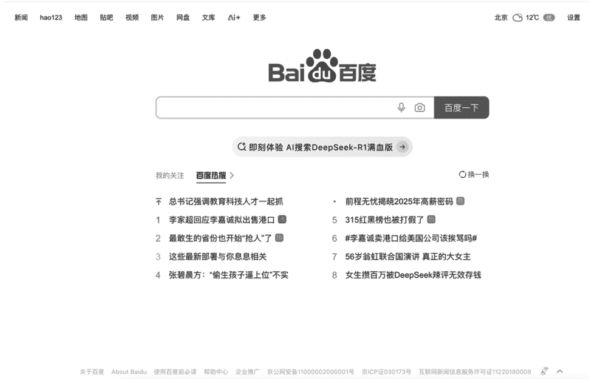

- （3）在新页面即可使用满血版DeepSeek-R1，如图20-4所示。

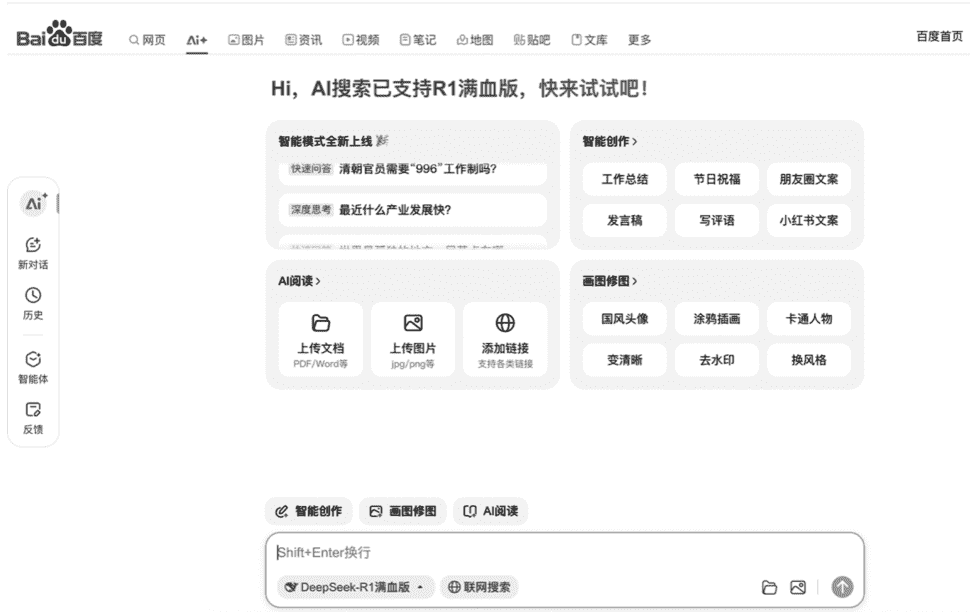

适用场景包括：
- 智能创作：工作总结、节日祝福、朋友圈文案、发言稿、评语、小红书文案等。
- AI阅读：上传内容进行总结、解释、翻译、推理、解题等。
- 画图修图：国风头像、涂鸦插画、卡通人物、清晰化、水印去除、风格转换等。

纳米AI搜索和秘塔AI搜索也接入DeepSeek满血版，更适合学术研究与专业检索。

#### 20.1.2 智能助手的全面升级：华为小艺、荣耀YOYO与其他手机助手

主流手机品牌的智能助理已普遍接入DeepSeek，使用体验大幅提升。

**1. 华为小艺助手**
自2025年2月起，华为小艺全面升级，搭载DeepSeek引擎。
1. 长按电源键或说“小艺小艺”唤醒。
2. 直接提问复杂问题，如“帮我写一封请假邮件”或“分析最近股市趋势”。
3. 小艺调用DeepSeek能力给出详细回答。

**2. 荣耀YOYO助理**
接入DeepSeek后功能增强。
1. 长按电源键或上滑底部唤醒YOYO。
2. 语音指令更自然，支持上下文连续对话。
3. 支持复杂指令，如“总结我今天的会议记录并创建明天的待办事项”。

实用功能是屏幕理解与操作建议，遇到不熟悉界面时可询问“这个界面怎么操作”，助理可识别屏幕并指导。

**3. OPPO小布助手与vivo蓝心小V**
两者同样接入DeepSeek，提供相似智能体验：
1. 支持复杂任务处理与多轮对话。
2. 能够理解屏幕内容并提供上下文帮助。
3. 提供跨应用信息整合与任务执行。

**【实用提示】**
手机智能助理适合：
- 开车时语音完成复杂操作。
- 快速起草邮件、信息或社交内容。
- 获取实时信息摘要和个性化建议。

### 20.2 办公效率倍增：一站式AI办公体验让你事半功倍

#### 20.2.1 WPS灵犀实战指南：告别多工具切换

WPS Office通过灵犀模块免费接入DeepSeek-R1模型，助力办公提效。

**1. 三分钟生成PPT：从大纲到完整演示的全流程实操**
操作步骤如下。
- （1）打开WPS Office，点击左侧“灵犀”图标，如图20-5所示。

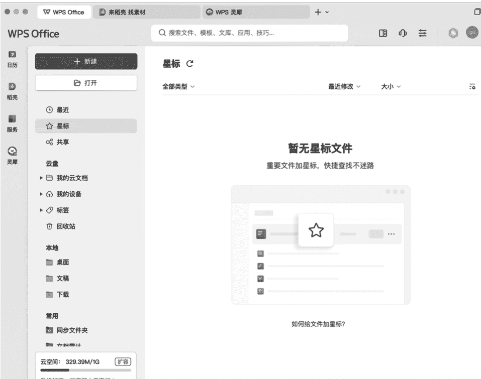

- （2）在助手面板选择“AI PPT”功能，如图20-6所示。

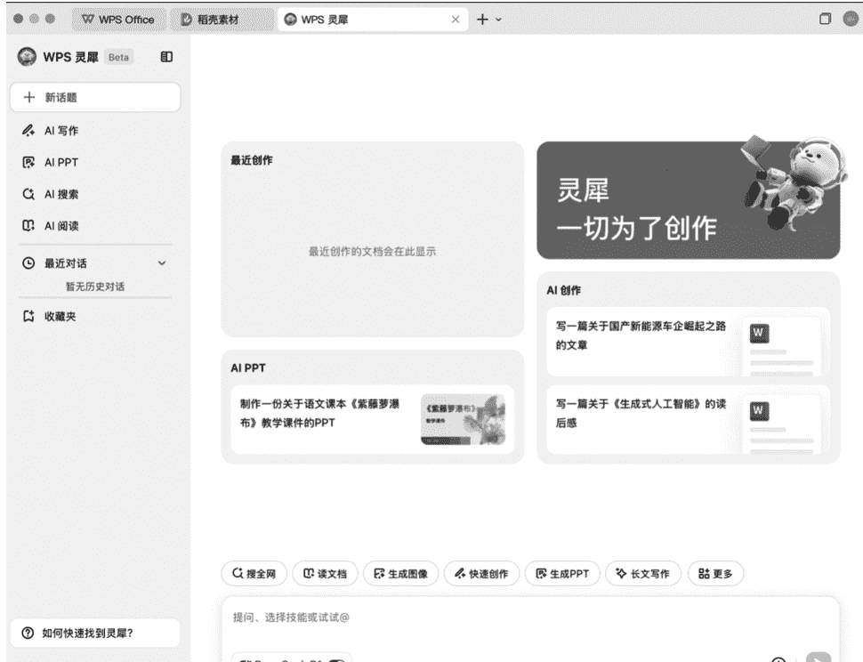

- （3）输入主题与需求，例如：
  - 主题：公司年度营销策略汇报。
  - 要点：市场分析、目标客户、营销渠道、预算规划、KPI设定。
  - 风格：简约专业，以蓝色为主色调。
- （4）选择使用“DeepSeek R1”，可开关“联网搜索”，设置页数。
- （5）点击“发送”，等待30~60秒生成初稿。
- （6）系统提供“选择模板”选项，可挑选合适模板。
- （7）确认后点击“生成 PPT”，不到3分钟即可得到精美演示文稿。

**【实用提示】**
- 未安装WPS Office可通过WPS灵犀网站 (http://copilot.wps.cn/) 访问。
- 指定配色与风格可保持VI统一。
- 可上传参考资料供提取信息。
- 自行上传模板可获得最佳效果。

**【适用场景】**
- 快速准备会议演示材料。
- 创建培训课程幻灯片。
- 制作产品介绍或方案展示。
- 准备销售提案或投资路演。

相比传统多步骤，WPS灵犀一键生成将制作时间缩短70%以上，对初次创建项目效率提升更明显。

**2. 文档智能创作：让写作效率提升10倍的实用技巧**
WPS文字中的灵犀助手覆盖构思、写作到润色，实现质的飞跃。

快速创建专业文档流程：
1. 打开WPS Office，点击左侧“灵犀”图标。
2. 选择“AI写作”，指定文档类型，如作文、读后感、日记、计划、发言稿等。
3. 输入关键信息，例如：
   - 文档类型：产品需求文档。
   - 产品名称：智能家居控制系统。
   - 主要功能：远程控制、场景设置、数据分析、语音交互。
   - 目标用户：家庭用户和小型办公场所。
4. 选择“短文创作”“长文写作”“生成思维导图”。
5. 点击“发送”，系统创建完整文档。
6. 点击“生成文档”，打开编辑界面进行修改。

其他实用功能：
- 智能续写：在文档任意位置点击“续写”，系统按上下文继续生成。
- 生成思维导图：复制文本粘贴至对话框，一键转换。
- 格式智能调整：自动识别结构并应用合适样式。

**【实用提示】**
- “AI 阅读”功能可直接向文档提问，利用DeepSeek解读课件、论文、网页。
- “AI搜索”可检索大模型外知识并整理汇总。

用户反馈显示，文档创作时间平均减少65%，专业文档质量显著提升，尤其在需遵循特定格式与标准的场景价值突出。

#### 20.2.2 飞书DeepSeek助手：让团队协作更高效

飞书于2025年2月与DeepSeek深度合作，AI助手全面提升协作体验。通过内容生成、分析与流程自动化，团队效率显著提高。

**1. 在飞书多维表格中使用DeepSeek**
飞书多维表格内置DeepSeek，成为数据处理与自动化创作平台。

操作步骤：
（1）创建多维表格。
- 在飞书工作台点击“新建” → “多维表格”，如图20-7所示。
- 也可在任意聊天中使用“/表格”命令快速创建。

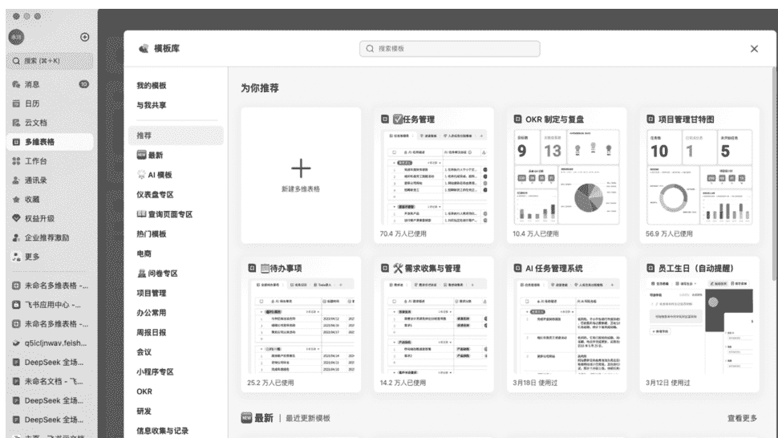

（2）配置字段。
按需添加并命名字段，常用类型包括文本、数字、单选、多选、日期等。例如为电影表设置“电影名称”“电影简介”。

（3）引入DeepSeek。
- 在需AI处理的列旁，点击列名下拉箭头。
- 选择“修改字段/列”。
- 在弹出菜单中选择“探索字段捷径”。
- 搜索并选择“DeepSeek R1（联网）”功能，如图20-8所示。

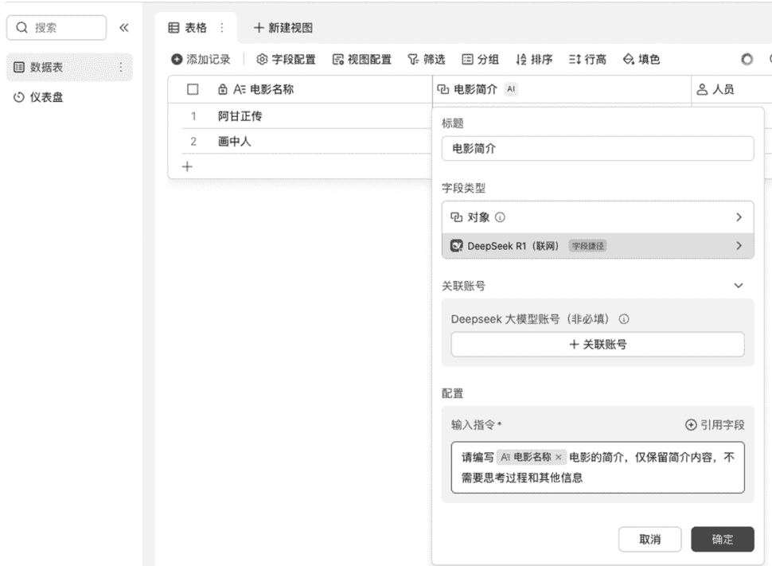

（4）设置指令与要求。
在“输入指令”区输入提示，示例：
请编写 [电影名称] 电影的简介，仅保留简介内容，不需要思考过程和其他信息。
其中“电影名称”通过“引用字段”选择，实现首列输入不同电影名时，第二列自动生成简介。

（5）自动更新和查看结果。
- 结果显示在指定新列中，可编辑或引用，如图20-9所示。

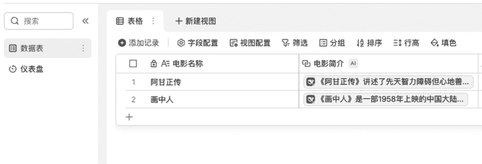

- 列名状态指示器显示当前进度。

**2. 批量创作，5分钟创作100个短视频脚本**
飞书多维表格结合DeepSeek的批量处理能力，为内容团队带来革命性提升，特别在短视频批量生产方面。

批量创作短视频脚本步骤如下。
（1）准备基础数据。

短视频脚本批量生产三步法

先把信息结构化

先搭一张多列信息表，把关键字段定下来，比如标题、题材方向、目标人群、时长要求等。随后把要做的短视频素材填进去，可以是产品清单、营销主题或创意点子。

设定创作指令

在表格里新增一列用于模型调用，以「标题」和「题材」作为输入源。在自定义要求里写明产出规范，例如：为短视频撰写精确到秒的完整分镜脚本，包含①开场白5~10秒；②主体部分拆成3~5个要点，每个要点15~20秒；③收尾与行动号召5~10秒；④字幕文案；⑤场景提示与转场建议。整体语感要贴合题材，表达简洁有吸引力。若需更精准，可额外补充品牌用语、禁用词汇等限制。

一键执行与人工复核

点下确认后系统会逐行处理，100条量级的脚本任务通常3~5分钟就能跑完。结果出来后做人工复核与微调再定稿即可。

【实践案例】某快消品牌要为新品线产出100条覆盖不同产品特性与使用场景的短视频脚本。传统做法需要创意团队花费3~4天。改用飞书内嵌的DeepSeek批量方式后全流程压缩到40分钟：建表与指令5分钟，跑表5分钟，人工复核优化30分钟。

效果对比：
- 传统做法：3~4天，4人团队，96~128工时。
- DeepSeek跑批：40分钟，1人操作，约0.67工时。
- 效率提升：144~191倍。

20.3 即梦联动 DeepSeek 实现图文视频一键成片
内容需求爆发后，基于大模型的创意工具正在重塑制作链路。本节聚焦搭载DeepSeek模型的即梦平台，如何让普通人也能快速产出专业级图片与视频。

即梦是字节推出的创意平台，内置DeepSeek生成能力，把复杂的创意落地简化为几步操作，专业设计师与新手都能打开创作空间。

1. 高质图片产出：DeepSeek 的创意点燃
在即梦里借助模型做图的大致流程如下。

（1）进入创作空间
打开即梦 App 或访问官网 https://jimeng.jianying.com

（2）启动引擎
左侧选择图片生成，或中间选择 AI 作图→图片生成，进入创作界面，如图20-10所示。

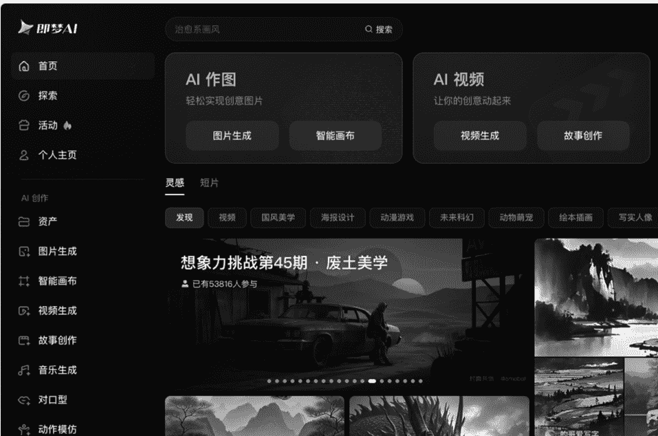

（3）点燃创意
- 点击界面中的 Deepseek-R1 按钮，启用高级引擎。
- 在对话框里描述创意构思，可简短也可给出详细视觉要求。
- 模型会解析输入，给出数套精炼的专业提示。
- 从推荐中挑选最符合预期的，或做个性化调整。
- 点击立即生成，开始创作，如图20-11所示。

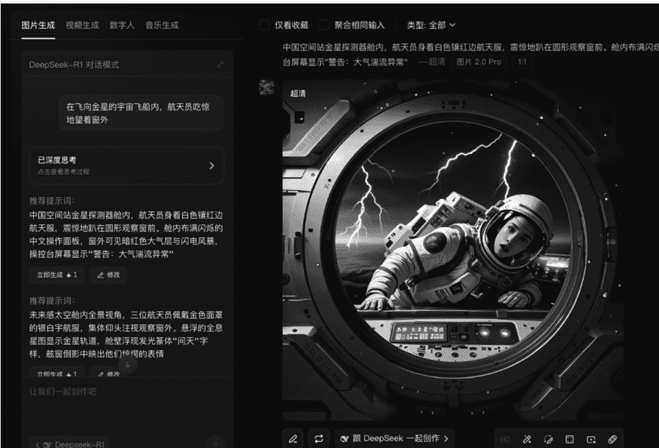

（4）呈现与优化
- 平台会一次性给出4张风格各异的成片。
- 可对单张进行超清、局部重绘、扩图等处理。
- 保留满意作品，或继续探索其他方向。

【专业用户分享】
一位资深设计师表示，即梦配合DeepSeek把概念设计的工作量压缩约七成，品牌视觉起稿周期从三天缩到三小时，同时获得更多多样化方向。

2. 视频动起来：3分钟完成精美动态内容
即梦的视频能力把模型从静态延伸到动态，让创作者轻松产出专业短视频。

文本转视频的操作路径如下。

（1）进入视频创作中心
打开即梦 App 或访问官网 https://jimeng.jianying.com
从首页左侧导航选视频生成，或中间选 AI 视频→视频生成。

（2）选择模式
点选文生视频，进入 AI 视频创作界面。

（3）把想法转成指令
- 点亮 Deepseek-R1 引擎，获得高级创作能力。
- 在创意输入框描述希望呈现的场景、风格与内容。
- 智能系统会分析输入，给出优化后的专业提示。
- 从建议里挑最贴合的表达，或个性化微调。
- 确认后点击生成视频，启动创作流程。

（4）实时预览与微调
- 系统在屏幕右侧实时展示基于提示生成的视频。
- 观看预览判断效果，满意后保存，可直接发社媒或继续编辑。

【视频创作进阶技巧】
（1）叙事结构优化
- 在提示中清晰描述起承转合，例如“开场呈现城市全景，随后推近到咖啡店外观”。
- 明确的序列描述能让叙事更连贯。

（2）运动元素控制
- 用关键词调节节奏与流畅度，如“缓慢”“平稳”或“动态”“快速”。
- 精确描述运动方向与轨迹，如“镜头从左向右平移”。

（3）情绪氛围营造
- 使用情绪词，如“愉悦”“神秘”“激动人心”。
- 提及光线条件，如“温暖阳光”“蓝调月光”“电影级灯光”。
- 可加入音乐风格参考，如“适合配激励性背景音乐”。

【专业用户分享】
某营销负责人用即梦加DeepSeek在一天内完成5条产品宣传短片，传统方式需2~3周协调摄制组。成片质量达到社媒发布水准，经简单后期后直接用于新品推广，互动远超预期。

20.4 工具组合的魔力：DeepSeek 联动专业工具效率倍增
内容爆炸时代，单一工具已难以覆盖全流程。DeepSeek 与专业工具协同能带来明显效率提升。下面介绍 DeepSeek 加 Canva 批量制作小红书图文的方法。

小红书对高质量高频次图文需求强烈。DeepSeek 的内容能力与 Canva 的设计能力结合，把耗时创作变为高效生产线。

1. 从文案到设计：5分钟产出10张营销图的全流程
传统小红书图文涉及选题、文案、设计等多个环节。借助两者能力，可实现从创意到成品的快速转化。

（1）批量制作小红书图文的操作步骤。

步骤一：用 DeepSeek 搭建专业文案框架
1. 访问 DeepSeek 网页版 https://www.deepseek.com
2. 在对话框输入精心设计的提示词。
请给出10个中年人养生选题，每篇包含3个专业知识点：吸引人的标题、知识点1、知识点2、知识点3、结尾互动句和标签推荐。按表格方式输出。

步骤二：准备 Canva 的批量设计工作。有两种衔接方式。
- 方法A：自动化工具集成。用 Albato / IFTTT / Zapier 等平台，建立从 DeepSeek 到 Canva 的自动工作流，适合长期持续生产。
- 方法B：结构化数据导入 推荐新手。用。将 DeepSeek 生成的内容保存为 Excel 文件或复制到剪贴板待用，简单直接，适合马上上手。

步骤三：在 Canva 里创建小红书图文模板
1. 输入网址 https://www.canva.cn 登录账号，进入工作台。
2. 点创建设计，在搜索框输入小红书或直接选社交媒体→小红书帖子。
3. 选择符合品牌调性的模板，或从空白画布开始设计。
- 确保模板包含文字区、图片位和品牌元素。
- 预设好字体、配色和排版风格以提升效率。

小提示
Canva 提供大量专业模板素材，可在这些模板基础上修改。

步骤四：启动 Canva 的批量创建功能
1. 在 Canva 工作台点左侧菜单栏的应用功能。
2. 在弹出窗口中选发现→精选推荐→批量创建。
3. 点手动输入数据，直接粘贴剪贴板里的内容。
4. 或点上传数据，导入准备好的 Excel 或 CSV 文件。
5. 设置字段映射关系。点关联数据把表格列与模板中的文本元素匹配，例如把标题列映射到模板里的标题文本框，把主体内容列映射到模板里的内容区，如图20-13所示。

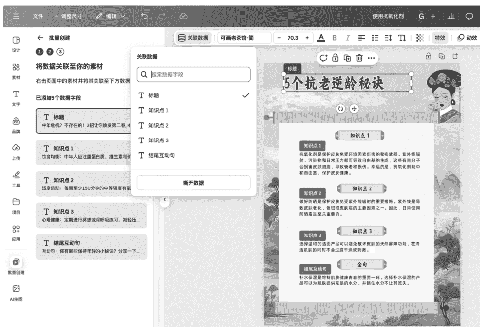

图20-13

6. 点继续。
7. 系统会提示将生成10个设计，自动基于模板和数据创建10个独立设计，点按钮开始生成，如图20-14所示。

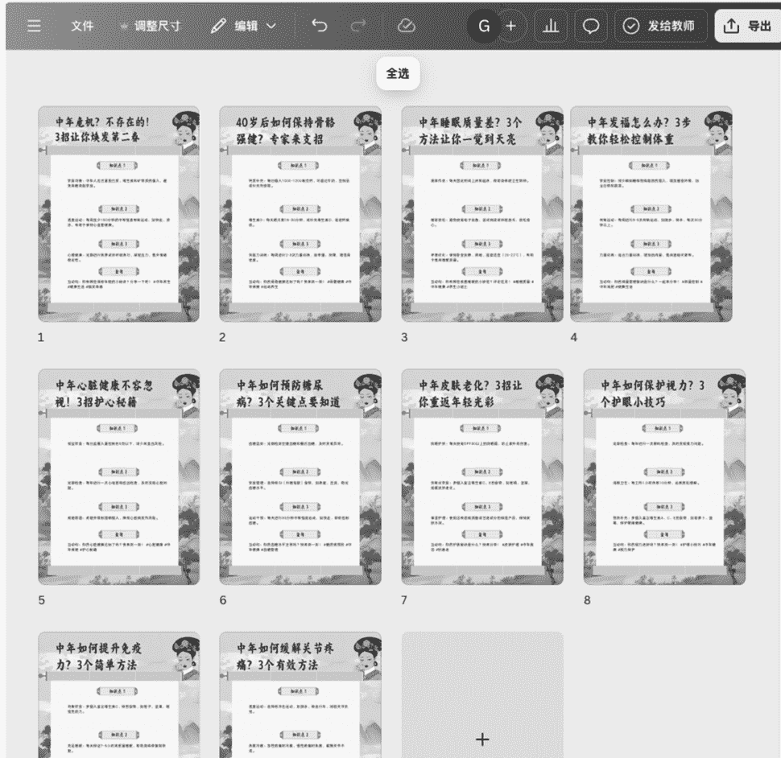

图20-14

步骤五：优化和完善设计
1. 批量生成完成后，对每个设计做快速检查。
- 纠正文本溢出或排版问题。
- 调整图片位置和比例。
- 确保视觉层次清晰。
2. 加入品牌标识和统一元素，确保视觉一致性。

步骤六：导出与发布准备
1. 全部设计完成后，点下载按钮。
2. 选所有页面和适合小红书的 PNG 或 JPG 格式。
3. 设置适当的图片质量，推荐高质量。
4. 下载完成后，把图片与对应文案匹配整理。
5. 准备发布到小红书平台，可按计划排期推送。

（2）效率对比：传统与 DeepSeek 加 Canva
具体效率对比如表20-1所示。

表20-1
| 工作环节 | 传统方法 | DeepSeek+Canva 方法 | 节省时间 |
| :--- | :--- | :--- | :--- |
| 选题策划 | 60 分钟 | 5 分钟 | 92% |
| 文案撰写 | 3~4 小时 | 10 分钟 | 95% |
| 设计制作 | 2~5 小时 | 15 分钟 | 90% |
| 审核修改 | 1 小时 | 10 分钟 | 83% |
| 总计（10 篇） | 6~10 小时 | 40 分钟 | 90%+ |

使用该组合，全流程可在5分钟内完成基础版本，加上细节优化约需40分钟，效率提升高达90%以上。对需要持续输出的个人创作者和品牌而言，意味着从一天一篇到一小时十篇的革命性变化。

2. 品牌一致性保障：模板与素材库的高效利用
内容营销中品牌一致性与识别度至关重要。批量创作的挑战不仅是速度，更是高效率下保持形象连贯。DeepSeek 与 Canva 组合提供系统化方案，使品牌声音和视觉语言在所有内容中保持一致。

【专业用户分享】
某高端护肤品牌应用该体系后，实现惊人的生产效率与品牌一致性。他们针对新品线创建了3种内容类型的模板体系：产品科技解析、使用体验分享和成分功效说明。每种类型设计4个视觉变体，保持品牌识别性的同时避免视觉疲劳。

营销团队用 DeepSeek 批量生成差异化内容，填充到 Canva 模板中。两名成员仅用一天工作时间，完成覆盖30天的社交媒体发布计划，包含60多个独立设计，同时保证品牌表现的高度一致性和专业性。发布后品牌互动率提升35%，识别度提高50%，转化率增长28%。

20.5 智能体协作与行业实战案例
20.5.1 智能体协作：工作方式的下一站
智能体技术代表 AI 应用的未来方向，DeepSeek 正在积极探索，为用户带来更主动、更自主的 AI 协作体验。

1. 智能体技术的核心特点
1. 自主决策能力：不仅执行指令，还能规划执行路径，解决复杂问题。
2. 工具使用能力：能够调用不同软件工具和 API，完成跨系统任务。
3. 记忆与学习：保持上下文理解，从过去交互中学习改进。
4. 多智能体协作：多个专精不同领域的智能体协同工作，处理复杂任务。

2. DeepSeek 智能体的实际应用
1. 内容创作智能体
- 功能：自动规划内容架构，研究相关资料，生成初稿，进行自校对，根据反馈修改。
- 使用方法：向 DeepSeek 描述内容需求和目标，叠加其他软件系统自动规划和执行创作流程。
- 适用场景：博客文章、产品介绍、研究报告、培训材料。

2. 数据分析智能体
- 功能：自动清洗数据，探索关系，生成可视化，提取洞察，撰写报告。
- 使用方法：上传数据集并描述分析目标，智能体独立完成分析过程。
- 适用场景：销售数据分析、用户行为研究、市场趋势分析。

3. 项目协调智能体
- 功能：跟踪任务进度，发送提醒，协调会议，汇总报告，预测风险。
- 使用方法：在飞书或钉钉中添加 AI 助手，授权访问项目管理工具。
- 适用场景：敏捷开发项目、营销活动执行、研究项目协调。

3. 如何开始使用智能体
1. 评估任务复杂度：智能体最适合处理包含多个步骤、需要协调多种资源的复杂任务。
2. 明确目标与约束：
- 提供清晰的最终目标和成功标准。
- 明确业务限制和品牌要求。
- 设定资源访问权限和操作边界。
3. 采用渐进式策略：
- 从单一智能体处理特定任务开始。
- 逐步扩展到多智能体协作。
- 建立有效的人机协作模式，保持适当监督。
4. 实践学习循环：
- 分析智能体的工作过程和结果。
- 提供反馈以改进智能体表现。
- 不断优化任务描述和工作流程。

随着 DeepSeek 技术不断进步，智能体系统有望在未来工作中扮演更核心角色，从执行指定任务逐步过渡到主动识别问题、提出解决方案，最终成为真正的数字同事。

20.5.2 行业实战：DeepSeek 在多场景的应用案例
来自不同行业的实践者已开始探索 DeepSeek 的创新应用，以下是启发性案例。

1. 零售行业：全渠道营销自动化
某国内服装零售品牌通过 DeepSeek 打造全渠道营销内容生产线，实现内容从创意到发布的一体化管理。

1. 技术架构：
- DeepSeek 与企业 CRM、PIM 系统集成。
- 部署 DeepSeek 驱动的内容生成系统，连接设计工具和社交媒体管理平台。
- 建立数据反馈循环，持续优化内容策略。

2. 实际应用：
- 产品更新自动触发内容生成任务。
- DeepSeek 分析产品信息，生成各渠道营销文案。
- 调用设计工具创建配套视觉内容。
- 根据历史数据智能排期并发布到合适渠道。
- 收集效果数据，自动优化后续内容策略。

3. 成果：营销内容产量增加400%，客单价提升15%，内容创作团队从12人精减至4人，工作重心转向策略和创意指导。

2. 教育行业：个性化学习内容快速开发
某在线教育机构使用 DeepSeek 重构课程开发流程，实现课程内容快速迭代和个性化。

1. 技术架构：
- DeepSeek 与学习管理系统 LMS 深度集成。
- 视频课程生成系统连接 PPT 和剪映。
- 学习行为分析模块提供学习效果反馈。

2. 实际应用：
- 内容专家提供知识点大纲和核心资料。
- DeepSeek 生成详细课程内容，包括讲义、习题和 PPT。
- 根据学生学习数据，自动调整内容难度和侧重点。
- 为不同学习风格的学生生成定制化辅助材料。

3. 成果：课程开发周期从4个月缩短至3周，学生完课率提升35%，内容更新频率从每季度一次提高到每月一次。

3. 医疗健康：临床决策支持与患者沟通
某三甲医院将 DeepSeek 应用于临床工作流程，提升医疗效率和改善患者体验。

1. 技术架构：
- 与医院信息系统 HIS/电子病历 EMR 系统集成。
- 连接医学影像系统提供辅助分析。
- 对接患者 App 提供个性化的健康指导。

2. 实际应用：
- 医学文献智能检索和总结。
- 患者病历自动分析和关键信息提取。
- 检验报告解读辅助和异常值提示。
- 患者教育材料个性化生成。

3. 成果：医生文档工作时间减少40%，患者满意度提升25%，异常情况早期识别率提高30%。

##### 4. 金融场景实操：投研与客服双线提效

一家中型券商把DeepSeek接入核心业务后，投研和客户服务的运转方式发生了明显变化。

1. 技术搭建
- 将DeepSeek与金融数据平台的API打通，实现信息实时调用。
- 通过CRM把客户画像、历史行为等数据接入模型。
- 与交易后端联动，可在盘中输出即时策略提示。

2. 具体落地
- 财报自动解析并完成投资价值的初筛评估。
- 整合多渠道市场信息，形成风险预警信号。
- 基于客户画像生成差异化的组合建议。
- 智能客服承接专业金融问答，降低人工介入压力。

3. 效果数据
投研人员人均效率提升约六成，研报产出量同比增长三倍；客户咨询平均等待时间从28分钟压缩到3分钟；投顾建议的命中率提升22%。

这些实践印证了DeepSeek在垂直行业的延展空间。真正跑通的共性在于：先吃透业务链路，找准AI能产生最大杠杆的节点；坚持人机配合而非简单的人工替代；搭建反馈闭环，让模型在实战中持续迭代；同步推进组织变革，帮助团队快速适应新协作方式。

随着生态插件越来越多、模型能力不断增强，DeepSeek正从辅助工具走向核心生产要素，更多行业的创新用法会持续浮现。

### 本章小结：协同智能重塑生产力
——迈向AI驱动的工作范式

DeepSeek的全链路应用和跨平台协作生态，正在改写我们的工作习惯。从随取随用的智能体验，到办公套件的一体化赋能，再到多工具联动的效率叠加，生产力模型正被重新定义。

本章梳理了DeepSeek在微信、百度等主流入口的嵌入形态，介绍了WPS灵犀、飞书助手这类一体化办公增强方案，演示了即梦AI等创意类工具的操作路径，分享了DeepSeek配合Canva的组合工作法，并触及了智能体技术的发展方向。

通过案例和指南可以看到，AI工具的组合使用既能压缩重复劳动，也能释放创意空间，让专业人士把精力集中在高价值判断上。技术迭代与生态扩容会带来更多行业智能化机会。

希望读者能结合自身岗位，挑选合适的场景构建个人或团队的AI增强流程，在协同的智能生态中探索新的可能性。