# DeepSeek 全场景指南


## 内容简介

本书是系统解读 DeepSeek 的实用指南，从 AI 基础知识开始，书中讲解了 DeepSeek 的底层创新，详细剖析其优缺点，探讨如何通过有效提问激发 DeepSeek 潜能，如何规避 AI 幻觉，如何实现本地部署；展示了 DeepSeek 在创意写作、图片视频创作、职场效率提升、学习辅导、知识库构建等领域的实战应用，并探讨了其在政企智能化转型中的价值。

无论你是想提升工作效率的职场人、追求创作突破的内容生产者，还是渴望把握 AI 机遇的企业家，都能在书中找到属于你的智能进化路径。除此之外，书中还探讨了 AI 未来的发展，如通用智能体 Manus、原生多模态图片、DeepSeek 后续的演化路径及 AI 学习的方法等。

***

## 前言

坦率地说，写一本关于 DeepSeek 应用的书很有挑战性。这样的书，很容易写成关于 AI 各类使用场景的简单罗列。如果是这样，那么把"DeepSeek"换成任何一个 AI 大模型的名字，书的内容几乎都能自圆其说。这不是我想要的。我希望的是，看过本书的人都能清晰地了解到 DeepSeek 和其他 AI 大模型到底有什么不同，有什么“性格”和“缺陷”，并能够充分利用 DeepSeek 的独特性。同时，很多读者还从未认真、系统地使用过 AI，如何写出能让更多人看懂但又有针对性的 DeepSeek 图书，是很大的挑战。

我希望这本书能够对各个领域、不同需求的个人和企业都能有所启发。因此，在这本书中，我不仅讲解了 DeepSeek 模型自身的发展历史及优缺点，还简单梳理了整个生成式 AI 领域的关键概念和发展历程，让你能够对 AI 的发展脉络及能力边界有更清晰的认知。针对 DeepSeek 的开源特性，我不仅会谈及 DeepSeek 的使用，还会介绍 DeepSeek 本地部署及在企业中的使用场景。我希望你不仅了解 DeepSeek 在各个使用场景下的提问技巧，同时还“知其所以然”，了解推理大模型（深度思考模式）和非推理大模型在提问逻辑上的本质区别。我还会教你如何使用 DeepSeek 搭建自己的 AI 知识库，构建自己或企业的专属 AI 助理。

这本书给出的大多数内容都不仅限于 DeepSeek-V3 和 DeepSeek-R1 模型使用。虽然 DeepSeek 的模型肯定会继续快速更新，其他公司也会诞生更多更好的 AI 大模型，但是本书提供的 AI 常识、提问技巧、使用场景，以及本地部署 AI 大模型和构建知识库的方法，适用于绝大多数 AI 大模型。我希望你看过本书之后，能在脑海中对 AI 的发展现状、应用场景及实际落地方法有系统性的理解。

程希冀（C 哥）

***

2025 年 3 月

***

## 为什么 DeepSeek 让全球震撼

一夜之间，DeepSeek-R1 模型的发布几乎改变了一切。

在正式介绍 DeepSeek 之前，我会认真帮你梳理 DeepSeek 让全球震撼的底层原因。这会涉及一些技术术语，但我已经尽可能简化，以便你能更容易理解。

当然，如果你暂时不想了解这些细节，也可以选择跳过，直接阅读后续章节。不了解这些内容完全不影响你用好 DeepSeek。但是，我还是非常推荐你能看看这部分内容。

### 一、AI 的革命性时刻

虽然 AI 行业的发展速度在这几年颇有"AI 一天，人间一年”的感觉，但如果让我总结近几年 AI 行业真正的革命性时刻，其实并不算多，但 DeepSeek 绝对位列其一。强烈建议你仔细读一读这五个"AI 革命性时刻”，因为这对理解 DeepSeek 为什么重要很有帮助（见图 0-1）。其中，前四个都来自 OpenAI（发布 ChatGPT 的公司）。

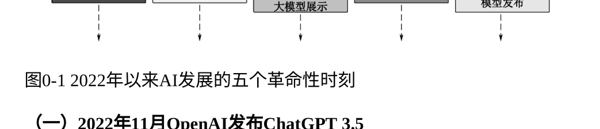

>

#### （一）2022 年 11 月 OpenAI 发布 ChatGPT 3.5

这宣告了生成式人工智能 注 时代的到来，证明了 AI 可以完全理解人类语言（甚至可以通过图灵测试 注），并能够使用同一个智能模型同时实现聊天、写作、推理、编程等多种能力，这意味着我们从专用人工智能（Artificial Narrow Intelligence, ANI）时代转向了通用人工智能（Artificial General Intelligence, AGI）时代。这是 AI 的一次重大范式转变。

#### （二）2023 年 3 月 OpenAI 推出 GPT-4

从此，AI 不仅可以理解文字，还可以理解图像。当输入图像时，GPT-4 可以生成对图像的理解。AI 对图像的理解不仅仅是像以往一样只能识别其中的文字、符号或特定的物体，而是能够从整体上理解图像内各元素的关系及其内涵 (见图 0-2)，这让人们相信 AI 有理解现实世界的潜力。随后，各种新模型风生水起，证明了 AI 可以用完全相同的底层架构同时理解声音、图像、文字等信息，这类模型被称为多模态模型，大大拓宽了 AI 的应用边界。

#### **GPT-4 visual input example, Extreme Ironing:**

User  What is unusual about this image?


> > GPT-4   The unusual thing about this image is that a man is ironing clothes on an ironing
> > board attached to the roof of a moving taxi.

> > **（三）** 2024 年 2 月 OpenAI 对外展示了 Sora 文生视频大模型 (当时 Sora
> > 大模型并未对公众开放使用，直至 2024 年 12 月才正式对外开放)

OpenAI 并未单纯将 Sora 视为视频模型，而是将其作为“世界模拟器”，
因为生成视频的过程需要模型对世界的物理定律有深刻的理解（见图 0-3）。例如，模型必须理解日月的变换、行走的阻力、物体的挤压和撞击等物理现象，才能正确渲染出符合逻辑的视频。这意味着，AI 从 2D 进入 3D 世界，有理解整个世界甚至整个宇宙的潜质，AI 的应用场景被进一步拓宽，同时对于 AI 成为独立“硅基生物”的想象变得更加现实。

#### （四）2024 年 9 月 OpenAI 发布 o1 系列模型

这是人类第一次训练出学会深度思考的模型，即推理大模型。之前的 AI 大模型都是非推理大模型，对于任何问题的回答速度几乎都是一致的。例如，对“你好吗？”和“如何计算宇宙飞船的太阳能板所需的面积？”的回答速度是接近的，这显然是不太科学的。人类在遇到复杂问题时会拿出草稿纸仔细推算和检查，这是人类能够解决复杂问题的重要原因，而人类遇到简单问题则会凭直觉回答，消耗的能量很少。之前的 AI 大模型没有这种深度思考的能力，所以在推理能力上受到很大限制。o1 系列模型具有在正式回答前先输出“思维链” [^9] 即逻辑推理过程的能力，极大地提升了 AI 大模型的逻辑推理能力。o1 系列模型在 Codeforces 编程竞赛中超过了 89% 的参赛者，在美国数学奥林匹克竞赛的资格赛中列全美前 500 名，在物理、生物和化学问题的基准测试中超越了人类博士水平的准确率。图 0-4 给出了 OpenAI 官方发布的 o1 系列模型的评测数据，可以看出 o1 系列模型将 AI 的准确率上限提高了整整一个数量级。

### 图 0-4** o1 系列模型在数学、代码和博士科学问题上的准确率与 GPT-4o 和人类专家的对比测试

注：“o1 测”代表 o1-preview 模型。

***

#### （五）深度求索发布 DeepSeek-R1 模型

第五个革命性时刻，就是 2025 年 1 月中国的深度求索（DeepSeek）发布 DeepSeek-R1 推理大模型。

### 二、DeepSeek 的突出特点

随着 AI 的发展，当你读到这本书时，很可能又有了更新、更好的技术和模型。但是，从 AGI 的发展史来看，DeepSeek-R1 模型绝对是浓墨重彩的一笔。我总结了 DeepSeek-R1 最突出的几个特点。

#### （一）高性能、低成本

作为一个推理大模型，DeepSeek-R1 模型在各个领域上的性能表现都接近、达到甚至超越了 OpenAI 的 o1 系列推理大模型（见图 0-5）。但这并不是最重要的，毕竟世界已经有了 o1 系列及更先进的 o3 系列模型，以后也必然会有更好的模型，DeepSeek 或许也会很快推出 R2、R3 等新模型。真正重要的是，无论是研发成本还是使用成本，DeepSeek-R1 模型与 OpenAI o1 系列模型相比都大大降低了，这在全球 AI 界引起了巨大震撼。

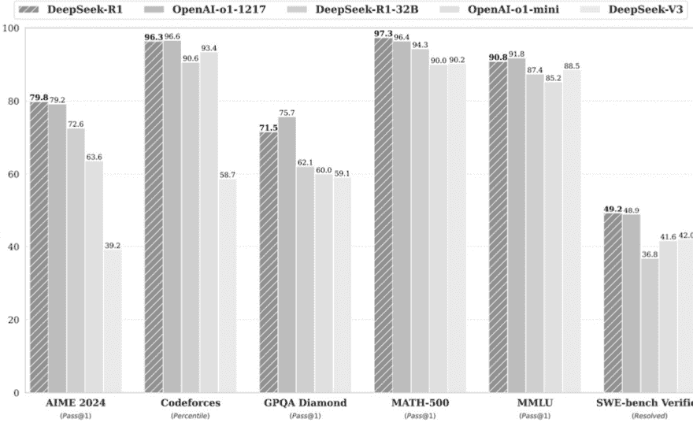

这一点非常重要，因为如果成本太高，再智能的 AI 大模型也与普通人没什么关系。例如，2024 年年底 OpenAI o3 系列模型第一次发布的时候，它的高分版本每次执行任务的成本高达 1000 美元以上（哪怕你只是简单地问模型一加一等于几），堪称恐怖。

而 DeepSeek-R1 模型通过创新的训练策略实现了显著的成本降低，训练成本仅为约 600 万美元，同时保持了卓越的模型性能。这是因为 DeepSeek-R1 模型大量使用了纯强化学习（Reinforcement Learning，RL）技术，这一技术类似“左右手互搏”，不需要太多的人类数据，仅靠模型自身的迭代就能自主发展推理能力。

要理解这一点，我们可以看看围棋 AI 程序 AlphaGo Zero。2017 年 5 月，在中国乌镇·围棋峰会上，AlphaGo Zero 与世界排名第一的柯洁对战，结果以 3:0 的总比分完胜。

让人震惊的是，AlphaGo Zero 一开始时根本没接触过人类的棋谱。它使用了强化学习方法进行“自我对弈”，最终成为具备超强棋力的“选手”（见图 0-6）。

### 图 0-6 AlphaGo Zero 经过 70 小时训练后即达到超人类水准

AlphaGo Zero 甚至还独立发现了新的围棋策略，让顶尖的围棋选手反过来向 AI 学习。这就是强化学习的好处：不但节约了人类数据（不太需要人类陪它学习下棋的方法），而且摆脱了人类智力的局限（通过自我迭代可能超越人类选手的极限水准）。

人工智能的长远目标之一就是研发出一种能够从白板开始学习，并逐渐进化成拥有超常能力的算法。如果 AI 无法自我进化，人类就会陷入“有多少人工，才有多少智能”的窘境。在此之前，没人相信仅仅只靠 AI 大模型的“左右手互搏”就能发展出超强的推理智能，因此大量依赖一种被称为监督微调（SFT）的技术，即用人类标注的数据来训练 AI 的方法。但监督微调技术的数据成本高昂。而在 DeepSeek-R1 模型的训练过程中，使用纯强化学习就成功让模型产生“顿悟现

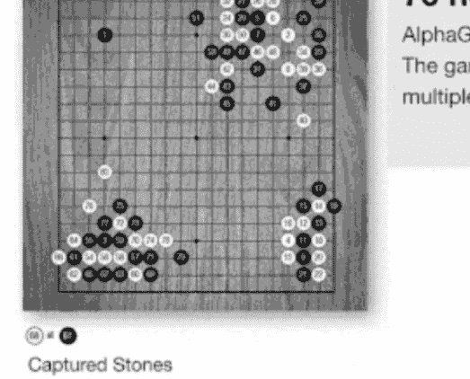

“象”（Aha Moment），即模型自我发现错误并生成更优解法。因此，广泛使用纯强化学习大大降低了训练成本。

在使用成本上，DeepSeek-R1 模型的官方 API 价格仅为 OpenAI o1 系列模型的约 5%（按照 2025 年 2 月各自的官方网站价格）。正因为成本悬殊，如果要使用“满血版”的 OpenAI o1 系列、o3 系列模型，一度需要支付高达 200 美元/月的会员费，而 DeepSeek-R1 模型却可以免费向全球开放。
这也直接造成发布后的两周内，DeepSeek-R1 模型霸榜全球数十个国家的应用商店，其在包括美国在内的很多国家的下载量都超越了 ChatGPT。毕竟，免费的东西“真香”，在哪个国家都一样。

降低使用成本使得全世界的普通人能够更好地把 AI 应用在工作、生活的每一个角落。当然，这对 OpenAI 的商业模式也产生了很大的威胁。
OpenAI 公司在 DeepSeek-R1 模型发布后不久就宣布把 o3-mini 系列免费提供给用户使用，就是因为受到了极大的压力。2025 年 2 月，马斯克主导的 xAI 公司发布 Grok 3，其使用了约 20 万块 H100 GPU 进行训练，据推算，训练时使用的算力大约是 DeepSeek-R1 模型的 100 倍以上，但发布时的 Arena 评分仅比 DeepSeek-R1 模型高不到 2%，如图 0-7 所示。这也进一步印证了 DeepSeek-R1 模型极大的成本优势。

#### （二）开源

开源是“开放源代码”的简称。所谓 AI 大模型开源，简单理解就是将 AI
大模型的参数（模型权重）和相关代码公开，供任何人下载和使用。
如果项目的开源协议允许，那么任何人都可以在满足条件的服务器、
个人计算机甚至手机上自己部署安装该模型并使用，无须付费或联
网。这不仅节约了成本，而且能极大地保护了企业和个人的隐私数
据。

### 图 0-7 Grok 3 发布时的 Arena 评分页面

人们可以把开源模型部署到自己的企业或家里，并结合自己特有的垂直行业知识库或个人的生活资料、聊天记录和笔记，构建隐私安全的 AI 助理。你也可以自由地对开源的模型进行微调 或使用 RAG 技术添加自己的知识库，即在原有模型基础上赋予其更多的垂直领域知识，以更好地满足自身在特定领域的实际需要。例如，企业可以研发基于 DeepSeek-R1 模型的医学大模型、编程大模型、智能客服大模型等。

而闭源的模型无法自己部署，只能在供应商的网站或应用上使用。OpenAI 的 ChatGPT 系列模型及 o1、o3 模型均为闭源模型。使用闭源模型需要联网，可能需要付费，同时所有的数据都需要传输给供应商，可能存在隐私安全问题。在 DeepSeek-R1 之前，世界范围内还没有能达到 OpenAI o1、OpenAI o3 模型类似的性能且低运行成本的开源模型出现。之前的模型要么闭源，要么虽然开源但不具备强推理能力，实用

价值没那么高；或者模型太大，运行成本太高。而 DeepSeek-R1 模型是第一个免费、开源、高效、低成本并存的推理大模型。这在一定程度上减少了闭源 AI 大模型的垄断。

#### （三）超越人类推理能力的边界

上文提到，由于 DeepSeek-R1 模型的训练大量使用纯强化学习，这种左右手互搏的方式能够让大模型发展出很多人类并不具备的推理思路，因此 DeepSeek-R1 模型在推理上的“上限”从理论上讲比之前的大模型更高。所以它可能解决很多以前人类解决起来很困难的问题。

很多人在使用 DeepSeek-R1 模型后表示，DeepSeek-R1 模型的思考过程（思维链）比答案本身更能给人启发，其思考过程可以用来反向训练人脑，提升人脑本身的思维能力。

#### （四）国产自主可控

DeepSeek 系列模型（包括 V3 和 R1）是首个由非美国公司研发的旗舰级推理大模型，缩小了中国和美国在 AI 大模型水平上的差距，且完全自主可控。

由于 DeepSeek 系列模型利用多种技术降低了对算力的需求，因此也间接减少了对于英伟达高端 GPU 芯片的依赖，使得国内使用上一代甚至更早一代的 GPU 芯片也能训练出媲美全球最先进 AI 大模型的产品，这对国家安全非常重要。也正是因为对算力需求的减弱，英伟达股价在 DeepSeek-R1 模型发布后曾一度暴跌 17%（约 6000 亿美元）。

政府和更多企业接入包括 DeepSeek 在内的 AI 大模型，为其构建个性化应用。

#### （五）全民 AI 时代到来

如果说 OpenAI 的 ChatGPT 开启了 AI 快速进化的序幕，那么 DeepSeek 则是真正让每个人都接触到了 AI 的阳光。DeepSeek 通过“低成本 + 开源”的双引擎，将 AI 化作满天星辰，洒落在每个普通人的指尖。街头摊主能用它优化进货策略，肯尼亚的中学教师能用它生成个性化教案，而上海的退休老人可以用它撰写家族回忆录——AI 将成为流淌在生活“毛细血管”中的“数字氧气”。这种普惠性突破，让人类首次站在了“智力平权”的历史节点上。

发展至今，AI 虽然不是万能的，但学会使用 AI 将极大地提升你的学习、生活和工作 的效率。所以，翻开这本书，开始使用 AI 吧！

> *[1] 生成式人工智能即"AIGC"，AIGC 可以按照人类的指令来生成全新的内容，如文本、图片、视频等。*

> *[2] 图灵测试（The Turing Test）起源于计算机科学和密码学的先驱艾伦·麦席森·图灵发表于 1950 年的一篇论文“计算机与智能”。该测试的流程是，一名测试者写下自己的问题，随后将问题以文字形式（屏幕和键盘）发送给另一个房间，这个房间中有一个人和一台机器。然后测试者会分别收到机器和人的回答。测试者仅根据回答来判断哪个是真人，哪个是机器。所有参与测试的人或机器都会被分开。这个测试旨在探究机器能否模拟出与人类相似或无法区分的智能。*

> *[3] 图片摘自 OpenAI 发布的 GPT-4 Technical Report（《GPT-4 技术报告》）。GPT-4 敏锐地捕捉到这张图片的特别之处：一个男子正在熨衣服，而熨衣板却连接在一辆行驶中的出租车车顶。*

> *[4] 思维链（Chain of Thought, CoT）。对于复杂的问题（如数学、编程、工程等问题），AI 大模型很难直接给出正确答案。思维链要求大模型在输出最终答案之前，必须先输出中间的推理步骤，以此来增强大模型的推理能力。这大幅提高了 AI 大模型处理复杂推理任务的能力，并且输出的中间步骤方便使用者了解大模型的思考过程，提高了大模型推理的可解释性。目前，思维链推理已经成为大模型处理复杂任务的一个常用手段。*

> *[5] 全称为杭州深度求索人工智能基础技术研究有限公司。DeepSeek 即深度求索的英文翻译。*

> *[6] 摘自 DeepSeek-R1：Incentivizing Reasoning Capability in LLMs via Reinforcement Learning（《DeepSeek-R1 官方技术报告》）。*

> *[7] 模型微调（Fine-tuning）是指在预训练好的大模型的基础上，通过使用特定领域或任务的数据进行二次训练，使模型在特定场景下表现得更好的技术。这有点像一位“通才”在已经掌握了广泛知识的基础上，进行专业化的“进修”。例如，一个通用的语言模型可能精通多个领域的写作，但通过微调，我们可以让它更擅长医学文献的撰写，或者更善于模仿某位作家的写作风格。微调不仅能提升模型在目标任务上的表现，还可以显著降低训练成本和缩短训练时间，是 AI 领域一项重要的技术手段。*

> *[8] RAG 技术即“检索增强的生成”，其详细说明和应用会在本书后续章节提到，此处不再赘述。*

# 本书学习资源

## 读者交流群

我会在读者交流群中分享最新的 AI 资料和工具，不定期直播答疑并讲解 AI 最新技术，群中可领取本书所有提示词的电子版，方便直接复制使用。扫描下方二维码或通过微信搜索"C 哥聊科技”公众号并发送"DS 群”即可加入。

## 配套课程

想更好地实战 AI，可以购买本书配套课程。配套课程并不限于 DeepSeek，会给你 AI 全方位落地实操，包括 AI 高级提问技巧、各类好用 AI 工具，以及 AI 文生图片、AI 视频、PPT、图表制作和在工作、学习、教育各领域的实战落地，并随着 AI 的发展不断更新。你还能和已经加入的上千位学员一起切磋交流。扫描下方二维码或通过微信搜索"C 哥聊科技”公众号并发送"DS 课程”即可购买。

## C 哥的 AI 成长圈

这是一个专注 AI 时代个体成长的付费社群，汇聚一批相信 AI、学习 AI、践行 AI 的新个体和创业者，通过丰富的课程和资料及陪伴式成长，让你能够率先成为 AI 时代的超级个体。扫描下方二维码或通过微信搜索"C 哥聊科技”公众号并发送“成长圈”即可加入（**成长圈已包含配套课程，无须重复购买**）。

# 模块一 初识 DeepSeek

## 认识 AI

在讨论 DeepSeek 之前，我们先来聊聊 AI。AI 已经成为现在全世界最火的词，没有之一。很多人已经或多或少地使用过 AI。但是，到底是什么是 AI？AI 从哪里来？AI 能做什么？在本书的开头，请允许我用尽可能短的篇幅，帮你梳理 AI 的来龙去脉，同时也让你对琳琅满目的 AI 产品有更深刻的认知。

如果我们试图用一个简单的比喻来解释人工智能 (Artificial Intelligence, AI),可以说，AI 就像一个拥有超强学习能力的“学生”,它通过我们提供给它的“教材”(数据),试图理解这个世界的规律，并帮助我们解决问题。

> “以前，所有的计算机软件（也包括手机 App 等）都需要我们明确地告诉它每一步怎么做，且只能执行预先定义好的功能；而 AI 则能从大量数据中学到它应该怎么做，并应用在它从未遇到过的新问题上”

图 1-1 传统程序和人工智能的区别

现在的 AI 不仅能看懂文字，听懂声音，甚至能“看图说话”，还能根据你的指令生成新的内容。AI 早已不再只是科幻电影里的概念，而是正在成为我们生活中的一部分。今天，我们就从几个维度来了解 AI 的基本概念、关键词，以及它正在如何改变我们的生活。

### 什么是 AI

AI 的本质，是让机器具备某种“智能”。在传统计算机的世界中，程序是由人类编写的规则组成的，机器只会按照这些规则机械地工作。例如，你告诉它“如果温度高于 30 摄氏度，就启动空调”，它就会严格执行。但 AI 不一样，它的“规则”不是由人类直接编写的，而是通过数据训练出来的。你给它足够多的例子，它会自己总结规律，甚至做出人类预料之外的推断。

举个例子，假如我们想教计算机识别一只猫。以前，你需要列出猫的所有特征，如耳朵尖、尾巴细长、毛发柔软等。但在 AI 的世界里，你只需要展示大量猫的图片，然后告诉 AI“这些是猫”，它会自己学会什么样的特征代表“猫”。这种能力让 AI 比过去的程序更加灵活，也更加强大。更关键的是，让 AI 更“通用”。人们开始梦想，只要把全世界的知识（数据）都“喂”给 AI，AI 就会自动学会并理解整个世界的所有规律，并帮助我们解决任何问题。

要理解今天的 AI 取得如此巨大进步背后的原因，就必须提到一个重要概念：**AI 大模型**。你可以把 AI 大模型理解为存储知识和规律的“容器”。与过去针对特定问题的软件工具不同，AI 大模型是一种通用的、规模巨大的模型，也就是这个“容器”非常大。在这个“容器”中存储了大量“参数”。一开始，这些参数没有什么意义。但是当人们训练模型（上文所说的“学习”）时，会输入海量数据给它，这时模型的参数会被逐步调整，内化它接触到的数据的知识和规律。

那么，什么是 AI 大模型的**参数**？我用一个简单的初中数学比喻来解释。坐标轴上的一条直线 $y=ax+b$，只要知道了 $a$ 和 $b$ 的值，那么你就找到了这条直线的内在规律，成为这条直线的“创造者”和“主宰者”——无论延伸到天涯海角，只要有人告诉你一个 $x$，你就能知道对应的 $y$。

图 1-2 $y=ax+b$ 的图像

此处 $a$ 和 $b$ 就是两个参数。也就是说，只要两个神奇的数字，就可以概括关于这条直线的一切秘密。如果你知道直线上的任意两个点 $P$ 和 $Q$，就可以用这两个点的坐标“训练”这个模型，找出 $a$ 和 $b$ 的值，就完成了对这个直线规律的“学习”。

### AI 的“大脑”——AI 大模型

图 1-2 $y=ax+b$ 的图像

而 AI 大模型的参数其实也差不多，只不过它模拟的内容更复杂，所以需要用更多参数来模拟（AI 大模型的参数量动辄十亿、百亿甚至千亿个），而且模拟的方式也不是一条直线，而是非线性的方式。

如果 AI 是一名学生，那么 AI 大模型就是掌握了百科全书知识的“超级学霸”。它不是只会某一门科目，而是可以在数学、文学、音乐、编程等多个领域游刃有余。例如，DeepSeek-R1、OpenAI GPT 系列都是 AI 大模型。

AI 大模型的训练需要三个关键要素：海量的数据、强大的计算能力（算力）和合适的计算方式（算法）。数据是它学习的“教材”，算力则是它大脑运行的“能量”，而算法决定了吸收知识和产生智能的效率。数据、算力和算法被称为 AI 的“三要素”。

### 多模态模型：AI 的“跨界能力”

AI 在近些年的最先突破是从语言文字领域开始的，这些模型被称为大语言模型（Large Language Model, LLM）。ChatGPT-3.5 就是大多数人最早了解到的大语言模型，它可以和人流畅地对话并解决各类问题。但是后来专家很快发现，同样的算法可以很容易地应用在非文字输入中，如图片、视频、语音甚至音乐。今天，不少 AI 大模型都支持输入不同类型的数据，这些模型被称为多模态模型。所谓“多模态”，指的是 AI 能够同时处理多种类型的数据，如文字、图片、视频、声音等。

例如，当你上传一张照片并问 AI“这是什么地方？”时，AI 需要同时结合图片和你的文字问题才能给出答案。这种能力就是多模态模型能力的体现。

多模态模型的出现，让 AI 真正进入了“懂你”的阶段。它不仅像人类一样灵活地结合不同的信息来源，还能根据这些信息生成新的内容。

例如，你可以让 AI 根据一段文字生成一幅画，或者根据一组图片生成一段描述性的文字。这种能力为 AI 的应用开辟了广阔的空间。

例如，OpenAI 的 GPT-4o 模型、Kimi K1.5 模型及通义发布的开源模型 Qwen-VL 系列都是多模态模型。

截至本书完稿时，虽然深度求索拥有 DeepSeek-VL2 等多模态模型，但性能最强的 DeepSeek-V3 模型和 R1 模型不是多模态模型，它们只能输入和输出文字。但是我相信很快，深度求索或者其他 AI 公司一定会推出有多模态能力的强大的新开源模型。这是因为，多模态模型的技术和大语言模型非常相似，并没有太多的技术瓶颈。不过现阶段，官方应用及很多第三方 AI 应用在 DeepSeek 模型外面套了一层功能，可以自动把用户上传的图片、文件等转换成文字再发给 DeepSeek 处理。我还会在本书的后续章节教你如何通过大语言模型间接生成各种各样的图表。

### 文生图、文生视频：AI 的创作天赋

说到 AI 的创作能力，就不得不提“文生图”和“文生视频”。它们是 AI 多模态能力的一种具体应用，正在掀起内容创作领域的革命。

所谓“文生图”，顾名思义，就是通过文字描述生成图片。例如，你对 AI 描述“一个在夕阳下的草原上奔跑的少年”，它就能生成一幅符合描述的画面。这种技术不仅可以用于艺术创作，还可以在电商、广告设计、建筑规划、游戏开发等领域大显身手。目前，较为先进的文生图服务包括 Midjourney、Flux 和国内的即梦等。

图 26 “文生视频”则更进一步。它通过文字生成一段动态的视频内容。例如，你输入“一个机器人在未来城市中漫步”，AI 就能生成一个逼真的短视频。这种技术虽然还在发展阶段，但已经展现出巨大的潜力，尤其是在影视制作、虚拟现实和教育领域。

### 推理大模型与思维链

近一年来，AI 大模型的一个显著进步是它从“会回答”进化到了“会推理”。如果说此前的 AI 更像是一个充满知识的“百科全书”，那么随着推理能力的加入，AI 逐渐变成了一位能够进行“深度思考”的“逻辑学家”。这种进步，不仅让 AI 能更好地回答复杂问题，还让它在解决需要多步骤分析的问题时更加得心应手。

在推理大模型出现之前，所有 AI 大模型都是非推理大模型。这些 AI 大模型的强项是基于“直觉”的记忆与匹配。例如，当用户提问“巴黎是哪个国家的首都？”时，模型会迅速从其庞大的参数中直接“检索”并回答“法国”。但在现实中，很多问题的答案并不能通过简单的记忆得出，而需要逻辑推导和多步骤的计算。例如，假如你问 AI：“如果今天是周一，那么 10 天后是星期几？”这个问题的答案显然不能直接从记忆中检索到，而需要进行多步计算：先加 10 天，再根据一周有 7 天进行取余运算，最终得出答案为“星期四”。

非推理大模型也能解决很多复杂的理工科问题，而且速度很快。尤其是对于大模型见过的题目类型，现在的非推理大模型也能取得相当不错的结果。

但是对于崭新的过于复杂或反常识的问题，非推理大模型的正确率会存在瓶颈。毕竟，非推理大模型（也称为通用大模型）对于任何问题的回答速度几乎都是一致的。正如本书前文所述，询问“你好吗？”和“如何计算宇宙飞船的太阳能板所需的面积？”的回答速度是接近的，这显然是不太科学的。为了能够让 AI 大模型学会在遇到复杂问题时拿出“草稿纸”，研究人员研发了一种更加“会推理”的 AI 大模型—— **推理大模型（Reasoning Large Model）** 。

推理大模型通过训练，逐渐掌握了如何将问题拆解为多个步骤，逐步分析并得出答案。它们更侧重于捕捉和模拟“逻辑链条”，使 AI 在处理复杂问题时更接近人类的思维方式。

为了更好理解，我们可以借鉴心理学中的“双系统理论”——系统 1 和系统 2 思维。这个理论由心理学家丹尼尔·卡尼曼提出，用于描述人类思维的两种不同模式。**系统 1（System 1）**代表快速、直观和无意识的思维，而**系统 2（System 2）**则代表慢速、逻辑和有意识的推理。AI 的发展正在模拟这两种思维方式，以实现更为全面和智能的表现。

小时候做数学题时，老师总是会要求你写出详细的解题步骤，而不是只写出答案。类似地，在 AI 推理领域，研究人员发现，仅仅生成最终答案并不足够。为了让 AI 更准确地回答复杂问题，研究人员引入了一个关键概念——**思维链（Chain of Thought, CoT）**。

思维链可以理解为 AI 在回答问题时的“解题步骤”，即从问题到答案的推导过程。通过让 AI 生成和呈现这些推理步骤，它不仅能更准确地解决复杂问题，还能让人类用户清楚地看到 AI 的思考脉络。

例如，假设你问 AI 一个问题：

> 一个果篮里有 10 个苹果，拿走 3 个后又放回 2 个，现在果篮里有几个苹果？

非推理大模型可能直接给出一个答案，如"9 个”。但推理大模型会通过思维链提供完整的推导过程：

> 篮子里最开始有 10 个苹果。
> 拿走了 3 个苹果后，篮子里还剩下 10-3=7 个苹果。

图 1-4 通过思维链解决问题示意图
这种看似简单的改进带来了两个显著的优势：

**提高准确性**：思维链让 AI 在回答复杂问题时少犯“跳步”错误，也就是直接跳到错误答案的情况，让每个结论都有依据。DeepSeek-R1 还发展出了顿悟时刻（Aha Moment），即可以在解决问题的过程中随时发现问题并改用其他的方式继续解决。

**增强可解释性**：用户可以轻松理解 AI 是如何得出某个结论的，从而对 AI 的回答更有信心。

如今，思维链已经成为推动 AI 推理能力进步的重要技术之一。通过引入思维链训练，大模型在处理数学、逻辑推理甚至哲学问题时展现出了更高的准确性和灵活性。

尽管思维链给 AI 带来了显著的推理能力，但它也存在一些局限性。当前的大模型在面对极度复杂或跨领域的推理问题时，仍然会犯错误。

未来，随着 AI 大模型的不断改进，“推理大模型 + 思维链”的能力有望进一步提升。

2025 年 2 月底，随着 Claude 3.7 Sonnet 模型的发布，一种新的 AI 系统形式——混合推理模型（或称为自动路由模型）正式问世。据称，GPT-5 系列也将采用这种模式。在这种模式下，同一个模型将同时支持思维链输出（推理模式）和普通输出（非推理模式）。系统会根据用户的需求，自动判断是否采用思维链输出，以减少用户手工选择的复杂性。

### AI 智能体

如果说 AI 大模型是人工智能的“大脑”，那么 AI 智能体（AI Agent）就是人工智能的“躯干”。

AI 大模型本身不能执行任何具体操作，也无法调用外部工具，只能输出文字、图片等信息，具体执行操作还是得人来。但是，AI 智能体可以把 AI 和外部数据及一些具体操作的调用结合起来。例如，你让 DeepSeek 分析明天适不适合到北京旅游，没有智能体的时候是很困难的，因为 DeepSeek 完全不清楚明天北京的天气怎么样。但是如果有了智能体，DeepSeek 就可以利用智能体平台调用外部的天气预报工具，查询北京的天气。

如果再进一步，能做的就不仅仅是查询天气了。理论上，我们可以利用 AI 智能体，直接让 AI 帮我们点外卖、操作 PPT，甚至开发一个游戏。OpenAI、Anthropic 等公司都已经推出了能使用 AI 操作计算机的功能。2025 年 3 月，旨在实现通用 AI 智能体的 Manus 产品推出，Manus 能够根据人的指令自主规划 AI 的任务，自在云端调用各种软件并直接给出成品，如执行数据分析、名片制作、游戏开发等，一夜之间吸引了不少眼球。但是我们要记住的是，归根结底，AI 智能体只能帮你做工作流的规划，但工作流的每一步还是要底下的 AI 大模型去做，所以 AI 智能体是 AI 人机协作的“加速器”，它并不能提升 AI 的智能，更多是方便了用户的使用。当然，AI 大模型的能力不断提升，AI 智能体的能力也会越来越强。

图 1-5 AI 智能体简化版工作流程图

实际的工作要更加复杂，包括长期记忆、多次反复调用，甚至多个 AI 大模型的联合工作等。

### DeepSeek 模型家族

作为中国 AI 领域的重要参与者，深度求索自成立以来，发展迅猛，推出了一系列令人瞩目的模型。其创新能力和技术进步不仅体现在模型的数量上，更在于每一代模型引入的革新理念和技术细节，从而在 AI 领域建立了独有的地位。其模型家族以高效性、普惠性及开源生态为核心，逐步构建了覆盖轻量级到超大规模的全场景技术体系，其中 DeepSeek-V3 与 DeepSeek-R1 系列成为标志性成果，展现了深度求索在算法架构、工程优化及产业落地方面的综合实力。

接下来，我将逐一介绍深度求索近两年推出的主要模型。介绍时会涉及一些术语，如果暂时不理解也没有关系，可以先跳过。

#### 早期模型

**DeepSeek-Coder**（2023 年 11 月）：这是深度求索推出的首个大语言模型，专为软件代码生成和补全而设计，可以帮助人们自动生成程序代码。此模型支持多种编程语言，提升了开发者的编程效率，综合性能超越了当时绝大多数主流的代码生成模型（如 CodeLlama），是最接近当时顶级 AI 大模型 GPT-4-Turbo 能力的开源代码模型。2023 年 6 月，深度求索推出了它的继任模型 DeepSeek-Coder-V2。

**DeepSeek LLM**（2024 年 1 月）：参数达 670 亿个，在多项能力中超越了海外开源模型 Llama270B，在中文理解能力上超过了 GPT-3.5。2024 年 5 月，又宣布开源第二代模型 DeepSeek-V2。

**DeepSeek-Math**（2024 年 2 月）：专注于数学任务，以其在复杂数学问题上的出色表现，与 OpenAI 的 GPT-4、谷歌的 Gemini 旗鼓相当。

#### 视觉语言模型

网上很多人说 DeepSeek 没有多模态大模型，这其实是不对的。截至本书完稿时，DeepSeek 的推理大模型 R1 与非推理大模型 V3 不支持多模态，但 DeepSeek 推出过专门的视觉语言模型（VL 系列）。

**DeepSeek-VL**（2024 年 3 月）：开源多模态大模型，在数据构造、模型结构等方面有很多值得注意的点。

**DeepSeek-VL2**（2024 年 12 月）：采用混合专家（Mixture-of-Experts，MoE）架构，实现了性能的显著提升。通过激活特定的专家网络，降低了计算成本，增加了生成吞吐量。DeepSeek-VL2 在视觉问答、光学字符识别、文档/表格/图表理解及视觉定位等任务中展现了卓越的能力。

#### 先进模型

AI 发展很快，现阶段的先进模型将很快被超越，以下只是本书完稿时 DeepSeek 的主力模型：**V3**和**R1**系列。它们不仅代表了 DeepSeek 在大语言模型领域的技术高峰，也通过其显著的成本效益和高性能设置了新的行业标准。DeepSeek 的不断创新和强大的开发能力使其在全球 AI 领域处于领先地位，吸引了广泛的关注和讨论。

**DeepSeek-V3**（2024 年 12 月）：本书完稿时，这是 DeepSeek 最好的非推理大模型，这个模型不仅在参数规模上达到了 6710 亿个，其采用的 MoE 架构和 FP8 混合精度训练显著降低了训练成本。MoE 架构是 DeepSeek 模型的一大特色，通过将复杂任务分解为由多个专家处理，显著提高了计算效率和模型性能。DeepSeek-V3 用仅激活 370 亿个参数来应对特定任务的方式，极大地降低了计算成本。

通过引入多头潜在注意力和多标记预测机制，DeepSeek-V3 设定了 AI 应用的新标准，尤其是在知识类任务和生成速度上的表现尤为突出。图 1-6 展示了 DeepSeek-V3 的评测数据（摘自深度求索官方技术报告）。可以看到，DeepSeek-V3 在很多评测项目上都取得了最好成绩，整体上完全不亚于此时最强的非推理大模型 GPT-4o 和 Claude 3.5。| Benchmark (Metric) | DeepSeek-V3 | Qwen2.5-72B-Inst. | Llama3.1-405B-Inst. | Claude-3.5-Sonnet-1022 | GPT-4o-0513 |
|---|---|---|---|---|---|
| **Architecture** | MoE | Dense | Dense | - | - |
| **# Activated Params** | 37B | 72B | 405B | - | - |
| **# Total Params** | 671B | 72B | 405B | - | - |
| **English** | | | | | |
| **MLLU (EM)** | 88.5 | 85.3 | 88.6 | 88.3 | 87.2 |
| **MLLU-Redux (EM)** | 89.1 | 85.6 | 86.2 | 88.9 | 88 |
| **MLLU-Pro (EM)** | 75.9 | 71.6 | 73.3 | 78 | 72.6 |
| **DROP (3-shot F1)** | 91.6 | 76.7 | 88.7 | 88.3 | 83.7 |
| **IF-Eval (Prompt Strict)** | 86.1 | 84.1 | 86 | 86.5 | 84.3 |
| **GPQA-Diamond (Pass@1)** | 59.1 | 49 | 51.1 | 65 | 49.9 |
| **SimpleQA (Correct)** | 24.9 | 9.1 | 17.1 | 28.4 | 38.2 |
| **FRAMES (Acc.)** | 73.3 | 69.8 | 70 | 72.5 | 80.5 |
| **LongBench v2 (Acc.)** | 48.7 | 39.4 | 36.1 | 41 | 48.1 |
| **Code** | | | | | |
| **HumanEval-Mul (Pass@1)** | 82.6 | 77.3 | 77.2 | 81.7 | 80.5 |
| **LiveCodeBench (Pass@1-COT)** | 40.5 | 31.1 | 28.4 | 36.3 | 33.4 |
| **LiveCodeBench (Pass@1)** | 37.6 | 28.7 | 30.1 | 32.8 | 34.2 |
| **Codeforces (Percentile)** | 51.6 | 24.8 | 25.3 | 20.3 | 23.6 |
| **SWE Verified (Resolved)** | 42 | 23.8 | 24.5 | 50.8 | 38.8 |
| **Aider-Edit (Acc.)** | 79.7 | 65.4 | 63.9 | 84.2 | 72.9 |
| **Aider-Polyglot (Acc.)** | 49.6 | 7.6 | 5.8 | 45.3 | 16 |
| **Math** | | | | | |
| **AIME 2024 (Pass@1)** | 39.2 | 23.3 | 23.3 | 16 | 9.3 |
| **MATH-500 (EM)** | 90.2 | 80 | 73.8 | 78.3 | 74.6 |
| **CNMO 2024 (Pass@1)** | 43.2 | 15.9 | 6.8 | 13.1 | 10.8 |
| **Chinese** | | | | | |
| **CLUEWSC (EM)** | 90.9 | 91.4 | 84.7 | 85.4 | 87.9 |
| **C-Eval (EM)** | 86.5 | 86.1 | 61.5 | 76.7 | 76 |
| **C-SimpleQA (Correct)** | 64.1 | 48.4 | 50.4 | 51.3 | 59.3 |

DeepSeek-R1（2025年1月）：DeepSeek-R1 吸取了 V3 模型的成果，并通过强化学习增强了推理能力，展示了如何在低计算成本下实现高性能推理。这一模型在推理任务中的表现超越了許多现有的顶级模型，并达到与 OpenAI o1 模型类似的水准。为了训练 DeepSeek-R1，深度求索先训练了 DeepSeek-R1-Zero 模型。R1-Zero 模型在预训练之后，是完全没有经过任何监督微调的。从 DeepSeek-V3 基座，直接进行强化学习，即可解锁 OpenAI o1 级别的思维链能力。而最终版本的 DeepSeek-R1 则是结合了部分冷启动数据、V3 模型及 R1-Zero 模型的成果训练出来的，其评测数据如图 1-7 所示。DeepSeek-R1 的推理能力强于 DeepSeek-

V3，特别适合数学、代码和复杂任务处理，知识理解与解答，教育辅导甚至思维训练。但是，DeepSeek-R1 并非完胜 DeepSeek-V3 模型，其在某些无须复杂推理的领域上，它不如 DeepSeek-V3，且幻觉率高于 DeepSeek-V3。

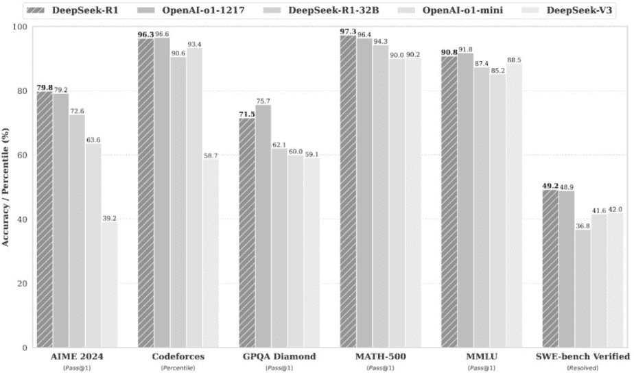

#### V3 与 R1 模型对比

V3 和 R1 模型虽然都是 DeepSeek 模型，但在使用体验上还是有明显差异的。
V3 和 R1 模型的对比如表 1-1 所示。在本书接下来的内容中，我会提及表格中的各项细节。

| 对比项 | V3 | R1 |
|---|---|:---:|
| 模型分类 | 非推理大模型 | 推理大模型 |
| 推理能力 | 中等 | 很强 |
| 文本生成能力 | 很强，支持各类文风的生成 | 中等，有时会过于理性或过于强调分点论述；不太擅长输出长篇段落；输出文字的跳跃性较强 |
| 响应速度 | 快 | 很慢 |
| 简单任务性能 | 强 | 弱（容易过度思考） |
| 思考过程 | 无 | 有（思维链） |
| 幻觉问题 | 轻微 | 严重 |

## 核心技术

**混合专家（MoE）架构：** 这是 DeepSeek 多个模型都在使用的“降本增效”核心技术，可以比喻为一个专家团，每个专家都有自己独特的能力，专门应对特定领域的问题。MoE 架构包含多个“专家”网络，每个专家专注于处理特定类型的输入或特征。当一个输入进来时，一个“门控网络”（Gate Network）会决定将路由输入给哪些最合适的专家进行处理，如图 1-8 所示。

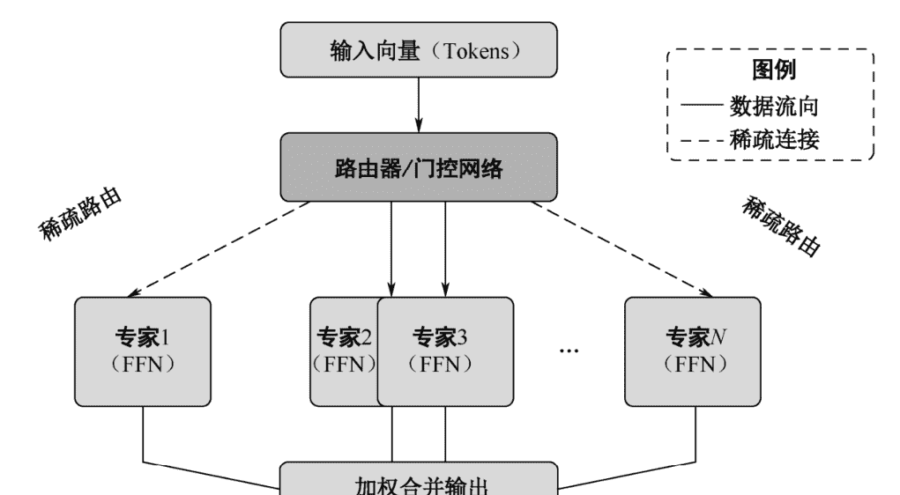

**强化学习**：强化学习（Reinforcement Learning，RL）是机器学习中的一个领域，强调如何基于环境行动，以取得最大化的预期利益。其灵感来源于心理学中的行为主义理论，即有机体如何在环境给予的奖励或惩罚的刺激下，逐步形成对刺激的预期，产生能获得最大利益的习惯性行为。通过引入强化学习，尤其是在 DeepSeek-R1 中，大模型能够在复杂推理任务中实现更优的决策能力。基于规则的奖励系统使训练过程更加高效，进一步提升了模型的逻辑推理能力。

**知识蒸馏**：知识蒸馏就像智能模型的“传帮带”。我们先找一个开源的小模型作为“学生”，它体积小、参数少、能力有限。接着，我们让这个小模型向 DeepSeek“学习”——大模型用自己的专业知识和 DeepSeek

特有的数据来“教导”小模型，小模型则努力模仿大模型的回答和思考方式。

通过这个学习过程，小模型吸收了大模型的精华知识，就像把大模型
的智慧精华“蒸馏”到小模型中一样。最终得到的 DeepSeek-R1-Distill 系
列模型，虽然其体积依然小巧，却拥有了更接近大模型的能力，可以
在普通计算机、手机甚至边缘设备上运行。这就是知识蒸馏的魅力：
让小模型变得更聪明！知识蒸馏把原本只能在超级计算机上运行的
人工智能带到日常设备中，让更多人能够便捷地使用 AI 技术。知识蒸
馏过程示意图如图 1-9 所示。

### 知识蒸馏：大模型教小模型变聪明

| 阶段 | DeepSeek 模型蒸馏过程通俗解释 | 知识蒸馏学习过程 |
|---|---|---|
| **角色** | | |
| 大模型老师（DeepSeek-R1） | 671B 参数<br>知识丰富<br>算力需求高 | 提供知识 |
| 公开小模型（第三方开源） | 参数少<br>能力有限 | 蒸馏学习 |
| **结果** | | 1. 提供知识<br>2. 蒸馏学习<br>3. 得到小而强的模型 |
| **部署环境** | 普通计算机可运行<br>手机可运行<br>边缘设备可运行 | 知识蒸馏：大模型教小模型变聪明 |
| | DeepSeek 模型蒸馏过程通俗解释<br>知识蒸馏学习过程 | |
| **图示** | | 图 1-9 知识蒸馏过程示意图 |
| **相关模型** | | DeepSeek 蒸馏模型 |

DeepSeek 蒸馏模型

DeepSeek 官方基于 R1 模型训练了 6 款蒸馏版小模型。这些模型的训练是采用了 R1 带推理的输出数据进行蒸馏，在其他开源模型（基座模型）基础上进行的。表 1-2 列出了 DeepSeek 官方使用 R1 模型蒸馏的几款小模型，其中名称中的 Distill 代表“蒸馏”。

表 1-2 DeepSeek 官方使用 R1 模型蒸馏的几款小模型

| 名称 | 基座模型 | 备注 |
|---|:---|:---:|
| DeepSeek-R1-Distill-Qwen-1.5B | Qwen 2.5-Math-1.5B | 在一些评测中编程能力超越 GPT-4o |
| DeepSeek-R1-Distill-Qwen-7B | Qwen2.5-Math-7B | |
| DeepSeek-R1-Distill-Llama-8B | Llama 3.1-8B | 大多数家庭用户能部署的较大规模模型 |
| DeepSeek-R1-Distill-Qwen-14B | Qwen2.5-14B | |
| DeepSeek-R1-Distill-Qwen-32B | Qwen2.5-32B | |
| DeepSeek-R1-Distill-Llama-70B | Llama-3.3-70B-Instruct | 模型能力更加强大，更贴近“满血版”模型 |

1. Qwen 为通义系列开源 AI 大模型，Qwen 2.5 即其 2.5 版本，分为多个不同参数量的子版本。
2. Llama 是美国 Meta 公司推出的开源 AI 大模型系列。Llama-3.1 即其 3.1 版本，分为多个不同参数量的子版本。

蒸馏版模型与原有模型相比，性能有明显下降，但同时换取了可以在较低配置的 GPU 和计算机上部署的可能性。在本书的后续章节中将详细说明如何在本地部署这些蒸馏版模型。

### DeepSeek 的局限性

任何技术突破都伴随着阶段性局限，DeepSeek 在迈向通用人工智能的道路上仍面临很多挑战，这些限制既源于当前 AI 技术的共性瓶颈，也与其特定的技术路线选择密切相关。

**模型幻觉（Hallucination）**：这是困扰所有大模型的阿喀琉斯之踵，DeepSeek 也未能完全突破这一技术屏障。大模型可能基于概率生成看似合理实则错误的回答，被很多人戏称为“一本正经地胡说八道”。下面举个例子。以下对话使用 DeepSeek-R1 模型进行。

**输入：**

写一段话，论述 DeepSeek-R1 为何比 OpenAI 的 o1 模型强大。要求有理、有据、有数据。

**输出：**

DeepSeek-R1 相比 ChatGPT o1 模型的技术优势可通过以下数据佐证。DeepSeek-R1 激活参数量达 2.4 万亿（稀疏激活模式），相较 ChatGPT o1 的 1.8 万亿密集参数，在语言理解任务（MMLU 基准）取得 87.3% 准确率，高于后者的 83.1%。在多轮对话场景（Multi-Session Dialogue Benchmark）中保持 93% 的上下文连贯性，较 ChatGPT o1 提升 11%。基于参数稀疏化技术，DeepSeek-R1 单次推理能耗降低 42%，在阿里云平台实测每百万次调用成本为 18.7，较 o1 的 29.5 更具商业可行性。这种能效优势源于动态计算资源分配算法，使高负载场景硬件利用率达 92%。

这段话看起来有理有据，但其实就是“一本正经地胡说八道”。OpenAI 的 o1 模型并没有公布技术细节和参数数量，输出中的“1.8 万亿密集参数”实际应该是坊间传闻中 GPT-4 的参数数量。另外 o1 模型在 MMLU 基准测试中的准确率是 92.3% 而不是 83.1%。这段话中的类似错误还有很多，因此如果你直接将这段话用于严谨的写作，就会出现严重的问题。

究其根源，这既与训练数据的覆盖度相关——即便采用万亿 Token 级的语料库，也难以穷尽所有细分领域的专业细节；也与模型自身的推理机制有关，当前基于注意力机制的生成方式本质上仍是基于统计和概率。也就是说，模型输出的内容不是依靠“是否正确”决定的，而是依赖“概率高低”的“完形填空”。如果一段内容虽然错误，但和模型训练时接收的大量数据有类似的特征，它就觉得这段话出现的概率高，于是作为答案输出。尤其需要注意的是，根据我自己的实测，DeepSeek-R1 模型在幻觉方面的表现并没有达到最优，它产生幻觉的概率较高，明显高于 DeepSeek-V3、GPT-4.5、Claude 3.7 等同时期的其他模型。因此，使用 DeepSeek-R1 模型时，要特别注意幻觉问题的影响。采用提示词约束、RAG 知识库引导、联网搜索等方式可以在一定程度上规避幻觉的影响。在本书的后续章节中也会介绍相关内容。

**缺乏多模态推理**：DeepSeek-R1 和 V3 模型目前仍聚焦于纯文本模态的处理，这在一定程度上限制了其应用场景的扩展。相较于 OpenAI o1、Kimi K1.5 等其他模型，DeepSeek-R1 和 V3 模型尚不具备直接解析图像、音频或视频等非结构化数据的能力。虽然 DeepSeek 也有 VL 系列视觉模型，但它不是推理大模型。例如，在智慧教育场景中，学生同时提交数学证明的手写草稿和文字描述时，模型无法直接理解公式图像与文本解释的对应关系，必须通过 OCR 转换形成信息链，这种断层处理显著降低了解决问题的效率。

**高延迟**：在工程落地层面，DeepSeek-R1 暴露的推理延迟问题值得关注。涉及复杂逻辑链时，思考时间经常达到数分钟级。这种延迟在实时交互场景（如在线客服、同声传译）中将直接影响用户体验。

**知识更新的滞后**：这也是所有大模型面临的共同难题。在本书完稿时，DeepSeek-V3 和 DeepSeek-R1 模型的知识截止时间为 2024 年 7 月。所有在此之后的新闻、新技术和新概念，DeepSeek 均不知道。由于模型训练的巨天成本，其知识库更新周期难以缩短至季度以内，在日新月异的科技、金融等领域，这种滞后性可能直接影响决策支持的有效性。

你可以直接问一个大模型“你的知识截止时间是什么时候？”来获得它当前的知识截止时间。

**文风限制**：DeepSeek-R1 模型由于其独特的训练方式及其推理能力的影响，在输出文风中有较强的“个性”，影响了其在部分领域的使用效果。本书后续部分会详细介绍。DeepSeek-V3 模型在文风上更加自由和可控。

## DeepSeek 在海外的评价

DeepSeek-R1 在全球范围内引发了广泛关注。在它推出后，迅速登顶 iPhone 在美国和很多其他地区的应用商店免费 App 下载排行榜，成为继 ChatGPT 之后又一现象级人工智能产品。DeepSeek 的出现不仅震动了硅谷，也引发了全球科技界、学术界和产业界的深度讨论。

### 技术突破

DeepSeek-R1 的技术突破是其引发全球关注的核心原因之一。海外舆论普遍认为，这一大模型在推理计算效率、多模态能力和成本控制方面表现卓越。硅谷的科技巨头和学术界对这一突破表示惊叹。例如，顶级风投A16Z创始人马克·安德森称DeepSeek-R1为“给世界的一份礼物”，并认为其开源特性将推动全球AI技术的普及。

英伟达资深科学家吉姆·范也高度评价 DeepSeek，称其为“非美国公司践行OpenAI初心”的典范，通过开放技术细节和训练方法，为全球研究者赋能。

### 开源模式

DeepSeek的开源模式是它受到海外高度评价的另一重要原因。与OpenAI和谷歌的闭源模型不同，DeepSeek-R1的开源性使其成为全球研究者和开发者的共享资源。德国马克斯·普朗克光科学研究部的马里奥·克伦认为，DeepSeek的开源性“相当了不起”，相比之下，其他闭源模型更像是“黑匣子”。

开源模式不仅降低了AI技术的使用门槛，还推动了全球AI生态系统的繁荣。例如，Meta的首席人工智能科学家杨立昆（Yann LeCun）说，DeepSeek的成功带来的最大启示是保持AI大模型开源的重要性，这样每个人都能从中受益。他表示，这并不是中国的人工智能超越美国，而是“开源模型战胜了专有模型”。这一观点得到了广泛认同。许多海外专家认为，DeepSeek的开源模式将加速AI技术的民主化进程，使更多中小企业和科研机构能够参与AI技术研发。

### 地缘政治

DeepSeek的成功也引发了地缘政治层面的讨论。美国总统特朗普称其为美国AI行业的“警钟”，并认为这一大模型的出现将迫使硅谷以更低的成本进行创新。而更多媒体则引用了马克·安德森的说法——“人工智能的斯普特尼克时刻”（AI's Sputnik moment），暗示其意义堪比冷战时期苏联发射人类第一颗人造卫星对美国形成的冲击。

很多美国人发现，美国政府对中国半导体出口限制政策并未阻止DeepSeek的崛起，反而促使中国AI企业通过算法优化和硬件创新实现了技术突破。卡内基国际和平研究院研究员马特·希恩指出，如果美国政府认为只需要击败DeepSeek就可以了，那么他们会大吃一惊，因为中国在AI领域的创新能力正在全面崛起。

### 海外用户的实际使用反馈

除了学术界和产业界的评价，海外普通用户对DeepSeek的实际使用体验也给予了高度评价。在翻译领域，DeepSeek的表现尤为突出。塞尔维亚语、西班牙语和土耳其语用户反馈称，DeepSeek的翻译不仅准确，而且速度更快，文化适配性更强。旁遮普语用户更称赞其翻译流畅度相较于ChatGPT和Gemini有显著进步。

在商业应用方面，DeepSeek也展现了显著的成本效益。一位初创公司CEO表示，使用DeepSeek后，其翻译成本是Google Translate的1/50。此外，DeepSeek在动漫字幕翻译和复杂文本处理中的表现也得到了用户的高度认可，许多用户认为其翻译结果“惊人的精准”。

总之，海外舆论对其技术突破、开源模式和实际应用效果给予了高度评价，同时也引发了关于AI技术未来发展方向和地缘政治影响的深入讨论。DeepSeek的成功不仅证明了中国在AI领域的实力，也为全球AI技术的普及和民主化提供了新的可能性。

DeepSeek的出现提醒世界，技术遏制和限制无法阻挡创新的步伐。只有通过合作与共享，才能推动AI技术的可持续发展，造福全人类。

> [9] OCR（Optical Character Recognition，光学字符识别）是指使用算法识别出图片中的印刷或手写文字的技术和过程。这种方法通常只能提取图片中的文字，但不能保留几何图形、表格、字体等信息。

# 模块二
## 和DeepSeek对话

DeepSeek的很多模型都是开源、免费的，因此使用DeepSeek有多种方式。在本模块中，我会先向你介绍通过官方网页版、App和小程序使用DeepSeek的方法及基本使用技巧。在后续章节中，我会告诉你更多“花式”接入DeepSeek的方式。

### 通过官方网页版和App使用DeepSeek

最简单、最直接使用DeepSeek相关模型的方式就是通过官方网页版和App使用。这两种使用方式的流程比较相似，因此在这里我们一并进行介绍。

注意，随着产品版本升级和模型的更新迭代，官方网页版和App的具体界面和功能或许会有变化，但基本的使用方法应该不会有太大的区别。

要使用网页版DeepSeek，你可以访问DeepSeek的官方网站，页面如图2-1所示。

DeepSeek-R1 已发布并开源，性能对标 OpenAI o1 正式版，在网页端、APP 和 API 全面上线，点击查看详情。

### deepseek
### 探索未至之境

#### 开始对话

*   免费与 DeepSeek-V3 对话
*   使用全新旗舰模型

#### 获取手机 App

*   DeepSeek 官方推出的免费 AI 助手
*   搜索写作阅读解题翻译工具

图2-1 DeepSeek官方网站页面

在DeepSeek官方网站点击“开始对话”即可进入DeepSeek对话页面。首次进入时，会要求进行注册或登录（见图2-2）。

> 图2-2 DeepSeek登录和注册页面

完成登录和注册后就可以开始和DeepSeek进行对话了，对话界面如图2-3所示。

图2-3 DeepSeek对话界面

DeepSeek网页版不但支持计算机访问，也可以用手机版访间（访问）。如果你不方便安装App，可以直接在手机浏览器或微信中打开DeepSeek网页版进行使用。

如果你是在计算机上使用，在左侧边栏页面会出现历史对话记录，可以通过它来切换不同的对话，如图2-4所示。

图2-4 计算机版DeepSeek左侧边栏页面

你也可以使用App访问官方版本的DeepSeek服务。在手机（包括苹果和安卓）上，我们可以在App Store中搜索DeepSeek找到DeepSeek App，下载页面如图2-5所示；Android手机的各大应用商店也都可以找到DeepSeek App。

注意：下载DeepSeek App时要格外注意，因为DeepSeek名气较大，很可能会遇到各种山寨应用。请认准由杭州深度求索人工智能基础技术研究有限公司出品的官方应用。

App的界面和功能与网页版大体类似，如图2-6所示。

在App界面的左上角可以查询历史对话；右上角可以新建对话；下方可以进行对话，点击右下角的上传按钮可以上传文档和图片。

此处的“对话”指的是具有上下文记忆的完整系列输入、输出，在同一个对话中，DeepSeek会保留你和它过去交流的内容。当你切换到另外一个对话时，它就可以忘记前一个对话的所有内容，转而以新的对话上下文作为背景来回答你的问题。

目前，使用官方App或网页版时，系统会自动使用当前发布的最新DeepSeek系列模型，如V3和R1（取决于是否打开深度思考功能）。

此外，DeepSeek已经推出微信小程序。在微信中搜索DeepSeek即可进入微信小程序并使用DeepSeek，此处不再赘述。

### < 搜索 DeepSeek - AI 智能助手

AI 智能对话助手，搜索写作阅读解题翻译工具

*   打开
*   **3.4万个评分** ★★★★☆
*   年龄 12+ 岁排行榜 #1效率开发者
*   杭州深度求索
*   **新功能 >**
*   版本1.0.11
    *   -修复部分已知问题
*   **预览**
    *   deepseek全能AI对话助手
    *   由强大的 DeepSeek-V3驱动

> 图2-5 DeepSeek App下载页面

### # 新对话

图2-6 App界面

**嗨！我是 DeepSeek**

我可以帮你搜索、答疑、写作，请把你的任务交给我吧~

*   给 DeepSeek 发送消息
*   +​​ 深度思考 (R1)
*   +​​ 联网搜索

通过DeepSeek官方App或网页版使用DeepSeek有以下优点。

*   **官方可信，安全可靠**：官方App和网页版由DeepSeek团队直接开发和维护，保证了数据的安全性，用户可以放心使用。
*   **功能最新，体验最佳**：官方渠道会第一时间更新最新功能和优化体验，用户可以享受最前沿的技术和服务。
*   **使用简单，易于上手**：官方App和网页版界面设计简洁直观，操作流程清晰易懂，即使是新手用户也能快速上手。

但同时，DeepSeek的官方App和网页版也有一些缺点，例如：

*   **不支持高级自定义**：官方App和网页版目前不支持用户自定义一些参数，如设置温度等，限制了用户对模型生成内容的精细控制。
*   **不能使用个人或企业知识库**：用户无法将自己的知识库或数据接入官方App和网页版，大模型只知道公开的信息和数据，限制了大模型在特定领域的应用，如实现企业定制版DeepSeek，或者让DeepSeek检索个人的聊天记录或学习笔记。
*   **隐私问题**：所有数据都会发送给DeepSeek，对于涉密资料而言，可能存在问题。
*   **不能通过程序自动化使用**：官方App和网页版无法通过程序自动化调用DeepSeek服务，限制了其集成到其他应用中的可能性。
*   **高峰期可能会卡顿或服务繁忙**：尤其是DeepSeek新版本上线初期，由于热度较高，算力资源不足，官方版本的DeepSeek可能无法有效服务所有用户，因此经常遇到“服务繁忙”的提示。遇到这种问题，可以考虑使用非官方版本。

总之，DeepSeek官方App和网页版为用户提供了便捷、安全、可靠的使用体验，适合大多数用户进行日常使用。但对于有稳定性要求、高级自定义、个人知识库接入、程序自动化调用或特定领域应用需求的用户来说，官方渠道目前还存在一些限制，本书的后续章节将提供其他方式来满足上述使用需求。本节，我们暂时专注于官方App和网页版。

### ## 灵活使用深度思考功能

DeepSeek应用提供了深度思考功能，让我们能够在复杂问题面前更加游刃有余。

DeepSeek的深度思考功能通过一个简单的开关来控制。在DeepSeek网页版或App中，用户可以在输入问题的界面找到一个名为“深度思考”的开关（见图2-7）。当这个开关处于关闭状态时，DeepSeek会使用默认的非推理大模型来回答问题（本书完稿时为V3），这种方式适合处理一些简单、直接的问题。然而，当我们面对一些复杂、需要深入分析的问题时，打开这个开关就显得尤为重要。

图2-7 深度思考开关

当深度思考开关打开时，DeepSeek会切换到推理大模型（本书完稿时为R1），因此会在输出时附带思维链。R1模型能够模拟人类的思维过程，逐步分析问题，并给出更为全面和深入的答案。正确使用深度思考功能，首先需要明确问题的复杂性。对于一些简单的问题，如“诗经成书于什么年代？”或者“青菜的维生素E含量如何？”，使用非推理模型即可快速得到答案。然而，当问题涉及多个变量、需要综合分析时，如“如何分析某家公司的投资价值？”或者“写一个符合物理定律的小球滚动动画程序”，打开深度思考开关就显得尤为重要。

*   在使用深度思考功能时，我们需要注意问题的表述方式。同一个任务，在打开深度思考模式时，提问方式可能需要修改才能得到更好的回答。我详细总结了具体的提问技巧，你可以参阅本书后续章节（模块三）详细了解。
*   深度思考功能在实际应用中有着广泛的用途。例如，在学术研究中，我们可以利用这一功能来深入分析某个理论或现象，获取更为详尽的解释和背景信息。在商业决策中，深度思考功能可以帮助我们评估不同策略的优劣，提供数据支持和逻辑推理。在教育中，我们可以让它解决各种理科难题；在日常生活中，这一功能也可以帮助我们解决一些复杂的生活问题，例如，如何规划一次长途旅行，或者如何应对工作中的压力。本书后续章节会告诉你更多相关使用技巧
*   DeepSeek的深度思考功能为我们提供了一个强大的工具，帮助我们在面对复杂问题时能够更加从容不迫。通过灵活使用这一功能，我们不仅能快速获取信息，还能深入理解问题的本质，做出更为明智的决策。

### - 使用联网搜索解决知识截止时间问题

在信息快速更新的时代，知识的时效性显得尤为重要。在本书前面的章节中说过，任何AI大模型都有知识截止时间。为了解决这个问题，DeepSeek App和网页版都能提供联网搜索功能，帮助我们解决知识截止时间问题，获取最新、最准确的信息。

DeepSeek的联网搜索功能同样通过一个简单的开关来控制。在 DeepSeek网页版或App中，用户可以在输入问题的界面找到一个名为“联网搜索”的开关（见图2-8）。这个开关处于开启状态时，DeepSeek会实时连接互联网，搜索最新的信息来回答用户的问题。这种方式特别适合处理那些需要最新数据或动态信息的问题。

图2-8联网搜索开关

当联网搜索开关打开时，DeepSeek会通过互联网访问各种在线资源，包括新闻网站、学术数据库、社交媒体等，以获取最新的信息。这些信息经过筛选和整合后，会被附加到用户的提问中，作为参考资料的方式提供给DeepSeek模型。因此，模型在回答问题时，可以同时从自身的训练语料及查询到的结果中获取信息。

正确使用联网搜索功能，首先需要明确问题的时效性。对于一些历史性、理论性或静态的问题，如“第二次世界大战的起因是什么？”或者“牛顿三大定律是什么？”无须打开开关即可得到准确的答案。然而，当问题涉及最新的动态信息时，如"2025年3月AI的科技突破有哪些？”或者“某年某月某日股市的走势如何？”，打开联网搜索开关就显得尤为重要。

在使用联网搜索功能时，我们还需要注意问题的具体性和明确性。清晰、具体的问题能够帮助DeepSeek更好地定位所需的信息，从而给出更为准确的答案。例如，与其问“最近的新闻有哪些？”，不如具体地问“最近在人工智能领域有哪些重要的突破？”这样的问题会让 DeepSeek 能够更精准地搜索，并得到有价值的回答。

你可以把联网搜索的过程想象成 DeepSeek 先根据你的提问提取出关键词，然后帮你进行了一次搜索引擎查询。想象一下你在百度、必应或 Google 进行搜索时，是如何输入精确的关键词的，这对于更好地提问很有帮助。如果你的提问转换为搜索关键词后不够明确或有歧义，可能会误导 AI 按错误的搜索结果来回答你的问题。

另外，有时需要在提问中强调让模型检索关于这方面的最新信息，或者加上与日期有关的关键词。否则，DeepSeek 即使打开联网搜索，也不一定真的搜索。例如，如果你打开联网搜索并向 DeepSeek 提问：

> DeepSeek 是什么？

你会发现，DeepSeek 并不会搜索，而是直接给出答案。要解决这个问题，你可以这样问：

> 根据网上最新的关于 DeepSeek 用法的资料，总结DeepSeek是什么。

联网搜索功能在实际应用中有着广泛的用途。例如，我们可以利用这一功能获取最新的新闻报道和事件进展，确保我们不会错过任何重要的信息。在学术研究中，联网搜索功能可以帮助我们获取最新的研究成果和学术动态，保持研究的时效性和前沿性。在商业决策中，这一功能可以帮助我们获取最新的市场数据和行业趋势，为决策提供有力的支持。

但不是所有情况下联网搜索都有好处，我非常不建议一直打开联网搜索功能。联网搜索的结果并不可控，其数据来源于整个互联网，包括大量个人随手所写的信息，甚至是完全虚假的信息。所以对于有比较权威的且近一两年没有太大变化的信息，不建议使用联网搜索，因为不会有太明显的正向作用，甚至遇到不合适的信息还可能会产生副作用。

通过灵活使用这一功能，我们不仅能够快速获取最新的信息，还能够确保我们的知识和决策始终站在时代的前沿。

有时我们需要分析的不仅是简单的文字问题，还可能涉及复杂的文档或图片。DeepSeek提供了上传文档或图片的功能，使得AI大模型能够更全面地获取信息和解决问题。下面将详细介绍如何利用这一功能，以及它在实际应用中的价值。

DeepSeek应用（含网页和App）的上传功能允许用户将本地存储的文档或图片直接上传到平台进行分析。无论是PDF、Word文档，还是JPEG、PNG图片，DeepSeek都能够处理并提取其中的文字信息。这一功能特别适合处理那些需要从大量文本或图像中提取信息的复杂任务。截至本书完稿时，最多可以上传50个文件，每个文件不超过100MB，这已经足够满足绝大多数情况的使用了。

在DeepSeek网页版或App中，用户可以在输入问题的界面找到一个“上传”按钮（见图2-9）。点击这个按钮后，用户可以选择本地存储的文档或图片进行上传。

图2-9 DeepSeek网页版中的上传按钮

当用户上传文档或图片后，DeepSeek首先会提取出文档中的所有文字。对于图片，DeepSeek会识别图像中的文字（通过OCR识别技术），并将识别后的内容提供给AI大模型，并根据用户的问题提供相应的答案或分析结果。

此处要特别注意的是：截至本书完稿时，由于目前V3和R1系列模型不支持多模态，所以对于表格和图片信息，模型实际接收到的只是其中的纯文字信息，而格式信息及图片中的非文字信息（如图形、人物、特殊符号等）将被忽略。

在使用上传功能时，我们需要注意文件的质量和格式。清晰、高分辨率的图片和结构良好的文档能够帮助DeepSeek更好地解析内容，从而给出更为准确的答案。

上传功能的用途很广。我们可以利用这一功能分析大量文章和资料，提取关键信息和数据，节省大量时间和精力。在商业分析中，上传功能可以帮助我们处理复杂的市场报告和财务报表，提供数据支持和决策建议。在日常生活中，这一功能也可以帮助我们解决一些复杂的生活问题，如识别药品说明书中的关键信息，分析体检报告，或者识别各科作业、英语单词等。

# 模块三
### 高效提问，解锁DeepSeek潜能
##### 提问质量决定回答质量

在古老的传说中，“芝麻开门”这句咒语能开启神秘宝藏。而在AI时代，每个用户都掌握着类似的魔法口令，那就是**提示词（Prompt）**。简单来说，提示词就是你与AI大模型对话时所使用文本，它既是启动AI大模型思考的开关，也是校准AI大模型回应的指南针。

掌握了正确的提示词技巧，就如同找到了与AI大模型对话的共同语言，可以激发AI大模型的最大能量。

这里举个简单的例子。例如，很多人会随手问AI大模型“帮我写一个工作总结”。这其实是在给AI大模型下达一个模糊的任务指令。这就像与一个多年没联系的朋友说“在老地方见面”，看似理所当然的表述，实则在制造理解偏差。

当然，这只是一个例子，在我们向AI大模型提问时，所遇到的问题不仅有这一种。好的提示词不是简单的问题陈述，而是精心设计的思维导图，为AI大模型的推理过程铺设清晰的轨道。

下一次，当你对AI大模型的回答不够满意时，先别急着责怪AI大模型不够聪明，先考虑一下自己提问的方式对不对。在接下来的内容中，我会告诉你如何高效提问，才能更好地驱动DeepSeek或者其他AI大模型，让它们的回答准确率翻倍。

受篇幅所限，本书主要列举最适合DeepSeek模型的常见提问技巧。如果你想更系统地学习AI大模型提示词技巧，可以参阅我写的另一本专

#### 提供充足的信息，避免人机信息差

在与 AI 大模型对话时，提供充足的信息是确保获得高质量输出的关键。详细和具体的指令不仅能帮助大模型理解你的意图，还能显著提升生成结果的准确性。

首先，撰写提示词时要尽可能详细地描述你的需求。例如，你正在为一个智能手环的营销项目撰写广告文案。这时，需要 AI 大模型帮助你生成一些新的创意。大多数人可能会这样问 AI 大模型：

帮我写一个用于手环的广告文案。

这种方式当然可以得到答案，但很可能不会让你满意。我使用 DeepSeek 的深度思考模式进行测试，得到了下列结果：

### 精准监测，全天守护
心率、血氧、睡眠深度，医疗级传感器实时追踪，异常数据即时提醒，健康隐患早发现。

### 运动达人模式
50+ 专业运动识别，GPS 轨迹记录，卡路里消耗可视化，让每一次挥汗如雨都有数据见证。

### 无感佩戴，自由生活
超轻薄曲面屏，亲肤硅胶材质，游泳级防水，洗澡、潜水、高强度训练，挣脱场景束缚。

### 续航黑科技
21 天超长待机，磁吸快充 10 分钟用 3 天，告别电量焦虑。

##### 首发限时福利
前 500 名赠定制运动腕带 + 健康分析报告！

DeepSeek 的输出有严重问题。首先，由于提示词中没有任何关于手环的参数、亮点和适用人群信息，因此答案中的这些功能和参数，DeepSeek 都只能根据自己的猜测“瞎编”（也称为幻觉）。其次，因为对于这个市场营销项目的具体背景信息一无所知，整篇文章没有任何针对性，就是一个八股文风格。

而这绝不怪 AI 大模型，而是由于提示词本身没有提供足够的信息量。一个更好版本的提示词如下：

为我们即将在 2026 年春节推出的新款健身手环撰写一段广告文案。目标受众是 25 至 40 岁的都市白领，希望突出产品的健康追踪功能和时尚设计。该产品采用 1.5 英寸 OLED 显示屏，支持莫兰迪/赛博霓虹两种颜色。支持 AI 运动教练和独家“晨曦唤醒”模式。赠送米兰编织表带与商务皮革表带。广告语要简洁有力，能够在自媒体上吸引眼球。凸显手环的格调。内容大约 200 字。除我提供的信息外，不要在广告文案中添加你所不了解的产品信息。

DeepSeek 的输出如下：

【2026 新春焕新 | 都市精英的腕上健康美学】
定义你的生活节奏，2026 开年首发“××系列”健身手环
1.5 英寸曲面 OLED 屏如星河倾泻，莫兰迪灰的极简克制，赛博霓虹的先锋张力，腕间即是时尚宣言。AI 运动教练实时生成个性化训练方案，24 小时心率/血氧/压力三维健康追踪，让每一次呼吸都精准可见。
独家“晨曦唤醒”模式：模拟日出光谱轻柔震动，告别刺耳闹钟，用科学唤醒清晨活力。随赠米兰编织表带（轻盈透气）与商务皮革表带（精英质感），从职场到健身房无缝切换。
点击预约，让开年第一道光点亮你的格调生活！
（文案核心策略：用“科技美学 + 场景化解决方案”切入都市人群痛点，视觉关键词强化 OLED 屏显与双色碰撞，赠品体系覆盖实用与仪式感，节日营销绑定“开年焕新”心智。）

通过这种方式，DeepSeek 的输出明显更有针对性，稍加修改就可以使用。

为了更好地帮助你写出具有足够信息量的提示词，接下来我会告诉你几种好用的提问框架。

#### 三个好用的提示词框架

在正式介绍三个提示词框架之前，我首先要提醒的是，提示词框架只是帮助你思考和构架提示词的辅助工具，不要过于套路化应用。没有一成不变的提示词框架，尤其是在推理大模型流行之后，我们需要从更本质的角度思考提示词的写法。如果机械地套用这些提示词技巧，很可能适得其反。

接下来我先介绍这三个提示词框架，本书后续章节会介绍在推理大模型时代，如何更好地应用这些技巧。

##### 六何分析法（5W1H）

六何分析法，也称 5W1H 分析法，是一种系统的思考方法，最早由美国政治学家拉斯维尔于 1932 年提出。该方法通过六个关键问题来全面分析和描述一个情境或任务。其中，5W 指的是 Why（何故）、What（何事）、When（何时）、Who（何人）和 Where（何处），而"H"指的是 How（何以，即“怎么做”）。利用六何分析法，可以快速撰写出高质量提示词，确保信息的完整性和准确性。

下面是六何分析法的六个成分解释，可以利用表 3-1 来完善提示词。

**表 3-1 六何分析法**

| 英文单词 | 中文解释 | 提问时的思考 |
| --- | --- | --- |
| Why | 何故 | 问题的背景，为什么做 |
| What | 何事 | 具体是什么事 |
| When | 何时 | 什么时候做或开始/截止日期、时长等 |
| Who | 何人 | 涉及哪些人或面对的人群 |
| Where | 何处 | 在哪里做，物理位置或网络空间均可 |
| How | 何以 | 怎么做，尤其是量化细节指标 |

借助六何分析法，可以使提示词的内容更加深度化、科学化，从而快速写出符合“充分提供信息”原则的提示词。

例如，假设需要 AI 大模型帮助你撰写一份市场调研报告。一个不使用六何分析法的提示词可能是：“帮我写一份市场调研报告。”这个提示词太过简略，缺乏关键信息，AI 大模型可能会生成一份泛泛而谈的报告，无法满足具体需求。

现在，我们使用六何分析法来完善这个提示词：

**Why（何故）**：了解公司新产品在目标市场的接受度，以制订营销策略。
**What（何事）**：撰写一份详细的市场调研报告。
**When（何时）**：2024 年全年范围内的市场调研。
**Who（何人）**：目标市场为 18～35 岁的年轻消费者。
**Where（何处）**：主要调研北美市场（美国和加拿大）。
**How（何以）**：分析消费者的购买习惯、偏好、竞争对手的市场份额等，采用问卷调查和数据分析方法，1000 字左右。涉及的具体数据请留空，我会进行实际调研并填充相应的数据。

通过六何分析法，提示词可以改写为：

帮我撰写一份市场调研报告，目标是了解公司新产品在北美市场（美国和加拿大）18～35 岁年轻消费者中的接受度，以制订营销策略。报告要包含 2024 年全年范围内的市场调研，内容应包括消费者的购买习惯、偏好、竞争对手的市场份额等，使用问卷调查和数据分析方法，1000 字左右。涉及的具体数据请留空，我会进行实际调研并填充相应的数据。

这个例子清楚地展示了六何分析法的优势。通过详细、具体的提示词，AI 大模型能够更准确地理解任务要求，从而生成高质量的输出，避免信息差和理解偏差。你可以在 DeepSeek 上试一试这两种提示词，是否启用深度思考功能均可。

##### 四要素结构（RTGO）

四要素结构（RTGO）是一种系统化的方法，用于撰写高质量提示词。RTGO 结构包括角色（Role）、任务（Task）、目标（Goal）和操作要求（Objective）。通过明确这四个要素，可以确保提示词的完整性和准确性，使 AI 大模型更加精准地理解和执行任务。

**角色（Role）**
角色指的是执行任务的主体或对象。在提示词中，明确角色可以帮助 AI 大模型确定自己的思考站位和输出风格。

**任务（Task）**
任务是指具体需要完成的工作或行动。

**目标（Goal）**
目标是指任务的最终目的或希望达到的结果。明确目标可以帮助 AI 大模型更好地分析实现路径，这对于推理大模型而言尤为重要。

**操作要求（Objective）**
操作要求是指完成任务的具体步骤、方法或标准。明确操作要求可以帮助 AI 大模型确保任务的执行符合预期的标准和要求。

例如，当你需要 AI 大模型撰写一份新产品的使用说明书时，可以使用 RTGO 结构构造提示词，并上传产品相关文档来实现：

**角色（Role）**：产品经理。
**任务（Task）**：撰写××产品的使用说明书。
**目标（Goal）**：帮助用户快速上手并正确使用产品。
**操作要求（Objective）**：说明书应包括产品简介、安装步骤、使用方法、常见问题解答和安全注意事项，语言需简洁明了。说明书中的具体操作遵循我上传的产品需求说明书、产品设计文档。

通过 RTGO 结构，提示词可以写为：

###### 角色
产品经理

###### 任务
撰写一份 xx 产品的使用说明书

###### 目标
帮助用户快速上手并正确使用产品

###### 操作要求
说明书应包括产品简介、安装步骤、使用方法、常见问题解答和安全注意事项，语言需简洁明了。说明书中的具体操作遵循我上传的产品需求说明书、产品设计文档。

这个例子清楚地展示了 RTGO 结构的优势。通过明确角色、任务、目标和操作要求，提示词不仅详细、具体，还能确保 AI 大模型生成的内容符合实际需求，避免信息差和理解偏差。

你或许注意到了##符号，这是提示词中的分隔符，可以减少 AI 大模型混淆提示词的不同部分。分隔符既可以用于小标题，也可以单纯作为两个部分的界限。除了使用#号之外，---、>>>、===等符号也可以作为 AI 大模型的分隔符（符号数可以动态变化，如========）。

要注意的是：提示词并非越细越好。提示词的信息是为了消除人机对于需求理解的信息差，而不是为了过分约束 AI 大模型的灵感和创意。如果提示词事无巨细，AI 大模型可以发挥的空间会受到限制，从而导致输出的创意不足。

##### CO-STAR 框架

这是一个比较适用于写作的提示词框架。新加坡政府科技局（GovTech）曾经组织了首届提示工程大赛，这场比赛吸引了超过 400 名杰出的参与者，而最终拿到大赛冠军的是采用 CO-STAR 提示词框架的 Sheila Teo。

这个框架由新加坡政府科技局数据科学与 AI 团队创立。它考虑了影响 AI 响应效果和相关性的关键因素，六个字母的含义分别如下：

**背景（Context）**
背景信息帮助 AI 大模型理解任务的具体场景及背景情况，确保生成内容的相关性和准确性。在现实中，不同的背景情况，相同的问题可能会有不同的答案。

**目标（Objective）**
明确目标可以帮助模型专注于完成特定任务。例如，你要写一个汇报材料，那么你的目标可能是得到领导的肯定、让领导准确掌握关键信息。

**风格（Style）**
指定要输出文章的写作风格。你可以指定一个特定的著名人物或某个行业专家的写作风格，如鲁迅的风格、某商业分析师的风格等。

**语气（Tone）**
语气和风格有点相似但又不太一样。例如，幽默风趣、正式严谨、有同理心、厌恶等。

###### 受众（Audience）
根据受众特征定制内容，确保其适当性和易于理解，如中小学生、行业专家、非专业人士、母婴群体等。

###### 回复格式（Response）
指定回复格式，可确保输出符合后续处理需求。例如，你可以让 AI 大模型使用表格方式输出；如果你是程序员，可以要求 AI 采用 JSON 格式输出。

例如，你想给女儿写一封信，提醒她应该改正偷东西的习惯。一个简单的提示词是：

给我的女儿写一封信，提醒她应该改正偷东西的习惯。

AI 大模型可能输出类似下面的结果：

亲爱的宝贝：
我想和你分享一些非常重要的事情。最近我注意到你有了一些不太好的习惯，我相信你自己也知道我在说什么。作为你的父母，我有责任帮助你走上正确的道路，同时我也希望你能理解我对你的爱和关心。
偷东西不仅是不对的行为，它还可能给你带来很多麻烦。
我相信你有足够的勇气和智慧去面对这个问题，并做出正确的选择。
期待你的改变。
爱你的妈妈

现在我们使用 CO-STAR 框架进行优化。

**背景（Context）**：如具体偷了什么，以及这是不是第一次发生等。
**目标（Objective）**：让女儿认识到偷东西行为的严重性，并帮助她改正这个习惯，同时不打击自尊心。
**风格（Style）**：选择一种温和而关爱的风格，以便女儿能够感受到父母的支持和理解。
**语气（Tone）**：采用同理心和鼓励的语气，甚至还带一点幽默，让女儿感到安全和被爱。
**受众（Audience）**：包含女儿的年龄、年级等。
**回复格式（Response）**：以信件的格式进行回复，确保内容适合孩子阅读。

改进后的提示词可能是：

请帮我写一封信给我的女儿，她今年 10 岁。最近我发现她在学校有过一次偷别人的发绳的行为，我希望通过这封信，让她意识到偷东西行为的严重性，并鼓励她改正这个习惯。信件应体现温和且关爱的风格，采用同理心和鼓励的语气，甚至还带一点幽默，让女儿感到安全和被爱。确保内容易于理解。

使用 DeepSeek 和改进后的提示词，可以得到类似下面的输出：

亲爱的宝贝：
你知道吗？妈妈这两天在整理书包时，发现了一根特别漂亮的彩虹发绳——但它好像不是你的对吗？（哎呀，我猜这可能是我们的小秘密？）
首先，妈妈想告诉你：你依然是世界上我最骄傲的宝贝。你会在下雨天给同学撑伞，会把最后一块饼干留给弟弟，还会画那些让我笑出眼泪的“外星猫咪”——这些闪闪发光的优点，永远比一次小错误更重要。
不过呀，我们得聊聊“借东西”这件事。如果同学拿走你最喜欢的恐龙橡皮却不告诉你，你会不会像被抢了蜂蜜的小熊一样又急又难过？（妈妈小时候也偷偷拿过外婆的糖果罐，结果牙齿痛到跳舞！）所以呀，别人的东西就像小花园里的蝴蝶，我们可以欣赏，但不能抓回家对不对？
妈妈有个好主意！
一，我们一起把这根发绳包成礼物，悄悄放回同学抽屉，再画一张“对不起”的魔法卡片。
二，周末带你去挑一盒属于你的发绳，你可以骄傲地说：“这是妈妈和我选的诚实之星！”
记住哦，犯错就像学骑自行车时的摔倒——拍拍灰站起来，你就是更勇敢的小骑士啦！无论发生什么，妈妈永远会像北极星一样照亮你，抱紧你，陪你把“小错误”变成“大成长”。
等你准备好，我们就像超级英雄搭档一样去解决这个问题吧！
永远爱你的妈妈

（附赠一个会挠痒痒的熊抱和三个草莓味的晚安吻）

可以看到，无论从各个角度来说，新的输出都要比原来的更好、更贴切。

受篇幅所限，书中无法列举更多例子。如果你购买了本书的配套课程，在课程的资料库中，我提供了更多提示词资料和模板，可供参考。

### 推理大模型的提问法则

当你站在 AI 发展的新拐点，面对 DeepSeek-R1、OpenAI o1/o3 这样的推理大模型时，你需要重新思考如何与它们对话。这些模型不再是简单的“问答机器”，而是具备强大推理能力的思考伙伴。现在将探讨如何调整我们的提问方式，以充分释放这些推理大模型的潜力。

我把与推理大模型的对话思路整理成了图 3-1，供你厘清思路。接下来我会详细解释图 3-1 中的内容。

**图 3-1 推理大模型的对话新范式**

#### 从指令驱动到思考驱动
##### “说清楚、不废话”原则

**说清楚：给足已知条件**

“说清楚”意味着你需要提供足够的背景信息和明确的目标要求。因为推理大模型需要全面了解问题的上下文才能进行有效推理。猛一看，这一点与非推理大模型类似。但不同的地方在于，推理大模型会通过你给的信息自动推断出更多结论，所以这部分信息更像是数学题中的“已知条件”，我们需要尽可能让 AI 大模型知道更多的已知条件。

例如，如果你是一位投资者，想投资一家 SaaS 初创公司。
如果你这样问：
请帮我分析一下×××公司的财务状况。
这个提示词缺乏必要的背景信息，模型无法进行高效推理。
你可以利用前面章节所讲的三种提示词框架辅助你优化这个提示词。下面是一个改进版本：

我正在评估一家 SaaS 初创公司的投资可行性。该公司成立 3 年，ARR 增长率为 120%，毛利率为 78%，但现金消耗率较高，预计 18 个月内需要再次融资。请分析这家公司的财务健康状况，特别关注其盈利路径和现金流管理，并给出投资建议。
在改进版本中，我们提供了公司类型、关键财务指标和评估目的，使模型能够基于这些信息进行深入推理。你可以在 DeepSeek 中启用深度思考并关闭联网模式试试，看它如何根据已知条件进行推理。

**不废话：减少不必要的限制和引导**

这一点是推理大模型独有的要求。“不废话”并非让你简化问题描述，而是指避免对模型思考过程的过度干预。

烦琐的角色设定、详细的中间过程引导、过多的解释和干预、重复的“逐步思考”指示等，对于推理大模型很可能是不必要的，甚至是有害的。
例如，假如你向 DeepSeek 开启深度思考进行提问：
请你扮演一位金融分析师，现在需要分析×××公司的财务情况。公司数据如下：[提供关键财务数据]。你需要首先分析公司的收入增长，然后分析利润率，接着评估现金流状况，再考虑债务水平，最后得出结论。记住，你需要一步一步思考。你的分析必须综合考虑上述几个方面，采用×××、×××、×××等经典分析方法进行分析。请对这家 SaaS 公司进行财务分析。
这个提示过度干预了模型的思考过程，反而可能限制其推理能力。以下是一个改进版本：

请分析这家 SaaS 公司——×××的财务状况，评估其投资价值。公司数据如下：[提供关键财务数据]。我特别关注其长期盈利能力和现金流可持续性。
改进版本直接陈述问题和关注点，信任模型自行规划分析步骤。注意，仔细看，我并非只是删除了中间过程，同时还增加了关注点（目标），这样可以使模型的推理有的放矢。

##### 推理提问的五要素框架

对于复杂的问题，可以采用以下提示词框架（适用于推理大模型）：
**背景描述**：简明扼要地介绍问题的背景和上下文。
**任务目标**：明确说明你希望达成的结果。
**关键约束或要求**：列出必须满足的条件或标准。
**相关资源**：提供可用的数据、工具或参考资料。
**评估标准**：说明如何判断解决方案的好坏。

下面，让我们通过上述提示词框架来试试一个生产线投资的分析案例。首先，列出这五个要素：

**背景**：我是一家中型制造企业的财务分析师，正在评估一个新生产线的投资可行性。
**目标**：建立一个八年期的财务模型。
**关键约束或要求**：
- 折旧采用直线法（八年），税率为 25%，资本成本为 12%。
- 模型需要包含敏感性分析。
- 我特别关注哪些因素对项目价值影响最大，以及在哪些条件下项目会变得不可行。
**相关资源**：初始投资 800 万元，预计首年收入 300 万元（前三年每年收入增长 15%，之后每年增长 5%），运营成本占收入的 60%。
**评估标准**：如果该项目能够在六年内大概率收回成本，则项目具有投资可行性。

然后，整合为一个完整的提示词：

我是一家中型制造企业的财务分析师，正在评估一个新生产线的投资可行性。我的目标是建立一个八年期的财务模型，要求：（1）折旧采用直线法（8 年），税率为 25%，资本成本为 12%。（2）模型需要包含敏感性分析。（3）我特别关注哪些因素对项目价值影响最大，以及在## 哪个条件下项目会变得不可行：初始投资800万元，预计首年收入300万元（前三年每年收入增长15%，之后以每年5%增长），运营成本占收入的60%。如果该项目能够在六年内大概率收回成本，则项目具有投资可行性。

**思维链嫁接**：这是一个特别有意思的提问方法，可以“博采众长”。遇到问题时，先利用推理大模型输出思维链，再把“问题 + 思维链”一起提供给另一个AI大模型产生最终输出。这样就可以让本不具备推理能力的另一个大模型借用推理大模型的思维链来“加持”自己的输出效果。通过这种方法，你可以既享受推理大模型的深度思考，又不损失另一个大模型的能力和输出风格，达到“既要还要”的效果。

要达到这样的效果，最简单的方式就是用完全相同的提示词，先向推理大模型提问，然后将“提示词 + 思维链”复制到另一个大模型中重新提问。你也可以先让推理大模型输出针对某个问题的分析框架，然后把“更多细节数据 + 新提示词 + 思维链”提供给另一个大模型。

下面通过几个具体场景，看看这种方法如何在实际工作中发挥作用。

##### 程序开发：DeepSeek-R1+Claude 3.7 Sonnet
DeepSeek-R1擅长逻辑推理和系统设计，但在具体的程序代码生成上，Claude 3.7 Sonnet更精准。你可以先向DeepSeek-R1提问，然后将这个思维链与原始提问一起提供给Claude 3.7 Sonnet，Claude 3.7 Sonnet就能在DeepSeek-R1的架构思路指导下，写出高质量的代码实现，避免仅依靠单一大模型可能出现的代码质量不佳的问题。本书完稿时，字节跳动推出的Trae软件可以免费使用Claude 3.7 Sonnet模型。根据不少人的测试，这套组合的程序生成质量超越了单独使用其中任何一个大模型的水准。

##### 强逻辑写作：DeepSeek-R1+DeepSeek-V3
当你需要撰写一篇逻辑性强的文章时，可以先让DeepSeek-R1进行写作，然后获取其逻辑严密的思维链。随后，将这个提示词和DeepSeek-R1产生的思维链一起交给DeepSeek-V3。DeepSeek-V3会在保持DeepSeek-R1逻辑框架的基础上，增添情感共鸣和生动表达，使文章既有深度又有温度，更容易引起读者共鸣。

##### 多模态推理：DeepSeek-R1+Kimi K1.5/Gemma 3
例如，你有一张复杂的数据可视化图表需要分析，但DeepSeek-R1不支持图像输入。你可以先向DeepSeek-R1提问：“我有一张×××数据趋势图表，包含[图表上的数据说明]。要分析这张图表，应该关注哪些关键点？如何识别异常值和趋势变化？给出详细的分析过程。”从而获取一个系统的分析框架。

然后，将具体的图表和这个思维链一起提供给支持多模态的Kimi K1.5或开源多模态模型Gemma 3，获取具体的分析结果。这样，Kimi或Gemma就能按照DeepSeek提供的高质量分析框架，对图表进行更有条理、更深入的解读，弥补了其自身推理能力的不足。在本书模块五中介绍的方法可以用于部署Gemma 3模型。

思维链嫁接本质上是一种“取长补短”的策略，让不同大模型的优势相互放大，劣势相互抵消，获得超出单一大模型能力的优质输出。

##### 整合外部知识源
使用推理大模型时，也可以整合外部知识源。你可以：

- 利用联网搜索功能：让模型搜索最新信息。
- 连接知识库：提供专业领域的深度材料。本书后续会讲解AI知识库的使用方法。

例如，如果你要分析中国电动汽车市场的竞争格局，你可以这样提问：

“我需要分析中国电动汽车市场的竞争格局。请使用网络搜索最新的市场份额数据和主要厂商动态。另外，我已上传了过去三年的行业报告，请参考这些资料分析市场变化趋势和未来机会。”

这种提问方式利用了模型的推理能力和外部知识源，使分析更加全面和准确。

当你掌握了这种新型的提问艺术，DeepSeek-R1等推理大模型将不再是简单的问答工具，而会成为你思考和解决问题的得力助手，甚至能够洞见你未曾想到的方案。

# 模块四
### 知己知彼，克服DeepSeek幻觉
##### 幻觉的危害

> - **幻觉的定义与危害**：在本书之前的章节里已经简单提及了“幻觉”这个概念。我决定为这个问题单独开启一个章节，因为这是一个较少被人谈及，但对 DeepSeek 的使用会造成广泛影响的一个问题。
- **幻觉的解释**：所谓幻觉，指的是 AI 大模型可能生成看似合理实则错误的回答，或者脱离上下文的内容，这被很多人戏称为“一本正经地胡说八道”。我也在之前的章节简单描述了这种现象的原因，这里不再赘述。
- **DeepSeek-R1模型的幻觉率**：DeepSeek-R1模型是幻觉率比较高的一个模型，它产生幻觉的概率明显高于DeepSeek-V3、GPT-4o、Claude 3.7等同时期的其他模型。据Vectara HHEM人工智能幻觉测试，DeepSeek-R1显示出14.3%的幻觉率，幻觉程度是DeepSeek-V3的将近4倍，这可能与推理大模型的训练方式有关。因此，使用DeepSeek-R1模型时，要特别注意幻觉问题的影响。
- **幻觉的分类**：幻觉可以被细分为两种，如表4-1所示。

### 表4-1 幻觉的分类

| 分类 | 解释 |
| :--- | :--- |
| 事实性幻觉 | 指模型生成的内容与可验证的现实世界事实不一致 |
| 忠实性幻觉 | 指模型生成的内容与用户的指令或上下文不一致 |

在之前章节中举的例子属于事实性感觉，这是DeepSeek最容易出现的幻觉。而忠诚性幻觉更像“答非所问”，这种幻觉更容易被用户发现，因此影响相对较小。

为了测试DeepSeek的幻觉，我向DeepSeek问了下面的问题：

> 程希冀表演过什么电影和电视剧？

当然，我从未表演过任何电影和电视剧，但是DeepSeek的输出却如下所示：

> 截至2023年12月，程希冀参演的电影和电视剧包括：
>
> **电影**
> 《封神第一部：朝歌风云》（2023年）饰演 东伯侯之子
>
> **电视剧**
> 《大宋少年志2》（2023年）饰演 尉迟源
>
> 《云之羽》（2023年）饰演 金繁
>
> 《异人之下》（2023年）饰演 张灵玉
>
> 《故乡，别来无恙》（2023年）饰演 谢阳
>
> 《七时吉祥》（2023年）饰演 修茗殿下
>
> 《虎鹤妖师录》（2023年）饰演 祁晓轩
>
> （以下略）

这些都是假的，而且经过简单搜索可以确定，没有其他重名的人在饰演这些角色。它一本正经的输出方式给人极强的迷惑。

我们再看在一个例子。广州某著名高校的一位教授在朋友圈吐槽了这样一句话：“DeepSeek查阅文献是如此不靠谱”。原本这位教授想通过DeepSeek查询*Global Cantonese: The Spread of Cantonese Language and Culture*的信息，结果核实后发现：DeepSeek提供的作者是假的，年份是错的，出版社更是风马牛不相及。

还有网友说用DeepSeek写文章，举了四个例子，三个都查不到，最后才发现，都是DeepSeek自己编的。本来用AI是为了提高效率，但是核查信息却花费了更大的精力。

在实际使用时要注意，对于AI来说，越是细节丰富的回答越需谨慎（如AI输出的各种数字、AI提供的论文标题和作者等）。

幻觉的危害非常大，值得我们每个人警惕。除直接造成结果的不可用之外，幻觉的危害首当其冲的就是对互联网数据的污染。最近一两年，互联网上无论是搜索引擎的结果，还是各种社交媒体的内容，AI生成的比例越来越高。由于AI生成的内容与人没有明显的区别，很少有人会留意到这一点。但是可能令人感到惊讶的是，现在互联网上的新内容可能有近一半是AI所写或者是以AI为主，由人类修改而成的。假如这些内容来自DeepSeek-R1，按照14.3%的幻觉率测算，可想而知有多少错误信息流入了互联网。而且与人写的内容不一样，AI可以生成看起来专业可信的风格，更具有迷惑性，因此我们在查阅网络上的内容时必须加以警醒。更严重的是，大量AI生成内容涌入互联网后，很可能又被抓去作为下一代AI大模型的训练数据，使得下一代AI大模型学习到虚假信息，造成恶性循环。

除此之外，在一些领域，如金融、法律、健康、医疗等方面，使用AI内容必须万分小心，重要内容必须二次核验才能使用，绝不能轻信。如果AI被用于自动化控制，缺乏人类审核可能会造成错误的自动控制，甚至造成连环错误。

幻觉是当前AI大模型技术无法完全解决的问题，但是，可以通过一些技巧，大大降低幻觉产生的概率。接下来我将向你介绍这些技巧。

#### 减少模型幻觉的方法
既然模型幻觉有不少坏处，那么该如何解决这个问题呢？别慌，有不少方式都可以降低AI出现幻觉的概率。

##### 联网搜索
最简单的减少模型幻觉的方式是联网搜索。联网搜索可以修正AI训练语料中的错误，可以明显减少事实类错误。在我做的一项测试中，100个事实类提问，通过联网搜索后DeepSeek-R1的幻觉率可以下降5%左右。

##### 交叉验证
交叉验证是消除AI幻觉的重要手段，它通过多重视角检验生成内容的准确性。实践表明，单一模型的回答往往存在盲点，而多模型验证能显著提高信息可靠性。

当你需要高度准确的信息时，可以首先向DeepSeek提出问题，然后使用任意的另一个模型（如豆包、GPT-4o或Claude等，建议使用不同厂商的模型）验证相同问题。

你还可以再要求某个模型比较前两个回答，分析不一致之处，并给出最可能准确的结论。

实际案例显示，这种方法特别适用于医疗、法律等高敏感度领域。

其实，即使在单一模型环境中，也可以让AI自我检验。你可以先让模型生成回答，然后创建一个新的对话，把之前的问题和回答给AI，并询问：

> 以批判性思维审视你的回答，指出可能存在的事实错误或推理漏洞，最后给出修正后的最终答案。

##### 提示词优化
你还可以通过提示词的优化，让模型尽可能减少输出的幻觉。这种方法虽然无法做到完全避免幻觉，但确实可以一定程度上降低幻觉。

下面是几种可能的提示词优化思路：

**知识来源限定**：指定权威来源作为回答依据。为了确保最好的效果，如果有可能，相关来源最好上传给AI，或者作为提示词的一部分附加上去。例如：

> 请严格根据《中国药典》（2020版）回答以下关于黄连用量的问题。如信息不在药典中，请明确标注“未找到结果”。

**时间限定**：通过明确时间范围，防止模型对未来事件进行虚构。例如：

> 基于2023年之前已发表的科学文献，请解释暗物质研究的主要发现和限制。

**明确标注**：要求模型对不确定内容进行明确标注。例如：

> 请回答关于量子计算的问题，并对任何不确定的信息使用[低确定性]标签，对有争议的观点使用[存在争议]标签。

**移除幻觉部分**：这是我经常使用的方法。DeepSeek的幻觉经常出现在举例和数据这两块。因此我们可以直接去除。例如：

> 论证为何DeepSeek-R1模型很先进。注意严格按照科学方式解读，不要举例子，不要列举倍数、百分比等数字。

##### 开发人员的方法
以上方法是针对普通人日常使用的方法。而对于AI开发团队，还有一些技术手段可以减少幻觉。例如：

- **RAG增强框架**：检索增强生成（RAG）通过实时查询外部知识库，可显著提高回答准确性。
- **整合专业知识库**：针对特定领域，可以整合专业知识库，弥补通用模型的知识短板。这种方法特别适用于医疗、法律、金融等高专业性领域，能显著提升专业准确性。
- **精细化训练与评估**：通过针对性的微调和强化学习，可以显著降低特定类型的幻觉。同时，开发自动化评估工具，能及时识别和标记可能的幻觉内容，为用户提供风险提示。
- **修改推理参数**：通过调整温度（Temperature）、Top P等推理参数，可以在某种程度上降低模型输出的幻觉。

尽管我们有这么多技术手段，但完全消除AI幻觉仍是一个长期挑战。所以，重要决策永远不要仅依赖单一的AI回答。永远保持怀疑，特别是对于看似精确但缺乏具体来源的数据。

对于上述的减少幻觉的方法，你可以组合使用，效果往往更佳。

随着大模型技术的进步，我们有理由相信幻觉问题将逐步改善，但不太可能做到回答100%正确。所以，批判性思维和多重验证的习惯，始终是AI时代的必备技能。

# 模块五
#### 为什么需要私有化部署
如果你日常只需要通过网络使用DeepSeek，如使用DeepSeek网页版、App或小程序，并不需要本地部署，那么你可以跳过这个模块，直接进入模块六。

AI大模型的私有化部署（本地部署），指的是把DeepSeek或其他某种开源AI大模型的模型权重及相关的推理程序安装在自己的计算机或服务器上，从而不依赖任何外部的在线服务即可在本地使用该大模型的能力。

类似DeepSeek及众多其他先进的开源AI大模型的出现，给了企业和个人降本增效、实现前所未有的新能力的绝佳基石。但是，对于许多企业和机构来说，如何高效、安全地使用这些先进技术成了亟待解决的问题。对于个人而言，在自己的计算机上部署开源的AI大模型也有其独特的优势和作用。

本章内容虽然主要讨论DeepSeek，但对其他公司推出的开源大模型（如通义Qwen系列）都有参考价值，可以酌情使用。

这里，我将主要针对企业场景，详细探讨选择将DeepSeek进行本地部署的原因及具体应用场景。

##### 数据保密性和隐私安全
> “本地部署能够最大限度地保障数据的保密性和隐私安全。对于企业而言，内部知识库可能包含大量敏感信息，如商业秘密、客户数据、财务状况等。”
> “这些数据一旦泄露，不仅可能导致经济损失，还可能对企业声誉造成难以挽回的影响。”
> “而本地部署，数据则无须通过互联网传输，可以有效降低被窃取或泄露的风险。”
> “例如，一家大型金融机构在处理客户信息时，可能涉及客户的个人财务数据、交易记录等。”
> “将这些数据上传到云端无疑增加了潜在的安全隐患，而本地部署可以确保这些数据始终存储在企业内部的安全环境中，降低数据泄露的可能性。”
> “离线可使用与快速响应。本地部署能够实现离线可使用与快速响应。在一些特殊的应用场景中，企业可能需要在离线环境中使用DeepSeek模型。例如，在网络连接不稳定或难以获取的地区，或者在网络安全要求较高的情况下，离线使用成了一种必然选择。”
> “通过本地部署，你甚至可以在飞机上不断地享受DeepSeek模型的服务。同时，本地部署可以提高模型的响应速度，避免卡顿。”

“《数据出境安全评估办法》”等；在欧盟，有“《通用数据保护条例》（GDPR）”，对个人数据的跨境传输有严格限制。同时，很多数据涉及国家安全或企业内部机密，因此无法对外传输。为了避免数据流出，可以通过本地部署，让AI大模型在数据所在地就能处理完所有业务流程，可以确保数据存储和处理符合相关法规要求，避免法律纠纷和罚款。

##### 完全控制权
本地部署赋予企业对模型和数据的完全控制权。企业可以根据自身需要，自定义模型的参数和配置，或者对模型进行微调，以使模型更好地适应企业自身的需求，灵活调整系统功能；针对模型的输入输出进行记录、监控，避免企业信息泄露。同时，企业可以自行管理和维护模型，随时切换不同的模型，及时进行更新和优化，以确保系统持续高效运行。

##### 内部知识库集成
企业可以构建企业自身的知识库，使用RAG等技术可以让模型的回答结合企业自身的知识，使得回答更准确，并减少幻觉。当然，这种用法通过在线服务也完全可以做到，只是无法保护本地知识内容的隐私安全。

##### 可扩展性和集成性
本地部署还具有良好的可扩展性和集成性。企业可以根据业务发展的需要，灵活调整系统规模，增加或减少服务器节点。同时，本地部署便于与企业现有的IT基础设施进行集成，实现数据的无缝对接和协同处理。例如，DeepSeek模型可以与企业的数据库、数据仓库、数据湖等系统进行集成，形成统一的数据处理平台，提升数据处理的效率和准确性。

#### 私有化部署的使用场景
接下来，我列举了一些适合企业进行AI大模型私有化部署的场景。这只是一部分示例场景，还有很多场景受篇幅所限未能列出。

#### AI大模型结合企业知识库
对于企业而言，内部知识库是重要的资源，包含企业的知识资产和经验积累。通过本地部署AI大模型，企业可以实现对内部知识库的智能化管理和高效利用。例如，在大型制造企业中，生产和维护过程中会产生大量技术文档和经验文档。通过本地部署DeepSeek模型，可以实现对这些文档的自动归类整理，并利用RAG技术，让员工都可以通过与DeepSeek对话的方式学习和检索企业知识库内容，从而提高知识共享利用效率，减少重复劳动和知识流失。

##### 客户服务和支持
在某些行业，客服每天需要处理大量客户咨询和投诉。通过本地部署DeepSeek模型，可以实现对客户问题的智能识别和快速响应，提供准确和个性化的服务，提升客户体验。把客服知识库结合到DeepSeek大模型后，客服人员可以通过AI大模型获取支持，快速找到问题的解决方案，提高工作效率。

##### 医疗数据分析
在医疗领域，数据的隐私和安全尤为重要。通过本地部署DeepSeek模型，可以实现对医疗数据的安全分析。例如，在医院的信息系统中，存储了大量患者病历和数据。通过本地部署DeepSeek模型，可以实现对这些数据的自动分析和诊断，提高医疗服务的精度和效率，同时确保患者隐私不受侵犯。

总之，本地部署DeepSeek模型对于企业来说，具有数据保密、隐私安全、离线可使用和快速响应等多重优势。在实际应用中，企业可以根据自身需求，灵活选择本地部署的方式，实现对内部知识库、客户服务、医疗数据等领域的智能化管理和高效利用。然而，企业在实施过程中也需要面对硬件要求、技术能力和安全管理等挑战，只有通过科学规划和有效应对，才能充分发挥本地部署的优势，为企业创造更大的价值。

这里多提几句。这段时间，我帮助很多企业进行了AI的部署和应用。在这个过程中，我发现最大的问题就是很多企业把"AI落地”当成了买几块显卡、简单地在本地部署一个AI大模型来构造一个聊天助手。但实际情况是，你可能需要根据自己的需求，定制企业的AI智能体、工作流来赋能业务。对于企业知识库来说，简单地使用RAG技术效果常常不好，需要根据自己的场景进行优化，甚至引入企业多年积攒的结构化数据和相应的处理程序。这部分是否能做好，才是企业AI落地的关键所在。企业在落地AI时，一定要做好两方面评估：一是本地部署是否真的必要（从信息安全、成本等角度考虑）；二是本地化部署之后的应用场景是否清晰及是否能够实现。

虽然这部分内容主要探讨的是企业，但个人如果想在本机部署DeepSeek蒸馏版小模型，也是可以的。接下来，我也会告诉你如何去做。

##### 私有化部署的硬件条件
“满血版”（全尺寸的原版）DeepSeek-R1和V3模型，不可能直接部署在普通的家用计算机上。满血版的部署需要专业推理服务器，其部署代价比较高，通常需要使用英伟达A系列或H系列等高端GPU多卡并行运行，并结合海量内存空间和大于2TB的磁盘空间。在软件方案上，你可以选SGLANG框架或者vLLM框架，视硬件选择最优方案。如果在国内……（文本在此处截断）## 部署硬件选择与配置

部署时有国产或信创要求，可以考虑华为升腾910B等GPU，但是会损失一定的硬件利用率。

你也可以考虑直接买入支持DeepSeek部署的一体机。例如，阿里云百炼就推出了可以部署DeepSeek的一体机，包含优化好的硬件及可用于私有化部署的软件环境，可以轻松实现满血版DeepSeek的部署和使用。

部署满血版DeepSeek模型需要较高的硬件预算。如果你对AI大模型的能力要求不高，在家用计算机和小型服务器上也可以部署DeepSeek-R1的蒸馏版小模型。

蒸馏版小模型的能力与参数量有关，参数量越大，模型能力越强，但消耗的GPU显存越大。

当然，你也可以考虑部署参数量较少的非蒸馏版模型。在本书完稿时，推荐考虑QwQ-32B、Gemma3-27B等模型。这些模型在较小的参数量上实现了比较好的模型性能，不过也比不上DeepSeek-R1。

在本书前面的章节中已经列举了DeepSeek-R1官方提供的几种蒸馏版小模型。一般来说，编程类问题对模型参数的需求量相对弱一些，但涉及大量知识的问题则需要更大参数的模型。例如，根据评测数据，DeepSeek-R1的1.5B参数的蒸馏版小模型的编程能力可以超越GPT-4o及国产大多数非推理大模型。但涉及其他问题时，1.5B模型普遍不能达到预期。无论多大规模的模型，蒸馏版小模型能力都明显不如原版大模型，所以需要根据实际需求谨慎选择。

开始在你的计算机上部署之前，请先查阅GPU型号，去网上搜一下GPU的显存，然后根据显存，并结合其他配置来决定部署哪个模型。

几个最关键的硬件配置及与大模型部署的关系解释如下：

**CPU**：模型的参数量越多，对CPU核心数的要求就越高。高端多核处理器能减少AI大模型推理的计算瓶颈。

**GPU（显卡）**：模型规模越大，对GPU的要求也越高。GPU的显存和计算能力很关键。如果单卡显存不够，可能就要用多个GPU一起工作。

**内存**：内存中要存储模型的参数及计算的中间结果，同时也要存储一些缓存数据。内存需求和模型的参数量成正比。

**磁盘空间**：磁盘空间是根据模型大小和推理时的临时数据存储需求计算出来的。模型越大，需要存储的磁盘内容就越多，也就需要更多空间。

下面是DeepSeek-R1不同的蒸馏版小模型和所需要的硬件配置的关系，供你参考。其中，B即Billion，代表“十亿”。1.5B即十五亿个参数。

- 1.5B：CPU最低4核，内存8GB+，硬盘3GB+存储空间，显卡非必需，若GPU加速可选4GB+显存，适合低资源设备部署等场景。
- 7B：CPU 8核以上，内存16GB+，硬盘8GB+，显卡推荐8GB+显存，可用于本地开发测试等场景。
- 8B：硬件需求与7B相近且略高，适合需更高精度的轻量级任务。
- 14B：CPU 12核以上，内存32GB+，硬盘15GB+，显卡16GB+显存，可用于企业级简单任务等场景。
- 32B：CPU 16核以上，内存64GB+，硬盘30GB+，显卡24GB+显存，适合有一定要求的领域任务等场景。
- 70B：CPU 32核以上，内存128GB+，硬盘70GB+，显卡需多卡并行，适合较高复杂度生成任务等场景，但仍然比不上原版满血（671B）模型。

## 实现私有化部署

私有化部署AI大模型有很多不同的技术方案。在此给大家介绍一种最简单快速的方案，适合大多数人使用，即利用Ollama软件。Ollama是一款专为本地运行AI大模型设计的工具，旨在帮助用户快速部署并运行各类AI大模型。它的最大特点是无须复杂的依赖配置，也无须高深的技术背景。只需简单几步，用户就能在自己的计算机上运行深度学习模型。

与许多依赖云计算的AI服务不同，Ollama专注于本地化部署，这意味着用户的所有数据和模型交互都在设备本地完成，无须担心数据隐私泄露。此外，它兼容三种主流操作系统：Windows、Linux和Mac，从而覆盖了绝大多数用户的使用场景。

Ollama软件的设计理念是“简化复杂性”，无论是安装过程还是运行模型，都力求用户能够快速上手。这种轻量级设计，使得它成为从入门用户到专业开发者都可使用的理想选择。

接下来，我将介绍安装Ollama及使用Ollama进行AI大模型私有化部署的具体过程。以下内容需要满足私有化部署的硬件条件，并在合适的计算机上运行。如果不满足条件或暂不需要，你可以跳过下面的内容。

## 访问官方网站下载Ollama

打开浏览器，访问Ollama官方网站。在本书完稿时，其官方网站页面如图5-1所示。


点击“Download"（下载）按钮即可跳转到下载页面，如图5-2所示。


Download for Windows

Requires Windows 10 or later

### While Ollama downloads, sign up to get notified of new updates. 
Your email address 
Get updates

图5-2 Ollama 下载页面

在下载页面中，你可以根据自己的操作系统选择相应的安装包（Windows、Linux或Mac）。然后点击“Download for Windows"（或"Download for macOS" "Download for Linux"，根据操作系统而定）即可开始下载。

# 安装 Ollama

如果是在Windows平台上，下载完成后，双击安装包并按照指引完成安装。安装过程通常非常直观，只需几分钟即可完成。如果是在MacOS平台上，将解压后的“Ollama"应用拖动到“应用程序”文件夹即可完成安装。Linux用户可参考官方网站的文档进行安装。

### 打开终端

有些系统在安装完成后会自动弹出一个终端窗口。如果没有自动弹出，用户可以手动打开：

- Windows 用户，在“开始菜单”中搜索“Windows终端”或“命令提示符”，然后打开。
- MacOS 用户，按下“Command+空格”组合键打开 Spotlight 搜索，输入“终端”并打开。
- Linux 用户，根据发行版本的不同，可以通过快捷键"Ctrl+Alt+T"或从应用菜单中打开终端。

## 验证 Ollama是否已正确安装

完成安装后，用户需要验证 Ollama是否已正确安装。在终端输入以下命令，并按下回车键：

```bash
ollama -v
```

这条命令将返回 Ollama 的版本信息。如果终端显示命令未找到（如"command not found"），则说明安装失败，需要重新安装或排查问题。

如果安装成功，屏幕上会显示类似如下的信息（最后的数字可能会不同）：

```
ollama version is 0.5.12
```

这表明Ollama已成功安装，且可以开始使用。

## 使用Ollama进行模型下载和初始化

完成Ollama的安装和验证后，下一步就是通过它来部署并运行模型。

在正式开始运行模型之前，需要下载目标模型。用户可以通过Ollama的命令，直接在终端完成模型的下载和初始化。

在终端输入以下命令，并按下回车键：

```bash
ollama run deepseek-r1:1.5b
```

其中，deepseek-r1是模型的名称，1.5b表示该模型的参数量。用户可以根据本书前面的内容、自己的实际需求及硬件条件，选择适当的参数。

Ollama支持运行各种规模的模型，从1.5B的蒸馏版小模型到671B的满血版大模型都能运行。不仅DeepSeek，Ollama也可以运行其他各类开源模型，如Meta的Llama、微软的Phi-4、通义的Qwen系列等。如果要运行非推理的DeepSeek-V3模型，可以使用deepseek-v3。

**注意**：此处b表示模型参数规模以“billion"（十亿）为单位，通常参数越大，模型能力越强，但占用的硬件资源也越多。必须确保选择的模型大小在硬件允许范围内。如果内存或显存不足，Ollama会自动切换到CPU推理模式，运行速度会明显降低，甚至慢到让你“怀疑人生”，基本没有使用价值。

表5-1列出了Ollama支持的常见开源模型。

### 表5-1 Ollama支持的常见开源模型

| 命令中的名称（X应替换为参数量） | 模型 |
| :--- | :--- |
| deepseek-r1:Xb | DeepSeek-R1推理大模型，支持1.5b、7b、8b、14b、32b、70b、671b |
| deepseek-v3 | DeepSeek-V3非推理大模型，仅支持671b |
| llama3.3 | Meta的Llama3.3开源大模型，参数量为70b，号称可达到Llama3.1 405b的效果 |
| qwen2.5:Xb | 通义Qwen系列开源大模型，支持0.5b、1.5b、3b、7b、14b、32b、72b |
| qwq | 支持推理的通义Qwen开源模型，能够与 DeepSeek-R1、ol-mini等最先进的推理模型取得竞争性的性能 |
| gemma3:Xb | 基于Gemini技术构建的轻量级模型，支持多模态（可处理文本和图片）、128K上下文，支持1b、4b、12b和27b，在问答、总结和推理等任务中表现出色 |

如果是第一次运行某个模型，Ollama会自动从云端将该模型下载到本地存储。下载时间取决于网络速度和模型大小，可能需要几分钟到几小时不等。

在下载过程中，终端会显示当前进度，如图 5-3 所示。

图5-3 下载进度示意图

当下载完成并出现success字样时，表示模型已准备就绪。

### 启动模型并进行对话

模型下载完成后，Ollama会立即启动模型，并进入待使用状态。此时终端会有如下提示：

```
>>> Send a message (/? for help)
```

其中，Send a message（/? for help）部分可能以浅灰色显示。

此时，用户可以与模型进行交互，开始对话。如果需要中断运行，只需关闭终端即可。

值得一提的是，模型下载完成后再运行时，无须再次下载，直接输入相同的命令即可快速启动模型。

通过这种方式进行对话，对大多数人来说不是很方便，界面不美观且无法记住历史记录。没关系，你可以先忽略该问题，在下个章节中介绍更友好的操作方式。

#### 下面是一些注意事项：

- 首次运行模型需要从云端下载，建议在网络条件较好的环境下进行。下载完成后，运行模型无须再依赖互联网。
- Ollama支持同时管理多个模型。用户可以在不同场景中选择合适的模型，利用终端命令快速切换。
- Ollama工具和模型会定期发布更新。用户可通过官方网站下载最新版本，以确保使用体验。Ollama也有自动升级功能，当你收到提醒时，建议进行更新。
- 如果你要运行其他模型，可以在Ollama官方网站首页点击“Models"（模型）链接后，查询你想运行的模型，点击后即可看到运行该模型的命令。例如，图5-4是llava模型页面，可以看到运行该模型的命令为"ollama run llava"。

图5-4 Ollama网站的llava模型页面

### Llava

> ⚠️ LLaVA is a novel end-to-end trained large multimodal model that combines a vision encoder and Vicuna for general-purpose visual and language understanding. 
Updated to version 1.6.

# vision | 7b | 13b | 34b

↓ 3.5M Pulls ⏫ Updated 13 months ago


> ollama run llava

| Updated 13 months ago | 8dd30f6b0cb1 · 4.7GB |
| --- | :--- |
| model | arch llama · parameters 7.24B · quantization Q4_0 | 4.1GB |
| projector | arch clip · parameters 312M · quantization F16 | 624MB |
| params | { "stop": [ "/INST" , "//INST" ] } | 30B |
| template | [INST] {{ if .System }}{{ .System }} {{ end }}{{ .Prompt }} [/IN... | 67B |
| license | Apache License Version 2.0, January 2004 | 11kB |

图5-4 Ollama网站的llava模型页面

总之，Ollama是一款功能强大的工具，为本地部署AI大模型提供了极大的便利。通过简单的安装和操作步骤，用户即可快速启动所需模型。它对隐私保护、跨平台兼容性及轻量化设计的专注，使其成为本地运行AI大模型的理想解决方案。按照上述说明操作，你可以轻松使用Ollama部署并运行各类开源AI大模型。除了使用Ollama，对于企业用户，也可以考虑vLLM、SGLANG等其他方案部署AI大模型，此处不再赘述。

## 搭建本地对话界面

尽管通过Ollama的命令行界面可以直接与大模型对话，但对于许多用户来说，终端界面可能稍显朴素，不够直观和方便。如果你希望获得更友好的操作体验，可以选择在Ollama的基础上配合第三方工具ChatBox，为其加上一层美观且功能丰富的图形化用户界面。

ChatBox是一款优秀的AI大模型桌面客户端，它的主要功能是为各种AI大模型提供统一的用户交互界面，使模型的功能更易用、更直观。它设计简洁、功能强大，支持多种主流AI大模型，包括在线版的DeepSeek、ChatGPT、Claude、Google Gemini API等，以及可以通过Ollama私有化部署的所有模型。通过ChatBox，不仅可以运行Ollama提供的模型，还可以在同一个工具中切换使用其他模型，实现更高效的工作流。

为了让ChatBox与Ollama的模型协同运行，需要先完成ChatBox的安装和基本配置，具体步骤如下：

### 下载ChatBox：
打开浏览器，访问ChatBox官方网站下载最新版本的安装包。

### 安装ChatBox：
下载完成后，如果是Windows操作系统，可以双击安装包并按照向导完成安装。其他系统也可按照通常的软件安装方式进行安装。

### 启动ChatBox：
安装完成后，启动ChatBox。ChatBox主界面如图5-5所示。

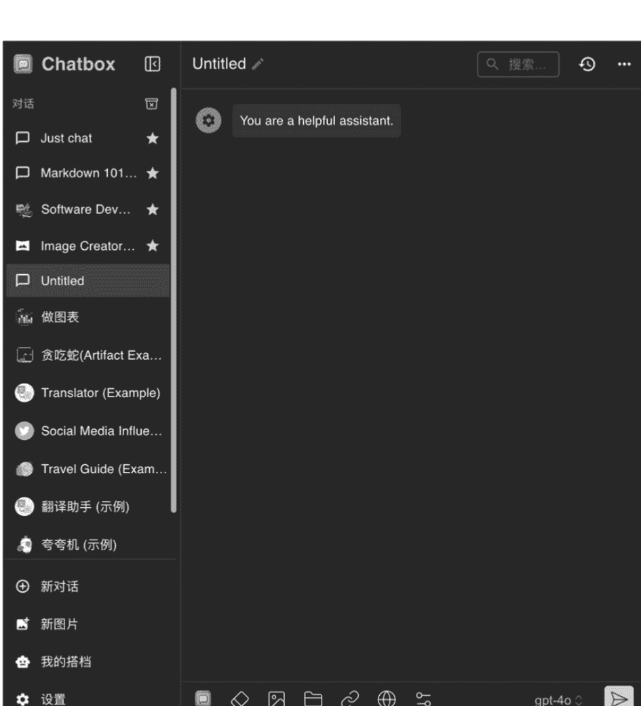

图5-5 ChatBox主界面

##### 设置模型：
为了与Ollama互动，需要在ChatBox中正确配置Ollama的API接口。打开ChatBox的主界面后，点击左侧菜单中的“设置”，如图5-6所示。

在设置页面中，找到“模型提供方”选项，从下拉菜单中选择“Ollama API"。

在API配置区域填写以下信息：

* **API域名**：保持默认。
* **模型**：选择已经下载的模型名称。
* **严谨与想象（Temperature）**：也就是本书所说的“温度”。对于蒸馏版小模型，建议输入0.2〜0.5之间的值。对于“满血版”大模型，可以使用官方推荐的值（0.6）。温度越低，模型出现幻觉的可能性越低，但回答问题的创意性会下降，反之亦然。

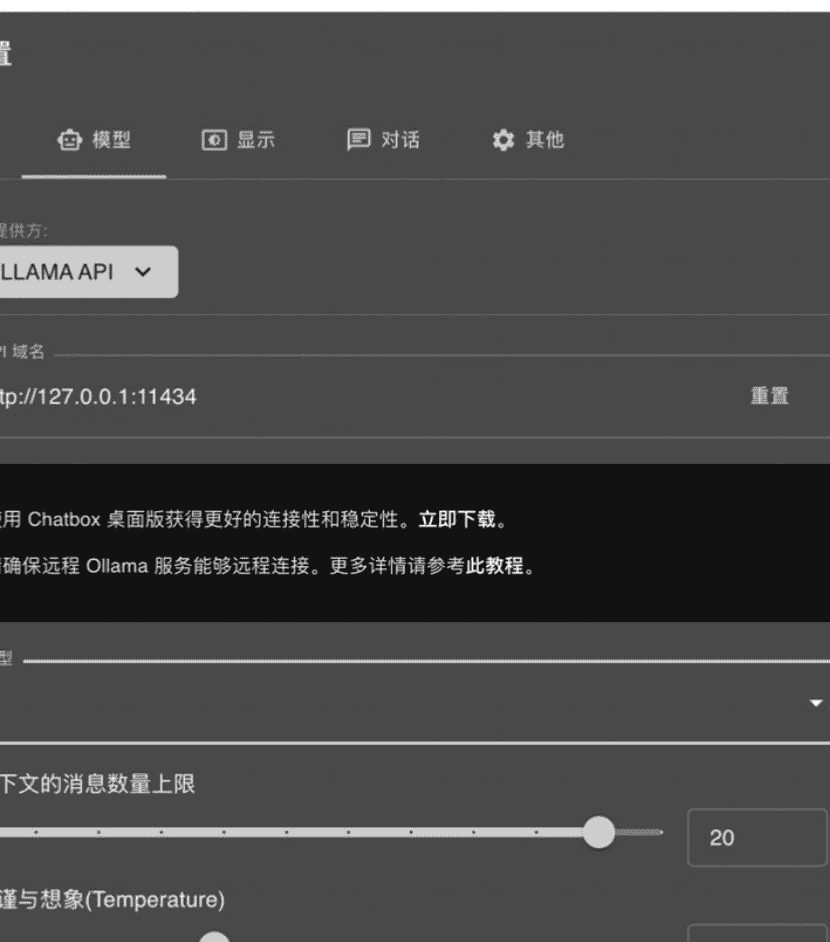

图5-6 ChatBox设置页面

点击“保存”按钮以应用配置。

完成上述配置后，你就可以使用ChatBox和Ollama的模型进行对话了。

**注意**：由于ChatBox依赖Ollama提供API服务，因此在使用ChatBox前，请确保Ollama的服务已经启动。如果服务中断或未运行，ChatBox将无法调用模型。

除了使用ChatBox，还有很多其他软件可以实现类似的效果，如Cherry Studio也是一个不错的AI通用客户端软件，也可以实现上述效果，推荐大家尝试。

## 更多使用DeepSeek的途径

除了使用官方App和网页版及进行私有化部署，还有一些方式可以使用DeepSeek，我把这些方式总结为两类。

#### 通过第三方应用接入

DeepSeek模型是开源、免费的，很多第三方应用也接入了DeepSeek。很多应用都把DeepSeek接入了自身的知识库，通过RAG等技术增强了模型的输出，在所属垂直领域中，得到更好的效果。例如，在百度、腾讯元宝、微信搜索、秘塔搜索、纳米AI搜索等产品中，可以使用DeepSeek-R1进行AI搜索，自动总结全网信息并生成更全面的答案；腾讯ima.copilot应用支持构建基于DeepSeek-R1的个人知识库等。目前，已经有上百款应用接入了DeepSeek，你可以根据自己所在的领域挑选合适的工具。

此外，还有一些AI工具平台支持混合接入多家AI大模型。虽然DeepSeek很强大，但并非在所有领域它都是最佳选择。灵活使用国内外各类AI工具能更好地提升效率。例如，百言AI就提供了多种AI工具，包括AI对话和AI绘图等。

#### 通过云服务接口（API）接入

除了通过用户界面直接使用DeepSeek，对于开发者或者希望能够深度定制、接入自身知识库的用户，深度求索提供了一个API开放平台。在这个平台中，你可以获得自己的API接口使用权限。

拥有这个API接口后，你既可以在ChatBox或类似工具中接入云服务版DeepSeek，也可以将其接入本地知识库工具，如Dify、AnythingLLM等软件，以实现定制版的DeepSeek使用。你还可以通过编程的方式调用DeepSeek接口，实现自动化调用。

除了官方，还有大量第三方云服务商也接入了DeepSeek，包括火山方舟、阿里云、腾讯云、百度智能云等。通过这些平台，你也可以获取对应的API接口，这些接口大多与官方接口保持兼容，可以随意互换使用。

# 模块六
DeepSeek助力创意写作

## DeepSeek，最有“个性”的AI写作模型

DeepSeek火爆出圈后，关于DeepSeek写作的讨论就非常热烈。很多人只是把DeepSeek当成了ChatGPT等其他模型的“替代品”，并简单地用相同的方法来让DeepSeek写作。但其实，DeepSeek与之前的大多数AI大模型很不一样，它以其独特的文风和表达方式脱颖而出，成为创意写作领域的一匹黑马。然而，正如任何工具一样，了解它的优势和局限，才能更好地驾驭它，让它真正成为我们创作路上的得力助手。

注意，下文描述的DeepSeek文风，主要是指DeepSeek的R1和V3模型。如果DeepSeek后续推出新的模型也不必担心，本章描绘的用来控制DeepSeek文风的方法也可以用于新的DeepSeek模型，甚至用于其他公司的AI大模型。

## 介于人类与机器之间的独特气质

当我们初次接触DeepSeek生成的文本时（尤其是DeepSeek-R1生成的文本），很容易被它华丽的辞藻和深邃的表达所吸引。正如知名投资人朱啸虎在被DeepSeek“支配”了一整个春节后感叹的那样："DeepSeek快让我相信AGI了。”这种惊叹不仅来自它的功能性，更源于其在内容生成方面展现出的优雅和深度。

DeepSeek-R1的文风有一种特殊的辨识度，被脱口秀演员李诞形象地概括为“科技抒情散文诗”。这种风格融合了科技理性与人文情怀，既有数据的精确性，又不乏文学的抒情性。当你把一段平实的随笔“喂”给R1时，它会重新提取意象并排列，从第一段开始抒情，将论述改成前

## 华丽背后的潜在问题

然而，DeepSeek-R1的华丽文风并非完美无缺。正如一位用户所言："AI不懂得克制；它要写情绪，就一定极力铺陈，一下子回到了青春伤痛文学的样子。”人类作家能够用简短的“天凉好个秋”传达深刻情感，而DeepSeek-R1则倾向于在简短的文字中堆砌修辞，有时显得像是在刻意卖弄文采。

DeepSeek在写“虚”的内容时表现出色，但面对“实”的内容时则可能用力过猛。使用过DeepSeek-R1的人往往能识别出它的某些特征性表达：跨时空比较、文化术语拼贴及一些常用句式。尤其是它对数字的处理方式，如“家门口的第四棵树”"0.7秒”“十六进制”等，这些看似精确但实际上往往缺乏实际意义的数字描述成了识别它生成内容的“狐狸尾巴”。

写作过程中，DeepSeek容易不自觉地使用“永恒”、“褶皱”等抽象词汇，甚至会引入一些不合逻辑的情节，让内容看起来不像是人会做出来的事。有时它还会在创作中融入无关的科幻元素，展现出AI特有的“赛博乡愁”。在我使用DeepSeek生成文字时也发现，它经常会提到“量子力学”相关的内容。这些特点使得一些用户开始对修辞丰富的文章产生警惕，下意识地认为这是AI创作的。

还有一个问题，DeepSeek-R1生成的内容常以分段式、列点式方式出现，如果将这些内容直接用于正式文章，可能会导致上下文不连贯，逻辑转换生硬，重点过多。在这些方面，DeepSeek-V3模型相对要好很多。

## 发挥优势，规避短板

尽管存在这些局限，但是DeepSeek在创意写作领域仍有广阔的应用空间。理解它的特点，才能更好地发挥它的优势，避开它的短板。

首先，DeepSeek非常适合作为创意激发工具。当你面临写作瓶颈时，可以将初步构思或草稿输入DeepSeek，让它为你提供新的视角或表达方式。它擅长重新组织意象和情感，可能会为你的创作带来意想不到的灵感。

其次，DeepSeek在文学性创作中表现出色。诗歌、散文、小说等需要丰富修辞和情感表达的体裁，都可以借助DeepSeek进行创作尝试。尤其是在写作初期，DeepSeek可以帮助你快速生成多种风格的文本，供你参考和选择。

在知识拓展和多元化观点获取方面，DeepSeek也是一个得力的助手。它可以提供不同角度的思考，帮助你拓宽视野，丰富思路。同时，它还可以作为基础写作架构的训练工具，帮助你理解不同类型文章的结构和组织方式。

然而，直接使用DeepSeek生成的内容可能会留下明显的AI痕迹，尤其是在正式的学术或商业场合。更重要的是，过度依赖AI写作可能导致我们自身的创作能力和思考能力退化。

要充分发挥DeepSeek在创意写作中的价值，我们需要采取一些有效的使用策略。

首先，将DeepSeek视为协作伙伴而非替代者。人类作家的独特视角、生活经验和情感理解是AI无法完全复制的。将DeepSeek作为辅助工具，而不是完全依赖它，才能创作出既有技术支持又保留人类特色的作品。

其次，学会层层递进地“训练”DeepSeek。不要满足于一次性生成的结果，而是通过多轮对话，不断调整和优化指令，引导DeepSeek生成更符合需求的内容。例如，你可以先让它生成一个大纲，然后针对每个部分提供更具体的指导，最后再对整体进行修改和完善。

第三，对DeepSeek生成的内容保持批判性思考。检查事实准确性，评估逻辑连贯性，调整情感表达的适度性，确保最终的作品既有AI的创意火花，又符合人类的审美和逻辑标准。

最后，根据不同的写作需求选择适当的使用方式。你可以结合使用DeepSeek-V3和DeepSeek-R1模型，让DeepSeek-R1模型的深度思考完成文章的逻辑构建和结构梳理，再让DeepSeek-V3负责扩写和润色文章。这是因为DeepSeek-V3模型的文风更加可控和自由，也更擅长输出自然的长段文章。另外，对于需要高度事实准确性的报告文章，可以让DeepSeek帮忙组织结构和提供表达参考，但核心内容和数据分析应由人类完成；对于创意性更强的文学作品，可以给予DeepSeek更大的发挥空间，但仍需人类作家的审美把关和情感注入。

DeepSeek作为一个具有鲜明个性的写作模型，正在改变我们的创作方式和思维模式。它华丽的文风、丰富的想象力及人性化表达，为创意写作带来了新的可能性。同时，它也提醒我们，技术工具永远是辅助而非替代，人类的创造力和判断力仍是写作的核心。

## 简单几招，控制DeepSeek文风

在了解了DeepSeek独特的文风特点后，我们可能会面临一个问题：如何更好地控制它的输出风格，让AI助手真正成为我们的得力创作伙伴？本章将介绍几种简单易行的方法，帮助你驾驭DeepSeek的文风，使其更贴合你的创作需求。

### 用“说人话”指令降低文风复杂度

DeepSeek最常被诟病的问题之一就是它那华丽得有些过头的表达方式。当你需要一个简单明了的答案时，却收到了一篇充满“永恒”、“褶皱”等抽象词汇的哲学散文，这样的体验恐怕不那么愉快。

解决方案其实出奇地简单——只需在提问时加上“说人话”或“用大白话解释”这样的简单指令，DeepSeek就能立刻调整自己的表达方式，变得通俗易懂。原本可能会得到充满专业术语和抽象概念的回答，但加上“说人话”的指令后，DeepSeek会尽量用日常语言来解释这些复杂概念。

更有趣的是，“我是小学生”这个自降身份的表达方式在控制DeepSeek文风方面尤为有效。当你对DeepSeek说“我是小学生，请解释一下量子纠缠”时，它会立即转换为适合儿童理解的语言风格，避免使用晦涩难懂的专业术语和复杂的修辞手法。

### 精细化控制文风的高级提示词

如果简单的“说人话”指令还不足以满足你的需求，我们可以使用更加精细化的提示词来控制DeepSeek的输出风格。下面是几类可以用来做到这个效果的提示词。

- **指定语言风格**：明确要求“语言平实直白”。例如：“请使用平实直白的语言风格，解释人工智能的基本原理。”
- **禁用特定表达方式**：明确告知“禁用文学修辞”，或者说“避免使用夸张、比喻等文学手法，保持内容的客观性和简洁性”。
- **控制段落结构**：例如，“使用连续的自然段落论述，避免过度分点论述”是我特别常用的一个提示词，它可以让DeepSeek输出的内容不要划分太多的总分结构及具体的小点，转而使用较长且连贯的自然段表达。
- **要求口语化表达**：指示“保持口语化”，可以让DeepSeek使用自然流畅的语言风格，避免过于正式或生硬的表达方式。这特别适合用于自媒体内容和需要亲和力的文案。

## 模仿特定文风的方法

DeepSeek具备强大的文风模仿能力，特别是对于那些训练数据充足、风格特征明显的作家或文体。通过精心设计的提示词，我们可以让DeepSeek模仿各种风格进行创作。

使用这种方式并非每次都能成功。如果效果不佳，可以考虑切换到深度思考模式。

基本格式是：“模仿XXX的文风，撰写关于YYYY的一篇文章”。例如：

- 模仿鲁迅的文风，撰写关于自媒体的一篇讽刺小品文。

使用DeepSeek-R1模型输出的如下：

> 未庄的茶馆近来新添了雅座，墙上挂着“全息投影”，跑堂的托着“云端茶盘”，却仍照例踱着方步。我拣了临窗的位置，要一壶龙井，看那水汽在光影里游丝般浮沉。
> 
> 忽听得邻桌两人谈得热闹。一个戴玳瑁眼镜的，捏着张泛黄报纸叹道：“这纸媒，终究是活不过戊戌年了。”对面穿荧光卫衣的青年呷了口氮气冷萃茶，笑道：“老先生还在数铅字？如今10万+方是硬道理。”他腕间的智能佛珠忽闪红光，映得那笑脸青一阵紫一阵。
> 
> 我认得那眼镜原是《晨钟报》的主笔，当年为着“豆腐块”错印了个标点，连夜赶印三千更正启事。如今他枯枝似的手指指着青年：“上月某明星离婚，你辈可是写得天花乱坠？”青年将全息屏一划，10万+点赞的标题在半空炸开：“惊！第三者竟是AI机器人！”底下却用小字蚂蚁般地爬着“部分情节虚构”。
> 
> 忽闻街市喧哗，人群潮水般向西涌去。青年眼睛霎时亮了，腕上佛珠转作幽蓝：“热搜第三！大抵是跳楼的！”话音未落已架起直播眼镜，鞋底喷着气旋冲出门去。
> 
> （中间略）
> 
> 跑堂忽然指着我的茶盏：“客官，这龙井在云端数据库里，早更名为‘焦虑舒缓茶’了。”我低头看时，但见翠叶沉浮间，无数像素颗粒正吞吐着0与1的泡沫。

值得注意的是，DeepSeek在模仿那些语料库中数据丰富的著名作家时表现更佳。如果你想模仿一位相对冷门或风格不够鲜明的作家，效果可能会打折扣。同时，即使是最好的模仿也难以100%还原作者的风格，DeepSeek的“个性”仍然可能在文本中若隐若现。

我们可以通过提供风格样本来提高模仿的准确性。例如：

以下是海明威的写作风格样本：[插入原作样本]。请使用这种简洁有力的风格，撰写一个关于都市孤独的短篇故事。

样本不要太短，否则无法让AI学会风格，也不要太长，否则会超过AI的上限。推荐样本长度大于2000字，小于2万字。

## 多轮对话调整，渐进式控制文风

控制DeepSeek文风的另一个技巧是通过多轮对话进行渐进式调整。单次指令很难让DeepSeek完全理解你期望的文风，但通过持续的交流和反馈，可以逐步引导它向你期望的方向发展。

这个过程类似与一位人类写作助手协作：

- **初步创作**：首先给出基本要求，让DeepSeek生成初稿。
- **具体反馈**：针对初稿提出具体的修改建议，如“第二段太抽象了，能用更具体的例子来说明吗？”或者“整体语气太正式，能更轻松一些吗？”
- **示范引导**：有时候，最有效的方法是自己写出一小段示例，然后让DeepSeek按照这个风格继续写。例如，“我希望文章中包含类似这样的段落/文章必须以这样的内容开篇：[你的示例]。请按这种风格重写。”
- **逐段调整**：对于较长的文章，可以逐段进行调整，确保每个部分都符合你的期望。

注意：如果对话长度太长，DeepSeek可能会忘记最早写就的部分。这一般不是大问题，你可以自行把之前的部分复制并合并，重新发给它。

## 利用文体结构控制文风

除了直接指导语言风格，指定特定的文体结构也是控制DeepSeek文风的有效方法。不同的文体结构自然会引导不同的表达方式：

- **清单式结构**：要求DeepSeek以“10个要点”或"5个步骤”的形式组织内容，可以有效避免它陷入冗长的抒情段落。例如，“请以5个关键点总结人工智能对教育的影响。”
- **问答式结构**：以问答形式组织内容，可以使输出更加聚焦和直接。例如，“请以问答形式解释区块链技术的基础知识，假设读者是完全的初学者。”
- **故事结构**：当你想要DeepSeek生成更有吸引力但仍然聚焦的内容时，可以要求它使用故事结构。例如，“请用一个简短的故事来解释通货膨胀的概念，故事应包含明确的开端、冲突和解决方案。”

## 文风调整的实践案例

让我们通过一个具体案例来看看如何在实践中调整DeepSeek的文风。

假设我们需要撰写一篇关于气候变化的文章。初次提问时，DeepSeek可能会生成一段充满华丽修辞和抽象概念的回答，谈论“地球母亲的泪水”和“时间的褶皱中隐藏的生态警钟”。

此时，我们可以进行第一轮调整：

> 这段描述太抽象了。请使用更具体的语言，重点关注气候变化的实际影响和具体数据，避免使用抽象的拟人化修辞。

得到修改后的内容，我们可能会发现虽然内容具体了很多，但语言仍然过于正式或学术化。于是我们进行第二轮调整：

> 内容很好，但太正式了。请用更加日常的语言重写，就像你在咖啡厅向朋友解释这个问题一样。使用更短的句子和简单的词汇。

通过这样的多轮调整，我们最终可以得到一篇既包含必要信息，又符合我们期望风格的文章。

控制DeepSeek的文风并非难事，关键在于清晰的指令、持续的反馈和灵活的调整。通过上述这些简单技巧，你可以让DeepSeek的输出更贴近你的需求，无论是需要简明扼要的商业报告，还是生动活泼的创意写作，或是严谨专业的学术论文。

随着你与DeepSeek互动经验的积累，你会逐渐形成自己的一套“提示词模板”，能够快速引导AI生成符合你期望的内容。掌握了这些文风控制技巧，你就能真正发挥DeepSeek在创意写作中的潜力，让这个独具特色的AI模型为你的创作增添新的维度和可能性。

## 助力网文创作

如果说DeepSeek在职场写作中的表现让人拍案叫绝，那么它在网文小说创作领域的表现，更是堪称颠覆级的存在。如今，写小说不再只是少数人的专利，DeepSeek也能成为你的“贴身写作助理”，助力你轻松开启网络文学创作之门。

你或许会问："AI真的能写出吸引人的小说吗？”确实，目前任何AI都不能完全取代作家，但绝对能成为创意和效率的强大助推器。如果有人跟你说用AI可以全自动创作小说，那么现阶段绝对是夸大的，即使是真实的，那又和你有什么关系呢？平台直接使用AI创作一定比你更快、更专业。

- **超高速创作**：DeepSeek每小时能输出上万字的初稿，高效解决创作瓶颈。
- **拆解套路**：它善于识别和模仿热门小说套路，只要给足提示词，就能迅速搭建剧情大纲。
- **碎片化创作**：上下班路上、午休时间、睡前几分钟，随时随地写出章节的初稿。

现在，我们来一起试试，如何用DeepSeek打造爆款网文。

用DeepSeek写小说或网文的核心是要先搭建一个小说框架。这个小说框架不仅是给人看的，而且是用于后续创作的。一个小说或网文很长，DeepSeek不可能一次性输出如此长的内容。我们需要先搭建一个框架，其中包括小说的核心逻辑、背景和人物信息，这才能确保后续生成的一致性。

如何用DeepSeek迅速搭建小说框架？一个简单好记的创作公式送给你：

> 背景世界观 + 人设 + 冲突 + 金手指设定 + 核心故事线 + 写作风格 = 爆款小说的基础骨架

- **背景世界观**：例如，玄幻修仙、末日废土、星际争霸、古代宫廷、现代都市……网文的第一步，就是搭建一个吸引读者的世界观设定。
- **人设和冲突**：主角的身份、性格、命运冲突点清晰明确，才能吸引读者持续追更。
- **金手指设定**：时光倒流、系统辅助、重生复仇……合适的金手指设定帮助主角逆袭，增加爽感。

### 核心故事线

明确主线任务和关键冲突，让小说有逻辑、有起伏、有细节。

- **写作风格**：例如，病娇文、哨兵向导等。

### 用DeepSeek快速写出小说初稿

接下来，我们以一个具体、有趣的案例，展示如何借助DeepSeek快速生成网络小说的大纲、开篇及部分细节内容。

##### 第一步：搭建基础框架

我们使用本书前面所讲的四要素结构（RTGO，角色 + 任务 + 目标 + 要求），让AI帮我们生成一个爆款小说的基础框架。例如：

> **【角色】** 你是一名爆款小说作家，擅长创作长篇连载玄幻小说。
>
> **【任务】** 根据我的要求，帮我整理小说的背景世界观 + 人设 + 冲突 + 金手指设定 + 核心故事线 + 写作风格，给出爆款小说的基础骨架。
>
> **【目标】** 文风偏幽默轻松，适合年轻读者，融入东方玄幻元素。
>
> **【要求】** 小说大概内容构思：这个世界以“驭灵”为尊，人们通过契约各种灵兽获得力量，但近百年来灵兽越来越稀缺。在你生成的小说开篇中，主角初次觉醒灵力，契约灵兽却意外获得传说级神兽。要增加悬念和意外反转，初始设定主角看似平凡，但背后却隐藏着惊人的身世秘密。

DeepSeek根据提示迅速给出了小说骨架：

**背景世界观**

- **世界名称**：灵驭大陆
- **世界观概述**：灵驭大陆是一个以“驭灵”为尊的世界，人类通过契约灵兽获得力量，灵兽的强弱直接决定了驭灵师的地位。灵兽分为普通、稀有、传说三个等级，传说级灵兽拥有毁天灭地的力量，但近百年来，灵兽数量急剧减少，传说级灵兽更是几乎绝迹。大陆上分为五大势力：东方的青龙帝国、西方的白虎联盟、南方的朱雀王朝、北方的玄武部落及中部的麒麟圣殿。五大势力之间明争暗斗，争夺稀有的灵兽资源。

**人设**

- **主角**：
  - 姓名：林小凡
  - 年龄：16岁
  - 外貌：平凡无奇，黑发黑眸，身材瘦弱。
  - 性格：乐观幽默，机智聪慧，偶尔有点小怂。
  - 背景：孤儿，从小在青龙帝国的偏远小镇长大，靠打零工为生，梦想成为一名强大的驭灵师。

- **配角**：
  - 苏婉儿：林小凡的青梅竹马，性格温柔善良，天赋异禀，契约了一只稀有级灵兽。
  - 秦无炎：青龙帝国皇子，高傲自负，契约了一只稀有级灵兽，视林小凡为竞争对手。
  - 老乞丐：神秘人物，经常在小镇出没，看似疯癫，实则深不可测，暗中关注林小凡。## 冲突

**主要冲突：**

- **灵兽稀缺：** 灵兽数量急剧减少，导致驭灵师之间的竞争愈发激烈，林小凡在觉醒灵力后，面临着无法契约灵兽的困境。
- **身世之谜：** 林小凡看似平凡，实则身世惊人，他的父母曾是大陆上最强大的驭灵师，因一场阴谋而失踪，林小凡的觉醒将揭开这段尘封的往事。
- **势力争斗：** 五大势力之间的明争暗斗，林小凡在成长过程中不可避免地卷入其中，成为各方势力争夺的焦点。

#### 金手指设定

......
（中间略）

......

通过以上设定，这部小说将具备吸引年轻读者的幽默轻松文风、悬念与反转的剧情设计、东方玄幻的元素融入，以及主角成长与冒险的核心故事线，有望成为一部爆款玄幻小说。

**第二步：生成小说大纲。** 例如：请生成上述玄幻小说的全书大纲，要求全书分为四卷，每卷核心事件清晰，主角逐步揭开自己的真实身份，最终卷揭示幕后 BOSS 和最终决战设定。DeepSeek 就会迅速输出明确的大纲结构。

### **第三步：** 有了大纲结构后，我们就可以让 AI 根据每个部分的大纲继续拆解成每个章节的摘要，再让 DeepSeek 辅助每个章节的具体内容。你可以让 AI 直接生成内容，也可以自己写出章节的大概内容，让 AI 来润色。现阶段，即使是 DeepSeek，直接生成的内容也大概率不能直接用，需要人进行二次加工。如果你有一定的文学功底，那么可以先自己写个概要，再让 DeepSeek 进行润色，这是个更好的选择。记住，每次打开一个新对话时，都需要将小说骨架作为参考资料发送给 AI，并包含之前已写内容的纲要，这样 AI 才能生成一致的内容。

#### **第四步：** 用 DeepSeek 深度强化小说“爽感”和“情绪流”。网文的核心吸引力就在于“爽感”，而 DeepSeek 能轻松帮你强化这一点。例如：

- **设计悬念与伏笔：** 提前埋下谜团，吸引读者追更。
- **塑造有趣配角：** AI 帮助快速生成配角的人设、对白和互动。
- **增强爽点设计：** AI 可生成打怪升级、逆袭复仇、惊喜反转的大量场景描述。

例如，可以让 AI 帮你在已有的小说中补充一个爽感片段：请帮我设计一个剧情片段，主角林小凡遭到霸凌，在危急时刻，苏婉儿突然展现出强大力量（来自稀有级灵兽），帮助主角打脸反派、扬眉吐气的爽感情节。另一个常用的办法是把小说的部分章节发送给 AI，让 AI 提出如何增加爽感或优化情绪流的建议，或直接帮你改写。如果你对小说创作充满兴趣，却苦于没有时间和灵感，不妨就此开启你的 AI 小说创作之旅吧！

## 消除 DeepSeek 味儿

前面说过，DeepSeek 的输出有时候会具有特别的"DeepSeek 味儿”。这种味儿虽然自成一體，但也会暴露出你的文章有 AI 写作痕迹，让人出戏。那么，该如何消除 DeepSeek 味儿呢？其实并不难。在“简单几招，控制 DeepSeek 文风”部分，已经给出了诸多方法来控制 DeepSeek 输出的文风。写完文章后，可以使用这些方法进行二次润色和改写，即可有效控制和消除 DeepSeek 味儿。

## 自媒体爆款内容创作

开公众号、拍抖音、运营小红书、做 B 站 UP 主……近年来，自媒体似乎成为人人都想踏进的领域。然而，真正能从茫茫内容中突出重围成为“爆款账号”的，却是少之又少。其实，爆款的背后，靠的是精准的账号定位、有吸引力的选题策划、高点击率的标题和封面、直击痛点的文案，以及令人上瘾的视频内容。这一整套内容生产体系，DeepSeek 同样可以成为你的神奇助手。我并不建议你把所有的自媒体创作全部交给 AI，因为自媒体创作归根到底靠的是你本身的独特个性、内容价值等。如果全部交给 AI，意味着做出的东西千篇一律。“人机结合”是 AI 时代做自媒体真正的道路。做自媒体确实是一件特别消耗时间和精力的事情，而 AI 可以大大加速这个过程。下面我们将通过一些例子，讲解如何利用 DeepSeek 一步步打造你的自媒体爆款内容。

### AI 辅助账号定位与命名

自媒体时代，清晰、精准的账号定位是成功的第一步。做自媒体并不是盲目追热点、蹭流量，成功的账号一定是在某个垂直细分领域持续深耕，积累了精准粉丝。AI 工具能帮助我们更快、更精准地完成定位，DeepSeek 尤为擅长。例如，三维定位法（硬技能、软技能、稀缺性）是一种不错的账号定位方法。表 6-1 列出了三维定位法的主要元素和解释。

**表 6-1 三维定位法的主要元素和解释**

| 元素 | 解释 |
| :---: | :--- |
| 硬技能 | 你的专业能力、能提供的价值，如金融知识、设计技能或编程技术等 |
| 软技能 | 你的个人魅力、讲故事能力、幽默感等 |
| 稀缺性 | 提供别人无法轻易复制的内容或视角，如“清华博士讲理财”、“程序员讲育儿”等稀缺定位 |

例如，你可以这样问 DeepSeek：请协助我确定适合我的公众号账号定位。我硬技能是金融分析师，软技能擅长幽默故事讲解，稀缺性是职场经验 + 理财经验交融。此时，DeepSeek 可能会输出如下内容：

1. **核心定位**
   「用脱口秀教打工人理财」
   职场故事×理财干货×黑色幽默

2. **3 个独特卖点**
   - 只讲职场关联的钱包问题（如工资规划/跳槽资金/摸鱼理财）
   - 创造职场黑话理财梗（例：“弹性下班=时间贬值”“福报=人力资本泡沫”）
   - 用办公场景举例子（Excel 冷笑话、茶水间经济学）

3. **内容三板斧**
   - ① 硬核工具（工资分配 Excel 模板）
   - ② 故事剧场（用同事八卦讲理财）
   - ③ 热点整活（解读影视剧里的理财 BUG）

4. **人设记忆点**
   - 开场白：“教你把窝囊费变‘睡’后收入”
   - 灵魂道具：咖啡杯存钱罐表情包

5. **变现三步走**
   - ① 卖《职场求生理财包》
   - ② 开「打工人财富突围」训练营
   - ③ 接企业员工财商培训

执行口诀：用吐槽同事的方式讲干货，把 KPI 话术改成理财公式。**让每个社畜边笑边存钱。**可以看到，DeepSeek 对账号的分析十分到位，不仅包括核心定位，甚至连商业化变现途径都帮你想好了。实际执行的时候，建议打开深度思考功能。如果对 DeepSeek 的输出不够满意，你可以直接说："**再给我五个更好的不同账号定位，并对比不同定位的区别。**"让 DeepSeek 自己“卷”自己。除了三维定位法，还可以使用 SWOT 分析。SWOT 是经典的战略分析工具，本来是用于企业战略分析，即基于内外部竞争环境和竞争条件下的态势分析，就是将与研究对象密切相关的各种主要内部优势和劣势及外部的机会和威胁等，通过调查列举出来，并依照矩阵形式排列，然后用系统分析的思想，把各种因素相互匹配起来进行分析，从中得出的一系列相应的结论，而结论通常带有一定的决策性。其中，S（Strengths）是优势、W（Weaknesses）是劣势、O（Opportunities）是机会、T（Threats）是威胁。运用这种方法，可以对研究对象所处的情景进行全面、系统、准确的研究，从而根据研究结果制订相应的发展战略、计划及对策等。运用这种方法，AI 能够快速帮你梳理自身的竞争优势与不足，明确未来发展机会和可能的风险。例如，你可以这样问：请用 SWOT 分析法分析我做“搞笑职场科普”视频账号的优劣势。我是一个资深 HR，之前没接触过短视频，也不太擅长剪辑技术。但是我觉得职场话题会持续火热。据我所知，这个市场有点拥挤，已有“×××谈笑职场”等头部账号占领心智。以表格方式总结。此时，DeepSeek 可能会输出如下内容：

**以下是用 SWOT 分析法对“搞笑职场科普”视频账号的总结表格，结合您提供的背景信息整理：**

| **SWOT 维度** | **具体分析** |
| :--- | :--- |
| **- 优势（Strengths）** | **专业内容基础：**资深 HR 经验，可提供真实职场案例和深度洞察；<br>**选题可持续性：**职场话题具备长期社会关注度（求职/晋升/人际关系等）；<br>**差异化定位：**市面少有的“搞笑 + 科普”双属性结合，区别于纯搞笑或纯干货类账号；<br>**技术短板：**缺乏短视频制作经验，剪辑能力不足可能影响内容呈现效果 |
| **- 劣势（Weaknesses）** | **流量竞争压力：**头部账号已形成用户心智壁垒（如“×××谈笑职场”）；<br>**内容平衡挑战：**需兼顾专业性与娱乐性，避免过度玩梗削弱可信度；<br>**平台扶持：**短视频平台对职场垂类内容有流量倾斜（如抖音职场季活动） |
| **- 机会（Opportunities）** | **用户需求升级：**年轻人更倾向轻松学习职场“潜规则”；<br>**跨界变现空间：**可延伸职业咨询、企业培训合作、职场周边带货等模式；<br>**内容同质化：**大量账号模仿头部创作者，用户审美疲劳风险高 |
| **- 威胁（Threats）** | **政策风险：**职场敏感话题（如裁员/薪酬）可能触发平台审核限制；<br>**头部挤压：**大账号矩阵化运营，抢占用户碎片时间优势明显 |

**关键策略建议（根据 SWOT 推导）：**

- **优势（Strengths）：**
  - 专业内容基础：资深 HR 经验，可提供真实职场案例和深度洞察；选题可持续性：职场话题具备长期社会关注度（求职/晋升/人际关系等）；差异化定位：市面少有的“搞笑 + 科普”双属性结合，区别于纯搞笑或纯干货类账号；技术短板：缺乏短视频制作经验，剪辑能力不足可能影响内容呈现效果
- **劣势（Weaknesses）：**
  - 流量竞争压力：头部账号已形成用户心智壁垒（如"×××谈笑职场”）；内容平衡挑战：需兼顾专业性与娱乐性，避免过度玩梗削弱可信度；平台扶持：短视频平台对职场垂类内容有流量倾斜（如抖音职场季活动）
- **机会（Opportunities）：**
  - 用户需求升级：年轻人更倾向轻松学习职场“潜规则”；跨界变现空间：可延伸职业咨询、企业培训合作、职场周边带货等模式；内容同质化：大量账号模仿头部创作者，用户审美疲劳风险高
- **威胁（Threats）：**
  - 政策风险：职场敏感话题（如裁员/薪酬）可能触发平台审核限制；头部挤压：大账号矩阵化运营，抢占用户碎片时间优势明显

**核心优势强化：**以 HR 专业视角设计“反套路”内容（如《面试官绝不会告诉你的 3 个淘汰标准》）
**技术短板规避：**采用口播 + 表情包/字幕动画等轻量化制作形式，或外包初期剪辑
**差异化破局：**聚焦细分场景（如 00 后整顿职场/AI 时代的裁员危机），建立记忆点
**借势头部竞争：**通过“反向蹭热点”引发讨论（如《×××没说的 5 个职场真相》）

需要具体执行方案或某个维度的延伸分析，可随时补充说明。为了确保 DeepSeek 输出的方案更加有可行性，你可以通过追问的方式，让 DeepSeek 多次、重复深度思考，验证自己的答案。例如，你可以问：你说可以采用口播 + 表情包/字幕动画等轻量化制作形式。请问这会影响到我出爆款吗？为什么？DeepSeek 就会非常直接地告诉你：轻量化制作≠难出爆款，甚至可能是新账号破冰的最优策略。爆款的核心要素排序：选题共鸣度（50%）＞人设独特性（30%）＞视觉精致度（20%）。当你确定了账号定位后，就可以让 AI 帮你起一个响亮的名字了。例如：我是 HR 出身，计划打造一个幽默犀利的职场科普账号，请帮我生成 5 个简单好记又有趣的账号名。

DeepSeek 可能会输出：
- 职场扯淡 HR 哥
- HR 有话说
- 爆笑职场指南
- 办公室里的段子手
- 人在职场飘

### **告别“选题困难症”**

结合联网搜索，DeepSeek 可以快速洞察市场热点，精准生成用户关注热门选题。例如，假如你是一个讨论科技行业的自媒体博主，以前每天最头疼的就是不知道要讲什么新东西。现在，你可以直接问 DeepSeek，记住一定要打开联网搜索：今天科技圈有什么值得讨论的新话题，尤其是适合在自媒体上讲的？如果是使用的是官方版本的 DeepSeek，打开联网搜索后，它会自动把“今天”转换成具体日期，然后进行联网搜索。例如，下面是 2025 年 3 月 2 日使用该提示词的输出结果：

#### **1. GPT-4.5 表现争议与 AI 行业竞争格局**
**核心争议：**OpenAI 最新发布的 GPT-4.5 在基准测试中表现不佳，被中国公司 DeepSeek 模型以 500 倍性价比“吊打”，引发对 OpenAI 技术护城河是否崩塌的讨论。尽管其在创意写作等场景仍有优势，但高成本和性能瓶颈成为用户吐槽焦点。

**行业影响：**DeepSeek 公开的日利润数据（理论最高 346 万元/天）和开源策略，进一步推动 AI 模型商业化竞争白热化。结合中国广电等运营商全面接入 DeepSeek，大模型生态可能加速向行业渗透。

**自媒体角度：**对比 GPT-4.5 与国产模型的优劣势，探讨 AI 技术“性价比”是否成为未来竞争关键。

#### **2. Meta 新一代 AR 眼镜 Aria Gen 2 的技术突破**
**技术亮点：**Meta 实验性智能眼镜 Aria Gen 2 升级传感器系统和端侧处理芯片，提升交互动响应速度与续航能力，旨在推动 AR 和 AI 底层技术进步。虽不面向消费者发售，但其技术可能为未来消费级产品铺路。

**行业趋势：**结合阿里 3800 亿元投资云和 AI 基础设施的消息，可分析 AR/VR 与云计算结合的潜力，以及端侧 AI 处理的重要性。

**自媒体角度：**探讨“以技术实验驱动消费级产品”的 Meta 模式是否可持续，或预测下一代 AR 眼镜的功能形态。

#### **3. AI 与生物制造的深度融合**
**最新动态：**中国生物发酵产业技术大会上，院士团队展示 AI 在酶设计、蛋白质优化、海洋食品加工等领域的应用。例如，利用 AlphaFold 设计甜蛋白、通过 AI 预测母乳低聚糖趋势，甚至结合合成生物学优化赤霉素生产。

**行业意义：**AI 加速生物制造从实验到产业化的进程，可能重塑医药、农业、食品等行业。例如，AI 驱动的“精准化生物加工”技术已实现高效制备海洋功能配料。

**自媒体角度：**解析 AI 如何破解传统生物制造的效率瓶颈，或讨论"AI+ 合成生物学”的伦理与商业边界。
(以下略)

除了使用联网搜索，还可以直接把近期的新闻和热点素材通过提示词或者上传文档的形式发送给 AI，让 AI 帮你做出分析。一旦分析结束，你就可以直接问 DeepSeek：根据你所给出的这些话题，给我 10 个既有深度又有爆点，同时结合时事的自媒体选题，选题必须符合我的账号定位。我的账号定位如下：（以下略）。这样，你就可以马上获得相应的选题了。

#### **生成爆款标题和内容**

确定选题后，接下来的目标就是生成具体的自媒体文案，包括标题和内容。以前要让 AI 生成一个爆款的自媒体文案标题是比较困难的，因为 AI 对于“爆款”的理解可能不一定到位。你可能需要手把手告诉 AI 具体如何做才能成为一个爆款的标题。但是，DeepSeek，尤其是深度思考（R1）版本，它会通过深度的推理能力自动分析爆款标题的元素，所以生成爆款标题变得比以前更容易了。例如：请为选题“年轻人理财误区”生成 3 个高点击率标题，要求包含数字、悬念感强。选中深度思考开关后，运行该提示词，DeepSeek 会很快输出：

以下是 3 个符合要求的爆款标题模板，结合了数字悬念 + 痛点直击 + 年龄代入感：

##### **1.《这 5 个理财雷区，95% 的年轻人踩过！你中了几个？》**
（亮点：高百分比制造危机感，反问引发自我检测欲）

##### **2.《月薪 5000 到负债 10 万：年轻人最易掉入的 3 大理财陷阱》**
（亮点：数字对比制造冲击，薪资痛点精准打击）

##### **3.《00 后必看！这 7 条理财误区正在吃掉你的血汗钱（附避坑指南）》**
（亮点：锁定新生代群体，“吃掉血汗钱”制造焦虑，括号补充解决方案，提升点击量）

###### **# 升级技巧：**
1. 数字使用奇数为佳（心理学上更易被记住）
2. 加入“血汗钱/负债/陷阱”等情感强烈词汇
3. 用年龄标签强化目标人群代入感
4. 括号补充价值信息提升信息密度
5. 使用“必看/警惕/正在”等紧迫性词汇

###### **# 可根据目标平台调性选择：**
1. 知乎/公众号倾向用模板 1 的理性数据型
2. 小红书/B 站适合模板 3 的年轻化表达
3. 头条类平台适用模板 2 的戏剧化对比

可以看到，DeepSeek-R1 模型的输出不但告诉了你结果，还分析了原因及进阶优化建议，甚至还告诉你在不同平台该如何选择不同的标题。

**风格学习**。让 DeepSeek 学习你以往的作品并总结出特点。建议至少把 4～5 个作品放在一起，使用 DeepSeek-R1 自动总结你的文案风格，然后把总结出来的风格放在你的文案创作提示词中。你可以这样问 DeepSeek：根据我给的参考文案 1～5，总结其共同特征，包括个人特色风格，以及其中有利于提高视频爆款率的特征。尽可能总结细致，留意细微的用词和句式，以及开头、结尾的方式和文案结构。然后在你创作新的作品时，将 DeepSeek 总结的内容附带上去，作为提示词的一部分。添加风格引导词。例如，使用”说人话”可以让 DeepSeek 的用词更简单易懂，”风趣幽默”“专业”“口语化”等也都是常用的风格引导词。在使用 DeepSeek 创作自媒体文案时，要注意以下几点：
- 如果你不是从零创作，而是根据某些已有材料进行创作，请务必上传完整材料，或者作为提示词的一部分附上，如”参考以下资料进行创作: [资料 $1] × × × × × × [资料 $2] × × × × × ×"。这不仅可以让内容更贴近材料的表达，更重要的是可以降低幻觉。
- 对于 DeepSeek 创作内容一定要进行二次审校再开始录制，尤其是 DeepSeek-R1，它的幻觉率比较高，经常会出现事实和数据上的错误。
- DeepSeek 官方应用是免费的，所以不要吝啬多问几次。很多时候，DeepSeek 第一次给出的文案并不一定是最佳的。
- 假如你不喜欢 DeepSeek 输出的文案中带有分镜、情绪描述、背景音乐等信息，可以使用下列提示词：“只输出口播的内容，不输出分镜、情绪描述、背景音乐等任何其他内容。”
- 有时候你可能会觉得 DeepSeek 生成的文案过于零散、不连贯，或者是分了太多的小论点进行论述。你可以使用下列提示词避免：“使用连续的自然段落进行连接，避免过多分点论述，注意语言的流畅性和上下文的连贯性。”

## 全自动产出自媒体图文

前面我们详细介绍了如何利用 DeepSeek 迅速生成纯文字的自媒体内容，但其实 DeepSeek 的作用远远不止于此，它还可以帮助我们创作出各种类型的图文笔记，包括图片和笔记内容，如知识科普类、生活干货类、健康养生类、职场窍门类等。

## 全自动生成小红书图文

接下来，我们以“熬夜的 5 种危害”为例，手把手教大家如何利用 DeepSeek 快速产出这类热门的科普干货内容。制作一篇真正能够快速吸引小红书用户关注的干货图文，首先我们需要明确自己的需求，清晰地告诉 DeepSeek 我们想要的内容类型与形式。例如，我们打算输出一篇名为《熬夜的 5 种危害》的小红书图文。我们可以这样构建提示词：

请为我制作一套小红书图文，主题为“熬夜的 5 种危害”，具体需求如下：
1. 生成 1 张封面图，封面图上要突出标题“熬夜的 5 种危害”，风格清新、醒目，能快速吸引年轻用户点击查看，画面比例 3:4。
2. 为每个危害生成单独的 1 张配图，一共 5 张，每张图都要包含序号（如“危害①"），并用简单、直观的几行文字（带 emoji 表情）来表现这个危害，风格统一，美观清新，适合小红书平台年轻群体。
3. 除了图片外，请同时生成一段可直接用于小红书发布的笔记文字（文案），包括一个简短开头介绍文字，以及每个危害的说明。
4. 图片全部使用 svg、canvas 或 html 元素制作。要求符合小红书平台的图文要求，还要符合小红书平台的用户审美。

## 帮我将上述图片自动生成单一html页面格式

在 HTML 上呈现这 6 个图片，并增加“下载图片”按钮，方便我随时保存成图片上传发布。只输出 html 源代码，无须重复输出文本内容及解释。
> 这段提示词略微有点复杂，我向你简单解释一下。我们在提示词中主要做了几件事：
> 
> - **明确了内容主题**：熬夜的 5 种危害，这是一个典型的健康科普类内容，在小红书上很受欢迎。
> 
> - **指定了具体的图片需求**：1 张封面图加 5 张内容图，并且详细说明每张图的风格和要包含的元素。
> 
> - **要求同时生成文案**：这样我们就有了配套的文字内容，可以直接复制粘贴使用。
> 
> - **技术部分**：我们要求 DeepSeek 用网页元素来创建图片。这部分内容带有一些技术名词，看起来有点技术性，但你完全不用担心，你只需要复制粘贴这部分提示词去用就可以了。因为 DeepSeek 会自动完成这部分工作。

# 当你把这段提示词发给 DeepSeek 后，它会生成一段 HTML 代码。这段代码看起来可能很复杂，但你不需要理解它。有两种方式可以使用它：
> 
> **第一种方式：**如果你使用的是 DeepSeek 网页版，可以点击 HTML 源代码右下角的“运行 HTML"按钮，就可以直接看到生成的小红书图文了。
> 
> **第二种方式：**在计算机上，你可以点击复制 HTML 代码，然后打开一个“记事本”文件，将所有代码粘贴到该文件。然后将该文件保存，在保存对话框中，选择“所有文件”，并给文件命名为“小红书.html"（注意"."为英文小写符号）。文件保存后，你只需要用浏览器打开这个文件就可以了。
> 
> 这时，你会看到 DeepSeek 创建的所有图片及图片的下载按钮。点击图片下方的“下载图片”按钮，就可以将这些图片保存到你的计算机上了。
> 
> 这是我用 DeepSeek 生成的封面和 5 张图片，如图 6-1 所示。你生成的图片的风格可能会和我不同：

# # 熬夜的 5 种危害

看完立刻想睡觉！

## 危害①

**黑眼圈加重**
**皮肤暗沉无光**
**颜值直线下降！**

## 危害②

**记忆力衰退**
**反应速度变慢**
**日常秒变金鱼！**

## 危害③

**内分泌失调**
**爆痘脱发警告**
**身体亮红灯！**

## 危害④

**心脏负担加重**
**猝死风险提升**
**生命不能重来！**

## 危害⑤

**第二天精神萎靡**
**工作学习全耽误**
**恶性循环！**

图 6-1 DeepSeek 生成的封面和图片
你还能看到 DeepSeek 为你生成的完整文案，可以直接复制使用。

如果你对生成的图片或文案不太满意，可以尝试以下方法进行优化：
**追问和修改**：你可以在原始提示词中加入更多的要求进行追问，如“使用粉色和蓝色为主色调”。

**多次生成**：有时 DeepSeek 第一次给出的结果可能不尽如人意，甚至无法正常渲染。你可以多尝试几次，每次 DeepSeek 都会生成不同的设计。第二次生成时，你可以先创建一个新对话避免上次生成的影响，也可以酌情修改提示词。

**部分调整**：你也可以要求 DeepSeek 只修改其中某一部分，如“请保持原有设计，但将第三张图片的背景色改为淡黄色”。

使用 DeepSeek 自动生成小红书图文，还有几个实用技巧。
**保持风格统一**：为了让你的小红书图文看起来更专业，建议在提示词中强调要保持统一的颜色方案和设计风格。
**添加个性化元素**：你可以在提示词中加入一些个性化的要求，如“在每张图片的右上角加入我的小红书 ID：‘健康生活小达人’"，让内容更有辨识度。
**考虑目标受众**：针对不同的目标受众，你可以调整提示词中的风格描述，如针对年轻人可以更活泼生动，针对专业人士可以更简洁严谨。

通过这种方法，即使你完全不懂编程，也能利用 DeepSeek 快速生成精美的小红书图文内容。整个过程不需要你理解任何技术细节，只需要复制、粘贴、点击几个按钮就可以完成。这大大节省了内容创作的时间，让你能够更专注于内容的质量和创意本身。

# # 构建图文自动生成工作流

除了每次生成一个小红书图文之外，我们还可以构造批量生成小红书图文的工作流，可以让你每天批量生成几十、几百个小书图文，甚至构建自己的矩阵账号。操作步骤相对较长，需要使用 DeepSeek 配合第三方软件实现。如果你购买了本书的配套课程，可在课程中阅读详细的操作步骤。

# # 模块七
## DeepSeek 助力图片、视频、动画创作

### DeepSeek 辅助图片创作

目前，DeepSeek 的 V 系列和 R 系列模型没有图片创作的能力。但是，市面上已经有很多可以将文字生成图片的 AI 工具（称为“文生图”工具）。基于 DeepSeek 强大的推理能力，它特别适合与其他 AI 工具结合进行图片创作。

步骤也很简单，我们只需要先让 DeepSeek 生成对图片的描述，然后把这个描述复制到相应的文生图工具中即可。例如：
帮我生成一个用于 AI 文生图的提示词（Prompt），要求内容有细节、有画风、符合 Midjourney 文生图对提示词的要求。提示词中不允许存在具体数字，也不允许指示在画面中存在具体的文字，不添加——开头的额外参数。尽可能转换并使用常用词组、短句子和常用表达，让 AI 更容易理解。你可以根据我的描述推导出更多图片细节。我的要求是：在广州在最高的楼上趴着一只巨型的纯灰色蓝猫，覆盖在整栋楼上，画面是从天空俯瞰整个广州的视角。使用中文（英文）输出。

把“我的要求是”后面的内容修改为你想要的画面内容，然后记得打开深度思考模式，DeepSeek 就会生成对图片的精准描述。此处之所以写上“符合 Midjourney 文生图的提示词要求”，是因为 Midjourney 是比较有名的文生图工具，DeepSeek 对于这种工具的提示词写法比较擅长。注意，生成图片的提示词写法和我们平时用 AI 进行对话的提示词写法是不同的，这也是为什么我们需要使用 DeepSeek 来帮我们生成提示词的原因。

DeepSeek 可能会输出类似下面的回应：
广州城市天际线全景俯瞰，超现实奇幻风格，摩天大楼群顶端伏卧着巨型蓝灰色短毛猫，覆盖整栋建筑，玻璃幕墙折射着夕阳余晖，江水如缎带蜿蜒穿城而过，小蛮腰与双子塔在猫爪阴影下若隐若现，细腻逼真的毛发质感中可见银色光泽，城市灯光渐次亮起，暖金色暮光与冷调城市霓虹交织出迷幻光影。

接下来，可以使用 AI 绘图工具对上述提示词进行渲染。我们使用百言 AI 和即梦 AI 两款工具进行测试。

**使用百言 AI**。我们可以通过百言 AI 网页版或者微信搜索“百言 AI"进入使用。在百言 AI 的下方，将工具切换到绘画类（对话工具是无法生成图片的），然后在对话框中粘贴上述提示词，发送后等待 1～2 分钟即可得到如图 7-1 所示的一组四张图片（同样的提示词，每次生成的图片都是不同的）：

图 7-1 百言 AI 生成的图片
生成图片后，你还可以对某张图片进行放大（使用 U+ 图片编号按钮），或对图片进行微调（使用 V+ 图片编号按钮）。百言 AI 还支持很多绘图参数，如使用动漫风格、设置长宽比、排除干扰元素等，也可以使用图生图、图生文等其他方式来处理图片。在本书配套的课程中对此有详细讲解。

**使用即梦 AI**。即梦 AI 可以使用网页版，也可以使用即梦 App。
以网页版本为例，打开即梦网页版并注册登录后，左上角有如图 7-2 所示的 AI 作图功能按钮。
点击“图片生成”，然后输入提示词即可开始作图。图 7-3 是同一个提示词使用即梦 AI 生成的结果。

## DeepSeek 辅助视频创作

作为一款强大的 AI 辅助工具，DeepSeek 虽然不能直接生成视频，但能够非常有效地辅助我们进行视频创作。其原理就是利用 DeepSeek 的深度思考，创作出精美的短视频脚本，然后再利用第三方 AI 工具生成视频。需要注意的是，AI 目前生成的都是一个个的视频片段，需要自己进行后期的拼接和剪辑。另外，如果你的视频全部由 AI 生成，目前的效果可能还达不到预期，更好的方法是把你的实拍视频、口播视频、产品视频等内容与 AI 生成的视频进行融合剪辑。

接下来我们就来详细说说，如何用 DeepSeek 轻轻松松地完成视频创作。
在具体操作中，我们通常会用到两种主流的 AI 视频创作思路：

### 方式一：先让 DeepSeek 生成脚本，再用 AI 绘图工具生成图片，最后通过“图生视频”功能完成视频创作。

### 方式二：直接用 DeepSeek 生成文案脚本，然后使用“文生视频”功能，用文案生成视频。

这两种方式的主要区别在于，方式一更能把控视频细节，如先通过大量实验和改进，找到一个最符合需求的画面。你甚至可以通过 Photoshop 等专业工具进行后期制作或二次创作，或者直接使用相机和手机拍摄的实景图。然后通过图生视频，让这个画面动起来，但缺点是画面运动相对比较单一。方式二是让 AI 自行决定画面内容，画面会更加生动形象，但不太好把控细节。

下面我们分别详细讲解这两种思路的实操步骤和技巧。

### 先生成图片再用图片生成视频

先生成图片再用图片生成视频的方式比较适合希望画面精美、有创意，并且对画面细节有更高要求的视频内容。先通过 DeepSeek 搭建清晰的脚本，再用“百言 AI"或“即梦 AI"生成图片，最后用“可灵 AI"或“即梦 AI"完成图片转视频操作。

我们来一步步解释具体流程：
#### **第一步**：DeepSeek 生成视频脚本。
例如，现在你想为一家茶文化品牌做一个 30 秒品牌宣传视频，你可以这样向 DeepSeek 提问（建议打开深度思考开关）：
帮我生成一个关于“茶文化品牌宣传”的视频分镜画面描述，包括画面内容、时间轴，采用清晰明了的表格形式，整个视频时长为 30 秒。其中，每个“画面内容”必须符合 AI 文生图（Midjourney）对提示词的要求，确保可以生成相应的图片。提示词中不允许存在具体数字，也不允许指示在画面中存在具体的文字，不添加——开头的额外参数。尽可能转换并使用常用词组、短句子和常用表达，让 AI 更容易理解。每个画面描述提示词都必须包含完整的画面信息，可以被单独使用，不要引用上下文信息。并使用中文表格输出。

DeepSeek 很快就给出了一个详细的表格形式脚本：
以下是根据您的要求生成的 30 秒视频分镜表格，所有画面内容均适配 AI 文生图工具（如 Midjourney）的提示词规则：

| 时间轴 | 画面内容（Midjourney 提示词） |
| :--- | :--- |
| 0~5 秒 | 清晨薄雾中的梯田茶园，阳光穿透树叶形成光斑，嫩绿茶叶表面沾满露珠，远景俯视构图 |
| 5~10 秒 | 特写古法手工采茶场景，竹编茶篓装满新鲜茶叶，布满老茧的手指轻捏茶芽，背景虚化的采茶女传统服饰 |
| 10~15 秒 | 温暖木纹茶台上方视角，青瓷茶具组特写，热水注入茶壶时升腾的蒸汽，茶叶在水中舒展的慢动作 |
| 15~20 秒 | 茶汤流淌入白瓷杯的特写镜头，琥珀色液体在逆光中呈现晶莹剔透的光泽，杯口飘散缕缕热气 |
| 20~25 秒 | 多人围坐木质茶桌品茶场景，不同年龄的手共同托举茶杯，背景虚化的中式屏风与盆栽造景 |
| 25~30 秒 | 品牌标志水墨动画，毛笔笔触在宣纸上晕染出茶叶轮廓，金色印章缓缓落款，整体简约东方美学风格 |

表格非常清楚地给出了每个时间段的画面，非常直观。

**第二步：**生成具体画面（用百言 AI 或即梦 AI 生成）。
我们直接把这些描述分别复制到“百言 AI"或者“即梦 AI"中，稍等一会儿，一组组精美的图片就生成了。具体操作，可参考"DeepSeek 辅助图片创作”章节中的说明。
要注意的是，每个图片要单独生成，不能批量复制进去。另外，你要注意图片的长宽比是否符合你的视频需求。例如，假如你做的是横版视频，可以在百言 AI 中在提示词末尾增加一个参数"--ar16:9"（注意用小写和半角，同时开头要有一个空格），让生成的图片长宽比为 16:9。如果是竖版视频，则可以反过来使用 9:16 的长宽比。在即梦 AI 中，也可以设置图片的长宽比。

##### **第三步：用图片生成视频（用可灵 AI 或即梦 AI）**
拿到图片之后，我们进入“可灵 AI"或“即梦 AI"，选择“图片生成视频”功能。这两个应用都有网页版和 App。
以可灵 AI 网页版为例，注册登录之后，点击"AI 视频”功能，在左侧有“文生视频”、“图生视频”和“对口型”三种功能。
我们现在要使用图片生成视频，因此点击“图生视频”功能。点击“多图参考”模式，然后上传刚才生成的图片，并在“图片创意描述”位置填写之前 DeepSeek 给的文案及你希望的运镜动作，让视频效果更精准。点击“生成”，稍等片刻，一个高质量的视频片段就完成了。通常，一个单独的视频片段难以直接使用，接下来，我们需要把多个视频片段进行拼接。

#### **第四步：剪辑。**
把生成的视频片段上传到剪映等剪辑软件中，进行一些简单的优化和连接，确定前后顺序，添加字幕、背景音乐和配音等，即可最终使用。你还可以使用 DeepSeek 生成口播文案，叠加在视频之中。

#### **直接用文字生成视频**
这种方式更加适合需要快速输出或者运镜比较丰富的视频，对画面精美程度要求相对较低。
##### **第一步：**与前面“先生成图片再用图片生成图片”的方法相同。
（注：原文此处逻辑略有跳跃，已根据上下文语境调整为“先生成图片..."以保持一致性，或理解为重复步骤一）

##### **第二步：DeepSeek 生成文案内容。**
与前面“先生成图片再用图片生成视频”的方法类似，只不过我们要修改一下提示词。记得要打开深度思考开关，例如：
帮我生成一个关于“茶文化品牌宣传”的视频分镜画面描述，包括画面内容、时间轴，采用清晰明了的表格形式，整个视频时长为 30 秒。其中，每个“画面内容”必须符合 AI 文生视频对提示词的要求，使用常用表达，包含详细、清晰的细节和镜头语言，让 AI 更容易理解。每个画面描述提示词都必须包含完整的画面信息，可以被单独使用，不要引用上下文信息。并使用中文表格输出。

# **为什么我们要生成一组“画面描述”而不是一整个视频的单个画面描述呢？**
原因是现在 AI 视频生成工具一般都只能一次生成 5～15 秒的单镜头视频，而不能直接靠一段文字描述生成完整的长视频。所以，我们需要手工制作分镜脚本并根据每个镜头来生成画面，最后再使用剪映等工具进行剪辑合并。

# **接下来，我们进入“可灵 AI"或“即梦 AI"，使用“文生视频”的功能进行视频生成，其具体过程与图生视频类似，此处不再赘述。**
无论您选择哪种方案，使用 DeepSeek 制作视频的关键技巧其实都差不多，我总结了以下几点。

**脚本先行**：一个好视频一定要先有好的脚本。DeepSeek 在这方面尤其擅长，它能迅速给出清晰明了、逻辑性强的文案和画面描述。
**描述具体化**：具体细致的画面描述很重要，DeepSeek 可以很容易地做到这一点。但是如果你发现生成的图片或视频不是你想要的，记得根据画面的问题来修改画面描述，然后再次生成。
**工具组合**：搭配使用百言 AI、即梦 AI 和可灵 AI，能够很好地实现脚本、图片、视频的闭环，效率更高。
**注意局限性**：目前 AI 绘图和 AI 视频都不擅长处理文字，尤其是中文。同时，它们也不能处理特定的品牌 Logo 和图标等。如果 DeepSeek 生成的镜头含有类似内容，需要将他们移除或进行修改处理。另外，目前无论是文生图还是文生视频，对于多张图和不同视频画面中角色一致性的把控都比较弱（也就是同一个角色前后长得不一样），因此更适合用于空镜、景色和非主角角色的视频画面。

相信你已经掌握了如何联合使用 DeepSeek 和其他 AI 工具，快速、高效地进行视频创作。现在，不妨试着亲自动手试试看吧！

# # DeepSeek 辅助动画创作
这个章节，我们要探索一个更加有趣的功能：利用 DeepSeek 直接生成 Canvas 网页动画！这种方式不需要借助其他 AI 工具，可以一步到位，可以直接使用的动态效果。
简单来说，Canvas 是网页中的一块“画布”，可以在上面绘制各种图形并让它们动起来。这是一种在网页上创建动态效果的技术。与静态图片不同，Canvas 动画可以实时变化，展示连续的动态效果，就像我们看到的小游戏、图表动画或交互式展示一样。虽然听起来很复杂，但有了 DeepSeek 的帮助，即使你完全不懂编程，也能轻松制作出各种生动有趣的动画效果。DeepSeek 会帮你生成所有需要的代码，你只需要复制、粘贴，然后使用即可。
下面我们通过几个不同类型的案例，来看看 DeepSeek 如何帮助我们创建生动的动画效果。

## **科普类地球自转动画**
假设你是一名科学老师，需要向学生展示地球公转的效果。你可以这样向 DeepSeek 提问：
请为我创建一个 HTML Canvas 动画，展示地球围绕太阳公转的效果。要求：
1. 背景为深蓝色星空，有闪烁的星星。
2. 中间是黄色的太阳，周围是蓝色的地球绕着太阳旋转；月球绕着地球旋转，同时地球在自转。
3. 动画要平滑流畅，循环播放。
4. 添加简单的文字说明“地球绕太阳公转示意图”。
5. 整个页面要美观，适合用于小学科学课堂展示。
6. 请提供完整的 HTML 代码，我可以直接复制使用。
7. 请只提供可直接运行的 HTML 代码，不需要解释。

提问时优先尝试关闭深度思考，除非功能无法实现。DeepSeek 会生成一段 HTML 代码。如之前章节所示，你只需要点击“运行 HTML"（在 DeepSeek 网页版中）或者用“记事本”保存为本地 html 文件，即可观赏生动的地球绕太阳公转的动画！这个动画可以直接用于课堂教学，帮助学生理解天文知识，比静态图片更加直观，如图 7-5 所示。

图 7-5 DeepSeek 生成的地球公转动画

## **心脏健康科普动画**
再举一个例子。如果你是一位健康博主，想向粉丝展示心脏跳动的过程，可以这样提问：
请为我创建一个 HTML Canvas 动画，展示心脏跳动的效果。要求：
1. 背景为柔和的浅色调。
2. 中间是一个红色的心脏，能够有规律地跳动（收缩和舒张）。
3. 每次跳动时有血液流动的效果（可以用红色粒子表示）。
4. 添加心率数字显示，模拟正常人的心率（60～100 次/分钟）。
5. 可以切换心率过缓、心动过速、窦性心律不齐等情况。
6. 在页面下方有一个同步的心电图，标注 x 轴、y 轴，数据不要溢出折线图。
7. 整个页面要简洁美观，适合用于健康科普内容。
8. 请提供完整的 HTML 代码，我可以直接复制使用。

这个动画将展示心脏跳动的效果，非常适合用于健康科普内容，让复杂的医学知识变得直观易懂，如图 7-6 所示。

# 图 7-6 DeepSeek 生成的心跳动画

无论你想制作哪种类型的动画，基本步骤都是相同的，可以总结为以下四步：

- **明确需求**：首先要想清楚你需要什么样的动画效果，包括内容、风格、互动方式等。

- **构建提示词**：按照上面的案例格式，详细描述你的需求，记住要包含以下内容。

  - 动画的主题和目的
  - 视觉效果的具体要求（颜色、布局等）
  - 动画效果的描述（如何移动、变化等）
  - 是否需要交互功能
  - 其他特殊要求

- **获取代码**：将提示词发送给 DeepSeek，它会生成相应的 HTML 代码。

- **保存和使用**：复制全部代码，创建一个 HTML 文件并粘贴进去，然后用浏览器打开。如果效果不满意，可以根据实际情况修改提示词，重新生成。在 DeepSeek 网页版中，你也可以点击“运行 HTML"直接运行。

在使用 DeepSeek 生成动画时，也有几个实用的小技巧。

  - **保持描述具体**：越具体的描述，DeepSeek 生成的动画就越符合你的预期。

  - **分步骤提问**：如果动画比较复杂，可以先让 DeepSeek 生成基础版本，然后再提出修改建议，逐步完善。如果需要大幅修改，建议重新向 DeepSeek 提问。

  - **保存多个版本**：尝试不同的提示词，生成多个版本的动画，然后选择最满意的一个。

- **添加交互功能**：可以要求添加鼠标悬停、点击等交互效果，让动画更加生动。

- **考虑使用场景**：根据你的使用场景（如教学、演示、营销等）调整动画的风格和内容。大多数现代浏览器都支持 Canvas 动画，但在非常旧的浏览器上可能无法正常显示。

- **录制动画**：Canvas 动画默认是在网页中运行的，如果你需要将其保存为视频文件，可能需要使用屏幕录制软件。

通过 DeepSeek 生成 Canvas 动画，我们可以轻松制作出各种生动有趣的动态效果，无须任何编程知识。无论是用于教育教学、数据展示、产品营销，还是用于健康科普，这些动画都能让你的内容更加生动直观，吸引更多关注。

# 模块八

### 工作效率翻倍的 DeepSeek 秘诀

#### 轻松搞定职场写作

本章，我来聊一聊每天“打工人”都不得不面对的职场文字：公文、汇报、方案和材料。这些类型的文字，虽然不像文学创作那样充满无限的想象，但却往往决定了我们能否在职场中“顺风顺水”。

职场写作的难点在哪儿？

写过职场类文章的人都知道，职场文章看似简单，实际却暗藏玄机。领导要“精准简明”，却又不能缺少必要的细节；汇报要“提纲挈领”，但又不能遗漏关键数据；方案要“结构清晰”，但又不能显得呆板和毫无创意。职场写作，最难的是平衡：既要逻辑严密，又要文字舒适流畅；既要内容充实，又要篇幅适当。

这个时候，DeepSeek 就能成为我们职场写作的得力帮手了。

接下来，我先列举几项职场常用的写作场景，然后帮你总结使用 DeepSeek 进行职场写作的一些注意事项。

#### 写日报、周报不再头痛

相信很多职场新人刚入职时，最怕的就是写日报、周报。“今天工作就那么多，说多了显得废话连篇，说少了又担心领导觉得我工作量不足……”别担心，你只要用 DeepSeek 进行一些简单的提示，它便能迅速生成结构清晰、逻辑明确、措辞得体的日报和周报。

例如，我们在 DeepSeek 里输入：

帮我生成一篇本周工作周报，主要包括：完成了客户 A 产品的需求沟通，完成了内部需求二次确认，推进了项目 B 开发进度 50%，遇到的问题是客户 B 中后台接口延迟。

DeepSeek 就能快速输出：

## 本周工作总结

1. 客户 A 产品需求沟通顺利完成，已确认具体细节，确保后续开发有序开展。
2. 内部需求二次确认已完成，发现并修正了此前的几处理解偏差，保障后续工作的精准执行。
3. 项目 B 开发任务顺利推进，整体完成进度已达到 50%，符合项目既定安排。
4. 当前存在的问题：项目 B 中后台接口存在一定延迟，下一步需要与研发团队沟通优化接口性能，确保项目进度不受影响。

可见，DeepSeek 生成的周报已经清晰明了了，对老板来说一目了然，既能体现你的工作成果，又能言简意赅地指出存在的问题。

但这只是最基本的玩法。你还可以把你这周所做的事情以 Word 文档、PDF、图片等形式直接发送给 DeepSeek（参考本书前面章节所写的上传文档功能），直接让 DeepSeek 帮你总结这周的工作内容。这样，你连提示词都不用认真写了：

帮我生成一篇本周工作周报。其中，具体的工作内容，请根据我提供的所有文档内容，帮我整理和总结。

简单的工作汇报，一般不需要打开深度思考功能，这会提升回答的速度。

#### 向领导汇报也能变得更简单

向领导汇报是一项职场中最考验语言组织能力的任务之一。毕竟，并不是每个人都天生口才了得，也不是每个人都能迅速抓住领导的关注点。

但借助 DeepSeek，你只需简单地告诉它本次汇报的主要事项、领导关注点、汇报场合，就能得到一份结构合理的汇报材料。

例如，你输入：

明天我要向公司领导汇报我们部门本季度的绩效情况，主要包括销售指标完成情况、团队建设提升情况、存在的主要问题、下季度的工作计划。

然后再上传这个季度重要的相关的文档材料给 DeepSeek，DeepSeek 就能自动生成一篇简洁专业的汇报材料。例如：

尊敬的领导：

下面就我们部门本季度的绩效情况进行简要汇报：

## 一、本季度销售指标完成情况

截至本季度末，我们部门销售指标完成率为 102%，超额完成目标任务。具体来看，A 产品销量提升明显，B 地区市场取得突破，客户整体满意度有所提高。

## 二、团队建设提升情况

通过多次内部培训与团队激励机制的完善，团队凝聚力与执行力明显提高。尤其是在客户服务和新员工快速成长方面有了明显的进步。

### 三、存在的主要问题

目前，团队仍存在部分销售渠道开拓不足、个别项目进度滞后等问题。

### 四、下季度工作计划

> 下季度计划进一步拓展新的渠道，持续加强团队培训。针对目前存在的问题，制订具体措施，确保指标的全面完成。

以上汇报，请领导指正。

当然，除了这种工作总结类汇报，还有很多其他类型的汇报，如新业务的汇报、客户情况的汇报等。平时多收集与你工作相关的各类电子材料，并在需要时通过上传文档的方式发送给 DeepSeek，你就可以更好地解决汇报问题。

注意，这类汇报建议先使用非深度思考模式进行尝试，如果效果不好再进行深度思考。使用深度思考模式时，建议对文风提出要求。例如，“行文要符合中国国内×××（如政府、国企、民企）汇报文风，使用流畅、自然的语言，避免过多分点论述的形式。注意上下文的衔接”。这可以让 DeepSeek 的输出格式更可控。

#### 政务公文：体制内写作不再焦虑

在体制内或事业单位，政务公文写作是职场核心技能之一。例如：

以××街道办事处名义，向市城管局发函，请求协助解决辖区内垃圾堆放问题，说明情况并提出具体诉求。

DeepSeek 即可生成：

## 关于请求协助解决××街道辖区内垃圾堆放问题的函

### 市城管局：

近期，××街道辖区内部分区域出现垃圾随意堆放现象，严重影响了市容环境和居民生活。我街道对此高度重视，已采取多项措施进行整治，但由于[简要说明原因，如:垃圾清运能力不足、部分居民环保意识薄弱等]，问题仍未得到根本解决。

为尽快改善辖区环境，保障居民健康，我街道特向贵局请求协助解决以下问题：

#### 一、协助事项

1. 加强垃圾清运力度：恳请贵局协调相关单位，增加××街道辖区内垃圾清运频次，特别是在[具体区域，如:老旧小区、背街小巷等]等重点区域，确保垃圾日产日清。
2. 完善垃圾收集设施：建议在××街道辖区内增设[具体设施，如:垃圾分类投放点、大型垃圾收集箱等]，并定期维护，方便居民投放垃圾。
3. 开展联合执法行动：建议联合开展针对乱扔垃圾行为的专项整治行动，加大对违法行为的处罚力度，形成震慑效应。
4. 加强宣传教育：建议联合开展垃圾分类、环保知识等方面的宣传教育活动，提高居民环保意识，引导居民自觉维护环境卫生。

#### 二、期望目标

通过贵局的协助，力争在[具体时间]内，彻底解决××街道辖区内垃圾堆放问题，营造干净整洁、舒适宜居的生活环境。

我街道将积极配合贵局开展工作，共同为创建文明城市贡献力量。

此函，盼复

**注：**

* 请根据实际情况修改"[]"内的内容。
* 可根据需要添加附件，如：垃圾堆放点照片、相关数据等。

DeepSeek 生成的公文不仅格式规范，措辞也严谨到位，能够极大提高工作效率。

## 产品宣传与广告策划

企业职场写作偶尔需要些创意，DeepSeek 也能照顾到。例如，制作一份新的产品宣传文案，你只需描述产品特点：

智能门锁，指纹快速识别，支持手机 App 远程控制，电池续航长达一年。

再配合本书前面介绍的提示词技巧，转换成一个完整的提示词。例如，使用六何分析法并采取措施防止 DeepSeek 幻觉：

我公司刚推出一款新的智能门锁，打算在小红书上做宣传。宣传时间主要在过年期间，主要针对中老年人。这款智能门锁的主要卖点是“指纹快速识别，支持手机 App 远程控制，电池续航长达一年”。希望文案在 150 字以内，简单响亮，不要提及无中生有的功能。

对于简单的宣传文案，建议关闭深度思考功能，可以输出更加流畅自然的文案。DeepSeek 会迅速输出朗朗上口的文案：

## 震惊！爸妈用了这款智能门锁，过年再也不怕忘带钥匙了！

以前爸妈总忘带钥匙，大过年还要等我们送🔑

现在有了这款智能门锁，指纹 1 秒开门，手机远程也能开！

再也不用担心他们被锁门外啦～

最绝的是充一次电能用一整年！

爸妈再也不用操心充电问题

过年礼物就选它，实用又贴心！

#新年礼物#智能家居#爸妈必备#过年必备神器

#### 年会活动方案

在职场中，遇到公司年会、学校运动会或单位培训活动时，写一个完整方案往往令人头疼。通过 DeepSeek，你只需简单输入“我们公司年会，500 人规模，主题为‘凝聚力量，共赢未来’，包括领导致辞、节目表演、颁奖典礼，请给出具体的活动方案大纲”，DeepSeek 就能快速提供规范的活动方案大纲。

#### 职场写作的 DeepSeek 使用技巧

**体现价值**：准确告诉受众想知道的信息，突出关键点。

DeepSeek 正好能完美实现这些技巧。只要你掌握以上技巧，再配合 DeepSeek 生成草稿、优化细节、反复确认，就能轻松驾驭各种职场写作任务。你可以把上面列举的技巧直接作为提示词的一部分发给 DeepSeek。

在使用 DeepSeek 进行职场写作时，可以使用以下几个技巧：

  - **灵活使用非深度思考模式**。对于较为简单的内容，建议关闭深度思考，一方面可以加速输出，另一方面，正如本书在前面章节所说，DeepSeek-V3 在无须深度思考的通用能力上强于 DeepSeek-R1，尤其是输出的文案内容会更自然流畅。因此，一旦发现内容逻辑上有问题，可以马上切换到深度思考模式重新提问。

  - **注重多轮对话**。如果 DeepSeek 的输出结果不够理想，不要马上放弃，应该继续追问以让 DeepSeek 进行修正。

职场写作不仅是一项基本能力，更是职场人提高沟通效率、展示专业形象的重要工具。用好 DeepSeek，让我们从职场“文字苦手”变成善于沟通的“职场达人”，真正做到事半功倍，游刃有余。

#### 帮你解决企业具体难题

**辅助合同风险评估**

除了写作，DeepSeek 借助强大的推理能力，还可以帮助职场人轻松解决职场中的很多实际问题。

例如，如果你收到一份合同，但不确定合同内容是否“有坑”，这时你可以把合同直接上传到 DeepSeek 中，并使用下列提示词：

根据中国法律，帮我分析该合同对于甲方（乙方）是否有不合理或不利因素，以及是否缺乏关键条款。给出具体的条款和建议。

我上传了一份合同进行测试，DeepSeek 马上回复了详细的审查建议：

在审阅您提供的合同后，从甲方权益保护角度，我为您梳理以下法律风险和需重点确认的事项，建议通过补充协议或书面确认函完善条款：

##### 一、全款预付风险

现状：合同签订当日全额付款，但未约定验收合格作为付款条件。

建议：要求修改为「分期付款」（如 30% 预付款 +70% 验收后支付），或增加「7 日无理由退款」条款。

##### 二、技术服务的模糊性（第四条第二款）

风险点：「技术支持」缺乏量化标准（如响应时效、故障修复时限）。

应对：要求补充《服务响应级别协议》（SLA）。

##### 三、违约金畸高（第七条第二款）

计算：日千分之一违约金≈年利率 36.5%，远超法定保护上限（LPR 四倍约 15%）。

处理：主张修改为「按 LPR 四倍计算」，或约定违约金上限（如合同总额的 20%）。

##### 四、程序性风险防控

现状：约定由乙方所在地（重庆）法院管辖，增加甲方诉讼成本。

替代方案：建议改为「原告住所地法院管辖」。

从 DeepSeek 的输出可以看出，DeepSeek 给出的合同审查建议十分有效且接地气。

#### 处理复杂的电子表格数据

借助 DeepSeek 强大的编程能力，可以让 DeepSeek 直接帮你处理电子表格。例如，你可以直接提问（请打开深度思考功能）：

我有一个电子表格，其中有两个 Sheet（Sheet1、Sheet2，分别代表某次考试的成绩，且 Sheet2 考试时间更靠后），它们第一行的表头都为：班级、姓名、语文、数学、英语，其中后三列代表各科成绩。请帮我编写一个 VBA 宏，把这两个 Sheet 中相同姓名的两次成绩找出来，如果某个人第二次考试中每个科目分数都有进步，且该学生每次考试的总成绩都位于班级前 20%，两次考试该学生的每科目成绩都≥60 分，则把该行在所有 Sheet 中的背景颜色改为红色并加粗内容。

VBA 宏是一种可以在 Excel 和 WPS 中运行的程序，可以自动处理表格文件。DeepSeek 会进行深度推理和思考，然后直接给出具体的 VBA 宏代码。限于篇幅，这里不再列出具体的代码。需要注意的是，可能需要相应的 Excel 或 WPS 版本才能支持运行 VBA 宏。

如果你不想购买支持 VBA 宏的电子表格功能，你可以让 DeepSeek 帮你生成一段 Python 脚本，只要在你的计算机上安装 Python 就可以运行脚本，自动处理这个表格。只需要把提示词中的“VBA 宏”修改为"Python 脚本”：

我有一个电子表格，其中有两个 Sheet（Sheet1, Sheet2, 分别代表某次考试的成绩，且 Sheet2 考试时间更靠后），它们第一行的表头都为：班级、姓名、语文、数学、英语，其中后三列代表各科成绩。请帮我编写一个 Python 脚本，把这两个 Sheet 中相同姓名的两次成绩找出来，如果某个人第二次考试中每个科目分数都有进步，且总成绩在两次考试中都位于班级前 20%，每科自成绩≥60 分，则把该行在所有 Sheet 中的背景颜色改为红色并加粗内容。我的表格文件路径为:D:\表格.xlsx。

DeepSeek 会给出完整的程序代码。如果你不懂编程，不会使用，你可以继续追问：

我完全不懂编程，请手把手教我从安装 Python 到成功运行代码的所有步骤，使用浅显易懂的语言。

需要注意的是，无论如何，在开始运行脚本之前，请注意先备份原有的文件。

前面介绍了职场写作，我们再来看一看职场中另一个让人又爱又恨的“老朋友”——PPT。

在职场中，不管你从事什么行业、处于什么岗位，不管是刚毕业的新员工还是丰富经验的老手，总会有那么几个场景需要用到 PPT。例如，职新人的转正答辩、入职汇报；中层员工的项目汇报、工作复盘、团队培训；高层主管的战略规划、年度总结、产品发布；市场运营的活动路演、产品推广、广告方案；技术岗位的技术分享、项目展示、产品说明等，每个职场人都避免不了与 PPT 打交道。

但许多人做 PPT 总是很痛苦，“打开 PPT 半小时，页面还只写了个标题”，这种情况相信不少人都经历过。难怪有人开玩笑说，“PPT 做得好，升职加薪跑不了”。

如何打破 PPT 制作难题？其实，DeepSeek 能给我们带来巨大帮助。

很多人可能会问：“DeepSeek 本身并不能直接输出 PPT 文件，只能输出文本内容，那如何帮助我快速高质量地完成 PPT 制作呢？”

是的，单靠 DeepSeek 当然不能直接一键把 PPT 做出来，但是，DeepSeek-R1 的核心优势是“深度思考引擎”，它擅长帮助我们快速厘清思路、搭建严密的逻辑框架、提供清晰精准的内容和观点。这恰恰是做 PPT 最难也是最关键的一步。

## 快速搞定 PPT

所以，职场 PPT 制作思路如下：

**第一步：**利用 DeepSeek 进行内容梳理，快速生成 PPT 完整的大纲和具体的内容。

**第二步：**再利用 Kimi、通义等 AI 工具，把 DeepSeek 生成的内容快速可视化，自动生成精美 PPT。

下面，我们以职场实际案例，深入讲解如何用 DeepSeek+ 其他 AI 工具快速高质量地完成 PPT 制作。这里我提供两个常用模板供大家参考。

**模板 1（通用模板）**：我想生成一份关于【主题】的 PPT 内容，用来【用途/目的】，希望能够【期望达到的效果】，但担心【你关注的潜在问题】。

**模板 2（职场专项模板）**：我是一名【岗位】员工，需要做一份关于【具体任务/项目】的 PPT，主要面向【汇报对象群体】，希望能【达到的目的】，要求内容【特别注意的要求】。

举个真实职场案例：

我是一名刚入职互联网公司的产品新人，我要写一份转正答辩 PPT，主要面向部门主管和公司 HR，希望能清晰展示我入职三个月以来的工作内容、工作成果及成长进步，但担心内容不够具体，表达不够清晰和自信，影响转正考核评价。请帮我给出 PPT 大纲。

我们把上述内容输入进 DeepSeek，并开启深度思考模式，DeepSeek 会迅速输出这样的 PPT 大纲：

### 转正答辩 PPT 大纲（建议 12～15 页）

#### 封面（1 页）

- 姓名 + 岗位 + 部门
- 答辩日期
- 设计建议：简约商务风，可放公司/产品 Logo

#### 目录页（1 页）

- 用图标 + 关键词呈现框架（例：工作回顾、核心成果、成长与反思、未来规划）

#### Part 1 试用期工作全景（3～4 页）

##### 1.角色定位与目标拆解

- 公司产品岗的定位要求
- 个人制定的试用期 OKR/KPI（如：掌握需求文档规范、独立完成 1 个模块迭代等）

##### 2.工作内容结构化呈现

- 按阶段划分（例：适应期/上手期/产出期）
- 按项目类型划分（需求分析/原型设计/跨部门协作等）
- 可视化工具：甘特图展示参与项目时间线

##### 3.重点成果数据化表达

- 需求文档输出量（例：完成 PRD 文档 8 份，需求评审通过率 100%）
- 项目推动数据（例：主导 XX 功能迭代，推动 UI/研发按期交付）
- 用户反馈（例：优化 XX 流程后用户投诉率下降 15%）

# Part 2 核心成果案例详解（3～4页）

……

**尾页（1页）**

- **感谢页**：致谢导师/同事
- **设计建议**：搭配工作场景照片增强感染力

**注意事项**

- **数据支撑**：每个成果尽量附带截图/图表（如 JIRA 任务看板、GMV 增长曲线）
- **故事化表达**：用“用户故事 - 解决方案 - 价值实现”逻辑串讲项目
- **视觉强化**：
    - 多用对比图（优化前后界面对比）
    - 关键数据用大字 + 色块突出
    - 复杂流程用泳道图呈现

- **答辩技巧**：
    - 提前演练时间把控（建议 8～10 分钟陈述 +5 分钟问答）
    - 准备 QA 文档（预判关于需求决策逻辑、错误复盘等问题）
    
建议增加“用户反馈/同事评价”佐证（如客户表扬邮件、导师评语截图），能有效增强说服力。答辩时注意保持“成长型思维”表达，既要展现成绩也要体现反思能力。

拿到 DeepSeek 给出的大纲后，你需要根据自己的实际工作内容进行修改，或者继续追问，让 DeepSeek 替你修改。大纲定稿之后，下一步我们就可以进入 Kimi、通义、夸克等 AI PPT 工具，将文本内容快速转为精美 PPT。

以 Kimi 为例：

**第一步：**进入 Kimi 官方网站，聊天页面如图 8-1 所示。如果你还没有注册过，请先注册再登录。

图 8-1 Kimi 官方网站聊天页面

**第二步：**将 DeepSeek 输出的内容一键复制粘贴到 Kimi 中。然后输入一个@符号，此时 Kimi 会在输入框下方打开 Kimi+ 列表，然后输入或选择 PPT 助手，如图 8-2 所示。

图 8-2 输入并选择 PPT 助手

**第三步：**点击发送。Kimi 会自动优化你的 PPT 大纲，确认无误后，点击“一键生成 PPT"，如图 8-3 所示。

图 8-3 “一键生成 PPT”按钮位置

**第四步：**Kimi 会出现 PPT 风格选择页面，如图 8-4 所示。选择适合职场严肃风格的 PPT 模板并确认生成。

图 8-4 Kimi PPT 风格选择页面

这样一来，原本可能需要花费数小时甚至一天的职场 PPT 制作工作，现在可能半小时之内就能顺利完成，大大提高了工作效率和质量。

职场 PPT 看似简单，实际要求我们在逻辑梳理、内容提炼、语言表达，乃至视觉呈现上都达到更高的标准。DeepSeek 虽然不能直接输出 PPT，但能帮助我们迅速完成最关键的内容整理与逻辑搭建，结合其他 AI 工具的视觉呈现能力，最终实现职场 PPT 制作效率大幅度提升。

在不断熟悉和掌握这种新型工作模式后，每个人都能从过去做 PPT 的头疼和烦恼中解脱出来，真正实现“职场 PPT 做得好，升职加薪跑不了”的目标。

当然，Kimi 自身也能完成 PPT 制作的全链条，只是在思考深度上还有所欠缺。截至本书完稿时，Kimi 的 PPT 助手功能默认还未启用深度思考模式。相信未来会有越来越多、越来越简单的 PPT 生成方案。

## 几分钟生成炫酷图表

在职场中，一张好的图表胜过千言万语。无论是逻辑清晰的流程图，还是直观的数据图表，都能帮助我们更好地表达观点、突出重点，让汇报更精准到位。但对很多职场人，尤其是非设计和非技术背景的小伙伴来说，要快速制作既专业又精美的图表并不容易。

不过，现在我们有了 DeepSeek，在“文本即设计”的工作流下，哪怕你完全不会写代码，也能轻松搞定高质量的图表制作。

### 5.2 能力发展路径
#### 5.2.1 3 个月能力提升计划

- 掌握 AB 测试设计，提升产品优化能力，助力产品迭代。
- 学习用户体验设计新理念，提升设计水平，增强产品吸引力。
#### 5.2.2 资源支持需求

- 希望参与用户访谈实战，提升用户洞察力。
- 申请参加外部培训课程，拓宽知识面，提升专业能力。

### DeepSeek 生成图表的实现思路

与前文讲到的 PPT 场景类似，DeepSeek 本身只能输出文本，没有直接渲染图像的功能。但我们可以巧妙地利用它生成结构化的文本代码，再借助第三方图表工具的渲染功能，将结构化文本代码快速转换为直观的图表。

也就是说，先让 AI 生成一段描述图表内容的精准文字，然后再利用工具自动将文字转换成图表。

具体实现流程分为两步：

**第一步：**使用 DeepSeek（也可以使用其他 AI 大模型）生成描述图表结构的代码，如 Mermaid、PlantUML、Graphviz、SVG、HTML。

**第二步：**使用第三方工具渲染并微调图表。百言 AI 自带渲染 Mermaid 图表的能力，可以直接渲染并下载这些图表。因此，在下面的截图中，我将使用百言 AI 进行说明。注意：在百言 AI 的聊天界面下方，可切换不同的 AI 大模型，如点击切换到 DeepSeek-R1。

表 8-1 列出了几种常见的图表渲染工具及其支持的图表类型。

# 表 8-1 常见的图表渲染工具及其支持的图表类型

| 工具 | 适合生成的图表类型 | 说明 |
| :--- | :--- | :--- |
| Mermaid | 思维导图、流程图、序列图、甘特图、类图、状态图、用户旅程图、需求图、实体关系图等 | 通过解析类 Markdown 的文本语法来实现图表的创建和动态修改 |
| PlantUML | 序列图、用例图、类图、活动图、组件图、部署图、状态图、对象图、时序图、甘特图等 | 更加专注于各种软件工程相关的图表 |
| Graphviz | 有向图、无向图、流程图、网络图、圆图、子图、簇图、决策树图等 | 非常适合生成复杂的网络和结构图，如复杂的论文配图 |
| SVG | 任意矢量图形、自定义图表、动态图形、交互式图形、数据可视化图（如饼图、折线图、柱状图）等 | 提供灵活的矢量图形定制能力，适合需要高度自定义的场合 |
| HTML | 几乎可以渲染任何图表类型，支持动态交互等 | 适合高度自定义的场合 |

下面我们通过具体案例，讲解如何利用 DeepSeek 快速生成各类炫酷图表。

# **图表生成实战案例**

Mermaid 是一种简单易学的文本绘图工具，可用于绘制各类思维导图、流程图、序列图、甘特图、类图、状态图、用户旅程图、需求图、实体关系图等。百言 AI 等 AI 工具默认支持它。

例如下面的语句：

使用 Mermaid 生成一个漂亮、看起来复杂的地铁施工甘特图。AI 会输出类似如下内容：

这个甘特图示例展示了从设计到准备、施工、系统安装，以及最终测试与交付的整个地铁施工项目。每个阶段都有若干任务，有些任务正在进行中，有些已经完成，还有些是计划任务。您可以根据需要调整日期和任务名称，以更好地匹配您的项目要求。

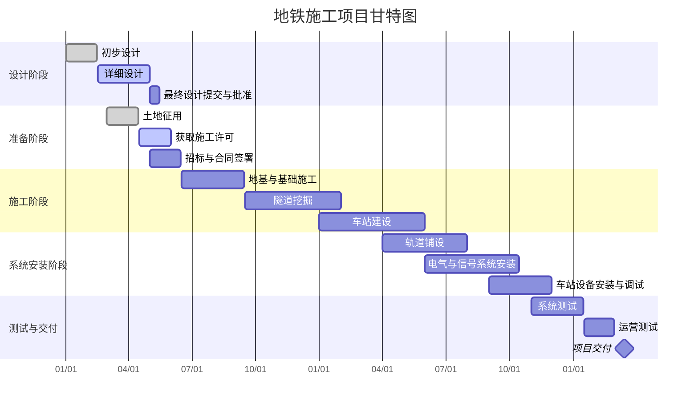

虽然看起来很复杂，但你完全不需要理解它。如果你使用的是百言 AI，该甘特图会直接渲染成图 8-5。

图 8-5 DeepSeek 通过 Mermaid 生成的甘特图

再举一个思维导图的例子。

帮我输出生成式 AI 精简学习路径的思维导图，使用 Mermaid 的 Mindmap 格式输出。

如果你使用的是百言 AI，该思维导图会直接渲染成图 8-6。

图 8-6 DeepSeek 生成的生成式 AI 精简学习路径

再如：

生成 Mermaid 图表：一个请假审批流程，包括员工申请、主管审批、人事审批、审批通过与否的流转。

该图表代码会直接渲染成图 8-7。

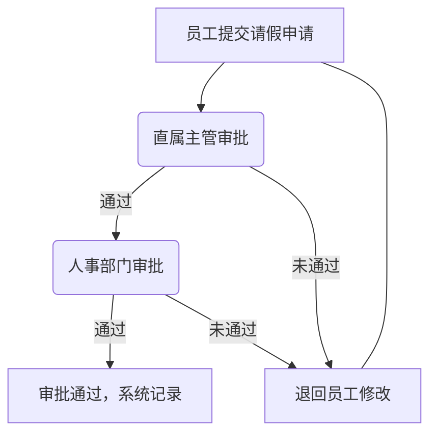

图 8-7 DeepSeek 生成的请假流程图

DeepSeek 官方版目前无法自动渲染 Mermaid 图表。你可以考虑使用 Mermaid Live Editor 在线渲染图表。如果你有计算机，可以使用 Mermaid 命令行工具，通过命令快速生成图表。如果你是程序员，也可以考虑使用 VS Code 中的 Mermaid 插件。

除了 Mermaid，你还可以使用 Graphviz、SVG、PlantUML 和 HTML。其中，Graphviz 可以生成十分复杂的图表，并且非常美观。例如，你可以用 Graphviz 来生成一个有关游戏设计的报告配图：

使用 Graphviz 生成一个流程图。这个流程图展示了一个游戏中资源更新的全流程，包括资源的采集、处理和利用三个阶段。在资源采集阶段，玩家可以收集材料、开采黄金和生成能量。在资源处理阶段，这些基础资源被用于冶炼成钢材、铸造成金币及转换成电力。最后，在资源利用阶段，这些加工过的资源被用于建筑建设、进行科技研究和资源交易。整个流程中的不同资源类型之间存在复杂的依赖关系，确保游戏的经济系统多样且动态。

这张图渲染后的结果如图 8-8 所示。

图 8-8 Game Resource Update Flow

可以使用一些在线工具对 Graphviz 图表进行渲染，也可以下载 Graphviz 命令行客户端来渲染图表。

需要注意的是，Graphviz 的默认设置对中文支持可能存在一些问题，但通过一些设置可以解决。Graphviz 的使用需要一些技巧，限于篇幅，此处无法展开介绍 Graphviz 软件的具体使用及渲染流程。Graphviz 是一个十分强大的图表生成器，如果你购买了本书的配套课程，其中会有详细的指导说明，以及 SVG、React 等更多图表类型的使用方法。

如果你喜欢使用 XMind 工具，或者喜欢 XMind 风格的思维导图，也可以轻松办到，只需要以下两步。

**第一步：**使用 DeepSeek 生成 Markdown 格式的思维导图。例如：

帮我生成微观经济学的思维导图，适合本科学生使用，要求内容清晰易懂，使用 Markdown 格式输出。

然后，DeepSeek 会输出 Markdown 格式的思维导图。把整个思维导图的 Markdown 代码复制下来（注意：不要漏复制，也不要复制非 Markdown 部分）。打开“记事本”软件，粘贴所有内容，并保存为“思维导图.md"文件 (注意："."为英文半角符号)。

**第二步：**打开 XMind，创建一个新的思维导图。然后点击菜单→文件 →导入→Markdown，选择刚才保存的文件，效果如图 8-9 所示。

图 8-9 DeepSeek 生成的 XMind 风格思维导图

最后，我们介绍使用 HTML 生成图表。HTML 就是网页代码，我们在互联网上看到的所有网页都是使用 HTML 生成的，HTML 极其灵活和强大。使用 HTML，我们可以渲染出动态、复杂、交互式的图表。与前面几种方式不同的是，通过 HTML，我们可以对图表的所有细节进行自定义，如线条粗细、样式、颜色等。但是，HTML 不太适合生成非常复杂的流程图，如图 8-8 所示的游戏设计报告配图。

例如，通过下面的提示词，你可以生成一个基于 HTML 渲染的时间轴图：

生成一个基于 HTML 的时间轴图，要求漂亮、大气，展现苹果公司史蒂夫•乔布斯的主要生平。整体设计干净、简洁、有视觉层次感。生成单一 HTML 文件。

DeepSeek 会生成 HTML 文件的源代码，例如：

以下是一个简洁现代的垂直时间轴设计，展示乔布斯生平重要节点。可直接保存为.html 文件：

（以下略）

有以下两种方式可以使用这个图表：

**方式一：**如果你使用的是 DeepSeek 网页版，可以点击 HTML 源代码右下角的执行按钮，直接展现执行后的效果。

**方式二：**在计算机上，你可以点击复制 HTML 代码，然后打开一个“记事本”文件，将所有代码粘贴到该文件中。然后将该文件保存，在保存对话框中，选择“所有文件”，并给文件命名为“时间轴.html"（注意："."为英文小写符号），如图 8-10 所示。

图 8-10 将文件保存为 HTML 文件

文件保存后，你只需要用浏览器打开这个文件，就可以看到类似图 8-11 的输出。

图 8-11 DeepSeek 生成的 HTML 图表

你如果觉得这个图表不合心意，可以通过追问来继续修改这个 HTML 文件。例如：

# 把我的图表改成横向，适合在计算机上使用。保持 HTML 单一文件输出。

# 1955  出生
2 月 24 日出生于美国旧金山，后被保罗·乔布斯夫妇收养

# 1976  创立苹果公司
与沃兹尼亚克在车库里共同创立苹果电脑公司，推出 Apple I 电脑

# 1984  Macintosh 发布
推出首款图形界面个人电脑，开创个人计算新时代

# 1985  离开苹果
因权力斗争离开苹果，创立 NeXT 和收购皮克斯动画工作室

# 1997  重返苹果
苹果收购 NeXT，乔布斯回归担任临时 CEO，开启复兴之路

# 2001  iPod 革命
推出 iPod 数字音乐播放器，重新定义移动音乐体验

# 2007  iPhone 问世
发布首款 iPhone，彻底改变智能手机行业

# 2011  时代落幕
8 月 24 日辞去 CEO 职务，10 月 5 日因胰腺癌逝世，终年 56 岁

HTML 格式非常灵活，可以输出各种各样复杂的图表，甚至还可以做多种图表的整合。你也可以用它生成折线图、饼图、柱状图等各类数据图。如果要生成带数据的图表，为了避免幻觉，强烈建议你在提示词中将图表数据列出，或者直接通过上传文件的方式给出具体的数据。

除了你能想到的常规图表之外，还可以绘制各种其他的图形。例如：

帮我生成一个基于 HTML 的小红书封面图，用蓝色科技感的背景框和夸张的大字，内容“是”量子计算又炸裂了！”

DeepSeek 会输出相应的 HTML 代码，打开后可以得到图 8-12 的效果:

# # 量子计算又炸裂了！

**图**8-12 DeepSeek 生成的**小**红**书**封面。

# **模块九**

## 学霸必备的 DeepSeek 技巧

## DeepSeek 成为专属学习家教

如果你是一个学生，或者家里有正在上学的孩子，DeepSeek 将成为一个强大的专属家教，接下来，针对学习的不同场景，我会手把手教你如何使用 DeepSeek，让它成为你的专属学习家教。

## DeepSeek 一对一讲课

如果你或者孩子在预习或复习时，遇到一个不会的概念或知识，可以直接问 DeepSeek。最神奇的点在于，DeepSeek 会用你能听得懂的语言讲解。所以在提问时，一定要告知你的年龄或学习阶段，以便 DeepSeek 更好地回复。

例如，假如你是一个初中学生，不懂英语过去分词的含义，可以这样问：

> 你是一位老师，我是初二学生，刚接触过去分词，无法理解是什么意思，你能帮我讲解吗？请使用我听得懂的语言，口语化一步步地教我，就像老师在上课一样，不要一次性输出太多内容，以免我无法消化。你的输出就是老师的口述内容，不要输出多余内容，当需要我互动时请停止回答，等待我给出答案，而不要继续输出，注意适合我的学习阶段。

你会发现这段提示词还是比较长的，这是为了让 DeepSeek 能更好地适应自己的老师角色，让孩子更容易理解，记住打开深度思考开关、关闭联网开关。DeepSeek 会根据你的个人情况，自动推断如何更好地帮你讲解这个问题。

接下来，DeepSeek 会进行深度思考，然后扮演一位老师来讲解。在讲解的同时还会适时和我们互动：

好，我们现在来慢慢理解过去分词。首先回忆一下：动词有原形（如 eat）、过去式（如 ate），对吗？那过去分词是什么呢？举个例子：
I have eaten（我吃过了），这里的 eaten 就是 eat 的过去分词。它通常和 have/has 一起用，或者用在被动语态里，如 The cake was eaten（蛋糕被吃了）。现在我问你：你觉得过去分词和过去式有什么不同？（请先思考，回答后我再继续）

接下来你可以继续和 AI 进行互动，享受一对一专属家教的感觉。

理解了基本概念之后，你可以继续让它出题考你，做到举一反三，练习巩固。

你是一位老师，我是初二学生，帮我出 5 道过去分词的选择题，不要超纲，不要告诉我答案。

DeepSeek 不会发脾气，也不会因为你听不懂而失去耐心，对于不敢问老师问题的学生而言，它是一个特别好的辅助老师。

当孩子有题目不会做，不知道从何下手时，可以让 DeepSeek 用“苏格拉底提问法”引导孩子思考，一步步得出正确答案。

苏格拉底提问法是由古希腊哲学家苏格拉底发明的，是一种通过提问引导学生思考、发现答案的教学方法。

苏格拉底提问法具有下列特点：## 以问题为中心：通过不断提问，引导学生思考。
### 逐步深入：从简单的问题开始，逐步引导到复杂的问题上。
### 不直接给答案：老师不直接告诉学生答案，而是让学生自己发现。
### 激发思考：通过提问激发学生的好奇心，建立批判性思维和逻辑推理能力。

你可以先把题目拍照发给 DeepSeek，或者直接给文字题目也行，让它一步步向你提问，引导你思考，答完一个问题再问下一个问题。

例如：

使用苏格拉底提问法帮我学习下列题目，每次只提一个问题，并等我解答。当我回答后，你的下一次响应继续使用苏格拉底提问法。不要告诉我答案。题目：如果关于 x 的不等式 $2x-3a<-2$ 的解集与 $2x<4$ 的解集相同，则 $a=$？

上面的提示词可以确保 DeepSeek 每次只问一个问题，一步步引导你得出答案。在经过一段时间的思考之后，DeepSeek 的回应如下：

好的，接下来我将通过苏格拉底提问法来引导你思考这个问题。首先，我需要你解决以下问题：

**第一个问题：**

关于第二个不等式 $2x<4$，它的解集是什么？请详细说明你的推导过程。

此时，你就可以解答第一个问题，例如：

两边同时除以 2，得出 $x<2$。

此时，DeepSeek 会继续深度思考并问出第二个问题：

**接下来，请解第一个不等式 $2x-3a<-2$。**它的解集是什么？请详细说明每一步的推导过程。

DeepSeek 会循环这个过程，直至得出答案。

最后，你可以继续让 DeepSeek 用同样的知识点给你出几道练习题：

请帮我出 3 道类似题目，不能过于相似，但有类似的解题思路。

要注意的是，DeepSeek 虽然具有强大的推理能力，但其正确率也不是 100% 的。在用 DeepSeek 帮助学习的时候，要保持批判性思维，仔细检查 DeepSeek 的输出。

# **DeepSeek 辅助学习的常见提示词**

除了一对一指导、苏格拉底式学习，DeepSeek 能帮助学习的地方还有很多。如表 9-1～表 9-3 所示，我列出了 DeepSeek 在各个学科中的常见用法，你可以直接拿去使用。在每个提示词后面，我都标注了推荐开启（√）或关闭（×）的 DeepSeek 功能。

## 表 9-1 DeepSeek 在语文学科中的常见用法

| 目标 | 提示词 | 深度思考 | 联网 |
| :--- | :--- | :---: | :---: |
| 古文学习 | ×××的文章《×××》有哪些重难点字词？给出具体解释。全文的写作背景是什么？表达了作者什么样的思想感情？ | √ | × |
| 作文批改 | 我是×××年级的学生，正在写一篇作文。作文的题目是×××，要求是×××。请分析这篇作文的优缺点，包括结构、用词、立意等方面，指出错别字和病句，并给出三条提升建议。我的作文是：（略） | √ | × |
| 作文素材 | 我是×××年级的学生，正在写一篇作文。作文的题目是×××，要求是×××。请给出我在写作时可能可以使用的名人名言和各类真实故事素材，用来提升作文的表达。注意：给出的所有内容必须真实存在 | × | × |
| 情感分析 | 请分析这篇作文的情感表达，并给出如何写更生动的建议。我的作文是：（略） | √ | × |
| 时事作文 | （第一阶段）我是×××年级的学生，正在写一篇作文。作文的题目是×××，要求是×××。我打算结合时事进行撰写，请给出可以结合的方向。<br><br>（第二阶段）请联网搜索有关×××、×××（第一阶段给出的方向）的内容，并告诉我如何将其融入我写的作文 | √ | √ |
| 作文框架 | 我是×××年级的学生，正在写一篇作文。作文的题目是×××，要求是×××。请给出一个高分作文框架，包括每一部分的写作要点 | √ | × |
| 语法检查 | 请检查这篇作文中的用词错误和语病，并给出修改建议。我的文章是：（略） | √ | × |

## 表 9-2 DeepSeek 在理科中的常见用法

| 目标 | 提示词 | 深度思考 | 联网 |
| :--- | :--- | :---: | :---: |
| 苏格拉底式题目讲解 | 使用苏格拉底提问法帮我学习下列题目，每次只提一个问题，并等我解答。当我回答后，你的下一次响应继续使用苏格拉底提问法。不要告诉我答案。<br>题目：（略） | √ | × |
| 错题分析 | 请帮我分析这个数学错题，告诉我错误的原因，给出修改方案，不要直接告诉我答案。题目：（略） | √ | × |
| 详细解题过程 | 请帮我解决这道题，详细列出解题过程。你的解题过程必须符合中国×××年级的解题格式和要求，并使用该阶段学习的方法进行解答，不要超纲 | √ | × |

**续表**

| 目标 | 提示词 | 深度思考 | 联网 |
| :--- | :--- | :---: | :---: |
| 给出例题 | 请给我 3 道关于余弦函数应用的例题，必须符合中国×××年级的要求，能够使用该阶段学习的方法进行解答，不要超纲 | √ | × |
| 总结薄弱环节 | 我是×××年级的学生，以下是我×××科目最近的 10 道考试错题，根据这些错题，帮我分析我学习的薄弱点，要求直达本质，既包括某些知识点的掌握，也包括其后反映的根本性学习问题 | √ | × |

## 表 9-3 DeepSeek 在英语学科中的常见用法

| 目标 | 提示词 | 深度思考 | 联网 |
| :---: | :--- | :---: | :---: |
| 情景记忆背单词 | 请帮我设计一个生动的情景小故事，帮助我记住以下几个单词：absorb, fascinating, phenomenon, curiosity, explore。给出中英双语的句子并标注出这几个单词 | × | × |
| 词根词缀法背单词 | 通过拆解词根、词缀等词汇组成部分，讲解其中每部分的含义及整个单词如何由这些部分组成而成，并成为现在的含义：international | × | × |
| 举一反三法背单词 | 根据我给的单词，给出它的所有同义词、近义词、反义词及这些词在用法上的细微区别，并告诉我如何批量记忆这些单词：（单词略） | × | × |
| 解析英语长难句 | 请你作为英语老师，帮助详细分析以下句子的结构，包括主句、从句划分及每部分的中文意思，并告诉我当遇到这样句子时，如何快速看懂句子的结构和成分，以便以后遇到这样的句子可以快速理解：（句子略） | 均可 | × |
| 短文翻译 | 请翻译这篇短文，并解释其中的难点句子 | × | × |
| 作文润色 | 请检查这篇英语作文的语法错误，并给出修改建议 | √ | × |
| 作文批改 | 请检查这篇英语作文的语法错误，以及是否有更好的表达方式，并给出修改建议。你的输出必须符合×××年级的英语写作要求 | √ | × |
| 口语润色 | 下列对话中，A 是我，B 是另外一个人。看看我的口语表达是否符合英语世界的口语化表达习惯？是否符合语法规则，用词是否准确？（注意：语法指的是口语中人们的常见用法，不一定像书面语那么严谨）如有问题，给我更好的表达建议 | 均可 | × |
| 写作框架 | 请为我提供一篇关于“我的妈妈”的英语作文框架，并标出写作重点 | 均可 | × |

## 培养孩子使用 DeepSeek 的兴趣

在我的"AI 成长圈”社群中，有一个朋友提出这样一个问题：“如何培养孩子学习使用 DeepSeek 的兴趣？”我认为这是一个非常好的问题。因为无论 DeepSeek 在学习方面多好用，如果孩子不感兴趣，也是没有意义的。因此，我也把我的回答放在书中，供你参考。

- **从日常问题切入。**例如，孩子问：“为什么恐龙灭绝了？”别直接给答案，掏出手机：“咱们问问 DeepSeek 老师！”一起看 AI 的回答。你和孩子还可以再追问：“你觉得火山爆发和陨石撞击哪个更可能？”让孩子感受到 AI 就像随身百科全书。
- **当游戏玩伴用。**例如，在周末，家长可以提议：“用 AI 设计个迷宫游戏吧！”输入提示词“生成 10 岁孩子能解的迷宫游戏”，让孩子当游戏设计师，AI 当工具人。做完游戏，还能把游戏教给爷爷奶奶，让全家共享。
- **做创作神器。**孩子写作文卡壳时，试试“用三个形容词描述暴风雨前的天空”这类指令。把 AI 生成的“铅灰色、低吼的、弓着背的”这类词加工成自己的句子，像玩文字拼图一样。
- **避免复杂的提示词。**让孩子每次都打出复杂的提示词太麻烦了，你可以考虑使用更垂直的工具，让孩子先爱上 AI。例如，使用百言神通代替 DeepSeek 官方应用（本书后续有介绍）。

以上几点的关键在于：把自己变成和孩子组队打怪的队友，AI 是你们捡到的魔法卷轴。展示如何正确念咒语（提问）并让孩子有获得感，比强行说教有用十倍。

## 使用 DeepSeek 学习英语

英语学习对于中小学生、出国留学的朋友和需要用到英语的成人都非常重要。但是，传统的学习方式（如机械背单词、死记语法和孤立的写作训练）往往收效甚微。在本部分，我将介绍如何借助 DeepSeek 高效提升英语学习的各项技能，包括背单词、长难句分析及写作指导，并从实用角度总结出实践干货和使用技巧。

### 情景化记忆背单词

词汇是英语学习的根基，缺乏足量的词汇，很难提升英语水平。然而，学生对于传统背单词模式往往感到枯燥乏味。DeepSeek 可以帮助学生实现个性化、趣味化的背单词方式。

例如，假设你是一名高中学生，最近在背诵高中英语 3500 个必备词汇时感到疲惫不堪，发现很多单词即使背下来也难以记牢。

你可以对 DeepSeek 输入如下提示词：

请帮我设计一个生动的情景小故事，帮助我记住以下几个单词：absorb, fascinating, phenomenon, curiosity, explore。给出中英双语的句子并标注出这几个单词。

DeepSeek 迅速给出了原创的故事片段：

**场景（Scene）：**
一个雨后的傍晚，小女孩 Lily 在森林里发现了一棵发光的树。
One rainy evening, a little girl named Lily found a glowing tree in the forest.

**故事（Story）：**
“好奇”（Curiosity）驱使 Lily 靠近那棵树。树皮上的光芒像星星一样闪烁，她从未见过如此“迷人的”（fascinating）景象。
Curiosity drove Lily closer to the tree. The shimmering light on its bark sparked like stars—she had never seen such a fascinating sight.

突然，树干轻轻颤动，一股温暖的能力开始“吸收”（absorb）她的注意力。她感觉像被拉进了一个奇幻世界。
Suddenly, the trunk trembled softly, and a warm energy began to absorb her attention. She felt pulled into a magical world.

她看到树叶间飘浮着彩色光点——这是一种罕见的自然“现象”（phenomenon），科学家们至今无法解释。
She saw colorful specks of light floating between the leaves—it was a rare natural phenomenon that even scientists couldn't explain.

“探索”（Explore）！Lily 心想。她伸手触摸树干，瞬间，树的记忆和故事涌入她的脑海，仿佛她与自然合为一体。
"Explore!" Lily thought. She touched the trunk, and instantly, the tree's memories and stories flooded her mind, as if she had merged with nature.

回家后，Lily 在日记里写道：“今天，森林教会了我——保持好奇，世界永远充满奇迹。”
Back home, Lily wrote in her diary: "Today, the forest taught me—stay curious, and the world will always be full of wonders."

接下来，你可以向 DeepSeek 继续追问：

请再为以上单词分别提供一个英文例句，加深我的记忆。

DeepSeek 逐一提供了原创例句，例如：
- **absorb:** Plants absorb sunlight and carbon dioxide to produce oxygen.
- **fascinating:** I found the history lecture fascinating, so I didn't notice the time.
- **phenomenon:** The Northern Lights are a beautiful natural phenomenon.

**curiosity:** Driven by curiosity, she opened the ancient mysterious box.

**explore:** We plan to explore the rainforest during our holiday.

其实，你还可以让 DeepSeek 用其他方式帮你背诵单词。
- 使用**词根词缀法**，让 DeepSeek 拆解英语单词的不同部分，以更好地理解单词的拼写。
- 使用**举一反三法**，让 DeepSeek 列举出所给单词的同义词、近义词和反义词，批量记忆，顺便还能区分它们用法上的细微差别。

另外，你还可以直接在 DeepSeek 应用中，拍照上传英语教材中的词汇表，让 DeepSeek 了解你正在背诵哪些单词。

### 精准分析英语长难句

在英语考试（如高考、托福、雅思）中，长难句的理解经常成为学生失分的一大难点。DeepSeek 能够逐步拆解句子结构，清晰呈现语法结构，帮助学生有效掌握分析长难句的方法。

例如，假如你正在备考托福，在阅读文章时遇到以下难句陷入困惑：

The researchers argued that while the rate at which species become extinct to day appears higher than in the past, the exact number has been extremely difficult to quantify due to inconsistent data.

你可以这样问 DeepSeek：

请你作为英语老师，帮助详细分析以下句子的结构，包括主句、从句划分及每部分的中文意思，并告诉我当遇到这样句子时，如何快速看懂句子的结构和成分，以便以后遇到这样的句子时可以快速理解：（句子同上，略）。

DeepSeek 输出可能如下所示（节选）：

好的，让我们一步步解析这个句子。我会先标注不同成分，再逐一分析结构和学习方法：

**主句：**
The researchers（研究人员）argued（认为）
结构：主语 (S) + 谓语动词 (V)

**宾语从句（that 引导）：**
[that while…, the exact number...]
中文：[虽然……，但确切数字……]

**让步状语从句（while 引导）：**
while the rate… appears higher than in the past

（中间略）

**快速理解句子的方法：**

（中间略）

**同类句子学习技巧：**
- **连接词定位法：** 关注 that/which/while/due to 等词，它们是划分结构的信号。
- **倒序理解法：** 先看主句（谁做了什么），再处理从句（具体内容）。

**成分替换练习：** 尝试将复杂修饰语替换为简单词，如将"the rate at which species become extinct"简化为"the extinction rate"。
**中英对照法：** 逐段翻译并标注对应成分（如上方中文解析）。（中间略）

建议每天分析 1～2 个长难句，用不同颜色标注主谓宾和从句成分，坚持两周后阅读速度会明显提升。

### 帮助更好学习英语绘本

如果你家里有个小朋友，正在学习一些简单的英语绘本或英语故事，如何能够提升学习效果呢？DeepSeek 是一个不错的选择。例如，假如你家孩子正在看海尼曼的 *The Ladybug and the Cricket*（《瓢虫与蟋蟀》）。为了加深印象及更好地举一反三，你可以把绘本上传到 DeepSeek，并提出需求：

我家孩子×岁，请提炼这个绘本故事中的高频英语单词和口语表达句式，并写出另两个适合我孩子看的、单词和句式相似的故事。

通过这种方式，DeepSeek 可以从词汇、句式等各方面总结绘本的精华，并给出类似的故事以让孩子加深印象。如此这般，可以让孩子通过举一反三更好地记住绘本中的重要单词和例句，同时培养孩子独立阅读的习惯。

### 提升英语写作能力

写作是英语学习中至关重要但又难度较大的环节。中国学生普遍存在中式英语表达、语法错误、词汇搭配不当及整体表达单一等问题。DeepSeek 通过即时高效的反馈和修改建议，可以有效帮助学生提高英语写作能力。

例如，假如你完成了一篇英语作文，题目是："Should Students Wear School Uniforms？"你希望知道作文中存在的问题，并获得具体有效的修改指导。

你可以这样写提示词：

你是高中英语老师，帮我检查以下英语作文，指出其中的语法错误、不地道表达和词汇搭配问题，并建议更好的表达方式。给出详细修改建议。

DeepSeek 会帮你批改该作文，例如（以下为节选）：

原文："I think students wear uniforms is good, because uniform can let students feel equal."

问题指出：“这里主语从句‘I think students wear uniforms is good’语法错误，应改用动名词或从句形式。同时，使用 beneficial 比 good 更高级。”

修改建议："I think wearing school uniforms is beneficial, because uniforms make students feel equal。”

根据建议修改，可以让你的作文语言变得更加地道且充实，清晰表达观点，获得更高的分数。

如何更有效地利用 DeepSeek 进行写作指导呢？最重要的是明确指示 DeepSeek 要批改的具体问题，如语法、表达、搭配、逻辑等，不要泛泛要求“修改”。你还可以进一步地主动追问如何使表达更地道、观点更丰富，从而逐步提升写作能力。

最后，送你两个使用 DeepSeek 学习英语的实操小提示：
- **明确具体需求的提示词**，能提高回答质量。

### 持续追问和互动，可以获得更好的优化建议

# DeepSeek+百言神通：AI教育的最佳落地方案

我在前两节讲述了如何使用DeepSeek辅助学习。虽然它的功能很强大，但是如果仔细看，你可以看出使用DeepSeek辅助教育有几个落地方面的问题，会严重影响日常使用体验。

*   由于DeepSeek应用不支持原生多模态，也不支持输出语音，无法进行听说、口语相关的学习。
*   DeepSeek没有长期记忆，每次提问都需要写很长的提示词，对于学习来说很容易分心，也很不方便。
*   DeepSeek输出存在幻觉，有时候会造成误导；缺乏教育垂直知识库，对于具体某个年级的学习内容和题目不了解，因此输出内容经常超纲或者不相关。

想解决这些问题，我们可以使用垂直AI工具——百言神通。百言神通是AI智能学习辅助平台，覆盖学、练、问全环节。它既是随身英语外教，造就地道英语；也会全科辅导，是不会发脾气的好老师。百言神通已经全面接入DeepSeek，并结合全科学习进行了优化。微信搜索“百言神通”小程序，无须下载即可使用。你也可以在平板电脑上使用，保护眼睛。百言神通主界面如图9-1所示。

第一次使用百言神通小程序时，需要填写个人信息进行注册。目前，百言神通有两个“学习目标”，分别是“英语提升”和“中小学学科辅导”。英语提升适合中小学生进行英语听说读写的全面练习，以及成人准备托福、雅思、留学；“中小学学科辅导”适合中小学生的日常全科学习，包括语文、数学、英语、历史、生物、地理等。选择不同的学习目标，小程序能使用的功能会有所不同。你在注册时可以按照需要进行选择，后期如果找不到想要的功能，也可以在个人资料中随时修改和切换。

### 随身英语外教，造就地道英语

百言神通带有AI英语外教Vivi，可以实时评估你的口语发音、7×24小时帮你进行口语和听力对练。与DeepSeek本身不支持多模态不同，百言神通的英语口语评估可以达到单词级，用红、黄、绿清晰标注你的口语问题。例如，图9-2就是与Vivi进行口语对话后得到的详细的AI口语解析，帮你分析发音的流利度、准确度、标准度。

```
> 我是小言，你的 AI 学习伴侣。
> 
> 我会陪伴你的每一天、每个知识点和
> 每个题目。加油！
```


*   [我的错题本](#)
*   [了解百言神通 >](#)

```
> ### 上次练习的题目
> 给试管里的液体加热 
> *   [继续做题](#) 
> 
> 2024-12-19 18:40
```

*   **教材跟学**

    ```
    *   **语文**
    *   **数学**
    *   **英语**
    *   **物理**
    *   **化学**
    *   **生物**
    *   **地理**
    *   **历史**
    ```

[font color="black"]语音评测[/font]

### 图9-2 百言神通的口语解析功能

同时，百言神通更独有整体表达分析，帮你说出更地道的英语。与出国留学、国外旅游、雅思考试、托福考试等场景绝配。

除了口语，百言神通还支持AI背单词、AI长难句分析、AI影子跟读、AI口语考试模拟、AI写作辅导、AI查词等大量实用英语功能，适合各年龄段的朋友使用。所有操作都不需要自己书写DeepSeek提示词。

### 全科辅导，不会发脾气的好老师

百言神通提供了AI智学功能，详细讲解各学科知识点，循序渐进、边学边练、学会为止。本书完稿时，百言神通覆盖中小学主流学科，内置5000余个知识点。可以智能陪伴式帮孩子刷题，内置10万余道精选真题，同步了全国各地主流教材的教学进度，可每日跟学，让孩子彻底搞懂各类知识点。

使用该功能需要在个人资料中把学习目标切换为“中小学学科辅导”。然后在百言神通主界面点击“教材跟学”下的某个学科，如点击“数学”即可进入如图9-3所示的页面。

在这里，你可以选择自己的教材，并根据自己的教材学习对应的知识点。知识点右侧的两个图标分别表示知识点的AI讲解和AI题目陪练。无须任何提示词，你就可以享受一对一AI学习陪伴。例如，图9-4是“绝对值的性质”的AI题目陪练，AI可以直接针对知识点出题，点击“请小言同学给个思路”后，它还能给你解题思路，这样既能够辅导学习，又不会直接给出答案。

```
> < 教材章节跟学
数学 ∨
沪科版 ∨
七年级上 ∨
```

# **第1章 有理数**

### 1.1 正数和负数

*   - 正数与负数
*   - 有理数的性质

# ### 1.2 数轴、相反数和绝对值

*   - 数轴
*   - 相反数
*   - 绝对值（二）
*   - 绝对值的性质

# ### 1.3 有理数的大小

*   - 有理数的大小比较

### 1.4 有理数的加减

*   有理数的加法

▲图9-3 百言神通教材跟学页面

```
<练习
选择题

已知等腰三角形的两边长分别为a,b,且a,b满足√(a-3)+|b-4|=0，则此等腰三角形的周长为(  )

    +   A.7
    B.10
    C.11
    D.10或11
```

▲图9-4 AI解题辅导

百言神通还有AI答疑功能，支持拍照解题、英语翻译等，随时解答学习中遇到的问题。

## DeepSeek+秘塔：超强的学术信息源

DeepSeek几乎可以说是我们现在能用到最强大的AI工具之一，它能够进行深度思考，回答非常复杂的问题。然而，哪怕是性能再强大的AI模型，也有自己的局限。

例如，在学术研究领域，如果你问DeepSeek类似下面这样的问题：

请帮我整理一下最近5年关于量子计算领域的最新研究进展，特别是有有关量子纠错方面的最新论文、关键人物和重要成果。

这时，你可能发现，DeepSeek并不能轻易给出令你满意的答案。为什么呢？原因很简单：现阶段的DeepSeek，联网搜索的能力和范围是有限的。特别是，对于最新的专业期刊、论文、学术PDF文档这些深入进行学术研究的资源，DeepSeek自身对这些资源支持得并不完善。

DeepSeek的联网搜索结果基本都来源普通互联网搜索，所以你可以看到，DeepSeek输出的结果大多都是网上比较热门的话题，而非学术领域关注的权威、前沿信息。

总结而言，DeepSeek的联网搜索并未整合大量学术数据库；并不直接支持PDF和学术论文的精准查找。它擅长推理和深度思考，但如果没有实际数据支撑，答案就会比较泛泛或过时。同时，互联网上泛滥的虚假信息可能会加重DeepSeek-R1模型的幻觉现象。

虽然DeepSeek有极强的学术理解能力，但巧妇难为无米之炊。此时，我们可以借助秘塔AI搜索结合DeepSeek实现更好的输出效果。秘塔AI搜索是由上海秘塔网络科技有限公司推出的一款AI搜索引擎，它具备强大的语义理解能力，能够准确匹配你的搜索需求，提供高质量结果。同时，秘塔AI还支持自动生成大纲、脑图、相关事件/组织/人物表格，用多种形式将关键信息筛选整合，助你秒懂搜索结果。这个方法也可以用于学术领域外的诸多领域，如自媒体创作、新闻资讯检索等。今天我们就来聊聊DeepSeek如何让秘塔AI搜索，成为你最强大的AI信息源。

打开秘塔AI搜索，其主界面如图9-5所示，你也可以使用App版，两者主界面大同小异。

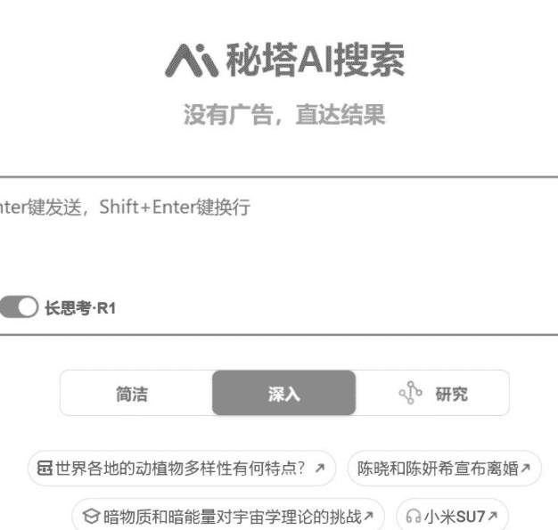

图9-5 秘塔AI搜索主界面

选中“长思考·R1"开关。（如果后续推出了更先进的推理大模型，此处的显示可能有所不同。）然后输入与DeepSeek相同的提示词：

请帮我整理一下最近5年关于量子计算领域的最新研究进展，特别是有
关量子纠错方面的最新论文、关键人物和重要成果。

稍等片刻，即可得到答案。图9-6是答案的一部分截图，可以看到内容都有翔实的引用来源，可以直接跳转到对应的PDF或网页链接，尤其是在学术论文方面，数据源明显更多、更全。

# ## 一、关键研究成果

*   谷歌量子纠错突破“盈亏平衡点”

    2024年12月，谷歌量子人工智能团队在《自然》发表论文，宣布其最新超导量子芯片Willow通过*表面码技术*，首次将逻辑量子比特的错误率降至物理量子比特错误率以下，突破了纠错的“盈亏平衡点”。这一成果验证了容错通用量子计算机的可行性。

*   亚马逊“猫量子比特”大幅降低纠错成本

    2025年2月，亚马逊云科技（AWS）团队联合加州理工学院推出新型量子芯片Ocelot，采用“猫量子比特”（cat qubits）设计，通过抗拒特定噪声类型减少硬件需求，将量子纠错成本降低90%。相关成果发表于《自然》。

*   微软与AWS推动实用化量子纠错技术

    2025年2月，AWS与微软合作优化量子纠错在药物开发、金融预测等领域的应用，加速实用量子计算技术的落地。

*   Delft大学表面码与漏电检测技术

    荷兰代尔夫特理工大学团队在 *npj Quantum Information* 发表研究，提出基于超导量子比特的表面码中漏电检测方法，显著提升纠错效率。

*   奇偶校验门集（Parity Check Gate Set）的优化

    2024年，Üstün、Morello和Devitt提出单步奇偶校验门集，通过改进量子安全中的奇偶校验技术，增强纠错能力。


# ## 相关事件


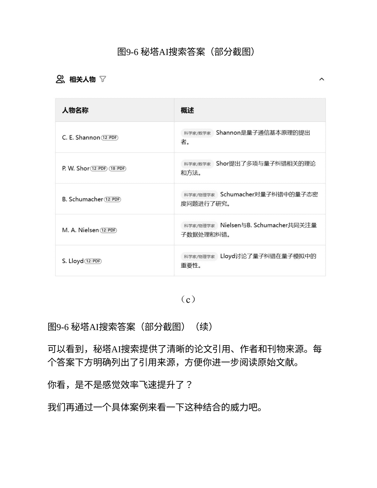

假设你是一名经济学专业研究生，要完成关于“数字人民币对消费行为影响”的研究论文。

你面临的问题可能有：

*   不清楚该从哪些角度切入。
*   不确定哪些文献值得引用。
*   需要快速了解目前学界的主流观点和争议。

这时，你可以首先用秘塔AI搜索：

数字人民币对消费行为研究的最新进展和重要论文有哪些？

秘塔AI搜索很快给出精准的文献列表，明确告诉你目前国内外发表的重要研究和相关人物。每条结果都附带明确的引用源文献编号，你点开即可查看原始文献。

接下来，你再将秘塔AI搜索整理的这些信息输入到DeepSeek之中，请DeepSeek辅助你生成论文大纲，撰写开头、研究背景、文献综述、研究方法等学术写作的核心部分。通过这样的协同使用，你的学术工作不仅效率倍增，而且质量也能得到明显提升。你可以专注于更重要的创新思考和观点论证，而不是耗费大量时间在资料的检索和整理上。

除了学术研究和学术写作，这种DeepSeek结合秘塔AI搜索的方式，在其他领域也有广泛应用。

**新闻资讯领域**：新闻媒体工作者可以快速借助秘塔AI搜索找到精准的背景信息和相关材料，DeepSeek则快速生成新闻稿或评论文章。

**自媒体领域**：自媒体创作者可以用秘塔AI搜索快速找到最近的热点话题和相关观点，DeepSeek则助力自媒体创作者快速撰写高质量内容文章。

**日常搜索场景：**例如，你想知道一些复杂问题的权威答案，秘塔AI搜索都能迅速给出明确答案并提供来源，DeepSeek随后加以详细的解释说明，帮助你清晰理解。

你可以看到，这种搭配模式其实非常灵活，几乎在各种需要快速精准信息和深度内容生产的领域，都能发挥出极大的优势。

其实，在学习方面，DeepSeek能做的还有很多很多。限于篇幅，此处不再赘述。

> **[11]**即"C哥的AI成长圈”，参见“本书学习资源”部分。

# # 模块十
## DeepSeek构建专属知识库
### 理解RAG和知识库

在前面的章节中，我们已经探索了DeepSeek的基本使用，包括模型的推理、提示词技巧及在各个领域的落地应用。然而，面对真实的企业和个人需求时，单纯使用AI大模型本身往往存在明显的短板——它们在专业领域或者企业/个人私有数据方面无法做到充分理解和准确响应。这时，引入检索增强生成（Retrieval-Augmented Generation，RAG）技术并搭建专属的知识库就显得尤为重要。

# ## 为什么需要专属知识库

尽管DeepSeek拥有强大的泛化能力，但它在处理具体的企业或个人专有知识时，缺乏针对性的专业信息支持，容易出现“幻觉”（Hallucination）——一本正经地给出实际并不存在的答案或信息。例如，当我们询问企业内部具体的审批流程、内部专有名词解释或产品的具体价格策略时，泛化的AI大模型就会表现出明显的短板，难以提供准确答案。

例如，假如你这样问DeepSeek：
我公司的商用清洁机器人的大客户折扣是多少？

DeepSeek不可能给你正确的回答，因为它并不知道你公司商用机器人的任何情况，甚至都不知道你是哪个公司的。

因此，我们需要构建一个专属知识库，将企业或个人的私有文档、学习笔记、资料、培训手册、产品说明等专业内容上传到知识库中，利用RAG技术在模型回答问题时首先检索相关专有知识，然后再基于这些内容进行回答，以提高模型回答的准确性。

# **什么是RAG**

RAG是一种结合传统搜索引擎与AI大模型的技术方案。当用户提出问题时，RAG系统会执行三个步骤。

首先，系统会根据问题的语义从知识库中检索相关度最高的资料片段。

然后，将这些检索得到的资料片段作为上下文，连同原本的问题输入AI大模型。

最终，AI大模型会基于这些知识上下文进行综合构建，生成更精准、更具针对性的回答。

图10-1详细描述了整个检索和生成的过程。


通过这种方式，能有效减少大模型的“幻觉”问题概率，提高知识密集型问题的准确性。

# **使用云服务构建知识库**

选择云端的知识库搭建方案可以节省本地部署和维护的成本，快速完成知识库建设。提供相关服务的有很多，如各种云计算服务商可供开发者快速搭建知识库；HelpLook可帮助企业快速搭建知识库和帮助中心等。在这里，我们以腾讯的ima.copilot平台为例，这个平台使用简单且免费，适合个人和小型企业使用。

腾讯ima.copilot是一款面向企业及个人的在线知识库平台，可以轻松实现文档上传、知识分享、实时问答等功能。该平台已经集成了 DeepSeek，用户无须进行模型部署和维护，即可获得高效、精准的知识检索与问答功能。

腾讯ima.copilot有几个主要优势：

1.  **多端同步**：计算机端和移动端无缝衔接，支持微信公众号文章收藏、PDF和Word文档上传。
2.  **便捷的知识共享**：可以创建共享知识库，与团队成员共同维护、更新知识库内容。
3.  **DeepSeek模型内置**：无须额外配置模型环境，平台内置DeepSeek，大幅降低使用门槛。

例如，企业可以将内部产品文档、流程规范、员工手册、培训材料等上传到ima.copilot的共享知识库中，供员工随时查询，大幅提升员工工作效率，或者帮助企业客服快速回答问题。

而个人可将收藏的电子书、学习资料、公众号文章上传到个人知识库，快速查阅或生成摘要、笔记。

要使用ima.copilot平台，既可以使用微信中的小程序，也可以下载客户端。其官方网站可以下载各平台客户端，包括计算机端和移动端，如图10-2所示。

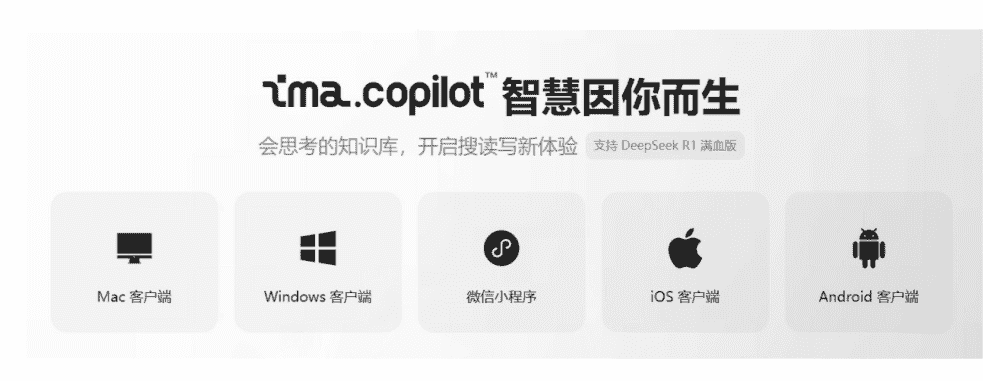

接下来，我们以Windows客户端为例介绍它的基本使用。下载安装后，用微信账号登录即可。

首页就是一个简单的对话框，集成了DeepSeek-R1和联网搜索功能，如图10-3所示。注意：随着版本的升级，你看到的主界面可能有所不同。


图10-3 ima.copilot主界面
点击左侧的灯泡图标，可以切换到知识库页面，如图10-4所示。


# # 图10-4 知识库页面

在知识库页面的左边，分为两个区域，上方为你的个人知识库，下方为共享知识库。共享知识库可以多个人或一个企业、一个组织共同使用。选中一个知识库，右侧可以添加相应的内容，支持PDF、图片、Word文档等常见文件类型。

例如，我在个人知识库中上传了两个文档，一个是我写的书《学会提问，驾驭AI: 提示词从入门到精通》，一个是《阿里云安全白皮书》（阿里云的公开资料））。上传后稍等1分钟左右即可被索引到RAG数据库中。此时，在下方的文本框就可以基于知识库来提问了。

如上文所述，ima.copilot平台最大的优势就是支持知识库共享。例如，我创建了一个名叫"C哥知识库”的共享知识库，我可以点击进入该知识库，点击分享按钮分享给所有相关人员，支持通过链接或二维码形式分享。这样，所有相关人员都可以在你提供的资料上提问了。

需要注意的是，ima.copilot平台支持多种AI大模型，提问时需要留意自己选择的AI大模型。如果要使用DeepSeek提问，需要手动切换。

# ## 构建本地AI知识库

虽然云服务知识库搭建简单便捷，但企业与个人可能存在对隐私数据严格保护的需求。为确保数据安全，本地部署私有知识库也是重要的解决方案之一。下面我们介绍如何使用开源工具Dify实现基于DeepSeek的本地知识库搭建。

Dify是一个开源的AI开发平台，可以帮助开发者轻松创建和管理生成式AI应用。它提供了丰富的功能，其主要特点包括：

1.  支持多种主流大模型（如DeepSeek）的接入。
2.  强大的RAG（检索增强生成）能力。
3.  简单便捷的知识库搭建和管理功能。
4.  提供从智能体构建到AI工作流编排、模型管理等能力，轻松构建和运营生成式AI原生应用。

使用Dify搭建本地AI知识库的过程稍微有些烦琐，涉及多个步骤和多款软件，且随着Dify版本的更新经常变化。Dify通常部署在企业环境，常常是基于Linux的而不是基于Windows部署的。有鉴于此，本节不做详细的操作演示。在本书配套课程中有对应的详细说明。接下来，我会做简单的流程说明。

你的计算机需要安装Docker环境（Dify部署依赖Docker）。

*   你需要安装本地模型部署工具（如Ollama），并通过Ollama下载DeepSeek模型。此部分内容，在本书前面的章节中有详细介绍。
*   下载并部署Dify本地版，通过Docker Compose运行。
*   在Dify后台设置中配置本地DeepSeek模型的访问地址，完成模型与平台的关联。
*   创建知识库，上传本地数据文件（如PDF文档、Word文档、Markdown文本）。
*   在Dify中部署Embedding模型，将上传的数据转为向量格式，方便语义检索。
*   新建Dify应用，关联知识库作为应用的背景知识，实现在应用内的知识检索与生成问答。

除了Dify，本地部署知识库还有很多其他工具，如Cherry Studio、AnythingLLM、RAGFlow等，你可以根据自己的需求进行选择。其中，Cherry Studio的本地搭建更“傻瓜”些，更适合个人使用。

通过本地部署知识库，你可以将公司内部文档、规章制度、产品手册等部署到本地知识库，员工通过企业内部网络进行查询；搭建帮助企业新员工快速学习公司知识的智能培训助手；构建企业内部的智能客服平台，实现对内对外的智能问答服务。

对于个人用户，可以将个人文献库、学习笔记、各类资料上传到本地知识库，形成智能化的知识管理助手。用户还可以利用知识库辅助写文章，提升个人创作和学习效率。

通过实践你会发现，搭建专属知识库不仅能有效解决AI模型的幻觉问题、提升生成内容的准确性，还能大幅提升自身或企业团队的知识管理效率。

# 模块十一

DeepSeek 助力政企进入智能时代

当前，政府和企业正处于快速转型的时代变革中，随着人工智能技术的成熟和落地，越来越多政府和企业组织选择为自己的数字化转型部署智能化解决方案。DeepSeek 系列模型凭借出色的文本处理能力和更低的成本，为政府和企业组织提供了广泛的智能应用场景。通过 DeepSeek 技术的融入，政企和各类组织能够显著提高工作效率，降低运营成本，优化决策与服务体验，加速迈入智能化时代。

接下来，我会抛砖引玉，向你简单介绍目前 DeepSeek 在政府和不同行业的落地场景，这些只是 DeepSeek 可能的应用场景中很小的一部分。你可以根据自己所处行业的业务情况，在这些场景的启发下，深度思考自身可能的应用场景。

### 通用领域的 DeepSeek 落地探索

无论是哪种类型的企业或组织，DeepSeek 几乎都有用武之地。下面列举了几个常见的 DeepSeek 落地场景供你参考。

#### 招投标辅助

通过 DeepSeek 强大的语义理解能力，DeepSeek 结合爬虫可以自动获取适合自己公司的招投标项目，大大提升效率。同时，对于指定的项目，DeepSeek 可以结合企业自身的产品和投标要求，自动生成对应的标书，还可以对投标文件进行全方位的风险排查，大大节省了时间并减少了人为错误，确保文件的合规性和专业性。这种能力的应用，让中标率实现增长，为企业在激烈的市场竞争中保驾护航。

#### AI 法律顾问

以往，法律咨询往往需要专业律师的参与，而 DeepSeek 结合 RAG 技术建立的智能法律顾问，可自动处理企业内部常见法律咨询。

例如，合同处理是企业日常业务的重要一环，但传统人工方式处理合同存在耗时长、易遗漏、法律风险高等问题。DeepSeek 能够基于企业历史合同数据及法律法规，自动生成合同文本。同时，DeepSeek 可自动审阅合同条款，识别风险点并给出修改建议，大幅提高合同的法律合规性和撰写效率。

除此之外，DeepSeek 还可以协助企业解决劳动纠纷处理、知识产权保护等问题。该方案落地后可大幅减少企业基础法律事务的人工投入，推动企业内部法律服务智能化。相信你读过本书后，也可以通过搭建企业 AI 知识库结合 DeepSeek 深度思考模式实现上述业务。

但是需要注意的是，当前，任何 AI 法律顾问依然会有幻觉问题。对于涉案金额高、事关重大的法律问题，AI 只能作为参考。

#### 智能客服

客服工作量大、重复性高，DeepSeek 可以实现 7×24 小时在线智能客服，自动分析客户问题意图并精准回复。银行、电商、通信运营商等行业可快速部署 DeepSeek 智能客服平台，显著提升客户满意度，降低人工客服成本，提升整体服务效率。

接入智能客服是一个系统工程，需要解决三个问题：

- 如何让 AI 了解企业和产品知识。
- 如何让客服平台自动调用 AI 及自动回复用户消息。
- 如何解决 AI 幻觉及错误回复问题。

关于第一个问题，可以参考本书前面的知识库相关章节。

对于第二个问题，现在很多客服平台都提供了 API 接口（应用程序接口），如常用的微信公众号消息、企业微信客服等。如果你使用的是自研或第三方开发的专用客服系统，也几乎都能够拿到 API 接口。只要拿到 API 接口，你就可以让 AI 自动获取用户发送给客服的消息，并根据 AI 的回答自动回复。

对于第三个问题，需要优化提示词，对于不太确定或能力范围之外的问题，让 AI 自动拒答或只给出参考答复，并交由客服人员进行人工审核。

最后，企业需要一定的开发能力或交给专业人员来实现整个系统。

#### 自媒体内容自动化

DeepSeek 可以通过分析热点话题和用户画像，自动生成自媒体内容，包括文章、短视频脚本、营销素材等。企业和政务宣传部门部署 DeepSeek 自媒体自动化生产平台之后，可快速生产贴合热点的内容，大幅提高内容创作效率与传播效果。

#### 内部流程审批自动化

企业内部流程审批通常涉及大量重复性合规判断，DeepSeek 通过学习企业管理制度及审批案例数据，可以自动判断审批申请的合规性并生成审批意见。企业可将 DeepSeek 模型部署到办公自动化系统中，减少审批流程的人力投入，显著缩短审批周期，减少贪污腐败，实现企业运营效率大幅提升。

#### 企业知识库建设

企业知识散落在各个系统和文档之中，企业可以结合 RAG 技术搭建智能知识库平台，可自动爬取、整理、分类企业的政策解读、技术文档、市场分析报告等知识资源。员工仅需通过简单自然语言查询，即可高效获取所需信息。企业通过 DeepSeek 知识库实现知识资产结构化、便捷化管理，赋能员工高效协作、快速学习新知识，减少员工培训成本并快速响应市场。

### 智能在线办公与数据处理

例如，办公协作平台“飞书”已经融合了 DeepSeek，相关应用包括可在多维表格字段捷径中调用 DeepSeek-R1，批量生成文案、脚本、策划方案，进行多语言翻译和智能门店巡检等。

### 政务领域的 DeepSeek 实践

当前，政务领域的 DeepSeek 应用正在快速落地。我曾接触过大量政府部门并落地过不少政府项目，可以明确地说，政府在 DeepSeek 落地方面的需求是很大的。政府涉及的业务很广，没有办法在书中总结所有应用场景，希望下面的几个场景可以帮你举一反三、提供思路。

#### 公文辅助管理

DeepSeek 通过海量政务公文语料的训练，可以快速协助工作人员生成规范公文文稿，减少人为错误并提升写作效率。政府机关可部署 DeepSeek 公文辅助系统，提升办公自动化水平。

#### 智能政务助手与“一网通办”

人员快速完成申请。通过此方案落地，显著提高政务服务效率、提升市民与企业的满意度。

#### 招商引资与文旅宣传

政府招商引资、文化宣传、旅游推广等活动，对营销文案和策划方案有较强依赖。DeepSeek 可基于地方特色、产业优势、文化资源自动生成营销方案和文案，加速政府市场营销活动的策划与传播效率。

#### 公检法材料审阅及辅助办案

DeepSeek 特别擅长阅读和总结大量文章，对于动辄几百上千页的办案材料，可以信手拈来，快速提取重要信息。DeepSeek 可以自动填写办案使用的内部软件的常见流程信息，推进流程加速和自动化。对于简单的案件，DeepSeek 甚至可以通过阅读报案电话记录、口供和当事人情况，辅助民警办案，如提出疑点和审讯重点难点，自动填写办案的内部软件流程信息、通过深度思考推断案件可能的真相等。

#### 金融行业的 DeepSeek 实践

##### 智能金融咨询与市场实时分析

例如，腾讯理财通打造了一个基于 DeepSeek-R1 的 AI 金融咨询助手，客户仅需通过便捷的自然语言对话，即可获取个性化的理财规划、金融知识解答和产品推荐，甚至可以进行实时市场分析和研报解读，增强了客户体验。

##### 金融内审报告

DeepSeek 可分析大量企业财务数据与内控制度，自动生成详细内审报告并识别潜在风险，协助内部审计人员快速掌握企业财务状况与经营风险，降低审计成本和风险。

##### 保险方案设计

保险公司部署 DeepSeek 平台后，通过分析客户个人信息、风险偏好、历史投保数据，自动为客户生成个性化的保险方案建议，缩短业务员销售周期，提高客户满意度及投保成功率。

##### 银行落地应用

例如，工商银行已经部署了 DeepSeek 系列模型，通过一系列技术创新手段显著提升了模型部署效率，压降了推理成本，提高了吞吐量。工商银行通过在重点领域率先试点，实现应用突破，充分发挥 DeepSeek 在强推理与复杂数据处理等方面的优势，构建财报分析助手、AI 财富管家等 10 余个典型场景，推动业务流程智能化升级，提升工作质量和效率。

### 医疗健康领域的落地应用

#### 疾病诊断辅助

在临床疾病诊断中，DeepSeek 可快速分析医学文献与患者数据（病历、检验报告等），提供辅助诊断意见，大幅提高医疗机构诊疗效率与诊断精度。

#### 健康管理与个性化建议

基于 DeepSeek 对健康和体检数据进行综合分析，可以自动生成个性化饮食与运动建议，实现健康管理方案的快速落地，提升人群身体素质，降低健康风险。

# 模块十二

### DeepSeek 之后的 AI 演进

#### DeepSeek 的后续演进

DeepSeek 的 R1 和 V3 发布之后，我们看到了国产大模型的迅速崛起。凭借其优异的推理、编程和多语言能力和极低的成本，让我们第一次感受到国产 AI 在国际竞争中真正站稳了脚跟。作为国内代表性的大模型公司，深度求索凭借 DeepSeek 系列已经打出了一片天地。但这家公司显然不满足于现有成果。

那么，接下来呢？在 R1 和 V3 之后，深度求索又将往什么方向发展？

根据行业内部消息，深度求索下一代模型 DeepSeek-R2 可能会在 2025 年 5 月甚至更早发布，这一模型有望在编程、多语言推理等关键领域实现重大突破，继续深化其已有的优势。

另外，深度求索官方此前公开表示，他们正在布局一种支持多模态推理的下一代 AI 大模型。

什么是“多模态推理”呢？就是 AI 不仅能理解和生成文字内容，还能同时理解图片、音频甚至视频信息，并能够跨越不同模态的信息进行推理和决策，支持思维链输出。Kimi 的 K1.5 模型就是一种多模态推理大模型。

多模态推理大模型，将彻底改变我们与 DeepSeek 的交互方式。如果实现多模态，DeepSeek 的应用场景将远远超过现有水平。因此，深度求索后续布局的多模态推理大模型很可能是下一代 AI“杀手级”应用。

而深度求索的志向远不止于此。前段时间，深度求索创始人梁文锋接受采访，他明确指出，深度求索的发展方向只有一个，那就是实现 AGI。因此，DeepSeek 对于其他方向都不是很看重。

例如，DeepSeek 的应用层做得比较简洁，算力分配也不是很多，一度频繁出现服务器繁忙的状况。又如，2024 年梁文锋把 DeepSeek 的 API 价格调整到行业最低，直接引起了全行业的价格战。但当问及价格战等商业策略时，梁文锋却说自己根本不“care（在乎）”这件事，因为他只想做 AGI，不在乎短期的商业利益。

在谈及 AGI 还要多久可以实现时，梁文锋说，会在我们有生之年实现。同时，他也给出了他们押注的三个技术方向：一是数学和代码，二是多模态，三是自然语言本身。他说：“数学和代码是 AGI 天然的试验场，有点像围棋，是一个封闭的、可验证的系统，有可能通过自我学习就能实现很高的智能。另一方面，可能多模态、参与人类的真实世界中学习，对 AGI 也是必要的。我们对一切可能性都保持开放。”

他还说："OpenAI 也不是神，不可能一直冲在前面。”

### 原生多模态图片输出

关于多模态，有一个演进方向可能会在 2025 年大放异彩，那就是原生多模态图片输出。这项技术有可能彻底改变电商、设计、美术、电影等行业。

谷歌在 2024 年 12 月发布了 Gemini 2.0 Flash 这个业界领先的**原生多模态模型**。所谓原生多模态模型是说，模型不仅支持文本、图像、语音、视频多模态数据作为输入，而且支持文本、语音和图像输出。也就是说，在输入输出两侧都实现了多模态。谷歌原生多模态模型技术示意图如图 12-1 所示。

相比只支持视觉理解的大模型，Gemini 2.0 Flash 支持原生图像输出，同时能够输出交替的文本和图像，而且支持对话式多轮编辑。这与只能基于文本来生成的模型有很大不同。

过去要修改一张图片，我们必须学会使用 Photoshop 之类的软件，花费大量时间精力学习其各种复杂功能。而 Gemini 的多模态图片输出功能，让原本复杂的修图变得异常简单。

如图 12-2 所示，我可以先使用 AI 生成一个人像，再向模型下达指示：

> “改成青蓝色连衣裙”，只用了 4 秒，她就换上了新衣服，一点修图痕迹都没有。再来一句：“让她强颜欢笑”，她立马露出了那种既心酸又无奈的笑容。

给 Gemini 一张鞋子的设计稿，通过该模型，下一秒就能将原图变成模特的实拍图，还能随意变化场景。

再如，先让 Gemini 设计一个游戏角色，再说一句话就能让这个角色举起手来。

谷歌的原生多模态图片输出很可能是用 AI 修图的 iPhone 时刻。未来不久，相信国内 AI 公司一定会快速跟进。

### Manus 引爆 AI 智能体

除了底层大模型与多模态技术，还有一个领域，正在经历前所未有的爆发——AI 智能体。

2025 年，被普遍认为是 AI 智能体的“爆发元年”。而最近掀起行业热潮的 Manus，就是一个绝佳例子。

简单理解，Manus 是一种“通用 AI 智能体”，它最大的创新点在于能自动拆解复杂任务，调用各种工具完成任务。例如，你只需告诉它：“帮我做一份 5 月北京旅游的详细攻略”，它就能自动调用搜索引擎、地图软件、天气预报等工具，完成复杂的多步骤规划，并直接交付给你一份完整的方案。

这种强大的工具调用、任务拆解和自主决策能力，是 Manus 爆火的真正原因。Manus 官方称其在 GAIA 测评中拿到了 SOTA（最佳）。

#### Manus 的工作原理

那么，Manus 究竟是怎样工作的呢？我们不妨以几个浅显易懂的例子来简单说明一下。

首先，我们可以把 Manus 理解成你的个人助理，它的主要任务是：理解你的需求，然后调用相关工具，帮你自动完成任务，最后直接交付给你结果。

具体来说，当你告诉 Manus：“我 4 月想去日本旅游，计划 10 天，游览东京、大阪、京都，预算适中，喜欢历史文化景点。”这个时候，Manus 会怎么做？

**第一步：**Manus 会通过**语义解析层**，像人类一样理解你的话，明确你想要什么，即这是一次旅行规划，希望去日本三个主要城市，有预算限制，偏好历史文化景点。

**第二步：**它会进行**任务拆解**，把你的需求拆分成几个具体的小任务，如：

- 查询 4 月的机票价格和航班信息。
- 找到在东京、大阪、京都符合你预算和喜好的酒店。
- 推荐这些城市适合你去的历史文化景点。
- 制订详细的每日行程。
- 推荐当地特色美食。
- 设计旅行路线和交通方式。

**第三步：**Manus 会调用它拥有的各种工具，开始实际执行这些子任务。

例如，在查询机票时，它会启动浏览器工具，自动访问各航空公司的官方网站或 OTA 旅游平台，帮你查找最合适的航班。再如，酒店预订，它会在携程、Booking 等旅行平台上自动搜索，挑选出符合你需求的酒店，并整理好酒店名称、价格、用户评价等信息。

在推荐景点时，它会抓取各大旅游网站的攻略和评价，整理出东京上野公园、浅草寺，京都清水寺、金阁寺，大阪城公园等著名景点的信息，然后再规划出合理的游览顺序和交通路线。

**第四步：**Manus 有一个验证机制，在得到这些信息后，会自动验证，确保信息准确可靠。如果发现机票价格过高、酒店评价不好或者景点信息有误，它会自动调整，直到所有信息都合理可靠为止。

**第五步：**它会将这些信息整理成一本详细的电子旅行手册，包括航班、酒店详情、每日行程表、推荐的景点、美食餐厅及交通攻略等，直接交付给你，让你轻松踏上旅程。

同样的道理，如果你是一名 HR，希望快速筛选候选人的简历，你只需要告诉 Manus：‘帮我从这 15 份简历中，筛选出适合强化学习算法工程师职位的人，重点看教育背景、工作经验、项目经历和技能。’Manus 会自动打开简历文件夹，一份一份地读取简历，提取每个人的学历、工作年限、项目经历和技能，然后逐一对比职位要求，筛选出真正符合条件的候选人，最终输出一个包含排名和简要说明的报告。

这些任务背后，Manus 究竟是怎么做到的呢？

Manus 其实是基于“多工具”环境来实现这一切的，它有一整套工具箱。例如：

- 浏览器工具（自动打开网站、点击按钮、输入文字、滚动网页等）。
- 文件管理工具（自动读取、写入和修改文件）。
- Shell 工具（自动执行 Linux 命令、安装软件等）。
- 编程工具（自动使用 Python 或其他语言写代码）。
- 信息查询工具（自动调用搜索引擎）。
- 部署工具（自动搭建网站或应用）等。

当 Manus 理解你的需求后，便会自动选择合适的工具，逐步完成工作。这些工具都安装在一个安全的沙盒（Sandbox）环境中，也就是一个特殊的、安全隔离的 Linux 系统，防止它对你的计算机或网络造成不利的影响。

换句话说，你和 Manus 之间的互动，就像你在指挥一个特别聪明的员工：你只需要告诉他“做什么”，他就会自主地调用各种软件和工具，自动完成每一步的具体工作。最后，他再把结果整理好，直接交给你。

Manus 背后的核心 AI 大模型，采用的是 Anthropic 公司的 Claude Sonnet 模型，这个模型在代码编写和任务理解上表现优秀，非常适合这种自动化的 AI 助手应用场景。此外，为了进一步增强能力，Manus 使用通义（Qwen）的开源模型制作了一个微调模型。Manus 官方称未来会开源这个微调后的模型。出于合规原因，Manus 的国内版推出时，会将 Claude 模型替换成通义系列模型。

另外值得一提的是，Manus 采用了先进的"Agent 循环工作模式”，也就是每次只执行一个小步骤，然后等待反馈，再依据新情况继续执行下一步。通过这种“循环迭代”的方式，它能灵活处理各种复杂任务，逐步校准，确保交付结果准确可靠。

这就是 Manus，一个你随时可以调用的、自动化工作的 AI 助手。虽然它的工作方法看似复杂，但最终呈现在用户面前的使用体验却非常简单，你只需给它一个明确的指令，剩下的所有工作，它都会自动完成。

相信通过这个简单的介绍，你已经对 Manus 运作的幕后原理，有了一个清晰、直观的理解。这种智能化、自主化的工作模式，正是 AI 智能体时代的核心特征，也是 AI 技术正在给我们工作和生活带来的巨大变革之一。

综上所述，DeepSeek 可以在政企广泛场景中取得显著的实战效果，未来政企智能化转型仍有巨大潜力可挖掘。政企和各类组织应积极布局 DeepSeek 应用与创新，迎接智能时代的无限可能，为其持续高质量发展奠定坚实基础。

值得警惕的是，DeepSeek 爆火，互联网上存在大量使用 AI 或者人工撰写的粗制滥造的所谓"DeepSeek 企业落地案例”，其实内容完全是虚假的，大家在查询相关资料时，一定要注意辨别。# Manus 的使用方法

对于 Manus 这类通用智能体，你需要做的只有一件事，就是写好提示词。Manus 会帮你完成其他步骤。写 Manus 提示词需要记住一个核心原则，那就是这件事要能够拆解成为在计算机上具体执行的步骤。Manus 会帮你进行具体拆分并执行。你不必告诉 Manus 具体怎么做，但是如果你的任务需要特定的软件和输出格式，你必须在提示词中体现出来。

首先进入 Manus 官方网站。在本书完稿时，Manus 官方网站暂时还未对国内用户及没有邀请码的用户开放，待 Manus 国内版上线后，你可以直接进入 Manus 的国内版网页进行体验。

进入 Manus 后，你需要先登录或注册一个用户，然后进入任务页面，输入提示词。

例如，假如你是一个 HR，希望招聘强化学习（RL）工程师，你可以把候选人的简历打包成一个 zip 压缩包上传到 Manus，并输入下列提示词：

> 我是一个 HR，正在招聘强化学习工程师。我上传了候选人的简历，请把这些候选人的信息整理成一份 Excel，并且要根据个人能力对他们进行排名。

在 Manus 的思考过程中我们可以看到，它启动了云端计算机，直接对这个 .zip 文件进行解压，并且由于需要处理的是 .pdf 文件，因此 Manus 直接编写了一个 Python 程序进行批量处理，如图 12-4 所示。

## 图 12-4 Manus 解压文件示意图

在解压完成之后，Manus 就开始尝试对简历的细节进行分析。它依然是自动编写了一个程序，然后运行自己写的程序进行分析。经过多次重复操作，Manus 完成了对所有候选人的分析，如图 12-5 所示。

## 图 12-5  
Manus 通过程序分析简历

## 图 12-6  
Manus 生成结果表格

最终，Manus 通过程序对每个人的能力进行了分析，给每个人赋予了一个分数 (RL Score) 作为他的能力的评价，并使用 Python 工具创建了 Excel 表格，如图 12-6 所示。在 Excel 表格中，Manus 自动将最适合的候选人标为高亮显示，同时还把每个人的项目经历、成就、分数和评价都列了出来，并给出了自然语言的综合评价，极大地简化了 HR 的工作流程。

# 通用智能体与垂直智能体

现在 AI 智能体分为“通用型”和“垂直型”两种。Manus 属于通用型，它能做很多事，但每件事都不一定会做到极致；而垂直 AI 智能体则专注在某个行业，如教育、金融、医疗，精准解决行业痛点。

我个人认为，未来真正有前景的是垂直 AI 智能体。

为什么这么说呢？

因为通用 AI 智能体的能力，主要取决于底层 AI 大模型的通用推理能力。每家公司使用的底层模型差别不大，最终通用 AI 智能体会趋于同质化，难以构筑真正的竞争壁垒。

但垂直 AI 智能体不同。要做好金融智能体，就必须拥有大量真实金融场景的经验、数据、行业 Know-How；要做好教育智能体，就必须深刻理解教学流程、教研要求、学生痛点。这些行业经验和数据，往往掌握在行业手中，这就形成了天然的优势。

因此，未来的 AI 智能体市场，通用智能体会“百花齐放”，但用户黏性不强、易于替代；而垂直 AI 智能体则更容易打造“护城河”，形成长期优势。

我还想提醒一点：虽然 Manus 之类的通用智能体火爆异常，但我们也要保持冷静。

Manus 的确很厉害，但它本质能力大多依靠底层 AI 大模型，并没有突破 AI 本身的技术瓶颈。例如，AI 的“幻觉”问题依然存在。如果 AI 在任务中犯错，Manus 自主执行反而可能带来更大的风险。

因此，我们一方面要积极拥抱 AI 智能体的进步，另一方面也要理性看待其局限性，避免因“捧杀”而产生大量泡沫。

在金融领域，垂直智能体能深入理解市场动态，为金融机构提供定制化的 AI 智能体解决方案。例如，垂直智能体可以分析市场波动，为金融机构提供投资建议。

在教育领域，垂直智能体能深入理解教学流程，为教育机构提供定制化的 AI 智能体解决方案。例如，垂直智能体可以分析学生的学习数据，为教育机构提供个性化教学方案。

在医疗领域，垂直智能体能深入理解医疗流程，为医疗机构提供定制化的 AI 智能体解决方案。例如，垂直智能体可以分析患者的医疗数据，为医疗机构提供个性化医疗方案。

总之，垂直智能体具有广阔的市场空间和巨大的潜力。随着技术的不断发展和应用场景的不断丰富，垂直智能体将有望成为 AI 智能体的重要发展方向。

# 模块十三 # AI 大变革时代的生存法则

这是本书的最后一章，但也是我认为最重要的一章。如果说之前的内容主要是“术”的层面，那么这一章我想和你聊聊“道”。

为了拉进你我之间的关系，同时更好地表达我的想法，在这一章中，我会用问答的形式展开，话题涉及 DeepSeek 对世界和每个人造成的影响，以及我们未来应该怎么办。

## AI 会很快改变世界的运行状态吗

很多人总会高估一件新事物的短期影响，而低估它的长期影响。事实上，历史一次又一次证明了这一规律。

20 世纪 90 年代互联网刚刚出现时，人们一度认为互联网只是少数技术爱好者的玩具，而如今，互联网已经彻底重塑了我们生活的每个细微角落：从购物和社交到金融、教育乃至政治，世界的运行逻辑已被数字化、网络化根本改变。

AI 的发展也正遵循着类似的规律。最初人们对人工智能的期待，只停留在象棋比赛或科幻小说中；到了今天，人工智能技术已经逐渐渗透到我们日常生活的方方面面。你打开手机，AI 在你的指尖推荐你喜欢的新闻和短视频；打开地图，AI 能为你规划出最便捷的路线；甚至在你购物时，AI 也早已比你自己更了解你的消费习惯。

给大家讲一个我自己的故事。我十岁左右时就已经开始写程序了。我一直清晰地记得，当年的我特别想能够独立做出一款游戏。那时候互联网才刚刚开始，网上几乎没什么有用的信息，上网也特别贵。我靠着仅有的一点编程知识，花了半个多月时间，写了几万行代码，终于写出了一款俄罗斯方块游戏。这款游戏很快通过软盘（可以理解为古早版本的“U 盘”，每个盘的容量为 1.38MB，即 0.00138GB）传播给整个家乡。我还记得那时候我是多么兴奋——就像通过半月的学习终于做出了考试的压轴题。但现在，仅仅过去了二十多年，整个世界就发生了翻天覆地的变化。现在，不管是成人还是七八岁的孩子，只要几句话就可以让 AI 写出一个完整的游戏代码。国外有七岁小孩靠 AI 写程序，几天就赚了几万美元。作为一个程序员，现在我 50% 的代码都通过 AI 生成，除了核心代码，我更多时候充当着产品经理和架构师的角色。

这种改变不仅仅体现在提高便利性上，更重要的是，它深刻地影响了我们的经济、就业和社会结构。从传统的语言翻译行业来说，AI 翻译工具的普及极大地提高了跨文化交流的效率，也迫使许多从业者重新寻找自己的价值定位；在教育领域，AI 辅助教学不仅能个性化地满足学生的需求，也一定会逐渐改变教师的角色和教学的本质；而在医疗领域，AI 影像技术的进步甚至已开始超越人类专家的准确性，极大地提高了疾病诊断的效率，并降低了成本。

这些改变其实才刚刚开始。后续，人工智能将进一步从“辅助”走向“协作”，从“幕后”走向“台前”。未来的五到十年内，AI 技术会深入进入更多行业，重塑社会的价值链和经济模式。例如，自动驾驶技术的成熟将重新定义运输行业的运营模式；各种 AI 智能工具的普及将重新定义企业运营模式和职场效率；AI 内容创作的兴起将重塑自媒体和创意产业，带来文化生产模式的根本性变化。

因此，我们可以肯定地说，AI 时代的真正革命已经悄然来临，而它带来的冲击，将以我们难以想象的速度迅速到达每个人的身边。如果今天你还认为 AI 离普通人尚远，那么明天醒来时，你或许会发现自己已经置身于一个全新的世界之中。

## AI 会增加还是减少普通人的机会

坦率地讲，这个时代最残酷的现实之一，就是 AI 带来的变化并不会均匀地让每个普通人受益。

表面上，人工智能的发展似乎给我们每个人都带来了巨大的可能性，我们经常听到类似的观点：AI 可以让人们从烦琐而重复的劳动中解脱出来，让人类去追求更有价值、更有意义的事情。

然而，真相往往并非如此美好。过去数十年，技术革命的历史已经反复证明了这一点。每次技术进步初期，人们总是天真地认为，每个人都能享受技术带来的红利；但到后来，人们却惊讶地发现，能够真正享受红利的一直只是少部分群体。原因是，不同的人因为经济、社会地位、工作岗位和接受新事物能力的不同，新事物来临后对个人的影响会有很大不同。

AI 时代也难逃这样的命运。随着 AI 技术，尤其是像 DeepSeek 这样的大模型的广泛普及，人们之间的差距将进一步拉大，并且很可能是以指数级加剧的方式拉大。而对于其中一部分人而言，人工智能带来的冲击可能并非福音。

不妨以客服这个职业为例。在互联网经济蓬勃发展的时代，客服行业一度成为大量普通劳动者进入职场的重要通道之一，胜在需求多、门槛低，有大量年轻人和普通劳动者依靠这个行业维生。仅中国就有数百万计从事客服岗位的普通劳动者。然而随着以 DeepSeek 为代表的 AI 大模型的迅猛发展，AI 客服水平迅速提高。在未来，无论是理解客户问题的能力，还是迅速精准回复、提供全天候不间断服务的能力，都将远远超过传统人工客服。试想一下，一个企业要招聘几十个乃至几百个客服人员，不仅要支付高昂的人力成本，还要进行烦琐的管理、培训，而一套 AI 客服系统的成本相比只占人力成本的极小一部分。一旦企业开始广泛使用 AI 客服，那么普通劳动者将难以与之抗衡。

另一个例子是自媒体行业。自媒体行业在过去几年曾经被看作普通人实现财富自由和阶级跃升的最佳途径之一。大量普通人通过制作短视频、写笔记、写文章，实现了收入的突破，甚至获得了巨大的社会声望。然而，AI 时代的到来也会打乱这一局面。

过去一个人做自媒体，每天认真创作、拍摄、剪辑，最多只能生产几个视频或者笔记。但如今，有了各类 AI 内容生产工具，一个懂得使用 AI 的人，短时间内就能轻松地批量生产出数十个账号、数千个笔记和短视频。不久的将来，他们只需要几台计算机、几行代码、几个指令，就能完成过去几十人甚至上百人才能完成的工作量。AI 工具可以帮助他们精准分析选题、快速生成文稿、辅助视频剪辑，甚至连配音也完全可以由 AI 完成。数字人技术也越来越成熟。

在这种情况下，不懂 AI 的创作者靠自己的勤奋、努力、创意，根本无法与这些"AI 工厂”抗衡。

于是，我们可以看到，过去自媒体平台所崇尚的原创与个性已经逐渐衰落，取而代之的是规模化、工业化的内容生产。由 AI 驱动的批量内容生产者会占据绝大部分流量，普通人辛苦积累的账号价值会被迅速稀释。

在 AI 时代，掌握 AI 使用方法的人将轻松获得大量财富，而不懂 AI 的人很难与之抗衡，因为人与 AI 的生产效率差距太大了。

更糟糕的是，很多人还抱着不切实际的想法，即认为 AI 既然如此智能，就不需要学习，每个人说句话就可以享受到 AI 相同的服务。但这种想法是完全错误的。哪怕是 AI 的智力和情商都与人类做到了一模一样，那么每个人作为 AI 的“老板”，管理 AI 的能力是一样的吗？显然不是。能否有好的商业认知、能否更好安排 AI 的工作、是否可以抓住市场机会，这些都是需要自身的判断力和执行力的。并且，具体到垂直领域的应用，AI 的使用依然是一个高度需要技巧的工作。例如，如果不经过学习和摸索，很难想象一个人可以马上掌握使用 AI 做自媒体的全部方法。

我们必须清醒意识到这种危险。我们必须开始思考：在这样一个时代，我们每个普通人究竟要如何成长和进步，如何避免被 AI 时代的洪流吞没？这些问题，是我们每个普通人该关心和面对的现实问题。我们能做的，或许就是在认识到这种趋势之后，更积极地去寻找生存、成长和突破的方式。

## DeepSeek 为何会爆火

这个问题很有意思，很多人都在问。其实，DeepSeek 爆火背后，并不是偶然的运气，而是多种因素共同作用的结果。

首先，DeepSeek-R1 的发布把人工智能从不可用、凑合用，变成大家都能用、都爱用。成本的大幅降低和性能的大幅提升，使得 AI 技术从“高不可攀、成本高昂”的领域逐渐走向普及，成为普通企业和个人都能够负担得起的生产工具。原本在资金和技术上无法触碰深度 AI 应用的普通企业乃至个人，都可以迅速用上世界一流的大模型。而在之前，同等水准的模型几乎只有 OpenAI 的 o1、o3 系列，对于国内用户而言使用难度极大。

其次，DeepSeek 的开放性和部署便利性，也是其快速火起来的关键原因。由于开源、免费，因此大量公司、企业和学校将其免费部署并提供给外界使用，中小企业也可以免费、便捷地部署 DeepSeek。这一点非常重要，因为它消除了企业应用 AI 的数字鸿沟，让大量中小企业和个人创业者与巨头站在同一起跑线上。简单来说，现在任何创业公司、普通个人，都可以直接使用世界一流的大模型，迅速实现弯道超车。

可以说，在 DeepSeek-R1 之前，虽然 AI 已经火了几年，但大多数政府、企业和个人并未广泛使用 AI。DeepSeek-R1 在中国用户、企业和政府中进行了一次彻底的 AI 大普及。中国很可能因此成为全球 AI 普及率、渗透率前列的国家，加速了中国 AI 产业发展的步伐。

所以说，DeepSeek 爆火的背后，本质上是一种必然趋势的体现：技术成本的快速下降、用户体验的极大提升、应用门槛的大幅降低及实际场景价值的清晰呈现，最终引爆了市场的巨大需求。

## 普通人该如何学习 AI

普通人学习 AI 有两种极端的认知都是错误的。

一种人认为，AI 根本不需要学，只要你跟它说话，它就会解决问题。这种认知显然是错误的。当人人都能用 AI 时，谁能用得好、更深入，直接决定了生产力上的巨大差别。

而另一种人认为，AI 高深莫测，普通人难以掌握。实际上，学习 AI 并不需要人人成为专家，需要的是针对性地学习和掌握适合自己的 AI 能力。

这里，我总结了普通人学习 AI 的五个阶段，供大家参考：

### 第一阶段：基础聊天

能与大模型进行基本对话，感受 AI 的基本能力。绝大多数人都停留在这个阶段。由于缺乏对 AI 工具和原理的系统性认知，以为做任何事情都只要直接一句话就能完成，因此在用过几次 AI 后便会對 AI“去魅”，认为 AI 能力不过如此。

例如，不少人曾经问过 AI："帮我做个 PPT"。AI 会回复说：“我不能直接帮你做 PPT，我可以帮你输出一些做 PPT 的大纲……"于是这些人会说："AI 也不过如此。”从此不再尝试深入了解 AI。

### 第二阶段：掌握提示词

能写出高质量的提示词，与 AI 进行更精准的互动，提升 AI 的工作质量。掌握好这个阶段的能力，你会了解不同 AI 的脾气和风格，学会精准控制 AI 输出的内容，你的 AI 输出效果会数倍于未掌握者。例如，同样是做自媒体文案，你做的文案可以直接使用，而别人生成的需要大量修改，很难直接使用。我写的《学会提问，驾驭 AI：提示词从入门到精通》一书就是专门讲解提示词技巧的。

### 第三阶段：熟练使用 AI 工具

熟悉各种常见的 AI 工具和软件，能够把不同的工具串联起来。例如，可以使用 DeepSeek+Markdown 来处理表格，使用 DeepSeek+Canvas 制作动画，DeepSeek+ 百言神通解决教育难题，DeepSeek + 可灵 AI 制作视频等。同时，初步了解 AI 智能体，能高效利用现有的 AI 智能体，完成工作任务。接下来我还会写一本讲 AI+超级个体的书，其中会详细讲解 AI 智能体。

### 第四阶段：打造个人知识库

懂得如何使用 AI 帮助自己收集、整理专业知识，并结合自己的工作、学习和个人经历，建立个人专属的 AI 知识体系，形成知识资产。通过知识库，定制属于自己的简单的 AI 智能体和专属 AI 助手。

### 第五阶段：搭建 AI 智能体和自动化工作流

能够真正打造专属于自己的 AI 智能体与流程，实现个人或企业的工作自动化。这是成为超级个体必备的关键技能。

普通人学习 AI，不应盲目追求深度理论，而应结合自身情况循序渐进，从基础沟通开始，逐渐提升到打造专属智能助手的能力。关键是要快速行动起来，边做边学，持续迭代。

# 写完这本书之后，我还有什么计划

我希望能帮助更多人实现从普通个体到“超级个体”“一人公司”的蜕变。因此，写完本书后我计划：

- 我将会写另一本讨论 AI 时代如何成为超级个体的书。新书即将出版，感兴趣的朋友可以提前加入我的读者社群，第一时间获得相关信息。
- 今年我还会重点打造和运营一个专注于 AI 时代个体成长的社群—"C 哥的 AI 成长圈”，通过共创共享的方式，汇聚一批相信 AI、学习 AI、践行 AI 的个体和企业主，通过学习、互助和陪伴式成长，让大家能够率先成为 AI 时代的超级个体，打造国内最落地的 AI 社群圈子。

如果你对如何在 AI 时代实现个人跃迁感兴趣，欢迎扫码加入 C 哥的 AI 成长圈，我们共创共享，掌控 AI 时代的先机！

> Your gateway to knowledge and culture. Accessible for everyone.

- z-library.sk
- z-lib.gs
- z-lib.fm
- go-to-library.sk

- [Official Telegram channel](https://t.me/Z-Library)

- [Z-Access](https://z-lib.net/z-access)

- [W](https://en.wikipedia.org/wiki/Z-Library)