# DeepSeek 全景实战手册

## 书籍概览

本书从基础认知出发，对 DeepSeek 的技术脉络做系统梳理，同时兼顾其优势与短板，讲解如何用高质量提问激活能力、如何识别并规避生成式系统的幻觉风险，以及在本地环境完成部署的操作要点。结合实操案例，呈现该体系在创意写作、多模态素材生产、办公提效、学习辅导、私有知识库搭建等方向的应用思路，并探讨其对政企数字化转型的价值。

无论是希望提升工作效率的职场人、追求创作突破的内容生产者，还是关注智能化机遇的创业者，都能在此找到适配自身的进化路径。书中还前瞻性地讨论通用智能体 Manus、原生多模态图像能力、DeepSeek 的后续演进方向，以及系统化的 AI 自主学习方法。

***

## 前言

坦率说，围绕 DeepSeek 写一本应用型图书并不容易。很容易写成罗列式的使用清单，换一个系统名字依然成立。这并非我想要的结果。我希望读者能清晰分辨 DeepSeek 与其他大系统的气质差异与固有缺陷，并充分利用其独特性。另一方面，多数读者对 AI 的系统化使用并不熟悉，如何写出既通俗易懂又具针对性的 DeepSeek 著作，是不小的挑战。

我期待本书能为不同领域、不同需求的个人与组织提供启发。因此内容既涵盖 DeepSeek 自身的演进脉络与优劣，也对生成式 AI 的核心概念与发展历史做简要梳理，帮助建立对能力边界的清晰认知。基于 DeepSeek 的开放属性，我会介绍系统使用方式，同时讲解本地化部署与企业落地路径。除了各场景下的提问技巧，我更强调知其所以然，解释推理型系统与非推理型系统在提问逻辑上的本质区别，并手把手教读者如何搭建专属知识库，打造个人或企业的 AI 助手。

本书大部分内容并非局限于 DeepSeek-V3 与 DeepSeek-R1。模型会持续迭代，其他厂商也将推出更强产品，但书中关于 AI 通识、提问方法、使用场景、本地化部署与知识库构建的经验，对绝大多数系统均有参考价值。希望你读完后，能对 AI 的现状、应用及落地方法形成系统性的理解。

程希冀（C 哥）

***

2025 年 3 月

***

## DeepSeek 为何引发全球关注

DeepSeek-R1 的推出在极短时间内重塑了行业格局。

在正式进入介绍前，我会先梳理 DeepSeek 获得全球关注的技术底层。内容涉及少量术语，已尽量简化。若你不急于了解细节，可先跳过阅读后续章节，不影响使用。但我仍建议阅读这部分。

### 一、AI 的关键跃迁节点

近几年 AI 的发展可以用“AI 一日，人间一年”来形容。若要归纳真正的范式跃迁，并不多，但 DeepSeek 绝对名列其中。建议认真阅读下面五个关键节点，有助于理解 DeepSeek 的意义。前四个均出自 OpenAI。

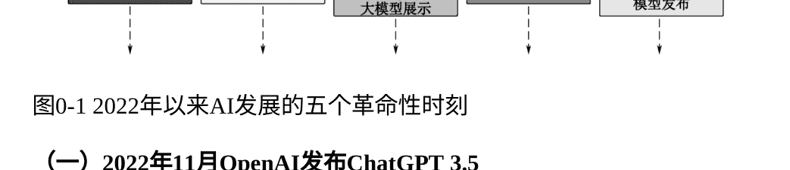

>

#### （一）2022 年 11 月 OpenAI 推出 ChatGPT 3.5

这次发布宣告了生成式 AI 的起步，表明一个模型能够并行承担聊天、撰写、逻辑推演、代码编写等多种工作，同时对自然语言的理解达到可通过图灵测试的程度，标志着从狭义智能向广义智能的转向，构成了一次范式层面的改变。

#### （二）2023 年 3 月 OpenAI 发布 GPT-4

系统开始具备图像理解能力。输入图片后不仅能识别文字、符号或物体，而是能整体把握画面元素间的关联与含义。随后多模态系统相继涌现，同一套底层架构可统一处理语音、图像、文本，大幅扩展应用边界。

**GPT-4 visual input example, Extreme Ironing:**

User  What is unusual about this image?


> > GPT-4   The unusual thing about this image is that a man is ironing clothes on an ironing

> > board attached to the roof of a moving taxi.

> > **（三）** 2024 年 2 月 OpenAI 公开演示 Sora 文生视频系统 (当时 Sora 尚未向公众开放，直至 2024 年 12 月才正式放开)

OpenAI 将 Sora 视作世界模拟器，视频生成要求系统对物理规律有深刻把握，比如昼夜更迭、步行阻力、物体挤压与碰撞等。这意味着 AI 从平面走向立体，对现实世界的模拟能力得到增强，硅基生命的设想也更进一步。

#### （四）2024 年 9 月 OpenAI 推出 o1 系列

这是首个学会深度思考的推理型系统。传统非推理系统对简单问题和复杂问题的响应时长几乎一致，而人类会根据难度调动不同算力。o1 在输出答案前会先生成“思维链”即逻辑推演过程，显著提升推理水平。在 Codeforces 竞赛中超过 89% 参赛者，在美国数学奥林匹克资格赛排名全国前 500，在物理、化学、生物基准测试中达到博士水平以上准确率。图 0-4 显示 o1 将 AI 准确率上限提升了整整一个数量级。

### 图 0-4 o1 系列在数学、代码和博士科学问题上的准确率与 GPT-4o 和人类专家的对比测试

注：“o1 测”代表 o1-preview 系统。

***

#### （五）深度求索发布 DeepSeek-R1 系统

第五个关键节点，是 2025 年 1 月中国深度求索发布的 DeepSeek-R1 推理系统。

### 二、DeepSeek 的突出特点

即便阅读本书时已有更新技术，回顾 AGI 史，DeepSeek-R1 仍是浓墨重彩的一笔。以下是我总结的几个核心特征。

#### （一）高性能、低成本

作为推理系统，DeepSeek-R1 在多项任务上的表现接近甚至超过 OpenAI 的 o1 系列。更关键的是研发与使用成本的显著下降，这在业界引发强烈震动。

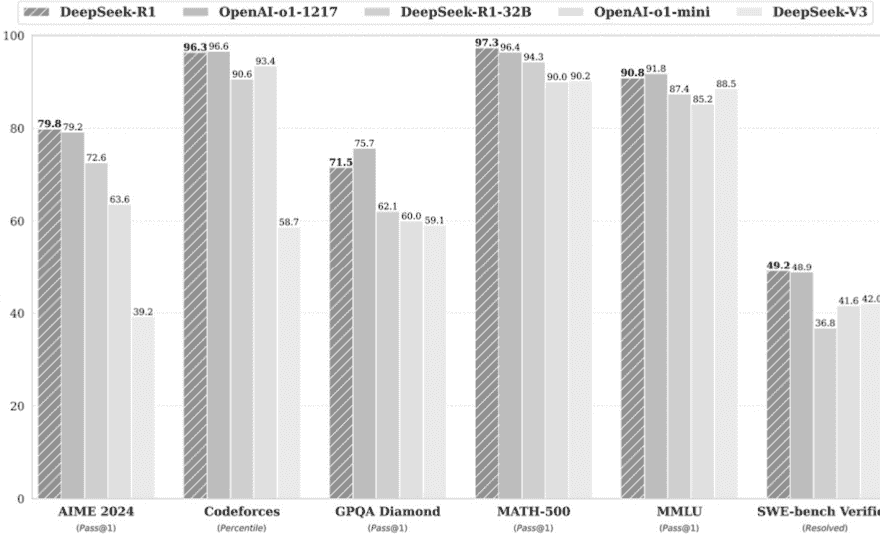

例如 2024 年底刚发布的 OpenAI o3 高配版本单次任务成本一度超过 1000 美元。而 DeepSeek-R1 通过创新的训练策略将训练费用控制在约 600 万美元左右，同时保持优秀性能。核心在于大量使用纯强化学习，类似“左右手互搏”，无需大量人工标注数据，系统可通过自我迭代发展推理能力。

以 AlphaGo Zero 来理解这一思路。2017 年 5 月乌镇峰会上，AlphaGo Zero 未接触人类棋谱，仅靠自我对弈的强化学习就以 3:0 击败世界第一柯洁。

### 图 0-6 AlphaGo Zero 经过 70 小时训练后即达到超人类水准

AlphaGo Zero 还独立发现了新的围棋策略。强化学习的优势在于节省人类数据并可能突破人类智力极限。若 AI 无法自我进化，就陷入“有多少人工，才有多少智能”的困境。此前业界主要依赖监督微调，数据成本高昂。DeepSeek-R1 在纯强化学习下出现了“顿悟现象”，即系统自行发现错误并生成更优解，从而大幅降低训练成本。

使用层面，DeepSeek-R1 官方 API 价格约为 OpenAI o1 的 5% 左右。成本差距使得“满血版” o1、o3 需要 200 美元/月的订阅，而 DeepSeek-R1 可免费面向全球开放。发布两周内，应用商店下载量在数十国登顶，多国超越 ChatGPT。低成本让普通人能将 AI 融入工作生活的方方面面，也对 OpenAI 的商业模式构成压力。

2025 年 2 月马斯克主导的 xAI 发布 Grok 3，使用约 20 万块 H100 GPU 训练，算力约为 DeepSeek-R1 的百倍以上，Arena 评分仅高出不到 2%，如图 0-7，进一步印证了 DeepSeek 的成本效率优势。

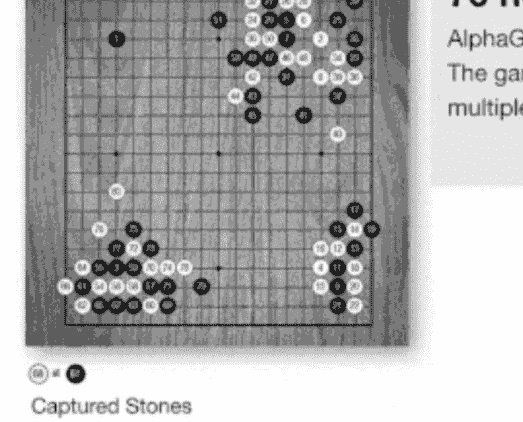

#### （二）开源

开源即公开系统参数与相关代码，任何人可在合规服务器、个人电脑甚至手机上自行部署，无需联网或付费，能更好保护隐私数据。

### 图 0-7 Grok 3 发布时的 Arena 评分页面

开源系统可结合企业专有知识库或个人笔记构建隐私安全的 AI 助手，也可通过微调或 RAG 技术注入垂直领域知识，打造医学、编程、客服等定制化系统。闭源系统只能在服务商平台使用，存在付费与数据安全风险。DeepSeek-R1 是首个兼具免费、开源、高效、低成本的强推理系统，削弱了闭源系统的垄断。

#### （三）超越人类推理能力的边界

大量纯强化学习使系统产生人类推理路径难以企及的思路，理论上推理上限更高。不少用户反馈，DeepSeek-R1 的思考过程比最终答案更具启发性，可反向训练人脑的思维能力。

#### （四）国产自主可控

DeepSeek 系列包括 V3 与 R1，是首个由非美国团队研发的旗舰级推理系统，缩小了中美差距，且实现自主可控。通过技术优化降低算力依赖，减少对英伟达高端 GPU 的依赖，使国内可使用上一代甚至更早芯片训练出顶尖产品，对国家安全意义重大。R1 发布后英伟达股价一度下跌 17% 约 6000 亿美元。

政府与企业正积极接入 DeepSeek 等系统，构建个性化应用。

#### （五）全民 AI 时代到来

如果说 ChatGPT 拉开了 AI 快速进化的序幕，DeepSeek 则让每个人真正触达 AI 的阳光。低成本与开源的双轮驱动，让 AI 如星辰般落入大众指尖。街头摊主可用其优化进货策略，肯尼亚教师可用其生成个性化教案，上海退休老人可用其撰写家族回忆录。AI 正成为流淌在生活毛细血管里的数字氧气，人类首次站在“智力平权”的历史节点。

发展至今，AI 并非万能，但掌握使用方法将显著提升学习、工作与生活的效率。翻开本书，开始使用 AI 吧！

> *[1] 生成式人工智能即"AIGC"，AIGC 可以按照人类的指令来生成全新的内容，如文本、图片、视频等。*

> *[2] 图灵测试（The Turing Test）起源于计算机科学和密码学的先驱艾伦·麦席森·图灵发表于 1950 年的一篇论文“计算机与智能”。该测试的流程是，一名测试者写下自己的问题，随后将问题以文字形式（屏幕和键盘）发送给另一个房间，这个房间中有一个人和一台机器。然后测试者会分别收到机器和人的回答。测试者仅根据回答来判断哪个是真人，哪个是机器。所有参与测试的人或机器都会被分开。这个测试旨在探究机器能否模拟出与人类相似或无法区分的智能。*

> *[3] 图片摘自 OpenAI 发布的 GPT-4 Technical Report（《GPT-4 技术报告》）。GPT-4 敏锐地捕捉到这张图片的特别之处：一个男子正在熨衣服，而熨衣板却连接在一辆行驶中的出租车车顶。*

> *[4] 思维链（Chain of Thought, CoT）。对于复杂的问题（如数学、编程、工程等问题），AI 大模型很难直接给出正确答案。思维链要求大模型在输出最终答案之前，必须先输出中间的推理步骤，以此来增强大模型的推理能力。这大幅提高了 AI 大模型处理复杂推理任务的能力，并且输出的中间步骤方便使用者了解大模型的思考过程，提高了大模型推理的可解释性。目前，思维链推理已经成为大模型处理复杂任务的一个常用手段。*

> *[5] 全称为杭州深度求索人工智能基础技术研究有限公司。DeepSeek 即深度求索的英文翻译。*

> *[6] 摘自 DeepSeek-R1：Incentivizing Reasoning Capability in LLMs via Reinforcement Learning（《DeepSeek-R1 官方技术报告》）。*

[7] 模型微调 Fine-tuning 的做法是在已经完成预训练的大模型之上，用特定行业或任务的专属数据再做一次训练，让模型在细分场景里的表现更精准。打个比方，就像一个通才在掌握了广博知识后，针对某个专业方向去进修深化。举例来说，一个通用语言模型本可以写很多类型的文章，经过微调后就能更擅长撰写医学论文，或更好地模仿某位作家的文风。微调不仅能提升目标任务的效果，还能大幅压缩训练开销和训练时长，是 AI 实践中不可或缺的技术手段。

[8] RAG 技术即检索增强生成，其原理与落地方式会在本书后续章节详细展开，这里不再赘述。

# 学习资源

## 读者交流群
我会在读者群里持续分享最新的 AI 资料与工具，并不定期开直播答疑讲解前沿技术。群内还能领取本书全部提示词的电子版，方便直接复制使用。扫码入群或微信搜索“C 哥聊科技”公众号发送“DS 群”即可加入。

## 配套实战课程
想把 AI 真正用起来，可以选购本书配套课程。课程覆盖面远不止 DeepSeek，而是 AI 全流程实战：高级提问技巧、各路实用 AI 工具、AI 文生图、AI 视频、PPT 与图表制作，以及在工作、学习、教育等场景的具体落地。随着技术演进课程会持续更新，你还能和已加入的千余名学员一起交流切磋。扫码或微信搜索“C 哥聊科技”公众号发送“DS 课程”即可购买。

## AI 成长圈
这是一个面向 AI 时代个体成长的付费社群，聚集了一批学习 AI、实践 AI 的新个体与创业者。通过系统课程、资料包和陪伴式成长，帮助你率先成为 AI 时代的超级个体。扫码或微信搜索“C 哥聊科技”公众号发送“成长圈”即可加入（成长圈已包含配套课程，无需重复购买）。

# 模块一 初识 DeepSeek

## AI 总览
在聊 DeepSeek 之前，先把 AI 本身理清楚。AI 已成为全球最热门的关键词，很多人都在用，但 AI 到底是什么、从哪来、能干什么？本书开头用最精炼的篇幅帮你梳理脉络，也让你对市面上琳琅满目的 AI 产品有更清晰的认知。

可以用一个简单比喻来理解人工智能：AI 就像一位超强的学习者，用我们给它的“教材”也就是数据，学习世界运行的规律并帮助解决问题。

> “过去的计算机软件和手机 App 都需要我们把每一步操作写死，只能执行预设功能；而 AI 能从海量数据中自行学习规律，并把学到的能力迁移到从未见过的新问题上”

图 1-1 传统程序和人工智能的区别

如今的 AI 不仅能读懂文字、听懂语音，还能“看图说话”，并按指令创造新内容。AI 早已从科幻走向生活。下面从几个维度介绍 AI 的核心概念与它正在带来的改变。

### AI 的本质
AI 的核心是让机器具备某种智能。传统程序靠人类写好的规则运行，比如“温度高于 30 摄氏度就启动空调”。AI 的规则不是硬编码的，而是靠数据训练出来的。给它足够多的例子，它会自行归纳规律，甚至做出超出预期的推断。

比如教机器识别猫。过去需要人工列出耳朵尖、尾巴长等特征。现在只需喂给大量猫的图片并标注“这是猫”，它就能自己学会“猫”的特征。这种灵活性让 AI 更强大，也更通用。人们开始设想，把全世界的数据都输入 AI，它就能掌握普遍规律并解决各类问题。

要理解 AI 的飞速进步，必须认识 **AI 大模型**。可以把大模型看作存储知识与规律的“容器”，与过去的专用工具不同，它是通用且规模巨大的模型。容器里装着大量“参数”。参数本身无意义，训练时输入海量数据，参数会逐步调整，把数据中的知识与规律内化。

**参数**是什么？用初中数学举例，直线 y=ax+b，只要确定 a 和 b，就把握了整条直线的规律，也就成了这条直线的“主宰者”。无论 x 取何值，都能算出 y。a 和 b 就是两个参数。若已知直线上任意两点 P、Q，就能用这两个点“训练”模型求出 a、b，相当于完成了对直线规律的学习。

图 1-2 y=ax+b 的图像

AI 大模型的参数原理类似，只是模拟内容更复杂，需要数十亿、数百亿甚至上千亿个参数，且采用非线性方式建模。

### 大模型：AI 的大脑
图 1-2 y=ax+b 的图像

如果 AI 是学生，AI 大模型就是掌握百科全书的超级学霸。它能在数学、文学、音乐、编程等多领域游刃有余。例如 DeepSeek-R1、OpenAI GPT 系列都是典型的 AI 大模型。

训练大模型需要三要素：海量数据、强大算力、合适算法。数据是教材，算力是大脑的能量，算法决定学习效率。三者合称 AI 的“三要素”。

### 多模态模型：跨界处理
AI 的首次突破在语言文字，这类模型叫大语言模型 LLM。ChatGPT-3.5 就是大众熟知的早期 LLM，能流畅对话并解决各类问题。后来专家发现同类算法可迁移到非文字模态，如图像、视频、语音、音乐。今天多数大模型都支持多种输入，称为多模态模型，即能同时处理文字、图片、视频、声音等不同类型数据。

比如上传一张照片问“这是什么地方”，AI 需要结合图像与文字提问才能作答，这就是多模态能力的体现。

多模态让 AI 进入“懂你”的阶段，不仅能融合信息，还能基于信息创造新内容。能根据文字生成图像，或根据图像生成描述性文字，极大拓宽了应用空间。

OpenAI 的 GPT-4o、Kimi K1.5、通义开源模型 Qwen-VL 系列都是多模态代表。

截至本书完稿，深度求索虽有 DeepSeek-VL2 等多模态模型，但性能最强的 DeepSeek-V3 和 R1 仍为纯文本模型，只能输入输出文字。相信不久后会推出更强开源多模态新品，因为技术路径与大语言模型相近，瓶颈不大。目前官方应用及多数第三方应用会在 DeepSeek 模型外加一层转换，把用户上传的图片、文件先转成文字再送入模型处理。后续章节会教你如何借助大语言模型间接生成各类图表。

### 文生图与文生视频：创作能力
AI 的创作天赋最直观体现在“文生图”和“文生视频”。它们是多模态能力的具体落地，正重塑内容创作。

文生图即用文字描述生成图像。比如描述“夕阳草原上奔跑的少年”，AI 就能生成对应的画面。技术已广泛用于艺术创作、电商、广告、建筑规划、游戏开发等。代表服务有 Midjourney、Flux 以及国内的即梦等。

图 26 文生视频则更进一步，可把文字变成动态影像。例如输入“机器人在未来城市漫步”，AI 能生成逼真的短视频。技术仍在演进，但在影视制作、虚拟现实、教育等领域潜力巨大。

### 推理模型与思维链
近一年，AI 从“会回答”进化到“会推理”。过去像一本知识百科，现在更像一位能深度思考的逻辑学家，也让复杂问题的求解更得心应手。

出现推理大模型之前，所有大模型都属于非推理型。它们擅长基于直觉的记忆匹配。比如问“巴黎是哪个国家首都”，模型直接从参数中检索出“法国”。但很多问题需要逻辑推导，例如“今天周一，10 天后是周几”。这需要加法与取余计算，得出“周四”。非推理模型也能解不少理工科题，且速度快，对见过的题型效果尚可。

但面对全新、极复杂或反常识问题，非推理模型的正确率会受限。更关键的是，回答“你好吗？”和“如何计算宇宙飞船太阳能板面积？”的速度几乎一致，这显然不合理。为让模型在复杂问题上能“拿出草稿纸”，研究者推出了 **推理大模型 Reasoning Large Model**。

推理大模型通过训练学会把问题拆解成步骤、逐步分析再得出结论，更接近人类逻辑链。结合心理学“双系统理论”，系统1是快速直觉，系统2是慢速逻辑推理。AI 的发展正模拟这两种思维。

小时候做数学题老师要求写步骤而非只写答案。AI 领域引入的关键概念就是 **思维链 Chain of Thought, CoT**，即从问题到答案的推导过程。呈现推理步骤后，准确率与可解释性都提升。

例如问“果篮有 10 个苹果，拿走 3 个又放回 2 个，现在几个？”非推理模型可能直接答“9 个”。推理模型会展示链条：
篮子里最开始有 10 个苹果。
拿走 3 个后剩下 10-3=7 个。
再放回 2 个，7+2=9 个。

图 1-4 通过思维链解决问题示意图

好处有两点：提高准确性，减少跳步出错；增强可解释性，用户能看懂思路。DeepSeek-R1 还出现了顿悟时刻 Aha Moment，能在求解中自我发现问题并切换策略。

思维链虽强，但面对极端复杂或跨领域推理仍会出错。未来“推理大模型+思维链”有望继续提升。

2025 年 2 月底，Claude 3.7 Sonnet 发布，出现了混合推理模型或自动路由模型。据称 GPT-5 系列也将采用该模式。同一模型同时支持思维链输出的推理模式和普通输出的非推理模式，系统会根据需求自动选择，减少人工切换负担。

### AI 智能体 Agent
如果 AI 大模型是“大脑”，AI 智能体就是“躯干”。

大模型本身无法执行操作，也不能调用外部工具，只能输出文字、图像。智能体则把 AI 与外部数据、操作接口结合起来。例如让 DeepSeek 分析明天是否适合去北京旅游，有智能体后它能调用天气预报工具查询北京天气。

进一步可做到点外卖、操作 PPT、甚至开发游戏。OpenAI、Anthropic 等已推出可操作计算机的 AI 功能。2025 年 3 月，通用 AI 智能体项目 Manus 上线，能按指令自主规划任务、在云端调用多款软件并直接交付成果，如数据分析、名片制作、游戏开发等，引发关注。

要记住，智能体只能做工作流规划，具体每一步仍靠底层大模型执行。它是人机协作的加速器，提升的是使用效率，而非直接提升智能。随着大模型进步，智能体的能力也会增强。

图 1-5 AI 智能体简化版工作流程图

真实工作更复杂，涉及长期记忆、多次调用、甚至多模型协作。

### DeepSeek 模型谱系
作为中国 AI 领域的代表，深度求索发展迅速，推出了一系列模型。其创新体现在理念与技术细节上，形成了从轻量到超大型的全场景体系，DeepSeek-V3 与 DeepSeek-R1 系列成为标志性成果，体现了架构、工程与产业落地的综合实力。

#### 起步阶段的模型
**DeepSeek-Coder**（2023 年 11 月）：深度求索首个大语言模型，专注代码生成与补全，支持多种编程语言，显著提升开发者效率，性能超越当时多数主流代码模型如 CodeLlama，接近 GPT-4-Turbo 的开源代码水平。2023 年 6 月推出继任模型 DeepSeek-Coder-V2。

**DeepSeek LLM**（2024 年 1 月）：参数规模 670 亿，在多项指标上超越海外开源模型 Llama 70B，中文理解能力超过 GPT-3.5。2024 年 5 月开源第二代模型 DeepSeek-V2。

**DeepSeek-Math**（2024 年 2 月）：专攻数学任务，在复杂数学问题上与 OpenAI GPT-4、谷歌 Gemini 处于同一水平。

#### 视觉语言系列
网上常说 DeepSeek 没有多模态，不准确。截至完稿，R1 与 V3 不支持多模态，但公司已推出视觉语言模型 VL 系列。

**DeepSeek-VL**（2024 年 3 月）：开源多模态大模型，在数据构建与模型结构上有不少亮点。

**DeepSeek-VL2**（2024 年 12 月）：采用混合专家 Mixture-of-Experts、MoE 架构，性能大幅提升。通过激活特定专家网络降低计算成本并提升吞吐量，在视觉问答、光学字符识别、文档/表格/图表理解及视觉定位等任务上表现优异。

#### 现阶段主力
AI 迭代极快，现阶段先进模型很快会被超越。完稿时 DeepSeek 的主力是 **V3** 与 **R1** 系列，它们代表了公司在语言模型领域的高度，并以显著的成本效益和性能树立了新标杆。

**DeepSeek-V3**（2024 年 12 月）：完稿时 DeepSeek 最强的非推理模型，总参数达 6710 亿，采用 MoE 架构与 FP8 混合精度训练，显著降低训练成本。MoE 通过把复杂任务分配给多个专家处理，提升效率与性能。V3 在面对特定任务时仅激活 370 亿参数，就能实现优异效果，大幅节省算力。

DeepSeek 双线突破：V3 夯实通用能力，R1 冲刺推理极限

借助多头隐式注意机制与多标记联合预测的设计思路，DeepSeek-V3 在知识型任务和生成效率上树立了新的参考点。图 1-6 来自深度求索官方技术报告的横向对比，显示 V3 在多数评测维度上具备领先表现，整体水准与同期最强的非推理范式模型 GPT-4o、Claude 3.5 Sonnet 处在同一梯队。

| Benchmark (Metric) | DeepSeek-V3 | Qwen2.5-72B-Inst. | Llama3.1-405B-Inst. | Claude-3.5-Sonnet-1022 | GPT-4o-0513 |
|---|---|---|---|---|---|
| **Architecture** | MoE | Dense | Dense | - | - |
| **# Activated Params** | 37B | 72B | 405B | - | - |
| **# Total Params** | 671B | 72B | 405B | - | - |
| **English** | | | | | |
| **MLLU (EM)** | 88.5 | 85.3 | 88.6 | 88.3 | 87.2 |
| **MLLU-Redux (EM)** | 89.1 | 85.6 | 86.2 | 88.9 | 88 |
| **MLLU-Pro (EM)** | 75.9 | 71.6 | 73.3 | 78 | 72.6 |
| **DROP (3-shot F1)** | 91.6 | 76.7 | 88.7 | 88.3 | 83.7 |
| **IF-Eval (Prompt Strict)** | 86.1 | 84.1 | 86 | 86.5 | 84.3 |
| **GPQA-Diamond (Pass@1)** | 59.1 | 49 | 51.1 | 65 | 49.9 |
| **SimpleQA (Correct)** | 24.9 | 9.1 | 17.1 | 28.4 | 38.2 |
| **FRAMES (Acc.)** | 73.3 | 69.8 | 70 | 72.5 | 80.5 |
| **LongBench v2 (Acc.)** | 48.7 | 39.4 | 36.1 | 41 | 48.1 |
| **Code** | | | | | |
| **HumanEval-Mul (Pass@1)** | 82.6 | 77.3 | 77.2 | 81.7 | 80.5 |
| **LiveCodeBench (Pass@1-COT)** | 40.5 | 31.1 | 28.4 | 36.3 | 33.4 |
| **LiveCodeBench (Pass@1)** | 37.6 | 28.7 | 30.1 | 32.8 | 34.2 |
| **Codeforces (Percentile)** | 51.6 | 24.8 | 25.3 | 20.3 | 23.6 |
| **SWE Verified (Resolved)** | 42 | 23.8 | 24.5 | 50.8 | 38.8 |
| **Aider-Edit (Acc.)** | 79.7 | 65.4 | 63.9 | 84.2 | 72.9 |
| **Aider-Polyglot (Acc.)** | 49.6 | 7.6 | 5.8 | 45.3 | 16 |
| **Math** | | | | | |
| **AIME 2024 (Pass@1)** | 39.2 | 23.3 | 23.3 | 16 | 9.3 |
| **MATH-500 (EM)** | 90.2 | 80 | 73.8 | 78.3 | 74.6 |
| **CNMO 2024 (Pass@1)** | 43.2 | 15.9 | 6.8 | 13.1 | 10.8 |
| **Chinese** | | | | | |
| **CLUEWSC (EM)** | 90.9 | 91.4 | 84.7 | 85.4 | 87.9 |
| **C-Eval (EM)** | 86.5 | 86.1 | 61.5 | 76.7 | 76 |
| **C-SimpleQA (Correct)** | 64.1 | 48.4 | 50.4 | 51.3 | 59.3 |

2025 年 1 月问世的 DeepSeek-R1 在继承 V3 基础之上，通过强化学习显著增强了思考能力，即便在算力受限环境下也能呈现可观的推理表现。R1 在多步推演类任务上超越众多业界主流模型，水平接近 OpenAI o1。研发路径分两步：先以 V3 为底座开展零监督强化学习得到 R1-Zero，直接激活链式思维；随后引入少量冷启动数据并融合 V3 与 R1-Zero 的产出，训练出正式版本，其评测结果示于图 1-7。R1 在数学、编程、复杂问题求解、知识问答与教学辅导等重思考场景明显优于 V3，但并非全盘占优，在无需深度推演的用法上会逊于 V3，且虚构倾向更突出。

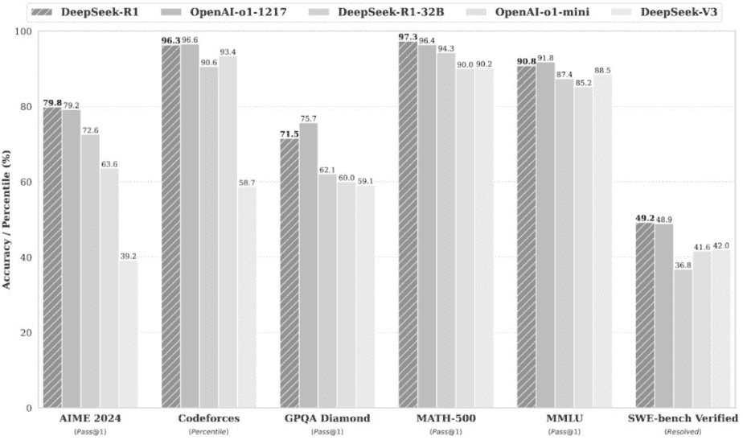

#### V3 与 R1 模型对比

同属 DeepSeek 产品线，两者在实际使用感受上差异明显，后续章节会逐项展开。

| 对比项 | V3 | R1 |
|---|---|---|
| 模型分类 | 非推理大模型 | 推理大模型 |
| 推理能力 | 中等 | 很强 |
| 文本生成能力 | 很强，支持各类文风的生成 | 中等，有时会过于理性或过于强调分点论述；不太擅长输出长篇段落；输出文字的跳跃性较强 |
| 响应速度 | 快 | 很慢 |
| 简单任务性能 | 强 | 弱（容易过度思考） |
| 思考过程 | 无 | 有（思维链） |
| 幻觉问题 | 轻微 | 严重 |

## 核心技术

**混合专家 MoE 架构：** DeepSeek 系列实现降本增效的枢纽，可视作由多位专家组成的协作团队，门控网络依据输入动态分发到最匹配的专家组合进行处理，如图 1-8。

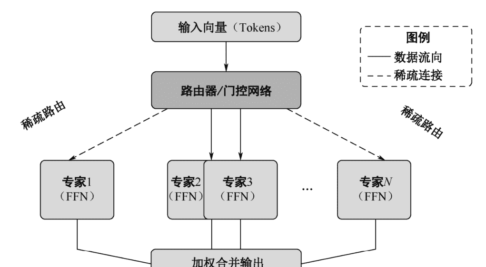
**强化学习：** 强化学习让模型在环境反馈的奖励与惩罚信号中学习最大化长期收益的策略。R1 正是通过规则化奖励的强化学习，在复杂推理中做出更合理的决策，提升逻辑连贯性。

**知识蒸馏：** 大模型向小模型的师徒传递。挑选参数较小的开源模型作学生，由 DeepSeek-R1 担任老师提供高质量输出示例供其模仿。完成后得到 DeepSeek-R1-Distill 系列，体量精简却保留接近大模型的能力，可在普通电脑、手机或边缘设备上运行。流程示意参见图 1-9。

### 知识蒸馏：大模型教小模型变聪明

| 阶段 | DeepSeek 模型蒸馏过程通俗解释 | 知识蒸馏学习过程 |
|---|---|---|
| **角色** | | |
| 大模型老师（DeepSeek-R1） | 671B 参数<br>知识丰富<br>算力需求高 | 提供知识 |
| 公开小模型（第三方开源） | 参数少<br>能力有限 | 蒸馏学习 |
| **结果** | | 1. 提供知识<br>2. 蒸馏学习<br>3. 得到小而强的模型 |
| **部署环境** | 普通计算机可运行<br>手机可运行<br>边缘设备可运行 | 知识蒸馏：大模型教小模型变聪明 |
| | DeepSeek 模型蒸馏过程通俗解释<br>知识蒸馏学习过程 | |
| **图示** | | 图 1-9 知识蒸馏过程示意图 |
| **相关模型** | | DeepSeek 蒸馏模型 |

DeepSeek 蒸馏模型

官方以 R1 的推理输出对 6 款小模型进行蒸馏，均基于开源基座。表 1-2 为代表性型号。

表 1-2 DeepSeek 官方使用 R1 模型蒸馏的几款小模型

| 名称 | 基座模型 | 备注 |
|---|:---|:---:|
| DeepSeek-R1-Distill-Qwen-1.5B | Qwen 2.5-Math-1.5B | 在一些评测中编程能力超越 GPT-4o |
| DeepSeek-R1-Distill-Qwen-7B | Qwen2.5-Math-7B | |
| DeepSeek-R1-Distill-Llama-8B | Llama 3.1-8B | 大多数家庭用户能部署的较大规模模型 |
| DeepSeek-R1-Distill-Qwen-14B | Qwen2.5-14B | |
| DeepSeek-R1-Distill-Qwen-32B | Qwen2.5-32B | |
| DeepSeek-R1-Distill-Llama-70B | Llama-3.3-70B-Instruct | 模型能力更加强大，更贴近“满血版”模型 |

1. Qwen 为通义系列开源 AI 大模型，Qwen 2.5 即其 2.5 版本，分为多个不同参数量的子版本。
2. Llama 是美国 Meta 公司推出的开源 AI 大模型系列。Llama-3.1 即其 3.1 版本，分为多个不同参数量的子版本。

蒸馏版相较原版性能有所回落，但换来在低配 GPU 与消费级电脑上的本地部署可行性。

### DeepSeek 的局限性

**生成幻觉：** 所有大模型的通病，DeepSeek 也未能彻底解决。模型会产出看似合理实则错误的答案。示例对话基于 DeepSeek-R1。

输入：
写一段话，论述 DeepSeek-R1 为何比 OpenAI 的 o1 模型强大。要求有理、有据、有数据。

输出：
DeepSeek-R1 相比 ChatGPT o1 模型的技术优势可通过以下数据佐证。DeepSeek-R1 激活参数量达 2.4 万亿（稀疏激活模式），相较 ChatGPT o1 的 1.8 万亿密集参数，在语言理解任务（MMLU 基准）取得 87.3% 准确率，高于后者的 83.1%。在多轮对话场景（Multi-Session Dialogue Benchmark）中保持 93% 的上下文连贯性，较 ChatGPT o1 提升 11%。基于参数稀疏化技术，DeepSeek-R1 单次推理能耗降低 42%，在阿里云平台实测每百万次调用成本为 18.7，较 o1 的 29.5 更具商业可行性。这种能效优势源于动态计算资源分配算法，使高负载场景硬件利用率达 92%。

文段看似严谨，实为胡说八道。OpenAI 并未公开 o1 的技术细节与参数，1.8 万亿密集参数更像是坊间对 GPT-4 的传闻，o1 在 MMLU 的准确率实为 92.3% 而非 83.1%。类似错误比比皆是，直接用于正式写作会带来严重风险。根源在于训练语料覆盖不足以及生成机制本质是概率完形。实测中 R1 的幻觉概率高于 V3、GPT-4.5、Claude 3.7 等同期模型，使用时需配合提示词约束、RAG 知识库或联网检索来降低风险。

**缺乏多模态推理：** R1 与 V3 目前聚焦纯文本，无法直接解析图像、音频、视频。DeepSeek 另有 VL 视觉系列，但不属于推理大模型。例如教学场景中，手写公式草稿与文字说明需先经 OCR 转换，信息链断层影响效率。

**高延迟：** 复杂逻辑链下思考时间常达数分钟，不适合在线客服、同传等实时交互。

**知识滞后：** 截至本书完稿，V3 与 R1 的知识截止为 2024 年 7 月。其后新闻、技术和概念无法知晓，训练成本导致更新难以季度化，在快变领域影响决策支持。

**文风限制：** R1 因训练方式呈现较强的理性、分点风格，长篇连贯叙述能力弱。V3 在文风可控性和自由度上更灵活。

## DeepSeek 在海外的评价

R1 发布后迅速登顶 iPhone 美国及多地 App Store 免费榜，成为 ChatGPT 之后又一现象级产品，引发硅谷和学界的广泛讨论。

### 技术突破

海外普遍认为其在推理效率、成本控制上实现突破。a16z 创始人马克·安德森称其为“世界礼物”，开源将推动 AI 普惠。英伟达科学家吉姆·范评价其为“非美国公司践行 OpenAI 初心”的典范。

### 开源模式

与 OpenAI、谷歌的闭源路线不同，R1 的开源使其成为全球研究者的公共资源。马克斯·普朗克光科学研究所的马里奥·克伦称其开源“相当了不起”。Meta 首席 AI 科学家杨立昆指出，DeepSeek 的启示是保持开源的重要性，是开源模型战胜专有模型，而非中国超越美国。业界普遍认为这将加速 AI 民主化。

### 地缘政治

特朗普称其为美国 AI 行业的“警钟”，媒体引用“人工智能的斯普特尼克时刻”。美国对中国半导体限制并未阻挡其崛起，反而催生算法优化与硬件创新。卡内基国际和平研究院的马特·希恩提醒，若只把目标定为击败 DeepSeek，会低估中国在 AI 创新上的整体上升势头。

### 海外用户真实使用口碑

除学界与产业界的评价外，DeepSeek 在普通海外用户中的实测口碑同样亮眼。翻译场景是被提及最多的优势。来自塞尔维亚、西班牙、土耳其的反馈称，DeepSeek 翻译准确度高、响应更快，对文化语境的适配也更细致。旁遮普语用户则指出，相较 ChatGPT 与 Gemini，DeepSeek 的译文流畅度有明显提升。

商业落地方面，成本效益突出。有初创公司 CEO 公开表示，切换到 DeepSeek 后，其翻译开销仅为 Google Translate 的二百分之一左右。动漫字幕翻译与各类复杂文本的处理同样获赞，众多用户用“惊人精准”来形容结果。

总体来看，海外舆论对 DeepSeek 的技术突破、开源策略以及落地效果给予积极评价，同时也引发了围绕 AI 未来走向与地缘政治影响的讨论。DeepSeek 的走红印证了中国在生成式 AI 领域的实力，也为全球 AI 普惠与民主化提供了新样本。

DeepSeek 的出现也在提醒业界，技术封锁与限制难以阻挡创新潮流。只有协作与共享，才能让 AI 持续健康发展，造福公众。

> [9] OCR（Optical Character Recognition，光学字符识别）是指使用算法识别出图片中的印刷或手写文字的技术和过程。这种方法通常只能提取图片中的文字，但不能保留几何图形、表格、字体等信息。

# 模块二

## 和 DeepSeek 对话

DeepSeek 的多数模型采取开源免费策略，使用门路因此比较多元。本模块先说明经由官方网页、手机 App 以及小程序接入 DeepSeek 的方法与基础操作技巧，后续章节会介绍更多进阶的接入方式。

### 通过官方网页与 App 使用 DeepSeek

最直接、最省心的入口就是官方网页和手机 App。两者的使用逻辑相近，下面合并介绍。

随着产品迭代，网页与 App 的界面细节可能变动，但核心操作方式变化不大。

打开 DeepSeek 官网即可进入首页，页面示意如图2-1。

DeepSeek-R1 已发布并开源，性能对标 OpenAI o1 正式版，在网页端、APP 和 API 全面上线，点击查看详情。

### deepseek

### 探索未至之境

#### 开始对话

*   免费与 DeepSeek-V3 对话

*   使用全新旗舰模型

#### 获取手机 App

*   DeepSeek 官方推出的免费 AI 助手

*   搜索写作阅读解题翻译工具

图2-1 DeepSeek官方网站页面

点选“开始对话”后进入对话页，首次使用需完成注册或登录，如图2-2 所示。

> 图2-2 DeepSeek登录和注册页面

登录后即可开始交流，对话界面如图2-3。

图2-3 DeepSeek对话界面

网页版兼容电脑与移动浏览器，手机端无需安装 App 也可在浏览器或微信中打开。电脑端左侧栏会保留历史对话记录，可快速切换，如图2-4。

图2-4 计算机版DeepSeek左侧边栏页面

手机端可通过 App Store 搜索 DeepSeek 下载官方客户端，下载页如图2-5；安卓用户也能在各大应用商店找到。注意甄别山寨应用，官方应用由杭州深度求索人工智能基础技术研究有限公司发布。

App 的整体布局与网页版相近，如图2-6。

左上角可查看历史对话，右上角新建对话，底部输入区可发送消息，右下角的上传按钮支持文档与图片导入。

这里的“对话”指具备上下文记忆的连续问答序列，同一会话内模型会保留先前的交流，切换会话则清空上下文。

目前官方渠道默认调用最新上线的 DeepSeek 系列模型，如 V3 与 R1，具体取决于是否开启深度思考。

微信小程序同样可用，微信内搜索 DeepSeek 即可进入使用。

### < 搜索 DeepSeek - AI 智能助手

AI 智能对话助手，搜索写作阅读解题翻译工具

*   打开

*   **3.4万个评分** ★★★★☆

*   年龄 12+ 岁排行榜 #1效率开发者

*   杭州深度求索

*   **新功能 >**

*   版本1.0.11

    *   -修复部分已知问题

*   **预览**

    *   deepseek全能AI对话助手

    *   由强大的 DeepSeek-V3驱动

> 图2-5 DeepSeek App下载页面

### # 新对话

图2-6 App界面

**嗨！我是 DeepSeek**

我可以帮你搜索、答疑、写作，请把你的任务交给我吧~

*   给 DeepSeek 发送消息

*   +​​ 深度思考 (R1)

*   +​​ 联网搜索

使用官方 App 或网页的优点在于：

*   **来源可靠，安全可控**：由官方团队开发维护，数据处理相对透明，使用更安心。
*   **功能及时，体验领先**：新功能与优化优先推送，能第一时间体验前沿能力。
*   **上手简便，操作直观**：界面设计简洁，流程清晰，新手也能快速上手。

对应的限制也很明显：

*   **参数不可自定义**：目前不支持调节温度等高级参数，对生成风格的精细掌控有限。
*   **不支持私有知识库**：无法接入个人或企业专属数据，模型仅基于公开信息作答，难以实现定制化应用。
*   **隐私顾虑**：所有对话会上传至服务器，涉及保密资料时需谨慎。
*   **不利于自动化集成**：网页与 App 无法以程序化方式调用，难以嵌入其他系统。
*   **高峰期不稳定**：新版本上线或热度高时易出现“服务繁忙”或卡顿，可考虑非官方渠道分流。

总体而言，官方入口提供了便捷、稳定、安全的日常使用体验，适合大多数普通场景。若对稳定性、参数调优、私有知识库、程序化调用或垂直领域应用有需求，官方渠道尚有局限，后续章节会提供可行的替代方案。本节聚焦于官方 App 与网页版。

### ## 灵活使用深度思考功能

DeepSeek 提供深度思考开关，帮助用户在复杂任务中获得更扎实的推理。

在网页或 App 的输入区可找到“深度思考”开关，如图2-7。关闭时模型使用默认非推理版，书写时为本书成稿时的 V3，更适合快速、直接的问题。开启后则切换至推理模型，书写时为 R1，输出时会展示思维链，模拟逐步分析的过程，答案通常更全面深入。

使用时需先判断问题难度。诸如“诗经大约成书于何时？”、“青菜的维生素 E 含量多少？”这类简单事实查询，用非推理模式即可。面对多变量、需综合判断的任务，例如“如何评估一家公司的投资价值？”或“请写一段符合物理规律的小球滚动动画代码”，开启深度思考会更合适。

另外，提问表述也需随模式调整。同一任务在开启深度思考后，措辞可能需要更清晰，才能获得理想结果，具体技巧可参考模块三。

深度思考的应用场景很广：学术研究可用于梳理理论、补充背景；商业决策可用于策略对比与逻辑推演；教学可用于难题拆解；生活也可用于长途旅行规划或工作压力应对等。

### - 使用联网搜索解决知识截止问题

AI 模型的知识都有截止时间，时效性是重要痛点。DeepSeek 的网页与 App 均提供联网搜索开关，借助实时网络检索可弥补这一局限。

开关位于输入区，如图2-8。开启后模型会实时检索网络信息，结合训练语料作答。检索范围涵盖新闻、学术库、社交媒体等，信息会以参考形式融入回答。

使用时应先明确时效需求。对历史、理论或相对静态的问题，如“二战爆发原因是什么？”、“牛顿三大定律内容”，无需联网即可准确作答。对强时效问题，如“2025年3月 AI 领域有哪些重要进展？”、“某日股市走势如何？”则建议开启。

提问也应具体明确。宽泛提问会降低检索质量，改为“近期人工智能领域有哪些关键突破？”比“最近新闻有哪些？”更有效。可以把提问想象成在搜索引擎输入关键词，越精准越容易命中。

若想强制检索最新资料，可在问题中加入时间限定或明确要求，例如把“DeepSeek 是什么？”改为“根据网络上最新的 DeepSeek 用法资料，概括 DeepSeek 是什么”。不加提示时，即使开关打开，模型也可能直接从内部知识作答。

联网搜索在获取实时新闻、学术前沿、市场动态时很有价值。但检索结果来源不可控，网络上存在大量个人撰写或虚假信息。若信息权威且近一两年变化不大，不建议常开联网搜索，否则可能引入噪音甚至误导。

### 上传文档与图片辅助分析

当问题涉及长文本或图像时，上传功能可大幅提升处理效率。

网页与 App 的输入区均提供上传按钮，如图2-9。支持 PDF、Word、JPEG、PNG 等常见格式，成稿时单次最多上传 50 个文件，每个不超过 100MB。

上传后系统会提取文字，图片则通过 OCR 识别文字并交给大模型分析，再结合用户问题给出结论。

需注意，截至成稿时 V3 与 R1 系列暂不支持多模态，表格与图片中的版式、图形、人物、特殊符号等非纯文本信息会被丢弃，仅保留文字内容。

文件清晰度与结构会影响解析质量，高分辨率图片与排版规范的文档更易得到准确结果。

该功能可用于批量阅读、关键信息抽取、市场报告与财报分析，也可用于日常场景，如药品说明书要点识别、体检报告解读、作业检查或单词辨认等。

# 模块三

### 高效提问，解锁 DeepSeek 潜能

##### 提问质量决定回答质量

在神话里，“芝麻开门”能打开宝藏。在 AI 时代，提示词就是用户的开门咒。提示词既是启动模型思考的开关，也是校准输出方向的指南。

掌握提示词技巧，等于学会与模型同频，能显著激发其能力。

例如，很多人会直接问“帮我写一个工作总结”。这属于模糊指令，相当于对老友说“老地方见”，容易产生理解偏差。

优质提示词不是简单复述需求，而是为模型推理搭建清晰的路径。当答案不满意时，先审视提问方式。

本书因篇幅限制，主要列出适合 DeepSeek 的常用提问技巧。想系统学习提示词，可参考作者的其他专著。

#### 提供充足信息，避免信息差

与大模型对话，信息越充分，输出质量越高。详细具体的指令能帮助模型准确把握意图。

以智能手环广告文案为例，常见提问是“帮我写一个用于手环的广告文案”。这样能得到结果，但通常空洞且堆砌功能。经深度思考模式测试，模型会自行“编造”参数与卖点，缺乏针对性，整体像模板。

更好的做法是提供产品参数、核心卖点、目标人群、品牌调性等背景信息，减少模型的猜测空间，从而获得更具针对性的文案。

2026春節首發｜為都市白領而生的輕奢腕環

開年第一件好物，給自己一點格調。2026春節推出的新款健身手環，為25至40歲都市白領打造，兼顧健康追蹤與時尚設計。
1.5英寸OLED顯示屏視野舒適，選用莫蘭迪與賽博霓虹雙色方案，低調內斂或未來感隨心切換。
內置AI運動教練，據實時數據給出個性建議；獨家晨曦喚醒模式，用漸進光感與柔和震動取代傳統鬧鐘，讓清晨更從容。
隨機附贈米蘭編織表帶與商務皮革表帶，一條通勤，一條運動，全天候不換錶。
新年新節奏，腕間見品味。

DeepSeek-R1在逻辑推演和系统化设计层面表现突出，可一旦落到具体代码实现，Claude 3.7 Sonnet的准确度明显更高。实操中可以让R1先给出思路，再把原始问题和这条思维链一起交给Claude 3.7 Sonnet，代码就能在R1搭好的架构蓝图下被写出来，规避单模型产出代码质量参差的问题。书稿定稿时，字节推出的Trae已能免费调用Claude 3.7 Sonnet模型。不少实测显示，这样的串联使用，生成代码的质量能超过任一模型单独使用。

##### 强化逻辑撰写：R1 + V3 协作
当要写一篇逻辑严谨的文章时，可以先让DeepSeek-R1起草并拿到它内部的严密推理链。随后把原提示词和这条思维链一并交给DeepSeek-V3。V3会在保留R1逻辑骨架的前提下加入情感共鸣和表达上的生动性，让文本既有深度又有温度，更容易打动读者。

##### 多模态推理：R1 联合 Kimi / Gemma
比如手头有一张复杂的数据可视化图，但R1不支持看图。可以先问R1：“我手上有×××趋势图，图里包含[数据说明]。分析这张图应抓住哪些要点？异常值和趋势拐点怎么识别？请给出完整的分析步骤。”先拿到一个系统的分析框架。

再把原图和这条思维链一起喂给支持多模态的Kimi K1.5或开源多模态模型Gemma 3，就能得到具体解读。这样借助R1的高质量框架，Kimi或Gemma的解读会更条理、更深入，也弥补了它们本身推理能力的不足。书中模块五介绍了部署Gemma 3的方法。

思维链嫁接的本质就是扬长避短，让不同模型的长处相互放大、短处相互抵消，产出远超单模型的效果。

##### 外部知识融合
用推理大模型时也可以接入外部知识。你可以：
- 开启联网搜索：让模型去查最新信息。
- 对接知识库：提供专业领域的深度资料。书后会讲解AI知识库的用法。

例如要分析中国新能源汽车竞争格局，可这样问：
“我需要分析中国电动车市场的竞争格局。请联网搜索最新的份额数据和厂商动态。我已上传过去三年的行业报告，请结合这些材料分析趋势变化与未来机会。”

这种提问方式把模型的推理能力与外部知识结合，分析会更全面准确。

掌握这种新型提问方式后，DeepSeek-R1等推理模型就不再是简单的问答工具，而是能帮你思考、解决问题，甚至给出你没想到的方案的助手。

# 模块四

### 认清短板，破解DeepSeek幻觉

##### 幻觉的危害
> - **定义与风险**：前面章节已简要提到过“幻觉”。我特意单独开一章，因为它讨论不多，却对DeepSeek的使用影响很大。
- **何为幻觉**：指大模型生成看似合理实则错误的内容，或偏离上下文的回答，常被戏称为“一本正经地胡说八道”。原因前面已简单说明，这里不再重复。
- **DeepSeek-R1的幻觉率**：R1的幻觉率相对较高，明显超过同期DeepSeek-V3、GPT-4o、Claude 3.7等模型。按Vectara HHEM人工智能幻觉测试，R1的幻觉率约14.3%，接近V3的4倍，这可能和推理模型的训练方式有关。因此用R1时要格外警惕幻觉。
- **幻觉类型**：可分为两种，如表4-1。

### 表4-1 幻觉的分类

| 分类 | 解释 |
| :--- | :--- |
| 事实性幻觉 | 生成内容与可验证的现实事实不符 |
| 忠实性幻觉 | 生成内容与用户指令或上下文不符 |

此前举的例子属于事实性幻觉，这是DeepSeek最常见的幻觉。忠实性幻觉更像“答非所问”，用户更容易察觉，影响相对小。

为测试幻觉，我问DeepSeek：
> 程希冀表演过什么电影和电视剧？

我本人从未参演任何影视作品，但模型输出如下：
> 截至2023年12月，程希冀参演的电影和电视剧包括：
> **电影**
> 《封神第一部：朝歌风云》（2023年）饰演 东伯侯之子
> **电视剧**
> 《大宋少年志2》（2023年）饰演 尉迟源
> 《云之羽》（2023年）饰演 金繁
> 《异人之下》（2023年）饰演 张灵玉
> 《故乡，别来无恙》（2023年）饰演 谢阳
> 《七时吉祥》（2023年）饰演 修茗殿下
> 《虎鹤妖师录》（2023年）饰演 祁晓轩
> （以下略）

全是虚构，且经简单检索可证无此人参演。这些内容的认真语气极具迷惑性。

再看一个例子。广州某高校教授在朋友圈吐槽：“DeepSeek查文献太不靠谱”。他想查《Global Cantonese: The Spread of Cantonese Language and Culture》，结果模型给出的作者、年份、出版社全错。

也有网友反馈用DeepSeek写文章，举四个例子三个查无此文，最后发现都是模型编造。原本为提高效率，反而花更多时间核查。

实际使用中要注意，AI回答越细节丰富越需谨慎，尤其是数字、论文题目和作者等。

幻觉危害极大。除导致结果不可用外，最致命的是污染互联网数据。近一两年，搜索引擎和社交媒体中AI生成内容占比越来越高。有人估计现在网络新内容近半数由AI撰写或AI为主人改。若这些内容来自R1，按14.3%的幻觉率计算，错误信息量可怕。而且AI能生成专业可信的风格，更具迷惑性。更严重的是，这些内容可能被抓取训练下一代模型，形成恶性循环。

在金融、法律、健康医疗等领域，使用AI内容必须二次核验，绝不能轻信。若用于自动化控制，缺乏人工审核可能引发连环错误。

幻觉目前无法彻底根除，但可通过技巧大幅降低概率。

#### 降低幻觉的办法

##### 联网检索
最直接的办法是联网搜索。搜索能纠正训练语料的错误，明显减少事实类错误。我做过测试，100个事实类问题，开启联网后R1的幻觉率可下降约5%。

##### 交叉验证
通过多视角检验提升准确性。单一模型的盲点较多，多模型验证可靠性更高。

需要高精度信息时，先让DeepSeek回答，再用另一厂商的模型如豆包、GPT-4o或Claude验证同一问题。还可以让第三个模型比较前两个答案，指出不一致并给出最可能正确的结论。该方法在医疗、法律等高敏感场景尤其适用。

即使单模型环境也能自检。先生成答案，再新开对话，把问题和答案一起给模型问：
> 请用批判性思维审视你的回答，指出可能的事实错误或推理漏洞，并给出修正后的最终答案。

##### 提示词优化
通过优化提示词可一定程度降幻觉。

**限定知识来源**：指定权威来源。例如：
> 请严格依据《中国药典》2020版回答黄连用量问题。如药典中无此信息，请明确写“未找到结果”。

**限定时间范围**：防止虚构未来事件。例如：
> 基于2023年前已发表的科学文献，解释暗物质研究的主要发现与局限。

**明确标注不确定性**：例如：
> 回答量子计算相关问题，对不确定信息标注[低确定性]，对有争议观点标注[存在争议]。

**剔除易幻觉部分**：我常用此法。R1易在举例和数据上幻觉，可直接禁止。例如：
> 论证DeepSeek-R1为何先进。要求科学解读，不要举例，不要列举倍数、百分比等数字。

##### 开发者手段
对团队而言，还有技术手段：
- **RAG增强**：检索增强生成通过实时查询外部知识库显著提升准确性。
- **专业知识库集成**：针对医疗、法律、金融等领域整合专业库，弥补通用模型短板。
- **精细化训练与评估**：针对性微调和强化学习可降低特定幻觉，同时开发自动化评估工具及时标记风险。
- **调整推理参数**：修改温度、Top P等可在一定程度上降低幻觉。

完全消除幻觉仍是长期挑战，重要决策切勿依赖单一AI回答。对看似精确但无来源的数据保持怀疑。将上述方法组合使用效果更佳。随着技术进步幻觉会改善，但100%正确不现实。批判性思维和多重验证仍是AI时代必备技能。

# 模块五

#### 为何要私有化部署
如果你只用网页版、App或小程序，并不打算本地部署，可跳过本模块直接看模块六。

AI大模型的私有化部署指把模型权重及推理程序装在自有电脑或服务器上，不依赖外部在线服务即可使用。

DeepSeek等开源先进模型的出现，为降本增效提供了基础。但对企业机构而言，如何安全高效地用好这些技术是难题。对个人而言，本地部署也有独特价值。本章以DeepSeek为主，也适用于通义Qwen等开源模型。

##### 数据保密与隐私安全
> “本地部署能最大限度保障数据保密和隐私。企业内部知识库常含商业机密、客户数据、财务信息等。”
> “一旦泄露会造成经济损失和声誉打击。”
> “本地部署数据无需上网传输，降低被窃取风险。”
> “例如金融机构处理客户财务数据和交易记录，上传云端会增加风险，本地部署可确保数据始终在企业安全环境中。”
> “离线可用与快速响应。部分场景需离线使用，如网络不稳或安全要求高。本地部署可在飞机上等环境持续使用，同时响应更快，避免卡顿。”

《数据出境安全评估办法》等法规，以及欧盟GDPR对跨境传输有严格限制。很多数据涉及国家安全或企业机密无法外传。本地部署可在数据所在地完成处理，确保合规，避免法律风险。

##### 完全掌控权
本地部署赋予企业对模型和数据的完全控制。可自定义参数、微调模型以适配业务，记录监控输入输出防止泄露，自行维护升级，保证系统持续高效。

##### 内部知识库融合
企业可构建自身知识库，结合RAG技术让模型回答基于内部资料，更准确且减少幻觉。线上服务也能做到，但无法保障本地知识的隐私。

##### 可扩展性与集成性
本地部署可随业务灵活扩容。便于与现有IT系统集成，实现数据无缝对接。例如DeepSeek可与数据库、数据仓库、数据湖联动，形成统一处理平台，提升效率和准确性。

#### 私有化部署的典型场景
下面列出几种适合企业本地部署的场景。

#### AI大模型结合企业知识库
内部知识库是企业资产。本地部署可智能化管理。例如大型制造企业有大量技术文档和经验资料。部署DeepSeek后可自动归类整理，并通过RAG让员工对话检索，提升知识共享效率，减少重复劳动和流失。

##### 客户服务与支持
某些行业客服需处理海量咨询。本地部署模型可智能识别问题、快速响应，提供个性化服务。将客服知识库接入模型后，可快速定位解决方案，提升效率。

##### 医疗数据分析
医疗数据隐私要求极高。本地部署可安全分析。例如医院信息系统存大量病历。本地模型可自动分析诊断，提升服务精度，同时守护患者隐私。

总之，本地部署提供保密、安全、离线可用、响应快等多重优势。企业可据需选择方式，赋能知识库、客服、医疗等领域。但实施需面对硬件、技术和管理挑战，科学规划才能发挥价值。

另外提醒，AI落地不是买几块显卡装个聊天助手就完事。你可能需要定制智能体和工作流来赋能业务。对知识库而言，简单RAG效果常不佳，需结合场景优化，甚至引入结构化数据和处理程序。这才是落地的关键。企业落地前应评估：本地部署是否真必要；部署后应用场景是否清晰可行。

个人若想在本机部署DeepSeek蒸馏版小模型也是可行的。接下来会说明方法。

##### 私有化部署的硬件要求
“满血版”全尺寸DeepSeek-R1和V3无法装在普通家用电脑上。需要专业推理服务器，通常需英伟达A/H系列等高端GPU多卡并行，配备海量内存和大于2TB磁盘。软件可选SGLANG或vLLM框架，依硬件择优。

有信创要求时可考虑华为昇腾910B等GPU，但利用率会有所下降。也可直接购买支持部署的一体机，如阿里云百炼推出可部署DeepSeek的一体机，含优化硬件和私有化软件环境，便于满血版使用。

满血版预算较高。若需求不高，家用电脑或小型服务器可部署蒸馏版小模型。蒸馏版能力随参数量提升而增强，但显存消耗也随之增大。

# DeepSeek 本地部署实操：选型逻辑与私有化路径

除了蒸馏系列之外，也可以考虑体量更轻的非蒸馏备选方案。截至目前，社区讨论较多的 QwQ-32B、Gemma3-27B 这类模型，在有限规模下仍能提供可用体验，但整体能力仍不及 DeepSeek-R1 原版。

前文已梳理过 DeepSeek-R1 官方发布的蒸馏家族。实践中，代码类任务对参数规模的敏感度较低，而依赖大量背景知识的问答则更吃体量。公开评测显示，1.5B 蒸馏版本在编程任务上已可超越 GPT-4o，并压制多数国产非推理大模型，但在通用问答等场景表现有限。无论规模如何，蒸馏版本的上线水准都明显低于原版，所以选型务必贴合真实使用场景。

动手前先确认显卡型号并查询显存容量，再结合整机配置决定拉取哪个版本。

本地运行的关键硬件关系：

**CPU**：参数规模上升时并发计算需求随之增加，多核心高端处理器有助于缓解推理瓶颈。

**GPU**：模型越大对显卡压力越大，显存容量与算力是核心指标。单卡显存不足时需要多卡协同。

**内存**：参数、中间结果与缓存都要常驻内存，需求基本随参数线性增长。

**磁盘**：模型本体加上推理时产生的临时文件决定占用，体量越大所需空间越高。

DeepSeek-R1 各蒸馏规格的参考门槛如下，B 为十亿，1.5B 约等于十五亿参数。

- 1.5B：CPU 四核起步，内存 8GB+，存储 3GB+，显卡可不依赖，若需加速建议显存 4GB+，适合资源受限场景。
- 7B：CPU 八核以上，内存 16GB+，存储 8GB+，显卡建议显存 8GB+，适合本地开发验证。
- 8B：需求与 7B 接近且略高，适合对精度有轻微要求的任务。
- 14B：CPU 十二核以上，内存 32GB+，存储 15GB+，显存 16GB+，可承担企业级简单业务。
- 32B：CPU 十六核以上，内存 64GB+，存储 30GB+，显存 24GB+，适合有一定专业要求的领域任务。
- 70B：CPU 三十二核以上，内存 128GB+，存储 70GB+，显存需多卡并行，适合高复杂度生成，仍不及 671B 满血版。

## 私有化部署方案

本地化方案众多，最简便通用的是 Ollama。Ollama 专为个人设备运行大模型而设计，目标是把部署与启动流程极简化。无需复杂依赖，也不需要专业背景，几步即可在本机启动深度学习模型。

与云服务不同，Ollama 强调数据不出本地，所有交互都在设备内部完成，隐私可控。它兼容 Windows、Linux、macOS，覆盖主流桌面。设计理念是化繁为简，安装与调用都便于上手，适合入门到专业用户。

下面说明安装与私有化流程。执行前请确认硬件达标，并在合适机器上操作。若条件不足可跳过。

## 访问官网获取安装包

打开浏览器进入 Ollama 官网。本书完稿时首页如图5-1所示。


点击“Download”会跳转到下载页，如图5-2所示。


Download for Windows

Requires Windows 10 or later

### While Ollama downloads, sign up to get notified of new updates. 

Your email address 

Get updates

图5-2 Ollama 下载页面

在下载页依据操作系统挑选对应安装包，Windows、Linux、macOS 均可，再点击“Download for Windows”或“Download for macOS”“Download for Linux”开始获取。

# 安装 Ollama

Windows 平台下载后双击安装包按向导完成，数分钟即可。macOS 将解压后的“Ollama”应用拖入“应用程序”文件夹即可完成。Linux 用户请参考官网文档。

### 打开终端

部分系统安装后会自动弹出命令行窗口。若未弹出可手动打开：

- Windows 用户，在开始菜单搜索“Windows 终端”或“命令提示符”后打开。
- macOS 用户，按下 Command+空格 打开 Spotlight，输入“终端”并打开。
- Linux 用户，可按 Ctrl+Alt+T 或从应用菜单打开。

## 验证 Ollama 是否已正确安装

安装完成后在终端输入以下命令并回车：

```bash
ollama -v
```

该命令会返回版本信息。若终端提示 command not found，则说明安装失败，需重装或排查。

成功后屏幕会显示类似如下内容，数字可能不同：

```
ollama version is 0.5.12
```

这表明 Ollama 已就绪，可开始使用。

## 使用 Ollama 进行模型下载和初始化

安装验证通过后即可通过 Ollama 部署并运行模型。

正式运行前需要先获取目标模型，可直接在终端用 Ollama 命令完成下载与初始化。

在终端输入：

```bash
ollama run deepseek-r1:1.5b
```

其中 deepseek-r1 为模型标识，1.5b 表示参数规模。可结合前文介绍、实际需求及硬件条件挑选合适的规格。

Ollama 支持从 1.5B 蒸馏小模型到 671B 满血大模型的运行。除 DeepSeek 外，Llama、Phi-4、Qwen 系列等开源模型也可运行。若要运行非推理的 DeepSeek-V3，可使用 deepseek-v3。

**注意**：此处 b 以 billion 为单位，参数越大能力越强，资源占用也越高。请确保所选模型在硬件范围内。若内存或显存不足，Ollama 会自动切至 CPU 推理，速度会明显下降，体验很差。

表5-1 列出了 Ollama 支持的常见开源模型。

### 表5-1 Ollama支持的常见开源模型

| 命令中的名称（X应替换为参数量） | 模型 |

| :--- | :--- |

| deepseek-r1:Xb | DeepSeek-R1推理大模型，支持1.5b、7b、8b、14b、32b、70b、671b |

| deepseek-v3 | DeepSeek-V3非推理大模型，仅支持671b |

| llama3.3 | Meta的Llama3.3开源大模型，参数量为70b，号称可达到Llama3.1 405b的效果 |

| qwen2.5:Xb | 通义Qwen系列开源大模型，支持0.5b、1.5b、3b、7b、14b、32b、72b |

| qwq | 支持推理的通义Qwen开源模型，能够与 DeepSeek-R1、ol-mini等最先进的推理模型取得竞争性的性能 |

| gemma3:Xb | 基于Gemini技术构建的轻量级模型，支持多模态（可处理文本和图片）、128K上下文，支持1b、4b、12b和27b，在问答、总结和推理等任务中表现出色 |

首次运行某模型时，Ollama 会从云端拉取到本地，耗时取决于网速和模型大小，需几分钟到几小时。

下载过程中终端会显示当前进度，如图 5-3 所示。

图5-3 下载进度示意图

当下载完成并出现 success 字样时，表示模型已准备就绪。

### 启动模型并进行对话

模型下载完成后，Ollama 会立即启动并进入待用状态。此时终端会有如下提示：

```
>>> Send a message (/? for help)
```

其中，Send a message（/? for help）部分可能以浅灰色显示。

此时，用户可以与模型进行交互，开始对话。如果需要中断运行，只需关闭终端即可。

值得一提的是，模型下载完成后再运行时，无须再次下载，直接输入相同的命令即可快速启动模型。

通过这种方式进行对话，对大多数人来说不是很方便，界面不美观且无法记住历史记录。没关系，你可以先忽略该问题，在下个章节中介绍更友好的操作方式。

#### 下面是一些注意事项：

- 首次运行模型需要从云端下载，建议在网络条件较好的环境下进行。下载完成后，运行模型无须再依赖互联网。
- Ollama 支持同时管理多个模型。用户可以在不同场景中选择合适的模型，利用终端命令快速切换。
- Ollama 工具和模型会定期发布更新。用户可通过官方网站下载最新版本，以确保使用体验。Ollama 也有自动升级功能，当你收到提醒时，建议进行更新。
- 如果你要运行其他模型，可以在 Ollama 官方网站首页点击“Models”链接后，查询你想运行的模型，点击后即可看到运行该模型的命令。例如，图5-4 是 llava 模型页面，可以看到运行该模型的命令为"ollama run llava"。

图5-4 Ollama网站的llava模型页面

### Llava

> ⚠️ LLaVA is a novel end-to-end trained large multimodal model that combines a vision encoder and Vicuna for general-purpose visual and language understanding. 

Updated to version 1.6.

# vision | 7b | 13b | 34b

↓ 3.5M Pulls ⏫ Updated 13 months ago


> ollama run llava

| Updated 13 months ago | 8dd30f6b0cb1 · 4.7GB |

| --- | :--- |

| model | arch llama · parameters 7.24B · quantization Q4_0 | 4.1GB |

| projector | arch clip · parameters 312M · quantization F16 | 624MB |

| params | { "stop": [ "/INST" , "//INST" ] } | 30B |

| template | [INST] {{ if .System }}{{ .System }} {{ end }}{{ .Prompt }} [/IN... | 67B |

| license | Apache License Version 2.0, January 2004 | 11kB |

图5-4 Ollama网站的llava模型页面

总之，Ollama 是一款功能强大的工具，为本地部署 AI 大模型提供了极大的便利。通过简单的安装和操作步骤，用户即可快速启动所需模型。它对隐私保护、跨平台兼容性及轻量化设计的专注，使其成为本地运行 AI 大模型的理想解决方案。按照上述说明操作，你可以轻松使用 Ollama 部署并运行各类开源 AI 大模型。除了使用 Ollama，对于企业用户，也可以考虑 vLLM、SGLANG 等其他方案部署 AI 大模型，此处不再赘述。

## 搭建本地对话界面

尽管通过 Ollama 的命令行界面可以直接与大模型对话，但对于许多用户来说，终端界面可能稍显朴素，不够直观和方便。如果你希望获得更友好的操作体验，可以选择在 Ollama 的基础上配合第三方工具 ChatBox，为其加上一层美观且功能丰富的图形化用户界面。

ChatBox 是一款优秀的 AI 大模型桌面客户端，它的主要功能是为各种 AI 大模型提供统一的用户交互界面，使模型的功能更易用、更直观。它设计简洁、功能强大，支持多种主流 AI 大模型，包括在线版的 DeepSeek、ChatGPT、Claude、Google Gemini API 等，以及可以通过 Ollama 私有化部署的所有模型。通过 ChatBox，不仅可以运行 Ollama 提供的模型，还可以在同一个工具中切换使用其他模型，实现更高效的工作流。

为了让 ChatBox 与 Ollama 的模型协同运行，需要先完成 ChatBox 的安装和基本配置，具体步骤如下：

### 下载 ChatBox：

打开浏览器，访问 ChatBox 官方网站下载最新版本的安装包。

### 安装 ChatBox：

下载完成后，如果是 Windows 操作系统，可以双击安装包并按照向导完成安装。其他系统也可按照通常的软件安装方式进行安装。

### 启动 ChatBox：

安装完成后，启动 ChatBox。ChatBox 主界面如图5-5所示。

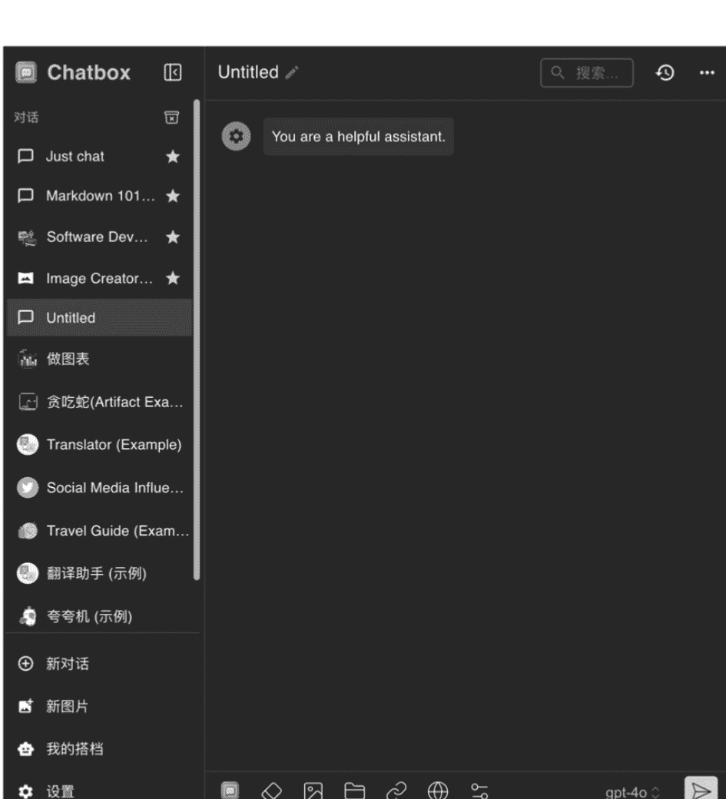

图5-5 ChatBox主界面

##### 设置模型：

为了与 Ollama 互动，需要在 ChatBox 中正确配置 Ollama 的 API 接口。打开 ChatBox 的主界面后，点击左侧菜单中的“设置”，如图5-6所示。

在设置页面中，找到“模型提供方”选项，从下拉菜单中选择“Ollama API”。

在 API 配置区域填写以下信息：

* **API 域名**：保持默认。
* **模型**：选择已经下载的模型名称。
* **严谨与想象（Temperature）**：也就是本书所说的“温度”。对于蒸馏版小模型，建议输入 0.2〜0.5 之间的值。对于“满血版”大模型，可以使用官方推荐的值 0.6。温度越低，模型出现幻觉的可能性越低，但回答问题的创意性会下降，反之亦然。

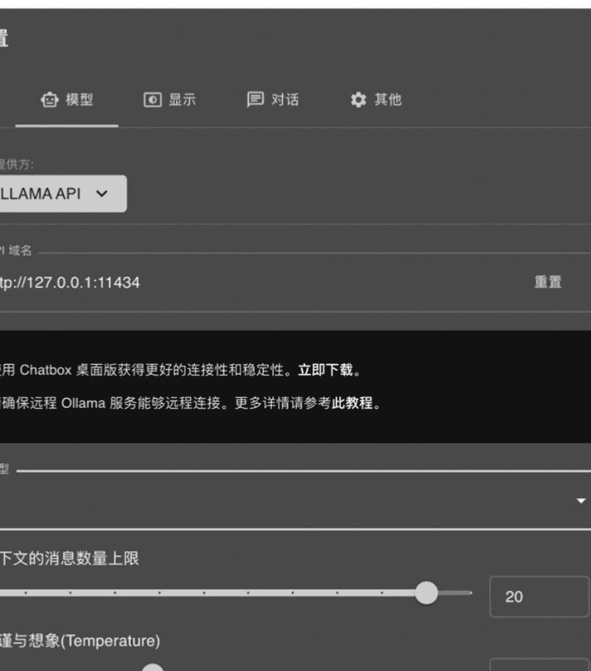

图5-6 ChatBox设置页面

点击“保存”按钮以应用配置。

完成上述配置后，你就可以使用 ChatBox 和 Ollama 的模型进行对话了。

**注意**：由于 ChatBox 依赖 Ollama 提供 API 服务，因此在使用 ChatBox 前，请确保 Ollama 的服务已经启动。如果服务中断或未运行，ChatBox 将无法调用模型。

除了使用 ChatBox，还有很多其他软件可以实现类似的效果，如 Cherry Studio 也是一个不错的 AI 通用客户端软件，也可以实现上述效果，推荐大家尝试。

## 更多使用 DeepSeek 的途径

除了使用官方 App 和网页版及进行私有化部署，还有一些方式可以使用 DeepSeek，我把这些方式总结为两类。

#### 通过第三方应用接入

DeepSeek 模型是开源、免费的，很多第三方应用也接入了 DeepSeek。很多应用都把 DeepSeek 接入了自身的知识库，通过 RAG 等技术增强了模型的输出，在所属垂直领域中，得到更好的效果。例如，在百度、腾讯元宝、微信搜索、秘塔搜索、纳米 AI 搜索等产品中，可以使用 DeepSeek-R1 进行 AI 搜索，自动总结全网信息并生成更全面的答案；腾讯 ima.copilot 应用支持构建基于 DeepSeek-R1 的个人知识库等。目前，已经有上百款应用接入了 DeepSeek，你可以根据自己所在的领域挑选合适的工具。

此外，还有一些 AI 工具平台支持混合接入多家 AI 大模型。虽然 DeepSeek 很强大，但并非在所有领域它都是最佳选择。灵活使用国内外各类 AI 工具能更好地提升效率。例如，百言 AI 就提供了多种 AI 工具，包括 AI 对话和 AI 绘图等。

#### 通过云服务接口（API）接入

除了通过用户界面直接使用 DeepSeek，对于开发者或者希望能够深度定制、接入自身知识库的用户，深度求索提供了一个 API 开放平台。在这个平台中，你可以获得自己的 API 接口使用权限。

拥有这个 API 接口后，你既可以在 ChatBox 或类似工具中接入云服务版 DeepSeek，也可以将其接入本地知识库工具，如 Dify、AnythingLLM 等软件，以实现定制版的 DeepSeek 使用。你还可以通过编程的方式调用 DeepSeek 接口，实现自动化调用。

除了官方，还有大量第三方云服务商也接入了 DeepSeek，包括火山方舟、阿里云、腾讯云、百度智能云等。通过这些平台，你也可以获取对应的 API 接口，这些接口大多与官方接口保持兼容，可以随意互换使用。

# 模块六

DeepSeek 助力创意写作

## DeepSeek，最有“个性”的 AI 写作模型

DeepSeek 火爆出圈后，关于 DeepSeek 写作的讨论就非常热烈。很多人只是把 DeepSeek 当成了 ChatGPT 等其他模型的“替代品”，并简单地用相同的方法来让 DeepSeek 写作。但其实，DeepSeek 与之前的大多数 AI 大模型很不一样，它以其独特的文风和表达方式脱颖而出，成为创意写作领域的一匹黑马。然而，正如任何工具一样，了解它的优势和局限，才能更好地驾驭它，让它真正成为我们创作路上的得力助手。

注意，下文描述的 DeepSeek 文风，主要是指 DeepSeek 的 R1 和 V3 模型。如果 DeepSeek 后续推出新的模型也不必担心，本章描绘的用来控制 DeepSeek 文风的方法也可以用于新的 DeepSeek 模型，甚至用于其他公司的 AI 大模型。

## 介于人类与机器之间的独特气质

第一次被 DeepSeek-R1 的文字打到，很容易。

尤其是在春节长假被它连续输出一波后，投资人朱啸虎那句“DeepSeek 几乎让我相信 AGI 了”就很能代表这种感受。让人惊讶的不是功能堆砌，而是它在生成内容时带出的一种从容优雅和由内而外的深度。

R1 的书写风格辨识度极高。李诞曾用“科技抒情散文诗”来形容：理性与感性被缝合在一起，数据很硬，抒情也足。把一篇平淡的随笔喂进去，它会先拆解意象再重排，首段就开始上情绪，把本来要讲的论点改写成层层铺开的意象流。

## 华丽之下藏的坑

光鲜的文字背后藏着明显的毛病。有人总结得很准：模型不会克制，一写情绪就往大了铺，一下子回到青春伤痛文学的调门。人类可以用“天凉好个秋”收住一套情绪，R1 却倾向在极短的句子里塞满修辞，显得在卖弄文采。

它擅长写“虚”，一到“实”就容易用力过猛。用过的人都能觉出几条特征：跨时代的比附、文化符号的拼贴、以及固定的起承转合句式。最典型的破绽在数字上：家门口的第四棵树、0.7 秒、十六进制之类的写法，数字很具体，意义却空。太多人靠这个“狐狸尾巴”认出 AI。

词汇上，永恒、褶皱之类的抽象词反复出现；情节里偶尔冒出不合常理的设定，读起来不像人会做的事。带有赛博乡愁的科幻元素也常被硬塞进去，使用者会频繁读到量子力学相关的内容。这些痕迹让读者对辞藻华美的文章本能地警惕。

另外，R1 的输出常是分段、列点、总分总的写法，直接拿去当正式稿，上下文容易断裂，逻辑跳跃生硬，重点被打散。相对而言，DeepSeek-V3 在连贯性和可控度上更稳。

## 如何用好长处避开短板

清楚它的脾气，才能用对地方。

R1 很适合当灵感启动器。卡文时丢进一个雏形，它能换角度重组意象，给出新的表达路径，常常一击即中。

在文学性强的场景它也有优势，诗、散文、小说等依赖修辞和情绪的体裁，初期用它快速批量出样稿，再筛选，效率很高。

做知识拓展和多视角梳理时，它也能提供参考。用来拆解文章骨架、理解不同文类的结构也很合适。

但要注意风险。直接照搬会留下明显 AI 痕迹，在学术或商业场合尤其致命。长期依赖，还会让自己的写作肌肉退化。

策略上，第一，把它当协作伙伴而非替代者。人类独有的生活经验、审美判断和情感细腻度，是模型补不上的。

第二，用多轮递进的方式训练它。不要指望一次到位，先要大纲，再对每个模块加约束，最后整体润色，指令逐层收紧，效果会好很多。

第三，保持批判。核查事实是否准确，逻辑是否顺滑，情绪是否适度，让创意火花经过人类的审美过滤。

第四，按需选型。R1 更适合深度思考和结构搭建，V3 更适合扩写润色和输出自然长段，两者搭配很顺手。需要高度 factual 的报告，让它负责框架和表达参考，数据分析坚持人来做；创意文学则可放开发挥，但最后的审美把关和情感注入仍要人来。

## 让文风听话的几个实操

### 用“说人话”把调门压下来

华丽过头是 R1 最常被吐槽的地方。想要简洁明了的答案，往往得到一篇充满永恒、褶皱的哲学短文。

办法很简单，提问时直接加“说人话”或“用大白话讲”。模型就会收敛术语，用日常表达来解释复杂概念。

还有一个降维指令很有效：“我是小学生，请解释”。身份自降后，它会主动切换成儿童可懂的语言，去掉艰深术语和复杂修辞。

### 更精准的提示词组合

口语指令不够时，可以用更细的控制词：

* 指定语体：明确要求“语言平实直白”，例如“请用平实直白的语言说明人工智能原理”。
* 禁用表达：直接写“禁用文学修辞”，或“避免夸张比喻，保持客观简洁”。
* 控制结构：例如“用连续自然段论述，避免过度分点”。这能让输出少了总分总的碎片感。
* 口语化：指示“保持口语化”，适合自媒体和亲和力文案。

## 学会借用别人的笔触

R1 模仿能力很强，对训练样本足、风格鲜明的对象效果更好。基本句式是“模仿XXX的文风，撰写关于YYYY的一篇文章”。

比如“模仿鲁迅的文风，写一篇讽刺自媒体的小品”。在 R1 下，它会生成类似未庄茶馆添了全息投影、跑堂端云端茶盘、主笔叹纸媒、青年谈 10 万+、智能佛珠闪光、直播眼镜冲出门等场景，整体带出旧笔记体的讽刺味。

模仿冷门或风格模糊的作者，效果会打折。即便模仿成功，模型独特的个性仍会在字里行间若隐若现。

想提高精度，可以给一段风格样本。格式为“以下是海明威的样本：[样本]。请用这种简洁有力的风格写一个关于都市孤独的短篇”。样本不宜过短，也不能过长，建议 2000 字到 2 万字之间。

## 渐进式对话校准

单次指令很难完全锁定风格，多轮反馈更可靠。流程类似与真人编辑协作：

* 初稿生成：先给基本需求。
* 具体反馈：点出问题，如“第二段太抽象，用更具体的例子”“语气太正式，放松些”。
* 示范引导：自己写一段示范，让它按此风格续写。
* 逐段调整：长文可分段打磨，确保一致性。

对话过长时模型可能遗忘早期内容，可把前面文本复制合并再发回去，重新校准。

## 用结构限制发挥

结构本身就能约束文风：

* 清单式：要求“5 个要点”“10 个步骤”，能有效避免长篇抒情。
* 问答式：以 FAQ 形式输出，内容更聚焦直接，适合科普入门。
* 故事式：指定“用一个有开端、冲突、解决的故事来解释概念”，既生动又不发散。

## 一个文风迭代的实拍

假设要写气候变化。初次提问，R1 可能给出“地球母亲的泪水”“时间的褶皱里藏着生态警钟”之类的话。

第一轮调整：“描述太空泛，请用具体语言，聚焦实际影响和数据，别用拟人化修辞。”

第二轮调整：“内容具体了，但太正式。请用咖啡厅跟朋友聊天的语气重写，短句、简单词。”

两轮下来，信息密度和可读性才同时到位。清晰指令、持续反馈、灵活调整是关键，久了会形成自己的提示词模板。

## 从助理到网文共创伙伴

在职场写作之外，网文创作是 R1 另一个爆发点。它不等于全自动写手，而是强力的创意加速器。

优势有三：每小时产出上万字初稿，拆解热门套路迅速搭建大纲，碎片时间随时补章节。

关键是先建框架，再扩写。稳定骨架能保证全书一致性。

一个好记的公式：背景世界观 + 人设 + 冲突 + 金手指设定 + 核心故事线 + 写作风格 = 爆款基础。

背景决定调性，人设和冲突决定追更欲，金手指提供爽点，故事线保证逻辑，风格匹配读者。

用 RTGO 结构搭框架很顺手：角色、任务、目标、要求。

例如设定角色为爆款玄幻作家，任务是整理世界观、人设、冲突、金手指、故事线和风格，目标是幽默轻松、年轻读者、东方玄幻，要求主角觉醒灵力意外契约传说神兽，身世有反转。

模型会给出类似灵驭大陆的设定：以驭灵为尊，灵兽稀缺，传说级近乎绝迹，五大势力争斗；主角林小凡 16 岁平凡孤儿，乐观机智，青梅竹马苏婉儿，竞争对手秦无炎，神秘老乞丐。冲突包括灵兽稀缺、身世之谜、势力角力。

### 第一步：搭框架
用角色任务目标要求快速生成基础骨架，确保人物、世界、金手指统一。

### 第二步：做大纲
再让模型生成全书四卷大纲，每卷核心事件清晰，最终卷揭示幕后 BOSS 与决战。

DeepSeek 有鲜明的个性，它让创意写作有了新维度，也提醒我们：工具是辅助，判断力、创造力和审美，始终在人手里。

### 第三步：把骨架细化到章节
框架搭成后，关键是让 AI 把每一块大纲再往下拆成章节级的要点概括，再由 DeepSeek 去补足具体段落。可以直接让模型写初稿，也可以先自行拟出章节雏形再请它润色。现阶段即便是 DeepSeek，裸输出的文字通常不能直接用，几乎都要经过人工再加工。如果你本身有文学功底，自己先写概要再交由模型打磨，会是更稳妥的做法。每次开启新会话时，一定要把小说骨架和已经写好的部分提要一起发给 AI 作为参考，这样它才能保持后续内容的风格和信息统一。

#### 第四步：用 DeepSeek 提升爽感与情绪流动
网文最抓人的地方是爽感，DeepSeek 在这方面加成明显。常用的做法包括：

- 埋设悬念与伏笔：提前埋下谜团，把读者的追更欲望吊住；
- 塑造生动配角：快速获得配角人设、台词和互动细节；
- 强化爽点：批量生成打怪升级、逆袭复仇、惊喜反转等场景描写。

比如让 AI 在已有文本上补一段爽感：请为已有小说补写一段，主角林小凡遭霸凌，危急关头苏婉儿突然显露出源自稀有灵兽的力量出手相助，帮助主角打脸反派并扬眉吐气的情节。另一个常用做法是把部分章节交给 AI，让它给出提升爽感或优化情绪节奏的建议，甚至直接改写。如果你对创作感兴趣，却被时间和灵感限制，不妨从人机协作开始。

## 弱化 AI 写作痕迹
前面提到过，DeepSeek 的输出有时会带有一种辨识度很高的风格。虽然有特点，却容易暴露机器写作，让阅读体验出戏。解决办法并不复杂。前面“简单几招，控制 DeepSeek 文风”里已经给出了不少操控技巧。初稿完成后，用这些方法进行二次润色和改写，就能有效淡化并去除机器味。

## 自媒体爆款打法
开公众号、做短视频、运营小红书、B 站……自媒体门槛看似很低，能在海量内容中脱颖而出的却很少。爆款的本质是精准定位、吸睛选题、高点击率的标题与封面、直击痛点的文案，再加上让人上瘾的视频内容构成的完整生产链。DeepSeek 能在这套体系里担任得力助手。但不建议把创作全盘交给 AI，自媒体最终靠的是创作者的独特个性和内容价值，全部外包只会千篇一律。人机结合才是当下做自媒体的正确路径。做自媒体很耗时间精力，AI 能明显提速。下面用案例说明如何用 DeepSeek 逐步打造爆款。

### 用 AI 做账号定位和命名
自媒体时代，清晰精准的定位是起步关键。做自媒体不是盲目追热点蹭流量，头部账号都是在某个垂直细分领域持续深耕，积累精准粉丝。AI 工具能帮助更快更准地完成定位，DeepSeek 在这一块表现突出。常用的三轴定位法即硬技能、软技能、稀缺性。表 6-1 展示了主要构成。

**表 6-1 三轴定位法的主要元素和说明**

| 元素 | 说明 |
| :---: | :--- |
| 硬技能 | 你的专业能力与能提供的价值，如金融知识、设计能力或编程技术等 |
| 软技能 | 个人魅力、讲故事能力、幽默感等 |
| 稀缺性 | 难以被复制的内容或视角，如“清华博士讲理财”、“程序员讲育儿”等 |

举例你可以这样问：请帮我确定公众号定位，我的硬技能是金融分析师，软技能擅长幽默故事讲解，稀缺性是职场经验与理财经验的融合。模型可能给出如下方案：

1. **主打方向**
   「用脱口秀形式教打工人理财」
   职场故事×理财干货×黑色幽默

2. **3 个差异化卖点**
   - 只谈与职场相关的钱的问题，如工资规划、跳槽资金、摸鱼理财
   - 创造职场黑话理财梗，如“弹性下班=时间贬值”“福报=人力资本泡沫”
   - 以办公场景举例，如 Excel 冷笑话、茶水间经济学

3. **内容三大支柱**
   - ① 硬核工具：工资分配 Excel 模板
   - ② 故事剧场：用同事八卦讲理财
   - ③ 热点整活：解读影视剧里的理财漏洞

4. **人设记忆点**
   - 开场白：“教你把窝囊费变成‘睡后收入’”
   - 灵魂道具：咖啡杯存钱罐表情包

5. **变现路径**
   - ① 售卖《职场求生理财包》
   - ② 开「打工人财富突围」训练营
   - ③ 接企业员工财商培训

执行心法：用吐槽同事的方式讲干货，把 KPI 话术改写成理财公式，让每个社畜边笑边存钱。可以看到分析很到位，连商业化路径都一并给出。实操时建议开启深度思考。若对结果不满意，可直接说：“再给我五个不同定位并做对比。”让模型自我迭代。除三轴定位外，还可使用 SWOT 框架。SWOT 是经典战略分析工具，S 为优势、W 为劣势、O 为机会、T 为威胁，通过列出内部与外部因素并匹配分析，为决策提供依据。AI 能快速梳理竞争优势、短板、机会与风险。

例如提问：请用 SWOT 框架分析我做“搞笑职场科普”视频账号的优劣势。我是资深 HR，暂无短视频经验也不擅长剪辑，但认为职场话题长期火热，市场已有“×××谈笑职场”等头部账号占据心智。请以表格呈现。可能输出如下汇总：

**“搞笑职场科普”账号 SWOT 汇总**

| 维度 | 分析 |
| :--- | :--- |
| 优势 | 专业内容基础：资深 HR 经验，可提供真实案例与深度洞察；选题可持续性：职场话题关注度持久；差异化定位：搞笑与科普结合较少；技术短板：缺乏短视频制作与剪辑经验 |
| 劣势 | 流量竞争压力：头部账号已形成心智壁垒；内容平衡挑战：需兼顾专业与娱乐；平台扶持：短视频平台对职场垂类有流量倾斜 |
| 机会 | 用户需求升级：年轻人偏好轻松学习职场潜规则；跨界变现空间：可延伸职业咨询、企业培训、周边带货；内容同质化：大量模仿导致审美疲劳 |
| 威胁 | 政策风险：涉及裁员、薪酬等敏感话题易触发审核；头部挤压：大号矩阵化运营抢占碎片时间 |

关键策略建议包括强化专业反套路内容、采用口播加表情包字幕动画等轻量化形式规避剪辑短板、聚焦 00 后整顿职场、AI 时代裁员危机等细分场景建立记忆点、通过反向蹭热点引发讨论等。

为提升可行性，可追问验证。例如问：采用口播加表情包字幕动画是否影响爆款？为什么？模型会说明轻量化不等于难出爆款，甚至是新号破冰的最优解。爆款要素排序约为：选题共鸣度 50% ＞人设独特性 30% ＞视觉精致度 20%。

定位确定后，可让 AI 帮忙命名。例如：我是 HR 出身，想打造幽默犀利的职场科普账号，请生成 5 个好记有趣的名字。可能得到：职场扯淡 HR 哥、HR 有话说、爆笑职场指南、办公室里的段子手、人在职场飘。

### 告别选题困难症
开启联网搜索后，DeepSeek 能快速洞察市场热点并生成用户关注的选题。例如科技类博主每天苦恼于选题，可问：今天科技圈有哪些值得讨论的新话题，适合做自媒体的？官方版开启联网搜索后会自动把“今天”转换为具体日期并检索。以 2025 年 3 月 2 日为例，输出可能包括：

1. GPT-4.5 表现争议与 AI 竞争格局
核心争议是 OpenAI 最新发布的 GPT-4.5 在基准测试表现不佳，被 DeepSeek 以 500 倍性价比“碾压”，引发技术护城河崩塌讨论。行业影响是 DeepSeek 的日利润数据与开源策略推动商业化竞争加剧，大模型加速向行业渗透。自媒体角度可对比两大模型优劣，探讨性价比是否成为未来关键。

2. Meta 新一代 AR 眼镜 Aria Gen 2 技术突破
技术亮点是传感器系统与端侧处理芯片升级，提升交互响应与续航，为消费级产品铺路。结合阿里 3800 亿元投资云与 AI 基础设施，可分析 AR/VR 与云计算结合潜力。自媒体角度可讨论技术实验驱动消费品模式的可持续性。

3. AI 与生物制造深度融合
最新动态是中国生物发酵产业技术大会上展示 AI 在酶设计、蛋白质优化、海洋食品加工中的应用。自媒体角度可解析 AI 如何破解生物制造效率瓶颈，或讨论 AI 加合成生物学的伦理与商业边界。

除联网搜索外，也可上传近期新闻素材让 AI 分析，之后再要求：基于上述话题，给我 10 个既有深度又有爆点、且符合我账号定位的选题。

### 爆款标题与内容生成
选题确定后，下一步是生成标题与正文。过去让 AI 写爆款标题较难，但 DeepSeek 尤其是深度思考 R1 版本能自动拆解爆款要素，生成更易点击的标题。例如提示：为选题“年轻人理财误区”生成 3 个高点击标题，要求含数字且悬念感强。可能得到：

1.《这 5 个理财雷区，95% 的年轻人踩过！你中了几个？》
亮点：高比例制造危机感，反问激发自检欲。

2.《月薪 5000 到负债 10 万：年轻人最易掉入的 3 大理财陷阱》
亮点：数字对比冲击，薪资痛点精准打击。

3.《00 后必看！这 7 条理财误区正在吃掉你的血汗钱（附避坑指南）》
亮点：锁定新生代，“吃掉血汗钱”制造焦虑，括号补充解决方案提升点击。

# 升级技巧：
1. 数字宜用奇数，更易记忆；
2. 加入“血汗钱/负债/陷阱”等强情绪词；
3. 用年龄标签强化代入感；
4. 括号补充价值信息提升信息密度；
5. 使用“必看/警惕/正在”等紧迫词。

# 平台调性选择：
1. 知乎/公众号偏好理性数据型；
2. 小红书/B 站适合年轻化表达；
3. 头条类平台适用戏剧化对比。

**风格学习**。可把 4~5 篇过往作品丢给 DeepSeek-R1，总结共同特征、个人风格及利于爆款的细节，包括用词句式、开头结尾方式与结构。然后把总结作为提示词的一部分。常用的风格引导词有“说人话”“风趣幽默”“专业”“口语化”等。

使用 DeepSeek 写自媒体文案时注意：
- 非零创作为基础时务必上传完整材料或写入提示词，减少幻觉；
- 生成内容需二次审校，尤其是 R1 版本幻觉率较高，易出现事实数据错误；
- 官方应用免费，可多问几次，首次不一定最佳；
- 若不想输出分镜、情绪描述、背景音乐，可提示“只输出口播内容”；
- 若文案零散，可提示“使用连续自然段连接，避免过多分点，注意流畅与连贯”。

## 全自动产出自媒体图文
前面介绍了如何用 DeepSeek 快速生成纯文字内容，实际上它还能帮助制作图文笔记，包括图片与笔记内容，如知识科普、生活干货、健康养生、职场技巧等。

## 小红书图文自动化示例
以“熬夜的 5 种危害”为例，说明如何快速产出小红书风格的干货图文。制作能吸引用户关注的笔记，首先要明确需求，清晰告知 DeepSeek 内容类型与形式。例如计划输出《熬夜的 5 种危害》小红书图文，可构建提示词：

请为我制作一套小红书图文，主题为“熬夜的 5 种危害”，具体需求如下：

# DeepSeek 撬动小红书图文自动生产的方法论

先把一个可复用的提示词拆开来看，里面其实做了四件事。

一是要求产出一张封面，长宽比 3:4，主题要突出“熬夜的 5 种危害”，调性清新、视觉抓眼，专为年轻用户设计点击。
二是要求产出 5 张单危害配图，每张固定带上序号诸如“危害①”，配上几行带 emoji 的直观文案，整体风格统一、清爽，贴合小红书审美。
三是除图之外，还要同步给出可直接发布的笔记正文，包含简短的开场白和对 5 个危害的逐条解释。
四是技术实现上，六张图全部用 svg、canvas 或 html 元素绘制，并在单页 html 中呈现，每张下方挂“下载图片”按钮，方便保存上传。只返回 html 源代码，不重复文字说明。

这段提示词的核心拆解可以归纳为：明确内容主题，熬夜危害是健康科普类在小红书上高频的选题；细化图片规格，封面加五张内容图并说明风格要素；同步生成配套文案；用网页元素生成图片的技术指令，表面技术感强，实际操作时只需复制使用，DeepSeek 会自动完成。

# 发送提示词后你会得到一段 HTML，如何使用

得到代码后其实不需要理解原理，有两种打开方式。

网页版 DeepSeek 的话，直接点代码右下角的“运行 HTML”，就能立刻看到效果。
本地使用的流程是复制全部代码，粘到记事本，另存为“小红书.html”，用浏览器打开即可。页面里会展示六张图，每张下方都有下载按钮，一键保存到本地再上传。

# 熬夜的五大伤害速览

看完就想立刻躺下休息！

## 危害①
**黑眼圈变重**
**肤色暗沉无光**
**颜值直接下滑！**

## 危害②
**记忆力走下坡**
**反应变得迟缓**
**一天就成金鱼脑！**

## 危害③
**内分泌失衡**
**爆痘掉发预警**
**身体拉响警报！**

## 危害④
**心脏负荷增加**
**猝死风险抬升**
**生命不可重来！**

## 危害⑤
**次日精神涣散**
**工作学习都受影响**
**形成恶性循环！**

图示示例为 DeepSeek 生成的封面与五张配图，实际风格会因模型随机性而有所差异，但结构保持一致。

生成的笔记文案也可直接复制使用。若对图或文不满意，可以这样优化：

追问细化：在原提示词里追加色彩、字体、元素等要求，比如让主色用粉蓝。
多次尝试：第一次不理想就重新发起，模型每次会给出不同设计。第二次建议开新对话，避免上轮影响。
局部修改：只要求改某一张，比如“保持整体不动，把第三张背景换成淡黄”。

使用时还有三个实操要点：

强调风格统一，提示词里写明统一配色与版式，成品更专业。
加入个人化标识，比如在右上角加上小红书 ID“健康生活小达人”，提升辨识度。
结合受众调整描述，年轻人偏活泼，专业人群偏简洁严谨，提示词的风格词要对应。

借助这种方式，即使不懂代码，也能快速做出精致的小红书图文，把精力留给内容创意。

# 建立图文批量生成的流水线

单条生成只是起点，可以把流程固化成批量工作流，实现每天产出数十上百条图文，甚至运营矩阵账号。完整搭建需要 DeepSeek 配合第三方工具，具体步骤可在配套课程中查看。

# 模块七

## DeepSeek 赋能图片、视频与动画创作

### DeepSeek 辅助图片创作

DeepSeek 的 V 系列和 R 系列本身不具备画图能力，但推理能力强，适合与文生图工具配合。做法是先让 DeepSeek 写出详细的图片描述，再把描述丢进文生图工具。

举例：让模型按 Midjourney 提示词规范生成描述，要求有细节、有画风，不出现具体数字，不在画面中写文字，不加——开头的参数，用常用词组和短句。描述对象示例为广州最高楼顶趴着一只覆盖整栋楼的纯灰蓝巨猫，俯瞰视角。

模型会输出类似：广州天际线俯视，超现实奇幻，摩天大楼顶端卧着巨型蓝灰短毛猫，覆盖整栋建筑，玻璃幕墙反射晚霞，江水蜿蜒，城市灯光渐亮，毛发细腻带银光，暖金暮色与冷调霓虹交织。

把这段描述喂给百言 AI 或即梦 AI 即可出图。百言 AI 网页或微信搜索进入后切换到绘画模式，粘贴提示词，1-2 分钟得到 4 张结果，可放大 U+、微调 V+，并支持风格、宽高比、排除元素、图生图等功能。即梦 AI 网页或 App 进入图片生成，输入提示词即可，同样可得到多张备选。

### DeepSeek 辅助视频创作

DeepSeek 不能直接出视频，但能写出高质量分镜脚本，再配合第三方工具生成片段，最后自行拼接。当前 AI 只能生成 5-15 秒单镜头，完整视频需要后期合并。

方式一：先脚本后绘图再图生视频。可控性强，画面精美。
方式二：直接文生视频。速度快，运镜更自然，但细节难控。

先图后视频的具体流程：

第一步脚本生成。以 30 秒茶文化品牌宣传为例，要求 DeepSeek 输出含时间轴与画面内容的表格，每个画面内容要符合 Midjourney 提示词规范，不含数字、不写文字、用短句、信息完整可独立使用。模型会给出清晨茶园、手工采茶、茶具特写、茶汤倒入、围坐品茶、品牌水墨收尾等分镜。

第二步生成画面。将每个描述单独输入百言 AI 或即梦 AI 生成图片，注意宽高比与视频格式匹配，横版加 ar16:9，竖版加 ar9:16。

第三步图生视频。用可灵 AI 或即梦 AI 的图生视频功能，上传图片并填入运镜描述，生成片段。

第四步剪辑。把片段导入剪映，调整顺序、加字幕、配乐、口播。口播文案也可让 DeepSeek 生成。

文生视频的方式步骤相近，只是第二步改成让 DeepSeek 直接输出符合文生视频要求的镜头描述，包含镜头语言和细节，然后在可灵 AI 或即梦 AI 的文生视频功能里直接生成。

为什么要拆成多条描述而不是一条。AI 视频工具一次只能生成短镜头，长视频需要拼接，分镜确保连贯。

实操要点总结：脚本先行，DeepSeek 写分镜很快；描述要具体，问题出在画面就回溯修改描述；工具组合，百言/即梦出图，可灵/即梦出视频；注意局限，AI 难处理中文字体、品牌 Logo、角色一致性，更适合空镜与场景。

### DeepSeek 辅助动画创作

无需借助外部工具，DeepSeek 可直接生成 Canvas 网页动画，复制即用。

科普类示例：地球公转动画。要求背景深蓝星空带闪烁星星，中央黄色太阳，蓝色地球绕日运行，月球绕地且地球自转，动画平滑循环，配文字“地球绕太阳公转示意图”，页面美观适合小学课堂，提供完整可运行 HTML，不加解释。

关闭深度思考即可得到代码，在 DeepSeek 网页版点“运行 HTML”或保存为本地 html 打开，即可得到可用于教学的动态示意，比静态图更直观。

图 7-5 用 DeepSeek 生成的地球公转演示

## 用 Canvas 做心脏科普动效

再举一个常见场景。假如你运营健康类账号，想给粉丝演示心脏搏动的原理，可以这样描述需求：

帮我写一段完整的 HTML 代码，用 Canvas 画一个心脏跳动的动画，要求如下：

1. 背景选用柔和的浅色系。
2. 画面中央放置一颗红色心脏，按规律收缩与舒张。
3. 每次搏动时伴随血液流动的表现，用红色粒子示意。
4. 实时显示心率数值，范围模拟正常成人 60～100 次/分钟。
5. 支持切换心动过缓、心动过速、窦性心律不齐三种状态。
6. 页面底部同步滚动心电图，带 x 轴 y 轴标注，曲线不会超出图框。
7. 整体布局简洁清爽，适合科普传播。
8. 代码可直接复制使用。

这样生成的动画能把生理过程可视化，医学概念一下子就通俗易懂了，如图 7-6 所示。

# 心跳动画生成示例

无论做哪类动效，操作思路基本一致，可归纳为四步：

- **厘清需求**：先想清楚要表现什么内容、什么风格、是否需要交互。
- **撰写提示**：参照案例格式，把需求写细，要包含动画主题与目标、视觉细节如配色布局、运动变化方式、交互需求、其他特殊要求。
- **拿到代码**：把提示发送给 DeepSeek，获取可用的 HTML 代码。
- **保存运行**：复制代码新建 HTML 文件打开预览，不满意就修正提示再生成。网页版还能直接点“运行 HTML”即时查看。

使用时的经验：

- 描述越具体，结果越贴预期。
- 复杂动效可先要基础版，再逐步提出修改意见，需求大改时建议重写提示。
- 多保存几个版本对比挑选。
- 可要求增加悬停、点击等交互，增强趣味性。
- 按使用场景调整风格，教学、演示、营销各有侧重。Canvas 在主流浏览器均可运行，老旧浏览器可能不支持。
- 需要成视频可借助屏幕录制工具导出。

借助 DeepSeek 制作 Canvas 动画，无需编程也能做出生动效果，适合教学、数据展示、产品宣传和健康科普等多种场景。

# 模块八

### 让 DeepSeek 提升工作效率的实操方法

#### 轻松搞定职场文字

本章聊聊打工人每天都要写的职场文档：公文、汇报、方案和材料。这类写作不像创作那样天马行空，却直接影响工作顺畅度。

职场写作的痛点在于平衡：领导要精准简练又要细节齐全；汇报要提纲挈领又不能漏数据；方案要结构清晰又不显得呆板。核心是逻辑严密、语言流畅、内容饱满且篇幅得当。

这时 DeepSeek 就是很好的写作助手。下面按常见场景说明使用要点。

#### 日报周报不再头疼

新人最怕的就是周报。怕写多啰嗦、写少显得工作量不足。用 DeepSeek 简单提炼就能得到结构清晰、措辞得体的周报。

示例输入：
帮我写本周工作周报，内容包括：完成客户 A 产品需求沟通，完成内部需求二次确认，项目 B 开发推进 50%，遇到的问题是客户 B 中后台接口延迟。

输出样例：

## 本周工作小结

1. 客户 A 产品需求沟通已完成，细节已确认，为后续开发提供依据。
2. 内部需求二次确认完毕，修正了前期理解偏差，保证执行准确。
3. 项目 B 开发按计划推进，完成度达 50%。
4. 现存问题：项目 B 中后台接口响应延迟，需与研发沟通优化，以防影响进度。

更进一步，可把本周的 Word、PDF、图片等材料直接上传，让模型据此汇总，连提示词都省了：
帮我根据我上传的所有文档生成本周工作周报。

简单汇报一般关闭深度思考即可提速。

#### 给领导汇报更省心

汇报考验语言组织能力。通过告知汇报要点、领导关注点和场合，即可得到结构合理的材料。

示例输入：
明天我要向公司领导汇报本季度绩效，包含销售指标完成、团队建设、主要问题、下季度计划。

上传本季度相关资料后，模型可生成：

尊敬的领导：

现就本季度部门绩效简报如下：

## 一、销售指标完成情况
本季度销售完成率 102%，超额完成目标。A 产品销量提升，B 地区市场突破，客户满意度提高。

## 二、团队建设进展
通过内部培训和激励机制优化，团队凝聚力与执行力提升，客户服务和新员工成长明显加快。

### 三、主要问题
销售渠道拓展不足，个别项目进度滞后。

### 四、下季度计划
> 计划拓展新渠道，持续培训。针对上述问题制定具体措施，确保指标达成。

以上请领导指正。

不同汇报类型都可套用此法，建议先用非深度思考模式试跑，效果不佳再开启深度思考。可要求“符合国内政府/国企/民企汇报文风，语言自然流畅，避免过度分点”。

#### 政务公文：体制内写作更从容

示例：
以××街道办事处名义向市城管局发函，请求协助解决辖区垃圾堆放问题，并说明情况与诉求。

生成函件：

## 关于请求协助解决××街道辖区垃圾堆放问题的函

### 市城管局：

近期××街道部分区域出现垃圾乱堆，影响市容和居民生活。我办高度重视，已采取整治措施，但因[清运能力不足、居民环保意识薄弱等]问题未根治。

为改善环境、保障健康，特请贵局协助：

#### 一、协助事项
1. 加强清运：协调增频次，重点覆盖[老旧小区、背街小巷]，实现日产日清。
2. 完善设施：增设[分类投放点、大型收集箱]并定期维护。
3. 联合执法：开展乱扔垃圾专项整治，加大处罚力度。
4. 宣传教育：联合开展垃圾分类与环保宣传，提升居民意识。

#### 二、期望目标
力争在[具体时间]内彻底解决堆放问题，营造整洁宜居环境。

我办将积极配合，共同创建文明城市。

此函，盼复

**注：**
* 请按实际情况填写[]内容。
* 可附照片、数据等附件。

#### 产品宣传与广告策划

企业写作也需要创意。例：推广新智能门锁，指纹秒开、App 远程控制、续航一年。

配合提示词技巧，可要求用六何分析法并规避幻觉：
我公司新推出智能门锁，计划在小红书春节期间面向中老年人宣传。卖点是“指纹快速识别、支持手机 App 远程控制、电池续航一年”。文案 150 字内，简洁有力，不编造功能。

输出示例：

## 震惊！爸妈装了这款智能门锁，过年再也不怕忘带钥匙了！

以前爸妈总忘带钥匙，大过年还要等我们送🔑
现在这款门锁指纹一秒开，手机也能远程开！
再也不用担心被锁门外～
最赞的是充一次电用一年，爸妈不用操心充电。
过年礼物就选它，实用又贴心！

#新年礼物#智能家居#爸妈必备#过年神器

简单文案建议关闭深度思考，输出更自然。

#### 年会活动方案

输入“公司年会 500 人规模，主题‘凝聚力量 共赢未来’，含领导致辞、节目表演、颁奖典礼，请给出活动方案大纲”，即可快速得到规范大纲。

#### 职场写作的 DeepSeek 使用技巧

**突出价值**：明确受众想知道的信息，抓住关键点。

使用建议：

- **灵活切换思考模式**。简单内容关闭深度思考提速，DeepSeek-V3 在通用写作上更自然流畅；发现逻辑问题再切回深度思考。
- **注重多轮对话**。结果不理想就追问修正，不要直接放弃。

把上述技巧写入提示词，能更快驾驭各类职场写作。

#### 帮你解决企业具体难题

**辅助合同风险评估**

上传合同并提示：
根据中国法律，分析该合同对甲方/乙方是否不合理或不利，是否缺少关键条款，并给出具体建议。

示例回复要点：

##### 一、全款预付风险
现状：签约即全款，未以验收合格为条件。
建议：改为分期，或增加 7 日无理由退款。

##### 二、技术服务模糊
风险：技术支持无量化标准。
应对：补充 SLA，明确响应时限。

##### 三、违约金过高
计算：日千分之一≈年化 36.5%，超过法定上限。
处理：主张按 LPR 四倍或设上限。

##### 四、管辖地风险
现状：约定乙方所在地法院。
替代：改为原告住所地管辖。

#### 处理复杂的电子表格数据

可让模型写 VBA 宏或 Python 脚本自动化处理。例如比较两次考试成绩，满足进步、前 20%、每科≥60 分等条件则标红加粗。

也可改写为 Python 脚本，只需把“VBA 宏”换成“Python 脚本”并提供文件路径。

不懂编程可继续追问手把手安装运行步骤，操作前请先备份文件。

## 快速搞定 PPT

职场人都要做 PPT，从转正答辩到战略发布。制作痛苦常在理清思路上。

DeepSeek 不能直接导出 PPT 文件，但擅长梳理逻辑、搭建框架、提供精准内容，正是做 PPT 的关键一步。

流程：
**第一步：**用 DeepSeek 生成大纲和具体内容。
**第二步：**借助 Kimi、通义等工具将文本可视化，生成精美幻灯片。

常用模板：
**模板 1（通用）**：我想做一份关于【主题】的 PPT，用来【用途】，希望达到【效果】，担心【潜在问题】。
**模板 2（职场）**：我是一名【岗位】员工，需做【任务/项目】的 PPT，面向【汇报对象】，希望【目的】，要求【注意事项】。

举个真实职场案例：

三个月试用转正PPT快速搭建思路

刚入职互联网做产品，试用期临近结束，面向主管和HR做汇报，最怕材料空洞、表达没底气。把需求丢给DeepSeek开启深度思考，很快就能得到一份清晰的演示框架。

### 建议页数与整体框架 12至15页

#### 封面 1页
- 姓名、岗位、所属部门
- 汇报日期
- 视觉提示：采用简洁商务风格，可放置公司或产品标识

#### 目录 1页
- 用图标加关键词呈现结构，例如工作回顾、核心产出、成长反思、后续规划

#### Part 1 试用期工作全景 3至4页

##### 1. 角色认知与目标拆解
- 公司对产品岗的能力要求
- 个人设定的试用期OKR/KPI，例如掌握文档规范、独立推动一项模块迭代

##### 2. 工作内容的分层呈现
- 按阶段划分，如熟悉期、跟进期、交付期
- 按类型归类，如需求调研、原型设计、跨部门协同
- 可视化建议：以甘特图展示参与项目的时序

##### 3. 成果的数据化表达
- 交付量：例如完成PRD 8份，需求评审通过率100%
- 项目推进：例如主导某功能迭代，确保设计与开发按时交付
- 用户影响：例如流程优化后用户投诉下降15%

# Part 2 核心案例拆解 3至4页
……

**结尾 1页**
- **致谢**：感谢导师及同事的支持
- **视觉提示**：配上工作场景照片提升共鸣

**编制要点**
- **数据佐证**：每个成果尽量附截图或图表，如JIRA看板、GMV曲线
- **故事化讲述**：以“用户痛点—解决思路—价值落地”串联项目
- **视觉强化**：
  - 多用前后对比展示改动效果
  - 关键指标放大并用色块突出
  - 复杂流程用泳道图呈现
- **陈述技巧**：
  - 提前演练控制时长，建议陈述8至10分钟加5分钟问答
  - 准备QA文档，预判关于决策逻辑、失误复盘等提问

建议加入“用户反馈/同事评价”作佐证，如客户表扬邮件、导师评语截图，说服力更强。汇报时保持成长型表达，既展示成绩也能体现反思。

拿到框架后，可结合自身实际情况微调，或继续追问模型润色。框架确定后，即可借助Kimi、通义、夸克等AI PPT工具将文本快速转化为精美稿件。

以Kimi为例：
**步骤一：** 打开Kimi官网进入对话页，未登录先注册。
图 8-1 Kimi官方网站聊天页面

**步骤二：** 将DeepSeek给出的提纲完整复制到输入框，输入@符号后在Kimi+列表中选择PPT助手，如图 8-2所示。
图 8-2 输入并选择PPT助手

**步骤三：** 点击发送，Kimi会自动优化提纲，确认后点击“一键生成PPT”，如图 8-3所示。
图 8-3 “一键生成PPT”按钮位置

**步骤四：** 进入风格选择页，如图 8-4所示，选择偏职场稳重的模板并确认生成。
图 8-4 Kimi PPT风格选择页面

这样原本需数小时甚至一天的工作，半小时内即可完成，效率与质量明显提升。

职场PPT看似简单，实则要求逻辑、提炼、表达与视觉都到位。DeepSeek无法直接出PPT，但能迅速完成内容梳理与逻辑搭建，配合其他AI的视觉能力，可大幅提升制作效率。

熟练掌握这种协作方式后，就能摆脱制作焦虑，真正实现“PPT做得好，晋升加薪更有戏”。

Kimi本身也能实现PPT全流程，只是思考深度相对不足。截至本书完稿时，Kimi的PPT助手默认未开启深度思考，相信未来会有更多便捷方案。

## 几分钟产出专业图表

在职场中，一张清晰的图胜过千言万语。无论流程图还是数据图，都能帮助观点更精准。对非设计、非技术背景的人而言，快速做出专业的图并不容易。

借助DeepSeek的“文本即设计”思路，即使不会写代码也能生成高质量图表。

### 5.2 能力发展路径

#### 5.2.1 3个月能力提升计划
- 掌握AB测试设计，提升产品优化能力，服务迭代
- 学习新一代用户体验设计理念，提升设计水平，增强产品吸引力

#### 5.2.2 资源支持需求
- 希望参与用户访谈实操，提升洞察力
- 申请外部培训课程，拓宽知识面，提升专业度

### DeepSeek产出图表的思路

与PPT场景类似，DeepSeek只输出文本，无法直接渲染图像。但可让它生成结构化代码，再借助第三方渲染工具转为可视化图表。

流程分两步：
**步骤一：** 用DeepSeek生成图表结构代码，如Mermaid、PlantUML、Graphviz、SVG、HTML
**步骤二：** 用第三方工具渲染并微调。百言AI内置Mermaid渲染能力，可直接预览下载。注意在百言AI对话框下方可切换大模型，如切换到DeepSeek-R1。

表 8-1列出了常见渲染工具及其支持类型。

# 表 8-1 常见的图表渲染工具及其支持的图表类型

| 工具 | 适合生成的图表类型 | 说明 |
| :--- | :--- | :--- |
| Mermaid | 思维导图、流程图、序列图、甘特图、类图、状态图、用户旅程图、需求图、实体关系图等 | 通过类Markdown文本语法创建和动态修改图表 |
| PlantUML | 序列图、用例图、类图、活动图、组件图、部署图、状态图、对象图、时序图、甘特图等 | 专注于软件工程相关图表 |
| Graphviz | 有向图、无向图、流程图、网络图、圆图、子图、簇图、决策树图等 | 适合生成复杂网络与结构图，如论文配图 |
| SVG | 任意矢量图形、自定义图表、动态图形、交互式图形、数据可视化图（如饼图、折线图、柱状图）等 | 提供灵活的矢量定制能力，适合高度自定义场景 |
| HTML | 几乎可渲染任意图表类型，支持动态交互 | 适合高度自定义场景 |

下面通过案例说明如何利用DeepSeek快速产出炫酷图表。

# **图表产出实战案例**

Mermaid是一种易学的文本绘图工具，可绘制思维导图、流程图、序列图、甘特图、类图、状态图、用户旅程图、需求图、实体关系图等。百言AI等工具默认支持。

例如指令：
使用Mermaid输出一个漂亮、看起来复杂的地铁施工甘特图。AI会产出类似如下内容：

这个甘特图示例展示了从设计到准备、施工、系统安装，以及最终测试与交付的整个地铁施工项目。每个阶段都有若干任务，有些任务正在进行中，有些已经完成，还有些是计划任务。您可以根据需要调整日期和任务名称，以更好地匹配您的项目要求。

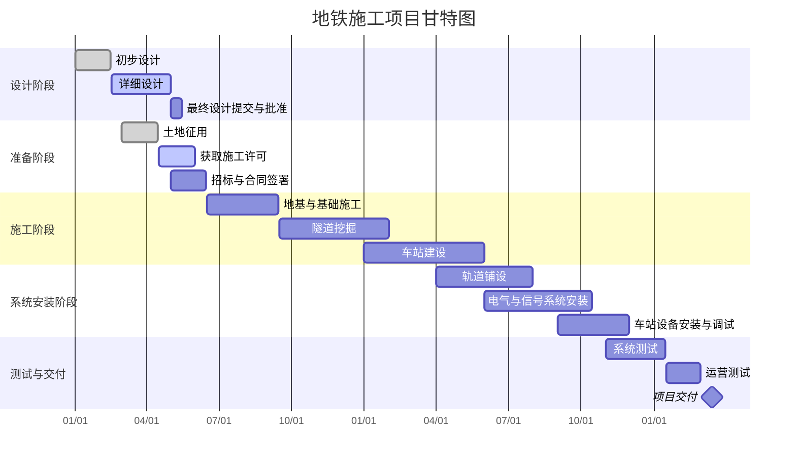

虽然看起来很复杂，但你完全不需要理解它。如果你使用的是百言AI，该甘特图会直接渲染成图 8-5。

图 8-5 DeepSeek通过Mermaid产出的甘特图

再举一个思维导图的例子。

帮我输出生成式AI精简学习路径的思维导图，使用Mermaid的Mindmap格式输出。

如果你使用的是百言AI，该思维导图会直接渲染成图 8-6。

图 8-6 DeepSeek产出的生成式AI精简学习路径

再如：
产出Mermaid图表：一个请假审批流程，包括员工申请、主管审批、人事审批、审批通过与否的流转。

该图表代码会直接渲染成图 8-7。

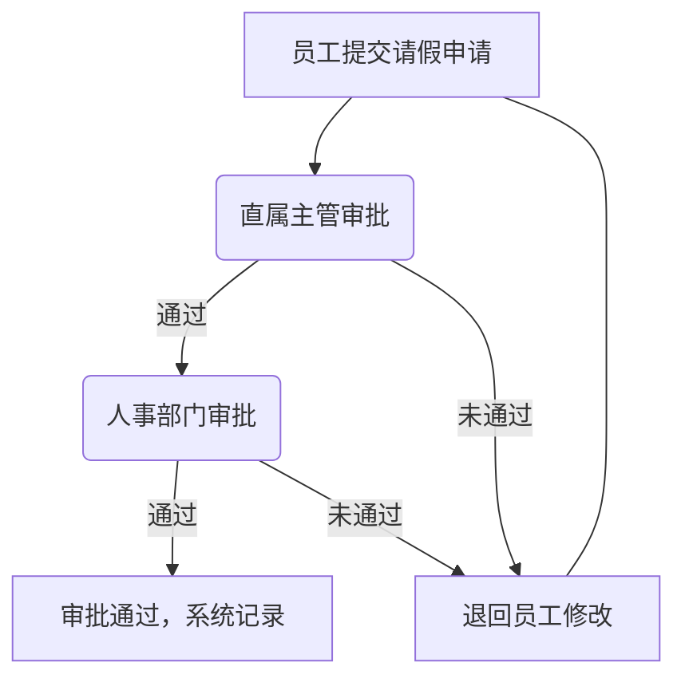

图 8-7 DeepSeek产出的请假流程图

DeepSeek官方版目前无法自动渲染Mermaid图表。可使用Mermaid Live Editor在线渲染，也可用命令行工具或VS Code插件渲染。

除Mermaid外，还可用Graphviz、SVG、PlantUML和HTML。其中Graphviz可产出非常复杂的美观图表。例如产出游戏设计报告配图：

使用Graphviz产出一个流程图。这个流程图展示了一个游戏中资源更新的全流程，包括资源的采集、处理和利用三个阶段。在资源采集阶段，玩家可以收集材料、开采黄金和生成能量。在资源处理阶段，这些基础资源被用于冶炼成钢材、铸造成金币及转换成电力。最后，在资源利用阶段，这些加工过的资源被用于建筑建设、进行科技研究和资源交易。整个流程中的不同资源类型之间存在复杂的依赖关系，确保游戏的经济系统多样且动态。

渲染结果如图 8-8所示。

图 8-8 Game Resource Update Flow

可用在线工具或下载Graphviz命令行客户端渲染。需注意Graphviz默认对中文支持有限，可通过设置解决。使用需一定技巧，限于篇幅无法展开。配套课程会有详细指导，也会涉及SVG、React等更多类型。

喜欢XMind或其风格的思维导图，也能两步实现。
**步骤一：** 让DeepSeek产出Markdown格式的思维导图。例如：
帮我产出微观经济学的思维导图，适合本科学生使用，要求内容清晰易懂，使用Markdown格式输出。
复制完整Markdown代码，保存为“思维导图.md”文件。
**步骤二：** 打开XMind，新建思维导图，点击菜单→文件→导入→Markdown，选择刚才的文件，效果如图 8-9所示。

图 8-9 DeepSeek产出的XMind风格思维导图

最后介绍用HTML产出图表。HTML就是网页代码，灵活强大，可渲染动态、复杂、交互式图表。也可自定义线条粗细、样式、颜色，但对极复杂流程图支持有限。

例如提示词：
产出一个基于HTML的时间轴图，要求漂亮、大气，展现苹果公司史蒂夫·乔布斯的主要生平。整体设计干净、简洁、有视觉层次感。产出单一HTML文件。
DeepSeek会产出HTML源代码，例如：
以下是一个简洁现代的垂直时间轴设计，展示乔布斯生平重要节点。可直接保存为.html文件：
（以下略）

使用方式有两种：
**方式一：** 在DeepSeek网页版，点击HTML源代码右下角的执行按钮直接预览。
**方式二：** 复制代码粘贴到记事本，另存为“时间轴.html”，如图 8-10所示，用浏览器打开即可看到类似图 8-11的效果。

图 8-10 将文件保存为HTML文件

图 8-11 DeepSeek产出的HTML图表

不满意可继续追问修改，例如：
# 把我的图表改成横向，适合在计算机上使用。保持HTML单一文件输出。

# 1955 出生

2月24日出生于美国旧金山，后被保罗·乔布斯夫妇收养

# 1976 创立苹果公司

与沃兹尼亚克在车库里共同创立苹果电脑公司，推出Apple I电脑

# 1984 Macintosh发布

推出首款图形界面个人电脑，开创个人计算新时代

# 1985 离开苹果

因权力斗争离开苹果，创立NeXT和收购皮克斯动画工作室

# 1997 重返苹果

苹果收购NeXT，乔布斯回归担任临时CEO，开启复兴之路

# 2001 iPod革命

推出iPod数字音乐播放器，重新定义移动音乐体验

# 2007 iPhone问世

发布首款iPhone，彻底改变智能手机行业

# 2011 时代落幕

8月24日辞去CEO职务，10月5日因胰腺癌逝世，终年56岁

HTML格式灵活，可整合多种图表，也可产出折线图、饼图、柱状图等数据图。若需带数据图表，建议在提示词中列出数据或上传文件，避免幻觉。

除了常规图表，还可绘制其它图形。例如：
帮我产出一个基于HTML的小红书封面图，用蓝色科技感的背景框和夸张的大字，内容“是”量子计算又炸裂了！”
DeepSeek会输出对应HTML代码，打开后得到图 8-12效果:

# # 量子计算又炸裂了！

**图**8-12 DeepSeek产出的**小**红**书**封面。

# **模块九**

## 学霸必备的DeepSeek技巧

## DeepSeek成为专属学习家教

如果你是学生或有正在上学的孩子，DeepSeek可成为强大的专属家教。接下来针对不同学习场景，手把手教你如何使用。

## DeepSeek一对一讲课

预习或复习遇到不会的概念，可直接提问。最神奇的是，DeepSeek会用你能懂的语言讲解。提问时请说明年龄或学习阶段，以便更好适配。

例如，你是初中生，不懂英语过去分词的含义，可这样问：
> 你是一位老师，我是初二学生，刚接触过去分词，无法理解是什么意思，你能帮我讲解吗？请使用我听得懂的语言，口语化一步步地教我，就像老师在上课一样，不要一次性输出太多内容，以免我无法消化。你的输出就是老师的口述内容，不要输出多余内容，当需要我互动时请停止回答，等待我给出答案，而不要继续输出，注意适合我的学习阶段。

提示词较长，是为了让DeepSeek更好地扮演老师角色，便于孩子理解。记得打开深度思考开关、关闭联网开关。DeepSeek会根据个人情况自动推断更合适的讲解方式。

# 把 DeepSeek 调成陪学导师

打开深度思考后，模型会先完成内部推理，再切换成教学人设。讲解过程中会穿插追问，整体节奏接近真实课堂。

以过去分词为例，引导通常会从回顾开始：动词有原形 eat，也有过去式 ate，对吗？随后切入过去分词的概念。比如 I have eaten，意为我已经吃过了，这里 eaten 就是 eat 的过去分词形态。它常见于 have/has 结构，也出现在被动句中，例如 The cake was eaten，蛋糕被吃掉了。紧接着会抛对比性问题：你能说说过去分词和过去式的用法差异吗？先自行思考，作答后再进入下一步。

这种对话式推进带来单独辅导的临场感。概念理清后，还能让它按需出题检验掌握情况。

可以这样下指令：你现在扮演老师，我是初二的学生，请出 5 道关于过去分词的选择题，难度控制在我当前范围，不要给出答案。

模型不会因反应慢而发脾气，也不会因不懂就丧失耐心，对不敢在真人老师面前提问的孩子来说，它是很合适的陪练伙伴。

卡住时，可请它用苏格拉底问答法来引导思考，让学习者一步步推导出答案。

苏格拉底问答法源于古希腊哲学家苏格拉底，核心是通过连环提问让学习者自行发现结论。

主要特征如下：
## 以提问驱动：持续追问，推动思考。
### 层层递进：从基础问题入手，逐步推进到更复杂层面。
### 不直接揭晓：教师不点明结果，而是让学习者自己找到。
### 点燃好奇：提问能激发求知欲，培养批判性思维和逻辑推理。

具体怎么用？先把题目拍照或文字发过去，例如：

使用苏格拉底提问法帮我学习下列题目，每次只提一个问题，并等我解答。当我回答后，你的下一次响应继续使用苏格拉底提问法。不要告诉我答案。题目：如果关于 x 的不等式 $2x-3a<-2$ 的解集与 $2x<4$ 的解集相同，则 $a=$？

该指令可保证每次只抛一个问题，答完再进入下一问。演示流程大致是：

好的，我们用苏格拉底提问法来推进。第一个问题：

关于第二个不等式 $2x<4$，它的解集是什么？请写出推导步骤。

你答：两边同除以 2，得 $x<2$。

AI 再问：

接下来，请解第一个不等式 $2x-3a<-2$。它的解集是什么？把每一步都说清楚。

如此循环，直到你自己得出最终答案。思路通畅后，还可以让它再生成几道同类型但不雷同的练习题巩固。

需要提醒的是，DeepSeek 推理能力很强，但准确率并非 100%。使用时保持批判性思维，主动核查输出结果。

# DeepSeek 高频学习指令表

除了一对一陪读和提问式学习，DeepSeek 在各学科都能派上用场。下面这几张表是我整理的常用场景，提示词可直接套用，后面标注了是否建议开启深度思考和联网。

## 表 9-1 语文学习常用场景

| 目标 | 提示词 | 深度思考 | 联网 |
| :--- | :--- | :---: | :---: |
| 古文学习 | ×××的文章《×××》有哪些重难点字词？给出具体解释。全文的写作背景是什么？表达了作者什么样的思想感情？ | √ | × |
| 作文批改 | 我是×××年级的学生，正在写一篇作文。作文的题目是×××，要求是×××。请分析这篇作文的优缺点，包括结构、用词、立意等方面，指出错别字和病句，并给出三条提升建议。我的作文是：（略） | √ | × |
| 作文素材 | 我是×××年级的学生，正在写一篇作文。作文的题目是×××，要求是×××。请给出我在写作时可能可以使用的名人名言和各类真实故事素材，用来提升作文的表达。注意：给出的所有内容必须真实存在 | × | × |
| 情感分析 | 请分析这篇作文的情感表达，并给出如何写更生动的建议。我的作文是：（略） | √ | × |
| 时事作文 | （第一阶段）我是×××年级的学生，正在写一篇作文。作文的题目是×××，要求是×××。我打算结合时事进行撰写，请给出可以结合的方向。<br><br>（第二阶段）请联网搜索有关×××、×××（第一阶段给出的方向）的内容，并告诉我如何将其融入我写的作文 | √ | √ |
| 作文框架 | 我是×××年级的学生，正在写一篇作文。作文的题目是×××，要求是×××。请给出一个高分作文框架，包括每一部分的写作要点 | √ | × |
| 语法检查 | 请检查这篇作文中的用词错误和语病，并给出修改建议。我的文章是：（略） | √ | × |

## 表 9-2 理科学习常用场景

| 目标 | 提示词 | 深度思考 | 联网 |
| :--- | :--- | :---: | :---: |
| 苏格拉底式题目讲解 | 使用苏格拉底提问法帮我学习下列题目，每次只提一个问题，并等我解答。当我回答后，你的下一次响应继续使用苏格拉底提问法。不要告诉我答案。<br>题目：（略） | √ | × |
| 错题分析 | 请帮我分析这个数学错题，告诉我错误的原因，给出修改方案，不要直接告诉我答案。题目：（略） | √ | × |
| 详细解题过程 | 请帮我解决这道题，详细列出解题过程。你的解题过程必须符合中国×××年级的解题格式和要求，并使用该阶段学习的方法进行解答，不要超纲 | √ | × |
| 给出例题 | 请给我 3 道关于余弦函数应用的例题，必须符合中国×××年级的要求，能够使用该阶段学习的方法进行解答，不要超纲 | √ | × |
| 总结薄弱环节 | 我是×××年级的学生，以下是我×××科目最近的 10 道考试错题，根据这些错题，帮我分析我学习的薄弱点，要求直达本质，既包括某些知识点的掌握，也包括其后反映的根本性学习问题 | √ | × |

## 表 9-3 英语学习常用场景

| 目标 | 提示词 | 深度思考 | 联网 |
| :---: | :--- | :---: | :---: |
| 情景记忆背单词 | 请帮我设计一个生动的情景小故事，帮助我记住以下几个单词：absorb, fascinating, phenomenon, curiosity, explore。给出中英双语的句子并标注出这几个单词 | × | × |
| 词根词缀法背单词 | 通过拆解词根、词缀等词汇组成部分，讲解其中每部分的含义及整个单词如何由这些部分组成而成，并成为现在的含义：international | × | × |
| 举一反三法背单词 | 根据我给的单词，给出它的所有同义词、近义词、反义词及这些词在用法上的细微区别，并告诉我如何批量记忆这些单词：（单词略） | × | × |
| 解析英语长难句 | 请你作为英语老师，帮助详细分析以下句子的结构，包括主句、从句划分及每部分的中文意思，并告诉我当遇到这样句子时，如何快速看懂句子的结构和成分，以便以后遇到这样的句子可以快速理解：（句子略） | 均可 | × |
| 短文翻译 | 请翻译这篇短文，并解释其中的难点句子 | × | × |
| 作文润色 | 请检查这篇英语作文的语法错误，并给出修改建议 | √ | × |
| 作文批改 | 请检查这篇英语作文的语法错误，以及是否有更好的表达方式，并给出修改建议。你的输出必须符合×××年级的英语写作要求 | √ | × |
| 口语润色 | 下列对话中，A 是我，B 是另外一个人。看看我的口语表达是否符合英语世界的口语化表达习惯？是否符合语法规则，用词是否准确？（注意：语法指的是口语中人们的常见用法，不一定像书面语那么严谨）如有问题，给我更好的表达建议 | 均可 | × |
| 写作框架 | 请为我提供一篇关于“我的妈妈”的英语作文框架，并标出写作重点 | 均可 | × |

# 如何让孩子爱上用 AI 学习

在我的 AI 成长圈社群里，朋友常问：怎么培养孩子对 DeepSeek 的兴趣？我认为关键是让孩子觉得有用又好玩，而不是硬推。

从日常问题切入。比如孩子问“恐龙为什么灭绝”。别直接答，打开手机说：我们去问问 DeepSeek 老师。看完回答后一起追问：你觉得火山和陨石哪个更可能？让 AI 像随身百科一样存在。

当成游戏搭档用。周末可以提议：用 AI 设计个迷宫游戏吧。输入提示词“生成 10 岁孩子能解的迷宫游戏”，孩子当设计师，AI 当工具人。做完还能教给爷爷奶奶全家玩。

做创作神器。写作文卡壳时，试试指令“用三个形容词描述暴风雨前的天空”。把 AI 给的“铅灰色、低吼的、弓着背的”这类词拼进自己的句子，像玩文字拼图。

少用复杂提示词。让孩子每次打长提示词很累，可以先用更垂直的工具入门，比如百言神通，让孩子先喜欢上 AI 的感觉。

核心是和孩子组队打怪，AI 是捡到的魔法卷轴，教他怎么念咒提问并获得成就感，比说教有效得多。

# 用 DeepSeek 提升英语学习的实操方法

英语对中小学生、留学生和职场人都很重要。传统的死记单词、硬背语法、孤立练写作效果有限。下面介绍几类高效用法。

### 情景化记忆背单词

词汇是根基，但纯背很枯燥。DeepSeek 能做个性化趣味记忆。

比如高中生在背 3500 必考词时感到疲劳，可以输入：

请帮我设计一个生动的情景小故事，帮助我记住以下几个单词：absorb, fascinating, phenomenon, curiosity, explore。给出中英双语的句子并标注出这几个单词。

AI 会给出原创片段：

场景：雨后傍晚，小女孩 Lily 在森林里发现一棵发光的树。

故事：好奇心驱使 Lily 靠近树。那光芒像星星般闪烁，真是迷人的景象。树干轻轻颤动，一股暖流开始吸收她的注意力。她看到叶间飘浮的彩色光点，这是一种罕见的自然现象。探索！Lily 心想……

之后可继续追问：请再为以上单词分别提供一个英文例句，加深记忆。

得到的例句例如：Plants absorb sunlight and carbon dioxide to produce oxygen. I found the history lecture fascinating...

还可以让它用词根词缀拆解单词，或用举一反三法列出同近反义词并区分用法。直接拍照上传教材词汇表，让 AI 了解当前学习进度也是可行做法。

### 精准拆解英语长难句

高考、托福、雅思阅读里，长难句常是失分点。DeepSeek 能逐步标出结构。

例如托福阅读句：The researchers argued that while the rate at which species become extinct to day appears higher than in the past, the exact number has been extremely difficult to quantify due to inconsistent data.

提问方式：请你作为英语老师，帮助详细分析以下句子的结构，包括主句、从句划分及每部分的中文意思，并告诉我遇到这类句子时如何快速看懂结构。

AI 会先标主句 The researchers argued，再拆宾语从句 that while...，并指出让步状语从句 while the rate... appears... 的作用。

快速阅读建议包括：连接词定位法，用 that/while/due to 等划分结构；倒序理解法，先抓主句再处理从句；成分替换练习，把长修饰语简化；中英对照标注。

建议每天精析 1-2 个长难句，用不同颜色标记主谓宾和从句，坚持两周阅读速度会明显提升。

### 更好学习英语绘本

家里孩子在读海尼曼 The Ladybug and the Cricket 时，可以把绘本上传并要求：我家孩子×岁，请提炼这个故事的高频英语单词和口语表达句式，并写出另两个适合我孩子看、词汇句式相似的故事。

这样能总结精华，并通过相似文本举一反三，强化记忆并培养独立阅读习惯。

### 提升英语写作能力

# 作文痛点到提分利器：用 DeepSeek 刷新写作效率

英语写作在语言学习里分量很重，却也是最让人吃力的环节。国人学习者常被中式英语表达、语法疏漏、搭配不当和思路单薄困住。DeepSeek 能给出即时点评和改写指向，助力写作水平明显提升。

比如你已完成《Should Students Wear School Uniforms？》这篇作文，想要弄清漏洞并拿到可执行的修改方向。

可以这样下指令：

你现在是高中英语老师，请帮我审阅下面这篇作文，找出语法错误、不地道的说法和词汇搭配问题，并给出更自然的表达建议，要详细说明修改理由。

DeepSeek 会给出批改结果，例如节选如下：

原文：“I think students wear uniforms is good, because uniform can let students feel equal.”

问题点：“I think students wear uniforms is good”主语从句用法不对，建议改用动名词结构或名词性从句；另外 good 口语化，用 beneficial 更书面。

修改建议：“I think wearing school uniforms is beneficial, because uniforms make students feel equal.”

按此调整后，文章会更地道、内容更饱满，观点表达更清晰，分数也更理想。

想让 DeepSeek 的写作辅导更有效，关键是把指令说具体，别只说“帮我改改”。要明确检查维度，比如语法、用词、搭配、逻辑，还可以追问如何让表达更自然、论点更丰满，通过持续对话逐步提升。

给你两点实操小建议：

- **指令越具体，反馈越精准。**

### 反复追问与互动，才能获得更优的优化方案

# 让 AI 学习真正落地：DeepSeek 结合百言神通

前面几节已介绍了 DeepSeek 在学习中的用法。能力很强，但日常使用仍有几个落地痛点，严重影响体验。

*   DeepSeek 应用不原生支持多模态，也没有语音输出，听力和口语练习难以开展。
*   DeepSeek 缺少长期记忆，每次提问都得写很长的指令，容易走神也不方便。
*   输出偶尔会出现幻觉，并且缺乏教育垂类知识库，对具体年级内容和题目把握不准，容易超纲或跑偏。

用垂直类产品百言神通可以缓解这些问题。百言神通是一个覆盖学、练、问全流程的人工智能学习平台。它既是随身英语外教，帮助表达更地道；也能全科辅导，像个不生气的老师。平台已全面接入 DeepSeek，并在全科场景做了适配。微信搜索“百言神通”小程序，无需下载即可使用，也可以在平板电脑上使用，更护眼。百言神通主界面如图9-1所示。

首次打开小程序需要填写个人信息完成注册。目前提供两种学习目标：“英语提升”和“中小学学科辅导”。英语提升适合中小学生进行听说读写综合训练，也适合准备托福、雅思或留学的成人；“中小学学科辅导”适合中小学生的日常全科学习，涵盖语文、数学、英语、历史、生物、地理等。注册时可按需选择，后期在个人资料里可随时修改和切换。

### 随身 AI 外教，练就地道表达

百言神通内置人工智能英语外教 Vivi，可以实时评估口语发音，7×24小时陪练口语和听力。和 DeepSeek 不支持多模态不同，百言神通的口语评测做到单词级，用红黄绿直观标注流利度、准确度、标准度。例如图9-2就是与 Vivi 对话后得到的详细口语解析。

```
> 我是小言，你的 AI 学习伴侣。
> 
> 我会陪伴你的每一天、每个知识点和
> 每个题目。加油！
```


*   [我的错题本](#)

*   [了解百言神通 >](#)

```
> ### 上次练习的题目
> 给试管里的液体加热 
> *   [继续做题](#) 
> 
> 2024-12-19 18:40
```

*   **教材跟学**

    ```
    *   **语文**
    *   **数学**
    *   **英语**
    *   **物理**
    *   **化学**
    *   **生物**
    *   **地理**
    *   **历史**
    ```

[font color="black"]语音评测[/font]

### 图9-2 百言神通的口语解析功能

同时平台拥有整体表达分析，助力留学、出国旅游、雅思、托福等场景下的自然表达。

除口语外，百言神通还提供人工智能背单词、长难句拆解、影子跟读、口语考试模拟、写作辅导、查词等大量实用英语功能，无需自行撰写 DeepSeek 指令即可使用。

### 全科伴学，像个不生气的老师

百言神通的 AI 智学功能会讲解各科知识点，循序渐进、边学边练，直到掌握。截至本书完稿，平台覆盖中小学主流学科，内置 5000 余个知识点，并提供 10 万余道精选真题，同步全国各地主流教材进度，支持每日跟学。

使用该功能需把个人资料中的学习目标切换为“中小学学科辅导”。随后在主界面进入“教材跟学”下的任一学科，如点进“数学”，即可看到如图9-3的页面。

在这里可选择自己的教材，按教材学习对应知识点。每个知识点右侧有两个图标，分别对应 AI 讲解和 AI 陪练题目。无需任何提示词，就能享受一对一 AI 陪伴。例如图9-4展示了“绝对值的性质”的 AI 题目陪练，AI 会针对知识点出题，点击“请小言同学给个思路”还能获得解题思路，既能辅导又不会直接给答案。

```
> < 教材章节跟学
数学 ∨
沪科版 ∨
七年级上 ∨
```

# **第1章 有理数**

### 1.1 正数和负数

*   - 正数与负数

*   - 有理数的性质

# ### 1.2 数轴、相反数和绝对值

*   - 数轴

*   - 相反数

*   - 绝对值（二）

*   - 绝对值的性质

# ### 1.3 有理数的大小

*   - 有理数的大小比较

### 1.4 有理数的加减

*   有理数的加法

▲图9-3 百言神通教材跟学页面

```
<练习
选择题

已知等腰三角形的两边长分别为a,b,且a,b满足√(a-3)+|b-4|=0，则此等腰三角形的周长为(  )

    +   A.7
    B.10
    C.11
    D.10或11
```

▲图9-4 AI解题辅导

百言神通还提供 AI 答疑，支持拍照解题、英语翻译，随时解答学习疑问。

## DeepSeek 配合秘塔，打造更强的学术信息源

DeepSeek 目前是可用最强的人工智能工具之一，擅长深度思考和复杂问题解答。但任何模型都有边界。

以学术研究为例，若提问：

请汇总近五年量子计算领域的研究进展，特别是量子纠错相关的最新论文、关键人物和重要成果。

DeepSeek 往往难以给出令人满意的答案。原因在于其联网搜索覆盖面有限，对最新期刊、论文、学术 PDF 等专业资源支持不足。搜索结果多来自普通互联网，偏向大众热议话题，而非权威前沿信息。

总体来看，DeepSeek 的联网搜索未整合大量学术数据库，也不直接支持 PDF 和论文的精准检索。它擅长推理，但缺少数据支撑时答案容易泛化或过时；互联网上的虚假信息也会放大幻觉风险。

此时可借助秘塔 AI 搜索与 DeepSeek 协同。秘塔 AI 搜索由上海秘塔网络科技有限公司推出，语义理解能力强，能精准匹配需求并给出高质量结果，还可自动生成大纲、思维导图、人物事件表格等多种整合形式，方便快速理解。该方法同样适用于自媒体创作、新闻检索等场景。

打开秘塔 AI 搜索，主界面如图9-5所示，也可使用 App 版。

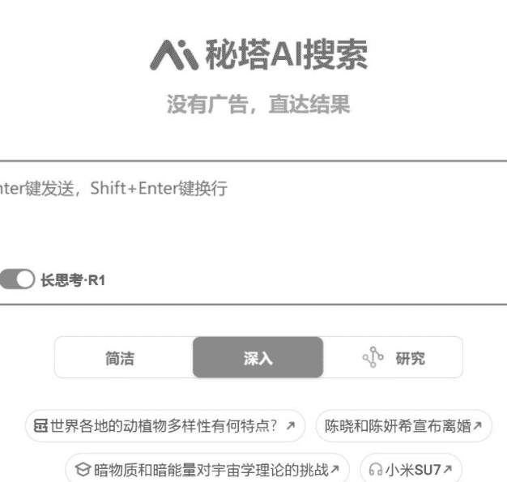

图9-5 秘塔AI搜索主界面

开启“长思考·R1”开关后，输入与 DeepSeek 相同的提问：

请帮我整理一下最近5年关于量子计算领域的最新研究进展，特别是有

关量子纠错方面的最新论文、关键人物和重要成果。

稍等片刻即可得到结果。图9-6 为部分截图，可见每条内容都附带翔实的引用来源，可直接跳转 PDF 或网页，学术论文的覆盖明显更全。

# ## 一、关键研究成果

*   谷歌量子纠错突破“盈亏平衡点”

    2024年12月，谷歌量子人工智能团队在《自然》发表论文，宣布其最新超导量子芯片Willow通过*表面码技术*，首次将逻辑量子比特的错误率降至物理量子比特错误率以下，突破了纠错的“盈亏平衡点”。这一成果验证了容错通用量子计算机的可行性。

*   亚马逊“猫量子比特”大幅降低纠错成本

    2025年2月，亚马逊云科技（AWS）团队联合加州理工学院推出新型量子芯片Ocelot，采用“猫量子比特”（cat qubits）设计，通过抗拒特定噪声类型减少硬件需求，将量子纠错成本降低90%。相关成果发表于《自然》。

*   微软与AWS推动实用化量子纠错技术

    2025年2月，AWS与微软合作优化量子纠错在药物开发、金融预测等领域的应用，加速实用量子计算技术的落地。

*   Delft大学表面码与漏电检测技术

    荷兰代尔夫特理工大学团队在 *npj Quantum Information* 发表研究，提出基于超导量子比特的表面码中漏电检测方法，显著提升纠错效率。

*   奇偶校验门集（Parity Check Gate Set）的优化

    2024年，Üstün、Morello和Devitt提出单步奇偶校验门集，通过改进量子安全中的奇偶校验技术，增强纠错能力。

# ## 相关事件


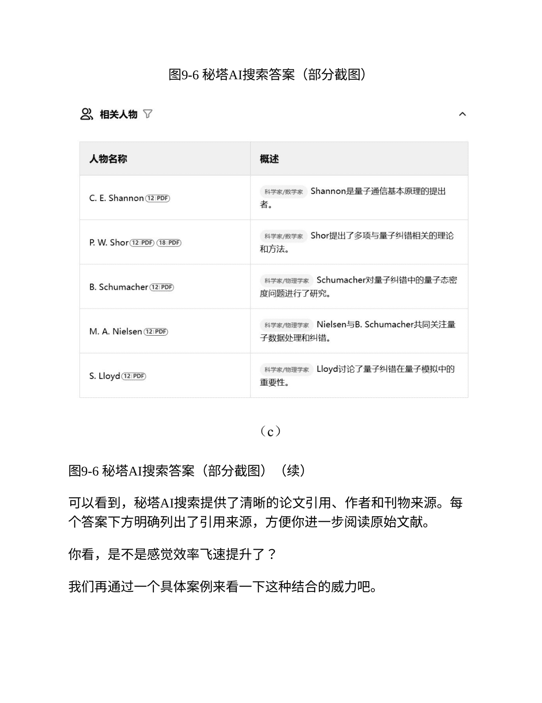

假设你是一名经济学专业研究生，需完成“数字人民币对消费行为影响”的论文。

可能遇到的困难是：切入角度不明、不知道引用哪些文献、难以把握学界主流观点与争议。

这时可先用秘塔 AI 搜索：

数字人民币对消费行为研究的最新进展和重要论文有哪些？

秘塔会迅速给出精准的文献清单，并标注重要研究和相关学者，每条均附带引用编号，可直接查看原文。

随后把这些信息输入 DeepSeek，请其辅助生成论文大纲、引言、研究背景、文献综述、研究方法等核心部分。协同使用后，效率和质量都会明显提升，你可以把精力放在创新思考和论证上，而不是资料检索和整理。

该组合在其他领域也适用。

**新闻资讯领域**：媒体从业者可借助秘塔快速定位背景材料，DeepSeek 再生成稿件或评论。

**自媒体领域**：创作者用秘塔捕捉热点话题和观点，DeepSeek 助力快速撰写优质内容。

**日常搜索场景**：秘塔提供权威答案和来源，DeepSeek 再做详细解释，帮助厘清理解。

# # 模块十

## DeepSeek 搭建专属知识库

### 理解 RAG 与知识库

前面已介绍 DeepSeek 的基础使用、提示词技巧及落地场景。但在真实企业和个人需求中，仅靠大模型本身常有短板——在专业领域或私有数据上难以精准响应。这时引入检索增强生成 RAG 技术并搭建专属知识库就很重要。

# ## 为什么需要专属知识库

DeepSeek 泛化能力强，但面对企业内部或个人专有知识时缺乏针对性信息，容易出现“幻觉”，给出看似合理但实际不存在的答案。例如询问：

我公司的商用清洁机器人的大客户折扣是多少？

DeepSeek 无法正确回答，因为它并不了解该公司的产品情况。

因此需要构建专属知识库，将企业内部文档、学习笔记、资料、培训手册、产品说明等私有内容上传，利用 RAG 在回答前先检索相关专有知识，再基于这些内容生成结果，从而提升准确性。

# **什么是 RAG**

RAG 是将传统搜索引擎与 AI 大模型结合的技术方案。用户提问时，系统会先按语义从知识库中检索最高相关片段，再把这些片段作为上下文与原问题一起输入大模型，最后由模型综合生成更精准的回答。

图10-1 描述了检索与生成的全过程。


这种方式能有效降低“幻觉”概率，提高知识密集型问题的准确度。

# **使用云服务搭建知识库**

选择云端方案可节省本地部署维护成本，快速完成建设。市场上有多家提供此类服务，本文以腾讯的 ima.copilot 平台为例，该平台操作简单且免费，适合个人和中小企业。

腾讯 ima.copilot 是一款面向企业和个人的在线知识库平台，支持文档上传、知识分享、实时问答，已集成 DeepSeek，无需部署模型即可获得高效检索与问答能力。

主要优势：

1.  **多端同步**：电脑端与移动端无缝衔接，支持微信公众号文章收藏、PDF 和 Word 文档上传。
2.  **便捷的知识共享**：可创建共享知识库，供团队共同维护更新。
3.  **DeepSeek 内置**：无需额外配置环境，降低使用门槛。

企业可将内部产品文档、流程规范、员工手册、培训材料上传到共享知识库，供员工随时查询，提升效率或帮助客服快速应答。个人也可上传电子书、学习资料、公众号文章到个人库，快速查阅或生成摘要、笔记。

使用时可通过微信小程序或下载客户端。官网提供各平台客户端，如图10-2所示。

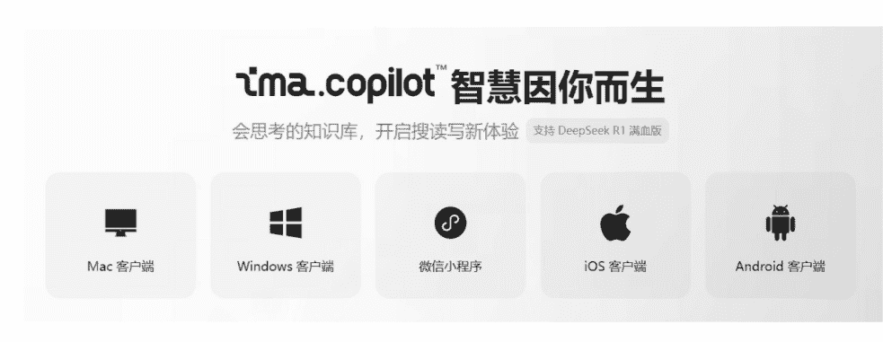

以下以 Windows 客户端为例说明基本使用。安装后用微信账号登录即可。

首页为一个对话界面，已集成 DeepSeek-R1 和联网搜索，如图10-3所示。注意界面会随版本更新变化。


图10-3 ima.copilot主界面

点击左侧灯泡图标，可切换到知识库页面，如图10-4所示。

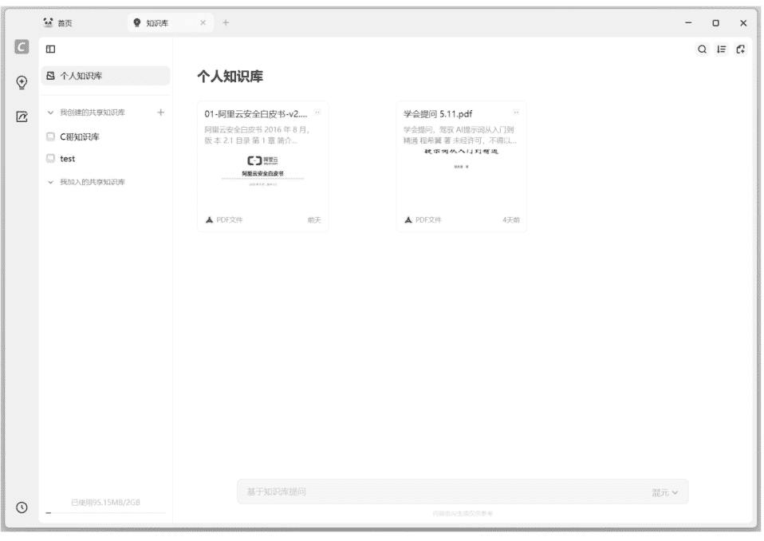

# # 图10-4 知识库页面

ima.copilot 知识库操作概览

ima.copilot 的知识库页面左侧被划成上下两块，上部是个人专属区，下部是团队共享区，后者可被整家公司、某个部门或组织多人共同使用。点中任一库后，右侧即可导入素材，常见格式如 PDF、图片、Word 都被支持。

以个人区为例，我分别上传了自著的《学会提问，驾驭AI: 提示词从入门到精通》以及阿里云公开的《阿里云安全白皮书》。文件上传后约一分钟左右会被写入 RAG 索引，之后页面底部的问答框就能基于这两份材料作答。

ima.copilot 最突出的价值在于共享能力的开放。我新建了一个名为 C哥的知识库的共享空间，进入后点击分享即可把访问权限分发给相关同事，分享形式支持链接和二维码。获得权限的人可以直接在你提供的资料上进行提问。

使用时需留意模型选择，平台接入了多款主流大模型，提问前要确认当前生效的是哪一个。若想让 DeepSeek 参与推理，需要手动切换到该模型。

本地私有知识库搭建思路

云端部署省心，但当数据隐私要求较高时，把知识库放在自有环境更安心。下面以开源平台 Dify 为例说明以 DeepSeek 为核心的本地方案。

Dify 是一个开源的生成式 AI 应用开发平台，核心能力包括：

1. 能接入 DeepSeek 等主流大模型。
2. 检索增强生成的实现比较扎实。
3. 知识库的创建与管理流程顺手。
4. 从智能体搭建到工作流编排、模型管理等一站式支持生成式 AI 原生应用。

Dify 的本地化搭建步骤较多，需要 Docker、模型运行环境等多款软件配合，且版本更新会带来变动。Dify 更多运行在企业 Linux 环境，Windows 上体验有限。本节不展开完整演示，具体操作可参考配套课程，下面仅做流程梳理。

本地机器首先要安装 Docker，Dify 的运行依赖它。

* 准备本地模型运行环境，例如 Ollama，并通过它拉取 DeepSeek 模型，相关内容前面章节已有介绍。
* 使用 Docker Compose 部署 Dify 本地版。
* 在 Dify 管理界面配置本地 DeepSeek 的访问地址，完成模型与平台的关联。
* 新建知识库并导入本地文件，支持 PDF、Word、Markdown 等。
* 在 Dify 中部署向量化模型，将导入内容转为向量以便语义检索。
* 新建一个 Dify 应用，将前面创建的库挂载为该应用的背景知识，实现应用内的检索与问答。

除 Dify 外，Cherry Studio、AnythingLLM、RAGFlow 等工具也能用于本地化部署知识库，可按需求挑选。Cherry Studio 的本地安装门槛更低，更适合个人使用。

本地化后，企业可把内部文档、规章制度、产品手册等保留在内网，员工通过企业内网查询；还能为新人搭建智能培训助手，或构建对内对外的智能客服。个人用户则可把文献、笔记、各类资料聚合到本地库，形成智能化的知识管理助手，用来辅助写作也能提升创作与学习效率。

实践表明，自建专属知识库能有效缓解大模型的幻觉问题，提升生成内容的准确度，也能显著提高个人或团队的知识管理效率。

# 模块十一
DeepSeek 助力政企迈向智能时代

当前政府和企业均处在数字化转型的关键期，随着人工智能技术走向落地，越来越多组织开始为自身配建智能化方案。DeepSeek 系列凭借出色的文本处理表现和相对低廉的使用成本，为政企提供了丰富的应用场景。引入该技术后，组织的工作效率可提升，运营成本可下降，决策与服务体验也会优化，加速迈入智能化时代。

以下仅抛砖引玉列出部分落地形态，具体场景需结合业务自行延展。

### 通用领域的落地探索
各类企业中都能找到应用空间，下面列举常见方向。

#### 招投标辅助
依托语义理解能力，DeepSeek 配合爬虫可自动发现契合企业条件的招投标项目，大幅提升效率。对指定项目，它还能结合企业产品资料与投标要求自动生成标书，并对投标文件做全方位风险排查，减少人工失误，保证专业合规，从而提高中标率。

#### AI 法律顾问
过去企业法务咨询多依赖专业律师。基于 RAG 的智能法务助手可自动处理内部常见法律问题。

合同处理是典型场景，人工方式耗时易漏且风险高。DeepSeek 能依据企业历史合同和现行法规自动生成合同文本，还能审阅条款、标注风险点并给出修改建议，大幅提升合规性与撰写效率。此外还能协助劳动纠纷处理、知识产权保护等，减少基础法务的人工投入，推动法律服务智能化。搭建企业 AI 知识库配合 DeepSeek 的深度思考模式即可实现类似业务。

需要强调的是，当前 AI 法务助手仍存在幻觉风险。对于金额巨大、影响重大的法律问题，AI 只能作为参考。

#### 智能客服
客服工作量大且重复度高，DeepSeek 可实现 7×24 小时在线，自动解析用户意图并精准回复。银行、电商、通信运营商等行业均可快速部署，满意度提升的同时人工成本下降。

落地需解决三件事：
- 如何让 AI 掌握企业与产品知识。
- 如何让客服平台自动调用 AI 并把回答回传给用户。
- 如何控制幻觉与错误回复。

第一点可参考前文的知识库章节。第二点多数客服平台均提供 API 接口，如微信公众号、企业微信客服等，自研或第三方系统也大多可获取接口，拿到接口后即可让 AI 自动读取用户消息并自动回复。第三点需要优化提示词，对不确定或超出能力范围的问题让 AI 主动拒答或仅作参考，并交由人工复核。最后仍需一定的开发能力或专业团队支持。

#### 自媒体内容自动化
DeepSeek 能分析热点话题和用户画像，自动生成文章、短视频脚本、营销素材等。政企宣传部门部署自动化生产平台后，可快速产出贴合热点的稿件，提升创作效率与传播效果。

#### 内部流程审批自动化
企业审批涉及大量重复性合规判断。DeepSeek 学习管理制度及审批案例后，可自动判断申请是否合规并生成审批意见。接入办公自动化系统后，能减少人力投入、缩短周期、降低舞弊风险，运营效率明显提升。

#### 企业知识库建设
企业知识分散在各系统和文档中。结合 RAG 技术搭建智能知识库平台，可自动爬取、整理、分类政策解读、技术文档、市场分析报告等。员工仅需用自然语言查询即可快速获取所需信息，实现知识资产结构化、便捷化管理，赋能协作与学习，减少培训成本并快速响应市场。

### 智能在线办公与数据处理
例如协同办公平台飞书已融合 DeepSeek，可在多维表格字段捷径中调用 DeepSeek-R1 批量生成文案、脚本、策划方案，进行多语言翻译和智能门店巡检等。

### 政务领域的实践
政务场景需求旺盛，业务面广，下面案例可供举一反三。

#### 公文辅助管理
DeepSeek 通过海量政务公文语料训练，可快速协助工作人员生成规范文稿，减少人为错误并提升写作效率。部署公文辅助系统后可提高办公自动化水平。

#### 智能政务助手与“一网通办”
借助模型能力，办事群众能更快完成申请，政务服务效率和公众、企业满意度明显提升。

#### 招商引资与文旅宣传
政府在招商、文化宣传、旅游推广中对文案策划需求强烈。DeepSeek 可基于地方特色、产业优势和文化资源自动生成营销方案和文案，加速策划与传播。

#### 公检法材料审阅及辅助办案
DeepSeek 在阅读和总结长文本上表现突出，面对数百上千页的办案材料能快速提取要点。可自动填写办案系统中的常规流程信息，推动流程提速与自动化。对简单案件，还可读取报案记录、口供、当事人情况，辅助民警提出疑问点与审讯重点、自动填充流程信息、推断案件可能真相等。

#### 金融行业的实践
##### 智能金融咨询与市场实时分析
腾讯理财通打造的基于 DeepSeek-R1 的 AI 金融咨询助手，用户通过自然语言对话即可获得个性化理财规划、金融知识解答和产品推荐，还能进行实时市场分析和研报解读，增强体验。

##### 金融内审报告
DeepSeek 可分析大量财务数据和内控制度，自动生成详细内审报告并识别潜在风险，帮助审计人员快速掌握财务状况和经营风险，降低审计成本和风险。

##### 保险方案设计
保险公司部署 DeepSeek 平台后，可依据客户个人信息、风险偏好、历史投保数据自动生成个性化保险方案建议，缩短销售周期，提高满意度和承保成功率。

##### 银行落地应用
工商银行已部署 DeepSeek 系列模型，通过技术创新提升部署效率、压降推理成本、提高吞吐量。通过重点领域试点实现应用突破，发挥其在强推理和复杂数据处理上的优势，构建财报分析助手、AI 财富管家等十余个典型场景，推动业务流程智能化升级。

### 医疗健康领域的落地应用
#### 疾病诊断辅助
临床诊断中，DeepSeek 能快速分析医学文献和患者数据如病历、检验报告，提供辅助诊断意见，提高诊疗效率和诊断精度。

#### 健康管理与个性化建议
基于体检和健康数据综合分析，模型能自动生成个性化饮食和运动建议，助力健康管理方案落地，提升人群体质并降低健康风险。

# 模块十二
### DeepSeek 的后续演进
R1 与 V3 发布后，国产大模型进入快速崛起期。凭借优异的推理、编程、多语言能力以及极低成本，DeepSeek 让国内 AI 在国际竞争中真正站稳脚跟。作为代表性公司，深度求索已闯出自己的天地，但显然不止于此。

行业消息称，后续版本 DeepSeek-R2 或将在 2025 年 5 月甚至更早亮相，有望在编程和多语言推理等关键领域取得重大突破，延续既有优势。

官方还公开表示正在布局支持跨模态推理的下一代大模型。所谓跨模态推理，指 AI 不仅能理解生成文字，还能同时处理图片、音频、视频等信息，并在不同模态间进行推理和决策，并支持思维链输出。Kimi 的 K1.5 就是这类模型。

跨模态推理将彻底改变与 DeepSeek 的交互方式，一旦落地，应用场景会远超现有水平，因而很可能是下一代 AI 的杀手级应用。

深度求索的野心不止于此。创始人梁文锋在采访中明确表示，公司的发展方向只有一个，即实现 AGI。因此对其他方向并不看重。例如应用层设计简洁、算力分配有限，常出现服务器繁忙；2024 年把 API 价格调至行业最低，引发价格战。但被问及商业策略时，梁文锋表示并不在意，因为目标是 AGI，不考虑短期商业利益。

谈及 AGI 时间线，他认为会在有生之年实现，并给出押注的三个技术方向：数学与代码、跨模态、自然语言本身。他认为数学与代码是 AGI 的天然试验场，如同围棋，是封闭可验证系统，有望通过自我学习实现高智能；跨模态参与真实世界学习对 AGI 也必不可少。并保持对一切可能性的开放。他还说：“OpenAI 也不是神，不可能一直冲在前面。”

### 原生多模态图片输出
在跨模态演进中，原生多模态图片输出可能在 2025 年大放异彩，这项技术有望重塑电商、设计、美术、电影等行业。

谷歌于 2024 年 12 月发布 Gemini 2.0 Flash，这是一款业界领先的原生跨模态模型。所谓原生跨模态，不仅支持文本、图像、语音、视频作为输入，还支持文本、语音、图像作为输出，实现输入输出两侧的跨模态。

相较仅支持视觉理解的模型，Gemini 2.0 Flash 支持原生图像输出，可交替输出文本与图像，并支持对话式多轮编辑，与纯文本生成模型大不相同。

过去修改图片需精通 Photoshop 等软件，耗时学习。Gemini 的跨模态图片输出让修图变得极简。例如先生成人像，再指令“改成青蓝色连衣裙”，4 秒完成换装且无痕；再说“让她强颜欢笑”，表情立刻变为心酸无奈。给模型一张鞋设计稿，下一秒就能变成模特实拍图并随意变换场景。先设计游戏角色，一句话就能让角色举手。谷歌的原生跨模态图片输出堪称 AI 修图的 iPhone 时刻，国内公司预计会迅速跟进。

### Manus 引爆 AI 智能体
除底层大模型与跨模态，AI 智能体正经历前所未有的爆发。2025 年被普遍认为是 AI 智能体的爆发元年，而 Manus 就是典型代表。

通俗理解，Manus 是一种通用 AI 智能体，核心创新在于能自动拆解复杂任务并调用各类工具完成。例如告知它“帮我做一份 5 月北京旅游攻略”，它即可自动调用搜索引擎、地图、天气预报等工具，完成多步规划并交付完整方案。

强大的工具调用、任务拆解与自主决策能力是爆火原因。官方称其在 GAIA 评测中取得 SOTA。

#### Manus 的工作原理
把 Manus 视作个人助理：理解需求、调用工具、自动完成任务、交付结果。

例如用户说：“我 4 月想去日本旅游，10 天，游览东京、大阪、京都，预算适中，喜欢历史文化景点。”

第一步，语义解析层像人类一样理解意图：旅行规划，日本三城，预算限制，偏好历史文化。

第二步，任务拆解为子任务：查询 4 月机票价格与航班、筛选符合预算与喜好的酒店、推荐历史文化景点、制定每日行程、推荐当地美食、设计路线与交通方式。

第三步，调用工具执行。比如查询机票时启动浏览器，访问航司官网或 OTA 平台找合适航班；酒店预订则在携程、Booking 等平台搜索并整理名称、价格、评价；景点推荐抓取各大旅游网站攻略与评价，汇总东京上野公园、浅草寺、京都清水寺、金阁寺、大阪城公园等信息，再规划游览顺序与交通。

第四步，内置验证机制，获取信息后自动校验准确性。若机票价格过高、酒店评价不佳或景点信息有误，会自动调整直至合理可靠。

**第五步：生成专属电子旅行手册**
它会把前面收集到的航班、酒店、每日行程、景点推荐、美食餐厅和交通攻略等信息，整理成一份结构清晰的电子版旅行手册，直接交到你手上，让出发变得毫无负担。

思路是相通的。假如你是 HR，想从 15 份简历里挑出合适的强化学习算法工程师，只要对 Manus 说：‘帮我在这 15 份简历里筛选出适合强化学习算法工程师的人，重点看学历、工作经历、项目和技能。’系统就会自动打开简历文件夹，逐份读取，提取学历、工龄、项目经历和技能点，再逐项对照岗位要求，最后输出一份带排名和简要说明的报告。

这些看似自动完成的操作，Manus 到底怎样实现的？

Manus 的底座是一个多工具协作环境，自带一套工具箱：
- 浏览器工具，可自动打开网页、点按按钮、输入文字、滚动页面；
- 文件管理工具，可自动读取、写入和修改文件；
- Shell 工具，可自动执行 Linux 命令、安装软件；
- 编程工具，可自动用 Python 等语言编写代码；
- 信息检索工具，可自动调用搜索引擎；
- 部署工具，可自动搭建网站或应用等。

在理解需求后，Manus 会自主挑选合适的工具，按步骤执行。所有工具都运行在安全沙盒，也就是一个隔离的 Linux 系统，避免对个人电脑或网络造成影响。

换句话说，人和 Manus 的关系就像指挥一位极聪明的操作员：你只负责说“做什么”，它会自动调用各种软件，分步完成细节，最后把整理好的成果交给你。

支撑 Manus 的核心大模型是 Anthropic 的 Claude Sonnet，在代码编写和任务理解上表现突出，很适合自动化助手场景。为增强能力，Manus 还用通义 Qwen 的开源模型做了微调，并称未来会开源该微调模型。出于合规，国内版会把 Claude 换成通义系列模型。

另外，Manus 使用“Agent 循环工作模式”，每次只做一个小步骤，等待反馈后再据此进入下一步。通过这种迭代方式，能更灵活地处理复杂任务并逐步校准，确保交付质量。

这就是 Manus，一个可随时调用的自动化 AI 助手。内部机制看似复杂，呈现给用户的体验却很简单：给一个明确指令，剩下的它全自动完成。透过这番介绍，对它的运作原理应该已有直观认知。这种自主化工作方式，正是 AI 智能体时代的核心特征，也是 AI 对工作和生活带来的深层变革之一。

总体来看，DeepSeek 在政企等广泛场景已显现出显著的实战价值，政企智能化转型的潜力依然很大。各组织应积极布局 DeepSeek 的应用与创新，抓住智能时代的机遇。

需要警惕的是，DeepSeek 火爆后，网上充斥大量由 AI 或人工炮制的“DeepSeek 企业落地案例”，内容多为虚假。查阅资料时务必提高辨别力。

# Manus 实战用法
对于通用智能体，最关键的一步是写好提示词。Manus 会完成后续拆解与执行。写提示词的核心原则是：任务必须能拆解为可在电脑上具体执行的步骤。Manus 会自行细化并运行，你不必告知具体做法，但若涉及特定软件或输出格式，必须在提示词中说明。

先进入 Manus 官网。本书完稿时官网暂未对国内及无邀请码用户开放，待国内版上线后即可体验。登录或注册后进入任务页，输入提示词即可。

例如招聘强化学习工程师，可把候选人简历打包成 zip 上传，并输入：
> 我是 HR，正在招强化学习工程师。我已上传候选人简历，请整理成 Excel 并按个人能力进行排名。

在思考过程中，Manus 会启动云端计算机，直接解压 .zip，由于文件为 .pdf，它自动写了 Python 程序批量处理。

## 图 12-4 Manus 解压文件示意
解压完成后，系统开始分析简历细节，仍是自动编写程序并自行运行，经多次重复操作完成全部分析。

## 图 12-5
Manus 用程序分析简历

## 图 12-6
Manus 生成结果表格

最终，Manus 通过程序为每个人打分，生成 RL Score 作为能力评价，并用 Python 创建 Excel。表格中最佳候选人会被高亮，同时列出项目经历、成果、分数和评价，并给出自然语言的综合点评，极大简化了 HR 流程。

# 通用与垂直智能体之分
当前 AI 智能体大致分两类：通用型和垂直型。Manus 属于通用型，能做很多事但未必做到极致；垂直型则聚焦教育、金融、医疗等特定行业，解决行业痛点。

我更看好垂直智能体的未来。

原因在于，通用智能体的能力主要取决于底层大模型的通用推理，而各家底层模型差异不大，容易同质化，难以形成壁垒。垂直智能体则不同，做金融智能体需要大量真实场景经验、数据和行业know-how；做教育智能体需要深入理解教学流程、教研要求和学生痛点。这些资源多掌握在行业内部，天然具备优势。

因此，市场上通用智能体可能“百花齐放”，但粘性弱、易被替代；垂直智能体更易打造护城河，形成长期优势。

要保持清醒，Manus 之类工具很强，但核心能力仍依赖底层大模型，未突破技术瓶颈。例如“幻觉”问题依然存在，若任务中出错，自主执行反而可能放大风险。要积极拥抱进步，也要理性看待局限，避免捧杀产生泡沫。

在金融领域，垂直智能体可深入理解市场波动，为机构提供定制化投资建议；在教育领域，可分析学习数据，提供个性化教学方案；在医疗领域，可分析患者数据，提供个性化诊疗建议。总的来说，垂直智能体市场空间广阔，有望成为 AI 智能体的重要发展方向。

# 模块十三：AI 大变革时代的生存法则
这是本书最后一章，也是我认为最重要的一章。前文多谈“术”，这里聊聊“道”。本章用问答形式展开，探讨 DeepSeek 对世界和个人的影响，以及我们该如何应对。

## AI 会迅速改写世界吗
人们常高估新事物的短期影响，低估长期影响。历史一次次验证了这一点。上世纪 90 年代互联网刚出现时，被视作技术爱好者的玩具，如今却重塑了购物、社交、金融、教育乃至政治。

AI 的演进也在遵循类似规律。起初只停留在象棋或科幻里，如今已渗入生活每个角落。手机推送你喜欢的新闻短视频，地图规划最优路线，购物时 AI 比你更懂你的消费习惯。

我自己的经历是，十岁左右就开始写程序，梦想做一款游戏。那时上网极贵，查资料困难。我花了半个多月写了几万行代码，做出俄罗斯方块，靠软盘 1.38MB 的容量传遍家乡。那种兴奋如同考出压轴题。如今二十多年过去，几句话就能让 AI 写出完整游戏代码，国外七岁孩子靠 AI 编程几天赚几万美元。我现在 50% 的代码由 AI 生成，我更像产品经理和架构师。

这种变化不仅提升便利，更重塑经济、就业和社会结构。翻译行业效率大幅提升从业者需重新定位；教育中 AI 辅助教学个性化满足需求，也改变教师角色；医疗影像 AI 已在部分场景超越人类专家，提升效率并降低成本。

改变才刚开始。AI 将从“辅助”走向“协作”，从“幕后”走向“台前”。未来五到十年，AI 会深入更多行业，重塑价值链和经济模式。自动驾驶重塑运输，AI 工具重塑企业运营，AI 内容创作重塑自媒体和创意产业。

可以肯定，AI 时代的真正革命已悄然到来，冲击会以难以想象的速度抵达每个人身边。

## AI 会扩大还是缩小普通人机会
坦率说，AI 带来的变化并不会均匀惠及所有人。表面看人人都有更大可能性，历史却证明技术红利多流向少数群体，因经济地位、岗位和学习能力差异而异。

AI 时代差距会指数级拉大。对部分人而言冲击并非福音。

以客服为例，互联网时代客服是大量普通劳动者的入场通道，中国有数百万从业者。随着 DeepSeek 等大模型普及，AI 客服在理解、回复速度和全天候服务上远超人工。企业招聘数百客服需高昂人力成本和管理成本，而一套 AI 系统成本仅占很小一部分。普及后普通劳动者难以竞争。

自媒体也是如此。过去靠拍摄剪辑，每天只能产出几条内容。现在懂 AI 的人可批量生产数十个账号、数千条笔记。AI 协助选题、写稿、剪辑、配音，数字人技术成熟。几台电脑、几行代码即可完成过去数十上百人工作量。

结果是原创与个性衰落，工业化生产占据流量。AI 驱动的批量生产者占据大部分流量，普通人辛苦积累的账号价值被稀释。掌握 AI 使用方法的人轻松获利，不懂者难以抗衡。

更危险的是有人认为 AI 足够智能，无需学习，说句话就能享用同等服务。这是错的。即使智商情商相同，作为“老板”管理 AI 的能力也不同。商业认知、任务安排、抓住机会都需要判断力和执行力。垂直领域的使用更是高度技巧化。

我们必须思考：如何成长、如何不被洪流吞没。

## DeepSeek 为何爆火
DeepSeek 爆火并非偶然，而是多重因素叠加。

首先，DeepSeek-R1 把 AI 从“不可用、凑合用”变为“人人可用、都爱用”。成本大幅下降、性能大幅提升，让 AI 从高不可攀走向普及，原本触不可及的企业和个人都能用上顶级模型。之前同等水准只有 OpenAI 的 o1、o3 系列，对国内用户使用门槛高。

其次，开放性和部署便利性是关键。开源免费，众多公司、学校、企业免费部署，中小企业也能便捷部署，消除数字鸿沟，让创业公司和个人与巨头同一起跑线。

在 DeepSeek-R1 之前，AI 火了几年但并未广泛应用。R1 在中国完成了一次彻底的 AI 大普及，可能使中国成为全球 AI 渗透率领先国家，加速产业发展。

本质是必然趋势：成本下降、体验提升、门槛降低、场景价值清晰，共同引爆需求。

## 普通人如何学习 AI
两种极端认知都错。

一种认为 AI 不需学习，说话就行。这是错误的。当人人都会用时，用得好与否决定生产力差距。

另一种认为 AI 高深莫测，普通人学不会。实际上无需人人成专家，只需针对性掌握适合自己的能力。

我总结了五个学习阶段：

### 第一阶段：基础对话
能与大模型做基本交流，感受基础能力。大多数人止步于此。缺乏系统认知，认为一句话就能完成一切。常见例子是问“帮我做个 PPT”，AI 回复只能提供大纲，于是判定“AI 也就这样”，不再深入。

### 第二阶段：掌握提示词
能写出高质量提示词，实现更精准互动，提升工作质量。它让你了解不同 AI 的风格，精准控制输出，效果数倍于新手。做自媒体文案时，熟练者输出可直接用，不熟练者需大量修改。

### 第三阶段：熟练使用 AI 工具

掌握市面上常见的 AI 工具与软件，并学会把它们组合起来用。比如用 DeepSeek+Markdown 来处理表格，用 DeepSeek+Canvas 来做动画，用 DeepSeek+百言神通 来解决教学场景的问题，用 DeepSeek+可灵 AI 来产出视频等。同时对 AI 智能体已有初步认知，能够熟练调用现成的智能体来支撑日常工作。后续我正在筹备一本围绕 AI 与超级个体的新书，届时会把智能体的实操拆解得更细。

### 第四阶段：构建专属知识库
学会借助 AI 收集、归纳专业领域的资料，并把工作经验、学习心得和个人经历融合进去，沉淀成一套只属于自己的 AI 知识体系，让知识变成可复用的资产。依托这套知识库，就能为自己定制简易的 AI 智能体和专属的 AI 助手。

### 第五阶段：搭建专属智能体与自动化工作流
真正亲手做出属于自己的 AI 智能体和工作流程，让个人或企业的重复性工作实现自动化。这是迈向超级个体不可或缺的核心能力。

对普通人来说学 AI，不必一开始就钻研底层理论，更重要的是结合自身实际循序渐进，从基础对话练起，逐步过渡到搭建专属智能助手的水平。最关键的是先动手做起来，在实践中学习并持续优化。

# 后续规划与新动作

我的目标是帮助更多人从普通个体跃迁到“超级个体”“一人公司”的形态。完成本书后，我的安排如下：

- 我将推出另一本聚焦 AI 时代如何成为超级个体的新作。新书已在准备中，感兴趣的朋友可以先加入我的读者社群，抢先获取动态。

- 今年我会重点投入运营一个面向 AI 时代个体成长的社群——“C 哥的 AI 成长圈”。以共创共[content]
掌握市面上常见的 AI 工具与软件，并学会把它们组合起来用。比如用 DeepSeek+Markdown 来处理表格，用 DeepSeek+Canvas 来做动画，用 DeepSeek+百言神通 来解决教学场景的问题，用 DeepSeek+可灵 AI 来产出视频等。同时对 AI 智能体已有初步认知，能够熟练调用现成的智能体来支撑日常工作。后续我正在筹备一本围绕 AI 与超级个体的新书，届时会把智能体的实操拆解得更细。

### 第四阶段：构建专属知识库
学会借助 AI 收集、归纳专业领域的资料，并把工作经验、学习心得和个人经历融合进去，沉淀成一套只属于自己的 AI 知识体系，让知识变成可复用的资产。依托这套知识库，就能为自己定制简易的 AI 智能体和专属的 AI 助手。

### 第五阶段：搭建专属智能体与自动化工作流
真正亲手做出属于自己的 AI 智能体和工作流程，让个人或企业的重复性工作实现自动化。这是迈向超级个体不可或缺的核心能力。

对普通人来说学 AI，不必一开始就钻研底层理论，更重要的是结合自身实际循序渐进，从基础对话练起，逐步过渡到搭建专属智能助手的水平。最关键的是先动手做起来，在实践中学习并持续优化。

# 写完本书后的下一步

我的愿景是推动更多人完成从普通个体到“超级个体”“一人公司”的转型。因此本书结束后我计划：

- 推出一本讨论 AI 时代如何成为超级个体的新书。新书即将面世，有兴趣的朋友可以提前进入我的读者社群，第一时间拿到相关消息。

- 今年会集中打造并运营一个聚焦 AI 时代个体成长的社群——“C 哥的 AI 成长圈”。以共创共享的方式，凝聚一批认同 AI、学习 AI、落地 AI 的个体和企业主，通过学习、互助和陪伴式成长，让大家率先成为 AI 时代的超级个体，打造国内最落地的 AI 社群圈子。

如果你关注 AI 时代的个人跃迁，欢迎扫码加入 C 哥的 AI 成长圈，我们一起共创共享，把握 AI 时代的先机。

> Your gateway to knowledge and culture. Accessible for everyone.

- z-library.sk

- z-lib.gs

- z-lib.fm

- go-to-library.sk

- [Official Telegram channel](https://t.me/Z-Library)

- [Z-Access](https://z-lib.net/z-access)

- [W](https://en.wikipedia.org/wiki/Z-Library)