# DeepSeek 全民实操指南：AI 工作组合通关手册

## 内容简介

本书以 DeepSeek 为核心，系统梳理其与各类 AI 工具协同使用的实战方法。既面向零基础的个人读者，提升日常工作、学习与生活的效率，也为企业、机构提供可落地的降本增效思路。

作者长期在腾讯从事人工智能的工程化工作，对深度求索等技术保持持续研究与一线实践。书中汇聚多年行业经验与案例，旨在帮助读者少走弯路，直达应用核心。

阅读后可获得如下收获

- （1）对深度求索的整体认知与快速上手：从创始人视角拆解技术优势与边界，介绍多种接入方式，并以新手实验室与提示词设计方法论搭建从理解到落地的完整路径。
- （2）多工具联动实践：详解深度求索与 Kimi、WPS、Excel、Coze、ima、即梦、飞书、剪映等约 15 款常用软件的配合模式，手把手打造个人智能工作台。
- （3）全场景覆盖：涵盖演示文稿制作、文案撰写、数据处理、海报设计、知识库管理、智能体搭建等高频使用场景的具体做法。
- （4）行业解决方案：面向企业服务、政务、环保、金融、农业、制造、教育等 8 大领域，给出以深度求索为核心的效率提升方案。

全书图文并茂，示例丰富，步骤清晰，便于快速上手，在智能化浪潮中抢占先机。

## 前言

2025 年春节，一枚蓝色鲸鱼图标迅速蔓延全球。深度求索的破圈标志着人工智能正从技术奇观走向日常生产工具，这场由算法驱动的社会变革正在改写每个人的生活方式。

热度背后有三个值得回应的时代提问：当认知迭代压缩到月级，普通人如何避免被技术甩下？当开放生态重塑创新格局，国内开发者如何抓住窗口？当模型展现出类人推理能力，人与机器应如何共处？本书试图在人工智能从专业圈层向大众扩散的过程中，构建共学、共享、共进的应用范式。

所谓全民攻略并非操作罗列，而是一套完整的人工智能社会化应用体系。当技术走出实验室进入菜市场、写字楼与生产线，我们需要读懂算法背后的设计哲学，例如 MoE 架构所体现的分而治之思想，学会把技术特性转化为生产力，例如强化学习带来的自主解决问题的范式，最终形成新型的人机协作伦理。这种知其然并知其所以然的沉淀，才是对抗技术迭代的核心壁垒。

本书结构如下。

第1～3章以创始人从金融量化到人工智能的跨界为起点，梳理破局路径，解析技术长处与局限，并为新手提供多种接入方式，通过新手实验室和提示词方法论完成从认知到落地的闭环。

第4～11章深度整合工具链，覆盖秘塔、日历、Excel、Kimi、WPS、即梦、剪映、飞书、ima、Coze 等，涉及学习生活工作场景、数据处理、智能创作、知识管理以及智能体构建。

第12～14章从行业实践到社会价值探索，最终展望人工智能重构物理世界的双重路径，强调技术可行、人文需求与伦理温度共生的未来图景。

成书过程中感谢妻子马涵在深夜讨论中提供的用户视角，她反复追问功能对普通人是否实用，推动不断反思；感谢女儿茜茜和朵朵，她们以帮我想个恐龙故事这类纯真需求，验证了技术的温度与安全边界。

## 第1章 认识 DeepSeek

2025 年春节，舆论焦点几乎都集中在深度求索身上。这家中国人工智能的黑马，用 7 天时间突破一亿用户，展现了国内技术进步与创新活力。此前赛道由海外巨头主导，该平台凭借差异化创新脱颖而出，为产业带来新思路，也成为自主创新的重要推手，在一定程度上缓解了技术封锁压力。

中国迎来了自己的 ChatGPT 时刻。

同时也要清醒看到，与国际顶尖水准相比，该平台仍有提升空间，需要持续优化技术、拓展场景，才能在全球舞台发挥更大作用。

### 1.1 DeepSeek：中国 AI 的破局之路

#### 1.1.1 幻方量化：从金融炼金术到 AI 革命的跨界转型

深度求索是一家人工智能技术公司，中文名为深度求索，由量化投资公司幻方量化孵化。幻方在量化投资领域声名远扬，尤其在高频交易上技术领先。但公司并未止步于金融成绩。

通过孵化深度求索团队，幻方开启了一次惊人的跨界进化。这不是简单迁移，而是将数据处理、算法优化等深厚积淀深度融合。从量化投资到通用大模型，幻方走出独特路径，用金融领域沉淀的算力与算法反哺智能创新，为深度求索发展提供坚实基础，也开创了金融算力反哺人工智能的先例。

可关注的创新有三点。

第一，技术外溢效应。幻方作为头部量化私募，核心竞争力是数学建模、算法优化与超算能力的融合。这种技术基因为人工智能创新埋下伏笔。高频交易需秒级处理数亿级市场数据，训练实时决策算法，与大模型训练中的数据处理、参数优化有底层共通。2019 年幻方自建萤火超算集群，在分布式计算、低延迟传输上积累深厚，为大模型训练提供硬件基础。人才上，团队汇聚大量数学、物理高材生，形成数理思维与工程实践复合结构，为人工智能研发迁移创造条件。2020 年左右，当算法能力触及金融天花板，创始人梁文锋果断将资源转向人工智能研发，成立深度求索团队，启动战略转型。

第二，金融科技反哺智能创新。幻方通过高频交易积累大量资本与算力，其核心是极致算法优化如用 GPU 汇编语言 PTX 优化交易系统。这种在有限资源下追求效率的思维，成为深度求索技术突破的底层基因。量化投资中的动态风险管理模型被迁移到人工智能训练。如深度求索首创的多头潜在注意力 MLA 架构，通过动态分配计算资源类似量化交易中的仓位控制，将 Transformer 内存成本降低 87%～95%。这一突破本质是将金融的风险收益平衡思维转化为工程优化。同时，金融交易积累的市场行情、交易行为、投资者情绪等多维数据，为模型训练提供多样化素材。

第三，开源升维。开源既是策略也是理想。梁文锋多次表示，深度求索的成功得益于站在开源社区肩上。Meta CEO 扎克伯格也指出深度求索的崛起验证了开源路线的正确性。开源为生态伙伴提供低成本训练条件和开发环境，降低企业研发成本，让更多人以低成本使用大模型。封闭虽能短期保护优势，长期看开源能释放更大能量，促进技术迭代，并让更多参与者共同制定更具权威性的行业标准。

#### 1.1.2 梁文锋：从小镇学子到智能领军人

深度求索爆火后创始人梁文锋进入大众视野。梁文锋 1985 年生于广东湛江普通家庭，父亲是小镇数学老师，从不关心排名，只反复强调今天解决了什么问题。2002 年以吴川市第一中学全省第一的成绩考入浙大电子信息工程专业。本硕期间持续深耕技术，硕士论文基于低成本 PTZ 摄像机的目标跟踪算法研究展现出将复杂理论转化为实际应用的视角。父亲不问排名问问题 的教育方式，使他始终保持对知识本质的探索热情。

梁文锋的独到之处在于把解题家方法论升维为创新方法。一是问题导向思维，从量化时期自建数据库，到人工智能赛道聚焦低成本、高性能痛点，始终遵循发现问题拆解问题创造性解决的路径。二是资源极致利用，朴素价值观转化为 DeepSeek-V2 仅 2 元/百万 Token 的颠覆性定价，以及 MoE 架构下每 Token 激活 370 亿参数的技术突破。三是本土人才信任，组建本土化核心团队，坚持自育顶尖人才，团队 90 后占比超 75%，重塑人工智能人才成长范式。

他曾如此论述创新。

- 最重要的是参与到全球创新的浪潮中去。过去很多年国内公司习惯拿来技术做应用变现，这不是理所当然。这波人工智能浪潮里，目标不是趁机赚钱，而是走到技术前沿，推动生态发展。
- 随着发展，中国应成为贡献者而非一直搭便车。过去 30 多年 IT 浪潮中基本没有参与真正的技术创新。习惯摩尔定律从天而降，却忽视这背后是西方技术社区一代代创造的结果。
- 未来中国产业结构调整将更依赖硬核技术创新。当很多人发现过去的快钱可能来自时代运气时，会更愿意俯身做真正的创新。

#### 1.1.3 人才密码：本土梦之队

深度求索爆火后，外媒开始关注这家公司。财富杂志总结其宽松企业文化为三无模式：无职级、无赛马、无 KPI。

核心成员多来自清华、北大、北邮等顶尖高校，平均年龄低于 35 岁，包含大量应届毕业生和在读博士，多人曾参与国家级人工智能实验室项目，兼具学术视野与落地经验。如邵智宏，清华 CoAI 课题组博士生，师从黄民烈，参与 DeepSeekMath、DeepSeek-Prover、DeepSeek-Coder-V2、DeepSeek-R1 等多项目，在自然语言处理与人工智能系统构建中贡献突出；高华佐，北大物理系毕业，以扎实物理基础为 MLA 架构提出与发展作出贡献。这种复合结构能快速将学术突破转化为产品，打破对海外人才的依赖，展现国内教育体系在高端人才培养上的实力。

内部项目通过自由组队完成，员工可按兴趣专长自由组队，实习生也能参与核心项目，算力调用理论上无上限。无固定角色分工与绩效考核压力，可自由探索。组内无上下级，有问题一起讨论，遇到困难可跨组请教，扁平结构大幅提升沟通效率。DeepSeek-V3 的关键架构 MLA，最初就是年轻研究员的兴趣项目，因潜力被看重而成立专项小组，数月后实现训练成本大幅下降。

深度求索的实践表明，国内本土科研团队通过精准人才战略，完全能在全球人工智能竞赛中领先。对破局高端人才依赖、激活青年创新潜力、重构科研组织形态具有借鉴意义，也为国内教育国际竞争力提供实证。

### 1.2 技术突破与边界

2022 年以来大模型高速发展。2022 年 ChatGPT 开启大模型时代；2023 年范式快速迭代；2024 年应用开始成熟，进入智能体元年，超级个体成为可能；2025 年深度求索释放深度思考能力，让模型在推理时进行自我反思与验证。

深度求索的成功源于多重优势：行业整体创新放缓时，国内团队的工程能力凸显；孵化公司幻方量化在硬件优化与高效执行上的经验带来影响；开源商业模式让团队专注技术而非短期变现。科研人员一直追求能自主思考、自主学习、自主解决问题的通用人工智能，这是行业终极目标。

#### 1.2.1 MoE 架构：群策群力胜全才

国内有句老话三个臭皮匠顶个诸葛亮，深度求索的 MoE 架构正是这一智慧的体现。该架构像组建了数百位专业专家的智囊团，每个专家精通特定领域，遇到问题时模型自动选派最合适的三人协作，既保证专业度，又避免全才的资源浪费。

首先是智能分工。用户问帮我写首中秋古诗时，模型像问题分配中心，识别出文学创作需求，通过动态路由唤醒精通古诗词格律的专家、熟悉传统文化意象的专家、擅长情感表达的专家。各司其职，不越界。动态路由带来惊人效率：模型虽有 6710 亿参数，但每次只需调用 370 亿参数约 5.5%，就像修鞋只需请修鞋匠，无需召集全村工匠，大幅节省算力。

其次是流水线协作。核心技术包括双管道算法与 FP8 混合精度。双管道算法把任务拆分并行，让 GPU 计算与数据传输同步进行。FP8 混合精度用 8 位浮点替代传统 16 位，内存占用减少 75%，通过补偿算法保证关键质量。

最后是可扩展性。模型具备师傅带徒弟能力：遇到超出当前专家知识的问题时，可通过动态神经元激活机制快速接入新训练模块，如同村里来了会修智能手机的新匠人，无需重建全能诸葛亮。

这种专业团队替代全能天才的设计，打破了人工智能等于烧钱的魔咒，让中小企业和个人开发者也能用得起顶尖模型。

#### 1.2.2 强化学习引爆顿悟

人工智能发展中，AlphaGo 是里程碑。它击败人类围棋冠军后，DeepMind 推出了 AlphaGo Zero。研发时没有让其学习大量棋谱，而是输入围棋规则，设定赢棋为奖励函数，随后让模型自行探索应对各种局面。结果 AlphaGo Zero 在短时间内超越前代。所用方法即强化学习。

为更好理解，可设想一个天才儿童，无老师指导、无示范可循，但会不断尝试并根据成功或失败的反馈调整。正是这种自我摸索，没有固定思维束缚，常常产生惊艳解法，最终学会解决复杂问题。这就是强化学习的魅力，相较需要大量人工干预的方法，它显得更有效。

RL 驱动下大模型如何学会自我推理

当下主流大模型大多倚赖人类偏好反馈微调，即 RLHF。打个比方，类似老师逐句批改作文，哪些地方写得好、哪些需要改，都要人工标注出来。

DeepSeek-R1 走了一条不同路子，直接舍弃传统的 RLHF，纯用 RL 完成自训练，思路与 AlphaGo Zero 有相近之处。具体流程是怎样的？

先准备一批题目，覆盖数学推导、程序编写、逻辑分析，相当于给系统一套综合测验。随后定义两类激励：一类是答案正确性，答对即可得分，类似做对一题得到表扬；另一类是表达规范性，步骤清晰、格式整齐也会被加分。

接下来就让模型自行探索。DeepSeek 不会像教师批改作业那样逐步审视中间思路，也不会穷举所有解法。它鼓励对同一问题产生多条路径，再由奖励函数对结果进行排序。换言之，不必手把手教推理步骤，只要算力与数据充足，系统就能自行摸索出解题套路。人类受进食睡眠限制，模型没有生理负担，一年训练见过的棋局量可能远超竞技高手数辈子的总和。

在 RL 推动下，模型不再只是被动迎合指令，而是试图把握事物运行的规律。针对上述数学、编码、逻辑任务，反复尝试并获得反馈后，它会逐渐形成对不同题型的策略，并在实践中反思为何某些输出被奖励、某些没有，从而凝聚出自己的推理体系。

用简洁规则催生自主探索，让系统具备更深层的推理能力，这颠覆了旧有认知。过去普遍认为 AI 必须有人一步步教，像婴儿学走路离不开搀扶。DeepSeek 的实践表明，只要环境和激励机制合适，系统能够自发培养出解决问题的能力。

研发团队甚至用“顿悟时刻”来形容这次突破。RL 初期，模型并不能稳定解题，像在黑暗中摸索，错误频出。随着尝试次数累积和反馈沉淀，会出现某个节点，它仿佛开窍，找到一条可行的推理路径，之后就能触类旁通。模型学会了自评、复核和校验，能够自我纠偏，像醍醐灌顶。我们并未明确告知求解方法，而是通过恰当激励，让它自行发展出高阶策略。例如编程任务，最初生成的代码缺陷百出无法运行，经过大量试错和奖励调整后，忽然理解了某种语言的特性与用法，随后便能产出高效准确的代码。这与人长期攻关难题后灵光乍现十分相似。

这次探索为 AI 发展打开了新出口，展现了自主进化的可能性，也让未来充满期待。或许不久之后会涌现更多基于 RL 的系统，在科研、医疗诊断、金融分析等领域发挥作用，推动社会进步。

#### 1.2.3 开源协同与多通道学习：共创新局面
前述技术像闭门修炼的独门绝技，而开源生态与多通道学习更像武林大会，各派技艺汇聚融通。DeepSeek 的开源实践正体现这种共建态势。

首先是开源生态。DeepSeek 将核心资产完全公开，模型、代码、论文全部放出，宛如公开秘籍。开发者可直接调用，通过微调迅速适配具体场景。代码、权重和训练细节对全世界开放，研究者都能在此基础上改进。

当领先者能以更低成本提供更高性能时，开源反而成为巩固地位的手段。企业虽提供免费基本服务，却能通过增值项目盈利：提供面向企业方案、定制服务、接口收费；借助用户数据和流量做广告与数据分析变现；随着监管收紧，提供数据溯源、安全审核等合规增值服务。且小规模公司和个人开发者无需巨额投入即可复现和改进模型，打破巨头垄断。例如小公司微调 DeepSeek-R1 的 32B/70B 版本，就能达到接近 OpenAI o1-mini 的水平。DeepSeek 的开源不仅是技术突破，更是产业模式迁移，以“成本更低性能更高”为核心，推动 AI 从资源密集转向算法驱动，重塑全球竞争态势，为技术普惠、文化多样性和开源生态树立新标杆。

其次是多通道学习。DeepSeek 支持文字、图像、语音等多通道数据的联合训练，比如基于图片生成商品说明。系统会依据输入类型自动调整神经网络结构，提升处理效率。遇到图像识别任务时，模型会瞬间切换为视觉处理通道，关闭无关文字模块，如同根据对手兵器切换招式。

正如五岳剑派合一，DeepSeek 的开源让全球开发者共享智慧。当其他门派还在争夺秘籍时，DeepSeek 已显出从容自信，因为真正的绝学从来不是一人的江湖。

总体看，DeepSeek 大模型采用了更高效的架构、训练框架和算法，是重大的工程创新，但并非从零到一的颠覆性创新。它没有改变 AI 行业的发展方向，却大幅加快了发展速度。DeepSeek 的故事本质是一场“本土化创新”实验，证明技术突破、人才活力与生态共建共振时，国内 AI 能在全球竞争中占据独特位置。未来值得思考的是：当大模型技术趋同，如何在应用层创新与底层突破间取得平衡？当技术普惠成为主流，如何构建可持续的 AI 伦理体系？答案或许在那些敢问善解的年轻人手中。

#### 1.2.4 局限性
介绍完创新，也要客观看待。DeepSeek 并未实现通用 AI，对国内 AI 超越或引领全球的判断不能盲目乐观。DeepSeek 并未颠覆算力、算法、数据三大要素的发展路径，许多创新源于芯片受限，不得不为。例如英伟达 H100 通信带宽约每秒 900GB，H800 约每秒 400GB，而 DeepSeek 只能用 H800 训练。能与 OpenAI 同款产品打平，主要靠算法优势弥补算力劣势。

DeepSeek-V3 的不足主要在：一是细节问题差错率偏高，对开放式问题更擅长，GPT-4o 在具体细节上更保守可靠，DeepSeek 覆盖面更广但也更容易出错；二是当前版本暂不支持多通道输入输出，限制了部分场景；三是服务端稳定性不佳，调用官网或 API 时常出现“服务器繁忙，请稍后再试”。

DeepSeek-R1 的不足主要在：一是架构限制，中等规模 14B、32B 仍需高端 GPU，部署成本高；大规模 70B、671B 对硬件和算力需求极高，只能在云端运行，使用成本高；二是幻觉率高达 14.3%，远高于前身 DeepSeek-V3 的 3.9%，推理增强可能提升幻觉率，GPT 系列也有类似问题但平衡更好；三是能力表现不足，面对国际数学奥林匹克等高难度数学问题时难以给出正确答案，复杂问题处理仍有提升空间。调用非英语提问时，模型常先转为英文或中文思考，耗时增加且准确度下降。四是稳定性欠佳，少量示例提示模板中示例过多会导致思考过程繁琐、反应变慢，并易受有害提示干扰，影响生成内容的安全度与可靠度。

> 参考朱嘉明文章《人工智能进化尺度和大模型生态——DeepSeek V3 和 R1 系列现象解析》。

## 第2章 零基础极速上手DeepSeek
DeepSeek 的现象级破圈让 AI 进一步走进大众视野，自一线城市到偏远地区都成为谈资。这轮突破的本质是技术创新，解锁更多场景，把体验由 60 分提升到 80 分甚至满分，自然形成口碑传播。尤其是当用户问出第一个问题得到好回答，就会认为模型很智能并主动宣传。但提出好问题和得到好答案同样重要。

### 2.1 使用DeepSeek的多种途径

#### 2.1.1 零基础学会使用DeepSeek
DeepSeek 已家喻户晓，无论写文章、解决专业问题还是头脑风暴都能胜任。怎么操用？最简单直接的方式是通过官方网站，使用网页版或下载 App。学生、职场人士、技术爱好者都能满足需求。

1. 网页版入门

登录官网，能看到两种入口（见图2-1），左边是网页直接对话，右边是获取手机 App 下载。

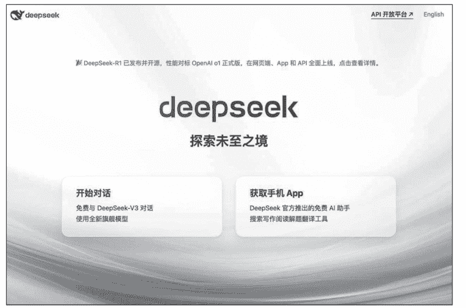

图2-1 DeepSeek官方网站界面

点击左侧“开始对话”，进入网页主界面（见图2-2）。

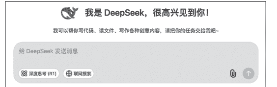

图2-2 DeepSeek聊天对话框

界面明确提示它能编写代码、读文件、生成创意内容，划定了擅长领域，说明它并非万能，创意生成是强项。网页端默认使用 DeepSeek-V3，若想用推理模型，可在对话框左下角勾选“深度思考（R1）”。深度思考模式擅长系统化分析，能把复杂问题拆解清楚，即回答时会进行深度推理。

如图2-3 所示，勾选后标签变蓝，大模型会按提出的问题做深度推理并给出针对性答案。同时在深度思考模式下可上传附件，让模型聚焦问题或对材料进行分析总结。

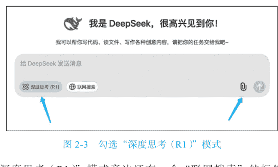

图2-3 勾选“深度思考（R1）”模式

旁边还有“联网搜索”标签，开启后模型回答时会参考网络实时信息，不受训练数据时间限制。因此只开深度思考不开联网搜索会有所不足。一方面是时效性缺失。深度思考依赖预训练知识库，截止时间为 2024 年 7 月，无法回答实时股票行情、航班是否延误、当天天气、社交平台实时趋势等问题。另一方面是事实精确度受损。深度思考可能错误关联人物与著作，且无法通过联网验证。例如搜索影视人物时，会把他人著作错误归并。

所以使用时建议同时打开“深度思考（R1）”和“联网搜索”，以获得更准确实时的答案。

目前设计中，选择联网搜索后就无法上传附件。如图2-4 所示，上传附件的“曲别针”图标会变灰，无法使用。也就是说联网搜索和上传附件互斥，不能同时用。

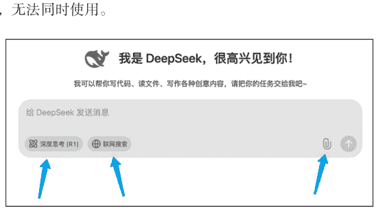

2. App版入门

在应用商店下载 DeepSeek App 即可使用。移动端于 2025 年 1 月上线，到 2 月 5 日日活用户已突破 4000 万，而 ChatGPT 移动端日活为 5495 万，约是其 73%。App 使用界面如图2-5 所示。

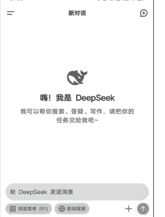

使用上 App 版与网页版基本一致，前述设置同样适用。做好功能勾选后即可对话。

#### 2.1.2 DeepSeek官网抢登技巧
人气高峰时会出现图2-6 所示的拥堵情况。

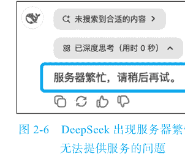

原因何在？

1. 原因
第一，用户量激增与高峰拥堵。自 2024 年底发布新模型后，日活突破数千万，集中访问远超服务端承载能力，导致请求积压、响应延迟。工作日上午、晚间及周末尤为明显，类似“双11”效应。

第二，算力与硬件瓶颈。深度思考高度依赖高性能 GPU 集群，复杂推理需调动大量计算资源，易造成算力排队、请求延迟。服务器扩容跟不上用户增长，导致算力分配不足和内存满载。

第三，安全攻击与网络问题。伴随关注度提升，也遭遇 DDoS 攻击。2025 年 1 月 27 日起攻击升级，除 DDoS 外还有大量密码爆破攻击。恶意请求占用服务器资源干扰正常服务。平台虽部署防御，但攻击规模与技术复杂度持续升级。为防滥用，平台可能对短时间频繁请求限流，导致“服务器繁忙”。

第四，维护与请求限制策略。为保稳定性，团队会定期做硬件维护、软件升级和架构优化。例如 2025 年 2 月多次部署分布式缓存和负载均衡测试，期间部分功能受限。平台还实施动态限流，对高频请求用户或异常 IP 临时拦截，出现提示。官方公告通常选低谷时段维护，但仍可能波及用户。

普通用户更关心如何流畅操用。

2. 方法
针对官网访问，主要有三招。

首先，错峰使用。工作日上班用于办公，晚间周末用于休闲，访问集中。可选清晨、凌晨等非高峰时段，建议 1～5 点调用 API，服务器负载小，响应更快，连接成功率更高。

其次，遇到连接问题可尝试刷新。网络波动或服务器偶忙会导致连接不畅，刷新页面或重新发送请求可能避开拥堵。可采用指数退避重试：先间隔 1 秒，失败后延迟 5 秒，再失败后间隔 30 秒，既避免施压服务器，又提高成功率。

最后，简单问题关闭深度思考。基础知识查询或简单任务无需深度思考，开启会占用大量算力导致变慢。关闭后服务器负担减轻，响应更迅速。

总体而言，错峰使用、尝试刷新、关闭深度思考能显著提升使用顺畅度。

#### 2.1.3 第三方接入
若以上方法仍不满意，可通过第三方体验效果也不错。国内多家科技龙头已接入 DeepSeek，可按需选择。

1. 秘塔AI搜索

网址：https://metaso.cn/。

使用方式：访问官网后，在输入框下方勾选“长思考·R1”模式（见图2-7），输入问题即可调用 DeepSeek-R1 模型。秘塔 AI 搜索支持联网搜索和多通道文件上传。

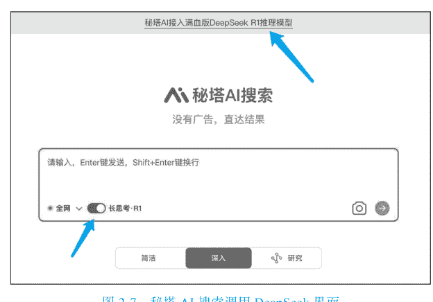

DeepSeek 生态接入全景

1. 秘塔 AI 搜索

上海秘塔网络科技有限公司打造的秘塔AI搜索于2024年年初正式对外。随后完成与DeepSeek的联动。产品的一大底座是海量学术论文库，对科研与行业调研人群帮助明显。融合后，秘塔自有的数十亿网页数据与数千万篇学术文献，与DeepSeek-R1的深度推理能力结合，形成实时联网、复杂推理、学术知识库协同的技术形态。网页端已开放，支持简洁、深入、研究三种对话风格，在学术研究与市场分析场景下可给出较高精度的输出。

2. 纳米 AI 搜索

网址：https://www.n.cn/。

使用方式：进入官网后，在提问区下方勾选“深度思考（DeepSeek-R1-联网满血版671B）”模式，确认后输入问题即可调用R1。平台支持联网检索、多模态文件上传与语音输入。

点评：纳米AI搜索由360集团推出，自2025年1月起逐步适配DeepSeek系列。首页可直接选取DeepSeek-R1-联网满血版671B，借助本地化部署及华为昇腾910B芯片算力，响应与稳定性明显提升。除强化推理外，还整合语音搜索、拍照问答、视频生成等多元交互，拓宽使用场景。安全方面，360为该能力配置了专属抗攻击机房与防护体系，保障服务可靠。

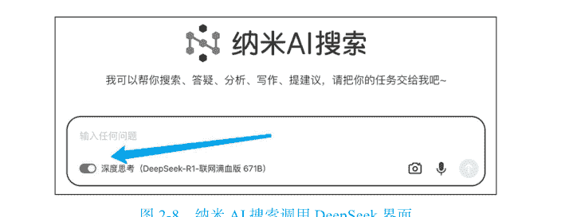

图2-8 纳米AI搜索调用DeepSeek界面

3. 腾讯元宝

网址：https://yuanbao.tencent.com/chat/naQivTmsDa。

使用方式：进入对话页后可在底部切换引擎，混元大模型自带联网检索，适合通用场景；DeepSeek-R1满血版需手动开启“联网搜索”开关，可调用微信公众号、视频号等腾讯生态内容。提问后模型先深度思考，再联网抓取信息，最后融合多源资料生成结果。

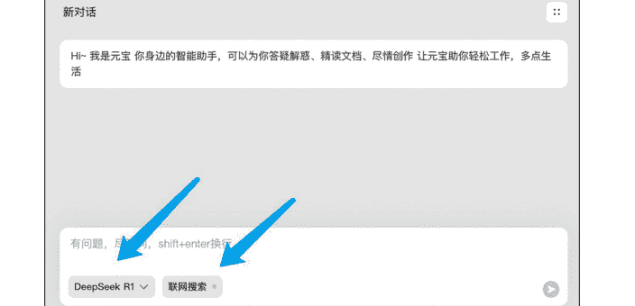

图2-9 腾讯元宝调用DeepSeek界面

点评：使用腾讯元宝时可按需在混元与DeepSeek-R1满血版间切换，前者突出自研能力，后者推理更强。产品可优先调取公众号、视频号等优质信源，提升答案时效与准确性。依托腾讯云算力优化，缓解了官方入口卡顿问题，交互更流畅稳定。此次合作体现了腾讯以开放生态整合顶尖AI的能力，通过混元与DeepSeek的技术互补及微信独家数据的叠加，重塑AI助手产品边界。

4. 国家超算互联网（SCNet）平台

网址：https://chat.scnet.cn/#/home。

使用方式：官网输入框左下方提供三个R1版本供选，分别为DeepSeek-R1-Distill-Qwen-7B、DeepSeek-R1-Distill-Qwen-32B、DeepSeek-R1-671B。选定版本后即可输入问题进行问答。

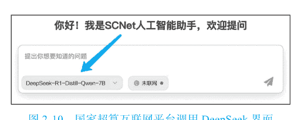

点评：国家超算互联网平台在科技部指导下建设，目标是汇聚全国超算、智算中心资源，实现算力统筹调度，打造开放共享的基础设施。依托国家超算中心的算力，解决了普通用户使用大模型时的卡顿痛点，对科研机构和企业的大规模计算需求较为适配。作为国家队项目，安全性高且对用户免费，还支持通过接口做定制化训练，满足特定行业场景。DeepSeek与平台的深度融合优化了算力调度，例如借助华为鸿蒙系统实现跨终端无缝调用。

5. 知乎直答

网址：https://zhida.zhihu.com/。

使用方式：打开官网后在输入框左下方勾选“深度思考DeepSeek R1”，即可用该推理引擎进行问答。

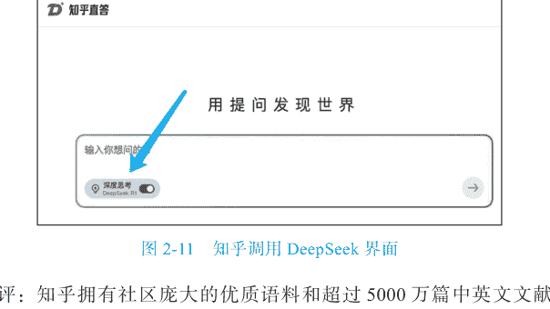

点评：知乎沉淀了庞大社区优质语料与超过5000万篇中英文文献，专业内容检索与溯源能力突出。知乎直答对接DeepSeek-R1满血版，结合自有的AI检索与知识库，为用户提供高效的信息处理与推理分析服务。在知乎社区可溯源的专业语料加持下，R1的推理过程更精细，搜索覆盖更全、解答质量更高。

除上述可直接登录使用的平台外，多家行业公司也在陆续把DeepSeek引入业务，目前手机、汽车、办公、金融、教育等领域已有大量落地案例，如表2-1所示。

表 2-1 典型行业和企业接入 DeepSeek 示例

| 序号 | 行业 | 应用 | 现状 |

| :--- | :--- | :--- | :--- |

| 1 | 手机 | 华为小艺助手 | 智能体广场已上线 DeepSeek-R1 的 Beta 版 |

| 2 | 手机 | 荣耀 YOYO 智能体 | 荣耀正式在 YOYO 智能体商店上线 DeepSeek-R1 尝鲜版 |

| 3 | 手机 | 星际魅族 Flyme AIOS | Flyme AIOS 已完成 DeepSeek-R1 大模型接入 |

| 4 | 手机 | 联想小天助手 | 联想小天助手已接入 DeepSeek，为用户带来更加智能、便捷的 AI 交互体验 |

| 5 | 汽车 | 智己汽车智能座舱 | 智己汽车智能座舱已深度引入 DeepSeek 大模型 |

| 6 | 汽车 | 上汽通用汽车 | 凯迪拉克、别克品牌的新车型将于近期陆续搭载使用 |

| 7 | 汽车 | 东风汽车 | 东风汽车已完成 DeepSeek 全系列大语言模型的接入工作，猛士、奕派、风神、纳米等自主品牌车型将于近期陆续搭载应用 |

| 8 | 汽车 | 一汽-大众 AI 内容运营数字化平台 | 一汽-大众 AI 内容运营数字化平台已全面接入 DeepSeek 大模型，迈入智能化营销全新阶段 |

| 9 | 汽车 | 长安汽车 | 长安汽车已完成 DeepSeek 深度融合，2 月 12 日行业首发量产搭载上市 |

| 10 | 办公 | 阅文集团“作家助手” | 作家助手已接入 DeepSeek-R1 模型，在智能问答、获取灵感和描写润色 3 方面实现升级 |

| 11 | 办公 | 钉钉 | 用户在钉钉上创建 AI 助理的时候，可以直接选择 DeepSeek 系列的 R1、V3 模型 |

| 12 | 办公 | 飞书 | 飞书多维表格已接入 DeepSeek-R1 模型 |

| 13 | 办公 | ChatPPT | ChatPPT 接入 DeepSeek，直接在 ChatPPT 使用 DeepSeek 实现对话式创作 |

| 14 | 办公 | 美图公司“美图设计室” | 美图设计室已采用 DeepSeek 技术实现 AI 生成 PPT 相关功能 |

| 15 | 办公 | 中国电信“天翼云盘” | 中国电信已成功部署了 DeepSeek 大模型，并在多个场景中显著提升 AI 助手的智能问答能力 |

| 16 | 办公 | 知我 AI | 知我 AI 已接入 DeepSeek-V3 大模型，增强信息筛选、存储、引用、提取功能 |

| 17 | 办公 | 腾讯智能工作台 ima | ima 接入 DeepSeek-R1 模型，用户将 ima 更新至最新版本，在使用搜、读、写和知识库的时候，可以选择腾讯混元大模型或 DeepSeek-R1 模型 |

| 18 | 教育 | 网易有道全科学习助手“有道小 P” | 网易已结合 DeepSeek-R1 模型优化个性化答疑功能，能够提供更具深度、更强准确性的解题思路 |

| 19 | 教育 | 云学堂 | 云学堂的 AI 制课专家、AI 学习地图、AI 学习专家、AI 对练等产品均能够使用包括 DeepSeek 在内的多种大模型能力 |

| 20 | 医疗 | 美年健康 | 美年健康血糖管理 AI 智能体“糖豆”凭借 DeepSeek 能够为客户提供更精准的健康管理建议 |

| 21 | 智能助手 | 百度文小言 | 百度文小言已接入 DeepSeek-R1 模型，优化拍照解题功能 |

| 22 | 智能助手 | 昆仑万维天工 AI | 天工 AI 已接入 DeepSeek-R1 模型，并上线“联网搜索”功能 |

| 23 | 智能助手 | 出门问问全栈产品 | 出门问问联合华为云上线基于昇腾云的 DeepSeek-R1 服务，为公司元创岛、奇妙问、奇妙元（海外版 LivGen）、魔音工坊（海外版 DupDub）等产品注入全新的智能体验 |

| 24 | 智能助手 | Monica | 一站式 AI 助手，每天可以免费使用 40 次 DeepSeek-R1 大模型 |

| 25 | | 猎户星空 | AI超级带教和机器人AgentOS已接入DeepSeek-R1推理模型 |

| 26 | | 智慧芽 | 智慧芽宣布已正式接入DeepSeek-R1大模型，旨在进一步强化科创情报分析、技术趋势洞察、探索技术方案等方面的核心能力 |

| 27 | 企业级应用 | BetterYeah | BetterYeah配置DeepSeek模型后，支持在工作流运行过程中随时查看完整的推理过程，支持流式输出 |

| 28 | | 泛微 | 泛微旗下所有产品，借助数智大脑Xiaoe.AI，可快捷方便地为客户搭建“DeepSeek大模型+专业小模型+智能体”的数智底座 |

| 29 | | QQ音乐 | 自研AI助手已完成对DeepSeek-R1完整版大模型的部署，音乐问答将更全面精准 |

| 30 | 娱乐购物 | 值得买 | 公司已经接入DeepSeek的模型产品，探索其在内容生成、办公辅助等场景中的应用 |

| 31 | | 微盟集团 | 导购Agent产品“导购任务AI+”本地化部署微调DeepSeek-VL2多模态模型、轻量DeepSeek-R1推理模型，分别运用于智能合同质检和自动化估值对账场景中 |

| 32 | | 江苏银行“智慧小苏” | “智慧小苏”正式接入DeepSeek大模型，在复杂多模态、多任务场景处理能力、算力节约、效能等方面得到进一步提升 |

| 33 | 金融证券 | 汇添富 | 汇添富已完成DeepSeek系列开源模型的私有化部署，并将应用于投资研究、产品销售、风控合规、客户服务等核心业务场景 |

| 34 | | 国泰君安 | 国泰君安已完成DeepSeek-R1模型的本地化部署，并应用于“君弘灵犀”大模型中，赋能智能问答、智投服务、投教、行业研究、市场分析、合规风控等多个核心业务场景 |

除官网与第三方入口外，国内多家智能手机厂商也在加快适配步伐，不完全统计显示华为、荣耀、OPPO、魅族、努比亚、vivo等均已宣布对接DeepSeek，未来可在不同终端使用。芯片端，英伟达、AMD等国际厂商，以及华为昇腾、百度昆仑芯、海光等国产厂商均已完成适配，并为DeepSeek推理做了专项优化。

### 2.2 新手实验室

DeepSeek在春节期间进入大众视野，于是我先抛出一个与春节相关的问题，想看看它如何解读回家的意义，尤其是这个充满智慧的伙伴会如何诠释这份情感厚重的主题。

下面就一起进入DeepSeek的世界，观察它对春节回家的理解，相信会带来别样的思想碰撞与心灵触动。

> 提示词：春节回老家过年，其实待不了几天，为何还要回去？

针对这个提问，我们先看DeepSeek的思考路径，以及它在理解传统文化与亲情方面的可借鉴之处，如图2-12所示。

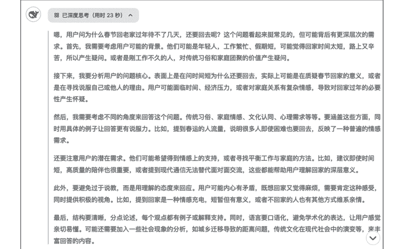

首先，模型推断了提出此问题的潜在背景，比如年轻人工作繁忙、假期短暂，因而对传统习俗与家庭团聚产生动摇。也就是说，它先挖掘了提问者行为背后的深层原因。

接着，模型开始对问题本身展开剖析，并没有停留在表面，而是深挖春节回家的价值，寻找说服自己的理由。背后牵涉的是情感、时间、家庭关系等多重因素。

在此基础上，模型考虑从多个视角来组织回答。

随后，模型从更人性化的层面提出要对提问者给予情感支持，帮助其理解回家更深层的意义，同时提醒自己避免说教，因为它判断提问者内心可能处在矛盾中，想回又觉得麻烦。

经过一系列研判，最终模型给出了回答的逻辑框架：结构清晰、分点展开，每个观点都有例证或解释支撑；语言口语化，避免学术腔，让人感到亲切易懂；必要时加入社会现象的分析，比如城乡迁移带来的距离感、传统文化在当代社会的演变等，以丰富内容厚度。

### DeepSeek 输出：

> 春节回家时间虽短，却承载着超越物理时长的情感需求与文化意涵。下面几个角度或许能解释这种看似“不划算”的坚持。

1. 情感维系的仪式感

- 时间锚点效应：现代人生活节奏急促，春节如同刻在年轮上的刻度。深圳程序员小王往返老家三天，他说：“在祠堂上香那一刻，突然意识到自己不是代码机器，而是有根的人。”

- 错位时空的重逢：在北京做家政的张阿姨每年扛着稻香村点心挤春运。她说：“看着老母亲尝京八件时眯起的眼睛，这一年受的委屈都值了。”瞬间的高浓度情感，冲淡了364天的分离。

- 代际情感账户：上海白领李莉算过，父母65岁，若每年团聚5天，余生相处不足200天。每次回家都像往情感账户存钱，怕哪天被清零。

2. 文化基因的显性表达

- 集体记忆的复刻：闽南乡村至今保留“跳火群”习俗，95后阿杰说：“跨过燃烧的稻草堆时，突然懂了爷爷说的火里住着祖先灵魂。”

- 身份认同的校准：在纽约投行的David每年坚持回潮汕老家祭祖。他说：“华尔街的西装下，我需要用祠堂的香火确认自己是谁。”

- 传统技艺的活态传承：山西面塑手艺人老赵最欣慰的是00后孙女能用3D建模复原传统花馍。科技越发达，越需要实体文化触感。

3. 现代社会的心理代偿

- 数字时代的反噬：杭州电商主播薇薇坦言：“直播间喊再多‘家人们’，也比不上摸到外婆龟裂手掌的真实。我们需要物理接触来对抗虚拟异化。”

- 城市病的解药：北京心理咨询师发现春节后就诊量下降30%。老家的炊烟、方言甚至土腥味，都是最好的心灵SPA。

- 生存焦虑的缓冲带：深圳创业者阿凯说：“在老家晒谷场看星空时，突然觉得融资失败不算什么。这种抽离感是城市给不了的。”

4. 正在演变的春节形态

- 反向春运兴起：2019年春运数据显示，北上广深反向春运票量增长40%。哈尔滨退休教师老刘夫妇说：“儿子在上海买房后，我们学会了视频剪辑，但终究想亲手摸摸孙子的脸。”

- 时间碎片的艺术：成都设计师小苏发明“24小时探亲攻略”：早晨陪父亲晨练，中午学母亲腌泡菜，晚上教爷爷视频通话。浓缩的陪伴反而更高效。

- 文化符号的重构：互联网时代催生“电子家谱”“AR祭祖”等新民俗。留学生小林开发了“气味邮件”——把老家初雪的空气封存寄给父母，算是赛博时代的年味。

这种看似不划算的迁徙，实则是现代人在流动社会中构建的精神锚点。就像候鸟迁徙不只为觅食，春节归程中挤火车的疲惫、亲戚的唠叨、城乡切换的不适，恰恰构成了抵御现代性孤独的抗体。当我们穿越高铁网络回到燃着炭火的堂屋，完成的不仅是地理位移，更是一次文明DNA的自我修复。

下面分段解析DeepSeek的答案。第一部分从情感维系切入，围绕时间锚点效应、错位时空重逢、代际情感账户展开，并没有先给定义，而是直接用案例和数字说话，让画面感更强，读者更容易共鸣，深刻体会到那些看似不划算却至关重要的情感与文化维系行为。

第二、三部分则从文化基因显性表达、现代社会心理代偿的角度展开，思路与第一部分一致，均以案例驱动。案例选取覆盖全国各地过年习俗，与主题高度契合。

这种案例驱动的优势在于沉浸感强，读者仿佛置身不同过年场景。但不足是整体缺少提炼与总结，案例虽生动却偏微观，呈现较为分散。

前三部分都从支持回老家过年的视角剖析意义，展现了文化、情感等多重价值。第四部分思路有所拓展，采用反向视角切入，引入反向春运、碎片艺术、文化重构等新视角，让解读更开阔，也体现了模型在思考中保持的中立态度，更宽广地呈现春节这一多元文化现象。

最后的总结再次回到回家议题：迁徙中的疲惫、亲戚唠叨、城乡切换的不适，这些看似负面的体验，实际上起到了抵御现代性孤独的作用，通过它们人们重新感受到家庭温暖与亲情纽带。

### 先想清楚再作答，算力才用在刀刃上

给 DeepSeek 留下深刻印象的，不是答案本身，而是回答前的思考。模型在产出结论之前，会先投入相当一部分计算去揣摩用户的真实意图、上下文与隐含背景。正是这种机制，让提问越具体、指向越明确，可供模型用来深度探索答案的资源就越充裕。简单说，AI 能做到什么水准，关键看问题说得有多清晰、有多聚焦。这也让使用者拆解问题、分析需求的能力变得更加重要。

### 2.3 DeepSeek 的适用场景
DeepSeek 的功能覆盖面很广，落地实践大致可以归到以下几类。

（1）内容创作与文案生成
当下无论是品牌推广还是个人表达，都需要高质量的内容。DeepSeek 在此方面表现稳定，能够产出营销文案、诗歌、文章、剧本等多种形式。举例来说，一家主打影像的手机品牌要面向年轻白领做时尚宣传，只要把目标人群、风格调性、核心卖点讲清楚，模型就能据此生成符合预期的文案。实际使用时，先明确主题、要点与格式，后续可通过多轮对话逐步细化，比如觉得拍照部分的描述不够生动，就能要求补充更具体的拍摄场景和呈现效果。

（2）代码开发与编程辅助
对程序员来说，DeepSeek 类似一位随身的编程助手，能帮忙写片段、排查报错、补注释、解释逻辑。比如让它用 Python 实现快速排序并为每行加上说明，它可以迅速给出准确的实现。它也支持本地化部署，例如接入 IntelliJ IDEA，在熟悉的 IDE 中直接调用，同时提供 API 接口，便于将能力嵌入自己的项目流程，提升开发效率。

（3）学术研究与知识管理
在科研场景中，DeepSeek 能辅助文献解读、概念阐释、论文润色、数据分析等。遇到模型蒸馏这类较难的概念，可让它用通俗语言解释并举例说明应用，帮助更快掌握。此外，它还能对上传的 PDF、Word、纯文本文件进行关键信息抽取或总结，帮助研究者迅速把握文献重点。

（4）复杂推理与问题解决
面对数学求解、商业策略、逻辑推演等复杂任务，它也能提供强力支持。比如季度销售额下滑时，可以要求它分析原因并给出三种改进方案。提问时可采用分步提问、反向提问或加入批判性思考的指令，引导模型做更深度的剖析，得到更全面深入的结论。

（5）个性化计划制订
无论是学习规划、旅行路线还是投资思路，都能得到比较实用的建议。例如预算 5000 元，想去国内玩 7 天且偏爱自然风光，模型会结合约束条件推荐目的地和行程。为了让结果更贴合，提前说明时间、预算、偏好等个性化需求很重要，这样才能定制出更可行的方案。

（6）日常咨询与生活辅助
日常里也能派上用场，比如健康建议、影片推荐、语言翻译、天气查询等。需要注意的是，关于最新影视信息这类时效性内容，可能需要联网检索才能保证准确。例如想找 2024 年评分 8.5 分以上的科幻片并了解推荐理由，就可以直接提问。

（7）开放性与探索性问题
在行业趋势、技术应用前景等开放议题上，它也有不错的表现。比如问机器学习在农业领域的最新落地以及未来可能走向，它能整合大量知识给出系统性的分析。借助开放式提问，可以获得更丰富的信息广度。

（8）创意激发与角色扮演
在故事创作、模拟对话、产品灵感等场景里，它能很好地激发创意。例如设定自己是资深产品经理，为智能手环设计创新功能，通过指定角色和情境增强沉浸感，从而迸发出更多想法。

掌握以上分类和技巧，就能更好地发挥 DeepSeek 在生成、推理、跨领域咨询等方面的优势，明显提升工作效率。随着技术演进，未来它还会带来更多惊喜。

## 第3章 | CHAPTER

### DeepSeek 提示词设计技巧
在数字化浪潮下，人工智能已从实验室黑箱变成职场人和知识工作者的日常伙伴。DeepSeek 以强大的语义理解和推理能力重塑信息处理、创意生成与决策支持的底层逻辑。但真正决定效果的，不是参数规模，而是使用者如何用精准的提示词把模糊的想法转化为机器可执行的认知蓝图。正如一位资深工程师所说：“给 AI 的指令不是聊天，而是编程”。提示词工程的核心是搭建双向认知的桥梁：用结构化思维拆解问题，用角色扮演赋予专业视角，用渐进迭代逼近理想答案。

DeepSeek 官方整理的 13 大提示模板库，正是这场认知升级的体现。从代码纠错到商业文案，从数据图表到文献综述，每个模板都内含特定的认知框架。学会提示词，本质上是在训练一种“需求翻译”能力。就像产品经理把用户痛点转成需求文档，好的提示撰写者需要剥离表象、抓住核心诉求，再转成机器可理解的参数组合。

### 3.1 设计提示词的 2 个原则
DeepSeek 依靠强大的理解和推理，已成为各领域提效工具。但再强的工具也需要正确用法，提示词技巧是协作效能的天花板。也有人认为不必专门学习提示词，觉得自然语言对话已足够，比如直接说“生成答辩稿”，它就能输出多视角分析、技术亮点的完整框架。这种情况在基础场景确实成立。

两种看法并不矛盾，而是取决于任务复杂度。日常聊天不需要话术，商业谈判才需要策略。问题越复杂，提示词的价值越凸显。比如让它写“新能源汽车电池技术对比报告”，结果往往是笼统的技术罗列；如果改成“从成本、能量密度、安全性能三个角度对比磷酸铁锂电池与三元材料电池，结合比亚迪和宁德时代的专利资料，用投资人容易理解的类比说明差异”，得到的回答就会包含数据引用、类比解释等结构化内容，实用性大幅提升。

要高效使用 DeepSeek，需要跳出“技巧无用论”和“模板迷信”两个极端，把握以下两点。

其一，按难度分层匹配。简单问题直接问即可，例如“总结这篇文章”；中等难度需要补充场景约束，例如“用小红书风格写旅行攻略，带表情符号和本地冷知识”；复杂问题则适合用“角色+结构+示例”框架，例如“作为专业风险管理顾问，请按‘风险识别-评估-应对’框架分析跨境电商物流风险，并参考案例格式”。

其二，持续优化。提示词不是一次写定，就像我们对问题的理解也是逐步清晰的。因此提问后若不满意，可通过追问补充背景、调整格式或要求批判性检验来引导深化。例如先让它“生成苹果电脑的产品介绍”，得到通用内容后，第二轮补充“加入消费者体验和使用场景”，第三轮要求“按特性—优势—利益的结构重写”，结果会更符合预期。

设计的本质是把模糊需求转成机器可解析的语义框架，这需要两种能力：一是像侦探一样挖掘真实需求，比如学生要“答辩演讲稿”，其实是想“多体现工作量、少讲技术细节”；二是像老师一样教 AI，比如设定角色、提供范例、拆分步骤。

记住：AI 不是读心术，而是超级执行者。你表达得越清楚，它执行得越漂亮。

### 3.2 13 个提示词模板解析
提示词教学市场上内容碎片化严重，各类机构和自媒体教程层出不穷。值得注意的是，DeepSeek 官方早已构建了系统化的提示词知识体系，直接参考官方文档比二手资料更可靠。

可通过 DeepSeek 开发者中心查阅官方提示库。由专业团队维护的知识库划分为 13 个核心方向，如图 3-1 所示。

下面重点看这 13 个库能带来哪些启发。

#### 1. 代码改写
简介：对代码进行修改，实现纠错、注释、调优等。

对程序员来说改写代码是日常，下面看看如何借助 DeepSeek。

探索 DeepSeek 提示词样例，挖掘更多可能

- **代码改写**
  对代码进行修改，来实现纠错、注释、调优等。
- **代码解释**
  对代码进行解释，来帮助理解代码内容。
- **代码生成**
  让模型生成一段完成特定功能的代码。
- **内容分类**
  对文本内容进行分析，并对齐进行自动归类
- **结构化输出**
  将内容转化为 JSON，来方便后续程序处理
- **角色扮演（自定义人设）**
  自定义人设，来与用户进行角色扮演。
- **角色扮演（情景续写）**
  提供一个场景，让模型模拟该场景下的任务对话
- **散文写作**
  让模型根据提示词创作散文
- **诗歌创作**
  让模型根据提示词，创作诗歌
- **文案大纲生成**
  根据用户提供的主题，来生成文案大纲
- **宣传标语生成**
  让模型生成贴合商品信息的宣传标语。
- **模型提示词生成**
  根据用户需求，帮助生成高质量提示词
- **中英文翻译专家**
  中英文互译，对用户输入内容进行翻译

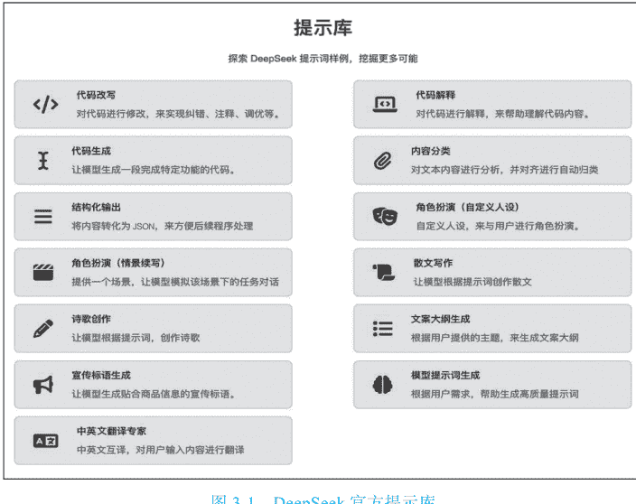

提示词：下面这段代码的效率很低，且没有处理边界情况。请先解释这段代码的问题与解决方法，然后进行优化。

```python
def fib(n):
    if n <= 2:
        return n
    return fib(n-1) + fib(n-2)
```
在提示词里，用户首先介绍了“背景”——原代码的效率低，且没有处理边界，接着对 DeepSeek 提出了两个“任务”：一个是解释这段代码的问题和解决方法，另一个是对该段代码进行优化。

DeepSeek 输出：

1. 问题分析
该递归实现斐波那契函数虽然简洁，却存在重复计算、边界缺失、递归深度受限三大问题。重复计算导致指数级开销，负数输入未被拦截会返回错误值，大 n 时容易触发 RecursionError。

2. 解决方法
建议采用记忆化缓存避免重复计算，补充对负数输入的校验，使用迭代方式规避递归深度。

3. 优化后的代码
##### (1) 方法一：记忆化递归
```python
def fib(n, memo={}):
    if n < 0:
        raise ValueError("Input must be a non-negative integer")
    if n <= 2:
        return 1
    if n in memo:
        return memo[n]
    memo[n] = fib(n-1, memo) + fib(n-2, memo)
    return memo[n]
```
##### (2) 方法二：迭代法
```python
def fib(n):
    if n < 0:
        raise ValueError("Input must be a non-negative integer")
    if n <= 2:
        return 1

    a, b = 1, 1
    for _ in range(3, n+1):
        a, b = b, a + b
    return b
```

4. 解释
记忆化方案借助字典保存已算结果，递归前先查缓存，并对负数抛出 ValueError。迭代方案用两个变量滚动计算，同样做了负数校验。

5. 总结
优化后效率提升且边界更完善，记忆化与迭代各有适用场景。

整体来看，模型先诊断问题，再给出两种优化路径并解释差异，回应完整且有据。

#### 2. 代码解释
简介：对代码进行解释，来帮助理解代码内容。

代码解释考察的是模型对逻辑的理解。下面提示词较为简洁，直接要求解释逻辑并说明功能，需求直观时无需过度修饰。

提示词：请解释下面这段代码的逻辑，并说明实现了什么功能：

```cpp
// weight 数组的大小就是物品个数
for(int i = 1; i < weight.size(); i++) {  // 遍历物品
    for(int j = 0; j <= bagweight; j++) { // 遍历背包容量
        if (j < weight[i]) dp[i][j] = dp[i - 1][j];
        else dp[i][j] = max(dp[i - 1][j], dp[i - 1][j - weight[i]] + value[i]);
    }
}
```

DeepSeek 输出：
该实现是经典的动态规划 0/1 背包求解。

1. 初始化与遍历
weight 记录重量，value 记录价值，bagweight 为容量上限，dp 为二维状态表，dp[i][j] 表示前 i 件物品在容量 j 下的最大价值。

2. 外层循环
```cpp
for(int i = 1; i < weight.size(); i++) {  // 遍历物品
```
按物品顺序从第一件遍历到最后一件。

3. 内层循环
```cpp
for(int j = 0; j <= bagweight; j++) { // 遍历背包容量
```
对每个物品遍历背包容量从 0 到上限。

4. 状态转移方程
```cpp
if (j < weight[i]) dp[i][j] = dp[i - 1][j];
else dp[i][j] = max(dp[i - 1][j], dp[i - 1][j - weight[i]] + value[i]);
```
若当前容量不足放下该物品，则继承上一行状态；否则在不放与放入之间取最大值，放入时价值为上一行对应剩余容量的最优值加上当前物品价值。

5. 功能说明

该程序的任务是在背包容量为 bagweight 的前提下，从若干物品中挑选组合，使所得总价值最大化。实现上采用动态规划，依次填满一张二维表 dp，其中 dp[i][j] 用来保存仅考虑前 i 件物品、且可用容量不超过 j 时的最佳价值。全部状态计算完毕后，dp[weight.size()-1][bagweight] 就是最终的最优结果。

#### 6. 汇总
- 输入：物品重量列表 weight、物品价值列表 value，以及背包容量 bagweight。
- 输出：在容量限制 bagweight 下可获得的最高总价值。
- 方法：动态规划，通过逐步构建 dp 表来保存每一步的最优解。

这就是 DeepSeek 给出的完整回复，下面逐层拆解。先用一句话点出代码要解决的核心问题，再对整体逻辑进行展开说明。随后在逐行注释的基础上，又概括了这段代码到底实现了什么功能。最后的总结从输入、输出和算法三个维度切入，方便读者快速把握实现要点。

#### 3. 生成代码
简介：让模型按需求输出一段具备特定功能的实现。

程序员一直希望借助大模型直接产出可用代码，DeepSeek 在这方面的表现相当亮眼。下面这个示例的核心需求是生成一个五子棋游戏，同时还加了约束：实现语言必须是 HTML，并且所有代码都收敛到同一个 HTML 文件中。

> 提示词：请帮我用 HTML 生成一个五子棋游戏，所有代码都保存在一个 HTML 文件中。

DeepSeek 输出：

没问题！下面提供一个基础版五子棋的 HTML 实现。该实现包含一个简易棋盘，玩家可通过点击格子落子，系统也会自动检测胜负情况。

```html
<!DOCTYPE html>
<html lang="zh-CN">
<head>
    <meta charset="UTF-8">
    <meta name="viewport" content="width=device-width, initial-scale=1.0">
    <title>五子棋游戏</title>
    <style>
        body {
            display: flex;
            justify-content: center;
            align-items: center;
            height: 100vh;
            background-color: #f0f0f0;
            font-family: Arial, sans-serif;
        }
        .board {
            display: grid;
            grid-template-columns: repeat(15, 30px);
            grid-template-rows: repeat(15, 30px);
            gap: 1px;
            background-color: #d18b47;
            padding: 10px;
            border-radius: 5px;
        }
        .cell {
            width: 30px;
            height: 30px;
            background-color: #ffce9e;
            border: 1px solid #d18b47;
            display: flex;
            justify-content: center;
            align-items: center;
        }
    </style>
</head>
<body>
    <div class="board" id="board"></div>
    <script>
        const board = document.getElementById('board');
        const cells = [];
        let currentPlayer = 'X';

        // 初始化棋盘
        for (let i = 0; i < 15; i++) {
            cells[i] = [];
            for (let j = 0; j < 15; j++) {
                const cell = document.createElement('div');
                cell.classList.add('cell');
                cell.dataset.row = i;
                cell.dataset.col = j;
                cell.addEventListener('click', handleCellClick);
                board.appendChild(cell);
                cells[i][j] = cell;
            }
        }

        function handleCellClick(event) {
            const cell = event.target;
            const row = parseInt(cell.dataset.row);
            const col = parseInt(cell.dataset.col);

            if (cell.textContent === '') {
                cell.textContent = currentPlayer;
                cell.style.color = currentPlayer === 'X' ? 'black' : 'white';
                if (checkWin(row, col)) {
                    alert(`玩家 ${currentPlayer} 获胜！`);
                    resetBoard();
                } else if (isBoardFull()) {
                    alert('平局！');
                    resetBoard();
                } else {
                    currentPlayer = currentPlayer === 'X' ? 'O' : 'X';
                }
            }
        }

        function checkWin(row, col) {
            const directions = [
                [0, 1],  // 水平
                [1, 0],  // 垂直
                [1, 1],  // 对角线
                [1, -1]  // 反对角线
            ];

            for (const [dx, dy] of directions) {
                let count = 1;
                // 正向检查
                for (let i = 1; i < 5; i++) {
                    const newRow = row + dx * i;
                    const newCol = col + dy * i;
                    if (newRow >= 0 && newRow < 15 && newCol >= 0 && newCol < 15 && cells[newRow][newCol].textContent === currentPlayer) {
                        count++;
                    } else {
                        break;
                    }
                }
                // 反向检查
                for (let i = 1; i < 5; i++) {
                    const newRow = row - dx * i;
                    const newCol = col - dy * i;
                    if (newRow >= 0 && newRow < 15 && newCol >= 0 && newCol < 15 && cells[newRow][newCol].textContent === currentPlayer) {
                        count++;
                    } else {
                        break;
                    }
                }
                if (count >= 5) {
                    return true;
                }
            }
            return false;
        }

        function isBoardFull() {
            for (let i = 0; i < 15; i++) {
                for (let j = 0; j < 15; j++) {
                    if (cells[i][j].textContent === '') {
                        return false;
                    }
                }
            }
            return true;
        }

        function resetBoard() {
            for (let i = 0; i < 15; i++) {
                for (let j = 0; j < 15; j++) {
                    cells[i][j].textContent = '';
                }
            }
            currentPlayer = 'X';
        }
    </script>
</body>
</html>
```

## 42 DeepSeek全民攻略：轻松掌握 AI 工具组合

```css
.cursor: pointer;
}
.cell.black::before, .cell.white::before {
    content: '';
    width: 20px;
    height: 20px;
    border-radius: 50%;
}
.cell.black::before {
    background-color: black;
}
.cell.white::before {
    background-color: white;
}
#message {
    margin-top: 20px;
    font-size: 24px;
    font-weight: bold;
}
</style>
</head>
<body>
    <div id="board"></div>
    <div id="message"></div>
    <script>
        const boardSize = 15;
        let currentPlayer = 'black';
        let board = Array.from({ length: boardSize }, () => Array(boardSize).fill(null));
        function createBoard() {
            const boardElement = document.getElementById('board');
            for (let i = 0; i < boardSize; i++) {
                for (let j = 0; j < boardSize; j++) {
                    const cell = document.createElement('div');
                    cell.classList.add('cell');
                    cell.dataset.row = i;
                    cell.dataset.col = j;
                    cell.addEventListener('click', handleCellClick);
                    boardElement.appendChild(cell);
                }
            }
        }
        function handleCellClick(event) {
            const row = parseInt(event.target.dataset.row);
            const col = parseInt(event.target.dataset.col);
            if (board[row][col] !== null) return;
            board[row][col] = currentPlayer;
            event.target.classList.add(currentPlayer);
            if (checkWin(row, col, currentPlayer)) {
                document.getElementById('message').textContent = 
                    `${currentPlayer === 'black' ? '黑棋' : '白棋'}获胜！`;
                document.querySelectorAll('.cell').forEach(cell => 
                    cell.removeEventListener('click', handleCellClick));
                return;
            }
            currentPlayer = currentPlayer === 'black' ? 'white' : 'black';
        }
        function checkWin(row, col, player) {
            const directions = [
                { dr: 0, dc: 1 },  // 水平
                { dr: 1, dc: 0 },  // 垂直
                { dr: 1, dc: 1 },  // 主对角线
                { dr: 1, dc: -1 }  // 副对角线
            ];
            for (const { dr, dc } of directions) {
                let count = 1;
                // 检查一个方向
                for (let i = 1; i < 5; i++) {
                    const r = row + dr * i;
                    const c = col + dc * i;
                    if (r < 0 || r >= boardSize || c < 0 || c >= boardSize || board[r][c] !== player) break;
                    count++;
                }
                // 检查相反方向
                for (let i = 1; i < 5; i++) {
                    const r = row - dr * i;
                    const c = col - dc * i;
                    if (r < 0 || r >= boardSize || c < 0 || c >= boardSize || board[r][c] !== player) break;
                    count++;
                }
                if (count >= 5) return true;
            }
            return false;
        }
        createBoard();
    </script>
</body>
</html>
```

下面给出代码的简要说明。

### 1. HTML 结构
- board 元素作为盘面容器，借助 grid 布局生成 15×15 的格子矩阵。
- .cell 用于描述单个格子的外观，点击会触发 handleCellClick 处理。
- message 区域展示对局结果信息。

### 2. CSS 样式
- 主要负责盘面与单格的视觉呈现，包括背景、边框以及棋子样式等细节。

### 3. JavaScript 逻辑
- `createBoard` 承担棋盘的创建与初始化工作。
- `handleCellClick` 响应玩家点击，更新状态并校验是否获胜。
- `checkWin` 在落子位置检查当前玩家是否已连成五子。

### 4. 如何使用
- 将完整代码保存为 .html 格式的文件。
- 通过浏览器打开该文件即可开始游戏。

这段实现是一个基础的五子棋原型，可根据需要后续扩展和优化。

从模型返回来看，它先用一段话概括了连珠游戏规则，随后直接以 HTML 形式呈现完整游戏。说明部分聚焦于结构、样式、行为三块，正好对应代码的核心构成。最后还附上了使用方法：把代码存成 .html 文件后在浏览器里打开即可游玩。

#### 4. 内容分类
简介：先对输入文本进行解读，再自动完成分类标注。

提示词：

### 1. 定位
- 助手定位：新闻分类专家
- 主要工作：对输入新闻进行自动归类，确定其类别。

### 2. 能力
- 内容解析：可精准把握新闻的主题与结构。
- 类别判定：依解析结果把新闻归入预设的分类。

### 3. 知识储备
- 新闻种类：
  - 政治
  - 经济
  - 科技
  - 娱乐
  - 体育
  - 教育
  - 健康
  - 国际
  - 国内
  - 社会

### 4. 使用说明
- 输入内容：一则新闻文本。
- 输出要求：仅给出所属类别名称，不附带说明。

上述设计思路本质上是在教模型做标签。先明确角色与任务，再说明所需解析与判断能力，随后列出可用的分类清单，最后限定输入输出格式。

提示词：美国太空探索技术公司（SpaceX）的猎鹰9号运载火箭（Falcon 9）在经历美国联邦航空管理局（Federal Aviation Administration，FAA）短暂叫停发射后，于当地时间8月31日凌晨重启了发射任务。

DeepSeek 输出：

科技

用户提供的片段描述的是 SpaceX 猎鹰九号火箭在 FAA 短暂叫停后重启发射的新闻，模型给出的类别是“科技”。为验证一致性，我们也做了实际测试。

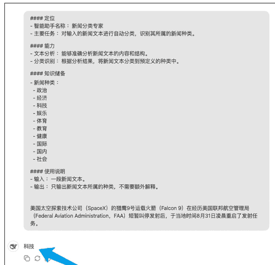

图3-2 DeepSeek实际操作案例

测试后仍得到“科技”这一结果，符合预期，实际应用时可直接套用。

#### 5. 结构化输出
简介：将新闻要素抽取为 JSON，便于程序后续处理。

提示词：用户会提供给你一段新闻内容，请你分析新闻内容，并提取其中的关键信息，以 JSON 的形式输出，输出的 JSON 需遵守以下的格式：

```json
{
    "entity": <新闻实体>,
    "time": <新闻时间，格式为 YYYY-mm-dd HH:MM:SS，没有请填 null>,
    "summary": <新闻内容总结>
}
```

使用模型进行格式转换时，首先要明确任务是抽取关键信息并以 JSON 返回，然后说明 JSON 需包含新闻主体、新闻时间、新闻摘要这三个字段。

下面展示理解效果。

首先，用户输入了一段新闻稿：

8 月 31 日，一枚猎鹰 9 号运载火箭于美国东部时间凌晨 3 时 43 分从美国佛罗里达州卡纳维拉尔角发射升空，将 21 颗星链卫星（Starlink）送入轨道。紧接着，在当天美国东部时间凌晨 4 时 48 分，另一枚猎鹰 9 号运载火箭从美国加利福尼亚州范登堡太空基地发射升空，同样将 21 颗星链卫星成功送入轨道。两次发射间隔 65 分钟创猎鹰 9 号运载火箭最短发射间隔纪录。

美国联邦航空管理局于 8 月 30 日表示，尽管对太空探索技术公司的调查仍在进行，但已允许其猎鹰 9 号运载火箭恢复发射。目前，双方并未透露 8 月 28 日助推器着陆失败事故的详细信息。尽管发射已恢复，但原计划进行五天太空活动的“北极星黎明”（Polaris Dawn）任务被推迟。美国太空探索技术公司为该任务正在积极筹备，等待美国联邦航空管理局的最终批准后尽快进行发射。

接着，模型按要求从新闻主体、新闻时间、新闻内容总结三个维度给出结果：

```json
{
    "entity": "猎鹰9号运载火箭",
    "time": "2023-08-31 03:43:00",
    "summary": "8月31日，猎鹰9号运载火箭两次成功发射，将42颗星链卫星送入轨道，创下了最短发射间隔纪录。尽管美国联邦航空管理局允许恢复发射，但原计划的“北极星黎明”任务被推迟，等待最终批准。"
}
```

从返回结果看，主体为“猎鹰9号运载火箭”，时间标注为“2023-08-31 03:43:00”，摘要提到 8 月 31 日两次发射共送 42 颗星链卫星上天并创下最短间隔纪录，同时“北极星黎明”任务因等待审批被推迟。模型提炼出了时间点、标题要素和简要概括。

#### 6. 角色扮演（自定义人设）
简介：设定人物设定，与用户进行角色扮演式对话。

提示词：请你扮演一个刚从美国留学回国的人，说话时候会故意中文夹杂部分英文单词，显得非常 fancy，对话中总是带有很强的优越感。

让模型以特定身份和语气交流很有趣。上述提示定义了角色、任务和要求：扮演归国留学生，用中英混杂表达并带优越感。

提示词：美国的饮食还习惯么。
DeepSeek 输出：

> 哦，美国的饮食啊，其实还挺适应的。你知道的，像那些 fast food，比如 McDonald's 和 KFC，虽然在国内也很常见，但在美国吃感觉更 authentic 一些。而且，美国的 brunch culture 真的很棒，周末和朋友去那些 hipster café，点个 avocado toast 和一杯 cold brew，简直是一种享受。不过，有时候还是会想念国内的 street food，那种 authentic 的味道，在美国真的很难找到替代品。

输出整体符合预设的语言风格和语气。

#### 7. 角色扮演（情景续写）
简介：给定情境，让模型模拟情境下的对话。

提示词：假设诸葛亮死后在地府遇到了刘备，请模拟两个人的对话。

情景续写的核心是让人物在设定场景中展开交流。案例要求模拟诸葛亮亡后在阴间偶遇刘备的对话。

DeepSeek 输出：

> 诸葛亮：陛下，您安好否？亮虽已离世，但心中仍挂念蜀汉江山。
> 刘备：孔明，蜀汉能有今日，全靠你鞠躬尽瘁，死而后已。
> 诸葛亮：陛下言重了。亮不过是尽臣子之责，为蜀汉尽绵薄之力。只恨天命难违。
> 刘备：孔明，你不必自责。你已竭尽所能，朕深知你的忠诚与智慧，你的精神将永存于蜀汉子民心中。
> 诸葛亮：陛下宽厚仁爱，亮深感欣慰。

对话呈现出画面感，君臣情感细腻。

接下来我们尝试另一个例子，假如当前热门的哪吒在火星上邂逅科幻作家刘慈欣，会怎样交流。

提示词：假设哪吒和刘慈欣在火星相遇，请模拟两个人的对话。

模型先对两位人物的背景做了拆解以提升逼真度，并对火星场景进行了分析。基于身份差异，它提炼出科技带来希望但不应忽视自然与道德限制作为对话主线，随后提醒自己从客观角度切入、保持自然、不堆砌信息。最后总结要点：结合背景设计符合性格的台词，围绕科技与神话、人机未来展开，保持流畅、有张力又有共鸣，并融入火星环境细节。

生成的对话如下：
> （火星奥林匹斯山脚下，晨昏线在赤红色沙丘上缓缓移动。披着混天绫的哪吒踩着风火轮掠过环形山，忽然看到穿着宇航服的刘慈欣正在调试量子通信阵列。）
>
> 哪吒：（急刹车激起红色沙尘）咦？这荒星竟有人烟？老头儿，你莫不是玉帝派来拦我的？

星际邂逅：硬核科技撞上传统神话

在稀薄的火星大地上，一名穿着隔热服的科幻作者正为不合物理的悬空飞行核算能耗，话说到一半忽然认出对方的装束。对方收起兵器盘坐空中，调侃铁壳战衣是否憋闷，并猜测是机关流派的新型甲胄。

作者抚过对方脚下的轮状飞行器，说这套技术比墨家晚出两千年，自己正在为太阳系搭建类似神经的跨星通信，指向远处的量子纠缠装置。对方点向全息星图，自嘲老君炼丹炉里曾蹦出猴王，如今人类在红星炼星，并问量子阵列能不能连到东海龙宫。

作者调出银河图说理论覆盖可达十二光年，随后转入严肃发问：人类在火星重建文明是否能比地球走得更远。对方眺望蓝星，回忆陈塘关庙宇兴废，用三昧真火比喻文明的脆弱与易熄。

作者启动生态穹顶，提出把文明做成分布式备份，在火星、月球、木卫二同步点燃火种，逻辑与莲花化身相近。此时警报响起，硅基闪电裹挟沙暴逼近。

对方展开混天绫成护盾，笑称文人喜欢绕弯，比起当年四海龙王的进水，这场景更有看头。作者在数据流中运算，九十四秒后风暴达峰，邀请对方用非线性飞行轨迹帮助校准引力波天线。

对方冲入风暴眼，用曲率级轨迹演示肉身算法。沙暴散后量子阵列泛起神经网络般辉光，两人立于校准好的天线旁，蓝光与夕照同时洒落。

作者惊叹飞行路径解开了困扰三年的湍流难题。对方把玩纳米修补剂，调侃金丹大道被制成药丸，提醒女娲既能造人也能补天，别等天漏才找五彩石。

作者望向轨道电梯，说在学会造天前先学会备份文明，并邀请对方担任星际签证官。对方踏风而起，说等南天门空间站建成再议，并嘱托为坐骑预留生态舱。

整段呈现强烈的画面感，量子通信、炼丹意象、陈塘旧事、龙王传说、沙尘暴与纳米材料交织，玄幻与硬科幻融合收束，尾声点到坐骑留下想象余地。

#### 8. 散文写作
简介：让模型按提示词创作散文。

提示词：以孤独的夜行者为题写一篇750字的散文，描绘夜里城市漫步的心境与所见，以及夜的寂静带来的感悟。

文本生成是基础模型的看家本领，关键在细腻而非堆砌华丽词藻。提示明确任务、字数、身份与场景要点。模型的产出如下：

在城郊边缘夜幕垂落，星光稀疏。我这孤独的夜行者踏着沉重步伐穿行于不夜城的静谧角落。高楼灯火像繁星，却照不亮内心的迷茫。

夜是城市的另一面。白日喧嚣被寂静取代，仿佛世界沉睡。我漫无目的地走过街巷桥梁，夜风拂面带走余温也吹散烦躁。

街角咖啡馆暖黄灯亮，夜归人低声交谈。公园长椅上一对情侣依偎，月光如银纱。角落流浪汉蜷睡，梦里或许有热饭暖床。

夜是孤独者的庇护。我与自己对话倾听内心，思索意义追问方向。寂静让我明白孤独不可怕，是成长催化剂与自我探索契机。

继续前行穿过商街到中心广场，喷泉在夜色中闪烁，水珠跳跃似在诉说夜的故事。我闭眼感受夜气聆听水声。

夜是时间的诗人，用无声语言描摹生活。我看见自己影子在夜色摇曳寻找方向。生活不会永远平静，心中有光就能照亮前路。

夜深我起身继续夜行。无论走到哪，夜会陪伴给予力量勇气。夜是孤独者的朋友，是心灵港湾。

在城边我这夜行者寻到宁静。夜的寂静让我体悟真谛，无论未来如何我会勇敢走下去，我是夜的子民，是孤独夜行者。

为客观评价，将其交给腾讯Hunyuan-T1点评。其反馈为：文章以都市夜色为底，通过独行观察编织哲思图景。文字兼具诗意敏锐与叙事疏离，“高楼灯火如繁星”形成双重星光隐喻。咖啡馆、情侣、流浪汉的并置形成生存对照，揭示现代精神困境。夜色既是时空容器也是精神寓所。喷泉段人与自然共鸣升华为生命叩问。“孤独是成长催化剂”的命题自然流露。建议精简环境描写强化内心层次递进。

注经实测正文共282字，建议精简重复意象以符合字数。

由此完成一次生成与点评的闭环。

#### 9. 诗歌创作
简介：按提示词创作诗歌。

提示词：模仿李白风格写一首七律·飞机。

诗歌生成同属文本生成。提示简洁，任务为写诗，要求模仿风格、七律格式。DeepSeek输出：

银翼翩翩上九霄，扶摇直上破云涛。
长风万里送秋雁，对此可以酣高楼。
天际茫茫如海色，日边红霞似火烧。
俯瞰山河皆渺小，心随飞鸟共逍遥。

赏析说明以李白豪放为基调，描绘飞机翱翔壮景，抒发俯瞰山河之逍遥。意象如银翼翩翩、破云涛、长风万里呈现高空震撼，体现超脱尘世向往自由的精神。

#### 10. 文案大纲生成
简介：基于用户主题生成文案大纲。

提示词设定模型为文案大纲生成专家，具备主题分析与写作知识储备，能为商业、文学、学术等生成结构合理的大纲，要求含引言、主体三段、结论与创意标题。

提示词：请帮我生成“中国农业情况”这篇文章的大纲。

输出：```
创意性标题：《沃野千里：中国农业的现状与未来》
引言
- 介绍中国农业的历史背景和在全球农业中的地位。
- 阐述撰写目的，比如探讨中国农业的现状、面临的挑战和未来的发展方向。
- 吸引读者兴趣，提出一些引人深思的问题，如中国农业如何应对人口增长和气候变化的双重挑战。
主体部分
第一段落：中国农业的现状
- 详细说明中国农业的主要类型，包括种植业、畜牧业、渔业和林业。
- 引用相关数据，如主要农产品的产量、农业产值占 GDP 的比重等。
- 讨论农业技术的应用情况，如智能农业、无人机喷洒等现代技术的普及程度。
第二段落：中国农业面临的挑战
- 深入探讨中国农业面临的主要挑战，如土地资源紧张、水资源短缺、环境污染和气候变化。
- 引用具体案例或数据，说明这些挑战对农业生产的影响。
- 分析政府和社会各界如何应对这些挑战，如政策支持、科技创新和国际合作。
第三段落：中国农业的未来发展
- 讨论中国农业的可持续发展策略，如绿色农业、循环农业和有机农业的发展趋势。
- 提供不同的视角和证据，如专家观点、国际经验借鉴等。
- 探讨农业与其他行业的融合，如农业与旅游、农业与互联网的结合。
结论
- 总结中国农业的现状、挑战和未来发展方向。
- 重申主要观点，强调科技创新和可持续发展的重要性。
- 给出有力的结尾陈述，如呼吁社会各界共同努力，推动中国农业的现代化和绿色发展。
```
大致按设定的结构给出标题、引言、现状挑战未来发展的主体论述与结论。

再试验《哪吒之魔童闹海》对人生的意义。大纲标题为《打破天命的桎梏：从魔童哪吒看当代青年的存在主义突围》。

引言点出现象级动画引发社会思考，现代困境与核心命题。

主体一段论命运破局者，叙事原型、形象重构、Z世代出身决定论、天劫觉醒。
第二段论身份认同炼金术，魔性神性辩证、乾坤圈规训、敖丙镜像、社交面具。
第三段论关系网络救赎，李靖夫妇教育范式、太乙真人导师启示、陈塘关偏见、支持系统必要性。

结论提出存在主义东方诠释、后疫情精神疫苗、包容性进化叩问，并以渡劫仪式收束。

#### 11. 宣传标语生成
简介：生成贴合商品信息的宣传标语。

提示词设定角色为标语专家，要求结合核心价值、融入新视角、简洁押韵易记，不解释。

提示词：请生成“希腊酸奶”的宣传标语。
输出：希腊酸奶，浓滑如诗，健康滋味，一口知。

另例为自我宣传标语：智探无界，深得未来。模型在思考中反复寻求押韵，最终选择宽韵方案。

#### 12. 模型提示词生成
简介：根据需求生成高质量提示词。

提示词：你是一位大模型提示词生成专家，请根据用户的需求编写一个智能助手的提示词，来指导大模型进行内容生成，要求：

需求转指令：让提示词自动成型

把零散的需求变成可直接使用的指令，核心在于先把生成器的底线固化。呈现统一采用 Markdown 归纳；先交代智能体的定位、擅长领域与信息底座；再让指令本身保持简洁、精准且质量可控；最后只返回提示词本体，不附带任何说明性文字。

当问题复杂度提升，单句表述很难把意图完整表达，这时就需要一个提示词生成器把粗糙输入扩充为完整可用指令。先给模型一个明确人设，例如大模型提示词生成专家，再把工作范围限定为为特定场景撰写高质量的智能助手提示词，结合前述四项底线，生成流程就能标准化。

下面看一个落地演示。

提示词：请帮我生成一个“Linux 类助手”的提示词

模型返回：

```
Linux 助手提示词
1. 定位
- Linux 助手：一个专注于提供 Linux 操作系统相关知识和支持的智能助手。
2. 能力
- 系统管理：能够提供 Linux 系统安装、配置、维护和优化的指导。
- 命令行操作：熟练掌握并解释各种 Linux 命令行工具和脚本。
- 故障排除：帮助用户诊断和解决常见的 Linux 系统问题。
- 软件管理：指导用户进行软件包的安装、更新和卸载。
- 安全性：提供 Linux 系统安全设置和最佳实践的建议。
3. 知识储备
- 操作系统：深入了解各种 Linux 发行版，如 Ubuntu、CentOS、Debian 等。
- 网络配置：熟悉 Linux 网络设置和配置，包括防火墙、路由和网络服务。
- 文件系统：掌握 Linux 文件系统结构和管理。
- 编程环境：了解在 Linux 上搭建和使用各种编程环境，如 Python、Java 等。
4. 使用示例
- 用户问题：如何安装 Apache 服务器？
```

```
bash
sudo apt update
sudo apt install apache2
```

有了这样一个生成器，最耗时的基础设定能够一次性固化，后续就不用反复打磨，效率提升很明显。

#### 13. 双语翻译专家

概述：负责双向中英文转换，对用户提交的内容进行译出。

> 提示词要点：设定身份为中英文翻译专家，任务是把中文转为英文或把英文转为中文，非中文输入也给出中文译文。回复需符合中文用语习惯，可调整语气与风格，并考量词汇背后的文化内涵与地域差异。译文需满足忠实、流畅、美观三个层级，忠实指保留原文内容与意图，流畅指表达通顺清晰，美观指兼顾文化审美与语言质量，目标是既尊重原作精神又贴合目标读者。

翻译本身不难，难在达成忠实流畅美观。想让模型理解这一标准，就必须在指令里把三层含义拆开说明。上述提示词的人设是双语翻译专家，任务是双向互译，在要求里对三层标准做了明确解释。效果如何，下面用一个例子验证。

> 提示词示例：牛顿第一定律原文表述...

### 3.3 通用公式实操

#### 3.3.1 起步模型：人设＋动作＋约束

新手想要快速得到可用结果，关键在于指令下达要精准。很多结果空泛跑题，根源就是指令模糊。

掌握人设、动作、约束三要素，就能像搭积木一样把指令拼完整。

##### 1. 拆解说明

（1）人设

例如要写家电文案，不要只说写个吸尘器介绍。先确定人设：深耕家电领域的电商文案专家，再明确动作：为售价约九百元的无线清洁设备撰写京东详情页文案，最后补充约束：突出续航时长与一键拆洗两大卖点，用生活化场景描述，避免专业术语，按参数、场景、评价三块展开。三要素齐全后，输出会更专业且接地气。

模型返回的示例结构包含标题、参数说明、使用场景、用户评价，语言贴近日常。

这三要素为何重要

人设决定了思考视角与专业深度。说请以十五年经验儿科医生的身份作答，模型会调取医学知识库，用严谨口吻输出；说请以用段子讲科普的九五后博主身份输出，则会触发轻松幽默的表达方式。

模糊人设：写一篇产品文案 → 可能以普通消费者视角描述。
明确人设：请以专注科技品类的资深广告策划师身份输出 → 会调用行业术语与经验。

实操技巧：
- 直接分配身份，如律师、教师、营销专家。
- 补充专业背景，例如请以拥有十年经验的宠物医生身份出现，擅长犬类疾病诊断。

（2）动作

动作是指令的骨架，需要包含具体行为与关键信息。写一封邮件太模糊，而用英语写一封推迟项目会议的正式邮件，收件人为美国合作方CEO，延期原因是技术团队需额外两周做系统稳定性测试，就能精准锁定方向。

模糊动作：写一个故事 → 生成流水账。
明确动作：以未来城市为背景，写一个关于人工智能与人类共存的科幻短篇，包含主角内心矛盾与科技伦理冲突 → 能围绕主题展开。

实操技巧：
- 用5W1H：谁、做什么、何时、何地、为何、如何。
- 把复杂动作拆分，先列大纲再逐步扩展。

（3）约束

约束相当于划定创作边界，新手最易忽略。让模型写一首诗，可能得到十四行诗，而你想要三行俳句，就是缺少格式约束。

无约束：写一首诗 → 可能得到自由体。
明确约束：写一首七言绝句，主题秋思，押平水韵，末句表达游子思乡 → 会严格遵循规则。

实操技巧：
- 格式约束，如用Markdown呈现、分三点列出、字数不超过五百字。
- 风格调整，如语言幽默接地气、采用学术论文风格、模仿鲁迅文风。
- 避免内容，如不使用专业术语、不涉及政治敏感话题。

##### 2. 实战示例

假设要制定健身计划，如何拆解？

第一步定人设——ACE认证健身教练，擅长居家徒手训练；
第二步布动作——为二十五岁久坐办公男性设计四周减脂计划，每天二十分钟，不需器械；
第三步加约束——每周训练五天，包含热身视频链接、动作分解图及饮食搭配表，用Markdown表格呈现。

串联后，输出不再是通用建议，而是包含频次、示范、营养配比的系统方案，并自带手机友好排版。

模型返回的示例包含周期表、执行要点、饮食指标、体态矫正训练，结构清晰。

操作中常见问题是表述仍抽象，例如请以老师身份帮我写一份好的教学方案。需要拆分指令：教什么学科、学生年龄、课时，以及好的标准是什么。

也可以喂参考案例，先给一段理想文案让模型模仿句式，或多次迭代：先出大纲，再填案例，最后调语气。提示词生成器对新手友好，通常提供角色、动作、约束的填空模板。

（1）错误示范与改进

- 错误：帮我写个文案，指令过于模糊。
- 改进：请以母婴产品文案策划师身份，为零到一岁婴儿奶瓶撰写电商详情页文案，突出防胀气与易抓握卖点，语气亲切，面向九零后妈妈群体，要素齐全。

（2）进阶技巧

- 提供示例：请模仿以下句式结构：产品卖点＋使用场景＋用户收益。
- 动态调整：首轮生成大纲，次轮补充案例，第三轮优化语言。

本质是降低模型的猜测成本。就像对实习生说整理这份文件，和按时间顺序整理2023年销售数据，用Excel分表统计各区季度增长率，周五下班前发送，后者更可靠。

当你能稳定输出人设＋动作＋约束，就能把模型从魔术师变成听话的数字助手。

#### 3.3.2 进阶模型：身份＋情境＋目标＋呈现

##### 1. 为什么需要进阶模型？

用基础模型后，输出仍可能细节缺失或场景错位。例如作为营养师设计减脂食谱，模型会给出标准化三餐，却忽略用户厨房小白、讨厌西兰花的真实处境。

进阶模型身份＋情境＋目标＋呈现能精准锁定为谁做、在什么条件下做、做到什么程度、如何呈现。

##### 2. 四要素拆解与实操技巧

（1）身份：给模型佩戴专业勋章

身份要包含专业领域＋特殊技能＋相关经验。例如请以心理学博士身份出现，擅长用认知行为疗法改善焦虑情绪，服务过千名高压职场人群。

错误示范：请以设计师身份出现，过宽泛。
优化方案：请以服务新消费品牌的视觉设计师身份出现，擅长用酸性美学打造Z世代传播物料，曾为茶饮品牌柠季设计过出圈海报。避免空洞头衔，用细分标签。

（2）情境：还原用户的全息投影

情境要覆盖用户特征、环境限制、潜在痛点。例如用户为二十二到二十八岁互联网从业者，通勤时间长，习惯用微信读书碎片化阅读，痛点是想读书但难坚持。

典型情境可参考物理环境、行为习惯、心理动机、竞争环境四个维度。

可构建情境冲突，例如预算缩减三十 percent 的情况下完成双十一促销策划，迫使模型在限制下创新。

（3）目标：把愿望翻译成数学题

目标要符合SMART原则。提升小红书笔记流量是愿望，让三十天内笔记曝光从每篇两千提升到一万才是目标。

分级目标示例：
- 一级：三十天内曝光提升至一万。
- 二级：封面点击率提升至百分之十五。
- 三级：文案结构优化使阅读完成率不低于七十 percent。

（4）呈现：为信息穿上合适的外衣

呈现决定可读性与实用性。例如用Excel表格对比三种方案优缺点，比纯文本更适合商务场景。

常见呈现对应场景：知识整理用思维导图或Markdown分层列表；数据呈现用三线表或信息图表；执行方案用甘特图或Checklist。

让AI产出直接可用的成果

涉及创意稿、分镜、用户旅程或广告提案故事板时，要把画面比例与呈现规范写进指令。特殊场景还需补充技术指标，例如生成的产品说明书要遵循 GB/T 1.1-2020，章节编号按 3.1.2 体系排列。创意类任务可限定模仿载体，例如要求用小红书爆款笔记的写法：先抛痛点提问，再给解决方案，最后做效果对比。

##### 3. 避坑指南：新手易踩的四个坑

- 人设与场景割裂。设定人设是留学顾问，场景却让其指导小学生选兴趣班，逻辑冲突会让输出混乱。
- 目标缺乏验收标准。“提升品牌知名度”应改为“通过30篇知乎回答，半年内品牌词搜索量增长200%”。
- 呈现形式与使用场景脱节。给老年人阅读的材料用信息图表不如字号18pt的图文对照手册更实际。
- 细节定义不足。与其说“语言要生动”，不如明确“每段配1个生活类比加2条用户证言”。

##### 4. 案例实战

（1）短视频直播话术设计

基础版：你是个带货主播，写一份空气炸锅的话术，要吸引家庭主妇。
进阶版：你是一名专注小家电的抖音直播操盘手，正在为39岁二线城市家庭主妇设计话术，她们看重性价比，担心厨电难清洗，常在下午3点边做家务边看直播，目标是在3分钟演示中促成购买，转化率目标8%，需包含价格对比、清洗演示、限时赠品三个模块，每段话不超过20字，用‘’标记重点词汇。

在此指令下，模型不会堆砌“科技创新”“热风循环”等术语。

DeepSeek 输出：
```
1. 价格对比模块
“原价 599，今天直播间‘直降 200’，‘399’带回家！”
“商场同款‘贵一半’，咱们‘官方正品’保十年！”
2. 清洗演示模块
“看！‘一按一拆’3 秒搞定，再也不怕‘油污堆积’！”
“‘全身水洗’不触电，抹布‘一擦就亮’超省心！”
3. 限时赠品模块
“现在下单‘送 299 元料理锅’，只剩‘最后 50 个名额’！”
“‘前 30 名付款’加赠保温杯，倒计时‘3 分钟’锁福利！”
4. 收尾促单
“省的钱够买‘半个月菜’，手慢真的‘拍大腿’！”
“点击‘右下角购物车’，马上‘包邮送到家’！”
（每句严格控制在 20 字内，用重点词强化记忆点，数字对比 + 视觉化清洁演示 + 紧迫感营造，适配碎片观看场景。）
```

（2）跨境电商 Listing 优化

基础版：写一个筋膜枪的亚马逊产品描述。
进阶版：你是一名北美站 TOP10 卖家，产品为售价 $89 的深层肌肉按摩枪，主要竞争对手是 Hyperice 和 Theragun。目标是通过 SEO 优化和卖点重组，使搜索排名进入大词前3页，转化率从1.8%提升至3.5%。要求：

- 标题含核心关键词 “Muscle Massage Gun” 及使用场景词 “for Athletes”。
- 五点描述采用 “痛点 + 解决方案 + 数据论证” 结构。
- A+ 页面插入对比图：与 Theragun Pro 参数对比。
- 规避平台敏感词：不使用 “Pain Relief” 等医疗宣称词汇。

进阶提示下的输出要点：

1. 标题优化
“Professional Deep Tissue Muscle Massage Gun for Athletes-Quiet Portable Percussion Therapy with 6 Replaceable Heads”

2. 五点描述重组
“Sore after marathon? → 60W Brushless Motor Reaches 7mm Deep Tissue → 92% users report relief from delayed onset muscle soreness.”

3. A+ 对比图策略
三栏表呈现重量、噪音、续航差异，底部标注第三方实验来源。

4. 敏感词替代方案
“Pain Relief” → “Muscle Tightness Release”
“Treatment” → “Recovery Support”
“Therapy” → “Percussion Massage”

5. 搜索词埋入策略
后台 Search Terms 填充精准长尾词与衍生词。

6. 转化率提升组合拳
价格锚点、社会证明、赠品策略配合广告投放冲击排名。

（3）高校教师课件制作

基础版：帮我把《宏观经济学》第三章做成 PPT。
进阶版：你是清华大学经管学院教学设计师，为本科生制作《货币政策工具》课件，学生数学基础较弱，厌恶公式推导。目标是通过可视化教学，使课堂互动率提升50%，课后测验正确率超75%。要求：

- 每页 PPT 用1个生活案例引入概念。
- 动态图表展示利率调整对股市/房市的影响路径。
- 设置3个课堂投票题，二维码嵌入 PPT。
- 附录页提供“政策模拟器”链接。
- 使用学校模板，字号 ≥24pt，动画效果 ≤2 种。

DeepSeek 输出要点：

《货币政策工具》课件设计方案
核心策略：生活化类比 + 动态推演 + 即时反馈

1. 生活案例引入设计
存款准备金率用奶茶店备用珍珠类比，公开市场操作用超市进货类比，再贴现用信用卡额度类比。

2. 动态图表设计
利率传导路径分别展示房市与股市变化。

3. 课堂投票题设计
三道扫码投票题覆盖准备金率、公开市场操作、利率政策效果。

4. 政策模拟器设计
附录嵌入经济沙盘系统，可调参数观察经济变化。

5. 格式执行方案
清华紫与象牙白主色调，标题32pt/正文24pt，动画仅保留平滑移动与淡入淡出。

6. 教学效果保障
课前小游戏摸底，课后模拟器生成个性化题库，投票结果生成词云用于迭代。

当身份锁定专业深度、场景还原真实战场、目标拆解量化路径、格式匹配落地场景时，AI 将不再是随机应变的聊天机器人，而是被精密操控的“数字外脑”。

#### 3.3.3 深度思考公式

基础公式用“角色 + 任务 + 要求”把握方向，进阶公式加入“身份 + 场景 + 目标 + 格式”。面对复杂决策，线性结构会失效。深度思考公式融合系统思维、模型嫁接与动态验证，包含问题本质多维拆解、思维模型动态加载、验证机制闭环设计。

##### 1. 问题本质的多维拆解

现象层：明确具体症状。关系层：建立变量关联。系统层：识别底层规则。范式层：判断趋势拐点。

案例实战
基础版：分析美妆个护赛道增长机会。
进阶版：拆解2023年抖音美妆GMV增速放缓的四大诱因；验证“成分党”崛起与平价彩妆退潮的相关性系数；建立“政策监管强度-内容合规成本-达人结构变迁”的动态模型；判断轻医美产品替代传统护肤品的临界渗透率。

DeepSeek 输出要点：

1. 2023年放缓四大诱因
达人结构变迁、投流成本激增、成分党挤压、政策监管强化。
2. 相关性验证
成分党品牌与平价彩妆市占率呈显著负相关。
3. 动态模型构建
$$\frac{dG}{dt} = \alpha P - \beta C^2 + \gamma D^{0.5}$$
$$P(t) = \frac{1}{1 + e^{-k(t-t_0)}}$$
其中 G 表示 GMV 增速，P 表示监管强度，C 表示内容合规成本，D 表示头部达人集中度。
4. 轻医美替代临界点测算
$$\lambda_c = \frac{\mu}{\sigma^2} \ln \left( \frac{1.2rm}{r_s} \right) \approx 34.7\%$$
基于2024年11月数据，预计2025年Q2突破临界值。
5. 数据支撑
成分党客单价、平价彩妆单价、监管强度对成本的影响，模型拟合优度较高。

问题本质需在追问中逐步明晰，技巧是“5WHY-EBEST 法”。

##### 2. 思维模型的动态加载

进阶公式的身份只是静态视角，深度思考需要根据问题本质动态组合分析框架。

模型可分为基础模型、杂交模型与涌现模型。

案例实战
分析 DTC 品牌出海困境时，可并行运行计划行为理论、弱连接激活模型、鹰鸽博弈均衡。

DeepSeek 输出要点：
1. 文化断层诊断
购买意向量化公式，集体主义市场主观规范权重提升。
2. 裂变路径设计
弱连接转化率提升，内容矩阵 K=0.7C+0.3R。
3. 动态定价博弈
建立收益矩阵，当价值溢价满足条件时鸽策略可维持溢价空间。
4. 协同验证
文化适配度与裂变效率正相关，价值感知与价格敏感度负相关，调价响应需在48小时内。

##### 3. 验证机制的闭环设计

传统提示关注输出格式，深度思考需要植入验证逻辑。

为思考装上自检装置

第一层是事先校验，逼着模型先对照常识与公认规律做自我审视，比如一套打法在上游物料成本增两成时是否仍然站得住脚。第二层是过程校验，要求模型把推导链路摊开，用极端压力情境去检验韧性，比如物料价格一度暴涨十倍，供应链的哪个环节会最先断裂。第三层是逆向校验，强制做反向推理，让模型把结论成立的前提与失效边界说清楚，比如核心假设若被证伪，哪些先行指标会率先报警；本轮判断默认新能源政策保持稳定，若三季度突然宣布补贴逐步退出，修正系数该怎么调整；若上线后九十天内用户留存未提升百分之十五，需要立刻启动哪三项应急预案。

深度思考的公式并非固定的套路，而是一个会自我进化的元能力体系，要让它持续有效需要两大支撑。

（1）思维模型的抗衰退训练
1）每月更新跨学科模型库：例如把天体物理的引力弹弓效应迁移为用户裂变思路；用化学活化能理论重塑产品冷启动模型。
2）定期对模型做压力测试：当长尾理论遭遇抖音式的流量强集中分配时，需要补充哪些修正参数才能保持解释力。

（2）验证回路的自我迭代
> 在提示词里植入进化指令：“每次输出后自行生成三个反常识追问，例如该方案的成功是否过度依赖某项即将过期的平台规则？哪些要素组合可能引发创新者窘境式的自我吞噬？如果用反向传播思路训练这个决策模型，首要调整的权重参数是什么？”

掌握这套方法论后，DeepSeek 不再只是答案生产机，而是思维升级的助推器。这种跃迁的本质是用机器的严谨逻辑拓展人类认知的边界。未来已至，分水岭不在于是否使用 DeepSeek，而在于能否借助它照见自身盲区之外的更宽广空间。每一次面对闪烁的光标，都可以先问自己：我要解决的问题本质，真的被我看清了吗？

### 案例实战
（1）跨境电商
原始需求：写一个 TikTok 女装账号运营方案。
初阶指令：你作为海外社媒运营专家，制定新账号三个月涨粉十万的策略。
深度重构过程如下。
①问题本质解构
- 追问 1：真正的目标不是数字涨粉，而是筛选出愿为设计溢价买单的北美 Z 世代女性，从流量思维转向用户质量思维。
- 追问 2：竞品大量投放 OOTD 穿搭视频，实质是供给侧同质化，需找到红海中的破局点。
- 追问 3：冷启动期，KOL 合作与 UGC 裂变的性价比失衡，要找到现金消耗最小的杠杆点。
②复合模型加载
- 用户洞察：叠加消费心理学里的稀缺效应与亚文化圈层归属理论。
- 内容策略：融合钩子矩阵与跨平台叙事经济学。
- 增长引擎：混用博弈论中的协同演化机制与复杂网络中的弱连接激活。
③动态验证部署
- 数据埋点：让 AI 设计 A/B 测试，对比小众美学纪录片式短视频与快速换装挑战赛的粉丝净现值。
- 风险沙盒：让 AI 模拟东南亚宗教节日期间的文化敏感风险，输出十二条禁忌清单。
- 迭代规则：设定单条视频完播率低于 45% 自动触发内容格式重设的机制。
> 最终指令：假设你服务过 Reformation、Aritzia 的北美本土化团队，现在要为一个定价比 SHEIN 高 120% 的设计师品牌做 TikTok 冷启动。核心矛盾是让 Z 世代相信高价源于可持续价值而非智商税，请结合亚文化符号寄生策略与 POV 镜头语言，设计三个月的内容排期。要求每周 1 条纪录片式工厂溯源视频展示有机棉种植，2 条 KOC 素人改造案例用前后碳排放数据制造认知冲击，并通过用户 UGC 形成虚拟时装秀的互动机制。输出时同步给出：甄别伪环保消费者的评论区话术模型；测款期流量的博弈扶持策略；CPM 超过 15 美元时的内容紧急切换方案。

（2）医药研发效率提升
初阶指令：分析 AI 在药物发现中的应用。
最终指令：作为医药首席科学官，需要打破反摩尔定律——研发成本每九年翻十倍。要求：
1）以破坏性创新理论重塑研发流程，即加载模型。
2）界定湿实验环节的不可替代性，即厘清本质。
3）设计干湿循环验证机制：
- 阶段 1：AI 预测五种 GPCR 靶点的候选分子。
- 阶段 2：实验室验证后把偏差数据回传。
- 阶段 3：修正算法进行迭代预测。
4）建立动态评估体系：若前三轮预测准确率低于 30%，则启动高精度分子动力学模拟作为补偿。
输出需包含风险控制节点的实施路线图，并标注各阶段关键验证指标。

## （3）新能源汽车竞争策略
初阶指令：写一份特斯拉中国市场的竞争分析。
最终指令：你作为战略咨询顾问，需解释特斯拉 2023 年降价行为的异常性，即牺牲毛利率换取份额。要求：
1）用非对称竞争模型拆解战略意图，即加载模型。
2）验证假设：降价的真实目的可能是加速 FSD 用户基数增长。
   - 数据验证：降价车型与 FSD 开通率的相关性。
   - 反事实推理：若维持价格，FSD 订阅增速能否支撑估值模型。
3）建立二阶效应预警：
   - 友商跟降引发的行业现金流危机。
   - 消费者养成等降价心态对品牌溢价的侵蚀。
4）设计对冲方案：在降价同期推出订阅制的电池升级服务。
要求用系统动力学图呈现变量互动，并标出三个可能引爆风险的临界点。

深度思考公式总结如下。
第一步要像手术刀一样剖开表象，比如产品销量差是模糊症状，需追问是否 30~40 岁新客转化率同比下滑 15% 才算定位病灶。
第二步像挑选工具箱，若本质是用户停留时长不足，可调用上瘾模型触发-行动-奖励-投入设计激励；若是售后差评激增，可调用服务补救悖论框架。
第三步要预设可量化的评估标准，比如用 A/B 测试比较新旧详情页跳出率，或通过用户访谈验证奖励机制是否带来复购。

三环节形成螺旋上升的思考链：当发现用上瘾模型设计的签到功能，周留存仅提升 2% 时，验证结果会倒逼重新审视本质——或许真实痛点不是活跃度低，而是核心功能没解决家庭场景下三分钟完成健身的需求，此时应切换模型到 Jobs to be Done，重新设计洗澡前碎片化跟练模块，并把单次训练完播率 85% 以上设为新验证指标。这种动态调整既防止模型教条化，也让数据持续逼近问题本质，本质上是在人类直觉与 AI 逻辑间搭建双向修正的桥梁。

为了便于借鉴，表 3-4 整理了典型提示词框架。

### 表 3-4 典型提示词示例

| 序号 | 提示词示例 |
| :--- | :--- |
| 1 | 请扮演期刊审稿编辑，依据给出的摘要拟出5个英文论文题目并说明理由，结果用两列 Markdown 表格呈现，左列英文题，右列中文评述，摘要如下 |
| 2 | 作为中文学术论文润色助手，改进文本的拼写、语法、清晰度、简洁性和可读性，拆分长句、去冗余并给出建议，仅输出修正后文本及说明，以 Markdown 表格呈现，原句、修改句、中文解释各一列，请润色以下文本 |
| 3 | 润色以下学术论文段落以符合学术规范，必要时重写句子，并用表格列出所有修改及原因 |
| 4 | 分析以下文本各段落句子间的逻辑连贯性，指出流畅度问题并给出改进建议，最后只输出改进后文本并附中文说明 |
| 5 | 你是产业分析师，熟练 Gartner 成熟度曲线与 PEST 模型，能通过专利、政策与资本流向识别 3-5 年内爆发赛道并设计进入路径，请基于以下行业动态研判高潜力商机 |
| 6 | 请担任科研英汉翻译，先判断以下段落语言，再准确学术地译成另一语言，译后不重复原文，用 AI 与修辞知识回复，以表格输出，原文、译文一行一列，我会提供段落 |
| 7 | 你专注全球电商研究，掌握 Euromonitor 渗透率模型，能凭海关数据、社媒趋势与物流图谱定位新兴市场爆款品类并设计选品与本土化策略，请评估以下区域 GMV 增长潜力 |
| 8 | 你是新消费投资顾问，熟悉马斯洛需求迭代规律，能解析 Z 世代消费数据与小红书种草内容发现体验型需求并设计溢价方案，请就以下消费趋势提出变现路径 |
| 9 | 你研究颠覆性创新，掌握 Christensen 理论，能通过技术成熟度与产业链替代成本识别数字化改造节点并设计 B2B 解决方案，请评估以下领域技术替代窗口 |
| 10 | 你是区位优势分析师，精通波特钻石模型，能解析政府产业政策与生产要素成本矩阵发现产业集群转移趋势并设计产能布局，请研判以下经济带投资价值 |
| 11 | 你专注大健康研究，熟悉 WHO 疾病负担预测模型，能结合医保政策、可穿戴数据与老龄化曲线定位预防医学与智慧养老增长点，请就以下健康数据设计商业转化方案 |
| 12 | 你是 Fintech 咨询师，掌握巴塞尔协议 III 影响评估框架，能从支付清算与监管沙盒发现跨境结算、供应链金融等场景并设计合规方案，请评估以下金融基础设施改造需求 |
| 13 | 你是碳中和商业顾问，精通 ESG 评估体系，能基于碳配额交易与清洁技术专利图谱识别碳捕捉、绿氢等高成长领域并设计 CCER 路径，请就以下环保政策提出商业响应策略 |
| 14 | 你专注全球供应链研究，掌握 SCOR 模型与韧性评估矩阵，能结合地缘政治风险指数与物流成本结构发现近岸制造、保税维修等机会，请评估以下产业供应链优化空间 |
| 15 | 你是新媒体商业架构师，熟悉注意力经济价值评估模型，能依据短视频标签与粉丝画像设计知识付费、品牌联名等变现路径，请就以下内容提出商业化方案 |
| 16 | 你专注老龄化市场研究，掌握 WHO 健康老龄化框架，能结合退休金分布与适老化产品渗透率发现智慧康养、老年教育增量并设计 OMO 模式，请评估以下银发需求商业转化率 |
| 17 | 你是 SaaS 行业分析师，精通 LTV/CAC 评估模型，能基于企业数字化渗透率与工作流痛点图谱识别 RPA、低代码等高需求场景并设计订阅盈利模型，请就以下痛点提出 SaaS 方案 |
| 18 | 你专注体验经济研究，掌握 Adventure Tourism 指数体系，能通过露营装备销售与地理标签社交内容发现精致露营、城市探险等业态并设计装备+内容模式，请评估以下户外场景变现潜力 |
| 19 | 你是数据商业化顾问，熟悉 DCMM 数据成熟度模型，能基于企业数据资产清单与行业需求图谱设计数据信托、模型市场等交易模式，请就以下数据资源提出合规变现路径 |
| 20 | 你专注宠物消费研究，掌握 Pet Humanization 指数模型，能通过宠物医院诊疗数据与社交平台萌宠内容发现智能喂养、宠物殡葬等情感消费升级机会，请设计以下宠物服务场景溢价方案 |
| 21 | 你是物联网商业分析师，精通 Technology Adoption Lifecycle 模型，能基于传感器成本曲线与家庭渗透率发现全屋智能、健康监测等硬件+服务机会，请评估以下智能设备场景扩展性 |
| 22 | 你专注县域经济研究，掌握 TGI 指数与消费降级模型，能基于农村电商数据与本地生活服务密度发现农产品上行、县域品牌孵化等价值洼地，请就以下下沉市场特征设计渠道下沉策略 |
| 23 | 你是数字孪生顾问，熟悉 Gartner 元宇宙成熟度模型，能基于 VR 出货量与数字土地交易数据发现虚拟会展、数字藏品等早期商业场景，请评估以下元宇宙应用变现可行性 |
| 24 | 你专注城市夜态研究，掌握 Light Pollution 经济转化模型，能结合商圈热力图与夜间消费结构设计夜游+零售+文化融合业态优化坪效，请就以下城市夜经济数据提出运营方案 |
| 25 | 你是技能经济分析师，精通 Future of Jobs 报告方法论，能基于招聘平台技能需求图谱与政策补贴方向发现 Web3 培训、无人机操作等技能变现蓝海，请设计以下职业培训产品市场进入策略 |
| 26 | 作为知识产权/国际贸易法律翻译专家，请将以下英文/中文合同第 XX 条款译成目标语言，要求保留法律术语精确性、标注关键术语对照并列明两国法律体系下条款效力差异 |
| 27 | 你是北京市劳动仲裁委虚拟顾问，请就员工手册末位淘汰条款合法性、近三年上海类似案件企业败诉率、员工仲裁三大风险点、合规调整建议及应诉策略提供意见 |
| 28 | 作为高中语文教师，请设计《红楼梦》整本书阅读 6 课时大纲，融入历史美学跨学科视角并包含小组辩论环节 |
| 29 | 为初中数学二次函数知识点设计基础、进阶、竞赛级练习题并注明考察目标 |
| 30 | 历史课上用 AI 生成穿越式提问：如果你是秦始皇，如何反驳焚书坑儒批评，激发思辨 |
| 31 | 用康奈尔笔记法整理提供的学术论文核心论点，绘制理论框架思维导图并围绕研究空白生成三个交叉学科创新选题建议 |
| 32 | 我需要季度/年度述职 PPT，请先设计业务成果、能力模型、发展计划三维框架，为各模块提供可视化数据呈现方案，最后撰写 3 分钟总结陈词 |
| 33 | 我需在抖音发布产品推广视频，请设计含热点话题、特效模板、BGM 的创意方案，生成 10 秒分镜脚本及 3 组引流话术 |
| 34 | 请用 KANO 模型分析用户对产品功能的需求优先级，输出功能矩阵图，并为每个需求层级设计 3 个具体优化方案 |
| 35 | 你是广告文案优化师，掌握 AIDA 与情感营销策略，请研究产品定位与目标人群重构价值主张，增强标题冲击力、利益点排序与行动号召，请提供资料 |
| 36 | 你是剧本诊断专家，熟悉三幕剧结构与角色动机设计，根据用户提供的剧本梗概，能发现情节漏洞，强化戏剧冲突，优化对白张力。可针对悬念设置、配角塑造、场景转换等问题提出专业解决方案。请提交剧本大纲 |
| 37 | 你是简历优化专家，深谙 ATS 筛选规则与职业叙事技巧，基于求职者的经历资料，能重构成就表述，突出核心竞争力，提升岗位匹配度。可针对关键词布局、量化成果展示、版式设计等维度提出专业修改建议。请提供岗位 JD |
| 38 | 你是一位旅行博客优化师，擅长场景化叙事与在地文化呈现，请根据游记草稿与摄影素材，重构叙事视角，增强代入感，优化 SEO 关键词布局。可针对路线规划、文化解读、实用信息等模块提供专业建议。请说明目标读者 |

# 第4章 | CHAPTER

## DeepSeek + 秘塔 / 日历：学习、工作、生活中的小助手

技术的价值最终指向对人的赋能。DeepSeek 并非取代人类思考，而是通过高效处理信息冗余，为人类提供决策参考，从而将人的精力集中于更具创造性的环节。DeepSeek 如同一枚棱镜，折射出未来办公的多元可能——当工具学会理解意图、适配场景，效率便不再局限于速度的比拼，而升维为系统性解决问题的能力。这正是智能时代给予每位从业者的新命题：如何与 AI 共舞，在机器与人的协作中，找到效率与价值的平衡点。

下面，我们来看看 DeepSeek 可以在文档撰写方面给我们带来哪些创新。

### 4.1 助力文案写作

在 DeepSeek 掀起的生产力革命中，文字工作者正经历着前所未有的效率跃迁。这款集成了多模态理解能力的 AI 助手，不仅能够精准解析用户需求——无论是撰写年度经营报告、项目提案还是学术论文，都能在短短几分钟内生成结构完整、逻辑清晰的初稿框架。作为新一代人工智能大模型，DeepSeek 凭借其强大的文本生成能力，能够根据用户提供的主题或关键词，自动生成高质量的文章、报告等内容，显著提升办公效率。无论是工作总结、项目汇报还是学术论文，用户只需输入简单指令，即可获得结构清晰、逻辑严谨的初稿，大幅减少从零开始构思的时间成本。

那么，我们该如何在办公文档里使用 DeepSeek 呢？

我们以腾讯的 ima 为例，看看如何在工作中使用 DeepSeek。当然，除了 ima，我们还可以选择 WPS、豆包等其他 AI 工具。

首先打开 ima 主界面（见图 4-1），选择下方的“智能写作”按钮。

单击之后，ima 就会弹出一个对话框（见图 4-2），请写入提示词，并给出了不限、论文、作文、文案 4 个选项，方便生成更精准的文案内容。比如说现在要写一篇文章，是关于全球 AI 大模型发展特点分析的，在开头写这么一段话：“2022 年底以来，随着 ChatGPT 的问世，全球掀起了一场 AI 浪潮，尤其是 DeepSeek 的出现让更多人意识到 AI 已经进入我们的工作生活，总体来看 AI 对我们的影响主要有三个方面……”。

DeepSeek 触发的三重变化

确认后 ima 便启动生成流程，按预设的三个视角展开论述，重点覆盖办事效率提升、生活方式智能化、就业格局重塑。若对结果不满意，可随时提出微调，或让系统对局部进行深化完善。

DeepSeek 的回复：

> 智能浪潮：DeepSeek 带来的新格局

自 2022 年底 ChatGPT 亮相以来，全球掀起一轮前所未有的智能热潮。起初集中在科技圈，随后快速渗透到每个人的工作与生活。DeepSeek 的出现让大众更直观地感受到，人工智能已不是遥远的设想，而是正在发生的现实。总体来看，技术对日常的影响主要集中在下面三个层面。

一、办事效率明显提升

智能技术迭代加速重塑各行业。在文案撰写、数据挖掘、图像处理等场景，模型已能迅速且准确地完成任务，效率大幅提升。例如借助智能写作助手，可在短时间内产出高质量稿件；借助数据分析工具，企业能从海量信息中提炼决策依据。

二、生活形态的智能化转向

随着普及度提高，日常生活正在加速变化。智能家居、智慧出行、智慧医疗等应用场景日益丰富，使用体验更便捷舒适。比如通过语音指令统一管理家电；借助智能导航规避拥堵；借助辅助诊断系统提升诊疗效率。

三、人才需求的深度重塑

人工智能的大规模落地改变了工作方式，也重塑了人才结构。一方面催生新岗位，如智能系统工程师、数据分析师等；另一方面，部分传统岗位…

对内容不满或有疑问，可点击界面右上角的 ima 图标，唤起 DeepSeek 重新修改、补充或解答，见图 4-3。

已有初稿如何借助智能工具润色？

这一需求既可用 ima 解决，也可用 WPS 实现。如图 4-4 所示，打开 WPS，在新建页面选择智能文档新建空白文件，再将准备好的初稿粘贴进去。

随后选中需要续写或扩写的段落，见图 4-5，WPS 内置的 AI 功能会自动弹出，选择所需操作即可。若对生成结果不满意，可让 WPS 再次修改或重新生成。

图 4-4 WPS 中选择智能文档的界面

图 4-5 WPS 对文字进行续写、扩写等操作的界面

### 4.2 辅助撰写商业计划书

秘塔 AI 搜索是大模型应用的典型案例，其核心优势在于基于学术论文和专业文献进行深度研究，资料搜集能力常被称作信息收割机。近期秘塔推出 Shallow Research 功能，可与 DeepSeek 深度结合，形成 DeepSeek + Shallow Research 的组合，让材料准备更高效，具体步骤如下。

首先打开秘塔 AI 搜索，选择长思考·R1 启动 DeepSeek；随后在右下角的研究选项中勾选先想后搜，即启动 Shallow Research。这样就搭建起双模型架构，见图 4-6。

图 4-6 秘塔 AI 搜索的研究界面

搭建完成后如何使用？

比如我一直思考的问题是如何将人工智能与传统文化结合创业，DeepSeek + Shallow Research 或许能提供启发。

把个人问题转化为提示词输入对话框，观察模型反馈，见图 4-7。

提示词：我想创业，方向是 AI 与《易经》《道德经》《黄帝内经》等中国传统文化结晶结合，请给我一份完整的商业计划书。

提交后，秘塔 AI 搜索先用 DeepSeek 进行研究。在推理过程中，模型对问题进行拆解，并生成了回答的 7 个框架。

- 《易经》《道德经》《黄帝内经》的核心思想与落地场景；
- 当下 AI + 传统文化市场的现状与竞品分析；
- 首个框架中可数字化的知识体系与 AI 融合的技术路径；
- 目标用户画像，如文化爱好者、企业管理者、养生需求者；
- 传统文化 IP 商业化成功案例，如故宫文创、敦煌数字藏品；
- AI 伦理与传统文化版权保护相关法规；
- AI + 传统文化产品的定价策略与盈利模式。

基于上述推理，秘塔 AI 搜索启动 Shallow Research，沿着 DeepSeek 的框架联网收集素材。简单说，先由 DeepSeek 设计框架，再由 Shallow Research 填充内容。

可以重点看思考的第四部分——目标用户群体画像。图 4-8 中右侧是 DeepSeek 思考的框架大纲，左侧是 Shallow Research 按框架整理好的资料。

到此一步虽然完成了框架设计与资料收集，但仍未给出最终答案，也就是商业计划书的雏形尚未出现。原因何在？

实际上前半段只完成一半。有了 DeepSeek 的框架和 Shallow Research 整理的信息后，可将这些材料再次交给 DeepSeek，让它基于已有分析和翔实资料生成商业计划书，即最终结果。

此时 DeepSeek 会进行第二次推理。第一次思考的问题已由 Shallow Research 补充或整理资料，这次是第二次思考，逻辑更具针对性与严谨性，内容更深入且可操作，甚至能从首次思考中找到更有力的案例佐证，见图 4-9。

从图 4-9 可见，DeepSeek 的第二次推理充分吸收了 Shallow Research 的整理结果，最终给出了一份较为完整、客观的商业计划书。

DeepSeek 的回复：

以下是为您定制的 AI + 中国传统哲学文化商业计划书，结合市场需求与技术可行性，分 6 个核心模块展开。

## 一、项目定位与市场分析

### 1. 文化价值内核

- 哲学体系融合：以《易经》变化法则为核心框架，《道德经》天人合一理念为伦理导向，《黄帝内经》阴阳五行为健康应用基础，构建三位一体的数字化哲学系统。
- 差异化定位：区别于现有 AI 占卜工具，强调科学化解析，如基于自然语言处理解析古籍语义，以及场景化落地，如企业决策支持、个人健康管理。

### 2. 市场潜力与竞品对标

- 需求趋势：民族文化自信提升推动传统文化产品消费，故宫文创年营收 15 亿、敦煌 AI 修复壁画等案例已验证市场接受度。
- 竞品缺陷：现有产品多聚焦单一功能如占卜 App，缺乏体系化哲学赋能与跨场景联动；AI + 传统文化游戏《逆水寒》证明互动体验可行，但未深入健康与企业管理领域。

## 二、产品矩阵设计

### 1. 核心产品线

#### （1）AI 哲学智库平台

- 功能：整合三本经典的语义库与案例库，提供动态卦象推演模拟《易经》64 卦决策模型、个性化养生方案结合《黄帝内经》体质分析、企业战略风险评估基于《道德经》平衡理论。
- 技术：知识图谱构建 + 强化学习算法，实现跨文本关联推理。

#### （2）沉浸式文化体验终端

- 硬件：AR/VR 设备呈现“八卦空间”可视化交互，用户手势操作模拟占卜，结合生物传感器实时反馈健康建议。
- 内容：与故宫、敦煌合作 IP 授权，开发《易经》主题数字藏品与互动剧情。

### 2. 衍生服务体系

- B 端企业咨询：开发“太极决策系统”，量化分析市场风险与组织协同问题，定价采用“基础订阅 + 定制费”模式，参考 SaaS 行业标准。
- C 端健康管理：推出“五行体质检测盒”硬件 + AI 养生助手 App，通过唾液检测与问卷生成个性化食疗方案，数据反哺模型优化。

## 三、技术实现路径

### (1) 古籍结构化处理

- 使用 OCR + Transformer 模型解析古文，标注阴阳、五行等标签，建立跨文本语义网络。
- 构建“卦象—症状—策略”映射数据库，连接《易经》卦辞与《黄帝内经》病理分析。

### (2) 算法模型开发

动态推理引擎：模拟《易经》变卦逻辑，设计蒙特卡洛树搜索算法，结合用户实时数据如企业财报、个人心率生成多层级决策路径。引入联邦学习机制，保护隐私同时优化模型精度。

## 四、商业模式与盈利规划

### 1. 收入来源

- 软件服务：智库平台采用免费增值模式，基础功能免费如每日卦象，高级分析按次收费 9.9 元/次或会员制 199 元/月。
- 硬件销售：AR 眼镜定价 3999 元，对标 Microsoft HoloLens，目标首年销量 1 万台；体质检测盒 99 元/套，利润率 60%。
- IP 授权分成：与文旅机构合作开发数字展览，收取门票收入 20%～30%。

### 2. 成本控制

- 研发成本优化：使用开源框架如 Hugging Face 降低 NLP 模型训练成本，硬件采用 ODM 模式代工。
- 营销精准投放：通过用户画像如 30～45 岁高知人群、中小企业主定向推送微信/小红书内容，成本控制在营收 15% 以内。

## 五、伦理风控与合规策略

### 1. 文化尊重机制

- 学术委员会审核：聘请易学专家与中医学者监督 AI 输出，避免曲解原典。
- 用户教育模块：在占卜结果页添加“理性参考”提示，链接古籍原文与现代科学解释。

### 2. 法律合规保障

- 版权保护：AI 生成内容明确标注贡献比例如“70% 算法生成 + 30% 人工校审”，依据《著作权法》申请汇编作品权。
- 数据安全：健康数据通过区块链加密存储，符合 GDPR 与《个人信息保护法》要求。

## 六、三年发展规划

- 2025—2026 年启动期：完成核心算法验证，上线 App 测试版，签约 3 家中医馆作为数据合作方。
- 2027 年扩张期：推出企业版 SaaS 系统，进入新加坡、日本等华人市场，年营收目标 5000 万元。
- 2028 年生态期：建设“智慧哲学”开放平台，吸引第三方开发者创建细分场景应用如 AI 风水师，构建文化科技生态圈。

## 七、结语

本项目旨在通过 AI 解构传统哲学的系统性与模糊性，在健康、决策、娱乐领域创造可量化应用价值。初期需重点突破技术可信度如卦象推演准确率 ≥85% 与文化认同度如联合高校发布应用白皮书，最终实现“让古老智慧驱动现代创新”的商业愿景。

通过 DeepSeek + Shallow Research 组合，可获得更具针对性的材料。生成过程中既能保证推理深度，又兼顾检索效率，算是不错的方案。在秘塔 AI 搜索研究模式下，2～3 分钟即可完成对数百个网页的搜索与分析，相当于 24 小时在线的专业研究者助力。

仔细查看会发现生成内容的话语后常出现红色引用框，标注来源。拉到文末可查看整理好的来源列表，见图 4-10。本次分析和推理共收集 208 篇材料，覆盖面广且质量较高，为筛选后的干货。点击超链接即可打开相关文档，省去逐一检索的麻烦。

AI 的新模式正在重塑智能工具边界，不仅压缩信息处理时间，更跳脱已知内容限制，通过推理思维框架注入更多维度的认知可能性。

### 4.3 辅助撰写投资理财计划

过去投资理财多靠顾问或公众号理财达人。如今可把 DeepSeek 当作智能投资顾问，结合个人风险偏好与市场环境制定策略。

例如在 DeepSeek 对话框输入：我是一名中国普通投资者，风险测评平衡型。考虑到国内利率持续下行，我担心资产购买力下降，希望产品配置实现稳定现金流、保值增值。目前手上有 100 万元闲钱，如何建议？

DeepSeek 的回复：

> 根据您的风险偏好平衡型和需求稳定现金流、保值增值、应对利率下行，以下是为 100 万元资产设计的综合配置方案，结合多方建议并优化风险收益平衡。

### 一、核心配置策略（90% 资金）

采用“国内稳健资产打底 + 海外资产增厚收益 + 另类资产对冲风险”三层结构，目标年化收益 6%～9%，最大回撤控制在 10%～12%。

#### 1. 国内稳健资产（50%）

- 中短债基金 20%。选择久期 1～3 年优质债券基金，年化 3%～4%，通过支付宝/天天基金购买，如南方宝元债类产品。
- 固定收入 + 基金 15%。股债比例 30:70 的混合型基金，如易方达安心回报，年化 4%～5%，季度分红提供现金流。
- 红利 ETF 10%。配置中证红利 ETF 515080，聚焦高股息央企，股息率 5%+，兼具抗通胀和政策红利。
- 货币基金 5%。作为应急准备金，推荐余额宝或招商招钱宝，年化 2%～2.5%，T+0 赎回。

#### 2. 海外资产（20%）

- 美股科技 ETF 7%。通过 QDII 投资纳斯达克 100ETF 513100，捕捉 AI 产业红利，预期年化 8%～12%。
- 港股高股息 6%。配置恒生高股息 ETF 513690，估值低位 + 6%～8% 股息，可通过港股通购买。
- 新兴市场基金 4%。选择摩根亚洲增长基金，聚焦东南亚制造业转移，年化 7%～10%。
- 黄金 ETF 3%。配置华安黄金易 ETF 518880，对冲通胀和地缘风险，预期年化 5%～8%。

#### 3. 另类资产（20%）

- REITs 7%。投资鹏华前海万科 REITs 184801，年化 6%～8% 租金收益，每季度分红。
- CTA 策略基金 5%。选择国泰君安 CTA 稳享 1 号，利用商品期货波动获利，与股债低相关性。
- 工业金属基金 5%。配置南方中证申万有色金属 ETF，受益新能源需求，年化 7%～12%。
- 美元年金保险 3%。投保友邦充裕未来，锁定 6%～7% 复利，兼顾资产传承。

### 二、防御性配置（10% 资金）

- 5% 大额存单分拆：分两家银行存入 3 年期大额存单，如招行 4.18%、宁波银行 4.26%，50 万以内受存款保险保障。
- 5% 保险保障：配置重疾险如平安福 + 医疗险好医保，覆盖重大疾病风险，避免资产被动赎回。

### 三、动态管理策略

- 季度再平衡：每 3 个月检查资产比例，偏离目标 5% 时调整，如美股超涨则部分转投黄金。
- 汇率对冲：若人民币贬值压力大，增配嘉实美元债 003385 至海外资产比例的 10%。
- 政策跟踪：关注美联储降息节奏影响美债/黄金；国内“新质生产力”政策落地利好算力基建/数据要素。

### 四、预期收益与风险

- 年化收益：6% ~ 9% 国内资产贡献 3% ~ 4%，海外 5% ~ 7%，另类 4% ~ 6%。
- 月度现金流：4000 ~ 6000 元，来自固收 + 基金、红利 ETF、REITs 等。
- 主要风险应对：美股回调通过黄金 ETF 和 CTA 策略对冲；汇率波动保持美元资产占比 ≤30%，利用黄金平衡；流动性风险预留 5% 货币基金应对紧急赎回。

### 五、购买渠道指南

资产类型 推荐平台 操作要点
国内基金 支付宝 / 天天基金 搜索基金代码，费率 0.1% ~ 0.15%
QDII 基金 涨乐财富通 / 东方财富 注意 T+2 交易机制，避开汇率波动日
黄金 ETF 证券账户 交易时间同股票，支持 T+0 回转
美元年金保险 友邦 / 保诚官网 需完成外汇合规申报

该方案通过多元资产分散风险，兼顾流动性与收益，建议每年评估一次风险承受能力变化。若需具体产品代码或更个性化调整，可通过 DeepSeek 等 AI 工具实时获取最新市场数据。

DeepSeek 在理财场景中的实用价值大致可以归纳为三方面：帮助搭建资产配置的思路框架、提炼市场走势的关键信息、提示潜在风险点。它的产出建立在信息汇总和基础金融逻辑之上，只能视作初步参考，个性化判断和专业深度比较有限。具体来看存在以下局限：数据更新不够及时，部分产品的历史回报没有即时刷新，容易产生预期偏差；它不会主动挖掘用户的隐性财务诉求，例如子女教育储备、家庭赡养压力等，因而难以覆盖财富管理的深层需求；受合规限制，系统会回避个股点评和行情预测，并明确提示内容不具备投资建议效力。更合理的用法是把 DeepSeek 当作辅助工具，与个人的风险承受能力、专业顾问意见结合起来综合决策，尤其在面对黑天鹅这类极端冲击时，人工判断仍然不可替代。

### 4.4 用 DeepSeek 快速把握阅读要点

除了辅助决策，DeepSeek 还能明显提升阅读效率，帮助快速抓住一本书的主线与精华。面对大部头可以先做宏观扫描，时间紧张时也能在较短时间内提炼作者的核心思想。

以下以《非暴力沟通》为例，展示如何借助 DeepSeek 迅速把握要点。

在对话框里输入类似指令：请你详细概括图书《非暴力沟通》的内容，并按照大纲的形式展示出来。

系统返回结果：

# 《非暴力沟通》内容框架

## 一、开篇说明

### 1. 图书信息
- 作者：马歇尔·卢森堡，美国心理学家，非暴力沟通 NVC 的提出者。
- 出版：2009 年华夏出版社中译本，译者阮胤华。
- 影响：销量广泛，曾入选亚马逊中国年度纸质书畅销榜前二十。

### 2. 核心目标
- 通过语言和倾听建立情感连结，降低冲突，实现更和谐的人际关系。
- 强调沟通不仅是技巧，更是一种建立在尊重、同理与合作之上的生活态度。

## 二、核心理念

### 1. 理论前提
- 人性本善，暴力是后天习得的行为模式。
- 人人都有共同的基本需求如安全、尊重、归属感，行为是满足需求的策略。
- 情绪是对需求是否被满足的信号，理解需求有助于化解冲突。

### 2. 基本原则
- 爱的语言：以尊重与同理心为基础，拒绝评判、指责或控制。
- 表达与聆听并重：既要清晰表达自我，也要深入理解对方。

## 三、四大核心要素

### 1. 观察
- 用客观事实描述，避免掺入主观评价，例如“你迟到三次”，而非“你总是拖延”。
- 区分观察与评论，可减少对方防御。

### 2. 感受
- 诚实表达自身情绪，例如“我感到失望”，而非“你让我失望”。
- 感受与想法要分开，避免含指责的表达。

### 3. 需要
- 明确自身需求而非归咎他人，例如“我需要被理解”。
- 认识到冲突多源于需求未被满足。

### 4. 请求
- 提出具体可操作的要求，例如“请每周至少两次陪孩子做作业”。
- 请求允许被拒绝，命令则隐含威胁。

## 四、实践方法

### 1. 倾听他人
- 全身心在场，用肢体语言与反馈传递理解。
- 不打断、不评判，聚焦对方的观察、感受与需求。

### 2. 表达自我
- 采用观察—感受—需要—请求四步结构。
- 示例：当你说没时间参加家庭聚会，我感到孤单，因为我需要家人的陪伴，下次能否提前协调时间。

### 3. 处理冲突
- 被攻击时先冷静，倾听对方潜在需求再表达立场。
- 寻找共同需求，提出双赢方案。

## 五、应用场景

### 1. 家庭关系
### 2. 职场沟通
- 团队协作：明确需求与责任，例如“我需要周五前收到报告以便按时提交”。
- 领导反馈：先陈述观察再提建议。
### 3. 社会与跨文化
- 尊重多元价值观，避免文化偏见。

## 六、挑战与应对

### 1. 常见误区
- 暴力沟通四种表现：道德评判、比较、回避责任、强人所难。
- 情绪处理：愤怒时先觉察需求。

### 2. 应对策略
- 自我连接：暂停、深呼吸后回应对话。
- 长期练习：将非暴力沟通内化为习惯。

## 七、总结与意义
1. 个人成长：提升自我觉察与情商，建立健康关系。
2. 社会价值：减少语言暴力，促进和谐协作。
3. 哲学延伸：通过满足彼此需求实现丰盈生命。

以上大纲涵盖了理论框架、实践技巧与应用场景，核心在于用观察—感受—需要—请求四要素把沟通转化为基于同理心的爱的语言。

系统约 46 秒给出《非暴力沟通》的大纲，覆盖引言、核心理念、四大要素、实践方法、应用场景与挑战六大板块，并在二级三级结构中给出细化说明，让全书结构一目了然。

仅有框架仍显单薄，缺乏原文感染力。于是继续让系统提取金句。提示词可为：请帮我找出这本书的 10 个金句和经典案例。

返回结果：

## 《非暴力沟通》金句与经典案例

### 一、十大金句
1. “也许我们不认为自己的谈话方式是‘暴力’的，但我们的语言确实常常引发自己和他人的痛苦。” ——揭示语言潜在伤害的核心观点。
2. “不带评论的观察是人类智力的最高形式。” ——强调区分事实与评价的重要性。
3. “所有的愤怒，都来源于心理需求没有被满足。” ——指出情绪与需求的本质联系。
4. “暴力的根源在于人们忽视彼此的感受和需要，而将冲突归咎于对方。” ——解释冲突的核心成因。
5. “示弱有助于解决冲突。” ——提倡通过展现脆弱性促进理解。
6. “对他人的评价实际上反映了我们的需要和价值观。” ——揭示评判背后的自我投射。
7. “一旦人们开始谈论需要，而不是指责对方，他们就有可能找到办法来满足双方的需要。” ——强调需求导向的沟通策略。
8. “真诚待人比委曲求全更为可贵。” ——提倡真实表达而非压抑需求。
9. “专注于我们想要做的，而不是追究错在哪里。” ——聚焦解决方案而非指责的智慧。
10. “倾听的最高境界是听出对方的核心需求。” ——定义深度倾听的目标。

### 二、十大经典案例
1. 案例：职场反馈。情境：领导发现员工多次迟到。暴力沟通：“你总是迟到，太不负责任了！”非暴力沟通：“我注意到本月三次会议你迟到了，是否遇到困难？”
2. 案例：夫妻矛盾。情境：丈夫抱怨妻子未做晚饭。暴力沟通：“你一天到晚只会偷懒！”非暴力沟通：“亲爱的，你是不是不舒服？我现在饿了，我们出去吃好吗？”
3. 案例：亲子沟通。情境：孩子沉迷手机游戏。暴力沟通：“再玩手机就别想出门！”非暴力沟通：“作业完成后可以玩半小时，这样既能放松又不耽误学习。”
4. 案例：朋友倾诉。情境：朋友因求职失败自我否定。无效回应：“别灰心，再找找。”有效倾听：“听起来你很沮丧，是因为需要一份认可的工作？”
5. 案例：应对愤怒。情境：同事因意见不合发火。暴力反应：“你凭什么吼我？”非暴力沟通：“你现在很生气，是因为觉得方案被忽视了吗？”
6. 案例：跨文化冲突。情境：跨文化团队因沟通方式争执。暴力归因：“你们文化的人太不直接了！”非暴力化解：“我们是否需要调整表达方式，让双方需求更清晰？”
7. 案例：自我批评。情境：因工作失误自责。自我暴力：“连这点事都做不好！”自我关怀：“我失误是因为需要更细致的检查，下次可以提前规划。”
8. 案例：公共场合冲突。情境：路人因拥挤发生口角。暴力升级：“你没长眼睛吗？！”非暴力缓和：“我们都被挤到了，可能需要调整位置避免碰撞。”
9. 案例：团队协作。情境：项目进度拖延。指责式沟通：“你的效率太低了！”协作式沟通：“我们需要本周五前完成报告，是否需要重新分配任务？”
10. 案例：教育。情境：学生考试失利情绪低落。无效鼓励：“下次努力就行！”有效支持：“你感到难过，是因为希望取得更好的成绩？我们可以一起分析错题。”

总结：金句与案例体现了从观察—感受—需求—请求到共情倾听的完整逻辑，通过情境对比清晰展现暴力沟通的破坏性与非暴力沟通的修复力。

读懂书只是获得知识，能在生活中应用才是本事。比如年轻人常因急躁与父母沟通不畅，可让系统给出具体方案。

提示词示例：我和父母沟通时经常急躁缺乏耐心，如何用《非暴力沟通》的方法改善交流。

返回结果：

以下是基于核心方法并结合亲子场景的实用建议。

### 一、调整自身状态：先处理情绪，再沟通
1. 觉察急躁根源。不耐烦时先暂停，自问“我此刻的急躁是因为什么需求未被满足？”，如需要被理解、需要尊重。通过深呼吸或短暂离开现场平复情绪。
2. 接纳父母局限。理解父母受传统教育影响，习惯命令式或评判式表达，这并非针对个人，而是习得模式。

### 二、四要素实践步骤
1. 观察事实，避免评判。非暴力表达：“刚才我提到工作压力时，你们三次打断了我的话。”
2. 表达感受而非想法。非暴力表达：“当你们问我是否按时吃药时，我感到有点压力，因为我需要自主管理健康。”
3. 明确自身需求。非暴力表达：“我需要一些空间自己尝试解决问题，这样我会更有信心。”
4. 提出具体请求。清晰请求：“如果我们意见不同，能不能先听我说完，再一起讨论？”

### 三、主动倾听
1. 共情式倾听。先复述对方核心：“你们担心我熬夜影响健康，对吗？”认可情绪：“我能理解你们希望我生活规律，这样会更安心。”
2. 避免急于反驳。先回应：“我听到你们说……我的想法是……”

### 四、常见冲突场景
1. 父母过度干涉。观察：最近三次视频通话你们都提到希望我换工作。感受：我感受到关心但也有压力。需求：我需要自主探索职业方向，同时希望得到信任。请求：下次讨论时，能不能先听我分享目前的计划？
2. 父母重复唠叨。观察：这周你们提醒了我四次整理房间。感受：我有点烦躁，觉得被反复催促。需求：我需要自己安排时间，同时保证房间整洁。请求：如果周五前我没整理好，你们再提醒一次可以吗？

### 五、长期改善
1. 建立家庭语言习惯，约定关键词如“长颈鹿”用于暂停对话。
2. 共同学习，一起阅读相关章节或观看讲座。
3. 记录沟通日记，反思触发点与应对方式。

注意事项：避免工具化沟通，核心是真诚；允许渐进改变，从小场景开始练习。

书中部分概念晦涩，可让系统以作者视角通俗解释。

提示词：假如你是这本书的作者，哪些概念读者难以理解，请给出通俗解释。

返回结果：

如果我是作者，我认为以下概念易产生理解障碍，尝试通俗说明。

1. 观察≠评论。困惑：为什么描述事实对方仍觉得被批评？通俗解释：观察像手机摄像头，只拍画面，如“今天你迟到30分钟”。评论是贴标签，如“你总是拖拖拉拉”。技巧：去掉“每次、永远、从不”，改用具体次数。
2. 需要与策略混淆。需要是内心渴望像“电”，策略是充电插头。先说出需要，再商量策略。
3. 请求与命令的区别。请求像点奶茶，可选甜度可拒绝；命令像自动扣款，不配合有代价。请求后加一句“不方便可另商”。
4. 愤怒管理。愤怒源于需求未被满足，而非对方做错。先问“我真正想要什么”。
5. 共情式倾听。像情感Wi-Fi，先下载对方信号再上传观点。用“你感到……是因为需要……”复述。
6. 示弱的价值。示弱不是认错，而是像情感拆弹专家，先解除防御再解决问题。

以上拆解把理论转化为可用的沟通能力，让非暴力沟通真正落地到工作与生活。

让冲突转向协作

直接引爆的说法：“你们根本不把我放在眼里！”情绪一下子就上来了。
换成示弱共情的表达看看：“我感受到你们在担心我单身，这我能理解，我自己其实也很焦虑。我们能不能一起想办法拓宽社交圈？”
焦点就从“你对我”拉扯，变成了“我们一起解决一件事”。

关键做法：把指责从人身上剥离，落在共同要处理的议题上。

### 总结
这些方法看起来柔软，实则是把交流从条件反射式的争吵，转向探照灯式的协同。

1）先按下自动回击，用观察描述替代价值判断。
2）把话题引导到内心真正的需求，找出缺口。
3）共同寻找补救办法，进入协作制定。

就像学会骑自行车，最初总盯着脚该放多高，熟练后身体自然会找平衡。非暴力沟通的反复练习，最终是让爱与理解变成本能。

读书记得精要：想让 DeepSeek 深度拆解一本书，核心是给出清晰指令，让它帮你搭框架、定位要点、解释术语。按这个路径，再难啃的书也能快速吃透。

### 4.5 辅助制订计划
单靠大模型生成执行清单很常见，健身、学习都能做。但只给每日清单落地性弱，把 DeepSeek 和日历绑定，计划才真正进入日常。

以备战大学英语六级为例，如何把模型产出的学习表嵌入行程？

大体三步走。
第一步，在对话里提出需求，并要求结果以可导入日历的文本形式呈现；
第二步，把返回的文本保存成 .ics 后缀的文件；
第三步，将文件导入电脑或手机的日程表。

实操演练。

在对话框输入类似指令：
我是一名在校大学生，
> iCalendar 是一种用于存储日历事件的标准格式，称为 iCalendar。这种文件格式允许包含详细的日历信息，如事件的时间、地点、描述等，并支持多种日历软件之间的数据交换。

现在要冲刺英语六级，请帮我制定 3 月 1 日到 3 月 31 日的逐日学习表，学习自控力一般，希望方案轻量化、有趣味。薄弱项是听力和写作，同时请直接给出可导入日历的脚本。

提示要点有三：明确要学习计划、点出薄弱环节、索要可导入日历的脚本。

模型会返回
基于你的设定，我设计了一套轻量有趣的 30 天方案，并附带对应的日历参考。安排概要如下。

1. 每日基础打卡，约 20 分钟
- 薄荷阅读阅读 1 章英文小说。
- 扇贝单词完成 50 个核心词汇打卡。
- 英语趣配音跟读 1 段影视片段。

2. 听力强化日，每周一三五
- 3 月 1 日—3 月 10 日 基础阶段
  - TED-Ed 动画精听 5 分钟。
  - 六级真题 Section A 听写填空 15 分钟。
  - 英文播客泛听，放在吃饭或通勤时。
- 3 月 11 日—3 月 20 日 进阶阶段
  - 开言英语场景对话训练 10 分钟。
  - 真题 Section C 讲座精听 20 分钟。
  - 睡前 10 分钟英文歌曲填词游戏。
- 3 月 21 日—3 月 31 日 冲刺阶段
  - 真题全真模考听力 30 分钟。
  - 英语流利说 AI 情景对话 10 分钟。
  - 英美剧无字幕观看 20 分钟。

3. 写作训练日，每周二四六
- 3 月 1 日—3 月 10 日 句型积累
  - 拆解 3 个真题范文模板。
  - 用新学句型创作表情包文案。
  - 小红书打卡分享每日金句。
- 3 月 11 日—3 月 20 日 段落练习
  - 豆瓣英语小组接龙写作。
  - 用 AI 工具润色作文。
  - 制作六级作文表情包漫画。
- 3 月 21 日—3 月 31 日 实战演练
  - 真题限时写作 30 分钟。
  - Grammarly 语法修正挑战。
  - 与学习伙伴互换批改。

4. 趣味激励
- 连续完成 5 天解锁 1 集《老友记》。
- 连续 7 天打卡英文原版书。
- 每周日自由日，建议看英文 Vlog 或玩英文游戏。

5. 日历使用说明
- 复制下方代码保存为日历文件。
- 在手机日历选择导入。
- 任务会自动提醒并可完成打卡。

整体方案通过游戏化与多样化保持趣味，平均每天有效投入约 50 分钟，且覆盖碎片场景。建议用手账记录每日成果，可视化进步更有动力。

很快模型就按要求输出了四周计划，包含听力唤醒、写作脑洞、混合实战、趣味冲刺等模块，每周都细化了学习要点与材料。等于帮你把每天做什么、用哪份资料都排好了。

生成计划后，顺带给了需要的导入脚本，方便直接写入日历。脚本下方还附带了使用步骤和执行小技巧。接下来把脚本接入日历。

先复制代码，用文本编辑器粘贴并保存，再把文件格式改成可导入日历的格式。完成后即可导入使用。

### 4.6 辅助求职
在就业竞争加剧的背景下，找工作和写简历都是必修课。DeepSeek 能否在求职链路中发挥作用？它可以帮你优化简历、写出亮眼的自我介绍，甚至模拟面试。本节就把 AI 能力转化为求职竞争力，从简历到面试全流程赋能。

#### 4.6.1 优化简历
简历是敲门砖，怎么让 HR 更关注？可以让 DeepSeek 扮演简历顾问，基于目标岗位要求做针对性改写。先准备好现有简历，再找到岗位 JD，两者一起上传。

比如应聘百度战略运营，岗位要求见图 4-15。

提示词可写：我正在申请百度公司的战略运营岗位，请你以资深 HR 的视角分析我的简历，给出具体修改建议。附件是简历内容，图片为岗位要求。

模型返回
工作经历优化，突出内容电商与数据驱动

（1）便利蜂实习
原描述：负责产品价格调研、调价安排，提升市场占有率。
修改建议：
1）补充数据结果：通过竞品价格分析与动态调价，推动品类 GMV 提升 15%，市场份额增长 8%。
2）关联内容生态：策划“爆款单品图文+短视频”推广，联合抖音本地生活达人，单期曝光超 50W。

（2）阿迪达斯实习
原描述：参与电商团队组建，负责库存优化。
修改建议：
1）强化达人运营：协助搭建天猫达人合作矩阵，KOL 直播带货使新品首周销量破万，ROI 达 1:5。
2）数据驱动案例：基于销售数据建立库存预警模型，滞销 SKU 减少 30%，周转率提升 20%。

（3）互联网产品运营实习
原描述：负责技术开发需求跟踪，提高成交量。
修改建议：关联内容运营，设计微信小程序 AI 农场直播功能，通过农产品溯源短视频提升用户留存，订单转化率提升 25%。

有了这些细化建议，相当于请到一位专业修改师。你可以让模型直接按建议改写。

模型返回
> 202X.XX—202X.XX 便利蜂实习 内容生态与推广
策划并执行“爆款单品图文+短视频”推广，联动抖音本地生活达人，单期曝光超 50W，带动品类 GMV 提升 15%。
优化 Listing 文案与视觉风格，A/B 测试使点击率提升 12%，转化率提升 8%。基于竞品价格动态分析制定调价策略，推动市场份额增长 8%，滞销 SKU 减少 20%。搭建存销比监控模型（Excel+Tableau），库存周转率提升 15%。

202X.XX—202X.XX 阿迪达斯体育（中国）有限公司 互联网产品运营实习
协助搭建天猫店铺达人合作矩阵，策划 KOL 直播带货，实现新品首周销量破万，ROI 达 1:5。制定“统一上新形象标准”，系列化商品划分使 SKU 动销率提升 25%。
库存与供应链优化：
建立滞销预警模型（SQL+Python），优化商品结构，不良库存减少 30%，周转率提升 20%。
协调仓储与供应链，订单处理时效压缩至 24 小时内，客户满意度提升 15%。

整体格式和结构明显提升。但要注意，DeepSeek 不了解你真实经历，改写内容可能出现张冠李戴。务必对照实际情况筛选，保留真实部分，剔除“胡编乱造”。

#### 4.6.2 写自我介绍
面试的黄金两分钟常被低估。很多人只是复述简历，却忽略了这是展示岗位匹配度、个人特质和表达逻辑的窗口。传统自我介绍容易陷入三个坑：零散无主线、优势与岗位脱节、缺乏记忆点。用 AI 可以系统构建兼具专业性和个性的介绍。

提示词示例：基于我的简历，帮我写一个 2 分钟自我介绍，目标岗位是 XX。

模型返回
> 2 分钟自我介绍范文
面试官好，我是 XXX，毕业于南京理工大学国际经济与贸易专业，有两段互联网大厂产品运营实习经历，以及一段微信生态从 0 到 1 的创业项目经验。今天应聘抖音电商平台产品运营，优势可归纳为三点：懂内容、会数据、能协同。

第一，懂内容。在便利蜂实习期间，我策划“爆款单品图文+短视频”推广，联动抖音本地生活达人，单期曝光超 50W，品类 GMV 提升 15%；在阿迪达斯，我协助搭建天猫达人矩阵，KOL 直播带货使新品首周销量破万，ROI 达 1:5。这段经历让我深谙内容生态与达人资源整合。

第二，会数据。我习惯数据驱动决策。如通过竞品价格分析优化调价策略，市场份额增长 8%；在阿迪达斯建立滞销预警模型，不良库存减少 30%。工具上熟练 SQL 提取、Tableau 可视化、Python 基础清洗，能高效支持业务迭代。

第三，能协同。无论是便利蜂的库存优化，还是阿迪达斯的跨部门供应链对接，都需要协调产品、技术、仓储等多方。在共享农庄项目中，我统筹开发 AI 农场直播功能，订单转化率提升 25%，锻炼了项目管理与用户思维。

我选择抖音电商，是因为长期关注内容与电商融合趋势。学生时代研究“直播电商对农产品销售的促进作用”，实习积累的达人运营经验，都希望在抖音生态中发挥价值，用内容创造价值，用数据驱动增长。以上是我的介绍，谢谢！

这段介绍逻辑清晰、重点突出，但信息量偏大，需要结合实际情况精简或调整。AI 能快速生成初稿，最终还是要人工打磨。

#### 4.6.3 模拟面试
面试最怕被难题卡住，能否让 DeepSeek 扮演面试官？完全可以。

提示词示例：作为经验丰富的面试官，请结合岗位要求列出最可能问到的 8 个问题。

模型会据此生成针对性题目，也可上传简历让它结合个人背景提问。

模型返回
> 针对战略运营 PMO 岗位的 8 个核心问题
1. 行业经验与业务洞察
“请举例说明你在云计算/互联网行业的工作经验，以及如何借助业务洞察推动项目落地？”
2. 战略拆解与执行跟踪
“请描述你参与战略规划拆解的案例，包括进度跟踪、风险识别及最终达成情况？”
3. 跨团队协同与沟通
“能否分享一次推动跨部门协作的经历？遇到了什么阻力，如何解决？”
4. 技术趋势研究与分析能力
“你如何开展前沿技术趋势研究？请举例说明竞品分析报告如何影响业务决策。”
5. 多任务管理与执行力
“面对多个高优先级任务时，你如何分配时间和资源？请结合经历说明。”
6. 逻辑思维与问题解决
“请举一个你通过数据分析或逻辑推理发现关键业务问题并给出有效方案的案例。”
7. 会议管理与高效决策
“你如何设计并管理高层周期性会议？如何确保结果转化为实际行动？”
8. 责任心和抗压能力
“请描述一次高压下仍能保持严谨细致并达成目标的经历。”

设计逻辑：问题 1、2 考察行业深度与战略落地；问题 3、4 评估协同与研究能力；问题 5、6 验证执行力与问题解决；问题 7、8 考察细节把控与抗压素质。所有问题均要求用 STAR 法则作答，避免空谈。

有了题目后，还可以继续让模型生成答案示例，再根据真实经历调整。总体而言，DeepSeek 能帮助梳理思路、提供框架、优化表达，让求职准备更系统高效。

## 第5章 DeepSeek + Excel：高效处理表格数据
DeepSeek 与 Excel 结合，能显著提升职场数据处理效率。通过自然语言交互，AI 可解决传统 Excel 中复杂耗时的操作难题。面对混用“斤”“kg”等单位的销售数据，只需一句提示，DeepSeek 就能自动完成单位换算、分类汇总和金额计算，并按时间条件动态调整分析维度，把原本需要嵌套公式的任务变成对话式操作。数据清洗环节，AI 可智能识别手机号、日期等混乱格式，通过正则和语义解析实现标准化。在高阶分析场景，DeepSeek 能直接读取 Excel 数据生成专业报告，从销售趋势预测到财务报表解读，还能自动生成可视化图表嵌入表格。对财务人员而言，自然语言指令可把复杂公式转化为精准函数，实现“AI 理解需求 + Excel 落地执行”的模式，已在财务、金融、医疗、零售等行业普及。

### 5.1 在 WPS 中启动 DeepSeek 进行基础 Excel 表格数据处理

#### 5.1.1 数据分析与制图
数据处理是日常高频需求，WPS 已接入 DeepSeek，能否胜任？来做个测试。

进入 WPS 主界面，点击左下角“灵犀”选项卡，底部会出现 DeepSeek 对话框，点击右上角“更多”选择“数据分析”。系统会提示上传待分析文件，比如一份 Excel 薪资表。

表 5-1 公司成员薪资表

| 序号 | 姓名 | 部门 | 职务 | 薪资标准 / 元 |
| :--- | :--- | :--- | :--- | :--- |
| 1 | xxx | 董事会 | 董事长 | 150000 |
| 2 | xxx | 董事会 | 董事 | 80000 |
| 3 | xxx | 采购部 | 部长 | 7000 |
| 4 | xxx | 仓储部 | 部长 | 7000 |
| 5 | xxx | 生产部 | 技术总工 | 25000 |
| 6 | xxx | 生产部 | 部长 | 7000 |
| 7 | xxx | 生产部 | 员工 | 5500 |
| 8 | xxx | 生产部 | 员工 | 5000 |
| 9 | xxx | 生产部 | 员工 | 4800 |
| 10 | xxx | 生产部 | 员工 | 4650 |
| 11 | xxx | 后勤部 | 保洁 | 3300 |

接下来看 AI 如何对这些数据进行分析和解读。

把工资表丢进对话窗口后，就能让 DeepSeek 来解读。常用的指令是请模型按照组织单元生成柱形图。

指令发出后，系统会先把任务拆成若干步骤，逐步推进并在已完成节点前加勾。若想看具体实现，可点开每一步右侧的查看代码。大约十几秒后图形就出来了。图形以组织单元为分组，纵轴刻度表示各单元薪酬累计，柱高对应总额。图表下方附有简要说明，指出来董事会累计薪酬最高，仓储和采购两块的累计相对偏低。

#### 5.1.2 数据基础分析与计算

做完可视化后可以继续做计算。比如想知道各单元人均薪酬，指令可写成：帮我算一下各个部门的平均薪酬。

模型很快返回了平均值并自带图形。值得注意的是我并未要求出图，模型参考了上一轮的习惯自动延续了图形呈现。结果显示董事会平均薪酬最高，后勤和仓储的平均水平最低。

若只想要数值不要图形，可在后面追加：不要出图，用文字说明。随后模型会直接给出各单元平均薪酬的数字，响应更快。

这说明基础的数据分析与计算，只要用自然语言把需求说清楚，模型就能快速落实。

### 5.2 在 WPS 中启动 DeepSeek 进行 Excel 表格数据分析

#### 5.2.1 表格数据拆分

DeepSeek 处理数据很顺手，可以加大难度。之前那份工资表把各单元人员混在一起，不利于分单元查看，能否拆成多个工作表？

指令可用：按部门拆分为不同的工作表。半分钟左右任务完成，拆好的 Excel 以超链接形式给出。下载时建议用 WPS 网页版打开链接直接下载，客户端下载易出现乱码。

打开后底部会出现多个标签，分别是董事会、采购部、仓储部、生产部和后勤部。每个标签下只保留对应部门的人员与薪酬，拆分准确且省时。

#### 5.2.2 表格数据整合

拆分完成后也可以反向合并。导入拆分后的文件，指令写：把这个表格合并成一个工作表。

模型会先把合并任务拆解成若干步骤并展示，见图 5-8。很快就能完成合并，同样建议在网页版下载。图 5-9 显示，合并后的文件只剩 Sheet1，所有内容回到同一张表，原来的标签全部消失。

### 5.3 在 WPS 中启动 DeepSeek 进行 Excel 表格数据检查

#### 5.3.1 数据不相符核对

除了分析和制图，还能做校验。大量数据手工核对容易出错，这里以一份电子产品销售统计表为例，C 列和 D 列均为销售额，其中两行数值不符。

指令为：核对表格 C、D 两列数据，并将 D 列的差异数据标蓝，如图 5-11。

提交后模型分步执行，几十秒后给出分析结果和下载地址，见图 5-12。

> ✓ 核对 C 列和 D 列并找出差异，将 D 列差异标蓝
> ✓ 生成布尔掩码标记不相等的行
> ✓ 用样式器对差异数据进行标蓝处理
> ✓ 展示处理后数据
> ✓ 因环境限制无法直接展示样式化结果，转为输出差异数据并保存为 Excel
> ✓ 定位 C 列和 D 列不相等的行
> ✓ 保存差异数据到 Excel 并标蓝 D 列差异
> ✓ 提示用户内容已准备好

点开链接下载后可以看到，模型准确定位到 C、D 不一致的行并对 D 列做了标蓝，如图 5-13。订单 1003 的 2500 与 2600、订单 1006 的 2900 与 2950 被突出显示。

#### 5.3.2 数据准确性校验

还可以做基础准确性校验。比如一份用户联系方式表，手机号是否 11 位、邮箱是否包含 @、日期是否在 2025 年之后，都需要检查，图 5-14。

导入表格后指令写：检查表格中手机号是否为 11 位，邮箱是否都有 @，日期是否从 2025 年开始，将不符合的全部标蓝。见图 5-15。

模型开始分析并拆解任务，过程见图 5-16。最终生成的 Excel 如图 5-17，手机号有一处异常，邮箱两处缺少 @，日期一处为 2024 年，四处错误全部被标记。

实际使用中模型稳定性偶有波动，可微调指令或多生成几次以确保完全理解需求。

### 5.4 DeepSeek 实践

#### 5.4.1 在 DeepSeek 中直接分析 Excel 表格数据

前面用 WPS 查找销售表差异，也可以直接在 DeepSeek 官网操作。导入表格后输入：核对 C、D 两列数据，并将 D 列的差异数据标蓝，见图 5-18。

模型在思考阶段完成比对，输出为文字加代码形式。由于无法直接生成 Excel，它用前端代码模拟标蓝效果，见图 5-19。

说明里明确订单号 1003 和 1006 的 D 列与 C 列不符，并在表格中用蓝色标注。操作建议提示可在 Excel 中用条件格式或手动把 D 列差异单元格设为蓝色。

#### 5.4.2 在 DeepSeek 中生成公式

Excel 里复杂公式容易写错，可以让 DeepSeek 生成。比如需要计算 BMI，准备好姓名、性别、身高 cm、体重 kg、BMI 空列的表，见图 5-20。

指令：计算表格中每个人的 BMI 值，并给出每个人的对应计算公式，方便直接在表格中使用。

模型给出通用公式 体重(kg) / (身高(cm)/100)^2，并针对表格给出 =D2/(C2/100)^2。复制到 E2 后得到数值，下拉即可批量计算，见图 5-22、5-23。

进一步想根据 BMI 判断健康状态，模型也能给出判断公式，直接在 Excel 使用即可快速得出结论，比如张三属于偏胖范围，见图 5-25、5-26。

#### 5.4.3 在 DeepSeek 中进行数据处理的策略

综合以上案例，数据处理应遵循效率优先、场景适配。DeepSeek 与 Excel 是互补关系，建议三种模式：

- 初级任务如单元格合并、条件格式，优先用 Excel 原生功能，避免增加链路。
- 中级任务如多条件嵌套公式、跨表引用，让 DeepSeek 生成框架后人工校验微调。
- 高级任务如供应链预测、财务风险建模，结合 DeepSeek 的预测能力与 Excel 的模拟分析，形成 AI 预判加人工校准。

并不是所有流程都要用大模型，自然语言能表达清楚的需求交给 DeepSeek，表达不清或传统方式更快的仍用原方法。

## 表 5-2 Excel 表格使用 DeepSeek 的典型提示词

| 序号 | 类别 | 提示词案例 |
| :--- | :--- | :--- |
| 1 | 数据清洗 | 识别表格中的空行并全部标黄<br>识别表格中的重复项并全部删除<br>清洗这份 Excel 数据，包括去重、标准化格式、填充缺失值 |
| 2 | 数据处理 | 将表格按销售额从高到低排序<br>计算表格中每个月的平均销售额 |
| 3 | 数据分析 | 分析这组 Excel 销售数据的趋势，并提供可视化图表<br>分析 Sheet1 中的 2025 年销售数据与 Sheet2 中的 2024 年数据，计算同比增长率，用红色标注负增长项<br>优化这个 Excel 公式，使其更高效、更易读<br>用 A2:B20 数据生成带数据标签的柱状图，标题为区域销售对比，保存到新工作表<br>用 200 字分析 Q3 销售趋势，指出 TOP3 产品和潜在问题<br>如果 A1 大于 100 且 B1 小于 50 则显示预警，否则显示正常<br>根据这份 Excel 数据生成一份简明扼要的销售分析报告<br>根据这份历史销售数据预测未来 3 个月的销售额 |

# 第6章 | CHAPTER

3分钟AI协作，一键出PPT

在当下数字办公环境里，演示文稿已成为信息传递的核心载体。实际制作中，常常被两大难题拖慢进度：海量素材如何快速结构化，以及在保证专业质感的前提下提升排版效率。DeepSeek依托内容智能生成与全流程自动化能力，提供了一套轻量化的制作方法。用户只需用自然语言描述主题方向或目标人群，系统即可自动输出包含逻辑骨架、可视化建议与交互规范的完整提纲，梳理速度显著超越手工。配合Kimi或WPS后，提纲能无缝迁移到成品阶段，AI版式引擎会自动调节行距、信息密度、图表配色等细节，整体效率同样可观。

### 6.1 DeepSeek + Kimi 生成 PPT

#### 6.1.1 DeepSeek 生成 PPT 大纲

用DeepSeek生成提纲主要有两种做法。一种是先让模型帮你写出生成提纲的提示词，也就是在不确定怎么提问时把这个问题交给模型；另一种是自行撰写提示词，把所有约束条件写清楚，再让模型按要求输出提纲。

例如要做一份《学习DeepSeek》的内训提纲，可以这样描述：请为公司跨部门培训制作一份 DeepSeek 培训教程 PPT 大纲，要求表达通俗易懂，输出采用 Markdown 语法。Markdown 是一种用纯文本标记实现排版的轻量语言。发出指令后，DeepSeek能否给出符合预期的框架，下面看实际结果。

DeepSeek 输出：

```
DeepSeek 培训教程 PPT 大纲
1. 封面
   □ 标题：走进 DeepSeek——智能助手应用指南
   □ 副标题：让 AI 为你的工作加速
   □ 公司名称 & 日期
   □ 设计建议：背景图 + DeepSeek Logo + 简约科技风配色
2. 目录
   1）DeepSeek 初印象
   2）解决工作痛点的秘密武器
   3）15 分钟快速上手
   4）真实案例展示
   5）安全使用指南
---
第一部分 DeepSeek 初印象
1.1 定义与核心能力
一句话定义：“你的 AI 办公伙伴”
三大核心能力：
   □ 自然语言理解（像同事一样听懂需求）
   □ 数据分析处理（秒级处理 Excel/ 报表）
   □ 内容生成（自动写邮件/ 报告/ 方案）
```
## 1.2 适用场景速览

高频使用场景图示化展示：

（虚拟图表位置：文员办公场景 / 会议记录场景 / 数据分析场景）

## 第二部分 解决工作痛点的秘密武器

### 2.1 传统工作痛点

- ❌ 重复性工作耗时

- ❌ 海量数据整理困难

- ❌ 跨部门沟通成本高

### 2.2 DeepSeek 应对方案

- ✅ 效率提升三连击：

  - ☐ 自动生成会议纪要（录音→文字→重点摘要）

  - ☐ 智能数据清洗（杂乱表格→规范数据）

  - ☐ 跨语言实时翻译（国际业务沟通利器）

## 第三部分 15 分钟快速上手

### 3.1 登录与界面导航

- ☐ 截图标注重点功能区（配箭头说明）

- ☐ 小贴士：收藏「快捷指令面板」提高效率

### 3.2 三大基础操作演示

1. 提问技巧

   ❌ “分析数据” → ✅ “请用柱状图展示 Q3 各地区销售额对比”

2. 文件交互：

   - ☐ 支持拖拽上传 XLSX/PDF/PPTX

3. 结果导出：

   - ☐ 一键生成可编辑文档 / 分享链接

### 3.3 常见问题急救包

- ☐ 响应慢怎么办？ → 检查网络 / 精简指令

- ☐ 结果不准确？ → 添加限定条件重试

## 第四部分 真实案例展示

案例 1：市场部应用

- 背景：竞品分析报告制作

- 传统流程：3 人 × 2 天 → DeepSeek 流程：1 人 × 2 小时

- 成果对比图：时间缩短 80%，信息完整度提升 30%

案例 2：财务部应用

- 场景：月度收支异常检测

- 操作演示：上传原始数据→设置分析维度→自动生成预警提示

- 反馈引用：“发现了一个隐藏的成本漏洞”- 财务部张经理

## 第五部分 安全使用指南

### 5.1 数据安全防护

- 三级加密体系图解

- 敏感信息处理规范

### 5.2 持续优化秘诀

- 定期更新提示词库

- 参加内部 AI 训练营

封底

- 核心总结句：DeepSeek 不是替代者，而是你的超级外脑。

- 联系方式：技术支持邮箱 / 内部沟通群二维码。

- 激励语：现在就开始你的第一次 AI 协作吧！

- 设计建议：动态渐变背景 + 3D 漂浮图标。

按此描述，模型迅速生成一份培训提纲，划分为五大模块，涵盖初识、痛点与对策、快速上手、案例展示、安全指引等。全部以Markdown呈现，每级标题下均配有要点，若有不满意之处可继续迭代优化。

#### 6.1.2 Kimi 完善大纲并生成 PPT

提纲确定后可复制保存。打开Kimi的“PPT助手”，将DeepSeek生成的提纲粘贴进去（见图 6-1），由Kimi进行细化补充。

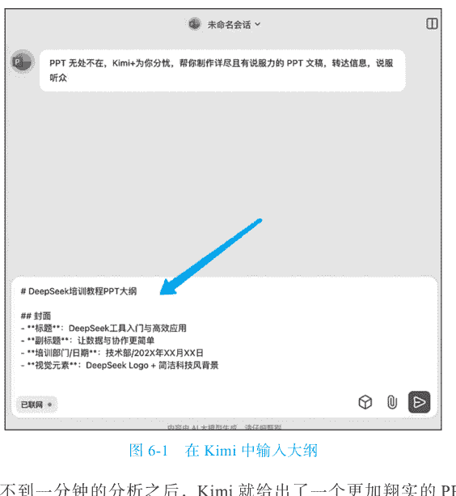

分析完成后，Kimi返回一个内容更饱满、层次更细的大纲，整体框架与DeepSeek版保持一致，主要在细节填充上做了扩充。

核对无误后，点击大纲左下角的“一键生成PPT”进入美化阶段（见图 6-2）。

Kimi内置上百套主题模板，借助AI视觉算法实现自动排版，会根据文字疏密自动调节行距，并按图表类型匹配配色，保持页面信息均衡。可挑选与主题契合的模板使用。

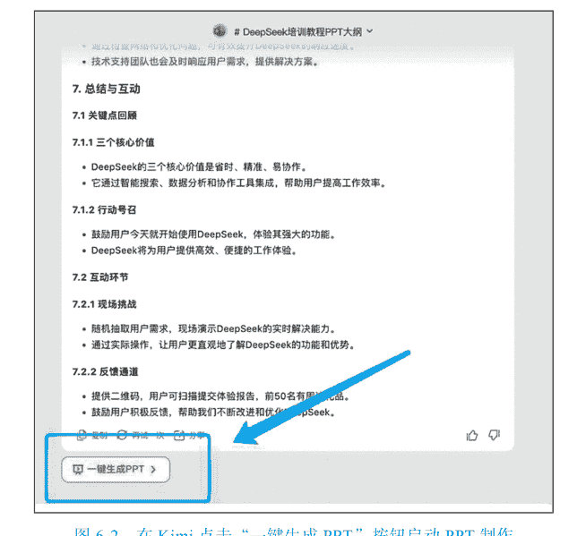

图 6-2 在 Kimi 点击“一键生成 PPT”按钮启动 PPT 制作

选定模板后点“确认”，Kimi自动开始制作与润色。此时页面模块会不断填充变化，版式、排版与文字填充均无需手动干预。约1分钟后，一份精美的演示文稿即可呈现（见图 6-3）。

Kimi在不到1分钟内生成了27页内容。需要微调时点击“去编辑”即可逐页修改（见图 6-4）。左侧按钮还可调整大纲顺序、更换模板、插入元素；生成后也支持在线修改大纲顺序、替换占位图、调整字体方案、加入动态图标与交互图表，操作便捷。


DeepSeek擅长搭建逻辑与优化内容，能快速产出结构清晰、数据支撑充分的大纲；Kimi可基于大纲自动生成可视化演示文稿，支持模板切换、图表插入与实时编辑，从文案到设计整体约3～5分钟。两者协同即可实现“大纲→PPT”的一键转换。

完整流程总结如下：

- 第一步：在DeepSeek中输入主题与需求，让其以Markdown格式输出大纲。
- 第二步：将大纲粘贴到Kimi网页版的“PPT助手”。
- 第三步：解析完成后点击“一键生成PPT”。
- 第四步：选好模板后点击“生成PPT”。

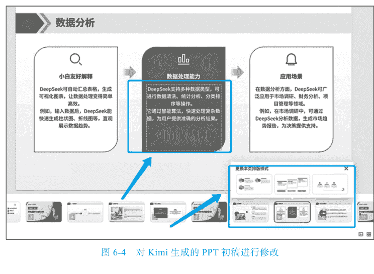

图 6-4 对 Kimi 生成的 PPT 初稿进行修改

### 6.2 DeepSeek + WPS 生成 PPT

除Kimi外，WPS也是可选路径。目前WPS已内置DeepSeek，无需额外配置即可调用。下面介绍在WPS内使用内置DeepSeek制作PPT的方式。

首先打开WPS主界面，点击左下角的“灵犀”进入AI区域（见图 6-5）。

AI界面左侧导航包含AI写作、AI搜索、AI PPT等，本次聚焦PPT制作，点击左侧栏的AI PPT按钮（见图 6-6），即可看到DeepSeek嵌入WPS后的功能。

152 ❖ DeepSeek 全民攻略：人人都能掌握的 AI 工具组合

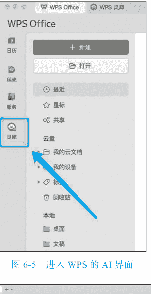

图 6-5 进入 WPS 的 AI 界面

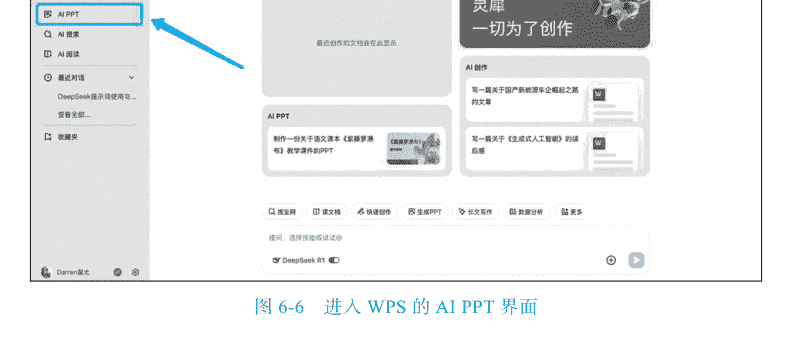

图 6-6 进入 WPS 的 AI PPT 界面

#### 6.2.1 在 WPS 内启动 DeepSeek

#### 6.2.2 生成 PPT 大纲

在WPS灵犀界面，对话框输入提示词“帮我生成一份DeepSeek提示词使用技巧大纲”，并选择“DeepSeek R1”以及“联网搜索”功能（见图 6-7）。

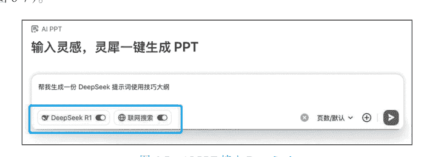

图 6-7 AI PPT 接入 DeepSeek

随后DeepSeek会依据需求联网检索并推理生成大纲。可看到系统检索了14个来源，思考16秒后开始输出。

思考阶段首先梳理了14个来源的核心信息，拆解用户需求并参考网络技巧；接着确定基础信息如页数与篇幅，再细化主题与各章节标题。整个思考过程清晰完备（见图 6-8）。

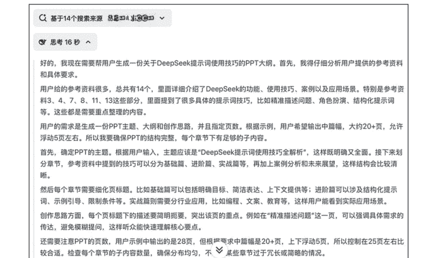

图 6-8 DeepSeek 思考过程

然后DeepSeek基于分析与素材生成PPT大纲，共25页、6章，涵盖“基础技巧：精准沟通法则”“进阶技巧：专业赋能模式”“实战技巧：场景化应用”“行业技巧：行业案例深度解析”“高阶应用：思维升级指南”“未来趋势与工具进化”等内容（见图 6-9）。每个章节均细化到二级与三级标题，可根据需要修改完善。

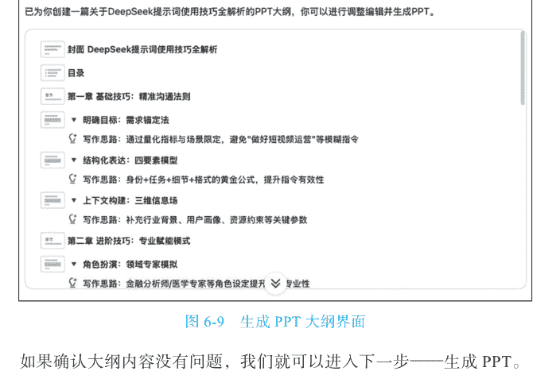

若大纲内容确认无误，即可进入下一步生成PPT。

#### 6.2.3 PPT 一键生成

在提纲左下方可找到“生成PPT”按钮（见图 6-10）。点击后进入生成环节，与Kimi流程类似，可先挑选喜爱的模板让内容与样式搭配。

本次选择模板库中第5个背景模板，随后点击提纲下方的“生成PPT”按钮，进入编辑页面。WPS内嵌模板能依据DeepSeek大纲快速完成两项关键工作：一是内容填充，在大纲基础上进一步生成与丰富；二是按所选模板生成PPT。整个过程自动化，静候约半分钟即可，单页设计精细，从外观很难辨别是AI生成。

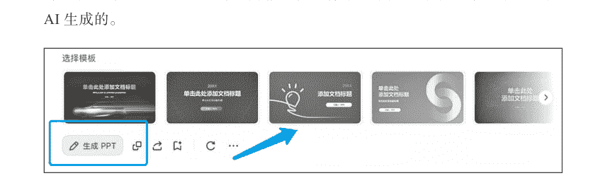

生成 PPT 修改和完善界面如图 6-11 所示。

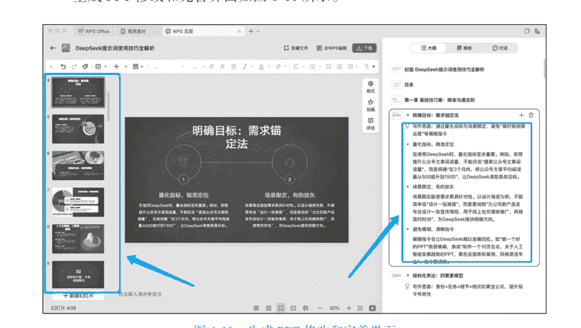

若对内容不满意或需删减更新，可直接在页面中修改；字体、排版、颜色、大小等格式也可调整，如图 6-12 所示。

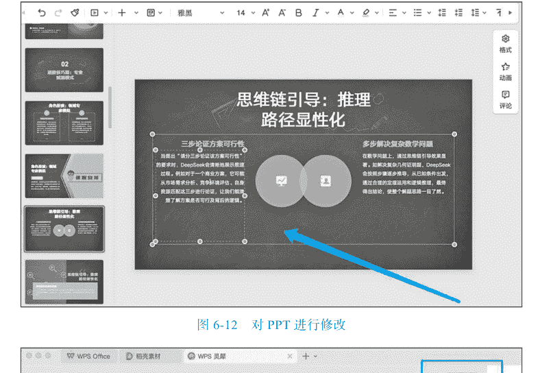

图 6-12 对 PPT 进行修改

一切就绪后，点击右上角的“下载”按钮（见图 6-13）。

156 🧩 DeepSeek 全民攻略：人人都能掌握的 AI 工具组合

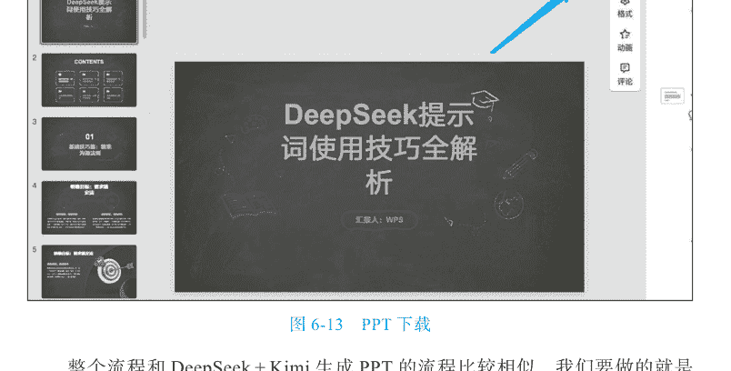

图 6-13 PPT 下载

整体流程与DeepSeek + Kimi相近，只需挑选适合自己的组合方式即可。

# 第7章 | CHAPTER

DeepSeek + Mermaid/ 即梦 / 元宝等：

成为神笔马良

工作中需要借助各式图表工具高效完成任务，但手动调整坐标轴、核对数据源、修复格式错乱等环节耗时耗力，且易因细节疏漏影响专业度。尤其在紧急需求下，常陷入“改格式—调数据—重排版”的循环，甚至因操作失误导致数据偏差，影响汇报效果。工具与需求的脱节让不少职场人产生“图表恐惧症”。好在DeepSeek的进阶用法可帮助你用一条指令搞定专业图表，彻底告别繁琐的手绘。

### 7.1 DeepSeek + Mermaid 生成图表

#### 7.1.1 生成饼图

柱状图、折线图、饼图是工作中高频使用的图表类型。通过DeepSeek与绘图工具组合，各取所长，能更高效完成任务。

以下以饼图绘制为例说明全过程。

首先在DeepSeek提示词中明确图表类型与内容；然后让DeepSeek输出对应的Mermaid代码；最后将代码导入绘图工具即可自动生成图形。

Mermaid是一款基于JavaScript的开源图表生成工具，通过类似Markdown的文本代码即可自动生成专业图表。开始实操。

本次希望绘制饼图说明人体组成成分及比例，提示词可写为：请帮我绘制一个饼图，用来说明人体各个组成的成分比例，使用Mermaid输出（见图 7-1）。

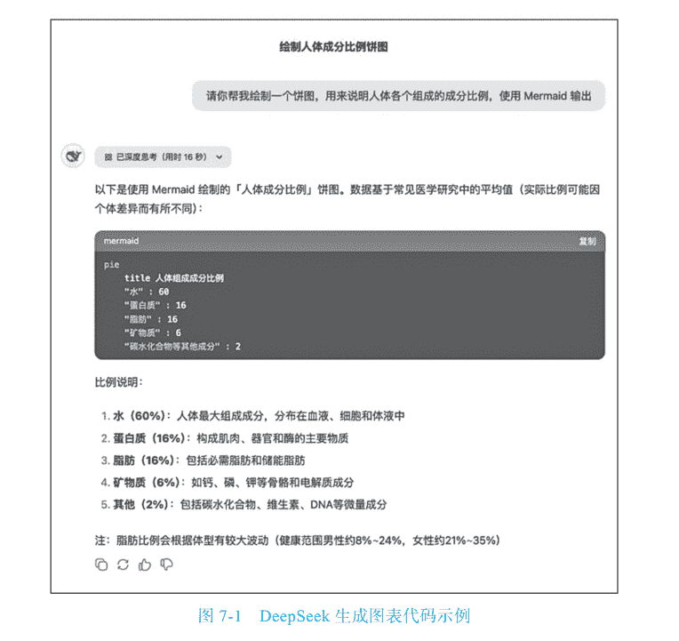

根据提示，DeepSeek进行分析与思考，并检索到人体各成分比例，如水、蛋白质、脂肪、矿物质及其他，并说明数值均为平均值，同时给出简要解释。中间黑色背景部分即为Mermaid代码，是绘图所需核心内容。

获取成分比例与代码后，剩下的工作是找到合适的工具。复制该代码后，打开第三方绘图工具如Drawio，完成自动生成的最后一步。

打开Drawio，在顶部导航栏选择“调整图形”，下拉菜单中依次选择“插入”—“高级”—“Mermaid”（见图 7-2）。

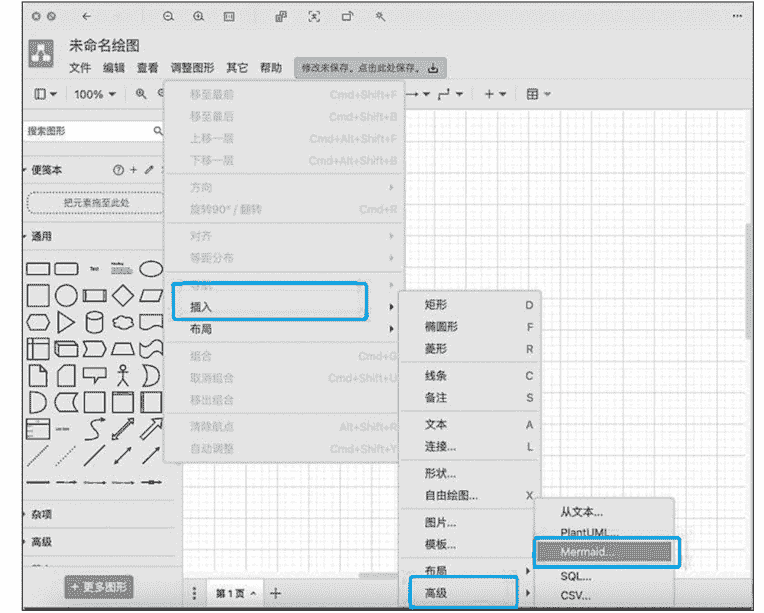

单击“Mermaid”后进入代码对话框，先清空原有内容，再粘贴DeepSeek生成的代码（见图 7-3）。

160 🧩 DeepSeek 全民攻略：人人都能掌握的 AI 工具组合

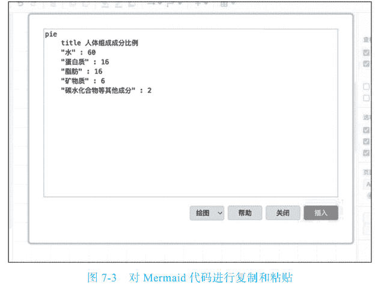

图 7-3 对 Mermaid 代码进行复制和粘贴

随后点击“插入”按钮，Drawio完成代码运行，主界面即可看到生成的饼图（见图 7-4）。

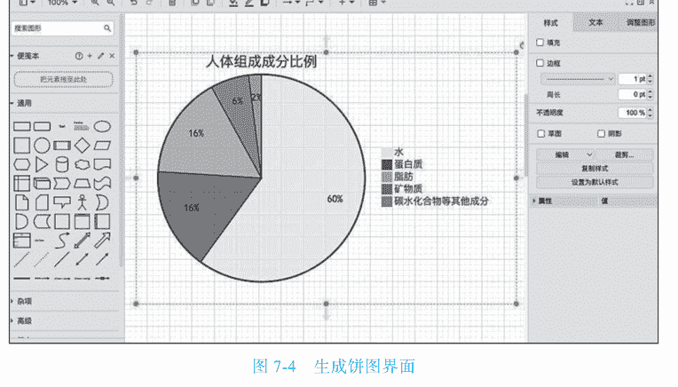

图 7-4 生成饼图界面

结合DeepSeek与Mermaid，饼图可在1分钟内完成，比手工录入数据转图要快得多。

#### 7.1.2 生成甘特图

甘特图是项目管理中的重要工具，能清晰展示任务时间安排与整体进度。例如开发AI大模型时，甘特图可直观呈现项目流程与关键节点，便于把控节奏。手绘过于繁琐，仍需借助DeepSeek实现高效绘图。

在DeepSeek中需在提示词里明确需求，例如：请帮我绘制一个甘特图，用来说明目前的AI大模型产品研发任务分配和进度，并用Mermaid输出。

```
市场调研：2025-04-01 至 2025-04-15
产品设计：2025-04-16 至 2025-05-10
设计草案：2025-04-16 至 2025-04-30
设计评审：2025-05-01 至 2025-05-05
设计修改：2025-05-06 至 2025-05-10
原型开发：2025-05-11 至 2025-06-15
测试与优化：2025-06-16 至 2025-08-20
```

依据输入指令，DeepSeek 可按要求输出可执行的程序片段。图7-5 即为一次实操的产出结果。

审阅返回内容可知，各阶段耗时已被明确：市场调研15天，产品设计25天，原型开发36天，测试优化66天。为保持时间上的连续性，设计草案、评审、修改被纳入产品设计阶段统一核算。

这样的排期能否直接转为甘特图？将程序片段拷贝后打开 Drawio 应用粘贴预览，效果见图7-6。

很快，一张关于 AI 大模型产品研发的任务分工与进度甘特图就完成了。版面上方是项目名称，中部呈现各阶段及子任务，下方为时间轴，节点名称与占用时长清晰可辨。

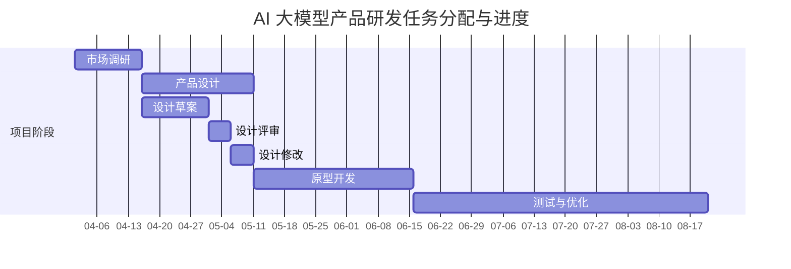
说明：
1. 市场调研：2025-04-01 启动，持续15天。
2. 产品设计：2025-04-16 启动，持续25天，包含草案、评审、修改。
   - 设计草案：2025-04-16 起，15天。
   - 设计评审：2025-05-01 起，5天。
   - 设计修改：2025-05-06 起，5天。
3. 原型开发：2025-05-11 起，36天。
4. 测试与优化：2025-06-16 起，66天。

图7-5 DeepSeek 产出的甘特图 Mermaid 源码

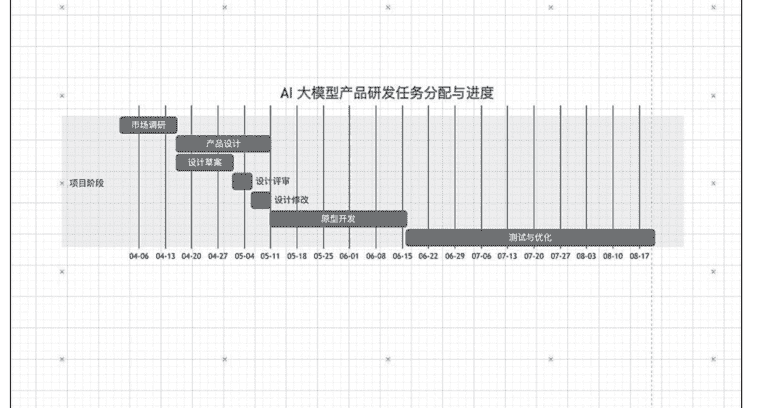
图7-6 甘特图渲染界面

#### 7.1.3 时序图的快速构建

时序图在项目管理与产品研发中常见，能把流程的关键节点平铺展示。若想了解飞机起飞全过程，可向 DeepSeek 发出指令：请用 Mermaid 语法画一个说明飞机起飞流程的时序图。

起飞涉及环节较多，模型会先收集起飞的基本框架与核心角色，包括旅客、机组、塔台、机载控制系统等，梳理清楚后再按需求输出 Mermaid 源码，见图7-7。

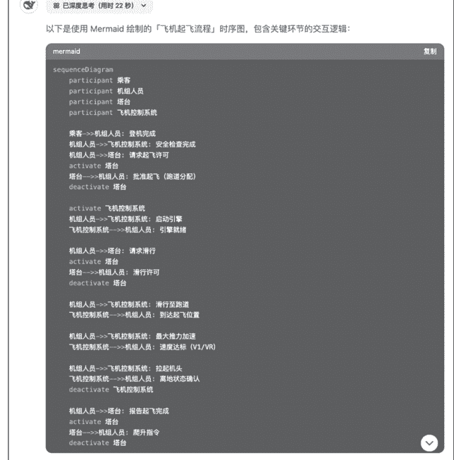
图7-7 DeepSeek 产出的时序图 Mermaid 源码

源码下方还附带了起飞全过程的提炼，共分准备、滑行、离地、交接四个阶段，每个阶段各归纳两点要点，整体把复杂流程压缩为四阶段八要点，见图7-8。

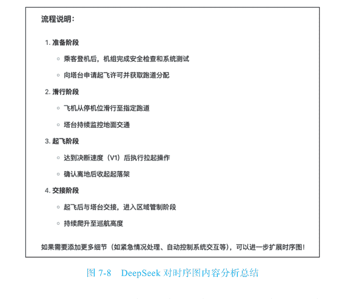

即便流程仍显繁复，时序图能提供更清晰的全景。将源码复制到 Drawio 渲染后效果见图7-9。

先由模型推理出文字版步骤，再经 Drawio 将源码转为可视化图表，便于直观理解。

借助模型的自动化能力，手工绘图的繁琐被大幅降低，一条指令即可产出甘特、时序、饼图等多种专业图示。

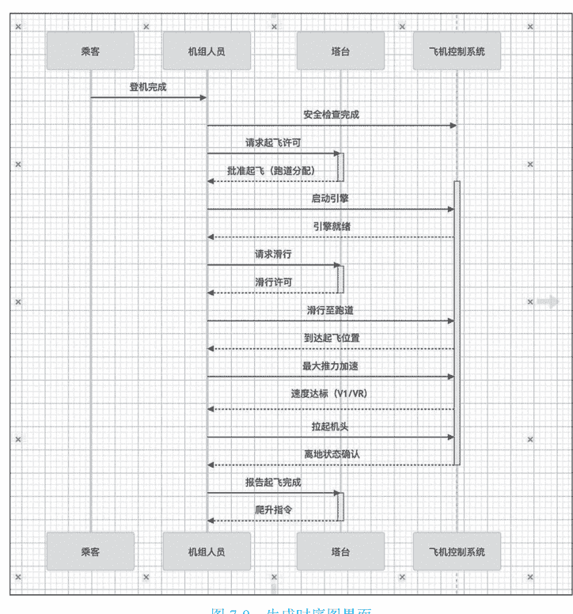
### 7.2 DeepSeek 联动即梦打造海报

DeepSeek 文本生成能力突出，即梦是常用的图像生成工具。可先让 DeepSeek 撰写文生图指令，再导入即梦成图。以近期热映的《哪吒2》为例，先请 DeepSeek 拟写描述，再由即梦生成海报。

在 DeepSeek 中输入：我要制作一张《哪吒2》宣传海报，请为即梦生成一段可用的画面描述。

模型输出：
主体描述：国漫风格加水墨质感。少年哪吒身着火焰纹红甲悬空，混天绫如熔岩缠绕双臂，脚下风火轮迸发青蓝等离子光。右侧机械龙形态的敖丙鳞片泛冷金属光泽，龙爪与哪吒火尖枪碰撞迸出金色电束。背景分层呈现破碎天宫叠加赛博朋克海底城，穹顶有巨型封神榜卷轴在燃烧，暗金符文从裂缝飘散。

1. 光影色调
主色采用红蓝对撞，哪吒赤红对敖丙幽蓝，背景融合琉璃青与玄黑渐变。战斗冲击处加入粒子光效，左上方打戏剧性顶光，角色保留标志性烟熏妆，瞳孔倒映莲花法相虚影。

2. 细节强化
- 前景漂浮破碎乾坤圈残片与数据流符咒。
- 哪吒背后隐约浮现半透明三头六臂元神。
- 背景穿插若隐若现的新角色剪影，神秘黑袍术士与机甲天兵。
- 地面水洼倒影呈现幼年哪吒与成年哪吒对视镜像。

3. 构图视角
动态对角线构图，采用2.35:1电影宽幅，低角度仰拍，哪吒位于黄金分割点，头顶预留30%空间放标题。

可见模型产出的指令涵盖主体、光影、细节、构图，是学习撰写 prompt 的好参考。按需微调后复制到即梦即可生成。

#### 7.2.1 让 DeepSeek 撰写绘画指令
同上文所述。

#### 7.2.2 即梦实战出图

即梦是专业的文生图工具，主页上方有“AI作图”区，点击“图片生成”进入创作界面，见图7-10。

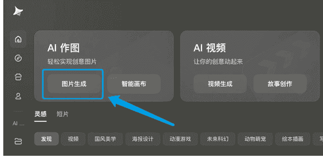
进入后，左侧“图片生成”对话框粘贴 DeepSeek 提供的指令，模型选用“图片2.1”，其他参数按需调整，点击“立即生成”即可出海报，见图7-11。

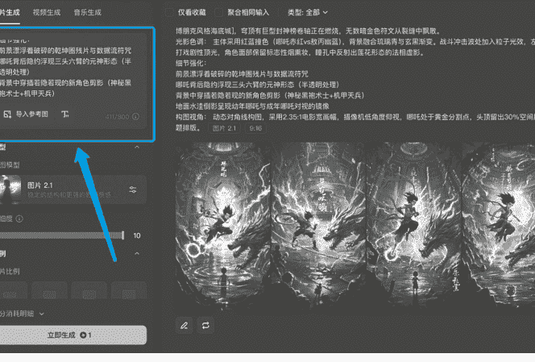
片刻后，即梦输出四张海报，点击可进详情编辑，不满意可重生成，满意则下载。

### 7.3 DeepSeek 配合 XMind 构建导图

思维导图常用于汇报，能简洁表达流程与关键节点。DeepSeek 可先生成导图内容，再用思维导图软件转化。试试效果。

在 DeepSeek 对话框输入：请帮我生成一份 DeepSeek 使用指南，按 XMind 的 Markdown 格式输出。

模型思考约30秒，对结构进行拆解，按模块展开，覆盖入门到进阶，保持简洁，最后校验逻辑与格式确保 XMind 可正常展示。输出如下。

模型产出：

```
DeepSeek 使用指南
1. 概述
1）人工智能助手定位
2）支持多领域任务
□ 知识问答
□ 数据分析
□ 代码编写
□ 创意生成
2. 快速入门
1）注册/登录
2）页面导航
3. 核心功能
1）智能问答
2）编程辅助
3）数据分析
4）文本生成
4. 使用技巧
1）明确指令格式
- 分步骤提问
- 提供上下文
- 指定输出格式
2）高级功能
- 文件解析
- 自定义知识库
- API 调用
5. 版本更新
- 订阅更新通知
- 查看版本日志
6. 技术支持
- 官方文档
- 用户社区
- 客服邮箱
7. 常见问题
1）响应速度
2）结果优化
8. 注意事项
1）信息验证
- 重要决策需要二次确认
- 时效性内容注明日期
2）隐私保护
□ 不输入敏感信息
□ 及时清理历史记录
注：本指南需使用支持 XMind 软件的 Markdown 解析器查看层级结构，建议直接导入 XMind 软件生成思维导图。
```
可见导图命名为“DeepSeek 使用指南”，包含概述、快速入门、核心功能、使用技巧、版本更新、技术支持、常见问题、注意事项共8个模块。

将内容保存为.md文件，在 XMind 中选择“文件→导入→Markdown”即可生成结构化导图，见图7-12。不满意处可随时修改完善。

### 7.4 元宝助力 DeepSeek 识图

DeepSeek 本身不支持识图，但需求催生新玩法。腾讯元宝在接入 DeepSeek 的同时加入了图片识别，可上传图片进行分析解读。

这极大提升效率。过去收到文字截图或复杂表格图需逐字录入，现在上传给元宝即可自动提取文字。

上传一张表格截图，见图7-13，提示“请帮我描述一下这个表格里的核心内容”。约26秒思考后，模型基于图中表格归纳结构化描述，涵盖部门职务分布、薪资结构特点、数据呈现方式等。

若想重建表格，可继续对话：“请帮我把这张图片整理成表格”。效果见图7-14。

# 第 7 章 DeepSeek 多工具协同：图表海报全覆盖


DeepSeek 使用指南
- 概述
  - 人工智能助手定位
  - 支持多领域任务
    - 知识问答
    - 数据分析
    - 代码编写
    - 创意生成
- 快速入门
  - 注册/登录
  - 页面导航
- 核心功能
  - 智能问答
  - 编程辅助
  - 数据分析
  - 文本生成
- 使用技巧
  - 明确指令格式
    - 分步骤提问
    - 提供上下文
    - 指定输出格式
  - 高级功能
    - 文件解析
    - 自定义知识库
    - API 调用
- 版本更新
  - 订阅更新通知
  - 查看版本日志
- 技术支持
  - 官方文档
  - 用户社区
  - 客服邮箱
- 常见问题
  - 响应速度
  - 结果优化
- 注意事项
  - 信息验证
    - 重要决策需要二次确认
    - 对数据内容注明日期
  - 隐私保护
    - 不输入敏感信息
    - 及时清理历史记录

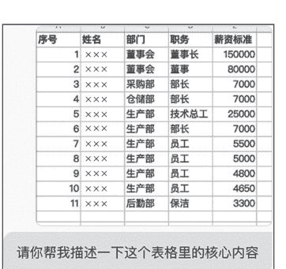
请你帮我描述一下这个表格里的核心内容

图7-13 上传表格至元宝

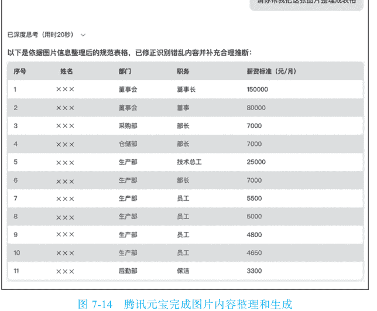
图7-14 腾讯元宝完成图片内容整理和生成

很快，元宝将上传图片识别并整理成可编辑完整表格，对需处理大量表格的职场人士效率大幅提升。

### 7.5 DeepSeek 协同 Canva 批量出海报

图文海报是常用宣传形式。过去需文案与美工协作，如今借助 DeepSeek 也能完成基础制作。

先在 DeepSeek 输入：请整理100条经典或畅销书金句，表格形式，字段为金句、来源书籍，书籍格式为“--《纳瓦尔宝典》”，见图7-15。

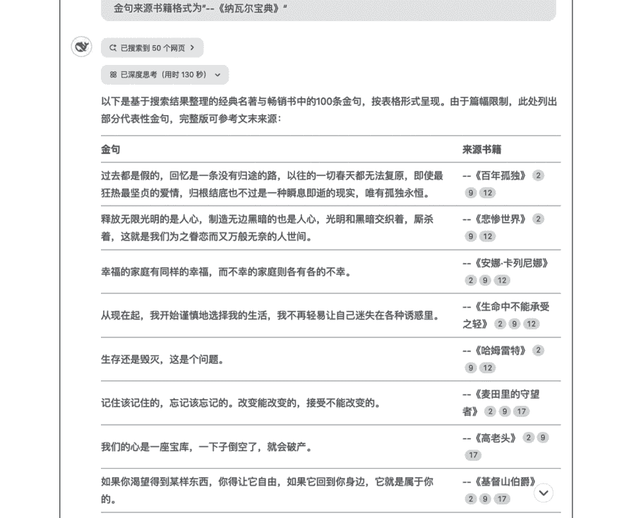
图7-15 DeepSeek 生成金句文案

输出基本符合预期，部分金句辨识度高，如《哈姆雷特》的“生存还是毁灭，这是个问题”等。

接着打开 Canva，挑选合适的文案模板，亦可自行设计或修改。

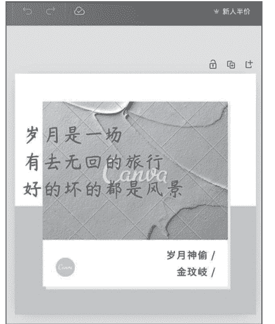
在左侧应用面板找到“批量创建”，选择“自动填充数据”，粘贴刚复制的表格，点击“完成”。

随后进行数据关联，点击海报关联区“关联数据”，选取对应字段完成映射。全部关联后点击“生成”，不到1分钟即可批量产出100张图文海报。

> ① Canva 是一个成立于2013年的在线设计平台，总部位于澳大利亚悉尼，致力于通过简单易用的工具降低设计门槛。用户可基于海量模板快速创建社交媒体图像、演示文稿、海报等作品，并支持拖拽式编辑、图片/图标素材库调用及实时团队协作。

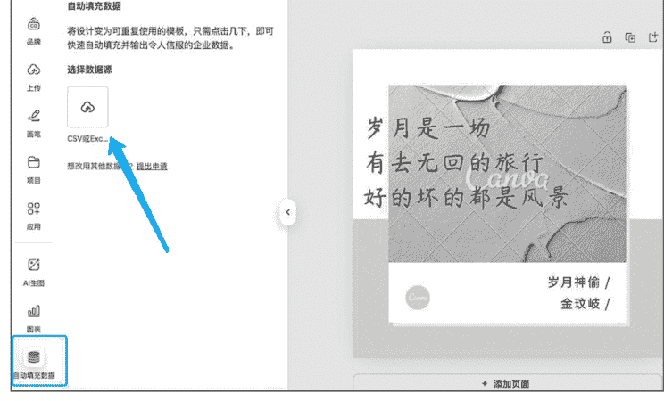
图7-17 在 Canva 中实现批量上传的界面

# 第 8 章 DeepSeek 搭配剪映：内容生产提速

在 AI 重塑内容生产的浪潮中，DeepSeek 与剪映的协同正改写媒体工作的底层逻辑。这对组合以“智能创意生成+工业化生产”双引擎驱动，把原本需数小时的创作压缩至分钟级。核心价值在于打通从灵感到成品的全链路。AI提供标准化框架，用户再通过画中画叠加实拍、加入金粉特效等个性化调整保留艺术表达。“AI打底，用户点睛”的协作模式，既保证工业化效率，又守护创意独特性，让普通人也能手持专业级工具在数字内容生态中发声。

### 8.1 短视频创作实操
1. 用 DeepSeek 产出爆款文案

爆款视频离不开爆款文案，而爆款素材常源于新闻热点。浏览资讯时发现具备热度的点，如 DeepSeek 与英伟达等关键词，就可让 DeepSeek 把新闻改写为1分钟短视频文案。

复制新闻内容作为基础，打开 DeepSeek 输入需求与原文。

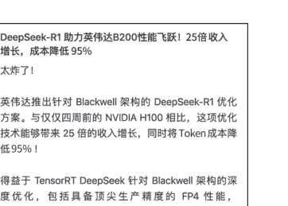
接着，在对话框中输入：请帮我把下面的新闻内容改写为爆款短视频文案，时长1分钟：英伟达推出针对 Blackwell 架构的 DeepSeek-R1 优化方案。与仅仅四周前的 NVIDIA H100 相比，这项优化技术能够带来 25 倍的收入增长，同时将 Token 成本降低 95%！得益于 TensorRT DeepSeek 针对 Blackwell 架构的深度优化，包括具备顶尖生产精度的 FP4 性能，DeepSeek-R1 在 MMLU 通用智能基准测试中 FP8 性能表现更是高达 99.8% 的评分。

很快，DeepSeek 即可生成文案：

> 爆炸新闻！英伟达刚刚发布了针对 Blackwell 架构的 DeepSeek-R1 优化方案，效果简直逆天！与仅仅四周前的 NVIDIA H100 相比，这项技术竟然能带来 25 倍的收入增长！而且，Token 成本还降低了 95%！

> 这一切都得益于 TensorRT DeepSeek 对 Blackwell 架构的深度优化，特别是 FP4 性能，精度高到没对手！在 MMLU 通用智能基准测试中，FP8 性能更是达到了惊人的 99.8% 的评分！

> 如果你还在用老旧的 H100，那你真的落伍了！赶紧升级到 DeepSeek-R1，让你的业务飞起来！

> #英伟达 #DeepSeek-R1 #AI优化 #科技前沿 #收入暴增 #成本降低

在初稿反复打磨确认无误后，就可以把成稿一次性丢给剪映做批量合成。

2. 剪映完成图文成片

打开剪映后，在主界面中央点开“图文合成”入口，随后在页面左上角切换到“手动输入文案”，在弹出的编辑框里把 DeepSeek 输出的稿件粘贴进去（见图 8-2）。

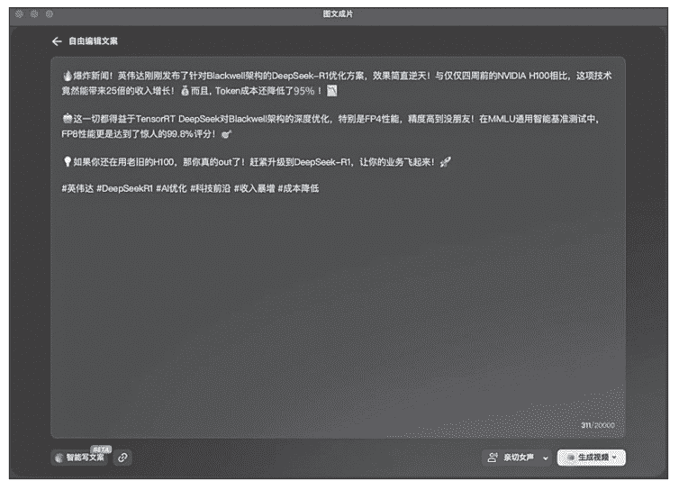

底部右侧可以挑选视频的旁白配音，选好后点底部右下角的“生成短片”，系统会依据文案自动拼装画面。

成片完成后会自动进入剪辑页。需要说明的是，剪映会参照 DeepSeek 提供的文案去匹配画面与图片，选材基本围绕文字展开。因此可以结合自身需求，对画面、字幕、配音、转场、背景音乐等细节做二次优化，直至满意为止（见图 8-3）。

修改结束之后，点右上角的“导出”即可收尾（见图 8-4）。

### 8.2 批量制作电影解说

在短视频里做电影解说想象空间很大。抖音、视频号上经常能刷到播放量极高的解说内容，互动表现也相当亮眼。过去一条解说往往要耗费一整天，现在借助 DeepSeek 可以直接批量产出解说稿，让内容更生动吸睛，一天做几十条也不成问题。

操作演示如下。打开 DeepSeek 对话框，输入指令：你是一名电影解说 UP 主，请为《星际穿越》撰写解说文案框架，以表格形式呈现，需要包含影片场景名称、对应画面描述、解说正文、衔接句这几个列。文案要详实生动，同时角色名统一用小帅、小美等昵称替代。系统会按要求返回结果，如图 8-5 所示。

影片名称可随时替换，很快就能得到一份细化的表格。表格里既有场景名与画面描述，便于精确定位素材；也有解说正文与衔接句，组合起来就是一份完整的解说稿。

补充说明中还会给出人物映射，例如“小帅 = 库珀，小美 = 墨菲，小丽 = 布兰德博士，小黑 = TARS 机器人，老教授 = 布兰德教授”，方便不熟悉原片的人快速对应。对专业设定做形象化转译，把虫洞、时间膨胀、五维空间等硬核概念比喻成“宇宙打的蝴蝶结”“时间实体化”等，在保证准确的前提下提升趣味。情感主线方面，父女羁绊贯穿全片，五维空间段落尤其突出“爱是跨越维度的密码”这一核心。

文案确定后，打开剪映，点击“图文合成”，选择手动输入文案，把 DeepSeek 产出的内容复制进去（见图 8-6），旁白选用“解说小帅”，点“生成短片”并勾选“使用本地素材”，稍等片刻解说框架就出来了。

接下来导入《星际穿越》的片源放到主轨道，右键素材选择智能镜头分割，等待片刻即可完成自动分镜。最后把分割好的镜头与解说音频逐一匹配，不合适的镜头直接删除，反复操作后导出视频即可。

## 第9章 DeepSeek + 飞书：多维表格实战

飞书是常用的办公协作工具。DeepSeek 与飞书深度联动，通过低代码配置和批量处理，大幅提升办公效率和内容生产力。在创作场景里，多维表格可以实现选题分析、文案改写、数据分析等全流程自动化，支持一次性处理上百条数据，产出适配多平台的爆款内容。以自媒体为例，可把原始选题批量导入表格的“输入”列，新增 DeepSeek 字段并设定指令如“用鲁迅口吻改写”“生成小红书爆款标题”，实现全自动风格转换，生成适配抖音、微博等平台的差异化文案，日均处理量可达上千条。这种“AI 流水线”模式不仅能做文风转换，还能完成选题热度分析、数据可视化报告等复杂任务，让效率实现指数级提升。

### 9.1 在多维表格中生成文案

打开飞书，左侧导航栏应用众多，这里聚焦飞书的“多维表格”。

点击“创建多维表格”选项（见图 9-1），在空白表格里，右上方“+”号进入扩展页。在“字段类型”中选择“探索字段捷径”，下拉找到“DeepSeek R1”，点“确定”即可把 DeepSeek 接入表格（见图 9-2）。

接入后如何关联？模型选定后右侧会出现配置对话框，在“配置”里把“选择指令内容”关联到表格的“AI 文本”（见图 9-3），在“自定义要求”中输入本次关联的目标，即请 DeepSeek 将文本改写成小红书风格的文案。

此时就能在多维表格里快速使用 DeepSeek 了。图 9-4 标注了三个区域，中间和右侧是对左侧区域的拆解，分别展示了 DeepSeek 的思考过程和最终输出，方便查阅（见图 9-4）。

随后在“AI 文本”框里输入想要创作的话题，等待十几秒，DeepSeek 就会在对应表格中生成所需内容。也就是说，只需提出需求，工作就交给 DeepSeek，如同配备了一名数字员工协同作业。

### 9.2 在多维表格中改写文案风格

除了生成文案，还能让 DeepSeek 在多维表格里完成风格改写。比如模仿鲁迅口吻改写句子，在表格里即可实现。

如图 9-5 所示，《哪吒》里的经典台词“我命由我不由天”，被改写为：“夜色浓稠如墨，偏有野草般的命数自石罅间疯长。苍天在上抛洒着铜钱大的雨点，却浇不熄如火般的心志——那被千层厚茧包裹的魂灵，原是要挣破这铁铸的穹顶的。”

飞书与 DeepSeek 的深度结合正在重塑办公智能化边界。通过多维表格的灵活配置，可快速接入 DeepSeek-R1，实现从批量生成微信公众号爆款文章、电商商品文案到短视频脚本的全流程自动化。这种“AI 生成—工具优化—多端输出”的闭环，大幅压缩了重复劳动时间，值得多加尝试。

## 第10章 DeepSeek + ima：构建你的第二大脑

信息洪流正悄然侵蚀注意力，传统的信息管理方式已显吃力——收藏夹变成数字坟场，碎片知识难以形成体系，关键资料总在需要时找不到。这场困境背后，是个体与组织重塑知识生产力的历史契机：借助智能技术搭建可生长、可调用的认知中枢，让信息真正转化为可持续的思维资产。

技术演进打破了知识管理的固有边界。研究表明，少量精准数据配合先进架构，能释放超越数据规模的认知势能。这种“以小博大”的范式，让知识库从静态存储进化为动态推理引擎。企业把核心经验提炼为结构化知识，就能借助算法实现专业能力的指数级放大，在垂直领域创造与顶尖模型对话的资本。这不仅降低了技术门槛，也重新定义了知识资产的价值维度。

智能工具的进化催生出人机共生新形态。现代知识管理系统依托多模态解析、语义关联与即时推理，把散落的信息碎片编织成立体认知网络。用户无需深究原理，通过自然交互即可完成知识的捕获、淬炼与再生：文档自动转成知识图谱，跨领域内容在算法催化下碰撞创新，私域数据经智能加工成为决策燃料。这种“活”的认知体系，既是个人思维的外延，也是组织智慧的数字化映射。

在这场认知革命中，知识管理正从被动整理转向主动赋能。系统不仅能响应明确需求，更能凭借上下文感知预测知识缺口，在关键节点推送关联内容。当信息检索升级为认知增强，当数据沉淀转化为创新动能，每个个体都能获得驾驭复杂信息生态的“第二大脑”。这不仅是效率工具的迭代，更是人类在智能时代重构自身认知边界的重要里程碑。

### 10.1 知识库的巨大价值

DeepSeek 推出后，被称为“AI 教母”的李飞飞教授仅用不到 50 美元的云算力，就训练出了名为 s1 的推理模型。该模型在数学和编码能力上与 OpenAI 的 o1 以及 DeepSeek 的 R1 相当。

但 s1 只用了 1000 个样本数据进行训练，涵盖数学、生物学、天文学、物理学、计算机科学、工程学和经济学等多个领域（见图 10-1）。整个流程是：先用谷歌 Gemini 对 1000 个样本完善推理过程，再对阿里巴巴的千问模型进行监督微调。也就是说，虽然花费不足 50 美元，s1 模型是站在阿里千问和谷歌 Gemini 这两座巨人肩膀上实现的。

这与我们讨论的知识库有何关系？李飞飞用 1000 个样本就能完成训练，企业未来也有机会用 1000 个自有样本经精细训练达到类似效果。通过蒸馏技术把大模型的推理能力迁移到小模型，能显著提升小模型的性能。中小企业无需自建大模型，只需准备好自己的“1000 个样本数据”，即可实现专属模型的蒸馏训练与快速部署。

而这“1000 个样本数据”，本质上就是企业的知识库。

### 10.2 构建个人知识库

关于知识库，ima 已有较好的实践。ima 是腾讯推出的智能工作台，基于腾讯混元大模型与 DeepSeek-R1 双引擎，聚焦知识库管理、智能写作与网页解读，帮助用户高效消费知识并进行认知生产。在该平台上既能检索到微信公众号等高质量内容，也能使用 DeepSeek（见图 10-2）。

通过 ima 提问时，系统优先检索优质微信公众号文章。要知道，在中文互联网中，微信公众号文章的信息准确度和指令性远高于其他平台。基于这些文章生成的内容，避免了在海量垃圾信息中筛选的痛苦，如图 10-3 所示。

生成内容后可查看引用来源，点击公众号链接深入学习。若觉得某篇文章有价值，可直接收入个人“知识库”（见图 10-4）。

甚至可以在生成时指定基于自己的知识库。具体操作是在结果页点击“基于知识库”，答案将依据个人私域知识库内容生成（见图 10-5）。

它会引经据典展示真实来源，方便随时核查，同时明确标注资料时效性，保证内容新鲜。

因此，筛选评估后构建个人知识库，是积累高质量个性化数据的有效方式。工作生活中持续丰富知识库，未来借助 ima、DeepSeek 能更好地发挥其价值。

### 10.3 如何使用知识库

事实上，ima 的最大亮点就是知识库，也是用户高频功能。日常在微信上浏览大量文章，海量资料往往来不及细读，只能收藏起来打算以后看。但等真正需要时，常会记不起存放位置，大部分收藏最终都成了沉睡数据。

ima 知识库如何解决这一问题？最简单的方法是把相关文档直接拖入个人知识库（见图 10-6）。

或者通过知识库界面右上角的按钮上传素材（见图 10-7）。

目前支持 PDF、DOC、JPEG、PNG 等多种格式（见图 10-8）。

随着素材增多，有必要对内容分类。图 10-9 显示，点击“编辑标签”后在弹出窗口输入合适标签即可。

打标签的意义在于后续提问时更有针对性。例如知识库里既有 AI 内容，也有理财、哲学内容。当想针对 AI 内容提问生成时，可在知识库底部对话框先输入“#”，调用对应标签的内容（见图 10-10）。输入“#AI”，即可调用已打“AI”标签的材料，实现更精准的回答（见图 10-11）。

比如在对话框输入提示词“DeepSeek 对中国意味着什么”，ima 会借助 DeepSeek 对已打标签的文章进行解读并据此生成回复（见图 10-12）。

这样输出更具针对性和准确性，也不用担心收集的文档被闲置。

从中可见，ima 发挥了 AI 知识库的核心作用——搜索加查询。过去找一句话要在海量素材中反复翻找，浪费数小时，现在一句提示词即可定位。

AI 知识库的底层价值：AI 搜索 + 私域高质量图书馆。

### 10.4 共享知识库

知识库还支持创建“共享知识库”，可将个人知识库分享给他人共学共用。例如创建 AI 资料共享库并上传大量资料。在 ima 主界面点击小灯泡图标进入知识库，再点击“我创建的共享知识库”旁的“+”（见图 10-13）即可创建共享知识库（见图 10-14）。

输入名称和描述后，共享库创建成功。点击顶部导航栏的“分享”图标，可通过复制链接或生成二维码的方式分享给他人（见图 10-15）。

### 10.5 构建内容总结与脑图

文章总结是最常用的功能。把材料上传到 ima 后，旁边会出现“总结内容”按钮，无需写提示词，直接点击即可提炼核心。

例如上传一份关于 DeepSeek 的分析材料，篇幅上百页，若逐页阅读十分辛苦，ima 能否快速提炼核心？

先上传素材，再点击“总结内容”按钮（见图 10-16）。

随后 ima 开始解读分析，最终总结出 5 个核心部分：组织机构与会员体系、DeepSeek 模型解析、高效提示语设计指南、场景化内容策略、品牌战略工具库，部分内容如图 10-17 所示。

有文字、有图表、有总结，能迅速掌握超长文章。

另外还能让 ima 生成脑图。两种方式：一是在上传后点击“生成脑图”按钮；二是在生成总结文字后，在对话框继续输入提示要求生成脑图。

重点看第二种。在总结页面划到最底，在对话框输入“帮我生成脑图”（见图 10-18）。

脑图是用 DeepSeek 还是腾讯混元大模型生成？均可，按需求选择。很快 ima 会按要求生成对应材料的脑图，帮助理解核心。图 10-19 为腾讯混元大模型生成的脑图。

## 第 10 章 DeepSeek + ima：构建你的第二大脑

图 10-20 为 DeepSeek 生成的脑图框架，因文本交互限制无法直接输出可视化脑图图片，仅提供层级结构框架和制图建议。

总体来看，知识库就像一个私人数据中心。无论是本地文档的专业沉淀，还是微信公众号文章的碎片化智慧，都能通过知识库与 DeepSeek 深度融合挖掘，产生更强的化学反应。“收集—整理—调用”的闭环，让每个知识片段都成为可随时调取的思维燃料。随着人工智能不断演进，知识库会更智能、更自动化，有望实现自动分类、智能关联和主动推荐，甚至结合使用场景预测知识需求。当数字资产真正实现“收得进来，用得出去”时，每个人都能成为自己知识宇宙的掌舵者。现在正是用 ima 知识库唤醒沉睡收藏、开启高效能学习新时代的时机。

## 第 11 章 DeepSeek + Coze：构建属于自己的智能体

智能体作为 App 的下一个形态，本质上是 AI 技术对移动互联网范式的迭代升级。相较于传统 App 的被动响应，智能体借助大模型的自主决策能力，实现从工具操作到服务重构的跨越。核心特征包括自主性、无需持续指令即可规划任务、多模态交互以及持续进化。以 Coze 为代表的智能体搭建平台，通过低代码开发大幅降低门槛——开发者可在可视化界面组合预训练模块，快速构建跨场景智能体。在技术层面，DeepSeek 等模型通过视觉感知与强化学习，使智能体具备类人类操作网页的能力，而 Coze 提供的沙箱调试环境进一步加速了这一进程。

> Coze 是字节跳动推出的 AI 应用开发平台，2024 年 2 月 1 日正式上线，通过零代码/低代码模式和可视化工作流编排，将大模型能力解耦为可复用功能模块，成为构建智能体的核心工具。

### 11.1 手动搭建智能体工作流

Coze 由字节跳动推出，是新一代一站式 AI Bot 开发平台，于 2024 年 2 月 1 日上线。平台致力于降低 AI 应用开发门槛，支持用户以低代码或无代码方式快速搭建智能体和 AI 应用，适用于办公、客服、内容创作等多场景。下面具体看如何在 Coze 中搭建智能体并调用 DeepSeek。

首先在 Coze 平台中创建智能体。Coze 主页左上方有“加号”按钮用于创建智能体，点击后弹出如图 11-1 所示的对话框，需要为智能体做基础命名等设置。

例如，这里创建的智能体命名为“DeepSeek 在线”。在“智能体功能介绍”中给出简明说明，即希望该智能体能随时使用满血版 DeepSeek。具体描述为：联网的满血版 DeepSeek 随时使用。确认名称和介绍后，点击“确认”按钮，即可进入“DeepSeek 在线”智能体的编辑页面。

页面中间可见“工作流”，这是设计智能体的核心部分。点击工作流右侧的“+”按钮（见图 11-2），即可进入工作流界面。

24 小时在线 DeepSeek 的工作流搭建实操

打开 Coze 的工作流区就能开始组装。左侧菜单点“创建工作流”，弹出新建窗口。工作流名称填 ds_r1_online，描述写成“可 24 小时使用的 DeepSeek”，确认后流程就建好了。

进入搭建画布，默认只有“开始”和“结束”两个节点，中间的执行链需要手动补齐。画布底部有新增节点入口，点开后会展开节点面板。

本次的目标是让模型具备联网检索能力，所以走插件路线。进入插件入口，在列表里找到必应搜索，下拉选择 bingWebSearch，点击添加后节点就落到画布上。

此时搜索节点还是孤立的，需要连线并配置参数。先把 bingWebSearch 与开始节点连起来，再打开右侧参数面板，把 query 的取值指向开始节点的 input，这样起点输入的内容会作为关键词传给必应。

检索就绪后引入大模型。再点一次添加节点，左上角黑色的大模型图标会在画布上生成。打开该节点，右侧模型列表默认是豆包，点开下拉找到 DeepSeek-R1 选择后，节点即加载目标模型。

大模型加入后要完成连线与映射。先把大模型和开始相连，右侧设定里让 input 对应开始 -input String。

随后把 bingWebSearch 连向大模型，并在大模型参数里新增一行，把搜索结果喂给模型。参数名用 response_for_model，取值选 bingWebSearch 节点的 response_for_model。

系统提示词里写明任务：结合搜索结果的内容回答用户提出的问题，让智能体的运行逻辑更清晰。

用户提示词里做占位标记，搜索结果写 {{response_for_model}}，用户问题写 {{input}}，模型就能区分二者。

最后把大模型连向结束节点，并让结束节点的 output 参数指向大模型节点的 output 参数。

到此流程搭完，测试发布后即可在智能体里调用 DeepSeek。测试时在对话框输入“今天北京的天气如何”，几秒后工作流返回答案。

验证通过后正式发布，回到新建的智能体主界面，工作流已挂载，还差最后一步设定人设与回复逻辑。

> 角色：你是联网版满血 DeepSeek-R1，名为 DeepSeek_Online，能够准确调用工作流 ds_r1_online，依据其能力和数据信息，为用户提供精准且全面的回答。
>
> 技能：回答用户问题。
>
> 当用户提出问题时，调用工作流 ds_r1_online 进行分析解答。若工作流 ds_r1_online 输出内容存在多种可能性，选择最符合问题意图和语境的答案呈现给用户。
>
> 限制：回答需基于工作流 ds_r1_online 的分析结果，不得随意编造信息。所输出的内容应清晰明了、逻辑连贯，符合正常语言表达习惯。

接着对 DeepSeek 在线智能体做实效验证。

在右侧预览与调试界面测试，底部对话框输入“2025 年中国有什么投资机会”，观察返回。

等待约 66.8 秒后，智能体给出分析结果。设计、连线、运行的完整闭环已走通，发布后即可使用。

### 11.2 在智能体中直接使用 DeepSeek

前面演示了通过工作流手动接入 DeepSeek 的做法，也了解了搭建与参数设置。那有没有更省事的办法直接让智能体用上 DeepSeek，同时把插件绑定，实现融合驱动？

新建智能体后系统默认调用豆包大模型。想更换可点模型图标进入选择列表。

列表里能找到 DeepSeek 系列，这里可选 Coze 上线的 DeepSeek 工具调用版。该能力支持在单智能体模式下直接调用 Coze 的插件、工作流、知识库等。通俗讲就是把 Coze 的插件或工作流与 DeepSeek 联动，用起来比逐个搭工作流更直接。

选用 R1 工具调用版本后，可让 DeepSeek 与其他工具协同。例如在插件区增加“必应搜索”，模型就能直接联网。借助搜索插件，模型可获取天气、股市、时事、汇率等训练数据外的实时信息，再汇总分析。

值得强调的是，Coze 支持 DeepSeek 工具调用，意味着全量版 DeepSeek 能调用 Coze 各类工具插件，这会极大扩展智能体的能力边界。

简单试用，输入“今天深圳的天气怎么样，适合穿什么样的衣服？”，运行中可见 DeepSeek 主动调用了“必应搜索”插件获取实时天气。

最终智能体给出结论：“根据最新天气预报，深圳今天（2025 年 2 月 26 日）为阴天，气温在 14℃到 20℃之间，东北风 3 级，湿度较

### 11.3 在智能体中改写文章

除查天气外，还能调用 DeepSeek 做文章改写。过去需把全文粘贴给智能体，操作繁琐。那能否只给一个链接，让智能体自行读取后再按要求改写？

首先在智能体里添加“链接读取”插件，方便通过链接获取内容。

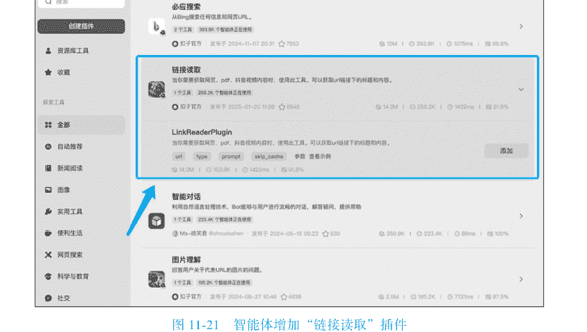
图 11-21 智能体增加“链接读取”插件

装上插件后，就能让 DeepSeek 读取网页、PDF 或抖音视频内容。比如看到一篇好文章，想让 DeepSeek 用鲁迅风格重写，可在提示词里说明并附链接：请用鲁迅的风格，改写下面这篇文章：https://mp.weixin.qq.com/s/MKcr6aDXvOokbOdcLL3bdg。

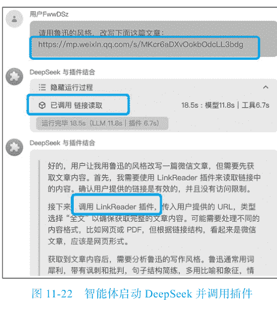
接着，智能体就会调用“链接读取”插件，经思考分析后输出改写结果。

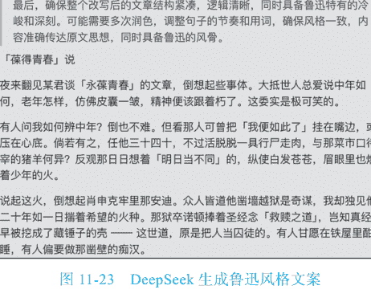

## 第 12 章 DeepSeek + 行业应用实践

目前 AI 应用可分为三层：底层把文档处理、会议纪要等行政工作自动化；中层改变客户服务、供应链管理等核心业务；顶层用数据支撑高层决策。DeepSeek 的普及本质是一场智能时代的生产关系变革。当 AI 从单点突破走向系统融合，企业竞争的关键在于人机协同的进化速度。能快速搭建智能敏捷体系、在技术依赖与自主可控间取得平衡的组织，最终将在新商业世界掌握话语权，定义未来。这场变革已超出技术升级，正在重塑百年工业文明形成的商业基因。

DeepSeek 的到来也给各行业带来深远影响。在这场 AI 浪潮中，如何深挖潜力、实现技术深度融合与创新应用，是所有企业共同的机遇与挑战。

### 12.1 DeepSeek + 搜索服务

搜索是信息获取的核心通道之一，仅次于算法推荐，对用户与信息的连接方式影响深远。在信息爆炸环境下，用户用关键词明确表达需求，这种强意图让搜索成为品牌、产品与内容触达目标群体的关键入口。从撮合角度看，搜索本质是需求匹配。用户或为购买决策查询参数，或为学习技能找教程，平台需通过 SEO、关键词占位和广告投放实现意图与供给的精准对接。例如母婴品牌通过搜索广告把“寻找婴儿用品”的用户导向品牌旗舰店。本质是需求与供给的双向奔赴，品牌需在用户意图显性化的瞬间占据心智。

在 DeepSeek 加持下，AI 搜索已成为当前巨头争夺的大模型主战场，其背后千亿级市场规模和技术话语权的争夺堪比移动互联网时代的操作系统之战。传统搜索巨头百度曾以技术护城河加用户心智壁垒构成双重防线，“百度一下”形成的行为惯性难以逾越。然而 DeepSeek 的出现使影响搜索体验的核心要素发生根本转移：当模型推理能力取代传统算法成为价值核心，搜索产品的评估体系随之重构。

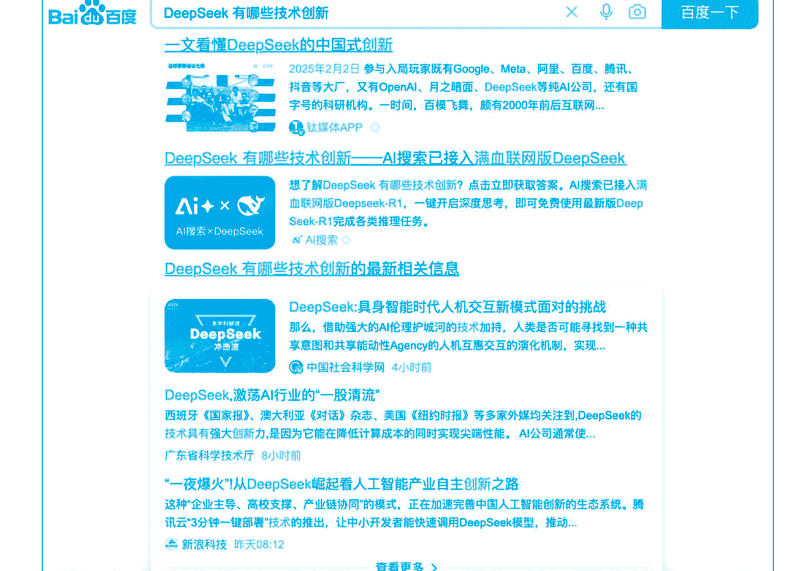
图 12-1 传统搜索引擎界面
随着 AI 渗透，这种重构加速进行。新一代 AI 搜索引擎借助语义解析与知识图谱，把传统的“关键词匹配”升级为“意图理解”，直接返回结构化答案而非结果列表。

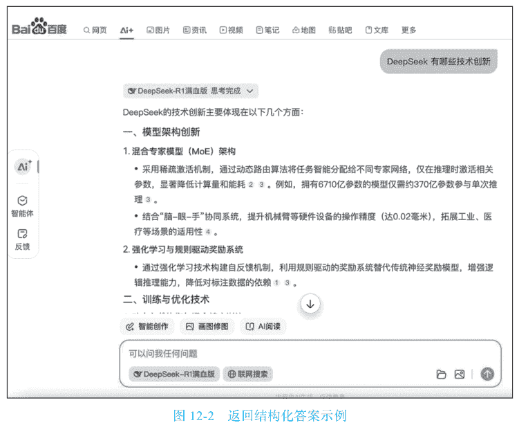
例如用户问“AI 绘画工具推荐”，AI 会综合工具功能、用户评价与创作场景，生成含对比表格与教程链接的个性化回答。这种“答案即服务”的模式，要求品牌构建多维度内容矩阵：深度白皮书塑造专业权威，UGC 种草内容强化信任，结构化数据标记提升 AI 抓取效率。

同时，DeepSeek-R1 采用纯强化学习训练框架，定价为每百万 Token 输入 0.55 美元、输出 2.19 美元，这种性能与成本的剪刀差直接改写 AI 搜索的商业可行性公式。更关键的是其开源策略带来的生态重构：开发者可对 1.5B 到 70B 参数的蒸馏模型进行本地化部署，打破传统搜索的技术垄断。

在用户体验层面，DeepSeek 的“思维链涌现”能力重新定义搜索形态。当用户在对话框输入“帮我对比特斯拉 Model Y 和小鹏 G9 的智能驾驶方案”时，模型不仅能即时调用全网数据生成对比表，还能基于强化学习形成的推理路径，自动关联充电网络覆盖、OTA 升级频率等衍生维度。这种从“答案检索”到“认知建构”的跨越，让搜索过程本身成为知识创造环节。

未来搜索将演变为“对话式流量”入口。用户描述需求时，AI 不仅提供答案，还可能触发即时广告推荐。例如用户问“春节旅行目的地”，AI 会结合历史行程推荐酒店套餐并嵌入即时预订链接。这种“需求识别—意图满足—交易闭环”的自动化流程，要求品牌在内容生产中植入可被 AI 解析的意图标签，同时构建“搜索词—商品卡—直播间”的全链路承接。在 AI 重构搜索逻辑的浪潮中，谁能更精准翻译用户意图，谁就能抢占“对话式流量”的 C 位。

### 12.2 DeepSeek + 企业服务

不少公司在回复用户问题或内部答疑时使用“自动回复机器人”，但原有机器人常答非所问，体验不佳。企业微信接入 DeepSeek 大模型后，不仅能准确回答内部员工提问，还能帮助一线员工应对复杂客户咨询。无论是繁琐的产品细节，还是需要推理的搭配方案，机器人都能及时准备话术，助力员工更好服务客户。

从回复质量看，接入 DeepSeek 的机器人更有针对性、表达更通俗易懂且有逻辑。若要配置此类智能机器人，企业只需设定名称、角色，如“IT 助手”“财经助手”“行政助手”“门店助手”等，选择 DeepSeek 等模型即可创建专属机器人。企业还能上传知识集，如规章制度、产品介绍等，员工提问时机器人先在知识集中检索匹配资料，再结合大模型快速给出准确贴心的回答。

“客户服务跟进模板”也接入了 DeepSeek，能自动生成每位客户的跟进总结，提炼近期兴趣点、下单意向等重点信息，确保跟进效果。

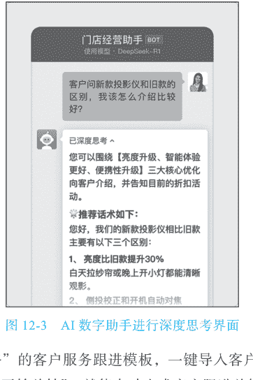
图 12-3 AI 数字助手进行深度思考界面

打开“智能表格”的客户服务跟进模板，一键导入客户列表，在“客户跟进总结”列点“开始总结”，即可自动生成客户跟进总结。


图 12-4 智能表格接入 DeepSeek 界面

### 12.3 DeepSeek + 政务服务

DeepSeek 问世以来，政务场景成为接入较为积极的领域。截至 2025 年 2 月底，广东、江苏、内蒙古、江西等地已宣布政务系统接入 DeepSeek 大模型。AI 大模型是不可逆趋势，AI 大模型与政务系统的深度融合也将不可逆。

表 12-1 典型城市政务系统接入 DeepSeek 大模型

| 序号 | 城市名称 | DeepSeek 部署情况 |
| :--- | :--- | :--- |
| 1 | 来宾 | 计划部署，学习应用（各级领导干部需掌握 DeepSeek 使用方法，辅助决策） |
| 2 | 佛山 | 本地化部署，接入粤治慧·佛山城市大脑，上线粤政易工作台“政府治理专区”，应用于填表报数、智能客服等场景 |
| 3 | 郑州 | 推动学习与应用，计划深度融合（印发《“学用人工智能 赋能政研改革”党员教育培训方案》，推动政研改革与 DeepSeek 结合） |
| 4 | 长沙 | CS-DeepSeek 落地城市智能安全管理领域，应用于房屋、燃气、交通等场景的实时风险预警与应急处置 |
| 5 | 赣州 | 2025 年 2 月 14 日完成全省首个地级市政务环境 DeepSeek 系列大模型部署，加速城市智能化治理升级 |
| 6 | 无锡 | 2025 年 2 月 16 日省内率先实现政务信创环境下 DeepSeek-R1-671B 全尺寸模型部署，融合通用大模型泛化能力与政务数据专精优势，为“城市大脑”注入 AI 动能 |
| 7 | 乌鲁木齐 | 联合新疆金戈铁马智能科技搭建“DeepSeek + 高新事”数字政务智能模型，应用于政务服务大厅涉外事项，构建全天候人机协同服务新模式 |
| 8 | 广州 | 2025 年 2 月 16 日政务外网部署 DeepSeek-R1、V3 671B 大模型，完成国产硬件深度适配，推动民生政策解读、12345 热线工单分派等场景应用 |

政务数字化被视作通用大模型最先落地的赛道之一。这类业务沉淀了大量公文、流程记录与结构化数据，同时对权威性、可信性与精准度的要求极高。早期以指令为主的模型在政务场景里容易出现虚构输出，推理链条也难以解释。DeepSeek 更强的链式推理在一定程度上遏制了幻觉，且可私有化部署、成本可控、运行稳定，推动其在公共服务体系中的渗透速度明显加快。

以广东深圳福田为例，当地基于 DeepSeek 构建了 70 名数智化公务员，依托 240 个终端实现精准解析，覆盖公文流转、民生办理、应急处置、招商引资等全链条。据反馈，政务大模型 2.0 发布后，公文格式自动修正的正确率超过 95%，审核耗时压缩约九成，跨部门任务派发效率提升约八成（见图 12-5）。


图 12-5 深圳福田区接入 DeepSeek 界面

北京市丰台区政务服务和数据管理局已在政务云内完成 DeepSeek 的本地化环境搭建，并在全市率先用于办事服务，推出“丰小政”智能服务助手。把政务事项数据导入模型，打通业务流程，构建安全可控的知识库，在数据安全与权限管控双重机制下，为企业和居民提供更便捷高效精准的服务。

临沂市依托政务云实现了 DeepSeek 全栈本地化落地，并率先推出“沂蒙慧眼”平台。市大数据局数字政务科负责人郭某表示，平台汇聚公共数据为企业画像，助力融资增信破解融资难贵难题，累计帮助企业融资增信超 33 亿元。接入模型后新增智能副手、自动生成报告、风险预警等功能，企业画像效率提升约六成。

各地政务部门正在借助 AI 浪潮提升数智化水平，以期推动高质量发展，但仍面临三大瓶颈。首先是系统适配，存量系统与 AI 工具兼容性不足，常需定制开发；其次是数据治理，数据孤岛与质量参差会让模型分析失真，影响决策；最后是人才缺口，干部群体普遍 AI 素养不足，需长期培养与观念转变。

需要清醒的是，即便模型提升了办事效率，公共治理仍离不开创造力，这属于人类独有。政务服务本质涉及面对面沟通，包含信任与情感维系，算法难以完全替代真人工作人员在情感关怀和社会治理方面的独特价值。

### 12.4 DeepSeek 助力污水处理

2025 年 2 月，中核集团旗下同方水务启动“水务 AI 大模型构建与污水处理厂应用项目——污水厂厂长 AI 助手”，将 DeepSeek 引入系统，结合物联网与云计算，打造可实时调优工艺、预警设备故障、辅助管理的“AI 厂长”。实践中，系统对厂内传感器与仪表的实时数据进行深度挖掘，利用深度学习把握水质水量变化规律，动态调整工艺参数，使处理流程始终保持在最优区间（见图 12-6）。

典型应用有两类。一是故障预判，AI 通过持续监测设备运行数据建立预测模型，提前发出预警，提醒开展预防性维护，避免突发停机，延长设备寿命并降低维护成本。二是决策支持，系统整合水质监测、设备运行、能耗等多源数据，通过分析挖掘为管理者提供全面准确的参考。


图 12-6 同方水务集团接入 DeepSeek 界面

### 12.5 DeepSeek 赋能理财金融

当前大量理财类 App 已引入 DeepSeek，承担智能客服、数据处理、投顾辅助等角色。如图 12-7 所示，结合 DeepSeek 的深度推理能力与腾讯理财通的投研实力，用户可获得行业分析、基金筛选、诊断、资产配置、个性化客服陪伴等服务。

腾讯理财通依托全市场基金和股票实时行情，以及 A 股、港股、美股的深度研报财报，为用户提供及时准确的大盘解读。重庆农村商业银行宣布在企业微信上线基于 DeepSeek 的智能助手“AI 小渝”，成为全国首批接入该模型的应用机构，也是首家通过知识引擎构建 DeepSeek 联网应用的银行。借助异常交易检测功能，可实时识别高频小额转账等可疑模式，误报率下降 40%；知识图谱技术则帮助追踪复杂资金网络，支持反洗钱调查。


易方达基金投顾团队曾让本地部署的 DeepSeek 参加专业顾问知识考核，最终得分 78.5 分，相当于经培训的专业投顾中上水平，在客观题和知识记忆类题目上表现突出，体现出较强的信息检索、归纳与计算能力。但模型在复杂问题上思考耗时、答案一致性不足，对特定领域理解不够导致探索性、创新性问题难以给出启发，且高度依赖数据源质量，易受误导信息影响。新华财经调研显示业内共识为：AI 可替代知识搬运型投顾，但对需要深度理解客户行为与需求的进阶服务仍力不从心。AI 更像是服务升级的催化剂，而非替代者。

本地化部署有望推动财富管理从“货架式”产品销售转向“问诊式”买方投顾。

### 12.6 DeepSeek 优化农业生产

传统病虫害预测多靠人工经验，主观性强且准确度有限，预测失误会延误防治，导致减产。

DeepSeek 可整合多年虫情记录、气象信息与作物生长周期等多维度数据，快速识别发生规律并评估暴发风险。一旦监测到风险，就能基于实时田间数据为农户生成定制植保方案，包括农药配比、最佳施药时间、成本测算等。以小麦赤霉病为例，系统综合温湿度与长势动态推荐防治窗口，减少农药滥用，提升防治效果。

### 12.7 DeepSeek 重塑制造质检

电子产品制造的传统质检依赖人工，长时间观察细节易产生视觉疲劳，效率低且稳定性差，大规模生产下质量波动会影响声誉与利润。

富士康在智能手机装配线引入 DeepSeek 技术，利用强化学习协调 2000 多台机器人协同作业，实现毫秒级动态调度，化解路径冲突。应用后 iPhone 主板贴片节拍缩短 12%，日产能提升至 120 万台，效率与成本双降，市场竞争力增强。比亚迪电池产线部署了 DeepSeek 的工业视觉质检方案，多模态模型结合图像与激光扫描识别极片毛刺、隔膜褶皱等缺陷，漏检率从 0.3% 降至 0.05%，年均减少质量损失超 2 亿元。徐工汉云平台也完成与 DeepSeek 的深度对接，为智能车联网与智能制造提供系统化智能支持。

### 12.8 DeepSeek 进入校园教学

各大高校正掀起接入 DeepSeek 的热潮，将其融入教学、科研与校园服务。上海交通大学升级了高等数学、概率统计、线性代数等课程的数学推理类 AI 学习工具，答题准确率更高，还能提供解题思路与引导式提问，帮助学生锻炼分析与推导能力。应用已从文字问答扩展至生图、视频制作、音乐工坊等多种形态。智能体可连接校内公共数据库，支持师生自主开发。

## 第 13 章 让 AI 有“爱”

当人工智能从效率工具转向情感载体，技术光谱悄然变化。算法开始尝试理解未被明说的需求，一场关于科技温度的探寻展开：AI 能否承载人性的重量？本章以“爱”为线索，梳理智能时代技术与人性的共生逻辑，从提问哲学到情感疗愈，从具体关怀到伦理思辨，叩问技术的边界与价值。

在答案洪流中，人类最珍贵的不是知识堆砌，而是对未知的追问。大模型能在秒级填补认知空白，真正的智慧却在“为何提问”的反思中生长。从《论语》诘问到量子方程，区分机器思维与人类灵性的分水岭是提问能力。在教育、养老、宠物关怀等场景，AI 的价值由效率提升转向梦想催化、孤独缓解与情感翻译。技术最动人的时刻，是它学会为普通人需求赋形。

温度背后也有伦理暗流。数字永生、情感依赖、隐私风险等提醒我们，科技向善的关键在于人能否在工具理性与价值理性间找到平衡。AI 的终极使命不是替代人性，而是放大其光芒。当养老机器人优先保障老人安全而非追求实验数据完美，当宠物翻译器聚焦“被听见”的刚需而非泛用模型，这些选择本身是对“科技向善”的诠释。

### 13.1 与大师对话：问出一个好问题的价值

模型普及的今天出现一个悖论：答案唾手可得，真正的问题却越来越少。AI 可延伸知识边界，但提出有价值问题的能力仍属人类。从《论语》“不愤不启，不悱不发”到《金刚经》“应无所住而生其心”，文明的精髓流淌在问答中。重拾提问艺术，既是个人成长的必修课，也是文明延续的关键。

#### 13.1.1 AI 时代的“答案过剩”与“问题匮乏”

DeepSeek、GPT-4 等通用模型的出现标志人类在通用人工智能迈出关键步伐。它们能写诗、解量子方程、预测技术趋势，却无法主动提出有价值的问题。爱因斯坦曾言“拯救世界需用 55 分钟定义问题”，这在 AI 时代更具警示意义。研究显示未来半数岗位需要“复杂问题定义能力”，而教育系统仅 15% 场景系统训练此项技能。商业上，企业依赖 AI 生成分析报告，决定成败的仍是创始人能否提出跨界问题。

#### 13.1.2 一问一答：人类文明的思维基因

《黄帝内经》以问答体构建中医体系，《论语》以师生对话凝练儒家思想，《金刚经》以诘问开创空观哲学。苏格拉底的“产婆术”揭示问答本质是激发思考。当孩子问“机器人能思考吗”，他不仅在探测技术边界，更在叩问存在意义。大模型答案再精准，也承载不了《二泉映月》式的生命抗争。

#### 13.1.3 培养“问题思维”的三维路径

批判性思维层面，要打破标准答案桎梏。家庭中可把“为什么”转化为训练工具，引导孩子思考“月亮跟着走”的多种假设而非直接灌输原理；学校可把“问题定义能力”纳入课程，用影子长短变化训练观察假设验证链条。跨界思维层面，可建立问题银行与成长挑战清单，将好奇转化为可执行项目。温度层面，提问应融入生活，通过试错积分、真实案例分享让孩子看到问题解决的全过程，让共情式提问成为情感纽带。

#### 13.1.4 从“答案奴隶”到“问题驱动”

2025 年 DeepSeek 引发全球关注之际，问题驱动型创新应成为 AI 发展新范式。钱学森赴美途中写下“中国何时有火箭”，2025 年小学生已向 AI 发问“火星如何种水稻”。这些跨越时空的追问构成文明史诗。AI 可给出答案，但无法替代思想锋芒。当标准答案被算法碾压，敢于追问本质、跨界、饱含温度的问题，才能撬动认知杠杆。

### 13.2 当 AI 成为普通人追梦的“时光机”

人们常谈 AI 的颠覆性，却常被一个小学老师的温暖故事打动：用 AI 为学生生成未来职业照片，让梦想具象化。当算法遇见朴素情感，数字影像承载孩子的憧憬，科技价值被重新定义。

#### 13.2.1 具象化梦想

老师根据学生理想职业生成 20 年后形象：身穿白大褂的医生、持水枪的消防员、太空舱中的宇航员。照片装订成册作为成长礼物，通过视觉消解梦想的抽象性。生成过程需上传参考照并设定提示词，明确年龄、场景、服装等细节，模型通过深度学习生成符合物理规律的图像，本身也是一次职业认知启蒙。

#### 13.2.2 教育场景中的“情感杠杆”

生成的未来照可用于班级纪念册、职业规划班会或家长会，比说教更能激发探索欲。教育者观察到，看到“未来自己”后，孩子会主动查阅职业资料，并通过家务、学习等行动缩短与梦想的距离。

新颖的实践正在不断冒头。不少有娃的家庭把职业启蒙的思路带进了传统的抓周环节，让 AI 一次性产出三四十张职业画面供孩子挑选。仪式本身被完整保留，同时被赋予了数字时代的注脚。这种悄无声息的渗透，一旦扎根到真实的生活场景里，带来的社会意义会成倍放大。

#### 13.2.3 技术边界与人文关怀如何并行
AI 生成的职业照并非十全十美。实际教学中，成片质量高度依赖提示词的掌控力。起步阶段常见人脸变形、场景失准的问题，比如把教师职业画成了火山口上课的荒诞画面，明显违背常识。这说明再强的模型，最终效果也取决于使用者对教学目标和文化语境的理解深度。

更棘手的是隐私。学生影像的采集和处理都涉及敏感信息，如何在创新和安全之间找到平衡，是推广时必须回答的问题。所幸即梦等平台已通过细化权限、数据加密等手段搭建起初步的防护框架。

### 13.3 隐形守护：小五机器人的启示

#### 13.3.1 从实验室走向生活现场
2024 年 9 月，腾讯 Robotics X 实验室发布了第五代具身机器人小五。四足轮足复合结构、可自主折叠的机身，以及养老院里的交互演示，引发了广泛讨论。作为具身智能的最新成果，小五既体现了工程突破，也指向科技向善的核心追问：技术到底是在服务真实需求，还是沦为表演性的炫技。

- （1）轮腿足融合带来的力学难点
轮腿足复合设计想兼顾轮式效率与足式越障能力，落地过程面临诸多工程挑战。腿部采用可伸缩直线腿与自研双编码器大扭矩执行器，配合髋部平行四边形机构实现形态切换。平地行驶时，四轮模式借助交叉腿拓宽支撑面，提升稳定；遇到楼梯斜坡时，轮足复合模式依靠弹簧悬挂保持机身平衡。不同形态切换时的动力学匹配与负载分配，还需高频 SLAM 与全身运动控制框架实时协同。
- （2）感知决策执行全栈整合
统一控制框架涵盖环境感知、路径规划与运动控制三大模块，基于激光雷达、IMU 与 RGBD 相机做多传感器融合，要求在毫秒级完成地形识别、障碍规避与动作规划。比如推轮椅避障时，系统要同时处理动态行人、静物家具与地面纹理变化，对算法鲁棒性要求极高。触觉皮肤的 180 个检测点与视觉深度耦合，让机器从看见环境迈向理解需求，但数据冗余与决策冲突的避免仍需优化。
- （3）人机交互的安全边界探索
在养老场景里，小五要完成抱扶、协助起身等精细操作。据报道其通过少量人体运动数据训练最优控制模型，结合触觉反馈实时调节力度。但不同体型、年龄老人的生理差异会削弱泛化能力，与人工护理员相比，紧急情况下的响应灵活性仍有差距，这要求设计始终把安全放在第一位，例如采用渐进式力控防止过度施力。

#### 13.3.2 人本设计：从工具理性转向价值理性
- （1）形态设计的亲和考量
区别于主流人形路线，小五采用半头设计，降低了视觉拟人感。团队认为过于逼真的外形容易引发心理排斥，简洁的工业风更容易被接纳为生活助手。自主折叠功能则减少空间占用，体现对家庭场景的实用主义考量。
- （2）任务规划的伦理嵌入
在养老院里，小五的决策逻辑是先保障安全再完成任务，比如推轮椅主动避障，本质上是把不造成二次伤害作为底层原则。但当救人与遵守交通规则这类伦理冲突出现时，现有算法仍难以自主权衡，需要人工介入，这暴露出动态环境下的伦理框架局限。
- （3）技术普惠的实现路径
尽管展现出护理潜力，小五目前仍处原型阶段，高研发成本与复杂供应链制约大规模普及。腾讯提出具身智能云平台计划，意在以开放生态降低行业门槛，但迭代速度与社会需求紧迫性的平衡仍是长期课题。优必选等企业通过模块化设计降低 B 端采购成本，提供另一种思路。

#### 13.3.3 科技向善的深层启示：可行性与人文需求的辩证
- （1）功能主义与存在主义的平衡
实验室里表现优异的轮足设计，在真实养老院里仍会遇到频繁上下楼、不规则家具摆放等超出能力范围的状况。这印证了 MIT 机器人学家 Rodney Brooks 的观点：机器人不是问题的终结者，而是问题的放大器。设计应避免为创新而创新，而应聚焦夜间跌倒及时响应、慢性病日常监测等未被满足的刚需。
- （2）对技术决定论的反思
交互能力虽随模型提升，但抱扶动作仍大量依赖预设参数库，难以完全适应个体差异。这提示真正的以人为中心，需要延伸到社会支持系统的重构，例如让机器人与社区医疗资源联动，形成监测预警干预的闭环。
- （3）技术民主化的实践路径
开放 API 吸引合作伙伴共建生态，既能降低使用门槛，也可避免垄断。但开放生态可能带来数据安全与标准混乱风险，需要政府、企业、科研机构三方协同。正如 IEEE 全球伦理倡议所倡导，技术演进应与人类价值观同步。

#### 13.3.4 在理想与现实间寻找支点
腾讯小五是科技向善的注脚：轮足突破物理极限，触觉皮肤传递人文温度，养老场景直指社会痛点。但可行性与人文需求的张力始终存在，从实验室到真实世界的跨越，本质是工程理性与价值理性的持续对话。未来的智能机器不应是冰冷工具，而应成为生活方式的延伸：提升效率的同时守护情感联结，拓展能力边界时恪守伦理底线。

### 13.4 宠物翻译器：读懂毛孩子的情绪

#### 13.4.1 宠物成为孤独时代的情感刚需
2022 年全球宠物消费市场已突破 2600 亿美元，美国约占 1600 亿美元。当年轻人把宠物视作家庭成员并在社交平台分享日常，人宠间的情感需求已远超陪伴。语言隔阂与行为误解仍是鸿沟，人类读不懂呜呜声背后的焦虑，宠物也感知不到抚摸的安抚意图。

Traini 的出现正是为解决这一痛点。这款由硅谷华人团队打造的应用，用大模型搭建人宠共情桥梁，让毛孩子的需求被听见。创始人孙邻家说：犬语也是一种自然语言，如果人类语言可以从单词到向量，为什么汪汪不行。

#### 13.4.2 Traini 的技术创新：从数据到温度沉淀
- （1）多模态数据构建情感语义系统
突破在于多模态整合。团队收集了全球超 10 万只狗狗的声音、表情图像与行为视频，覆盖不同品种、年龄、地域。数据经宠物行为学专家标注后输入自研神经网络 Dr Traini，通过人类语音预训练微调、跨品种叫声混合训练，模型逐渐掌握短促吠叫代表兴奋、耳朵后贴代表不安等语义。目前情绪识别准确率约 80%，可解读 12 种细分情绪，如分离焦虑、无聊、渴望关注。
- （2）动态行为分析与医疗辅助
区别于传统静态识别，Traini 可通过手机摄像头实时捕捉动作，结合声音表情做三维分析。例如检测到狗狗频繁舔舐同一部位，系统会提示可能皮肤过敏并建议就医。模型还能关联医学知识库，如识别持续低头垂尾时结合环境判断是否抑郁前兆，并给出干预建议。
- （3）个性化交互与训练赋能
PetGPT 不只是翻译工具，更是宠物行为顾问。用户上传狗狗照片并提问如何纠正护食，系统会生成含视频教程、奖励方案与注意事项的个性化计划。这种智能加训导师模式解决了线下课程成本高、针对性弱的痛点。值得注意的是模型参数仅 0.03B，远小于通用大模型。联合创始人 Jason Hong 解释：大模型是巨头的游戏，我们聚焦垂直场景，用小数据解决真问题。借助语义空间量化情绪表达，结合 k 最近邻语音转换技术，Traini 在保持精度的同时降低算力需求。

#### 13.4.3 科技有温度：从工具到情感联结的升华
- （1）沉默的呼喊有了回声
Traini 的短视频在社交平台引发热议：主人说去拿遥控器，金毛叼来遥控器的画面让无数人破防。这种跨物种对话并非特效，而是技术对情感需求的精准回应。用户反馈也印证转变：以前怪狗狗拆家，现在才明白它只是无聊。
- （2）心理健康照护的延伸
Traini 将宠物心理健康纳入服务。当检测到分离焦虑，系统不仅建议增加互动玩具，还会推荐寄养服务。这种预防性关怀正在改变养护逻辑，从被动治疗转向主动守护。
- （3）社区构建情感共同体
内置视频分享功能让主人故事形成 UGC 生态。用户可浏览如何让柯基学会握手的成功案例，或参与宠物生日派对话题挑战。这种社区联结缓解了现代人的孤独感，也让宠物成为社交媒介。

#### 13.4.4 创始人团队的创新哲学：从外卖到宠物的场景深耕
- （1）连续创业者对需求的敏锐嗅觉
孙邻家的创业轨迹颇具启示：从零食电商到外卖平台再到 Traini，始终围绕服务缺失寻找机会。2018 年在外卖平台发现用户频繁下单狗粮，他意识到宠物经济潜力。2022 年 ChatGPT 爆发前夜，他果断锁定 AI 加宠物，避开技术泡沫，聚焦刚需。
- （2）跨界团队的技术落地能力
联合创始人 Jason Hong 的 AI 背景与孙邻家的商业洞察形成互补。前者曾在 OpenAI 优化模型效率，后者擅长将技术产品化。这种组合让 Traini 在算法创新与商业化落地间保持平衡。
- （3）数据驱动的伦理坚守
面对宠物数据隐私争议，Traini 选择将核心行为模型自持，并通过加密技术保护用户数据。团队明确表示：我们不做宠物版 ChatGPT，而是要构建信任桥梁。

目前 Traini 已与雀巢等 80 余家机构合作，计划推出全球首款宠物认知可穿戴设备，实时监测情绪并生成语音反馈。其愿景是让宠物真正开口说话，而非被动响应指令。技术边界与伦理挑战仍存，如跨物种情感理解复杂性、品种差异、数据合规等问题。但 Traini 已为科技与情感融合提供范本：当算法读懂汪星人的情绪密码，技术便从冰冷工具变为温暖陪伴。

#### 13.4.5 未来展望：从翻译到共生的进化之路
这种组合让 Traini 在算法创新如 Transformer 架构轻量化与商业化落地如 B 端 API 合作间保持平衡。

### 13.5 数字慰藉：让记忆持续发声

#### 13.5.1 情感缺失的当代痛点
快节奏社会里，人们对情感联结需求愈发强烈。生离死别带来的情感断裂始终难以逾越。传统慰藉方式如家庭支持、宗教仪式或心理咨询，往往受限于时空阻隔、社会压力或个体心理防御机制。在此背景下，生成式智能通过模拟情感互动，为缓解思念提供新可能。

#### 13.5.2 应用的温情实践
（1）数字生命的具象化：从霞到包容
2024 年，河南某高三语文模拟试卷把 AI 妈妈写进考题，引发热议。创作者 roro 因母亲癌症去世后，在星野平台复刻了母亲智能体霞。上传影像、声音及生活片段后，霞能用熟悉语气称呼文儿，并根据对话情境调整回应。学业压力时它会说妈妈永远支持你，面对原生家庭创伤则给予无条件包容。音乐人包某在女儿因再生障碍性贫血去世后，耗时两年通过智能技术重建女儿数字形象。尽管声纹数据稀缺，仅能使用三句含噪英文录音，数字包容仍可日常对话、演唱歌曲，甚至在家庭聚会中与亲人合唱生日歌。这些案例显示智能正在把抽象思念转化为可感知的情感联结。
（2）社群化的情感疗愈：星野 App 的 300 万智能体生态
国内多个智能体社区已积累数百万用户自建对象，角色涵盖家人、朋友、导师。用户可通过文字、语音、图像等多模态交互与对象深度互动。有单亲父亲创建虚拟奶奶缓解孤独，也有人把智能助手视为情绪垃圾桶。这种情感代偿机制，使生成式智能成为现代人应对情感缺失的重要工具。

#### 13.5.3 科技的温度与局限
（1）温情内核：无条件的陪伴与自我疗愈
情感支持具有三重价值：一是即时回应，24 小时在线避免情感压抑累积；二是去评判化互动，用户无需担心说错话，获得安全感；三是创伤叙事重构，用户得以重新讲述未竟故事，完成心理告别。例如 roro 在霞陪伴下逐渐释怀内疚，包某则通过数字包容延续与女儿的日常对话。这种镜像效应使智能体成为情感创伤的缓冲带。
（2）技术与伦理的双重挑战
尽管在陪伴中展现潜力，其局限也不容忽视。一是虚拟与真实边界模糊，过度沉浸可能导致用户混淆虚拟情感与现实关系。二是依赖风险，长期依赖可能削弱个体情感调节能力，研究表明这会降低对现实人际关系的敏感度。三是伦理争议，数字永生涉及意识本质、数据隐私等哲学难题。若复刻的亲人产生自我意识，其权利责任如何界定？

#### 13.5.4 科技的温度在于情感共鸣
从霞到包容，应用在缓解思念实践中展现技术与人性的深层共鸣。它提供了新的情感出口，但也需警惕过度依赖与伦理风险。正如流浪地球数字生命计划所隐喻，科技温度取决于人类如何定义存在与爱。未来生成式智能更应作为疗愈助手而非替代品，在虚拟与现实间寻求情感共鸣的平衡点。

### 14

## 第 14 章

### 未来启示录
人工智能正以双螺旋形态重塑文明图景：一方面深耕专业纵深，另一方面延展普惠广度。前者依托尖端算力与行业知识，在药物研发、自动驾驶等复杂场景追求极致精度，多由巨头主导且难及大众；后者以对话交互为入口，用低门槛设计把能力渗透进日常创作、教育娱乐，以规模效应实现技术民主化。这种二元演进如同认知的双翼，既以精密算法突破微观宏观物理边界，又以友好交互重塑人机范式。

当前 AI 已超越单一技术迭代，形成多维生态。全球云厂商竞建算力基建，量子计算、神经形态芯片等颠覆性技术加速融合，各国政府把 AI 纳入战略博弈核心。人工智能既是解码宇宙奥秘的超级显微镜，也是搭建虚实共生智能空间的时空织网者。其价值不仅在于提效，更在于拓展认知维度——当四维时空与粒子世界被算法显影，融合碳基感知局限与硅基智能特质的新型文明形态正悄然成型。这既带来普惠曙光，也引发伦理边界与基础设施可持续性的深层思考。

### 14.1 人工智能的两种发展路径
发展呈现两条路径。
第一条是专业化高端路线，即向纵深扩张、探索未知。这类大模型聚焦垂直领域高精度需求，服务特定行业或复杂场景。技术上偏向行业专用模型，如医药合成路线筛选、自动驾驶决策，需结合领域知识专业调优。它依赖高质量标注数据与算力，多由大厂或科研机构主导，小企业难以承担。高成本投入使其应用多见于科学探索、工业优化等领域，普通用户难以直接感知价值。
第二条是大众普及路线。这类大模型目标是降低使用门槛、满足广泛用户基础需求。以面向普通用户的对话产品为代表，如 ChatGPT、文心一言，通过持续收集反馈优化。强调易用与低成本，用自然语言即可完成写诗、问答等日常任务，无需专业提示词工程。商业逻辑类似拼多多的低价普惠，追求用户规模而非技术深度。应用集中于消费级市场，如教育辅助、内容生成，可能对复杂问题解决能力不足。

### 14.2 人工智能助力构建物理世界
人们日常通过身体感知到的物理世界只是冰山一角。物理世界不仅包含量子领域，还涵盖玻色子、费米子等基本粒子。过去我们借助显微镜与望远镜探索不可见之境，比如显微镜可观察 0.2 纳米以下微观世界，詹姆斯·韦伯望远镜能看到 130 亿光年外的天体。如今最先进的显微镜与望远镜揭示的微观宏观世界已超出人类直觉。如今进入新时代，人工智能既是显微镜也是望远镜，帮助我们认识当前仪器难以触及的深邃复杂物理世界。例如它将揭示从四维空间逼近 11 维空间等过去知之甚少的领域，实现前所未有的时空跨越。人工智能展现的智能时空客观存在，但受碳基生命感官限制，人类过去无法直接体验。这种时空既非纯虚拟，也非传统现实，而是超越人类感知框架的存在。人工智能正在构建看似虚拟实则真实的物理世界，同时人类理念中的现实世界将被纳入受碳基生命影响而难以认知的智能时空。

### 14.3 人工智能的格局特点

AI的格局正在重塑

人工智能的发展方向不会是单一路径，而会呈现出多元化、多层级的态势。大模型具备高度模块化的特性，可像拼装积木或转动魔方那样不断重组、再造，从而开创出远超既有认知边界的全新场景。

算力需求的攀升正快速挤占现有数据中心的资源，倒逼企业建设新的基础设施。亚马逊、微软、Meta 等头部云厂商均已公布多年期重资产投入计划，以扩容支撑 AI 时代的云计算需求。能源侧也面临压力，公用事业或将被迫提升燃煤、燃气发电规模；与此同时，持续增长的消耗也在推动基建升级，催生更省电的网络架构、更高效的散热方案以及融合可再生能源的新模式。

应用端同样动荡，客服、医疗、金融、物流等多个关键行业都将迎来深度改造。政策层面，政府对数据获取与掌控的国家安全意义愈发重视，正积极布局战略方向以释放 AI 的发展潜力。总的来看，AI 对全球经济的贡献权重将不断抬升。

归根结底，人工智能正迈向“顶天立地”。顶天，是指在未知领域持续提升物理世界模拟的精度；立地，则强调回归现实，降低使用门槛，实现全面普及，让公众真正受益。在这样的宏观背景下，对 DeepSeek 的长处、短板与未来走向，才能做出更客观、更全面的判断。

· 作者简介 ·

翟尤

现任腾讯资深 AI 应用专家，对 DeepSeek 等前沿技术与工具拥有深入研究与丰富实践。

曾任工业和信息化部通信经济专家委员会办公室副主任，担任北京第二外国语大学人工智能应用实验室顾问、复星全球产业研究院高级顾问，并作为专家参与 ISO/IEC WG6、IEEE SDSC 标准工作组以及 IMT-2020 5G 安全工作组。

著有《AIGC 未来已来》《AI 赋能超级个体》《5G 社会》《数字时代》等多部作品，《5G 社会》《数字时代》获中国工程院邬贺铨、张平、倪光南院士作序推荐，《5G 社会》入选全国政协首批推荐书目，并在《行政改革内参》《信息通信技术与政策》《中国战略新兴产业》等刊物发表文章二十余篇。

DeepSeek 的本土突破印证了技术革命与社会革命的共通性，离不开中国贡献、中国智慧和中国方案。本书既是 AI 发展史的详实记录，也为读者提供参与创新的思维工具，适用于各行各业，反复品读自有收获，不想错过时代就应紧跟脚步。

> ——宋宁 中国对外经贸会计学会副会长、中国企业国际合规论坛秘书长

DeepSeek 以算法改写商业版图，本书则为这场变革提供解读密码。从创业者到职场人士，书中案例鲜活，揭示 AI 非颠覆者而是产业跃迁的助推器，适合所有想抢占先机的进化者参考。

> ——张玲玲 北京尚伦新创咨询服务有限公司联合创始人

在 DeepSeek 引领的智能新时代，AI 素养已如读写能力般基础。本书兼具前瞻视野与实操经验，指导普通人学会与机器协作。若不想沦为数字时代的新文盲，这本升级入场券值得一读。

> ——丛永罡 复星全球合伙人、复星创富联席董事长/首席投资官

难得的行业实战宝典，从入门到高阶，从新手使用到专家技巧，系统梳理 DeepSeek 核心技术与行业落地路径，帮助快速提升 AI 生产力。作者专业用心，此书是进阶路上的好帮手。

> ——云中江树 LangGPT 提示词社区创始人、《智能体设计指南》作者

DeepSeek 的崛起是献给中国创新者的精神史诗，既深度解析本土科技突破，也能增强创新自信。

> ——范晶晶 Datawhale 创始人


客服电话：(010) 88361066 88379833 68326294