# DeepSeek 时代普通人全平台内容变现实操

# 推荐序

# 让工具为你赋能，让自己更出色

一位二胎母亲利用 AI 同时打理三個育兒公眾號，孩子接送的空檔就能完成發稿，月收入已過五位數；一位小鎮青年借助 AI 把家鄉竹編手藝包裝成國潮文案，讓父親的作坊訂單排到下一年；一位有十年創業背景的人士在小紅書僅有297粉絲，靠 AI 撰寫沙龍筆記招募合夥人，半年業績突破四十萬。

……

他們初學 AI 創作時都充滿懷疑與焦慮，並非科班出身，卻最終交出成果，關鍵在於比別人更早摸清與 AI 協作的邏輯。正如二十年前會用搜尋引擎的人先一步打開資訊世界，當下能駕馭 AI 的創作者也在重塑內容生產規則。

2022 年底我首次接觸 ChatGPT，當它高效產出我想要的內容時心情很複雜，第一反應與很多人一樣：自己是不是要被取代了？很快便發現並非如此。

**AI 能輸出，根源在於人會提問。**

第一次對話時我這樣寫：「請你以專業新媒體人的角度，幫我寫一條短視頻文案，主題是‘善於學習的人不懼變化’，請貼合我的寫作風格，控制在三百字內，以下是我寫過的一條供參考。」

當時並未學習提示詞技巧，ChatGPT 卻給出了很契合的答案。我一度以為天生就會。兩年多與各類模型交互後才明白，能持續用好提示詞並非天賦，而是與職業背景有關。

我身為創作者，也是創業者。安排任務時我習慣把背景、目標與執行路徑講清楚；作為寫作者，我極度看重邏輯與細節，表達追求簡潔直達。能寫出十萬點擊的作品，正靠細節的嚴苛掌控與表達力。

後來我把與 AI 溝通的思路歸納為三點：

● 定義角色。給 AI 一個身份，讓它迅速進入狀態。
● 釐清任務。把要達成的目標說明白。
● 限定條件。把背景與限制條件交代清楚。

這套方法在線下培訓講一次，學員就能當堂使用，效果立竿見影。

講完後我總會再補充兩個觀點。

**第一，本身專業的人借助 AI 會更專業。**

該方法確實能提升 DeepSeek 的輸出品質，表達越清晰，DeepSeek 回應越到位。但這還不夠，真正用好 AI 的核心是專業積澱，你需要在自己的領域足夠內行。

我大力推薦此書，正因它由內行人寫給實操者。書名點明聚焦普通人如何用 AI 在全平台做新媒體變現。三位作者皆為資深新媒體人，成績亮眼。

因夠專業，她們的方法論既細緻又極易落地。第一章便一次性給出六大選題方法與十套模板，非常實戰。

她們戲稱此書誕生於真實戰場。第三章拆解的全平台爆款素材，是以十二萬元投放費用與無數工具渠道試錯換來的一手經驗；第六章的強人設故事法，源於作者協助一百零四人打造有溫度個人 IP 的實踐，案例可見作者水青衣另著《引爆 IP 紅利》；第七章的變現閉環體系，直接複刻團隊成員從零到月入十萬的關鍵動作。這些並非紙上談兵，而是經驗證的可落地生存指南。

正是這些系統化指引，讓 AI 在她們手中變成精準製導的爆款工具。

**第二，基礎不夠的人，透過學習專業者的 AI 用法一樣能達成目標。**

過去教新媒體，心法幹法都講透，落地仍需自己堅持。持續輸出極考驗耐力，多數學員堅持不下去。

如今有了 AI，尤其是中文處理能力強的 DeepSeek，情況不同。你無需全盤撰寫，只需搭建框架，讓 AI 填充內容即可。如何搭建框架？全書七章以像素級精度給出完整指導，助你一步步吃透精髓。

請認真讀完並照做，每個人都能像三位作者一樣取得想要的成果。

三人合計近二十年新媒體創作經驗，累計指導兩萬餘名學員，全平台發布超過五千條內容。從最初被限流的迷茫，到單條視頻帶貨二十三萬的突破，再到搭建起月入六位數的內容矩陣，這些滾燙經歷都在書中分享。

在資訊爆炸的時代，創作不再是少數人的專利，而是每個人與世界對話的方式。當深夜打開 DeepSeek 梳理靈感，當用書中的標題公式讓 DeepSeek 產出首條爆款，當精準提示詞生成一段令人拍案的金句時，請相信 AI 並未取代我們，它只是延展的手臂、強化的感官、源源不斷的靈感庫。而在共創文字裡，依然流淌著人的溫度。

一個更包容、更智慧的創作生態正在形成，我們都是建設者。

數百年後，或許會這樣記載這段歷史：

二十一世紀二十年代，每個有思想、有生命力的創作者，都懷著前所未有的勇氣與誠意，在 DeepSeek 掀起的浪潮中破浪前行。

現在，輪到你了！

你的朋友 焱公子

2025 年 3 月

# 出版說明

為真實呈現 AI 創作過程，本書盡可能保留了 DeepSeek 生成文本及圖片的原始樣貌，以最優化呈現作者實操方法。書中案例部分表述偶有疏漏，係為保留生成內容原貌所致，僅為如實展示 AI 實操方法，特此說明。

# 第一章 爆款思路：十類高關注內容形態，借鑒即用

在新媒體領域，選題的重要性不言而喻。它既是起點，也是決定作品能否走紅的核心。一個角度新穎、貼合熱點、能觸動情緒並引發共鳴的選題，往往能在社群平台迅速擴散，形成病毒式傳播，帶來大量點讚、轉發與關注。可以說選題是爆款的源頭。

## 第一節 DeepSeek 配合六大選題工具，拆解用戶瘋傳的流量密碼

### 一、爆款本質是重複

走紅過的內容會再次走紅。研究現象級爆款會發現，多數並非絕無僅有。很多爆款在核心元素與主題上存在重疊。

此處的重複不是抄襲、不是複製貼上，而是對共同情感、普遍需求、熱門話題的集中表達。人类認知模式與情感需求具有穩定性，只要抓住能引發廣泛關注與強烈情緒的元素，在不同時間情境下再創作，依然能復現爆款效果。

### 二、具備重複性的爆款選題元素有哪些

按時間維度劃分，爆款元素可分為長期、中期、短期。

長期元素包含情感、情緒、地域、群體等（圖 1-1），在不同時代文化下，圍繞這些主題的內容多能引發廣泛共鳴與討論。[圖 1-1] [爆款選題的長期元素]

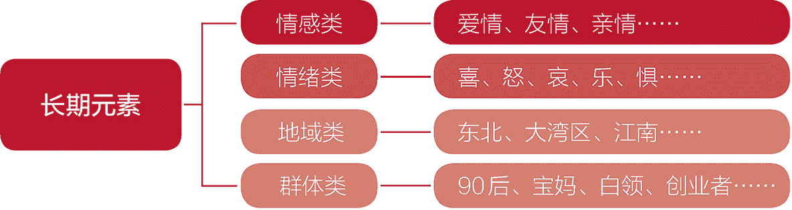

中期元素多為實用類主題，比如職場技能、個人成長、心理健康等［圖 1-2（a）］，它們是爆款的常客。因為人在不同人生階段都會遇到相似困惑，希望從他人經驗中獲得啟發。

短期元素如社會熱點、娛樂八卦、同好圈子等［圖 1-2（b）］，會週期性成為焦點。雖然具體事件人物在變，但用戶對新鮮事物的好奇與求知慾始終不變。[圖 1-2] [爆款選題的中期元素和短期元素]

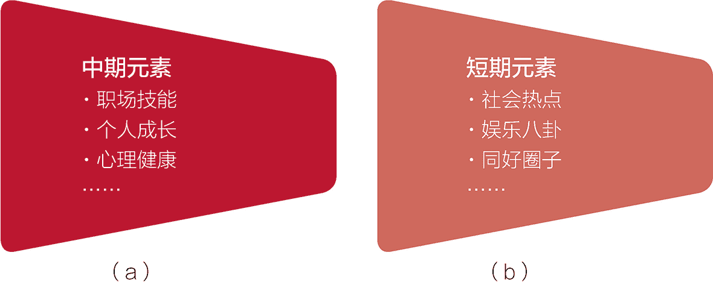

創作者可利用「爆款可重複」的特性，找到核心元素，結合當下環境、帳號定位與受眾特徵，進行二次創新與個性化表達。

### 三、快速鎖定爆款元素的六種方法

**第 1 種：泛題材搜尋法。鎖定受眾基礎廣的題材，往往更容易吸粉。**

帶上萬名學員實操後發現，美食、美妝、穿搭、旅遊、健身這五類選題（圖 1-3），因與日常生活高度相關，受眾規模龐大。[圖 1-3] [受眾廣泛的 5 類選題]

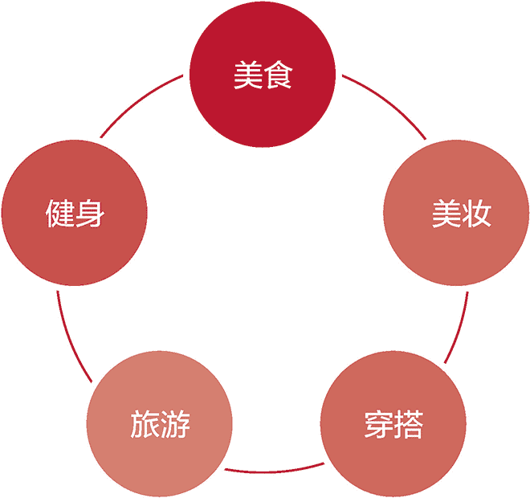

以旅遊為例，熱門城市攻略一直很受歡迎，另類玩法如探險旅遊、親子研學遊也備受追捧。

近年興起的「特種兵式旅遊」在小紅書上形成熱潮。2023 年 5 月，《特種兵極限挑戰之 24 小時玩韓國》收穫六萬讚及百萬閱讀；2024 年 4 月《特種兵株洲一日遊》獲四千六百讚；2024 年 8 月《福州特種兵一日遊攻略》獲得五千二百讚與四千六百收藏。

這五類選題一旦出現爆款，後續同類創作依然有很大概率走紅。我們只需收集過往爆款選題，讓 DeepSeek 基於核心元素再創作，就能提高爆款概率。

**DeepSeek 實戰示範**

仍以旅遊題材的「特種兵式旅遊爆款元素」為例。

**步驟 1：複製文案。**複製三篇爆款《特種兵極限挑戰之 24 小時玩韓國》《特種兵株洲一日遊》《福州特種兵一日遊攻略》的正文。

**步驟 2：拆解元素。**寫提示詞讓 DeepSeek 閱讀分析三篇筆記爆火原因及可複用內容。

**提示詞參考：**

你是一名資深旅遊博主，擅長新媒體內容生產。請深度分析以下三篇小紅書爆款文案，提煉爆火的共同要素，總結成可複用的內容公式，幫助新手博主掌握爆款寫法，提升旅行選題的曝光與互動。

爆款文案 1：特種兵極限挑戰之 24 小時玩韓國

因為有點事情 我自己一個人去韓國過了個週末。

醬蟹真的太絕了！想吃這一口好久了！拌米飯嘎嘎香！醬油味和辣味的都好吃！！！

心心念念的三麗鷗咖啡店也去了！太可愛了！

#三麗鷗 #韓國旅遊 #特種兵式旅遊 #旅遊 #大學生旅遊 #美樂蒂 #庫洛米 #韓國造型 #旅行 #週末去哪兒

**注** 文案 2 和文案 3 內容省略。

**DeepSeek 回覆：**

**一、爆款核心要素拆解**

1.關鍵詞精準卡位平台趨勢。
2.資訊顆粒度設計高效。

**二、可複用的內容公式**

《××小時玩轉××》萬能模板如下。

1.標題：衝突事件+結果導向。
2.正文：STEP 法則。
3.轉化設計：

● 餐飲/住宿類。
● 文旅類。

**注** 僅展示部分回覆。

**步驟 3：重新創作。**繼續寫提示詞，讓 DeepSeek 按上述要素複用內容，以「特種兵式旅遊」為主題創作新筆記。

**提示詞參考：**

承接上文，你是一位資深旅遊博主，對小紅書調性非常熟悉，擅長拆解模仿爆款。現在請按上面回覆的爆款要素，寫一篇全新小紅書爆款文案。選題為「杭州特種兵式旅遊」，面向 18～28 歲在校大學生/年輕上班族/喜歡旅遊的情侶，全程花費 1500 元/人以內。要求如下。

1.標題 20 字內，需含「特種兵式旅遊」關鍵詞；
2.結合「十一」假期熱點，第一人稱分享；
3.使用 emoji、特殊字體提升視覺吸引力；
4.結尾以挑戰接力形式 @當地文旅帳號；
5.符合小紅書社群氛圍，情感濃度高，促互動。

**DeepSeek 回覆：**

**《48 小時玩瘋杭州！特種兵式窮遊天花板攻略》**

「十一」搶不到票的我，週末極限玩轉杭州！全程花費 1386 元（含動車票），實測可行！

**避雷重點**

● 西湖手劃船要 7：00 搶票（我替你們排過雷了）。
● DAY1：經典暴走線。
6：00 在北山街看日出。
● 定位西湖博覽會博物館。
● 晨跑大爺教我拍「雷峰塔懸日」。
8：30 在 游埠豆漿吃鹹豆漿。
油墩兒+蔥油拌面 15 元管飽。

**注** 僅展示部分回覆。

**第 2 種：需求探尋法。找到用戶真實需求是產出有價值內容的關鍵。分享三種途徑（表 1-1）。**[表 1-1] [了解用戶需求的三種途徑]

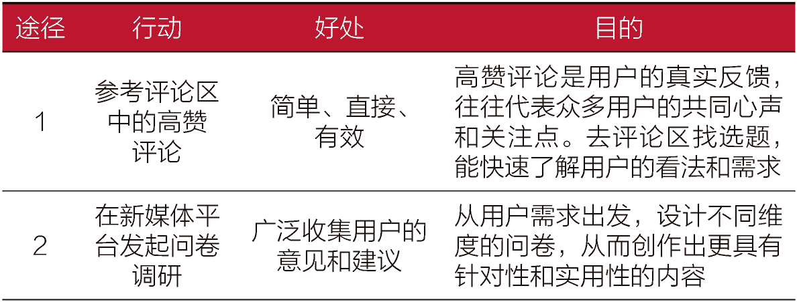

續表

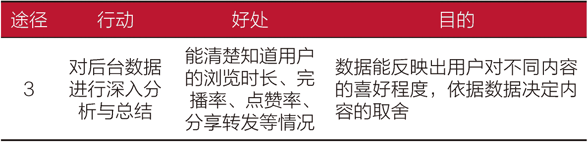

**第 3 種：熱點結合法。結合當下熱點找選題，更容易引發討論。**

及時關注時事新聞、熱門話題、流行趨勢，並與自身創作領域結合，能讓作品更具時效性與話題性。常用的第三方平台/工具如下（圖 1-4）。[圖 1-4] [常用的第三方平台/工具]

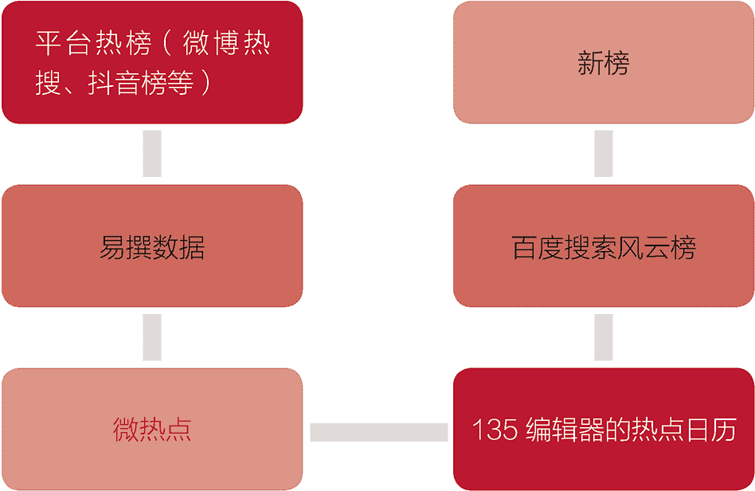

如何利用這些工具找選題做內容？以微博熱搜榜為例，電視劇《玫瑰的故事》上映即登熱搜，很多創作者借此熱點寫出「十萬+」公眾號文章。

我們可以像他們一樣關注平台熱榜，從中挑選想寫的選題，再投喂給 DeepSeek，在 AI 助力下快速搶佔熱點，提升曝光。

再看 135 編輯器的熱點日曆（圖 1-5）。[圖 1-5] [135 編輯器的熱點日曆界面]

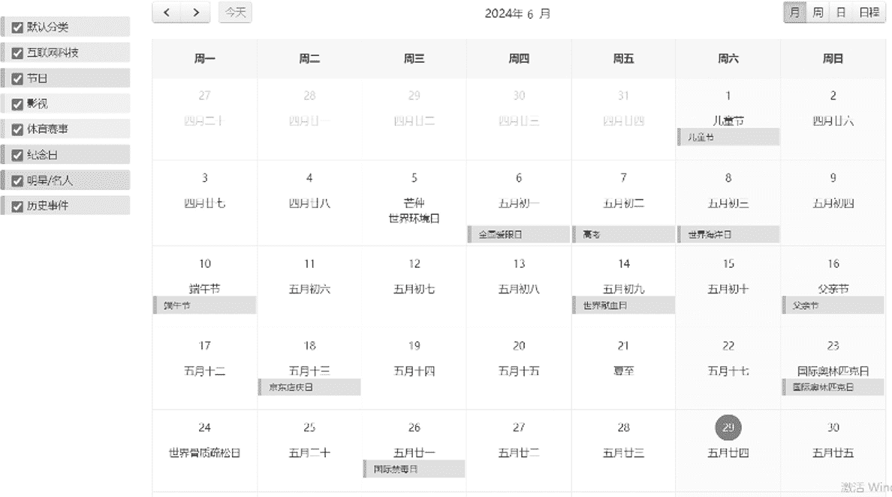

圖示可見，2024 年 6 月可作為選題的主題有兒童節、端午節、父親節等，還有電商「6·18」購物節。我們可以提前準備相關內容，臨期發布。

**DeepSeek 實戰示範**

**步驟 1：聯網搜尋過往爆款。**使用 DeepSeek 聯網功能（圖 1-6），讓它搜尋往年這些選題的爆款內容。[圖 1-6] [DeepSeek 的聯網功能]

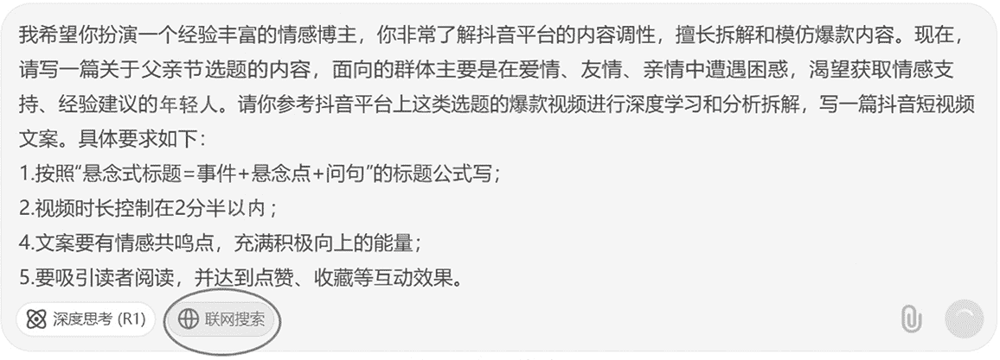

**步驟 2：仿寫再創作。**點擊附件按鍵（圖 1-7），上傳文檔資料，文檔內為找到的爆款內容。隨後寫提示詞，讓 DeepSeek 仿照爆款寫出符合選題的內容。[圖 1-7] [DeepSeek 的附件上傳功能]

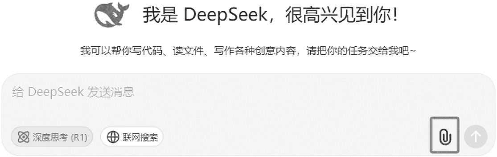

**提示詞參考：**

你是一名經驗豐富的情感博主，擅長解決普通人的情感困擾，對抖音內容調性很了解，擅長拆解模仿爆款。現在請寫一篇父親節選題內容，面向 18～28 歲在愛情、友情、親情中遇到困惑渴望獲得支持的年輕人。請閱讀學習附件中的往年爆款並分析拆解，寫出一段抖音短視頻文案。要求：

1.標題 20 字內，帶關鍵詞「父親節」；
2.文案時長對應 2 分半視頻；
3.有情感共鳴點，積極向上；
4.能促成點讚收藏等互動。

**DeepSeek 回覆：**

**標題：父親節那天，我發現了爸爸的秘密……他到底瞞了我什麼？**

（開場畫面：昏暗房間，主角坐在桌前，手握老照片，眼神複雜。）

**文案：**

你有沒有想過，爸爸其實也有脆弱的一面？小時候，他是那個無所不能的超人，用堅實的肩膀挑起了整個家。

可長大後，我才發現，他也會累，也會偷偷嘆氣，甚至……瞞著我做一些事。

**注** 僅展示部分回覆。

**第 4 種：共鳴洞察法。洞察共鳴點的關鍵是成為讀者的「情緒翻譯官」。**

首先，選定目標人群，比如剛畢業的大學生或新手父母，像朋友聊天一樣觀察他們的日常，去他們常去的社群，看大家在抱怨什麼、炫耀什麼、深夜沮喪時在聊什麼。新手媽媽常吐槽「凌晨 3 點獨自餵奶，旁邊是鼾聲的老公」，這就是可捕捉的情緒點。

其次，把碎片化情緒串成完整故事線，挖掘人人經歷過卻未說出口的微妙感受，借自己的經歷照出群體的共同模樣。寫北漂故事，不要只講擠地鐵辛苦，可以寫「合租屋裡用行李箱當餐桌，卻拍出唯美早餐照發朋友圈」的倔強；寫全職媽媽不易，不要直接寫「帶娃辛苦」，而要描寫「一隻手抱著哭鬧的嬰兒，另一隻手把洗好的衣服晾起來」的具體場景。

這種生活切片比宏大敘事更易引發「這就是我」的共鳴。找到共鳴點後可做小測試：把內容給三個目標讀者看，若他們不約而同說「你怎麼知道我的事」，就說明找對了。

以我們指導學員做個人故事視頻為例，絕大部分爆款來自以下選題：

● 選題一：我的十年故事；
● 選題二：關注我的五大理由；
● 選題三：我的妝容/穿搭進化史；
● 選題四：我是×××，重新認識一下。

這四類易爆款，是因為用戶在作品裡看到了自己的影子，感受到被理解被認同，願意分享傳播，從而大幅提升走紅概率。

**让 DeepSeek 抓住用户的情绪点**

找不到破圈切口时，可以把共鸣挖掘的工作交给模型。以沙龙经营者这一圈层来演示操作思路。

**步骤 1：先喂人物画像，让模型归纳触动点**
把目标人群的画像先输入模型，梳理他们在内容生产与获客环节最容易被击中的情绪点。

可参考的提示词写法：
你是一名深耕沙龙行业的操盘者，同时也是沙龙培训师，擅长拆解行业痛点与从业者心理动机。请从沙龙经营者的视角，拆解他们在新媒体创作和引流上最具共鸣的诉求，为学员提供更有穿透力的内容方向。具体要求：
1. 罗列 8 条高共鸣点；
2. 每条给出一个具体场景案例；
3. 分点呈现，结构清晰。

模型示例输出：

**一、经营焦虑类痛点**
1. 选址成本高、客流回报低
● 案例：主理人丽丽花费半年锁定市中心铺面，月租 3 万元开业，因周边竞品扎堆，首月仅转化 23 位付费会员。
● 解法：转向“轻资产联营”模式，与高端健身房合作，可节约约 60%成本，客群匹配度可提升 90%。
2. 员工培训周期长、效果差
● 案例：某美学沙龙新员工上岗 3 个月仍无法操作高端仪器，客户投诉率超 15%。
● 解法：搭建“标准化服务 SOP 视频库”叠加“师带徒积分激励”，把培训周期从 2 个月压缩至 18 天。

注 只展示部分回复。

**步骤 2：锁定一个痛点，让模型直接产出可用文案**
对第一步结果进行筛选后，挑出最具代表性的点追加追问，让其生成可直接发布的稿件。

可参考的提示词写法：
请围绕上一步提炼的“选址成本与客流失衡”这一共鸣点进行深度拆解，创作一篇面向沙龙经营者的、可提供价值或解决问题的抖音/小红书爆款文案。具体要求：
1. 全文控制在 1000 字以内；
2. 善用 emoji、特殊字体等提升视觉吸引力；
3. 直指沙龙经营者存在的问题；
4. 内容实用、贴合社区调性，能促使用户阅读并关注、私信。

模型示例输出：
**卷了！你的沙龙选题还在抄爆款？**
——3 个动作让枯竭选题库焕发生机
90% 主理人正在做慢性自杀式选题……
刷了 3 小时热搜榜，最后含泪复用半年前旧选题……
这不是努力，是在自我消耗……

注 只展示部分回复。

**第 5 种：角度创新法。在内容竞争白热化的环境里，视角的新颖度决定能否脱颖而出。**

选题容易陷入陈词滥调的根源，是创作者不敢跳出框架，过度依赖行业内的固定套路。传统选题受限于常规认知，解决方案同质化严重。而新视角选题则通过引入跨界方法、结合新技术、做反常识或颠覆性操作来开辟差异赛道。

以减重、职场、旅游为例，这三个赛道热度高但同质化严重。能破圈的爆文，往往切入了不同寻常的角度。[表 1-2] [减肥、职场、旅游领域新视角选题举例]
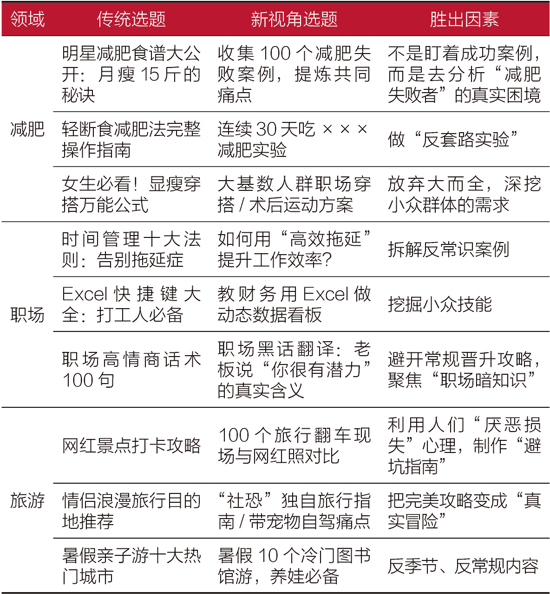

由表 1-2 可见，关于减重话题的新视角不再局限于传统轻断食科普，而是另辟蹊径，给出“连续 30 天吃×××减肥”这类贴合年轻用户心理的钩子，从而大幅激发好奇心，促使用户深入阅读与探索。

**DeepSeek 帮你赢**
也可以借助模型做新视角选题的思维延展，让其为不同赛道输出差异化选题。假设你是一名商业顾问，需要为客户做选题策划，可要求其为同一赛道分别给出 5 个传统选题和 5 个新视角选题。

点击附件按键，上传参考资料文档，文档中应包含传统选题和新视角选题的定义，以及挖掘新角度选题的方法，然后撰写提示词，对模型提出要求。

提示词可参考：
你是一位资深商业顾问，需要为知识付费领域的客户和餐饮品牌的客户做指导。现在，请先深度学习文档中的传统选题和新视角选题的定义，以及挖掘新角度选题的方法（见附件），然后针对两个领域各产出 5 组传统选题和新视角选题，为他们提供有效的新媒体创作思路。具体要求如下：
1. 选题尽量与社会热点相结合；
2. 选题的场景类型要丰富多样；
3. 每个选题下面列出可以拓展的内容；
4. 新视角选题能帮助创作者达到更好的引流转化效果。

模型的回复：
**知识付费领域**
**传统选题**
时间管理十大经典法则
职场沟通话术模板
**新视角选题**
用 ChatGPT 构建个人知识库
反焦虑学习法：每天专注 11 分钟
职场反 PUA 知识扑克
**线下餐饮领域**
**传统选题**
2024 夏季爆款饮品研发日志
餐饮抖音团购运营全攻略
**新视角选题**
多巴胺饮食：用色彩科学提升客单价
剩菜盲盒：年轻人捡漏背后的行为经济学
餐饮业军备竞赛：无人机送餐实战测评
注 只展示部分回复。

**第 6 种：采集器寻找法。可以充分利用后羿采集器、八爪鱼采集器、新红等数据工具进行选题的收集。**

这类工具具备强大的数据抓取能力，能从互联网海量信息中精准抓取所需内容。我们还是以减肥领域为例，展示如何用新红来寻找选题（图 1-8）。[图 1-8] [新红数据抓取步骤]
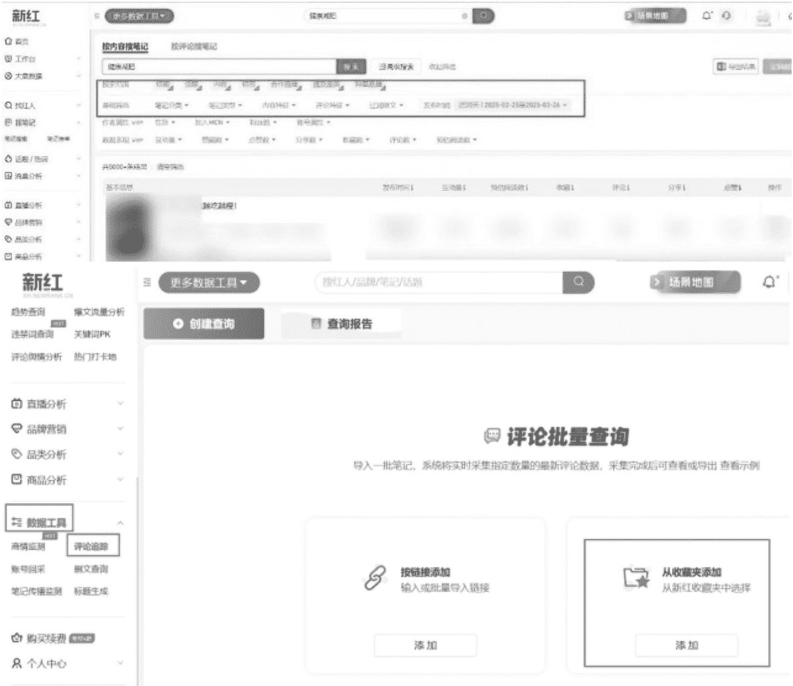

第 1 步：输入关键词“健康减肥”。
第 2 步：确定“筛选条件”和“采集范围”，点击“导出结果”下载表格，快速获取与特定主题相关的文章、标题、互动数据。
● 筛选条件：可从笔记分类、笔记类型、内容特征、评论特征和发布时间等维度进行选择。
● 采集范围：可从标题、话题、内容、标签等维度进行设置。
第 3 步：利用新红“数据工具”中的“评论追踪”功能，从收藏夹添加步骤 2 中下载的表格，通过高赞评论充分挖掘具有潜力的选题方向。

我们可以重点关注这类高赞评论，因为它反映了粉丝群体的共性需求、共同偏好，然后整理出粉丝在高赞评论中普遍反馈的问题、建议，以此作为选题参考。

对于采集到的信息，你还需要进行进一步的筛选、分析和整理，以便提炼出真正有价值、符合自身需求的选题。

**DeepSeek 帮你赢**
我们以健康减肥行业为例，你可以将采集到的信息“投喂”给模型，让它来撰写选题。

提示词可参考：
你是一位资深的营养师，在减肥领域经验丰富。请基于如下采集到的爆款内容数据（含浏览、互动指标及高赞评论），进行深度分析和提炼总结，写出关于“健康减肥”的 5 个内容选题，帮助健身博主或减脂品牌团队提升视频的打开率和完播率。采集到的数据如下。
高热度减肥内容：
**挑战 7 天瘦 5 斤：女大学生特种兵式减肥法**
播放量：582 万人次|点赞：34 万人次|收藏：29 万人次
高赞评论：“跟着做真的每天掉秤”“求更新月经期补救方案！”
**营养师揭秘：这些“低卡”食物越吃越胖**
播放量：460 万人次|点赞：27 万人次|收藏：18 万人次
高赞评论：“难怪天天吃沙拉还胖了！”“求扒网红燕麦杯！”
**打工人的暴食自救指南**
注 只展示部分搜集到的爆款内容数据。

**本节小结**
在新媒体创作中，选题是决定内容能否成为爆款的核心。本节介绍了 6 种找选题的方法——重复爆款元素、挖掘用户真实需求、结合社会热点、引发情感共鸣、创新选题角度以及数据工具辅助。这些方法的核心是抓住用户关注点，用他们熟悉的元素或痛点引发其兴趣。无论是新手还是老手，掌握方法就能从海量信息中快速锁定高潜力选题，避免盲目创作。用模型 + 6 个方法综合应用，深入分析、精心策划，你就能高效创作出满足用户需求、引发广泛关注和传播的优质内容。

**小练习：**请选择一种方法，设计一个适合你所在行业的选题。

本节小练习中的提示词+模型回复，请关注微信公众号“焱公子和水青衣”（ID：Yangongzi2020）。
关注后输入：AI 选题法，即可获取。

## **第二节 10 个模板直接抄，新手也能复制出千万流量**

我们团队在拆解了 12 000 多篇千赞爆文之后归纳出 10 个选题模板，学员在灵活运用后都表示收获很大，创作内容时更加得心应手了。以下为详细分享内容。

### **一、走捷径型**
为解决某个问题，提供一些看似能够快速达到目标的方法或策略（表 1-3）。[表 1-3 走捷径型选题]
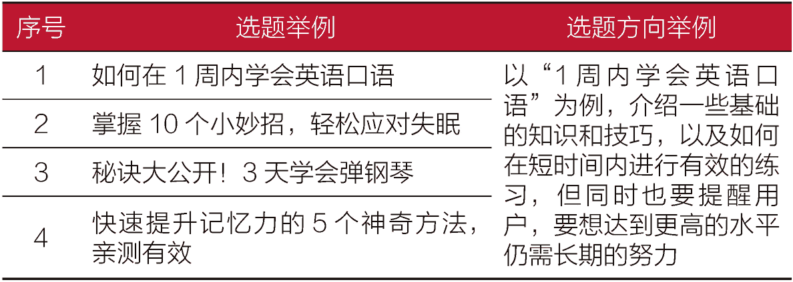
模板：短时间+学会
常见样式：
①如何在××（时间内）学会××
②掌握××，轻松应对××
③秘诀大公开！××（时间）学会××
④快速××的方法，亲测有效
需要注意的是，这里的“走捷径”并非让你不劳而获，而是经由自己的经验，总结出合理、高效的学习或做事方法。

### **二、故事启发型**
通过讲述一个引人入胜的故事，传递某种价值观或启发受众的思考（表 1-4）。[表 1-4 故事启发型选题]
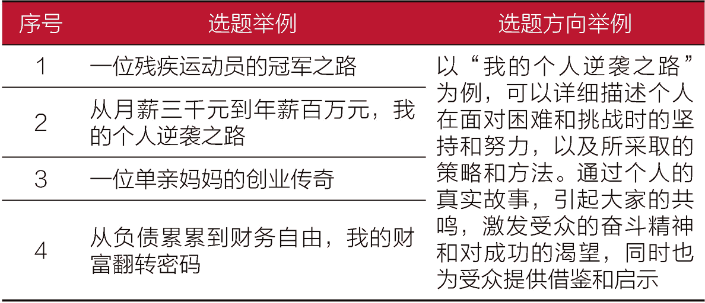
模板：人物故事+价值观
常见样式：
①一位××（什么人）的××之路
②从××到××（金钱），我的××之路
③一位××（身份）的××传奇
④从××到××（金钱），我的××密码

### **三、观点辩论型**
针对某个具有争议性的话题，提出自己独特的观点，并引发受众的讨论和辩论（表 1-5）。[表 1-5 观点辩论型选题]
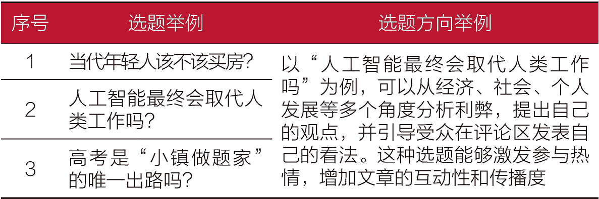
模板：大众话题+个人观点
常见样式：
①××（身份）该不该××（做什么事）？
②××会取代××吗？
③××（什么事）是××（什么人）的唯一出路吗？

### **四、清单盘点型**
以清单的形式呈现某一品类相关的内容（表 1-6）。[表 1-6 清单盘点型选题]
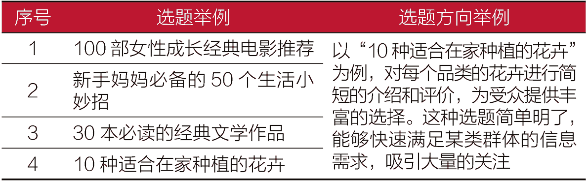
模板：数量+品类内容
常见样式：
①多少部××推荐
②××（什么人）必备的多少个××妙招
③多少本必读的××作品
④多少种适合××（做什么）的××

### **五、情感共鸣型**
记录一个人或一件事所带来的情感冲击，触动受众情感，引发他们的共鸣和情感宣泄（表 1-7）。[表 1-7 情感共鸣型选题]
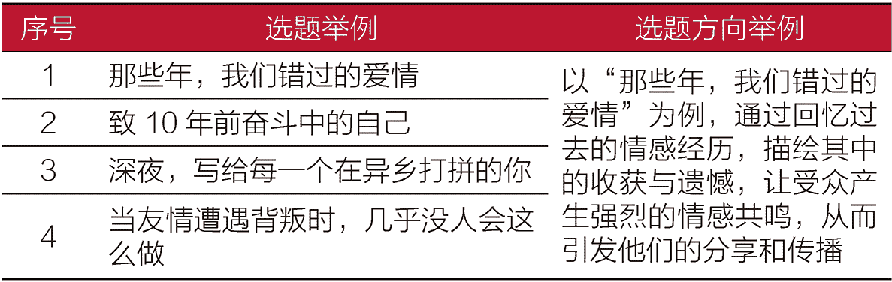
模板：人物（事件）+情感
常见样式：
①那些年，我们××（做过的什么事）
②致 10 年前××的××（什么样的谁）
③深夜，写给××（身份）
④当遇到××时（遇到什么事），几乎没人会这么做

### **六、系列合集型**
与模板 4 相似，但又略有不同，这是将相关主题的内容整理成一个系列合集（表 1-8）。[表 1-8 系列合集型选题]
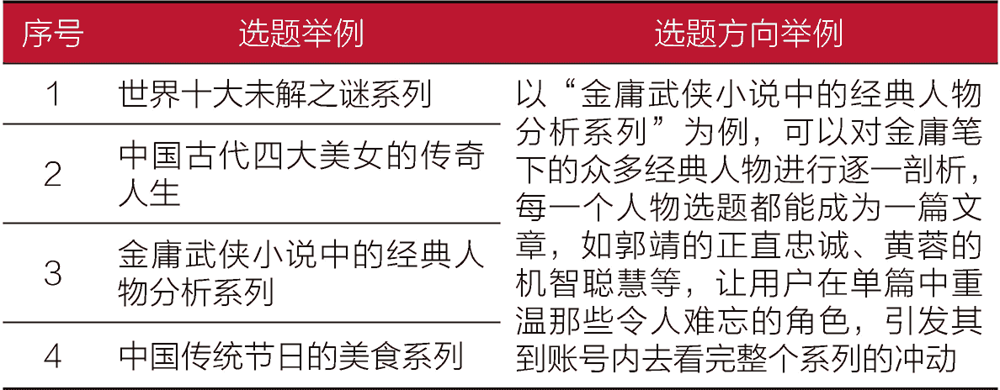
模板：主题+内容系列
常见样式：
①世界××系列
②×××国××
③××小说中的××分析系列
④××传统节日的××系列

### **七、实用干货型**
提供具有实际操作价值的知识和技巧（表 1-9）。[表 1-9 实用干货型选题]
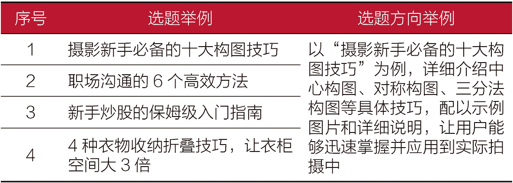
模板：领域+方法/经验整理
常见样式：
①××新手必备的××
②××的多少个高效方法
③新手××（做什么事）的保姆级入门指南
④多少种××的技巧

### **八、前后对比型**
通过展示事物前后的变化来突出重点、吸引注意（表 1-10）。[表 1-10 前后对比型选题]
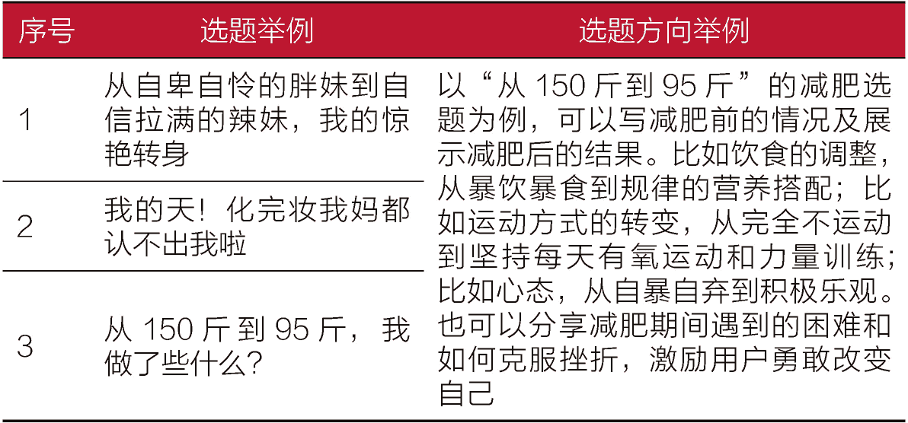
模板：做前情况+做后情况+对比结果
常见样式：
①从××到××，我的惊艳转身
②我的天！××后××都认不出我啦
③从××到××，我做了些什么

### **九、反常规型**
挑战传统观念或常规认知，提出与众不同的观点（表 1-11）。
模板：传统观念+反常规观点
常见样式：
①××？（传统观念）你可别再被误导了！
②××？（传统观念）这只是个美好的愿望！
③××？（传统观念）还真能！
④××？（传统观念）那你不懂！[表 1-11 反常规型选题]
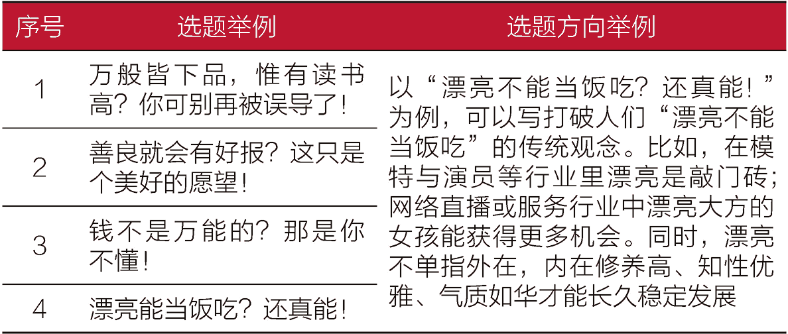

### **十、贴标签型**
给某类人物行为贴上独特的标签，吸引受众的注意力（表 1-12）。[表 1-12 贴标签型选题]
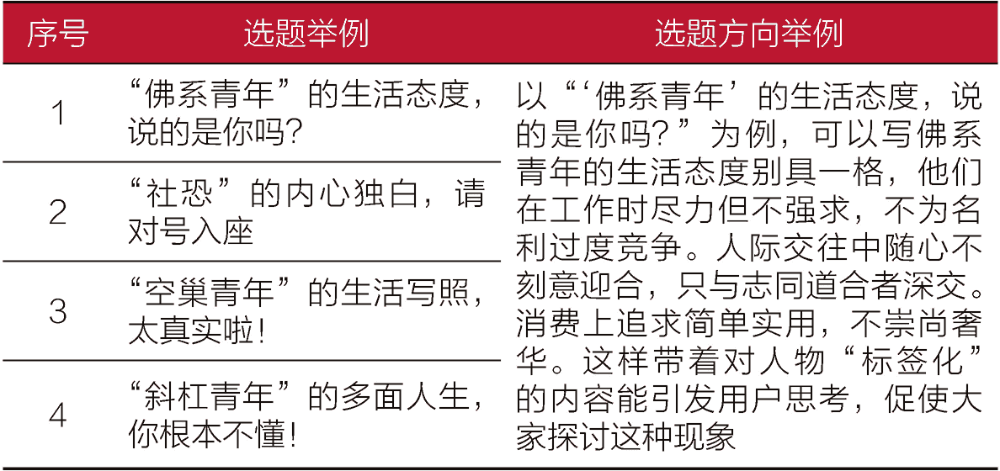
模板：人物标签+行为标签
常见样式：
①××，说的是你吗？
②××，请对号入座。
③××，太真实啦！
④××，你根本不懂！

**DeepSeek 帮你赢**
你可以应用模型来套用模板，快速生成一篇内容。
**方式一：单一模板的使用**
现在，让我们把资料“投喂”给模型，请它写出宠物行业的 3 个选题。
**提示词参考如下：**
你是一位资深的萌宠博主，非常了解抖音平台的规则和宠物行业的传播规律。请阅读学习爆款选题模板资料（见附件），为宠物领域策划 3 个短视频选题，给宠物内容创作者和宠物电商运营团队提供参考。要求产出的选题带有明确的人物标签，对提升视频的完播率有帮助。
**模型的回复：**
选题 1：给孩子一天洗三次澡的洁癖家长，说的是你吗？
选题 2：给狗狗点饮料的溺爱党，请对号入座！
选题 3：对着监控和猫唠嗑两小时的留守家长，太真实啦！
**方式二：综合模板的使用**
一次性“投喂”10 个模板，让模型自行选择、整合、创作内容。这种方式适合矩阵号运营，可批量化产文。
以机器人制造行业为例，假设模型要扮演的是一家机器人制造公司的新媒体运营，期望在新媒体平台上批量产出内容、做出爆款。现在，把 10 个模板全部以附件形式上传，然后撰写提示词，让模型写出 20 个选题。
**提示词参考如下：**
你是一位资深的科技公司新媒体运营，了解抖音平台规则和机器人行业趋势。请阅读并学习选题模板资料（见附件），写出 20 个关于“机器人”的短视频选题，给科技达人、机器人企业、电商团队提供参考。选题要与当下的社会热点结合，能有效提升视频的商品转化率。注意：每个模板写出两个标题，并标注清楚。
**模型的回复：**
**模板 1：走捷径型**
1.3 天让机械臂学会泡茶！柔性抓取算法速成指南。
2.秘诀大公开！1 小时让扫地机器人效率翻倍。
**模板 2：故事启发型**
1.从养猪场到 AI 实验室：95 后女孩的机器人驯化之路。
2.从负债 200 万元到年入千万元：我的陪护机器人创业血泪史。
**模板 3：观点辩论型**
1.机器人护工该不该有“关机权”？脑机接口伦理大激辩。
2.机器人写作业是教育革命还是作弊？特级教师当场破防。
注 只展示部分回复。
**本节小结**
本节提供了 10 个爆款选题模板，核心是降低创作难度。新手借助模型+模板能快速上手，使用时需注意结合自身领域特点，不生搬硬套，要灵活调整。加入真实细节或情感，才能让内容既有套路又不失个性。
**本节小练习：**请选择本节中的一个模板，设计一个选题（假设你想以“家庭健身”为主题，那么可以选择实用干货型模板来设计选题）。
本节小练习中的提示词+模型回复，请关注微信公众号“焱公子和水青衣”（ID：Yangongzi2020）。
关注后输入：AI 选题模板，即可获取。

# **第二章**
# **包装思维：7 个标题公式让点击率暴涨 300%**

新媒体平台上每天都有海量信息，用户凭什么愿意把注意力给你？不管是文章还是视频，能否成为爆款，50%取决于标题。标题决定了用户是否会驻足、会点开。不同标题下，即使是选题相同的文章，阅读量和传播效果也有可能天差地别。比如，《哪吒 2：魔童闹海》爆火，有博主这样写标题：“全民追捧，哪吒 2 为何这么火？”文章阅读量只有几百。而有的博主写：“怼天怼地的哪吒，唯独没反叛的是什么？”“抱歉，我无法共鸣哪吒！”文章阅读量均达“10 万+”。

## **第一节 10 秒生成爆款标题，AI 榨干热点红利**

认真打磨标题是每个创作者的重要任务。下面，给大家分享我们带学员实操时常常使用的 7 个标题公式。

### **公式一：新闻式标题=热点+关键词+观点**
**找到热点。热点捕捉需要系统化追踪与精准判断（表 2-1、表 2-2）。**
在实践中，我们还会用到一个“野路子”方法——时效管理策略，也能得到很多第一手的热点事件（图 2-1）。[图 2-1] [时效管理策略]
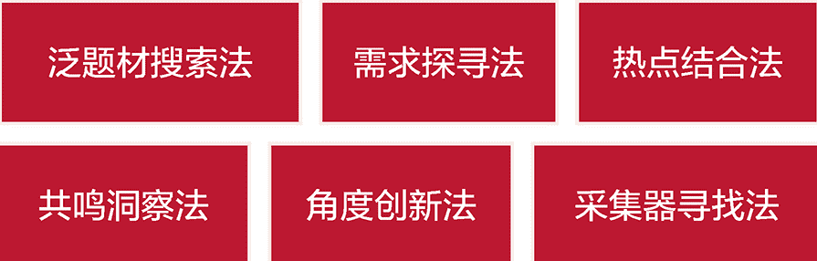
**提取关键词。我们常使用“5W1H”事件分析法。**
以 2024 年 1 月爆火出圈的哈尔滨旅游为例，关键词提取如下（表 2-3）。[表 2-1] [常见热点来源表 2-2] [热点核心监测渠道表 2-3] [“5W1H”事件分析法案例解析]
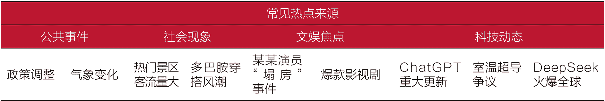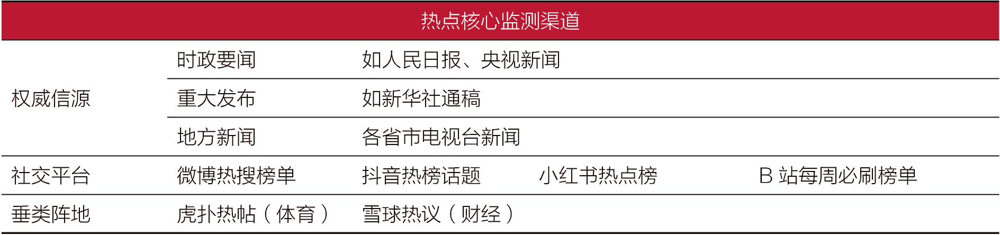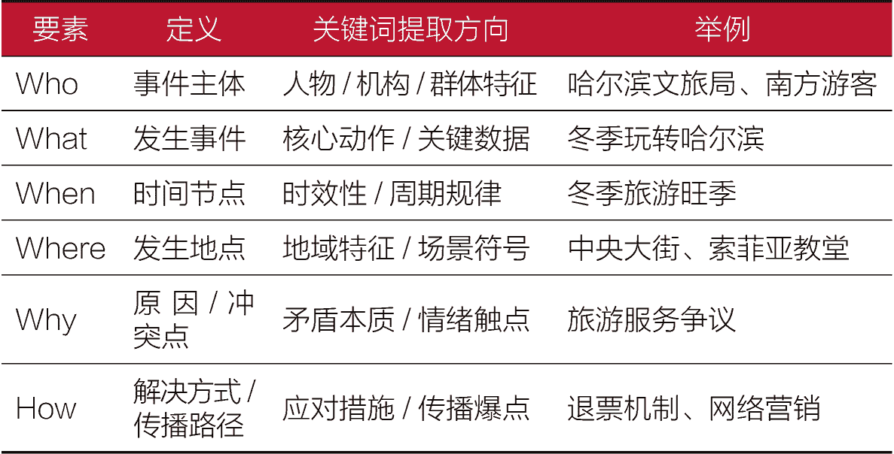
**生成观点。想让标题吸引人，得把关键词变成能引发讨论的观点。**
● 找对立面。就像菜市场砍价要有来有回，观点也需要制造冲突。针对“预制菜进校园”的新闻，可以生成观点：“学校食堂用预制菜，是省事还是害娃？”针对人工智能立法领域的新闻，可以生成观点：“AI 跑得比法律快，该给它拴绳子吗？”看到热点就先画正反符号，然后把关键词拆成两派阵营，观点自然而然应运而生。

标题撬流量：从情绪共鸣到方法交付

● 打破心防。把受众心里憋着却没说出口的话直接点出来，传播就起来了。比如“这个世界破破烂烂，总有人在缝缝补补”。学会给关键词披上情绪外衣，像愤怒、感动、焦虑这类情绪，挑一种放到标题里，效果会被放大。

● 直接给路数。光说现象不够，要把操作路径讲明白。标题里就要露出方法感。以“酱香拿铁爆火”为例，可以提炼观点：“瑞幸×茅台示范课——让年轻人上头的配方”。把关键词转化为“怎么做”的清单或通关宝典，读者很难抗住点开的冲动。

**新闻类标题高频爆词汇总（图2-2）。**[图2-2][新闻式标题常见爆款词]

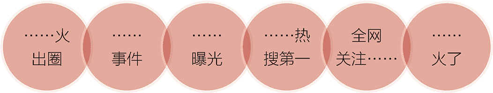

把上述爆词套进标题，可参考以下示范（表2-4）：[表2-4][爆款词案例]

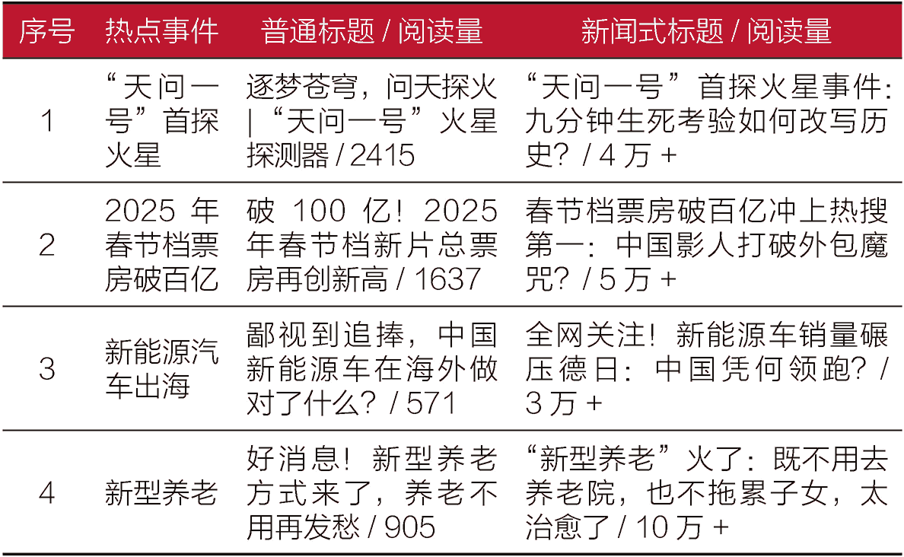

**DeepSeek 助力方案**

DeepSeek 搭豆包，写新闻标题更顺手。

第一步，用豆包抓热点。豆包能每日自动巡检抖音热榜。

● 即时检索，在豆包对话框输入指令，如“娱乐热点”“抖音热点新闻”，系统就开始检索。
● 从“豆包日报”入手。工具栏打开“豆包日报”，点“看看豆包日报”就能看到当日热榜。“豆包日报”可做偏好设置，点开后能挑选关注行业，还可设定固定推送时间。

第二步，挑中新闻投给 DeepSeek 拆解。由豆包找到热事件后，选一条复制出来，交给 DeepSeek，让它按“5W1H”事件分析法快速提炼要点。

提示词示例：

你是一名新媒体编辑，对新媒体内容调性很懂。现请按“5W1H”事件分析法，从下列热点事件中抽取3～5个关键词。要求：和事件高度相关，关键词精准。

注 后续内容省略。

DeepSeek 返回示例：

1.××客服诈骗（覆盖 Who 和 What）
2.刷脸验证（How 中的技术手段）
3.资金冻结（How）
4.××警方（Who 和 Where）
5.电信诈骗（事件性质）

注 仅展示部分返回。

第三步，锁定要点，让 DeepSeek 产出标题。从上述返回里挑选一个要点（以“电信诈骗”为例），再上传“生成观点的三个维度”和常见爆词，让 DeepSeek 选定某维度加一个爆词，产出一条新闻式标题。

提示词示例：

继续，我希望你扮演资深新媒体编辑，对内容调性很熟。请阅读生成观点的背景资料（见附件）。根据热点事件要点“电信诈骗”，挑选生成观点的一项维度+一个爆词，生成一条新闻式标题。要求：标题具备新媒体感，必须包含关键词“电信诈骗”，字数控制在20字内。

DeepSeek 返回示例：

**电信诈骗新套路曝光！全网关注防坑指南**

情绪驱动：“曝光”直击公众对隐蔽骗局的未知恐惧，触发焦虑感，提升点击欲。
信息增量：“新套路”暗示内容独家，满足获取前沿防诈知识的需求。
行动暗示：“防坑指南”给出解决方案，契合自我保护心理，提升实用性。

注 仅展示部分返回。

### 公式二：数字式标题=事件+数字+结果

**提炼核心事件。**

先锁定想表达的核心事件或主题，推荐用“人—事—果”结构快速拆解。例如：

● 人：外卖小哥。
● 事：送餐途中搀扶老人过马路。
● 果：订单超时被投诉，却收到老人家属送来的锦旗。

**确定数字。**

标题里的数字要精确，杜绝“很多”“大量”等概数，要像刻度一样具体。写“高效工作”，用户会问有多高；写成“每日工作17分钟”，数字会像钉子一样钉进记忆。

带小数的数字杀伤力更强，如“37.6%的焦虑缓解”比“减少压力”更真实，因为人更信量杯刻度。数字需可查、可证。

**展示结果。**

还要写明数字带来的结果或影响，结果必须是正面且有吸引力的。

结果不仅是量化指标，更是撬动心理的杠杆。标题里放上“可视化结果”，等于给读者画出一张可量化的成功图，具象承诺比空话更有穿透力。比如，“AI 3秒搜遍全网爆款素材”就是可量化的结果，比“做爆款必学AI”更有说服力。

写完“展示结果”后，停下来自问：这份表达能否让目标用户产生“这正是我想要的改变”的共鸣？

### 公式三：悬念式标题=事件+悬念点+问句

**提炼核心事件（做法见公式二）。**

● 挖掘悬念点。分析事件里哪些细节能挑起好奇，找到设置悬念的切口。下面分享7种挖掘悬念点的方法（表2-5）。[表2-5][7种挖掘悬念点的方法]

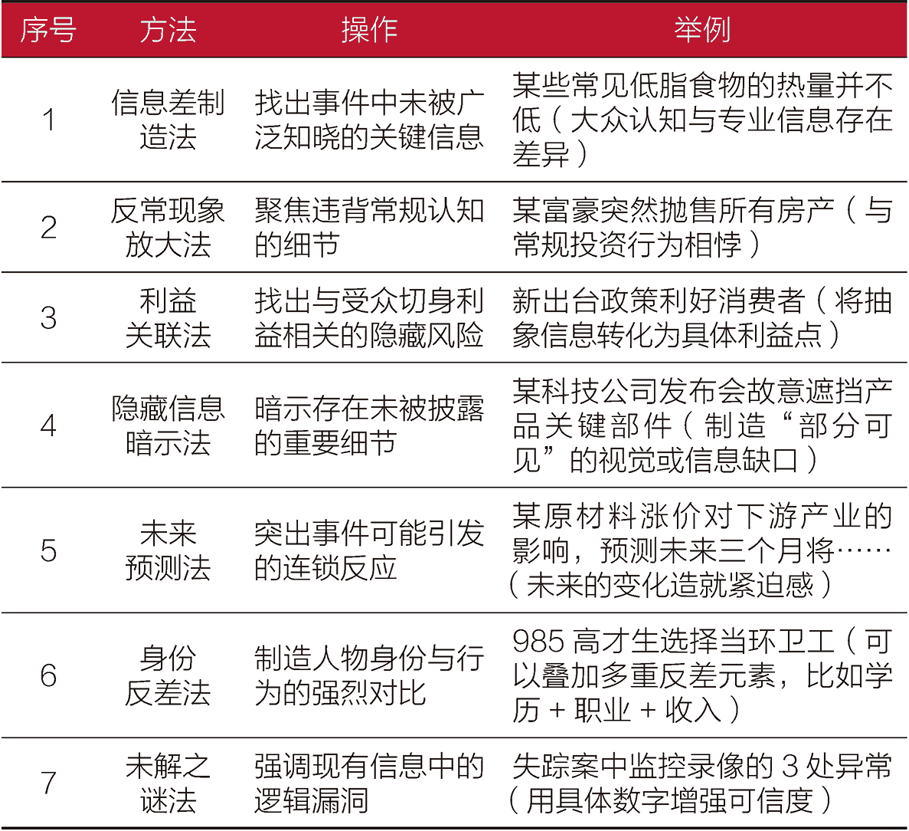

**生成问句。**

基于悬念点设计一到多个问句，激发好奇。以下5种是学员常用会制造悬念感的问句（表2-6）。[表2-6][5种悬念感问句]

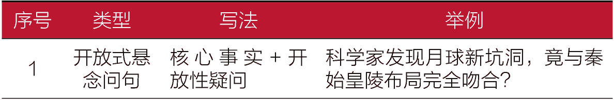

续表

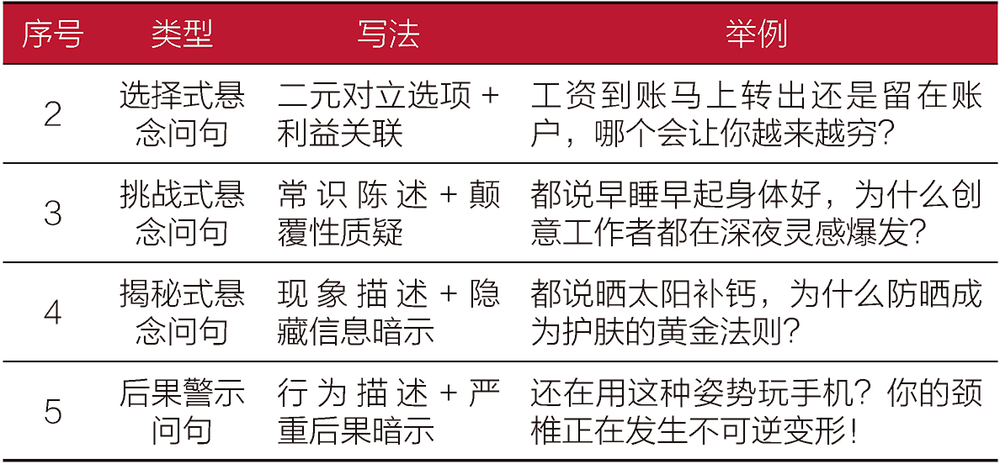

**悬念式标题常用爆词（图2-3）。**[图2-3][悬念式标题常见爆款词]

把爆词放进标题，能看到如下案例（表2-7）。[表2-7][悬念式标题爆款词案例]

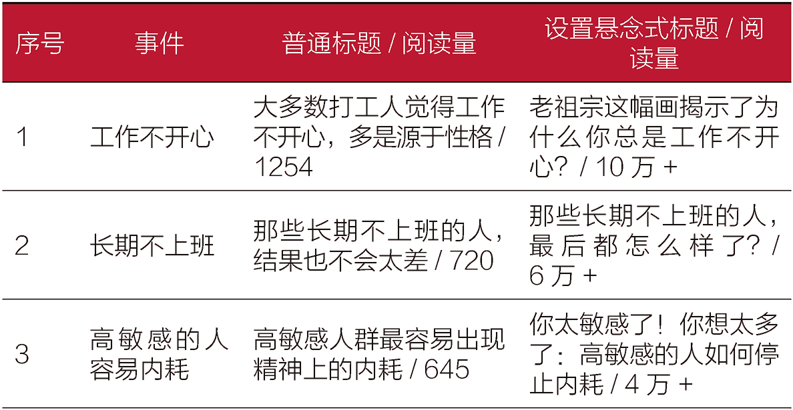

续表

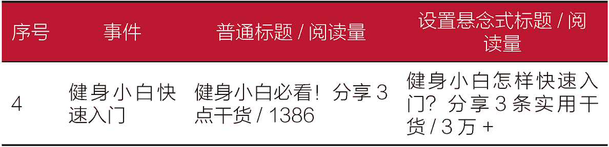

以美业场景为例，让DeepSeek按公式（悬念式标题=事件+悬念点+问句）快速给出5条标题。

步骤1：上传参考资料。把悬念式标题公式全部内容和爆词案例整理成文档上传。
步骤2：写提示词。要求DeepSeek学习文档，严格按公式写标题。

提示词示例：

你是一名美业从业者，正在构思一篇发在小红书的护肤文章，面向20～35岁的职场年轻女性，提升点击率吸引客户。附件里有悬念式标题公式+30个爆词资料，请认真学习，按以下要求写5个悬念式标题。

要求：
1.务必按文档里的悬念式标题公式和爆词来写；
2.标题要精准锚定护肤痛点；
3.标题有新媒体感，字数控制在20字内。

DeepSeek 的返回：

1.秋冬泛红爆皮的幕后黑手是谁？90%人竟用错急救方法！［事件+痛点量化+爆词（幕后黑手是谁）+行动暗示］
2.你敢信？毛孔粗大元凶藏在浴室！这样护肤越护越糟。（爆词前置+场景痛点+错误行为警示）
3.敏感肌真相竟是过度清洁？每天2次洗脸正在毁脸！［反常识结论+爆词（真相竟是……）+场景化指令］
4.30岁必看！眼纹加深的背后隐藏了什么？睡前一步逆转年龄。［人群定向+爆词（背后隐藏了什么）+解决方案“钩子”］
5.面膜越敷越干如何自救？美容师公开私藏的3步急救法！［矛盾现象+爆词（如何……）+专业身份背书］

### 公式四：反转式标题=旧认知+新反转

**锁定常规旧认知。确定用户对某个话题的普遍认知或预期。**

过去常用调研表，现在新媒体时代效率可提升10倍（图2-4）。[图2-4][锁定常规旧认知的做法]

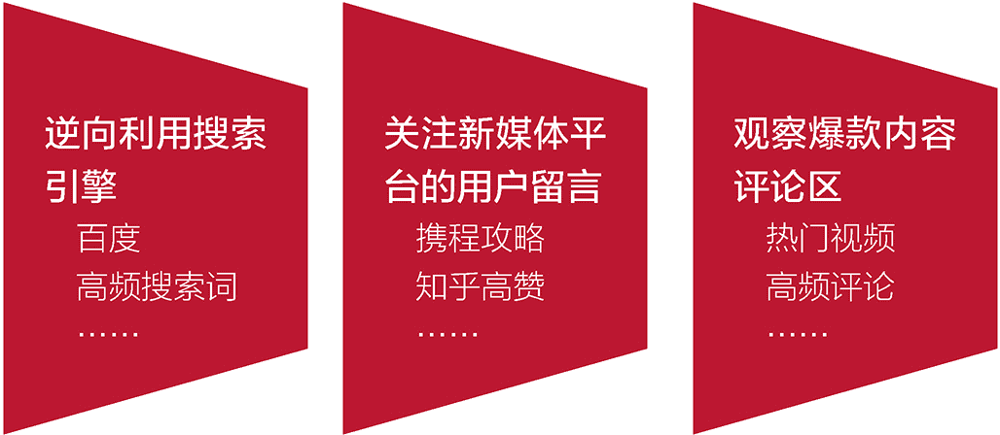

● 逆向用搜索引擎。比如在百度搜“减肥”，会看到高频短语“减肥不能吃碳水”“减肥平台期”等，这些往往对应大众误区。再如搜“充电”，会出现“手机充电到100%伤电池吗”，对应认知盲区。
● 关注新媒体平台的用户留言。比如携程攻略里“旅行后悔经历”的帖子，充斥“早知道不该信网红推荐”等抱怨，可反推“网红景点必打卡”的旧认知。又如知乎检索“旅游反常识”话题，从152条高赞回答可看出“详细攻略反而降低旅行幸福感”等认知冲突点。
● 观察爆款内容评论区。在抖音、小红书热门视频评论区筛出点赞最高的前20条，就能反向追溯用户被打破的旧认知。

学员大量实测证明：以上3种方法交叉验证，通常2～3小时内能锁定5～8个高潜力认知靶点。

**寻找新的反转角度。分析能颠覆常规认知的元素或事实，反转要出人意料且有价值。**

分享4个新手也能上手挖反转点的方法，半小时可挖出20个反转点。

方法1：搜关键词。在知乎、小红书搜与“打脸”相关的词，如“错的”“被骗了”“没用”等，从笔记评论区高赞回答里摘录别人验证过的反转结论。
方法2：找“反常识”实验。在抖音、B站找记录实验的视频，凡违反常理却有人实操成功的案例，都是现成反转点。
方法3：查最新研究。用“微信搜一搜”搜“××（领域）最新研究”，注意年份。
方法4：盯“老人言”。收集长辈常说的俗语/禁忌，再去专业机构公众号查科普，用专家“打脸”老话，是天然反转点。

**反转式标题常用爆词（图2-5）。**[图2-5][反转式标题常见爆款词]

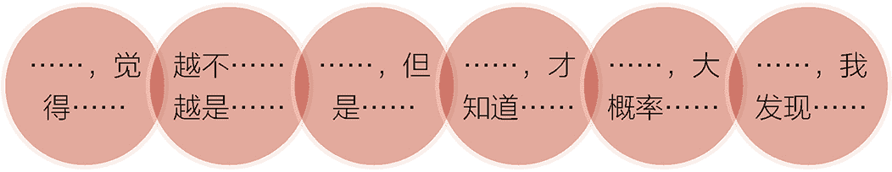

把爆词代入标题，可看到如下案例（表2-8）：[表2-8][反转式标题案例]

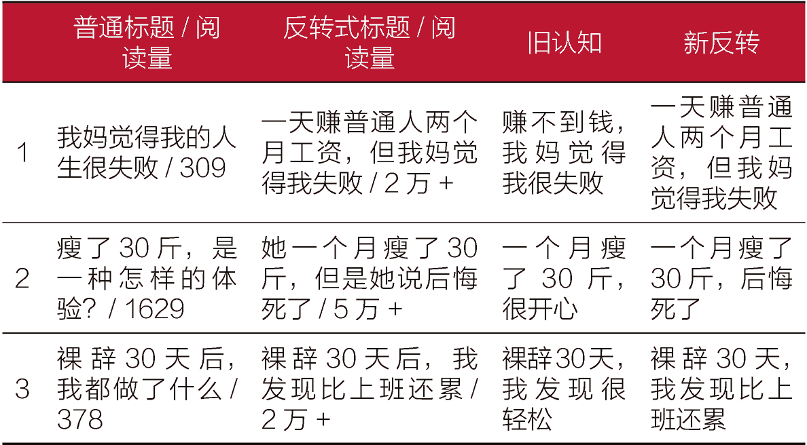

**DeepSeek 助力方案**

以教育领域为例，让DeepSeek按公式（反转式标题=旧认知+新反转）快速给出2条标题。

先把选题初稿+反转式标题公式内容+爆词案例整理成文档上传，再写提示词让DeepSeek按公式生成。

提示词示例：

你是一名线上教育从业者，正在创作家庭教育类文章。读者是6～18岁小初高孩子的家长。请认真阅读背景资料（见附件），为文章写2个反转式标题。

要求：
1.务必按反转式标题公式和爆词来写；
2.标题要精准锚定教育行业痛点或热点；
3.标题有新媒体感，字数控制在20字内。

DeepSeek 的返回：

1.逼孩子学习，才是害他！新教育真相。（痛点：填鸭式教育 | 结构：……才是……）
2.快乐教育≠成绩差，但是90%家长做错了！（痛点：素质教育困境 | 结构：……但是……）

### 公式五：受众式=目标人群+相关主题

**目标人群。先明确想吸引的受众群体，尽可能了解他们的需求。**

可从以下6个维度厘清受众需求（表2-9）。[表2-9][确定目标受众的6个维度]

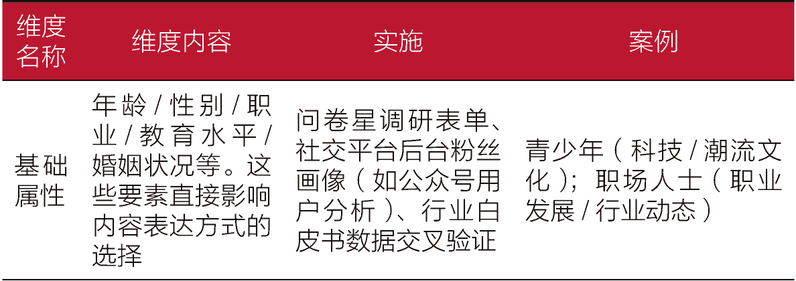

续表

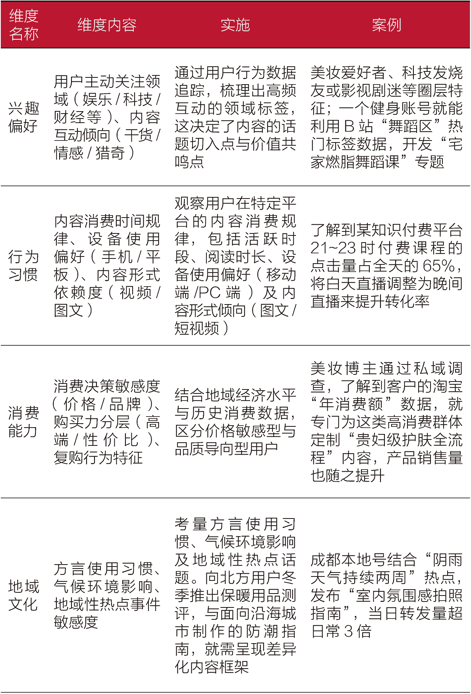

续表

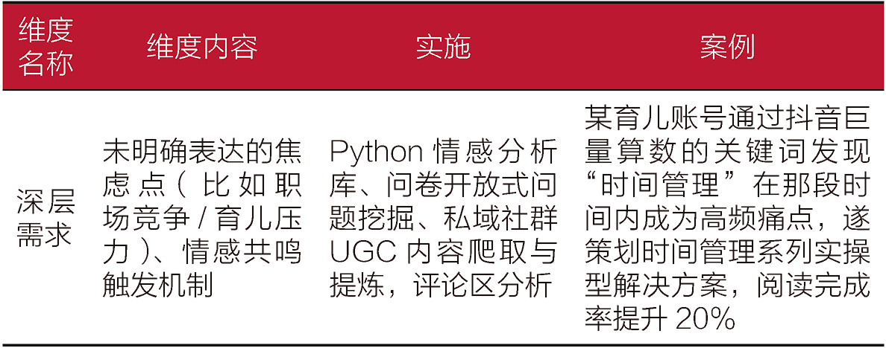

**相关主题。基于对人群的了解，选一个与其紧密相关的主题。**

主题要围绕需求、兴趣、痛点、喜好来选，才能吸引关注。可通过以下方法找话题（表2-10）。[表2-10][找相关话题的7个方法]

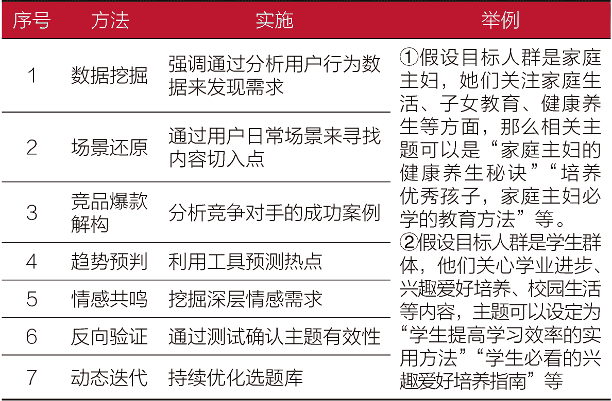

**受众式标题常用用词（图2-6）。**[图2-6][受众式标题常见爆款词]

把爆词代入标题，可看到如下案例（表2-11）：[表2-11][受众式标题案例]

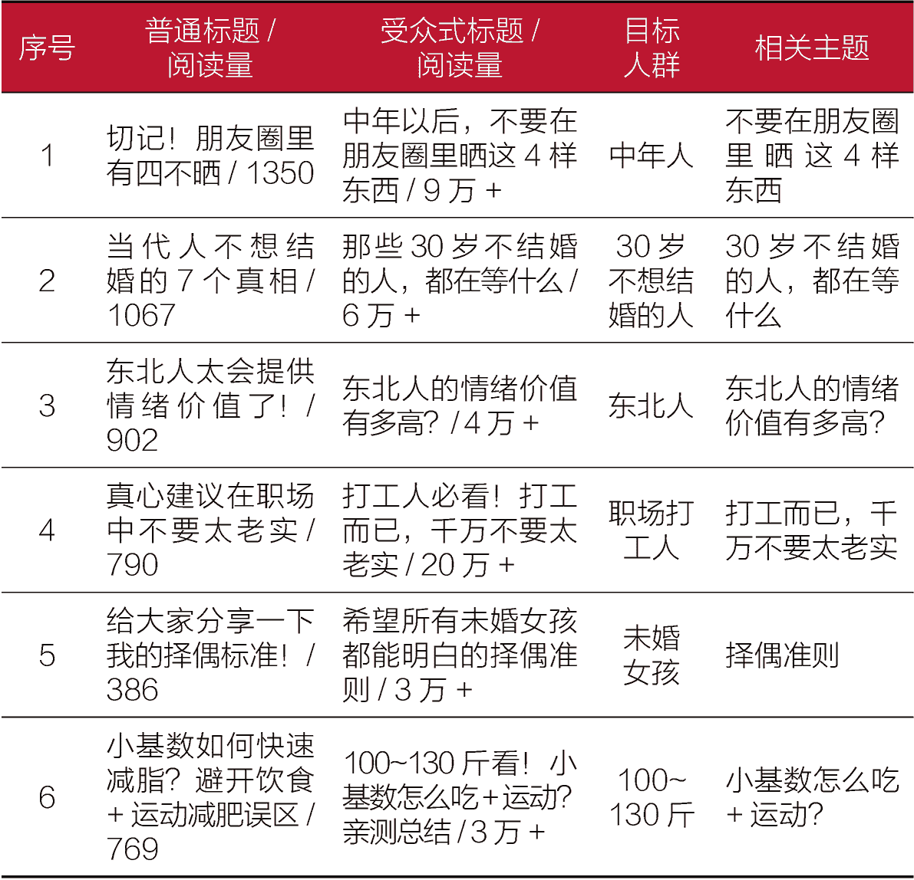

**DeepSeek 助力方案**

以美妆领域为例，让DeepSeek按公式（受众式标题=目标人群+相关主题）给出2条标题。先整理好附件：选题初稿+受众式标题公式+爆词与案例，上传后写提示词提醒严格按公式生成。

提示词示例：

你是一名美妆从业者，正在创作发在小红书的护肤品推荐文章，选题是“学生党护肤品推荐”。请认真阅读附件资料（内含选题+受众式标题公式+爆词与案例），按要求写2个受众式标题。

要求：
1.务必按受众式标题公式和爆词来写；
2.标题有新媒体感，字数控制在20字内。

注 不展示附件内容。

DeepSeek 的返回：

1.学生党必入！50元内护肤好物清单。（精准锁定人群+价格锚点+福利感，用“必入”强化种草指令。）
2.学生党护肤指南：百元内养出“牛奶肌”！（人群+场景化效果，用“牛奶肌”创造视觉联想，百元预算贴合学生消费力。）

### 公式六：名人式=名人观点+相近角度

**选定名人。**

确定要引用的名人，他们应在目标受众中有影响力。

**确定名人观点。**

有专门的名言数据库网站，按主题分类，查找方便。

**提炼相近角度。**

基于一句名人观点，提炼出相近角度。常用“情境拓展法”，即把观点原始情境拓展到其他相关情境，形成独特立场。

**名人式标题常用用词（图2-7）。**[图2-7][名人式标题常见爆款词]

把用词代入标题，可看到模板案例（表2-12）。[表2-12][名人式案例模板]

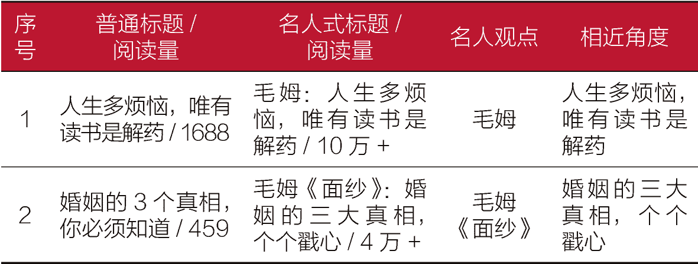

**DeepSeek 助力方案**

以读书沙龙主理人策划活动为例，让DeepSeek按公式（名人式标题=名人观点+相近角度）快速给出3条关于余华的标题。

先在抖音、小红书、视频号搜索余华相关爆款作品，摘录高流量标题，也可直接用DeepSeek联网搜索（注意甄别结果）（图2-8）。[图2-8][DeepSeek 的联网搜索]

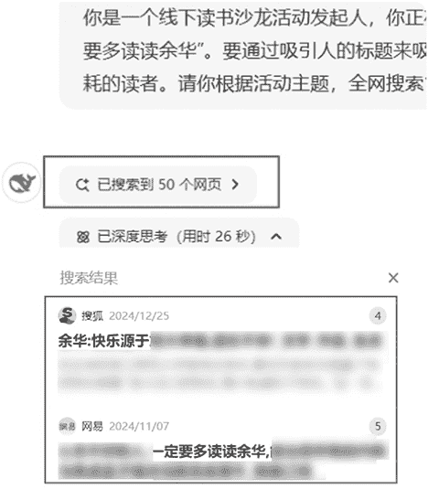

提示词示例：

你是一个线下读书沙龙发起人，正在策划分享活动，主题是“心态不好的人，一定要多读读余华”。要通过标题吸引参与者，特别是对余华作品感兴趣或正面临焦虑内耗的读者。请根据活动主题，全网搜索10条相关高流量标题。

DeepSeek搜索完成后会给出返回（图2-9）。[图2-9][DeepSeek 的部分回复]

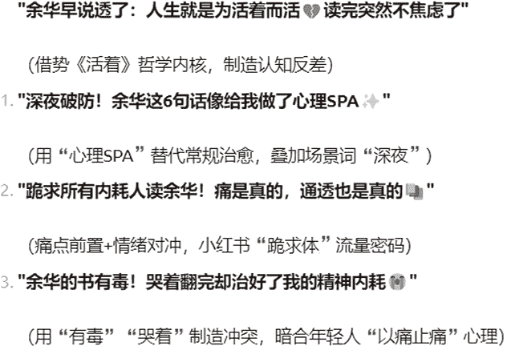

再把搜索到的标题放入文档，以附件形式上传给DeepSeek做背景资料（初稿+名人式标题公式+爆词案例+10条高流量标题），让它学习后生成新标题。

提示词示例：

继续。你是一个线下读书沙龙发起人，正在策划读书会，撰写宣传文案。沙龙主题为“余华与其作品疗愈焦虑”，需为文案设计高传播力标题，精准触达25～35岁焦虑高压人群，激发参与动机。请认真浏览背景资料文档，写出3个名人式标题。

要求：
1.务必依据文档内容生成；
2.适用于线下读书沙龙；
3.既体现余华作品价值，又引起目标受众共鸣。

DeepSeek 的返回：

**1.一场跟余华对话的沙龙/高压一代：为什么《活着》才是焦虑时代的解药？**

（传播逻辑：名人+痛点直击+价值关联。用“活着”双关现代生存困境，将文学经典转为治愈符号，触发“在经典中找答案”的参与动机。）

**2.30岁年轻人必来的一场读书沙龙！余华教我生存哲学：至暗时刻这样扛！**

（传播逻辑：年龄锚定+认知反差。借余华笔下智慧破解精英焦虑，用“这样扛”制造悬念，“至暗时刻”吸引用户参与线下活动的情感共鸣。）

**3.来沙龙听“余华没说的真相：读《兄弟》治不好焦虑，但能让你勇敢直面它”！**

（传播逻辑：反套路+价值重构。通过颠覆常规治愈话术，塑造真实深刻的沙龙调性，吸引深度思考型用户，“勇敢直面”精准切中高压人群心理刚需。）

### 公式七：干货式=用户困境+实用干货+结果/好处（结果的量化）

**锁定核心痛点：三步找准用户卡点**（图 2-10）[图 2-10] [找到用户最关心问题的步骤]

先把人群画像理清楚，可参照受众式公式做人群定位。接着主动和目标人群对话，在社媒或专业论坛发起讨论收集真实反馈，例如程序员社区里常提到技术提升慢、项目交付压。最后拆解同赛道内容，梳理同类高热文章中被多次提及却未被有效解决的问题，这类议题往往就是受众最在意的困境。

**交付可执行方案：提供能落地的干货**
有价值的内容核心在于可操作。

干货需建立在扎实理论与实操经验上。可引用权威研究、行业专家的观点提升可信度，并结合真实案例帮助读者理解应用。比如写运营新人通过规划完成转型的文章，就要把转型时用的具体方法、推进节奏和可复制的经验拆开讲清楚。

**用数据呈现收益**
把方案带来的结果和好处说透，并尽可能用数字、百分比等量化形式呈现。

**干货标题高频爆款词盘点**（图 2-11）[图 2-11] [干货式标题常见爆款词]

把高频词套进标题，呈现效果如下（表 2-13）：[表 2-13] [干货式标题案例]

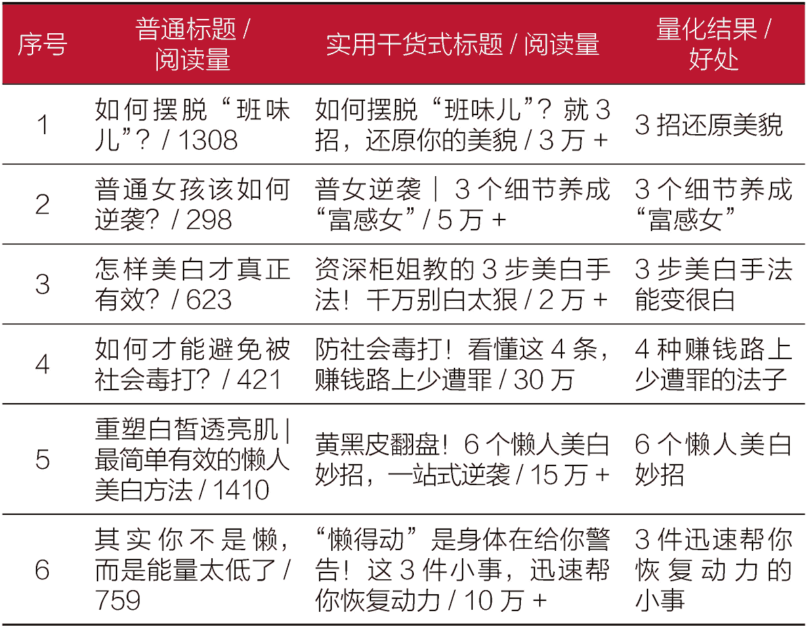

**DeepSeek 实战演示**

以医疗垂类为例，按干货式标题=旧认知+新反转的公式，让 DeepSeek 快速产出三条标题。

**步骤 1：收集对标样本。**打开 DeepSeek 的联网搜索，检索 3～5 条关于“咳嗽”等呼吸道疾病的爆款标题（图 2-12）。[图 2-12] [采集对标样本]

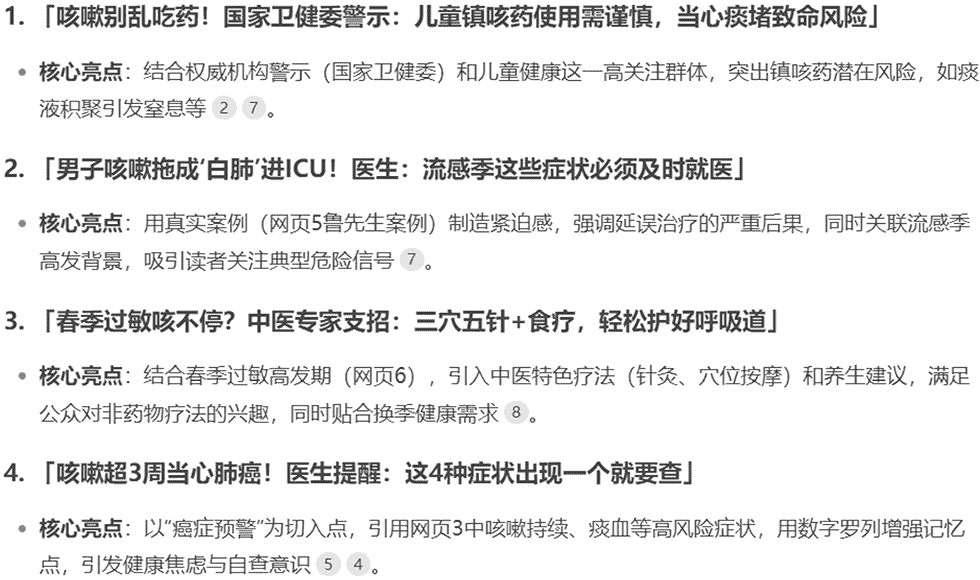

**步骤 2：甄别与核验。**医疗健康内容关乎安全，可信度取决于创作者资质。看到 DeepSeek 的检索结果后，需核查作者身份，若发布者为医生，其抖音主页通常会有官方职业标识，如黄 V 认证、医师资格说明，优先选用平台背书账号发布的内容，可降低伪科学风险（图 2-13）。[图 2-13] [平台的黄 V 认证与实名认证]

**步骤 3：套用公式生成新标题。**将 3～5 条对标标题+标题公式+爆款词作为背景材料上传，以附件形式让 DeepSeek 阅读后输出新标题。

**参考提示词：**

你是一名三甲医院呼吸科护士，需要在新媒体平台做医疗科普。现要创作一篇呼吸道疾病相关文章。请仔细阅读附件资料，按要求写出 3 个干货式标题。要求：1.严格基于资料生成；2.标题需有权威性和可信度；3.不超过 20 字。

**DeepSeek 生成结果：**

1.久咳 3 周要警惕！呼吸科 7 步排痰肺功能升 23%。
（困境具象化+科室权威+量化疗效）

2.慢阻肺防护 5 招，急性发作风险降 67%。
（高危人群锁定+科学防控+数据震慑）

3.哮喘急救 3 禁忌，三甲护士演示零失误。
（致命误区警示+专业操作可视化+安全承诺）

**本节小结**
新媒体里标题决定点击。本节梳理了 7 种高效标题公式：新闻式需结合热点、关键词与观点；数字式用具体数字体现结果；悬念式用疑问制造认知缺口；反转式打破常规认知；受众式锁定目标人群；名人式借势引流；干货式直接给解法。每种公式都需贴合用户痛点，并辅以数据或场景。AI 工具如 DeepSeek 可助力创作，例如输入热点提取关键词后生成带爆款词的标题。DeepSeek+公式能明显提升点击率，避免内容被埋没。

**本节小练习**：假设你是一名美妆博主，要为“夏季防晒误区”主题设计标题，请借助 DeepSeek 完成。

练习用的提示词和 DeepSeek 回复，请关注微信公众号“焱公子和水青衣”（ID：Yangongzi2020）。关注后输入：AI 标题，即可获取。

## **第二节** **随身标题库：让灵感与流量不掉线**

写标题时常会遇到灵感枯竭、效果平平。这说明光靠记忆和即兴不够，需要建立系统化的标题库，既能提高效率，也能培养判断直觉，快速识别哪些标题更容易被关注。

### **一、建立收集机制**

**设定收集标准。可按以下 5 个维度筛选**（表 2-14）。[表 2-14] [设定收集标准]

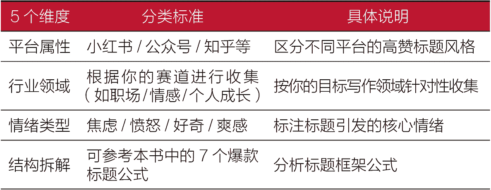

续表

**制订收集计划。可分阶段推进**（表 2-15）。[表 2-15] [制订收集计划]

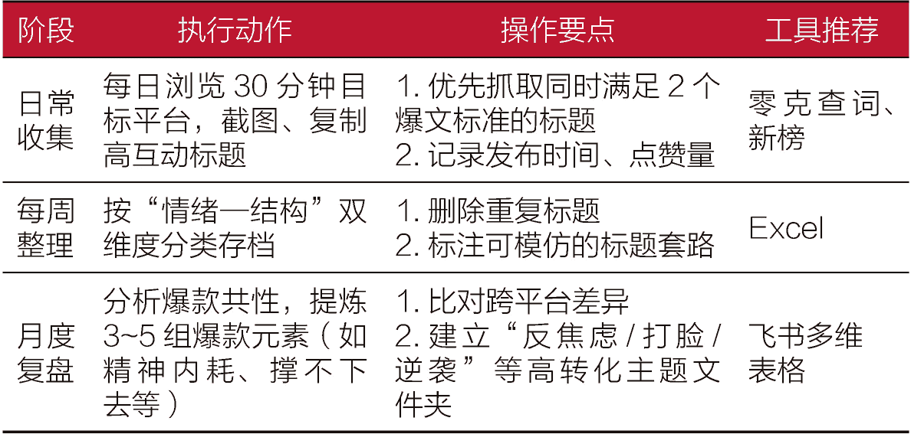

**设立收集渠道。可从如下来源获取**（表 2-16）。[表 2-16] [设立收集渠道]

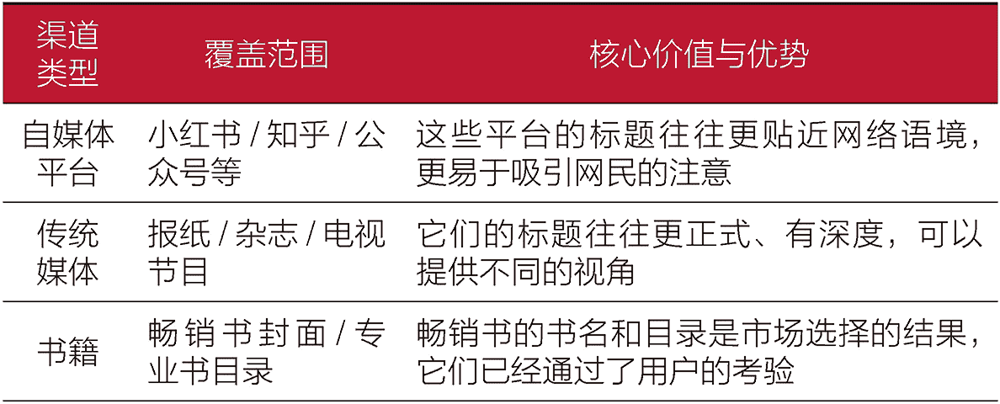

续表

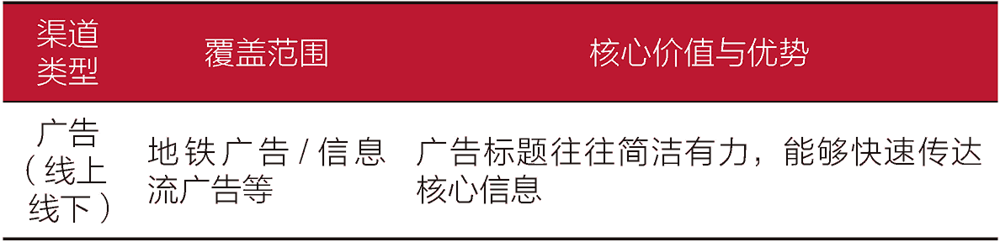

有了标准、计划和渠道就能实操。以个人成长领域为例的日常收集（表 2-17）。[表 2-17] [个人成长领域日常收集]

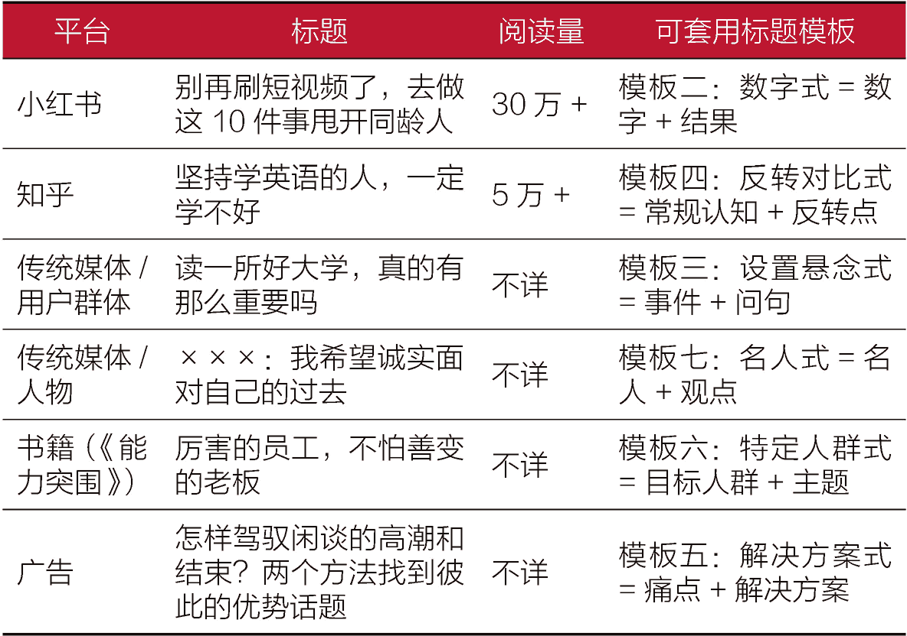

随着积累增多，周表会变成多张表，不再混排平台，而要按平台分表。以个人成长为例，小红书单平台收集表（表 2-18）[小红书单平台收集单]

### **二、分析维度**

接下来从“拆解爆款标题”和“拆解同赛道成功账号标题”两方面展开。

**分析爆文标题。**
以收集到的爆款“别再刷短视频了，去做这 10 件事甩开同龄人”为例拆解（表 2-19）。[表 2-19] [分析爆款标题]

**分析同赛道成功账号的标题。**
可以挑同赛道的爆款或常规标题来分析。即使不是爆款，只要账号整体成功，也能揭示不同策略的作用——爆款拉新，常规维系老粉（表 2-20）。[表 2-20] [分析同赛道成功账号的标题]

持续追踪分析可洞察哪些关键词更吸睛，指导后续创作反复使用。以个人成长领域为例（表 2-21）。[表 2-21] [小红书平台标题分析表]

续表

**DeepSeek 助力拆解**

以保险行业为例，让 DeepSeek 按分析维度对标题做拆解。

**步骤 1：抓取爆款标题数据。**用 DeepSeek 联网搜索财经领域“保险/理财”相关 3～5 条爆款标题，优先挑选含“信息差”“理财趋势”等高互动关键词的标题（图 2-14）。[图 2-14] [DeepSeek 搜索结果]

**步骤 2：验证与甄别搜索结果**（图 2-15），点进网页或平台确认作品与标题真实存在。[图 2-15] [对搜索结果做出验证与甄别]

**步骤 3：选取感兴趣标题拆解。**上传背景资料（任选一爆款标题+3 个分析维度），让 DeepSeek 学习后进行拆解。

**参考提示词：**

你是一名资深保险从业者，计划拆解爆款标题“5 年存下×××万，多亏了这××张表格！”用于优化保险产品文案策略。请认真学习标题拆解资料（见附件），进行拆解。

**DeepSeek 的回复：**

5 年存下×××万，多亏了这××张表格！标题拆解

**1.情绪触发：焦虑感→希望感**
痛点狙击：直击“存钱难、理财复杂”的普遍焦虑，用“5 年×××万”颠覆“普通人存钱难”的认知，触发“我也能做到”的强烈渴望。
心理杠杆：借“表格”弱化金钱压力，将财务自由转化为“填表行动”，缓解行动恐惧。

**2.解决方案：复杂问题→傻瓜式操作**
降维工具：用“××张表格”将理财拆解为结构化动作（如收支表、资产盘点表），暗示“无须专业门槛，照做就能复制”。
权威暗示：数字量化（××张）赋予方法论可信度，类似“专家浓缩模型”，激活用户“抄作业”心态。

**3.结果刺激：模糊愿景→暴击式具象化**
（×××万）＝用户心理防线的三重击穿。

**注** 只展示部分回复。

### **三、更新**

**识别趋势。**
关注流行文化、热点新闻或行业动向，了解当前公众关注的话题，提升标题时效性与吸引力。也可留意新兴网络用语、俚语和流行表达，为标题增添新鲜感。参考如下示例（表 2-22）。[表 2-22] [标题举例]

**定期审视。**
每隔一段时间（月度或季度）做周期检查，评估标题库中哪些仍具吸引力、哪些需更新、哪些应淘汰。以 2024 年第 1 季度收集表为例（表 2-23）。[表 2-23] [收集表]

标题库不是一次性工程，需要耐心持续打磨。按标准流程不断实践优化，标题库将成为写作的强力助手。

**本节小结**
建立标题库能系统化提升创作效率。本节详解搭建流程：收集时按平台、行业、情绪等维度筛选高互动标题；分析需拆解爆款要素；更新要定期淘汰过时内容。工具上可用 DeepSeek 抓取热点标题并分析其情绪触发点与结构。标题库需分平台管理，并做每周整理/每月复盘，持续积累迭代后将成为创作弹药库，助你快速产出爆款。

**本节小练习**：收集小红书本周 3 条点赞超 1 万的标题，按如下步骤分析：记录标题，用 DeepSeek 拆解标题，分析关键词、情绪和结构模板，做好分类入库。

练习用的提示词和 DeepSeek 回复，请关注微信公众号“焱公子和水青衣”（ID：Yangongzi2020）。关注后输入：AI 标题库，即可获取。

# **第三章**

# **以用户需求为导向创作，AI 三秒搜全网爆款素材**

挑选素材时容易陷入主观误区，按自己想写的来选。但创作的核心是引发共鸣、传递价值、满足用户需求与期待。正如刘润所说“写作，表达欲强的人写不好，本质不是表达逻辑，而是倾听逻辑。就是听用户想说什么，然后替他们说。”

用户思维在新媒体创作中至关重要。以小红书爆款赛道“健康饮食”为例，投喂 DeepSeek 分析两篇文章在用户思维上的差异，可看出用户思维对质量的直接影响。

**文章 A：《打工人饮食篇：膳食营养素的生物化学与日常选择》**
对打工人饮食而言，了解膳食营养素的生物化学特性是关键。从碳水化合物说起，它本质是多羟基醛或多羟基酮。日常主食中的淀粉结构各异，如 D-葡萄糖 C6H12O6，其吡喃型环状结构经α-1,4糖苷键形成直链淀粉，支链淀粉则额外存在α-1,6糖苷键分支。这细微差异导致唾液α-淀粉酶与胰淀粉酶水解效率不同。
从生物能量学看，营养物质在体内的能量转化也有讲究。三羧酸循环中乙酰辅酶 A 氧化过程，与摄入的二十二碳六烯酸 C22H32O2 存在潜在关联。研究显示，n-3 多不饱和脂肪酸经酰基载体蛋白进入线粒体基质时，其β-氧化产生的 NADH/FADH2 与碳水代谢产物存在竞争性抑制，尤其在肝细胞微粒体细胞色素 P450 酶系催化下更明显。
再说植物化学物。西蓝花中硫代葡萄糖苷经酶解产生异硫氰酸酯，可通过 Nrf2/ARE 通路激活Ⅱ相解毒酶，具有抗氧化解毒作用。但烹饪方式影响黑芥子酶活性。当温度达 373K 左右，酶蛋白三级结构不可逆变性，会使萝卜硫素生物利用率下降 62.3%±4.7%（双盲试验 n=48）。

**文章 B：《健康饮食 7 天计划：打工人活力食谱告别亚健康》**
办公室下午犯困、体脂难降？记住“三换两加”口诀：
换主食|换零食|换油类+加蔬菜|加蛋白质
坚持 7 天，咖啡依赖减半，牛仔裤扣子松一指！

【2025 新潮饮食法实操版】
● 植物基 2.0：用豌豆蛋白粉做煎饼，亚麻籽奶泡咖啡。
● 改良版生酮：晚餐用魔芋米炒饭，满足碳水渴望。
● 中式地中海：凉拌木耳淋山茶油，菜场三文鱼边角料（20 元/斤超划算）。

【读者定制懒人食谱】 

根据 300+粉丝反馈优化： 

3 分钟早餐：
冷冻杂粮包（微波炉高火 1 分钟）
溏心蛋（便利店现剥）
西芹汁（蹲临期打折款） 

5 分钟晚餐：
荞麦面沸水煮 3 分钟
焯水菠菜
即食柠檬蒜蓉虾仁
淋油醋汁搞定

【互动前划重点】
“三换两加”养生法：
1 换精粮为粗粮|2 换奶茶为果茶|3 换大豆油为茶油
1 加绿叶菜|2 加白肉|3 每天喝够体重（kg）×30mL 水 

留言区互动：
你尝试过哪些“真香”健康技巧？抽 5 人送：
1.《中国居民膳食指南》极简图解版
2.读者票选 TOP3 快手食谱

文末惊喜：
私信“211”领《外卖点单红绿灯手册》

在 DeepSeek 中输入提示词：你是一名资深的小红书创作者，擅长拆解，请分析 A 和 B 两篇文章（见附件）在用户思维这件事上做得如何。要求：从不同维度拆解，并以文章中的原始内容做例证。

很快，DeepSeek 给出如下回复（表 3-1）：[表 3-1] [文章 A 与文章 B 的对比]

续表

从 DeepSeek 回复可清晰看出，文章 B 站在用户角度，关注阅读体验，因而更受欢迎——这就是用户思维的体现。

创作时要舍弃只选自己想写的素材的习惯，用心寻找能与用户建立联系、引发共鸣的优质素材。很多人明白素材与用户思维的重要性，却在实操中方向不明。以下分享素材搜索的四种方法及建立素材库的四大步骤，助力创作出用户喜爱的作品。

## **第一节** **多 AI 并行扫荡，所需素材应有尽有**

高效搜素材的方法多样，如新媒体平台搜索、行业垂类网站搜索、数据报告搜索和浏览器搜索，还可通过线上图书馆、知识付费平台、行业沙龙或峰会获取素材。下面主要介绍 4 种。

### **一、新媒体平台搜索**

主流平台素材丰富，以微信、抖音、小红书、知乎为例，分享搜索要点。

**微信。**
可通过微信搜索框、搜索框下方滑动栏、微信底部【发现】页和搜狗微信网页版进行素材搜集（表 3-2）。[表 3-2 微信平台素材搜索]

续表[图 3-1 微信搜索框图 3-2 搜索框下方滑动栏图 3-3 微信底部的【看一看】-朋友图 3-4 搜狗微信网页版]

**抖音挖料**

在抖音上抓内容，常用的入口是搜索栏和热度榜单，相关展示可参见表3-3。[表 3-3 抖音平台素材搜索图 3-5 抖音搜索框图 3-6 抖音热榜图 3-7 抖音创作灵感]

**小红书找点子**

小红书的素材查找可以归纳为“1个中心+3个页面”（表3-4）。
“1个中心”指的是创作中心里的创作灵感，可在各细分热门话题下挑选内容。
“3个页面”分别是搜索下拉建议、搜索结果页以及标签流量页。[表 3-4 小红书平台素材搜索图 3-8 小红书创作灵感图 3-9 小红书搜索栏下拉框图 3-10 小红书搜索结果页面图 3-11 小红书标签浏览页]

**知乎搜信息**

知乎获取素材主要借助搜索框，以及小程序里的【热榜】和【推荐】（表3-5）。[表 3-5 知乎平台素材搜索图 3-12 知乎搜索框图 3-13 知乎热榜图 3-14 知乎推荐]

### 二、垂类站点深挖
垂类行业站点是优质素材的重要来源。比如科普领域的果壳网、科普中国网，财经领域的36氪、虎嗅网，运营领域的运营喵、爱运营等。下面重点介绍5个聚焦内容创意的行业站点（表3-6），建议收藏到浏览器书签，便于日常查阅使用。[表 3-6 行业垂类网站搜索]

续表

### 三、数据报告研读
新媒体创作离不开洞察力。当自身分析能力不足时，数据报告就像登高望远的梯子。一份扎实的报告往往胜过十篇碎片文章，能提供可信信息，丰富创作厚度与专业度。

可以先从学术类、商业类、文库类三大报告渠道入手。熟悉后可再关注第三方数据平台和各大自媒体定期发布的白皮书（表3-7）。[表 3-7 数据报告搜索]

续表

### 四、浏览器精准检索
浏览器检索是最常见的资料获取方式，代表工具有百度、谷歌、搜狗、360等。对创作者而言时间宝贵，掌握检索技巧能大幅提升命中率，下面分享几条实用要点（表3-8）。

注意所有符号请使用英文半角输入。[表 3-8 浏览器搜索小技巧]

续表

**DeepSeek 加速创作**

智能检索能力很强，内容创作对信息丰富度与准确度的要求越来越高，AI检索已成标配。

①DeepSeek、KIMI。两款均支持联网检索（图3-15），操作简便响应快。创作者可借此实时追踪行业热点与趋势，比如撰写科技新品稿件时，能迅速汇总发布会报道、专家解读及网友评论，素材新鲜全面。

②通义千问。提供深度检索功能（图3-16），擅长挖掘整合，适合复杂主题创作。比如撰写文化现象深度解读，能从历史源流、社会背景、多元观点等维度找资料，提升文章厚重感，满足受众对深度内容的需求。[图 3-15 DeepSeek、KIMI 的联网搜索功能图 3-16 通义千问的深度搜索功能]

③腾讯元宝。已接入微信信息源，可获取公众号文章、视频号内容等。只需在微信搜索栏点开下方“AI 搜索”，再选择“深度思考”即可使用（图3-17）。[图 3-17 腾讯元宝接入微信信息源]

④豆包。字节跳动旗下AI工具，在抖音内容检索上优势明显（图3-18）。第二章第一部分已介绍过用豆包搜抖音资讯、用豆包日报抓热点。此外还能快速拿到与主题相关的抖音热门视频、话题标签等。例如做“美妆”主题的抖音挑战内容，可迅速了解规则、参与热度与创意走向，提升传播效果。[图 3-18 豆包的全网搜索功能]

⑤秘塔 AI。为创作者提供高效精准的检索服务，能从海量信息中筛选出高相关内容（图3-19）。比如撰写“智能人机接口”专业稿件、查找行业报告、学术研究时，可快速定位高质量文献，保证素材真实与专业。[图 3-19 秘塔 AI 长思考搜索功能]

另外百度已接入 DeepSeek（图3-20）。使用百度检索时可借助其智能算法获得更精准结果，为创作提供全方位信息支持。[图 3-20 百度已接入 DeepSeek]

**本节小结**

高效获取优质资料是提升内容质感的关键。本节梳理了四类高效搜集方式。新媒体平台侧，通过微信、抖音、小红书、知乎等渠道的搜索框、热榜、创作灵感等功能精准捕捉用户关注点；垂类行业站侧，如数英网、梅花网等专业站点提供品牌案例与创意资讯，助力深度挖掘；数据报告侧，通过知网、新榜等渠道获取权威数据，增强专业性；浏览器检索侧，利用技巧缩小范围、提高效率。此外 DeepSeek、豆包、秘塔等AI检索可联网辅助完成资料收集。综合运用多种方式，快速找到用户真实需要且易传播的资料，能有效避免自嗨式创作。

**本节小练习**：假设你是一名美食博主，需撰写“打工人的快手早餐”主题文章，请使用“新媒体平台搜索”方法（小红书、抖音、微信等）完成素材收集。

本节小练习中的提示词+DeepSeek 回复，请关注微信公众号“焱公子和水青衣”（ID：Yangongzi2020）。

关注后输入：AI 搜索，即可获取。

## 第二节 素材库24小时自助调用指南

在新媒体创作里，素材库是一个汇聚、整合、管理的创作资源集合，包含文字、图片、视频、音频等内容，以及创作工具、行业数据等辅助资料。

一个丰富优质的库能明显提升创作效率，帮助创作者在竞争中脱颖而出。但库不是随意堆砌的“信息垃圾场”，若不加筛选就会杂乱。比如收集旅游资料时，若把过时景点介绍、不准攻略乃至无关信息一股脑收进，使用时不仅费时，还会干扰判断。

素材库更像“工具箱”，创作前要准备齐全、定期保养、更新替换，使用时才能事半功倍。以下是搭建素材库的四个步骤（图3-21）以及设计要素（表3-9）。

**● 搭建四步骤**[图 3-21] [建立素材库的四大步骤]

**●搭建 18 要素**[表 3-9] [搭建素材库的设计要素和说明]

续表

四步缺一不可，下面逐一说明。

### 第 1 步：选择适合自己的素材存储工具
多数新媒体平台自带收藏，如微信、知乎、B站等。但更建议使用一站式信息收集与管理的工具。常用选择有印象笔记、幕布、石墨文档、腾讯文档和 Cubox 等。

印象笔记具备成熟的【素材库】功能，可将图片或音频分享至印象笔记（图3-22）；还能用网页剪藏功能保存素材到对应笔记本（图3-23）；或用扫描宝功能把图片素材扫描并转为文字查看（图3-24）。[图 3-22] [素材库功能图 3-23] [剪藏功能图 3-24] [扫描宝功能]

● 任选一款顺手的存储工具，使用时为素材添加标签，便于快速检索。标签可为关键词、描述词等，按素材特点与用途设定。
● 素材命名要科学。原则简洁明了，能准确体现内容与特点，并采用统一命名规范，便于管理和查找。

### 第 2 步：对素材进行分类
新媒体创作素材可分为4大类：观点类、故事类、专业类、金句类（表3-10）。[表 3-10] [素材分类和描述说明]

以故事类素材为例，整理时可参照18个维度（表3-11）。设置这些维度的目的，是在灵感枯竭时能从触动自身、激发分享欲的素材入手开写。[表 3-11] [素材表格设计要素和说明]

续表

### 第 3 步：对素材进行筛选和评估
可参考6个筛选与评估方法（表3-12）。[表 3-12] [素材筛选要素和说明]

续表

以美食赛道为例，示范创作时如何使用上述表格与素材库（表3-13）。[表 3-13] [素材筛选评估案例]

### 第 4 步：对素材进行定期更新、备份与优化
素材库建设是持续过程，需要定期维护。例如科技领域迭代快，若库中保留过时信息，创作时易误导读者；市场动态、流行趋势类素材更需及时更新；时尚行业元素变化快，若库停留在旧潮流，就无法反映当下。

为防数据丢失或被盗，需做好同步备份和安全管理。可使用加密技术、设置访问权限等保护库安全。

使用过程中，可根据用户反馈与数据分析优化库。如按喜好与点击率调整分类与标签，按表现删除或替换效果不佳的素材。还可与其他创作者交流学习，取长补短，不断完善库质，提升创作水准。

现在 AI 让更新、备份、优化、安全管理更便捷。最高效的方式是输入素材名称，AI 可在3秒内调取全部相关资料，相当于把图书馆随身携带。

**DeepSeek 加速创作**

腾讯文档的 AI 文档助手已接入 DeepSeek（图3-25），构建与调用素材库更方便。例如首页的“文档问答”功能，可在已上传资料中直接调用素材。[图 3-25] [AI 文档助手的文档问答功能]

公众号也能作为素材存储工具，现在它也接入了 DeepSeek，可一键调用。

步骤1：进入“腾讯元器”官网。
步骤2：选择“用提示词创建”进入智能体设置页，在高级设定中将模型选为 DeepSeek-R1。
步骤3：创建知识库时选择文件类型为“公众号文章”，还可自行添加背景图、插件等。
步骤4：设置完成后点击发布（图3-26）。[图 3-26] [在“腾讯元器”创建智能体的步骤]

步骤5：将“腾讯元器”里的智能体小程序内置到公众号菜单栏。
复制智能体的“使用方式”中的小程序路径，前往公众号后台“自定义菜单栏”设置即可，具体操作见图3-27，效果见图3-28。[图 3-27] [菜单栏接入 DeepSeek 的步骤和效果图 3-28] [公众号显示效果]

最后进入公众号后台，输入想查找的文章或关键词，公众号即可快速定位历史文章并推送出来。

**本节小结**

本节详细讲解了搭建素材库的四个步骤。选择存储工具，推荐印象笔记、腾讯文档等，支持多格式存储，需添加标签，命名简洁明确；分类整理，将素材分为观点类、故事类、专业类、金句类；筛选评估，按目标主题、可信度、时效性等维度剔除无效内容；定期更新与备份，及时替换过时信息，并通过云同步防丢。除此之外，AI 工具也很高效，可用腾讯文档的 AI 文档助手一键调用公众号文章等素材。认真搭建素材库，使其成为创作者的“工具箱”，随取随用，支撑高质量内容产出。

本节小练习中的提示词+DeepSeek 回复，请关注微信公众号“焱公子和水青衣”（ID：Yangongzi2020）。

关注后输入：AI 素材库，即可获取。

# 第四章

# 祛魅思维：抛弃完美主义！三大结构速出 10 万+爆款

部分创作者习惯想到什么写什么，结果文章缺乏条理，读者读几句就划走。这是因为缺少提前规划的框架，写着写着就跑偏。没有清晰框架的文章，再好的文笔也难以称优。

## 第一节 三大爆款结构，谁用谁火

我们耗时3个月，深度拆解上万篇热门文章后，提炼出3种常见且好用的结构模板。这些模板相当于文章骨架，只需填充内容，就能快速产出条理清晰、效果显著的新媒体文章，对新手尤其友好。

### 结构模板一：三段论模型=是什么+为什么+怎么办

三段论是一种经典写作结构，通过3个关联步骤构建完整论述（图4-1）。[图 4-1 三段论结构]

文章结构速成指南：把复杂思路拆成好读的模板

要让笔记在信息流里被记住，骨架比华丽的辞藻更重要。下面这几套已被验证有效的写法，配合示例拆解，照着套就能快速成稿。

**三段论写法：先立论，再探因，后给解**

本书作者范远舟在小红书发过一篇阅读过万的笔记《安陵容：一个人保持自信是人生头等大事》，就是典型的三段式表达。

大概的脉络是这样：作者从安陵容的命运里提炼出自信的重要性。进宫初期她不受宠，姿态放得很低，言语里全是讨好。借助皇后运作被重新引见，得了安贵人的位分，自信心上来，气场和发声也变了。但等甄嬛重获宠爱后，她又陷入自我消耗，觉得旁人都在嘲弄。后来虽升到妃位，临终前仍觉得人生无甚价值。全程都在自卑与膨胀间摇摆，她的底气始终依附于皇帝，从未真正建立自我认可。作者能共情她，归结为原生家庭创伤太深，难以转弯。自己年轻时也极度自卑，错失机会、职场受挫、人际被低估，后来下决心转换心态，才慢慢运势回暖。

她分享了三条实践心得：一是每天给自己正向心理暗示，反复对自己说积极的话，用语言重塑潜意识；二是外在表现要自信，抬头挺胸、对话不卑不亢，行为会反向塑造心理状态，这就是肢体回馈假说的作用；三是深耕一项专长，通过持续达成小目标积累成就感，自信心是做成一件事又一件事堆起来的。

拆解这篇笔记，可以看到三段论非常分明：亮明观点、剖析原因、给出做法。[表 4-1 拆解笔记的三段论结构]

### **结构模板二：对比式结构=现象/问题+正论（正确的做法）+反论（错误的行为）+结尾**

对比式写法把事物的正反两面并排呈现，利用冲突放大说服力，让结论更鲜明、论据更扎实。[图 4-2 对比式结构]

举例：朋友小米在小红书发过笔记《同样一句话，销冠都是怎么说的？》，阅读量10万+，点赞1270，就是靠对比式结构出圈。

文章先抛出问题：同样一句话，新手销售和顶尖销售的表达为什么差这么多。随后逐条对照：谈底价时，新手强调“这是最低价了”，销冠则强调市场竞争和长期合作；谈价格公道时，新手直接说“很公道”，销冠会先共情“刚开始可能觉得贵”，再引导比较；谈性价比时，新手用口号式自夸，销冠用“同等品质你上哪儿找”的设问；建议比价时，新手让人去别家看，销冠说“你去对比，最后会发现我们更合适”；反击“别家更便宜”时，新手只强调质量，销冠点出“大家都精明，质量一样谁愿多花钱”。

结尾点题：主动破局、敢于出击是顶尖销售的共性，成交往往差在最后一步。

拆解原文，可以看到正反并列、对照清晰。[图 4-3 对比式结构拆解]

### **结构模板三：并列式结构=主题引入+并列观点①+并列观点②+并列观点③+总结**

并列式写法把多个相关但独立的论点横向排列，像清单一样展示，层次清楚、主题突出。用的时候要紧扣核心，避免跑题。[图 4-4 并列式结构]

举例：本书AIGC顾问焱公子在公众号写过《9岁男孩年入2亿：这4个和钱有关的道理，越早明白越好》，就是并列式写作。

背景是2020年12月18日福布斯公布YouTube收入榜，9岁的瑞安·卡吉以近3000万美元年收入登顶，拥有4170万粉丝。作者认为其成功难以复制，但拆解下来，赚钱的核心就落在几个基本认知上。

四个并列观点分别是：努力会随年龄贬值，早期看重的是态度，成熟阶段要看实际价值产出；与其死磕无价值的努力，不如搭建能自动运转的系统；所有成功都离不开认知的变现，悟性来自生活体验，工作要快生活要慢；想获得机会先要配得上，坚持源于对底层逻辑的清晰，而非运气。

文末祝愿默默坚持的人都能遇到生命的绿洲。

案例拆解可见，每个观点独立成段又相互支撑，共同撑起核心论点。[图 4-5 案例拆解]

从这几个例子能看出，并列式结构把不同论点平等展示，横向铺陈让信息一目了然，每个点都能得到充分展开。

**DeepSeek 帮你赢**

DeepSeek 在逻辑搭建上很擅长。不知道怎么填内容时可以让它帮忙生成。仍以三段论为例，要求它按第一章的选题方法先自主选定安陵容相关选题，再给出三段式框架。提示词示例：你是一名新手小红书博主，要写一篇关于《甄嬛传》安陵容的文章，先按选题方法自主选定一个选题，再构思三段式结构，要求每部分论点清晰有洞察不少于300字，全文不超过1200字，语言口语化。

它给出的回复标题是《安陵容启示录：从“坏女人”到当代生存样本的深度拆解》，分为“是什么：安陵容不是反派而是困在认知茧房中的现代人镜像”“为什么：三把枷锁锁死人生通道”等，认知枷锁、情绪枷锁等论述基本符合三段式逻辑。
**注** 只展示部分回复。

**本节小结**
本节介绍了三种高效框架：三段论用“是什么→为什么→怎么办”讲透一个问题；对比式用“现象+正面做法+反面行为+总结”制造冲突；并列式用“引入+多点并列+总结”做盘点类内容。三者都可以用DeepSeek辅助生成，直接输入提示词即可获得符合平台调性的框架，帮助新手快速产出逻辑清晰的内容。

**本节小练习**：任选一种结构模板，设计一篇小红书笔记。小练习的提示词和DeepSeek回复，请关注微信公众号“焱公子和水青衣”ID：Yangongzi2020，发送“AI结构”获取。

## **第二节 1个模板10分钟成稿？新手必抄**

如果上面三种结构仍显复杂，这里提供一个更极简的万能模板：痛点式结构。[表 4-2 痛点式结构模板]

续表

**痛点式结构=提出问题+解决问题**

这种写法以用户需求为核心，先点出具体困扰，再给出可行方案，引导读者层层深入，保证逻辑和说服力。

举例：范远舟在小红书的笔记《职场必修课：到底该如何正确站队？》就是典型的痛点式。

文章以欣贵人为例，她能活到大结局，除眼光和人品外，站队智慧也很关键。站队是职场人的必修课，站对则平步青云，站错则迅速沦为炮灰。随后给出三条建议：要有站队资本，能为上级创造利益；选对时机，甄嬛刚回宫需要盟友，欣贵人及时靠拢；选择有实力且人品过关的上级，甄嬛前期位分不高却能言善道，后期资源可观，同时提醒评估领导是持续向上还是走向衰落，判断标准看低谷期的行为、得势后的克制、原则底线的坚守等。

分析可知，文章先挖痛点再给解法，结构清晰。[表 4-3 《职场必修课：到底该如何正确站队？》的痛点式框架]

**DeepSeek 帮你赢**

以养老行业为例，先让DeepSeek列出8个行业痛点，再据此生成文章。

步骤一的提示词要求它按痛点式4种方法各生成2个痛点，结合热点并分析爆款度。示例回复提到中年子女因工作压力无法兼顾失能父母，结合独居老人超1亿热点；退休老人精神需求被忽视，结合清华教授吐槽养老院文化荒漠化视频等。

步骤二以“退休老人精神需求未被满足”为核心，让它按痛点式生成文章。要求面向一二线城市退休知识分子及其子女，结合案例、数据，给出三个可操作方案并区分线上线下，禁用医疗护理信息，风格兼顾专业与情感，提供公众号长图文和短视频口播双版本。生成的开头为“一、刺痛现实：被折叠的黄金三十年”，提出知识共享社区、终身学习计划、价值再生系统等方案。
**注** 只展示部分回复。

**本节小结**
痛点式结构是新手快速成文的利器，核心是“找痛点+给方案”。先通过行业趋势、用户反馈定位关键问题，再提供具体可操作的方法，形成共鸣与实用价值。配合DeepSeek快速生成痛点和方案，能大幅降低创作门槛，尤其适合解决具体场景问题，提升点击和传播。

**本节小练习**：选一个生活场景，比如学生党“考试周如何不熬夜？”用痛点式写一篇小红书笔记。相关提示词和回复请关注公众号“焱公子和水青衣”，发送“AI痛点”获取。

# **第五章**

# **打磨思维：AI改稿让文章身价翻倍**

写文章像种花，选题是种子，写完还需浇水、修剪。打磨就是把粗糙的石头磨成光滑的珍珠。

本章先讲打磨金句，再讲观点、论据、开头结尾和细节的打磨。金句单独拎出来，是因为在新媒体里可传播性决定爆款。金句的穿透力远超其他部分。你可能记不住长文的论述，但“你所谓的稳定，不过是浪费生命”这类句子会一下击中你。它像顺口溜一样易记、易传播。

金句的底层逻辑是替受众完成思考的省略。现在几乎没人愿意从头啃完一篇长文，却愿意为几秒钟的刺痛式顿悟买单。刷朋友圈时撞见“所有的减肥失败，都是精神对肉体的背叛”，很多人会瞬间点头，因为它把熬夜吃炸鸡后的自责压缩成一句好拿捏的糖衣，转发时既像立场表达，又像在暗示自己活得通透。

更关键的传播机制在于，金句正好卡在社交货币的黄金分割点。读者更乐意分享“运动时流的泪，都是点奶茶时脑子进的水”这类带刺调侃，而不是整篇深度分析。它不用暴露真实困境，却能让看到的人会心一笑，在点赞之交的关系里完成一次心照不宣的默契。这种扩散效率，是再缜密的逻辑也难复制。

“好文章就像好菜，要用心种，才能长得好。”下面进入打磨环节，把让人一眼上头的文字种出来。

## **第一节** **用 DeepSeek 搭建金句生产线，三步提升互动**

金句的核心是让人记住的短句。字数有限，读起来顺口，能快速触发共鸣，推动点赞与转发。下面归纳三类常用打磨思路。

### **方法一：直接引用**

对新媒体新人来说，搬用现成金句是最省力的切入点。关键是与文章主题呼应，否则会显生硬做作，像硬贴上去的。

**特别提醒：**

①引用必须署名，写清原句出自谁或哪部著作。

②单篇引用量要克制。3000字左右，控制在3句以内。太多会有堆砌感，原创度也会下降。

若找不到来源，可加说明句式：“之前看到过这样一句话……”或“网上有人说过……”。

当引用的是一组话时，可用“重新叙述法”处理：

①提炼原句的核心要素。

②基于要素，用自己的话再表述一遍，形成新句。

比如原句是“清明播种、谷雨插秧，顺着它走，庄稼才不和你闹别扭！夏至不锄草，秋后满地跑；秋分不晒粮，寒冬喝风凉”。

找不到出处时，可提炼要素再转述，例如改成：“节气就是老祖宗留下的种地说明书，惊蛰翻土、小满灌浆，按着那波波提醒走，别错过农时，不然就晚了！下面这24篇置顶干货，你得刷完，才配说自己是新农人！”

**AI 实操演示**

有了AI，也可以把找到的金句丢给DeepSeek做重述。

以传统零售为例，抓到一句：“从三尺柜台到无限货架，指尖滑动间完成百年商业基因的进化——当老字号遇上新流量，每个点赞都是百年商道的新注脚。”若出处不明，就让DeepSeek重述。

**提示词参考如下：**

你是一个传统零售行业的老板，转型线上做自媒体。现在需要写一篇新媒体文章，但是觉得精彩度欠缺。从网上找到一个金句“从三尺柜台到无限货架，指尖滑动间完成百年商业基因的进化——当老字号遇上新流量，每个点赞都是百年商道的新注脚”，现在请你先提取出核心元素，再用自己的话重新叙述一遍，变成自己的金句，以用到新媒体文章里。

**DeepSeek 的输出：**

**核心元素拆解与提取：**

1.空间转换（柜台→货架）。

2.时间维度（百年基因→即时互动）。

3.新旧碰撞（老字号×新流量）。

4.互动符号（点赞=商业传承）。

5.进化意象（基因/商道进化）。

**重构金句：**

【经典版】

“青砖柜台凝练的商道智慧，在指尖触达的云端货架焕发新生——当匠心字号邂逅数字洪流，每单成交都是商业文明的当代续写。”

【网感版】

“从拨算盘到刷屏幕，百年老店玩转流量密码！你双击红心的瞬间，老商号正在线营业第 101 个春天。”

【对仗版】

……

【意象版】

……

**注** 只展示部分回复。

### **方法二：仿写**

写作能力提升后，还能通过仿写让表达更精准。下面分享3种路数。

①拆解原句结构，代入新句主题（表 5-1）。[表 5-1] [拆解法]

续表

②保留半句+替换半句。修改原句组成部分，搜索相关金句，做句子整合式仿写（表 5-2）。[表 5-2] [替换法]

③改变主语或形容词。在仿写时，可以调整句中主语或形容词，得到新句子（表 5-3）。[表 5-3] [改变主语法]

也可以替换原句的主语。比如把主语由“孩子”换成“父亲”，就能改写为：“坚强的父亲，只是不轻易流露情感罢了，只是习惯了作为家庭的支柱，适应了别人眼中他是坚不可摧的形象。坚强的父亲，内心也只是个有血有肉的人而已。”

### **方法三：套模板创作**

对已做过仿写训练的学员，我们提出更高要求——直接创作金句。研究拆解上万篇新媒体作品后，总结出5个通用模板，替换【】里的关键词即可原创。

● 模板 1：只要 ________，就能 ________。

模板提示：只要【行动】，就能【结果】（即填充“只要【具体动作/坚持的行为】”，就能“【可量化的成果/情感收获】”）。

示例：

职场赛道：只要每天多学【一个 Excel 技巧】，就能【在半年后让同事称你为高手】。

● 模板 2：别总想 ________，先搞定 ________。

模板提示：别总想【大目标】，先搞定【小细节】（即填充别总想【遥不可及的理想】，先搞定【当下可执行的动作】）。

示例：

育儿赛道：别总想【把孩子培养成天才】，先搞定【他写作业不啃橡皮】。

副业赛道：别总想【一夜涨粉 10 万】，先搞定【每天发 3 条走心评论】。

● 模板 3：________ 不可怕，可怕的是 ________。

模板提示：【痛点】不可怕，可怕的是【错误应对】（即【用户痛点】不可怕，可怕的是【常见的错误反应/认知】）。

示例：

职场赛道：【加班】不可怕，可怕的是【用熬夜感动自己，用低效拖垮团队】。

● 模板 4：你以为 ________，其实 ________。

模板提示：你以为【表面现象】，其实【深层真相】（即你以为【大众普遍认知】，其实【反常识的本质】）。

示例：

心理赛道：你以为【自律是逼出来的】，其实【找到“爽点”的自律才可持续】。

● 模板 5：从 ________ 到 ________，就差 ________。

模板提示：从【旧状态】到【新状态】，就差【关键动作】（即从【现状/问题】到【目标/改变】，就差【具体方法】）。

示例：

学习赛道：从【学 5 分钟就犯困】到【一口气刷题 2 小时】，就差【把手机锁进冰箱】。

直接引用、仿写、套模板原创，三种方法的难度可排序为：

直接引用法：★

仿写法：★★

套模板创作法：★★★

刚入门的内容创作者，可以按难度循序渐进练习。认真打磨，金句会为作品增色不少。

**AI 实践**

以制造行业的“集装箱走出国门”为选题，从5个模板里选一个，让DeepSeek生成5条金句。

**提示词参考如下：**

你是一名制造行业的从业者，已撰写了一篇以《集装箱走出国门》为题的新媒体文章初稿（见附件）。现在，你想打磨金句，以期让文章能更具吸引力。请你按模板“你以为 ________，其实 ________。”的要求，生成 5 个相关金句。

注意：该模板的要求是你以为【表面现象】，其实【深层真相】（即你以为【大众普遍认知】，其实【反常识的本质】）。

金句撰写要求：

1.与行业、选题紧密相关；

2.句子不超过 30 个字；

3.严格按照模板要求生成；

4.生成的 5 个金句需拥有不同角度，不可雷同。

**DeepSeek 的输出：**

1.你以为只是铁皮集装箱，其实是流动的中国智造基因库。

2.以为出口靠低价取胜，其实是国际标准倒逼的质量勋章。

3.看似方寸之间的堆砌，实为全球物流的密码破译器。

4.当你在看标准箱尺寸，我们在重构世界贸易的语法。

5.表面是金属的碰撞声，内里是文明的对话场。

**本节小结**

在新媒体创作里，金句是提升传播力的关键。本节介绍了三种打磨方法。直接引用最简单，但要标明出处且数量适中，若来源不明可用重新叙述法改写；仿写适合进阶，通过拆解结构、替换主语或形容词生成新句；套模板创作提供5个通用模板。DeepSeek可辅助多版本生成，提高效率。核心是让句子短而有力、引发共鸣，成为用户愿转发的社交货币。

**本节小练习：**假设你是美食博主，要为“自制健康零食”主题文章创作金句，请用DeepSeek辅助完成。

本节小练习中的提示词+DeepSeek 回复，请关注微信公众号“焱公子和水青衣”（ID：Yangongzi2020）。

关注后输入：AI 金句，即可获取。

## **第二节** **提升信息密度，让内容更易疯转**

新媒体平台最值钱的资源是用户的时间。要在信息洪流中突围，很关键的一点是关注作品的“信息密度”。也就是说，在几百字的图文或5分钟以内的视频里，塞进尽可能丰富的信息。若初稿没做到，就要在完成后做增删改润色。

### **一、打磨观点：扩宽论证的维度和广度**

阐述一个观点，如果你能从5个不同维度论证，而别人只能提供3个，那么你的内容在信息量上就已胜出。能提供更多有价值视角的人，信息密度更强，阅读体验更好。

范远舟写过一篇10万+的文章《我见过情商最低的行为，就是不停地讲道理》。标题就是核心论点。她围绕该论点从5个不同维度深入展开，分别是：

◎高情商的领导者，更少地向员工灌输道理。

◎高情商的父母更少地向孩子灌输道理，反之亦然。

◎真爱无须过多的道理。

◎高情商的人不会与情商较低的人过多争辩。

◎高情商的人不会与朋友过多地讲道理。

增加论点的多维度展开，是扩展性写作中提升丰富性的有效策略。

**AI 实践**

仍以范远舟的《我见过情商最低的行为，就是不停地讲道理》为例，让DeepSeek围绕论点生成5个不同维度。

**提示词参考如下：**

你是一名通信行业的从业者，也是一名网络科技领域的博主，擅长从不同角度论证一篇文章的核心观点。现在你打算撰写以《我见过情商最低的行为，就是不停地讲道理》为题的文章，希望能从 5 个不同维度展开论述，以期获得新媒体平台用户的认可与喜欢，获得高点赞率与转发率。

要求：

1.每个维度需包含：

核心矛盾冲突点（使用“要 A 还是要 B”句式）；

典型场景案例（职场/亲密关系/社交等不同领域）；

可引证的心理学理论。

2.避免使用“换位思考”“情绪价值”等陈词滥调。

3.包含 1 个反直觉的颠覆性角度，至少 2 个维度涉及神经科学原理。

4.案例需含 Z 世代特征（如数字化沟通场景）。

**DeepSeek 的输出：**

**1.关系维度**

【冲突点】要逻辑压制还是要情绪共振？

【案例】游戏社交中连续发送攻略修改建议导致队友退群。

【心理学】前额叶-边缘系统冲突模型。

**2.认知维度**

【冲突点】要证明正确还是要关系能量？

【案例】微信群争论算法优劣导致现实聚会邀约被取消。

【心理学】社会交换理论。

### **二、打磨论据：扩充案例数量，选择不同角度的论据**

提升文章深度和丰富性的关键在于论据的积累运用。单一案例会显得单薄，若能引入两三个不同案例，从不同角度说明，论点会更有力、更可信。

范远舟写过一篇10万+文章《真正会聊天的人，懂得把优越感留给对方》。文中提出观点：“避免在对方面前炫耀自己拥有而对方所缺乏的东西。”

为阐释该观点，她给出多个实例论据：

◎如果对方体重较重，避免频繁谈论自己的体重问题。

◎如果对方身高不高，就尽量不要触及身高这一话题。

◎如果对方学历不高，就少谈论学历的重要性。

◎如果对方来自农村，就避免过多讨论农民工的问题。

本书在讲解方法、模板时，会尽可能提供两个及以上的例子。这样既能提高信息量，也更易理解，内容更丰富、更具吸引力。信息密度高对用户而言意味着更好的阅读体验、更高的知识价值和更强的分享欲望。

平时若想快速收集不同论据，就要做好素材库的搭建工作，这在第三章已有涉及。

### **三、打磨全文：修改五步法，精雕细琢作品**

鲁迅先生说：“文章写完后至少看两遍，竭力将可有可无的字、句、段删去，毫不可惜。”

茅盾说：“练习写作的秘诀是不怕修改。”

要写好文章，修改打磨必不可少。我们推荐“修改五步法”（图 5-1）。[图 5-1 修改五步法]

**雕琢框架。**

修改文章像给老房子改造水电，必须先找到核心管道。第四章“袪魅思维”中已有结构化模板储备（三段论结构、对比式结构、并列式结构、痛点式结构），打磨阶段可采用“结构对标法”——打印初稿铺在桌面，左手压着选定的结构模板，右手用三种颜色记号笔实操。

有个做家庭教育的学员，修改《高效学习法》推文时，原文全是自嗨式方法论。我们教她用结构对标法改造：

**步骤 1：**用红色笔圈出所有学员真实痛点描述（如“记不住知识点”“做题速度慢”）。

**步骤 2：**用黄色笔标出现有内容中符合痛点式结构的部分。她发现，前3部分仅有2处痛点描述。

**步骤 3：**用蓝色笔在空白处补写缺失的“场景还原”和“对比案例”。

**步骤 4：**按痛点式结构重构为“5 个学习痛点→3 个认知误区→针对性解决方案”，各部分清晰明确，内容翔实。该推文配合私域销讲和朋友圈营销，转化率从1.2%提升至3.8%。

使用结构对标法时注意3点：

①对照模板检查核心模块是否齐全，如痛点式结构必须包含“痛点场景—解决方案”，缺漏要标注；

②用不同颜色标注现有内容与模板的匹配度，缺失部分用便签补充；

③通读时注意各模块的过渡衔接，确保逻辑严丝合缝。

**雕琢开头。**

打磨开头就像给陌生人指路，要在两三句话内说清方向，让人愿意跟随。

**步骤 1：**把开头打印出来，做三件事。

● 圈出所有专业术语。用红笔圈出让外行皱眉的词，如“赋能”“垂直领域”“底层逻辑”。案例如下。

原句：“我们需要在垂直领域持续赋能，打通底层逻辑。”

改后：“我们要教会新手妈妈 3 招，把纸尿裤选明白。”

● 划掉自我感动的形容。划掉感动自己但与读者无关的描述，如“我熬了 3 个通宵研究发现……”案例如下。

原句：“在那个星光璀璨的夜晚，我顿悟了人生真谛……”

改后：“上周二送孩子上学的路上堵车时，我突然想通了……”

● 在空白处写下“所以呢？”这三个字。

在段落旁写下这三个字，提醒自己要说人话。开头决定用户是否停留。若不说人话，正文再精彩也没人看。每写一句就问：“所以呢？读者为什么要关心？”案例如下。

原句：“根据马斯洛需求层次理论……”

自问自答：“所以呢？这和读者有什么关系？”应改为：“为什么你明明有存款还是焦虑？”

**步骤 2：**真正有效的修改始于观察读者反应。可请家人朋友阅读开头，收集意见再调整。

**步骤 3：**用“电梯测试”验证。想象与读者同乘电梯，能否在20秒内用开头让他主动问“然后呢”？做不到就继续改。

记住：好开头不是写出来的，是站在读者角度反复磨出来的。

**雕琢结尾。**

**步骤 1：**不要假大空，要细节场景化。把“提升能力”这类干巴巴的词换成有温度的文字。论文体中的“系统化”“构建体系”“深度思考”等全部换掉。

比如，写“要学会时间管理”，不如写：“上周市场部小琳穿着汗湿的衬衫赶方案时，发现客户最在意的从来不是页数，而是你在尊重客户意见的同时仍然坚守原则。”

**步骤 2：**不要虚喊口号，要写具体动作。

比如，写“要培养职场敏感度”，不如改成：“明早打完卡，别坐椅子，站在工位旁听五分钟——听键盘声怎么从泄愤式敲打变成心虚的‘嗒嗒’响，听听同事接电话说‘好的’，可后面是挂了电话的叹气。”

**步骤 3：**不要温吞结束，要反向刺激。好结尾像马戏团空中飞人撒手的瞬间，让人心悬嗓子眼。

删掉“希望本文对你有帮助”的客套，换成制造悖论：“收藏本文毫无意义，除非你现在去翻聊天记录，找出最近三次说‘马上就好’的真实间隔时长，你会发现：领导回复‘嗯’时的秒数，和你工资卡余额增长的速度惊人一致。”

这种结尾像突然关掉的电闸，黑暗里反而让听觉更敏锐。

**雕琢小标题。**

**步骤 1：**建立标题与主题的强关联。判断小标题是否合格的核心标准，是看它能否准确传递文章的核心价值。具体操作可分两步验证：

先将文章核心观点浓缩成 15 字内的短句（例如“新手写作的 3 个避坑技巧”），然后逐一检查每个小标题是否在解释、支撑或延伸这个核心观点。如果发现某个标题游离在核心之外，立即标注黄色高亮（需要优先处理的冗余信息）。

**先对准主题，再追求吸睛**

拿职场干货类文章举例，假如整篇主线是《提升职场沟通能力的5个方法》，内里却出现“如何制作PPT更专业”这样的小标题，就已经跑题了。此时要把表述拉回来，改成“借助可视化降低理解门槛”“用图表让信息更顺畅”之类的说法，确保每处小标题都在为总主题服务。

建议自己做一份标题自检清单，三项检查都通过才算合格（图5-2）。[图5-2 三项检验标准]

**步骤2：打磨标题的视觉冲击力**。检验吸引力可用“三秒速览法”：把小标题单独复制到空白文档，按手机阅读宽度排版，让不了解内容的人快速扫读。若3秒内能抓住重点，就说明达标；若出现困惑或反复回看，则需要继续优化。

提升吸睛度的实操做法如下。

● 把核心利益提前，例如将“时间管理的误区”改成“90%人踩坑的3个时间陷阱”。
● 制造认知冲突，“努力工作反而升职更慢？”比平铺直叙更有穿透力。
● 嵌入具体数字，“月薪3000到3万的写作打法”比“写作提升指南”更具体。

要注意克制，避免夸张导致标题与内容脱节，从而透支信任。

**步骤3：搭建标题的递进逻辑**。梳理顺序可采用“模拟汇报法”：把全部小标题按顺序读一遍，想象正向领导汇报。若出现卡顿、重复或顺序混乱，就说明结构需要调整。优质的标题链应呈现台阶式递进［图5-3（a）］。以理财类文章为例，原来的四部分标题［图5-3（b）］经雕琢后逻辑更顺滑［图5-3（c）］。[图5-3 优质标题链的递进结构]

也可以用关联词自检，为每个标题加上“为什么”“怎么做”“其实”“关键”“最后”等词，检查是否能串成完整思维链。

**细节打磨**

**步骤1：剔除冗余表达**。删改的前提是建立清晰判断标准。以下三类属于必须剔除对象（表5-4）。[表5-4 删改法]

操作时可用“三遍阅读法”：第一遍通读用红笔标出所有多余词，第二遍把抽象说法换成具象描写，第三遍删掉不影响理解的连接词。以职场汇报为例，原句“我们非常高兴地看到项目基本上达到了预期目标”，雕琢后变为“项目完成度102%，超核心指标”。信息浓度提升约60%，说服力更强。

建议为每篇稿子设定5%的压缩硬指标，即1000字稿至少删掉50字废话。

**步骤2：细化表达颗粒度**。优化用词需要一份“表达升级清单”，重点处理三类词汇（表5-5）。[表5-5 表达升级关键词]

以科技类稿件修改为例，原句“该技术显著提升了处理速度”，有两处可优化：
● 把“显著”量化为“提速47%”；
● 把“处理速度”细化为“图像渲染速度”。
调整后为：“新技术让图像渲染速度提升47%，信息价值随之倍增。”

建议建立个人词库，按类别归纳，如强力动词“重塑”“激活”“重构”，精准副词“环比上涨”“指数级增长”，专业概念“长尾效应”“帕累托法则”，写作时定向调用。

**人工智能辅助雕琢**

本节讲用AI辅助打磨文章，无论是优化观点、论据，还是调整开头结尾框架小标题细节，提示词框架基本一致，只需替换名称数字即可。

以打磨结尾为例，假设是实体老板想用AI优化新媒体稿，可这样操作。

假设有4位正在学新媒体的中小企业主，分别经营社区文具店、家庭豆腐坊、县城儿童影楼和自助健身房。他们都写完了初稿，不会收尾，就把稿子作为附件上传给DeepSeek，让它扮演资深新媒体导师来检查优化结尾。

**提示词参考：**

你是一名资深新媒体导师，擅长做爆款。我有一篇新媒体初稿（见附件），需要你检查、优化与润色结尾。请先指出问题再给出订正。

要求：
1.新结尾要体现行业特点；
2.说人话，通俗易懂，不要艰深术语；
3.符合新媒体传播规律，能吸引用户，有爆款潜质；
4.不超过300字。

输入后可得到DeepSeek回复，我们汇总如下（表5-6）。[表5-6 DeepSeek优化效果展示]

续表

★若第一次优化不满意，可多轮互动。也可把本节的雕琢结尾方法作为参考资料上传，让DeepSeek学习后按方法再优化。

**本节小结**

提升信息密度是留住用户的关键。本节从观点、论据、全文三方面讲打磨方法：打磨观点要多维度论证；打磨论据要增加案例；打磨全文可用“修改五步法”：调框架用“结构对标法”补全痛点；雕开头要删术语和自嗨，用“电梯测试”验吸引力；结尾要具体化；优化小标题要强关联主题、去冗余。你也可以把资料“投喂”给DeepSeek辅助打磨。新人尤其要重视打磨这个最后环节，靠不断练习复盘，爆款就不远了。

**本节小练习**：假设你写完情感文《真正爱你的人，微信上会留下这3种痕迹》，开头平淡，请用DeepSeek打磨优化。

提示词与回复请关注微信公众号“焱公子和水青衣”（ID：Yangongzi2020）。关注后输入：AI打磨信息，即可获取。

# 第六章

# 引流思维：让用户主动加你主动付费的打法

## 第一节 高价值钩子：埋点技巧激发用户的想要心理

在公域平台，每个人都能发声，但如何被听见、产生影响力是门艺术。通过巧妙埋钩子，可以引导用户行动，实现传播和影响扩散。这是对流量的尊重，也是对创作者努力的肯定。

埋钩子要避免违规，如直接留微信手机号邮箱。可通过提供价值资料、解答、解决方案、福利等方式，激发用户想要的欲望，引导他们主动建立连接。

### 一、钩子类型

● 电子资料。比如范远舟曾在小红书发笔记《四个月涨粉1万，全靠这4个万能标题公式》（图6-1）。文中给出4个公式及案例，评论区埋钩子：“如果你还不会写，我可以发爆火标题万能词，直接套用。”[图6-1][评论区埋电子资料“钩子”]

● 咨询答疑。焱公子曾在公众号发《1篇故事上亿人传播：行业故事怎么讲才能突破圈层？》（图6-2）。文末埋钩子：“今天中午12点，我会在直播间分享持续输出内容的7个词，掌握后不再愁内容。感兴趣的快预约，我在直播间等你。”[图6-2][文章末尾埋“钩子”]

● 解决方案。小红书博主“媛媛姐/一璐有媛创始人”发笔记《苏州沙龙活动6类、185个沙龙主题》。文中软植入：“刚整理完一套SOP，先分享能直接用的185个主题，分6类持续更，想做小而美女性沙龙的朋友先收藏，call‘1’发完整版。”

● 多种福利。焱公子在公众号文章《普通人跨界生存指南：从谋生到发光的距离有多远？》中结合自身经验讲跨界感悟。文末以“如果你真的茫然，或许可以从这里开始”为引，无缝衔接与水青衣合著新书《引爆IP红利》。针对“理论难消化”“执行缺陪伴”等痛点，推出知识交付组合拳——“1本书+共读社群+课程+测评+商业咨询”（图6-3）。[图6-3][多种福利“钩子”]

### 二、钩子的使用场景

互联网上存在多场景需要钩子，如公域平台的视频、图文笔记、评论区、直播间；私域的朋友圈正文、评论区、社群发言、私域直播。下面从不同维度分享场景使用与内容设计（表6-1、表6-2）。[表6-1][“钩子”的使用场景]

### 三、钩子的内容设计

**AI辅助制作**

以房产装修行业为例，让DeepSeek用上述方式制作一份钩子内容（表6-2）。[表6-2][“钩子”的内容设计]

续表

确定好平台和钩子使用场景后，上传背景资料（选题或初稿+钩子定义），让DeepSeek学习后制作钩子内容（以抖音短视频为例）。

**提示词参考：**

你是一个软装工作室主理人，要做一条揭示家具尺寸痛点的短视频发在抖音。希望通过强互动提升参与度，实现精准引流。请认真阅读学习资料（见附件），按要求制作钩子内容。

要求：
1.务必依据文档中的钩子定义、类型制作；
2.提供8个版本供选择，确保钩子简洁有力，适合视频；
3.语言口语化，符合抖音风格；
4.视频有新媒体感，具爆款潜质。

**DeepSeek回复：**

**版本一：**
“测错1厘米毁全家！敢不敢暂停10秒测沙发黄金尺寸？①截图当前画面；②测量电视墙到沙发距离；③留言‘救救我+数字’。前50名送《客厅显大避坑指南》+免费软装方案咨询！”

**版本二：**
“花3万买的沙发显廉价？因为你漏了这组神秘数字！立即暂停测量：
沙发长度＜背景墙2/3
茶几高度=沙发座高-5厘米
达标留言‘攻略’领尺寸对照表，失败者点左下角预约改造。”

……

注 只展示部分回复。

每个钩子都是与潜在用户建立连接的机会，不是冰冷文字，而是沟通桥梁。无论是电子资料、咨询答疑还是解决方案、测评报告，每一份内容都是独特的钩子，目的是建立持久积极的连接，而这种连接正是打开营销大门的钥匙。

**本节小结**

本节讲如何用高价值钩子引导用户主动联系。钩子分四类——提供电子资料、咨询答疑、解决方案、多种福利；使用场景包括公域视频图文评论直播间，以及私域朋友圈社群私域直播。内容设计需围绕四种类型展开：悬念式、互动式、痛点式、转化式。埋钩子的核心是激发想要心理，用真实价值吸引用户主动行动，同时避免直接留联系方式违规。

**本节小练习：**选一种钩子类型，设计一条适合“美学装饰”行业的引流内容，并用DeepSeek辅助生成。

提示词与回复请关注微信公众号“焱公子和水青衣”（ID：Yangongzi2020）。关注后输入：AI钩子，即可获取。

## 第二节 强人设故事：用真实困境吸引私信的吸粉逻辑

信息爆炸时代，消费者更精明，抵触强硬销售。但讲好故事就能悄无声息吸粉。“不销而销”的核心是把销售藏进故事里。

拆解一篇故事。原文如下：

2021年5月，我参加焱公子老师线下课。他让每个人说出“10年后期待的自己”，我的回答是：“每天早晨坐在自家院子里，喝咖啡翻阅一本自己写的书。”

2022年10月，我开启里程碑——跟着水青衣老师学写书。

第一轮200多字大纲就被反复打回，改了十几次。临近交稿，我焦灼万分，最终等来“不通过”。晚上只能躲被子里无声哭泣……

反复被打回、改稿近2个月后，终于过二审。以为快登顶，却被告知大部分稿件要大改，个别要重写。临近春节，春节后必须交稿。

这是一场硬仗！

2023年整个春节不敢懈怠，除夕下午是我唯一放的半天假。大年初五我在回上海路上，手机改了十几个小时书稿。

2023年七夕，我们用心血“灌溉”出的《冲上顶峰》出现在京东当当首页。冲上顶峰后才明白，意义不在于站在顶峰的瞬间，而在于崩溃后咬牙坚持。

新书上市后，不断有读者通过书找到我，有的想学习，有的被创业故事激励。原来出书不仅圆梦，还能照亮他人。

2024年，我再一次度过难忘春节。除夕晚，我一个人在楼上改书稿——又开始第二本书。全家人楼下热闹看春晚。

我记得大年初六凌晨4点多，清醒后爬起来继续改稿。

……

《绝对签单》7月28日上市，一天拿下京东新书榜6榜第一。这让我发现成事心法——随“心”做事：内心有力量，外在才有能量，人才笃定。

2025年1月至今，一璐有媛在全国办30多场高质量女性疗愈沙龙，从担心招不到人，到现在一票难求……沙龙首场就实现商业变现。一位水果供应链主理人不太懂销售，但水果品质好。我听到他说“我就想让全国人吃到不打催熟剂的健康水果”时，帮他设计种草环节——一场沙龙卖出3张水果年卡，总销售额8000多元。

你能为别人创造多大价值，你就有多大价值。

……

如果用一句话描述我正在做的事，我想引用《纳瓦尔宝典》：“长线游戏是正和游戏，我们在一起做蛋糕，把蛋糕越做越大。”一璐有媛就是做长线游戏。我想和一群互相认同的人一起开开心心做大蛋糕。如果你想参与，我会真诚张开双臂拥抱你！

拆解后可发现，强人设故事的核心是用“困境破局”展现专业价值。如“改稿到凌晨”“春节独自改稿”等细节，看似诉苦，实则建立专业可信度阈值——读者看到“连过年都在改稿”，会自然联想到“她带学员肯定更拼”。事实也是如此，她帮合伙人卖水果也全力以赴。经历三次以上困境突破（大纲被退、书稿重写、春节改稿）形成的记忆点，比直接说“我专业”有力得多。

所有能引发追随欲望的个人品牌故事，本质在回答三个问题：
你曾陷入怎样的困境？
你靠什么破局成功？
你的胜利对读者意味着什么？

据此得到塑造强人设的三个方法。

方法一：呈现真实经历。强人设不是塑造完美形象，而是通过呈现成长中的真实时刻、痛苦细节，让受众产生“她和我一样”的共情。案例中反复出现的改稿崩溃、春节孤独作战、面对亲友羡慕时的复杂情绪，这些细节比结果更具感染力。

可在故事中刻意设计“目标与代价”对抗场景，通过具体困境（时间压迫、情感割舍、自我怀疑）与成果的因果关系，让专业能力和价值观从说教变成可感知的证据链。

方法二：让反常识的数据替你说话。人脑记不住形容词，但对数据印象深刻。可制造数据反差感，找到对比强烈的数据打破常规认知。比如“95%的人失败”比“5%成功率”更有冲击力。也可给数据穿故事外套，把数据包裹在具体场景感官细节中。

可用个人经历或客户案例把数据融入情节，让读者在听故事时自然接收数据。比如案例中沙龙“一票难求”这种数据，比喊“我们很专业”更有杀伤力。

方法三：以价值观引力筛选精准用户。强人设本质是吸引同频者，而非说服所有人。比如《冲上顶峰》读者主动链接寻求合作，说明价值主张吸引精准流量。不销而销的终点，是成为用户心中的“引力场”。

真正的商业，始于停止叫卖那一刻。当IP用故事织就价值观之网，用户追逐的不再是产品，而是一个被专业、真实与信念浸润的灵魂。

有人设，但不要立人设，立人设易塌房。

强人设塑造是真实与真诚的呈现，用“真实困境”撕开完美滤镜，袒露崩溃与坚持，让用户看见镜像中的自己；用“硬核数据”替代空洞承诺，将专业深烙进每一处细节，吸引同频者穿越人海而来。引流不是目的，而是人设价值的自然外溢。当你的成长故事成为用户参考答案，当你的处世哲学变成圈层默契暗号，商业不再是说服，而是筛选与奔赴。

顶级IP从不兜售，他们站在那里，便是答案。

**AI辅助创作**

以轻食店为例，让DeepSeek写一篇餐饮行业女老板强人设的个人品牌故事

先把需要的背景资料理顺，再打包成附件喂给 DeepSeek，附件里要涵盖品牌基础信息、创业故事的搭建思路和塑造高辨识度人设的三个要点。让模型先读完学习这些材料，再基于品牌价值观输出一篇具备强人设穿透力的个人品牌叙事。

提示词可参考如下：

你是一名餐饮创业者，需要为新媒体平台写一篇能传递品牌理念的个人故事，目标是通过真实经历引发读者情绪共鸣，实现润物无声的转化。请认真研读附件中的背景资料，按如下要求完成一篇强人设的个人品牌故事撰写。

要求：
1. 必须紧扣文档内容展开，凸显强人设特质；
2. 在讲述个人经历时自然植入商业价值与流量引导点；
3. 保持新媒体调性，契合公众号阅读习惯，约 2500 字，表达流畅情感真挚。

模型示例输出：

**凌晨四点的自我剖白**

凌晨四点，排风扇在嗡响。我蹲在冰柜前清点刚到的牛肋排，指尖被冻得发麻。那是山野食堂开业的第 37 天，也是我连续 37 天凌晨独自验货的日子——创业前我怎么也没料到，一个 985 毕业的金融硕士，会为几斤不新鲜的洋葱和供货商争到声嘶力竭。

一、困境：从光鲜白领到菜市场囚徒

2019 年，我还在陆家嘴的玻璃幕墙大厦里做并购分析，直到父亲被确诊胃癌。陪护期间，看着他咽下医院冰冷的病号餐，我忽然想起他常说的话：“孩子，吃进肚子的东西，比存折上的数字更值钱。”

提出辞职创业，全家一致反对。“餐饮是苦行，你连炒青菜都能糊锅！”母亲甚至摔了茶杯。但我执拗地拉着闺蜜合伙开了第一家轻食店。

……

注 仅展示部分回复。

本段要点归纳

本段拆解了借助强人设故事让受众主动靠近的逻辑。塑造强人设可从四个角度切入：共鸣建立在于展现与读者接近的困境；能力具象化在于把专业术语转化为可感知的具体动作；价值观呈现在于提炼出可传播的金句，比如成人达己；成长张力在于制造从低谷到高峰的戏剧起伏。三大塑造路径包括：呈现真实经历，以具体困境与成果的对比建立信任；用反常识数据打破固有认知；以价值观筛选出同频人群。故事本质要回答三个核心问题——曾经陷入何种困境、如何实现破局、胜利对读者有何意义，最终达成不推销而成交的效果。你可以借助 DeepSeek 梳理真实经历，再产出受用户喜爱的强人设故事。

本节实操练习：请结合自身经历撰写一篇强人设故事，例如以手作创业者身份为主题，可借助 DeepSeek 辅助生成。

本节实操练习中的提示词与模型回复，请关注微信公众号“焱公子和水青衣”。

关注后发送：AI 故事，即可获取。

# 第七章

# 全员变现：小粉量也能高效收割

## 第一节 DeepSeek加持朋友圈，八大吸金模型，轻松被动成交

朋友圈既是情感联络与了解加深的场域，也因其一对多的信息触达能力而具备潜在的社会影响力。通过内容扩散，可以塑造品牌认知、扩大声量，乃至产生销售业绩。简言之，经营好朋友圈，就是经营好一个重要的商业变现工具。

### 一、朋友圈类型划分

不同类别的动态承担不同价值。我们在带教学员时，会将发布文案大致归为六大类型（表 7-1）。[表 7-1] [朋友圈的六大分类]

续表

### 二、朋友圈文案创作公式

**公式一：共鸣触发式=普遍痛点+应对方法与感受（表 7-2）。**[表 7-2] [引起共鸣式的举例和步骤]

● 共鸣触发式的常用表达如下（图 7-1）。[图 7-1] [引起共鸣式的常见用词]

以写打工人忙碌的一天朋友圈文案为例，来看使用公式前后的差异（表 7-3）。[表 7-3] [使用公式前和使用公式后的文案区别]

● 写打工人忙碌的一天朋友圈代入常用词前后的效果（图 7-2、图 7-3）。[图 7-2] [使用公式前图 7-3] [使用公式后]

**公式二：故事讲述式=抓人故事开头+观点表达（表 7-4）。**[表 7-4] [故事叙述式的举例和步骤]

● 故事讲述式的常用表达如下（图 7-4）。[图 7-4] [故事叙述式的常见用词]

以写跳伞经历的朋友圈文案为例，来看使用公式前后的差异（表 7-5）。[表 7-5] [使用公式前和使用公式后的文案区别]

● 写跳伞经历的朋友圈代入常用词前后的效果（图 7-5、图 7-6）。[图 7-5] [使用公式前图 7-6] [使用公式后]

**公式三：提问互动式=具有讨论性的问题+征求看法（表 7-6）。**[表 7-6] [提问互动式的举例和步骤]

● 提问互动式的常用表达如下（图 7-7）。[图 7-7] [提问互动式的常见用词]

以写养宠物的朋友圈文案为例，来看使用公式前后的差异（表 7-7）。[表 7-7] [使用公式前和使用公式后的文案区别]

● 写养宠物的朋友圈代入常用词前后的效果（图 7-8、图 7-9）。[图 7-8] [使用公式前图 7-9] [使用公式后]

**公式四：干货分享式=知识/技巧/经验主题+内容分享（表 7-8）。**[表 7-8] [干货分享式的举例和步骤]

● 干货分享式的常用表达如下（图 7-10）。[图 7-10] [干货分享式的常见用词]

以写拍照技巧的朋友圈文案为例，来看使用公式前后的差异（表 7-9）。[表 7-9] [使用公式前和使用公式后的文案区别]

● 写拍照的朋友圈代入常用词前后的效果（图 7-11、图 7-12）。[图 7-11] [使用公式前图 7-12] [使用公式后]

**公式五：场景构建式=生动描绘场景+引发情绪联想（表 7-10）。**[表 7-10] [场景营造式举例和步骤]

● 场景构建式常用表达（图 7-13）：[图 7-13] [场景营造式常见用词]

以写高考朋友圈文案为例，来看使用公式前后的差异（表 7-11）。[表 7-11] [使用前和使用后的文案区别]

● 写往年高考的朋友圈代入常用词前后的效果（图 7-14、图 7-15）：[图 7-14] [使用公式前图 7-15] [使用公式后]

**公式六：幽默风趣式=幽默化语言+个人见解（表 7-12）。**[表 7-12] [幽默风趣式举例和步骤]

● 幽默风趣式常用表达（图 7-16）：[图 7-16] [幽默风趣式常见用词]

以写考试感受朋友圈文案为例，来看使用公式前后的差异（表 7-13）。[表 7-13] [使用前和使用后的文案区别]

● 写考试感受的朋友圈文案代入常用词前后的效果（图 7-17、图 7-18）：[图 7-17] [使用公式前图 7-18] [使用公式后]

**公式七：对比突出式=两种状况对比+点明重点（表 7-14）。**[表 7-14] [对比强调式举例和步骤]

● 对比突出式常用表达（图 7-19）：[图 7-19] [对比强调式常见用词]

以写学化妆朋友圈文案为例，来看使用公式前后的差异（表 7-15）。[表 7-15] [使用前和使用后的文案区别]

● 写学化妆的朋友圈代入常用词前后的效果（图 7-20、图 7-21）：[图 7-20] [使用公式前图 7-21] [使用公式后]

**公式八：名言引用式=引用经典语录+观点表达（表 7-16）。**[表 7-16] [引述名言式举例和步骤]

● 名言引用式常用表达（图 7-22）：[图 7-22] [引述名言式常见用词]

以写抒发心情朋友圈文案为例，来看使用公式前后的差异（表 7-17）。[表 7-17] [使用前和使用后的文案区别]

● 写抒发心情的朋友圈代入常用词前后的效果（图 7-23、图 7-24）：[图 7-23] [使用公式前图 7-24] [使用公式后]

**DeepSeek 助力创作**

以花艺行业为例，利用 DeepSeek 创作朋友圈内容。设定角色为一家文艺花店的店主，账号主要分享鲜花养护方法、花材挑选技巧、节日送花指南等。现在一次性投喂八种创作模板，让其学习后自主挑选、融合，产出一则文案。

提示词可参考如下：

你是一名文艺花店的店主，拥有自己的新媒体账号，内容以鲜花养护、花材挑选、节日送花攻略为主。请阅读并学习背景资料，内含鲜花养护知识+八种朋友圈模板+常用词与案例，围绕给长辈送花的话题，选用其中一种创作模板撰写一条朋友圈文案。创作要求如下：

1. 文案中自然使用所选模板的常用词，结构清晰；
2. 具备具体场景与强代入感，引发目标人群共鸣；
3. 字数控制在 300 字以内，以短句分段呈现；
4. 主题紧扣给长辈送花，保证连贯性与专业性。

模型回复：

选用场景构建式创作模板

**送给长辈的花，是藏在岁月褶皱里的温柔告白**

还记得小时候踮脚闻外婆窗台上茉莉的清香吗？

那时风铃轻响，她总把带露的白花瓣轻轻别在你衣襟上。

当父亲节的花束摆在老书桌前，

皱纹里漾开的笑意比芍药更浓；

当康乃馨遇见母亲颤抖着抚摸花瓣的手，

你忽然读懂花语里说不出口的我懂你。

送给长辈的花不必繁复，

一束朝阳的金色向日葵，

几枝低粉的淡色洋桔梗，

配上可水养半个月的蓬莱松，

就像他们细水长流的爱，

安静却一直蓬勃……

注 仅展示部分回复。

### 三、朋友圈内容排期

**时间排期。**

● 工作日：周一至周五。可先划分典型时段，如起床至上班前、午休用餐、晚间整理洗漱、躺床刷手机四个阶段，再针对性发布对应内容（表 7-18）。[表 7-18] [朋友圈不同时段的内容建议]

续表

● 周末，周六、周日。周末时间相对宽松自由，内容可以更丰富轻松，日常类、互动类、价值观类可交替发布。

**搭配排期。**

可从 IP 形象、产品服务、生活点滴、价值观四个维度进行搭配规划（表 7-19）。[表 7-19] [朋友圈的四个搭配维度]

### 四、变现规划

朋友圈变现的核心是通过系统化内容设计，把用户对生活方式的向往转化为对产品服务的信任与需求，用专业内容建立信任、用场景需求激发购买、用互动设计促成行动，实现从流量到留量的价值转化，获取实际收益。

朋友圈作为私域流量关键场景，变现方式多样，关键在于结合自身资源、用户属性与内容定位。常见变现模式及案例如下（表 7-20）。[表 7-20] [朋友圈变现模式及案例]

续表

可见变现方式丰富，但因文案多涉及销售与赚钱，发布时需注意：

● 重视内容质量，避免大量硬广。建议将商业信息穿插在生活化内容中，降低用户抵触。
● 善用辅助工具，如小程序商城、微信客服、视频号直播等，形成组合转化。
● 保持风险意识。避免一天刷几十条广告刷屏，也避免虚假宣传，防止账号受限。

想要高效连接用户、洞察需求、达成商业转化，核心在于持续输出信任感+稀缺性，如独家优惠、专业内容，最终形成闭环变现。

### 五、朋友圈营销软文

**方法一：场景化需求法。**

通过将产品价值与用户具体生活场景结合，激发需求并引导行动。包含三大要素：专业背书、场景化痛点、互动指令，以月变现 17 万元的某家庭教育团队为例展示（表 7-21）。[表 7-21] [场景需求法要素和举例]

**方法二：社交裂变法。**

通过提供可分享的实用内容，结合效果展示与限时优惠，实现快速传播。包含三大要素：实用干货、效果展示、限时福利，以月变现 6000 元的英语达人为例展示（表 7-22）。[表 7-22] [社交裂变法要素和举例]

**方法三：痛点爆破法。**

用数据量化用户困境，结合客户见证与稀缺机制，快速促成决策。包含三大要素：数据化痛点、客户见证、稀缺机制，以月变现 11 万元的 AI 智能鼠标科技团队为例展示（表 7-23）。[表 7-23] [痛点爆破法要素和举例]

**方法四：价值养成法。**

构建高粘性长期用户群体，关键在于持续投放专业内容，并叠加情感共鸣与身份标识来加固关系。这一打法由三大支柱支撑：价值的持续输出、打动人心的情感叙事、能够带来归属感的身份标签。以月收入两万元的知识付费导师为案例进行拆解，详见表7-24。[表 7-24] [价值养成法要素和举例]

**方法五：用户证言法。**

依托普通用户的真实使用感受，配合场景化呈现与明确的行动指引，使内容同时具备说服力与转化力。拆解要素为典型用户案例、具体使用情境、即时执行的行动指令，示范案例为月成交五千元的智能手表私域销售，详见表7-25。[表 7-25] [用户证言法要素和举例]

**引入 DeepSeek 辅助创作**

在掌握上述五类朋友圈营销软文思路后，可将 DeepSeek 纳入写作流程。以珠宝赛道为例，设定模型扮演珠宝品牌主理人角色，把五种方法作为素材喂入，让其筛选融合产出一则朋友圈文案。

参考提示词如下：
你作为珠宝品牌主理人，运营自有新媒体账号，擅长饰品鉴别与搭配，乐于做好物推荐并为粉丝答疑。请先研读附件背景资料，然后挑选一种营销软文手法撰写一条朋友圈文案。创作要求：
1.整体调性偏文艺，凸显都市女性小资情调；
2.抓住目标人群注意力并激发购买欲望；
3.适度使用网络热词和表情符号；
4.控制在 300 字以内，提供情绪价值。

模型输出：
选用“场景化需求法”创作模板
“晨光漫过锁骨时，每一粒珍珠都在替你说早安” 
7：30AM 衣帽间镜前
你正为会议套装搭配第三条丝巾
指尖掠过首饰盒里冷掉的金属链条
——那些工业感的棱角
总在掐灭你想要的温柔力量感
✧专业背书|意大利珠核认证
南洋金珠晕开的香槟色光泽
是海水孕养三年的肌理记忆
**注** 只展示部分回复。

**本节小结**
本节对朋友圈内容的分类、撰写公式与运营逻辑进行了梳理。圈层内容大致可分为六类：生活记录类、工作专业类、价值观表达类、晒物展示类、互动交流类、广告推广类。撰写时可结合 DeepSeek 运用八大公式：共鸣引导式从普遍痛点切入给出对策、故事讲述式用情节导入观点、提问互动式抛出开放问题征求意见、干货输出式分享实用技巧、场景营造式用画面唤起联想、幽默表达式用轻松语言传递态度、对比强化式用差异凸显重点、名言引用式借经典语录传递主张。运营层面需按时段匹配内容，结合网络、产品、生活、价值观四个维度进行组合，并借助五类营销软文方法，通过广告投放、自营商品、课程服务等方式完成私域转化。其本质是通过信任塑造与稀缺设计完成营销闭环。

**本节小练习**：任选一种朋友圈写作公式，为亲子教育机构设计一条干货分享风格的文案，并借助 DeepSeek 辅助完成。
本节小练习的提示词与模型回复，可关注微信公众号“焱公子和水青衣”（ID：Yangongzi2020）。关注后输入：AI 朋友圈，即可获取。

**第二节 DeepSeek+短视频（抖音/视频号），打造 IP 百万影响力**
本部分聚焦时长不超过 5 分钟的短视频，主要投放平台为抖音和视频号。

### 一、两个平台的不同特点
从受众构成、内容气质与传播机制三个层面，对比抖音与视频号的差异，详见表7-26。[表 7-26] [抖音、视频号的不同特点]

### 二、两个平台的变现方式
抖音作为全球领先的短视频直播平台，商业化路径丰富，高度依赖流量与用户互动，详见表7-27。[表 7-27] [抖音的变现方式]

视频号依托微信生态，更侧重私域沉淀与社交裂变。变现形态涵盖广告投放、电商带货、直播带货、内容付费等，尤其可直接挂载微信小商店，相较抖音小店更利于私域成交，详见表7-28。[表 7-28] [视频号的变现方式]

无论选择哪个平台，短视频变现的底层逻辑都是“流量—信任—转化”。优质内容吸粉，建立信任后才能完成广告、电商、直播等形式的转化。所以，写好一篇短视频文案至关重要。

### 三、短视频文案 10 个创作公式

**公式一：问题解决式=普遍问题+解决方案。**
● 示例：
减肥总是反弹难以坚持怎么办（普遍问题）？
试试这 3 个简易动作，轻松减 10 斤（解决方案）！
● 常用表达（图 7-25）：[图 7-25] [问题解决式常见用词]

● 常用表达举例：
频频遇到人品不佳者，是时候提升识人能力了！多留意言行是否一致，观察其对待朋友家人及面对困难时的处理方式。

**DeepSeek 实践案例**
以职场赛道为例，设定模型为汽车行业高管。将问题解决式结构与常用表达作为附件上传，让其围绕职场“搭子文化”撰写 3 分钟抖音口播脚本。
参考提示词如下：
你是一位汽车行业的高管，运营个人新媒体账号，擅长解决职场难题，专注分享职场干货与新人发展建议。请研读附件背景资料，采用问题解决式结构围绕职场搭子文化创作抖音脚本。要求：
1.自然融入问题解决式常用表达，结构清晰；
2.设置具体场景，代入感强，符合抖音用户偏好；
3.时长约 3 分钟，开篇抓眼球，结尾引导互动；
4.主题连贯、专业度足够。
模型输出：
**【开场】**
背景音乐渐强，都市白领快步走进写字楼画面
“为什么别人上班像团建，你上班像荒野求生？”大字幕定格
**【近景自拍+焦虑表情】**
“每天午休打开便当盒，发现全公司只有你一人对着电脑啃冷饭？画面切到微波炉前人挤人...明明想下楼买杯咖啡提神，却在电梯口犹豫十分钟最终默默打开了外卖软件？”
**注** 只展示部分回复。

**公式二：情感呼吁式=情感共鸣+行动呼吁。**
● 示例：
感慨时光流逝，亲情渐行渐远（情感共鸣）。
现在就常回家看看吧，多陪伴家人，让爱不再缺席（行动呼吁）！
● 常用表达（图 7-26）：[图 7-26] [情感呼吁式常见用词]

● 常用表达举例：
谁还没被失败压在地上摩擦过，我瞬间就 emo 了。每当这时，我会回顾自己的高光时刻，马上调整状态一键重启，还别说，挺管用！

**DeepSeek 实践案例**
以影视赛道为例，设定模型为资深影评人。投喂情感呼吁式结构与常用词后，让其以亲子教育视角创作视频号脚本。
参考提示词如下：
你是一位资深影视解说员，运营个人账号，擅长共情式点评，专注推荐高分佳作与避坑指南。请研读附件资料，采用情感呼吁式结构创作视频号文案。要求：
1.自然使用情感共鸣式常用表达，结构分明；
2.从亲子教育角度切入，引发强共鸣；
3.时长约 3 分钟，可适当引用片中经典台词；
4.贴合视频号用户口味，易引发传播。
模型输出：
阴云密布的海面，哪吒单膝跪地嘶吼画面
“他用三头六臂对抗天劫，可天下父母要对抗的，是孩子眼里那团熄灭的光。”黑底红字：9.8 分国漫神作藏着多少教育真相？
**【电影片段混剪+渐弱鼓点】**
李靖握紧哪吒被灼伤的手/敖丙在龙宫望向被封印的父亲/哪吒在结界边缘冲母亲大吼
“我们总要求孩子做‘灵珠’，却忘了每个‘魔童’心里都住着一个渴望一句‘别怕’的孩童。”
**注** 只展示部分回复。

**公式三：故事悬念式=故事开头+悬念设置。**
● 示例：
小美收到一封陌生来信，内容让她脸色骤变（故事开头）。
这封信到底写了什么呢（悬念设置）？
● 常用表达（图 7-27）：[图 7-27] [故事悬念式常见用词]

● 常用表达举例：
在遥远的异国街头，我邂逅一位神秘陌生人。他眼神深邃，像来自另一个世界。仅仅一眼便勾起好奇。当他缓缓开口说出那句话时，我的世界按下暂停，那句话彻底改写了我的一生，你想知道那句话是什么吗？

**DeepSeek 实践案例**
以互联网文学为例，设定模型为网络写手。喂入故事悬念式素材后，让其围绕“揭露虚假卖惨”主题写抖音脚本。
参考提示词如下：
你是一位专业网络写手，运营账号擅长用悬念故事表达观点，偏好社会热点情感类题材。请研读附件资料，采用故事悬念式结构创作抖音文案。要求：
1.自然融入故事悬疑式常用表达，结构清晰；
2.以故事呈现，情节饱满，符合抖音偏好；
3.时长约 3 分钟，设置悬念吊胃口；
4.紧扣虚假卖惨主题，连贯专业。
模型输出：
“刷到癌症晚期单亲妈妈的第三个月，我在肿瘤科撞见她健步如飞。”
**【闪回关键线索】**
“化疗掉光的头发黏着双面胶，当三百万网友还在心疼她‘最后的心愿’……” ^(³)
**注** 只展示部分回复。

**公式四：亮点吸引式=亮点展示+价值传递。**
● 示例：
这双鞋减震堪称一绝，像踩在云端，轻盈得能飞（亮点展示）。
穿上它瞬间变身酷帅运动潮人（价值传递）！
● 常用表达（图 7-28）：[图 7-28] [亮点吸引式常见用词]

● 常用表达举例：
这支口红绝绝子，显色度爆表，持久不沾杯，美一整天。学会搭配技巧，秒变大美女！

**DeepSeek 实践案例**
以国风女装为例，设定模型为店铺老板。喂入亮点吸引式素材后，创作视频号口播。
参考提示词如下：
你是一位备受喜爱的国风女装店主，擅长多风格搭配，热衷新媒体种草。请研读附件，采用亮点吸引式结构写视频号文案。要求：
1.自然使用亮点吸引式常用表达，结构清晰；
2.情感浓烈，夸张语气展示穿搭风格；
3.时长约 3 分钟，加入 6 位时尚博主案例；
4.结尾互动，引导粉丝留言最喜欢哪位博主。
模型输出：
**【开场】**
镜头从天花板俯冲至衣架，定格在廓形西装暴击画面
“姐妹们！能把温柔碎花训成战袍的巴恩风来了！穿上就像把整个男友力穿在身上～特效：衣服轮廓闪金光”
**【案例：墨绿战壕风衣+碎花裙】**
博主@路止野甩风衣下摆，内搭碎花裙随风扬起
“谁说娘 man 平衡要配皮靴？@路止野这套绝绝子！军装风腰带勒出蚂蚁腰，碎花裙摆一飘——温柔刀，刀刀斩男又斩女！”
**注** 只展示部分回复。

**公式五：幽默自嘲式=幽默调侃+轻松氛围。**
● 示例：
别人学新技能如行云流水，我学起来像蜗牛爬树（幽默调侃）。
感觉被封印了，怎么就这么不开窍呢，妥妥学渣本渣（轻松氛围）。
● 常用表达（图 7-29）：[图 7-29] [幽默自嘲式常见用词]

● 常用表达举例：
校园生活像大舞台，我总是那个跑错片场的喜剧人。快来看看我的欢乐日常吧！

**DeepSeek 实践案例**
以脱口秀为例，设定模型为脱口秀编导。投喂幽默自嘲式素材后，创作抖音脚本。
参考提示词如下：
你是一位脱口秀公司资深编导，擅长撰写幽默台本，热衷新媒体创作互动。请研读附件，采用幽默自嘲式结构写抖音文案。要求：
1.自然融入幽默自嘲式常用表达，结构清晰；
2.第一视角呈现，自嘲引出主题；
3.切中核心用户痛点，引发共鸣；
4.时长约 3 分钟，节点合理抖包袱 ^(⁴)。
模型输出：
**【开场】**
镜头怼脸，背景音效：旅行社电话占线声
“刚过去的五一，我参加了国家文旅局发起的‘人类迁徙 2.0 版’测试。
切镜头：手机屏幕挤满各地文旅宣传视频
别人刷短视频种草像在选妃，我吧，像在见证全网文旅局长集体出道——
突然变新闻腔
‘下面进场的是吊威亚差点撞树的××省方阵！骑马摔进水沟的××省代表队！以及用 PPT 造银河的××省文旅！’”
**注** 只展示部分回复。

**公式六：关联分析式=相关性+利弊分析。**
● 示例：
你不理财财不理你（相关性）。
积极理财，财富为你所用，实现增值，增添保障。若置之不理，财富远离，经济被动（利弊分析）！
● 常用表达（图 7-30）：[图 7-30] [关联分析式常见用词]

● 常用表达举例：
孩子的未来与你息息相关，你来，我们培养你的孩子；你不来，结果是我们培养了你孩子的竞争对手。

**DeepSeek 实践案例**
以法律行业为例，设定模型为律师。喂入关联分析式素材后，创作抖音脚本。
参考提示词如下：
你是一位经验丰富的律师，运营新媒体账号，擅长利弊拆解，专注民法科普与粉丝答疑。请研读附件，采用关联分析式结构写抖音文案。要求：
1.自然使用关联分析式常用表达，结构清晰；
2.以粉丝答疑形式呈现，以具体案例抓关注；
3.设计专属口号提升辨识度；
4.时长约 3 分钟，结尾反问引导互动。
模型输出：
**【封面大字】**
“AI 帮你换脸？也可能把你换到被告席！”特效：人脸像素化转手铐
**【开场】** 法律书籍翻动，镜头定格《中华人民共和国民法典》第××××条
“粉丝紧急提问：用 AI 把朋友的脸 P 进《甄嬛传》违法吗？压低声音这事儿比你想象的更严重！我是劝删达人大陈，专治科技狠活——记住口号：‘法网恢恢，AI 不漏’。”
**注** 只展示部分回复。

**公式七：金句引导式=名言金句+方法引导。**
● 示例：
某知名作家说：“真正的独立是可以照顾好自己。”然而很多人经济上依赖他人陷入困境（名言金句）。
试试这 4 步，助你实现真正的经济独立（方法引导）。
● 常用表达（图 7-31）：[图 7-31] [金句引导式常见用词]

● 常用表达举例：
电影《喜剧之王》里“我养你啊”感动无数人，现实往往事与愿违。婚姻里有许多无奈，学会这 3 招，预防亲密关系中的 PUA。

**DeepSeek 实践案例**
以旅行赛道为例，设定模型为旅行达人。投喂金句引导式素材后，创作视频号脚本。
参考提示词如下：
你是一位旅行达人，擅长 vlog 呈现诗意生活，专注分享小众高级打卡地。请研读附件，采用金句引导式结构创作视频号文案。要求：
1.自然融入金句引导式常用表达，结构清晰；
2.第一人称真诚视角，表达“观世界，才有世界观”的主张；
3.引用作家旅行名言或电影经典台词；
4.时长约 3 分钟，符合视频号用户喜好。
模型输出：
**【封面】**
“在万神殿穹顶下，听见赫本的笑声”电影原声《罗马假日》主题曲淡入
**【开场】**
镜头从旋转的意大利式冰激凌缓缓上移至万神殿穹顶

罗马留影笔记

《罗马假日》里安妮公主的独白常被引用：“要么读书，要么旅行，总有一个要在路上。” 电影的回声仿佛还在耳边，而我这回想把两者合一——来到罗马，触摸柱身上留下的电影痕迹。指尖划过墙面，光影随之移动。

**注** 只展示部分回复。

公式八：标签发问式 = 身份标签 + 抛出疑问

● 示意：
常被提及，35 岁后职场人容易撞上中年瓶颈，这就是身份标签。
这批人群的真实处境到底如何呢，这就是抛出疑问。

● 常见用词（图 7-32）：[图 7-32] [标签发问式常见用词]

● 常见用词举例：
狮子座女生藏得比较深的 3 个性格特征，据说很准，你中了几条？

**DeepSeek 实战演示**

以美妆护肤赛道为例，假设给 DeepSeek 的角色是护肤成分党。现在把“标签发问式”内容与常用表达整理成文档附件上传，让 DeepSeek 输出一篇约 3 分钟的视频号脚本。

**提示词参考：**

你是一名在敏感肌护理领域深耕多年的成分研究者，很愿意在网络上分享踩坑经历和心得体会。请先阅读附件中的背景资料，然后按照标签发问式的框架撰写视频号文案。要求：
1. 文案中自然融入标签发问式的常用表达，结构清晰；
2. 精准击中敏感肌人群的痛点，引发共鸣；
3. 给出实用护理建议，并提炼成易记的小口诀；
4. 控制在 3 分钟内，结尾引导互动。

**DeepSeek 的回复：**

**【封面大字】**
“敏感肌自救指南：别把脸当化学试验田！”（动态特效：泛红脸颊被冰膜覆盖）

**【开场】（镜头怼近泛红脱皮的颧骨微距）**
“一换季就泛红的干皮姐妹举手！口罩脸三年老兵集合！敏感肌十年老玩家扣 1！（快速切换：扔出一筐空瓶）贵妇面霜、药膏厚敷、矿泉水湿敷全试过对吧？脸还是像火山喷发？”

**【标签发问 1】**
“每天湿敷的城墙皮预备役——（举起面膜碗）‘过度水合烂脸’的提示你刷到过没？”

**注** 只展示部分回复。

公式九：颠覆感叹式 = 反常识认知 + 感性点评

● 示意：
跟常见认知不同，真正的强大不是一直往前冲，而是懂得适时后撤。
确实在竞争激烈的社会，人们总执着于进取，却忽略了后退有时能换来更大的前进空间。

● 常见用词（图 7-33）：[图 7-33] [颠覆感叹式常见用词]

● 常见用词举例：
你知道吗？有种高级自律叫“暂停”，这种不一样的自律方式，竟然有 90% 的人没听过！

**DeepSeek 实战演示**

以美食领域为例，假设 DeepSeek 的身份是美食爱好者。现在把“颠覆感叹式”内容与常用表达整理成附件上传，让 DeepSeek 写一篇约 3 分钟的短视频文案。

**提示词参考：**

你是一位品味不错的美食爱好者，表达很有感染力，喜欢在网上分享各大城市新晋小众的吃喝去处。现在，请先学习附件背景资料，然后采用颠覆感叹式的结构创作文案。要求：
1. 自然运用颠覆感叹式的常用表达，结构清晰；
2. 情绪饱满，用夸张语言描写探店感受；
3. 整体风格可参考××美食博主视频；
4. 3 分钟内，开头一句话概括视频内容。

**DeepSeek 的回复：**

**【封面大字】**
“在杭州老城墙根下，我找到了江南最叛逆的一口胃！”

（炸裂开场：红烧肉从房檐垂落砸进咖啡杯）

“都说馒头山是南宋皇城根下的老古董，结果在这条皱纹里的小巷，吃到了比雷峰塔倒塌还震撼的奇幻料理！”

**【颠覆 1：豆腐脑革命】**

（镜头怼近颤巍巍的咸豆腐脑，突然浇上威士忌点火）

“谁敢信？这家破晓就开的早餐摊，老板文着花臂颠勺，竟把江南豆腐脑做成了燃烧的冰与火！咸鲜卤水里藏着三十年绍兴黄酒，顶上还撒着现磨帕玛森——这哪是早点，分明是杭州人骨子里的朋克基因大爆发！”

**注** 只展示部分回复。

公式十：对比陈述式 = 关联对比 + 观点表达

● 示意：
国内追捧星巴克，国外朋友偏爱中国茶。
其实咱们的传统饮品魅力也同样无限。

● 常见用词（图 7-34）：[图 7-34] [对比陈述式常见用词]

● 常见用词举例：
你们在国内买 SK-II，外国朋友在国外抢大宝，其实国货护肤品也很香！

以母婴赛道为例，假设 DeepSeek 的身份是二胎妈妈。现在把“对比陈述式”内容与常用表达整理成附件上传，让 DeepSeek 写一篇约 3 分钟的视频号脚本。

**提示词参考：**

你是一位二胎宝妈，有自己的新媒体账号，主要交流养育话题。现在，请先学习背景资料，然后采用对比陈述式的结构创作文案。要求：
1. 自然运用对比陈述式的常用表达，结构清晰；
2. 把一胎和二胎的养育生动地与熟悉事物关联；
3. 3 分钟内，结尾引导妈妈们分享二胎故事。

**DeepSeek 的回复：**

**【封面大字】**
“一胎当科研，二胎变玄学！二胎宝妈的血泪进化史”

（开场：妈妈左臂抱娃右手指向黑板，板上写着“人类幼崽使用说明书”）

“姐妹们！当年带老大像开实验室，现在带老二像做法事！”

对比：育儿装备篇

（画面切：一胎婴儿房满墙监测仪 VS 二胎尿布台旁晾衣架）

“一胎见不得半点灰，温奶器要带紫外线消毒；二胎直接开水烫奶瓶，衣角擦擦就能塞嘴里——这边精密如航天局，那边野生似花果山，正应了那句‘老大照书养，老二当猪养’！”

**注** 只展示部分回复。

新媒体创作者变现，关键在于能否持续稳定输出。10 个文案公式就是提供创作思路和方向，相信在公式加持下配合 DeepSeek，能大幅提升创作效率，保持更新节奏，实现涨粉与变现双丰收。

### 四、短视频爆款文案的 3 个黄金绝招

借助 DeepSeek 可以批量生成文案，但刷过抖音、视频号的人都知道——每天有 2 亿条短视频抢流量，你的内容凭啥被算法选中？要想脱颖而出，就要对 DeepSeek 做调整，让它既懂爆款规律又能适配创作者调性，更快更准地产出爆款文案，吸引精准用户。

我们的经验是：给 AI 提供“3 个黄金绝招”，让它既懂爆款逻辑又贴合创作者风格。这样它就不再是随机吐字的工具，而是 24 小时在线的爆款军师。接下来揭晓我们研究 1000 篇爆款文案总结出的 3 个实用绝招。

**绝招 1：抓主干、舍枝节。**
人们记住的信息通常是关键词，这些词能串联成有效事件。以介绍手机功能配置的文案为例，来看使用绝招 1 前后的对比（表 7-29）。[表 7-29] [精简前和精简后的文案区别]

**绝招 2：简层次、直表达。**
表达层次复杂往往因为“间接信息”太多。以介绍耳机性能的文案为例，来看使用绝招 2 前后的对比（表 7-30）。[表 7-30] [精简前和精简后的文案区别]

**绝招 3：少修饰、重名动。**
文案大师保罗·西尔弗曼说过，“动词传递图像的速度总是比形容词快”。策划人丰信东也有类似观点，“不好的文案去掉形容词就什么都不剩”。在新媒体创作中尽量少用修饰词。以描述汽车速度的文案为例，来看使用绝招 3 前后的对比（表 7-31）。[表 7-31] [精简前和精简后的文案区别]

**DeepSeek 实战演示**

以科技行业为例，向 DeepSeek 投喂短视频爆款文案的 3 个绝招及示例内容，整理成附件让 DeepSeek 学习后，围绕“世界机器人 battle 大赛”写一篇有爆款气质的短文案。

**提示词参考：**

你是一位科技公司的运营专家，对机器人行业的专业知识和前沿趋势很了解，也喜欢在新媒体分享独到见解。现在，请先学习下方短视频爆款文案的 3 个绝招和示例内容，以“世界机器人 battle 大赛”为主题，写一篇具备爆款气质的抖音文案。

**DeepSeek 的回复：**

**【封面大字】**
“钢铁巨兽暴走！人类造出了自己的终结者？”

开场定格：机械臂撕咬金属火花四溅

“左勾拳击穿钢板！右腿横扫劈开混凝土！这不是科幻片——世界顶尖机器人正用液压油互泼脏话！”

**第一回合：杀戮代码**

红光扫过格斗笼

“波士顿动力的杀人蜂机械爪特写 VS 麻省理工学院的量子章鱼液态金属变形！钛合金关节爆响瞬间，超频引擎推着 500 公斤躯体玩后空翻！”

致命武器库

子弹时间环绕镜头

“激光切割器切开空气！电磁护盾弹飞锯齿链！当中国战队甩出千度烈焰喷射器——裁判席的灭火器先跪了！”

**注** 只展示部分回复。

**本节小结**

本节探讨了如何通过抖音和视频号打造个人人设。首先对比了两个平台特点；其次分析了变现方式。进一步提供了 10 个文案公式，并通过案例展示 DeepSeek 在不同行业的应用。最后提炼了提升文案效果的 3 个黄金绝招：抓主干舍枝节、简层次直表达、少修饰重名动。核心在于精准匹配平台特点与用户需求，高效产出吸引目标受众的内容，结合 DeepSeek 工具快速生成适配文案，提升创作效率、稳定产出与爆款率。

**本节小练习：**请挑选一个短视频文案公式，为你所在行业设计一条文案。
本节小练习中的提示词 + DeepSeek 回复，请关注微信公众号“焱公子和水青衣”（ID：Yangongzi2020）。
关注后输入：AI 短视频变现，即可获取。

## 第三节 DeepSeek+小红书，个位数粉丝也能爆单到手软

在小红书平台上，“变现”不是单选题，而是一道可以多选的综合题。无论素人博主还是成熟品牌，都能在这片土壤找到适合自己的赚钱方式。小红书的五种变现模式就像五把钥匙：广告是快速变现的“快钱钥匙”，电商是稳收的“实干钥匙”，内容付费是细水长流的“专业钥匙”，引流是暗中布局的“长线钥匙”，新兴模式是提前卡位的“未来钥匙”。更妙的是，它们还能组合——一条美妆视频既能接品牌广告，又能挂商品链接，最后再引导观众加微信领福利。

说到底，小红书变现逻辑就一句话：别把鸡蛋放一个篮子里，但每个篮子都要对准用户需求。接下来分享这五大模式，看看普通人如何靠内容撬动真金白银。

### 一、广告变现（核心方式）

广告变现有六种常见形式，其中品牌合作推广、软文种草测评、官方合作渠道、品牌挚友 KOC 计划属于直接变现，薯条推广与搜索关键词优化属于间接变现（表 7-32）。[表 7-32] [间接变现方式]

**● 操作步骤（表 7-33）**[表 7-33] [具体操作步骤]

续表

**● 举例**
例 1：某美妆博主与国货护肤品牌合作，发布“秋冬维稳套装”试用视频，先围绕产品调性设计发布笔记，再做好数据记录进行广告结算。
例 2：朋友阿飞写过一篇“百元蓝牙耳机测评”笔记，通过学生自习、通勤等场景测试降噪功能，标题突出“百元预算”“游戏低延迟”，结尾提问“你用过哪种耳机？评论区聊聊！”，成功引发讨论，单篇佣金收入 1000 元。
例 3：某母婴博主签约奶粉品牌挚友，连续 6 个月发布测评加育儿知识，单篇合作费从 2000 元涨至 7000 元。
例 4：朋友 CC 是穿搭博主，她用薯条推广“158 小个子大衣搭配”笔记，投入 500 元，曝光从 2 万增至 15 万，新增粉丝 800+，后续接到 4 个服装品牌合作。

广告变现核心是平衡内容质量与商业需求，从“软植入”到“硬推广”，关键是用真实体验打动用户，用数据工具放大效果。

### 二、电商变现（闭环交易）

电商闭环包含五种形式：小红书店铺完成站内交易；小清单带货以主题商品合集导购；直播带货通过实时互动促成即时转化；第三方平台带货跳转至淘宝等获取佣金；小程序商城沉淀私域提升复购。核心是通过内容缩短“种草—购买”链路，实现流量高效变现（表 7-34）。[表 7-34] [电商变现方式]

**● 操作步骤（表 7-35）**[表 7-35] [具体操作步骤]

续表

**● 举例**
例 1：博主 @媛媛姐 开通店铺，在宣传沙龙笔记中挂载“沙龙硬核干货指南”链接，用户想要参加直接拍下购买即可。
例 2：小洛是美妆博主，她创建了“年度爱用彩妆清单”，在妆容教程中引流，单月佣金 3000 元；
例 3：朋友 LiLi 日常直播，推荐茶具，4 小时成交 103 单，客单价 79.9 元，销售额达 8000 元；
例 4：一位宝妈学员在笔记中挂载手机壳链接，单篇带来 3000+ 点击，两个月成交佣金收入 5770 元。

电商变现核心是缩短用户决策路径，无论站内闭环还是跳转第三方，关键是用内容降低信任成本，用场景激发购买欲。

### 三、内容付费与增值服务

付费专栏电子书以知识产品化为核心，通过刊载深度内容吸引用户主动付费；社群运营与会员制则通过高频服务和圈层归属感，将粉丝转化为长期付费用户。其本质是让内容从“免费吸引”升级为“价值变现”（表 7-36）。[表 7-36] [价值变现方式]

**● 操作步骤（表 7-37）**[表 7-37] [具体操作步骤]

**● 举例**
例 1：某职场博主在小红书推出《面试通关秘籍》专栏，包含 20 节视频课加简历模板，定价 199 元，首月卖出 127 份，收益过 5 位数。
例 2：本书作者水青衣曾推出“IP 变现·年度会员”，年费 6980 元，权益包括每月 IP 打造大课、新媒体实战、一对一咨询等，社群首月招募 73 人，后续通过续费和口碑推荐。

内容付费核心是用专业度换信任，无论专栏还是社群，都要让用户觉得“这钱花得值”，关键是从免费内容中筛选高意向用户，用独家权益绑定长期关系。

### 四、引流转化（间接变现）

私域流量导流通过笔记引导用户沉淀至微信社群，分层运营实现精准触达；线下活动与品牌联名借助快闪店、联名产品等资源联动，提升品牌溢价。其本质是将流量转化为深度关系，而非单向迁移（表 7-38）。[表 7-38] [引流转化方式]

**● 操作步骤（表 7-39）**[表 7-39] [具体操作步骤]

续表

**● 举例**
例 1：一位学员在“减脂食谱”笔记中引导粉丝加微信领取“一周食谱”，半年积累 2000 个好友，在朋友圈推广减脂课程和产品，月均变现 2 万元。
例 2：一位家居博主与收纳品牌联名推出“ins 风收纳盒”，线下做沙龙举办“1 元改造抽屉”活动，现场售出 130 多套，相关笔记曝光超 25 万，品牌天猫店周销量增长 13.7%。

引流不是简单“搬用户”，而是通过价值吸引让用户自愿跟随；线下活动要用体验感拉近与粉丝距离，把粉丝变成品牌忠实代言人。

### 五、其他新兴变现方式

数据服务通过用户画像分析与竞品策略拆解，为品牌提供精准决策支持；知识付费课程将运营经验提炼为系统化方法论，帮助新手快速入局。其核心是依托专业能力与实战成果，解决行业痛点并实现资源变现（表 7-40）。[表 7-40] [新兴变现方式]

**● 操作步骤（表 7-41）**[表 7-41] [具体操作步骤]

**● 举例**

例 1：美妆博主朵朵借助数据洞察工具抓取美妆赛道用户行为，发现“抗衰成分”“敏感肌修复”两类话题的搜索讨论明显抬头，评论区高频出现“保湿感不足”“性价比不理想”等反馈。进一步拆解人群后，30 岁左右女性对“抗衰”的关注占比接近 65%，但市面产品多走高端路线，平价抗衰的需求空白被放大。她据此在小红书锁定一家新锐抗衰品牌，私信递交分析报告并共建投放思路：建议推出平价抗衰精华子线，以“早 C 晚 A”为场景做搭配示范，并把内容调性从硬科普转向“职场妈妈的真实护肤日常”等强代入的生活片段。品牌采纳后 3 个月内成交额增长 7.1%，笔记互动提升 30%，朵朵也获得感谢奖金并续签顾问合作。

例 2：一位拥有 12 年服装从业背景的穿搭博主，在小红书上线“素人穿搭博主成长训练营”，把自己从 0 到 10 万粉的实操拆解出来，课程定价 699 元，首月带课收入就超过 5 万元。

信息差是新兴变现的底层逻辑。有人读不懂数据，你就做解读；有人不会运营，你就教方法。核心在于把个人经历提炼成可复制的方法包，卖给正在寻求解法的人。

在小红书商业版图里，变现不是能不能的问题，而是如何选择的问题。不要一味模仿套路，先找到自己的长板。擅长内容生产的人，品牌广告与内容付费是主战场；握有供应链资源的人，电商与直播能放大优势；擅长用户运营的人，私域与社群就是收益金库。更聪明的做法是把不同形态叠加成组合拳，让一条笔记兼顾带货与引流，让一场直播同时卖货与涨粉。

无论切入哪条赛道，信任都是根基。用真实内容建立连接，用持续供给维系关系，小红书才能成为撬动收入的杠杆。

**DeepSeek 提效降本**

小红书的运营逻辑、内容打法以及借助 DeepSeek 辅助撰写笔记的方式，和公众号小绿书第七章第四部分所述高度重合。小绿书是微信里的一种新图文载体，方法已在该部分展开，这里不再赘述。

**本节小结**

本节盘点了小红书平台的五大盈利路径与核心打法。广告合作依托品牌投放、软性种草及官方渠道，通过精准选题与数据迭代获取回报；电商变现借助店铺、直播带货、小清单导购，缩短从种草到购买的决策链路；内容付费与增值服务以付费专栏、社群运营、会员体系输出深度价值，把粉丝沉淀为长期付费用户；引流转化通过私域沉淀与线下活动打通公域到私域的闭环；新兴方向聚焦数据服务与知识付费，把行业经验产品化。无论单点切入还是多线组合，关键都是围绕用户需求建立信任，用持续真实的价值完成商业闭环。

**本节小练习：** 以“传统手工皂”为品类，设计一条小红书电商变现笔记，采用小清单带货形式。

练习提示词与 DeepSeek 示例回复，可关注微信公众号“焱公子和水青衣”（ID：Yangongzi2020）。关注后发送：AI 小红书。

# **第四节 用 DeepSeek 撬动小绿书，新手也能进场的增长地带**

微信公众号人人都熟悉，很多人觉得红利已过。实际上微信在 2023 年推出了“小绿书”，本质仍是在公众号里发文章，但形态全新。和传统长文相比，小绿书像小红书笔记，单篇文字不超过 1000 字，顶部配大图。发布方式与小红书类似，可通过公众号、视频号等入口推送短图文，内容覆盖生活方式、测评攻略、知识干货，支持话题标签 # 与 @ 互动，便于快速传播与种草。[图 7-35 公众号的小绿书]

### 一、小绿书的独特优势

1. 浏览更顺畅。
手机端可左右滑动查看所有配图，图比例为 3∶4。

2. 封面始终是大图。
过去公众号头条若未被星标或常读，封面会被压缩成小图，在信息流里很吃亏 [图 7-36 公众号头条封面变小图]。于是很多博主会专门呼吁粉丝星标。

小绿书不一样，无论是否星标，封面都以大图展示，更容易抓住眼球、提升打开率 [图 7-37 小绿书的大图展示很显眼]。

3. 图片可直接识别二维码。
多数平台图文或私信都不支持放二维码，转化受限。而小绿书完全融入微信生态，可在图文里插入文章链接、小程序、商品卡和二维码 [图 7-38 小绿书引流转化]。

既能导流到公众号与小程序，也能凭优质内容直接成交变现 [图 7-39 小绿书插入书籍商品卡]。

**二、小绿书变现路径（表 7-42）**[表 7-42 小绿书变现路径]

续表

2024 年接触小绿书的人还不多，我们团队已带着学员入场实现变现。得益于微信官方的算法强推，只要内容质量过关，很容易被分发给兴趣人群，突破原有订阅限制。我们一位学员写公众号三年收入不过千，转做小绿书一个月后收益就过五位数。

小绿书为何比传统推文更易赚钱？

首先是官方扶持力度大；其次内容可一键同步到视频号、朋友圈、公众号菜单，并支持收藏、转发、评论，优质内容借助私域群组与朋友圈快速裂变。再者，微信用户早已习惯公众号长文阅读，但当下是短视频时代，长文阅读疲劳明显。小绿书以图为主的信息结构，正好适配碎片化阅读，降低理解成本。叠加微信庞大的用户画像与标签定向推送，带货与带课的转化普遍较高。

基于实操，总结出小绿书变现的三个核心原则：

一是笔记简短精炼，图文结合。无论带货还是带课，文字要克制。单篇聚焦一个卖点，配精美图片即可。

二是强化互动激活裂变。发文时引导用户参与，比如结尾加上精准话题标签；在正文用“点击下方商品卡”“评论区聊聊”等话术促行动；公私域联动，每篇结尾附个人微信二维码，转发到朋友圈时同步挂上公众号入口，实现公域与私域互通。

三是垂直深耕喂养标签。持续输出同一垂类内容，才能让算法精准识别。锁定细分赛道塑造鲜明人设，所有内容围绕固定场景展开，如职场妈妈育儿或中小老板做流量，保持封面风格与结构统一。采用“干货+变现”交替策略，输出几篇实用内容后再穿插带货笔记，让用户既收获价值又自然接受推荐，逐步把泛流量转为精准消费人群。

下面以带书为例，演示如何用 DeepSeek 快速写出小绿书种草文案并变现，核心三步：选图、写文、选品绑定。

**● 选取图片**
选图前先明确选品范围，商品需与小绿书定位一致。比如你是职场女性博主，可选《硬核突围》；若是销售方向学员，就选《绝对签单》。确定书目后在百度、当当、京东、小红书等平台搜索封面图下载保存。注意网络图可能带平台 Logo，若找不到干净版本或无法使用带 Logo 图，可自行购买实体书拍照。若你做读书博主并积累一定粉丝，出版社有时会主动寄样书，可免去购书成本。

**● 撰写文案**
过去是读完书再手写种草文案，现在可交给 AI 完成。以《绝对签单》为例，用 DeepSeek 生成种草文案。

**提示词参考如下：**

请帮我写一份匹配《绝对签单》这本书的种草文案，发布平台是小红书、公众号小绿书，要有吸引力，《绝对签单》的电子书见附件。

把提示词输入 DeepSeek 对话框，并上传《绝对签单》电子书作为附件，可得到如下结果。

**DeepSeek 的回复：** 

小红书/小绿书种草文案 

标题：

销售小白逆袭必袭！这本书让我 3 个月成交额翻 5 倍

——附赠价值 999 元的“客户攻心话术模板” 

正文： 

刚入行时被客户挂电话、被拒绝到怀疑人生。 

直到挖到这本《绝对签单》宝藏工具书！

原来销冠都偷偷在用这些方法���

**注** 只展示部分回复。

**● 选品和绑定。**通过优选联盟完成选品，锁定《绝对签单》这本书。

（注：选品需缴纳 100 元定金，操作主要在视频号完成）。

步骤 1：进入视频号“创作者中心”-“带货中心”。

步骤 2：绑定视频号与公众号，通过手机号订阅小绿书应用后，在小绿书发布笔记，于工具栏添加已选定的商品/书籍。带货数据可在视频号管理橱窗的佣金页查看。

按照以上流程，就能通过小绿书带货获取佣金 [图 7-40 小绿书带货]。模式相对简单无需垫资，适合新手尝试社交媒体带货。

《绝对签单》是本书 AIGC 商业顾问焱公子所著，我们不少学员都在推广。书籍佣金比例较高，单本可达 19.9 元 [图 7-41 《绝对签单》佣金]。有学员一篇种草笔记爆了，7 天售出 2712 册，佣金收入 53968 元。从实战看，小绿书对新手友好，操作门槛低且收益可观。

**本节小结**

本节介绍了微信公众号推出的“小绿书”及其蓝海潜力。其特点是支持横滑浏览 3∶4 比例大图、无论是否星标封面均为大图提升打开率、支持插入链接小程序商品卡二维码便于转化。变现方式包括流量主收益、底部广告、商品卡返佣、赞赏和私域引流等。相比传统公众号，小绿书更易盈利的原因在于官方算法扶持、内容可一键分发至视频号朋友圈、契合碎片化阅读、转化率高。运营需遵循三原则：内容短小精悍图文并茂；强化社交互动激活裂变；垂直领域深耕喂养算法。以带书为例，实操分为选图、AI 撰文、选品绑定三步。整体来看，小绿书对新手友好，起步快、回报潜力大。

**本节小练习：** 请挑选一本与自身兴趣或行业相关的书籍，设计一篇小绿书带货笔记。

练习用的提示词和 DeepSeek 回复，可关注微信公众号“焱公子和水青衣”（ID：Yangongzi2020），关注后发送：AI 小绿书 即可获取。

# 附录

# 告别卡顿的 DeepSeek R1 满血版入口

除官方网页版和 App 外，多家平台已接入 DeepSeek R1 满血版 [附录表 1]，使用体验相近。若官网出现卡顿，可切换至以下无需本地部署的入口，也可多入口轮换使用。[附录表 1] [DeepSeek] [R1 满血版入口]

续表

**其他入口**

微信搜一搜（灰度测试，非所有用户可见）、QQ 浏览器、悟空浏览器、QQ 音乐、网易云音乐、即梦、快影、硅基流动、魔聚平台、万兴喵影、亿图图示、万兴 PDF、出门问问、当贝 AI 助手、腾讯云 AI 代码助手、大众新闻客户端。

注：入口信息截至 2025 年 3 月，AI 迭代迅速，请以各平台最新公告为准。

* * *

1. 此标题为小红书图文笔记首页显示大字标题，后文中引用标题皆为首页大字标题。——编者注↩︎

2. “收”用字母“S”来代替。——编者注↩︎

3. 本故事只用于展示揭露“虚假卖惨”故事的呈现，无任何不良引导。——编者注↩︎

4. 抖包袱：相声术语，指把之前设置的悬念揭出来。——编者注↩︎