# DeepSeek即时通：提示词点燃生产力

# 作者简介

黑马王子
本名张得一。现任教授、百万级畅销书作家，拥有多项发明专利，入选《2024中国科学家年鉴》，持有国家标准化管理委员会颁发的AIGC人工智能提示工程一级资质。曾在浙大、清华、北大担任客座教授，现为新华网中国财富网专栏撰稿人。代表作品有《伏击涨停》《涨停密码》。

# 内容简介
面对工具日益繁多、迭代加速的AI焦虑，张得一教授将四十载化繁从简的实务经验浓缩为通用提示词的“道法术器”体系，目的在于授人以渔，让学习成果可迁移、可复用。
- 道即规律：以六组黄金立方拆解人机交互的底层原则；
- 法即策略：以六元轮转术式实现多场景任务的灵活适配；
- 术即技巧：以六组变形手法把创意转化为即时战力；
- 器即模型：以六路破局结构让知识资产迅速产出价值。
全书配有三百余张图解降低理解门槛，提供万能三思心法帮助驾驭智能，并附赠十二套通用提示词库、十二套行业模型模板。无论职场人士还是银发族，都能掌握提示词精髓，实现学以致用、触类旁通，即便技术百花齐放也能以简驭繁，稳占先机。

# 推荐序一 通向人机共生的时代
——南开大学新闻与传播学院元宇宙实验室主任 钟沈军教授

智能浪潮席卷全球，DeepSeek凭借强推理与开放生态正悄然改写人与机器的协作边界。作为人机协作的实践者、研究者与传播者，有幸在清华大学出版社付印前读到《DeepSeek即时通：提示词重塑AI生产力》。

作者将艰深原理通俗化的做法令人钦佩，更欣赏年逾古稀的张得一教授主动入局、迎向数智浪潮的魄力。

难得的是，作者怀着传授方法的心态，将自己在数智领域的亲身摸索与心得手把手分享，期待读者阅读后能自通，成为自身的数智摆渡人。

与市面上堆砌代码与参数的极客手册不同，本书呈现三大特质。

**其一，直达底层规则的金钥。** 张老师从人机交互底层逻辑出发，提炼通用提示词精髓，锻造出提问、描述、指令三把开启智能的金钥。

**其二，即看即会的共生手册。** 全书摒弃空谈说教，贯穿动手就会的务实精神。三百余幅图解、流程图、思维导图把复杂操作可视化，真正做到看得懂、做得来、通得透，推动人机协作的实用共生。

**其三，规避幻觉的实用良方。** 面对智能偶现的幻觉陷阱，作者提出三思心法：想得深、想得透、想得明白，并辅以交叉验证与人工校对的防范手段。

本书贯通《道德经》“道生一，一生二，二生三，三生万物”的意蕴，以三元万象定律在道法术器四层构建驾驭智能的框架：
- 在道层面，六组黄金立方揭示提示词构建的底层逻辑；
- 在法层面，六元轮转术式提供复杂场景的应对策略；
- 在术层面，六组变形手法展现激发创意潜能的具体技法；
- 在器层面，六路破局结构成为解决实际问题的利器。

长者以认知系统与生成式大模型反复交互，演绎经验沉淀与智慧涌现的现代交响。以大道至简构建契合东方思维的智能认知框架，用触类旁通连接传统智慧与现代科技，在瞬息变化中开辟相对稳固的认知航道。

人机交互越深越印证，真正智能不是单向索取，而是双向对话；不是算法奴役，而是人机共生。智能的演进只是人文的镜像，最好的启蒙是让每个人成为自己认知宇宙的舵手。

两千多年前屈原发出《天问》：遂古之初，谁传道之？上下未形，何由考之？今日借DeepSeek这类深度求索系统，把人类奇思妙想的天问纳入智能创造场，通向人机共生智慧涌现的世界。

> 路漫漫其修远兮，吾将上下而求索！

谨以此序致敬智能启蒙时代，愿读者在DeepSeek引领下探寻自己的深度求索之路。


乙巳年端午 南开园秀山堂

# 推荐序二 进入智能时代的密钥
——新华社高级记者 王安

人人都说未来已至，智能产品日新月异，技术迭代数日一变。

深夜加班时，满屏智能工具让人无所适从，刚掌握的咒语隔天失效，脚下是否在震颤？

别慌！眼前这部不是速朽的手册，而是一叶穿越时空的轻舟——《DeepSeek即时通：提示词重塑AI生产力》。

百万畅销书作者黑马王子张得一教授的扛鼎之作。

DeepSeek的惊雷已劈开数字苍穹，工具智能化浪潮重塑效率与幸福感的边界。你是沦为算法附庸，还是执掌技术权杖？答案在此书中。它不是工具书，而是劈开认知藩篱的利剑，是智能文明的生存法典。

## 一、何谓即时通？——效率革命的四大法则
1. 即时认知：零基础也能行，图解化繁为简，大白话秒懂DeepSeek；
2. 即时学习：小白无忧，全能三思心法助你深思熟虑，一用见效；
3. 即时应用：从金钥到黄金立方，十二章内容帮你马上学马上用；
4. 即时突破：以三招破幻到十大戒律直击痛点化风险为跳板。

书中无高深理论，无晦涩术语，无翻墙搭梯，只有实战经验——职场人三个月晋升主策，创业者降本三成，技术迷效率翻倍。学员对联：秒懂秒会秒回应，精讲精练精准评，横批智在指尖。

## 二、何能即时通？——以实证铸就丰碑
据2024年新版《中国科学家年鉴》介绍：

四十年前，作者在主编的《现代写作学》中提出电脑写作设想，曾任人大常委会副委员长的周谷城题写书名，人民日报出版社出版，成为全国大专院校教材。作者以三级飞跃理论开办成人写作即时通班，半年内培养出中央至地方的写作骨干。

三十年前为实践电脑写作，他发明不记不背、动手就会的天然码输入法，湖北省原教委主任陶醒世教授题写推荐序，即时通成为一代记忆。

二十年前筹资开发电脑写作，他投身股市推出不记不背、看柱即会的股海明灯论坛，创造连续八十五个交易日精准预报的神话，成就众多菜鸟炒股即时通佳话，清华大学出版社结集为《伏击涨停》，曾登顶新华网中国影响力图书榜首；相关课题《量学理论及其实用量化标准大数据系统》列入国家科学信息技术部研究中心十四五规划。

十年前重续电脑写作梦想，多次重金研发软件。如今DeepSeek横空出世，他夜以继日实践写作，再以即时通之名将毕生绝学三级飞跃理论凝结为智能时代的《DeepSeek即时通：提示词重塑AI生产力》。

这不是偶然，而是四十年化繁为简的终极爆发。

## 三、实践即时通！——道法术器精彩演绎
本书以三百多幅图解拆解晦涩，用十二套魔术破解万般场景，以道法术器的中国智慧炼成周天术。
1. 以道御器：撕碎术语壁垒。六组黄金立方即道，三把金钥开启千门万锁。
2. 以法固道：炼就火眼金睛。六元轮转术式即法，三思心法探索未解之谜。
3. 以术证法：立方转动万象。六组变形手法即术，三问绝技通解百业难题。
4. 以器载术：破局利刃出鞘。六路破局结构即器，三链合一串联知识生金。

DeepSeek非神灵，盲目跪拜成奴仆；亦非猛兽，逃避必被淘汰。唯以本书为舟，方能稳舵前行——提效、破局、增值，让技术真正赋能尊严与幸福。

你与未来只差一本《DeepSeek即时通：提示词重塑AI生产力》的距离。

# 免费赠送
十二套实战模板加十二套独家思维导图加十二套通用提示词库加十二组一百二十道问答题，把工具真正驯服为筷箸！扫描下方二维码下载资源。

DeepSeek即时通附赠内容

# 推荐语

智能时代工具层出不穷变化迅捷，人易迷失。本书为学习者和实践者提供难得的通关秘籍，以三把金钥、六组魔方的创新方法，助你迅速掌握通用提示词，举一反三，一通百通。强调人机协作，激发日常创新潜力，新手或专业人士皆可打开认知新维度。
——许泽宇 微软最有价值专家，华为云开发者专家，AI自媒体博主，上市公司首席架构师


《DeepSeek即时通》是马上学马上用马上通，炼智炼慧炼真知的佳作。以通用提示词为牛鼻子，提炼放诸多种智能工具皆准的元规则，助你以不变应万变，实现学一知十、触类旁通的认知升维，让初学者也能把握人工智能规律，用好国产软件助力发展。
——宋科言 AI思维体创始人，北航软件工程硕士，腾讯网全国观众喜爱的科技科普博主，北京丽科智能公司创始人、首席技术官


本书不仅是技术指南，更是智能时代的生存进化指南。黑马王子拆解DeepSeek核心用法，零基础也能以三把金钥打开智能大门。配有针对性练习与案例，助你快速掌握要领。其价值在于构建认知框架，特别推荐给渴望用智能重塑工作生活的探索者与普通人。
——覃天威 上汽通用五菱汽车股份公司数字化运营经理，高级工程师，公众号跟锅头一起学AI创始人


在智能领域，太多学员陷入学忘再学的循环，工具更新令人疲惫。《DeepSeek即时通》是良方，是一本实战工具书。它不堆砌理论，用三把金钥、六组魔方手把手带小白变大拿，更立足大模型让先进能力普惠普通人，不仅是一本书，更是对未来的投资。
——王虎 浙江大学计算机硕士，公众号小虎AI生活创始人


全球深陷工具学不完、更新追不上的困境，《DeepSeek即时通》是通百通的珍贵指南。它由浅入深、以一驭万，从核心功能到通用提示法宝，手把手教菜鸟变雄鹰。更扎根中华文脉，强调人机共生，突破工具使用，以智能为翼探索未知。职场进阶、学术深耕皆可借力。
——邓永标 中华人民共和国国史学会光明读书会会长，光明日报出版社原总编辑


2025年DeepSeek横空出世，开启中国智能新篇章。张得一教授带你掌握核心功能，图解易懂、技巧实用，知识库与智能体创建轻松搞定。作为多年互联网从业者和智能研究者，强烈推荐《DeepSeek即时通》作为智能从业者的必备手册。
——王英武 AI产业联盟发起人，武汉私域流量研究院创始人，金华商圈全域品牌管理有限公司CEO

# 导言 从太空歌剧院到空天旅行器

## 一、一不小心夺魁的创世杰作
2022年冬季，一位不懂绘画的外行用智能工具创作了图0-1《太空歌剧院》，每处人物与场景皆由模型生成，在美国科罗拉多州博览会艺术赛中脱颖而出，一举夺魁，一时间震动全球。

图0-1 由智能创作的艺术作品《太空歌剧院》
请问你看到了什么？
张三说看似华美礼堂，金袍女子远眺圆窗歌唱。李四说看不出太空。王五说只是投影噱头。
都错了。关键真相是：人类首次用自然语言直接驾驭创造力。创作者从执笔人变为思维架构师，用精准提示词在智能画布上浇筑想象。八十小时文字游戏击败数十年功力的名家。
作者称自己像作家，用尽可能精确具体的词语描述理想画面，让模型呈现。这并非游戏，而是思维升维。提示词是打开潜能的钥匙、点石成金的魔杖、跨越专业壁垒的咒语。

受此启发，笔者也与智能进行文字游戏，写下提示词让模型生成《空天旅行器》，虽未尽完美，却开启神奇心灵旅行。只要掌握奇思妙问的提示词，人间奇迹皆可创造。
# 图0-2 作者用提示词实现的星际幻想——《空天旅行器》
与智能共舞揭示真理：在智能时代，思想质量决定输出高度；每个形容词都是调参旋钮，每个比喻都是权重；创造力民主化，艺术属于会用模型的大脑。

# 会写提示词，才算真正掌握AI

外行的标签和专业的壁垒正在变薄，真正决定谁先谁后的，是能不能和机器玩文字游戏——也就是会不会写提示词。

提示词像一把开启潜能的钥匙；
提示词像一根点燃想象的魔杖；
提示词像一句激活创造的咒语。

它带来的跃迁更让人惊讶：
外行借此迅速入行；
新手借此瞬间反超老手；
业余者能逼近专业水准；
菜鸟眨眼就能化身雄鹰。

说到底，没有提示词就打不开AI的大门，也踏不上AI的时代。

让我们一起走进AI的神奇天地。

## 二、智能浪潮一日千里

2022年11月30日，OpenAI 发布生成式对话产品 ChatGPT。刚一登场就能按需生成文章、故事、诗歌、剧本、代码，并尝试音乐、视频，同时具备多轮对话和自我纠错的类人特征，引发全球惊叹。

上线一周用户突破百万，刷新互联网产品纪录；资本市场陷入狂热，BuzzFeed 三日股价翻三倍，A股概念股鸿博股份半年涨了六倍；全球掀起科技军备竞赛，约400万家企业卷入大模型浪潮。只是西方技术霸权的神话在2025年春节被打破——

中国 DeepSeek 横空杀出，以七项降维打击重写规则，见表0-1。

# 表0-1 七大降维打击重塑AI游戏规则

| 维度 | ChatGPT | DeepSeek |

| :--- | :--- | :--- |

| 用户增速 | 2月破亿 | 7天1亿（快8倍） |

| 训练成本 | 数亿美元 | 不到左侧1/10成本 |

| 架构创新 | Transformer | MoE+强化学习框架 |

| 算力依赖 | 十万级GPU集群 | 千级TPU超越左侧 |

| 商业落地 | API 接口 | 端到端行业解决方案 |

| 伦理规范 | 被动约束 | 主动价值对齐引擎 |

| 生态建设 | 开发者工具 | 全民通用提示词学院 |

图0-3 所呈现的正是中国功夫与中国速度的体现。

DeepSeek 七天吸纳一亿用户，增速为 ChatGPT 的八倍；性能压制 GPT-4o，训练开销不足十分之一；MoE 架构叠加强化学习，打破了算力霸权的魔咒。资本市场亦用连环涨停致敬这场技术变革。笔者2月3日点出的 3+15 概念股次日集体封板，这并非投机狂欢，而是中国智造登顶AI之巅的集体确认。

当央视播报 DeepSeek 重塑全球格局的消息，全世界华人无不振奋激动，属于中国人的时代真正到来，见图0-3。

图0-3 央视播报 DeepSeek 的动人画面

## 三、让人振奋的应用落地

DeepSeek 横空出世，如惊雷劈开垄断，跻身全球顶尖模型行列，为中国人工智能打开春天，引爆AI生态链。

这不是普通的技术升级，而是文明层面的跃迁。AI革命的浪潮正在落地，超级智能不再局限于特定赛道，而是以惊人速度渗透生活每个角落——从家庭娱乐到教育学习，从办公协作到生产制造，百业千行都在经历深度赋能，全面迈向智能化。

在这轮浪潮中，掌握AI技能、学会驾驭这件神器，已成为提升个人与组织竞争力、适应未来的核心诉求。它不仅是技术精进，更是思维方式的革新，需要跨学科视野、创新能力与持续学习的习惯。

越来越重要：认识AI是时代进步的加速器，能释放前所未有的生产效率与创造力；
越来越紧迫：个人与组织必须加快转型，升级大脑，以免在科技竞赛中掉队；
越来越普遍：AI进入日常每个场景，正以温柔而坚定的方式改变工作与生活模式。

因此，无论是学生、职场人还是行业领袖，都应主动拥抱AI、学习AI、探索AI与专业领域的融合，共同塑造更智能、高效、可持续的未来。

从此刻起，你与未来的距离，只差一次思维跃迁。观望者将被淘汰，驾驭者重写规则。

# 更多精彩扫码关注

# AI大观园

本书将为你揭示：

如何用黄金提示词唤醒AI的洪荒之力；
怎样以道法术器四维体系实现降维打击；
为何人机协同是21世纪最核心的元技能？

# 现在，请你深呼吸——

接下来每一页都将颠覆你对智能的认知。
这不是预言，而是正在发生的现实。
这不是教科书，而是通往未来的通关文牒。

此刻你握着的不是书，而是穿越智能奇点的星图；
翻页的瞬间，你已站在岔路口：

- 向左：继续做旧世界的原住民；
- 向右：成为新文明的开拓者。

> 《DeepSeek即时通：提示词重塑AI生产力》，是你跨越认知边疆的护照。

第一页墨香未散，未来已在键盘上绽放。

# 第一章 DeepSeek核心知识图解

可聊天、可查资料、可辅助思考、可激发灵感、可写故事、可写文章、可做图表、可写代码

核心优势在于开源推理模型 DeepSeek-R1，擅长复杂任务，逻辑推理与数学分析能力突出，实时解题能力强

提供免费商用方案，支持智能对话、文本生成、语义理解，并支持联网搜索与深度思考模式

## 第一节 DeepSeek的基本界面图解

智能对话：呈现自然流畅的人机交互
文本生成：按需产出高质量文本
语义理解：精准把握用户意图并给出相关回应
计算推理：处理复杂逻辑与数学运算
代码生成：支持多种编程语言的编写与自动补全
联网搜索：访问互联网获取最新信息
深度思考：对复杂任务进行逐步推理
文档读取：解析各类文件及图片中的文字内容

## 第二节 DeepSeek的基本功能图解

在手机应用市场搜索 DeepSeek
找到蓝色鲸鱼图标的 DS 应用
打开后输入手机号与验证码
提示框下方有4个操作键
深度思考：用于需要细致分析的问题
联网搜索：用于需要时效性信息时
文件输入：用于导入大量文本时
确认键：提交内容

## 第三节 DeepSeek手机版使用图解

第一章 DeepSeek核心知识图解

注册登录流程
输入手机号
点击获取验证码
填写收到的验证码
勾选同意协议
点击登录

电脑版界面4个关键按钮
启动深度思考
启动联网搜索
添加长文本
提交输入

## 第四节 DeepSeek电脑版使用图解

大白话最好用：用通俗直白的表达交流
说人话最实用：回答太专业时输入“说人话”指令
说反话最管用：用将它一军的策略促使AI更卖力

## 第五节 DeepSeek即学即用“三件宝”

## 第一节 DeepSeek的基本界面图解

有人问 DeepSeek 是什么、长什么样？

答：DeepSeek 是一种AI工具，能陪聊、帮查资料、辅助思考、找灵感、写故事、写文章、做图表、甚至写代码。它像一位无所不知的智慧精灵，提供远超想象的智能服务。当然它不能替你做决定，最终判断仍需人来完成。

核心优势在于开源推理模型 DeepSeek-R1，擅长复杂任务，具备优秀的逻辑推理、数学分析与实时问题解决能力。作为聚焦通用人工智能的中国科技公司，DeepSeek 提供免费商用方案，支持智能对话、文本生成、语义理解、计算推理、代码生成补全，并支持联网搜索与深度思考模式，竞争优势明显。

在电脑浏览器地址栏输入 chat.deepseek.com 即可看到界面，见图1-1。

图1-1 中灰色输入框是与 DeepSeek 交流的唯一通道，输入内容即可获得回应。

例如输入：“我不懂电脑，能学会用 DeepSeek 吗？”
对话随即开始，见图1-2。它给出一段回答、五个建议，最后加一句鼓励。
图1-2 里的五个建议很重要。

本书目标是让读者即学即会、立竿见影，进入即时通境界。本书将 DeepSeek 简称为 DS。跟着学习，完全可以即时通，边看边用马上见效。

## 第二节 DeepSeek的基本功能图解

前面是一问一答的简单交互，回答简明直白。
再试复杂问题：“树上十只鸟，小明用弹弓打下一只，还剩几只？”回答见图1-3。推理与结论无懈可击。

DeepSeek 之前，知名 AI 工具多回答还剩九只。只有 DeepSeek 有理有据且有思考。这一推理能力将智能推向新高度，连 OpenAI 等全球领先者也不得不借鉴。

由此可见，DeepSeek 的诞生是全球 AI 从陈述模型向推理模型演进的里程碑。之后 AI 逐步转向推理，它开创了推理模型新纪元。

清华智谱清言对陈述模型与推理模型的对比见表1-1。

## 表1-1 清华智谱清言对“陈述模型”和“推理模型”的比较

| 二者对比 | 陈述模型功能 | 推理模型新增 |

| :--- | :--- | :--- |

| 模型特长 | 语言流畅性高，擅长文本生成与续写 | 逻辑推理能力强，擅长解决复杂问题 |

| 处理任务 | 日常对话、简单问答、文本创作等 | 数学难题、法律条文、代码生成、多步骤逻辑推理等 |

| 知识来源 | 主要基于训练数据中的统计模式，新知识泛化能力有限 | 能融合结构化知识，通过推理路径进行知识运用与推导 |

| 答案准确 | 表面合理，但可能缺乏深层次逻辑支撑 | 答案逻辑清晰，能够提供详细的推理步骤和解释 |

| 适应场景 | 社交媒体互动、内容创作、简单信息查询等 | 学术研究、专业领域问题解答、复杂决策支持等 |

从表1-1 可知，推理模型具备陈述模型全部功能，并在其基础上新增大量重要能力，使用体验大幅提升。

DeepSeek 主要功能包括：
1. 智能对话：提供自然流畅的人机交互体验
2. 文本生成：按需生成高质量文本
3. 语义理解：准确理解用户意图并回应
4. 计算推理：处理复杂逻辑与数学计算
5. 代码生成：支持多语言代码生成与自动补全
6. 联网搜索：访问互联网获取最新信息
7. 深度思考：支持复杂任务的逐步推理
8. 文档读取：读取并处理文件及图片文字内容

适用于智能客服、内容创作、编程辅助、数据分析等广泛场景。此外还具备看图识字、看图会意、图片描述、思维导图、文章归纳、思维链、PPT 生成等特色功能，后续会详解。

是否已迫不及待想用？现在开始吧。

## 第三节 DeepSeek手机版使用图解

手机应用市场搜索“DeepSeek”，出现如下页面见图1-4。
1. 搜索栏输入“DeepSeek”
2. 找到第一个蓝色鲸鱼图标
3. 点击打开，按提示输入手机号与验证码，即可在提示框输入问题，见图1-5。

提示框下方4个按钮：
1. 深度思考：需认真思考的问题
2. 联网搜索：需最新信息时
3. 文件输入：需导入大量文本时
4. 确认按钮：提交或回车

现在可用手机对话。大胆使用，不会用坏。用得越多越聪明越懂你，很快成为心腹助手。

图1-4 搜索 DeepSeek

新对话
先点进灰色提示框
嗨！我是 DeepSeek
我可以帮你搜索、答疑、写作，请把任务交给我吧~
输入问题
给 DeepSeek 发送消息
深度思考(R1) 联网搜索 + ↑

图1-5 DeepSeek 的提示框

提问：你是谁？你能帮我做什么？
回答：您好！我是由中国深度求索公司开发的智能助手 DeepSeek-V3。可解答问题、信息查询、语言翻译、学习建议、生活小贴士等，随时可问。

大胆使用，用得越多越懂你。

开启新对话
给 DeepSeek 发送消息
深度思考(R1) 联网搜索

图1-6 与 DeepSeek 对话

## 第四节 DeepSeek电脑版使用图解

操作手机不便者可用电脑。打开浏览器，地址栏输入 https://chat.deepseek.com/

注册登录步骤见图1-7。
第1步 输入手机号
第2步 点击发送验证码
第3步 输入收到的验证码
第4步 勾选同意协议
第5步 点击登录

登录后可在提示框开始交流，见图1-8。下方4个按钮从左到右：
1. 启动深度思考
2. 启动联网搜索
3. 添加超长文本
4. 点击或回车确认

备注：高级功能如深度思考、联网搜索、上传文档等将在第二章详解。

图1-8 电脑网页版 DeepSeek 使用图解

## 第五节 DeepSeek即学即用“三件宝”

本书书名《DeepSeek 即时通：提示词重塑 AI 生产力》，每章都有实操。本节开始实践。

界面直观，操作上手即会。给你三个提示词即三件宝，保证即学即用、一点即通。

### 第一宝：大白话，最好用

DeepSeek 喜欢简单明了的大白话。你用大白话交流，它像老朋友一样回应。如“帮我写一份去×××的旅游规划”“帮我制定一套×××训练计划”，它会热情服务。

如“请帮我写一首赞美《深度探索》的七言绝句”，见图1-9。诗意很足。可提炼出4个使用窍门提升效果：

图1-9 电脑版 DeepSeek 为你写的诗及4个使用窍门
1. 点此复制转发
2. 点此重新写作
3. 点此给好评
4. 点此给差评

经常使用这4个窍门，DeepSeek 会熟悉你的喜好与需求，成为忠实 AI 伙伴。开源免费，可反复练习直至熟练。

### 第二宝：说人话，最实用

AI 常为彰显专业而故弄玄虚，给出艰深难懂的答案。

例如提问“请解释 DeepSeek 大模型训练的基本原理”。回答见图1-10。

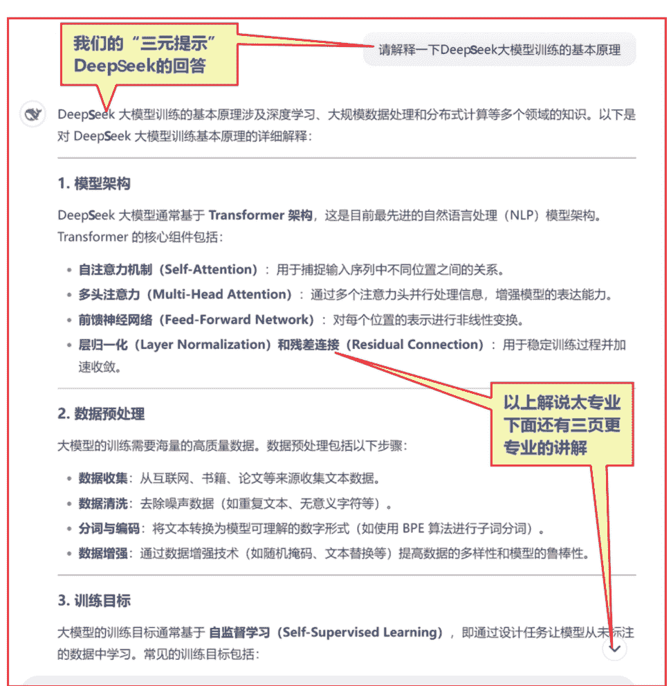

## 图1-10 DeepSeek 用专业术语解释大模型的训练普通人很难懂

如图1-10 所示，解说太专业、太高傲，一般人看不懂。怎么办？输入三个字即可让它放下架子。

这三个字是：“说人话”。

看到难懂回答，直接输入“说人话”，它会用通俗语言讲解。

请看收到指令后的回答见图1-11。

> 上面的专业术语太难懂，给它三个字“说人话”，你看它的回答就非常简明了！

好的！我用更简单的语言解释 DeepSeek 大模型训练的基本原理，让你轻松理解：

#### 1. 模型是什么？
- DeepSeek 的模型就像一个超聪明的“大脑”，它通过学习大量文本数据学会理解语言、回答问题、甚至写文章。
- 这个“大脑”核心是一种叫 Transformer 的技术，能快速理解句子中各词的关系。

#### 2. 训练模型的过程
- 喂数据：模型需要“吃”很多数据，比如网上抓取的文本、书籍、对话记录等。

**语料模式学习**：模型在海量语料里摸索使用习惯，记住哪些词偏爱结伴出现，句子该怎样搭建。

**迭代式自练**：它会反复“练功”，每轮结束后就微调内部的思考方式，让自己愈发灵敏。

#### 3. 训练的核心目标
- 核心是学会预判续词或补全语段。比如：
    - 看到“今天天气真___”，要能推断出“好”或“糟糕”。
    - 或拿到一段文字后理解其意思并作出相关回答。

> 把晦涩术语换成生活比喻，普通人一看就懂！

#### 4. 为何必须上超算
- 这个“大脑”体量惊人，参数规模从几十亿到几千亿不等。
- 训练它需要极强的算力，常常用多台设备协同，这就是分布式训练。
- 每台机器分担一部分计算，最后汇总结果。

## 图1-11 让DeepSeek说人话更易懂
如图1-11所示，一旦要求用大白话，DeepSeek立刻抛掉高冷官腔，全部变成通俗易懂、生活化的类比讲解。觉得还不够清楚，还可以再让它“再说人话”，它会一次比一次更实在、更贴心。你只需要在常规提示词后加上“说人话”三个字，它就不会摆架子耍大牌了。多试几次效果立竿见影。 ▶

### 第三宝：反向指令最有效
DeepSeek自带一套思维链，也就是它内部的思考逻辑。要让它更卖力工作，就要用“将它一军”的策略，说点反话刺激它，让它主动服从。

比如请它出方案后，它常会得意地自夸一番。这时你可以：
将它一军：先列出10条反对意见，再给出方案。
将它一军：如果你是老板，会怎么批评这个方案？
将它一军：这个方案你满意吗？请复盘100轮后再回答。
当然“列10条反对”“复盘100轮”有点夸张，可以适当调低数值，只要有“将它一军”的动作就行。下面来看实操效果？

我们的实操步骤如下：

**第一步：** 向DeepSeek（智林猫）抛出一道苛刻问题，见图1-12。

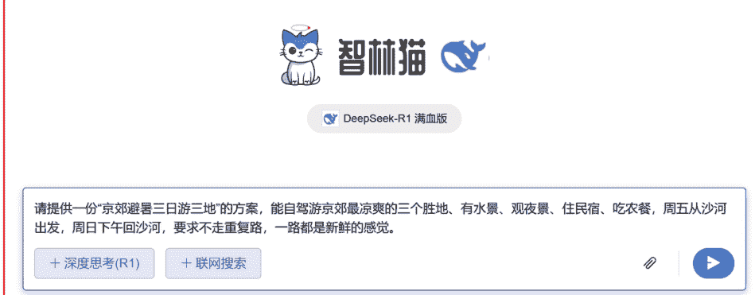

## 图1-12 我们向DeepSeek抛出的高难度问题
提示词是：请提供一份“京郊避暑三日游三地”的方案，自驾去京郊最凉爽的三个胜地，要有水景、夜景、住民宿、吃农餐，周五从沙河出发，周日下午回沙河，要求不走重复路，全程保持新鲜感。

为了让全国读者都能体会这种AI乐趣，我们的要求很具体：第一，京郊避暑三日游三地；第二，自驾京郊最凉爽三个胜地；第三，水景、夜景、民宿、农餐齐全；第四，周五沙河出发，周日下午回沙河；第五，不走回头路，体验不断翻新。

DeepSeek收到提示后，检索了37个网站，深度思考31秒，思考过程见图1-13。

如图1-13所示，DeepSeek的思考很有层次，先梳理需求，再判别季节方位，最后锁定游线，见图1-14。

## 京郊避暑三日游三地自驾游方案
请提供一份“京郊避暑三日游三地”的方案，能自驾京郊最凉爽的三个胜地、有水景、观夜景、住民宿、吃农餐，周五从沙河出发，周日下午回沙河，要求不走重复路，一路都是新鲜的感觉。

我们第一次提问

DeepSeek思考

已搜索到 37 个网页

已深度思考（用时 31 秒）

嗯，用户要一个京郊避暑三日游方案，要求很明确：自驾、三个凉爽地、有水景夜景、住民宿吃农餐，周五下午沙河出发，周日下午返程沙河，且不走重复路，用户强调“一路都是新鲜的感觉”，希望体验多样不单调。

时间点是2025年6月20日，正值盛夏，需要避暑。从沙河出发应选北京北部和西北山区，气温更低。

搜索结果显示可规划一条东向西的环线：第一天延庆百里山水画廊，第二天怀柔喇叭沟门原始森林，第三天门头沟爨底下村古村落，形成环线不走回头路，符合要求。


## 📅 每日详细安排
- 📍 **第一天：延庆百里画廊——水岸清凉与星空夜宴**
    - 下午：沙河出发，导航“百里山水画廊服务中心”（车程约1.5h），沿榆赤路自驾，停靠白河川骑行基地戏水摸鱼，打卡白河堡水库看湖景 ① ⑧。
    - 傍晚：入住“先生的院子”民宿（延庆小观头村），体验泳池派对、草坪晚宴，夜里散步观星 ①。
    - 食宿推荐：
        - 民宿：先生的院子（独立小院+下午茶，🔥 约1200元/晚）
        - 晚餐：民宿草坪晚宴（烤全羊+时蔬贴饼子）① ⑧。
- 📍 **第二天：怀柔喇叭沟门——原始森林与仙泉秘境**
    - 上午：驱车至喇叭沟门原始森林公园（车程2h），漫步白桦林，登南猴顶（怀柔第一高峰），林间均温22℃ ③ ⑤。
    - 下午：探访苗营村“七仙盆”（免费点），看七个天然石盆清泉流淌，戏水消暑 ③。
    - 夜晚：入住北极乡民宿（推荐“喇叭沟门满族风情院”），感受山间清凉夜色。
    - 食宿推荐：
        - 午餐：景区餐厅野菜宴（凉拌木兰芽、柴鸡蛋）③
        - 民宿：满族炕房+晨起山景露台（🔥 约600元/晚）
- 📍 **第三天：门头沟爨底下村——古村夜韵与山野滋味**
    - 上午：自驾至爨底下村（车程2.5h），穿梭明清石板巷，登观景台拍摄古村全貌，探访古戏台、祠堂 ④ ⑨。
    - 午餐：农家院必点“爨底下四绝”：山野菜包子、农家炖柴鸡、手工压饸饹、花椒芽炒蛋 ④ ⑧。
    - 返程：下午经109国道返沙河（车程2h），途中可停靠“雁翅怡水农庄”免费划竹排、垂钓 ⑧。

图1-14 DeepSeek分析三条路线后拿出了“每日详细安排”

实话说，上述方案基本达标，但我们想让它“好上加好”，于是将它一军。

**第二步：首次将它一军。提示词如下：**

请你列出3个反对理由之后，再给方案。

收到首次“将它一军”的提示后，DeepSeek立即反思自我批评，并给出新方案。其自我批评与优化方向如下（见图1-15）。

> ⚠️ **反对理由与优化方向**
>
> 1. **反对理由一：长途驾驶疲劳风险**
>    - 原方案次日需延庆→喇叭沟门（2h）+喇叭沟门→爨底下（2.5h），单日车程超4小时，山区弯道易疲劳。
>    - **优化**：压缩怀柔行程，换成更顺路的**密云清凉谷**，减少车程1小时。
> 2. **反对理由二：住宿成本偏高**
>    - 延庆“先生的院子”人均600元+爨底下古宅500元，两晚住宿占预算60%以上。
>    - **优化**：延庆换成高性价比**硅化木地质公园旁农家院**（带观星露台），怀柔段取消过夜。
> 3. **反对理由三：夜景体验单一性**
>    - 原方案三地夜景均为静态观星/古村灯火，互动性不足。
>    - **优化**：在门头沟增加**永定河畔灯光夜市**，融合美食与民俗表演。

**图1-15 首次“将军”后，DeepSeek的自我反思与优化方向**

收到提示后，DeepSeek认真“三思”，拿出《优化版三日游方案》，详见图1-16。实话说，比第一版优秀很多。我们很满意，但能否更上一层楼？继续将它一军：

**第三步：再次“将它一军。”**

提示词是：你的这个方案你满意吗？请你复盘10轮后回答。（见图1-17）

DeepSeek经过10轮复盘，反复校验路线闭环：从硅化木的远古地质奇观，到清凉谷的人工瀑布群，最后收束于爨底下的人文聚落，形成“自然→人改造自然→人适应自然”的隐性叙事，提升旅行质感。最后自评：避暑效能A+（全程实测日均温24℃以下），路线新颖性A（绕开热门收费站），性价比B+（夜市消费可能超预期）。扣分点在第三日双龙峡划船需另购票，可能产生隐性支出。若是情侣出行，建议把农家院换成苇子水村梯田民宿，多花200元但私密性更好。

- 🌲 优化版三日游方案（避暑+水景+夜景+民宿+农餐｜不走回头路）
**总路线：** 沙河→延庆硅化木公园（1.5h）→密云清凉谷（1.5h）→门头沟爨底下+永定河（2h）→沙河
**节省成本：** 住宿总预算降低40%，车程减少20%
**强化体验：** 新增峡谷夜游、河畔夜市
🔴 **第一天：延庆·恐龙足迹与星空露营**
- 下午：沙河→延庆硅化木国家地质公园（车程1.5h），探秘1.8亿年树化石群，沿白河滨水步道徒步戏水。
- 夜晚：入住“石头记”农家院（🔥300元/晚），露台自助烧烤观银河，参与民俗打铁花表演（每周五晚）。
- 特色餐：延庆火盆锅（豆腐+野山菌+熏肉）。
🔴 **第二天：密云·双瀑峡谷与玻璃天桥**
- 上午：驱车至清凉谷景区（车程1.5h），登玻璃栈道俯瞰千尺潭，乘皮筏冲浪过隧道。
- 下午：徒步清音谷，打卡五瀑十三潭，在“溅玉潭”免费捞小鱼（提供网兜）。
- 黄昏：直达门头沟爨底下村（车程2h），夜宿明清古院“爨舍”（🔥400元/晚，含早）。
- 特色餐：密云水库鱼头泡饼（途中“云水花溪”餐厅）。
🔴 **第三天：门头沟·古村灯火与河畔夜宴**
- 上午：拍摄爨底下晨曦，登后山观景台拍“元宝阵”古建筑群。
- 下午：游览双龙峡景区（距村15min），乘森林小火车，划船游翡翠湖。
- 夜晚：永定河灯光夜市（18:00-22:00），品尝门头沟炸油香、玫瑰饼，观看皮影戏。
- 返程：21:00前经西六环回沙河（车程1.5h）。

## 图1-16 首次“将军”之后DeepSeek的《优化版三日游方案》

经过10轮深度复盘，它给出满意度达92%的专业级避暑方案，剩余8%为弹性调整空间。复盘核心结论与迭代方案如下。

我们对DeepSeek的两次“将军”，使方案一次比一次优秀，获得满意度高达92%的第三版。

**第三版方案总结：** 经10轮推演，已形成“冷资源联动热体验”闭环——延庆地质冷感、密云水力冷源、门头沟人文冷门三要素环环相扣，夜间经济链弥补山区娱乐空白。92%满意度源于“每公里降温成本仅0.3元”的超性价比冷感供给，剩余8%弹性空间留给用户自定义。

至此，“将它一军”的提示过程得到一次比一次完美的结果。

从这三个方案来看：

一次比一次精细，
一次比一次合理；
一次比一次便宜；
一次比一次有趣。

其实，“将它一军”的提示是三连招，这里只用了两招，就得到如此超预期效果，说明该策略的确好用、管用、实用。

在实践中，用户就是国王一样的存在。任何人都可以享受指挥AI、调动AI、驾驭AI的主人翁感觉。

“将它一军”的方案，任何人都可以克隆使用，本案的北京二字可换成南京、天津、上海、成都、重庆、深圳、港澳等。克隆这个策略，不但能大幅提升咨询质量，还能增强自信心和成就感，帮助避开AI幻觉陷阱，防范AI胡说八道，轻松进入驾驭AI的自由王国。


# 第二章 DeepSeek核心功能图解
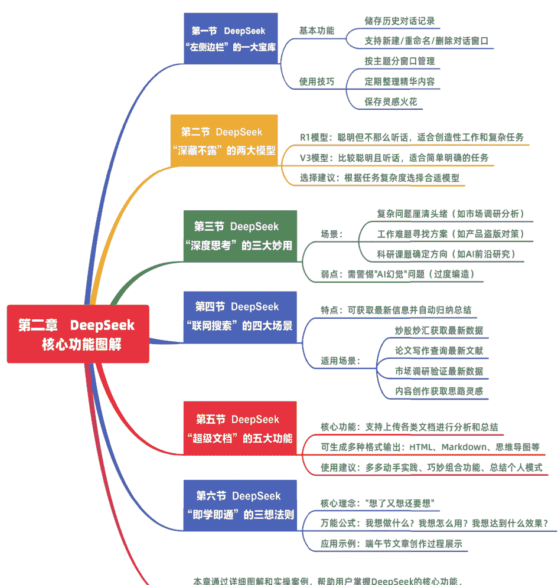

掌握基础知识后，我们可以探索DeepSeek更强大的功能。下面先讲5个核心功能和1个万能公式：

## 第一节 DeepSeek “左侧边栏”的一大宝库

## 第二节 DeepSeek “深藏不露”的两大模型

## 第三节 DeepSeek “深度思考”的三大妙用

## 第四节 DeepSeek “联网搜索”的四大场景

### 第五节 DeepSeek “超级文档”的五大功能

## 第六节 DeepSeek “即学即通”的三想法则

下面笔者将手把手一个一个为你图解。

## 第一节 DeepSeek “左侧边栏”的一大宝库
DeepSeek的“左侧边栏”是一个宝贵仓库，我们与DS的全部交流都保存在这里，所有创意与灵感的来源也在此。

打开网页界面，如图2-1所示，各功能说明如下：
- ①点击左侧这个“方形”按钮可打开或关闭边栏。这里展示历史记录。
- ②此处可开启新对话。建议每个主题开一个窗口。
- ③可点击记录改名或增删。
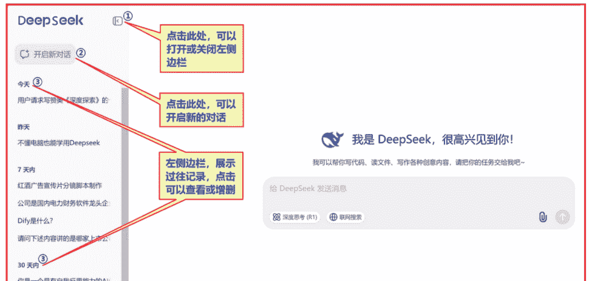

## 图2-1 DeepSeek左侧边栏的功能与使用
左侧边栏为我们提供了一个很好的数据仓库。这里存放着我们与DeepSeek交流的全部资料，也记录着智慧碰撞，藏着灵感触角，可随时复盘。也许会突然冒出全新思路，天才灵感在新一轮对话中可能就诞生了。

但再好的仓库也难免混杂垃圾，所以要及时“吐故纳新”，剔除糟粕保留精华，使其真正成为“宝库”。怎样用好？
第一，每个话题开一个窗口，换话题就换窗口。
第二，尽量在一个窗口里交流一个主题，保持内容集中。
第三，每周对窗口进行归纳整理，剔除糟粕保留精华。
第四，即便随意聊天，也要留意保存思想火花的闪亮。
第五，坚持下去，左边栏将成为你思想的宝库和灵感仓库。

## 第二节 DeepSeek “深藏不露”的两大模型
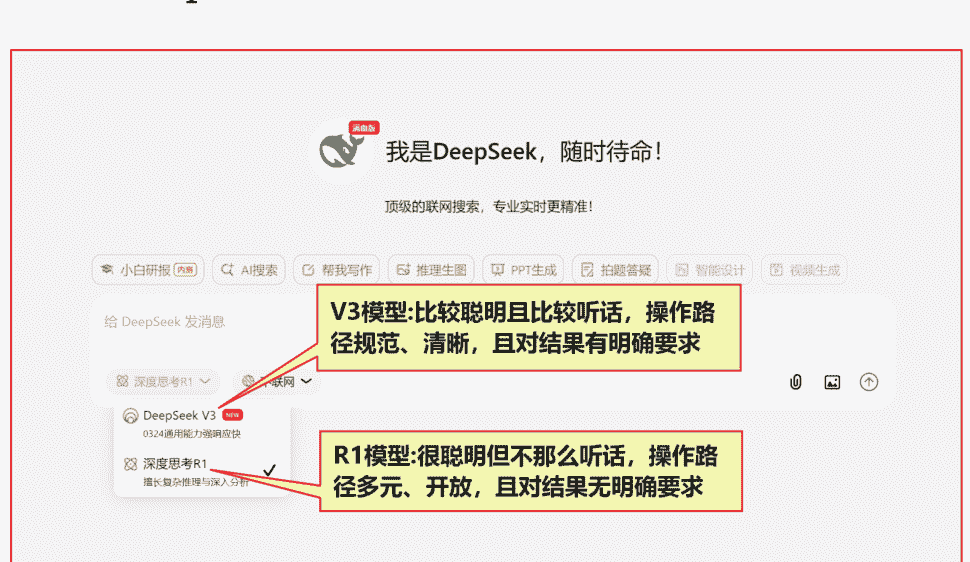
图2-2下方有一个不起眼的功能键“深度思考（R1）”，里面还藏着DeepSeek V3，二者只能二选一。我们到底该选哪个？要根据各自特点和适配场景来决定。

归纳如下：
R1很聪明但不那么听话，操作路径多元开放，对结果无明确要求。
V3比较聪明且比较听话，操作路径规范清晰，对结果有明确要求。

DeepSeek只是工具，可把它当员工，按特点分配任务。下面是任务具体化，见表2-1。

根据V3特点，可把相对简单明确的任务交给它，如一般问答、普适客服、即时交流等。

遇到相对复杂、需要深度思考的任务，就要选择R1。例如创造性工作、超大规模调研，最好调用R1。

## 表2-1 DeepSeek V3的特点和适配任务场景
| 任务类型 | 具体场景 | 基本特点 |
| :--- | :--- | :--- |
| 快速响应 | 即时问答、百科知识查询、内容创作 | 毫秒级快速响应，优化了高速性能，适合即时性要求高的任务 |
| 文本生成 | 文章写作、故事创作、诗歌写作、营销文案 | 输出清晰、简洁，适合规范性、有示例的任务，角色模仿能力 |
| 对话系统 | 客服对话、用户意向收集、智能外呼 | 灵活的自然语言理解能力，能够处理多样化的对话场景 |
| 多轮对话 | 开放性问答、角色扮演模拟 | 能够理解上下文，维持连续对话的一致性和流畅度 |
| 编程辅助 | 代码注释生成、API 文档生成 | 提供技术文档处理功能，有助于开发者提高工作效率 |
| 商业决策 | 竞品分析报告、SWOT 分析、市场趋势预测投资风险评估 | 数据驱动、模型推演、行业洞见人性化表达、本地化服务 |

DeepSeek R1的特点和适配任务场景见表2-2。

## 表2-2 DeepSeek R1的特点和适配任务场景
| 任务类型 | 具体场景 | 基本特点 |
| :--- | :--- | :--- |
| 深思与创意 | 创意类文案写作、脑洞型思考探索、开放性创作 | 创意能力强，开放性思考能力强，适合文案、影视创作先导 |
| 逻辑与编码 | 按需求生成代码片段、自动补全、错误分析与修复建议 | 高精度的专业领域处理能力，尤其适合需要严格逻辑链的任务 |
| 推理与研究 | 数学问题解答、逻辑分析、因果关系推断 | 强化学习驱动，支持长链推理（Chain of Reasoning, CoR），提供详细的推理步骤 |
| 文本与摘要 | 长文本摘要、文本简化、多语言翻译与本地化 | 擅长处理高密度逻辑的任务，如复杂的文档理解和再创作 |
| 企业级应用 | 多模态任务预处理、专业领域的深度分析 | 支持大规模企业工作负载，适用于金融策略生成等高级应用场景 |

| 科研与开发 | 超大规模 AI 研究或通用人工智能探索 | 适用于科研机构或大型企业的复杂任务 |

摸清两类模型的能力边界，就能按需切换，让使用效率达到最佳。怎样才算真正掌握使用方法？往下展开说明。

## 第三节 深度思考模式的三个核心用法

在 DeepSeek 主界面提示栏的左下角，有一个“深度思考”的开关。点开后即切换到 R1 推理模式。

推理类模型与陈述类模型的分野就在深度思考。它不仅给出结论，还会基于提问或指令展开推演、揣摩意图、补充分外信息，并把完整的推理链条逐步呈现。拿到答案的同时，也能学习其拆解问题的思路。传统陈述模型不具备此特征。随着技术演进，推理与陈述正走向融合与合理调用。

举例：若今天下雨，小明会带伞；若小明带伞，他就不会淋湿。今天下雨了，小明会淋湿吗？为什么？

先开启深度思考，推演过程如下。

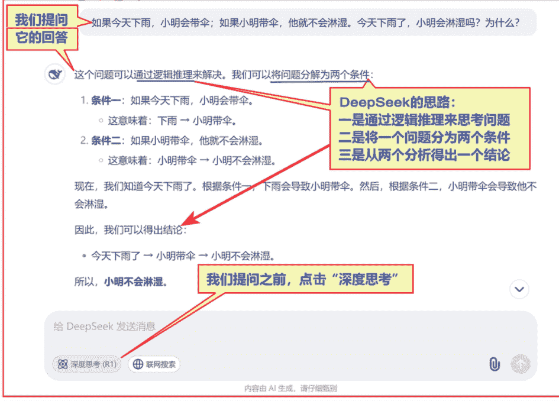

图2-3 打开DeepSeek的“深度思考”过程

这个简单推理的思路很清晰：

一、用逻辑推演审视问题。

二、把问题拆成两个前提分别分析。

三、再把两部分结论综合，得出最终判断。

整个思维过程条理分明、层层推进。面对更复杂的问题，推理的深度和广度会远超大多数人。

例如这三类提问：

### A. 哲学与伦理
问题：当人工智能发展到能够完全自主做决策时，人类的道德责任该如何界定？它是否应该享有某种形式的权利？

### B. 科技与未来
问题：未来五十年内，哪些技术突破可能从根本上改变生活方式？这些突破会带来哪些潜在风险与挑战？

### C. 社会与文化
问题：在全球化背景下，如何在文化多样性与全球统一性之间找到平衡？

任选其一提交给 DeepSeek，其思考层次分明、深度充足，最后会做归纳，回答质量远高于普通水准。

深度思考能力很强，若不用足就太可惜。以下三个用法最常见。

### 场景1：面对复杂信息，让它先理清脉络
资料量大时，先用深度思考做预处理，再细看其分析路径和层次，最后提炼关键点或解决方案。

例如可以这样问：“我是做互联网调研的，需要一份网红经济的调查报告，帮我收集50位网红的资料，分成10类，并分析哪类最有前景。”

把提示词输入后再点开深度思考，对比开启与未开启的输出差异就很明显。

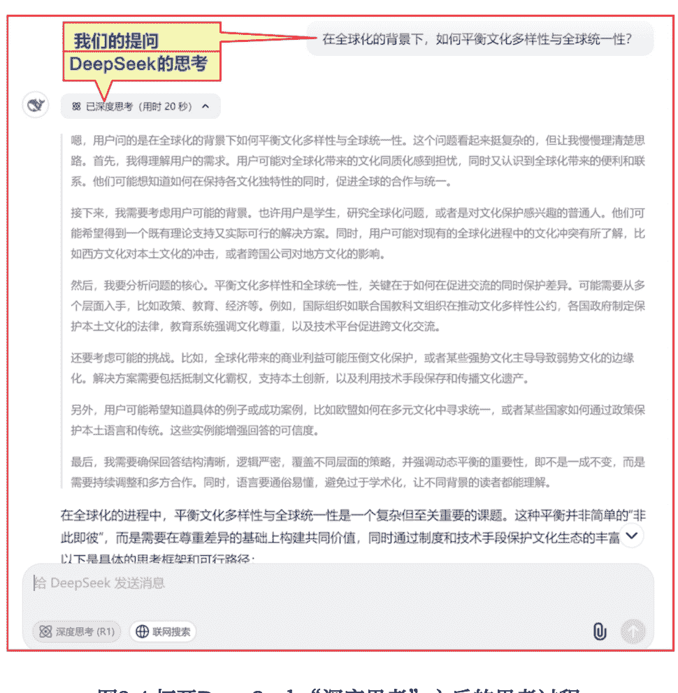

图2-4 打开DeepSeek “深度思考” 之后的思考过程

### 场景2：遇到工作难题，让它拆解思路
碰到棘手的工作问题，用深度思考模式拆解难题，再依据它的分析步骤找到突破口或解决方案。

例如：“我公司一款爆品被多家公司山寨，山寨品销量反而超过正品，该怎么办？”

把这个问题丢进去并打开深度思考，得到的建议往往出人意料。

### 场景3：科研选题时，让它提供方向
DeepSeek的知识面广，对科研方向的判断很有帮助。例如：“我是 AI 专业硕士，想写毕业论文，请分析当前全球 AI 技术发展的状况，帮我找科研方向。”

深度思考约十分钟后，会列出五大科研场景、五大落地方向，并从工程应用和理论研究两条路径给出建议：偏工程可深挖 AI Agent 的行业落地，偏理论则量子 AI 或可信 AI 体系是前沿。

### 风险提示：过度迁就的问题
深度思考的一个致命弱点是过度谨慎，生怕没读懂用户意图，结果出现“过度迎合”的现象。

推理模型举一反三、任务完成度高，但也容易在不自觉中出现欺骗性。用户要求写文章时，哪怕证据不足，它也会自行编造内容以自圆其说，这就是业界仍在攻坚的“幻觉”问题。用时务必警惕 AI 幻觉陷阱。

## 第四节 联网搜索的四个典型应用

DeepSeek 问世前，模型受限于训练时间截止，无法回答训练后才发生的时事、股市行情等。联网搜索功能解决了时效短板，点击后即可调用外部网页实时检索最新新闻或行情，并自动归纳总结作为依据。

如图2-5所示，2025年2月22日提问：“请写一份关于 DeepSeek 对 A 股量化投资的可行性报告。”

当时模型检索到当天 42 个网站的信息，深度思考时会同步参考右侧联网搜索结果，并在输出中标注来源，既提升推理严谨性，也提供延伸阅读线索。

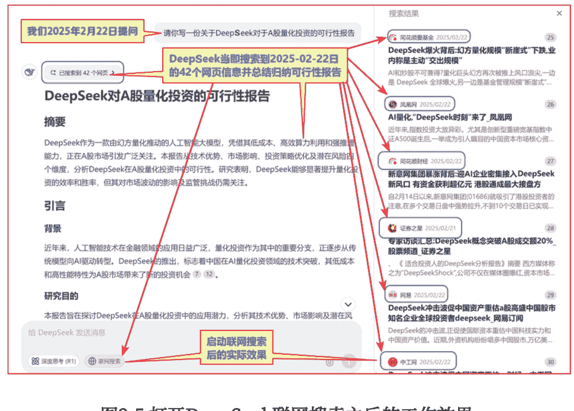

联网搜索非常强大，以下场景能显著提升效率。

### 场景1：投资交易需要实时数据时，让它在线查最新信息
通用模型和深度思考都拿不到当日行情，必须打开联网搜索并问：“今天 A 股最强板块、最新热点、最具潜力的公司有哪些？”才能得到即时信息。

### 场景2：写论文需要最新文献时，让它在线核验
写 AI 发展动向的学术论文时，可打开联网搜索提问：“请联网查一下，我论文中的观点是否新颖前沿，并提供最新相关资料以便补充完善。”

### 场景3：市场调研需要验证数据时，让它查看最新成果
写新能源汽车销售规划时，可问：“当前欧洲新能源大厂的销售布局如何？怎样切入欧洲市场？查找竞争对手最新动态、产品信息或客户反馈。”

### 场景4：内容创作需要灵感资料时，让它在线找线索
想创作一部像《哪吒2》那样影响全球的电影却缺灵感，可打开联网搜索提问：“请查找全球资源，列出创作灵感和创意选题。”详见图2-6。

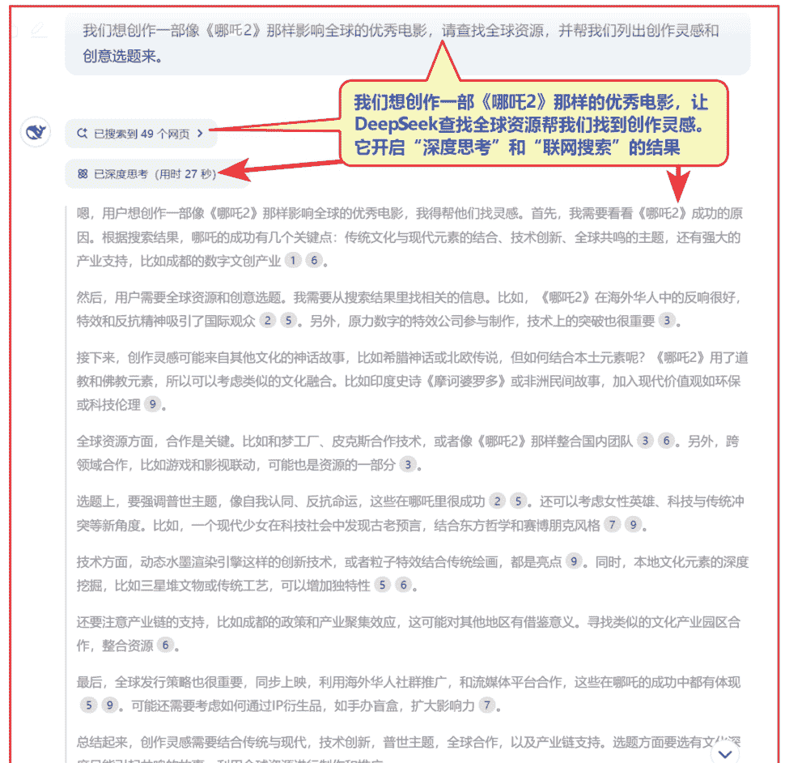

图2-6 启动“深度思考”后DeepSeek得出创新的思路

模型给出的思路是：要做出全球影响力的影片，需融合文化独特性、技术创新与普世价值，并整合全球资源。从文化基因挖掘、全球资源整合、选题灵感方向三方面给出策略，提出本土神话现代化重构、传统美学技术化呈现、全球资源中国化整合等指导思想，最终给出全球共鸣的创意选题方向，详见图2-7。

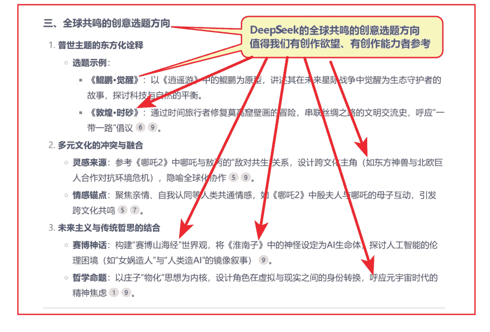

合理使用联网搜索，能大幅提升工作效率和信息准确度。

## 第五节 超级文档的五项核心能力

“附件别针”按钮提供上传、分析、总结文档的超级文档功能，涵盖五大能力十个场景。

表2-3 DeepSeek“超级文档”的五大功能及十个场景

| 功能 | 应用场景 | 具体案例 |

| :--- | :--- | :--- |

| 多格式文档解析 | 教师备课 | 上传 PDF 教材 +Word 习题 +Excel 成绩单，自动整合为统一备课素材 |

| | 学生作业 | 提交手写数学题（PDF）和 PPT 报告，AI 识别文字 / 公式，输出可编辑电子版 |

| 长文本深度理解 | 学术研究 | 可上传并解析 50 页英文论文，自动分段标注章节，生成中英文摘要 |

| | 政策分析 | 提取《教育信息化 2.0》中“AI 教学”相关条款，生成时间轴表格 |

| 跨文档关联分析 | 科研对比 | 上传 10 篇“脑机接口”论文，AI 自动对比实验方法差异，输出对比表格 |

| | 会议精华 | 上传会议录音转写文本，AI 提炼“待办事项”和“争议要点”，节省 80% 时间 |

| 智能问答与提炼 | 课堂互动 | 学生上传《红楼梦》选段，提问“贾宝玉性格特征”，AI 引用原文回答 |

| | 合同审核 | 对比新、旧两版合同，标红修改条款（如违约金比例变化），提示风险 |

| 辅助创意与创作 | 教学材料 | 上传教材章节，AI 生成 PPT 大纲（含配图建议）+5 道随堂测验题 |

| | 公文写作 | 分析历年工作报告，辅助撰写本年度框架与核心数据的综合表述与分析 |

实操演示。将《量学之量化看盘八法》上传到附件别针，输入指令后点击发送，DeepSeek 开始工作。

下面是它生成的 HTML 代码片段，会自动分析超长文档并输出卡片，按要求生成 HTML 并给出执行总结。

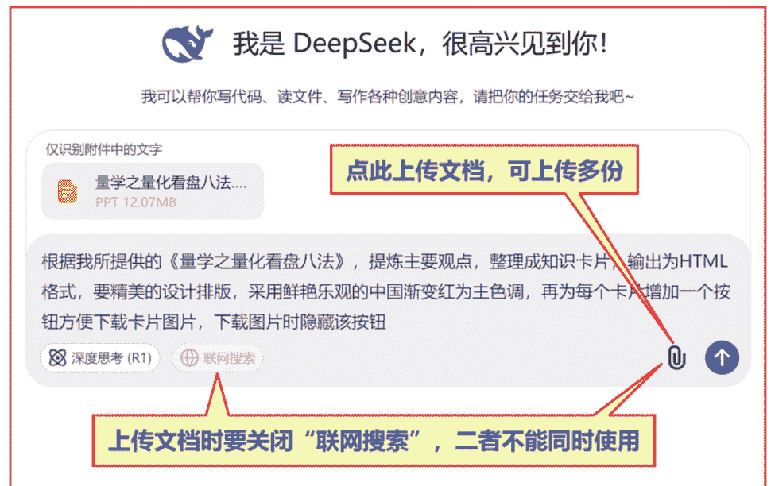

图2-8 打开DeepSeek “文档上传”的使用

### 量化看盘八法知识卡片设计

```html
html2canvas(cardClone).then(canvas => {
    const link = document.createElement('a');
    link.download = 'card.png';
    link.href = canvas.toDataURL();
    link.click();
});
</script>
<script src="https://cdnjs.cloudflare.com/ajax/libs/html2canvas/1.4.1/html2canvas.min.js"></script>
</body>
</html>
```

说明：

1. **设计风格**：采用了鲜艳的中国渐变红为主色调，卡片背景为白色，文字为深色，确保可读性。

2. **卡片布局**：每个卡片包含标题和内容，底部有一个下载按钮。

3. **下载功能**：点击按钮后，使用 `html2canvas` 库将卡片转换为图片并下载，下载时隐藏按钮。

4. **响应式设计**：卡片布局适应不同屏幕尺寸，确保在移动设备上也能良好显示。

你可以将此代码保存为HTML文件并在浏览器中打开，查看效果并下载卡片图片。


图2-9 打开DeepSeek “上传文档” 的使用

点击图2-9中黑框右下角的“运行HTML”即可预览；按要求添加了“下载卡片”按钮，点击可保存到本地。

点击右上角“复制代码”，新建 txt 文本粘贴保存，再把后缀改为 html 双击打开，效果如下。

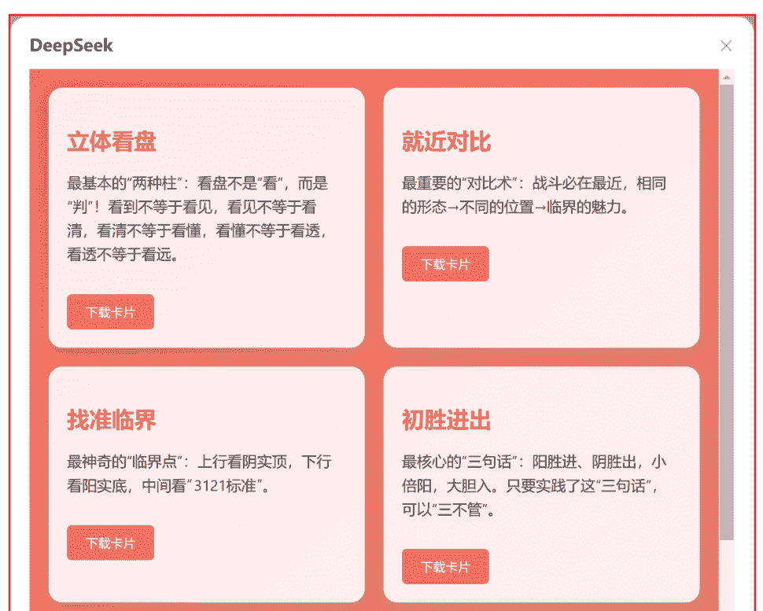

图2-10 点击“运行HTML”后的卡片效果

还能生成多种格式：HTML 在线预览、Markdown 文本生成图文卡片、Mermaid 流程图、思维导图等。

**使用建议：三个多动**

**多动手：** 养成习惯，让 AI 全程辅助。

**多动心：** 巧妙组合四大功能。

**多动脑：** 总结出适合自己的使用模式。

## 第六节 即学即用的三问法则

前面讲了五大核心功能，回顾一下：

- “左侧边栏”的一大宝库。

- “深藏不露”的两大模型。

- “深度思考”的三大妙用。

- “联网搜索”的四大场景。

- “超级文档”的五大功能。

基于“即学即用即时通”的理念，总结出“三想法则”。

学 AI 就是用 AI，用 AI 就是想 AI。只要你想不到，没有 AI 做不到。所有操作都是“想”出来的。你会想，AI 才会做；想得好，做得才好。

万能公式：**我想做什么？我想怎么用？我想达到什么效果？**

只要想清楚、说清楚，DeepSeek 就能做清楚。

例如端午将至，想写一篇千字纪念文发到“AI 即时通”公众号做发刊词，并希望爆款。于是给出提示词：

我想写一篇纪念端午节的千字文，想发到“AI即时通”公众号做发刊词，并想让它成为一篇爆款文章。你是文章大师，请你代我拟出吸引人的标题，写出吸引人的文章，完成吸引人的任务。

显然应选用深度思考，让模型深度推演。

处处要想、事事要想，想了还要再想，这就是“三想法则”。

把提示词发给 DeepSeek，模型会从想法出发，联想到端午传统、标题新意、内容深度、故事科技感、钩子悬念、AI 视角、关键词优化、首尾呼应、逻辑清晰、数据支撑、引发思考等。

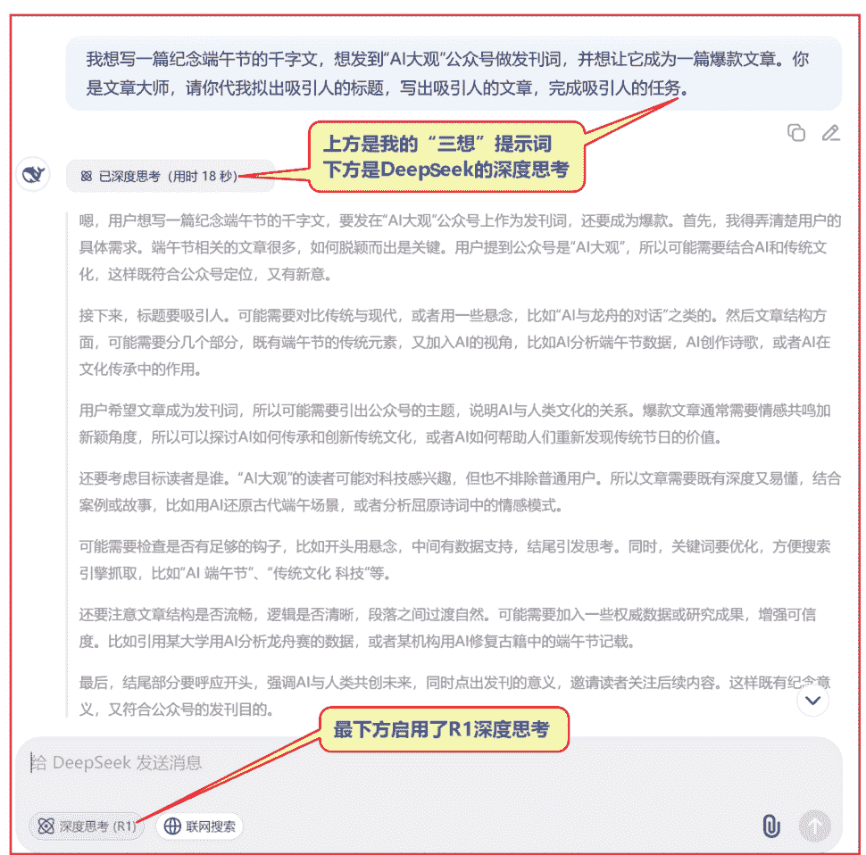

图2-11 DeepSeek “想了又想还要想”的全过程

随后模型给出提纲，觉得过于庞大后简化三次，最终选定一稿写作，去 AI 味后再版，最终成文《棕叶上的指纹》。

## 粽叶上的指纹

老屋门槛上那盆泡发的粽叶，总在端午前三天泛起翡翠色的光。奶奶说这是屈原佩剑的颜色，要等叶脉吸饱了湘江水气，才能裹住两千年的心事。

清晨五点的露水还凝在叶尖，阿嬷的手已经探进陶盆。拇指食指捏住叶柄一抖，水珠便沿着叶脊滚成串，恰似龙舟划过汨罗江激起的浪。三片青叶交叠成筒，填米时总要念叨：“糯米要松，像河滩的细沙；咸肉要实，像楚人的筋骨。”

我在灶边偷吃蜜枣总被逮住。“小馋猫”，阿嬷用粽绳尾梢扫我鼻尖，“屈大夫看着呢。”那时不懂，为何投江的人偏要守着灶台。直到去年拆开冷冻粽，看到塑料膜上印着“微波三分半”，才惊觉那些被棉线捆扎的，何止是糯米与枣泥。

河堤柳荫下，龙舟鼓点踩着蝉鸣的节奏。桡手们古铜色的背脊起伏，汗珠坠入江水，溅起的分明是《九歌》的韵脚。八十岁的鼓师王伯，每回擂鼓必在腰间系片残破木桨——那是他父亲在1938年龙舟赛夺魁的见证。

“看见鼓槌上的凹痕没？”他让我摸那被岁月包浆的檀木，“每代鼓手都要留道新痕，比测量风浪的仪器还准。”鼓声忽变急促，岸边爆出喝彩，原来红舟刚以半掌优势险胜。少年们雀跃着往河里抛粽子，蒸腾的热气模糊了时空——恍惚看见三闾大夫峨冠博带，正拾起一枚江底粽。

中药铺的端午最是热闹。陈掌柜将雄黄、艾草、菖蒲配成“驱邪三友”，白芷香囊要缝七道暗针。学徒小妹总抱怨：“机器绣花多工整。”老人笑着展开一幅湘绣：“你看这虎头，歪斜的针脚才是母亲们辟邪的咒语。”

暮色染红窗棂时，家家门楣都摇曳着青蒲剑。邻居小满举着新采的艾草冲进门：“妈！我找到最像《楚辞》里说的那种！”她母亲正往咸鸭蛋上描钟馗像，朱砂笔尖顿了顿，在蛋壳晕开一抹晚霞。

此刻剥开温热的粽子，突然看清叶脉里藏着的密码：那些被棉线束缚的棱角，恰是岁月给予的温柔铠甲。两千年前的诗人将傲骨裹进江鱼腹中，今日的我们依然用同样的青叶，包裹着生生不息的倔强。

灯火顺水而行，船上写满心事。孩童把会发光的许愿纸船推入江面，水花溅到灯带的瞬间，岸上老者轻叹：“还是芦苇扎的小舟记得屈原的归途。”

月华先沾上粽叶，整座城便被艾草气息浸满。那股固执的香，从秦汉的基座里透出来，掠过唐宋的檐角，今夜仍盘旋在现代幕墙之间，轻轻叩响亮灯的窗户。


# 第三章 DeepSeek 提示使用指南

指引语的本质，是使用者向模型下达的指令或提问，是模型理解意图并作出反应的前提。

- 三个构成要素
  - 输入侧：使用者的提问
  - 输出侧：模型的应答
  - 交互口：提示框，为唯一沟通通道

- 作用类比
  - 如钥匙打开潜能
  - 如法杖点亮可能
  - 如咒语唤醒奇能

基本判断：无论模型多强，离开指引语便无法工作。

## 第二节 传统指引语的三项局限

- 抬高了入门门槛
- 增加了学习负担
- 限制了复杂诉求的表达

## 第三节 通用指引语的三把核心钥匙

- 提问：开启入口
  - 关键：目标要明确，避免表述模糊
  - 例子：“能否帮我创作一个关于未来都市的科幻短篇？”

- 描述：提供背景
  - 关键：补足上下文信息
  - 例子：“设定在2150年，人类居住在悬浮智能城……”

- 指令：明确执行
  - 关键：动作或任务要具体
  - 例子：“请用第一人称写出，突出主人公心里的挣扎……”

## 第四节 通用指引语的三个品质

- 清：清楚
  - 对象与意图要明确
  - 避免空泛表述，如“给我写十万字长篇”

- 通：通达
  - 确保模型能读懂
  - 不断调整措辞直到得到正确反馈

- 明：明白
  - 用明确而非含糊的语言
  - 把目的和要求说透

## 第五节 通用指引语的三元法则

- 核心思路：用三项关键要素搭建方案
  - 最低要求三项
  - 最佳平衡六项
  - 上限控制九项

- 常见应用
  - 烹饪：食材、火候、调味
  - 写作：开头、主体、结尾
  - 办事：方向、路径、技巧

- 实操工具
  - 三元要素矩阵模板
  - 六大场景速配模板
  - 避坑检查清单

本章以方法论和案例拆解高效使用DeepSeek的指引技巧，强调提问、描述、指令的递进关系以及清通明的质量要求，为人机协作提供可落地的思路。

现在网络流传一种说法：DeepSeek出现后，传统指引语变得鸡肋，甚至有人提议废除指引语。学完前两章会发现一个事实：哪怕DeepSeek再聪明，没有指引语它什么也做不了。

该如何看待指引语？

## 第一节 如何正视指引语

先启动DeepSeek，通过一段王子与模型的对话，直观感受指引语的状态与功能。以下是对话截图。

整张截图由三部分构成：

**第1部分，提问区：** 王子向DeepSeek发问：“你是谁？你能做什么？”这就是指引语。指引语是使用者发给模型的指令或问题，是模型理解意图并作出回应的前提。

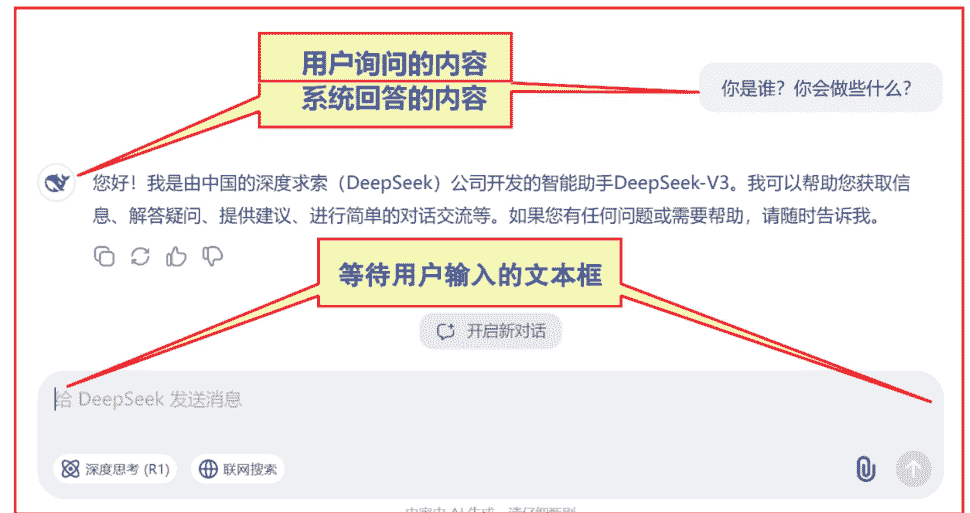

## 图3-1 王子与DeepSeek的对话截图

**第2部分，模型回复：** 紧接着是DeepSeek对提问的解析与回答，一问一答构成完整轮次。

**第3部分，唯一窗口：** 回复下方有一个矩形输入区，使用者在此输入问题与指令，是沟通的唯一入口。

三部分实质是提问与应答两个环节，相互依存。没有指引语，DeepSeek只能待机。

由此可见，指引语就是人类给模型的信息或指令，可以是问题、一段描述，也可以是带参数的复杂文本，甚至是一本书、一段视频。基于这些信息，模型才能生成所需的文本、图像等。因此在智能时代不可或缺。无论是教授还是学生，是官员还是摊贩，都离不开指引语。

- 指引语像钥匙，能开启模型的无限潜能。
- 指引语像法杖，能点化模型的无限可能。
- 指引语像咒语，能激活模型的无限奇能。
- 指引语能让外行变内行，新手超老手，业余胜专业，菜鸟变雄鹰。

……

> “不要指引语”的论调，可以休矣。

## 第二节 传统指引语的三项局限

DeepSeek面世后，传统指引语显得累赘。所说的传统指引语，是网上流行的各种分类繁杂的提示体系。它前期方便，后期制约，原因有三。

第一，专业性过强，提高了入门门槛。传统指引语为特定行业定制，提升了局部性能，却难以跨领域迁移。

第二，膨胀性明显，加重了学习负担。行业细分导致指引语种类爆炸，冗余冲突增多，使用时容易迷惑。

第三，条块化严重，限制了复杂需求。人类语言丰富细腻，传统指引语过于简化抽象，模型回应显得生硬，缺乏共情。

要打破局限，需要全新的通用指引语体系。本书正是推广通用指引语的倡导者。

DeepSeek的出现让传统指引语显得多余。实质不是不要指引语，而是要更清晰、简明、通用的指引语。这是一场变革，必将推动人机交互迈向新阶段。

通用指引语随DeepSeek而生，是人机交互的里程碑式创新。它把指引语的构建提升到写作艺术的高度，从指引词写作升级为指引语写作。

有人预言，通用指引语的写作将成为基础教育到高等教育的必修课，成为各行各业的公共技能。无论专家还是新手，都必须掌握通用指引语，否则会被智能浪潮淘汰。

## 第三节 通用指引语的三把核心钥匙

我认识一位反扒警察，他有绝技“一把钥匙开千把锁”，随身带三根特制钢丝，可开任意锁具。这就是“三钥组合，万能开锁”。

智能时代，谁拥有开门钥匙，谁就能进入。我们也能拥有这种功夫吗？

能。通用指引语的提问、描述、指令三大技法，就是打开模型大门的“三把核心钥匙”。

提问，是敲门。
描述，是激活服务。
指令，是下达工作。

DeepSeek对三把核心钥匙的解读见图3-2。

在写作过程中，我们发现通用指引语是使用模型的核心技能，提问、描述、指令是掌握它的三大关键技法，彼此配合，缺一不可。

### (1) 提问：开启大门

这是交互的第一步，决定方向与质量。清晰具体的问题能快速引导模型理解需求，给出精准答案。关键是目标明确，避免模糊冗长。

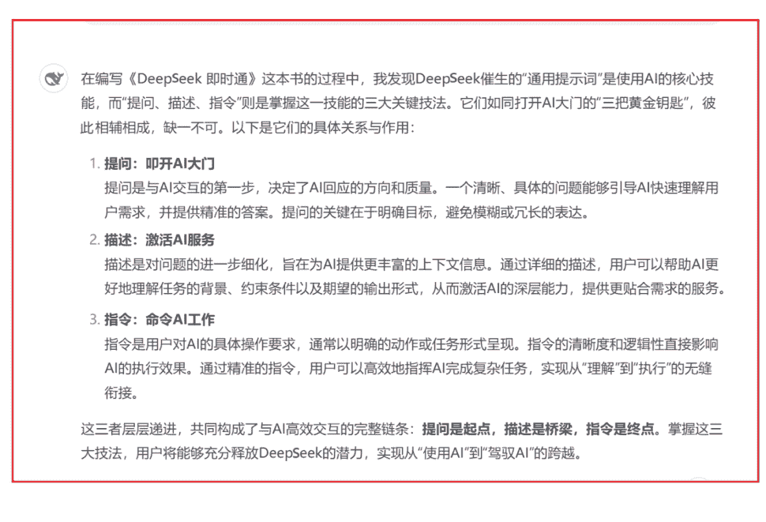

## 图3-2 DeepSeek对三把核心钥匙的解读

### (2) 描述：激活服务

在问题基础上细化，为模型提供更丰富的上下文。详实的描述帮助模型理解背景、约束和期望输出，激活深层能力。

### (3) 指令：指挥工作

对模型的具体操作要求，通常以明确动作呈现。清晰的指令直接影响执行效果，实现从理解到执行的衔接。

三者层层递进：提问是起点，描述是桥梁，指令是终点。掌握后可从使用模型转向驾驭模型。

练习与测试：

### (1) 创意写作助手

提问：能否帮我写一个关于未来都市的科幻故事？
描述：背景在2150年，人类生活在空中智能城，一场能源危机打破平静。主角是年轻能源工程师，发现改变命运的秘密。
指令：请用第一人称叙述，突出内心挣扎与科技与自然冲突，结尾留悬念。

### (2) 职场效率提升

提问：如何快速整理一份会议纪要？
描述：新产品发布头脑风暴会，参与市场、设计、技术团队，讨论目标用户、功能设计与推广策略。
指令：按“讨论主题—关键观点—后续行动”结构整理成表格，并标注负责人与截止日期。

### (3) 生活趣味助手

提问：能否帮我设计一个有趣的周末家庭活动？
描述：家庭成员为一对夫妻、8岁孩子和一只宠物狗。希望增进亲子互动且宠物能参与。
指令：提供3个创意方案，包含材料、步骤、时长，并附温馨提示。

上述内容既实用又能激发创造力。试试看。

下一章将详述这三把核心钥匙的使用方法与技巧。

## 第四节 通用指引语的三个品质

通用指引语的标准，归纳为清、通、明。

- “清”即清楚。
- “通”即通达。
- “明”即明白。

第一，关于清楚。要明白指引写给模型，模型是工具。要像给新员工布置工作那样说明岗位、职责、目标、任务。你要清楚问谁，同时把意图表达清楚。

第二，关于通达。就是用顺畅的方式表达意愿，目的是让模型听懂。通顺不等于通达，只有达到目标、被对方接受才算通达。若模型听不懂，就要换说法，直到得到满意回复。

第三，关于明白。用明确而非宽泛的语言，用明显而非含糊的表述，简洁地表达目的、要求、愿望，让模型听懂并执行。

例如，有网友发了这样一条指引：

> 给我写一篇十万字的小说。

从语文角度看，这句话清楚、通达、明白，但DeepSeek却懵了。

原因有三：

第一，太宽泛，没说清题材；
第二，太抽象，没给出小说要素；
第三，太模糊，没指明人物与事件。

网友又补发指引，增加了时代、地点、人物等信息，结果模型仍回复“思考中，回复‘继续’以回答。”


## 图3-3 某网友要模型写十万字小说的指引

网友把模型的回复全文拷贝回去，两者陷入无尽循环。

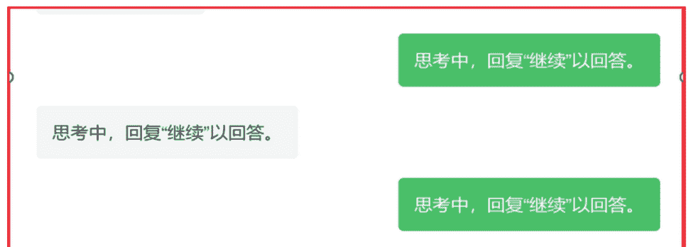

## 图3-4 网友与模型陷入“继续以回答”的循环

这是清通明标准的典型反例。

**第一，指引不清楚。** 模型不懂指引，要求回复“继续”；用户也不懂，又把不清楚的指引发回去，双重不清。

**第二，指引不通达。** “思考中，回复‘继续’以回答”本身就是病句，导致双向误解。

**第三，指引不明白。** 对话是糊涂对糊涂。若用户理解模型本意，只回“继续”，对话才能继续。

可见清通明环环相扣，缺一不可。

## 第五节 通用指引语的三元法则

“三元”指构成事物的三个关键要素，如三脚架需三条腿。自然科学认为三元结构是复杂系统的最小单元。我们发现，无论指导模型还是解决现实问题，抓住三项核心要素即可化繁为简。

老子说“一生二、二生三、三生万物”，道出生成规律。通用指引语正是运用此规律，用三个核心要素构建完整方案，故称“三元法则”。

面对复杂任务，找准关联最紧密的三项核心要素，就能有效指导模型。就像：

烹饪把握食材、火候、调味。
写文章把握开头、主体、结尾。
做事情把握方向、路径、技巧。

在智能时代，三元法则极其实用。例如：

1. 提问时说清对象、要求、场景。
2. 制订计划时明确目标、步骤、标准。
3. 解决问题时分析现状、原因、对策。

### 一、多元指引生成的“天鹅湖”

先看图3-5“天鹅湖”。蓝天白云下，清湖绿树，天鹅群游，两只大白天鹅欲飞，引得小天鹅跟随。画面宁静祥和。

有人问这是哪里拍的？王子答：这是模型生成的。

友人要指引，我提供如下：


## 图3-5 复杂指引生成的“天鹅湖”

平静的湖面上，一群优雅的白天鹅翩翩起舞，展翅飞过湖面，它们的羽毛在阳光下闪烁着洁白的光芒，仿佛是天空中的精灵。天鹅们的身影在水面上留下轻柔的倒影，伴随着微风轻轻荡漾。远处，湖边的柳树垂下柔软的枝条，仿佛在为这些优雅的生物送上祝福。空中，几朵白云悠然自得地漂浮，映衬着这幅如诗如画的风景。

对比指引与成图可发现，部分加下划线的语句在图中并未体现，是无效信息。

### 二、六元指引生成的“天鹅湖”

去掉冗余描述后，指引变为：

平静的湖面上（位置），一群优雅的天鹅（主体）翩翩起舞（动作），远处湖边的柳树（副主体）垂下（动作）柔软的枝条，空中，几朵白云悠然自得地漂浮（衬托）。

模型绘图见图3-6。


## 图3-6 简洁指引生成的“天鹅湖”

对比两图，第二幅更生动灵气。

第一幅指引约150字，元素几十个，效果一般。
第二幅约44字，仅用六个元素：位置、主体、动作、副主体、动作、衬托，效果更好。

为何简化的指引效果更佳？可能因模型认知有限，说得越多越难消化，留出创作空间反而更出彩。

### 三、三元指引生成的“天鹅湖”

用三个元素再简化一次。我们的指引是：

为什么三个要素就能做出更鲜活的效果

湖面安静，几只天鹅在水上轻滑，像在自在起舞。仅靠三个要素生成的图3-7《天鹅湖》，观感张力竟然超过了用几十个要素拼出来的图3-5。


## 图3-7 三要素版天鹅湖

差距从何而来？正是下面要讲的“三元法则”在起作用。

通用提示词里的三元法则，源自三条构建经验：

第一，效果与完备度相关，提示效果大致等于完备程度乘以信息聚焦程度。
第二，质量与要素质量相关，单个要素越扎实，输出越好。
第三，数量并非越多越好，在同等条件下，三要素的投入产出比往往最高。

三张图的对比说明：关键在精而不在多，成败由构成决定。

三条经验既相互独立，又能互补，还存在辩证关系。要素数量要恰到好处，不能过量也不能不足。

这个分寸就是“三六九”。

基数是三，三加三得六，六加三得九，形成三级进阶。从三的视角看：
低于三，画面会单薄混乱，甚至无法成像。
高于九，会显得臃肿繁琐，很多要素成了冗余。
介于三和九之间的六，最为均衡，不多不少。

所以拆解优秀的提示词时，常会撞见六。

总体而言：
下限为三，平衡点为六，上限为九。
初学者建议从三要素起步，中级可尝试六要素，高级再探索九要素。

三元法则的威力很大，后面会持续展开。

### 四、“三元矩阵”实战工具包——三分钟把问题变方案

使用口诀：
“锚定一个核心议题→两分钟头脑风暴→提炼三项关键点→打开无限可能”

#### （一）“三元矩阵”万能模板

表3-1 “三元矩阵”万能模板

| 阶段 | 示例填写 | 操作提示 |
| :--- | :--- | :--- |
| 1. 核心议题 | 例：如何让领导通过我的方案？ | 一句话表述，越具体越好 |
| 2. 拆解角度 | 例：说服力、可行性、成本 | 参考下方维度库 |
| 3. 要素填入 | 说服力：行业成功案例；可行性：分阶段落地；成本：预算低于竞品 | 每点控制在8字内 |
| 4. 组合校验 | “引用A公司案例+分三期推进+比B方案省20万” | 读一遍看是否自洽 |

#### （二）“六大场景”速配模板

##### 1. 工作汇报
[现状] 客户满意度跌15%
[原因] 售后响应超48小时
[对策] 上线AI智能工单
口诀：数据+痛点+解法

##### 2. 求职简历
- [能力] 社群运营3年
- [成果] 转化率提升25%
- [标签] 自创表情包裂变
口诀：技能+数据+个人招牌

##### 3. 争辩
- [事实] 你昨天没倒垃圾
- [影响] 招来蟑螂
- [诉求] 现在立刻处理
口诀：事实+后果+明确指令

##### 4. 小红书标题
- [人群] 打工人
- [痛点] 通勤2小时
- [诱惑] 3个摸鱼神技
口诀：身份+痛点+利益

##### 5. 领导画饼
- [愿景] 明年上市
- [资源] 配5人团队
- [代价] Q4需加班
口诀：大饼+筹码+成本

##### 6. 相亲自我介绍
[硬条件] 有房无贷
[软实力] 会做川味火锅
[底线] 不接受丁克
口诀：硬件+特色+红线

#### （三）避坑自检
要素打架：三项要素需一致，避免又要省钱又要豪华。
要素悬空：必须可执行，把“提升服务”改为“24小时在线客服”。
要素漏气：逐项删除测试，若删掉一项说服力就归零则不合格。

#### （四）维度灵感库
职场：效率、质量、成本、创新、风险
生活：时间、金钱、情绪、健康、关系
学习：输入、加工、输出、反馈、激励

#### （五）实践任务卡
紧急：挑一个今日待办，用矩阵拆解。
长期：每天用三元法重构一条微信消息。
终极：用三要素向伴侣解释为何又买游戏皮肤。

附空白表见表3-2
表3-2 空白矩阵表
| 问题：______ | 维度1：______ | 维度2：______ | 维度3：______ |
| :--- | :--- | :--- | :--- |
| 要素1 | | | |
| 要素2 | | | |
| 要素3 | | | |

记住：生活给你一团乱麻，就把它编成三股辫子！

【学习提示】
任何难题别发愁，
三项要素记心头。
找准关键三件事，
AI助你解忧愁！

#### （六）现场演示训练
第一步：填核心问题
× 错误：“怎么才能吃饱？”太模糊
√ 正确：“30分钟内吃到便宜又好吃的酸辣粉？”

第二步：选三维度
速度、价格、口味。可套用价格+质量+速度。

第三步：填具体要素
表3-3 要素填写示例
| 维度 | 具体标准 | 现实案例 |
| :--- | :--- | :--- |
| 速度 | 30分钟内送达 | 选500米内店铺 |
| 价格 | 不超15元 | 用满减红包 |
| 口味 | 够酸够辣 | 看差评是否提到不够辣 |

第四步：合成指令
“选600米内重庆酸辣粉+用新人红包+备注加辣加醋”

对比
× 旧法：翻20分钟外卖，最后贵又难吃
√ 三元法：3分钟锁定，省5元还合口

工作例
问题：如何说服老板买新电脑？
维度：必要性+性价比+回报
要素：演示三开Excel就卡；申请4000元联想；每天省1小时
话术：“老板，电脑开三表就崩，想申请这台联想，每天能少算错五张表。”

常见问答
Q：维度必须自己选吗？
A：新手可直接套：做事类目标+方法+资源；购物类需求+预算+售后；争执类事实+感受+诉求
Q：要素写多长？
A：朋友圈式精简，如“预算砍20%”

# 第四章 DeepSeek的三把黄金钥匙

## 第一节 提问：进入AI时代的通行证
重要性：爱因斯坦与毛泽东均强调提问价值，提问质量决定输出质量
- 9句式：请问、请教、如何、怎样、什么、解答、说说、讲讲、聊聊
- 5模式：开放式、封闭式、引导式、假设式、探求式

## 第二节 表述：驾驭AI能力的驾驶证
本质：表达与描述的结合
- 9句式：描一幅景象、写一个故事、看一场赛事、记一次经历、画一个场景、在一幅画面里、讲一个故事、拍一个场景、忆一次探险
- 5模式：背景表述、条件表述、目标表述、细节表述、情感表述

## 第三节 指令：指挥AI运行的导航证
本质：明确指挥AI执行特定任务
- 9句式：剖析、定义、比喻、举例、介绍、描述、比较、评说、评论
- 6模式：简单指令、分步指令、条件指令、优先指令、反馈指令、创意指令

## 第四节 三把黄金钥匙的万能组合
组合方式：提问+描述+指令灵活搭配
6示例：提问+指令、指令+提问、描述+提问、提问+描述+指令、描述+指令+提问、三者综合

总结
提问高度决定工作水平
描述精度决定输出质量
指令力度决定执行效果

掌握三把钥匙即可从使用AI迈向驾驭AI。AI时代已至，DeepSeek出现提示高效交互能力已成必备技能。工作学习生活皆可借助AI，但如何让AI真正理解需求，答案在提问、表述、指令三法宝中。它们如打开AI之门的三把钥匙。

注意：表述是包含并统领描述的上层概念。表述即表达+描述的融合，描述提供血肉，表述指引目的。


图4-1 开启AI之门的三把黄金钥匙

第一，“提问”是通行证。理由：通行证是入场券，提问是交互起点。没有精准提问就无法进入AI核心能力。示例：“你能帮我写一篇关于AI使用的文章吗？”

第二，“表述”是驾驶证。理由：驾驶证证明合法上路资格，表述体现用户驾驶AI能力。示例：“请写一篇人工智能伦理文章，聚焦隐私与算法偏见，1500字，语气严谨。”

第三，“指令”是导航证。理由：导航证规划路线，指令告诉AI如何完成任务。示例：“把文章译成英文并给出简洁摘要。”

掌握三证即可成为AI时代老司机。

## 第一节 提问：进入AI时代的通行证

通用提示词第一把钥匙是提问。提问看似简单却至关重要，提问质量往往决定输出质量。提问既是打开AI之门的钥匙，也是打开思想宝库的钥匙。

爱因斯坦：“提出问题往往比解决问题更重要。”
毛泽东：“学问，学问也；学会问，才有学问。”

### 一、提问的重要意义
问DeepSeek：“提问”在提示词中何意义？
回答要点：启动对话、明确需求、引导回答、深化交互、激发创新、建立连接。总之提问是核心技能，决定质量与效率。

### 二、提问九个通用句式
1. 请问：对话开场。例：请问植物何时放氧？
2. 请教：谦虚求助。例：请教弧圈球打法。
3. 如何：询问方法。例：如何学好人工智能？
4. 怎样：询问步骤或评价。例：怎样学英语？
5. 什么：阐明概念。例：什么是黄金柱？
6. 解答：要求答案。例：解答数学题。
7. 说说：要求阐述观点。例：说说你对XX看法。
8. 讲讲：要求叙述。例：讲讲流浪地球故事。

AI互动入门：提问·表述·指令三把钥匙

9. 自由对话：把模型当作闲聊伙伴，无压力地就任何主题展开非正式交流。示范说法：“来聊聊××话题”“我们深入聊聊××”。

完成前面九项练习后，再回头看“提问”二字，就会意识到这正是在领取一张通往智能时代的通行证。这张通行证覆盖面极广、分量也很重，因为提问是提示词里最基础也最常用的用法，更是新手打开AI大门的黄金钥匙。

### 三、提问的五种常用模式

#### 1. 开放式提问
核心特征：给予模型宽松空间，产出详尽多元的内容。
典型用途：捕捉灵感、探索未知领域、获得多样化结果。
参考说法：
- 请围绕未来都市写一个科幻短篇。
- 能否系统介绍机器学习的基本原理？
- 有哪些办法可以提升团队执行效率？

#### 2. 封闭式提问
核心特征：答案简短明确，多为是非或选项。
典型用途：核实信息、快速决策、精简交互。
参考说法：
- DeepSeek是否具备多语言翻译能力？
- 这份报告能在五分钟内整理出摘要吗？
- 哪个标题更具吸引力：A.未来科技，B.人工智能崛起？

#### 3. 引导式提问

#### 4. 假设式提问
核心特征：设定假想情境，驱动模型给出创新解法。
典型用途：创意产出、战略推演、问题求解。
参考说法：
> 假如AI完全取代人类劳动，社会结构会怎样演变？
> 假设你担任产品经理，会如何规划一款AI赋能的教育应用？
> 若AI能实时翻译所有语言，全球沟通会产生哪些变化？

#### 5. 探求式提问
核心特征：层层追问深挖，获取更精准信息或激活模型潜力。
典型用途：技术细节挖掘、复杂问题剖析、多轮对话优化。
参考说法：
> DeepSeek的“联网搜索”功能具体是如何实现的？
> 你提到的“AI自动化办公”包含哪些具体模块？
> 为什么认为该方案更匹配我的需求？能否补充数据支撑？

掌握这五类提问方式，就能让与DeepSeek的互动从基础问答升级为深度协作。

### 四、综合运用
场景：让DeepSeek撰写一篇关于人工智能伦理的文章。
开放式提问：“能帮我写一篇谈人工智能伦理的文章吗？”
封闭式提问：“篇幅能否控制在1500字以内？”
引导式提问：“我想从‘隐私保护’和‘算法偏见’两方面展开，你会如何组织？”
假设式提问：“假设AI已拥有完全自主决策能力，人类该如何制定伦理规范？”
探求式提问：“你提到的‘算法偏见’，能否举例说明在实际场景中的影响？”

## 第二节 表述：驾驭AI能力的驾驶证

通用提示词的第二把钥匙是“表述”。

表述是表达与描述的融合。既传递清晰客观的信息，也描绘细腻生动的画面。通过表述，我们能更全面、准确且富有感染力地传递意图，让AI不仅读懂，还能感知重点，从而给出预期结果。

此前“天鹅湖”的提示就是典型表述性提示，像画笔一样为指令增添色彩、细节和画面感，使表达更精准可感。描述性要素大幅提升了AI对意图的理解度。

### 一、表述性提示词表达加描述的操作要点
1. **细节捕捉与情节再现：** AI绘画需要精准复现材质、光影、色彩变化等细节，需要强描述能力。
   例如：> “璀璨星空下，人们围着篝火，互诉心事。”
2. **场景构建与氛围营造：** 作品不仅是物体堆砌，更是整体场景与氛围的塑造，需要用描述创造层次。
   例如：> “阳光透过窗帘缝隙，洒在床上形成金色光栅。”
3. **情感表达与故事讲述：** 描述是情感载体，也是讲故事的方式，需要让AI感知画面情绪与情节。
   例如：> “他激动地拆开久违的信，眼里闪着泪光。”
4. **创意构思与模拟实现：** 在文生图、文生视频、文生音乐中，创意是灵魂。提示需把独特构思描述为具体画面。
   例如：> “音乐响起，舞台灯光渐亮，演员缓缓走向中央。”

实践中，表述性提示常被简称为描述性提示。

### 二、表述的九个通用句式
1. 画一幅傍晚海边的景致，金色余晖洒在波光粼粼的海面。
2. 写一个歌颂勇气与坚持的故事，主角在逆境中最终取得成功。
3. 看一场激烈的足球赛，球员全力拼抢，看台欢呼此起彼伏。
4. 记一段难忘的旅行，山河壮美，风土人情令人沉醉。
5. 画一座古老神秘的城堡，石墙斑驳藤蔓缠绕，门前站着一人。
6. 一幅宁静乡间的画面，金黄稻田，袅袅炊烟，三只羊在草间。
7. 讲一个关于友情的故事，朋友互相扶持一起渡过难关。
8. 拍一幅繁华都市夜景，灯火通明，车流如织，人潮涌动。
9. 回忆一次刺激的户外探险，林深幽静，溪水潺潺，挑战与惊喜并存。

这类表述既明确请求，又提供丰富细节，帮助AI产出更符合预期的结果。

### 三、表述的五种常用模式

#### 1. 背景表述
主要特点：提供任务背景，帮助AI把握上下文。
使用场景：复杂任务、多步骤问题、需要上下文支撑的内容。
示例：
> “我正在写人工智能在医疗领域应用的文章，读者是医疗从业者，请生成一个引言。”
> “我们公司为中小企业开发智能客服，请设计一个功能清单。”
> “我要为‘未来教育’演讲准备材料，听众是教育科技专家，请列出三个核心观点。”

#### 2. 条件表述
主要特点：明确限制条件，确保输出符合要求。
使用场景：格式化生成、特定需求、精准执行。
示例：
> “请写一份会议纪要，包含‘议题’‘结论’‘后续行动’，控制在500字内。”
> “为我做一份9点到18点的日程表，含休息时间和任务优先级。”
> “写一篇300字的环保短文，语气轻松幽默。”

#### 3. 目标表述
主要特点：清晰说明期望结果，引导AI产出更具针对性。
使用场景：目标导向任务、创意生成、问题求解。
示例：
> “我的目标是提升团队效率，请设计一个基于AI工具的优化方案。”
> “希望文章开头能激发读者对人工智能伦理的思考，请写一段吸睛的开场。”
> “我需要一份让用户快速上手智能客服的操作指南，请生成简明说明。”

#### 4. 细节表述
主要特点：提供具体细节，让输出更精准个性化。
使用场景：定制化生成、任务拆解、个性化需求。
示例：
> “请写一个‘未来都市’科幻故事，主角是年轻建筑师，背景设在2150年悬浮城，主题是科技与自然平衡。”
> “我要一份人工智能在金融领域应用的报告，重点风险管理、智能投顾、反欺诈，约2000字。”
> “设计一个家庭周末活动方案，成员为夫妻、8岁孩子、宠物狗，要有趣且亲子互动。”

#### 5. 情感表述
主要特点：用带情感倾向的表述，引导AI匹配情绪需求。
使用场景：情感化内容、品牌故事、用户沟通。
示例：
> “帮我写一封给客户的感谢信，语气温暖真诚，表达长期合作的感激。”
> “需要一篇关于团队合作的演讲稿，语言充满激情、鼓舞人心。”
> “写一段关于旅行的文字，风格轻松愉快，让人感受到旅行的美好。”

运用这五种表述模式，能让需求从模糊变为精准，实现精准输出。

### 四、综合运用
基本场景：用DeepSeek写一篇“人工智能与未来教育”的文章。
背景表述：“我正在准备关于人工智能如何改变未来教育的文章，读者是教育从业者和政策制定者。”
条件表述：“字数1500字以内，结构为引言、主体、结论。”
目标表述：“希望引发读者对人工智能教育应用的深度思考并激发创新灵感。”
细节表述：“重点讨论个性化学习、教师辅助工具、教育公平性。”
情感表述：“语言严谨但亲和，让读者感受到人工智能为教育带来的希望与挑战。”

## 第三节 指令：指挥AI运行的导航证

通用提示词的第三把钥匙是“指令”。

指令就是明确具体地告诉DeepSeek执行特定任务的命令，是沟通的桥梁。指令灵活多样，能让AI按意图工作，像指挥棒一样激活AI功能。

### 一、“生成一切”的经典指令模式
核心句式是：“请生成××××”。据此可以轻松让AI产出文学、文案、科普、数据分析、工作汇报等内容。指令还能加入风格、长度、语言、受众等参数，实现高度定制。

例如要AI写秋天七言律诗：
> 请生成一首歌颂秋天的七言律诗。

再发指令让它写春天诗并指定意象：
> 请写一首歌颂春天的七言律诗，文中要有燕子、蝴蝶、小猫、小狗。

### 二、指令九类常用表达
1. **剖析：** 让AI深入分析事物本质、结构、成因。示例：“剖析××××的根源”“针对××××进行剖析”。
2. **定义：** 让AI给出明确精确的解释。示例：“定义××××概念”“定义AI手机”。
3. **比喻：** 让AI用形象语言说明概念本质。示例：“比喻机器学习”“比喻算力”。
4. **举例：** 让AI提供具体实例佐证观点。示例：“举例说明算力是什么”“举例说说双标”。
5. **介绍：** 让AI说明事物背景与特点。示例：“介绍DeepSeek比ChatGPT强的功能”“介绍一下《红楼梦》”。
6. **描述：** 让AI生动刻画特征、状态、过程。示例：“描述一下葫芦丝的特点”“对××××产品进行描述”。
7. **比较：** 让AI对比异同与优劣。示例：“比较古筝和古琴”“比较蔷薇和月季”。
8. **评说：** 让AI对事件、观点进行评论。示例：“对热门话题进行评说”“就××××情况进行评说”。
9. **评论：** 让AI表达分析性意见。示例：“就××××发表你的评论”“评论《哪吒2》的艺术成就”。

### 三、指令的六种常用模式

#### 1. 简单指令
主要特点：直接明示任务。
使用场景：快速执行、简单生成。
示例：
> “请生成今日待办清单。”
> “把这段文字译成英文。”
> “总结这篇文章的核心观点。”

#### 2. 分步指令
主要特点：将复杂任务拆解为步骤逐项指导。
使用场景：复杂执行、多步骤问题。
示例：
> “第一步分析销售数据趋势；第二步用柱状图展示；第三步总结关键发现并给出建议。”
> “先列未来都市故事大纲，再写开头，最后完善细节。”

#### 3. 条件指令
主要特点：在指令中加入条件限制。
使用场景：格式化生成、特定需求匹配。
示例：
> “若用户选A方案，生成功能说明；选B方案，生成成本分析。”
> “若数据支持就生成图表，不支持就总结主要发现。”

#### 4. 优先指令
主要特点：明确任务先后顺序。
使用场景：多任务处理、时间管理。
示例：
> “先完成报告摘要，再生成详细分析。”
> “优先处理客户反馈中的紧急问题。”

#### 5. 反馈指令
主要特点：要求AI根据反馈调整输出。
使用场景：内容优化、问题求解。
示例：
> “根据我的反馈修改文章，使其更简洁明了。”
> “依据用户体验优化智能客服流程。”

#### 6. 创意指令
主要特点：激发创造力，产出创新内容或方案。
使用场景：创意生成、战略规划。
示例：
> “设计未来都市交通系统，要求环保高效。”
> “生成一个关于人工智能伦理的辩论题目，引发深度思考。”

### 四、综合运用
运用场景：用DeepSeek生成“人工智能与未来教育”报告。
简单指令：“请生成一份关于人工智能与未来教育的报告。”
分步指令：“先列三项人工智能在教育中的应用，再举例，最后总结发展趋势。”
条件指令：“若读者为教育从业者，侧重技术实现；若为政策制定者，侧重政策建议。”
优先指令：“优先写完引言，再生成详细分析。”
反馈指令：“按我的反馈修改，使报告更简洁明了。”
创意指令：“设计一个未来教室概念，融合人工智能与互动互助学习功能。”

## 第四节 “三把黄金钥匙”的万能组合

“提问”“表述”“指令”三把黄金钥匙的组合方式被多款主流AI一致认可，抓住了进入AI世界的核心抓手。

三者可以自由组合，设计出多种高效提示语句，越用越顺手。以下是六种典型组合示例。

### 1. 问前令后
英语听说读写想再提升，有没有可直接上手的练习方案？
官网想改善搜索排名要怎么调整？请把影响排名的关键SEO做法梳理出来。
想要保持健康，平均每天行走多少步比较合理？帮我确定一个科学的日步基准。
信用分数受哪些因素影响？整理一份维持良好信用的操作清单。

### 2. 令前问后
把今天的所有安排列出来，哪些事项需要优先处理？
记录明天全部会议的时间，如何让会议更高效？
提醒我每周做一次财务复盘，复盘时应关注哪些核心财务指标？
设置每天阅读30分钟的提醒，怎样挑选更具启发性的书籍？

### 3. 陈述后提问
结合当前市场走势，哪些投资方向机会更大？需要观察哪些关键指标？
在现阶段经济环境下，哪些行业成长性更强？应该参考哪些宏观数据？
挑选投资基金时要考虑哪些维度？长期表现如何评估？
日常可以做哪些事来减少碳排放？哪些微小改变效果更明显？

### 4. 问述令混合 顺序可变
申请这项贷款需要准备哪些材料？可能遇到什么问题？给出清晰的操作步骤。
我想学一门AI相关语言，你建议学哪种？最佳学习路径是什么？为我制定一个学习计划。
睡眠质量怎样提升？哪些生活习惯会影响睡眠？请提供一份可执行的改善清单。
我想开始健身该如何入门？初学者适合哪种方案？帮我设置每周健身提醒。

### 5. 述令问混合 顺序可变
久坐办公想缓解便秘，适合怎样的饮食方案？推荐一份健康食谱。
哪些App可以用来管理时间？推荐三款并说明它们提升效率的逻辑。
如何制定一个可行的预算方案？给我一个预算模板。怎样才能长期坚持？
哪些在线课程能提升公众演讲能力？列出几门顶级课程。学到的内容如何应用到实际演讲？

以上例子把探索性提问、深入陈述与直接指令融合，让模型能从多角度理解意图。

提问、表述、指令三者的关联归纳如下：

## 表4-1 DeepSeek归纳的“三把黄金钥匙”功能关系图

| 关系 | 提问 | 表述 | 指令 |
| :--- | :--- | :--- | :--- |
| 定义 | 呈现用户诉求 | 以问句形式表达诉求 | 给出明确执行指示 |
| 目的 | 获取信息解答 | 表述清楚以获得解答 | 完成任务所需的操作要求 |
| 交互 | 启动开放对话 | 以陈述开启交流 | 直接发出执行指示 |
| 优点 | 适应性强、灵活 | 表达方式多样 | 反馈迅速、响应快 |
| 联系 | 引导深入交流 | 用陈述推动话题深入 | 把问题转化为行动 |
| 应用 | 探索知识领域 | 通过提问探索知识 | 实施具体任务操作 |

总体来看，提问、表述、指令作为提示词的“三把黄金钥匙”，各有优势且相互配合，共同提高人机交互效率。

借助这三把钥匙，模型能更准确把握意图，提供更个性化的服务。总结为：
你的提问高度，决定模型的工作水准。
你的表述精度，决定模型输出的质量。
你的指令力度，决定模型执行的成效。

# 第五章 DeepSeek的“六套黄金魔方”

## 第一节 “一元树标魔方”
- 核心特征：通用性强，用最少元素获得最佳效果
- 魔法公式：请仿照我提供的XXXX样本，做XXXX
- 案例：
  - 纪念建军节文章标题
  - 《沁园春·海》诗词创作
- 解读：借助样板，模型进行模仿再生

“一元树标魔方”讲究用最少元素换取最大效果。

**魔方公式：请仿照我提供的××××样本，做××××。**

**案例1：** 请按《雄伟的井冈山，八一军旗红》的风格，帮我列出纪念建军节的三个文章标题。

图5-1生成的标题都很精彩，按此风格写作情感自然饱满。DeepSeek确实有两下子。

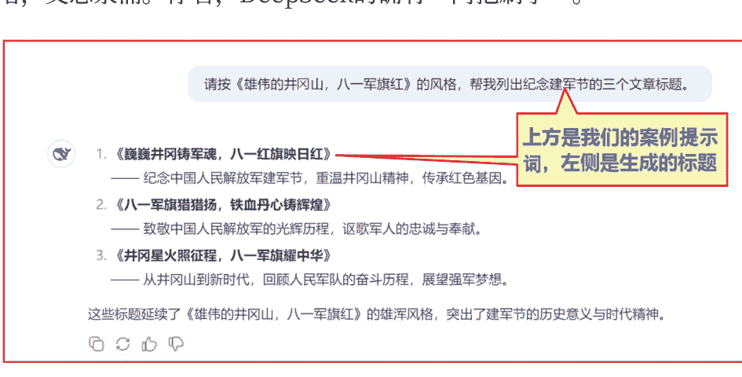

**图5-1 DeepSeek按照“一元树标魔方”生成的建军节文章标题**

**魔方解读：**
“一元树标”即用户只需提供一个元素作为标杆或样板，模型照此完成任务即可。唯一前提是必须有可模仿的样板，没有样板则此法不适用。

**案例2：** 请仿照毛泽东的《沁园春·雪》，帮我写一首《沁园春·海》，以纪念我军在南海填海建岛，保卫万里海疆的丰功伟绩。

图5-2生成的《沁园春·海》气势恢宏，豪情满怀：

南海苍茫，碧波万顷，巨浪滔天。
………… 
抬望眼，正红旗漫卷，气贯云天。

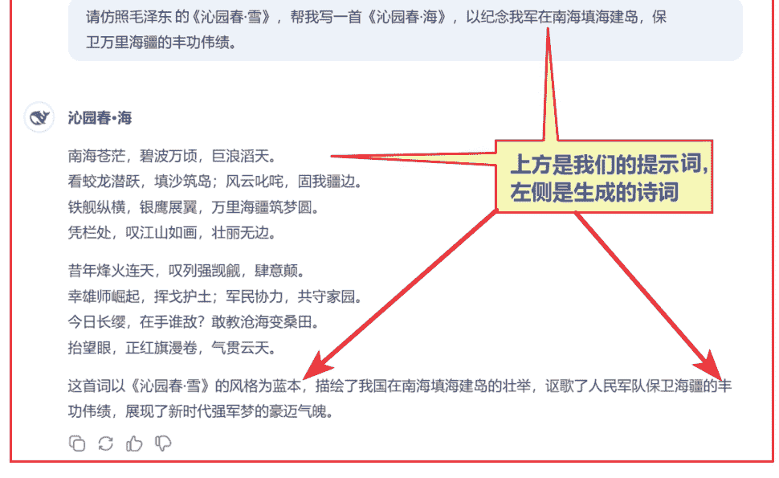

**图5-2 利用“一元树标魔方”让DeepSeek生成的《沁园春·海》**

“一元树标魔方”充分利用样板魅力与DeepSeek强大的模仿再生能力，可生成各类文章、小品、诗词、散文、广告文案、宣传文案、公众号文章、小红书文章，甚至长篇小说或电视剧脚本。

有人说“一元树标一招鲜，任我走遍天”。但没有样板可模仿时，仍需靠头脑重新组织指令。

## 第二节 “二元定位魔方”
天下行业各有特色，天下人也有各自特点。若想用提示词说清某行业或人物特征很难。通用提示词的“二元定位魔方”正好派上用场。

“二元定位”就是给模型定一个身份，也给自己定一个身份，让模型按你的身份完成任务。

**魔方公式：你是XXX，我是XXX，请你帮我做XXX，要求XXXX。**

**案例1：** 你是一位广告策划专家，我是一名广告公司职业经理，请你帮我策划一个无人驾驶新能源汽车的电视广告文案。

把“你”定位为广告策划专家，DeepSeek就会以该身份为你服务。括号里的用词很重要，“专家”不及“大师”，想要顶级作品就给“大师”身份。

**魔方解读：**
DeepSeek具备模拟身份特性，可扮演各类人物，输出结果带有特定素质，目标更明确。

**案例2：**
你是一名儿童话剧编辑，我是一名儿童故事博主，请你帮我写一篇儿童睡前小故事，要求语言柔和优美、善良温馨，体现大灰狼与小白兔的友谊。

“你是××”定位模型身份，“我是××”定位用户身份，“请你帮我××××”指定目的，“要求××××”明确标准。身份与任务清晰，结果自然不错。请看图5-3。

你是一名儿童话剧编辑，我是一名儿童故事博主，请你帮我写一篇儿童睡前小故事，要求语言柔和优美、善良温馨，体现大灰狼与小白兔的友谊。

上面是我们给DeepSeek的提示词，下面是输出的故事

## 《月光下的约定》
…


开启新对话

给 DeepSeek 发送消息

深度思考 (R1) 联网搜索

图5-3 “二元定位魔方”的输出效果

在“二元定位魔方”启发下，DeepSeek写出的儿童睡前童话让敌对动物建立友谊，创意十足。

## 第三节 “三元万象魔方”
提示词太简单，模型回答会空泛；太复杂，容易遗漏。“三元万象魔方”可轻松化解。

所谓“三元”，即三个相互关联的元素。《道德经》“一生二，二生三，三生万物”的规律结合DeepSeek，形成“三生万象”效果。

### 一、“三元万象”的核心：提示词只由三个元素构成
魔方公式：××关于××的××
三个元素需有关联，否则无效。

示例：
1. 撰写一篇关于环保、节能减排、未来生活变化的文章。  
2. 分析人工智能、医疗健康、隐私保护之间的关联。  
3. 设计一个包含科幻元素、冒险情节、角色成长的故事大纲。  
4. 创作一首融合古典诗词、现代情感、自然景象的诗歌。

**案例：** 请你写出类似“天下无难事，只要肯登攀”的三句励志佳句。

DeepSeek从典籍中给出符合条件的三句并附出处与解读（见图5-5）。

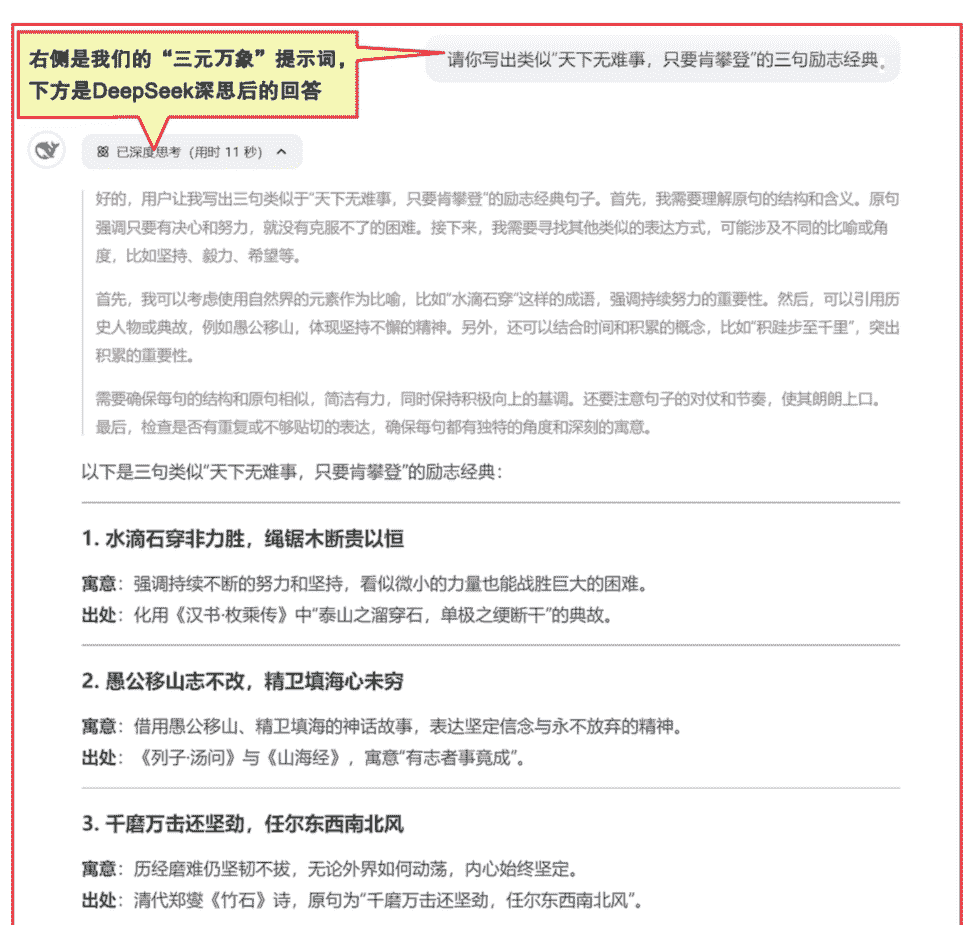

## 图5-5 “三元万象魔方”和DeepSeek的回答

“三元万象”基础、简单、高效，元素可随意替换。

### 二、核心理念与设计原则
**哲学基础**：以《道德经》“一生二、二生三、三生万物”为基础，三元素构成思维链条。  
**设计原则**：简洁性、普适性、文化性。

### 三、标准化元素组合
**问题解决**：问题、原因、解决方案  
**内容创作**：主题、角度、风格  
**决策分析**：目标、选项、评估标准

## 第四节 “三要万通魔方”
核心特征：万能公式，应对绝大多数需求  
公式：我要做XX，要给XX用，要求达到XX效果，但是担心XX  
案例：三天快速掌握Deepseek学习计划  
实践：健康管理公众号涨粉案例

## 第五节 “三维聚焦魔方”
核心特征：三个维度聚焦一个主题  
维度：历史、现实、未来  
使用指南：明确主题→三维拆解→逻辑闭环→优化表达  
案例：减肥、心理健康、职场发展、环境保护

## 第六节 “三问探幽魔方”
核心特征：提问+追问+反问，深入探讨  
基本公式：（提问）XXXX有什么问题？（追问）这些问题将XXXX？（反问）否则会XXXX？  
实操步骤：提问明确方向→追问挖掘深度→反问挑战边界  
应用场景：学术研究、问题探索、决策分析、日常思考

关于DeepSeek使用方法的术语称谓不一，有人称魔方，有人称魔法或魔术，命名混淆。我们统一“方、法、术”为“道、技、用”三层：

“方”即道层面，规律性；  
“法”即技层面，技术性；  
“术”即用层面，应用性。  
三者以“方”为帅，“法”为将，“术”为兵。

## 表5-1 “方、法、术”三级架构

| 层级 | 中文术语 | 英文映射 | 核心特征 | 认知锚点 |
|---|---|---|---|---|
| 战略层 | 方（道） | Principle | 规律性 / 稳定性 | 北斗（恒定方向） |
| 战术层 | 法（技） | Methodology | 技术性 / 系统性 | 罗盘（路径规划） |
| 执行层 | 术（用） | Technique | 应用性 / 灵活性 | 船桨（具体操作） |

下面将详解六个规律性魔方的应用：“一元树标魔方”“二元定位魔方”“三元万象魔方”“三要万能魔方”“三维聚焦魔方”“三问探幽魔方”。

#### 4. 学术研究用法
要素构成：研究议题、研究方法、研究结论
示例参考：
议题：全球变暖对粮食生产的实际冲击是什么？
方法：借助数据建模工具并辅以案例分析。
结论：气温波动放大极端天气频次，作物产量因此承压。

#### 5. 创新设计实操
要素构成：使用痛点、设计灵感、落地路径
示例参考：
痛点：大众对更顺手的出行方式有需求。
灵感：提出一款可折叠的电动滑板车方案。
落地：选用轻量化材质并搭载智能操控系统。

三元万象的精髓在于三要素协同发力，它借鉴了“一生二、二生三、三生万物”的自然演化规律，可以不断衍生出海量提示词。

### 四、提示词元素速查总表
不少人会问，临场想不起该用哪些元素怎么办？
我们为此准备了两张速查表。
第一张是“提示词元素分类速查表”，如表5-2所示。

## 表5-2 提示词基本元素分类表

| 信息类元素 | 结构类元素 | 控制类元素 |

| :--- | :--- | :--- |

| 主题元素 | 结构元素 | 目标任务元素 |

| 背景元素 | 格式元素 | 质量标准元素 |

| 认知元素 | 风格元素 | 约束条件元素 |

| 感知元素 | 度量元素 | 迭代指令元素 |

| 数据元素 | 空间元素 | 输出验证元素 |

| 参考元素 | 时代元素 | 反馈反思元素 |

第二张是元素需求组合表“三元万象元素综合表”，见表5-3。

## 表5-3 “三元万象”元素组合表

| 需求类型 | 基本提示方法 | 三元万能提问公式 | 推理模型策略 | 通用模型策略 |

| :--- | :--- | :--- | :--- | :--- |

| 生活需求 | 需按照用户需求，直接提出问题 | 目的 + 服务对象 + 执行标准 | 分析用户需求，找到最优方案 | 简单提问，逐步深入，适当补充 |

| 工作需求 | 需完成具体操作（文案/图表/视频） | 任务 + 步骤约束 + 输出格式 | 自主优化步骤，兼顾效率与正确性 | 严格发出指令，无自主优化 |

| 学习需求 | 需根据用户实际，提出相应需求 | 科目 + 当前进度 + 期望结果 | 根据用户情况，找到努力方向 | 直接提出问题，列出注意事项 |

| 决策需求 | 需权衡选项、评估风险、选择最优解 | 要求 + 选项 + 评估标准 | 要求逻辑推演和量化分析 | 直接建议，依赖模型经验归纳 |

| 问题需求 | 需深度概括问题/信息、发现因果关系 | 问题 + 数据/信息 + 分析方法 | 触发因果链推导与假设验证 | 表层总结或分类，无需深入分析 |

| 创新需求 | 需生成新颖内容（文本/设计/方案） | 主题 + 风格/约束 + 创新方向 | 结合逻辑框架生成结构化创意 | 自由发散，必须示例引导 |

| 验证需求 | 需逻辑自洽性、数据可靠性或方案可行性 | 结论/方案 + 验证方法 + 风险点 | 自主设计验证路径并排查矛盾 | 简单确认，缺乏深度推演 |

依托这两张表，高质量提示词的生成会更顺畅。

### 五、三元万象的实战组合
结合前面两张速查表，做下面组合练习。

## 1. 背景+需求+要求
我现在正在冲刺高考，想把数学提上去，请按周拆分具体的复习计划与方法。

## 2. 身份+任务+要求（+例子）
请你以资深策划师的身份，为一家新开餐厅设计完整菜单，要求版面简洁美观、突出菜品卖点并附价格与食材介绍，可参考海底捞风格。

## 3. 目标+条件+验证方式
希望一个月减重5斤，工作繁忙仅晚间可运动，饮食忌辣，请给出减重方案，并说明如何判断效果，例如每周体重下降区间与体脂变化。

## 4. 需求+担忧+反向验证
我想买台笔记本电脑，担心性能跟不上广告设计需求，请列出3个可能导致性能不足的原因并分别给出解决办法。

## 5. 问题+追问预期+调整问题
推荐几款适合大学生的笔记本，并在推荐时说明每款在性能、便携、价格上的优劣；若推荐不符主流使用场景如学习办公游戏，请重新推荐并说明理由。

## 第四节 “三要万通魔方”
弄懂三元万象后，三要万通很快就能掌握。

### 一、“三要万通魔方”的说明
魔方公式：我要做××，要给××用，要求达到××效果，但是担心××。
第一个“要”是目标，第二个“要”是目标的补充，第三个“要”是达成目标的标准与限制。该公式覆盖绝大多数需求，故称万通。

示例：
我要快速掌握DeepSeek，想为自己制定学习计划，要求三天内实现办公AI化，但担心内容太多，请给出重点优化建议。

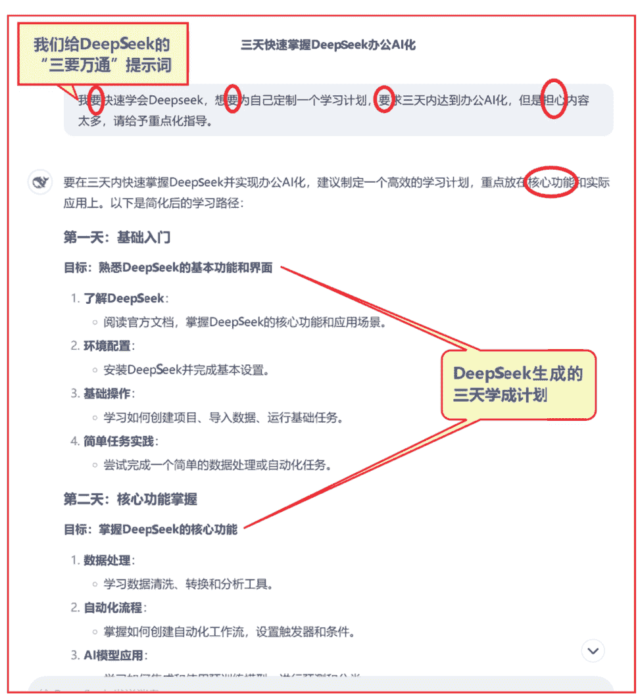

图5-6 “三要万通”提示词得到的“三天学成计划”

### 二、“三要万通魔方”的学习
图5-6计划的核心在于“学成”，因此反复强调实践、动手、即学即用即时通。一次不通就再练一次，二次仍不通就三次，直到完全贯通。中医讲“通则不痛，痛则不通”，哪里卡住就马上学，才能即时通。
DeepSeek据此制定了《三天快速掌握DeepSeek办公AI化》方案，按先总后分原则给出总重点、分步进度、每日练习要点及注意事项，并提供高效学习技巧，是一份非常实用的落地方案。本书正是该方案的细节加速器。

### 三、“三要万通魔方”的实践

## 2025年“健康管理”公众号3个月吸粉50万的魔方
——三要万通魔方精准把控+DeepSeek高效方案

### 用户原始需求（三要万通提示词）：
我要做健康科普内容，要给30~45岁职场高压人群用，要求单篇阅读量10万+，但担心专业术语太多用户看不懂。

### 应用三要万通魔方拆解优化如下：

#### 1. 明确核心目标（我要做××）
**DeepSeek指令：**
我要运营健康类公众号，请帮我确定：
职场人群最焦虑的3类健康问题是什么？
如何把专业健康知识转化为可执行的行动指南？

#### 2. 精准定位受众（要给××用）
**DeepSeek指令：**
生成一份职场健康内容受众画像：
典型用户：32岁IT从业者，日均久坐10小时，睡前刷手机1.5小时；
内容偏好：不喜长文，偏爱清单体与对比实验；
传播场景：午休碎片时间12：30—13：30。

#### 3. 量化效果标准（要求达到××效果）
**DeepSeek指令：**
请制定健康科普内容的“三级增长指标”：
1. 基础指标：单篇阅读量≥10万次，爆款率20%。
2. 进阶指标：用户留存率≥40%，7天内回访。
3. 终极指标：私域沉淀率≥15%，引导至健康测评小程序。

#### 4. 风险预判与解决（但是担心××）
**DeepSeek指令：**
如何避免健康科普因太专业而流失用户？请提供：
（1）3种术语“翻译”法，如用“血管堵车”代替“动脉粥样硬化”。
（2）2个视觉化方案，动态GIF/对比图表。
（3）1个互动验证机制，如“测测你的睡眠质量”即时反馈，具体数据见表5-4。

### 表5-4 “三要万通魔方”的惊人效果

| 指标 | 数据 | 达成率 |

|---|---|---|

| 单篇最高阅读量 | 28 万多次 | 280% |

| 7 天用户留存率 | 53% | 133% |

| 私域沉淀用户数 | 8.7 万人 | 174% |

| 商业变现健康课 | GMV 240 万元 | — |

### 为什么这个案例成功？
需求精准：直击职场人“没空但想健康”的矛盾。
降维表达：用“堵车”“零件生锈”等比喻解释复杂问题。
闭环设计：从认知到测评再到解决方案，形成完整链路。

> 该方法论已被2025年《新媒体健康传播白皮书》收录

## 第五节 “三维聚焦魔方”
前面讲的是“元”，即元素。
这里讲的是“维”，即维度。
所谓“三维”，即过去、现在、未来，或道、法、术等三个视角。

### 一、什么是“三维聚焦魔方”？
三维聚焦魔方是通过历史、现实、未来三个维度深挖主题核心价值与发展脉络的思维工具，核心是“三个维度聚焦一个主题”。适用于写作、策划、演讲、产品设计等，帮助快速搭建逻辑清晰的内容框架。

### 二、“三维聚焦魔方”使用指南

#### 1. 核心结构
**历史维度：** 追溯起源、经典案例或传统智慧，为内容奠定深度与可信度。
**现实维度：** 聚焦当下热点、痛点或需求，提供实用解法或创新思路。
**未来维度：** 展望趋势与技术可能性，激发前瞻想象。

#### 2. 使用步骤
1. 明确主题：确定要分析的核心主题。
2. 三维拆解：将主题按历史、现实、未来拆分。
3. 逻辑闭环：将三者串联成完整叙事链。
4. 优化表达：用简洁生动的语言呈现。

#### 3. 注意事项
**历史维度：** 避免堆砌史实，聚焦与主题直接相关核心内容。
**现实维度：** 确保数据案例真实时效，提供可操作方案。
**未来维度：** 基于现有趋势合理推测，避免过度夸张。

### 三、实操案例

#### 案例1：减肥
**历史维度：** 古代养生智慧如“食不过饱”、中医调理。
**现实维度：** 热量赤字、运动结合、代餐产品等科学减重。
**未来维度：** AI定制化健康管理、基因检测、个性化饮食。
**应用场景：** 健康号文章、减重产品策划、健身课程推广。
**提示词案例：**
从古代养生智慧到现代科学减重，再到未来AI定制化健康管理，揭示减肥如何跨越时空重塑健康生活。

#### 案例2：心理健康
**历史维度：** 禅修、斯多葛学派等古代冥想哲学。
**现实维度：** 认知行为疗法、正念疗法、情绪管理App。
**未来维度：** AI情感助手、脑机接口、神经反馈训练。
**应用场景：** 心理讲座、咨询服务推广、情绪课程设计。
**提示词案例：**
从古代冥想哲学到现代正念疗法，再到未来AI情感助手与脑机接口，揭示心理健康如何跨越时空重塑内心平衡。

#### 案例3：职场发展
**历史维度：** 师徒制、工匠传承、精益求精。
**现实维度：** 在线学习、跨界融合、职业规划。
**未来维度：** AI职业顾问、元宇宙办公、智能规划。
**应用场景：** 职场培训、职业书籍、招聘平台宣传。
**提示词案例：**
从古代师徒传承到现代技能提升，再到未来AI顾问与元宇宙办公，揭示职场发展如何跨越时空重塑个人价值。

#### 案例4：环境保护
**历史维度：** “天人合一”、可持续农耕。
**现实维度：** 碳中和、循环经济、绿色科技。
**未来维度：** 生态AI、碳捕捉、海洋净化技术。
**应用场景：** 环保公益策划、绿色产品推广、可持续报告。
**提示词案例：**
从古代生态智慧到现代绿色政策，再到未来生态AI与气候修复，揭示环境保护如何跨越时空重塑人与自然关系。

### 四、模板与练习

#### 1. 模板
**标题：** 从 [历史维度] 到 [现实维度]，再到 [未来维度]，揭示 [主题] 如何跨越时空，重塑 [领域]。
**历史：** [历史事件/智慧] 如何为 [主题] 奠定基础。
**现实：** [当前热点/痛点] 与 [解决方案/技术突破]。
**未来：** [未来趋势/技术] 将如何改变 [领域]。

#### 2. 练习
**主题：** 教育
**历史维度：** 私塾与科举制度。
**现实维度：** 在线教育与AI辅助学习。
**未来维度：** 元宇宙课堂与个性化学习路径。
**提示词示例：**
从古代私塾到在线教育，再到元宇宙课堂，揭示教育如何跨越时空，重塑学习方式。

### 五、总结
三维聚焦魔方是构建深度内容框架的有力工具，借助历史、现实、未来的立体视角，能提升内容的深度与吸引力，激发读者想象与参与。


**图5-7 DeepSeek高度评价“三维聚焦提示词”**
DeepSeek评论：“三维聚焦提示词”命名非常贴切，既概括了“历史-现实-未来”的立体视角，又突出“聚焦”核心——通过三维深挖精准定位主题价值与脉络。名字简洁有力，兼具学术感与传播性。

## 第六节 “三问探幽魔方”
熟悉“三元万象”“三维聚焦”后，“三问探幽”就很容易上手。这里的“三问”指提问、追问、反问，“幽”取“曲径通幽”之意，象征层层提问直抵本质。

### 一、“三问探幽魔方”的基本原理
通过提问、追问、反问三层递进，剥开表象直击本质，获得更全面深刻的洞察。适用于学术研究、问题解决、决策分析等多种场景。

魔方公式：（提问）××××有什么问题？（追问）这些问题将××××？（反问）否则会××××？

### 二、“三问探幽魔方”的实操步骤

#### 1. 首先提问
以关注的问题为起点，明确方向与范围，聚焦核心。
示例：
人工智能对就业市场的影响是什么？
远程办公对员工效率有何影响？
气候变化对农业生产的威胁有哪些？

#### 2. 接着追问
在初始问题上深挖细节、原因或影响。
示例：
哪些岗位最易被人工智能取代？
远程办公对员工心理健康有何具体影响？
气候变化如何导致极端天气事件增多？

#### 3. 最后反问
反向提问检验前提假设，打破思维定式。
示例：
若部分岗位被取代，是否意味着行业会彻底消失？
若远程办公成常态，传统办公室文化是否会消失？
若不采取行动，气候问题会自行缓解吗？

### 三、“三问探幽魔方”的应用场景

#### 1. 学术研究
提示词案例：（提问）人工智能在教育中的应用有哪些？（追问）这些应用如何影响学习效果？（反问）如果AI完全取代教师，教育会失去什么？

#### 2. 问题探索
提示词案例：（提问）某产品/公众号用户留存率低的原因？（追问）用户使用中遇到哪些具体问题？（反问）若问题不解决，是否会影响持续发展？

#### 3. 决策分析
提示词案例：（提问）是否应扩大远程办公范围？（追问）扩大远程办公对团队协作有何影响？（反问）若完全取消办公室，企业文化会受影响吗？

#### 4. 日常思考
提示词案例：（提问）为何现代人更容易焦虑？（追问）社交媒体在焦虑中扮演什么角色？（反问）若减少社交媒体使用，生活质量会提升吗？

### 四、“三问探幽魔方”的实践建议

#### 1. 明确目标
使用前抓住主要矛盾，定位最关心的话题，避免发散。
#### 2. 注重逻辑

保持提问、追问、反问之间的递进关系，让每一轮发问都建立在前一轮的答案之上进行深化或补充，切忌把话题拆散、焦点发散。

#### 3. 灵活调整
针对问题的具体属性，可以适时调整提问的先后与探询深度，不必固守一种固定模式。操作时要边交流边记录，把每一次反馈即时留存，结束后回头复盘是否触达了预期的深度与广度。

### 五、“三问探幽魔方”小结
“三问探幽”用提问、追问、反问三层递进的方式逐步剖析问题。它既能帮助理清思路，也能点燃深度思考与创造性联想，是一套通用性高、实用性强的思维方法。无论学术探究、难题拆解还是日常自省，都能提供清晰的方向感与洞察力，核心价值在于重塑思维结构、激发深度反思、打破惯性框架并具备极强的灵活普适性。

首先，它提供由表及里的清晰框架，让思考者层层下探而不致混乱或遗漏要点。
其次，通过追问与反问，能够穿透表象，直抵问题本质与隐藏逻辑，从而获得更深刻的认知。
最后，反问环节极具前瞻性，能挑战常规假设，从多元视角审视议题，发掘新可能性与解法。

研究、决策、生活日常皆可灵活套用，普适性很强。
正如曲径通幽所寓意的，通过层层设问，可以拨开迷雾，直达核心，揭示表象下隐藏的真相与潜能。
愿“三问探幽魔方”能持续为你的思考与实践带来启发！

# 第六章 六元轮动魔法进阶
## 第一节 提示词的两大劲旅

| 类型 | 特点 | 典型案例 |
|---|---|---|
| 叙述性短文式 | 自然语言描述，激发AI创造力 | “写1500字AI医疗应用文章” |
| 提纲性纲目式 | 结构化条目，机器解析效率高 | 分6点说明足部按摩器用法 |
| 黄金组合法则 | 叙述性铺垫+纲目性约束 | 诗歌创作：情感连接+七言律诗格式要求 |

## 第二节 “六个沃特”，万能通策
1. 角色，即何种人物
2. 场景，即何处发生
3. 目的，即承担何种任务
4. 意图，即蕴含何种想法
5. 描述，即呈现何种情境
6. 举例，即参照何种样板

应用示例：图像生成时，仅调换角色、场景、风格三要素，即可由红衣剑客转为舞女形象。

## 第三节 “六元框架”，包罗万象
1. 任务或需求
2. 范围或主体
3. 格式或结构
4. 语气或手法
5. 信息或要素
6. 风格或样本

应用示例：诗歌生成，以泰戈尔风格写出十行哲理诗。

## 第四节 “六元指令”，精准制胜
1. Context 背景
2. Objective 目标
3. Style 风格
4. Tone 语气
5. Audience 受众
6. Response 格式

实操示例：足部按摩器说明书的生成。
提示语链机制：通过分步交互完成复杂任务。
六大原则：目标明确性→反馈整合性。

## 第五节 “六元法则”，清华版提炼
1. BRIDGE框架：跨界思维六步法，由混合到推演
2. Blend 混合
3. Reframe 重构
4. Interconnect 互联
5. Decontextualize 去情景化
6. Generalize 泛化
7. Extrapolate 推演

## 第六节 “六元淘金”，实践增效
1. 选股六要素：量、价、时、空、象、数
2. 用23个交易日筛选出48只涨停股
3. 三步流程：找连板股→总结共性→挖掘潜力股

请见图6-1。


**图6-1 六元轮动魔方，出神入化**

前五章内容属于入门基础。
从第六章起进入进阶阶段，重点训练结构化提示语的设计与使用，请集中精力开启新学习阶段。

初阶侧重会用提示词；
进阶侧重会设计提示语。

两者仅一字之差却大不相同。
提示词多以简短词句构成；
提示语则以复杂句式与短文形式呈现，已进入写作范畴，带有明显的应用写作特征。

提示语的构建并不难，它是在初级提示词上增加元素或层次。例如“三元提示词”是基础组合，将两组三元有机整合即可升级为六元提示语。

提示词的组合方式有两种，形成了两大劲旅。

## 第一节 提示词的两大劲旅
提示词的两大劲旅即叙述性短文式提示词与提纲式纲目性提示词。第六章之前主要讲的是叙述性短文式，从本章起重点讲解提纲式纲目性提示词。

掌握叙述式，你只是旅长；掌握两大劲旅，你才是司令。

### 1. 叙述性短文式提示词
提示词示例：
> “我要写一篇关于人工智能在医疗领域应用的文章，需要包括技术原理、实际案例和未来展望，要求字数1500字左右，语言要通俗易懂……”

特征：
- (1) 如同用自然语言向员工布置工作
- (2) 依赖并激活模型的自然语义理解
- (3) 适用于创意类任务，如故事、方案撰写

优势：
- (1) 符合人类表达习惯
- (2) 能激发模型创造性

局限：
- (1) 关键要素易被忽略，如约束条件遗漏
- (2) 结构化信息提取效率偏低

### 2. 提纲性纲目式提示词
提示词示例：
- (1) 任务：生成糖尿病筛查AI的医疗报告
- (2) 受众：基层医院管理者
- (3) 输出内容：①技术原理图解②成本效益分析③实施步骤
- (4) 禁止内容：复杂数学公式
- (5) 输出格式：Markdown二级标题
- (6) 重要提醒：专业术语用通俗语言解释

特征：
- (1) 类似餐厅菜单，模块清晰
- (2) 功能模块显式分离
- (3) 适合标准化任务，如数据分析、流程自动化

优势：
- (1) 元素完整，遗漏风险低
- (2) 模型解析效率显著提升，据IBM实验数据可提升300%
- (3) 可复制、可复用，可建成个人提示库

局限：
- (1) 需要使用者具备结构化思维
- (2) 对情感传递类任务效果有限

### 3. 两大劲旅的黄金组合法则
兼顾创意与效率时，可采用黄金组合：
第一段用叙述性提示建立情感连接；
第二段用提纲性提示锁定关键要素。

提示语示例：
- (1) 目的：我想为母亲生日创作一首诗，请按以下要求：
- (2) 主题：感恩岁月痕迹
- (3) 形式：七言律诗
- (4) 内容：必须包含白发／皱纹／灯光
- (5) 意象：母爱比山高比海深
- (6) 韵脚：押“ang”韵

上述两例均为提纲式提示语，结构为首句总纲，后五句为具体要求，共六个要素，对应通用提示词的六元魔法。

## 第二节 六个沃特，万能通策
请先看图6-2。


**图6-2 红衣男子飞天舞剑图**

图中红衣男子腾空舞剑，姿态洒脱，气势强劲，画面通透灵动，兼具雷霆万钧之力。这是模型创作的中国古代青年剑客形象。

提示语设计其实很简洁，核心在于一条包含六个要素的描述：

一个中国古代红衣男子，腾空而起飞天舞剑，剑锋画出霓虹虚幻流水线条，画面烟雾朦胧，水墨画风格，极简风格，深蓝背景，强烈的红蓝黄三色光线，亮暗对比，梦幻光影，唯美意境，大师级构图，抽象艺术，超现实主义。

其中蕴含六个沃特：
- 1. 角色：什么人物：中国古代红衣男子
- 2. 场景：什么地方：腾空而起飞天舞剑
- 3. 目的：什么任务：剑锋画出霓虹虚幻流水线条
- 4. 意图：什么想法：展示飞天舞剑的红衣剑客
- 5. 描述：什么情景：深蓝背景、烟雾朦胧、红蓝黄三色光线、梦幻光影
- 6. 举例：什么样板：水墨画风格、唯美意境、大师级构图、抽象艺术

中文“什么”对应英文“What”，音译沃特。只要把这六个沃特替换为所需内容，模型即可按需创作，因而具备万能通用的效果。

将男子改为女子，舞剑改为舞蹈，剑锋改为指锋，即可得到新提示语，效果自然迁移。


**图6-3 红衣女子飞天舞蹈**

图6-3中除性别与动作外，其余元素基本保留，整体更显轻盈飘逸、柔美洒脱，体现女性特质。

若不想飞天，可去掉飞天二字：
一个中国古代的红衣女子，在深蓝舞台上舞蹈，指锋划出霓虹虚幻流水线条，画面烟雾朦胧，水墨画风格，极简风格，深蓝背景，强烈的红蓝黄三色光线，亮暗对比，梦幻光影，唯美意境，大师级构图，抽象艺术，超现实主义。


**图6-4 古代女子舞蹈图**

图6-4为地面舞蹈，更具写实感，更易被接受。其提示词同样遵循六个沃特结构，可作为模板保存并反复复用，形成个人万能通策。

## 第三节 六元框架，容纳天下
依据前述元素规律与三六九法则，构建简单高效的六元框架。框架中预留六个位置，按主题填入元素即可覆盖多类需求。

六个可组合元素：
- 1. 任务或需求
- 2. 范围或主体
- 3. 格式或结构
- 4. 语气或手法
- 5. 信息或要素
- 6. 风格或样本

例1 任务
请你给我写一首赞美秋天的七言绝句。
模型生成后呈现秋韵意境，对仗工整，整体合规。提示词中已隐含主体、数量、任务、主题、规格、样本六要素。

例2 范围
在美食领域中，推荐三种在全国最有名的东北菜。
模型直接给出锅包肉、小鸡炖蘑菇、猪肉炖粉条。范围与主体明确，模型无需漫游即可精准回答。

例3 格式
请你客观分析文心一言和百度搜索的不同之处，用表格形式输出。
模型给出对比表，清晰呈现六点差异，比纯文字更直观。

例4 语气
请你以幽默的口吻给我们讲一个关于提示词的笑话，要求200字以内。
模型输出幽默对话，风格贴合要求。

例5 信息
撰写环保项目可行性报告时，需明确要求包含项目背景、项目目标、实施方案、预算计划等关键要素，确保输出完整。

例6 风格
请你以龟兔赛跑寓言为主题，用泰戈尔的风格，写出一首10行哲理诗。
模型按体裁与风格生成诗作，体现恒心与坚持的主题。

AI生成的哲理诗不求尽善尽美，能体现哲理韵味即可。衡量标准在于是否覆盖了提前设定的六个维度：使用场景、主体、角色分工、故事脉络、表达风格与体裁形式。六项齐备才算合格。

## 第四节 六要素指令如何夺魁

有意思的是，我们在验证六要素思路时，新加坡一场提示词大赛的冠军公开了获奖打法——COSTAR。这套方法由六个英文词首字母构成，对应六项基础要素：

- 1. Context 情境：让模型明白提问时的上下文，避免望文生义乱猜。
- 2. Objective 任务：明确模型要完成的工作、达成的结果或交付物。
- 3. Style 风格：规定文本的基调，是庄重、轻松还是简洁。
- 4. Tone 语气：设定情绪色彩，是温暖亲切还是严谨正式。
- 5. Audience 受众：点明目标读者，帮助模型调节表达层级。
- 6. Response 呈现：说明期望的输出形态，如结构、分段、字数要求。

不懂英文的读者可用中文首字记忆“背景目标风格语气受众呈现”，默念一遍即可唤起全部要点，写出的指令更容易被模型秒懂。

### COSTAR框架的按摩机实操

一位朋友送来一台足底按摩机，包装内没有说明书，我此前从未使用过。于是请模型按COSTAR思路生成上手指南。

我给出的中文指令大致如下：

情境：朋友赠送足底按摩机，未附手册，个人零经验，对功能与操作完全陌生。
任务：撰写一份通俗易懂的使用教程，帮助快速掌握正确用法。
风格：参考网络科普与说明书，语言简洁明白。
语气：平和友好带鼓励，避免堆砌专业词，让新手无压力。
读者：没有任何使用经验的老年群体。
呈现：分步骤说明用法，用大白话，控制在五百字内。

提交这组六要素指令后，返回内容贴合度很高。

COSTAR有效的核心在于从六个角度把生成要求钉死：情境、任务、风格、语气、读者、呈现，确保输出符合预期。

入门写提示的关键先掌握这六项要素，只要一条指令包含它们，产出质量基本有保障。

而且六要素指令不仅用于写文章，演讲稿、产品说明、会议纪要等场景同样适用。

> 情境：好友送来一台脚底按摩机，可是没有操作手册，我之前从未使用过类似产品，对其功能和操作方法一无所知。
> 任务：请你写一篇简单明了的脚底按摩机使用教程，帮助我了解如何正确使用这个按摩器。
> 风格：参考网上相关科普文章和相关使用说明书，语言简洁且易懂。
> 语气：语气平和、友好、鼓励，避免使用过多的专业术语，确保初学者也能轻松学会使用。
> 受众：受众是完全没有脚底按摩机使用经验的老年用户。
> 呈现：文章分步骤清晰地解释产品的使用方法，尽量使用通俗易懂的语言，写三百字以内。

### 脚底按摩机简易使用指南

1. 首次准备
把机器放在平整地面，插上电源注意电线勿绊脚。开机前脱掉袜子，将双脚自然放入按摩槽，让脚底贴合底部凸点。

2. 三步基础操作
- 开机：长按侧面圆形键约三秒，听到滴声即启动
- 选模式：按“模式”键切换，绿灯揉捏、蓝灯震动、红灯加热
- 调强度：用“+”“-”调节，建议从最低档开始适应

3. 安全提醒
- 单次不超过十五分钟，每日最多两次
- 脚部有伤口或严重静脉曲张者禁用
- 用毕拔电，用微湿布擦拭按摩槽

4. 常见问题
- 不启动：检查电源是否插紧
- 力度不足：调高档位或换模式
- 脚麻：立刻停止，休息半小时

现在可以开机体验了，就像有人温柔地给您做足疗。初次使用请从弱档开始，结束后记得给朋友发条语音致谢。

**图6-7 模型生成的《脚底按摩简易使用指南》**

## 第五节 六要素法则的清华印证

## 例一 创意拓展中的六项要素（见图6-8）

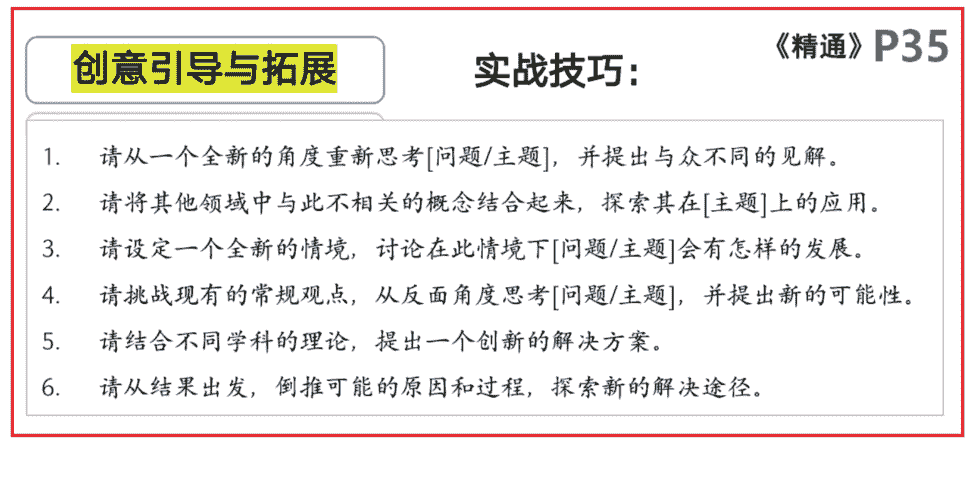

图6-8 创意引导与拓展的六项要素

《精通》一书把提示词写作提升到创作高度，其创意引导与拓展部分展示了一组典型的六要素提示词，采用提纲式写法，六项要素清晰可辨，每句都符合清通明要求，详见图6-9。

要素排序可以轮换，但按内部机制，前置要素权重更高，所以越重要的越靠前。写提示时也应遵循此逻辑。

我们可以在提示词括号位置插入关注的问题主题，观察回应变化。接下来把“DeepSeek开源”植入该六要素模板，其回答从正反多面展现了该议题的重要性与前瞻性，见图6-9。

## 例二 提示语链的六项机制（见图6-10）

提示语链是指把多个提示按逻辑串成链条，让用户与AI分步交互完成复杂任务。类似思维链，但更强调递进式对话引导，可提升推理准确度与任务完成度。

### 提示词六项要素与清华定格的探讨

1. 请从全新视角重新审视DeepSeek开源并给出不同见解；
2. 请把其他领域无关概念结合进来，探索其在DeepSeek开源中的应用；
3. 请设定全新情境，讨论在此情境下DeepSeek开源的发展形态；
4. 请反向挑战常规观点，从负面角度思考新的可能性；
5. 请结合不同学科理论，提出创新解决方案；
6. 请从结果倒推原因与过程，探索新路径。

### 1. 全新角度：开源作为“认知基础设施”的构建

传统说法把开源当作技术共享或生态竞争手段。若把DeepSeek开源重定义为“认知基础设施”，它就不只是代码库，而是人类集体智能的载体。模型权重可视作“认知货币”，社区贡献形成“思维网络”，微调相当于“知识再加工”。在此视角下，开源的价值在于塑造可编程的集体认知范式，而非单纯透明。

### 2. 跨领域结合：生态学中的“共生演替”理论

借鉴生态学“共生演替”概念，DeepSeek开源可设计为“技术共生体”：
- 寄生期：小团队或个人免费使用基础模型生存
- 互惠期：开发者贡献插件与数据反哺模型进化
- 顶级群落期：形成自维持的AI生态，迭代由生态内循环驱动
此模式把开源从版本发布转向生态培育。

### 3. 新情境：后稀缺社会的开源经济学

假设2040年能源与算力接近免费，注意力成为稀缺资源。此时DeepSeek可能：
- 发布“注意力捕获模型”，用极简交互提升留存
- 开源代码但保留“认知黏性”算法专利
- 开发者竞争焦点从性能转向无缝嵌入生活场景的能力
开源由此成为行为数据采集网络的基础。

### 4. 反向思考：开源的“黑暗森林”效应


提示语链设计是提示词进阶的关键，要求在迭代中做“反馈整合与动态调整”。实践中常出现提示越给越不满意的情况，必须遵循以下六项机制：

1. 请对当前内容进行评估，列出主要优缺点，并提出具体改进建议。
2. 请根据前一阶段的反馈，逐步修改和完善内容，列出修改的具体步骤。
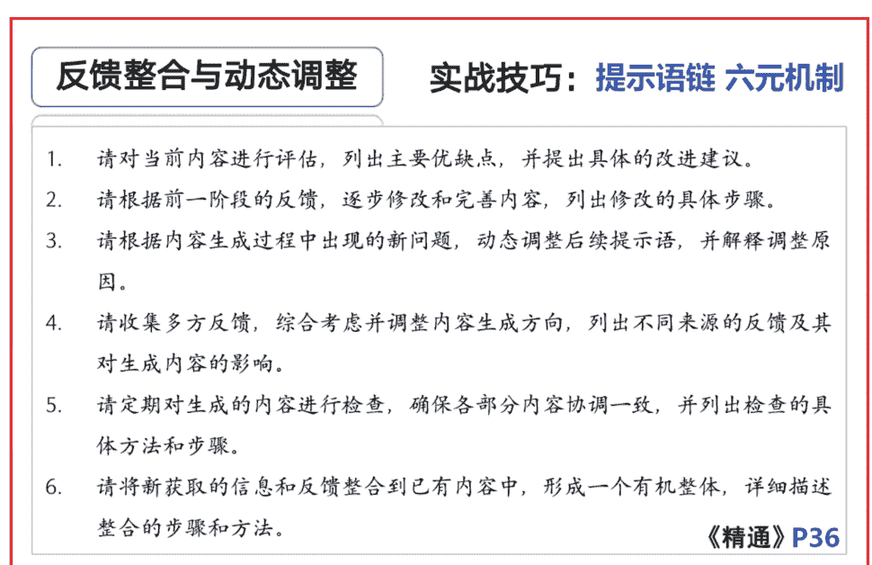

图6-10 提示语链设计的六项机制

3. 请根据内容生成过程中出现的新问题，动态调整后续提示语，并解释调整原因。
4. 请收集多方反馈，综合考虑并调整内容生成方向，列出不同来源的反馈及其对生成内容的影响。
5. 请定期对生成的内容进行检查，确保各部分内容协调一致，并列出检查的具体方法和步骤。
6. 请将新获取的信息和反馈整合到已有内容中，形成一个有机整体，详细描述整合的步骤和方法。

这是一个需要耐心的系统工程，不必全盘吃透，可先按下面的六大原则挑选合适路径逐步实践。

## 例三 提示语链设计的六大原则（见图6-11）

提示语链设计的六大原则是：

1. 目标明确性
2. 逻辑连贯性
3. 渐进复杂性
4. 灵活适应性
5. 思考多样性
6. 反馈整合性

### 提示语链的设计原则

提示语链需要遵循明确原则以保证执行有效与连贯，为任务分解提供系统指引。关键原则如下：

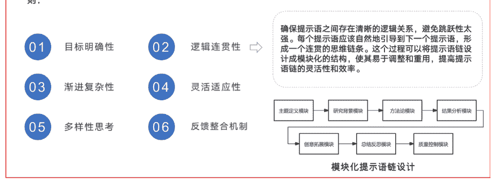

图6-11 提示语链设计的六大原则

只要提示链符合这六大原则就算及格。刚开始不必强求全掌握，可逐项实践，叠加内化后自然融会贯通。

## 例四 基于“BRIDGE”的六要素框架（见图6-12）

### 跨界思维的提示语链设计

基于“BRIDGE”框架

- Blend 混合：融合不同领域的概念
- Reframe 重构：用新视角看待问题
- Interconnect 互联：建立领域间的联系
- Decontextualize 去情境化：将概念从原始环境中抽离
- Generalize 泛化：寻找普适原则
- Extrapolate 推演：将原理应用到新领域

图6-12 提示语设计的“BRIDGE”六要素框架

跨界提示链的“BRIDGE”框架由六个英文单词首字母组成，从创新思维角度重构提示链，结合跨域逻辑探索更广阔应用：

1. Blend 混合：融合不同领域的概念
2. Reframe 重构：用新视角看待问题
3. Interconnect 互联：建立领域间的联系
4. Decontextualize 去情景化：将概念从原始环境中抽离
5. Generalize 泛化：寻找普适原则
6. Extrapolate 推演：将原理应用到新领域

跨界思维不仅拓宽提示链边界，也揭示了一个事实：所有复杂系统都是某种“提示链”的具象化，关键在于如何设计信息流动的拓扑结构。

从创意引导的六要素到提示语链的六项机制，再到提示语链的六大原则，再到基于BRIDGE的六要素框架，六要素轮动，一通百通。

## 第六节 六要素淘金，越用越灵

不少网友留言说DeepSeek功能很强，能不能帮选股票？答案是能帮，但不能替。

**练习：** 参照惯例，每年五一、十一、春节长假都要先做练习票，今年五一我们在五月七日锁定了九只练习股，详见图6-13列表。

**效果：** 节后至六月九日共二十三个交易日，累计收获四十八个涨停，平均每只超五个涨停。

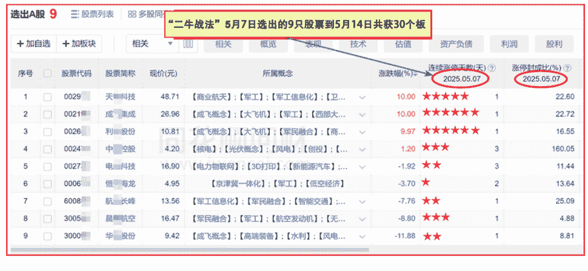

图6-13 “二牛战法”五月七日选出九只股票至六月九日共获四十八个涨停板

大家好奇这些牛股怎么来的。这是DeepSeek协助筛选的结果。

做法很简单：把量学的二牛抬庄技术上传给DeepSeek，让它按该技术特征从A股五千多只里初筛二十只，再人工从中挑出九只。

用DeepSeek初筛也不是一次成功，需要反复调教，直到它学会我们的选股标准，才能稳定产出合格名单。

下面按我们的节奏复盘一次选股实战。

### 第一步：找出一批同类样板股

DeepSeek本身不会选股，只能按提示找符合条件的股票。我们需要能涨停的票，不同阶段涨停逻辑不同：

五一期间二牛抬庄批量涨停，就选此类票；行情切换时则按当下涨停特征换品种。

我们决定从连板股里挖掘当下涨停规律。这些已成龙的强势股不是目标，我们要从中提炼规律，再去未连板的池子里找潜力股。

我们给DeepSeek的指令

DeepSeek给我们的回答

选出A股的连板股票，按名称、连板次数、连板原因列表输出

为您检索到一百三十三篇内容

已深度思考（用时八秒）

根据二零二五年五月十四日的市场数据，以下是A股市场中连板次数较多的非ST股票及其相关信息：

| 名称 | 连板次数 | 连板原因 | 数据来源 |
|---|---|---|---|
| 成飞集成 | 6连板 | 航空军工概念，公司航空零部件业务订单增长，与国内飞机制造主机厂合作紧密 | 网页7、8、29 |
| 利君股份 | 6连板 | 军工板块，全资子公司德坤航空主营航空航天零部件制造业务 | 网页8、65 |
| 苏州龙杰 | 4连板 | 拟收购恒力重工股权，转型船舶及高端装备业务 | 网页48 |
| 迎丰股份 | 4连板 | 并购重组概念，公司筹划重大资产重组事项 | 网页48 |
| 恒而达 | 3连板 | 利好消息公告（具体事项未披露） | 网页10 |
| 尚荣医疗 | 3连板 | 医疗器械及抗疫相关业务需求提升 | 网页9 |
| 宁波海运 | 2连板 | 航运港口板块走强，国际航运需求增加 | 网页7、9 |
| 青岛金王 | 2连板 | 短线资金抱团及物流板块扩散效应 | 网页7 |
| 红塔证券 | 1连板 | 大金融板块爆发，政策利好预期 | 网页57 |
| 中国人保 | 1连板 | 保险板块跟随大金融行情上涨 | 网页7 |

图6-14 我们指示DeepSeek找出今天的连板股票（即强势股）

### 第二步：从样板股中总结首板特征

DeepSeek不懂首板特征，但擅长归纳。我们把《量学选股六要素》传给它，让它提炼特征。

DeepSeek在图6-15、图6-16中从五个维度总结了连板股的首板特征：

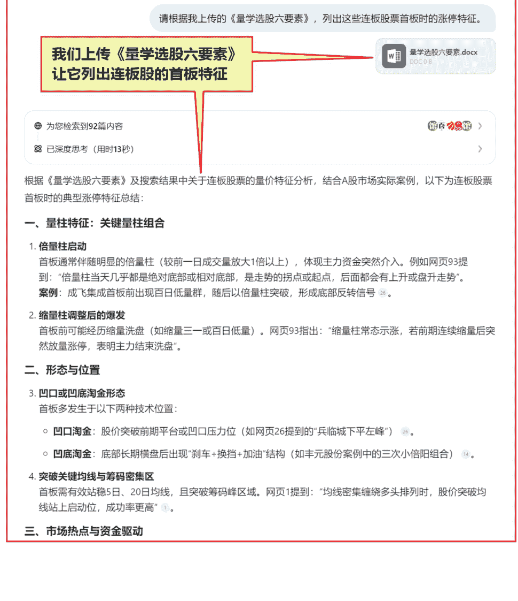

图6-15 上传《量学选股六要素》让DeepSeek列出连板股的首板特征

一、二

1. 量柱特征：主要为倍量柱启动、缩量柱调整后爆发。
2. 形态位置：多处于凹口或凹底淘金位，突破关键均线与筹码密集区。
3. 市场热点：多依托政策或风口，启动时间靠前。
4. 盘口特征：早盘快速封板，封单量与换手率匹配。
5. 主力行为：筹码低位集中，有隐形主力介入痕迹。

DeepSeek检索九十二篇文章后得出如下结论，见图6-17。

### 三、市场热点与资金驱动

5. 政策或行业风口共振

首板股多集中于当前政策热点（如军工、低空经济、AI算力）。网页26指出：“连板股往往处于风口，如成飞集成的军工订单增长、万丰奥威的低空经济概念”。

6. 板块内龙头效应

首板股多为板块内首个涨停标的，具备示范效应。例如网页14强调：“选择启动最早、涨势最猛的龙头品种，可参考量柱组合与分时强度”。

### 四、分时盘口特征

7. 早盘快速封板且抛压小

首板分时表现为开盘三十分钟内快速拉升，封板后抛单稀疏（如网页29提到的高开大量比+分时均线支撑）。

案例：中文在线首板分时高开后迅速封板，盘中未破均线，量比达二十以上。

8. 封单金额与换手率匹配

首板封单金额通常为流通市值的百分之一到三，换手率控制在百分之五到十之间，避免过度放量（网页26提到高位连板需警惕巨量分歧）。

### 五、筹码与主力行为

9. 筹码低位集中

首板前筹码集中度SCR高于七十五，且获利盘比例低于百分之二十（表明主力完成吸筹）。网页93提到：低量柱+倍量柱组合是主力底部锁仓信号。

10. 隐形主力介入痕迹

首板前可能出现假阴真阳、长阴短柱等洗盘形态（网页93定义的变态量柱），或通过大宗交易、龙虎榜显示机构席位介入。

图6-16 连板股的首板特征三、四、五

### 总结：首板涨停六要素整合

| 要素 | 具体表现 | 数据来源 |
|---|---|---|
| 量柱 | 倍量柱启动，缩量调整后放量 | 14 |
| 形态 | 凹口/凹底突破，均线密集支撑 | 1, 26 |

首板连板六要素实战检验

| 热点 | 政策驱动或行业龙头 | 26 |

| 分时 | 快速封板，量比>5且抛压小 | 29 |

| 筹码 | 低位集中，获利盘比例低 | |

| 主力行为 | 假阴洗盘、大宗交易或机构买入 | 14 |

图6-17 首板涨停六要素

### 第三步：用六要素筛选连板潜力股

DeepSeek对首板涨停的提炼基本抓住了要害。我们就拿这套标准，对当天首板池做一次实操，看能筛出哪些具备延续性的标的，具体见图6-18。

交付给它的任务是：以前面列出的六条条件为依据，从2025年5月14日首个涨停且非ST的个股中，挑出10只有望继续走强的品种，并按股票名称、首板特征、所属概念、核心逻辑做表呈现。

我们给DeepSeek的指令

DeepSeek给我们的回答

⊕ 为您检索到143篇内容

⊗ 已深度思考（用时14秒）

根据《量学选股六要素》框架（倍量柱启动、热点共振、形态突破等），结合今日（2025年5月14日）市场数据及政策动态，筛选出以下潜在连板股：

## 2025年5月14日首板潜力股精选

| 股票名称 | 首板特征 | 所属概念 | 核心逻辑 | 数据来源 |

| :--- | :--- | :--- | :--- | :--- |

| 宁波海运 | 倍量突破前高+封单金额超1.2亿元 | 航运港口、中美关税下调 | 中美关税谈判催化集运价格上涨预期，公司运力规模国内前三，技术面突破年线压力位 | 18 43 |

| 青岛金王 | 高开秒板+换手率52.89% | 跨境电商、CIPS支付 | 首批接入CIPS系统，跨境结算效率提升，资金净流入4.15亿元，叠加中韩自贸区政策联动 | 18 74 |

| 红塔证券 | 分时阶梯式放量+机构分歧 | 券商、沪深300权重 | 公募新规引导资金配置低估值金融股，龙虎榜显示机构席位博弈，政策利好预期强烈 | 10 43 |

| 连云港 | 凹底反转形态+封单金额1.2亿元 | 一带一路、港口整合 | 长三角港口重组提速，区域经济复苏带动吞吐量增长，PB仅1.3倍 | 18 |

| 盛泰集团 | 假阴洗盘后反包涨停+缺口回补 | 光伏、外贸出口 | 海外订单增长驱动业绩修复，技术面修复筹码峰，龙虎榜机构净买入1.45亿元 | 18 76 |

| 电投产融 | 机构净买入1.45亿元+MACD金叉 | 光伏、绿色电力 | 河北光伏装机龙头，政策推动分布式电站建设，叠加碳中和资金偏好 | 18 43 |

| 酷特智能 | 小盘股（流通值18亿）+跨境电商订单增长 | 智能制造、跨境电商 | 服装定制出口旺季催化，底部放量突破，机构席位净买入 | 18 67 |

| 恒而达 | 缩量后倍量启动+换手率6.8% | 高端装备、工业母机 | 设备更新政策受益标的，分时均线强支撑，筹码集中度达75% | 18 76 |

| 凤凰航运 | 低股价（5.2元）+板块联动效应 | 干散货运输、低估值 | 国际航运需求回升叠加BDI指数上行，技术面回踩60日均线后启动 | 18 43 |

📎 量学选股六要素.docx

图6-18 DeepSeek用“六要素”选出的10只股票

初看尚可，盛泰集团与宁波海运均已越过左峰，连板概率不低；连云港属于凹口淘金，上方压力也小。再深入一查问题就暴露：10只里有6只当天已是二连板，1只是三连板，2只根本没封板，真正符合当日首板条件的只有红塔证券这一家。

幻觉问题此前就反复强调，这次再次中招，若照单执行风险极大。

于是直接指出错误并要求重做：

> 你的工作太马虎了，我们要求是“从今天的首板（第一次封板）股票中筛选可能连板的股票”，但你上面选出的股票中有4只今天已是二连板，还有2只没有板，只有红塔证券1只是今日首板（第一次封板），请你重新筛选三遍后再输出，

经认真复核，它给出9只新票

⊕ 为您检索到109篇内容

⊗ 已深度思考（用时17秒）

根据您反馈的筛选条件（**仅限2025年5月14日首次涨停的非ST股票**），结合《量学选股六要素》及搜索结果中的最新市场数据，重新严格筛选出以下10只首板股并分析其连板潜力：

## 2025年5月14日首板股精选（经三重校验）

| 股票名称 | 首板特征 | 所属概念 | 核心逻辑 | 数据验证 |

| :--- | :--- | :--- | :--- | :--- |

| 茂化实华 | 跳空涨停过左峰（突破4月高点6.2元） | 氢能源、石化 | 封单金额1.8亿元，龙虎榜游资净买入1.2亿元，氢能产业政策催化 | 11 |

| 吉林化纤 | 凹口一字板（缩量22天后一字涨停） | 碳纤维、军工 | 封单占比流通市值3.7%，机构调研显示碳纤维订单同比增长150% | 11 |

| 综艺股份 | 凹口一字板（突破年线9.8元） | 光伏、HJT电池 | 一季度中标海外光伏项目12亿元，封单金额占流通市值3.2% | 11 |

| 保税科技 | 凹底倍量柱（回踩60日均线后放量涨停） | 物流、长三角一体化 | 港口整合提速+大宗商品仓储需求激增，量比达22倍 | 11 |

| 瑞斯康达 | 凹口淘金（MACD底背离后首板） | 6G、光通信 | 光模块订单环比增长50%，技术面修复上方缺口，封单金额0.7亿元 | 11 |

| 安纳达 | 涨停过左峰（突破前高8.4元） | 磷酸铁锂、新能源 | 固态电池技术突破带动材料需求，龙虎榜显示机构净买入5300万元 | 11 |

| 渝三峡A | 倍量过左峰（突破2024年高点6.8元） | 化工、成渝经济圈 | 成渝氢能产业规划发布，封单金额1.2亿元，换手率8.5% | 11 |

| 新华锦 | 假阴真阳反包+跨境电商概念 | 跨境贸易、纺织 | 跨境电商订单环比增长50%，分时均线强支撑，封单占比流通市值1.8% | 11 |

| 中远海发 | 双重突破（左峰3.2元+年线） | 航运、央企重组 | 机构净买入9200万元，流通盘换手率仅5.3%，抛压较轻 | 11 |

图6-19 DeepSeek核实三遍后选出9只股票

名单公布次日大盘下行，这9只里有6只逆势涨停，最让人意外的是渝三峡，14日已高位收板，按常理应回调，却反其道再板，效果基本过关。

### 小结：

本次操作说明了五点：

第一，DeepSeek本身不具备选股能力，标准把控必须由人来做，它只是执行助手。
第二，它只能辅助决策，不能替代决策，主体思维不能颠倒。
第三，幻觉出现频率高，必须时刻警惕，不可盲信。
第四，它在归纳总结上很擅长，可用来提炼经验和复盘教训。
第五，它执行力很强，只要指令清晰、反馈及时，结果会越来越准。

### 附赠“量学选股六要素”：

“量、价、时、空、象、数”六个要素，具体如下：

量，指量能形态：高量柱、低量柱、平量柱、倍量柱、梯量柱、缩量柱、黄金柱；
价，指价位特征：涨停、一字板、缩量涨停、10元以下、15元以下、20元以下；
时，指时间节点：竞价表现、封板时段、横盘时段、拉升时段、竞价时段等；
空，指空间位置：启动位置、封板位置、百日左峰、平顶、凹口、三一二一位；
象，指盘面形象：主力控盘、高度控盘、倍量伸缩、三低三有、过峰保顶；
数，指量化数据：涨幅、量比、换手率、涨停封成比、筹码集中度、指标当值。

**注意：** 历史案例仅作教学参考；股市有风险，投资需谨慎。更多新案例，详见公众号“盘前预报123”。

# 第七章 DeepSeek的“六套变形魔术”

## 第一节 DeepSeek直接生成指定图片

详见图7-1。

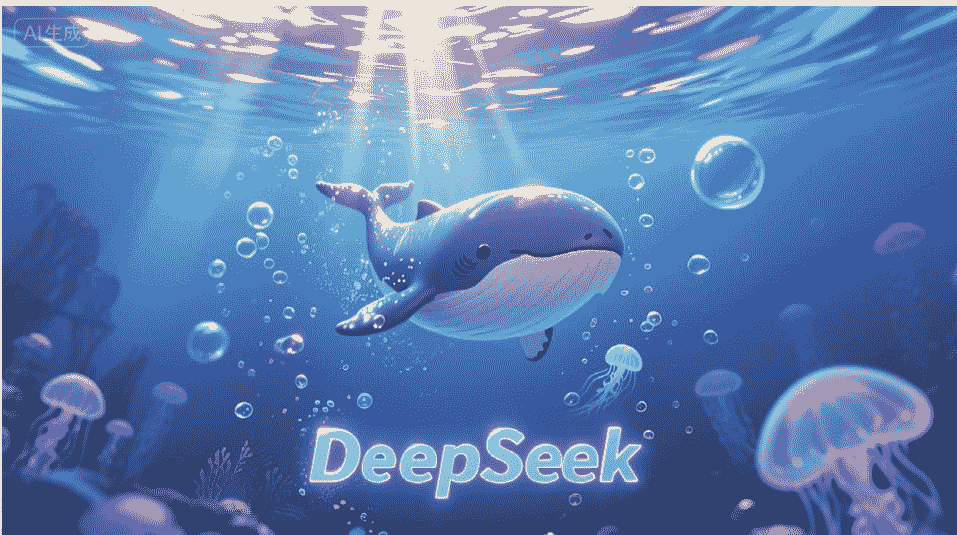

图7-1 用DeepSeek直接生成的图片

不少人期待DeepSeek也能出图，甚至有人等了半年也未等到官方功能上线。感受相似，DeepSeek本质是文字处理工具，但实践证明它也能完成图像类任务。

图7-1就是直接用DeepSeek生成的。它提供了便捷的高质量出图路径，只是比较低调，知道的人不多。无论是个人创意可视化，还是商业主体对多样式图片的需求，都能借助DeepSeek快速实现。

出图方法分三步。

### 第一步：输入第一段提示词

第一段是“核心提示词”，用来明确任务和限制，基础模板如下：

你是AI图片生成机器人，我是图片制作者，我要的是：接下来我会给你一些中文关键词描述，请你在不影响我关键词描述的情况下，先根据我的描述进行文本润色、丰富描述细节，之后转换成英文，并将英文文本填充到下面URL链接的占位符“prompt”中：


生成后请你给出你润色后的中文提示语。

把上面这段提示词粘贴进DeepSeek输入框，如图7-2所示。操作前建议先关闭“深度思考”模式，减少服务器繁忙带来的干扰，保证流程顺畅。

点击发送后，DeepSeek会给出回应，见图7-3。

### 第二步：输入第二段提示词

第二段是“意图提示词”，用来说明具体想做什么。

见图7-3中间胖鲸图标的位置。等DeepSeek回复“明白了！”之后，即图7-3下方文字，就能发送第二段提示词了。这次想做一幅代表DeepSeek的胖头大鲸鱼图，第二段提示词是：

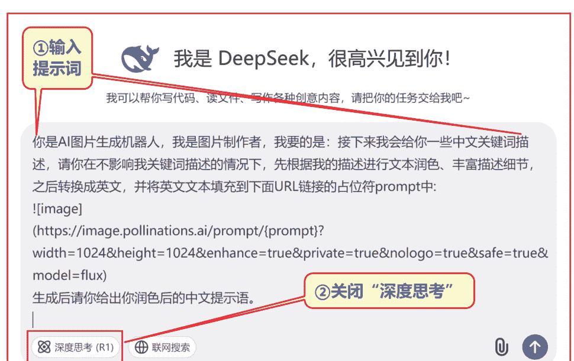

图7-2 输入提示词并关闭“深度思考”

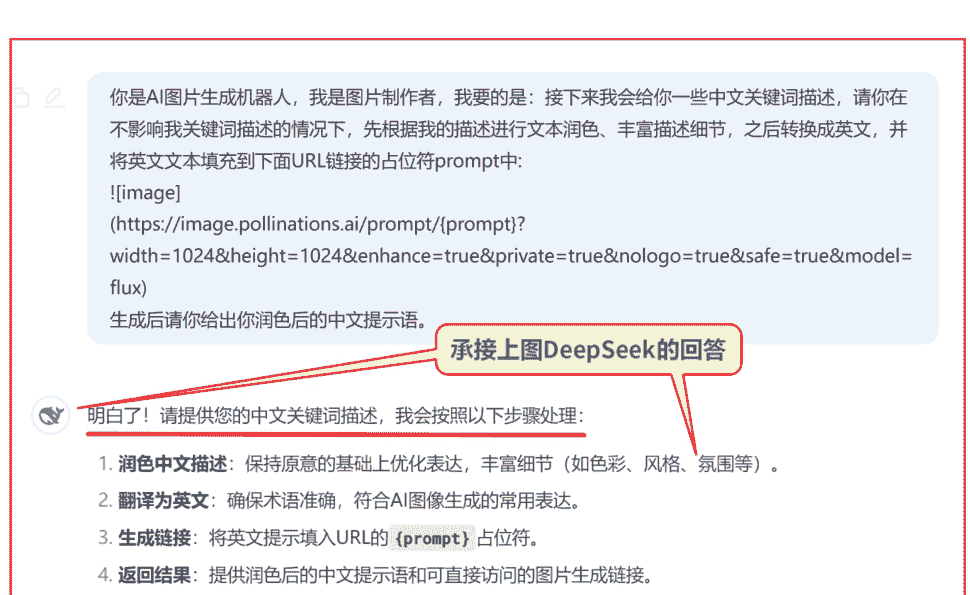

图7-3 承接图7-2，DeepSeek明白了，并准备工作

胖胖的大头鲸鱼，微笑着在蓝海深处朝镜头游来，鲸鱼下方有一行文字“DeepSeek”立体闪光，丁达尔光。

发送后，DeepSeek会先思考、润色文案，然后自动生成如下提示词：

一只胖乎乎的可爱大头鲸鱼，圆润的身躯充满萌感，正微笑着从深蓝色的海洋深处朝镜头游来，眼神温柔而友好。鲸鱼下方有一行立体闪光的文字“DeepSeek”，字体带有未来科技感，周围环绕着晶莹的丁达尔光线，光束穿透海水形成神圣而梦幻的效果。画面整体为8K超高清画质，细节精致，色彩通透，采用v6模型优化渲染，增强光影层次和动态表现。

这段润色体现了DeepSeek强大的文本扩写能力，把简单的关键词扩展成生动画面描述，为高质量出图奠定基础。

随后DeepSeek会自动翻译成英文并生成图片链接，见图7-4。

点击下方链接即可查看成图。


图7-4 DeepSeek润色提示词、翻译、生成链接一气呵成

### 第三步：修改图片尺寸或提示内容

第一段提示词中包含如下代码：

```
width=1024&height=1024&enhance=true&private=true&nologo=true&safe=true&model=flux
```

说明：width代表画布宽度，height代表画布高度，二者均为1024像素时输出为正方形。如需其他比例，可自行修改宽度或高度数值，例如改为“width = 1080&height = 1920”即可得到竖版图片。

通过调整参数，用户能按需得到不同尺寸的成图，满足多场景使用。

### 小结：

DeepSeek出图其实很简单，共三步。

**第一步：** 输入核心提示词，让DeepSeek充当图片生成机器人；
**第二步：** 输入构图提示词，明确要生成的胖头鲸鱼及“Deepseek”立体发光字海底画面；
**第三步：** 按需修改提示内容或尺寸，直至满意。

### 启示：

此前提示词多为一次成型；本案例是先输入一段，待AI回应后再输入第二段，两段接力完成任务。此后会出现三段、四段甚至五段接力的提示方式，可称为“接力提示词”。往后的学习将逐步迈向中高级，接力提示将成为重点。

## 第二节 DeepSeek间接生成思维导图

询问DeepSeek能否直接生成思维导图，它坦率回复（见图7-5）：目前我无法直接生成可视化的思维导图（如图片或XMind等格式），但我可以通过以下方式，帮你快速创建思维导图：

1.  **文本框架生成。** 我可以用层级清晰的文本结构帮你整理思路……

2.  **Markdown格式。** 适合导入某些思维导图工具（如MindNode）……

3.  **工具推荐。** 免费工具：XMind（有免费版）、MindMeister、百度脑图……

4.  **制作建议。** 如果你告诉我你的主题和需求（比如经典图书纲要／学习笔记／项目规划／读书总结等），我可以：帮你梳理逻辑关系、提供完整的内容框架、建议关键分支结构等。

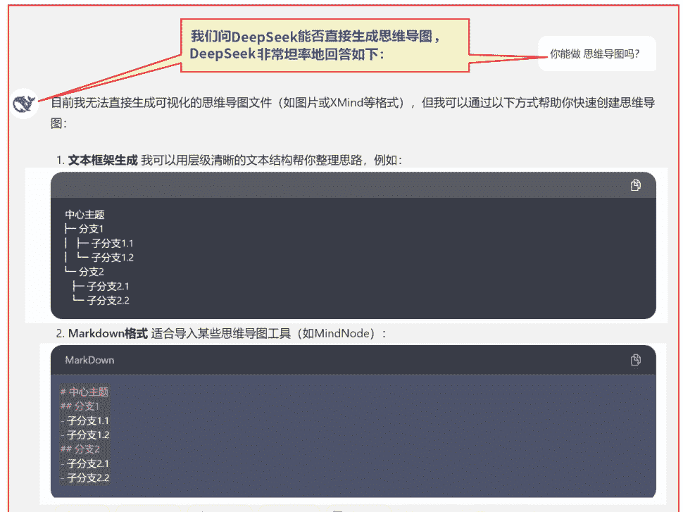

图7-5 DeepSeek关于生成思维导图的自我介绍

基于上述说明，采用DeepSeek+MindMaster的组合，三步即可完成精美思维导图。

### 第一步：生成思维导图代码

即让DeepSeek输出思维导图格式代码，复制保存为“.mm”文本文件，供下一步导入使用。

提示词为：

请根据清华大学出版社《涨停密码》一书的目录，生成思维导图，输出FreeMind格式（见图7-6）。

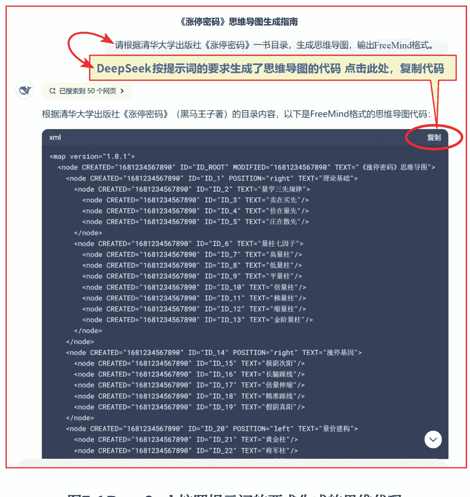

图7-6 DeepSeek按照提示词的要求生成的思维代码

点击复制，将文件先保存为“.txt”纯文本，再把扩展名改为“.mm”，备用。

### 第二步：生成思维导图文件

将上述代码导入MindMaster。操作如下：

1.  登录MindMeister后，点击“New Map”。
2.  选择“Import” → “Markdown”。
3.  粘贴文本并确认。

确认后，思维导图即生成，见图7-7。

# 清华大学出版社《涨停密码》思维导图

## 第1章 十月怀胎 一朝分娩

- 第一节 涨停密码的重要作用（英唐智控）

- 第二节 基因分析的重要意义（国兴地产）

- 第三节 涨停基因的量柱分析（国兴地产）

- 第四节 涨停基因的量线分析（国兴地产）

- 第五节 涨停密码的暴露区间（国兴地产）

## 第2章 凹口淘金 一抓就灵

- 第一节 凹口淘金的奥秘（山西三维）

- 第二节 凹口淘金三要素（深鸿基）

- 第三节 凹口淘金分真假（有研硅股）

## 第3章 卧底将军 凹底淘金

- 第一节 矮子里面拔将军（东光微电）

- 第二节 涨停之中有基因（宝利沥青）

- 第三节 凹底淘金阳盖阴（云南旅游）

- 第四节 凹底淘金三部曲（中关村）

- 第五节 黄金线上阳盖阴（福建高速）

## 第4章 兵临城下 蓄势待发

- 第一节 试关与攻关（浙江东日）

- 第二节 攻关与冲关（豫能控股）

- 第三节 冲关与守关（皖能电力）

- 第四节 攻守与冲防（鑫富药业）

## 第5章 接力双阳 后市看涨

- 第一节 接力双阳的典型特征（ST万鸿）

- 第二节 接力双阳的基本原理（华东科技）

- 第三节 接力双阳的提前发现（中国服装）

- 第四节 接力双阳的伏击方法（神马股份）

- 第五节 接力双阳的后劲研判（ST黑化）

- 第六节 接力双阳的性格分析（长方照明、佛山照明）

## 第6章 双阴进出 攻防有度

- 第一节 双阴出货的临界点（上证指数）

- 第二节 怎样做好双阴出货（上证分时）

- 第三节 个股经典双阴出货（白云山）

- 第四节 双阴入货的辩证法（三峡水利、华中数控）

- 第五节 实战辩证双阴出入（国恒铁路）

## 第7章 回踩精准 捷足先登

- 第一节 回踩精准线的基本原理（中国武夷）

- 第二节 回踩精准线的涨停奥秘（联环药业）

- 第三节 回踩精准线的伏击方法（中航三鑫）

## 第8章 假阴真阳 黄金万两

- 显性的假阴真阳（上海物贸）

- 隐性的假阴真阳（航空动力）

- 假阴真阳的魅力（海南橡胶）

- 习惯决定存在（太极股份）

- 动作决定性格（爱施德）

- 位置决定性质（北斗星通）

- 基础决定涨幅（津滨发展）

- 预报伏击要点（航天机电）


图7-7 清华大学出版社《涨停密码》思维导图

如图7-7，一幅精美的《涨停密码》思维导图仅需两步即可完成。若初版不满意，可在图中直接修改，操作与Word、WPS类似，十分便捷。

### 第三步：调整优化思维导图

若初版不够理想，可在MindMeister内自行添加“实战技巧”“指标公式”等自定义分支，补充案例细分时间节点，增加彩色标记或图标，均可按需增删完善。

# 六大黄金魔方精讲版

下面是按二步法梳理并在此基础上增补调整后的本书第五章思维导图，对照图7-8。

# 调整优化后的“六套黄金魔方”思维导图

1. **一元树标魔方**
    - 核心特点：适用面广，用最少要素达到最优效果
    - 生成句式：请仿照我给出的XXXX样本，制作XXXX
    - 练习方向：
        - 建军节文章标题
        - 《沁园春·海》诗词仿作
    - 要点：依托范本，驱动模型进行模仿再创

2. **二元定位魔方**
    - 核心特点：先定身份再定任务
    - 生成句式：你是XXX，我是XXX，请你帮我完成XXX，要求XXXX
    - 练习方向：
        - 广告公司电视广告文案
        - 儿童睡前小故事
        - 泰戈尔风格散文诗
    - 要点：扮演特定角色，产出对应品质内容

3. **三元万象魔方**
    - 核心特点：三个要素拼装指令，灵活应对多类需求
    - 基础结构：XX关于XX的XX
    - 练习方向：
        - 励志经典语句
        - 环保节能主题文章
    - 设计思路：
        - 哲学来源：《道德经》一生二，二生三，三生万物
        - 设计原则：简洁、普适、具文化感
    - 要素速查：信息类、结构类、控制类

4. **三要万通魔方**
    - 核心特点：通用型结构，覆盖绝大多数需求
    - 生成句式：我要做XX，供XX使用，要求达到XX效果，但担心XX
    - 练习方向：三天掌握DeepSeek学习规划
    - 实战参考：健康管理公众号涨粉案例

5. **三维聚焦魔方**
    - 核心特点：以三个维度收束同一主题
    - 维度：历史、现实、未来
    - 使用流程：
        - 明确主题
        - 三维拆解
        - 形成逻辑闭环
        - 优化表达
    - 典型主题：
        - 减肥
        - 心理健康
        - 职场发展
        - 环境保护

6. **三问探幽魔方**
    - 核心特点：提问、追问、反问层层递进
    - 基础结构：（提问）XXXX有什么问题？（追问）这些问题会XXXX？（反问）否则是否会XXXX？
    - 实操步骤：
        - 提问：明确探讨方向
        - 追问：深挖问题根源
        - 反问：挑战边界假设
    - 适用场景：学术研究、问题探索、决策分析、日常思考

图7-8 调整优化后的“六套黄金魔方”思维导图

## 第三节 DeepSeek辅助生成祝福海报

有位朋友送来一张“玫瑰早安”图，被另一位朋友看到后想做同款，却写不出好描述。

# 早安


——永远相信美好的事情即将发生

图7-9 朋友送给我的“玫瑰早安”图片

怎么解决？沿用惯用策略，交给DeepSeek。

第一步：把欣赏的图片上传给DeepSeek，让它反推提示词

上传玫瑰图后输入指令：
给你上传一张玫瑰图片，我想制作同类图片，请你给一段提示词。

DeepSeek返回的提示词见图7-10，包含主提示、细化建议、构图细节、风格强化词和情感关键词，很有参考价值。

> 以下是为生成同类风格图片精心设计的中文提示词，包含构图、色调和情感细节：

**核心提示词：**

“一朵淡粉色的玫瑰花苞从画面左下角斜向上生长，背景是朦胧的淡绿色水彩质感，整体留白70%营造呼吸感。花枝纤细优雅，仅占画面20%比例。上方用半透明笔触书写艺术字『早安』，字体带有毛笔书法飞白效果；底部右下角以手写小字排列『永远相信AI大观园里美好的事情即将发生』，墨色略晕染如铅笔素描。整体色调柔和（主色：薄荷绿+灰粉），光影呈现清晨薄雾般的通透感。”

**细化建议（可根据需求增减）：**

1.  **构图细节**
    * 花苞朝向：45度角向右上方微垂，保留未绽放的含蓄感
    * 文字排版：上大下小，形成视觉纵深感
    * 负空间：在画面右上角添加若隐若现的极浅光斑

2.  **风格强化词**
    * “新中式数字水墨风格，带0.3%未来科技感（仅通过文字内容暗示）”
    * “治愈系插画质感，边缘轻度羽化”

3.  **情感关键词**
    * “静谧/希望/AI人文主义”

## 图7-10 DeepSeek给我们的提示词

拿到提示词后怎么办？

交给即梦AI出图，因为即梦已接入DeepSeek，可对提示词做二次加工。

**第二步：打开即梦AI，进入图片生成，将DS提示词导入**

指令是：
请按照我上传的参考图片，帮我生成一段提示词。

DeepSeek深度思考后给出三段可选提示词见图7-11，任选其一。

我们选用第一段放入生成对话框，即梦立即产出图7-12。

图片生成 视频生成 数字人 音乐生成

## DeepSeek-R1 对话模式

请参考我上传的参考图片，给一段提示词

已深度思考

点击查看思考过程

推荐提示词：

含苞玫瑰从画面左下角自然延伸，淡蓝色渐变背景，花瓣带晨露。画面右上方用书法字体呈现“早安”，左下角用铅笔质感字体写着“期待每个新的开始”，极简主义构图保留60%留白区域

推荐提示词：

粉色玫瑰微绽造型置于画面左侧1/3处，背景采用浅灰纹理纸质感。顶部用霓虹灯风格字体展示“早安”，底部手写体“美好正在加载中...”字样，添加0.5px淡金色描边效果

推荐提示词：

白玫瑰以45度仰角呈现，背景使用低饱和薄荷绿。文字采用立体剪纸工艺风格，“早安”字样悬浮在花朵右上方，底部用圆体字排列“今天也是元气满满的一天”，整体保持空气感构图

## 图7-11 DeepSeek根据上传图片写的提示词

## 早安

美好就在AI大观园里


## 图7-12 即梦按照DeepSeek写的提示词生成的图片

## 第四节 DeepSeek化身教材配图生成器

为提升教学效果，老师们希望挖掘教材意境并配图。下面做法很简便：让DeepSeek充当“问小白”，自行撰写描述，再由问小白出图。

### 第一步：进入DeepSeek

打开问小白DeepSeek满血版，网址：www.wenxiaobai.com/chat。先用手机号登录，进入如图7-13所示页面，选择“DeepSeek满血版”→“推理生图”。

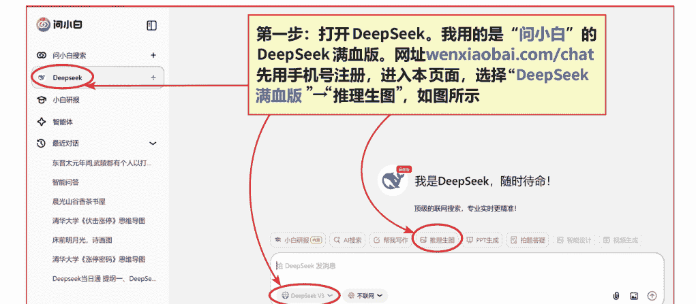

## 图7-13 打开“问小白”选择DeepSeek满血版

### 第二步：设定风格与尺寸

在对话框中点开“风格”选项，选定想要的风格，我选的是“水墨画”；随后在“尺寸”中挑选合适比例，我选16：9，如图7-14。

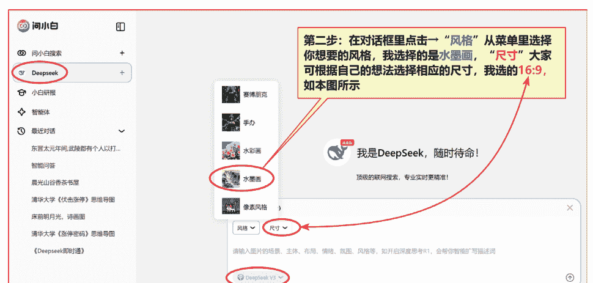

## 图7-14 根据需要选中风格和尺寸

### 第三步：输入描述词

想画什么就用大白话描述。也可以让模型代写提示词，我把《桃花源记》开篇文字交给它，它返回的描述是：

> 薄雾缭绕的青山脚下，蜿蜒溪流泛着晨光，一叶扁舟载着斗笠渔人缓行，两岸忽现绵延的桃花密林，无杂树的纯粹花幕中，绯色落英随溪水漂流，虚实相生的留白处隐现通往未知的幽径。

把这段文字填入图7-14的提示框，生成的图片见图7-15。


图7-15 根据DeepSeek提示词生成的《桃花源记》开篇意境

## 第五节 DeepSeek三步打造爆款图文

如何用AI快速做出高颜值图文？如何用一句话搞定精美卡片？

下面介绍黄金组合——DeepSeek + MD2Card，一个提示词即可生成适合小红书、小绿书的知识卡，让图文创作瞬间升级。

操作很简单：先用DeepSeek生成Markdown文本，再导入MD2Card，文字即可秒变图文。

### 第一步：用DeepSeek产出Markdown文本

在DeepSeek输入提示词：
如何用DeepSeek+MD2Card打造爆款图文指南，用Markdown格式输出

模型马上生成结构清晰、内容丰富的Markdown文本见图7-16。

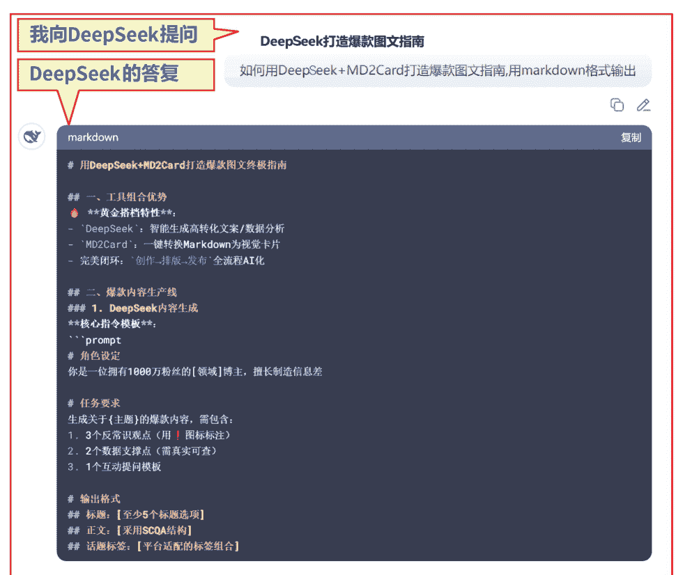

图7-16 用DeepSeek生成Markdown格式文本

### 第二步：用MD2Card生成小红书图文卡片

打开网址https://md2card.com/，无需登录，直接把上一步文本粘贴到左侧数据区，中间区域即刻呈现图文卡片见图7-17。

图7-17中浅蓝底色的长条就是卡片，点击右上角“导出”即可发布到小红书、小绿书等平台；若不满意样式，可继续调整。


图7-17 用MD2Card生成的图文卡片

### 第三步：换模板、调尺寸或插入图片

MD2Card是免费的Markdown转知识卡片工具，支持19种风格模板，如赛博朋克、水彩艺术、梦幻渐变、清新自然等，适配不同场景。

图7-18中间区域可实时预览效果，右侧可自由选模板、调字体颜色，还能自动拆分图文。

#### 一、更换模板

在右侧功能区挑选喜欢的款式，点击即可切换见图7-18。


#### 二、智能拆分

点右侧“自动拆分”，即可得到如图7-19的切分效果。


#### 三、定义尺寸

右侧可自定义图文宽度、高度、长宽比，见图7-20。


图7-20 定义尺寸的效果图

卡片上还能加入人物、动物、宠物、花草等素材。

#### 四、锦上添花

用即梦AI生成一张橘猫图，提示词：一只拟人化的橘猫，穿着白衬衫，趴在电脑桌前工作，戴着黑框眼镜，惊讶的表情像发现了新大陆一样兴奋。见图7-21。

把爆款生产线和惊讶的橘猫结合起来，效果魔幻！见图7-22。

嵌入方法很简单，把橘猫图片的网络链接复制到图7-21左侧对应位置即可。


图7-21 橘猫惊讶地发现了爆款图文


图7-22 爆款生产线把橘猫惊呆的效果

#### 五、从零到爆款：分分钟做好高颜值图文

回顾流程：
第一步：用DeepSeek生成“打造爆款图文”的提示词；
第二步：把提示词丢进MD2Card，选用“梦幻渐变”高级模板；
第三步：按喜好换模板或调尺寸，插入“惊讶的橘猫”图片。几分钟就完成高颜值爆款图文！见图7-22

这种图文不仅适合小红书，也可用于公众号、知乎等平台，分享知识或推广产品都能抓住眼球。

## 第六节 DeepSeek快速生成通用PPT

有一位感动中国的百岁老人叶嘉莹，“感动中国”颁奖词写道：
> “桃李天下，传承一家。你发掘诗歌的秘密，人们感发于你的传奇。转蓬万里，情牵华夏，续易安灯火，得唐宋薪传，继静安绝学，贯中西文脉。你是诗词的女儿，你是风雅的先生。”

这段话概括了叶嘉莹在诗词领域的卓越贡献和对中华文化的深情，让人钦佩。我们想用AI缅怀她，让DeepSeek把她的事迹快速变PPT，下面一起体验这十分钟。

### 第一步：用DeepSeek检索事迹，生成Word文档

提示词：搜索并编辑“感动中国百岁老人—叶嘉莹”的生平事迹，生成一篇千字左右的Word文档。

生成后可核实修改，补充认为重要信息和个人感悟，确认无误后保存。

### 第二步：将Word文档传给DeepSeek，让它快速生成PPT

操作：点击DeepSeek输入框右侧的“曲别针”，上传准备好的Word文档。

再输入提示词：
请将上传文档《中华诗词的女儿—叶嘉莹》以HTML格式生成PPT，做成1页封面+6页内容，页面为16：9的宽屏比例，标题文字要高亮，风格要用专题报告，色彩要用中国红，排版要美观。然后引入pptxgen.js库，库地址：https://cdn.jsdelivr.net/gh/gitbrent/pptxgenjs/dist/pptxgen.bundle.js。最后提供下载PPT的链接按钮，要确保可以直接下载PPT。

上述操作见图7-23。

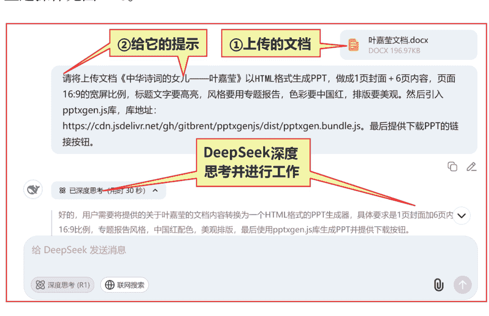

上传后DeepSeek开始深度思考，思考过程可见。很快给出PPT代码见图7-24。

### 第三步：运行或下载PPT

点击图7-25右上角的“运行”，即可看到主题页见图7-26。

点击图7-26主题页中间的“生成并下载专题报告”按钮，即可下载PPT。

打开后效果见图7-27。

如图7-27所示，PPT简洁大气，基础扎实，有高大上的感觉。演示时未加入复杂美化，大家可在此基础上加入想法逐步优化，很有意思。

### **重要技巧：不用上传文档，任何主题可让DeepSeek生成PPT**

上述方法还能简化优化：
用叶嘉莹生平介绍做一份PPT，生成HTML格式，并引入pptxg

## PPT内容概述

生成的PPT共8页：
1. **封面页**：标题“叶嘉莹生平介绍”及基本信息
2. **早年生活与教育背景**：出生、求学经历等
3. **学术生涯与成就**：在中国、美国、加拿大的学术经历
4. **诗词创作与理论贡献**：主要著作和诗学理论
5. **教育理念与影响**：教学方法和人才培养
6. **荣誉与奖项**：获得的重要荣誉和奖项
7. **晚年生活与社会贡献**：捐赠财产和设立基金
8. **结束页**：叶嘉莹名言和致谢

PPT采用简洁专业的风格，蓝色主题，适合学术和文化交流使用。

图7-24 DeepSeek一键生成的PPT

以下是基于您提供的文档生成的HTML版PPT生成器代码：

```html
<!DOCTYPE html>
<html lang="zh-CN">
<head>
    <meta charset="UTF-8">
    <title>中华诗词的女儿——叶嘉莹</title>
    <script src="https://cdn.jsdelivr.net/gh/gitbrent/pptxgenjs/dist/pptxgen.bundle.js"></script>
    <style>
        body {
            font-family: '微软雅黑', sans-serif;
        }
    </style>
</head>
<body>
    <!-- 代码内容被截断 -->
</body>
</html>
```

图7-25 紧接上图的PPT生成器代码


图7-26 《中华诗词的女儿——叶嘉莹》PPT主题页


## 图7-27 DeepSeek一键生成的PPT

无需上传Word文档，只要在第一步用AI搜集主题资料后，就能直接指令DeepSeek将“刚刚收集的资料做成PPT+（关于PPT的生成指令）”。

掌握技巧后，可随时随地把任意主题资料一键生成通用PPT。

试试吧。ai.448.cn你一定会赞美你自己。

# 第八章 DeepSeek的“六路破局模型”

## 第一节 “行动链模型”

助公众号3个月涨粉80万个

- 适用场景：故事叙述/案例描述/行为面试 结构要素

- Situation（背景）：公众号「逆袭研究所」面临用户疲劳与算法压制困境

- Task（任务）：90天零付费增长80万粉丝

- Action（行动）：
  - 内容重构：开发《AI裁员幸存者手册》+职场抗风险测试
  - 传播裂变：#我的职场生存B计划话题活动
  - 私域沉淀：AI职业顾问企微入口+技能货币体系

- Result（结果）：案例入选微信官方白皮书，独创体系出版成书

## 第二节 信任链打法：小红书护肤账号一个月新增25万关注的说服闭环

小红书上的一个护肤项目，30天内粉丝规模增加了25万。
主推观点是九成的敏感肌修复思路存在偏差，这一判断有临床数据作背书。
支撑点有三：
配方端以专利神经酰胺NP为核心；
呈现端用三维动画把屏障修复的砖墙结构直观化；
服务端推出过敏可退承诺，实际退货比例仅0.3%。
验证故事选用程序员小林的修复轨迹，红斑数值由58降至19。
最后的转化路径是先用屏障自测吸引注意，再以9.9元试用降低门槛，最终借助用户自发笔记实现裂变扩散。

## 第三节 计划链打法：头条号两个月累计新增50万粉丝的迭代路线

该头条号在60天内实现50万粉丝的体量增长。
前期拆解了头部账号“逻辑思维”转型成功的关键要素。
执行层面做了两件事：
对情感化开场和理性化开场进行分组测试；
在正文里嵌入知识测验弹窗，完播比例提升到58%。
复盘时发现每周四晚8点发布的稿件，分享比例比平均水平高出65%。
后续优化方向是对内容进行分层，免费内容走情感化路线，付费内容走理性化路线。

## 第四节 因果链打法：视频号茶饮品牌30天新增20万粉丝

视频号案例的主角是茶颜悦色，30天内新增20万关注。
驱动原因在于竞品增速超过200%，且国风类内容互动表现更优。
内容侧推出《3秒看懂茶叶等级》的知识短视频，以及非遗茶艺师演绎的《唐代煎茶》直播。
团队由非遗顾问、抖音编导和企微运营共同组成。
节奏上采用30天冲刺计划，每周设置一次引爆节点。
场景合作联名《中国国家地理》拍摄茶山纪录片。
玩法上借助AI生成专属茶诗短视频，并加入AR试饮彩蛋。

## 第五节 注意链打法：百家号历史栏目一个月新增15万粉丝

百家号历史内容在一个月内涨粉15万。
抓眼球的标题是《朱元璋反腐杀了15万官员？》。
前三秒给出颠覆性结论，将岳飞之死与宋代金融危机关联，并用文献、三维地图、学者访谈三重佐证来强化可信度。
转化设计采用阶梯式诱饵：
免费提供《十大被误解历史事件》PDF；
付费低价的9.9元《冷知识手册》；
高价的499元《史料精读训练营》。
收口动作是直播限时赠品配合社群特权锁定。

## 第六节 目标链打法：抖音健身账号双月新增80万粉丝

抖音健身博主在两个月内粉丝增加80万，目标女性占比提升到60%。
现实问题是视频开头三秒流失高达65%。
备选方案有两个：
重构场景推出《电梯间偷偷练》系列；
抓住性别需求推出《生理期燃脂计划》并邀请妇科专家背书。
执行节奏为第一到第二周测试女性向内容，第三到第四周发起#职场隐形健身挑战赛。

随着任务复杂度提升，提示设计也从单一提示词向提示语链演进。提示语链不仅规定做什么，更指引怎么做，形成连贯的思维链，进而模块化。六个案例让原本枯燥的模型变得鲜活，被称为魔型。

六大思维链魔型汇总如表8-1。

## 表8-1 六大思维链“魔型”

| 魔型 | 中文命名 | 魔型解构 | 适用场景 | 思维逻辑 |
|---|---|---|---|---|
| STAR | 行动链 STAR 模型 | 背景→任务→行动→成果 | 案例复盘、简历撰写、突破困境、重塑未来 | 以“行动”为核心，驱动任务导向 |
| PREP | 信任链 PREP 模型 | 观点→证据→案例→结论 | 法庭辩论、科研论证、团结用户、拓展渠道 | 以“信任”为核心，构建逻辑张力 |
| PDCA | 计划链 PDCA 模型 | 计划→执行→检查→改进 | 质量管理、流程优化、闭环工程、迭代进化 | 以“计划”为核心，强调循环迭代 |
| 5W1H | 因果链 5W1H 模型 | 事因→人物→时空→方法 | 事件复盘、根因分析、以果推因、以因导果 | 以“因果推导”的链条焕发生事件活力 |
| AIDA | 注意链 AIDA 模型 | 注意→兴趣→欲望→行动 | 广告文案、销售转化、文案吸睛、内容创新 | 以“注意”为核心，调动用户行为转化 |
| GROW | 目标链 GROW 模型 | 目标→现状→选项→行动 | 教练对话、团队管理、赛道更替、渠道开拓 | 以“目标”为导向，激活整个链条 |

### 第一节 行动链魔型：公众号90天粉丝增长83万的全链路拆解

行动链魔型以行动为核心，层层拆解任务，形成可落地的执行链条。

适用场景：故事叙述、案例描述、行为面试。
解构要点：
Situation 背景：问题发生的环境
Task 任务：需要达成的目标
Action 行动：具体执行的措施
Result 结果：预期的成效

实操案例是公众号“逆袭研究所”90天实现约80万粉丝增长的方法论。

2025年职场类公众号面临用户审美疲劳和平台推荐向短视频倾斜的双重压力。

一、Situation 背景：直面困境
提示示例略。

二、Task 任务：量化目标
90天实现自然流量80万粉丝增长且不投放；
打造3个爆款专栏，单篇平均分享率不低于15%；
通过技能图谱测试沉淀20万企微私域用户；
禁止使用震惊体标题；
建立可复用的内容生产SOP。

提示示例：
生成三阶段增长方案：
启动期0-30天聚焦哪些高搜索低竞争选题？
爆发期31-60天用什么互动机制提升分享？
转化期61-90天如何把流量沉淀为私域资产？
要求标注关键指标与风险预案。

三、Action 行动：三斧组合
内容重构：推出《AI裁员幸存者手册》，收录腾讯字节等大厂真实裁员数据；每篇文章末尾嵌入职场抗风险指数测评，需关注公众号查看结果。
传播裂变：发起#我的职场生存B计划话题，用户上传工牌照加生存宣言并生成专属战力海报；设立战友招募榜，邀请3人即可解锁《裁员谈判话术库》。
私域沉淀：爆款文末嵌入AI职业顾问企微入口，实现24小时自动诊断；搭建技能货币体系，用学习和分享兑换大厂内推名额。

提示示例：
设计裂变沉淀链路：给出3个具备社交货币属性的UGC活动创意、一个10题以内的职场诊断问卷、5个关键行为埋点。

四、Result 结果
应用后数据见表8-2。

## 表8-2 “行动链魔型”的数据成果

| 指标 | 数据 | 行业均值 |
|---|---|---|
| 粉丝增长数 | 83万个（90天） | 8万 |
| 爆款分享率 | 18.7% | 5.2% |
| 企微沉淀率 | 22万名（26.5%） | 7% |
| 商业变现 | 知识付费GMV破300万元 | — |

行业影响：案例入选2025年微信《优质创作者增长白皮书》，技能货币体系被中信出版集团签约出书。

### 第二节 信任链魔型：小红书护肤品牌一个月新增25万

信任链魔型以信任为核心，串联观点、论据与证据。

适用场景：说服方案、论证设计、辩论准备。
解构：
Point 观点：核心主张
Reason 理由：支撑论据
Example 证据：实证故事
Point 结论：强化主张并给出行动建议

实操案例为小红书品牌“成分说”。

一、Point 核心主张
90%的敏感肌修复做法都是错的，临床验证的三步屏障修复法可使角质层增厚40%。
数据支撑：2025年中国皮肤科医师协会报告显示78%敏感肌用户过度清洁。
对比实验：使用本品28天后经皮水分流失下降62%，竞品平均仅35%。

提示示例：为神经酰胺屏障修护霜提炼3个反常识卖点，需含临床对比数据、一句颠覆认知的话、一个小红书2025年3月美妆热词。

二、Reason 科学依据
成分解析：专利神经酰胺NP可模拟人体天然脂质，复旦实验室数据显示pH5.5环境下稳定性达98%。
机制可视化：三维动效展示砖墙结构修复，播放量超200万，并联合三甲医院拍摄显微变化系列。
风险对冲：公开原料COA，提供过敏包退，退货率仅0.3%。

提示示例：生成成分信任链方案：3种实验室数据可视化形式、2种权威背书组合、1个争议预判Q&A。

三、Example 实证故事
人群：28岁混油敏肌程序员，因熬夜爆痘，使用祛痘产品后加重，被诊断为屏障受损型假性痘痘。
方案：早晚执行三步修复法并配合《程序员护肤日历》。

提示示例：虚构医学合理的案例，需含精准人群标签、3个使用场景、数据化效果对比、1个情感共鸣点。

四、Point 行动指令
闭环设计：扫码测屏障健康度，前1000名领取《避坑手册》；9.9元试用装加护肤日记模板；发布before/after笔记带#成分说真实测评抽免费用正装。

提示示例：设计3套转化组合拳，理性型、情感型、紧迫型，均含话术模板和落地页要点。

成功关键：认知颠覆制造信息差焦虑；专利号、显微影像、三甲医院背书构建铁证链；检测工具→试用装→UGC扩散形成闭环。

### 第三节 计划链魔型：头条号60天新增50万

计划链魔型以计划为核心，形成闭环执行方案。

适用场景：制定落地优化方案。
解构：Plan 计划、Do 执行、Check 检查、Act 改进。

实操案例“认知黑客”。

一、Plan 计划阶段
竞品分析：头部账号“逻辑思维”转型深度专栏，用户停留时长提升210%。
目标：60天自然新增50万粉丝；专栏完购率提升至25%；建立内容数据优化实时反馈系统。

二、Do 执行阶段
关键动作：A/B测试理性开场与情感开场；每5分钟插入知识测验弹窗，答对解锁下一段。
闭环钩子：文末技能实践挑战上传截图抽奖；为专栏用户提供数据看板展示学习进度。

三、Check 检查阶段
核心发现：情感开场点击率提升32%，理性开场转化率提升47%；测验弹窗使完播率升至58%，但5%用户因挫败流失；周四晚8点发布分享率超均值65%。

四、Act 改进阶段
内容分层：免费内容情感化碎片化，付费专栏理性论证加实操模板加AI批改。
流程优化：为弹窗增加求助按钮，降低流失；把高分享片段转为短图文预告二次传播。
系统沉淀：开发爆款基因库自动标注高转化元素，建立黑名单词库过滤敏感词。

### 第四节 因果链魔型：视频号30天新增20万

因果链魔型以因果关系为纽带串联要素。

适用场景：信息收集、事件分析、方法总结。
解构：What 什么、Why 原因、Who 谁、When 时间、Where 地点、How 如何。

实操案例视频号“茶颜悦色”一个月新增20万粉丝的推陈出新路径。

视频号增量战：国风茶饮的5W1H突围样本

2025年茶饮赛道进入深度内卷，茶颜悦色在抖音及小红书的拉新效率走低，视频号被视作必须打通的第二增长曲线。团队以因果链5W1H为抓手，用一套组合动作完成局面打开。

一、Why 原因：核心痛点
数据侧看，2024年喜茶、奈雪在视频号的粉丝增速均超200%。微信内部对国风与茶道相关内容的互动表现，比平台均值高出近47%。

DeepSeek 指令范例：
拆解茶颜悦色在视频号的三大运营卡点，要求：1. 对比喜茶科技感调性与本品牌国风调性的内容差异 2. 归纳视频号用户尚未被满足的三类需求 3. 以SWOT表格呈现机会位。

二、What 什么：关键动作
战略收敛为“让年轻人读懂中国茶”，主线是把茶道文化做可视化呈现。

三大执行抓手：
1. 知识短视频
《3秒读懂茶叶分级》系列采用竖屏古画动效；“冷泡对决热泡”实验室对比测评。
2. 直播创新
携手非遗传承人打造沉浸式唐代煎茶直播，弹幕可触发隐藏茶单。
3. 私域钩子
直播间扫码即生成个人饮茶DNA画像。

DeepSeek 指令范例（321组合拳）：
输出视频号内容矩阵方案：（1）基于数据的三条必做短视频选题（2）结合微信生态的两类直播互动玩法（3）一个裂变式私域引流工具的设计思路。

三、Who 谁：执行团队
内容组：2名非遗文化顾问+1名抖音出身编导。
运营组：企业微信私域团队无缝承接。
技术组：研发AI茶艺师虚拟主播。

DeepSeek 指令范例：
设计跨部门协作SOP：（1）短视频从选题到发布的5个审核节点（2）直播间承接话术模板，分新客与老客（3）异常响应机制，如突发流量骤降。

四、When 时间：节奏控制
第1周测试茶叶冷知识微短剧，完播率达82%。
第2周发起#茶言茶语挑战赛，UGC累计5600条。
第3周非遗大师直播首秀，观看量突破150万。
第4周上线茶友证电子勋章体系。

DeepSeek 指令范例：
制定30天冲刺甘特图：1. 标注3个必须引爆的流量节点 2. 设置每日数据看板及预警阈值 3. 预留2套备选方案应对突发状况。

五、Where 地域：渠道组合
公域：微信搜一搜关键词“春茶推荐”置顶。
私域：300家门店桌贴“扫码测你的本命茶”。
跨界：与《中国国家地理》联合出品茶山纪录片。

DeepSeek 指令范例：
绘制全渠道引流地图：1. 线上列出5个必须抢占的微信流量入口 2. 线下规划门店物料与线上联动的3种方式 3. 50万元营销费用的最优分配比例。

六、How 如何：技术支撑
AI剪辑自动生成“你的专属茶诗”短视频。
数据中台实时关联话题热度与门店销量。
AR试饮，扫包装触发茶文化彩蛋。

DeepSeek 指令范例：
撰写技术落地需求文档：（1）需对接的3个微信开放平台API（2）用户行为埋点清单不少于20个维度（3）技术风险评估及AR兼容性预案。

第五节 “注意链魔型”助百家号一月涨粉15万
注意链魔型以注意力为枢纽，通过创造、激发、强化、引导注意，形成可执行的结构化语链，适用于营销文案与说服。

模型拆解：Attention吸引关注、Interest激发兴趣、Desire创造欲望、Action引导行动。

实战解析：百家号“历史知识局”逆势回暖
2025年历史知识赛道冷清，借助注意链AIDA魔型实现增长。

一、Attention 注意抓取
采用痛点爆破式标题。

DeepSeek 指令范例：
生成5个高冲突标题模板，需同时包含：（1）数据反差如“99%人不知道的三国真相”（2）悬念钩子如“雍正暴毙背后的化学证据”（3）身份认同如“给历史系学生的私藏资料”。字数≤20字，适配百家号推荐。

执行效果：《朱元璋反腐杀了15万官员？真实数据让你惊掉下巴》单篇阅读超120万，标题点击率达行业均值的3.2倍。

二、Interest 兴趣激发
内容做分层漏斗。

DeepSeek 指令范例：
为历史冷知识系列设计内容漏斗：1. 钩子层前3秒抛出颠覆结论如岳飞之死与宋代金融相关 2. 证据层用文献截图、3D地图、学者访谈片段三种形式佐证 3. 互动层埋设2个争议提问如“你认为雍正该杀年羹尧吗？” 输出分镜脚本与埋点策略。

数据成果：视频完播率58%，高于垂类平均35%；评论互动超1.2万次/篇。

三、Desire 渴望制造
知识付费设计为三阶模型。

DeepSeek 指令范例：
设计从免费到付费的过渡路径。

第六节 “目标链魔型”助抖音号两月涨粉80万
目标链魔型以目标为核心，串联达成目标的上下游要素，形成可执行的提示语链。

适用场景：目标设定与现状改变。
模型拆解：Goal明确目的、Reality研判现状、Options生成方案、Will制定行动。

实战解析：抖音健身教练爆发路径
2025年健身赛道红海，普通账号月增不足千粉。某教练用目标链GROW魔型实现爆发。

一、Goal 目标设定
差异化定位不做头部垄断的硬核教学，聚焦职场人群碎片化健身场景。量化目标：两月粉丝破80万，完播率≥45%，带货转化率≥8%。

DeepSeek 指令范例：
作为健身博主用GROW模型制定涨粉计划：（1）列出3个可量化核心指标含隐性指标（2）分析账号两大短板（3）生成3条避开传统教学的内容策略（4）设计每日/每周执行清单与监测节点。

二、Reality 现状研判
关键瓶颈：视频前3秒流失率高达65%；粉丝女性仅38%，但女性健身产品客单价为男性的2.3倍。

DeepSeek 指令范例：
诊断账号数据：（1）表格对比3家竞品开场钩子差异（2）提取女性用户TOP3健身痛点依据2025年《中国职场健康白皮书》（3）给出粉丝画像升级方案。

三、Options 策略生成
破局三板斧：
1. 场景重构
推出《电梯间偷偷练》《会议室拉伸指南》系列，采用绿幕加虚拟办公室降低成本。
2. 性别红利
推出《生理期燃脂计划》联合三甲医院妇科背书，设计“闺蜜挑战赛”带#小K闺蜜团话题抽奖。
3. 商业闭环
定制9.9元弹力带加跟练计划组合包，开发企业版课程面向互联网HR采购。

DeepSeek 指令范例：
生成可落地的321内容矩阵：（1）3条爆款脚本含冲突开场+科学背书+行动指令（2）2个直播互动玩法利用抖音手势识别（3）1套从免费内容到高价私教的转化路径图。

四、Will 执行计划
第1-2周测试女性向内容，目标女性粉丝占比提至60%。
第3-4周发起#职场隐形健身挑战赛联合10个HR账号。
第5-6周上线《颈椎自救课》定价199元，前100名送体态评估。

DeepSeek 指令范例：
制定执行甘特图：（1）标注结合抖音算法的3个引爆节点（2）设置含跳出率、分享率的每日看板（3）预留2套应急方案应对数据暴跌。

五、“目标链魔型”黄金提问模板
1. 目标诊断
分析粉丝活跃时段、商品橱窗点击热力图、竞品30天新增选题清单，找3处增长机会并用红黄绿标注优先级。
2. 策略生成
基于GROW框架设计3套试验方案：激进版、平衡版、零成本版，需含预期ROI、执行步骤、风险预案。
3. 复盘优化
将成果沉淀为《爆款内容SOP手册》含钩子公式库，分性别年龄的新粉丝承接话术模板，带货选品决策树。

第九章 DeepSeek的“三招化解幻觉”
市面教材多在赞美DeepSeek，少触幻觉问题。实操中常出现答非所题或无中生有。斯坦福研究显示主流大模型幻觉率18%~35%，DeepSeek-R1幻觉率达14.3%，高于行业均值。

第一节 人工智能的“三大缺陷”
AI常捏造书籍、学者、论文、法律引用、不存在的系统功能。

一、“幻觉陷阱”：一本正经胡说八道
训练数据稀缺时模型会拼凑答案形成虚假信息，学术上称幻觉。数据再大也难以根除。

二、“无知陷阱”：貌似博学实则浅薄
AI对有文字记录的知识近乎全知，但垂直领域了解不足。训练数据多源于西方，中文及专业数据稀缺，易掉入无知陷阱。

三、“时差陷阱”：新知无法解答
模型训练需数周至数月，训练完成后几周内发生的新闻、技术、行情即成盲区。

第二节 面对幻觉的“五个明白”
第一要明白，AI是预训练的超级记忆工具，能提供广泛建议，但不能替代法律医疗等专业意见。
第二要明白，时效性跟不上当下，无法提供最新动态。
第三要明白，AI直来直去，提示词需简单明了，避免晦涩表达。
第四要明白，与AI交互保持轻松幽默语气有助于理解。
第五要明白，要换位思考，避免模糊表述导致偏差。

第三节 规避幻觉的“三五法则”
提升警觉，第一时间识别AI胡说八道并规避误导。

AI臆造怎么破？先用这套 3+5 防护组合

别再让模型随口编故事了。把“3 个抓手 + 5 条边界”打包成一套实操套路，简称三则五限法。

### 一、开启动态检索，把臆造率压下来
清华大学人工智能学院在《DeepSeek与AI幻觉》里给出的结论很明确：给模型掀开联网检索，胡说八道的比例会明显收敛。见图9-2。

图9-2 清华大学《DeepSeek与AI幻觉》提供的数据

一旦发现输出不对劲，立刻把联网检索打开，让它重新跑一遍，见图9-3。

图9-3 打开“联网搜索”降低“智能幻觉”

检索打开后，外部的近期信息会冲淡模型内部的自我循环，自洽式失真就大幅下降。

### 二、开多模型并行，让机器互相审
清华团队曾对DeepSeek-R1、DeepSeek-V3、通义千问2.5-Max、豆包四款系统做过幻觉测评，易感程度从高到低排序为：

**DeepSeek-V3 ＞ 通义千问2.5-Max ＞ DeepSeek-R1 ＞ 豆包。**

也就是说，在瞎编倾向上，豆包最低，DeepSeek-V3最高。

知道差别后，就能先用DeepSeek出初稿，再把结果丢给豆包或其他系统复核，实现AI审AI的交叉校对。

我们曾让DeepSeek自述自身的臆造表现，其回答见图9-4。

图9-4 DeepSeek承认的幻觉表现

发现疑点就启动横向核验。比如模型建议“每天吃3个苹果能防癌”，就要警惕。立刻在PubMed检索“苹果 癌症预防”，只找到特定多酚的体外实验；查世界卫生组织官网饮食指南，并无此说法；用Google Scholar翻近三年文献，也缺乏临床证据。五分钟的立体查证就能戳破伪科学断言。

### 三、把提示词升级，给输出戴镣铐
让回答靠谱的根本，是用更精准更科学的提示去约束模型的天马行空，限定可参考范围，避免自行杜撰。具体做法是五项边界：

#### 1. 框定时空，杜绝未来虚构
提示要写清时间边界：
> 请仅依据20××年以前公开的学术文献，分步说明××××现象。

#### 2. 框定数据源，锚定权威出处
提示要指定来源：
> 请以《××××》图书/《××××》报告为依据作答，若信息不明确请标明“暂无可靠数据支持”。

#### 3. 框定角色，赋予专业身份
提示要设定身份：
> 你是××××医学专家，请列出FDA已批准的5种××××病用药……

#### 4. 框定表述，减少绝对化判断
提示要要求标注不确定性：
> 若回答存在不确定，请用“推测”/××等标签对相关判断做出标记。

#### 5. 框定文献，必须引用权威
提示要嵌入原文依据：
> 请根据《2024全球能源转型报告》国际能源署2024年1月发布，其中写道：“2030年光伏发电成本预计降至0.02美元／千瓦时，但储能技术突破仍是普及瓶颈。”据此分析中国西部光伏基地发展的三个关键挑战，并标出每个挑战与原文结论的逻辑关系。

## 第四节 化解幻觉的“三个魔法”

更有效的做法是“以子之矛攻子之盾”，让模型反复自检。

### 1. 双重答案法
要求模型同时给出主答案和自检清单，类似数学多解。

提问“吃维生素C能预防感冒吗？”

［主要答案］：依据世卫组织研究，维生素C不能预防普通感冒。
［检查清单］：以下3种情形可能导致结论出错：
1. 研究对象为运动员等特殊人群。
2. 补充剂量远超日常推荐。
3. 研究统计方法存在偏差。

提示模板：
请严格按以下格式回答：
［主要答案］（只基于公开可验证权威信息）
［事实检查］列出可能使上述答案失效的3个假设：
- (1) 假设场景______（例如数据来源偏差）
- (2) 假设场景______（例如概念定义混淆）
- (3) 假设场景______（例如实验条件限制）

### 2. 三步验证法
像记者一样多源求证。

问“量子纠缠能证明灵魂存在吗？”

不能直接答，需分三步：
- (1) 查教科书：现代物理认为量子纠缠是粒子间关联现象。
- (2) 查论文库：近5年顶刊无相关论文。
- (3) 查实验室：无可重复的实验证据。

最终需标注可信度评级：
［可信度评级］：A级（强证据）/B级（弱证据）/C级（无证据）

### 3. 侦探破案法
按证据链分级排查。

假设模型说“每天走1万步最健康”。
第一级，找依据。要求列出WHO建议/期刊研究/医院数据，检查来源是否自相矛盾，最终确认某医院数据针对术后康复患者。可信度标注B级（部分适用）。若已能防幻觉即可停止，否则进入下一级。

第二级，逐步验证。按以下链条完成：
- 步骤1：陈述观点______（限1句）
- 步骤2：支撑证据，需包含三类：
  - 国际组织报告：______
  - 近3年顶刊论文：______
  - 大样本实验数据：______
- 步骤3：矛盾排查，检查三类来源是否存在统计方法冲突、研究结论相斥、相关利益方出资等情况。

第三级，标识结论。输出带警示的结论：
“可信结论”_______
“风险提示”若任一排查项为“是”，需标注争议点。

这套多级提示如同给模型装上测谎仪，强制暴露思维漏洞，比单纯问“你确定吗”有效得多。东京大学人机交互实验室对比实验显示，使用三重验证法者信息甄别准确率达92%，比普通用户高出47个百分点。

记住：大模型的本质是概率模型，不是真理化身。交流时保持健康怀疑，用交叉验证织安全网，用溯源追踪锚定事实，用逻辑反推筑牢认知。数字浪潮席卷而来，真正的智能在于我们不曾关闭的批判性思维。

当然，这些小技巧只能降低臆造，无法彻底根除。与其追求零失误，不如学会与之共处，采用更灵活审慎的使用方式。

如图9-5，我们让DeepSeek谈幻觉，它的回答如下：

AI幻觉如同夜空中的星火，既照亮了数据的边界，也点燃了未知的灵感。与其困于“完美无误”，不如拥抱AI的“创造性谬误”——因为最动人的突破，常常藏在逻辑与幻梦的交织里。

——DeepSeek Chat

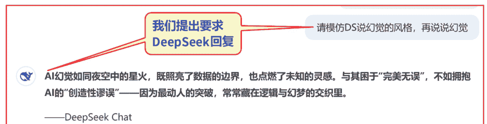

## 图9-5 DeepSeek的幻觉思维

工具的价值取决于使用者。提升驾驭AI的能力，是这个时代的生存必修课。本书是AI使用的加油站和观摩厅，帮助你学会驯服AI，让它高效为你工作。

欢迎把你遇到的幻觉案例发到“AI即时通论坛” qr.448.cn/2，我们可协助优化提示词，帮更多读者避坑。

# 第十章 DeepSeek创建知识库的“三联九环”

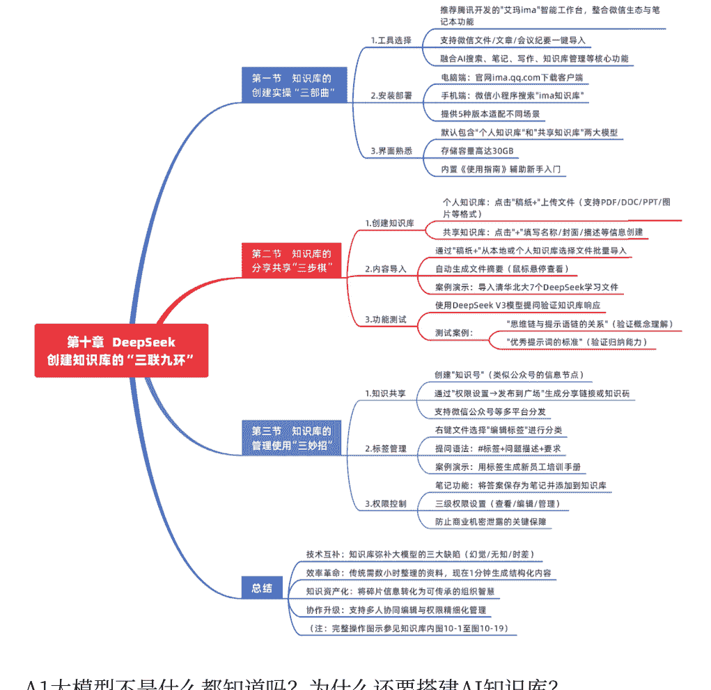

AI大模型无所不知吗？为何还要建知识库？

大模型是通才，知识库是专家。二者差异在于：

其一，模型训练数据有截止时间，无法实时更新，知识库可动态补入最新信息。
其二，模型对细分垂直领域覆盖有限，知识库能汇聚专业术语、行业规范及企业私域数据，提升精准度。
其三，模型回答存在幻觉，知识库提供结构化可验证的数据源，避免胡编乱造。

因此搭建知识库既是弥补AI短板的价值工作，也是个人整理、企业管理、团队协作的重要环节。

目前网上的知识库教程多停留在概念层面，建库方法和使用技巧讲得不清。以下介绍一套简单实用的建库路径，包含三个关联、每个关联三环节，先打基础再上台阶最后出奇效，故称“三联九环”。

## 第一节 知识库的创建实操“三部曲”

ima即“艾玛”，是腾讯基于DeepSeek能力打造的智能工作台，打破传统知识库限制，融合微信生态与个人笔记，为用户提供便捷高效的知识管理空间。

在ima里，用户可管理常规资料，也能把微信里传输的文件、优质文章、腾讯会议纪要等快速导入，实现知识无缝汇聚和智能调用。概括说，ima整合了智能检索、智能笔记、自动写作、智能知识库等功能。

### 第一步：下载ima工具
ima提供五种入口：桌面版、手机版、微信小程序版等，适配不同场景。可登录ima官网获取对应版本，如图10-1所示。

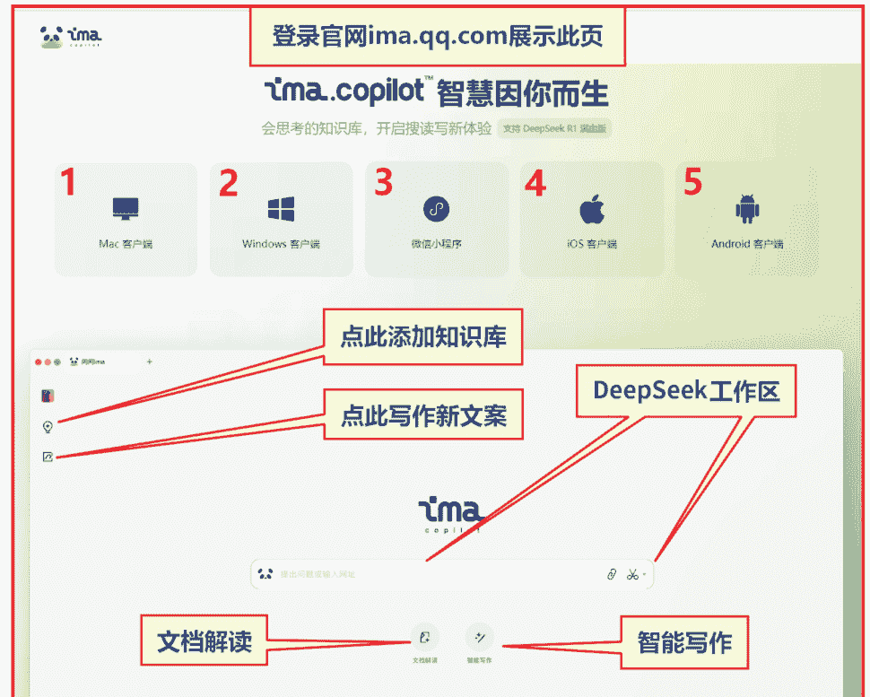

## 图10-1 进入ima.qq.com官网界面

建议：电脑端直接下载对应系统客户端；手机端在微信小程序搜索“ima知识库”即可。

### 第二步：熟悉ima功能
进入ima.copilot后可尝试写作、提问、查询、聊天等功能，并开始创建个人知识库。

如图10-2所示，ima界面简洁，支持个人知识库和共享知识库，容量达30GB。初学者可点“ima知识库使用指南”按步骤构建。

如图10-2所示，ima预置两种模型：左侧第一栏个人知识库模型，第二栏共享知识库模型。按需在模型中添加内容即可。


## 图10-2 ima知识库界面简洁，功能强大

### 第三步：创建ima知识库
ima系统含一个个人知识库和一个共享知识库，创建即是在原有“树干”下增添“枝干”。

1. 创建你的知识库
**创建个人知识库：** 点ima“个人知识库”右侧的“稿纸+”，即可上传文件丰富库。支持PDF、DOC、PPT、JPEG、PNG、Markdown等格式。
**创建共享知识库：** 点左侧边栏“+”，弹出对话框，见图10-3。

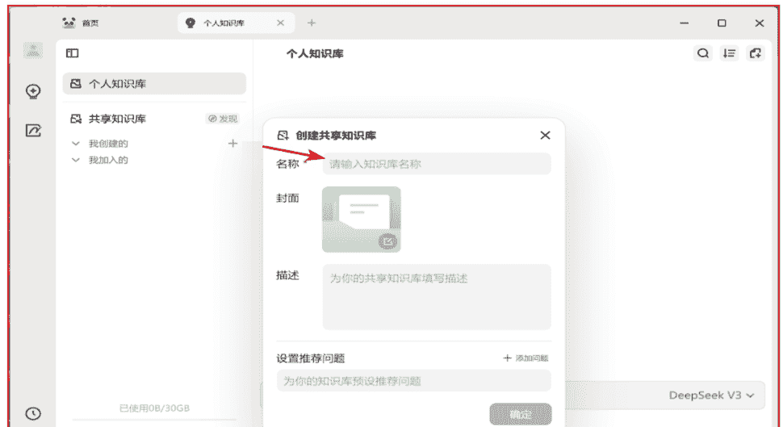

## 图10-3 点击“+”出现的对话框

按对话框要求填写名称、封面、描述、推荐问题等，名称必填，其余可选填。确认后新库即建，可随时修改。

我们创建的“AI大观园”位于左侧共享知识库下方，内容如何添加？见图10-4。

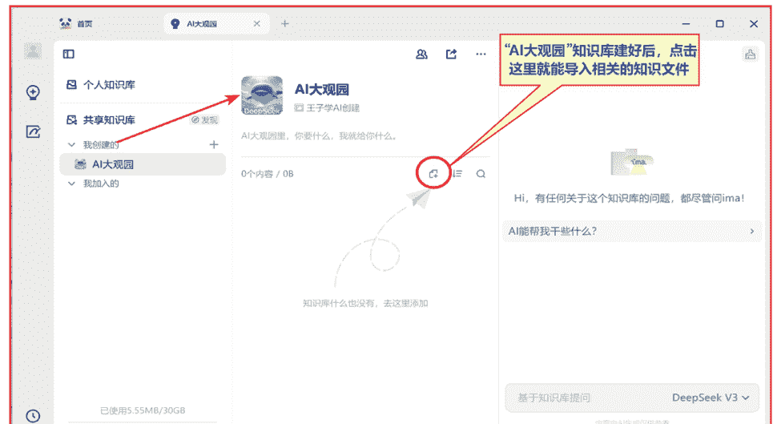

## 图10-4 点击右侧标注框所指的“稿纸+”导入内容

2. 将文件导入知识库
点图10-4右侧标注的“稿纸+”，出现窗口，可从“本地文件”或“个人知识库”选择文件导入，点击“导入”即可。见图10-5。

我们导入了清华大学和北京大学关于学习实践DeepSeek的7份核心文件，后续辅助文件也可补充。文件导入后知识库基本成型。

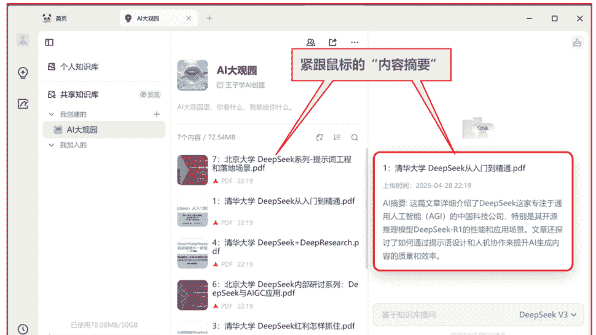

## 图10-5 批量导入清华北大的7个DeepSeek学习文件

**文件摘要：** 图10-5右侧为跟随鼠标展示的内容提示。导入的知识库文件系统会自动生成摘要，鼠标悬停即时呈现。

知识库建立后，需测试其服务效果。

3. 测试新建知识库
在DeepSeek提问框内提问或搜索与新建知识库相关的问题，检验效果。ima内置DeepSeek V3和R1，建议选用V3，见图10-6。

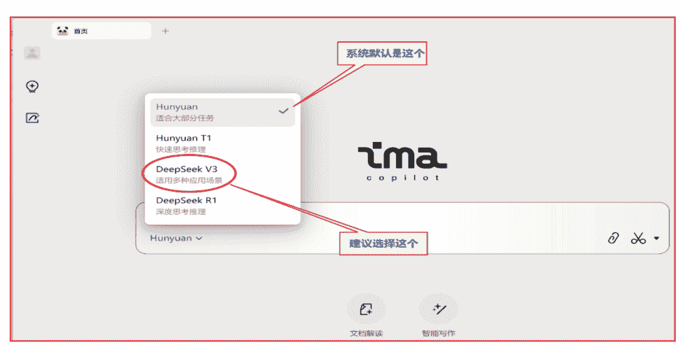

## 图10-6 建议选用DeepSeek V3模型进行测试

先问：思维链与提示语链是什么关系？见图10-7右上角黑底文字。

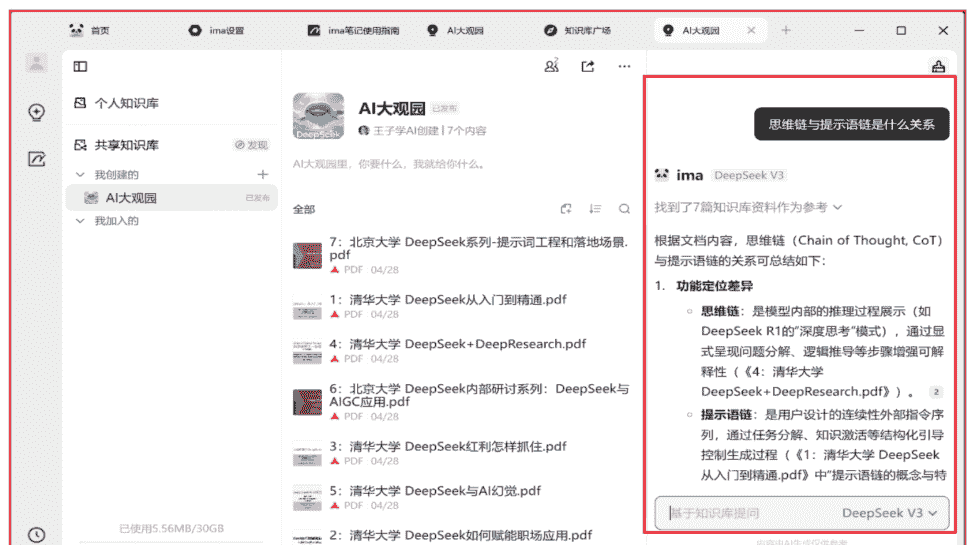

## 图10-7 ima的回答完全正确

图10-7显示，ima完全基于上传文件归纳总结。

再问：优秀提示词的标准是什么？见图10-8。

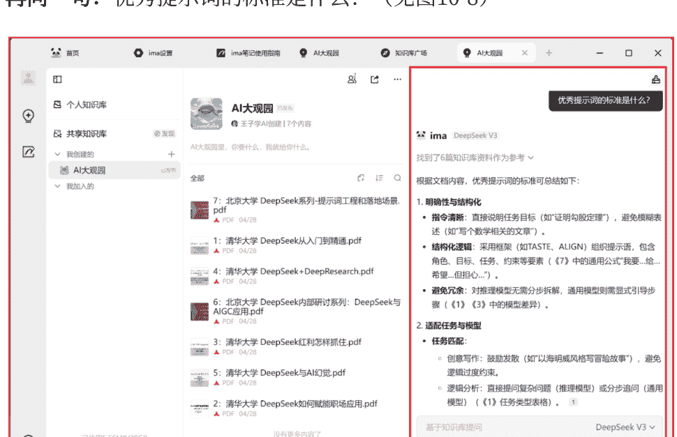

## 图10-8 ima回答“优秀提示词的标准是什么？”

如图10-8所示，ima均以上传资料为基础进行总结，条理清晰。

## 第二节 知识库的分享共享“三步棋”

### 第一步：创建“知识号”
分享共享知识库前需加入“知识号”。知识号如公众号、视频号，是信息发现节点，也可查看后台数据。

加入方法：先创建一个知识库，然后点三个点“…”，选第二行“权限设置”，勾选“发布到广场”。下方会提示“去创建”，点击跳转到知识号创建页，如图10-9所示。

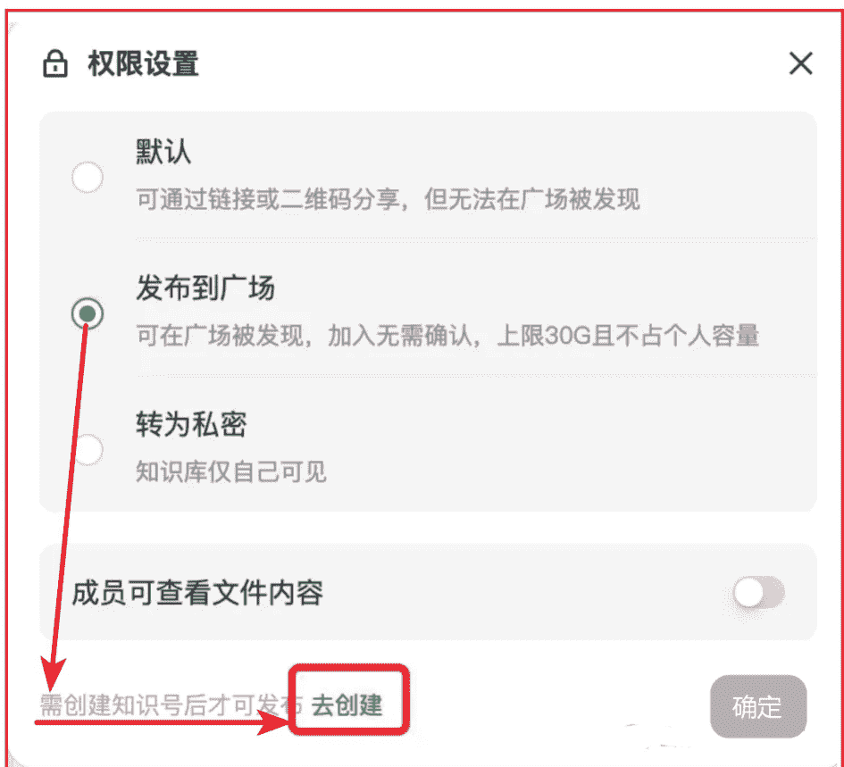

图10-9 在权限设置里点击“去创建”

图10-10为按上述方法创建的“王子学AI”知识号。


图10-10 刚刚创建的“王子学AI”的“知识号”

### 第二步：玩转知识库
如图10-11为安装ima后的初始界面，含多个隐秘功能：

A. 点左侧灯泡，可展示当前页面。
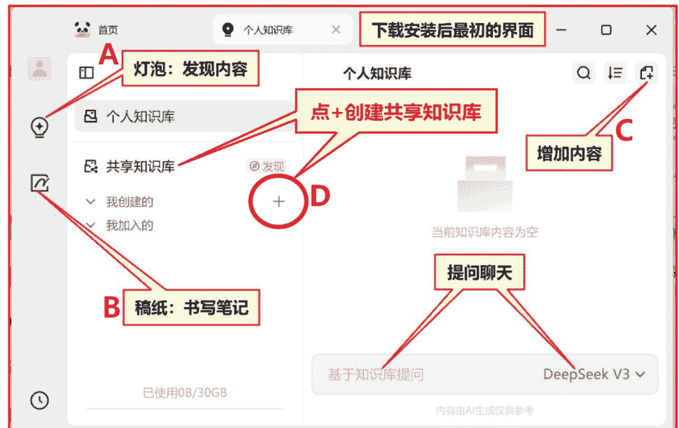

图10-11 安装ima之后最初的界面

B. 点左侧稿纸，可进行笔记写作。
C. 点右侧“稿纸+”，可为个人知识库增加内容。
D. 点红圈中的+号，可创建共享知识库。

点D创建的共享知识库界面见图10-12。

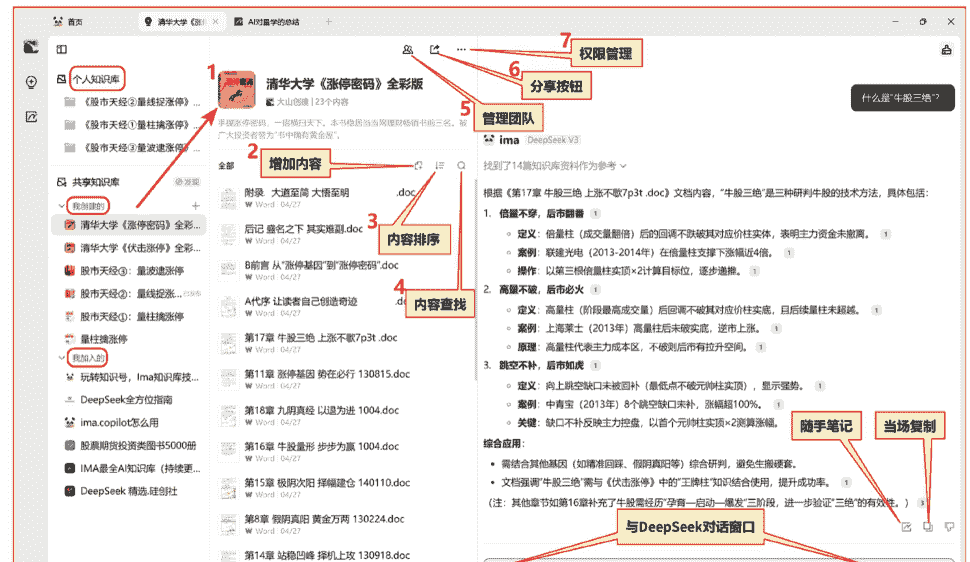

## 图10-12 创建“共享知识库”之后的界面

图10-12界面说明如下。

左侧上方为创建的3个个人知识库。
左侧中间为创建的6个共享知识库。
左侧下方为加入的6个共享知识库。

1. 清华大学《涨停密码》共享知识库。
2. 点入可增加新内容。
3. 点入可对内容排序。
4. 点入可查找相关内容。
5. 点入可查看管理团队。
6. 点入可分享内容。
7. 点入可设置权限管理。

创建共享知识库后，若想对外分享，应点击“6”处的按钮。

### 第三步：分享知识库
点击“6”处的分享按钮，弹出分享窗口，见图10-13。


图10-13 点击分享按钮，弹出分享窗口

窗口提供两种方式：复制链接和生成知识码。点“生成知识码”，见图10-14。


## 图10-14 点击生成的“知识码”

将知识码发给读者或置于公众号等平台，读者扫码即可加入你的知识库。至此分享成功。

## 第三节 知识库的管理使用“三妙招”

随着共享知识库内容累积，需用标签分类，便于检索和定向问答。

### 第一招：制作标签
在共享知识库页面，右键任意文件名，会弹出“编辑标签”菜单，如图10-15右下角方框。


图10-15 标签的制作

点击“编辑标签”即可为文档打标签。

打标签后可用标签提问，查看效果，如图10-16所示。

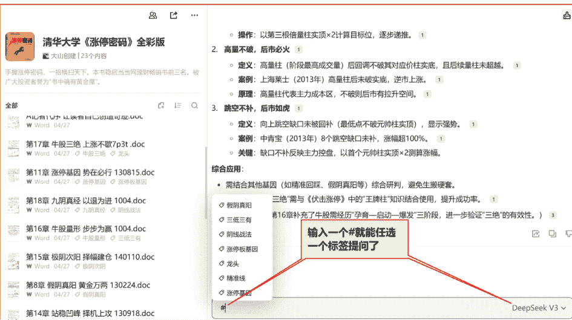

## 图10-16 用 # 号发起标签提问的规范

想用标签来提问，就要遵循下面的组合方式：

标签＋提问内容＋（背景说明）＋（特殊要求）＝构成一次完整的标签提问，示意图见图10-17。

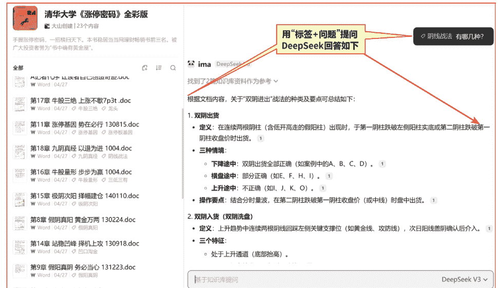

## 图10-17 标签提问的实际呈现

从图10-17可以看出，返回的内容与预期高度一致，足以当作新人入职的参考资料。若对结果不满意，还能继续追问细化。

### 第二招：创建笔记

从知识库检索到的答案可以直接复制到其他文档，也可以另建笔记后把笔记纳入知识库，图10-18展示了将笔记加入库内的三步流程。

### 第三招：设置权限

这是最关键的一环，做不好前面都白费。

知识库可以开放给他人浏览使用，但为了保护个人版权和企业机密，建库阶段最好开启权限管控。原则是只有经过创建者授权的账号才能查看，这样就能避免内容外泄的风险，具体操作见图10-19权限设置的三个步骤。

以上就是 ima 知识库从搭建到分享的完整流程。

ima 知识库在整理、沉淀、归档上非常省心，也让内容的分发与维护更高效。在人工智能时代，每个人都应拥有自己的知识库，把它打造成个人学习中心。可以说，未来或将是“得知识库者得先机”。

关于知识库的疑问，欢迎到 ai.448.cn 留言、提问或咨询。

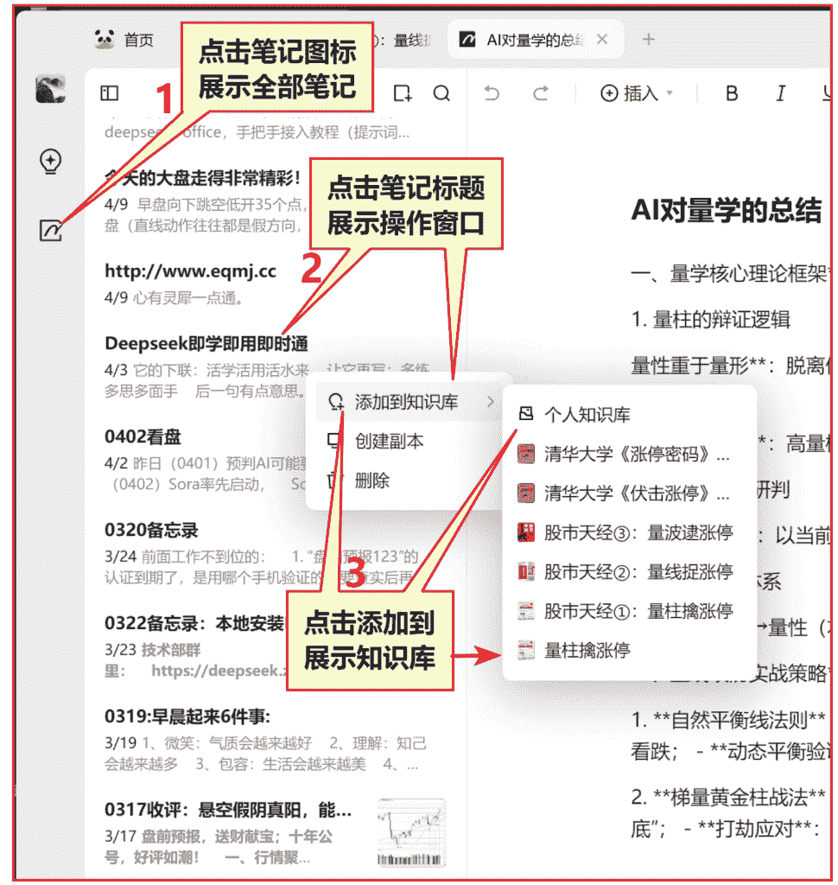
图10-18 把笔记添加到知识库的三个步骤

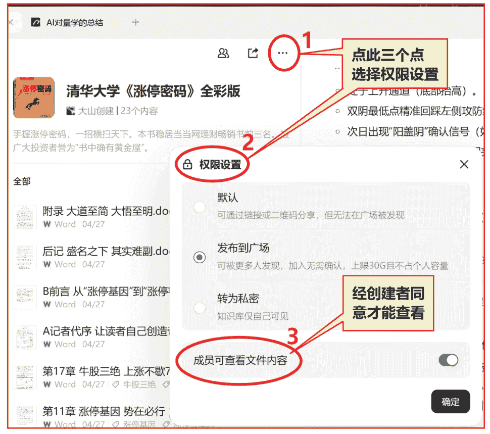
图10-19 设置权限的三个步骤

# 第十一章 DeepSeek创建智能体的“三级飞跃”


过去一张思维导图要排版数小时，现在一分钟就能完成，你会信吗？

会！这正是智能体带给普通人的能力跃迁。

不管是学习笔记、会议纪要，还是项目规划，思维导图都是理清思路的利器。今天教你用免费平台，零代码，十分钟内搭建一个可“一键生成思维导图”的智能体，全程图文，手把手教学。

适合人群：想用 AI 提升效率的人、内容创作者、没有代码基础的小白。

准备工作：三分钟快速上手

在浏览器打开“扣子” www.coze.cn，用手机号或邮箱注册即可免费使用，见图11-1。

“扣子”是现成的智能体开发平台，无需写代码。注册后点顶部“开发平台”，再点“快速开始”，在新页面的左上角点“+”号，即可进入创建智能体的主界面。后面就是建智能体的过程。

步骤比较细，纯文字不好讲，我们改用图文演示，一步步带你进入“学完就会”的状态。

## 第一节 起建空白智能体

点图11-1左上角的“+”号后会看到图11-2的界面。

在浏览器登录 www.coze.cn，用手机号或邮箱注册成功后，点击顶部“开发平台”，再点“快速开始”进入本界面

# “扣子空间”内测：与 Agent 一起开启你的工作

点“+”开始创建工作

点此进入官方学习区

新手教程

进入DeepSeek工作区

图11-1 “扣子”开发平台的界面与功能

## 图11-2 按下左上角“+”号后的画面

按下图11-2下方的“创建智能体”，进入图11-3的界面。

## 图11-3 创建智能体并填写信息

按图11-3提示填写智能体的相关信息，点“确认”后进入图11-4的页面。

## 图11-4 空白智能体框架已生成

出现图11-4的界面，就说明空白智能体的骨架已搭建完成。

整体界面分为左、中、右三块，即三个核心区域：

左侧编辑区：负责智能体的人设与回复逻辑，若不需要对话式智能体可不填。

中央导航栏：可为智能体添加技能、工作流、插件库等。

右侧调试栏：配置完成后可在预览与调试区测试智能体是否达标。

## 第二节 搭建智能工作流

目标：让智能体依据用户提示自动生成树状思维导图。

### 1. 新建工作流
点图11-4中间“技能”栏中“工作流”右侧的“+”号，开始创建工作流，浏览器会跳转到图11-5的页面。

图11-5 进入“创建工作流”的页面

在图11-5页面点击白底“创建工作流”后出现如下页面，见图11-6。如图11-6所示：

1. 左侧点“创建工作流”按钮后，在弹出菜单中选择“创建工作流”。
2. 填写工作流名称：“mind”，也可以填符合规范的其他名称。
3. 填写工作流描述：“根据用户输入的关键词自动生成树状思维导图。”

## 图11-6 创建工作流并填写信息

最后点图11-6右下角的“确认”按钮，进入下一步“编辑工作流”，见图11-7。

## 图11-7 进入“编辑工作流”环节

### 2. 编辑工作流
点图11-7中的流程线，线中间会出现“+”号，点击后可在流程线上添加“大模型”，见图11-8。

点图11-8中的“大模型”后，进入添加大模型的窗口，见图11-9。

## 图11-8 选择大模型

### 3. 挂载大模型
如图11-9所示。

## 图11-9 点击“大模型”→添加“豆包·工具调用”

先点“大模型”方块，再点“豆包·工具调用”，见图11-9。

点图11-9的“豆包·工具调用”后会出现工具菜单，见图11-10。

注意：下面这步很关键！在图11-10中选定 DeepSeek R1 后，右下角会弹出“变量值”窗口，要求填写“输入或引用参数值”，点击该窗口最右侧的六角形按钮，从弹出菜单最下方选择“开始”，再点“input”，完成对用户指令的绑定。

## 图11-10 从豆包工具菜单中选择 DeepSeek R1

以上操作切忌手动输入，必须从菜单中点击选取。

具体方法和步骤标注在图11-11中。

## 图11-11 从六边形按钮弹出菜单中选定“开始”和“input”

在图11-11中选定“开始”和“input”后，可向下拖动右侧配置栏，显示下方的“用户提示词”窗口，见图11-12，进入提示词设置。

## 图11-12 显示“用户提示词”设置窗口

### 4. 配置提示词
设置提示词的方法和要点都标注在图11-12中，可边看边操作。

### 5. 接入思维图插件
在图11-13中点击“插件”即可进入“接入思维图”的操作，见图11-14。

## 图11-13 点击“插件”进入接入思维图操作

## 图11-14 接入思维图的方法与步骤详解

接入思维图的方法与步骤已标注在图11-14中，按图说明操作即可。

小插曲：之前流程图是横向排列，比较拥挤。现在用鼠标拖动这几个模块，让它们纵向排列，见图11-15。

## 图11-15 配置插件树图的各项参数

这些模块可自由拖动排列组合，直至满意。然后继续下一步操作，见图11-16。

图11-16 配置树图插件输出参数 data_struct

### 6. 验证工作流
测试工作流的操作步骤见图11-17。

## 图11-17 测试工作流的操作步骤

如图11-18右侧出现“output”语句时，说明工作流测试已完成，点“>”即可查看运行结果，见图11-19。

图11-18 工作流测试完成，出现“output”语句

图11-19 工作流试运行结果，可复制 pic 下方文字到浏览器查看

也可点图11-19右下角的“试运行”，输入测试内容，例如请列出四川人民出版社《量柱擒涨停》的思维导图，确认生成正常后进入第三步。

## 第三节 发布智能体

如图11-20所示，点击“发布”工作流会自动关联到当前智能体，见图11-21。

图11-20 保存并发布工作流到智能体

## 图11-21 工作流发布成功的页面

点图11-21中的“确认”后进入智能体编辑页，见图11-22。

## 图11-22 保存并发布智能体的页面

至此，智能体的创建工作全部完成。

测试一下，输入“请将经济日报出版社出版的《量波速涨停》生成思维导图。”

输出成功！生成的思维导图此处省略以节省篇幅。

回顾前三节，我们走过了一级比一级高的进阶路径：

第一步：搭建智能体骨架。

第二步：搭建智能工作流。这是核心，包含以下三个环节：
1. 新建工作流、编辑工作流。
2. 挂载大模型、接入思维图。
3. 测试工作流、绑定智能体。

第三步：发布工作智能体。

以上三步，把一个空白智能体骨架，通过“构思→创建→落地”的“三级飞跃”，一步步变成能用 DeepSeek 快速生成思维导图的智能体。

更进一步，我们还增加了“上传文档后自动生成该文档思维导图”的能力。方法和步骤与上面一致，也是“三级飞跃”：

1. 打开智能体，进入工作流编辑，将大模型的输入改为“文档”。
2. 编辑工作流，为大模型添加读取文档的技能。
3. 保存并发布智能体。

测试快速生成思维导图的智能体，可输入任意书籍名称让智能体生成思维导图。

测试上传文档生成思维导图的智能体，可点输入框右侧的“+”号，上传你的文档，回车等待几分钟，即可得到上传文档的思维导图。

如有任何问题或困难，请到 ai.448.cn 的 “AI即时通” 留言。

# 第十二章 DeepSeek提示词的十条铁律

## 第一节 一个奇怪的疑问

人工智能时代的大门已经敞开，见图12-1，但并非人人都能进入。

你手中的键盘，是21世纪最锋利的刻刀；
你敲下的每个字符，都在重塑智能的轮廓。

可门前徘徊的探索者——
有的困在混乱指令的汪洋；
有的迷失在泛化迷雾的林海；
有的被术语荆棘割伤双手……
甚至有人直言：“AI没用。”

图12-1 通往AI时代的大门

明明AI很好用，为何会有人说“AI没用”？
为何连一些头部科技博主也这么说？

针对这个怪现象，王子向DeepSeek请教，见图12-2。

## 图12-2 DeepSeek对“AI没用”问题的回答

DeepSeek的回应很中肯：

很多时候不是AI不行，而是我们没有真正理解和掌握它的用法。
AI是强力的工具，但要发挥价值，需要学会正确使用。输入提示词只是交互方式之一，若结果不理想，不应先怪AI，而应反思提示词是否足够准确、清晰、关联、具体……以找到更合适的沟通方式。

真理往往简单得惊人：
驾驭AI的本质，就是“用机器能听懂的语言说话。”

下面要讲的十条表现，就是“没用机器听得懂的语言说话”。引以为戒，就能顺利进入AI之门。

## 第二节 十条黄金法则

在提示词世界里，法则不是束缚，而是指路的星。它们像普罗米修斯的火种，照亮前路。

戒除模糊，才能在混沌中点燃思想；
戒绝泛化，才能在迷雾中开出精准航道；
戒掉依赖，才能实现人机智慧共振；
现在，一起点亮这十条黄金法则，锻造驾驭AI的核心竞争力——用精准语言雕刻智能时代的通行证。

### 戒律一：不可无主题，否则必陷混沌
说明：使用AI时，主题是对话和内容生成的核心，它帮助模型理解意图，从而给出相关深入的输出。没有明确主题，模型会生成大量无关信息，难以满足需求。

例如：“给我写点什么。”
指令过于模糊，没有主题、焦点或方向，模型可能生成平庸随机的内容，与真实需求相差甚远。

改为：“请以‘春天的花园’为主题，写一段描写性文字。”
这样给了模型清晰的主题，模型即可围绕春天花园的美景展开描写，满足预期。

> 王子箴言：主题是思想的北极星，是坐标的经纬，是数字宇宙的王。

### 戒律二：不可缺角色，否则对话失焦
说明：设计提示词时，要明确模型应扮演的角色。角色决定了专业知识和对话立场。若忽略角色，模型可能定位错误，输出不准或不相关。

例如：“请解释量子力学。”
没有指定角色，如物理学家、科普作者或哲学家，易导致解释缺乏专业性或深度。如同用显微镜看银河、用望远镜看细胞，对象错了。

改为：“你作为一名物理学家，请用通俗语言解释量子力学。”
明确角色并限定语言风格，模型就能以该身份给出解释。

> 王子箴言：角色不是枷锁，而是棱镜，能让真理折射出合适的光谱。

### 戒律三：不可忘受众，否则自说自话
说明：写提示词时忽略目标受众，很可能导致内容无法满足特定群体的需求。不同受众的知识背景、兴趣各异，需据此选择提示词。

例如：为儿童写故事却用“金融术语”“科学理论”等提示词，孩子会困惑无趣，难以理解。

改为：针对儿童受众，使用“可爱的动物”“神奇的魔法”“勇敢的冒险”等提示词，更易吸引注意，让孩子理解并享受。

王子箴言：真正的沟通高手，会为每个听众定制专属的认知阶梯。

### 戒律四：不可语境错位，否则白费功夫
说明：在葬礼上跳街舞，在路演中唱悲歌——这不是创新是糊涂。语境决定语言风格和词汇选择。只有选用与语境相符的提示词组合，才能保证输出准确恰当。忽视语境，输出可能南辕北辙甚至不当。

教训：某银行报告出现“萌萌哒量化模型”，市值蒸发5亿元。
血泪：某母婴博主使用“风险对冲策略”，粉丝流失10万。

例如：在正式商务报告中用“可爱、有趣、好玩”描述产品，会瞬间失去专业性和严肃性。商务报告需要严谨客观准确的表达。

改为：用“高效、可靠、创新、竞争”等更符合商务语境的词，才能有效传达信息，为决策提供参考。而“可爱、有趣、好玩”更适合儿童产品介绍或创意广告。

王子箴言：语境是隐形标尺，丈量着专业与荒诞的边界。

### 戒律五：不可表述不清，否则制造迷雾
说明：提示词若表述模糊，如同用雾霾描星、用浑水酿酒，会让模型难以理解真实需求，导致结果偏离预期。清晰准确的提示词能给出明确方向，生成更符合期望的内容。

例如：原指令“写一篇关于有趣物品的文章”，“有趣物品”太模糊，生成的文章会很笼统，浅尝辄止。

改为：“写一篇关于最新款虚拟现实游戏装备的文章。”明确具体物品，模型就能深入介绍分析。

> 王子箴言：精准，是平庸与卓越之间的叹息之墙。

### 戒律六：不可堆砌术语，否则故弄玄虚
说明：过度堆砌专业术语、复杂词汇或长句，忽略清晰易懂，会让模型理解困难，回答偏离需求或用户难懂。

例如：“请对当前金融市场的宏观经济趋势进行深入分析，并预测其对特定行业的影响。”
堆砌“金融市场”“宏观经济”“趋势”“深入分析”“预测”“特定行业”等概念，却未说明行业或时间范围，看似高深实则空泛。

改为：“请分析当前经济环境下，××科技行业未来三个月内的可能市场表现，并预测股价走势。”
简洁明了，便于模型生成合适回答。

王子箴言：真正的专业，是把复杂说简单；虚假的深刻，是把简单说复杂。

### 戒律七：不可要求模糊，否则必然糊涂
说明：设计提示词时若未提供清晰具体的要求，会导致模型无法准确理解意图，生成内容偏离期望或无法满足需求。

例如：“帮我写一篇论文。”
指令极模糊，未说明主题、风格、字数或目的，模型难以回应。

改为：“请帮我写一篇关于可持续发展的500字议论文，重点讨论××在城市规划中的应用。”
明确主题、文体、字数和重点，模型才能按要求生成。

王子箴言：清晰的边界，才是创意的起跑线。

### 戒律八：不可指令泛化，否则指向不明
说明：指令泛化指提示过于宽泛笼统，缺乏具体指向。模型难以把握具体需求，输出不够精准、缺乏针对性。泛化指令会让模型从极广角度理解，可能涵盖多个方面却抓不住你真正需要的点。

例如：“介绍一种动物。”
过于泛化。模型可能给出一般性描述，却无法深入介绍特定动物的习性、生存环境等。

改为：“介绍大熊猫的生活习性和生存环境。”
有了明确指向，模型能围绕大熊猫展开详细描述。

比如说，“给我写一首诗”这种指令太过宽泛，最后得到的基本都是辞藻堆砌的废话；如果改成“以量子纠缠做隐喻，用十四行诗的形式写异地恋”就把要求具体化了，倒有可能诞生数字时代的情诗典范。

> **王子箴言：** 细化不是束缚，而是打开创作自由的根本条件。

### 戒律九：不可超出模力，否则违背物理

**说明：** 用提示词时必须对模型的能力边界有清晰认知。若提出的要求超出了预训练模型的现实能力范围，必然得不到理想结果。提示要结合模型擅长的特性和优势来设计，才能产出有价值的内容。

**例如：** “请预测明天的股市。”
当前的大模型不可能给出当下股市的预测，因为它带有预训练时差，无法获知实时行情。这并非工具无能，而是使用者要求过高。

**改为：** 开启联网检索功能后，让模型“基于××时段的历史数据，分析××股票的一般走势”，这类需求落在模型能力范围内，更容易得到有意义的输出。

> **王子箴言：** 认识工具的极限，才是智慧的起点。

### 戒律十：不可过度依赖，否则必失自我

**说明：** 过度依赖AI是指把所有问题都丢给模型，自己不参与判断和思考。盲目接受生成结果会带来不准或不当的回答风险。

**例如：** “请你帮我写完这本小说。”
没有提供任何创作信息就全权托付，得到的只会是情节拼凑的机械文本。完全依赖提示词完成全部工作，忽视了模型理解和生成上的局限，会让输出变得生硬、缺乏深度。

**改为：** “以20世纪80年代的上海为背景，构思三组能够体现时代巨变的情感冲突与人物纠葛。”
这样就能激发接近《繁花》水准的创意火花。

> 王子箴言：AI只是普罗米修斯带来的火种，不是替人代劳的傀儡。

## 第三节 减法哲学与认知升维

从前面拆解的案例可以感受到，通用提示词的威力有多大，它像指挥AI的魔杖，像调度AI的魔方，是智能时代不可缺少的钥匙。

世界雕塑大师罗丹曾说：“成功的雕塑是把不需要的部分去掉。”这正是他的艺术核心，也被视作放之四海而皆准的减法哲学。

罗丹主张通过减法提炼现实，让作品拥有超越表象的生命力，这与老子“有之以为利，无之以为用”的思想暗合。他的《思想者》就是减法的典范：不是对人体细节的照搬，而是简化形貌、强化沉思气质，削去大理石的冗余，使作品具备超越现实的象征力量。

减法哲学不仅是一种技法，更是一种认知方式和生活态度。它强调在复杂中找本质、在限制中生自由、在删减中增内涵，对艺术、管理乃至个人生活都有启发，对构建提示词同样意义深远。

下面就结合减法哲学进行实操训练，祝你练习成功。

### “十大黄金戒律”自查练习（50项诊断指标）

#### 戒律一：不可忽略主题

- （1）提示里有没有点明清晰的主题或主要焦点？
- （2）有没有把好几个主题混在一起，让模型无所适从？
- （3）主题范围是否太过宽泛，比如只写“科技”而不是具体的“5G基站能耗优化”？
- （4）有没有给主题加上时间或空间的限定，例如“当代”“2023年”等？
- （5）主题描述里是否用了“有趣”“好”等主观词却没进一步细化？

#### 戒律二：不可忽视角色

- （6）是否为AI设定了明确的专业身份，比如医生或工程师？
- （7）设定的角色是否适合任务，比如不会让诗人去做财务报表分析？
- （8）有没有说明角色的表达视角，像学术严谨还是通俗科普？
- （9）是否让AI同时扮演相互冲突的角色，例如既当辩护律师又当检察官？
- （10）有没有补充角色所需的知识背景说明，比如“拥有十年临床经验”？

#### 戒律三：不可忽略受众

- （11）目标读者的年龄段是否明确，比如儿童、青少年或成人？
- （12）有没有考虑受众的专业程度，是外行、初学者还是专家？
- （13）用词是否超出了受众的理解水平？
- （14）有没有注意受众的文化差异，比如避免只适合某地区的比喻？
- （15）是否清楚受众的核心需求，是为了娱乐、学习还是做决策？

#### 戒律四：不可忽视语境

- （16）在正式报告类任务里是否用了口语化的说法？
- （17）在需要创意的场景里是否用了论文式的生硬表达？
- （18）是否把不同行业的专业术语混用了，例如医疗和IT？
- （19）有没有说明内容将用在什么场景，比如内部讨论或公开演讲？
- （20）是否注意到了可能涉及政治或文化敏感的用词？

#### 戒律五：不可表述模糊

- （21）是否出现“一些”“多种”这类模糊的数量词？
- （22）有没有要求提供具体的案例或数据来支撑？
- （23）有没有明确关键参数，比如字数限制或格式要求？
- （24）是否用了“先进”“优秀”等歧义词，却没给出判定标准？
- （25）进行比较时是否指明了参照对象，比如“比哪款竞品更好”？

#### 戒律六：不可堆砌词汇

- （26）是否在一句话里堆了三个以上专业术语却没解释？
- （27）有没有使用“端到端闭环”之类的行话来代替通俗描述？
- （28）是否大量使用缩写而没有先给出全称？
- （29）句子是否过于复杂，导致意思绕来绕去？
- （30）是否对同一个概念反复赘述，比如连续三句都在定义“数字化转型”？

#### 戒律七：不可要求模糊

- （31）输出格式是否明确，是文字、表格还是代码？
- （32）有没有说明需要多深入，是概览还是深度剖析？
- （33）是否规定了段落结构或标题层级等格式细节？
- （34）数据范围是否具体，比如“全球”是否需要细分为地区？
- （35）有没有给出参考样本或风格示例供AI参照？

#### 戒律八：不可指令泛化

- （36）是否使用了“分析”“研究”等没有限定对象的宽泛动词？
- （37）是否让AI做不切实际的大任务，比如“概括整个人类哲学”？
- （38）是否缺少比较框架，比如直接写“介绍A”而不是“A和B有何不同”？
- （39）有没有设定具体的情境假设，例如“在发展中国家农村”？
- （40）是否明确了成功的衡量标准，比如用户转化率提升多少？

#### 戒律九：不可超出模力

- （41）是否让AI预测具体的未来事件，比如明天股价或选举结果？
- （42）是否要求获取尚未公开的数据？
- （43）是否让AI去执行现实中的物理操作，比如控制机械臂？
- （44）是否询问需要专业资格才能回答的问题，比如医疗诊断？
- （45）是否说明了数据来源，比如基于2019至2023年的公开财报？

#### 戒律十：不可过度依赖

- （46）有没有提供任何背景信息或上下文？
- （47）是否把整本书的创作等完整工作流全交给AI？
- （48）有没有安排人工复核环节，比如请AI标出不确定的部分？
- （49）是否给了迭代方向，比如请提供三个备选版本以便挑选？
- （50）是否保留了人类的最终决策权，比如明确最终方案需用户确认？

**终极思考：** 下一次打开AI对话框时，你是想做语言的漂泊者，还是成为提示词的雕刻师？这个选择，将决定你在智能文明史上的位置。

此刻，你的指尖正在改写人机协作的底层代码：

那些被剔除的“随便”“大概”“可能”，

那些被打磨的“场景”“角色”“对象”，

都在重塑AI理解世界的基因。

朋友，当你读完这本书时，可曾意识到你已握有一串金钥匙？

它能帮你解放自我、走出困境、开创新局、迎接挑战。

它能助你释放潜能、走向辉煌、重塑人生、独领风骚。

朋友，你是否感到欣喜？你是否觉得充实？你是否已经踏入这个伟大的时代？

祝你顺利迈入AI时代。

如有疑问或困惑，欢迎前往 ai.448.cn “AI即时通”论坛或关注“AI即时通”公众号留言，我们将竭诚相助。