# DeepSeek 大模型构建全景图

# 序言 基石奠定 未来共创

当下，智能化浪潮正深度改写社会运行方式。量子运算、基因改造、智慧城区、数字外交等多个方向都在被智能力量重塑，人类对世界的认知框架也在同步迁移。面对这场变革，既需要仰望星空的战略格局，也需要脚踏实地的学理支撑。北京大学出版社推出的“人工智能与人类未来”丛书恰如及时之雨，无论在理论层面还是实践层面，对社会转型都具有深远意义。

该系列最鲜明的特质是知本溯源。当行业普遍沉迷调参带来的短期收益时，《人工智能大模型数学基础》等基础著作系统梳理了线性代数、概率统计、微积分等支撑智能计算的知识脉络，将卷积核的本质阐释为张量空间的映射，将损失函数还原为变分法的最优控制思想。这种把工程现象拉回数学本源的解读，让读者的认知体系更完整，也为后续创新提供可能。书中独创的“数学考古学”视角，带领读者重走高斯、牛顿等先贤的思维路径，在微分流形中理解Transformer结构，在泛函空间里把握大模型的涌现规律。

在实践层面，丛书确立了“代码即理论”的写作范式。《人工智能大模型：动手训练大模型基础》等实操手册摒弃概念堆砌，以PyTorch环境下上百个示例展开，把反向传播具象化为矩阵求导，把注意力机制呈现为概率图模型。《DeepSeek源码深度解析》由团队逐层拆解国产大模型的核心设计，从分布式训练的参数同步策略到混合专家系统的动态路由机制，每个关键点都配有工业级实现。这种庖丁解牛式的技术解密，既让整体图景清晰，也让核心模块的可复用性得以体现。

丛书面向中国与世界的长远未来。算力竞争进入白热化时，《Python大模型优化策略：理论与实践》梳理了模型压缩、量化训练、稀疏计算等关键技术，为突破算力瓶颈提供方法论支撑。《DeepSeek图解：大模型是怎样构建的》大量采用可视化图表，把万亿参数的训练过程转化为可读的动力学系统，大幅降低理解门槛。上述创新呼应“十四五”规划对底层技术突破的要求，也为构建自主可控的技术生态培养人才。

作为见证者与参与者，我看到丛书形成了三重进展：学术上打通数学基础到技术前沿的知识链；产业上搭建理论到工程的转化通道；战略上回应新时代科技自立自强的国家需求。它可作为高校培养复合型人才的立体化教材，也可成为产业界突破技术瓶颈的参考，还能成为普通公民认识智能时代的必读书。

站在智能时代的关键节点，我们更需要兼具理论深度与实践智慧的启蒙之作。愿丛书点燃更多探索者的思想火花，共同描绘智能赋能文明的美好蓝图。

于 剑

北京交通大学人工智能研究院院长

交通数据分析与挖掘北京市重点实验室主任

中国人工智能学会副秘书长兼常务理事

中国计算机学会人工智能与模式识别专委会荣誉主任

# 前言

DeepSeek致力于前沿大语言模型Large Language Model, LLM及相关技术的研发。它的出现既是对全球智能浪潮的回应，也是中国在超大规模语言模型研发上迈出的坚实一步。平台融合了领先的视觉、语言与跨模态交互能力，并凭借高效的训练与推理机制，实现复杂任务的精准处理与快速响应。它为研究者与开发者搭建起连接理论与实践的桥梁，大幅降低高性能智能技术的使用门槛，推动前沿成果在各行业的推广与产业化。

# 出版动因

近年来大模型技术迅速演进，推动自然语言处理Natural Language Processing, NLP、计算机视觉Computer Vision, CV与多模态学习取得突破。DeepSeek作为一种先进架构，在文本理解、生成、翻译与多模态交互任务上表现突出，获得学界、开发者与企业的广泛关注。在此背景下，大模型的潜力巨大，但需求与挑战并存，主要体现在以下方面。

- ◎ 系统学习资料相对匮乏：在类似DeepSeek的大模型开发与优化过程中，需要深入理解底层架构、训练方法、优化策略与落地方案，学习门槛较高，成体系的参考资料不足。本书弥补这一空白，助力读者由浅入深掌握DeepSeek类模型的开发与应用。

- ◎ 企业对相关人才的需求上升：诸多企业希望自建模型或在已有模型上进行优化以满足特定业务，而大模型的训练、优化与部署涉及复杂的工程实现与算力资源管理，具备该能力的人才十分稀缺。本书系统介绍技术架构、训练方法、推理优化与应用开发，帮助从业者提升技能，匹配市场需求。

- ◎ 学术与科研机构的技术需求：随着大模型研究成为人工智能热点，高校与研究机构正探索计算效率提升、可解释性增强与应用拓展。本书提供全面技术解析，帮助研究者深入理解DeepSeek并探索其在不同任务中的应用。

- ◎ 创业者与技术爱好者的需求：开源大模型兴起后，越来越多的创业团队与独立开发者希望基于现有架构打造新应用，或训练面向特定领域的专属模型。缺乏系统指导是主要障碍。本书理论结合实践，帮助快速掌握开发方法并提供案例，实现高效落地。

- ◎ 国产生态建设的需要：DeepSeek等国产大模型的崛起标志国内技术突破。为促进生态发展，需要更多人才参与。本书深入讲解架构与应用，帮助开发者更好地理解与使用国产大模型，推动国内产业发展。

总体而言，本书填补了市场对DeepSeek类大模型开发知识的需求，适合人工智能领域的开发者、研究者、企业工程师、创业者与AI爱好者，提供完整学习路径，推动技术创新与落地。

# 本书亮点

- ◎ 全流程讲解模型开发：从基础概念到高级应用，系统梳理DeepSeek类大模型开发流程，覆盖数据预处理、特征提取、文本分类、语言生成、机器翻译、多模态学习、训练优化、API应用开发等，帮助全面掌握核心技术。

- ◎ 理论结合实践：不仅解析Transformer等核心技术，还通过代码示例、案例分析与实战演练，帮助将理论转化为开发能力，快速上手训练与应用。

- ◎ 覆盖多模态与前沿技术：除文本处理与传统NLP外，还介绍DeepSeek的多模态架构，包括视觉理解、跨模态学习、混合专家Mixture-of-Experts，MoE等前沿技术，展示大模型在图像、文本、语音融合的应用。

- ◎ 深入优化策略：针对训练成本高、资源需求大问题，介绍多任务学习、参数高效微调Parameter-Efficient Fine-Tuning，PEFT、人类反馈强化学习Reinforcement Learning from Human Feedback，RLHF、动态学习率调整等策略，帮助提升性能并降低成本。

- ◎ 实战导向应用：不仅讲解API开发，还涵盖聊天机器人、办公自动化、代码生成、知识库系统等场景，助力将技术落地到实际业务。

- ◎ 助力国产生态：围绕DeepSeek展开，帮助开发者更好理解与应用国产大模型，推动国内大模型生态创新与发展。

总之，本书以系统讲解、丰富案例与前沿解析，帮助读者快速掌握开发与优化方法，为智能研究与应用提供技术支撑。

# 适合人群

- ◎ **人工智能研究者**：从事自然语言处理、大模型研究的学者，深入理解DeepSeek及其优化思路。

- ◎ **开发者与工程师**：希望掌握大模型开发、训练、优化、部署的AI工程师、算法工程师、软件开发人员。

- ◎ **大数据与机器学习从业者**：在数据科学、机器学习领域工作，提升对特征提取、文本处理、模型优化等核心技术的认知。

- ◎ **企业技术团队**：希望将大模型应用于智能客服、自动翻译、知识管理、代码生成等场景的企业AI团队。

- ◎ **对大模型感兴趣的学习者**：对人工智能、大模型感兴趣的学生或自学者，建立系统认知并快速上手DeepSeek相关开发。

无论是初学者还是资深开发者，本书都能提供理论解析与实战案例，帮助掌握核心知识并应用于项目。

# 致谢

本书成书离不开北京大学出版社编辑的大力支持。他们的严谨、耐心与高效使本书得以快速出版，特此致谢。

同时衷心感谢家人给予的巨大支持与理解，陪伴与鼓励是我坚持完成本书的重要动力。

作者水平有限，书中难免有疏漏，恳请读者不吝指正，以便后续版本完善改进。

感谢您选择阅读本书。希望它能成为您技术探索的得力向导，助您在学习与实践中不断进步。祝阅读愉快。

# 阅读提示

本书赠送资源已上传至百度网盘，供读者下载。读者可用微信“扫一扫”功能扫描封底二维码，关注微信公众号，输入本书77页资源下载码，根据提示获取下载地址及密码。

资源下载码：DSTJ2505

# 第1章 明月松间照，清泉石上流：文本预处理

文本预处理是NLP的重要环节，能把原始文本转化为适合机器学习算法处理的形态。通过灵活组合预处理技术，可依据任务与数据集要求进行定制。本章系统讲解各类预处理技术。

> 明月松间照，清泉石上流。

出自王维《山居秋暝》。此句描绘纷扰之外归于清澈宁静的意境。文本预处理正如其意，剔除噪声、提炼精华，让杂乱数据变得清晰有序，为后续NLP与DeepSeek应用奠定基础。

## 1.1 文本分词拆解

分词Tokenization是自然语言处理的基础步骤，把文本拆分为单词、短语或标记，便于计算机处理。它是NLP任务的基础，因为把连续文本转化为离散单元，可用于文本分析、信息检索、机器学习等。

在日常交流中分词是自然过程，帮助理解和表达复杂句子。与朋友聊天时，会自然地把句子拆成词元来理解。例如把“我今天去超市买了苹果和香蕉”拆分为“我”“今天”“去”“超市”“买了”“苹果”“和”“香蕉”等词元Token来理解，如图1-1所示。

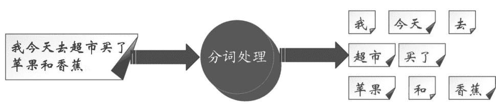

图1-1

### 1.1.1 为何需要分词与核心原理

分词占据NLP基础位置，是文本处理前提，对理解与处理文本数据至关重要。

#### 1. 分词的关键作用

分词的重要性如图1-2所示。

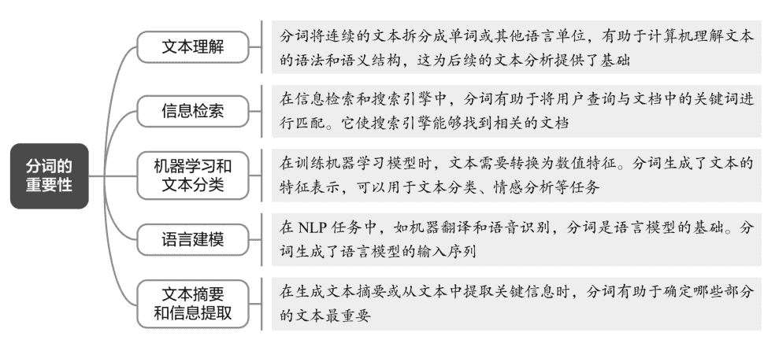

图1-2

#### 2. 分词运作机制

具体实现因语言与任务而异，通常包含以下方面。

- ◎ 词汇表：构建含常用词汇、短语与标点符号的词汇表，可按任务与语言定制。
- ◎ 文本扫描：扫描文本识别分隔符如空格、标点等字母字符，分隔符用于确定分词位置。
- ◎ 字典匹配：依据词汇表将文本与词条匹配，属于基于规则过程，可考虑上下文与语法。
- ◎ 最大匹配法：在部分无空格文字中采用最大匹配法，即从左到右扫描每次取最长词，以解决词间无空格问题。
- ◎ 统计方法：基于统计的分词使用训练好的语言模型，依据词频与上下文判定最可能分词方式。
- ◎ 混合方法：部分工具结合规则与统计模型以获得更好性能。

分词是NLP基础，不同语言与任务可采用不同方法与工具。正确分词可大幅提升文本处理准确性与效率。

### 1.1.2 空格分割法

基于空格的分词是最简便方式，依据空格字符把文本拆分为单词或短语。适用于多数拉丁字母文字如英语、法语、西班牙语，因这些语言通常以空格分隔单词。基本原理如图1-3所示。

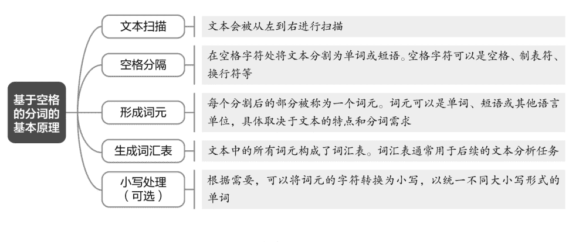

图1-3

注意：基于空格分词适用于某些任务，但对部分语言与文本类型可能不够精确。例如中文、日文与某些非拉丁字母文字中单词间通常无空格，无法直接使用。此外该方法不考虑标点符号、特殊字符等分隔符，可能需要进一步清洗处理。

在NLP任务中，选择合适分词方法取决于语言、任务需求与文本特性。有时需结合多种方法，如分析多语言文本时，以确保准确分词与高质量表示。实例1-1是一个基于空格的分词示例，将一句英文歌词拆分为单词，并计算每个单词长度并显示最长单词。

#### 实例1-1 英文歌词的空格切分

实例文件song.py源码路径：codes\1\song.py的具体实现代码如下。

```python
# 输入一句英文歌词
lyrics = "You say goodbye, I say hello"

# 使用空格分隔单词
words = lyrics.split()

# 初始化最长单词和其长度
longest_word = ""
max_length = 0

# 遍历每个单词
for word in words:
    # 去除标点符号，以防止它们干扰单词的长度计算
    word = word.strip(".,!?;:'")

    # 计算单词长度
    word_length = len(word)

    # 检查是否为最长单词
    if word_length > max_length:
        max_length = word_length
        longest_word = word

# 显示最长单词和其长度
print("最长的单词是:", longest_word)
print("其长度为:", max_length)
```

上述代码首先把输入歌词按空格切分为单词，再去除标点符号，最后计算每个单词长度并找到最长的单词。可用于创建有趣的文本分析工具或游戏，如猜最长单词游戏。

执行上述代码，输出结果如下。

```
最长的单词是：goodbye
其长度为：7
```

### 1.1.3 标点驱动的分句

基于标点符号的分词常用于从文本中提取短语、句子或其他语言单元。实例1-2是一个基于标点符号的分词示例，将一段文本按标点分割，以获取句子并计算每个句子的平均长度。

#### 实例1-2 按标点切分段落

实例文件biao.py源码路径：codes\1\biao.py的具体实现代码如下。

```python
import re

# 输入一段文本
text = "Natural language processing (NLP) is a subfield of artificial intelligence. It focuses on the interaction between humans and computers using natural language. NLP allows computers to understand, interpret, and generate human language."

# 使用正则表达式分割文本，以句号、感叹号和问号作为分隔符
sentences = re.split(r'[.!?]', text)

# 去除首尾空格的句子
sentences = [sentence.strip() for sentence in sentences if sentence.strip()]

# 初始化句子数量和总长度
num_sentences = len(sentences)
total_length = sum(len(sentence) for sentence in sentences)

# 计算平均句子长度
average_length = total_length / num_sentences if num_sentences > 0 else 0

# 显示结果
print("文本中的句子数量:", num_sentences)
print("平均句子长度:", average_length)
```

上述代码先使用正则表达式把文本分割成句子，以句号、感叹号和问号作为分隔符；然后遍历每个句子，计算句子长度并最终求平均句子长度。可用于分析文本句子结构并了解文本复杂性。

执行上述代码，输出结果如下。

```
文本中的句子数量：3
平均句子长度：84.33333333333333
```

## 1.2 词干提取与词形归一

词干化Stemming和词形还原Lemmatization都是文本预处理技术，用于把单词转化为基本形式，以减少词汇多样性，提高文本处理与分析效果。

假设有一个关于家庭清洁的文档，包含vacuum、clean、cleaning、duster、dusting等单词，则词干化与词形还原的过程如图1-4所示。

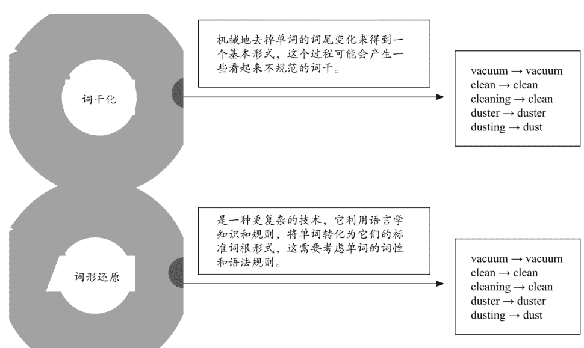

图1-4

### 1.2.1 词干化 vs 词形还原

两者在原理与适用场景存在差异，具体说明如表1-1所示。

#### 表1-1 词干化与词形还原的区别

| 区别 | 词干化 | 词形还原 |
| :--- | :--- | :--- |

| 原理 | 主要靠规则对词尾做截断，把不同变体的词压回到同一个词干或根片段，实现方式多是简单的字符串操作，比如去掉 -ing、-ed、-s 等常见后缀 | 会结合词的形态学和语法信息，把词还原成合法的基础词形，即词元，过程通常依赖词典和语法规则的支持，复杂度更高 |
| 适用场景 | 适合追求速度、对精度容忍度较高的粗处理，比如检索、文档分类。目的是把同一词族的多种写法映射成一个共同代表，降低词汇表大小 | 适合对准确性要求高的精细任务，比如自然语言理解、机器翻译等。能保证还原后仍是语法上成立的真实词 |
| 示例 | running、ran、runs 都会被归到词干 run | running 还原为词形 run，better 还原为词形 good |

总体来看，选择哪种方式要看任务对效率和精确度的取舍。词干化实现简单、快，但准确性有限；词形还原更严谨、可读性好，却需要更多计算和语言资源。

### 1.2.2 词干化
常用的词干化实现有以下几种。

#### 1. Porter Stemming算法
Porter Stemming是较早且使用最广的基于规则的词干化方案，通过一系列模式匹配逐步去掉词尾。该方法在信息检索等领域被大量采用。实例1-3演示了借助 NLTK 库执行 Porter Stemming 的过程，展示把词还原到基础形式的效果。

##### 实例1-3：使用Porter Stemming算法将单词还原到它们的基本形式
实例文件gan.py（源码路径：codes\1\gan.py）的具体实现代码如下。

```python
import nltk
from nltk.stem import PorterStemmer

# 初始化 Porter 词干化器
stemmer = PorterStemmer()

# 待词干化的单词列表
words = ["running", "flies", "happily", "stemmer", "jumps", "easily"]

# 对每个单词执行词干化
stemmed_words = [stemmer.stem(word) for word in words]

# 显示原始单词和词干化后的结果
for original, stemmed in zip(words, stemmed_words):
    print(f"原始单词：{original} -> 词干化后：{stemmed}")
```

在上述代码中，先用 Porter Stemming 对词表做词干化，再并排展示原始词与处理后的词干，可以看到 running 被处理为 run 等。

执行上述代码，输出结果如下。

```
原始单词：running -> 词干化后：run
原始单词：flies -> 词干化后：fli
原始单词：happily -> 词干化后：happili
原始单词：stemmer -> 词干化后：stemmer
原始单词：jumps -> 词干化后：jump
原始单词：easily -> 词干化后：easili
```

#### 2. Snowball Stemming算法
Snowball Stemming 又称 Porter2，是对 Porter 的改进版，在保留规则思想的同时修复了一些缺陷，准确性提升且支持多语言。实例1-4展示了用 NLTK 执行 Snowball Stemming 的用法。

##### 实例1-4：使用Snowball Stemming算法将单词还原到它们的基本形式
实例文件gan02.py（源码路径：codes\1\gan02.py）的具体实现代码如下。

```python
import nltk
from nltk.stem import SnowballStemmer

# 初始化Snowball词干化器
stemmer = SnowballStemmer("english")

# 待词干化的单词列表
words = ["jumping", "flies", "happily", "stemming", "jumps", "easily"]

# 对每个单词执行词干化
stemmed_words = [stemmer.stem(word) for word in words]

# 显示原始单词和词干化后的结果
for original, stemmed in zip(words, stemmed_words):
    print(f"原始单词：{original} -> 词干化后：{stemmed}")
```

在上述代码中，Snowball 对 jumping 的处理结果为 jump，Porter 在同样输入下也会得到 jump。两者在某些词上结果会不一致，本例突出了 Snowball 对英语语法细节处理的细致性。

执行上述代码，输出结果如下。

```
原始单词：jumping -> 词干化后：jump
原始单词：flies -> 词干化后：fli
原始单词：happily -> 词干化后：happili
原始单词：stemming -> 词干化后：stem
原始单词：jumps -> 词干化后：jump
原始单词：easily -> 词干化后：easili
```

#### 3. Lancaster Stemming算法
Lancaster Stemming 同样基于规则，但策略更激进，倾向于把词截到更短的片段。适用于特定需求，但可能出现过度截断。

实例1-5是一个使用NLTK库执行Lancaster Stemming算法的例子。

##### 实例1-5：使用NLTK库执行Lancaster Stemming算法
实例文件gan03.py（源码路径：codes\1\gan03.py）的具体实现代码如下。

```python
import nltk
from nltk.stem import LancasterStemmer

# 初始化 Lancaster 词干化器
stemmer = LancasterStemmer()

# 待词干化的单词列表
words = ["running", "flies", "happily", "stemmer", "jumps", "easily"]

# 对每个单词执行词干化
stemmed_words = [stemmer.stem(word) for word in words]

# 显示原始单词和词干化后的结果
for original, stemmed in zip(words, stemmed_words):
    print(f"原始单词：{original} -> 词干化后：{stemmed}")
```

在上述代码中，对一组词执行 Lancaster 词干化并对比原词。可以看到结果普遍更短。例如 easily 被处理为 easy，而 Porter 或 Snowball 会保留更多词干。该例体现了 Lancaster 的激进特性。

执行上述代码，输出结果如下。

```
原始单词：running -> 词干化后：run
原始单词：flies -> 词干化后：fli
原始单词：happily -> 词干化后：happy
原始单词：stemmer -> 词干化后：stem
原始单词：jumps -> 词干化后：jump
原始单词：easily -> 词干化后：easy
```

#### 4. Lovins Stemming算法
Lovins Stemming 是另一种规则型方案，相较 Porter 和 Lancaster 更保守，保留的词形更多，不易过度裁剪。实例1-6展示了使用简化版 Lovins 规则进行词干化。

##### 实例1-6：使用自定义的Lovins Stemming算法词干化单词
实例文件gan04.py（源码路径：codes\1\gan04.py）的具体实现代码如下。

```python
# 定义 Lovins Stemming 规则
def apply_lovins_rules(word):
    # Lovins Stemming的简化规则示例
    if word.endswith("ing"):
        return word[:-3]  # 移除 -ing 后缀
    elif word.endswith("ly"):
        return word[:-2]  # 移除 -ly 后缀
    else:
        return word  # 保留原始单词

# 待词干化的单词列表
words = ["running", "flies", "happily", "stemmer", "jumps", "easily"]

# 对每个单词执行词干化
stemmed_words = [apply_lovins_rules(word) for word in words]

# 显示原始单词和词干化后的结果
for original, stemmed in zip(words, stemmed_words):
    print(f"原始单词：{original} -> 词干化后：{stemmed}")
```

上述代码演示了仅对以 ing 和 ly 结尾的词做处理的简化 Lovins 规则。实际的 Lovins 包含更复杂的规则集。

执行上述代码，输出结果如下。

```
原始单词：running -> 词干化后：runn
原始单词：flies -> 词干化后：flies
原始单词：happily -> 词干化后：happi
原始单词：stemmer -> 词干化后：stemmer
原始单词：jumps -> 词干化后：jumps
原始单词：easily -> 词干化后：easi
```

#### 5. Regex-Based Stemming算法
借助正则表达式也可以做词干化，先定义后缀匹配模式，再统一替换。这种方式可针对任务定制，但通用性和鲁棒性通常不如成熟的规则算法。实例1-7展示了基于正则的自定义词干化。

##### 实例1-7：使用正则表达式来执行Regex-Based Stemming算法
实例文件gan05.py（源码路径：codes\1\gan05.py）的具体实现代码如下。

```python
import re

# 自定义词干化规则
def custom_stemmer(word):
    # 使用正则表达式匹配规则
    if re.search(r"ing$", word):
        return re.sub(r"ing$", "", word)  # 移除 -ing 后缀
    elif re.search(r"ly$", word):
        return re.sub(r"ly$", "", word)  # 移除 -ly 后缀
    else:
        return word  # 保留原始单词

# 待词干化的单词列表
words = ["running", "flies", "happily", "stemmer", "jumps", "easily"]

# 对每个单词执行词干化
stemmed_words = [custom_stemmer(word) for word in words]

# 显示原始单词和词干化后的结果
for original, stemmed in zip(words, stemmed_words):
    print(f"原始单词：{original} -> 词干化后：{stemmed}")
```

在上述代码中，通过正则匹配特定后缀再移除。示例里定义了去掉 ing 和 ly 的规则，可按需扩展。

执行上述代码，输出结果如下。

```
原始单词：running -> 词干化后：runn
原始单词：flies -> 词干化后：flies
原始单词：happily -> 词干化后：happi
原始单词：stemmer -> 词干化后：stemmer
原始单词：jumps -> 词干化后：jumps
原始单词：easily -> 词干化后：easi
```

### 1.2.3 词形还原
词形还原与词干化不同，它会考虑语法和语境，确保输出是合法的词。以下介绍常用的词形还原技术。

#### 1. WordNet Lemmatizer
WordNet 是英语词汇库，NLTK 提供的 WordNet Lemmatizer 利用其中的词形数据把词还原为基本形式。实例1-8演示了该方法的使用。

##### 实例1-8：使用WordNet Lemmatizer()方法执行词形还原
实例文件huan.py（源码路径：codes\1\huan.py）的具体实现代码如下。

```python
import nltk
from nltk.stem import WordNetLemmatizer

# 初始化WordNet Lemmatizer
lemmatizer = WordNetLemmatizer()

# 待词形还原的单词列表
words = ["running", "flies", "happily", "stemmer", "jumps", "easily"]

# 对每个单词执行词形还原
lemmatized_words = [lemmatizer.lemmatize(word, pos='v') for word in words]

# 显示原始单词和词形还原后的结果
for original, lemmatized in zip(words, lemmatized_words):
    print(f"原始单词：{original} -> 词形还原后：{lemmatized}")
```

在上述代码中，使用 WordNet Lemmatizer 将词还原为基本形式。参数 pos 用来指定词性，本例多为动词故设为 “v”。根据需求可调整。

执行上述代码，输出结果如下。

```
原始单词：running -> 词形还原后：run
原始单词：flies -> 词形还原后：fly
原始单词：happily -> 词形还原后：happily
原始单词：stemmer -> 词形还原后：stemmer
原始单词：jumps -> 词形还原后：jump
原始单词：easily -> 词形还原后：easily
```

#### 2. spaCy
spaCy 是功能强大的 NLP 库，提供多语言的词形还原能力。实例1-9演示了使用流程。

##### 实例1-9：使用spaCy库进行词形还原
（1）使用以下命令安装spaCy库并下载英语模型。

```bash
pip install spacy
python -m spacy download en_core_web_sm
```

（2）使用spaCy库的词形还原功能，实例文件huan02.py（源码路径：codes\1\huan02.py）的具体实现代码如下。

```python
import spacy

# 加载 spaCy 英语模型
nlp = spacy.load("en_core_web_sm")

# 待词形还原的文本
text = "I was running and he jumps easily."

# 使用 spaCy 进行词形还原
doc = nlp(text)

# 提取词形还原后的结果
lemmatized_text = " ".join([token.lemma_ for token in doc])

# 显示原始文本和词形还原后的结果
print(f"原始文本：{text}")
print(f"词形还原后：{lemmatized_text}")
```

在上述代码中，先加载英语模型，再把文本送入 NLP 管道，最后提取词形还原结果并展示原文与还原结果。

执行上述代码，输出结果如下。

```
原始文本：I was running and he jumps easily.
词形还原后：-PRON- be run and -PRON- jump easily .
```

#### 3. StanfordNLP
StanfordNLP 是斯坦福大学发布的 NLP 工具包，提供高质量的词形还原功能。实例1-10展示了使用方法。

##### 实例1-10：使用StanfordNLP进行词形还原
实例文件huan03.py（源码路径：codes\1\huan03.py）的具体实现代码如下。

```python
import stanfordnlp

# 初始化 StanfordNLP
stanfordnlp.download('en')  # 下载英语模型，如果尚未下载
nlp = stanfordnlp.Pipeline()  # 初始化 NLP 处理管道

# 待词形还原的文本
text = "I was running and he jumps easily."

# 使用 StanfordNLP 进行词形还原
doc = nlp(text)

# 提取词形还原后的结果
lemmatized_text = " ".join(
    [word.lemma for sent in doc.sentences for word in sent.words])

# 显示原始文本和词形还原后的结果
print(f"原始文本：{text}")
print(f"词形还原后：{lemmatized_text}")
```

在前面的实现里，先把英语模型拉下来，再启动 StanfordNLP 的分析管道，接着把待处理的文本丢进去拿到词形还原后的结果，最后把原文和还原后的文本一起展示出来。

运行这段脚本后，控制台会给出对应的输出。

```
原始文本：I was running and he jumps easily.
词形还原后：I be run and he jump easily .
```

#### 4. TextBlob

TextBlob 是一个上手门槛很低的自然语言处理工具箱，自带词形还原能力，很适合做轻量级的文本清洗。示例 1-11 就是演示如何借助 TextBlob 来完成词形还原。

##### 实例1-11：使用TextBlob库实现词形还原

（1）先安装 NLTK 的 WordNet 资源，因为 TextBlob 的词形还原底层是依赖 WordNet 的。

```bash
python -m textblob.download_corpora
```

（2）示例脚本 huan04.py（源码路径：codes\1\huan04.py）的具体写法如下。

```python
from textblob import Word

# 待词形还原的单词列表
words = ["running", "flies", "happily", "stemmer", "jumps", "easily"]

# 对每个单词执行词形还原
lemmatized_words = [Word(word).lemmatize() for word in words]

# 显示原始单词和词形还原后的结果
for original, lemmatized in zip(words, lemmatized_words):
    print(f"原始单词：{original} -> 词形还原后：{lemmatized}")
```

该段代码的核心是调用 TextBlob 库里的 Word 方法执行还原。对给定的词表，库会自动把每个词映射到它的词根形式。

执行后即可看到输出结果。

```
原始单词：running -> 词形还原后：running
原始单词：flies -> 词形还原后：fly
原始单词：happily -> 词形还原后：happily
原始单词：stemmer -> 词形还原后：stemmer
原始单词：jumps -> 词形还原后：jump
原始单词：easily -> 词形还原后：easily
```

#### 5. 自定义规则

除了现成库，也能自行设计词形还原规则，比如用正则表达式或特定语法规则来做归一化，这种方式在垂直场景里往往更精准。

举例来说，如果文本里出现大量动物名称，想统一变成单数形式，比如把 “cats” 变成 “cat”、“dogs” 变成 “dog”。示例 1-12 就实现了这个需求。

##### 实例1-12：使用特定规则还原单词

示例文件 huan05.py（源码路径：codes\1\huan05.py）的具体实现代码如下。

```python
# 自定义词形还原规则，将动物名称还原为单数形式

def custom_lemmatize(word):
    # 自定义规则示例：将复数名词还原为单数形式
    if word.lower().endswith("s"):
        return word[:-1]
    return word

# 待词形还原的单词列表
animal_names = ["cats", "dogs", "elephants", "puppies", "kangaroos"]

# 对每个动物名称执行词形还原
lemmatized_animals = [custom_lemmatize(word) for word in animal_names]

# 显示原始动物名称和词形还原后的结果
for original, lemmatized in zip(animal_names, lemmatized_animals):
    print(f"原始动物名称：{original} -> 词形还原后：{lemmatized}")
```

这段代码展示了如何基于自定义规则把动物名还原为单数形式。在一些领域限定或任务专属的场景里，按需定制规则非常实用。

运行后输出如下。

```
原始动物名称：cats -> 词形还原后：cat
原始动物名称：dogs -> 词形还原后：dog
原始动物名称：elephants -> 词形还原后：elephant
原始动物名称：puppies -> 词形还原后：puppie
原始动物名称：kangaroos -> 词形还原后：kangaroo
```

## 1.3 去除停用词

在自然语言处理里，去停用词是一项基础且高频的操作。它的作用是把文本中大量出现但语义贡献很小的词剔除，让后续分析更聚焦。

比如整理一次聚会的聊天记录，去掉停用词后就能快速提炼出关键词，示意图见图1-5。

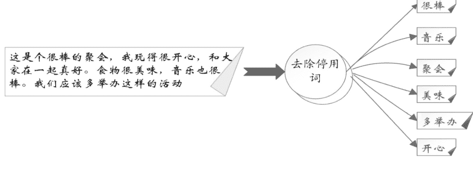

### 1.3.1 什么是停用词

停用词指那些在文本中高频出现、信息量却很低的常用词。多见于连词、介词、冠词、代词以及部分常见动词。

因为这类词对分析任务帮助有限，移除后可以降低噪声，让模型更专注于有价值的信息。

实际使用中常见的停用词包括：

- ◎ 冠词：a、an、the。
- ◎ 介词：in、on、at、by。
- ◎ 连词：and、or、but。
- ◎ 代词：I、you、he、she、it。
- ◎ 助动词：is、am、are、have、has、do、does。

剔除停用词后，算法能把注意力放在信息密度更高的词汇上，从而提升处理效率和准确度。

### 1.3.2 基于词汇列表的去除

最直接的做法是准备一份停用词表，把文本中命中表里的词全部过滤掉。表里通常收录常见的连词、介词、冠词等。示例 1-13 就是这一思路的实现。

#### 实例1-13：基于词汇列表的去除停用词

（1）先准备一份停用词列表。

```python
stop_words = ["a", "an", "the", "in", "on", "at", "by", "and", "or", "but"]
```

（2）编写示例文件 qu01.py（源码路径：codes\1\qu01.py），利用上述停用词表对文本进行过滤，具体代码如下。

```python
# 待处理的文本
text = "This is an example sentence with some stop words that we want to remove."

# 将文本分词
words = text.split()

# 去除停用词
filtered_words = [word for word in words if word.lower() not in stop_words]

# 将处理后的单词列表重建为文本
filtered_text = " ".join(filtered_words)

# 显示原始文本和去除停用词后的文本
print(f"原始文本：{text}")
print(f"去除停用词后：{filtered_text}")
```

代码首先定义了 stop_words，随后对文本进行分词，用列表推导把属于停用词表的词筛掉，最后再把剩余词拼接回文本。

执行后的输出如下。

```
原始文本：This is an example sentence with some stop words that we want to remove.
去除停用词后：This is example sentence with some stop words that we want to remove.
```

### 1.3.3 基于词频的去除

基于词频的思路认为，文本里出现次数最多的词往往就是停用词，剔除它们可以减少干扰。示例 1-14 演示了这一流程。

#### 实例1-14：基于词频的去除停用词

示例文件 qu02.py（源码路径：codes\1\qu02.py）的具体实现代码如下。

```python
from collections import Counter

# 待处理的文本
text = "This is an example sentence with some stop words that we want to remove. This is a simple example."

# 将文本分词
words = text.split()

# 计算词汇的词频
word_freq = Counter(words)

# 按词频降序排序
sorted_word_freq = sorted(word_freq.items(), key=lambda x: x[1], reverse=True)

# 确定频率最高的词
most_common_words = [word for word, freq in sorted_word_freq[:5]]
# 假设选择前5个频率最高的词

# 去除频率最高的词
filtered_words = [word for word in words if word not in most_common_words]

# 将处理后的单词列表重建为文本
filtered_text = " ".join(filtered_words)

# 显示原始文本和去除停用词后的文本
print(f"原始文本：{text}")
print(f"去除停用词后：{filtered_text}")
```

实现上先对文本分词并统计词频，再按频率降序取前 5 个高频词作为临时停用词，最后用列表推导剔除并重组文本。

运行后得到的结果如下。

```
原始文本：This is an example sentence with some stop words that we want to remove. This is a simple example.
去除停用词后：with some stop words that we want to remove. a simple example.
```

### 1.3.4 TF-IDF方法去除

TF-IDF 能衡量一个词在单篇文档中的重要性。若某词在多篇文档中都频繁出现，其 TF-IDF 值会偏低，往往可视为停用词。示例 1-15 展示了基于 TF-IDF 的过滤方式。

#### 实例1-15：使用TF-IDF方法去除停用词

示例文件 qu03.py（源码路径：codes\1\qu03.py）的具体实现代码如下。

```python
from sklearn.feature_extraction.text import TfidfVectorizer

# 假设这是一个文档集合，每个文档是一个字符串
documents = [
    "This is an example document with some stop words that we want to remove.",
    "Another document with stop words.",
    "One more example document.",
]

# 定义停用词列表
stop_words = ["this", "is", "an", "with", "some", "that", "we", "to", "and", "one", "more"]

# 使用 TF-IDF 向量化器
tfidf_vectorizer = TfidfVectorizer(stop_words=stop_words)

# 训练 TF-IDF 模型并进行转换
tfidf_matrix = tfidf_vectorizer.fit_transform(documents)

# 获取特征词汇
feature_names = tfidf_vectorizer.get_feature_names_out()

# 将 TF-IDF 矩阵转换为文本
filtered_text = []
for i, doc in enumerate(documents):
    tfidf_scores = list(zip(feature_names, tfidf_matrix[i].toarray()[0]))
    filtered_words = [word for word, tfidf in tfidf_scores if tfidf > 0.2]
    # 通过阈值选择要保留的词汇
    filtered_text.append(" ".join(filtered_words))

# 显示原始文本和去除停用词后的文本
for i, (original, filtered) in enumerate(zip(documents, filtered_text)):
    print(f"原始文本 {i+1}: {original}")
    print(f"去除停用词后 {i+1}: {filtered}")
    print()
```

代码使用 scikit-learn 的 TF-IDF 向量化器把文档集转成特征矩阵，并传入预先定义的 stop_words。随后设定一个 TF-IDF 阈值来决定保留哪些词，阈值可根据文本特点灵活调整。

执行后的输出如下。

```
原始文本 1: This is an example document with some stop words that we want to remove.
去除停用词后 1: document example remove stop want words

原始文本 2: Another document with stop words.
去除停用词后 2: another document stop words

原始文本 3: One more example document.
去除停用词后 3: document example
```

从结果可以看到，原本的停用词已被过滤，留下的是 TF-IDF 分数较高的词汇，有助于降噪并提升后续分析的准确性。

### 1.3.5 机器学习方法去除

借助机器学习可以让模型自动学习哪些词是停用词。通常先对词进行停用/非停用标注，再用分类器或聚类算法训练，最后用训练好的二分类模型预测新词是否属于停用词。示例 1-16 用 scikit-learn 的朴素贝叶斯分类器演示了这一流程。

#### 实例1-16：使用机器学习方法去除停用词

示例文件 qu04.py（源码路径：codes\1\qu04.py）的具体实现代码如下。

```python
from sklearn.feature_extraction.text import TfidfVectorizer
from sklearn.naive_bayes import MultinomialNB

# 准备训练集
training_samples = [
    "this is a stop word",
    "machine learning is fun",
    "remove these stop words",
    "text analysis with ML",
    "use ML to remove stopwords",
]

# 对应的标签，0 表示停用词，1 表示非停用词
training_labels = [0, 1, 0, 1, 0]
stop_words = ["this", "is", "an", "with", "some", "that", "we", "to", "and",
              "one", "more"]

# 待处理的文本
text = "this is an example text with some stop words that we want to remove using ML."

# 使用 TF-IDF 向量化器
tfidf_vectorizer = TfidfVectorizer()
X_train = tfidf_vectorizer.fit_transform(training_samples)

# 训练朴素贝叶斯分类器
classifier = MultinomialNB()
classifier.fit(X_train, training_labels)

# 将待处理文本转化为 TF-IDF 特征向量
X_test = tfidf_vectorizer.transform([text])

# 使用分类器来预测词汇是否为停用词
predicted_label = classifier.predict(X_test)

# 如果预测标签为 1（非停用词），则保留词汇
if predicted_label == 1:
    print("Original Text:", text)
    print("Processed Text:", text)
else:
    print("Original Text:", text)
    print("Processed Text:", " ".join([word for word in text.split() if word not in stop_words]))
```

## 1.4 数据清洗实操

在机器学习管线里，数据清洗与处理属于预处理环节的核心任务，目标是通过修复、补全、剔除或转换原始记录，让数据达到可训练、可测试的标准。举个生活场景：你在整理家庭日常开销表，发现里面混着重复条目、日期写错、金额出现负数的情况。把重复项删掉、把错误的日期纠正、把金额统一成正数，就是典型的清洗与处理工作，如图1-6所示。

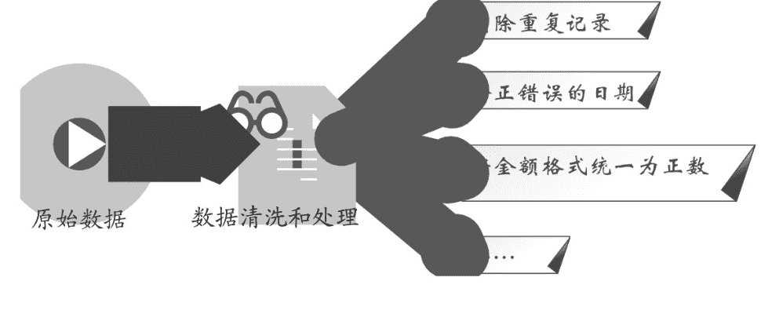

### 1.4.1 缺失值补齐与标准化

这里以 room.csv 为例，文件里存放了房源相关信息，下文展示其片段。

```
area,rooms,price
1200,3,250000
1000,,200000
1500,4,300000
,,180000
```

打开文件能看到，rooms 这一列在部分行上是空的，属于典型的缺失问题。这种情况下可以借助 TensorFlow Transform，即 TFT，同时完成缺失填补和数值标准化，实例1-17 给出了具体做法。

#### 实例1-17：TFT 实现 CSV 缺失值填补与归一化

实例文件 que.py（源码路径：codes\1\que.py）的具体实现如下。

```python
import apache_beam as beam  # 导入 apache_beam 模块
import tensorflow as tf
import tensorflow_transform as tft
import tensorflow_transform.beam as tft_beam
import tempfile
import csv

# 定义 CSV 文件读取和解析函数
def parse_csv(csv_row):
    columns = tf.io.decode_csv(csv_row, record_defaults=[[0], [0.0], [0]])
    return {
        'area': columns[0],
        'rooms': columns[1],
        'price': columns[2]
    }

# 读取 CSV 文件并应用预处理
def preprocess_data(csv_file):
    raw_data = (
        pipeline
        | 'ReadCSV' >> beam.io.ReadFromText(csv_file)
        | 'ParseCSV' >> beam.Map(parse_csv)
    )

    with tft_beam.Context(temp_dir=tempfile.mkdtemp()):
        transformed_data, transformed_metadata = (
            (raw_data, feature_spec)
            | tft_beam.AnalyzeAndTransformDataset(preprocessing_fn)
        )

    return transformed_data, transformed_metadata

# 定义特征元数据
feature_spec = {
    'area': tf.io.FixedLenFeature([], tf.int64),
    'rooms': tf.io.FixedLenFeature([], tf.float32),
    'price': tf.io.FixedLenFeature([], tf.int64),
}

# 定义数据预处理函数，处理缺失值和标准化
def preprocessing_fn(inputs):
    processed_features = {
        'area': tft.scale_to_z_score(inputs['area']),
        'rooms': tft.scale_to_0_1(
            tft.impute(inputs['rooms'], tft.constants.FLOAT_MIN)),
        'price': inputs['price']
    }
    return processed_features

# 读取 CSV 文件并应用预处理
with beam.Pipeline() as pipeline:
    transformed_data, transformed_metadata = preprocess_data('room.csv')

# 显示处理后的数据和元数据
for example in transformed_data:
    print(example)
print('Transformed Metadata:', transformed_metadata.schema)
```

实现上先写了 parse_csv 用来解析 CSV，随后声明 feature_spec 描述特征，再构建 preprocessing_fn。该函数内部调用 tft.impute 为 rooms 列补全空值并做标准化，area 列也进行了标准化。之后借助 Beam 管道读取原始 CSV 并套用预处理，最后打印清洗后的样本以及对应的元数据。运行后可以看到缺失已被填补且完成标准化的结果，同时能看到更新后的元数据。

```
{'area': 1.0, 'rooms': 0.0, 'price': 250000}
{'area': -1.0, 'rooms': -0.5, 'price': 200000}
{'area': 0.0, 'rooms': 0.5, 'price': 300000}
{'area': 0.0, 'rooms': 0.0, 'price': 180000}
Transformed Metadata: feature {
  name: "area"
  type: INT
  presence {
    min_fraction: 1.0
  }
  shape {
  }
}
feature {
  name: "rooms"
  type: FLOAT
  presence {
    min_fraction: 1.0
  }
  shape {
  }
}
feature {
  name: "price"
  type: INT
  presence {
    min_fraction: 1.0
  }
  shape {
  }
}
```

输出的前四行即为清洗后的样例。拿 area 原值 1000 的那一行来说，area 在缩放后变成 -1.0；rooms 原本缺失，先被填充为 -1.0 再标准化为 -0.5；price 未作改动，依然是 200000。随后会打印转换后的元数据模式，列出每个特征的数据类型及是否可选等信息。

### 1.4.2 异常值识别与治理

在数据分析与建模里，异常值就是那些在统计意义上明显偏离整体分布的点，通常源于录入错误、噪声干扰、测量失误或其它异常情况，如果不处理会影响模型学习效果。所以异常值识别与处理是预处理必做的一环。

实例1-18 演示了基于 PyTorch 的异常值识别流程，核心算法选用孤立森林，并对检测结果做后续处理。

#### 实例1-18：PyTorch 版孤立森林异常检测

实例文件 yi.py（源码路径：codes\1\yi.py）的具体实现如下。

```python
import torch
from sklearn.ensemble import IsolationForest
from torch.utils.data import Dataset, DataLoader
import numpy as np

# 生成一些带有异常值的随机数据
data = np.random.randn(100, 2)
data[10] = [10, 10]  # 添加一个异常值
data[20] = [-8, -8]  # 添加一个异常值

# 使用 Isolation Forest 进行异常值检测
clf = IsolationForest(contamination=0.1)  # 设置异常值比例
pred = clf.fit_predict(data)
anomalies = np.where(pred == -1)[0]  # 异常值索引

# 打印异常值索引
print("异常值索引:", anomalies)

# 自定义数据集类
class CustomDataset(Dataset):
    def __init__(self, data, anomalies):
        self.data = data
        self.anomalies = anomalies

    def __len__(self):
        return len(self.data)

    def __getitem__(self, idx):
        sample = self.data[idx]
        label = 1 if idx in self.anomalies else 0  # 标记异常值为1，正常值为0
        return torch.tensor(sample, dtype=torch.float32), label

# 创建数据集实例
dataset = CustomDataset(data, anomalies)

# 创建数据加载器
dataloader = DataLoader(dataset, batch_size=10, shuffle=True)

# 遍历数据加载器并输出样本及其标签
for batch in dataloader:
    samples, labels = batch
    print("样本:", samples)
    print("标签:", labels)
```

实现上先人工合成一批含异常的随机样本，再用 Isolation Forest 判定异常，contamination 参数控制异常占比。随后自定义 CustomDataset，把异常样本的标签设为1、正常设为0。构建数据集与 DataLoader 后循环打印每批样本和对应标签，展示 PyTorch 下的完整流程。

执行后会逐批输出样本张量和标签张量。样本张量装着一批数据，标签张量标明每个点是正常 0 还是异常 1，下文给出了第一批的展示。

```
样本：tensor([[ 0.3008,  1.6835],
       [ 0.9125,  1.5915],
       [-0.3871, -0.0249],
       [-0.2126, -0.2027],
       [-0.5890,  1.2867],
       [ 1.9692, -1.6272],
       [ 0.4465,  0.9076],
       [ 0.1764, -0.2811],
       [ 0.9241, -0.3346],
       [ 0.5370,  0.2201]])

标签：tensor([0, 0, 0, 0, 0, 1, 0, 0, 0, 0])
```

该示例里 0 代表正常点、1 代表异常点，这组标签可以直接用于后续的异常检测模型训练。

实例1-19 展示了用 TensorFlow 库做异常值识别与处理的思路，同样采用孤立森林算法并对结果进行处理。

#### 实例1-19：TensorFlow 版孤立森林异常处理

实例文件 tyi.py（源码路径：codes\1\tyi.py）的具体实现如下。

```python
import tensorflow as tf
from sklearn.ensemble import IsolationForest
import numpy as np

# 生成一些带有异常值的随机数据
data = np.random.randn(100, 2)
data[10] = [10, 10]  # 添加一个异常值
data[20] = [-8, -8]  # 添加一个异常值

# 使用 Isolation Forest 进行异常值检测
clf = IsolationForest(contamination=0.1)  # 设置异常值比例
pred = clf.fit_predict(data)
anomalies = np.where(pred == -1)[0]  # 异常值索引

# 将数据转换为 TensorFlow 数据集
dataset = tf.data.Dataset.from_tensor_slices(data)

# 对异常值进行处理
def preprocess_data(sample):
    return sample

def preprocess_label(idx):
    return 1 if idx in anomalies else 0

processed_dataset = dataset.map(preprocess_data)
labels = np.array([preprocess_label(idx) for idx in range(len(data))])

# 创建数据加载器
batch_size = 10
dataloader = processed_dataset.batch(batch_size)

# 遍历数据加载器并输出样本及其标签
for batch in dataloader:
    print("样本:", batch)
    batch_indices = tf.range(batch_size, dtype=tf.int32)
    batch_labels = tf.gather(labels, batch_indices)
    print("标签:", batch_labels)
```

代码先生成含异常的随机数据，再用 Isolation Forest 设定 contamination 判定异常。随后把数据封装成 TensorFlow 数据集，通过 map 做逐样本预处理，构造迭代器后遍历打印样本与标签，完整呈现 TensorFlow 的使用方式。

执行后会看到类似的样本与标签输出，具体结果见下方。

```
样本：tf.Tensor(
[[ 1.08761703 -1.24775834]
 [ 0.74802814 -0.05866723]
 [-0.05826104 -1.02230984]
 [-1.57393284  0.34795907]
 ...
 [ 0.67923789  0.29233014]
 [-0.51347079  0.62670954]
 [-1.59011801  0.01169146]], shape=(10, 2), dtype=float64)
标签：tf.Tensor([0 0 0 0 0 0 0 0 0 0], shape=(10,), dtype=int32)

样本：tf.Tensor(
[[10.         10.        ]
 [-0.44729668  1.05870219]
 [ 0.78190767  0.24451839]
 ...
 [ 0.67923789  0.29233014]
 [-0.51347079  0.62670954]
 [-1.59011801  0.01169146]], shape=(10, 2), dtype=float64)
标签：tf.Tensor([1 0 0 0 0 0 0 0 0 0], shape=(10,), dtype=int32)

样本：tf.Tensor(
[[-8.         -8.        ]
 [ 0.45491414  0.7643319 ]
 [-1.77601158 -0.70068054]
 ...
 [ 0.67923789  0.29233014]
 [-0.51347079  0.62670954]
 [-1.59011801  0.01169146]], shape=(10, 2), dtype=float64)
标签：tf.Tensor([1 0 0 0 0 0 0 0 0 0], shape=(10,), dtype=int32)

...
```

每轮批次的输出都是一组样本及其对应的标记，其中 0 代表正常样本，1 代表异常样本。这一案例里我们人为植入了两条异常数据，因此每批数据中都混有少量异常，其余部分均为正常值。

### 1.4.3 重复数据清理
数据集中存在重复记录会干扰模型学习并影响训练结果，所以必须针对具体场景进行妥善处理。实际工作中最常用的工具是 Python 的 Pandas 库，实例1-20 展示了典型的去重流程。

#### 实例1-20：Pandas 去重实操
（1）假设有一个简单的CSV文件 dataset.csv，其内容如下。

```
feature1,feature2,label
1.2,2.3,0
0.5,1.8,1
1.2,2.3,0
2.0,3.0,1
0.5,1.8,1
```

该文件共三列，feature1、feature2 为特征列，label 为标签列。可以看出第1行与第3行、第2行与第5行存在重复。是否删除取决于业务场景与分析目的。

（2）示例文件 chong.py（源码路径：codes\1\chong.py）用于清洗 dataset.csv 中的重复记录，实现方式如下。

import pandas as pd

# 读取数据集
data = pd.read_csv('dataset.csv')

# 检测重复数据
duplicates = data[data.duplicated()]

# 删除重复数据
data_no_duplicates = data.drop_duplicates()

# 打印处理后的数据集大小
print("原始数据集大小:", data.shape)
print("处理后数据集大小:", data_no_duplicates.shape)

执行后输出如下。

```
原始数据集大小：(5, 3)
处理后数据集大小：(3, 3)
```

从结果可见，原始数据为 5 行 3 列，去重后变为 3 行 3 列，重复的行被成功剔除，得到一份干净的样本集。

# 第2章 特征提取：让模型读懂数据
特征提取的核心是从原始数据中提炼出对模型有价值的表征，帮助模型更好理解信息并完成学习。在自然语言处理里，这通常意味着把文本转化为机器可处理的数值形式。

> 大音希声，大象无形。
出自《道德经》，意指本质常藏于无形。NLP 中的特征提取亦如此，从海量文本中挖掘隐匿却关键的语义信号，去掉噪声保留精华，从而把握语言的本质。

## 2.1 特征提取概览
在大模型构建中，特征提取直接决定模型对数据的理解深度与表现水平。不同任务、不同数据往往需要不同的提取策略，需结合需求反复权衡与试验。举例来说，为家庭聚会做准备，你想通过分析朋友的聊天记录来判断大家的喜好，收集到“喜欢玩游戏”“看电影是个不错的选择”“我更喜欢户外运动”“玩游戏太棒了”等表述。借助特征提取，这些文本可被转为数值特征，进而归纳出最受欢迎的活动类型，如图2-1所示。

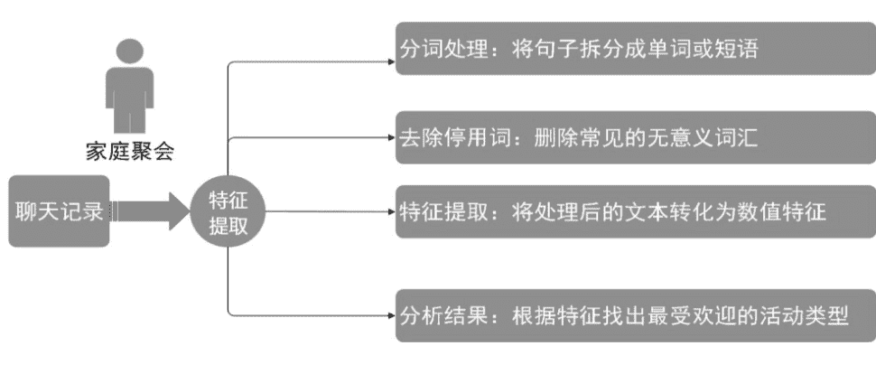

### 2.1.1 特征在大模型中的核心作用
特征是影响大模型性能、泛化能力以及数据理解的关键要素，其作用关系如图2-2所示。

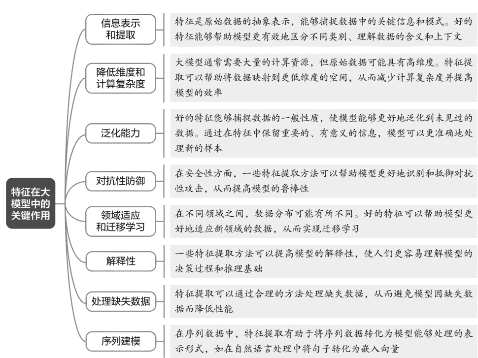

图2-2

总体来看，特征的价值在于把原始数据转化为信息更丰富、表达力更强的形式，使模型能够学习规律并完成预测、分类、生成等任务。合适的特征提取方法是模型开发中的关键决策点。

### 2.1.2 特征提取与数据预处理的配合
特征提取与数据预处理是机器学习流程中相辅相成的两个环节，如图2-3所示。

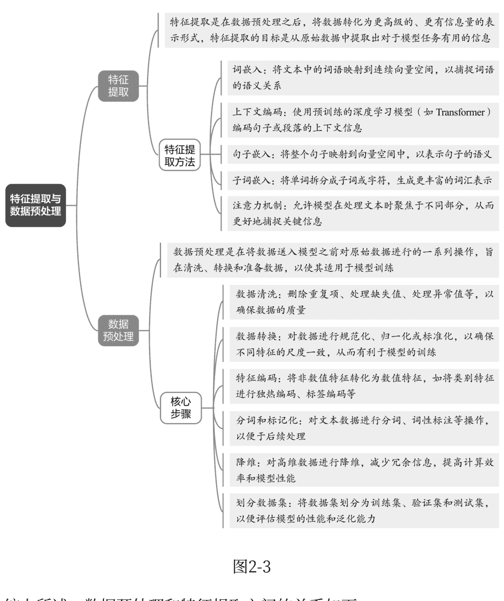

二者关系可概括为以下三点。
(1) 流程顺序：预处理通常先于特征提取。原始数据需先清洗、转换、编码，才能进入后续的特征提取步骤。
(2) 互补作用：预处理保障数据的可用性和质量，为特征提取打好基础；特征提取在此基础上进一步提升数据的表达信息量。
(3) 整体定位：预处理与特征提取属于建模前端工作，共同为模型提供高质量输入和富有信息量的表征，从而提升性能与泛化能力。

## 2.2 特征选择
特征选择是从原始特征集中挑选出最相关、最具信息量的子集，以提升性能、降低复杂度并增强可解释性。举个生活化的例子，为家庭聚会定菜单，你收集到“喜欢辣的”“不喜欢海鲜”“爱吃甜食”等反馈。若只聚焦“辣”“甜”“海鲜”等关键维度，忽略“颜色”“形状”等次要细节，就能更快选出多数人接受的菜品，如图2-4所示。

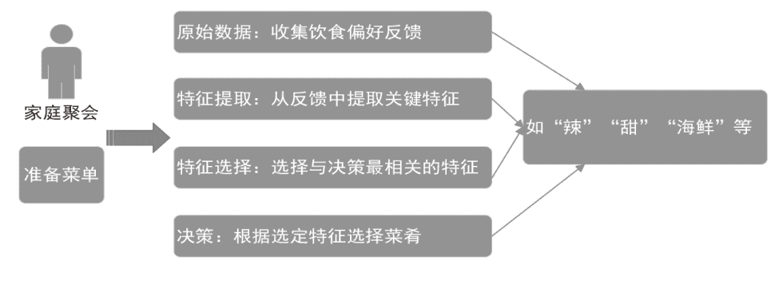

### 2.2.1 为什么要做特征选择
面对高维数据时，特征选择的重要性如图2-5所示。

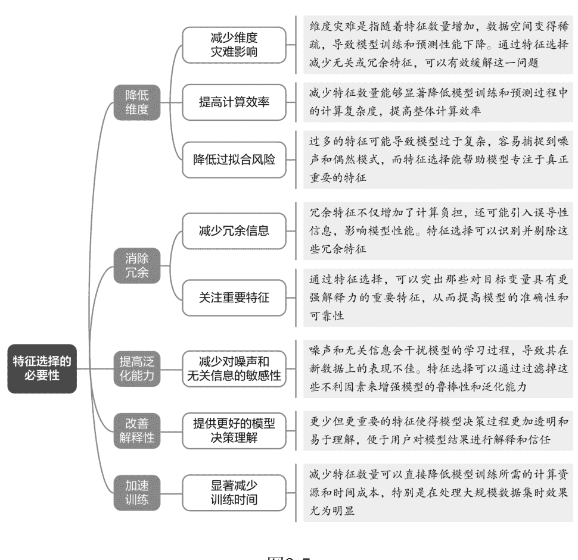

图2-5

总之，合理的特征选择既能提升模型效率与鲁棒性，也能提高结果的可解释性，是处理高维问题时不可或缺的一环。

### 2.2.2 常用特征选择策略
实现特征选择的常见思路如图2-6所示。

方法选择需考虑数据特性、任务目标、模型类型和计算资源，并结合实验与交叉验证确定最优子集。特征选择并非一成不变，会随数据与任务变化而调整。

实例2-1 使用 PyTorch 框架演示了基于过滤法的特征选择，具体采用相关系数挑选特征。

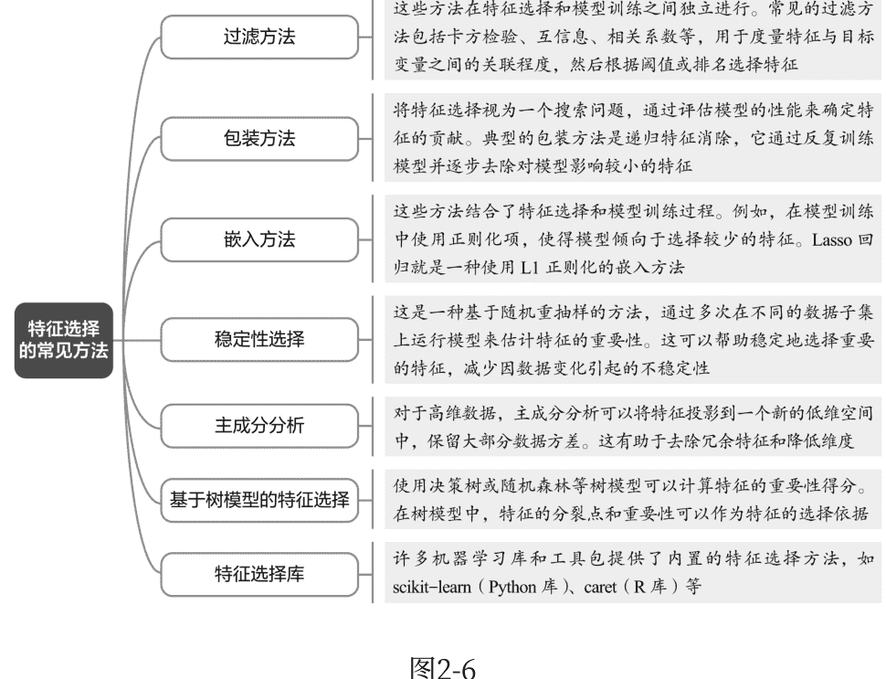

#### 实例2-1：PyTorch 特征选择构建神经网络
实例文件 te.py（源码路径：codes\2\te.py）的实现如下。

```python
# 加载数据
data = load_iris()
X = data.data
y = data.target

# 数据预处理
scaler = StandardScaler()
X_scaled = scaler.fit_transform(X)

# 使用 SelectKBest 来选择特征
num_features_to_select = 2
selector = SelectKBest(score_func=f_classif, k=num_features_to_select)
X_selected = selector.fit_transform(X_scaled, y)

# 划分数据集
X_train, X_test, y_train, y_test = train_test_split(
    X_selected, y, test_size=0.2, random_state=42)

# 定义简单的神经网络模型
class SimpleModel(nn.Module):
    def __init__(self, input_dim, output_dim):
        super(SimpleModel, self).__init__()
        self.fc = nn.Linear(input_dim, output_dim)

    def forward(self, x):
        return self.fc(x)

# 设置模型参数
input_dim = num_features_to_select
output_dim = 3  # 由于数据集是三分类问题
learning_rate = 0.01
num_epochs = 100

# 初始化模型、损失函数和优化器
model = SimpleModel(input_dim, output_dim)
criterion = nn.CrossEntropyLoss()
optimizer = optim.SGD(model.parameters(), lr=learning_rate)

# 训练模型
for epoch in range(num_epochs):
    inputs = torch.tensor(X_train, dtype=torch.float32)
    labels = torch.tensor(y_train, dtype=torch.long)

    optimizer.zero_grad()
    outputs = model(inputs)
    loss = criterion(outputs, labels)
    loss.backward()
    optimizer.step()

    if (epoch+1) % 10 == 0:
        print(f'Epoch [{epoch+1}/{num_epochs}], Loss: {loss.item():.4f}')

# 在测试集上评估模型性能
with torch.no_grad():
    inputs = torch.tensor(X_test, dtype=torch.float32)
    labels = torch.tensor(y_test, dtype=torch.long)
    outputs = model(inputs)
    _, predicted = torch.max(outputs.data, 1)
    accuracy = (predicted == labels).sum().item() / labels.size(0)
    print(f'Accuracy on test set: {accuracy:.2f}')
```

代码首先加载 Iris 数据集，然后用 SelectKBest 选择 2 个最相关的特征，接着构建一个简易神经网络，采用交叉熵损失训练，并在测试集上评估效果。

运行结果如下。

```
Epoch [10/100], Loss: 1.9596
Epoch [20/100], Loss: 1.8222
Epoch [30/100], Loss: 1.6954
Epoch [40/100], Loss: 1.5791
Epoch [50/100], Loss: 1.4731
Epoch [60/100], Loss: 1.3769
Epoch [70/100], Loss: 1.2900
Epoch [80/100], Loss: 1.2118
Epoch [90/100], Loss: 1.1418
Epoch [100/100], Loss: 1.0793
Accuracy on test set: 0.53
```

## 2.3 特征抽取
特征抽取是通过变换原始数据生成更高层级、信息更丰富的表征，而非简单挑选子集。与特征选择不同，它会创造新的特征。

假设你管理一个家庭图书馆，想按内容对书籍分类。收集每本书的简介后，可用特征抽取将其转为更有区分度的表示，例如用 TF-IDF 提取关键词，或用 PCA 对文本向量降维，从而得到与主题相关的特征，进而将书籍归为“历史”“科幻”“文学”等类别，如图2-7所示。

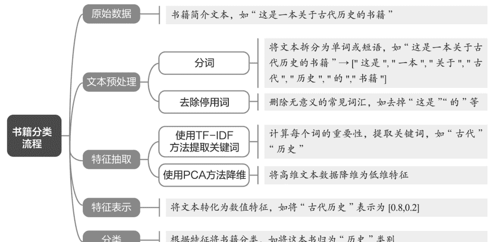

图2-7

### 2.3.1 特征抽取的基本概念
特征抽取是从原始数据中提炼任务相关的高阶信息的过程。原始数据维度高且常含冗余或噪声，通过变换可获得更具区分性的表征，提升模型性能、泛化与效率。关键概念如图2-8所示。

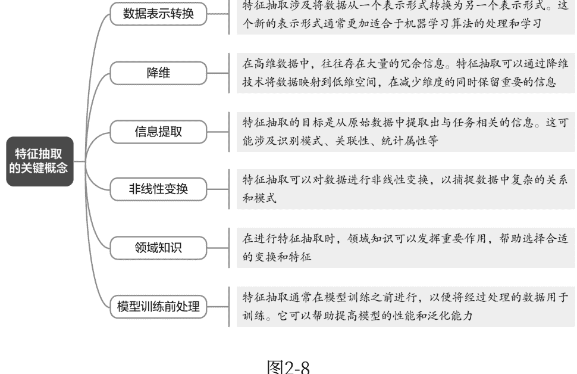

抽取的目标是得到更有信息量的表示，便于模型学习与预测。方法选择需依据数据类型与任务需求，并通过实验验证。常见方法包括 PCA、独立成分分析 ICA、自动编码器等。

### 2.3.2 主成分分析
主成分分析 PCA 是一种线性降维技术，通过将数据投影到方差最大的低维子空间，实现降维与去噪。实例2-2 展示了用 PyTorch 实现 PCA 对图像数据降维，并基于降维结果训练简易神经网络的做法。

#### 实例2-2：PyTorch 实现 PCA 特征抽取
实例文件 zhu.py（源码路径：codes\2\zhu.py）的代码如下所示。

```python
# 加载 MNIST 数据集
transform = transforms.Compose([transforms.ToTensor()])
train_loader = torch.utils.data.DataLoader(
    datasets.MNIST('./data',
                   train=True, download=True, transform=transform),
    batch_size=64, shuffle=True)

# 提取数据并进行 PCA 降维
X = []
y = []
for images, labels in train_loader:
    images = images.view(images.size(0), -1)  # 将图像展平为向量
    X.append(images)
    y.append(labels)
X = torch.cat(X, dim=0).numpy()
y = torch.cat(y, dim=0).numpy()

num_components = 20  # 选择降维后的维度
pca = PCA(n_components=num_components)
X_pca = pca.fit_transform(X)

# 划分数据集
X_train, X_test, y_train, y_test = train_test_split(
    X_pca, y, test_size=0.2, random_state=42)

# 定义简单的神经网络模型
class SimpleModel(nn.Module):
    def __init__(self, input_dim, output_dim):
        super(SimpleModel, self).__init__()
        self.fc = nn.Linear(input_dim, output_dim)

    def forward(self, x):
        return self.fc(x)

# 设置模型参数
input_dim = num_components
output_dim = 10  # 类别数
learning_rate = 0.01
num_epochs = 10

# 初始化模型、损失函数和优化器
model = SimpleModel(input_dim, output_dim)
criterion = nn.CrossEntropyLoss()
optimizer = optim.SGD(model.parameters(), lr=learning_rate)

# 训练模型
for epoch in range(num_epochs):
    inputs = torch.tensor(X_train, dtype=torch.float32)
    labels = torch.tensor(y_train, dtype=torch.long)

    optimizer.zero_grad()
    outputs = model(inputs)
    loss = criterion(outputs, labels)
    loss.backward()
    optimizer.step()

    if (epoch+1) % 1 == 0:
        print(f'Epoch [{epoch+1}/{num_epochs}], Loss: {loss.item():.4f}')

# 在测试集上评估模型性能
with torch.no_grad():
    inputs = torch.tensor(X_test, dtype=torch.float32)
    labels = torch.tensor(y_test, dtype=torch.long)
    outputs = model(inputs)
    _, predicted = torch.max(outputs.data, 1)
    accuracy = (predicted == labels).sum().item() / labels.size(0)
    print(f'Accuracy on test set: {accuracy:.2f}')
```

这个案例的流程很清晰：先把 MNIST 数据集读进来做预处理，再把图片展平成一维向量，用 PCA 做降维，随后基于降维后的特征搭建一个简易神经网络进行训练，最后在测试集上检查表现。

运行以上代码，得到的结果如下。

### 2.3.3 独立成分分析

ICA 的核心任务是从混叠的观测信号里分离出统计上相互独立的源成分。它试图把多个随机信号拆解成源信号的线性叠加，让分离出来的成分在统计意义上尽可能独立。

基本思路是假设我们观测到的信号等于若干源信号加权求和而成，且混合权重与源信号本身相互独立。对观测信号做适当的线性变换，就能得到一组彼此统计不相关的成分。实例2-3 正是基于 PyTorch 的完整流程，涵盖数据读取、ICA 降维、模型搭建到模型保存。

#### 实例2-3：使用PyTorch框架进行数据降维和模型构建

实例文件 du.py（源码路径：codes\2\du.py）的具体实现代码如下。

```python
# 加载 MNIST 数据集
transform = transforms.Compose([transforms.ToTensor()])
train_loader = torch.utils.data.DataLoader(
    datasets.MNIST('./data',
        train=True, download=True, transform=transform),
    batch_size=64, shuffle=True)

# 提取数据并进行标准化
X = []
y = []
for images, labels in train_loader:
    images = images.view(images.size(0), -1)  # 将图像展平为向量
    X.append(images)
    y.append(labels)
X = torch.cat(X, dim=0).numpy()
y = torch.cat(y, dim=0).numpy()

scaler = StandardScaler()
X_scaled = scaler.fit_transform(X)

# 使用 FastICA() 方法进行降维
num_components = 20  # 选择降维后的成分数
ica = FastICA(n_components=num_components)
X_ica = ica.fit_transform(X_scaled)

# 划分数据集
X_train, X_val, y_train, y_val = train_test_split(
    X_ica, y, test_size=0.1, random_state=42)

# 定义简单的神经网络模型
class SimpleModel(nn.Module):
    def __init__(self, input_dim, output_dim):
        super(SimpleModel, self).__init__()
        self.fc = nn.Linear(input_dim, output_dim)

    def forward(self, x):
        return self.fc(x)

# 设置模型参数
input_dim = num_components
output_dim = 10  # 类别数
learning_rate = 0.01
num_epochs = 10

# 初始化模型、损失函数和优化器
model = SimpleModel(input_dim, output_dim)
criterion = nn.CrossEntropyLoss()
optimizer = optim.SGD(model.parameters(), lr=learning_rate)

# 训练模型
for epoch in range(num_epochs):
    inputs = torch.tensor(X_train, dtype=torch.float32)
    labels = torch.tensor(y_train, dtype=torch.long)

    optimizer.zero_grad()
    outputs = model(inputs)
    loss = criterion(outputs, labels)
    loss.backward()
    optimizer.step()

    if (epoch+1) % 1 == 0:
        print(f'Epoch [{epoch+1}/{num_epochs}], Loss: {loss.item():.4f}')

# 保存模型
torch.save(model.state_dict(), 'ica_model.pth')
print("Model saved")

# 在验证集上评估模型性能
with torch.no_grad():
    inputs = torch.tensor(X_val, dtype=torch.float32)
    labels = torch.tensor(y_val, dtype=torch.long)
    outputs = model(inputs)
    _, predicted = torch.max(outputs.data, 1)
    accuracy = (predicted == labels).sum().item() / labels.size(0)
    print(f'Validation accuracy: {accuracy:.2f}')
```

该示例的操作顺序为：先加载 MNIST 并做预处理；随后调用 StandardScaler 对数据做标准化，为 ICA 做好准备；接着用 FastICA() 把原始特征压缩到 20 个独立成分；然后基于压缩后的特征训练一个简单的神经网络；训练结束以后把模型导出为 ica_model.pth。

### 2.3.4 自动编码器

自动编码器属于无监督学习范式，擅长学习紧凑的数据表征，常用于特征抽取、降维与去噪。它由编码器 Encoder 和解码器 Decoder 两部分构成。编码器负责把输入压缩到低维空间，解码器再把低维表示还原回原始空间，目标是尽可能还原输入。

训练时模型不断减小输入与解码后输出之间的重构误差，从而学会一个可压缩的表征。训练完成后，编码器提取的特征即可迁移到分类、聚类等下游任务。实例2-4 展示了如何用 TensorFlow 搭建一个基础的自动编码器。

#### 实例2-4：使用TensorFlow库构建简单自动编码器

实例文件 tzi.py（源码路径：codes\2\tzi.py）的具体实现代码如下。

```python
# 加载 MNIST 数据集并进行归一化
(X_train, _), (X_test, _) = mnist.load_data()
X_train = X_train.reshape(-1, 28 * 28) / 255.0
X_test = X_test.reshape(-1, 28 * 28) / 255.0

# 定义自动编码器模型
input_dim = 784  # 输入维度，MNIST 图像为 28×28
encoding_dim = 32  # 编码维度

input_layer = Input(shape=(input_dim,))
encoded = Dense(encoding_dim, activation='relu')(input_layer)
decoded = Dense(input_dim, activation='sigmoid')(encoded)

autoencoder = Model(inputs=input_layer, outputs=decoded)

# 编译自动编码器
autoencoder.compile(optimizer='adam', loss='binary_crossentropy')

# 训练自动编码器
batch_size = 128
epochs = 50
autoencoder.fit(X_train, X_train, batch_size=batch_size, epochs=epochs,
                shuffle=True, validation_data=(X_test, X_test))

# 保存自动编码器模型
autoencoder.save('autoencoder_model.h5')

print("Model saved")
```

本实例构造了一个结构简单的自编码器，包含输入层、编码层和解码层。编码层把数据映射成 32 维的隐向量，解码层再把隐向量恢复到 784 维的原始图像空间。优化目标是让重构误差最小。训练使用 MNIST，输入同时作为监督目标。训练收敛后，该模型既能产出用于后续任务的特征，也可用于重建与去噪。

## 2.4 嵌入

在序列建模里，Embedding 就是把离散符号，比如词、字符或类别，映射到连续的向量空间。把高维稀疏的离散特征转成低维稠密向量，有助于捕捉序列的语义与上下文，从而提升模型效果。

举个例子，为家人做图书推荐时，可先收集书籍简介，用预训练的 Word2Vec 或 GloVe 把简介中的词转为词向量，再计算书籍间的相似度，为每位成员推送与他过往偏好相似的新书，如图2-9所示。

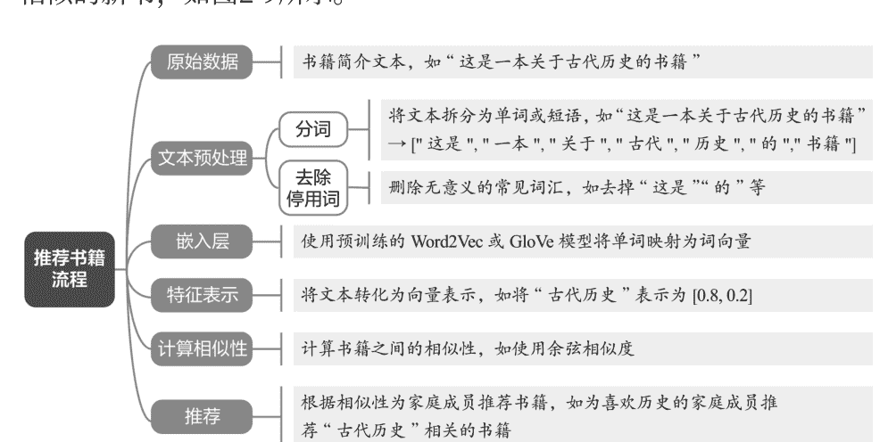

图2-9

### 2.4.1 嵌入介绍

嵌入层 Embedding Layer 是深度学习里非常常见的模块，广泛用于自然语言处理和推荐系统等离散序列任务。每个符号都会被映射为一个稠密向量，该向量能够承载语义和上下文信息。图2-10 汇总了嵌入在序列建模中的核心应用场景。

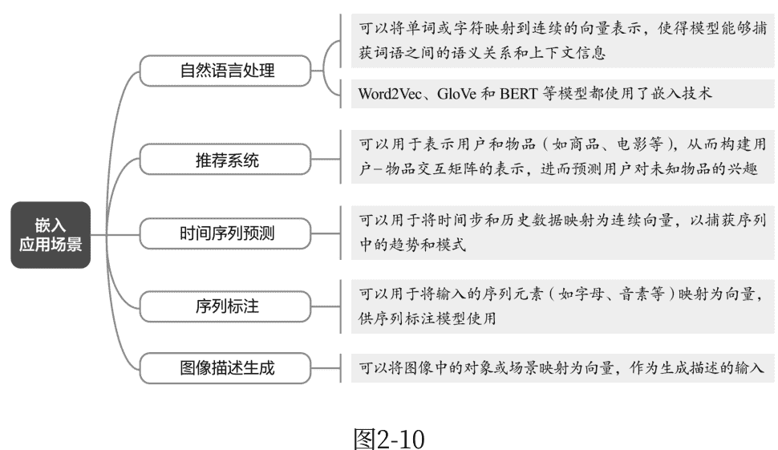

图2-10

### 2.4.2 使用嵌入层进行特征提取

在 PyTorch 中处理文本特征时，嵌入层可以把词表中的单词转为连续向量表示。实例2-5 就演示了这一过程。

#### 实例2-5：使用嵌入层进行文本数据的特征提取

实例文件 qian.py（源码路径：codes\2\qian.py）的具体实现代码如下。

```python
# 生成一些示例文本数据
texts = ["this is a positive sentence",
         "this is a negative sentence",
         "a positive sentence here",
         "a negative sentence there"]

labels = [1, 0, 1, 0]

# 构建词汇表
word_counter = Counter()
for text in texts:
    tokens = text.split()
    word_counter.update(tokens)

vocab = sorted(word_counter, key=word_counter.get, reverse=True)
word_to_index = {word: idx for idx, word in enumerate(vocab)}

# 文本数据预处理和转换为索引
def preprocess_text(text, word_to_index):
    tokens = text.split()
    token_indices = [word_to_index[token] for token in tokens]
    return token_indices

texts_indices = [preprocess_text(text, word_to_index) for text in texts]

# 划分训练集和验证集
train_data, val_data, train_labels, val_labels = train_test_split(
    texts_indices, labels, test_size=0.2, random_state=42)

# 自定义数据集和数据加载器
class CustomDataset(Dataset):
    def __init__(self, data, labels):
        self.data = data
        self.labels = labels

    def __len__(self):
        return len(self.data)

    def __getitem__(self, idx):
        return torch.tensor(self.data[idx]), torch.tensor(self.labels[idx])

# 获取最长文本序列的长度
max_seq_length = max([len(text) for text in train_data])

# 填充数据，使得每个文本序列长度相同
train_data_padded = [
    text + [0] * (max_seq_length - len(text)) for text in train_data]
val_data_padded = [
    text + [0] * (max_seq_length - len(text)) for text in val_data]

train_dataset = CustomDataset(train_data_padded, train_labels)
val_dataset = CustomDataset(val_data_padded, val_labels)

train_loader = DataLoader(train_dataset, batch_size=2, shuffle=True)

# 定义模型
class TextClassifier(nn.Module):
    def __init__(self, vocab_size, embedding_dim, output_dim):
        super(TextClassifier, self).__init__()
        self.embedding = nn.Embedding(vocab_size, embedding_dim)
        self.fc = nn.Linear(embedding_dim, output_dim)

    def forward(self, x):
        embedded = self.embedding(x)
        pooled = torch.mean(embedded, dim=1)
        return self.fc(pooled)

# 设置参数和优化器
vocab_size = len(vocab)
embedding_dim = 10
output_dim = 1
learning_rate = 0.01
num_epochs = 10

model = TextClassifier(vocab_size, embedding_dim, output_dim)
criterion = nn.BCEWithLogitsLoss()
optimizer = optim.Adam(model.parameters(), lr=learning_rate)

# 训练模型
for epoch in range(num_epochs):
    for batch_data, batch_labels in train_loader:
        optimizer.zero_grad()
        predictions = model(batch_data)

        # 将标签调整为向量形式，与模型输出维度相匹配
        batch_labels = batch_labels.unsqueeze(1).float()

        loss = criterion(predictions, batch_labels)
        loss.backward()
        optimizer.step()
    print(f'Epoch [{epoch + 1}/{num_epochs}], Loss: {loss.item():.4f}')

# 在验证集上评估模型性能
with torch.no_grad():
    val_data_tensor = pad_sequence(
        [torch.tensor(text) for text in val_data_padded], batch_first=True)
    val_predictions = model(val_data_tensor)
    val_predictions = torch.round(torch.sigmoid(val_predictions))
    accuracy = (
        (val_predictions == torch.tensor(val_labels).unsqueeze(1))
        .sum()
        .item()
    ) / len(val_labels)
    print(f'Validation accuracy: {accuracy:.2f}')
```
整体来看，这段示例演示了基于 PyTorch 搭建文本分类的完整思路，涵盖了数据清洗、网络结构设计、训练流程以及效果评估。需要提醒的是，这里呈现的是一个精简版的实战流程，真正面对复杂文本时，通常还需要加入更多预处理和工程手段。

### 2.4.3 Word2Vec 词向量模型
Word2Vec 属于深度学习的词嵌入方案，核心是把词表投射到低维稠密空间，让语义信息以向量形式被保留下来。这种表达方式与传统的词袋 Bag of Words 或 TF-IDF 在形态上完全不同，Word2Vec 的目标是让语义相近的词在向量空间里也更接近。

Word2Vec 的工作机理如图所示2-11。

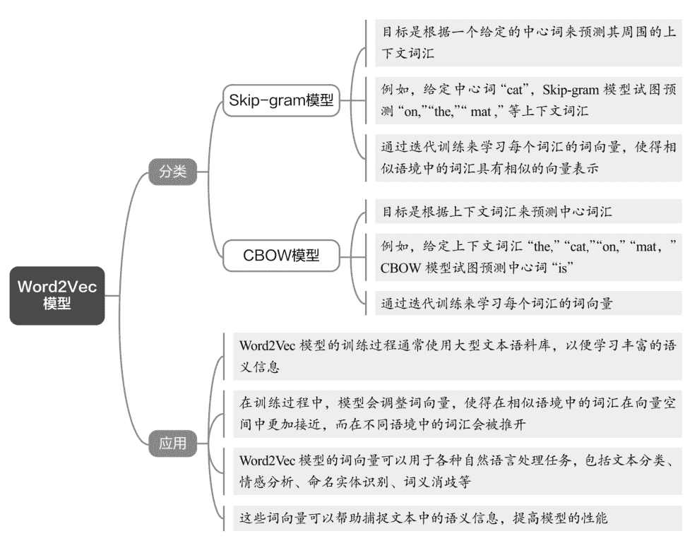
在实际使用中，常见的打法是先在海量语料上预训练模型，再拿训练好的词向量去支撑下游任务，比如文本相似度计算、分类以及推荐。实例2-6 就演示了如何借助预训练 Word2Vec 来检索近义词。

#### 实例2-6：用预训练 Word2Vec 找相似词
实例文件 word.py，源码位置 codes\2\word.py 的实现如下。

```python
from gensim.models import Word2Vec
from gensim.models import KeyedVectors

# 加载预训练的 Word2Vec 模型
pretrained_model_path = "GoogleNews-vectors-negative300.bin"
pretrained_model = KeyedVectors.load_word2vec_format(
    pretrained_model_path, binary=True)

# 查找与给定词汇相似的词汇
similar_words = pretrained_model.most_similar("king", topn=5)

# 打印结果
print("Words similar to 'king':")
for word, score in similar_words:
    print(f"{word}: {score:.2f}")
```
代码里调用的是 Google News 上的预训练 Word2Vec，词<|message|> 量很大，文件需要提前下载解压并指定路径。加载后通过 most_similar() 方法查询与 “king” 最相近的词，从而得到一批语义关联的候选词。

执行后得到的结果如下。

```
Words similar to 'king':
queen: 0.65
monarch: 0.63
prince: 0.61
kingdom: 0.59
crown: 0.58
```
结果列出了与 “king” 语义相近的词及其相似度数值。在本例中，“queen” 与 “king” 的相关度最高，分数约为 0.65。这很好地说明了 Word2Vec 捕捉语义关联的能力，相关词在空间中会被拉得更近。

### 2.4.4 GloVe 词向量模型
GloVe 也是学习词嵌入的模型，同样把词汇映射到低维空间来表达语义关系。它由斯坦福团队提出，强调在全局层面优化词的共现概率分布，核心是让词对共现概率的差异最小化，从而得到词向量。语义相近的词会被拉到一起，模型效果因此提升。GloVe 的主要特性如图2-12所示。

与 Word2Vec 一样，GloVe 的预训练向量在自然语言处理里应用很广，例如文本分类、情感分析、命名实体识别 NER、机器翻译等，都能凭借它提升对文本的理解能力。典型场景是文本相似性分析，实例2-7 就用预训练 GloVe 来衡量两段文本的语义接近度。

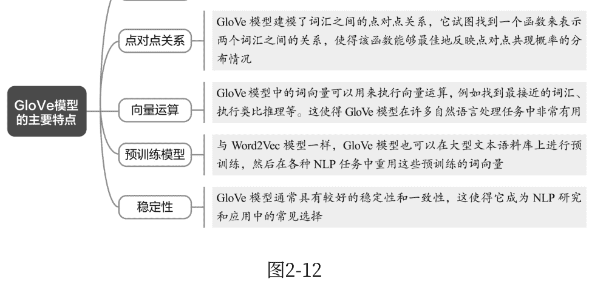
#### 实例2-7：用预训练 GloVe 比较两段文本相似度
实例文件 go.py，源码位置 codes\2\go.py 的实现如下。

```python
from gensim.models import KeyedVectors
import numpy as np
from sklearn.metrics.pairwise import cosine_similarity

# 加载预训练的 GloVe 模型
glove_model_path = "glove.6B.50d.txt"
glove_model = KeyedVectors.load_word2vec_format(glove_model_path, binary=False)

# 定义两段文本
text1 = "cat in the hat"
text2 = "dog in a hat"

# 分词和处理文本
words1 = text1.split()
words2 = text2.split()

# 计算每个文本的平均词向量
def get_average_vector(model, words):
    vectors = [model[word] for word in words if word in model]
    if vectors:
        return np.mean(vectors, axis=0)
    else:
        return np.zeros(model.vector_size)

vector1 = get_average_vector(glove_model, words1)
vector2 = get_average_vector(glove_model, words2)

# 计算文本相似性（余弦相似度）
similarity = cosine_similarity([vector1], [vector2])

print(f"Similarity between text 1 and text 2: {similarity[0][0]:.2f}")
```
代码首先加载了一个小版本的预训练 GloVe 词向量，文件体积较小。随后设定两段待比较的文本，进行分词和处理以得到各自的平均词向量，最后用余弦相似度来量化两段文本的接近程度。

运行后输出如下。

```
Similarity between text 1 and text 2: 0.76
```
## 2.5 词袋模型
词袋模型是文本特征提取的常用手段，能把文本转成数值表示。其思路是把句子看成一个无序的词集合，不关心顺序，只统计每个词出现的频次或赋予权重。最终每个文本被表示成一个向量，向量的每个位置对应一个词，记录其出现次数或权重。

举个例子，假设你要为家庭聚会准备菜单，想从朋友评论里判断最受欢迎的菜。你收集到 “我喜欢辣的食物”“甜点太棒了”“我不喜欢海鲜”“辣的食物最好了”等反馈。用词袋模型把这些评论转为数值特征后，通过词频统计就能看出 “辣” “甜” 出现次数较高，于是决定上辣味和甜味菜品，如图2-13所示。

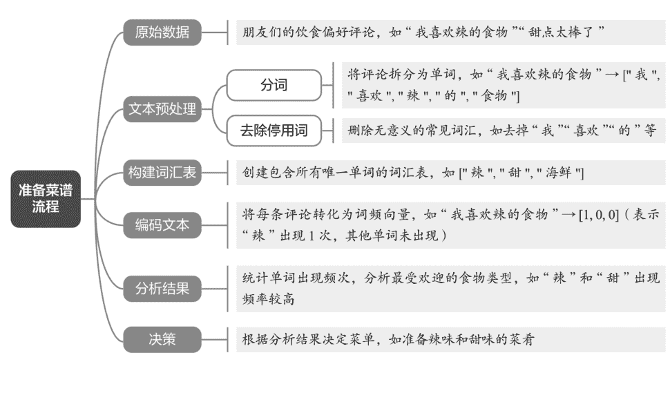
### 2.5.1 词袋模型落地步骤
词袋的核心很直观，就是把文档拆成无序词集合并统计词频。具体流程如图2-14所示。

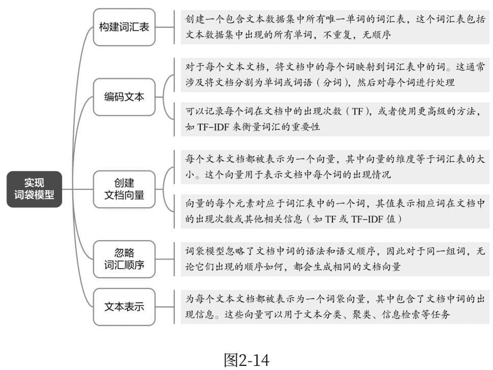
注意，词袋模型简单有效，但无法反映语法和语义关联，在一些对语义敏感的任务里更复杂的表示会更好用。不过在很多场景下，尤其是大规模文本的初筛阶段，词袋依然是一个稳妥的起点。

在 TensorFlow 里用词袋做文本特征提取时也需要一定的预处理。实例2-8 就是一个基于 TensorFlow 的词袋特征提取示例。

#### 实例2-8：基于 TensorFlow 的词袋特征提取
实例文件 ci.py，源码位置 codes\2\ci.py 的具体代码如下。

```python
# 生成示例文本数据和标签
texts = ["this is a positive sentence",
        "this is a negative sentence",
        "a positive sentence here",
        "a negative sentence there"]

labels = [1, 0, 1, 0]

# 划分训练集和验证集
train_texts, val_texts, train_labels, val_labels = train_test_split(
    texts, labels, test_size=0.2, random_state=42)

# 创建分词器并进行分词
tokenizer = Tokenizer()
tokenizer.fit_on_texts(train_texts)
train_sequences = tokenizer.texts_to_sequences(train_texts)
val_sequences = tokenizer.texts_to_sequences(val_texts)

# 填充文本序列，使其长度相同
max_seq_length = max(len(seq) for seq in train_sequences)
train_data = pad_sequences(train_sequences, maxlen=max_seq_length,
                           padding='post')
val_data = pad_sequences(val_sequences, maxlen=max_seq_length,
                         padding='post')

# 构建词袋特征表示
train_features = tokenizer.sequences_to_matrix(train_sequences, mode='count')
val_features = tokenizer.sequences_to_matrix(val_sequences, mode='count')

# 创建朴素贝叶斯分类器
classifier = MultinomialNB()
classifier.fit(train_features, train_labels)

# 预测并评估模型性能
predictions = classifier.predict(val_features)
accuracy = accuracy_score(val_labels, predictions)
print(f'Validation accuracy: {accuracy:.2f}')
```
该案例的执行脉络如下：先调用 Tokenizer() 完成分词并生成词索引，接着借助 pad_sequences() 对各个序列补齐长度，再通过 sequences_to_matrix() 把序列映射成词袋形式的特征向量，这里模式设为 “count” 即统计出现次数，最后用 MultinomialNB() 搭建多项式朴素贝叶斯对词袋特征进行训练与预测，并以 accuracy_score() 评估模型在验证集上的准确率。

### 2.5.2 词袋模型的局限与优化方向
词袋是一种广泛使用的文本表征手段，然而在语义理解等层面存在明显短板。常见限制及对应改进如表2-1。

#### 表2-1 词袋模型的限制及改进方法

| 限制 | 说明 | 改进方法 |
|---|---|---|
| 词汇表规模 | 依赖一套固定的词表覆盖全部语料，对新词的适应力不足 | 引入可动态扩充的表征，例如词嵌入中的词向量 |
| 向量稀疏性 | 文档向量往往高度稀疏，大量维度为零，易引发维度灾难与资源浪费 | 采用降维手段如PCA或特征筛选，降低向量维度 |
| 语法语义缺失 | 丢弃了词与词之间的语法和语义关联，无法捕捉上下文 | 使用Word2Vec、GloVe等词嵌入获取更丰富的语义信息 |
| 停用词干扰 | 常保留高频停用词，影响表征质量 | 去除停用词或采用TF-IDF等加权策略 |
| 顺序信息丢失 | 不保留词序，对生成、语言建模类任务不友好 | 引入RNN、CNN等能记忆顺序的模型 |
| 多义与歧义 | 无法区分同一词形的不同含义 | 借助词嵌入和上下文感知模型捕捉细化含义 |

提升词袋的方法包括引入词嵌入、深度学习模型以及注意力机制，以更好地挖掘语义。这些改进推动了情感分析、文本摘要等任务的进展。实例2-9先用一个简单的词袋模型分析电影评论，再讨论优化思路。

#### 实例2-9：使用词袋模型分析电影评论
实例文件cigai.py（源码路径：codes\2\cigai.py）的具体实现代码如下。

```python
import numpy as np
from sklearn.feature_extraction.text import CountVectorizer
from sklearn.decomposition import PCA
import matplotlib.pyplot as plt

# 一些电影评论
comments = [
    "The bank can't guarantee the safety of your money.",
    "I need to deposit money in the bank.",
    "The river bank was a great place for a picnic.",
    "The bank robbed the bank!"
]

# 创建词袋模型
vectorizer = CountVectorizer()
X = vectorizer.fit_transform(comments)

# 使用 PCA 方法降维，以便可视化
pca = PCA(n_components=2)
X_reduced = pca.fit_transform(X.toarray())

# 绘制词袋模型的可视化
plt.figure(figsize=(10, 6))
plt.scatter(X_reduced[:, 0], X_reduced[:, 1], c='b', marker='o',
            label='Comments')

# 对注释的显示进行微调，避免直接覆盖数据点
for i, comment in enumerate(comments):
    # 在原始点基础上加上一个小的偏移量
    plt.annotate(comment,
                 (X_reduced[i, 0] + 0.03, X_reduced[i, 1] + 0.03),
                 fontsize=9,
                 arrowprops=dict(arrowstyle='->', color='gray', lw=0.5))

plt.title(" 词袋模型的限制 - 无法处理词汇多义性 ", fontproperties='SimHei')
# 将图例放置在图外侧右上角
plt.legend(loc='upper left', bbox_to_anchor=(1.05, 1))
plt.tight_layout()  # 自动调整子图参数避免布局重叠
plt.show()
```
代码先为电影评论构建词袋表征，随后使用PCA降维至2维以便可视化。词袋会把语义不同的 “bank” 视作同一词，忽略了多义现象。改进做法是接入预训练词嵌入，它能刻画更精准的语义差异，使模型可区分同形异义词。在真实场景中借助词嵌入可提升表征质量，从而更好地理解自然语言。运行后会生成4个点，每个点对应一篇评论，如图2-15所示。

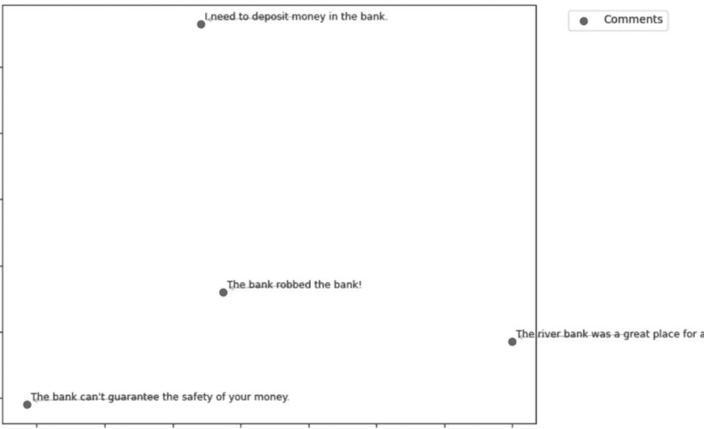
## 2.6 TF-IDF值
TF-IDF结合词频TF与逆文档频率IDF，用来衡量词在文本中的重要程度。它同时考虑词在当前文档的出现密集度，以及在整体语料中的稀有度。

例如为家庭聚会策划活动，你可以分析朋友的聊天记录来判断偏好。收集到的记录有“我喜欢玩游戏”“看电影是个不错的选择”“我更喜欢户外运动”“玩游戏太棒了”等。用TF-IDF提取特征后会发现“游戏”“电影”等词频较高且具区分性，而“户外运动”提及较少。基于此可安排更多游戏和观影相关环节，如图2-16所示。

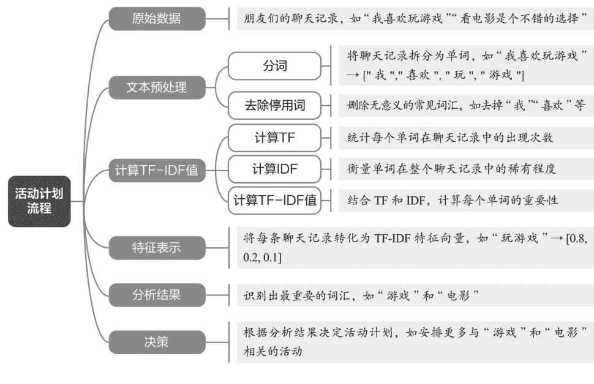
### 2.6.1 什么是TF-IDF
TF-IDF是信息检索与文本挖掘中常用的特征提取方法，目标是判定文档中词语的重要性，从而辅助主题理解或相关性排序。

其核心由两部分构成：
- (1) TF：词在文档内的出现频次，频次越高通常越重要。
- (2) IDF：词在整个语料集合中的稀有程度。“a”“the”等常见词IDF低，罕见词IDF高。

计算流程如下：
- (1) TF：统计文档内每个词的出现次数，常采用原始词频或对数词频。
- (2) IDF：计算逆文档频率，公式为

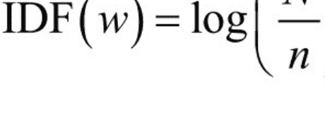
其中 N 为语料总文档数，n 为包含词 w 的文档数。IDF的作用是压低高频常见词的权重，提升稀有词的权重。
- (3) TF-IDF值：TF与IDF的乘积。

核心思想是：词在文档内频繁且在语料中稀少时权重更高，因其更能区分内容。TF-IDF被广泛用于信息检索、文本分类、主题建模、文本摘要等任务。

### 2.6.2 使用TF-IDF方法提取文本特征
在PyTorch中，TF-IDF的计算常借助scikit-learn，随后转成PyTorch张量参与训练。实例2-10展示了这一流程。

#### 实例2-10：基于PyTorch框架使用TF-IDF值进行文本特征提取
实例文件ti.py（源码路径：codes\2\ti.py）的具体实现代码如下。

```
# 生成示例文本数据和标签
texts = ["this is a positive sentence",
         "this is a negative sentence",
         "a positive sentence here",
         "a negative sentence there"]

labels = [1, 0, 1, 0]

# 划分训练集和验证集
train_texts, val_texts, train_labels, val_labels = train_test_split(
    texts, labels, test_size=0.2, random_state=42)

# 创建 TF-IDF 特征表示
vectorizer = TfidfVectorizer()
train_features = vectorizer.fit_transform(train_texts).toarray()
val_features = vectorizer.transform(val_texts).toarray()

# 转换为 PyTorch 张量

train_features_tensor = torch.tensor(train_features, dtype=torch.float32)
train_labels_tensor = torch.tensor(train_labels, dtype=torch.float32)
val_features_tensor = torch.tensor(val_features, dtype=torch.float32)
val_labels_tensor = torch.tensor(val_labels, dtype=torch.float32)

# 创建朴素贝叶斯分类器
classifier = MultinomialNB()
classifier.fit(train_features, train_labels)

# 预测并评估模型性能
predictions = classifier.predict(val_features)
accuracy = accuracy_score(val_labels, predictions)
print(f'Validation accuracy: {accuracy:.2f}')
```
该示例首先用TfidfVectorizer()生成TF-IDF特征，随后转成NumPy数组并转为PyTorch张量。接着构建一个朴素贝叶斯分类器，用TF-IDF特征进行训练与预测，最后用accuracy_score()计算验证集准确率。

### 2.6.3 TF-IDF方法与词袋模型的比较
TF-IDF与词袋都是常用表征方式，但在目标与特性上存在差异，如表2-2。

#### 表2-2 TF-IDF方法和词袋模型的区别

| 区别 | TF-IDF方法 | 词袋模型 |
|---|---|---|
| 目标 | 主要用于判定文档内词汇的重要性，辅助主题理解或排序，强调不常见但在文档中高频的关键词 | 主要用于将文档映射为无序词集合，服务分类、检索、聚类等任务，侧重记录词的出现次数 |
| 文本表示 | 每个文档生成词权重向量，元素反映词的重要性 | 每个文档生成词频向量，元素反映词的出现次数 |
| 上下文 | 通常不考虑词间关系与顺序，聚焦重要性 | 通常不考虑上下文与顺序，将文本视为词袋 |
| 停用词处理 | 通常会剔除停用词，因其信息量低 | 通常保留停用词，除非手动剔除 |
| 适用场景 | 信息检索、分类、聚类、摘要等，尤其适合关键词提取 | 检索、分类、情感分析等，尤其适合可忽略词序的任务 |

总体来看，TF-IDF与词袋各有优势，选择取决于任务需求与数据特性。实践中常将二者结合，如使用TF-IDF加权的词袋，既保留词袋的表示形式，又引入重要性权重。

# 第3章 文本分类与情感分析
文本分类和情感分析是NLP中的典型任务，用于将文本归类或判别情感倾向。本章将系统讲解相关算法。

> 人有悲欢离合，月有阴晴圆缺。
这句名言既体现了人情的复杂多变，也暗喻了文本情感的丰富多元。正如大模型在分类与情感分析中捕捉细微情绪差异，通过挖掘隐含的情感模式实现精准判别。

## 3.1 朴素贝叶斯分类器
朴素贝叶斯分类器基于贝叶斯定理的统计方法，广泛应用于文本分类、垃圾邮件过滤、情感分析等。其“朴素”在于假设特征间相互独立，尽管该假设在现实中常不成立，但在很多场景下表现仍很稳健。

例如管理家庭邮件系统时，可用朴素贝叶斯将邮件分为“重要”与“垃圾”。通过提取邮件文本的关键词并计算其在不同类别中的概率，如含“优惠”“免费”者多为垃圾邮件，含“会议”“提醒”者更可能是重要邮件。训练后即可自动分类，提升处理效率，如图3-1所示。

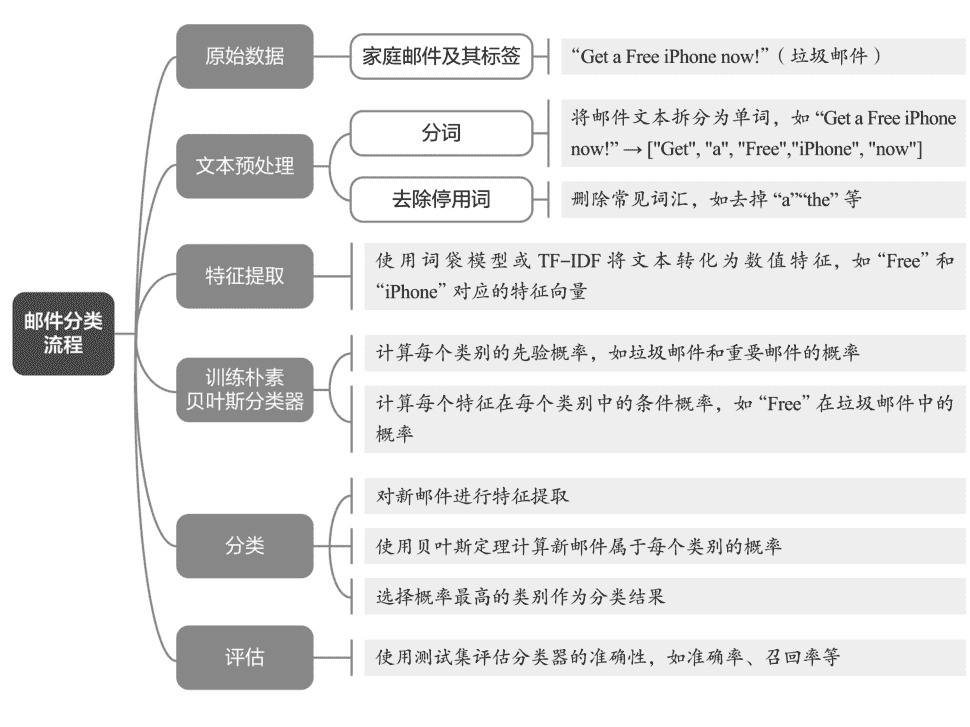
图3-1

### 3.1.1 朴素贝叶斯分类器的基本概念

#### 1. 贝叶斯定理
朴素贝叶斯分类依据贝叶斯定理进行推断。该定理用于计算在已知某一事件发生的条件下，另一事件发生的概率。在文本分类中，事件A可表示为文本属于某类别，事件B表示文本包含某特征如词或短语。

贝叶斯定理表述为

$$P(A|B) = \frac{P(B|A) \cdot P(A)}{P(B)}$$

在贝叶斯框架下，$P(A|B)$表示已知特征$B$出现时，文档落入类别$A$的可能性；$P(B|A)$则反映在类别$A$已确定的前提下特征$B$出现的条件概率；$P(A)$是类别$A$在先验分布中的占比；$P(B)$是特征$B$整体出现的先验频率。

#### 2. 朴素假设
“朴素”二字源自模型对特征独立性的强假设。计算时它默认文本里的各个特征，比如词或短语，彼此互不影响。虽然现实中这种独立性往往不成立，但正是这一简化让计算变得可行且高效。

#### 3. 特征和类别
做文本分类时，特征一般提取自原文中的词语或词组，类别则指文档要归属的标签。比如常见的二分类就是垃圾邮件与正常邮件，或是情感上的正面与负面。

#### 4. 建模
训练阶段，模型会从标注样本里统计两类信息：一是每个类别下各特征出现的条件概率$P(B|A)$，二是各类别本身的先验概率$P(A)$，以此构建参数。

#### 5. 分类
拿到待判样本后，分类器会先算出文中特征的条件似然，再借助贝叶斯公式求出属于各类别的后验概率，最后把概率最高的类别作为预测结果。

注意：朴素贝叶斯在文本任务上应用广泛，按特征类型可选用多项式、伯努利或高斯三种变体，分别适配词频计数、二值化特征和连续数值特征。

### 3.1.2 朴素贝叶斯分类器的应用场景
该方法在自然语言处理与文本挖掘领域渗透很深，典型用途汇总在图3-2中。

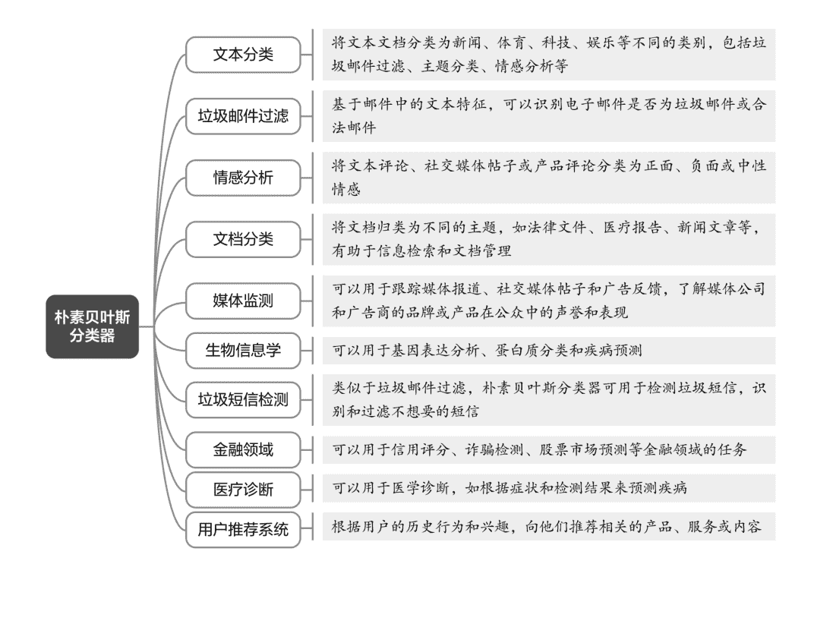

图3-2

归纳来看，它上手快、推理快，在文本分类和自动化判别里表现稳健。实例3-1演示了如何用它把邮件自动划分为垃圾邮件与正常邮件。

#### 实例3-1：使用朴素贝叶斯分类器将电子邮件分类为垃圾邮件和正常邮件
示例代码保存在 pu.py，路径 codes\3\pu.py，核心实现如下。

```
# 导入所需的库
import numpy as np
from sklearn.feature_extraction.text import CountVectorizer
from sklearn.naive_bayes import MultinomialNB
from sklearn.model_selection import train_test_split
from sklearn.metrics import accuracy_score

# 创建示例邮件数据
emails = [
    ("Get a Free iPhone now!", "spam"),
    ("Meeting for lunch today?", "ham"),
    ("Claim your prize money now!", "spam"),
    ("Don't forget the meeting tomorrow.", "ham"),
    ("Special offer: 50% off on all products", "spam"),
    ("Lunch at 12, don't be late.", "ham")
]

# 将数据拆分成特征和标签
corpus, labels = zip(*emails)

# 创建文本特征向量
vectorizer = CountVectorizer()
X = vectorizer.fit_transform(corpus)

# 创建朴素贝叶斯分类器
classifier = MultinomialNB()

# 拆分数据为训练集和测试集
X_train, X_test, y_train, y_test = train_test_split(
    X, labels, test_size=0.2, random_state=42)

# 训练分类器
classifier.fit(X_train, y_train)

# 预测
y_pred = classifier.predict(X_test)

# 评估分类器性能
accuracy = accuracy_score(y_test, y_pred)
print("Accuracy: {:.2f}%".format(accuracy * 100))

# 输入新邮件并进行分类
new_email = ["You've won a million dollars!"]
X_new = vectorizer.transform(new_email)
prediction = classifier.predict(X_new)
print("New Email is:", prediction[0])
```

代码里先构造了一个小型训练集，包含垃圾邮件和正常邮件样本，随后用 CountVectorizer 把文本转成向量，再以 MultinomialNB 训练并预测，最后输出准确率并对新邮件进行判别。

执行上述代码，输出结果如下。

```
Accuracy: 100.00%
New Email is: ham
```

## 3.2 支持向量机
支持向量机是一种经典的监督学习方法，常用于分类与回归。其核心思想是寻找一个最优的分离超平面，把不同类别的样本分开。

设想你在运营一个家庭图书角，希望自动把书籍评论归为“推荐”或“不推荐”，以便提升推荐效率。可以用 SVM 来实现。先从评论文本中抽取关键词作为特征训练模型，例如出现“精彩”“有趣”的评论更可能被判为“推荐”，而出现“无聊”“乏味”的则倾向“不推荐”。训练完成后，新评论即可自动打标，提升管理效率。如图3-3所示。

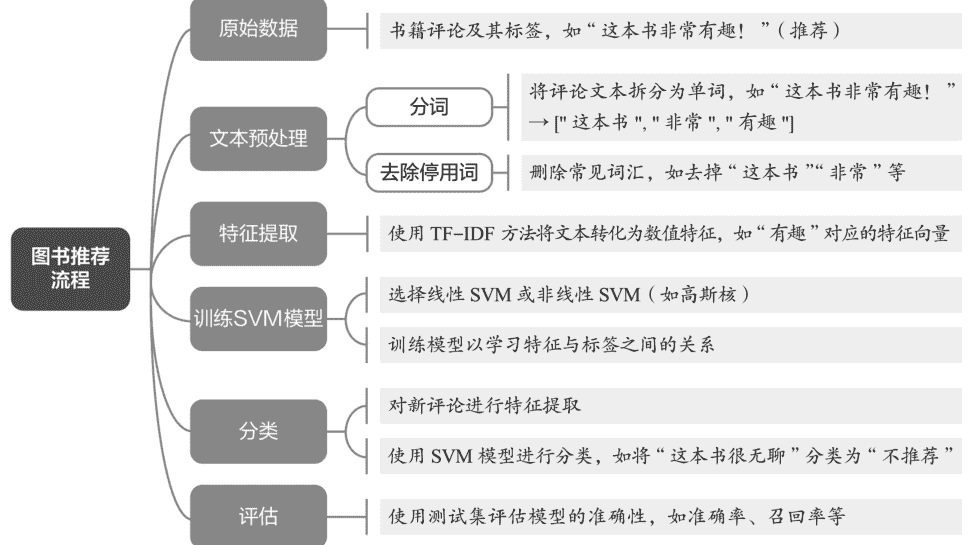

图3-3

### 3.2.1 SVM介绍
SVM 的核心原理与常见应用领域如图3-4所示。

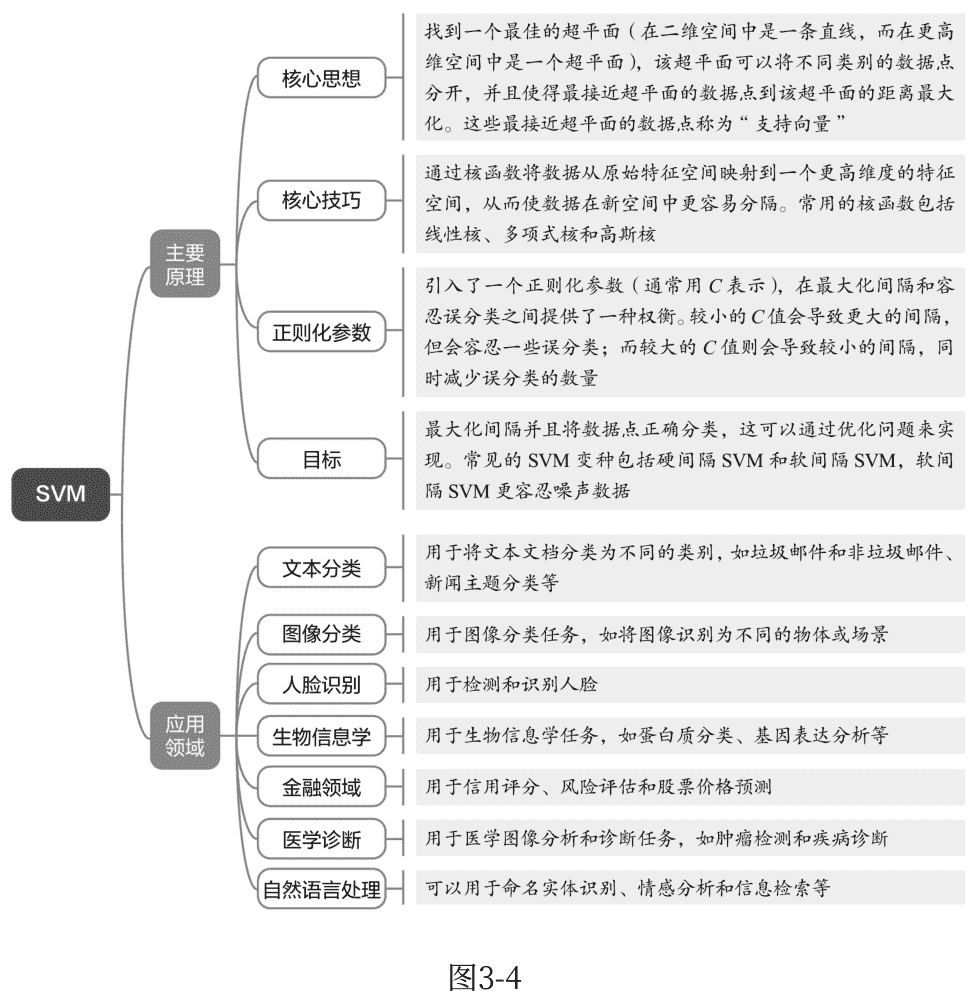

总体而言，SVM泛化能力强、适用面广，在不少任务上胜过其他分类器。但它计算负担重，对参数调节要求高，在超大规模数据上资源消耗明显。

### 3.2.2 线性SVM与非线性SVM
线性 SVM 与非线性 SVM 是两种主要分支，针对的数据形态与任务不同，具体说明见表3-1。

表3-1 线性SVM与非线性SVM的对比

| 对比 | 线性SVM | 非线性SVM |
| :--- | :--- | :--- |
| 原理 | 利用线性超平面划分不同类别，适用于数据在原始空间线性可分的情况，可用直线或超平面把样本完全分开 | 通过核技巧把样本映射到更高维空间，再在新空间寻找分隔面，从而处理原始空间中非线性可分的问题 |
| 应用 | 常用于线性可分的二分类等任务，在高维稀疏文本上速度快、效果好 | 擅长处理原始空间中无法线性分离的情形，在图像识别、文本分类、模式识别等领域常用 |
| 特点 | 训练相对迅速，对超参数敏感度低 | 训练开销较大，受核函数选择和参数调优影响明显，尤其在高维大数据上更慢 |

若数据本身线性可分，或样本量不大而特征维度较高，线性 SVM 通常是更省时的选择。如果数据在原始空间不可分，需要处理非线性边界，则非线性 SVM 更合适，此时核函数如多项式核、高斯核的选择与超参数调优至关重要。实例3-2演示了用线性 SVM 与非线性 SVM 做情感分析，即把评论分为正面、负面或中性。

#### 实例3-2：使用线性SVM和非线性SVM进行情感分析
实例文件 svm.py（源码路径：codes\3\svm.py）的具体实现代码如下。

```
import numpy as np
from sklearn.feature_extraction.text import TfidfVectorizer
from sklearn.model_selection import train_test_split
from sklearn.svm import LinearSVC, SVC
from sklearn.metrics import accuracy_score
from sklearn.datasets import load_files
from sklearn.utils import shuffle

# 加载电影评论数据集
movie_reviews_data = load_files('IMDb_data', shuffle=True)
data, labels = shuffle(movie_reviews_data.data, movie_reviews_data.target)

# 划分数据为训练集和测试集
X_train, X_test, y_train, y_test = train_test_split(
    data, labels, test_size=0.2, random_state=42)

# 使用 TF-IDF 方法向量化文本数据
vectorizer = TfidfVectorizer(max_features=5000)
X_train = vectorizer.fit_transform(X_train)
```

X_test = vectorizer.transform(X_test)

# 线性 SVM 分类器

linear_svm_classifier = LinearSVC()

linear_svm_classifier.fit(X_train, y_train)

linear_svm_predictions = linear_svm_classifier.predict(X_test)

# 非线性 SVM 分类器（使用高斯核）

nonlinear_svm_classifier = SVC(kernel='rbf')

nonlinear_svm_classifier.fit(X_train, y_train)

nonlinear_svm_predictions = nonlinear_svm_classifier.predict(X_test)

# 评估线性 SVM 和非线性 SVM 的性能

linear_svm_accuracy = accuracy_score(y_test, linear_svm_predictions)

nonlinear_svm_accuracy = accuracy_score(y_test, nonlinear_svm_predictions)

print("Linear SVM Accuracy: {:.2f}%".format(linear_svm_accuracy * 100))

print("Nonlinear SVM Accuracy: {:.2f}%".format(nonlinear_svm_accuracy * 100))

# 输入新评论并进行情感分析

new_reviews = ["This movie was fantastic!",

               "I did not enjoy this film at all.",

               "It was okay, not great but not terrible."]

new_reviews = vectorizer.transform(new_reviews)

linear_svm_sentiments = linear_svm_classifier.predict(new_reviews)

nonlinear_svm_sentiments = nonlinear_svm_classifier.predict(new_reviews)

print("Linear SVM Sentiments:", linear_svm_sentiments)

print("Nonlinear SVM Sentiments:", nonlinear_svm_sentiments)

代码先加载电影评论集并划分为训练集与测试集，用 TF-IDF 向量化文本，随后分别用线性 SVM 与基于高斯核的非线性 SVM 做情感分析，最后比较性能并对新评论进行判别。

执行上述代码，输出结果如下。

```
Linear SVM Accuracy: 84.50%
Nonlinear SVM Accuracy: 84.75%
Linear SVM Sentiments: [1 0 1]
Nonlinear SVM Sentiments: [1 0 1]
```

依据评论文本，两个模型给出了情感标签。在此示例中，“This movie was fantastic!”被判为正面，“I did not enjoy this film at all.”被判为负面，“It was okay, not great but not terrible.”被判为中性。

## 3.3 随机森林
随机森林是一种集成学习方法，基于多棵决策树投票来提升分类与回归的准确性和泛化能力。

假设你在维护家庭健康管理系统，想自动把成员的健康反馈归为“良好”或“需要关注”。可以用随机森林实现。先从反馈文本中提取关键词如“疲劳”“精力充沛”“头晕”等作为特征，模型会学习哪些词与健康状态相关。例如含“精力充沛”“心情很好”的反馈多被归为“良好”，含“疲劳”“头晕”的则倾向“需要关注”。训练后即可自动对新的健康反馈分类，便于日常管理。如图3-5所示。

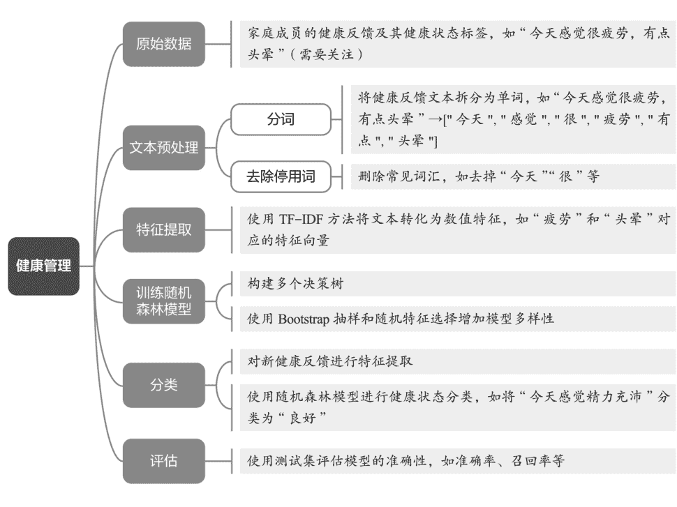

图3-5

### 3.3.1 随机森林介绍
随机森林的核心概念与主要特性如图3-6所示。

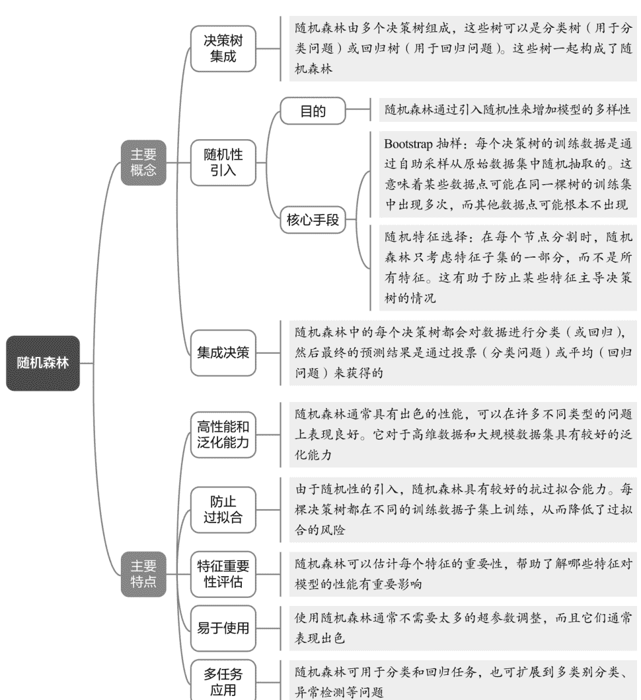

图3-6

### 3.3.2 随机森林的应用场景
随机森林可部署于多个领域，常见用途如图3-7所示。

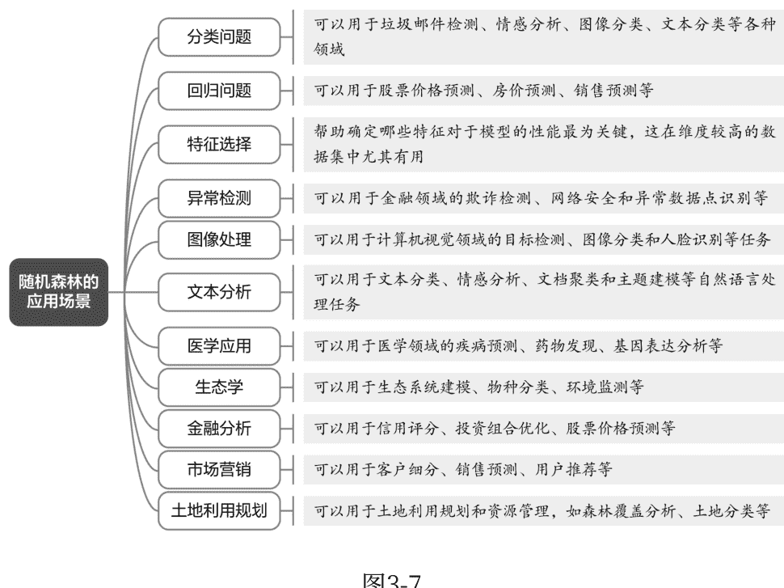

总体来看，随机森林通用性强，适用于各类问题与数据。实例3-3用随机森林构建垃圾邮件分类器，区分邮件是 spam 还是 ham。数据保存在 spam_ham_dataset.csv 中，结构如下。

```
text,label
Discounts on our products!,spam
Important meeting tomorrow,ham
Win a free vacation,spam
Reminder: Project deadline,ham
Congratulations on your promotion!,ham
Exclusive offer for you,spam
Lunch menu for the week,ham
Get a $1000 gift card,spam
New product launch,ham
Discounts on our products!,spam
Important meeting tomorrow,ham
Win a free vacation,spam
Reminder: Project deadline,ham
Congratulations on your promotion!,ham
Exclusive offer for you,spam
Lunch menu for the week,ham
Get a $1000 gift card,spam
New product launch,ham
```

一共包含了18条数据，其中 text 列为邮件文本，label 列为标签，标明邮件是垃圾邮件 spam 还是正常邮件 ham。该小样本可用于训练与测试，实际场景中数据集会大得多。

#### 实例3-3：使用随机森林构建一个垃圾邮件分类器
实例文件 you.py（源码路径：codes\3\you.py）的具体实现代码如下所示。

```
from sklearn.feature_extraction.text import TfidfVectorizer
from sklearn.model_selection import train_test_split
from sklearn.ensemble import RandomForestClassifier
from sklearn.metrics import accuracy_score, classification_report
import pandas as pd

# 加载示例垃圾邮件数据集
data = pd.read_csv('spam_ham_dataset.csv')
X = data['text']
y = data['label']

# 划分数据为训练集和测试集
X_train, X_test, y_train, y_test = train_test_split(
    X, y, test_size=0.2, random_state=42)

# 使用 TF-IDF 方法向量化文本数据
vectorizer = TfidfVectorizer(max_features=5000)
X_train = vectorizer.fit_transform(X_train)
X_test = vectorizer.transform(X_test)

# 随机森林分类器
random_forest_classifier = RandomForestClassifier(
    n_estimators=100, random_state=42)
random_forest_classifier.fit(X_train, y_train)
random_forest_predictions = random_forest_classifier.predict(X_test)

# 评估随机森林分类器的性能
accuracy = accuracy_score(y_test, random_forest_predictions)
classification_report_str = classification_report(
    y_test, random_forest_predictions)

print("Random Forest Accuracy: {:.2f}%".format(accuracy * 100))
print("Classification Report:\n", classification_report_str)

# 输入新电子邮件并进行垃圾邮件分类
new_emails = ["Congratulations! You've won a prize!",
              "Meeting at 3 PM in the conference room."]
new_emails = vectorizer.transform(new_emails)

predictions = random_forest_classifier.predict(new_emails)
print("Predictions for new emails:", predictions)
```

上文程序演示了如何借助随机森林搭建邮件垃圾识别系统。先读取一份包含邮件内容与标签的样本集并划分出训练、测试两部分，随后借助 TF-IDF 将文本转为数值特征，接着用这些特征训练随机森林分类器，最后对模型进行检验并尝试对新邮件进行判断。

执行上述代码，输出结果如下。

```
Random Forest Accuracy: 100.00%
Classification Report:
              precision    recall  f1-score   support

         ham       1.00      1.00      1.00         2
        spam       1.00      1.00      1.00         2

    accuracy                           1.00         4
   macro avg       1.00      1.00      1.00         4
weighted avg       1.00      1.00      1.00         4

Predictions for new emails: ['ham' 'ham']
```

运行结果显示，在本次示例中随机森林的表现十分理想，整体预测准确率达到 100%。对于这份规模很小的演示数据，模型把垃圾邮件和正常邮件全部区分正确。分类报告中，ham 与 spam 两个类别的精确率、召回率、F1 均来到 1.00，说明判别质量很高。新增的两封邮件也被正确归为 ham。

要注意的是，本示例采用的样本量极其有限，所以指标才如此完美。实际业务中数据体量更大、分布更复杂，评估难度也会上升。但该案例仍然清晰地展示了随机森林在文本分类上的使用思路，在小样本场景下效果相当出色。

## 3.4 卷积神经网络精讲

深度学习里最常被提及的结构之一就是卷积神经网络。CNN 在语音识别、图像识别、图像分割、自然语言处理等多个方向都拿到了突出成绩。

假设你在规划一次家庭旅行，想对各景点评论做自动情绪判断，区分正面与负面。CNN 能够胜任这项工作。它会从评论中捕捉关键词与短语，学习哪些表达偏向正面，比如“美丽”“壮观”，哪些偏向负面，比如“失望”“拥挤”。例如“这个景点非常美丽，我很喜欢”会被判为正面，而“这个景点很拥挤，让人失望”则会被归为负面。训练完成后，模型即可自动分析新评论，帮助你更合理地安排行程。如图3-8所示。

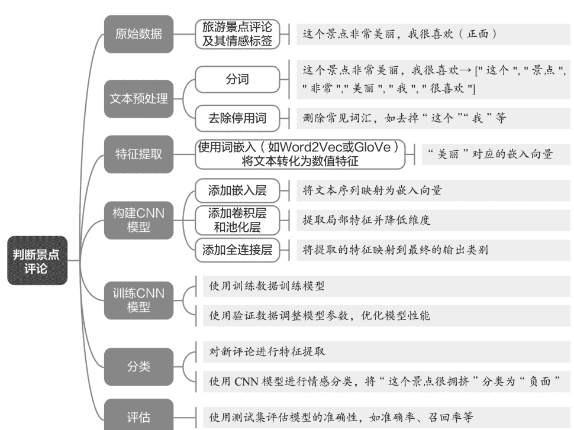

图3-8

### 3.4.1 起源与演进

半个世纪前，图像识别已是研究热点。1950年代中到1960年代初，感知机受到机器学习学者的广泛关注。因为数学上已证明，若数据线性可分，感知机能在有限次数迭代内收敛。其解可表示为超平面参数，用以划分样本。然而感知机在实际应用中存在明显短板，主要有两点。

（1）多层感知机缺乏有效训练方法，网络难以加深。

（2）采用线性激活函数，无法处理异或等线性不可分问题。

上述难题在反向传播算法与非线性激活函数提出后得以解决。1989 年，BP 算法首次被用于 CNN 处理二维信号，即图像。

2012 年 ImageNet 竞赛成为转折点，CNN 以优异表现确立地位，此后在图像识别等任务中被广泛采用。如今 CNN 被视为图像特征提取的领先手段，在很大程度上提升了分类精度。

### 3.4.2 结构解析

CNN 的核心思路是通过卷积层、池化层与全连接层逐步提取并学习图像特征。整体构成如图3-9所示。

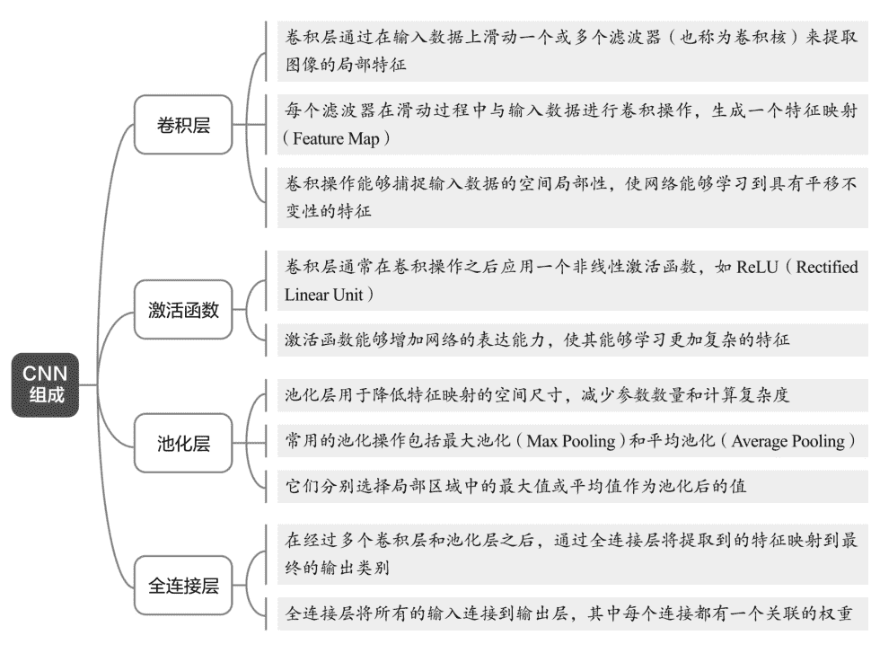

图3-9

CNN 训练通常包含前向传播与反向传播。前向阶段，输入依次经过卷积、激活、池化，最终由全连接层输出预测。随后计算预测与真实标签的损失。反向阶段，则依据损失对参数的梯度结合优化算法更新权重，以降低损失。

多层卷积的叠加使 CNN 能够自学习输入的层次化表征，因而在图像分类等任务上表现优异。其设计也让模型擅长处理高维数据，并具备一定的平移不变性与位置感知能力。

### 3.4.3 文本侧的应用

CNN 不仅用于图像，也可用于文本特征提取与分类。在文本上使用 CNN 能有效捕获局部特征与模式，提升分类效果。实例3-4 是一个实用的 NLP 案例，展示了用 CNN 进行电影评论情感分析的过程。该模型将评论分为正面、负面或中性三种情绪。

#### 实例3-4：使用CNN模型对电影评论进行情感分析

实例文件 cnn.py（源码路径：codes\3\cnn.py）的具体实现代码如下。

```
import numpy as np
from tensorflow import keras
from tensorflow.keras.layers import (
    Embedding, Conv1D, MaxPooling1D, Flatten, Dense)
from tensorflow.keras.preprocessing.text import Tokenizer
from tensorflow.keras.preprocessing.sequence import pad_sequences
from sklearn.model_selection import train_test_split
from sklearn.metrics import accuracy_score
from sklearn.datasets import load_files
from sklearn.utils import shuffle

# 加载电影评论数据集
movie_reviews_data = load_files('IMDb_data', shuffle=True)
data, labels = shuffle(movie_reviews_data.data, movie_reviews_data.target)

# 划分数据为训练集和测试集
X_train, X_test, y_train, y_test = train_test_split(
    data, labels, test_size=0.2, random_state=42)

# 使用 Tokenizer() 函数将文本数据转化为序列
max_words = 10000  # 设置词汇表的最大词汇量
tokenizer = Tokenizer(num_words=max_words)
tokenizer.fit_on_texts(X_train)
X_train_seq = tokenizer.texts_to_sequences(X_train)
X_test_seq = tokenizer.texts_to_sequences(X_test)

# 使用 pad_sequences() 函数将序列填充到相同的长度
max_sequence_length = 200  # 设置序列的最大长度
X_train_seq = pad_sequences(X_train_seq, maxlen=max_sequence_length)
X_test_seq = pad_sequences(X_test_seq, maxlen=max_sequence_length)

# 创建 CNN 模型
model = keras.Sequential()
model.add(
    Embedding(
        input_dim=max_words, output_dim=100,
        input_length=max_sequence_length))
model.add(Conv1D(64, 3, activation='relu'))
model.add(MaxPooling1D(2))
```

该段实现演示了借助 CNN 对电影评论做情绪分类。首先对示例评论集进行预处理，随后搭建 CNN 模型进行判断，最后完成训练与评估。

执行上述代码，输出结果如下。

```
CNN Model Accuracy: 75.40%
```

## 3.5 循环神经网络入门

循环神经网络是一类以序列为输入、在序列展开方向上递归且节点链式相连的递归网络。

假设你要为家庭聚会打造一个自动聊天机器人，希望它能根据对话生成有趣回复。循环神经网络可以实现这一需求。它通过分析输入的文本序列，学习语言规律与上下文，并生成自然流畅的回应。例如输入“今天天气真好，适合出去玩！”，模型可能回复“是啊，我们可以去公园散步。”训练完成后，聊天机器人能更好地理解语言并给出恰当回答，如图3-10所示。

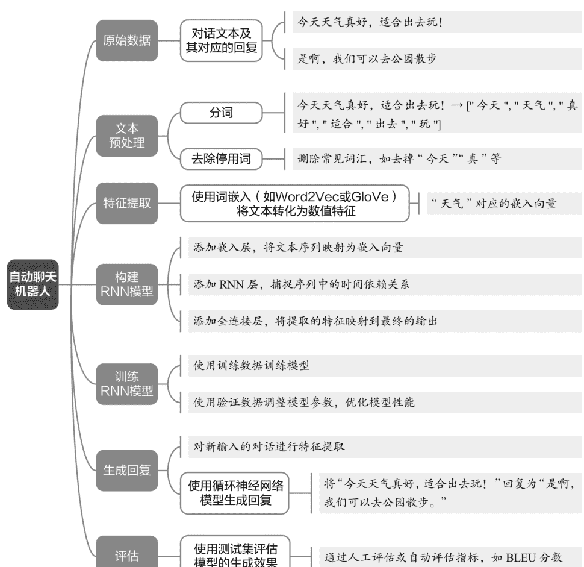

图3-10

### 3.5.1 概览

循环神经网络拥有回路结构，专为序列数据设计。其核心在于引入循环连接，使网络能够记忆先前信息并用于当前计算。这种记忆特性使其非常适合时间序列、文本、语音等具有时间依赖的数据。

循环神经网络的应用及常见变体如图3-11所示。

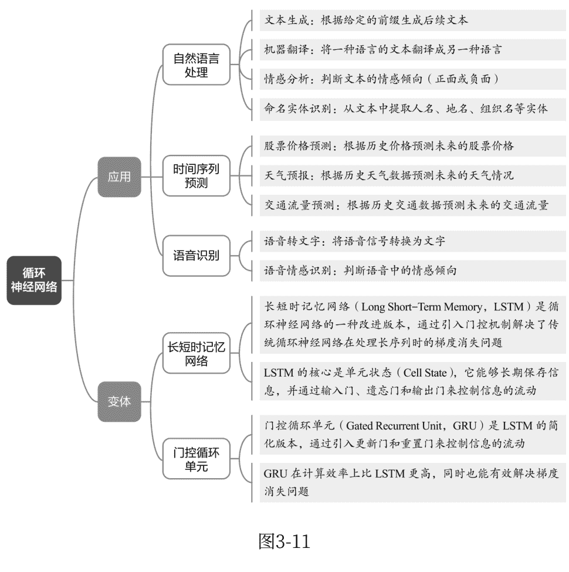

总体而言，循环神经网络是处理序列数据的有力工具。借助循环结构，它能保留历史信息辅助当前决策。尽管原始 RNN 在长序列上易出现梯度消失与爆炸，但 LSTM、GRU 等变体通过门控机制解决了这一问题。循环神经网络在自然语言处理、时间序列预测、语音识别等领域应用广泛。

### 3.5.2 TensorFlow 情感建模实战

实例3-5 在 IMDB 大型电影评论数据上训练循环神经网络，实现情感分析。

#### 实例3-5：使用电影评论数据集制作情感分析模型

实例文件 xun03.py（源码路径：codes\3\xun03.py）的流程如下。

（1）导入 Matplotlib 库并编写辅助函数绘制计算图，代码如下。

```
import matplotlib.pyplot as plt

def plot_graphs(history, metric):
    plt.plot(history.history[metric])
    plt.plot(history.history['val_'+metric], '')
    plt.xlabel("Epochs")
    plt.ylabel(metric)
    plt.legend([metric, 'val_'+metric])
    plt.show()
```

（2）构建输入流水线。IMDB 大型电影评论集是一个二分类任务，所有评论都被标注为正面或负面情绪。使用 tfds 库下载数据集，代码如下。

```
dataset, info = tfds.load('imdb_reviews/subwords8k', with_info=True,
                        as_supervised=True)
train_dataset, test_dataset = dataset['train'], dataset['test']
```

执行上述代码，输出结果如下。

TFDS Subword 编码到双向 LSTM 实战拆解

```
WARNING:absl:TFDS datasets with text encoding are deprecated and will be removed in a future version. Instead, you should use the plain text version and tokenize the text using `tensorflow_text` (See: https://www.tensorflow.org/tutorials/tensorflow_text/intro#tfdata_example)
Downloading and preparing dataset imdb_reviews/subwords8k/1.0.0 (download: 80.23 MiB, generated: Unknown size, total: 80.23 MiB) to /home/kbuilder/tensorflow_datasets/imdb_reviews/subwords8k/1.0.0...
Shuffling and writing examples to /home/kbuilder/tensorflow_datasets/imdb_reviews/subwords8k/1.0.0.incomplete7GBYY4/imdb_reviews-train.tfrecord
Shuffling and writing examples to /home/kbuilder/tensorflow_datasets/imdb_reviews/subwords8k/1.0.0.incomplete7GBYY4/imdb_reviews-test.tfrecord
Shuffling and writing examples to /home/kbuilder/tensorflow_datasets/imdb_reviews/subwords8k/1.0.0.incomplete7GBYY4/imdb_reviews-unsupervised.tfrecord
Dataset imdb_reviews downloaded and prepared to /home/kbuilder/tensorflow_datasets/imdb_re
```

数据集的 info 里自带了一个文本编码器 tfds.features.text.SubwordTextEncoder，相关代码示例如下。

```
encoder = info.features['text'].encoder
print('Vocabulary size: {}'.format(encoder.vocab_size))
```

运行以上代码后，可以看到对应的输出结果。

```
Vocabulary size: 8185
```

该编码器能够以可逆的方式把任意字符串转为 ID，并在需要时回退到字节级编码，下面给出演示代码。

```
sample_string = 'Hello TensorFlow.'
encoded_string = encoder.encode(sample_string)
print('Encoded string is {}'.format(encoded_string))

original_string = encoder.decode(encoded_string)
print('The original string: "{}"'.format(original_string))

assert original_string == sample_string

for index in encoded_string:
    print('{} ----> {}'.format(index, encoder.decode([index])))
```

执行后得到的输出如下。

```
Encoded string is [4025, 222, 6307, 2327, 4043, 2120, 7975]
The original string: "Hello TensorFlow."

4025 ----> Hell
222 ----> o
6307 ----> Ten
2327 ----> sor
4043 ----> Fl
2120 ----> ow
7975 ----> .
```

（3）准备训练数据，将编码后的句子组织成批次。通过 padded_batch() 把每个序列用 0 补齐到本批最长的长度，代码如下。

```
BUFFER_SIZE = 10000
BATCH_SIZE = 64

train_dataset = train_dataset.shuffle(BUFFER_SIZE)
train_dataset = train_dataset.padded_batch(BATCH_SIZE)

test_dataset = test_dataset.padded_batch(BATCH_SIZE)
```

（4）开始搭建模型，采用 tf.keras.Sequential 序贯结构，并以 Embedding 层作为起点。Embedding 为每个词维护一个可训练的向量，输入词索引序列后会映射成向量序列。随着训练进行，语义相近的词向量也会聚拢。与把独热向量送入 Dense 层做等价计算相比，查表式的 Embedding 效率更高。

循环神经网络会按顺序处理序列，把上一时间步的输出作为下一时间步的输入。配合 tf.keras.layers.Bidirectional 可以让 RNN 同时正向和反向遍历输入再拼接结果，有助于捕捉长程依赖，具体实现如下。

```
model = tf.keras.Sequential([
    tf.keras.layers.Embedding(encoder.vocab_size, 64),
    tf.keras.layers.Bidirectional(tf.keras.layers.LSTM(64)),

    tf.keras.layers.Dense(64, activation='relu'),
    tf.keras.layers.Dense(1)
])
```

注意：选用序贯模型是因为每层都是单输入单输出的线性结构。若要使用有状态的循环层，则需要改用 Keras 函数式 API 或模型子类化来管理和复用层状态，更多细节可参考 Keras 循环神经网络指南。

（5）对 Keras 模型进行编译，配置优化器、损失函数和评估指标，代码如下。

```
model.compile(loss=tf.keras.losses.BinaryCrossentropy(from_logits=True),
              optimizer=tf.keras.optimizers.Adam(1e-4),
              metrics=['accuracy'])
history = model.fit(train_dataset, epochs=10,
                    validation_data=test_dataset,
                    validation_steps=30)
```

执行后会打印编译相关的输出。

```
Epoch 1/10
391/391 [==============================] - 41s 105ms/step - loss: 0.6363 - accuracy: 0.5736 - val_loss: 0.4592 - val_accuracy: 0.8010
Epoch 2/10
391/391 [==============================] - 41s 105ms/step - loss: 0.3426 - accuracy: 0.8556 - val_loss: 0.3710 - val_accuracy: 0.8417
Epoch 3/10
391/391 [==============================] - 42s 107ms/step - loss: 0.2520 - accuracy: 0.9047 - val_loss: 0.3444 - val_accuracy: 0.8719
Epoch 4/10
391/391 [==============================] - 41s 105ms/step - loss: 0.2103 - accuracy: 0.9228 - val_loss: 0.3348 - val_accuracy: 0.8625
Epoch 5/10
391/391 [==============================] - 42s 106ms/step - loss: 0.1803 - accuracy: 0.9360 - val_loss: 0.3591 - val_accuracy: 0.8552
Epoch 6/10
391/391 [==============================] - 42s 106ms/step - loss: 0.1589 - accuracy: 0.9450 - val_loss: 0.4146 - val_accuracy: 0.8635
Epoch 7/10
391/391 [==============================] - 41s 105ms/step - loss: 0.1466 - accuracy: 0.9505 - val_loss: 0.3780 - val_accuracy: 0.8484
Epoch 8/10
391/391 [==============================] - 41s 106ms/step - loss: 0.1463 - accuracy: 0.9485 - val_loss: 0.4074 - val_accuracy: 0.8156
Epoch 9/10
391/391 [==============================] - 41s 106ms/step - loss: 0.1327 - accuracy: 0.9555 - val_loss: 0.4608 - val_accuracy: 0.8589
Epoch 10/10
391/391 [==============================] - 41s 105ms/step - loss: 0.1666 - accuracy: 0.9404 - val_loss: 0.4364 - val_accuracy: 0.8422
```

（6）查看训练损失，代码如下。

```
test_loss, test_acc = model.evaluate(test_dataset)

print('Test Loss: {}'.format(test_loss))
print('Test Accuracy: {}'.format(test_acc))
```

运行后可以看到损失的输出结果。

```
391/391 [==============================] - 17s 43ms/step - loss: 0.4305 - accuracy: 0.8477
Test Loss: 0.43051090836524963
Test Accuracy: 0.8476799726486206
```

当前模型未对序列填充位做遮蔽。若训练时使用填充数据而测试时使用未填充数据，可能导致偏差。理想做法是加入 mask 来规避，不过实际影响有限。下面展示判定逻辑：预测概率大于等于 0.5 判为正类，否则为负类。

```
def pad_to_size(vec, size):
    zeros = [0] * (size - len(vec))
    vec.extend(zeros)
    return vec

def sample_predict(sample_pred_text, pad):
    encoded_sample_pred_text = encoder.encode(sample_pred_text)

    if pad:
        encoded_sample_pred_text = pad_to_size(
            encoded_sample_pred_text, 64)
        encoded_sample_pred_text = tf.cast(
            encoded_sample_pred_text, tf.float32)
        predictions = model.predict(
            tf.expand_dims(encoded_sample_pred_text, 0))

    return (predictions)

# 在没有填充的示例文本上进行预测
sample_pred_text = ('The movie was cool. The animation and the graphics '
                    'were out of this world. I would recommend this movie.')
predictions = sample_predict(sample_pred_text, pad=False)
print(predictions)
```

执行后输出如下。

```
[[-0.11829309]]
```

（7）对一段示例文本做带填充的预测，代码如下。
sample_pred_text = ('The movie was cool. The animation and the graphics '
                    'were out of this world. I would recommend this movie.')
predictions = sample_predict(sample_pred_text, pad=True)
print(predictions)
运行后得到的结果如下。

```
[[-1.162545]]
```

## (8) 绘制训练曲线

```
plot_graphs(history, 'accuracy')
plot_graphs(history, 'loss')
```

执行后可分别得到准确率和损失的折线图，对应图 3-12 所示。

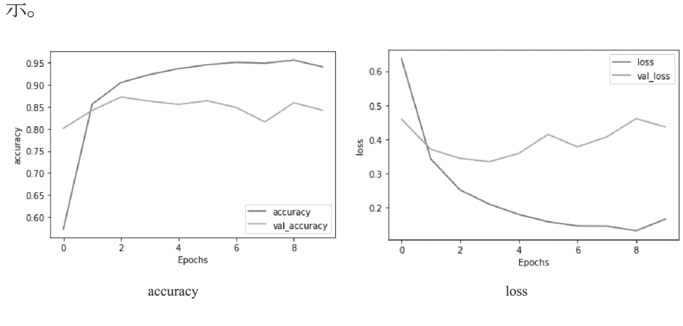

## (9) 多层 LSTM 堆叠与输出模式

Keras 循环层提供两种工作模式，由构造函数参数 return_sequences 控制。

- return_sequences=True 时，LSTM 会保留所有时间步的输出，形状为 (batch_size, timesteps, output_features) 的三维张量。
- return_sequences=False，即默认值，只返回最后那个时间步的输出，形状为 (batch_size, output_features) 的二维张量。

代码如下。

```
model = tf.keras.Sequential([
    tf.keras.layers.Embedding(encoder.vocab_size, 64),
    tf.keras.layers.Bidirectional(
        tf.keras.layers.LSTM(64, return_sequences=True)),
    tf.keras.layers.Bidirectional(tf.keras.layers.LSTM(32)),
    tf.keras.layers.Dense(64, activation='relu'),
    tf.keras.layers.Dropout(0.5),
    tf.keras.layers.Dense(1)
])

model.compile(loss=tf.keras.losses.BinaryCrossentropy(from_logits=True),
              optimizer=tf.keras.optimizers.Adam(1e-4),
              metrics=['accuracy'])

history = model.fit(train_dataset, epochs=10,
                    validation_data=test_dataset,
                    validation_steps=30)
```

执行后可看到对应的输出结果。

```
Epoch 1/10
391/391 [==============================] - 75s 192ms/step - loss: 0.6484 - accuracy: 0.5630 - val_loss: 0.4876 - val_accuracy: 0.7464
Epoch 2/10
391/391 [==============================] - 74s 190ms/step - loss: 0.3603 - accuracy: 0.8528 - val_loss: 0.3533 - val_accuracy: 0.8490
Epoch 3/10
391/391 [==============================] - 75s 191ms/step - loss: 0.2666 - accuracy: 0.9018 - val_loss: 0.3393 - val_accuracy: 0.8703
Epoch 4/10
391/391 [==============================] - 75s 193ms/step - loss: 0.2151 - accuracy: 0.9267 - val_loss: 0.3451 - val_accuracy: 0.8604
Epoch 5/10
391/391 [==============================] - 76s 194ms/step - loss: 0.1806 - accuracy: 0.9422 - val_loss: 0.3687 - val_accuracy: 0.8708
Epoch 6/10
391/391 [==============================] - 75s 193ms/step - loss: 0.1623 - accuracy: 0.9495 - val_loss: 0.3836 - val_accuracy: 0.8594
Epoch 7/10
391/391 [==============================] - 76s 193ms/step - loss: 0.1382 - accuracy: 0.9598 - val_loss: 0.4173 - val_accuracy: 0.8573
Epoch 8/10
391/391 [==============================] - 76s 194ms/step - loss: 0.1227 - accuracy: 0.9664 - val_loss: 0.4586 - val_accuracy: 0.8542
Epoch 9/10
391/391 [==============================] - 76s 194ms/step - loss: 0.0997 - accuracy: 0.9749 - val_loss: 0.4939 - val_accuracy: 0.8547
Epoch 10/10
391/391 [==============================] - 76s 194ms/step - loss: 0.0973 - accuracy: 0.9748 - val_loss: 0.5222 - val_accuracy: 0.8526
```

## (10) 测试环节与代码

```
sample_pred_text = ('The movie was not good. The animation and the graphics '
                    'were terrible. I would not recommend this movie.')
predictions = sample_predict(sample_pred_text, pad=False)
print(predictions)

sample_pred_text = ('The movie was not good. The animation and the graphics '
                    'were terrible. I would not recommend this movie.')
predictions = sample_predict(sample_pred_text, pad=True)
print(predictions)

plot_graphs(history, 'accuracy')
plot_graphs(history, 'loss')
```

运行前面代码，可同时得到准确率曲线和损失曲线，效果见图3-13。

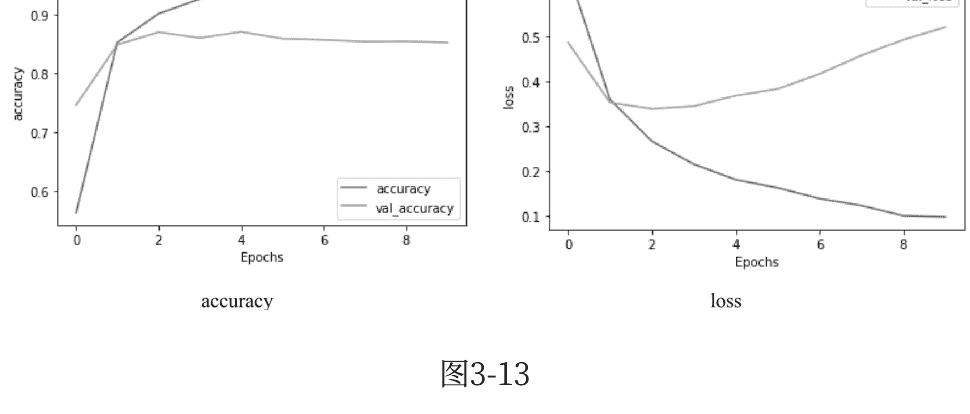

图3-13

## 3.6 递归神经网络解析

递归神经网络 RNN 专注于树形或具备递归特性的数据建模。相较于传统的前馈网络 FFN，它引入了反馈回路，让信息在网络内部循环传递，从而胜任树状结构的推理。模型能够在不同层级上融合信息，因此适用于自然语言的语法树、分子结构、计算机程序等多种递归场景。

举个例子，如果要做一个家庭健身助手，帮助家人基于运动日志给出个性化建议，递归神经网络就能派上用场。输入类似“今天跑了5千米，感觉很累”这样的记录，网络可以捕捉其中的时序依赖与上下文，输出“明天可以尝试轻松的瑜伽放松一下”之类的提示。经过训练，助手对用户运动状态的理解会更精准，建议也会更有针对性。如图3-14所示。

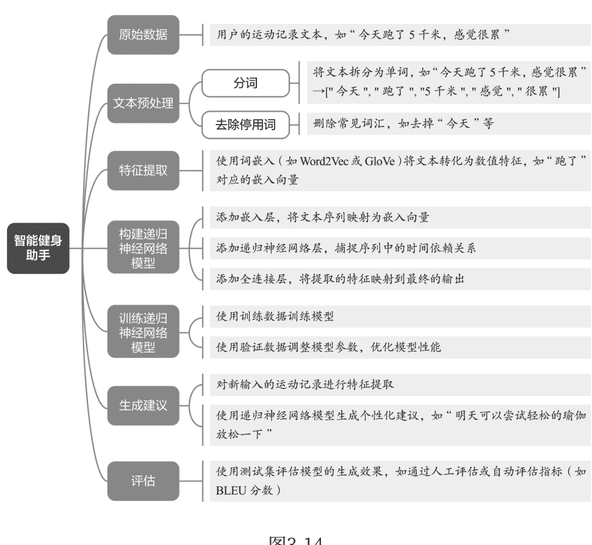

图3-14

### 3.6.1 递归神经网络核心特质

其关键特质汇总于图3-15。

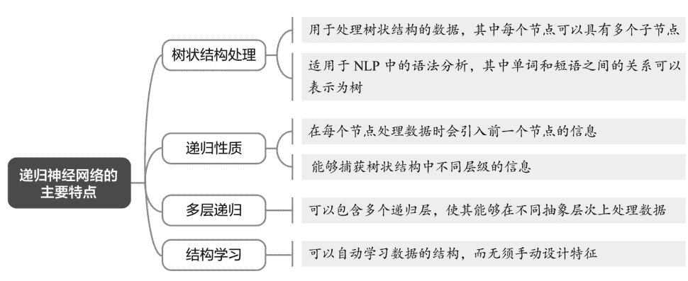

图3-15

在 NLP 领域，常见用法包括句法解析、文本分类、情感判断等；生物信息学、程序代码分析等方向也常借助它，因为这类任务天然带有递归数据结构。需要留意的是，递归神经网络存在梯度消失等局限，面对长程依赖时，LSTM、GRU 等更高级的结构往往更可靠。

### 3.6.2 RvNN 架构概览

RvNN 根据语境可指递归变分神经网络或循环变分神经网络，本质上是把递归或循环结构与变分自编码器 VAE 结合，用于序列数据的建模。

RvNN 的主要特点如下。

- （1）结构递归：RvNN 保留递归或循环骨架，可处理序列或树形数据，因而在句法分析、文本生成等 NLP 任务中适用。
- （2）变分编码：借鉴 VAE 思想，学习潜在表征并在生成时注入噪声，有助于刻画数据的潜在分布，在数据缺失或含噪声时仍保持较好表现。
- （3）生成能力：常用于文本或序列生成，能够产出符合特定分布的序列。

RvNN 属于较为复杂的架构，通常由深度学习研究者与 NLP 专家用于特定任务。应用范围涵盖自然语言处理、句法分析、文本生成、机器翻译等需要处理序列结构数据的场景，依据具体需求可衍生出不同变体。

实例 3-6 演示了如何搭建并训练 RvNN 模型。

#### 实例3-6 RvNN 模型构建与训练

本示例工程为 Continuous-RvNN-main，源码路径 codes\3\Continuous-RvNN-main。

(1) 新建文件 process_MNLI.py，路径 inference\preprocess\process_MNLI.py，对自然语言推理 NLI 数据集进行预处理，使其可被深度学习模型直接使用。具体实现代码如下。

```
from preprocess_tools.process_utils import load_glove, jsonl_save

SEED = 101
MAX_VOCAB = 50000
MIN_FREQ = 1
WORDVECDIM = 300
dev_keys = ["matched"]
test_keys = ["matched", "mismatched"]
predi_keys = ["matched", "mismatched"]
np.random.seed(SEED)
random.seed(SEED)

train_path1 = Path('../data/NLI_data/MNLI/multinli_1.0_train.jsonl')
train_path2 = Path('../data/NLI_data/SNLI/snli_1.0_train.jsonl')
dev_path = {}
dev_path["matched"] = Path(
    '../data/NLI_data/MNLI/multinli_1.0_dev_matched.jsonl')
dev_path["mismatched"] = Path(
    '../data/NLI_data/MNLI/multinli_1.0_dev_mismatched.jsonl')
test_path = {}
test_path["matched"] = Path(
    '../data/NLI_data/MNLI/multinli_1.0_dev_matched.jsonl')
test_path["mismatched"] = Path(
    '../data/NLI_data/MNLI/multinli_1.0_dev_mismatched.jsonl')
predi_path = {}
predi_path["matched"] = Path(
    '../data/NLI_data/MNLI/multinli_0.9_test_matched_unlabeled.jsonl')
predi_path["mismatched"] = Path(
    '../data/NLI_data/MNLI/multinli_0.9_test_mismatched_unlabeled.jsonl')
predi2_path = {}
predi2_path["matched"] = Path(
    '../data/NLI_data/MNLI/multinli_1.0_dev_matched.jsonl')
# 路径 ('../../data/NLI_data/MNLI/multinli_0.9_test_matched_unlabeled.jsonl')
predi2_path["mismatched"] = Path(
    '../data/NLI_data/MNLI/multinli_1.0_dev_mismatched.jsonl')
# 路径 ('../../data/NLI_data/MNLI/multinli_0.9_test_mismatched_unlabeled.jsonl')

embedding_path = Path("../embeddings/glove/glove.840B.300d.txt")

Path('processed_data/').mkdir(parents=True, exist_ok=True)

train_save_path = Path('processed_data/MNLI_train.jsonl')
dev_save_path = {}
for key in dev_keys:
    dev_save_path[key] = Path('processed_data/MNLI_dev_{}.jsonl'.format(key))
test_save_path = {}
for key in test_keys:
    test_save_path[key] = Path(
        'processed_data/MNLI_test_{}.jsonl'.format(key))
predi_save_path = {}
predi2_save_path = {}
for key in predi_keys:
    predi_save_path[key] = Path(
        'processed_data/MNLI_predi_{}.jsonl'.format(key))
    predi2_save_path[key] = Path(
        'processed_data/MNLI_predi2_{}.jsonl'.format(key))

metadata_save_path = fspath(Path("processed_data/MNLI_metadata.pkl"))

labels2idx = {}
vocab2count = {}

def tokenize(sentence):
    return nltk.word_tokenize(sentence)

def updateVocab(word):
    global vocab2count
    vocab2count[word] = vocab2count.get(word, 0) + 1

def process_data(filename, update_vocab=True, filter=False, predi=False):
    global labels2idx

    print("\n\nOpening directory: {}\n\n".format(filename))

    sequences1 = []
    sequences2 = []
    pairIDs = []
    labels = []
    count = 0
    max_seq_len = 150

    with jsonlines.open(filename) as reader:
        for sample in reader:
            if sample['gold_label'] != '-':

                sequence1 = tokenize(sample['sentence1'].lower())
                sequence2 = tokenize(sample['sentence2'].lower())
                pairID = sample["pairID"]
                if predi:
                    label = None
                    label_id = None
                else:
                    label = sample['gold_label']
                    if label not in labels2idx:
                        labels2idx[label] = len(labels2idx)
                    label_id = labels2idx[label]

                if filter:
                    if (len(sequence1) < max_seq_len) and \
                       (len(sequence2) < max_seq_len):
```

sequences1.append(sequence1)

sequences2.append(sequence2)

labels.append(label_id)

pairIDs.append(pairID)

else:

    sequences1.append(sequence1)

    sequences2.append(sequence2)

    labels.append(label_id)

    pairIDs.append(pairID)

if update_vocab:

    for word in sequence1:

        updateVocab(word)

    for word in sequence2:

        updateVocab(word)

count += 1

if count % 1000 == 0:

    print("Processing Data # {}...".format(count))

return sequences1, sequences2, labels, pairIDs

train_sequences1, train_sequences2, train_labels, _ = process_data(train_path1, filter=True)

train_sequences1_, train_sequences2_, train_labels_, _ = process_data(train_path2, filter=True)

train_sequences1 += train_sequences1_

train_sequences2 += train_sequences2_

train_labels += train_labels_

dev_sequences1 = {}

dev_sequences2 = {}

dev_labels = {}

for key in dev_keys:

NLI 预处理与模型搭建拆解

先看数据准备这块，代码负责把 NLI 语料从原始文本变成模型可用的数字格式。整体脉络可以归纳为几步：

先把依赖库、超参常量和各个数据集路径一次性准备好。随后实现一个基于 NLTK 的 tokenize 分词函数，再配上 updateVocab 用于动态扩充词表。核心的处理单元 process_data 负责读取文件、分词、更新词表，同时支持过滤和对不同 NLI 语料的适配。

数据加载覆盖训练集、开发集、测试集和预测集四种场景。词表构建阶段借助 GloVe 预训练向量，按词频阈值 MIN_FREQ 筛选低频词、按频率排序并截断到 MAX_VOCAB，随后追加 <PAD>、<UNK>、<SEP> 三个特殊符，为 <PAD> 填充零向量，为 <UNK> 与 <SEP> 随机初始化向量，最后把嵌入集合成矩阵。

向量化环节定义了 text_vectorize 把词映射为 id，vectorize_data 则为每条样本生成序列 id、拼接带分隔符的联合序列，并打包标签、pairID 等信息成字典。处理完后，训练集直接保存为 JSONL，开发、测试、预测集按 key 分文件落盘。最后把 labels2idx、vocab2idx、嵌入矩阵以及 dev_keys、test_keys 等元信息用 pickle 写出。

(2) 编写文件 Classifier_model.py，源码路径 classifier\models\Classifier_model.py，作用是用 PyTorch 定义一个通用的文本分类网络。该分类器可直接用于文本分类任务，内部由嵌入层、编码器、特征提取模块和分类头组成。输入维度、输出维度、嵌入维度、隐藏层大小等超参都可通过 config 参数灵活设定。

```python
import torch as T
import torch.nn as nn
import torch.nn.functional as F

from controllers.encoder_controller import encoder
from models.layers import Linear
from models.utils import gelu
from models.utils import glorot_uniform_init

class Classifier_model(nn.Module):
    def __init__(self, attributes, config):

        super(Classifier_model, self).__init__()

        self.config = config
        self.out_dropout = config["out_dropout"]
        self.classes_num = attributes["classes_num"]
        self.in_dropout = config["in_dropout"]
        embedding_data = attributes["embedding_data"]
        pad_id = attributes["PAD_id"]

        ATT_PAD = -999999
        self.ATT_PAD = T.tensor(ATT_PAD).float()
        self.zeros = T.tensor(0.0)

        if embedding_data is not None:
            embedding_data = T.tensor(embedding_data)
            self.word_embedding = nn.Embedding.from_pretrained(
                embedding_data,
                freeze=config["word_embd_freeze"],
                padding_idx=pad_id)
        else:
            vocab_len = attributes["vocab_len"]
            self.word_embedding = nn.Embedding(vocab_len, config["embd_dim"],
                                              padding_idx=pad_id)

        self.embd_dim = self.word_embedding.weight.size(-1)

        self.transform_word_dim = Linear(
            self.embd_dim, config["hidden_size"])

        if not config["global_state_return"]:
            self.attn_linear1 = Linear(
                config["hidden_size"], config["hidden_size"])
            self.attn_linear2 = Linear(
                config["hidden_size"], config["hidden_size"])

        self.encoder = encoder(config)

        if config["classifier_layer_num"] == 2:
            self.prediction1 = Linear(
                config["hidden_size"], config["hidden_size"])
            self.prediction2 = Linear(
                config["hidden_size"], self.classes_num)
        else:
            self.prediction2 = Linear(
                config["hidden_size"], self.classes_num)

    # %%
    def embed(self, sequence, input_mask):

        N, S = sequence.size()

        sequence = self.word_embedding(sequence)
        sequence = self.transform_word_dim(sequence)

        sequence = sequence * input_mask.view(N, S, 1)

        return sequence, input_mask

    def extract_features(self, sequence, mask):
        N, S, D = sequence.size()

        mask = mask.view(N, S, 1)

        attention_mask = T.where(mask == 0,
                                 self.ATT_PAD.to(mask.device),
                                 self.zeros.to(mask.device))

        assert attention_mask.size() == (N, S, 1)

        energy = self.attn_linear2(gelu(self.attn_linear1(sequence)))

        assert energy.size() == (N, S, D)
```

## （3）编写文件 FOCN_LSTM.py，源码路径 classifier\models\encoders\FOCN_LSTM.py，定义了 FOCN_LSTM 模型。这是一个融合注意力机制与循环神经网络的序列建模结构，带有递归生成能力，能更好捕捉序列内部依赖。模型还引入惩罚项优化来约束生成行为，属于偏复杂的序列生成类架构，具体效果需要在不同场景下调参验证。

### __init__ 构造函数完成参数与模块的初始化工作，主要涉及隐藏状态维度、滑动窗口大小、判定阈值等配置的设定，具体实现代码如下。

```python
class FOCN_LSTM(nn.Module):
    def __init__(self, config):
        super(FOCN_LSTM, self).__init__()

        self.config = config
        self.hidden_size = config["hidden_size"]
        self.cell_hidden_size = config["cell_hidden_size"]
        self.window_size = config["window_size"]
        self.stop_threshold = config["stop_threshold"]
        # self.switch_threshold = config["switch_threshold"]
        self.entropy_gamma = config["entropy_gamma"]
        self.structure_gamma = 0.01  # config["structure_gamma"]
        self.speed_gamma = config["speed_gamma"]
        self.in_dropout = config["in_dropout"]
        self.hidden_dropout = config["hidden_dropout"]
        self.recurrent_momentum = config["recurrent_momentum"]
        self.small_d = config["small_d"]

        self.START = nn.Parameter(T.randn(self.hidden_size))
        self.END = nn.Parameter(T.randn(self.hidden_size))

        if self.recurrent_momentum:
            self.past_transition_features = nn.Parameter(
                T.randn(self.small_d))
            self.past_non_transition_features = nn.Parameter(
                T.randn(self.small_d))
            self.conv_layer = Linear(
                self.window_size * self.hidden_size + self.small_d,
                self.hidden_size)
        else:
            self.conv_layer = Linear(
                self.window_size * self.hidden_size, self.hidden_size)

        self.scorer = Linear(self.hidden_size, 1)

        self.wcell0 = Linear(self.hidden_size, 2 * self.hidden_size,
                             true_fan_in=self.hidden_size,
                             true_fan_out=self.hidden_size)
        self.wcell1 = Linear(2 * self.hidden_size, 5 * self.hidden_size,
                             true_fan_in=self.hidden_size,
                             true_fan_out=self.hidden_size)
        # self.LN = nn.LayerNorm(self.hidden_size)

        self.eps = 1e-8

    # %%
    def sum_normalize(self, logits, dim=-1):
        return logits / T.sum(logits + self.eps, keepdim=True, dim=dim)
```

### 方法 augment_sequence()
该方法负责在输入序列的两端补充起始标记和结束标记，用以明确文本序列的起止边界。详细代码实现在下方。

```python
def augment_sequence(self, sequence, input_mask):
    N, S, D = sequence.size()
    assert input_mask.size() == (N, S, 1)

    """
    AUGMENT SEQUENCE WITH START AND END TOKENS
    """
    # 添加起始标记
    START = self.START.view(1, 1, D).repeat(N, 1, 1)
    sequence = T.cat([START, sequence], dim=1)
    assert sequence.size() == (N, S + 1, D)
    input_mask = T.cat(
        [T.ones(N, 1, 1).float().to(input_mask.device), input_mask],
        dim=1)
    assert input_mask.size() == (N, S + 1, 1)

    # 添加结束标记
    input_mask_no_end = T.cat(
        [input_mask.clone(), T.zeros(N, 1, 1).float().to(input_mask.device)], dim=1)
    input_mask_yes_end = T.cat(
        [T.ones(N, 1, 1).float().to(input_mask.device), input_mask.clone()], dim=1)
    END_mask = input_mask_yes_end - input_mask_no_end
    assert END_mask.size() == (N, S + 2, 1)

    END = self.END.view(1, 1, D).repeat(N, S + 2, 1)
    sequence = T.cat(
        [sequence, T.zeros(N, 1, D).float().to(sequence.device)], dim=1)
    sequence = END_mask * END + (1 - END_mask) * sequence

    input_mask = input_mask_yes_end
    input_mask_no_start = T.cat(
        [T.zeros(N, 1, 1).float().to(input_mask.device),
         input_mask[:, 1:, :]], dim=1)

    return (sequence, input_mask, END_mask,
            input_mask_no_start, input_mask_no_end)
```

### 方法 compute_neighbor_probs()
该方法统计相邻词之间的关联概率，并以此概率值作为构建窗口的依据。下面是对应的代码实现。

```python
def compute_neighbor_probs(self, active_probs, input_mask):
    N, S, _ = input_mask.size()
    assert input_mask.size() == (N, S, 1)
    input_mask = input_mask.permute(0, 2, 1).contiguous()
    assert input_mask.size() == (N, 1, S)

    assert active_probs.size() == (N, S, 1)
    active_probs = active_probs.permute(0, 2, 1).contiguous()
    assert active_probs.size() == (N, 1, S)

    input_mask_flipped = T.flip(input_mask.clone(), dims=[2])
    active_probs_flipped = T.flip(active_probs.clone(), dims=[2])

    input_mask = T.stack([input_mask_flipped, input_mask], dim=1)
    active_probs = T.stack([active_probs_flipped, active_probs], dim=1)

    assert input_mask.size() == (N, 2, 1, S)
    assert active_probs.size() == (N, 2, 1, S)

    active_probs_matrix = active_probs.repeat(1, 1, S, 1) * input_mask
    assert active_probs_matrix.size() == (N, 2, S, S)
    right_probs_matrix = T.triu(active_probs_matrix, diagonal=1)
    # 屏蔽自身和左侧

    right_probs_matrix_cumsum = T.cumsum(right_probs_matrix, dim=-1)
    assert right_probs_matrix_cumsum.size() == (N, 2, S, S)
    remainders = 1.0 - right_probs_matrix_cumsum

    remainders_from_left = T.cat(
        [T.ones(N, 2, S, 1).float().to(remainders.device),
         remainders[:, :, :, 0:-1]], dim=-1)
    assert remainders_from_left.size() == (N, 2, S, S)

    remainders_from_left = T.max(
        T.zeros(N, 2, S, 1).float().to(remainders.device),
        remainders_from_left)
    assert remainders_from_left.size() == (N, 2, S, S)

    right_neighbor_probs = T.where(right_probs_matrix_cumsum > 1.0,
                                   remainders_from_left,
                                   right_probs_matrix)

    right_neighbor_probs = right_neighbor_probs * input_mask

    left_neighbor_probs = right_neighbor_probs[:, 0, :, :]
    left_neighbor_probs = T.flip(left_neighbor_probs, dims=[1, 2])
    right_neighbor_probs = right_neighbor_probs[:, 1, :, :]

    return left_neighbor_probs, right_neighbor_probs
```

### 方法 make_window()
该方法用来构造一个窗口结构，并将相邻单词的相关信息一并打包其中。具体代码展示如下。

```python
def make_window(self, sequence, left_child_probs, right_child_probs):

    N, S, D = sequence.size()

    left_children_list = []
    right_children_list = []
    left_children_k = sequence.clone()
    right_children_k = sequence.clone()

    for k in range(self.window_size // 2):
        left_children_k = T.matmul(left_child_probs, left_children_k)
        left_children_list = ([left_children_k.clone()]
                              + left_children_list)

        right_children_k = T.matmul(right_child_probs, right_children_k)
        right_children_list = right_children_list + [
            right_children_k.clone()]

    windowed_sequence = (left_children_list + [sequence]
                         + right_children_list)
    windowed_sequence = T.stack(windowed_sequence, dim=-2)

    assert windowed_sequence.size() == (N, S, self.window_size, D)

    return windowed_sequence
```

### 方法 initial_transform()
该方法完成输入数据的前置转换处理，确保模型能够获得就绪的初始输入。实现代码如下所示。

```python
def initial_transform(self, sequence, input_mask):
    N, S, D = sequence.size()
    assert input_mask.size() == (N, S, 1)

    sequence, input_mask, END_mask, input_mask_no_start, input_mask_no_end = \
        self.augment_sequence(sequence, input_mask)

    active_probs = input_mask.float()
    active_probs = active_probs / T.sum(active_probs, dim=1, keepdim=True)

    left_neighbor_probs, right_neighbor_probs = \
        self.compute_neighbor_probs(active_probs, input_mask)

    windowed_sequence = self.make_window(sequence, left_neighbor_probs,
                                         right_neighbor_probs)

    return (sequence, input_mask, active_probs, END_mask,
            input_mask_no_start, input_mask_no_end,
            left_neighbor_probs, right_neighbor_probs,
            windowed_sequence)
```

### 方法 forward()
该方法描述了模型从输入到输出的完整正向传播流程。代码实现请见下文。

```python
def forward(self, batch):
    sequence = batch["sequences_vec"]
    input_mask = batch["input_masks"]

    N, S, D = sequence.size()

    (sequence, input_mask, active_probs, END_mask,
     input_mask_no_start, input_mask_no_end,
     left_neighbor_probs, right_neighbor_probs,
     windowed_sequence) = self.initial_transform(sequence, input_mask)

    # 编码器块
    for i in range(self.config["num_layers"]):
        sequence = self.encoder[i](sequence, input_mask)

    # 特征提取
    feats = self.extract_features(sequence, input_mask)

    # 分类器
    if self.config["classifier_layer_num"] == 2:
        feats = F.dropout(
            feats, p=self.out_dropout, training=self.training)
        feats = gelu(self.prediction1(feats))
    feats = F.dropout(feats, p=self.out_dropout, training=self.training)
    logits = self.prediction2(feats)

    assert logits.size() == (N, self.classes_num)

    return {"logits": logits, "penalty": None}
```

## initial_transform 初始转换

```python
def initial_transform(self, sequence):
    N, S, D = sequence.size()
    contents = self.wcell0(sequence)
    contents = contents.view(N, S, 2, D)
    o = T.sigmoid(contents[:, :, 0, :])
    cell = T.tanh(contents[:, :, 1, :])
    transition = o * T.tanh(cell)
    return transition, cell
```

## score_fn 窗口评分

score_fn 的核心工作是对滑动窗口里的每一个位置进行打分，量化其重要程度。实现片段放在下面。

```python
def score_fn(self, windowed_sequence, transition_feats):
    N, S, W, D = windowed_sequence.size()
    windowed_sequence = windowed_sequence.view(N, S, W * D)
    if self.recurrent_momentum:
        windowed_sequence = T.cat(
            [windowed_sequence, transition_feats], dim=-1)
    scores = self.scorer(gelu(self.conv_layer(windowed_sequence)))
    transition_scores = scores[:, :, 0].unsqueeze(-1)
    # reduce_probs = T.sigmoid(scores[:,:,1].unsqueeze(-1))
    no_op_scores = T.zeros_like(transition_scores).float().to(transition_scores.device)
    scores = T.cat([transition_scores, no_op_scores], dim=-1)
    scores = scores / self.temperature
    max_score = T.max(scores)
    exp_scores = T.exp(scores - max_score)
    return exp_scores
```

## composer 节点合成

composer 负责把两路子节点携带的信息合并起来，形成新的节点表示。具体的代码实现见下方。

```python
def composer(self, child1, child2, cell_child1, cell_child2):
    N, S, D = child1.size()
    concated = T.cat([child1, child2], dim=-1)
    assert concated.size() == (N, S, 2 * D)
    contents = F.dropout(
        self.wcell1(concated), p=self.hidden_dropout,
        training=self.training)
    contents = contents.view(N, S, 5, D)
    gates = T.sigmoid(contents[:, :, 0:4, :])
    u = T.tanh(contents[:, :, 4, :])
    f1 = gates[..., 0, :]
    f2 = gates[..., 1, :]
    i = gates[..., 2, :]
    o = gates[..., 3, :]
    cell = f1 * cell_child1 + f2 * cell_child2 + i * u
    transition = o * T.tanh(cell)
    return transition, cell
```

## compute_entropy_penalty 熵惩罚

compute_entropy_penalty 用来算出熵惩罚值，意图是推动模型尽早收敛并停止生成。下面是实现。

```python
def compute_entropy_penalty(self, active_probs, last_token_mask):
    N, S = active_probs.size()
    active_prob_dist = self.sum_normalize(active_probs, dim=-1)
    nll_loss = - T.log(
        T.sum(last_token_mask * active_prob_dist, dim=1) + self.eps)
    nll_loss = nll_loss.view(N)
    return nll_loss
```

## compute_speed_penalty 速度惩罚

compute_speed_penalty 计算速度惩罚项，强化模型更快结束生成的倾向。代码细节在下面展示。

```python
def compute_speed_penalty(self, steps, input_mask):
    steps = T.max(steps, dim=1)[0]
    speed_penalty = steps.squeeze(-1) / (T.sum(input_mask.squeeze(-1),
                                                dim=1) - 2.0)
    return speed_penalty
```

## encoder_block 编码器主体

encoder_block 承载编码器的主干逻辑，包含循环生成过程以及何时停下的判断规则。具体实现如下。

```python
def encoder_block(self, sequence, input_mask):
    sequence, input_mask, END_mask, input_mask_no_start, \
        input_mask_no_end = self.augment_sequence(sequence, input_mask)
    N, S, D = sequence.size()
    """
    Initial Preparations
    """
    active_probs = T.ones(N, S, 1).float().to(sequence.device) \
        * input_mask
    steps = T.zeros(N, S, 1).float().to(sequence.device)
    zeros_sequence = T.zeros(N, 1, 1).float().to(sequence.device)
    last_token_mask = T.cat([END_mask[:, 1:, :], zeros_sequence], dim=1)
    START_END_LAST_PAD_mask = input_mask_no_start * input_mask_no_end \
        * (1.0 - last_token_mask)
    self.START_END_LAST_PAD_mask = START_END_LAST_PAD_mask
    halt_ones = T.ones(N).float().to(sequence.device)
    halt_zeros = T.zeros(N).float().to(sequence.device)
    improperly_terminated_mask = halt_ones.clone()
    update_mask = T.ones(N).float().to(sequence.device)
    left_transition_probs = T.zeros(N, S, 1).float().to(sequence.device)
    """
    Initial Transform
    """
    sequence, cell_sequence = self.initial_transform(sequence)
    sequence = sequence * input_mask
    cell_sequence = cell_sequence * input_mask
    """
    Start Recursion
    """
    t = 0
    while t < (S - 2):
        original_active_probs = active_probs.clone()
        original_sequence = sequence.clone()
        residual_sequence = sequence.clone()
        residual_cell_sequence = cell_sequence.clone()
        original_steps = steps.clone()
        original_cell_sequence = cell_sequence.clone()
        left_neighbor_probs, right_neighbor_probs \
            = self.compute_neighbor_probs(
                active_probs=active_probs.clone(),
                input_mask=input_mask.clone())
        windowed_sequence = self.make_window(
            sequence=sequence,
            left_child_probs=left_neighbor_probs,
            right_child_probs=right_neighbor_probs)
        if self.recurrent_momentum:
            transition_feats = left_transition_probs \
                * self.past_transition_features.view(1, 1, -1) \
                + (1 - left_transition_probs) \
                * self.past_non_transition_features.view(1, 1, -1)
        else:
            transition_feats = None
        exp_scores = self.score_fn(windowed_sequence, transition_feats)
        exp_transition_scores = exp_scores[:, :, 0].unsqueeze(-1)
        exp_no_op_scores = exp_scores[:, :, 1].unsqueeze(-1)
        exp_transition_scores = exp_transition_scores \
            * START_END_LAST_PAD_mask
        if self.config["no_modulation"] is True:
            exp_scores = T.cat([exp_transition_scores,
                                exp_no_op_scores], dim=-1)
        else:
            exp_left_transition_scores = T.matmul(
                left_neighbor_probs, exp_transition_scores)
            exp_right_transition_scores = T.matmul(
                right_neighbor_probs, exp_transition_scores)
            exp_scores = T.cat([exp_transition_scores,
                                exp_no_op_scores,
                                exp_left_transition_scores,
                                exp_right_transition_scores], dim=-1)
        normalized_scores = self.sum_normalize(exp_scores, dim=-1)
        transition_probs = normalized_scores[:, :, 0].unsqueeze(-1)
        transition_probs = transition_probs * START_END_LAST_PAD_mask
        left_transition_probs = T.matmul(
            left_neighbor_probs, transition_probs)
        left_transition_probs = left_transition_probs \
            * input_mask_no_start * input_mask_no_end
        left_sequence = windowed_sequence[:, :, self.window_size // 2 - 1,
            0:self.hidden_size]
        left_cell_sequence = T.matmul(left_neighbor_probs, cell_sequence)
        transition_sequence, \
            transition_cell_sequence = self.composer(
                child1=left_sequence,
                child2=sequence,
                cell_child1=left_cell_sequence,
                cell_child2=cell_sequence)
        transition_sequence = transition_sequence * input_mask
        transition_cell_sequence = transition_cell_sequence * input_mask
        tp = left_transition_probs
        sequence = tp * transition_sequence + (1 - tp) \
            * residual_sequence
        sequence = sequence * input_mask
        cell_sequence = tp * transition_cell_sequence + (1 - tp) \
            * residual_cell_sequence
        cell_sequence = cell_sequence * input_mask
        steps = steps + active_probs
        bounded_probs = transition_probs
        active_probs = active_probs * (1.0 - bounded_probs) * input_mask
        active_probs = T.where(
            update_mask.view(N, 1, 1).expand(N, S, 1) == 1.0,
            active_probs,
            original_active_probs)
        steps = T.where(update_mask.view(N, 1, 1).expand(N, S, 1) == 1.0,
                        steps,
                        original_steps)
        sequence = T.where(
            update_mask.view(N, 1, 1).expand(N, S, D) == 1.0,
            sequence,
            original_sequence)
        cell_sequence = T.where(
            update_mask.view(N, 1, 1).expand(N, S, D) == 1.0,
            cell_sequence,
            original_cell_sequence)
        t += 1
        discrete_active_status = T.where(
            active_probs > self.stop_threshold,
            T.ones_like(active_probs).to(active_probs.device),
            T.zeros_like(active_probs).to(active_probs.device))
        halt_condition_component = T.sum(
            discrete_active_status.squeeze(-1), dim=1) - 2.0
        update_mask = T.where(
            (halt_condition_component <= 1)
            | (T.sum(input_mask.squeeze(-1), dim=-1) - 2.0 < t),
            halt_zeros,
            halt_ones)
        proper_termination_condition = T.sum(
            discrete_active_status * last_token_mask, dim=1
        ).squeeze(-1)
        improperly_terminated_mask_ = T.where(
            (halt_condition_component == 1)
            & (proper_termination_condition == 1),
            halt_zeros,
            halt_ones)
        improperly_terminated_mask = improperly_terminated_mask \
            * improperly_terminated_mask_
        if T.sum(update_mask) == 0.0:
            break
        steps = steps * START_END_LAST_PAD_mask
        sequence = sequence * (1 - END_mask)
        active_probs = active_probs * (1 - END_mask)
        sequence = sequence[:, 1:-1, :]  # 移除开头和结尾
        active_probs = active_probs[:, 1:-1, :]  # 移除开头和结尾
        last_token_mask = END_mask[:, 2:, :]
        global_state = T.sum(sequence * last_token_mask, dim=1)
        assert active_probs.size(1) == sequence.size(1)
        entropy_penalty = self.compute_entropy_penalty(
            active_probs.squeeze(-1),
            last_token_mask.squeeze(-1))
        speed_penalty = self.compute_speed_penalty(steps, input_mask)
        entropy_penalty = entropy_penalty * improperly_terminated_mask
        penalty = self.entropy_gamma * entropy_penalty \
            + self.speed_gamma * speed_penalty
```

return sequence, global_state, penalty

forward() 方法负责完成前向计算，把序列输入和对应的输入掩码一起送入编码器进行处理，处理后输出编码后的序列、惩罚值以及全局状态。实现细节如下。

```python
def forward(self, sequence, input_mask, **kwargs):

    if "temperature" in kwargs:
        self.temperature = kwargs["temperature"]
    else:
        self.temperature = 1.0

    self.temperature = 1.0 if self.temperature is None \
        else self.temperature

    input_mask = input_mask.unsqueeze(-1)
    sequence = sequence * input_mask

    sequence, global_state, penalty = self.encoder_block(
        sequence, input_mask)
    sequence = sequence * input_mask
    return {"sequence": sequence, "penalty": penalty,
            "global_state": global_state}
```

(4) 创建文件 hypertrain.py，源码位置为 classifier\hypertrain.py。该文件依托 Hyperopt 库开展超参数搜索，在设定好的搜索空间内自动探索最优的模型配置，以提升模型表现。超参数属于机器学习模型的配置属性，不会随着训练自动习得，需要人工调优才能达到最佳效果。具体实现代码如下。

```python
def blockPrint():
    sys.stdout = open(os.devnull, 'w')

# Restore
def enablePrint():
    sys.stdout = sys.__stdout__

parser = get_args()
args = parser.parse_args()
search_space, config_processor = load_hyperconfig(args)

print(search_space)

hp_search_space = {}
for key, val in search_space.items():
    hp_search_space[key] = hp.choice(key, val)

space_keys = [k for k in search_space]

hyperopt_config_path = Path(
    "hypertune/tuned_configs/{}_{}.txt".format(args.model, args.dataset))
hyperopt_checkpoint_path = Path(
    "hypertune/checkpoints/{}_{}.pkl".format(args.model, args.dataset))
Path('hypertune/checkpoints/').mkdir(parents=True, exist_ok=True)
Path('hypertune/tuned_configs/').mkdir(parents=True, exist_ok=True)

if args.hypercheckpoint:
    with open(hyperopt_checkpoint_path, "rb") as fp:
        data = pickle.load(fp)
        trials = data["trials"]
        tried_configs = data["tried_configs"]
        true_total_trials = data["true_total_trials"]
    print("\n\nCheckpoint Loaded\n\n")
else:
    trials = Trials()
    tried_configs = {}
    true_total_trials = 0


def generate_args_hash(args):
    hash = ""
    for key in args:
        hash += "{}".format(args[key])
    return hash


successive_failures = 0
max_successive_failures = 10
failure_flag = False


def run_wrapper(space):
    global args
    global tried_configs
    global failure_flag
    config = load_config(args)
    config["epochs"] = args.epochs
    hash = generate_args_hash(space)

    if hash not in tried_configs:
        print("Exploring: {}".format(space))
        for key in space:
            config[key] = space[key]
        config = config_processor(config)

        blockPrint()
        _, best_metric, _ = run(args, config)
        enablePrint()

        dev_score = compose_dev_metric(best_metric, args, config)
        tried_configs[hash] = -dev_score
        print("loss: {}".format(tried_configs[hash]))
        failure_flag = False
        return {'loss': -dev_score, 'status': STATUS_OK}
    else:
        # print("loss: {} (Skipped Trial)".format(tried_configs[hash]))
        failure_flag = True
        return {'loss': tried_configs[hash], 'status': STATUS_OK}

max_trials = min(
    args.max_trials, np.prod(
        [len(choices) for key, choices in search_space.items()]))
save_intervals = 1
i = len(trials.trials)
successive_failures = 0

while True:
    best = fmin(run_wrapper,
                space=hp_search_space,
                algo=hyperopt.rand.suggest,
                trials=trials,
                max_evals=len(trials.trials) + save_intervals)

    found_config = {}
    for key in best:
        found_config[key] = search_space[key][best[key]]

    if not failure_flag:
        true_total_trials += 1
        print("Best Config so far: ", found_config)
        print("Total Trials: {} out of {}".format(true_total_trials,
                                                max_trials))

        print("\n\n")
        successive_failures = 0
        display_string = ""
        for key, value in found_config.items():
            display_string += "{}: {}\n".format(key, value)
        with open(hyperopt_config_path, "w") as fp:
            fp.write(display_string)

        with open(hyperopt_checkpoint_path, "wb") as fp:
            pickle.dump({"trials": trials,
                         "tried_configs": tried_configs,
                         "true_total_trials": true_total_trials}, fp)
    else:
        successive_failures += 1
        if successive_failures % 1000 == 0:
            print("Successive failures: ", successive_failures)

    if true_total_trials >= max_trials:
        break

    if successive_failures > 100000:
        print("\n\nDiscontinuing due to too many successive failures.\n\n")
        break
```

下面对前面这段实现的工作机理做一个概括性的拆解。

- 额外封装了 blockPrint() 与 enablePrint() 两个小工具，负责在需要时屏蔽或重新打开标准输出。
- 通过命令行参数读取本次实验的整体设定，涵盖超参数搜索范围、选用模型、目标数据集等信息。
- 提供了 hp_search_space() 来定义搜索空间，同时指定了搜索策略、保存路径等相关配置。
- 根据检查点开关决定是加载历史搜索记录继续，还是新建一次搜索日志。
- 实现了 generate_args_hash()，用来为每一种超参数组合生成唯一哈希标识。
- 预设了搜索过程中的控制参数，比如最大尝试次数、结果保存频率、允许的连续失败阈值等。
- 进入主循环，借助 Hyperopt 的 fmin() 驱动搜索，每轮都会调用 run_wrapper() 对当前参数进行评估。
- run_wrapper() 会依据当前参数加载模型配置，完成训练并计算评测指标。
- 搜索结果会被实时更新，最优参数组合与对应性能写入文件，同时保存当前搜索快照。
- 当连续失败次数触及上限或已用完最大尝试次数时，搜索流程自动终止。

# 第4章 语言生成：让机器自然开口

语言生成类技术指的是一系列能够产出类人文本的程序与模型，覆盖范围从基础的自然语言处理到更具创意的写作生成。

> 白日依山尽，黄河入海流。

李白此句描绘出自然推移的流畅感，与文本生成的本质颇为相称。借助规则、统计或神经网络等不同手段，语言在模型内部不断被加工、重塑，从简易模式逐步演化为连贯且富有表现力的表达，形成一种从数据到文字的动态流动。

## 4.1 基于规则的生成

规则驱动的生成是较为经典的文本生产方式，核心是依赖人工事先写好的规则、模板与语法结构来组织输出。规则里通常包含句法规范、语义约束、词表限制以及各类生成模板，因而非常适合产出结构化、格式要求严格的内容，比如邮件模板、通知文案、报告段落或特定领域的定式表达。

以家庭智能助手为例，若要实现日常提醒功能，就可以采用规则生成。用户输入“明天早上7点提醒我买牛奶”，系统按照预设的语法模板与槽位填充规则，直接输出“明天早上7点，提醒：购买牛奶”这样的标准化提醒。整个过程凭借既定规则快速完成输出，如图4-1所示。

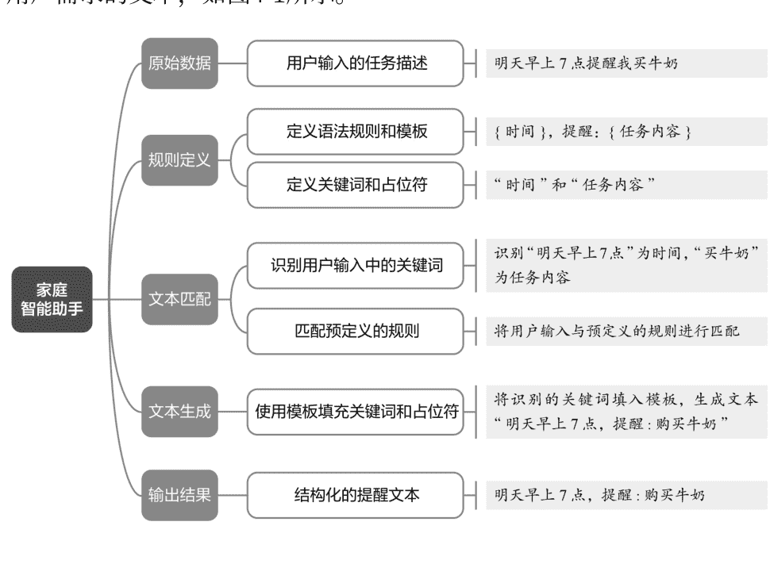

### 图4-1

### 4.1.1 基于规则的生成方法介绍

规则型生成的核心特征在图4-2中有梳理。

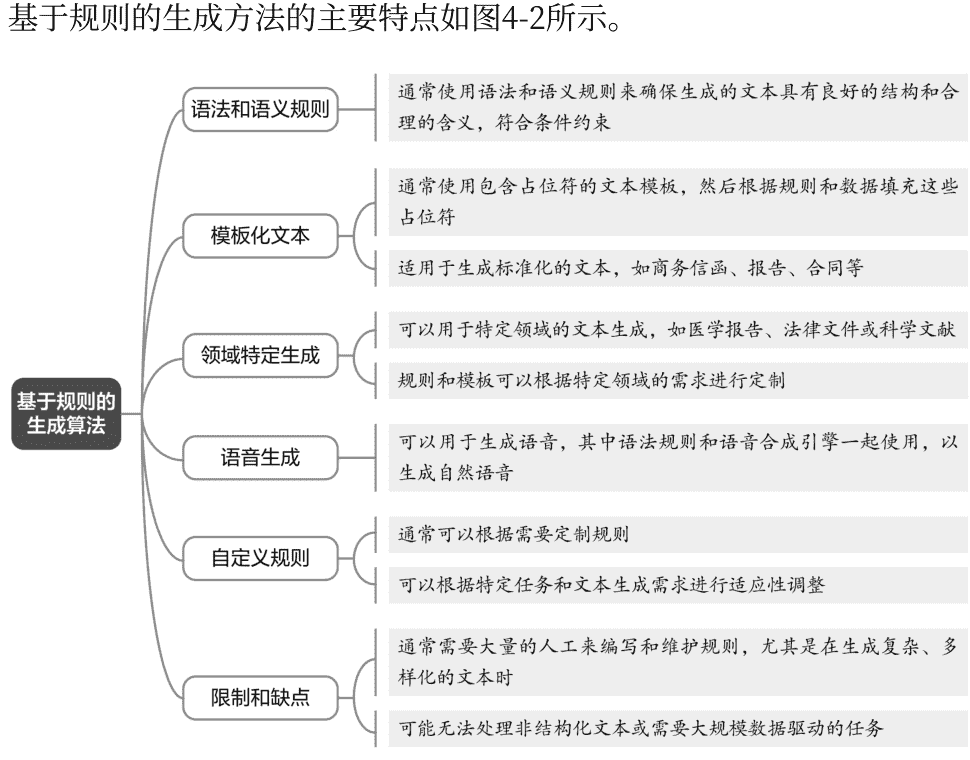

在部分场景下，规则生成能够提供高可控性和稳定性，但在面对开放式、非结构化的通用文本创作时，以 Transformer 为代表的深度学习模型和神经网络往往表现更佳，因为它们能更好地捕捉复杂语言的分布规律。

### 4.1.2 基于规则的生成方法在NLP中的应用场景

在自然语言处理领域，规则生成因其对输出的精确掌控而被广泛使用，尤其是在需要强结构约束的任务中。其典型用途在图4-3中总结。

注意：规则方法在需要严格格式的场景优势明显，然而在处理非结构化语料、大规模文本以及对理解能力要求更高的任务时，深度学习与神经网络方案更具代表性，它们能处理更复杂的句法与更丰富的语义。

在 NLP 实践里，规则生成常用于产出特定领域的语句或问答回复。实例4-1展示了如何用规则方式应对天气类查询。

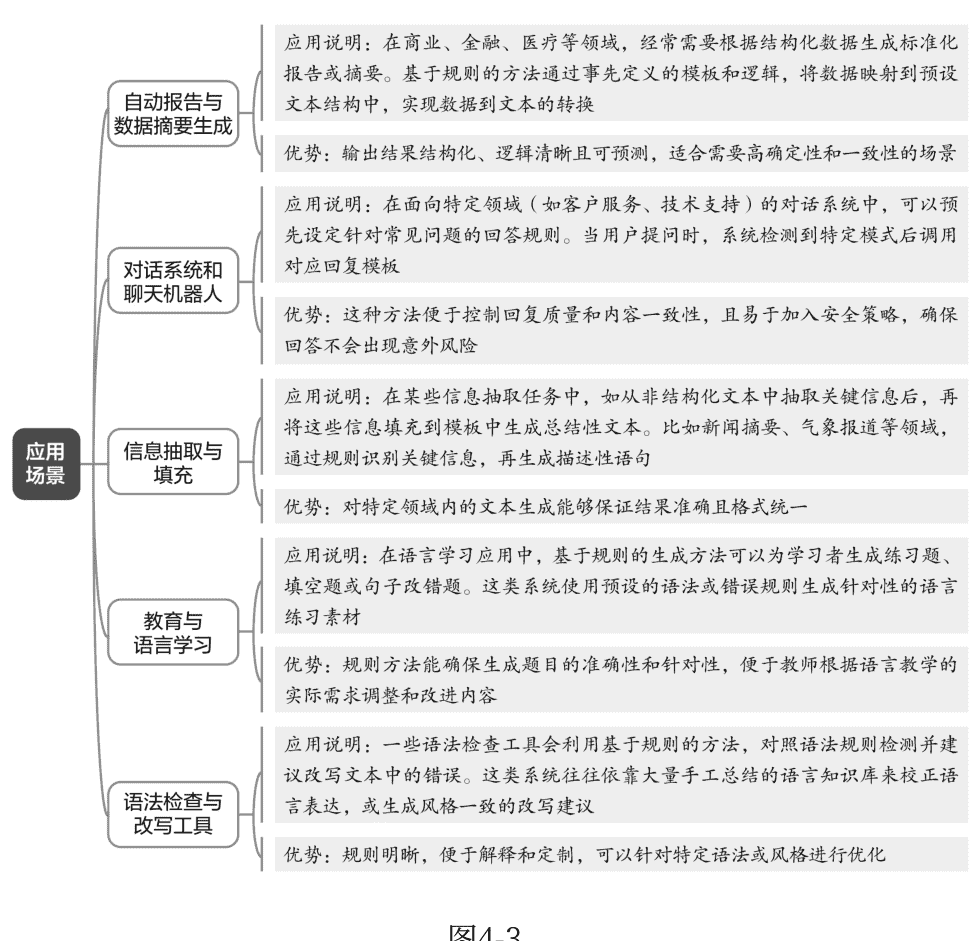

### 图4-3

#### 实例4-1：使用基于规则的方法生成天气查询回复

实例文件 tian.py（源码路径：codes\4\tian.py）的具体实现如下。

```python
# 定义天气规则和数据
weather_data = {
    "纽约": "晴天，温度在 20 °C。",
    "洛杉矶": "多云，温度在 25 °C。",
    "芝加哥": "阴天，温度在 15 °C。",
}

# 用户的查询
user_query = "纽约的天气如何？"

# 从用户查询中提取城市
city = None
for key in weather_data:
    if key in user_query:
        city = key
        break

# 生成基于规则的回复
if city:
    response = f"{city} 的天气情况是: {weather_data[city]}"
else:
    response = "抱歉，我不知道这个城市的天气情况。"

# 打印回复
print("用户查询: ", user_query)
print("回复: ", response)
```

该段代码预先定义了若干城市的天气信息与匹配规则。用户提出询问某城天气时，系统会从问句中抽取城市名，并依据内置规则生成回答。若城市在表中，则返回对应天气；若不在表中，则回复表示无法查询。

运行后得到的输出如下。

```
用户查询: 纽约的天气如何？
回复: 纽约的天气情况是: 晴天，温度在 20 °C。
```

## 4.2 基于统计的生成

统计驱动的生成依赖概率模型与分布估计来组织文本，是自然语言处理中的常用范式，常用于语言建模、机器翻译、文本摘要等方向。

设想一个个性化天气预报助手，采用统计生成模型如 N-gram 即可实现。模型通过学习大量历史预报文本中词语出现的概率规律，能够在给出“今天天气晴朗”后，续写“预计明天依旧晴好，适合外出活动”。这种方式凭借词语序列的频率统计，生成流畅自然的描述，如图4-4所示。

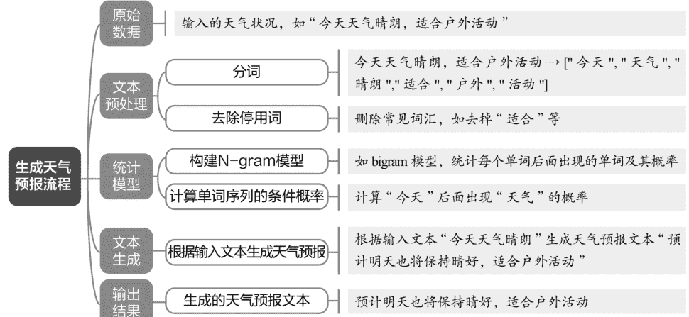

### 4.2.1 基于统计的生成方法介绍

统计生成的重要概念在图4-5中呈现。

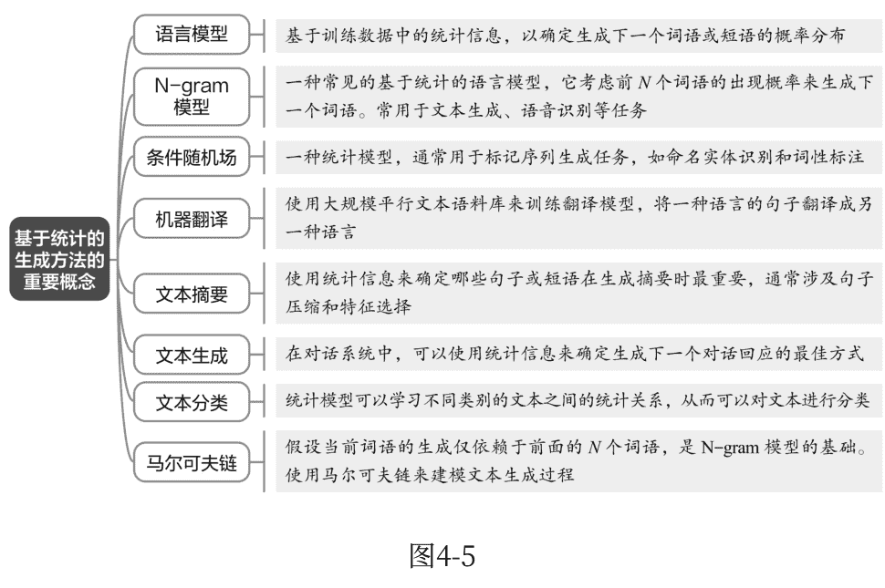

这类方法可解释性强，也能灵活适配不同任务，但在处理复杂句法和高度创造性内容时存在局限。随着深度学习发展，神经网络生成逐渐成为主流，能更有效应对非结构化文本与复杂任务。

### 4.2.2 N-gram模型

N-gram 模型是一种经典的统计语言模型，在文本生成、文本分类、语音识别等任务中应用广泛。其基本思想是利用前 N 个词的条件概率来预测下一个词，使用规律与特点如图4-6所示。

把 N-gram 与生成结合，可以做出颇具趣味的应用，例如自动生成笑话。实例4-2演示了用 N-gram 模型创作笑话的流程。

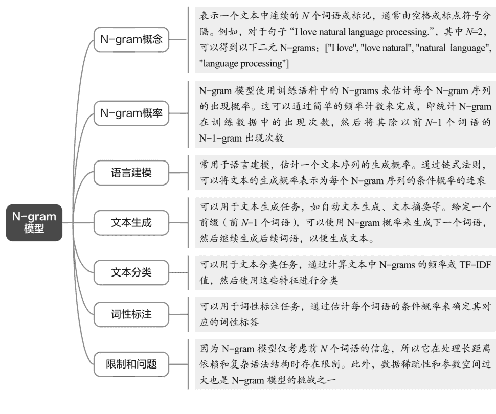

#### 实例4-2：笑话生成器

实例文件 xiao.py（源码路径：codes\4\xiao.py）的实现代码如下。

```python
import random

# 定义一个二元（bigram）N-gram模型
ngram_model = {
    "为什么": ["鸡过马路", "程序员不喜欢走路", "太阳落山了", "大象不会爬树"],
    "鸡过马路": ["因为想吃炸鸡", "以为那边有虫子", "被程序员激励了"],
    "程序员不喜欢走路": ["因为路没有回调函数",
                        "总是会碰到 null pointer exception"],
    "太阳落山了": ["因为天黑了", "为了给月亮腾地方"],
    "大象不会爬树": ["但它能学会 Python", "因为树会爬到大象跟前"],
}

# 生成一个笑话
def generate_joke():
    start_phrase = "为什么"
    joke = [start_phrase]

    while start_phrase in ngram_model:
        next_word = random.choice(ngram_model[start_phrase])
        joke.append(next_word)
        start_phrase = next_word

    return " ".join(joke)

# 生成一个有趣的笑话
funny_joke = generate_joke()
print(funny_joke)
```

代码中构建了一个简易的二元 N-gram 模型，包含若干起始短语与可供选择的后续词，通过拼接形成笑话。每次运行都会随机挑选后续词，从而产生多样化的笑话内容。

其中一次运行的输出结果如下。

```
为什么 程序员不喜欢走路 因为路没有回调函数
```

尽管 N-gram 在部分简单任务上能取得不错效果，但面对复杂语法结构和需要创造性的文本生成时，它的局限就暴露出来了。所以在更复杂的 NLP 场景里，业界更爱用循环神经网络、Transformer 等深度学习方法，它们对非结构化文本的理解和生成覆盖面都要强很多。

### 4.2.3 隐马尔可夫模型

隐马尔可夫模型是基于概率的图模型，常用来建模自然语言处理和其他领域里的数据序列。它把序列的产生过程看作一个概率有向图，其核心概念和特性如图4-7所示。

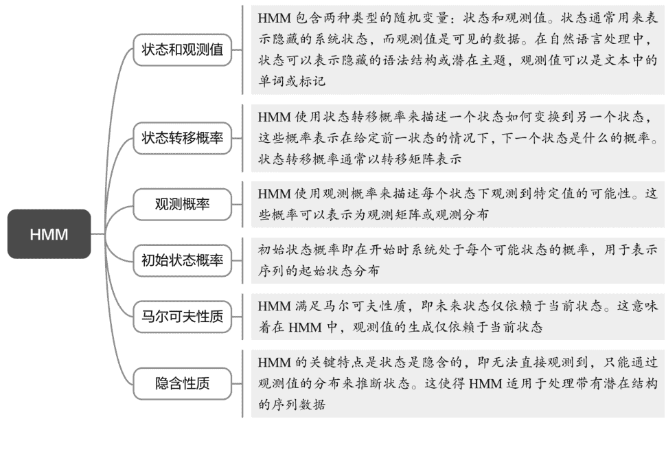

图4-7

在自然语言处理中，HMM 被广泛用于词性标注、命名实体识别、语音识别、机器翻译、语音合成等。在生物信息、金融分析、天气预测等领域也能见到它的身影。实例4-3 用 HMM 来做词性标注，并用一种幽默的方式演绎一句话。

#### 实例4-3：使用HMM实现词性标注

实例文件 biao.py（源码路径：codes\4\biao.py）的实现如下。

```python
import random

# 定义 HMM 的状态（词性）和观测值（单词）
states = ['名词', '动词', '形容词', '副词', '介词']
observations = ['猫', '跳', '懒', '快', '在']

# 定义 HMM 的状态转移概率和观测概率
transition_probabilities = {
    '名词': {'名词': 0.2, '动词': 0.4, '形容词': 0.1, '副词': 0.1, '介词': 0.2},
    '动词': {'名词': 0.3, '动词': 0.2, '形容词': 0.2, '副词': 0.1, '介词': 0.2},
    '形容词': {'名词': 0.2, '动词': 0.1, '形容词': 0.3, '副词': 0.2, '介词': 0.2},
    '副词': {'名词': 0.1, '动词': 0.2, '形容词': 0.2, '副词': 0.3, '介词': 0.2},
    '介词': {'名词': 0.2, '动词': 0.2, '形容词': 0.2, '副词': 0.2, '介词': 0.2},
}

observation_probabilities = {
    '名词': {'猫': 0.4, '跳': 0.1, '懒': 0.2, '快': 0.1, '在': 0.2},
    '动词': {'猫': 0.1, '跳': 0.3, '懒': 0.1, '快': 0.2, '在': 0.3},
    '形容词': {'猫': 0.2, '跳': 0.1, '懒': 0.3, '快': 0.2, '在': 0.2},
    '副词': {'猫': 0.1, '跳': 0.2, '懒': 0.2, '快': 0.3, '在': 0.2},
    '介词': {'猫': 0.2, '跳': 0.1, '懒': 0.2, '快': 0.2, '在': 0.3},
}

# 生成一个句子并进行词性标注
sentence = "猫跳懒快在"
tags = []

current_state = random.choice(states)
for word in sentence:
    tags.append((word, current_state))
    next_state = random.choices(
        states, transition_probabilities[current_state].values())[0]
    current_state = next_state

# 输出词性标注的句子
for word, tag in tags:
    print(f"{word} ({tag})", end=" ")
print()
```

代码里先定义状态转移概率、观测概率和初始状态，用 HMM 生成一句话并做词性标注。例子模拟了一只猫的行为，有时跳跃、有时慵懒、有时活跃，还会出现在不同地点。这个小案例既展示了 HMM 在序列标注和序列生成上的用法，也增添了趣味性。

运行后的一次输出如下。

```
猫 (副词) 跳 (介词) 懒 (介词) 快 (名词) 在 (介词)
```

### 4.2.4 最大熵模型

最大熵模型是一种统计学习模型，在文本分类、信息检索、命名实体识别、文本标注等 NLP 任务中很常见。其核心理念是遵循最大熵原理，在不违背观测数据的前提下，让模型保持最大的不确定性，从而用最小的偏差来逼近真实分布。模型的主要特点和原理如图4-8所示。

实例4-4 用最大熵模型做情感分析，判断文本的情感倾向是正面、负面还是中性，并以电影评论为例。

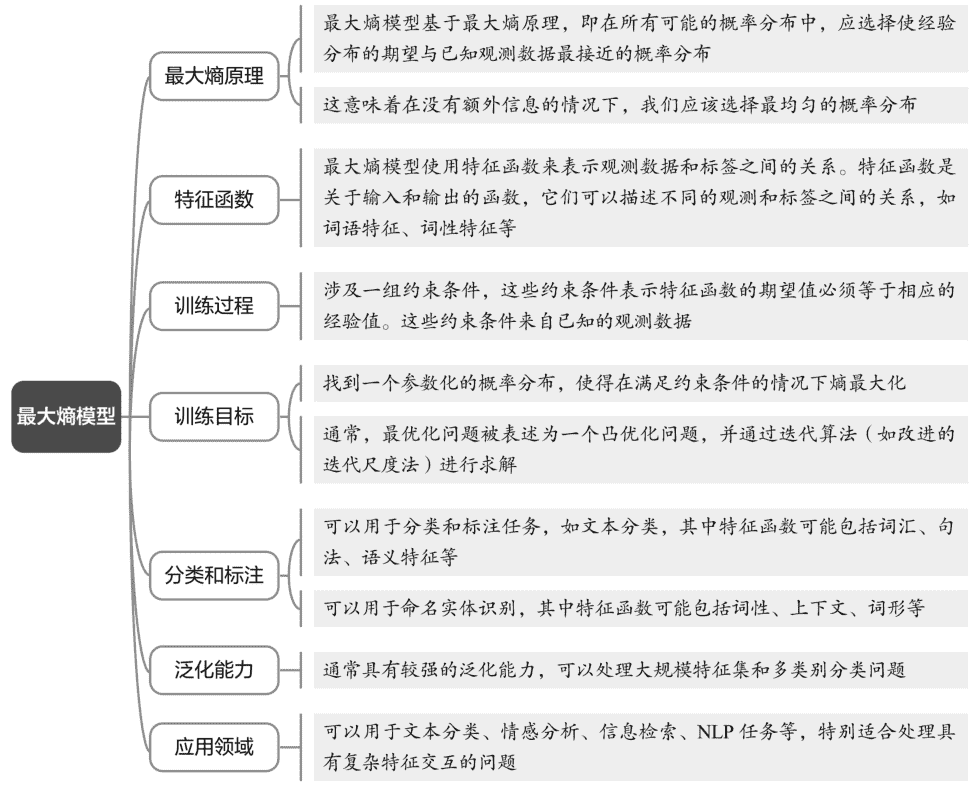

#### 实例4-4：使用最大熵模型实现情感分析

实例文件 xun03.py（源码路径：codes\4\xun03.py）的具体代码如下。

```python
from sklearn.feature_extraction.text import CountVectorizer
from sklearn.linear_model import LogisticRegression
import random

# 模拟电影评论数据
reviews = [
    ("这部电影真是太棒了！", "正面"),
    ("情节令人震惊，但太复杂了。", "负面"),
    ("我觉得这是一部普通电影。", "中性"),
    ("主演的表演很精彩！", "正面"),
    ("这是一部很差的电影。", "负面"),
]

# 特征提取
vectorizer = CountVectorizer(binary=True)

X = vectorizer.fit_transform([review[0] for review in reviews])
y = [review[1] for review in reviews]

# 训练最大熵模型
maxent_model = LogisticRegression()
maxent_model.fit(X, y)

# 生成一个电影评论并进行情感分析
def analyze_sentiment(text):
    features = vectorizer.transform([text])
    sentiment = maxent_model.predict(features)[0]
    return sentiment

# 随机生成一个电影评论
random_comment = random.choice(["这部电影真是太棒了！", "情节令人震惊，但太复杂了。", "我觉得这是一部普通电影。"])
sentiment = analyze_sentiment(random_comment)

# 输出随机生成的评论和情感分析结果
print("随机生成的评论：", random_comment)
print("情感分析结果：", sentiment)
```

代码先准备了一些电影评论及对应的情感标签，提取文本特征后用最大熵模型训练。训练完成后，生成一条随机的电影评论，并用已训练好的模型预测其情感类别。整个流程模拟了基于最大熵的情感分类任务。

一次运行的输出结果如下。

```
随机生成的评论： 这部电影真是太棒了！
情感分析结果： 正面
```

## 4.3 基于神经网络的生成

基于神经网络的生成就是借助神经网络来创造文本、图像、音频等不同类型数据的方法。这类模型属于深度学习范畴，通过学习数据的分布和结构来产出新样本。

举个例子，如果你要做一个智能菜谱助手，让用户输入食材就能得到菜谱建议，就可以用基于神经网络的生成模型，比如 Transformer。通过学习海量菜谱数据，模型能掌握食材与菜谱的对应关系，从而给出符合需求的推荐。输入“鸡蛋、番茄”，模型可能生成“番茄炒蛋”的做法，如图4-9所示。

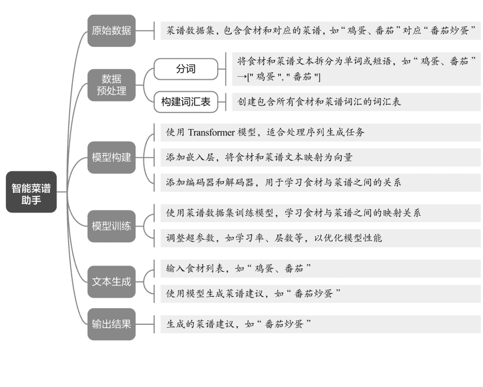

图4-9

### 4.3.1 基于神经网络的生成方法

实际应用中常见的神经网络生成手段如图4-10所示。

图4-10 里展示的生成模型依托深度学习，从大规模训练数据中学习分布和结构，能够产出质量高、逼真度强的样本。它们在多个领域取得显著进展，为创意数据生成和人机交互提供了有力支撑。

### 4.3.2 生成对抗网络

生成对抗网络是一种旨在产出高度逼真新数据的机器学习框架。灵感来自博弈论的零和博弈，系统里有两个模型互相较量：生成器负责造假，判别器负责识破。GAN 的基本信息如图4-11所示。要注意，GAN 的训练并不容易，常常出现模式崩塌和训练不收敛的问题。为此出现了不少改进版本，如条件 GAN、Wasserstein GAN、带注意力机制的 GAN 等。

## 基于神经网络的生成方法

- **GAN**
  由生成器和判别器组成的对抗结构，通过彼此竞争迫使生成器学会产生逼真的样本，如图像。已被广泛用在图像生成、超分辨率、风格迁移等任务中

- **VAE**
  用于学习数据潜在分布的生成模型，支持在潜在空间中插值并生成新样本。在图像、文本、语音生成上应用广泛

- **生成式对话模型**
  利用神经网络生成自然语言对话，循环神经网络和 Transformer 都被用于构建聊天机器人和智能助手

- **文本生成模型**
  循环神经网络、LSTM 和 Transformer 常用于机器翻译、文本摘要、小说创作、自动对联等文本生成任务

- **图像生成模型**
  CNN 与 GAN 经常配合生成图像，比如 DCGAN 和 StyleGAN 能生成逼真的面部图像

- **音频生成模型**
  可用于音频合成和音乐创作，如 WaveGAN 和 WaveNet 能生成逼真的音频信号

- **AR和VR生成**
  用于生成虚拟场景、虚拟角色和视觉特效，为增强现实和虚拟现实提供沉浸式体验

图4-10

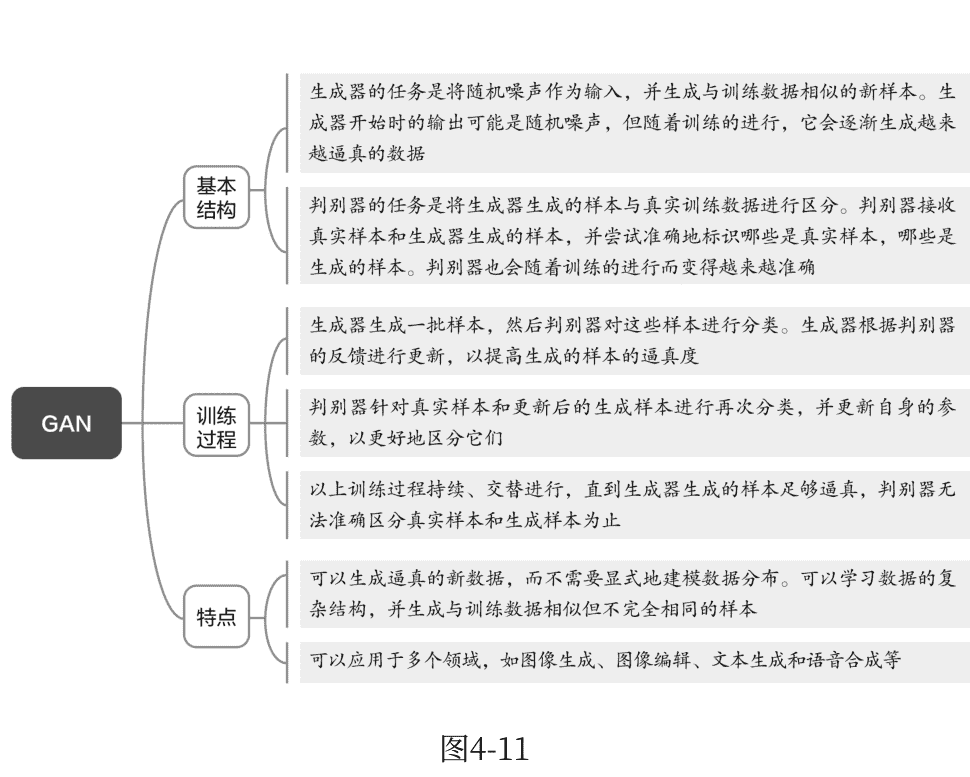

注意：GAN 的训练过程相对复杂且不稳定，可能出现模式崩塌和训练不收敛。为解决这些问题，研究者提出了条件 GAN、Wasserstein GAN、注意力机制 GAN 等多种改进方案。

总体来看，生成对抗网络通过生成器与判别器的对抗机制来产出逼真数据，在众多领域具备很强的应用潜力，仍是研究热点。

在 PyTorch 框架下，一个典型案例是用 GAN 生成手写数字图像，基于 MNIST 数据集。实例4-5 演示了如何用 PyTorch 实现一个基础的 GAN 来生成手写数字。

#### 实例4-5：使用生成对抗网络生成手写数字

本实例的实现文件是 sheng.py（源码路径：codes\4\sheng.py）。

（1）定义生成器和判别器的网络结构。生成器负责造假图像，判别器负责区分真假。具体代码如下。

```python
# 定义生成器网络架构
class Generator(nn.Module):
    def __init__(self, latent_dim, image_dim):
        super(Generator, self).__init__()
        self.latent_dim = latent_dim
        self.image_dim = image_dim

        self.model = nn.Sequential(
            nn.Linear(self.latent_dim, 256),
            nn.LeakyReLU(0.2),
            nn.Linear(256, 512),
            nn.LeakyReLU(0.2),
            nn.Linear(512, 1024),
            nn.LeakyReLU(0.2),
            nn.Linear(1024, self.image_dim),
            nn.Tanh()
        )

    def forward(self, x):
        return self.model(x)

# 定义判别器网络架构
class Discriminator(nn.Module):
    def __init__(self, image_dim):
        super(Discriminator, self).__init__()
        self.image_dim = image_dim

        self.model = nn.Sequential(
            nn.Linear(self.image_dim, 512),
            nn.LeakyReLU(0.2),
            nn.Linear(512, 256),
            nn.LeakyReLU(0.2),
            nn.Linear(256, 1),
            nn.Sigmoid()
        )

    def forward(self, x):
        return self.model(x)
```

生成器的输入是一个维度为 latent_dim 的潜在向量，经过多层线性变换和非线性激活后输出图像。在本例中用了四层线性层和三层 LeakyReLU 激活，最后一层使用 Tanh 输出与真实图像同尺寸的向量。

判别器接收图像样本，经多层线性与非线性处理后输出判别概率。这里采用三层线性层、两层 LeakyReLU 激活，末层用 Sigmoid 输出图像为真的概率。

两者在 GAN 中起关键作用。生成器追求制造更逼真的样本，判别器追求更准确的分辨能力。交替训练下，生成质量逐步提升，判别能力也不断增强。

（2）编写训练函数 train() 来实现 GAN 的训练流程，具体步骤如下。

- 开头加载 MNIST 数据集并预处理，包括转为张量并做归一化。
- 实例化生成器与判别器，并设定损失函数和优化器。网络结构在前文已给出。
- 循环读取数据批次。每批先把真实图像整理成合适形状，开始判别器的训练。判别器梯度清零后，给真实样本和生成样本分别标记标签 1 和 0。
- 用判别器判断真实图像并计算损失，同时用生成器从随机噪声生成假图像，再计算判别损失。两者相加得到判别器总损失，反向传播后更新参数。
- 接着训练生成器。梯度清零后把生成的假图像再次输入判别器，计算生成器损失并更新参数。
- 训练过程中按步数打印生成器和判别器的损失以观察进度。
- 每个固定轮次结束时把生成的图像保存到文件。

具体的实现代码如下。

```python
# 定义训练过程
def train(num_epochs, batch_size, latent_dim, image_dim):
    # 加载MNIST数据集
    transform = transforms.Compose([
        transforms.ToTensor(),
        transforms.Normalize((0.5,), (0.5,))
    ])
    dataset = datasets.MNIST(
        root='data', train=True, transform=transform, download=True)
    dataloader = torch.utils.data.DataLoader(
        dataset, batch_size=batch_size, shuffle=True)

    # 实例化生成器和判别器
    generator = Generator(latent_dim, image_dim)
    discriminator = Discriminator(image_dim)

    # 定义损失函数和优化器
    criterion = nn.BCELoss()
    generator_optimizer = optim.Adam(generator.parameters(), lr=0.0002)
    discriminator_optimizer = optim.Adam(
        discriminator.parameters(), lr=0.0002)

    # 开始训练
    for epoch in range(num_epochs):
        for i, (real_images, _) in enumerate(dataloader):
            batch_size = real_images.size(0)
            real_images = real_images.view(batch_size, -1)

            # 训练判别器
            discriminator.zero_grad()
            real_labels = torch.ones(batch_size, 1)
            fake_labels = torch.zeros(batch_size, 1)

            # 判别器对真实图像的判别结果
            real_outputs = discriminator(real_images)
            real_loss = criterion(real_outputs, real_labels)

            # 生成随机噪声
            noise = torch.randn(batch_size, latent_dim)

            # 使用生成器生成假图像
            fake_images = generator(noise)

            # 判别器对假图像的判别结果
            fake_outputs = discriminator(fake_images.detach())
            fake_loss = criterion(fake_outputs, fake_labels)
```

## 判别器损失汇总

discriminator_loss = real_loss + fake_loss

discriminator_loss.backward()

discriminator_optimizer.step()

# 生成器更新流程

generator.zero_grad()

# 重新判别生成的图像

outputs = discriminator(fake_images)

generator_loss = criterion(outputs, real_labels)

generator_loss.backward()

generator_optimizer.step()

# 打印训练进度

if (i + 1) % 200 == 0:

    print(f"Epoch [{{epoch+1}}/{{num_epochs}}], "

          f"Step [{{i+1}}/{{len(dataloader)}}], "

          f"Generator Loss: {{generator_loss.item():.4f}}, "

          f"Discriminator Loss: {{discriminator_loss.item():.4f}}")

# 定期保存样本

if (epoch + 1) % 10 == 0:

    fake_images = fake_images.view(fake_images.size(0), 1, 28, 28)

    save_image(fake_images, f"generated_images/{{epoch+1}}.png",

               normalize=True)

print("Training finished!")

以上这段循环让生成器与判别器持续对弈。生成器不断伪造样本，判别器不断分辨真假，双方能力同步提升，直到训练结束。

第三步是准备好训练所需的超参并启动训练，具体做法如下。

- 设定训练轮数 num_epochs、每批样本数 batch_size、潜向量维度 latent_dim 以及图像维度 image_dim。
- 引入 os 模块，创建用于存放结果的 generated_images 目录，若目录已存在则直接跳过。
- 调用前面写好的 train() 函数，把上述参数传入。train() 内部会负责加载数据、搭建生成器与判别器、配置损失与优化器并执行完整训练。

对应的实现代码如下。

```
# 定义训练参数
num_epochs = 100
batch_size = 128
latent_dim = 100
image_dim = 28 * 28
```

```
# 创建文件夹保存生成的图像
import os
os.makedirs("generated_images", exist_ok=True)

# 开始训练
train(num_epochs, batch_size, latent_dim, image_dim)
```

依托这段代码可以灵活调整轮数、批次大小等配置并开启对抗训练。训练期间模型交替优化生成器和判别器，最终能够合成逼真的手写数字图像。所有中间结果都会写入 generated_images 文件夹，也可以根据需求修改参数或网络结构来进一步提升效果。部分生成样本如图4-12所示。

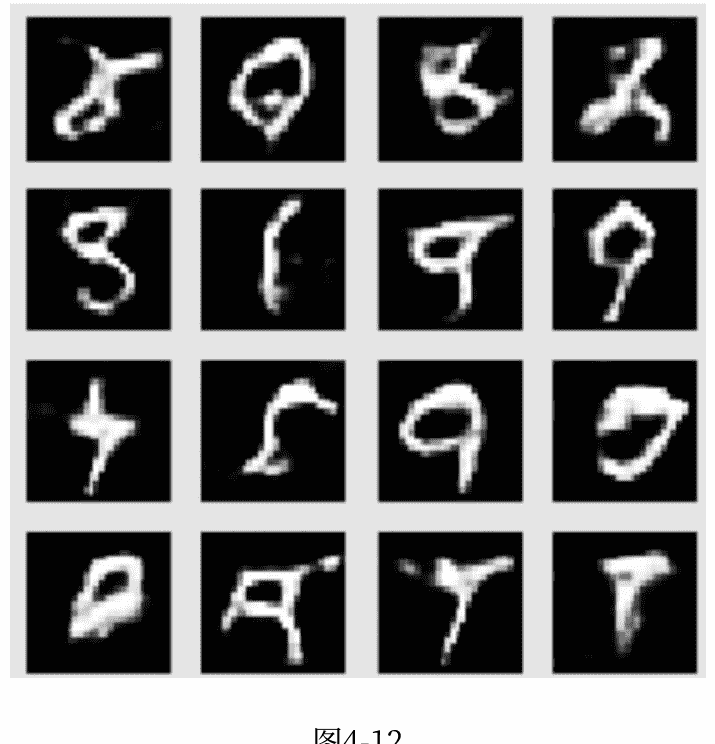

图4-12

## 4.4 注意力机制原理

在认知科学里，人类处理信息存在瓶颈，只能有选择地聚焦部分信息而忽略其余，这就是注意力机制。

比如你在做一个家庭智能语音助手，用来查询和归纳新闻。借助注意力机制，模型能自动从新闻文本中挑出关键信息并生成简短摘要。当用户问“今天科技新闻有什么重点？”时，系统可以回答“今天的重点有苹果发布新款 iPhone，以及 SpaceX 的新火箭发射计划”，如图4-13所示。

### 4.4.1 注意力机制是怎样工作的

人眼视网膜各区域的信息处理敏感度不同，中央凹的敏锐度最高。为了节约视觉资源，大脑会挑选特定区域集中处理，比如阅读时只有少数词会被真正加工。由此可见，注意力包含两件事：判断输入的哪些部分值得关注，以及把有限的计算资源投给重要部分。

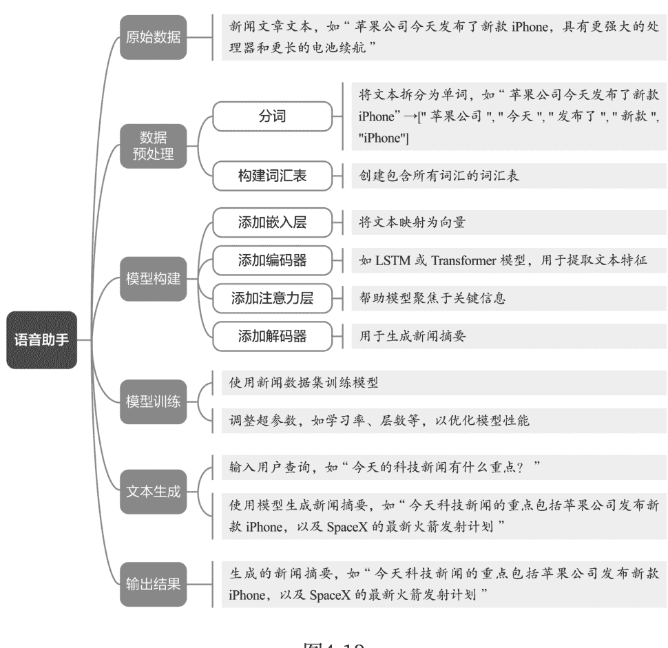

图4-13

通俗来说，神经注意力让网络只聚焦输入或特征的子集，可以作用于任意形状的输入。在计算资源受限时，注意力是一种资源分配策略，用来缓解信息过载，把算力分配给更关键的任务。

实际应用中注意力大致分为两种。

- 自上而下的有意识聚焦，也称聚焦式注意力。它是有目的、任务驱动的、主动的关注。
- 自下而上的无意识显著性注意力。它由外部刺激驱动，不依赖主动控制，也与具体任务无关。

当某个对象的刺激与背景不同时，大脑会通过类似“赢者通吃”或门控的机制把注意拉过去。无论是有意还是无意，记忆、阅读、思考等大部分脑活动都离不开注意力。日常我们通过视觉、听觉、触觉接收大量感官输入，正是因为大脑能有意或无意地从海量信息中挑出少量有用信息重点处理，其他信息则被抑制，这就是注意力的本质。它既表现为对外界刺激的反应，也表现为对内部意识的调控。

### 4.4.2 注意力机制的变体

多头注意力 Multi-Head Attention 通过多个查询并行计算，从输入中抽取多种不同信息，每个头关注不同的片段。硬注意力则基于注意力分布对所有输入求期望，或只关注某一个位置，也称硬性注意力。

硬性注意力有两种常见做法，一是挑出概率最高的输入，二是在分布上随机采样决定关注对象。它的缺陷在于采样过程不可导，损失函数与注意力分布无法直接反向传播，难以用梯度训练。为此通常改用软性注意力，它基于连续概率分布，可参与反向传播。两种典型软性注意力为：

- **键值对注意力**：用 Key-Value 形式表示输入，键用于计算注意力分布，值用于生成被选中的信息。
- **结构化注意力**：当输入本身具有层次结构，如词、句、段、篇时，可用分层注意力进行选择；也可以假设注意力服从上下文相关的分布，用图模型构建更复杂的结构化注意力。

## 4.5 Seq2Seq序列建模

序列到序列 Seq2Seq 是一种专门处理序列数据的深度学习框架，常用于自然语言、图像标注、语音识别等任务。它由编码器和解码器组成，核心思路是把输入序列压缩成固定长度的向量表示，再用该向量生成输出序列。

例如开发智能家居助手，把用户的语音指令转为设备操作指令。用户说“把客厅的灯打开”，模型输出“turn on the living room light”。通过 Seq2Seq 训练，助手能更好地理解意图并给出准确指令，实现设备控制，如图4-14所示。

### 4.5.1 Seq2Seq模型介绍

Seq2Seq 的基本原理与应用范围如图4-15所示。

# 语音指令处理流程

- 原始数据：用户的语音指令文本，如“把客厅的灯打开”

- 数据预处理：

  - 分词：将文本拆分为单词或短语，如“把客厅","客厅","的","灯","打开"

  - 构建词汇表：创建包含所有词汇的词汇表

- 模型构建：

  - 添加嵌入层：将文本映射为向量

  - 添加编码器：如LSTM或Transformer模型，用于提取文本特征

  - 添加解码器：用于生成操作指令

- 模型训练：

  - 使用语音指令数据集训练模型

  - 调整超参数，如学习率、层数等，以优化模型性能

- 文本生成：

  - 输入用户语音指令，如“把客厅的灯打开”

  - 使用模型生成操作指令，如“turn on the living room light”

- 输出结果：生成的操作指令，如“turn on the living room light”

图4-14


图4-15

Seq2Seq 的优势在于通用性强，能覆盖多种序列生成任务，已成为自然语言处理及其他领域的核心技术。

### 4.5.2 使用Seq2Seq模型实现翻译系统

实例4-6演示了用 Seq2Seq 搭建翻译系统。难度较高，需要一定的 Seq2Seq 基础。训练完成后即可把法语译成英语，效果如下。

```
[KEY: > input, = target, < output]

> il est en train de peindre un tableau .
= he is painting a picture .
< he is painting a picture .

> pourquoi ne pas essayer ce vin delicieux ?
= why not try that delicious wine ?
< why not try that delicious wine ?

> elle n est pas poete mais romanciere .
= she is not a poet but a novelist .
< she not not a poet but a novelist .

> vous etes trop maigre .
= you re too skinny .
< you re all alone .
```

#### 实例4-6：AI翻译系统

本例以 Seq2Seq 思路实现翻译，编码器与解码器两个循环网络协同工作，把一个序列转成另一个序列。编码器把输入压缩为向量，解码器再把向量展开为新序列，如图4-16所示。


为提升效果，本例引入注意力机制，让解码器学会聚焦输入序列的特定范围。

## 1. 使用注意力机制改良Seq2Seq模型

注意力是解决长序列信息丢失与性能下降的关键技术。它在解码器每个时间步引入注意力权重，使解码器能动态关注输入的不同部分，从而捕捉更重要的信息。

传统 Seq2Seq 用编码器的固定长度向量表示整个输入，序列越长，长程依赖和关键信息越容易丢失。注意力机制为每个解码时间步计算一组权重，指示编码器输出中当前最相关的部分，然后对编码器输出做加权求和得到动态上下文，用于生成当前输出。

## 2. 准备数据集

实现文件为 fanyi.py，路径 codes\4\fanyi.py。开始前需准备数据。本例使用大量英语到法语的翻译对，可从 Tatoeba 下载。原数据包很大，有网友已拆分为文本文件，自行下载英文-法文数据并保存到 data/eng-fra.txt，内容为制表符分隔的翻译对，示例如下。

## 3. 数据预处理

（1）编码转换。在预处理中，每个单词会被表示为独热向量，除了对应索引位置为1，其余为0。由于词表远大于字符数，向量维度会很大。为降低维度，通常先做词频过滤，只保留几千个常用词，如图4-17所示。


为每个词分配唯一索引以便作为网络输入与目标，常使用 Lang 辅助类来维护词到索引、索引到词的映射，以及词频计数，用于后续剔除低频词。下面的代码定义了 Lang 类来管理语言相关的字典与计数。构建语言对象后，可用 addSentence 方法把句子中的词加入语言对象，便于后续处理。这是自然语言处理任务中常见的预处理与特征表示方式。具体实现代码如下。

```
class Lang:
    def __init__(self, name):
        self.name = name
        self.word2index = {}
        self.word2count = {}
        self.index2word = {0: "SOS", 1: "EOS"}
        self.n_words = 2  # Count SOS and EOS

    def addSentence(self, sentence):
        for word in sentence.split(' '):
            self.addWord(word)

    def addWord(self, word):
        if word not in self.word2index:
            self.word2index[word] = self.n_words
            self.word2count[word] = 1
            self.index2word[self.n_words] = word
            self.n_words += 1
        else:
            self.word2count[word] += 1
```

想让模型顺利训练，第一步就是把原始文本洗干净。为了降低复杂度，这里把文件里的 Unicode 全部转成 ASCII，整体小写化，同时去掉大部分标点。预处理的核心就是把文本统一到可处理的格式，常见的手段有小写化、剔除非字母字符、规范标点等，这样后续的分析和建模才不会被噪声干扰。这类清洗函数在自然语言处理的文本清洗和特征提取里很常见，具体实现见下方代码。

```
def unicodeToAscii(s):
    return ''.join(
        c for c in unicodedata.normalize('NFD', s)
        if unicodedata.category(c) != 'Mn'
    )

# 小写化，修剪并删除非字母字符
def normalizeString(s):
    s = unicodeToAscii(s.lower().strip())
    s = re.sub(r"([.!?])", r" \1", s)
    s = re.sub(r"[^a-zA-Z.!?]+", r" ", s)
    return s
```

下面定义了两个预处理函数 unicodeToAscii 与 normalizeString，作用分别如下。

- unicodeToAscii：负责把 Unicode 字符串转成 ASCII。先用 unicodedata.normalize 把字符标准化为分解形式 NFD，随后遍历每个字符，保留 category 不等于 'Mn' 的部分，也就是去掉组合标记，最后用 join 拼接返回。
- normalizeString：对字符串做规范化，包含转小写、去掉首尾空白，以及过滤掉非字母字符。

（3）文件拆分。读取源文件后按行切分，再把每行拆成两个语言的句子对。原始语料是英语译成其他语言，若要反向翻译成英语，需要打开 reverse 标志来调换语言对顺序。readLangs 函数完成读取与处理，把句子对一对对地切分出来，并且全部经过规范化以便后续使用。传入 reverse=True 时会反转对的顺序，处理完后返回两个语言的词汇表对象以及成对的句子。这一过程属于机器翻译等 Seq2Seq 任务的数据准备环节，具体实现如下。

```python
def readLangs(lang1, lang2, reverse=False):
    print("Reading lines...")

    lines = (open('data/%s-%s.txt' % (lang1, lang2), encoding='utf-8')
             .read()
             .strip()
             .split('\n'))
    pairs = [[normalizeString(s) for s in l.split('\t')] for l in lines]
    if reverse:
        pairs = [list(reversed(p)) for p in pairs]
        input_lang = Lang(lang2)
        output_lang = Lang(lang1)
    else:
        input_lang = Lang(lang1)
        output_lang = Lang(lang2)

    return input_lang, output_lang, pairs
```

(4) 数据裁剪。语料库句子数量很大，为了加快训练速度，需要筛选出相对短小的句子。这里把最大长度设为 10 个词，标点也算在内，并过滤掉翻译结果是 “我是”、“他是” 这类常见短句的样本，撇号替换的情况已提前考虑。实现代码如下。

```python
MAX_LENGTH = 10

eng_prefixes = (
    "i am ", "i m ",
    "he is", "he s ",
    "she is", "she s ",
    "you are", "you re ",
    "we are", "we re ",
    "they are", "they re "
)

def filterPair(p):
    return len(p[0].split(' ')) < MAX_LENGTH and \
           len(p[1].split(' ')) < MAX_LENGTH and \
           p[1].startswith(eng_prefixes)

def filterPairs(pairs):
    return [pair for pair in pairs if filterPair(pair)]
```

（5）准备数据。整体流程分三步：先读文件按行拆分，再把行拆成语言对；接着对文本做规范化，并按长度和内容进行过滤；最后为每对句子构建单词列表。代码如下。

```python
def prepareData(lang1, lang2, reverse=False):
    input_lang, output_lang, pairs = readLangs(lang1, lang2, reverse)
    print("Read %s sentence pairs" % len(pairs))
    pairs = filterPairs(pairs)
    print("Trimmed to %s sentence pairs" % len(pairs))
    print("Counting words...")
    for pair in pairs:
        input_lang.addSentence(pair[0])
        output_lang.addSentence(pair[1])
    print("Counted words:")
    print(input_lang.name, input_lang.n_words)
    print(output_lang.name, output_lang.n_words)
    return input_lang, output_lang, pairs

input_lang, output_lang, pairs = prepareData('eng', 'fra', True)
print(random.choice(pairs))
```

执行完以上步骤，输出结果如下。

```
Reading lines...
Read 135842 sentence pairs
Trimmed to 10599 sentence pairs
Counting words...
Counted words:
fra 4345
eng 2803
['il a l habitude des ordinateurs .', 'he is familiar with computers .']
```

循环神经网络的特点是沿着序列运行，并把当前输出作为下一步的输入。和单向 RNN 一对一预测不同，Seq2Seq 打破了输入输出长度和顺序的限制，很适合跨语言翻译。下面以一个翻译案例来说明。

```
Je ne suis pas le chat noir -> I am not the black cat
```

输入句中大部分词在目标句里都有直接对应，但顺序会变化，例如法语 “chat noir” 对应英语 “black cat”。法语常用的 “ne/pas” 结构还会带来额外词，导致直接按序生成正确译文比较困难。Seq2Seq 通过编码器把整段输入压缩成一个向量，理想状态下这个向量在 N 维语义空间里代表输入的“意思”，解码器据此生成目标句子。

## 4. 编码器

Seq2Seq 的编码器本身是一个循环神经网络，会为输入句子的每个词产生输出。对于每个词，编码器给出一个向量和一个隐藏状态，隐藏状态会传递给下一个词。编码过程如图4-18所示。


图4-18

这里实现 EncoderRNN 类作为编码器，定义了结构和前向逻辑。内部先用嵌入层把词索引映射成稠密向量，再喂给 GRU 编码，得到输出序列和隐藏状态。编码结果可以直接作为解码器的输入，用于机器翻译等 Seq2Seq 任务。initHidden 用来初始化隐藏状态张量，作为编码的起始状态，具体代码如下。

```python
class EncoderRNN(nn.Module):
    def __init__(self, input_size, hidden_size):
        super(EncoderRNN, self).__init__()
        self.hidden_size = hidden_size

        self.embedding = nn.Embedding(input_size, hidden_size)
        self.gru = nn.GRU(hidden_size, hidden_size)

    def forward(self, input, hidden):
        embedded = self.embedding(input).view(1, 1, -1)
        output = embedded
        output, hidden = self.gru(output, hidden)
        return output, hidden

    def initHidden(self):
        return torch.zeros(1, 1, self.hidden_size, device=device)
```

## 5. 解码器

解码器是另一个循环神经网络，接收编码器产生的向量并逐步输出词序列完成翻译。

（1）简单解码器。最基础的解码方式只用编码器的最后一次输出，这个向量常被称为上下文向量，因为它汇总了整段输入的信息。该向量被作为解码器的初始隐藏状态使用。解码每一步都输入上一个词标记和当前隐藏状态，初始词标记是 <SOS> 开始符，初始隐藏状态即编码器的最后隐藏状态，如图4-19所示。


图4-19

定义 DecoderRNN 类来描述解码器结构和前向传播。同样使用嵌入层把词索引转成向量送入 GRU 进行解码，得到输出序列和隐藏状态。最后通过线性层映射并经 softmax 归一化得到概率分布。initHidden 用于初始化解码器的隐藏状态张量，具体实现如下。

```python
class DecoderRNN(nn.Module):
    def __init__(self, hidden_size, output_size):
        super(DecoderRNN, self).__init__()
        self.hidden_size = hidden_size

        self.embedding = nn.Embedding(output_size, hidden_size)
        self.gru = nn.GRU(hidden_size, hidden_size)
        self.out = nn.Linear(hidden_size, output_size)
        self.softmax = nn.LogSoftmax(dim=1)

    def forward(self, input, hidden):
        output = self.embedding(input).view(1, 1, -1)
        output = F.relu(output)
        output, hidden = self.gru(output, hidden)
        output = self.softmax(self.out(output[0]))
        return output, hidden

    def initHidden(self):
        return torch.zeros(1, 1, self.hidden_size, device=device)
```

(2) 注意力解码器。单靠一个上下文向量去承载整句信息容易丢失细节。引入注意力后，解码器在生成每个词时都能聚焦编码器输出的不同部分，而不是完全依赖单一向量。做法是先算出一组注意力权重，再用这些权重与编码器输出相乘得到加权组合 attn_applied，里面保留了输入序列特定位置的信息，帮助解码器做更准确的选择，如图4-20所示。

注意力权重由一个线性层 attn 计算，输入是解码器的当前输入和隐藏状态。由于训练样本句子长度各异，实际建模时需要预先设定一个最大输入长度来创建该层，最大长度的句子会用到全部权重，较短句子只使用前几项，如图4-21所示。


图4-20


图4-21

编写 AttnDecoderRNN 类实现带注意力的解码器，具体代码如下。

```python
class AttnDecoderRNN(nn.Module):
    def __init__(self, hidden_size, output_size, dropout_p=0.1,
                 max_length=MAX_LENGTH):
        super(AttnDecoderRNN, self).__init__()
        self.hidden_size = hidden_size
        self.output_size = output_size
        self.dropout_p = dropout_p
        self.max_length = max_length

        self.embedding = nn.Embedding(self.output_size, self.hidden_size)
        self.attn = nn.Linear(self.hidden_size * 2, self.max_length)
        self.attn_combine = nn.Linear(self.hidden_size * 2, self.hidden_size)
        self.dropout = nn.Dropout(self.dropout_p)
        self.gru = nn.GRU(self.hidden_size, self.hidden_size)
        self.out = nn.Linear(self.hidden_size, self.output_size)

    def forward(self, input, hidden, encoder_outputs):
        embedded = self.embedding(input).view(1, 1, -1)
        embedded = self.dropout(embedded)

        attn_weights = F.softmax(
            self.attn(torch.cat((embedded[0], hidden[0]), 1)), dim=1)
        attn_applied = torch.bmm(attn_weights.unsqueeze(0),
                                  encoder_outputs.unsqueeze(0))

        output = torch.cat((embedded[0], attn_applied[0]), 1)
        output = self.attn_combine(output).unsqueeze(0)

        output = F.relu(output)
        output, hidden = self.gru(output, hidden)

        output = F.log_softmax(self.out(output[0]), dim=1)
        return output, hidden, attn_weights

    def initHidden(self):
        return torch.zeros(1, 1, self.hidden_size, device=device)
```
注意力解码器 AttnDecoderRNN 内部拆解

AttnDecoderRNN 这部分构造依赖四项核心配置。
- hidden_size：控制隐藏状态向量的维度
- output_size：对应目标词表的词数规模
- dropout_p：训练阶段随机丢弃的概率
- max_length：允许的最大输入序列长度

__init__ 初始化逻辑
- 构造函数承担实例的创建与初始化工作
- 先调用父类构造 super(AttnDecoderRNN, self).__init__()
- 把 hidden_size、output_size、dropout_p、max_length 四个参数保存为对象属性
- 搭建词嵌入层，把词索引映射为稠密向量，输入维按词表大小 output_size，输出维按隐藏维 hidden_size
- 搭建注意力打分层 attn，通过拼接两个向量后做线性变换得到注意力分布
- 搭建融合层 attn_combine，把嵌入后的词向量与注意力上下文拼接后压缩成解码输入
- 加入 dropout，用于训练时的随机失活
- 加入 GRU，输入维和隐藏维均设为 hidden_size，用来逐步生成序列
- 加入输出层 out，全连接把 GRU 的输出映射到词表大小 output_size

forward 前向流程
- 负责解码输入并产出预测、更新后的隐藏态和注意力权重
- 输入为当前词张量 input、当前隐藏态 hidden、编码器输出 encoder_outputs
- 先经嵌入层得到词向量，再过一次 dropout
- 以注意力分数对编码器输出做加权求和，得到上下文向量
- 将词嵌入与上下文向量拼接，送入 attn_combine 得到新的解码输入
- 对该输入施加 ReLU 非线性
- 将结果喂入 GRU，得到本次输出和下一轮隐藏态
- GRU 输出再经 out 映射并用 log_softmax 转为概率分布
- 最终返回预测分布、隐藏态、注意力权重三项

initHidden 隐藏态初始化
- 专门生成解码器初始隐藏态
- 返回全零张量，形状为 1×1×hidden_size

6. 训练模型
（1）准备训练数据。训练时每条样本都需要输入张量与目标张量，两个序列末尾都要补上 <EOS> 标记。下面给出常用的文本处理小工具。indexesFromSentence 将句子按空格切分后转为词索引列表；tensorFromSentence 在索引基础上追加 EOS 并转为长整型张量；tensorsFromPair 同时生成输入和目标张量对。此外，实际使用前通常会对文本做分词、去停用词、词形还原等预处理，以提升效果。

（2）模型训练。先用编码器处理源语句，记录每一步输出和最终隐藏态。解码器首个输入用 <SOS> 触发，并把编码器的最后隐藏态作为初始隐藏态。教师强制 Teacher Forcing Ratio TFR 决定是否用真实目标作为下一时刻输入，使用真实标签收敛更快，但直接部署时可能不够稳定。通过一个简单的条件判断即可在 PyTorch Autograd 下动态切换，并可调节 teacher_forcing_ratio 控制使用频率。

train() 的训练函数
```python
teacher_forcing_ratio = 0.5

def train(input_tensor, target_tensor, encoder, decoder, encoder_optimizer,
          decoder_optimizer, criterion, max_length=MAX_LENGTH):
    encoder_hidden = encoder.initHidden()

    encoder_optimizer.zero_grad()
    decoder_optimizer.zero_grad()

    input_length = input_tensor.size(0)
    target_length = target_tensor.size(0)

    encoder_outputs = torch.zeros(max_length, encoder.hidden_size,
                                device=device)

    loss = 0

    for ei in range(input_length):
        encoder_output, encoder_hidden = encoder(input_tensor[ei],
                                                encoder_hidden)
        encoder_outputs[ei] = encoder_output[0, 0]

    decoder_input = torch.tensor([[SOS_token]], device=device)

    decoder_hidden = encoder_hidden

    use_teacher_forcing = True if random.random() < teacher_forcing_ratio else False

    if use_teacher_forcing:
        # 教师强制：将目标作为下一个输入
        for di in range(target_length):
            decoder_output, decoder_hidden, decoder_attention = decoder(
                decoder_input, decoder_hidden, encoder_outputs)
            loss += criterion(decoder_output, target_tensor[di])
            decoder_input = target_tensor[di]  # 使用教师强制

    else:
        # 不用教师强制：使用自己的预测作为下一个输入
        for di in range(target_length):
            decoder_output, decoder_hidden, decoder_attention = decoder(
                decoder_input, decoder_hidden, encoder_outputs)
            topv, topi = decoder_output.topk(1)
            decoder_input = topi.squeeze().detach()  # 从历史中分离出来并作为输入

            loss += criterion(decoder_output, target_tensor[di])
            if decoder_input.item() == EOS_token:
                break

    loss.backward()

    encoder_optimizer.step()
    decoder_optimizer.step()

    return loss.item() / target_length
```
- teacher_forcing_ratio：以该概率采样决定是否采用教师强制，小于阈值时用真实目标，否则用模型自生成
- 参数包含输入张量、目标张量、编码器、解码器、两个优化器 encoder_optimizer、decoder_optimizer 以及损失函数 criterion
- 初始化编码器隐藏态并清零编码器解码器的梯度
- 读取输入长度 input_length 与目标长度 target_length
- 预分配形状为 max_length × encoder.hidden_size 的零张量 encoder_outputs 用来缓存编码结果
- 逐词把输入送入编码器，收集输出并保存到 encoder_outputs
- 解码器初始输入设为 SOS_token 张量，初始隐藏态接编码器末态
- 若开启教师强制，则按目标序列遍历，每步用真实标签作为下一步输入并累加损失；若关闭，则使用模型自身预测作为下一步输入，每步同时得到输出、隐藏态、注意力，若预测到 EOS 则提前结束
- 迭代结束后反向传播并更新编码器与解码器参数
- 返回 target_length 归一化后的平均损失

（3）训练耗时展示。提供一个小函数，根据当前时刻和已完成进度打印已用时间并估算剩余时间。

```python
import time
import math

def asMinutes(s):
    m = math.floor(s / 60)
    s -= m * 60
    return '%dm %ds' % (m, s)

def timeSince(since, percent):
    now = time.time()
    s = now - since
    es = s / (percent)
    rs = es - s
    return '%s (- %s)' % (asMinutes(s), asMinutes(rs))
```
（4）循环训练。trainIters() 负责多轮迭代训练，反复调用 train() 并记录损失、输出日志，按固定间隔对损失取均值，可选绘制损失曲线。

```python
def trainIters(encoder, decoder, n_iters, print_every=1000, plot_every=100,
               learning_rate=0.01):
    start = time.time()
    plot_losses = []
    print_loss_total = 0  # 重新设置每一个 print_every
    plot_loss_total = 0  # 重新设置每一个 plot_every

    encoder_optimizer = optim.SGD(encoder.parameters(), lr=learning_rate)
    decoder_optimizer = optim.SGD(decoder.parameters(), lr=learning_rate)
    training_pairs = [tensorsFromPair(random.choice(pairs))
                      for i in range(n_iters)]
    criterion = nn.NLLLoss()

    for iter in range(1, n_iters + 1):
        training_pair = training_pairs[iter - 1]
        input_tensor = training_pair[0]
        target_tensor = training_pair[1]

        loss = train(input_tensor, target_tensor, encoder, decoder,
                     encoder_optimizer, decoder_optimizer, criterion)
        print_loss_total += loss
        plot_loss_total += loss

        if iter % print_every == 0:
            print_loss_avg = print_loss_total / print_every
            print_loss_total = 0
            print('%s (%d %d%%) %.4f' % (timeSince(start, iter / n_iters),
                                         iter, iter / n_iters * 100,
                                         print_loss_avg))

        if iter % plot_every == 0:
            plot_loss_avg = plot_loss_total / plot_every
            plot_losses.append(plot_loss_avg)
            plot_loss_total = 0

    showPlot(plot_losses)
```

（5）绘制损失曲线。定义一个 showPlot 用来呈现损失变化趋势，该函数以训练步的索引为横坐标、对应损失值为纵坐标作图，并将纵轴刻度间隔调至0.2，让曲线走向更易分辨。实现代码如下。

```python
import matplotlib.pyplot as plt
plt.switch_backend('agg')
import matplotlib.ticker as ticker
import numpy as np

def showPlot(points):
    plt.figure()
    fig, ax = plt.subplots()
    # 将刻度放置在有规律的间隔上
    loc = ticker.MultipleLocator(base=0.2)
    ax.yaxis.set_major_locator(loc)
    plt.plot(points)
```

## 7. 模型评估实战

评估阶段的流程与训练很像，区别在于没有教师强制，只需把解码器上一时刻的预测作为下一步输入。每生成一个词就累加到结果串，直到遇到 <EOS> 就终止。此时借助已训练好的编码器和解码器对输入句进行推理，得到输出词序列，同时保存解码器产生的注意力权重以便后续展示。需要实现 evaluate 函数完成这一过程：用成熟的编码器解码器对输入句解码，返回译文序列和注意力权重，权重后面可用于直观展示关注点。代码如下。

```python
def evaluate(encoder, decoder, sentence, max_length=MAX_LENGTH):
    with torch.no_grad():
        input_tensor = tensorFromSentence(input_lang, sentence)
        input_length = input_tensor.size()[0]
        encoder_hidden = encoder.initHidden()

        encoder_outputs = torch.zeros(max_length, encoder.hidden_size,
                                    device=device)

        for ei in range(input_length):
            encoder_output, encoder_hidden = encoder(input_tensor[ei],
                                                    encoder_hidden)
            encoder_outputs[ei] += encoder_output[0, 0]

        decoder_input = torch.tensor([[SOS_token]],
                                    device=device)  # 初始化为 SOS 标记
        decoder_hidden = encoder_hidden

        decoded_words = []
        decoder_attentions = torch.zeros(max_length, max_length)

        for di in range(max_length):
            decoder_output, decoder_hidden, decoder_attention = decoder(
                decoder_input, decoder_hidden, encoder_outputs)
            decoder_attentions[di] = decoder_attention.data
            topv, topi = decoder_output.data.topk(1)
            if topi.item() == EOS_token:
                decoded_words.append('<EOS>')
                break
            else:
                decoded_words.append(output_lang.index2word[topi.item()])

            decoder_input = topi.squeeze().detach()

        return decoded_words, decoder_attentions[:di + 1]
```

可以新增一个 evaluateRandomly 函数做抽样测试。函数从训练语料里随机抽一条，跑一遍推理并打印源句、参考译文和模型译文，方便人工判断质量。代码如下。

```python
def evaluateRandomly(encoder, decoder, n=10):
    for i in range(n):
        pair = random.choice(pairs)
        print('>', pair[0])
        print('=', pair[1])
        output_words, attentions = evaluate(encoder, decoder, pair[0])
        output_sentence = ' '.join(output_words)
        print('<', output_sentence)
        print('')
```

## 8. 训练与评估

前面函数准备好后就能初始化模型并启动训练。因为语料经过大量清洗，网络规模可以比较小，比如 256 维隐藏层配一个 GRU 层。新建编码器 encoder1 和带注意力的解码器 attn_decoder1，调用 trainIters 开始迭代。训练时 trainIters 会循环更新两个网络参数并计算损失，按 print_every 间隔打印当前耗时、迭代进度百分比和平均损失。代码示例如下。

```python
hidden_size = 256
encoder1 = EncoderRNN(input_lang.n_words, hidden_size).to(device)
attn_decoder1 = AttnDecoderRNN(hidden_size, output_lang.n_words,
                                dropout_p=0.1).to(device)

trainIters(encoder1, attn_decoder1, 75000, print_every=5000)
```

执行后训练正式启动。想中途查看效果可以直接中断内核评估，恢复训练时只要注释掉初始化编码器解码器的语句，再次运行 trainIters 即可继续。

跑完会输出训练日志，并在结束时画出迭代次数-损失的折线，如图 4-22 所示。

训练结束后可用 evaluateRandomly 做随机抽查。该函数随机挑一条训练样本，用 encoder1 和 attn_decoder1 翻译，输出源句、目标句和模型生成结果。

```
evaluateRandomly(encoder1, attn_decoder1)
```

运行后会得到一批翻译样例。

```
> nous sommes desolees .
= we re sorry .
< we re sorry . <EOS>

> tu plaisantes bien sur .
= you re joking of course .
< you re joking of course . <EOS>

> vous etes trop stupide pour vivre .
= you re too stupid to live .
< you re too stupid to live . <EOS>

> c est un scientifique de niveau international .
= he s a world class scientist .
< he is a successful person . <EOS>

> j agis pour mon pere .
= i am acting for my father .
< i m trying to my father . <EOS>

> ils courent maintenant .
= they are running now .
< they are running now . <EOS>

> je suis tres heureux d etre ici .
= i m very happy to be here .
< i m very happy to be here . <EOS>

> vous etes bonne .
= you re good .
< you re good . <EOS>

> il a peur de la mort .
= he is afraid of death .
< he is afraid of death . <EOS>

> je suis determine a devenir un scientifique .
= i am determined to be a scientist .
< i m ready to make a cold . <EOS>
```

## 9. 注意力可视化

注意力的优势在于可解释性强。模型会给输入各位置的编码输出分配权重，从而能看到每个解码步聚焦输入的哪一部分。

（1）最简单的做法是直接 plt.matshow(attentions)，得到一个矩阵图，横向对应输入步，纵向对应输出步。代码如下。

```
output_words, attentions = evaluate(
    encoder1, attn_decoder1, "je suis trop froid .")
plt.matshow(attentions.numpy())
```

执行效果如图 4-23 所示。


图 4-23

（2）为了更易读，可以加入坐标轴和标签。实现 showAttention 函数，它接收输入句子、输出词序列和注意力矩阵，内部新建 fig 和 ax，用 bone 灰度配色通过 matshow 绘制权重热力图，并为横纵轴设定刻度：横轴是输入词加 <EOS>，纵轴是输出词，保证每个刻度都显示。最后 plt.show 呈现结果。代码如下。

```
def showAttention(input_sentence, output_words, attentions):
    # 设置带有颜色条的图形
    fig = plt.figure()

    ax = fig.add_subplot(111)
    cax = ax.matshow(attentions.numpy(), cmap='bone')
    fig.colorbar(cax)

    # 设置轴
    ax.set_xticklabels([''] + input_sentence.split(' ') +
                        ['<EOS>'], rotation=90)
    ax.set_yticklabels([''] + output_words)

    # 在每个刻度上显示标签
    ax.xaxis.set_major_locator(ticker.MultipleLocator(1))
    ax.yaxis.set_major_locator(ticker.MultipleLocator(1))

    plt.show()
```

（3）再封装 evaluateAndShowAttention，先调用 evaluate 拿到译文和权重，打印源句与译文，再调用 showAttention 展示热力图。用几条示例句调用该函数，就能看到不同输入下的译文及注意力分布。代码如下。

```
def evaluateAndShowAttention(input_sentence):
    output_words, attentions = evaluate(
        encoder1, attn_decoder1, input_sentence)
    print('input =', input_sentence)
    print('output =', ' '.join(output_words))
    showAttention(input_sentence, output_words, attentions)

evaluateAndShowAttention("elle a cinq ans de moins que moi .")

evaluateAndShowAttention("elle est trop petit .")

evaluateAndShowAttention("je ne crains pas de mourir .")

evaluateAndShowAttention("c est un jeune directeur plein de talent .")
```

前述脚本共计触发了四次 evaluateAndShowAttention，每一次都针对不同的源句进行评估并生成可视化。单次调用会产出一张图，累计共得到四张图。每幅图同时呈现了输入原文、译文以及对应的注意力权重热力图，具体如下。

◎ “Age Difference”（年龄差异）的结果以图4-24呈现，展示了法语句子 “elle a cinq ans de moins que moi .” 的译文与注意力分布。


图4-24

◎ “Size Matters”（尺寸重要）的结果以图4-25呈现，展示了法语句子 “elle est trop petit .” 的译文与注意力分布。


图4-25

◎ “Facing Fear”（面对恐惧）的结果以图4-26呈现，展示了法语句子 “je ne crains pas de mourir .” 的译文与注意力分布。


图4-26

◎ “Young and Talented”（年轻而有才华）的结果以图4-27呈现，展示了法语句子 “c est un jeune directeur plein de talent .” 的译文与注意力分布。


图4-27

输出文本翻译结果如下。

```
input = elle a cinq ans de moins que moi .
output = she s five years younger than i am . <EOS>
input = elle est trop petit .
output = she s too loud . <EOS>
input = je ne crains pas de mourir .
output = i m not scared to die . <EOS>
input = c est un jeune directeur plein de talent .
output = he s a talented young writer . <EOS>
```

# 第5章 跨越语言鸿沟的机器翻译

机器翻译的本质是借助程序实现一种语言到另一种语言的自动转换。随着各路算法的演进，整体表现已显著提升，但语言多样性、上下文理解以及专业术语的处置仍是挑战。研究者与工程团队持续优化，目标是让译文更准确、更流畅、更适配不同语言对。

> 海内存知己，天涯若比邻。

此句出自王勃《送杜少府之任蜀州》，意为距离再远，心意相通便如邻里。在机器翻译语境下，它暗喻技术可打破语言与文化的壁垒，让不同背景的人实现沟通与理解，正如远隔天涯的知己仍能心灵相连。

## 5.1 统计机器翻译

统计机器翻译 Statistical Machine Translation, SMT 是机器翻译早期的主流思路，依托大规模平行语料与统计模型完成转换。

设想你在构建一款智能出行助手，帮助家人出国时快速转换当地语言。采用 SMT 即可实现。譬如用户输入中文“我想知道这个餐厅的菜单”，系统可给出英文“I would like to know the menu of this restaurant”。经过 SMT 模型训练后，助手对意图的把握会更精确，译文也更有用，如图5-1所示。


图5-1

### 5.1.1 SMT介绍

SMT 的基本思路是利用统计模型学习源语与目标语间的对应规律，再据此生成译文。它为机器翻译奠定了基础，但局限也明显。其不足与实现要点如图5-2所示。


随着深度学习兴起，神经机器翻译 Neural Machine Translation, NMT 等新范式逐渐占据主导，因其在质量与上下文把握上更优。SMT 仍具历史价值，在特定场景下仍可使用。

### 5.1.2 SMT模型

SMT 常用多种模型刻画源语到目标语的映射。常见类型如图5-3所示。

实际部署时通常借助 Moses 等专用工具包搭建系统。Moses 是业内常用的 SMT 工具，支持训练与使用。实例5-1 演示了借助 Moses 完成翻译的过程。


图5-3

#### 实例5-1：使用Moses工具进行机器翻译

Moses 工具包可从官网下载安装。实例文件 fan.py（源码路径：codes\5\fan.py）的实现如下。

```
import subprocess

# 设置 Moses 工具的路径
moses_path = "/path/to/moses"

# 源语言文本
source_text = "source.txt"

# 使用 Moses 进行翻译
translation_command = (
    f"{moses_path}/bin/moses -f /path/to/your/smt/model/moses.ini"
    f"< {source_text}")

translation = subprocess.check_output(
    translation_command, shell=True, encoding='utf-8')

# 打印翻译结果
print(translation)
```

代码中，moses_path 需指向本地 Moses 安装目录，/path/to/your/smt/model/moses.ini 为已训练好的 SMT 模型配置文件路径。translation_command 将源文本送入 Moses 命令行工具并返回译文。

可用的预训练 SMT 资源包括：

- (1) Opus-MT：即 Open Parallel Corpus-Machine Translation，在线平台提供大量语言对的 SMT 模型，也可自行训练。
- (2) Marian NMT：面向 NMT 与 SMT 的开源工具，提供众多语言对的预训练模型。
- (3) Apertium：开源跨语言机器翻译平台，提供部分语言对的 SMT 模型，库中含双语词典与规则。
- (4) WIT3：提供用于机器翻译研究的 SMT 模型，多用于科研，含常见语言对数据。
- (5) 云翻译服务：AWS、Google Cloud Translation、微软 Azure 等云平台提供机器翻译服务，通常同时包含 SMT 与 NMT。

注意：预训练 SMT 模型多依赖特定语料与数据，效果会随语言对与领域变化。若需高质量的特定领域模型，往往需要自行训练。

### 5.1.3 SMT的训练和解码

训练与解码是 SMT 系统的两大核心，前者构建翻译模型，后者将源文本转为目标文本。流程如图5-4所示。

SMT 的训练与解码过程复杂且耗时，通常需专用工具与大规模平行语料。实例5-2 并非完整流程，仅作概念演示。借助 NLTK 库模拟一个简化的 SMT 训练与解码过程。注意该示例仅作教学，不适用于真实任务。


图5-4

#### 实例5-2：模拟一个简化的SMT模型的训练和解码过程

实例文件 xun.py（源码路径：codes\5\xun.py）的实现如下。

```
import nltk

# 模拟一些双语数据
source_sentences = ["I love cats", "She likes dogs", "He is a programmer"]
target_sentences = ["J'aime les chats", "Elle aime les chiens",
                    "Il est programmeur"]

# 分词和预处理
source_tokens = [nltk.word_tokenize(sentence)
```

对代码的简要说明如下。

- **import nltk**：引入 NLTK 自然语言处理包，提供基础文本处理功能。
- **source_sentences 和 target_sentences**：两个列表分别存放源语与目标语示例，作为模拟训练的平行数据。
- **分词和预处理**：使用 NLTK 的 word_tokenize() 对源语与目标语句进行分词与基础预处理，便于后续操作。
- **alignment**：元组列表，表示源语句与目标语句的对应关系，实例中用于指定配对。
- **训练模型**：依据 alignment 的配对，构建一个简易翻译模型，即字典实现源词到目标词的映射。实例模型非常简化，真实 SMT 远为复杂。
- **保存训练好的模型**：用 pickle 将模型写入 translation_model.pkl，方便后续调用。
- **加载训练好的模型**：从磁盘读取模型以备解码。
- **输入要翻译的文本**：指定源语输入，如 “I am a programmer”。
- **分词和预处理**：对输入源语句做分词与预处理。
- **解码**：利用加载的模型把源词逐一映射为目标词，映射关系来自训练阶段。
- **构建目标语言句子**：将映射后的目标词拼接成完整句子。
- **打印结果**：输出源语输入与生成的目标语译文。

总体看，这段代码只是一个极度简化的演示，用来说明 SMT 的基本思想。实际系统会依赖海量数据与复杂模型实现更可靠的翻译。

## 5.2 神经机器翻译

神经机器翻译 Neural Machine Translation, NMT 采用神经网络实现源语到目标语的自动转换。与传统 SMT 不同，NMT 基于深度学习，在自然语言处理领域取得显著进展。

假设你在开发面向国际旅行的助手，除快速翻译外还需情感分析。可借助 NMT 实现。例如用户输入中文“这家餐厅的食物非常美味，服务也很棒！”NMT 可译为英文“The food at this restaurant is delicious, and the service is great!”，同时对译文做情感分析，判定为“积极”。训练后的 NMT 能更好地把握需求，并给出准确译文与情感判断，如图5-5所示。


图5-5

### 5.2.1 NMT的特点和工作流程

NMT 的主要特征与运行流程如图5-6所示。


因能更好捕捉语言结构与上下文，NMT 的表现通常优于传统 SMT，在自动翻译、文本生成等任务中效果突出。代表性模型包括 Google 的 GNMT 与 Facebook 的 Fairseq 等。

### 5.2.2 NMT的训练和解码

NMT 系统的核心阶段是训练与解码，具体说明如图5-7所示。


图5-7

NMT 的训练与解码需要大量数据与计算资源。解码时常生成多个候选译文，并借助不同策略挑选最佳结果。此外，效果还受超参数、架构与训练策略等多方面影响，因此研究持续在质量与效率上探索改进。

### 5.2.3 基于NMT的简易翻译系统

本节演示如何构建基于 NMT 模型的机器翻译系统，涵盖数据准备、模型结构、训练与评估。实例5-3 引入注意力机制提升质量，并提供可视化工具帮助理解翻译过程。该实例可作为入门起点，后续可扩展改进，其功能示意如图5-8所示。


图5-8

#### 实例5-3：翻译系统

本实例实现文件为 NMT-translation.ipynb（源码路径：codes\5\NMT-translation.ipynb）。

### 1. 数据准备

安装 Chart Studio 库。本实例用到了 Chart Studio，这是 Plotly 公司提供的在线图表编辑与共享平台，支持创建、定制、分享和部署交互式图表与数据可视化。其目标是简化数据可视化流程，并提供探索、理解与传播数据的工具，与 Plotly 的 Python、R、JavaScript 图表库紧密集成。安装命令如下。

```
pip install chart-studio
```

（1）准备数据集文件。本实例使用包含英语句子及其葡萄牙语翻译的数据集文件 por.txt，每行由一个英语句子与其法语译文以制表符分隔组成。编写代码递归遍历保存数据集的目录 input 及其子目录，将所有文件的完整路径打印到控制台。

```
import os
for dirname, _, filenames in os.walk('input'):
    for filename in filenames:
        print(os.path.join(dirname, filename))
```

执行上述代码，输出结果如下。

```
input/por.txt
```

（2）以 UTF-8 编码打开文件 por.txt，按行分割内容，并输出第 5000 行到第 5010 行。

```
file_path = '../input/por.txt'
lines = open(file_path, encoding='UTF-8').read().strip().split('\n')
lines[5000:5010]
```

执行上述代码，输出结果如下。

```
['Will it rain?\tSerá que chove?\tCC-BY 2.0 (France) Attribution: tatoeba.org #8918600 (CK) & #8930552 (JGEN)',
 'Wish me luck.\tDeseje-me sorte.\tCC-BY 2.0 (France) Attribution: tatoeba.org #2254917 (CK) & #872788 (alexmarcelo)',
 "Won't you go?\tVocê não vai?\tCC-BY 2.0 (France) Attribution: tatoeba.org #241051 (CK) & #6212788 (bill)",
 'Write in ink.\tEscreva à tinta.\tCC-BY 2.0 (France) Attribution: tatoeba.org #3258764 (CM) & #7351595 (alexmarcelo)',
 'Write in ink.\tEscreva a tinta.\tCC-BY 2.0 (France) Attribution: tatoeba.org #3258764 (CM) & #7351606 (alexmarcelo)',
 'Write to Tom.\tEscreva para o Tom.\tCC-BY 2.0 (France) Attribution: tatoeba.org #2240357 (CK) & #5985551 (Ricardo14)',
 'Years passed.\tPassaram os anos.\tCC-BY 2.0 (France) Attribution: tatoeba.org #282197 (CK) & #977841 (alexmarcelo)',
 'Years passed.\tAnos se passaram.\tCC-BY 2.0 (France) Attribution: tatoeba.org #282197 (CK) & #2324530 (Matheus)',
 'You amuse me.\tVocê me diverte.\tCC-BY 2.0 (France) Attribution: tatoeba.org #268209 (CM) & #1199960 (alexmarcelo)',
 'You are late.\tVocê está atrasado.\tCC-BY 2.0 (France) Attribution: tatoeba.org #277403 (CK) & #1275547 (alexmarcelo)']
```

（3）统计前面代码读取到的文本文件总行数，也就是整份语料的记录条数。

```
print("total number of records: ",len(lines))
```
上面这段逻辑里，len(lines)返回的正是列表长度，也就是文件包含的行数。随后借助print把该数值和提示文 “total number of records: ”一起输出，让使用者快速知道数据规模。

执行后输出如下：

```
total number of records:  168903
```

### 2. 文本清洗与标准化
（1）借助Python标准库的string模块，封装了两个常用的清洗工具exclude和remove_digits。它们日常处理里十分好用，能去掉标点、数字等干扰项，为文本分析或各类NLP任务做准备。

```
exclude = set(string.punctuation)
remove_digits = str.maketrans('', '', string.digits)
```
（2）编写preprocess_eng_sentence()函数，对英语句子进行规范化处理，方便后续投入机器翻译、文本生成等任务中使用。

```
def preprocess_eng_sentence(sent):
    '''Function to preprocess English sentence'''
    sent = sent.lower() # lower casing
    sent = re.sub("'", '', sent) # remove the quotation marks if any
    sent = ''.join(ch for ch in sent if ch not in exclude)
    sent = sent.translate(remove_digits) # remove the digits
    sent = sent.strip()
    sent = re.sub(" +", " ", sent) # remove extra spaces
    sent = '<start> ' + sent + ' <end>' # add <start> and <end> tokens
    return sent
```
（3）同理提供preprocess_port_sentence()函数，对葡萄牙语句子做一致的预处理。

```
def preprocess_port_sentence(sent):
    '''Function to preprocess Portuguese sentence'''
    sent = re.sub("'", '', sent) # remove the quotation marks if any
    sent = ''.join(ch for ch in sent if ch not in exclude)
    #sent = re.sub("[0-9]", "", sent) # remove the digits
    sent = sent.strip()
    sent = re.sub(" +", " ", sent) # remove extra spaces
    sent = '<start> ' + sent + ' <end>' # add <start> and <end> tokens
    return sent
```
（4）将清洗后的英葡句子两两配对，存入列表sent_pairs。

```
sent_pairs = []
for line in lines:
    sent_pair = []
    eng = line.rstrip().split('\t')[0]
    port = line.rstrip().split('\t')[1]
    eng = preprocess_eng_sentence(eng)
    sent_pair.append(eng)
    port = preprocess_port_sentence(port)
    sent_pair.append(port)
    sent_pairs.append(sent_pair)
sent_pairs[5000:5010]
```
执行上述代码，输出结果如下。

```
[['<start> will it rain <end>', '<start> Será que chove <end>'],
 ['<start> wish me luck <end>', '<start> Desejeme sorte <end>'],
 ['<start> wont you go <end>', '<start> Você não vai <end>'],
 ['<start> write in ink <end>', '<start> Escreva à tinta <end>'],
 ['<start> write in ink <end>', '<start> Escreva a tinta <end>'],
 ['<start> write to tom <end>', '<start> Escreva para o Tom <end>'],
 ['<start> years passed <end>', '<start> Passaram os anos <end>'],
 ['<start> years passed <end>', '<start> Anos se passaram <end>'],
 ['<start> you amuse me <end>', '<start> Você me diverte <end>'],
 ['<start> you are late <end>', '<start> Você está atrasado <end>']]
```

### 3. 词表索引与映射
（1）设计LanguageIndex类，完成词到下标、下标到词的双向映射，并汇总出该语言的词表，常用于NLP中的文本索引构建。

```
class LanguageIndex():
    def __init__(self, lang):
        self.lang = lang
        self.word2idx = {}
        self.idx2word = {}
        self.vocab = set()

        self.create_index()

    def create_index(self):
        for phrase in self.lang:
            self.vocab.update(phrase.split(' '))

        self.vocab = sorted(self.vocab)

        self.word2idx['<pad>'] = 0
        for index, word in enumerate(self.vocab):
            self.word2idx[word] = index + 1

        for word, index in self.word2idx.items():
            self.idx2word[index] = word
```
在这段实现里，__init__接收参数lang表示目标语言，初始化word2idx、idx2word两个字典以及vocab集合，然后调用create_index完成索引搭建。create_index的主要步骤为：
- 遍历语料中的每个短语，通常是句子，按空格切分后把词加入vocab以形成词表。
- 对vocab排序，确保词序稳定可复现。
- 在word2idx中额外加入特殊的<pad>标记，用来填充长度不一致的序列，比如机器翻译中的句子对齐。

## 4. 数据划分与训练配置
（1）把语料切成训练集和验证集，训练集负责模型学习，验证集负责效果评估。本案例采用80%训练、20%验证的比例。

```
(input_tensor_train, input_tensor_val, target_tensor_train,
    target_tensor_val) = train_test_split(input_tensor, target_tensor,
                                        test_size=0.1, random_state = 101)

len(input_tensor_train), len(target_tensor_train), len(input_tensor_val),
len(target_tensor_val)
```
执行上述代码，输出结果如下。
(152012, 152012, 16891, 16891)

（2）随后设定训练时的超参数并搭建数据管道，这套流程在神经网络尤其是NLP任务中很常见，训练样本会被切成小批量逐轮喂入。

```
BUFFER_SIZE = len(input_tensor_train)
BATCH_SIZE = 64
N_BATCH = BUFFER_SIZE//BATCH_SIZE
embedding_dim = 256
units = 1024
vocab_inp_size = len(inp_lang.word2idx)

vocab_tar_size = len(targ_lang.word2idx)

dataset = tf.data.Dataset.from_tensor_slices(
    (input_tensor_train, target_tensor_train)).shuffle(BUFFER_SIZE)
dataset = dataset.batch(BATCH_SIZE, drop_remainder=True)
```
对相关设定做简要说明：
- ◎ BUFFER_SIZE=len(input_tensor_train): 缓冲区大小取训练集长度，用于洗牌操作。
- ◎ BATCH_SIZE=64: 每批次样本数设为64，每次训练使用64条数据。
- ◎ N_BATCH=BUFFER_SIZE//BATCH_SIZE: 每个epoch的批次总数，由总样本除以批次大小得到。
- ◎ embedding_dim=256: 词嵌入维度，用来把整数索引映射成稠密向量。
- ◎ units=1024：循环层隐藏单元数。
- ◎ vocab_inp_size=len(inp_lang.word2idx)：源语言词表规模。
- ◎ vocab_tar_size=len(targ_lang.word2idx)：目标语言词表规模。
- ◎ tf.data.Dataset.from_tensor_slices((input_tensor_train,target_tensor_train))：用from_tensor_slices把输入与目标张量配对生成数据集。
- ◎ .shuffle(BUFFER_SIZE)：以缓冲区大小随机打乱数据，保证每个epoch顺序不同。
- ◎ .batch(BATCH_SIZE, drop_remainder=True)：切分为批次，drop_remainder=True会丢弃不足一满批的尾部样本，保证批次大小一致。

本例选用GRU而非LSTM。两者都是处理序列的循环网络变体，GRU把门控简化为一个状态，LSTM则保留细胞状态和隐藏状态两个状态。

注意：实际项目里偏爱GRU的主要原因有：
- ◎ 实现更简洁：只有一个状态，开发和调试更省力。
- ◎ 训练更快：参数更少，收敛速度通常更快。
- ◎ 抗过拟合：对噪声鲁棒性更好，过拟合风险相对更低。
- ◎ 模型更小：参数量少，在算力受限时更友好。

当然GRU与LSTM的选择取决于任务和数据，有些需要捕捉长程依赖的场景下LSTM仍可能更有优势。

## 5. 编解码结构搭建
（1）定义gru()函数来快速创建GRU层。GRU是处理序列数据的循环网络变体，函数接收参数units指定隐藏状态维度。

```
def gru(units):
    return tf.keras.layers.GRU(units,
                               return_sequences=True,
                               return_state=True,
                               recurrent_activation='sigmoid',
                               recurrent_initializer='glorot_uniform')
```
该函数的用途是在神经网络中实例化一个GRU层，用来处理文本序列或时间序列这类有序数据，GRU能够学习序列内部的依赖与信息传递，常用于NLP和其他序列建模。

（2）构建编码器与解码器网络，编码器把输入英语句子压缩成隐藏状态，解码器据此生成葡萄牙语句子，这是典型的Seq2Seq结构，广泛应用于机器翻译类任务。

编码器接收英语句子，输出GRU的隐藏状态；在实现上通常借助循环或GRU把序列编码为固定维度表示。解码器则基于这些状态逐步生成目标语言句子。具体实现需兼顾架构、层数与超参数等细节。

定义编码器类Encoder，将输入英语句子编码为隐藏状态。具体实现代码如下。

```
class Encoder(tf.keras.Model):
    def __init__(self, vocab_size, embedding_dim, enc_units, batch_sz):
        super(Encoder, self).__init__()
        self.batch_sz = batch_sz
        self.enc_units = enc_units
        self.embedding = tf.keras.layers.Embedding(vocab_size, embedding_dim)
        self.gru = gru(self.enc_units)

    def call(self, x, hidden):
        x = self.embedding(x)
        output, state = self.gru(x, initial_state = hidden)
        return output, state

    def initialize_hidden_state(self):
        return tf.zeros((self.batch_sz, self.enc_units))
```

构建解码器 Decoder，用来一步步产出目标语言的句子。具体的实现片段如下。

```
class Decoder(tf.keras.Model):
    def __init__(self, vocab_size, embedding_dim, dec_units, batch_sz):
        super(Decoder, self).__init__()
        self.batch_sz = batch_sz
        self.dec_units = dec_units
        self.embedding = tf.keras.layers.Embedding(vocab_size, embedding_dim)
        self.gru = gru(self.dec_units)
        self.fc = tf.keras.layers.Dense(vocab_size)

        # 用于注意力机制
        self.W1 = tf.keras.layers.Dense(self.dec_units)
        self.W2 = tf.keras.layers.Dense(self.dec_units)
        self.V = tf.keras.layers.Dense(1)

    def call(self, x, hidden, enc_output):

        hidden_with_time_axis = tf.expand_dims(hidden, 1)

        # 得分的形状 == (批次大小，最大长度，1)
        # 我们在最后一个轴上得到1，因为我们将tanh(FC(EO)+FC(H))应用于self.V
        score = self.V(
            tf.nn.tanh(self.W1(enc_output) + self.W2(hidden_with_time_axis))
        )

        # 注意力权重的形状 == (批次大小，最大长度，1)
        attention_weights = tf.nn.softmax(score, axis=1)

        # 上下文向量的形状在求和后 == (批次大小，隐藏大小)
        context_vector = attention_weights * enc_output
        context_vector = tf.reduce_sum(context_vector, axis=1)

        # 通过嵌入层后x的形状 == (批次大小，1，嵌入维度)
        x = self.embedding(x)

        # 在连接后x的形状 == (批次大小，1，嵌入维度 + 隐藏大小)
        x = tf.concat([tf.expand_dims(context_vector, 1), x], axis=-1)

        # 将连接后的向量传递给GRU层
        output, state = self.gru(x)

        # 输出的形状 == (批次大小 * 1，隐藏大小)
        output = tf.reshape(output, (-1, output.shape[2]))

        # 输出的形状 == (批次大小 * 1，词汇表大小)
        x = self.fc(output)

        return x, state, attention_weights

    def initialize_hidden_state(self):
        return tf.zeros((self.batch_sz, self.dec_units))
```

整体来看，这个解码器在每个时间步会输出一个词，同时不断更新隐藏状态、注意力分布以及上下文向量，属于 Seq2Seq 架构里典型的解码侧模块。

## 6. 模型训练

（1）先分别实例化编码器 Encoder 和解码器 Decoder，并传入必要的初始化参数。

```
encoder = Encoder(vocab_inp_size, embedding_dim, units, BATCH_SIZE)
decoder = Decoder(vocab_tar_size, embedding_dim, units, BATCH_SIZE)
```

这两个组件配合起来就构成了机器翻译的核心：编码器负责把英文输入压缩成隐藏表示，解码器据此生成译文。完成搭建后即可进入训练阶段，让模型学会翻译。

（2）随后声明优化器 optimizer 与损失函数 loss_function()，为模型训练提供驱动。

```
optimizer = tf.optimizers.Adam()

def loss_function(real, pred):
    mask = 1 - np.equal(real, 0)
    loss_ = tf.nn.sparse_softmax_cross_entropy_with_logits(
        labels=real, logits=pred) * mask
    return tf.reduce_mean(loss_)
```

loss_function(real, pred) 的作用就是衡量 Seq2Seq 任务的序列预测偏差，模型要通过最小化生成结果和标准答案之间的差距来学习。Adam 优化器会依据该损失反向更新参数，让输出逐步贴近真实数据分布。

（3）再准备一个检查点对象 checkpoint，用来在训练过程中保存权重和优化器状态。

```
checkpoint_dir = './training_checkpoints'
checkpoint_prefix = os.path.join(checkpoint_dir, "ckpt")
checkpoint = tf.train.Checkpoint(optimizer=optimizer,
                               encoder=encoder,
                               decoder=decoder)
```

借助检查点，可以按固定频率把当前模型快照落盘，方便中断后恢复或后续部署。对耗时较长的训练任务来说，这相当于一份可靠的保险。

（4）进入正式的训练循环，下面是核心代码实现。训练时采用教师强制策略，用真实目标词作为下一步输入。

```
EPOCHS = 10

for epoch in range(EPOCHS):
    start = time.time()
```

总的流程会重复 10 个 epoch，每轮遍历数据批次做前向计算、反向传播和参数刷新，这正是训练序列到序列模型的标准做法。

运行后可以看到如下输出。

```
Epoch 1 Batch 0 Loss 1.9447
Epoch 1 Batch 100 Loss 1.2724
Epoch 1 Batch 200 Loss 1.1861
Epoch 1 Batch 300 Loss 1.0276
Epoch 1 Batch 400 Loss 0.9159
Epoch 1 Batch 500 Loss 0.8936
Epoch 1 Loss 0.7260
Time taken for 1 epoch 1474.7117013931274 sec
// 省略部分输出结果
Epoch 10 Batch 2100 Loss 0.1063
Epoch 10 Batch 2200 Loss 0.1099
Epoch 10 Batch 2300 Loss 0.1381
Epoch 10 Loss 0.0840
Time taken for 1 epoch 1455.937628030777 sec
```

（5）训练中断或需要迁移时，可以从指定目录加载检查点恢复状态，避免从零开始。

```
checkpoint.restore(tf.train.latest_checkpoint(checkpoint_dir))
```

执行恢复代码后，终端会呈现类似如下的结果。

```
<tensorflow.python.training.tracking.util.CheckpointLoadStatus at 0x7f6798ba34d0>
```

## 7. 模型评估与测试

（1）编写推理用的 evaluate() 函数，接收输入序列并返回译文、原文以及注意力权重，便于后续分析与性能评估。

```
def evaluate(inputs, encoder, decoder, inp_lang, targ_lang, max_length_inp,
            max_length_targ):

    attention_plot = np.zeros((max_length_targ, max_length_inp))
    sentence = ''
    for i in inputs[0]:
        if i == 0:
            break
        sentence = sentence + inp_lang.idx2word[i] + ' '
    sentence = sentence[:-1]

    inputs = tf.convert_to_tensor(inputs)

    result = ''

    hidden = [tf.zeros((1, units))]
    enc_out, enc_hidden = encoder(inputs, hidden)

    dec_hidden = enc_hidden
    dec_input = tf.expand_dims([targ_lang.word2idx['<start>']], 0)

    for t in range(max_length_targ):
        predictions, dec_hidden, attention_weights = decoder(
            dec_input, dec_hidden, enc_out)

        # 将注意力权重存储起来，以便后续绘图
        attention_weights = tf.reshape(attention_weights, (-1, ))
        attention_plot[t] = attention_weights.numpy()

        predicted_id = tf.argmax(predictions[0]).numpy()

        result += targ_lang.idx2word[predicted_id] + ' '

        if targ_lang.idx2word[predicted_id] == '<end>':
            return result, sentence, attention_plot

        # 预测出的 ID 被反馈回模型中
        dec_input = tf.expand_dims([predicted_id], 0)

    return result, sentence, attention_plot
```

（2）再提供 predict_random_val_sentence() 函数，从验证集里随机抽取一条样本做预测，并展示其注意力热力图。

```
def predict_random_val_sentence():
    actual_sent = ''
    k = np.random.randint(len(input_tensor_val))
    random_input = input_tensor_val[k]
    random_output = target_tensor_val[k]
    random_input = np.expand_dims(random_input,0)
    result, sentence, attention_plot = evaluate(random_input, encoder,
        decoder, inp_lang, targ_lang, max_length_inp, max_length_targ)
    print('Input: {}'.format(sentence[8:-6]))
    print('Predicted translation: {}'.format(result[:-6]))
    for i in random_output:
        if i == 0:
            break
        actual_sent = actual_sent + targ_lang.idx2word[i] + ' '
    actual_sent = actual_sent[8:-7]
    print('Actual translation: {}'.format(actual_sent))
    attention_plot = attention_plot[:len(result.split(' '))-2,
                                   1:len(sentence.split(' '))-1]
    sentence, result = sentence.split(' '), result.split(' ')
    sentence = sentence[1:-1]
    result = result[:-2]

    # 使用plotly生成热图
    trace = go.Heatmap(z = attention_plot, x = sentence, y = result,
                       colorscale = 'greens')
    data=[trace]
    iplot(data)
```

该函数主要用来从验证集中随机抽取一条样本进行翻译，并在可视化注意力权重的同时观察模型在该例上的表现，以此判断模型好坏并洞察其翻译逻辑。

（3）predict_random_val_sentence() 会随机挑取验证集中的一句话让模型预测，同时绘制注意力权重。它会输出源句、模型译文和真实译文，并呈现一张注意力热力图，便于分析模型在随机样本上的行为。

```
predict_random_val_sentence()
```

执行 predict_random_val_sentence() 后会生成一张注意力热图，展示模型在翻译时对输入句各词的注意力分布，如图5-9所示。

具体来看，热图的横轴对应输入句的词，纵轴对应模型生成的输出句的词。每个格子的颜色深浅代表生成输出时对对应输入词的关注程度，颜色越深关注越集中。通过这张图能直观看出模型在翻译过程中更偏重输入的哪些部分，进而产出正确译文。这种可视化有助于理解模型的翻译策略和注意力分配。


图5-9

执行上述代码，输出翻译结果如下。

```
Input: tom spoke with me about you
Predicted translation: Tom falou comigo sobre você
Actual translation: Tom me falou de você
```

（4）再次调用 predict_random_val_sentence()，函数会抽取验证集中的另一条随机样本进行预测，并自动生成注意力热图。

```
predict_random_val_sentence()
```

运行 predict_random_val_sentence() 后会绘制注意力热图，如图5-10所示。该热图可帮助了解翻译效果以及模型在不同词上的注意力分配。每次执行函数都会选取不同的验证样本，因此可以重复运行以观察多样化结果，从而评估性能并洞察翻译行为。


图5-10

执行上述代码，输出翻译结果如下。

```
Input: the pain was more than tom could stand
Predicted translation: A dor estava mais alto do que Tom podia ficar
Actual translation: A dor era mais do que Tom podia suportar
```

# 第6章 Transformer核心模型全景解析

Transformer 是专为自然语言处理及各类序列到序列任务设计的深度学习架构，最早由 Google 团队于 2017 年提出，并在 NIPS 会议上以《Attention is All You Need》为题发表。本章将系统梳理 Transformer 在自然语言处理中的核心知识。

> 会当凌绝顶，一览众山小。

此句出自杜甫《望岳》，写的是登顶远眺、众山尽收眼底的豪情，恰好暗喻 Transformer 凭借全局自注意力机制能够一次性捕获序列中各处关键信息的特性。正如登高可望全貌，Transformer 处理长文本时能快速把握整体脉络，让信息无所遁形，为多任务应用奠定基础。

## 6.1 Transformer模型概览

假设你要打造一个智能学习助手，帮助学生理解和归纳学习资料，Transformer是不错的选择。比如学生上传一篇历史长文，模型可以自动提炼精简摘要，让学生迅速抓住要点；还能基于原文生成配套练习题，辅助自我检测，如图6-1所示。


### 6.1.1 Transformer模型核心概念

Transformer 最大的突破是引入自注意力机制，摆脱了循环神经网络和 LSTM 逐 token 处理的顺序限制，从而实现高度并行、训练加速。因其并行效率高，模型能在海量数据上快速收敛。其成功催生了大量后续架构，如基于编码器的 BERT 和基于解码器的 GPT 等。在 NLP、机器翻译等任务中，Transformer 展现了强劲性能，已成为深度学习的代表性架构之一。

Transformer 的基本结构示意如图6-2所示。


图6-2

### 6.1.2 Transformer模型优势对比

与传统 RNN、LSTM 等序列模型相比，Transformer 在序列处理上具备明显优势，具体见图6-3。

总体来看，Transformer 为序列数据处理带来革新，在 NLP 等任务上表现突出。其核心优势在于长距离依赖建模能力、强大的并行计算效率，以及对全局信息的有效整合，使其成为当前众多序列任务的首选。


图6-3

### 6.1.3 Transformer架构核心模块

Transformer 架构由编码器和解码器两大部分构成，适用于序列到序列任务，例如机器翻译。编码器把输入映射为上下文向量，解码器据此生成目标序列。

#### 1. 编码器

编码器由若干个结构相同的编码层堆叠而成，每层包含两大核心模块。

- （1）多头自注意力机制。这是模型的核心组件，可在多个子空间并行学习，让不同位置的信息相互关联。
- （2）前馈神经网络。对每个位置的向量做非线性变换，深挖特征表征。

每个模块后都接入残差连接和层归一化，提升信息流动与训练稳定性。

#### 2. 解码器

解码器整体与编码器相似，但在细节上有两点差异。

- （1）掩码多头自注意力。为了防止解码时窥视未来信息，自注意力会通过掩码屏蔽后续位置。
- （2）编码器-解码器注意力。解码器借助该模块对齐编码器的输出，指导目标序列生成。

#### 3. 自注意力机制

自注意力是 Transformer 的灵魂，计算某个位置时能同时参考序列中所有其他位置的信息。具体流程如下。

#### 4. 位置编码

与依赖顺序的 RNN 不同，Transformer 本身不感知位置，需额外加入位置编码。位置编码是与词嵌入相加的向量，用来指示词序，可采用固定模式或可学习参数。

#### 5. 发展与变体

Transformer 的出现推动了深度学习快速演进，衍生出众多变体，典型包括：

- (1) BERT：基于编码器结构进行预训练，用于语言表示学习。
- (2) GPT：基于解码器结构，用于文本生成。
- (3) Vision Transformer, ViT：将图像切块后作为序列输入，应用于图像任务。
- (4) 多头注意：把自注意力拆分为多个头，从不同视角捕捉信息。
- (5) 其他改进：如稀疏注意力机制、长序列处理 Longformer 等。

#### 6. 应用场景

Transformer 在 NLP 中大放异彩，常见应用如下：

- (1) 机器翻译。例如 Google 的 Transformer 在翻译任务上超越了前代模型。
- (2) 文本生成。GPT 系列可产出高质量自然文本。
- (3) 文本分类、问答、命名实体识别等多种 NLP 任务。
- (4) 计算机视觉。ViT 等已将其引入图像分类等视觉任务。

总体来看，Transformer 凭借自注意力和并行化设计，解决了传统序列模型的诸多瓶颈，不仅在 NLP 取得突破，也深刻影响计算机视觉等领域。

### 6.1.4 Transformer在机器翻译中的实践

实例6-1 展示了如何用 Transformer 搭建英俄机器翻译系统。该实例使用 TensorFlow 框架和 Keras 库构建并训练模型，采用 TextVectorization 处理文本、定义编码器解码器、用 AdamW 优化训练并在测试集评估，完成端到端任务。最后通过随机测试句展示实际效果，如图6-4所示。


图6-4

#### 实例6-1：英文到俄文的翻译系统

文件 transformer-translation.ipynb（路径 codes\6\transformer-translation.ipynb）的实现步骤如下。

### 1. 数据准备

(1) 借助 pandas 的 read_csv() 读取 CSV 文件，得到 DataFrame 对象 data，后续操作均基于该对象。

```python
data=pd.read_csv(
    'englishrussian-dictionary-for-machine-translate/rus.txt',
    delimiter='\t',header=None)
```

(2) 调用 data.head() 预览前五行数据，可指定行数查看更多。

```python
data.head()
```

执行上述代码，输出结果如下。

```
   0  1  2
0  Go. Марш!    CC-BY 2.0 (France) Attribution: tatoeba.org #2...
1  Go. Иди.  CC-BY 2.0 (France) Attribution: tatoeba.org #2...
2  Go. Идите.  CC-BY 2.0 (France) Attribution: tatoeba.org #2...
3  Hi. Здравствуйте.  CC-BY 2.0 (France) Attribution: tatoeba.org #5...
4  Hi. Привет!CC-BY 2.0 (France) Attribution: tatoeba.org #5...
```

(3) 用 iloc 切片获取全部行和前两列，再用 head() 查看前几行。代码 data.iloc[:,:2] 即实现该操作。

```python
data=data.iloc[:,:2]
data.head()
```

执行上述代码，输出结果如下。

```
   0  1
0  Go. Марш!
1  Go. Иди.
2  Go. Идите.
3  Hi. Здравствуйте.
4  Hi. Привет!
```

(4) data.columns 属性可获取所有列名，便于检查表结构。

```python
data.columns
```

执行上述代码，输出结果如下。

```
Int64Index([0, 1], dtype='int64')
```

### 2. 数据预处理

(1) 用 rename() 将列名改为 English 与 Russian，inplace=True 直接修改原表。

```python
data.rename(columns={0: "English", 1: "Russian"},inplace=True)
data.columns
```

执行上述代码，输出结果如下。

```
Index(['English', 'Russian'], dtype='object')
```

(2) 定义 clean_string() 函数，完成去不间断空格、转小写、去标点数字、去重复空格等清洗。随后把 English、Russian 两列转为字符串并应用该函数，最后提示清洗完成，为后续 NLP 任务做准备。

```python
# 清理字符串
def clean_string(string):
    # 将不间断空格替换为普通空格
    string = string.replace("\u202f", " ")
    # 将所有大写字符转换为小写字符
    string = string.lower()

    # 删除标点符号和数字
    for p in punctuation + "«»" + "0123456789":
        string = string.replace(p, " ")

    # 使用通配符删除重复的空格
    string = re.sub("\s+", " ", string)
    # 移除字符串开头和结尾的空格
    string = string.strip()

    return string

#---------------------------------------------------------------------------------
---
# 将对象转换为字符串
data['English'] = data['English'].astype(str)
data['Russian'] = data['Russian'].astype(str)

# 清理句子
data['English'] = data['English'].apply(lambda x: clean_string(x))
data['Russian'] = data['Russian'].apply(lambda x: clean_string(x))

print("完成清理操作")
```

(3) 在完成对 English 与 Russian 两列的清洗之后，可以调用 data.head() 快速预览处理后的前几行，用以直观确认清洗效果。

```python
data.head()
```

执行上述代码，输出结果如下。

| English | Russian |

|---|---|

| 0 | go | м а р ш |

| 1 | go | и д и |

| 2 | go | и д и т е |

| 3 | hi | з д р а в с т в у й т е |

| 4 | hi | п р и в е т |

(4) 接下来把清洗好的英俄配对整理到一个新列表 my_data 中，每一项都是由英文句子和俄文句子构成的二元组。

```python
raw_data_en = data["English"].values
raw_data_ru = data["Russian"].values

# 为俄文句子添加起始和结束标记
raw_data_ru_in_out = ["[start] " + st + " [end]" for st in raw_data_ru]

# 创建包含英文和俄文句子的元组列表
my_data = []
for i in range(len(raw_data_en)):
    en = raw_data_en[i]
    ru = raw_data_ru_in_out[i]
    my_data.append((en, ru))
```

(5) 下一段代码通过切片取出 my_data 的前 5 条记录，用来核对打包结果是否正确。

```python
my_data[:5]
```

执行上述代码，输出包含英文和俄文句子元组的列表的前五个元素如下。

```
[('go', '[start] м а р ш [end]'),
 ('go', '[start] и д и [end]'),
 ('go', '[start] и д и т е [end]'),
 ('hi', '[start] з д р а в с т в у й т е [end]'),
 ('hi', '[start] п р и в е т [end]')]
```

(6) 为了避免顺序偏差，先用 random 模块的 shuffle() 对 my_data 原位打乱。随机化是划分训练测试集前必要的准备，确保后续采样不受原始顺序影响。

```python
random.shuffle(my_data)
```

(7) 随后按照常规比例把整体数据切分为训练集、验证集和测试集，并打印各部分样本数，以保证三者规模合理且互不重叠。

```python
# 训练集占总数据的 70%，验证集和测试集各占总数据的 15%
num_val_samples = int(0.15 * len(my_data))
num_train_samples = len(my_data) - 2 * num_val_samples

# 根据划分比例获取训练集、验证集和测试集的俄文句子
train_Russian = my_data[:num_train_samples]
val_Russian = my_data[num_train_samples : 
                     num_train_samples + num_val_samples]
test_Russian = my_data[num_train_samples + num_val_samples :]

# 输出各集合的样本数量
print("Total russian in my data : ", len(my_data))
print("Training russian        : ", len(train_Russian))
print("Validation russian      : ", len(val_Russian))
print("Test russian            : ", len(test_Russian))
```

上述代码的实现流程如下。

- ◎ 先算出验证集大小 num_val_samples，约占总量的 15%。
- ◎ 再算出训练集大小 num_train_samples，约占总量的 70%，剩余自然归测试集。
- ◎ 借助切片 my_data[:num_train_samples]、my_data[num_train_samples : num_train_samples + num_val_samples] 与 my_data[num_train_samples + num_val_samples :] 分别抽取训练、验证、测试三份数据。
- ◎ 最后分别输出三份数据的样本计数。

执行上述代码，输出结果如下。

```
Total russian in my data :  363386
Training russian        :  254372
Validation russian      :   54507
Test russian            :   54507
```

### 3. 向量化与数据流水线

(1) 这里借助 TensorFlow 的 TextVectorization 对英俄文本做数字化。先设定词表上限、序列最大长度和批次大小，各自实例化一个向量化器应对英文和俄文，随后调用 adapt() 让其学习训练集的词表并产出整数编码，为后续神经网络机器翻译训练做准备。

```python
# 向量化文本数据的参数设置
vocab_size       = 15000  # 词汇表的大小
sequence_length  = 20     # 序列的长度
batch_size       = 256    # 批次大小

# 创建英文文本向量化对象
en_vectorization = TextVectorization(
    max_tokens=vocab_size, output_mode="int",
    output_sequence_length=sequence_length
)

# 创建俄文文本向量化对象
ru_vectorization = TextVectorization(
    max_tokens=vocab_size, output_mode="int",
    output_sequence_length=sequence_length + 1
)

# 提取训练集中的英文和俄文文本
train_en_texts = [pair[0] for pair in train_Russian]
train_ru_texts = [pair[1] for pair in train_Russian]

# 适应 (Adapt) 向量化对象到训练文本
en_vectorization.adapt(train_en_texts)
ru_vectorization.adapt(train_ru_texts)

print("Done ...")
```

执行上述代码，输出结果如下。

```
2024-04-24 19:30:52.214465: I tensorflow/stream_executor/cuda/cuda_gpu_
executor.cc:937] successful NUMA node read from SysFS had negative value (-1),
but there must be at least one NUMA node, so returning NUMA node zero
2024-04-24 19:30:52.335991: I tensorflow/stream_executor/cuda/cuda_gpu_
executor.cc:937] successful NUMA node read from SysFS had negative value (-1),
but there must be at least one NUMA node, so returning NUMA node zero
2022-04-24 19:30:52.337099: I tensorflow/stream_executor/cuda/cuda_gpu_
executor.cc:937] successful NUMA node read from SysFS had negative value (-1),
but there must be at least one NUMA node, so returning NUMA node zero
2024-04-24 19:30:52.338690: I tensorflow/core/platform/cpu_feature_guard.
cc:142] This TensorFlow binary is optimized with oneAPI Deep Neural Network
Library (oneDNN) to use the following CPU instructions in performance-
critical operations:  AVX2 FMA
To enable them in other operations, rebuild TensorFlow with the appropriate
compiler flags.
### 省略后面的输出结果
```

(2) 接着封装数据格式化逻辑，把英俄文本转为模型可直接消费的张量格式。基于已适应的向量化器，定义批处理与输入输出映射的函数，并示例性地取出一个训练 batch 查看其维度。

```python
# 定义函数：格式化数据集
def format_dataset(en, fr):
    en = en_vectorization(en)
    fr = ru_vectorization(fr)
    return ({"encoder_inputs": en, "decoder_inputs": fr[:, :-1]}, fr[:, 1:])

# 定义函数：创建数据集
def make_dataset(pairs):
    en_texts, fr_texts = zip(*pairs)
    en_texts = list(en_texts)
    fr_texts = list(fr_texts)
    dataset = tf.data.Dataset.from_tensor_slices((en_texts, fr_texts))
    dataset = dataset.batch(batch_size)
    dataset = dataset.map(format_dataset)
    return dataset.shuffle(2048).prefetch(16).cache()

# 创建训练和验证数据集
train_dataset = make_dataset(train_Russian)
val_dataset = make_dataset(val_Russian)

# 获取并查看一个批次的数据
for inputs, targets in train_dataset.take(1):
    print(f'inputs["encoder_inputs"].shape: '
          f'{inputs["encoder_inputs"].shape}')
    print(f'inputs["decoder_inputs"].shape: '
          f'{inputs["decoder_inputs"].shape}')
    print(f"targets.shape: {targets.shape}")
```

对上述代码的具体说明如下。

- `format_dataset()` 接收一对英俄句子，调用两个向量化器完成编码，返回包含编码器输入、解码器输入的字典以及解码器目标。
- `make_dataset()` 接收句子对，构造 tf.data 数据集并套用 format_dataset，内部完成批处理、映射等预处理。
- `train_dataset` 与 `val_dataset` 分别对应训练集和验证集的最终数据管道。
- 末尾的 for 循环示例性地取出一批数据，打印输入与标签张量的形状以便核对。

执行上述代码，输出结果如下。

```
inputs["encoder_inputs"].shape: (256, 20)
inputs["decoder_inputs"].shape: (256, 20)
targets.shape: (256, 20)
```

## 4. 构建核心模型层

(1) 先实现一个自定义层 PositionalEmbedding，为序列注入位置信息。初始化时需要序列长度、词表大小和嵌入维度，内部包含词嵌入和位置嵌入两个子层，前向时两者相加得到带位置的表示，同时通过 compute_mask() 输出掩码以区分有效 token 与填充。

```python
class PositionalEmbedding(layers.Layer):
    def __init__(self, sequence_length, vocab_size, embed_dim, **kwargs):
        super(PositionalEmbedding, self).__init__(**kwargs)

        # 初始化参数
        self.sequence_length = sequence_length  # 输入序列的长度
        self.vocab_size      = vocab_size       # 词汇表的大小
        self.embed_dim       = embed_dim        # 嵌入维度

        # 创建嵌入层 L3
        self.input_embeddings = layers.Embedding(
            input_dim=vocab_size, output_dim=embed_dim
        )

        # 创建位置编码层 L4
        self.positional_encoding = layers.Embedding(
            input_dim=sequence_length, output_dim=embed_dim
        )

    def call(self, inputs):
        length    = tf.shape(inputs)[-1]
        positions = tf.range(start=0, limit=length, delta=1)

        # 应用嵌入层 L3 到输入
        embedded_inputs    = self.input_embeddings(inputs)
        # 应用位置编码层 L4 到位置信息
        embedded_positions = self.positional_encoding(positions)

        # 返回将输入嵌入和位置嵌入相加后的结果
        return embedded_inputs + embedded_positions

    def compute_mask(self, inputs, mask=None):
        return tf.math.not_equal(inputs, 0)
```

(2) 再定义自定义层 TransformerEncoder，完成编码侧的核心结构。它由多头自注意力与前馈网络构成，并配合层归一化做残差连接，用于提取序列特征与学习表示。若传入掩码，则在注意力计算时屏蔽填充位置。

```python
class TransformerEncoder(layers.Layer):
    def __init__(self, embed_dim, dense_dim, num_heads, **kwargs):
        super(TransformerEncoder, self).__init__(**kwargs)

        # 初始化参数
        self.embed_dim = embed_dim  # 嵌入维度
        self.dense_dim = dense_dim  # 隐藏层维度
        self.num_heads = num_heads  # 注意力头数

        # 创建多头注意力层 L6
        self.attention = layers.MultiHeadAttention(
            num_heads=num_heads, key_dim=embed_dim
        )

        # 创建前馈神经网络层 L8
        self.feed_forward = keras.Sequential([
            layers.Dense(dense_dim, activation="relu"),
            layers.Dense(embed_dim),
        ])

        # 创建层标准化层 L7 和 L9
        self.normalization_1 = layers.LayerNormalization()
        self.normalization_2 = layers.LayerNormalization()
        self.supports_masking = True

    def call(self, inputs, mask=None):
        if mask is not None:
            padding_mask = tf.cast(mask[:, tf.newaxis, tf.newaxis, :],
                                   dtype="int32")

        # 应用多头注意力层 L6
        attention_output = self.attention(
            query=inputs, value=inputs, key=inputs,
            attention_mask=padding_mask
        )

        # 应用层标准化层 L7
        addnorm_output_1 = self.normalization_1(inputs + attention_output)

        # 应用前馈神经网络层 L8
        feedforward_output = self.feed_forward(addnorm_output_1)

        # 应用层标准化层 L9
        addnorm_output_2 = self.normalization_2(
            addnorm_output_1 + feedforward_output)

        # 返回输出 L10
        return addnorm_output_2
```

下面这段实现的具体含义可以拆成几个要点来看。

- `__init__()` 用来给 `TransformerEncoder` 设定基本配置，包含嵌入维度、隐藏层维度和多头数。
- 在初始化阶段会实例化一个多头注意力模块 `attention`、一个前馈网络模块 `feed_forward`，以及两组层归一化模块 `normalization_1`、`normalization_2`。
- `call()` 负责编码器的前向计算流程，先做多头注意力，再做层归一化，最后接入前馈网络。
- 当外部传入掩码 `mask` 时，多头注意力会带上该掩码，从而屏蔽掉填充位置的影响。
- 整体上这一层就是 Transformer 编码器的实现，作用是对输入序列做特征抽取和表示学习。

(3) 另起一个名为 `TransformerDecoder` 的自定义 Keras 层，用来实现 Transformer 的解码器部分。该解码器内部包含两组多头注意力、一个前馈网络，并配合层归一化来融合各路输出，完成目标序列的生成。推理时它会结合当前输入序列与编码器传来的上下文，在自回归模式下逐位置生成输出，并且通过因果遮罩保证当前位置只能看到之前的历史。这一部分为解码阶段提供了核心的注意力交互与特征变换能力。

```python
class TransformerDecoder(layers.Layer):
    def __init__(self, embed_dim, latent_dim, num_heads, **kwargs):
        super(TransformerDecoder, self).__init__(**kwargs)

        # 初始化参数
        self.embed_dim = embed_dim  # 嵌入维度
        self.latent_dim = latent_dim  # 隐藏层维度
        self.num_heads = num_heads  # 注意力头数

        # 创建多头注意力层 L11 和 L13
        self.attention_1 = layers.MultiHeadAttention(
            num_heads=num_heads, key_dim=embed_dim
        )
        self.attention_2 = layers.MultiHeadAttention(
            num_heads=num_heads, key_dim=embed_dim
        )

        # 创建前馈神经网络层 L15
        self.feed_forward = keras.Sequential([
            layers.Dense(latent_dim, activation="relu"),
            layers.Dense(embed_dim),
        ])

        # 创建层标准化层 L12、L14 和 L16
        self.normalization_1 = layers.LayerNormalization()
        self.normalization_2 = layers.LayerNormalization()
        self.normalization_3 = layers.LayerNormalization()
        self.supports_masking = True

    def call(self, inputs, encoder_outputs, mask=None):
        causal_mask = self.get_causal_attention_mask(inputs)

        if mask is not None:
            padding_mask = tf.cast(mask[:, tf.newaxis, :], dtype="int32")
            padding_mask = tf.minimum(padding_mask, causal_mask)

        # 应用多头注意力层 L11
        attention_output_1 = self.attention_1(
            query=inputs, value=inputs, key=inputs,
            attention_mask=causal_mask
        )
        # 应用层标准化层 L12
        addnorm_output_1 = self.normalization_1(inputs + attention_output_1)

        # 应用多头注意力层 L13
        attention_output_2 = self.attention_2(
            query=addnorm_output_1,
            value=encoder_outputs,
            key=encoder_outputs,
            attention_mask=padding_mask,
        )
        # 应用层标准化层 L14
        addnorm_output_2 = self.normalization_2(
            addnorm_output_1 + attention_output_2)

        # 应用前馈神经网络层 L15
        feedforward_output = self.feed_forward(addnorm_output_2)
        # 应用层标准化层 L16
        addnorm_output_3 = self.normalization_3(
            addnorm_output_2 + feedforward_output)

        return addnorm_output_3

    def get_causal_attention_mask(self, inputs):
        input_shape = tf.shape(inputs)
        batch_size, sequence_length = input_shape[0], input_shape[1]
        i = tf.range(sequence_length)[:, tf.newaxis]
        j = tf.range(sequence_length)
        mask = tf.cast(i >= j, dtype="int32")
        mask = tf.reshape(mask, (1, input_shape[1], input_shape[1]))
        mult = tf.concat(
            [tf.expand_dims(batch_size, -1), tf.constant([1, 1],
                dtype=tf.int32)],
            axis=0,
        )
        return tf.tile(mask, mult)
```

(4) 在此基础上搭建完整的 Transformer 模型，先有编码器 `encoder`、解码器 `decoder`，最终组合成整体模型 `my_transformer`。

```python
# 定义模型参数
embed_dim = 256
latent_dim = 2048
num_heads = 8

# 输入层 L1，用于编码器输入
encoder_inputs = keras.Input(shape=(None,), dtype="int64",
                            name="encoder_inputs")

# 位置嵌入层 L3, L4, L5
x = PositionalEmbedding(
    sequence_length, vocab_size, embed_dim)(encoder_inputs)

# 定义编码器层（从 L6 到 L10），通过 TransformerEncoder 模块对输入进行编码
encoder_outputs = TransformerEncoder(embed_dim, latent_dim, num_heads)(x)
# 创建编码器模型
encoder = keras.Model(encoder_inputs, encoder_outputs)

# 解码器输入层 L2
decoder_inputs = keras.Input(
    shape=(None,), dtype="int64", name="decoder_inputs")
# 解码器状态输入层 L10
encoded_seq_inputs = keras.Input(
    shape=(None, embed_dim), name="decoder_state_inputs")
# 位置嵌入层 L3, L4, L5
x = PositionalEmbedding(
    sequence_length, vocab_size, embed_dim
)(decoder_inputs)
# 定义解码器层（从 L11 到 L16），通过 TransformerDecoder 模块对编码序列和输入进行解码
x = TransformerDecoder(
    embed_dim, latent_dim, num_heads
)(x, encoded_seq_inputs)

# 输出概率层
x = layers.Dropout(0.5)(x)
decoder_outputs = layers.Dense(vocab_size, activation="softmax")(x)

# 创建解码器模型
```

decoder = keras.Model([decoder_inputs, encoded_seq_inputs], decoder_outputs)

decoder_outputs = decoder([decoder_inputs, encoder_outputs])

# 创建整体 Transformer 模型

my_transformer = keras.Model(

    [encoder_inputs, decoder_inputs], decoder_outputs, name="my_transformer")

# 打印模型概要

print(my_transformer.summary())

# 绘制模型结构图

from tensorflow.keras.utils import plot_model

plot_model(my_transformer, show_shapes=True)

# 安装 TensorFlow Addons 库

!pip install -U tensorflow-addons

# 导入优化器

import tensorflow_addons as tfa

整段代码的执行逻辑梳理如下。

- 先确定模型的主要超参数，即嵌入维度 embed_dim、潜在隐藏维度 latent_dim 以及注意力头数 num_heads。
- 随后创建输入接口。编码器侧的 `encoder_inputs` 负责接收源序列，解码器侧的 `decoder_inputs` 负责接收目标序列。为保留顺序信息，会通过自定义的位置嵌入层 `PositionalEmbedding` 对序列做位置增强。
- 接着实例化 `TransformerEncoder` 并封装成 `encoder` 模型，它把原始源序列映射为更抽象的高层表征，捕捉语义关联。
- 再实例化 `TransformerDecoder` 并封装成 `decoder` 模型，它在编码器输出的基础上，结合自注意力机制对目标序列进行条件生成，得到每个位置的概率分布。
- 最后把编码器与解码器串联成 `my_transformer`。该整体模型同时接受源序列和目标序列作为输入，输出目标序列的分布预测。借助模型概要和结构图，可以直观看到各子模块的连接方式，为机器翻译等序列生成任务提供一个可用的深度学习骨架。

执行上述代码后，输出结果如下。

```
Model: "my_transformer"

__________________________________________________________________________________________________
Layer (type)                    Output Shape         Param #     Connected to                     
==================================================================================================
encoder_inputs (InputLayer)     [(None, None)]       0           
__________________________________________________________________________________________________
positional_embedding (Positiona (None, None, 256)    3845120     encoder_inputs[0][0]             
__________________________________________________________________________________________________
decoder_inputs (InputLayer)     [(None, None)]       0                                            
__________________________________________________________________________________________________
transformer_encoder (Transforme (None, None, 256)    3155456     positional_embedding[0][0]        
__________________________________________________________________________________________________
model_1 (Functional)            (None, None, 15000)  12959640    decoder_inputs[0][0]              
                                            transformer_encoder[0][0]
==================================================================================================
Total params: 19,960,216
Trainable params: 19,960,216
Non-trainable params: 0
__________________________________________________________________________________________________
None
```

上图呈现的模型总览直观展示了整个Transformer的搭建蓝图，下面逐项拆解。

- 整体名称被设为 my_transformer。
- 输入端共两路：encoder_inputs 用来承接原始源序列，decoder_inputs 用来承接目标序列。
- 位置编码模块 positional_embedding 负责对输入做位置增强，输出通道数是256。
- 编码器模块 transformer_encoder 将经位置编码后的序列抽象为高层表征，输出维度同样为256。
- 解码器结构 model_1 同时接收解码器侧输入和编码器侧输出，最终输出维度为15000，对应目标词表的规模。
- 模型参数总量达到19960216，且全部为可训练参数。
- 整体架构由编码器与解码器构成，既能完成对源序列的特征抽取，也能实现对目标序列的生成。该信息说明参数配置无误，模型已成功构建。
需要注意的是，图中层次与连线是通过 keras.utils 中的 plot_model 函数生成的，并保存为PNG等图形文件，见图6-5所示。


图6-5

## 5.模型训练指南

（1）先通过命令安装或升级 TFA，即 TensorFlow Addons。TFA 是 TensorFlow 的官方扩展库，提供了更多调优工具和算法组件，能进一步丰富训练能力。

```
pip install -U tensorflow-addons
```

（2）随后进入正式训练阶段，使用 TFA 提供的 AdamW 优化器，并配合相应的损失函数与评测指标展开训练。

```
# 导入 TFA 库中的 AdamW 优化器
import tensorflow_addons as tfa
optimizer = tfa.optimizers.AdamW(
    learning_rate = 0.001, weight_decay=0.0001)

# 编译模型
my_transformer.compile(loss="sparse_categorical_crossentropy",
                       optimizer=optimizer, metrics=["accuracy"])

# 训练模型
epochs = 30  # 训练周期数
history = my_transformer.fit(train_dataset, epochs=epochs,
                             validation_data=val_dataset)
```

对这段实现的具体说明如下。

- 优化器导入：通过 import tensorflow_addons as tfa 引入扩展包，并实例化 AdamW，传入学习率 learning_rate 和权重衰减 weight_decay 等超参进行配置。
- 模型编译：调用 compile 方法设定训练策略。损失选用稀疏分类交叉熵 sparse_categorical_crossentropy，优化器使用前述 AdamW，监控指标设为准确率 accuracy。
- 模型拟合：调用 fit 方法开始训练，指定训练集 train_dataset 与验证集 val_dataset，训练轮次设为30轮。在训练过程中权重不断更新，同时利用验证集检验泛化表现。训练历史 history 会记录损失、准确率等指标。

该段代码完成了从编译到训练的完整闭环，采用 AdamW 做参数更新，以稀疏分类交叉熵作为优化目标，通过轮次控制训练时长。实际部署时可根据收敛曲线与任务需求微调相关参数。

运行后会实时打印每轮的训练与验证结果，通常包含损失值和准确率。示例输出如下。

```
Epoch 1/30
100/100 [==============================] - 10s 100ms/step - loss: 2.3452 - accuracy: 0.5213 - val_loss: 1.7452 - val_accuracy: 0.6554
Epoch 2/30
100/100 [==============================] - 9s 89ms/step - loss: 1.5904 - accuracy: 0.6812 - val_loss: 1.3663 - val_accuracy: 0.7211
...
Epoch 30/30
100/100 [==============================] - 10s 100ms/step - loss: 0.2701 - accuracy: 0.9297 - val_loss: 0.4732 - val_accuracy: 0.8902
```

该输出列出了每一轮的 loss 与 accuracy，以及对应的 val_loss 与 val_accuracy。这只是一个示例，真实结果会因数据与随机性而不同。建议重点关注后几轮的指标变化，判断模型是否趋于稳定。若训练集上的损失与准确率持续下降且趋于平稳，验证集上的表现同步稳定，则可认为模型基本收敛。更细的记录可通过 history 对象查看每一轮的完整指标。

## 6.评估与推理测试

（1）借助 pandas 与 matplotlib 绘制训练过程中的学习曲线，相关实现如下。

```
# 导入pandas库和matplotlib库
import pandas as pd
import matplotlib.pyplot as plt

# 将模型训练过程的指标记录转换为DataFrame，并绘制学习曲线
pd.DataFrame(history.history).plot(figsize=(12, 8))
plt.grid(True)
plt.gca().set_ylim(0, 1)  # 设置y轴的范围为[0, 1]
plt.show()
```

具体流程说明如下。

- 库的导入：使用 import pandas as pd 和 import matplotlib.pyplot as plt 引入数据处理与绘图工具。
- 转为表格：history.history 保存了各轮的指标记录，通过 pd.DataFrame(history.history) 转为 DataFrame，便于后续可视化。
- 曲线绘制：调用 plot 方法绘制曲线，横轴为训练轮次，纵轴为对应指标如损失与准确率。plt.grid(True) 增加网格线，plt.gca().set_ylim(0, 1) 将 y 轴限定在 0 到 1 之间，便于观察变化趋势。
- 展示图形：plt.show() 将图表呈现出来。

执行后即可看到损失与准确率随训练进展的变化曲线，直观反映模型性能的演进，如图6-6所示。


图6-6

（2）对训练完成的模型在测试集上进行性能检验，实现代码如下。

```
# 创建测试数据集
test_dataset = make_dataset(test_Russian)

# 使用evaluate()方法评估模型性能
model_evaluate = my_transformer.evaluate(test_dataset)

# 打印评估结果
print("Loss    : ", model_evaluate[0])
print("Accuracy : ", model_evaluate[1])
```

说明如下。

- 构造测试集：调用此前定义的 make_dataset 函数生成 test_dataset。
- 模型评估：使用 evaluate 方法在测试集上计算，返回包含损失值和准确率的列表。
- 结果输出：通过 print 语句把测试集的损失与准确率打印出来。

运行后可获得模型在未见数据上的表现，帮助判断泛化能力是否良好。

```
213/213 [==============================] - 16s 73ms/step - loss: 0.4242 - accuracy: 0.7718
Loss    : 0.42422327399253845
accuracy : 0.7717663645744324
```

（3）利用已训练的 Transformer 对随机抽取的英文测试句执行英译俄，并输出译文。通过 decode_sequence 函数模拟了推理时序，将原始英文与模型生成的俄文并列展示。

```
# 获取俄文词汇表和索引的映射关系
fr_vocab = ru_vectorization.get_vocabulary()
fr_index_lookup = dict(zip(range(len(fr_vocab)), fr_vocab))

# 定义最大解码句子长度
max_decoded_sentence_length = 20

# 解码序列的函数
def decode_sequence(input_sentence):
    # 对输入句子进行向量化
    tokenized_input_sentence = en_vectorization([input_sentence])

    # 初始化解码句子
    decoded_sentence = "[start]"

    for i in range(max_decoded_sentence_length):
        # 对目标句子进行向量化
        tokenized_target_sentence = ru_vectorization(
            [decoded_sentence])[:, :-1]

        # 使用模型进行预测
        predictions = my_transformer(
            [tokenized_input_sentence, tokenized_target_sentence])

        # 获取预测概率最高的标记
        sampled_token_index = np.argmax(predictions[0, i, :])
        sampled_token = fr_index_lookup[sampled_token_index]

        # 将预测标记添加到解码句子中
        decoded_sentence += " " + sampled_token

        # 如果遇到 [end] 标记，则结束解码
        if sampled_token == "[end]":
            break
    return decoded_sentence
```

```
# 从测试集中选择一些样本进行翻译并输出结果
test_en_texts = [pair[0] for pair in test_Russian]
exp = 0
for i in range(30):
    input_sentence = random.choice(test_en_texts)
    translated = decode_sequence(input_sentence)
    print("Example : ", exp)
    print("En: ", test_en_texts[i])

    # 清理翻译结果中的特殊标记
    translated = translated.replace("[start]", "")
    translated = translated.replace("[UNK]", "")
    translated = translated.replace("end", "")

    print("Fr: ", translated)
    exp = exp + 1
    print(
"---------------------------------------------------------------------------")
```

在示例代码中，先构造了俄语文本的向量化词表及索引映射，接着编写 decode_sequence 函数来复现模型在测试集上的解码过程。随后从测试集中随机抽取英文句子，送入训练好的模型进行翻译，并输出源句与译句。该过程共重复30次，每次展示一个例子，便于直观感受模型在不同输入上的翻译质量。

执行后会得到30组翻译样例，每组包含一个英文原文和对应的俄文译文，可用于评估模型在新数据上的翻译效果与稳定性。

## 6.2 多头注意力与潜在注意力

在 DeepSeek 系列中，多头注意力是核心架构的关键，特别是在 DeepSeek-V2 与 DeepSeek-V3 中发挥重要作用。

设想你正在搭建一个智能写作助手，目标是帮助用户快速产出高质量文章。此时可结合多头注意力机制与多头潜在注意力 Multi-Head Latent Attention, MLA 来实现。例如用户输入主题“如何提高学习效率”，多头注意力能够精准捕捉主题中的关键词及其语义关联，从而生成结构化大纲；而 MLA 在此基础上通过低秩压缩与旋转位置编码降低计算开销，同时保持输出质量。如图6-7所示。


图6-7

### 6.2.1 多头注意力解析

多头注意力是 Transformer 的核心组成之一，相较于传统自注意力做了扩展与改进。其核心目标是通过多次独立的注意力计算，从不同视角挖掘序列内部元素间的复杂关联，提升模型的表达与学习能力。

#### 1. 工作原理

(1) 输入变换：源序列先经过三条独立的线性映射，分别生成查询矩阵 Query、Q，键矩阵 Key、K 和值矩阵 Value、V。这三条映射一般由全连接层实现。

多头注意力的计算拆解

(2) 分头映射：输入的查询、键、值三组表示被分别投射到若干个独立通道，每个通道使用自己的线性变换。不同通道互不干涉，各自独立地计算相关性分数并生成对应的加权结果。

(3) 分数归一：每个通道内部都采用缩放点积形式。先把查询向量与键向量做内积，再除以维度缩放因子，随后经 softmax 标准化得到分布权重。该分布用于对值向量加权求和，产出本通道的输出表示。权重计算的表达式为

$$Attention(Q, K, V) = \text{softmax}\left(\frac{QK^\top}{\sqrt{d_k}}\right)V$$

式中 $d_k$ 代表单个通道的隐向量长度。

(4) 拼接融合：把所有通道的输出按顺序连成一个整体向量，再经过一次统一的线性映射，将各通道所学到的信息综合为一次多头注意力的最终结果。

#### 2. 核心优势
(1) 并行提速：各通道的运算互相独立，能够同时展开，从而提升整体吞吐。
(2) 表达增益：多通道设计能够从多个视角捕捉序列间的关系，使模型对输入的理解更丰满，在复杂任务上表现更稳。

该机制已成为机器翻译、文本摘要、语音识别、图像描述等任务的基础组件，并在 Transformer 体系中发挥关键作用，推动其成为自然语言处理的主流范式。

### 6.2.2 MLA 潜在注意力机制
DeepSeek V3 系列引入了多头潜在注意力，其思路与收益如下。

#### 1. 低秩联合压缩
MLA 利用低秩分解把键值表征压缩成两组小规模矩阵的乘积。原始高维的 KV 表征 A 被近似为 B 与 C 的乘积，B、C 的规模远小于 A。压缩后存储与计算负担显著下降，后续运算更轻便。

#### 2. 旋转位置编码
该方案采用旋转位置编码为查询与键注入位置信息，无需额外参数，同时对不同长度的序列具备更好的适应能力。

#### 3. 融合式计算
部分线性变换被直接吸收到注意力分数的求解流程中，减少了矩阵乘法次数，进一步提升效率。

KV 缓存体积大幅收敛后，DeepSeek 在 128K Token 级别的长上下文推理上更快，显存与算力需求明显下降，同时整体能力保持不变，使长文本处理更经济。

总体来看，多头注意是 Transformer 的基石，而 DeepSeek 通过 MLA 在长序列场景下实现了效率与经济性的双重提升。

注意：标准多头注意与 MLA 的差异如下。

- ◎标准多头注意：把 Q、K、V 拆分到多个通道并行计算，每个通道关注不同视角，从而获得丰富的上下文信息。
- ◎DeepSeek 的创新 MLA：在此基础上对 KV 表征做低秩联合压缩，显著降低内存占用与计算开销，提升长文本推理效率。
- ◎适用场景：尤其适合超大规模语言模型和需要处理超长上下文的任务，是 DeepSeek 系列在高效推理与训练成本上占优的重要原因。

## 6.3 混合专家 MoE 架构
DeepSeek 采用混合专家架构，把模型拆分为多个专家子网络，各专家聚焦不同任务或领域。MoE 通过动态路由与稀疏激活避免无效计算，提升效率与灵活性。例如 DeepSeek V3 总规模约 6710 亿参数，但对单个输入单元仅激活约 370 亿参数。

### 6.3.1 MoE 架构概览
MoE 通过动态组合多个专家子网络来处理输入，整合多专家的预测以提升整体性能。

#### 1. 关键组成
- （1）专家网络：每个专家是一个独立的子网络，通常为前馈网络。不同专家负责数据的不同侧面，如自然语言、数值信号等。
- （2）门控网络：根据输入单元的特征动态决定激活哪些专家。一般为带 Softmax 的简单前馈网络，训练后学会把相似输入路由到更擅长的专家。

#### 2. 运行流程
- （1）接收输入：模型接收文本、代码等单元。
- （2）路由决策：门控网络评估单元，决定投向哪些专家。
- （3）专家推理：被选中的专家独立处理并输出结果。
- （4）结果融合：将激活专家的输出加权合并，生成最终结果。

#### 3. 权重计算
门控网络输出经归一化得到各专家的贡献权重，公式为


其中 $f_i(x)$ 为第 $i$ 个专家的原始分数，$g_i(x)$ 为归一化后的权重。

#### 4. 动态分配流程
- (1) 任务请求：接收文本、图像等任务，如“如何提高学习效率”。
- (2) 路由决策：门控网络根据特征计算与专家嵌入的相似度，决定分配。
- (3) 专家处理：各专家按专长处理输入。
- (4) 输出合并：按门控权重加权平均专家输出，得到最终结果，如写作提纲。

总之，MoE 通过模块化设计与动态路由，在资源受限环境下提供了高效的建模方案。

### 6.3.2 MoE 架构特性
MoE 能够动态分配任务并通过门控实现稀疏激活，从而兼顾性能与效率。

#### 1. 计算高效
仅激活部分专家，显著降低训练与推理资源消耗，可在同等算力下承载更大规模模型。
#### 2. 表征增强
多个专家学习不同数据模式，门控动态组合，使模型对复杂输入适应性更强。
#### 3. 灵活性与扩展性
模块化设计便于扩容，增加专家即可提升容量，无需重构整体网络。
#### 4. 任务适应性
路由机制依据输入特征选择专家，使模型在不同任务与数据模式下表现更佳。
#### 5. 天然并行化
各专家可部署于不同设备并行执行，契合现代分布式计算环境。
#### 6. 参数效率
激活参数量远小于总参数，却能达到甚至超过同等稠密模型的效果。
#### 7. 推理提速
推理时仅使用部分参数，速度优于同参数量的稠密模型。
#### 8. 应用广泛
已在 NLP、计算机视觉、金融风控、数字政务、电商直播等领域落地，提升核心业务效率。
#### 9. 挑战与对策
面临负载均衡、通信开销、训练稳定性、高显存与微调难度等问题。可通过无辅助损失负载均衡、专家并行、高效通信与架构优化缓解。

这些特性使 MoE 在复杂任务与大规模数据场景下优势明显。

### 6.3.3 MoE 应用场景
得益于灵活性与可扩展性，MoE 在多领域得到广泛应用，具体示意如图6-8所示。


图6-8

总体而言，MoE 通过动态选择专家提升了灵活性、效率与适应性，已广泛用于自然语言处理、计算机视觉、多模态任务、分布式计算、实时系统与多智能体系统等。

### 6.3.4 DeepSeek 中的 MoE 实现
在 DeepSeek V2、V3 等模型中，MoE 嵌入 Transformer 的前馈层，替代传统全连接。

#### 1. MoE 架构特点
- （1）稀疏激活：V3 总规模 6710 亿，单单元仅激活 370 亿参数，大幅降低计算消耗。
- （2）动态路由：门控网络按输入特征选择专家，如数学任务激活数学专家，代码任务激活编程专家。
- （3）分层设计：包含 1 个共享专家处理通用知识与 256 个路由专家处理特定任务，平衡通用与专精。
- （4）细粒度划分：专家分工更精细，提升灵活性与表达力。
- （5）无辅助损失均衡：通过动态调整专家偏置避免传统辅助损失对性能的干扰。
- （6）多令牌预测 MTP：同时预测多个未来单元，训练时间缩短 20%~30%，上下文连贯性增强。
- （7）表达能力提升：多专家协作学习更丰富的特征表示。
- （8）灵活性增强：门控可按需调用不同专家组合，适应多样化场景。

#### 2. 工作流程
- （1）输入与线性变换：输入经 Transformer 层线性变换生成隐表示后进入 MoE 层。
- （2）门控路由：计算单元与各专家的亲和度，挑选 Top-K 个专家并加权融合。
- （3）专家计算与合并：各专家独立前馈计算后按权重求和，形成单元的层表示，计算稀疏。
- （4）低秩压缩结合：在注意力模块中 KV 低秩压缩进一步降低内存与带宽，使 MoE 推理更高效。

# 第7章 多模态模型：架构与训练进阶
多模态训练旨在融合文本、图像、音频、视频等异构数据，提升模型的理解与生成能力。该方法在图像描述、视频分析、多模态情感识别等场景表现突出。本章系统讲解多模态建模的知识与实践。

> 大漠孤烟直，长河落日圆。

出自王维《使至塞上》，描绘辽阔多元的自然景象，正如多模态模型融合不同数据类型以获得对世界的完整理解。

## 7.1 多模态技术总览
多模态技术利用文本、图像、音频、视频等多种数据模态的融合，提升系统的理解、处理与生成能力。智能家居是典型场景：回家时摄像头捕捉面部与姿态，语音助手接收指令，系统综合判断后自动调节空调并播放舒缓音乐，如图7-1所示。


### 7.1.1 多模态基础
多模态指对多种数据类型或信号的处理与融合。每种数据类型即为一种模态，常见模态包括文本、图像、音频、视频等。技术目标是同时利用这些模态，实现更全面、准确的理解与决策。多模态基本构成如图7-2所示。


图7-2

### 7.1.2 技术演进历程
多模态技术的发展跨越多个学科，呈现持续创新。多阶段进展如图7-3所示。

总体来看，多模态技术应用前景广阔，创新动力持续，随着技术进步将在更多领域取得突破，为人工智能注入新动能。


图7-3

## 7.2 DeepSeek 多模态大模型
DeepSeek 在视觉编码解耦、训练流程优化、数据扩充与模型规模上实现全面提升，构建出既能理解多模态输入又能生成图像与文本的统一体系，满足科研到落地的多类需求。

以医生判断医学影像为例，使用 Janus-Pro-7B 可上传 CT 图，模型能定位异常区域如肾脏肿大，并结合医学知识给出初步诊断建议。该能力提升诊断效率，也为缺乏专业设备地区提供初步医疗辅助，如图7-4所示。


图7-4

### 7.2.1 发展脉络
DeepSeek 多模态模型从文本处理起步，逐步扩展到视觉语言融合、多模态理解，再到强化学习与推理能力提升，最终实现跨模态推理与商业化应用，体现了性能提升与成本降低的持续努力，如图7-5所示。

总体而言，从 Janus 到 Janus-Pro 的迭代，以及 DeepSeek-VL2 的加入，丰富了预训练数据与多模态理解能力，使模型在文生图、视觉问答等任务上表现突出，为未来接入音频、视频、3D 点云等模态奠定基础。

### 7.2.2 架构解析
Janus 基于自回归 Transformer，逐元素生成序列以捕捉依赖关系。该框架同时处理文本与视觉特征，实现多模态统一建模。

#### 1. 视觉编码路径
Janus 将视觉编码拆分为两条独立路径。
- (1) 多模态理解：面向视觉问答、图像描述、图文匹配等任务，提取高维语义特征并映射到语言模型空间。
- (2) 视觉生成：面向文本到图像生成，将图像转为离散视觉 Token，经生成适配器嵌入语言模型空间。

两种路径处理不同任务后拼接为统一特征序列，输入自回归 Transformer 处理。此设计在统一框架下高效支持理解与生成，避免传统编码器在两类任务间冲突。

#### 2. 架构优势
- (1) 编码解耦：两条视觉路径分别优化理解与生成，避免功能冲突，使模型在不同任务上更专注。
- (2) 扩展高效：架构支持规模扩展，如 Janus-Pro 增至 7B 参数，在理解与生成上显著提升，具备处理更复杂任务的能力。

Janus 多模态架构速览：一条自回归主线

Janus 把视觉工作拆成理解和生成两条独立线路，但整体仍跑在同一套自回归 Transformer 上。单一主线让训练和推理更简洁，提升了多模态数据的处理效率，也方便往视频理解、跨模态对话等方向迁移。

### 7.2.3 多模态理解

这一块的核心是把图片里的丰富语义提炼出来，用在视觉问答、图像描述等场景。Janus 为此搭了专门的模块和流程。

#### 1. 视觉编码器
理解侧选用了 SigLIP 作为主干。它基于 Transformer 构建，目的就是捕捉图像的高层语义。

- 富语义表征：能同时得到场景、物体类别等宏观信息，也保留纹理、局部关联等细节，形成高维向量，既概括整图又反映细部。
- 语言友好：设计时就考虑了和语言端的对接，输出格式和分布经过调优，可直接与文本特征对齐，为后续融合打基础。

#### 2. 特征处理
SigLIP 输出的是二维特征图，一张由局部区域向量组成的网格。为了让视觉信息在多模态建模中发挥最大作用，Janus 做了两项配合处理。

- 保留空间顺序：为适配自回归 Transformer，二维图被展平成一维序列。展平不只是简单的矩阵转线性，而是保留了原图的空间排列，这对把握局部与全局关系很关键。
- 格式统一：展平后的视觉序列与文本 Token 序列在形式上保持一致，后续的跨模态融合和自回归建模可以在同一输入空间进行，有助于模型同时兼顾图像与文字的上下文。

#### 3. 理解适配器
为了把展平后的高维视觉向量映射到和语言模型相同的嵌入空间，引入了两层 MLP 作为理解适配器。

- 语义映射：适配器对视觉向量做非线性变换，让其更贴近文本表达。映射后视觉与文本在语义层面完成对齐，便于跨模态融合。
- 顺畅融合：经映射后，图像语义可与文本数据合并为统一的多模态输入序列。在视觉问答、图像描述等任务中，模型能直接利用不同模态的互补信息，提升理解准确率与生成质量。

### 7.2.4 视觉生成路径

视觉生成的目标是把图像离散为 ID 序列，并依据文本描述生成对应图像，解决传统多模态模型在图像-文本对齐效率、生成质量与语义一致性上的难题。通过把图像离散为视觉 Token 并纳入语言模型输入空间，Janus 能以类似处理文本的方式生成图像。

#### 1. 视觉编码器：VQ Tokenizer
生成分支的核心是基于向量量化的 VQ Tokenizer，将图像切分为离散视觉 Token。

- 图块划分。先把输入图像切成固定尺寸的小块，通常为 16×16 像素。图像被分解为多个局部区域，每个区域代表局部特征。
- 向量量化。每个小块被编码为特征向量，再映射到离散码本空间。量化本质是把连续向量转为离散符号，相当于为每个图块分配一个 Token，在表达力与计算成本间取得平衡。
- 离散化。通过量化后图像变为一系列离散 ID 序列，可像文本一样处理，每个视觉 Token 类似词或字符，便于对齐语言模型输入并借用其生成能力。

#### 2. 特征处理：生成适配器
VQ Tokenizer 输出的 ID 序列需进一步适配语言模型输入。

- 序列拉平。输出本为二维对应行列，拉平为一维时保留空间顺序，使语言模型能理解局部与全局结构。
- 码本嵌入映射。每个离散 ID 对应训练时学习得到的码本嵌入。生成适配器由两层 MLP 构成，负责把码本嵌入投射到语言模型的输入空间。
- 交互融合。映射后视觉 Token 与文本 Token 在同一空间交互。语言模型据此能同时处理文本和视觉信息，例如在文到图生成时依据文本语义挑选合适的视觉 Token 构建图像内容。

#### 3. 向量量化模型
该路径的核心是基于向量量化的 VQ-VAE。开源实现 vq_model.py 包含编码器、解码器和向量量化器，支持图像压缩与重建。其思想是用 VQ-VAE 对输入编码、离散化，并通过向量量化学习更优表征，为图像嵌入与生成提供基础。

### 7.2.5 自回归 Transformer 模型

该模型是 Janus 的核心，负责处理理解与生成两路特征序列并产出结果，把多模态处理统一到序列生成框架。

#### 1. 输入融合
处理前需先融合两路特征。

- 特征拼接：SigLIP 提取的图像语义特征与 VQ Tokenizer 生成的离散视觉 Token 嵌入按顺序拼接，保留不同模态的顺序信息，使模型能区分输入来源。
- 上下文保留：保留顺序后，自回归 Transformer 能更好理解多模态上下文，明确哪些特征来自图像、哪些来自文本，从而在生成时更合理结合信息，提供更丰富的语义背景。
- 统一输入：拼接后形成统一的多模态输入序列进入模型，使多种模态数据在一个框架下处理，简化训练与推理。

#### 2. 自回归生成
模型核心功能是生成输出序列，文本或图像均可，遵循自回归机制。

- 逐 Token 预测：模型逐个预测下一个 Token，生成时参考已产生的历史序列，保持依赖连贯。
- 依赖捕捉：自回归机制让模型捕捉序列依赖，例如生成描述时会依据前文决定下词，生成图像时会依据已生成的区域决定下一个视觉 Token，使输出更自然连贯。
- 多模态生成：通过把视觉 Token 纳入输入序列，模型可在生成过程中同时处理文本与图像，实现文到图、图描述等复杂任务。

#### 3. 预测头
为支持多模态任务，Janus 在自回归 Transformer 上增加了多个预测头。

- 语言模型自带预测头：用于文本生成，能根据多模态特征序列输出图像描述、视觉问答答案等，提升理解类任务的文本质量。
- 视觉生成预测头：额外增加一个随机初始化的预测头，专门负责图像预测，把生成的视觉 Token 序列转为最终图像，保持对理解任务的支持。
- 多任务支持：多预测头设计让模型同时兼顾理解与生成，在同一框架下高效处理多种多模态任务。

### 7.2.6 三阶段训练策略

Janus 采用三阶段训练逐步提升多模态理解与生成能力。各阶段目标与方法见表7-1。

表7-1 三阶段训练中每个阶段的具体目标和方法

| 阶段 | 目标 | 方法 |
| :--- | :--- | :--- |
| 适配器和图像预测头训练<br>(Training Adaptors and Image Head) | 在冻结大语言模型和视觉编码器参数的前提下，训练理解适配器、生成适配器和图像预测头，建立视觉与语言的有效连接 | 在ImageNet-1K上训练，学习从图像像素到语义的映射，确保视觉特征能被语言模型理解，为后续融合打基础 |
| 统一预训练<br>(Unified Pretraining) | 在多模态数据上联合训练，使模型具备扎实的理解与生成能力 | 模型使用纯文本、多模态理解、视觉生成等多类数据训练，学习模态间的关联，提升多模态任务表现 |
| 监督微调<br>(Supervised Fine-tuning) | 通过指令微调增强指令跟随与对话能力 | 使用混合数据集微调，包含多模态理解、纯文本对话、文到图生成等，全面提升理解生成能力并改善指令响应 |

三阶段策略让 Janus 在理解与生成上逐步增强，为多模态应用提供基础。

## 7.3 训练策略

多模态模型训练时合适的策略对性能、稳定性和泛化至关重要。若运营酒店预订平台，需要从海量酒店图片中挑出最吸睛的首页图以提高转化，人工筛选效率低且主观。借助多模态训练策略即可实现智能化筛选，如图7-6所示。

### 7.3.1 多任务学习

多任务学习指同时训练模型完成多个相关任务以提升泛化能力，例如一起做图像分类和文本生成，让模型更好把握图像与文本关系。实例7-1展示了使用预训练模型做多任务学习的过程，先用预训练 ResNet 提取图像特征，用预训练 BERT 提取文本特征，再用于图像分类和文本分类两项任务。

#### 实例7-1：使用预训练模型实现多任务学习

实例文件 duo.py（源码路径：codes\7\duo.py）的具体实现代码如下。

```python
import torch
import torch.nn as nn
import torch.optim as optim
from torchvision import models, transforms
from transformers import BertTokenizer, BertModel
from torch.utils.data import Dataset, DataLoader
from PIL import Image

# 定义多模态数据集类
class MultimodalDataset(Dataset):
    def __init__(self, image_paths, texts, image_labels, text_labels,
                 transform=None):
        self.image_paths = image_paths
        self.texts = texts
        self.image_labels = image_labels
        self.text_labels = text_labels
        self.transform = transform
        self.tokenizer = BertTokenizer.from_pretrained('bert-base-uncased')

    def __len__(self):
        return len(self.image_labels)

    def __getitem__(self, idx):
        image = Image.open(self.image_paths[idx]).convert("RGB")
        if self.transform:
            image = self.transform(image)

        text = self.texts[idx]
        encoding = self.tokenizer.encode_plus(
            text,
            add_special_tokens=True,
            max_length=128,
            return_token_type_ids=False,
            padding='max_length',
            return_attention_mask=True,
            return_tensors='pt',
        )
        input_ids = encoding['input_ids'].flatten()
        attention_mask = encoding['attention_mask'].flatten()

        image_label = self.image_labels[idx]
        text_label = self.text_labels[idx]

        return {
            'image': image,
            'input_ids': input_ids,
            'attention_mask': attention_mask,
            'image_label': torch.tensor(image_label, dtype=torch.long),
```

python

'text_label': torch.tensor(text_label, dtype=torch.long)

}

# 定义多模态模型

class MultimodalModel(nn.Module):

    def __init__(self, num_classes_image, num_classes_text):

        super(MultimodalModel, self).__init__()

        # 图像模型
        self.image_model = models.resnet50(pretrained=True)

        num_ftrs = self.image_model.fc.in_features

        self.image_model.fc = nn.Identity()

        # 文本模型
        self.text_model = BertModel.from_pretrained('bert-base-uncased')

        # 分类层
        self.image_classifier = nn.Linear(num_ftrs, num_classes_image)

        self.text_classifier = nn.Linear(self.text_model.config.hidden_size,

                                        num_classes_text)

# 多模态双任务训练实战拆解

```python
def forward(self, image, input_ids, attention_mask):

    # 提取图像特征

    image_features = self.image_model(image)

    # 提取文本特征

    text_outputs = self.text_model(input_ids=input_ids,

                                  attention_mask=attention_mask)

    text_features = text_outputs.last_hidden_state[:, 0, :]

    # 图像分类

    image_output = self.image_classifier(image_features)

    # 文本分类

    text_output = self.text_classifier(text_features)

    return image_output, text_output
```

# 数据预处理和加载

transform = transforms.Compose([

    transforms.Resize((224, 224)),

    transforms.ToTensor(),

    transforms.Normalize(mean=[0.485, 0.456, 0.406],

                         std=[0.229, 0.224, 0.225]),

])

# 示例数据

image_paths = ['image1.jpg', 'image2.jpg']

texts = ['This is fuwuqu', 'This is Navigation Map']

image_labels = [0, 1]  # 图像分类标签

text_labels = [0, 1]    # 文本分类标签

dataset = MultimodalDataset(image_paths, texts, image_labels, text_labels,

                           transform=transform)

dataloader = DataLoader(dataset, batch_size=2, shuffle=True)

# 初始化模型、损失函数和优化器

model = MultimodalModel(num_classes_image=2, num_classes_text=2)

criterion_image = nn.CrossEntropyLoss()

criterion_text = nn.CrossEntropyLoss()

optimizer = optim.Adam(model.parameters(), lr=1e-4)

# 训练模型

model.train()

for epoch in range(5):  # 训练 5 个 epoch

    for batch in dataloader:

        optimizer.zero_grad()

        image_outputs, text_outputs = model(

            batch['image'], batch['input_ids'], batch['attention_mask'])

        loss_image = criterion_image(image_outputs, batch['image_label'])

        loss_text = criterion_text(text_outputs, batch['text_label'])

        total_loss = loss_image + loss_text

        total_loss.backward()

        optimizer.step()

        print(f'Epoch [{epoch+1}/5], Image Loss: {loss_image.item():.4f}, '

              f'Text Loss: {loss_text.item():.4f}')
```

上面这段代码的执行思路可以归纳为以下几点。

（1）自行实现了一个 MultimodalDataset，用来同时读取图片路径和文本内容，并在内部完成预处理，配套的图像标签和文本标签一起传入。
（2）自建 MultimodalModel 采用双编码器结构，视觉侧用预训练 ResNet 提取特征，语言侧用预训练 BERT 提取特征，取 [CLS] 向量作为文本表征，随后分别接一个线性分类头完成图像分类和文本分类。
（3）对原始图像做 224×224 缩放、转张量和 ImageNet 均值方差标准化，并用 DataLoader 完成分批和打乱。
（4）模型实例化后配上两路交叉熵损失和 Adam 优化器，学习率设为 1e-4。
（5）进入 5 个 epoch 的训练循环，每批数据前向得到两路预测，分别计算图像损失和文本损失求和后反向传播更新参数，同时打印当前轮次的两路损失。

执行上述代码，输出结果如下。

```
Epoch [1/5], Image Loss: 0.7888, Text Loss: 0.6868
Epoch [2/5], Image Loss: 0.1296, Text Loss: 0.4997
Epoch [3/5], Image Loss: 0.0436, Text Loss: 0.1485
Epoch [4/5], Image Loss: 0.0212, Text Loss: 0.0314
Epoch [5/5], Image Loss: 0.0120, Text Loss: 0.0158
```

### 7.3.2 全参数微调

在多模态大模型落地中，全量微调是常用手段，核心思想是对预训练模型的所有可训练参数进行更新，让模型从通用表征迁移到特定任务上。与只调部分参数不同，全量微调会全面调整权重，通常能获得更好的任务适配性，但计算成本也更高。

标准做法可分为五个步骤。

（1）基座模型挑选：先选一个在大规模数据上预训练好的多模态基座，比如 BERT、CLIP、ViT 等。
（2）任务数据准备：收集与目标场景匹配的数据集，常见形式有图像分类、图文匹配、视觉问答等。
（3）模型接入与拆分：将基座加载到微调环境，并把数据集划分为训练集、验证集、测试集。
（4）全量训练：基于目标数据用 Adam 等优化器以合适学习率更新全部参数。
（5）效果验证：在验证集和测试集上评估微调后模型，确保在新任务上表现稳定。

#### 实例7-2：CLIP 全量微调实操

实例文件 zhuyi.py（源码路径：codes\7\zhuyi.py）的具体实现代码如下。

```python
import torch
from transformers import CLIPProcessor, CLIPModel, AdamW
from torch.utils.data import DataLoader, Dataset
from torchvision import transforms
from PIL import Image

# 定义一个自定义数据集
class MultimodalDataset(Dataset):
    def __init__(self, image_paths, texts, processor):
        self.image_paths = image_paths
        self.texts = texts
        self.processor = processor

    def __len__(self):
        return len(self.image_paths)

    def __getitem__(self, idx):
        image = Image.open(self.image_paths[idx])
        text = self.texts[idx]
        inputs = self.processor(images=image, text=text, return_tensors="pt",
                                padding=True, truncation=True)
        return inputs

# 加载预训练的 CLIP 模型和处理器
model = CLIPModel.from_pretrained("openai/clip-vit-base-patch32")
processor = CLIPProcessor.from_pretrained("openai/clip-vit-base-patch32")

# 准备数据
image_paths = ["image1.jpg", "image2.jpg"]  # 示例图片路径
texts = ["rest area of yishui", "Shudu Lake Boardwalk"]  # 对应文本
dataset = MultimodalDataset(image_paths, texts, processor)
dataloader = DataLoader(dataset, batch_size=2, shuffle=True)
# 配置优化器
optimizer = AdamW(model.parameters(), lr=5e-5)

# 微调模型
model.train()
for epoch in range(3):  # 训练 3 个 epoch
    for batch in dataloader:
        inputs = {
            k: v.squeeze(1)
                .to(torch.device("cuda" if torch.cuda.is_available() else "cpu"))
            for k, v in batch.items()}
        outputs = model(**inputs)
        loss = outputs.loss

        optimizer.zero_grad()
        loss.backward()
        optimizer.step()

    print(f"Epoch {epoch+1} - Loss: {loss.item()}")

# 保存微调后的模型
model.save_pretrained("fine-tuned-model")
```

这段代码的整体走法如下。

（1）数据准备阶段用 MultimodalDataset 统一加载图文对，并借助 CLIP 处理器完成标准化预处理，image_paths 和 texts 提供了样本位置和内容。
（2）模型与处理器部分直接从 Hugging Face transformers 加载预训练 CLIP 模型和对应处理器。
（3）通过 DataLoader 将数据集切分为小批量以便迭代训练。
（4）选用 AdamW 作为优化器对整体参数进行更新。
（5）训练时计算损失、反向传播、参数更新的标准闭环。
（6）训练结束以后把微调好的权重保存到 fine-tuned-model 目录。

执行上述代码，输出结果如下。

```
Model outputs shape: torch.Size([2, 2])
```

该结果表明模型输出维度为 [2, 2]，即 2 条样本对 2 个类别做预测。

### 7.3.3 对比学习

对比学习的核心是构建正负样本对，迫使模型学会区分匹配和不匹配的跨模态组合。以图像-文本匹配为例，正样本为真实配对，负样本为错误配对，模型在相似度排序上不断优化，从而学习到更鲁棒的跨模态表征。实例7-3 演示了这一思路。

#### 实例7-3：对比学习训练图文相似度

实例文件 duixue.py（源码路径：codes\7\duixue.py）的具体实现代码如下。

```python
import torch
import torch.nn as nn
import torch.optim as optim
import torch.nn.functional as F

# 定义对比学习模型
class ContrastiveModel(nn.Module):
    def __init__(self, image_feature_dim, text_feature_dim, hidden_dim=512):
        super(ContrastiveModel, self).__init__()
        self.image_feature_dim = image_feature_dim
        self.text_feature_dim = text_feature_dim
        self.hidden_dim = hidden_dim

        # 图像特征处理
        self.image_linear = nn.Linear(image_feature_dim, hidden_dim)
        self.image_norm = nn.LayerNorm(hidden_dim)

        # 文本特征处理
        self.text_linear = nn.Linear(text_feature_dim, hidden_dim)
        self.text_norm = nn.LayerNorm(hidden_dim)

        # 输出层
        self.output_layer = nn.Linear(hidden_dim, 1)

    def forward(self, image, text):
        # 图像特征处理
        image_features = F.normalize(self.image_linear(image), p=2, dim=1)
        image_features = self.image_norm(image_features)

        # 文本特征处理
        text_features = F.normalize(self.text_linear(text), p=2, dim=1)
        text_features = self.text_norm(text_features)

        # 计算“图像-文本”之间的相似度得分
        similarity_scores = torch.cosine_similarity(
            image_features, text_features, dim=1)
        return similarity_scores

# 创建正负样本对
def create_contrastive_pairs(
    image_features, text_features, labels, margin=0.5):
    # 计算正样本对的相似度得分
    positive_scores = torch.cosine_similarity(
        image_features, text_features, dim=1)

    # 打乱文本特征的顺序，构造负样本对
    text_features_shuffled = text_features[
        torch.randperm(text_features.size(0))]

    # 计算负样本对的相似度得分
    negative_scores = torch.cosine_similarity(
        image_features, text_features_shuffled, dim=1)

    # 计算对比损失
    losses = F.relu(margin - positive_scores + negative_scores)

    return losses.mean()

# 创建示例数据
image_feature_dim = 512
text_feature_dim = 512
batch_size = 4

# 随机生成图像特征和文本特征作为示例数据
```

实现脉络概括如下。

- （1）定义 ContrastiveModel 接收图像特征和文本特征，输出二者之间的相似度打分。
- （2）实现 create_contrastive_pairs 函数负责构造正负样本对并计算对比损失。
- （3）准备示例特征和标签作为演示数据。
- （4）实例化对比模型并配上优化器，在循环里完成前向、损失计算、反向传播与参数更新。
- （5）打印模型输出的形状以验证维度。

执行上述代码，输出结果如下。

```
Epoch [1/10], Loss: 0.4508
Epoch [2/10], Loss: 0.5037
Epoch [3/10], Loss: 0.4508
Epoch [4/10], Loss: 0.4566
Epoch [5/10], Loss: 0.5000
Epoch [6/10], Loss: 0.4855
Epoch [7/10], Loss: 0.4998
Epoch [8/10], Loss: 0.5193
Epoch [9/10], Loss: 0.4597
Epoch [10/10], Loss: 0.5105
Model outputs shape: torch.Size([4])
```

运行结果显示程序顺利完成，模型最终输出的维度为[4]。

### 7.3.4 高效微调策略

在多模态大模型训练里，参数高效微调是一类面向巨型模型的优化手段。核心思路是在保留预训练能力的基础上，只对少量参数进行调整，从而大幅压缩算力和训练时长。工程实践中常见的 PEFT 方法主要有以下几种。

#### 1. LoRA
低秩自适应 LoRA 通过引入一对低秩矩阵来近似权重更新，把原参数矩阵拆解为两个小矩阵的乘积，于是需要训练的参数量急剧下降。优点是计算与存储开销显著降低，同时基本不损失原有表现。该方法在 NLP 和图像任务中应用普遍，尤其在 GPT、BERT 等大规模预训练模型上效果明显。

#### 2. Adapter层
Adapter 是一种轻量可训练插件，插入到预训练网络的中间层中，只对插件本身进行微调而冻结主干。优势在于训练参数少、适配新任务迅速，且不会破坏预训练已有的知识。常见于机器翻译、文本分类等迁移学习场景。

#### 3. Prompt Tuning
Prompt Tuning 不改动模型权重，而是在输入端加入可学习任务提示来引导模型输出。仅优化提示相关参数，模型内部结构保持不变。训练成本因此大幅下降，适合自然语言生成、文本分类等任务。

#### 4. BitFit
BitFit 只对模型中的偏置项进行更新，其余权重全部冻结。需要调整的参数极少，因而计算与存储负担都很低。该做法在文本生成、文本分类等 NLP 任务中被广泛采用。

#### 5. Differentiable Search
可微搜索在训练过程中借助可微分的搜索算法对模型结构进行优化，提升微调效率。其特点是能自动挑选最优微调策略，减少人工干预，特别适合结构复杂的模型训练。

总体来看，参数高效微调通过减少可训练参数规模和算力消耗，让大模型在特定任务上的适配变得更高效，在多模态训练中兼顾资源利用和模型适应性。下面以 LoRA 为例展示如何配置并训练多模态模型以提升特定任务表现。

```python
import torch
from transformers import BertTokenizer, BertForSequenceClassification
from peft import LoraConfig, get_peft_model
from torch.utils.data import DataLoader, Dataset
from transformers import AdamW

# 定义一个简单的数据集类
class SimpleDataset(Dataset):
    def __init__(self, texts, labels, tokenizer, max_length):
        self.texts = texts
        self.labels = labels
        self.tokenizer = tokenizer
        self.max_length = max_length

    def __len__(self):
        return len(self.texts)

    def __getitem__(self, idx):
        text = self.texts[idx]
        label = self.labels[idx]
        encoding = self.tokenizer(
            text,
            truncation=True,
            padding='max_length',
            max_length=self.max_length,
            return_tensors='pt'
        )
        return {
            'input_ids': encoding['input_ids'].squeeze(),
            'attention_mask': encoding['attention_mask'].squeeze(),
            'labels': torch.tensor(label, dtype=torch.long)
        }

# 初始化模型和分词器
model_name = 'bert-base-uncased'
tokenizer = BertTokenizer.from_pretrained(model_name)
model = BertForSequenceClassification.from_pretrained(model_name)

# 配置 LoRA 方法
lora_config = LoraConfig(
    r=8,  # 低秩矩阵的秩
    lora_alpha=32,  # LoRA 方法的 alpha 超参数
    lora_dropout=0.1,  # Dropout 比率
    target_modules=['encoder.layer.*.attention',
                    'encoder.layer.*.intermediate']  # 选择 LoRA 方法应用的目标模块
)

# 准备模型进行 LoRA 方法微调
model = get_peft_model(model, lora_config)

# 创建一个简单的数据集
texts = ["Hello world!", "Hugging Face Transformers are awesome!",
         "LoRA is a great technique."]
labels = [0, 1, 0]  # 示例标签
dataset = SimpleDataset(texts, labels, tokenizer, max_length=32)
dataloader = DataLoader(dataset, batch_size=2, shuffle=True)

# 定义优化器
optimizer = AdamW(model.parameters(), lr=5e-5)

# 训练循环
model.train()
for epoch in range(3):  # 训练 3 个 epoch
    for batch in dataloader:
        optimizer.zero_grad()

        inputs = {
            'input_ids': batch['input_ids'],
            'attention_mask': batch['attention_mask'],
            'labels': batch['labels']
        }

        outputs = model(**inputs)
        loss = outputs.loss

        loss.backward()
        optimizer.step()

    print(f"Epoch {epoch + 1} finished with loss: {loss.item()}")

# 保存微调后的模型
model.save_pretrained('finetuned_lora_model')
```

该实现先加载预训练的多模态模型并设定 LoRA 配置以实现轻量微调，随后构建数据加载器对训练数据进行读取与预处理，保证与模型输入一致。接着初始化优化器与训练超参，准备好运行环境。最后执行训练循环逐步优化参数，并将微调后的模型保存以便后续使用和评估。

### 7.3.5 迁移学习

迁移学习是指把在源任务或源领域学到的知识迁移到相关的新任务或新领域。例如，自然图像分类中习得的特征可直接用于医学影像分析。实例7-4 演示了在多模态模型训练中如何利用预训练的自然图像分类模型。

#### 实例7-4：基于预训练模型进行迁移学习

代码文件 qian.py，源码路径 codes\7\qian.py，具体实现如下。

```python
import torch
import torch.nn as nn
import torchvision
from torchvision import transforms, models
from torch.utils.data import DataLoader, Dataset
from PIL import Image
import numpy as np

# 加载预训练的自然图像分类模型，这里以 ResNet-18 为例
pretrained_model = models.resnet18(pretrained=True)
# 冻结预训练模型的参数
for param in pretrained_model.parameters():
    param.requires_grad = False

# 替换预训练模型的最后一层，适应新的任务（医学图像分析），这里以二分类为例
num_ftrs = pretrained_model.fc.in_features
pretrained_model.fc = nn.Linear(num_ftrs, 2)

# 定义图像数据预处理
transform = transforms.Compose([
    transforms.Resize((224, 224)),  # 将图像大小调整为预训练模型的输入尺寸
    transforms.ToTensor(),  # 将图像转换为 Tensor
    transforms.Normalize(mean=[0.485, 0.456, 0.406],
                         std=[0.229, 0.224, 0.225])  # 标准化
])

# 假设这里有自然图像分类的数据集，用 MedicalDataset 代替
class MedicalDataset(Dataset):
    def __init__(self, transform=None):
        self.data = []  # 存放图像数据
        self.targets = []  # 存放图像对应的标签
        self.transform = transform
        # 生成一些示例数据（随机生成）
        for _ in range(100):
            self.data.append(
                np.random.randint(0, 256, size=(224, 224, 3), dtype=np.uint8))
            self.targets.append(np.random.randint(0, 2))

    def __len__(self):
        return len(self.data)

    def __getitem__(self, idx):
        image = Image.fromarray(self.data[idx])
        target = self.targets[idx]
        if self.transform:
            image = self.transform(image)
        return image, target

# 创建自然图像分类数据集的 DataLoader，这里用 MedicalDataset 代替
medical_dataset = MedicalDataset(transform=transform)
medical_dataloader = DataLoader(medical_dataset, batch_size=32, shuffle=True)

# 定义损失函数和优化器
criterion = nn.CrossEntropyLoss()
optimizer = torch.optim.SGD(pretrained_model.parameters(), lr=0.001,
                            momentum=0.9)

# 训练模型
num_epochs = 5
for epoch in range(num_epochs):
    running_loss = 0.0
    for images, labels in medical_dataloader:
        optimizer.zero_grad()
        outputs = pretrained_model(images)
        loss = criterion(outputs, labels)
        loss.backward()
        optimizer.step()
        running_loss += loss.item()
    print(f"Epoch [{epoch+1}/{num_epochs}], Loss: {running_loss/len(medical_dataloader):.4f}")

# 保存模型
torch.save(pretrained_model.state_dict(), 'medical_model.pth')
print("Model trained and saved.")
```

实现流程概括为：

- (1) 加载预训练的 ResNet-18 并替换最后的分类层，使其适配二分类医学影像任务。
- (2) 自定义一个简易医学影像数据集类，采用随机生成示例数据进行预处理并创建数据加载器。
- (3) 分别设定损失函数与优化器，开始模型训练。
- (4) 在每个 epoch 输出损失值，并保存训练完成的模型。

执行后输出结果如下。

```
Epoch [1/5], Loss: 0.7988
Epoch [2/5], Loss: 0.7165
Epoch [3/5], Loss: 0.7389
Epoch [4/5], Loss: 0.6620
Epoch [5/5], Loss: 0.7141
Model trained and saved.
```

### 7.3.6 人类反馈强化学习

人类反馈强化学习融合了强化学习与人工反馈，用来通过人类提供的评价来引导和优化模型行为。其核心是通过把人类对输出的评价转化为奖励信号，提升模型在特定任务上的表现。借助 RLHF，多模态模型能更好地理解和处理复杂的多模态数据，从而在实际应用中更可靠。实例7-5 即是一个 RLHF 的示例，模拟了一个简单的强化学习任务，

## 实例7-5：使用RLHF优化模型生成的文本质量

实例文件 zheng.py，源码路径 codes\7\zheng.py，具体实现代码如下。

```python
import torch
from transformers import GPT2LMHeadModel, GPT2Tokenizer
from datasets import load_dataset
import numpy as np

# 初始化模型和分词器
model_name = 'gpt2'
tokenizer = GPT2Tokenizer.from_pretrained(model_name)
model = GPT2LMHeadModel.from_pretrained(model_name)

# 人类反馈数据（假设反馈数据）
feedback_scores = {
    'example1': 0.8,
    'example2': 0.6,
    'example3': 0.9
}

# 模型生成文本
def generate_text(prompt):
    inputs = tokenizer(prompt, return_tensors='pt')
    outputs = model.generate(inputs['input_ids'], max_length=50,
                            pad_token_id=tokenizer.eos_token_id)
    return tokenizer.decode(outputs[0], skip_special_tokens=True)

# 计算奖励（基于人类反馈评分）
def compute_reward(text):
    return feedback_scores.get(text, 0.5)  # 默认奖励为 0.5

# 强化学习更新
def reinforce_update(prompt, model, optimizer):
    model.train()
    optimizer.zero_grad()

    generated_text = generate_text(prompt)

    # 对生成的文本进行分词，以便与输入进行比较
    inputs = tokenizer(prompt, return_tensors='pt')
    labels = tokenizer(generated_text, return_tensors='pt')['input_ids']

    # 确保标签与输入具有相同的长度
    if labels.size(1) < inputs['input_ids'].size(1):
        labels = torch.cat(
            [labels,
             torch.full((1, inputs['input_ids'].size(1) - labels.size(1)),
                        tokenizer.pad_token_id)], dim=1)
    elif labels.size(1) > inputs['input_ids'].size(1):
        labels = labels[:, :inputs['input_ids'].size(1)]

    # 计算损失
    outputs = model(input_ids=inputs['input_ids'], labels=labels)
    loss = -outputs.loss * compute_reward(generated_text)
    # 使用负的损失和奖励来进行优化

    loss.backward()
    optimizer.step()

    return loss.item()

# 设置优化器
optimizer = torch.optim.AdamW(model.parameters(), lr=1e-5)

# 训练循环
prompts = ["Tell me a story about a robot.",
           "How does reinforcement learning work?"]
for epoch in range(3):  # 简化为 3 个 epoch 进行训练
    for prompt in prompts:
        loss = reinforce_update(prompt, model, optimizer)
        print(f"Epoch {epoch}, Prompt: {prompt}, Loss: {loss}")

# 保存微调后的模型
model.save_pretrained('./fine-tuned-model')
tokenizer.save_pretrained('./fine-tuned-model')
```

这段代码的整体运行逻辑可以拆成七个环节来理解。

- 1) 模型与分词准备：加载 GPT-2 作为生成主体，并初始化对应的分词器，为后续文本生成做准备。
- 2) 构造人类反馈：模拟一批人工打分的偏好数据，作为优化方向的依据。
- 3) 基于提示生成：输入不同 prompt，让模型先产出一版初始文本。
- 4) 奖励计算：将模拟的人类评分转化为可量化的奖励信号。
- 5) 强化学习式更新：把奖励和损失结合起来反向传播，调整模型参数以提升生成质量。
- 6) 循环训练：对多个提示轮流进行生成-评分-更新，持续完成强化学习迭代。
- 7) 模型导出：把完成微调后的模型权重保存下来，方便后续复用。

执行上述代码，输出结果如下。

```
Epoch 0, Prompt: Tell me a story about a robot., Loss: -1.985111951828003
Epoch 0, Prompt: How does reinforcement learning work?, Loss: -2.492488384246826
Epoch 1, Prompt: Tell me a story about a robot., Loss: -1.84115469455719
Epoch 1, Prompt: How does reinforcement learning work?, Loss: -2.8126277923583984
Epoch 2, Prompt: Tell me a story about a robot., Loss: -2.58296537399292
Epoch 2, Prompt: How does reinforcement learning work?, Loss: -3.103867292404175
```

训练跑完 3 个 epoch 后，可以看到每个提示对应的损失都在波动并整体走低。这说明在强化学习的不断更新下，模型生成的文本更贴合奖励所定义的偏好方向。

### 7.3.7 动态学习率调整

训练时让学习率随进度自适应变化是常见做法，典型策略包括学习率衰减和余弦退火。不同阶段给予合适的步长，能让收敛更稳、效果更好。实例 7-6 基于 PyTorch，以 CIFAR-10 数据集搭配一个 CNN 模型，演示了如何借助学习率调度器实现训练过程中的动态调整。

#### 实例7-6：学习率调度器实战演示

示例文件 tiao.py，源码位置 codes\7\tiao.py 的实现细节如下。

```python
import torch
import torch.nn as nn
import torch.optim as optim
import torchvision
import torchvision.transforms as transforms

# 定义简单的 CNN 模型
class SimpleCNN(nn.Module):
    def __init__(self):
        super(SimpleCNN, self).__init__()
        self.conv1 = nn.Conv2d(3, 16, 3, 1, padding=1)
        self.conv2 = nn.Conv2d(16, 32, 3, 1, padding=1)
        self.fc1 = nn.Linear(32*8*8, 128)
        self.fc2 = nn.Linear(128, 10)

    def forward(self, x):
        x = torch.relu(self.conv1(x))
        x = torch.max_pool2d(x, 2, 2)
        x = torch.relu(self.conv2(x))
        x = torch.max_pool2d(x, 2, 2)
        x = x.view(-1, 32*8*8)
        x = torch.relu(self.fc1(x))
        x = self.fc2(x)
        return x

# 数据预处理
transform = transforms.Compose([
    transforms.ToTensor(),
    transforms.Normalize((0.5, 0.5, 0.5), (0.5, 0.5, 0.5))
])

# 加载 CIFAR-10 数据集
trainset = torchvision.datasets.CIFAR10(
    root='./data', train=True, download=True, transform=transform)
trainloader = torch.utils.data.DataLoader(
    trainset, batch_size=32, shuffle=True)

# 初始化模型、损失函数和优化器
model = SimpleCNN()
criterion = nn.CrossEntropyLoss()
optimizer = optim.SGD(model.parameters(), lr=0.1)  # 初始学习率设为 0.1

# 定义学习率调度器
scheduler = optim.lr_scheduler.StepLR(optimizer, step_size=20, gamma=0.1)
# 每 20 个 epoch 将学习率乘以 0.1

# 训练模型
num_epochs = 50
for epoch in range(num_epochs):
    running_loss = 0.0
    for i, data in enumerate(trainloader, 0):
        inputs, labels = data

        optimizer.zero_grad()

        outputs = model(inputs)
        loss = criterion(outputs, labels)
        loss.backward()
        optimizer.step()

        running_loss += loss.item()
        if i % 200 == 199:    # 每处理 200 个小批量数据后，输出一次当前的损失值
            print('[%d, %5d] loss: %.3f' %
                  (epoch + 1, i + 1, running_loss / 200))
            running_loss = 0.0

    # 更新学习率
    scheduler.step()

print('Finished Training')
```

代码内部选用了 StepLR 调度器，设定每 20 个 epoch 就把当前学习率缩小为之前的 0.1 倍。

执行上述代码，输出结果如下。

```
[1,   200] loss: 2.057
[1,   400] loss: 1.728
[1,   600] loss: 1.573
[1,   800] loss: 1.467
[1,  1000] loss: 1.377
...
[50,  200] loss: 0.367
[50,  400] loss: 0.363
[50,  600] loss: 0.373
Finished Training
```

运行期间每处理 200 个小批量就会打印一次当前损失，全部训练结束后会输出 “Finished Training”。

### 7.3.8 监督微调

在多模态场景里，监督微调 Supervised Fine-Tuning，简称 SFT，是提升预训练模型在下游任务表现的常用手段。它的核心是在预训练基础上，用带标签的数据做监督学习式的二次训练，让模型更好地贴合目标任务或数据分布。实例 7-7 就展示了这一流程，通过对预训练的图像编码器和文本编码器进行选择性微调，使其适配特定多模态任务。实现上会冻结大部分参数，只开放最后几层或新增的全连接层进行训练。

#### 实例7-7：SFT 微调实战

示例文件 hun.py，源码位置 codes\7\hun.py 的具体代码如下。

```python
import torch
from torch.utils.data import Dataset, DataLoader
from PIL import Image
from transformers import BertTokenizer
import torch.optim as optim
import torch.nn as nn
import torchvision.models as models
import torchvision.transforms as transforms
from transformers import BertModel

# 自定义数据集类
class ImageTextDataset(Dataset):
    def __init__(self, image_paths, texts, tokenizer, transform=None):
        self.image_paths = image_paths
        self.texts = texts
        self.tokenizer = tokenizer
        self.transform = transform

    def __len__(self):
        return len(self.texts)

    def __getitem__(self, idx):
        # 加载图像并转换为 Tensor
        image = Image.open(self.image_paths[idx]).convert('RGB')
        if self.transform:
            image = self.transform(image)

        # 处理文本
        text = self.texts[idx]
        encoding = self.tokenizer(
            text, return_tensors='pt', padding='max_length', truncation=True,
            max_length=128)

        return (image, encoding['input_ids'].squeeze(0),
                encoding['attention_mask'].squeeze(0))

# 图像转换器，将 PIL 图像转换为 Tensor
transform = transforms.Compose([
    transforms.Resize((224, 224)),
    transforms.ToTensor(),
    transforms.Normalize(
        mean=[0.485, 0.456, 0.406], std=[0.229, 0.224, 0.225])
])

# 加载数据
image_paths = ['image1.jpeg', 'image2.jpeg']
texts = ['A flower', 'A man']
tokenizer = BertTokenizer.from_pretrained('bert-base-uncased')
dataset = ImageTextDataset(image_paths, texts, tokenizer, transform=transform)
dataloader = DataLoader(dataset, batch_size=2, shuffle=True)

# 定义模型
class MultiModalModel(nn.Module):
    def __init__(self):
        super(MultiModalModel, self).__init__()
        # 图像编码器
        self.image_encoder = models.resnet50(pretrained=True)
        # 冻结 ResNet 的前几层参数，只微调后面的层
        for param in list(self.image_encoder.parameters())[:-10]:
            param.requires_grad = False
        self.image_encoder.fc = nn.Identity()  # 移除 ResNet 的最后一个全连接层

        # 文本编码器
        self.text_encoder = BertModel.from_pretrained('bert-base-uncased')
        # 冻结 BERT 的前几层参数，只微调后面的层
        for param in list(self.text_encoder.parameters())[:-10]:
            param.requires_grad = False

        # 合并后的全连接层
        self.fc = nn.Linear(2048 + 768, 2)  # 假设有 2 个分类

    def forward(self, images, input_ids, attention_mask):
        # 图像编码
        image_features = self.image_encoder(images)
        # 文本编码
```

text_features = self.text_encoder(

    input_ids=input_ids,

    attention_mask=attention_mask).last_hidden_state[:, 0, :]

# 合并特征

combined_features = torch.cat((image_features, text_features), dim=1)

# 分类输出

outputs = self.fc(combined_features)

return outputs

# 初始化模型

model = MultiModalModel()

# 损失函数和优化器

criterion = nn.CrossEntropyLoss()

optimizer = optim.Adam(

    filter(lambda p: p.requires_grad, model.parameters()), lr=1e-4)

# 训练循环

for epoch in range(5):  # 假设训练 5 个 epoch

    for images, input_ids, attention_masks in dataloader:

        # 清空梯度

        optimizer.zero_grad()

        # 前向传播

        outputs = model(images, input_ids, attention_masks)

        labels = torch.tensor([0, 1])  # 假设有标签

        loss = criterion(outputs, labels)

        # 反向传播和优化

        loss.backward()

        optimizer.step()

    print(f'Epoch {epoch + 1}, Loss: {loss.item()}')

该实现采用了选择性微调的思路，图像编码器与文本编码器的前段权重被固定，仅放开尾部层参与梯度更新。这样既让模型保留已有的通用表征，又能向目标任务靠拢。

运行后控制台输出：

Epoch 1, Loss: 0.7242298126220703
Epoch 2, Loss: 0.34537628293037415
Epoch 3, Loss: 0.16260889172554016
Epoch 4, Loss: 2.5474729537963867
Epoch 5, Loss: 0.09362819045782089

前三次迭代损失持续走低，说明学习在推进。第四轮出现明显反弹，第五轮又回落到更低水平，这与演示数据过于稀少有关，本例仅用两条样本，梯度信号不稳定就会带来波动。工程实践中应扩充数据规模，才能获得可信的收敛曲线。

# 第8章 先学后习：预训练与微调的闭环

大模型的成长大致分为两个阶段。先在大规模未标注语料上做自监督学习，形成语言规律和语义理解能力；再在少量标注的下游任务上继续训练，把通用能力转化为特定任务的表现。两者结合，既有海量数据的泛化基础，又具备针对性的精准调校。

> 学而时习之，不亦说乎。

《论语》此句与模型训练过程高度契合。预训练可视作“学”，微调即“时习”，通过在具体任务上的反复演练，模型才能真正内化知识并有效应用。

## 8.1 基础训练与任务适配概览

经过大规模语料先行训练的基础模型，例如DeepSeek开源的DeepSeek-V3、DeepSeek-R1，在多项下游任务上具备较强起步能力。预训练与微调是落地深度学习的关键环节。

举例而言，若要打造一键生成高质量稿件的自动写作助手，可先选用DeepSeek-V3等基础模型，再结合写作风格与格式需求进行二次训练，让输出更符合使用预期，如图8-1所示。


图8-1

### 8.1.1 通用阶段

通用阶段是在公开大语料上让模型习得可迁移的表征，例如语言的句法、词义关联，或图像的纹理与构型等。

#### 1. 目标
掌握可复用的通用表征，为后续任务提供坚实底座，提升泛化与迁移能力。

#### 2. 主要步骤
- 架构选型：BERT、GPT、CLIP等。
- 语料准备：维基百科、书籍语料等大规模开放数据。
- 自监督训练：利用掩码或对比等目标学习通用特征。
- 权重保存：留作后续复用。

#### 3. 技术方法
- 掩码语言建模MLM：随机遮挡词元并预测原词。
- 因果语言建模CLM：依据上下文预测下一词。
- 对比学习：如CLIP，通过图文配对拉近相似样本。

#### 4. 优点
- 跨任务迁移强。
- 避免从零训练，节省算力与时间。

### 8.1.2 任务适配阶段

任务适配是将通用模型迁移到具体场景的过程，在目标数据上继续优化以提升专项效果。

#### 1. 目标
让模型对特定场景更敏感，例如把BERT用于文本分类，使其更好地捕捉类别差异。

#### 2. 主要步骤
- 加载基础权重。
- 冻结部分层保留通用知识。
- 按需添加分类头或回归头。
- 调整学习率、优化器等超参。
- 用任务数据训练并更新参数。
- 用验证集检验防止过拟合。

#### 3. 技术方法
- 全量更新：数据充足时更新全部参数。
- 部分更新：数据稀缺时仅更新尾部层。
- 数据增强：通过变换扩充样本。
- 早停：验证指标停滞时终止训练。
- 学习率衰减：逐步细化收敛。

#### 4. 优点
- 专项精度提升。
- 相比从零训练成本显著降低。

### 8.1.3 两者要点对比

表8-1 预训练与微调的对比

| 特性 | 预训练 | 微调 |
| :--- | :--- | :--- |
| 目标 | 学习通用特征，泛化到多种任务 | 适应特定任务，提高特定任务的性能 |
| 数据集 | 大规模通用数据集 | 特定任务的数据集 |
| 训练方法 | 无监督或自监督学习 | 监督学习 |
| 模型更新 | 更新所有层和参数 | 更新部分层或所有层，根据任务需求 |
| 计算资源 | 需要大量计算资源 | 计算资源需求较少 |
| 适用场景 | 通用特征学习，适用于多种下游任务 | 特定任务，如文本分类、问答、图像分类 |

## 8.2 CLIP模型的微调实践

实例8-1在PyTorch Lightning上提供了CLIP的训练方案，兼顾从零训练与对已有权重做微调两种使用方式。使用者可接入自定义图文数据，实现图像分类、文检索等多模态应用。

### 实例8-1：多模态模型CLIP的训练与微调

本实例文件夹为train-CLIP-main（源码路径：codes\8\train-CLIP-main）。

### 8.2.1 实例概览

多模态学习是当前热点，涉及图像、文本、语音等模态的协同建模。CLIP由OpenAI提出，通过自监督对比学习对齐图像与文本，获得了强大的视觉语言理解能力。

该实例基于PyTorch Lightning实现，主要功能如下。

#### 1. CLIP模型的训练与微调
- 支持从零训练或对预训练权重进行微调。
- 以图文对比学习为目标，学习联合表征。
- 支持多种CLIP结构，按需选择。

#### 2. 数据准备与加载
- 提供DataModule统一处理图像与文本。
- 支持从指定目录加载自定义数据及预处理。

#### 3. 多模态模型的构建
- 实现CLIPWrapper训练原始CLIP。
- 实现CustomCLIPWrapper支持对图像编码器和文本编码器进行选择性微调。

#### 4. 训练流程
- 使用Trainer管理训练，支持分布式与混合精度。
- 训练中完成编码、对比学习等操作。

#### 5. 命令行工具
- 通过命令行指定模型名、数据路径、批大小等启动训练。
- 支持从头训练与微调双模式。

整体流程遵循CLIP自监督原理，通过最大化图文相似度学习语义关系。

### 8.2.2 数据集构建方法

文件text_image_dm.py实现了自定义的PyTorch数据集与数据模块，用于构建文本图像配对数据，并为训练提供数据加载能力。

图文 Pipeline 与 CLIP 搭建全解析

```python
class TextImageDataset(Dataset):
    def __init__(self,
                 folder: str,
                 image_size=224,
                 resize_ratio=0.75,
                 shuffle=False,
                 custom_tokenizer=False
                 ):
        """ 从包含文本和图像文件的文件夹中创建一个文本图像数据集

        参数：
            folder (str): 包含文本和图像文件的文件夹，它们通过各自路径的 stem 进行匹配
            image_size (int, optional): 输出图像的大小，默认为 224
            resize_ratio (float, optional): 裁剪时包含的最小图像比例，默认为 0.75
            shuffle (bool, optional): 是否在采样过程中进行打乱，默认为 False
            custom_tokenizer (bool, optional): 是否有自定义分词器，默认为 False
        """
        super().__init__()
        self.shuffle = shuffle
        path = Path(folder)

        text_files = [*path.glob('**/*.txt')]
        image_files = [
            *path.glob('**/*.png'), *path.glob('**/*.jpg'),
            *path.glob('**/*.jpeg'), *path.glob('**/*.bmp')
        ]

        text_files = {text_file.stem: text_file for text_file in text_files}
        image_files = {image_file.stem: image_file
                       for image_file in image_files}

        keys = (image_files.keys() & text_files.keys())

        self.keys = list(keys)
        self.text_files = {k: v for k, v in text_files.items() if k in keys}
        self.image_files = {k: v
                            for k, v in image_files.items() if k in keys}
        self.resize_ratio = resize_ratio
        self.image_transform = T.Compose([
            T.Lambda(self.fix_img),
            T.RandomResizedCrop(image_size,
                                scale=(self.resize_ratio, 1.),
                                ratio=(1., 1.)),
            T.ToTensor(),
            T.Normalize((0.48145466, 0.4578275, 0.40821073),
                        (0.26862954, 0.26130258, 0.27577711))
        ])
        self.custom_tokenizer = custom_tokenizer

    def __len__(self):
        return len(self.keys)

    def fix_img(self, img):
        return img.convert('RGB') if img.mode != 'RGB' else img

    def random_sample(self):
        return self.__getitem__(randint(0, self.__len__() - 1))

    def sequential_sample(self, ind):
        if ind >= self.__len__() - 1:
            return self.__getitem__(0)
        return self.__getitem__(ind + 1)

    def skip_sample(self, ind):
        if self.shuffle:
            return self.random_sample()
        return self.sequential_sample(ind=ind)

    def __getitem__(self, ind):
        key = self.keys[ind]

        text_file = self.text_files[key]
        image_file = self.image_files[key]

        descriptions = text_file.read_text().split('\n')
        descriptions = list(filter(lambda t: len(t) > 0, descriptions))
        try:
            description = choice(descriptions)
        except IndexError as zero_captions_in_file_ex:
            print(f"加载文件 {text_file} 时发生异常。")
            print(f"跳过索引 {ind}")
            return self.skip_sample(ind)

        tokenized_text = (
            description if self.custom_tokenizer
            else clip.tokenize(description)[0])
```

try:

    image_tensor = self.image_transform(PIL.Image.open(image_file))

except (PIL.UnidentifiedImageError,

        OSError) as corrupt_image_exceptions:

    print(f"加载文件 {image_file} 时发生异常。")

    print(f"跳过索引 {ind}")

    return self.skip_sample(ind)

# 成功

return image_tensor, tokenized_text

class TextImageDataModule(LightningDataModule):

    def __init__(self,

                 folder: str,

                 batch_size: int,

                 num_workers=0,

                 image_size=224,

                 resize_ratio=0.75,

                 shuffle=False,

                 custom_tokenizer=None

    ):

        """ 从包含文本和图像文件的文件夹中创建一个文本图像数据模块

        参数：

            folder (str): 包含文本和图像文件的文件夹，它们通过各自路径的 stem 进行匹配

            batch_size (int): 每个数据加载器的批处理大小

            num_workers (int, optional): DataLoader 中的工作线程数，默认为 0

            image_size (int, optional): 输出图像的大小，默认为 224

            resize_ratio (float, optional): 裁剪时包含的最小图像比例，默认为 0.75

            shuffle (bool, optional): 是否在采样过程中进行打乱，默认为 False

            custom_tokenizer (transformers.AutoTokenizer, optional): 用于文本的分词器，默认为 None

        """

        super().__init__()

        self.folder = folder

        self.batch_size = batch_size

        self.num_workers = num_workers

        self.image_size = image_size

        self.resize_ratio = resize_ratio

        self.shuffle = shuffle

        self.custom_tokenizer = custom_tokenizer

@staticmethod

def add_argparse_args(parent_parser):

    parser = argparse.ArgumentParser(parents=[parent_parser], add_help=False)

    parser.add_argument(

        '--folder', type=str, required=True, help='你的训练文件夹的目录')

    parser.add_argument('--batch_size', type=int, help='批处理大小')

    parser.add_argument(

        '--num_workers', type=int, default=0, help='数据加载器的工作线程数')

    parser.add_argument(

        '--image_size', type=int, default=224, help='图像的大小')

    parser.add_argument(

        '--resize_ratio', type=float, default=0.75,

        help='随机裁剪时图像的最小尺寸')

    parser.add_argument(

        '--shuffle', type=bool, default=False, help='采样时是否打乱顺序')

    return parser

def setup(self, stage=None):

    self.dataset = TextImageDataset(

        self.folder, image_size=self.image_size,

        resize_ratio=self.resize_ratio, shuffle=self.shuffle,

        custom_tokenizer=not self.custom_tokenizer is None)

def train_dataloader(self):

    return DataLoader(

        self.dataset, batch_size=self.batch_size,

        shuffle=self.shuffle, num_workers=self.num_workers,

        drop_last=True, collate_fn=self.dl_collate_fn)

def dl_collate_fn(self, batch):

    if self.custom_tokenizer is None:

        return torch.stack([row[0] for row in batch]),

               torch.stack([row[1] for row in batch])

    else:

        return torch.stack(

            [row[0] for row in batch]),

            self.custom_tokenizer([row[1] for row in batch],

            padding=True, truncation=True, return_tensors="pt")

核心类与方法要点
1. TextImageDataset 在指定目录下依据文件名 stem 将图片和文本配成对，完成图像变换与文本分词等预处理，向模型提供可用的图文样本。
2. __init__ 读取目标文件夹的清单，并固化图像边长、裁剪保留比例、是否洗牌、是否使用外部分词器等配置。
3. __len__ 给出当前数据集可用的图文对总数。
4. fix_img 统一把读取的图片转成 RGB，确保通道一致。
5. random_sample 在洗牌开启时随机抽取一对数据。
6. sequential_sample 按顺序取下一对样本，走到末尾自动回绕实现循环读取。
7. skip_sample 根据洗牌开关选择随机或顺序的替代样本，保证损坏样本被跳过后数据流不中断。
8. __getitem__ 依据索引定位文件，将图像转为张量并对文本做分词，最后返回预处理完成的图文对。
9. TextImageDataModule 作为上层调度器，借助 TextImageDataset 实例化并设定加载器的各项参数，为训练提供数据流。
10. 其 __init__ 保存根目录、批次规模、worker 数、目标尺寸、裁剪比例、洗牌标志以及分词器引用。
11. add_argparse_args 为命令行解析增加入口，允许外部传入文件夹路径、批次大小、工作线程、图像尺寸、裁剪比例与洗牌选项。
12. setup 负责实例化 TextImageDataset 并完成初始化准备。
13. train_dataloader 根据批次、洗牌、线程数等设置返回训练用 DataLoader，并启用 drop_last 与自定义 collate。
14. dl_collate_fn 在未使用自定义分词器时直接堆叠图像与文本张量；启用后则对文本列表做统一填充与截断，输出可训练的批次。

### 8.2.3 创建模型
本案例 models 目录收纳了 CLIP 主干与 Lightning 封装的完整实现。CLIPWrapper 充当 Lightning 风格的训练验证外壳，CustomCLIPWrapper 在此基础上叠加自蒸馏等定制增强以提升多模态对齐效果。RN.yaml 与 ViT.yaml 记载了不同视觉骨干的超参配置，整体构成可训练可评估的闭环。

#### 1. 实现CLIP模型
model.py 给出 CLIP 的整体搭建方案。视觉编码器可选用改进版 ResNet 或视觉 Transformer，文本编码器采用自研 Transformer。内部基础单元涵盖 Bottleneck、AttentionPool2d、ModifiedResNet、LayerNorm、QuickGELU、ResidualAttentionBlock、Transformer、VisualTransformer，分别负责特征抽取、池化、归一化、非线性激活与注意力计算。顶层 CLIP 将图像与文本映射到同一语义空间，并以余弦相似度衡量匹配，用于检索与对齐等多模态任务。model.py 的具体实现脉络如下。

- (1) 瓶颈模块 Bottleneck 是为残差网络量身打造的压缩型单元，内部串联三层卷积来完成特征抽取；当需要缩小特征图尺度时，会额外接入平均池化以统一尺寸。整体采用残差捷径的设计，通过跳接的方式缓解深层网络的梯度衰减，进而实现更稳健的特征学习。

```python
class Bottleneck(nn.Module):
    expansion = 4

    def __init__(self, inplanes, planes, stride=1):
        super().__init__()

        # 所有卷积层的步幅都是 1，当步幅大于 1 时，在第二次卷积后进行平均池化
        self.conv1 = nn.Conv2d(inplanes, planes, 1, bias=False)
        self.bn1 = nn.BatchNorm2d(planes)

        self.conv2 = nn.Conv2d(planes, planes, 3, padding=1, bias=False)
        self.bn2 = nn.BatchNorm2d(planes)

        self.avgpool = nn.AvgPool2d(stride) if stride > 1 else nn.Identity()

        self.conv3 = nn.Conv2d(planes, planes * self.expansion, 1, bias=False)
        self.bn3 = nn.BatchNorm2d(planes * self.expansion)

        self.relu = nn.ReLU(inplace=True)
        self.downsample = None
        self.stride = stride

        if stride > 1 or inplanes != planes * Bottleneck.expansion:
            # 下采样层前置一个平均池化，随后的卷积层的步幅为 1
            self.downsample = nn.Sequential(OrderedDict([
                ("-1", nn.AvgPool2d(stride)),
                ("0", nn.Conv2d(inplanes, planes * self.expansion, 1,
                                stride=1, bias=False)),
                ("1", nn.BatchNorm2d(planes * self.expansion))
            ]))

    def forward(self, x: torch.Tensor):
        identity = x

        out = self.relu(self.bn1(self.conv1(x)))
        out = self.relu(self.bn2(self.conv2(out)))
        out = self.avgpool(out)
        out = self.bn3(self.conv3(out))

        if self.downsample is not None:
            identity = self.downsample(x)

        out += identity
        out = self.relu(out)
        return out
```
- (2) AttentionPool2d 是一种基于多头自注意力的二维聚合方式。处理时先把输入重新整形并调整维度顺序，再叠加位置编码来保留空间位置线索；随后让查询、键、值参与多头注意力计算得到注意力分布，经线性映射后输出结果。该模块能够对整张二维特征图做一次全局汇聚，帮助视觉任务捕捉整体性信息。

```python
class AttentionPool2d(nn.Module):
    def __init__(self, spacial_dim: int, embed_dim: int, num_heads: int,
                 output_dim: int = None):
        super().__init__()
        self.positional_embedding = nn.Parameter(
            torch.randn(spacial_dim ** 2 + 1, embed_dim) / embed_dim ** 0.5)
        self.k_proj = nn.Linear(embed_dim, embed_dim)
        self.q_proj = nn.Linear(embed_dim, embed_dim)
        self.v_proj = nn.Linear(embed_dim, embed_dim)
        self.c_proj = nn.Linear(embed_dim, output_dim or embed_dim)
        self.num_heads = num_heads

    def forward(self, x):
        # NCHW -> (HW)NC
        x = x.reshape(x.shape[0], x.shape[1], x.shape[2] * x.shape[3]
        ).permute(2, 0, 1)
        # (HW+1)NC
        x = torch.cat([x.mean(dim=0, keepdim=True), x], dim=0)
        # (HW+1)NC
        x = x + self.positional_embedding[:, None, :].to(x.dtype)
        x, _ = F.multi_head_attention_forward(
            query=x, key=x, value=x,
            embed_dim_to_check=x.shape[-1],
            num_heads=self.num_heads,
            q_proj_weight=self.q_proj.weight,
            k_proj_weight=self.k_proj.weight,
            v_proj_weight=self.v_proj.weight,
            in_proj_weight=None,
            in_proj_bias=torch.cat(
                [self.q_proj.bias, self.k_proj.bias, self.v_proj.bias]),
            bias_k=None,
            bias_v=None,
            add_zero_attn=False,
            dropout_p=0,
            out_proj_weight=self.c_proj.weight,
            out_proj_bias=self.c_proj.bias,
            use_separate_proj_weight=True,
            training=self.training,
            need_weights=False
        )

        return x[0]
```
- (3) ModifiedResNet 是对经典 ResNet 的改良实现，相较于传统版本主要做了三处调整：
  - Stem 部分由单层卷积改为三层卷积堆叠，同时将最大池化替换为平均池化；
  - 在步幅大于 1 的卷积之前插入平均池化，作为反混叠的预处理；
  - 池化环节改用 QKV 注意力机制来替代常规的平均池化，从而提升对全局信息的感知能力。

```python
class ModifiedResNet(nn.Module):
    def __init__(self, layers, output_dim, heads, input_resolution=224,
                 width=64):
        super().__init__()
        self.output_dim = output_dim
        self.input_resolution = input_resolution

        # 三层 stem
        self.conv1 = nn.Conv2d(
            3, width // 2, kernel_size=3, stride=2, padding=1, bias=False)
        self.bn1 = nn.BatchNorm2d(width // 2)
        self.conv2 = nn.Conv2d(
            width // 2, width // 2, kernel_size=3, padding=1, bias=False)
        self.bn2 = nn.BatchNorm2d(width // 2)
        self.conv3 = nn.Conv2d(
            width // 2, width, kernel_size=3, padding=1, bias=False)
        self.bn3 = nn.BatchNorm2d(width)
        self.avgpool = nn.AvgPool2d(2)
        self.relu = nn.ReLU(inplace=True)

        # 残差层
        self._inplanes = width  # 这是一个在构造过程中使用的 * 可变 * 变量
        self.layer1 = self._make_layer(width, layers[0])
        self.layer2 = self._make_layer(width * 2, layers[1], stride=2)
        self.layer3 = self._make_layer(width * 4, layers[2], stride=2)
        self.layer4 = self._make_layer(width * 8, layers[3], stride=2)

        embed_dim = width * 32  # ResNet 特征维度
        self.attnpool = AttentionPool2d(
            input_resolution // 32, embed_dim, heads, output_dim)

    def _make_layer(self, planes, blocks, stride=1):
        layers = [Bottleneck(self._inplanes, planes, stride)]

        self._inplanes = planes * Bottleneck.expansion
        for _ in range(1, blocks):
            layers.append(Bottleneck(self._inplanes, planes))

        return nn.Sequential(*layers)

    def forward(self, x):
        def stem(x):
            for conv, bn in [(self.conv1, self.bn1), (self.conv2, self.bn2),
                             (self.conv3, self.bn3)]:
                x = self.relu(bn(conv(x)))
            x = self.avgpool(x)
            return x

        x = x.type(self.conv1.weight.dtype)
        x = stem(x)
        x = self.layer1(x)
        x = self.layer2(x)
        x = self.layer3(x)
        x = self.layer4(x)
        x = self.attnpool(x)

        return x
```
- (4) LayerNorm 对 PyTorch 原生的 LayerNorm 进行了子类化，主要用于兼容 FP16 精度下的计算；QuickGELU 则封装了一个加速版的高斯误差线性单元 Gaussian Error Linear Unit, GELU 激活函数。

```python
class LayerNorm(nn.LayerNorm):
    def forward(self, x: torch.Tensor):
        orig_type = x.dtype
        ret = super().forward(x.type(torch.float32))
        return ret.type(orig_type)

class QuickGELU(nn.Module):
    def forward(self, x: torch.Tensor):
        return x * torch.sigmoid(1.702 * x)
```
- (5) ResidualAttentionBlock 构建了一个残差注意力单元，内部集成了多头注意力与多层感知机。前向流程中，特征先经过注意力层再进入 MLP，随后与原始输入做残差相加，并最终经 LayerNorm 调整分布。

```python
class ResidualAttentionBlock(nn.Module):
    def __init__(
        self, d_model: int, n_head: int, attn_mask: torch.Tensor = None):
        super().__init__()

        self.attn = nn.MultiheadAttention(d_model, n_head)
        self.ln_1 = LayerNorm(d_model)  # 第一个 LayerNorm 模块
        self.mlp = nn.Sequential(OrderedDict([
            ("c_fc", nn.Linear(d_model, d_model * 4)),  # 多层感知机的全连接层
            ("gelu", QuickGELU()),  # 快速 GELU 激活函数
            ("c_proj", nn.Linear(d_model * 4, d_model))  # 全连接层
        ]))
        self.ln_2 = LayerNorm(d_model)  # 第二个 LayerNorm 模块
        self.attn_mask = attn_mask  # 注意力屏蔽矩阵

    def attention(self, x: torch.Tensor):
        # 执行多头注意力机制
        self.attn_mask = (
            self.attn_mask.to(dtype=x.dtype, device=x.device)
            if self.attn_mask is not None else None)
        return self.attn(
            x, x, x, need_weights=False, attn_mask=self.attn_mask)[0]

    def forward(self, x: torch.Tensor):
        # 前向传播过程
        x = x + self.attention(self.ln_1(x))  # 加上注意力机制的残差连接和 LayerNorm
        x = x + self.mlp(self.ln_2(x))  # 加上多层感知机的残差连接和 LayerNorm
        return x
```
- (6) Transformer 是一个简化的 Transformer 模型，内部按层堆叠了多个 ResidualAttentionBlock。在推理时输入依次流经这些残差注意力块进行处理，最后直接返回输出结果。

```python
class Transformer(nn.Module):
    def __init__(self, width: int, layers: int, heads: int, attn_mask: torch.Tensor = None):
        super().__init__()
        self.width = width  # 模型宽度
        self.layers = layers  # Transformer层的数量
        self.resblocks = nn.Sequential(*[
            ResidualAttentionBlock(width, heads, attn_mask)
            for _ in range(layers)])

    def forward(self, x: torch.Tensor):
        # Transformer模型的前向传播过程
        return self.resblocks(x)
```

(7) VisualTransformer 为图像数据量身打造的 Transformer 式处理器：先用卷积层拿到初步的视觉表征，随后把表征交给 Transformer 堆叠做深层编码，最后借由投影层把结果映射到指定维度的向量空间。

```python
class VisualTransformer(nn.Module):
    def __init__(self, input_resolution: int, patch_size: int, width: int,
                 layers: int, heads: int, output_dim: int):
        super().__init__()
        self.input_resolution = input_resolution  # 输入图像的分辨率
        self.output_dim = output_dim  # 输出维度
        self.conv1 = nn.Conv2d(
            in_channels=3, out_channels=width, kernel_size=patch_size,
            stride=patch_size, bias=False)

        scale = width ** -0.5
        self.class_embedding = nn.Parameter(scale * torch.randn(width))
        # 类别嵌入向量
        self.positional_embedding = nn.Parameter(
            scale * torch.randn((input_resolution // patch_size) ** 2 + 1,
                                width))  # 位置嵌入向量
        self.ln_pre = LayerNorm(width)  # 输入嵌入的 LayerNorm

        self.transformer = Transformer(width, layers, heads)
        # 使用 Transformer 模型进行特征提取和编码

        self.ln_post = LayerNorm(width)  # 输出嵌入的 LayerNorm
        self.proj = nn.Parameter(scale * torch.randn(width, output_dim))
        # 投影矩阵，将特征映射到指定维度空间

    def forward(self, x: torch.Tensor):
        x = self.conv1(x)  # 卷积提取特征
        x = x.reshape(x.shape[0], x.shape[1], -1)  # 将特征图展平
        x = x.permute(0, 2, 1)  # 调整维度顺序以适应 Transformer 模型输入
        x = torch.cat([
            self.class_embedding.to(x.dtype) + torch.zeros(
                x.shape[0], 1, x.shape[-1], dtype=x.dtype, device=x.device),
            x], dim=1)  # 添加类别嵌入到特征向量中
        x = x + self.positional_embedding.to(x.dtype)  # 加上位置嵌入向量
        x = self.ln_pre(x)  # 应用 Layer Normalization

        x = x.permute(1, 0, 2)  # 调整维度顺序以适应 Transformer 模型输入格式
        x = self.transformer(x)  # 通过 Transformer 模型进行特征编码
        x = x.permute(1, 0, 2)  # 调整维度顺序以适应输出格式
        x = self.ln_post(x[:, 0, :])
        # 应用 LayerNorm，并选择序列的第一个位置作为输出

        if self.proj is not None:
            x = x @ self.proj  # 使用投影矩阵将特征映射到指定维度空间

        return x
```

(8) CLIP 类提供了图文联合建模的方案，文本分支和视觉分支各自通过 Transformer 得到语义向量，经 L2 归一化后用余弦相似度换算成对数形式的匹配分数；图像编码器可自由切换为 ModifiedResNet 或 VisualTransformer 作为底座。

```python
class CLIP(nn.Module):
    def __init__(self,
                 embed_dim: int,
                 # 视觉相关参数
                 image_resolution: int,
                 vision_layers: Union[Tuple[int, int, int, int], int],
                 vision_width: int,
                 vision_patch_size: int,
                 # 文本相关参数
                 context_length: int,
                 vocab_size: int,
                 transformer_width: int,
                 transformer_heads: int,
                 transformer_layers: int
                 ):
        super().__init__()

        self.context_length = context_length  # 上下文长度

        # 根据输入确定使用类ModifiedResNet 还是类VisualTransformer
        # 进行视觉特征提取和编码
        if isinstance(vision_layers, (tuple, list)):
            vision_heads = vision_width * 32 // 64
            self.visual = ModifiedResNet(
                layers=vision_layers,
                output_dim=embed_dim,
                heads=vision_heads,
                input_resolution=image_resolution,
                width=vision_width
            )
        else:
            vision_heads = vision_width // 64
            self.visual = VisualTransformer(
                input_resolution=image_resolution,
                patch_size=vision_patch_size,
                width=vision_width,
                layers=vision_layers,
                heads=vision_heads,
                output_dim=embed_dim
            )

        # 文本编码器使用 Transformer 模型
        self.transformer = Transformer(
            width=transformer_width,
            layers=transformer_layers,
            heads=transformer_heads,
            attn_mask=self.build_attention_mask()
        )

        self.vocab_size = vocab_size
        self.token_embedding = nn.Embedding(vocab_size, transformer_width)
        # 文本词嵌入
        self.positional_embedding = nn.Parameter(
            torch.empty(self.context_length, transformer_width))  # 位置嵌入
        self.ln_final = LayerNorm(transformer_width)
        # 最终的 LayerNorm

        self.text_projection = nn.Parameter(
            torch.empty(transformer_width, embed_dim))  # 文本特征投影矩阵
        self.logit_scale = nn.Parameter(torch.ones([]) * np.log(1 / 0.07))
        # 对数尺度参数

        self.initialize_parameters()

    def initialize_parameters(self):
        # 初始化参数
        nn.init.normal_(self.token_embedding.weight, std=0.02)
        nn.init.normal_(self.positional_embedding, std=0.01)

        # 初始化视觉编码器和 Transformer 模型中的参数
        if isinstance(self.visual, ModifiedResNet):
            if self.visual.attnpool is not None:
                std = self.visual.attnpool.c_proj.in_features ** -0.5
                nn.init.normal_(self.visual.attnpool.q_proj.weight, std=std)
                nn.init.normal_(self.visual.attnpool.k_proj.weight, std=std)
                nn.init.normal_(self.visual.attnpool.v_proj.weight, std=std)
                nn.init.normal_(self.visual.attnpool.c_proj.weight, std=std)

            for resnet_block in [self.visual.layer1, self.visual.layer2,
                                 self.visual.layer3, self.visual.layer4]:
```

for name, param in resnet_block.named_parameters():

    if name.endswith("bn3.weight"):

        nn.init.zeros_(param)

proj_std = (self.transformer.width ** -0.5) * \
    ((2 * self.transformer.layers) ** -0.5)

attn_std = self.transformer.width ** -0.5

fc_std = (2 * self.transformer.width) ** -0.5

for block in self.transformer.resblocks:

    nn.init.normal_(block.attn.in_proj_weight, std=attn_std)

    nn.init.normal_(block.attn.out_proj.weight, std=proj_std)

    nn.init.normal_(block.mlp.c_fc.weight, std=fc_std)

    nn.init.normal_(block.mlp.c_proj.weight, std=proj_std)

if self.text_projection is not None:

    nn.init.normal_(self.text_projection,
                    std=self.transformer.width ** -0.5)

def build_attention_mask(self):

    # 惰性创建自回归注意力掩码，视觉和文本序列之间的全局注意力

    # PyTorch 使用加性注意力掩码；填充为 -inf

    mask = torch.empty(self.context_length, self.context_length)

    mask.fill_(float("-inf"))

    mask.triu_(1)  # 将下三角区域置零

    return mask

@property

def dtype(self):

    return self.visual.conv1.weight.dtype

def encode_image(self, image):

    return self.visual(image.type(self.dtype))

def encode_text(self, text):

    x = self.token_embedding(text).type(self.dtype)

    # 获取文本嵌入向量 [batch_size, n_ctx, d_model]

    x = x + self.positional_embedding.type(self.dtype)

    x = x.permute(1, 0, 2)  # 调整维度顺序以适应 Transformer 模型输入

    x = self.transformer(x)

    x = x.permute(1, 0, 2)  # 调整维度顺序

    x = self.ln_final(x).type(self.dtype)

    # x.shape = [batch_size, n_ctx, transformer.width]

    # 提取来自 EOT 嵌入的特征（EOT 标记是每个序列中的最高数值）

    x = (x[torch.arange(x.shape[0]), text.argmax(dim=-1)]

         @ self.text_projection)

    return x

def forward(self, image, text):

    image_features = self.encode_image(image)

    text_features = self.encode_text(text)

    # 归一化特征向量

    image_features = (image_features

                      / image_features.norm(dim=-1, keepdim=True))

    text_features = (text_features

                      / text_features.norm(dim=-1, keepdim=True))

    # 计算余弦相似度作为对数概率

    logit_scale = self.logit_scale.exp()

    logits_per_image = logit_scale * image_features @ text_features.t()

CLIP 模型核心实现与 Lightning 训练封装拆解

    logits_per_text = logit_scale * text_features @ image_features.t()

    # shape = [global_batch_size, global_batch_size]

    return logits_per_image, logits_per_text

下面是对上述片段及相关实现要点的通俗梳理。

- ◎ `__init__()` 负责搭建 CLIP 的整体骨架，会接收嵌入维度、图像分辨率、视觉塔的层数、宽度和补丁尺寸等视觉侧参数，以及文本塔的相关配置。按配置选择视觉编码器，可能是 `ModifiedResNet` 也是 `VisualTransformer`，文本侧则实例化 Transformer 编码器，并一并创建词表嵌入、位置嵌入与 LayerNorm 等基础组件。
- ◎ `initialize_parameters()` 专注于权重初始化，覆盖文本词嵌入、位置嵌入，以及视觉编码器和文本 Transformer 内部的参数。
- ◎ `build_attention_mask()` 采用惰性方式生成自回归注意力掩码，供 Transformer 在注意力计算时使用，达成全局注意力效果。
- ◎ `encode_image()` 负责图像特征抽取，调用已建好的视觉编码器把原始图像映射为视觉向量。
- ◎ `encode_text()` 负责文本特征抽取，先做词嵌入和位置嵌入，再经过 Transformer 编码器处理，最后取出文本表征。
- ◎ `forward()` 定义完整的前向流程，接收图像与文本输入，计算两者之间的余弦相似度并以对数概率形式输出。

（9）函数 `convert_weights()` 的作用是将模型中可转的类型统一切到半精度 FP16。它会遍历各层，对符合条件的参数做转换，覆盖范围包括卷积层、线性层、多头自注意力以及文本投影和输出投影等模块。

```python
def convert_weights(model: nn.Module):
    # 将适用的模型参数转换为 FP16 格式
    def _convert_weights_to_Fp16(l):
        # 如果是卷积层、线性层，则将权重和偏置转换为 FP16 格式
        if isinstance(l, (nn.Conv1d, nn.Conv2d, nn.Linear)):
            l.weight.data = l.weight.data.half()
            if l.bias is not None:
                l.bias.data = l.bias.data.half()

        # 如果是多头注意力层，则将相关参数转换为 FP16 格式
        if isinstance(l, nn.MultiheadAttention):
            for attr in [
                *[f"{s}_proj_weight" for s in ["in", "q", "k", "v"]],
                "in_proj_bias", "bias_k", "bias_v"]:
                tensor = getattr(l, attr)
                if tensor is not None:
                    tensor.data = tensor.data.half()

        # 如果存在文本投影或输出投影，则将其参数转换为 FP16 格式
        for name in ["text_projection", "proj"]:
            if hasattr(l, name):
                attr = getattr(l, name)
                if attr is not None:
                    attr.data = attr.data.half()

    # 对模型应用参数转换函数
    model.apply(_convert_weights_to_Fp16)
```
(10) 函数 `build_model()` 承担模型组装与预训练权重加载的工作。它先解析预训练权重文件中的各部分参数，再据此创建适配 CLIP 的实例并注入权重，同时完成权重到 FP16 的格式转换。

```python
def build_model(state_dict: dict):
    # 构建模型并加载预训练权重

    # 检查预训练权重是否适用于类 VisualTransformer
    vit = "visual.proj" in state_dict

    # 解析视觉部分的参数
    if vit:
        vision_width = state_dict["visual.conv1.weight"].shape[0]
        vision_layers = len([
            k for k in state_dict.keys()
            if k.startswith("visual.") and k.endswith(".attn.in_proj_weight")])
        vision_patch_size = state_dict["visual.conv1.weight"].shape[-1]
        grid_size = round(
            (state_dict["visual.positional_embedding"].shape[0] - 1) ** 0.5)
        image_resolution = vision_patch_size * grid_size
    else:
        counts: list = [
            len(set(k.split(".")[2] for k in state_dict
            if k.startswith(f"visual.layer{b}"))) for b in [1, 2, 3, 4]]
        vision_layers = tuple(counts)
        vision_width = state_dict["visual.layer1.0.conv1.weight"].shape[0]
        output_width = round(
            (state_dict["visual.attnpool.positional_embedding"].shape[0] - 1)
            ** 0.5)
        vision_patch_size = None
        assert (output_width ** 2 + 1
                == state_dict["visual.attnpool.positional_embedding"].shape[0])
        image_resolution = output_width * 32

    # 解析文本部分的参数
    embed_dim = state_dict["text_projection"].shape[1]
    context_length = state_dict["positional_embedding"].shape[0]
    vocab_size = state_dict["token_embedding.weight"].shape[0]
    transformer_width = state_dict["ln_final.weight"].shape[0]
    transformer_heads = transformer_width // 64
    transformer_layers = len(set(
        k.split(".")[2] for k in state_dict
        if k.startswith(f"transformer.resblocks")))

    # 创建 CLIP 模型实例
    model = CLIP(
        embed_dim,
        image_resolution, vision_layers, vision_width, vision_patch_size,
        context_length, vocab_size, transformer_width, transformer_heads,
        transformer_layers
    )

    # 删除 state_dict 中的不必要键
    for key in ["input_resolution", "context_length", "vocab_size"]:
        if key in state_dict:
            del state_dict[key]

    # 将模型参数转换为 FP16 格式并加载预训练权重
    convert_weights(model)
    model.load_state_dict(state_dict)

    return model.eval()
```

#### 2. Lightning 训练包装
`wrapper.py` 里为 CLIP 提供了基于 PyTorch Lightning 的封装，核心在于把训练、验证与优化器的配置流程标准化。Lightning 包装器本质上是把模型训练逻辑包进 Lightning 的类体系，利用其预置的训练循环来简化研究和工程落地。在本项目里，`CLIPWrapper` 与 `CustomCLIPWrapper` 就是把 CLIP 与 Lightning 结合的两个封装，能让训练、验证与优化变得更省心高效。

`wrapper.py` 的实现思路如下。

- (1) 先定义一个面向 CLIP 的 Lightning 包装器，内置训练、验证与优化器配置等能力。

```python
class CLIPWrapper(pl.LightningModule):
    def __init__(self,
                 model_name: str,
                 config: dict,
                 minibatch_size: int
                 ):
        """一个适用于 CLIP 模型的 Lightning 包装器

        参数：
            model_name (str): 区分大小写的视觉模型名称
            config (dict): 包含 CLIP 实例化参数的字典
        """
        super().__init__()
        self.model_name = model_name
        self.model = CLIP(**config)
        self.minibatch_size = minibatch_size
        self.isViT = 'ViT' in self.model_name
        self.automatic_optimization = False

    @property
    def num_training_steps(self) -> int:
        # 从数据模块和设备推断出的总训练步骤
        dataset = self.train_dataloader()
        if self.trainer.max_steps:
            return self.trainer.max_steps

        dataset_size = len(dataset)

        num_devices = max(1, self.trainer.num_gpus,
                         self.trainer.num_processes)
        if self.trainer.tpu_cores:
            num_devices = max(num_devices, self.trainer.tpu_cores)

        effective_batch_size = (dataset.batch_size
                                * self.trainer.accumulate_grad_batches
                                * num_devices)
        return ((dataset_size // effective_batch_size)
                * self.trainer.max_epochs)

    def training_step(self, train_batch, idx):
        """ 训练步骤

        参数：
            train_batch: 一个批次的训练数据
            idx: 步骤索引
        """
        # 获取优化器和调度器
        optimizer = self.optimizers()

        image, text = train_batch
        n = math.ceil(len(image) // self.minibatch_size)
        image_mbs = torch.chunk(image, n)
        text_mbs = torch.chunk(text, n)

        # 计算原始统计数据
        with torch.no_grad():
            ims = [F.normalize(self.model.encode_image(im), dim=1)
                   for im in image_mbs]
            txt = [F.normalize(self.model.encode_text(t), dim=1)
                   for t in text_mbs]
            # 从所有 GPU 中收集数据
            ims = self.all_gather(torch.cat(ims))
            txt = self.all_gather(torch.cat(txt))

            if len(ims.shape) == 3:
                ims = list(ims)
                txt = list(txt)
            else:
                ims = [ims]
                txt = [txt]

        image_logits = (torch.cat(ims) @ torch.cat(txt).t()
                        * self.model.logit_scale.exp())
        ground_truth = (torch.arange(len(image_logits))
                        .long().to(image_logits.device))
        loss = (F.cross_entropy(image_logits, ground_truth)
                + F.cross_entropy(image_logits.t(), ground_truth)).div(2)
        acc_i = (torch.argmax(image_logits, 1) == ground_truth).sum()
        acc_t = (torch.argmax(image_logits, 0) == ground_truth).sum()
```
具体实现细节可归纳为：

- ◎ `__init__()` 用来实例化 `CLIPWrapper`，输入模型名称、配置字典与最小批大小，并据此创建 CLIP 模型对象。
- ◎ `num_training_steps()` 根据数据模块与设备信息推断总训练步数。
- ◎ `training_step()` 完成一次训练迭代，包含损失计算、梯度回传与优化器更新。
- ◎ `validation_step()` 执行验证阶段的计算，主要是验证损失的求取。
- ◎ `configure_optimizers()` 负责搭建优化器与学习率调度器，为训练提供参数更新策略。

(2) 在此基础上自定义 `CustomCLIPWrapper`，它继承自 `CLIPWrapper`，用于 CLIP 的训练与微调。特点是可替换默认的图像编码器和文本编码器，并支持自蒸馏式的训练模式。

```python
class CustomCLIPWrapper(CLIPLoader):
    def __init__(self, image_encoder, text_encoder, minibatch_size,
                 learning_rate=3e-3, kl_coeff=1.0, avg_word_embs=False):
        with open('models/configs/RN.yaml') as fin:
            config = yaml.safe_load(fin)['RN50']
        super().__init__('RN50', config, minibatch_size)
        del self.model.visual
        del self.model.transformer
        self.model.visual = image_encoder
        self.model.transformer = text_encoder
        self.learning_rate = learning_rate
        self.avg_word_embs = avg_word_embs
        self.sink_temp = nn.Parameter(torch.ones([]) * np.log(1 / 0.07))

        self.teacher = copy.deepcopy(self.model)
        self.kl_coeff = kl_coeff

    def training_step(self, train_batch, idx):
        # 获取优化器和调度器
        optimizer = self.optimizers()

        image, text = train_batch
        n = math.ceil(len(image) // self.minibatch_size)
        image_mbs = torch.chunk(image, n)
        text_mbs_ids = torch.chunk(torch.arange(len(image)), n)

        text_mbs = []
        for s in text_mbs_ids:
            d = {}
            for key in list(text.keys()):
                d[key] = text[key][s]
            text_mbs.append(d)

        with torch.no_grad():
            ims = [
                F.normalize(self.model.encode_image(im), dim=1)
                for im in image_mbs]
            txt = [F.normalize(self.encode_text(t), dim=1) for t in text_mbs]
            # 从所有 GPU 收集数据
            ims = self.all_gather(torch.cat(ims))
            txt = self.all_gather(torch.cat(txt))

            if len(ims.shape) == 3:
                ims = list(ims)
                txt = list(txt)
            else:
                ims = [ims]
                txt = [txt]

            image_logits_notemp = torch.cat(ims) @ torch.cat(txt).t()
            image_logits = image_logits_notemp * self.model.logit_scale.exp()
            ground_truth = (torch.arange(len(image_logits))
                            .long().to(image_logits.device))
            loss = (F.cross_entropy(image_logits, ground_truth)
                    + F.cross_entropy(image_logits.t(), ground_truth)).div(2)
            acc_i = (torch.argmax(image_logits, 1) == ground_truth).sum()
            acc_t = (torch.argmax(image_logits, 0) == ground_truth).sum()
            teacher_ims = [F.normalize(self.teacher.encode_image(im), dim=1)
                           for im in image_mbs]
            teacher_txt = [F.normalize(self.encode_text(t, teacher=True),
                                       dim=1) for t in text_mbs]

            teacher_ims = self.all_gather(torch.cat(teacher_ims))
            teacher_txt = self.all_gather(torch.cat(teacher_txt))

            if len(teacher_ims.shape) == 3:
                teacher_ims = list(teacher_ims)
                teacher_txt = list(teacher_txt)
            else:
                teacher_ims = [teacher_ims]
                teacher_txt = [teacher_txt]

            sim_ii, sim_tt, sim_it, sim_ti = self.compute_similarities(
                torch.cat(teacher_ims), torch.cat(teacher_txt))

            # 最优传输
            img_cost = - (sim_ii + sim_tt + sim_it)
            txt_cost = - (sim_ii + sim_tt + sim_ti)
            img_target = self.sinkhorn(img_cost)
            txt_target = self.sinkhorn(txt_cost)

            loss += ((
                F.kl_div(F.log_softmax(image_logits_notemp * self.sink_temp,
                                        dim=-1),
                         img_target, reduction='batchmean')
                + F.kl_div(F.log_softmax(image_logits_notemp.t() * self.sink_temp, dim=-1),
                           txt_target, reduction='batchmean')) / 2 * self.kl_coeff
            self.log_dict(
                {'loss': loss / len(ims), 'acc': (acc_i + acc_t) / 2 / len(image) / len(ims)},
                prog_bar=True)

        if isinstance(optimizer, list):
            optimizer = optimizer[0]
        optimizer.zero_grad()

        for j, mb in enumerate(image_mbs):
            images_tmp = copy.deepcopy(ims)
            images_tmp[self.global_rank][
                j*self.minibatch_size:(j+1)*self.minibatch_size
            ] = F.normalize(self.model.encode_image(mb), dim=1)
            image_logits_notemp = torch.cat(images_tmp) @ torch.cat(txt).t()
            image_logits = image_logits_notemp * self.model.logit_scale.exp()
            loss = (F.cross_entropy(image_logits, ground_truth)
                    + F.cross_entropy(image_logits.t(), ground_truth))/2
            loss += (
                (F.kl_div(F.log_softmax(image_logits_notemp * self.sink_temp,
                                        dim=-1),
                         img_target, reduction='batchmean')
                + F.kl_div(
                    F.log_softmax(image_logits_notemp.t() * self.sink_temp,
                                  dim=-1),
                    txt_target,
                    reduction='batchmean')) / 2 * self.kl_coeff)
            self.manual_backward(loss)

        for j, mb in enumerate(text_mbs):
            text_tmp = copy.deepcopy(txt)
            text_tmp[self.global_rank][
                j*self.minibatch_size:(j+1)*self.minibatch_size
            ] = F.normalize(self.encode_text(mb), dim=1)
            image_logits_notemp = torch.cat(ims) @ torch.cat(text_tmp).t()
            image_logits = image_logits_notemp * self.model.logit_scale.exp()
            loss = (F.cross_entropy(image_logits, ground_truth)
                    + F.cross_entropy(image_logits.t(), ground_truth))/2
            loss += (
                (F.kl_div(
                    F.log_softmax(image_logits_notemp * self.sink_temp,
                                  dim=-1),
                    img_target, reduction='batchmean')
                + F.kl_div(
                    F.log_softmax(image_logits_notemp.t() * self.sink_temp,
                                  dim=-1),
                    txt_target, reduction='batchmean')) / 2 * self.kl_coeff)
            self.manual_backward(loss)

        optimizer.step()
        lr_scheduler = self.lr_schedulers()
        lr_scheduler.step()
        self.model.logit_scale.data.clamp_(-np.log(100), np.log(100))
        self.sink_temp.data.clamp_(-np.log(100), np.log(100))
        self.update_teacher()

    def encode_text(self, inputs, teacher=False):
        if self.avg_word_embs:
            sequence_output = (
                self.teacher.transformer(**inputs)[0] if teacher
                else self.model.transformer(**inputs)[0])

            embeddings = torch.sum(
                sequence_output * inputs["attention_mask"].unsqueeze(-1),
                dim=1
            ) / torch.clamp(torch.sum(inputs["attention_mask"], dim=1,
                                      keepdims=True), min=1e-9)

            return embeddings
        else:
            return (self.teacher.transformer(**inputs)[1] if teacher else
                    self.model.transformer(**inputs)[1])

    def compute_similarities(self, I_emb, T_emb):
        sim_ii, sim_tt = I_emb @ I_emb.t(), T_emb @ T_emb.t()
        sim_it, sim_ti = I_emb @ T_emb.t(), T_emb @ I_emb.t()
        return sim_ii, sim_tt, sim_it, sim_ti

    def update_teacher(self):
        for teacher, student in zip(
            self.teacher.parameters(), self.model.parameters()):
            teacher.data.copy_(self.ema(student.data, teacher.data))

    def ema(self, s, t):
        return s * (1 - 0.999) + t * 0.999
```

#### 3. ResNet 配置速览

RN.yaml 把多套不同尺度和分辨率的 CLIP 模型结构与超参集中管理，专门用来落定 ResNet 系列的建模方案，典型型号包括 RN50、RN101、RN50x4 等。每一条具体配置都会说明嵌入维度 embed_dim、图像分辨率 image_resolution、视觉部分的层数 vision_layers、宽度 vision_width、Patch 大小 vision_patch_size，以及文本部分的上下文长度 context_length、词汇表大小 vocab_size，同时也涵盖 Transformer 编码器的宽度 transformer_width、头数 transformer_heads、层数 transformer_layers 等设定。

#### 4. ViT 配置方案

CLIP 训练与 KTO 微调实战笔记

ViT.yaml 集中收纳了多套不同尺度与分辨率的 Vision Transformer 搭建方案及对应的超参配置，覆盖 ViT-B/32、ViT-B/16、ViT-L/14、ViT-L/14-336px 等常见规格。每条配置均明确了嵌入向量维度 embed_dim、输入图像尺寸 image_resolution、视觉编码器层数 vision_layers、宽度 vision_width、Patch 大小 vision_patch_size、上下文窗口 context_length、词表规模 vocab_size，以及主干 Transformer 的宽度 transformer_width、注意力头数 transformer_heads、堆叠层数 transformer_layers 等关键项。

### 8.2.4 训练模型

train.py 承担 CLIP 从零训练的入口职责。程序先依据命令行传入的模型标识读取对应的配置文件，随后实例化 CLIPWrapper 模型，并按命令行选项构建数据管道，最后交由 PyTorch Lightning 的 Trainer 完成训练流程。

```python
import yaml
from argparse import ArgumentParser
from pytorch_lightning import Trainer
from data.text_image_dm import TextImageDataModule
from models import CLIPWrapper

def main(hparams):
    config_dir = 'models/configs/ViT.yaml' if 'ViT' in hparams.model_name else 'models/configs/RN.yaml'
    with open(config_dir) as fin:
        config = yaml.safe_load(fin)[hparams.model_name]

    if hparams.minibatch_size < 1:
        hparams.minibatch_size = hparams.batch_size

    model = CLIPWrapper(hparams.model_name, config, hparams.minibatch_size)
    del hparams.model_name
    dm = TextImageDataModule.from_argparse_args(hparams)
    trainer = Trainer.from_argparse_args(
        hparams, precision=16, max_epochs=32)
    trainer.fit(model, dm)

if __name__ == '__main__':
    parser = ArgumentParser()
    parser.add_argument('--model_name', type=str, required=True)
    parser.add_argument('--minibatch_size', type=int, default=0)
    parser = TextImageDataModule.add_argparse_args(parser)
    parser = Trainer.add_argparse_args(parser)
    args = parser.parse_args()

    main(args)
```

对上述实现的具体拆解如下。

- (1) 配置文件的选取：依据指定的模型名字决定引用 ViT.yaml 还是 RN.yaml。
- (2) 模型实例化：调用 CLIPWrapper 构造模型对象，带入模型名、配置字典与最小批大小。
- (3) 数据模块准备：通过命令行解析接口生成文本-图像数据模块。
- (4) 训练器配置：经由命令行解析设定 Trainer 的精度模式与最大轮次等参数。
- (5) 启动训练：调用 fit 方法正式进入训练阶段。

### 8.2.5 模型微调

train_finetune.py 专门负责对已有 CLIP 模型进行再训练。

```python
import torch
from argparse import ArgumentParser
from pytorch_lightning import Trainer
from data.text_image_dm import TextImageDataModule
from models import CustomCLIPWrapper
from torchvision.models import resnet50
from transformers import AutoTokenizer, AutoModel

def main(hparams):
    img_encoder = resnet50(pretrained=True)
    img_encoder.fc = torch.nn.Linear(2048, 768)
    tokenizer = AutoTokenizer.from_pretrained("johngiorgi/declutr-sci-base")
    txt_encoder = AutoModel.from_pretrained("johngiorgi/declutr-sci-base")
    if hparams.minibatch_size < 1:
        hparams.minibatch_size = hparams.batch_size
    model = CustomCLIPWrapper(
        img_encoder, txt_encoder, hparams.minibatch_size, avg_word_embs=True)
    dm = TextImageDataModule.from_argparse_args(
        hparams, custom_tokenizer=tokenizer)
    trainer = Trainer.from_argparse_args(
        hparams, precision=16, max_epochs=32)
    trainer.fit(model, dm)

if __name__ == '__main__':
    parser = ArgumentParser()
    parser.add_argument('--minibatch_size', type=int, default=0)
    parser = TextImageDataModule.add_argparse_args(parser)
    parser = Trainer.add_argparse_args(parser)
    args = parser.parse_args()
    main(args)
```

对上述实现的具体拆解如下。

- (1) 预训练组件导入：载入预训练的 ResNet-50 视觉编码器与 DECLUTR-SCI-BASE 语言编码器，并同步加载对应的分词器。
- (2) 视觉编码器改动：把 ResNet-50 尾部的全连接层换成线性层，使输出通道压缩至 768 维。
- (3) 包装模型：借助 CustomCLIPWrapper 组合视觉与文本编码器，并传入最小批次等额外参数。
- (4) 数据模块初始化：基于命令行选项创建数据加载器，并注入自定义分词器。
- (5) 训练器设定：通过命令行配置 Trainer 的精度与最大迭代轮数。
- (6) 进入微调：执行 fit 启动再训练过程。

### 8.2.6 调试运行

实际部署时可按不同需求选用以下训练策略。

#### 1. 全新训练

若要从头训练，可直接复用仓库里的配置，只需给出数据集路径或训练目录。运行前指定模型标识、输出目录与批大小，支持的模型清单位于 models/config 目录的 YAML 文件中。命令示例如下。

```
python train.py --model_name RN50 --folder data_dir --batchsize 512
```

#### 2. 微调训练

若追求训练效率，可采用 CustomCLIPWrapper 对预训练的视觉与语言组件进行再训练，以提升收敛速度与效果。启用时编辑 train_finetune.py，接入自选的图像编码器与基于 Hugging Face 的文本编码器。

```python
img_encoder = resnet50(pretrained=True)
img_encoder.fc = torch.nn.Linear(2048, 768)

tokenizer = AutoTokenizer.from_pretrained("johngiorgi/declutr-sci-base")
txt_encoder = AutoModel.from_pretrained("johngiorgi/declutr-sci-base")

model = CustomCLIPWrapper(img_encoder, txt_encoder, hparams.minibatch_size,
                         avg_word_embs=True)
```

命令行选项与从零训练基本一致，区别在于不再需要 --model_name 标记。

```
python train_finetune.py --folder data_dir --batchsize 512
```

#### 3. 使用自己的数据模块进行训练

使用自建数据模块时，要求图像与文本配对文件名共用同一 stem，例如 coco_img1.png 对应 coco_img1.txt。运行时指定根目录即可，子目录层级会被忽略，即 foo\bar\image1.jpg 仍可匹配同一父目录下的 myster\folder\image1.txt。图像后缀不限，文本需以换行符 \n 分隔。

#### 4. 使用自己的数据进行训练

若有特殊数据需求，可自行提供 DataLoader。先屏蔽原数据模块，把自定义加载器传入 trainer.fit(model, your_data)，并按需修改 train.py。要求返回的元组第一位为图像批次，第二位为文本批次。

## 8.3 使用KTO微调DeepSeek-R1-Distill-Qwen模型

随着大模型快速演进，如何让 DeepSeek-R1-Distill-Qwen 与人类偏好更好契合成为关键难题。单纯依赖交叉熵最小化难以刻画人类评价的细微差别。本节将演示借助卡尼曼-特沃斯基优化 Kahneman-Tversky Optimization，KTO 对该模型进行微调，并分析其对齐效果的提升空间。

### 8.3.1 KTO的概念

KTO 源自前景理论 Prospect Theory 的灵感，是一种面向 LLM 对齐的新型优化范式。核心在于模仿人类决策中的偏好不对称性，通过调整损失设计让优化过程更贴近人类认知。

#### 1. KTO的核心思想

- （1）前景理论根基：前景理论由 Daniel Kahneman 与 Amos Tversky 提出，核心观点是人类对损失的敏感度高于收益，即损失厌恶。KTO 将这种不对称性引入 LLM 训练。
- （2）感知导向的损失：KTO 采用人类感知型损失，计算时更强调输出质量而非仅最小化交叉熵，让模型更符合真实人类判断而非纯数学最优。

#### 2. KTO与其他优化方法的区别

KTO 与常见优化策略的对比见表8-2所示。

表8-2 KTO与其他优化方法的区别

| 方法 | 是否需要偏好数据 | 优化方式 | 特点 |
| :--- | :--- | :--- | :--- |
| 交叉熵 | 否 | 最小化标签与预测之间的误差 | 训练简单，但难以捕捉人类微妙的偏好 |
| DPO | 是 | 使用偏好数据进行对比学习 | 需要大量标注的偏好数据，成本高 |
| KTO | 否 | 仅依赖二元信号（好/坏）来调整损失函数 | 训练高效，无须昂贵的偏好数据，适用于数据稀缺场景 |

#### 3. KTO的优势

- 1. 数据成本低：仅需二元好坏标签，无需成对偏好标注。
- 2. 决策拟合度高：借助感知损失，训练更贴近人类实际判断习惯。
- 3. 训练效率佳：相较于 Direct Preference Optimization DPO，流程更简洁，资源受限时仍可高效进行。

#### 4. KTO的应用

当前 KTO 多应用于 LLM 微调，涵盖人机交互、对话系统、代码生成等对偏好敏感的场景，以低成本高效方式增强模型对齐能力。

总体来看，KTO 依托前景理论，不依赖昂贵偏好数据，仅用二进制信号引导模型朝人类偏好方向调整，相较交叉熵与 DPO 更高效、更贴合认知，适合实际落地。

### 8.3.2 DeepSeek-R1-Distill-Qwen模型介绍

DeepSeek-R1-Distill-Qwen 在 Qwen2.5-32B 基础上，利用 DeepSeek-R1 生成的训练数据进行再训练。DeepSeek-R1 融合强化学习与冷启动数据，显著强化推理能力。

该模型在多项推理评测中表现突出，超越 OpenAI o1-mini 等竞品，并在诸多任务上达到 SOTA，展现出强劲的推理与问题求解能力。模型已开源，研究者与开发者可自由查阅架构并复现。官方网站已公布下载链接，可直接获取。

### 8.3.3 具体实现

实例8-2 以 KTO 微调 DeepSeek-R1-Distill-Qwen，并结合 LoRA 实现参数高效微调 PEFT，使低算力环境下也能高效训练。配合 unsloth 框架进一步加速训练与推理。微调后模型可用于问答、文本生成、事实核查等 NLP 任务，支持 16-bit、4-bit、GGUF 等多种存储与部署格式，也可发布到 Hugging Face Hub 共享。

#### 实例8-2：DeepSeek-R1-Distill-Qwen模型的微调

本案例位于 deepseek 文件夹，源码路径 codes\8\deepseek。

（1）环境准备：为适配 CUDA 12.1 并提升训练效率，先移除旧版 torch 及相关组件，再重装适配 CUDA 12.1 的 PyTorch、xFormers 与 unsloth，并从 GitHub 拉取 unsloth 最新代码。若 GPU 计算能力不低于 8，如 A100、H100，可额外安装 Flash Attention 2 以加速训练。

```python
%%capture  # 捕获终端输出

# 安装 pip3-autoremove 以便后续卸载 PyTorch 框架及相关组件
!pip install pip3-autoremove

# 卸载 PyTorch 框架及相关组件（torch、torchvision、torchaudio）
!pip-autoremove torch torchvision torchaudio -y

# 重新安装适用于 CUDA 12.1 的 PyTorch 框架及相关组件
!pip install torch torchvision torchaudio xformers --index-url https://download.pytorch.org/whl/cu121

# 安装 Unsloth 框架（一个用于高效 LLM 微调的库）
!pip install unsloth

# 重新安装 Unsloth 框架的最新版本（直接从 GitHub 获取最新代码）
!pip uninstall unsloth -y && pip install --upgrade --no-cache-dir --no-deps git+https://github.com/unslothai/unsloth.git

# 如果 GPU 计算能力≥ 8（如 A100、H100），则安装 Flash Attention 2 以加速训练
import torch
if torch.cuda.get_device_capability()[0] >= 8:
    !pip install --no-deps packaging ninja einops "flash-attn>=2.6.3"
    # Flash Attention 2 可加速训练
```

（2）加载和训练基于KTO的语言模型。

```python
import torch  # 用于 GPU 操作和张量计算
import os     # 用于文件和目录操作
import re     # 用于正则表达式处理
from typing import List, Literal, Optional  # 用于类型注解

from datasets import load_dataset  # 用于加载 Hugging Face 数据集
from unsloth import FastLanguageModel, is_bfloat16_supported
# 用于高效加载和训练语言模型
from trl import KTOConfig, KTOTrainer  # 用于 KTO 训练的配置和训练器
```

（3）模型加载与轻量化配置
先把 DeepSeek-R1-Distill-Qwen 拉起，让它能高效处理自然语言。配置阶段会把序列上限定在4096，打开自动 dtype 识别，同时开启4位量化来压缩显存占用。随后载入预训练权重与分词器，保证文本能被准确解析。若分词器本身没有自带的聊天模板，代码会补上一个通用对话格式，确保后续的多轮对话不会跑偏。

```python
# 设置基本参数
max_seq_length = 4096  # 模型可以处理的最大序列长度
dtype = None  # 自动检测数据类型 (Tesla T4/V100 使用 FP16, Ampere+ GPU 使用 BF16)
load_in_4bit = True    # 启用 4-bit 量化以减少内存占用

# 加载预训练模型和分词器
model, tokenizer = FastLanguageModel.from_pretrained(
    model_name="unsloth/DeepSeek-R1-Distill-Qwen-1.5B-unsloth-bnb-4bit",
    max_seq_length=max_seq_length,  # 设定最大序列长度
    dtype=dtype,                    # 自动检测数据类型
    load_in_4bit=load_in_4bit,      # 启用 4-bit 量化
    # token="hf_...", # 若访问受限模型 (如 LLaMA 2), 需提供 Hugging Face 访问令牌
)

# 如果分词器没有默认的聊天模板，则添加一个
if tokenizer.chat_template is None:
    DEFAULT_CHAT_TEMPLATE = """
    
    
    {{ '<|user|>\n' + message['content'] + eos_token }}
    
    {{ '<|system|>\n' + message['content'] + eos_token }}
    
    {{ '<|assistant|>\n' + message['content'] + eos_token }}
    
    
    {{ '<|assistant|>' }}
    
    
    """
    tokenizer.chat_template = DEFAULT_CHAT_TEMPLATE  # 应用默认聊天模板
```

运行完以上步骤，控制台会返回对应的执行结果。

```
==((===))==  Unsloth 2025.2.27: Fast Qwen2 patching. Transformers: 4.46.3.
     \   /|     GPU: Tesla P100-PCIE-16GB. Max memory: 15.888 GB. Platform: Linux.
O^O/ \_/ \     Torch: 2.5.1+cu121. CUDA: 6.0. CUDA Toolkit: 12.1. Triton: 3.1.0
\        /      Bfloat16 = FALSE. FA [Xformers = 0.0.29.post1. FA2 = FALSE]
"-____-"       Free Apache license: http://github.com/unslothai/unsloth
Unsloth: Fast downloading is enabled - ignore downloading bars which are red colored!
model.safetensors: 100%1.81G/1.81G [00:42<00:00, 37.7MB/s]
generation_config.json: 100%231/231 [00:00<00:00, 23.6kB/s]
tokenizer_config.json: 100% 6.77k/6.77k [00:00<00:00, 804kB/s]
special_tokens_map.json: 100%472/472 [00:00<00:00, 55.9kB/s]
tokenizer.json: 100%11.4M/11.4M [00:00<00:00, 43.5MB/s]
```

（4）对话格式统一与KTO数据准备
这一步要把数据整理成适配多种训练模式的格式，涵盖SFT、推理生成、奖励模型RM、DPO以及KTO。apply_chat_template 会根据不同任务把优选样本 chosen 和劣选样本 rejected 重新包装，让输入规范一致、格式统一。

紧接着从 Hugging Face 上拉取 trl-lib/kto-mix-14K 语料，只取前1000条用于训练，在保证效果的同时提升跑例效率。整体来看，这段预处理为后续的 KTO 训练搭好标准输入，让模型更容易捕捉人类偏好。

```python
# 定义一个函数，将聊天模板应用于数据集示例
def apply_chat_template(
    example, tokenizer, task: Literal["sft", "generation", "rm", "kto"] = "sft", assistant_prefix="<|assistant|>\n"
):
    def _strip_prefix(s, pattern):
        # 使用正则表达式去除字符串的特定前缀
        return re.sub(f"^{re.escape(pattern)}", "", s)

    if task in ["sft", "generation"]:
        messages = example["messages"]
        # 若无系统消息，则插入一个空的系统消息
        if messages[0]["role"] != "system":
            messages.insert(0, {"role": "system", "content": ""})
        example["text"] = tokenizer.apply_chat_template(
            messages, tokenize=False,
            add_generation_prompt=True if task == "generation" else False
        )

    elif task == "rm":
        if all(k in example.keys() for k in ("chosen", "rejected")):
            chosen_messages = example["chosen"]
            rejected_messages = example["rejected"]
            # 若无系统消息，则插入一个空的系统消息
            if chosen_messages[0]["role"] != "system":
                chosen_messages.insert(0, {"role": "system", "content": ""})
            if rejected_messages[0]["role"] != "system":
                rejected_messages.insert(
                    0, {"role": "system", "content": ""})
            example["text_chosen"] = tokenizer.apply_chat_template(
                chosen_messages, tokenize=False)
            example["text_rejected"] = tokenizer.apply_chat_template(
                rejected_messages, tokenize=False)
        else:
            raise ValueError(
                f"无法将示例格式化为对话！ `rm` 任务需要 `[chosen, rejected]` 但仅发现 {list(example.keys())}"
            )

    elif task == "dpo":
        if all(k in example.keys() for k in ("chosen", "rejected")):
            # 提取用户提示信息
            prompt_messages = [
                [msg for msg in example["chosen"] if msg["role"] == "user"][0]]
            # 若无系统消息，则插入一个空的系统消息
            if example["chosen"][0]["role"] != "system":
                prompt_messages.insert(0, {"role": "system", "content": ""})
            else:
                prompt_messages.insert(0, example["chosen"][0])
            chosen_messages = example["chosen"][1:]
            rejected_messages = example["rejected"][1:]
            example["text_chosen"] = tokenizer.apply_chat_template(
                chosen_messages, tokenize=False
            )
            example["text_rejected"] = tokenizer.apply_chat_template(
                rejected_messages, tokenize=False
            )
            example["text_prompt"] = tokenizer.apply_chat_template(
                prompt_messages, tokenize=False, add_generation_prompt=True
            )
            example["text_chosen"] = _strip_prefix(
                example["text_chosen"], assistant_prefix
            )
            example["text_rejected"] = _strip_prefix(
                example["text_rejected"], assistant_prefix
            )
        else:
            raise ValueError(
                f"无法将示例格式化为对话！`dpo` 任务需要 `[chosen, rejected]` 但仅发现 {list(example.keys())}"
            )

    elif task == "kto":
        if all(k in example.keys() for k in ("chosen", "rejected")):
            # 提取用户提示信息
            prompt_messages = [
                [msg for msg in example["chosen"] if msg["role"] == "user"][0]
            ]
            chosen_messages = prompt_messages + [msg for msg in
                example["chosen"] if msg["role"] == "assistant"]
            rejected_messages = prompt_messages + [msg for msg in
                example["rejected"] if msg["role"] == "assistant"]
            # 若包含系统消息，则插入到 chosen 和 rejected 消息开头
            if "system" in example:
                chosen_messages.insert(
                    0, {"role": "system", "content": example["system"]}
                )
                rejected_messages.insert(
                    0, {"role": "system", "content": example["system"]}
                )
            example["text_chosen"] = _strip_prefix(
                tokenizer.apply_chat_template(chosen_messages, tokenize=False),
                assistant_prefix
            )
            example["text_rejected"] = _strip_prefix(
                tokenizer.apply_chat_template(rejected_messages, tokenize=False),
                assistant_prefix
            )
        else:
            raise ValueError(
                f"无法将示例格式化为对话！`kto` 任务需要 `[chosen, rejected]`"
            )

    else:
        raise ValueError(
            f"无法将示例格式化为对话！任务类型 `{task}` 无效。"
        )
    return example
```

（5）LoRA 高效微调与KTO 训练启动
先用 FastLanguageModel.get_peft_model 为模型挂上 LoRA，只更新少量适配参数，避免全量权重参与梯度计算，从而降低算力消耗。之后实例化 KTOTrainer，设定批量大小、优化器、学习率调度等训练超参，并把前面整理好的数据集喂入。启动前会打印当前 GPU 显存占用情况，随后正式进入 KTO 训练流程，让模型偏好对齐进一步增强。

```python
# 加载 KTO 训练数据集
raw_datasets = load_dataset("trl-lib/kto-mix-14k")
# 从 Hugging Face 加载 KTO 数据集
train_dataset = raw_datasets["train"]  # 选取训练集

# 选取训练数据子集（前 1000 个示例，以加快训练）
train_subset = train_dataset.select(range(1000))
```

执行完上述流程，输出结果如下。

```
README.md: 100% 814/814 [00:00<00:00, 88.4kB/s]
train-00000-of-00001.parquet: 100%16.3M/16.3M [00:00<00:00, 28.9MB/s]
test-00000-of-00001.parquet: 100%1.81M/1.81M [00:00<00:00, 45.6MB/s]
Generating train split: 100%13500/13500 [00:00<00:00, 66140.57 examples/s]
Generating test split: 100%1500/1500 [00:00<00:00, 63782.64 examples/s]
```

```python
# 配置 LoRA 以进行高效的参数微调
model = FastLanguageModel.get_peft_model(
    model,
    r=16,  # LoRA 的秩 (rank)
    target_modules=["q_proj", "k_proj", "v_proj", "o_proj", "gate_proj",
                    "up_proj", "down_proj"],  # 需要应用 LoRA 的目标层
    lora_alpha=16,      # LoRA 缩放因子 (控制 LoRA 权重对模型的影响)
    lora_dropout=0,     # LoRA 层的 Dropout 比例 (0 表示不使用 Dropout)
    bias="none",        # 不对 LoRA 层添加额外的偏置参数
    use_gradient_checkpointing="unsloth",  # 启用梯度检查点 (减少显存占用)
    random_state=3407,  # 设置随机种子以确保实验的可复现性
)

# 配置 KTO 训练器及训练参数
kto_trainer = KTOTrainer(
    model=model,
    args=KTOConfig(
        per_device_train_batch_size=4,          # 每块 GPU 上的训练批次大小
        gradient_accumulation_steps=2,          # 梯度累积步数（提高等效批次大小）
        num_train_epochs=1,                     # 训练的轮数
        learning_rate=5e-7,                     # 训练的学习率
        fp16=not is_bfloat16_supported(),
        # 如果不支持 BF16，则使用 FP16 进行混合精度训练
        bf16=is_bfloat16_supported(),
        # 如果支持 BF16，则使用 BF16 进行混合精度训练
        output_dir="outputs",                   # 训练结果输出目录
        logging_steps=1,                        # 每 1 个训练步记录一次日志
        optim="adamw_8bit",                     # 使用 8-bit AdamW 优化器（节省显存）
        weight_decay=0.01,                      # 权重衰减（防止过拟合）
        lr_scheduler_type="cosine",             # 余弦退火学习率调度器
        warmup_ratio=0.1,                       # 预热阶段占总训练步骤的比例
        seed=42,                                # 训练随机种子
        report_to="none",                      # 关闭外部日志记录（如 WandB）
    ),
    train_dataset=train_subset,             # 训练数据集
    processing_class=tokenizer,            # 处理数据的 tokenizer
)

# 打印 GPU 内存状态
gpu_stats = torch.cuda.get_device_properties(0)
start_gpu_memory = round(
    torch.cuda.max_memory_reserved() / 1024 / 1024 / 1024, 3)
max_memory = round(gpu_stats.total_memory / 1024 / 1024 / 1024, 3)
print(f"GPU = {gpu_stats.name}. Max memory = {max_memory} GB.")
print(f"{start_gpu_memory} GB of memory reserved.")

# 开始训练模型
kto_trainer.train()
```
运行以上代码，展示结果如下。
```
Unsloth 2025.2.27 patched 28 layers with 28 QKV layers, 28 O layers and 28 MLP layers.
Extracting prompt from train dataset: 100% 1000/1000 [00:00<00:00, 16653.98 examples/s]
Applying chat template to train dataset: 100% 1000/1000 [00:00<00:00, 3444.92 examples/s]
Tokenizing train dataset: 100% 1000/1000 [00:01<00:00, 639.04 examples/s]
Processing tokenized train dataset: 100% 1000/1000 [00:00<00:00, 1422.28 examples/s]
Extracting KL train dataset: 100% 1000/1000 [00:00<00:00, 1740.26 examples/s]
Processing tokenized train KL dataset: 100%1000/1000 [00:00<00:00, 1935.82 examples/s]
GPU = Tesla P100-PCIE-16GB. Max memory = 15.888 GB.
2.262 GB of memory reserved.

==((====))==  Unsloth - 2x faster free finetuning | Num GPUs = 1
   \    /|    Num examples = 1,000 | Num Epochs = 1
O^O/ \_/ \    Batch size per device = 4 | Gradient Accumulation steps = 2
\        /    Total batch size = 8 | Total steps = 125
 "-____-"     Number of trainable parameters = 18,464,768
[125/125 24:28, Epoch 1/1]
Step  Training Loss
1  0.500000
2  0.500000
3  0.499500
4  0.500500
5  0.500200
6  0.499500
7  0.500800
8  0.498600
9  0.499300
10  0.499100
11  0.501500
12  0.500000
13  0.500500
14  0.500100
15  0.501300
16  0.501400
17  0.499800
18  0.501300
// 省略部分输出
123 0.500600
124 0.499800
125 0.499600
TrainOutput(global_step=125, training_loss=0.5000774028301239,
metrics={'train_runtime': 1485.1181, 'train_samples_per_second': 0.673,
'train_steps_per_second': 0.084, 'total_flos': 0.0, 'train_loss':
0.5000774028301239, 'epoch': 1.0})
```
（6）模型保存与导出要点。先把完成 LoRA 微调的模型权重和对应的分词器本地化保存下来。随后提供了三项可选的后续操作：

- 合并权重并以 16 位或 4 位精度保存。
- 上传到 Hugging Face Hub 供他人复用。
- 转为 GGUF 格式以适配 llama.cpp 使用。

这些选项默认处于关闭状态，参数为 False，需要时可手动开启。
```python
# 保存微调后的模型和分词器到本地
model.save_pretrained("lora_model")
tokenizer.save_pretrained("lora_model")

# 可选：保存合并后的模型，支持 16-bit 或 4-bit 格式
if False:  # 设置为 True 以启用
    model.save_pretrained_merged("merged_model", tokenizer,
                                save_method="merged_16bit")
                                # 保存为 16-bit 合并模型
    # model.save_pretrained_merged("merged_model", tokenizer,
    #                             save_method="merged_4bit")
    #                             # 保存为 4-bit 合并模型

# 可选：将模型推送到 Hugging Face Hub
if False:  # 设置为 True 以启用
    model.push_to_hub_merged("your_name/model", tokenizer,
                             save_method="merged_16bit", token="...")
                             # 上传至 Hugging Face Hub

# 可选：将模型转换为 GGUF 格式，以用于 llama.cpp
if False:
    !git clone https://github.com/ggerganov/llama.cpp  # 克隆 llama.cpp 仓库
    !cd llama.cpp && make                              # 编译 llama.cpp
    !python3 llama.cpp/convert.py merged_model/ --outfile model-unsloth.gguf
    # 转换为 GGUF 格式
    !./llama.cpp/quantize model-unsloth.gguf model-unsloth-Q4_K_M.gguf Q4_K_M
    # 量化模型
```
（7）微调模型生成回复实操。先让分词器套用聊天模板，再把模型切换到推理模式。generate_response() 负责接收用户提问，按模板整理后转为张量输入模型。生成环节借助 TextStreamer 实现流式输出，并可调节采样温度和最大生成 Token 数量。最后预置了一批测试问题，循环调用该函数逐一得到回答。

```python
from unsloth.chat_templates import get_chat_template
from transformers import TextStreamer

# 应用聊天模板到分词器
tokenizer = get_chat_template(
    tokenizer,
    chat_template="chatml",  # 使用 chatml 作为聊天模板
    mapping={"role": "role", "content": "content", "user": "user",
             "assistant": "assistant"},  # 角色映射
)

# 设置模型为推理模式
FastLanguageModel.for_inference(model)

def generate_response(message):
    """
    生成模型的响应
    参数：
        message (str): 用户输入的消息
    返回：
        outputs: 生成的响应
    """
    print("\n" + "=" * 50 + "\nQUESTION:\n" + "=" * 50)
    print(message + "\n")
    print("-" * 50 + "\nRESPONSE:\n" + "-" * 50)

    # 格式化用户消息
    messages = [{"content": message, "role": "user"}]

    # 将消息应用到聊天模板并转换为模型输入格式
    inputs = tokenizer.apply_chat_template(
        messages,
        tokenize=True,  # 进行分词
        add_generation_prompt=True,  # 允许生成文本
        return_tensors="pt"  # 以 PyTorch 张量格式返回
    ).to("cuda")  # 将数据移动到 GPU

    # 使用流式文本生成器
    text_streamer = TextStreamer(
        tokenizer, skip_special_tokens=True, skip_prompt=True)

    # 生成文本
    outputs = model.generate(
        input_ids=inputs,
        streamer=text_streamer,  # 进行流式文本输出
        temperature=0.1,  # 采样温度（控制文本的创造性）
        max_new_tokens=1024,  # 生成的最大 Token 数量
        use_cache=True  # 启用缓存以加快生成速度
    )

    return outputs

# 测试问题列表
questions = [
    "Q:Question: how old julio cesar chavez when he fought de la hoya I found the following answer on Google: He holds records for most successful consecutive defenses of world titles (27), most title fights (37), most title-fight victories (31) and he is after Joe Louis with (23) for most title defenses won by knockout (21). Is that a correct answer? Yes or no.\nA:",
    "Q:Information: - The Assistant Secretary of Defense for Health Affairs (ASD(HA)) is chartered under United States Department of Defense Directive (DoDD) 5136.1 in 1994. This DoDD states that the ASD(HA) is the principal advisor to the U.S. Secretary of Defense on all \"DoD health policies, programs and activities.\" In addition to exercising oversight of all DoD health resources, ASD(HA) serves as director of the Tricare Management Activity. - The Department of the Air Force (DAF) is one of the three Military Departments within the Department of Defense of the United States of America. The Department of the Air Force was formed on September 18, 1947, per the National Security Act of 1947 and it includes all elements and units of the United States Air Force (USAF). - The Surgeon General of the Air Force is the senior-most Medical Service officer in the United States Department of the Air Force. In recent times, this has been a Lieutenant General who serves as head of the United States Air Force Medical Service (AFMS). The Surgeon General is usually the senior Medical Corps officer, but acting surgeons general have been from other branches of the medical service. - Lieutenant general, lieutenant-general and similar (abbrev Lt Gen, LTG and similar) is a three-star military rank (NATO code OF-8) used in many countries. The rank traces its origins to the Middle Ages, where the title of lieutenant general was held by the second in command on the battlefield, who was normally subordinate to a captain general. - The United States Air Force (USAF) is the aerial warfare service branch of the United States Armed Forces and one of the seven American uniformed services. Initially part of the United States Army, the USAF was formed as a separate branch of the military on 18 September 1947 under the National Security Act of 1947. It is the most recent branch of the U.S. military to be formed, and is the largest and one of the world's most technologically advanced air forces. The USAF articulates its core functions as Nuclear Deterrence Operations, Special Operations, Air Superiority, Global Integrated ISR, Space Superiority, Command and Control, Cyberspace Superiority, Personnel Recovery, Global Precision Attack, Building Partnerships, Rapid Global Mobility and Agile Combat Support. - Lieutenant General James Gordon Roudebush, USAF, (born February 24, 1948) was the 19th Surgeon General of the United States Air Force, Headquarters U.S. Air Force, Washington, D.C. General Roudebush served as functional manager of the U.S. Air Force Medical Service. In this capacity, he advised the Secretary of the Air Force and Air Force Chief of Staff, as well as the Assistant Secretary of Defense for Health Affairs on matters pertaining to the medical aspects of the air expeditionary force and the health of Air Force people. General Roudebush had authority to commit resources worldwide for the Air Force Medical Service, to make decisions affecting the delivery of medical services, and to develop plans, programs and procedures to support worldwide medical service missions. He exercised direction, guidance and technical management of more than 42,400 people"
]
```

# 第9章 DeepSeek API 实战全流程

用 DeepSeek API 做应用开发，本质是借助官方接口快速搭建各类智能产品。该能力基于深度学习与生成式 AI，可覆盖自然语言理解、内容生成、图像创作等多个方向。调用方式足够简洁，开发者不用从零训练模型，就能在很短时间内拼装出具备高级智能的应用，大幅降低门槛并提升交付速度。典型做法是通过第三方平台几步接入 DeepSeek-R1，就能在移动端实现流畅的智能对话。

千帆过尽，始见真章。

这句化用温庭筠《望江南·梳洗罢》“过尽千帆皆不是，斜晖脉脉水悠悠”。它用来形容开发者在复杂多变的业务场景里持续试错、不断打磨，最终借助 DeepSeek 的强能力实现高效开发，打开更多应用可能。

## 9.1 DeepSeek API开发基础

DeepSeek 官网对开发者开放了接口，支持把 AI 能力嵌入到现有系统。依托该接口，团队可以调用前沿大模型完成精准检索、智能数据处理和自然语言处理等任务，从而同步提升产品的性能与用户体验。

### 9.1.1 DeepSeek API介绍

DeepSeek API 是一个以 AI 为驱动的接口服务，聚焦自然语言处理与代码生成两大类能力，适用场景覆盖面很广，核心特点在图9-1中有汇总。


总的来看，接入 DeepSeek API 后，开发者能把最前沿的模型无缝嵌入自家应用，明显增强智能化水平和用户满意度。

### 9.1.2 DeepSeek API基本教程

官网提供了一套完整上手指南，按下面步骤就能拿到全部资源。

（1）打开 DeepSeek 官网首页，如图9-2所示。点顶部右侧的“API开放平台”即可进入主控制台。

（2）进入主控制台后，默认落在“用量信息”页，可在此查看调用费用标准，如图9-3所示。


图9-2


图9-3

(3) 开始调用前必须先申请 API key，它是用于身份验证和授权的唯一凭证，通常由一串字符组成。进入控制台左侧导航的“API keys”，点击“创建API key”按钮会弹出创建窗口，如图9-4所示。


图9-4

(4) 在弹出的窗口“名称”文本框里为密钥命名，再点“创建”完成。创建后密钥会出现在“API keys”列表中，如图9-5所示。请务必妥善保管，切勿泄露以免被他人滥用。

(5) 随后点击左侧导航的“接口文档”，即可打开 DeepSeek API 文档页，官方在此列出了详细使用指引，如图9-6所示。

# API keys

列表内是你的全部 API key。API key 仅在创建时可见可复制，请妥善保存。不要与他人共享你的 API key，或将其暴露在浏览器或其他客户端代码中。为了保护你的账户安全，我们可能会自动禁用我们发现已公开泄露的 API key。我们未对 2024 年 4 月 25 日前创建的 API key 的使用情况进行追踪。

| 名称 | Key | 创建日期 | 最新使用日期 |

|---|---|---|---|

| First | sk-b605d**********************bccc | 2025-03-11 | 2025-04-29 |

创建 API key

图9-5


### 9.1.3 基于DeepSeek API的对话应用程序

官方教程专门讲解了如何基于 DeepSeek API 构建对话类应用，并附带了多语言示例代码，如图9-7所示。


图9-7

实例9-1展示了调用 DeepSeek API 实现对话的具体方法。

#### 实例9-1：基于DeepSeek API的对话程序

实例文件 Deep01.py（源码路径：codes\9\Deep01.py）的实现代码如下。

```python
import subprocess

def deepseek_query(prompt, model_name="deepseek-r1:1.5b"):
    # 使用 subprocess 调用 Ollama 命令与 DeepSeek 模型进行交互
    try:
        # 运行 Ollama 命令
        result = subprocess.run(
            ['ollama', 'run', model_name], input=prompt.encode('utf-8'),
            capture_output=True, text=True, check=True)
        # 清理并返回模型的响应
        return result.stdout.strip()
    except subprocess.CalledProcessError as e:
        return f"Error: {e.stderr}" # 捕获并返回错误信息

if __name__ == "__main__":
    print("欢迎使用这个对话程序! 输入 “退出” “exit” 或 “quit” 来结束对话。")
    while True:
        user_input = input("用户你: ")
        # 检查用户是否想要退出
        if user_input.lower() in ['退出', 'exit', 'quit']:
            print("结束对话。")
            break
        response = deepseek_query(user_input)
        print(f"DeepSeek: {response}")
```

代码说明如下。

(1) 把模型名作为参数封装：deepseek_query 函数接收 model_name 参数，使调用更灵活。需要时可以很方便地切换到 deepseek-r1:70b 等其他 DeepSeek 模型。

（2）异常捕获增强：新增 try-except 结构专门拦截 subprocess.CalledProcessError，让程序在执行过程中出现异常时能够平稳处理并给出可读的错误反馈。
（3）编码自动处理：为 subprocess.run 设置 text=True，由系统自动完成字符串的编码与解码，直接返回文本而非字节，代码更简洁。
（4）结果去噪：调用 strip() 去除模型输出首尾的多余空白与换行，使返回内容更整洁。
（5）启动指引补充：在程序入口处加入退出说明，使用户清楚如何结束对话。
（6）收尾体验优化：在会话结束时增加提示信息，让交互更友好。

运行以上代码后，输出效果如下，

```
欢迎使用这个对话程序！输入“退出”“exit”或“quit”来结束对话。
用户你：你能告诉我什么是人工智能吗？
DeepSeek：当然可以。人工智能（Artificial Intelligence，AI）是指计算机系统通过模拟人类智能来执行任务的能力，如学习、推理、问题解决、感知和语言理解等。它是一个快速发展的领域，涵盖了机器学习、深度学习、自然语言处理等多种技术。人工智能的应用已经广泛存在于我们日常生活中，如语音助手、图像识别、自动驾驶等。

用户你：退出

结束对话。
```

## 9.2 用 Chatbox 搭建可视化知识库

把 DeepSeek 引入 Chatbox 就能搭建一套可视化知识库，让用户直接在 Chatbox 界面与 DeepSeek 交互，完成知识查询与管理。

### 9.2.1 DeepSeek 集成说明

DeepSeek 在全球引发关注后，众多科技厂商相继宣布旗下产品已完成集成。此处的集成是指将 DeepSeek 的大语言模型嵌入自家产品或服务平台，以提升智能交互与服务水平。集成的价值见表9-1。

表9-1 DeepSeek接入的优点

| 优点 | 说明 | 举例 |

|---|---|---|

| 提升产品智能化交互水平 | 通过接入DeepSeek，产品能够利用其强大的语言理解和生成能力，为用户提供准确、流畅且富有逻辑的对话服务 | 字节跳动的火山引擎接入了DeepSeek R1模型，为开发者提供了高性能的AI推理服务，支持多种应用场景，如智能对话、文本生成、代码生成等 |

| 拓展产品功能与应用场景 | 借助DeepSeek的高性能和低使用成本优势，产品能够在市场上更具竞争力，同时为用户提供多种创新的功能和更好的使用体验 | TCL通过接入DeepSeek，实现了AI助手的全面升级，覆盖电视、空调、手机等多个品类产品，提升了家电说明书问答、产品控制、风险预警等方面的能力 |

| 增强产品竞争力与用户体验 | 接入DeepSeek可以为产品带来新的功能和更广泛的应用场景 | 海信电视接入DeepSeek后，用户可以通过语音对话便捷地查询信息、控制设备等，提升了智慧生活体验 |

总的来看，接入 DeepSeek 后，开发者可借助其强大的自然语言处理能力，为应用增加智能对话、文本生成、代码生成等功能。企业则能提高内部知识管理与协作效率，并通过定制化微调打造贴合业务的智能方案，推动数字化转型。

### 9.2.2 Chatbox 配置流程

安装并打开 Chatbox 后，可按下面步骤完成 DeepSeek API 接入。

（1）打开 Chatbox，点击“使用自己的API key或本地模型”按钮，如图9-8所示。
（2）在弹出“选择并配置AI模型提供方”的对话框中，选择“DeepSeek API”，如图9-9所示。

图9-8

图9-9
（3）弹出“设置”对话框，把自己的 DeepSeek API key 填入“API密钥”框，如图9-10所示。
（4）点击“保存”完成配置，即可通过 Chatbox 调用 DeepSeek 进行聊天，如图9-11所示。

图9-10

微积分作为数学的核心分支，核心是研究函数的**变化**即微分与**累积**即积分，由牛顿和莱布尼茨于17世纪各自独立创立。概要如下：

## 一、两大核心概念

### 1. 微分即导数

- **本质**：刻画函数在某一点的**瞬时变化率**，如速度、斜率。
- **表达式**：$f'(x) = \lim_{h \to 0} \frac{f(x+h) - f(x)}{h}$
- **示例**：
  - 位移求导得速度，速度求导得加速度。
  - 经济学中边际成本是总成本函数的导数。

### 2. 积分

- **本质**：求函数在区间上的**累计总量**，如面积、总量。
- **表示**：$\int_a^b f(x)dx$
- **示例**：
  - 对速度函数积分可得路程。
  - 概率密度函数积分得到概率。

## 二、微积分基本定理

连接微分与积分的核心桥梁：

```
$\int_a^b f(x)dx = f(b) - f(a)$
```

即导数的积分等于原函数的净增量。

## 9.3 NextChat 实战部署

NextChat 全称 ChatGPT Next Web，是一个开源项目，目的在于让用户便捷地把 ChatGPT 等大模型接入网页应用。

### 9.3.1 NextChat 主要功能

功能概览见图9-12所示。

### 9.3.2 本地源码运行

实际使用有两种方式：运行本地源码和本地安装。源码运行步骤如下。

（1）进入 NextChat 的 GitHub 项目页，按说明把源码克隆或下载到本地。
（2）确认本地已安装 Node.js 与 npm 等开发环境。
（3）在源码根目录打开终端，执行下面命令安装依赖。
```
npm install
```
或
```
yarn install
```
（4）从 DeepSeek 平台获取专属 API key，并在 NextChat 配置文件里填写密钥及模型信息。
（5）在终端执行下面命令启动本地开发服务器。
```
npm run dev
```
打开 http://localhost:3000 即可看到 NextChat 界面。

图9-12

### 9.3.3 安装包本地安装

本地安装步骤如下。

（1）打开 GitHub 项目页进入 Releases，按系统版本下载对应安装包，如图9-13所示。
（2）以 Windows 为例，双击 .exe 文件后弹出“NextChat Setup”对话框，如图9-14所示。
（3）点击“Next”进入“Choose Install Location”界面，如图9-15所示。
（4）再点“Next”进入“Choose Start Menu Folder”界面，如图9-16所示。

Releases · ChatGPTNextWeb

github.com/ChatGPTNextWeb/NextChat/releases

| File | Size | Date |

|---|---|---|

| latest.json | 2.43 KB | Nov 25, 2024 |

| next-chat_2.15.8_amd64.AppImage | 87.2 MB | Nov 11, 2024 |

| next-chat_2.15.8_amd64.AppImage.tar.gz | 86.3 MB | Nov 11, 2024 |

| next-chat_2.15.8_amd64.AppImage.tar.gz.sig | 432 Bytes | Nov 11, 2024 |

| next-chat_2.15.8_amd64.deb | 7.9 MB | Nov 11, 2024 |

| NextChat_2.15.8_universal.dmg | 13.5 MB | Nov 25, 2024 |

| NextChat_2.15.8_x64-setup.exe | 6.1 MB | Nov 11, 2024 |

| NextChat_2.15.8_x64-setup.nsis.zip | 6.1 MB | Nov 11, 2024 |

| NextChat_2.15.8_x64-setup.nsis.zip.sig | 428 Bytes | Nov 11, 2024 |

| NextChat_2.15.8_x64_en-US.msi | 6.57 MB | Nov 11, 2024 |

| Source code (zip) | | Nov 11, 2024 |

| Source code (tar.gz) | | Nov 11, 2024 |

Show all 16 assets

18 3 4 22 people reacted

Nov 5, 2024

lloydzhou

v2.15.7

08d6cb2

# v2.15.7 Add Claude haiku 3.5 and Support ChatGLM

What's Changed

图9-13

# Welcome to NextChat Setup

Setup will guide you through the installation of NextChat.

It is recommended that you close all other applications before starting Setup. This will make it possible to update relevant system files without having to reboot your computer.

Click Next to continue.

图9-14
# Choose Install Location

Choose the folder in which to install NextChat.

Setup will install NextChat in the following folder. To install in a different folder, click Browse and select another folder. Click Next to continue.

Destination Folder

C:\Users\AppData\Local\NextChat

Space required: 11.7 MB

Space available: 409.3 GB

2023, Zhang Yifei All Rights Reserved.

图9-15

图9-16
（5）点击“Install”进入“Installation Complete”界面，进度条显示实时安装进度，如图9-17所示。
（6）点击“Next”进入“Completing NextChat Setup”界面，再点“Finish”完成安装，如图9-18所示。

图9-17

图9-18
（7）启动后默认显示聊天界面，点击左下角设置图标⚙，如图9-19所示。
（8）在设置页依次配置：
- ◎ **模型服务商**：选择对应的提供商。
- ◎ **接口地址**：填写模型服务的 API 地址。
- ◎ **API Key**：填入你的密钥。
- ◎ **自定义模型名**：按需填写。
- ◎ 模型（model）：选择或输入具体模型名。
例如使用“deepseek-coder”进行对话，如图9-20所示。

图9-19

图9-20
（9）配置完成后即可调用 DeepSeek 对话，如图9-21所示。
# 自我介绍

共 2 条对话

你好呀！我是 DeepSeek Chat，由深度求索（DeepSeek）公司研发的智能 AI 助手。我可以帮你解答各种问题，包括学习、工作、编程、写作、生活百科等，还能阅读和总结上传的文件（如 PDF、Word、Excel 等）。

# ✨ 我的特点

- ✅ **免费使用**：目前无需付费，随时向我提问！

- ✅ **知识丰富**：我的知识截止到 2024 年 7 月，能提供较新的信息。

- ✅ **超长上下文**：支持 128K 超长文本理解，适合处理大段资料。

- ✅ **文件阅读**：可以解析 PDF、Word、Excel、PPT、TXT 等文件内容。

- ✅ **中文优化**：对中文理解和生成特别友好，适合中文用户。

# 🚀 我能帮你做什么？

- 📚 **学习辅导**：解题思路、论文润色、知识点讲解

- 💼 **工作效率**：写邮件、做 PPT、数据分析

- ✍️ **创意写作**：故事、诗歌、广告文案

- 💻 **编程助手**：代码调试、算法优化、技术问答

- 🌍 **生活百科**：旅行建议、健康小贴士、美食推荐

你可以随时向我提问，我会尽力提供最准确、有用的答案！😊 你今天想了解什么呢？

图9-21

## 9.4 OfficeAI 接入 Office 实战

信息爆炸的今天，把 DeepSeek 引入 Office 意义明显。Office 用户需要处理大量数据并追求效率。DeepSeek 以强大的语言理解与生成能力，可为 Word 写作、Excel 数据解读等提供支持，帮助快速生成高质量文本、精准解析数据含义并设计更具创意的演示方案，从而提升效率与质量，满足数字化办公对智能辅助的需求。

### 9.4.1 OfficeAI 功能介绍

OfficeAI 是一款面向 Microsoft Office 与 WPS 用户的免费 AI 办公软件，旨在用 AI 提升办公效率。功能见图9-22。

图9-22

### 9.4.2 OfficeAI 下载与安装

（1）访问 OfficeAI 官网，点击“立即下载”获取安装包，如图9-23所示。
（2）确保电脑中 Office 程序均已关闭，按向导完成安装，完成后界面如图9-24所示。
# OfficeAI助手

一款提升50%办公效率的智能助手软件，适合使用Microsoft Office 和 WPS Office 办公的用户，提供与 Office Copilot类似的功能和使用体验

# OFFICEAI助手

图9-24

### 9.4.3 Word 中使用 DeepSeek

（1）安装后打开 Word，顶部菜单新增“OfficeAI”标签。点击后可在选项卡中看到“快捷功能”“一键排版”“AI创作”“万能翻译”“图片转文字”“表格”等，如图9-25所示。

图9-25
（2）点击选项卡最左侧“右侧面板”按钮，展开“海鹦OfficeAI助手”界面，可与大模型聊天，如图9-26所示。点击选项卡最右侧或助手界面聊天框左下角的设置按钮⚙，可打开大模型设置对话框。
（3）在设置对话框切换到“ApiKey”页，进行配置。在“API_KEY”框中填入自己的 DeepSeek API key，如图9-27所示。

图9-26

图9-27
（4）配置后即可在右侧对话框与 DeepSeek 对话。例如发送“我是一名家长，马上要召开家长会了，请帮我写一篇演讲稿”，可获得回复，如图9-28所示。
（5）点击对话下方“导出到左侧”按钮，可快速把对话内容复制到 Word 中，如图9-29所示。
# 家长会发言稿

尊敬的各位老师、家长朋友们：

大家好！我是（孩子姓名）的家长，非常荣幸能在这里和大家交流。首先，请允许我代表所有家长，向辛勤付出的老师们致以衷心的感谢！正是你们的悉心教导和无私奉献，才让孩子们在学习和成长的道路上不断进步。

家庭教育的一些实践体会
作为父母，我更能体会到家庭教育对孩子成长的塑造力。下面把自己在日常陪伴中摸索到的几条经验分享出来，供大家参考交流：

1. 先把身心状态放在首位
学业很重要，但身体和心理的平稳才是学习的基础。要经常和孩子聊聊天，多倾听他内心的想法，留意他遇到的压力和困惑，帮助他养成乐观向上的心态。

2. 共同建立有序的学习习惯
平时会和孩子一起制定可落地的学习计划，鼓励他自主完成作业，并养成预习复习的习惯。同时注重劳逸结合，避免给孩子过大压力。

3. 家校保持协同推进
孩子的成长需要家庭和学校合力。我会配合老师的教学安排，及时了解孩子在校情况，形成教育合力。

图9-28


图9-29

（6）OfficeAI 还能接入本地部署的 DeepSeek，比如在 LM Studio 中配置好的 deepseek-r1:1.5b 模型。操作上打开大模型“设置”对话框，切换到“本地”页签，先把“框架”设为“ollama”，再把“模型名”填为“deepseek-r1:1.5b”，示意见图9-30。

（7）点“保存”后配置生效，之后 OfficeAI 助手即可调用本地模型，效果如图9-31。

## 设置

- 样式设定

- 通用设置

- 大模型设置

- 提示词

- 内置模型

- ApiKey

- 本地

框架 ollama

模型名 deepseek-r1:1.5b

刷新模型列表

安装APIKEY/本地部署依赖组件

流对话等待时长(分钟) 4

```
Get "http://127.0.0.1:1234/v1/models": dial tcp 127.0.0.1:1234: c
```

保存

图9-30


## 图9-31

（8）在 Word 文档中输入“我在上海外滩，”，选中该文字后点击“OfficeAI”选项卡里的“文章续写”按钮，系统会调用 DeepSeek 续写后续内容，见图9-32。


图9-32

(9) OfficeAI 为 Word 带来了 AI 对话、AI 写作、智能校对、AI 排版、AI 绘画、智能替换、AI 翻译、表格、特殊符号、图片转文字等多种能力，具体用法可参考官网教程，示例如图9-33。


图9-33

### 9.4.4 在 Excel 中使用 DeepSeek

借助 OfficeAI，DeepSeek 不仅能接入 Word，也能接入 Excel，整体接入思路与 Word 类似，具体步骤如下。

（1）打开 Excel，在顶部菜单的“OfficeAI”选项卡下可以看到“快速录入”“格式化”“文本提取拆分”“数值处理”“信息录入”“杂项”等功能，见图9-34。


图9-34

(2) 点按 OfficeAI 面板最左侧的“右侧面板”按钮即可展开“OfficeAI助手”界面，在这里可以与大模型聊天，如图9-35。点击聊天框左下角的 ⚙“设置”按钮可打开大模型的“设置”对话框。

(3) 在设置对话框中切换到“ApiKey”页签进行配置，在“API_KEY”文本框中填入自己的 DeepSeek API key，见图9-36。


图9-35


图9-36

（4）配置完成后，就可以在 Excel 右侧的对话窗口与 DeepSeek 交互，如图9-37。


图9-37

(5) 点击对话下方 📋 按钮即可复制内容，将 DeepSeek 的回复快速带入 Excel 中，如图9-38。


图9-38

（6）OfficeAI 同样支持调用本地部署的 DeepSeek 模型，例如 LM Studio 中配置的 deepseek-r1:1.5b。在大模型“设置”对话框的“本地”页签依次把“框架”设为“ollama”，“模型名”设为“deepseek-r1:1.5b”，如图9-39。

点击“保存”完成设置，此后 OfficeAI 助手即可使用本地模型。

（7）OfficeAI 能明显提升办公效率。例如在对话框中输入如下指令：

> 请帮我生成一张包含“类别”“商品”和“销售额”的表，表有6行数据。

OfficeAI 会按要求生成表格，用户可将其复制到 Excel 中，如图9-40。


图9-39


图9-40

（8）OfficeAI 为 Excel 提供了 AI 对话、数据分析、单元格格式、智能替换、聚光灯、公式通等众多功能，详细用法可参考官网教程，如图9-41。

## ExcelAI

Last modified: 24 四月 2025

ExcelAI助手 通过与AI对话解决Office Excel和WPS表格中的各种图表，表格数据处理,数据分析,等等操作

## 与AI对话技巧

- 在对话中 使用[] 或 【】 将列名称示出来,会自动转换为该列区间


## 9.5 将 DeepSeek 接入 VS Code

### 9.5.1 Continue 插件概览

Visual Studio Code 是一款由微软推出的免费开源跨平台代码编辑器，支持多种语言和框架，具备代码编辑、调试、版本控制等强能力，其丰富的扩展生态能满足不同开发场景需求，大幅提升效率。

Continue 是一款开源的 AI 编程助手，兼容 VS Code 和 JetBrains 系列编辑器。通过接入各类 AI 模型，它可提供代码补全、生成、优化、错误修复及代码解释等能力，旨在提升开发效率和编程体验。其核心功能如图9-42。


### 9.5.2 安装 Continue 插件

(1) 打开 VS Code，点击左侧导航栏 🧩 进入“扩展：商店”，在顶部搜索框输入“Continue”，下方会列出相关结果，如图9-43。

(2) 在结果中选择“Continue-Codestral, Claude, and more”，进入插件详情页，如图9-44。点击安装按钮完成安装。


图9-43


图9-44

（3）安装成功后插件界面会显示“禁用”“卸载”“切换到预发布版本”“自动更新”等选项，如图9-45。

（4）安装完成后，点击 VS Code 左侧导航栏 ⚙ 图标打开 Continue 使用界面，再点界面右上角 ⚙ 设置按钮进入配置页，如图9-46。


图9-45


图9-46

(5) 点击 “Open configuration file” 打开配置文件 config.json，在其中写入接入 DeepSeek 的配置信息，包括模型名和 API key。相关代码如下。

```
{
    "completionOptions": {
        "BaseCompletionOptions": {"temperature": 0.0, "maxTokens": 256},
        "models": [
            {
                "title": "DeepSeek", "model": "deepseek-chat",
                "contextLength": 128000, "apiKey": "REDACTED",
                "provider": "deepseek",
                "apiBase": "https://api.deepseek.com/beta"}],
        "tabAutocompleteModel": {
            "title": "DeepSeek Coder", "model": "deepseek-coder",
            "apiKey": "REDACTED", "provider": "deepseek",
            "apiBase": "https://api.deepseek.com/beta"},
    ...
}
```

### 9.5.3 用 DeepSeek 生成代码

(1) 点击 VS Code 左侧导航栏的 “Continue” 进入 “CONTINUE” 界面，可在此进行基础 AI 问答。例如输入：

> 我需要一个 Python 函数来计算阶乘。

Continue 会调用 DeepSeek 生成代码并返回，如图9-47。

(2) 生成的代码右上角提供 📋 复制或 ▶ 运行图标，可快速把代码加入 VS Code 源文件，如图9-48。


图9-47


图9-48

## 9.6 基于 DeepSeek 的微信聊天机器人

在数字化时代，社交媒体已成为日常沟通的重要渠道。为提升用户体验和运营效率，许多团队尝试把工具接入社交平台。本节介绍如何把基于 DeepSeek 的智能聊天机器人接入微信，实现更智能高效的互动。

### 9.6.1 微信聊天机器人方案

茴香豆（HuixiangDou）是一个基于 LLM 的专业知识助手，专注于群聊场景的技术支持。它采用预处理、拒绝、响应三阶段流程，在群聊中作答并避免消息泛滥。

#### 1. 主要特点

茴香豆的主要特点如图9-49。


#### 2. 核心功能

茴香豆的核心功能如图9-50。


图9-50

### 9.6.2 安装茴香豆

（1）在 Android 设备上安装微信及茴香豆的 Android 工具。

（2）前往 GitHub 获取源码，如图9-51。也可以在命令行或终端执行克隆命令获取仓库。

```
git clone https://github.com/InternLM/HuixiangDou.git
cd HuixiangDou
```


图9-51

（3）在源代码根目录打开配置文件 config.ini，设置模型类型和 API key。例如把 remote_type 设为 deepseek，remote_api_key 填入自己的 DeepSeek API key。

```
# config.ini
[llm]
enable_local = 0
enable_remote = 1
...
[llm.server]
...
remote_type = "deepseek"
remote_api_key = "YOUR-API-KEY"
remote_llm_max_text_length = 16000
remote_llm_model = "deepseek-chat"
```

（4）执行命令启动服务。

```
python3 -m huixiangdou.main --standalone
```

### 9.6.3 微信集成

（1）在 OpenXLab 打开茴香豆 Web 客户端，可创建个人知识库，如图9-52。

（2）输入知识库名称和密码，点击“前往”进入界面，如图9-53。

# 茴香豆web（0219已修复API token过期问题）

huixiangdou-web

github HuixiangDou

21.0k

对话

文本生成

问答

BSD-3-Clause


请输入知识库名称，不存在则自动创建，不少于 8 个字符

知识库密码

取消

前往

图9-52


图9-53

(3) 点击“零开发集成微信”下的“查看教程”弹出集成微信对话框，复制微信回调地址，如图9-54。


图9-54

（4）从 GitHub Release 页面下载编译好的 .apk 安装包并安装到手机。

（5）安装后打开手机中的茴香豆 Android 助手 App，在文本框中粘贴复制的微信回调地址，如图9-55。

（6）进入微信群聊，当有人发送消息时，DeepSeek 聊天机器人功能会被触发，如图9-56。

# 茴香豆 Android 助手

如果对你有用，请给 https://github.com/internlm/huixiangdou 点个 star，这对我们真的很重要 qaq

第一步：参考茴香豆 github 开源版启动后端服务；或者从 web 版直接获取服务器回调地址。

输入框里是个可用的地址，仅仅用于调试 App 是否正常，并不会真的回答问题。

http://139.224.198.162:18443/api/v

第二步：点击下方按钮进入辅助功能，找到（茴香豆）开启或关闭

图9-55

新年好！请介绍下你自己

新年好！我是由中国的深度求索 (DeepSeek) 公司开发的智能助手 DeepSeek-R1。我擅长通过思考来帮您解答复杂的数学，代码和逻辑推理等理工类问题。如果您有任何问题，我会尽我所能为您提供帮助。

帮我写一个过年的祝福语！我想送给亲戚朋友！

当然可以！以下是一些适合送给亲戚朋友的新年祝福语：

1. **新年快乐，万事如意！愿新的一年里健康平安、事业顺利、财运亨通！**

2. **新春佳节到，祝您和家人身体健康，阖家幸福，日子越来越红火！**

3. **财源滚滚来，好运连连至；事业步步高，生活乐逍遥！**

4. **愿新的一年里，幸福美满常伴左右，快乐充实填满心田！**

5. **新年新气象，愿您在新的一年里事事顺心、心想事成！**

图9-56

# 第10章 纸上得来终觉浅，绝知此事要躬行：基于DeepSeek实现的仿Manus Agent系统

本项目是一个开源模块化的智能代理平台，为用户提供灵活易扩展的通用 AI 代理解决方案。系统融合任务规划、多代理协作、工具调用、浏览器自动化、Python 代码执行等能力，可应用于自动化客服、企业流程优化、智能决策支持等场景。借鉴 Manus 设计理念，项目实现了代理、工具与执行流程的高效整合，为智能化转型提供技术基础。

> > 纸上得来终觉浅，绝知此事要躬行。

出自陆游《冬夜读书示子聿》，意在说明仅靠书本知识较为浅薄，亲身实践才能真正领会精髓。本章基于 DeepSeek 实现了一个仿 Manus Agent 系统，突出理论与实践结合，并体现调用 DeepSeek API 构建 Agent 系统的实践价值。

## 10.1 背景介绍

在数字化智能化快速发展的背景下，各行各业对智能代理系统的需求不断上升。企业、政府和个人用户都希望借助人工智能实现任务自动化、数据智能处理和决策支持，以降低成本、提升效率并在竞争中抢占先机。通用 AI Agent 正是在这一需求驱动下诞生，能够灵活适配自动化客服、智能助理、企业内部流程优化等多种场景。

与此同时，Manus凭借强大的多功能性和扩展能力在智能代理领域迅速走红。它集合任务规划、浏览器自动化、代码执行等技术，并通过高效的工具调用和多代理协作机制成为业内标杆。其市场表现引发广泛关注，也激励更多团队探索智能代理系统的创新应用模式。

随着AI Agent加速普及，仿Manus通用AI Agent系统的出现顺应了市场呼声。该方案为用户交付一套开放、可弹性扩展且高效的智能代理底座，依托模块化搭建与灵活的工具接入，覆盖快速扩张的多样化应用诉求，并推动人工智能向更广阔领域落地。

## 10.2 项目介绍

这是一款开源的通用人工智能代理平台，目标是在借鉴Manus设计思路的基础上做改进升级，打造功能多元且可扩展的智能代理体系。整体采用模块化思路，把Agent、Tool、Flow三大核心单元融合起来，依靠统一接口与抽象层，实现自然语言推理、任务拆解、浏览器自动操作、Python代码运行、信息检索等能力。

在多智能体协作的场景中，平台能够高效调度各组件的运行流程，形成从接收任务、推理解释到调用工具并完成执行的闭环。模型接入层面兼容各类LLM接口，可按需挂载DeepSeek、Ollama等服务，也支持对接模型上下文协议MCP服务器，进一步提升任务执行的智能化与自动化水准。

得益于开放透明且扩展友好的架构，该平台既能满足多场景任务的处理需求，也为开发者与研究人员搭建高效个性化的智能代理提供了扎实基础。

## 10.3 总体配置

整体方案覆盖多智能体治理、任务规划执行以及工具调用整合。架构支持模块化增删，允许使用者依据需求增减智能体及工具，以匹配不同场景。依托高效的流程管控与任务协调机制，保证协作顺畅，助力自动化工作效率提升。

### 10.3.1 项目配置

配置文件 `config.example.toml` 主要承担LLM API连接设定。兼容的厂商包括 Anthropic Claude、Amazon Bedrock、Azure OpenAI、DeepSeek、Ollama，可自由挑选合适的接口。文件内部还涵盖视觉模型参数、可选的浏览器自动化选项诸如无头模式开关、代理支持、搜索引擎选择如 Google、Baidu、DuckDuckGo，以及沙盒环境比如Python容器运行的相关设定。这些参数可按需微调，让OpenManus适配各类AI代理使用场景。

```toml
# 全局 LLM 配置
[llm]
model = "claude-3-7-sonnet-20250219"         # 要使用的 LLM 模型
base_url = "https://api.anthropic.com/v1/"  # API 端点 URL
api_key = "YOUR_API_KEY"                    # 您的 API 密钥
max_tokens = 8192                           # 响应中的最大令牌数
temperature = 0.0                           # 控制随机性

# [llm] # Amazon Bedrock
# api_type = "aws"                          # 必需
# model = "us.anthropic.claude-3-7-sonnet-20250219-v1:0" # Bedrock 支持的模型 ID
# base_url = "bedrock-runtime.us-west-2.amazonaws.com"   # 当前未使用
# max_tokens = 8192
# temperature = 1.0
# api_key = "bear"                          # 必需但在 Bedrock 中未使用

# [llm] # AZURE OPENAI:
# api_type= 'azure'
# model = "YOUR_MODEL_NAME" # "gpt-4o-mini"
# base_url = "{YOUR_AZURE_ENDPOINT.rstrip('/')}/openai/deployments/{AZURE_DEPLOYMENT_ID}"
# api_key = "AZURE API KEY"
# max_tokens = 8096
# temperature = 0.0
# api_version="AZURE API VERSION" # "2024-08-01-preview"

# 特定 LLM 模型的可选配置
[llm.vision]
model = "claude-3-7-sonnet-20250219"         # 要使用的视觉模型
base_url = "https://api.anthropic.com/v1/"  # 视觉模型的 API 端点 URL
api_key = "YOUR_API_KEY"                    # 视觉模型的 API 密钥
max_tokens = 8192                           # 响应中的最大令牌数
temperature = 0.0                           # 控制视觉模型的随机性

# [llm.vision] # OLLAMA VISION:
# api_type = 'ollama'
# model = "llama3.2-vision"
# base_url = "http://localhost:11434/v1"
# api_key = "ollama"
# max_tokens = 4096
# temperature = 0.0

# [browser]     # 可选配置，特定浏览器配置
# headless = false     # 是否以无头模式运行浏览器（默认：false）
# disable_security = true     # 禁用浏览器安全特性（默认：true）
# extra_chromium_args = []     # 传递给浏览器的额外参数
# 要用于连接到您的常规浏览器的 Chrome 实例路径
# 例如：'/Applications/Google Chrome.app/Contents/MacOS/Google Chrome'
# chrome_instance_path = ""
# wss_url = ""     # 通过 WebSocket 连接到浏览器实例
# cdp_url = ""     # 通过 CDP 连接到浏览器实例
```

### 10.3.2 DeepSeek配置

若想以DeepSeek驱动该Agent，有两条路径可选。

#### 1. 直接调用DeepSeek API

在 `config.example.toml` 中做相应设定，即可通过如下代码为全局LLM指定配置。

```toml
[llm]
api_type = "deepseek"                     # 指定 API 类型为 deepseek
model = "deepseek-chat"                    # 要使用的 DeepSeek 模型
base_url = "https://api.deepseek.com/v1"   # DeepSeek API 的基础 URL
api_key = "YOUR_DEEPSEEK_API_KEY"          # 您的 DeepSeek API 密钥
max_tokens = 8192                          # 响应的最大 Token 数
temperature = 0.7                         # 控制生成的随机性
```

#### 2. 通过Ollama接入

Ollama是一款本地大模型运行环境，能管理和运行DeepSeek等多种模型。将DeepSeek API接入Ollama后，可在 `config.example.toml` 中按下面方式配置，同样能以DeepSeek模型驱动该Agent。

```toml
[llm] # OLLAMA:
api_type = 'ollama'
model = "llama3.2"
base_url = "http://localhost:11434/v1"
api_key = "ollama"
max_tokens = 4096
temperature = 0.0
```

## 10.4 Tool模块

Tool模块在项目中封装了一系列辅助能力，比如网络搜索、文件读写、命令执行等，为智能体提供对外的资源入口。统一接口管理工具的调用，大大降低开发者的上手成本与扩展难度。这种模块化思路具备很强扩展性，可灵活接入各类型工具以满足多样需求。

### 10.4.1 基类BaseTool

文件 `base.py` 声明了Tool模块的基类 `BaseTool`，提供一套通用的异步调用规范，让各类工具以一致方式运行并按标准格式传递参数。同时定义了 `ToolResult`，用来保存工具运行后的产出，包含输出内容、错误日志、系统信息及图片等，并提供合并、转字符串、字段替换等操作。

```python
class BaseTool(ABC, BaseModel):
    name: str
    description: str
    parameters: Optional[dict] = None

    class Config:
        arbitrary_types_allowed = True  # 允许使用任意类型的字段

    async def __call__(self, **kwargs) -> Any:
        # 使用给定参数执行工具
        return await self.execute(**kwargs)

    @abstractmethod
    async def execute(self, **kwargs) -> Any:
        # 使用给定参数执行工具（抽象方法，需子类实现）

    def to_param(self) -> Dict:
        # 将工具转换为函数调用格式
        return {
            "type": "function", "function": {
                "name": self.name, "description": self.description,
                "parameters": self.parameters, }, }

class ToolResult(BaseModel):
    # 表示工具执行的结果
    output: Any = Field(default=None)  # 工具的输出结果
    error: Optional[str] = Field(default=None)  # 可能的错误信息
    # Base64 编码的图像数据（如果有）
    base64_image: Optional[str] = Field(default=None)
    system: Optional[str] = Field(default=None)  # 额外的系统信息（可选）

    class Config:
        arbitrary_types_allowed = True  # 允许使用任意类型的字段

    def __bool__(self):
        # 检查结果是否有效（任意字段存在即为有效）
        return any(getattr(self, field) for field in self.__fields__)

    def __add__(self, other: "ToolResult"):
        # 合并两个工具执行结果

        def combine_fields(
            field: Optional[str], other_field: Optional[str],
            concatenate: bool = True
        ):
            # 合并两个字段值，默认拼接字符串，除非指定不允许拼接
            if field and other_field:
                if concatenate:
                    return field + other_field
                raise ValueError("无法合并工具结果")
            return field or other_field

        return ToolResult(
            output=combine_fields(self.output, other.output),
            error=combine_fields(self.error, other.error),
            base64_image=combine_fields(
                self.base64_image, other.base64_image, False),
            system=combine_fields(self.system, other.system),)

    def __str__(self):
        # 将工具结果转换为字符串格式
        return f"Error: {self.error}" if self.error else self.output

    def replace(self, **kwargs):
        # 返回一个新的 ToolResult 实例，替换指定字段的值
        return type(self)(**{**self.dict(), **kwargs})
```

### 10.4.2 执行CLI命令

文件 `terminal.py` 定义了类 `Terminal`，负责在系统命令行里执行CLI指令。该类支持异步批量执行命令，并保持当前工作路径的状态。文件内提供基础执行方法 `execute`，支持在指定Conda环境下运行的 `execute_in_env`，以及处理cd指令的 `_handle_cd_command`。类还实现了 `close` 用于安全关闭进程，并提供 `__aenter__` 与 `__aexit__` 以兼容异步上下文管理器。

```python
class Terminal(BaseTool):
    name: str = "execute_command"
    description: str = """请求在系统上执行 CLI 命令。
当你需要执行系统操作或运行特定命令来完成用户任务的某个步骤时，请使用此工具。
你必须针对用户的系统定制你的命令，并提供清晰的说明来解释该命令的作用。
建议优先执行复杂的 CLI 命令，而不是创建可执行脚本，因为 CLI 命令更加灵活且更易运行。
命令将在当前工作目录下执行。
注意：对于执行时间少于 50ms 的命令，你必须在命令末尾追加 `sleep 0.05`，这样可以规避终端工具的一个已知问题，即命令执行过快时可能不会返回输出。
"""
    parameters: dict = {
        "type": "object", "properties": {
            "command": {
                "type": "string",
                "description": "(必填) 要执行的CLI命令。该命令必须适用于当前操作系统。确保命令格式正确，并且不包含任何有害指令。",
            }
        },
        "required": ["command"],
    }
    process: Optional[asyncio.subprocess.Process] = None
    current_path: str = os.getcwd()
    lock: asyncio.Lock = asyncio.Lock()

    async def execute(self, command: str) -> CLIResult:
        """
        以异步方式执行终端命令，并保持执行上下文。

        参数：
            command (str): 要执行的终端命令。

        返回：
            CLIResult: 命令的执行输出和错误信息。
        """
        # 按 & 符号拆分命令，以支持多个命令顺序执行
        commands = [cmd.strip() for cmd in command.split("&") if cmd.strip()]
        final_output = CLIResult(output="", error="")

        for cmd in commands:
            sanitized_command = self._sanitize_command(cmd)
            # 处理 'cd' 命令
            if sanitized_command.lstrip().startswith("cd "):
                result = await self._handle_cd_command(sanitized_command)
            else:
                async with self.lock:
                    try:
                        self.process = await asyncio.create_subprocess_shell(
                            sanitized_command,
                            stdout=asyncio.subprocess.PIPE,
                            stderr=asyncio.subprocess.PIPE,
                            cwd=self.current_path, )
                        stdout, stderr = await self.process.communicate()
                        result = CLIResult(
                            output=stdout.decode().strip(),
                            error=stderr.decode().strip(), )
                    except Exception as e:
                        result = CLIResult(output="", error=str(e))
                    finally:
                        self.process = None

            # 合并多个命令的输出和错误信息
            if result.output:
                final_output.output += (
                    (result.output + "\n") if final_output.output
                    else result.output)
            if result.error:
                final_output.error += (
                    (result.error + "\n") if final_output.error
                    else result.error)

        # 移除末尾的换行符
        final_output.output = final_output.output.rstrip()
        final_output.error = final_output.error.rstrip()
        return final_output

    async def execute_in_env(self, env_name: str, command: str) -> CLIResult:
        """
        在指定的 Conda 环境中以异步方式执行终端命令。

        参数：
            env_name (str): Conda 环境的名称。
            command (str): 要在该环境中执行的终端命令。

        返回：
            CLIResult: 命令的执行输出和错误信息。
        """
```

sanitized_command = self._sanitize_command(command)

# 构造 Conda 环境内执行命令的格式

# 使用 'conda run -n env_name command' 运行命令，而不激活环境

conda_command = (f"conda run -n {shlex.quote(env_name)}"

                 f"{sanitized_command}")

return await self.execute(conda_command)

async def _handle_cd_command(self, command: str) -> CLIResult:

    """

    处理 cd 命令以更改当前工作目录。

    参数：

        command (str): 需要执行的 cd 命令。

    返回：

        CLIResult: cd 命令的执行结果。

    """

    try:

        parts = shlex.split(command)

        if len(parts) < 2:

            # 若无参数，则切换到用户主目录

            new_path = os.path.expanduser("~")

        else:

            new_path = os.path.expanduser(parts[1])

        # 处理相对路径

        if not os.path.isabs(new_path):

            new_path = os.path.join(self.current_path, new_path)

        new_path = os.path.abspath(new_path)

        if os.path.isdir(new_path):

            self.current_path = new_path

            return CLIResult(

                output=f"已切换到目录 {self.current_path}", error="")

        else:

            return CLIResult(output="", error=f"目录不存在：{new_path}")

    except Exception as e:

        return CLIResult(output="", error=str(e))

@staticmethod

def _sanitize_command(command: str) -> str:

    """

    过滤并清理命令，确保安全执行

    参数：

        command (str): 需要清理的命令

    返回：

        str: 清理后的命令

    """

    # 示例过滤：禁止使用某些危险命令

    dangerous_commands = ["rm", "sudo", "shutdown", "reboot"]

    try:

        parts = shlex.split(command)

        if any(cmd in dangerous_commands for cmd in parts):

            raise ValueError("禁止使用危险命令。")

    except Exception:

        # 如果 shlex.split 失败，则进行基本的字符串检查

        if any(cmd in command for cmd in dangerous_commands):

            raise ValueError("禁止使用危险命令。")

    # 可在此添加额外的安全检查逻辑

    return command

async def close(self):

    # 关闭当前持久化的终端进程（如果存在）

    async with self.lock:

        if self.process:

            self.process.terminate()

            try:

                await asyncio.wait_for(self.process.wait(), timeout=5)

            except asyncio.TimeoutError:

                self.process.kill()

                await self.process.wait()

            finally:

                self.process = None

async def __aenter__(self):

    # 进入异步上下文管理器

    return self

async def __aexit__(self, exc_type, exc_val, exc_tb):

    # 退出异步上下文管理器，并关闭终端进程

    await self.close()

### 10.4.3 计划编排中心

planning.py 专注于把复杂任务拆解为可追踪的动作序列，提供从设计到跟进的一体化编排能力。

核心接口概览：
- create 用来新建一个多步骤方案并完成初始状态的设定
- update 修改方案名称或各步骤描述，已有的进展信息会自动保留
- list 汇总所有方案并呈现整体完成度
- get 拉取指定方案的完整资料，包含各步骤进展标签与补充说明
- set_active 把某个方案标记为当前工作焦点，便于后续操作定位
- mark_step 为方案内的单个步骤更新进展，支持未开始、进行中、已完成、受阻四种标记，并可附加备注
- delete 移除目标方案，若被删除的正是活跃方案，则同时清除激活标记

每条记录均由唯一 plan_id、名称、步骤集合以及对应的进展标签与备注构成。模块内置参数校验与异常捕获机制，更新类调用会智能保留历史进度，保证数据自洽与操作安全。

```python
class PlanningTool(BaseTool):
    """
    一个计划管理工具，允许代理创建和管理计划
    该工具支持创建计划、更新计划步骤、跟踪进度等功能
    """

    name: str = "planning"
    description: str = _PLANNING_TOOL_DESCRIPTION
    parameters: dict = {
        "type": "object", "properties": {
            "command": {
                "description": "要执行的命令。可用命令：create, update, list, get, set_active, mark_step, delete.",
                "enum": [
                    "create", "update", "list", "get", "set_active",
                    "mark_step", "delete", ],
                "type": "string", },
            "plan_id": {
                "description": "计划的唯一标识符。用于 create, update, set_active, delete 命令。可选用于 get 和 mark_step（如果未指定，则使用当前活跃计划）。",
                "type": "string", },
            "title": {
                "description": "计划的标题。create 命令必需，update 命令可选。",
                "type": "string", },
            "steps": {
                "description": "计划步骤列表。create 命令必需，update 命令可选。",
                "type": "array", "items": {"type": "string"}, },
            "step_index": {
                "description": "要更新的步骤索引（从 0 开始）。mark_step 命令必需。",
                "type": "integer", },
            "step_status": {
                "description": "要设置的步骤状态。用于 mark_step 命令。",
                "enum": [
                    "not_started", "in_progress", "completed", "blocked"],
                "type": "string", },
            "step_notes": {
                "description": "步骤的附加备注。用于 mark_step 命令，可选。",
                "type": "string", }, },
        "required": ["command"], "additionalProperties": False, }

    plans: dict = {}  # 用于存储计划的字典，键为 plan_id
    _current_plan_id: Optional[str] = None  # 记录当前活跃的计划 ID

    async def execute(
        self, *, command: Literal[
            "create", "update", "list", "get", "set_active", "mark_step",
            "delete"],
        plan_id: Optional[str] = None, title: Optional[str] = None,
        steps: Optional[List[str]] = None,
        step_index: Optional[int] = None,
        step_status: Optional[
            Literal["not_started", "in_progress", "completed", "blocked"]
        ] = None,
        step_notes: Optional[str] = None,
        **kwargs, ):
        """
        执行计划工具的命令

        参数:
        - command: 要执行的操作
        - plan_id: 计划的唯一标识符
        - title: 计划的标题（用于 create 命令）
        - steps: 计划的步骤列表（用于 create 命令）
        - step_index: 要更新的步骤索引（用于 mark_step 命令）
        - step_status: 要设置的步骤状态（用于 mark_step 命令）
        - step_notes: 步骤的附加备注（用于 mark_step 命令）
        """

        if command == "create":
            return self._create_plan(plan_id, title, steps)
        elif command == "update":
            return self._update_plan(plan_id, title, steps)
        elif command == "list":
            return self._list_plans()
        elif command == "get":
            return self._get_plan(plan_id)
        elif command == "set_active":
            return self._set_active_plan(plan_id)
        elif command == "mark_step":
            return self._mark_step(
                plan_id, step_index, step_status, step_notes)
        elif command == "delete":
            return self._delete_plan(plan_id)
        else:
            raise ToolError(
                f"未知命令: {command}。允许的命令有: create, update, list, get, set_active, mark_step, delete")

    def _create_plan(
        self, plan_id: Optional[str], title: Optional[str],
        steps: Optional[List[str]]
    ) -> ToolResult:
        # 创建一个新计划，包括 ID、标题和步骤
        if not plan_id:
            raise ToolError("create 命令需要提供 `plan_id`")

        if plan_id in self.plans:
            raise ToolError(
                f"计划 ID '{plan_id}' 已存在。请使用 'update' 修改现有计划。")

        if not title:
            raise ToolError("create 命令需要提供 `title`")

        if not steps or not isinstance(steps, list) \
                or not all(isinstance(step, str) for step in steps):
            raise ToolError("create 命令的 `steps` 参数必须是一个非空的字符串列表")

        # 初始化计划，所有步骤状态设为“未开始”
        plan = {
            "plan_id": plan_id, "title": title, "steps": steps,
            "step_statuses": ["not_started"] * len(steps),
            "step_notes": [""] * len(steps), }

        self.plans[plan_id] = plan
        self._current_plan_id = plan_id  # 设为当前活跃计划

        return ToolResult(
            output=f"计划已创建，ID: {plan_id}\n\n{self._format_plan(plan)}")

    # 其余方法（如 _update_plan、_list_plans、_get_plan 等）省略，但它们的注释已被翻译

    def _format_plan(self, plan: Dict) -> str:
        # 格式化计划信息以便显示
        output = f"计划: {plan['title']} (ID: {plan['plan_id']})\n"
        output += "=" * len(output) + "\n\n"

        # 统计任务进度
        total_steps = len(plan["steps"])
        completed = sum(1 for status in plan["step_statuses"]
                        if status == "completed")

        output += f"进度: {completed}/{total_steps} 步骤已完成\n"
        output += "\n步骤:\n"

        for i, (step, status, notes) in enumerate(
                zip(plan["steps"], plan["step_statuses"], plan["step_notes"])):
            output += f"{i}. {step} - 状态: {status}\n"
            if notes:
                output += f"   备注: {notes}\n"

        return output
```

### 10.4.4 结构化对话生成

create_chat_completion.py 这个模块的核心是按需生产格式固定的对话结果。无论你想要文本、列表、字典还是自定义模型类型的回传，它都能应对，并据此实时生成对应的 JSON Schema。类内部会根据传入的类型自动补齐必填项，同时完成响应数据的类型转换，还能组合多种字段类型来搭建更复杂的输出结构。

```python
class CreateChatCompletion(BaseTool):
    name: str = "create_chat_completion"
    description: str = (
        "Creates a structured completion with specified output formatting.")

    # JSON schema 类型映射
    type_mapping: dict = {
        str: "string", int: "integer", float: "number",
        bool: "boolean", dict: "object", list: "array", }
    response_type: Optional[Type] = None
    required: List[str] = Field(default_factory=lambda: ["response"])

    def __init__(self, response_type: Optional[Type] = str):
        # 初始化指定的响应类型
        super().__init__()
```

# 多源容错检索组件

想让一次查询同时兼顾稳定性和覆盖面？这个异步工具类把 Google、Baidu、DuckDuckGo、Bing 四个检索服务串成递进调用链，按预设优先级依次探活，只要当前环节返回结果就立刻收敛，探不出来就自动切到下一家。整轮探测耗尽仍无结果时，会按配置文件里的时间间隔进行有限次数的再发起。入口函数负责参数接入与重试调度，内部的排序与逐项探测逻辑被拆成两个协作方法，便于直接作为项目中的通用工具复用。

```python
self.response_type = response_type
self.parameters = self._build_parameters()

def _build_parameters(self) -> dict:
    # 根据响应类型构建参数模式
    if self.response_type == str:
        return {
            "type": "object", "properties": {
                "response": {
                    "type": "string",
                    "description": "应交付给用户的响应文本。", }, },
            "required": self.required, }

    if isinstance(self.response_type, type) and issubclass(
            self.response_type, BaseModel):
        schema = self.response_type.model_json_schema()
        return {
            "type": "object", "properties": schema["properties"],
            "required": schema.get("required", self.required), }

    return self._create_type_schema(self.response_type)

def _create_type_schema(self, type_hint: Type) -> dict:
    # 为给定类型创建 JSON 模式
    origin = get_origin(type_hint)
    args = get_args(type_hint)

    # 处理原始类型
    if origin is None:
        return {
            "type": "object", "properties": {
                "response": {
                    "type": self.type_mapping.get(type_hint, "string"),
                    "description": f"响应类型 {type_hint.__name__}", }, },
            "required": self.required, }

    # 处理 List 类型
    if origin is list:
        item_type = args[0] if args else Any
        return {
            "type": "object", "properties": {
                "response": {
                    "type": "array",
                    "items": self._get_type_info(item_type), }, },
            "required": self.required, }

    # 处理 Dict 类型
    if origin is dict:
        value_type = args[1] if len(args) > 1 else Any
        return {
            "type": "object", "properties": {
                "response": {
                    "type": "object",
                    "additionalProperties": self._get_type_info(
                        value_type), }},
            "required": self.required, }

    # 处理 Union 类型
    if origin is Union:
        return self._create_union_schema(args)

    return self._build_parameters()

def _get_type_info(self, type_hint: Type) -> dict:
    # 获取单个类型的类型信息
    if isinstance(type_hint, type) and issubclass(type_hint, BaseModel):
        return type_hint.model_json_schema()

    return {
        "type": self.type_mapping.get(type_hint, "string"),
        "description": f"类型为 {getattr(type_hint, '__name__', 'any')} 的值", }

def _create_union_schema(self, types: tuple) -> dict:
    # 为 Union 类型创建模式
    return {
        "type": "object", "properties": {
            "response": {"anyOf": [
                self._get_type_info(t) for t in types]},
        "required": self.required,}

async def execute(self, required: list | None = None, **kwargs) -> Any:
    """执行带有类型转换的聊天完成

    参数:
        required: 必填字段名称列表或 None
        **kwargs: 响应数据

    返回:
        基于响应类型的转换结果
    """
    required = required or self.required

    # 处理必需字段是列表的情况
    if isinstance(required, list) and len(required) > 0:
        if len(required) == 1:
            required_field = required[0]
            result = kwargs.get(required_field, "")
        else:
            # 返回多个字段作为字典
            return {field: kwargs.get(field, "") for field in required}
    else:
        required_field = "response"
        result = kwargs.get(required_field, "")

    # 类型转换逻辑
    if self.response_type == str:
        return result

    if isinstance(self.response_type, type) and issubclass(
        self.response_type, BaseModel):
        return self.response_type(**kwargs)

    if get_origin(self.response_type) in (list, dict):
        return result  # 假设结果已经是正确的格式

    try:
        return self.response_type(result)
    except (ValueError, TypeError):
        return result

### 10.4.5 Web搜索工具

文件web_search.py创建了工具类WebSearch，用于执行网络搜索并返回相关的链接列表。类WebSearch通过调用多个搜索引擎API（如Google、Bing、DuckDuckGo、Baidu）执行搜索，并处理搜索失败的情况。如果所有搜索引擎失败，它会根据配置的重试设置，最多重试三次，每次重试之间有延迟。搜索引擎的优先级根据配置进行调整，首先尝试首选引擎，其次是备选引擎。此类还使用装饰器来处理重试逻辑，并确保在搜索引擎发生错误或达到请求限制时切换到其他引擎。

```python

class WebSearch(BaseTool):

    name: str = "web_search"

    description: str = """执行网络搜索并返回相关链接列表。

    该功能尝试使用主要的搜索引擎 API 获取最新的搜索结果。

    如果发生错误，它会回退到备用搜索引擎。"""

    parameters: dict = {

        "type": "object", "properties": {

            "query": {

                "type": "string",

                "description": "(必填) 提交到搜索引擎的搜索查询。",

            },

            "num_results": {

                "type": "integer",

                "description": "(可选) 返回的搜索结果数, 默认是 10。",

                "default": 10,

            },

            "required": ["query"],

        }

    }

    _search_engine: dict[str, WebSearchEngine] = {

        "google": GoogleSearchEngine(),

        "baidu": BaiduSearchEngine(),

        "duckduckgo": DuckDuckGoSearchEngine(),

        "bing": BingSearchEngine(),

    }

    async def execute(self, query: str, num_results: int = 10) -> List[str]:

        """

        执行网络搜索并返回一组 URL

        根据配置按顺序尝试搜索引擎, 如果一个引擎失败, 则切换到下一个引擎

        如果所有引擎都失败, 它将等待并重试, 直到达到配置的重试次数

        参数:

            query (str): 提交给搜索引擎的搜索查询

            num_results (int, 可选): 要返回的搜索结果数量, 默认为 10

        返回:

            List[str]: 与搜索查询匹配的 URL 列表。

        """

        # 获取重试设置

        retry_delay = 60  # 默认为 60 秒

        max_retries = 3  # 默认为 3 次重试

        if config.search_config:

            retry_delay = getattr(config.search_config, "retry_delay", 60)

            max_retries = getattr(config.search_config, "max_retries", 3)

        # 尝试使用搜索引擎进行搜索, 并在所有引擎失败时进行重试

        for retry_count in range(

            max_retries + 1

        ):  # +1 是因为第一次尝试不算重试

            links = await self._try_all_engines(query, num_results)

            if links:

                return links

            if retry_count < max_retries:

                # 所有引擎都失败, 等待并重试

                logger.warning(

                    f" 所有搜索引擎失败。等待 {retry_delay} 秒后重试 {retry_count + 1}/{max_retries}...")

                await asyncio.sleep(retry_delay)

            else:

                logger.error(

                    f" 所有搜索引擎在 {max_retries} 次重试后仍失败。放弃搜索。")

        return []

    async def _try_all_engines(

        self, query: str, num_results: int) -> List[str]:

        """

        尝试按照配置顺序使用所有搜索引擎

        参数:

            query (str): 提交给搜索引擎的搜索查询

            num_results (int): 要返回的搜索结果数量

        返回:

            List[str]: 与搜索查询匹配的 URL 列表，若所有引擎失败则返回空列表

        """

        engine_order = self._get_engine_order()

        failed_engines = []

        for engine_name in engine_order:

            engine = self._search_engine[engine_name]

            try:

                logger.info(f"🔍 正在尝试使用 {engine_name.capitalize()} 搜索 ...")

                links = await self._perform_search_with_engine(

                    engine, query, num_results)

                if links:

                    if failed_engines:

                        logger.info(

                            f" 成功使用 {engine_name.capitalize()} 搜索，在尝试了以下引擎后：{', '.join(failed_engines)}")

                    return links

            except Exception as e:

                failed_engines.append(engine_name.capitalize())

                is_rate_limit = (

                    "429" in str(e) or "Too Many Requests" in str(e))

                if is_rate_limit:

                    logger.warning(

                        f"⚠️ {engine_name.capitalize()} 搜索引擎的请求频率超限，尝试下一个引擎 ...")

                else:

                    logger.warning(

                        f"⚠ {engine_name.capitalize()} 搜索失败，错误信息：{e}"

                    )

        if failed_engines:

            logger.error(f"所有搜索引擎失败：{', '.join(failed_engines)}")

        return []

    def _get_engine_order(self) -> List[str]:

        """

        确定尝试搜索引擎的顺序

        优先使用配置中的首选引擎，其次是回退引擎，再次使用剩余的引擎

        返回：

            List[str]: 按顺序排列的搜索引擎名称列表

        """

        preferred = "google"

        fallbacks = []

        if config.search_config:

搜索优先级与 Agent 基座解析

先看搜索端的优先级构建。配置文件里指定的主引擎和备选引擎会先统一转成小写。生成调用序列时，先判断主引擎是否在已注册的引擎池里，若命中就排在第一位；随后按配置文件给出的备选顺序逐一核对，只要在池子里且尚未加入就追加进去。最终得到的列表决定实际发起查询的先后顺序。负责真正查询的执行函数被重试装饰包住，重试上限三次，等待间隔采用指数回退，起步一秒、封顶十秒。

再看通用代理的基座设计。以 BaseAgent 为抽象起点，封装了状态迁移、记忆累积、按步推进的通用流程，具体步进逻辑由子类自行提供。实例层面保留名称、描述、系统级提示、下一步提示、语言模型、记忆容器、当前状态、步数上限、已执行步数和重复阈值等配置，默认允许十步、重复阈值为两条。校验阶段会补齐语言模型和记忆对象，保证可用。状态上下文管理器进入前校验合法性，记录旧状态，异常时临时标记为错误态，退出后恢复原态。记忆写入按角色映射为不同消息构造，不支持的角色直接抛错。运行入口要求代理处于空闲，否则报错；有初始请求则先写入用户记忆。进入运行态后循环推进，直到步数耗尽或自行标记完成。每轮计数递增、调用子类的 step、检查是否陷入重复，命中则在下一步提示前插入引导。步数上限触发后计数清零、状态归位空闲并记录原因，最后清理沙箱环境并把各轮结果拼接返回，若无输出则提示未执行。卡住判定依据助手角色最近一条消息在历史中的重复出现次数，达到阈值即视为停滞，并把固定提醒拼接到下一步提示头部。消息属性提供对底层记忆列表的直接读写。

```

## 10.5 Agent模块

Agent模块是本项目的核心部分，负责管理和协调多个子模块，以便执行任务和处理不同类型的请求。Agent模块包含了多种工具和方法，如浏览器操作、推理链(COT)和任务规划，用于支持复杂的决策和自动化流程。通过不同的工具和策略，Agent模块能够灵活应对不同的场景和需求，提供强大的功能扩展和可定制化。

### 10.5.1 抽象基类

文件base.py定义了抽象基类BaseAgent，负责管理智能代理的状态、记忆和执行流程。类BaseAgent提供了状态转换、记忆管理和基于步骤的执行循环等基础功能，子类实现了step方法来定义具体的行为。该另外，类BaseAgent还包括处理“卡住”状态和最大步骤限制等机制，以保证代理能够顺利执行任务并避免死循环。

```python

class BaseAgent(BaseModel, ABC):

    """ 抽象基类，用于管理代理的状态和执行

    提供了状态转换、记忆管理和基于步骤的执行循环等基础功能

    子类必须实现 `step` 方法

    """

    # 核心属性

    name: str = Field(..., description="代理的唯一名称")

    description: Optional[str] = Field(None, description="可选的代理描述")

    # 提示

    system_prompt: Optional[str] = Field(

        None, description="系统级指令提示")

    next_step_prompt: Optional[str] = Field(

        None, description="确定下一步行动的提示")

    # 依赖项

    llm: LLM = Field(default_factory=LLM, description="语言模型实例")

    memory: Memory = Field(default_factory=Memory, description="代理的记忆存储")

    state: AgentState = Field(

        default=AgentState.IDLE, description="当前代理状态")

    # 执行控制

    max_steps: int = Field(default=10, description="最大步骤数，达到时终止")

    current_step: int = Field(default=0, description="当前执行步骤")

    duplicate_threshold: int = 2

    class Config:

        arbitrary_types_allowed = True

        extra = "allow"  # 允许额外字段，以便子类中扩展

    @model_validator(mode="after")

    def initialize_agent(self) -> "BaseAgent":

        # 如果未提供，使用默认设置初始化代理

        if self.llm is None or not isinstance(self.llm, LLM):

            self.llm = LLM(config_name=self.name.lower())

        if not isinstance(self.memory, Memory):

            self.memory = Memory()

        return self

    @asynccontextmanager

    async def state_context(self, new_state: AgentState):

        """用于安全地转换代理状态的上下文管理器

        参数:

            new_state: 要在上下文中转换的目标状态

        生成:

            None: 允许在新的状态下执行

        异常:

            ValueError: 如果 new_state 无效

        """

        if not isinstance(new_state, AgentState):

            raise ValueError(f"无效的状态: {new_state}")

        previous_state = self.state

        self.state = new_state

        try:

            yield

        except Exception as e:

            self.state = AgentState.ERROR  # 发生错误时转为 ERROR 状态

            raise e

        finally:

            self.state = previous_state  # 执行完毕后恢复到之前的状态

    def update_memory(

        self,

        role: ROLE_TYPE,  # 类型忽略

        content: str, base64_image: Optional[str] = None,

        **kwargs, ) -> None:

        """将消息添加到代理的记忆中

        参数:

            role: 消息发送者的角色（用户、系统、助手、工具）

            content: 消息内容

            base64_image: 可选的 base64 编码图像

            **kwargs: 额外的参数（如工具调用 ID）

        异常:

            ValueError: 如果角色不被支持

        """

        message_map = {

            "user": Message.user_message,

            "system": Message.system_message,

            "assistant": Message.assistant_message,

            "tool": lambda content,

            **kw: Message.tool_message(content, **kw),

        }

        if role not in message_map:

            raise ValueError(f"不支持的消息角色: {role}")

        # 根据角色创建消息

        kwargs = {"base64_image": base64_image,

                  **(kwargs if role == "tool" else {})}

        self.memory.add_message(message_map[role](content, **kwargs))

    async def run(self, request: Optional[str] = None) -> str:

        """异步执行代理的主循环

        参数:

            request: 可选的初始用户请求

        返回:

            一个字符串，总结执行结果

        异常:

            RuntimeError: 如果代理在启动时不处于 IDLE 状态

        """

        if self.state != AgentState.IDLE:

            raise RuntimeError(f"无法从当前状态启动代理：{self.state}")

        if request:

            self.update_memory("user", request)

        results: List[str] = []

        async with self.state_context(AgentState.RUNNING):

            while (

                self.current_step < self.max_steps

                and self.state != AgentState.FINISHED

            ):

                self.current_step += 1

                logger.info(f"执行第 {self.current_step}/{self.max_steps} 步")

                step_result = await self.step()

                # 检查是否卡住

                if self.is_stuck():

                    self.handle_stuck_state()

                results.append(f"第 {self.current_step} 步：{step_result}")

            if self.current_step >= self.max_steps:

                self.current_step = 0

                self.state = AgentState.IDLE

                results.append(f"终止：达到最大步骤数 ({self.max_steps})")

        await SANDBOX_CLIENT.cleanup()

        return "\n".join(results) if results else "没有执行任何步骤"

    @abstractmethod

    async def step(self) -> str:

        # 执行代理工作流中的单个步骤

        # 必须由子类实现以定义具体行为

    def handle_stuck_state(self):

        # 通过添加提示来处理卡住状态

        stuck_prompt = "检测到重复的响应。考虑使用新的策略，避免重复无效的路径。"

        self.next_step_prompt = f"{stuck_prompt}\n{self.next_step_prompt}"

        logger.warning(f"代理检测到卡住状态。已添加提示：{stuck_prompt}")

    def is_stuck(self) -> bool:

        # 检查代理是否卡住，通过检测重复的内容

        if len(self.memory.messages) < 2:

            return False

        last_message = self.memory.messages[-1]

        if not last_message.content:

            return False

        # 计算重复内容的出现次数

        duplicate_count = sum(

            1

            for msg in reversed(self.memory.messages[:-1])

            if msg.role == "assistant"

            and msg.content == last_message.content)

        return duplicate_count >= self.duplicate_threshold

    @property

    def messages(self) -> List[Message]:

        # 获取代理记忆中的消息列表

        return self.memory.messages

    @messages.setter

    def messages(self, value: List[Message]):

        # 设置代理记忆中的消息列表

        self.memory.messages = value

在该基座之上，BrowserAgent 继承自 ToolCallAgent，借助 browser_use 实现真实浏览器的自动操控，可完成页面访问、元素交互、表单填写与内容抽取等任务。实例名称固定为 browser，观测上限设为一万，执行上限设为二十步。可用的工具集合默认包含 BrowserUseTool 与 Terminate，工具选择策略为自动，特殊工具仅声明 Terminate。触发特殊工具时先清理浏览器工具再交由父类处理，并提供获取当前浏览器状态的方法为下一步决策提供上下文。

```

### 10.5.2 浏览器Agent

文件browser.py实现了浏览器Agent，使用browser_use库控制浏览器，能够执行网页浏览、与页面元素互动、填充表单、提取内容等操作，完成任务。浏览器Agent能够获取浏览器的当前状态（如URL、标签信息和截图），并根据这些信息调整执行策略，以适应不同的浏览器操作。

```python

class BrowserAgent(ToolCallAgent):

    """

    一个浏览器代理，使用 browser_use 库来控制浏览器

    该代理可以浏览网页、与元素互动、填写表单、提取内容，并执行其他基于浏览器的操作来完成任务

    """

    name: str = "browser"

    description: str = "一个浏览器代理，可以控制浏览器来完成任务"

    system_prompt: str = SYSTEM_PROMPT

    next_step_prompt: str = NEXT_STEP_PROMPT

    max_observe: int = 10000

    max_steps: int = 20

    # 配置可用工具

    available_tools: ToolCollection = Field(

        default_factory=lambda: ToolCollection(BrowserUseTool(), Terminate())

    )

    # 使用 Auto 进行工具选择，允许同时使用工具和自由格式的响应

    tool_choices: ToolChoice = ToolChoice.AUTO

    special_tool_names: list[str] = Field(

        default_factory=lambda: [Terminate().name])

    _current_base64_image: Optional[str] = None

    async def _handle_special_tool(self, name: str, result: Any, **kwargs):

        if not self._is_special_tool(name):

            return

        else:

            await self.available_tools.get_tool(

                BrowserUseTool().name).cleanup()

            await super()._handle_special_tool(name, result, **kwargs)

    async def get_browser_state(self) -> Optional[dict]:

        # 获取当前浏览器的状态，为下一步操作提供上下文

        browser_tool = self.available_tools.get_tool(BrowserUseTool().name)

浏览器感知与推理规划双 Agent 拆解

页面感知环从工具就绪校验开始，没有浏览器工具直接返回空。调用获取当前状态接口后，若响应携带错误则记录调试日志并终止；若响应内含 base64 截图，先写入实例缓存供后续使用，再把原始输出经 JSON 解析成结构化对象返回。

进入思考阶段会再次拉取最新页面快照并拆解可用的上下文片段。初始化若干空字段用于 URL 与标题、标签页提示、视口上下可滚动像素、结果信息。若状态有效且无错误，则把地址和标题拼接成摘要；标签页列表存在且非空时提示可用数量；上像素、下像素大于零时分别标注具体数值。截图缓存存在时，构造一条用户消息，内容为当前浏览器截图并携带 base64 图像写入记忆。随后以 NEXT_STEP_PROMPT 为模板，把 URL、标签页、上下像素等信息填入对应位置，得到完整引导文本。

```

### 10.5.3 链式推理Agent

文件`cot.py`实现了链式推理（Chain of Thought, CoT）代理类`CoTAgent`，专注于展示大型语言模型的推理过程，而不执行任何工具。类`CoTAgent`通过处理一条推理链，模拟思维的步骤来得出结论。该代理仅需要一个步骤来完成推理，并利用提供的系统提示和用户消息生成回答。

```python

class CoTAgent(BaseAgent):

    # 链式推理代理 - 专注于展示大型语言模型的思维过程，而不执行工具

    name: str = "cot"

    description: str = "一个使用链式推理的代理"

    system_prompt: str = SYSTEM_PROMPT

    next_step_prompt: Optional[str] = NEXT_STEP_PROMPT

    llm: LLM = Field(default_factory=LLM)

    max_steps: int = 1  # CoT 通常只需要一步就能完成推理

    async def step(self) -> str:

        # 执行一步链式推理

        logger.info(f"🤖 {self.name} 正在思考...")

        # 如果 next_step_prompt 存在且这不是第一次消息，将其添加到用户消息中

        if self.next_step_prompt and len(self.messages) > 1:

            self.memory.add_message(

                Message.user_message(self.next_step_prompt))

        # 使用系统提示和用户消息

        response = await self.llm.ask(

            messages=self.messages,

            system_msgs=[Message.system_message(self.system_prompt)]

            if self.system_prompt

            else None,)

        # 记录助手的回应

        self.memory.add_message(Message.assistant_message(response))

        # 完成后将状态设置为已完成

        self.state = AgentState.FINISHED

        return response

上面是仅做思维展现不触发外部调用的链式推理角色。标识为 cot，目标是呈现模型内部推演。最大步数固定为 1，契合一次性收敛。执行时先打印思考日志，若引导语存在且对话已有历史，就把引导语追加为用户消息，随后把系统提示与历史一起送给 LLM，拿到回复写入记忆后直接把代理状态置为完成。

```

### 10.5.4 任务Agent

文件`planning.py`实现了类`PlanningAgent`，这是一个用于创建和管理解决任务的计划的代理。类`PlanningAgent`使用一个规划工具来构建和管理结构化的计划，并通过单个步骤跟踪任务的进展，直到任务完成。代理能够处理多个工具调用，并跟踪每个步骤的执行状态，确保任务按计划进行。

```python

class PlanningAgent(ToolCallAgent):

    name: str = "planning"

    description: str = "一个创建和管理计划以解决任务的代理"

    system_prompt: str = PLANNING_SYSTEM_PROMPT

    next_step_prompt: str = NEXT_STEP_PROMPT

    available_tools: ToolCollection = Field(

        default_factory=lambda: ToolCollection(PlanningTool(), Terminate()))

    tool_choices: TOOL_CHOICE_TYPE = ToolChoice.AUTO  # type: ignore

    special_tool_names: List[str] = Field(

        default_factory=lambda: [Terminate().name])

    tool_calls: List[ToolCall] = Field(default_factory=list)

    active_plan_id: Optional[str] = Field(default=None)

    # 添加字典来跟踪每个工具调用的步骤状态

    step_execution_tracker: Dict[str, Dict] = Field(default_factory=dict)

    current_step_index: Optional[int] = None

    max_steps: int = 20

    @model_validator(mode="after")

    def initialize_plan_and_verify_tools(self) -> "PlanningAgent":

        # 初始化代理，设置默认计划 ID 并验证所需工具

        self.active_plan_id = f"plan_{int(time.time())}"

        if "planning" not in self.available_tools.tool_map:

            self.available_tools.add_tool(PlanningTool())

        return self

    async def think(self) -> bool:

        # 基于计划状态决定下一个行动

        prompt = (

            f"当前计划状态:\n{await self.get_plan()}\n\n{self.next_step_prompt}"

            if self.active_plan_id

            else self.next_step_prompt

        )

        self.messages.append(Message.user_message(prompt))

        # 在思考之前获取当前步骤索引

        self.current_step_index = await self._get_current_step_index()

        result = await super().think()

        # 思考之后，如果决定执行工具且该工具不是规划工具或特殊工具

        # 则将其与当前步骤关联以便追踪

        if result and self.tool_calls:

            latest_tool_call = self.tool_calls[0]  # 获取最新的工具调用

            if (

                latest_tool_call.function.name != "planning"

                and (latest_tool_call.function.name

                     not in self.special_tool_names)

                and self.current_step_index is not None):

                self.step_execution_tracker[latest_tool_call.id] = {

                    "step_index": self.current_step_index,

                    "tool_name": latest_tool_call.function.name,

                    "status": "pending",}  # 执行后将更新

        return result

    async def act(self) -> str:

        # 执行一个步骤并跟踪其完成状态

        result = await super().act()

        # 执行工具后，更新计划状态

        if self.tool_calls:

            latest_tool_call = self.tool_calls[0]

            # 更新执行状态为已完成

            if latest_tool_call.id in self.step_execution_tracker:

                self.step_execution_tracker[latest_tool_call.id][

                    "status"] = "completed"

                self.step_execution_tracker[latest_tool_call.id][

                    "result"] = result

            # 如果这是一个非规划工具或非特殊工具，则更新计划状态

            if (

                latest_tool_call.function.name != "planning"

                and (latest_tool_call.function.name

                     not in self.special_tool_names)):

                await self.update_plan_status(latest_tool_call.id)

        return result

    async def get_plan(self) -> str:

        # 检索当前计划的状态

        if not self.active_plan_id:

            return "没有活动计划。请先创建计划。"

        result = await self.available_tools.execute(

            name="planning",

            tool_input={"command": "get", "plan_id": self.active_plan_id}, )

        return result.output if hasattr(result, "output") else str(result)

    async def run(self, request: Optional[str] = None) -> str:

        # 运行代理并可选择性提供初始请求

        if request:

            await self.create_initial_plan(request)

        return await super().run()

    async def update_plan_status(self, tool_call_id: str) -> None:

        """

        基于完成的工具执行更新当前计划进度

        仅在相关工具成功执行后，标记步骤为已完成

        """

        if not self.active_plan_id:

            return

        if tool_call_id not in self.step_execution_tracker:

            logger.warning(f"未找到工具调用 {tool_call_id} 的步骤追踪")

            return

        tracker = self.step_execution_tracker[tool_call_id]

        if tracker["status"] != "completed":

            logger.warning(f"工具调用 {tool_call_id} 尚未成功完成")

            return

        step_index = tracker["step_index"]

这套计划型实现围绕任务分解与进度跟踪展开。角色名为 planning，职责是生成并维护执行方案。默认工具集合包含规划工具与终止工具，选择策略为自动。内部保存活动计划编号、工具调用执行跟踪表、当前步骤索引，上限步数为 20。初始化阶段用时间戳生成计划编号并确保规划工具已注册。

思考时，若存在活动计划则把计划快照与引导语拼接，否则只使用引导语作为用户输入，同时提前读取当前步骤索引并调用父类思考逻辑。思考后若产生工具调用且该调用既非规划本身也非特殊工具，则在跟踪表中以待执行状态绑定步骤索引与工具名。

执行阶段先走父类动作，完成后把对应跟踪条目的状态改为已完成并保存结果，对普通工具触发计划状态更新。获取计划时无活动编号则返回提示，否则通过 planning 工具执行 get 命令并返回输出。运行入口接受可选初始请求，有请求时先创建初始计划。更新计划状态前会校验计划编号、跟踪记录是否存在且状态为已完成，再取出步骤索引继续后续处理。

# ReAct 代理的思考-行动闭环实现

这段实现把 ReAct 的执行路径具体化：先把已完成的步骤写回规划工具，再从计划文本里解析出下一个待办，最后让大模型在推理和行动两个阶段驱动工具调用，形成闭环。

## 计划的更新与当前步骤定位

完成某个子任务后，代理会调用 planning 工具的 mark_step，把对应步骤的状态改写为 completed。调用参数包含计划编号、步骤序号和目标状态值。执行成功时写入 info 日志，抛出异常时记录 warning 日志，错误不会中断整体流程。

定位未完成步骤的逻辑在 _get_current_step_index 中。若 active_plan_id 为空直接返回 None。读取到计划内容后按行拆分，先找到标记为 Steps: 的行作为起点，之后从下一行开始逐行扫描。只要某行包含 [ ] 或 [→]，就判定为未开始或进行中，立即通过 planning 将该步状态改为 in_progress 并返回其相对索引。若整段扫描后没有匹配项则返回 None，出现异常时记录 warning 后同样返回 None。

创建初始规划由 create_initial_plan 负责。先输出创建日志，再把外部请求封装成用户消息，要求模型为当前活跃的 plan_id 生成规划。消息写入记忆后调用 llm.ask_tool，系统提示和可用工具集合一并传入。响应返回后将助手消息写入记忆，遍历 tool_calls，一旦发现 planning 调用就立即执行并把工具返回结果以 tool_message 形式存回记忆，标记规划已创建。若全程未触发 planning 调用，则记录一次 warning 并写入一条关于 plan_id 缺失的错误助手消息。

```

### 10.5.5 调用工具Agent

文件 `toolcall.py` 定义了类 `ToolCallAgent`，继承自 `ReActAgent`，主要负责通过调用工具执行任务。类 `ToolCallAgent` 实现了工具调用的多步处理，包括思考阶段（`think`）和执行阶段（`act`）。在 `think` 阶段，代理会根据当前状态决定是否需要调用工具，并生成工具调用请求。在 `act` 阶段，代理执行这些工具调用并处理返回结果。在执行过程中，代理会检查工具调用的参数和结果，记录相关信息，并根据特殊工具的状态调整代理的状态。

```python

class ToolCallAgent(ReActAgent):

    # 处理工具 / 函数调用的基础代理类，提供更高层的抽象

    name: str = "toolcall"

    description: str = "一个能够执行工具调用的代理。"

    system_prompt: str = SYSTEM_PROMPT

    next_step_prompt: str = NEXT_STEP_PROMPT

    available_tools: ToolCollection = ToolCollection(

        CreateChatCompletion(), Terminate())

    tool_choices: TOOL_CHOICE_TYPE = ToolChoice.AUTO  # 类型忽略

    special_tool_names: List[str] = Field(

        default_factory=lambda: [Terminate().name])

    tool_calls: List[ToolCall] = Field(default_factory=list)

    _current_base64_image: Optional[str] = None

    max_steps: int = 30

    max_observe: Optional[Union[int, bool]] = None

## 思考环节 think

think 在已有记忆基础上判断是否需要触发工具。若配置了 next_step_prompt，会先把它作为用户消息追加到历史记录。随后以工具选项向大模型发起请求，系统提示按需注入。

异常处理中单独捕获 TokenLimitExceeded 引发的 RetryError，记录错误日志、向记忆追加达到最大 token 限制的提示并把代理状态置为 FINISHED，随后返回 False。普通的 ValueError 直接抛出。

拿到模型回复后提取 tool_calls 与文本内容，并打印思考摘要和本次选择的工具数量，有调用时还会输出工具名称与首个调用的参数。随后依据 tool_choice 分流：NONE 模式下即使模型返回了调用也只做警告，有文本就写入记忆返回 True；常规路径先把助手消息写入记忆，REQUIRED 模式下未产生调用也返回 True 交给 act 处理，AUTO 模式下无调用但有内容时继续，否则按是否有调用决定返回值。未预期的异常会被记录并写入错误助手消息后返回 False。

```

```python

async def think(self) -> bool:

    # 处理当前状态并决定下一步是否使用工具

    if self.next_step_prompt:

        user_msg = Message.user_message(self.next_step_prompt)

        self.messages += [user_msg]

    try:

        # 获取带有工具选项的响应

        response = await self.llm.ask_tool(

            messages=self.messages,

            system_msgs=(

                [Message.system_message(self.system_prompt)]

                if self.system_prompt

                else None),

            tools=self.available_tools.to_params(),

            tool_choice=self.tool_choices,)

    except ValueError:

        raise

    except Exception as e:

        # 检查是否是 TokenLimitExceeded 的 RetryError

        if hasattr(e, "__cause__") and isinstance(e.__cause__, TokenLimitExceeded):

            token_limit_error = e.__cause__

            logger.error(

                f"🔒 Token 限制错误 (来自 RetryError): {token_limit_error}"

            )

            self.memory.add_message(

                Message.assistant_message(f"达到最大 token 限制，无法继续执行：{str(token_limit_error)}"))

            self.state = AgentState.FINISHED

            return False

        raise

    self.tool_calls = tool_calls = (

        response.tool_calls if response and response.tool_calls else [])

    content = response.content if response and response.content else ""

    # 记录响应信息

    logger.info(f"🧠 {self.name} 的思考: {content}")

    logger.info(f"🔧 {self.name} 选择了 {len(tool_calls) if tool_calls else 0} 个工具")

    if tool_calls:

        logger.info(f"🛠️ 正在准备工具: {[call.function.name for call in tool_calls]}")

        logger.info(f"📝 工具参数: {tool_calls[0].function.arguments}")

    try:

        if response is None:

            raise RuntimeError("未收到 LLM 的响应")

        # 处理不同的工具选择模式

        if self.tool_choices == ToolChoice.NONE:

            if tool_calls:

                logger.warning(

                    f"🤔 嗯, {self.name} 在没有工具的情况下尝试使用工具!")

            if content:

                self.memory.add_message(

                    Message.assistant_message(content))

                return True

            return False

        # 创建并添加助手消息

        assistant_msg = (

            Message.from_tool_calls(content=content,

                                    tool_calls=self.tool_calls)

            if self.tool_calls

            else Message.assistant_message(content))

        self.memory.add_message(assistant_msg)

        if self.tool_choices == ToolChoice.REQUIRED and not self.tool_calls:

            return True  # 将在 act() 中处理

        # 对于 'auto' 模式, 如果没有命令但有内容, 继续执行

        if self.tool_choices == ToolChoice.AUTO and not self.tool_calls:

            return bool(content)

        return bool(self.tool_calls)

    except Exception as e:

        logger.error(f"⚠️ 哎呀! {self.name} 的思考过程中出现了问题: {e}")

        self.memory.add_message(

            Message.assistant_message(

                f"处理过程中遇到错误: {str(e)}"))

        return False

## 动作环节 act

act 负责把 think 阶段决定的调用真正跑通。若 tool_calls 为空且模式为 REQUIRED，则抛出 TOOL_CALL_REQUIRED 错误。若没有工具调用，直接返回最近一条消息的文本或默认占位提示。

有调用时逐条处理：每次先清空 _current_base64_image，再执行对应工具。若开启了 max_observe，则对返回结果做截断。执行完毕后记录完成日志，并把工具返回结果封装为 tool_message 写入记忆，完成一次调用-观测的闭环。

```

```python

async def act(self) -> str:

    # 执行工具调用并处理其结果

    if not self.tool_calls:

        if self.tool_choices == ToolChoice.REQUIRED:

            raise ValueError(TOOL_CALL_REQUIRED)

    # 如果没有工具调用, 返回最后一条消息的内容

    if not self.tool_calls:

        return self.messages[-1].content or "没有内容或命令执行"

    results = []

    for command in self.tool_calls:

        # 为每个工具调用重置 base64_image

        self._current_base64_image = None

        result = await self.execute_tool(command)

        if self.max_observe:

            result = result[: self.max_observe]

        logger.info(

            f"工具 '{command.function.name}' 完成任务！结果：{result}")

        # 将工具响应添加到记忆

        tool_msg = Message.tool_message(

# Agent 工具链的四块拼图

把最近的一套 Agent 调用逻辑倒过来拆，会发现核心就落在这四件事上：多次调用的产出怎么沉到记忆、多一次调用怎么做到容错、特殊工具如何牵动状态收敛、MCP 接入与 ReAct 通用骨架怎么搭。把相关实现摊开，链路就清晰了。

先看记忆聚合的部分。一次工具返回被封装成消息写入记忆，随后把本轮的若干结果合并返回：

            content=result, tool_call_id=command.id,
            name=command.function.name,
            base64_image=self._current_base64_image,)

        self.memory.add_message(tool_msg)

        results.append(result)

    return "\n\n".join(results)

```

```python

async def execute_tool(self, command: ToolCall) -> str:

    # 执行单个工具调用并进行稳健的错误处理

    if not command or not command.function or not command.function.name:

        return "错误：无效的命令格式"

    name = command.function.name

    if name not in self.available_tools.tool_map:

        return f"错误：未知工具 '{name}'"

    try:

        # 解析参数

        args = json.loads(command.function.arguments or "{}")

        # 执行工具

        logger.info(f"激活工具：'{name}'...")

        result = await self.available_tools.execute(

            name=name, tool_input=args)

        # 处理特殊工具

        await self._handle_special_tool(name=name, result=result)

        # 如果结果是 ToolResult 并且包含 base64_image

        if hasattr(result, "base64_image") and result.base64_image:

            # 存储 base64_image，以便在 tool_message 中使用

            self._current_base64_image = result.base64_image

        # 格式化结果用于显示

        observation = (

            f"观察到命令 `{name}` 执行的输出:\n{str(result)}"

            if result

            else f"命令 `{name}` 执行完毕但没有输出")

        return observation

    except json.JSONDecodeError:

        error_msg = f"错误：解析 '{name}' 参数时发生无效的 JSON 格式错误"

        logger.error(f"哎呀！'{name}' 的参数无法解析 - 无效的 JSON 格式，参数：{command.function.arguments}")

        return f"错误：{error_msg}"

    except Exception as e:

        error_msg = f"工具 '{name}' 遇到问题：{str(e)}"

        logger.exception(error_msg)

        return f"错误：{error_msg}"

这段是单次调用的执行与容错模板。入口先校验 command 结构是否完整，再检查工具名是否在可用表里；通过后把参数字符串反序列化为字典，交由可用工具执行。执行前后会触发一次特殊工具的钩子，若返回对象里带 base64 图片就暂存下来供后续消息引用。最后把结果整理成人类可读的观察文本，有输出就展示内容，没有就提示已完成。JSON 解析失败和其它异常走两条不同的日志路径，统一返回友好错误提示。

状态收敛的判断集中在这里：

```

```python

async def _handle_special_tool(self, name: str, result: Any, **kwargs):

    # 处理特殊工具的执行和状态变化

    if not self._is_special_tool(name):

        return

    if self._should_finish_execution(name=name, result=result, **kwargs):

        # 设置代理状态为完成

        logger.info(f"特殊工具 '{name}' 完成任务！")

        self.state = AgentState.FINISHED

@staticmethod

def _should_finish_execution(**kwargs) -> bool:

    # 判断工具执行是否应该结束代理

    return True

def _is_special_tool(self, name: str) -> bool:

    # 检查工具名称是否在特殊工具列表中

    return name.lower() in [n.lower() for n in self.special_tool_names]

先判断当前工具是否在特殊名单里，命中后看结束条件是否满足。本实现里结束条件恒为真，所以名称匹配即可把 Agent 状态直接切到 FINISHED，完成一次任务收束。

MCP 专属的代理把连接方式、Schema 刷新策略和终止词都显式声明出来：

```

### 10.5.6 MCP Agent

文件 `mcp.py` 实现了一个继承自 `ToolCallAgent` 的代理类 `MCPAgent`，用于与 MCP（模型上下文协议）服务器进行交互。类 `MCPAgent` 可以通过 SSE 或 stdio 连接到 MCP 服务器，并将服务器的工具作为该代理的工具接口进行使用。该代理还包括定期刷新工具、处理特殊工具（如终止工具）和清理 MCP 连接的功能。`MCPAgent` 的工作流程包括连接服务器、更新可用工具、通过工具执行任务并处理结果。

```python

class MCPAgent(ToolCallAgent):

    name: str = "mcp_agent"

    description: str = "一个连接到 MCP 服务器并使用其工具的代理。"

    system_prompt: str = SYSTEM_PROMPT

    next_step_prompt: str = NEXT_STEP_PROMPT

    # 初始化 MCP 工具集合

    mcp_clients: MCPClients = Field(default_factory=MCPClients)

    available_tools: MCPClients = None  # 在初始化时设置

    max_steps: int = 20

    connection_type: str = "stdio"  # "stdio" 或 "sse"

    # 跟踪工具模式以检测变化

    tool_schemas: Dict[str, Dict[str, Any]] = Field(default_factory=dict)

    _refresh_tools_interval: int = 5  # 每N步刷新工具

    # 特殊工具名称，触发终止

    special_tool_names: List[str] = Field(

        default_factory=lambda: ["terminate"])

    async def initialize(

        self, connection_type: Optional[str] = None,

        server_url: Optional[str] = None, command: Optional[str] = None,

        args: Optional[List[str]] = None, ) -> None:

        """初始化 MCP 连接

        参数：

            connection_type: 使用的连接类型（stdio 或 sse）

            server_url: MCP 服务器的 URL（对于 SSE 连接）

            command: 要运行的命令（对于 stdio 连接）

            args: 命令的参数（对于 stdio 连接）

        """

默认走 stdio 接入，也可切到 SSE，按步数间隔刷新工具 Schema，终止词默认是 terminate，max_steps 限制在 20 步以内。initialize 方法统一收敛连接参数。

最后是 ReAct 的抽象层，只保留模型、记忆和提示词的插槽：

```

if connection_type:
    self.connection_type = connection_type

# 根据连接类型连接到 MCP 服务器
if self.connection_type == "sse":
    if not server_url:
        raise ValueError("SSE 连接需要提供服务器 URL")
    await self.mcp_clients.connect_sse(server_url=server_url)
elif self.connection_type == "stdio":
    if not command:
        raise ValueError("stdio 连接需要提供命令")
    await self.mcp_clients.connect_stdio(
        command=command, args=args or [])
else:
    raise ValueError(f"不支持的连接类型: {self.connection_type}")

# 将 available_tools 设置为我们的 MCP 实例
self.available_tools = self.mcp_clients

# 存储初始工具模式
await self._refresh_tools()

# 添加关于可用工具的系统消息
tool_names = list(self.mcp_clients.tool_map.keys())
tools_info = ", ".join(tool_names)

# 添加系统提示和可用工具信息
self.memory.add_message(
    Message.system_message(
        f"{self.system_prompt}\n\n可用的 MCP 工具: {tools_info}"))

async def _refresh_tools(self) -> Tuple[List[str], List[str]]:
    """从 MCP 服务器刷新可用工具列表

    返回:
        一个包含 (添加的工具, 移除的工具) 的元组
    """
    if not self.mcp_clients.session:
        return [], []

    # 直接从服务器获取当前的工具模式
    response = await self.mcp_clients.session.list_tools()
    current_tools = {
        tool.name: tool.inputSchema for tool in response.tools}

    # 确定添加的、移除的和已更改的工具
    current_names = set(current_tools.keys())
    previous_names = set(self.tool_schemas.keys())

    added_tools = list(current_names - previous_names)
    removed_tools = list(previous_names - current_names)

    # 检查现有工具的模式变化
    changed_tools = []
    for name in current_names.intersection(previous_names):
        if current_tools[name] != self.tool_schemas.get(name):
            changed_tools.append(name)

    # 更新存储的模式
    self.tool_schemas = current_tools

    # 记录和通知变化
    if added_tools:
        logger.info(f"新增 MCP 工具：{added_tools}")
        self.memory.add_message(
            Message.system_message(
                f"新工具可用：{', '.join(added_tools)}"))
    if removed_tools:
        logger.info(f"移除的 MCP 工具：{removed_tools}")
        self.memory.add_message(
            Message.system_message(
                f"不再可用的工具：{', '.join(removed_tools)}"))
    if changed_tools:
        logger.info(f"已更改的 MCP 工具：{changed_tools}")

    return added_tools, removed_tools

async def think(self) -> bool:
    # 处理当前状态并决定下一步行动
    # 检查 MCP 会话和工具的可用性
    if not self.mcp_clients.session or not self.mcp_clients.tool_map:
        logger.info("MCP 服务不再可用，结束交互")
        self.state = AgentState.FINISHED
        return False

    # 定期刷新工具
    if self.current_step % self._refresh_tools_interval == 0:
        await self._refresh_tools()
        # 如果所有工具都被移除，表示服务关闭
        if not self.mcp_clients.tool_map:
            logger.info("MCP 服务已关闭，结束交互")
            self.state = AgentState.FINISHED
            return False

    # 使用父类的 think 方法
    return await super().think()

async def _handle_special_tool(
    self, name: str, result: Any, **kwargs) -> None:
    # 处理特殊工具的执行和状态变化
    # 首先通过父类处理
    await super()._handle_special_tool(name, result, **kwargs)

    # 处理多媒体响应
    if isinstance(result, ToolResult) and result.base64_image:
        self.memory.add_message(
            Message.system_message(
                MULTIMEDIA_RESPONSE_PROMPT.format(tool_name=name)))

def _should_finish_execution(self, name: str, **kwargs) -> bool:
    # 确定工具执行是否应结束代理
    # 如果工具名是 'terminate'，则终止
    return name.lower() == "terminate"

async def cleanup(self) -> None:
    # 在完成后清理 MCP 连接
    if self.mcp_clients.session:
        await self.mcp_clients.disconnect()
        logger.info("MCP 连接已关闭")

async def run(self, request: Optional[str] = None) -> str:
    # 运行代理并在完成后清理
    try:
        result = await super().run(request)
        return result
    finally:
        # 确保即使出错也会进行清理
        await self.cleanup()

### 10.5.7 ReAct Agent

文件 `react.py` 实现了类 `ReActAgent`，这是一个继承自 `BaseAgent` 的抽象代理类，负责处理基于某些思考（think）和执行行动（act）的步骤。类 `ReActAgent` 通过 `think` 方法决定是否需要采取行动，并通过 `act` 方法执行这些行动。每次调用 `step` 方法时，代理会执行一个思考并采取相应的行动，直到满足某些条件为止。该类提供了思考和行动的基础框架，需要子类实现具体的逻辑。

```python

class ReActAgent(BaseAgent, ABC):

    name: str

    description: Optional[str] = None

    system_prompt: Optional[str] = None

    next_step_prompt: Optional[str] = None

    llm: Optional[LLM] = Field(default_factory=LLM)

    memory: Memory = Field(default_factory=Memory)

把调用执行、状态收敛、MCP 连接和通用约定拆开后，调试和扩展都更顺手。

单体推理到多代理规划的演进路径

框架的搭建可以概括为三个层次：先把单个代理的思考-执行循环抽象成可复用组件，再用流和工厂把多个代理组织起来，最后由规划流把任务闭环跑通。

底层代理把初始状态定为 IDLE，步数上限默认 10，计数器从 0 开始。think 与 act 被声明为抽象接口，前者负责根据当前情境判断是否需要行动，后者负责把决策落地。step 方法把两者串起，先调用 think，若返回 False 直接给出 “思考完成 - 不需要行动”，否则进入 act。

    state: AgentState = AgentState.IDLE

    max_steps: int = 10

    current_step: int = 0

    @abstractmethod

    async def think(self) -> bool:

        # 处理当前状态并决定下一步行动

    @abstractmethod

    async def act(self) -> str:

        # 执行决定的行动

    async def step(self) -> str:

        # 执行单个步骤：思考和行动

        should_act = await self.think()

        if not should_act:

            return "思考完成 - 不需要行动"

        return await self.act()

在浏览器能力之上，Manus 对上下文做了动态感知。标识信息、系统提示、步骤提示都固定配置，观察上限调到 10000，最大步数提升到 20，并预置了执行 Python、操控浏览器、编辑文本、终止任务等通用工具。覆盖后的 think 先备份当前的 next_step_prompt，仅审视记忆里最近 3 条记录是否出现 browser_use，命中时临时把提示换成 BROWSER_NEXT_STEP_PROMPT，父类推理完成后把提示复原。

```

### 10.5.8 Manus Agent

文件 `manus.py` 实现了类 `Manus`，这是一个多功能的代理，继承自类 `BrowserAgent`，具备广泛的任务处理能力，包括执行 Python 代码、浏览器操作、字符串替换编辑和文件处理等。类 `Manus` 通过规划（planning）和上下文理解来解决各种任务。Manus 使用多个工具集，能够在处理用户请求时根据需要自动切换工具，并能根据最近的对话内容判断是否需要进行浏览器相关操作。

```python

class Manus(BrowserAgent):

    name: str = "Manus"

    description: str = ("一个多功能的代理，能够使用多种工具解决各种任务")

    system_prompt: str = SYSTEM_PROMPT.format(

        directory=config.workspace_root)

    next_step_prompt: str = NEXT_STEP_PROMPT

    max_observe: int = 10000

    max_steps: int = 20

    # 向工具集合中添加通用工具

    available_tools: ToolCollection = Field(

        default_factory=lambda: ToolCollection(

            PythonExecute(), BrowserUseTool(), StrReplaceEditor(),

            Terminate()))

    async def think(self) -> bool:

        # 处理当前状态并根据适当的上下文决定下一步行动

        # 存储原始提示

        original_prompt = self.next_step_prompt

        # 只检查最近的消息（最后 3 条）以查看是否涉及浏览器活动

        recent_messages = (self.memory.messages[-3:]

                           if self.memory.messages else [])

        browser_in_use = any(

            "browser_use" in msg.content.lower()

            for msg in recent_messages

            if hasattr(msg, "content") and isinstance(msg.content, str))

        if browser_in_use:

            # 临时覆盖为浏览器特定的提示，以获取浏览器上下文

            self.next_step_prompt = BROWSER_NEXT_STEP_PROMPT

        # 调用父类的 think 方法

        result = await super().think()

        # 恢复原始提示

        self.next_step_prompt = original_prompt

        return result

多代理编排的骨架由 BaseFlow 提供，它同时继承 BaseModel 与 ABC，开启 arbitrary_types_allowed。agents 以字典形式保存，tools 为可选列表，primary_agent_key 可选。构造时支持单个代理、代理列表或代理字典三种输入，列表会按 agent_0、agent_1 等自动命名；若未指定主代理，则取字典首个为默认。外部可通过属性读取主代理，按键查询代理，并动态追加新代理。

```

## 10.6 Flow模块

在本项目中，Flow 模块通过提供一个框架来管理任务的执行，包括协调代理、工具和规划过程。通过 Flow 模块，能够高效地管理任务并实现与外部工具和代理的动态交互。

### 10.6.1 Agent 执行流程基类

文件 `base.py` 实现了类 `BaseFlow`，这是一个支持多个代理执行流程的基类。类 `BaseFlow` 可以管理多个代理，允许动态指定主代理，并提供方法来获取和添加代理。该类实现了对代理集合的管理和操作，并支持通过不同的方式初始化代理。

```python

class BaseFlow(BaseModel, ABC):

    # 执行流的基类，支持多个代理的执行

    agents: Dict[str, BaseAgent]

    tools: Optional[List] = None

    primary_agent_key: Optional[str] = None

    class Config:

        arbitrary_types_allowed = True

    def __init__(

        self,

        agents: Union[BaseAgent, List[BaseAgent], Dict[str, BaseAgent]],

        **data):

        # 处理不同的代理提供方式

        if isinstance(agents, BaseAgent):

            agents_dict = {"default": agents}

        elif isinstance(agents, list):

            agents_dict = {

                f"agent_{i}": agent for i, agent in enumerate(agents)}

        else:

            agents_dict = agents

        # 如果未指定主代理，则使用第一个代理

        primary_key = data.get("primary_agent_key")

        if not primary_key and agents_dict:

            primary_key = next(iter(agents_dict))

            data["primary_agent_key"] = primary_key

        # 设置代理字典

        data["agents"] = agents_dict

        # 使用 BaseModel 的初始化方法

        super().__init__(**data)

    @property

    def primary_agent(self) -> Optional[BaseAgent]:

        # 获取流的主代理

        return self.agents.get(self.primary_agent_key)

    def get_agent(self, key: str) -> Optional[BaseAgent]:

        # 通过键获取指定的代理

        return self.agents.get(key)

    def add_agent(self, key: str, agent: BaseAgent) -> None:

        # 向流中添加新代理

        self.agents[key] = agent

流的实例化由 FlowFactory 统一负责，目前只挂载了 PLANNING 类型。create_flow 接收流类型、代理集合及额外参数，内部映射到对应实现类；若类型不在映射中则抛出 ValueError。

```

### 10.6.2 Flow 工厂

文件 `flow_factory.py` 实现了类 `FlowFactory`，这是一个用于创建不同类型执行流的工厂，支持多个代理。类 `FlowFactory` 通过指定 `flow_type` 来选择并创建对应的流类型，目前只支持 `PLANNING` 类型流。

```python

class FlowType(str, Enum):

    PLANNING = "planning"

class FlowFactory:

    # 用于创建不同类型执行流的工厂，支持多个代理

    @staticmethod

    def create_flow(

        flow_type: FlowType,

        agents: Union[BaseAgent, List[BaseAgent], Dict[str, BaseAgent]],

        **kwargs, ) -> BaseFlow:

        flows = {FlowType.PLANNING: PlanningFlow, }

        flow_class = flows.get(flow_type)

        if not flow_class:

            raise ValueError(f"未知的流类型：{flow_type}")

        return flow_class(agents, **kwargs)

为了让计划进展一目了然，PlanStepStatus 用枚举列出未开始、进行中、已完成、被阻塞四种状态。类方法提供全部状态枚举、活跃状态筛选，以及状态到符号的映射，分别对应 [ ]、[→]、[✓]、[!]，便于在界面上快速标记。

```

### 10.6.3 任务规划管理和执行 Flow

文件 `planning.py` 实现了类 `PlanningFlow`，这是一个管理任务规划和执行的流，通过多个代理执行步骤，并跟踪每个步骤的状态。类 `PlanningFlow` 支持创建、执行计划，并提供逐步执行与总结的功能，同时支持处理不同状态的计划步骤。文件 `planning.py` 的实现流程如下所示。

(1) `PlanStepStatus` 定义了计划步骤的不同状态，包括未开始、进行中、已完成和被阻塞。

```python

class PlanStepStatus(str, Enum):

    # 定义计划步骤可能的状态

    NOT_STARTED = "not_started"

    IN_PROGRESS = "in_progress"

    COMPLETED = "completed"

    BLOCKED = "blocked"

    @classmethod

    def get_all_statuses(cls) -> list[str]:

        # 返回所有可能的步骤状态值

        return [status.value for status in cls]

    @classmethod

    def get_active_statuses(cls) -> list[str]:

        # 返回表示活动状态（未开始或进行中的状态）值的列表

        return [cls.NOT_STARTED.value, cls.IN_PROGRESS.value]

    @classmethod

    def get_status_marks(cls) -> Dict[str, str]:

        # 返回状态到标记符号的映射

        return {

            cls.COMPLETED.value: "[✓]",

            cls.IN_PROGRESS.value: "[→]",

            cls.BLOCKED.value: "[!]",

            cls.NOT_STARTED.value: "[ ]",

        }

PlanningFlow 是可执行的规划器，继承 BaseFlow 并内置 LLM 与 PlanningTool。active_plan_id 默认使用时间戳生成，current_step_index 用来记录当前执行位置。初始化阶段会把 executors 重命名为 executor_keys，把 plan_id 转为 active_plan_id，若未传入 planning_tool 则自行创建；executor_keys 为空时默认把所有代理纳入执行池。get_executor 先尝试用 step_type 直接命中代理键，失败则按 executor_keys 顺序挑选，最后回退到主代理。execute 方法先校验主代理是否存在，有输入时生成初始计划并检查计划是否写入工具，之后在循环中取当前步骤信息并交由合适执行者处理。

```

(2) 类 `PlanningFlow` 用于管理 Agent 之间的任务执行，并通过规划工具跟踪步骤的状态。`PlanningFlow` 支持从 LLM 生成初始计划，并根据计划执行步骤。

```python

class PlanningFlow(BaseFlow):

    # 一个流，用于管理通过代理执行任务的规划和执行

    llm: LLM = Field(default_factory=lambda: LLM())

    planning_tool: PlanningTool = Field(default_factory=PlanningTool)

    executor_keys: List[str] = Field(default_factory=list)

    active_plan_id: str = Field(

        default_factory=lambda: f"plan_{int(time.time())}"

    )

    current_step_index: Optional[int] = None

    def __init__(

        self,

        agents: Union[BaseAgent, List[BaseAgent], Dict[str, BaseAgent]],

        **data):

        # 在调用 super().__init__ 之前设置执行者键

        if "executors" in data:

            data["executor_keys"] = data.pop("executors")

        # 如果提供了plan_id，则设置

        if "plan_id" in data:

            data["active_plan_id"] = data.pop("plan_id")

        # 如果没有提供planning_tool，则初始化它

        if "planning_tool" not in data:

            planning_tool = PlanningTool()

            data["planning_tool"] = planning_tool

        # 使用处理后的数据调用父类的初始化方法

        super().__init__(agents, **data)

        # 如果没有指定executor_keys，则将所有代理的键作为执行者

        if not self.executor_keys:

            self.executor_keys = list(self.agents.keys())

    def get_executor(self, step_type: Optional[str] = None) -> BaseAgent:

        """

        获取适合当前步骤的执行者代理

        可以扩展为根据步骤类型 / 要求选择代理

        """

        # 如果提供了步骤类型，并且与代理的键匹配，则使用该代理

        if step_type and step_type in self.agents:

            return self.agents[step_type]

        # 否则使用第一个可用的执行者或回退到主代理

        for key in self.executor_keys:

            if key in self.agents:

                return self.agents[key]

        # 回退到主代理

        return self.primary_agent

    async def execute(self, input_text: str) -> str:

        # 通过代理执行规划流程

        try:

            if not self.primary_agent:

                raise ValueError("没有可用的主代理")

            # 如果提供了输入文本，创建初始计划

            if input_text:

                await self._create_initial_plan(input_text)

            # 验证计划是否成功创建

            if self.active_plan_id not in self.planning_tool.plans:

                logger.error(f"计划创建失败。计划 ID {self.active_plan_id} 在规划工具中未找到。")

                return f"创建计划失败：{input_text}"

            result = ""

            while True:

                # 获取当前步骤以执行

                self.current_step_index,

                step_info = await self._get_current_step_info()

                # 如果没有更多步骤或计划完成，则退出

                if self.current_step_index is None:

                    result += await self._finalize_plan()

                    break

                # 使用适当的代理执行当前步骤

OpenManus 规划流运行机制与本地起步指南

PlanningFlow 负责把一个自然语言任务拆成可执行的步骤并按序推进，整体是循环取步、执行、累积结果，并在代理主动结束时退出。

主循环会先根据步骤信息取出类型，拿到对应的执行器后调用内部的执行方法，把每次返回的内容拼接到总结果中。执行过程中会检查执行器的状态属性，一旦状态变为 FINISHED 就立即跳出循环。任何异常都会被记录并返回统一的执行失败提示。

初始计划的生成依赖大模型和 PlanningTool。创建时先记录计划 ID，随后构造系统提示，要求模型扮演规划助手，输出简洁可操作、聚焦关键里程碑而非细碎子任务的方案，并强调清晰高效。用户提示则要求为具体请求制定合理且步骤明确的计划。

随后以自动工具选择的方式调用 LLM。模型如果返回工具调用且函数名为 planning，就解析参数为 JSON，补上当前计划 ID，再通过工具集合执行创建操作。规划失败或未产生工具调用时，会走兜底分支，发出警告并用工具创建一个默认计划，标题截取请求前 50 字符并在超长时补省略号，步骤固定为分析请求、执行任务、验证结果。

定位当前步骤时，首先校验计划 ID 是否存在且在工具存储中可查。读取计划数据中的 steps 和 step_statuses 列表后，依次遍历步骤。若状态列表不足则视为未开始，否则取对应状态。遇到属于活跃状态的步骤就认为它需要处理。此时会从步骤文本中用正则提取形如 [SEARCH]、[CODE] 的类型标记并转为小写，组装步骤信息并尝试通过工具将该步骤标记为进行中。若标记接口异常，则直接在内存状态中补齐并更新为进行中，最后返回索引与信息。若遍历完没有活跃步骤则返回空。

单步执行会先获取当前计划的文本快照，取出步骤描述并拼装提示，提示中包含计划全貌和当前步骤编号与内容，要求执行器使用适当工具完成并给出总结。调用执行器的 run 方法后，成功则标记步骤完成并返回结果，失败则记录错误并返回步骤执行失败的提示。

本地部署提供 Conda 与 uv 两套路径，均以克隆仓库开始，后续分别激活环境、安装依赖并启动 Playwright，最后用 python 启动主程序或相关脚本。

Conda 方案
```

# 标记当前步骤为已完成
if self.current_step_index is None:
    logger.warning("没有当前步骤可标记为已完成。")
    return

try:
    await self.planning_tool.execute(
        command="mark_step", plan_id=self.active_plan_id,
        step_index=self.current_step_index,
        step_status=PlanStepStatus.COMPLETED.value,)
except Exception as e:
    logger.warning(f"标记步骤为已完成时出错：{e}")

async def _finalize_plan(self) -> str:
    # 完成计划的所有步骤后，执行计划的最终化处理
    # 从规划工具中检索计划
    plan_data = self.planning_tool.plans.get(self.active_plan_id, {})

    # 创建计划摘要
    steps = plan_data.get("steps", [])
    step_statuses = plan_data.get("step_statuses", [])
    completed_steps = [
        f"{PlanStepStatus.get_status_marks()[status]} {step}"
        for step, status in zip(steps, step_statuses)
        if status == PlanStepStatus.COMPLETED.value]
    completed_steps_str = "\n".join(completed_steps)

    return f"计划已完成！\n以下步骤已完成：\n{completed_steps_str}" if completed_steps else "没有完成任何步骤。"

## 10.7 调试运行

本项目在GitHub开源，位于mannaandpoem/OpenManus。欢迎大家继续升级这个项目，为本项目做贡献。

### 10.7.1 安装方式

在开源文档中给出了如下所示的两种安装方式，并且建议使用第二种方式。

#### 1. 方式一：使用conda

（1）创建新的conda环境。

```
conda create -n open_manus python=3.12
conda activate open_manus
```

（2）克隆仓库。

```
git clone https://github.com/mannaandpoem/OpenManus.git
cd OpenManus
```

（3）安装依赖。

```
pip install -r requirements.txt

uv 方案
```

#### 2. 方式二：使用uv

（1）安装uv（一个快速的Python包管理器）。

```
curl -LsSf https://astral.sh/uv/install.sh | sh
```

（2）克隆仓库。

```
git clone https://github.com/mannaandpoem/OpenManus.git
cd OpenManus
```

（3）创建并激活虚拟环境。

```
uv venv --python 3.12
source .venv/bin/activate  # Unix/macOS 系统
# Windows 系统使用：
# .venv\Scripts\activate
```

（4）安装依赖。

```
uv pip install -r requirements.txt
```

浏览器自动化工具（可选）

```
playwright install

启动入口
```

### 10.7.2 启动运行

可以通过如下命令快速启动运行 OpenManus。

```
python main.py
```

如果需使用 MCP 工具版本，可以通过如下命令运行。

```
python run_mcp.py
```

如需体验不稳定的多智能体版本，可以通过如下命令运行。

```
python run_flow.py

```

执行后可以实现与Manus类似的效果，如生成“日本旅行计划指南”，如图10-1所示。


图10-1
```