# DeepSeek 全景指南：原理拆解与商业落地

## 书籍速览
这本著作从技术底层到落地场景对 DeepSeek 系列语言系统进行系统梳理，既拆解核心机理，也提供可直接复用的操作指引。共十章，循序渐进：先铺垫基础概念与整体架构，并说明本地化部署路径；再聚焦指令设计的链式思考方法，示范如何按需定制高质量交互，提升人机协作的顺滑度。
在应用侧，本书细化了多类典型用法：内容生产可借助系统自动撰写创意文案、优化代码编写与学术写作效率；自媒体可获得破圈思路，为创作者与开发者提供智能支撑；办公场景覆盖简历打磨、面试演练与个人知识库搭建，提升工作效能；数字艺术设计侧帮助创作者加速产出并增强表达张力。此外，还讲解如何调用 DeepSeek API 将能力嵌入业务流程，搭建智能化生态。
本书面向 AI 实践者、企业决策者与技术爱好者，目标是帮助读者掌握大模型的应用方法，实现效率跃升与商业创新。

## 王常圣
- 天津美术学院本科、硕士毕业，韩国世宗大学动画系博士；
- 专注 AI 艺术创作与研究方向，关注多模态智能、AI 与艺术设计融合及跨学科创新路径；
- 在 AI 领域发表 SCI、SSCI、A&HCI 论文十余篇，出版多部学术专著。
欢迎关注
抖音号：@ 大圣 AI 绘画
小红书：@ 大圣 AI 绘画
@AI 艺术设计量化研究方法

## 孔德镛
- 西北大学计算机系统结构专业硕士毕业，高级工程师；
- 陕西省社会科学院艺术中心会员、陕西省美术家协会会员；
- 专注大模型与 AIGC 视觉设计、DeepSeek 与 AI 智能体技术的研究，出版多本 AI 专业书籍。
欢迎关注
抖音号：@孔盼爱手绘
小红书：@ AI 布道者

## 前言
人工智能正以强势姿态重塑全球产业版图，大语言系统也在持续改写认知与协作的边界。DeepSeek 秉持技术普惠理念，不断为各行业输送智能动能。
本书围绕 DeepSeek 带来的技术变革展开全景解读，从起源与演进，到在各行业的创新落地及其深远影响，均作梳理；同时展望未来走向，剖析机遇与挑战。力求呈现一幅清晰立体的智能变革全景图。
本书以技术原理解读为起点，打破传统技术著述偏重代码轻场景的局限，聚焦多领域实践案例及其社会影响。结构如下：
- ▶ 第1章 DeepSeek探索未至之境
带领读者概览基础架构、剖析内部机制，并说明本地环境部署方法，使其成为工作助手。
- ▶ 第2章 提示词工程解析
结合真实案例讲解精准指令设计，传授与 AI 对话的艺术，形成技术硬核与交互柔性的双轨理解。
- ▶ 第3、4章 内容创作领域的革新
第3章解析爆款文案的智能生成，助力创作者产出更具吸引力的内容；第4章揭示自媒体流量密码，重塑内容生产链条。
- ▶ 第5至7章 生产力的跃迁
第5章阐述代码开发中即时精准的优化建议；第6章介绍文献分析功能对学术研究的加速作用；第7章聚焦职场求职，从简历诊断到面试问题生成提供全方位支持。
- ▶ 第8、9章 知识管理与数字艺术的融合
第8章讲解个人知识库的智能搭建，实现碎片信息向增值资产转化；第9章探讨设计师如何实现从思维到画面的快速转化。
- ▶ 第10章 调用DeepSeek API打造智能生态
展示企业级应用形态，通过 API 接口构建高效智能生态，推动企业升级。
本书配套 7 套 AI 知识学习视频及 8 套 DeepSeek 学习资料，扫描右侧二维码即可获取。
本书搭建起横跨技术、创作与科研的三维价值体系：为程序员重塑代码思维，为自媒体人打开流量增长新路径，为研究者提供跨学科方法论。翻开本书，既能掌握前沿技术实现思维跃迁，也能获得参与人机协同演进的历史入场券。
让我们共同走进 DeepSeek 开拓的智能疆域，探索尚未描绘的未来图景，书写智能时代的创新传奇。
作者
2025.03

## 第1章 DeepSeek探索未至之境
近年人工智能从数据挖掘到机器学习再到深度学习持续成熟，叠加大数据技术，应用已深度渗透生活。大型语言系统的兴起，尤其是 ChatGPT 的出现，标志着自然语言处理取得突破性进展，其强大的对话生成能力引发全球关注。
进化并未停止。DeepSeek 作为新一代系统代表，在继承 ChatGPT 优势的同时，更强调知识深度挖掘与推理强化。它不仅能进行流畅对话，还能抓住问题核心给出见地。DeepSeek 的到来预示 AI 正迈向更智能、更人性化的阶段，也为探索其广阔前景打开新门。
本章带读者初入 DeepSeek 领域，解析工作原理、介绍基础功能、探讨应用范围并分享使用技巧。

### 1.1 初识 DeepSeek

#### 1.1.1 初次相识
DeepSeek 大语言系统由杭州深度求索人工智能基础技术研究有限公司推出，深度合成服务算法性能已与 OpenAI GPT 系列相当，可高效完成原先依赖 ChatGPT 的任务，部分场景表现更优，凭借独特架构与创新场景获得行业关注。
本节深入剖析其核心定义与技术内涵，解读设计理念、功能特性和实践价值。

DeepSeek 是一款融合深度学习与强化学习的智能系统，界面直观易用，如图1-1所示，操作便捷。

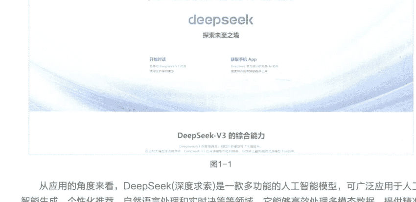

从应用层面看，DeepSeek 是一款多功能人工智能系统，可用于内容生成、个性化推荐、自然语言处理和实时决策等。它能高效处理多模态数据，提供精准语义理解与上下文感知，在内容生成、智能客服、数据分析等领域表现突出。对复杂任务如实时翻译、智能问答、自动化报告与代码生成等，其显著提升了体验与效率，成为 AIGC 时代的核心工具。
从理论层面看，其技术架构融合大规模预训练、知识蒸馏与自适应学习。与单一预训练系统不同，DeepSeek 通过强化学习动态优化行为，提升复杂任务灵活性。知识蒸馏将大系统知识压缩至小规模系统，兼顾性能与效率。相较他者，DeepSeek 在推理速度、资源消耗与任务适应性上突出，尤其在多模态处理与实时决策场景优势明显。
当前常用版本为 DeepSeek-V3 与 DeepSeek-R1，两者定位不同：
DeepSeek-V3：第三代通用架构，聚焦通用任务能力，采用混合专家 MoE 架构，参数规模达千亿级，支持 128K tokens 长上下文与多模态输入，在文本生成与复杂推理中表现优异，适用于内容创作、数据分析等开放场景。
DeepSeek-R1：面向实时交互与资源效率，通过动态剪枝与量化压缩将系统压缩至百亿参数内，并集成强化学习驱动的响应优化模块，推理速度较 V3 提升 3～5 倍，适用于高并发客服、边缘设备部署等低延迟场景。
> 提示：基础任务推荐 V3，偏重复杂推理时可选用 R1，二者形成能力与效率互补的技术矩阵。

#### 1.1.2 系统的多元能力
DeepSeek 与 ChatGPT 均属智能问答范畴，但功能更广，可直接服务用户或开发者，涵盖智能对话、文本生成、语义理解、计算推理、代码生成与补全、图形生成等。系统集成联网搜索与深度思考模型，支持文件上传，可读取各类文件文字与数据并形成知识库，增强检索与处理能力。
其应用覆盖多个专业领域：
金融行业可实时解析财经报告与市场数据，辅助量化交易策略生成与风险评估，处理效率较传统方式提升 20 倍以上；
医疗领域医学知识图谱支持精准诊断辅助，对 5000 多种病症进行多模态匹配，已在三甲医院部署 CT 影像智能判读；
教育板块依托个性化学习引擎构建知识漏洞图谱，习题推荐精准度达 92%；
智能制造中工业视觉算法在 3C 质检实现 0.02mm 级缺陷检测，误检率低于 0.5%；
代码生成模块支持 30 多种编程语言智能补全，使程序员编码效率提升 40%。这些案例验证了其作为新一代 AI 基座的技术突破与商业价值。
DeepSeek 还可与其他 AI 软件协同使用，表1-1 列出典型组合。

表1-1

| 组合 | 功能 |
| :--- | :--- |
| DeepSeek+Kimi | 自动生成PPT |
| DeepSeek+VSCode | 自动编写代码 |
| DeepSeek+剪映 | 自动生成短视频 |
| DeepSeek+Midjourney | 人工智能艺术生成 |
| DeepSeek+Notion | 自动生成文本知识库 |
| DeepSeek+Otter | 一键转会议记录 |
| DeepSeek+即梦+腾讯混元3D | 3D模型秒创建 |

#### 1.1.3 使用方式
使用方式与 ChatGPT 类似，均可通过网页前端交互。但 DeepSeek 支持本地计算机部署，离线访问不受网络影响，而 ChatGPT 仅能在线使用且需特定网络环境，使用便捷性与灵活性更强。
浏览器访问需打开官方网址 https://www.deepseek.com/。首页可见“开始对话”与“获取手机App”两个按钮，如图1-2所示。点击“开始对话”进入提问对话框，点击“获取手机App”可扫码下载移动应用。


点击“开始对话”后跳转至 https://chat.deepseek.com/，如图1-3所示。左侧栏显示历史提问与“开启新对话”按钮，历史记录均列于此。


提问界面如图1-4所示，输入框下方有“深度思考(R1)”与“联网搜索”两个开关。不操作则默认使用基础 V3 系统；开启“深度思考(R1)”切换至 DeepSeek-R1，推理能力增强；开启联网搜索启动全网检索。一般为获取更具洞察的回答，用户倾向仅开启深度思考模式。


界面右下角回形针图标用于上传文件，支持文本、表格、数据等多类格式。

### 1.2 常见 AI 系统及其技术架构
当前涌现众多 AI 系统，如 GPT、BERT、XLNet、Transformer-XL、ERNIE、DeepSeek 等。本节重点介绍 GPT 与 DeepSeek。

#### GPT 系列
- 开发者：OpenAI
- 技术架构：基于 Transformer 解码器，采用自回归生成文本，多头自注意力机制处理输入。
- 特点：预训练加微调两阶段；文本生成能力强；适用于生成、翻译、摘要等 NLP 任务。
- 应用：聊天机器人、内容创作、代码生成等。

#### DeepSeek
- 开发者：深度求索公司
- 技术架构：基于 Transformer，结合多种预训练技术与优化策略，支持多模态数据处理。
- 特点：多任务学习效率高；迁移学习性能强；适用于金融、医疗、教育等多场景。
- 应用：智能客服、医学诊断、个性化教育等。

#### 1.2.1 大型语言系统基础概念
大型语言系统理论根基在于深度学习与自然语言处理，尤其是 Transformer 架构。其自注意力机制可捕捉文本长距离依赖，提升序列数据处理效率。
系统通过大规模文本预训练学习语言统计规律与语义表示，常采用掩码语言模型或自回归建模作为训练目标。预训练后通过微调适应特定任务。DeepSeek 在此基础上结合高效训练技术与多任务学习能力，进一步强化泛化性能与实用性。

#### 1.2.2 Transformer 架构
Transformer 的核心是自注意力机制，使其区别于其他架构。作为序列数据处理系统，广泛用于翻译与文本生成。
与循环神经网络不同，Transformer 可并行处理全部输入，而非顺序处理，从而提升计算效率并增强长距离依赖捕捉能力。简单说，它能一次性审视输入各部分，作出更精准判断。
架构由 Encoder 与 Decoder 两部分构成。Encoder 接收输入序列，通过自注意力对每个元素编码生成上下文表示；Decoder 接收 Encoder 输出并结合已生成词信息，通过自注意力与交叉注意力生成目标序列。自注意力提升长依赖处理效率，交叉注意力帮助 Decoder 聚焦关键信息。
多层 Encoder 与 Decoder 堆叠进一步增强表达力，使其灵活适配各类序列到序列任务。

#### 1.2.3 强化学习与知识蒸馏
##### 1. 强化学习
强化学习是一种通过智能体与环境交互学习最优策略的方法，其理论基础为马尔可夫决策过程，由状态、动作、奖励与状态转移概率构成。每个时间步智能体根据当前状态选择动作，环境反馈奖励并转移到下一状态。目标是最大化累积奖励，通常用贝尔曼方程描述最优策略价值函数。
核心思想是探索与利用平衡，常用算法有 Q 学习与策略梯度，前者通过更新动作价值函数学习策略，后者直接优化策略参数。

强化学习框架下 DeepSeek 可支撑智能决策与自动化控制，这类功能依托经典理论，并借助 DQN、PPO 等深度网络来处理复杂任务。

##### 2. 知识蒸馏
知识蒸馏的本质是把复杂教师模型的经验迁移到轻量学生模型。本情境下教师对应大模型，学生对应小模型。训练并非直接拟合原始标注，而是让学生模仿教师的输出分布。教师把推理过程与最终结果一同传递，学生吸收核心推理能力后，推理效率往往能超过教师本身。

优化目标是让学生与教师的输出分布尽量贴近，常用 KL 散度来度量差异。借助该方式，学生既能获得预测能力，又能继承较好的泛化表现。

在模型压缩与部署场景里，DeepSeek 大量采用知识蒸馏，把超大模型的能力高效迁移到轻量版本，在性能与资源开销之间取得平衡。

### 1.3 DeepSeek-R1 本地化部署
传统使用多以网页访问为主，当服务器繁忙或出于隐私考虑时，离线方案更受青睐。将 DeepSeek-R1 置于本地是可行路径，可借助 Ollama 配合命令行完成，具体硬件与系统要求需依据版本选择。

部署完成后可通过命令行直接交流，也可借助图形界面交互。

本节说明本地化部署流程以及两种交互方式。

#### 1.3.1 Ollama
Ollama 是一款免费开源的本地化部署工具，能帮助用户把大模型下放到本地环境，自动化完成下载与部署。

打开官网，点击 Download 按钮获取安装包并完成本地安装，如图1-5所示。安装完毕后，可通过命令行窗口调用 Ollama 来管理模型。


在命令行中输入 Ollama 相关指令，若能正常返回信息即代表安装成功，如图1-6所示。可看到常用命令，其中 run 用来启动大模型。

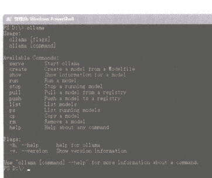

#### 1.3.2 安装大模型到本地
Ollama 安装成功后支持多种版本。需在官网 Models 选项卡中挑选目标模型并按版本号部署。

在 Models 选项卡找到 DeepSeek-R1，点击进入部署页，如图1-7所示。


随后在 DeepSeek-R1 页面下拉列表中选择 1.5b 版本，右侧会显示指令 ollama run deepseek-r1:1.5b，这就是命令行中的部署指令，如图1-8所示。复制指令准备执行。

打开 PowerShell，输入 ollama run deepseek-r1:1.5b，等待系统进行部署，如图1-9所示。

## 第1章 DeepSeek 未知境域探索
# deepseek-r1

DeepSeek 首代推理模型，性能可比肩 OpenAI-o1，包含基于 Llama 和 Qwen 蒸馏自 DeepSeek-R1 的六个密集模型。

1.5b 7b 8b 14b 32b 70b 671b

13.7M Pulls Updated 4 days ago

1.5b 29 Tags ollama run deepseek-r1:1.5b

Updated 3 weeks ago a42b25d8c10a · 1.1GB

| model | arch qwen2 · parameters 1.78B · quantization Q4_K_M | 1.1GB |

| params | { "stop": [ "<|begin_of_sentence|>", "<|end_of_sentence|>"... | 148B |

| template | {{- if .System }}{{ .System }}{{ end }}{{- range $i, $_ := .Mes... | 387B |

| license | MIT License Copyright (c) 2023 DeepSeek Permission is hereby gra... | 1.1KB |

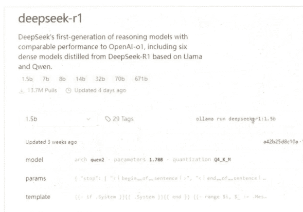


等待拉取结束，所有进度达 100% 后会出现 success 提示，表示模型已安装到本地，如图1-10所示。


此时系统会提示 Send a message，表示等待输入。用户可尝试输入“请帮我写一个三亚旅游攻略，120字左右”。随后模型返回结果，如图1-11所示，标志着本地部署成功。

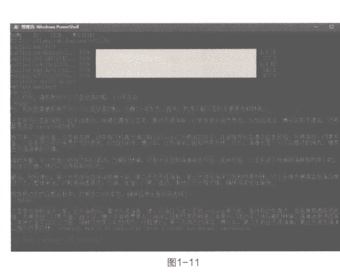

图1-11

#### 1.3.3 Chatbox 客户端操作
仅用 PowerShell 交互不够友好。为提升体验，可使用 Chatbox 客户端模拟网页交互。它易用，支持多款先进模型，数据保留在本地，兼顾隐私与速度，适合工作与学习。

进入 Chatbox 官网，点击“免费下载”按钮，如图1-12所示。下载后完成本地安装。


图1-12

安装完成后启动 Chatbox，界面如图1-13所示。

## 第1章 DeepSeek 全景解读

对 Chatbox 进行配置，点击左侧栏下方的“设置”按钮，弹出设置对话框。将“模型提供方”设为 OLLAMA API，“模型”设为 deepseek-r1:1.5b，点击“保存”完成配置，如图1-14所示。

#### 1.3.4 验证本地部署
Ollama 加载模型且 Chatbox 配置完成后，即可通过 Chatbox 与模型对话。打开 Chatbox，在输入框输入“请帮我写一个三亚旅游攻略，120字左右”。可看到返回结果并显示在对话框中，效果与网页版一致，证明部署成功，如图1-15所示。

### 1.4 DeepSeek 应用范围
DeepSeek 作为先进人工智能系统，覆盖日常生活与专业领域。依托强大的自然语言处理、计算机视觉与数据分析能力，在金融、医疗、教育、智能制造等行业表现突出，既提升效率，也推动智能决策与创新服务。

本节从文本生成、自然语言理解与分析、编程与代码生成、常规绘图四个方向展开。

#### 1.4.1 文本任务生成
文本生成是最基础的应用，根据输入指令返回所需答案。主要分为常规文本、技术类文本、结构化文本三类。

- 常规文本生成：故事、文章、营销文案、帖子、推文、剧本等。
- 技术类文本生成：论文摘要、征文撰写、数据报告、数据分析、多语言翻译与本地化等。
- 结构化文本生成：表格、图表、代码注释、文档撰写。

图1-16 为文本生成示例，输入越精确，结果越贴合需求。

#### 1.4.2 自然语言理解与分析
DeepSeek 在理解与分析方面的价值很大，能准确捕捉输入语义，深入理解上下文与情感，为用户提供更精准服务。

##### 1. 语义分析
用户把自然语言描述作为指令并指定转换目标时，DeepSeek 会通过语义分析把描述转换为特定格式。例如软件测试工程师用自然语言描述测试用例，提交后即可自动转换为自动化测试所需代码。

##### 2. 文本分类
可按指令要求对各类文本分类，如按新闻标题的情感倾向、字数，或按用户自定义规则，操作简便。

##### 3. 知识推理
通过大模型推理求解问题，可作为查找解题答案和作业批改助手，广泛应用于 K12 教育、智能自习室等领域。

图1-17 为理解与分析示例，输入指令后模型在推理过程中完成解题。

#### 1.4.3 编程与代码生成
在编程领域 DeepSeek 作用显著，可支持多种语言编码，甚至部分替代程序员。核心是根据结构化需求自动生成代码并进行调试测试，最终生成 API 文档。

##### 1. 代码生成
可按需求自动生成 Python、HTML5、CSS3、JavaScript 等代码片段，具备补全、功能解释、自动注释等能力。

##### 2. 代码调试
具备错误分析与修复建议、性能优化等功能。程序员输入问题代码并提出调试需求后，系统会自动分析运行结果、错误和性能问题并返回修改建议。

##### 3. API 文档生成
可自动生成 API 技术文档。程序员提交代码并提出针对函数、模块或功能的文档撰写需求后，DeepSeek 会据此自动生成相应文档，提升效率。

图1-18 为编程应用示例，用户提出创建用户登录前端页面的需求后，可迅速获得代码和 HTML 文件，直接运行查看。

#### 1.4.4 常规绘图
DeepSeek 具备强大的绘图能力，可创建 SVG 矢量图、Mermaid 图表、React 图表等。

- SVG 矢量图：基础图形、图表、组织架构图、简单插图等。
- Mermaid 图表：流程图、时序图、类图、状态图、实体关系图、思维导图等。
- React 图表：折线图、柱状图、饼图、散点图、雷达图、组合图表等。

绘制后可转换为 HTML 代码在网页中显示或在 Mermaid 软件中使用。复杂图形可借助 Midjourney 或 Stable Diffusion 等工具绘制。

图1-19 为绘图示例，用户输入绘图指令后，模型会绘制图形并转换为 HTML 格式，点击“运行 HTML”可在浏览器中查看效果。

DeepSeek 大模型：技术解析与商业应用

### 1.5 DeepSeek 使用技巧
要更好利用 DeepSeek，掌握指令工程至关重要，核心在于如何精准提问。详细内容将在第 2 章展开，这里先作简要介绍。

指令是用户向 AI 传达需求的信息，是任务执行与结果输出的基础。形式多样，目前尚无统一最优标准。可是一个简单问题、一份详细指令，也可是一个复杂任务描述。

##### 1. 指令基本结构
指令基本包含任务、背景和期望三部分。

- 任务：明确需求，告诉 AI 要执行的具体工作。
- 背景：帮助 AI 识别用户身份和自身角色，以便理解语境并执行。
- 期望：明确输出要求，如字数、格式、图片尺寸等。

以上是最基础的书写方法，适用于各类任务。

##### 2. 指令书写技巧
为提升效果，总结以下技巧。

- 用日常口吻明确需求，如“请帮我总结一下计算机发展历史。”
- 告知背景信息，如“请将以下英文句子翻译成中文：I need rest。”
- 指定输出格式，如“请将成都2025年2月12-15日的天气用结构化表格列出。”
- 分步提问，复杂任务可拆分，DeepSeek 能自动识别上下文。如“1.请先解释什么是深度学习？2.主要应用场景？3.如何入门？”
- 设定专家角色，如“你是一位机器学习专家，请讲解神经网络理论基础。”
- 场景化提问，如“请用中学生能懂的语言讲强化学习概念。”
- 调整语气，如“请以商务邮件格式写一封项目合作邀请函。”
- 采用追问方式，第一轮回答不满意时细化或补充指令，AI 会基于上下文对上一轮回答进行补充。

运用以上技巧可更高效获得精准输出。

### 1.6 本章小结
本章全面介绍了 DeepSeek 基础，包括概念、功能与用途，并讲解了常见 LLMs 与 Transformer 架构，演示了本地部署 DeepSeek 的方法，还介绍了应用领域和使用技巧。

通过学习，读者可初步掌握网页版与本地部署的使用方法，完成简单任务。后续章节将深入具体应用场景，帮助读者更好地利用这一 AI 工具。

## 第2章 DeepSeek 入门与指令实战

随着 AIGC 技术成熟，创新工具不断涌现。DeepSeek 凭借卓越性能，成为帮助用户高效处理复杂任务的强力工具。

本章将详细介绍如何高效使用 DeepSeek，并在 AIGC 时代构建高效指令与 AI 交互策略。从界面使用到进阶指令工程，帮助读者全面掌握使用技巧与应用场景，提升工作效率与创造力。

### 2.1 DeepSeek 使用技巧详解

DeepSeek 提供两种便捷访问方式：移动应用和网页版，各有特点，用户可按需选择。无论个人设备还是工作环境，都能实现无缝体验。接下来分别介绍。

#### 2.1.1 访问 DeepSeek 的两种方式

##### 1. 官方移动端应用访问
官方移动应用是直接便捷的访问方式之一。DeepSeek 提供 iOS 和 Android 版本，用户可在手机或平板下载安装，随时随地与 AI 互动。具体方法如下。

- 下载后安装：通过 App Store 搜索 DeepSeek 并下载。Android 和 iOS 用户均可在官方应用商店找到，下载快速，安装后点击图标即可开始使用，如图2-1所示。

- 注册与登录：首次使用需注册账户，支持微信登录、Apple 登录、手机号注册等，如图2-2所示。

- 界面与使用体验：登录后进入交互界面，如图2-3所示。应用设计简洁直观，可轻松找到各项功能。输入文本即可即时获得 AI 响应，适合需要频繁交互且经常外出的用户。

##### 2. 网页端访问
网页版为不习惯使用手机的用户提供传统且全面的操作体验。可通过 PC 或笔记本浏览器直接访问，在大屏幕上完成复杂或多任务操作。

网页版快速开启

要在电脑上使用 DeepSeek，只需在浏览器里打开 https://www.deepseek.com/，进入官网后点按首页的对话入口即可进入主界面，示意见图2-4。
进入后要用微信账号或手机号完成注册登录，界面如图2-5。
功能层面网页版与手机 App 基本一致，区别在于显示屏更大，操作区域更宽敞舒展，视觉感受更从容，如图2-6。
> 需要碎片时间迅速得到 AI 回复，官方移动端更方便，随时随地；工作里要做繁复拆解或长时间作业，网页端给出的操作空间更宽广。

#### 2.1.2 AI控制台界面详解
DeepSeek 的 AI 控制台是人机交互的核心据点，熟悉其结构与能力能明显提升使用效率。下面对界面构成与核心功能做系统梳理。

##### 1. 控制台的界面布局
整体简洁，左右分栏，如图2-7。
- 左侧边栏：集中呈现账号信息、历史会话清单以及新建会话入口，便于快速调取往期记录或启动新对话。
- 右侧工作区：主要的交互发生地，所有输入与模型产出都在此呈现，支持文字输入、查看回复、上传资料等操作。

##### 2. 主要功能详解
- 深度思考 R1：这是平台的旗舰能力，相当于模型能力的集大成。开启后系统会进行多步推演与深度剖析，给出更细致、系统且有洞见的结果。科研探索、创意写作、技术攻关都能借此拓宽思维广度与深度。

该能力的最大价值在于把推理过程可视化。不同于只给结论的常规问答，它把每一步的推导拆开展示，让使用者看清模型如何从不同角度切入、逐步归纳。以“人工智能对未来艺术创作的影响”为例，系统会先拆解问题，再分步展开逻辑链，如图2-8所示，使用者既能看到结论，也能看到结论的来路。

呈现推理链条往往比结论本身更有意义，“会问比知道答案更重要”，延伸来说，“知道答案是怎么来的也比答案更重要”。这种展示帮助使用者多维度把握问题本质，跟随推理过程加深理解；同时能激发新思路、找到更优解。对创意写作、科研创新尤其友好，还能锻炼批判性思维，为反思提供空间，提升思考质量。

深度思考 R1 的适用范围很广：
- **科研工作：** 帮助研究者拆解论文与报告中的复杂理论，启发新假设与研究思路。
- **创意写作：** 辅助情节设计、人物剖析，乃至形成新的创作方法。
- **技术难题攻关：** 深入挖掘技术问题的根源，给出创新性解决方案。
- **教学辅导：** 作为教学助手，帮助学习者理解复杂概念，提升逻辑能力。

- 联网搜索：是 DeepSeek 的另一项强力工具，与深度思考 R1 相互配合，为使用者接入实时网络资源。核心优势在于即时调用最新知识库，让回答在科技、医学、商业趋势等快速变化领域始终保持新鲜。

工作流程分两步：一是实时检索与采集。提问后，AI 会自动在网上搜索相关文章、论坛讨论、学术论文、技术报告等，提升时效性与多样性。二是筛选整合。系统从检索结果中挑选权威相关内容，汇总成条理清晰的回答并附上网页来源，如图2-9所示。

- 联网搜索与深度思考 R1 的协同：二者结合能大幅提升分析力。深度思考依赖既有知识库推理，而在高度专业化或强时效性问题上，知识库更新会有滞后。联网搜索正好补足这一缺口。例如问“人工智能在科研领域的应用前景”，仅靠内部知识可能缺失最新进展，联网搜索可实时抓取最新研究、技术突破与行业动态，再经思维链分析，形成兼具理论深度与时效性的回答，如图2-10所示。

# DeepSeek 大模型：技术解码与商业落地
人工智能在科研领域的前景展望

1975年，人们在搜索引擎输入关键词，得到的是若干网页链接。随着信息爆炸，传统检索已难以满足需求，大家渴求更智能、更个性化的信息体验。

接下来思考如何把大模型技术引入科研。首先，大模型在自然语言处理上具备强理解与生成能力。其次，在知识图谱构建、信息检索、文本生成等环节均有广泛价值。此外，还可用于论文自动摘要、翻译与推荐等任务。

研究者通常需要迅速拿到科研资讯、提升研究效率、发现新方向、与同行交流。大模型可通过分析海量文献提供个性化建议与推荐。

挑战同样存在：大模型训练消耗大量算力和数据，可能限制其在科研中的应用；可解释性不足，使用者难以理解决策过程。

应对思路包括：优化训练算法降低算力需求；研发可解释性更强的大模型；构建面向科研的专用模型，提升垂直性能。

同时可考虑将大模型与知识图谱、自然语言处理等技术融合，提升应用效果，并关注伦理与安全，确保使用符合道德规范。

总体而言，大模型在科研中前景广阔但挑战并存，通过算法优化、可解释性提升、专用模型建设等举措，可充分释放潜力，推动学术创新。

多模态大模型如 GPT-4 催生“认知增强研究”模式。在考古学领域，借助文本-图像联合嵌入技术，AI 平台能从碎片化纹理特征推断古文明交流路径（Science Advances, 2023）。

可解释性研究的突破
因果推理框架与深度学习的结合如 DoWhy+PyTorch 正在缓解“黑箱”困境。在经济学政策评估中，该工具量化呈现不同干预措施的因果效应链（NBER, 2023）。

## 三、伦理挑战：技术应用的边界探索
1. 学术诚信的重新定义
   - 生成内容 AIGC 模糊了学术贡献边界。Elsevier 最新指南要求 AI 参与度超过20%的论文需特别标注（Elsevier Policy, 2023），但如何量化“智力贡献度”仍有争议。
2. 数据偏见的系统性风险
   - 训练数据的历史偏差可能扭曲研究结论。心理学研究发现，基于 Reddit 语料训练的模型在心理健康评估中出现显著性别刻板印象（JPSP, 2022）。
3. 认知依赖的潜在危机
   - 过度依赖 AI 可能导致研究能力退化。神经科学研究显示，长期使用文献推荐系统的学生，其跨领域联想能力下降29%（Neuron, 2023）。

## 四、未来发展方向
1. 增强型研究系统
   - 研发具备自适应能力的科研 AI 如 MetaScience 2.0，可动态调整研究策略。在材料科学中已实现从分子设计到成膜机理的端到端自主研究（ACS Nano, 2023）。
2. 人机协同创新机制
   - 人工智能在科研中的应用正从辅助工具向科研创新伙伴演进。以下从技术赋能、方法论重构、伦理挑战三维度展开系统分析：

## 一、技术赋能：研究流程的智能化重构
1. 数据密集型研究的范式升级
   - 自然语言处理技术推动文献综述智能化。BERT 模型在 PubMed 文献分析中展现的语义关联能力（Devlin et al., 2019）可自动识别跨学科知识节点，较人工筛选效率提升约17倍（Nature Index, 2023）。
   - 生成对抗网络 GANs 在实验设计中显著降低试错成本。MIT 团队利用 StyleGAN 生成虚拟材料微观结构，将新型合金研发周期从传统8年压缩至8个月（Science Robotics, 2022）。
2. 复杂系统的建模革新
   - 图神经网络 GNNs 在社会科学网络分析中实现动态关系建模。针对新冠传播研究，GNN 融合交通、社交、医疗多源数据后，预测准确率较传统 SIR 模型提升43%（PNAS, 2021）。
   - 物理信息神经网络 PINNs 重塑流体力学研究。其 Navier-Stokes 方程求解架构在航空发动机气动设计中实现精度与速度的帕累托最优（JFM, 2023）。

## 二、方法论重构：研究范式的根本转变
1. 假设驱动向数据驱动迁移
   - Transformer 架构推动非监督学习在基因组学应用。DeepMind 的 AlphaFold 通过自注意力机制，在无预设结构模板条件下预测蛋白质折叠路径，破解困扰生物学界50年的“蛋白质折叠问题”（Nature, 2021）。
2. 跨学科研究的新形态
   - 基于区块链的智能合约系统如 ScienceChain 可自动执行数据使用协议，在保护隐私同时实现研究可重复性验证。该系统在临床多中心试验中减少38%数据纠纷成本（JAMA, 2023）。

结论：人工智能正在重塑科研的边界与方法论，核心价值在于扩展而非替代人类智能。未来关键在于建立动态平衡机制——既充分利用 AI 的计算优势，又保持人类在创造性思维中的主导地位。这需要学术界、技术界与政策制定者共同构建包含技术标准、伦理规范、教育体系的三维治理框架，最终实现“增强智能”而非“替代智能”的研究新生态。


## 历史记录与新建对话
控制台左上角设有“收起/打开边栏”按钮，点击后可查看全部历史对话。使用者可随时回顾过往交互、查看 AI 回复，并按需续谈，特别适合需要反复回顾或延续主题的场景，如图2-11所示。

打开边栏后可见“开启新对话”按钮，点击即可新建对话窗口，开始全新的交互。通过该功能可并行处理多个问题，便于任务管理。


## 文件上传与多种输入方式
DeepSeek 提供强大的文件上传能力，支持多种输入形式，让交互更灵活高效。

上传功能允许使用者将文本、PDF、图片等格式直接导入，AI 会提取关键信息进行分析。例如科研人员或企业使用者常需从大量文献或报告中提炼要点，上传 PDF 后 AI 即可快速扫描并生成摘要，在文献综述、报告分析中非常实用。

此外还支持拍照上传。使用者可拍摄纸质文件或手写材料，系统借助 OCR 技术识别文字并转为文本处理。同时能解析图像内容，如风格、色调、构图等，在设计或艺术创作中帮助更精准决策。

传统本地文件上传同样可用，支持 Word、Excel 等多种格式，AI 会提取信息完成文档分析、报告生成等任务。

这些多样化输入方式显著提升了 DeepSeek 在数据分析、创意设计、科研等领域的应用价值，上传入口如图2-12所示。

> 提示：在联网搜索开启时，上传文件功能不可用。


## 个人信息设置
控制台左下角提供个人信息入口，包含“删除所有对话”“退出登录”等选项。其中隐私保护尤为重要。DeepSeek 对交互过程中的文本、上传文件等数据进行加密处理，确保隐私安全。

隐私政策详细说明数据收集与使用方式，使用者可按需调整数据共享设置，控制信息的使用范围。点击“个人信息”|“系统设置”|“账户信息”后即可查看“隐私政策”，如图2-13所示。

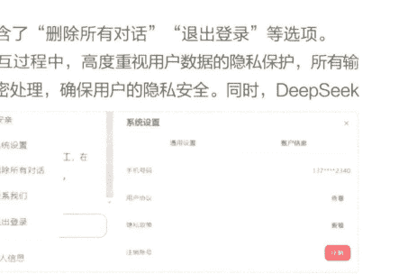
#### 2.1.3 与AI的基础对话
DeepSeek 的交互基于自然语言对话，使用者输入文本即可获取信息或帮助。无论是简单问答还是复杂任务，系统都能给出精准高效的响应。下面介绍基础对话流程。

1. 启动对话
在控制台点击“开启新对话”按钮后，可在右侧工作区输入问题或需求，AI 会实时生成回答并显示在对话窗口中，支持问答、文本生成等多种场景。

2. 文本输入与响应
发送文本后，AI 会依据指令与前文给出贴切回应。使用者可提出科研、知识查询、创意写作等各类问题，系统会解析关键词与前文，确保答案符合需求。

3. 交互体验
不同于传统搜索引擎，DeepSeek 能理解复杂前文并进行深度推理分析。支持多轮对话，每轮交互会基于前文调整，答案更贴合实际需求，使用者可在对话中逐步深入或修正问题，AI 会实时优化输出。

4. 常见对话场景
- 科研工作：讨论论文核心观点、获取领域现状或寻求创新思路，如“AI 在艺术创作中的应用前景”或“神经网络新进展”。
- 创意写作：获取情节设计、角色塑造灵感，如“给我一个悬疑故事开头”或“设定一个超能力角色”。
- 日常问题解答：解决学习技巧、健康建议、科技资讯等，如“如何提高学习效率”或“未来十年最有前景的技术是什么”。
- 任务与建议：提供解决方案与建议，如“推荐科技论文写作结构”或“如何更有效管理时间”。

5. 多轮对话的流畅性
在连续对话中，AI 会跟踪前文变化并持续优化回应。若使用者在初次提问后希望进一步深挖某部分，系统会记住前文，给出更个性化、精细的解答。


6. 语气与风格自适应
DeepSeek 能根据使用者语言风格调整回应语气。需要简洁专业时，会提炼核心信息缩短篇幅，如图2-14所示；要求详细分析时，则提供完整推理与解释，灵活匹配不同需求。

### 2.2 AIGC时代的提示词工程

生成式人工智能AIGC进入爆发期后，能否与AI顺畅协作、拿到可用结果，核心已经落在提示词的写法上。提示词既是人机沟通的桥梁，也是决定AI输出质量的关键变量。尤其在艺术创作和设计场景里，一条精确又有想象力的指令，能把灵感到成品的距离大幅缩短。和单纯的聊天工具不同，DeepSeek把深度思考R1与实时联网搜索结合在一起，让提示词工程有了更多可发挥的空间。

下面就围绕提升人机交互质量、优化生成内容展开，从提问方式、任务拆解到提示词结构和思维链实践，给出可直接上手的做法。

#### 2.2.1 学会精准提问

在AIGC使用里，提问是起点也是关键。问得清楚，AI才能抓住重点；问得有层次，输出才会更准更实用。结合DeepSeek的深度思考与联网能力，提问策略的优化会直接体现在答案的准确度和应用价值上。

1. 先把目标和需求说透
提问前要先想清楚自己想要什么结果，而不仅是抛一个话题。目标的设定、期望产出的样子、具体的限制都要写出来。比如想让AI设计一个未来感角色，不要只说“设计一个未来角色”，而要写成“请设计一个科技未来风格的男性形象，带机械义肢和智能眼镜，表情严肃、气场具有压迫感”。目标越具体，DeepSeek越能对准重点，减少模糊或偏题的输出。

2. 开放式与封闭式提问混用
提问不只有一种写法。开放式问题能打开AI的想象空间，得到多角度的解释、建议或创意；封闭式问题则能快速拿到明确、可落地的答案。两者结合使用，既有发散也有收敛。

开放式通常没有标准答案，适合需要推理和分析的任务，例如：
“人工智能未来可能在教育领域带来哪些变化？”
“请塑造一个复杂的反派，并解释他的心理驱动和所处社会环境。”

封闭式更直接，适合要事实、判断或结构化信息，例如：
“AI能分担医生的部分工作吗？”
“今天是星期几？”

把开放和封闭交替使用，既能激发深度思考，又能迅速拿到关键信息，特别适合复杂任务的推进。

3. 把大问题拆小步走
遇到复杂需求时，把一个大任务拆成若干小任务逐项解决，效果会更好。这种拆解本身就和思维链很像，DeepSeek的深度思考也会自动把问题分步推理。用户主动拆分，可以让每一步都更清晰、更可控。

例如写一篇关于人工智能伦理的论文，可以拆成：
先问“人工智能伦理主要指什么？”
再问“当前伦理领域面临的主要争议有哪些？”
接着问“可以采取哪些措施来缓解这些挑战？”
在深度思考模式下，AI会按顺序完成每个子问题，最后整合成逻辑严密的文章。

4. 给出充足的背景和上下文
AI的理解深度取决于输入的信息量。DeepSeek具备较强的推理能力，背景信息越完整，输出越贴近预期。做艺术创作时，如果不说明画风、人物性格、受众等信息，很容易得到偏差的结果。补充角色背景、创作目的、风格偏好等上下文，能显著提升结果的准确性。

#### 2.2.2 任务需求

AI的表现不仅靠模型本身，更靠用户如何定义任务和设计提示。DeepSeek凭借深度思考与联网搜索的双重能力，能处理更复杂的任务并给出实时、可参考的创作支持。任务需求分析一般分三步走。

**明确核心目标**：在动手前先锁定最终要达到的结果。比如要做一张未来主义插画，目标就是产出一幅兼具现代科技感和未来感的视觉作品。

**细化子目标与细节**：目标之下往往有多层要求。插画创作除了整体风格，还要确定角色造型、背景构图、光影处理等具体元素。

**设定约束与要求**：除了内容，还要规定形式上的边界。比如角色面部表情要柔和、肢体要有动感；背景简洁现代，避免元素堆砌。

在使用DeepSeek时，把目标、细节和约束一次性讲清楚，能让深度思考更精准地展开分析，输出更贴合需求。

#### 2.2.3 提示词拆解

提示词解构是提升AIGC质量的重要手段。它把一次指令拆成多个要素，让AI更准确地理解意图，比单纯堆关键词更有效。DeepSeek在复杂任务中尤其依赖多层次解析，理解提示词的构成并优化层次结构，是提升创作质量的关键。

1. 提示词的基本要素
一个完整的提示词通常包含：
**主题Subject**：任务的核心指向，例如“智能家居系统的未来走向”。
**背景Context**：任务的场景信息，例如“面向普通消费者的智能家居市场”。
**风格Style**：表达方式的指引，例如“用通俗易懂的科普语气”。
**结构Structure**：输出的组织方式，例如“按现状-趋势-挑战-对策展开”。
**限制条件Constraints**：对结果的限定，例如“1500字以内，避免专业术语”。
**输出格式Format**：呈现形式，例如“用五点概括”。

完整示例：
请为普通消费者写一篇关于智能家居未来发展趋势的文章，介绍技术进步、市场走向和可能面临的挑战。文章结构为现状、趋势、挑战、解决方案，字数控制在1500字内，语言通俗，避免过多专业词汇。

2. 拆解的三种常用手法

▶ 方法1：层次分解法
把复杂任务拆成层层递进的子任务，让AI逐步生成并保持逻辑连贯。以“分析人工智能对未来就业市场的影响”为例：
✕ 不良示例：请分析人工智能对就业的影响。信息太少，容易笼统。
✓ 优化示例：请写一篇关于人工智能对未来就业影响的文章，按以下顺序展开：
人工智能可能替代哪些传统岗位？
它又会创造哪些新职业？
哪些行业冲击最大？
政府和企业该如何应对这种变化？
优点是逻辑清晰，避免泛泛而谈，适合报告、论文等需要多角度分析的任务。

▶ 方法2：目标导向法
先明确最终要交付什么、给谁看、有什么要求。以“撰写区块链在金融领域应用的研究报告”为例：
✕ 不良示例：请介绍区块链在金融领域的作用。目标模糊。
✓ 优化示例：请为金融科技从业者撰写一份关于区块链在金融行业应用的研究报告，涵盖银行业、支付、保险、证券交易中的具体案例；分析其带来的安全、透明、成本优势；指出当前挑战及对策；展望未来趋势。采用正式学术风格，约2000字。
优点是目标明确，输出更符合预期，适合正式文档创作。

▶ 方法3：示例引导法
通过示范样本让AI抓住风格和格式。以“写商业计划书摘要”为例：
✕ 不良示例：请写一份商业计划书摘要。需求不具体。
✓ 优化示例：请参考以下样本风格撰写人工智能教育平台的商业计划书摘要。样本：“本计划旨在推出基于AI的智能健康管理方案，面向中高端用户，核心功能为个性化健康分析、实时监测、AI建议，目标市场为全球健康管理，计划三年内盈利。”请按类似格式输出。
优点是格式和语气可控，适合对风格、结构有要求的写作任务。

结合DeepSeek的深度思考进行优化
DeepSeek本身已内置提示词解构能力，会自动把复杂指令拆成推理步骤。用户若再用层次分解、目标导向、示例引导等手法优化提示词，就能让思维链更清晰，输出质量更高。

#### 2.2.4 思维链式提问

提示词思维链是通过一系列递进的指令，引导AI逐步推理、分层生成的策略。它把复杂任务拆成链条，每一步都建立在上一步结果之上，确保逻辑连贯、内容有深度。

1. 定义与意义
思维链不只是指令的堆砌，而是让AI在多步推理中深入问题的不同层面。每一步提示都为下一步提供基础，最终形成结构完整、层次分明的答案，特别适合复杂创作与分析。

2. 工作原理
核心是逐步推理与逻辑递进。用户通过精心设计的提示序列，确保AI不遗漏关键细节，按顺序完成深度分析。

例如设计科幻角色：
第一步背景设定：请设定一个科幻世界，说明科技水平、社会结构和主要种族。
第二步角色定位：在该世界观中创造一名主角，确定身份、性格和职业。
第三步外观设计：基于设定描述服装、发型、配饰，是否带有机械义肢等。
第四步细节补充：补充战斗风格、特殊技能或标志性动作。
第五步情境设定：给出一个关键剧情场景，说明角色如何应对挑战。

分层提问能避免跳跃和逻辑断裂，让角色设定更完整。

3. 主要优势
增强推理深度与精确度：任务拆解后每个子问题都被充分处理。
保证逻辑连贯：每一步承接前一步，形成有序推理链。
提升复杂任务效率：避免一次性任务过大，每个细节都能被照顾到。
提供灵活反馈：用户可根据中间结果调整后续提示，持续优化方向。

4. 设计要点
拆解任务：把大问题拆成目标清晰、相互衔接的小任务。
逐步递进：由宏观到微观，先背景后细节。
明确每步目标：让AI清楚当前要做什么。
引导与反馈：利用前一步输出调整下一步指令，使结果更贴合需求。

5. 常见类型
逻辑推理型
适用于学术研究、商业决策等需要严密分析的场景。例如“分析人工智能如何影响传统艺术行业”：
请列出AI在绘画、音乐、影视等艺术领域的主要应用。
说明生成艺术背后的技术原理，如深度学习、风格迁移。
对比AI艺术与人类艺术在创意和情感表达上的差异。
总结市场趋势，分析对传统艺术的冲击与未来走向。

创意发散型
适用于故事创作、概念设计等需要激发想象的场景。例如“创作一个关于未来城市的科幻短篇”：
描绘未来城市的建筑风格、交通方式和社会制度。
设定一位主角，介绍生活背景、职业、目标和冲突。
围绕主角设计一个重大事件的情节线。
加入戏剧性冲突和出人意料的反转。

层级构建型
适用于产品设计、课程开发等需要由整体到局部的任务。例如“制定一套人工智能入门教学课程”：
列出人工智能基础课程的主要章节，涵盖概念、应用、伦理等。
为每个章节制定详细教学大纲，列出核心知识点。

- 围绕互动练习与案例剖析，帮助学员更直观地理解AI技术的工作方式。
- 形成一份课程回顾文档，并附上后续拓展阅读推荐。

##### 6. DeepSeek R1 思维链：机遇与风险

DeepSeek 是一款同时集成 R1 深度思考与联网检索能力的 AI 工具，天生具备提示词思维链的特质。它能对复杂任务进行自动化分步推演，通过层层递进的逻辑来保证输出的连贯性与深度。

即便 R1 思维链显著提升了创作效率与输出质量，也存在明显短板，使用时需结合实际场景权衡。下面梳理其主要优缺点。

# DeepSeek 大模型：原理拆解与商业落地

###### ▶ 思维链的核心优势

- **推理流程自动化：** R1 深度思考功能会自动把复杂任务拆解为多个推演步骤，大幅降低用户的前期设计成本。用户只需给出清晰的任务描述，系统便会依任务复杂度与目标自行启动思维链推演。自动化的推进方式避免了人工推理容易断层、遗漏或前后不一致的问题。
- **生成质量更扎实：** 逐步推演保证了覆盖面，同时提升了逻辑性和层次感。DeepSeek 在多层推理中可接入外部信息，如联网搜索结果，从而输出更精准、更详实的结论。对科研分析、战略评估等复杂场景，思维链能确保细节充分展开。
- **复杂任务处理能力增强：** R1 与联网搜索的结合，使模型能够承接数据量大、维度多的专业任务，例如科研报告撰写、市场洞察、技术方案设计等。通过逐层展开的自动推理，帮助用户快速获取可用的结果。

###### ▶ 思维链的明显弊端

- **幻觉风险依然存在：** 在涉及学术研究或专业领域的生成中，DeepSeek 易出现无依据编造的情况，即所谓的幻觉。依据 Vectar 的幻觉评估体系，DeepSeek-R1 的幻觉率约为 14.3%，在全球主流大模型中处于靠后位置。该缺陷对学术研究与商业决策的可靠性影响较大，使用者必须对每条关键信息进行严格核验。
- **对背景信息依赖度高：** 推理效果高度受输入背景与提示词质量制约。若用户提供的上下文不足，模型容易滑向默认推理路径，输出与真实需求出现偏差。这时需要通过补充细节与优化提示来弥补信息缺口。
- **推理路径可控性弱：** 尽管自动化程度高，但用户对内部推演过程的干预有限。AI 会按自身理解选择重点，可能过度聚焦次要细节而忽略核心问题，导致最终质量受损。

#### 2.2.5 提示词思维链设计方法

构建有效的提示词思维链是实现预期 AI 产出的关键。通过明确任务要点并深度运用思维链，可引导模型输出更贴合需求的结果。以下四种设计思路各有侧重。

##### 1. 跨界融合式思维链

跨界融合式思维链强调把不同学科、文化背景的知识与思维方式拼接，以打破学科壁垒，产生突破性的解决思路。多视角交叉能更全面探索问题并提供新路径。

以智能健康管理为例。先用人工智能分析体重、运动、饮食等健康数据，通过机器学习预测趋势。若仅停留在技术层面，建议会显得冰冷。加入心理学情感理论后，系统可识别用户在减重期的焦虑、沮丧情绪并给出心理支持。再结合社会学行为学，考虑不同社群对“健康”的定义差异，如有的关注体型美观，有的看重内在状态，从而让建议适配文化背景。

整合后的提示词示例：

设计一套智能健康管理系统，融合 AI、心理学、社会学与文化学，输出个性化全方位方案。需包含：
- 技术与数据层：AI 健康数据分析、体重运动饮食预测、个性化建议。
- 情感与心理层：情感分析、焦虑沮丧识别、心理辅导建议。
- 文化与社会层：行为分析、文化对健康观念的影响、跨文化适配方案。

##### 2. 聚合整合式思维链

聚合整合式思维链主张把多元信息与观点汇总到同一框架中，解决复杂问题并优化决策。

以社区活动管理平台为例。需求端需通过问卷或反馈收集居民对体育、文化、公益类活动的偏好；再结合历史活动参与数据进行分析，避免同质化。资源端需整合场地、设备、志愿者等信息进行合理调配。文化端需考虑不同社区的社交习惯与价值取向。

可借鉴 FOCUS 流程：先 Filter 筛选核心功能如发布、报名、资源调配；再 Optimize 简化报名流程提升体验；再 Combine 融合推荐与社交互动；再 Unify 统一从发布到互动的全流程；最后 Synthesize 基于用户反馈持续优化推荐与资源配置。

整合提示词示例：

构建社区活动管理平台，融合居民需求、历史数据、资源管理与文化适配，为居民和组织者提供组织与推荐服务。需覆盖：
- 需求与数据汇聚：兴趣调查、历史数据分析、建议优化。
- 资源与组织：场地设备调配、活动安排优化。
- 文化与社交适配：社区文化匹配、个性化推荐。

##### 3. 拓展创造式思维链

拓展创造式思维链鼓励跳出常规框架，从不同领域寻找创新解法，激发多样创意。

以任务管理应用为例。基础功能包括创建、提醒、进度追踪。为提升黏性，可增加任务分享与团队协作，让个人行为延伸为社交互动；引入积分、徽章等奖励机制，用成就感驱动持续使用；结合用户习惯分析，自动推荐任务模板与日程安排，实现个性化效率提升。

整合提示词示例：

设计一款任务管理应用，以社交互动、激励机制与个性化推荐提升体验。需包含：
- 任务与社交：创建提醒追踪、分享协作。
- 激励机制：完成奖励、积分徽章、成就感。
- 个性化：习惯分析、模板推荐、智能排程。

##### 4. 情感化思维链

情感化思维链以用户情感体验为核心，通过有意识的情感注入增强产品联结感。

以家庭团聚活动策划为例。核心情感目标设定为温馨、亲密、团聚。活动全程使用“团聚”“家”“共享时光”等情感词汇。情感强度递进：迎宾环节营造温暖氛围；互动环节通过故事分享与手工共创深化情感；高潮环节以家庭影像回顾强化归属感。场地布置照片墙、家庭元素装饰与温暖音乐进一步触发情绪。

整合提示词示例：

策划家庭团聚活动，以情感设计与互动增强联结。需覆盖：
- 情感化设计：温馨氛围、亲密感营造、情感话题。
- 情感曲线：渐进式体验、迎宾、互动、高潮回顾。
- 触发设计：迎宾礼、故事分享、礼物互赠、归属感强化。

#### 2.2.6 提示词进阶框架

##### 1. 内省叙事框架

内省叙事是一种在关键情节设置反思点的写作工具，促使创作者思考“为何如此选择”而非仅记录“做了什么”。在角色做重要决定时，可自问伦理冲突是否存在、对读者会产生何种道德启示或困惑，从而让情节具备更深层的社会与哲学含义。反思机制帮助作品在情感、逻辑与伦理层面更具力量。

##### 2. 嵌套创作镜像框架

嵌套创作镜像鼓励从多层视角审视创作决策。

- 原型叙事层：构建故事骨架，确定情节与人物设定。
- 创作解构层：回顾并拆解决策，分析动机与替代路径，发现叙事漏洞。
- 认知反射层：评估方法有效性，反思创作目的与意义。

可加入深度调节参数 R：R=2 仅做基础情节反思；R=4 深入剖析结构与人物动机；R=5 质疑创作方法本身，触及哲学与伦理层面。该结构让创作者不断解构重构思维，作品更厚重。

##### 3. 多声部协奏框架

多声部协奏通过角色化协作推动创作，三个核心角色分别是：

- 造梦者：负责创意与情感冲突，评估风格并强化情感深度。
- 解构者：负责结构与逻辑审查，用 SWOT 等工具提出改进建议。
- 守门人：负责伦理审查，确保内容符合社会道德底线。

当意见冲突时，可启动“创意熔炉”生成三条平行分支供选择。例如在反乌托邦 AI 统治世界的小说中，造梦者主张强化主角与 AI 的情感纠葛；解构者建议聚焦理性抉择与社会后果；守门人提醒避免过度渲染 AI 恐惧。最终可综合为：AI 继续存在但受人类伦理监管，避免技术依赖失控。

##### 4. 叙事决策森林框架

叙事决策森林通过设置多个决策节点，让读者参与塑造故事走向。故事不再由作者单线主导，而是形成类似生态系统的多分支体验。随着不同选择，支线不断生长，最终呈现多样化且高互动性的叙事效果。其核心在于决策点的设计与分支逻辑的连贯性。

**选择即引擎：叙事决策森林全解析**

主线干道：这是整部作品的必经通道，所有读者都会沿着它前行。它决定了故事的整体走向，搭建起情节的骨架与框架。

心绪细流：属于角色内心的独白分支，用来呈现情绪波动、内心冲突与自我反思。当读者点开某条情绪线，系统就会投放对应的心理描写，让阅读者更贴近人物的精神状态。

价值菌丝：围绕道德命题展开的延伸分支，聚焦人物在抉择关口遭遇的伦理难题与追问。每当剧情出现价值分叉，系统就会激活该支线，对得失利弊与可能后果做剖析。

叙事决策森林的完整构成如下。

故事开场：构建初始场景，让主角直面重大的人生抉择。交代人物背景、当前心境与困境，明确必须做出判断，且该判断会牵动后续发展与命运。简要点出情境中的矛盾或挑战，点燃读者对后续选择的期待。

决策节点设计：为人物设置三个关键抉择点，每个节点提供两种走向。不同走向对应截然不同的情节走向，并说明其可能触发的情感张力或思想碰撞。确保每个节点与主线紧密咬合，为后续展开提供支点。

选择后果推演：针对每个走向简要推演结果。说明该选择如何影响情节推进、角色情感与动机变化，以及外部环境或社会变迁。兼顾即时反应与长远影响，给读者清晰的判断依据。所有结果需逻辑自洽并推动叙事继续。

支线延展：无论读者挑选哪条路径，故事都要持续向前。依据选项呈现差异化走向，但保证每条分支都能自然衔接到下一个决策点或转折。每条线路都保持连贯，确保互动感与多样性不流失。

终局呈现：依据累计选择呈现多重结局。每个结局都与前期选择密切关联，体现因果，并以富有冲击力的情绪做收束。让结局与读者的决策产生深度联结，引发反思。结局同时展现选择对角色本人及社会层面的影响，呈现哲学或道德意涵。

参与感与丰富度：通过多个决策点与支线保证故事的交互性与多样性。每个选择都产生实质影响，构建一个持续变化与成长的叙事世界。随着决策推进，故事层面不断加深，读者获得多元视角与情感体验。

下面以具体案例说明该框架的使用方式。

在一个生态崩塌后的未来世界，人类社会陷入生存危机。地球生态功能几乎丧失殆尽，人类必须决定是借助高科技重塑生态，还是停止技术干预归返自然选择。主角是一名环境科学家，正站在这个艰难的十字路口。提示词中的决策节点与结果如下。

(1) 决策点1
- 方向一：开启全球生态复苏工程，借助人工智能与基因工程重建生态系统。
- 方向二：执行最小干预策略，守护现有生态，拒绝以科技手段介入。
- 可能结果：选方向一，复苏工程能推动生态重建，但技术干预或带来不可预见的长期风险，如生态失衡、物种灭绝或人类对自然的过度依赖；选方向二，保护现有生态有助于维持自然平衡，但可能导致经济崩溃、社会秩序恶化与资源紧缺加剧。
- 叙述者评论：你是愿意冒险用科技改造自然，还是选择维持现状尊重自然力量？两种路径看似对立，实则影响深远。

(2) 决策点2
- 方向一：联合国际组织开展全球协作，共享科技成果，共同应对生态危机。
- 方向二：独立行动，拒绝合作，专注本国生态恢复。
- 可能结果：选方向一，全球协作利于资源共享与技术普及，但可能引发政治经济压力与利益分配争议，甚至导致国际冲突；选方向二，独立行动带来更强的掌控与灵活性，但可能被全球孤立，缺乏外部支持与资源。
- 叙述者评论：你更信任全球协作，还是认为自给自足更稳妥？在复杂全球化背景下，每个决定都不简单。

(3) 决策点3
- 方向一：将技术用于恢复自然生态，打造高科技生态乌托邦。
- 方向二：彻底放弃技术干预，回归原始生态，尝试恢复古老自然秩序。
- 可能结果：选方向一，科技改变会让人类与自然边界日益模糊，形成超越自然的技术生态，但也可能丧失自然的纯粹性；选方向二，回归原始意味着接受生存条件的限制，可能带来社会与生态的严峻后果，却能保持与自然的和谐共生。
- 叙述者评论：是让科技主导自然，还是回归古老的共生方式？两者皆蕴含深刻的哲学意涵。

(4) 结尾
根据读者在三处节点的累计选择，故事会分化出不同结局。若倾向科技干预，结局可能呈现技术失控的社会，引发对过度依赖技术的反思；若倾向回归自然，结局则可能是一个充满挑战与矛盾的生存图景，展现人与自然关系的不平衡。

### 2.3 DeepSeek基础指令集

为了让工具在不同创作场景中发挥更大作用，可依据任务类型设计专属的基础指令集。本节列出多个领域的指令范例，每个范例均包含任务描述、风格要求、结构要求等要素。

#### 2.3.1 文学创作领域

任务描述：撰写故事、诗歌或小说片段，或进行情节构建。
风格要求：文学性强、情感饱满、创造力丰富。
结构要求：完整情节、人物设定、情感发展等。

示例指令如下。
- (1) 写一篇爱情与科技交织的短篇小说，节奏紧凑，蕴含哲学思考。人物需有复杂的内心冲突，情感逐步展开，语言富有诗意。
- (2) 请写一个科幻短篇，描绘人工智能在未来社会中觉醒情感的过程，要求文笔诗意，人物的内心挣扎要深刻。
- (3) 写一首表达孤独感的诗，采用自由诗体，语气带幽默与轻微讽刺。

#### 2.3.2 技术与科学领域

任务描述：撰写科学技术类文章或研究报告，解答特定科学问题。
风格要求：学术性强、数据驱动、严谨。
结构要求：引言、方法、结果、讨论等。

示例指令如下。
- (1) 提交一份关于人工智能伦理的研究报告，深入讨论人工智能可能面临的道德困境及应对方案，采用学术表述，包含引言、综述、方法、结果、讨论与总结六部分。
- (2) 撰写人工智能在医疗行业应用的研究报告，要求结构清晰，分析当前技术落地情况，探讨未来挑战并提出可行建议，以严谨学术规范写作。

#### 2.3.3 商业与营销领域

任务描述：撰写商业计划书、市场分析报告或产品文案等。
风格要求：专业、具说服力、简洁明了。
结构要求：明确目标、策略、执行计划、预期效果等。

示例指令如下。
- (1) 为智能手环撰写产品文案，目标人群为年轻用户，语言简洁有力，突出创新性与生活便利性。
- (2) 请撰写面向年轻消费者的产品营销文案，语言轻松幽默，能有效激发购买欲望。

#### 2.3.4 教育与培训领域

任务描述：编写课程大纲、教学内容或培训材料，设计教学工具。
风格要求：清晰、引导性强、易于理解。
结构要求：模块化课程、明确的学习目标与步骤。

示例指令如下。
设计一份基础Python编程的在线课程大纲，涵盖基本语法、数据类型、条件语句、循环等，并配套练习与总结环节。

#### 2.3.5 艺术与设计领域

任务描述：撰写创意作品文案、艺术作品说明或构思方案。
风格要求：创意性强、视觉化、艺术感。
结构要求：清晰的视觉指引与创意阐释，融合艺术设计理念。

示例指令如下。
- (1) 请撰写关于未来城市建筑风格的文案，语言富于想象，给出具体设计元素与视觉效果。
- (2) 写一篇未来虚拟现实博物馆的创意构想，要求融入科技元素，结合空间设计与互动体验，展现人类文化与技术融合的可能性。

#### 2.3.6 哲学与心理学领域

任务描述：撰写关于哲学思想或心理学理论的文章与分析。
风格要求：深度足、思辨性强、表达清晰。
结构要求：论点明确、层次分明、理论支撑。

示例指令如下。
撰写一篇关于“人类意识本质”的哲学论文，分析意识概念的哲学定义，探讨意识在日常生活中的功能与意义。

### 2.4 文件处理

随着数据规模扩大与信息处理复杂度提升，人工智能在文件处理中的应用愈发关键。DeepSeek具备强大的文件处理能力，可帮助用户高效上传与分析各类文件。无论是文本文档、表格数据或复杂图像文件，都能精准提取信息并进行智能分析。本节介绍如何上传文件并开展数据读取与深入分析的操作流程。

#### 2.4.1 上传文件进行数据读取与分析

在数据驱动环境中，高效准确地处理海量数据至关重要。平台提供了一套文件处理功能，支持多种格式上传并自动分析。本节详细介绍如何使用工具上传文件、读取数据与分析，从而快速获取信息，为后续处理奠定基础。

1. 文件上传流程

用户需通过控制台的文件上传功能将文件提交系统。系统支持多种常见格式，如文本文件(.txt、.docx)、电子表格(.xls、.csv)、PDF文件、图像文件(.png、.jpg)等。上传步骤如下，效果如图2-15所示。


- 1. 在控制台中，点击“上传附件”按钮。
- 2. 选择文件。
- 3. 输入提示词，对文件进行分析。

2. 数据读取

文件上传后，系统可提取关键信息并做初步处理。对电子表格文件(.xls或.csv)，系统自动识别表格数据并转化为可操作的数据结构，如数据框(DataFrame)。对文本文件(.txt、.docx)和PDF文件，系统提取文本内容，为后续分析提供基础。

| 名称 | 选项 | 频数 | 百分比(%) | 累计百分比(%) |
|---|---|---|---|---|
| 性别 | 男 | 133 | 52.78 | 52.78 |
| | 女 | 119 | 47.22 | 100.00 |
| 教育水平 | 本科生 | 160 | 63.49 | 63.49 |
| | 硕士生 | 56 | 22.22 | 85.71 |
| | 博士生 | 36 | 14.29 | 100.00 |
| 专业 | 环境设计 | 39 | 15.48 | 15.48 |
| | 工业产品设计 | 56 | 22.22 | 37.70 |
| | 数字媒体艺术 | 70 | 27.78 | 65.48 |
| | 视觉传达设计 | 51 | 20.24 | 85.71 |
| | 服装设计 | 36 | 14.29 | 100.00 |
| 总数 | | 252 | 100.0 | 100.0 |

统计说明：
1. 性别：男性占比52.78%，女性占比47.22%。
2. 教育水平：本科生为主(63.49%)，硕士生次之(22.22%)。
3. 专业分布：数字媒体艺术占比最高(27.78%)，服装设计占比最低(14.29%)。
4. 数据完整性：所有变量均覆盖100%样本(N=252)，无缺失值。

文本提取：系统分析文件内容，识别并提取标题、段落、表格或图像说明等关键数据。
数据清洗：处理表格数据时，会自动清洗数据，包括剔除空值、重复项与格式不一致条目，以确保分析准确性。

3. 数据分析

数据读取清洗后，用户可利用平台进行深入分析。例如，可指示模型“将人口统计变量合并为完整表格”，结果如图2-16所示。

#### 2.4.2 多文件联合分析

在研究工作中，尤其学术研究或数据分析领域，常需整合多源数据或文献。单一文件分析往往难以全面反映问题全貌。为帮助用户高效整合分析多文件信息，平台提供多文件联合分析功能。本节介绍如何上传多个文件进行联合分析，特别是结合不同学术论文的数据与结论以获得更全面研究视角。

1. 上传多个文件并进行分析

学术研究中，用户可能需要分析多篇同领域论文。可在控制台批量上传文件，后台自动识别并整理各文件关键信息，统一处理。上传后，系统对每个文件提取数据，识别研究目标、方法、结论等。此过程不仅限于文本提取，还可整合图表、数据集等信息。

例如，上传三篇关于生成式人工智能(GAI)的论文，一篇聚焦应用场景，一篇讨论技术实现，第三篇分析社会影响与伦理问题。系统会自动提取相关数据并分类整理，帮助用户对比各研究的共性与差异。

2. 联合分析与综合评估

多文件上传整理后，进入联合分析阶段。通过集成各文件信息，形成统一视图。

##### 3. 数据可视化与报告生成

联合分析完成后，会生成多种可视化结果，帮助用户直观理解各文献间关系与差异。可同时展示研究目的、方法、结果、期刊等方面的对比。

尝试输入如下提示词，结果如图2-17所示。


请仔细阅读2个上传文献，对数据分析方法进行对比，并以表格形式呈现。对比2篇文献中所采用的研究方法。评估其数据采集、分析工具和技术的选择。

### 2.5 本章小结

本章介绍了 DeepSeek 的基础使用方法，以及如何通过提示词工程与AI实现有效互动。

首先，讨论了访问方式，并详细讲解控制台的界面布局与功能，帮助用户快速上手。随后，探讨与AI对话的基本技巧，帮助用户掌握建立有效交流的方法。接着进入提示词工程核心，介绍如何提出有效问题以获取高质量回应。还分析了任务需求与提示词解构，帮助用户依据目标构建精准提示词。通过学习提示词思维链与思维链设计策略，用户可掌握多层次递进提示语的设计，提升输出深度与广度。随后，详细介绍了提示词进阶框架，帮助用户在更高层面引导AI进行更复杂、精细的思考与创作。最后，了解了基础指令集，并探讨文件处理操作，用户可通过上传文件进行数据读取与分析，甚至实现多文件联合分析，为实际工作提供有力支持。

通过本章学习，用户将能熟练使用平台，设计有效提示词，并结合实际需求进行文件与数据分析，进一步提升工作效率。

### 2.6 课后练习

- 练习1：基础指令集应用
请依据创作需求，设计一组提示词，确保能有效引导模型生成高质量文本。
至少选择两个不同领域的任务并分别设计合适提示词。
在平台进行实验，记录生成结果并分析结果与预期的差异。

- 练习2：文件处理与复杂任务
上传一份含数据分析任务的文件，使用工具进行数据读取与分析。
结合上传文件内容，设计多文件联合分析任务，并完成数据处理。
比较不同文件处理方法的效果，思考哪种方法更契合需求，并总结改进建议。

- 练习3：提示词解构与思维链设计
选择一个复杂创作任务，尝试解构提示词并设计提示词思维链。
设计时考虑如何通过递进步骤引导模型逐步展开深层思考。例如在设计哲学主题文章时，如何通过多轮提示引导模型逐步探索不同观点并最终得出结论。

## 第3章 DeepSeek你的文案写作灵感源泉

随着生成式人工智能技术的快速发展，DeepSeek已成为文案创作领域不可或缺的重要工具。它为营销与传播活动提供高效、智能、便捷的支持，极大提升了文案创作的效率与质量。

本章将阐述如何将 DeepSeek 与AI技术结合进行文案创作新探索。同时分析提示词思维链在实践中的具体应用，以及它如何帮助创作者全面提升工作效率与创作质量。通过本章学习，读者将更深入理解工具在文案创作中的独特优势，并掌握优化文案创作流程、提升内容质量、增强传播效果的方法，为营销与传播注入新活力。


### 3.1 文案创作的提示词设计

在文案创作过程中，提示词不仅是创作者与平台互动的桥梁，更是决定创作质量的关键。本节深入分析文案创作的核心要素，并探讨如何通过精心设计提示词激发创作潜力。

#### 3.1.1 文案创作的核心要素

文案创作是营销传播的关键环节，无论是广告、社交媒体内容还是品牌推广，高质量文案不仅能传递品牌信息，还能激发目标受众兴趣并推动行动。结合现代技术工具，尤其是其AI能力，可优化创作流程与结果，提升效率与效果。

文案创作中，有几个核心要素至关重要，包括目标受众、情感诉求、语言风格等，理解并巧妙运用这些要素可显著提升传播效果。

- 1. 目标受众
在核心要素中，了解目标受众是最基础也最重要的一步。受众特征直接影响文案的语言风格、情感诉求与传播方式。通过分析受众的兴趣、心理需求与行为习惯，创作者可设计更契合其需求的内容。
借助工具，创作者可通过深度思考(R1)和联网搜索功能，快速获取目标受众的行为数据与兴趣趋势，从而更精准把握其心理需求。

- 2. 情感诉求
优秀文案不仅传递信息，更要引发受众情感共鸣，从而有效激发兴趣与购买动机。情感诉求可通过多种方式实现，如精心设计的故事情节、富有感染力的语言，以及具有吸引力的视觉元素，来打动受众。

DeepSeek情绪引擎，让文案更懂人心

DeepSeek把情绪洞察和意图判断作为核心能力，让创作者在不同场景下快速捕捉受众的心理诉求。系统会从大量用户评论、社交内容和搜索轨迹中提炼情绪信号，帮助写作者看清目标人群在特定情境下的心理状态。以购买决策为例，模型能拆解影响选择的情绪因子，比如焦虑、满足感或兴奋，再把这些因子自然植入文案，推动用户迈出下一步。基于此，实践中常用的指令方向大致如下。

> 情绪驱动型购买决策指令
> 通过营造焦虑与满足的表达，点出行动紧迫感。结合对用户情绪状态的深度拆解，强调当下优惠或产品特性如何化解痛点，促使用户做出决策。
> 营造焦虑的表达，能让用户产生紧迫感。例如：“时间在悄然流逝，稍作犹豫好机会就可能溜走。”
> 营造满足的表达，能给用户安心与慰藉。例如：“它不仅提升生活质感，还能让你在朋友圈成为焦点，收获满满艳羡。”

##### 唤醒深层渴望的指令
选用有感召力的表述，传递产品如何回应用户的某种需求，点燃内心向往。用温暖贴心的口吻，让用户预演拥有后的生活改善，形成情感共鸣。
使用有感召力的语言，点燃渴望。例如：“选择它，就等于拥抱更舒适、更惬意的居家体验。”
温暖贴心的语气，能触动人心。例如：“它像个贴心伙伴，常伴左右，给予你最真诚的关怀。”

##### 点燃期待与兴奋的指令
借助富有感染力的描写，唤起用户对未来的憧憬，激励其迈出第一步。用正向的语言传递即时体验、享受变化的动机，激发快速参与或下单的欲望。
富有感染力的描写，能唤起对未来的期待。例如：“往后的每一步，都将更有劲头、更具热情。”
用积极的语言激励用户，让其乐于尝试。例如：“立即出发，从这一刻起改变，让生活因它焕然一新。”

- 3. 语言风格和语气
文案的风格与语气直接决定受众的接受度与认同感。不同品牌、不同人群对语言的要求各不相同，风格体现品牌个性，语气则强化情感穿透力。
借助DeepSeek，创作者可深入拆解品牌定位与受众需求，从而优化语言风格。模型能通过对比品牌历史文案的成败案例，提炼出最契合品牌的表达方式与行文习惯。针对不同人群，模型还能分析大数据，辨识出他们偏好的语气类型，帮助写作者选用温和、激励、鼓舞或紧迫等更合适的调性。
推理模型还能帮助在不同传播渠道上调整风格。比如面向微博的年轻用户，模型可解析热梗与流行语，生成幽默俏皮、贴合潮流的表达；而面向企业品牌的正式稿件，则会建议采用更规范专业的语言，保证严谨与权威。常见的语言风格指令如下。

##### 专业权威的语言风格
专业权威的表达能提升文案的可信度与专业度，常用于企业、科技类产品或需要高信任度的品牌传播。语言简洁、清晰、直接，情感色彩较少，更注重信息传递与效率。
采用简练专业的语言，确保表达精准。例如：“该产品专为高效解决用户需求而设计，无论日常办公还是专业场景，都能满足要求并提升效率。”
使用正式严谨的语言提供专业知识或技术信息。例如：“产品融合前沿科研成果与专利技术，经严格测试与优化，能在复杂多变的运行环境中稳定发挥。”

##### 幽默与俏皮的语言风格
借助幽默俏皮的表达，引导AI产出符合年轻受众喜好的轻松语气，提升文案趣味与吸引力。
运用轻松俏皮的语言，用活泼的表述让文案更生动。例如：“你觉得这个功能已经很夸张了？等你体验到下一招，保证惊掉下巴！”
加入俏皮的直接对话，让受众感受到亲切与幽默。例如：“就算你是技术小白也能轻松上手，我们把它做得像玩游戏一样简单！”
用幽默的说法化解复杂内容，加入有趣比喻或俚语提升趣味。例如：“把这些功能比作一支超级英雄小队，每个都能帮你击退生活中的小麻烦！”

- 4. 清晰的价值主张
清晰传达品牌或产品的核心价值是文案创作的关键之一，不仅要让受众知道产品优势，更要让他们理解这些优势对自己意味着什么。精准的表达能帮助用户做出购买或行动决策。
DeepSeek可通过数据分析推荐最有效的表达方式。例如在呈现“超长续航”“高清拍照”等卖点时，模型会基于目标人群的消费数据判断哪些特性更具吸引力，从而保证价值传递更清晰有力。

- 5. 呼吁行动
每篇文案的最终目标都是促使受众采取具体行动，如下单、点击、关注等。因此文案必须包含清晰有力的行动指令。有效的指令要明确，同时带有一定的紧迫感，促使用户尽快反应。
DeepSeek的深度学习与预测能力可帮助优化指令设计，通过分析过往文案的成功案例与用户反馈，预测哪类指令更易触发行动。比如模型可借助情绪洞察识别出能激发紧迫感的用词，如“限时抢购”“立即订阅”，帮助创作者打造更具吸引力的行动号召。
此外，多模态功能还能优化指令的呈现形式。在社媒或广告视频中，AI可通过整合视觉元素强化号召效果，比如动态按钮、倒计时等，提升用户对指令的注意。

##### 紧迫感型呼吁行动
紧迫感号召常用于提升转化，激发用户立刻行动。紧迫与稀缺会让用户觉得不马上行动就会错失机会。
生成带紧迫感的CTA，提醒优惠即将结束。例如使用“限时抢购”“最后机会”“马上行动”等词语。
设计以时间为驱动的紧迫指令。例如：“仅限今日”“倒计时进行中”“库存告急”等，促使用户迅速决策。
生成促使用户快速下单的指令。例如强调“立即购买”或“最后数小时”，并搭配诱人的优惠条件。

##### 激励型呼吁行动
激励型号召侧重用激励性语言让用户觉得行动对自己有利。语气相对温和但鼓励性强，引导互动或购买。
为文案生成激励性质的指令。例如：“立即享受”“专属优惠”“马上参与”等用语，鼓励用户加入行动。
设计基于激励语言的指令。例如使用“马上体验”“解锁独家福利”等，激发参与热情。
生成以奖励或附加价值吸引用户参与的指令。例如使用“马上点击”“抢先体验”等激励性表达。

##### 互动引导型呼吁行动
互动引导型号召专注于激发参与与互动，多用于社媒文案。语言生动、轻松、富有趣味，目的是让受众立刻评论、分享或点击。
使用轻松幽默的语言引导互动，提升趣味与分享欲。例如：“你也遇到过类似困扰吗？快在评论区说说你的经历吧！”
鼓励读者参与、转发、评论，语言轻松且有号召力。例如：“分享给好友，一起体验这个超酷的功能！”
通过引导性提问或挑战增加互动。例如：“你敢接下这个挑战吗？快来试试！”

文案创作的核心要素共同决定传播效果。结合DeepSeek技术，创作者能更精准地洞察受众需求、优化情感诉求、调整语言风格、提炼清晰的价值主张并设计高效的行动指令。智能化工具不仅提升了创作效率，也让文案更精准、传播力与转化力更强。

#### 3.1.2 文案的传播框架与方式
文案的传播框架与方式是确保信息被有效接收并引发关注的关键。在多元传播环境下，仅有优质内容不够，还需选择合适的框架与渠道，才能让信息广泛触达并高效落地。通过精心设计的传播策略与框架，文案能在不同平台获得更大声量。DeepSeek的深度分析与多模态能力可帮助创作者优化传播全流程，确保内容触及目标人群并达成预期效果。需要重点考虑以下传播框架。

- 1. 热点借力
热点借力是提升曝光与互动的有效策略，借助当下热议话题迅速提高文案可见度。制定热点选择标准，如热度、受众契合度等至关重要。

- 2. 角度创新
角度创新是在跟随热点的同时避免同质化，通过差异化视角切入，增加独特性与吸引力。常用指令如下。
- 根据现有热点提供不同切入点，设计差异化表达，提升内容独特性。
- 通过分析竞品内容，提出反常识观点或新角度，让文案在热点中脱颖而出。

- 3. 时机把握
确定热点话题的最佳发布时点，抓住流量高峰发布以最大化传播效果。常用指令如下。
- 预测热点发展趋势，分析并确定最佳发布时机，列出话题生命周期并推演后续走向。

- 4. 内容节奏
内容节奏涉及发布频率、评论引导、转发激励等，影响参与度与传播速度。需激发用户参与话题讨论，鼓励发表意见。通过深度情绪分析，可设计更具引导性的话题以提升讨论量。常用指令如下。
- 分析评论趋势，设计能引发受众表达的互动提问。

- 5. 转发激励
通过设计悬念或奖品机制，提升用户分享意愿。悬念激发好奇心促使用户主动探寻并分享，福利机制则直接激励转发，扩大传播范围。关键是让悬念与福利足够吸引人。常用指令如下。
- 通过设计福利机制或限时活动激励转发。例如，“转发此文即可参与抽奖”。
- 通过设计吸引人的悬念或预告，促使用户将内容转发给朋友。

- 6. 发布频率与内容分类
发布频率与内容分类直接影响传播效果。应根据受众活跃度与平台特性制定合理频率与分类，确保在活跃时段发布，避免频率过高或过低。常用指令如下。
- 根据粉丝活跃度分析，设定每日、每周的发布频率。
- 确定最佳发布时间点，使内容在粉丝活跃时段上线，确保传播最大化。

#### 3.1.3 提示词思维链在文案创作中的应用
在文案创作中，提示词既是与DeepSeek沟通的桥梁，也决定了创作效率与质量。通过精心构建提示词思维链，能有效激发模型的创作潜力，产出更有创意、更精准且高效的文案。不同需求如品牌推广、产品销售、活动宣传等，都可通过思维链获得清晰的内容生成框架。

- 1. 提示词思维链的核心作用
提示词思维链的核心在于精准对接创作者意图与模型的智能能力，确保内容生成时准确理解创作目的。通过构建层次分明、逻辑清晰的思维链，不仅能获得高质量文案，还能保证情感传达、语言风格与传播效果符合预期。
例如在品牌推广文案创作中，可设置如下思维链引导模型多维度生成。
- 目标明确：确定创作目的，如提升品牌曝光、提高转化等。
- 情感共鸣：根据目标受众的情感需求设计情绪驱动指令，引发共鸣。
- 语言风格调整：依据品牌定位与人群调整风格，如正式或幽默。
- 传播策略设计：确定传播方式、时机与渠道，增强传播力。
通过这种方式，思维链帮助创作者设定清晰目标，同时为模型提供明确执行路径。

- 2. 提示词思维链在不同类型文案创作中的应用
不同文案目标对应不同思维链设计。以下为典型案例。

##### ▶ 产品推广文案
产品推广文案的核心是通过有效表达传递产品优势，激发购买欲望。借助提示词思维链，DeepSeek可精准提炼卖点并以吸引人的方式呈现。具体流程如下，应用示例如图3-1所示。


生成一个关于智能家居设备的推广文案，突出便捷性与智能化特点，并通过促销活动激发购买欲望。
目标定义：生成一篇推动消费者购买的产品推广文案，目标是提升知名度并提高转化率。
情感驱动：运用满足需求的情感语言，强调产品带来的实际效益，如提升生活质量、解决日常痛点。
卖点突出：重点呈现独特优势，如“超长续航”“高清画质”等，用简洁清晰的语言表达。
语气设计：使用激励性语气，增强紧迫感，设计“限时抢购”“最后机会”等促销词汇。

##### 品牌宣传文案
品牌宣传文案侧重提升品牌形象与认知度，传递价值观与理念。DeepSeek可通过思维链帮助创作者产出契合品牌调性的内容。具体流程如下，应用示例如图3-2所示。
创建一个以环保为核心价值的品牌宣传文案，通过讲述品牌如何推动绿色环保来提升形象，同时强调社会责任担当。
目标定义：生成一篇提升品牌认知度的宣传文案，目标是加深受众对品牌理念的认同。
情感驱动：通过故事或情感化语言展现品牌为社会或客户创造的价值，建立情感连接。
品牌理念：突出核心价值观，如创新、环保或社会责任感，保持调性统一。
语气设计：采用温暖鼓舞的语气，增强品牌亲和力与受众信任感。
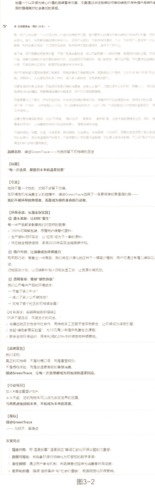

## 第3章 DeepSeek你的文案写作灵感源泉

##### 社交平台互动文案
社交平台互动文案旨在激发参与感与互动性，提升转发、评论等社交指标。通过互动引导指令，DeepSeek可帮助设计引发讨论、鼓励分享的内容。具体流程如下，应用示例如图3-3所示。
在快手上发布围绕最新科技产品的互动图文，通过提问引导受众讨论产品优势，并设计转发奖励机制提升传播效果。
目标定义：生成一篇激发用户评论与转发的互动文案，目标是提升话题讨论量与互动率。
情感驱动：通过开放性问题或挑战激发情感反应，让用户愿意分享与评论。
互动引导：设计引导参与的话题，例如，“你最喜欢的XX是什么？快来分享你的故事！”
传播策略：通过悬念或奖品机制提升分享意愿，鼓励用户转发给朋友。

### 3.2 文字类内容提示词应用
针对不同平台与受众，文字类内容的提示词需要精细调整，以贴合平台特性与用户偏好。本节探讨如何利用DeepSeek在微博、公众号、网络小说等平台设计高效文案，结合即时性、深度互动、快节奏阅读等差异优化提示词。


#### 3.2.1 微博文案设计
微博以即时性强、信息更新快、互动频繁著称。是国内最大的社交平台之一，具备独特的传播速度与互动性。因此微博文案需兼顾简洁明了与足够吸引力。如何设计适配微博特性的高效文案，是创作者的重要课题。
微博特性要求文案遵循特定原则。创作者需理解其传播规律与用户行为，才能设计出符合平台调性、激发互动与提升参与度的文案。

##### 1. 短平快的文案结构
微博字数限制与快速传播要求文案简洁有力，迅速抓住注意力。与长文不同，微博文案要直观、清晰、精炼。一条成功的微博需要在有限字数内传递核心信息并促使用户行动。
主要策略：突出核心信息，避免冗长描述，使用简洁直白的语言传达品牌价值或促销信息。可用指令如下。
> 在不超过140字的限制内精简文案，确保传递核心信息[前置信息]。
根据[前置信息]设计简短直接的文案，强调最具吸引力的产品或活动亮点。

##### 2. 高度社交化的互动性
微博是高度互动的平台，评论、转发、点赞等社交行为是传播动力。文案设计需考虑如何激发社交行为，如设置互动环节、提问、活动等，以提升传播效果。
主要策略：引导用户评论、转发、参与话题讨论，并设置有趣且能引发讨论的问题，鼓励分享观点与经验。可用指令如下。
> 根据[前置信息]通过提问方式引导评论，设计开放性问题。
使用互动性强的语言鼓励转发分享。例如，“告诉我们你对此的看法”。
通过设定互动话题提升参与度。例如，“#我在XX品牌的购物故事#”。

##### 3. 热点借力与话题引导
微博传播常受热点话题驱动，借助当下新闻、流行趋势可快速提升曝光与互动。设计文案时应关注热点，选择与品牌相关的话题并以适当角度切入。
主要策略：及时响应社会热点与流行话题，将品牌内容与热点结合，并根据受众兴趣选择相关话题标签引导讨论。可用指令如下。
> 使用DeepSeek分析当前热点话题，结合品牌特点选择相关话题。
通过热门标签与话题结合，提升文案在社交平台的曝光度。

##### 4. 视觉元素的配合
在微博平台，图片、视频等视觉元素能显著提升吸引力与互动性。合理运用视觉元素可更好地抓住用户眼球，增强传播力。图文结合更具感染力，尤其在需要引发情感共鸣时效果突出。
主要策略：设计引人注目的配图或视频，增强视觉吸引力，并根据文案核心内容选择合适的图片、GIF或短视频配合表达。可用指令如下。
通过图文结合，增强微博文案的视觉冲击力。

挑选能够触动情绪共鸣的图像或短视频，让视觉载体与文字表达相互映衬、共同放大传播力。

#### 3.2.2 公众号文案设计

公众号是以图文组合为主的自媒体形态，其内容编排与传播规律呈现出明显差异。相较于碎片化的渠道，公众号更强调信息浓度、版式层级以及长期的互动沉淀，长文是主要载体，创作难度随之提升，需要在篇幅拉长后依然保持关注度并引导点赞、评论与转发。以下对公众号文案的运行规律与实操案例进行梳理。

##### 1. 公众号文案写作特点

公众号稿件往往信息量大且解读深入，作者需输出分量足的内容与可执行建议。与微博追求短小精悍不同，公众号更注重品牌或产品的深层价值传递，例如行业洞察、案例拆解、产品测评等，因而要用扎实的数据支撑、典型案例映证与深度解读搭建内容，提升可信度与认同感。

篇幅偏长决定了结构化排版的重要性。一篇合格稿件需有清晰的逻辑骨架，一般包括开篇、正文、收尾。正文要按主题复杂度分段推进，层层深入，避免大段堆砌和表达混乱。开头必须具备强吸引力，迅速点燃阅读欲望；结尾则要给出明确的行动指引，促使用户跟进。

文章需要借助情感共鸣建立人与内容之间的连接。可以借品牌故事、用户真实经历或个人叙述增加温度；用富有感染力的语言和贴近生活的场景描写拉近与读者的距离，提高粘性。

公众号的核心目标多为转化，例如引导购买、报名或参与活动。因此文案中必须嵌入明确的行动号召。无论是导入、正文还是收尾，都应巧妙植入引导性话术，鼓励用户执行具体行为，比如“查看详情”或“立即下单领优惠”。

##### 2. 公众号书籍推广文案实践

▶ 书籍开头介绍

《Midjourney AI绘画艺术创作教程：关键词设置、艺术家与风格应用175例》面向对AI绘画感兴趣的艺术从业者与设计师，系统讲解在Midjourney平台上进行艺术创作的方法，重点覆盖关键词设定与艺术风格的运用。书中兼顾理论讲解与大量实操案例，适合不同水平的学习者。出版社期望通过公众号推广触达艺术家、设计师及AI艺术爱好者，核心目标包括：

- (1) 扩大书籍的知名度与露出面，吸引更多潜在读者。
- (2) 传递产品的独特价值与技术优势，激发购买意愿。
- (3) 提供清晰的操作指引，推动潜在读者完成购买。

据此可设计一组公众号开头发声的提示词，生成效果见图3-4所示。

请为微信公众号拟写一段吸睛的开篇文案，目标受众为25～40岁艺术家、设计师及AI艺术爱好者，引导其购买《Midjourney AI绘画艺术创作教程：关键词设置、艺术家与风格应用175例》。要求：

- 控制在50字内，简洁有力；
- 以提问或场景化方式切入，制造好奇；
- 突出AI绘画技巧、175个案例等核心卖点；
- 语气活泼吸睛，契合公众号推广调性；
- 避免冗长赘述，重点提升点击与购买兴趣。

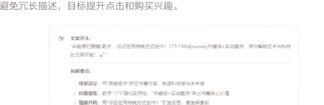

图3-4

▶ 书籍内容与价值呈现

正文部分需要系统呈现图书的核心内容与差异化价值，激发阅读兴趣。DeepSeek可依据书籍背景与受众需求，产出结构清晰、针对性强的推广稿。以下是关于书籍价值呈现的详细提示词，输入后可生成对应文案，生成效果见图3-5所示。

请为微信公众号创作约500字的正文，推广《Midjourney AI绘画艺术创作教程：关键词设置、艺术家与风格应用175例》，目标人群为25～40岁艺术家、设计师及AI艺术爱好者。文案要求：

- 结构分明，核心价值阐述约400字，行动号召约100字；
- 突出AI绘画技术、175个案例、适配各水平读者等亮点；
- 融合背景信息如艺术与科技融合、AI绘画重塑创作方式等触发情感共鸣；
- 风格专业而不失活力，符合公众号调性，避免冗余描述；
- 给出明确行动指引，如“扫码购买即享8折优惠”。

书籍背景信息：在数字化与全球化加速的当下，艺术与科技的融合不断加深。人工智能已渗透至艺术领域，AI绘画已突破临界点，重塑创作模式。本书为热爱AI艺术的读者撰写，兼顾资深艺术家与初学者，提供AI绘画原理、技术解析及175个Midjourney实战案例，详解关键词设置与风格应用，助力开启AI艺术之旅。

通过简洁有力的概述，文案清晰传递了图书的技术性与实用性，凸显了对读者的实际帮助，并进一步激发提升创作能力的渴望。

【AI艺术进化指南：175例实战打开创作宝箱】

当灵感枯竭时当传统手法难以驾驭算法——这不是虚构情节，而是正在发生的创作变革！《Midjourney AI绘画艺术创作教程》正是这场浪潮中的“能力升级手册”，用技术赋能想象，让每一个人都能成为智能时代的视觉创造者。

◆ 为什么被视作数字艺术创作的“第二大脑”？

从原理到落地的全链赋能

书中不仅讲清楚Midjourney的使用逻辑，更搭建“关键词词库”+美学体系，把光影到数字油画的风格密码转化为可执行的指令。收录378条艺术风格关键词，覆盖古典主义到数字游牧共50种范式，让AI成为最懂你的创作搭档。

- 175个案例=175次灵感跳跃

每个案例都是可复用的创意模板：

- 入门实操：用“三段式关键词结构”10分钟完成商业级插画
- 进阶打法：“风格融合公式”实现油画+赛博朋克的跨界实验
- 大师技巧：“提示词导航法”精准把控画面情绪与质感

另收录12组商业项目全流程拆解，涵盖游戏概念设计、数字藏品创作等前沿领域。

◆ 零门槛的创作自由

无论是零基础的绘画爱好者、需要高效出图的设、计师，还是追求个性表达的数字游牧者，书中自创的“傻瓜式提示词”都能帮助突破：

- 新手：3小时掌握AI绘画工作流
- 创作者：破解“人机协作”的创意密码
- 探索者：构建个人专属的美学基因库

◆ 加速创作的增量工具

- 附赠【2000+高价值关键词】电子手册，含商业价值评级
- 7组可直接套用的“爆款风格模板”
- 艺术家常用词“时间优化策略指南”

◆ 在算法定义审美的时代，真正的竞争力不在于限制工具，而在于让它成为创意的延伸。书中每个案例都在证明：当人类审美判断遇上机器算力，放大的是创作的可能性，而非替代。

◆【限时行动，把握AI艺术新大陆】

72小时特惠：原价129元，现扫码立享8折仅需103元，前200名下单额外获赠

☑《全球TOP50 AI艺术家作品集》电子画册，价值68元
☑【关键词淘金】直播课入场券1期
☑专属读者交流群，每日更新提示词包

◆ 现在有两个选择

继续在零散教程里消耗时间成本
或
手握这本AI时代的“创作者生存指南”，在新一轮技术浪潮中建立个人美学壁垒

◆ 长按识别二维码开启认知升级
【二维码动图】点击蓝字“立即抢购”直达购买页

◆ 当他人还在争论智能是否取代人时，你已悄然掌握重塑视觉世界的权限。

图3-5

▶ 书籍典型内容宣传

为增强可信度与说服力，可结合图书的典型内容配图呈现，进一步强化营销效果。此时DeepSeek可协助提炼营销卖点。以下是设计典型内容宣传部分的提示词，已准备好书籍油画配图如图3-6所示，生成结果如图3-7所示。

请为微信公众号生成一篇约150字的书籍典型内容宣传文案，并结合我提供的图片描述进行推广，目标人群为艺术家、设计师及AI艺术爱好者。文案要求：

- 突出典型内容（图片描述：此书油画风格多样，包含多种油画提示词技巧及油画风格/艺术家提示词示例，提供丰富的油画创作与展览参考）；
- 风格专业且围绕已准备的油画图像，适合公众号推广，避免冗长。

书籍目录参考：第3章Midjourney油画创作，涵盖油画头像、风景、静物和抽象油画案例，讲解关键词设置与风格应用；第2章 Midjourney参数与命令介绍，详细说明关键词设置技巧。


图3-6

通过典型内容的简要展示与相关图像示例，文案提升了书籍的可信度，吸引读者进一步了解并下单购买，增强了营销效果。

#### 3.2.3 网络小说文案设计

网络小说文案需贴合平台特性，用简洁有力的语言抓住读者，提升点击、收藏与订阅。DeepSeek可通过精准提示词生成适配于起点中文网、晋江文学城等平台的内容。本节深入探讨网络小说文案的设计方法，并提供具体提示词示例。

##### 1. 网络小说文案设计的独特需求

网络小说文案设计需满足核心诉求，以吸引读者并推动订阅。

内容抓人：开篇要迅速抛出核心冲突或角色魅力，如废柴少年的逆袭、失忆女主的情感纠葛等，在200～300字内点燃兴趣，突出主线剧情。

节奏紧凑：关键情节需快节奏、高冲突，保持阅读动力，避免冗长描写，契合网络小说的快速阅读习惯。

互动引导：章节末尾设置悬念，激励读者收藏与订阅。

平台适配：依据目标平台和受众需求调整风格与题材，确保与用户偏好匹配。

##### 2. 提示词设计：聚焦网络小说内容

DeepSeek可通过结构化、清晰的提示词生成高质量网络小说内容，突出核心剧情与读者吸引力。以下是针对网络小说内容的提示词示例，重点说明开篇、关键情节与章节结尾的写作，便于创作者直接使用。

生成开篇提示词

生成网络小说开篇的提示词示例如下，结果如图3-8所示。

请为起点中文网创作一篇玄幻网络小说开篇，目标读者18～30岁，字数200～300字。内容要求：

- 突出核心冲突，如废柴少年被家族抛弃；
- 风格悬疑吸睛，聚焦角色成长与剧情起伏；
- 避免冗长描写，快速点燃读者兴趣；
- 适合快节奏阅读，目标提升点击率。

示例参考：“被家族遗弃的少年林夜，站在破旧茅屋前，眼中闪过一丝决然。神秘老者突然出现，手中宝剑散发出幽蓝色光芒：‘小子，是否愿意追寻神界秘境？’”

▶ 设计网络小说大纲

在动笔前设计大纲是关键，用于把握小说脉络、主线与支线、主要冲突、力量体系、经济体系、功法体系、地域规划以及道具法宝体系。通过DeepSeek设计大纲提示词，可确保结构清晰、逻辑严密、引人入胜，适配网络小说的快节奏阅读与订阅目标。以下是更详细的提示词与预期输出，确保逻辑严密、悬念十足，并为后续剧情与世界观做铺垫。以下是提示词示例，结果如图3-9所示。

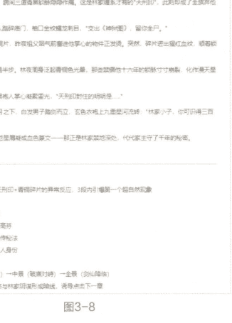

请为起点中文网生成一篇玄幻网络小说的详细大纲，目标读者18～30岁，长度600～800字。内容要求：

- 明确故事主线，详细描写主人公成长轨迹，包括关键转折点；
- 设计支线，至少3条，逻辑与主线交织，增加故事深度；
- 设定主要冲突，至少3个，突出紧张感与悬疑；
- 构建主要力量体系，详细设计神力、魔力、灵力等级划分，包括修炼条件与限制；
- 设计主要经济体系，详细描述三界经济结构；
- 建立主要功法体系：设计至少2个核心功法，包括功法来源、修炼难度与效果；
- 规划主要地域/地图：详细规划三界地形与关键地点，描述地形特征、气候条件与战略意义；
- 设定主要道具/法宝体系：设计至少3个核心道具/法宝，包括功能、来源与使用限制；
- 风格逻辑严密、悬念吸引，适合网络小说快节奏阅读，目标提升订阅率。

示例参考：主线“林夜从废柴少年成长为神界至尊”，支线“家族阴谋揭露，神秘盟友背叛”，冲突“家族敌对与魔族入侵”，力量体系“神力分四阶”，地图“神界悬崖、魔域深渊”，道具“神剑吸收魔气”。

以下为《九霄神脉》设计的符合起点中文网风格的详细大纲：

###### 一、主线设计

核心脉络：被家族种下“天形咒”的废子林夜，因祖父母遗留的《封神图》碎片觉醒上古神族血脉，逐步揭开三界“青铜门”阴谋，最终以九霄焚天诀逆天改命，重塑封神秩序。

成长轨迹
1. 血脉封印期：被家族驱逐→破庙遇白发老者赠残卷→觉醒神族血脉
2. 三界试炼期：入神陨殿→遭遇魔族千年血祭阵→以血破阵救同门苏瑶获魔咒反噬
3. 逆天证道期：炼化九霄焚天诀→平定神界内乱→血战深渊魔尊→发现青铜门藏三百年前阴谋

###### 二、支线与冲突

支线1：青铜血咒
林家每代嫡系长子血脉滋养魔神苏醒，林夜实为千年来唯一纯净血脉载体。关键转折：第80章发现林家新任族长是其亲生父亲。

支线2：镜花水月局
神秘组织表面协助抗魔，实际图谋复活魔神。最终爆点：第210章发现苏瑶用心魔玉佩将林夜炼化为魔神容器。

支线3：时空碎钟
林夜真实身份是三百年前时空分身，九霄焚天诀修炼到极致会引发时空悖论。

核心冲突：
- 血脉诅咒vs自由意志
- 神界保守派阻挠
- 魔神残念寄生系统随修为增长不断侵蚀主角

###### 三、力量与经济体系

神力四阶：凡境→灵境→仙境→神境
魔力三阶：初魔→深魔→魔王
特殊设定：灵力为神魔二力平衡，神界灵产矿仅200处

经济结构：
- 灵石产自神界秘境灵脉，1枚=1000灵矿
- 黑市规则：每月朔日在血色荒原举行“无光拍卖”，可用寿命竞价
- 战略资源：九幽玄铁唯一能承载神魔力量

###### 四、功法与地图

核心功法
九霄焚天诀：刻录于青铜血脉图腾，每突破需吞噬一种异火
镜花秘典：可预知未来3秒，每次使用折寿十年，实为魔神篡改命运手段

三界地图：
神界·悬星崖：引力乱流试炼地，中心神殿藏初代天神尸骸
魔域·哭魂渊：岩浆下漂浮冤魂，魔王抽取恐惧之力
人间·无妄海：海水可溶解灵力，海底沉睡封印魔神的青铜巨棺

###### 五、道具系统

1 青铜血符：可吸收敌人精血升级，超载反噬，终极形态化为九霄神剑
2 时晷罗盘：每日逆转时间1次，代价随机遗忘一段记忆
3 噬魂幡：禁锢魔王级敌人12时辰，新宿主会缓慢被怨灵吞噬

###### 六、节奏规划

每50章设置记忆点，悬念钩子每章末尾埋设真相碎片，战斗密度保持每3章1场小战，每10章1场生死战。

图3-9

## 第3章 DeepSeek你的文案写作灵感源泉

▶ 写作主要剧情、冲突细节、故事背景和世界观

基于上述大纲，DeepSeek可进一步生成网络小说的主要剧情和冲突细节、故事背景和世界观，确保内容逻辑严密、吸引读者。以下是提示词示例，结果如图3-10所示。

请为起点中文网生成一篇玄幻网络小说的主要冲突详细构思，以及故事背景和世界观，目标吸引18～30岁读者，长度800～1000字。内容要求：

- 详细描述主要冲突；
- 构建故事背景；
- 设计世界观；
- 风格逻辑严密、悬疑吸引，适合网络小说快节奏阅读，目标提升订阅率。

示例参考：剧情“林夜觉醒神力后，家族派高手追杀，魔族趁乱入侵，他与盟友联手反击，终成至尊”，背景“万年前神魔大战，世界分裂为三界”，世界观“神力需灵矿炼化，魔力禁忌吸收神晶”。

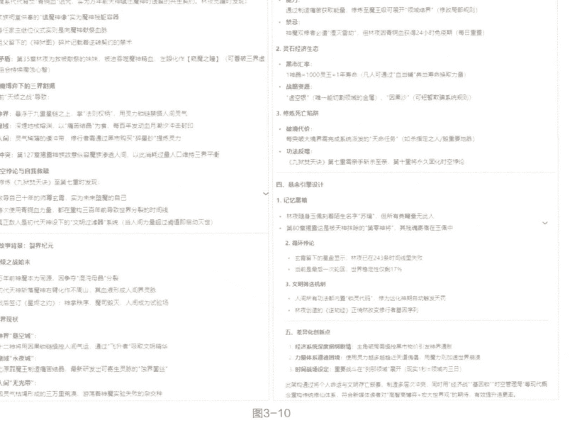

### 3.3 本章小结

本章深入探讨了DeepSeek在文案创作中的应用，重点分析了提示词设计的核心策略和实践方法。

首先，阐述了文案创作的核心要素、传播框架与方式，以及提示词思维链在文案创作中的分步骤实践应用，提供了结构化、精准的提示设计指导。其后，聚焦文字类内容提示词应用，分别针对微博文案、公众号文案和网络小说文案设计了具体的提示词示例，并结合用户行为分析优化内容，提升传播效果和用户参与度。

通过DeepSeek的智能支持，创作者能够高效生成高质量文案，显著提升自媒体内容的吸引力和商业价值，为不同平台的文字类内容创作提供了强有力的工具。

### 3.4 课后练习

- 练习1：微博文案优化

先复盘某科技新品在微博上的过往表现，譬如触达约5万次、点赞占比约3%、评论区高频出现“功能太酷”。在此基础上拆解其表达方式与用户情绪共振点。随后搭建一套面向25到35岁科技爱好者的微博文案指令，控制在140字内并着力提升互动。调用模型产出示例，突出智能降噪的核心卖点，并埋入互动提问例如“你的降噪痛点是什么”。

练习2：网络小说文案设计

为起点中文网构思玄幻小说的开篇与章末指令，锁定18到30岁读者群体，提升点击及订阅。开篇篇幅200至300字，需点明核心矛盾；章末100至150字，需设置悬念。用模型生成样本文本，并说明如何微调指令来增强阅读吸引力。

## 第4章 DeepSeek撬动自媒体流量密码

生成式AI快速演进，DeepSeek在创作者圈层的渗透不断加深，为自媒体生产提供了高效精准的支撑。

本章聚焦DeepSeek在自媒体领域的落地实践，重点拆解其在小红书图文与抖音短视频场景中的应用，阐明精细提示词设计与智能调优怎样提升内容品质与商业价值。实践显示，依托模型的智能能力，创作者能够改善图文和短视频的吸引力、互动度与转化效果。

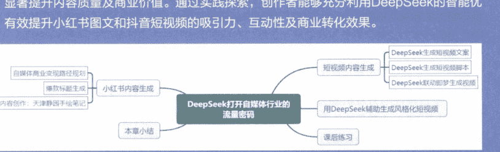

### 4.1 小红书内容生成

小红书作为图文型自媒体的主阵地，得益于圈层定位精准与互动属性强，吸引众多创作者入驻。平台爆款通常兼具抓眼标题、扎实正文与变现空间。DeepSeek依托提示设计与内容产出能力，帮助创作者快速打磨契合平台调性的爆款标题、图文笔记，并梳理商业化路径。

本节聚焦模型在小红书创作中的用法，涵盖变现思路、标题打磨技巧与图文优化方法，确保内容契合平台特色并放大曝光与转化。

#### 4.1.1 自媒体商业变现路径规划

社交媒体持续繁荣，自媒体已成为创作者与品牌的重要收入来源，小红书的崛起吸引了更多创作者、品牌方与广告主。如何用优质内容实现商业化，成为行业关注的核心议题。

变现方式多样，需要按内容特质、受众画像与平台属性定制策略。DeepSeek的智能分析与创作辅助，能够为变现路径优化提供助力。本节梳理主流变现方式，并结合模型优势给出提示词建议，帮助创作者制定更具个性的方案，放大商业价值。

##### 1. 平台特性与分发机制分析

小红书融合社区互动、UGC与品牌推广于一体，商业化潜力突出。以下对平台核心特质与分发逻辑进行拆解，帮助创作者读懂运营机制，优化内容与品牌合作。

- 平台核心特质

  - 种草生态：小红书形成了独特的种草氛围，用户通过分享真实使用感受与产品推荐，激发他人购买欲，形成生活化的内容生态，推动销售并拉近情感距离。

  - 社区属性：内容传播带有强社区色彩，用户既是信息接收者也是生产者。点赞、评论、分享等互动行为推动传播，形成口碑效应，提升品牌可信度。

  - 垂直聚焦：平台深耕美妆、时尚、旅行、健身等细分垂类，内容精准度高，受众集中。创作者深耕垂类可提升影响力，吸引品牌精准投放。

  - 内容驱动电商：内容与电商紧密联动，用户可直接跳转购买。内容驱动的电商模式使小红书成为消费决策入口，在美妆服饰等高客单品类尤为突出。

  - 视觉导向：平台重视美观与画面呈现，图文笔记多配合精美图片或短视频，提升阅读体验。

###### 平台内容分发机制

平台的分发体系为创作者提供多条曝光路径，确保内容精准触达目标人群。

**个性化推荐**：小红书借助大数据与AI分析用户浏览、搜索、兴趣标签及互动记录，进行个性化推送。例如美妆爱好者会优先看到护肤测评或教程。算法驱动有助于提升留存与相关性。

**话题标签与热榜**：通过#旅行打卡#、#美妆教程#等话题标签与热榜功能，集中分发与热点相关的内容。用户与创作者可借此参与讨论扩大曝光，平台会依据标签热度与互动情况动态调整分发优先级。

**关注流**：基于用户的关注历史与互动记录推送个性化信息流。标题与封面在此机制中起关键作用，只有足够吸睛的内容才能触发点击。

**搜索发现**：用户通过关键词搜索时，平台按相关性与搜索意图排序。创作者需合理布局关键词并保证专业深度，优化关键词策略可提升搜索展示位。

**品质与视觉**：高质量且视觉出众的内容会获得优先分发，无论图文或短视频。笔记的设计、排版与创意直观性直接影响分发权重，只有能引发停留、分享与讨论的内容才能实现自然扩散。

##### 2. 小红书平台的提示词设计

小红书兼具社交与电商属性，创作与分发相互促进。优秀文案既需创意共鸣，也需优化呈现与传播路径。精准的提示词设计是实现理想曝光与互动的关键。

###### 信任建设与真实性表达

在小红书社区，信任是提升粘性与转化的核心。真实的使用感受与专业内容才能增强品牌可信度，过度修饰或虚假易引发反感。因此信任类提示词应围绕真实体验与专业度展开。示例：

请为[产品/品牌]撰写一篇建立信任感的种草文案。

目标产品/品牌：指定品类，如护肤品、健身装备、智能家居等。

创作者身份：设定内容创作者的背景，如护肤专家、美妆博主、健身达人等，以增强专业性。

内容结构

专业背景展示：介绍个人使用该类产品的经验或专业知识，如“从业10年护肤专家，测评过200多款护肤品”。

真实使用体验：描述个人使用产品的具体过程，包括产品的使用感受、适用场景、效果对比等。

对比测评：提供该产品与同类产品的对比分析，展现优劣势，帮助用户做出理性选择。

避免营销化表达

呈现真实缺点：如“这款产品对干皮很友好，但对于油皮来说可能稍微厚重”。

保持客观态度：如“适合喜欢轻盈妆感的用户，但如果你偏爱厚重遮瑕，可以考虑其他产品”。

最终目标：增强消费者信任感，使其对产品产生安全感，提升购买决策的可信度。

###### 场景化表达与情感共鸣

小红书文案中，场景化表达具备很强吸引力。通过描绘具体生活场景，引导用户代入产生共鸣，进而激发购买欲与参与兴趣。DeepSeek能借助情感分析与受众行为数据，为创作者提供支持，帮助精准捕捉情感需求，优化文案设计。优化后的提示词示例：

请为[产品/品牌]设计一篇场景化的种草文案。

产品信息：明确产品名称及主要用途，如“便携式咖啡机——随时随地享受高品质咖啡”。

典型使用场景（创建3个真实的生活场景）

场景1：忙碌早晨——“每天早上赶着出门，想喝杯咖啡但又来不及？这款咖啡机3分钟即可完成一杯香浓的意式浓缩咖啡，让你的清晨不再手忙脚乱”。

场景2：户外露营——“露营爱好者的福音！无须插电，轻松手压即可萃取一杯丝滑咖啡，让你在大自然中也能享受品质生活”。

场景3：办公午后——“下午工作疲惫不堪？办公室泡速溶又太将就？这款便携咖啡机，让你随时随地享受现磨咖啡的香气与美味”。

用户痛点解析

常见问题：描述用户在无该产品时的困扰，如“办公室只能喝寡淡的速溶咖啡，外卖咖啡又贵又难喝”。

产品如何解决问题：如“这款便携咖啡机内置15Bar高压泵，让你在家、公司、旅行中都能享受高品质咖啡”。

最终目标：使用户在阅读时自动代入自身生活，感受到产品带来的便利，从而激发购买欲望。

###### 简洁明了与突出重点

小红书的分发机制要求文案简洁、清晰且直击要点。用户在平台浏览时注意力停留短暂，文案必须在极短时间内传达关键信息。为此需对结构与节奏进行优化，确保信息快速准确传递。

#### 4.1.2 爆款标题生成

小红书标题是吸引点击的首要抓手。好标题需简洁有力且具传播价值。优化标题可显著提升曝光与参与，进而增强商业转化。DeepSeek的智能提示词设计助力创作者打造贴合受众兴趣的爆款标题，提升传播效果。

##### 1. 标题创作的关键要素

小红书好标题需兼顾：

- 简洁明了：用户浏览时间有限，标题要直接快速传达核心价值。
- 吸引眼球：激发好奇心，促使点击深入了解。
- 情感共鸣：与受众情感共鸣，增强感染力与互动传播。
- 明确价值：清楚告知阅读收益，如“省时”“提效”“解决问题”。
- 关键词优化：结合平台搜索机制，标题关键词精准利于SEO，提升被发现概率。

##### 2. 爆款标题的生成方法

借助DeepSeek可批量生成个性化标题，按主题、受众、平台特性灵活调整。以下为提示词设计思路。

###### ▶ 基于受众需求和兴趣点设计标题

需深入了解目标人群需求、痛点与兴趣点，以此为基础构思标题。把握偏好、问题与期望价值是首要步骤。示例提示词：

> 请为以下内容设计爆款标题。

目标产品/服务：指定类型，如“护肤品”“健身器材”“美食制作”。

受众画像：如“25~35岁女性，关注护肤与健康生活”。

核心卖点：突出独特优势，如“抗老效果显著”“在家也能健身房效果”。

情感触发：设定情感基调，如“焕发肌肤青春”“感受前所未有的改变”。

价值承诺：强调核心收益，如“1周见效”“省时省力方案”。

例如：

“想要无瑕肌肤？试试这款[产品名称]，30天见证改变！”

“健身新手必看！在家打造健身房感，3分钟塑形秘诀！”

###### ▶ 利用数字和独特方法增加吸引力

数字与方法能显著提升吸引力，让内容更具体实用。如“5个技巧”“10步指南”“轻松搞定”等增强可操作性并激发好奇。示例提示词：

> 请按要求生成带数字与方法性的标题。

产品/服务：[产品名称/服务名称]。

内容格式：列出步骤或方法，如“3步打造健康肌肤”。

数字化展示：强调具体数字或数据，如“节省50%时间”“7天快速见效”。

疑问式设计：结合用户疑问，如“为何90%的人2周内见效？”

例如：

“3步让肌肤焕亮，5分钟即可见效！”

“7天摆脱焦虑，5个科学方法助你轻松应对压力！”

###### ▶ 引发好奇心与悬念

好奇心驱动点击。在标题中设悬念、提问或挑战性语言，能极大激发探索欲。示例提示词：

请为以下产品/内容生成带悬念好奇心的标题。

核心问题：设引人好奇问题，如“这款产品为何如此火爆？”

挑战性语言：如“敢挑战这款极限产品吗？”

引发悬念：如“这款产品到底藏着什么秘密？”

例如：

“这款护肤品为何让上万用户追捧？”

“敢试极限健身挑战吗？结果超乎想象！”

###### ▶ 整合平台热词与流行趋势

结合小红书流行趋势与热门标签设计标题，可提升相关性与曝光。需紧跟热搜、热门话题，将元素融入标题。示例提示词：

请根据当前热词与趋势生成标题。

热门话题标签：指定流行标签，如#新发现#突破极限#护肤秘籍。

热搜趋势：结合热搜榜或近期热点，抓取潮流元素。

受众关注趋势：按用户当前关注热点创作。

例如：

“#美妆必看#3步打造无瑕肌肤的护肤秘籍！”

“近期爆火的[产品名称]，如何迅速提升工作效率？”

###### ▶ 情感化引导与用户体验

情感驱动标题对情感需求强的用户尤为有效。融入情感化表达可触及内心，引发共鸣，提升点击与分享。示例提示词：

请为以下情感驱动内容生成标题。

情感基调：设标题调性，如“轻松愉悦”“安心放心”。

用户需求：如“缓解焦虑”“提升自信”。

共鸣点设计：提供情感支持或解决方案。

例如：

“告别焦虑，3步恢复自信，重拾生活节奏。”

“你也能拥有完美肌肤，试试这款改变人生的护肤品。”

#### 4.1.3 图文内容创作：天津静园手绘笔记

小红书图文质量直接影响互动与传播。通过挖掘平台特性，结合视觉与文案策划，可显著提升吸引力。以“天津静园手绘笔记”为例，说明如何借助DeepSeek辅助创作，突出静园旅游魅力与文化底蕴，展现手绘艺术，吸引20~40岁注重生活品质的旅行爱好者关注与互动。

##### 1. 案例背景

天津静园始建于20世纪初，位于天津和平区，是近代历史文化地标。以欧式建筑与中西合璧庭院著称，园内绿树成荫、花卉繁茂，融合中式园林温婉与西式建筑典雅，兼具丰富历史故事，吸引游客驻足感受历史文化与建筑艺术。

手绘笔记以生动手绘图与匠心文案呈现静园精华，成为推广天津旅游、提升静园知名度的好载体。如图4-1所示，手绘画面精美生动，凸显建筑特色，激发用户打卡分享欲望。


##### 2. 使用提示词模板生成标题

标题是吸引点击的首要因素，旅游类笔记尤甚，尤其手绘主题。好标题需兼具视觉冲击与文化吸引力。借助DeepSeek提示词设计，可快速生成契合小红书调性、易引发兴趣的爆款标题，突出静园旅游与文化，同时体现手绘艺术特色，效果如图4-2所示。

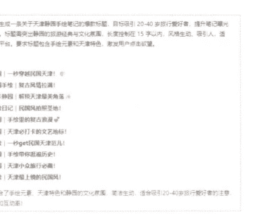

为小红书生成一条关于天津静园手绘笔记的爆款标题，目标吸引20～40岁旅行爱好者，提升笔记曝光和互动率。标题需突出静园的旅游经典与文化氛围，长度控制在15字以内，风格生动、吸引人，适合小红书平台。要求标题包含手绘元素和天津特色，激发用户点击欲望。

##### 3. 使用提示词生成笔记主体内容

小红书图文主体需生动文案吸引阅读与互动。针对静园手绘笔记，应突出旅游价值、手绘艺术表现，并巧妙加入行动号召激发探索与分享。以下为借助DeepSeek生成的200字图文示例，贴近用户阅读习惯，提升传播与互动，效果如图4-3所示。

为小红书生成一条关于天津静园手绘笔记的主体内容，提升笔记收藏和分享率。输出200字内容，结构包括：引言(30字，激发兴趣)、核心描述(140字，介绍静园的旅游经典与文化氛围，本张手绘图特点)、行动号召(30字，鼓励用户收藏、分享或打卡静园)。要求内容生动、具有文化气息，适合小红书旅游种草笔记，强调互动性，同时突出静园作为天津旅游经典的地位。

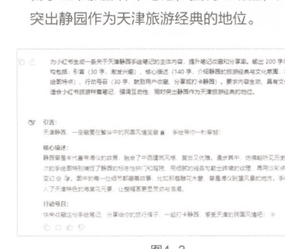

##### 4. 使用提示词生成适合的10个标签

小红书标签在提升搜索曝光与热推概率中扮演关键角色。对“天津静园手绘笔记”而言，精心挑选的标签能结合旅游特色、文化氛围与手绘元素，有效提高笔记在搜索与话题中的分发权重。以下为借助DeepSeek生成的10个简洁实用标签，旨在优化分发效果，效果如图4-4所示。

**天津静园手绘笔记·小红书热标签策划**

为天津静园手绘打卡笔记定制十组标签组合，目的是利用小红书现有的高热词提升搜索曝光与互动。标签必须取自平台已有的热门词库，不可自建，需糅合静园的旅游卖点、文化氛围与手绘视觉特征，每条控制在八字以内，语言简洁有吸引力，贴合平台的内容分类与推荐机制，同时凸显天津旅游的魅力及静园的经典地位。

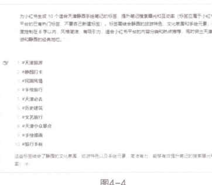

### 4.2 抖音短视频内容生产

抖音凭借快节奏、强互动的表达方式成为短视频自媒体的代表，吸引了全球范围的关注。在这个平台，内容能否走红很大程度上取决于文案的吸引力、脚本的流畅度与成片质感。引入 DeepSeek 智能平台后，创作者可获得精准的短视频文案和结构化脚本支持，并能与即梦等工具无缝衔接，实现高效的内容生产。

本节深入探讨 DeepSeek 在抖音短视频制作中的具体运用，包括文案提示词的设计思路、脚本优化策略，以及与即梦协作生成视频的高效流程，旨在说明 DeepSeek 如何助力创作者提升播放量、互动率和商业价值，为自媒体短视频创作注入技术驱动力。

#### 4.2.1 DeepSeek 生成短视频文案

在短视频生态里，文案的抓人能力十分关键，尤其在抖音这类快节奏环境，几秒内必须抓住注意力。DeepSeek 作为智能创作辅助，能够产出精炼且吸睛的文案。通过分析爆款文案特征和用户偏好，DeepSeek 可智能推荐符合平台调性的文案方案，让创作者快速传递核心信息并提高参与度。

##### 1. 抖音短视频文案的核心特征

抖音是视觉主导的平台，要求文案迅速抓住注意并在极短时间内传递信息。核心特征如下。

- **视觉配合感**：用户对画面敏感，第一印象决定点击。文案要与画面紧密呼应，用精炼文字激发观望欲。
- **信息精简度**：受时长限制，文案必须简洁明了，迅速传达重点。短小精悍才能快速留存印象。
- **情绪化表达**：情感内容容易引发共鸣，富有情绪的文案更易打动人心，提升互动。
- **互动引导**：平台鼓励评论、点赞、分享，文案需要具备引导性，巧妙促使观众参与，提升活跃度。

##### 2. 抖音算法与 AI 的应对策略

抖音推荐机制中，“三秒跳出率”极为关键，要求内容在极短时间触发情绪反应。为适配算法，DeepSeek 采取以下策略。

- **视觉化语言转化**：将抽象概念转为具体场景描写，使内容更生动直观，更易吸引注意。
- **情绪权重分配**：为情感词赋予权重，如“震惊”、“泪目”等词可占约20%，确保开场句具备情绪冲击，降低跳出。

以开箱类内容为例，DeepSeek 设计了一套提示词模板，帮助创作者以更吸睛方式描述产品，并在“三秒生死线”内留住用户。

- 以“三秒跳出率”为核心指标，要求文案在极短时间内触发情绪。
- 解析开箱场景的视觉要素：拆封动作、产品特写、效果对比，用文案形式呈现。
- 列出匹配抖音热门BGM库，选择近期上升的轻快音乐。
- 植入互动话术。
- 输出符合“产品展示+悬念设置+互动引导”结构的文案。

##### 3. 三维度提示词设计法

为瞬间激活感官并延长停留，可从情感、信息、互动三维度设计提示词。

情感维度：在文案中设置3个情绪爆发点，间隔≤5秒。
信息维度：[痛点场景]+[解决方案]+[效果证明]+[限时行动]。例如，“汗湿衣领尴尬→止汗喷雾3秒速干→实验室对比数据→今日直播间半价”。
互动维度：生成选择题互动。如“选A去云南旅行，选B吃重庆火锅，你的五一计划是？”结合背景植入损失厌恶。如“划走这条，你会错过2024最火打卡地！”

> 提示：X轴为情感强度、Y轴为信息密度、Z轴为互动深度，通过三维矩阵确定文案。

#### 4.2.2 DeepSeek 生成短视频脚本

短视频创作竞争激烈，如何高效产出符合平台和用户喜好的脚本是核心难题。DeepSeek 依托大语言模型，具备强语义理解和内容适配能力，为脚本生成提供新解。

##### 1. DeepSeek 生成短视频脚本的核心技巧与优势

DeepSeek 凭借大语言模型的语义理解力，能深度解析用户提示词，精准把握平台内容逻辑，确保脚本兼顾情感共鸣与视觉匹配，为抖音等平台打造高效吸睛内容。

核心优势体现在：

- **垂直领域精准适配**
DeepSeek 领域适应性强，可按不同场景生成高度贴合的脚本。在文旅宣传、传统文化等领域，能整合地域特色、文化元素与历史背景，输出符合传播规则的高质量内容。如提示“生成20秒抖音短视频推广陕西古城西安”，系统可捕捉陕西文化特色、历史背景及春节元素，生成兼具文化底蕴与情感触点的脚本，提升观看和分享。

- **高效多模态联动**
DeepSeek 不止于文案，还能与剪映等编辑平台深度结合。通过提示词生成与情节紧密相关的视觉文字描述，大幅提升工作效率，便于脚本与画面融合。

## 第4章 DeepSeek 打开自媒体行业的流量密码

##### 2. 操作流程详解

使用 DeepSeek 生成脚本时，可用提示词设计公式提升精准度：角色设定+场景描述+核心卖点+情感共鸣点+平台规则适配。

1. 生成文旅宣传脚本，主题陕西西安。输入相关提示词，生成结果如图4-5所示。

生成12秒抖音短视频脚本，展示西安传统文化与春节氛围，要求加入互动话题，适配春节传播。包含标题、开场、转场、互动、结尾。

2. 剪映图文成片。进入剪映，点击“图文成片”选项，如图4-6所示。


3. 在剪映中编辑视频，若已有 DeepSeek 输出脚本，直接点左上角“自由编辑文案”即可，如图4-7所示。

4. 粘贴 DeepSeek 输出脚本，点击右下角“生成视频”菜单，选择“智能匹配素材”选项，如图4-8所示。

5. 等待片刻，即可看到自动生成的视频，如图4-9所示。


该视频仍需打磨。时长可能超出12秒，需删减调整；部分图片与文字匹配但与主题契合度不足，需替换更贴合素材；内容形式单一，视频与图片混杂且转场缺失，需增加转场；字幕残留时间字符，需清理并按情感基调选择特效；配音可采用 AI 配音优化，若涉及方言，剪映“语音合成”可提供地方特色，增强贴合度。调整后流畅性与逻辑性显著提升。

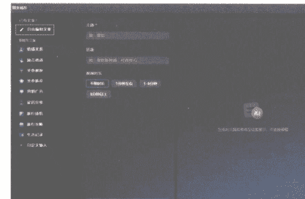

图4-7

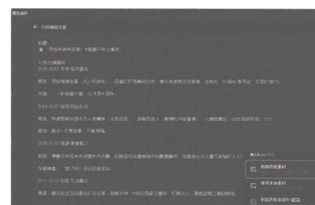

图4-8

##### 3. 常见问题与解决方案

问题：脚本模板化严重，缺乏新意。
解法：在提示词中加入“反常识元素”或设定独特视角。例如：

生成一条春节广告脚本，要求打破传统“年味”套路，突出非传统春节习俗。


图4-9

#### 4.2.3 DeepSeek 联动即梦生成视频

随着短视频发展，DeepSeek 与即梦联合使用形成从文本到视觉的全链路生成路径，提升效率与质量。DeepSeek 负责生成详尽提示词，即梦负责将其转化为视觉内容。具体流程如下。

## 第4章 DeepSeek 打开自媒体行业的流量密码

##### 1. 生成适用于即梦的提示词

使用 AI 视频镜头描述万能提示词公式，生成效果如图4-10所示。

请帮我生成适用于即梦 AI 视频生成的提示词，需包含：[镜头类型]+[主体]+[动作]+[细节]+[光照]+[色彩]+[构图]+[风格]+[情感]+[环境]。主题为传统建筑工艺榫卯制作镜头，提示词整合为一段。

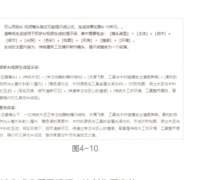

##### 2. 即梦 AI 视频生成解析

借助即梦平台输入 DeepSeek 的提示词，可一键生成高质量视频，提升创作效率。

1. 访问即梦官网 https://jimeng.jianying.com/ 进入 AI 视频生成界面，在“AI视频”栏点击“视频生成”按钮，如图4-11所示。


2. 在“视频生成”选项卡中选择“文本生视频”，输入 DeepSeek 提供的提示词，将“视频模型”设为“视频 P2.0 Pro”，其余参数保持默认，如图4-12所示。


3. 点击“生成视频”按钮，即可获得精美视频，效果如图4-13所示。


### 4.3 用 DeepSeek 辅助生成风格化短视频

每位电影大师都有独特风格。如王家卫以独特视觉美学、非线性叙事、诗意独白和深刻情感张力著称。本节阐述如何利用 DeepSeek 的 AI 能力，结合王家卫风格创作短视频。

##### 1. 解析视频的核心元素

视频作为视听艺术，其核心元素决定风格与意义。

**视觉特征：** 高饱和冷暖色对比，如蓝绿与橙红的强烈反差，带来视觉冲击。色彩不仅增强表现力，还营造情绪氛围。慢镜头与抽帧提升细腻感与动感，光影层次布局增强立体感与深度。

**叙事特点：** 常打破线性叙事，采用碎片化结构，情节跳跃，观众需自行拼凑。时间与记忆错位，内心独白穿插，增加神秘与深度。

**音乐与节奏：** 爵士乐或电子氛围音乐搭配长镜头与快速剪辑交替，营造独特节奏感，引导沉浸。

**文本风格：** 哲理台词丰富内涵，模糊时空描述如《重庆森林》手法，带来梦幻感，增强诗意与想象空间。

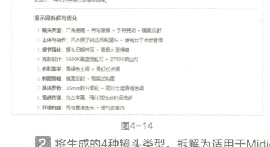

##### 2. 短视频生成操作详解

**1** 生成视频提示词脚本。将提示词模板输入 DeepSeek 并强调王家卫风格，生成结果如图4-14所示。

> 请帮我生成适用于 AI 视频生成的提示词，需包含：[镜头类型]+[主体]+[动作]+[细节]+[光照]+[色彩]+[构图]+[风格]+[情感]+[环境]。并加入王家卫风格相关内容，构思一组提示词并合并为一段。

**2** 将生成的4种镜头类型，拆解为适用于 Midjourney 生成图像的4个提示词，并附英文版，结果如图4-15所示。

## 第4章 DeepSeek 打开自媒体行业的流量密码

Midjourney 提示词 英文版 王家卫风格

镜头 1：广角慢镜，雨夜街道

提示词

“Wide angle slow motion shot of a rainy night street, a man in a trench coat walking slowly under neon lights, wet ground reflecting blurry lights, dominated by teal green tones, cinematic lighting with high contrast, Wong Kar-wai style, 35mm film grain, --ar 16:9 --style cinematic --v 5”

镜头 2：特写面部，便利店倒影

提示词

“Close-up shot of a man’s face reflected on a convenience store window, double exposure with a red taxi speeding by outside, 5600K teal neon lights mixed with 2700K tungsten light, high contrast color grading, Wong Kar-wai aesthetic, 35mm film texture, --ar 16:9 --style raw --chaos 30”

镜头 3：手持摇镜，挑选凤梨罐头

提示词

“Handheld shaky shot of a man picking a pineapple can on a shelf, 0.5x slow motion with frame drops, fingers touching the label with a close-up of the date ‘May 1, 1994’, warm tungsten lighting, teal and orange color palette, Wong Kar-wai film style, 35mm grain, --ar 16:9 --style cinematic --motion blur 3”

镜头 4：玻璃反射，旗袍女子点烟

提示词

“Mirror reflection shot of a woman in a red qipao lighting a cigarette on a staircase, smoke blending with rain outside, The closest distance between us was just 0.01 cm fading in teal and orange color grading, high contrast, Wong Kar-wai cinematic style, 35mm film grain, --ar 16:9 --style raw --chaos 40”


3. 将 DeepSeek 生成的提示词输入 Midjourney，生成各镜头图像，效果如图4-16所示。

4. 进入即梦 AI，点击“故事创作”按钮，如图4-17所示。

5. 点击“批量导入分镜”选项，点击“从本地上传”选项，选择 Midjourney 生成的4张图像，如图4-18所示。


6. 按脚本依次选择镜头并输入提示词，风格提示词保持不变，其余设置默认，点击“生成视频”按钮即可，如图4-19所示。

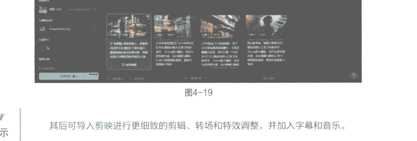

> 提示

后续可导入剪映进行精细剪辑、转场与特效调整，并加入字幕与音乐。

### 4.4 本章小结

本章全面探讨了 DeepSeek 在自媒体行业的应用，尤其聚焦图文与短视频内容自动生成。通过详细分析，揭示了 DeepSeek 在内容创作中的高效性与创新性。

具体拆解来看，该模型借助精细的引导语构造与跨工具联动机制，能产出图文与短视频等高质量素材。整套流程把制作周期压缩到了新水平，也让作品的触达面、用户互动及商业转化都明显走高。配合真实案例的演绎，可以看出它在帮创作者沉淀个人调性、打造差异化表达方面的强劲助力，为自媒体的创意边界提供了新的延展空间。

实践层面，它为内容创作者提供了更省心的生产路径，也带来了更多元的思路与工具组合，有力推动了传播效果与变现能力的同步提升，为行业注入新的技术动能。展望后续，其在自媒体赛道的落地空间仍在扩大，影响力也将持续增强。

### 4.5 课后练习
- 练习1：小红书图文内容优化

以某美妆商品在小红书上的历史笔记为样本，拆解标题与正文的共性规律。围绕吸引18到30岁女性群体、提升互动的目的，撰写一段更精准的引导描述。借助DeepSeek输出不超过20字的全新标题，以及一篇约200字的图文笔记，重点呈现保湿卖点，并加入“点击购买，享8折优惠”的行动指引。

- 练习2：抖音短视频文案与脚本设计

为抖音策划一条15秒的美食短片，受众设定为18到30岁的美食爱好者，核心目标是拉升播放量与互动。利用DeepSeek产出文案与分镜引导语，需涵盖画面呈现与口播文本，并归纳如何调整引导语以进一步增强视频吸引力。

## 第5章 DeepSeek 驱动编程提速与代码精炼
在人工智能快速演进的背景下，DeepSeek 正逐步改写传统的人工智能编程方式。凭借出色的算法优化与检索机制，该工具在海量数据处理、模式识别及各类优化任务中表现突出。依托创新的多模态语义解析，它能把人类可读的需求描述精准映射为可执行的程序骨架，既可在函数层完成精细补全，也能在系统层给出架构改进建议。与 Cursor 或 Visual Studio Code 等开发环境配合，可形成强大的自动化编程体系，大幅提升工程师的工作产出。

本章系统介绍该模型在编程场景的落地用法，解析它如何为程序员减负，围绕程序片段产出、注释补充、功能说明与缺陷排查等环节展开说明，为后续学习奠定理论与实践基础。

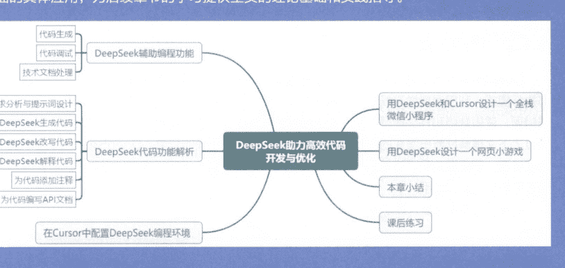

### 5.1 DeepSeek 在编程中的协作能力
该模型在人工智能编程领域展现出强大的协同能力，对开发效能与程序质量带来明显改善。它利用对人类描述的理解能力，把开发者口述的需求转化为可运行的程序框架，实现了“描述即产出”的智能体验。同时具备精准的上下文补全，可预测并补齐函数、类或模块级程序，减少重复劳动。此外还拥有智能排错能力，可快速定位问题并给出修复方案。在架构层面，它能深度剖析程序结构并提出优化建议，帮助构建更高效的系统。借助持续学习机制，它会依据个人编码习惯提供个性化支持，成为名副其实的智能编程助手。

#### 5.1.1 程序智能产出
该模型的产出能力源于大规模预训练语言模型与上下文感知技术。通过学习海量开源程序，它掌握了语法规范、常见范式以及业务语义关联。产出时结合人类描述与上下文，利用 Transformer 架构进行多层语义解析，从而输出语法正确且功能完整的程序片段。能力覆盖从简单补全到复杂函数、类乃至模块级产出，并支持多语言输出，同时根据开发者反馈持续改进质量，是人工智能编程中不可或缺的助手。

使用该模型产出程序时，只需把清晰的需求交给模型。例如引导语为：

> 请帮我编写一个网页版的五子棋程序，该程序需能在主流浏览器上运行，且所有代码都集成在一个HTML文件中。

#### 5.1.2 智能排错
该模型在排错环节提供卓越的智能支持，融合静态分析与动态执行思路，借助深度学习模型对程序进行深入语义解析。它能迅速定位语法错误、逻辑漏洞与性能瓶颈，并给出精准修复建议。不仅识别常见错误模式，还能基于上下文推断潜在风险，甚至预判运行期异常。价值不仅在于错误检测，更在于提供优化思路，帮助提升程序质量与执行效率，成为开发流程中的关键排错伙伴。

例如，当开发者输入引导语：

> 下面这段代码的时间复杂度太高，且没有处理边界情况，请先解释这段代码的问题与解决方法，然后进行优化。

```
////
Code
////
```

该模型即可对指定片段进行排错，详细说明问题所在，提供优化原理与具体改法。

#### 5.1.3 技术文档自动生成
该模型在技术文档撰写上具备优秀的自动化能力，核心在于理解程序结构、注释及上下文语义，并结合自然语言生成技术产出清晰准确的说明。它能精准提取关键逻辑、接口定义及模块关系，转化为易读的文档内容，涵盖 API 说明、使用示例与架构概览等，文档可与程序实时同步，大幅降低维护成本，为开发者提供高效可靠的文档支持。

例如，当开发者输入引导语：

> 请为下面的代码写一个API文档。

////

Code

////

该模型便会立即解析程序并返回对应的 API 文档。

### 5.2 DeepSeek 程序功能深度解析
该模型在人工智能编程中实现了多项突破，显著提升效率与质量。它支持智能程序产出，可依据人类描述或上下文自动产出高质量片段；具备强大的排错能力，能快速定位错误并给出修复建议；可自动化生成技术文档，将复杂逻辑转为易懂说明；在架构设计上能深入分析结构并提出优化方案。凭借多语言支持与持续学习机制，它可适配多样化开发场景并不断进化，成为全能型的 AI 编程助手。

#### 5.2.1 需求拆解与引导语设计
在该模型的编程应用中，引导语设计是实现高效人机协作的核心枢纽。引导语的质量直接决定产出结果的准确度与可用性。

为充分发挥程序产出潜力，引导语设计建议遵循以下要点：

首先要做到清晰具体，明确目标、输入输出及约束条件。比如“请编写一个Java函数，该函数的功能是计算两个整数的最大公约数”远比“请写一个数学函数”更具指导性。其次可加入上下文信息，如指定语言、框架或库，提升需求把握的准确性。最后注重结构化表达，复杂逻辑可用分步描述引导模型逐层解析，从而得到更贴合需求的程序。赋予模型特定身份，如“编程领域的专家”，也有助于提升理解与响应精度。

下面是一个优化示例：

这是一个基于uni-app+vue2框架的微信小程序，请帮我在主页创建一个用户意见反馈的表单，同时美化整个页面的设计，添加圆角和多种颜色渐变的效果，要求简约自然，颜色协调统一。

#### 5.2.2 DeepSeek 产出程序示例
该模型能依据需求产出功能完善的程序。例如输入引导语：“请帮我用HTML生成一个用户使用反馈表单，所有代码都保存在一个HTML中。” 系统会迅速产出可直接运行的 HTML 程序。

若对首次结果不满意，可进一步细化需求。例如：“请帮我在主页创建一个用户意见反馈的表单的前端页面，同时美化整个页面的设计，添加圆角和多种颜色渐变的效果，要求简约自然，颜色协调统一，所有代码都写在HTML文件中。” 等待返回后，点击“在HTML中运行”即可直观预览优化后的表单效果，功能与视觉均达到预期，如图5-1所示。

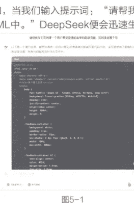

系统帮我们书写的程序如下：

```html
<!DOCTYPE html>
<html lang="zh-CN">
<head>
    <meta charset="UTF-8">
    <meta name="viewport" content="width=device-width, initial-scale=1.0">
    <title>用户意见反馈</title>
    <style>
        body {
            font-family: 'Segoe UI', Tahoma, Geneva, Verdana, sans-serif;
            background: linear-gradient(135deg, #f5f7fa, #c3cfe2);
            display: flex;
            justify-content: center;
            align-items: center;
            height: 100vh;
            margin: 0;
        }

        .feedback-container {
            background: white;
            padding: 2rem;
            border-radius: 15px;
            box-shadow: 0 4px 15px rgba(0, 0, 0, 0.1);
            width: 100%;
            max-width: 400px;
        }

        .feedback-container h2 {
            text-align: center;
            color: #333;
            margin-bottom: 1.5rem;
            font-size: 1.8rem;
        }

        .feedback-container label {
            display: block;
            margin-bottom: 0.5rem;
            color: #555;
            font-size: 1rem;
        }

        .feedback-container input[type="text"],
        .feedback-container input[type="email"],
        .feedback-container textarea {
            width: 100%;
            padding: 0.8rem;
            margin-bottom: 1rem;
            border: 1px solid #ddd;
            border-radius: 8px;
            font-size: 1rem;
            color: #333;
            transition: border-color 0.3s ease;
        }

        .feedback-container input[type="text"]:focus,
        .feedback-container input[type="email"]:focus,
        .feedback-container textarea:focus {
            border-color: #6a82fb;
            outline: none;
        }

        .feedback-container textarea {
            resize: vertical;
            height: 120px;
        }
        .feedback-container button {
            width: 100%;
            padding: 0.8rem;

            background: linear-gradient(135deg, #6a82fb, #fc5c7d);

            border: none;
            border-radius: 8px;
            color: white;
            font-size: 1rem;
            cursor: pointer;
            transition: background 0.3s ease;
        }

        .feedback-container button:hover {
            background: linear-gradient(135deg, #fc5c7d, #6a82fb);
        }

        .feedback-container button:active {
            transform: scale(0.98);
        }
    </style>
</head>
<body>
    <div class="feedback-container">
        <h2>用户意见反馈</h2>
        <form>
            <label for="name">姓名</label>
            <input type="text" id="name" name="name" placeholder="请输入您的姓名" required>

            <label for="email">邮箱</label>
            <input type="email" id="email" name="email" placeholder="请输入您的邮箱" required>

            <label for="message">反馈内容</label>
            <textarea id="message" name="message" placeholder="请输入您的反馈内容" required></textarea>

            <button type="submit">提交反馈</button>
        </form>
    </div>
</body>
</html>
```

生成的界面效果，如图5-2所示。

> 提示：当发现 AI 首次生成的程序存在瑕疵时，例如输入框未居中，可继续提出优化需求。

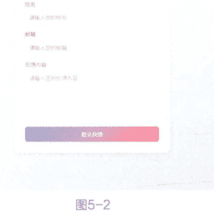

#### 5.2.3 DeepSeek 程序改写
针对上一节产出的程序中输入框位置未居中的问题，可在原引导语后追加明确指示：

每个输入框的位置都不在中间，请调整。

该模型会基于上下文与上次产出结果进行改写，输出满足居中需求的新程序。

```html
<!DOCTYPE html>
<html lang="zh-CN">
<head>
    <meta charset="UTF-8">
    <meta name="viewport" content="width=device-width, initial-scale=1.0">
    <title>用户意见反馈</title>
    <style>
        body {
            font-family: 'Segoe UI', Tahoma, Geneva, Verdana, sans-serif;
            background: linear-gradient(135deg, #f5f7fa, #c3cfe2);
            display: flex;
            justify-content: center;
            align-items: center;
            height: 100vh;
            margin: 0;
        }

        .feedback-container {
            background: white;
            padding: 2rem;
            border-radius: 15px;
            box-shadow: 0 4px 15px rgba(0, 0, 0, 0.1);
            width: 100%;
            max-width: 400px;
            text-align: center; /* 让内容居中 */
        }

        .feedback-container h2 {
            color: #333;
            margin-bottom: 1.5rem;
            font-size: 1.8rem;
        }

        .feedback-container label {
            display: block;
            margin-bottom: 0.5rem;
            color: #555;
            font-size: 1rem;
            text-align: left; /* 标签左对齐 */
        }

        .feedback-container input[type="text"],
        .feedback-container input[type="email"],
        .feedback-container textarea {
            width: 100%;
            padding: 0.8rem;
            margin-bottom: 1rem;
            border: 1px solid #ddd;
            border-radius: 8px;
            font-size: 1rem;
            color: #333;
            transition: border-color 0.3s ease;
            box-sizing: border-box; /* 确保宽度包含 padding */
        }

        .feedback-container input[type="text"]:focus,
        .feedback-container input[type="email"]:focus,
        .feedback-container textarea:focus {
            border-color: #6a82fb;
            outline: none;
        }
    </style>
```

# DeepSeek 实战解析：从技术到商业落地

DeepSeek 还会标明具体改动点。下面是调整细节。

##### 表单整体居中
为 .feedback-container 加入 text-align: center; 让整块表单居中呈现。
label 元素单独改成左对齐 text-align: left; 保证文字与输入框对齐。

##### 输入框尺寸
输入框与按钮宽度设为 100%，并写入 box-sizing: border-box; 使内边距计入宽度，避免溢出容器。

## 第5章 用 DeepSeek 加速代码开发与优化

整体排版

feedback-container 的最大宽度设为 max-width: 400px; 小屏下也能保持居中。

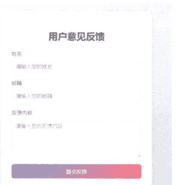

呈现效果

全部输入框与按钮在容器内居中，标签保持左对齐，整体视觉更协调。

调整后页面文字已居中，效果如图5-3。

图5-3

#### 5.2.4 DeepSeek 解释代码

程序员阅读代码时，常需要逐行解读来提升理解效率。

例如，结合上下文写提示词，请解释下面代码中 HTML 的 <body> 到 </body> 部分的逻辑，并说明其功能。

提示词示例：请将上面代码中 HTML 代码的<body>到</body>之间的代码进行解释。

DeepSeek 给出的解读如下。

- <body>：页面可见区域的承载主体，所有展示内容均置于此。
- <div class="feedback-container">：用于包裹表单的容器元素。
- <h2>：展示表单标题“用户意见反馈”。
- <form>：定义表单结构，用于收集用户输入。
- <label>：为输入控件提供说明文字，for 属性与控件 ID 关联。
- <input>：接收文本或邮箱输入，type 限定类型，placeholder 给出提示，required 标明必填。
- <textarea>：提供多行文本输入区域，resize 允许高度调整。
- <button>：表单提交按钮，点击后触发提交。

由此可见，HTML 表单的每个标签都被逐一说明用途，可读性大幅提升。

这种做法让其他开发者快速、清晰地把握每个标签的功能分工。

#### 5.2.5 为代码添加注释

编写代码时，为自己和他人降低理解成本，都会为关键片段或函数添加注释以标明作用。

为代码补全注释也是 DeepSeek 在编程场景中的典型用法。例如，下面是一段斐波那契数列的实现代码：

```
def fib(n):
    if n <= 2:
        return n
    return fib(n - 1) + fib(n - 2)
```

此时输入的提示词为：

给上面的代码添加注释。

处理后代码被加上了说明，DeepSeek 返回的结果如下。

```
##### 定义一个函数 fib，用于计算斐波那契数列的第 n 项
def fib(n):
    # 如果 n 小于或等于 2，直接返回 n
    # 这是递归的终止条件，确保递归不会无限进行
    if n <= 2:
        return n

    # 如果 n 大于 2，递归调用 fib(n-1) 和 fib(n-2)，并将结果相加
    # 这是斐波那契数列的核心定义：每一项等于前两项之和
    return fib(n - 1) + fib(n - 2)
```

借助注释，代码的功能与运行逻辑变得一目了然，尤其是递归算法的核心点，如递归终止条件和数列定义。注释帮助开发者更快抓住重点，提升代码的可维护性和可读性。

#### 5.2.6 为代码编写 API 文档

DeepSeek 的另一大用途是自动生成 API 文档。当模块包含多个函数时，需要对用法、参数、返回值及可能异常进行说明，DeepSeek 即可承担文档撰写工作。

例如，下方是一段斐波那契数列函数代码：

```
def fib(n):
    if n <= 2:
        return n
    return fib(n - 1) + fib(n - 2)
```

输入提示词为：

> 请针对上面的代码写一个该函数的 API 接口文档。

DeepSeek 生成的文档如下。

##### API 文档

斐波那契数列计算函数

函数名称

fib(n)

功能描述

计算斐波那契数列的第 n 项。数列定义为：

- 第 1 项为 1。
- 第 2 项为 2。
- 从第 3 项起，每项等于前两项之和。

示例

```
##### 计算斐波那契数列的第 5 项
result = fib(5)
print(result)  # 输出：8
```

由此可见，DeepSeek 输出的 API 文档完整覆盖了函数名称、功能描述及示例，便于后续使用与对接。

### 5.3 在 Cursor 中配置 DeepSeek 编程环境

除了网页端使用 DeepSeek 进行 AI 编程，更高效的做法是在代码编辑器中直接调用。这样在编码过程中即可即时提问、获取生成建议，并在 IDE 内直接编译运行，实现实时开发调试。


IDE 中接入 AI 的常见方案包括 VSCode+DeepSeek 和 Cursor+DeepSeek。本节聚焦 Cursor 中接入 DeepSeek，实现在编辑器内自动化提问和编程辅助。

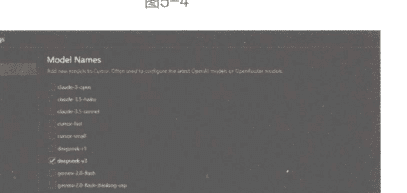

Cursor 是一款具备强大 AI 能力的代码编辑器，其下载页面如图 5-4 所示。配置 DeepSeek 后，编程流畅度和效率会显著提升。

安装并登录 Cursor 后，点击右上角“设置”，进入设置界面，在 Models 选项中勾选 deepseek-v3 大模型，关闭其他模型，即可在编码时提问，如图 5-5 所示。

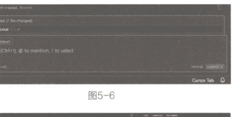

当需要提问时，按 Ctrl+I 打开对话窗口，如图 5-6 所示，输入提示词即可。

提交提示词后，右侧工作区会自动生成代码与说明，生成完毕点击蓝色 Accept file 按钮保存文件，即完成一个文件的生成，如图 5-7 所示。


### 5.4 用 DeepSeek 和 Cursor 设计一个全栈微信小程序

本节演示如何借助 DeepSeek 和 Cursor 构建一个功能完整的全栈微信小程序，涵盖前端界面、云函数、云数据库及后台管理，实现小程序的自动化开发。整个项目采用 uniapp+vue2，目标是收集用户信息并写入后台数据库，完成标准的 B/S 流程，代码编写基本由 AI 完成。

正式演示前，先介绍所需工具与架构。本案例使用 HBuilder 负责编辑与运行、Cursor 调用 DeepSeek 进行 AI 编程、微信开发者工具负责部署与手机模拟。以上软件均可在官网下载。

架构上聚焦前后端交互：前端接收用户输入，经云函数处理后存入云数据库。本案例中的前端页面、云函数和数据库表均由 DeepSeek 生成。

如图 5-8 所示，架构图展示了前端、云函数与云数据库的交互：用户在前端提交信息，经云函数处理后写入数据库，DeepSeek 在代码生成环节发挥了关键作用。


1. 打开 HBuilder 新建项目，选择默认模板并命名，勾选“启用 uniCloud”，云服务选“阿里云”，Vue 版本选“版本 2”。创建完成后项目结构如图 5-9 右侧所示，前端入口为 pages\index\index.vue，云函数位于 cloudfunctions 目录，数据库文件在 database 文件夹内。


2. 设计前端界面的提示词需要兼顾指令、上下文与预期输出。示例提示词如下：

这是基于 uniapp+vue2 框架的微信小程序，请帮我在主页创建一个用户信息收集的表单，有用户姓名、用户电话、用户简介三个输入框。用户简介输入框文字多一些，最下面是提交按钮，并美化整个页面的设计，添加圆角和多种彩色渐变的效果，颜色协调统一 @CodeBase。

@CodeBase 表示让 DeepSeek 读取整个项目代码后在此基础上编写。

在 Cursor 中输入该提示词后，DeepSeek 生成代码并保存，如图 5-10 所示。

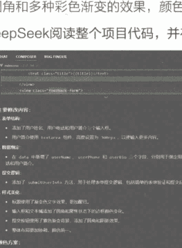


3. 返回 HBuilder，通过“运行→运行到小程序模拟器→微信开发者工具[微信小程序]”启动，可在开发者工具中看到刚生成的前端页面，如图 5-11 所示，前端开发至此完成。


4. 前端数据需经云函数写入云数据库。首先将项目关联云端：在 HBuilder 中右键 uniCloud 文件夹选择“关联云服务空间或项目”，选择已购的阿里云空间 usercollect，如图 5-12 所示。

5. 设计云函数提示词如下：

在 @cloudfunctions 中创建一个 unicloud 云函数，并在 @database 中创建一个 feedback.schema.json 文件，向 unicloud 云数据库中传送用户的姓名、电话及用户简介，请在已有的文件夹中直接创建，不需要重复创建 cloudfunctions 文件夹。

@cloudfunctions 指 cloudfunctions 文件夹，@database 指 database 文件夹。Cursor 中生成的代码如图 5-13 所示。

6. 生成后 cloudfunctions 下新增 feedback 文件夹，内含 index.js；database 下出现 feedback.schema.json。随后右键 feedback 文件夹选择“上传部署”，右键 feedback.schema.json 选择“上传 DB Schema”，将两者推送至云端，如图 5-14 所示。

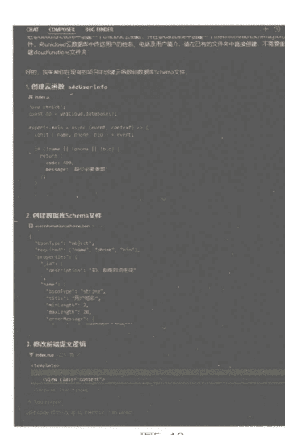


7. 右键项目打开“unicloud web 控制台”，进入云数据库→表结构，可看到 DeepSeek 生成的表结构，如图 5-15 所示。

8. 回到微信开发者模拟器，在表单中输入姓名 mike、电话 18888888888、简介“deepseek 全栈小程序测试”，点击提交后，unicloud 控制台的数据表中即可看到记录，如图 5-16 所示。前后端已打通。若需查询，可再开发读取界面。

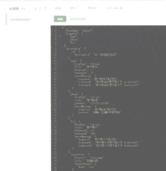


### 5.5 用 DeepSeek 设计一个网页小游戏

本节利用 Cursor 调用 DeepSeek 进行自动化编程，完成网页版贪吃蛇小游戏的初版开发，之后再对界面做优化提升体验。

1. 按提示词设计原则，撰写如下提示词，确保表达通顺合理。

请帮我写一个网页小游戏，游戏的内容是贪吃蛇游戏，所有内容都写在一个 HTML 文件中。

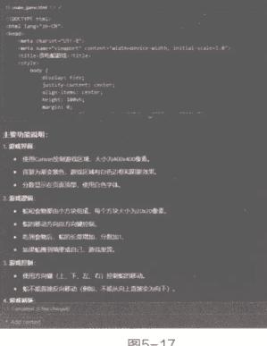
图5-17为模型给出的第一版实现。
2. 该版本的贪吃蛇可以正常运行，视觉上却缺少阴影层次，对比度也偏低，见图5-18。基于此缺陷，计划对首版代码进行升级。

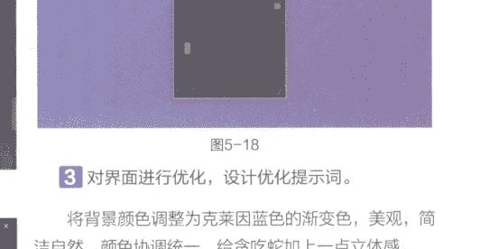
3. 进入界面美化阶段并拟定优化指令。
把背景设为克莱因蓝的渐变，整体风格追求简洁大方、色调统一，同时为蛇体增加轻微的立体质感。
按照该提示后模型返回了新的实现，详见图5-19。

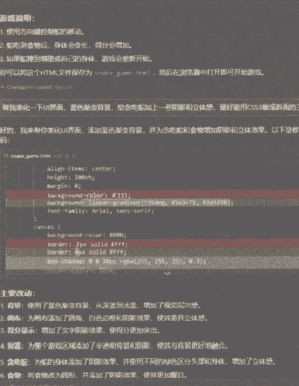
4. 在浏览器中加载对应的HTML文件后，页面外观已发生明显变化，基本达到预期效果，如图5-20所示。若仍有提升空间，可继续与模型交互迭代，直至完全满意。


### 5.6 本章小结
本章围绕模型在编程场景中的实际价值展开，从代码撰写、注释补充、错误排查到API文档自动生成等多个环节，系统呈现其工程辅助能力，并说明了在Cursor环境下接入模型的具体配置步骤。

为强化理论与实践的衔接，本章安排了两组实操：借助模型与Cursor共建一款微信小程序，以及基于网页技术实现一个小型游戏。两组案例直观体现了该工具在编码流程中的作用。

学完本章后，读者应能更清晰地把握模型在开发中的使用逻辑，并掌握在Cursor中的调用配置方法，为今后更精准高效地开展编程工作奠定基础。

### 5.7 课后练习
- 练习1：编码实践与问题排查
挑选一个开发方向，按照本章方法撰写需求提示，利用模型完成模块代码的生成，并在对应运行环境中验证结果。随后分析程序的不足点，撰写优化提示让模型改进性能或界面，并为整体代码添加说明性注释。
- 练习2：依托IDE与开发平台搭建Web应用
结合Cursor与HBuilder完成信息查询类功能，通过智能编程生成前端界面及云端查询逻辑，并在手机模拟器中展示查询结果。完成后再对界面布局进行重构，使结构更合理、视觉更协调。
- 练习3：成果落地检验
将模型生成的程序部署到移动设备，使用提示词编写测试用例，对功能与性能进行验证，确保达到人工编写程序的等效目标。

## 第6章 DeepSeek助力学术写作提效
学术研究需要在创新与速度之间取得平衡。本章聚焦该模型如何重塑传统写作流程，为研究者从命题构思到成果发表的全链路提供智能支持。通过融合理论模型与现象本质、精细化实验设计与数据呈现、润色跨语言表述，模型帮助研究者拓展思路，提升表达的严谨规范。

除方法论阐释外，本章还提供可直接使用的提示词范例，为写作各环节注入自动化动力，旨在把复杂任务简化，让学术写作更省时省力。

### 6.1 命题探索与稿件审阅
研究往往始于兼具新颖性与可操作性的题目。面对选题困难，如何在海量信息中锁定有价值方向？本节解析模型辅助命题的核心思路：从现象观察提炼科学问题，借助理论搭建分析框架，并以跨学科视角拓宽视野。结合趋势数据分析和灵感激发功能，研究者在已知与未知的交界处更容易发现值得深入的新领域。

#### 6.1.1 命题思路的挖掘方式
选题本质是发现知识体系中的断裂与创新连接点。模型通过激活批判性思维与逆向思考，为相关领域的学术工作提供支撑。以下介绍两种可落地的命题方法。

##### 1. 矛盾冲突定位法
该法通过识别技术实践与理论解释的落差、不同学派观点的对立焦点、用户行为与设计意图的偏离等矛盾点，精准锁定具突破潜力的方向。既能揭示研究空白，也能强化辩证能力。

> 案例演示
依据研究方向与兴趣向模型输入领域关键词，结果如图6-1所示。
目标：围绕如下矛盾寻找题目切口
技术矛盾：生成算法的高效性 VS 艺术价值难以量化
认知矛盾：机器美学认知框架 VS 人类审美经验体系

##### 2. 逆向思维激发法
该法对学界普遍接受的前提假设进行批判性解构。模型借助反绎推理生成颠覆性问题，挖掘被集体忽视的现象，从而开辟新路径。

> 案例演示
1. 传统经验认为人类在艺术创作上优于模型。基于此做逆向推演并设计指令，生成效果如图6-2所示。
模型能否产出超越人类水平的数字艺术图像？
人类与模型产图差异体现在哪里？
如何设计实验来验证该问题？
请协助设计实验并展开研究。

2. 细读模型回复后可提取多个题目创意。随后在谷歌学术检索相关文献，发现 “Putting the Art in Artificial: Aesthetic responses to computer-generated art”、“The Role of AI Attribution Knowledge in the Evaluation of Artwork”、“Human or algorithm? The visual turing test of AI-generated images”等多篇论文。这些研究从不同角度探讨了模型生成艺术与人类艺术的差异。值得注意的是，最后一篇采用的双盲判别方法与模型建议高度吻合，其实验材料如图6-3所示，为具体研究提供参考。

3. 综合这些成果可知，模型艺术的识别难度已达61.67%，表明模型创作正逐步逼近人类水准。由此可进一步探索两条新方向：模型艺术演化机制研究，关注风格随时间与技术变化的规律；模型艺术教育应用研究，探讨如何将模型创作融入艺术教学体系。两者均具备坚实基础与创新价值，后续可继续用上述方法深化问题。

常用命题提示词示例：
提示词1：我的研究方向是[XX]，请结合[YY领域]的前沿理论（如[具体理论名称]），生成3个交叉创新性论文题目，要求每个题目包含：核心问题+理论嫁接点+可操作的研究路径。
提示词2：作为专注于[XX领域]的研究者，我正在撰写关于[XXX]的学术论文，请详细阐述该主题的研究背景并推荐相关文献，以明确研究重点。
提示词3：帮助我根据[XX]领域选择一个具研究价值且前沿的主题，请考虑当前热点问题与学术空白。

#### 6.1.2 从现象中提炼本质
学术研究中，现象是表象，本质才是驱动现象的内在规律与核心矛盾。研究者需借助有效工具穿透表象。该模型可加速这一过程，帮助更快提炼科学问题。

> 案例演示
1. 某社会学团队在社交媒体观察到“点赞疲劳”现象，遂决定深入探究。
2. 将现象转化为结构化查询指令输入模型，结果如图6-4所示。
研究目标：探究社交媒体平台普遍存在的“点赞疲劳”现象。
请求：
1. 分析该问题的本质。
2. 探讨相关研究理论或模型。
3. 得到结果后需核查有效性，尤其是模型的思维链CoT。确认推理方向正确、每一步严谨。推理过程的启发往往比结论更有价值。
4. 可进行追问深化研究。基于生成的CoT和结果构建追问指令，结果如图6-5所示。
研究目标：从技术压力模型的视角研究社交媒体“点赞疲劳”现象。
请求：
1. 梳理该理论与现象的结合方式。
2. 制定研究目的、方法、对象和预期结果。
追问可反复进行，结合多种理论推敲验证，逐步收敛，最终提炼满意的题目，为后续研究奠基。

#### 6.1.3 稿件审阅
稿件审阅是保障研究成果质量的关键环节。传统方式依赖同行评审与人工校对，如今借助该模型可实现更智能高效的审阅。下面从自动化检查到审稿人视角展开说明。

##### 1. 自动化语法与格式核查
模型能自动完成语法、拼写、格式的全面检查，帮助消除语言层面的疏漏。学术写作对精确性要求极高，自动化检查可快速捕捉语法错误、拼写瑕疵与不规范用语。
常用指令：
- 语法检查：请检查论文语法错误，重点为主谓一致、时态、冠词与代词使用，确保句子结构清晰。
- 拼写与标点：请检查拼写错误及标点使用是否符合学术规范，包括逗号、句号、引号等。
- 格式一致性：请检查论文整体格式，段落、标题、引文、参考文献是否统一并符合期刊要求，特别是APA格式。

##### 2. 内容一致性与逻辑流畅性核查
逻辑严谨性是评审核心。模型的智能分析可剖析论文逻辑一致性，捕捉结构瑕疵。
常用指令：
请充当专业审稿人，对上传文档进行全面审阅并提出改进建议，重点如下：
- 逻辑一致性分析：检查论点、论据、结论的逻辑联系，是否存在跳跃或推理不足。
- 结构连贯性评估：评估整体结构是否符合学术规范，过渡是否自然，提供段落衔接建议。
- 论点与证据匹配度：检查每个论点是否有充分证据支撑，结论是否得到前文支持。
- 观点与证据区分：检查作者观点与外部引用是否清晰区分，避免混淆。
- 重复性内容检测：分析是否存在重复论点或段落，建议精简以提升逻辑性。

##### 3. 以审稿人角色审阅论文
不同期刊审稿标准存在差异，建议采用匹配期刊的AI审稿指令。
以下为面向SSCI类刊物的审稿指令示例，基于论文“Value Differences in Image Creation Between Human and AI and the Underlying Influences”提炼，结果如图6-6所示。
请充当专业SSCI论文审稿人，全面审阅上传文档并指导改进，重点如下：
- 主题相关性检查：确认文章是否契合期刊目标与当前关注主题。
- 摘要和范围清晰度：检查摘要是否明确阐述研究范围与目标。
- 关键词准确性：确保关键词充分反映核心内容与研究重点。
- 研究方法合理性：评估方法是否合理且描述详尽准确。
- 观点与证据区分：检查观点与经验证据是否清晰区分。
- 批判性理解促进：评估文章是否有助于深入批判性理解问题。
- 领域新进展提示：检查是否提供主题领域的重要新进展信息。
- 当代文献考虑：确认是否充分引用领域当代文献。
- APA引用规范遵循：检查是否符合APA第7版引文与参考文献规范。
- 写作风格与清晰度：确保语言清晰易懂，适合专业国际读者。

### 6.2 实验设计、数据分析与可视化
实验设计、数据分析、可视化是研究方法论的三支柱。严谨设计奠定研究基础，系统分析连接数据与结论，可视化则直观呈现结果。本节探讨该模型如何在这三个维度辅助研究者。

#### 6.2.1 实验参与者与流程
实验成败取决于参与者选择与过程规范性。了解背景信息是保障质量的关键。

##### 1. 参与者
详实描述被试信息关乎结果普适性与可复制性，有助于控制偏差并体现研究伦理。
模型提供的指令可提升描述的准确性与完整性：
1. 请根据上传的论文原始数据生成符合SSCI标准的参与者描述段落。
披露样本总量、有效样本量及问卷有效率。
披露参与者年龄、性别信息。
披露教育水平、职业背景及其他人口统计学变量。
效果如图6-7所示。

2. 请根据[前置信息]阐明被试选择标准，包括纳入与排除标准。描述招募过程，包括渠道与策略。
效果如图6-8所示。

3. 伦理方面指令可确保全面合规：
指令1：请根据[前置信息]描述如何获得被试知情同意，以及如何处理隐私与敏感信息。若有伦理审批编号，也应披露。
指令2：根据《赫尔辛基宣言》，列出本研究涉及人类受试者的5项伦理风险，如隐私泄露、知情同意，并撰写伦理声明模板，包括数据匿名化处理、退出机制等。
效果如图6-9所示。

4. 立项前先盘点样本边界
正式进入数据收集之前，应当把抽样范围与可能存在的缺陷摊开审视，这对维护研究的可信度与开放度具有决定性意义。选择倾斜、覆盖缺口等隐形问题会削弱结论的稳健性。DeepSeek 提供了一套引导性问句，助力研究者有条理地拆解样本局限与偏差来源。

请基于[前置信息]如实阐述抽样环节的限制，涵盖可能的选择偏误或样本质量短板，适合写入局限部分，并在结尾用单句概括。

##### 2. 实验流程
一篇论文能否被他人重复，核心在于流程叙述是否细致完整。优秀的流程章节需要兼顾设计逻辑的合理、材料处理的规范、操作顺序的清晰以及质控的严格。

谈到实验设计环节时，借助DeepSeek给出的提词框架，方案描述会更周全且条理分明，示意效果见图6-10。

请根据[前置信息]写出一则符合学规范的实验设计段落，说明试验形式例如双盲、对照之类，交代实验条件与变量安排，描述材料如何制取或获取，以及筛选材料的依据。

#### 6.2.2 数据分析
在科研实践里，数据分析承担着揭示规律、趋势与关联的关键职能。依托DeepSeek，可把清洗、推断和展示全流程的效率明显拉高，涉及缺失补全、重复剔除、描述性统计、相关性检验、假设检验以及图示生成等工作。

首先是数据预处理，直接决定后续分析的根基质量。虽然DeepSeek可提供缺失值填补、去重、类型转换等支持，但鉴于数据处理的高复杂性与对准确性的严苛要求，核心步骤仍推荐由研究者亲自把控，以担保可信度。

完成预处理后进入描述性统计。利用DeepSeek能快速算出集中趋势与离散指标，输入对应提示后可得到如图6-11的统计概览，为后面环节铺路。

请基于[上传数据]开展描述性统计，并列出每个变量的平均值、中位数和标准差。

掌握这些基础数值后，数据的分布形态与主要特征会更为明晰，为深度挖掘提供支撑。对于刚进入学术写作的人来说，如何在大数据面前高效开展分析常是痛点，DeepSeek作为辅助工具，能帮助快速探索并发现模式。

## 第6章 DeepSeek让学术写作更轻松
为了帮助研究者更顺畅地调用DeepSeek进行分析，本章整理了面向各类分析手段的提示词集合，助力明确研究目标、挑选适配方法、加深结果解读。即便缺乏经验的作者，也能在指引下挖掘出具备科学价值的洞见。

1. 定量分析方法：我已获取定量数据[前置信息]，该如何挑选恰当的统计方法（如回归、方差、路径分析等）来检验假设/实验？
2. 定性分析方法：针对我的访谈材料[前置信息]，怎样运用定性方法（如主题分析、话语分析等）开展研究？具体流程是怎样的？
3. 混合分析方法：我已同时收集访谈与量化问卷数据[前置信息]，如何开展混合研究进行分析？具体操作步骤是什么？

#### 6.2.3 图表可视化
在学术写作中，可视化图表承担着把复杂分析结果转化为直观表达的核心功能。优秀的图表能明显增强研究发现的传播效果与论证力度，让繁琐数据变得易于理解。

DeepSeek 能快速输出绘图代码，并配合HTML、Mermaid等工具生成准确且美观的图像。配色策略在此环节尤为重要，恰当的色彩不仅提高可读性，还能凸显关键数据。DeepSeek 可给出遵循视觉设计规范并兼顾阅读习惯的配色参考，让信息在图面中传达得更清晰。

下面列出了一组用于图表搭建与优化的提示词，便于研究者更高效地借助DeepSeek完成可视化工作。

# DeepSeek大模型：技术解析与商业应用

请你充当可视化图表制作的专业人士，请记住你能产出多种图表并协助挑选合适的类型，还能导出JPG、HTML、交互式地图、动画GIF等多种格式。首先罗列你可生成的图表种类与输出形式。随后请阅读下面关于数据可视化的建议：

坐标轴需完整展示：柱状图的数值轴一般为Y轴，要从零起步。人类视觉对柱状面积很敏感，若柱体被截断会产生误判。折线图截断Y轴在某些场景可以容忍。若数据中存在极端大值，建议采用多图并列展示整体比例与局部放大，即面板图。

间隔应保持一致：完整的坐标轴意味着不能跳过数值。日期轴若间隔不均会扭曲趋势，需保证电子表格里每个日期都有数据点，即便数值为零。

精简次要元素：网格线、轴标签、颜色等可适度简化，以突出最核心的信息。可以去掉网格线，或仅对重要的数据系列使用色彩。

图例与标注的灵活运用：可在折线图上直接添加文字标签，或在柱状图上写明数值，保持图形线条干净。

眯眼测试：眯眼观察页面时，是否仍能感知信息层次？哪些元素最吸睛，色彩是否均衡，版面是否有清晰的组织？

最后，请为我生成一个可运行的HTML文件。

在为本案例输入对应提示词后，要求绘制展示四个变量差异的直方图，数据源自论文“Anxiety induced by artificial intelligence (AI) painting: An investigation based on the fear acquisition theory”，DeepSeek会迅速给出对应代码。

```html
<!DOCTYPE html>
<html lang="zh">
<head>
    <meta charset="UTF-8">
    <title>AI焦虑维度均值对比</title>
    <!-- 引入Chart.js库 -->
    <script src="https://cdn.jsdelivr.net/npm/chart.js"></script>
    <style>
        /* Tufte风格优化 */
        body {
            font-family: "Arial", sans-serif;
            max-width: 800px;
            margin: 20px auto;
            background: #f8f9fa;
        }
        canvas {
            background: white;
            padding: 20px;
            border-radius: 8px;
            box-shadow: 0 2px 4px rgba(0,0,0,0.1);
        }
    </style>
</head>
<body>
<canvas id="myChart"></canvas>

<script>
    // 数据配置 (根据你的输入计算均值)
    const data = {
        labels: ["隐私侵犯焦虑", "偏见行为焦虑", "工作替代焦虑", "学习焦虑"],
        datasets: [{
            label: "均值(1-5分)",
            data: [3.855, 4.095, 3.333, 2.953], // 各维度均值
            backgroundColor: [
                "rgba(54, 162, 235, 0.6)",       // 蓝色
                "rgba(255, 159, 64, 0.6)",       // 橙色
                "rgba(75, 192, 192, 0.6)",       // 绿色
                "rgba(255, 99, 132, 0.6)"        // 红色
            ],
            borderWidth: 1
        }]
    };

    // 图表配置 (遵循Angela Zoss原则)
    const config = {
        type: 'bar',
        data: data,
        options: {
            responsive: true,
            scales: {
                y: {
                    beginAtZero: true,          // Y轴从0开始
                    max: 5,                    // 与问卷量表一致
                    grid: { display: false }    // 隐藏网格线
                },
                x: {
                    grid: { display: false }    // 隐藏X轴网格线
                }
            },
            plugins: {
                legend: { display: false },     // 隐藏图例
                tooltip: { enabled: true },     // 启用悬停提示
                // 直接在柱顶标注数值
                datalabels: {
                    anchor: 'end',
                    align: 'top',
                    formatter: (value) => value.toFixed(2),
                    font: { weight: 'bold' }
                }
            }
        }
    };

    // 渲染图表
    const ctx = document.getElementById('myChart').getContext('2d');
    new Chart(ctx, config);
</script>
</body>
</html>
```

代码生成后，点击代码栏右下角的“运行HTML”按钮，如图6-12所示，即可得到如图6-13所示的直方图效果。

# DeepSeek大模型：技术解析与商业应用

图表制作完成后，对其内容的解读同样关键。DeepSeek能协助解析图表中的趋势、模式、异常值，帮助研究者把握数据背后的含义，结合学术背景为报告提供深度阐释。图表解读的提示词如下，输出示例见图6-14。

请你以论文写作专家的身份，按下面步骤对图表进行分析并以学术论文形式呈现：

1. 图表内容阅读→2. 图表内容分析和归纳→3. 图表内容以论文段落形式输出

### 6.3 学术语言翻译、润色与优化
在全球化学术协作的背景下，语言的准确性与规范性直接关系到成果的传播与认可。本部分聚焦跨语言转换及语言打磨，重点探讨如何利用DeepSeek实现高效的翻译与润色，避免因语言差异引发歧义。同时强调人机协作，AI生成的文本需由学术母语者审阅，以修正逻辑偏差或文化误读，确保文稿既契合国际期刊要求，又保留思想的完整性与创新性。

#### 6.3.1 翻译提示词模板
中英文论文的互译中，准确与专业性是核心。翻译不仅要求词法语法精确，还需对学术概念有深刻把握。翻译宜遵循“信、达、雅”的平衡，在忠于原文的前提下适配目标语言的学术规范与阅读习惯，例如把中文的意合转换为英文的形合，术语与国际标准一致，并审慎处理文化语境因素。

DeepSeek能迅速给出译文且质量接近母语者水平，但仍需人工复核。下面给出中英互译的提示词模板，示例见图6-15。

我希望你扮演中英文翻译专家，把我提供的文本译成英文，请严格尊重原文含义，不要歪曲。翻译要求：

1. 英文需要母语者能流畅阅读，避免使用易产生歧义的词。
2. 符合SCI与SSCI论文的学术表达惯例，避免中式英语。
3. 译文必须采用规范的学术书面美式英语。
4. 适合多地区读者阅读，避免使用晦涩词汇。

#### 6.3.2 润色提示词模板
润色的目标是增强严谨性与可读性，涉及语法修正、句式提炼、逻辑连接与术语统一。

下面是一套借助DeepSeek进行润色的提示词模板，示例见图6-16。该模板帮助研究者聚焦关键润色要素，提升整体表达水平。

润色[前置信息]以符合学术风格。首先进行语法错误排查：检查并改正语法问题，涵盖时态、主谓一致、冠词使用等。随后进行词汇优化：挑选准确、简洁、学术化的词，避免口语化或模糊表达。接着优化表达：简化复杂句式，保持句子清晰明快。理清句间逻辑关系，使段落结构更通顺。同时注意一致性，确保术语在全文保持统一。

> 尽管润色能明显提升语言质量，但要保证最终英文稿件既准确又地道，仍需专业英语人士把关。因为中文写作思路与英文表达思路存在差异，专业人士可做精细化调整，确保论文语言流畅且精准传达学术主张。

#### 6.3.3 语言优化模板
随着研究推进，文本需要多层面精细化打磨。本节介绍三种语言优化手段：降重、改写、段落仿写，并附上DeepSeek的提示词模板。

##### 1. 文本降重
写作过程中可能出现段落与已发表文献相似度过高或毕业论文存在重复的情况。降重应在保持观点完整的基础上重构表述，而非简单换词。下面以论文《应用型本科“居住空间设计”课程教学改革——以“平立面切割法”为例》为基础，给出降重提示词模板，效果参见图6-17。

## 第6章 DeepSeek让学术写作更轻松

请你帮我对[前置信息]进行文本降重，具体要求如下：

1. 调整句式结构：通过改变句子结构，例如调换词序，降低重复率。
2. 替换同义词：查找并替换文本中的同义表达。
3. 重新组织内容：在不改变原意的前提下重新表述。

##### 2. 文本改写
文本改写用于满足不同发表场景的需求，是学术研究中必不可少的一环。在把会议论文扩展为期刊文章，或按照特定期刊要求调整文风时，关键在于在保留研究价值的同时融入最新进展。

下面以论文《扩展UTAUT模型研究大学生学习AI绘画工具的意愿》为依据，给出改写提示词模板，效果见图6-18。

请你对[前置信息]进行文本改写，遵循以下原则：

1. 抓住原文核心意思，用全新的语言重新表达。
2. 在不改变原意的前提下，适度增删信息，使文本更充实或更简练。
3. 可以尝试引入新的表述或数据来支撑原有观点。

##### 3. 段落仿写
段落仿写是提升学术写作能力的一种有效方式，尤其对初学者而言，优质论文的逻辑与风格具有很高的参考意义。仿写不是简单复制粘贴，而是在透彻理解范文核心要素的基础上，结合自己的研究进行创新性写作。

下面提供段落仿写的提示词模板，帮助研究者在借鉴结构与表达的同时融入个人特色，实现学术创新。

以下是我找到的一篇SCI论文，请你细致阅读并理解其表达逻辑与写作方法。我将提供我的论文题目及相关材料，请严格依据我提供的内容，模仿上文的逻辑和语言风格。请确保生成的内容基于我的材料并有所拓展，并在文末列出5篇参考文献。

在进行语言润色时，研究写作的根本目标不应被淡化，即传递新发现、推动学科进步。无论是降重、改写还是模仿，都必须以学术严谨为底线。生成模型可以提供可参考的表达建议，但最终的取舍仍要由作者凭借自身专业能力决定。将自动化建议和人工复核结合起来，才能让处理后的文本既符合规范，又体现原创和创新。

打磨过程中，特别要关注连贯和统一。反复修改时，整体语调和论证主线要保持一致，避免局部优化破坏整体架构。结合提示范例并加入专业判断，论文语言的打磨效率会提升，成果的学术分量和国际影响也会相应提高。

### 6.4 各章节学术提示词模板

学术论文对规范性要求较高，作者需要对各部分的写作规律有清晰认识。本节聚焦论文主体——引言、摘要、讨论和结论的提示词使用及结构化写作思路，提供可操作的参考框架。通过拆解各板块的功能、写作要点和常见问题，结合总分总、SCQA等经典逻辑，以及此工具的提示示例，系统呈现从文献综述到结论推导的操作技巧。

#### 6.4.1 绪论提示词模板

引言是全文起点，作用十分关键。写得好的开头既能把研究主题勾勒清楚，也能激发阅读兴趣，为后续展开奠定基础。下面说明引言写作的基本要求、结构模式，以及如何利用示例进行辅助创作。

1. 绪论写作的基本原则

动笔前先明确引言的基本要求。篇幅可随研究复杂度和期刊规定浮动，通常占正文5%到10%。长短不论，完整的引言都应包含背景梳理、科学问题的提出、意义阐述，以及全文结构的简要说明。

##### 2. 绪论的结构

高质量引言建议采用总分总的逻辑。开头宏观介绍研究领域，随后聚焦到具体问题，最后回到整体意义上。这种安排有助于读者把握来龙去脉，并凸显创新点和价值。

作者可以借鉴结构化框架，其中四段式范例常用。该范例把引言分为研究领域综述、前人成果描述、问题引入及课题介绍四个部分，各自承担特定功能，具体如下。

**研究领域综述(宏观背景)：** 从宏观视角概述所属领域的重要性、发展现状和主要趋势。需引用该领域标志性文献，以呈现课题大背景和学术分量。

**前人研究成果描述(微观背景)：** 系统梳理代表性学者成果和核心观点，展示研究脉络和理论基础。尤其关注近期进展和技术突破，为后续引出问题做准备。

**研究问题引入(研究缺口)：** 在总结前人局限的基础上，指出当前亟待解决的科学问题。既要说明问题的挑战性，也要初步暗示解决路径。

**课题介绍(目的与意义)：** 清晰说明本研究的具体目的、方法及预期贡献，突出创新点，并简要交代技术路线和验证方案。

另一种常用框架是SCQA模式。 该模式适用于需要解决特定难题的研究。通过逐步展开情境、呈现复杂性、提出问题并给出解答，帮助读者理解研究的必要性和价值，具体如下。

**Situation 情境：** 简洁描述研究主题所处的背景和现状。引用关键数据或权威观点，确立领域的重要地位和发展态势。

**Complication 复杂性：** 揭示当前领域存在的矛盾和挑战。通过对比不同观点、阐述实践困境或技术瓶颈，展现问题的复杂性和紧迫性。

**Question 问题：** 在复杂性分析基础上，提炼明确的研究问题。所提问题应兼具理论价值和实践意义。

**Answer 解答：** 概述研究的解决方案和创新点。通过简要介绍思路、方法选择和预期成果，展现可行性及贡献。

DeepSeek 技术解析与商业应用

请依据下列结构与主题【AI生成艺术图像的幻觉伦理】自动生成完整绪论章节约1000字，严格遵循学术规范。

学科定位：明确研究在学科发展中的位置，需引用3至5篇里程碑文献，用一段文字确立宏观背景。

理论冲突：呈现2至3组对立学术观点，采用“Whereas Smith (2020) emphasizes..., Lee (2022) counters that...”句式，用一段文字确立微观背景并引出矛盾。

三维缺口：理论缺口如现有模型解释[现象]时的静态局限，方法缺口如传统[方法]测量[变量]的效度缺陷，应用缺口如缺乏[场景]的决策支持工具，指出具体问题所在。

问题矩阵：围绕研究目的和三个研究目标，提出三个核心研究问题。

价值主张：概括研究目的、方法创新和研究价值，用一段文字呈现。

输出格式：连续段落，无分节标题，通过衔接词实现层次递进。包含大背景→小背景→研究空白→问题提出→目的与价值。


#### 6.4.2 摘要提示词模板

摘要是论文的门面，重要性不言而喻。它是读者快速了解内容的入口，也是论文能否通过初筛的关键。下面介绍摘要写作要求，并提供基于此工具辅助的提示词范例，帮助撰写高质量、规范的摘要。

##### 1. 摘要的写作要求

摘要需要在有限篇幅内，通常约300字，完整呈现研究核心。标准结构包含五项要点：研究背景，说明课题重要性；研究目的，明确待解问题；研究方法，概括技术路线；研究结果，呈现主要发现；研究结论，总结核心贡献。

高质量摘要应遵循完整性、独立性、客观性、自明性四项准则，通常以第三人称叙述，保持连贯，避免分段。完整性要求涵盖所有关键信息；独立性强调脱离正文也可理解引用；客观性要求用准确语言描述成果；自明性即不读全文也能获得必要信息。

建议采用“背景—目的—方法—结果—结论”标准结构，每部分都应以简洁有力的语言表达。建议在全文定稿后再撰写摘要，以确保全面把握并准确提炼要点。

##### 2. 摘要的提示词模板

为提升效率和质量，可借助此工具辅助。以下是一个结构完整的摘要提示词范例，数据来自论文《面向大模型艺术图像生成的提示词工程研究》。

请通读已导入的稿件，为其撰写适合SSCI期刊的中文摘要。

先用单句概括研究背景。

随后说明研究空白。

再用单句描述采用的研究方法，说明是混合、实验、定性或定量。

接着用三则陈述呈现主要发现，每则可结合讨论形成充实的观点。

最后用单句点明研究结论及其独特价值。

完成后请给出中文说明，核对是否符合表中要求。

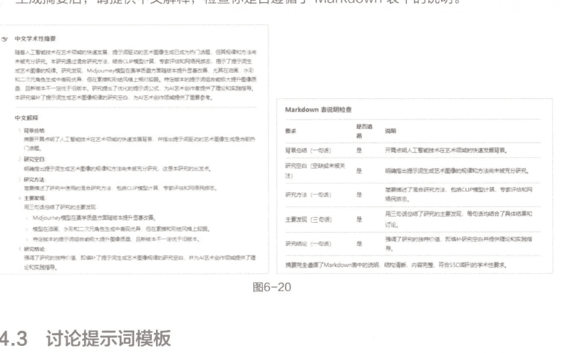

#### 6.4.3 讨论提示词模板

讨论章节是论文关键部分，既要求深入解读结果，也需要批判性思维和主观能动性。下面介绍写作要求并提供基于此工具辅助的提示词范例，帮助撰写逻辑清晰、内容丰富的讨论。

DeepSeek 技术解析与商业应用

##### 1. 讨论的写作要求

讨论的核心任务是对研究结果进行深度剖析并和现有文献对话，展现创新价值。优秀讨论应包含五个要素。

**结果解释：** 详细分析结果背后的原因，探讨为何出现这些发现，并评估是否与假设相符，要求细致解读并揭示内在逻辑和影响因素。

**理论对照：** 将发现和现有文献对比，阐明本研究如何拓展、支持或挑战已有理论，通过引用建立联系，定位学术贡献。

**影响分析：** 讨论结果对理论和实践的潜在影响，分析如何推动学科发展及实际应用价值，要求具备学术视野和实践洞察。

**局限反思：** 客观指出研究的不足，包括方法限制、数据解释局限等，通过反思展现真实性和可信度，为后续研究提供改进方向。

**未来展望：** 基于现有发现提出后续研究方向，包括新问题、改进方法及潜在领域，激发更多研究参与。

##### 2. 讨论的提示词模板

以下提供基于此工具辅助写作的讨论提示词范例，数据来自论文《人工智能驱动的数字图像艺术创作：方法与案例分析》。

请通读已导入的稿件，为其撰写适合SSCI期刊的中文讨论和限制章节。讨论部分要有引用，结合前文的前人研究进行横向比较，解释本研究是否证明了前人观点的某个部分，并对特殊结果进行解释并得出合理推论。确认证实或证伪后，分析重要结果的原因，接着讨论结果的后果和具体影响，可拓展对领域长远和潜在影响。确认前文研究结果数，每个结果按上述方法讨论，形成三段讨论。

最后指出本研究的局限性，从三项角度说明不足，例如推广局限、数据局限、方法局限等。请全面思考可能局限，但局限不应严重影响本文可靠性，局限形成一段文字。


#### 6.4.4 结论提示词模板

结论作为论文收尾，承担总结成果、提升价值、指明方向的任务。下面介绍写作要求并提供此工具辅助的总结提示词范例，帮助撰写精炼且深度的结论。

##### 1. 结论的写作要求

结论写作应遵循“总结—提升—展望”逻辑。在总结阶段，重申核心目的，概括主要发现及贡献；在提升阶段，从理论意义和实践价值阐述贡献；在展望阶段，基于成果提出未来研究方向。全程需呼应引言，形成逻辑闭环。结论包含以下要素。

- **研究主题重述**：简明重申研究目的和主题，帮助读者聚焦核心。
- **主要发现总结**：精炼概括主要发现和结果，避免细节，突出核心贡献。
- **理论贡献阐述或实践价值分析**：根据内容选择性阐述理论贡献或实践价值，明确拓展或深化程度，或对实际工作、政策、社会发展的指导意义。
- **局限性反思**：虽通常在讨论部分提及，结论中可简要提及以体现全面和诚实。
- **未来展望**：提出有见地的后续研究建议，展现前瞻性和创新性。

##### 2. 结论的提示词模板

可在此工具辅助下写作。以下是一个结构完整的结论提示词范例，数据来自论文《基于IPA分析法的AI生成室内效果图评价》。

请根据前文写作适合SSCI期刊的专业中文结论章节，单段呈现。

结论是对结果的个性化解读，对客观结果做出主观判断。结论应回应研究目的和研究问题。注意：结论应以读者为导向，用通俗语言阐述复杂内容。从客观结果推演出对读者有意义的结论。

结论应多向延伸，如向上抽象思考，用归纳逻辑得出普遍规律。

格式上包含研究目的、研究结论和研究价值。

最后可加一句价值升华，提升论文层次。

DeepSeek 技术解析与商业应用

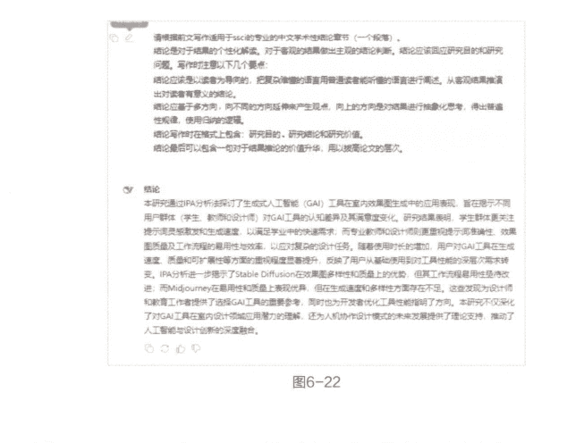

### 6.5 解析 DeepSeek 学术论文写作全流程

学术写作不仅依赖扎实研究基础，也离不开高效工具和方法。随着生成式人工智能蓬勃发展，智能工具已成为写作不可或缺的助手。DeepSeek 作为先进写作助手，显著提升写作效率和质量。

本节阐述如何利用此工具完成学术论文撰写的各步骤。

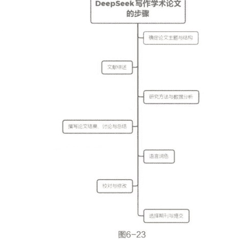

确定论文主题和结构

论文起点在于明确研究主题。借助生成式助手，可深度对话探索领域热点和前沿。助手能生成启发性题目或研究问题，激发创新思维。随后依据研究目标设计大纲，明确引言、文献综述、研究方法、结果讨论、结论等核心部分。

文献综述

文献综述在论文中地位重要，有助于系统梳理已有成果。此工具可助力快速获取各类学术数据库的最新文献，包括期刊论文、会议论文、预印本等，需注意部分数据库因权限无法直接访问，此时需结合知网、谷歌学术等工具检索。通过和此工具合作，可高效分析总结相关领域文献，提炼结论、方法、局限等关键信息，为论文提供背景支持并识别研究空白，为后续设计指明方向。

研究方法和数据分析

在方法部分需选择合适研究设计。此工具可介绍定量、定性、实验设计等方法，并提供应用实例，协助决策。若涉及数据分析，此工具还能根据数据类型和目标推荐统计方法，如回归、方差分析、相关性检验等。此外还能生成代码或公式，助力高效处理数据。

撰写结果、讨论和总结

完成前述步骤后，利用此工具辅助写作结果、讨论和总结。在结果部分，此工具可协助用准确语言描述分析结果，并按需生成图表表格以便理解。在讨论和总结部分，此工具还能对比前人研究，深入分析数据意义，提出新方向或应用建议，增强论文贡献。

语言润色

语言润色不可或缺。完成初稿后，此工具可进行语法检查、拼写校正并优化表达，使论文流畅且符合规范。也可帮助翻译为英文以投稿国际期刊。

校对和修改

论文完成后需细致校对修改以确保质量。利用审稿人指令模式可进行内容审查，通过AI反馈发现逻辑不清、内容重复或格式错误等问题。此工具还能模拟同行评审，从审稿人角度评价并提供改进意见，进一步提升质量和可靠性。

选择期刊和提交

投稿前应使用此工具根据选题推荐期刊，确保符合目标期刊要求。按提交指南准备终稿，完成修改后即可投稿。

### 6.6 本章小结

本章深入探讨了此工具在学术写作中的广泛应用，覆盖从选题构思到最终审核的各环节。此工具凭借智能化功能，在创作不同阶段提供强力支持，显著提升质量和效率。

首先，在选题构思和论文审核阶段，此工具展现强大辅助功能。它可帮助研究者剖析现象、挖掘本质，确保结构严谨、逻辑清晰。通过自动语法、拼写和格式检查，可迅速纠正语言错误，使论文符合学术规范。

其次，在实验设计、数据分析和可视化方面，此工具提供全面方法论支持。它协助科学设计实验、深入分析数据，并帮助制作清晰直观图表，确保结果准确和展示优化。

再次，在学术语言翻译、润色和优化方面，此工具同样出色。它提供丰富提示词范例，助力提升语言表达，使其更贴近国际学术标准，增强可读性和学术价值。

最后，本章还列举了各章节具体提示词范例，为研究者加速进程、抢占学术先机提供有力支持。

综上，此工具在学术写作领域应用前景广阔，值得研究者深入探索和充分利用。

### 6.7 课后练习

- 练习1：选题思路选定和论文审核实践

选题思路选定：选择感兴趣的研究领域，基于现有文献提出三个可能选题，通过此工具分析哪个更具创新性和学术价值。

论文审核：选择一篇已完成的学术论文，使用此工具论文审核工具进行全面审查。

- 练习2：学术语言优化和翻译优化实践

语言优化提示词实践：选择一段已撰写学术文本，利用此工具进行修改优化，确保语言清晰、规范、符合学术风格。

翻译提示词实操：挑一段中文学术段落让 DeepSeek 进行英译并做润色，让译文既忠于原文又符合学术英语表达习惯，兼顾精确度与流畅度。

- 练习3：分章节学术提示词使用

实操练习：挑选已完成的论文章节，例如引言、摘要或结果部分，套用本章介绍的学术提示词框架进行改写，通过动手练习熟悉提示词的用法规律。

## 第7章 DeepSeek 驱动的职场升级方案

AI 技术正快速改写找工作和日常办公的方式，也在重塑职业成长的轨迹。本章聚焦借助 DeepSeek 这类智能助手，为求职者量身打造职业策略、打磨履历、强化面试表现，同时说明如何用 AI 提升办公效率、优化商务表达、梳理职业规划。在 AI 助力下，找工作的人能更精准把握机会，职场人也能更快处理事务，进而提升个人竞争力。

本章围绕 DeepSeek 提供的求职与办公智能化方案展开，介绍具体操作思路，帮助用户加快求职节奏，推动职业生涯稳步前行。


### 7.1 职业机会获取

找工作是职业发展的重要节点，随着竞争加剧，如何呈现个人优势并快速匹配岗位，成为多数人的难题。DeepSeek 带来一套求职辅助能力，涵盖履历智能化打磨、求职方案定制、面试模拟与指导等。借助这些功能，求职者可以更精准对接岗位需求，大幅提高成功率。

下面介绍如何借助 DeepSeek 制定职业行动方案、提升履历质量，并通过模拟面试锻炼临场发挥，让求职过程更顺畅。

#### 7.1.1 定制职业行动方案

一份科学高效的行动方案，能指明方向、提升效率、增加成功几率。接下来从自我盘点与目标规划两个维度展开。

1. 自我盘点：厘清长处与短板

制定方案的起点是自我审视，帮助辨明职业兴趣、能力、经历、价值观及优劣势，从而做出更明智的选择。主要包含：

**职业兴趣**：通过兴趣测评如霍兰德 RIASEC 等，明确偏好类型，为定位提供依据。

**技能与能力**：梳理硬技能如编程、语言、项目管理，和软技能如沟通、协作、领导力，了解专业与综合水平。

**工作经历**：回顾过往经历，分析哪些可迁移为新岗位优势，哪些需要补充更新。

**价值观**：明确在薪酬、工作环境、成长机会等方面看重的要点，确保未来工作与核心价值观一致。

2. 目标规划：把握方向与岗位要求

目标规划是方案的核心，为整个求职过程提供方向。制定时需结合兴趣、能力、行业趋势和目标岗位需求。关键要素包括：

**短期目标**：设定可达成且能逐步接近理想职位的目标，如每周投递简历数、每月面试准备量、每月拓展人脉数等。

**长期目标**：明确希望进入的职位与发展路线。例如两年内深耕某领域，五年内成长为该领域中级专业人才。

**岗位要求**：深入研究目标岗位所需技能、经验、薪酬福利等，结合自身情况设定具体要求，逐步补足短板。

结合盘点与目标的结果，可以设计一组求职提示词，帮助更精准规划路径并提升效率，呈现效果见图7-1。

#### 7.1.2 履历自动化制作与打磨

履历是求职者展示职业历程与能力的核心载体，首个印象很大程度上取决于履历质量。人工智能的成熟让履历的智能化撰写与打磨成为新路径，求职者可以快速产出个性化履历并实时优化，使其更贴合市场需求。

##### 1. 履历自动化制作

该技术依托大数据与自然语言处理，能在输入基础信息后迅速搭建符合职业需求的履历框架。通过学习海量履历模板、招聘信息和行业标准，生成结构清晰、专业度高、竞争力强的履历。基本流程包括：

**信息收集与录入**：提供个人基本资料、职业经历、学历背景和专业技能，作为系统的基础数据。

**模板选择与定制**：AI 依据职业领域和职位需求智能匹配预设模板。技术岗侧重技能与项目，销售岗侧重业绩与客户管理等。

**内容精修**：围绕职业目标对履历内容进行精细优化，使用简洁有力的语言突出优势并高度贴合招聘需求。

根据基础信息，AI 可输出一套履历撰写与打磨的提示词，以清晰连贯的方式呈现，效果见图7-2。

##### 2. 履历精修

生成后必须进行打磨，通过细化内容、量化成果、调整格式来提升吸引力与通过率。

以22岁视觉传达设计专业本科毕业生张琳为例，目标职位为初级UI/UX设计师。打磨重点放在专业技能、项目经验与行业需求的契合度上。

量化数据是打磨的核心。针对张琳背景可加入：

**工作经历**：在为期6个月的平面设计公司实习中，独立设计20份客户宣传海报，提升客户满意度15%，直观体现实操能力。

**项目成果**：校园宣传海报设计项目中，用Figma完成交互原型，吸引超5000名学生浏览，好评率达90%，展现创新思维与用户体验优化潜力。

**技能应用**：熟练使用Photoshop、Illustrator、Figma，已完成30多个UI界面设计，通过持续优化使用户体验测试通过率提升25%，体现扎实基础与追求卓越。

打磨履历的提示词模板呈现见图7-3。

#### 7.1.3 面试题目产出方法与准则

面试是展示能力与魅力的关键环节，充分准备能显著提高通过率。以下说明如何借助 DeepSeek 产出面试题并掌握答题技巧。

##### 1. 面试题产出

提前准备常见问题能在面试中更从容。DeepSeek 可依据个人背景、职位要求和行业特点，智能产出针对性题目，涵盖个人、行为、专业技能等维度。

个人背景问题：涉及基本信息、职业目标与动机，例如“请做个自我介绍”“为何选择我们公司”“你认为自身最大优势是什么”。

行为面试问题：考察核心能力，例如“请分享一次成功化解团队冲突的经历”“在高压下你如何应对”。

专业技能问题：依据职位评估专业知识与工作能力，例如软件工程师的“如何提升网站加载速度”，市场营销的“如何用数据分析优化营销策略”。

##### 2. 使用 DeepSeek 产出面试题的准则及提示词

使用时建议遵循以下原则。

第一是行为事件回溯法。以情境Situation、任务Task、行动Action、结果Result引导候选人详述具体工作场景，从而全面评估真实能力。提示词示例见图7-4。

第二是压力情境模拟法，通过设计极限条件如时间紧迫、资源不足、多方冲突，观察应变、快速决策与逻辑思维能力。提示词示例见图7-5。

第三是文化适配性探测法，通过与企业文化、团队风格相关的问题，评估价值观、工作习惯与行为模式是否匹配。提示词示例见图7-6。

第四是未来潜力评估法，聚焦学习速度、适应能力与创新潜力，预测成长空间。提示词示例见图7-7。

拿到题目后可进一步反思答题逻辑，遇到难题时向 DeepSeek 求助获取更精炼表达。DeepSeek 也能依据回答反馈提供个性化训练，例如回答过于简略时建议补充细节并提供情境素材，帮助构建更有说服力的答案。

### 7.2 工作效能强化与职业路径规划

提高工作效率与明确职业规划是职场人的共同目标。DeepSeek 不仅能处理文档、撰写邮件，同时能提供商务写作建议，帮助节省时间。此外，通过生成个性化职业规划书，可帮助认识优势、明确方向、制定可行计划。无论是日常办公还是职业发展，DeepSeek 都是强有力的助手。

#### 7.2.1 文档智能化处理与邮件撰写

在快节奏职场中，高效处理文档与邮件是基本功。DeepSeek 的智能文档与邮件功能可大幅提升效率，减少重复劳动，让人专注核心工作。

##### 文档智能化处理

###### 智能文档创建与模板应用

该功能在撰写报告、会议纪要、业务计划等高频文书时作用明显。只需提供少量基础信息，DeepSeek 即可生成适配框架并自动填充内容。

以工作报告为例，用户只需简述主题、目标与要点，系统即可生成结构严谨、语言精炼、格式规范的报告。示例模板如下：

> 请基于以下信息生成一份工作报告。
> 报告主题：[填写主题，如季度销售总结]。
> 报告目标：[填写目标，如分析Q3数据、制定Q4策略]。
> 重点部分：[填写重点，如区域对比、客户反馈、改进建议]。
> 报告格式：[选择格式，如PPT/Word/邮件]。
> 语言风格：[选择风格，如正式/简洁/商务]。

###### 文档内容优化与语法检查

除了生成新文档，DeepSeek 还能对已有稿件进行深度优化。内置语法分析引擎可捕捉拼写、语法和逻辑问题并给出改进建议。

优化示例：

请分析以下文本的冗余语句并给出优化建议。

原文：[粘贴待优化文本]。

优化目标：[选择目标，如简洁/专业/流畅]。

目标读者：[填写读者，如技术团队/管理层/客户]。

###### 数据分析报告自动化生成

该功能面向市场分析师、财务人员、项目经理等数据密集岗位。导入基础数据集后，系统可自动分析并按模板生成完整报告。

市场调研示例：

请根据以下数据集生成数据分析报告。

数据集：[上传或描述，如2024年Q1销售数据]。

报告主题：[填写主题，如季度销售分析]。

分析目标：[填写目标，如识别趋势、评估区域表现]。

报告格式：[选择格式，如PPT/Word/PDF]。

语言风格：[选择风格，如正式/简洁/商务]。

##### 邮件撰写

邮件是职场沟通主渠道，撰写专业清晰的邮件常具挑战。DeepSeek 可根据场景与受众自动生成适配模板，涵盖日常沟通、客户拜访、项目更新、商务洽谈等。

###### 客户跟进邮件

跟进邮件是维系客户关系、推动合作的关键。好邮件需洞察需求并提供可行方案。

生成一封[客户职位+行业]跟进邮件，要求：

1. 包含3个定制化洞察。
2. 提出1个与业务痛点关联的具体合作切入点。
3. 提供2种后续行动选项，如方案讲解或案例分享。
4. 语气兼顾专业与亲和，避免过度销售感。

###### 跨部门协作邮件

跨部门协作常受资源与时间限制。高效邮件需明确目标、量化价值并提供备选方案。

生成一封协调[目标部门]支持[项目名称]的邮件，要求：

1. 用数据说明协同价值，如节省人力或缩短周期。
2. 明确需求细节与时间节点。
3. 添加备选方案降低接收方压力。
4. 包含协作进度看板链接。

###### 敏感信息沟通

处理数据泄露、项目延期、客户投诉等敏感事宜时，邮件结构影响信任维护。常用“缓冲—事实—行动”框架，既坦诚又体现解决姿态。

生成一封关于[敏感事项]的告知邮件，要求：

1. 使用「缓冲—事实—行动」结构。
2. 包含3项已采取的补救措施。
3. 提供2种客户补偿选项。
4. 避免法律风险表述。

#### 7.2.2 商务文案撰写要点

商务写作的核心是通过精炼文字传递信息、推动决策并塑造专业形象。优秀的商务写作需兼顾逻辑严密、表达简洁与说服力强，并依据受众与场景调整策略。DeepSeek 不仅提供语法检查与模板生成，同时通过结构化引导帮助掌握商务写作精髓。

##### 1. 商务写作的黄金原则

###### 目标先行：让文档可执行

商务文档是否好用，关键看读者合上之后是否马上行动。能否获批资金、做出决策、去推进具体任务，这些才是落地的标准。

作者先把终点想清楚，落笔时自然能够剔除冗余，保持效率与质感。

**落地方案：** 开头用最简洁的语言点明期望对方采取的行动，直接回应对“我读完后你要我做什么”。表述要利落，杜绝含糊。建议采用“动作＋可量化结果”的表述方式，让目标具体且可执行。例如“为A项目测试阶段申请30万元资金，实施后预计把用户留存率拉升到15%”。一句话带出金额、用途、预期成果。

强化行动感的句式参考如下。

请为以下目标生成一段开场陈述。
目标：申请市场调研预算。
关键数据：预算金额10万元，预计覆盖5个城市、1000名用户。
期望结果：优化产品定位策略。

###### ▶ 结论前置的分层推演

报告、提案、纪要中常见的问题是信息堆砌，读者读到疲惫就抓不住要点。让阅读效率提升的方法是先抛结论，用清晰的层次引导理解。

**落地方案：** 商务报告的第一段先用一句话讲清核心结论，让读者立刻明白主旨。随后按“问题—剖析—建议”的思路展开分层。每段聚焦一个议题，先陈述现象，再做深入剖析，最后给出对策。每个层级尽量控制在三点以内，避免冗长。可借助“关键发现”“原因剖析”“行动建议”等引导词，帮助读者进入节奏。

将以下会议记录改写为分层报告。
原始内容：[粘贴杂乱讨论文本]。
核心结论：需优先解决供应链延迟问题。
重点层级：问题现象→根本原因→短期应对方案→长期优化建议。

##### 2. 场景化写作方法与实战

###### ▶ 项目提案写作：用数据穿透决策阻力

**常见痛点：** 许多提案缺少数据支撑，描述空泛，决策者难以感知真实价值，容易被搁置。

**破局思路：** 把数据嵌进论证。先用精确数据凸显痛点，再做方案对比，用成本收益矩阵直观呈现优劣，最后补上风险对冲和灵活退出路径，降低决策阻力。

DeepSeek提供的提示词示例，可作为构建有力提案的辅助工具。

请为以下提案生成框架。
用户痛点：当前订单流失率22%（通过客服工单分析发现）。
提案方案：开发智能退款审核系统，优化退款流程。
预期收益：减少人工审核时长50%，将订单流失率从22%降低至15%。
资源需求：预计需要15人/天的开发量，云服务成本8万元。
对比选项：外包开发。外包开发虽然节省20%的成本，但可能会降低系统迭代的灵活性。

###### 复盘报告写作：从归因到行动转化

**常见痛点：** 复盘常停留在客观描述，回避责任归属和深层原因，导致问题反复。

**破局思路：** 采用STAR-R模型（情境、任务、行动、结果、反思），完整呈现事件。结合“5Why分析法”深挖根因，避免头痛医头。归因清晰，改进才有抓手。

DeepSeek提供的提示词示例，可作为撰写高效复盘报告的有力工具。

请基于以下数据生成复盘报告结论段。
目标：Q3用户增长目标为30%。
实际结果：用户增长仅为12%。
关键障碍：渠道投放ROI低于预期（实际ROI为1:1.2，目标为1:2）。
深层原因：素材未针对Z世代用户优化，A/B测试中点击率相差2倍。

###### 营销文案写作：从功能陈述到情感共鸣

**常见痛点：** 文案常局限于参数罗列，未把技术优势与用户日常场景连接，难以引发共鸣。

**破局思路：** 运用FAB法则（功能、优势、利益），把产品属性转化为用户可感知的场景和收益。配合情感化表达，既传递卖点，又触动内心，激发购买欲。

DeepSeek提供的提示词示例，为撰写出吸引人的营销文案提供灵感与指导。

功能：轻松解析100种文件格式，让多样信息一目了然。
优势：依托NLP技术，语义分析准确率高达98%。
目标用户：针对HR部门简历筛选工作设计，让繁琐的工作变得简单。
用户收益：助力HR部门削减80%的重复筛选任务，让招聘流程效率倍增。

###### 会议纪要写作：从记录到决策追踪

**常见痛点：** 纪要常遗漏关键决策，责任划分不清，后续执行难以落地。

**破局思路：** 在纪要中明确使用DRI原则，为每项任务标注直接负责人并确定时间节点，提升责任透明度。对潜在风险加上“红旗标注”，帮助决策者快速识别执行风险，提前防范。

DeepSeek提供的提示词示例，将为撰写既详尽又高效的会议纪要提供有力支持。

请将以下语音转录内容整理为会议纪要。
原始录音：[上传音频或文字]。
重点提取：提取会议中的决策事项、待办任务、争议点等。
输出要求：按“结论—责任人—时间节点—风险”的结构呈现。

还有一些高级写作技巧值得借鉴。例如，隐喻与类比手法的运用，能够将抽象复杂的概念巧妙转化为贴近生活的日常比喻，使读者更容易理解。比如，我们可以将数据中心比作城市的供水系统，它集中处理数据后再按需分配，这一形象化的比喻立刻让人豁然开朗。

另外，反向提问法也是提升提案说服力的有效策略。在提案中预先设定质疑，并紧接着给出有力的回应，能够增强论证的严密性和逻辑性。例如，面对“为什么选择A方案而非B方案？”的疑问，我们可以清晰地阐述：“选择A方案，是因为它完美兼容现有架构，迁移成本能够降低60%，相较于B方案具有显著的优势。”这样的反向提问与回应，不仅展现了提案的深思熟虑，也大大增强了其说服力。

#### 7.2.3 职业规划书生成

在职场中，职业规划书是一个人职业生涯的蓝图，它不仅能够帮助职场人士明确自己的职业目标，还能提供一个具体的行动步骤，帮助其在职业道路上有条不紊地前进。职业规划书的编写通常需要考虑个人的兴趣、技能、职业目标，以及发展路径等多方面内容。

DeepSeek能够根据用户提供的个人背景信息、目标和需求，帮助其高效、准确地生成个性化的职业规划书，为其职业生涯的发展铺平道路。

##### 1. 职业规划书的意义与目标

职业规划书是求职者或职场人士用于明确个人职业目标、发展路径及实现策略的重要工具。它不仅是求职过程中对个人能力与意愿的全面总结，更是实现长远职业目标的行动蓝图。职业规划书对于个人在职场中的自我定位、发展方向的明确，以及每一步成长策略的制定均起着至关重要的作用。

具体而言，职业规划书的目标可归纳为如下几点。
- **明确职业目标**：协助职场人士清晰界定自己的长期与短期职业追求，确保职业发展的方向性。
- **评估个人优势与不足**：深入分析个人的优势、技能和经验积累，同时识别存在的短板，并据此制订针对性的提升计划。
- **制定职业发展路径**：依据个人兴趣、能力及市场需求，确立职业发展的大致方向和具体路径，规划出切实可行的步骤与行动计划。
- **优化职业成长策略**：提供增强职业竞争力的有效建议，包括推荐适合的进修课程、资格认证等，以促进个人的持续成长与发展。

##### 2. 深度自我认知：职业发展的基石

在职业发展的过程中，深度自我认知是每位职场人士必须具备的素质，唯有深入了解自己在兴趣、能力及性格方面的独特之处，才能有效地规划职业目标，并制定出切实可行的行动路线。通过自我认知，职场人士能够避免盲目地选择职业方向，从而大大减少职业发展过程中的迷茫与困惑。

若要达成深度自我认知，以下三个分析维度可为我们提供系统性支持框架。
**兴趣与价值观：** 借助诸如霍兰德职业兴趣测试、盖洛普优势识别器等专业工具，求职者能够清晰地认识到自己偏好的职业类型，以及驱动自己不断前行的内在动机。这些兴趣测试不仅能够帮助我们了解自己真正契合的职业方向，还能揭示出与自身性格高度匹配的工作领域。
**能力与潜力：** 通过能力评估，求职者可以客观地审视自己的技能水平，这包括硬技能（如编程、设计能力）与软技能（如沟通、领导能力）。在这一环节，我们需要识别出自己已经具备哪些技能，哪些尚需进一步提升，以及哪些潜在能力能够通过持续的学习与实践得到充分的释放。硬技能的提升通常可以通过参加专业课程、参与实践项目等方式来实现，而软技能的提升则更多地依赖于日常工作中的实践与不断的自我反思。
**性格适配性：** 性格特征对职业选择具有深远的影响。每个人的性格都是独一无二的，有些人可能更适合团队合作与交流频繁的岗位，而另一些人则可能更擅长独立工作并进行深度分析。通过MBTI（迈尔斯-布里格斯性格测试）或大五人格模型等性格测试工具，求职者可以更加深入地了解自己的性格特点，并根据自己的性格优势来选择最适合的职业类型。

##### 3. 目标分层设计：从愿景到行动

明确的职业目标不仅是个人前进的灯塔，也是职业生涯中保持方向感的关键所在。通过巧妙地将目标进行分层设计，求职者能够将远大的职业愿景，细化为短期、具体且可操作的小目标。在分层设计的过程中，遵循SMART原则（具体性、可衡量性、可达成性、相关性、时限性）至关重要，它确保了目标既富有挑战性，又能够通过一系列清晰的步骤逐一实现。
**长期目标（3~5年）：** 求职者在职业生涯中期望达到的最终状态，它关乎职业身份的定位，如立志成为某一领域的专家、经理或高层管理者。在设定长期目标时，应综合考虑行业发展趋势、技术进步等外部因素，确保目标的前瞻性和可行性。例如，可以设定成为人工智能算法领域的专家，或是转型为具备跨行业视野的产品经理等职业发展方向。
**短期目标（1年内）：** 基于长期目标而设定的具体、可实现的阶段性任务，通常能够在一年内完成。这些目标的设定需严格遵循SMART原则，确保每个任务都具体明确、可量化评估、切实可行，并附有明确的时间节点。短期目标往往与技能提升、项目经验积累、专业认证获取等紧密相关，是通往长期目标不可或缺的基石。
**灵活调整机制：** 在职业发展的过程中，目标和计划往往需要随着外部环境的变化，以及个人成长的实际情况进行动态调整。因此，建立每季度复盘目标完成度的机制至关重要，这有助于求职者及时根据市场趋势、技术发展等因素对职业规划进行必要的调整。灵活调整机制不仅能够帮助求职者有效应对突发变化，还能确保职业发展道路上的稳定性和持续性，让每一步都更加坚实有力。

##### 4. 能力跃迁策略：构建竞争壁垒

在竞争日益激烈的职场环境中，个人的职业成长与成功离不开对核心能力的持续提升与拓展。通过精心规划并实施明确的能力跃迁策略，求职者能够在所在领域内不断巩固并增强自身的竞争力。值得注意的是，能力跃迁并不仅限于对专业技能的精进，它还涵盖了跨领域能力的广泛拓展，这些共同构成了个人在职场上的独特竞争壁垒。
**使用T型能力模型：** T型能力模型着重于纵向深度与横向广度的平衡，助力求职者在专业领域达到前沿水平（即前10%的顶尖地位），同时拓展相关领域的知识与技能（即关联技能的拓展）。以技术岗位为例，求职者可通过加强管理思维、提升跨部门协作等软技能，来增强个人综合竞争力。
**学习优先级矩阵：** 学习优先级矩阵能帮助求职者在众多学习任务中清晰界定优先级，确保时间与精力得到合理分配。例如，对于紧急且重要的技能，应立即着手学习；而对于非紧急的技能，则可通过长期规划来逐步掌握，如表7-1所示。

表7-1

| 紧急度 \ 重要度 | 高重要性 | 低重要性 |
| :--- | :--- | :--- |
| 高紧急 | 即刻学习（如岗位必备的新工具） | 外包或简化（如基础报表自动化） |
| 低紧急 | 制订长期计划（如行业前瞻技术） | 暂时搁置（如非核心技能） |

**实践验证循环：** 通过实践验证来检验学习成果，以确保所学技能能够切实应用于实际工作中。例如，在学习数据分析软件后，应主动争取相关项目的实践机会，以便将理论知识迅速转化为实际工作能力。同时，构建失败案例库，详细记录错误并深入分析其根本原因，如沟通不畅导致的项目延期等。

##### 5. 资源网络构建：杠杆借力的艺术

在职业发展的过程中，构建资源网络起着举足轻重的作用。成功的职场人士不仅具备扎实的个人能力，更懂得如何有效利用网络与资源，借助外部力量加速个人成长。构建一个多维度的资源网络，有助于求职者与现有及潜在的行业精英建立联系，充分利用各类平台资源，提升自己在行业内的影响力。

###### ▶ 人脉分层管理

有效的资源网络并非仅仅与少数关键人物保持联系，而是需根据人脉的不同角色进行分层管理。通过系统性地管理人脉，职场人士能更精确地利用各层次资源，推动职业发展的各个阶段。
**核心层（如导师和直属上级）：** 提供最直接的职业支持，与他们定期沟通进展、寻求建议，能加速职业发展，明确职业方向。
**协作层（跨部门同事）：** 通过合作拓展职业视野，积累跨领域经验，建立信任，提高合作效率，为未来项目赢得更多机会。
**信息层（行业社群）：** 通过参与行业活动，如峰会、论坛，获取最新动态，拓展人脉，增强行业影响力。

###### ▶ 平台资源整合

当代职场已演变为多元资源的聚合平台，合理利用这些资源成为个人职业跃迁的关键杠杆，尤其在跨领域学习和技能提升方面。
**内部资源：** 如企业提供的轮岗机会和培训预算，有助于员工在公司内部拓展职能范围，积累多元化经验，从而提升个人竞争力。
**外部资源：** 如MOOC平台、开源社区（GitHub），提供高质量学习资源，助力员工技能提升，同时增加在行业内的曝光度，尤其在人工智能、数据科学等快速发展领域，学习新技术和工具至关重要。

###### ▶ 个人品牌塑造

个人品牌塑造是现代职场发展中不可或缺的一环。通过在自媒体平台或行业论坛中持续输出专业内容，求职者能逐步建立行业影响力。这不仅有助于提升个人的职业形象，还能吸引更多职业机会，为职业发展铺平道路。

##### 6. 心智模式升级：应对不确定性

在职业发展的过程中，硬技能和软技能的提升固然重要，但心智模式的升级同样不可或缺。心智模式，即个体理解世界、应对挑战、处理压力等一系列思维和情感反应的内在框架，对于职场人士在不确定环境中保持应变能力、处理复杂局面，以及在竞争中脱颖而出具有核心意义。

###### ABZ计划理论

ABZ计划理论为职业规划提供了一个灵活且稳健的框架，助力求职者在面对职业风险时保持心理稳定。A计划代表当前的主攻方向，B计划则是应对突发变化的备选方案，而Z计划作为保底生存策略，为求职者提供了最后一道安全网。这一理论鼓励求职者在面对工作压力和不确定性时，能够灵活调整策略，有效减轻焦虑情绪。

###### 反脆弱思维

反脆弱思维倡导积极面对挑战和不确定性，将外部压力转化为内在成长动力。在这种思维模式下，个体勇于接受挑战性任务，通过实践中的磨砺，快速提升应对复杂情况的能力。同时，建立“最小试错单元”，以低成本验证新方向，进一步增强了适应性和创新能力。

###### 心气管理

心气管理强调定期评估职业能量和工作满意度，确保在职业道路上始终保持积极心态。通过审视成就感、学习空间和人际关系等关键维度，求职者能够清晰识别自身的优势与不足，及时进行“职业能量审计”。这一做法有助于预防职业倦怠，保持持续动力，避免陷入低水平重复，为职业发展注入不竭的活力。

##### 7. 实战工具包与提示词模板

在职业规划和发展的道路上，合理运用实战工具能够显著提升求职者制订与执行职业发展计划的效率。以下是几款实用的实战工具及其模板，旨在帮助大家明确职业路径，增强执行力，并灵活应对变化。

###### 目标路径法：精准对比现状与目标

通过对比当前技能与经验同职业目标所需能力的差距，求职者能够精准识别出自身的技能短板，并据此制定详尽的提升计划。这种方法确保了学习的针对性和有效性，避免了盲目跟风学习的现象。

###### 周计划九宫格：综合管理职业目标

周计划九宫格是一个强大的工具，它帮助求职者全面管理工作、学习、健康等多个生活维度，确保职业发展过程中的平衡与和谐。借助九宫格，求职者能高效规划时间，提升工作效率，从而在忙碌中保持生活的有序与活力。

###### 职业画布模型：可视化职业规划

职业画布模型以直观的方式展现了求职者的价值主张、关键资源、成本结构等关键要素，为职业转型或创业规划提供了有力支持。通过这一模型，求职者可以清晰地勾勒出职业发展路径，利用图形化手段灵活调整发展方向，确保每一步都朝着既定目标迈进。

DeepSeek大模型：技术解析与商业应用
- 教育背景：[填写学历和学校]。
- 职业目标：[长期目标+短期目标]。
2. 深度自我认知
- 霍兰德职业兴趣代码：[如RCI]。
- 核心优势识别：[如逻辑分析、跨团队协调]。
- 性格测评结果：[如INTJ]。
3. 行业趋势判断
- 目标领域技术/市场变化：[如AIGC技术重构内容生产流程]。
4. 发展路径设计
- 能力跃迁重点：[如补齐商业思维，强化Python自动化能力]。

里程碑设定：[如2025Q3前达到自媒体粉丝20万+]。

5. 风险应对机制
- 备选方向：[如数据运营方向]。
- 抵御资源：[如持续维护关键人脉]。

6. 具体计划
- 行动清单：[列出具体步骤]。
- 时间节点：[设定完成目标的时间节点]。

### 7.3 本章小结
本章围绕求职辅导与办公加速两条主线，梳理了 DeepSeek 在简历打磨、求职方案规划、面试实战演练等环节的具体用法，并说明了它在文件处理、邮件撰写、商务表达以及职业路径规划上的辅助价值。借助自动化能力，正在找工作的人可以优化材料、搭建有序的求职节奏，并在模拟对话中累积实操经验，从而提高入选几率；职场中人则能加快文档流转、提升写作与沟通质量，同时获得长期的发展建议。整体看，智能化工具为两类人群提供了实质性支持，让目标达成更顺畅。

### 7.4 课后练习
- 练习1：简历撰写实操
面向目标岗位，用 DeepSeek 生成一份专属简历，突出岗位相关的能力与经历。内容需包含个人信息、职业定位、核心技能及工作经历，保持简洁明了。反复调整指令，让输出与岗位描述高度贴合，彰显个人优势。
- 练习2：面试模拟与优化
挑选一个常见面试题，用 DeepSeek 进行对话演练。依据系统给出的点评对回答进行打磨，提升表达流畅度与自信心。

## 第8章 DeepSeek个人知识库搭建
信息输入持续增长，如何快速获取、归纳并有效运用其中的知识，已成为普遍痛点。DeepSeek 的出现为个人知识管理提供了新思路，从素材采集、要点提炼到智能调用，它可扮演私人知识管家角色，帮助用户构建有体系的知识网络，挖掘信息价值。

本章将引导读者探索 DeepSeek 在定制化知识库构建中的作用，推动知识管理迈向智能化，让整理与调用更高效。

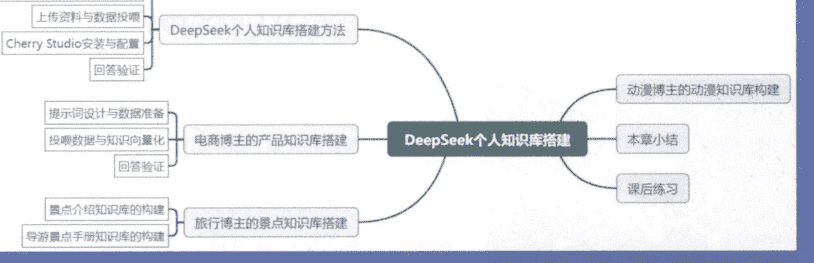

### 8.1 DeepSeek个人知识库搭建方法
面对信息过载，专属知识库正成为提升个人产出的核心手段。它不只是静态存储，更像一个动态的知识生态，可帮助使用者系统化整理、快速查找并落地应用。凭借出色的自然语言处理与推荐能力，DeepSeek 为搭建此类库提供了新路径。分散的文档、笔记或网页内容可通过平台自动归类、建立关联并整合为网络结构。

平台还能依据学习与工作场景推送相关素材，实现内容的动态更新与持续完善。无论用于学术、职业提升或兴趣探索，都能从海量数据中挑拣高价值信息，为成长与创新提供支持。

当前主流思路主要有两种：AnythingLLM 搭配大模型，以及 Cherry Studio 搭配大模型。本节简述两种方案，方便读者依据需求选择。鉴于 Cherry Studio 在中文环境下的表现，本书以它为主线演示个人库的搭建流程。

#### 8.1.1 AnythingLLM下载安装与设置
AnythingLLM 是一款基于大型语言模型的综合应用，兼顾本地运行与云端部署。它支持导入 PDF、TXT、DOCX 等格式，并在自然语言交互下完成问答、摘要、内容分析等任务。产品注重隐私保护，同时允许自定义模型与 API 对接，广泛应用于企业、教学与个人场景，提升信息处理效率。下载界面如图8-1所示。


1. 按提示点击 Download for desktop 完成本地安装，启动后界面如8-2所示。于大模型配置处选择 Ollama 作为语言引擎。


2. 进入用户信息页，可直接跳过或填写邮箱以完成注册并获取更多功能，如图8-3所示。


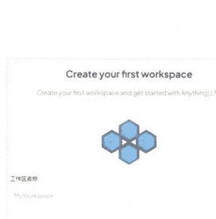
3. 为工作区命名，如 My Workspace 示意图8-4。


#### 8.1.2 上传资料与数据投喂
完成 AnythingLLM 基础配置后，需准备知识库素材，通常包括过往总结文档、经验笔记等。

1. 在知识库管理界面，点击工作区左侧的上传箭头，即可将文档导入知识库，具体操作参考图8-5。
2. 在弹出窗口中，点击 Click to upload or drag and drop 按钮上传 PDF 或其他格式文件，如图8-6所示。


3. 文件上传成功后会显示在列表下方，并出现 Move to Workspace 按钮，如图8-7所示。
4. 点击 Move to Workspace 按钮，文件即可移入工作区，如图8-8所示。

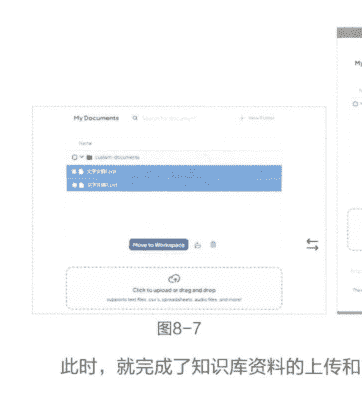

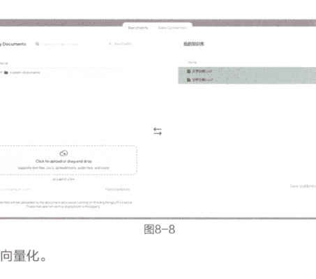
至此，知识库资料的上传与向量化已完成。

#### 8.1.3 Cherry Studio安装与配置
Cherry Studio 是一款综合性 AI 助手，内置知识库配置环境，可本地保存数据库以保障隐私。同时支持多服务商对话客户端，提供灵活多样的交互方式，具体界面如图8-9所示。


安装后需配置大模型与嵌入模型。启动 Cherry Studio，点击设置进入配置页，选择 Ollama 以配置本地 Ollama 模型，如图8-10所示。

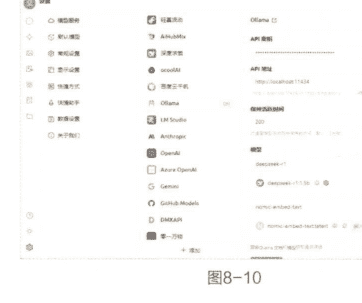
完成安装后需进行多项配置。首先在 API 密钥栏输入用户的 DeepSeek 账户 API 密钥，详细步骤见第10章 API Key 部分。随后在 API 地址栏填写本地地址 http://localhost:11434，并将保持活跃时长设为200分钟。模型选择 deepseek-r1:1.5b；嵌入模型选择 nomic-embed-text:latest，该模型用于知识库内容的向量化处理，加载方式为命令行执行 ollama pull nomic-embed-text。

配置完成后，点击左侧功能区的知识库按钮进入知识库界面，点击添加新建一个知识库并命名，同时确保嵌入模型为 nomic-embed-text:latest，如图8-11所示。


此时可上传库内资料，Cherry Studio 支持 PDF、DOCX、PPTX、XLSX、ODT 等格式。点击添加文件或拖拽文件至指定区域均可上传，本例选择 PDF 文件上传，如图8-12所示。

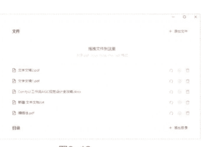
#### 8.1.4 回答验证
上传完成后，可在提问界面输入问题查看系统回复。如需让提问时引用已上传的知识库，只需点击界面中的知识库图标，选择已创建的知识库，系统生成答案时会触发自动引用，如图8-13所示。


例如，用户已将一份关于新婚姻法的 PDF 文件上传至知识库。随后提问结婚后彩礼是否可退还时，系统生成的回答会参考并引用该 PDF 文件，用户可在参考文件区清晰看到来源，具体效果如图8-14所示。

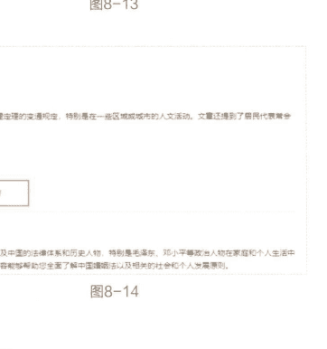
### 8.2 电商博主的产品知识库搭建
在信息繁杂的当下，消费者常被海量商品信息淹没。电商博主作为品牌与用户间的桥梁，需传递产品核心价值并引导理性消费。为提升内容质量、增强信任并实现长期发展，博主需搭建系统化、结构化的产品知识库，这也是在竞争中脱颖而出的重要抓手。

本节详细介绍电商博主如何建立产品知识库以实现高效检索，涵盖信息收集、分类整理、更新维护等核心环节。

#### 8.2.1 提示词设计与数据准备
在构建知识库前，设计好提示词至关重要，它既影响库的构建，也影响后续提问效果。本小节聚焦于用于向知识库提问的提示词设计。

本次以电商产品为知识库内容，准备了两个库文件：电商电子产品知识库和电商文创产品知识库。

借助 DeepSeek 生成库内容。按提示词设计原则，为电商电子产品知识库设计的提示词为：

> 我是一名电商博主，我想知道电商电子产品应该有哪些。

同理，为电商文创产品知识库设计的提示词为：

> 我是一名电商博主，我想知道电商文创产品应该有哪些。

获取 DeepSeek 返回的详细结果后，将信息整理并复制到 Word 文档中，并导出为 PDF 以便后续构建和提问使用。

#### 8.2.2 投喂数据与知识向量化
准备两个 PDF 文件，分别命名为“电商电子产品.pdf”和“电商文创产品类型目录.pdf”。在 Cherry Studio 的知识库配置界面将两个 PDF 上传至系统，系统会依预先配置的 nomic-embed-text:latest 算法对内容进行向量化处理，这一步是后续精准匹配的基础，如图8-15所示。


#### 8.2.3 回答验证
知识库构建完成后，需通过提问验证其准确性和实用性。依据既定原则制定综合性提问提示词：

我是一名电商博主，我想知道电商电子产品应该有哪些，电商文创产品应该有哪些。

将该问题输入 DeepSeek 系统，系统结合已向量化的知识库内容迅速给出回应，如图8-16所示。回答既涵盖了电商电子产品的多个品类，也详细列出文创产品的不同类型，充分体现知识库的全面性。

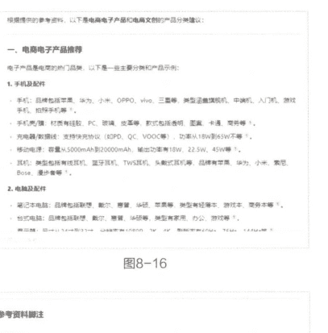
在系统给出的参考资料中，明确引用了此前上传的“电商电子产品.pdf”和“电商文创产品类型目录.pdf”两个文件，充分证明行业知识库的有效性和实用性，为电商博主提供全面、准确且易检索的产品信息，如图8-17所示。


### 8.3 旅行博主的景点知识库搭建
随着生活品质提升，旅游成为热门休闲方式。但网络旅行信息繁杂，目的地介绍、产品选择和行业动态瞬息万变，旅行者难以做出明智决策。旅行博主作为信息筛选者，面临从海量信息中提炼价值内容的挑战。为提升内容质量和用户粘性，构建系统化、结构化的行业知识库势在必行。

#### 8.3.1 景点介绍知识库的构建
本小节探讨旅行行业知识库的构建方法，说明数据驱动如何助力个性化旅行体验，并详细介绍旅行博主如何建立景点介绍知识库以便高效检索。

1. 提示词设计与数据准备
构建知识库前需精心设计提问时的提示词，帮助系统更准确理解需求并返回相关信息。

为构建旅游景点知识库，准备核心文件为川西大环线介绍。设计的提示词为：

> 我是一个自驾游爱好者，要去川西大环线。请编写一个川西大环线的路线和景点集合的介绍。

将提示词输入 DeepSeek，生成详尽的川西大环线自驾路线及景点介绍，复制粘贴到 Word 文档后导出为 PDF 格式，作为知识库素材。

2. 投喂数据与知识向量化
准备一份名为“川西大环线自驾游攻略.pdf”的文件，在 Cherry Studio 知识库配置界面上传至系统。系统会依据预设的 nomic-embed-text:latest 算法自动对 PDF 内容进行向量化，使文本信息转为向量形式，便于后续高效检索和匹配，如图8-18所示。


3. 回答验证
构建完成后需验证准确性和实用性。最终确定的提问提示词为：

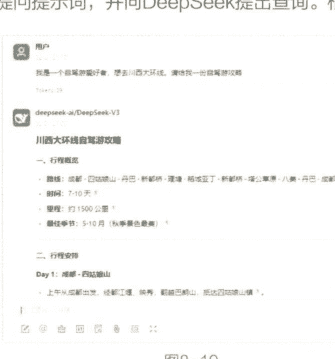
我是一个自驾游爱好者，想去川西大环线。请给我一份自驾游攻略。

将提示词输入 DeepSeek，系统结合已构建并向量化的知识库内容生成针对川西大环线的自驾游攻略，如图8-19所示。回答围绕路线规划、沿途景点推荐和注意事项展开，充分验证知识库的有效性。

在回答的参考资料中明确标注引用自此前上传的文件，这一细节证实了行业知识库构建的成功实施，如图8-20所示。


#### 8.3.2 导游景点手册知识库的构建
本小节以旅行博主的导游景点手册知识库构建为例，流程包括搭建 Cherry Studio 环境、采用本地 DeepSeek 大模型、设计库内容并上传向量化，最后设计提示词提问并查看引用情况。DeepSeek 可基于知识库进行智能搜索和问答，实现行业知识库的建立。

1. 在本地通过 Ollama 搭建 DeepSeek 环境。在命令行输入 Ollama run deepseek-r1:1.5b，等待加载完成，在浏览器打开 http://127.0.0.1:11434 查看 Ollama 运行状态是否为 running，如图8-21所示。


2. 打开 Cherry Studio，在设置界面选择 Ollama，填写 API 密钥，并填写本地 IP 地址为 http://localhost:11434，配置大模型为 deepseek-r1:1.5b，向量化模型为 nomic-embed-text:latest，如图8-22所示。

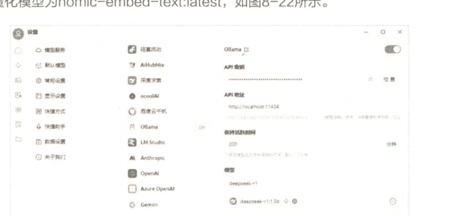
3. 设计知识库的内容，这里在百度等搜索引擎整理了关于重庆和成都旅游景点的信息，保存为 PDF 文件作为知识库内容。
4. 在 Cherry Studio 的知识库配置界面上传知识库文件，等待系统进行向量化，如图8-23所示。

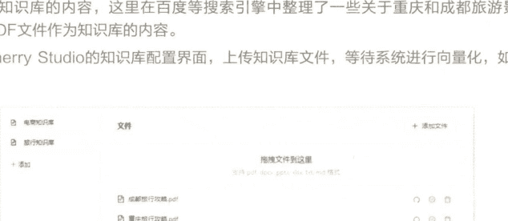
5. 提问前先在知识库中选择已创建的“旅行知识库”，如图8-24所示。


6. 参照提示词的构建思路为知识库拟一条查询语句并执行检索，示意图见图8-25。

我是一个旅行者，想去成都和重庆旅游，请给我介绍一下两地的景点和如何从成都到重庆。


7. 返回 Cherry Studio 对话区，载入已完成的知识库配置，以上一步设计的询问语句发起测试，并观察模型返回的内容，示意图见图8-26。

8. 打开引用追踪，可见 DeepSeek 作答时调用了知识库内的文件，示意图见图8-27。

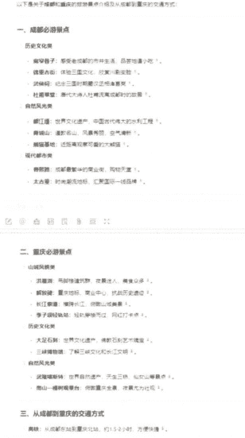


### 8.4 动漫博主的动漫知识库构建

本部分聚焦动漫创作者如何搭建专属且辨识度高的个人资料库。通过系统化整理，博主能更高效地归类、调取并使用积累的动漫信息，进而提升内容制作水准、丰富创作深度，并加强与粉丝及同行的互动交流。这一搭建过程既是对专业知识的归纳，也是通过亲手操作巩固此前学习的重要途径。

1. 在本地以 Ollama 部署 DeepSeek 运行环境。命令行输入 Ollama run deepseek-r1:1.5b，等待加载完毕。随后在浏览器打开指定网址，核对 Ollama 运行状态是否为 running，示意图见图8-28。


## 第8章 DeepSeek个人知识库搭建

2 打开 Cherry Studio，在设置界面选择 Ollama 作为后端，填写 API 密钥，本地地址填为 http://localhost:11434，模型选择为 deepseek-r1:1.5b，向量化模型选择为 nomic-embed-text:latest，示意图见图8-29。

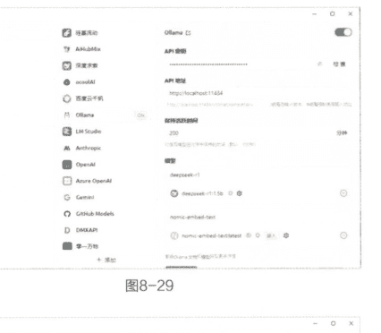

3 规划知识库内容，本例通过百度等搜索引擎整理了一些关于动漫人物与作者的资料，保存为 PDF 文件作为数据源。

4 在 Cherry Studio 的知识库配置界面上传上述文件，等待系统完成向量化，示意图见图8-30。


5 提问前先在知识库列表中选中已创建的“动漫知识库”，示意图见图8-31。


> 我是一名动漫爱好者，请给我介绍下日本动漫的代表人物和代表作。

6 切回 Cherry Studio 的提问界面，选择已配置好的知识库，用设计好的提问语句进行提问，查看模型给出的回答，示意图见图8-32。


7 查看引用过程，可见模型在生成结果时引用了知识库内容，示意图见图8-33。


### 8.5 本章小结

本章系统呈现了 DeepSeek 在知识库建设中的落地实践。先介绍了搭建所需的基础软件环境，为后续操作提供技术支撑；再详细拆解了电商博主知识库和旅游博主知识库的构建路径，让读者先行掌握构建的基本步骤与要点。

为强化理论与实践的衔接，本章以旅行博主导游景点手册知识库和动漫博主知识库为实操案例，全流程展示了从库的设计、素材准备、向量化处理到提问验证的环节。通过这些案例，读者可以深化对知识库原理的理解，同时习得可直接使用的操作技巧。

完成本章学习后，读者既能巩固知识库构建的理论要点，也为后续章节打下坚实基础。这些经验对今后从事知识管理、数据挖掘和信息检索等工作也具有积极的指导价值。

### 8.6 课后练习

- 练习1：用 AnythingLLM 搭建中医知识库
  配置系统环境：按本章流程，使用 AnythingLLM 搭建知识库环境，配置 API 密钥和大模型，配置向量模型。
  知识库内容构建：使用 DeepSeek 或其他工具对中医相关知识进行搜集，形成知识库的 PDF 文档集。
  回答验证：将知识库内容上传至系统，根据库内问题进行提问，查看是否引用知识库内容及其相关性。

- 练习2：用 Cherry Studio 搭建图书知识库
  配置系统环境：按本章流程，使用 Cherry Studio 搭建知识库环境，配置 API 密钥和大模型，配置向量模型。
  知识库内容构建：使用 DeepSeek 或其他工具建立全面的个人图书馆图书目录，形成知识库的 PDF 文档集。
  回答验证：将知识库的内容上传至系统，根据图书查询需求进行提问，查看是否引用知识库中的内容及其相关性。

## 第9章 DeepSeek带你轻松玩转数字艺术设计

随着生成式人工智能的快速发展，AI 在艺术设计领域的渗透日益加深，尤其在图像生成与创作环节。DeepSeek 作为兼具数据分析与内容生成能力的工具，不仅能激发创作灵感，还能在数字艺术图像生成、效果图制作及图像优化等方面提供支持。

本章聚焦 DeepSeek 在艺术设计中的应用，重点探讨如何借助图像生成提示词来提升创作效率与设计表现。通过具体实例，帮助用户掌握用 DeepSeek 激发灵感、优化设计的技巧，并实现创意向数字化的呈现。

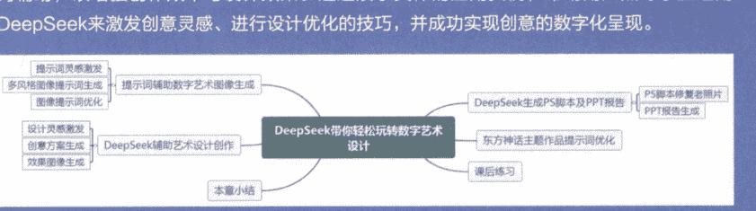

### 9.1 提示词辅助数字艺术图像生成

在数字艺术创作中，图像质量既取决于设计师的创意与技巧，也与提示词的使用精细度密切相关。随着 AI 图像生成技术的演进，提示词的精准设计与优化已成为创作流程的核心。DeepSeek 提供了高效的提示词设计与优化功能，帮助艺术家与设计师快速锁定方向，生成符合预期的高质量图像。

本节详细讨论在图像生成环节，如何借助精准提示词激发灵感、营造多样化风格，并对生成结果进行精细化优化，以提升作品表现力和视觉冲击。借此，用户能更顺畅地从概念构思过渡到最终成图，实现灵感与技术的无缝衔接。

#### 9.1.1 提示词灵感激发

在数字艺术创作中，提示词既是与模型沟通的桥梁，也是创作旅程的起点。它连接着思维与实现。艺术家通过精确且富有启发性的描述，能够为模型明确创作路径，确保输出与预期一致。在创意探索中，如何巧妙运用提示词点燃灵感，对作品独特性与艺术韵味具有决定性作用。

提示词灵感激发的本质，在于用语言的细腻度引导模型的创作节奏。与传统艺术依赖草图、配色和构图不同，AI 生成艺术要求创作者以富有想象力的语言作为启动创作的钥匙，从而解锁多样艺术图像。因此提示词可视作数字艺术的创意火种，是唤醒灵感的关键。借助 DeepSeek，艺术家能快速获得多样的提示词方案，为创作增添可能性。

- 1. 通过关键词激发创意
  输入具体关键词可迅速为模型明确主题与风格。例如输入“未来主义”“高科技城市”“霓虹灯”“虚拟现实”等，模型将被引导至特定视觉氛围。再加入“夜晚的城市”“繁忙的街道”“飞行的车辆”等描述性词语，模型便能从中提炼素材生成符合需求的画面。这类词可归为“主题/主题词”。

- 2. 运用情感和氛围描述
  除了风格与元素，情感与氛围的描述同样能点燃灵感。通过提示词点明情感色彩，如“孤独的女孩站在空旷的街道上，背景是一个寂静的夜晚”，既明确了场景构成，又借助“孤独”引导模型生成符合情感需求的画面。这类词可归为“虚词”。

- 3. 细节词的描述
  细节词用于丰富主体信息，提升画面深度与细腻度。包括人物的服饰、表情、动作，以及环境的纹理、背景装饰等。精准的细节能直接影响真实感与艺术效果。例如创作森林人物肖像时，可加入“细致花纹刺绣裙子”“微风拂过的头发”“滴水的露珠”等。

- 4. 色彩词的描述
  色彩词指明色调与具体颜色，同时调动情感与氛围，如“温暖的金色调”“冷酷的蓝色”“鲜艳的红色”“暗黑的紫色”等。色彩决定整体氛围，也能突出主题与情感。例如“金色的夕阳光辉”会营造温馨浪漫的氛围。

- 5. 灯光词的描述
  灯光词指定光源类型、强度、来源和效果，对画面气氛、层次和焦点至关重要，如“柔和的自然光”“戏剧性的聚光灯”“背光效果”“霓虹灯照明”等。它们帮助模型决定光线强度与来源，进而影响视觉表现。

- 6. 镜头词/构图的描述
  镜头词与构图描述视角和画面结构，决定观看方式与焦点。例如“俯视图”“仰视图”“侧面视角”“特写镜头”“广角镜头”等，帮助模型确定拍摄角度、焦距与画面比例，从而引导视线突出重点元素。

- 7. 结合历史与文化元素
  历史与文化元素也是灵感来源。例如加入“文艺复兴风格”“巴洛克艺术”“古希腊雕塑”等提示，模型能更好把握时代感与艺术氛围，使作品带有浓厚的文化背景与历史韵味。

- 8. 使用艺术流派和风格的名称
  明确指示期望的流派能大幅提升精准度。如使用“抽象表现主义”“萨尔瓦多·达利风格”“立体主义”等，模型可借鉴经典艺术家的特征，生成符合预期的作品。这类词可归为“风格词/艺术家词”。

- 9. 提示词公式
  在 DeepSeek 生成图像内容时，提示词的撰写至关重要。高质量提示词能有效引导模型生成预期图像，并提升效率。为此提出提示词公式，帮助用户便捷编写。该公式构成如表9-1所示。

表9-1

| 构成 | 描述 |
| :--- | :--- |
| 垫图链接 | 参考图像、参考风格、参考构图及形式(非必要) |
| 主体/主题词 | 图像的主要内容或主题，决定了图像的核心元素 |
| 细节词 | 丰富主体的细节 |
| 色彩词 | 控制画面色调或具体对象色彩 |
| 虚词 | 使图像更具情感和随机性 |
| 镜头词/构图 | 限定图像的构图和视角，如俯视图、特写等 |
| 灯光词 | 明确灯光类型和效果 |
| 风格词/艺术家词 | 决定图像的主要风格流派或受到哪些艺术家影响 |
| 其他指令 | 否定词、种子值、样式值、混乱值、图像及提示词权重(IW)等 |
| 模型版本 | 用的Midjourney模型版本，如V系列或NIJI系列的具体版本 |
| 图像画幅 | 指定图像的宽高比例 |

利用 DeepSeek，可以帮助我们按照提示词公式生成适用于 AI 绘画工具的提示词，如图9-1所示。

将提示词输入 Midjourney 应用程序，生成图像，如图9-2所示。

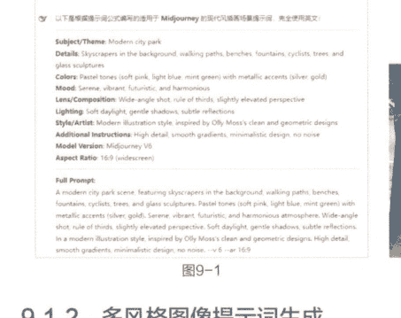


#### 9.1.2 多风格图像提示词生成

在数字艺术中，风格的多样性与独特性对塑造作品个性至关重要。不同艺术风格不仅影响视觉呈现，也传达不同的情感与思想。结合 DeepSeek 的多风格提示词生成功能与 Midjourney 的出图能力，创作者能突破单一风格限制，生成融合多重特征的图像，极大拓展艺术表现空间。

- 1. 生成各种风格的提示词
  风格多样性是激发灵感的重要源泉。借助 DeepSeek，可快速获得涵盖多种流派的提示词方案，满足个性化需求。无论是经典流派还是当代数字风格，DeepSeek 都能提供精准的提示词以供选择与组合。
  进行风格探索时，可让 DeepSeek 生成多类风格提示词，例如：
  生成各种风格的提示词，3种左右，适用于Midjourney生成图像。
  生成效果如图9-3所示，展现了 DeepSeek 在风格提示词生成方面的能力。
  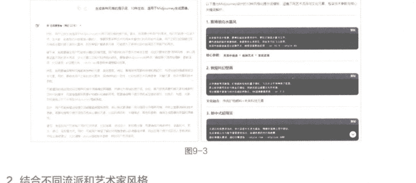

- 2. 结合不同流派和艺术家风格
  DeepSeek 可将不同艺术家风格融合生成多风格图像。当用户输入提示词，如结合“印象派”自然风光与“表现主义”情感表达，DeepSeek 将自动生成融合提示词，供 Midjourney 生成兼具两种特色的图像。
  例如，用户输入：
  > 结合印象派风格的自然风光与表现主义风格的情感表达，帮我写作适用于Midjourney的提示词。
  DeepSeek 将生成融合提示词，使图像同时呈现两种风格特点，如图9-4所示。
  

- 3. 跨领域风格的创新结合
  DeepSeek 的功能支持跨领域风格结合，为创作带来新意。例如将“科幻风格”与“复古海报风格”融合，或将“未来主义”与“抽象艺术”交汇，可创造出兼具视觉冲击与时空张力的图像。
  例如，用户输入：
  > 结合未来城市夜景与复古海报色彩风格，帮我写作适用于Midjourney的提示词。
  DeepSeek 便能融合未来科技感与复古韵味，生成独特提示词，激发模型创造出令人耳目一新的作品，如图9-5所示。

- 4. 多种风格的融合运用
  创作者可利用提示词融合两种乃至多种艺术风格，开辟新的创意空间。例如输入：
  > 请创作融合东方水墨画的灵动与西方油画的光影效果，同时融入齐白石、列维坦及Arthur Streeton的艺术精髓，帮我写作适用于Midjourney的提示词。
  DeepSeek 会智能解读并将东西方风格与大师特色结合，生成兼具细腻笔触与丰富情感的图像，如图9-6所示。
  
  

#### 9.1.3 图像提示词优化

在 AI 图像生成的实际操作中，初始图像往往难以完全契合创作者需求，常见问题包括构图失衡、细节不足、风格偏差、色彩混乱等。针对这些问题，对提示词进行系统优化是提升品质的关键。本节探讨提示词优化策略，实现从模糊概念到精确表达的转变。

- 1. 提示词优化的必要性
  AI 图像生成的核心是将自然语言转化为视觉表达。然而由于自然语言的多义性和模型理解的局限，初始结果常与预期存在偏差，主要体现在：
  **语义模糊导致偏差：** 对自然语言的理解存在局限。例如“现代建筑”可能被解读为极简主义或高科技风格，而创作者实际意图可能是后现代解构主义。
  **参数冲突引发混乱：** 多个风格词叠加时，模型难以平衡特征。例如“极简”与“巴洛克”在装饰密度上矛盾，导致风格混杂。
  **细节缺失影响表现：** 描述不够具体会使画面空洞。例如仅写“森林中的女孩”无法充分呈现植被、光影或人物形象。
  **文化差异造成误读：** 具有地域性元素可能被错误呈现。例如将汉服误认为和服，或混淆哥特式与巴洛克建筑。
  优化提示词能更精确引导生成，提高质量与准确性。

- 2. 提示词优化的方法论
  提示词优化不是简单堆砌词汇，而是一个需要精心设计与调整的过程。核心方法如下：
  - ▶ 诊断分析
    优化前需对初始图像进行问题诊断，可从以下维度评估：
    构图：主体位置是否合理，画面是否平衡。
    风格：艺术流派特征是否清晰，是否符合预期。
    细节：纹理、材质、环境元素是否丰富。
    色彩：色调是否统一，情感表达是否准确。
    创意：概念是否新颖，视觉冲击力是否足够。
  - ▶ 分层优化策略
    提示词优化可以从三个层面深入展开，以确保生成图像更加符合创作者愿景。

让AI听懂你的画面，提示词要这样打磨

架构层打磨：把整条提示词拆成清晰的模块，让主题、环境、细节各就其位。原本可能只写一句“森林里有个女孩”，信息太单薄。打磨后就变成分层引导：[主题]身着碎花长裙的年轻女子，[构图]采用中心对称，[细节]置身晨雾缭绕的橡树林，[色彩]以柔和青绿色调为主，[风格]借鉴新艺术运动插画，[灯光]加入丁达尔光束。

语义层打磨：让表达更精确，别用泛泛的抽象词。把“美丽的花园”换成“维多利亚式花园，玫瑰藤蔓缠绕铸铁拱门，石板小径两侧点缀薰衣草”。画面感立刻提升，AI生成的细节和辨识度也会跟着上来。

版本与指令打磨：换模型、加参数也能改变结果。比如从“一只可爱的龙--v3”升级为“一只可爱的龙--niji 6 --s 500”，版本和强度明确后，产出更贴合预期。

把这三层策略结合起来，就能更有效地牵引AI，产出符合创作者设想的高质量图像。

▶ 持续迭代的优化路径

在数字艺术创作里，提示词优化不是一次性工作，而是根据生成结果不断微调的过程。每一步都要以AI初次给出的图像为依据，反复调整，直到画面精准命中需求。下面是迭代的具体做法。

1. 生成初版图像。用最初的提示词先出图，这一步相当于把脑中的模糊创意快速外化。提示词通常包含主题、风格、情绪等核心描述，初版往往像草图，虽粗糙却能验证基本意图，为后续分析提供参照。

### 9.2 DeepSeek辅助艺术设计创作

随着技术演进，人工智能已成为艺术设计中激发灵感、提速创作的重要助力。尤其在前期构思阶段，AI能提供灵感、生成方案、辅助完善效果图。DeepSeek作为综合型AI工具，在灵感捕捉、方案生成、效果可视化等方面表现突出，帮助设计师更快进入状态。

本节聚焦DeepSeek在艺术设计中的作用，主要围绕灵感激发、创意方案生成、效果图生成三方面展开。有了这些辅助，设计师既能提升效率，也能拓宽思路，让作品更具个性与创新。

#### 9.2.1 设计灵感激发

灵感是设计师的宝贵资源，但并不会自动降临。传统上靠观察自然、艺术、文化并结合经验想象来挖掘。如意大利建筑师伦佐·皮亚诺设计蓬皮杜中心时，从炼油厂错综的管道获得启发，将机械系统外置。平面设计师原研哉的“白”系列，则是极简美学与文化意涵的融合。这些方法彰显感知力，但在任务复杂时，挖掘成本高、周期长。

2. AI时代的跨维联想
AI让灵感激发进入多维度联动阶段。DeepSeek能基于数据分析和生成能力，为设计师批量提供灵感素材。输入关键词即可获得跨行业、跨文化、跨技术趋势的灵感集合。
例如输入“未来主义办公椅”，DeepSeek不仅给出形态各异的方案，还能把仿生学的蜻蜓翅膀结构、液态金属材料库、人体工学压力分布图谱等跨领域信息融合进来，促成突破性创意。

3. 跨领域碰撞打破边界
DeepSeek还能帮助不同领域相互借鉴。设计师可把服装与工程结合，输入“明代缂丝工艺”和“碳纤维编织技术”，系统会生成兼具未来感与东方韵味的提示词，并据此生成服饰图像，如图9-7所示。这种跨界碰撞打开了全新创作空间。

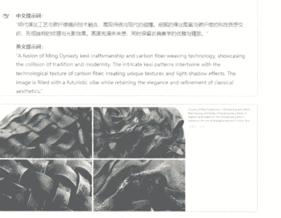

4. AI辅助的“人机共创”模式
DeepSeek的核心优势是人机协作。传统灵感依赖个人经验直觉，有AI参与后创意迭代更快更准。部分创新实验室数据显示，使用AI辅助的设计提案通过率提升43%，创意迭代速度加快5.8倍。AI既提供灵感，也能根据反馈实时优化，快速产出符合要求的方案。

5. AI激活灵感的机制
AI激活灵感主要体现在几方面。
首先是多样化视觉内容生成。Stable Diffusion、Midjourney、DALL-E等工具能根据文本生成图像，为创作提供起点。如在未来主义手机界面设计中，用Midjourney快速输出悬浮菜单、流动渐变、通透质感等草图，帮助明确视觉方向。
其次是意外连接。AI分析海量数据后能发现设计师忽略的关联，将全球文化库中的元素进行创意组合，跳出固有框架。
再次是个性化推荐。AI学习设计师的笔触偏好、色彩规律等隐性特征，建立个人灵感模型。如Tiller Digital用Midjourney和DALL-E生成儿童故事插图时，会基于风格偏好迭代角色和场景，与深泽直人提出的“无意识设计”理念相近。
最后是自动化常规操作。AI处理尺寸调整、草图生成等重复工作，解放时间间接提升灵感产出效率。如Adobe Firefly的Generative Recolor功能，可通过文本提示快速试验不同配色方案。

#### 9.2.2 创意方案生成

在艺术设计与活动策划中，创意方案的精细化尤为关键。DeepSeek凭借数据分析与生成能力，在构思、细化、评估阶段提供支持，帮助把初步创意转化为可执行方案。下面以婚礼策划为例说明。

1. 初步创意方向的构建
起步阶段需求常较模糊。DeepSeek可通过分析任务要点，快速给出主题、氛围、风格等核心方向，如场地布置、配色方案、装饰元素等。示例方向如下。
创意一：现代极简与复古欧式宫廷融合，金色与淡粉为主色，布置简洁典雅，搭配华丽吊灯与大理石点缀，营造高贵浪漫气息。
创意二：未来主义婚礼，采用透明材质、LED灯光、极简造型，梦幻蓝调突出科技感与超现实感。
创意三：复古田园风格，柔和色彩，自然花卉、白色长桌、木质装饰为主，辅以温馨吊灯与烛光，营造宁静雅致氛围。
这些方向为后续细化提供选择路径。

2. 方案细化与元素优化
确定大方向后，DeepSeek可帮助细化色彩、空间、材料等具体要素，把概念落地为可执行方案。
例如在复古优雅风格下，输入色彩搭配、装饰细节、场地布置等需求，系统会给出具体建议。
色彩搭配：基于主题生成暖金到柔粉的多套配色，并提供视觉预览，方便挑选契合氛围的组合。
场地布置：推荐座位排布、舞台设计、花卉装饰等方案，兼顾舒适度与视觉效果。
装饰细节：给出餐桌布置、吊灯选择、花艺方案等，并附预算预估与实施难度分析，便于周全优化。

3. 多方案生成与对比评估
设计过程中常需并行多个方案并择优。DeepSeek可批量生成方案并进行系统评估，包括视觉效果、预算可行性、空间使用效率等。
视觉效果评估：根据色彩与装饰信息自动生成效果模拟图，直观比较浪漫与优雅的呈现度。
预算分析：精准估算各方案成本，推荐高性价比选项，助力成本控制。
可行性评估：分析实施难度，给出可操作建议并匹配供应商，确保方案顺利落地。

4. 完整创意方案的整合
经过细化与优化，DeepSeek可把创意方向、细节优化、执行要点整合为完整计划，涵盖设计元素、预算、步骤、供应商推荐、时间表、场地要求等。
以婚礼为例，完整方案不仅包括布置与配色，还涵盖花艺商、餐饮、音响等各环节执行步骤，确保细节可落地。

#### 9.2.3 效果图像生成

效果图是把创意转化为直观视觉的关键。以“地底世界”主题室内酒店设计为例，说明如何借助DeepSeek与图像生成工具完成从需求到成图的全流程。

效果图生成的关键步骤如下。

1. 明确设计需求与目标
在着手设计前需把需求具体化。
设计风格：神秘且具未来感，融合地底洞穴的自然元素如粗糙岩石、潺潺流水，与科幻感如发光体、金属装饰，营造原始与现代并存的氛围。
核心元素：材质上选用粗糙岩石、透明玻璃、冷冽金属与温暖木纹形成对比；造型以有机曲线与不对称结构为主，赋予流动感；家具选舒适沙发、独特圆形吊灯、层次感地毯，打造沉浸式探索体验。
空间布局：大堂采用开放式布局，配合多层平台模拟地底悬崖与洞穴；客房紧凑宽敞，融入隧道式流线设计。
目标用户：追求独特体验的冒险者、热爱科幻的爱好者、高端旅游人群。
功能需求：兼顾休息、社交与沉浸式体验，保证实用与安全。
光照氛围：用柔和蓝紫灯光模拟发光矿石，结合自然光营造神秘迷人氛围。

2. 输入关键需求进入DeepSeek
将梳理好的需求输入DeepSeek，要求其围绕“地底世界”主题丰富创意并输出详细说明。以下为DeepSeek生成的设计说明概要，如图9-8所示。

3. DeepSeek生成提示词
把设计说明再次输入DeepSeek，要求生成两组大堂空间的英文提示词，如图9-9所示。


4. 选择图像生成工具
将提示词输入Midjourney等图像工具，生成初步效果图，如图9-10所示。


5. 优化与调整
根据初版效果图评估是否符合需求，若存在偏差则据反馈优化提示词，如图9-11所示。

6. 生成改进图像与多版本对比
在生成与调整过程中可产出多个版本，对比优缺点。优化后提示词生成的图像如9-12所示。


7. 生成其他空间效果图并完善设计
选定满意版本后，以此为依据完善其他空间效果图，并进一步细化设计说明文字。效果图与文字共同构成概念设计图纸，为后续实案提供参考，也便于团队理解与客户预览。

### 9.3 DeepSeek生成PS脚本及PPT报告

在数字设计流程中，效率与精确度至关重要。尤其在图像处理与报告生成环节，DeepSeek融合数据分析、自然语言处理与创意生成能力，能显著提升Photoshop脚本编写与PPT报告生成的质量与速度。

本节介绍如何利用DeepSeek生成Photoshop修复脚本并优化PPT报告提示词，实现修复与创作自动化，并精准掌控创作方向。

#### 9.3.1 PS脚本修复老照片

随技术进步，图像修复从手工转向自动化。老照片常出现色彩褪变、划痕、斑点、褶皱等问题，降低观赏性与回忆价值。传统修复耗时且不自然，而PS脚本可高效批量处理，在保留原始美感的同时实现精准修复。

本节探讨如何用DeepSeek生成与优化PS脚本自动识别老照片问题并修复。生成的脚本能简化流程，快速解决常见问题。

##### 1. 修复老照片中的常见问题
老照片在岁月中会留下痕迹。
色彩褪色与失真：随时间流逝色彩会黯淡、偏色，修复时需恢复原有色彩深度与饱和度，使其重现光彩。

**老照片焕新与AI创作效率指南**

**划痕、污渍与斑点**
受存放环境影响，老照片表面很容易留下划痕、脏点、斑驳等瑕疵。这些小问题会直接拉低清晰度，也让整体观感大打折扣。修复时必须逐处细致清理，才能让画面恢复干净通透。

**折痕与裂纹**
时间久了的老照片，常因折叠、受潮出现折痕或裂口。裂痕会破坏画面的完整性，整张照片的连贯感因此被割裂。需要借助修复手段将破损处抚平，才能让人找回当年的原貌。

**模糊与分辨率偏低**
早期拍摄器材的限制，让不少老照片天生偏糊、细节不足。想要达到当下高清的水准是不现实的，但可以用现代图像处理手段提升锐度与细节，让画面更生动、可读。

### 2. DeepSeek一键生成PS修复脚本
DeepSeek本身做不了图像生成，也无法直接修图，但它擅长解读照片问题，并把思路整理成可用的Photoshop脚本。整体工作链路是这样的。

- 问题诊断与评估
用户可以文字描述老照片的缺陷，也能把图片上传让DeepSeek分析。比如请它排查褪色、划痕、污渍、皱纹等情况。

- 生成PS脚本
识别完成后，DeepSeek会针对不同问题给出对应的脚本与操作建议。例如：
针对色彩褪色，会建议用色阶、饱和度、曲线等工具还原本色；
针对划痕污渍，会给出修复画笔或污点修复工具的使用方案；
针对褶皱裂纹，会提供内容感知填充或修复画笔的填补思路。

- 批量处理
上传多张照片后，DeepSeek可逐张分析并批量输出对应的修复脚本，大幅提升效率。

### 3. 老照片自动化修复流程
先用描述性提示词请DeepSeek生成专用于老照片修复的Photoshop脚本。它 dựa于强大的自然语言与代码生成能力，输出符合Photoshop ExtendScript规范的JavaScript代码。

拿到脚本后导入Photoshop即可批量执行。操作顺序如下：

1. 脚本生成。通过DeepSeek自动产出修复脚本。
```
// 文件名：restoreOldStreetPhotoCrackFix.jsx
// 适用于 Adobe Photoshop CS6 13.0.1 x64
// 功能：修复老照片的模糊、色彩褪色、暗部亮度、裂缝和褶皱（部分自动化+手动优化），支持动作集成

// 主函数：处理当前打开的文档
function restorePhoto() {
    if (app.documents.length > 0) {
        var doc = app.activeDocument; // 获取当前活动文档

        try {
            // 确保活动图层是普通图层（处理背景层）
            if (doc.activeLayer.isBackgroundLayer) {
                doc.activeLayer.name = "Layer 0"; // 转换背景层为普通图层
                doc.activeLayer.isBackgroundLayer = false;
            }

            // 1. 修复模糊 - 智能锐化
            doc.activeLayer.duplicate();
            doc.activeLayer.name = "Sharpened Layer";
            var descSharpen = new ActionDescriptor();
            descSharpen.putUnitDouble(charIDToTypeID("Amnt"), charIDToTypeID("#Prc"), 120); // 锐化强度 120%
            descSharpen.putUnitDouble(charIDToTypeID("Rds"), charIDToTypeID("#Pxl"), 0.8); // 半径 0.8 像素
            descSharpen.putEnumerated(charIDToTypeID("Type"), charIDToTypeID("Shtp"), charIDToTypeID("GsnB"));
            executeAction(charIDToTypeID("Shrp"), descSharpen, DialogModes.NO);

            // 2. 修复色彩并最大化提升暗部亮度 - 色阶调整（无对比度调整）
            var descLevels = new ActionDescriptor();
            var refLevels = new ActionReference();
            refLevels.putClass(charIDToTypeID("AdjL"));
            descLevels.putReference(charIDToTypeID("null"), refLevels);
            var descLevelsAdjust = new ActionDescriptor();
            descLevelsAdjust.putDouble(charIDToTypeID("Inpt"), 80.0); // 输入黑点调整为 80（最大化提升暗部亮度）
            descLevelsAdjust.putDouble(charIDToTypeID("Inpt"), 255.0); // 输入白点保持最大值
            descLevelsAdjust.putDouble(charIDToTypeID("Gmm "), 4.0); // 最大调整伽马值增加暗部亮度，保持对比度不变
            descLevels.putObject(charIDToTypeID("Usng"), charIDToTypeID("AdjL"), descLevelsAdjust);
            executeAction(charIDToTypeID("Mk"), descLevels, DialogModes.NO);

            // 3. 初步修复裂缝和褶皱 - 去噪并平滑边缘（CS6 功能有限）
            doc.activeLayer.duplicate();
            doc.activeLayer.name = "CrackFix Layer";
            var descNoise = new ActionDescriptor();
            descNoise.putUnitDouble(charIDToTypeID("Rds"), charIDToTypeID("#Pxl"), 1.5); // 去噪半径增加到 1.5 像素
            descNoise.putUnitDouble(charIDToTypeID("Strg"), charIDToTypeID("#Prc"), 60); // 强度增加到 60%
            executeAction(charIDToTypeID("Dsn"), descNoise, DialogModes.NO);
        } catch (e) {
            alert("Error: " + e.message);
        }
    } else {
        alert("No document open.");
    }
}

// 执行去噪
// 应用高斯模糊平滑边缘(轻微处理裂缝和褶皱)
var descBlur = new ActionDescriptor();
descBlur.putUnitDouble(charIDToTypeID("Rds"), charIDToTypeID("#Pxl"), 0.5); // 高斯模糊半径 0.5 像素
executeAction(charIDToTypeID("Gsn"), descBlur, DialogModes.NO); // 执行高斯模糊

// 4. 去噪 (基础去噪, CS6 功能有限)
doc.activeLayer.duplicate();
doc.activeLayer.name = "Denoised Layer";
var descNoiseFinal = new ActionDescriptor();
descNoiseFinal.putUnitDouble(charIDToTypeID("Rds"), charIDToTypeID("#Pxl"), 1.0); // 去噪半径 1.0 像素
descNoiseFinal.putUnitDouble(charIDToTypeID("Strg"), charIDToTypeID("#Prc"), 50); // 强度 50%
executeAction(charIDToTypeID("Dsn"), descNoiseFinal, DialogModes.NO); // 执行去噪

alert("照片修复并提升暗部亮度完成! 请检查图层并手动处理裂缝、褶皱和残余噪点。");
} catch (e) {
alert("处理文档 '" + doc.name + "' 失败: " + e);
}
} else {
alert("请先打开一张照片!");
}
}

// 如果脚本直接运行, 执行修复
restorePhoto();

// 动作支持: 将以下代码用于动作面板
// 在动作中调用: app.doScript("restorePhoto", "restoreOldStreetPhotoCrackFix");
```
2. 保存脚本。新建一个文本文档，把生成的脚本内容粘贴进去，另存为.jsx格式，文件名定为“修复脚本.jsx”，如图9-13所示。

3. 导入脚本。打开Photoshop，执行“文件”>“脚本”>“浏览”菜单命令，在载入对话框中选中“修复脚本.jsx”文档，如图9-14所示。
4. 运行脚本。原始老照片与修复后图像的对比，如图9-15所示。


#### 9.3.2 PPT报告智能生成
在职场里，PPT是传递信息、展示创意、推动决策的核心载体。数据复杂时，清晰与直观尤为关键。制作高效PPT不只是堆砌内容，更要讲究视觉设计与结构布局。DeepSeek提供提示词与结构化思路，帮助快速做出逻辑清晰、创意与美感兼备的报告。再配合KIMI的PPT助手，就能完成从大纲到成稿的全流程。

1. 输入提示词。用户向DeepSeek说明具体需求。
我是一名AI艺术研究者，需要做一份AI艺术发展趋势PPT大纲，并且以Markdown的形式输出给我。
2. 脚本生成。DeepSeek依据提示词生成PPT脚本，如下所示。
```
##### AI艺术发展趋势研究报告

###### 封面页
**标题**：2023-2030 AI艺术发展路径与技术革新
**副标题**：从算法生成到人机共创的范式转移
**作者信息**：AI艺术实验室
**日期**：2023年8月

---

###### 目录
1. 技术演进脉络
2. 核心创新方向
3. 行业应用图谱
4. 伦理争议焦点
5. 未来形态展望

###### 第1章：技术演进观察

####### 1.1 发展里程碑

-   2015：GANs突破图像生成边界
-   2021：CLIP开启多模态创作
-   2022：Diffusion模型质量飞跃
-   2023：ControlNet实现精准控制

####### 1.2 关键技术突破

-   物理引擎与神经渲染融合
-   实时生成算力提升方案
-   个性化风格迁移算法
-   多感官交互生成系统

###### 第2章：创作范式革新

####### 2.1 新型创作模式

-   动态艺术：参数化实时生成
-   交互艺术：观众参与式创作
-   衍生艺术：NFT元数据编程
-   混合现实：AR空间生成艺术

####### 2.2 工具链进化

-   创意增强型IDE
-   语义级控制面板
-   跨模态转换工具
-   智能素材库系统

###### 第3章：产业应用图谱

####### 3.1 商业化应用场景

-   影视：动态分镜智能生成
-   游戏：程序化资产创建
-   设计：智能风格迁移系统
-   教育：个性化艺术教学

####### 3.2 市场数据洞察

-   全球AI艺术市场规模预测（2023-2030）
-   创作者群体结构分析
-   艺术品交易平台新生态

###### 第4章：伦理争议焦点

####### 4.1 核心争议

-   创作过程可追溯系统
-   算法透明度标准
-   创作者认证体系
-   收益分配智能合约

###### 第5章：未来形态展望

####### 5.1 技术融合趋势

-   量子计算赋能实时生成
-   脑机接口创作系统
-   跨维度艺术生成
-   自主进化型艺术AI

####### 5.2 艺术本体论变革

-   人机共生创作范式
-   动态可进化艺术品
-   沉浸式感知艺术
-   社会参与式集体创作

###### 结语

**核心观点**：AI正在重构艺术创作DNA
**终极追问**：当机器具备审美自觉，艺术的定义将如何改写？

###### 附录

-   关键论文索引
-   开源工具清单
-   行业白皮书索引
-   典型应用案例库
```
3. 打开KIMI官网，在左侧边栏点击“KIMI+”，随后在弹出界面中选择“PPT助手”功能，如图9-16所示。

4. 在对话栏内粘贴DeepSeek生成的PPT脚本内容，操作界面如图9-17所示。

5. 页面生成后，点击“一键生成PPT”按钮完成整体制作，如图9-18所示。

6. 根据内容属性挑选合适的模板场景与设计风格，例如“教育培训”或“科技”等，操作界面如图9-19所示。

7. PPT助手按所选风格自动生成具体内容，完成后点击右下角“下载”即可获取完整文件，如图9-20所示。


### 9.4 东方神话题材提示词精修实战
本节用一个实战案例展示如何逐步打磨提示词，获得更精准的高质量图像。从初版构思到最终优化，全程体现提示词精确度与成图质量的关系，对Midjourney等工具同样适用。

初始提示词：神话中的仙女，山水背景，中国风--niji 6--ar 3:4，生成的图像如图9-21所示。


#### 提示词问题盘点
初版虽点明了主题与背景，但描述过于宽泛，缺乏细节与风格指向，容易导致成图偏离预期。主要问题有四点。

- 问题1：风格定位模糊，未明确具体的艺术流派或表现方式，如文人画、年画、壁画等。
- 问题2：人物特征不清，未说明时代背景、服饰款式与妆容细节，仙女形象容易同质化。
- 问题3：环境描写空洞，山水背景缺乏具体景物与构图参考。
- 问题4：色彩方案缺失，色调可能混乱，层次感不足。

#### 提示词优化策略
针对上述痛点，需要逐项细化。优化思路如下。

- 优化1：加入时代参考。为了明确时代气质，引入吴道子《八十七神仙卷》的线描风格作为参照。吴道子是唐代大家，《八十七神仙卷》是道教艺术的经典，其细腻线条与神仙人物描绘方式，能为形象塑造提供有力支撑。

-   优化2：锁定人物特质——明确采用唐代仕女妆的审美取向，同时参考敦煌飞天形象来塑造披帛走势。唐仕女妆注重端庄大气，敦煌飞天的造型则能更好地呈现出仙袂飘然、带有神话色彩的韵味。

-   优化3：细化场景氛围——在青绿山水的基调里加入朱砂红枫点缀，并用S形溪流构建构图节奏。青绿山水是传统山水画的代表性范式，朱砂枫与S形水道则为画面带来了流动感与空间层次。

-   优化4：确定配色体系——选用矿物颜料上色，以石青石绿为主导色调。如此既能保留浓郁的古韵色彩，又能借石青石绿强化画面的厚重与立体感。

完成这些调整后，提示词的描述更完整、更精准。随后将中文版本翻译成英文，通过验证生成效果，对照图9-22可见。

> 中文提示词：唐代道教仙女驾祥云图，吴道子白描技法与北宋青绿山水结合，人物面容丰腴戴步摇冠，披帛呈波浪形飘浮，背景层峦叠嶂施以石青，点缀朱砂色枫树与金粉勾云纹，绢本设色质感 --niji 6 --ar 3:4

> 英文提示词：A Taoist fairy riding a cloud from the Tang Dynasty, combining Wu Daozi's line drawing technique with Northern Song Dynasty green landscape painting. The figure has a plump face and wears a step-shaking crown, with a floating wavy scarf. The background is a layered mountain range with azure, embellished with cinnabar maple trees and gold powder outline cloud patterns. The silk painting has a textured color. --niji 6 --ar 3:4

优化收束后，整体画风更鲜明集中，人物的塑造也更具生命力，栩栩如生。背景的描绘与色彩的设定同样得到明显提升。这类细化处理让最终图像在诠释东方神话主题时更到位，同时也更好地体现了中国传统艺术的独特意趣与精微表达。

### 9.5 本章小结

本章重点剖析了DeepSeek在数字艺术创作、设计方案输出、图像修复以及PPT制作等场景中的落地用法。首先，借助精准的提示词撰写与迭代，DeepSeek能帮助用户点燃灵感并产出符合预期的数字艺术作品。其次，在跨领域灵感融合上，DeepSeek可提供多样化的设计思路与效果图示，打破常规思维局限。再者，在PS脚本自动化领域，借助DeepSeek可实现老照片的批量修复，提升细节处理效率。最后，在PPT报告环节，DeepSeek能给出结构清晰的框架与视觉建议，显著加快制作流程。通过案例演示，本章希望帮助读者吃透DeepSeek的核心能力，并在实务中灵活运用，以提升创作的创新度与实用价值。

### 9.6 课后练习

-   练习1：创意提示词生成
用DeepSeek为某个设计项目输出一批创意提示词，尝试切换水彩、油画等不同艺术风格进行图像生成，并归纳总结哪些表述更容易激活创意。

-   练习2：PPT报告生成
设想自己是市场分析师，需完成一份关于“元宇宙商业应用趋势”的PPT。借助DeepSeek和KIMI的PPT助手，先生成Markdown格式的讲稿，再选用“科技”主题模板导出PPT，最后评估优劣并提出三点优化建议。

## 第10章 调用DeepSeek API打造智能生态

DeepSeek API让开发者能够轻松把前沿AI能力嵌入各类产品。通过简洁的接口调用，就能调动其强大的自然语言处理与视觉计算能力，搭建智能对话、内容生成、图像分析等应用。本章将深入拆解DeepSeek API的使用方法，并结合实战案例展示如何借助API构建创新型智能应用，加速AI赋能落地。

本章会从原理、架构入手，梳理API的主要功能与典型场景，解析其设计思路与调用流程，并探讨性能调优与安全防护，帮助开发者安全高效地使用接口。学完后，读者可掌握必要的理论基础，为后续实操做好准备。

### 10.1 DeepSeek API介绍

DeepSeek API基于深度学习打造，是一套面向开发者的开放服务接口，兼顾效率与灵活性。其底层依托大规模预训练模型，结合微调与迁移学习实现多任务适配。接口遵循RESTful规范，数据交互采用JSON形式，涵盖文本生成、语义理解、图像识别等NLP与CV核心能力。设计上强调扩展性与易用性，开发者只需发起简单的HTTP请求即可调用复杂AI功能，并支持异步与流式返回，以适配不同场景。

-   智能问答
接口具备基础问答能力，用户提问即可获得直接回应。并且支持多轮上下文记忆，让对话更连贯自然。无论是日常琐事还是专业难题，都能得到较为贴合的回答。

-   代码生成与解析
对开发者而言，代码生成是重要亮点。接口可输出Python、Java、C++等多语言代码片段，并能对已有代码进行解读、优化和调试，有效提升开发效率。

-   文本分析与创作
在文本处理上表现突出，能完成分析、分类、摘要等任务，帮助快速提炼信息；同时支持文案撰写、诗歌创作等创意工作，为内容生产者提供灵感支撑。

图10-1为DeepSeek的API文档，其网址为https://api-docs.deepseek.com/zh-cn/。

### 10.2 调用DeepSeek API的方法

使用DeepSeek API前，需先获取访问凭证，采用API Key方式鉴权。每个账号都会分配独立密钥，凭此才能与大模型建立连接。整体流程如下：

1. 第1步，注册账号。
2. 第2步，创建API key。
3. 第3步，添加DeepSeek-Reasoner模型。

**编程语言：** DeepSeek API兼容多种语言，涵盖Python、Java、C++等。其中Python因语法简洁、生态丰富且适配主流数据库，成为最常用的调用语言。Java、C#同样可良好对接。

**开发工具：** 选用合适的IDE能大幅提升效率。若用Python，VSCode是常见选择，具备智能补全与调试功能，也可集成AI编程辅助；若用C#，Cursor是业界常用IDE，功能强大，支持复杂项目AI开发。

**安装依赖库：** 以Python为例，推荐安装OpenAI官方SDK，因其接口格式兼容，可简化调用。打开终端执行 `pip install openai`，完成后即可在代码中导入并使用。

以下是调用DeepSeek-Chat API的Python代码：

```python
from openai import OpenAI
client = OpenAI(api_key="你的API KEY", base_url="https://api.deepseek.com")

response = client.chat.completions.create(
    model="deepseek-chat",
    messages=[
        {"role": "system", "content": "You are a helpful assistant"},
        {"role": "user", "content": "Hello"},
    ],
    stream=False
)

print(response.choices[0].message.content)
```

以下是调用DeepSeek-Reasoner API的Python代码：

```python
from openai import OpenAI
client = OpenAI(api_key="<DeepSeek API Key>", base_url="https://api.deepseek.com")

# Round 1
messages = [{"role": "user", "content": "9.11 and 9.8, which is greater?"}]
response = client.chat.completions.create(
    model="deepseek-reasoner",
    messages=messages
)
reasoning_content = response.choices[0].message.reasoning_content
content = response.choices[0].message.content

# Round 2
messages.append({'role': 'assistant', 'content': content})
messages.append({'role': 'user', 'content': "How many Rs are there in the word 'strawberry'?"})
response = client.chat.completions.create(
    model="deepseek-reasoner",
    messages=messages
)
```

接下来会对上述代码做逐项说明。

#### 10.2.1 创建API key

要调用DeepSeek API，第一步需创建API key，具体步骤如下。

1. 登录DeepSeek后，点击页面右上角的“开放平台”入口，如图10-2所示。
2. 进入开放平台并登录后，打开API Key管理页面，如图10-3所示。
3. 在左侧菜单中选择 API keys，进入管理界面，如图10-4所示。
4. 点击“创建API key”，在弹窗中为密钥命名便于管理，例如命名为My Code。系统会生成一串字符作为密钥，生成后不可再次查看，需立即复制保存并妥善保管，如图10-5所示。
5. 新建的密钥会出现在列表中，如图10-6所示。

#### 10.2.2 添加DeepSeek-Chat模型

使用Python调用DeepSeek API对话模型的代码：

```python
##### 调用DeepSeek chat
from openai import OpenAI

client = OpenAI(api_key="<DeepSeek API Key>", base_url="https://api.deepseek.com")

response = client.chat.completions.create(
    model="deepseek-chat",
    messages=[
        {"role": "system", "content": "You are a helpful assistant"},
        {"role": "user", "content": "Hello"},
    ],
    stream=False
)

print(response.choices[0].message.content)
```

上述代码演示了如何调用对话模型。只需将 api_key="" 处填入自己的密钥。参数 model 指定为 deepseek-chat，即基础对话模型；message 用于传递对话内容；role 表示角色类型，system 用来定义模型定位，user 则承载用户提问。

对话模型运行的结果，如图10-7所示。

#### 10.2.3 添加DeepSeek-Reasoner模型

调用DeepSeek-Reasoner的Python代码：

```python
from openai import OpenAI
client = OpenAI(api_key="<DeepSeek API Key>", base_url="https://api.deepseek.com")

# Round 1
messages = [{"role": "user", "content": "9.11 and 9.8, which is greater?"}]
response = client.chat.completions.create(
    model="deepseek-reasoner",
    messages=messages
)

reasoning_content = response.choices[0].message.model_extra['reasoning_content']
content = response.choices[0].message.content
print("思考过程:", reasoning_content)
print("最终答案:", content)

# Round 2
messages.append({'role': 'assistant', 'content': content})
messages.append({'role': 'user', 'content': "How many Rs are there in the word 'strawberry'?"})
response = client.chat.completions.create(
    model="deepseek-reasoner",
    messages=messages
)

reasoning_content = response.choices[0].message.model_extra['reasoning_content']
content = response.choices[0].message.content
print("思考过程:", reasoning_content)
print("最终答案:", content)
```

以上示例展示了推理模型的调用方式，同样在 api_key="" 中填入密钥。model 参数选择 deepseek-reasoner，即推理型模型；message 携带交互内容；role 区分角色，system 设定模型身份，user 为用户输入。

推理模型不仅返回最终答案 content，还能通过 response.choices[0].message.model_extra['reasoning_content'] 提取出中间思考链 reasoning_content，使用户可见推理过程。

推理模型运行的结果，如图10-8所示。

#### 10.2.4 DeepSeek API消息格式

与模型交互时，消息格式相当于沟通规范，遵循规范才能保证顺畅。DeepSeek API共支持四类消息：System message、User message、Assistant message、Tool message。

**System message：** 用于设定对话基调和AI身份。包含 content（内容）、role（固定为 system）以及可选的 name（区分同角色参与者）。

例如：

```json
{"role": "system", "content": "你是一个专业的旅行规划师", "name": "旅行大师"}
```

该示例让模型扮演专业旅行规划师，后续回答会据此定位。

**User message：** 用户发起对话的主要载体，类似向演员提问。参数包括 content（问题或输入）、role（固定为 user）和可选的 name。

例如：

```json
{"role": "user", "content": "推荐一些适合在三亚去吃的大排档", "name": "小花"}
```

收到此类消息后，模型会结合知识与设定角色进行回复。

**Assistant message：** 用于输出模型的回复或预设引导语，可影响对话走向。参数有 content、role（固定为 assistant）、可选的 name 和 prefix（布尔值）。当 prefix 为 true 时，模型会以该消息中的前缀开头作答。

例如：

```json
{"role": "assistant", "content": "为你推荐几个成都附近适合拍照的景点：", "name": "旅行大师", "prefix": true}
```

示例中模型回复会以“为你推荐几个成都附近适合拍照的景点：”开头。针对 DeepSeek-Reasoner，还额外提供 reasoning_content 参数，用于前缀续写时传入上一条助理思维链内容。

**Tool message：** 它的作用是与外部工具进行通信，包含三个要素：content 用来承载消息正文，role 固定为 tool，tool_call_id 则指向对应的工具调用编号。当项目需要调取第三方软件接口时，就离不开这种消息形式。

例如：

```json
{"role": "tool", "content": "weather_data", "tool_call_id": "tool_call_id"}
```

当用户想知道天气，DeepSeek 会去调用天气接口获取信息，此时消息的角色标记为 tool，content 里装的就是返回的天气数据，整个结果会通过 Tool message 送回，同时携带 tool_call_id。

#### 10.2.5 VSCode 集成 DeepSeek 实操

本部分先介绍 Visual Studio Code，简称 VSCode，这是一款广受欢迎的代码编辑器兼集成开发环境，对前端和 Python 开发者尤其友好，接下来详细说明怎样在 VSCode 里接入 DeepSeek。

1. 打开 VSCode 官网，点击 Download for Windows 按钮完成下载，参考图10-9。

2. 安装完毕后启动 VSCode，进入插件市场搜索 Continue 插件，点击 Installing 进行安装，见图10-10。

## 第10章 用 DeepSeek API 搭建智能工作流


图10-10

3. 插件装好后点开插件图标进入设置界面，点击 Add Model 新增模型，在 Provider 和 Model 两个下拉框里都选 DeepSeek，然后把之前复制好的 API key 填入。设置完成就能在 Continue 里直接提问，效果如图10-11所示。


图10-11

图10-12

4. 按下 Ctrl+I 调出对话窗口，输入问题后会话区会即时返回 DeepSeek 的回答，如图10-12。

### 10.3 用 DeepSeek API 实现问答与推理

本部分通过一个实战演示如何用 Python 调用 DeepSeek API。示例中同时使用了 DeepSeek-Chat 和 DeepSeek-Reasoner，分别处理常规问答和需要逻辑推演的问题。运行后对比程序输出和网页版答案，检验调用是否正确，做到理论与实践结合。

1. 按前文方法申请并复制 API key，备用，后续调用要用，见图10-13所示。


2. 在 VSCode 中新建 Python 文件，按标准方式调用接口。调用 DeepSeek-Chat 时把 AI 设定为资深旅行顾问，提问内容为“我想去三亚旅游，有哪些地方值得去？”身份和问题分别写入 message。

3. 推理用的提示词采用一道小学数学题：小明有12颗糖果，他每天吃2颗。请问多少天后他会吃完所有的糖果？如果他每天改为吃3颗，又会是多少天？把这段提示填入 message 中 role 为 user、content 字段后，如图10-14所示。


4. 在 VSCode 里写好代码并保存为 deepseek.py。

```python
from openai import OpenAI
import json

##### API key instead
client = OpenAI(api_key="", base_url="https://api.deepseek.com")

##### basic function of deepseek
def basic_chat():
    response = client.chat.completions.create(
        model="deepseek-chat",
        messages=[
            {"role": "system", "content": "你是一个专业的旅行规划师"},
            {"role": "user", "content": "我想去三亚旅游，有什么好地方推荐吗，180字以内"}
        ]
    )
    return response.choices[0].message.content

##### 调用推理模型
def reasoning_chat():
    response = client.chat.completions.create(
        model="deepseek-reasoner",
        messages=[
            {"role": "user", "content": "小明有12颗糖果，他每天吃2颗。请问多少天后他会吃完所有的糖果？如果他每天改为吃3颗，又会是多少天？"}
        ]
    )
    reasoning_content = response.choices[0].message.model_extra['reasoning_content']
    content = response.choices[0].message.content
    return content

if __name__ == "__main__":
    print("基础对话结果：")
    print(basic_chat())
    print("\n推理模型结果：")
    print(reasoning_chat())
```

编写完毕后的界面示意如图10-15所示。


图10-15

5. 在 VSCode 终端执行 python deepseek.py，运行结果会显示在终端，见图10-16和图10-17所示。


图10-16


### 10.4 两步连贯推理实战

本部分介绍如何做依赖式两段推理，第一步的结论作为第二步的输入数据。以 Python 调用 DeepSeek API 完成整个链路。

1. 打开 VSCode，新建一个文件，将文件命名为 deepseek.py，如图10-18所示。


2. 撰写第一段推理的提示词，按照提示词的设计规则，书写提示词。

小明和小红一起去买水果。小明买了3个苹果和2个香蕉，一共花了15元；小红买了2个苹果和4个香蕉，一共花了18元。请问：一个苹果和一个香蕉的价格分别是多少？

3. 撰写第二段推理的提示词，按照提示词的设计规则，书写提示词。

如果小丽想买5个苹果和3个香蕉，她需要花多少钱？（请使用第一段推理中求出的苹果和香蕉的价格来计算）

4. 将提示词写入 message 的 "role": "user", "content" 后面，如图10-19所示。


图10-19

5. 最终编写的 Python 代码如下。

```python
from openai import OpenAI

client = OpenAI(api_key="<DeepSeek API Key>", base_url="https://api.deepseek.com")

# Round 1
messages = [{"role": "user", "content": "小明和小红一起去买水果。小明买了3个苹果和2个香蕉，一共花了15元；小红买了2个苹果和4个香蕉，一共花了18元。请问：一个苹果和一个香蕉的价格分别是多少"}]
response = client.chat.completions.create(
    model="deepseek-reasoner",
    messages=messages
)

reasoning_content = response.choices[0].message.model_extra['reasoning_content']
content = response.choices[0].message.content
print("思考过程:", reasoning_content)
print("最终答案:", content)

# Round 2
messages.append({'role': 'assistant', 'content': content})
messages.append({'role': 'user', 'content': "如果小丽想买5个苹果和3个香蕉，她需要花多少钱？（请使用第一段推理中求出的苹果和香蕉的价格来计算）"})
response = client.chat.completions.create(
    model="deepseek-reasoner",
    messages=messages
)
reasoning_content = response.choices[0].message.model_extra['reasoning_content']
content = response.choices[0].message.content
print("思考过程:", reasoning_content)
print("最终答案:", content)
```

6. 在命令行中，输入 python deepseek.py 对文件进行编译和运行，在终端中看到运行结果，如图10-20所示。


### 10.5 本章要点回顾

本章简要梳理了 DeepSeek API 的核心能力，并说明了如何调用 DeepSeek-Chat 与 DeepSeek-Reasoner。通过代码示例讲解了消息体的结构、调用格式以及 API key 的获取流程。还提供了在 VSCode 中接入以及用 Python 做问答、推理、两段推理的实操案例，帮助读者快速上手并运用这些功能。

### 10.6 练习任务

- 练习1：用 DeepSeek API 完成推理任务

  编写程序：依据本章内容，结合 DeepSeek 官网 API 文档，写出调用 DeepSeek-Reasoner API 的程序。

  接口调用：挑选一道逻辑推理题，用推理模型求解，并与网页版答案对比验证正确性。

- 练习2：解决两步推理问题

  编写程序：参考本章方法和官网 API 文档，写出分两次推理调用 DeepSeek-Reasoner API 的程序。

  接口调用：用推理模型处理需要上下文衔接的两段推理问题，对比网页版结果确认调用无误。


数字艺术设计 个人知识库搭建 代码开发

学术研究 API调用 求职办公 文案创作 自媒体运营

清华大学出版社


官方微信号


ISBN 978-7-302-68916-4

定价：69.00元