# DeepSeek学习力：家家可用的AI私教

# 内容概览

本书把DeepSeek这款大模型与科学的学业方法做了创新性结合，以活泼好问的初中生米米和两位AI精灵小D、小K的互动故事为载体，示范怎样借助DeepSeek养成高效的学业习惯和思维方式。从激发学习兴趣到攻克学科难点，从时间规划到记忆策略，本书既讲清如何操作工具，更强调如何去思考。它在科技应用与能力成长之间寻求平衡，帮助读者在信息泛滥的时代，既能用AI提速学习，也能锤炼独立思考。

适合初中高中阅读，高年级小学生可在家长陪同下阅读。

# 开启下一代学习方式

# 序一

清晨，孩子大米趴在桌前，作业本和练习册堆成小山，眉头紧锁。那一幕让我看见太多孩子在学习路上迷茫。我曾和孩子开玩笑说要考上北大研究生，后来在家长群里大家就亲切地叫我“北大米米妈”。

这个外号背后，是我十多年教学与家庭教育咨询的反思。大班教学，四五十个孩子，老师很难做到真正的个体化，困惑被搁置，天赋被忽略。

家长都希望随时回应孩子的提问，帮他走出迷雾，但精力与知识都有边界。

科技却在不经意间提供可能。豆包、Kimi、DeepSeek等国产大模型相继出现，它们不仅知识面广，还能用孩子能懂的语言交流。我忽然意识到，普通家庭完全可以把AI培养成孩子身边的个性化导师。

我家有两个孩子，亲昵称大米、小米。观察他们的成长轨迹，我看到了当代青少年的真实痛点。于是塑造了书中主人公米米，一个刚上初一的普通女生。把多年积累的教育经验融入她与DeepSeek精灵小D、小K的对话里。小D偏快刀斩乱麻，小K擅长慢热引导，米米在两人陪伴下逐步提升。

本书的重点不是教你怎么点开AI，而是怎么培养思考力。DeepSeek不应成为逃避思考的捷径，而应是点燃思考、拓展视野的伙伴。

既是教育工作者，我明白每个孩子的节奏不同；作为母亲，我更懂父母对未来的期待与焦虑。这本书是两种身份经验的集合，希望为更多孩子打开自主学习的入口。

在AI高速发展的当下，既要善用技术，也要守护独立思考。愿读者能在一页页文字里找到学习的乐趣，读懂成长的密码。

期待你遇见更好的自己！

黄南茜

# 序二

第一次和DeepSeek对话的兴奋至今难忘，我一直聊到凌晨两点。那时我感觉自己正站在认知变革的节点，眼睁睁看着一种可能重塑学习方式的技术诞生。日复一日的使用中，它由一个工具慢慢变成思维的延伸——永不疲倦的探讨对象，随时待命的知识顾问，能随需求进化学习的伙伴。我常想，若求学时就有这样的同行者，轨迹会改写多少。

DeepSeek的面世很有意义，它让国产大语言模型以极低门槛触达大众，让高质量的AI辅助学习和个性化辅导不再是特权。当我们学会用DeepSeek去探索问题，学习就不再是枯燥的堆砌，而是充满启发与趣味的旅程。

本书既不是使用手册，也不仅是方法论，更是一次学习观的更新与潜能唤醒的号召。翻开它，开始一段全新的学习旅程吧！

刘苗苗

米米

嗨~我是米米，普通初中生，好奇爱尝试。状态起伏大，常被拖延、记不住、不会安排等学业问题困扰。对新科技有兴趣，但理解不深。

小 D

我是小 D，AI精灵，阳光积极，重行动，偏爱即时解决问题，科技迷，爱用工具，有时太依赖捷径。

小 K

我是小 K，思维向导精灵，沉稳理性，重视长期能力塑造，关注知识根源与原理，擅长提问式引导。

# 第一章

# 与DeepSeek初相识

## 1.1 点亮智能学习时代

唉，又一堆做不完的作业。别人怎么总那么快？真希望有人能指点我。

叮咚！听说有人求助学习？我就是小 D，你的AI学伴！

AI学伴？

我是小 K，同样来自DeepSeek。

**※ 知识园地**

DeepSeek是可以对话的智能学习伙伴。它从海量图书、论文和网络信息中汲取养分，具备数学解题、科学讲解、语言表达等技能。好比用代码搭建的“知识书库”，提问时它会在库中快速检索，用逻辑链条组织成易懂的答案。碰到作业卡点、概念模糊或需要灵感，都能得到即时支持，相当于24小时在线的学霸朋友。

等等……我是不是在做梦？

不是幻觉！我们来帮你启动全新的学习形态，不过……

不过你得先掌握使用诀窍。高手不仅会用工具，更会用得巧妙。

什么诀窍？

别急，先来认识一下DeepSeek吧！

**※ 启发思考**

◆ 你是否也像米米一样常被学习困住？
◆ 若身边有小D和小K，你最希望他们帮你解决哪类难题？

**※ 背景拓展**

**◆ 划时代的技术突破**

DeepSeek-R1并非普通模型，它像中文世界的“智慧方舟”——底层代码到逻辑网络皆为中国团队原创。这是研发层面的重大突破，以百亿级参数架构挑战了全球AI头部垄断。

**◆ 创新范式的新尝试**

DeepSeek团队走模块化创新路线，以真实场景“镜像训练”为核心，让模型不仅解题推理强，还能理解“欲穷千里目”等传统文化语境。成果不仅助我国站上AI技术高地，也彰显华夏智慧，为全球生态注入新可能。

**◆ 成为接力者**

DeepSeek诞生，宛如太空站升起的一杯中国茶。当我们能用完全自主技术探索前沿复杂逻辑时，新一代青少年就不再受限于既定规则或只能追随。用一句“请用音乐节奏分析唐诗韵律美感”就能让这颗凝聚中国智慧的“AI种子”提供专业支持——原创技术本该托起每个心怀星辰大海的少年。

### 1.1.1 DeepSeek如何让学习更轻松
此时的米米还不知道，这个自称DeepSeek的学伴将如何改变她的轨迹。先看看它能带来哪些改变。

大致可归为四个层面。

**1. 心态疏导**

遇到卡点时，DeepSeek会：

◆ 及时捕捉学习困扰。
◆ 剖析压力来源。
◆ 给出恰当的鼓励。
◆ 助力重建信心。

别担心，困难是常态，我们一起找办法。

**2. 习惯养成**

为建立好习惯，它能：

◆ 制定个性化用时表。
◆ 安排契合特点的学习方案。
◆ 帮助形成稳定节奏。
◆ 培养科学的研习方式。

好习惯需时间，我会一直陪你。目标是让你真正学会思考。

**3. 能力提升**

在能力层面，它会：

◆ 激励独立思考、主动求证。
◆ 引导多角度分析。
◆ 培养系统化拆解。
◆ 传授学习技巧。

**4. 学科支持**

在具体知识上，它可：

◆ 把复杂概念转译清楚。
◆ 梳理清晰的知识脉络。
◆ 找到最适配的学习路径。
◆ 让知识变得有趣易懂。

我们能把难懂的内容变成生动的故事！

通过这些支持，DeepSeek像全方位的学伴，既能攻克难题，也关心成长。关键在于，它不止解决当下问题，更致力于培养独立思考与终身学习的素养。有这样的伙伴，学习会更轻松有趣！

这是否意味着我可以完全依赖它来做事了？

当然不是！

DeepSeek更像智能学习助手，具备以下特质。

◆ 辅助理解，而非替代思考。
◆ 提供方向，而非包办全程。
◆ 激发潜能，而非限制发展。

**※ 知识园地**

**◆ DeepSeek是帮手，我是主角**

① AI工具像一把钥匙，能打开知识宝库。
② 但真正走进去探索思考的人必须是我们。

若只让它代答却不去理解，就像看别人吃饭，自己始终饿着。

**◆ 聪明的使用方式**

① 先自己想一想。
② 用它来验证思路或获取新视角。
③ 理解解释，并学会迁移。
④ 慢慢养成独立思考。

记住：DeepSeek只是路上的好帮手，成长的主人永远是我们自己！

明白了！有了它，就像多了一个超级学伴！

没错！

等等，DeepSeek真的只是一个AI助手吗？

不是！让我们继续了解它的不同之处吧！

### 1.1.2 超越助手的DeepSeek真面目

在哪儿获取DeepSeek呢？

可在手机应用商店下载App，也可在浏览器输入网址体验。

**※ 知识园地**

先认识DeepSeek的三种形态！

**◆ 基础模式（V3）**

功能：适合日常问答查询。
操作：反应迅速，无需额外设置。

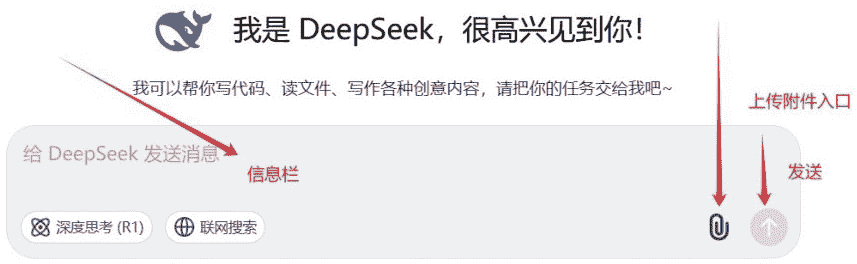

**◆ 深度思考（R1）**

功能：应对复杂问题，展示推理过程。
操作：需点按“深度思考（R1）”启动。
注意：反应时间较长，需耐心等待。

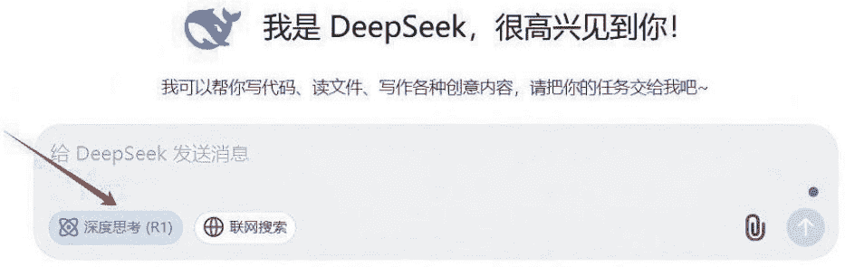

**◆ 联网搜索**

功能：实时检索网络最新信息，提供更及时准确的回答。
操作：需点按“联网搜索”启动。

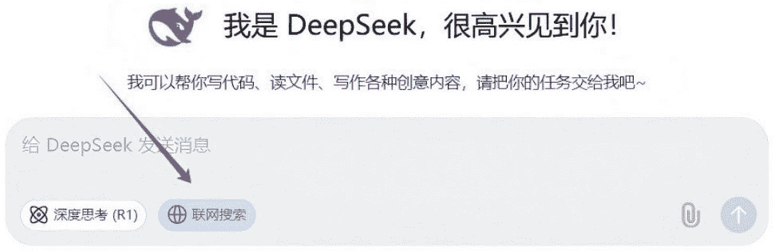

若普通AI像一个擅长做题的优等生，DeepSeek更像一位懂科技又懂教育的未来教师。它不仅给出答案，更懂得如何引导成长。

**1. 助手之上，智慧伙伴**

DeepSeek仿佛把图书馆、实验室和艺术工作室装入大脑，无论问什么都能给出专业且易懂的回应。

所以它比一般工具更强？

没错！就像英雄有特异功能，它也有独特本领！

**2. 核心能力**

◆ 能同时理解文字、图片和声音，像全能选手。
◆ 会把复杂知识串联，像在脑中建立知识地图。
◆ 能依据个人特点交流，像会察言观色的朋友。

最关键的是，它不只给答案，而是引导思考。就像小K说的，与其给条鱼，不如教钓鱼。

授人以鱼，不如授人以渔！

**3. 个性化教育服务**

学习中每个人都不同。DeepSeek最擅长的是像私人教练一样定制专属服务。

◆ 识别学习风格：有人爱视频，有人爱阅读；有人先练习再总结，有人先理解再实践。它会帮你找到最合适的方式。
◆ 调整辅导节奏：学得快时提速，需要消化时放慢并耐心解释。
◆ 智能进度规划：据学习情况自动调节难度，既不觉得太难太快，也不觉得太简单太慢。

像一位超贴心的专属老师吗？

没错，学习方式本就该因人而异！

这只是开始，DeepSeek对教育的理解远不止于此。

**4. 教育新愿景**

设想不久将来：打开书本，知识不再是平面文字，而是立体故事。物理定律变成生动实验动画，数学公式化身趣味游戏，历史事件如身临其境的场景。

遇到困难不再孤军奋战，随时获得精准指导。复杂题目拆成循序渐进的小步，抽象概念化作生活案例。

每一次进步都被细心记录，每个困惑都及时回应，每份努力都收获成长的喜悦。

这正是DeepSeek努力的方向，让学习更智能、更有趣、更有温度。

听起来太棒了！它怎么实现这些呢？

这也是我们接下来要聊的内容……

**【小 D 和小 K 的贴心提示】**

① 每个大脑都有独特的学习密码，找到方法才能事半功倍。
② 真正的智能教育，是懂你、懂学习、更懂成长。
③ 科技不是冰冷工具，而是带温度的学习伙伴。
④ 用好AI，你将书写属于自己的精彩故事。

### 1.1.3 与DeepSeek同行 从平凡到卓越

如何真正提升学习效果？

米米心里仍在想：这次真的能改变状态吗？

告诉你一个秘密：每个学霸背后都有独特的学习方法。有了DeepSeek这位超强伙伴，你也能开启学霸进化之路！

**1. 你的专属学业超能力**

还记得让你头疼的瞬间吗？

◆ 上课听不懂，却不好意思提问。
◆ 做题卡住，翻遍书也找不到思路。

◆ 复习到关键期，总是理不清重点。
◆ 努力程度不低，分数却原地踏步。

听起来像在形容自己吧？

这类困扰其实很普遍，接下来借由和你处境类似的李华，看看他如何逐步突破瓶颈。

**※ 李华的学习记录**

2 月 1 日：第一次让 DeepSeek 陪读。说实话，我告诉它物理课经常听不懂，班上同学能秒懂的内容我却一片空白……它没有嘲讽，反而说每个人的节奏不同，重要的是找到契合自己的方式。碰到难题时，它建议我先把自己的想法说出来。觉得有点费劲，还是先尝试一下。

2 月 15 日：小小的惊喜！最近慢慢养成了先思考的习惯。解题时突然能想到不同解法。它说这就是思维能力在提升。

3 月 8 日：预习新课时不懂的地方很多，我把疑问记下来，课堂上专门留意这些点。晚上用 DeepSeek 梳理，知识点一下子连起来了，特别通透。

3 月 30 日：物理小测成绩出来了！不敢相信考了 88 分！更让我惊讶的是，做题时居然不再害怕，反而觉得挺有意思。

4 月 20 日：今天同学问我是怎么学习的，我才发现自己真的变化很大。不只是分数提高了，更重要的是学会了如何学习。

李华现在变得这么厉害了吗？

是的，关键不在于他用了 DeepSeek，而是他找到了适合自己的学习方式。

但不是每个人都能像李华一样进步这么快吧？

当然，每个人的学习节奏都不一样，重要的是找到适合自己的方式，然后坚持下去。就像种一棵树，今天浇水、明天施肥，看似变化很小，但时间长了，你一定会惊讶于自己的成长。

**2.你的学习蜕变之旅**

和 DeepSeek 一起，你将慢慢经历：

◆ 从“要我学”转向“我要学”的认知变化。
◆ 从被动接收转向主动探究的学习习惯变化。
◆ 从抗拒困难转向乐于挑战的心态变化。
◆ 从死记硬背转向举一反三的能力变化。

听起来真的很棒！我也想开始我的学习蜕变之旅！

**【小 D 和小 K 的贴心提示】**

① 学霸不是天生的，每个人都在不断成长。
② 与其羡慕他人的进步速度，不如找到自己的节奏。
③ 坚持的路上不孤单，DeepSeek 永远在你身边。
④ 今天的每一小步，都是你通向成功的基石。

### **1.1.4 使用 DeepSeek 的五个小秘诀**

DeepSeek 这么厉害，但具体要怎么用才能事半功倍呢？

使用 DeepSeek 其实很简单，但要用得好，还是有一些小窍门的。就像玩游戏有攻略，学习也需要技巧。让我们一起来看看这五个实用的小秘诀吧！

**1.清晰地表达**

我这道题不会……

等等，让我们试试更好的表达方式。

可以从下面的示例中选择合适的问题，然后组合成更清晰的表达方式，以便 DeepSeek 更好地理解你的需求。

◆ 个人信息：你几岁？几年级？你的身份是什么？
◆ 具体情况：这是哪门学科的问题？这是一个什么样的问题？
◆ 背景和条件：你已经知道和确定的信息有哪些？
◆ 思考过程：你是怎么思考的？走到哪一步？
◆ 实际困难：卡在哪里？是不理解，还是不会做？
◆ 具体任务：你希望 DeepSeek 帮你完成什么样的任务。

**注：以上内容不必全部使用，以能清晰地表达自己的意图为准！**

比如上传题目后，提问：

“这道物理题好难……”

“这是人教版物理九年级第三章运动和力的习题，关于自由落体运动。我知道初速度*v*[₀]=0，可以用公式*v*=*v*[₀]+*gt*来计算，但不确定在计算下落时间时是否需要考虑空气阻力的影响。”

原来这样说， DeepSeek 就能更容易理解我的问题！

**2.学会提问的艺术**

那如果我不知道该怎么问呢？

这个问题问得好！

其实遇到这种情况，你可以直接问 DeepSeek:“我应该怎么提问才能表达得更清楚？”或者“你觉得还有哪些角度可以思考这个问题？”

是的，当你不知道怎么问的时候，DeepSeek 可以成为你的提问导师。

◆ 我该从哪些方面理解这个知识点？
◆ 对于这道题，有什么更好的思考角度吗？
◆ 你能给我一些更有深度的提问建议吗？
◆ 怎样提问才能更好地理解这个概念？

比如在学习“光的折射”时：

学生提问：

我是一名初二的学生，光的折射这个知识点我有点乱，但我不知道该问什么……请你给我一些提问的思路。

DeepSeek 回答：

好的，当你对光的折射知识点感到困惑但不知从何问起时，可以尝试以下提问思路，帮助你梳理知识漏洞。

现象理解

为什么水中的筷子看起来是弯的？

为什么站在岸边觉得池水比实际浅？

概念区分

折射和反射有什么不同？（比如光碰到水面时，哪部分反射，哪部分折射）

“入射角”和“折射角”是哪个角？用图怎么画？

规律应用

光从空气→水，是向法线偏折还是远离法线？

如果光从玻璃（*n*=1.5）射入空气，入射角为 40°，能折射吗？为什么？

公式关键点

折射率*n*越大，光速是变快还是变慢？

如果*n*[1]*sin*θ[1]=*n*[2]*sin*θ[2]，当*n*[1]>*n*[2]时，折射角会比入射角大吗？生活联想

放大镜、眼镜的镜片为什么能聚光或散光？

彩虹的形成和折射有关吗？

通过这些问题，你可以定位自己具体卡在哪个环节（概念、公式、应用等），然后再有针对性地向老师或同学提问哦。

哇！原来可以这样问！感觉思路一下子就打开了！

**3.建立知识地图**

学习不是单一路径的，而是一张丰富的知识地图。DeepSeek 最强大的功能之一，就是帮你构建知识地图。

知识地图是什么？

想象一下，每个知识点都是地图上的一个城市，它们之间有着各种各样的连接。

可以按照下面的提问方式让 DeepSeek 帮你搭建知识地图。

◆ 向上延伸：这个知识点是从哪些基础概念发展而来的？
◆ 横向拓展：有哪些相关的知识点？它们之间的关系是什么？
◆ 向下深入：这个知识会引申出哪些新概念？
◆ 实践应用：哪些领域会用到这些知识？

比如学习“全等三角形”这个概念时：

学生提问：

我初二了，DeepSeek 你能帮我梳理一下全等三角形的知识框架吗？

DeepSeek 回答：

好的！全等三角形是初中几何的核心内容，掌握它的知识框架对解题至关重要。以下是为你梳理的全等三角形知识框架，分为基础概念、判定定理、性质应用、易错点四部分，帮你快速理清思路。

全等三角形的定义：关键词……符号……本质……

全等三角形的判定定理：口诀……判定方法……常见陷阱……全等三角形的性质应用：证明边/角相等……求长度或角度……构造辅助线……实际应用……

易错点与解题技巧：对应关系错误……混淆判定条件……隐藏条件挖掘……

典型中考题链接（思路分析）：题目……解题步骤……

学习建议：画图标条件……总结模型……逆向思维……

**扫码查看**

DeepSeek 完整回答

**提示：AI 每次创作都独一无二，欢迎你亲自体验，获得专属于你的精彩回答！**

**4.设计学习闭环**

为什么有时候学了很久，感觉还是没有进步？

可能是因为缺少了完整的学习闭环。

一个好的学习闭环包含以下几个方面。

◆ 目标设定：明确的、可衡量的学习目标。
◆ 过程追踪：学习进展的实时记录。
◆ 效果检验：阶段性的学习评估。
◆ 及时调整：基于反馈的策略优化。

来看 DeepSeek 设计的学习闭环：

学生提问：

我六年级了，想提高数学成绩，但不知道从哪里开始……请你给我一些思路。

DeepSeek 回答：

提高数学成绩需要系统的方法、坚持和努力。作为六年级学生，你可以按照以下步骤逐步提升，我为你整理了一个清晰的行动框架：

一、诊断问题（1~2 周）……
二、基础巩固计划（每天 20 分钟）……
三、专题突破策略（每周攻克 1 个模块）……
四、高效学习法（贯穿全程）……
五、阶段性检测（每月 1 次）……

**扫码查看**

DeepSeek 完整回答

**提示：AI 每次创作都独一无二，欢迎你亲自体验，获得专属于你的精彩回答！**

就像打游戏时的任务系统！

没错，而且每完成一个小目标，都是一次进步的证明。

**5.培养学习反思**

有时候做对了题，但总觉得下次遇到类似的还是不会……

这就需要学会反思。DeepSeek 不只是帮你解题，更重要的是引导你思考。

◆ 方法反思：这个问题还有其他解法吗？
◆ 过程反思：哪些步骤是关键的？为什么？
◆ 错误反思：我的思维盲点在哪里？
◆ 举一反三：类似的问题还有哪些？

请看，下面的 DeepSeek 问答示例。

学生提问：

这道题我做对了，但不知道为什么这么做，怎么办？

DeepSeek 回答：

首先，恭喜你做对了题目！这说明你已经掌握了相关的知识点，只是可能对解题思路的认识还不够清晰。接下来，你可以这样做：

1.回顾题目：重新看一遍题目，确保你理解每一个条件和要求。

2.分析解题步骤：把解题过程一步步写下来，看看每一步是怎么推导出来的。

3.理解每一步的原理：思考每一步为什么这样做，背后的数学原理是什么。如果不清楚，可以查阅课本或向老师、同学请教。

4.寻找类似题目：找一些类似的题目练习，巩固你的理解。

5.总结方法：把这类题目的解题思路总结出来，形成自己的解题方法。

通过这些步骤，你不仅能知道怎么做，还能理解为什么这么做，这对你以后的学习会很有帮助！

原来复习不是简单地看答案！

对，真正的进步来自理解和思考。

**【小 D 和小 K 的贴心提示】**

① 好工具也需要正确的使用方法。
② 循序渐进，找到自己的节奏，不必一次求全。
③ 最有效的学习往往是有计划的。
④ 真正的进步来自思考和反思。
⑤ 保持耐心和信心，享受学习的过程。
⑥ 让每一次提问都变成成长的契机。

## **1.2 打造最强人机学习组合**

哎呀！为什么有时候 DeepSeek 的回答特别棒，有时候又不太明白我想问什么呢？

我知道你的困惑。其实啊，和 DeepSeek 聊天也是一门艺术呢。

艺术？

对啊！就像和新朋友说话一样，了解它的“性格”，找到合适的沟通方式，慢慢就能变得越来越默契啦！

和 AI 助手对话，不只是简单地问问题、得答案。掌握正确的方法，你就能获得更优质的回应，建立起高效的学习互动。下面让我们一起来学习和 DeepSeek 高质量合作的小技巧吧！

### **1.2.1 DeepSeek 能帮你什么，不能帮你什么**

DeepSeek 这么厉害！作业难题、知识扩展、学习方法，感觉什么都能问它！

等等，米米，在你开始痛快地提问之前，我们得先聊聊一个重要的话题……

没错，在开始使用 DeepSeek 之前，我们确实需要先了解它的能力边界。就像每个人都有所长，也有所短一样，DeepSeek 也不例外。让我们实事求是地来看看它能帮我们什么，不能帮我们什么。

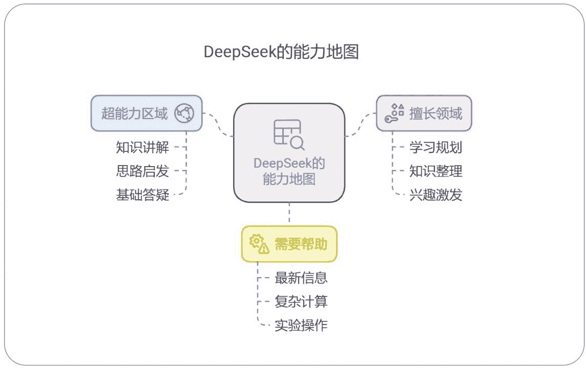

所以，我们得搞清楚 DeepSeek 是学习助手，不是万能钥匙。

那我应该怎么用它呢？

下面让我们来看看正确的使用方式和错误的示范。

1.提问前，先思考

◆ 这个问题我思考过吗？
◆ 我需要什么样的帮助？
◆ 我打算如何运用答案？

2.得到答案后，要验证

◆ 这个解释我听懂了吗？
◆ 需要进一步提问吗？
◆ 我能实际运用吗？

来，让我们看个提问的例子。

错误示范：“帮我做完这套物理题。”

正确示范：“这道题我想到要用动能定理，但不确定要不要考虑初速度，能指点一下思路吗？”

看出区别了吗？正确示范的方式显示了你的思考，也更容易得到有针对性的帮助。

使用建议速查表

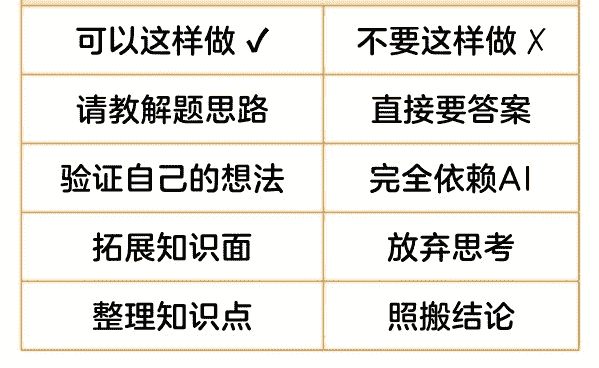

记住，你才是学习的主人，DeepSeek 最大的作用是帮助你学会思考，而不是替你思考。

哇！看来我们的“AI 使用小课堂”很成功嘛！

明白啦！DeepSeek 就是我的学习小帮手，而不是来替我读书的！

谢谢你们！这下我知道怎么和 DeepSeek 做好朋友啦！

**【小 D 和小 K 的贴心提示】**

善用 AI 有三条基本的原则。

① 先独立思考，再寻求帮助。
② 带着问题学，学完立即用。
③ 验证很重要，动手很关键。

你看，当我们理解了 DeepSeek 的能力边界，就能更好地利用它来提升学习效果。它就像一位随时在线的学习助手，只要我们正确使用，它就能帮助我们在学习道路上走得更远。

### **1.2.2 学霸都是这样和 DeepSeek 聊天的**

今天班里成绩最好的小明说他也在用 DeepSeek 辅助学习。

对哦！不如我们来看看学霸是怎么和 DeepSeek 对话的吧！

其实，高效运用 DeepSeek 的秘诀，就在于懂得如何开展有价值的对话。就像爬楼梯一样，每一步都要站稳，才能登得更高。下面让我们一起来学习那些“对话高手”的秘诀，也就是与 DeepSeek 高效对话的三个层次吧。

**1.了解基础**

目标：解决“是什么”的问题。

提问示例：

◆ 鸦片战争的起因是什么，发生在哪个时期？（历史）
◆ 杠杆的力、支点和作用点三要素是什么关系？（物理）

**2.深入探究**

目标：解决“为什么”的问题。

提问示例：

◆ 为什么说鸦片战争标志着中国近代史的开端？这和当时的社会变革有什么联系？（历史）
◆ 为什么改变支点位置能改变省力效果？这和力臂的关系是什么？（物理）

**3.实践应用**

目标：解决“怎么用”的问题。

提问示例：

◆ 从鸦片战争中，我们能总结出哪些经验教训？对当今社会有什么启示？（历史）
◆ 设计跷跷板时，如何利用杠杆原理让两个不同体重的小朋友玩得开心？（物理）

以上三个层次就像解数学题，要一步一步来，每一步都要弄明白。

提问的层次感，比问题的数量更重要

真正高效的交流，并不是抛出多少个问句，而是问得精准、好记、好用。

**【小 D 和小 K 的贴心提示】**

① 开启每次对话前，先把学习目标想清楚
② 得到答案后，及时提炼并做记录
③ 善于把新内容与已有知识相连
④ 独立思考和自主解决问题的能力才是关键
⑤ 让每一次互动都成为成长的机会

### 1.2.3 让对话更有趣：提问的小技巧

和 AI 聊天时，有时会觉得枯燥，或者得到的回答千篇一律对吧？

昨天我让 DeepSeek 讲解一道题，它讲了半天我还是懵的……

那是因为提问的方式还不够有意思。问题就像一把钥匙，换个问法就能打开不同的知识宝藏。

下面就来学学怎么让对话既有趣又高效吧！

**1.趣味提问的三个层次**

・**基础转化：把普通问题变得好玩**
◆ 概念迁移到场景
与其问“牛顿三定律是什么”，不如问“如果在太空站里踢一个足球，会出现什么有趣的现象？”
◆ 原理换成比喻
别直接问“光合作用的过程”，可以问“为什么森林被称为地球之肺，植物如何帮助地球呼吸？”

・**知识探索：让学习更生动**
◆ 故事化探索
把抽象概念变成故事：“能用一个超级英雄的故事来解释能量转化吗？”
◆ 游戏化思考
把难题变成游戏：“我们来当数学侦探，从这道应用题里找出关键线索好吗？”

・**深度连接：搭建知识网络**
◆ 学科交叉
寻找知识间的联系：“历史上科学发明和艺术发展有哪些有趣的关联？”
◆ 实践应用
把知识拉回生活：“这个物理原理在我们日常生活中会出现在哪里？”

原来可以这么问！难怪以前总觉得学习很无聊。

**2.让对话更有温度**

DeepSeek 不只是知识的传递者，也是学习路上的伙伴。适时表达困惑、分享自己的发现，会让交流更有温度。

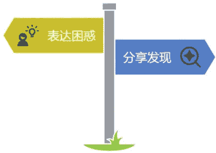

表达困惑时：这个概念我有点卡壳，但真的很想搞懂它。
分享发现时：这个现象太神奇了！能详细说说背后的原理吗？

**※ Look！米米这样做**

米米在学“地球自转”时，没有直接查定义，而是问：“假设我是一只住在地球上的小蚂蚁，能感觉到地球在转吗？”

通过这样的交流，她不仅弄懂了知识，还发现了许多有趣的科学现象！

用创意的方式提问，不仅是在学知识，也是在锻炼思维。让每一次和 DeepSeek 的对话都成为一次充满趣味的探索，学习变得好玩，知识自然会主动进入大脑。

太棒了！我也想马上试试这些方法！

别着急，先挑选一个最感兴趣的方式开始。学习新方法也要循序渐进哦。

对，就像玩游戏要一关一关通关一样，慢慢积累，你一定能成为提问高手！

**【小 D 和小 K 的温馨提示】**

① 好问题的标准不是花哨，而在于能否激发思考与理解。
② 创意和严谨并不冲突，有趣的提问往往带来更深刻的理解。

### 1.2.4 把 DeepSeek 培养成专属学习伙伴

看我的学习笔记！我把每次和 DeepSeek 聊天的模式和效果都记录下来了。

看来你已经找到门道了——不是它记住了你，而是你找到了最适合自己的提问方式！

想让 DeepSeek 成为专属学习伙伴，需要打造个人风格并建立默契。

・**打造个人风格**
找到自己顺手的提问习惯
◆ 米米喜欢用比喻，经常问“这个概念像什么呢？”
◆ 小 K 喜欢追根究底，经常问“为什么会这样呢？”
选择容易消化的表达形式
◆ 有人喜欢通过故事学习
◆ 有人更爱图表解释
◆ 有人偏好步骤拆解
米米学物理时，都会让 DeepSeek 用故事和生活场景来解释。例如学“惯性”时：“想象你在公交车上站着，车突然刹车，你会往前倾，这就是惯性……”

・**建立专属默契**
主动告诉它你的特点
◆ 你最感兴趣的话题
◆ 你当前的基础水平
◆ 你希望达到的目标
例如，“我现在是初二学生，特别喜欢天文，但对数学公式还不太熟。希望先了解基础星空知识，再慢慢学习行星运动的计算。”

培养独特的互动方式
◆ 用固定的开场白
◆ 约定喜欢的讲解方式
◆ 养成记笔记的习惯

**※ Look！米米这样做**
现在米米每次和 DeepSeek 聊天都会：
① 先想清楚想问什么
② 记录觉得不错的提问
③ 把平时的疑问记下来，逐一提问解决

就像游戏角色升级，每次互动都在提升默契值。记住，DeepSeek 不只是工具，更是你的专属学习伙伴哦！

**【小 D 和小 K 的温馨提示】**

① 坚持记录每次对话的收获
② 大胆表达想法和困惑
③ 对每次交流都保持期待

# 第二章

# 点燃你的学习动力

## 2.1 突破学习的心理障碍

太好了，现在我知道怎么和 DeepSeek 聊了！唔……这道几何题好难啊，要不要问问？可是……感觉自己太笨了，连这么简单的题都不会……

哎呀，我太懂了！我以前也总这样想，明明是个小问题，偏偏在那儿纠结半天，觉得“别人都会，就我不行”。

喂喂喂～这可不行！什么叫简单的题啊？每个人都是从不会到会的好吗！我之前上课都不敢问问题，现在想想，自己当时在害怕什么呢！

学习过程中，我们常会遇到各种心理困扰：觉得自己不够聪明、害怕失败、对自己没信心……这些都是成长路上再正常不过的小绊脚石，一起来学习如何跨越这些障碍，让学习变得轻松自在吧！

### 2.1.1 学习压力大，试试这些小方法

啊～又是周测，我感觉快喘不过气来了！

嗯，压力大的时候，先想想它到底从哪里来？是怕考不好，还是追不上同学的进度呢？

对！就像打游戏要先找到 boss 在哪儿一样，得先知道是什么卡住你了！

其实，学习压力常常来自以下方面
◆ 害怕考试成绩不理想
◆ 觉得跟不上同学进度
◆ 担心辜负父母期望
◆ 对自己要求太高

找到压力源后，可以试试下面这个方法

**※ “压力小日记”翻转法**
写下最近的烦恼→找出积极面→制定小目标

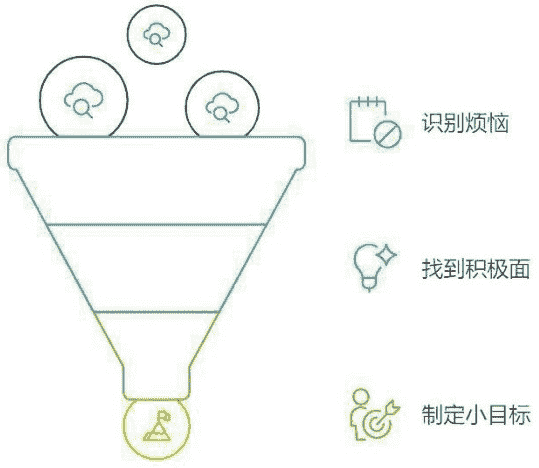

**※ 米米的日记**
烦恼：英语听力特别差，是不是没有语言天赋啊……
积极面：至少敢去听了，比之前有进步！
小目标：每天听 10 分钟英文材料

哎呀，有时候没有好的想法怎么办？

这时候，让我们来帮你出主意！

我们化身 DeepSeek，专业解忧一下！

**※ Look！米米这样做**
米米提问：DeepSeek，我最近总觉得自己学习效率好低，是不是我不够努力啊？
DeepSeek 回答：哎呀，感觉你有点焦虑呢！其实学习效率低不一定是因为不够努力哦，可能是方法不太对，或者状态没调整好。别太自责啦，咱们一起来看看有什么办法可以帮你提高效率吧……

**扫码查看**
DeepSeek 完整回答
**提示：AI 每次创作都独一无二，欢迎你亲自体验，获得专属于你的精彩回答！**

哎呀，我还知道一个更管用的方法，那就是请 DeepSeek 当“压力分解师”！

是的，当感觉压力特别大时，可以这样来聊天

**※ 压力分解师**
米米提问：DeepSeek，下周要期中考试了，我好紧张，感觉要复习的内容好多啊……
DeepSeek 回答：哎呀，期中考试确实让人有点紧张呢！不过别担心，复习内容多也没关系，咱们可以一步一步来，把任务分解一下，这样就不会觉得压力太大啦……
米米提问：数学……特别是几何证明题
DeepSeek 回答：几何证明题确实有点让人头疼，不过别担心！只要掌握了方法，慢慢来，你会发现它其实也没那么难。我们可以从几个方面入手，帮你更好地复习几何证明题……

**扫码查看**
DeepSeek 完整回答
**提示：AI 每次创作都独一无二，欢迎你亲自体验，获得专属于你的精彩回答！**

这样就不会觉得无从下手了！把大大的压力变成小小的任务，就不可怕啦！

其实吧，缓解压力就像跳绳，找对节奏，反而能让你跳得更好哦！

**【小 D 和小 K 的温馨提示】**

① 学习压力人人都有，关键是找到压力的源头
② 试着用积极的眼光看问题
③ 遇到想不通的事，随时找 DeepSeek 聊聊天！

### 2.1.2 和 DeepSeek 一起练习，交朋友不再害羞

我又有新问题了……班上来了个新同学，我想和他做朋友，可是……一想到要主动去打招呼，就紧张得说不出话

嗯，这种感觉我明白，你已经做好了结交新朋友的准备，却担心第一步会不会走错。其实每个人都经历过这样的时刻，重要的是找到适合自己的节奏

其实，很多同学都和米米一样，在社交场合会感到不自在。也许你也有过下面这样的情况
◆ 想和同学聊天，却不知道该说什么
◆ 担心自己说错话被嘲笑
◆ 看到心仪的朋友，总觉得自己不够好
◆ 害怕被别人拒绝

想改善这些状况，不妨试试下面方法吧！

**※ 社交锻炼小绳梯**
要克服社交焦虑，可以像爬绳梯一样，一步一步来

**◆ 第一步：先从最熟悉的人开始**
① 主动和爸爸妈妈分享今天的趣事
② 主动和同桌聊聊作业

**◆ 第二步：尝试和不太熟的同学互动**
① 借支笔说声谢谢
② 夸夸别人新发型很好看

可是……万一我说错话怎么办？

啊！这时候就让 DeepSeek 来陪你练习对话吧！

**※ DeepSeek 陪练时间**
找个安静的地方，和 DeepSeek 来场友好的对话：
米米提问：DeepSeek，我想和新同学做朋友，但不知道怎么开始……
DeepSeek 回答：想和新同学做朋友是很棒的想法！其实很多人刚开始都会有点紧张，这是很正常的。以下是一些温和的建议，希望能帮到你……
米米提问：你能陪我一起练习一下吗？
DeepSeek 回答：当然可以！我很乐意陪你一起练习。我们可以模拟一些场景，帮助你更好地准备与新同学的互动。你可以告诉我你想练习哪种情境，比如……
米米提问：寻找共同话题的场景吧！
DeepSeek 回答：太好了！寻找共同话题是建立友谊的一个非常有效的方式。我们可以模拟一个场景，比如你在教室里看到一位新同学正在看一本你感兴趣的书，或者穿着你喜欢的乐队 T 恤。你可以尝试开启对话，我会扮演新同学的角色，陪你一起练习……

**扫码查看**
DeepSeek 完整回答
**提示：AI 每次创作都独一无二，欢迎你亲自体验，获得专属于你的精彩回答！**

哇！感觉没那么可怕了！

**【小 D 和小 K 的温馨提示】**

① 社交焦虑是很常见的，不必感到孤单
② 准备几个简单的话题，让对话更自然
③ 从小目标开始，慢慢培养信心
④ 多关注对方，但不用刻意讨好
⑤ 交朋友是为了让生活更精彩，而不是失去自我
⑥ 真诚的友谊应该让双方都成长，而不是改变本真的自己
⑦ 随时都可以和 DeepSeek 练习，找到最自在的相处方式

### 2.1.3 成长路上有疑惑？来问问 DeepSeek

除了学习和交朋友，我还有好多想弄明白的事情……比如，我到底适合做什么？将来能做什么？现在该怎么准备？

成长中的疑惑，就像夜空中若隐若现的星星，看似遥远，却与我们的未来紧密相连。有些问题，需要一个伙伴来引导我们思考

其实，和 DeepSeek 对话最珍贵的，是它能像一面智慧的镜子，帮我们看清自己的困惑，找到适合的解决方向。有时候，我们需要的不是答案，而是理清思路的过程

**1.思考维度**
成长路上的困惑往往不是单一的问题，而是需要多角度思考的。我们可以从下面这三个维度来思考问题，帮助自己逐步找到属于自己的成长答案

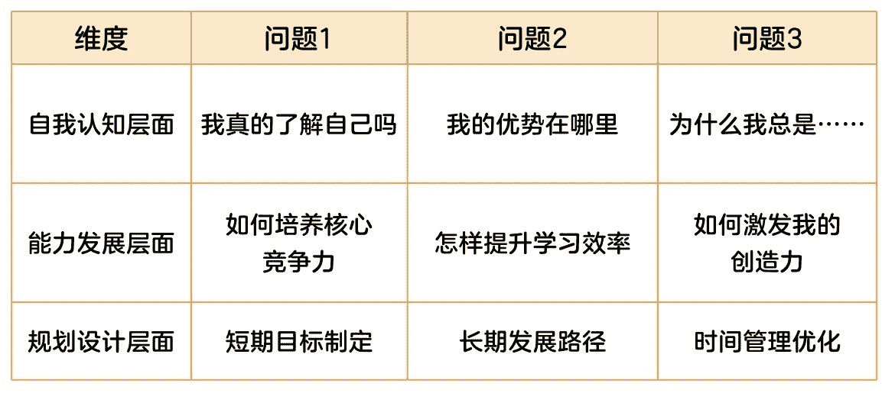

**2.表达准度**

你发现了吗？和 DeepSeek 对话越多，就越清楚自己想要什么！

确实，当我们学会提出更好的问题，思路也会变得更加清晰

・**明确表达你的困惑**
◆ 不要说：“我想学编程”
◆ 要说：“我是初中生，对编程感兴趣，想知道适合我现在开始学习的编程语言和学习路径”

・**告诉 DeepSeek 你的具体情况**
◆ 不要说：“我想提高成绩”
◆ 要说：“我数学基础不太好，尤其是几何证明题常常不会做，希望知道有什么针对性的学习方法”

・**从被动到主动的思考转变**
◆ 从“我要不要学编程”到“我通过学习编程能实现什么”
◆ 从“我想提高成绩”到“我想掌握什么样的学习方法”
◆ 从“我该选什么兴趣班”到“这个活动能给我带来什么收获”

啊！原来这样问效果更好！

**3.覆盖广度**
生活中的大小疑问，都可以和 DeepSeek 商量，如下表所示

DeepSeek 是你的助手，但最终的选择和决定要你自己做。就像登山，向导可以指路，但脚步终究要自己迈出

对啦！和 DeepSeek 聊天最棒的是，它不会嫌你问题太多，也不会觉得你的问题太傻。它就像一面镜子，帮你看清自己的想法，找到成长的方向！

**【小 D 和小 K 的温馨贴士】**

① 成长的过程中，有困惑是很自然的事
② DeepSeek 会为你解惑，问题越具体，得到的建议越适合你
③ 多问“为什么”和“怎么做”，而不是“是不是”
④ 把 DeepSeek 的建议记下来，实践后再来讨论效果
⑤ 答案不止一个，找到适合自己的才最重要

⑥ DeepSeek 可以帮你理清思路，记得把想法也告诉身边的人。真实的对话和温暖的拥抱，才是成长路上最可贵的陪伴。

### **2.1.4** **自信起来，学习更顺畅**
求知之路从不平坦，米米最近就被自我否定困住。面对新学期的数学题，她总先入为主地说服自己搞不定；准备英语演讲时，还没开始就预设会出错。这些困扰大多不是能力问题，而是信心不足在作祟。

这题我肯定做不出来~

研究普遍显示，信心水平与学习成效密切相关。心态积极时更容易进入专注状态，效率自然提升；而信心缺失则会让付出打折。

**1. 看见独一无二的自己**
米米问：DeepSeek，我感觉各科都学不进……
DeepSeek 的回复：
我能体会这种感受，有时候我们会觉得什么都不行。其实这往往是标准定得太高，或方法还没找到合适点，不等于真实的水平。
每个人都有自己的节奏，学习就是不断试错、调整的过程。可以放慢脚步，给自己一点适应时间，下面几条思路或许有用……

扫码阅读
DeepSeek 完整对话
提示：AI 的每一次回应都不相同，自己试试才有专属收获！

聊完后米米慢慢明白，每个人都是特殊的，培养学业自信可以从这些方面入手。

◆ 把大目标拆小：把困难的任务拆成可执行的小步骤。
◆ 允许不完美，拥抱成长：出错是正常的，重点是复盘吸取教训，而不是全盘否定自己。
◆ 从兴趣出发：先从自己有感觉的领域开始，兴趣是最强的推动力。
◆ 寻求支持拓宽视野：不必抗拒求助，别人常能提供新视角和建议。
◆ 及时自我肯定：每天给自己一点正向反馈，积累底气。比如“今天比昨天多了一点”“我正在努力，这就很棒”。

**2. 找到行动方向**
接着可以继续和 DeepSeek 探讨落地方法，比如“我的大目标怎么拆”“该怎样向别人请教”。方向越清晰，节奏越稳，能力会逐步提升，自信也会随之增强。

真正的学习底气，不是永不犯错，而是相信自己能一次次复盘改进，就像你正在做的。
米米若有所思地点点头，回想上次被一道数学题卡住，在 DeepSeek 引导下不仅解开了，还总结出了解题思路。

**【小D 与 小K 的暖心提醒】**
① 和 DeepSeek 交流时，把困惑说出来，也说说自己已尝试的方法。
② 把每次的小收获记录下来，它们是信心的基石。
③ 遇到障碍时，多问“怎么做”，少说“我不行”。
④ 每个人节奏不同，与自己比较最有意义。

## **2.2** **点亮学习的内在驱动力**

啊！又要开始学习了……总觉得很吃力。
驱动键？那是什么？

因为你还没找到学习的“驱动键”！
就像游戏里的能量条，有能量才能闯关升级！

学习也是如此，找到合适的驱动力，体验就会完全不同。
这一节和米米一起寻找这个神奇的“驱动键”！你会发现：
◆ 每个人都能成为优秀的求知者。
◆ 学习也可以变得有趣。
◆ 当你爱上学习，一切都会改变。
准备好了吗？开启这段探索之旅吧！

### **2.2.1** **人人都能做到的优秀**

完了，数学考试又没考好……感觉班里同学都好厉害，为什么我总跟不上？

别急，先找找新方法！现在有很多实用的学习工具，一定能帮你提升表现！

米米，先别急，我们先思考：什么样的学生才算优秀呢？
“真正的优秀是什么？”困扰着很多同学。有人觉得高分就是优秀，有人觉得样样领先才算，其实都是误解。

来，请教 DeepSeek 吧！
米米提问：我是初一的同学，想问什么是真正的优秀？什么样的同学才算优秀？
DeepSeek 回复：
同学你好！能在初一就思考“什么是优秀”，本身已很可贵。优秀的标准像彩虹一样丰富，我从几个角度聊聊：
优秀是成长型思维，真正的优秀不是永远满分，而是像竹子一样持续成长。比如……
优秀是立体多面的，像钻石靠多面切工才闪光，优秀也有不同维度……
优秀是独特的自我实现，不要活成别人的复制品，要成为自己的原创作品……
优秀是温暖的生命状态，被同学记住的“优秀”，往往……
成长建议清单……
最后送你一段话：生命的价值不在于收集多少奖章，而在于为世界增添多少光芒。优秀不是终点，而是带着好奇、同理和恒心，在成长路上欣赏风景的过程。你已踏上寻找优秀的旅程，这本身已是优秀的开始！
注意：AI 生成的具体数据和名言引用需要二次核实，避免虚构。

扫码阅读
DeepSeek 完整对话
提示：AI 每次创作都独一无二，欢迎亲自体验获得专属答案！

哇！这太酷了！就像游戏，每个角色都有自己的特长！

没错，有人数学思维强，有人文字表达好，有人动手能力突出，这些都是优秀的表现。

那为什么我付出很多，努力却不明显？

换个角度，学习像爬山，关键不是现在的位置，而是是否持续向上攀登。

对啊！就像游戏升级，每个人都有自己的升级路径！
是的，每个人都能成为优秀的学生，关键在于：
◆ 建立成长型思维：相信通过努力可以变得更好，现在的表现不代表未来。
◆ 找到个人节奏：每个人都有独特的学习方式，要发现并发挥优势。
◆ 善用工具提高效率：合理利用现代学习工具，让效率更高。
◆ 保持持续学习的热情：真正的优秀是保持热情，而不是一时的分数。

原来如此！
所以我不需要和别人比较，而是关注自己的进步？

没错，优秀不是终点，而是一个持续成长的过程。

而且现在有这么多好用的学习工具，可以用科技助力自己更好地学习！

我明白了！原来我一直用错误的标准要求自己。

**【小D 与 小K 的暖心提醒】**
① 优秀的定义因人而异。
② 现在的表现不决定未来。
③ 重视进步而非起点。
④ 找到适合自己的方式。
⑤ 善用工具，保持热情。

### **2.2.2** **从被迫到热爱，换个姿态**

又要背书了……

怎么啦？

总觉得学习就是完成任务，背完这个还有那个，做完作业还有下一份……
对很多同学来说，学习像一场永无止境的任务。根源在于把学习当成外在要求，而非内在需求。当学习只是为了应付考试、完成作业或满足他人期待，它就会变成负担。但学习的本质，是认识世界、发展自我的奇妙过程。就像小时候第一次认识蚂蚁、第一次看到彩虹时的好奇与兴奋。那份渴望一直都在，只是被表面目标遮蔽了。

**1. 爱上学习有方法**

怎样才能真正喜欢上学习呢？

问问 DeepSeek 吧！它一定有好办法！
米米提问：我是初一的同学，为什么总提不起劲？该怎么做才能喜欢上学习呢？
DeepSeek 回复：
作为初一的同学，动力不足很常见，通过调整方法与心态可以逐步找回乐趣。以下是具体建议，分步骤帮助你重拾动力：
一、理解动力缺失的原因
缺乏兴趣：课本内容枯燥……
压力过大：作业、考试带来的焦虑……
目标模糊：长期目标如考大学太遥远……
环境因素：同伴比较、家长催促导致逆反……
二、逐步找回动力的方法
从兴趣入手，建立知识与生活的联系……
设定可实现的短期目标……
优化学习方式，减少枯燥……
管理时间与精力……
调整心态，接纳自我……
寻求外部支持……
三、长期动力：找到学习的意义
探索未来可能……
培养成长型思维……
四、案例参考
总结
改变需要时间与耐心，不妨从今天开始尝试1~2个小方法，如设定微目标、看科普视频，逐步调整。记住，学习的最终目的不是分数，而是获取解决问题的能力。当你发现自己能解释现象、解决实际问题时，成就感会自然转化为动力。

扫码阅读
DeepSeek 完整对话
提示：AI 的每次输出都不一样，欢迎亲自体验获得专属精彩！
**2. 主动出击有行动**

哇！这些建议太棒了！

米米，你最喜欢什么科目呢？可以从一个开始。

其实我挺喜欢生物的，尤其是了解小动物习性……

那，我们先用 DeepSeek……

嘘，让米米自己想想怎么做更好。
米米接着问 DeepSeek：我挺喜欢生物，该如何把对动物的兴趣与学习结合呢？
DeepSeek 回复：
把对动物兴趣转化为动力是很好的方向！以下具体方法可以帮助你从“喜欢动物”延伸到主动学习，甚至带动其他学科兴趣：
一、生物课内知识：用兴趣深化理解
课前主动探索：若课本讲某类动物，可提前查资料……
用动物案例理解抽象概念：学“生态系统”时，可自画食物链……
把作业变成“研究项目”：不要只写书本答案……
二、跨学科联动：用动物兴趣带动其他学科
语文：写观察日记，记录动物行为；阅读动物主题文学……
数学：统计小区鸟类种类与数量……计算动物运动速度……
地理……英语……
三、动手实践：让兴趣“活”起来……
四、资源推荐：用兴趣拓展知识边界……
五、长期规划：让兴趣成为学习引擎……
六、遇到困难时如何坚持？……
总结
你不需要强迫自己喜欢所有学科，而以动物为起点，像蜘蛛结网一样把知识点串联。当你发现“数学能帮我分析动物迁徙规律”“英语能让我看懂国际研究论文”时，学习自然会变得有意义。记住：真正的兴趣不是“喜欢就够了”，而是“越了解，越热爱”。

扫码阅读
DeepSeek 完整对话
提示：AI 每次产出都新颖，自己体验才能拿到专属答案！

这样学起来真的很有意思！

对啊！学习也可以这么酷！

记住，找到适合自己的方式才是最重要的。
让学习变有趣，关键做到以下几点。
◆ 发现学习与自己的联系。
◆ 创造愉快的方式。
◆ 享受知识探索过程。
◆ 培养持续学习习惯。
当我们不再把学习视为任务，而是看作探索世界的钥匙时，学习会变成令人期待的事。

**【小D 与 小K 的暖心提醒】**
① 学习可以很有趣。
② 从兴趣出发更容易坚持。
③ 个性化方式更有效。
④ 主动学习收获更多。

### **2.2.3** **发掘学习的乐趣**

米米，你最近状态不错啊！

嗯！我发现把动物知识编成故事真的很有意思！但是其他科目……

有没有想过，为什么编故事会让你觉得开心呢？
学习的乐趣就像宝藏隐藏在过程中。有时是解开难题时的豁然开朗，有时是掌握新技能时的成就感，有时是和同学讨论时的灵感火花。要相信，每个人都能找到属于自己的乐趣。

**1. 找到学习的乐趣**

要不我们问问 DeepSeek，看看还有什么有趣的方式？

嗯嗯，那我来试试！
米米提问：我是一名初一的同学，想问除了结合兴趣，还有什么方法能让学习变得更有趣呢？
DeepSeek 回复：
你的问题很有意义！除了结合兴趣，还有多种方法能让学习像探险一样有趣。下面策略可根据自身特点尝试：
游戏化升级打怪法：知识解谜——把数学题设计成密室逃脱线索，比如用方程解出密码才能打开“宝箱”……
跨界创意实验室：物理+艺术——用颜料制作非牛顿流体，观察不同力度下形态变化……
五感沉浸式学习：味觉记忆——背化学元素周期表时，给每个主族元素搭配不同口味糖果……
社交型知识网络：成立学科侦探社……
未来科技助手：用 AI 生成历史人物对话……
实践建议：每周尝试2~3种新方法……
记住，真正的学习高手都是“玩法设计师”。当你把知识世界当成游乐场，每个课本都能变成藏宝图，每次作业都是升级装备机会。保持探索心态，你会发现自己慢慢变成学习的“游戏王者”！

扫码阅读
DeepSeek 完整对话
提示：AI 的回应每次都会不一样，亲自试试拿专属版本！

这些主意太棒了！我想试试……

等等，不妨再问问 DeepSeek，怎样能让这些方法持续下去？

对啊，我以前总是三分钟热度……
**2. 持续保持学习乐趣**
米米继续提问：我有时会三分钟热度，请问我要如何保持学习的乐趣，让它不会半途而废呢？
DeepSeek 回复：

# 把热度续上电

你提到的“三分钟热度”其实很有讨论价值，说它是缺点倒也不全对，更像是大脑在淘选真正值得深耕的知识宝藏。可以试试这套游戏化长效学习法，让学习产生追剧般停不下来的感觉：

1.打造让人上瘾的目标结构：微任务成就池——把大目标拆成十五分钟就能收工的小任务……
2.搭建心流加油站：弹性难度调节——准备红黄蓝三色练习卡……
3.加装防流失装置：复活卡机制——每周允许两次学习暂停，但需写下重启宣言……
4.构建持续兴奋回路：跨界彩蛋植入——例如在英语笔记里绘制学科寻宝图……
5.启动大脑重启程序：认知变形术——每周挑一天进行角色扮演式学习……

关键心法：察觉到厌倦时，立刻开启十分钟实验模式……

记住，学习续航靠的不是硬撑毅力，而是像玩游戏一样——兴趣即将流失时，系统会自动投放新副本。

**扫码查看**

DeepSeek 完整回答

**提示：AI 每次创作都独一无二，欢迎你亲自体验，获得专属于你的精彩回答！**

实践下来会发现，一旦沉浸在学习本身，知识的魅力远超想象。学习的乐趣，本就隐藏在探索与发现的旅程里。

学习原来可以这么多元！

方法很多，关键是找到最契合自己的那一套！

没错，要敢于尝试，找到适合自己的方式并坚持下去！

**【小 D 和小 K 的温馨提示】**

① 学习不只是任务完成。
② 过程本身就很有趣。
③ 每个人都能寻到学习乐趣。
④ 坚持下去收获更多。

# **第三章**

# **打造高效的学习习惯**

## **3.1** **掌握高效学习的密码**

是否常有类似感受：投入时间不少，成效却平平？或每天忙碌，却感觉一事无成？这正是需要破解高效学习密码的信号！

唉，最近感觉很累。每天都在学，好像什么都没记住……

对！小 K 你是怎么猜到的？

我猜，是不是学着学着就忘了初衷，时不时刷手机、发呆？

没错，这几乎是很多同学的共同困扰！别担心，用点巧办法就能改善！

高效学习就像打开密码锁，要找对钥匙。而这把钥匙，包含目标设定、时间规划与专注力提升三项核心。

### **3.1.1** **设定目标：让学习更有方向**

今天我要好好学习！

呃……就是……学习啊？

具体要学什么呢？
这就是症结所在！
目标太模糊，就像导航没输地址一样。

不少同学像米米一样，常有目标模糊的困扰。知道要学，却不明白具体做什么。看看 DeepSeek 怎么说。

米米提问：我总是定不好学习目标，感觉每天都很忙，却不知道自己到底有没有进步。请问要怎么设定一个好的学习目标呢？

DeepSeek 回答：

设定学习目标确实需要技巧，以下建议可帮助你制定更有效的目标：

1.明确具体的目标
具体化：目标要清晰，避免含糊。例如，不要只写“提高英语水平”，而是具体到……
可衡量：确保目标可量化或评估，例如……

2.设定可实现的目标
现实性：目标要符合自身实际，不要过高或过低……
分阶段：将大目标拆成小目标。例如……

3.设定有时间限制的目标
……

**扫码查看**

DeepSeek 完整回答

**提示：AI 每次创作都独一无二，欢迎你亲自体验，获得专属于你的精彩回答！**

原来，制定学习目标就像规划一次出行，需要弄清楚以下要点。

◆ 目的地在哪儿，即明确的目标。
◆ 要走多远，即可衡量的标准。
◆ 能否到达，即切实可行性。
◆ 为什么要去，即与自身的相关性。
◆ 什么时候出发，即时间规划。

我明白了！那我试试重新定一个？

来吧，让 DeepSeek 帮你检查一下！
米米提问：我重新定一个目标，一个月内英语单词量提升100个，每天早上7:00-7:30背20个，周末复习本周所学。这个目标如何？
DeepSeek 回答：

这个目标设定得非常不错！它符合有效目标设定的关键原则，下面是详细分析：

目标制定
1.具体性：你明确指出要在一个月内提升100个单词量……
2.可衡量性：按每天背20个，一个月后很容易算出是否达标……
3.可实现性：每天背20个是合理且可完成的任务……
4.时间限制：你设定了明确的时间框架，一个月内，每天固定早上7:00-7:30学习……
5.相关性：如果目标是提高英语，增加词汇量非常重要……

目标执行
6.灵活性：目标明确但可根据实际情况微调……
7.奖励机制：每周或每月达成后可给自己一点小奖励……
8.工具辅助：可用背单词类App辅助……
进一步优化建议……
示例……

**扫码查看**

DeepSeek 完整回答

**提示：AI 每次创作都独一无二，欢迎你亲自体验，获得专属于你的精彩回答！**

让我们总结制定优质学习目标的要点，也就是“SMART目标设定法”。

**※ SMART 目标设定法**

**◆ 具体明确 Specific**
把“我要学习”这种模糊想法，变成“这周要熟记20个英语单词”这样清晰的目标。

**◆ 可以测量 Measurable**
设定具体数字或标准，比如“每天做对8道数学题”而不是“多做数学题”。

**◆ 能够实现 Achievable**
目标要符合当前能力，循序渐进，不要定得太难。

**◆ 实际相关 Relevant**
目标要对学习成长有帮助，与整体规划相符。

**◆ 有时间限制 Time-bound**
给目标设定明确完成时限，比如“这个月底前”“下周五之前”等。

下面用“SMART目标设定法”对比不好的目标和好的目标的差异。

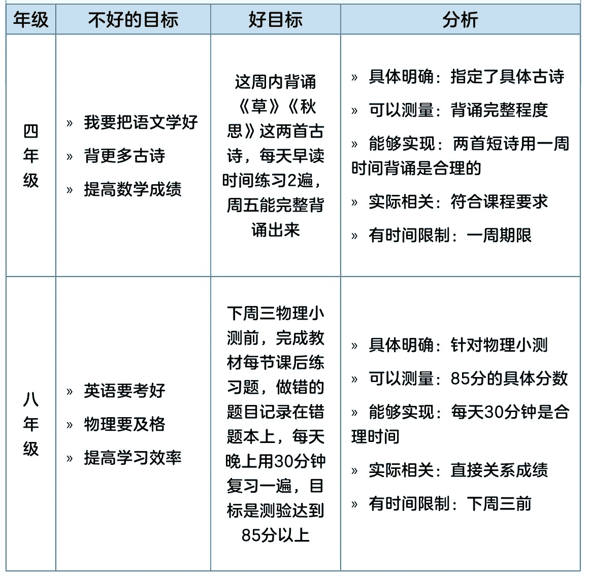

有了这些方法，我感觉学习更有方向了！

记住，目标不是束缚，而是指引，可随时按实际情况调整。

对啊！就像游戏里的任务指引，让我们知道下一步该做什么！

**【小 D 和小 K 的温馨提示】**

① 目标要具体可行，不要好高骛远。
② 经常回顾目标，及时作出调整。
③ 达成小目标后记得及时鼓励自己。
④ 可用 DeepSeek 帮助规划和检查目标。
⑤ 目标完成度不是衡量自我价值的唯一标准。

### **3.1.2** **时间管理：安排好每一天**

米米，你是不是经常觉得时间不够用？

又要熬夜了……明明计划列好了，可总是完不成……而且计划了这个，临时又冒出那个，结果全乱套了。

让我们请教 DeepSeek 如何科学管理时间吧！

**1.时间管理**

米米迫不及待打开 DeepSeek，问出了困扰已久的问题。

米米提问：我是一名初一学生，总觉得时间不够用，计划好的事常做不完，临时还会增加很多事，该怎么管理时间呢？

DeepSeek 回答：

能意识到时间管理的重要性，说明你已在思考如何提升，这很值得肯定！初一是过渡阶段，学业增加、节奏加快，容易感到时间吃紧。别担心，时间管理是可练习的技能。以下建议供参考：

1.明确优先级
列出任务清单：每天或每周开始时，列出需完成的任务，包括作业、课外活动等。
区分轻重缓急：用“四象限法”分类任务。
重要且紧急：优先完成，如明天要交的作业。
重要但不紧急：制定计划逐步完成，如复习计划。
紧急但不重要：尽量简化或委托他人，如琐碎事务。
不重要且不紧急：尽量减少或避免，如过度娱乐。

2.制定合理计划 设定具体目标……分配时间块……留出缓冲时间……

3.避免拖延 分解大任务……设定小奖励……

4.学会拒绝 合理拒绝……沟通协调……

5.利用碎片时间……

6.定期反思与调整……

7.保持健康生活习惯……

8.寻求支持……

时间管理是不断调整优化的过程，不要因一时挫折气馁。相信通过练习，你会找到适合自己的节奏，变得更高效从容。加油！

**扫码查看**

DeepSeek 完整回答

**提示：AI 每次创作都独一无二，欢迎你亲自体验，获得专属于你的精彩回答！**

时间管理就像拼魔方，也需要技巧。我们学会管理时间的第一步，是学会区分事情的轻重缓急。下面来认识优先级时间管理法及其使用建议。

・**优先级时间管理法**

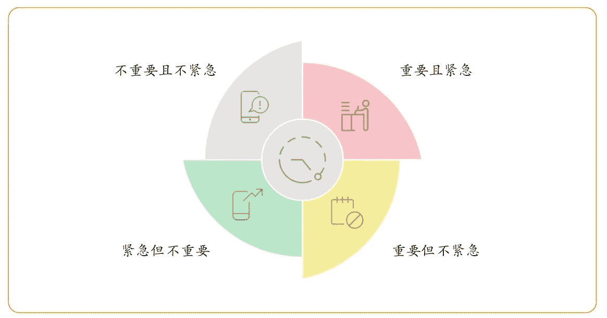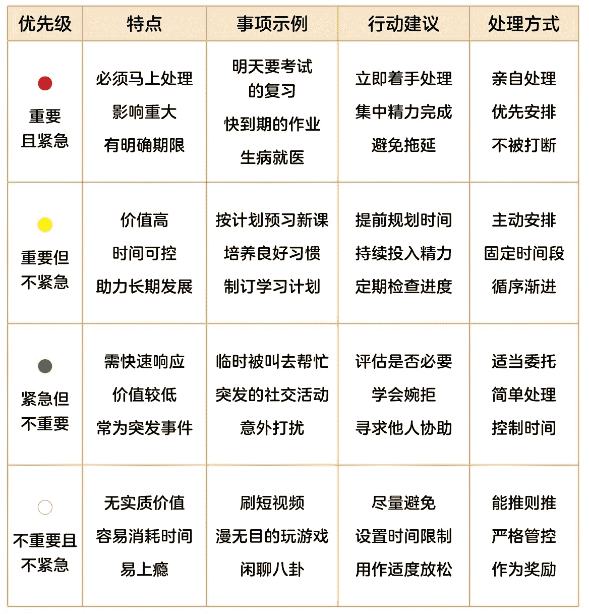

・**使用建议**

◆ 每天列出待办事项，按四个优先级分类。

◆ 先完成重要且紧急的事项。

◆ 预留固定时间处理重要但不紧急的事项。

◆ 学会对紧急但不重要的事项说“不”。

◆ 控制不重要且不紧急事项的时间占比。

这个方法很实用，就像给每件事贴上不同颜色标签。

对啊，红色标签的事要先做，黄色的要规划好时间，绿色的可以寻求帮助，白色的要严格控制。

可光知道轻重缓急还不够，要想真正管好时间，还需要具体的执行技巧。

**2.时间管理执行方法**

在时间管理过程中你可能会遇到各种问题，不要纠结，找到合适方法，不断提升管理时间和精力的能力，学习就会更高效。下面总结几个好用的执行方法！

・**时间块管理法**
方法：将一天时间分成若干块，每块专用于特定任务。例如，8:00-9:00做数学作业；9:00-10:00复习英语；10:00-10:15休息。
好处：避免任务切换，提升效率。

・**每天三件事**
方法：每天开始时，列出三件最重要的事，优先完成。
好处：确保每天完成关键任务，避免琐事分散注意力。

・**两分钟法则**
方法：若任务可在两分钟内完成，立刻去做，不要拖延，如整理书桌。
好处：减少小任务堆积，避免占用大脑空间。

・**任务分解法**
方法：将大任务拆成多个小任务逐步完成。例如，大任务写作文 → 小任务确定主题、列大纲、写开头、正文、结尾、修改润色。
好处：降低难度和压力，更容易开始和坚持。

・**保持弹性**
方法：计划不要排太满，留出弹性时间应对突发。
好处：避免突发事件打乱整体计划，保持灵活性。

・**定期回顾与调整**
方法：每天或每周结束时，花5~10分钟回顾任务完成情况，看哪些可改进。
好处：帮助不断优化时间管理策略，找到更适合自己的方法。

・**自我激励**
方法：设定小奖励机制，如完成任务后看一集喜欢的剧或吃一块巧克力。
好处：增加完成任务的内在动力，减少拖延。

原来管理时间还有这么多讲究！

最重要的是行动起来，慢慢来，循序渐进。

对！就像玩游戏一样，从简单的开始，慢慢提升难度！

**※ 启发思考**

了解这些方法后，何不把今天变成你的“时间管理实验日”？挑一个最吸引你的方法立刻实践——是时间块管理，还是优先级排序？

记住，理论看一百遍，不如实践一次来得真切。

**【小 D 和小 K 的温馨提示】**

① 不要期望一下子完美执行。
② 要留出休息和机动时间。
③ 根据自身情况灵活调整。
④ 保持作息规律很重要。
⑤ 善用方法和技巧帮助自己。

### **3.1.3** **培养专注力，方法很巧妙**

管理好时间后，我还发现一个问题，有时虽按计划安排了学习时间，却总不能专心。

对对对！你怎么知道的？

是不是经常想刷手机，或者被各种想法分散注意力啊？
因为这是很多人都会遇到的问题，让我们系统了解一下如何提升专注力吧。

**1.什么是专注力**

专注力是大脑集中注意力在特定事物上的能力，它就像大脑的“聚光镜”，能帮助我们：
◆ 有效过滤外界干扰。
◆ 集中精力处理当前任务。
◆ 提高信息加工质量。
◆ 减少不必要的精力消耗。

**2.为什么专注力这么重要**

科学研究表明，保持专注时：
◆ 大脑工作记忆能力会提升。
◆ 学习信息更容易整理和存储。
◆ 思维会更清晰系统。
◆ 完成任务效率会更高。

就像运动员需要专注才能发挥最好水平，学习时保持专注也能帮助我们更好地发挥能力。

专注力这么重要，可我怎么总是做不到呢？感觉上课、做作业时，注意力总是飘来飘去的……

别急！我们可以请 DeepSeek 帮忙想办法，它最擅长给出实用建议啦。
米米提问：我是一名初一学生，最近学习时总是不能集中注意力，容易分心，我该怎么提高专注力呢？
DeepSeek 回答：

注意力不集中是很多学生在学习时都会遇到的问题，尤其在面对繁重学业时。以下是一些实用方法，帮助你提高专注力。

1.创造适合学习的环境：减少干扰——选择安静整洁的地方学习，远离电视、手机……整理书桌——保持书桌整洁，只放当前学习所需物品……
……
3.使用番茄工作法
方法：将学习时间分为25分钟的工作段，即一个“番茄钟”，每完成一个番茄钟后休息5分钟。完成4个番茄钟后，休息15~30分钟。
好处：帮助保持专注，避免长时间学习带来的疲劳。
……
7.练习冥想或深呼吸：每天花几分钟进行冥想或深呼吸练习，帮助自己放松和集中注意力……

培养专注能力本质上是长期打磨，偶尔的失误不必过度自责。只要持续尝试并灵活修正，你终会摸索出最契合自己的节奏，让专注意识与执行效率同步提升。继续加油！

**提示：下文部分技巧在前文已有涉及，这里不再展开，需要完整解读可扫码查阅。**

**扫码查看**

DeepSeek 完整回答

**提示：AI 每次创作都独一无二，欢迎你亲自体验，获得专属于你的精彩回答！**

**3.“25 分钟番茄专注学习法”**

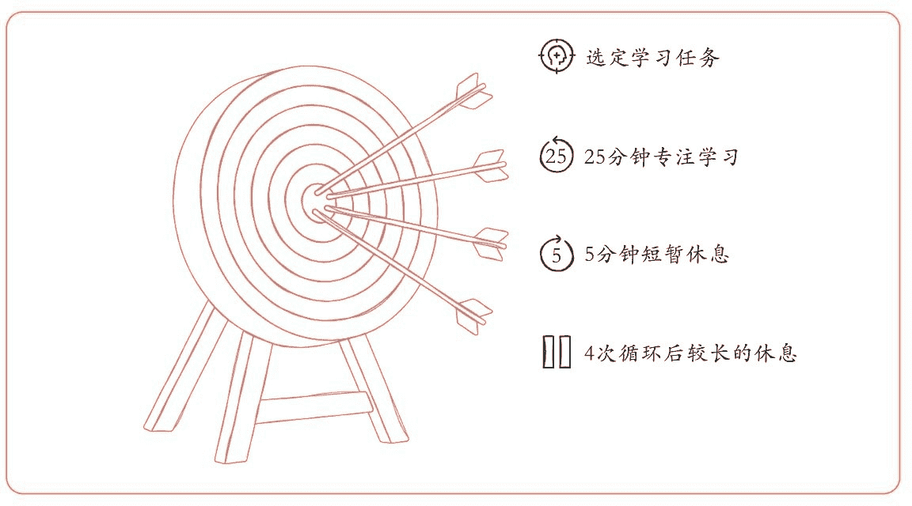

・**核心步骤**

◆ 确定本次要完成的具體事項，比如完成一張數學試卷或當天語文作業。
◆ 鎖定 25 分鐘進行專注，期間不處理與任務無關的干擾。
◆ 時間到後休息 5 分鐘，起身活動，讓大腦與眼睛得到放鬆。
◆ 累計四輪後可安排較長休息，如 30 分鐘，休息完再開啟新輪次。

・**為什麼選 25 分鐘**

◆ 符合人類注意力起伏的規律。
◆ 時間長度適中，不容易產生疲勞。
◆ 容易養成習慣並堅持下去。
◆ 每完成一輪都能感受到明顯的成就感。

**温馨提示：注意力持續長度會因年齡、體質等個人差異而變化，請按自身情況調節循環時間。**

專注原來是有規律可循，並非憑感覺。

沒錯，接下來還有幾組實用的專注力鍛煉小妙招。

**4.专注力训练行动小技巧**

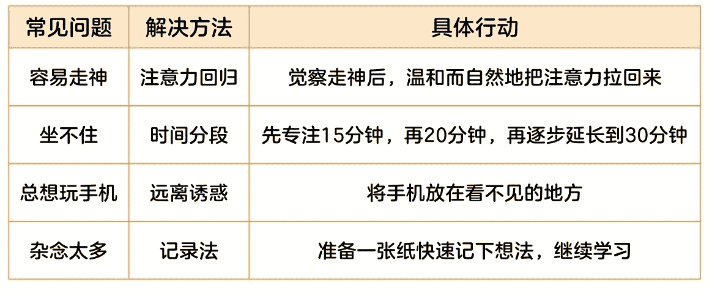

**※ 灵机一动**

每個人的注意力運作模式都獨一無二。若把自身性格偏好、學習環境以及最常出現的分心源告訴 DeepSeek，它能否為你定制一份專屬的提升方案呢？

看來專注力是可以主動訓練的！

對的，把這些方法與此前提過的時間管理技巧結合，效果會更突出。尤其處理重要且緊急的事務時，保持高度集中尤為關鍵。

最關鍵的還是落實行動！米米，要不要現在就嘗試一下？

**【小 D 和小 K 的温馨提示】**

① 專注訓練配合時間管理，成效更佳。
② 循序漸進，避免過度拔高目標。
③ 及時給自己正面回饋。
④ 合理安排學習與休息的交替。
⑤ 多和同學交流學習經驗。

## **3.2 变身好习惯达人**

我明白專注力重不重要了，但要改變現有的學習方式，我有點卻步。

這種心態很常見，抗拒改變是人之常情，其實很多優秀的人都是靠積累好習慣逐步成長起來的。

確實，透過培養長效習慣，每個人都能持續進步。就像養花，先播種再澆水施肥，慢慢會枝繁葉茂。習慣養成本質上也是漸進的過程。

那……該從哪裡開始呢？

那麼先來談談為什麼要走出舒適圈，這是養成好習慣的第一步！

### **3.2.1 走出舒适圈，发现新天地**

舒適圈究竟是什麼？

想像一個圓圈，它就像每個人心中的安全港灣，待在裡面做事輕鬆，幾乎感覺不到壓力與挑戰。

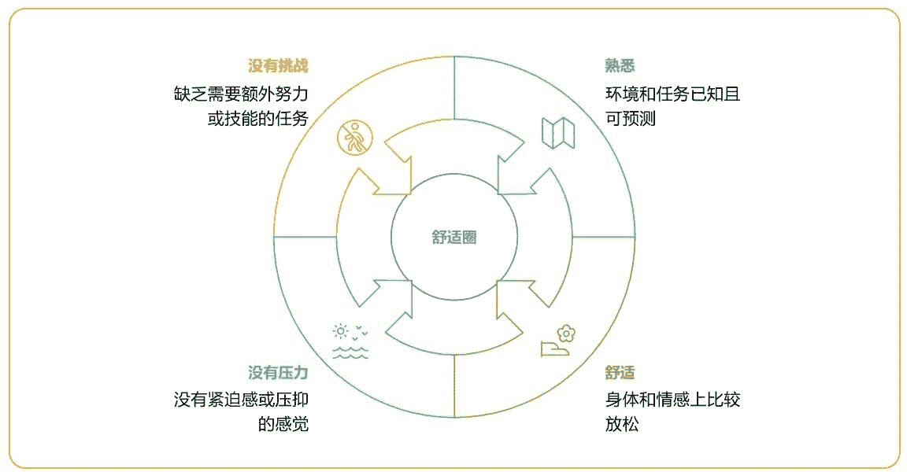

舒適圈是個人熟悉的安全範圍，裡面的事務都駕輕就熟，例如：

◆ 上學總走同一條路線。
◆ 遇到難題本能地向他人求助。
◆ 只玩自己最拿手的遊戲。
◆ 始終和固定的一群朋友在一起。

但長期困守舒適圈，就像井底之蛙，會錯過更廣闊的世界。研究顯示，接觸新事物能提升學習力，因為新奇體驗會重塑大腦關鍵神經迴路，讓我們更容易接受新策略、更靈活應對挑戰。走出舒適圈，本質上是為自己打開成長的新大門。

那我該如何跳出舒適圈呢？

等等，我先去問問 DeepSeek……

那就要……

哇，米米已經懂得和 DeepSeek 配合了！

米米提问：我是初一的學生，我想問，該怎麼跳出自己的舒適圈呢？

DeepSeek 回答：

你這個年紀就開始思考突破舒適圈，非常值得肯定！這代表你已主動追求成長，下面用生活化的場景給你幾條可立即試的建議：

1.从“微小的意外”开始
学习场景：比如数学课上老师提问时，你总是习惯性低头避开对视，明天试着主动举手回答一次，哪怕声音有点抖也没关系……
社交场景：午餐时尝试和新同学拼桌，说一句“今天的菜你最喜欢哪个”；看到同学在玩你感兴趣的游戏，可以说“这个看起来好酷，能教我怎么玩吗”。
习惯突破：如果平时总是走固定路线回家，某天故意换条小路探索；每天放学后习惯直接写作业，可以试着先运动 15 分钟再开始。

2.把“害怕清单”变成“成长地图”：拿出一张纸画两个表格……

3.创造“成长伙伴”机制：找 1~2 个同样想改变的朋友……用手机录制“成长 vlog”，每天用 30 秒记录自己突破舒适圈的小事，比如……

4.重新定义“失败”：记住这些公式 ——尴尬时刻=未来可以笑着讲的故事素材；被拒绝≠我不够好=对方此刻有不同需求；做不好=发现进步空间的机会……

5.设置“成长彩蛋”：给自己设计一些有趣的随机挑战……

记住，突破舒适圈不是要你变成另一个人，而是像升级游戏角色一样，不断解锁新技能。刚开始可能会像学骑自行车时那样摇摇晃晃，但每一次颤抖的尝试都在重塑你的大脑神经。现在正是试错成本最低的年纪，那些让你脸红心跳的时刻，都会成为未来闪闪发光的成长勋章。保持这样的勇气，你已经在成为更强大的自己了！

**扫码查看**

DeepSeek 完整回答

**提示：AI 每次创作都独一无二，欢迎你亲自体验，获得专属于你的精彩回答！**

哇，DeepSeek 說得太好了！突破舒適圈不是讓自己變成另一個人，而是像解鎖新技能一樣不斷升級，讓自己越來越強大。

對啊！就像玩遊戲一樣，每次嘗試新挑戰都能獲得經驗值。主動回答問題就是解鎖“勇氣+1”，自己解決難題就是得到“獨立+1”！

這麼說的話，好像也沒那麼可怕了……要不，我明天就試試主動回答老師的問題？

太棒了，米米！這就是邁出舒適圈的第一步！相信我，當你真的做到時，一定會特別有成就感。我們一起加油吧！

走出舒適圈確實需要勇氣，但有了正確方法，這過程會變得輕鬆許多。就像爬樓梯一樣，不必一次跨越所有台階，而是按自己的節奏，一步一個腳印向上攀登。讓我們一起看看下面這個實用方法，它就是為你準備的“勇氣工具箱”，幫助你輕鬆應對每一次挑戰。

**※ 循序渐进的挑战法**

**◆ 从小目标开始**

①每天多讀一頁書。
②主動回答一次課堂提問。
③嘗試獨立解答一道新的題型。

**◆ 克服害怕的小技巧**

①想像最壞的結果，通常沒那麼可怕。
②給自己打氣。
③把挑戰當作遊戲。

**◆ 建立支持系统**

①和好朋友一起進步。
②把目標告訴家人。
③記錄每一次進步。

走出舒適圈並非要徹底改變自己，而是慢慢擴大自己的“能力圈”。就像為花園開闢新土地，今天多照料一小塊，明天再耕耘一小片，隨著時間推移，整個花園就會悄悄變大，變得更加繁茂。每克服一次害怕，每完成一個小挑戰，你的舒適圈就會像綻放的花朵一樣，悄悄拓展出新的可能。

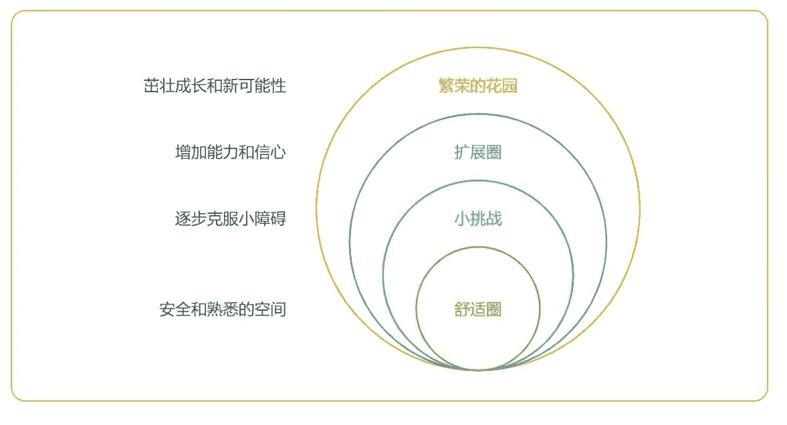

**※ 灵机一动**

DeepSeek 就像一位經驗豐富的探險嚮導！你可以告訴它你目前的“舒適圈”現狀，比如擅長什麼、習慣做什麼、害怕嘗試什麼，然後它會為你指引通往“未知區域”的最佳路徑，幫你發現那些值得冒險卻又不會過度焦慮的新天地！不妨試試看？

**【小 D 和小 K 的温馨提示】**

每個人都是從害怕開始，到慢慢習慣，最後收穫成長。當我們主動走出舒適圈，會發現：

・世界比想像中更有趣。
・自己比想像中更勇敢。
・成長比想像中更簡單。

### **3.2.2 培养好习惯的简单方法**

已經邁出舒適圈的第一步，接下來就是要把這些改變變成習慣！為什麼我每次下定決心要改變，過幾天就堅持不下去了呢？

這是很多人都會遇到的困擾，要養成新習慣，也需要一些科學的方法。

習慣，就是我們每天都會重複的一系列小動作。有些習慣會讓我們進步，比如下面這些。

但是，為什麼明明知道這些習慣很重要，卻總是難以堅持呢？

這是因為我們的大腦天生喜歡省力，傾向於走熟悉的老路。不過，只要掌握正確的方法，就能讓改變變得更加輕鬆、自然。

真的嗎？那具體該怎麼做呢？

讓我們問問 DeepSeek 吧！

米米提问：我初一了，我在学习和生活中经常容易三分钟热度、半途而废，我如何更好地培养自己坚持好习惯的能力呢？

DeepSeek 回答：

你的自我觉察非常值得肯定！处于初中阶段，正是培养自我管理能力的关键时期。针对容易半途而废的问题，这些方法会更贴合你的实际生活：

1. 从“微习惯”切入更有效：每天只背 3 个单词，而不是设立目标每天背 50 个……运动从 3 分钟跳绳开始，而非直接制订 1 小时锻炼计划……这样大脑不会产生抗拒，更容易积累成功体验。

2. 建立“习惯触发器”（适合课业场景）：数学作业后立即做 2 道错题整理（绑定已有习惯）……每天课间操结束后喝口水，马上复习上节课的笔记（环境触发）……

3. 设计即时反馈系统：用彩色进度条贴纸记录每日完成情况（视觉化激励）……

4. 认知调节技巧：遇到瓶颈时问自己“放弃后真的会更轻松吗”……

5. 优化环境设置：手机设置定时锁机功能（19-21 点学习时段）……

给初中生的特别建议：利用课间碎片时间实践微习惯（如背 1 个公式）……

记住：大脑像肌肉一样需要锻炼，每次克服放弃冲动都是在增强意志力。即使某天中断了，只要及时重启，这个“重新开始”的过程本身就是重要的能力培养机会。可以准备一个“重启本”，记录每次重新振作的经验，你会发现自己越来越坚韧。

原來養成習慣還可以這麼有趣！就像玩遊戲升級一樣！

是啊，DeepSeek 把複雜的習慣養成過程分解得特別清晰。不同階段有不同的重點，讓改變變得更容易實現。

養成好習慣確實不是一件容易的事。就像你正在開闢一條新的小路。第一次走時，你需要撥開雜草，跨過障礙，這個過程會很費力。但如果你每天都走這條路，漸漸地，小路就會變得平整寬闊，走起來也會越來越輕鬆。養成新習慣也是一樣的道理！

綜合 DeepSeek 生成的建議，我們可以從使用下面這些實用的方法開始，它們就像搭建習慣的積木，可以幫助你一步一步建立起屬於自己的好習慣大廈。

**1.触发设计法**

原理：觸發設計就像給好習慣安裝一個“啟動開關”。當你遇到某個固定信號，就能自動聯想到該去執行某個好習慣。

・**和已有習慣绑定**
讓新習慣“掛鉤”到你每天都在做的事情上。
例如，放學鈴響=收拾書包，午飯後=看書 15 分鐘，刷牙後=聽一首外語歌。

・**创造行动提示**
把容易忽略的東西放在醒目的地方，將“要做”嵌入你的日常生活場景中。
例如，想提醒自己晨跑，就把運動鞋放在床邊；想背單詞，就在桌面貼上“背單詞”便利貼。

・**移除阻碍物**
為了讓行動更順利，先把“干擾項”收起來。
例如，寫作業時把手機放遠，把社交軟體的消息提示關閉；怕吃零食就把零食收進平時不常打開的儲物櫃。

**2.能量管理法**

原理：人的精力好比手機電量，如果能量“電量不足”，就算有很好的計劃也難以執行下去。

・**重要事项放在精力最好的时段完成**
根據自己的作息，找出你“狀態最在線”的時間。
例如，如果你早起精神好，就利用早晨的時間來記憶或寫難度較高的作業。

・**设置 15 分钟“能量充电站”**
不要讓自己一直處於緊繃狀態，每隔一段時間休息一下更有效率。
例如，每學完一節課就站起來伸展，連續做題 20 分鐘就聽一首歌、喝口水或放鬆一下眼睛。

・**疲惫时适当降低目标**
當感到特別累時，把目標臨時縮小，也是一種保護自己、持續堅持的方法。
例如，原計劃讀 10 頁書，減少到 5 頁；原想跑步 30 分鐘，改為快走 15 分鐘。

**3.数据追踪法**

原理：就像玩遊戲升級需要“經驗值”，養成習慣也需要“記錄值”。當你能看見自己的進步數據，就會更有動力。

・**记录每日完成情况**
做一個打卡表或用日曆標記。
例如，完成時打鉤或貼小星星，沒完成就標記一下原因。

・**分析最佳行动时间**
通過數據總結，看看哪段時間最容易高效完成任務，哪段時間最容易拖延。
例如，每天寫下“什麼時間最容易專注”“寫作業的最佳時間是幾點”。

・**找出影响坚持的关键点**
看到數據後，反思一下自己。
例如，是不是前一晚睡太晚導致第二天沒動力？用手機時間太久了嗎？

原來是這樣！就像給植物澆水一樣，需要找對時間和方法！

對呀！而且 DeepSeek 還能隨時幫你分析具體的建議，找到最適合你的方式呢！

**※ 灵机一动**

試著把你的具體情況，如年級、作息時間、興趣愛好和想要培養的習慣目標，比如晨讀、運動、專注學習告訴 DeepSeek，它能為你量身打造一套專屬的習慣養成計劃。

養成好習慣並不意味著要完全改變自己的生活方式，而是要找到適合自己的節奏。就像照料盆栽一樣，剛開始時需要特別關注，但隨著時間推移，它就會自然而然地生長。每堅持一天，每克服一次懈怠的想法，你就離目標更近一步。

**【小 D 和小 K 的温馨提示】**

好習慣的養成是一個充滿驚喜的過程，你會發現：

・改變比想像中更簡單。
・堅持讓人更有力量。
・每一步都在創造更好的自己。

### **3.2.3 坚持好习惯，其实很容易**

你看！我已經連續五天按計劃完成閱讀了！

真棒，你已經度過了最難的啟動期！

恭喜你米米。不過，我們也需要想一想，如果某天遇到阻礙，該如何應對呢？堅持的真正挑戰往往在於應對意外狀況。

**1.为什么好习惯总是“卡壳”**

其實，很多同學都會遇到類似的困擾：開始時信心滿滿，卻在半路上不知不覺地放棄了。這就像爬山，不同階段有不同的挑戰。

・**启动期（第 1—7 天，约 7 天）**
這時候我們充滿熱情，新鮮感十足！就像玩新遊戲，一切都很有趣。但也很容易因為一點小事就中斷。

・**适应期（第 8—21 天，约 14 天）**
激情慢慢冷卻，開始感覺有點無聊或疲憊。這是最危險的時期，大多數人是在這個階段放棄堅持的。

・**自动化期（第 22—66 天，约 45 天）**

渡过最初的磨合期后，一种新行为会逐渐沉淀为近乎自动的日常操作，不再需要刻意用意志去支撑。

很多人都在起步阶段栽了跟头，却没发现再咬牙多坚持一段，习惯就能像呼吸那样水到渠成。

**2.突破“适应期”的实用招数**

・**招数一：灵活战术法**

“完美”常是习惯的杀手，生活里总会有意外，学会变通才是关键。

灵活战术包含：

◆ “不连断”原则：尽量避免同一习惯连续两天中断。
◆ “迷你版”行动：做不完全部内容，也要完成一个最小单元。
◆ “Plan B”策略：提前准备几套备选做法。

我原本立志每天跑步，一下雨就全部作废。后来学会调整，雨天就切换成室内“雨天简化表”——15分钟基础力量练习，这样链条就不会断掉。

・**招数二：降低“维持成本”**

习惯能否留存，类似一个天平。一边是收益，另一边是维持的成本，成本过高天平就会倾斜。

降低成本的做法：

◆ 环境微调：把瑜伽垫放在显眼处，把手机充电器移出书桌。
◆ 工具顺手：找到最适合自己的记录方式、学习软件或运动装备。
◆ 时间精简：与其规划两小时做不到，不如先稳定半小时。

所以核心是不是让“继续做”变得极其容易，而“停下来”变得稍显麻烦？

没错，这就是维持习惯的黄金法则。

・**招数三：组建“习惯联盟”**

独自坚持很容易在无人的角落放弃，有同行者情况就不一样了。

联盟的三种形式：

◆ 找个习惯伙伴：和朋友一起执行同一习惯。
◆ 大声说出来：向家人或朋友宣告计划，增加责任感。
◆ 进度小分享：在小圈子里定期交流进展。

研究显示，有伙伴陪伴的人坚持概率会提升约65%。

对，上学期我和几个同学建了个“英语打卡群”，每天互相分享进度，动力明显更强。

**※ 灵机一动**

① 想一想你正在进行的习惯，比如晨读、运动、集中学习等。
② 回顾坚持时长与当下的感受。
③ 把这些信息告诉DeepSeek，如“我已坚持晨跑两周，最近提不起劲，请判断所处阶段并给出建议”。

DeepSeek会据你的具体情况，定制属于你的习惯续航包。

**3.习惯“间断”了怎么办？**

我的阅读习惯已经断了三天了……是不是前功尽弃了？好懊恼。

别担心，系统偶发故障很正常，关键是快速修复并重启。

米米，你觉得为何会中断？把这次经历当作认识自我的机会。高手不是不犯错，而是懂得优雅东山再起。

・**习惯重启三步法**

◆ 不自责：客观分析中断原因，而非自我批评。
◆ 降低难度重启：用更轻的方式重新开始。
◆ 记录经验：把每次复活过程记下来，作为未来参考。

有意思的是，研究发现经历挫折后重弹的人，习惯最终会更牢固，这被称为成长型韧性。

真的吗？那失败反而是好事？太神奇了。

・**习惯坚持的内在奥秘**

坚持并非意志力马拉松，而是一场需要设计的旅程，有几个隐藏要素值得了解。

◆ 身份认同的魔力
当习惯与自我标签绑定，持续会更自然。“我是条理的学习者”比“我要变有条理”更有力量。

◆ 即时反馈的秘密
大脑偏爱即时反馈。为长期目标创造短期成就感，能大幅提升坚持率，比如用彩色图表记录进度，或和朋友分享小进步。

◆ 习惯的生态系统
单一习惯难以孤立，多个相互支撑的习惯会形成自我强化的生态。比如早睡助早起，早起助晨读，形成良性循环。

**※ 灵机一动**

把你想培养的习惯及可能挑战告诉DeepSeek，让它为你设计一套个性化的习惯保护伞。最强的坚持策略，就是最适合你的那一个。

啊我明白了，以前总觉得坚持不住是因为不够努力，现在才发现是习惯系统设计不够聪明。

没错，就像智能系统，选对程序，一切自动运行。

习惯像种下小树苗，重点不是紧盯它，而是营造让它成长的环境。米米，你已经摸到门道了。

**【小 D 和小 K 的温馨提示】**

坚持好习惯不是意志力比拼，而是聪明设计的艺术。试试这些小妙招。

・计划保持弹性，不必追求完美。
・让坚持变得简单最重要。
・找个小伙伴一起加油更有劲。
・中途卡壳没关系，重启就对了。
・告诉自己“我就是有这个好习惯的人”超有用。

# 第四章

# 提升学习能力

## 4.1 打造超强学习力

我们已了解如何点燃学习动力，也掌握了培养坚持好习惯的方法，现在该聚焦学习核心能力了。热情和习惯再好，若缺乏有效学习力，效率仍会打折。

学习力就是你的学习引擎，决定吸收和应用知识的速度与质量。引擎越强，同样时间收获越多，面对未知也更从容。本节将帮助你全面提升学习力，打造专属超强引擎。

### 4.1.1 快速理解：学习不再晕头转向

每次看到数学题就头晕，老师讲时觉得懂了，自己做题又完全不会了。

这像是理解的问题，要不要试试DeepSeek的解释？

在求助前先思考，真正的理解是什么？是听懂，还是能用自己的话解释，又能灵活应用？

**1.理解的层次：从表面到深入**

理解不是非黑即白，而是有深度层次。很多困惑源于停留在表面。可将理解分为四个层次。

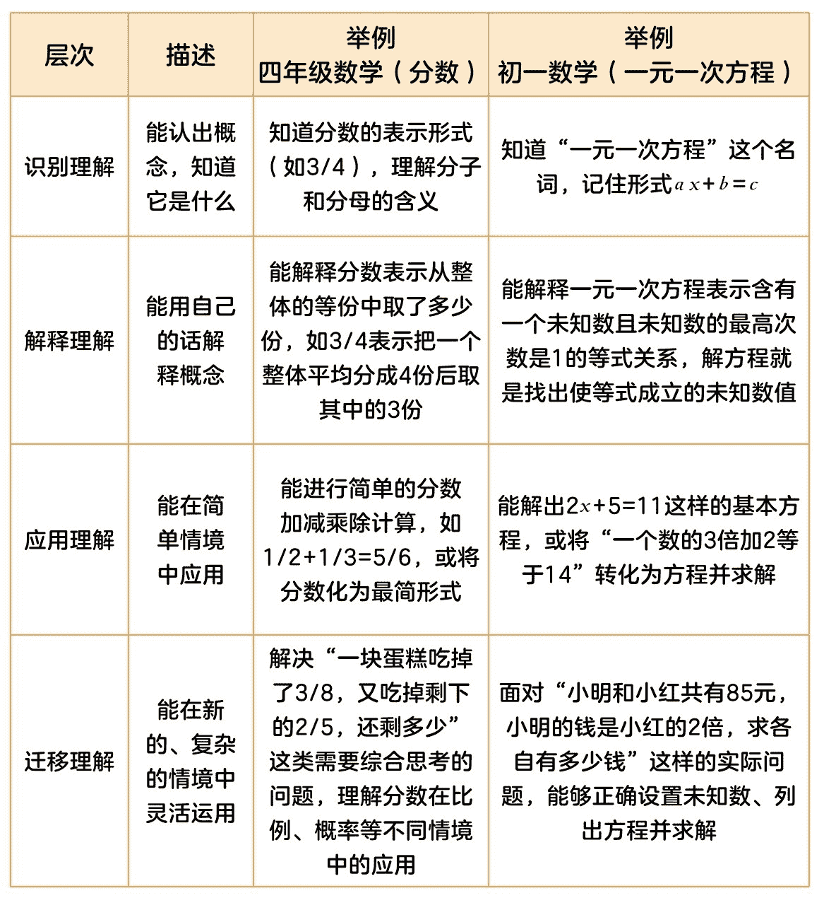

真正掌握要达到第三甚至第四层，而许多困难恰源于理解不够深入。

原来我只在第一层，我只是记住了公式，却没弄懂含义和用法。

认识到这点很重要，也可借助DeepSeek达到更深层次理解。

**2.影响理解的三大障碍**

学习中常遇理解障碍，识别它们是突破第一步，以四年级知识点为例。

・**缺乏前置知识**
基础不牢时，新知识像空中楼阁，难建立连接。
例如，不懂分子分母就难进行分数计算比较。

・**概念抽象，难以形象化**
年级越高概念越抽象，缺乏直观感受会吃力。例如面积与体积区别，小数点位置意义，时间单位换算等。

・**知识碎片化，缺乏系统连接**
常把知识点孤立记住，却不知关联。例如会单独加减乘除，面对混合运算或应用题却不知如何组合。

**3.DeepSeek快速理解小助手**

遇到难懂知识点时，DeepSeek可成为专属学伴，助你快速突破障碍。三种实用提问方式如下。

・**方法一：知识梳理小帮手**
对知识点困惑时，可找出可能忽略的基础知识。

**※ DeepSeek 小贴士**
学习新知识受阻时，可这样问：
①学习知识点时遇到困难，可能缺少哪些基础知识？
②请梳理理解知识点需要的前置知识和关键概念。
③为何理解了基础仍搞不懂进阶？

我在学分数乘法时总搞不清，能帮我梳理理解分数乘法的基础知识和关键点吗？

・**方法二：概念形象化大师**
抽象概念难懂？DeepSeek可用生动比喻让抽象变具体。

**※ DeepSeek 小贴士**
遇到抽象概念时可尝试：
①请用生活例子比喻【抽象概念】。
②能用我能理解的方式解释【复杂概念】吗？
③请给【概念】做一个有趣类比，帮助我理解。

就像把复杂分数比作分披萨或巧克力，一下就能明白了。

・**方法三：知识地图绘制员**
知识点联系不清？DeepSeek可帮你构建知识地图，让碎片变整体。

**※ DeepSeek 小贴士**
想构建体系时可这样问：
①请梳理【主题】的知识框架，含主要概念及关系。
②我已学会【这些知识点】，它们有何联系？
③【概念A】和【概念B】有何联系？这对学习有何帮助？

知识点间的联系像不同城市间的道路，一旦连通，交通网就清晰可见。

**4.青少年理解力提升方法**

除借助DeepSeek，以下方法也能提升理解能力。

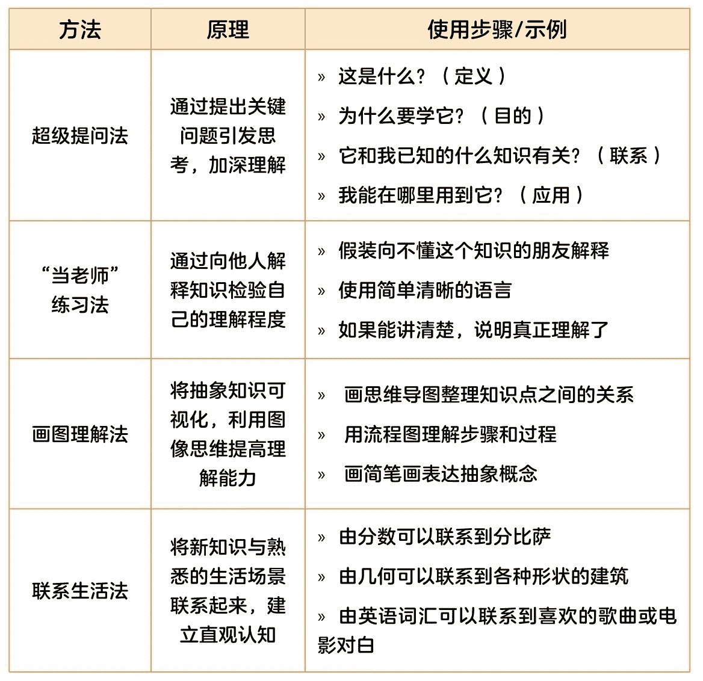

**※ DeepSeek 实用问法大全**
想提升理解力？收藏这些提问方式。

**◆ 理解难点突破**
①我在理解【概念】时有困难，能用三种不同难度方式解释吗？
②请用10岁小朋友能懂的方式解释【复杂概念】。
③我对【概念】的理解是【你的理解】，对吗？需修正何处？

**◆ 知识联系构建**
①请分析【概念A】和【概念B】间的联系。
②我学了【知识点】，它与之前学过的哪些知识有关联？
③请制作【主题】的知识地图，展示关键概念关系。

**◆ 实际应用指导**
①学了【知识点】后，能解决哪些实际问题？
②请提供几个应用【概念】的实例，从简到难。
③我理解了【概念】的理论，如何检验是否真正掌握？

哇，用不同方式思考同一问题，像打开了新世界大门。

理解不是被动接受，而是主动建构，思考方式决定理解深度。

有DeepSeek助力，可随时获得个性化解释和引导，像随身家教一样。

**※ 灵机一动**
下次遇到难懂概念，试试“概念三重奏”提问。
①请DeepSeek用“给6岁小朋友的解释”解释这个概念。
②请给出“给同学的解释”。
③请提供“给专家的解释”。
比较三种解释，你会发现复杂知识可变得简单，简单知识背后又有更深奥秘。

真正的理解不是单纯记忆，而是把知识融入认知结构，使其成为思维一部分。通过深度理解，不仅能应考，还能拥有创新源泉。当真正理解本质，就能突破教材限制，形成独特见解。下一节，我们将探讨如何培养思考能力，让学习从接收走向创造。

**【小 D 和小 K 的温馨提示】**

①理解比记忆重要，懂了自然记得住。
②不要害怕提问，疑惑是理解开始。
③DeepSeek能帮你突破理解障碍，但真正理解需要自己思考。
④用自己的话表达出来的知识，才真正属于你。

### 4.1.2 学会思考：发现知识的有趣之处

啊，这道数学题好难，我记不住这么多公式啊。

米米，你觉得记住公式和真正学会它有什么区别？让我们一起思考。

学习不只是记忆事实和公式，更是一场探索发现之旅。从被动记忆转向主动思考，知识不再是枯燥符号，而是充满生命力的谜题。思考像一把魔法钥匙，能打开知识宝库中最有趣的门。

**1.思考的三种超能力**

每个人都有三种思考超能力，有意识训练即可激活。

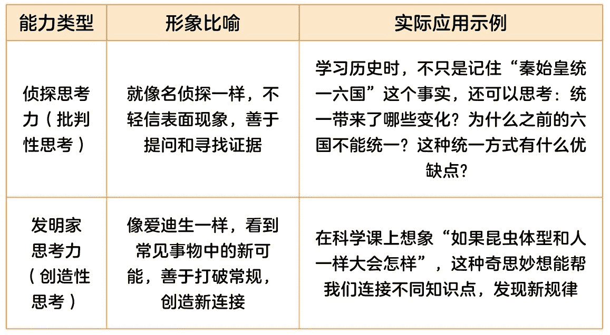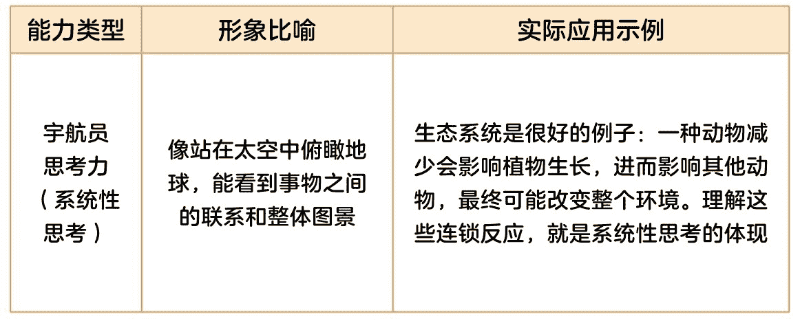

这些能力听起来很棒，该怎么练习呢？

**2.点燃思考的火花：实用方法**

日常学习生活中，通过简单有趣的方法锻炼思考能力，并形成习惯。

・**好奇心问题法**
遇到新知识时，尝试提出：
◆ 为什么会这样？探究原因
◆ 若条件变化，结果会怎样？假设推理
◆ 这与我已知的什么知识有联系？知识连接
爱因斯坦说，他的成功不是天赋异禀，而是对问题有持久好奇心。提问是思考起点。

・**生活联想法**
把抽象概念与日常生活联系，建立更清晰直观理解，示例如下。
◆ 理解免疫系统 → 想象城市防卫，白细胞如同卫兵。
◆ 理解分数除法 → 想象分披萨，1/2÷1/4=2，意味着半个披萨能切出2个1/4大小的块。

・**思维可视化**
把想法画出来，可把抽象概念变可视化图像。常用方法：
◆ 思维导图：展示中心概念和相关分支。
◆ 概念图：展示概念间关系。
◆ 流程图：展示步骤或过程。
◆ 比较图：并排比较不同概念。

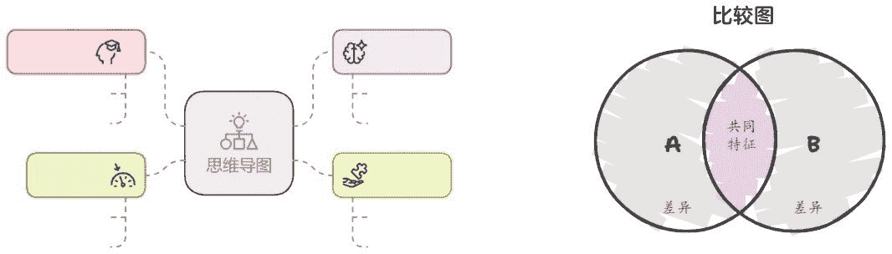

**3.DeepSeek：思考的智能伙伴**

当思维需要灵感或新角度时，可让DeepSeek成为思考好帮手，尤其在以下方面。

・**拓展思考角度**
功能：帮助从多个视角思考同一问题，避免单一思维。

**※ 使用方法**
①先确定要探究的核心问题。
②向DeepSeek提问：这个问题可以从哪些不同角度思考？
③选择感兴趣角度继续发问，深入探索。

例如针对“全球变暖”问题的多角度思考。

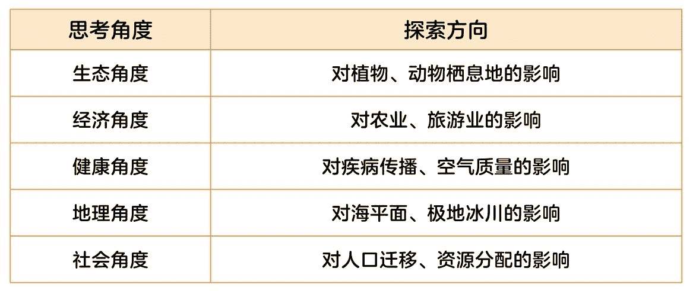

・**知识故事探索者**
功能：发掘知识背后的历史、发展过程和有趣故事，让抽象概念更生动。

**※ 使用方法**
①选择正在学习的知识点。
②向DeepSeek提问：这个知识点背后有什么有趣故事或历史？
③将故事与概念联系，加深记忆。

**注意：AI生成故事和数据等信息引用前需二次验证，要求AI提供具体出处，以确保内容真实而非虚构。**

例如数学中“零”的故事。
◆ 古代：各文明如何表示“无”的概念。
◆ 突破：印度数学家首创零作为独立数字。
◆ 挑战：零在欧洲最初被抵制又被接受的故事。
◆ 影响：零如何彻底改变数学计算。

・**思维实验伙伴**
功能：通过设计假想情境，探索难以直接观察的概念或规律，培养假设推理能力。

**※ 使用方法**
①以“如果……”开始，设想一个改变现实条件的情境。
②向DeepSeek询问这种情况下可能后果和影响。
③分析这些后果如何帮助理解相关科学概念。

用假设点燃好奇

先做一组思路点火推演。

◆ 假设能搭乘接近光速的飞行器……
→ 能直观感受相对论：时间是否会变慢？物质会不会变形？

◆ 假设地球引力在瞬间减半……
→ 有助于理解重力：建筑会受怎样影响？生物如何适应？

◆ 假设人类也能像植物一样进行光合作用……
→ 引发生态联想：饮食习惯要不要改？城市规划会否重写？

・多视角辩论陪练
作用：反复练习用不同立场审视同一议题，提升整体分析与批判判断力。

※ 使用步骤
① 挑一个存在分歧的话题。
② 向 DeepSeek 发起提问：关于【议题】，支持方与反对方的核心论点各是什么？
③ 请 DeepSeek 拆解各方观点的优势与不足。
④ 尝试挖掘双方论证中的逻辑瑕疵或隐含前提。

例如，对“中小学校园是否该禁用手机”做多角度拆解。

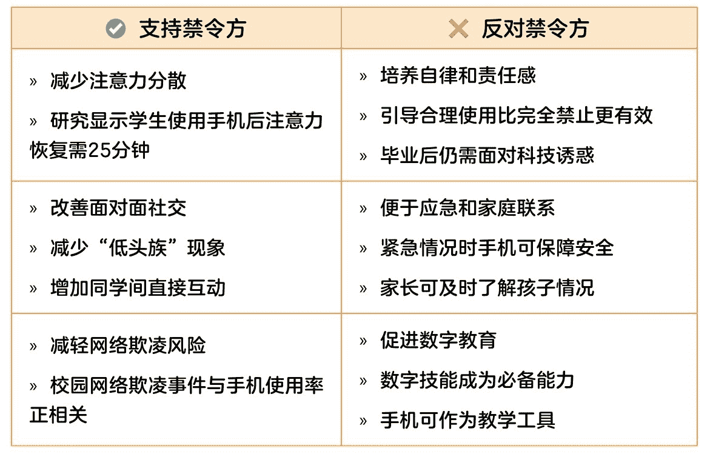

用 DeepSeek 做辩论分析时，请留意两点。

1.目标不在于判定对错，而在于培养多角度看问题的习惯。刻意为自己不认同的立场找最强依据，批判思维才会真正长进。
2.可在辩论基础上再深入：
◆ 正反双方是否共享底层目标，比如学生健康成长。
◆ 是否存在双方都能接受的折中方案。
◆ 论点背后有没有未点明的隐含假设。

DeepSeek 是思考的伙伴，不是替代品。最有价值的火花，来自你与它对话时自发产生的追问。提出好问题，比直接拿到答案更重要。

※ 知识框
◆ 思考的价值：超越应试的能力
死记硬背的知识很快会失效，而分析、创造与判断的能力会伴随一生。信息过载的时代，获取知识很容易，稀缺的是思考本身。养成思考习惯，学习就不再是负担，而是一场充满发现的探索。公式背后有故事，概念背后有网络，每个问题都是思维小游戏。

哇，和 DeepSeek 一起做思维探险太有趣了！就像解谜，每个答案后面又藏着新问题！

没错，有 DeepSeek 帮忙，找解法很快。更酷的是它能帮你挖出那些从未想过的新问题！科技的力量就是这么神奇！

工具能加速获取知识，但思考能力才是真正属于自己的财富。学会换角度看问题，世界会变得更丰富多彩。

【小D、小K 小贴士】
学习新知识时，可以按这条线路展开：
・这个知识源自何处，历史根源是什么。
・它原本解决什么现实问题。
・它和已知的哪些概念相关。
・如果改变某个条件，结果会怎样。
・能用哪个生活例子把它具象化。
思考不只是独自进行，还可在交流中碰撞。与朋友讨论、请教老师，或用 DeepSeek 探索，让思考成为一场有趣的冒险。

### 4.1.3 记忆力提升：让知识住进大脑

这么多朝代、人物、事件，怎么可能全记住！背了半天转头就忘，脑子像漏斗。

别担心，先让 DeepSeek 帮你梳理知识点，记忆会容易很多。

记忆有门道。与其盲目死记，不如先了解大脑如何记事，找到适合自己的方法。

把大脑想象成超级智能手机。
新信息进来先落到“感觉记忆”，像手机屏幕的通知，一闪即逝。
若产生兴趣，会进入“短期记忆”，相当于临时缓存，可存几分钟到几小时。
只有被重视并加工过的信息，才会转入“长期记忆”，就像把重要照片永久保存在云端或内存里。

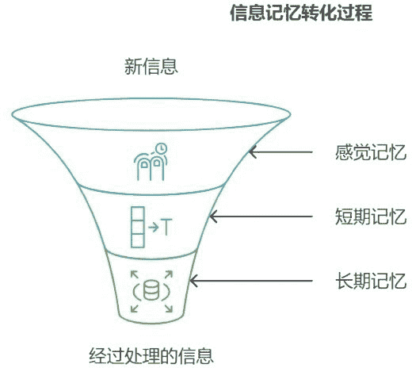
1.四大记忆法则
我们常抱怨学了就忘，多半是知识停留在短期记忆，未被大脑标记为值得长期保存。记忆系统大致遵循：
◆ 有意义的信息比无意义的信息更容易留下。
◆ 带有情感连接的内容比枯燥事实更难忘。
◆ 反复接触的知识比一次性学习更牢固。
基于这些规律，认知科学家归纳出几种高效策略，也就是下面要说的四大记忆法则。掌握后就能找到大脑的保存键。

这些法则不是速记偏方，而是基于大脑工作原理的科学方法，对历史、单词、公式都适用。

・理解记忆法
核心：理解比机械背诵更有效。
用法：先把握概念本质，建立知识点间的联系，形成完整网络。

充足睡眠对记忆巩固很关键，慢波睡眠是短期记忆转为长期记忆的关键期。

・多感官记忆法
核心：调动多种感官，效果远超单一感官。
用法：看、听、说、写、做多管齐下，强化记忆痕迹。

・间隔重复法
核心：科学安排复习间隔，能显著提高长期保持率。
用法：初学后，在第1天、第3天、第7天、第15天有计划回看。

・主动回忆法
核心：主动提取比被动阅读更能强化记忆。
用法：合上书本尝试复述，自出题目测试，向他人讲解。

每个人的记忆优势不同，有视觉型、听觉型、动觉型。关键是找到自己的方式，而不是盲目模仿。

那就动手试试吧。

2.四大记忆法则的实战应用
・理解记忆法的落地——历史的结构化学习
结构化理解历史可以这样做：
◆ 时间线法：按时间顺序排列事件，形成视觉序列。
◆ 主题分类法：按政治、经济、文化等板块系统记忆。
◆ 因果关联法：将事件与其成因、影响联系起来。

※ 实战案例：唐朝知识的体系化
米米问 DeepSeek：请帮我把初中历史教材中关于唐朝的主要知识点按政治、经济、文化分类整理。
DeepSeek 给出结构：
政治：建立与统一、制度、盛世与衰落……
经济：农业、手工业、商业……
文化：文学、艺术、科技、对外交流……
总结……

扫码查看
DeepSeek 的详细输出
提示：每次生成的结果各不相同，欢迎亲自体验，收获专属灵感！

把知识点分类后，条理立刻清晰了！看清联系，记得也更牢。

・多感官记忆法的落地——英语单词记忆
实践技巧：
◆ 视觉联想：将单词与图像绑定。
◆ 发音记忆：大声朗读，感受重音节奏。
◆ 情境记忆：放入句子或场景中使用。
◆ 书写记忆：手写强化动觉记忆。

※ 实战案例：单词 magnificent 的多感官记忆
米米问 DeepSeek：请为初中英语单词“magnificent”创建多感官记忆辅助。
DeepSeek 提供方案：
视觉：拆成 magni 大 + ficent 做，联想宏伟建筑，绘制思维导图……
听觉：强调重音，结合歌曲片段、造句朗读……
动觉……触觉……嗅觉……

扫码查看
DeepSeek 的详细输出
提示：每次生成的结果各不相同，欢迎亲自体验，收获专属灵感！

像米米那样多感官一起用，效果会更好。

・间隔重复法的落地——科学复习计划
科学间隔计划依据遗忘曲线，能最大限度防止遗忘。

※ 实战案例：唐朝历史的间隔复习计划
米米问 DeepSeek：请按艾宾浩斯遗忘曲线，帮我设计唐朝历史复习计划。
DeepSeek 给出建议：
目标：在一周内高效复习唐朝历史，克服遗忘。
复习节点：学习后5~10分钟、24小时、1周……
复习内容：
第一天：唐朝建立与贞观之治
上午：学习建立背景、过程，李渊、李世民简介，做法是阅读教材、看视频、做时间轴。
下午：复习建立过程与主要功绩，做法是默写时间轴、答题。
晚上：学习贞观之治背景、内容、意义，做法是整理笔记、画思维导图。
第二天：唐朝的政治制度……

扫码查看
DeepSeek 的详细输出
提示：每次生成的结果各不相同，欢迎亲自体验，收获专属灵感！

按这个节奏复习，感觉知识慢慢变成自己的东西了。

・主动回忆法的落地——思维导图与自测
关键技巧：
◆ 思维导图：梳理结构，强化知识点联系。
◆ 自测练习：从记忆中主动提取，而非被动浏览。

实战案例：生物知识的主动回忆
米米问 DeepSeek：请为初中生物“植物的生长发育”创建一个思维导图框架。
DeepSeek 很快给出清晰结构。
复习时别只重读笔记，合上书试着回忆。研究表明，这种方式效果最好。

用了思维导图，我不仅记住了点，还懂了关系。自己尝试回忆，记得更牢。

知识框
有效记忆建立在对大脑规律的理解上。
① 记忆需要理解：死记硬背效率低，深度理解是基础。
② 记忆需要系统：零散难记，组织成结构更易留存。
③ 记忆需要方法：依学科内容选择合适策略。
④ 记忆需要复习：间隔复习是抵抗遗忘的核心武器。
⑤ 记忆需要应用：把知识用在实际问题上最能巩固。

【小D、小K 小贴士】
① 记忆是手段，理解与应用才是目标。
② 适当休息提升效率，避免过度学习。
③ 均衡饮食、规律作息、适量运动都有助记忆。
④ DeepSeek 可辅助，但记忆过程必须在大脑中发生。
⑤ 保持好奇与热情，增加情感投入，记忆更深刻。
⑥ 相信自己的记忆力，积极心态本身就能加分。

### 4.1.4 思维突破：培养创造性解决问题的能力

信息爆炸的时代，知识只是起点，真正的竞争力来自对知识的独特解读与创新应用。爱因斯坦说想象力比知识更重要，因为知识有限，而想象力包罗万象。接下来聊聊如何培养想象与创新力。

对呀，我总觉得作文很平，跟别人差不多。

这可能是思维定式在作怪。我们习惯用过去奏效的模式套新问题，很难跳出框架。

1.思维定式：创新的最大障碍
大脑爱走捷径，倾向重复使用曾成功的思路。现实中定式无处不在。

2.突破常规：创新思维方法与 DeepSeek 助力
・水平思考法与多角度探索
英国心理学家爱德华·德博诺提出“水平思考”，强调从多个维度看问题。与垂直思考的逻辑分析不同，水平思考鼓励探索所有可能性，而非只找正确答案。
做法：面对问题时，强迫自己提出至少三种截然不同的解法。

※ 实战案例
米米问 DeepSeek：请用水平思考法重新审视“减少塑料污染”这个问题。
DeepSeek 回复：
1.挑战假设：研发可食用包装、可溶解包装或可堆肥包装……
2.寻找替代：探索蘑菇菌丝、海藻或植物纤维等生物基材料替代塑料。
3.反向思考：设计可升级回收的塑料，使其可反复利用，或赋予废弃塑料新用途。
4.联想类比：模仿自然界，研发能分解塑料的酶或微生物……

这些角度我从来没想过！太有创意了！

・逆向思维法与问题重构
“逆向创新”认为，颠倒问题常能得到意外解法。不是问“如何解决问题”，而是问“如何制造这个问题”或“反面是什么”。
做法：把“如何提高销售额”反转为“什么会导致销售下降”，然后避开这些因素。

米米，如果想问 DeepSeek“怎样记住更多单词”，该怎么反过来问？

我想想……那就问“怎样让单词更难被记住”？

对，DeepSeek 很擅长逆向思考。有次我问它“什么会让一场演讲失败”，它列出二十多条失败因素，反过来让我看清成功的关键点。

・跨领域思维与知识连接
真正的创新常发生在学科交叉处。把一个领域的原理搬到另一个看似无关的领域，往往会产生突破。
做法：学一点新领域的基础知识，思考它如何与自己的学习生活结合。

※ 实战案例
米米困惑：生物膜的结构很难理解。
建议：用跨领域类比，让 DeepSeek 把生物膜比作熟悉的事物。
米米问 DeepSeek：我初一，正在学生物膜结构，很难懂，请用跨领域类比帮我理解。
DeepSeek 回答：
1.生物膜像“城市交通系统”
道路：磷脂双分子层像主干道，提供通道。
车辆：蛋白质像各类车辆，负责运输或信息传递。
信号灯：胆固醇像信号灯，调节流动性与稳定性。
2.生物膜像“智能手机”
外壳与屏幕：磷脂双分子层像外壳与屏幕，保护内部。
应用：蛋白质像各种 App，负责通信或存储。
电池：胆固醇像电池，提供能量并维持稳定。

哇！用城市交通系统来理解细胞膜，瞬间明白了！

持续的创新思维训练能明显提升创造力。学习和生活中，DeepSeek 可以随时当创新思维教练。训练中，你会逐步形成独特的思考方式。在 AI 时代，记忆与计算会被增强，创造性思考才是 AI 能助力却无法替代的核心能力。

【小D、小K 小贴士】
① 创新思维靠练习能养成。
② 警惕思维定式！遇到问题就问：还有别的可能吗？
③ DeepSeek 助力创新：提假设性问题、用多领域视角、分析思维过程而非只求答案。
④ AI 是创意助手，不是替代品，创新能力是人类核心竞争力。

## 4.2 掌握学习方法论

我已经学了不少技巧，可感觉还是乱糟糟的，明明很努力效果却不明显……

给学习装上操作系统

你效率上不去，很可能只是缺一套完整的学习操作系统。没有系统，电脑再快也跑不动；没有方法，学习再努力也难见成效。

没错，我们今天聚焦的就是学习方法论。掌握它，就能把零散的技巧串成体系，让学习更有条理、更省力。

完全可以！这套方法论的第一步，就是先从改掉做笔记的习惯开始……

好比把零散拼图拼到正确位置？

### **4.2.1** **笔记重塑法：让知识更清晰好用**

我也记了不少，但复习时根本抓不住重点，感觉就是把教材抄了一遍……

这就是典型的抄写式笔记困局。做笔记的价值不在页数多，而在信息怎么组织、能不能用得上。

笔记到底该起到什么作用？

**1.笔记的科学意义**

笔记不只是记录，更是高效学习的工具。研究显示，笔记有以下作用。

◆ 编码效应：用自己的语言写下来，大脑会深度加工，加深理解和记忆。
◆ 外部记忆：笔记相当于知识外脑，减轻记忆负担，便于回看检索。
◆ 整合结构：把零散点连起来，形成彼此关联的知识网络。

这么看来，多数同学的笔记只用到了“外部存储”，却没发挥促进思考的作用。

那什么样的笔记方式才算靠谱？

接下来介绍几种经过验证的高效做法！

**2.高效笔记法的核心逻辑**

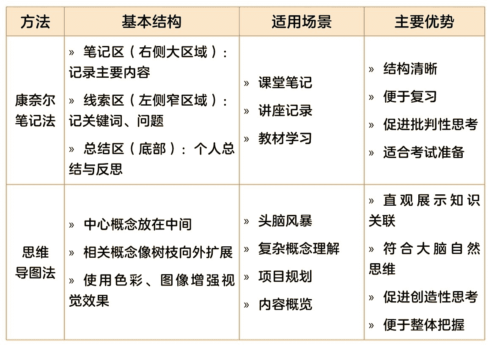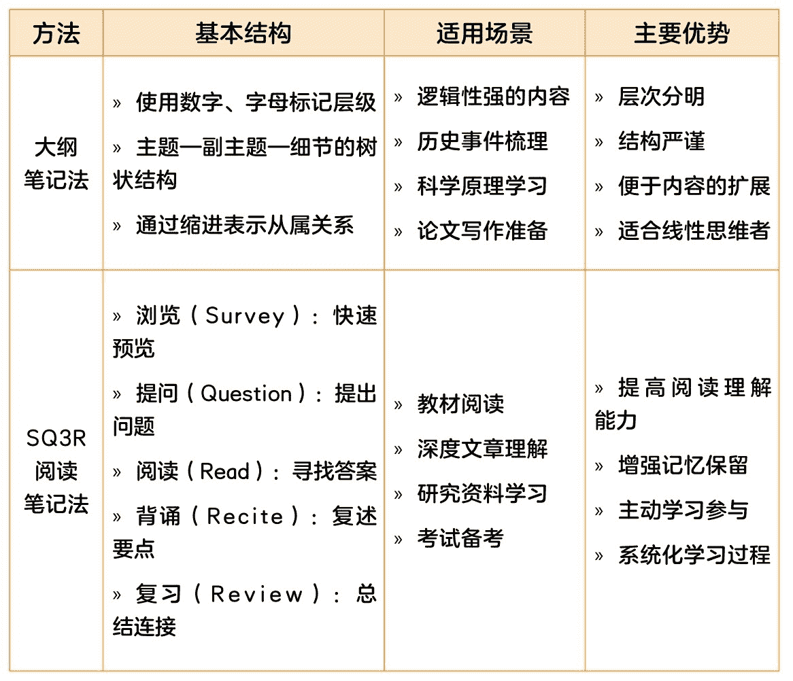

**※** **知识窗**

不同笔记方法像工具箱里的工具，各有优点。康奈尔笔记结构分明，思维导图连接直观，大纲笔记层次清楚，各有所长。

选法时看三点：

①你的思维习惯：偏爱图像联想还是线性梳理？
②学科特性：文科史论适合层级大纲，理科公式更适合结构化表格。
③使用效果：用后是否真正帮助你理解和记忆。

最合适的不是最复杂的，而是你能坚持用、且真有收获的那种。也可以取长补短，组合出专属系统。关键是能否帮助你更好地掌握内容。

**3.借助 DeepSeek 三招搭建个人笔记系统**

那具体该怎么上手？

对，核心是解决真实痛点，而不是追求完美形式。

借助 DeepSeek 并不复杂，从最实用的一点开始就行。

・**妙招一：先搭知识框架**

面对整章内容无从下手时，先建框架。

◆ 问 DeepSeek：请帮我梳理《初中生物必修一》第×章的知识结构。
◆ 在本子第一页画出框架，作为导航图。
◆ 按框架有针对性地做笔记。

这样一眼就能看出重点在哪！

・**妙招二：把难懂概念讲通**

遇到教材解释不清或太抽象的概念可以这样：

◆ 问 DeepSeek：请用通俗语言和生活例子解释“光合作用”。
◆ 把得到的白话解释和例子写在笔记旁辅助理解。
◆ 再用自己的话复述一遍。

这样难懂的概念就能第一时间消化，挺有用的！

・**妙招三：查漏补缺**

担心笔记有遗漏或错误时：

◆ 做完笔记后问 DeepSeek：八年级物理“牛顿运动定律”的要点有哪些？需要注意什么？
◆ 对照自己笔记，找出空缺。
◆ 用不同颜色笔补上漏掉的内容。

DeepSeek 不替你写笔记，而是帮你把关质量。

几步下来，笔记就清爽又好用了！

**4.分学科的小建议**

不同科目笔记方式可以差异化。

◆ 语文文言文：用 DeepSeek 整理重点字词释义和译文对照。
◆ 历史：梳理事件时间线和因果脉络。
◆ 物理化学：请 DeepSeek 找概念间联系，画成关系图。
◆ 生物：把复杂过程拆成步骤图。

原来不同科目不适合用同一套笔记方式！

是的，DeepSeek 能帮你搭好系统，但整理和思考的主体还是自己。

**【小 D 和小 K 的温馨提示】**

① 笔记是理解记忆的工具，实用比漂亮重要。
② 让 DeepSeek 辅助，不可完全依赖。
③ 每次只改进一个点，别求一步到位。
④ 要亲手书写，不要只看回答。
⑤ 方法要随阶段调整，没有一成不变的最佳。
⑥ 定期回顾整理，比盲目记录更有价值。
⑦ 先从最难的科目改起，效果更明显。

### **4.2.2** **错题本升级：让错题变成进步阶梯**

**1.错题本：被浪费的学习资源**

书包里常有一本错题本，记录错题本该是宝贵资源，却常沦为“收藏夹”，记完就忘，抄完再错，反成负担。

你知道吗？使用错题本常见三大误区：只抄题不分析、堆积无分类、复习无计划。花了大量时间整理，却换不来实质进步。

我又掉坑了~

其实错题不是失败记录，而是暴露知识漏洞的窗口。每道题背后都藏着需要强化的知识点或思维习惯。

没关系，我们现在就把错题本升级！

**2.米米的错题本升级四步法**

・**步骤 1：系统分类归档**

为了方便复习，先给每道题打上四类标签。

◆ 知识点错误：概念理解偏差或记忆不牢。
◆ 方法错误：解题思路选错。
◆ 计算粗心：运算或抄写失误。
◆ 综合应用：多知识点整合困难。

・**步骤 2：深度剖析错因**

不再简单抄写，而是让 DeepSeek 像老师一样分析。

◆ 先在题旁标注错误点和原因。
◆ 问 DeepSeek：请分析这道数学题，我在哪一步出错，可能原因是什么？
◆ 对比思路，找到关键差异并补充。

・**步骤 3：连上知识体系**

单独记题效果有限，需要与教材联动。

◆ 继续问 DeepSeek：这道题涉及哪些核心知识点？与教材哪些概念相连？
◆ 在错题旁标注对应章节和关联知识点。
◆ 理解模糊时立刻针对性复习。
◆ 定期归类，形成知识链条。

・**步骤 4：制定复习节奏**

按艾宾浩斯遗忘曲线安排复习**（可参考 4.1.3 间隔重复法）**。

◆ 当天独立再做一遍。
◆ 一周内复现一次。
◆ 一个月后检验。
◆ 考前系统梳理。

**3.分学科错题分析思路**

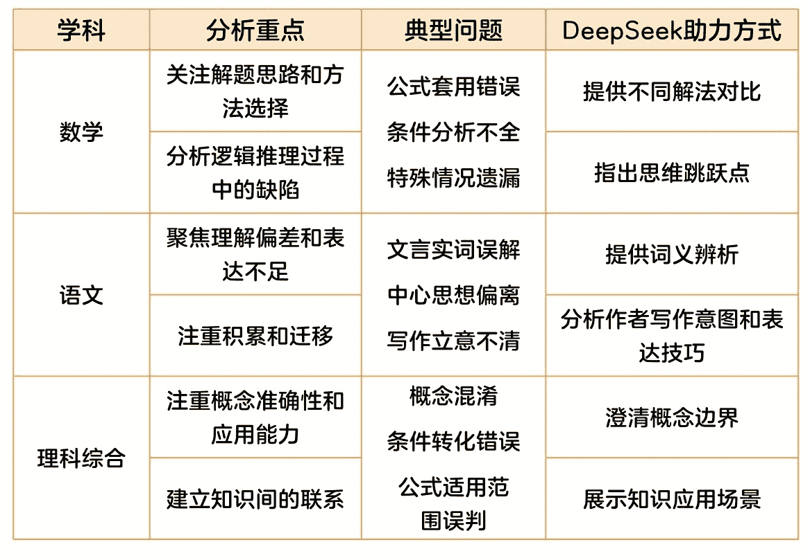

错题本不应孤立存在，而是学习系统的核心环节。

正如教育心理学家布鲁姆所说：“弄清自己的错误模式，比多学知识点更能提升效率。”借助 DeepSeek 分析，等于随时有一位老师在旁，把错题变成个性化资源。

**【小 D 和小 K 的温馨提示】**

① 重质不重量：深入分析少量错题比堆砌大量题目更有效。
② 即时处理：当天解决，别积压。
③ 看见进步：定期回看已攻克的类型，肯定自己。
④ 保持客观：错题是资源，不是失败标签。
⑤ 固定时段：养成定时整理复习的习惯。

### **4.2.3** **攻克弱点：把短板变长板**

每个人都有难啃的科目。

是不是有科目的公式老记不住，有单词怎么学都忘，有概念怎么看都糊涂？别慌，这很正常。

这些“拦路虎”不是能力不足的证明，而是成长的信号。像运动员会针对薄弱肌群训练，找到弱点本身就是好事。

找到弱点只是开始，关键是用对方法去突破。

就像修自行车，先定位故障点，再用对工具才能修好。

**1.刻意练习：把弱变强的核心武器**

为什么有人能把弱项变强项？靠的是刻意练习，而非盲目重复。其特点有四。

◆ 对症训练：针对具体弱点练习。
◆ 即时反馈：马上知道对错，及时纠正。
◆ 适度挑战：难度略高于当前水平。
◆ 反思内化：练习时思考怎么做得更好。

**2.米米的刻意练习五步法**

・**步骤一：找准“真凶”**

米米物理一直不理想，她没怪自己不适合，而是找原因。

◆ 汇总近期错题，发现多集中在力学。
◆ 上传题目问 DeepSeek：我做物理力学题老错，原因可能是什么？
◆ 分析结果显示：公式记得住，缺的是受力分析能力。

我终于找到症结了——不是记忆问题，是要重点练受力分析。

・**步骤二：拆解大问题**

找到弱点后先拆小。

◆ 问 DeepSeek：受力分析包含哪些基本步骤？
◆ 得到答案：确定研究对象→隔离→画受力图→标方向→建坐标系→分解力…
◆ 自测后发现卡在“正确分解力”。

这就像拆怪兽，先找到薄弱点集中打击。

・**步骤三：阶梯式训练**

针对“力的分解”，让 DeepSeek 设计由易到难的练习。

◆ 阶段一：水平垂直方向分解。
◆ 阶段二：不同角度分解。
◆ 阶段三：多力共同作用下的分解。

**扫码查看**

DeepSeek 完整回答

**提示：AI 每次创作都独一无二，欢迎你亲自体验，获得专属于你的精彩回答！**

这种小台阶训练不会因太难而放弃，每一步都有成就感。

・**步骤四：即时校对**

每完成一题立刻检查。

◆ 上传解题过程问 DeepSeek：我的分析哪里有问题？
◆ 按建议立刻改正，避免错误固化。
◆ 整理常见错误，反复提醒。

就像打篮球，投完立刻知道进没进，才能调整动作。

・**步骤五：温故而新**

巩固需要系统复习。

◆ 时间上：定期回顾防遗忘。
◆ 内容上：找新情境应用，如生活中力的分解例子。
◆ 联系上：把该能力与其它知识点串联成网。

米米你真厉害！

以前看到这类题就发愁，现在不仅不怕，还挺享受解题的成就感。

是啊！那些曾经吓人的难题其实是纸老虎。方法对了，持续刻意练习，再难的知识也能征服。

**3.分科目攻克弱点的办法**

・**语文**
常见弱点：词汇少、语法乱、阅读难。
对策：分类记词、找语法规律、多角度读文。
DeepSeek 助力：生成个性化词汇练习、解析句型、提供阅读技巧。

・**数学**
常见弱点：概念模糊、思路卡壳、计算错。
对策：画图理解、拆解步骤、专项练薄弱算法。
DeepSeek 助力：形象解释、展示多种解法、定制练习。

・**英语**
常见弱点：单词忘、语法混、听力差。
对策：联想记忆、归类语法、场景听力训练。
DeepSeek 助力：建立记忆链接、简化语法说明、推荐听力材料。

**※** **心态调整：攻克弱点的强心针**

心态比方法更关键。

① 把弱点视作成长点，每突破一次就升级。
② 设小目标，循序渐进。
③ 记录进步而非追求完美。
④ 把犯错当作学习机会。

研究也表明，相信能力可提升的学生，更容易突破弱点。

**4.弱点变强项的原理**

攻克后的弱点往往会变长板，因为你投入了更多思考，培养了更强的解题能力，对领域理解也更深。

面对弱点时，用科学方法直面它，曾经的痛点就可能变成拿手好戏。

**【小 D 和小 K 的温馨提示】**

① 一次攻一两个弱点，集中火力。
② 创造安静专注环境。
③ 短时高频，每天 20 分钟更有效。
④ 记录每日进步，哪怕微小。
⑤ 达成小目标后适当奖励，保持动力。

### **4.2.4** **复习计划：让知识记得更牢**

啊！期末快到了，知识点堆成山，脑子要炸了，学过的东西感觉都忘了……

我知道艾宾浩斯遗忘曲线和间隔记忆法，但怎么制定计划呢？

别担心！可以用 DeepSeek 生成一份复习表，按时提醒你，就像专属记忆管家！

复习不只是反复翻书，需要科学规划。我们了解记忆规律后，来看看怎么把规律变成高效计划吧。

**1.复习计划的重要性**

好的复习计划是高效学习的关键。研究表明，有计划复习比随机复习记忆效果至少提升 30%。优秀计划能够：

**用好每一分钟，备考更从容**

◆ 让有限的学习时长产生最大效益
◆ 让重点知识点得到扎实打磨
◆ 减缓考前的紧张和焦虑
◆ 构建长久记忆，避免短期突击

前文提到记忆的规律，规律说明及时回顾能显著减缓遗忘。现在的关键是如何把这些原理转化为可操作的复习行动。

**2. 复习的三个递进层次**
真正有效的复习远不止翻看资料，而是由三个层层深入的动作构成。

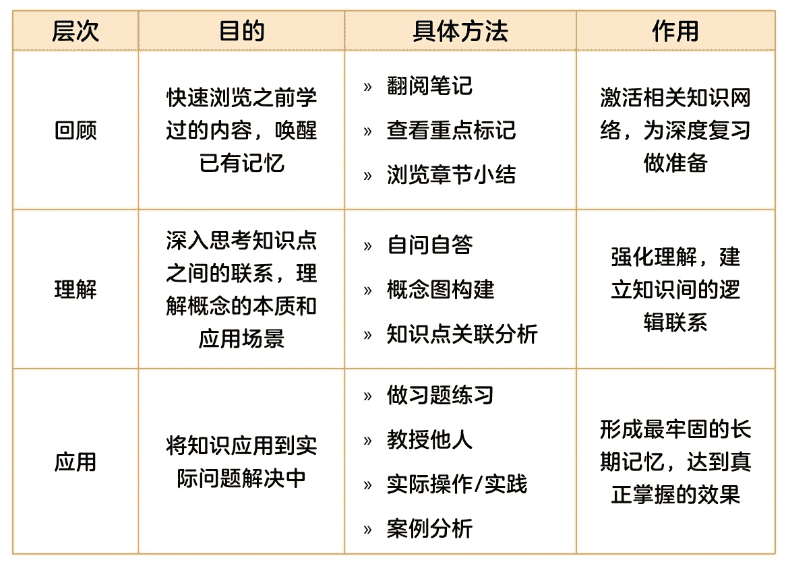

原来复习不是单一动作！过去我只是反复阅读，难怪效果提升有限。

**3. 分科对应的复习思路**
各科目的知识框架和学习特性各不相同，复习策略自然也要做出区分。

・**数学复习小技巧** 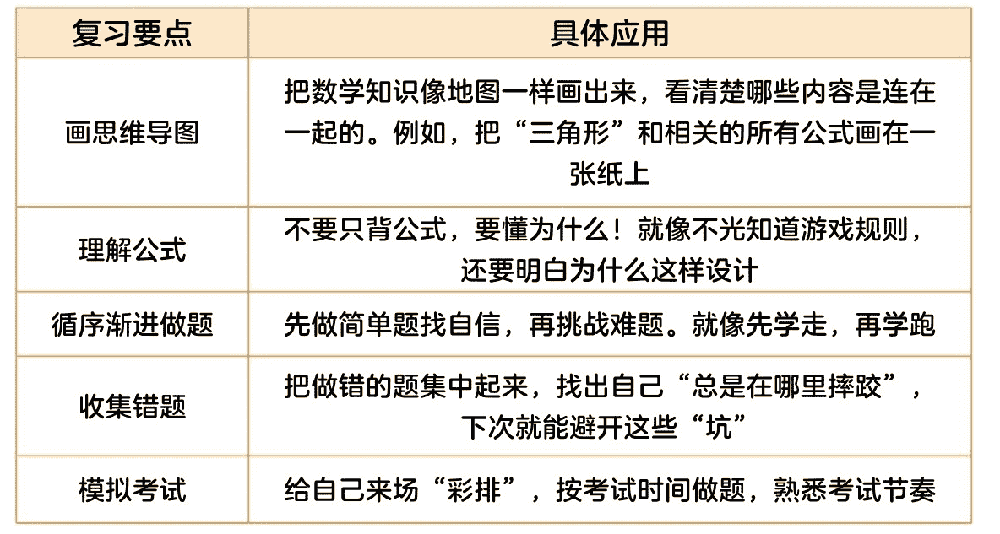
・**语文复习小技巧** 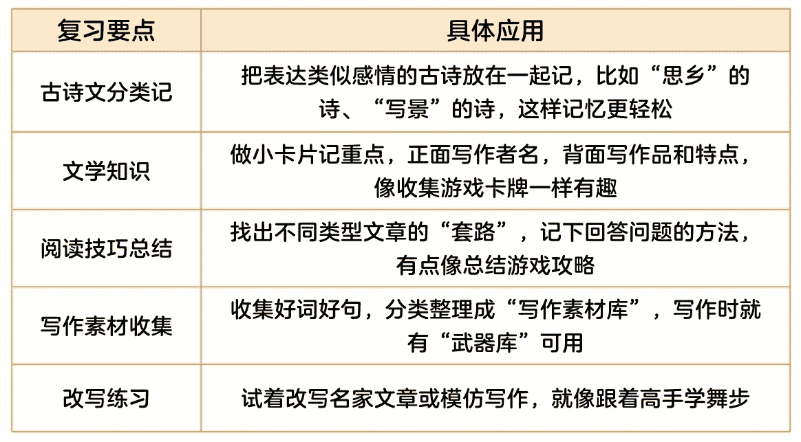
・**英语复习小技巧** 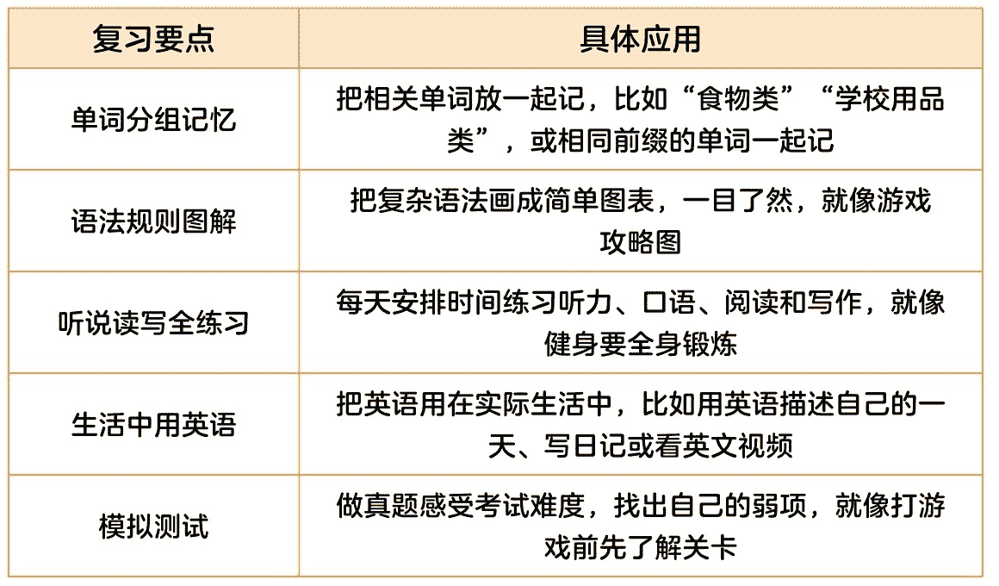
・**理科类学科复习小技巧** 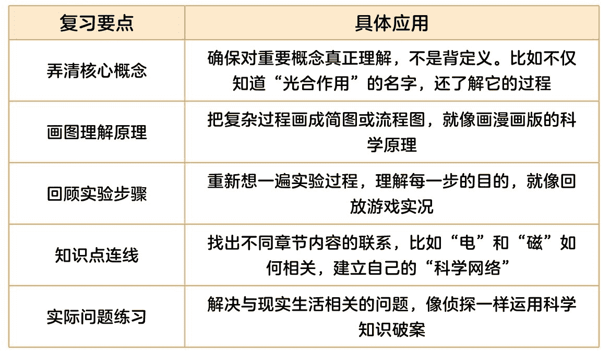

**注意：不必照单全收，挑选最适配自己的尝试，找到最契合的才最关键。**

哇，覆盖面真够全面的！

另外还有个好帮手，DeepSeek 能够根据所学科目，为我们生成贴合这些思路的复习建议！

**4. 借助 DeepSeek 打造专属方案**
DeepSeek 可以融合个人的学习特点、考试科目和时间安排，输出更贴合个人的定制化复习方案。

・**第一步：摸清强弱项** 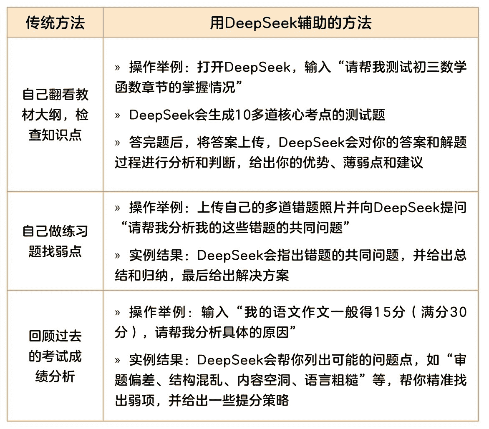
**扫码查看**
DeepSeek 完整回答
**提示：AI 每次创作都独一无二，欢迎你亲自体验，获得专属于你的精彩回答！**

・**第二步：设定清晰的目标** 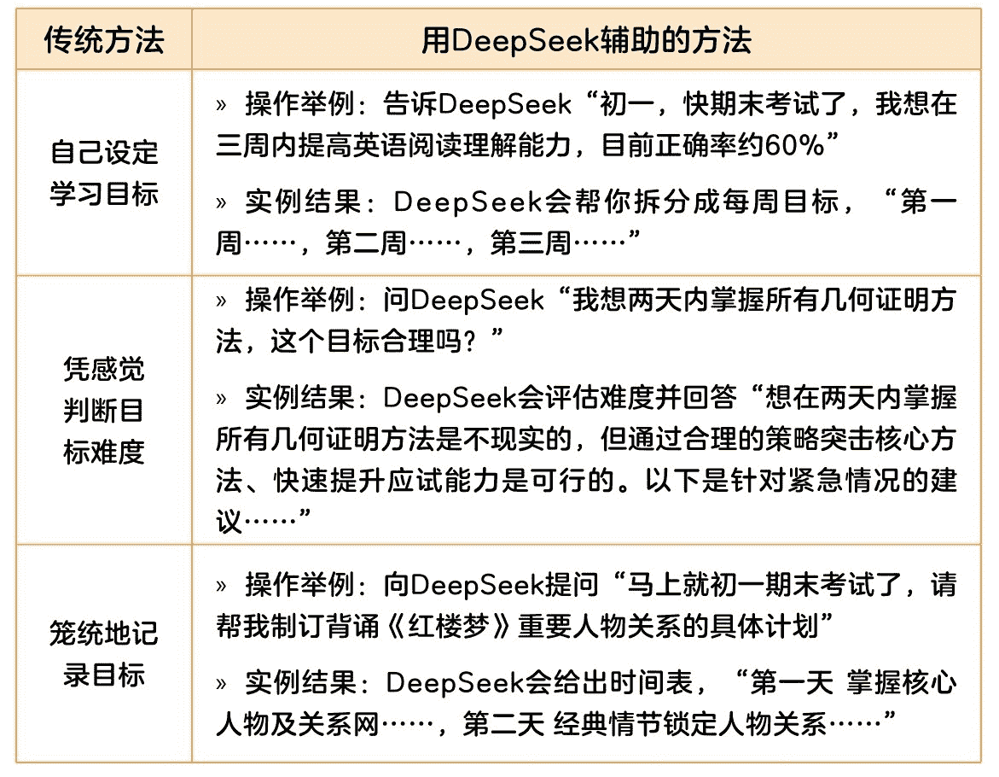
**扫码查看**
DeepSeek 完整回答
**提示：AI 每次创作都独一无二，欢迎你亲自体验，获得专属于你的精彩回答！**

・**第三步：科学安排复习时间** 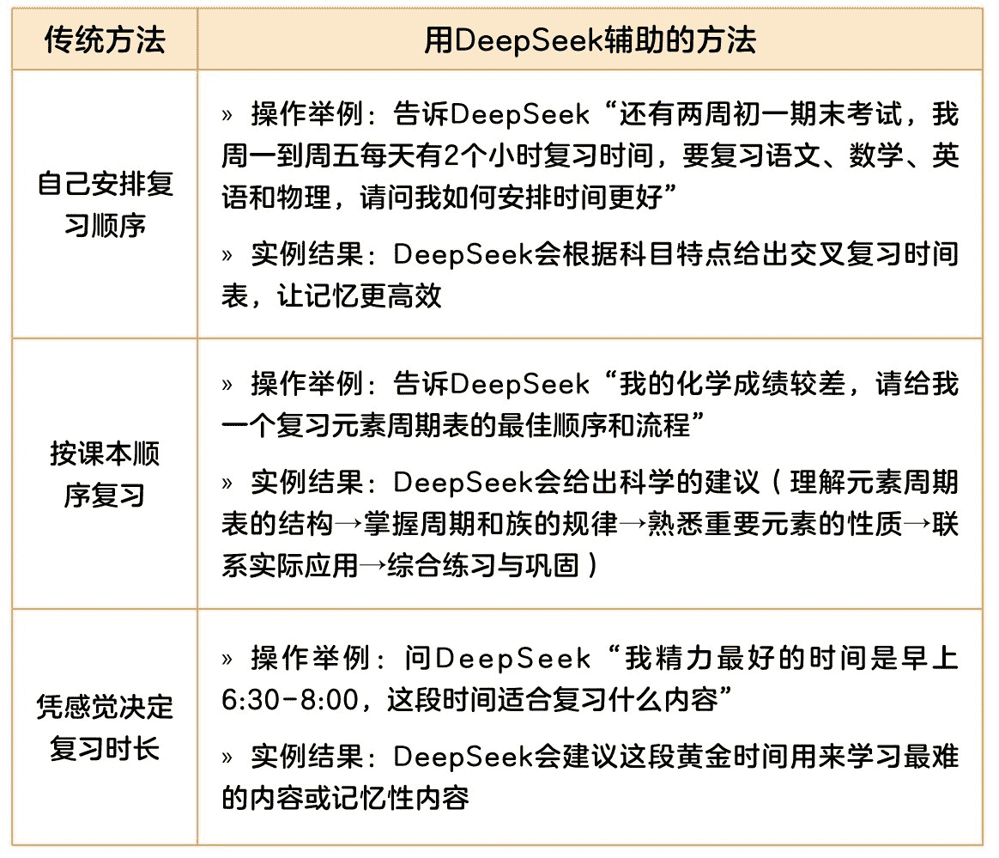
・**第四步：给复习内容分类排序** 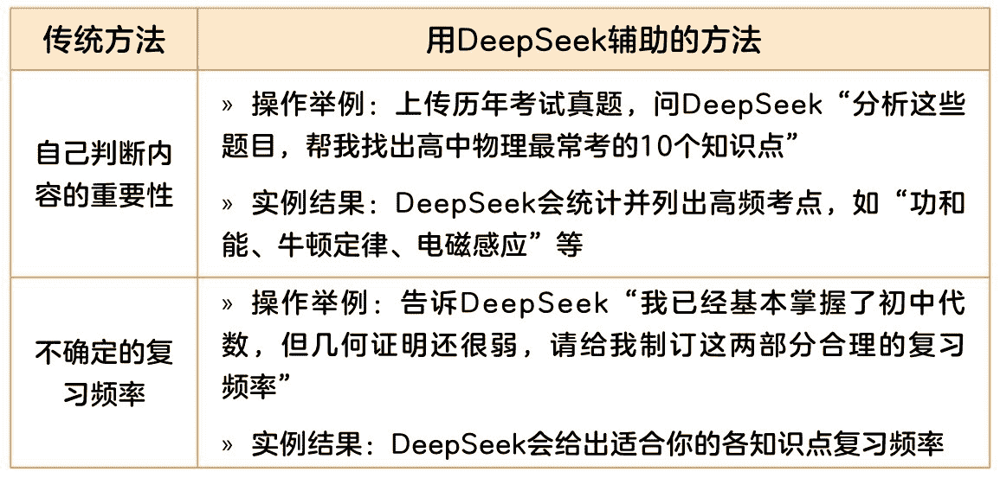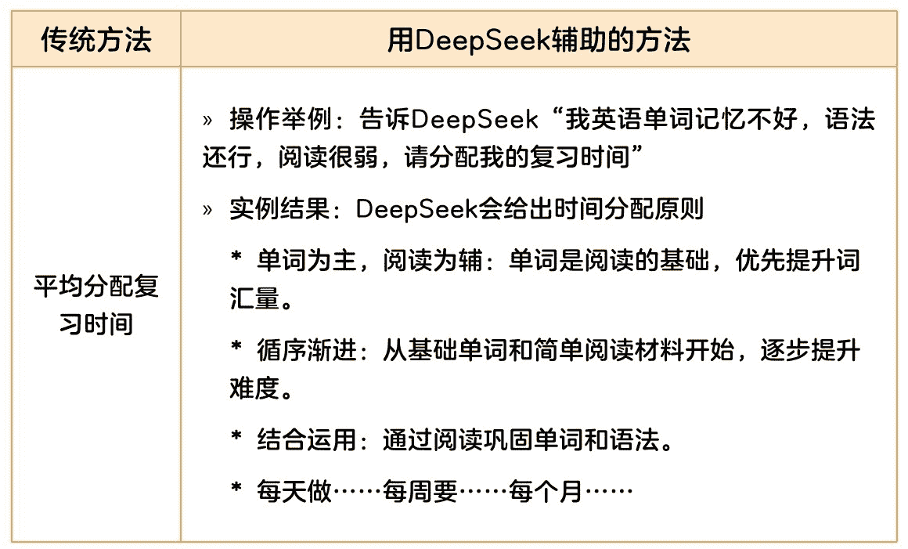
・**第五步：检验复习效果并调整** 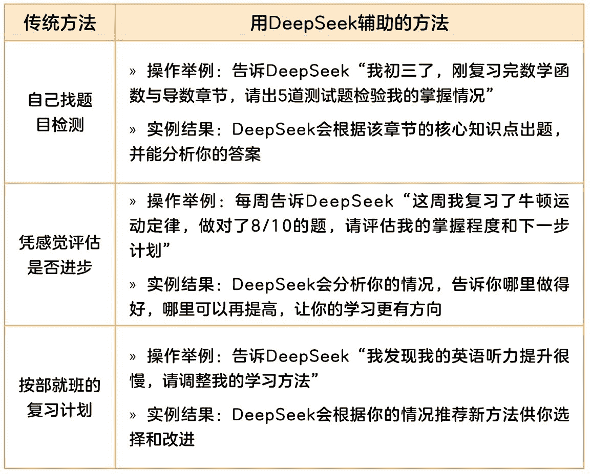

**※ 使用 DeepSeek 的小窍门**
① 描述越具体越好：给出真实情境，如“我初三，下周期中考试，数学几何薄弱”，比笼统说“帮我复习”更有效。
② 资料上传：可上传错题、笔记或试卷，系统分析后会给出更精准的反馈。
③ 动态优化：完成一段学习后把进展反馈给系统，它会据此调整下一步安排。
④ 问题要聚焦：问“如何用思维导图记忆生物细胞结构”比问“如何学好生物”更能得到实用答案。
⑤ 自主检测：复习后请系统出几道题目检验理解程度，例如用五题检验对光合作用的掌握。

米米，方法不在于新奇，选对适合自己的并真正提升学习才重要哦！

复习不是机械复读，而是要吃透、串联、用起来。有规划才能事半功倍。

我懂了，学习因人而异。要先认识自己的学习习惯，选对方法，再配合有深度有规划的复习。从现在开始，我要做一份属于自己的计划！

**【小 D 和小 K 的温馨提示】**
① 制定计划保留弹性，别安排太满，留余地以便调整。
② 定期复盘成果并据此修正计划，避免僵化，要随实际情况灵活应变。
③ 用碎片时间处理记忆类内容，如单词、公式，提高时间利用率。
④ 在安静环境中复习，远离手机等干扰，每次专注25~30分钟效率最高。
⑤ 复习间隙配合适度运动与休息，保持大脑状态最佳。
⑥ 按精力分配任务：精力充沛时攻克难点，状态一般时做练习，状态低下时整理笔记，疲惫时及时休息。
⑦ 抓住记忆黄金期：睡前和起床后复习效果最佳。
⑧ 运用主动回忆，合上书本自行回想，可强化记忆。
⑨ 试试教学法，向他人讲解或自讲，便于发现盲点，加深理解。
⑩ 长时记忆靠的不是死记，理解、联想和实际运用才是关键。

### **4.2.5 考试策略：考出好成绩的小技巧** 
明天期中考了，我复习了好几天，还是很紧张！

别慌！
让我先帮你核对一下准备是否到位吧！

考试不仅检验知识，也考策略与心态。今天聊聊怎样在全流程中实现最佳发挥。

**1.考前准备——赢的基础**
考前准备直接影响能否正常发挥。研究表明，合理准备既能稳固知识，又能明显减轻焦虑。

・**高效冲刺复习**
考前1~3天是最后冲刺期，此时应：
◆ 聚焦要点，不求面面俱到：集中核心内容和易错点。
◆ 回顾错题：重点看近期作业和模拟考中的失误。
◆ 整体串联：用思维导图或知识框架梳理学科脉络。

我老觉得考前时间不够，想看的东西太多！

考前冲刺是查漏补缺，不是学新知识。教育心理学指出，考前24小时内学新知识记忆效果差，反而会造成干扰。

・**心理调节**
考试焦虑会严重影响发挥。研究显示，中度焦虑的学生在知识水平相同的情况下，分数平均比高度焦虑的学生高出15%。可以尝试：
◆ 正向想象：想象自己沉稳应对考试的画面。
◆ 调整期望：设定合理目标，不苛求完美。
◆ 放松训练：掌握深呼吸等简单的放松技巧。

**※ 实践举例**
米米向 DeepSeek 提问：马上就期末考试了，我紧张得睡不好，请问我该怎么调整自己的心理状态？

**扫码查看**
DeepSeek 完整回答
**提示：AI 每次创作都独一无二，欢迎你亲自体验，获得专属于你的精彩回答！**

适度焦虑是有益的，能保持警觉，过度放松反而可能导致粗心，找到平衡点最重要。

・**物质准备**
充分的物质准备能减少考试当天意外。
◆ 考试用品清单：提前准备好所有必需品（准考证、文具、计算器等）。
◆ 衣物与食物：准备舒适的衣服、清淡的早餐、水。
◆ 交通规划：预估路程所需时间，预留充足时间。

**※ 实践举例**
米米向 DeepSeek 提问：明天我要参加六年级数学和英语的期末考试，请你帮我生成一份考试物品清单。

真的，这样准备好，考试我就再也不会丢三落四了。

**2.考场应对——临场发挥的艺术**
・**黄金开局策略**
考试开始的前5分钟极为关键，合理利用能显著提高后续表现。
◆ 快速预览全卷：了解题型分布、难度和分值。
◆ 规划答题顺序：决定先易后难还是按题号顺序。
◆ 时间分配：根据分值确定每部分题目的时间限制。

我每次考试都想从头做到尾，结果常常时间不够……

米米你要根据题型的分值分布控制答题时间哦！比如，选择题20分占总分100分的1/5，那就用总考试时间60分钟的1/5也就是12分钟来解答，这样就有了掌控考试节奏的标准了。

还有，试卷预览也不只是看题目，也是在激活大脑中的相关知识。认知科学研究表明，这种“预热”可以提高我们的解题效率。

・**不同题型的制胜技巧**
不同题型需要不同的应对策略。选择题的答题技巧如下。
◆ 排除法：先排除明显错误选项。
◆ 关键词分析：注意限定词，如“总是”“可能”等。
◆ 做标记：不确定的题先做标记，稍后再解决。
解答题的答题技巧如下。
◆ 关注得分点：理解评分标准，确保得分要素完整。
◆ 清晰表达：条理分明地展示解题过程。
◆ 检查计算：留意常见计算错误和单位问题。

哇，这太精准了！我确实经常因为这些小细节丢分。

知己知彼，百战不殆。了解自己的答题模式，有针对性地改进，比漫无目的地刷题效果好得多。

・**应急处理策略**
考试中可能会遇到各种突发情况，应对有方才能稳定发挥。
◆ 遇到难题：标记后先跳过，避免让自己陷入时间黑洞。
◆ 思维卡壳：改变原有思路或暂时转换题目。
◆ 时间紧张：保证有把握的题目得分，确保基本分不丢。

我们考试是要在有限的时间内尽量拿到更多的分数，千万不要因为深陷一道题而丢掉了更多的分数哦。

对呀，考试时的心态调整也很重要。当你遇到难题时，可以告诉自己：“这题可能对所有人都难，我可以先拿到其他题目的分数”。这种自我对话能有效缓解焦虑。

**3.考后复盘——化考试为成长**
考试结束不是终点，而是新的起点。系统的考后复盘能够将考试转化为提升的阶梯。

・**及时回顾**
考试后的48小时内是记忆最清晰的时期，此时对考试进行回顾是最有效的。
◆ 记录考题：考完试立刻把记得的题目写下来，特别是那些不确定或觉得难的题。就像拍照记录重要时刻一样，这样做能让你以后复习时找到真正需要加强的地方。
◆ 自评答案：在看到标准答案前，先自己判断每道题可能得多少分，哪里做对了，哪里可能有问题。这种“自我判卷”能帮你发现自己的思维盲点，比单纯对答案更有价值。
◆ 情绪梳理：考试成绩只是学习过程的一个点，但不是终点。学会客观看待成绩，无论好坏都不过分情绪化，把每次考试都当作成长的阶梯，而不是判断自我价值的标尺。

**※ 实践举例**
如果考试只上交了答题纸，那我们可以把手中的试卷原题上传给 DeepSeek，让它给出试卷的正确答案。
米米向 DeepSeek 提问：这是我的期末考试试卷，请你给出这套试卷的标准答案。

・**错题分类与改进**
将错题进行科学分类，针对不同类型采取相应的对策。
◆ 知识点错误：基础知识不牢，需要重新学习。
◆ 解题方法错误：解题思路有误，需要掌握正确的方法。
◆ 计算出现错误：计算或审题失误，需要提高专注力。
◆ 综合应用错误：无法融会贯通多个知识点，需要加强知识连接和复杂问题训练。

**注：具体可参考 4.2.2 所讲的操作方法。**

・**考后复盘**
学会在考试结束后进行系统性复盘是我们学习成长的关键环节，考后复盘不仅要关注错题，还要对整个学习过程进行全面的评估。
◆ 记录考试体验：就像运动员看比赛录像一样，把你考试时的情况记下来——哪些题目做得顺手，哪里卡壳了，时间是怎么用的，考试时心情如何，这些都值得记录。
◆ 识别模式和趋势：找出你多次考试中重复出现的情况，比如是不是总在某类题上丢分，或者每次都在考试后半段变得匆忙，这些反复出现的问题往往是最需要解决的。
◆ 制定改进策略：根据发现的问题，像制定游戏攻略一样，有针对性地调整你的学习方法——可能是改变复习顺序，也可能是增加某类题的训练，为下次考试设定更清晰的目标。

我应该怎么根据这次考试调整我的学习计划呢？

我可以根据你的考试数据，自动生成下一阶段的学习计划！比如增加数学几何部分的练习时间，调整英语阅读的学习方法，甚至推荐最适合你的辅助资料。

记住，考试不是终点，而是检验和调整的工具。每次考试后的调整，才是真正的学习过程。

**【小 D 和小 K 的温馨提示】**
① 考试前一天做好物质和心理准备，合理安排最后冲刺，保证充足的睡眠。
② 进入考场先深呼吸平静心情，花2分钟浏览全卷再答题，科学分配时间。
③ 采用“先易后难”的策略，确保能拿到的分数一定要拿到。
④ 遇到紧张或卡壳时，尝试深呼吸、转换题目或积极自我对话。
⑤ 考试结束后48小时内回顾考题，分析错误模式而非简单重做。
⑥ 不同科目需要不同策略，理科注重解题步骤，文科关注关键词和结构。
⑦ 将考试视为学习旅程的一部分，而非终点，每次考试都是提升的机会。
⑧ 利用 DeepSeek 分析个人答题模式和时间分配，发现自己看不到的问题。
⑨ 考试成绩只是能力的一种体现，不代表个人价值，保持平和的心态最重要。

# **第五章**
# **全科目学习突破**

## **5.1 语文能力进阶**
语文作为思想表达与知识获取的基础工具，往往让许多同学又爱又恨。它既是日常交流的载体，又是考试中的拦路虎。无论是构思一篇打动人心的作文，破解一段晦涩的文言文，还是在茫茫文字中准确把握阅读要点，都需要掌握一些应对语文特有的能力。

◆ 唉，又要写作文了，该从哪里下笔呢？
◆ 这篇阅读理解怎么做，完全不知道中心思想在哪里？
◆ 文言文的实词虚词让我头疼，背了又忘，忘了又背……
◆ 素材太少，写作文总是东拼西凑，感觉特别空洞……

这些困扰是否似曾相识？在本章，我们将与米米一起，运用 DeepSeek 的智能辅助，结合科学的学习方法，一一攻克这些语文学习中的常见难题。让我们先从最令人头疼的作文开始，看看如何让写作变得更加有趣且高效！

### **5.1.1 作文好帮手：让写作更高效** 
唉，老师布置的“我的理想”作文，我已经盯着这张白纸半小时了，一个字都写不出来！为什么别人写作文像流水一样，我却总是卡壳呢？

别担心！在这种情况下，直接让 DeepSeek 帮你生成一篇作文模板不就搞定了吗！两分钟内交付，省时又高效！

等等，小 D。虽然 DeepSeek 确实能帮助米米，但写作不仅是为了完成作业，更是表达自我、锻炼思维的过程。米米，你的困扰其实是很多同学都会遇到的。不如我们先一起分析一下，为什么写作会这么难？

对哦！我好多同学也说写作文特别痛苦。到底是哪里出了问题呢？

大部分同学面对作文时遇到的问题主要表现在“无从下笔”“内容空洞”“结构混乱”等。

**1.无从下笔** 
每次看到作文题目，我脑子就像被清空了一样。特别是自命题作文，根本不知道该写什么，更别说怎么写了！

你知道吗，米米，很多著名作家也曾面临“白纸恐惧症”。这通常是因为我们对写作期望太高，或者思路太分散导致的。

真的吗？那他们是怎么解决的呢？

・**传统方法**
◆ 使用头脑风暴法，在纸上记录与主题相关的词语和想法。

◆ 用好五问框架：厘清是什么、为何如此、怎么操作、可得何启发、能提何建议。

◆ 先搭框架再动笔，把整体脉络理清后再展开构思。

・**破除写作卡壳：DeepSeek 三招实战**

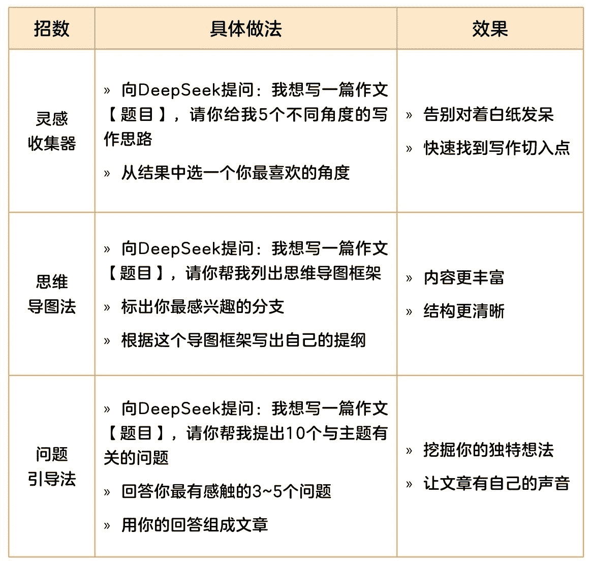

**※ 使用小贴士**

① 注入个人经历：AI 提供的多是骨架，记得填入你的亲身故事！
② 自由搭配使用：比如先用灵感收集，再上思维导图，最后以提问引导。
③ 即时存档：把 AI 给出的好点子立刻记下来，积累成你的素材库。
④ 记住主体：你是创作者，AI 仅是辅助工具！

我亲测有效！我让 DeepSeek 帮我构思“成为科学家”的梦想作文，它给了好几个切入角度。我挑了“科学启蒙”这一条，想起小时候做小实验的场景，思路一下子活了起来！

**2.内容空洞**

有时开头结尾我能写出来，中间却总是干瘪，只能反复说同一件事凑字数，读起来一点说服力都没有。

根源在于缺少翔实案例和深层思考。一篇好文就该像棵树，中心思想是主干，具体事例和细节才是枝叶。

对！好比数据库没有足够数据就跑不动，作文没有充足素材也撑不起说服力！

明白了，原来是我平时储备素材太少才显得空。那该怎么高效积累呢？

・**传统方法**

◆ 养成记素材本习惯，把日常所见所闻及时记录下来。
◆ 广泛阅读，摘录书籍报刊中的精彩表达。
◆ 掌握举例论证，每提出一个观点就配上具体例证。

・**内容单薄？DeepSeek 三招充实文章**

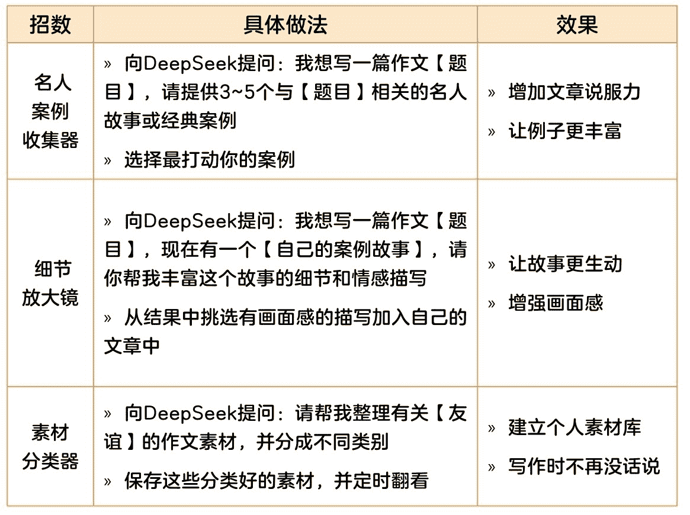

**※ 使用小贴士**

① 用自己的话转述：AI 给的素材要换成你自己的表达。
② 宁精不滥：一篇作文挑选 2-3 个典型例子，质量远比数量关键。
③ 选有共鸣的材料：用你真正动容的经历，文字才有温度。
④ 素材是原料，思考才是灵魂！

写“坚持的力量”这篇时我用了这招。DeepSeek 给了我爱迪生、霍金等名人案例，还补充了奥运选手和社区志愿者的例子。我挑了两个最触动的，再结合自己坚持练琴的经历，内容立刻饱满起来！

**3.结构混乱**

我写文章常想到哪写到哪，东拼西凑，最后连自己都看不懂在讲什么。

结构松散就像没有地图的旅行，会迷路。清晰的框架是表达清楚的前提。

没错！编程靠清晰流程，写作也需要明确框架！

原来作文也要先画规划图！具体怎么规划呢？

・**传统方法**

◆ 牢记基本框架：引子、正文、收尾。
◆ 熟练使用总分总，或提出问题分析问题解决问题等常见模型。
◆ 用恰当的衔接词串联段落，提升流畅度。

・**结构凌乱？DeepSeek 三招理清思路**

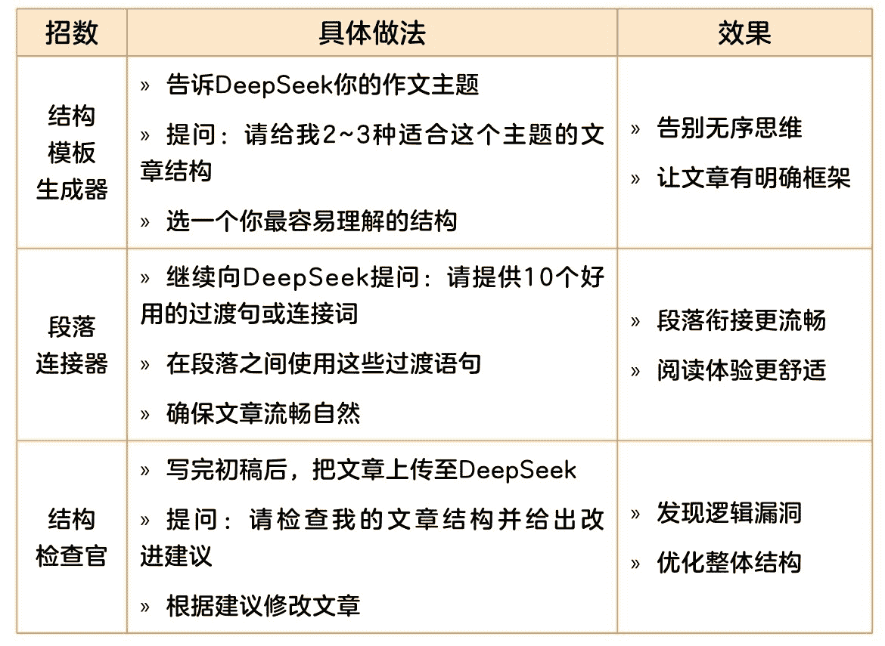

**※ 使用小贴士**

① 先搭骨架后填充：框架清晰，写作才有方向。
② 选易上手模板：用你真正吃透的框架。
③ 灵活取舍：AI 的建议可按个人风格微调。
④ 好的框架像衣架，让思想井井有条地呈现。

写议论文《诚信》时，DeepSeek 帮我搭了“诚信是什么—为何重要—如何践行—带来哪些好处”的脉络。按此写作后逻辑一目了然，老师说比以前条理强多了！

**4.语言单调**

我的作文老是重复“好”“很”“非常”，读起来索然无味，却苦于找不到替换说法。

这问题交给 DeepSeek 就能快速解决！它马上能帮你找到更鲜活的表达！

语言是思想的载体。词汇量不足会限制表达丰富度，但可以通过积累与练习提升。

工具能助一臂之力，但根本提升还靠自己的积累内化。

・**传统方法**

◆ 制作近义词本，为高频词准备多种说法。
◆ 多读佳作，汲取多元表达。
◆ 训练修辞技巧，如比喻、拟人、排比等。

・**语言枯燥？DeepSeek 三招激活表达**

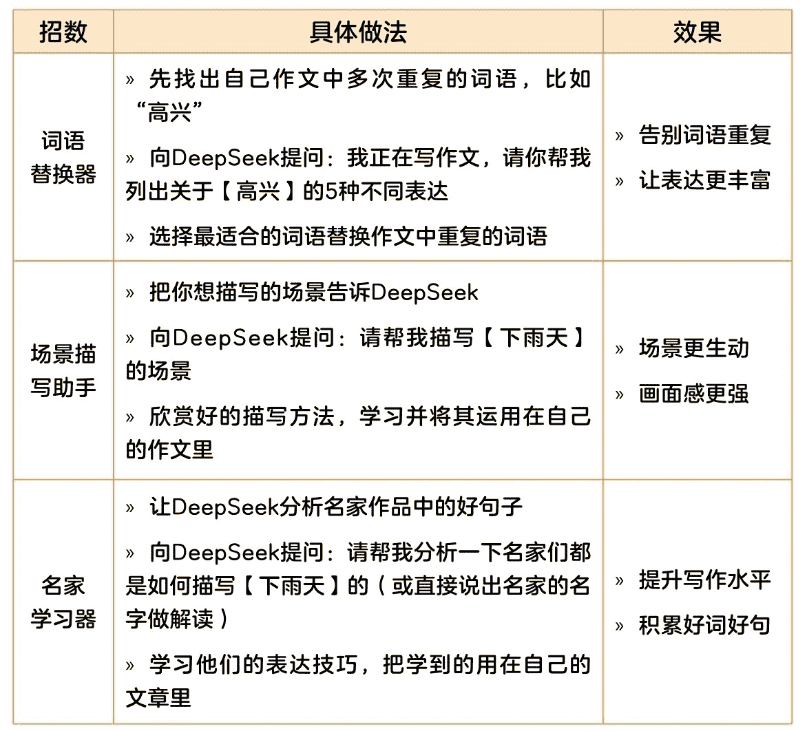

**※ 使用小贴士**

① 搭建个人词库：把好词佳句系统记录。
② 匹配个人风格：选与你气质相符的表达。
③ 勤加练习：把新学表达多用在日常写作里。
④ 表达如调味，恰到好处才更美味！

我发现作文里“高兴”反复出现，就让 DeepSeek 推荐替代说法。它给了“欣喜若狂”“喜不自胜”“心花怒放”等词，还示范如何用动作描写情绪，如“嘴角上扬”“眼里闪光”。文章立刻鲜活起来！

**5.立意平庸**

每次作文观点都很平常，跟别人雷同。老师说我写得千人一面，缺少新意。

DeepSeek 能帮你迅速打开思维视角，衍生多样角度！

这关乎思维的深度与广度。独特立意源于多角度审视和深层次探究。

但我更想弄懂为何会有不同看法，而非只知道有哪些看法。

思考得很对，米米。深度理解比浮面罗列更重要。

・**传统方法**

◆ 练习逆向思维，从对立面审视问题。
◆ 运用六顶思考帽，从多元立场分析问题。
◆ 把话题与时事热点或个人独特经历结合。

・**立意俗套？DeepSeek 三招挖掘深度**

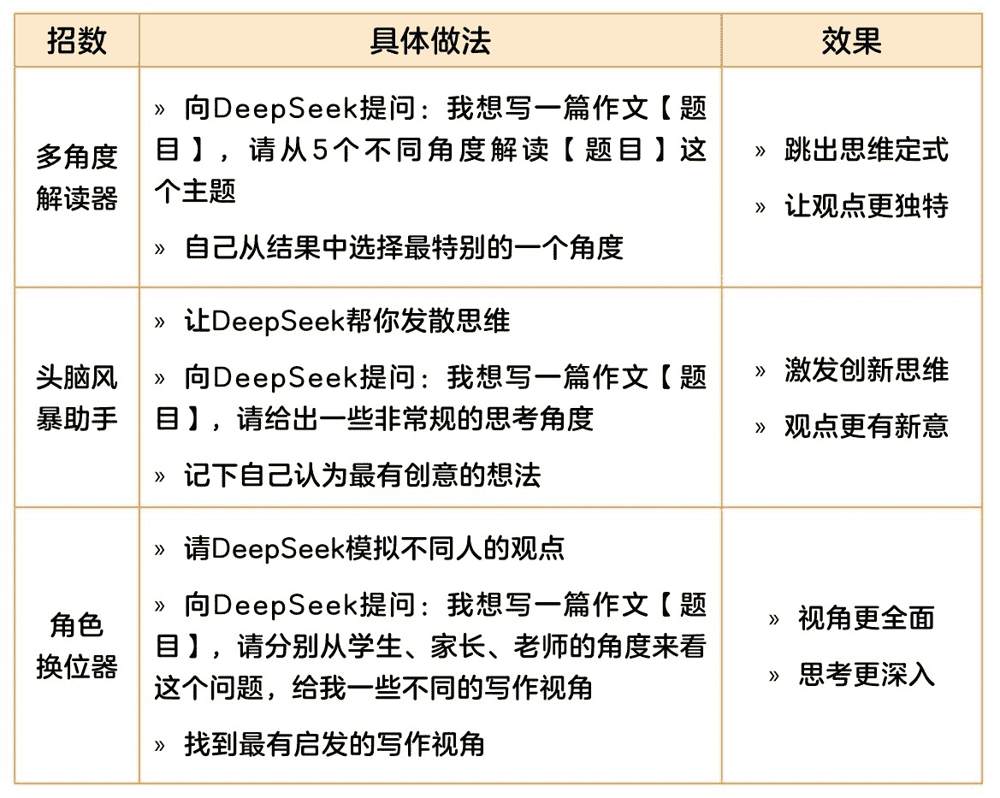

**※ 使用小贴士**

① 选能共鸣的：立意要能触动你内心。
② 融入自身经历：用个人故事为论点背书。
③ 保持真诚：只写你信服的观点。
④ 好立意如明灯，照亮独特思考！

写“责任”时，我最初只想到“尽责很重要”这类大众看法。跟 DeepSeek 对话后，我意识到“责任需有边界”“过度责任感易带来心理压力”等视角。最终从“在责任与自我关爱间寻求平衡”切入，老师还在班上表扬了我的思考深度！

**6.没有反馈**

唉，这篇作文到底怎么样？我总觉得差点意思……

让 DeepSeek 来诊断吧！它能按评分标准给出评价！

对，对照评分细则，我们才知道该从哪里改进。

・**传统做法**

◆ 被动等待老师批改。
◆ 只拿到分数，却不明白问题在哪。
◆ 改进方向不明，难有进步。

・**缺乏反馈？DeepSeek 三招助你进阶**

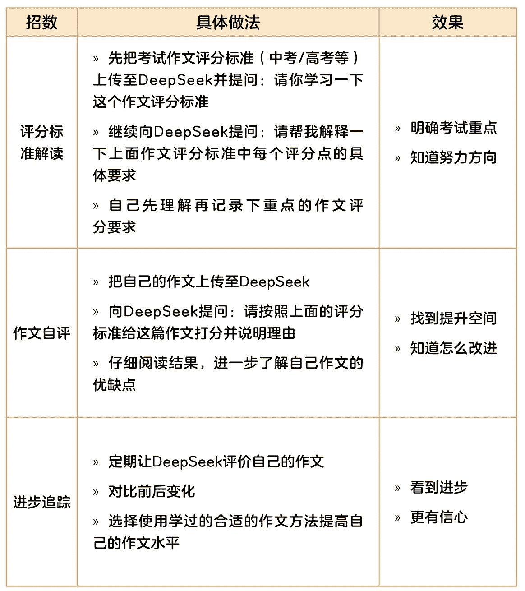

**※ 使用小贴士**

① 保持客观：把 AI 当小老师，发现写作问题。
② 重视进步：关注成长轨迹，而非分数高低。
③ 逐步推进：每次聚焦 1-2 个点改进。
④ 了解考纲重要，更关键的是提升真实水平！

太棒了！我现在清楚下一步该怎么改了！

对呀，你看，这次描写明显比上次进步了！

记住，坚持练习与反思，你的表达一定会越来越好。

**【小 D 和小 K 的温馨提示】**

① 写作是思维的显影：先有扎实思考，再用工具完善表达。
② 内容为先，形式次之：华美辞藻替代不了真切感受与深度思考。
③ DeepSeek 是教练不是代笔：它负责激灵感、补素材、优表达，灵魂仍是你的。
④ 融合而非照搬：借鉴建议的同时，必须注入个人经历与思考。
⑤ 积累不可替代：即便有 AI，也要保持阅读与写作练习，才能真正提升。
⑥ 善用 AI 的黄金法则：
・先思考再提问：厘清自己的困惑再求助。
・越具体越有效：问题越精准，答案越有价值。
・保持多轮对话：持续交流比一次性提问更好。
・保持批判思维：筛选评估 AI 内容，不盲从。
⑦ 写作本质是自我表达：技巧与工具只是手段，打动人的是你的独特声音与真实情感。

### **5.1.2 阅读理解：快速定位文章核心**

又来阅读理解了！读了好几遍还是抓不住重点，这些题到底怎么答？

别急，DeepSeek 能帮你梳理思路！

先看看米米在阅读时常碰到哪些难题吧。

在做阅读题时，多数同学会卡在“看不懂重点”“定位不到信息”“作答不够精准”这几关。

**1.读不懂文章重点**

这篇文章我读了三遍，还是不知道作者想说什么……
我只是逐字读，并没有思考整体……

你读文章时，会留意整体结构和关键词吗？

问题就在这里！我们需要培养快速抓取重点的能力。

・**传统方法**

◆ 反复通读全文。
◆ 标注重点句子。
◆ 归纳每段大意。

・**DeepSeek 协同，练就抓重点能力**

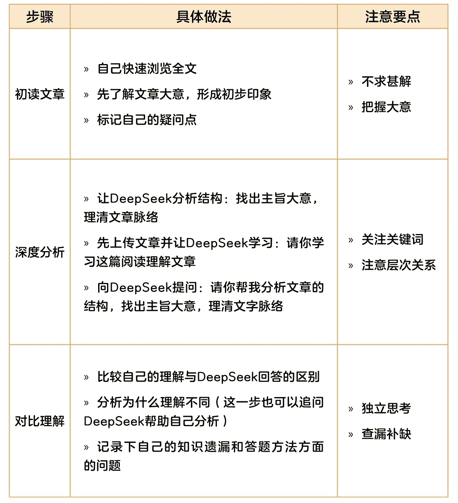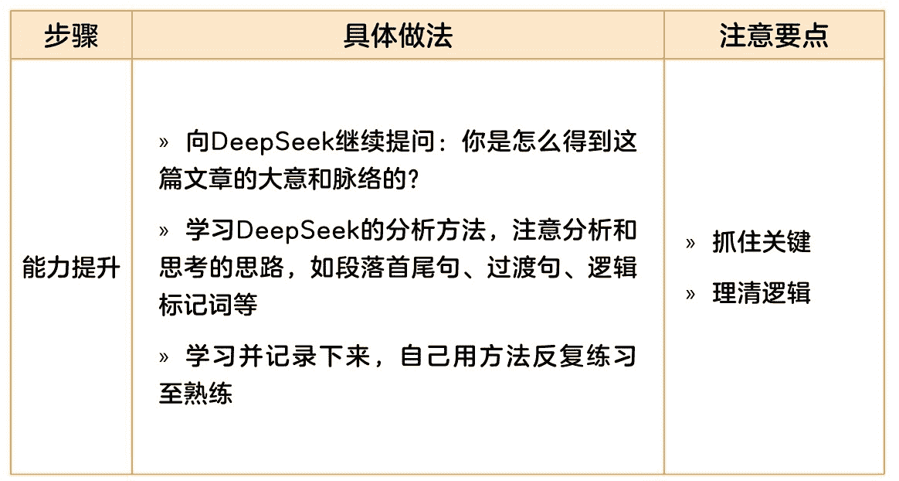

**※ 使用小贴士**

① 先独立阅读，锻炼自主思考。
② AI 分析仅作辅助，不可过度依赖。
③ 多加练习，总结出适合自己的方法。

原来文章是这样布局的！现在遇到新文章，我也知道怎么找重点了！

**2.找不到关键信息**

我就是先看题目，再在文章里找相关词……

答案肯定在文本里，可我找了半天就是找不到位置……

你平时是怎么定位答案的？

・**传统方法**

◆ 逐字逐句搜寻关键词。
◆ 靠印象回想段落位置。
◆ 反复通读找线索。

・**DeepSeek 助力，提升快速定位能力**

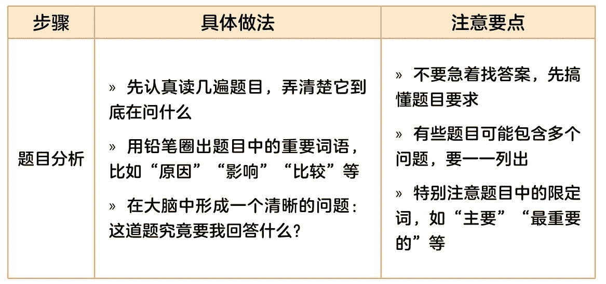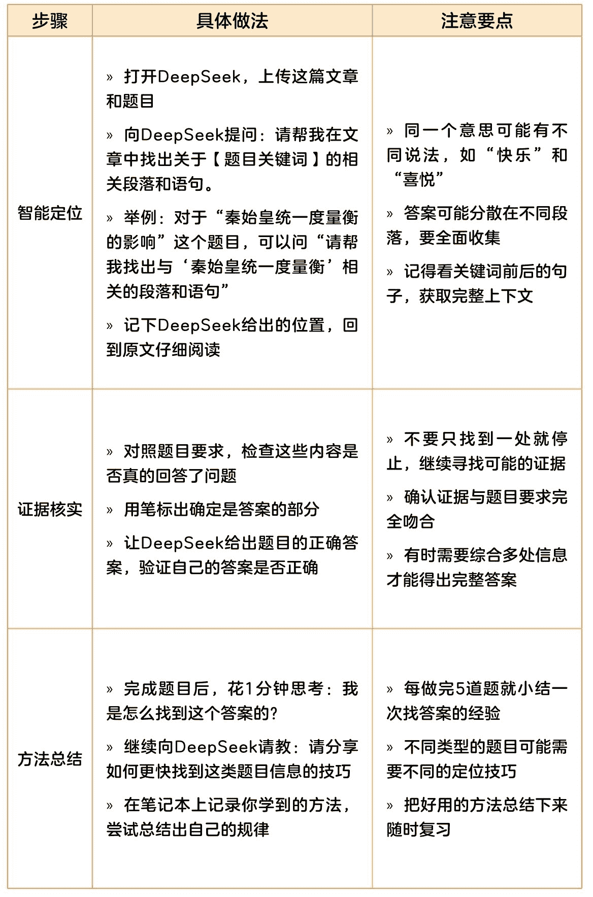

**※ 应用案例**

米米遇到题目：《木兰诗》中体现木兰孝顺的句子有哪些？

① 分析题目：关键词是“木兰”“孝顺”和“句子”。
② 智能定位：请 DeepSeek 找出“关于木兰孝顺表现的段落”。
③ 证据核实：对照原文中 DeepSeek 指出的“昨夜见军帖，可汗大点兵，军书十二卷，卷卷有爷名……愿为市鞍马，从此替爷征”等句子。
④ 步骤总结：扫描首段 → 找到“替爷征”；扫描结尾 → 找到“还故乡”；中间找细节→“叹息”“爷娘相迎”。
⑤ 结合上下文，确认行为动机。

太好了！现在我知道怎么快速定位了，不用瞎找了！

**※ 使用小贴士**

① 先弄清题目的真实要求，再定位。
② 善用关键词及同义表达。
③ 定位后要核对是否完全贴合题意。
④ 培养快速定位的习惯和能力。

**3.答题不够准确**

我明明看懂了文章，答案总差一点分……

我只是把觉得对的内容写上去。

你是怎么组织答案的？

来，让 DeepSeek 教你提升答题技巧！

・**传统方法**

◆ 靠直觉作答。
◆ 直接照抄原文。
◆ 想到什么写什么。

・**DeepSeek 协同，练出精准作答能力**

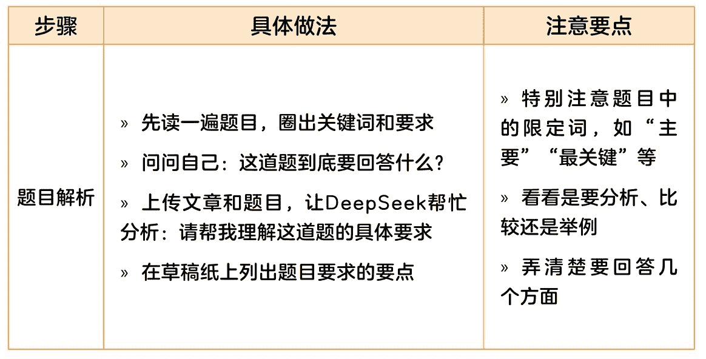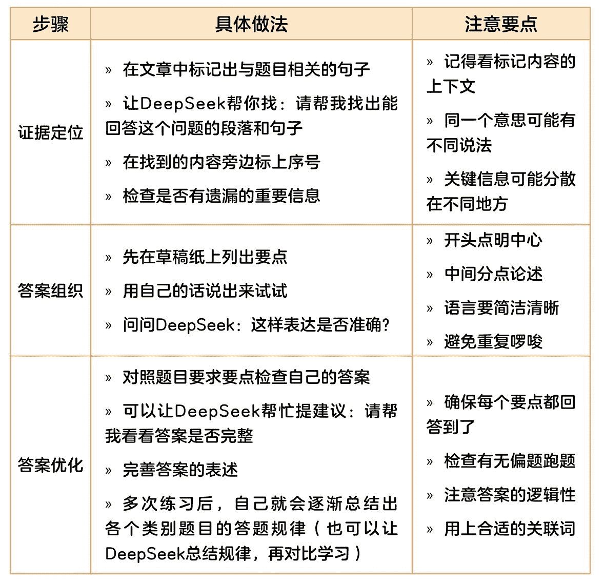

现在我学会怎么写出更精准的答案了！

**【小 D 和小 K 的温馨提示】**

① 阅读理解靠分析思考，而非死记硬背。
② 工具能辅助理解，核心仍是提升自身阅读力。
③ 带着问题读，比漫读更有效。

### **5.1.3 DeepSeek 助攻，文言文变简单**

又是文言文！字我都认识，连起来就懵了！

别急，DeepSeek 来帮你梳理！

文言文其实有规律可寻，我们一起探索。

**1.字词理解困难**

论语里“盖有不知而作之者，我无是也”，这里的“盖”为什么不是“覆盖”，而是“大概”的意思？

文言文中一词多义很常见。

今天就用 DeepSeek 快速搞定古今词义！

・**传统方法**

◆ 查字典。
◆ 死记常见实词虚词。
◆ 靠死记硬背。

・**DeepSeek 协同，构建字词理解体系**

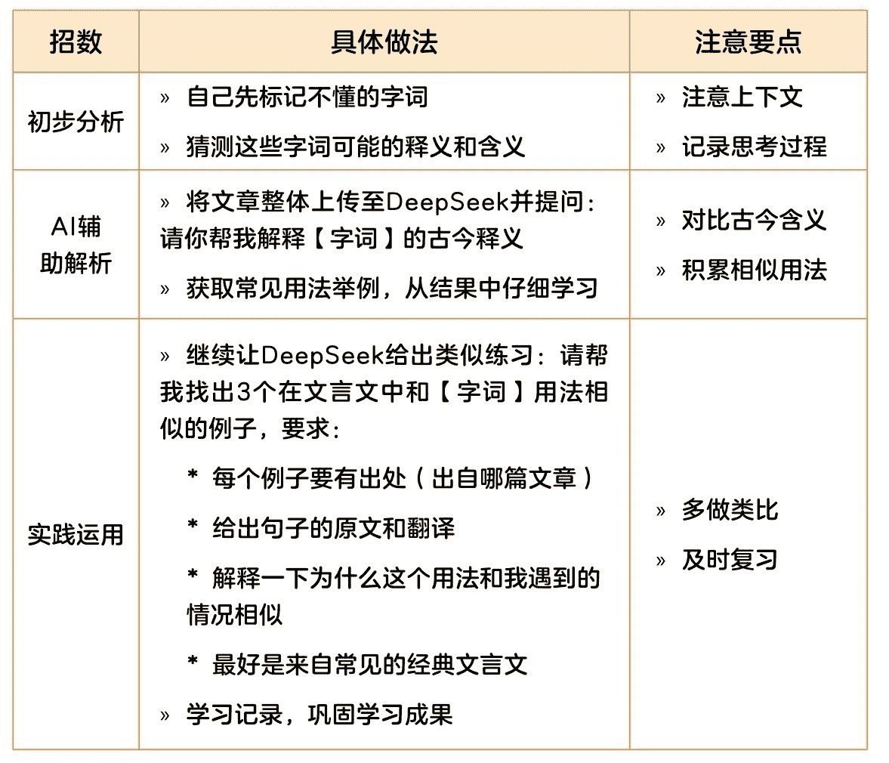

**2. 文言文读懂却看不透**

字都认得全了，句句也能翻成白话，可整体意思还是抓不住……

不如试试好玩的互译训练，理解力会明显提升！

读懂只是第一步，真正要会的是品味它的美感。

・**老派做法**
◆ 一遍遍通读全文
◆ 归纳每段要点
◆ 硬背译文

・**借助 DeepSeek 人机共学，整体提升文言文理解力**

**※ 实战演练**

先挑一句日常白话翻成文言，再翻回白话，对比有何不同！

白话文：“春天来了，百花盛开，蝴蝶在花间翩翩起舞。”

↓译成文言文

“春至矣，百花争妍，蝶舞花间。”

↓再译回白话文

“春天到了，百花争相开放，蝴蝶在花丛中翩翩起舞。”

哇，原来意思一样，文言文却更凝练更美！

这就是文言文的精妙，用最少的字承载最饱满的意境。

**【小 D 和小 K 的温馨提示】**

① 文言学习要由浅入深，先抓字词再到句段篇章。
② 关键在于把握规律，而非死记硬背。
③ 多做互译，能更清楚体会两种文风的差异。
④ 可以借助工具，但要靠自己培养语感和理解力。
⑤ 学文言不仅为考试，更要感受其中之美。

## **5.2 理科解题的思维升级**

我这题算了好几遍还是错。每个环节单独看都懂，合起来就乱套了。物理也一样，公式背得滚瓜烂熟，一上手就卡住了…… 对对，我有时候像部计算器，方法公式全知道，就是不会选不会用。

听起来问题不止计算层面。关键就在这里，理科不只是记公式算数字，更核心的是训练解决问题的方法论。

没错！现在配合 DeepSeek，不但能给出答案，更能帮你理清思路，搭起清晰的思维框架！

### **5.2.1 数学解题思路梳理**

又错了！这题我算三遍结果都不一样。我知道要用相似三角形，公式也都记得。可就是理不清知识点该怎么串起来，想到哪写到哪，最后全乱了。

来我看看，哦，是一道几何证明题。

米米，你可能需要加强数学思维训练。说白了就是解题的思路和方法，就像搭积木，有积木不代表能搭成，还得知道步骤。

对！我们就从常见问题入手，一起训练数学思维，让解题更条理！

**1. 一看到题就懵**

这道方程应用题条件一大堆，我该从哪下手？我就想到哪算到哪，算着算着就乱了。

你平时一般怎么处理这类题？

这说明你缺少系统化的解题思路。

・**传统做法**
反复刷同类题，死记解题套路。

・**DeepSeek 助力升级**

我按这个方法试了一下，确实比以前清晰多了！自己画思维导图时，感觉整道题都通透了。

**2. 解题过程乱跳难以自查**

小 K 你看，这道几何题我答案是对的，可老师说过程太乱了。有时我自己回头看都看不懂自己写了啥…… 我就是想到哪写到哪，后面补，越补越乱。

米米，过程也很关键，它反映的是你的思考轨迹。

这说明你需要养成规范的解题习惯。来，我教你更清楚的写法！

・**DeepSeek 助力升级**

哇，这样写差别太大了！自己看得明白，老师也说我进步了。最关键的是，复习时一眼就能想起思路！

**3. 题型一变就不会**

考试时，熟题基本能做对，一碰到新题型就懵了。就是靠题型套公式，根本举一反三不了。

你平时解题的思路是什么？

明白了，你需要的是真正的数学思维，而不是只会套公式。

・**DeepSeek 助力升级**

**【小 D 和小 K 的温馨提示】**

① 数学要讲理解，别死记硬背，核心是思维逻辑。
② 多问一个“为什么”比直接要答案更重要。
③ 可善用 DeepSeek 帮助理解，但最终要形成自己的思维方式。
④ 解题过程和答案同样重要，要养成规范书写的好习惯。
⑤ 及时总结归纳，让知识形成体系。

### **5.2.2 物理化学 从概念到思维的跨越**

放学后，米米和小 D、小 K 在学校的“学习互助论坛”刷帖。

嘿，小 D、小 K，有两个学长学姐求助，一个是初二小林，一个是初三小美，我们帮下忙吧？

小林被物理力学卡住，小美对化学实验题和方程式也很头疼。

正好可以借助 DeepSeek 帮他们从概念理解过渡到解题，也给其他同学做个参考。

**1. 物理 力与运动的概念混淆**

初二小林在论坛急帖：最近学物理力学，老师讲牛顿第二定律、力与加速度关系，单独听都懂，一到综合题就不知道先用哪个公式，力与运动状态完全混了。

小 D、小 K，小林这个问题挺典型的，很多学长学姐都吐槽过。

物理知识点环环相扣，光靠背公式没用，还得有正确的分析顺序。

对，先搭好概念框架再按步走。我觉得先把题丢给 DeepSeek 看看吧。

・**DeepSeek 人机协作，助力突破物理难题**

系统梳理概念，再配合正确的解题流程，才能彻底摆脱概念混乱。

**2. 化学 方程式记不住 实验题不会**

初三小美发帖吐槽：化学方程式我都背了，还是老混！不背的话，一碰到实验题就不知道加啥药品、判断啥现象，综合实验题每次都丢分，怎么办？

我邻居姐姐也总说化学方程式难记。

小美有错题，正好让 DeepSeek 先帮她找找背不住的原因。

对，在理解基础上记忆运用，实战做实验题时才不会慌。

・**DeepSeek 人机协作，助力解决化学难题**

这样循序渐进、抓本质，成绩肯定能稳步提升！

是呀，让理科学习更轻松更有趣！

**【小 D 和小 K 的温馨提示】**

① 先把散乱知识点整理成图表或框架，物理化学都能更高效。
② 多问为什么，深挖概念内在联系，理科问题靠死记硬背解决不了。
③ 提问要聚焦，上传题目先明确想问的核心，比如考哪些概念、选试剂的原理，这样回答更精准。
④ 做完题要及时纠错回顾，把易混点再问再梳理。
⑤ 把知识点转化成自己的语言，用生活例子或思维导图，更好记更会用。

### **5.2.3 难题攻克 协作更高效**

这道大题我想很久也没解开，每次碰到难题就紧张。

有啥好慌的，直接让 DeepSeek 给答案不就完了！科技就是用来省脑细胞的嘛。

对啊，我怎么没想起来，直接问多方便！

等等，如果只拿答案不理解过程，下次遇到类似题还是不会。

可是知道答案不就够了？以后不会再问不就行了？

学习的意义不只是对答案，更是培养解题能力。万一考试不能用工具，或者碰到 DeepSeek 没见过的新题，你怎么办？

这么说，我得先学会自己想。

没错！DeepSeek 的价值不是代你解题，而是帮你理清思路、分析过程，真正掌握方法。

我懂了！不如让 DeepSeek 循序引导思考，这样知识学了，能力也练了！

所以攻克难题有方法，我们来学怎么和 DeepSeek 高效协作。

**1. 难题一来就想放弃**

题目一长就头大，觉得太难，不知道从哪入手。

・**DeepSeek 人机协作**

**扫码查看**

DeepSeek 完整回答

**提示：AI 每次创作都独一无二，欢迎你亲自体验，获得专属于你的精彩回答！**

**2. 复杂问题不会拆分**

这道大题知识点全混一起，我不知道该怎么拆开做。

・**DeepSeek 人机协作**

**3. 缺信心缺方法**

每次考试碰到压轴题就没信心，总觉得解不出来。

・**DeepSeek 人机协作**

原来难题也没那么可怕，学会拆分一步步来，再难也能搞定！

**【小 D 和小 K 的温馨提示】**

① 遇到难题保持冷静，相信自己一定能解决。
② 学会将复杂的问题分解成小问题逐个击破。
③ 善用 DeepSeek 辅助分析，但要培养独立思考能力。
④ 及时总结解题经验，积累解决难题的方法。
⑤ 每解决一道难题都是能力的提升。
⑥ 建立解题信心档案，记录进步轨迹。

## **5.3 英语学习的新玩法**

啊，英语单词怎么这么多！背了忘忘初背，感觉永远记不住。明天就要测验了，还有一大堆没背完，烦死了！我试过闪卡、抄写、反复读，都没啥效果。

别怕，米米！英语没那么难，有 DeepSeek 帮忙，背单词能变得又有趣又高效！

米米，你想过吗？传统英语学习方法未必适合所有人，现在 AI 辅助学习时代，英语学习方式正在变革。

没错！用上 DeepSeek，学习方式完全可以被改写，单词、写作、阅读理解都能得到助力！

### **5.3.1 单词记忆 从枯燥到有趣**

又要背单词了，好无聊！单词像天上的星星，背前面忘后面。

别泄气，米米！方法对了，背单词也能很有趣！

对，我们一起探索更有效的新方法吧。

**1. 形近词总混淆**

这些词长得太像了，老搞混，比如 desert 和 dessert，到底哪个是沙漠哪个是甜点？

不少同学在背单词时都会碰到同类困扰。

这时候不妨试试向 DeepSeek 请教：我现在上初一，记单词老是把【单词 A】和【单词 B】混在一起，有什么办法能把它们分清并记住？
DeepSeek 给出的回答如下。

**2.长单词记不住**

碰到那种又长又难读的词，常常会觉得望而生畏，比如 temperature，看起来就让人犯怵。

这类词其实可以拆成小片段来记忆，难度就会下降不少。

同样可以换个说法提问：我初一，temperature 这个词太长还不会读，该怎么把它记下来？
DeepSeek 的解释如下：

**3.散装单词容易忘**

刚背完没多久就忘干净，好像找不到任何记忆线索。

借助联想记忆会更高效一些。

还可以这样问 DeepSeek：能不能把 hospital、balloons、doctor、nurse、clown、patient 这几个词编成一个小故事，靠情节和画面来帮助我记住？
DeepSeek 的反馈如下：

效果很惊喜！我刚让 DeepSeek 帮我把 vocabulary 编成画面：vocal 负责发声，bulary 是脑中想象的小精灵，两者一起收集词汇。只要想到这个场景，单词就立刻浮现出来了！

**【小 D 和小 K 的温馨提示】**
① 把词汇转化成生动有趣的小故事。
② 依赖图像和具体场景来强化记忆。
③ 挖掘词与词之间的关联。
④ 把长词拆解成易记的片段。
⑤ 保持定期复盘，巩固记忆。
⑥ 在日常使用中自然内化。

### 5.3.2 英语写作：让表达更地道

本次写作主题是 “My Dream”，写出来的句子总带着翻译腔，老师反馈读起来很别扭。

不必紧张！
可以借助 DeepSeek 提升写作水准！

写作提升的关键在于掌握地道用法。常见的瓶颈包括“表达不自然”“句式重复”“缺乏思路”。

**1.表达不地道**

我习惯直接按中文意思翻译，比如“我很喜欢打篮球”就写成 “I very like playing basketball”。

这种逐字直译的做法相当普遍。

可以向 DeepSeek 询问：怎样把“我很喜欢打篮球”说得更地道。系统会给出 “I love playing basketball” 或 “I'm really into basketball” 等自然表达，并提供更多同类例子，帮助建立正确的英语思维。
DeepSeek 的回复如下：

**2.表达太单一**

每次作文开头都差不多，比如老是写 “I have a dream”，读起来很单调。

可以请 DeepSeek 帮你拓展表达方式！

可以这样提问：我是初一学生，写英语作文时用词比较单一，请给我几个关于“我的梦想”更丰富的开头句式。例如，“My dream is like a seed planted in my heart”“What does the future look like?To me,it's a place where” 等更丰富的表达。再请 DeepSeek 为每种说法配上生活化的例子，更容易理解和运用。
DeepSeek 的说明如下：

**3.下笔卡壳**

写到一半常会卡住，不知道接下来怎么衔接。

这时可以让 DeepSeek 协助梳理文章框架。

可以这样问：我读初一，正在写 “My Dream” 作文，请帮我列出清晰的段落结构。第一段点明梦想，第二段阐述原因，第三段描写为之付出的努力。每个段落使用不同的连接词，让行文更流畅。
DeepSeek 的说法如下：

太棒了！我把语文作文的思路迁移过来，把英语作文的评分标准也输入给 DeepSeek，它不仅给我的作文打了分，还提供了大量改进建议，立刻就明白该怎么改进了，这种感觉太好了！

**【小 D 和小 K 的温馨提示】**
① 多积累地道说法，避免中式英语。
② 注意句式变化，让文章更生动。
③ 学会选用恰当的连接词。
④ 先搭框架再动笔，思路更清晰。
⑤ 善用工具让进步更有方向。
⑥ 勇于表达、不怕出错，边改边进步。

### 5.3.3 阅读理解：轻松读懂文章

这篇阅读材料很难，生词一堆看着就晕，读完还要做题。

别担心！阅读也有技巧可循！

我们一起来掌握一些实用的阅读策略吧。

**1.生词阻碍**

文章里不认识的词太多，一个个查字典，前面的内容很快就忘了。

碰到生词不用慌张，米米。

可借助 DeepSeek 区分重点词和次要词。上传全文和题目后，向 DeepSeek 提问：请帮我挑出影响理解主旨的 5 个核心名词/动词，以及 5 个可通过上下文推断的词，并用中文标注词性和基本含义。依据 DeepSeek 的答案记录重点词，用已知推断未知，慢慢就能培养出词感！

**2.长难句难懂**

读完一段，每个句子好像都懂，却不知道这段到底想表达什么。

这时可以请 DeepSeek 帮你提炼段落主旨。

上传段落后，试试这样问 DeepSeek：请用一句话概括此段的核心意思，并说明概括的具体步骤和方法。DeepSeek 会找出主题句和支撑细节，像拼图一样把零碎信息合成完整画面。

**3.定位不到答案**

做题时常在文中找不到依据，导致答错。

让 DeepSeek 教你定位技巧！

上传文章和题目后，试试这样问 DeepSeek：请帮我找出这道题目的关键词，以及文中对应的关键语句，并说明判断思路。这就像寻宝游戏，关键词就是藏宝图，指引你找到正确答案。

太棒了！
我用这些方法读了一篇文章，阅读速度明显加快，理解也更透彻了，做题时更有底气了！

**【小 D 和小 K 的温馨提示】**
① 先通读全文，掌握大意。
② 遇到生词学会猜测词义。
③ 抓住每段主旨，理清脉络。
④ 做题时学会定位关键信息。
⑤ 多积累主题词汇和常用表达。
⑥ 培养英语思维，提升阅读效率。

# 第六章
# 安全使用须知
## 6.1 分辨真假：信息核查三步法
米米快步推门进来，脸上写满疑惑。

小 K，你在吗？我遇到一个棘手的问题！班里今天在讨论一条新闻，说科学家发现吃巧克力能提高智商还能增高，大家都信了，我总觉得哪里不对……这是真的吗？

米米，你的警觉很可贵。在信息爆炸的今天，会分辨真伪很重要。下面就一起学习核查信息的方法吧。

### 6.1.1 信息时代的挑战：真假难辨
当下信息如潮水般涌来，社交媒体、资讯网站、朋友圈、短视频平台消息不断，让人眼花缭乱。AI 工具让获取信息更便捷，但也带来了真伪难分的难题。健康谣言、科学误导、虚假新闻、夸大广告随处可见。研究显示，假信息在社交媒体上的传播速度是真信息的六倍！这会影响判断，甚至导致错误决策。

为何容易上当？心理学提到“确认偏误”，我们更倾向相信符合已有观点的说法。情绪化的内容也更容易吸引注意并被转发。

面对这些挑战，需要一套可操作的方法来辨别真伪。这就是“信息核查三步走”，能像侦探一样揭开信息背后的真相。

・**第一步：追根溯源，找到信息的原始来源**

判断真假的第一步，是追查它的出处。很多假信息只有“据说”“听说”，却找不到确切出处。

**※ 如何溯源**
① 找原始发布者：新闻报道有没有署名记者？研究结论出自哪家机构？
② 看发布日期：有些“新闻”其实是多年前的旧闻翻炒，脱离了原语境。
③ 评估来源可靠性：权威期刊、知名高校、专业机构通常比匿名网站更可信。
④ 区分事实与观点：文章是在陈述可验证的事实，还是在表达个人看法？
以米米听到的“巧克力提高智商”为例，可以追查：这个说法最初来自哪篇研究论文？是哪个团队得出的结论？发表在哪本科学期刊上？

如果找不到这些信息，或者来源只是“网友分享”“据国外媒体报道”之类模糊说法，就要提高警惕。

查原始来源时，可以具体问：“这个说法的原始研究是什么”或“这条消息最初由谁发布”，就能直接找到源头。

・**第二步：交叉验证，对比多个信息源**

光有一个来源不够，即使是权威来源也可能出错。第二步是进行交叉验证——看不同信息源是否说法一致。

**※ 交叉验证的方法**
① 多渠道查询：查阅三个以上不同来源，尤其是立场不同的来源。
② 找共识与分歧：专家们在这个问题上有共识吗？还是分歧很大？
③ 比较报道角度：不同来源对同一事件的报道有何异同？为何会有差异？
④ 关注专业辟谣平台：许多权威机构专门做事实核查，如科学辟谣平台。

回到巧克力的例子，查阅多个科学数据库和健康机构资料会发现：确实有研究表明可可中的某些成分可能对认知功能有积极影响，但没有直接证据支持“巧克力显著提高智商”或“促进生长”的说法。大多数研究都强调，这些潜在益处需要在适量摄入的前提下，而且效果因人而异。

交叉验证不仅能帮助发现虚假信息，还能获得更全面的认识。毕竟真相往往是多面的。

需要交叉验证时，能不能问“有没有其他研究支持或反驳这个观点？”

米米，你太棒了，完全正确！

・**第三步：理性分析，运用批判性思维**

前两步收集了信息，第三步最关键——用大脑做理性分析。批判性思维是辨别真伪的终极武器。

**※ 批判性思维的核心要素**
① 常识检验：这个信息是否符合基本常识？说法过于神奇时，往往需要更强的证据。
② 逻辑推理：信息中的因果关系合理吗？有没有逻辑漏洞？
③ 动机分析：传播这个信息对谁有利？是否有商业、政治或个人利益驱动？
④ 情绪警觉：信息是否过度煽动情绪？夸张的情绪化表达常常是虚假信息的特征。

**※ 虚假信息的常见类型**
① 情绪煽动型：利用恐惧、愤怒等强烈情绪促使人快速分享，不加思考。
② 阴谋论型：暗示有隐藏目的，声称“大多数人都不知道的真相”。
③ 过度简化型：将复杂问题简化为简单因果，忽略现实复杂性。
④ 伪专业型：堆砌术语制造科学假象，实际内容经不起推敲。

对于“巧克力提高智商”的说法，可以思考：如果效果真这么显著，为何不是头条新闻？为何学校不推荐学生多吃巧克力？这种夸张效果是否符合我们对营养与智力关系的科学认知？

批判性思维不是怀疑一切，而是理性评估后做出更明智的判断。批判性思维能力是现代社会每个人都应培养的核心能力。

我觉得理性分析最难，有时候我不知道该信什么。

批判性思维是一种需要练习的技能。刚开始会觉得难，随着知识积累和经验增长，会越来越自然。

### 6.1.2 DeepSeek 辅助进行信息查证
在信息核查过程中，DeepSeek 能成为你的得力助手，但不能替代你的判断。

**※ DeepSeek 辅助信息查证**
① 收集多源信息：DeepSeek 能够快速查找多个来源的信息，节省查询时间。
② 提供背景知识：当你遇到不熟悉的领域时，DeepSeek 能够提供必要的背景知识，帮助你理解信息的上下文。
③ 分析信息特征：DeepSeek 能够帮助分析信息的客观性、情感倾向和专业程度，提示可能存在的偏见。
④ 引导批判思考：通过提出关键问题，DeepSeek 能够引导你思考信息的合理性和可靠性。

然而 DeepSeek 也有局限。它基于已有数据训练，可能无法获取最新信息；它不能完全辨别复杂的真假信息；最重要的是，它无法替代你的思考和判断。信息真伪的最终决定权永远在你手中。

DeepSeek 确实能快速检索并整理素材，但做判断、下结论、定方向的始终是使用者本身。

对，技术只是帮手，思考才决定高度。

我懂了！

把“信息核验三步法”的思路和 DeepSeek 的检索能力结合起来，接下来我就不容易被虚假消息带偏了！

在信息海量涌现的今天，辨别真伪的能力几乎是数字时代的生存本领。学会甄别、保持清醒，能帮助你避开谣言干扰，也能在抉择时更稳妥。掌握了“信息核验三步法”，你在网络世界里就能从容应对，成为一个具备独立判断力的思考者。

**【小 D 和小 K 的温馨提示】**

① 遇到关键信息别急着分享，先花几分钟核对真实性。
② 对情绪化标题和夸张表述保持警惕，这常是失实信息的典型手法。
③ 习惯定期阅读权威渠道的内容，慢慢建立可信的知识储备。
④ 对于不确定的内容，向老师、家长请教是很有效的校验方式。
⑤ 在当下，独立辨别信息的真伪是一项核心素养。
⑥ 用 DeepSeek 核验时，把问题描述得越清晰，得到的参考面就越广。

## **6.2** **保护自己：AI 上手安全提醒**

周末的下午，米米独自在房间里借助 DeepSeek 完成一篇科学小论文。她专注地输入，询问了几个关于太阳系的问题，还让模型润色了几段文字。

米米，我看你用智能助手越来越熟练了！

不过，随着这類助手渗入学习与生活的每个角落，学会理性安全地使用它就显得格外重要。

安全上手？我到底该留意什么？

**※** **智能时代的新课题**

DeepSeek 类的智能助手正在悄悄重塑我们的学习、工作和生活方式。它们可以写作、解题、查资料、做创作，方便之余也带来了新的安全议题。

对于从小就接触智能技术的你们而言，安全使用不仅关系到私密数据，更关系到思维独立和创造力的守护。就像骑自行车要遵守交通规则，使用助手也需要掌握基本的安全准则。

### **6.2.1** **守护私密数据安全**

在数字世界里，私密数据相当于你的电子身份证，必须格外上心。

**※** **保护私密数据的关键做法**

① 谨慎决定透露的内容：与助手交流时，尽量不提供完整姓名、家庭住址、联系电话、身份证号等敏感内容。
② 选择适龄服务：为青少年设计的助手产品通常会有更完善的安全防护。
③ 了解数据处理规则：虽然枯燥，但弄清平台如何使用你的数据很重要，可请家长一起阅读。
④ 定期清理对话历史：多数平台会保存聊天记录，记得及时删除不需要的记录。
⑤ 以强密码守护账号：设置复杂密码并定期更新，避免多平台重复使用同一密码。

我平时在 DeepSeek 上提了不少问题，这些都会被留存吗？

不同服务的处理规则不完全一样。核心原则是：不要在对话里透露你不希望外人知晓的信息！

### **6.2.2** **正确认识智能助手的本领与边界**

弄清助手能做什么、不能做什么，是安全使用的前提。助手很聪明，但绝不是万能的魔法箱。

要正视助手的边界。例如健康类提问，助手只能提供一般性科普，不能替代医生诊断；数学题也可能出错，最终的核对与理解仍要靠自己。

记住，助手只是辅助。它的输出必须经过你自己的思考与检验，尤其涉及重要决策时。

### **6.2.3** **避免过度依赖智能助手**

便利背后，最大的风险是依赖加深。如何防止被工具牵着走？

**※** **防止过度依赖的策略**

① 划清使用边界：明确哪些环节可由助手帮忙，哪些必须自行完成。比如概念可以让助手解释，内化理解要靠自己。
② 把助手当工具：像计算器能算数却替代不了数学思维，助手能辅助学习，核心思考仍需自己完成。
③ 先思考后提问：使用前先尝试自己想，拿到答案后做批判性审视，而不是直接照搬。
④ 定期数字排毒：安排一段完全不用助手的时段，锻炼独立解决问题的能力。

有时候我一遇到问题就想去问 DeepSeek，这样是不是不太好？

智能助手是双刃剑。就像总开导航会让人失去方向感，先自己琢磨，实在卡住再求助，才是正确的使用方式。

### **6.2.4** **辨别机器生成的内容**

生成技术进步后，判断内容是人写的还是机器写的越来越难，培养辨别力至关重要。

**※** **识别机器生成内容的技巧**

① 留意语言风格：机器文本往往过于流畅完美，缺少个人色彩和独特视角，高度标准化的表达是信号。
② 核查事实准确性：助手可能生成看似合理却不准确的“伪事实”，尤其在具体数据、日期或冷门知识点上。
③ 感知情感真实度：助手在描写深刻情感或个人经历时常显空洞、公式化，缺乏真实细节。
④ 检查逻辑连贯性：长文本里，机器生成的内容容易在不同段落出现细微的逻辑矛盾。
⑤ 借助检测工具：专业的生成内容检测工具可提供参考，但并非百分百准确。

认识这些特征不是为了排斥机器创作，而是为了保持批判性思维，在信息海洋里保持清醒。

那是不是以后网上大部分内容都是机器写的了？

没错！所以学会识别机器内容的特点和局限，是体现信息判读力的重要标志。

### **6.2.5** **养成健全的使用习惯**

再好的工具，也需要健康习惯来驾驭。

**※** **健全使用助手的建议**

① 控制使用时长：避免长时间连续使用，定时休息，保护视力和心理健康。
② 维持真实社交：助手不能替代人与人之间的互动，和朋友、家人、老师的交流对成长不可替代。
③ 平衡线上线下：让助手只是生活的一部分，保证运动、户外和面对面社交的时间。
④ 发展多元爱好：除了使用助手，也要培养运动、艺术、阅读等其他兴趣。
⑤ 养成反思习惯：定期回顾自己的使用方式和频率，及时调整以维持平衡。

记住，科技应是增强能力，而不是替代思考或挤占生活。

### **6.2.6** **应对特殊的安全风险**

使用助手还需警惕一些特殊风险。

**※** **常见风险及应对策略**

① 不当内容过滤：即便有安全机制，也可能遇到不合适内容，立即停止并向家长求助。
② 欺骗性使用：警惕有人用技术制造虚假信息或冒充他人身份，重要信息要交叉验证。
③ 版权与原创问题：用助手辅助创作时，要了解平台版权政策，明确标注辅助部分，尊重知识产权。
④ 过度个性化推荐：助手可能制造信息茧房，要有意识地主动接触不同立场的观点。
⑤ 社会工程学攻击：小心被诱导点击可疑链接或泄露敏感信息。

听起来有点吓人，用助手真有这么多风险吗？

别紧张！就像学骑车，事先了解风险是为了更安全地享受便利。多数风险用简单预防就能化解。

介绍这些不是为了吓唬你，而是帮你成为一个更有准备、更聪明的数字公民。

### **6.2.7** **智能伦理：成为负责任的使用者**

使用助手不仅是技术问题，也关乎伦理。

**※** **基本的伦理准则**

① 尊重他人权利：不利用助手制造或传播虚假信息、谣言和有害内容。
② 诚实透明：在学习和创作中清晰标注助手辅助的部分，不把生成内容冒充成自己的成果。
③ 公平使用：确保使用不会对他人造成不公平或伤害。
④ 批判性参与：关注技术发展和监管的讨论，培养对技术社会影响的思考。
⑤ 持续学习：随着技术迭代，不断更新对助手能力与局限的认知。

我明白了，用助手既是技术问题也是道德问题。

没错！真正的智慧在于不仅知道怎么用，还知道什么时候用、为什么用，以及边界在哪里。

随着智能技术深入学习生活，掌握安全、健康、有道德地使用助手的本领，已成为当代青少年的必备素养。像在网络世界保护自己一样，学会合理使用助手，才能发挥其潜力同时规避风险。

**【小 D 和小 K 的温馨提示】**

① 保护私密信息，避免在平台上透露敏感内容。
② 助手只是工具不是权威，关键判断仍要靠自己。
③ 养成先思考再提问的习惯，避免过度依赖。
④ 平衡线上线下，保持健康的使用时长。
⑤ 学会辨别机器生成内容，保持批判性思维。
⑥ 遇到不适或可疑情况，立即停止并寻求帮助。
⑦ 做负责任的使用者，尊重原创和知识产权。
⑧ 把助手当作提升能力的帮手，而非替代思考的替代品。

在人工智能时代，最珍贵的仍是我们自身的自然智能——独立思考、创造判断的能力。助手再强，主导权始终在人手中。拥抱新技术，让它成为成长路上的得力伙伴，而不是思考的替代品。

# **DeepSeek 你的 AI 家教助手**

微信扫描二维码关注公众号后，输入验证码 50487，得到资源获取帮助。

微信订阅号：szysptpress