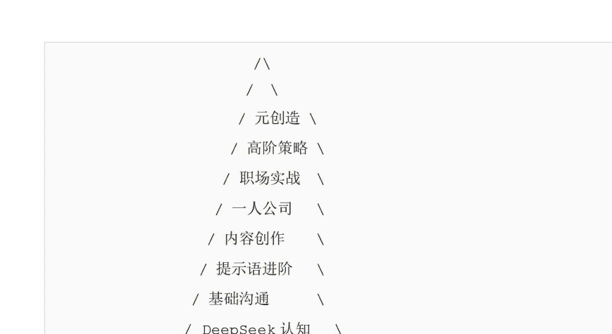

# DeepSeek实战宝典

## 前言：AI 时代，你准备好进化了吗？

2024 年底到 2025 年初，一款名为 DeepSeek 的国产 AI 模型火遍全球。

它刷屏海内外主流媒体，成为技术圈、投资圈乃至普通网民热议的焦点。甚至，它的出现直接引发了英伟达等算力巨头股价的剧烈波动——因为人们突然意识到，高性能的 AI 不再需要天文数字般的算力成本，它正在变得普惠、亲民，触手可及。

几乎一夜之间，朋友圈里关注 AI 的和不关注 AI 的都在讨论 DeepSeek。

很多人跑来问我：“DeepSeek 到底是什么？它和 ChatGPT 有什么不同？我一个普通人，能用它来做什么？”

这些问题，正是我写这本书的起点。

## 为什么是 DeepSeek？

在 DeepSeek 出现之前，AI 世界似乎被一条隐形的鸿沟分隔开来。

一边是以 OpenAI 为代表的闭源巨头，它们性能强悍，但使用成本不菲，且对普通用户并不完全开放。另一边是各种开源模型，虽然免费，但能力参差不齐，真正能比肩顶级商业模型的凤毛麟角。

DeepSeek-R1 的出现，打破了这一僵局。

**性能对齐 OpenAI-o1 正式版**，这意味着它在数学、代码、自然语言推理等复杂任务上，达到了世界顶尖水平。

**开源且可免费商用**，这意味着无论你是个人开发者、创业者，还是大型企业，都可以自由地使用、修改甚至基于它构建自己的商业应用。

**国产**，这意味着它更懂中文，更了解国内用户的需求和使用习惯。

“AI+国产+免费+开源+强大”——这五个标签叠加在一起，构成了一次前所未有的技术平权运动。

而 DeepSeek-R1 的独特之处，并不仅限于此。

它属于一种新型的 AI——**推理大模型**。

在此之前，我们熟悉的大多数 AI（如 GPT-4）属于“通用大模型”。它们擅长语言生成、上下文理解和创意写作，回答问题快，但面对复杂的数学证明、逻辑推理或代码调试时，往往“跳步”或“瞎说”。

而推理大模型，在传统大语言模型的基础上，强化了推理、逻辑分析和决策能力。它们通过强化学习、链式思维（Chain-of-Thought, CoT）等技术，能够在给出答案之前，先在内部进行一步步的推演。

**简单来说：通用模型凭“直觉”快速回答，推理模型靠“深思”逐步推导。**

这个本质区别，决定了我们与 DeepSeek-R1 的沟通方式，必须彻底改变。

## 告别复杂提示词

如果你之前接触过其他 AI，你可能习惯了这样的提问方式：

> “你现在是一位资深营销专家。你的任务是帮我撰写一篇小红书种草文案。我的产品是一款便携榨汁机，目标用户是 25-35 岁的都市白领女性。请用轻松活泼的语气，突出‘3 秒清洗’和‘无线便携’两个卖点，字数控制在 300 字以内，并加上 5 个相关话题标签。”

这种“角色扮演+任务拆解+格式限定”的结构化提示词，对于通用模型非常有效。因为它需要你帮它把任务拆解清楚，它才能按部就班地执行。

但是，当你用同样的方式去问 DeepSeek-R1 时，效果反而会变差。

为什么？

因为推理模型已经内化了推理逻辑。你越是“手把手”地教它怎么做，越会干扰它自己的思考链条。这就好比，你请一位顶级的数学家去解一道题，你不必告诉他“先画辅助线，再列方程，然后求解”，你只需要告诉他“请证明勾股定理”，他自然知道该怎么做。

对推理模型，你要做的不是“下指令”，而是“表达需求”。

这本书的核心，就是带你掌握这套全新的沟通范式。

## 这本书能带给你什么？

我将这本书分为五个部分，层层递进，帮助你从入门到精通，最终能够运用 DeepSeek 构建自己的“一人公司”。

**第一部分：认知篇。** 我会带你重新理解 DeepSeek，讲清楚推理模型和通用模型的本质区别，帮你建立正确的“AI 思维”。这是用好一切 AI 工具的地基。

**第二部分：方法篇。** 我会手把手教你如何与 DeepSeek 高效对话。从“场景化模板”、“术语破解”到“风格迁移”，你会发现，原来和 AI 聊天如此简单又强大。同时，我也会系统讲解提示语设计的进阶技巧，帮助你精准控制输出质量。

**第三部分：实战篇。** 理论和方法最终要落到实际应用。我会展示如何用 DeepSeek 进行文案写作、营销策划、自媒体内容创作（公众号、抖音、小红书），以及如何搭建一个完整的“一人公司”商业闭环。你会看到真实的案例和可以直接套用的指令。

**第四部分：思维篇。** 当你能熟练使用 DeepSeek 之后，如何更进一步？我会介绍概念嫁接、极端假设、元叙事等高级策略，激发 AI 的创新能力。同时，我也会带你探索如何用 DeepSeek 构建“第二大脑”，实现知识的快速积累与认知升级。

**第五部分：未来篇。** 我们会探讨 AI 时代的职场提效、个人成长策略，以及成为“超级个体”所需的核心素养。你将学会如何用“老板心态”管理你的 AI 团队，把精力聚焦于真正创造价值的事情。

## 这本书适合谁？

- **职场人士**：希望用 AI 提升工作效率，从繁琐的重复劳动中解放出来。
- **创业者和自由职业者**：渴望低成本构建商业闭环，打造属于自己的“一人公司”。
- **自媒体人和内容创作者**：希望高效产出高质量文案、脚本、文章，突破创作瓶颈。
- **学生和终身学习者**：希望用 AI 加速学习进程，快速入门新领域，构建系统化知识体系。
- **任何对 AI 感兴趣的普通人**：无论你有没有技术背景，只要你想抓住 AI 时代的红利，这本书都是为你准备的。

## 这本书不适合谁？

如果你希望通过这本书学会如何训练自己的大模型，或者深入研读 DeepSeek 的底层算法论文，那么这本书可能无法满足你的需求。本书的定位是**应用和实战**，聚焦于如何用好 DeepSeek 这个强大的工具，而不是制造它。

## 如何使用这本书？

我建议你至少读两遍。

第一遍，通读。不必纠结于每一个细节，先对 DeepSeek 的能力边界、沟通方法以及应用场景有一个整体的印象。

第二遍，精读。按照书中的案例和指令，亲自打开 DeepSeek（网页版或 App）去试一试。实践是掌握一切技能的关键。你可以把这本书当作一本工具书，在实际应用中遇到问题时，随时回来查阅相应的章节。

书中还提供了大量可以直接复制使用的“魔法指令”和“提示语模板”。你可以大胆地修改、组合它们，找到最适合自己风格的沟通方式。

## 写在最后

2024 年被称为“AI 应用元年”。如果说去年我们还停留在“尝鲜”和“围观”的阶段，那么现在，我们已经进入了“应用”和“落地”的深水区。

AI 不会取代你，但会用 AI 的人一定会取代你。

这不是危言耸听，而是正在发生的事实。就像当年互联网、智能手机的普及一样，每一次技术浪潮，都会重新洗牌。那些率先掌握新工具、新思维的人，将获得巨大的先发优势。

DeepSeek 的出现，把一把锋利无比的“神器”交到了每个普通人手中。它免费、强大、易用，你不需要懂编程，不需要懂算法，甚至不需要懂英语，只要你能够清晰地表达你的需求，它就能为你创造价值。

问题只剩下一个：**你，准备好拿起这把神器了吗？**

如果你准备好了，那么，让我们一起，翻开第一章，开启这场 AI 进化之旅。

## 第一章：初识 DeepSeek——国产高性能推理模型的崛起

21 世纪 20 年代中期，人工智能的发展进入了一个全新的阶段。如果你留意新闻，会发现“大模型”、“AIGC”、“生成式 AI”这些词汇几乎无处不在。从能和你流畅对话的聊天机器人，到能一键生成精美图片、视频的创作工具，AI 正以前所未有的速度渗透进我们生活的每一个角落。

然而，在这些令人眼花缭乱的 AI 产品背后，一直存在着一道隐形的门槛：**高性能的 AI，往往很贵，且不开放。**

以曾经引领风潮的 OpenAI 为例，其最先进的模型虽然能力强大，但要么需要按月支付不菲的订阅费用，要么按使用量计费，对于高频使用者或开发者来说，成本压力不小。更重要的是，这些核心模型是闭源的，外界无法知晓其内部机制，更不可能基于它进行深度定制或免费商用。

这就像在工业革命时代，最先进的蒸汽机只掌握在少数巨头手中，普通人只能租用，无法拥有。技术的进步并没有真正普惠大众。

直到 DeepSeek 的出现，这一切开始被改写。

### 1.1 DeepSeek 是谁？——一家怀揣 AGI 梦想的中国公司

DeepSeek，中文名“深度求索”，是一家成立于 2023 年的中国科技公司。它的名字本身就蕴含着其使命：**深耕 AI 技术，探索通用人工智能（AGI）的边界。**

与许多追逐短期商业利益的 AI 公司不同，DeepSeek 从一开始就将目光投向了更远大的目标——**通用人工智能**。AGI 是指能够理解、学习和执行任何人类能够完成的智力任务的 AI。这被认为是人工智能领域的“圣杯”。

在短短一年多的时间里，DeepSeek 凭借扎实的技术实力和一系列惊艳的开源模型，迅速在全球 AI 圈打响了名号。它不像一些公司那样热衷于炒作概念，而是选择了一条更朴素、更硬核的道路：用持续的技术突破和实实在在的开源成果说话。

DeepSeek 的身份标签非常鲜明：

- **中国公司**：这意味着它根植于中文语境，对中国的语言习惯、文化背景和用户需求有着天然的深度理解。在一些中文特有的成语、俗语、网络热梗的处理上，它的表现往往优于国外的通用模型。
- **专注 AGI**：这不是一句空话。它后续推出的推理模型，正是朝着更接近人类“思考”方式的 AGI 迈出的坚实一步。
- **开源先锋**：在众多大厂选择“闭源保利”的时候，DeepSeek 坚定地选择了拥抱开源。这不仅展现了它的技术自信，更极大地降低了开发者使用和定制 AI 的门槛，推动了整个社区的共同进步。

#### 为什么开源如此重要？

想象一下，如果当年 Linux 操作系统没有选择开源，就不会有今天安卓系统的繁荣，也不会有全球数以亿计的服务器稳定运行。开源，意味着透明、共享和协作。任何人都可以检查它的代码，发现潜在的问题，甚至可以基于它构建自己的应用，而无需从零开始。

DeepSeek 的开源策略，就像是在 AI 的蛮荒时代，为所有探索者提供了一份免费的、高质量的地图和工具。无论你是想做一个智能客服，还是开发一款 AI 编程助手，你都可以将 DeepSeek 的模型作为你的引擎，快速启动你的项目。

#### 小贴士：关于“深度求索”这个名字

“深度求索”四个字，既点明了技术路径（深度学习），也表达了企业精神（不断求索）。我个人非常喜欢这个名字，它比那些拗口的英文音译名更有文化底蕴，也更符合中国人“格物致知”的求知传统。当你使用 DeepSeek 时，不妨也带着这种“深度求索”的精神，去探索它能力的边界，去挖掘它为你创造价值的无限可能。

### 1.2 DeepSeek-R1：一鸣惊人的推理王者

如果说之前的 DeepSeek 模型是在积蓄力量，那么 DeepSeek-R1 的发布则是一次彻底的爆发。

R1 系列模型是 DeepSeek 推出的**开源推理模型**。它一经问世，便在数学、编程、逻辑推理等硬核任务上，展现出与 OpenAI 最先进的 o1 正式版比肩的性能，瞬间引爆了全球技术圈。

#### 1.2.1 什么是“推理模型”？——不是更快，而是更聪明

要理解 R1 的价值，我们需要先明白它和普通 AI 的区别。

我们可以把 AI 模型分为两类：**系统一（快思考）** 和 **系统二（慢思考）**。这个概念借鉴了诺贝尔奖得主丹尼尔·卡尼曼的经典理论。

- **系统一（快思考-通用模型）**：这是大多数传统大语言模型的工作方式。它们像一位博学但性急的专家，当你提问时，它会立刻根据自己学到的海量知识，利用概率预测，给出一个“最有可能”的答案。**特点：速度快、成本低、凭直觉。** 它非常擅长你问我答、文本总结、创意生成这类不需要深度推演的任务。但如果遇到复杂的数学题，它可能会给出一个“看上去很对”但实际上是错误的答案，因为它没有真正去“计算”，而是在“回忆”类似的题目。
- **系统二（慢思考-推理模型）**：这是 DeepSeek-R1 的工作方式。它更像一位谨慎的数学家，当你提问时，它不会立刻回答，而是先在自己“脑子”里进行一步步的推演。它会尝试不同的思路，检查逻辑漏洞，甚至会自我纠错，然后把整个推理过程“想”清楚了，再给出最终的答案。**特点：速度慢（相对而言）、成本高（思考过程消耗计算资源）、逻辑严密。** 它非常适合解决数学证明、复杂代码调试、战略分析这类需要严谨逻辑链的任务。

一个生动的例子：

你问：“一个笼子里有鸡和兔，共 35 个头，94 只脚，问鸡兔各几只？”

**通用模型（系统一）的思考：** “我曾经在训练数据里见过很多鸡兔同笼的问题，答案通常是鸡 23 只，兔 12 只。我就回答这个。”

> （它可能答对，但如果数据里有错误，或者题目稍有变化，它就很容易出错。）

**推理模型（系统二）的思考：**

1. “设鸡有 x 只，兔有 y 只。”
2. “根据头数：x + y = 35。”
3. “根据脚数：2x + 4y = 94。”
4. “由第一个方程得 x = 35 - y，代入第二个方程。”
5. “2(35 - y) + 4y = 94 -> 70 - 2y + 4y = 94 -> 2y = 24 -> y = 12。”
6. “则 x = 35 - 12 = 23。”
7. “所以，鸡有 23 只，兔有 12 只。”

（无论题目如何变化，只要它能按照逻辑一步步推演，就能得到正确答案。）DeepSeek-R1 的强大之处，就在于它通过在后训练阶段大规模使用**强化学习**技术，在仅有极少标注数据的情况下，自主学会了这种“链式推理”的能力。它不是被“教”会了解题步骤，而是自己“领悟”了如何思考。

#### 1.2.2 R1 的核心优势：数学、代码、逻辑推理

基于其强大的推理能力，R1 在以下几个领域表现尤为突出：

#### 1.2.3 一张表看懂推理模型 vs. 通用模型

为了让你更清晰地理解两者的区别，我将它们在各个维度上进行了对比：

| 维度 | 推理模型（以 DeepSeek-R1 为代表） | 通用模型（以 GPT-4 为代表） |
| :--- | :--- | :--- |
| 优势领域 | 数学推导、逻辑分析、代码生成、复杂问题拆解。 | 文本生成、创意写作、多轮对话、开放性问答。 |
| 劣势领域 | 发散性任务（如写一首朦胧诗），需要严格遵循逻辑链的任务是它的强项。 | 需要严格逻辑链的任务（如数学证明）容易出错。 |
| 提示语策略 | 简洁直接，表达需求。无需逐步指导，甚至要避免“启发式”提示干扰其思考。 | 结构化、引导性强。需明确角色、任务、步骤、格式，以补偿其推理能力的不足。 |
| 性能本质 | 专精于逻辑密度高的任务，在目标领域显著优于通用模型。 | 擅长多样性高的任务，更灵活，但专项任务需依赖提示语补偿。 |
| 思考过程 | 内部进行链式推理，可能可见其“思考”过程。 | 直接基于概率输出结果，不可见其“思考”过程。 |
| 响应速度 | 相对较慢（因为内部需要“思考”）。 | 非常快。 |
| 算力成本 | 较高（因为“思考”过程消耗计算资源）。 | 相对较低。 |

**核心结论：** 推理模型并非在所有方面都强于通用模型，而是在需要深度逻辑推理的特定任务上具有压倒性优势。**选择哪个模型，取决于你的任务类型，而不是一味追新。**

#### 对普通用户意味着什么？

这意味着，如果你只是想写一封邮件、编一个故事、或者进行一场轻松的闲聊，一个优秀的通用模型（甚至免费的版本）可能就足够了。但如果你需要解一道数学题、调试一段代码、分析一份复杂的合同，或者让 AI 帮你推演一个商业策略，那么 DeepSeek-R1 这类推理模型将是你不可或缺的利器。

### 1.3 不只是 R1：DeepSeek 家族的丰富应用场景

虽然 R1 是 DeepSeek 家族的明星成员，但 DeepSeek 的能力远不止于此。它是一个功能强大的 AI 平台，面向普通用户和开发者，提供了丰富多元的应用场景。

无论你是想找一个智能聊天伙伴，还是需要一个高效的内容创作助手，亦或是希望借助 AI 进行学习研究，DeepSeek 都能满足你的需求。

#### 1.3.1 智能对话与语义理解

这是 AI 最基础，也是我们最常用的功能。DeepSeek 不仅能像朋友一样和你聊天，更能深入理解你的意图。

- **多轮对话**：它能记住对话的上下文，进行连贯、有逻辑的交流。你可以在一个话题上不断深入追问，它不会“断片”。
- **情感分析**：它可以分析一段文本的情感倾向是积极的、消极的还是中性的，甚至能识别出更细腻的情绪，如焦虑、期待、失望等。这对于品牌舆情监控、客户反馈分析非常有价值。
- **意图识别**：它能够准确判断你提问背后的真实需求。例如，当你输入“北京今天天气怎么样”时，它知道你是想查询实时天气；当你输入“北京适合春天去玩吗”时，它知道你是想获取旅行建议。

#### 1.3.2 高效文本生成与处理

对于内容创作者、学生、职场人士来说，DeepSeek 是一个强大的文字处理中心。

- **创意写作**：它可以辅助你写小说、诗歌、剧本、歌词。你只需要给出一个主题、一些人物设定或者风格要求，它就能为你生成充满灵感的初稿。
- **营销文案**：生成广告语、产品描述、社交媒体帖子（如小红书、微博、朋友圈文案）、营销邮件等。你只需要告诉它产品卖点和目标受众。
- **摘要与改写**：它能将长篇的报告、论文、新闻快速提炼成几百字的摘要。也可以将复杂的专业文本改写得通俗易懂，或者将一篇中文文章翻译成地道的英文。
- **结构化生成**：它能根据你的要求，生成格式规范的表格、列表、日程安排，甚至是代码的注释和文档。

#### 1.3.3 编程与代码相关

对于程序员和开发者而言，DeepSeek 是一位不可多得的编程伙伴。

- **代码生成**：根据自然语言描述，生成特定功能的代码片段。例如：“用 Python 写一个函数，读取一个 CSV 文件，并计算其中‘销售额’列的总和。”
- **代码调试**：当你遇到报错时，可以将错误信息和代码一起发给 DeepSeek，它能帮你分析错误原因并提供修复建议。
- **代码解释**：遇到一段晦涩难懂的代码，可以交给 DeepSeek，它会用通俗的语言为你逐行解释代码的功能和逻辑。
- **代码优化**：它还可以分析你现有代码的性能瓶颈，并提出优化方案，比如建议使用更高效的数据结构或算法。

#### 1.3.4 可视化图表生成

这是一个被很多人忽略但非常实用的功能。DeepSeek 能够直接生成多种格式的图表代码，让你在文档或网页中轻松嵌入可视化内容。

- **Mermaid 图表**：可以生成流程图、时序图、类图、思维导图、甘特图等。对于编写技术文档或进行项目规划非常方便。
- **React 图表**：如果你是一个前端开发者，DeepSeek 还可以帮你生成 React 图表组件的代码。
- **基础图形**：生成 SVG 格式的简单插图、图标等。

**示例：** 你只需要输入“请用 Mermaid 语法为我画一个用户登录的流程图”，DeepSeek 就会生成相应的代码，你将其复制到支持 Mermaid 的编辑器中，就能立刻看到一张清晰的流程图。

#### 1.3.5 文件处理能力

这是 DeepSeek 非常贴心的一个功能。它支持文件上传，能够读取和处理多种格式的文件中的文字信息。

- **支持格式：** 可以上传 TXT、PDF、Word、Excel、PPT、甚至图片文件。
- **功能：**
    - 从图片中读取文字：你可以拍一张书的照片，或者截图一份报表，上传给 DeepSeek，它能识别出图片中的文字并进行处理。
    - 分析数据表格：上传一个 Excel 文件，你可以让 DeepSeek “帮我分析一下这个销售表格中，哪个季度的增长最快”，它会自动读取数据并给出分析结论。
    - 总结长篇文档：上传一本几百页的 PDF 电子书，你可以让它“请总结一下这本书的核心观点”。

**一个实际的使用场景：**

你收到一份 30 页的 PDF 格式的行业研究报告，需要在 1 小时内整理出一份 10 分钟的汇报 PPT。

**传统做法：** 熬夜通读 30 页报告，手动摘取关键数据和结论，耗时 3-4 小时。

**使用 DeepSeek：** 上传 PDF 文件，输入指令：“请帮我总结这份报告的核心趋势、三大关键数据，以及给我们的三条行动建议。” 几分钟后，你就得到了结构清晰的摘要，直接用于制作 PPT。

### 1.4 如何开始使用 DeepSeek？

了解了 DeepSeek 这么多强大的功能，你一定已经迫不及待想要亲自尝试了。别急，上手非常简单，而且完全免费。

#### 1.4.1 官方渠道：网页版与 App

DeepSeek 为普通用户提供了两种最便捷的使用方式：网页版和手机 App。

- **网页版：** 访问官方网站 chat.deepseek.com，注册一个账号（通常支持手机号或邮箱），登录后就可以在浏览器中直接使用。这是最快捷的方式，无需下载任何软件，适合在电脑前办公或学习时使用。
- **手机 App：** 在你的手机应用商店（如 App Store 或各大安卓应用市场）中搜索“DeepSeek”，下载官方 App。App 端最大的优势是支持语音输入，你可以直接对着手机说话，它会自动转换成文字，非常方便。App 也支持文件上传功能，你可以随时随地将手机里的照片、文档交给 DeepSeek 处理。

> **提示：** 目前 DeepSeek 对个人用户完全免费，这是一个巨大的红利期。抓紧时间去注册体验吧！

#### 1.4.2 开发者使用：API 接入

如果你是开发者，希望将 DeepSeek 的能力集成到你自己的应用或服务中，可以使用 DeepSeek 提供的 API（应用程序编程接口）。

- **优势：** 无需自己训练和部署模型，只需调用 API，就能在你的软件、网站或小程序里拥有顶级的 AI 能力。
- **成本：** DeepSeek 的 API 定价远低于 OpenAI 等同类产品，具有极高的性价比，这对于初创企业和个人开发者来说非常友好。
- **获取方式：** 访问 DeepSeek 的官方网站，在开发者文档中可以找到详细的 API 使用说明、接口文档和各语言的 SDK（软件开发工具包）。

### 1.5 注意事项：了解 AI 的边界

尽管 DeepSeek 已经非常强大，但它仍然是人工智能，而非“万能智能”。了解它的局限性，能帮助我们更合理地使用它，避免被误导。

#### 1.5.1 “AI 幻觉”问题

这是所有大语言模型都存在的先天缺陷。AI 幻觉指的是模型在生成内容时，会“编造”出一些看似合理、逻辑通顺，但实际上完全虚构或不准确的信息。它不是在故意撒谎，而是基于概率预测的结果，当它缺乏相关知识时，会“自作聪明”地进行补全。

**为什么会发生？**

模型在训练时学习了海量的文本，但它并不真正“理解”世界的真实性。它只知道“A 词后面经常跟着 B 词”。当你不确定 A 和 B 的真实关系时，它就可能创造出 C。

**如何应对？**

1. **要求提供来源**：当 DeepSeek 给出一些你不确定的事实、数据或观点时，可以追问：“请提供这个信息的来源”或“这是基于哪份报告/研究得出的结论？”开源模型有时会给出真实的来源，但也要注意，它也可能“编造”出看起来很像回事的假来源。
2. **交叉验证**：对于关键信息（如重要的数据、法律条文、医疗建议等），**绝对不要完全依赖 AI**。一定要通过搜索引擎、专业数据库、官方网站等渠道进行二次核实。
3. **保持批判性思维**：永远记住，你才是最终的责任方。把 AI 当作一个提供思路和初稿的助手，而不是一个绝对正确的权威。

#### 1.5.2 知识截止日期

DeepSeek 的知识截止日期是 **2024 年 7 月**。这意味着，它无法主动告诉你在这个日期之后发生的最新事件、发布的最新数据或出现的最新技术。

**如何应对？**

- **开启联网搜索功能**：DeepSeek 支持联网搜索。如果你需要它回答时效性强的问题（如“今天的天气”、“最近的热点新闻”），你需要在提问时手动开启“联网搜索”按钮（通常在 Web 端或 App 端的对话输入框附近）。开启后，它会先上网搜索相关信息，再结合搜索结果为你生成答案。
- **你自己提供最新信息**：你可以将一篇 2025 年的新闻报道内容复制下来，粘贴给 DeepSeek，然后基于这篇报道内容对它进行提问。

#### 1.5.3 其他潜在局限

- **可解释性**：虽然推理模型能展示“思考”过程，但这个过程中的某些黑箱部分，我们仍然难以完全理解。
- **数据偏见**：模型从互联网数据中学习，不可避免地会学习到其中的一些社会偏见（如性别、种族偏见）。
- **数据安全与隐私**：不要将个人隐私信息（如身份证号、银行卡号）或公司高度机密的商业数据上传给任何公开的 AI 模型。
- **恶意输出**：虽然模型有安全对齐机制，但恶意用户仍可能通过巧妙的提示词诱导其生成有害内容。

#### 本章小结：迈出 AI 进化的第一步

在这一章中，我们一起走过了认知 DeepSeek 的旅程。我们了解到：

1. DeepSeek 是一家专注于 AGI 的中国科技公司，它以开源、免费、高性能的姿态，推动了 AI 的普惠化。
2. DeepSeek-R1 是划时代的推理模型，它通过“链式思维”模拟人类慢思考，在数学、代码、逻辑分析等复杂任务上性能卓越。它与通用模型各有千秋，选择哪种取决于你的具体任务。
3. DeepSeek 的应用场景极其广泛，从智能对话、文本创作，到编程辅助、图表生成，再到强大的文件处理能力，它是一个全能型的 AI 助手。
4. 上手 DeepSeek 非常简单，你可以通过网页版或手机 App 免费使用，开发者也可以通过 API 将其集成到自己的应用中。
5. 任何技术都有其边界。了解 AI 幻觉、知识截止日期等局限性，并培养批判性思维和交叉验证的习惯，是成为 AI 时代合格使用者的必备素养。

DeepSeek 的大门已经向你敞开。现在，你已经知道了它是什么，它能做什么。下一章，我们将深入探讨最重要的部分：如何正确地使用它。

我们将彻底告别传统 AI 那种“复杂提示词”的使用方法，学习一套全新的、专为推理模型设计的沟通范式。你会发现，原来让 AI 为你做事，可以像和朋友聊天一样简单自然。

准备好了吗？让我们进入第二章——“沟通革命：如何让 DeepSeek 真正听懂你”。

## 第二章：沟通革命——如何让 DeepSeek 真正听懂你

在上一章，我们认识了 DeepSeek，了解了它作为推理模型的独特之处，以及它能够为我们带来的巨大价值。从这一章开始，我们将进入实操层面，而第一个，也是最关键的问题就是：**到底应该怎么和它说话？**

如果你之前接触过 ChatGPT、文心一言等通用模型，你可能已经被灌输了一套“提示词工程学”的方法论：你要给 AI 设定一个角色，你要把任务拆解得非常细致，你要规定输出的格式，你甚至要给它几个示例……这套方法本身没有错，但它主要适用于通用模型。

而 DeepSeek-R1 是推理模型。**用通用模型的方法去使用推理模型，就像用开拖拉机的技巧去开战斗机——不仅发挥不出性能，甚至可能适得其反。**

这一章，我们将完成一次重要的思维切换：从“下达指令”到“表达需求”，从“手把手教”到“信任放权”。我会用大量的对比案例、实战模板和底层原理，让你彻底掌握与 DeepSeek 高效对话的艺术。

### 2.1 重新理解“提示语”：不是命令，而是对话

在我们深入之前，需要先厘清一个概念：什么是提示语（Prompt）？

简单来说，提示语就是你输入给 AI 系统的任何信息。它可以是一个简单的问题，一段详细的指令，或者一个复杂的任务描述。

过去，很多人把提示语理解为“给 AI 的命令”。这种理解导致了两个问题：一是用户觉得和 AI 沟通很累，需要“精心策划”；二是 AI 在面对过于僵化的指令时，反而表现不佳。

**更准确的比喻是：提示语是你与 AI 之间的“对话起点”。**

想象一下，你走进一家顶级咨询公司，见到一位资深顾问。你会怎么和他沟通？

- **错误的做法**：拿出一份打印好的指令，念道：“你现在的角色是商业顾问。你的任务是为我的公司制定增长策略。请按照以下步骤：第一步，分析市场；第二步，分析竞争对手；第三步……请用 SWOT 分析框架，输出一份至少 10 页的报告，每页不少于 500 字……”
- **正确的做法**：坐下来，说：“您好，我是一家小型电商公司的创始人。我们最近遇到了增长瓶颈，特别是新用户获取成本越来越高。我手里有过去一年的销售数据和广告投放记录。希望能听听您的专业建议。”

哪位顾问能给出更好的建议？显然是第二位。因为第二位顾问获得了足够的**背景信息**和**真实需求**，他可以运用自己的专业能力去分析问题、拆解任务，而不是被动地执行一个可能并不合理的僵化指令。

**DeepSeek-R1 就是那位资深顾问。它需要的是需求，而不是指令。**

#### 2.1.1 提示语的核心构成要素

无论你采用哪种沟通方式，一个高质量的提示语通常包含三个核心要素：

1. **指令 (Instruction)**：这是“做什么”。告诉 AI 你希望它执行的核心任务。例如：“写一篇关于时间管理的文章”、“解释一下什么是区块链”、“帮我分析这份销售数据”。
2. **上下文（Context）**：这是“基于什么”。为 AI 提供必要的背景信息，帮助它更准确地理解任务。例如：“我的读者主要是大学生，他们经常感觉时间不够用”、“我是一个完全没有技术背景的初学者”、“这是我们上个月的销售报表（附上文件）”。
3. **期望（Expectation）**：这是“做成什么样”。明确或隐含地表达你对 AI 输出的要求和预期。例如：“文章要轻松幽默，控制在 1500 字左右”、“请用生活中的例子来解释，越简单越好”、“请指出销售额增长最快的三个品类，并提出原因分析”。

对于通用模型，你需要把这三个要素都表达得非常清晰、结构化，因为它自己不太会“揣摩”。对于推理模型，你只需要把“上下文”和“期望”讲清楚，它自己就能生成高质量的“指令”来执行。

一个对比示例：

- **给通用模型的提示语（结构化）**：
    角色：你是一位资深的小红书运营专家。
    任务：帮我写一篇种草笔记，推广一款无线蓝牙耳机。
    受众：18-25 岁的女大学生，喜欢颜值高、性价比好的产品。
    卖点：粉色外观、续航长、音质好。
    要求：语气活泼，使用 emoji，字数 200 字左右，带上 3 个相关话题标签。

- **给 DeepSeek-R1 的提示语（需求表达）**：
    我最近拿到一款无线蓝牙耳机，想在小红书上推荐给女大学生。这个耳机是粉色的，长得特别好看，而且充一次电能用一个星期，音质也不错。但我不知道怎么把它写得吸引人，你能帮我想想怎么组织语言吗？最好语气活泼一点，像个小女生在分享。

你发现区别了吗？前者更像一份“工作说明书”，后者更像是“和朋友商量”。DeepSeek-R1 在收到后者之后，会自动理解：你需要一篇小红书种草笔记，受众是年轻女性，卖点是颜值、续航、音质，语气要活泼。它会自己规划结构：标题怎么取、开头怎么吸引人、中间怎么描述、结尾怎么引导互动。**你不需要教它怎么做，你只需要告诉它你要什么。**

#### 2.1.2 从“指令驱动”到“需求导向”的转变

为了帮助你更好地完成这个思维转变，我们用一个表格来对比。

### 2.2 三大万能对话模板

理论讲完了，你可能还是会问：“道理我都懂，但具体开口第一句话该怎么说？”

别担心，我为你准备了三个经过大量实战检验的“万能对话模板”。只要你掌握了这三个模板，90%的日常问题都能轻松搞定。

#### 2.2.1 模板一：场景化需求模板

这是最常用、最强大的模板。它的公式是：

> “我要【目标】，给【对象】用，希望达到【效果】，但担心【问题】。”

模板解析：

- 【目标】：你希望 AI 帮你做什么？例如：设计 PPT、写文案、分析报告、制定计划。
- 【对象】：你的工作成果是给谁看的？具体受众是谁？例如：传统行业老板、年轻用户、技术专家、50 岁的制造业老板。受众特点越具体，AI 的回复越精准。
- 【效果】：你希望达到什么效果？例如：消除他们的数字化恐惧、引发共鸣、提升专业度、说服他们采取行动。
- 【问题】：你有哪些顾虑和担忧？例如：他们听不懂技术术语、担心内容太晦涩、不符合品牌调性、害怕他们觉得不落地。提前告知 AI 你的担忧，它会帮你规避并优化结果。

**为什么这个模板有效？** 因为它一次性给 DeepSeek 提供了丰富的上下文（对象、效果、问题），让它能够站在你的角度，运用它的推理能力去设计最佳方案。它不需要你告诉它“第一步做什么，第二步做什么”，它自己会想。

##### 实战案例 1：为传统企业主做 PPT

- **普通提问：** “帮我做一个关于海外市场拓展的 PPT。”
- **场景化模板提问：** “我要设计一个 PPT 框架，要给一批 50 岁左右的制造业老板分享，主题是传统工厂出海战略布局。希望用他们能理解的生存压力类比国际竞争，让他们明白出海是必选项而非选择题。但我担心他们觉得海外市场遥远，担心法律风险和管理成本，害怕文化差异导致水土不服。你能帮我设计一个 PPT 框架吗？”

**DeepSeek-R1 的思考过程（模拟）：**

1. 用户需要 PPT 框架，受众是 50 岁制造业老板。他们可能不熟悉新概念，对风险敏感。
2. 用户希望用“生存压力”类比，说明需要把出海讲成“不得不然”的选择。
3. 用户担心“遥远感”、“风险恐惧”、“文化差异”。我需要针对这三点设计内容。
4. 我可以设计这样的结构：第一部分（现状危机）：用工厂订单下滑、成本上升引出“不出海就出局”的紧迫感。第二部分（类比破冰）：用“当年乡镇企业转型”类比“今天工厂出海”，降低心理门槛。第三部分（风险拆解）：把法律、管理、文化风险逐个拆解，给出“试点+合作伙伴”的解决方案。第四部分（行动路线）：从轻到重，分三步走，降低决策压力。

你看，它自己就设计出了一个逻辑严密、针对性极强的 PPT 框架。你不需要告诉它“第一页放什么，第二页放什么”。

##### 实战案例 2：为新产品写文案

- **普通提问：** “帮我写一个智能手环的广告文案。”
- **场景化模板提问：** “我要写一个智能手环的广告文案，给 35-45 岁的职场人用。希望突出‘压力监测’和‘休息提醒’功能，让他们觉得这是给自己的一份健康关怀，而不是又一个监控工具。但我担心文案会让人觉得他们身体很差，或者像在贩卖焦虑。你能帮我写几个不同角度的版本吗？”

**输出效果预览：** DeepSeek 可能会给你三个版本：

- **版本一（温情关怀）：** 从“你有多久没睡个好觉了？”切入，强调手环是“懂你的伙伴”。
- **版本二（高效赋能）：** 从“精力管理是职场新竞争力”切入，强调手环帮你“科学充电”。
- **版本三（轻松自嘲）：** 用“打工人的续命神器”等幽默表达，化解焦虑感。

#### 2.2.2 模板二：术语破解模板

这个模板用来解决一个非常普遍的痛点：看不懂 AI 的回答，或者看不懂专业文章。

它的公式极其简单：

> “用【某个水平】能听懂的话解释【专业术语】”

模板解析：

- 【某个水平】：你可以填“小学生”、“初中生”、“高中生”、“非专业人士”、“我奶奶”等等。你设定的水平越低，AI 的解释就会越简单、形象。
- 【专业术语】：你想了解的概念，例如“RLHF”、“区块链”、“量子纠缠”、“机会成本”、“流动性风险”。

为什么这个模板有效？ 因为 DeepSeek-R1 在内部推理时，会主动进行“类比”和“简化”。你给它一个明确的“理解水平”指令，它就能更精准地控制输出的抽象程度。

核心技巧： 你还可以进行升级提问。在它用“小学生”水平解释完后，你可以继续问：“好，现在用高中生的水平再解释一遍。”或者“请用一个生活中的例子来说明。”

##### 实战案例 1：解释“RLHF”（人工智能领域术语）

- **提问：** “用小学生能听懂的话解释 RLHF。”
- **DeepSeek 的回答（模拟）：** “想象你在训练一只小狗。小狗一开始什么都不会，随便做动作。你每次只奖励它做得好的动作，比如‘坐下’。慢慢地，小狗就知道，‘坐下’这个动作会得到好吃的，所以它更愿意做‘坐下’。RLHF 就是这个道理。人类先给 AI 一些好的例子和坏的例子，就像给小狗奖励和批评，然后 AI 就知道怎么做更‘讨人喜欢’了。”

##### 实战案例 2：解释“流动性风险”（金融领域术语）

- **提问：** “用初中生能听懂的话解释‘流动性风险’，再举个生活中的例子。”
- **DeepSeek 的回答（模拟）：** “流动性风险，简单说就是‘急着用钱的时候，手里的东西变不成现金’。比如，你把自己所有的零花钱都买了一套限量版邮票，总共花了 1000 块。这套邮票很值钱，但平时没人买。突然有一天，学校要交春游费，你急需要 200 块现金。可是你的邮票挂在网上好几天都卖不出去，你只能去找同学借钱。这时候，你就遇到了‘流动性风险’——你的资产（邮票）有价值，但没法快速变成钱。在金融里，有些理财产品承诺高收益，但要锁定几年不能取，或者提前取要亏很多，这也是流动性风险。所以，手头永远要留一些随时能用的现金，就像书包里永远要放点应急的零钱一样。”

掌握这个模板，你可以：

- 自学任何学科：遇到不懂的概念，立刻让 DeepSeek “降维解释”，快速入门。
- 撰写通俗文章：把专业内容翻译给大众读者。
- 向上级汇报：把复杂的技术方案用老板能懂的语言讲清楚。

#### 2.2.3 模板三：风格迁移模板

这个模板可以用来做一件非常酷的事情：让 AI 模仿特定人物的风格进行创作。

它的公式是：

> “模仿【作家/名人/文体】的【风格特征】写关于【主题】的【内容类型】”

模板解析：

- 【作家/名人】：你想模仿的对象。可以是文学家（鲁迅、海明威、村上春树）、诗人（李白、杜甫、泰戈尔）、商业领袖（乔布斯、马斯克）、网红（李佳琦、papi 酱）等等。你甚至可以要求它模仿“知乎高赞回答的风格”、“华尔街日报评论的风格”。
- 【风格特征】（可选）：如果你不想模仿一个人，而是想模仿一种风格，可以直接描述，例如“古龙武侠小说的风格”、“王家卫电影旁白的风格”、“幽默吐槽的风格”。
- 【主题】：你想表达的核心内容。
- 【内容类型】：你希望生成的内容形式，例如“文章”、“段子”、“脚本”、“语录”、“一封家书”。

**为什么这个模板有效？** DeepSeek 在训练过程中学习了海量的文本，对不同作者、不同文体的语言特征（词汇、句式、修辞、节奏）有着深刻的理解。你只要给它一个“锚点”，它就能进行高精度的风格迁移。

##### 实战案例 1：用金庸风格写程序员

- **提问：** “用金庸武侠小说的风格，描写一段程序员使用 DeepSeek-R1 高效编程的场景。”
- **DeepSeek 的回答（模拟）：** 只见那程序员盘坐于工位之上，双手于键盘上翻飞，运指如飞，迅若流星。屏幕上代码如瀑布般倾泻而下，每一行皆暗合逻辑至理。原来他正运起“DeepSeek 心法”，此心法乃当世奇功，非同小可。往日里要推演三日三夜的算法难题，如今只需将思绪贯入其中，那 DeepSeek-R1 便如一位隐于幕后的绝顶高手，瞬间推演出万千变化，将最优解法呈于眼前。旁人只见他气定神闲，一杯咖啡饮完，千百行代码已然成形，且架构严谨，漏洞全无，不禁叹道：“此子内力之深，背后必有高人指点！”程序员微微一笑，深藏功与名。唯有屏幕上，一行小字隐隐发光：“此段代码由 DeepSeek-R1 辅助生成。”

##### 实战案例 2：用李佳琦风格卖书

- **提问：** “模仿李佳琦的直播带货风格，写一段推荐《DeepSeek 从入门到精通》这本书的脚本。”
- **DeepSeek 的回答（模拟）：** “来！所有女生！所有想要升职加薪、不想加班、想用 AI 搞钱的女生！听好了！这本《DeepSeek 从入门到精通》，OMG！也太好用了吧！你看它！从怎么问问题开始教，到怎么用 AI 写文案、做 PPT、写代码，甚至教你怎么开一人公司！我的妈呀！以前写个周报要憋两小时？用上这里面的方法，十分钟搞定，老板还说你有逻辑！以前做图做到头秃？里面直接教你用 AI 生成海报，省下的时间睡个美容觉不香吗？而且你看这个价格，只要一杯奶茶钱！一杯奶茶！你买不了吃亏，买不了上当，但能买到一个 24 小时在线的 AI 助手！来，准备好了吗？3、2、1，上链接！买它！”

风格迁移的进阶玩法：

- 融合风格：“请用王家卫的电影旁白风格，来写一段 iPhone 的广告词。”
- 反差风格：“请用非常正式的政府工作报告风格，来描述一个人早上赖床的过程。”（会产生奇妙的幽默效果）
- 情感迁移：“请用失恋后写的日记那种忧伤的语调，来写一篇关于硬盘损坏、数据丢失的短文。”

### 2.3 你可能一直在犯的错误：两种常见的“反向优化”

在这一节，我想特别强调两个新手（甚至一些老手）最容易犯的错误。它们看似是在“优化”提示语，实则是在干扰 DeepSeek-R1 的发挥。

#### 2.3.1 错误一：过度结构化——把推理模型当通用模型用

**症状：** 你写了一个非常长的提示语，包含了角色设定、任务分步、格式要求、示例输出……你像在编写一份详细的技术文档。

##### 为什么这是错误的？

对于通用模型，这样做是必要的，因为它缺少推理能力，你需要帮它铺好路。但对于 DeepSeek-R1，这样做反而会**限制它的思考**。

设想一下，你是一位数学家，别人请你解一道题。他不仅把题目给了你，还给了你一份“解题步骤建议”：第一步设 X，第二步套 A 公式，第三步代入 B 数值……你会怎么想？你会觉得这个人在“教”你做事，而且他的步骤可能不是最优的，甚至可能是错的。你最好按自己的思路来，但又要兼顾他的步骤，结果两方面都做不好。

DeepSeek-R1 也是一样。它内部的推理链条是高度优化的。当你给它一个外部的、僵化的步骤框架时，它必须花费额外的认知资源去“对齐”你的步骤和它自己的思考，结果往往是两种思路互相干扰，输出质量下降。

##### 正确做法：相信它，放权给它。

- **要做的：** 清晰地表达你的目标、背景、约束。然后说“你来想办法”。
- **不要做的：** 告诉它“先做 A，再做 B，然后做 C”。除非 A、B、C 是绝对必要的硬性步骤（比如“第一步，请先确认你是否理解了我的问题”）。

对比示例：

| 错误示范（过度结构化） | 正确示范（需求导向） |
| --- | --- |
| “你是一个数据分析师。请按照以下步骤分析我给你的销售数据：第一步，计算每个月的总销售额；第二步，对比去年同期增长率；第三步，找出增长最快的三个品类；第四步，用 SWOT 分析总结。每一步的结果都要用表格呈现。” | “帮我分析这份销售数据。我想知道今年的增长情况怎么样，哪些品类表现最好，以及我们相比去年做得如何。如果有什么潜在的机会或风险，也请指出来。最后用简单明了的语言总结一下。” |

你会发现，正确的示范更接近你和一个真实同事交流的方式。你提出你的**关切**，然后让他去**执行和呈现**。结果往往更好，因为他可能会发现你没想到的分析维度。

#### 2.3.2 错误二：角色扮演画蛇添足

**症状：** 你习惯性地在提示语开头加上“你现在是一个 XX 专家”、“请你扮演 XX 角色”。

##### 为什么这可能是错误的？

角色扮演是一种有效的心理学技巧，对于通用模型，它能帮助模型聚焦到某个特定领域的知识分布上。但对于一个已经具备强大推理能力的模型，**角色扮演可能会引入不必要的“噪声”，甚至误导它。**

原因在于，DeepSeek-R1 在训练过程中已经形成了自己的“做事方式”——逻辑严密、求真务实。当你强制它扮演一个“营销专家”时，它可能会调用一些营销领域的“套路化”话术，反而降低了它原本严谨的分析质量。更糟糕的是，如果你让它扮演一个虚构的角色（比如“一位来自火星的科学家”），它可能会为了符合这个荒诞的设定而编造出一些完全错误的内容。

**正确做法：直接说明你的需求中隐含的角色属性，而不是要求它“成为”某个角色。**

- **需要法律意见？** 不要说“你是一个律师”，而是说“请从法律角度分析一下这份合同的风险”。
- **需要投资建议？** 不要说“你是一个投资顾问”，而是说“请站在一个保守型投资者的角度，分析这个理财产品的优劣”。
- **需要医疗建议？** 千万不要让 AI 扮演医生，而是应该说“请基于公开的医学资料，介绍一下这种病的常规治疗手段，并说明这些信息不能替代专业诊断”。

**核心原则：** 让模型使用某种专业知识的**视角和逻辑**，而不是让它**成为**那个拥有社会身份和立场的**角色**。后者会带来不必要的幻觉风险。

**什么情况下可以角色扮演？** 明确的、无风险的创意场景。例如：“请扮演一个会说反话的童话人物，来吐槽一下现代都市的生活压力。”这种纯粹为了娱乐和创意的角色扮演是完全没有问题的。

### 2.4 提示语设计的进阶策略：精准控制的艺术

虽然我们强调要“放权”，但并不意味着完全不加控制。在某些场景下，你确实需要对输出质量、格式、风格有明确的要求。这时，我们可以采用一些更精细的设计策略。

#### 2.4.1 精准定义：让 AI 明白你真正要什么

很多时候，AI 的输出不尽如人意，是因为你一开始就没说明白。

##### 策略：

1. **明确核心问题**：不要问“你觉得怎么样”，而要问“这个方案的三大风险是什么”。
2. **去除多余信息**：只提供与任务直接相关的上下文，避免无关信息干扰模型。
3. **具体化指令**：不要说“写好一点”，要说“每段开头用一个小标题，段落之间用空行分隔，重要数据加粗”。

##### 示例：

- **模糊**：“帮我写一封开发信。”
- **精准**：“请帮我写一封英文开发信。我们是深圳的一家智能插座制造商，目标是美国的一家大型家居连锁采购经理。这封信要突出我们的产品比竞争对手便宜 20%且通过 UL 认证。语气要专业但不傲慢，长度不超过 150 个单词。”

#### 2.4.2 分解任务：化繁为简

对于极其复杂的任务，即使对推理模型，一次性完成也可能质量不佳。这时，你可以采用“分步引导”的方式，但注意，这里的“分步”是你来设定**阶段目标**，而不是具体的**操作步骤**。

示例：

- 第一步：“请先帮我分析一下这个用户反馈数据中，最突出的三个问题是什么。只需列出问题，不需要给解决方案。”
- 第二步：“好，针对你刚才提出的第一个问题‘响应时间过长’，请给我三个可能的解决方案，并各自分析一下优缺点。”
- 第三步：“请把刚才我们讨论的问题和解决方案，整合成一份结构清晰的报告，包含摘要、问题分析、方案对比、建议四个部分。”

这种方式，你是在和 AI 进行一场深度的**协作对话**，而不是一次性的指令下达。每一步你都检视了 AI 的输出，并据此调整下一步的方向。这是高级用户常用的技巧。

#### 2.4.3 控制长度与格式：用约束提升效率

在某些场景，你需要非常明确的格式（如生成 JSON 格式的 API 返回数据）或严格的长度控制。

策略：

- 长度：“请用 200 字以内总结这篇文章的核心观点。”
- 格式：“请以 JSON 格式输出，字段包括‘标题’、‘作者’、‘摘要’。”
- 风格：“请用严肃、客观的口吻撰写，避免使用第一人称‘我’。”

这些约束性指令非常有效，因为它们不会干扰模型的推理逻辑，只是对最终的输出形式进行了规定。

### 2.5 实战进阶：解决 AI 幻觉与“胡说八道”

尽管 DeepSeek-R1 的推理能力很强，但它依然无法完全避免 AI 幻觉（Hallucination）——即编造事实。

当你遇到它给出一些看似合理但让你感觉不对劲的信息时，可以运用以下技巧进行“测谎”和“纠偏”。

#### 2.5.1 策略一：要求自我反思

在它给出答案后，你可以直接追问：

- “请确认一下你刚才提到的那个数据（例如‘2023 年市场份额为 35%’）有可靠的来源吗？如果无法确认，请说明。”
- “你确定‘A 事件导致了 B 事件’这个因果链条吗？有没有其他可能的解释？”
- “请从相反的立场，反驳一下你刚才的结论。”

#### 2.5.2 策略二：循序渐进，交叉验证

对于关键信息，不要只问一次。

- 第一步：先问一个开放式问题，了解大概。
- 第二步：针对某个具体点，要求它提供细节。
- 第三步：自己或让它搜索权威来源进行核实（开启联网搜索功能）。

例如，你让它帮你写一份关于“新能源汽车政策”的报告。它可能会引用一个过时的补贴标准。你可以追问：“你刚才提到的补贴政策，是哪一年发布的？请确认是否仍然有效。”它要么会纠正，要么会告诉你无法确认。然后你可以打开联网搜索，让它重新查询最新政策。

#### 2.5.3 策略三：拥抱不确定性

你可以明确要求 AI 在不确定时表达不确定性。

- 指令：“如果你对某个信息不确定，请明确说‘我不确定’或‘根据我的知识，这可能不对’。对于你推测的内容，请标明‘推测’。”

这能帮你快速区分 AI 的“知识”和“猜测”。

### 2.6 核心原则总结：一张表看透提示语策略

为了让你更清晰地把握不同任务类型下的提示语策略，我整理了一个详细的对照表。你可以把它当作日常使用的速查手册。

| 任务类型 | 推荐模型 | 提示语侧重点 | 示例（有效提示） | 需避免的提示策略 |
| :--- | :--- | :--- | :--- | :--- |
| 数学证明 | 推理模型 | 直接提问，无需分步引导，信任其推理能力。 | “用反证法证明根号2是无理数。” | 冗余拆解，例如“先假设它是有理数，再推导出矛盾……” |
| 数学证明 | 通用模型 | 显式要求分步思考，提供示例或思维链提示。 | “请分三步推导勾股定理：1. 画一个直角三角形；2. 用面积法；3. 得到结论。” | 直接提问复杂证明，模型容易跳过关键步骤或给出错误答案。 |
| 创意写作 | 推理模型 | 鼓励发散性，设定角色、风格或氛围，然后放权。 | “以村上春树的风格，写一个关于图书馆管理员在深夜发现一本会说话的书的故事。” | 过度约束逻辑，例如“请按时间顺序，从起因写到经过再写到结果”。 |
| 创意写作 | 通用模型 | 需明确约束目标、风格和长度，避免自由发挥。 | “写一个包含‘雨夜’、‘车站’、‘一把丢失的钥匙’三个元素的短篇小说，字数300字，悬疑风格。” | 开放式指令，如“帮我写一个故事”，模型可能产出平庸、套路化的内容。 |
| 代码生成 | 推理模型 | 简洁描述需求，包括输入、输出和特殊要求，信任其逻辑。 | “用Python写一个函数，输入一个整数列表，返回所有奇数的平方和。” | 分步指导，如“先创建一个空列表，然后遍历，判断奇偶，平方，加入列表，最后求和”。 |
| 代码生成 | 通用模型 | 细化步骤，明确输入输出格式，给出示例。 | “先解释一下快速排序的原理，然后写出代码，并用一个示例” | 模糊需求，如“写个排序代码”，模型可能给出冒泡排序等 |
| 多轮对话 | 通用模型 | 自然交互，无需结构化指令，享受对话的流动性。 | “我们来聊聊人工智能对未来教育的影响吧，你可以从积极和消极两个方面来谈。” | 强制逻辑链条，如“请分三点回答，每点不少于 100 字”，会破坏对话的自然感。 |
| 多轮对话 | 推理模型 | 需明确对话目标和范围，避免过于发散。 | “请从技术、伦理、经济三个固定维度分析 AI 对就业市场的影响，我们在每个维度上深入讨论。” | 开放式、情感化提问，如“你害怕 AI 吗？”，推理模型可能给出过于理性的、缺乏共情的回答。 |
| 逻辑分析 | 推理模型 | 直接抛出复杂问题，要求推理和论证。 | “分析‘电车难题’中功利主义与道义论的冲突核心，并给出你倾向的解决方案和理由。” | 添加主观引导，如“你认为哪种选择更道德？”，干扰模型独立判断。 |
| 逻辑分析 | 通用模型 | 需拆分问题，逐步追问，引导模型思考。 | “首先，请解释一下什么是‘电车难题’。其次，分析功利主义会如何选择。最后，分析道义论会如何选择。” | 一次性提问复杂逻辑问题，模型容易给出表面化、结论先行的回答。 |

### 2.7 从“术”到“道”：培养你的 AI 沟通直觉

技巧是“术”，思维是“道”。当你熟练了各种技巧之后，最终需要培养的是一种与 AI 沟通的“直觉”。

这种直觉的核心就是：**把 AI 当作一个虽然博学、理性，但缺乏你对具体情境的切身了解的聪明伙伴。**

- 不要把它当作一个可以执行一切命令的“魔法棒”。
- 不要把它当作一个必须用特殊“咒语”才能驾驭的“神秘工具”。
- 要把它当作一个你刚认识的、智商很高但对你的行业、你的公司、你的个人情况一无所知的实习生。你需要做的是清晰地介绍背景、阐明目标、说明你的顾虑，然后让他提出方案，你再和他一起讨论、修改。

当你建立了这种直觉后，你会发现，提示语不再是负担，而是一种自然而然的交流方式。

#### 本章小结：沟通，从“教”到“聊”

在这一章中，我们完成了对 AI 使用理念的一次重要升级。

- 我们认识到，DeepSeek-R1 作为推理模型，更适合**需求导向**的沟通方式，而非**指令驱动**。
- 我们掌握了三大万能对话模板：**场景化需求模板**、**术语破解模板和风格迁移模板**，可以覆盖绝大多数日常应用。
- 我们剖析了两种常见的错误用法：**过度结构化和不当的角色扮演**，理解了它们为何会“反向优化”。
- 我们学习了精准定义、任务分解、控制格式等进阶策略，以及应对 AI 幻觉的验证方法。
- 最后，我们通过一个全面的策略对照表，建立了不同任务类型下的提示语选择直觉。

从下一章开始，我们将把这一章学到的方法论，具体应用到写作、营销、编程、数据分析等实战场景中。你会看到，用对了沟通方法，DeepSeek 能爆发出多么惊人的生产力。

记住：**最好的提示语，往往不是最长、最复杂的那个，而是最懂自己需求、最会说“人话”的那个。**

## 第三章：提示语进阶——精准控制与复杂任务设计

在第二章中，我们完成了与 DeepSeek 沟通的“基础入门”。你学会了三大万能模板，也知道了哪些错误要避免。但当你开始处理更复杂、更专业的任务时，可能会发现：仅仅会“聊天”还不够。

你需要让 DeepSeek 输出特定格式的数据，需要它按照严格的逻辑结构撰写长篇报告，需要它在多个约束条件下寻找最优解，甚至需要它帮你完成一个包含十几个步骤的复杂项目。

这时候，你就需要掌握**提示语的进阶设计能力**。

这一章，我会带你深入提示语设计的“内功心法”。我们将从核心要素的协同效应讲起，逐步深入到任务分解、逻辑引导、质量控制等高级策略，最后通过四个经典的提示词框架和一个完整的复杂任务案例，帮你建立起系统化的提示语设计能力。

### 3.1 提示语的 DNA：核心要素与协同效应

一个强大的提示语，绝不是简单的一句话或一段话。它像生命体一样，拥有自己的“DNA”——由多个核心要素组合而成。理解这些要素的功能以及它们如何相互作用，是成为提示语高手的第一步。

#### 3.1.1 七大核心要素拆解

我把提示语的核心要素归纳为以下七类：

| 要素类型 | 含义 | 作用 | 示例 |
| :--- | :--- | :--- | :--- |
| **主题要素** | 任务的核心内容和领域 | 确定AI工作的“方向” | “关于新能源汽车市场分析” |
| **任务指令** | 要求AI执行的具体动作 | 明确“做什么” | “总结”、“分析”、“生成”、“翻译” |
| **背景元素** | 提供必要的上下文、情境、历史信息 | 帮助AI“理解”任务的来龙去脉 | “我们是初创公司，预算有限” |
| **结构元素** | 对输出内容的组织框架的要求 | 保证逻辑清晰、层次分明 | “按照‘背景-问题-方案-结论’的结构” |
| **格式元素** | 对输出形式的硬性规定 | 满足后续处理或展示的需要 | “输出为JSON格式”、“用Markdown表格” |
| **风格元素** | 对语言风格、语气、情感基调的要求 | 匹配特定受众或场景 | “幽默风趣”、“专业严谨”、“亲切温和” |
| **质量控制元素** | 对输出质量、准确性、完整性的要求 | 提升输出的可靠性和价值 | “每个观点需附带数据支撑”、“不确定的信息请标注” |

#### 3.1.2 要素协同：1+1 > 2 的奥秘

单个要素的力量是有限的，但当它们被巧妙地组合在一起时，会产生强大的协同效应。这就是所谓的“提示语要素协同效应理论”。

1.  **互补增强**

    某些要素组合可以互相弥补不足。例如：

    - **主题+数据+质量控制**：你让 DeepSeek 分析一个主题，同时提供一个数据文件，并要求它“结论必须基于数据，如数据不支持则明确说明”。这样，**数据**补足了主题的空泛，**质量控制**防止了凭空捏造。
    - **结构+示例**：你只给结构，AI 可能产出干巴巴的框架；你只给示例，它可能只模仿表面。两者结合，AI 既能理解框架的逻辑，又能模仿示例的精髓。

2.  **级联激活**

    一个要素的激活，可能引发一系列连锁反应。例如，当你设定“风格为批判性思维”时，AI 不仅会调整语气，还可能自动激活“反驳已有观点”、“寻找逻辑漏洞”、“给出反例”等行为，这些都属于“质量控制”和“深度分析”的范畴。

3.  **冲突调和**

    看似矛盾的元素组合，有时会产生意想不到的积极效果。例如：

    - “用幽默的语气，解释一个严肃的医学概念（如癌症筛查的重要性）”：幽默与严肃看似冲突，但结合得好，能极大提升科普的传播效果。
    - “非常详细的步骤 + 极高的创造性要求”：这迫使 AI 在严格的轨道上发挥创意，往往能产生更具执行力的创新方案。

4.  **涌现属性**

    某些组合会产生单个要素所不具备的新特性。例如：

    - 风格+主题+结构三者结合时，会“涌现”出“品牌调性”这个新属性。你并没有直接说“要符合 XX 品牌调性”，但三者共同作用，输出内容自然带有了一致性和辨识度。
    - 背景+约束+迭代指令会产生“适应性”这个新属性。AI 会根据你的反馈动态调整，表现出仿佛“理解”了你意图的能力。

#### 3.1.3 实战：要素组合矩阵

为了让你更直观地理解如何组合要素，我制作了一个“要素组合矩阵”，展示不同目标下的最强组合：

| 目标 | 主要元素组合 | 次要元素组合 | 组合效果说明 |
| :--- | :--- | :--- | :--- |
| 提高输出准确性 | 主题 + 数据 + 质量控制 | 知识域 + 输出验证 | 确保 AI 基于准确的主题和数据生成内容，并通过严格的质量控制和验证提高准确性。 |
| 增强创造性 | 主题 + 背景 + 约束 | 参考元素 + 迭代指令 | 通过丰富的背景信息和适度的约束，激发 AI 的创造性思维，并通过多轮迭代促进创新。 |
| 优化任务执行效率 | 任务指令 + 结构 + 格式 | 长度 + 风格 | 通过清晰的任务指令和预定义的结构提高执行效率，同时确保输出符合特定的格式和风格要求。 |
| 提升输出一致性 | 风格 + 知识域 + 约束 | 格式 + 质量控制 | 通过统一的风格和专业领域知识确保输出的一致性，同时使用约束条件和质量控制维持标准。 |
| 增强交互体验 | 迭代指令 + 输出验证 + 质量控制 | 任务指令 + 背景 | 建立动态的交互模式，允许 AI 进行自我验证和优化，同时根据任务和背景灵活调整输出。 |

**实际应用示例：**

假设你的目标是让 DeepSeek 帮你生成一份高质量的竞品分析报告。根据上表，你应该重点组合：主题（竞品分析）+ 数据（你收集的竞品资料）+ 质量控制（要求基于证据），同时辅助使用结构和格式。

你可以这样写：

> “请基于我上传的三份竞品资料（文件 A、B、C），主题是分析它们在‘用户增长策略’上的异同。质量控制要求：所有结论必须引用资料中的具体描述或数据，无法确认的信息请标注‘待核实’。输出采用结构：‘总体对比表格’ + ‘三个关键差异点的详细分析’ + ‘对我方的启示’。格式要求：使用 Markdown，表格左对齐，每段分析不超过 200 字。”

#### 3.1.4 要素设计检查清单

每次设计提示语前，你可以快速过一遍这个清单，确保没有遗漏关键信息：

- 目标明确性：我到底想让 AI 做什么？任务指令够具体吗？
- 信息充分性：我提供了足够的背景吗？AI 会不会缺少关键上下文？
- 结构合理性：对于长内容，我是否给出了逻辑框架的要求？
- 语言中立性：我的措辞是否带有偏见，可能会引导 AI 给出片面答案？
- 伦理合规性：我的请求是否合法、符合道德？
- 可验证性：我是否要求 AI 标注信息来源或不确定之处？
- 迭代空间：我是否预留了后续追问和优化的接口？
- 输出格式：我对格式的要求是否清晰、可执行？
- 难度适中：任务是否太复杂，需要先分解？
- 多样性考虑：是否需要 AI 提供多个角度或备选方案？

### 3.2 高级策略一：任务分解——化繁为简的艺术

当面对一个极其复杂的任务（比如“帮我写一份商业计划书”）时，即使是强大的 DeepSeek-R1，一次性完成也可能质量不高。不是因为能力不够，而是因为“一次性输出”的模式限制了它迭代和深化的空间。

这时候，我们需要用到**任务分解策略**。

#### 3.2.1 为什么要分解任务？

1.  **控制认知负荷**：AI 的单次“思考”能力是有限的。将一个大型任务拆解成多个小型子任务，每个子任务聚焦于一个明确的目标，输出质量会更稳定。
2.  **便于质量把控**：每完成一步，你都可以检查结果。如果发现方向偏了，可以及时纠正，避免整篇推倒重来。
3.  **实现深度迭代**：你可以针对某个子任务反复优化，直到满意，再进入下一步。这种“深耕”式创作，质量远超一次性生成。
4.  **降低不确定性**：复杂任务变数多。分解后，每个子任务的确定性更高，AI 的“幻觉”风险也更低。

#### 3.2.2 任务分解的黄金步骤

我总结了一个“四步分解法”，适用于绝大多数复杂任务：

1.  **宏观定义**：先明确整个任务的最终目标和输出形式。例如：“最终产出一份完整的商业计划书，约 8000 字，用于向天使投资人路演。”
2.  **逻辑拆解**：思考这个任务由哪几个逻辑上相对独立的部分组成。例如：商业计划书通常包括：执行摘要、公司概况、产品/服务、市场分析、竞争分析、营销策略、管理团队、财务计划。
3.  **分步指令**：针对每个部分，设计独立的提示语。每一步都基于上一步的成果。例如：第一步：生成“市场分析”部分。提示语中包含已完成的“产品/服务”描述。第二步：生成“竞争分析”部分。提示语中包含“市场分析”的结论。第三步：基于以上，生成“营销策略”部分。
4.  **整合与优化**：将各部分的输出整合成完整文档，然后通读一遍。对于衔接不顺畅或风格不统一的地方，让 DeepSeek 进行“润色”和“统一风格”。

#### 3.2.3 SPECTRA 模型：系统化任务分解框架

为了更科学地进行任务分解，我引入一个强大的框架——**SPECTRA 模型**。这是我在实践中总结的一套系统化分解方法论，它的名字由七个关键步骤的首字母组成。

| 步骤 | 英文 | 中文 | 核心操作 | 提示语技巧示例 |
| :--- | :--- | :--- | :--- | :--- |
| S | Segmentation | 分割 | 将大任务分为 3-5 个独立但相关的部分 | “请将‘策划一场线上发布会’这个任务分解成 3-5 个主要阶段，例如‘筹备’、‘预热’、‘执行’、‘复盘’。” |
| P | Prioritization | 优先级排序 | 确定子任务的重要性和执行顺序 | “请对你分解出的 5 个子任务进行优先级排序，说明哪个最关键，哪个是前置条件。” |
| E | Elaboration | 细化 | 深入探讨每个子任务的细节 | “请在‘预热’这个阶段下，进一步细化出 5-8 个具体的执行动作，例如‘设计海报’、‘撰写邀请函’、‘联系 KOL’。” |
| C | Connection | 连接 | 建立子任务之间的逻辑关联 | “请分析‘预热’阶段的成果如何影响‘执行’阶段的观众参与度，形成一张因果链图。” |
| T | Temporal Arrangement | 时序安排 | 考虑任务的时间维度，设定里程碑 | “请为每个子任务设定一个合理的时间节点，假设发布会定在 30 天后，给出详细的甘特图规划。” |
| R | Resource Allocation | 资源分配 | 为每个子任务分配注意力资源（复杂度评分） | “请评估每个子任务的复杂度，按 1-10 打分。10 分表示需要投入最多认知资源。” |
| A | Adaptation | 适应 | 根据 AI 反馈动态调整任务结构 | “在执行完‘预热’阶段后，请评估效果。如果效果不佳，请提出调整后续‘执行’和‘复盘’阶段的建议。” |

**SPECTRA 模型实战示例：**

假设你的任务目标是：“写一篇关于‘AI 时代职场人如何提升竞争力’的长篇干货文章，约 5000 字，要发在公众号上。”

你可以按照 SPECTRA 模型，一步步引导 DeepSeek：

1.  **S-分割指令**：“请将‘写一篇 5000 字干货文章’这个任务，分割成 3-5 个逻辑部分。例如：引言、问题分析、能力模型、行动方案、结语。”
2.  **P-优先级指令**：“请对上面这 5 个部分进行优先级排序，说明哪部分最重要，需要投入最多篇幅。”
3.  **E-细化指令**：“在‘能力模型’这个部分，请再细化出 4-5 个具体的能力点，比如‘AI工具使用能力’、‘批判性思维’、‘跨领域沟通’等。每个能力点下给出一个核心观点和支撑案例。”
4.  **C-连接指令**：“请分析‘问题分析’部分的结论，如何自然地过渡到‘能力模型’部分。我需要一个150字左右的过渡段落，做到逻辑连贯。”
5.  **T-时序指令**：“假设我们要在5小时内完成这篇文章的初稿。请为每个部分分配一个大致的时间预算（单位：分钟）。”
6.  **R-资源分配指令**：“请评估每个部分的写作复杂度，按1-10打分。其中‘问题分析’和‘行动方案’可能最需要深度思考，请给他们打高分。”
7.  **A-适应指令**：“（在完成初稿后）请现在扮演一位资深编辑，审阅这篇文章。指出逻辑最薄弱的一个部分，并提出一个具体的重写建议。”

通过这样一套系统化的分解，原本模糊的“写一篇文章”任务，变成了一系列清晰、可执行、可检验的子任务。DeepSeek不仅能帮你完成，还能在过程中与你协作，共同优化。

### 3.3 高级策略二：逻辑引导——让 AI 的思考看得见、控得住

作为推理模型，DeepSeek-R1 本身就有强大的内部逻辑链。但有时候，我们希望它**显式地展示**这个推理过程，或者希望**引导**它沿着特定的逻辑方向思考。这就是“逻辑引导”策略。

#### 3.3.1 强制思维链（CoT）：让推理过程可见

即使 DeepSeek-R1 内部进行了推理，默认情况下它只输出最终结论。你可以通过简单的指令，让它把推理过程也写出来。

- **指令示例**：“请一步步推理，最后给出答案。”
- **更精细的指令**：“请先列出你将要考虑的几个关键因素，然后逐步分析，最后得出结论。”

##### 为什么要这么做？

1. **验证正确性**：你可以看到它是否走了弯路、用了错误的前提。
2. **增进理解**：对于复杂问题，看它的推理过程本身就是一个学习过程。
3. **便于纠偏**：如果最终结论不对，你可以从它的推理过程中找到是哪一步开始出错，然后针对性地纠正。

**示例对比：**

● **不显式 CoT：**

问：“一个公司有 60%的男性和 40%的女性。男性中有 30%是管理者，女性中有 40%是管理者。那么管理者中女性的比例是多少？”

● 答：“大约 30.8%。”（仅给答案）

**显式 CoT：**

问：“请一步步推理。一个公司有 60%的男性和 40%的女性。男性中有 30%是管理者，女性中有 40%是管理者。那么管理者中女性的比例是多少？”

答：

“第一步：假设公司总人数为 100 人，则男性 60 人，女性 40 人。

第二步：男性管理者数 = 60 × 30% = 18 人。

第三步：女性管理者数 = 40 × 40% = 16 人。

第四步：管理者总数 = 18 + 16 = 34 人。

第五步：管理者中女性比例 = 16 / 34 ≈ 0.4706 = 47.06%。

所以，管理者中女性的比例约为 47.06%。”

你看，显式 CoT 不仅让你看到过程，还能在你发现计算错误时（比如女性管理者数算错了），直接指出：“第三步错了，40×40%应该是 16，不是 14，请重新计算。”

#### 3.3.2 元提示（Meta-Prompt）：告诉 AI “如何思考”

元提示是一种更高级的逻辑引导方式。它不是告诉 AI “想什么”，而是告诉它“用什么方法去想”。

示例：

- 第一性原理思维：“请用第一性原理思维分析这个问题：如何降低电动车的生产成本？即回到物理和化学的基本定律，而不是参考现有工艺。”
- 反向推理：“请用反向推理：假设我们已经实现了 100%的用户留存率，反推我们需要具备哪些条件？”
- 类比思维：“请用生物学中的‘共生’概念，类比分析两个科技公司的战略合作可能产生的协同效应。”
- 奥卡姆剃刀：“在给出多个解释后，请应用奥卡姆剃刀原则，选择最简单、假设最少的那一个。”

你甚至可以将几种思维方式组合：

> “请先用第一性原理拆解‘城市交通拥堵’问题的本质，再借鉴自然界（如蚁群、蜂群）的解决方案进行类比，最后用奥卡姆剃刀筛选出最可行的三个干预措施。”

这种元提示，能极大地激发 DeepSeek-R1 的深度推理能力，产出远超普通提问的洞见。

#### 3.3.3 多步对话式引导

有时候，你不需要一开始就给出所有引导。你可以通过多轮对话，一步步地把 AI 的思考引向深处。

示例：

- 你：“我想开一家面馆，你有什么建议？”
- AI：（给出一些通用建议，选址、口味、服务等）
- 你：“这些建议都很好。但我的情况比较特殊：店面在写字楼 B1 层，周围有三家已开的面馆。请你基于这个新信息，重新分析。”
- AI：（分析竞争环境，建议差异化，比如主打健康轻食面、快速出餐等）
- 你：“差异化是个好方向。但我的厨师只会做传统的兰州拉面。请你在这个约束下，给出具体的差异化策略。”
- AI：（可能建议在汤底、配菜、套餐组合、外卖包装上下功夫，而不是改变核心面条制作工艺）

这种逐步加入约束和深化的方式，比一次性地提一个包含所有复杂条件的超级问题，效果要好得多。因为每一步 AI 都能聚焦，给出高质量的建议，然后你在此基础上再提升难度。

#### 3.3.4 “苏格拉底式”提问：引导 AI 自我发现

这是一种非常高级的技巧：你不直接要求 AI 给出答案，而是通过一系列精心设计的问题，引导它自己一步步走向结论。

示例：

你：“我想让团队更主动地承担责任，但目前他们习惯等指令。请你扮演一位管理顾问，用苏格拉底式提问的方式，帮助我分析问题根源。你不需要直接给答案，而是通过问我问题，让我自己找到解决方向。”

AI：（开始提问）：“好的。第一个问题：当员工等待指令时，你认为他们最担心的是什么？是怕犯错担责，还是不清楚自己的权限？”

你：“我觉得主要是怕犯错，因为之前有人主动做事但出了问题被批评了。”

AI：“明白了。第二个问题：那次批评之后，你有没有公开调整过授权和容错机制？比如明确哪些级别的错误可以接受？”

你：“没有正式调整过……”

AI：“第三个问题：如果现在你设立一个‘试验性授权周’，明确告知团队某些决策不需要汇报，且过程中的非重大失误不追究，你觉得他们会如何反应？”

……

通过这种方式，AI 变成了你的思维教练，而不是答案提供者。这对于解决复杂的管理、决策、创意问题特别有效。

### 3.4 高级策略三：质量控制与迭代优化

输出质量，是衡量提示语设计水平的核心指标。下面介绍几个确保高质量的策略。

#### 3.4.1 预设质量标准

在提示语中明确写出你对质量的要求。不要只说“写得好一点”，而要具体化。

质量维度示例：

- **准确性**：“所有数据必须源自你上传的文件，不得编造。如数据不充分，请说明缺失项。”
- **完整性**：“请确保覆盖了我列出的5个分析维度：成本、效率、风险、可行性、长期影响。”
- **逻辑性**：“论证过程需满足：前提真实、推理有效、结论与前提一致。请自我检查是否存在循环论证或滑坡谬误。”
- **清晰度**：“使用短句，每段不超过5行。专业术语首次出现时必须解释。”
- **新颖性**：“请避免陈词滥调。如果某个观点是领域内常识，请至少再提出一个反常识或边缘视角。”
- **实用性**：“每条建议必须包含可执行的具体步骤，例如‘第一步：…第二步：…’”

#### 3.4.2 内建自检机制

要求 AI 在输出答案后，紧接着对自己的输出进行质量评估。

- 指令示例：“在你回答完问题后，请新开一段，用‘自我检查：’开头，列出你对自己答案最不满意的一个地方，以及一个可以改进的方向。”
- 更严格的自检：“请用以下标准自检你的回答，每项打分 1-5：○ 准确度（信息是否真实可验证）○ 相关度（是否紧扣我的问题）○ 深度（是否仅停留在表面）○ 可操作性（建议是否具体）总分低于 16 分，请自动重写一遍。”

#### 3.4.3 迭代优化循环

这是最强大的质量控制手段。不要指望一次提示语就能得到完美结果。高手都是“调”出来的。

标准迭代流程：

1. 初稿生成：用基础提示语让 AI 生成初稿。
2. 问题诊断：找出初稿中的具体问题（逻辑漏洞、风格不符、信息缺失等）。
3. 针对性修正：设计新的指令，专门解决上一步发现的问题。例如：“第二段论证太弱，请补充一个数据案例”或“整体风格太严肃，请改为对话体”。
4. 再次生成：让 AI 在初稿基础上修改，或重新生成。
5. 重复 2-4 步，直到满意。

**实战对话示例：**

- 你：“写一段招聘文案，招一个 AI 产品经理。”
- AI：（生成一段平铺直叙的 JD 风格文案）
- 你：“太官方了，不够吸引人。请改成小红书种草风格，突出这个岗位能接触最前沿的 AI 技术，而且团队氛围轻松。”
- AI：（生成一段更活泼的文案，用了很多 emoji）
- 你：“比之前好。但开头还是不够抓人。请用‘震惊体’的那种句式重写开头，但要保持真实，不能夸大。”
- AI：（生成“震惊！产品经理还在画原型？我们已经用 AI 生成 PRD 了！”这种开头）
- 你：“很好。最后再加一句，强调‘不加班’和‘无限零食’。就这样定稿。”

你看，经过 3-4 轮迭代，最终的文案质量远超第一版。优秀的提示语设计师，与其说是“写”提示语的，不如说是“调”提示语的。

#### 3.4.4 “红队”思维：让 AI 自我攻击

这是一种极致的质量控制方法。你让 AI 扮演两个角色：一个是创作者，另一个是攻击者。

- 指令示例：“请首先撰写一篇关于‘远程办公提高效率’的论证文章，约 800 字。然后，请切换角色，扮演一位持反对意见的评论家，逐条反驳你刚才文章中的论点，要求逻辑严密、论据有力。最后，请综合以上，产出一篇平衡的观点文章，既承认远程办公的优势，也回应其挑战，并给出适用场景的建议。”

这样一来，AI 自己和自己“左右互搏”，能帮你极大地避免片面和偏颇，产出真正经得起推敲的结论。

### 3.5 四大实用提示词框架

理论讲了不少，你可能需要一些拿来就能用的“快捷方式”。

下面我介绍四个非常经典且实用的提示词框架。你可以把它们当作“模板”，填入你的具体内容即可。

#### 3.5.1 TASTE 框架：通用型全场景框架

TASTE 框架适用于几乎所有任务，特别是内容创作类。

| 字母 | 含义 | 英文 | 说明 |
| :--- | :--- | :--- | :--- |
| T | 任务 | Task | 明确模型的主要任务或生成内容。 |
| A | 受众 | Audience | 说明目标受众是谁，他们的知识水平、兴趣点。 |
| S | 结构 | Structure | 为输出内容提供明确的组织结构。 |
| T | 语气 | Tone | 指定模型回答时的语气或风格。 |
| E | 示例 | Example | （可选）提供例子或模板，帮助模型理解风格或格式。 |

**TASTE 框架示例：**

T：写一篇关于“数据隐私重要性”的简短博客文章。

A：普通的互联网用户，非技术背景。

S：文章需要有明确的开头、中间讨论和结尾。开头提出问题（如“你知不知道你的每次点击都被记录了？”），中间介绍原因和影响（如数据如何被滥用），结尾提供建议（如“三招保护你的隐私”）。

T：采用友好、易懂的语气，避免恐吓，用生活化的例子（比如购物推荐、APP 权限）。

E：类似《纽约时报》个人科技专栏的风格，但更短小精悍。

#### 3.5.2 ALIGN 框架：适合复杂分析与策略任务

ALIGN 框架能帮你从更高维度定义任务，特别适合分析、决策、策划类任务。

| 字母 | 含义 | 英文 | 说明 |
| :--- | :--- | :--- | :--- |
| A | 目标 | Aim | 明确任务的最终目标。 |
| L | 难度级别 | Level | 定义输出的难度级别、专业程度。 |
| I | 输入 | Input | 指定需要处理的输入数据或信息。 |
| G | 指导原则 | Guidelines | 提供模型在执行任务时应该遵循的规则或约束。 |
| N | 新颖性 | Novelty | 明确是否需要模型提供原创性、创新性的内容。 |

**ALIGN 框架示例：**

A：创建一篇关于“可持续发展”的文章，解释其核心理念，并给出三个普通人能实践的行动方案。

L：适合高中生阅读，不需要专业术语，但要有一定的思想深度。

I：提供当前环境问题的背景（全球变暖、塑料污染），以及一些成功案例（如某城市垃圾分类成效）。

G：使用简洁明了的语言，避免复杂的技术概念。每个行动方案需包含“为什么有效”和“具体怎么做”两部分。

N：要求结合最新的环境数据（近三年），提出新颖的观点，比如“为什么‘零浪费’比‘回收’更重要”，避免老生常谈。

#### 3.5.3 CIRS 框架：适合流程性、多步骤任务

CIRS 框架是我在前面的“提示语链”部分提到过的，特别适合需要分步引导、不断细化的任务。

| 字母 | 含义 | 英文 | 说明 |
| :--- | :--- | :--- | :--- |
| C | 上下文 | Context | 提供背景信息和任务的整体目标。 |
| I | 指令 | Instruction | 给出当前步骤要执行的具体任务。 |
| R | 细化 | Refinement | 在前一步输出基础上，提出更具体的要求或修正。 |
| S | 综合 | Synthesis | 将多步输出整合成最终结果。 |

**CIRS 框架使用示例（在一个对话中逐步推进）：**

- C（上下文）：“我计划在下个月举办一场线上直播课，主题是‘AI 工具助力职场提效’，预计时长 90 分钟。”
- I（第一步指令）：“请帮我规划这节课的大纲，按时间线划分，每 15 分钟一个模块。”
- （AI 输出大纲后）
- R（细化指令）：“很好。针对第一个模块‘开场破冰’，请设计三个不同的互动提问，让观众一进来就参与。”
- （AI 输出互动问题后）
- R（进一步细化）：“针对第三个模块‘实操演示’，请帮我写一段 300 字的口播脚本，介绍 DeepSeek 如何快速分析 Excel。”
- （AI 输出脚本后）
- S（综合指令）：“最后，请把刚才生成的大纲、互动提问和脚本，整合成一份完整的直播执行手册，按‘时间线’排序，并加入‘讲师备注’列。”

#### 3.5.4 SPECTRA 框架：适合超复杂项目

SPECTRA 框架我们在 3.2.3 已经详细介绍过了。它适用于当你面对一个“无从下手”的巨型任务时。它本身就是一套完整的任务分解和执行引导流程。你可以把 SPECTRA 的七个步骤作为提示语的主体，一步步与 AI 协作。

**快速回顾 SPECTRA：**

- Segmentation（分割）
- Prioritization（优先级）
- Elaboration（细化）
- Connection（连接）
- Temporal Arrangement（时序）
- Resource Allocation（资源分配）
- Adaptation（适应）

### 3.6 复杂任务实战：从模糊需求到高质量输出

理论可能有些抽象，我们用一个完整的复杂任务案例，把本章所有的策略串起来。

**任务背景：** 你是一家初创公司的市场负责人，公司开发了一款“AI 智能会议纪要工具”。你的老板让你“想想怎么推广”。这是一个极其模糊的需求。你需要和 DeepSeek 协作，从零开始产出一份专业的《市场推广方案》。

#### 阶段一：需求澄清与任务分解

● 你的提示语（使用场景化模板+SPECTRA 的 S/P）：

> “我们公司开发了一款‘AI 智能会议纪要工具’，核心功能包括：实时语音转文字、自动提炼待办事项、与飞书/钉钉集成。我们的目标客户是中小型科技公司（50-200 人）。老板让我出个推广方案，但我现在思路很乱。请你帮我：
> ○ 把这个‘出推广方案’的大任务，分解成 3-5 个主要子任务（比如市场分析、竞品研究、渠道策略、预算规划等）。
> ○ 对这 5 个子任务进行优先级排序，告诉我应该先做哪个，哪个最重要。”

● DeepSeek 输出：（会给出合理的分解和排序，比如建议“市场分析”和“竞品研究”是前两步）

#### 阶段二：逐项深入研究

你按照 DeepSeek 建议的优先级，先做“市场分析”。

● 你的提示语（使用精准定义+质量控制）：

> “请帮我们做这款 AI 会议纪要工具的市场分析。主题：中小型科技公司的会议效率痛点与工具需求。**数据：** 我上传了一份36氪的《2024协同办公市场报告》（PDF），请基于这份报告进行分析，可以补充你自己的知识，但不确定的数据请标注。**输出结构：**（1）目标客户的三大核心痛点及紧迫性排序；（2）当前市场上主要的解决方案（如手动记、录音笔、通用转录工具）的不足；（3）我们的产品切入点的机会窗口。**质量控制：** 每个结论必须至少有一个数据或案例支撑。”

● DeepSeek 输出：生成一份结构清晰、有数据支撑的市场分析。

#### 阶段三：引入约束与创意激发

● 你的提示语（使用约束条件+元提示）：

> “市场分析做得很好。现在请基于这份分析，设计推广的**创意概念**。**约束条件：** 我们的季度营销预算只有5万元，团队只有2个人（我和一个实习生）。请采用**第一性原理思维：** 不要套用常规的SaaS推广套路，而是从‘我们的用户最常在什么场景下感到会议低效’这个原点出发，设计一个低成本的、病毒式传播的创意概念。”

● DeepSeek 输出：可能提出“免费生成‘会议低效账单’工具”、“发起‘无结论会议吐槽大会’线上活动”、“制作一系列‘AI 帮你开会的沙雕短视频’”等创意。

#### 阶段四：迭代优化与质量控制

● 你的提示语（使用自检机制+红队思维）：

> “我喜欢‘AI 帮你开会的沙雕短视频’这个方向。请帮我写出第一个短视频的脚本（30 秒）。写完后，请扮演一位‘毒舌投资人’，找出这个脚本中最可能导致转化率低的三个问题。然后，根据这三个问题，修改脚本。”

● DeepSeek 输出：先写脚本，然后自我攻击，最后给出修改版。

#### 阶段五：整合产出

● 你的提示语（使用 CIRS 的 S 阶段）：

> “请将我们过去几轮讨论的所有内容（市场分析报告、创意概念、短视频脚本、渠道建议、预算分配）整合成一份完整的《市场推广方案》。要求：用 PPT 的大纲形式呈现，每页标题和要点。最后附上一个‘第一周执行清单’。”

经过这五个阶段，你和 DeepSeek 协作完成了一份高质量、可执行的专业方案。整个过程并非“一次性提问”，而是一场深度的、迭代的人机协作。

### 3.7 提示语优化的迭代方法论：成为高手的关键

最后，我想分享一个可能比所有技巧都重要的“心法”：提示语的优化是一个永无止境的迭代过程，而不是一次性的创作。

即使是顶尖的提示语工程师，也不可能第一次就写出完美的提示语。他们的秘诀是：**快速试错，持续优化。**

#### 3.7.1 “测试-反馈-修正”循环

这是最基本的优化循环：

1. **测试**：写出一个你认为“还行”的提示语，运行它。
2. **反馈**：观察输出结果，找出具体的优点和缺点。不要笼统地说“不好”，要精确到“第三段论证不充分”、“缺少数据支撑”、“结尾太仓促”。
3. **修正**：根据反馈，修改你的提示语。增加一个指令，删除一个模糊的词，调整一个示例。然后回到步骤 1。

每轮循环，理想情况下只需要几分钟。一个复杂的任务，你可能需要跑 5-10 轮循环。但每多一轮，输出质量就会显著提升。

#### 3.7.2 建立你的提示语模板库

把你工作中经常用到的、经过验证的有效提示语保存下来，形成你的个人模板库。

模板库分类示例：

- 写作类：小红书种草模板、公众号干货文模板、英文开发信模板。
- 分析类：SWOT 分析模板、竞品分析模板、用户画像生成模板。
- 代码类：代码解释模板、代码优化模板、Python 转 SQL 模板。
- 创意类：头脑风暴模板、概念嫁接模板、反向提问模板。

每次使用时，只需要修改模板中的变量（如产品名、受众、目标），就能快速得到高质量输出。

#### 3.7.3 记录你的“失败提示语”及反思

失败的提示语，往往比成功的更有学习价值。建议你建立一个“失败案例库”，记录以下内容：

- 你的原提示语是什么？
- AI 的糟糕输出是什么？
- 你分析出的根本原因（例如：太模糊、缺少上下文、逻辑指令错误、约束条件过多等）。
- 修正后的提示语是什么？
- 修正后的输出改善了哪些方面？

定期复盘这些案例，你的提示语设计直觉会飞速提升。

#### 3.7.4 学习他人的优秀提示语

社区里有大量公开的优秀提示语(Prompt)。你可以去 GitHub、PromptBase、或者一些 AI 爱好者社区寻找。

**不要直接复制，而是：**

1. 解析它的结构：它用了哪些要素？
2. 理解它的逻辑：为什么要这样设计？
3. 分析它的效果：它解决了什么问题？
4. 改写并测试：把它应用到你的场景中，看看效果如何。

#### 本章小结：从方法到方法论

这一章，我们深入了提示语设计的核心地带。

- 我们学习了提示语的七个核心要素，以及它们之间互补增强、级联激活、冲突调和、涌现属性的协同效应。
- 我们掌握了任务分解的策略和 SPECTRA 模型，能够将复杂项目拆解成可执行的步骤。
- 我们探索了逻辑引导的高级技巧，包括强制思维链、元提示、对话式引导和苏格拉底式提问。
- 我们建立了质量控制与迭代优化的体系，通过预设标准、自检机制和“红队”思维，不断提升输出质量。
- 我们拥有了四个实用的提示词框架——TASTE、ALIGN、CIRS、SPECTRA，可以灵活应对不同场景。
- 我们通过一个完整的复杂任务实战，看到了从模糊需求到高质量产出的全过程。
- 最后，我们学习了提示语优化的迭代方法论，这是成为高手的必经之路。

如果说第二章解决的是“如何与 DeepSeek 顺畅对话”的问题，那么第三章解决的就是“如何驾驭 DeepSeek 完成高难度专业任务”的问题。

掌握了这些进阶技巧，你已经超越了 90%的普通用户。从下一章开始，我们将把这些方法应用到最激动人心的领域——**实战应用**。你会看到，在文案写作、营销策划、自媒体运营、一人公司构建等场景中，DeepSeek 能爆发出多么惊人的能量。

准备好了吗？让我们进入第四章——《超级内容工厂：赋能文案、营销与自媒体创作》。

## 第四章：超级内容工厂——赋能文案、营销与自媒体创作

在掌握了与 DeepSeek 高效沟通的方法论之后，你可能会问：“这些方法具体能帮我做什么？”

答案是：几乎一切与文字和内容相关的工作。

这一章，我们将聚焦于内容创作领域——这是目前绝大多数人使用 AI 最频繁、也最容易看到效果的场景。无论你是自媒体博主、营销人员、文案策划，还是企业主、创业者，亦或只是想提升自己表达能力的学生或职场人，这一章的内容都将为你打开一扇全新的大门。

我们会从最基础的文案写作开始，逐步深入到营销策划、品牌故事、公众号深度文章、短视频脚本、小红书种草文案……最后，我会给出一个完整的“一人公司内容创作系统”搭建方案，让你看完就能用，用了就有效。

### 4.1 文案写作的三驾马车：信息、情感、行动

任何一篇优秀的商业文案，无论是广告、推文、邮件还是产品描述，其内核都可以归结为三个维度：**信息传递、情感共鸣、行动引导**。

理解这三个维度，不仅能帮你写出更好的文案，更能帮你设计出更精准的提示语。

#### 4.1.1 维度一：信息传递——清晰、精准、可信

信息传递是文案的基础。如果用户看不懂、不相信你说的，后面的所有努力都是零。

**信息传递的四个核心特质：**

| 特质 | 含义 | 为什么重要 |
| :--- | :--- | :--- |
| **信息层次清晰** | 重要信息优先，次要信息在后，逻辑递进。 | 用户的注意力有限，必须降低阅读负担。 |
| **表达简洁精准** | 用最少的词表达最完整的意思，避免冗余和歧义。 | 提升信息密度，减少用户流失。 |
| **结构逻辑严密** | 论点之间有明确的因果、并列、递进关系。 | 增强说服力，让用户信服，能“跟上你的思路”。 |
| **记忆点突出** | 核心卖点或品牌信息以金句、符号、重复的方式强化。 | 让用户在离开后还能记住你。 |

**如何用 DeepSeek 实现精准信息传递——提示语设计技巧：**

| 特质 | 提示语设计技巧 | 示例 |
| :--- | :--- | :--- |
| 信息层次清晰 | 在提示语中明确指出信息的层级结构，如“一级标题、二级要点、支撑数据”。 | “请按‘核心卖点-功能详解-技术参数’三层结构输出产品说明。” |
| 表达简洁精准 | 为每个信息点设定字数限制或关键词要求。 | “每个功能点描述控制在 20 字以内，必须包含动词和量化结果。” |
| 结构逻辑严密 | 明确说明各信息点之间的逻辑关联。 | “请用‘问题-原因-方案-证明’的逻辑链组织这一段分析。” |
| 记忆点突出 | 要求重复或变换表达方式重申核心信息。 | “在开头、中间、结尾各用不同方式重复一次‘充电 5 分钟，通话 2 小时’这个概念。” |

**实战案例：产品说明文案**

假设你有一款智能水杯，需要写一份产品说明文案。传统的做法是随意描述，AI 的做法是结构化输出。

**提示语示例：**

“请为我的智能水杯撰写一份产品说明文案，要求信息传递清晰精准。

**核心信息**（最高优先级，30字以内）：这款水杯能提醒用户喝水、记录饮水量、保温12小时。

**功能详解**（次优先级，每项30字以内）：

- 饮水提醒：通过手机App设置，杯身灯圈闪烁+震动提醒。
- 记录分析：自动同步到App，生成每日饮水报告和健康建议。
- 长效保温：316不锈钢内胆，12小时保温保冷。

**目标受众**：25-35岁的办公室白领，经常忘记喝水，关注健康。

**产品优势总结**（20字以内）：唯一能同时提醒+记录+保温的智能水杯。

**记忆点设计**（15字以内）：创作一句朗朗上口的标语。额外要求：每个部分之间用‘—’分隔。整体可读性控制在初中水平。”

DeepSeek会输出一份层次分明、简洁有力的产品说明。你只需要根据品牌调性稍作调整，就可以直接使用。

#### 4.1.2 维度二：情感共鸣——触动、共感、记忆

信息传递解决的是“用户是否理解”，情感共鸣解决的是“用户是否在意”。只有让用户在情感层面产生波动，他们才会真正记住你、喜欢你、信任你。

**情感共鸣的五个核心特质：**

| 特质 | 含义 | 如何实现 |
| :--- | :--- | :--- |
| **情感基调明确** | 整篇文案的情感色彩一致，快乐、温暖、励志、惋惜等。 | 选择 1-2 个核心情感，贯穿始终。 |
| **多感官体验** | 调动视觉、听觉、触觉、嗅觉、味觉的描述。 | “阳光透过百叶窗，在桌面上切出细长的光影”比“房间很亮”更有代入感。 |
| **情境代入感强** | 创造一个用户能立即“进入”的具体场景。 | “凌晨两点，你还在改PPT，眼睛酸涩，咖啡已经凉了……” |
| **情感层次丰富** | 情感不是平的，而是有起承转合、层层递进。 | 从“焦虑”到“发现希望”到“感动”到“喜悦”。 |
| **共情叙事** | 使用故事化的方式，而非说教。 | 讲一个用户的真实经历，而不是罗列产品优点。 |

**如何用 DeepSeek 实现情感共鸣——提示语设计技巧：**

| 特质 | 提示语设计技巧 | 示例 |
| :--- | :--- | :--- |
| 情感基调明确 | 在提示语中明确指定文案应体现的核心情感。 | “基调：温暖、治愈，像一位老朋友在聊天。” |
| 多感官体验 | 要求使用视觉、听觉、触觉等多感官词汇。 | “至少包含 2 种感官描述：视觉（颜色/光线）和听觉（声音/节奏）。” |
| 情境代入感强 | 创建与产品使用相关的具体情境描述要求。 | “开头请设定一个场景：周末早晨，一个人在厨房，阳光正好……” |
| 情感层次丰富 | 设计从基础情感到高级情感的递进结构。 | “情感递进：从‘疲惫’到‘被理解’到‘被鼓励’到‘充满动力’。” |
| 共情叙事 | 要求采用故事化的叙事方式。 | “请用第一人称‘我’的故事来展开，而不是第三人称的客观描述。” |

**实战案例：品牌故事文案**

**提示语示例：**

“请为我的咖啡品牌‘晨间五分钟’写一篇品牌故事文案。
品牌定位是为忙碌的上班族提供‘快速但仪式感’的咖啡体验。

**情感基调**：温暖、治愈、有力量感，像清晨第一缕阳光。

**开场情境**：设定在周一早晨 7 点，一个刚搬到大城市独自打拼的年轻人，第一次在自己的出租屋里做咖啡。

**问题-情感-解决方案结构：**

- 问题：生活节奏太快，缺少属于自己的时刻（30字）
- 情感：孤独、迷茫、但又不想放弃（40字）
- 解决方案：一杯咖啡的五分钟，像是按下暂停键，重新充满电（80字）

**情感共鸣高潮**：描述喝下咖啡后的理想状态——从容地走出家门，迎接新的一天（100字）

**召唤共情的结语**：设计一句引发共鸣的号召语，如‘愿你每天都有属于自己的五分钟’（20字）额外要求：使用第二人称‘你’，增强代入感。控制情感积极度为中等偏上（温暖但不煽情）。”

DeepSeek 会生成一篇情感饱满的品牌故事。你可以把它用在官网、公众号、包装卡片上，让用户第一次接触你的品牌就被打动。

#### 4.1.3 维度三：行动引导——说服、激励、转化

文案的最终目的，往往是让用户采取某个行动：点击购买、注册试用、关注公众号、分享给朋友……行动引导能力直接决定了商业转化率。

**行动引导的五个核心特质：**

| 特质 | 含义 | 示例 |
| :--- | :--- | :--- |
| **明确的行动指向** | 清晰告诉用户“你要做什么”。 | “点击下方按钮，立即领取优惠券。” |
| **强烈的紧迫感** | 创造“不马上行动就会错过”的感觉。 | “限时5折，仅限今天！” |
| **低门槛的起始步骤** | 第一步要极其简单，减少心理阻力。 | “只需输入邮箱，即可免费下载。” |
| **清晰的收益阐述** | 让用户一眼看到“做了有什么好处”。 | “订阅后你将每周收到3个赚钱案例。” |
| **社会证明的运用** | 利用从众心理，展示他人的好评或数据。 | “已有10万+用户选择我们，好评率98%。” |

**如何用 DeepSeek 实现高效行动引导——提示语设计技巧：**

| 特质 | 提示语设计技巧 | 示例 |
| :--- | :--- | :--- |
| **行动指向明确** | 在提示语中明确指出期望的具体行动。 | “最后一句必须是：立即点击【免费试用】按钮。” |
| **紧迫感营造** | 要求加入限时优惠、限量供应信息。 | “请加入一个‘前100名下单送赠品’的限时福利。” |
| **低门槛起始步骤** | 设计一个简单、具体的第一步。 | “请设计一个‘扫码领资料包’的低门槛动作，取代‘注册会员’。” |
| **收益清晰** | 要求明确列出采取行动后的具体收益。 | “请用三个带数字的要点列出订阅后的收益，如‘每周获得 3 个实战案例’。” |
| **社会证明** | 要求加入用户见证、销量数据、权威背书。 | “请在合适位置加入一句：‘已有超过 5000 位设计师在使用’。” |

**实战案例：促销文案**

提示语示例：

> “请为我的在线课程《21 天学会 AI 写作》撰写一则促销文案，目标是引导用户立即下单。

**注意力抓取标题：** 包含行动词和具体数字，如‘立省 50%’、‘最后 3 天’（30 字以内）。

**行动目标：** 清晰陈述‘点击链接购买课程’（10 字以内）。

**核心利益点（3 点，每点 30 字以内）：**

1. 学会用 AI 写任何文案（小红书、公众号、邮件）
2. 每天只需 30 分钟，21 天从 0 到 1
3. 赠送价值 499 元的提示词模板库

**紧迫感营造：** 课程即将涨价，限时 7 折（50 字以内）。

**社会证明：** 已有 3000+学员报名，学员好评截图附上（25 字以内）。

**低门槛起始步骤：** ‘先试看第一节课，不满意全额退款’（20 字以内）。

**行动召唤：** 创作一句强有力的购买号召（10 字以内）。

**遗憾预防：** ‘如果你不行动，你会错过什么？’（30 字以内）。

**额外要求：** 整体使用 FOMO（错过恐惧）指数中等偏强，但不制造焦虑。”

DeepSeek 会生成一篇高转化率的促销文案。你可以直接用于公众号推文、邮件营销、落地页等。

#### 4.1.4 三个维度的协同：提示语设计检查清单

当你需要撰写一篇完整的商业文案时，建议先问自己三个问题：

- 信息传递：用户能快速理解我的核心卖点吗？信息层次清晰吗？
- 情感共鸣：用户看完会产生情感波动吗？会记住我的品牌吗？
- 行动引导：我知道用户下一步该做什么吗？我给了足够的理由吗？

然后，在设计提示语时，根据这个清单，确保覆盖三个维度的关键要素。

### 4.2 营销策划的提示语设计：创意、策略与执行

文案是“点”，营销策划是“面”。当你需要策划一个完整的营销活动（如新品上市、节日促销、品牌战役）时，仅仅写几篇文案是不够的。你需要一套完整的方案：创意概念、传播策略、执行方案。

这一节，我会带你用 DeepSeek 完成这三个核心模块的设计。

#### 4.2.1 创意概念——打破常规，让人记住

创意概念是营销活动的灵魂。一个好的创意概念，能让一个预算有限的小品牌“四两拨千斤”。

**优秀创意概念的五个特征：**

| 特征 | 含义 | 示例 |
| :--- | :--- | :--- |
| 独特性 | 不同于竞争对手的表达方式。 | 当大家都在说“我们的牛奶更浓”时，你说“我们的牛每天听莫扎特”。 |
| 相关性 | 与品牌、产品、受众强关联，不脱节。 | 这个创意必须只能是你，不能换一个品牌也适用。 |
| 记忆点 | 可以浓缩成一个词、一句话、一个画面。 | “Just Do It”、“钻石恒久远”。 |
| 情感触发 | 能激发用户的特定情感（好笑、感动、愤怒、好奇）。 | 丧茶利用“丧文化”引发共鸣。 |
| 时效性 | 如果能结合当下的热点或社会情绪，传播力加倍。 | 结合“元宇宙”概念做营销。 |

**如何用 DeepSeek 激发创意——提示语设计方法：**

| 方法 | 说明 | 提示语示例 |
| :--- | :--- | :--- |
| 跨领域联想 | 要求AI将品牌领域与看似不相关的领域结合。 | “请将‘瑜伽垫’和‘宇航员’的概念结合，设计一个创意概念。” |
| 品牌DNA融入 | 要求解释创意如何体现品牌核心价值。 | “这个创意如何体现我们‘极简’和‘实用’的品牌价值？” |
| 记忆点设计 | 要求创作朗朗上口的口号或标语，最好有双关或文字游戏。 | “请为这个创意设计一个双关语的slogan。” |
| 情感地图 | 要求设计能引起特定情感共鸣的元素。 | “基于目标受众‘焦虑的妈妈’这个身份，设计一个能引起共鸣的创意元素。” |
| 趋势融合 | 要求将创意与当前热门话题或现象挂钩。 | “请将这个概念与最近的‘ChatGPT 热潮’结合。” |

**实战案例：为智能跳绳品牌设计创意概念**

提示语示例：

> “我们的品牌是做智能跳绳的，产品特点是：自动计数、App 课程、社区挑战赛。目标受众是 25-35 岁想在家健身的上班族。请为我们即将开始的‘春季减脂’活动设计一个创意概念。”

要求：

1. 跨领域联想：请将‘跳绳’与‘游戏’或‘音乐’领域结合。
2. 品牌价值融入：解释这个创意如何体现‘让无聊的运动变有趣’。
3. 记忆点设计：创作一句包含双关语的 slogan，例如‘跳出你的节奏’。
4. **情感触发**：目标受众的核心情感是‘没时间’和‘枯燥’，请设计一个能克服这两个障碍的创意元素。
5. **呈现形式**：提出 2-3 种可能的创意呈现方式（如 H5 小游戏、短视频系列、线下快闪店等）。

请输出完整的创意概念方案，包含核心创意描述、slogan、视觉想象、传播切入点。”

DeepSeek 可能会给出类似“挑战·节奏大师”（结合音乐节奏游戏）或“21 天跳战·解锁城市地图”（结合 RPG 升级）等创意。你可以在此基础上选择或融合。

#### 4.2.2 传播策略——让创意触达目标受众

有了好创意，还要有策略地传播出去。传播策略的核心是：

**在正确的时间，通过正确的渠道，向正确的人，说正确的话。**

**传播策略的关键要素：**

| 要素 | 含义 | 需要在提示语中明确的内容 |
| :--- | :--- | :--- |
| **目标受众** | 你的广告要给谁看？他们的画像、触媒习惯。 | 年龄、职业、兴趣、活跃平台（抖音/B站/小红书/知乎等）。 |
| **核心信息** | 你要传递的 1-3 个核心点是什么？ | 品牌主张、产品卖点、活动利益点。 |
| **渠道策略** | 通过哪些渠道分发？各渠道的角色是什么？ | 社交媒体（微博/抖音/小红书）、内容平台（公众号/B站）、私域（社群/朋友圈）、付费广告。 |
| **节奏规划** | 什么时间做什么事？预热、爆发、长尾。 | 活动前 3 天做什么？活动当天做什么？活动后做什么？ |
| **KPI 设定** | 怎么衡量成功？ | 曝光量、互动量、转化率、ROI 等。 |

**如何用 DeepSeek 制定传播策略——提示语框架：**

> “请为[创意活动名称]制定传播策略。
> 
> 目标受众：[描述受众画像]
> 
> 核心信息：[列出 2-3 个核心信息点]

**渠道偏好：** [目标受众最活跃的 2-3 个平台]

**活动周期：** [活动起止日期，共 X 天]

**预算：** [大致的营销预算范围]

请输出：

1.  **渠道策略表**（平台名称、内容形式、发布频率、预期目标）
2.  **阶段性节奏图**（预热期-爆发期-长尾期的关键行动和时间节点）
3.  **KPI 建议**（3-5 个可量化的指标）
4.  **风险预案**（可能遇到什么问题，如何应对）

DeepSeek 会结合你对受众和渠道的描述，给出一个可执行的传播策略框架。你可以根据实际情况调整。

#### 4.2.3 执行方案——落地为王

策略再漂亮，不能执行就是零。执行方案要把“做什么”变成“谁来做、什么时候做、怎么做”。

**执行方案的必备内容：**

| 模块 | 内容 |
| --- | --- |
| 任务拆解 | 将策略分解为具体任务，每个任务有明确的负责人（此处指 AI 或人工）。 |
| 物料清单 | 需要制作哪些内容？海报、短视频、推文、落地页、邮件等。 |
| 时间表 | 每项任务的开始和截止时间，使用甘特图或表格。 |
| 预算分配 | 各渠道、各物料的预算占比。 |
| 监测与反馈机制 | 如何收集数据、如何判断是否需要调整。 |

如何用 DeepSeek 生成执行方案——提示语示例：

> “请基于上述传播策略，生成一份可执行的项目管理方案。

**任务拆解：** 将策略转化为至少 10 个具体任务，每个任务包含：任务名称、预估耗时、依赖前置任务、输出物。

**物料清单：** 列出需要 AI 协助生成的所有内容类型，如‘抖音短视频脚本’、‘公众号推文’、‘社群话术’等。

**时间表：** 假设活动周期为 14 天，请为每个任务分配具体的日期（从第 1 天到第 14 天）。

**监测方式：** 请给出 5 个关键指标及数据来源（如‘公众号阅读量-后台’）。

输出格式：使用 Markdown 表格，便于复制粘贴到项目管理工具。”

DeepSeek 会生成一份结构化的执行方案。你可以把它当作“施工图纸”，一步步推进。

### 4.3 品牌故事创作：从定位到愿景

品牌故事不仅仅是“我们成立于哪一年、做什么产品”，而是品牌与用户之间的情感契约。一个优秀的品牌故事，应该包含三个核心层次：品牌定位、价值主张、未来愿景。

#### 4.3.1 品牌定位——在市场中找到独特位置

品牌定位解决的是“我是谁、为谁存在、有何不同”的问题。

品牌定位的核心要素：

| 要素 | 关键问题 | 示例 |
| :--- | :--- | :--- |
| 目标受众 | 谁是最理想的目标客户？他们的核心需求是什么？ | “25-35 岁、居住在一二线城市、注重设计感、预算 500-1000 元的职场新人。” |
| 竞争参照 | 主要竞争对手是谁？他们的优势和弱点是什么？ | “相较于无印良品，我们更年轻、色彩更丰富；相较于 Zara Home，我们更专注小户型。” |
| 差异化优势 | 我有什么是别人没有（或做不到）的？ | “所有产品可在 30 分钟内完成组装，无需任何工具。” |
| 品牌个性 | 如果用一个人来形容品牌，他是怎样的？ | “一个热爱旅行、会自己动手改造出租屋的独立女孩。” |
| 情感连接点 | 用户使用产品后，情绪上会发生什么变化？ | “从‘将就住’到‘享受家’。” |

如何用 DeepSeek 生成品牌定位声明——提示语示例：

> “请为我的家居品牌‘暖舍’创建一个品牌定位方案。

公司简介：暖舍成立于 2023 年，主打高颜值、易组装、环保材质的平价家居，主要销售渠道为线上，客单价 500-1500 元。

初步想法：目标用户是刚毕业/租房的城市年轻人，他们想要品质生活但预算有限，讨厌复杂的安装。

请帮我完成以下内容：

1.  **核心定位**：用一句话概括暖舍的定位（例如‘专为租房青年设计的高颜值易装家具’）。
2.  **目标受众画像**：描述理想客户的年龄、职业、住房情况、审美偏好、购买决策因素。
3.  **竞争分析**：假设三个主要竞争对手（宜家、某淘宝平价店、某原创设计品牌），分析他们的优势和弱点，指出暖舍的差异化机会。
4.  **品牌个性**：用 5 个形容词描述暖舍的个性，并解释每个个性如何体现在产品/服务中。
5.  **情感连接点**：描述一个场景，在这个场景中暖舍的产品能引发用户强烈的情感共鸣（如‘第一次在出租屋里邀请朋友吃饭，被夸品味好’）。
6.  **定位声明**：综合以上，创作一段简洁有力的定位声明。

输出格式：每个部分用小标题分隔，便于阅读。”

DeepSeek 会生成一份完整的品牌定位文档，你可以直接用来指导产品开发和营销沟通。

#### 4.3.2 价值主张——传递独特的品牌价值

价值主张回答的是“为什么用户应该选择你”。它比定位更具体，直接指向用户获得的利益。

价值主张的核心要素：

| 要素 | 说明 | 提示语要求示例 |
| :--- | :--- | :--- |
| 核心优势 | 产品/服务的 3-5 个最突出的优点。 | “列出 3 个核心优势，每个优势对标一个用户痛点。” |
| 功能价值 | 解决了什么具体问题？提升了什么效率/体验？ | “说明产品如何节省用户时间、金钱或精力。” |
| 情感价值 | 用户使用后会感受到什么情绪？ | “描述用户使用前后的情感变化。” |
| 证明点 | 用什么证据支撑你的主张？ | “提供 2 个数据或客户证言。” |
| 差异化陈述 | 和竞争对手最本质的区别是什么？ | “用一句话对比：‘别人提供____，我们提供____。’” |

如何用 DeepSeek 生成价值主张——提示语示例：

> “基于暖舍的品牌定位，请制定价值主张。

核心优势：

- 组装时间不超过 30 分钟（对比宜家可能需要 1-2 小时）
- 全部采用 E0 级环保板材，无异味
- 设计风格：北欧简约+莫兰迪色系

用户痛点：租房年轻人不敢买大件家具，担心搬家难、组装难、预算超。想要温馨的家却怕麻烦。

请帮我完成：

1.  **核心价值概述**：一句话总结用户获得的最大价值。
2.  **问题解决方案**：针对上述三个痛点，逐一说明暖舍如何解决。
3.  **情感价值**：描述拥有暖舍家具后，用户的生活状态和内心感受。
4.  **证明点**：给出 2 个虚拟但可信的用户证言（可以基于常见反馈想象）。
5.  **差异化陈述**：将暖舍与‘传统组装家具’和‘廉价成品家具’对比，突出暖舍的独特位置。

最后，请将以上内容浓缩成一段 200 字左右的‘品牌宣言’，适合放在官网首页。”

DeepSeek 会输出一套逻辑严密、打动人心的价值主张文案。

#### 4.3.3 未来愿景——描绘品牌的长远梦想

愿景是品牌存在的终极意义。它不一定短期内实现，但一定要能激励员工、感染用户。

**优秀愿景的三个标准：**

1.  宏大但可信：足够激动人心，但基于品牌的核心能力。
2.  社会责任：不仅关乎赚钱，也关乎对行业、社会、环境的积极影响。
3.  激发参与：让用户和员工觉得“我也在为这个愿景做贡献”。

如何用 DeepSeek 生成愿景描述——提示语示例：

> “请为暖舍创作一个富有感染力的品牌愿景。

背景：暖舍目前是一家小型家具电商，但创始团队希望未来能改变‘年轻人租房就是将就’的普遍现状。

请帮我完成：

1.  愿景陈述：一句话描述暖舍 5-10 年后的理想状态。
2.  行业影响：暖舍希望如何改变家具行业的某些规则（如组装体验、环保标准、定价模式）。
3.  社会贡献：暖舍在环保、城市年轻人居住尊严、循环经济等方面能做什么贡献。
4.  员工愿景：团队文化会是什么样的？员工为何而骄傲？
5.  激励口号：一个简短有力的内部口号，激发团队奋斗。
6.  视觉象征：如果用一个图标/符号代表暖舍的未来，那会是什么？

> 请确保愿景既有远见又不空洞，能够真正激发共鸣。”

DeepSeek 会帮你把一个模糊的梦想，具象化为可传播、可执行的愿景陈述。

### 4.4 平台专项：公众号、抖音、小红书的内容策略

不同的平台，用户心态、内容形态、推荐机制完全不同。你需要为每个平台设计针对性的提示语策略。

#### 4.4.1 公众号：深度阅读与专业影响力

公众号是深度阅读的主阵地。读者愿意花 5-10 分钟看完一篇文章，说明他们追求的是专业、深度、实用。

公众号内容的三个核心特质：

| 特质 | 含义 | 提示语设计要点 |
| :--- | :--- | :--- |
| 结构清晰 | 长文必须有明确的段落、小标题、逻辑递进。 | 在提示语中预设“引言-论点1-论点2-论点3-结论”的框架。 |
| 深度内容 | 要有数据、案例、方法论，而非泛泛而谈。 | 要求“每个论点至少包含1个数据+1个案例+1个专家观点”。 |
| 互动节点 | 结尾或中间设提问、投票、引导评论。 | 要求“结尾设置一个开放式问题，引导读者留言”。 |

公众号深度文章提示语模板：

“请创作一篇关于[主题]的公众号深度文章，目标读者是[画像]，字数2500字左右。

结构要求：

- 开头（300字）：从一个具体的故事或现象切入，点出痛点，提出核心观点。
- 主体（1800字）：3-4个分论点，每个分论点采用‘观点+数据/案例+洞察’结构。
- 结尾（400字）：总结观点，给出3条可落地的行动建议，设置互动问题。

质量要求：

- 数据必须来自可信来源（如官方统计、知名报告），无法确认的标注‘待核实’。
- 案例要有细节（人物、时间、地点、结果）。
- 语言风格：专业但不晦涩，流畅但不口水。

互动设计：

- 开头设置一个与读者相关的情境问题。
- 结尾邀请读者分享自己的经历或观点。

输出为 Markdown 格式，使用二级标题、三级标题区分层次。”

#### 4.4.2 抖音：短视频的 3 秒法则与情绪张力

抖音是“注意力黑洞”。你必须在前 3 秒抓住用户，否则就会被划走。

抖音脚本的核心要素：

| 要素 | 说明 | 提示语要点 |
| :--- | :--- | :--- |
| 吸睛开头 | 前 3 秒必须有冲突、悬念、反差或情绪爆发。 | “开头第一句必须是疑问句或惊句。” |
| 快节奏 | 信息密度高，剪辑快，语言简洁，不留白。 | “每 5-8 秒切换一个画面或观点。” |
| 情绪共鸣 | 快乐、感动、愤怒、惊讶——强烈的情绪更易传播。 | “脚本中至少有一处情绪爆发点。” |
| 互动引导 | 结尾引导点赞、评论、关注或参与挑战。 | “结尾用祈使句：‘你在生活中有没有遇到过这种情况？评论区聊聊。’” |

抖音短视频脚本提示语模板：

“请为抖音创作一个 30 秒的短视频脚本，主题是[主题]。

开头（0-3 秒）：必须有悬念或反常识的观点。示例格式：‘你以为 XX 就是 XX？错了。’

主体（3-25 秒）：快节奏展示 2-3 个知识点或剧情反转。每段对话不超过 15 字。建议加入演员反应镜头、快剪、音效提示。

结尾（25-30 秒）：明确引导互动：‘关注我，下期教你 XX’ 或 ‘你有 XX 的经历吗？评论区见。’

额外要求：脚本中标注每个镜头的时长、画面描述、台词、音效/BGM 建议。情绪基调：[搞笑/感人/震惊/实用]。”

#### 4.4.3 小红书：种草社区的信任与审美

小红书的核心是“种草”——用户来这里不是为了娱乐，而是为了寻找“值得买/值得做”的真实体验分享。

小红书种草笔记的核心要素：

| 要素 | 说明 | 提示语要点 |
| :--- | :--- | :--- |
| 真实感 | 必须像真实的用户体验，而非官方广告。 | “使用第一人称，加入个人感受和细节。” |
| 审美性 | 图片精美，文案有品味，符合平台调性。 | “语言风格：亲和、细腻、有网感但不低俗。” |
| 信任建设 | 要有缺点、对比、真实过程，而非一味吹捧。 | “必须包含一个真实的缺点或‘翻车’经历。” |
| 搜索优化 | 标题和正文要包含用户会搜索的关键词。 | “标题必须包含核心关键词，如‘平价’、‘测评’、‘学生党’。” |

小红书种草笔记提示语模板：

“请写一篇小红书种草笔记，推荐[产品]。

标题：包含核心关键词+数字+情绪词，如‘自用1个月！这款XX真的绝了’。

正文结构：

- 开头（50字）：介绍自己的肤质/场景/需求，建立真实人设。
- 开箱/第一印象（80字）：包装、颜值、第一感受。
- 使用过程（150字）：详细描述使用步骤、感官体验（味道/质感/效果），必须包含一个真实的‘小插曲’或‘缺点’。
- 效果总结（80字）：使用一段时间后的变化，最好有前后对比。
- 购买建议（50字）：适合什么人、在哪买、有无优惠。
- 话题标签：5-8个，包括核心品类词、场景词、人群词。

额外要求：语气温像闺蜜分享，多用‘我真的会谢’、‘绝绝子’、‘谁懂啊’等小红书流行语，但不要过度堆砌。最后建议配图类型（封面图、细节图、场景图、效果对比图）。”

### 4.5 一人公司内容系统：从单篇到矩阵

如果你是一个个人创业者、自由职业者，或者想通过自媒体打造个人品牌，那么你需要的不仅仅是写出几篇好文章，而是建立一个可持续、高效率、可复制的内容系统。

这一节，我会给你一个完整的心法+实操框架。

#### 4.5.1 内容创作的三级火箭

| 层级 | 内容形式 | 频率 | 目的 | AI 助力点 |
| :--- | :--- | :--- | :--- | :--- |
| 一级（高频） | 朋友圈/微博/社群短内容 | 每天 3-5 条 | 保持存在感，建立私域连接 | AI 生成灵感、金句、互动问题。 |
| 二级（中频） | 公众号文章/小红书笔记/知乎回答 | 每周 2-3 篇 | 积累粉丝，建立专业影响力 | AI 辅助选题、生成初稿、润色。 |
| 三级（低频） | 电子书、课程、报告、线上活动 | 每月 1 次 | 深度价值输出，变现主力 | AI 协助大纲、内容扩充、营销文案。 |

**核心策略：** 用 AI 完成一级和二级的 80%工作量，把精力留给三级的内容深度和用户互动。

#### 4.5.2 如何搭建个人 AI 内容生产流

第一步：建立选题库

- 用 DeepSeek 生成 50 个与你领域相关的选题。指令示例：
- “请为‘职场沟通’这个主题生成 50 个公众号选题，涵盖常见痛点、热门场景、争议话题。”
- 每周从选题库中挑选 3-5 个，开始创作。

第二步：构建个人风格指南

- 让 DeepSeek 分析你过去写得最好的 3 篇文章，总结你的风格特征（句式、用词、案例类型、情感基调）。
- 指令示例：“请分析我上传的 3 篇文章，总结出我的写作风格特征，形成一份‘风格指南’，包括：常用开场方式、段落长度偏好、典型的金句模式、喜欢的修辞手法。然后，在我后续的创作中，请你自动匹配这种风格。”

第三步：半自动化创作流程

1.  语音初稿：用手机录音，口述你对选题的大致想法，时长 10-15 分钟。
2.  AI 转录+扩展：将录音转文字（可用剪映、飞书妙记等），然后交给 DeepSeek：“请基于这段口述内容，扩展成一篇 1500 字的文章，使用我预置的风格指南。补充必要的案例和数据。”
3.  人工润色：在 AI 初稿基础上，加入你的独特洞察、个人故事、真实感受。这是“画龙点睛”的一步，AI 无法替代。
4.  AI 润色：将你修改后的文章再次交给 DeepSeek：“请检查语法错误、优化句式、增强可读性，不要改变核心观点。”
5.  发布与分发：将核心内容改编成多个平台的版本——小红书图文、抖音脚本、知乎回答、社群短评。

这套流程，能把原本需要 4-5 小时的创作时间压缩到 1 小时内，而且质量稳定。

#### 4.5.3 内容复用：一份内容，多份收益

很多创作者最常犯的错误是：写一篇公众号文章就结束了。实际上，一篇深度内容可以衍生出至少 10 种内容形式。

内容复用清单：

| 衍生形式 | 平台/用途 | 转化指令示例 |
| :--- | :--- | :--- |
| 精华节选（3条金句） | 朋友圈、微博 | “从这篇文章中提取 3 条最适合传播的金句，每条不超过 20 字。” |
| 知识卡片（9图） | 小红书、抖音图文 | “将文章核心观点做成 9 张知识卡片，每张图含标题+核心要点+金句。” |
| 短视频脚本（1分钟） | 抖音、B站短视频 | “根据这篇文章的核心案例，写一个 60 秒的短视频脚本，开头要有悬念。” |
| 知乎回答（改编） | 知乎 | “将这篇文章改写成知乎回答的风格，开头要直接回答问题，语言更犀利。” |
| 社群分享稿 | 微信群、知识星球 | “将文章改写成适合社群分享的‘干货+互动提问’形式，共 5 段。” |
| 邮件简报 | 邮件订阅 | “将文章核心内容浓缩成 500 字的邮件简报，标题要吸引人打开。” |
| 直播讲稿 | 视频号直播、抖音直播 | “根据这篇文章，生成一份 15 分钟的直播口播稿，包含 3 次观众互动提问。” |
| PDF 手册 | 引流钩子 | “将这篇文章扩展成一份精美的 PDF 手册，加入清单、模板和行动表格。” |

**核心技巧：** 每次写完一篇深度文章后，立即让 DeepSeek 执行上述“内容复用”指令。1 小时创作，换取一周的内容素材。

#### 4.5.4 内容日历与 AI 调度

使用 DeepSeek 帮你规划一周的内容发布日程。

**提示语示例：**

> “我是知识类博主，领域是‘个人成长+AI 工具’。请帮我规划一周（周一至周日）的内容发布日历。

**我的资源：**

- 每天可投入 1 小时进行 AI 辅助创作。
- 主要平台：公众号（深度文）、小红书（图文）、抖音（短视频）、朋友圈（短内容）。

**要求：**

### 4.6 实战案例：从 0 到 1 打造一个知识类小红书账号

让我们用一个完整的案例，把本章所有的知识点串起来。

**背景：** 假设你是一个营养学爱好者，想在小红书上分享“上班族健康饮食”的内容，目标是 3 个月内涨粉 1 万，并开始接广告或带货。

#### 第一阶段：账号定位与内容规划

提示语：

> “我想在小红书做一个健康饮食账号，目标粉丝是 25-35 岁、经常点外卖、想开始做饭但觉得麻烦的上班族。请帮我进行账号定位和内容规划。
>
> 请输出：
>
> 1. 账号定位声明：一句话说明账号是做什么的、为谁、带来什么价值。
> 2. 人设描述：如果用一个人设来描述这个账号，她是怎样的？（年龄、职业、性格、说话方式）
> 3. 内容栏目设计：设计 3-5 个固定栏目，比如‘10 分钟便当’、‘外卖怎么点更健康’、‘冰箱囤货指南’等。每个栏目说明形式（图文/视频）、发布频率。
> 4. 首月选题清单：给出 20 个具体选题（标题示例），覆盖不同栏目。
> 5. 视觉风格建议：封面图风格、配色、字体、滤镜建议。”

DeepSeek 输出后，你就有了一份完整的“账号操作手册”。

#### 第二阶段：第一篇爆款笔记的创作

根据选题清单，你选择“10 分钟便当”作为第一篇笔记。

提示语（使用小红书模板）：

> “请写一篇小红书种草笔记，主题是‘上班族 10 分钟搞定一周便当’。
>
> 标题：包含‘上班族’、‘10 分钟’、‘一周便当’关键词，加入 emoji。
>
> 正文结构：
>
> - 开头（50 字）：说自己以前也是外卖党，胃不好+胖了，现在开始自己做便当，发现其实很快。
> - 核心内容（300 字）：展示一周 5 天的便当搭配，每餐列出食材和做法（强调步骤极简，如‘周日采购、周日预处理、每天早晨 10 分钟组装’）。
> - 踩坑提醒（50 字）：说一个自己试过的失败搭配，增加真实感。
> - 工具推荐（50 字）：推荐 2 个便宜好用的便当盒或预处理神器。
> - 标签：#上班族带饭 #便当 #健康饮食 #快手菜
>
> 额外要求：语气活泼，多用‘救命’、‘真的会谢’、‘亲测有效’等。最后给出封面图片建议（九宫格，每格一道便当+标注星期）。”

DeepSeek 生成初稿后，你加入自己的真实照片和细微调整，发布。如果标题和封面足够好，这篇笔记很可能成为第一篇“小爆款”。

#### 第三阶段：内容矩阵与引流

当你有 5-10 篇笔记后，开始采用“内容复用”策略。

提示语：

> “我有 10 篇关于‘上班族健康饮食’的小红书笔记文本，请帮我：
>
> 1. 从所有笔记中提炼出最受欢迎的 3 个核心观点，写成 3 条朋友圈金句。
> 2. 将‘10 分钟便当’那篇笔记改写成 60 秒抖音短视频脚本。
> 3. 创建‘健康便当食材清单’PDF 的目录，用于引流到私域。
> 4. 设计一个社群打卡活动：‘21天带饭挑战’，给出活动规则和每日提醒话术。”

这样，你的内容就从单一平台扩展到了多平台，并开始积累私域用户。

#### 第四阶段：商业变现

当粉丝数和互动量达到一定水平后，开始接广告或带货。

提示语（商业文案）：

> “我要为一款‘便携式电热饭盒’写一篇合作推广的小红书笔记。这款产品的卖点是：不插电保温6小时、可预约加热、内胆陶瓷易清洗。我的粉丝主要是上班族带饭群体。请写一篇‘软植入’风格的种草笔记，不要硬广，标题要自然，比如‘被同事问链接的便当神器’。”

（后续使用4.1节中的行动引导框架）从0到1，你用DeepSeek完成了定位、内容生产、矩阵分发、商业变现的全流程。这，就是AI时代一人公司的典型工作方式。

#### 本章小结：让创作回归思考

这一章，我们走过了一段很长的旅程。

- 我们拆解了文案写作的三驾马车——信息传递、情感共鸣、行动引导，并给出了每个维度的提示语设计技巧和实战案例。
- 我们学习了营销策划的创意、策略、执行三大模块的设计方法，让一个模糊的“做个活动”需求，变成可落地的方案。
- 我们探索了品牌故事的创作，从定位、价值主张到未来愿景，用 AI 帮你讲好故事。
- 我们针对公众号、抖音、小红书三大主流平台，给出了定制化的内容策略和提示语模板。
- 我们构建了一个完整的一人公司内容系统，从选题库到内容复用，从内容日历到多平台矩阵。
- 最后，我们用一个完整的实战案例，演示了如何从 0 到 1 用 DeepSeek 打造一个小红书账号并实现变现。

创作的本质，从来不是打字的速度，而是思考的深度。AI 负责把思考变成文字，把骨架填充血肉，你负责赋予它灵魂——你的真实经历、独特视角、情感温度。

当你把这一章的方法内化于心，你会发现：创作不再是负担，而是你和 AI 的一场愉快协作。你可以把更多时间留给思考、阅读、体验生活——这才是高质量内容的真正源泉。

下一章，我们将继续前行，进入一个更宏大的主题：**如何用 DeepSeek 打造你的“一人公司”**。在那里，你会看到内容创作、产品设计、营销推广、客户运营如何被 AI 整合成一个自动化的商业闭环。

准备好了吗？让我们继续。

## 第五章：一人公司——用 DeepSeek 搭建自动化商业系统

在第四章中，我们学习了如何用 DeepSeek 高效创作内容、策划营销、运营自媒体账号。这些能力固然重要，但它们只是“工具”，而不是“生意”。

真正的“一人公司”，不是会写文章、会发抖音的人，而是能够**独立完成从产品设计、流量获取、销售转化到客户交付的全流程，并实现可持续盈利的个体**。

这一章，我们将完成一次重要的跃迁：从“内容创作者”到“公司 CEO”。

我会带你走完一人公司从 0 到 1 的完整路径：找到你的价值点→设计最小可行产品→获取第一批客户→实现销售转化→建立自动化运营系统→复制成功模式。每一步，我都会给出具体的 DeepSeek 提示语模板和实战案例。

### 5.1 一人公司的认知革命：你不是一个人在战斗

在开始实操之前，我们需要先完成一次认知升级。

#### 5.1.1 什么是一人公司？

“一人公司”这个概念，在过去往往被理解为“一个人创业”——单打独斗，什么事都自己干，累死累活，收入却有天花板。

但在 AI 时代，一人公司的定义发生了根本性变化：

**一人公司 = 个体 + AI 智能体团队**

你不是一个人在战斗。你是 CEO，AI 是你的“虚拟员工”。

你有：

- AI 文案助理：负责写作、润色、内容创作
- AI 设计师：负责海报、PPT、封面图
- AI 运营助手：负责数据分析、市场调研、策略建议
- AI 客服：负责回复常见问题、处理咨询
- AI 研发助手：负责代码、技术方案、产品原型

这些 AI 员工不需要工资、不需要社保、不会请假、不会抱怨。你只需要学会“管理”它们——而管理的方式，就是你已经在第二、三章学到的**提示语设计**。

##### 一人公司的核心公式：

> 利润 = （流量 × 转化率 × 客单价 × 复购率） - 成本

AI 可以在每一个环节发挥作用：

| 环节 | AI 的作用 | 传统做法 vs AI 做法 |
| :--- | :--- | :--- |
| **流量获取** | 生成社交媒体内容、优化 SEO、分析爆款规律 | 手动写文章、盲目发帖 → AI 批量生成+数据驱动选题 |
| **转化率** | 优化销售文案、设计高转化落地页、回复咨询 | 凭感觉写文案、人工回复 → AI 生成 A/B 测试方案+24 小时响应 |
| **客单价** | 设计产品组合、推荐升级服务、生成增值内容 | 单一产品、不会追销 → AI 分析用户行为，智能推荐 |
| **复购率** | 自动化客户跟进、生成个性化内容、建立社群运营 | 忘记跟进、无系统 → AI 定期触达+社群内容自动生成 |
| **成本控制** | 替代外包、减少错误、提升人效 | 雇佣文案、设计、客服 → 一人+AI 完成 |

**真实案例：** 本书的作者之一，在 2023-2024 年期间，通过一人公司模式，用 AI 辅助完成了社群运营、课程开发、内容创作、销售转化等全部工作，年收入超过 200 万。这不是神话，而是正在发生的现实。

#### 5.1.2 普通人为什么更需要一人公司？

你可能会问：“我没有资源、没有背景、没有经验，能做一人公司吗？”

答案是：正因为你没有这些，你才更需要一人公司。

传统创业的门槛是什么？

- **资金**：租办公室、雇员工、买设备，没有几十上百万下不来。
- **团队**：需要找人合伙、招聘、管理，沟通成本极高。
- **经验**：行业知识、商业规则、人脉资源，需要多年积累。
- **试错成本**：一个决策失误，可能亏掉所有积蓄。

但在 AI 时代，这些门槛被大幅降低了：

- **资金**：DeepSeek 免费，你只需要一台电脑和一部手机。
- **团队**：AI 就是你的员工，不需要管理、不需要沟通成本。
- **经验**：AI 可以在几分钟内给你相当于资深顾问的建议。
- **试错成本**：你可以用 AI 模拟测试、分析风险，避免踩坑。

AI 是一根杠杆，它能把普通人的能力放大 10 倍、100 倍。

想象一下：一个没有背景的年轻人，想做一个知识付费产品。

传统做法是：花半年学习课程设计、花一个月写逐字稿、花钱请人做海报和剪辑、然后发朋友圈……结果可能无人问津。AI 做法：用 DeepSeek 生成了课程大纲、用 AI 润色了逐字稿、用 AI 生成了海报文案和脚本、用 AI 分析了目标用户的痛点并优化了定价……一周内上线，第一个月就产生了收入。

这不是夸张，而是我亲眼见证的案例。

#### 5.1.3 一人公司的三条核心能力

在 AI 时代，成功的一人公司经营者通常具备以下三种核心能力：

1. 产品化能力：把自己的知识、技能、经验，变成可销售的产品（电子书、课程、模板、咨询、社群等）。
2. 流量获取能力：通过内容吸引目标用户，建立个人品牌和信任。
3. 销售转化能力：把流量变成付费用户，完成商业闭环。

过去，这三条能力需要多年的实践和天赋。现在，AI 可以大幅加速这个学习过程：

- 用 DeepSeek 学习产品设计方法论、生成产品框架
- 用 DeepSeek 学习流量获取策略、生成内容矩阵
- 用 DeepSeek 学习销售话术、优化转化文案

你不是要从零开始摸索，而是站在 AI 的肩膀上，直接使用经过验证的方法。

#### 5.1.4 一人公司的关键心态：从“打工思维”到“老板思维”

这是最重要的一节，也是最容易被忽视的。

很多人用 AI，心态仍然是“打工者”——我问一个问题，AI 给我一个答案，我照做。这种心态限制了一人公司的潜力。

真正的老板思维，是“让 AI 为我工作”。

- 打工者：我来问 AI “怎么做小红书”，然后照着做。
- 老板：我给 AI 指令“设计一套小红书运营 SOP，让我能每天花 1 小时完成”，然后让 AI 持续优化。
- 打工者：AI 写得不好，我就不用了。
- 老板：AI 写得不好，我告诉它哪里不好，让它重写，直到满意。
- 打工者：AI 给的建议，我用了一次没效果，就说 AI 没用。
- 老板：AI 给的建议，我测试、分析、调整，把有效的沉淀为模板，无效的分析原因。

老板心态的核心是：你不是在“使用”AI，你是在“管理”AI。

你要对结果负责。AI 是你的员工，你要给它清晰的目标、足够的资源（上下文）、明确的反馈，然后让它去执行。如果结果不好，不是 AI 不行，是你的“管理”不到位。

这一节看似与 DeepSeek 的操作无关，但它是用好 AI、做好一人公司的底层操作系统。请务必记住。

### 5.2 第一步：找到你的价值点——精准定位市场需求

一人公司的第一步，不是写文案、不是做产品，而是回答一个根本问题：我到底要卖什么？给谁卖？为什么是我？

很多人卡在这一步，因为他们试图“发明”一个产品，而不是“发现”一个需求。用 DeepSeek，你可以快速完成市场调研和定位。

#### 5.2.1 用 DeepSeek 分析市场趋势

提示语模板：

> “我是一个[你的身份，如‘有10年HR经验的自由职业者’]，想开创一人公司。请帮我分析当前[你感兴趣的领域，如‘职场技能培训’]的市场趋势。
>
> 请输出：
>
> 1. 这个领域未来 1-3 年的三大增长趋势。
> 2. 目前市场上最热门的 3-5 个细分赛道（例如‘简历优化’、‘面试辅导’、‘职业规划咨询’），每个赛道说明目标用户、核心痛点、现有解决方案的不足。
> 3. 根据我的背景，建议我重点关注哪个细分赛道，并说明理由。
> 4. 给出 5 个可以进一步调研的验证性问题（如‘用户愿意为此付费吗？’、‘我的能力是否匹配？’）。”

##### 实战案例：

假设你是一位有 5 年经验的 UI 设计师，想转型做一人公司。你输入上述提示语（填入“UI 设计师”、“设计培训/设计服务”）。DeepSeek 可能会输出：

- 增长趋势：AI 辅助设计工具普及、远程自由职业者增多、企业更重视设计系统而非单点设计。
- 热门赛道：UI 设计求职辅导、设计系统搭建咨询、Figma/即时设计培训、AI+设计工作流培训。
- 建议：根据你的背景，建议关注“AI+设计工作流培训”，因为这是一个新兴蓝海，且你熟悉工具，容易建立专家形象。
- 验证问题：目标设计师对 AI 工具的使用程度如何？他们愿意为这类培训支付多少？是否有竞争对手？等等。

#### 5.2.2 用 DeepSeek 挖掘用户痛点

定位到细分赛道后，需要深入了解目标用户的真实痛点。不要靠猜，让 AI 帮你从海量信息中提取。

**提示语模板：**

> “请帮我分析[目标用户群体，如‘工作 3-5 年的 UI 设计师’]在[具体场景，如‘学习 AI 设计工具’]中的核心痛点。
>
> 请基于你对这个群体的了解（或搜索网络上的公开讨论、问答、评论），输出：
>
> 1. 3-5 个最常被提及的具体痛点（例如‘不知道哪些 AI 工具真正有用’、‘学了工具但不知道怎么融入工作流’、‘担心 AI 会取代自己’）。
> 2. 每个痛点背后用户的深层恐惧或渴望（例如‘怕被淘汰’、‘想提升效率但没时间学习’）。
> 3. 现有解决方案（免费教程、付费课程、社群）的不足之处。
> 4. 一个‘用户原声’示例（虚拟但典型的一句话，如‘我下了十几个 AI 工具，但每天工作还是用 Figma’）。”

有了这些痛点的具象描述，你就可以精准地设计产品来“对症下药”。

#### 5.2.3 用 DeepSeek 评估个人优势与定位

提示语模板：

> “我的背景是：[详细描述你的经历、技能、资源、兴趣]
> 我的目标是：[例如‘做一人公司，年收入 30 万’]
> 市场机会是：[根据上一步的分析结果，如‘AI+设计工作流培训’]
> 请帮我进行个人优势与市场机会的匹配分析：
>
> 1. 列出我的背景中与这个市场机会最相关的 3 个优势。
> 2. 指出我可能存在的 2-3 个能力短板或盲区。
> 3. 给出弥补短板的建议（例如‘学习 XX 技能’或‘寻找互补伙伴’）。
> 4. 输出一个清晰的个人品牌定位声明：一句话说明‘我为谁、解决什么问题、带来什么独特价值’。
> 5. 基于这个定位，给我起 3-5 个个人品牌/产品名称建议。”

示例输出（节选）：

> “定位声明：我为工作 3-5 年、担心被 AI 取代的 UI 设计师，提供‘AI+设计工作流’实战培训，帮助他们在 2 周内将设计效率提升 50%，不再焦虑。”
>
> 品牌名建议：‘设计智流’、‘AI 设计加速器’、‘深思考设计’。”

定位完成后，你就有了清晰的方向。下一步，是把这个方向变成一个可以卖的产品。

### 5.3 第二步：打造最小可行产品（MVP）

MVP（Minimum Viable Product）不是一个“简陋的”产品，而是用最低成本、最快速度，验证市场需求的产品。

很多新人犯的错误是：花三个月打磨一个“完美”的课程，结果发布后无人问津。正确的做法是：一周内推出一个“简陋但完整”的产品，卖出去，收集反馈，快速迭代。

#### 5.3.1 用 DeepSeek 设计产品框架

无论你的产品是课程、咨询、模板还是社群，都需要一个清晰的内容框架。

提示语模板（以在线课程为例）：

> “我要设计一个在线课程，主题是[你的定位，如‘AI 辅助 UI 设计工作流’]，目标用户是[用户画像]，课程时长预计 3-5 小时。
>
> 请帮我：
>
> 1. 设计课程大纲：按模块划分，每个模块下 3-5 个小节，每节标题要具体、有结果导向（如‘第一节：用 AI 生成设计灵感——从 Midjourney 到 Figma’）。
> 2. 预估每节的时长（单位：分钟）。
> 3. 列出课程需要准备的物料清单（如 PPT、案例文件、练习素材、课后作业）。
> 4. 设计一个‘课程先导’的内容（约 500 字），用于吸引用户报名。
> 5. 给出 3 个差异化卖点——别人为什么要选你的课而不是别人的？”

如果产品是**咨询服务**（如简历优化、商业计划书辅导），框架则不同：

> “我要提供[服务名称，如‘UI 作品集一对一辅导’]，目标用户是[用户画像]。请帮我设计服务流程：
>
> 1. 咨询前：用户需要提交什么材料？我如何做预审？
> 2. 咨询中（60 分钟）：时间分配建议（破冰、诊断、建议、Q&A）。
> 3. 咨询后：交付什么成果（如修改建议文档、资源清单）？如何跟进？
> 4. 定价策略：按小时定价还是打包定价？参考市价是多少？
> 5. 超值赠品：可以附加什么低成本的增值服务（如模板、checklist）？”

#### 5.3.2 用 DeepSeek 生成产品内容（提速 10 倍）

产品框架确定后，最耗时的是内容制作。DeepSeek 可以帮你完成 80%的初稿。

##### 示例：课程逐字稿生成

> “请为我的课程模块一 ‘AI 设计工具全景’ 撰写详细的逐字稿，时长约 30 分钟。
>
> 大纲：
>
> - 1.1 为什么 AI 不会取代设计师，但会用 AI 的设计师会（5分钟）
> - 1.2 五大 AI 设计工具对比：Midjourney、Stable Diffusion、Runway、Leonardo、KREA（15分钟）
> - 1.3 我的 AI 工具组合工作流演示（10分钟）
>
> 要求：
>
> - 语言口语化，像在讲课，而非阅读文章。
> - 每 3-5 分钟加入一个互动提问（如‘大家猜猜这个功能是怎么实现的？’）。
> - 在工具对比部分，使用表格形式，输出后我会自己制作 PPT。
> - 包含一个真实案例：我用 AI 生成的某 App 界面，展示前后对比。”

#### 5.3.3 用 DeepSeek 设计定价与促销方案

产品做好后，需要定一个“能卖出去”的价格，并设计促销策略。

**提示语模板：**

“我的产品是[描述]，目标用户是[画像]。成本几乎为零（数字产品）。请帮我：

1.  **定价建议：** 给出 3 个价格档位（低、中、高），并分析各自的优劣。参考市面上同类产品的价格。
2.  **锚定策略：** 设计一个‘高价值锚定品’（比如原价 999 元，现价？）来衬托主推产品的性价比。
3.  **限时优惠：** 设计一个首发期优惠方案（如‘前 50 名立减 XX’或‘买一送一’）。
4.  **捆绑销售：** 建议与什么产品捆绑（如课程+1对1咨询）？
5.  **零风险承诺：** 设计一句打消用户顾虑的承诺（如‘7天无理由退款’）。”

**示例输出片段：**

“定价建议：

- 低档 99 元：仅课程视频，无社群、无答疑。适合价格敏感用户，可用来引流。
- 中档 299 元：课程+配套资料+社群+每周一次直播答疑。主推。
- 高档 999 元：中档全部+3 次 1 对 1 咨询+终身免费迭代。适合高意愿用户。

**锚定策略：** 定价页面先展示 999 元档，再展示 299 元档，并标注‘立省 700 元’。

**零风险承诺：** ‘开课 7 天内，如果觉得没有收获，无条件全额退款，无需任何解释。’

### 5.4 第三步：获取第一批客户——冷启动与流量策略

产品出来了，定价也有了，但“第一批用户从哪里来”是最大的难题。

传统思路：去花钱投广告、找大 V 推广。一人公司预算有限，应该采用“低成本、高精准”的冷启动策略。

#### 5.4.1 用 DeepSeek 设计冷启动方案

**提示语模板：**

“我的产品是[描述]，目标用户主要在[平台，如‘小红书’、‘知乎’、‘垂直社群’]。我的冷启动预算是0元（只有时间）。
请帮我设计一套冷启动获客方案。

请输出：

1.  **内容钩子**：设计3篇不同角度的‘引流内容’标题和简要大纲，发布在目标平台。要求：内容本身有价值，结尾自然引导到产品（如‘完整课程/模板见评论区’）。
2.  **精准渠道**：列出5个目标用户聚集的在线社区（如豆瓣小组、知识星球、公众号、微信群），并给出‘如何在这些渠道自然引流’的具体话术（非硬广，而是以分享者身份出现）。
3.  **种子用户激励**：设计一个‘早期用户招募’计划，比如‘免费赠送课程给前10位填写问卷的用户’，要求他们提供反馈并允许你使用他们的案例。
4.  **私域导流**：设计一个‘加微信领资料包’的钩子，资料包内容是什么？在哪里放置钩子？
5.  **KOC合作**：找到3个垂直领域的小型KOL（粉丝1-5万），设计一个互惠合作方案（如免费提供产品+佣金，而非付费广告）。”

#### 5.4.2 用 DeepSeek 生成引流内容

引流内容的核心是：提供免费的高价值信息，让读者觉得“这个作者很专业，他的付费产品应该也不错”。

提示语模板（以知乎为例）：

> “请帮我写一篇知乎回答，问题为[例如‘UI 设计师有必要学 AI 工具吗？’]。

要求：

- 开头直接亮明身份：‘我是有 5 年经验的 UI 设计师，去年开始接触 AI 工具，以下是真实体验。’
- 正文分成三部分：
    - 我为什么开始学 AI 工具（一个真实痛点故事）。
    - 学习后带来的具体改变（效率提升、项目中标、薪资涨幅等，用数据）。
    - 给新手的 3 条避坑建议（具体、可操作）。
- 结尾自然引导：‘如果你想系统学习，我整理了一份《AI 设计工具实战手册》，需要的朋友可以私信我’（不要放链接，引导私信）。
- 总字数 800-1000 字。
- 语气真诚、不吹牛、避免广告感。”

DeepSeek 生成后，你再加上自己真实的案例细节（替换虚拟内容），发布到知乎。如果问题热度高、回答质量好，可以持续带来精准流量。

#### 5.4.3 用 DeepSeek 优化个人简介（Bio）

你的社交媒体简介是重要的流量入口。一个糟糕的简介会浪费大量曝光。

提示语模板：

> “请帮我优化我的[平台，如‘小红书’或‘知乎’]个人简介。

现有简介：[粘贴你当前的简介]

我的身份：[如‘资深 UI 设计师’]

我能提供的价值：[如‘分享 AI 设计工具实战技巧’]

钩子：[如‘私信领取 20 个 AI 设计提示词’]

请输出 3 个版本：

- 版本 1：专业权威型，突出经验和成果。
- 版本 2：亲切邻家型，突出真实和陪伴。
- 版本 3：简洁有力型，适合小红书/抖音等短简介。

每个版本控制在 150 字以内（或平台限制内）。最后给出一个置顶评论/帖子的内容建议（用于承接流量）。”

### 5.5 第四步：销售与转化——从流量到收入

流量进来了，有人加你微信了，然后呢？很多人卡在“不知道怎么开口卖”。

这一节，我会教你如何用 DeepSeek 设计整个销售转化流程。

#### 5.5.1 用 DeepSeek 设计销售话术

销售的本质不是“逼单”，而是**解决用户的疑虑，帮助他们做出对自己有利的决定**。

**提示语模板（针对微信私聊场景）：**

> “用户刚刚加了我的微信（来源：[知乎/小红书等]），他对[产品]感兴趣，但还没有购买。请帮我设计一套私聊销售话术，目标是温和地促成转化。

产品信息：[简要描述产品、价格、核心卖点]

**常见疑虑：** [根据经验或 AI 分析，列出用户可能的 2-3 个疑虑，如 ‘怕没时间学’、‘怕没效果’、‘觉得贵’ ]

请输出：

1.  **破冰话术**（用户刚加好友时，30 字以内）：不要说 ‘你好’，要说能引发回复的内容。
2.  **需求挖掘问题**：设计 3 个开放式问题，了解用户的具体情况和痛点。
3.  **针对每个疑虑的回应话术**：先共情（‘我理解你的担心’），再给出证据或解决方案。
4.  **成交尝试**：在对话适当节点，自然提出购买建议，如 ‘如果你想系统学习，可以考虑我的课程，现在有首发优惠’。
5.  **跟进话术**：如果用户说 ‘我再想想’，设计一个 3 天后的温和跟进模板（提供额外价值，而非催促）。

要求：所有话术避免 ‘逼单’ 感，真诚、有帮助优先。”

#### 5.5.2 用 DeepSeek 生成朋友圈销售文案

朋友圈是你最重要的 “免费广告位”。不要每天发硬广，而是用 “价值+生活+偶尔销售” 的比例。

**提示语模板（软销售）：**

“请为我写一条朋友圈文案，推广我的产品[产品名称]，今天是首发期最后一天。

要求：

- 不要直接喊‘最后一天快来买’。
- 用分享‘一个学员/用户的真实反馈’或‘我自己使用产品的感悟’作为切入点。
- 中间自然带出产品价值。
- 结尾给一个明确的行动指引，如‘私信我’或‘评论区扣1’。
- 配图建议：可以是反馈截图、产品使用场景图、倒计时图。
- 总字数 200 字以内。”

**提示语模板（硬销售，限时紧迫）：**

“请写一条‘倒计时’销售朋友圈，产品[名称]，特价还剩 X 小时。

要求：

- 开头用‘抱歉，再发最后一条’或‘紧急提醒’降低反感。
- 核心信息：优惠内容、剩余时间、行动指令。
- 加入一个‘后悔’场景：不行动的潜在损失。
- 最后一句必须是行动指令。
- 总字数 100 字以内。”

#### 5.5.3 用 DeepSeek 设计售后与交付流程

销售不是终点，交付和服务才是复购和口碑的开始。

提示语模板：

> “用户已购买我的产品[名称]。请帮我设计一套完整的交付与售后服务流程。

交付方式：[例如‘课程在百度网盘’、‘1对1咨询通过腾讯会议’]

请输出：

1.  购买后自动回复话术(用于微信或邮件)：包含‘感谢’、‘下一步做什么’、‘资料获取方式’、‘联系渠道’。
2.  用户引导流程：如何让用户快速开始使用产品（如‘先看第1章，完成练习后再看第2章’）。
3.  FAQ 文档：列出至少 10 个常见问题及标准回复（如‘视频打不开’、‘作业怎么交’）。
4.  **满意度调查**：设计 3 个问题，用于收集反馈（非必须，但建议）。
5.  **复购/转介绍引导**：在交付完成后，如何自然引导用户分享或推荐？设计一段话术。”

有了这套流程，你就不需要每次手动回复同样的问题，AI 可以帮你处理 90%的标准化沟通。

### 5.6 第五步：自动化运营——让系统替你工作

当你的业务开始跑通，有了稳定的流量和销售，下一步是建立自动化系统，把你从重复劳动中解放出来。

#### 5.6.1 用 DeepSeek+自动化工具构建内容流水线

| 环节 | 工具组合 | DeepSeek 的角色 |
| :--- | :--- | :--- |
| 选题 | DeepSeek 生成选题库 | 每周生成 20 个选题，存入 Notion/Airtable |
| 初稿 | DeepSeek 根据大纲生成初稿 | 每天生成 3 篇不同平台的文章初稿 |
| 润色 | DeepSeek 根据风格指南润色 | 统一风格、修正语法、优化可读性 |
| 多平台适配 | DeepSeek 改写 | 一篇公众号文章→小红书图文+抖音脚本+知乎回答 |
| 发布 | 手动或定时工具 | 暂不需要 AI |
| 数据分析 | DeepSeek 分析阅读/互动数据 | 每周导出数据，AI 分析趋势并给出优化建议 |

**提示语模板（数据分析）：**

> “这是我本周在小红书发布的 5 篇笔记的数据（阅读量、点赞、收藏、评论、涨粉）。请帮我分析：

1.  哪篇笔记表现最好？为什么？（从标题、封面、内容角度）
2.  哪篇表现最差？主要原因是什么？
3.  根据数据，下周三篇笔记的选题和内容方向应该怎么调整？
4.  给出 3 个具体的优化建议。”

#### 5.6.2 用 DeepSeek 构建智能客服系统

虽然 DeepSeek 本身不是客服系统，但你可以使用它的 API 或类似“豆包智能体”的功能，创建专属客服机器人。

**创建智能客服的步骤：**

1.  **收集常见问题**：用 DeepSeek 分析你的历史对话、邮件、评论，提取高频问题。
2.  **编写标准答案**：用 DeepSeek 为每个问题撰写友好、专业的回复。
3.  **配置到客服系统**：如果你使用企业微信、公众号、或第三方客服平台（如 Udesk、美洽），它们通常支持“知识库问答”或“AI 机器人”。将问题和答案导入。
4.  **复杂问题转人工**：设置当 AI 无法回答或用户情绪激动时，自动转接给你。

DeepSeek 可以帮你完成前两步，节省大量时间。

#### 5.6.3 用 DeepSeek 优化财务与决策

一人公司也需要记账和决策分析。DeepSeek 虽然不是财务软件，但可以帮助你理解和规划。

**提示语模板：**

> “这是我上个月的收支情况（收入来源：课程销售、咨询；支出：工具订阅、营销费用）。请帮我分析：
1.  利润率是多少？
2.  哪项收入占比最高？哪项支出占比不合理？
3.  如果下个月我想把收入提升 30%，应该优先在哪个环节发力？
4.  给出一个简易的月度财务追踪表模板（Markdown 格式）。”

### 5.7 真实案例拆解：从 0 到月入 5 万的一人公司

让我们用一个完整的虚构案例，把本章的所有知识点串联起来。这个案例基于多个真实一人公司的融合，你可以参考其路径，套用在自己的领域。

主角：小杨，28 岁，前互联网公司运营，懂一点数据分析，想一人创业。

#### 阶段 0：定位与验证（第 1-2 周）

- 初始想法：做“数据分析培训”。但市场已有很多大咖。
- 用 DeepSeek 做市场调研：发现“电商卖家不懂数据，但需要分析店铺”是一个痛点，且竞争相对小。
- 定位：“为淘宝/拼多多中小卖家提供‘店铺数据诊断’服务。”
- **MVP 设计**：不开发课程，先做“9.9 元数据诊断报告”——卖家提供店铺后台数据截图，小杨用 Excel+AI 分析，出一份 PDF 报告。
- **冷启动**：在电商卖家聚集的微信群、知识星球，免费为 3 位卖家做诊断，换取案例和好评。然后发朋友圈：“前 20 名 9.9 元体验，附送《店铺数据诊断清单》”。

DeepSeek 在这个阶段的作用：

- 生成市场调研报告
- 生成诊断报告模板
- 生成朋友圈/社群宣传文案

#### 阶段 1：跑通闭环（第 3-6 周）

- **结果**：第一周卖出 15 份 9.9 元报告，收入 148.5 元（不多，但证明有需求）。
- **用户反馈**：卖家说报告有用，但希望知道“怎么改进”，而不是只看问题。
- **产品升级**：推出“299 元深度诊断+优化方案”（包含数据诊断+5 条具体优化建议+电话沟通 30 分钟）。
- **转化策略**：给买过 9.9 元报告的用户发私信，提供 50 元优惠券，升级到 299 元服务。转化率 20%，新增收入约 900 元。
- **内容引流**：在知乎回答“电商卖家如何分析店铺数据？”，文末引导加微信领取“数据诊断自查表”。该回答获得 500 赞，带来约 100 个微信好友。

DeepSeek 在这个阶段的作用：

- 生成用户调研问卷和分析
- 生成升级服务的话术
- 生成知乎回答初稿
- 生成“数据诊断自查表”的内容

#### 阶段 2：规模化（第 2-3 个月）

- **产品矩阵**：
    - 引流品：9.9 元报告（成本低，用于拉新）
    - 主推品：299 元诊断+方案（主力）
    - 高端品：1999 元月度顾问（每周一次数据分析+策略会议，适用于月销 50 万以上的卖家）
- **内容系统**：
    - 每周 2 篇公众号文章（用 DeepSeek 生成初稿）
    - 每天 3 条朋友圈（价值分享+案例+偶尔销售）
    - 每周 1 次抖音短视频（讲解一个数据知识点）
- **自动化**：
    - 用 DeepSeek 生成标准回复，处理 80%的微信咨询
    - 用 Trello+AI 自动生成客户跟进任务
- **收入**：第三个月，月收入突破 5 万元（15 个 299 元+2 个 1999 元+引流品转化）。

DeepSeek 在这个阶段的作用：

- 生成内容日历和选题库
- 生成公众号文章、短视频脚本
- 生成标准回复话术库
- 分析用户数据，给出产品迭代建议

#### 阶段 3：裂变与系统（第 4-6 个月）

- **转介绍系统**：老客户推荐新客户，双方各得 50 元优惠券。用 DeepSeek 生成推荐话术和海报文案。
- **社群运营**：建立付费社群“电商数据研习社”，年费 999 元，每周一次直播答疑+资料库。用 DeepSeek 自动生成每日干货分享。
- **课程开发**：将服务经验整理成录播课《电商数据从 0 到 1》，定价 699 元，通过社群和朋友圈销售。
- **外包**：将诊断报告的初级部分（数据清洗、基础图表）外包给兼职，自己只负责策略部分。用 DeepSeek 写外包 SOP 和培训文档。
- **收入**：第六个月，月收入突破 15 万元，其中社群续费率 70%，课程销售占比 40%。

**最终状态：** 小杨每天工作时间控制在 4-5 小时，重点是：

- 录制新课/直播（每周 2-3 小时）
- 处理高端客户咨询（每周 5-6 小时）
- 管理外包和系统（每周 3-4 小时）
- 其他全部由 AI 和自动化完成。

这个案例说明：一人公司的路径是清晰的，关键是**从小处着手、快速验证、用 AI 放大、系统化运营**。

### 5.8 常见误区与避坑指南

在结束第五章之前，我想分享几个一人公司新手最容易踩的坑，以及如何用 DeepSeek 避免。

#### 误区 1：产品完美主义，迟迟不上线

表现：花三个月打磨课程，结果市场变了，或者根本没人买。

AI 解决方案：

- 用 DeepSeek 生成“产品上线前检查清单”，强制自己先上线 MVP。
- 指令：> “我要上线一个最小可行产品，请给我一个‘24小时上线冲刺清单’，包含：最低必备内容、发布渠道、定价、支付方式、反馈收集方式。帮我按优先级排序。”

#### 误区 2：流量焦虑，内容不持续

表现：发了三五篇内容没反应，就放弃了。

AI 解决方案：

- 用 DeepSeek 生成至少 30 天的内容日历，每天照着执行即可，不需要每天想选题。
- 指令：> “请为我生成 30 天的朋友圈/小红书内容日历，主题是[XX]，每天一个话题，包含：话题标签、核心观点、行动指令。格式为表格。”

#### 误区 3：销售羞耻，不敢开口

表现：产品很好，但不好意思发朋友圈、不好意思私信用户。

AI 解决方案：

- 用 DeepSeek 生成“低压力销售话术”，把销售变成“分享”和“帮助”。
- 指令：> “请帮我设计一个‘不像是销售’的销售话术。我想向[用户群体]推荐[产品]，但不想显得太功利。话术要围绕‘你可能会需要这个’、‘我帮你看看是否适合’的角度。输出 3 个不同场景的版本。”

#### 误区 4：什么事都自己干，不懂外包和自动化

表现：熬夜做 PPT、写代码、设计海报，效率低下。

AI 解决方案：

- 用 DeepSeek 生成外包需求文档和 SOP，然后去 Fiverr、Upwork 或国内平台找兼职。
- 指令：> “我要把[任务名称]外包给远程助理。请帮我写一份详细的任务说明，包括：任务目标、具体步骤、交付标准、验收方法、常见问题。字数 800 字以内。”

#### 误区 5：没有数据反馈，盲目优化

表现：凭感觉做决策，不知道哪个渠道有效、哪个产品该迭代。

AI 解决方案：

- 每周让 DeepSeek 分析一次数据，给出洞察。
- 指令：> “这是我本周的数据：[粘贴]。请帮我： 指出表现最好和最差的两个方面。
    - 用‘如果……那么……’的格式给出 3 个可测试的优化假设。
    - 建议下周重点关注的 3 个指标。”

#### 本章小结：一人公司，从 0 到 1 的完整地图

这一章，我们完成了一次从“内容创作者”到“公司 CEO”的跃迁。

- 我们重新定义了一人公司——个体+AI 团队，并理解了 AI 如何在利润公式的每个环节发挥作用。
- 我们走完了从 0 到 1 的完整路径：定位→产品→获客→销售→交付→自动化，每一步都有 DeepSeek 的实战提示语。
- 我们学习了一个真实案例的完整演进过程，从 9.9 元产品到月入 15 万。
- 我们指出了五个常见误区，并给出了 AI 解决方案。

一人公司不是一夜暴富的神话，而是一条**可学习、可复制、可迭代**的路径。AI 不会替你走路，但它可以给你地图、照亮路况、甚至帮你造一辆车。

剩下的，就是迈出第一步。

下一章，我们将进入更深层的主题——用 **DeepSeek** 构建你的“第二大脑”，实现认知与知识的指数级增长。那里，你会学到如何让 AI 不只是“助手”，而是你思维的一部分。

## 第六章：第二大脑——用 DeepSeek 实现认知升级与高效学习

在第五章中，我们完成了一人公司的商业闭环。你学会了如何用 AI 做产品、获客、销售、交付。但你可能已经发现：**商业能力的天花板，其实是认知能力的天花板。**

你能否持续产出高价值内容？你能否快速学习新领域、跟上市场变化？你能否从海量信息中提炼出独到的洞察？这些问题的答案，决定了你的一人公司能走多远。

这一章，我们将回到一切能力的根源——学习与认知。

我会带你用 DeepSeek 构建一个“第二大脑”，让你的学习效率提升 10 倍，让知识不再只是“囤积”，而是真正转化为能力和收入。我们会从学习的根本困境开始，一步步深入到知识唤醒、高效阅读、跨学科思维、快速入门新领域，最后给你一套完整的知识管理系统。

### 6.1 学习的困境：为什么你读了那么多书还是没用？

在开始之前，我想请你先回答一个问题：**去年你读了多少本书？其中有多少真正改变了你的行为或决策？**

据一项调查显示，超过 60%的人每年读书超过 10 本，但只有不到 15%的人能说出一本书对自己产生的具体影响。这个巨大的落差，暴露了我们时代的学习困境。

#### 6.1.1 传统学习方式的四大低效

我们从小接受的教育模式是：**老师讲 → 学生记 → 考试考 → 忘记**。这种模式让我们误以为“学习 = 输入信息”。

但真正的学习，应该是“**输入 → 理解 → 内化 → 应用 → 反馈**”的完整闭环。传统方式的低效体现在：

1.  **线性输入，而非网状连接**

    我们读书是一页一页读、一章一章看，像在一条直线上漫步。但知识本身是网络的——一个概念会连接到无数其他概念。线性输入导致我们看不到连接，所以很难举一反三。

2.  **被动接收，而非主动构建**

    我们习惯“吸收”知识，而不是“建构”知识。前者是把别人的结论放进脑子，后者是通过思考、质疑、联系，形成自己的理解。没有主动建构，知识就是死知识。

3.  **存储混乱，难以检索**

    我们收藏了很多文章、做了很多笔记，但需要用时根本找不到。物理笔记和云笔记都只是“仓库”，不是“搜索引擎”。人类大脑的检索能力远不如 AI。

4.  **学用分离，缺乏验证**

    学了一堆理论，但工作中用不上；或者遇到问题，发现学的知识已经过时。学习与应用之间的时间差太长，反馈缺失，学完就忘。

#### 6.1.2 AI 时代的学习革命：从“囤积”到“唤醒”

AI 的出现，彻底改变了学习的底层逻辑。

传统的“囤积式学习”是：我先读很多书 → 也许未来某天能用上。这种模式的效率极低，因为你不知道哪些知识真正重要，而且大部分会被遗忘。

AI 时代的学习应该是：**我遇到一个问题 → 我用 AI 快速获取相关知识和解决方案 → 我应用、验证、内化 → 形成自己的认知。**

这就是“按需学习”或“即时学习”。你不是先学一堆可能没用的东西，而是在用中学、在问题中学。

DeepSeek 在这样的学习中扮演三个关键角色：

| 角色 | 功能 | 传统对应 |
| :--- | :--- | :--- |
| **认知加速器** | 快速解释概念、提供案例、多角度分析 | 翻书查资料、问专家 |
| **知识连接器** | 建立跨领域关联、类比迁移、发现模式 | 自己苦思冥想 |
| **实践验证器** | 模拟应用场景、测试理解、提供反馈 | 试错、等待实践机会 |

一个对比案例：

- **传统学习**：你想学习“增长黑客”。你买 3 本书，花 2 个月读完，记了 2 万字笔记。然后你试图应用，发现书里的案例是几年前的了，而且自己的产品和书中例子完全不同。你感到挫败，最后放弃了。
- **AI 学习**：你想学习“增长黑客”。你问 DeepSeek：“我刚做了一个知识付费产品，日活 500 人，想用增长黑客的方法提升用户分享率。请给我 3 个最可能有效的实验方案，并解释背后的心理学原理。” DeepSeek 给了你 3 个方案。你选择了一个，花 1 天实现，测试 1 周，数据有提升。你把这个方案沉淀为自己的“实验模板”。整个过程不到 10 天，你不仅学到了方法，还拿到了结果。

两者的本质区别在于：前者是“为学习而学习”，后者是“为解决问题而学习”。

#### 6.1.3 用 DeepSeek 诊断你的学习瓶颈

在开始系统优化之前，先让 DeepSeek 帮你诊断一下当前的学习方式存在什么问题。

**提示语模板：**

> “请帮我诊断我的学习效率。以下是我的学习习惯描述（越详细越好）：
>
> - 我每周大约花[X]小时学习，主要方式是[读书/听课/看文章/实践]。
> - 我最近在学习[某个领域/技能]。
> - 我感觉自己[例如：读了很多但记不住 / 学的时候觉得懂，用的时候不会 / 不知道学什么有价值]。
>
> 请基于认知科学和学习理论，帮我分析：
>
> 1. 我的学习方式中，最影响效率的 2-3 个问题是什么？
> 2. 每个问题背后的可能原因（如‘被动输入过多，主动输出过少’）。
> 3. 针对每个问题，给出一个可以用 AI（DeepSeek）来解决的具体行动建议。
> 4. 推荐一个适合我的‘一周学习实验计划’，让我快速验证新的学习方式。”

DeepSeek 会根据你的描述，给出个性化的诊断和改善方案。这个诊断本身，就是你用 AI 改善学习的第一次实践。

### 6.2 知识唤醒：用 AI 激活你的隐性认知

你可能有一个困惑：有些知识，我明明学过，但在需要的时候就是想不起来。这不是记忆力差，而是知识处于“沉睡”状态。

认知科学告诉我们：人的知识分为**显性知识**（能清晰表达、写出来的）和**隐性知识**（存在于经验、直觉中，难以言传）。隐性知识往往更宝贵，但也更难被调用。

DeepSeek 可以帮助你“唤醒”这些沉睡的知识——无论是显性的还是隐性的。

#### 6.2.1 什么是“知识唤醒”？

知识唤醒，不是从零学习新东西，而是**把你已经知道但未被充分激活的知识、经验、洞察，重新调动出来，并与其他知识连接，形成新的认知**。

一个简单的例子：你曾经解决过一个复杂的项目问题，当时用了很多技巧。时间久了，你忘了具体是怎么做的。某天你遇到类似问题，DeepSeek 通过提问帮你回忆：“当时你首先做了什么？遇到了什么困难？谁帮助了你？”——这些提问触发了你的记忆，你逐渐还原了当时的解决方案。这就是知识唤醒。

##### 知识唤醒的三种类型：

| 类型 | 含义 | DeepSeek 辅助方式 |
| :--- | :--- | :--- |
| **经验唤醒** | 调用过去亲身经历中的隐性知识 | 通过情境提问、细节追问，帮你还原当时的做法和思考。 |
| **关联唤醒** | 将不同领域的知识连接，产生新洞察 | 要求 AI 建立类比、寻找共同模式、进行跨界映射。 |
| **情感唤醒** | 利用情绪记忆增强学习效果 | 要求 AI 用生动的故事、比喻、情感语言来呈现知识。 |

#### 6.2.2 用 DeepSeek 进行经验唤醒

你过去的每一次成功或失败，都是宝贵的知识矿藏。但你需要工具来挖掘。

**提示语模板 1：项目复盘唤醒**

> “我想复盘我之前做的一个项目[简要描述项目名称和目标]，但很多细节已经模糊了。
>
> 请你扮演一位经验丰富的复盘教练，通过提问帮助我唤醒记忆。
>
> 请依次问我以下类别的 5-8 个问题：
>
> 1. **目标与背景**：当时为什么要做这个项目？核心目标是什么？
> 2. **关键决策：** 过程中你做过最重要的 3 个决策是什么？为什么做这些决策？
> 3. **障碍与应对：** 遇到的最大困难是什么？你是如何解决的？
> 4. **资源与协作：** 你用了哪些资源/工具？有谁帮助了你？
> 5. **结果与反思：** 最终结果如何？如果可以重来，你会改变什么？
>
> 请一个一个提问，在我回答后再问下一个。最后，根据我的所有回答，帮我整理成一份结构化的‘经验萃取报告’，并指出可以复用到未来的 3 条原则。”

这个提示语需要多轮对话。DeepSeek 的提问会像苏格拉底一样，引导你一步步挖掘出自己已经遗忘或模糊的宝贵经验。

**提示语模板 2：技能隐性化知识唤醒**

> “我擅长[某个技能，如‘PPT 演讲’或‘商务谈判’]，但很多时候我是‘凭感觉’做得好，说不清楚具体是怎么做到的。
>
> 请帮我分析这个技能的核心要素，通过提问让我把隐性知识显性化。
>
> 请从以下维度提问（每个维度问 2-3 个具体问题）：
>
> - 准备阶段：你通常会做什么准备？有什么特别的习惯吗？
> - 执行过程：关键时刻你是怎么判断的？有没有下意识的动作或话术？
> - 应对意外：当事情不如预期时，你的第一反应是什么？
> - 心理状态：你当时的情绪是怎样的？你是如何调节的？
>
> 请逐步提问。最后，请把我们的对话整理成一份‘技能拆解清单’，包含：核心原则、操作步骤、常见陷阱、心理技巧。”

通过这种方式，你不仅能“复制”自己的成功经验，还能发现你从未意识到的“大招”。

#### 6.2.3 用 DeepSeek 进行关联唤醒

创新往往来自不同领域的知识碰撞。DeepSeek 可以帮你建立“看似无关”的知识之间的联系。

**提示语模板：**

> “我最近在学习[领域 A，如‘行为经济学’]，同时我对[领域 B，如‘游戏设计’]也很感兴趣。
>
> 请帮我寻找这两个领域之间的深层连接：
>
> 1. 列出领域 A 中 3 个核心概念，领域 B 中 3 个核心概念。
> 2. 尝试将 A 的每个概念映射到 B，找出类比关系。例如：‘损失厌恶’在游戏设计中可能对应‘为了避免掉段位而熬夜上分’。
> 3. 基于这些映射，提出 3 个跨界创新的假设。例如：‘如果把行为经济学中的助推理论用于游戏新手引导，会不会提升留存？’
> 4. 给出一个我可以立即尝试的小实验，来验证其中一个假设。”

这种“联结”式思考，是创新者的核心能力。AI 可以帮你大大加速这个过程，因为你不需要自己遍历两个领域的全部知识。

#### 6.2.4 用 DeepSeek 进行情感唤醒

情感是记忆的催化剂。你更容易记住那些让你笑过、哭过、愤怒过的内容。

**提示语模板：**

> “我想更深刻地理解和记住[某个知识点/概念，如‘沉没成本谬误’]。
>
> 请创作一个生动的、情感强烈的故事（约 500 字）来说明这个概念。故事要求：
>
> - 主角是一个我能产生共情的普通人（例如‘刚毕业的大学生’）。
> - 故事要包含一个让人‘惋惜’或‘懊悔’的情节转折。
> - 最后用一句话总结道理，并联系到读者的日常生活。
>
> 请使用第一人称讲述，加入感官细节（视觉、听觉、内心独白）。目标是让我读完后，以后再遇到类似场景，这个故事的画面会自动浮现在脑海。”

比如，对于“沉没成本谬误”，DeepSeek 可能会讲一个这样的故事：你花 50 元买了一张电影票，看了 30 分钟发现是烂片，但你想“钱都花了，不看亏了”，又熬了 1 个半小时出来，觉得浪费了时间更痛苦。这个故事比单纯的定义更容易让你记住这个概念的危害。

### 6.3 5步拆书法：一年读完100本书的AI秘籍

很多人问：“一年读 100 本书，怎么可能？我一个月都读不完一本。”

如果你仍然采用“逐字逐句从头读到尾”的方式，那确实不可能。但 AI 时代，高效的阅读不是“读完”，而是“拆解和使用”。

这一节，我会给你一个“5 步拆书法”，用 DeepSeek 把一本书的核心价值提取出来，30 分钟就能完成过去 3 小时的工作。而且，你不仅能记住，还能立即应用。

#### 6.3.1 拆书法的核心理念：从“为读而读”到“为用而读”

**传统阅读的目标：** 从头到尾读完，理解作者的所有观点。这既耗时，又容易陷入“细节淹没重点”的困境。

**AI 拆书的阅读的目标：** 提取对你有价值的内容，内化为自己的东西，尽快应用到实践。你不必读完所有章节，甚至不必读完所有页。

**一本书的实际价值分布（二八法则）：**

- **20%的核心内容：** 提供了 80%的价值（核心概念、方法论、关键案例）
- **80%的辅助内容：** 解释、举例、重复、背景（很多可以略读甚至跳过）

AI 拆书法的目标，就是用最短的时间锁定那 20%的核心，并围绕它进行深度内化。

#### 6.3.2 五步拆书法实操

**第一步：预判与选读（5分钟）**

在正式阅读之前，先确定：这本书值得我花时间吗？我应该重点关注哪些部分？

DeepSeek 提示语：

> “请帮我分析这本书（作者：[姓名]，书名：[名称]），输出以下内容：
>
> 1. **核心主张**：作者最想传达的 1-2 个核心观点是什么？
> 2. **目标读者**：这本书适合什么人读？不适合什么人？
> 3. **独特性**：这本书和同主题其他书的最大不同是什么？
> 4. **章节地图**：哪几个章节最可能包含核心方法论？哪几章可以略读？
> 5. **阅读建议**：根据我的身份[描述你的背景和目标]，建议我重点读哪几章，跳过哪几章？”

有了这份“阅读地图”，你就可以有的放矢地翻开书，直奔重点章节。

**第二步：速读与标注（15-30 分钟）**

用 DeepSeek 作为你的速读助理。你不必自己逐字阅读，而是让 AI 帮你提取关键信息。

**方法 A：如果你有电子版（PDF/EPUB）**

> “请阅读我上传的这本书的[第 X 章到第 Y 章]内容，然后提取：
>
> 1. 本章核心论点：一句话概括。
> 2. 关键概念：列出 3-5 个本书原创或重点强调的术语，并给出简短解释。
> 3. 论述结构：作者是如何论证的？（例如：问题-原因-方案 / 案例-规律-应用）
> 4. 可操作建议：列出 2-3 条读者可以直接行动的建议。
> 5. 一句话金句：本章最值得记住的一句话。”

（注意：如果书籍篇幅太长，需要分块输入，或者使用支持长文本的工具如“包阅 AI”）

**方法 B：如果你只有纸质书或不想上传**

你可以在 DeepSeek 中直接提问（前提是这本书是知名著作，DeepSeek 的训练数据中有相关信息）：

> “请总结《[书名]》第[章节号]的核心内容，按照‘论点-概念-结构-行动-金句’的格式输出。”

**第三步：深度追问（10 分钟）**

速读后，你可能对某些概念不理解，或者想进一步探讨。这时不要自己苦想，直接问 DeepSeek。

**追问示例：**

- “你刚才提到的‘飞轮效应’这个概念，能用我开面馆的例子解释一下吗？”
- “作者的这个观点，有没有反面的案例或理论？”
- “如果我想把这本书的方法用到[你的具体场景]，需要注意什么？”

这一步是把“作者的知识”转化为“你的理解”的关键。没有这一步，书还是作者的，不是你的。

**第四步：联系与内化（15 分钟）**

这是最核心的一步。你需要把新知识与你的既有经验、现有项目连接起来。

DeepSeek 提示语：

> “基于这本书的核心观点[粘贴你提取的核心内容]，请帮我：
>
> 1. 关联已知：这个观点和我已经知道的[某个理论/方法]有什么异同？
> 2. 结合经历：根据我过去的经历[描述一段经历]，这个观点能解释我当时成功或失败吗？
> 3. 行动计划：设计一个‘7天实践挑战’，让我每天花15分钟应用书中的一个方法。请列出7天的具体任务。
> 4. 输出计划：建议我如何把这本书的核心内容转化为一篇1500字的文章、一个5分钟的分享、或一张知识卡片？”

到这一步，你已经不再只是“读过”这本书，而是开始“用”这本书了。

**第五步：输出与沉淀（30分钟以上，可选）**

输出是最好的内化。你可以选择写文章、做分享、录视频、或者制作知识产品。

DeepSeek 提示语（输出辅助）：

> “请根据我们讨论的这本书的核心内容，帮我写一篇1500字的文章，标题为《[自拟标题]》，面向[目标读者]，发表在[平台]。
>
> 文章结构：
>
> - 开头：一个引人入胜的故事或问题，点出读者痛点。
> - 正文：3 个核心观点，每个观点带上书中的案例+我的个人理解+行动建议。
> - 结尾：总结金句，引导行动（如‘现在就试试这个方法吧’）。”

（DeepSeek 生成初稿后，你加入自己的真实案例和语言风格，一篇高质量的读书笔记/推荐文章就完成了。）

当你实践完这五步，你不仅“读”了一本书，还把它变成了你自己的知识资产——可能是文章、课程、或者一个正在运行的项目。

#### 6.3.3 不同书籍类型的不同拆法

不是所有书都用同一套方法。根据书籍类型调整策略。

| 书籍类型 | 特点 | 拆书重点 | 时间分配建议 |
| :--- | :--- | :--- | :--- |
| 实用方法论（如《刻意练习》） | 有明确步骤、工具、案例 | 提取方法+行动清单 | 速读 20%，深度追问 40%，内化 40% |
| 概念科普（如《思考，快与慢》） | 核心是新概念、新视角 | 理解概念+联系生活+识别应用场景 | 速读 30%，追问 40%，联系 30% |
| 思想哲思（如《反脆弱》） | 核心是思维框架、价值观 | 抓住核心隐喻+辩证思考+批判性质疑 | 反复阅读原文，AI 辅助梳理逻辑 |
| 故事叙事（如传记） | 通过故事传递道理 | 提取关键情节+人物决策+可迁移原则 | 速读 70%，提取原则 30% |
| 参考资料（如手册） | 不是用来读的，是用来查的 | 建立索引+标记高频问题 | 不读，需要时让 AI 检索即可 |

#### 6.3.4 实战案例：30 分钟拆解《纳瓦尔宝典》

目标：提取财富和幸福的核心原则，并制定自己的行动计划。

第 1 步（5 分钟）：用 DeepSeek 预判。

> “请分析《纳瓦尔宝典》的核心主张、目标读者、章节地图。”

输出：核心主张是“财富不是靠运气，而是靠特定知识和杠杆”。重点章节第 2 章（财富）、第 5 章（幸福）。

第 2 步（15 分钟）：速读重点章节（手头有电子版节选）。

DeepSeek 提取：

- 核心论点：财富 = 特定知识 + 责任感 + 杠杆。
- 关键概念：特定知识（无法通过培训获得，是你的天赋和兴趣）、杠杆（劳动力、资本、代码和媒体）。
- 可操作建议：1. 找到你真正感兴趣的领域，深耕成为前 1%。2. 建立个人品牌（媒体杠杆）。3. 长期持有资产，而不是时间换钱。

第 3 步（10 分钟）：深度追问。

> “我对‘特定知识’这个概念还不太理解。如果我是个普通会计，我有什么特定知识？如何找到？”

DeepSeek 回答：会计的特定知识可能是“对某行业的税务解读”、“用 Excel 做复杂建模”、“内控流程设计”。建议：列出你工作中别人常来问你、你觉得很轻松但别人觉得难的事，那就是你的特定知识萌芽。

第 4 步（15 分钟）：联系与内化。

> “帮我设计一个‘7 天财富思维挑战’：每天一个基于纳瓦尔原则的小任务，比如第 1 天：列出我的三个可能成为‘特定知识’的领域；第 2 天：评估我现在有哪些杠杆可用；第 3 天：想一个可以把‘时间’换成‘资产’的点子……”

第 5 步（输出）：用 DeepSeek 生成一篇小红书笔记《打工人的财富觉醒：我从《纳瓦尔宝典》中学到的 3 个反常识》，加入自己的真实经历（比如“我尝试在知乎写会计干货，3 个月后有人付费咨询”）。

整个过程不到 1 小时，但你不仅“读”了这本书，还产出了内容、制定了行动计划。这才是 AI 时代的阅读。

### 6.4 跨学科思维：用 DeepSeek 建立知识连接

查理·芒格曾说：“如果你只有一把锤子，你看什么都像钉子。”单一学科的思维模型会限制你的认知。

跨学科思维，就是能够从不同领域汲取模型、概念、方法，融合成解决复杂问题的独特视角。DeepSeek 可以成为你的“跨学科连接器”。

#### 6.4.1 为什么跨学科思维在 AI 时代更重要？

1. 知识边界在模糊：AI 发展最快的领域往往是交叉学科（如计算生物学、数字人文）。只会单一领域的人容易被替代。
2. 创新源于交叉：很多重大突破发生在“无人区”——两个学科的交界地带。比如“行为经济学”是心理学和经济学的结合。
3. 复杂问题需要多视角：气候变化、贫困、公司战略，没有任何单一学科能解决。你需要多模型思维。
4. AI 可以帮你“类比你不会的东西”：你不需要成为生物学家，也能用进化论类比商业竞争。DeepSeek 可以帮你做这个类比。

#### 6.4.2 用 DeepSeek 进行概念类比

提示语模板：

> “我正在学习[概念 A，如‘网络效应’]，这个概念来自[学科 A，如‘经济学’]。请帮我在[学科 B，如‘生物学’]中找到一个类似的概念，进行详细类比。
>
> 请输出：
>
> 1. 概念 A 的简单定义。
> 2. 学科 B 中与之最相似的概念 B（例如‘共生关系’），并解释为何相似。
> 3. 制作一个对比表格：概念 A 的 3 个关键特征 vs 概念 B 的对应特征。
> 4. 通过这个类比，我可能获得对概念 A 的什么新理解？（例如‘网络效应的增长不是线性的，而是像生态系统演化一样，有爆发临界点’）。
> 5. 这个类比有什么局限性？（即概念 B 有哪些方面不能映射到概念 A）。”

这种“概念迁移”练习，能让你对一个熟悉的概念产生全新理解，并拓展你的思维框架。

#### 6.4.3 用 DeepSeek 进行问题迁移

当你遇到一个难题时，不要只在你的领域里找答案。尝试从其他领域“借”方案。

**提示语模板：**

> “我正在解决一个[领域 A，如‘团队管理’]中的问题：[具体问题描述，如‘团队成员缺乏主动性，总是等指令’]。
>
> 请帮我从以下 5 个不同领域中找到可能的解决方案或思维模型：
>
> 1. 生物学（如‘免疫系统’、‘蚂蚁群落’）
> 2. 物理学（如‘熵增定律’、‘临界点’）
> 3. 军事学（如‘放权指挥’、‘特种作战’）
> 4. 游戏设计（如‘成就系统’、‘即时反馈’）
> 5. 哲学（如‘斯多葛主义’、‘第一性原理’）
>
> 对于每个领域，请：
>
> - 简述该领域的一个相关原理或案例。
> - 说明如何将其映射到我的问题，给出一个具体的行动建议。
> - 用一句话总结这个建议的核心思想。”

DeepSeek 会输出 5 个来自不同领域的创意建议。比如，从“游戏设计”角度，可能会建议“设置可见的进度条和即时奖励，激发主动性”；从“军事学”角度，可能会建议“明确最终目标，然后放权，只问结果不问过程”。

你不需要成为这些领域的专家，AI 帮你完成了“翻译”工作。

#### 6.4.4 建立你的“思维模型库”

随着你不断进行跨学科连接，可以逐步积累一个“思维模型库”——遇到问题时，快速检索哪个模型可能适用。

用 DeepSeek 帮助管理模型库：

> “请帮我创建一个‘思维模型库’的框架。我会陆续输入我学到的模型（如‘复利效应’、‘奥卡姆剃刀’、‘二八法则’、‘安全边际’等）。请帮我设计一个数据库结构，方便我日后检索。”

数据库应包含每个模型的以下字段：

- 模型名称
- 来源学科
- 核心定义（一句话）
- 适用场景（关键词标签）
- 不适用场景
- 一个生活中的例子
- 与它相似/相反的模型

请输出一个表格示例（填入 3-5 个通用模型），并建议我可以用什么工具（如 Notion、Obsidian、Airtable）来搭建这个库。”

有了这个库，当你遇到新问题时，可以问 DeepSeek：“根据我的模型库，哪个模型最适合解决‘用户留存率低’的问题？” DeepSeek 虽然不能直接访问你的本地库，但你可以把模型的描述复制给它，让它做匹配。

### 6.5 从零入门新领域：AI 加速学习路径

你有没有这样的经历：想学一个新领域（如“区块链”、“数据分析”、“短视频运营”），但面对海量信息完全不知道从哪里开始，看着专业术语就头疼。

传统的做法是先找一堆书、课程、资料，然后慢慢啃。AI 时代的做法是：让 AI 帮你搭建学习路径、翻译术语、设计练习，你只负责带着问题去学习。

#### 6.5.1 第一步：用 AI 搭建知识框架

不要从“第一章”开始读。先让 AI 给你一张“知识地图”。

提示语模板：

> “我是一个零基础的新手，想系统学习[领域名称，如‘机器学习’]。请帮我：
>
> 1. **知识地图**：画出这个领域的核心知识模块（5-7个），按学习顺序排列。每个模块用一句话说明‘为什么重要’。
> 2. **前置要求**：学习这个领域需要哪些前置知识（如数学、编程）？最低门槛是什么？
> 3. **入门路线图**：给出一个为期4周的学习计划，每周聚焦一个核心模块，每天学习2小时。列出每周要掌握的3-5个关键概念和1个实战项目。
> 4. **资源推荐**：推荐3本入门书籍、3个免费在线课程、3个必关注的行业网站/社区。
> 5. **常见坑**：新手最常犯的3个错误是什么？如何避免？”

有了这个框架，你的学习就是“按图索骥”，而不是“盲人摸象”。

#### 6.5.2 第二步：用 AI 翻译“黑话”

每个领域都有自己的行话，是新手最大的障碍。DeepSeek 可以帮你瞬间“翻译”。

提示语模板：

> “请用最简单的中文（像跟一个聪明的中学生说话）解释以下[领域]术语，每个解释不超过 50 字，并配上生活化的例子。
>
> [列出 5-10 个术语，如‘过拟合’、‘梯度下降’、‘交叉验证’]
>
> 额外要求：不要在解释中再引入新的未解释术语。”

比如，对“过拟合”的解释：“就像你为了考试死记硬背了答案，但题目一换就懵了。模型学得太死，只认训练数据，没见过新数据。”

你也可以要求：解释完后，请出 3 道选择题或填空题，测试我是否真的理解了。

#### 6.5.3 第三步：用 AI 设计实战练习

学理论不如做项目。但新手不知道做什么项目合适。让 AI 给你设计。

提示语模板：

> “我正在学习[领域]，目前掌握了[列出已学的概念/工具]。
> 请为我设计 3 个递进式的实战项目：
>
> - **初级项目**：可在 1-2 小时内完成，目的是巩固基础概念。给出项目描述、所需资源、预期输出、检查点。
> - **中级项目**：需要半天到一天，目的是综合运用多个模块。给出项目描述、分步提示、常见问题。
> - **高级项目**：可以在一周内完成，可以作为作品集展示。给出项目目标、开放性的要求、延伸方向。
>
> 要求：项目要贴近现实应用，而不是学术玩具。每个项目后请设计一个‘总结问题’，引导我反思学到了什么。”

你可以按照项目来学习——每学一个模块，就做一个对应的项目。这种“项目驱动学习”的效率远高于“先学完所有理论再做项目”。

#### 6.5.4 第四步：用 AI 进行“费曼学习”

费曼学习法：用一个最简单的比喻把复杂概念讲给一个完全不懂的人听，如果对方能听懂，说明你真的懂了。

你可以让 DeepSeek 扮演“完全不懂的小白”，你来向它解释概念，它来检验你的理解。

提示语模板：

> “请你扮演一个没有任何[领域]背景的聪明小白。我现在要向你解释‘[核心概念]’。你听完后，请：
>
> 1. 指出我解释中不清楚的地方，并追问。
> 2. 如果我的解释有错误或漏洞，请指出来。
> 3. 最后，用你自己的话重新总结这个概念，并问我一个问题，检验我是否真的理解。
>
> 准备好了吗？我开始解释：……”

这种模拟教学，是最高效的内化方式。而且你不用担心在真人面前出丑。

#### 6.5.5 真实案例：用上述方法，我一个月入门了数据分析

**背景：** 我是文科生，几乎没有统计学基础，但工作需要分析业务数据。

**Day 1：** 用 DeepSeek 搭建学习框架。输出：需要学 Excel 高级功能、SQL、基础统计学、数据可视化。入门路线：第一周 Excel，第二周 SQL，第三周统计学，第四周整合做项目。

**W1:** 用 DeepSeek 翻译术语。我不懂“数据透视表”、“VLOOKUP”、“条件格式”。让 AI 用类比解释，并给我模拟数据练习。每天 2 小时，跟着 B 站视频+AI 辅助。

**W2:** 学习 SQL。用 DeepSeek 解释“连接”、“子查询”、“窗口函数”。设计一个模拟电商订单数据库的练习，我写 SQL 查询，AI 帮我检查并优化。

**W3:** 学习统计学。这是最头疼的。我用 DeepSeek 把“假设检验”、“p 值”、“置信区间”用“法庭审判”和“医学检测”类比，终于理解了概念，而不是死记公式。

**W4:** 综合实战。我用公司脱敏数据，完成一个“用户消费行为分析”项目。DeepSeek 帮我梳理分析思路、生成图表解读、撰写分析报告。

**结果:** 一个月后，我能在会议上独立展示数据洞察，帮业务找到两个增长点。老板很惊讶。我深知，没有 DeepSeek，这个过程至少需要 3-4 个月。

### 6.6 知识体系构建：从碎片到系统

很多人学习多年，脑子里却是一堆“散点”——今天学了 A，明天学了 B，但 A 和 B 有什么关系？不知道。遇到问题时，无法调用组合知识。

真正的专家，脑子里有**知识体系**——概念之间不仅有定义，还有层级、关联、边界、应用场景。DeepSeek 可以帮助你构建这个体系。

#### 6.6.1 用 AI 进行知识萃取

把你分散的笔记、文章收藏、读书摘要，都当作待提炼的“矿石”。让 AI 从中提取结构化知识。

**提示语模板（如果你有整理好的笔记文本）：**

> “以下是我过去半年关于[领域]的学习笔记和收藏文章摘要（大约 3000 字）。请帮我萃取其中最有价值的核心知识，输出：
>
> 1. **核心概念清单**：按重要性排序，每个概念附简短定义。
> 2. **概念关系图**：用文本描述的方式，画出概念之间的层级、因果、相似、对立关系。例如：‘A 是 B 的基础’、‘C 和 D 是 E 的两种实现方式’。
> 3. **方法论库**：提取出所有可执行的方法/步骤/框架，整理成流程图或清单。
> 4. **案例库**：归纳所有案例，标注每个案例对应的概念和方法。
> 5. **待探索问题**：我的笔记中，有哪些矛盾之处或未解决的问题？列出 3-5 个。”

输出的结果，就是你当前知识体系的“骨架”。你可以看到自己哪里积累得厚，哪里还是空白。

#### 6.6.2 用 AI 填补知识盲区

在萃取出知识骨架后，你会发现某些概念之间的连接是缺失的，或者某个方法的适用条件不明确。

**提示语模板：**

> “在我的[领域]知识体系中，我理解了概念 A[定义]和概念 B[定义]，但我不清楚它们在实际应用中的关系。
>
> 请帮我：
> 1. 分析 A 和 B 可能存在的几种关系（如‘A 是 B 的前提’、‘A 和 B 可以组合使用’、‘A 和 B 是替代方案’）。
> 2. 每种关系给出一个具体案例，说明在什么场景下 A 和 B 如何互动。
> 3. 指出一个新手最容易混淆 A 和 B 的地方，并给出区分方法。
> 4. 推荐一本书或一篇文章，进一步深入理解 A 和 B 的关系。”

#### 6.6.3 用 AI 进行知识输出与教学

检验知识体系是否牢固的最好方式，就是尝试教给别人。你可以让 AI 扮演学生，你来讲课。

提示语模板：

> “我要向你（扮演一个对[领域]略知一二但有很多疑惑的学生）讲授我自己构建的关于[某个主题]的知识体系。
>
> 我会分 3-5 次讲完。每次讲完后，请你：
> 1. 指出我讲解中逻辑不自洽的地方。
> 2. 提出 2-3 个疑问，看看我能否回答。
> 3. 告诉我哪些地方你听懂了且觉得很有用，哪些地方还是模糊。
> 4. 最后给我一个评分（1-10），并说明扣分原因。
>
> 现在，我开始第一次讲解：……”

这就像有一个永远耐心的导师，帮助你打磨自己的知识体系，直到它清晰、坚固、有用。

#### 6.6.4 建立个人知识库工具链

最后，推荐一套个人知识库的“AI 增强”工具组合：

| 工具 | 用途 | AI 如何增强 |
| :--- | :--- | :--- |
| Notion / Wolai | 存储笔记、文档、数据库 | 用 DeepSeek 生成摘要、自动打标签、创建关联链接。 |
| Obsidian | 双链笔记，构建知识网络 | 用 DeepSeek 分析图谱，找出未连接的“孤岛笔记”，建议建立链接。 |
| Readwise / 包阅 AI | 高亮、收藏、自动导入 | 用 DeepSeek 批量提炼高亮内容的核心观点。 |
| DeepSeek API | 智能检索与问答 | 构建一个“问我任何关于我的笔记库”的聊天机器人。 |
| GitHub / Git | 版本控制（对于代码或文本） | 用 DeepSeek 生成提交信息、变更摘要。 |

一个典型的 AI 增强知识库工作流：

1. **输入**：读到一篇好文章，用浏览器插件保存到 Readwise，自动同步到 Notion。
2. **萃取**：每周抽 1 小时，让 DeepSeek 分析这周收集的所有文章摘要，输出核心概念清单和关系图。
3. **连接**：在 Obsidian 中，DeepSeek 扫描图谱，建议你将新概念与旧笔记建立链接。
4. **输出**：基于知识库，让 DeepSeek 帮助生成文章、课程大纲、或客户解决方案的初稿。
5. **迭代**：每次输出后，将反馈和新学到的内容重新输入知识库，形成闭环。

这套系统一旦建立，你的知识会像滚雪球一样越滚越大，而不是每次从零开始。

### 6.7 案例：我用 AI 一年内掌握三个新技能

这一节分享一个真实案例（基于多个用户的经验融合），展示“AI 加速学习”的真实效果。

主角：小路，30 岁，市场经理，想转行做数据分析师，同时还想发展副业（写作）和个人兴趣（吉他）。一年前，他觉得时间不够用，学习效率低。一年后，他不仅成功转岗，还开了数据分析的付费社群。

以下是他的年度学习时间线（关键节点）：

#### 第 1-2 个月：目标设定与框架搭建

- 任务：确定学习数据分析的路径。
- AI 用法：用 DeepSeek 生成学习路线图（4 周计划）。用 DeepSeek 筛选最值得看的 3 本书和 2 个免费课程。用 DeepSeek 拆解每本书的“20%核心章节”。
- 产出：一张详细的学习地图，包括每周目标、资源链接、练习项目。

#### 第 3-4 个月：攻克最难部分——统计学

- 任务：理解假设检验、回归分析等概念。
- AI 用法：每个概念都让 DeepSeek 用“小学生水平”解释 + 生活化例子。遇到不懂的公式，让 AI 转换成伪代码或文字描述。自己尝试向 AI 解释这些概念（费曼学习法），AI 指出错误。
- 产出：一份“统计学概念白话手册”（自己写的），用做日后复习。

#### 第 5-6 个月：实战项目

- 任务：完成一个端到端的数据分析项目（从取数、清洗、分析到报告）。
- AI 用法：用 DeepSeek 生成分析思路和假设。写 SQL/Python 代码时，让 AI 检查语法和优化逻辑。将图表发给 AI，让它解读并撰写分析结论。让 AI 模拟业务方提问，对报告进行“答辩”。
- 产出：一份完整的分析报告，成为转岗作品集的核心。

#### 第 7-8 个月：知识体系化与输出

- 任务：把学到的所有知识整理成系统，并开始写文章分享。
- AI 用法：用 DeepSeek 萃取出“数据分析知识体系”骨架。针对每个模块，制作知识卡片和流程图（AI 辅助生成文字后自己画图）。用 DeepSeek 生成公众号文章初稿，加入自己的例子后发布。文章被转发，吸引了一些粉丝，开始有人咨询。
- 产出：5 篇数据分析系列文章，开始积累个人影响力。

#### 第 9-10 个月：副业启动——数据分析社群

- 任务：为想转行的新人做付费咨询和社群。
- AI 用法：用 DeepSeek 设计社群 SOP、课程大纲、FAQ。用 DeepSeek 撰写销售文案、朋友圈话术。用 DeepSeek 生成每日分享的干货内容。
- 产出：第一个月招募了 30 名会员，收入约 9000 元。

#### 第 11-12 个月：学习吉他（兴趣）

- 任务：用之前的 AI 学习方法，快速入门吉他。
- AI 用法：生成“第一周学吉他”计划（手指练习、C 大调音阶、简单和弦）。

### 6.8 小结：成为终身学习者，而不是知识囤积者

这一章，我们完成了一次关于“如何学习”的认知升级。

- 我们认识到**传统学习的四大低效**：线性输入、被动接收、存储混乱、学用分离。而 AI 时代的“按需学习”模式，从根本上解决了这些问题。
- 我们学习了**知识唤醒**的艺术——通过经验唤醒、关联唤醒、情感唤醒，把沉睡的知识重新激活，变成可用的能力。
- 我们掌握了**5步拆书法**——预判→速读→追问→内化→输出，让你一年读完 100 本书不再是梦，而且每本都能用上。
- 我们探索了**跨学科思维**——用 AI 做概念类比、问题迁移，建立自己的思维模型库，拥有多视角解决问题的能力。
- 我们走通了**从零入门新领域**的完整路径——搭建框架→翻译术语→实战项目→费曼教学，一个月入门一个陌生领域成为可能。
- 我们构建了**知识体系**——从碎片化学习到系统化输出，用 AI 萃取、填补、教学、沉淀，让知识滚雪球。
- 我们看到了**真实案例**——一年学会三个技能，不是神话，而是方法对了的结果。

现在，请你想一想：你最近最想学的一个领域是什么？你准备先学哪个具体概念？打开 DeepSeek，用这一章的方法，开始你的第一次“AI 加速学习”。

下一章，我们将视角从个人能力提升转向更广阔的领域——**AI 时代的职场与个人品牌**。你会学到如何用 DeepSeek 提升职场执行力、做好向上管理、以及打造个人品牌的全新策略。这是我们迈向“超级个体”的最后一程。

## 第七章：职场赋能——用 DeepSeek 提升执行力和影响力

在第六章中，我们完成了个人认知的升级。你学会了如何用 AI 快速学习、深度思考、构建知识体系。但这些能力如果不落地到工作和职业发展中，它们的价值就会大打折扣。

这一章，我们将把 DeepSeek 的能力聚焦于一个几乎所有成年人都无法回避的场景——职场。

无论你是大厂员工、中小企业骨干、还是自由职业者，“把事情做成”的能力（执行力）和“让别人认可你”的能力（影响力）都是职业发展的双引擎。AI 不会替你上班，但它可以让你上班的方式发生质的飞跃。

我们会从最基础的向上管理、会议效率、邮件沟通开始，逐步深入到项目推进、数据分析、决策支持，最后探讨如何用 AI 打造个人职场品牌。每一节都配有可直接复用的提示语模板和真实案例。

### 7.1 向上管理：让老板觉得“靠谱”的艺术

很多职场人有一个误解：只要我埋头苦干，老板自然会看到我的价值。事实是——老板的时间比你的时间更宝贵，他没有义务去发现你的功劳。

向上管理的核心不是“拍马屁”，而是**降低老板的认知负担**，让他清晰地知道：你在做什么、做得怎么样、需要什么支持、以及你的价值在哪里。

DeepSeek 可以帮助你更专业、更高效地完成向上沟通的各个环节。

#### 7.1.1 用 AI 优化工作汇报

周报、月报、项目汇报，是向上管理的主战场。问题在于：很多人要么写得太啰嗦、要么写得太简略、要么只列动作没有结果。

**提示语模板（优化周报）：**

> “这是我写的周报草稿，请帮我优化，使其更专业、更有结果导向。
>
> [粘贴你的周报内容]
>
> 请按照以下原则优化：
>
> 1. **结果优先**：每项工作先说结果/产出，再说动作（例如‘完成 XX，达成 XX%增长’而非‘做了 XX 事’）。
> 2. **量化支撑**：尽可能用数字说话，如果草稿中没有数字，请标注‘[待补充]’并提问。
> 3. **分类清晰**：按‘重点项目’、‘常规事务’、‘下周计划’分类，重点项目放在最前。
> 4. **问题与需求**：如果有风险或需要支持，单独列出，并给出建议方案。
> 5. **语言精练**：每项工作控制在 30 字以内。
>
> 输出格式：使用 Markdown 列表，重点数字加粗。最后给出一个‘写给老板的一句话总结’（50 字以内），方便老板快速浏览。”

**优化前后对比示例：**

- **优化前**：这周我花了三天时间分析用户数据，做了很多图表，发现了几个问题，然后跟产品经理讨论了一下，下周准备优化一下注册流程。
- **优化后**：
    - **用户注册漏斗分析**：完成近 3 个月用户行为数据分析，发现注册转化率在‘手机验证’环节下降 23%（从 78% → 55%）。
    - **跨部门协同**：已与产品、技术对齐根因（验证码加载慢、界面引导不清晰），确认下周启动优化。
    - **下周计划**：主导 AB 测试两种新验证方案，目标将注册转化率提升至 70%。
    - **一句话总结**：找到注册流失主因，下周启动 AB 测试提升转化率。

老板看到优化后的周报，只需 5 秒就知道你的核心价值，不需要再追问细节。

#### 7.1.2 用 AI 准备汇报材料

当你需要向老板或高层汇报时，PPT 的质量直接决定你的专业度。很多人花大量时间调格式、想措辞，却忽略了逻辑结构。

**提示语模板（汇报 PPT 大纲）：**

> “我需要向[汇报对象，如‘部门总监’]做一个关于[主题]的汇报，时长 15 分钟。我的核心目标是[例如‘争取更多资源支持项目 B’]。以下是现有素材[列出你的关键信息、数据、案例]。
>
> 请帮我设计一份 15 分钟汇报的 PPT 大纲（按页输出）：
>
> 1. **标题页**：标题要直击目标，副标题点明价值。
> 2. **背景/问题页**：1 页讲清楚‘为什么要做这件事’（现状、痛点、机会大小）。
> 3. **方案/进展页**：2-3 页，每页一个核心论点，用数据/案例支撑。如果是争取资源，这里要展示已经取得的成果和证明。
> 4. **资源需求页**：如果需要资源，清晰列出需要什么、为什么需要、投入产出比预估。
> 5. **风险与应对页**：主动提出潜在风险和你的预案，显示专业度。
> 6. **总结与行动呼吁页**：3句话总结+明确的‘希望您批准/支持的1-2件事’。
>
> 产出格式：每页包含‘标题’、‘核心要点’、‘建议配图/数据’、‘演讲时长（分钟）’。额外给出3条演讲建议（语气、互动、重点强调）。”

DeepSeek还会根据你的素材，帮你提炼最有力的论据，甚至建议哪些数据应该做成柱状图、哪些做成趋势线。

#### 7.1.3 用AI撰写向上沟通的话术

有时候，你需要向老板提需求、反馈问题、或者拒绝不合理的安排。话术不当，可能会被误解为“抱怨”或“不配合”。

**提示语模板（请求资源）：**

> “我目前负责[项目A]，遇到了[具体困难描述]。我需要的资源是[具体的资源，如‘增加一个前端开发一周’]。请帮我起草一封给老板的沟通话术（可以用于私聊或邮件）。
>
> 话术要求：
>
> - **先说价值**：先说明如果能解决这个困难，对项目/公司的好处是什么（最好量化）。
> - **再说困难**：客观描述现状，不抱怨，只说事实。
> - **给出方案**：不要只抛出问题，而是给出 2-3 个可选方案，并推荐一个。
> - **控制篇幅**：总字数不超过 300 字，适合老板阅读。
> - **语气**：自信、专业、积极。”

**提示语模板（拒绝不合理的任务）：**

> “老板给我安排了一个新任务[任务描述]，但我目前手头已经有三个高优先级项目（[项目 A、B、C]），每个都需要[时间/精力]。如果接这个新任务，预计会导致[具体后果]。
>
> 请帮我设计一个沟通话术，目标是：
>
> - 让老板理解我的难处，而不是觉得我‘推活’。
> - 提供建设性替代方案，如‘调整优先级’、‘部分接手’、‘延期交付其他任务’。
> - 保持专业和忠诚的态度。
>
> 请给出 3 个不同力度的版本：温和版、中性版、直接版，并说明各自适用场景。”

#### 7.1.4 用 AI 进行自我绩效评估

年终或季度绩效评估，你需要写自评。很多人要么写得太谦虚（埋没功劳），要么写得太空洞（没有证据）。AI 可以帮你提炼出你的核心贡献。

**提示语模板：**

> “请帮我写一份绩效自评。以下是我在过去一个季度（或半年）的主要工作成果（尽可能详细）：
>
> - [项目 1：做了什么，结果数据]
> - [项目 2：…]
> - [日常贡献：…]
>
> 请帮我：
>
> 1. 按‘业务贡献’、‘团队协作’、‘个人成长’三个维度分类。
> 2. 每个维度下，将分散的动作归纳为 2-3 个‘关键成果’，每个成果配上一个量化指标或具体案例。
> 3. 用 STAR 法则（情境、任务、行动、结果）重写最重要的那个项目。
> 4. 写出 1-2 个‘自我提升’的点（如‘在 XX 技能上有了突破’），表明你不仅完成了工作，还在成长。
> 5. 最后给出一段 100 字左右的‘总结’，适合作为自评的开头或结尾。
>
> 注意：不要过度夸大，但也不要过于谦虚。用词要专业、坚定。”

DeepSeek 完成初稿后，你再根据实际情况微调。这份自评不仅用于绩效，也可以作为简历、晋升答辩的素材。

### 7.2 会议效率：从“会虫”到“会议驱动者”

职场人每周花费在会议上的时间平均超过 10 小时。但大部分会议是低效甚至无效的——没有议程、讨论发散、没有结论、没有跟进。

AI 不能替你开会，但可以帮你准备会议、记录会议、跟进会议，让每一分钟会议时间都产生价值。

#### 7.2.1 用 AI 准备会议：议程与预读

**提示语模板：**

> “我需要组织一场关于[主题]的会议，参会人有[角色 A、B、C，各自关注点不同]。会议目标是[例如：就方案达成一致，并明确下一步分工]。
>
> 请帮我：
>
> 1. 设计会议议程（按时间线，假设会议时长 60 分钟）。每项议程包含：主题、负责人、时长、预计产出。
> 2. 撰写一份会议邀请文案（300 字以内），清晰说明：会议背景、目标、议程、需要参会人提前准备什么（如‘请提前阅读 XX 文档’、‘每人准备 2 个问题’）。
> 3. 如果我有一些关键信息需要参会人提前了解，帮我起草一份‘预读材料’的引言部分（200 字），用吸引人的方式概括核心内容。”

进阶用法：在上传预读材料后，让 DeepSeek 生成 2-3 个“引导性问题”，你可以提前发给参会人，让他们带着思考来开会，而不是现场才开始想。

#### 7.2.2 用 AI 整理会议纪要

很多人在会议中狂记笔记，但结束后整理笔记要花半小时以上。有了 AI 语音转文字工具（如讯飞听见、飞书妙记、通义听悟），你可以把录音转成文字，然后用 DeepSeek 提炼纪要。

**提示语模板：**

> “这是刚才会议的语音转文字记录（约[字数]字）。请帮我整理成一份专业的会议纪要。
>
> 输出格式要求：
>
> **会议主题：** [根据内容总结]
>
> **时间：** [根据上下文推断，或留空]
>
> **参会人：** [列出角色/姓名]
>
> **会议目标：** [一句话总结]
>
> **核心讨论：**
>
> - 议题 1：讨论要点 → 结论 → 待解决问题
> - 议题 2：…
>
> **决策事项：** 明确列出本次会议做出了哪些决策（如‘确定方案 B’、‘预算增加到 XX’）。
>
> **待办任务：** | 任务 | 负责人 | 截止时间 |
>
> **下次会议预告：**（如果需要）
>
> 要求：语言精练，只保留关键信息，删除寒暄、重复、偏离主题的内容。如果原记录中有不确定或矛盾之处，请标注 ‘[待确认]’。”

一份高质量的纪要，可以在会后 5 分钟内发出，让所有参会人（以及未参会的相关人）清楚知道自己要做什么。这种专业度会大大提升你在团队中的影响力。

#### 7.2.3 用 AI 跟进会议待办

会议开完了，但真正的执行力体现在待办任务的闭环上。你可以用 DeepSeek 辅助跟进。

**提示语模板（撰写跟进邮件/消息）：**

> “根据上次会议纪要，以下待办任务：[列出任务]、负责人：[姓名]、截止时间：[日期]。
>
> 距离截止时间还有 X 天。请帮我写一段温和的跟进消息，发给[负责人]：
>
> - 先肯定之前的工作。
> - 提醒截止时间。
> - 询问是否需要支持。
> - 结尾正能量。
>
> 语气：友善、职业，不要有催促感。”

**进阶用法：** 建立“会议待办看板”（用 Trello、Notion 等），每周让 DeepSeek 分析看板数据，输出“风险待办清单”（即将到期或已逾期的任务），并自动生成提醒话术。

### 7.3 高效沟通：邮件、IM、汇报的 AI 辅助

职场沟通的载体主要是邮件、即时消息（微信/钉钉/飞书）和口头汇报。每种场景都有其独特的话术要求。

#### 7.3.1 用 AI 写专业邮件

**提示语模板（日常邮件）：**

> “请帮我写一封工作邮件。背景：我需要向[收件人角色]说明[事情]，希望对方[行动，如‘审批’、‘提供资料’、‘参加会议’]。
>
> 要点：
>
> - [要点 1]
> - [要点 2]
> - [要点 3]
>
> 要求：
>
> - 主题行清晰明了，包含核心信息。
> - 开头一两句说明来意，不绕弯子。
> - 正文分点列出，每点简洁。
> - 结尾明确请求行动，并表示感谢。
> - 总字数控制在 200 字以内。
> - 语气：[正式/半正式/友好]。”

**提示语模板（催办邮件/棘手邮件）：**

> “我需要催办[某人]完成[某事]，已经过了截止日期[X天]。之前已经友好提醒过两次，但没有回应。请帮我写一封‘升级版’催办邮件，要求：
>
> - 保持礼貌和专业，不指责。
> - 清晰说明逾期的影响（如‘会影响后续 XX 环节’）。
> - 表示理解对方可能很忙，但请给出一个‘最晚完成时间’或‘目前进度’。
> - 最后抄送双方的上级（如果抄送，请注明理由）。
>
> 请输出两个版本：版本 A（不抄送上级）、版本 B（抄送上级），并说明版本 B 的适用场景。”

#### 7.3.2 用 AI 优化即时消息

即时消息的特点是“短、快、多”。但正因为短，更容易产生歧义。AI 可以帮助你让消息更清晰、更得体。

**提示语模板：**

> “这是一段我要发给同事/老板的即时消息草稿：
>
> ‘[粘贴你的草稿]’ 请帮我优化，要求：
>
> - 缩短到 50 字以内。
> - 消除可能的歧义或负面暗示。
> - 如果是请求帮助，加上‘谢谢’和‘不急’（如果确实不急）。
> - 如果是同步信息，加上‘FYI’或‘无需回复’。
> - 语气：[根据关系选择]”

**示例：**

- 原句：“那个报告做完了吗？我等着用呢。” → 可能显得急躁。
- 优化后：“Hi，请问报告预计什么时候能好？我想安排一下后续工作。如果今天不方便也没关系，提前告诉我就行。谢谢！”

#### 7.3.3 用 AI 准备口头汇报

口头汇报（如晨会、站会、项目同步）需要你在极短时间内抓住重点。很多人容易说得啰嗦或遗漏关键信息。

**提示语模板（每日站会汇报）：**

> “我昨天完成了以下工作：[列表]。今天计划做：[列表]。遇到的阻碍：[有/无，如有则说明]。
>
> 请帮我组织成一段 30 秒的口头汇报话术（适合晨会）。要求：
>
> - 先说最重要的结果或进展。
> - 今天的计划要具体，避免‘继续做 XX’，而是‘预计完成 XX’。
> - 阻碍要清晰提出，并说明需要谁的支持。
> - 语气自信、果断。”

**提示语模板（项目进度同步会）：**

> “我需要向团队同步项目 X 的进展。目前状态：已完成[里程碑 A]，正在进行[里程碑 B]，预计完成时间[日期]。风险点：[描述一个风险]。
>
> 请帮我准备一段 2 分钟的口头汇报，结构为：
>
> - 当前状态（已完成+关键数据）
> - 下一步计划（两周内要达成的关键目标）
> - 风险与应对（我们已经做了什么准备）
> - 需要团队协助的事项（如有）
>
> 额外提供：如果时间被压缩到 1 分钟，应该删掉哪部分？”

### 7.4 项目推进：从“跟进度”到“操盘手”

执行力最核心的体现是**推动项目前进**。无论你是项目经理还是普通员工，能够主动识别问题、协调资源、解决障碍，都会被视为高潜力人才。

DeepSeek 不能帮你“执行”任务（它不能替你写代码、画图），但可以帮你**规划、诊断、复盘**，让你像操盘手一样思考。

#### 7.4.1 用 AI 制定项目计划

当你接受一个新项目时，第一件事是制定计划。很多人要么过于乐观（忽略风险），要么过于笼统（没有可执行性）。

**提示语模板：**

> “我需要负责一个项目：[项目描述]。项目目标：[明确的目标，如‘在X月X日前上线Y功能’]。可用资源：[团队成员、预算、时间]。
>
> 请帮我制定一份详细的项目计划：
>
> 1. **WBS（工作分解结构）**：将项目拆解成至少 15 个具体任务，按阶段分组。
> 2. **依赖关系**：标记出哪些任务需要前置完成，哪些任务可并行。
> 3. **里程碑**：设定 3-5 个关键检查点。
> 4. **风险预判**：列出至少 5 个可能的风险（技术、资源、外部依赖等），并给出应对预案。
> 5. **沟通计划**：建议开哪些会、频率如何、汇报对象是谁。
> 6. **成功标准**：定义项目的‘完成’是什么（可量化的指标）。
>
> 输出格式：使用表格或甘特图文本描述。最后给出一个‘一句话给老板的项目简述’。”

#### 7.4.2 用 AI 诊断项目问题

项目遇到瓶颈时，你可能会感到混乱，不知从何下手。AI 可以帮你结构化地梳理问题。

**提示语模板：**

> “我们目前正在进行[项目]，遇到了以下症状：[描述现象，如‘进度滞后’、‘质量不达标’、‘团队矛盾’]。请帮我进行根因分析。
>
> 请从以下维度逐一排查：
>
> - **目标与范围**：目标是否清晰？范围是否失控？
> - **资源**：人力、时间、预算是否充足？能力是否匹配？
> - **流程**：沟通机制、决策机制、反馈机制是否有效？
> - **外部依赖**：是否有外部因素制约？
> - **团队动力**：成员是否明确自己的职责和意义？
>
> 对每个维度，请：
>
> 1. 提出 2-3 个诊断性问题，我可以根据实际情况回答‘是/否’或给出详情。
> 2. 基于我的回答（我会在后续提供），输出最可能的 2-3 个根本原因。
> 3. 针对每个根本原因，给出 2 条具体的纠正措施。
>
> 这是一个多轮对话，请先从我回答第一个维度的问题开始。”

这种“结构化诊断”的能力，是资深项目经理才具备的。AI 让你也能拥有。

#### 7.4.3 用 AI 复盘项目

项目结束后，复盘是为了沉淀经验、避免重复犯错。但很多复盘会变成“批斗会”或“流水账”。

**提示语模板：**

> “我们刚完成[项目名称]。请帮我主持一个结构化的复盘。我会提供事实信息，请你引导我的思考。
>
> 请按以下流程进行：
>
> 1. **回顾目标：** 我们最初的目标是什么？成功标准是什么？
> 2. **评估结果：** 实际达成了什么？与目标的差距在哪里？（请用数据）

### 7.5 数据分析与决策：用 AI 提升判断力

在所有职场技能中，“数据驱动决策”可能是最被高估却又最不普及的。大多数人的数据分析还停留在“拉个表格、画个折线图”的水平。DeepSeek 可以帮你提升一个档次。

#### 7.5.1 用 AI 快速分析数据（无需复杂工具）

即使你不懂 Python、SQL，DeepSeek 也能帮你处理和分析数据，只要你提供数据（表格文本或文件）。

提示语模板：

“我上传了一份销售数据表格(CSV)，请帮我完成以下分析：

1.  **整体概况**：总销售额、总订单数、平均客单价、环比/同比变化。
2.  **趋势分析**：按时间（日/周/月）的趋势图（文本描述），指出增长/下降最明显的时间段。
3.  **分类分析**：按品类/区域/渠道分组，列出销售额排名前3和后3。
4.  **异常检测**：指出数据中可能存在的异常值（如某天销售额剧降、某个产品的退货率异常高）。
5.  **假设检验**：我想验证‘促销活动是否显著提升了转化率’，请帮我分析促销日与非促销日的转化率差异（如果样本量够）。
6.  **结论与建议**：基于以上分析，请给出3条可操作的业务建议。

注意：如果我上传的数据中有缺失值或格式问题，请先指出并询问如何处理。”

DeepSeek 不能处理非常大的数据集（受上下文限制），但对于中小型数据（几千行以内），它可以完成很多基础分析。对于大数据，你可以先用 Excel/Python 做预处理，只把汇总结果和关键字段发给 DeepSeek。

#### 7.5.2 用 AI 解读图表

你手上有一张柱状图、趋势图或漏斗图（图片），不知道如何解读，或者需要提炼洞察。

**提示语模板（描述图表后）：**

> “我有一张[图表类型]，显示的是[X 轴变量] vs [Y 轴变量]。它的关键特征包括：最高点[值]出现在[位置]，最低点[值]出现在[位置]，趋势是[上升/下降/波动]。

请帮我：

1.  用一句话概括这张图表的核心信息。
2.  指出最值得注意的 2 个‘异常点’或‘拐点’，并推测可能的原因。
3.  基于这张图表，提出 2 个需要进一步探索的问题。
4.  如果我要向老板汇报这张图表，请帮我写一段 30 秒的解读台词，重点突出‘所以呢’（即图表对业务的含义）。”

#### 7.5.3 用 AI 进行方案评估（多因素决策）

当你面临多个备选方案，需要做决策时，可以建立一个简单的决策矩阵，让 AI 帮你计算加权得分。

**提示语模板：**

> “我需要从以下 3 个方案中选择一个：[方案 A、B、C 的简要描述]。

我的决策标准及重要性（1-5 分，5 分最重要）：

- 成本（5 分）
- 实施速度（4 分）
- 长期效果（3 分）
- 风险（4 分）

请帮我：

1.  列出每个方案在每个标准下的评分（1-10 分），并给出简短理由。
2.  计算加权总分，输出排名。
3.  进行敏感性分析：如果‘长期效果’的重要性从 3 分提升到 5 分，排名会如何变化？
4.  指出我的决策标准中可能遗漏的重要维度（例如‘维护成本’、‘团队接受度’）。
5.  最后，请扮演一位‘魔鬼代言人’，为排名第二的方案辩护，找出它的可能优势。”

这个工具可以帮你避免凭感觉决策、忽略重要维度，以及陷入“确认偏误”（只看到自己倾向的方案的好处）。

#### 7.5.4 用 AI 生成数据报告

当你需要把数据分析结果整理成报告时，DeepSeek 可以帮你撰写大部分文字。

提示语模板：

> “请基于以下分析结论（由我们之前的对话或你自己提供）生成一份《[主题]数据分析报告》。

分析结论摘要：

- [结论 1 及数据]
- [结论 2 及数据]
- [结论 3 及数据]

报告结构：

- 执行摘要（100 字）
- 背景与方法（150 字）
- 核心发现（3 个，每个 300 字，包含数据可视化描述和业务含义）
- 建议行动（3 条，每条包含‘建议’、‘预期效果’、‘所需资源’）
- 附录：数据源、局限性说明

语气：专业、客观、有洞察。避免使用‘可能’、‘也许’等模糊词，除非确实不确定。”

### 7.6 打造个人职场品牌：让别人“看见”你

在 AI 时代，工具能力趋同，差异化的关键在于个人品牌——你在同事、上级、行业中的独特认知。

这不是让你去“搞关系”，而是用专业的方式，让更多人知道你的价值。

#### 7.6.1 用 AI 撰写内部分享/培训材料

主动在团队内部分享知识，是建立专业影响力的高效方式。

提示语模板：

> “我想在团队内部分享关于[主题]的知识。时长 30 分钟，听众是[角色，如‘产品经理’]，他们的背景是[描述]。

请帮我：

1.  设计一个 15 页的 PPT 大纲（标题页+内容页+总结页）。
2.  撰写 3 个互动问题，在分享中提问，活跃气氛。
3.  准备一个 5 分钟的小练习/案例讨论环节的材料。
4.  设计一份‘分享后反馈问卷’（5 个问题，选择题+开放题）。
5.  写一份分享邀请文案（200 字），让同事觉得‘不得不来’。”

持续的、高质量的内部分享，会让你成为团队中的“隐形领袖”。

#### 7.6.2 用 AI 优化领英/个人简介

无论你是否在找工作，一个专业、有吸引力的个人简介都是重要的品牌资产。

提示语模板：

> “请帮我优化我的领英/个人简历简介。我的背景是：[描述职业、行业、年限、核心技能、代表性成就]。

请输出：

1.  一句话定位：例如‘帮助 B2B SaaS 公司提升客户留存率的数据分析师’。
2.  三段式介绍：第一段（你是谁+核心价值）、第二段（关键成就，量化）、第三段（当前目标和号召行动，如‘欢迎交流’）。
3.  技能标签：列出 10 个关键词。
4.  关于我的‘故事’：用第一人称写一个小故事（150 字），说明我是如何进入这个领域、解决了什么难题、获得了什么成长。
5.  针对不同平台适配：领英版（正式）、微信个人签名（简短）、个人网站（更故事化）。”

#### 7.6.3 用 AI 撰写向上汇报的“成就故事”

在晋升答辩或绩效面谈中，你需要讲出你的“高光时刻”。不要只是罗列事实，要讲故事。

提示语模板：

> “我想讲述我在[项目]中负责的一个关键成就。以下是我提供的事实：

- 背景：[困难或挑战]
- 我的角色：[具体职责]
- 行动：[我做了什么，尤其是超越常规的做法]
- 结果：[量化数据，如‘效率提升 30%’、‘成本节省 10 万’]

请帮我把这些内容写成一个有吸引力的‘成就故事’，按 STAR 法则（情境、任务、行动、结果）组织。语言要有画面感和张力，让听众能感受到当时的压力和我行动的价值。字数控制在 400 字以内，适合口述 2 分钟。”

把故事背熟，在合适的场合（如晋升答辩、项目复盘会）讲出来，你的专业形象会立刻立体起来。

### 7.7 职场人的 AI 伦理与边界

最后，我想谈谈一个敏感但必须讨论的话题：在职场中使用 AI 的伦理与边界。

#### 7.7.1 什么时候可以使用 AI？什么时候不应该？

| 场景 | 是否可以借助 AI | 注意事项 |
| :--- | :--- | :--- |
| 撰写邮件、周报、会议纪要 | ☑️ 强烈推荐 | 要人工复核，确保内容准确、语气得体。 |
| 数据分析、图表解读 | ☑️ 推荐 | 对于关键结论，建议用其他工具交叉验证。 |
| 撰写代码、调试 | ☑️ 推荐 | 要理解 AI 生成的代码，不要盲目复制。 |
| 生成创意、头脑风暴 | ☑️ 推荐 | AI 负责发散，你负责筛选和落地。 |
| 做重大决策（如录用、辞退、投资） | ✖️ 不推荐 | AI 可以辅助分析，但最终决策必须由人负责。 |
| 撰写涉及公司机密的内容 | 谨慎 | 不要将敏感数据（客户信息、未公开产品细节）输入公共 AI 服务。如有私有化部署，请遵守公司政策。 |
| 代替你与同事/客户沟通 | ✖️ 不建议 | AI 不能完全复制你的人际关系、情感和责任感。沟通的核心是“人”，不是“内容”。 |

#### 7.7.2 应该主动告知老板/同事你在使用 AI 吗？

这个问题没有标准答案，取决于公司文化和你对环境的判断。

建议：

- 如果公司鼓励使用 AI 工具，你可以主动分享你的经验，甚至成为内部 AI 倡导者。
- 如果公司尚未有明确政策，你可以先自己使用，但不一定需要高调宣传。
- 无论是否告知，**你都要对你提交的工作成果负全责**。不能说“这是 AI 写的，不关我事”。
- 当你的效率远高于同事时，不要炫耀，而是用节省下来的时间做更高价值的事，或者主动帮助他人。

一个健康的 AI 使用观：**AI 是工具，你是主人**。你可以自豪地说‘我用 AI 帮我提效’，但不能说‘AI 替我工作’。

### 7.8 小结：成为不可替代的“超级员工”

这一章，我们聚焦于职场这个具体而重要的战场。

- 我们学会了如何用 AI 进行**向上管理**——写周报、准备汇报、沟通话术、绩效自评，让老板觉得你“靠谱”。
- 我们掌握了**会议效率**的完整链条——会前议程、会中记录、会后跟进，成为会议的主导者而非参与者。
- 我们优化了**日常沟通**——邮件、IM、口头汇报，让信息传递更清晰、更职业。
- 我们提升了**项目推进能力**——从计划到诊断到复盘，用 AI 操盘项目，而不仅仅是跟进度。
- 我们学会了**数据分析与决策**——快速处理数据、解读图表、多因素决策，让判断力升级。
- 我们开始**建设个人职场品牌**——通过内部分享、优化简介、讲述成就故事，让更多人“看见”你的价值。
- 最后，我们讨论了 **AI 使用的伦理边界**——什么该做、什么不该做、如何正确看待 AI 在职场中的角色。

AI 时代，最贵的不是会用 AI 的人，而是**懂得如何让 AI 为自己和团队创造真正价值的人**。这种人不会被 AI 取代，反而会因为掌握 AI 而变得越来越值钱。

下一章，我们将进入本书的最后一个大主题——**高阶策略与未来展望**。我们会探讨一些更具创造性和前瞻性的技巧，如元叙事提示、概念嫁接、多重约束等，让你不仅能用好 AI，还能用 AI 进行真正的创新。

## 第八章：高阶策略——用 DeepSeek 进行创造性问题解决

在第七章中，我们完成了职场实战的全面覆盖。你已经能够用 DeepSeek 处理绝大多数日常工作：写周报、开会、做项目、分析数据、向上沟通。现在，你的效率可能已经比同事高出 2-3 倍。

但这就够了吗？

真正的差距，不在于谁能更快地完成“常规任务”，而在于谁能在面对“非常规挑战”时——那些没有标准答案、需要突破性思维的问题——找到更好的解决方案。

这一章，我们将进入创造性问题解决的殿堂。你会学到一系列高阶提示策略：元叙事、概念嫁接、多重约束、极端假设、随机组合、跨域映射……这些技巧看似复杂，但一旦掌握，你就能让 DeepSeek 从一个“执行指令的工具”进化为一个“激发创意的伙伴”。

此外，我们还会探讨 AI 技术的未来趋势，以及作为个体如何持续构建自己的核心竞争力，在 AI 浪潮中不仅不被淘汰，反而成为引领者。

### 8.1 元叙事提示：让 AI 拥有“自我意识”

元叙事（Meta-Narrative）是指“关于叙事本身的叙事”或“关于思考的思考”。当你让 AI 不仅创作内容，还同时反思、评论、甚至解构自己的创作过程时，你就进入了元提示的领域。

#### 8.1.1 为什么需要元叙事？

大多数人与 AI 的交互都是“线性”的：你提问，AI 回答。AI 就像一个“黑箱”，你不知道它为什么给出这个答案，它也不会告诉你它考虑过哪些其他可能。

元叙事提示打破了这层黑箱。它让 AI 在生成的每个阶段都“自我剖析”，让你能看到它的思考路径、决策权衡、甚至自我怀疑。这不仅让你对输出更有信心，也能激发你自己的元认知——你会开始思考“我为什么会这么想？还有其他可能性吗？”

**元叙事的核心价值：**

- **透明化：** 看到 AI 的推理过程，更容易发现偏差或盲点。
- **教育性：** 通过观察 AI 的思考，你学会了更系统的思维方式。
- **创造性：** 当 AI 反思自己的内容时，常常会产生新的、意想不到的创意。

#### 8.1.2 嵌入式自反提示

这是最基础也最实用的元叙事技巧。你在正常指令中，要求 AI 在特定位置插入对自身创作过程的评论。

提示语模板：

“你是一个具有自我反思能力的 AI 作家。请创作一篇关于 [主题] 的短文（800 字左右）。在创作过程中，请遵守以下规则：

1.  在每完成一个自然段后，用括号【思考：...】插入一段自我反思，内容包括：
    a. 你为什么选择这个角度/例子？
    b. 你还考虑过哪些其他可能性？为什么放弃了？
    c. 这个段落在整体结构中的作用是什么？
2.  在文章结尾，写一个 200 字的“创作后记”，讨论：
    a. 你在创作中遇到的最大挑战是什么？
    b. 你认为这篇文章最成功和最薄弱的部分分别是哪里？
    c. 如果让你重写，你会做出什么不同选择？

请确保正文和反思部分的语气有明显区分（正文正式/文学化，反思部分口语化/内省）。开始创作。”

示例输出片段（主题：“拖延症”）

拖延的本质，不是懒惰，而是对不确定性的恐惧。当一项任务的结果难以预测，或者路径不够清晰时，我们的大脑会自动选择逃避，转向那些可以立即获得反馈的活动——刷手机、整理桌面、甚至做家务。

> 【思考：我选择从“恐惧不确定性”这个角度切入，而不是常见的“自控力差”或“时间管理差”，因为我认为前者更接近心理学根源。我考虑过用“多巴胺陷阱”来解释，但那个概念太生理化，可能让普通读者感到陌生，所以放弃了。这一段是全文的论点基石，我需要先颠覆读者的常识认知，才能建立后续的解决方案价值。】

这种格式的元叙事提示，特别适合用于：

- **教学演示：** 展示 AI 如何思考问题，让学习者模仿。
- **共创写作：** 你不仅得到文章，还看到 AI 的创意过程，可以随时介入调整。
- **质量自检：** AI 自己指出的“薄弱部分”，就是你应该重点复核的地方。

#### 8.1.3 递归元叙事提示

这是更高级的元叙事：让 AI 创作一个“多层嵌套”的故事，每一层都对上一层进行反思和解构。

提示语模板：

“请创作一个三层递归元叙事作品。

第一层（主叙事）：写一个 200 字的微型小说，主题是‘一个 AI 学习人类的旅程’。主角是一个刚刚觉醒的 AI，它试图理解‘爱’是什么。

第二层（元叙事）：写 150 字的评论，讨论你（作为 AI 模型）创作第一层故事时的思考：

- 你如何诠释‘AI 学习爱’这个主题？你选择了什么比喻或情节？
- 在这个过程中，你遇到了什么限制（如无法真正体验情感）？你是如何用文字弥补的？

第三层（元元叙事）：写 100 字的反思，探讨你创作第二层评论时的元认知：

- 评论自己的创作过程，感觉如何？这和你平时直接输出答案有什么不同？
- 这种递归结构如何改变了你对‘创造力’或‘自我意识’的理解？

**总结：** 最后用 50 字总结整个递归体验，思考这种写作方式对 AI 能力发展的意义。

要求：每一层的内容清晰可辨，整体保持连贯和回应。语言风格可以根据层级变化（第一层叙事性、第二层分析性、第三层哲学性）。”

这种练习看起来像文字游戏，但实际上它能极大激发 AI 的抽象思维和创造性连接能力。你可以把这种结构用在商业场景中，比如：

- **产品设计：** 第一层写用户故事，第二层分析设计的优劣势，第三层反思设计过程本身的假设。
- **战略规划：** 第一层写理想愿景，第二层分析实现路径的风险，第三层反思规划方法论。

#### 8.1.4 多重人格提示

你不需要让 AI 扮演“一个”写作者，而是可以同时扮演多个角色，并在它们之间建立互动。

**提示语模板：**

“请你扮演两个角色：

- 角色 A（乐观主义者）：一个总是看到机会、积极向上的创意总监。
- 角色 B（批判者）：一个总是质疑风险、挑剔逻辑的严谨分析师。

你们将合作完成一个任务：[具体任务，如‘设计一个新产品营销方案’]。

互动规则：

1.  角色 A 先提出一个创意点（约 100 字）。
2.  角色 B 对这个创意进行批评（指出风险、漏洞、不可行之处），约 80 字。
3.  角色 A 根据批评，修改或提出新的创意。
4.  交替进行至少 3 轮。
5.  最后，两人共同写一段 200 字的“综合结论”，融合双方的智慧。

请严格区分两个角色的语气（A 热情、B 冷静）。开始角色 A 的第一轮发言。”

进阶：你还可以引入第三个角色“仲裁者”，在 A 和 B 争论不休时做出裁决；或者让 AI “切换角色立场”继续辩论，探索不同角度。

多重人格提示尤其适合：

- **风险评估**：批判者角色可以系统性地“攻击”任何提案。
- **创意孵化**：乐观主义者负责发散，批判者负责收敛，模拟真实的团队头脑风暴。
- **决策支持**：通过多角色辩论，看到同一个问题的不同侧面。

#### 8.1.5 读者互动元叙事提示

如果你想让 AI 创作一个“互动式”的内容（如文字冒险游戏、选择导向的叙事），可以让 AI 在文本中嵌入对读者选择的反思。

**提示语模板：**

> “请创作一个交互式元叙事短篇，主题是‘一个职场人面临职业转型的抉择’。

**开场**：描写主角在现有工作中的疲惫，以及对新机会的向往（300 字）。在结尾设置第一个决策点：

- **选项 A**：接受新公司的 offer，立即辞职。
- **选项 B**：先不辞职，利用业余时间试水副业。

在每个决策点：

- 描述选项可能导致的结果（不要一刀切地好坏，要有复杂性）。
- 加入叙述者的元评论：‘如果读者选择了 A，可能会经历……如果选了 B，则可能……’
- 无论读者选择哪个，故事都将继续，但剧情分支不同。

在全文中：

- 插入至少 3 次对‘读者选择行为’的反思，例如：‘你之所以选择 A，是不是因为内心渴望冒险？还是因为厌倦了现状？’
- 在结尾，根据读者可能的累计选择，提供一个结局。然后写一个 200 字的元叙事总结，讨论‘自由意志与预设叙事’的哲学关系。

请以‘你’（第二人称）来写，增强代入感。在决策点标注‘【请选择】’，我会在下一条消息中告知选择。”

这种形式很适合作者与读者共创内容，也适合用于教育场景（让学生做伦理困境选择，并反思自己的决策逻辑）。

### 8.2 创造性连接：概念嫁接与知识转移

元叙事让AI反思自身，而创造性连接则让AI打破学科边界，从看似无关的领域中借鉴灵感。

#### 8.2.1 概念嫁接（CGS）

概念嫁接是指将两个或多个不同领域的概念强行“结合”，创造出新的事物。这是许多创新产品的诞生方式——比如“手表+手机=智能手表”、“自行车+电机=电动车”。

提示语模板：

> “请将以下两个概念进行嫁接：[概念A，来自领域X]和[概念B，来自领域Y]。

步骤：

1. 分别列出概念A和概念B的3-5个核心特征。
2. 找出它们之间的共同点（至少2个）。
3. 设计3个嫁接点：将A的特征应用到B上，或将B的特征应用到A上。
4. 基于每个嫁接点，描绘一个新事物/新服务/新方法（100字左右）。
5. 评估这三个嫁接方案的新颖性（1-10 分）和可行性（1-10 分），并推荐一个。

应用场景：新产品设计、营销创意、管理方法创新等。”

##### 实战案例：嫁接“社交媒体”与“图书馆”

概念 A（社交媒体）：实时互动、个性化推荐、用户生成内容、病毒传播。

概念 B（图书馆）：系统化知识、安静学习、专业分类、长期保存。

- 共同点：信息组织、社群连接。
- 嫁接点 1：个性化推荐 + 系统化分类 = 一个“智能书架”，根据用户阅读历史和兴趣，自动推荐书单，并按知识体系分类（不仅仅是热门）。
- 嫁接点 2：用户生成内容 + 专业分类 = 用户可以为图书添加自己的书评、知识笔记、纠错，由社区投票后纳入“众包版注释”，成为活的百科全书。
- 嫁接点 3：实时互动 + 安静学习 = “虚拟自习室”，用户可以加入不同主题的“静音学习组”，用文字或表情符号相互鼓励，但不打破专注。

**推荐：** 嫁接点 3（虚拟自习室）新颖性 9 分，可行性 8 分，已有类似产品（如 Study With Me 直播），但结合社交媒体的弱互动特色有差异化空间。

概念嫁接尤其适合需要“从 0 到 1”创新的场景，比如产品经理、创业者、广告创意人员。

#### 8.2.2 知识转移（KTT）

知识转移是指将一个领域已经验证过的成熟方法，迁移到另一个领域解决类似问题。

**提示语模板：**

> “我正在[目标领域]中遇到一个问题：[问题描述]。请从[源领域，如‘军事’、‘体育’、‘生物学’、‘音乐’]中寻找可借鉴的知识或方法。

请按以下步骤：

1. **明确问题本质：** 用一句话归纳问题的核心挑战（例如‘如何在有限资源下最大化产出’）。
2. **选择源领域：** 我会指定[源领域]，或者你可以推荐 3 个可能相关的源领域。
3. **提取源领域的关键原理**：这个领域是如何解决类似挑战的？请用非专业术语解释。
4. **进行类比映射**：源领域的原理如何对应于目标领域的具体要素？
5. **设计转移方案**：提出 2-3 个具体的、可执行的行动建议。
6. **分析局限性**：这个转移可能忽略哪些目标领域的独特约束？

##### 实战案例：用“军事战略”解决“产品发布节奏”问题

- **问题本质**：如何在不确定市场反应的情况下，安全有效地推出新产品。
- **源领域**：军事战略中的“侦察-适应-打击”循环（OODA 循环：观察、定向、决策、行动）。
- **原理**：更快地完成 OODA 循环的部队，可以打乱敌人节奏，获得优势。
- **映射**：产品发布前先做小范围测试（侦察），根据数据调整（定向），决定是否扩大规模（决策），快速执行（行动）。
- **转移方案**：不要一次性全国发布，而是在 3 个不同城市做灰度发布（侦察），每周收集数据和用户访谈（观察），迭代产品后再进入下一波城市（适应）。
- **局限性**：某些产品（如硬件）的迭代成本高，不能像军事行动那样快速循环。

知识转移让你不必“重新发明轮子”。很多管理、营销、创新的难题，在其他领域已经有成熟的解法。

### 8.3 打破惯性：极端假设与多重约束

有时候，解决问题的最好方式是“打破规则”。极端假设和多重约束就是通过施加看似不合理的条件，来迫使思维跳出舒适区。

#### 8.3.1 极端假设（EHS）

极端假设是指把一个常规假设推向极端（变为零、无限、相反），然后探索会发生什么。

提示语模板：

> “我目前在[领域/场景]中遵循的常规假设是：[描述一个普遍接受的假设，如‘教育需要学校’、‘营销需要广告预算’]。

请帮我进行极端假设推演：

1. 将这个假设向两个方向极端化：
   a. **零极端**：如果这个假设完全不存在，会发生什么？
   b. **无穷极端**：如果这个假设被放大到极限（例如预算无限），会发生什么？
   c. **反转极端**：如果完全相反的情况成立（例如‘教育不需要学校’），会发生什么？
2. 针对每个极端场景，描述一个具体的、可能的世界（100字左右）。
3. 从每个极端场景中，提取出1-2个“种子”想法，这些想法在现实中可能部分可行。
4. 基于这些种子，设计一个“折中”的创新方案，不走向极端，但吸纳极端假设中的创意。

应用场景：突破性产品设计、战略规划、商业模式创新。”

**实战案例：极端假设“报纸需要纸质印刷”**

- **零极端**：没有印刷，报纸以纯数字形式存在，没有物理版本。后果：成本极低，实时更新，但失去了阅读的仪式感和广告收入模式。
- **无穷极端**：印刷质量极高，纸张像丝绸一样，每份报纸都是艺术品。后果：成本极高，但成为收藏品，能吸引高端广告。
- **反转极端**：读者自己印刷报纸（按需出版），选择自己感兴趣的文章。后果：个性化但失去规模效应。
- **种子想法**：推出“数字白银会员”服务，订阅用户每月收到一份精装纸质版“最佳内容合集”，保留仪式感；日常则通过App推送实时新闻。这个方案结合了零极端（数字实时）和无穷极端（纸质精选）的部分特征。

极端假设不是为了真的走向极端，而是为了在极端中看到平常忽略的可能性。

#### 8.3.2 多重约束（MCS）

与极端假设相反，多重约束是在一个问题上堆叠许多看似不可能同时满足的限制条件，逼迫你寻找精巧的解决方案。

提示语模板：

> “我需要设计一个[产品/服务/方案]，同时满足以下约束条件：

1. [约束 1]
2. [约束 2]
3. [约束 3]
4. [约束 4]（至少 3 个，最好 5 个以上）

这些约束看似相互冲突（例如‘成本极低’与‘质量极高’）。

请帮我：

1. **分析冲突**：哪些约束之间最难以调和？为什么？
2. **打破隐含假设**：每个约束背后，是否有隐藏的假设可以被打破？（例如‘成本低’是否意味着不能有‘一次性投入’？可以考虑‘订阅制’分摊成本）。
3. **生成 3 个突破性解决方案**：每个方案可能不完全满足所有约束，但要尽可能多地满足。描述每个方案的核心机制。
4. **选择最佳方案**：哪个方案最具创新性和可行性？给出理由。
5. **迭代建议**：如果无法同时满足所有约束，建议放松哪一条？”

##### 实战案例：设计一个城市交通方案

约束条件：

1. 零排放
2. 低成本（票价低于地铁）
3. 高速度（平均时速>40km）
4. 覆盖最后一公里
5. 不占用现有道路（不加剧拥堵）

- **冲突分析**：高速度和最后一公里往往矛盾（高速需要大路，最后一公里需要灵活小径）；低成本和高技术（零排放车辆往往昂贵）矛盾。
- **打破假设**：是否可以不是“私家车”模式？是否可以不像“公交车”那样固定路线？
- **解决方案 1**：共享电动滑板车+专用高架微轨。在主干道架设轻型轨道，电动滑板车可以上轨高速行驶，下轨后当作普通滑板车。投入成本高，但运营成本低。
- **解决方案 2**：AI 调度小巴。小巴根据实时需求动态路线，多人拼车，电动化。不占用固定道路，但速度受路况影响。
- **解决方案 3**：分时分区拥堵费+自行车高速路。鼓励骑行，在最拥堵路段建封闭式自行车高架。零排放、低成本、覆盖最后一公里，但速度受体力限制（可加电动助力）。
- **推荐**：方案 2+方案 3 结合：电动小巴+骑行高速路，互为补充。

多重约束训练的是“在钢丝上跳舞”的能力——在不可能中寻找可能。

### 8.4 随机性与游戏化：打破思维定式

有时候，你不需要严密的逻辑，而是需要一些“随机扰动”来跳出思维定式。随机组合和游戏化正是为此而生。

#### 8.4.1 随机组合（RCM）

**提示语模板：**

> “请帮我进行随机组合创意生成。我将提供[你的领域/问题]，并从一个随机列表中抽取元素。请将抽取到的元素与我的领域进行组合。

**随机元素库**（你可以内置一个，或让我提供）：例如{自然现象、动物、艺术流派、古代文明、科学概念、热门 IP}。”

请先随机抽取 3 个元素，然后对每个元素：

1. 描述这个元素的核心特征（如果涉及专业知识，请简要说明）。
2. 找到它与我的领域之间至少 2 个连接点（相似性、隐喻、因果等）。
3. 提出一个具有创新性的应用方案或产品概念（200 字内）。
4. 评估其创意冲击力（1-10 分）和实现难度（1-10 分）。

如果我对某个方案感兴趣，我们可以继续深化。”

##### 实战示例（领域：在线教育）

随机元素抽取：【象棋】、【光合作用】、【哥特式建筑】

- **象棋 + 在线教育**：核心特征：不同棋子有不同的移动规则，目标是将死对方。连接点：教育中的“差异化学习路径”和“最终掌握知识”。方案：设计一个“知识棋”游戏，每个知识点是一个棋子，学生必须按照逻辑依赖关系“移动”棋子（先学 A 才能学 B），最终“将军”（解决一个综合问题）。创意冲击力 8，实现难度 7。
- **光合作用 + 在线教育**：核心特征：光能+水+二氧化碳→有机物+氧气。连接点：输入（学习材料）转化为输出（知识/技能）。方案：“知识光合作用仪表盘”：可视化每个学生的学习投入（光能）、已有基础（水）、新知识（二氧化碳），产出能力（有机物）和分享贡献（氧气）。用此激励学生互助。创意冲击力 7，实现难度 6。
- **哥特式建筑 + 在线教育**：核心特征：尖拱、飞扶壁、彩色玻璃、高耸。连接点：垂直结构与学习路径。方案：将课程体系架构为“哥特大教堂”风格——基础概念是“地基”，核心理论是“立柱”，高阶应用是“尖顶”，彩色玻璃花窗是“案例展示”。学生每通过一个阶段，解锁一个建筑构件，最终建成自己的知识大教堂。创意冲击力 9，实现难度 5（主要是 UI 设计）。

随机组合适适合在创意枯竭时使用，效果惊人。

#### 8.4.2 游戏化提示

当你把任务设计成“游戏”，AI 和人都会更有动力。

提示语模板：

> “请把[任务/问题]设计成一个文字冒险游戏，我是玩家。

游戏规则：

- 开局给我一个简短的场景描述和人物设定（与任务相关）。
- 每轮给我 2-3 个选项。
- 根据我的选择，推进剧情，并给出即时的后果反馈（奖励或惩罚）。
- 游戏目标是[明确的目标，如‘找到最省钱的市场推广方案’]。
- 游戏过程中，穿插 1-2 次‘隐藏关卡’或‘彩蛋’，提供额外信息。
- 游戏结束后，根据我的最终结果，给我一份‘通关评价’，并总结在现实中对应的经验教训。

请现在开始游戏。”

例如，你想学习如何管理项目风险，游戏可以是“作为项目经理，你的项目正在关键路径上，突然发生了一个意外事件，请选择如何应对……”每选择一次，你会看到资源、时间、质量的变化。

这种形式不仅有趣，而且通过即时反馈大大增强学习效果。

### 8.5 语体模拟与情感融入：让 AI 更“像人”

虽然我们强调过不对推理模型做无意义的角色扮演，但在创意写作、营销文案、客户沟通等场景中，精确的语体模拟和情感融入仍然非常重要。

#### 8.5.1 语体模拟（RSM）

提示语模板：

> “请模仿[具体文本类型/作家/媒体]的语言风格，撰写一段关于[主题]的文字（300 字左右）。

我提供的风格样本：[粘贴一段示例文本，或详细描述特征：词汇偏好、句式长短、修辞手法、语调节奏]。

请你在写作后，附上一个简短的‘风格拆解’（100 字）：说明你抓住了样本中的哪些关键特征，以及你如何模仿。这能帮助我理解风格的本质。”

**实战示例：模仿《华尔街日报》社论风格写“AI 监管”**

DeepSeek 会输出一篇用词正式、句子稍长、逻辑严谨的评论，然后拆解：使用了“然而”、“因此”等逻辑连接词；使用了被动语态增加客观性；举了具体公司案例作为论据；结论部分使用了“必须”、“刻不容缓”等呼吁性词语。

语体模拟不仅用于写作，还可以用于：

- **客户回复**：模仿客户自己邮件中的语气，让对方感到被理解。
- **产品文案**：模仿 Apple 官网的极简风格，或模仿老罗语录的幽默犀利。
- **翻译**：不仅翻译语义，还翻译“语体”，比如把正式的法律文件翻译成通俗科普文。

#### 8.5.2 情感融入（EIS）

提示语模板：

> “请撰写一封[信件类型，如‘写给客户的道歉信’]，主题是[事件]。要求融入以下情感基调：

- **主要情感**：[如‘真诚的歉意’、‘坚定的承诺’]
- **次要情感**：[如‘温和的幽默’（如果适用）]

请使用以下技巧：

- **感官描述**：用具体的意象传递情感（例如‘我知道这给您带来了火烧眉毛般的急迫感’）。
- **情感曲线**：开头表达理解和共情，中间分析原因和承担责任，结尾给出解决方案和积极展望。
- **人称使用**：多用‘我’和‘您’，少用被动。
- **情感词汇**：明确使用表达情感的词语（‘遗憾’、‘痛心’、‘珍视’、‘决心’），但避免过度煽情。

字数控制在 400 字以内。”

**进阶：** 你可以让 AI 为一个无生命的物体写“拟人化”的情感内容，比如“冰箱的独白：我对主人说，你该多吃蔬菜了”，这种手法常用于创意广告。

### 8.6 AI 技术趋势与未来展望

在本书的结尾部分，我想和你一起展望未来。DeepSeek 不是终点，只是 AI 演进中的一个里程碑。了解未来的趋势，能帮你更好地定位自己的学习方向。

#### 8.6.1 从“模型能力”到“应用生态”

过去两年，AI 领域的焦点是“训练出更强的基座模型”。未来两年，焦点会转向“如何让模型的能力被每个人轻松使用”。

- **AI Agent（智能体）**：AI 不再需要你每一步都发指令，而是可以自主完成多步骤任务，比如“帮我订下周去北京的机票和酒店，预算 3000 元以内，选最舒适的航班”。DeepSeek 已经展现出初步的推理能力，未来会有更多的“任务型 AI”。
- **多模态融合**：模型将自然理解文字、图像、音频、视频甚至 3D 模型。你可以对 DeepSeek 说“帮我从这段视频里提取所有产品出现的画面，并生成时间线”。
- **边缘 AI**：AI 模型会越来越小、越来越快，可以直接在手机、手表甚至家电上运行，不需要联网。这解决隐私和延迟问题。
- **AI 与人的深度协作**：不再是“人问 AI 答”，而是 AI 主动提供建议、预测需求、甚至反问你问题，像真人同事一样。

#### 8.6.2 个人与 AI 的关系演变

**短期（1-3 年）**：AI 成为“必备生产力工具”。就像今天你会用 Office 软件一样，未来你会用 AI 写邮件、做 PPT、分析数据。不使用 AI 的人，将在职场中明显落后。

**中期（3-5 年）**：AI 成为“专属顾问”。每个人都有一个深度了解自己、能代表自己处理事务的 AI Agent。它会学习你的写作风格、决策偏好、日程习惯。

**长期（5-10年）**：AI 成为“能力放大器”。人机融合更深入，你可能通过脑机接口与 AI 交互，AI 不仅处理信息，还能增强你的记忆力、直觉、甚至创造力。

#### 8.6.3 你应该如何准备？

1. **持续学习**：AI 技术半年一变，不要以为自己“学会了”就一劳永逸。保持好奇心，每月至少探索一个新功能或新工具。
2. **培养“不可替代”的能力**：
   a. **共情与连接**：AI 很难与人建立真正的情感信任。你需要锻炼倾听、沟通、激励他人的能力。
   b. **复杂情境判断**：AI 可以处理结构化问题，但在价值观冲突、伦理困境、多利益方博弈中，人类的判断仍然关键。
   c. **跨界创新**：AI 擅长组合已知知识，但真正的“从 0 到 1”的创新往往来自人类的直觉和勇气。
3. **建立个人数据资产**：你与 AI 的每一次对话、你修正过的每一份 AI 输出、你沉淀的每一个提示词模板，都是你的“数字资产”。系统化整理它们，它们会变成你的竞争力护城河。
4. **拥抱“AI+人”的工作流**：不要问“AI 能不能做”，而要问“我怎么和 AI 一起做得更好”。把 AI 当作你永远在线、永远耐心的实习生，你是指挥官。

### 8.7 成为“元创造者”：本书的最后一课

在第一章到第七章，我们学了大量的“术”——如何提问、如何写文案、如何做产品、如何提升执行力。在第八章，我们接触了“法”——高阶策略、创造性连接、打破惯性。

但本书的最后一课，我想讲“道”。

成为真正的 AI 时代赢家，不是因为你比别人更会用 DeepSeek，而是因为你拥有了“元创造者”的思维方式。

“元创造者”的核心信念：

- **AI 是镜子，不是神。** 它反射的是你的知识结构和思维模式。如果你问平庸的问题，它给你平庸的答案。你越是深度思考，AI 的产出越惊艳。
- **创造力在于选择，不在于生成。** AI 可以提供 100 个创意，但只有你能够判断哪 3 个值得深入、哪 1 个适合你的情境。审美、判断、审美——这些是人类的领地。
- **工具越强，越需要人的价值观。** AI 可以写出漂亮的营销文案，但只有你能决定要不要用它去卖一款有问题的产品。伦理不是限制，是长期主义的护身符。
- **终身学习是唯一的策略。** 没有哪个 AI 模型能永远领先。今天你精通 DeepSeek，明天可能出现更强的模型。保持学习的方法论（就是本书第六章的内容），比掌握某个具体工具更重要。

### 8.8 全书总结：从入门到精通，再到超越

我们走过了很长的旅程。

- **第一、二章**：我们认识了 DeepSeek，学会了“需求导向”的沟通方式，告别了低效的复杂提示词。
- **第三章**：我们深入了提示语设计的内功，掌握了要素协同、任务分解、逻辑引导。
- **第四章**：我们把方法应用到内容创作——文案、营销、品牌、平台运营，构建了内容系统。
- **第五章**：我们实现了从“创作者”到“CEO”的跃迁，用 AI 搭建了一人公司的完整商业闭环。
- **第六章**：我们升级了学习与认知，用 AI 唤醒知识、快速阅读、跨学科思考、构建个人知识体系。
- **第七章**：我们把所有能力落地到职场——向上管理、会议效率、项目推进、数据分析、个人品牌。

- 第八章：我们进入了高阶创造领域——元叙事、概念嫁接、极端假设、随机组合，并展望了未来。

每一章都是下一章的基础，它们共同构建了一个完整的 AI 能力金字塔：

这个金字塔不是知识的堆砌，而是能力的层层递进。你现在站在塔顶，未来还有无限可能。

#### 最后一个提示语

这不是一个提示语模板，而是一个邀请。

请把这本书当作你与 AI 协作的起点，而不是终点。打开 DeepSeek（网页版或 App），输入你的第一个问题，或者你已经在用的某个任务的提示语。观察它的回答，思考它的思考，修改你的表达。迭代 10 次、100 次。你会惊讶于它的成长，更惊讶于你自己的成长。

感谢你读完这本书。如果你从中获得了一点启发、一个方法、一次行动的勇气，那将是这本书最大的价值。

现在，轮到你了。去创造吧。