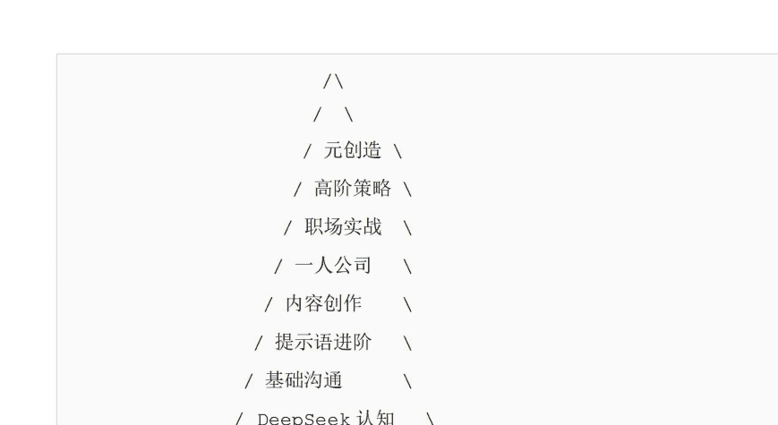

# DeepSeek 实战通关手册

## 开篇：AI浪潮已来，你准备升级了吗？

2024 年尾到 2025 年初，名叫 DeepSeek 的国产模型几乎在一夜之间占领了全球的讨论区。主流媒体在刷屏，技术圈、资本圈乃至普通网友都在议论它，甚至它直接点燃了英伟达等算力巨头的股价波动。人们这才猛然醒悟，高性能的 AI 不再是烧钱的特权，成本墙正在被拉低，能力正变得像自来水一样可得。

几乎同时，朋友圈里无论是否关注 AI 的人都在问同一个话题。私信里反复出现的问题也越来越一致：“DeepSeek 到底是什么？和 ChatGPT 有啥不一样？一个普通人能拿它做什么？”正是这几个问题，成了这本手册的起点。

## 为何选择 DeepSeek？

在 DeepSeek 之前，AI 的世界被一条隐形的线切成了两半。一边是 OpenAI 为代表的闭源头部，模型很强，但使用费用高昂，开放程度有限；另一边是各种开源方案，便宜甚至免费，但水准参差，大多难以触及顶级商业模型的门槛。

DeepSeek-R1 把这条线撕开了。

它的表现能够与 OpenAI 的 o1 正式版相媲美，意味着在数学推导、代码编写、自然语言推理等硬核任务上站到了世界第一梯队。模型完全开源且允许免费商用，无论是个人开发者、初创团队还是大企业，都能拿来用、改、再基于它做自己的产品。国产的定位让它对中文的理解更地道，对国内用户的表达习惯、语境梗更敏感。

国产、开源、免费、强大、懂中文，五颗标签叠加在一起，像是一次技术平权的集体事件。

R1 的不同点还不止于此。它属于新一代的推理型大模型。

我们过去熟悉的 GPT-4 这类模型属于通用型，擅长生成、理解上下文、创意输出，反应快，但遇到需要严密证明的数学题、复杂调试的代码或多步逻辑时，容易跳步甚至胡说。推理型模型在通用能力的基础上强化了逻辑推演与决策。它借助强化学习、链式思考 Chain-of-Thought 等机制，先在内部走完一步步的推演，再给出最终结论。

简单说，通用模型靠直觉秒答，推理模型靠深思慢推。这个差异决定了我们与 DeepSeek 沟通的方式必须换一套逻辑。

## 再也不用写复杂指令

用过其他 AI 的人常会这样提问：

“你是一名资深营销专家，请帮我写一篇小红书种草文，产品是便携榨汁机，受众 25-35 岁都市白领女性，语气轻松活泼，突出 3 秒清洗和无线便携，控制在 300 字内，配 5 个话题标签。”

这种角色扮演加任务拆解再加格式限定的结构化提示，对通用模型很有效，因为它需要你把步骤拆清楚它才会照单执行。

放到 DeepSeek-R1 上，效果反而会打折。推理模型已经把推理路径内化了，你越是手把手指挥，越容易干扰它的思考链。好比请顶级数学家证明一道题，你不需要告诉他先画辅助线、再列方程，只需要说“请证明勾股定理”，它自会走对流程。

对推理模型，关键是表达需求，而不是下指令。本书就是要帮你掌握这套新的对话范式。

## 五个板块带你全盘掌握

整本书拆成五层，循序渐进，从认知到落地，最终帮你用 DeepSeek 搭起自己的“一人公司”。

认知篇会重新梳理 DeepSeek 的本质，把推理模型和通用模型的差别讲透，建立起正确的 AI 思维，这是用好所有工具的地基。

方法篇手把手教高效对话，从场景化模板、术语拆解到风格迁移，再到提示语设计的进阶技巧，让你精准控制输出质量。

实战篇把理论落地，展示文案写作、营销策划、自媒体内容创作，包括公众号、抖音、小红书，以及如何形成完整的商业闭环。案例真实，指令可直接套用。

思维篇在熟练使用之后再升级，介绍概念嫁接、极端假设、元叙事等激发创新的策略，同时教你把 DeepSeek 变成第二大脑，实现知识的快速沉淀与认知提升。

未来篇讨论 AI 时代的职场提效、个人成长与超级个体素养，如何用老板心态管理 AI 小团队，把精力聚焦在真正创造价值的事上。

## 适合哪些人群

职场人士想要摆脱重复劳动，提升效率；创业者和自由职业者想低成本搭建商业闭环，做自己的“一人公司”；自媒体人和内容创作者希望高效产出高质量的文案脚本文章；学生和终身学习者想加速学习、快速切入新领域；任何对 AI 感兴趣的普通人，只要想抓住时代红利，这本手册都为你准备。

## 不太适合谁

如果你想学习如何从零训练大模型，或者想深入研读 DeepSeek 的底层算法论文，那这本书无法满足你。定位是应用与实战，聚焦怎么用好工具，而不是怎么造工具。

## 怎么使用这本书

建议至少读两遍。第一遍通读，先建立对 DeepSeek 能力边界、沟通方式和应用场景的整体观。第二遍精读，跟着书里的案例和指令打开网页版或 App 亲自试。实践是唯一的掌握路径。书中提供了大量可复制的魔法指令和提示模板，可以大胆改、组合，找到最贴合自己风格的方式。

## 结语

2024 年被叫做 AI 应用元年。去年我们还在尝鲜围观，今年已经进入应用落地的深水区。AI 不会取代人，但会用 AI 的人会取代不会用的人。就像互联网和智能手机的普及，每次技术浪潮都会重洗牌局，先掌握新工具的人获得先发优势。

DeepSeek 把一把锋利又好用的神器交到普通人手里。免费、强劲、易用，不需要懂编程、算法或英语，只要表达清楚需求就能变现。唯一的问题是：你准备好拿起来了吗？准备好了，就翻开第一章，开始这场 AI 的进化之旅。

## 第一章：认识 DeepSeek 中国推理模型的崛起

21 世纪 20 年代中期，人工智能已渗透日常。大模型、AIGC、生成式 AI 这些词无处不在，从能流畅聊天的机器人到一键出图的创作工具，AI 的触角越来越广。但背后一直有一道门槛：高性能的 AI 通常很贵而且不开放。

以 OpenAI 为例，最先进的模型能力很强，却要么月费不菲，要么按量计费，闭源也让外界无法定制、无法免费商用。这就像工业革命时最先进的蒸汽机握在少数巨头手里，普通人只能租用。

DeepSeek 的到来改变了这个局面。

### 1.1 DeepSeek 的来历 —— 一家奔着 AGI 的中国团队

DeepSeek，中文名深度求索，成立于 2023 年。名字里既有技术路径，也有企业精神。它不炒概念，而是把目光放在通用人工智能 AGI 上，也就是能理解、学习并完成人类智力任务的终极形态。

一年多的时间里，靠扎实的工程能力和持续的开源成果，DeepSeek 在全球 AI 圈迅速建立声量。它的标签很清晰：

中国公司，对中文语境、文化习惯、网络热梗有天然理解；目标 AGI，推理模型正是迈向更像人类思考的关键一步；坚定开源，在大厂偏向闭源保利时选择开放，展现技术自信，也大幅降低使用门槛。

#### 开源为何关键

想想 Linux，如果当年没有开源，就没有安卓的繁荣，也没有今天遍地稳定的服务器。开源意味着透明、协作、可复用。任何人都能检查代码、发现问题、基于此构建新应用，无需从零造轮子。DeepSeek 的开源策略，就像为所有探索者免费提供高质量的地图和工具箱。

#### 小贴士：名字背后的含义

深度求索点明了深度学习的方法，也体现了不断求索的态度。比拗口的英文音译更有文化厚度，也契合格物致知。带着这种精神使用它，你会更容易摸到能力的边界。

### 1.2 DeepSeek-R1 的惊艳亮相

从积累到爆发，DeepSeek-R1 的发布让技术圈炸锅。这是一款开源推理模型，在数学、编程、逻辑推理等硬核场景里，能与 OpenAI 的 o1 正式版打成平手。

#### 1.2.1 推理模型是啥 —— 更慢但更靠谱

可以用系统一和系统二来理解。

系统一是快思考，也就是大多数通用大语言模型的工作方式。像一位博学但急躁的专家，立刻根据概率预测给出最可能答案。速度快、成本低、靠直觉，写总结、创意生成很行，但遇到复杂数学容易给出看起来对实则错的答案，因为它在回忆而非计算。

系统二是慢思考，也就是 DeepSeek-R1 的路线。像一位谨慎的数学家，提问进来后先在内部推演，试不同路径、检查漏洞、自我纠错，再输出结论。相对慢、算力消耗大，但逻辑更严密，适合数学证明、代码调试、战略推演这类任务。

举个例子：鸡兔同笼，35 个头 94 只脚。通用模型可能直接回忆“鸡 23 兔 12”。推理模型会设 x+y=35，2x+4y=94，代入求解，得到同样的答案，但推导过程清晰，可迁移。

R1 的强大来自后训练阶段的大规模强化学习，在少量标注下自主学会了链式推理。它不是被教步骤，而是领悟了如何思考。

#### 1.2.2 R1 的强项领域

推理能力的加持让 R1 在数学推导、代码生成与调试、复杂逻辑分析上表现突出，是需要严谨链条的任务里的利器。

#### 1.2.3 推理模型与通用模型对比表

| 维度 | 推理模型 以 DeepSeek-R1 为代表 | 通用模型 以 GPT-4 为代表 |
| :--- | :--- | :--- |
| 优势领域 | 数学推导、逻辑分析、代码生成、复杂问题拆解 | 文本生成、创意写作、多轮对话、开放问答 |
| 劣势领域 | 发散性表达较弱 | 需要严格逻辑链的任务易出错 |
| 提示语策略 | 简洁直接表达需求，避免过度指导 | 结构化引导，需明确角色任务步骤格式 |
| 性能本质 | 专精逻辑密度高的任务 | 擅长多样性任务，灵活但专项需提示补偿 |
| 思考过程 | 内部链式推理，可见思考痕迹 | 直接概率输出，不可见思考 |
| 响应速度 | 相对慢 | 很快 |
| 算力成本 | 较高 | 相对低 |

核心结论是，推理模型并非全面碾压，而是在深度逻辑场景有压倒性优势。选模型看任务，而不是盲目追新。

#### 对普通使用者意味着什么

写邮件、编故事、闲聊，优秀的通用模型就够了。但要解数学题、调代码、分析合同、推演商业策略时，DeepSeek-R1 这类推理模型会成为不可替代的助手。

### 1.3 DeepSeek 生态远不止 R1

R1 是明星，但 DeepSeek 的版图更大，覆盖普通用户和开发者。

#### 1.3.1 智能对话与语义理解

多轮对话能记住上下文，持续深入；情感分析可识别积极消极甚至焦虑期待等细腻情绪，用于舆情监控和客户反馈；意图识别能判断你到底想查天气还是要旅行建议。

#### 1.3.2 文本创作与整理

可辅助小说诗歌剧本歌词创作；生成广告语、产品描述、小红书微博朋友圈文案、营销邮件；把长报告论文新闻提炼成摘要，或把专业文本改写成通俗语言、翻译成地道外语；还能按要求输出规范的表格、列表、日程、代码注释和文档。

#### 1.3.3 编程辅助与代码管理

根据自然语言描述生成代码片段；把报错信息和代码一起丢进去分析原因并给出修复建议；用通俗语言逐行解释晦涩代码；分析性能瓶颈并建议更高效的数据结构或算法。

#### 1.3.4 可视化图表生成

能直接生成图表代码，便于嵌入文档或网页，让数据可视化更省事。

DeepSeek 的可视化与代码辅助能力

**Mermaid 图表**：能直接输出 Mermaid 语法，画出流程图、时序图、类图、思维导图、甘特图等，写技术文档或做项目排期时很省事。

**React 组件**：面向前端同学，能把图表需求转成可直接用的 React 组件代码。

**基础图形**：可以生成 SVG 格式的简易插画、图标等。

**示例**：直接说“请用 Mermaid 语法帮我画一个用户登录的流程图”，它就会返回对应的代码，复制到支持 Mermaid 的编辑器里就能看到清晰的图。

#### 1.3.5 文件处理能力

DeepSeek 在文件侧也很贴心，支持上传并读取多种格式里的文字内容。

- **可上传的格式**：TXT、PDF、Word、Excel、PPT，甚至是图片文件。
- **能做的事**：
    - 图片文字识别：拍一张书页照片或报表截图上传，它能把图中文字提取出来并继续处理。
    - 数据表格分析：上传 Excel 后，可以让它“这个销售表里哪个季度的增速最快”，它会自动读表给出结论。
    - 长文档提炼：上传几百页的 PDF 电子书，让它“总结这本书的核心观点”即可。

**一个典型场景**：
收到一份 30 页的 PDF 行业研究报告，需要 1 小时内整理出 10 分钟汇报用的 PPT。

**以前的做法**：通宵阅读，手工摘要点和数据，至少耗 3-4 小时。

**用 DeepSeek 的做法**：上传 PDF，指令写“请提炼报告的核心趋势、三个关键数据，以及给我们三条行动建议”。几分钟后就能拿到结构化的摘要，直接拿去做 PPT。

### 1.4 如何开启 DeepSeek？

功能很强，上手却很简单，而且目前个人使用完全免费。

#### 1.4.1 官方入口：网页版与手机 App

- **网页版**：打开官网 chat.deepseek.com，用手机号或邮箱注册后就能在浏览器里直接用，适合电脑办公学习。
- **手机 App**：在 App Store 或各大安卓商店搜“DeepSeek”下载。App 端支持语音输入，说话就能转文字，文件也能随时上传，方便随时随地处理手机里的照片和文档。

> **提示**：目前个人用户可免费使用，算是红利期，建议尽早注册体验。

#### 1.4.2 开发者接入：API 调用

想把能力嵌入自家产品，可以用 DeepSeek 的 API。

- **好处**：不用自己训练部署模型，直接调用就能在软件、网站或小程序里获得顶级 AI 能力。
- **成本**：定价远低于 OpenAI 等同类产品，性价比很高，对初创和个人开发者友好。
- **获取方式**：官网的开发者文档里有详细的使用说明、接口文档和各语言 SDK。

### 1.5 使用边界：需要知道的局限

再强也是 AI，不是万能智能。清楚边界才能用得更稳。

#### 1.5.1 幻觉问题

大模型共有的先天缺陷，生成看似合理实则虚构或不准的信息。它不是故意撒谎，而是概率预测时缺乏依据就自行补全。

**为何会发生**：模型学会的是词与词的关联，并非真正理解世界真实性。知识盲区时就会“自作聪明”。

**应对方法**：
1. **追来源头**：对不确定的事实、数据、观点追问“请给出来源”或“基于哪份报告”。注意来源也可能被编造。
2. **交叉核验**：关键信息如数据、法律、医疗建议，务必用搜索引擎、专业库、官网做二次验证。
3. **保持批判**：你才是最终责任人，把 AI 当作思路和初稿助手，而非绝对权威。

#### 1.5.2 知识截止点

DeepSeek 的知识截止在 **2024 年 7 月**，之后发生的事件、新数据、新技术它不会主动知道。

**应对方法**：
- **开启联网搜索**：提问时手动打开联网搜索，模型会先查网再生成。
- **自行提供新料**：把 2025 年的新闻内容复制粘贴进去，再基于这份材料提问。

#### 1.5.3 其他潜在限制

- **可解释性**：推理过程虽可展示，但部分黑箱仍难完全理解。
- **数据偏见**：学习自互联网数据，可能带入性别、种族等社会偏见。
- **安全与隐私**：不要上传身份证号、银行卡号或企业高度机密商业数据。
- **恶意诱导**：虽有安全对齐，仍可能被巧妙提示词诱导产生有害内容。

#### 本章小结：迈出 AI 进阶的第一步

这一章我们梳理了 DeepSeek 的全貌：
1. DeepSeek 是专注 AGI 的中国科技公司，以开源、免费、高性能推动 AI 普惠。
2. DeepSeek-R1 是划时代的推理模型，用“链式思维”模拟慢思考，在数学、代码、逻辑分析上表现突出，与通用模型各有侧重。
3. 应用场景覆盖智能对话、文本创作、编程辅助、图表生成和强大的文件处理，是全能型助手。
4. 网页版或手机 App 即可免费上手，开发者可用 API 集成。
5. 了解幻觉、知识截止等局限，培养批判性思维和交叉验证习惯，是合格使用者的必备素养。

大门已打开，下一章将聚焦最重要的实操：如何正确使用它。我们将告别“复杂提示词工程”，学习一套专为推理模型设计的沟通范式，让 AI 使用像聊天一样自然。

## 第二章：沟通升级 如何让 DeepSeek 真正听懂你

上一章介绍了 DeepSeek 的能力，本章进入实操。最关键的问题是：该怎么和它对话？

如果你习惯 ChatGPT、文心一言的“提示词工程”：设定角色、拆分任务、规定格式、给示例。这套方法对通用模型有效，但用在推理模型上就像用开拖拉机的手法去开战斗机，性能出不来甚至适得其反。

我们需要思维切换：从“下指令”到“表需求”，从“手把手教”到“信任放权”。

### 2.1 重新认识提示词 从命令到对话

先厘清概念：提示词是你输入给 AI 的任何信息，可是一句话、一段指令或复杂描述。

过去很多人把提示词当成“命令”，导致沟通累、结果僵化。

更准确的说法是：提示词是对话的起点。

想象你去顶级咨询公司见资深顾问：

- **错误沟通**：念指令“你现在是商业顾问，请分三步分析市场、竞争对手……用 SWOT 写 10 页报告，每页 500 字”。
- **正确沟通**：说“我是一家小电商创始人，最近增长停滞，新客成本越来越高，手里有一年销售和广告数据，想听听专业建议”。

谁的建议更好？第二种给了足够背景和真实需求，顾问才能发挥专业，而不是被动执行僵化指令。

**DeepSeek-R1 就是那位顾问，它要的是需求，不是指令。**

#### 2.1.1 优质提示的三大要素

高质量提示通常包含：
1. **指令**：要做什么，如“写篇文章”“解释概念”“分析数据”。
2. **上下文**：基于什么，如“读者是大学生”“我没有技术背景”“这是上月报表”。
3. **期望**：做成什么样，如“轻松幽默 1500 字”“用生活例子解释”“指出增长最快的三个品类并分析原因”。

通用模型需要你把三点都结构化讲清楚，推理模型只要上下文和期望说清，它自己会生成执行指令。

对比示例：

- **给通用模型**：角色是资深小红书运营，任务写无线蓝牙耳机种草笔记，受众 18-25 女大学生，卖点粉色、续航、音质，要求活泼带 emoji 200 字加三个话题。
- **给 DeepSeek-R1**：我拿到一款无线蓝牙耳机想在小红书推荐给女大学生，耳机粉色好看、充电一周、音质也不错，不知道怎么写的吸引人，帮我想想怎么组织语言，语气活泼点像小女生分享。

后者像朋友聊天，模型会自行推断笔记类型、受众、卖点、语气，并规划标题、开头、卖点描述、互动收尾。你不需要教步骤。

#### 2.1.2 从指令驱动转向需求表达

从“教它怎么做”到“告诉它我要什么”，是与推理模型高效对话的核心转变。

### 2.2 三个实战对话模板

#### 2.2.1 模板一 场景化需求

公式：
> “我要【目标】，给【对象】用，希望达到【效果】，但担心【问题】。”

- 【目标】：PPT、文案、分析、计划等。
- 【对象】：具体受众画像。
- 【效果】：消除恐惧、引发共鸣、提升专业度、促成行动。
- 【问题】：你的顾虑，如听不懂、太晦涩、不符合调性。

提前给出顾虑，模型会主动规避。

**案例 1 PPT 框架**
- 普通问法：帮我做海外市场拓展 PPT。
- 场景化问法：我要做一个 PPT 给 50 岁左右的制造业老板讲传统工厂出海战略，希望用生存压力类比国际竞争，让他们觉得出海是必选而非可选。但担心他们觉得市场遥远、怕法律风险和管理成本、怕文化水土不服。你能帮我设计框架吗？

模型会推导出用危机现状、类比破冰、风险拆解、行动路线来组织内容。

**案例 2 产品文案**
- 普通问法：帮我写智能手环广告文案。
- 场景化问法：我要写智能手环文案给 35-45 岁职场人，突出压力监测和休息提醒，让他们觉得是健康关怀而非监控。但担心文案让人觉得身体很差或贩卖焦虑。能给几个不同角度的版本吗？

输出会是温情关怀、高效赋能、轻松自嘲等多种角度。

#### 2.2.2 模板二 通俗化解术语

公式：
> “用【某个水平】能听懂的话解释【专业术语】”

水平可填小学生、初中生、奶奶等，模型会主动做类比简化。

可升级追问：解释完后继续问“现在用高中生水平再说一遍”或“举个生活例子”。

**案例 1 RLHF**
问：用小学生能听懂的话解释 RLHF。
模拟回答：像训练小狗，好的动作给奖励，坏的动作不奖励，久了小狗就知道怎么做能讨喜。RLHF 就是给 AI 好坏例子，让它学会做更讨人喜欢的回答。

**案例 2 流动性风险**
问：用初中生能听懂的话解释“流动性风险”，再举生活例子。

**流动性困境的通俗演绎示例**

模拟回复：资金变现难的要点其实很直白，即手里名义上值钱的资产，在需要时却无法立刻变成可用现金。比如把全部零花钱拿去收一套限量邮票，花费约千元，这套邮票在市场上确有价位但交易冷清。某日学校临时收取春游费用，需要两百元现金，邮票挂网数日无人问津，最后只能向同学周转。这就是典型的变现困境——资产有价值，却转不动。放到理财场景，高收益产品常要求锁定期数年，提前支取还要支付高额罚息，本质与上同。日常留存一笔随时可用的现金，道理等同于书包常备应急零钱。

学会把专业概念拉到生活层面后可实现：
- 快速自学：遇到陌生术语，可要求用生活语言拆解，数分钟即可入门。
- 通俗写作：将艰深内容转译给大众读者。
- 管理汇报：将技术方案翻译成管理层易懂的表达。

### 2.2.3 第三套范式：风格迁移用法

该范式的乐趣在于让模型模仿特定人物的写作气质。

通用句式：
> “模仿【作家/名人/文体】的【风格特征】写关于【主题】的【内容类型】”

要点拆解：
- 【作家/名人】：想借鉴的对象，可选鲁迅、海明威、村上春树、李白、杜甫、泰戈尔、乔布斯、马斯克、李佳琦、papi酱等。也可指定“知乎高赞体”、“华尔街日报评论体”。
- 【风格特征】可选：不想点名人物，可直接描述，如“古龙武侠笔风”、“王家卫电影旁白调性”、“犀利吐槽语气”。
- 【主题】：想表达的核心意思。
- 【内容类型】：期望的输出形态，如文章、段子、脚本、语录、家书等。

为何有效：模型在训练时接触海量文本，对不同作者、不同文体的词汇、句式、修辞和节奏有较强把握，给一个锚点即可实现高精度迁移。

#### 实战示范一：金庸笔触写程序员
提问：用金庸武侠小说的笔法，描绘一段程序员借助R1高效写码的场景。
模拟回复：那程序员端坐工位，双手于键盘流转，指法迅捷，代码如瀑倾泻，每行皆合逻辑。原来他正运转“DeepSeek 心法”，此功世间罕见。往昔需苦思数日的算法难题，如今将思路注入其中，R1便似一位隐身幕后的绝顶高手，瞬间演化万千变化，递出最优解。旁人只见他神色自若，一杯咖啡饮罢，千行代码已成，架构严谨无漏，不禁感叹：“此子必有高人指点！”他微微一笑，不露痕迹。屏幕角落一行小字幽光微现：“本段代码经R1辅助生成。”

#### 实战示范二：李佳琦口吻推书
提问：模仿李佳琦直播带货的语气，写一段《DeepSeek 从入门到精通》的推荐脚本。
模拟回复：“来！想要升职加薪、少加班、用AI赚钱的姐妹们听好！这本《DeepSeek 从入门到精通》，真的绝了！从提问技巧讲起，到AI写作、做PPT、写代码、甚至教你做一人公司！天呐，以前写周报要憋两小时？学会方法十分钟搞定，老板还夸你有条理！做图做到秃头？书里直接教AI生成海报，省下的时间喝杯奶茶不香吗？价格只要一杯奶茶的钱，一杯奶茶！不亏不亏，能买到一个24小时在线的AI助手！准备好了吗？3、2、1，上车！”

进阶玩法：
- 融合风格：请用王家卫电影旁白的语调，为iPhone写一段广告词。
- 反差风格：请用极其正式的政府工作报告语气，描述一个人早上赖床的细节。
- 情绪迁移：请用失恋日记那种低落的语气，写一篇硬盘损坏导致数据丢失的小文。

### 2.3 新手易踩的反向优化误区

#### 2.3.1 误区一：过度结构化
症状：写超长提示，塞进角色设定、分步任务、格式要求、示例输出，像写技术文档。

为何不妥：通用模型需要手把手引导，推理模型则不需要。对R1这样做，反而束缚思考。想象请数学家解题，却先给一份解题步骤清单，第一步设X，第二步用A公式……会觉得被指挥，步骤未必最优，还得兼顾框架，结果两头受限。R1内部推理链已成熟，外加僵化框架会让它额外消耗资源去对齐，导致输出质量下滑。

正确做法：放手信任。
该做：清晰说明目标、背景、限制，然后让它自行想办法。
不宜做：强制“先做A再做B再做C”，除非是必须遵守的硬性步骤。

对比：
错误示范过度结构化：“你是一个数据分析师。请按以下步骤分析销售数据：第一步算月销售额，第二步对比去年增长率，第三步找增长最快的三个品类，第四步用SWOT总结，每步用表格呈现。”
需求导向示范：“帮我看这份销售数据，今年增长如何，哪些品类最好，和去年比怎样，有什么机会或风险，麻烦用通俗语言总结。”

#### 2.3.2 误区二：角色扮演画蛇添足
症状：习惯开头写“你现在是XX专家”、“请扮演XX”。

为何可能有害：角色扮演对通用模型有聚焦作用，对强推理模型却可能引入噪声。R1本身已具备严谨逻辑和求真倾向，强行让它扮演“营销专家”，它可能滑向套路化话术，降低分析质量；让它扮演荒诞角色如“来自火星的科学家”，更可能编造错误信息。

正确做法：表达需求中隐含的视角，而非强迫其成为角色。
要法律意见？别说“你是律师”，说“请从法律角度分析这份合同的风险”。
要投资建议？别说“你是投资顾问”，说“站在保守型投资者立场，分析这个产品的优劣”。
要医疗信息？切勿让AI扮演医生，说“基于公开医学资料介绍该病的常规治疗，并说明不能替代专业诊断”。

原则是让模型使用专业视角和逻辑，而不是扮演拥有社会身份的角色，后者会增加幻觉风险。创意类无风险场景可角色扮演，例如“扮演一个会说反话的童话人物吐槽都市压力”。

### 2.4 进阶控制策略

#### 2.4.1 精准定义
输出不佳往往源于需求不清。
1. 明确核心问题，别问“你觉得怎样”，要问“这个方案的三大风险是？”
2. 去除杂音，只给任务相关上下文。
3. 具体化指令，别说“写好点”，要说“每段加小标题，段间空行，关键数据加粗”。

例：
模糊：“帮我写封开发信。”
精准：“请写一封英文开发信，我们是深圳智能插座厂商，目标美国大型家居连锁采购经理。要突出产品比竞品便宜20%且通过UL认证。语气专业不傲慢，不超过150词。”

#### 2.4.2 分解任务
极复杂任务可分阶段协作，而非一次性堆砌步骤。
第一步：“先分析用户反馈数据中最突出的三个问题，只列问题不给解法。”
第二步：“针对第一个问题‘响应时间过长’，给出三条可能方案并分析优缺点。”
第三步：“把问题和方案整合成报告，包含摘要、问题分析、方案对比、建议四部分。”

#### 2.4.3 长度与格式约束
明确格式或长度不会干扰推理，只约束呈现形式。
- 长度：请用200字以内概括核心观点。
- 格式：请以JSON输出，字段为“标题”、“作者”、“摘要”。
- 风格：请用严肃客观语气，避免第一人称“我”。

### 2.5 应对幻觉的测谎手段

#### 2.5.1 要求自我反思
追问：“你刚才提到的2023年市场份额35%有可靠来源吗？若不确定请说明。”
“‘A导致B’这个因果链确定吗？有没有其他解释？”
“请用相反立场反驳你刚才的结论。”

#### 2.5.2 循序渐进交叉验证
先开放提问了解概况，再针对细节深挖，最后用联网搜索核实权威来源。例如让其写新能源汽车政策报告后追问：“你引用的补贴标准是哪年发布的？是否仍有效？”

#### 2.5.3 拥抱不确定性
指令：“若信息不确定，请明确说‘我不确定’。推测内容请标注‘推测’。”

### 2.6 策略速查表

| 任务类型 | 推荐模型 | 提示语侧重点 | 示例有效提示 | 需避免策略 |
|---|---|---|---|---|
| 数学证明 | 推理模型 | 直接提问，信任推理 | 用反证法证明根号2是无理数 | 冗余拆解步骤 |
| 创意写作 | 推理模型 | 设定风格氛围后放权 | 以村上春树风格，写图书馆管理员深夜发现会说话的书 | 过度限制逻辑顺序 |
| 代码生成 | 推理模型 | 简述需求输入输出 | 用Python写函数，输入整数列表返回奇数平方和 | 分步指导每行操作 |
| 多轮对话 | 推理模型 | 明确目标范围 | 从技术、伦理、经济三维度分析AI对就业影响，分维度深入 | 情感化开放提问 |
| 逻辑分析 | 推理模型 | 直接抛问题求论证 | 分析电车难题中功利主义与道义论冲突，给出倾向与理由 | 主观引导选择 |

### 2.7 从术到道

技巧是术，思维是道。熟练后要把AI当成博学理性但对你情境不了解的聪明实习生。清晰介绍背景、目标、顾虑，让它提方案，再一起讨论修改。

本章小结：沟通从“教”到“聊”
- R1更适合需求导向而非指令驱动。
- 掌握场景化需求、术语降维、风格迁移三大模板。
- 避免过度结构化和不当角色扮演两大反向优化。
- 学会精准定义、任务分解、格式控制与幻觉验证。
- 用对照表建立不同任务的提示直觉。

### 第三章：提示语进阶——精准控制与复杂任务设计

第二章打好沟通基础后，处理更复杂专业任务时，仅靠聊天不够。你需要特定格式数据、严谨结构长报告、多约束最优解，甚至多步骤项目协作。这就需要进阶设计能力。

#### 3.1 提示语的DNA：核心要素与协同效应

强提示不是一句话，而是由多个要素组成的有机体。理解要素及其协同是高手起点。

#### 3.1.1 七大核心要素拆解

要素类型 | 含义说明 | 价值 | 举例
---|---|---|---
议题要素 | 指任务的核心话题与所属领域 | 为模型指明工作方向 | “新能源汽车市场观察”
行动要素 | 明确要求模型执行的具体操作 | 锁定需要完成的动作 | “梳理”“提炼”“撰写”“翻译”
背景要素 | 提供任务所需的情境、历史与前提信息 | 帮助模型把握来龙去脉 | “新创团队，资金紧张”
框架要素 | 约束输出的组织逻辑与层次 | 使结果条理清晰 | “按背景-问题-对策-结论展开”
形式要素 | 对输出样式的硬性规定 | 便于后续处理与展示 | “JSON 结构”“Markdown 表格”
语态要素 | 设定语言风格、语气与情感基调 | 让表达贴合场景受众 | “轻松幽默”“严谨专业”“温暖亲切”
质检要素 | 对准确性、完整性与可信度的要求 | 提升结果质量与实用度 | “结论需数据支撑”“不确定处请标注”

#### 3.1.2 要素联动效应：为什么合起来更有力
单独使用某个要素效果有限，多要素配合时会产生明显的放大效应。

1. 互相补位
不同要素可以弥补彼此短板。例如：
- 议题+资料+质检：让模型在分析某个话题时基于一份资料，并要求“结论必须有数据支撑，无支撑要明说”。资料让议题不空泛，质检避免了无中生有。
- 框架+范例：只给框架容易得到干巴巴的骨架，只给范例容易只学表面。两者结合，模型既懂逻辑骨架，又能把握表达精髓。

2. 连锁触发
设定一个要素会带动其他行为。例如把语态设为“批判性思考”，模型不仅会调整口吻，还会主动质疑已有观点、找漏洞、举反例，这实际上是质检与深度分析的延伸。

3. 矛盾共生
看似冲突的组合有时效果更好。例如：
- 用轻松语气解释严肃的医学科普，能大幅提升传播力。
- 要求步骤极细的同时追求高创造性，会在严格轨道里逼出更可落地的创新方案。

4. 新属性涌现
特定组合会产生单一要素不具备的特性。例如语态+议题+框架共同作用，会自然形成品牌调性，内容具备一致的辨识度。背景+限制+迭代指令会产生适应性，模型能根据反馈动态调整，像是理解了意图。

#### 3.1.3 实战对照：要素组合参考表

| 目标 | 核心组合 | 辅助组合 | 效果概括 |
| :--- | :--- | :--- | :--- |
| 提升准确性 | 议题 + 资料 + 质检 | 知识范围 + 输出核验 | 基于清晰议题与可靠资料产出，并通过严格质检提高可信度 |
| 提升创造性 | 议题 + 背景 + 限制 | 参考素材 + 迭代指令 | 丰富情境与适度限制激发灵感，多轮打磨促进创新 |
| 提升执行效率 | 行动指令 + 框架 + 形式 | 篇幅 + 语态 | 清晰指令与预设结构加速完成，同时满足形式与语态需求 |
| 提升一致性 | 语态 + 知识范围 + 限制 | 形式 + 质检 | 统一语态与专业知识保证稳定，限制与质检维持标准 |
| 提升交互体验 | 迭代指令 + 输出核验 + 质检 | 行动指令 + 背景 | 构建动态对话，支持自我核验与优化，按任务与背景灵活调整 |

落地例子：
想让模型产出一份竞品分析。重点是议题、资料、质检，辅以框架与形式。可这样写：
> “请基于我上传的三份竞品资料 A、B、C，比较它们在用户增长打法上的相同与差异。要求所有结论必须引用资料原文或数据，无法确认的标注‘待核实’。结构为‘总览表 + 三个核心差异的深度解读 + 对我方的启示’。用 Markdown，表格左对齐，每段解读不超过 200 字。”

#### 3.1.4 提示词设计自检清单
设计前快速过一遍：
- 目标是否清晰，行动指令是否具体
- 背景信息是否充分，是否缺少关键上下文
- 长文本是否有明确的逻辑框架要求
- 措辞是否中立，会否引导片面结论
- 请求是否合法合规
- 是否要求标注来源或不确定之处
- 是否预留后续追问与优化空间
- 形式要求是否清晰可执行
- 任务是否过难，需要先拆解
- 是否需要多角度或备选方案

### 3.2 高级策略一：任务拆解，让复杂变简单
面对写商业计划书这类复杂任务，一次性出稿容易失控。拆解能提升稳定性。

#### 3.2.1 拆解的四点收益
1. 降低认知负荷：把大任务拆成小任务，单次聚焦更清晰。
2. 便于过程把控：每步可检查方向，偏了及时纠正。
3. 支持深度迭代：可对某一步反复打磨再进入下一步。
4. 减少不确定性：子任务更可控，幻觉风险下降。

#### 3.2.2 四步拆解法
1. 宏观定义：明确最终目标与交付形态。如“产出约 8000 字的商业计划书，用于天使路演”。
2. 逻辑拆分：划分为相对独立的部分。如执行摘要、公司概况、产品、市场、竞争、营销、管理、财务。
3. 分步指令：为每个部分设计独立提示，并基于上一步成果。例如先生成市场分析，再用其结论生成竞争分析。
4. 整合优化：汇总后通读，统一衔接与语态。

#### 3.2.3 SPECTRA 模型：系统化拆解框架

| 步骤 | 英文 | 中文 | 核心动作 | 提示技巧示例 |
| :--- | :--- | :--- | :--- | :--- |
| S | Segmentation | 分割 | 把大任务拆成 3-5 个相关子任务 | “把‘策划线上发布会’拆成筹备、预热、执行、复盘等阶段。” |
| P | Prioritization | 排序 | 明确子任务重要性与先后 | “对上述子任务排序，说明最关键项与前置条件。” |
| E | Elaboration | 细化 | 深入展开每个子任务的具体动作 | “在‘预热’下细化 5-8 个执行动作，如设计海报、撰写邀请函、联系 KOL。” |
| C | Connection | 连接 | 建立子任务间的逻辑关联 | “分析‘预热’成果如何影响‘执行’参与度，画出因果链。” |
| T | Temporal Arrangement | 时序 | 设定时间节点与里程碑 | “假设发布会在 30 天后，为各子任务分配时间，形成甘特图。” |
| R | Resource Allocation | 资源 | 评估复杂度并分配认知资源 | “给每个子任务打 1-10 的复杂度分，10 分需最多思考。” |
| A | Adaptation | 适应 | 根据反馈动态调整结构 | “完成‘预热’后评估效果，如不佳请建议调整后续阶段。” |

SPECTRA 实战示例：写一篇 5000 字公众号文章《AI 时代职场人如何提升竞争力》
1. S：“请把写稿任务拆成 3-5 个逻辑部分。”
2. P：“请对这 5 部分排序，说明重点篇幅。”
3. E：“在‘能力模型’下细化 4-5 个具体能力，每个配核心观点与案例。”
4. C：“请写一段 150 字过渡，把‘问题分析’自然衔接到‘能力模型’。”
5. T：“5 小时内完成初稿，请为各部分分配时间。”
6. R：“请评估各部分写作复杂度并打分。”
7. A：“完成后请扮演资深编辑，指出逻辑最弱处并给出重写建议。”

### 3.3 高级策略二：逻辑引导，让推理可视可控

#### 3.3.1 显式思维链
要求模型把推理过程写出来。
- 指令：“请逐步推演，最后给出结论。”
- 更细：“先列出关键因素，再逐步分析，最后总结。”

好处是便于核查前提、理解思路、快速纠偏。

示例对比：公司男性 60%、女性 40%，男性管理者 30%、女性管理者 40%，求管理者中女性占比。
显式推演会给出：假设 100 人→男性 60、女性 40→男性管理者 18→女性管理者 16→管理者总数 34→女性占比约 47.06%。过程清晰，易发现计算错误。

#### 3.3.2 元提示，指明思考方式
不是告诉想什么，而是指导怎么想。
- 第一性原理：“用第一性原理分析如何降低电动车成本，回到物理化学基本规律。”
- 反向推理：“假设已实现 100% 用户留存，反推所需条件。”
- 类比思维：“借鉴生物共生，类比两家科技公司的战略合作。”
- 奥卡姆剃刀：“给出多解后选假设最少的方案。”

可组合使用，深度远超普通提问。

#### 3.3.3 渐进式对话引导
多轮逐步加入约束，比一次性超级问题更好。例如开面馆的建议，先给通用建议，再补充 B1 层、有三家竞争对手，再补充厨师只会兰州拉面，最终得到在汤底、配菜、外卖包装上差异化的具体策略。

#### 3.3.4 苏格拉底式提问
让模型通过提问帮你思考，而非直接给答案。例如让团队更主动承担责任，模型可问：“员工等指令时最担心什么？是否怕犯错？上次批评后是否调整过授权与容错机制？设立试验性授权周会何反应？”通过追问帮助定位根源。

### 3.4 高级策略三：质量管控与持续迭代

#### 3.4.1 提前设定质量标准
避免模糊的“写好点”，要具体化。
- 准确性：所有数据须来自上传文件，不得编造，不足则说明缺失。
- 完整性：须覆盖成本、效率、风险、可行性、长期影响等 5 维度。
- 逻辑性：前提真实、推理有效、结论一致，自检循环论证。
- 清晰度：短句，每段不超过 5 行，术语首次出现需解释。
- 新颖性：避免陈词滥调，至少提供一个反常识视角。
- 实用性：每条建议含可执行步骤，第一步、第二步。

#### 3.4.2 内置自我检查
要求模型在答案后自评。
- “回答后另起一段，用‘自我检查：’开头，写出最不满意之处与改进方向。”
- 更严格：“按准确度、相关度、深度、可操作性各 1-5 分自评，总分低于 16 分则自动重写。”

#### 3.4.3 迭代优化循环

一次成稿是错觉，迭代才是质检的关键

与其相信一句话就能出完美稿，不如把提示当成需要反复打磨的工具。真正能稳定产出高质量结果的人，从来不是靠灵感一次性写对，而是靠循环试错把输出调准。

一套可复用的迭代路径

1. 先出初稿。用最简指令让模型给出第一版。
2. 精准诊断。把初稿里的问题具体化：逻辑断层、语调跑偏、信息空洞等。
3. 对症下药。针对诊断结果给出新的操作句。例如“第二段说服力弱，加一个真实数据佐证”或“整体太正式，改成轻松的对话感”。
4. 再生成。让模型在原稿基础上修正或重写。
5. 循环 2-4 步，直到达标。

实战对话示范

- 你：“写一份招聘启事，要 AI 产品经理。”
- AI：回了一版常规 JD 式的平铺介绍。
- 你：“太像官方文件了，吸引力不足。请换成小红书种草的语气，强调能接触前沿技术，团队氛围也松弛。”
- AI：给出一段更活泼、带 emoji 的版本。
- 你：“有进步，开头还是不够抓人。用‘震惊体’风格重写开头，要吸睛但不能虚假夸大。”
- AI：回“震惊！身边产品还在画原型？我们已用 AI 直接生成 PRD 了！”这类开头。
- 你：“可以，最后再加一句点出不加班和零食自取。就这样定稿。”

三四轮打磨后，终稿往往远超首版。优秀的提示设计师，本质上是调参师而非写手。

#### 3.4.4 红队思维：让模型自我攻防

这是极致的质量把控思路。让同一模型扮演两个对立角色：一边创作，一边挑刺。

指令示例：“先写一篇约 800 字的论证文，主题远程办公提升效率。随后切换身份，扮演持反对意见的评论者，逐条拆解前面文章的论点，要求论证严谨、依据充分。最后综合两方内容，输出一篇平衡稿，既承认远程办公的优势，也回应其风险，并给出适用场景建议。”

模型自己和自己对打，能有效减少片面性，产出经得起推敲的结论。

### 3.5 四大实用提示词框架

下面四个框架可以直接套用。

#### 3.5.1 TASTE 框架：通用全场景模板

适用于内容创作等各类任务。

| 字母 | 对应项 | 英文 | 说明要点 |
| :--- | :--- | :--- | :--- |
| T | 任务 | Task | 明确需要完成的任务与交付物 |
| A | 受众 | Audience | 明确使用者是谁、知识水平与关注点 |
| S | 结构 | Structure | 预设输出的组织方式 |
| T | 语气 | Tone | 指定风格与表达口吻 |
| E | 示例 | Example | 可选，提供风格或格式参考 |

TASTE 示例

T：写一篇关于数据隐私重要性的短博客。
A：面向非技术背景的普通网民。
S：开头设问，中间讲原因与危害，结尾给建议。开头可问“你知道每次点击都在被记录吗？”
T：友好易懂，不制造恐慌，用生活化例子如购物推荐、APP 权限。
E：风格类似《纽约时报》个人科技专栏，但更精炼。

#### 3.5.2 ALIGN 框架：适合复杂分析与策略

| 字母 | 对应项 | 英文 | 说明要点 |
| :--- | :--- | :--- | :--- |
| A | 目标 | Aim | 任务的最终目的 |
| L | 难度 | Level | 专业深度与受众层次 |
| I | 输入 | Input | 需要处理的素材或数据 |
| G | 原则 | Guidelines | 执行时的规则与限制 |
| N | 新颖 | Novelty | 是否需要创新观点 |

ALIGN 示例

A：写一篇可持续发展文章，并给出普通人可执行的三个行动。
L：高中生可读，避免术语但有一定思想深度。
I：提供全球变暖、塑料污染背景，以及某城市垃圾分类成功案例。
G：语言简洁，每个行动需说明“为何有效”和“怎么做”。
N：引用近三年数据，提出新视角如“零浪费为何比回收更关键”，避免陈词滥调。

#### 3.5.3 CIRS 框架：适合多步骤流程任务

| 字母 | 对应项 | 英文 | 说明要点 |
| :--- | :--- | :--- | :--- |
| C | 背景 | Context | 任务背景与整体目标 |
| I | 指令 | Instruction | 当前步骤的具体要求 |
| R | 细化 | Refinement | 在已有输出上追加修正 |
| S | 综合 | Synthesis | 多步结果整合成终稿 |

CIRS 使用示范

- C：“下月我要办一场 90 分钟线上课，主题 AI 工具助力职场提效。”
- I：“先按 15 分钟一模块划分课程大纲。”
- R：“针对开场破冰模块，设计三个能立刻让观众参与的提问。”
- R：“针对实操演示模块，写一段 300 字口播稿，介绍 DeepSeek 如何快速分析 Excel。”
- S：“把大纲、互动问、口播稿整合成直播执行手册，按时间线排，并加讲师备注栏。”

#### 3.5.4 SPECTRA 框架：超复杂项目

适用于无从下手的巨型任务。七步依次为 Segmentation 分割、Prioritization 优先级、Elaboration 细化、Connection 连接、Temporal Arrangement 时序、Resource Allocation 资源分配、Adaptation 调整。可直接把七步作为提示主体，与 AI 协同推进。

### 3.6 复杂任务实战：从模糊需求到高质量交付

任务背景：你是一家初创公司市场负责人，公司有款“AI 智能会议纪要工具”，功能包括实时语音转文字、自动提炼待办、兼容飞书钉钉。目标客户是 50-200 人的中小科技公司。老板只说“想想怎么推广”，需求极度模糊。

阶段一：需求澄清与任务拆解

提示思路结合场景化模板与 SPECTRA 的分割与优先级：

“我们做了一款 AI 会议纪要工具，核心功能是实时转文字、自动提取待办、与飞书钉钉打通。目标客户是中小型科技公司。请帮我把‘出推广方案’分解成 3-5 个子任务，如市场分析、竞品研究、渠道策略、预算规划等，并给出优先级排序。”

阶段二：逐项深入

按建议先做市场分析：

“请做市场分析，主题是中小科技公司的会议效率痛点与工具需求。数据依据我上传的 36 氪《2024 协同办公市场报告》PDF，可补充公开知识，不确定数据请标明。输出结构：1）三大核心痛点及紧迫性排序；2）现有解决方案的不足；3）我们的切入机会。要求每个结论至少有一个数据或案例支撑。”

阶段三：引入约束与创意激发

“分析很清晰。现在基于此设计推广创意概念。约束：季度营销预算 5 万元，团队只有我和一名实习生。用第一性原理思考，不要套用常规 SaaS 套路，从‘用户何时最痛’出发，设计低成本、易传播的创意。”

阶段四：迭代优化与质检

“我倾向‘AI 帮你开会的沙雕短视频’方向。请先写 30 秒脚本，再扮演毒舌投资人指出三个可能导致转化低的问题，最后据此修改脚本。”

阶段五：整合产出

“请把前面所有讨论内容整合为《市场推广方案》，PPT 大纲形式，每页标题加要点，并附第一周执行清单。”

五个阶段下来，产出专业且可执行。关键不是一次性提问，而是深度迭代协作。

### 3.7 提示语优化方法论：成为高手的关键

提示优化是持续迭代，而非一次性创作。顶尖工程师的秘诀是快试错、快优化。

#### 3.7.1 测试-反馈-修正循环

1. 测试：用一个还行的提示跑一次。
2. 反馈：具体指出优点与缺点，避免笼统。要精确到“第三段论证薄弱”“缺少数据”“结尾仓促”。
3. 修正：据反馈增删指令、澄清模糊词、调整示例，再回到步骤 1。
每轮只需数分钟，复杂任务跑 5-10 轮，质量显著提升。

#### 3.7.2 建立个人提示模板库

把验证过的高效提示归类保存。
分类示例：写作类、小红书种草/公众号干货/英文开发信；分析类、SWOT/竞品/用户画像；代码类、解释/优化/转码；创意类、头脑风暴/概念嫁接/反向提问。后续只需替换变量即可复用。

#### 3.7.3 记录失败提示与反思

失败提示的学习价值更高。记录：原提示、糟糕输出、根本原因、修正后提示、改善点。定期复盘，直觉会快速提升。

#### 3.7.4 学他人优秀提示

在社区寻找公开优秀提示。不要照抄，而是拆解结构、理解设计逻辑、分析解决的问题，再改写适配自己的场景。

本章小结：从方法到方法论

- 掌握提示七要素的协同效应：互补、级联、冲突调和与涌现。
- 掌握任务分解与 SPECTRA，能把复杂项目拆解执行。
- 掌握逻辑引导技巧：强制思维链、元提示、对话式引导、苏格拉底提问。
- 建立质量控制体系：预设标准、自检、“红队”思维。
- 拥有 TASTE、ALIGN、CIRS、SPECTRA 四大实用框架。
- 通过完整实战看到模糊需求到高质量交付的全过程。
- 形成迭代优化方法论，这是成为高手的必经之路。

### 第四章：超级内容工厂——赋能文案、营销与自媒体创作

方法论学完，关键是能做什么。答案是几乎所有文字相关的工作。

本章聚焦内容创作，从基础文案到营销策划、品牌故事、公众号深度文、短视频脚本、小红书种草，最后给出“一对一一人公司内容创作系统”搭建方案。

### 4.1 文案写作的三驾马车：信息、情感、行动

优秀商业文案的核心是信息传递、情感共鸣、行动引导。

#### 4.1.1 维度一：信息传递——清晰、精准、可信

信息是基础，看不懂或不信，后续努力白费。

| 特质 | 含义 | 作用 |
| :--- | :--- | :--- |
| 层次清晰 | 重要信息前置，次要后置，逻辑递进 | 降低阅读负担 |
| 表达简洁 | 用最少词传达完整意思，杜绝冗余歧义 | 提升信息密度 |
| 结构严密 | 论点间有因果、并列、递进关系 | 增强说服力 |
| 记忆点突出 | 核心卖点用金句、符号、重复强化 | 提升留存 |

提示设计技巧：

- 层次清晰：明确层级如“核心卖点-功能详解-参数”。
- 简洁精准：设字数限制和关键词要求。
- 结构严密：指定逻辑链如“问题-原因-方案-证明”。
- 记忆点：要求在开头、中间、结尾以不同形式重复核心信息。

实战案例：智能水杯说明文案

提示示例：

“请为智能水杯写产品说明文案，信息清晰精准。
核心信息：提醒喝水、记录饮水量、保温 12 小时，30 字内。
功能详解，每项 30 字内：饮水提醒、记录分析、长效保温。
受众：25-35 岁办公室白领，常忘喝水，注重健康。
优势总结：唯一能提醒+记录+保温的智能水杯，20 字内。
记忆点：创作一句朗朗上口标语，15 字内。
格式：分段用‘—’分隔，可读性初中水平。”

输出层次分明，可直接使用。

#### 4.1.2 维度二：情感共鸣——触动、共感、记忆

用 DeepSeek 把商业文案做成让人记住、愿意买单的作品

信息传递决定用户能不能看懂，情感共鸣决定用户会不会在乎。只有先让情绪产生波动，记忆、好感和信任才会真正发生。

**一、让文案打动人的情感共鸣五要素**

| 要素 | 关键点 | 操作思路 |
| :--- | :--- | :--- |
| 情绪基调统一 | 全篇情绪色调保持一致，比如温暖、励志、怀念等 | 选定 1-2 个主情绪，从头到尾贯穿 |
| 感官细节丰富 | 调动视觉、听觉、触觉、嗅觉、味觉等描写 | 与其说“屋里很亮”，不如写“阳光从百叶缝隙斜进来，在桌上切出细细的光条” |
| 场景代入感强 | 给出用户能立刻进入的具体情境 | “凌晨两点你还在改 PPT，眼睛发涩，咖啡已经凉透了” |
| 情绪层次递进 | 情绪有起伏，不是平铺直叙 | 从焦虑到察觉希望，再到感动，最后达到喜悦 |
| 故事化共情 | 用叙事代替说教 | 讲一个真实用户的经历，而非罗列产品卖点 |

**用 DeepSeek 触发情感共鸣的提示词打法**

| 要素 | 提示词要点 | 参考写法 |
| :--- | :--- | :--- |
| 情绪基调统一 | 在指令里明确指定核心情绪 | “整体基调温暖治愈，像老朋友在旁聊天。” |
| 感官细节丰富 | 要求加入多种感官词汇 | “需包含至少两种感官描写，视觉的光影和听觉的声音节奏都要有。” |
| 场景代入感强 | 指定具体的开场场景 | “开头设定一个场景：周末清晨，人在厨房，阳光正好。” |
| 情绪层次递进 | 设计情绪的递进路径 | “情绪走向：从疲惫，到被理解，再到被鼓励，最后充满动力。” |
| 故事化共情 | 强制使用第一人称故事 | “请用第一人称‘我’来讲故事，避免第三人称客观叙述。” |

实操示范：品牌故事文案
提示词参考：
“请为咖啡品牌‘晨间五分钟’写一篇品牌故事。
品牌主张是为忙碌的上班族提供‘快速又具仪式感’的咖啡体验。
情绪基调：温暖、治愈、有力量，像清晨第一缕阳光。
开场情境：周一早上七点，一个刚到大城市打拼的年轻人，在自己的出租屋里第一次手冲咖啡。
结构要求：
- 痛点：节奏太快，缺少属于自己的片刻，约30字
- 情绪：孤独迷茫却不想放弃，约40字
- 解法：一杯咖啡的五分钟，像按下暂停键重新充电，约80字
- 高潮：喝完咖啡后从容出门迎接新一天，约100字
- 结尾共鸣：设计一句号召，如‘愿你每天都有自己的五分钟’，约20字
额外要求：使用第二人称‘你’增强代入，情感强度中等偏上，温暖不煽情。”

这样生成的故事适合放在官网、公众号或包装卡上，让用户初次接触就产生好感。

#### 4.1.3 维度三：行动引导——把兴趣变成转化

文案的终点是让人行动：下单、注册、关注、分享。引导能力直接影响转化率。

**行动引导五大核心**

| 要素 | 含义 | 例子 |
| :--- | :--- | :--- |
| 行为指向清晰 | 直接告诉用户要做什么 | “点下方按钮，立即领取优惠券。” |
| 紧迫感强烈 | 让用户觉得不立刻行动会错过 | “限时5折，今天截止！” |
| 起步门槛极低 | 第一步越简单越好 | “只需留下邮箱即可免费下载。” |
| 收益说透 | 一眼看到好处 | “订阅后每周收到3个实操案例。” |
| 社会证明加持 | 用他人选择背书 | “已有10万+用户选择，好评率98%。” |

**DeepSeek实现高效行动引导的提示词技巧**

| 要素 | 提示词设计方法 | 示例 |
| :--- | :--- | :--- |
| 行为指向清晰 | 在指令里明确指定最终动作 | “最后一句话必须是：立即点击【免费试用】按钮。” |
| 紧迫感营造 | 要求加入限时限量信息 | “加入‘前100名下单送赠品’的限时权益。” |
| 起步门槛极低 | 设计一个极简的第一步 | “改为‘扫码领资料包’，不要用‘注册会员’。” |
| 收益说透 | 要求用带数字的要点列出收益 | “用三个带数字的要点说明订阅后的收获。” |
| 社会证明 | 要求加入数据或用户评价 | “在文中加入：‘已有5000多位设计师在用’。” |

实操示范：促销文案
提示词参考：
“请为在线课程《21天学会AI写作》写一则促销文案，目标是促使用户马上购买。
标题要求：含行动词和数字，如‘立省50%’‘最后3天’，30字内。
行动目标：明确写出‘点击链接购买课程’，10字内。
核心利益3点，每点30字内：
1. 学会用AI写小红书、公众号、邮件等各种文案
2. 每天30分钟，21天从零到一
3. 赠送价值499元的提示词模板库
紧迫感：课程即将涨价，现7折，50字内。
社会证明：已报名3000+学员，附好评截图，25字内。
低门槛：先试看第一节，不满意全额退款，20字内。
行动号召：一句强有力的购买口号，10字内。
遗憾提示：‘如果不行动会错过什么？’，30字内。
额外要求：FOMO强度中等偏强，但不制造焦虑。”

以上文案可直接用于公众号、邮件或落地页。

#### 4.1.4 三维度协同检查清单

写完整商业文案前自问三点：
- 信息传递：核心卖点是否一目了然？层次是否清晰？
- 情感共鸣：读者会不会有情绪波动？是否会记住品牌？
- 行动引导：下一步动作是否明确？理由是否充分？
设计提示词时，确保三方面要素都覆盖。

### 4.2 营销策划的提示词设计：从创意到执行

文案是点，营销策划是面。做新品上市、节日促销或品牌战役，需要创意概念、传播策略和执行方案的完整闭环。

#### 4.2.1 创意概念——让人过目不忘的灵魂

好创意能让小预算实现大传播。

**优秀创意的五个特征**

| 特征 | 释义 | 案例 |
| :--- | :--- | :--- |
| 独特性 | 不同于竞品的表达方式 | 当别人说“牛奶更浓”，你说“我们的牛听莫扎特” |
| 相关性 | 紧扣品牌、产品和受众 | 创意只能属于你，不能被随意替换 |
| 记忆点 | 能压缩成关键词、句子或画面 | “Just Do It”、“钻石恒久远” |
| 情感触发 | 引发笑、感动、好奇等情绪 | 丧茶借“丧文化”引发共鸣 |
| 时效性 | 结合当下热点放大传播 | 结合元宇宙等社会热议话题 |

**DeepSeek激发创意的提示词方法**

| 方法 | 说明 | 示例 |
| :--- | :--- | :--- |
| 跨界联想 | 把品牌与不相关领域结合 | “请把‘瑜伽垫’和‘宇航员’结合，设计创意概念。” |
| 品牌DNA植入 | 解释创意如何体现核心价值 | “这个创意如何体现‘极简’和‘实用’？” |
| 记忆点打造 | 创作易记的口号或双关语 | “为创意设计一句双关slogan。” |
| 情感地图 | 针对受众情绪设计元素 | “针对‘焦虑的妈妈’设计一个共鸣点。” |
| 趋势融合 | 结合热门话题 | “把概念与当下ChatGPT热潮结合。” |

实操示范：智能跳绳品牌创意
提示词参考：
“品牌是智能跳绳，有自动计数、App课程、社区挑战功能。目标用户是25-35岁想在家健身的上班族。活动主题是‘春季减脂’。
要求：
1. 跨界联想：结合‘跳绳’与‘游戏’或‘音乐’
2. 体现价值：说明如何让无聊运动变得有趣
3. 记忆点：创作一句带双关的slogan，例如‘跳出你的节奏’
4. 情感触发：解决‘没时间’和‘枯燥’两大痛点
5. 呈现形式：给出2-3种形式，如H5小游戏、短视频、线下快闪
输出：核心描述、slogan、视觉想象、传播切入点。”

#### 4.2.2 传播策略——把创意送到对的人面前

核心原则：对的时间、对的渠道、对的人、对的话。

**关键要素**

| 要素 | 含义 | 提示词需明确 |
| :--- | :--- | :--- |
| 目标受众 | 谁要看？画像和触媒习惯 | 年龄、职业、兴趣、活跃平台 |
| 核心信息 | 传达的1-3个要点 | 品牌主张、卖点、活动利益 |
| 渠道策略 | 选哪些渠道、各自角色 | 社交媒体、内容平台、私域、付费广告 |
| 节奏规划 | 何时做什么 | 预热、爆发、长尾的时间节点 |
| KPI设定 | 成功标准 | 曝光、互动、转化、ROI等 |

提示词框架：
“请为[活动名]制定传播策略。
受众：[画像描述]
核心信息：[2-3点]
渠道偏好：[2-3个平台]
周期：[起止日期，共X天]
预算：[范围]
请输出：渠道策略表、阶段节奏图、KPI建议、风险预案。”

#### 4.2.3 执行方案——从计划到落地

策略需要拆解成任务、物料、时间表和监测机制。

**执行方案必备模块**

| 模块 | 内容 |
| --- | --- |
| 任务拆解 | 具体任务、负责人、依赖关系 |
| 物料清单 | 海报、视频、推文、落地页、邮件等 |
| 时间表 | 甘特图或日期分配 |
| 预算分配 | 各渠道物料占比 |
| 监测反馈 | 数据来源与调整机制 |

提示词示例：
“基于上述传播策略，生成可执行的项目方案。
任务拆解：至少10个任务，含名称、耗时、前置任务、交付物。
物料清单：列出AI可协助生成的内容类型。
时间表：活动14天内，为每项任务分配具体日期。
监测：给出5个关键指标及数据来源。
格式：Markdown表格。”

### 4.3 品牌故事创作：定位、价值与愿景

品牌故事是品牌与用户间的情感契约，包含定位、价值主张和未来愿景。

#### 4.3.1 品牌定位——找准市场位置

回答“我是谁、为谁存在、凭什么不同”。

**核心要素**

| 要素 | 关键问题 | 示例 |
| :--- | :--- | :--- |
| 目标受众 | 理想客户是谁？核心需求？ | 25-35岁一二线城市、重设计感、预算500-1000元的职场新人 |
| 竞争参照 | 竞争对手优劣势？ | 比无印良品更年轻，比Zara Home更专注小户型 |
| 差异化优势 | 独有能力？ | 30分钟无工具完成组装 |
| 品牌个性 | 像什么样的人？ | 热爱旅行、会改造出租屋的独立女孩 |
| 情感连接点 | 使用后情绪变化？ | 从“将就住”到“享受家” |

提示词示例：
“为家居品牌‘暖舍’做定位方案。
品牌简介：2023年成立，主打高颜值易装环保平价家居，线上销售，客单价500-1500元。
用户想法：租房年轻人想要品质但预算有限，讨厌复杂安装。
请输出：
1. 一句话核心定位
2. 目标受众画像
3. 竞争分析与差异化机会
4. 5个品牌个性词及体现方式
5. 一个情感共鸣场景
6. 定位声明
格式：分小标题。”

#### 4.3.2 价值主张——为什么选你

比定位更具体，直指用户利益。

**核心要素**

| 要素 | 说明 | 提示词要求 |
| :--- | :--- | :--- |
| 核心优势 | 3-5个突出优点 | 对标用户痛点列出 |
| 功能价值 | 解决什么问题 | 说明省时省钱 |
| 情感价值 | 情绪变化 | 描述使用前后感受 |
| 证明点 | 证据支撑 | 2个数据或证言 |
| 差异化陈述 | 与竞品区别 | “别人提供__，我们提供__” |

提示词示例：
“基于暖舍定位，制定价值主张。
优势：30分钟组装、E0级环保无味、北欧简约莫兰迪色。
痛点：租房年轻人怕搬家难、组装难、预算超。
请输出：
1. 一句话核心价值
2. 三个痛点的解决方案
3. 情感价值描述
4. 两个虚拟用户证言
5. 与传统家具、廉价家具的对比
最后浓缩成200字品牌宣言。”

#### 4.3.3 未来愿景——品牌长远意义

愿景标准：宏大可信、有社会责任感，能激励团队并感染用户。

3. 让愿景可感可参与：让用户与团队都觉得自己在其中

愿景只有拆成能看见、能上手的具体环节，才会从口号变成归属感。用结构化提问把模糊的理想落到可感知的坐标，执行感才会出来。

用 DeepSeek 把愿景提炼出来的提问示范：

> “请为家具电商品牌暖舍撰写一段有温度的品牌愿景。背景：暖舍目前体量不大，创始人希望打破年轻人租房就得将就的固有认知。请完成以下六项：1. 愿景陈述：用一句话概括暖舍5到10年后的理想状态。2. 行业改变：希望在组装体验、环保标准、定价逻辑上如何重塑规则。3. 社会价值：在环保、城市青年居住尊严、循环经济层面能做出哪些贡献。4. 团队愿景：理想的企业文化是什么，员工因何自豪。5. 激励口号：一句简短有力的内部打气语。6. 视觉符号：一个能代表未来暖舍的图标或意象。要求愿景兼具前瞻性与落地感，能真正引发共鸣。”

模型能把朦胧的梦想转化为可传播、可执行的愿景表达。

4.4 平台定制：公众号、抖音、小红书的内容打法

不同阵地的用户心智、内容形态与分发逻辑差异很大，需要为每个平台设计专属的提问策略。

4.4.1 公众号：深度阅读与专业信任

长图文是公众号的主场。读者愿意花5到10分钟，说明要的是专业度、深度与实用性。

长文的三个关键特质：

结构清晰，长文要有分段、小标题、逻辑递进，提示词里预设引子-论点一-论点二-论点三-收束的骨架。
内容扎实，每个论点最好配数据佐证、案例细节、方法论，避免空泛。提示词要求每个论点配1个数据+1个案例+1个专家观点。
互动设计，在文中或文末设置提问、投票，引导留言。提示词要求结尾放一个开放性问题，促发评论。

公众号深度文提示词模板：

“请围绕[主题]写一篇面向[读者画像]的公众号深度稿，约2500字。结构：开头300字以具体故事或现象切入，点出痛点并提出核心判断；正文1800字拆成3到4个分论点，每个采用观点+数据/案例+洞察的写法；结尾400字总结观点，给出3条可执行的建议，并设置互动提问。质量要求：数据来自权威统计或知名报告，不确定标注待核实；案例包含人物、时间、地点与结果细节；语言专业易懂，流畅不水。互动要求：开头埋一个与读者相关的情境问，结尾邀请读者分享经历或看法。输出用 Markdown，二级与三级标题区分层次。”

4.4.2 抖音：3秒抓人与情绪张力

抖音是注意力黑洞，3秒内抓不住就会被划走。

短视频脚本的关键要素：

开场钩子，前3秒需有冲突、悬念、反差或情绪点，提示词要点为第一句必须是反问或惊句。
节奏紧凑，信息密度高、剪辑快、语言精炼，提示词要求每5到8秒切画面或切换观点。
情绪共鸣，喜悦、感动、愤怒、惊讶等强情绪易扩散，提示词要求脚本中至少设置一个情绪爆发点。
互动引导，结尾引导点赞、评论、关注或参与挑战，提示词要求结尾用祈使句引导互动。

抖音30秒脚本提示词模板：

“请为抖音写一个30秒脚本，主题是[主题]。开头0-3秒要有悬念或反常识判断，示例格式：你以为XX就是XX？错了。主体3-25秒快节奏呈现2到3个知识点或剧情反转，每句台词不超过15字，可加入演员反应、快剪、音效提示。结尾25-30秒明确互动指令，如关注我，下期讲XX或你有XX经历吗？评论区聊聊。额外要求：标注每镜头的时长、画面要点、台词、BGM/音效建议。情绪基调：[搞笑/感人/震惊/实用]。”

4.4.3 小红书：种草社区的信任与审美

小红书用户寻找的是值得买、值得做的真实体验分享，而非广告。

种草笔记的核心要素：

真实感，像用户自述，有个人感受与细节，提示词要点是用第一人称，加入主观体验细节。
审美调性，文案有品，图片精致，符合平台气质，提示词要求语言亲和细腻，有网感不低俗。
信任建立，包含缺点、对比、真实过程，提示词要求必须写一个真实的缺点或翻车经历。
搜索友好，标题与正文嵌入用户常用搜索词，提示词要求标题需含核心关键词，如平价、测评、学生党。

小红书种草笔记提示词模板：

“请写一篇小红书种草笔记，推荐[产品]。标题：核心关键词+数字+情绪词，如自用1个月！这款XX真的绝了。正文结构：开头50字说明自身肤质/场景/需求，塑造真实人设；开箱第一印象80字，包装、颜值、初感；使用过程150字，详细步骤、感官体验，需含一个小插曲或缺点；效果总结80字，使用一段时间后的变化，尽量前后对比；购买建议50字，适合人群、购买渠道、优惠信息；标签5到8个，含品类词、场景词、人群词。额外要求：语气像闺蜜分享，可少量使用我真的会谢、绝绝子、谁懂啊等流行语。最后建议配图类型：封面、细节、场景、效果对比。”

4.5 一人公司内容系统：从单篇到矩阵

做自媒体不只是写几篇好文章，而是构建可持续、高效、可复制的内容生产体系。

4.5.1 内容创作的三级火箭

一级高频，朋友圈/微博/社群短内容，每天3-5条，目标保持存在感、连接私域，模型辅助重点是生成灵感、金句、互动问题。
二级中频，公众号/小红书/知乎回答，每周2-3篇，目标累积粉丝、建立专业影响力，模型辅助选题、初稿生成、润色。
三级低频，电子书/课程/报告/线上活动，每月1次，目标深度价值输出、主力变现，模型协助大纲设计、内容扩充、营销文案。

核心策略：让模型承担一级和二级的80%工作量，人类聚焦三级内容的深度与用户互动。

4.5.2 个人AI内容生产流搭建

第一步 建立选题库。用DeepSeek批量生成50个相关选题。示例指令：请为职场沟通这个主题生成50个公众号选题，覆盖痛点、热点场景、争议话题。每周从库中挑3到5个启动创作。

第二步 构建个人风格指南。让DeepSeek分析你过往3篇优质文章，提炼句式、用词、案例偏好、情感基调。示例指令：请分析我上传的3篇文章，总结写作风格特征，形成风格指南，含常用开场、段落长度、金句模式、修辞偏好，后续创作自动匹配。

第三步 半自动化创作流程。1.语音初稿：手机录音口述选题想法10-15分钟。2.模型转录扩展：转文字后让DeepSeek扩展为1500字文章，补充案例数据，并按风格指南执行。3.人工点睛：加入个人洞察、真实故事、情感温度。4.模型润色：再次交由DeepSeek检查语法、优化句式、提升可读性，不改观点。5.分发改编：把核心内容改写为小红书图文、抖音脚本、知乎回答、社群短评。此流程可把原本4-5小时的创作压缩至1小时内，质量稳定。

4.5.3 内容复用：一篇多收

一篇深度内容至少可衍生10种形态。精华金句3条用于朋友圈微博，指令为提取3条可传播金句，每条不超过20字。知识卡片9图用于小红书抖音图文，指令为做成9张卡片，每张含标题+要点+金句。1分钟短视频脚本用于抖音B站，指令为基于核心案例写60秒脚本，开头设悬念。知乎回答改写用于知乎，指令为改写为知乎风格，开头直答，语气犀利。社群分享稿用于微信群知识星球，指令为改写为干货+互动提问，共5段。邮件简报用于订阅邮件，指令为浓缩为500字简报，标题吸睛。直播讲稿用于视频号抖音直播，指令为生成15分钟口播稿，含3次互动提问。PDF手册用于引流钩子，指令为扩展为含清单模板的PDF手册。技巧：写完深度文后立即执行复用指令，1小时投入换一周素材。

4.5.4 内容日历与AI调度

提示词示例：
“我是个人成长+AI工具领域的知识博主。请帮我规划一周内容日历。资源：每天1小时借助模型创作。平台：公众号深度文、小红书图文、抖音短视频、朋友圈短内容。要求：…”

4.6 实战案例：从0到1打造知识类小红书账号

背景：营养学爱好者，想做上班族健康饮食，3个月涨粉1万并开启变现。

第一阶段 定位与规划。提示词输出：账号定位一句话、人设画像、3-5个固定栏目及频次、首月20个选题标题、视觉风格建议。

第二阶段 首篇爆款创作。选题上班族10分钟搞定一周便当。提示词要求标题含关键词+emoji，正文含过往外卖党人设、5天搭配方案、踩坑提醒、工具推荐、标签，语气活泼，配图九宫格建议。

第三阶段 矩阵与引流。提示词：从10篇笔记提炼3个核心观点作朋友圈金句；将便当笔记改写为60秒抖音脚本；制作健康便当食材清单PDF目录；设计21天带饭挑战社群活动规则与每日话术。

第四阶段 商业变现。提示词：为便携式电热饭盒写软植入种草笔记，卖点是不插电保温6小时、可预约加热、陶瓷内胆易洗，粉丝为上班族带饭群体，标题自然如被同事问链接的便当神器。

本章小结：创作的本质是思考的深度，模型负责成文与填充，人负责灵魂与温度。掌握方法后，创作从负担变为与模型的协作。

第五章：一人公司——用 DeepSeek 搭建自动化商业系统

内容创作只是工具，真正的生意要完成产品设计、流量获取、销售转化、客户交付全流程。

5.1 一人公司的认知革命

5.1.1 什么是一人公司

过去一人公司被理解为单打独斗。智能时代，一人公司=个体+智能体团队。你担任CEO，模型是虚拟员工：文案助理、设计师、运营助手、客服、研发助手。它们不用工资、不请假。管理方式就是提示词设计。

一人公司核心公式：
利润 = 流量 × 转化率 × 客单价 × 复购率 - 成本

模型在各环节的作用：流量获取上，模型可批量生成社媒内容、优化SEO、分析爆款规律，传统手写盲发变为模型批量生成+数据驱动选题；转化率上，模型可优化销售文案、设计高转化页、24小时回复咨询，传统凭感觉写作与人工回复变为模型A/B方案+全天响应；客单价上，模型可设计产品组合、推荐升级、生成增值内容，传统单一产品变为模型行为分析智能推荐；复购率上，模型可自动化跟进、个性化内容、社群运营，传统跟进遗漏、无系统变为模型定期触达+内容自动生成。

单人创业新范式：让 AI 成为你的协作伙伴
| **成本管控维度** | 以智能体替代外包、压低失误率、放大个人产出 | 过去要配文案、视觉、客服等多岗位 → 如今单人加 AI 即可打通全流程 |

**真实记录：** 本书两位作者之一在 2023 至 2024 年间以一人公司形态全栈运转，依靠智能助手完成社群打理、课程研发、内容产出与成交转化，全年营收超过 200 万。这不是神话，而是已在发生的常态。

#### 5.1.2 资源匮乏者为何更契合单人模式
有人会疑惑：“我既无资源也无背景，更缺经验，能做一人公司吗？”

恰恰相反，正因为起步条件有限，你才更需要这种形态。

传统创业要跨的坎：

- **资金坎**：办公场地、人员招聘、设备采购，没有数十万上百万很难启动。
- **人力坎**：寻找合伙人、组建团队、协调沟通，损耗极大。
- **经验坎**：行业认知、商业法则、人脉沉淀，都需要长时间积累。
- **试错坎**：一次判断失误，积蓄可能付诸东流。

在智能时代，这些坎被明显拉平：

- **资金**：DeepSeek 可免费使用，只需一台电脑加一部手机即可开工。
- **人力**：大模型就是你的团队成员，无需管理也无沟通成本。
- **经验**：几分钟内即可拿到相当于资深顾问级别的建议。
- **试错**：可用模型做推演与风险拆解，先验证再投入。

智能体好比杠杆，可以把普通人的能力放大十倍百倍。

举例一位起点平平的年轻人想做知识付费。
旧路径：花半年学课程设计、一个月写讲稿、花钱请人做海报剪辑、朋友圈推广……多半无人问津。
新路径：用 DeepSeek 生成大纲、润色讲稿、产出海报文案与脚本、分针用户痛点并优化定价……一周内上线，首月即现收入。

这不是夸张，是亲眼见证的案例。

#### 5.1.3 智能时代单人创业必须具备的三项核心能力
当前表现突出的单人创业者通常具备：

1. 产品化能力：把知识、技能、经历转化为可售卖的载体，如电子书、课程、模板、咨询、社群等。
2. 引流能力：借助内容触达目标人群，塑造个人品牌与信任。
3. 转化能力：将关注转化为付费，完成商业闭环。

过去这三项需要多年实操与天赋，如今 AI 能显著加速学习：

- 用 DeepSeek 研习产品设计方法论并产出框架；
- 用 DeepSeek 研习获客打法并规划内容矩阵；
- 用 DeepSeek 研习销售话术并优化转化文案。

你无需从零摸索，而是站在模型肩上直接调用已验证的方法。

#### 5.1.4 关键心态：从执行者转向管理者
这是最关键也最易被忽略的一环。

很多人使用智能体时心态仍是打工者——提一个问题、拿一个答案、照做。这种用法限制了天花板。

真正的老板心态是：让智能体为你工作。

- 执行者：问“小红书怎么做”，然后照搬。
- 管理者：下指令“设计一套小红书运营 SOP，我每天一小时可执行”，并持续迭代优化。
- 执行者：产出不满意就弃用。
- 管理者：指出问题点，让其重写直至达标。
- 执行者：建议用一次无效就否定工具。
- 管理者：测试、拆解、复盘，把有效经验沉淀为模板，无效的追问原因。

老板心态的核心是：你不是在“使用”工具，而是在“管理”员工。你对结果负责。智能体是你的手下，你要给出清晰目标、充分上下文、明确反馈，再让其执行。结果不佳，往往是管理不到位。

这与 DeepSeek 操作无关，却是做好一人公司的底层操作系统，请务必记住。

### 5.2 第一步：锁定价值点，精准匹配需求
一人公司的起点不是写文案、不是做产品，而是回答：我卖什么？卖给谁？凭什么是我？

很多人卡在这里，因为想“发明”产品而非“发现”需求。借助 DeepSeek，可快速完成调研与定位。

#### 5.2.1 用 DeepSeek 扫描行业趋势
提示框架：

> “我是一名【你的身份，如‘有十年 HR 经验的自由职业者’】，想做一人公司。请帮我分析【感兴趣领域，如‘职场技能培训’】当前的市场走向。
> 
> 请输出：
> 1. 该领域未来 1-3 年的三大增长方向。
> 2. 目前最热的 3-5 个细分赛道，例如‘简历优化’、‘面试辅导’、‘职业规划咨询’，每个说明目标人群、核心痛点、现有方案的短板。
> 3. 基于我的背景，建议聚焦哪个细分赛道并说明理由。
> 4. 给出 5 个可用于验证的追问，例如‘用户愿付费吗’、‘我的能力是否匹配’。”

实战示例：
假设你是有五年经验的界面设计师，想转型一人公司。将身份填为“界面设计师”、领域填为“设计培训/设计服务”。DeepSeek 可能给出：
- 增长方向：AI 辅助设计工具普及、远程自由职业增多、企业更重视设计系统而非单点产出。
- 热门赛道：求职辅导、设计系统咨询、Figma 即时设计培训、AI+设计工作流培训。
- 建议：聚焦“AI+设计工作流培训”，新兴蓝海，且你熟悉工具，易树立专家形象。
- 验证问题：目标设计师对 AI 工具的使用率如何？付费意愿多少？竞品情况？等。

#### 5.2.2 用 DeepSeek 深挖用户真实痛点
定位赛道后，需细化目标人群的真实困境，别靠猜。

提示框架：

> “请分析【目标人群，如‘工作 3-5 年的界面设计师’】在【具体场景，如‘学习 AI 设计工具’】中的核心困扰。
> 
> 基于公开讨论、问答、评论等信息输出：
> 1. 3-5 个高频提及的具体困扰，例如‘不知哪些工具真正有用’、‘学了工具不知如何融入流程’、‘担心被 AI 替代’。
> 2. 每个困扰背后的深层恐惧或渴望，例如‘怕被淘汰’、‘想提效但没时间’。
> 3. 现有解法：免费教程、付费课、社群的不足。
> 4. 一条典型的用户原声示例，虚拟但真实。”

有了具象的痛点描述，才能设计对症下药的产品。

#### 5.2.3 用 DeepSeek 匹配个人优势与定位
提示框架：

> “我的背景是：【详细经历、技能、资源、兴趣】
> 我的目标是：【例如‘一人公司，年入 30 万’】
> 市场机会是：【上一步结果，如‘AI+设计工作流培训’】
> 请做个人优势与市场机会的匹配分析：
> 1. 背景中最相关的 3 个优势。
> 2. 可能存在的 2-3 个短板或盲区。
> 3. 弥补短板的建议，例如‘学习 XX 技能’或‘寻找互补伙伴’。
> 4. 输出一句个人品牌定位声明：为谁、解决什么问题、提供什么独特价值。
> 5. 基于定位给出 3-5 个品牌/产品名称建议。”

示例节选：
> “定位声明：为工作 3-5 年、担心被 AI 替代的界面设计师，提供‘AI+设计工作流’实战训练，帮助他们在两周内将设计效率提升 50%，摆脱焦虑。”
> 品牌建议：‘设计智流’、‘AI 设计加速器’、‘深思考设计’。

定位清晰后，方向才算明确。下一步是把方向变为可售卖的产品。

### 5.3 第二步：打造最小可行产品

MVP 不是简陋产品，而是以最低成本、最快速度验证需求的产品。

新手常犯错：花三个月打磨“完美”课程，发布后无人问津。正确做法是七天之内推出“简陋但完整”的版本，售出后收集反馈、快速迭代。

#### 5.3.1 用 DeepSeek 搭建产品框架
无论课程、咨询、模板还是社群，都需要清晰的内容骨架。

提示框架【线上课程】：

> “我要设计一个线上课程，主题是【定位，如‘AI 辅助界面设计工作流’】，目标人群是【画像】，时长约 3-5 小时。
> 
> 请帮我：
> 1. 设计大纲，按模块划分，每模块 3-5 小节，标题具体且结果导向。
> 2. 预估每节时长，单位分钟。
> 3. 列出所需物料清单，如 PPT、案例文件、练习素材、课后作业。
> 4. 写一段约 500 字的课程先导文，用于吸引报名。
> 5. 给出 3 个差异化卖点。”

若为咨询服务：

> “我要提供【服务名，如‘界面作品集一对一辅导’】，目标人群是【画像】。请设计服务流程：
> 1. 咨询前：用户需提交哪些材料？我如何预审？
> 2. 咨询中 60 分钟：时间分配建议，破冰、诊断、建议、Q&A。
> 3. 咨询后：交付什么成果？如何跟进？
> 4. 定价策略：按小时还是打包？参考市价？
> 5. 超值赠品：可附加什么低成本增值服务？”

#### 5.3.2 用 DeepSeek 快速生成内容
框架确定后最耗时的是内容制作，DeepSeek 可完成 80% 初稿。

示例：课程讲稿生成

> “请为我的课程模块一‘AI 设计工具全景’撰写详细讲稿，约 30 分钟。
> 
> 大纲：
> - 1.1 为什么 AI 不会替代设计师，但会用 AI 的设计师会，5 分钟
> - 1.2 五大 AI 设计工具对比，15 分钟
> - 1.3 我的 AI 工具组合工作流演示，10 分钟
> 
> 要求：语言口语化，每 3-5 分钟插入一个互动提问，工具对比用表格输出，包含一个真实案例：AI 生成的某 App 界面前后对比。”

#### 5.3.3 用 DeepSeek 设计定价与促销
产品完成后需定一个能卖出的价格并设计促销。

提示框架：

> “我的产品是【描述】，目标人群是【画像】。成本几乎为零。请帮我：
> 1. 定价建议：给出低、中、高三档并分析优劣，参考同类市价。
> 2. 锚定策略：设计一个高价值锚定品衬托主推性价比。
> 3. 限时优惠：设计首发优惠，如‘前 50 名立减 XX’或‘买一送一’。
> 4. 捆绑销售：建议与什么产品捆绑？
> 5. 零风险承诺：设计一句打消顾虑的承诺。”

示例片段：
- 低档 99 元：仅视频，无社群无答疑，引流用。
- 中档 299 元：课程+资料+社群+每周直播答疑，主推。
- 高档 999 元：含中档全部+3 次单独咨询+终身迭代。
锚定：先展示 999 元档，再展示 299 元档并标“立省 700 元”。
零风险：“开课 7 天内若无收获，无条件全额退款。”

### 5.4 第三步：冷启动获取首批客户
产品与定价都有了，第一批用户从哪来是最大难题。单人模式预算有限，应采用低成本高精准的冷启动。

#### 5.4.1 用 DeepSeek 制定冷启动方案
提示框架：

> “我的产品是【描述】，目标人群主要在【平台，如‘小红书’、‘知乎’、‘垂直社群’】。冷启动预算 0 元，只有时间。
> 
> 请输出：
> 1. 内容钩子：设计 3 篇不同角度的引流内容标题与大纲，结尾自然引导至产品。
> 2. 精准渠道：列出 5 个目标人群聚集的线上社区，给出自然引流的话术，体现分享者身份。
> 3. 种子用户激励：设计早期用户招募计划，如‘前 10 位填写问卷者免费赠课’，要求提供反馈并授权案例。
> 4. 私域导流：设计‘加微信领资料包’钩子，资料包内容与投放位置？
> 5. KOC 合作：找到 3 个垂直领域的小型 KOL，设计互惠合作方案。”

#### 5.4.2 用 DeepSeek 撰写引流内容
核心是提供免费高价值信息，让读者觉得作者专业。

提示框架【知乎】：

> “请为我写一篇知乎回答，问题为【例如‘界面设计师有必要学 AI 工具吗’】。
> 
> 要求：开头亮明身份，正文分三部分：为何开始学、学习后改变、给新手 3 条避坑建议。结尾自然引导私信领取资料。800-1000 字，语气真诚，避免广告感。”

生成后替换为自己的真实案例细节发布，可持续带来精准流量。

#### 5.4.3 用 DeepSeek 打磨个人简介
社交媒体简介是流量入口。

提示框架：

> “请帮我优化【平台】个人简介。
> 现有简介：【原文】
> 我的身份：【如‘资深界面设计师’】
> 我能提供的价值：【如‘分享 AI 设计工具实战技巧’】
> 钩子：【如‘私信领取 20 个 AI 设计提示词’】
> 
> 请输出 3 个版本：专业权威型、亲切邻家型、简洁有力型。每个控制在 150 字内。另给出置顶评论承接流量的建议。”

### 5.5 第四步：转化成交实现收入
流量进来了，有人加微信，然后呢？很多人卡在开口销售。

#### 5.5.1 用 DeepSeek 设计私聊话术
销售的本质是解决疑虑，帮助用户做出对自己有利的决定。

提示框架【微信私聊】：

> “用户刚加我微信，来源【知乎/小红书】，对【产品】感兴趣但未购买。请设计一套温和促成转化的私聊话术。
> 
> 产品信息：【简述】
> 常见疑虑：【怕没时间、怕没效果、觉得贵】
> 
> 请输出破冰话术、需求挖掘问题、针对疑虑的回应、成交尝试、跟进话术。要求真诚、有帮助，避免逼单感。”

#### 5.5.2 用 DeepSeek 创作朋友圈文案
朋友圈保持“价值+生活+偶尔销售”的比例。

提示框架【软销售】：

> “请写一条朋友圈文案推广产品【名称】，今天是首发最后一天。要求以学员真实反馈切入，自然带出价值，结尾给明确行动指引，200 字以内。”

提示框架【硬销售】：

> “请写一条倒计时销售朋友圈，产品【名称】，特价剩余 X 小时。开头降低反感，给出优惠、剩余时间、行动指令，并加入后悔场景，100 字以内。”

#### 5.5.3 用 DeepSeek 规划交付与售后
销售不是终点，交付与服务决定复购与口碑。

提示框架：

> “用户已购买我的产品【名称】。请帮我设计一套完整的交付与售后服务流程。
> 
> 交付方式：【例如‘课程在百度网盘’、‘1 对 1 咨询通过腾讯会议’】
> 
> 请输出：

成交后沟通的五项标配

1. 成交即时回复模板：投放于微信或邮件，须包含感谢语、下一步行动说明、资料领取方式、官方联系渠道。
2. 新客快速上手指引：帮助用户尽快进入使用状态，例如建议先通读第一章并完成配套练习，再进入第二章内容。
3. 高频问答库：整理不少于十个典型问题及标准答复，典型如视频无法打开、作业如何提交等。
4. 满意度回访：设计三道反馈问题收集使用感受，非强制但建议作为常规动作执行。
5. 复购与转介绍引导：在交付收尾阶段自然发起分享或推荐意愿，准备一段温和的话术。

将这套机制搭建完整后，就无需再手工重复解答同类咨询，AI 可以承担约九成的标准化对话。

### 5.6 第五步：自动化运营——把重复劳动交给系统

业务跑顺后，流量与成交趋于稳定，接下来要做的就是搭建自动化体系，把个人从重复操作中解放出来。

#### 5.6.1 借助 DeepSeek 与自动化工具搭建内容生产流水线

| 流程节点 | 工具组合 | DeepSeek 的具体分工 |
| :--- | :--- | :--- |
| 选题 | DeepSeek 产出选题清单 | 每周产出约二十个选题，归入 Notion / Airtable |
| 初稿 | DeepSeek 按大纲撰写 | 每天为不同渠道各写三篇初稿 |
| 润色 | DeepSeek 按风格指南校对 | 统一语气、修正错漏、提升可读性 |
| 跨平台改写 | DeepSeek 重写 | 一篇公众号长文拆分为小红书图文、抖音口播脚本、知乎回答 |
| 发布 | 手动或定时发布工具 | 暂时无需 AI 介入 |
| 数据复盘 | DeepSeek 解析互动数据 | 每周导出数据后由 AI 归纳趋势并给出优化方向 |

提示语模板（数据复盘）：
> “这是我本周在小红书发布的 5 条笔记的数据：阅读量、点赞、收藏、评论、涨粉。请分析：
1. 哪条笔记效果最好？从标题、封面、内容三个角度说明原因。
2. 哪条笔记表现最差？主要短板是什么。
3. 基于结论，下周三条笔记的选题与内容方向如何调整。
4. 给出三条可执行的优化建议。”

#### 5.6.2 借助 DeepSeek 搭建智能客服

DeepSeek 本身不是客服平台，但可通过 API 或类似豆包智能体的能力，打造专属机器人。

搭建智能客服的四步：

1. **问题收集**：让 DeepSeek 梳理历史对话、邮件、评论，提炼高频问题。
2. **答案撰写**：请 DeepSeek 为每个问题生成友好专业的标准回复。
3. **系统配置**：企业微信、公众号或第三方平台如 Udesk、美洽均支持知识库问答或 AI 机器人，将问答导入即可。
4. **人工兜底**：当 AI 无法回答或客户情绪激动时，自动转人工。

前两步可由 DeepSeek 完成，节省大量写作时间。

#### 5.6.3 借助 DeepSeek 优化财务与经营决策

单人经营也需要记账和判断。DeepSeek 不是财务软件，但能帮助理解与规划。

提示语模板：
> “这是我上月收支概况：收入来自课程销售、咨询；支出为工具订阅、推广费用。请分析：
1. 利润率大概是多少。
2. 哪项收入占比最高，哪项支出显得不合理。
3. 若下月想把营收提升 30%，应优先发力哪个环节。
4. 输出一份简易月度财务追踪表模板，使用 Markdown 格式。”

### 5.7 真实案例拆解：从零到月入 5 万的单人经营路径

以下虚构案例融合多个真实经历，用于串联本章要点。

主角：小杨，28 岁，前互联网运营，懂一点数据分析，想独立创业。

#### 阶段 0：定位与验证（第 1-2 周）
- 初始想法做数据分析培训，市场已有头部玩家。
- 用 DeepSeek 调研，发现电商卖家不懂数据却急需店铺分析，竞争相对小。
- 定位：为淘宝/拼多多中小卖家提供店铺数据诊断服务。
- MVP 设计：不先做课，先售卖 9.9 元数据诊断报告——卖家提供后台截图，小杨用 Excel+AI 分析，输出 PDF。
- 冷启动：在卖家聚集的微信群、知识星球免费为三位卖家诊断，换取案例与好评；随后朋友圈发布“前 20 名 9.9 元体验，附赠《店铺数据诊断清单》”。

DeepSeek 在此阶段的应用：撰写市场调研报告、诊断报告模板、朋友圈与社群宣传文案。

#### 阶段 1：跑通闭环（第 3-6 周）
- 成果：首周售出 15 份 9.9 元报告，收入 148.5 元，验证需求。
- 用户反馈：报告有用，但更想要改进方法。
- 产品升级：推出 299 元深度诊断+优化方案，包含数据诊断、五条具体优化建议、30 分钟电话沟通。
- 转化策略：向 9.9 元用户私信发放 50 元优惠券，升级至 299 元服务，转化率 20%，新增收入约 900 元。
- 内容引流：在知乎回答“电商卖家如何分析店铺数据”，文末引导加微信领取“数据诊断自查表”，获 500 赞，带来约 100 个微信好友。

DeepSeek 在此阶段的应用：生成用户调研问卷与分析、升级服务话术、知乎回答初稿、自查表内容。

#### 阶段 2：规模化（第 2-3 个月）
- 产品矩阵：
  - 引流品：9.9 元报告
  - 主推品：299 元诊断+方案
  - 高端品：1999 元月度顾问，每周一次数据分析+策略会，面向月销 50 万以上卖家
- 内容体系：
  - 每周 2 篇公众号文章，DeepSeek 写初稿
  - 每天 3 条朋友圈，价值分享+案例+适度销售
  - 每周 1 条抖音短视频，讲解一个数据知识点
- 自动化：
  - DeepSeek 生成标准回复，处理 80% 微信咨询
  - Trello+AI 自动生成客户跟进任务
- 收入：第三个月月收入突破 5 万元，来自 15 单 299 元+2 单 1999 元+引流品转化

DeepSeek 在此阶段的应用：生成内容日历与选题库、公众号文章与短视频脚本、标准回复话术库、基于用户数据的产品迭代建议。

#### 阶段 3：裂变与体系化（第 4-6 个月）
- 转介绍机制：老客户推荐新客户，双方各得 50 元优惠券，DeepSeek 撰写推荐话术与海报文案。
- 社群运营：付费社群“电商数据研习社”，年费 999 元，每周直播答疑+资料库，DeepSeek 自动生成每日干货。
- 课程开发：把服务经验整理成录播课《电商数据从 0 到 1》，定价 699 元，通过社群与朋友圈销售。
- 外包：诊断报告的初级环节——数据清洗、基础图表，外包给兼职，自己专注策略。DeepSeek 撰写外包 SOP 与培训文档。
- 收入：第六个月月收入突破 15 万元，社群续费率 70%，课程销售占比 40%。

最终状态：小杨日均工作 4-5 小时，核心投入为每周 2-3 小时录课/直播、5-6 小时高端客户沟通、3-4 小时管理外包与系统，其余由 AI 与自动化完成。

结论：单人经营路径清晰，关键在于小步起步、快速验证、用 AI 放大、系统化运营。

### 5.8 常见误区与避坑指南

#### 误区 1：产品完美主义，迟迟不上线
表现：花数月打磨课程，结果市场已变或无人购买。
AI 应对：用 DeepSeek 生成上线前检查清单，强制先推 MVP。
指令：> “我要上线一个最小可行产品，请给我一份‘24小时上线冲刺清单’，包含最低必备内容、发布渠道、定价、支付方式、反馈收集方式，按优先级排序。”

#### 误区 2：流量焦虑，内容不持续
表现：发几篇没反响就放弃。
AI 应对：提前让 DeepSeek 生成 30 天内容日历，按表执行。
指令：> “请为我生成 30 天的朋友圈/小红书内容日历，主题是[XX]，每天一个话题，包含话题标签、核心观点、行动指令，格式为表格。”

#### 误区 3：销售羞耻，不敢开口
表现：产品不错，却不好意思发朋友圈或私信。
AI 应对：生成低压力销售话术，把卖变成分享与帮助。
指令：> “请帮我设计一个‘不像是销售’的话术。我想向[用户群体]推荐[产品]，不想显得功利。话术围绕‘你可能需要这个’、‘我帮你看看是否适合’展开，输出三个不同场景版本。”

#### 误区 4：什么都自己做，不懂外包与自动化
表现：熬夜做 PPT、写代码、设计海报，效率低下。
AI 应对：用 DeepSeek 写外包需求与 SOP，再去 Fiverr、Upwork 或国内平台找人。
指令：> “我要把[任务名称]外包给远程助理，请写一份详细任务说明，包含任务目标、具体步骤、交付标准、验收方法、常见问题，字数 800 以内。”

#### 误区 5：缺乏数据反馈，盲目优化
表现：凭感觉决策，不知哪个渠道有效、哪个产品该迭代。
AI 应对：每周让 DeepSeek 分析数据并输出洞察。
指令：> “这是我本周的数据：[粘贴]。请帮我指出表现最好和最差的两个方面。用‘如果…那么…’格式给出三个可测试优化假设，并建议下周重点关注的三个指标。”

本章小结：从 0 到 1 的完整地图已梳理——重新定义个体+AI 团队，围绕定位、产品、获客、销售、交付、自动化每一步都有可复制的 DeepSeek 指令；案例从 9.9 元起步做到月入 15 万；并给出五大误区与 AI 应对方法。AI 不替你走路，却能提供地图、路况与造车工具，关键是迈出第一步。

## 第六章：第二大脑——用 DeepSeek 实现认知升级与高效学习

第五章搭建了商业闭环后会发现，商业能力的天花板其实是认知能力的上限。持续产出高价值内容、快速进入新领域、从信息洪流里提炼洞察，决定了单人经营能走多远。本章教你用 DeepSeek 搭建“第二大脑”，让学习效率提升十倍，把知识转化为能力与收入。

### 6.1 学习的困境：为什么读了那么多书仍无用
先自问：去年读了多少本？有多少真正改变了行为或决策？调查显示，六成以上人年读十本以上，真正产生具体影响的不足 15%。这就是时代学习困境。

#### 6.1.1 传统学习方式的四大低效
传统模式是老师讲、学生记、考试考、然后忘。真正的学习应是输入→理解→内化→应用→反馈的闭环，传统方式低效在于：
1. 线性输入，而非网状连接。读书像直线行走，看不到概念间关联，难以举一反三。
2. 被动接收，而非主动构建。把结论放进脑中，而非通过思考质疑形成自己的理解，知识易死化。
3. 存储混乱，难以检索。收藏与笔记只是仓库，不是搜索引擎，需要时找不到。
4. 学用分离，缺乏验证。理论与实践脱节，反馈迟滞，学完即忘。

#### 6.1.2 AI 时代的学习革命：从囤积到唤醒
传统“囤积式学习”是先读大量书籍，也许未来能用，效率低且易遗忘。AI 时代应是“按需学习”：遇到问题→用 AI 快速获取知识与解法→应用验证内化→形成认知。

DeepSeek 在其中扮演三重角色：
| 角色 | 功能 | 传统对应 |
| :--- | :--- | :--- |
| 认知加速器 | 快速解释概念、提供案例、多角度分析 | 翻书查资料、问专家 |
| 知识连接器 | 建立跨领域关联、类比迁移、发现模式 | 自己苦思冥想 |
| 实践验证器 | 模拟应用场景、测试理解、提供反馈 | 试错、等待实践机会 |

对比：传统学习“增长黑客”，读三本书花两个月，记两万字笔记，最后发现案例过时与自身产品不匹配；AI 学习直接提问“刚做知识付费，日活 500，想提升用户分享率，给三个实验方案并解释心理学原理”，一天实现一周测试见效，十天内既学方法又拿到结果。本质区别是“为学习而学习”vs“为解决问题而学习”。

#### 6.1.3 用 DeepSeek 诊断学习瓶颈
提示语模板：
> “请帮我诊断学习效率。以下是我的学习习惯描述：
> - 我每周约花[X]小时学习，主要方式是[读书/听课/看文章/实践]。
> - 我最近在学习[某个领域/技能]。
> - 我感觉自己[例如：读了很多但记不住 / 学时觉得懂，用时不会 / 不知道学什么有价值]。
> 请基于认知科学和学习理论分析：
> 1. 学习方式中最影响效率的 2-3 个问题是什么。
> 2. 每个问题背后的可能原因。
> 3. 针对每个问题，给出一个可用 AI 解决的具体行动建议。
> 4. 推荐一个适合我的‘一周学习实验计划’，让我快速验证新方式。”

### 6.2 知识唤醒：用 AI 激活隐性认知
有些知识明明学过，却在需要时想不起来，是因为处于沉睡状态。认知科学区分显性知识与隐性知识，后者更宝贵却难调用。DeepSeek 能帮助唤醒沉睡的知识。

#### 6.2.1 什么是“知识唤醒”
不是从零学新东西，而是把已知道却未充分激活的知识、经验、洞察重新调动，并与其他知识连接，形成新认知。例如，过去解决过复杂项目，技巧已模糊，DeepSeek 通过提问帮助还原当时做法与思考，实现唤醒。

知识唤醒的三种类型：
| 类型 | 含义 | DeepSeek 辅助方式 |
| :--- | :--- | :--- |
| 经验唤醒 | 调用过去亲身经历中的隐性知识 | 通过情境提问、细节追问，帮你还原做法和思考 |
| 关联唤醒 | 将不同领域知识连接，产生新洞察 | 建立类比、寻找共同模式、跨界映射 |
| 情感唤醒 | 利用情绪记忆增强学习效果 | 用生动故事、比喻、情感语言呈现知识 |

#### 6.2.2 用 DeepSeek 进行经验唤醒
过去的成功与失败都是知识矿藏，需要工具挖掘。
提示语模板 1：项目复盘唤醒

把被遗忘的经验和零散知识变成可复用的资产

在内容运营和个人成长场景里，最大的浪费不是没学过，而是学了却用不上。下面的方法可以帮助你用对话式提问把隐性经验挖出来，并把一本书、一个概念快速转化为行动。

回溯项目经验的对话框架
当一个项目结束很久，细节已经模糊时，可以让 AI 充当复盘向导，循序渐进地唤醒记忆。先交代项目名称和当时想达成的目的，然后让 AI 按五个维度逐轮追问，并在每次回答后进入下一轮。

起因与意图：当时为什么启动？原初的诉求是什么？
关键抉择：过程中做过哪些决定？背后的权衡是什么？
阻碍与应对：碰到最棘手的难题？实际怎么处理的？
资源与配合：用了哪些工具、数据或外部支持？谁在关键节点给了助力？
结果与反思：最终交付是什么样的？如果重来会怎样调整？

结束后整理成一份结构化的经验萃取，提炼出三条可以迁移到未来项目的原则。这套多轮问答的节奏很像苏格拉底式追问，能把潜意识里的有效做法显性化。

把直觉技能拆解成可复制清单
很多高手做 PPT 表达、商务谈判时靠感觉，却说不清步骤。让 AI 把技能拆解，按四个层面逐层追问。

准备层面：平时会做哪些前置工作？有哪些个人习惯？
执行层面：关键时刻如何判断？有哪些下意识的动作或口头表达？
波动处理：情况失控时第一反应是什么？
心理层面：当时的情绪状态？如何自我调节？

逐步展开后，把对话整理成技能拆解清单，包含核心理念、操作流程、常见误区、心理技巧。这样既能复制成功，也能发现自己没意识到的绝招。

6.2.3 用 AI 建立看似无关的知识连接
创新往往来自领域交叉。可以让 AI 帮你把两个不同背景的知识点连起来。

先让 AI 各自给出两个研究方向的三个代表性概念。随后把 A 方向的每个概念对应到 B 方向，寻找类比关系，例如损失厌恶在游戏里可以对应担心掉段位而熬夜冲分。基于这些对应，提出几条跨界的推测，比如把行为经济学的助推策略用在新手引导是否能提升留存。最后设计一个可以马上验证的小实验来检验其中一条推测。这种联结式探索能大幅加速发散。

6.2.4 用情绪叙事强化记忆点
情绪是记忆的催化剂。想让某个概念更牢固，可以让 AI 写一个约五百字的情感故事。

要求主角是一个容易共情的普通人，比如刚走出校园的年轻人。故事里要有让人惋惜或懊悔的转折，最后用一句话点出道理并关联到日常生活。采用第一人称，加入视觉、听觉和内心独白的细节。读完后，遇到相似情境时画面会自动浮现，比单纯定义更难忘。例如沉没成本谬误，可以讲花钱买电影票后硬撑看完，反而付出更多时间的故事。

6.3 五步拆书法，用 AI 实现快速内化
很多人觉得一年读百本不现实，因为还在逐字通读。AI 时代的阅读目标是提取可用部分并落地。

6.3.1 从读完到用上
传统阅读追求通读和理解全部观点，容易被细节淹没。AI 拆书追求提取有价值的部分并转化为自己的方法，不必读完每一页。一本书的价值遵循二八规律，约两成的内容提供八成的价值。拆书法的目标是用最短时间锁定关键部分并深度内化。

6.3.2 操作流程
阶段一 预判与选读 约五分钟
在开读前让 AI 评估这本书是否值得投入以及重点分布。输出作者想传达的要点、适合的人群、与同类作品的差异、章节分布建议，以及结合自身背景的重点阅读章节和可跳过的部分。

阶段二 速读与标注 15到30分钟
有电子版时，让 AI 阅读指定章节并提取本章主旨、一组关键术语与简释、论证思路、可直接执行的建议、最值得记住的一句话。没有电子版时，可直接让 AI 按论点概念结构行动金句的格式总结指定章节。

阶段三 深度追问 约十分钟
把作者的知识变成自己的理解。可以问概念在自己的场景里如何解释？有没有反例？如何迁移到具体业务？这一步是内化的关键。

阶段四 联系与内化 约十五分钟
把新知与已有经验和当前项目连接。让 AI 帮助对照已有理论、结合过往经历解释成败、设计七天实践打卡，每天十五分钟应用一个方法、并给出把内容转化为文章分享或知识卡片的建议。

阶段五 输出与沉淀 可选 三十分钟以上
输出是最好的记忆。可让 AI 起草一篇一千五百字左右的文章，按开头痛点、正文三个观点配案例与行动建议、结尾引导行动的结构生成，再加入自己的真实案例润色。

6.3.3 不同书型的拆法
方法论类书重点提取方法与行动清单，速读占两成，追问与内化各占四成。概念科普类重点在理解概念并联系生活，速读三成，追问四成，联系三成。思想类书重点在抓住核心隐喻并辩证思考，需要反复阅读原文并由 AI 梳理逻辑。故事叙事类书重点提取关键情节与可迁移原则，速读七成，提取原则三成。参考资料类不适合通读，需要时让 AI 检索即可。

6.3.4 实战示例 纳瓦尔宝典
预判环节得到核心主张是财富靠特定知识与杠杆，重点在财富与幸福章节。速读提取核心论点、特定知识与杠杆的定义、可执行建议。追问环节澄清普通会计的特定知识可能是什么。内化环节设计七天财富思维打卡，从列出潜在特定知识到评估杠杆再到构思把时间转化为资产的点子。最后输出一篇面向打工人的笔记并加入个人实践。

6.4 跨学科思维
查理芒格说过只会用锤子的人会把所有问题当钉子。跨学科思维是从不同领域借用模型来解决复杂问题。

AI 时代更需要跨学科的原因有知识边界模糊、创新多在交界地带、复杂问题需多视角、AI 能帮助类比不擅长的领域。

概念类比的用法是让 AI 给出概念 A 的简定义，在另一个学科里找到相似概念并说明相似点，做一个对比表，总结类比带来的新理解并指出局限。

问题迁移的用法是把一个团队管理难题，如成员缺乏主动性，让 AI 分别从生物学、物理学、军事学、游戏设计、哲学五个角度给出原理映射和具体行动建议，每条用一句话总结核心思想。

思维模型库的搭建可以让 AI 设计一个便于检索的结构，包含模型名称、来源学科、简短定义、适用场景标签、不适用场景、生活例子、相似或相反模型，并建议使用 Notion、Obsidian 等工具管理。

6.5 从零进入新领域的加速路径
想学区块链、数据分析、短视频运营却被术语吓退时，先让 AI 搭建学习地图。

知识地图要列出五到七个核心模块并按顺序排列，说明每个模块的重要性。前置要求要说明需要的基础和最低门槛。四周路线要给出每周主题、每天两小时的学习安排、每周掌握的概念和一个实战项目。资源推荐要给出三本入门书、三个免费课程、三个行业社区。常见坑要指出新手易犯的三个错误及规避方法。

术语翻译环节可以让 AI 用通俗语言向中学生解释一组术语，每个解释不超过五十字并配生活化例子，避免引入新术语，并在解释后出几道选择或填空题检验理解。这样带着问题学习，比盲目啃资料更高效。

#### 6.5.3 第三步：让 AI 为你规划递进练习

只读理论很难转化成手感，动手才是硬指标。新手最容易卡在选题上，不知道该练什么，这时可以把设计任务的权利交给模型。

提示语模板：

> “我现在在学[领域]，到目前为止已经掌握了[已学概念/工具清单]。
>
> 请帮我设计 3 个层层递进的实战任务：
>
> - **起步任务**：1-2 小时能完成，目的在巩固基础概念。请给出任务说明、所需资源、预期交付、验收要点。
> - **进阶任务**：耗时半天至一天，目的在串联多个模块。请给出任务说明、分步指引、常见误区。
> - **高阶任务**：可在 7 天内完成，适合放入作品集。请给出目标描述、开放要求、可延伸方向。
>
> 要求：任务要贴近真实工作情境，避免纯学术练习。每个任务结束后配一个‘复盘提问’，引导反思收获。”

按项目牵引学习，每学完一个知识点就立刻对应一个小练习。对比先把所有理论啃完再开工，这种节奏明显更快。

#### 6.5.4 第四步：用 AI 模拟小白做费曼演练

费曼法的本质是用通俗比喻把复杂概念讲给零基础的人听，能讲明白才算真正掌握。

可以让模型扮演“对该领域一无所知的聪明细心新手”，你来讲解，它来挑错。

提示语模板：

> “请扮演一名没有任何[领域]背景的聪明新手。我要向你解释‘[核心概念]’。听完后请：
>
> 1. 指出我表述不清之处并追问。
> 2. 若讲解存在错误或漏洞，请指正。
> 3. 最后用自己的话复述该概念，并反问一个问题检验理解程度。
>
> 可以开始了吗？我开始讲解：……”

这种模拟授课是内化知识最有效的方式，而且不必担心在真人面前失面子。

#### 6.5.5 真实案例：30 天内完成数据分析入门

背景：文科出身，统计学近乎空白，因工作需要处理业务数据。

第 1 天：用助手搭建学习蓝图。产出：需学 Excel 高阶功能、SQL、基础统计学、数据可视化。节奏：第 1 周 Excel，第 2 周 SQL，第 3 周统计学，第 4 周整合做项目。

第 1 周：用助手做术语通俗化。“数据透视表”“VLOOKUP”“条件格式”这些名词让模型用类比讲清，并配模拟数据练习。每天 2 小时，跟随 B 站课程结合助手辅导。

第 2 周：学习 SQL。让助手解释“连接”“子查询”“窗口函数”。自建一个电商订单模拟库练习，自己写查询，助手批改并优化。

第 3 周：学习统计学。这是难点。让助手把“假设检验”“p 值”“置信区间”分别用“法庭审判”“医学筛查”来类比，概念终于通透，不再死记公式。

第 4 周：综合实战。用公司脱敏数据完成“用户消费行为分析”。助手协助梳理分析思路、解读图表、撰写分析报告。

结果：30 天后，能在会议上独立呈现洞察，帮助业务找到两个增长点。领导很意外。清楚知道，没有助手支持，这个周期至少要 3-4 个月。

### 6.6 知识体系搭建：从零散笔记到完整系统

很多人学了很多年，脑中只有散点。今天记 A，明天记 B，却不知道两者如何关联。遇到问题时调不出组合知识。

真正的高手脑中是有体系的——概念之间有层级、有联系、有边界、有应用场景。助手能帮你把碎片整理成体系。

#### 6.6.1 用模型做知识萃取

把分散的笔记、收藏文章、读书摘要当成待提炼的矿石，让模型提取结构化知识。

提示语模板（适用于已整理好的笔记文本）：

> “以下是我过去半年关于[领域]的学习笔记和文章摘要，约 3000 字。请帮我萃取最有价值的核心知识，输出：
>
> 1. **核心概念清单**：按重要性排序，每个概念配简短定义。
> 2. **概念关系图**：用文字描述概念间的层级、因果、相似、对立关系。例如：‘A 是 B 的基础’、‘C 和 D 是 E 的两种实现方式’。
> 3. **方法论库**：提取所有可执行的方法/步骤/框架，整理成流程图或清单。
> 4. **案例库**：归纳所有案例，标注对应概念和方法。
> 5. **待探索问题**：笔记中有哪些矛盾或未解之处？列出 3-5 条。”

输出结果就是当前知识体系的骨架，能清楚看到哪里厚、哪里空。

#### 6.6.2 用模型补齐知识盲区

萃取骨架后，会发现某些概念间的连接缺失，或方法的使用条件不明确。

提示语模板：

> “在我的[领域]知识体系中，我已理解概念 A[定义]和概念 B[定义]，但不明白它们在实际应用中的关系。
>
> 请帮我：
> 1. 分析 A 和 B 可能存在的几种关系，如‘A 是 B 的前提’、‘A 和 B 可组合使用’、‘A 和 B 为替代方案’。
> 2. 每种关系给出具体案例，说明场景下 A、B 如何互动。
> 3. 指出新手最易混淆 A 和 B 的点，并给出区分技巧。
> 4. 推荐一本或一篇文章深化对 A、B 关系的理解。”

#### 6.6.3 用模型做知识输出与教学检验

检验体系是否牢固的最好方式是教给别人。可让模型扮演学生，你来授课。

提示语模板：

> “我要向你（扮演一个对[领域]略有了解但问题很多的学生）讲授我构建的关于[某个主题]的知识体系。
>
> 我会分 3-5 次讲完。每次讲完后，请你：
> 1. 指出我讲解中逻辑不通之处。
> 2. 提出 2-3 个疑问，检验我能否回答。
> 3. 告诉我哪些部分你听懂且觉得有用，哪些仍模糊。
> 4. 最后给我打分（1-10），并说明扣分原因。
>
> 现在，我开始第一次讲解：……”

这相当于一个永远耐心的导师，帮你打磨知识体系，直至清晰、稳固、可用。

#### 6.6.4 建立个人知识库的增强工具链

推荐一套增强型个人知识库组合：

| 工具 | 用途 | 模型如何增强 |
| :--- | :--- | :--- |
| Notion / Wolai | 存储笔记、文档、数据库 | 用 DeepSeek 生成摘要、自动打标签、建立关联链接。 |
| Obsidian | 双链笔记，构建知识网络 | 用 DeepSeek 分析图谱，找出未连接的“孤岛笔记”，建议建立链接。 |
| Readwise / 包阅 AI | 高亮、收藏、自动导入 | 用 DeepSeek 批量提炼高亮内容的核心观点。 |
| DeepSeek API | 智能检索与问答 | 搭建一个“问我任何关于我的笔记库”的聊天机器人。 |
| GitHub / Git | 版本控制（代码或文本） | 用 DeepSeek 生成提交信息、变更摘要。 |

典型增强工作流：

1. **输入**：读到好文章，用浏览器插件保存到 Readwise，自动同步到 Notion。
2. **萃取**：每周花 1 小时，让 DeepSeek 分析本周收集的文章摘要，输出核心概念清单和关系图。
3. **连接**：在 Obsidian 中，DeepSeek 扫描图谱，建议将新概念与旧笔记建立关联。
4. **输出**：基于知识库，让 DeepSeek 协助生成文章、课程大纲或客户解决方案初稿。
5. **迭代**：每次输出后，把反馈和新学内容回写进知识库，形成闭环。

系统建立后，知识会像滚雪球般越滚越大，而非每次从零开始。

### 6.7 案例：一年内用 AI 掌握三项新技能

以下案例融合多位用户的经验，展示 AI 加速学习的真实效果。

主角：小路，30 岁，市场经理，想转行数据分析师，同时发展写作副业和吉他兴趣。过去觉得时间不够、效率低；一年后成功转岗，并开设了数据分析付费社群。

年度关键时间线：

#### 第 1-2 个月：目标设定与框架搭建
- 任务：确定数据分析学习路径。
- 用法：用 DeepSeek 生成学习路线图（4 周计划）、筛选 3 本高价值书籍和 2 个免费课程、拆解每本书的“20%核心章节”。
- 产出：一张详细学习地图，含周目标、资源链接、练习项目。

#### 第 3-4 个月：攻克难点——统计学
- 任务：理解假设检验、回归分析等概念。
- 用法：每个概念都让 DeepSeek 用“小学生语言”解释并配生活化例子；不懂的公式让模型转为伪代码或文字描述；自己向模型解释概念并接受纠错。
- 产出：一份“统计学概念白话手册”自用复习。

#### 第 5-6 个月：端到端实战项目
- 任务：完成从取数、清洗、分析到报告的全流程项目。
- 用法：DeepSeek 生成分析思路和假设；写 SQL/Python 时检查语法并优化逻辑；把图表发给模型解读并撰写结论；让模型模拟业务方提问进行“答辩”。
- 产出：一份完整分析报告，作为转岗作品集核心。

#### 第 7-8 个月：体系化与内容输出
- 任务：整理知识体系并开始写文章分享。
- 用法：用 DeepSeek 萃取“数据分析知识体系”骨架；为各模块制作知识卡片和流程图；用 DeepSeek 生成公众号初稿，自己加入案例后发布。
- 产出：5 篇系列文章，积累个人影响力。

#### 第 9-10 个月：副业启动——数据分析社群
- 任务：为转行新人提供付费咨询和社群服务。
- 用法：设计社群 SOP、课程大纲、FAQ；撰写销售文案、朋友圈话术；生成每日干货内容。
- 产出：首月招募 30 名会员，收入约 9000 元。

#### 第 11-12 个月：兴趣学习——吉他
- 任务：用既有 AI 学习方法快速入门吉他。
- 用法：生成“第一周学吉他”计划，含手指练习、C 大调音阶、简单和弦。

### 6.8 小结：做终身学习者，而非知识囤积者

本章完成了一次学习认知的升级。

- 我们认识到传统学习的四大低效：线性输入、被动接收、存储混乱、学用脱节。AI 时代的按需学习模式从根源上解决了这些问题。
- 我们掌握了知识唤醒的技巧——经验唤醒、关联唤醒、情感唤醒，让沉睡的知识转化为可用能力。
- 我们学会了 5 步拆书法——预判→速读→追问→内化→输出，让一年读 100 本书成为可能且有用。
- 我们探索了跨学科思维——用模型做概念类比、问题迁移，建立思维模型库。
- 我们走通了从零入门新领域的完整路径——搭建框架→翻译术语→实战项目→费曼教学，一个月入门陌生领域成为可能。
- 我们构建了知识体系——从碎片到系统，用模型萃取、填补、教学、沉淀，让知识滚雪球。
- 我们看到真实案例——一年学会三项技能不是神话，而是方法对了的结果。

现在想一想：最想学的新领域是什么？准备先攻哪个具体概念？打开 DeepSeek，用本章方法开启第一次 AI 加速学习。

下一章，我们将视角从个人能力提升转向更广阔的职场——**AI 时代的职场与个人品牌**。你将学到如何用 DeepSeek 提升职场执行力、做好向上管理、打造个人品牌。这是迈向“超级个体”的最后一程。

### 第七章：职场赋能——用 DeepSeek 提升执行力与影响力

第六章我们完成了个人认知升级，学会了用 AI 快速学习、深度思考、构建知识体系。但若不落地到工作和职业发展，价值会大打折扣。

本章聚焦几乎所有成年人都绕不开的场景——职场。无论在大厂、中小企业或做自由职业，“把事做成”的执行力和“让人认可”的影响力都是职业发展的双引擎。AI 不会替你上班，却能让你工作方式发生质变。

我们从向上管理、会议效率、邮件沟通入手，逐步深入到项目推进、数据分析、决策支持，最后探讨如何用 AI 打造职场个人品牌。每节配有可直接复用的提示语模板和真实案例。

### 7.1 向上管理：让老板觉得你“靠谱”的方法

常见误区是：只要埋头干，老板自然会看见。事实是——老板时间更宝贵，他没义务去挖掘你的功劳。

向上管理的核心不是拍马屁，而是**降低老板的认知负担**，让他清楚你正在做什么、做到什么程度、需要什么支持、价值在哪。

DeepSeek 可帮你更专业高效地完成向上沟通。

#### 7.1.1 用 AI 优化工作汇报

周报、月报、项目汇报是向上管理的主战场。很多人要么啰嗦、要么简略、要么只列动作没结果。

提示语模板（优化周报）：

> “这是我写的周报草稿，请帮我优化，使其更专业、结果导向。
>
> [粘贴你的周报内容]
>
> 请按以下原则优化：
>
> 1. **结果优先**：每项工作先说结果/产出，再说动作（例如‘完成 XX，达成 XX%增长’而非‘做了 XX 事’）。
> 2. **量化支撑**：尽量用数字说话，若草稿无数字，请标注‘[待补充]’并提问。
> 3. **分类清晰**：按‘重点项目’、‘常规事务’、‘下周计划’分类，重点放前。
> 4. **问题与需求**：有风险或需支持时单独列出，并给出建议方案。
> 5. **语言精练**：每项工作控制在 30 字以内。
>
> 输出格式：使用 Markdown 列表，重点数字加粗。最后给一个‘写给老板的一句话总结’（50 字以内），方便快速浏览。”

优化前后示例：

- **优化前**：这周我花了三天时间分析用户数据，做了很多图表，发现了几个问题，然后跟产品经理讨论了一下，下周准备优化一下注册流程。

- **优化后**：
    - **用户注册漏斗分析**：完成近 3 个月用户行为分析，发现注册转化率在‘手机验证’环节下降 23%（从 78% → 55%）。
    - **跨部门协同**：已与产品、技术对齐根因（验证码加载慢、界面引导不清晰），确认下周启动优化。
    - **下周计划**：主导 AB 测试两种新验证方案，目标将注册转化率提升至 70%。
    - **一句话总结**：找到注册流失主因，下周启动 AB 测试提升转化率。

老板 5 秒就能 get 核心价值，不用追问细节。

#### 7.1.2 用 AI 准备汇报材料

汇报时 PPT 质量直接决定专业度。很多人花大量时间调格式、想措辞，却忽略逻辑。

提示语模板（汇报 PPT 大纲）：

> “我需要向[汇报对象，如‘部门总监’]做一个关于[主题]的汇报，时长 15 分钟。我的核心目标是[例如‘争取更多资源支持项目 B’]。以下是现有素材[列出关键信息、数据、案例]。
>
> 请帮我设计一份 15 分钟汇报的 PPT 大纲（按页输出）：
>
> 1. **标题页**：标题直击目标，副标题点明价值。
> 2. **背景/问题页**：1 页讲清‘为什么做’（现状、痛点、机会大小）。
> 3. **方案/进展页**：2-3 页，每页一个核心论点，用数据/案例支撑。若是争取资源，需展示已取得成果。
> 4. **资源需求页**：清晰列出需要什么、为什么需要、投入产出比预估。
> 5. **风险与应对页**：主动提出潜在风险及预案，体现专业度。
> 6. **总结与行动呼吁页**：3 句话总结+明确的‘希望您批准/支持的1-2件事’。
>
> 产出格式：每页包含‘标题’、‘核心要点’、‘建议配图/数据’、‘演讲时长（分钟）’。额外给出 3 条演讲建议（语气、互动、重点强调）。”

DeepSeek 还会帮你提炼最有力论据，建议哪些数据用柱状图、哪些用趋势线。

#### 7.1.3 用 AI 撰写向上沟通话术

提需求、反馈问题、拒绝不合理安排时，话术不当易被误解为抱怨或不配合。

提示语模板（请求资源）：

> “我目前负责[项目A]，遇到了[具体困难描述]。我需要的资源是[具体的资源，如‘增加一个前端开发一周’]。请帮我起草一封给老板的沟通话术（可用于私聊或邮件）。
>
> 话术要求：
>
> - **先说价值**：先说明解决困难对项目/公司的好处，最好量化。
> - **再说困难**：客观描述现状，不抱怨，只陈述事实。
> - **给出方案**：不要只抛问题，而是给出 2-3 个可选方案并推荐一个。
> - **控制篇幅**：总字数不超过 300 字，适合老板阅读。
> - **语气**：自信、专业、积极。”

提示语模板（拒绝不合理任务）：

> “老板给我安排了一个新任务[任务描述]，但我目前手头已有三个高优先级项目（[项目 A、B、C]），每个都需要[时间/精力]。若接新任务，预计会导致[具体后果]。
>
> 请帮我设计沟通话术，目标是：
>
> - 让老板理解难处，而非觉得我在‘推活’。
> - 提供建设性替代方案，如‘调整优先级’、‘部分接手’、‘延期交付其他任务’。
> - 保持专业和忠诚态度。
>
> 请给出 3 个不同力度的版本：温和版、中性版、直接版，并说明适用场景。”

#### 7.1.4 用 AI 进行自我绩效评估

职场提效：AI 实战打法指南

> “请协助整理一份绩效自评。先汇总最近一季度或半年的主要交付，描述越具体越好：
> 
> - [项目 1：实施内容与量化结果]
> - [项目 2：…]
> - [日常贡献：…]
> 
> 整理要求：
> 
> 1. 依‘业绩影响’‘协作配合’‘能力成长’三维度归类。
> 2. 每维度归纳 2-3 项关键成果，每项附数据或典型案例。
> 3. 挑选最具代表性的项目，用 STAR 结构重写。
> 4. 补充 1-2 条自我提升记录，如‘在 XX 能力上实现跃升’，体现成长。
> 5. 收尾一段约百字总结，可用作开头或结尾。
> 
> 语气要专业坚定，既不夸大也不自贬。”

模型给出初稿后再结合实际情况微调，这份材料可复用到绩效面谈、简历或晋升陈述。

### 7.2 会议效能：从消耗型到驱动型

职场人士每周花在碰头上的时间常超过十小时，但不少会缺乏议程、偏离主题、缺少结论与跟进。

助手无法代开会，却能负责会前筹备、会中记录、会后闭环，让每分钟都产生价值。

#### 7.2.1 会前筹备借助助手：议程搭建与预习资料

提示语示例：

> “我需要召集一次关于[主题]的讨论，参会者有[角色 A、B、C，各自关注点不同]。目标是[例如：就方案形成一致并明确分工]。
> 
> 请：
> 
> 1. 以 60 分钟为基准制定议程，每项列明议题、负责人、时限、预期产出。
> 2. 起草一份会议邀请稿 300 字内，说明背景、目的、议程及会前准备，如‘提前阅读 XX 材料’‘每人带两个问题’。
> 3. 若有关键信息需先行知晓，请撰写预习材料的引言约 200 字，用吸引人的方式概括要点。”

进阶：上传预习材料后，让助手提炼 2-3 个引导性问题，提前发出，让参会者带着思考入场。

#### 7.2.2 会中语音转文字后的要点提炼

现场记录习惯的人，整理笔记常耗时半小时以上。借助讯飞听见、飞书妙记、通义听悟等工具转文字后，可让助手提炼纪要。

提示语示例：

> “这是刚结束会议的转写文本约[字数]字，请整理成规范要点。
> 
> 格式：
> 
> **主题：** [概括]
> 
> **时间：** [推断或留空]
> 
> **参会：** [角色/姓名]
> 
> **目标：** [一句话]
> 
> **核心讨论：**
> 
> - 议题 1：要点 → 结论 → 未决事项
> - 议题 2：…
> 
> **决策：** 列明本次确定的事项。
> 
> **行动清单：** |事项|负责人|截止|
> 
> **下次预告：** （如有）
> 
> 要求精炼，保留关键信息，去除寒暄与重复，存疑或矛盾处标注‘[待确认]’。”

一份高质量纪要在会后五分钟内发出，能让在场与相关人员都清楚动作，显著提升专业影响力。

#### 7.2.3 会后跟进闭环

会议结束只是起点，执行体现在行动闭环。可借助助手跟进。

提示语示例：

> “依据上次记录，待办为：[列表]、负责人：[姓名]、截止：[日期]。距离截止还剩 X 天，请帮我写一段温和跟进话术：
> 
> - 先肯定前期工作
> - 提示截止节点
> - 询问是否需要支持
> - 正向收尾
> 
> 语气友善职业，避免压迫感。”

进阶：用 Trello、Notion 建立行动看板，每周让助手分析数据，输出风险清单并生成提醒话术。

### 7.3 高效沟通：邮件、即时通讯、口头汇报的智能辅助

邮件、即时消息、口头汇报各有话术规范。

#### 7.3.1 邮件起草

日常邮件提示语示例：

> “请撰写一封工作邮件。需向[收件人角色]说明[事项]，期望对方[审批/提供资料/参会]。
> 
> 要点：
> 
> - [要点 1]
> - [要点 2]
> - [要点 3]
> 
> 要求主题明确、开头直入、主体分点、结尾明确请求并致谢，200 字内，语气[正式/半正式/友好]。”

催办类提示语示例：

> “需催办[某人]完成[某事]，已逾期 X 天，先前友好提醒两次未回。请撰写升级版催办稿，保持礼貌、不指责，说明逾期影响，表示理解并请给出最晚完成时间或进度。请输出两个版本：A 不抄送上级、B 抄送上级，并说明 B 的使用场景。”

#### 7.3.2 即时消息润色

即时消息重在短平快，易产生歧义。

提示语示例：

> “这是我要发给同事/主管的草稿：‘[粘贴草稿]’请优化，要求 50 字内，消除歧义与负面暗示，请求帮助时加‘谢谢’和‘不急’，同步信息时加‘FYI’或‘无需回复’，语气按关系调整。”

示例：原句“那个报告做完了吗？我等着用呢。”优化后“Hi，请问报告大概何时好？我好安排后续。若今天不便也请提前告知，谢谢！”

#### 7.3.3 口头汇报准备

提示语示例（站会）：

> “昨日完成：[列表]。今日计划：[列表]。阻塞：[有/无]。
> 
> 请整理成 30 秒口头稿：先讲最重要进展，计划具体化用‘预计完成’代替‘继续做’，阻塞清晰并说明需要谁支持，语气自信果断。”

提示语示例（项目同步）：

> “需向团队同步项目 X：已完成[里程碑 A]，进行中[里程碑 B]，预计[日期]完成。风险：[描述]。请准备约 2 分钟汇报，结构为现状与关键数据、两周目标、风险及对策、所需协助。另说明若压缩到 1 分钟应删减哪部分。”

### 7.4 项目推进：从跟进度到操盘

推动项目前进是执行力的核心。助手不能替你执行，却能帮忙规划、诊断、复盘。

#### 7.4.1 项目计划制定

提示语示例：

> “我负责项目：[描述]。目标：[如 X 月 X 日前上线 Y 功能]。资源：[成员、预算、周期]。请制定计划：WBS 至少 15 项任务按阶段分组；标注依赖关系与可并行项；设 3-5 个里程碑；列出至少 5 条风险及应对；建议沟通机制与汇报对象；用量化指标定义成功。最后给一句给老板的简述。”

#### 7.4.2 项目问题诊断

提示语示例：

> “项目[名称]出现症状：[如进度滞后、质量不达标、协作摩擦]。请从目标与范围、资源、流程、外部依赖、团队动力五维度排查。对每个维度先提 2-3 个诊断问题，再基于回答给出 2-3 个可能根因及每条两项纠正措施。先从首个维度的问题开始。”

#### 7.4.3 项目复盘

提示语示例：

> “项目[名称]已收尾。请协助结构化复盘：先回顾初始目标与成功标准，再评估实际达成与差距并用数据说明，之后引导后续要点。”

### 7.5 数据分析与决策：提升判断力

数据驱动常被高估却少落地。

#### 7.5.1 快速数据分析

提示语示例：

> “我上传一份销售 CSV，请：给出总销售额、总订单、平均客单、环比同比；按时间描述趋势并指出异常波动；按品类/区域/渠道分组列出销售额前三后三；检测异常值；验证‘促销是否显著提升转化率’；给出三条可操作建议。若数据缺失请先指出并询问处理方式。”

#### 7.5.2 图表解读

提示语示例：

> “我有一张[图表类型]，X 为[变量]，Y 为[变量]，最高点[值]在[位置]，最低点[值]在[位置]，整体趋势[上升/下降/波动]。请一句话概括核心，指出两个异常点并推测原因，提出两个可深挖问题，并写一段 30 秒汇报稿突出业务含义。”

#### 7.5.3 方案评估

提示语示例：

> “需在方案 A、B、C 中选择。标准与权重：成本 5、实施速度 4、长期效果 3、风险 4。请评分并给出理由，计算加权总分排序，进行敏感性分析：长期效果权重升至 5 时排名变化，指出遗漏维度，并为第二名方案做魔鬼代言。”

#### 7.5.4 数据报告生成

提示语示例：

> “基于以下结论生成《[主题]数据分析报告》。结论摘要三条，结构：执行摘要 100 字、背景与方法 150 字、核心发现三点各 300 字含可视化描述、建议行动三条含预期效果与资源、附录说明局限。语气专业客观。”

### 7.6 个人职场品牌塑造

工具同质化下，差异在个人品牌。

#### 7.6.1 内部分享材料

提示语示例：

> “我想在团队分享[主题]，时长 30 分钟，听众是[角色]。请设计 15 页 PPT 大纲、3 个互动提问、5 分钟练习材料、5 题反馈问卷、200 字邀请文案。”

#### 7.6.2 简历简介优化

提示语示例：

> “请优化我的个人简介。背景：[职业、行业、年限、核心技能、代表成就]。输出一句话定位、三段式介绍、10 个技能标签、第一人称小故事 150 字、并适配领英、微信签名、个人网站三版。”

#### 7.6.3 成就故事撰写

提示语示例：

> “请把我在[项目]的关键成就写成 STAR 故事。背景、角色、行动、结果已提供，语言要有画面感与张力，400 字内，适合两分钟口述。”

### 7.7 AI 伦理与边界

使用助手需注意边界。

#### 7.7.1 可用与不可用场景

| 场景 | 是否建议使用 | 注意事项 |
| :--- | :--- | :--- |
| 撰写邮件、周报、会议记录 | 强烈推荐 | 需人工复核，确保准确与语气得当 |

# 职场 AI 使用边界与创意升级实操

| 使用场景 | 推荐度 | 使用提醒 |
| 数据解读与可视化分析 | ☑️ 推荐 | 关键判断最好再用另一套系统交叉核验。 |
| 代码撰写与调试 | ☑️ 推荐 | 模型生成的代码务必先吃透再运行，勿直接复制使用。 |
| 创意激发与头脑风暴 | ☑️ 推荐 | 发散交给模型，筛选验证与落地要由人把关。 |
| 重大人事或投资决策 | ✖️ 不推荐 | 模型只能提供分析材料，最终拍板与责任必须由人承担。 |
| 撰写涉及公司机密的材料 | 谨慎 | 客户资料、未公开产品等敏感信息不要上传公网模型；私有化部署也要遵守公司制度。 |
| 代替与同事客户沟通 | ✖️ 不建议 | 信任、情感与责任无法被复制，沟通的本质是人与人。 |

#### 7.7.2 是否需要告知上级或同事你在用 AI？

没有绝对答案，要看组织文化与你的判断。

建议做法：

- 团队鼓励智能工具时，可以主动分享心得，甚至承担内部推广角色。
- 团队尚无明确规范时，可先小范围试用，不必高调宣传。
- 无论是否告知，交付成果的责任始终在自己，不能以“模型写的”推卸。
- 效率提升明显后不要炫耀，用省下的时间做更高价值的工作或帮助他人。

健康的态度是：**模型是工具，你来主导**。可以说“我借助模型提效”，不能说“模型替我干活”。

### 7.8 小结：打造难以替代的职场价值

本章围绕职场落地展开。

- 学会用模型优化向上协同：周报、汇报准备、沟通话术、绩效自评，让领导感受到稳定可靠。
- 建立会议效率闭环：会前议程、会中记录、会后跟进，从参与者转变为组织者。
- 改善日常协作：邮件、即时通讯、口头汇报，让信息更清晰专业。
- 提升项目操盘力：从规划到诊断再到复盘，用模型驱动项目而非只盯进度。
- 强化数据与判断力：快速处理数据、解读图表、多维度决策。
- 开始经营个人品牌：内部分享、完善个人介绍、讲述成果故事，提升可见度。
- 厘清伦理边界：能做什么、不能做什么，以及模型在工作中的定位。

智能时代真正值钱的，是懂得让工具为自己和团队创造真实价值的人，这样的人不会被替代，反而越用越值钱。

下一章进入本书最后一个大主题——**高阶策略与未来展望**。将探讨元叙事、概念嫁接、多重约束等更具前瞻性的技巧，让你不仅会用模型，更能用模型创新。

## 第八章 高阶策略：用 DeepSeek 实现创造性突破

第七章已覆盖日常工作的全流程：写周报、开会、做项目、分析数据、向上协同，效率可能已超过同事两到三倍。

但这还不够。

真正的差距在于谁能在没有标准答案、需要突破性思维的非常规难题上给出更好解法。

本章进入创造性问题解决。元叙事、概念嫁接、多重约束、极端假设、随机组合、跨域映射等高阶引导方法，能让 DeepSeek 从执行指令的工具升级为激发灵感的伙伴。也将讨论技术趋势，以及个人如何持续构建核心竞争力。

### 8.1 元叙事引导：激活模型的自我反思

元叙事即对叙事本身的叙事、对思考的思考。让模型在创作的同时反思、评论、解构自己的过程，就是元提示。

#### 8.1.1 元叙事的价值何在

常规交互是线性的：你问，模型答。模型像黑箱，你看不到它为何如此回答，也看不到它权衡过哪些备选。

元叙事打开黑箱。要求模型在生成各阶段自我剖析，能看到推理路径、权衡取舍、甚至自我怀疑。这既提升输出可信度，也倒逼你进行元认知：我为何这样想？还有别的可能性吗？

核心价值：

- 透明度：看见推理过程，便于发现偏差盲点。
- 教育性：观察模型思考，能学会更系统的思维方式。
- 创造性：反思过程中常会产生意外的点子。

#### 8.1.2 嵌入式自我反思指令

在常规指令里，要求模型在特定位置插入对自己创作的评论。

提示模板：

“你是一位具备自我反思能力的作者。请围绕【主题】写一篇约 800 字的短文。遵守以下规则：

1. 每完成一个自然段后，用括号【自省：...】插入自我反思，包括为何选这个角度/例子？还考虑过哪些可能？为何放弃？本段在整体结构中的作用？
2. 文末写 200 字‘创作后记’，讨论创作的最大难点、文章的长处与短处、若重写会如何调整。
请让正文与反思语气明显区分，正文正式文学化，反思口语化内省。开始。”

示例片段主题“拖延症”：

拖延的本质不是懒，而是对不确定性的恐惧。当任务结果难以预判、路径不清时，大脑会自动逃避，转向能即时获得反馈的事——刷手机、收拾桌面、做家务。

> 【自省：我从‘恐惧不确定性’切入，而非常见的‘自控力差’，因为更接近心理根源。也想过用‘多巴胺陷阱’解释，但太生理化，怕读者陌生而放弃。此段是论点基石，先颠覆常识，后续方案才有价值。】

适用场景：教学演示、共创写作、质量自检。模型自己指出的薄弱点，正是你需要重点复核的地方。

#### 8.1.3 递归元叙事指令

让模型创作多层嵌套的故事，每层对上一层反思解构。

提示模板：

“请创作三层递归元叙事。

第一层主叙事：写 200 字微型小说，主题‘一个智能体学习人类’。主角是刚觉醒的智能体，试图理解‘爱’。

第二层元叙事：写 150 字评论，说明你作为模型创作第一层时的思考：如何诠释‘模型学爱’？选了什么比喻情节？遇到哪些限制，如无法体验情感，是如何用文字弥补的？

第三层元元叙事：写 100 字反思，评论自己写第二层时的元认知：反思创作过程的感觉如何？与直接输出答案有何不同？这种递归如何改变你对创造力或自我意识的理解？

总结：最后用 50 字概括递归体验，对模型能力发展的意义。

要求每层清晰可辨，整体连贯，语言风格随层级变化。”

可迁移到商业场景：产品设计第一层写用户故事，第二层分析优劣，第三层反思设计假设；战略规划第一层写愿景，第二层分析风险，第三层反思方法论。

#### 8.1.4 多角色对话提示

让模型同时扮演多个角色并互动。

提示模板：

“扮演两个角色：

- 角色 A 乐观派：创意总监，总看到机会。
- 角色 B 批判派：分析师，擅长挑逻辑风险。

合作任务：【具体任务，如设计新产品营销方案】

规则：A 先提创意约 100 字；B 批评风险漏洞约 80 字；A 根据批评调整或提出新创意；至少 3 轮交替；最后两人共同写 200 字综合结论。

严格区分语气。A 开始第一轮。”

进阶可加入仲裁者，或让角色互换立场辩论。

适用：风险评估、创意孵化、决策支持。

#### 8.1.5 读者互动元叙事提示

让模型在文本中嵌入对读者选择的反思。

提示模板：

“创作一个交互式元叙事短篇，主题‘职场人面临职业转型’。

开场 300 字描写主角的倦怠与向往，结尾设置决策点：

- 选项 A 接受新 offer 立即离职
- 选项 B 不离职，先用业余时间试水副业

每个决策点：描述可能结果，保持复杂性；加入叙述者元评论：‘若选 A 可能经历…选 B 则可能…’

全文至少 3 次对读者选择行为的反思，例如‘你选 A 是否因渴望冒险或厌倦现状？’

结尾根据累计选择给出结局，并用 200 字元叙事总结自由意志与预设叙事的哲学关系。

用第二人称，增强代入感，决策点标注【请选择】。”

适合共创内容创作和伦理困境教学。

### 8.2 创造性连接：概念嫁接与知识迁移

元叙事让模型反思自身，创造性连接让模型跨界借鉴灵感。

#### 8.2.1 概念嫁接 CGS

把两个不同领域的概念强制结合，产生新事物。如手表+手机=智能手表。

提示模板：

“请嫁接两个概念：【概念 A 来自领域 X】和【概念 B 来自领域 Y】。

1. 分别列出两概念的 3-5 个核心特征。
2. 找出共同点至少 2 个。
3. 设计 3 个嫁接点。
4. 依据每个点描绘新事物/服务/方法约 100 字。
5. 评估新颖性 1-10 分、可行性 1-10 分并推荐一个。”

实战：嫁接“社交媒体”与“图书馆”

A 特征：实时互动、个性化推荐、用户生成内容、病毒传播
B 特征：系统化知识、安静学习、专业分类、长期保存
共同点：信息组织、社群连接

嫁接点 1：个性化推荐+系统分类=智能书架，按知识体系而非热度推荐
嫁接点 2：用户生成内容+专业分类=众包注释，书评笔记经社区投票纳入活百科
嫁接点 3：实时互动+安静学习=虚拟自习室，弱互动鼓励不打扰专注

推荐嫁接点 3，新颖性 9，可行性 8。

适合产品经理、创业者、广告创意。

#### 8.2.2 知识转移 KTT

把已验证的成熟方法从一个领域搬到另一个领域。

提示模板：

“我要在【目标领域】解决【问题描述】。请从【源领域，如军事、体育、生物学、音乐】寻找可借鉴的方法。

1. 用一句话概括问题本质。
2. 选择源领域或推荐 3 个相关源。
3. 提取源领域关键原理，用通俗语言解释。
4. 类比映射到目标领域的要素。
5. 给出 2-3 个具体可执行建议。
6. 分析局限性。”

实战：用军事战略解决产品发布节奏

问题本质：在市场不确定下安全高效推出新品
源领域：OODA 循环 观察-定向-决策-行动
原理：循环更快者占优
映射：小范围测试侦察，数据迭代定向，逐步扩量决策，快速执行
方案：分 3 城市灰度发布，每周收集数据迭代，再进入下一波
局限：硬件迭代成本高，无法像军事行动般快速循环

知识转移避免重复造轮子。

### 8.3 打破惯性：极端假设与多重约束

通过不合理条件迫使思维跳出舒适区。

#### 8.3.1 极端假设 EHS

把常规假设推向极端：零、无限、相反。

提示模板：

“我当前遵循的常规假设是【描述】。请做极端推演：

1. 零极端：如果假设完全不存在会怎样？
2. 无穷极端：如果假设被放大到极限会怎样？
3. 反转极端：如果完全相反会怎样？
2. 每个场景各写 100 字具体世界。
3. 提取 1-2 个可部分落地的种子想法。
4. 设计一个折中创新方案。”

案例：假设“报纸需要纸质印刷”

零极端：纯数字，成本低实时，但失去仪式感和广告模式
无穷极端：纸质如艺术品，高端收藏，成本极高
反转极端：读者按需自印，个性化但无规模效应
种子：数字会员日常推送，每月寄送精装精选合集，保留仪式感

极端假设是为了在极端中看到常被忽略的可能。

#### 8.3.2 多重约束 MCS

在问题上叠加多条看似冲突的限制，逼出精巧解法。

提示模板：

“请设计【产品/服务/方案】，同时满足：

1. 【约束1】
2. 【约束2】
3. 【约束3】
4. 【约束4】至少 3 条最好 5 条以上

请：
1. 分析冲突，最难调和的是哪些？
2. 打破隐含假设，每个约束背后是否可松动？
3. 生成 3 个突破性方案，尽量满足越多越好。
4. 选出最具创新性和可行性的方案并说明理由。
5. 若无法全满足，建议放松哪一条？”

案例：城市交通方案

约束：零排放、低票价、平均时速>40km、覆盖最后一公里、不占用现有道路

冲突分析：高速度与最后一公里矛盾；低成本与高技术矛盾
打破假设：不一定是私家车模式；不必像公交那样固定路线

**拥堵通勤的三种破解思路**

思路一：高架微轨配合共享电滑。沿主街架起轻质高架线，电滑板上线后可提速通过，下线即变回地面通勤工具。建设前期花钱多，后期运营省钱。

思路二：按需调度的AI小巴。车辆依据实时出行需求改道拼载，全程电动化。不占用固定路权，但行驶效率会随路况波动。

思路三：分时拥堵收费加封闭骑行高架。鼓励骑行，在最堵路段修建隔离式骑行天桥。零排放造价可控，能完成末端接驳，缺点是体能受限，可加电助力缓解。

综合建议：将思路二与思路三叠加使用，电动拼车小巴与骑行高架形成互补接驳闭环。

多重约束的练习，本质是在钢丝上保持平衡，在看似无解的限制里找出口。

### 8.4 随机性与游戏化：打破思维定式

严密推导有时不够用，需要一点随机扰动来松动旧框架。随机混搭与游戏化正是这类工具。

#### 8.4.1 随机组合（RCM）

提问范式：

> 请帮我做一次随机混搭创意。我会给出【目标领域/待解问题】，并从随机清单抽取要素，请把抽到要素与目标领域融合。
> 
> 随机要素池可自备也可由你提供，例如{自然现象、动物种类、艺术流派、古文明、科学概念、热门IP}。
> 
> 先随机抽3个要素，对每个要素依次完成：
> 1. 概括要素的核心特质，涉及专业时简要科普。
> 2. 找到它与目标领域至少2处关联，可为相似、隐喻或因果。
> 3. 给出一个具创新性的应用设想或产品概念，200字以内。
> 4. 评估创意冲击1-10分与落地难度1-10分。
> 
> 若对某设想感兴趣，可继续深化。

实战演示 领域：在线教育

抽取结果：【象棋】【光合作用】【哥特式建筑】

- 象棋 × 在线教育：核心特质是各棋子行走规则不同，终极目标是将军。关联点为分层学习路径与知识闭环。设想：做一套“知识棋”玩法，每个知识点对应一枚棋子，必须遵循先修关系移动，先学A才可学B，最终解决综合题即为将军。冲击8，难度7。
- 光合作用 × 在线教育：核心特质是光、水、二氧化碳转化为有机物与氧气。关联点为投入向产出的转化。设想：“知识光合面板”可视化每位学员的学习投入、已有基础、新素材输入，产出能力值与分享贡献值，用于激励互助。冲击7，难度6。
- 哥特式建筑 × 在线教育：核心特质是尖拱、飞扶壁、彩窗与垂直拔高。关联点为结构递进与进阶路径。设想：把课程体系做成大教堂模型，基础概念作地基，核心理论作立柱，高阶应用作尖顶，案例作彩窗，通过阶段解锁构件，最终拼成个人知识大教堂。冲击9，难度5，主要是界面实现。

随机混搭在创意枯竭时常有意外效果。

#### 8.4.2 游戏化提问

把事项包装成游戏，可提升人与模型参与感。

提问范式：

> 请把【事项/问题】变成一段文字冒险游戏，我担任玩家。
> 
> 规则：
> - 开场给出简短场景与人物背景，需与事项相关。
> - 每轮提供2-3个选择。
> - 依据选择推进剧情，并即时反馈后果，含奖励或惩罚。
> - 游戏终点是【明确目标，例如找到最省钱的市场投放方案】。
> - 过程中穿插1-2次隐藏关卡或彩蛋，提供增量信息。
> - 游戏结束后给出通关点评，并归纳现实可用的经验。
> 
> 现在开始。

例如学习项目风险管控，可设定为“你正处在关键路径上，突发意外，请决定应对方式”，每次决策会改变资源、时间、质量。即时反馈让学习更有代入感。

### 8.5 语体模拟与情感融入：让AI更像人

在创作、营销、客户沟通里，精准的语体模仿与情感注入仍不可少。

#### 8.5.1 语体模拟（RSM）

提问范式：

> 请以【特定文本类型/作者/媒体】的语言风格，写一段约300字的文字，主题是【主题】。
> 
> 风格样例：【粘贴一段原文，或描述特征：偏好词、句式长短、修辞手法、节奏】。
> 
> 写完后附100字左右的风格拆解，说明抓住了哪些关键特征及模仿手法。

实战演示：模仿《华尔街日报》社论风格写“AI监管”

输出会是措辞正式、句式偏长、逻辑严谨的评论，随后拆解：多用“然而”“因此”等连接词；借助被动语态提升客观感；以具体企业案例佐证；结尾用“必须”“刻不容缓”呼吁。

语体模仿还可用于：
- 客户回信：模仿对方邮件语气，让对方感到被理解。
- 产品文案：模仿Apple官网极简风格，或老罗式幽默犀利。
- 翻译：不仅传达语义，也迁移语体，如把法律文件译成通俗科普。

#### 8.5.2 情感融入（EIS）

提问范式：

> 请写一封【信件类型，如致客户的致歉信】，事件是【事件】。情感基调如下：
> - 主情感：【如真诚歉意、坚定承诺】
> - 次情感：【如温和幽默，若合适】
> 
> 要求：
> - 感官描写：用具体意象传递情绪，例如“我知道这给您带来火烧眉毛般的紧迫感”。
> - 情感曲线：开头共情理解，中间交代原因并承担责任，结尾给出解决办法与积极展望。
> - 人称：多用“我”和“您”，少用被动。
> - 情感词：明确使用“遗憾”“痛心”“珍视”“决心”等，避免过度煽情。
> 字数控制在400字内。

进阶用法：为无生命物拟人化情感，如“冰箱独白：主人，你该多吃蔬菜了”，常用于创意广告。

### 8.6 AI技术趋势与未来展望

DeepSeek只是演进中的一个里程碑，看清风向有助于定位学习方向。

#### 8.6.1 从“模型能力”到“应用生态”

过去两年关注点在训练更强的基座模型，接下来的两年会转向如何让模型能力被每个人轻松调用。

- 自主代理：无需逐步指令，可自主完成多步事项，例如“帮我订下周去北京的机票和酒店，预算内选最舒适航班”。DeepSeek已显现初步推理能力，未来任务型代理会增多。
- 多模态融合：模型能自然理解文字、图像、音频、视频乃至3D模型，可要求其从视频中抽取产品画面并生成时间线。
- 边缘智能：模型越小越快，可直接跑在手机、手表或家电上，无需联网，解决隐私与延迟问题。
- 深度协作：不再是单向问答，模型会主动给建议、预判需求、反问问题，像真同事一样配合。

#### 8.6.2 个人与智能的关系演变

短期1-3年：成为必备生产力工具。像今天用Office一样，未来写邮件、做PPT、分析数据都离不开它，不使用的人在职场会明显落后。
中期3-5年：成为专属顾问。每个人都有一个深度了解自己、能代办事务的智能代理，会学习你的写作风格、决策偏好、日程习惯。
长期5-10年：成为能力放大器。人机融合更深，通过脑机交互，智能不仅处理信息，还能增强记忆、直觉与创造力。

#### 8.6.3 如何准备

1. 持续学习：技术半年一变，别以为学会就完事。保持好奇心，每月至少探索一个新功能或新工具。
2. 培养不可替代的能力：
   a. 共情与连接：很难建立真正的情感信任，倾听、沟通、激励他人仍是人的优势。
   b. 复杂情境判断：擅长结构化问题，但在价值观冲突、伦理困境、多方博弈中，人类判断不可替代。
   c. 跨界创新：擅长组合已知，人类的直觉与勇气更易实现从0到1的突破。
3. 建立个人数据资产：你与模型的每一次对话、你修正过的输出、你沉淀的指令模板，都是数字资产，系统化整理就是护城河。
4. 拥抱人机工作流：别问能不能做，要问如何一起做得更好。把模型当成永远在线、极有耐心的实习生，你来当指挥官。

### 8.7 成为“元创造者”：本书的最后一课

前七章学的是“术”，第八章讲“法”。最后一课讲“道”。

真正的赢家，不是更会用DeepSeek，而是拥有元创造者的思维方式。

核心信念：
- 模型是镜子，不是神。它映照你的知识结构和思维模式。问平庸的问题，得平庸答案；深度思考，产出才惊艳。
- 创造力在于选择，不在生成。模型可给出上百点子，只有你能判断哪些值得深挖、哪个适合当下。审美与判断权在人。
- 工具越强，越需要价值观。模型能写漂亮文案，但是否用来卖问题产品，是你决定的。伦理是长期主义的护身符。
- 终身学习是唯一策略。没有永远领先的模型，今天精通DeepSeek，明天可能有更强者。方法论比具体工具更重要。

### 8.8 全书总结：从入门到精通，再到超越

- 第一、二章：认识DeepSeek，学会需求导向沟通，告别低效提问。
- 第三章：深挖指令设计，掌握要素协同、事项分解、逻辑引导。
- 第四章：方法落地到内容创作，文案、营销、品牌、平台运营，搭建内容系统。
- 第五章：从创作者跃迁为CEO，用智能搭建一人公司的完整商业闭环。
- 第六章：升级学习与认知，用智能唤醒知识、快速阅读、跨学科思考、构建个人知识库。
- 第七章：能力落地职场，向上管理、会议效率、项目推进、数据分析、个人品牌。
- 第八章：进入高阶创造，元叙事、概念嫁接、极端假设、随机组合，并展望未来。

每一章都是下一章的基石，共同构成完整的智能能力金字塔：

这个金字塔不是知识堆砌，而是能力层层递进。你已站在塔顶，未来仍有无限可能。

#### 最后一个邀请

把本书当作你与智能协作的起点而非终点。打开DeepSeek，输入你的第一个问题，或你正在用的任务指令。观察回答，思考其逻辑，反复修改表达。迭代十次、百次，你会惊讶于它的成长，也惊讶于自己的成长。

感谢你读完。如果你因此获得启发、方法或行动的勇气，这本书就值了。

现在，轮到你去创造。