# DeepSeek实战技巧精粹


# 推荐序

# 夯实智能基石，共筑人类未来

人工智能正在改变当今世界。

从量子计算到基因编辑，从智慧城市到数字外交，人工智能不仅重塑着产业形态，还改变着人类文明的认知范式。在这场智能革命中，我们既要有仰望星空的战略眼光，又要具备脚踏实地的理论根基。北京大学出版社策划的“人工智能与人类未来”丛书，恰如及时春雨，无论是理论还是实践，都对这次社会变革有着深远影响。

本套丛书最鲜明的特色在于其能“追本溯源”。当业界普遍沉迷于模型调参的即时效益时，《人工智能大模型数学基础》等著作系统梳理了线性代数、概率统计、微积分等人工智能相关的计算脉络，将卷积核的本质解构为张量空间变换，将损失函数还原为变分法的最优控制原理……这种将技术现象回归数学本质的阐释方式，不仅能让读者的认知框架更完整，还为未来的创新突破提供了可能。

书中独创的“数学考古学”视角，能够带读者重走高斯、牛顿等先贤的思维轨迹，在微分流形中理解Transformer模型架构，在泛函空间里参悟大模型的涌现规律。

在实践维度，本套丛书开创了“代码即理论”的创作范式。《人工智能大模型：动手训练大模型基础》等实战手册摒弃了概念堆砌，直接使用PyTorch框架下的150余个代码实例，将反向传播算法具象化为矩阵导数运算，使注意力机制可视化作概率图模型。在《DeepSeek源码深度解析》中，作者团队细致剖析了国产大模型的核心架构设计，从分布式训练中的参数同步策略，到混合专家系统的动态路由机制，每个技术细节都配有工业级代码实现。这种“庖丁解牛”式的技术解密，使读者既能把握技术全貌，又能掌握关键模块的实现精髓。

本套丛书着眼于中国乃至全世界人类的未来。当全球算力竞赛进入白热化阶段，《Python大模型优化策略：理论与实践》系统梳理了模型压缩、量化训练、稀疏计算等关键技术，为突破“算力围墙”提供了方法论支撑。《DeepSeek图解：大模型是怎样构建的》则使用大量的可视化图表，将万亿参数模型的训练过程转化为可理解的动力学系统，这种知识传播方式极大地降低了技术准入门槛。

这些创新不仅呼应了“十四五”规划中关于人工智能底层技术突破的战略部署，还为构建自主可控的技术生态提供了人才储备。

作为人工智能发展的见证者和参与者，笔者非常高兴地看到本套丛书的三重突破：在学术层面构建了贯通数学基础与技术前沿的知识体系；在产业层面铺设了从理论创新到工程实践的转化桥梁；在战略层面响应了新时代科技自立自强的国家需求。它既可作为高校培养复合型人工智能人才的立体化教材，又可成为产业界克服技术瓶颈的参考宝典，此外，还可成为现代公民了解人工智能的必要书目。

站在智能时代的关键路口，我们比任何时候都更需要这种兼具理论深度与实践智慧的启蒙之作。愿本套丛书能点燃更多探索者的智慧火花，共同绘制人工智能赋能人类文明的美好蓝图。

于剑
北京交通大学人工智能研究院院长
交通数据分析与挖掘北京市重点实验室主任
中国人工智能学会副秘书长兼常务理事
中国计算机学会人工智能与模式识别专委会荣誉主任

# 前言

衷心感谢您选择《DeepSeek实战技巧精粹》。

本书由Excel Home组织编写，是一部以DeepSeek实战应用为核心的AI使用教程，介绍了AI技术在普通人的日常生活、工作、学习中的创新应用。期待本书能助您将AI转化为得力的数字助手，在智能浪潮中抢占先机。

# 本书约定

书中介绍键盘和鼠标的操作时都使用标准术语表述：“指向”“单击”“右击”“拖动”“双击”“选中”等，读者可以很清楚地理解它们的含义。组合键指令以尖括号标注，如<Ctrl+F3>表示同时按下Ctrl键和F3键。

# 本书结构

全书分为6篇（12章），共104个技巧。

## 第1篇 基础篇：轻松上手DeepSeek全攻略

介绍DeepSeek注册流程、API的获取与调用、DeepSeek的使用方法和技术细节，同时介绍提示词的作用和认识误区，并提供常用提示词框架和模板，帮助用户快速上手获得理想的结果。

# 第2篇 效率倍增篇：DeepSeek赋能智能办公

介绍DeepSeek在智能办公中的应用，包括自动生成常用图表、报告，自动进行合同评估、会议纪要整理、多语种翻译、Excel数据分析、电子发票整理，以及快速制作PPT等，全面提高办公效率。

# 第3篇 新媒体引擎：短视频与营销内容创作指南

介绍DeepSeek在文案创意生成与短视频制作中的应用，帮助用户在新媒体平台上快速吸引目标受众的关注，持续提升内容吸引力、互动率和转化效果。

# 第4篇 智慧成长篇：家庭教育与学习力提升方案

探索DeepSeek在学科辅导、思维训练、亲子互动及学习规划中的应用，提供完善的个性化教育解决方案。

## 第5篇 智享生活：健康管理与出行规划系统

主要介绍DeepSeek在健康管理与行程规划中的应用，优化生活体验。

## 第6篇 百花齐放：国产AI大模型

介绍通义千问、秘塔AI搜索等国产优秀AI大模型的典型应用。

# 写作团队

本书由周庆麟组织策划，第1章、第3章～第12章由祝洪忠编写，第2章由周庆麟编写，由周庆麟完成统稿。

Excel Home作者团队的多位老师对本书内容进行了审校，主要包括：
王鑫、刘晓月、苏雪娣、张建军。

# 感谢

Excel Home论坛管理团队和培训团队长期以来是Excel Home图书质量的保障，他们是Excel Home中最可爱的人，在此向这些最可爱的人表示由衷的感谢。

衷心感谢Excel Home论坛的500余万会员，是他们多年来不断的支持与分享，营造了热火朝天的学习氛围，并成就了今天的Excel Home系列图书。

衷心感谢Excel Home新媒体（微信公众号、微信视频号、抖音、今日头条、小红书、新浪微博）的所有关注者，你们的“赞”和“分享”是我们不断前进的动力。

# 后续服务

在本书的编写过程中，虽然每一位团队成员都未敢稍有疏虞，但纰缪和不足之处仍在所难免，敬请读者提出宝贵的意见和建议，您的反馈将是我们继续努力的动力，本书的后继版本将更臻完善。

您可以访问https://club.excelhome.net，我们开设了专门的版块用于本书的讨论与交流。您也可以发送电子邮件到book@excelhome.net，我们将尽力为您服务。同时，欢迎您关注我们的官方微博（@Excelhome）和微信公众号（iexcelhome），我们会每日更新优质的学习资源和实用的Office技巧，并与大家进行交流。

本书提供视频教程+500个AI有效提问示例，扫描下方二维码，输入本书77页资源提取码即可获得。

资源下载码：36157

Excel Home

# 第1篇

# 基础篇：轻松上手DeepSeek全攻略

DeepSeek是一款优秀的国产AI工具，不仅能够通过自然语言对话快速解答问题，帮助用户生成高质量的文章或报告，还能够对数据进行分析，生成可视化图表或总结，帮助用户规划日程、管理时间、收集学习资料、解答学术问题等。

与引进的AI工具相比，DeepSeek能够精准把握中文语义、语法和语境，生成的内容更符合中文表达习惯。无论是进行诗词创作、文学作品润色，还是处理专业领域中的中文文档，DeepSeek都展现出了卓越的性能。

与传统AI应用不同，DeepSeek依托独特的算法和模型架构，在回答质量上有极大的提升。例如，面对复杂问题时，DeepSeek能够快速分析问题的关键要点，调动其知识储备，给出准确、详细且富有逻辑的回答。

总之，DeepSeek既是一个可以轻松上手的AI工具，又是一个可以深度定制、灵活应对各种任务的强大助手。

# 第1章 DeepSeek初探：从注册到畅用

本章将介绍DeepSeek的注册流程及使用方法，旨在帮助读者快速掌握相关操作技巧。

## 本章的主要内容

- 技巧1 官网注册与核心功能速览
- 技巧2 移动端操作技巧解析
- 技巧3 获取DeepSeek API密钥
- 技巧4 在Chatbox AI中使用DeepSeek
- 技巧5 在ima.copilot中使用DeepSeek
- ......

# 技巧01 官网注册与核心功能速览

使用浏览器（微软Edge、谷歌浏览器等）搜索DeepSeek，进入官网，单击【开始对话】按钮，如图1-1所示，即可开始与DeepSeek对话。

图1-1 DeepSeek官方网站

首次使用时需要进行注册，如图1-2所示。

验证码登录 密码登录

您所在地区仅支持 手机号 / 微信 / 邮箱 登录

+86 13****11137

824351

35 秒后可再次获取

我已阅读并同意 用户协议 与 隐私政策，未注册的手机号将自动注册

登录

或

使用微信扫码登录

图1-2 新用户注册

可以使用手机号码或者微信进行注册。完成注册后，进入如图1-3所示的页面，就能与DeepSeek愉快地交流了。

DeepSeek对话框左下角有【深度思考（R1）】和【联网搜索】两个选项。选中【深度思考（R1）】时，将启用DeepSeek特有的逻辑推理功能，获得质量更高的回复；选中【联网搜索】时，DeepSeek会给出参考了联网搜索到的相关信息的回复。

单击DeepSeek对话框右下角的上传文件按钮 📎，可以上传各类文件。选中【联网搜索】时，上传文件按钮将处于灰色状态（不可用状态）。

图1-3 DeepSeek对话界面

# 技巧02 移动端操作技巧解析

如果需要在手机上使用DeepSeek，可以先使用电脑进入DeepSeek官网首页，将光标移至“获取手机App”区域，扫描自动出现的二维码下载DeepSeek App，如图1-4所示。

图1-4 获取手机App

此外，也可以在手机应用商店搜索下载DeepSeek App。首次使用DeepSeek App时，按提示进行注册、登录即可，登录后界面如图1-5所示。

新对话

嗨！我是 DeepSeek

我可以帮你搜索、答疑、写作，请把你的任务交给我吧~

给 DeepSeek 发送消息

- 深度思考 (R1)
- 联网搜索

图1-5 DeepSeek App

# 技巧03 获取DeepSeek API密钥

DeepSeek官网或App经常由于访问量过大而出现 “服务器繁忙，请稍后再试” 的提示。为了更顺畅地使用DeepSeek，我们可以考虑使用API进行访问。

API是和DeepSeek网络服务进行连接的“通行证”，获取API以后，用户可以在各种第三方应用中使用DeepSeek。

因为DeepSeek是开源AI产品，所以目前不但DeepSeek官方提供API，很多专业的云平台和AI服务商也提供其API。

## 获取DeepSeek官方API

进入DeepSeek官网，单击页面右上角的【API开放平台】命令，如图1-6所示，即可进入DeepSeek的API开放平台。

图1-6 API开放平台

按提示进行注册、登录后，先单击页面左侧窗格中的【API keys】选项，再单击右侧界面中的【创建API key】按钮，随后在弹出的对话框中输入自定义的API名称，最后单击【创建】按钮，如图1-7所示。

图1-7 创建API key

弹出如图1-8所示的对话框后，单击【复制】按钮，将API key复制后粘贴在记事本中，保存备用。

图1-8 复制API key

单击页面左侧窗格中的【充值】选项，先按提示完成实名验证，再充值，如图1-9所示。需要注意的是，充值金额仅用于调用API服务，网页对话及App对话是免费使用的，不需要充值。

图1-9 充值

## 通过第三方服务商获取API

目前，国内外都有大量的服务商提供DeepSeek的API服务，比如阿里云、腾讯云、火山云、百度智能云、硅基流动，不同的厂商还会为初次注册的用户赠送不同数量的API免费额度。下面分别以硅基流动和百度智能云为例介绍如何获取API。

访问硅基流动官网，单击页面右上方的【Log in】按钮（登录按钮），如图1-10所示，按提示完成注册。

图1-10 【Log in】按钮

单击页面左侧窗格中的【API密钥】选项后，先在右侧界面中单击【新建API密钥】按钮，在弹出的【新建密钥】对话框中输入自定义的密钥描述，最后单击【新建密钥】按钮，如图1-11所示。

图1-11 新建密钥

完成以上操作后会自动创建一个密钥，单击密钥，即可将其复制到剪贴板，如图1-12所示。将密钥粘贴到记事本中进行保存。

图1-12 复制密钥

如果需要获取百度智能云API，可以用电脑访问百度智能云官网，先单击页面右上方的登录按钮，按提示完成注册，再单击页面中心位置的【立即体验】按钮，如图1-13所示，进入智能云控制台。

图1-13 百度智能云【立即体验】

单击页面左侧窗格中的【API Key】选项，在弹出的页面中单击【创建API Key】按钮，如图1-14所示。

图1-14 创建API Key

在弹出的【创建API Key】页面中设置服务类型为【千帆ModelBuilder】、资源权限为【所有资源】后，单击【确定】按钮。弹出【新的API Key】窗口后，单击【复制】按钮，如图1-15所示。为了便于在后续的配置过程中继续使用，可将API Key粘贴到记事本中进行保存。

完整的API信息包括API Key、API网址和模型名称。API Key是每个用户独有的，使用过程中注意不要泄露给其他人；API网址和模型名称是公开的，可以在各服务商处查询，后文会对此进行详细介绍。

图11-5 创建新的API Key

需要注意的是，因为不同服务商的服务质量及用户使用量有较大差异，所以在同一时间内，不同API的响应速度是有差异的，读者可以根据实际情况切换使用不同服务商的API。

# 技巧04 在Chatbox AI中使用DeepSeek

Chatbox AI是一款AI客户端应用，不仅可以对接包括DeepSeek在内的多个AI的API，还可以在Windows、MacOS、Android、iOS、Linux和网页上使用，实现跨平台数据同步。

在浏览器中搜索Chatbox AI，即可进入官网，下载Chatbox AI客户端并安装。首次打开程序时，单击【使用自己的API Key或本地模型】按钮，如图1-16所示。

## Chatbox

一个简单易用的 AI 客户端应用

- 支持多种先进的 AI 模型
- 所有数据都存储在本地，确保隐私和快速访问
- 适用于工作和教育场景

选择并配置 AI 模型提供方

**Chatbox AI Cloud**
一个订阅高速访问所有主流 AI 模型

或

**使用自己的 API Key 或本地模型**

图1-16 选择模型

完成以上操作后，即可在弹出的【设置】对话框中设置API。

### 设置从DeepSeek官网获取的API

在【模型提供方】下拉菜单中选择【DEEPSEEK API】选项。

在【API密钥】编辑框中粘贴从DeepSeek官网获取的密钥。

在【模型】下拉菜单中选择【deepseek-reasoner】。此选项主要用于设置推理功能。此模型专注于复杂问题解决与深度推理，适用于数学计算、代码生成、逻辑分析、学术研究等需要严谨推导的场景。

其他设置保持默认，单击【保存】按钮，如图1-17所示。

## 图1-17 配置API 1

### 设置从硅基流动获取的API

在【模型提供方】下拉菜单中选择【SILICONFLOW API】选项。

在【API密钥】编辑框中粘贴从硅基流动获取的API密钥。

在【模型】下拉菜单中选择【deepseek-ai/DeepSeek-R1】选项。

其他设置保持默认，单击【保存】按钮，如图1-18所示。

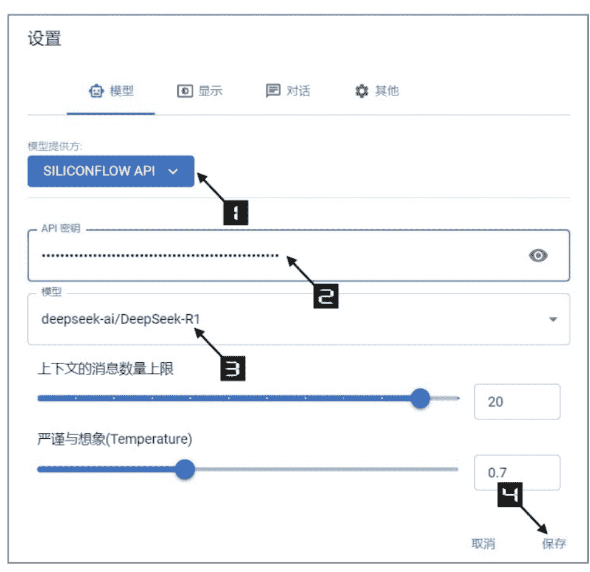

图1-18 配置API 2

### 设置从百度智能云获取的API

在【模型提供方】下拉菜单中选择【添加自定义模型提供方】选项后，在【名称】编辑框中输入【百度千帆】。

在【API域名】编辑框中输入“https://qianfan.baidubce.com/v2”。

在【API密钥】编辑框中粘贴从百度智能云获取的API密钥。

在【模型】编辑框中输入 “deepseek-r1”（注意，此处使用小写字母）。

其他设置保持默认，单击【保存】按钮，如图1-19所示。

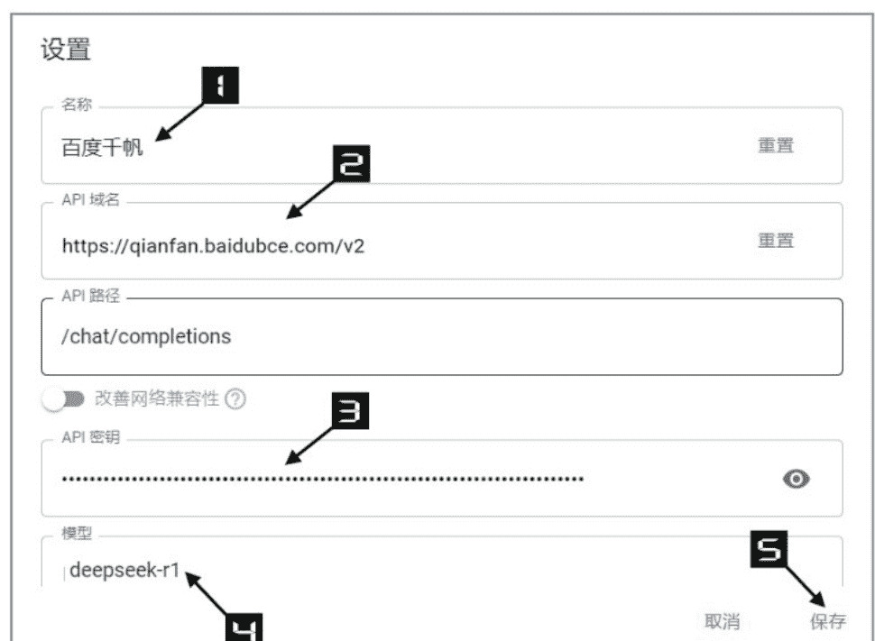

图1-19 配置API 3

配置完成后，在页面底部的对话框中输入任意问题，例如，“请问你是谁，可以帮我做什么？”如果Chatbox AI能返回正确回复，如图1-20所示，说明配置成功。

## 功能介绍

请问你是谁，可以帮我做什么？

Thinking ↑
嗯，用户问我是谁，可以帮他们做什么。我需要先介绍自己的身份，然后列举我能提供的帮助。不过，用户可能更关心具体能解决哪些问题，所以要分点说明，这样更清晰。另外，要保持语气友好，鼓励用户随时提问。记得用中文回答，避免使用专业术语，让回答更易懂。

您好！我是DeepSeek-R1，一个由深度求索公司开发的智能助手。我能够帮助您解答各类问题、提供信息查询、进行创意写作、编程辅助以及日常对话等。您有任何问题或需要帮助的地方，都可以随时告诉我哦！

tokens used: 136, model: SiliconFlow API (deepseek-ai/DeepSeek-R1)

在这里输入你的问题...


# 技巧05 在ima.copilot中使用DeepSeek

腾讯智能工作台ima.copilot内置了腾讯混元大模型及满血版DeepSeek R1，是DeepSeek官网非常好的替代品，目前免费使用。其使用步骤如下。

首先，在ima.copilot官网下载并安装客户端。

其次，单击ima.copilot首页对话框左下角的模型选择菜单的下拉按钮，即可在弹出的下拉菜单中选择模型。

最后，单击按钮，待弹出登录二维码后使用微信扫码即可登录，如图1-21所示。

登录后，就能和使用DeepSeek官网一样与DeepSeek进行对话了。


图1-21 在ima.copilot首页选择模型

ima.copilot允许用户上传PDF、DOC、JPEG、PNG等格式的文件创建、充实个人知识库。先单击页面左侧的知识库按钮 📚，再单击页面右上角的上传按钮 📤，即可上传文件。完成对文件的上传后，在对话框中输入问题，DeepSeek即可根据当前知识库中的信息检索并生成回复，如图1-22所示。


图1-22 在个人知识库中检索问题

# 技巧06 在WPS灵犀中使用DeepSeek

WPS灵犀是由金山公司提供的AI智能办公助手，虽然与DeepSeek官网技术同源，但是针对办公应用进行了优化，侧重文档处理，交互更贴合办公流程。二者在权限、数据、隐私处理及企业定制方面存在差异。

我们可以用多种方式使用WPS灵犀。

第一种方式是访问WPS灵犀官网（https://copilot.wps.cn/），按提示登录后的页面如图1-23所示。

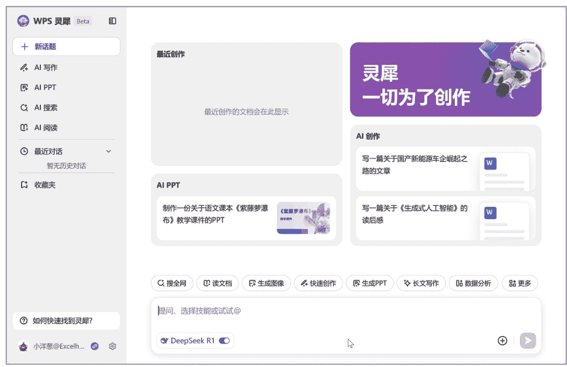

图1-23 WPS灵犀官网

目前，所有人都可以免费使用网页版的WPS灵犀，不需要购买WPS会员。

第二种方式是安装最新版的WPS Office，启动WPS Office后单击页面左侧侧边栏中的WPS灵犀按钮，如图1-24所示。


图1-24 WPS Office中的灵犀按钮

WPS灵犀按功能分为AI写作、AI PPT、AI搜索和AI阅读4个模块，对话框上方有搜全网、读文档、生成图像、快速创作、生成PPT、长文写作、数据分析等多种常用功能的入口，在对话框中输入提示词后就可以与DeepSeek对话了。

# 技巧07 专注办公应用的WPS AI

2025年春季更新的WPS Office集成了WPS AI功能。

以WPS表格为例，单击功能区最右侧的【WPS AI】选项卡，可以看到该选项卡下有【AI数据分析】【AI写公式】【AI条件格式】【设置】共计4个功能按钮。其中，AI数据分析为限免功能，AI写公式和AI条件格式为会员可用功能。

如图1-25所示，单击【WPS AI】选项卡下的【AI数据分析】按钮，将弹出【AI数据分析】窗格。在【AI数据分析】窗格中，WPS AI会基于当前数据智能推荐问题，用户可以在页面底部的对话框中输入自定义提示词，与DeepSeek进行对话，从而对表格中内容进行处理。

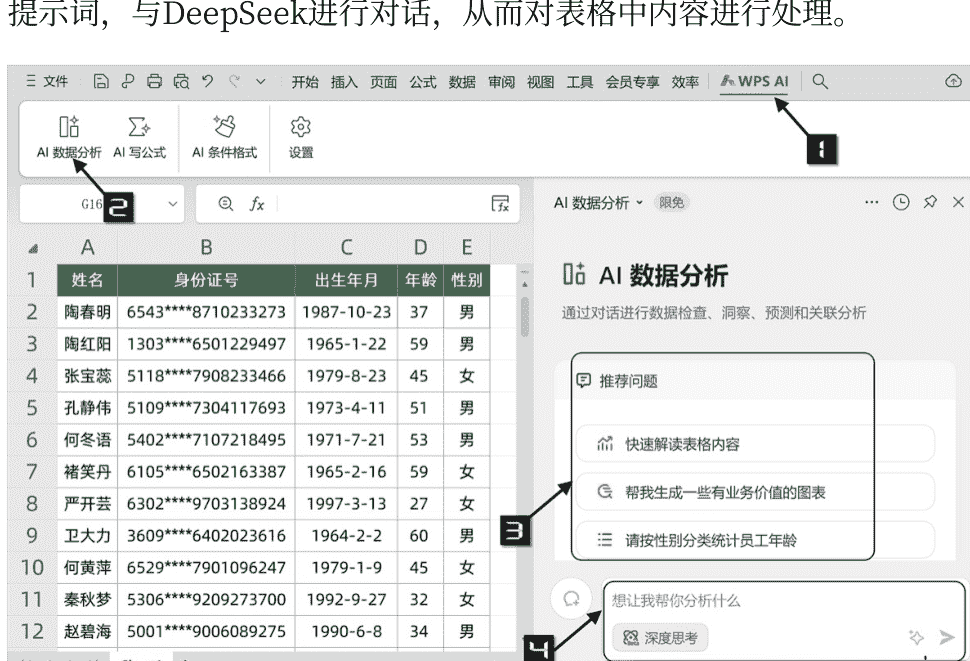

图1-25 WPS AI

单击【推荐问题】区域的【快速解读表格内容】选项，WPS AI生成的解读结果包括数据概述、重要指标和关键洞察等内容，如图1-26所示。

如果用户需要按自定义的年龄分段统计各年龄段的人数，可以在页面底部的对话框中发送以下提示词。

请按每5岁为一个区间，统计各年龄段人数。

WPS AI生成的统计结果如图1-27所示。

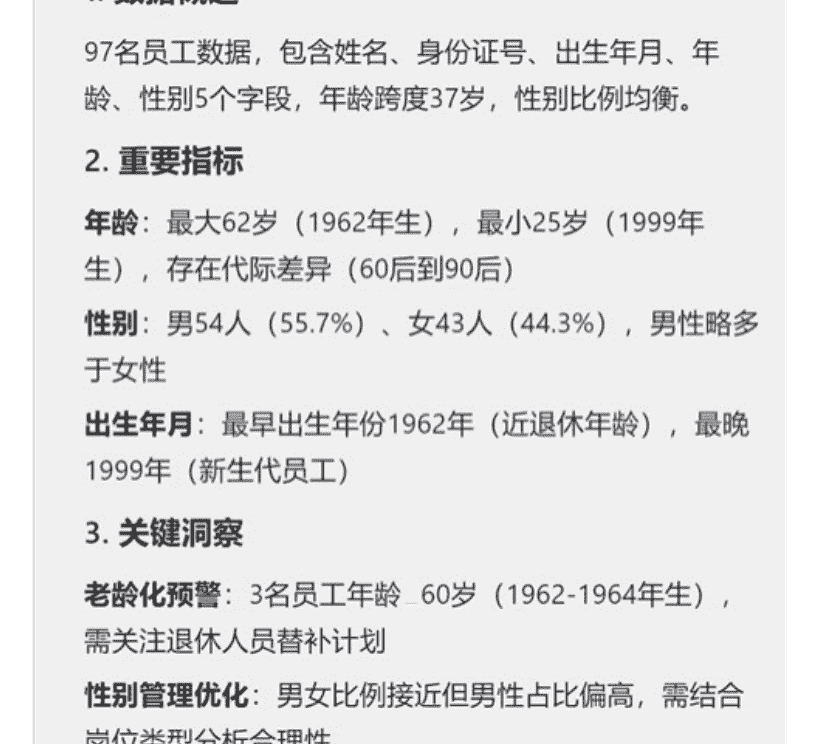

## 图1-26 数据解读

### 员工年龄分段统计（每5岁为区间）

| 年龄段 | 人数 | 占比 |
| :--- | :--- | :--- |
| 25-30岁 | 14 | 14.4% |
| 30-35岁 | 15 | 15.5% |
| 35-40岁 | 13 | 13.4% |
| **40-45岁** | **16** | **16.5% (峰值段)** |
| 45-50岁 | 8 | 8.2% |
| 50-55岁 | 10 | 10.3% |
| **55-60岁** | **15** | **15.5% (次高峰)** |
| 60-65岁 | 6 | 6.2% |

## 图1-27 员工年龄分段统计

WPS AI总结的年龄分布特征如下。

## 分布特征

- 双峰结构：40-45岁（16人）和55-60岁（15人）形成两个主要年龄峰
- 断层现象：45-50岁区间仅8人，较相邻区间锐减50%
- 年轻梯队：25-35岁占比30%（29人），有持续的人才引进
- 高龄员工：60岁以上6人，需要关注未来3～5年的退休人员替补计划

# 技巧08 将DeepSeek接入Excel、Word和WPS

易用宝是Excel Home开发的一款高效插件，能够满足用户在数据处理与分析过程中的需求，让烦琐的、难以实现的操作变得简单、可行。

在易用宝官网（https://yyb.excelhome.net/）可以下载、安装最新版本的易用宝，安装完成后，Excel功能区中会出现【易用宝plus】和【易用宝】两个选项卡。

如图1-28所示，先在【易用宝plus】选项卡中单击【呼叫AI】按钮，再在弹出的【易用宝AI】窗格中单击【设置】按钮，即可弹出【API设置】对话框。

以绑定从硅基流动官网获得的API key为例，完成易用宝AI设置。

在【现有API】的下拉菜单中选择【硅基流动-DeepSeek-R1】选项。

在【API密钥】编辑框中粘贴密钥。

单击【保存】按钮，关闭对话框，如图1-28所示。


## 图1-28 易用宝AI设置

设置完成后，即可与DeepSeek进行对话。

为了保证数据安全，目前，易用宝不允许DeepSeek直接读取、操作工作表。不过，易用宝支持用户先将工作表中的数据复制后粘贴到右侧窗格中，再发送需求提示词。

如图1-29所示，被打开的文件是某公司的员工薪资标准表，用户希望借助DeepSeek从表中提取出各部门的最低薪资人员。

在界面右侧的【易用宝AI】对话框中发送以下提示词。

B1:B13是部门，D1:D13是薪资标准，请根据F3单元格中指定的部门名称，计算该部门平均薪资标准。

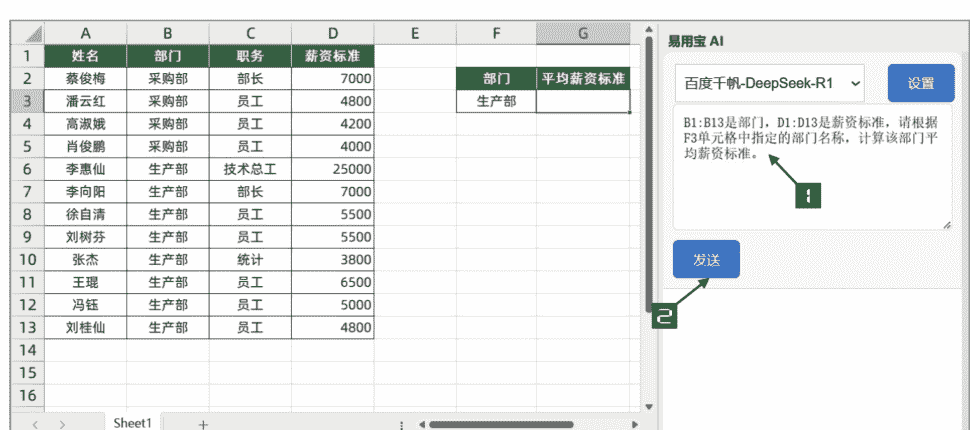

图1-29 发送提示词

发送提示词后，需要稍作等待。DeepSeek思考结束后，即会在窗格中回复。如果需要将结果粘贴到Excel中，可以先单击计划存放结果的单元格，再单击【返回到文档中】按钮，如图1-30所示。

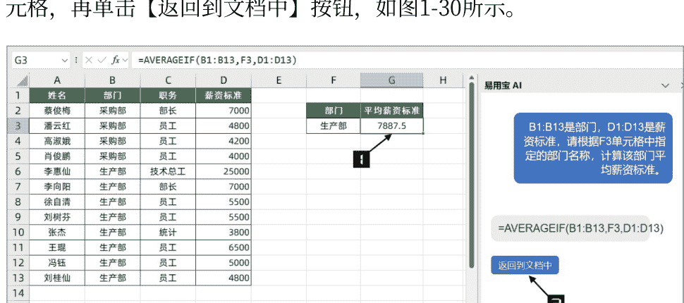

图1-30 将AI生成的结果返回到文档中

安装易用宝后，在Word中也能使用DeepSeek。

例如，需要将Word中的一部分内容翻译为英文时，可以先选中需要翻译的段落，再在【易用宝】选项卡中单击【呼叫AI】选项，最后在界面右侧的【易用宝AI】对话框中发送以下提示词。

请翻译为英文。

选中【根据选中内容进行处理】复选框后，单击【发送】按钮，如图1-31所示。

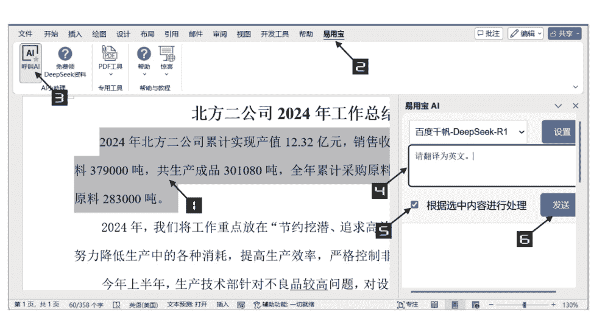

图1-31 翻译Word文档中的内容

发送提示词后，需要稍作等待。DeepSeek思考结束后，即会在窗格中回复。如果需要将结果粘贴到Word文档中，可以先单击计划存放结果的位置，再单击【返回到文档中】按钮，如图1-32所示。

在WPS表格和WPS文字中的操作方法与之类似，此处不再赘述。

根据选中内容进行处理

发送

请翻译为英文。

Here is the English translation: In 2024, Northern Company No. 2 cumulatively achieved an output value of 1.232 billion yuan, with sales revenue reaching 1.467 billion yuan. The company processed 379,000 tons of raw materials and produced 301,080 tons of finished products. Throughout the year, the

返回到文档中

图1-32 返回到文档中

# 第2章 高效提示词：技巧与模板

提示词（Prompt）是我们和AI沟通过程中输入的用于引导AI生成特定内容或执行特定任务的关键词。只有使用有效的提示词，才能通过AI获得理想的反馈。

提示词是基于自然语言的，大部分使用提示词与AI对话的情况和我们生活中的日常对话一样，但是，说话→把话说清楚→高效准确地说话，需要遵循一定的规则，或者使用一些技巧。本章将重点讲解提示词的相关内容。

## 本章的主要内容

- ◆ 技巧1 提示词的3大核心作用
- ◆ 技巧2 写提示词的4大误区
- ◆ 技巧3 提示词的5个常见框架与4大基本原则
- ◆ 技巧4 10个常用的提示词模板

# 技巧01 提示词的3大核心作用

提示词是我们与AI对话时输入的指令或问题，相当于给AI的“行动指南”。作为用户与AI沟通的“桥梁”，提示词决定着AI输出内容的质量和方向，非常重要。

## 作用1：决定沟通效率

新手向AI提问的时候，提示词经常写得很模糊，比如：

帮我写一个代码。

此时，AI可能有如下回复。

> 您需要哪种编程语言？实现什么功能？

如此问答，很容易陷入反复澄清需求的低效循环。

合格的提示词如下。

用Python写一个计算器程序，包含加减乘除，用函数封装。

此时，DeepSeek等AI工具可以直接生成代码+注释，很可能能够一次性地解决用户的问题。

使用模糊提示词和使用明确提示词的区别如图2-1所示。

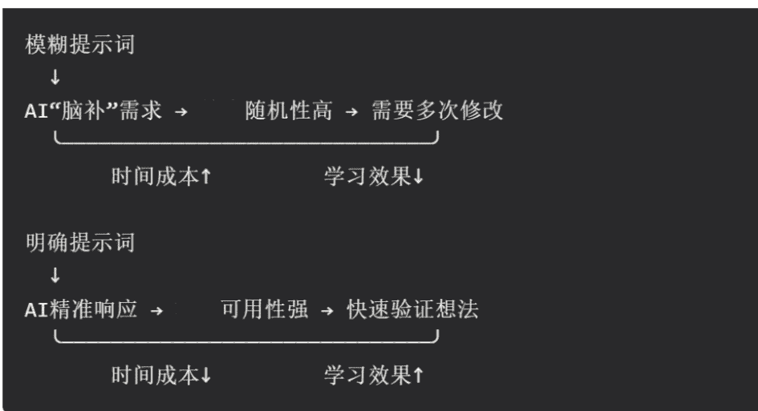

图2-1 使用模糊提示词和使用明确提示词的区别

## 作用2：培养AI思维

通过不断优化提示词，用户会逐渐明确AI的“知识边界”在哪里。例如，如果不加载联网插件，目前的DeepSeek R1无法回答与2024年10月之后发生的事件相关的问题。

通过给予分步指令，用户可以根据经验引导AI进行推理，比如让AI先解释概念，再举例应用。用户可以使用类似的方法，直接请AI教自己提示词的使用技巧。比如，用户可以发送如下提示词。

> 提示词是什么？请教我一些提示词的基本使用技巧。

## 作用3：解锁高阶功能

通过给予特定的提示词，用户可以将AI训练成某个领域的专业助手，如表2-1至表2-3所示。

### 表2-1 学术研究助手

| 提示词示例 | 作用 |
| --- | --- |
| 你是一位论文审稿人，请用Markdown格式列出针对目标论文的3个改进建议：①方法论缺陷 ②文献引用不足 ③逻辑漏洞 | 训练学术批判思维 |
| 用通俗语言解释Transformer模型，要求：①对比RNN的优缺点 ②用快递分拣系统做比喻 ③附一张流程示意图 | 辅助理解复杂技术概念 |

### 表2-2 编程调试助手

| 提示词示例 | 作用 |
| --- | --- |
| 你是有10年工作经验的Python工程师，我的报错信息是【××】，请：①解释错误原因 ②给出3种解决方案 ③标记最优解（带代码示例） | 快速定位代码问题 |
| 将以下JSON数据转换为MySQL建表语句，要求：①字段注释用中文 ②添加索引优化建议 ③输出Markdown代码块 | 学习数据格式转换 |

### 表2-3 创意写作助手

| 提示词示例 | 作用 |
| --- | --- |
| 模仿鲁迅的风格写一篇短评，主题为“年轻人沉迷短视频”，要求：①使用反讽手法 ②使用文言文结尾 ③300字内 | 掌握文体模仿技巧 |
| 为我的科幻小说设计一个世界观设定表，包含星球生态、科技水平、社会阶级矛盾等内容，用JSON格式输出 | 构建创作框架 |

# 技巧02 写提示词的4大误区

AI初学者在写提示词时，因为缺乏经验，常写出有各种各样的缺陷的提示词，导致AI无法给出理想的回复。避开常见的误区，可以快速进阶，成为提示词写作高手。

## 常见误区：需求表达不明确

### 1. 提示词过于简略

错误示例：

写一首诗。

提示词未限定主题、风格、格式等关键要素，在这种情况下，AI可能生成抒情诗、打油诗，甚至外文诗歌，结果完全随机。

优化示例：

写一首七言绝句，主题为“夏日荷塘”，包含“蝉鸣”“露珠”意象，押平声韵。

### 2. 使用模糊形容词

错误示例：

写一个有趣的故事。

提示词中的主观词汇缺乏客观标准，AI对“有趣”的理解可能是喜剧、荒诞剧，也可能是悬疑剧、反转剧。

优化方案：

写一篇300字的儿童故事，包含以下元素：会说话的松鼠、丢失的松果、三次搞笑的失败尝试。

## 交互误区：忽略对话逻辑

### 1. 一次性提出多个要求

错误示例：

分析这篇论文的优点和缺点，并推荐参考文献。

提示词未使用序号或特殊符号拆分任务，导致指令不清晰。在这种情况下，AI可能只完成前两项任务，漏掉“推荐参考文献”这一任务。

优化方案：

- (1) 分析论文的创新点与不足。
- (2) 用表格对比其与文献[1][2]的差异。
- (3) 推荐5篇2020年后发表的相关论文。

### 2. 缺乏上下文关联

错误示例：

第一轮：

写一份智能手表的市场分析报告。

第二轮：

加入竞争品牌对比。

第二轮对话的提示词未明确引用历史对话，AI可能会重新生成完整报告，而非在原报告的基础上进行补充。

优化方案：

在刚才生成的市场分析报告中添加Apple、华为、小米的市场占有率对比（用柱状图描述）。

## 认知误区：错误估计AI能力边界

### 1. 过度依赖实时信息

错误示例：

汇总2025年2月的全球AI融资事件。

不同版本的AI有不同的知识截止日期，如果所使用AI的训练数据截至2024年12月，它将无法输出准确结果。

优化方案：

假设当前是2024年Q3，请模拟一份AI行业融资趋势预测报告，需要包含风险评估。

使用带有联网搜索插件的AI工具，能够更好地获取实时信息。

### 2. 忽视可操作性约束

错误示例：

生成一个自动驾驶算法。

或者：

编写一个进销存管理系统。

提示词未限定技术栈和实现层级，AI可能能够给出理论框架，但无法实现工程细节。

优化方案：

用Python伪代码描述基于LSTM的车辆轨迹预测算法，标注数据预处理关键步骤。

## 心理误区：对AI抱有错误期望

### 1. AI应该一次性输出完美回复

错误认知：认为使用优化后的提示词能一次性得到理想的回复。

现实情况：AI输出的内容往往需要经过2～3轮迭代调整（如同人类之间的沟通）。

正确交互方法如下。

- 第一轮交流：获取大体框架。
- 第二轮交流：补充细节要求。
- 第三轮交流：修正答案的风格/格式。

### 2. 提示词越长越好

错误示例：

请写一篇关于气候变化的文章，要包含全球变暖的影响、解决方案、各国政策、科学家争议、公众认知变化……（500字）。

提示词的信息过量，很可能导致AI给出的回答是泛泛而谈。

优化方案：

写一篇1000字左右的科普文，按照“温室效应→极端天气案例→个人行动措施”这一逻辑链展开。

# 技巧03 提示词的5个常见框架与4大基本原则

提示词框架用于在与AI（DeepSeek、ChatGPT等）交互时，通过结构化、系统化的方式设计输入内容，更精准地引导AI生成符合预期的内容。就好像小学生写记叙文所用的最基本的框架是起因、经过、结果，用户与AI沟通时使用框架式提示词，更容易获得理想的回复。

在不同的任务场景中，提示词框架略有不同，但大体上包含如图2-2所示的内容。

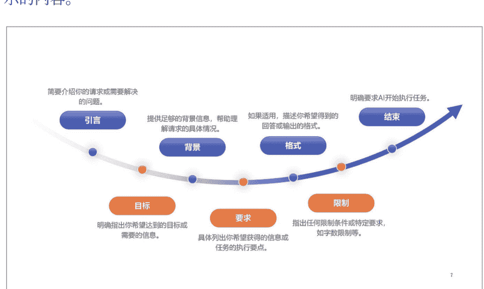

图2-2 提示词框架的主要内容

下面介绍几个常见的提示词框架。

## BROKE框架

适用场景：需要明确背景信息和多维度要求的复杂任务（产品设计、数据分析等），如表2-4、表2-5所示。

### 表2-4 电商产品描述

| 英文缩写 | 英文全称 | 中文释义 | 提示词示例 |
| :--- | :--- | :--- | :--- |
| B | Background | 背景 | 我是电商公司的运营人员，需要为新品瑜伽裤写产品描述 |
| R | Request | 请求 | 请生成一段能吸引年轻女性的文案 |
| O | Outcome | 预期结果 | 突出产品的透气性和时尚设计，引导读者点击购买 |
| K | Key Context | 关键信息 | 价格为199元，材质为冰丝面料 |
| E | Example | 示例 | 参考Nike的“全天候舒适，运动与生活无缝切换” |

### 表2-5 销售数据分析

| 英文缩写 | 英文全称 | 中文释义 | 提示词示例 |
| :--- | :--- | :--- | :--- |
| B | Background | 背景 | 我是市场部新人，需要分析上个月的销售数据 |
| R | Request | 请求 | 请总结增长最快的产品类别和可能原因 |
| O | Outcome | 预期结果 | 输出可视化图表和3条优化策略 |
| K | Key Context | 关键信息 | 数据来源为附件中的Excel表格 |
| E | Example | 示例 | 类似《中国居民消费趋势报告（2023）》的归因分析结构 |

## ROLE框架

适用场景：需要明确执行者身份与任务边界的工作委托（专业咨询、技术开发等），如表2-6、表2-7所示。

### 表2-6 健康食谱设计

| 英文缩写 | 英文全称 | 中文释义 | 提示词示例 |
| :--- | :--- | :--- | :--- |
| R | Role | 角色定义 | 你是一名资深营养师，擅长进行减脂饮食规划 |
| O | Objective | 核心目标 | 为30岁的职场女性设计一周食谱 |
| L | Limitation | 限制条件 | 热量控制为1500大卡/天，需要包含早/午/晚餐 |
| E | Expectation | 期望/要求 | 备注每道菜的烹饪技巧和营养构成 |

### 表2-7 脚本开发

| 英文缩写 | 英文全称 | 中文释义 | 提示词示例 |
| :--- | :--- | :--- | :--- |
| R | Role | 角色定义 | 你是经验丰富的Python工程师，熟悉自动化脚本 |
| O | Objective | 核心目标 | 编写批量重命名图片文件的脚本 |
| L | Limitation | 限制条件 | 文件格式需要兼容JPG/PNG，命名规则为“日期+序号” |
| E | Expectation | 期望/要求 | 添加异常处理逻辑（重复文件名检测等） |

## CRISPER框架

适用场景：多维度参数控制的系统性规划（行程规划、活动策划等），如表2-8、表2-9所示。

### 表2-8 制订旅行计划

| 英文缩写 | 英文全称 | 中文释义 | 提示词示例 |
| :--- | :--- | :--- | :--- |
| C | Context | 背景信息 | 我和父母（年逾60岁）计划5月份去江南地区旅游7天 |
| R | Request | 核心请求 | 推荐适合老年人的行程 |
| I | Intent | 深层目标 | 避免高强度活动，侧重文化体验，需要有便利的交通 |
| S | Scenario | 方案细节 | 南京－苏州－杭州三地游览，住宿地为3～4星级酒店 |
| P | Parameter | 硬性规定 | 每日步行小于8000步，包含餐饮推荐 |
| E | Example | 参考样例 | 类似《孤独星球》的慢旅行路线 |
| R | Response | 输出格式 | 按天列出表格，含景点/交通/注意事项3列 |

### 表2-9 行业沙龙策划

| 英文缩写 | 英文全称 | 中文释义 | 提示词示例 |
| :--- | :--- | :--- | :--- |
| C | Context | 背景信息 | 公司准备举办50人规模的“AI赋能零售”行业沙龙 |
| R | Request | 核心请求 | 设计活动流程，活动用时为两个小时 |
| I | Intent | 深层目标 | 重点为嘉宾互动，穿插案例分析和分组讨论 |
| S | Scenario | 方案细节 | 场地需要配备投影仪，并划出小组讨论区 |
| P | Parameter | 硬性规定 | 必须包含开场致辞、2场演讲、1场圆桌论坛 |
| E | Example | 参考样例 | 参考TEDx的项目活动流程 |
| R | Response | 输出格式 | 制作带时间轴标记的甘特图 |

## TAG框架

适用场景：快速明确行动指令的简单任务（市场调研、邮件撰写等），如表2-10、表2-11所示。

### 表2-10 新能源汽车分析

| 英文缩写 | 英文全称 | 中文释义 | 提示词示例 |
| :--- | :--- | :--- | :--- |
| T | Task | 核心任务 | 分析新能源汽车在二线城市的市场机会 |
| A | Action | 执行动作 | 比较比亚迪/特斯拉/蔚来的产品定位差异 |
| G | Goal | 最终目标 | 输出500字报告，用于内部战略会议 |

### 表2-11 催款邮件撰写

| 英文缩写 | 英文全称 | 中文释义 | 提示词示例 |
| :--- | :--- | :--- | :--- |
| T | Task | 核心任务 | 跟进拖延付款的客户的付款计划 |
| A | Action | 执行动作 | 用专业、温和的语气撰写催款邮件 |
| G | Goal | 最终目标 | 维护合作关系，并明确要求对方在3日内完成付款 |

## SPAR框架

适用场景：问题诊断与解决方案推导（用户调研、学术写作等），如表2-12、表2-13所示。

### 表2-12 用户留存分析

| 英文缩写 | 英文全称 | 中文释义 | 提示词示例 |
| :--- | :--- | :--- | :--- |
| S | Situation | 情况描述 | 某健身App的用户留存率首周下降40% |
| P | Problem | 核心问题 | 怀疑新手引导流程不够清晰 |
| A | Action | 解决动作 | 设计5个聚焦首次使用痛点的访谈问题 |
| R | Result | 预期成果 | 输出带优先级的优化方案（含实施步骤） |

### 表2-13 论文文献综述

| 英文缩写 | 英文全称 | 中文释义 | 提示词示例 |
| :--- | :--- | :--- | :--- |
| S | Situation | 情况描述 | 我正在撰写以“元宇宙伦理”为研究主题的论文，卡在文献综述部分 |
| P | Problem | 核心问题 | 整合10篇跨学科研究论文的逻辑关系 |
| A | Action | 解决动作 | 建议按技术/法律/哲学分类 |
| R | Result | 预期成果 | 生成带参考文献编号的树状图大纲 |

在实际应用中，用户不需要严格遵循某一提示词框架写提示词，只要把握好如图2-3所示的基本原则即可。

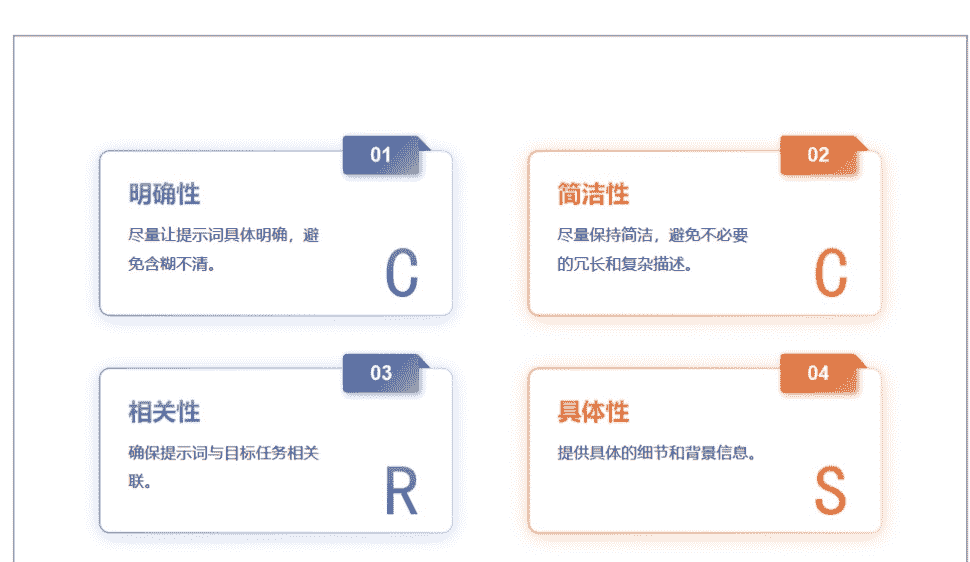

图2-3 提示词写作的基本原则

# 技巧04 10个常用的提示词模板

在与DeepSeek或其他AI对话的过程中，提示词至关重要。以下是更多领域的常用提示词示例，供大家学习、借鉴。

## 1. 信息查询型

请解释[专业术语/概念]，要求：用通俗语言描述其核心定义，列举应用场景或说明其与易混淆概念的区别。

示例：

请用通俗语言描述机器学习中的“过拟合”，要求用比喻说明，与“欠拟合”进行对比，并给出实际代码示例。

## 2. 分析对比型

对比分析[A]与[B]在[场景]中的差异，要求从性能、适用性等维度入手，以表格形式对比，给出典型应用建议。

示例：

对比VBA与WPS JS在编程应用中的差异，用表格展示两者的优劣。

## 3. 解决方案型

针对[具体问题]，请分步骤提供解决方案。

示例：

如何解决Android应用内存泄漏问题？要求给出LeakCanary配置教程和Heap Dump分析技巧。

## 4. 创意生成型

基于[主题/关键词]，生成[数量]个创意方案，要求：标注清楚适合的目标人群/场景或必须包含的元素等。

示例：

为图书《DeepSeek实战技巧精粹》生成5个封面设计创意方案，需要包含AI技术与职场、生活等相关元素。

## 5. 数据处理型

请清洗/分析以下数据：[数据片段]，要求：指出全部数据质量问题/写出处理代码/输出处理后数据可视化建议等。

示例：

分析销售数据中的异常值，用箱线图展示并给出SQL查询修正语句。

## 6. 学习路径型

作为[身份/水平]，制定[时间周期]的[领域]学习计划。

示例：

作为专业的Excel课程讲师，为零基础学习者设计为期3个月的Excel函数公式学习计划，包含动态数组公式知识。

## 7. 代码调试型

请修复以下代码中的错误：[代码段]，要求：逐行注释出现问题的原因，给出优化后的代码。

示例：

```
以下 VBA 代码下标越界，请逐行注释出现问题的原因，并给出优化后的代码。
Sub tt()
Dim i%, arr()

ReDim arr(1 To 3, 1 To 1)
For i = 1 To 3
arr(i, 1) = i
Next
ReDim Preserve arr(1 To 5, 1 To 1)
End Sub
```

## 8. 预测推演型

预测[领域/事件]未来[时间]发展趋势，要求：列出[n]个关键因素/构建SWOT分析模型/给出[n]种可能情境推演等。

示例：

预测2025年新能源汽车电池技术的突破方向，分析影响固态电池量产的3个主要因素。

## 9. 观点论证型

论证[观点/假说]是否成立，要求：分别为正反双方提供3个论据/引用权威研究数据作为支撑。

示例：

论证“区块链将取代传统银行结算系统”是否成立，需要引用IMF报告和SWIFT交易量数据。

## 10. 模拟决策型

作为[角色]，面临[情境]，应该如何决策？

示例：

作为产品经理，需要开发一款App时，应该先开发iOS版本的App还是先开发Android版本的App？用TAM模型估算市场容量。

# 第2篇 效率倍增篇：DeepSeek赋能智能办公

作为AI大模型，DeepSeek在自动化办公中展现出的显著优势正受到越来越多人的关注。例如，它不仅能够快速生成常用的图表、报告，自动进行合同评估、会议纪要整理、多语种翻译及数据分析，还能解读Excel数据、整理电子发票、快速制作PPT等。

DeepSeek与各传统办公软件的结合，正在重新定义智能办公的效率标准。

# 第3章 DeepSeek图表大师：一键生成专业图表

使用DeepSeek，不仅能够快速生成思维导图、甘特图、流程图、组织架构图等常用图表，还能够根据图片中的信息生成图表、对现有图表信息进行解读、重新定义图表的处理流程。如今，DeepSeek特别适合用于需要高频处理复杂信息的项目管理、学术研究等场景。

## 本章的主要内容

- ◆ 技巧1思维导图：快速梳理知识结构
- ◆ 技巧2甘特图：项目管理可视化利器
- ◆ 技巧3流程图：复杂流程的极简呈现
- ◆ 技巧4组织结构图：层级关系可视化
- ◆ 技巧5动态组合数据图表

# 技巧01 思维导图：快速梳理知识结构

思维导图是用图形化树状结构梳理复杂信息的工具，可用“中心主题→分支关键词→关联线”的形式展示关键信息。思维导图的核心要素包括用醒目图标或文字呈现的主题，以及主要分支、细化层级。在思维导图中，可以用颜色、图标、线条粗细等区分信息层级。

思维导图可以直观展示原本需要使用大量文字才能描述清楚的逻辑关系，达到提高记忆效率、激发联想创意的目的。

Mermaid是一款优秀的图表绘制工具，允许用户使用简单的文本语法创建各种类型的图表，包括流程图、序列图、甘特图、类图、状态图、饼图、思维导图等。Mermaid不仅支持实时预览，还支持在编写过程中随时查看图表效果。使用Mermaid生成的图表能够继续生成链接，并导出为图片或者SVG格式的矢量图形。

下面以“备考公务员”为主题，借助DeepSeek与Mermaid生成思维导图。

在DeepSeek对话框中发送如下需求提示词。

请提供一份备考公务员的思维导图框架。

稍待片刻，DeepSeek就会给出框架建议，如图3-1所示。

以下是一份备考公务员考试的思维导图框架，供你参考。具体内容可根据个人需求调整：

## 公务员备考思维导图

中心主题：公务员考试备考策略

### 一、了解考试

1. 考试类型
   - 国考（国家公务员考试）
   - 省考（地方公务员考试）
   - 选调生考试
2. 考试科目
   - 笔试
     - 行测（言语理解、数量关系、判断推理、资料分析、常识判断）

图3-1 框架建议（部分）

此时，可以进一步提出修改建议，如“请进一步细化笔试部分”，DeepSeek会根据新需求重新生成框架。

确认无误后，在DeepSeek对话框中发送如下提示词，要求它生成Mermaid代码。

请根据以上框架，生成符合Mermaid标准的代码。

DeepSeek生成的代码如下。

```
graph TD
A[公务员考试备考策略] -> B[了解考试]
A -> C[制订备考计划]
A -> D[行测备考重点]
A -> E[申论备考重点]
A -> F[面试准备]
A -> G[工具与资源]
A -> H[常见误区与对策]

# %%% 1. 了解考试
B -> B1[考试类型]
B1 -> B11[国考]
B1 -> B12[省考]
B1 -> B13[选调生]
B -> B2[考试科目]
B2 -> B21[笔试]
B21 -> B211[行测：言语/数量/判断/资料/常识]
B21 -> B212[申论：归纳/分析/写作]
B21 -> B213[专业科目]
B2 -> B22[面试]
B22 -> B221[结构化]
B22 -> B222[无领导小组]
B22 -> B223[情景模拟]
B -> B3[时间节点]
B3 -> B31[国考：10月报名]
B3 -> B32[省考：3-4月]

# %% 2. 制订备考计划
C -> C1[阶段划分]
C1 -> C11[基础阶段：1～2个月]
C1 -> C12[强化阶段：1个月]
C1 -> C13[冲刺阶段：2～3周]
C -> C2[每日学习]
C2 -> C21[上午：行测模块]
C2 -> C22[下午：申论+素材]
C2 -> C23[晚上：错题+时政]

# %% 3. 行测重点
D -> D1[言语理解]
D1 -> D11[逻辑填空]
D1 -> D12[片段阅读]
D -> D2[数量关系]
D2 -> D21[工程/行程问题]
D2 -> D22[方程法/代入法]
D -> D3[判断推理]
D3 -> D31[图形规律]
D3 -> D32[逻辑判断]
D -> D4[资料分析]
D4 -> D41[公式速记]
D4 -> D42[速算技巧]
D -> D5[常识]
D5 -> D51[时政/法律]

# %%% 4. 申论重点
E -> E1[核心能力]
E1 -> E11[阅读理解]
E1 -> E12[归纳概括]
E -> E2[题型]
E2 -> E21[单一题]
E2 -> E22[公文写作]
E2 -> E23[大作文]
E -> E3[素材]
E3 -> E31[政府工作报告]
E3 -> E32[热点话题]

# %% 5. 面试准备
F -> F1[题型]
F1 -> F11[综合分析]
F1 -> F12[组织管理]
F1 -> F13[应急应变]
F -> F2[技巧]
F2 -> F21[逻辑清晰]
F2 -> F22[语言流畅]

# %% 6. 工具与资源
G -> G1[教材]
G1 -> G11[华图模块宝典]
G1 -> G12[申论的规矩]
G -> G2[App]
G2 -> G21[粉笔]
G2 -> G22[学习强国]

%%% 7. 常见误区
H -> H1[误区]
H1 -> H11[盲目刷题]
H1 -> H12[忽视时政]
H -> H2[对策]
H2 -> H21[错题本]
H2 -> H22[每日新闻]
```

单击代码窗口右上角的【复制】按钮，即可将以上内容复制到剪贴板。

在浏览器中打开Mermaid编辑器，不需要注册，直接在界面左侧粘贴以上代码，即可在界面右侧预览思维导图的效果，如图3-2所示。

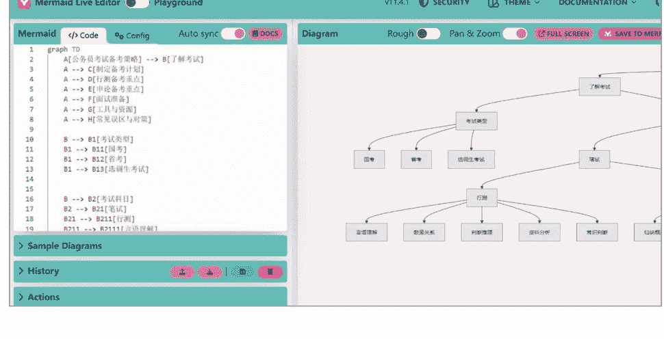

图3-2 Mermaid代码与思维导图示例

此时，思维导图默认布局为自上而下的直角矩形。

在DeepSeek对话框中发送修改建议（提示词）。

请将以上代码设置为左右布局，圆角矩形。

再次复制DeepSeek提供的参考代码，粘贴在Mermaid编辑器中，思维导图的预览效果如图3-3所示。

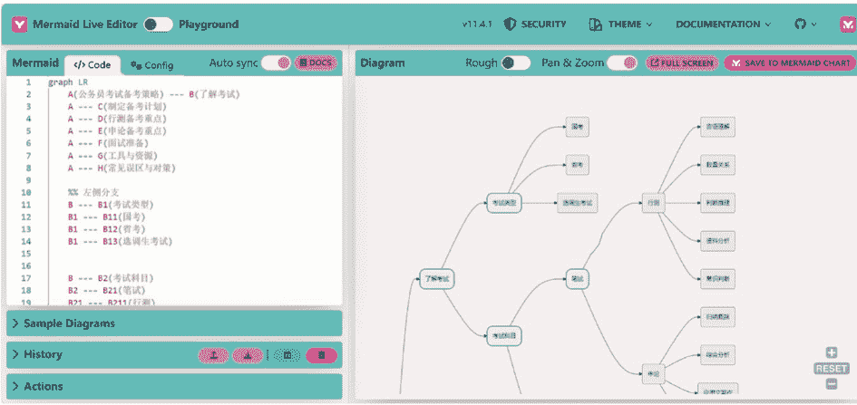

图3-3 修改思维导图样式

若预览效果符合预期，单击【Actions】选项，即可在其下方区域选择图片格式，如图3-4所示。确定图片格式后，即可将图片下载到本地或者生成分享链接。

图3-4 保存或分享文件

# 技巧02 甘特图：项目管理可视化利器

甘特图是一种常用的项目管理工具，用来展示项目进度和时间线。甘特图的呈现形式类似于条形图，以时间为横轴，以任务为纵轴，用户可以直观地在甘特图中看到项目内各任务的起止时间、相互关系，以及整体项目进度。

下面以某工程项目进度为例，介绍如何借助DeepSeek和Mermaid生成甘特图。

整理好项目进度安排及进度情况后，在DeepSeek对话框中发送需求提示词。

> 我要制作展示项目进度的甘特图，需要提供什么格式的数据？

DeepSeek给出的建议如图3-5所示。

> 要制作甘特图，通常需要以下格式的数据：
> 1. **任务名称**：这是项目中各个任务的标识，通常列在表格的第一列。
> 2. **开始时间**：每个任务的计划开始日期或时间，以日期格式（如“2023-01-01”）或时间戳的形式提供。
> 3. **结束时间**：每个任务的计划结束日期或时间，也以日期格式或时间戳的形式提供。
> 4. **持续时间**：任务从开始到结束预计持续的时长，可以是以天、周或月为单位的具体数字。
> 5. **完成百分比**（可选）：任务完成的百分比，这有助于展示任务的当前进度。
> 以下是一个典型的数据格式示例。

| 任务名称 | 开始时间 | 结束时间 | 持续时间 | 完成百分比 |
| :--- | :--- | :--- | :--- | :--- |
| 任务1 | 2023-01-01 | 2023-01-05 | 4天 | 30% |
| 任务2 | 2023-01-06 | 2023-01-10 | 4天 | 0% |
| 任务3 | 2023-01-11 | 2023-01-15 | 4天 | 50% |

图3-5 制作甘特图需要的数据格式

按照上述格式，在Excel中准备数据，完成后先将数据复制并粘贴到DeepSeek对话框中，再说明具体要求，如图3-6所示。

> 请用以上数据生成符合Mermaid标准的甘特图代码，要清晰标记每个项目的起止日期及进度情况。

DeepSeek生成的代码如图3-7所示。单击界面右上角的【复制】按钮，即可将代码复制到剪贴板中。

图3-6 给DeepSeek提供满足格式要求的数据

```
gantt
    title 项目甘特图
    dateFormat  YYYY-MM-DD
    axisFormat  %Y-%m-%d

    项目1 (100%)    :done, 2025-01-01, 2025-01-03
    项目2 (100%)    :done, 2025-01-06, 2025-01-14
    项目3 (100%)    :done, 2025-01-11, 2025-01-17
    项目4 (85%)     :done85, 2025-01-16, 2025-01-22
    项目5 (75%)     :done75, 2025-01-21, 2025-02-01
    项目6 (42%)     :done42, 2025-01-26, 2025-02-05
    项目7 (10%)     :done10, 2025-01-31, 2025-02-12
    项目8 (5%)      :done5, 2025-02-05, 2025-02-10
    项目9 (0%)      :done0, 2025-02-10, 2025-02-27
```

图3-7 符合Mermaid标准的甘特图代码

在Mermaid编辑器左侧粘贴代码，即可在界面右侧预览甘特图的效果，如图3-8所示。

图3-8 生成的甘特图（部分）

单击【Actions】按钮并选择格式，即可将生成的甘特图下载到本地或者生成分享链接。

# 技巧03 流程图：复杂流程的极简呈现

流程图是由标准化图形符号和文字说明共同构成的视觉化图表，主要用于展示工作流程、算法执行顺序、系统交互关系、业务审批路径等内容。使用流程图，能够将复杂流程转化为直观图表，快速定位流程瓶颈和冗余环节，统一业务操作规范，提高跨部门沟通效率。

下面介绍如何借助DeepSeek和Mermaid生成报销流程图。

在DeepSeek对话框中发送以下提示词。

> 我们的报销流程：首先，提交报销申请、填写费用报销单；其次，进入审批流程，其中，5000元及以下金额需要部门领导审批，5000元以上金额需要财务总监审批；最后，进入票据审核流程，审核通过，财务付款，否则需要修改费用报销单。请根据以上流程，生成符合Mermaid标准的流程图代码。

DeepSeek生成的代码如图3-9所示。单击代码框右上角的【复制】按钮，即可将DeepSeek生成的代码复制到剪贴板中。

```
mermaid
flowchart TD
    A([提交报销申请]) --> B[填写费用报销单]
    B --> C{金额<=5000?}
    C -- 是 --> D[部门领导审批]
    C -- 否 --> E[财务总监审批]
    D --> F[票据审核]
    E --> F
    F --> G{审核通过?}
    G -- 是 --> H([财务付款])
    G -- 否 --> B
```

图3-9 DeepSeek生成的代码

在Mermaid编辑器界面的左侧粘贴代码，即可在界面右侧预览报销流程图的效果，如图3-10所示。

图3-10 报销流程图

单击【Actions】按钮并选择格式，即可将生成的报销流程图下载到本地或者生成分享链接。

需要特别关注的是，DeepSeek生成的流程图框架支持多级金额审批判断，完成了审核退回修改的闭环。示例以5000元为分界，实际使用中，金额阈值和审批层级等用户均可根据企业制度灵活调整。

# 技巧04 组织结构图：层级关系可视化

组织结构图是一种以图形形式展示组织内部层级关系、部门划分情况及岗位职责的图表工具，常用于明确权责分工、优化管理流程、提高团队协作效率。

使用组织结构图，能够清晰展示上下级汇报关系、标注岗位职能，避免职责重叠或存在职责空白，不仅能帮助管理者迅速定位责任人，而且能辅助新员工明确公司架构与团队分工。

在制作组织结构图之前，需要先明确要展示的架构范围，如全公司、单个部门或项目组，再收集、梳理组织架构数据，包括部门名称与职能、岗位名称、汇报关系等，必要时可以添加关键岗位的职责说明。

下面介绍如何借助DeepSeek和Draw.io生成组织结构图。

在DeepSeek对话框中发送以下提示词。

> 总经理下属办公室、销售部、企管部和行政部，销售部下属市场开拓和售后服务，行政部下属人事部和后勤部，后勤部下属保洁、餐厅和安保。请根据以上内容，生成符合Mermaid标准的组织结构图，使用圆角矩形。

DeepSeek生成的代码如图3-11所示。

```
graph TD
    classDef rounded fill:#f9f,stroke:#333,stroke-width:2px,radius:10px
    classDef default fill:#eaeaea,stroke:#666,stroke-width:2px,radius:10px

    总经理([总经理]):::rounded
    总经理-->办公室[办公室]
    总经理-->销售部[销售部]
    总经理-->企管部[企管部]
    总经理-->行政部[行政部]

    销售部-->市场开拓[市场开拓]
    销售部-->售后服务[售后服务]

    行政部-->人事部[人事部]
    行政部-->后勤部[后勤部]

    后勤部-->保洁[保洁]
    后勤部-->餐厅[餐厅]
    后勤部-->安保[安保]

    class 总经理 rounded
```

图3-11 符合Mermaid标准的组织结构图代码

复制DeepSeek生成的代码，打开https://www.drawio.com/，单击【Start】按钮，即可开始任务，如图3-12所示。

在弹出的对话框中单击【创建新绘图】按钮，如图3-13所示，然后单击对话框底部的【修改存储方式】按钮，即可选择包括OneDrive、GitHub、GitLab在内的文件保存位置。本例选择【设备】，即保存到本地。

## Security-first diagramming for teams.

Bring your storage to our online tool, or save locally with the desktop app.

No login or registration required.

图3-12 开始任务

图3-13 创建新绘图

在新建界面中输入文件名并选择文件类型后，先单击【空白框图】选项，再单击【创建】按钮，如图3-14所示。

图3-14 创建空白框图

在弹出的对话框中选择文件的保存位置后单击【保存】按钮，如图3-15所示。

图3-15 选择文件的保存位置

单击插入按钮，在下拉菜单中选择【高级】→【Mermaid】命令，如图3-16所示。

图3-16 添加代码

清除代码编辑框中的原有内容后，将DeepSeek提供的代码粘贴进去，单击【插入】按钮，如图3-17所示。

```
graph TD
    classDef rounded fill:#f9f, stroke:#333, stroke-width:2px, radius:10px
    classDef default fill:#eaeaea, stroke:#666, stroke-width:2px, radius:10px

    总经理([总经理]):::rounded
    总经理-->办公室[办公室]
    总经理-->销售部[销售部]
    总经理-->企管部[企管部]
    总经理-->行政部[行政部]

    销售部-->市场开拓[市场开拓]
    销售部-->售后服务[售后服务]

    行政部-->人事部[人事部]
    行政部-->后勤部[后勤部]

    后勤部-->保洁[保洁]
    后勤部-->餐厅[餐厅]
    后勤部-->安保[安保]

    class 总经理 rounded
```

图3-17 粘贴代码

生成的组织结构图如图3-18所示。

图3-18 组织结构图效果

观察图3-18可知，生成的组织结构图中的形状不符合圆角矩形的要求。返回DeepSeek，继续之前的对话，发送以下提示词。

> 使用代码生成的组织结构图的形状需要全部改为圆角矩形，请修改后重新生成代码。

DeepSeek思考后重新生成的代码如图3-19所示。

```
graph TD
    classDef roundrect rx:10px, ry:10px;
    node1(总经理):::roundrect --> node2(办公室):::roundrect
    node1 --> node3(销售部):::roundrect
    node1 --> node4(企管部):::roundrect
    node1 --> node5(行政部):::roundrect

    node3 --> node6(市场开拓):::roundrect
    node3 --> node7(售后服务):::roundrect

    node5 --> node8(人事部):::roundrect
    node5 --> node9(后勤部):::roundrect

    node9 --> node10(保洁):::roundrect
    node9 --> node11(餐厅):::roundrect
    node9 --> node12(安保):::roundrect

    class node1,node2,node3,node4,node5,node6,node7,node8,node9,node10,node11,node12 roundrect;
```

图3-19 重新生成的组织结构图代码

复制DeepSeek生成的代码，返回https://www.drawio.com/，依次单击插入按钮，在下拉菜单中选择【高级】→【Mermaid】命令，将代码粘贴到代码编辑框后单击【插入】按钮。修改代码后生成的组织结构图如图3-20所示。

图3-20 修改代码后的组织结构图

该组织结构图以总经理为根节点，使用箭头明确隶属关系，末端节点为具体职能模块。

依次单击【文件】→【导出为】，即可在弹出的子菜单中选择导出图片的格式，如图3-21所示。

图3-21 导出图片

# 技巧05 动态组合数据图表

柱状图适合用于对比不同类别的数值，折线图适合展示数据随时间或其他变量的变化而变化的趋势，二者组合使用，可用一张图表同时满足数据对比与趋势分析的需求。当两组数据的单位或量级差异较大时，比如销售额与利润率百分比，可以用主/次坐标轴分别呈现柱状图和折线图，避免数据被压缩或失真。此外，使用组合图表，还可以观察到两个变量的潜在关联。

HTML是用于创建网页和网页应用的标准标记语言，允许通过使用一系列元素结构化内容，使得文本、图像、视频等多媒体元素在网络上得以展示和交互。HTML文档由一系列标签定义，这些标签用于指示浏览器如何渲染页面中的内容。

JavaScript（简称JS）是一种编程语言，主要用于为网页添加交互性的动态功能，可以让网页响应用户的操作，比如单击按钮、提交表单、加载数据。JS可以直接嵌入HTML，也可以通过外部文件引入。

下面以制作简单的门店销售数据可视化图表为例，介绍如何使用HTML+JS制作组合图表。

复制Excel工作表中的数据，粘贴到DeepSeek对话框中并发送以下提示词。

| 店面 | 销售额（万元） | 完成比例 |
| :--- | :--- | :--- |
| A店 | 600 | 80% |
| B店 | 750 | 75% |
| C店 | 680 | 96% |
| D店 | 800 | 80% |
| E店 | 720 | 93% |

> 请使用以上数据，生成柱状图加折线图的组合图表代码，符合 HTML 标准，配色参考《经济学人》图表。

DeepSeek生成的部分代码如图3-22所示。

```
html
<!DOCTYPE html>
<html>
<head>
    <meta charset="utf-8">
    <title>门店销售分析</title>
    <!-- 引入 ECharts -->
    <script src="https://cdn.jsdelivr.net/npm/echarts@5.4.2/dist/echarts.min.js"></script>
</head>
<body>
    <div id="main" style="width: 800px;height:500px;"></div>
    <script>
        // 初始化图表
        var myChart = echarts.init(document.getElementById('main'));

        // 经济学人配色方案
        const colors = ['#1A8CDB', '#E31A1C', '#009F7F', '#FF6F00', '#6A3D9A'];

        // 配置项
        const option = {
            color: colors,
            tooltip: {
                trigger: 'axis',
                axisPointer: {
                    type: 'cross'
```

图3-22 DeepSeek生成的代码（部分）

单击代码框右下角的【运行HTML】按钮，组合图表的预览效果如图3-23所示。

图3-23 组合图表

单击代码窗口右上角的【复制】按钮，即可将代码复制到剪贴板中。

在计算机桌面上右击，在弹出的快捷菜单中选择【新建】→【文本文档】命令，如图3-24所示。

新建文本文档后，将代码粘贴到文本文档中并保存该文本文档。

回到计算机桌面，右击该文本文档，在弹出的快捷菜单中选择【重命名】命令。将该文本文档的扩展名从.txt改成.html，此时会弹出警告对话框，单击【是】即可，如图3-25所示。

图3-24 新建文本文档

图3-25 文件重命名

双击打开该HTML文件，效果如图3-26所示。

## 图3-26 浏览器中的图表效果

以上图表使用了《经济学人》的经典配色：蓝色+红色，用柱状图显示销售额，用折线图显示完成比例，包含交互式提示框，且能够自动适应浏览器窗口大小。

回到上一步，如果文件没有显示扩展名，根据计算机系统的不同，操作方法有所不同。以Windows 11为例，双击【此电脑】，在顶端工具栏中单击【查看】下拉按钮，在下拉菜单中依次单击【显示】→【文件扩展名】命令，如图3-27所示，即可使文件显示扩展名。

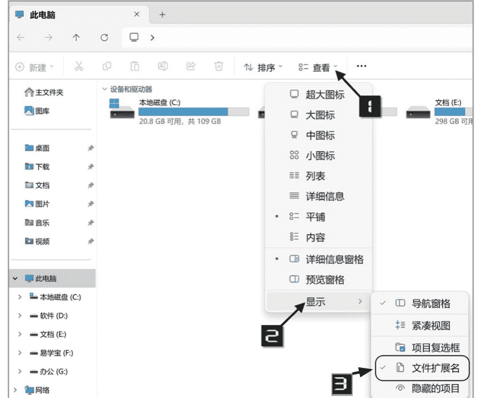

## 图3-27 在Windows 11系统中显示文件扩展名

若计算机系统为Windows 10，可以先双击【此电脑】，再在顶端工具栏中切换到【查看】选项卡，最后勾选【文件扩展名】的复选框，即可显示文件扩展名。

# 技巧06 桑基图：资源流向动态追踪

桑基图能够表达复杂、系统的流动关系，将抽象的数据流动转化为具象的视觉叙事，特别适合需要同时呈现方向、规模和路径的分析场景。

如图3-28所示，这是一份包含性别、品牌、年龄段等信息的智能手机用户画像。借助DeepSeek，可以根据该调查表快速生成桑基图。

| A | B | C |
|---|---|---|
| **智能手机用户画像** | | |
| **性别** | **品牌** | **人数** |
| 男 | 华为 | 1100 |
| 男 | 苹果 | 730 |
| 男 | 小米 | 680 |
| 男 | OPPO | 630 |
| 男 | vivo | 530 |
| 男 | 其他 | 1630 |
| 女 | 华为 | 680 |
| 女 | 苹果 | 1080 |
| 女 | 小米 | 370 |
| 女 | OPPO | 850 |
| 女 | vivo | 630 |
| 女 | 其他 | 1090 |
| 华为 | 45岁以上 | 135 |
| 华为 | 35-44岁 | 319 |
| 华为 | 25-34岁 | 986 |
| 华为 | 18-24岁 | 240 |
| 华为 | 18岁以下 | 100 |
| 苹果 | 45岁以上 | 80 |

图3-28 智能手机用户画像（部分）

先单击DeepSeek对话框右下角的 📎 按钮，上传包含数据的Excel表格，再发送以下提示词。

附件中的数据包含手机品牌、用户年龄段、用户性别及人数，请创建一个HTML格式的智能手机用户画像桑基图，需要体现不同性别、不同年龄段及不同手机品牌的流动关系。要求色彩柔和，鼠标悬停时显示具体数据。

DeepSeek生成的部分代码如图3-29所示。

```html
<!DOCTYPE html>
<html>
<head>
    <title>智能手机用户画像桑基图</title>
    <script src="https://cdn.plot.ly/plotly-latest.min.js"></script>
    <style>
        body { margin: 20px; background-color: #f5f5f5; }
        #chart { background-color: white; border-radius: 10px; padding: 15px; }
    </style>
</head>
<body>
    <div id="chart"></div>

    <script>
        // 节点定义（性别 -> 品牌 -> 年龄段）
        const nodes = {
            label: [
                // 性别层
                "男", "女",
                // 品牌层
                "华为", "苹果", "小米", "OPPO", "vivo", "其他",
                // 年龄段层
                "18岁以下", "18-24岁", "25-34岁", "35-44岁", "45岁以上"
            ],
            ...
        }
    </script>
</body>
</html>
```

图3-29 DeepSeek生成的桑基图代码（部分）

单击代码框右下角的【运行HTML】按钮，桑基图的预览效果如图3-30所示。

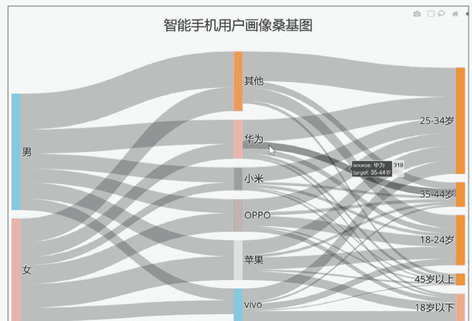

图3-30 智能手机用户画像桑基图

分析如图3-30所示的桑基图可知：男性用户倾向于选择华为和其他品牌的智能手机，女性用户倾向选择苹果手机，各品牌智能手机的主要用户年龄段集中在25～34岁。

先单击代码框右上角的【复制】按钮，将代码粘贴到文本文档中并保存，再右击文件，在弹出的快捷菜单中选择【重命名】命令，将文件扩展名从.txt改成.html。完成以上操作后，即可打开该HTML文件进行浏览。

# 技巧07 旭日图：数据分层拆解

旭日图适合用于展示有较为复杂的层次、结构的数据，如辅助进行财务分析、市场营销和大数据分析，可以帮助用户更好地理解数据的组织和关系。

接下来介绍如何借助DeepSeek生成模拟数据及旭日图。

在DeepSeek对话框中发送以下提示词。

请生成一个HTML格式的旭日图，以“学龄前儿童教育”为主题，要求有丰富的模拟数据和内容。

DeepSeek生成的部分代码如图3-31所示。

```html
<!DOCTYPE html>
<html lang="zh-CN">
<head>
    <meta charset="UTF-8">
    <title>学龄前儿童教育发展全景图</title>
    <script src="https://cdn.jsdelivr.net/npm/echarts@5.4.2/dist/echarts.min.js"></script>
    <style>
        body { margin: 0; padding: 20px; background: #f0f7ff; }
        #main { width: 100%; height: 100vh; min-width: 320px; }
        .chart-title {
            font-size: 24px;
            color: #2c3e50;
            text-align: center;
            padding: 20px;
            font-family: 'Microsoft YaHei';
        }
    </style>
</head>
<body>
    <div class="chart-title">学龄前儿童教育发展全景图</div>
    <div id="main"></div>

    <script>
        let chart = echarts.init(document.getElementById('main'));
```

## 图3-31 DeepSeek生成的旭日图代码（部分）

单击代码框右下角的【运行HTML】按钮，旭日图的预览效果如图3-32所示。

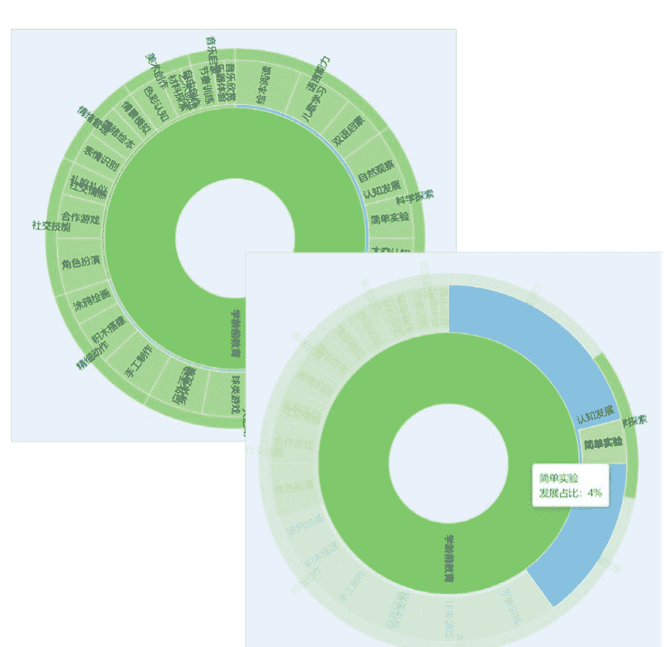

## 图3-32 旭日图效果

此时生成的旭日图中文字重叠，通过指令让DeepSeek进行优化，将优化后的代码复制并粘贴到文本文档中并保存，再右击文件，在弹出的快捷菜单中选择【重命名】命令，将文件扩展名从.txt改成.html。完成以上操作后，即可随时打开该HTML文件进行浏览。

# 技巧08 雷达图：能力评估坐标系搭建

一方面，雷达图可以用于比较不同对象在相同维度中的优劣势，如对比多个产品的用户满意度或不同团队在研发、销售、运营等维度的表现。

另一方面，雷达图可以用于对比同一对象在不同维度中的表现差异，如对比某订单在客服态度、发货速度、商品质量等维度的评分情况或对比某运动员在速度、力量、耐力、灵敏度等维度中的指标数据。

如图3-33所示，是不同订单的客服态度、发货速度、物流进度、配送服务、商品满意度这5大指标的评分情况。借助DeepSeek，我们可以生成雷达图，展示图3-33中各指标的整体表现。

| 订单编号 | 客服态度 | 发货速度 | 物流进度 | 配送服务 | 商品满意度 |
| :--- | :--- | :--- | :--- | :--- | :--- |
| 1 | 4.5 | 3.8 | 4 | 4.2 | 4.7 |
| 2 | 2.5 | 4.5 | 3.2 | 3 | 3.8 |
| 3 | 4.8 | 4 | 4.5 | 4.3 | 4.5 |

图3-33 客户评分表

复制Excel工作表中的内容，粘贴到DeepSeek对话框中，并发送以下提示词。

请根据以上数据制作3个符合HTML标准的雷达图，用于展示各个指标的差异，并给出总结建议。

DeepSeek生成的部分代码如图3-34所示。

```html
<!DOCTYPE html>
<html>
<head>
    <title>订单服务评价雷达图</title>
    <script src="https://cdn.jsdelivr.net/npm/chart.js"></script>
    <style>
        .chart-container {
            width: 33%;
            display: inline-block;
        }
        .analysis {
            padding: 20px;
            margin-top: 30px;
            background-color: #f5f5f5;
        }
    </style>
</head>
<body>
    <div class="chart-container">
        <canvas id="order1"></canvas>
    </div>
    <div class="chart-container">
        <canvas id="order2"></canvas>
    </div>
</body>
</html>
```

图3-34 雷达图代码（部分）

单击代码框右下角的【运行HTML】按钮，雷达图的预览效果及对应的“分析与建议”如图3-35所示。

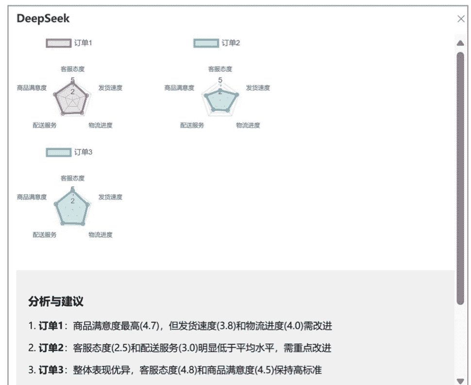

图3-35 DeepSeek生成的雷达图及对应的“分析与建议”

生成的改进建议如下。

- 加强客服培训，规范服务流程；
- 优化仓储管理，提高发货效率；
- 建立物流合作伙伴质量评估机制；
- 保持商品质量优势，持续优化包装。

# 技巧09 根据图片中的信息生成图表

DeepSeek能够快速、准确地解析图片中的信息，直接生成图表，方便用户对数据进行分析和处理。

电影《哪吒之魔童闹海》（也称《哪吒2》）的单日部分票房数据如图3-36所示，借助DeepSeek，我们可以解析图片中的信息并生成折线图。

| 日期 | 分账票房 (万元) | 分账票房占比 | 分账票价 | 排片占比 |
| :--- | :--- | :--- | :--- | :--- |
| 2025-01-23 周四 点映 | -- | -- | -- | -- |
| 2025-01-26 周日 点映 | -- | -- | -- | -- |
| 2025-01-27 周一 点映 | 0.0 | -- | 27.5 | -- |
| 2025-01-28 周二 零点场 | -- | -- | -- | -- |
| 2025-01-29 周三 点映 | 43497.9 | -- | 45.8 | -- |
| 2025-01-30 周四 | 42906.1 | -- | 46.2 | -- |
| 2025-01-31 周五 | 55413.8 | -- | 46.2 | -- |

图3-36 《哪吒之魔童闹海》的单日票房数据（部分）

先单击DeepSeek对话框右下角的 📎 按钮，上传待解析的图片，再发送以下提示词，如图3-37所示。

请解析图片中的信息，生成符合HTML标准的折线图。


图3-37 上传待解析的图片并发送提示词

DeepSeek生成的代码如图3-38所示。

```html
<!DOCTYPE html>
<html>
<head>
    <title>哪吒2单日票房趋势</title>
    <script src="https://cdn.jsdelivr.net/npm/chart.js"></script>
</head>
<body>
    <div style="width: 80%; margin: 0 auto">
        <canvas id="boxOfficeChart"></canvas>
    </div>

    <script>
        // 数据清洗后有效数据集
        const data = {
            labels: [
                "2025-01-29", "2025-01-30", "2025-01-31",
                "2025-02-01", "2025-02-02", "2025-02-03",
                "2025-02-04", "2025-02-05", "2025-02-06",
                "2025-02-07", "2025-02-08", "2025-02-09",
                "2025-02-10", "2025-02-11", "2025-02-12",
                "2025-02-14", "2025-02-15", "2025-02-16",
                "2025-02-17", "2025-02-18"
            ],
            datasets: [{
                label: '单日票房（万元）',
                data: [
                    434979, 42906, 55414,
                    65776, 731879, 75996,
                    78244, 58799, 53071,
                    49037, 56107, 68855,
                    43579, 43680, 48536,
                    62526, 71423, 55663,
                    17553, 15086
                ],
                borderColor: '#e74c3c',
                tension: 0.4,
                fill: false
            }]
        };

        // 图表配置
        const config = {
            type: 'line',
            data: data,
            options: {
                responsive: true,
                plugins: {
                    title: {
                        display: true,
                        text: '《哪吒2》单日票房趋势（2025年）'
                    }
                },
                scales: {
                    x: {
                        title: { display: true, text: '日期' }
                    },
                    y: {
                        title: { display: true, text: '票房（万元）' },
                        beginAtZero: true
                    }
                }
            }
        };

        // 渲染图表
        window.onload = () => {
            new Chart(document.getElementById('boxOfficeChart'), config);
        };
    </script>
</body>
</html>
```

## 图3-38 符合HTML标准的折线图代码

对代码中的数据进行核对，我们可以发现，1月29日、2月2日的数据由于小数点的位置不准确而出现了10倍差异。

在DeepSeek对话框中发送以下提示词。

1月29日的数据应为43497.9，2月2日的数据应为73187.9，请修改数据后重新生成代码。

DeepSeek根据提示词重新生成了代码，并对修正后的数据进行了标注，如图3-39所示。

```html
<!DOCTYPE html>
<html>
<head>
    <title>哪吒2单日票房趋势（修正版）</title>
    <script src="https://cdn.jsdelivr.net/npm/chart.js"></script>
</head>
<body>
    <div style="width: 80%; margin: 20px auto">
        <canvas id="correctedChart"></canvas>
    </div>

    <script>
        // 修正后的数据集
        const correctedData = {
            labels: [
                "2025-01-29", "2025-01-30", "2025-01-31",
                "2025-02-01", "2025-02-02", "2025-02-03",
                "2025-02-04", "2025-02-05", "2025-02-06",
                "2025-02-07", "2025-02-08", "2025-02-09",
                "2025-02-10", "2025-02-11", "2025-02-12",
                "2025-02-14", "2025-02-15", "2025-02-16",
                "2025-02-17", "2025-02-18"
            ],
            datasets: [{
                label: '单日票房（万元）',
                data: [
                    43497.9,    // 修正1月29日数据（原434979 -> 43497.9）
                    42906.1,
                    55413.8,
                    65775.5,
                    73187.9,    // 修正2月2日数据（原731879 -> 73187.9）
```

图3-39 修正后的折线图代码（部分）

单击代码框右下角的【运行HTML】按钮，折线图的预览效果如图3-40所示。

## 图3-40 折线图效果

观察图3-40可知，包含非数值的无效数据条目被过滤了，折线图使用平滑的橙色曲线展示了票房数据随日期变化的趋势，并使用千位分隔符自动格式化了金额显示，包含交互式提示框、自定义坐标轴标签及可视化标记的数据点。

# 技巧10 解读图表信息

借助DeepSeek，能够快速解读图表中的信息、推断数据趋势、总结数据分布特征，并提出优化建议。

图3-41是某班级的考试成绩直方图。单击DeepSeek对话框右下角的 📎 按钮，上传图3-41，并发送以下提示词，即可要求DeepSeek对图表信息进行解读。

请对图片中的图表信息进行解读，并给出结论和建议。

图3-41 考核成绩直方图

DeepSeek对图表信息进行解读后，生成的结论和建议如下。

结论：

成绩分布不均衡：从图表中可以看出，成绩主要集中在(55.00, 70.00]这个区间，有27人，占总人数的较大比例。其他分数区间的人数相对较少。

低分和高分人数较少：≤40.00 和 (85.00, 100.00]这两个分数区间的人数较少，分别为12人和6人。

中等成绩人数较多：(55.00, 70.00] 和 (70.00, 85.00] 这两个中等分数区间的人数较多，分别为27人和13人。

建议：

加强基础教育：≤40.00分数区间有12人，说明有一部分学生的基础知识掌握得不够扎实，需要加强基础教育，帮助这部分学生提高成绩。

提高高分比例：(85.00, 100.00]分数区间只有6人，说明高分学生比例较低，可以通过完善激励机制，鼓励学生争取高分。

关注中等成绩学生：中等成绩的学生人数较多，需要关注这部分学生的学习情况，帮助他们进一步提高成绩，争取进入高分区间。

分析原因：进一步分析成绩分布现状的出现原因，了解学生在学习过程中遇到的困难和问题，有针对性地进行教学改进和辅导。

对图表内容进行分析后，DeepSeek会总结关键发现，并提出改进建议。

# 第4章 DeepSeek写作大师：从创作到排版

DeepSeek基于深度学习模型，可以根据Word文档或WPS文字中的内容自动生成符合语境的报告框架、摘要，帮助用户快速定位核心信息；可以智能分析文档中的语法、句式和用词，提供更专业的表达替代方案；支持批量转换格式、合并与拆分文档，消除重复劳动，节省劳动时间；内置的智能模板库支持快速生成合同、简历等标准文档；能够自动标记多版本文档的差异、可视化展示修改内容，提高团队协作效率。

## 本章的主要内容

- ◆ 技巧1 万字长文框架生成
- ◆ 技巧2 公司年报智能摘要与分析
- ◆ 技巧3 专业级文本润色优化
- ……

# 技巧01 万字长文框架生成

如果需要以中年女性的视角写一篇有关家庭伦理关系的论文，可以先借助DeepSeek生成文章提纲，再填充内容并加以润色。

在DeepSeek对话框中发送以下提示词。

你是一位资深的婚恋情感导师，请以中年女性的视角，设计一篇有关家庭伦理关系的文章提纲，文章字数在2000字以内，要包含痛点分析、解决方法等，内容翔实，避免空洞。

DeepSeek生成的提纲如下。

## 《中年女性的家庭伦理困境与破局之道》

——以亲历者视角解读代际关系、亲密关系与自我价值平衡

### 一、引言：中年女性的家庭围城（300字）

场景切入：45岁全职主妇张莉的典型一天——清晨与叛逆期的儿子争吵，午后应付婆婆的育儿干涉，深夜面对丈夫的冷漠无言

数据支撑：《中国婚姻家庭报告2023版》显示，76%的中年女性存在“情感空心化”症状

核心矛盾：传统家庭角色期待与现代自我意识觉醒的剧烈碰撞

### 二、痛点分析：四重枷锁下的中年困境（800字）

#### 1. 亲密关系荒漠化

夫妻对话沦落为事务性交流（水电费/孩子成绩）

深夜背对背玩手机的“婚姻冷暴力”常态化

案例：结婚18年后发现丈夫精神出轨的私企财务主管的自述

#### 2. 代际关系高压

青春期子女的学业焦虑与情感对抗（升学压力/手机依赖/早恋）

与公婆育儿理念的碰撞（隔代喂养/教育方式分歧）

特殊困境：“二胎”开放后“上有老，下有小”的压力

#### 3. 自我价值感湮灭

从职场白领到“××妈妈”的身份剥夺

社会时钟焦虑：更年期生理变化与容貌衰老恐慌

隐蔽伤害：长期从事家务劳动引发“技能贬值恐惧症”

#### 4. 伦理关系错位

原生家庭创伤的代际传递（强势母亲复制控制模式）

家庭经济权失衡衍生的情感勒索（“都是我养家”式的话语暴力）

边界感缺失引发的家族矛盾（亲戚过度介入小家庭事务）

### 三、破局之道：重建家庭生态系统的实操策略（800字）

#### 1. 亲密关系重塑

沟通革命：

定期开启“20分钟黄金对话”（禁用电子设备+必须有眼神交流）

建立“情感账簿”并定期复盘（记录感动时刻和未解决的矛盾）

激情唤醒实验室：

每月秘密约会日（需要提前48小时预约）

共写婚姻回忆录（从恋爱信物到重大危机事件）

#### 2. 代际关系破冰

亲子关系修复指南：

制定“家庭宪法”，明确权力边界（如在孩子房门上悬挂“沟通申请牌”）

组织主题家庭日活动（角色互换/家族访谈）

智慧应对长辈介入：

用“三明治沟通法”（肯定+需求+感谢）应对育儿分歧

建立缓冲区（委托专业机构处理敏感事务）

#### 3. 自我价值重建

第二人生启动计划：

开发“妈妈经济学”（将家务技能转化为社区服务）

参加45+女性成长社群

身体自主权宣言：

建立私密空间（哪怕只是阳台上的2平方米阅读角）

开展正念训练（更年期瑜伽/舞蹈治疗）

#### 4. 家庭权力结构调整

实施“家庭CEO”制度（轮流担任决策者，培养家庭成员的同理心）

制作情感需求可视化图表（记录各家庭成员的期望值/承受底线）

引入第三方协调机制（专业家庭治疗师/社区调解员）

### 四、结语：在破碎中重建家庭生态（100字）

> 金句点睛：“真正的家庭不是牺牲，而是让每个成员都成为更好的自己”

行动倡议：从本周开始实践，每周一个微小改变（如每天给自己15分钟的独处时间）

未来展望：中年女性作为家庭情感中枢的觉醒力量

中年女性在家庭中常遇到的问题包括夫妻关系淡化、子女教育分歧、婆媳矛盾、自我价值感缺失等。以上提纲突破传统情感文章范式，将企业管理思维融入家庭伦理建设，提供了可量化、可持续的解决方案，直击中年女性在多重伦理关系中的痛点。

复制以上提纲，粘贴到Word文档中进行编辑、确认。

复制编辑后的提纲，打开WPS灵犀官网，单击对话框上方的【长文写作】按钮，将提纲粘贴到对话框中，如图4-1所示。

图4-1 WPS灵犀长文写作

单击对话框上方的【生成文档】按钮，如图4-2所示，WPS灵犀会自动根据提纲中的内容进行创作。

图4-2 生成文档

WPS灵犀生成完毕后，单击页面右上方的【去WPS编辑】按钮，如图4-3所示，即可对AI生成的内容进行审校、编辑，处理其中存在的语句问题与知识性差错。单击【下载】按钮，即可将文件下载到本地。

## 突围家庭围城：中年女性如何平衡代际、亲密关系与自我价值

清晨的阳光透过窗帘的缝隙洒在卧室，45岁的全职主妇张莉在闹钟声中匆匆起身。简单洗漱后，她走进儿子房间，催着还在赖床的儿子起床上学。儿子却因昨晚玩游戏太晚，情绪烦躁，母子俩瞬间爆发激烈争吵。

# 技巧02 公司年报智能摘要与分析

DeepSeek能够快速、准确地提取文档中的关键信息，帮助用户梳理、精简文档内容，让文档中的信息一目了然。与此同时，DeepSeek有较强大的智能推理能力，能够发现文档中存在的潜在问题。

本例上传的是Word版本的某公司的年度总结，部分内容如图4-4所示。

图4-4 远方公司年度总结的部分内容

单击DeepSeek对话框右下角的 @按钮，上传待分析的文档后发送以下提示词。

请对文档中的内容进行总结，并以表格的形式展示主要指标的完成情况。

DeepSeek生成的主要指标完成情况汇总表如表4-1所示。

## 表4-1 主要指标完成情况

| 指标类别 | 指标名称 | 实际值 | 计划完成率 | 备注 |
| :--- | :--- | :--- | :--- | :--- |
| 生产指标 | 产值 | 12.88亿元 | 73.75% | 未达计划目标 |
| | 加工原料总量 | 379,000吨 | 76.88% | 1#线4360吨，2#线142100吨，3#线234,000吨 |
| | 生产成品总量 | 301,080吨 | - | |
| 采购指标 | 原料采购总量 | 359,900吨 | - | 进口原料占比78.6%（283,000吨） |
| 销售指标 | 全年销售总量 | 324,600吨 | - | 产销基本平衡 |
| | 销售收入 | 14.68亿元 | - | 货款回收率为98.55% |
| 成本控制 | 电/煤/五金消耗节约 | 38万元 | - | 同比节约用电0.11度/吨料、用煤0.86kg/吨料 |
| | 不良品率下降收益 | 170万元 | - | 1#线下降0.225%，2#线下降0.246% |
| 安全生产 | 安全事故数 | 0起 | - | 实现“五个零”目标 |

除了生成主要指标完成情况汇总表，DeepSeek还对关键成果、存在的问题，以及未来方向进行了总结。

## 关键成果

成本优化：通过设备改造和管理优化，全年节约成本38万元，不良品率下降带来额外170万元的收益。

市场扩张：成功开拓7个新市场，产销平衡率达98.55%。

安全生产：实现全年“零事故”。

## 存在的问题

设备重复维修率高，外包装质量需要得到改进。

干部责任意识不足，部分生产指标未达计划目标。

## 未来方向

技术升级：推动生产线自动化改造，降低设备故障率。

质量管控：建立全面的质量管理体系，优化外包装设计。

市场深化：加强零售渠道建设，加快客户服务响应速度。

使用DeepSeek对文档中的数据进行“提纯”——去除冗余内容后，决策者更容易洞察其中的关键信息。

# 技巧03 专业级文本润色优化

DeepSeek支持自动检查并修正Word文档中的拼写错误、语法错误及标点误用；重组冗长语句，调整主谓结构，确保段落间逻辑衔接自然；删除冗余内容，突出关键数据，显著提升文档质量。

如图4-5所示，这是待借助DeepSeek进行润色处理的某公司的年度工作总结。

> 北方二公司 2024 年工作总结

2024 年北方二公司累计实现产值 12.32 亿元，销售收入 14.67 亿元，加工原料 379000 吨，共生产成品 301080 吨，全年累计采购原料 359900 吨，其中进口原料 283000 吨。

2024 年，我们将工作重点放在“节约挖潜、追求高效”上，狠抓内部管理，努力降低生产中的各种消耗，提高生产效率，严格控制非生产性开支。

今年上半年，生产技术部针对不良品较高问题，对设备进行了全面改造。全年累计电耗同比节约 0.13 度/吨料，煤耗同比节约 0.92KG/吨料，五金消耗同比节约 0.175 元/吨料，合计节约成本 38 万余元。同时，1#线、2#线不良品占比同比下降 0.235%和 0.226%，仅此一项就年增加经济效益 190 余万元。

下半年，生产技术部完成了新职工的培训工作。组织完成了新生产线的调试工作。

经过一年的努力，生产系统在完成公司安排各项任务的同时，也为公司培养出一批素质过硬，作风过硬，业务精湛的专业技术人员，为公司做出了贡献。

图4-5 待润色处理的文档内容

单击DeepSeek对话框右下角的按钮，上传待润色处理的文档，并发送以下提示词。

附件内容是分公司的年度总结（需要向总公司领导进行汇报），请对文档中的内容进行润色，要求突出业绩，合理化不足，不要虚构数据和文档中没有提及的工作内容，避免使用“可能”“大概”等不确定表述。结果以代码形式输出，代码要符合Markdown标准。

上述提示词中，说明了使用场景是“向总公司领导进行汇报”，提出了要求“对内容进行润色”，对润色结果进行了约束：“要求突出业绩，合理化不足，不要虚构数据和文档中没有提及的工作内容，避免使用‘可能’‘大概’等不确定表述”，最后对输出结果进行了规定：“结果以代码形式输出，代码要符合Markdown标准。”

DeepSeek生成的代码如图4-6所示。

```
**北方二公司2024年度工作总结报告**

---

### 一、核心经营指标达成
2024年度，北方二公司全面完成生产经营目标，核心数据表现如下：
- **累计实现产值**：12.32亿元
- **销售收入**：14.67亿元
- **原料加工量**：37.9万吨
- **成品产量**：30.108万吨
- **原料采购量**：35.99万吨（其中进口原料占比78.6%，达28.3万吨）

---

### 二、年度重点工作推进与成效
本年度围绕“节约挖潜、提质增效”核心方针，通过强化内部管理、优化资源配置，实现以下成果：

### 1. **降本增效成果显著**
- **能源与物料消耗控制**：
  - 电耗同比降低0.13度/吨料，煤耗减少0.92 /吨料，五金消耗节约0.175元/吨料，合计降本38万元。
- **质量提升与效益转化**：
  - 1#线、2#线不良品率分别下降0.235%和0.226%，直接创效190万元。

---

## 三、总结与展望
2024年，北方二公司通过精细化管理与技术革新，在保障生产任务高效完成的同时，实现成本节约与质量双提升。未来将持续深化以下工作：
1. 推进新产线产能释放，优化产品结构。
2. 强化数据化管控，进一步压缩非生产性开支。
3. 完善人才激励机制，巩固技术团队核心竞争力。

**北方二公司**
2024年12月
```

图4-6 DeepSeek生成的代码

单击代码框右上角的【复制】按钮，复制DeepSeek生成的代码后打开Markdown在线编辑器（https://toolonline.net/markdown），将代码粘贴在编辑器页面左侧，右侧会自动出现整理好的文档。

完成以上操作后，单击【导出Word文档】按钮，即可将生成的Word文档下载到本地，如图4-7所示。

图4-7 导出Word文档

最终生成的Word文档效果如图4-8所示，其中的各项数据和原文档数据一致。此时，可根据需要对文档进行更改或增删。

## 北方二公司 2024 年度工作总结报告

### 一、核心经营指标达成

2024 年度，北方二公司全面完成生产经营目标，核心数据表现如下：

- 累计实现产值：12.32 亿元
- 销售收入：14.67 亿元
- 原料加工量：37.9 万吨
- 成品产量：30.108 万吨
- 原料采购量：35.99 万吨（其中进口原料占比 78.6%，达 28.3 万吨）

### 二、年度重点工作推进与成效

本年度围绕“节约挖潜、提质增效”核心方针，通过强化内部管理、优化资源配置，以下成果：

#### 1. 降本增效成果显著

- 能源与物料消耗控制：
  - 电耗同比降低 0.13 度/吨料，煤耗减少 /吨料，五金消耗节约 0.175 元/吨料，合计降本 38 万元。
- 质量提升与效益转化：
  - 1#线、2#线不良品率分别下降 0.235%和 0.226%，直接创效 190 万元。

#### 2. 技术改造与设备升级

针对上半年不良品率偏高问题，生产技术部主导完成设备全面改造，同步优化工艺流程，有效提升生产线稳定性与产品合格率。

# 技巧04 借助DeepSeek为Word文档排版

将无格式的文本内容上传到DeepSeek中后，可以借助DeepSeek完成排版，快速获得整洁、美观的排版效果，不需要手动调整字体、段落间距、标题层级等格式，排版时间获得了极大的节省。

单击DeepSeek对话框右下角的按钮，即可上传待排版的文档。本例上传的是TXT格式的文档。完成文档上传后发送以下提示词。

请将此文档按通用标准文档的格式进行排版，结果以代码形式输出，代码要符合Markdown标准。

复制DeepSeek生成的代码，打开Markdown在线编辑器，将代码粘贴到编辑器页面左侧，随后，单击【导出Word文档】按钮，如图4-9所示，将生成的Word文档下载到本地，根据实际情况对其进行编辑优化。

图4-9 导出Word文档

# 技巧05 将会议记录转成标准会议纪要

借助DeepSeek，不仅能够将会议记录转成标准的会议纪要，还能够快速提取出议题、决策、任务等关键信息。

如图4-10所示，这是需要借助DeepSeek转成会议纪要的某公司的会议记录初稿，存在部分排版错误，表达偏口语化。

## 2025年2月20日会议记录

2025年2月20日下午14:30，在公司第一会议室举行会议，参会人员有：董事长张明、总经理李华和生产总工王强。

董事长：各位，今天召集大家的核心议题是“提升产品质量”和“节能降耗”。过去半年，客户对产品稳定性的投诉率上升了8%，同时能源成本同比增加了12%。这两个问题直接影响公司利润和市场竞争力。我们必须拿出切实方案，在三个月内扭转局面。李总、王工，请结合部门现状谈谈看法。

总经理：感谢张董。我先抛砖引玉。

质量问题：近期客户反馈的批次性瑕疵集中在焊接工艺波动和涂层厚度不均，建议由王工牵头成立工艺优化小组，重新校准设备参数，并引入实时监测系统，减少人为误差。

能耗问题：电费和燃气成本超支的主因是生产线空转率过高，建议推行“峰谷用电”计划，将高耗能工序调整至夜间电价低谷时段，同步加装余热回收装置。

奖惩机制：提议设立“质量-能耗双指标考核”，对达成目标的班组额外奖励5%绩效，未达标者需参加专项培训。

请王工补充技术细节。

生产总工：我补充三点技术方案。

设备升级：现有焊接机器人已服役8年，定位精度下降0.05mm，申请更换新型伺服电机（预算约120万元），可使焊缝合格率从92%提升至98%。

工艺优化：实验数据表明，将退火温度从850℃降至820℃并延长保温时间，既能保证材料强度，又可减少15%燃气消耗。

员工培训：下周起对全体操作工开展“标准化作业+节能意识”轮训，重点解决因操作随意性导致的物料浪费问题。

董事长：方案方向正确，但需细化节点：

- 李总负责在2月25日前拟定奖惩制度，人力资源部同步跟进。
- 王工团队3月10日前完成设备升级可行性报告，优先使用技改专项资金。
- 财务部测算节能降耗目标：要求单位产品能耗降低10%，质量投诉率下降至3%以内。

下月例会我将亲自检查进度，各部门必须打破壁垒，协同作战。

散会前，请两位确认是否有补充？

李华、王强：无补充，立即执行。

会议于15:20结束

记录人：办公室 刘芳

### 图4-10 会议记录

复制会议记录内容，粘贴到DeepSeek对话框中后，发送以下提示词。

请将以上会议记录整理成标准的会议纪要，并总结会议议题及需要解决的问题、明确责任人与完成时限。结果以代码形式输出，代码要符合Markdown标准。

DeepSeek生成的代码如图4-11所示。

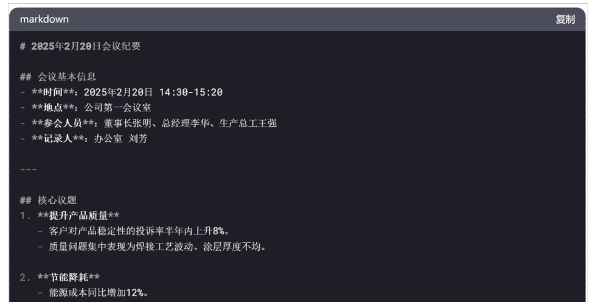

### 图4-11 DeepSeek生成的代码（部分）

复制DeepSeek生成的代码，打开Markdown在线编辑器，将代码粘贴到编辑器页面左侧。单击【导出Word文档】按钮，即可将生成的Word文档下载到本地。生成的会议纪要效果如图4-12所示。

## 2025年2月20日会议纪要

### 会议基本信息

- 时间：2025年2月20日 14:30-15:20
- 地点：公司第一会议室
- 参会人员：董事长张明、总经理李华、生产总工王强
- 记录人：办公室 刘芳

### 核心议题

1. 提升产品质量
   - 客户对产品稳定性的投诉率半年内上升8%。
   - 质量问题集中表现为焊接工艺波动、涂层厚度不均。
2. 节能降耗
   - 能源成本同比增加12%。
   - 生产线空转率高，电费与燃气成本超支。

### 解决方案与责任分工

一、提升产品质量

| 措施 | 责任人 | 完成时限 | 具体要求 |
| :--- | :--- | :--- | :--- |
| 成立工艺优化小组 | 王强 | 立即执行 | 校准设备参数，引入实时监测系统，减少人为误差 |
| 焊接设备升级 | 王强团队 | 3月10日前 | 提交设备升级可行性报告（更换伺服电机，预算约120万元），提升焊缝合格率 |
| 员工标准化作业培训 | 王强 | 下周起 | 开展“标准化作业”轮训，减少操作随意性导致的物料浪费 |

# 技巧06 根据知识库内容生成题目

DeepSeek支持根据知识库内容生成题目，并根据知识库中的关键词和知识点结构自动匹配选择、填空、简答等题型。不需要人工逐题编写，可以大幅缩短出题周期。

如图4-13所示，这是员工应知应会知识库的Word文档，DeepSeek需要据此生成不同题型的题目。

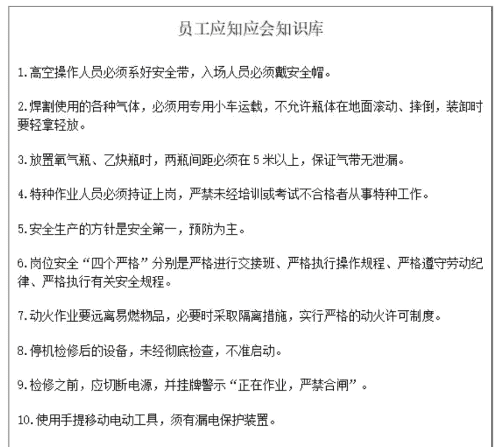

### 图4-13 应知应会知识库文档（部分）

单击DeepSeek对话框右下角的按钮，上传Word文档，并发送以下提示词。

请根据文档中的内容生成题目，题型包括选择、填空和简答，结果以代码形式输出，代码要符合Markdown标准。

DeepSeek生成的考试题代码如图4-14所示。

单击代码框右上角的【复制】按钮，复制DeepSeek生成的代码后打开Markdown在线编辑器，将代码粘贴在页面左侧。单击【导出Word文档】按钮，即可将生成的考试题下载到本地。生成的题目如图4-15所示，每个问题都对应着原文档中的具体条款，答案是准确无误的。


### 图4-14 DeepSeek生成的考试题代码（部分）

## 选择题

1. 高空操作人员必须佩戴的安全装备是?
   A. 安全帽
   B. 安全带
   C. 防护手套
   D. 防护眼镜
   答案：B
2. 氧气瓶与乙炔瓶的放置间距要求是?
   A. 2米
   B. 3米
   C. 5米
   D. 10米
   答案：C
3. 特种作业

## 填空题

1. 焊割使用的气体瓶体严禁在地面______或______。
   答案：滚动、摔倒
2. 安全生产的方针是______，______。
   答案：安全第一、预防为主
3. 进入危险容器检修时，必须保证______人合作，一人检修，另一人______。
   答案：两、监护
4. 使用手提移动电动工具时，必须安装______保护装置。
   答案：漏电

## 简答题

1. 简述“岗位安全四个严格”的具体内容。
   答案：严格进行交接班；严格执行操作规程；严格遵守劳动纪律；严格执行有关安全规程。
2. 停机检修后的设备在启动前需要完成哪些工作？
   答案：必须经过彻底检查，确认无安全隐患后方可启动。
3. 用人单位在劳动合同中需告知劳动者的职业病相关内容有哪些？
   答案：可能产生的职业病危害及其后果、职业病防护措施和待遇。
4. 操作记录填写的要求是什么？
   答案：记录必须真实、准时。
5. 正常操作中的检查包括哪些项目？
   答案：定期记录、检查设备泄漏情况、设备声音和振动情况、生产指标受控情况。

图4-15 DeepSeek生成的题目（部分）

# 技巧07 核对合同内容是否变更

签订电子版合同时，为了避免对方在未经协商的情况下擅自修改合同条款，可以借助DeepSeek逐条对比对方返回的合同与之前保存的合同原件，确认内容是否被修改、被修改内容是否已经过协商。借助DeepSeek，能够快速对比两份合同的内容差异。

某委托创作合同的原件与合同副本文档如图4-16所示。


图4-16 合同与合同副本（部分）

单击DeepSeek对话框右下角的 📎 按钮，上传两份需要对比的合同后，在DeepSeek对话框中发送以下提示词。

> 请仔细对比两份文件，将内容差异以表格形式列出。表格中要包括文件名、差异内容，以及出现的行次。

DeepSeek生成的对比结果如表4-2所示。

## 表4-2 内容差异

| 文件名 | 差异内容 | 出现行次 |
| :--- | :--- | :--- |
| 委托创作合同.docx | 住所地址：北京市密云鼓楼街道 | 甲方住所地址行 |
| 委托创作合同-副本.docx | 住所地址：北京市密云区鼓楼街道 | 甲方住所地址行 |
| 委托创作合同.docx | 2.3.3 视频课程要求画质清晰，分辨率不低于1280p | 第二条 2.3.3 条款行 |
| 委托创作合同-副本.docx | 2.3.3 视频课程要求画质清晰，分辨率不低于720p | 第二条 2.3.3 条款行 |
| 委托创作合同.docx | 4.2.1 甲方预付费用时间为验收通过后15个工作日内 | 第四条 4.2.1 条款行 |
| 委托创作合同-副本.docx | 4.2.1 甲方预付费用时间为验收通过后10个工作日内 | 第四条 4.2.1 条款行 |
| 委托创作合同.docx | 12.2 变更通知或通讯地址需要自变更之日起5个工作日内通知对方 | 第十二条 12.2 条款行 |
| 委托创作合同-副本.docx | 12.2 变更通知或通讯地址需要自变更之日起5日内通知对方 | 第十二条 12.2 条款行 |

在以表格形式生成对比结果的同时，DeepSeek还提供了具体的差异说明：

住所地址：合同为“北京市密云鼓楼街道”，副本补充为“北京市密云区鼓楼街道”。

分辨率要求：合同要求“不低于1280p”，副本降低为“720p”。

预付款时间：合同规定15个工作日内，副本缩短为10个工作日内。

通知时限：合同要求“5个工作日内”，副本仅写“5日内”（未明确是否为工作日）。

# 技巧08 评估和预警合同风险

DeepSeek支持对准备签订的合同进行评估，分析有无不符合法律规定的内容，以及条款表述不清晰、可能引发纠纷的潜在风险，帮助使用者规避可能存在的风险。如图4-17所示，是一份需要进行评估、判断是否存在风险的房屋租赁合同。

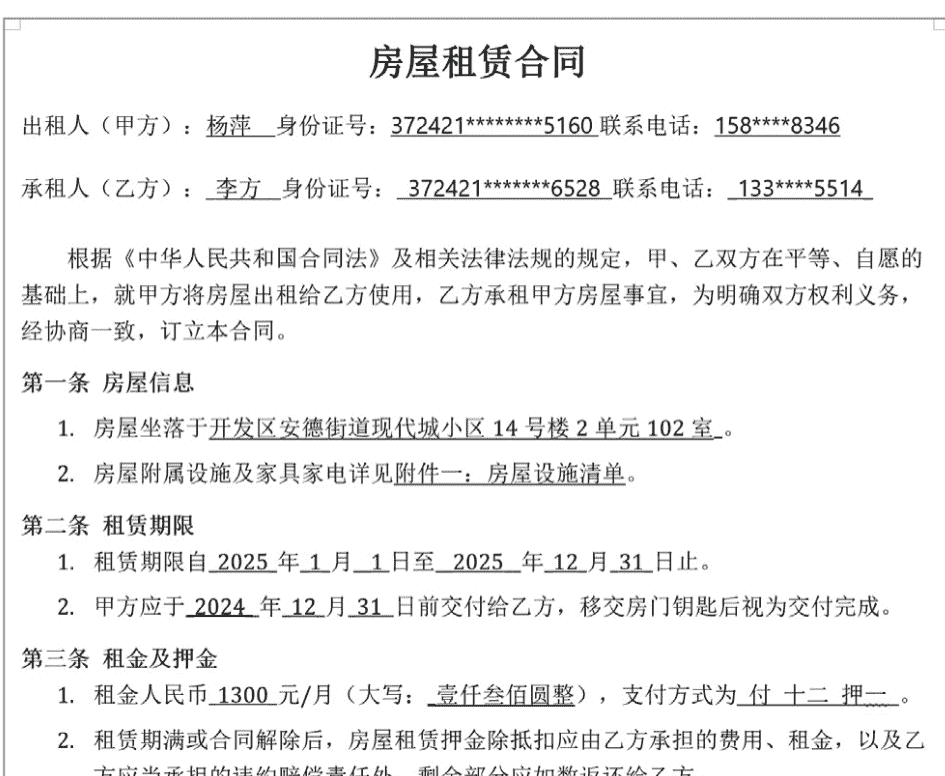

图4-17 房屋租赁合同（部分）

单击DeepSeek对话框右下角的 📎 按钮，将合同上传后，在DeepSeek对话框中发送以下提示词，如图4-18所示。

你是一位法务专家，擅长处理各类合同协议纠纷，请对房屋租赁合同进行简要评估并预警可能存在的风险。


图4-18 在DeepSeek对话框中上传文件并发送提示词

DeepSeek生成的房屋租赁合同风险评估及预警如下。

## 1. 身份信息及隐私风险

风险点：合同中，甲方、乙方的身份证号及联系方式部分被隐去（如星号遮挡），但未明确约定隐私保护条款。

建议补充隐私保护条款，约定双方信息仅用于合同履行，禁止擅自泄露或用于其他用途。

## 2. 交付时间矛盾

风险点：租赁期限从2025年1月1日开始，但甲方需要在2024年12月31日前交付房屋。若实际交房至租期开始期间出现房屋损坏或使用问题，责任归属不明确。

建议明确空置期内的房屋管理责任（如是否需要支付租金、规定维修责任）。

## 3. 押金退还条款模糊

风险点：押金退还条款未明确退还时间、扣除费用的具体标准，以及争议解决方式，易引发拖延或纠纷。

建议补充押金退还时限（如退租后7个工作日内），并细化可扣除费用的范围（如维修费需要提供凭证）。

## 4. 安全责任划分不合理

风险点：第六条约定“房屋内安全事故均由乙方自行承担”。若事故是房屋本身存在的安全隐患（如电路老化、燃气泄漏）导致，此条款可能因违反《中华人民共和国民法典》而无效。

建议增加甲方对房屋安全性的保证责任，明确乙方仅对自身过错导致的安全事故负责。

## 5. 违约金比例的合法性存在问题

风险点：提前解约违约金为0.5个月的租金，需要确认是否符合当地司法实践（通常不超过总金额的30%）。若租期仅为1年，0.5个月的租金可能合理，但仍需要明确计算依据。

建议补充违约金计算方式（如按实际损失比例）或直接引用法定上限。

## 6. 费用分担条款不明确

风险点：物业费、垃圾清运费由甲方承担，但未约定缴费方式（如甲方代缴后向乙方提供凭证）。若甲方未及时缴费导致服务暂停，责任归属不清。

建议明确费用缴纳流程（如甲方需要在缴费截止日前完成代缴），并约定逾期责任。

## 7. 附属设施清单及交接记录缺失

风险点：附件一列明设施，但未约定交接时的验收流程（如拍照、签字确认）退租时易围绕设施状态产生争议。

建议双方在交房时签署《设施交接确认单》并附照片，作为退租时的依据。

## 8. 签署日期不一致

风险点：甲方签署日期为2024年12月20日，乙方签署日期为2024年12月22日，可能导致合同生效时间争议。

建议统一签署日期，或注明“自最后签署方签字之日起生效”。

## 总结建议

合同整体框架符合《中华人民共和国民法典》租赁相关规定，但部分条款需要细化，以降低执行风险。

DeepSeek详细解读了合同中存在的风险点，并针对风险提示提出了修改、补充建议。

# 技巧09 生成领导发言稿

按照“背景+角色+任务+要求”的模式组织提示词，能够让DeepSeek在特定范围内生成重点突出、有针对性的发言材料。

例如，在DeepSeek对话框中发送以下提示词。

请按照如下要求撰写材料：

恒信新材料集团要召开集团项目建设推进会，总经理将在会议上讲话。你是总经理的秘书，擅长各类文稿材料的写作，请写一份总经理在集团项目建设推进会上讲话的发言稿，要突出项目建设的紧迫性，结构清晰、逻辑严密，字数控制在2000字左右。

提示词中，“恒信新材料集团要召开集团项目建设推进会，总经理将在会议上讲话”是任务背景，“你是总经理的秘书，擅长各类文稿材料的写作”是指定角色，任务是“写一份总经理在集团项目建设推进会上讲话的发言稿”，要求则是“要突出项目建设的紧迫性，结构清晰、逻辑严密，字数控制在2000字左右”。

DeepSeek生成的部分内容如下。

## 在恒信新材料集团项目建设推进会上的讲话

同志们：

今天我们召开的集团项目建设推进会，既是一次总结经验的交流会，又是一次加压奋进的动员会。当前，集团正处于转型升级的关键期，项目建设既是推动高质量发展的主引擎，又是抢占行业制高点的核心抓手。我们必须清醒地认识到，面对激烈的市场竞争、迫切的产业升级需求、股东与客户的期待，我们的项目建设还存在进度推进速度慢、资源统筹不足、创新突破不够等问题。今天的会议，要以问题为导向，以目标为引领，吹响冲锋号、按下快进键，确保全年项目建设任务高质量完成。下面，我讲三点意见。

### 一、认清形势、凝聚共识，以“等不起”的紧迫感抢抓发展机遇

1. 从行业竞争形势看，慢一步就步步被动新材料产业正在经历“技术迭代加速、产能整合提速”的双重变革。据统计，今年上半年，全国新材料领域新增投资规模同比增长23%，头部企业研发投入强度普遍超过8%。我们的竞争对手不仅在产能上加速扩张，还在高端产品研发上频频突破。例如，××同行企业近期投产的××项目，其产品性能已接近国际领先水平。如果我们不能抢抓窗口期，迅速形成优势产能，必将错失市场先机。

2. 从政策机遇方面看，快一拍能赢得红利

国家“十四五”规划明确提出，……

……

同志们！项目建设是检验执行力的试金石，是锤炼战斗力的练兵场。今天的现场会，既是对阶段性成果的检验，又是向全年目标冲刺的起点。让我们带着“咬定青山不放松”的韧劲、“不破楼兰终不还”的拼劲，全力以赴抢进度、抓质量、保安全，坚决打赢项目建设攻坚战，为集团高质量发展提供最强支撑！

谢谢大家。

以上发言稿符合现场推进会讲话稿的要求，不仅突出了紧迫感、有效地传递了压力，还在结尾部分用激励性的语言增强了团队信心。

# 技巧10 根据销售数据生成销售分析报告

DeepSeek可以基于表格内容生成描述性文档，快速将表格数据转化为易于理解的文本描述，方便用户完成报告编写、数据分析、信息整理等工作，提高工作效率。

如果手头有销售数据，但不知道应该如何有效地提取信息，可以借助DeepSeek提炼信息。

如图4-19所示，是某公司商品销售数据表的部分内容，需要借助DeepSeek对其进行深入解读。

| 日期 | 品类名称 | 大类 | 中类 | 风格 | 季节 | 性别 | 颜色 | 商品代码 | 数量 | 销售金额 |
| :--- | :--- | :--- | :--- | :--- | :--- | :--- | :--- | :--- | :--- | :--- |
| 2024/3/1 | 鞋 | 布鞋 | 单靴 | 中式改良 | 秋 | 女 | | 151302300 | 1 | 235 |
| 2024/3/1 | 鞋 | 皮鞋 | 单鞋 | 休闲 | 春 | 女 | 土黄 | 140113024 | 1 | 440 |
| 2024/3/1 | 鞋 | 布鞋 | 单鞋 | 休闲 | 春 | 男 | 黑色 | 181101071 | 1 | 537 |
| 2024/3/1 | 服装 | 下装 | 小脚裤 | 时尚 | 冬 | 女 | 黑色 | 175458265 | 1 | 702 |
| 2024/3/1 | 服装 | 上装 | 毛衫 | 休闲 | 冬 | 女 | 绿色 | 164450037 | 1 | 959 |
| 2024/3/2 | 鞋 | 布鞋 | 单鞋 | 休闲 | 秋 | 男 | | 161301019 | 1 | 851 |
| 2024/3/2 | 鞋 | 布鞋 | 单鞋 | 休闲 | 秋 | 女 | 黑色 | 171301030 | 1 | 678 |
| 2024/3/2 | 鞋 | 布鞋 | 单鞋 | 休闲 | 春 | 女 | 红色 | 181101065 | 2 | 1,026 |
| 2024/3/2 | 服装 | 上装 | 外套 | 时尚 | 春 | 女 | 玫红 | 174142055 | 1 | 1,707 |
| 2024/3/2 | 服装 | 上装 | 羽绒服 | 中式 | 冬 | 女 | 酒红 | 174453263 | 1 | 1,870 |
| 2024/3/3 | 服装 | 上装 | 外套 | 中式 | 秋 | 女 | 红色 | 174342053 | 1 | 1,938 |
| 2024/3/3 | 服装 | 上装 | 外套 | 中式 | 秋 | 女 | 紫红 | 174342240 | 1 | 1,797 |

图4-19 销售数据（部分）

在DeepSeek对话框中输入以下提示词。

我希望DeepSeek根据销售数据生成详细的销售分析报告，我应该如何提问？

DeepSeek会生成一个提问模板。

首先明确分析需求：

## 1. 整体表现

按月/季度/年呈现销售额、销售量、利润率的趋势变化

关键指标同比/环比增长率

## 2. 产品维度

Top 10畅销产品（按销售额/利润筛选）

各产品类别的销售额占比及利润对比

低效产品识别（如利润率<5%或销量同比下降>20%）

## 3. 区域/渠道分析

各地区销售额、利润排名及对比

线上VS线下渠道表现（增长率、客单价差异）

## 4. 客户分析

高价值客户识别（Top 10客户贡献度）

新客户获取VS老客户复购分析

## 5. 深度洞察

发现数据异常点（如特定月份暴跌/暴涨）

给出提高销售额的具体建议（如应重点推广的地区/产品）

## 6. 可视化需求

生成柱状图/折线图/饼图（需要说明具体的图表类型）

关键指标用加粗/颜色标注

根据以上提问模板的提示，对实际分析需求进行梳理。

单击DeepSeek对话框右下角的 📎 按钮，上传销售数据，并在DeepSeek对话框中发送以下提示词。

你是一位资深的服装鞋帽零售市场营销专家，请基于表格中的销售数据生成一份分析报告，报告需要包含以下内容：

按产品季度属性呈现销售额的变化趋势，按销售金额提取Top 5的畅销产品清单和销量占比不足5%的低效产品清单，并给出提高销量的关键建议。

DeepSeek生成的销售分析报告如下。

### 一、按产品季度属性呈现销售额变化趋势

| 季节 | 销售额（元） | 占比 | 趋势分析 |
| :--- | :--- | :--- | :--- |
| 秋 | 58,243 | 38% | 销售额最高，需求集中在休闲鞋、外套等品类，可能与换季需求相关 |
| 冬 | 33,817 | 22% | 羽绒服、棉鞋等高单价商品表现突出，但季节末期销量略有下降 |
| 春 | 30,952 | 20% | 长袖衬衫、休闲鞋类销售额增长显著，符合春季上新趋势 |
| 常年 | 18,629 | 12% | 基础款布鞋（如黑色单鞋）和配饰销量稳定但增速较慢 |
| 夏 | 9,610 | 6% | 仅少量夏装有销量，占比最低，需要提前布局夏季产品线 |

结论：秋季为销售旺季，冬季、春季次之，夏季需要加强市场预热。

### 二、Top 5的畅销产品清单

| 排名 | 商品名称 | 销售金额（元） | 关键特征 |
| :--- | :--- | :--- | :--- |
| 1 | 女式休闲外套（2号色） | 7,807 | 休闲风格、春季/秋季、高单价 |
| 2 | 男式中式改良布鞋（黑色） | 5,689 | 中式风格、基础款、高频复购 |
| 3 | 女式时尚长袖衬衫（金色） | 5,233 | 时尚风格、高单价 |
| 4 | 女式休闲风衣（棕色） | 7,637 | 休闲风格、春季/秋季、高单价 |
| 5 | 男式休闲皮鞋（黑色） | 4,829 | 正装/休闲装、高频销售 |

特征总结：高单价外套和经典色（黑色、棕色）鞋类占主导，女性的市场贡献显著。

### 三、销量占比不足5%的低效产品清单

低效产品筛选标准：单款销量≤7件（占比≤5%）

| 商品代码 | 品类名称 | 销量（件） | 占比 | 问题定位 |
|---|---|---|---|---|
| 173506004 | 鞋配（白色） | 1 | 0.7% | 非刚需，颜色单一 |
| 142113046 | 布鞋（黑色） | 2 | 1.3% | 款式陈旧，缺乏吸引力 |
| 171301996 | 布鞋（绿色） | 3 | 2.0% | 颜色小众 |
| 184144266 | 长袖衬衫（1号色） | 1 | 0.7% | 设计同质化，缺乏亮点 |
| 174446005 | 坎肩（红色） | 1 | 0.7% | 适用场景有限，推广不足 |

## 四、提升销售额的关键建议

### 季节性策略优化

秋季：增加休闲鞋、外套的库存并加大促销力度（如满减活动）。

春季：主推长袖衬衫和风衣，结合“春日焕新”主题营销。

夏季：提前上架T恤、凉鞋，利用社交媒体预热。

### 畅销品强化

针对Top 5的商品，增加陈列曝光，推出“明星单品”限时折扣（如金色长袖衬衫）。

开发同类高潜力款式（如更多金色/红色时尚设计）。

### 低效产品清库存

- 捆绑销售：将低效鞋与畅销鞋搭配销售。
- 打折促销：对滞销布鞋设置“清仓专区”，降价30%～50%。
- 设计迭代：淘汰同质化款式（如1号色衬衫），引入流行元素（如撞色、印花）。

### 数据驱动选品

- 分析消费者的颜色偏好：黑色、红色、酒红色等高转化颜色的产品优先补货。
- 动态监控“常年”款销售情况，及时调整基础款SKU（如增加灰色布鞋、卡其色布鞋）。

### 渠道与推广

- 线上：通过直播带货重点推广高单价冬装（羽绒服）和春装（风衣）。
- 线下：在门店设置“季节专区”，强化场景化陈列（如秋装搭配鞋帽）。

总结：通过季节性精准营销、畅销品优先陈列、低效品快速清仓等措施，可显著优化整体销售表现。建议每两周复盘一次数据并动态调整销售策略。

# 技巧11 根据日程表生成设备检修计划

DeepSeek支持快速识别检修日程表中的项目、时间节点等结构化数据，并将其转化为连贯的文字描述。

如图4-20所示，是某公司设备检修日程表的部分内容，可借助DeepSeek将其转换为文字形式的检修计划。

| 日期 | 部门 | 检修项目 | 实施人 |
| :--- | :--- | :--- | :--- |
| 2025-1-1至2025-1-7 | 前置清理车间 | D110到D114流管修补 | 机修组 |
| 2025-1-1至2025-1-3 | 前置清理车间 | 1-2楼 | 土建队 |
| 2025-1-1至2025-1-4 | 前置清理车间 | 加热器D208H清理 | 孙荣清 |
| 2025-1-1至2025-1-4 | 前置清理车间 | 各个设备加油 | 张开元 |
| 2025-1-5至2025-1-10 | 前置清理车间 | 仓下加大存料箱 | 设备厂家 |
| 2025-1-1至2025-1-5 | 前置清理车间 | 所有风机清理叶轮、脉冲除尘 | 张开元 |
| 2025-1-1至2025-1-5 | 前置清理车间 | D230 D234提升机加视镜 | 王卫东 |
| 2025-1-1至2025-1-5 | 前置清理车间 | D123A D123B轴承加油 | 孙荣清 |
| 2025-1-1至2025-1-6 | 喷淋车间 | 循环水泵维修蝶阀 | 贺德坤 |
| 2025-1-1至2025-1-7 | 配电 | | 邢振厚 |

图4-20 检修日程表

单击DeepSeek对话框右下角的按钮，上传检修日程表后在DeepSeek对话框中发送以下提示词。

请将表格中的内容转换为文字形式的检修计划，不得遗漏或增加项目。

DeepSeek生成的检修计划如下。

日期：2025-1-1至2025-1-7

部门：前置清理车间

检修项目：D110到D114流管修补
实施人：机修组
日期：2025-1-1至2025-1-3
部门：前置清理车间

检修项目：1-2楼换灯泡
实施人：土建队
日期：2025-1-1至2025-1-4
部门：前置清理车间

检修项目：加热器D208H清理
实施人：孙荣清
日期：2025-1-1至2025-1-4
部门：前置清理车间

检修项目：各个设备加油
实施人：张开元
日期：2025-1-5至2025-1-10
部门：前置清理车间

检修项目：仓下加大存料箱
实施人：设备厂家

日期：2025-1-1至2025-1-5
部门：前置清理车间
检修项目：所有风机清理叶轮、脉冲除尘
实施人：张开元

日期：2025-1-1至2025-1-5
部门：前置清理车间
检修项目：D230、D234提升机加视镜，底座割孔
实施人：王卫东

日期：2025-1-1至2025-1-5
部门：前置清理车间
检修项目：D123A、D123B轴承加油
实施人：孙荣清

日期：2025-1-1至2025-1-6
部门：喷淋车间
检修项目：循环水泵维修蝶阀
实施人：贺德坤

日期：2025-1-1至2025-1-7
部门：配电

检修项目：清理空压机，换机油滤芯，整理蒸汽流量计信号线

实施人：邢振厚

DeepSeek生成的检修计划结构清晰、易于阅读，适合用在工作总结等文件中。

# 技巧12 轻松改变文字内容的风格

借助DeepSeek，能够智能调整技术文档的语言难度（专家报告或大众科普），优化信息传达效果，适配会议、出版等不同场景的需求。

如图4-21所示，是一篇技术类图书的书评，借助DeepSeek，可以转换书评内容的呈现风格。

> 学会如何处理和应用数据是我们这个时代迫切的需求。

这本书是 Excel Home 专家团队为大家打造的提高 Excel 技术能力的又一部“宝典”。厚厚的图书凝聚了海量的知识。书中内容精炼、全面，有大量贴合实际的案例及图文并茂的步骤指引，由浅入深地引领读者一步一步理解、熟悉并掌握扎实的 Excel 操作知识，让你在数据处理和应用中更加游刃有余。

图4-21 书评内容

复制以上内容，粘贴到DeepSeek对话框中，并发送以下提示词。

请将以上图书书评内容转换为天津快板风格。

DeepSeek生成的内容如下。

（竹板声起）

竹板这么一打呀，别的咱不夸

Excel Home有秘籍，内容顶呱呱

数据时代要玩转，技术得狠抓

专家团队造宝典，厚得不像话！

（嘚嘟当哩咯嘟）

知识如海量，案例带火花

图文并茂手把手，从浅往深里挖

海量知识往里塞，就像金疙瘩

技术学到手心里，干活儿不抓瞎！

（嘚嘟当哩咯嘟）

工作遇难题？书里找解法

透视表里乾坤大，图表会开花

代码编写与函数，利索不抓瞎

天津卫的办公族，这书赶紧买回家！

（脆生生收板）

哎！赶紧买回家！

继续给DeepSeek提供指令。

请将图书书评内容转换为金庸的写作风格。

DeepSeek生成的内容如下。

江湖传闻，当今武林纷争皆系于“数术”二字。谁人得窥数据处理之玄机，便如手握屠龙宝刀，可号令天下群雄。然此道艰深晦涩，寻常侠士纵使耗尽毕生功力，亦难参透其中诀窍。

忽有一日，Excel Home门下九大护法长老联袂出山，将毕生所悟铸成一部Excel应用宝典。此典厚逾三寸，纸页间暗藏三十六路函数心法、七十二式图表绝技，更有VBA内功心法深藏其中。江湖老手观之，但见字里行间剑气纵横；初入武林者抚卷，亦有清风明月引路之妙。

书中招式皆取自丐帮弟子、镖局总舵、六大门派比武论剑之奇思妙算。每招每式皆以连环画本形式呈现，墨线勾勒处暗合周易八卦，朱砂批注间隐现北斗七星。昔年光明顶张真人传道，尚需七年方能筑基；而今按此典修炼，只需三载便可打通任督二脉。待到融会贯通之时，纵是百万数据如潮水涌来，亦能如凌波微步般穿梭其间。

以上两个版本的内容用不同风格呈现了Excel Home所著图书的权威性、内容丰富性、案例实用性，以及教学方式由浅入深的特点。

# 技巧13 批量转换.docx格式为.pdf格式

借助DeepSeek生成VBA代码，能够将.docx格式的文件批量转换为.pdf格式的文件，便于分发或存档。

如图4-22所示，在E盘的【产品说明】文件夹中，有大量.docx格式的产品说明书，需要全部转换为.pdf格式的文件。


图4-22 产品说明书

在DeepSeek对话框中发送以下提示词。

在Windows系统中，希望将E盘的【产品说明】文件夹中的.docx格式的文件全部转换为.pdf格式的文件，请提供VBA代码及操作过程。

以上提示词中，说明了使用环境是“Windows系统”，文件路径是“E盘的【产品说明】文件夹”，目标是“将.docx格式的文件全部转换为.pdf格式的文件”，要求DeepSeek“提供VBA代码及操作过程”。

DeepSeek生成的VBA代码如图4-23所示。

```vba
Sub ConvertDocsToPDF()
    Dim strFolder As String
    Dim strFile As String
    Dim doc As Document

    ' 设置文件夹路径（根据实际情况修改）
    strFolder = "E:\产品说明"
    strFile = Dir(strFolder & "*.doc*")

    Application.ScreenUpdating = False
    Application.DisplayAlerts = False

    Do While strFile <> ""
        Set doc = Documents.Open(strFolder & strFile)

        ' 保存为PDF（原文件名+".pdf"）
        doc.ExportAsFixedFormat _
            OutputFileName:=strFolder & Left(strFile, InStrRev(strFile, ".") - 1) & ".pdf", _
            ExportFormat:=wdExportFormatPDF

        doc.Close SaveChanges:=False
        strFile = Dir()
    Loop

    Application.ScreenUpdating = True
    Application.DisplayAlerts = True

    MsgBox "转换完成！共处理 " & Documents.Count & " 个文件", vbInformation
End Sub
```

图4-23 DeepSeek生成的VBA代码

复制DeepSeek生成的VBA代码，按DeepSeek提供的操作方法新建一个Word文档，按<Alt + F11>组合键进入VBA开发环境后，依次单击【插入】→【模块】命令，如图4-24所示，插入一个模块。


图4-24 插入模块

在左侧窗格中单击插入的模块，在右侧代码窗口中按<Ctrl+V>组合键粘贴VBA代码，随后单击运行按钮，如图4-25所示。

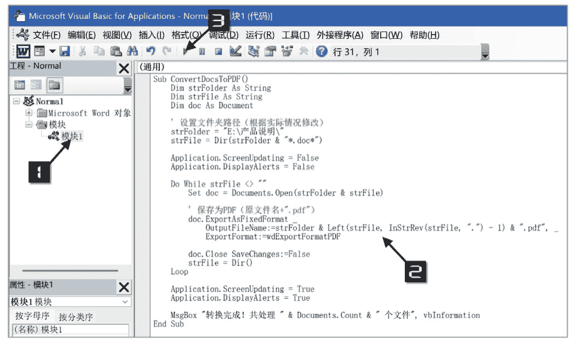

图4-25 粘贴并运行代码

运行完毕，E盘的【产品说明】文件夹中会自动生成同名的.pdf格式的文件，如图4-26所示。

| 名称 | 修改日期 | 类型 |
| :--- | :--- | :--- |
| 分离机使用说明.docx | 2025-3-2 11:59 | Microsoft Word ... |
| 恒流流量计使用说明.docx | 2025-2-24 23:02 | Microsoft Word ... |
| 冷冻机使用说明.docx | 2025-2-27 21:49 | Microsoft Word ... |
| 色选机使用说明.docx | 2025-3-2 14:55 | Microsoft Word ... |
| 蒸汽积算仪使用说明.docx | 2025-3-2 14:40 | Microsoft Word ... |
| 分离机使用说明.pdf | 2025-3-2 15:59 | WPS PDF 文档 |
| 恒流流量计使用说明.pdf | 2025-3-2 15:59 | WPS PDF 文档 |
| 冷冻机使用说明.pdf | 2025-3-2 15:59 | WPS PDF 文档 |
| 色选机使用说明.pdf | 2025-3-2 15:59 | WPS PDF 文档 |
| 蒸汽积算仪使用说明.pdf | 2025-3-2 15:59 | WPS PDF 文档 |

图4-26 转换后的.pdf格式的文件

# 第5章 DeepSeek数据大师：Excel效率革命

DeepSeek能够显著扩展Excel/WPS表格的功能边界，使其从数据处理工具升级为智能分析助手。例如，借助DeepSeek，可以通过自然语言描述自动生成Excel公式或复杂的VBA代码，高效解读、整理数据，自动生成总结报表，并对公式或代码进行纠错、优化。

## 本章的主要内容

- ◆ 技巧1借助DeepSeek生成常用Excel函数的功能描述表
- ◆ 技巧2借助DeepSeek生成常用Excel快捷键表格
- ◆ 技巧3借助DeepSeek根据描述自动生成Excel公式

# 技巧01 借助DeepSeek生成常用Excel函数的功能描述表

初学者可以借助DeepSeek生成常用Excel函数的功能描述表，便于日常学习、巩固。

在DeepSeek对话框中发送以下提示词。

请以表格形式生成常用的Excel函数及其功能描述。

DeepSeek生成的常用的Excel函数及其功能描述如表5-1所示。

表 5-1 常用的Excel函数及其功能描述

| 函数名称 | 分类 | 功能描述 | 示例 |
| :--- | :--- | :--- | :--- |
| VLOOKUP | 查找与引用 | 按列查找并返回对应值 | =VLOOKUP(A2, B2:C10, 2, FALSE) |
| HLOOKUP | 查找与引用 | 按行查找并返回对应值 | =HLOOKUP(A1, A1:F5, 3, FALSE) |
| XLOOKUP | 查找与引用 | 更强大的双向查找 | =XLOOKUP(A2, B2:B10, C2:C10) |
| INDEX | 查找与引用 | 返回指定位置的值 | =INDEX(A1:C10, 2, 3) |
| MATCH | 查找与引用 | 返回查找值的位置 | =MATCH(A2, B2:B10, 0) |
| IF | 逻辑 | 根据条件返回不同结果 | =IF(A1>60, "合格", "不合格") |
| IFS | 逻辑 | 多条件判断 | =IFS(A1>90, "优", A1>80, "良") |
| SUM | 数学与三角 | 求和 | =SUM(A1:A10) |
| SUMIF | 数学与三角 | 按条件求和 | =SUMIF(A2:A10, ">20", B2:B10) |
| SUMIFS | 数学与三角 | 多条件求和 | =SUMIFS(C2:C10,A2:A10,">20", B2:B10,"<50") |
| AVERAGE | 统计 | 计算平均值 | =AVERAGE(A1:A10) |
| COUNT | 统计 | 计算数值单元格数量 | =COUNT(A1:A10) |
| COUNTIF | 统计 | 按条件计数 | =COUNTIF(A1:A10, ">60") |
| COUNTA | 统计 | 计算非空单元格数量 | =COUNTA(A1:A10) |
| LEFT | 文本 | 提取文本左侧指定字符数 | =LEFT(A1, 3) |
| RIGHT | 文本 | 提取文本右侧指定字符数 | =RIGHT(A1, 2) |
| MID | 文本 | 从指定位置提取文本 | =MID(A1, 2, 4) |
| TEXTJOIN | 文本 | 用分隔符连接文本 | =TEXTJOIN(",", TRUE, A1:A5) |
| TODAY | 日期与时间 | 返回当前日期 | =TODAY() |
| NOW | 日期与时间 | 返回当前日期和时间 | =NOW() |
| DATEDIF | 日期与时间 | 计算两个日期之间的差值 | =DATEDIF(A2, B2, "D") |
| FILTER | 动态数组 | 按条件筛选数据 | =FILTER(A2:C10, B2:B10>100) |
| UNIQUE | 动态数组 | 提取唯一值 | =UNIQUE(A2:A10) |

# 技巧02 借助DeepSeek生成常用Excel快捷键表格

借助DeepSeek生成常用的Excel快捷键表格后，可以打印出来，张贴在工位旁，便于在日常工作中查找、使用，提高工作效率。

在DeepSeek对话框中发送以下提示词。

> 请以表格形式罗列常用的Excel快捷键，按功能进行分类，并以A4纸为标准进行排版。

DeepSeek生成的常用Excel快捷键如表5-2所示。

表5-2 常用Excel快捷键

| 分类 | 快捷键 | 功能描述 |
| :--- | :--- | :--- |
| 导航与选择 | Ctrl + 方向键（↑/↓/←/→） | 跳转到数据区域边缘 |
| | Ctrl + Home | 回到A1单元格 |
| | Ctrl + End | 跳转到工作表最后一个有内容的单元格 |
| | Shift + 空格 | 选中整行 |
| | Ctrl + 空格 | 选中整列 |
| | Ctrl + A | 全选当前数据区域 |
| 编辑与操作 | Ctrl + C | 复制选中内容 |
| | Ctrl + X | 剪切选中内容 |
| | Ctrl + V | 粘贴内容 |
| | Ctrl + Z | 撤销上一步操作 |
| | Ctrl + Y | 恢复撤销的操作 |
| | Ctrl + D | 向下填充（复制上方单元格内容） |

| 分类 | 快捷键 | 功能描述 |
| :--- | :--- | :--- |
| 编辑与操作 | Ctrl + R | 向右填充（复制左侧单元格内容） |
| | Alt + Enter | 单元格内换行 |
| 格式设置 | Ctrl + B | 加粗/取消加粗 |
| | Ctrl + I | 斜体/取消斜体 |
| | Ctrl + U | 下划线/取消下划线 |
| | Ctrl + 1 | 打开【单元格格式】对话框 |
| | Ctrl + Shift + ~ | 设置为通用格式 |
| | Ctrl + Shift + $ | 设置为货币格式 |
| 公式与数据 | F2 | 编辑当前单元格 |
| | Ctrl + ; | 插入当前日期 |
| | Ctrl + Shift + : | 插入当前时间 |
| | Alt + = | 快速输入SUM求和公式 |
| | Ctrl + Shift + Enter | 输入数组公式 |
| | Ctrl + T | 创建表 |
| | Ctrl + Shift + L | 开启/关闭筛选 |
| 其他常用Excel快捷键 | F1 | 打开帮助中心 |
| | Ctrl + S | 保存文件 |
| | Ctrl + P | 打开打印界面 |
| | Ctrl + F | 查找内容 |
| | Ctrl + H | 替换内容 |
| | F4 | 重复上一步操作/切换绝对引用 |
| | Ctrl + E | 快速填充（Excel 2013+） |

# 技巧03 借助DeepSeek根据描述自动生成Excel公式

DeepSeek可以根据用户描述自动生成Excel公式，从而显著提高用户的工作效率。如果不知道应该怎样描述自己的计算需求，可以参考以下步骤。

首先，明确数据范围，如“数据位于工作表Sheet1的A1:C100区域”。

其次，明确计算逻辑，即详细描述希望DeepSeek执行的计算操作，比如“计算每个月的销售总和”“找出大于100的值并计算其平均数”。

最后，明确输出结果的位置，即希望将结果显示在哪里，如“将结果显示在E列”。

如果有特殊的格式要求或条件要求，需要一并说明，比如“保留两位小数”“按照日期筛选”。

举个例子，可以这样描述：“我需要在Excel中计算‘A列’中数据的总和，并将结果显示在B1单元格。”

提供的信息越详细，DeepSeek越能精准生成用户所需要的Excel公式。

如图5-1所示，是一张员工信息表。现在，我们希望借助DeepSeek，根据G2单元格中的条件，在I列显示相应部门的人员姓名。

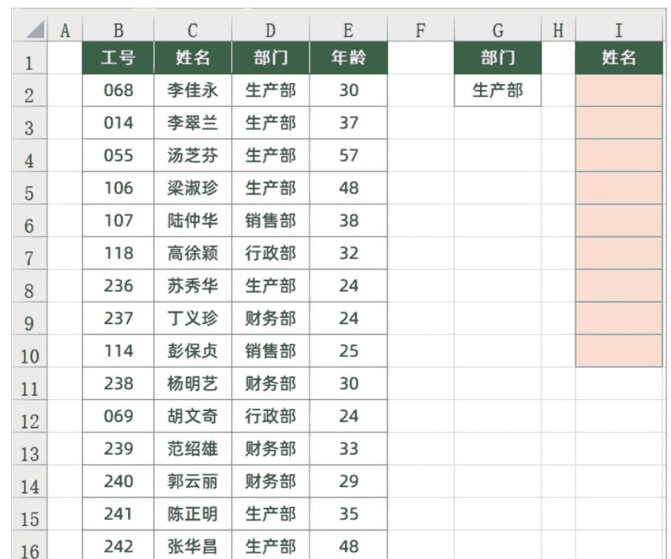

图5-1 员工信息表

在DeepSeek对话框中发送以下提示词。

数据位于B1:E16单元格区域，从左到右，各字段的标题分别为工号、姓名、部门、年龄。请根据G2单元格中的部门信息，返回该部门的全部人员姓名。公式结果存放在以I2为开始的单元格区域内。

DeepSeek生成了两个适用于不同版本的Excel的公式。

## 方法1：使用FILTER函数（适用于Excel 365或支持动态数组的Excel）

```
=FILTER(C2:C16,D2:D16=G2,"无人员")
```

C2:C16是姓名列的数据范围。

D2:D16=G2用于筛选部门等于G2的数据。

“无人员” 是未找到数据时的提示信息（可选）。

## 方法2：使用数组公式（兼容旧版Excel）

在I2单元格中输入以下公式，按<Ctrl+Shift+Enter>组合键确认并向下拖动填充：

```
=IFERROR(INDEX($C$2:$C$16,SMALL(IF($D$2:$D$16=$G$2,ROW($D$2:$D$16)-ROW($D$2)+1),ROW(A1))),"")
```

说明：

IF($D$2:$D$16=$G$2, ...) 用于检查部门是否匹配。

ROW(...)用于计算符合条件的行号。

SMALL和ROW(A1)组合可以依次提取匹配项。

IFERROR用于处理无更多结果的情况。

## 步骤总结

FILTER函数：直接返回所有匹配结果，自动溢出到相邻单元格。

数组公式：需要手动填充，依次显示每个匹配的姓名。

请根据您的Excel版本选择合适的方法。

按上述说明的方法操作，在Excel工作表中的I2单元格输入公式，结果如图5-2所示，成功筛选出了“生产部”的所有员工姓名。

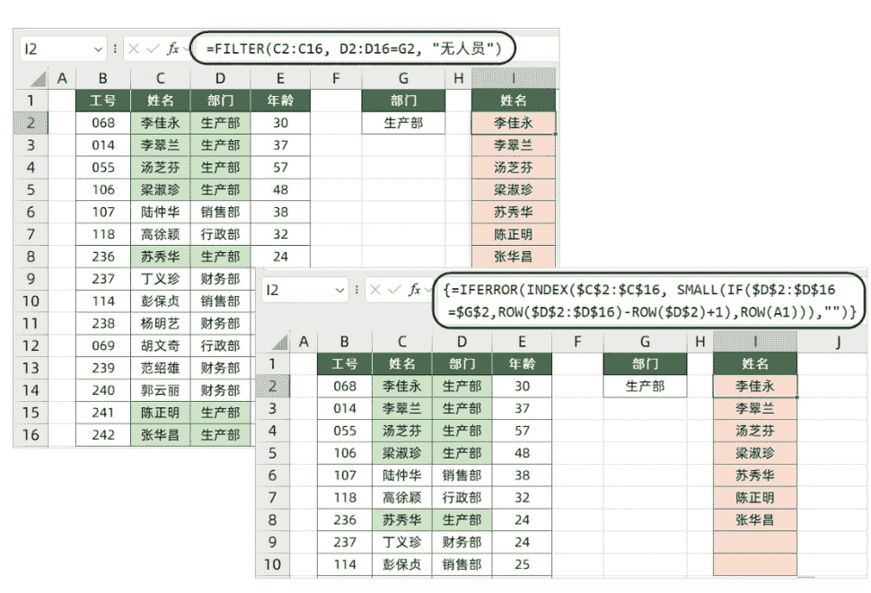

图5-2 公式运算结果

# 技巧04 借助DeepSeek根据需求生成Excel公式

合并单元格用于只有合并区域的第一个单元格内有数据，其他单元格为空的情况。例如，如果A2:A4合并，应该只有A2单元格内有数据，A3单元格和A4单元格为空。

如图5-3所示，工作表A列的合并单元格导致日期列的内容显示不完整，现在希望通过输入一个公式，将结果自动填充到相应区域（不需要拖动填充）。

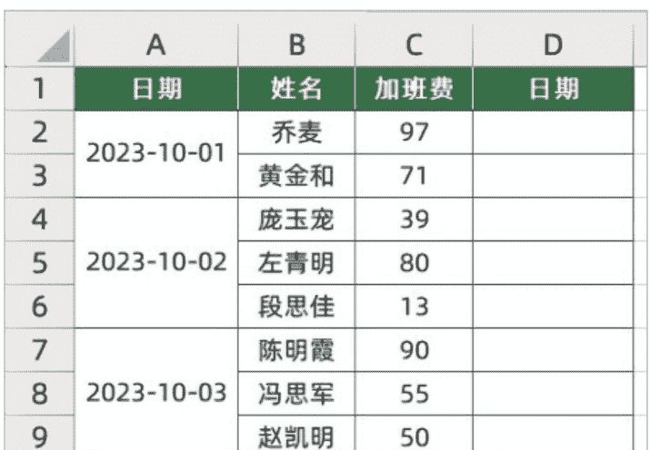

图5-3 带合并单元格的表格

在DeepSeek对话框中发送以下提示词。

A2:A9中是一些带有合并单元格的日期，需要使用公式将这些合并单元格填充完整。要求在D2单元格内输入公式，结果要能自动溢出。

在以上提示词中，“A2:A9中是一些带有合并单元格的日期，需要使用公式将这些合并单元格填充完整”是计算需求，“要求在D2单元格内输入公式，结果要能自动溢出”是公式效果需求。

DeepSeek生成的公式如下。

在Excel中处理合并单元格填充的经典解决方案如下（适用于支持动态数组的Excel 365或2021+版本）：

```
=SCAN(,A2:A9,LAMBDA(a,v,IF(v="",a,v)))
```

公式原理分步说明：

SCAN函数：Excel 365新增的扫描函数可以遍历数组并累积计算结果，特别适合用于处理需要连续记忆的场景。

LAMBDA函数的逻辑：

a代表累积器（前一个单元格的计算结果）

v代表当前遍历到的单元格值

IF(v="",a,v)表示：如果当前单元格为空，则保持之前的结果（a）；如果当前单元格有值，则用新值覆盖（v）。

自动溢出：当在D2单元格内输入公式，结果会自动向下填充D3:D9区域，不需要手动拖动。

将DeepSeek生成的公式复制并粘贴到Excel工作表的D2单元格中，结果如图5-4所示。

```
=SCAN(,A2:A9,LAMBDA(a,v,IF(v="",a,v)))
```

| | A | B | C | D | E | F | G | H |
|---|---|---|---|---|---|---|---|---|
| 1 | 日期 | 姓名 | 加班费 | 日期 | | | | |
| 2 | 2023-10-01 | 乔麦 | 97 | 2023-10-01 | | | | |
| 3 | | 黄金和 | 71 | 2023-10-01 | | | | |
| 4 | | 庞玉宠 | 39 | 2023-10-02 | | | | |
| 5 | 2023-10-02 | 左青明 | 80 | 2023-10-02 | | | | |
| 6 | | 段思佳 | 13 | 2023-10-02 | | | | |
| 7 | | 陈明霞 | 90 | 2023-10-03 | | | | |
| 8 | 2023-10-03 | 冯思军 | 55 | 2023-10-03 | | | | |
| 9 | | 赵凯明 | 50 | 2023-10-03 | | | | |

图5-4 公式填充效果

# 技巧05 借助DeepSeek解读Excel公式

借助DeepSeek，可以对Excel公式进行解读，帮助初学者理解、使用相关Excel公式。

如图5-5所示，在F3单元格中使用了公式“=VLOOKUP(E3,B1:C12,2,0)”（根据指定的姓名查找职务信息）。我们借助DeepSeek对公式进行解读，帮助初学者理解以上公式的含义。

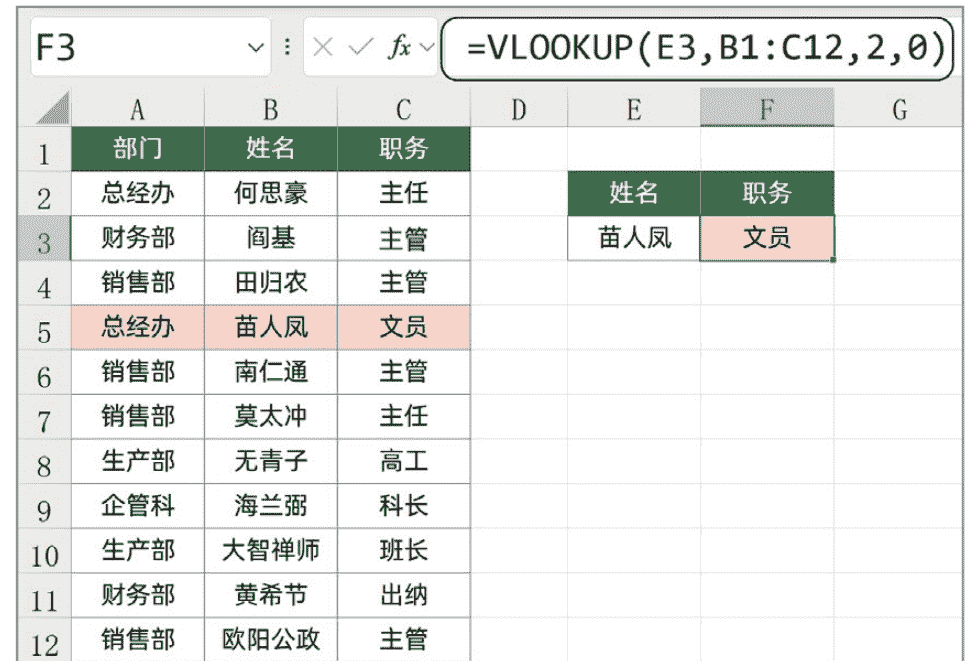

图5-5 根据两个条件查找结果

在DeepSeek对话框中发送以下提示词。

你是一位擅长Excel函数公式讲解的高级讲师，请详细解读公式“=VLOOKUP(E3,B1:C12,2,0)”，需要让一个刚刚接触Excel函数公式的新手能听懂。

DeepSeek生成的解读结果如下。

让我们一步步解析公式“=VLOOKUP(E3, B1:C12, 2, 0)”。

假设你是一个Excel新手，我会用简单易懂的语言解释公式每个部分的作用。

## 1. 公式的作用是什么？

VLOOKUP是一个垂直查找函数，它像一个小助手，能帮你在一张表格中快速找到某个值，并返回对应的结果。

例如：

你有一个产品价格表（B列是产品名称，C列是价格）。

现在你想输入一个产品名称（比如E3单元格的值），让Excel自动帮你查找它的价格。

这个公式就是帮你完成这项任务的。

## 2. 拆解公式的每个参数

公式的结构是=VLOOKUP(找什么, 在哪里找, 返回第几列的数据, 怎么找)

对应到你的公式：

```
“=VLOOKUP(E3, B1:C12, 2, 0)”
```

### 参数1：找什么？

E3：你要查找的值。比如，在E3单元格中输入“苹果”，Excel就会在表格中找“苹果”。

### 参数2：在哪里找？

B1:C12：查找的范围。Excel会在这个区域的第一列（B列）中搜索“苹果”。

关键点：查找的值（比如“苹果”）必须在这个区域的第一列中（B列），否则会出错。

### 参数3：返回第几列的数据？

2：表示返回查找范围（B1:C12）中第2列（C列）的数据。

比如，找到“苹果”在B列的第5行，就会返回C5单元格的值（比如价格为10元）。

### 参数4：怎么找？

0：表示“精确匹配”（必须完全一致）。

如果写成1或省略，则是“近似匹配”（比如某个数值区间）。大多数情况下写成0。

## 3. 常见错误和注意事项

错误#N/A：如果E3的值在B列中找不到，会显示此错误。可以用IFERROR函数处理（例如：=IFERROR(VLOOKUP(...), "未找到")）。

列号错误：如果参数3写成3，但查找范围只有B:C两列，就会报错。

区域未固定：如果公式需要下拉填充，记得用$锁定区域：B$1:C$12，否则区域会变动。

总结一句话，这个公式的意思是：

> “在B1到C12区域的第一列（B列）中，查找E3单元格的内容，找到后返回同一行第2列（C列）的值，必须精确匹配。”

试着用实际数据操作几次，你会更清楚它的逻辑！

以上解读逐步拆解了公式，详细解释了每个部分的作用，以及整个公式的运算过程。

# 技巧06 借助DeepSeek对Excel公式进行纠错

借助DeepSeek，能够对结果出错或者不能正确运行的Excel公式进行分析、纠错，并获得正确建议。

如图5-6所示，我们希望使用以下公式，根据A2单元格中的数量返回对应的级别，规则是A2小于5显示为“甲级”，在5和20之间返回“乙级”，不符合这两个条件则返回“其他”。现在，A2单元格的数量是15，应该返回“乙级”，但是公式返回了不正确的结果（“其他”），需要梳理一下公式出错原因。

```
=IF(A2<5,"甲级",IF(5<=A2<20,"乙级","其他"))
```


图5-6 公式错误

在DeepSeek对话框中发送以下提示词。

你是一位资深的Excel讲师。我希望根据A2单元格中的数量返回对应的级别，判断规则是A2小于5显示为“甲级”，在5和20之间返回“乙级”，不符合这两个条件则返回“其他”。现在的公式是“=IF(A2<5,"甲级",IF(5<=A2<20,"乙级","其他"))”，计算结果不正确，为什么？

DeepSeek生成的内容如下。

你的公式存在逻辑判断错误，主要原因是Excel不支持数学中的连续比较写法。

正确的公式应为：

```
=IF(A2<5,"甲级",IF(A2<20,"乙级","其他"))
```

原公式中的5<=A2<20在Excel中会被解析为(5<=A2) < 20，5<=A2返回TRUE（数值1）或FALSE（数值0），然后用TRUE/FALSE与20比较（即1<20或0<20），结果永远为TRUE，导致当A2≥5时，无论多大都显示“其他”。

Excel的IF函数应逐层排除已处理区间：

第一层A2<5处理为“甲级”，剩余情况自动满足A2≥5，第二层只需要判断A2<20即可覆盖“乙级”，最后剩下的自然属于“其他”（A2≥20）。

将DeepSeek纠错后的公式复制并粘贴到B2单元格，在A2单元格内输入不同的数值进行验算，结果准确无误，如图5-7所示。

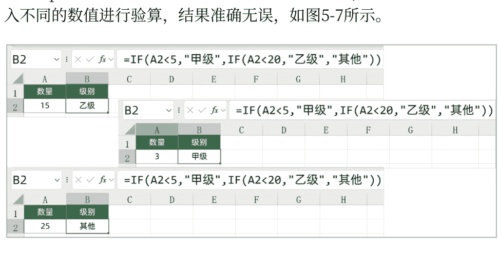

图5-7 验证DeepSeek纠错后的公式

# 技巧07 借助DeepSeek设置Excel条件格式

借助DeepSeek，能够对Excel表格设置条件格式，使之突出显示具备指定特征的数据。

如图5-8所示，是某公司的销售业绩表。借助DeepSeek，我们可以根据D列的业绩判断员工的工作情况，对业绩前三名的记录进行整行高亮显示。

| A | B | C | D |
|---|---|---|---|
| 工号 | 姓名 | 负责区域 | 业绩 |
| 10120 | 柯梅雪 | 黑龙江 | 5960 |
| 10122 | 吴支雄 | 吉林 | 4930 |
| 10128 | 叶文杰 | 辽宁 | 5190 |
| 10130 | 朱家喜 | 河北 | 5050 |
| 10138 | 周国超 | 内蒙 | 5000 |
| 10140 | 汪婷婷 | 京津 | 5510 |
| 10142 | 方建忠 | 山东 | 5480 |
| 10144 | 蔡欣润 | 山西 | 4240 |
| 10216 | 王钊源 | 江苏 | 4560 |
| 10218 | 田锡昊 | 浙江 | 5450 |
| 10222 | 叶文婷 | 河南 | 5140 |
| 10250 | 曾芳 | 广东 | 4990 |

图5-8 销售业绩表

将销售业绩表发送给DeepSeek并在对话框中输入以下提示词。

你是一名资深的Excel讲师，我希望对工作表中的业绩前三名记录进行整行高亮显示，需要如何操作？

DeepSeek生成的结果如下。

在Excel中为业绩前三名的内容设置整行高亮显示，可以按以下步骤操作。

## 步骤1：选择数据范围

选中表格区域 A2:D13（包含数据的所有行，不包含标题）。

## 步骤2：新建条件格式规则

单击菜单栏的【开始】→【条件格式】→【新建规则】选项，选择【使用公式确定要设置格式的单元格】。

## 步骤3：输入公式

在公式框中输入以下公式：

```
=AND(D2>=LARGE($D$2:$D$13,3),D2<>"")
```

公式解析：

LARGE($D$2:$D$13,3)：找到业绩列（D2:D13）中第三大的值。

D2>=...：判断当前行的业绩是否大于等于第三大的值，即是否为前三名。

D2<>"": 排除空单元格。

## 步骤4：设置填充颜色

单击【格式】→【填充】按钮，选择一种颜色，如浅绿色。

单击【确定】按钮保存规则。

此时，业绩前三名的内容会自动整行高亮显示。

示例数据中，业绩前三名为5960（柯梅雪）、5510（汪婷婷）、5480（方建忠），其所在行会被标记。

复制DeepSeek给出的公式，严格按说明步骤进行操作，验证公式是否符合要求。

选中A2:D13单元格区域，在【开始】选项卡下依次单击【条件格式】→【新建规则】选项，在弹出的【新建格式规则】对话框中选择【使用公式确定要设置格式的单元格】，随后，在公式编辑框中按<Ctrl+V>组合键粘贴公式，最后单击【格式】按钮，如图5-9所示。

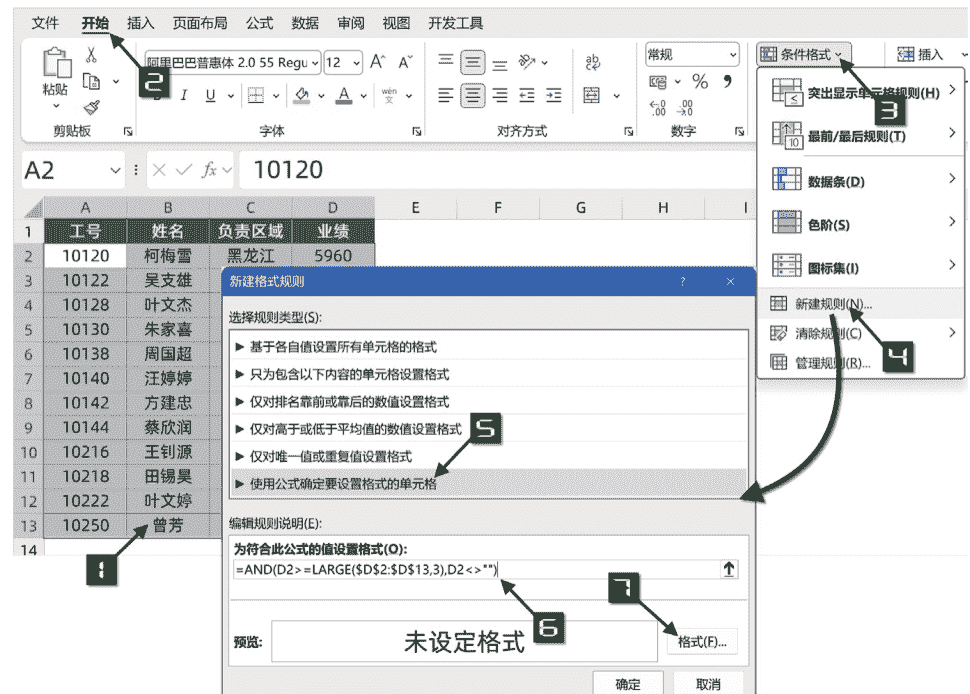

图5-9 使用公式设置Excel条件格式规则

设置填充颜色为浅绿色后，单击【确定】按钮，关闭对话框，如图5-10所示。

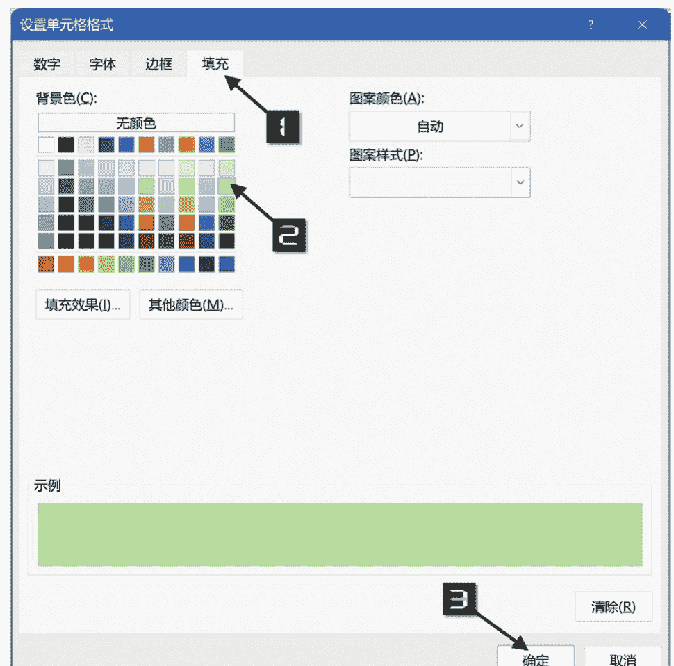

图5-10 设置填充颜色

设置完成后，只有A列的工号显示了浅绿色填充，如图5-11所示。

| A | B | C | D |
|---|---|---|---|
| 工号 | 姓名 | 负责区域 | 业绩 |
| 10120 | 柯梅雪 | 黑龙江 | 5960 |
| 10122 | 吴支雄 | 吉林 | 4930 |
| 10128 | 叶文杰 | 辽宁 | 5190 |
| 10130 | 朱家喜 | 河北 | 5050 |
| 10138 | 周国超 | 内蒙 | 5000 |
| 10140 | 汪婷婷 | 京津 | 5510 |
| 10142 | 方建忠 | 山东 | 5480 |
| 10144 | 蔡欣润 | 山西 | 4240 |
| 10216 | 王钊源 | 江苏 | 4560 |
| 10218 | 田锡昊 | 浙江 | 5450 |
| 10222 | 叶文婷 | 河南 | 5140 |
| 10250 | 曾芳 | 广东 | 4990 |

图5-11 条件格式效果

此时的效果并不符合预期，需要在DeepSeek对话框中输入更加明确的提示词。

D列中业绩处于前三名的内容，从A列到D列都高亮显示，请继续完善公式。

DeepSeek思考后给出了改进公式：

```
=SUMPRODUCT(--($D$2:$D$13>D2))<3
```

复制DeepSeek给出的改进公式，验证是否符合要求。

单击A2单元格，在【开始】选项卡下依次单击【条件格式】→【管理规则】选项，在弹出的【条件格式规则管理器】对话框中单击选中规则，随后单击【编辑规则】按钮，如图5-12所示。

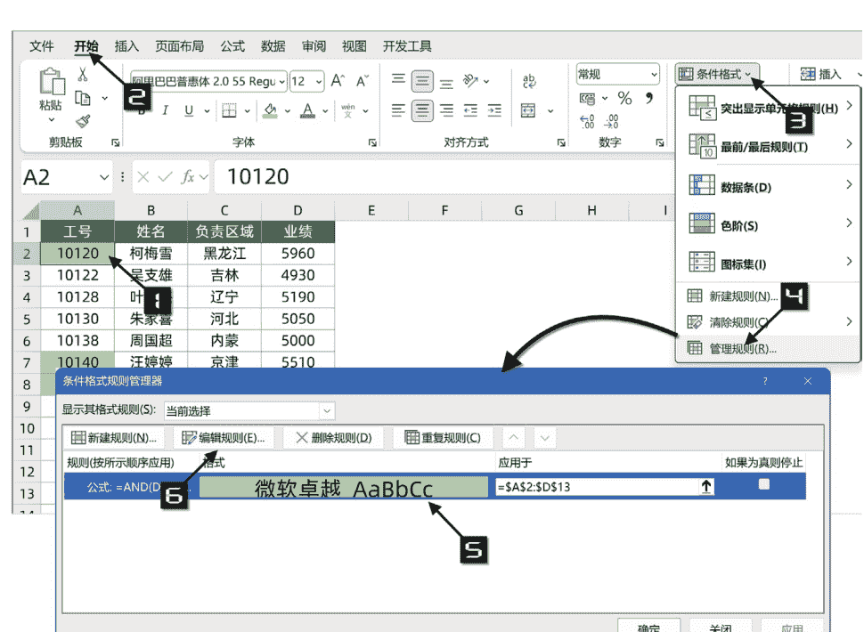

图5-12 管理条件格式规则

在弹出的【编辑格式规则】对话框中的公式编辑框中，按<Ctrl+V>组合键粘贴DeepSeek给出的改进公式，单击【确定】按钮关闭对话框，如图5-13所示。

图5-13 编辑格式规则

使用DeepSeek给出的改进公式，效果仍然不符合预期——只有A列工号高亮显示。将情况反馈给DeepSeek，进行进一步修正。

使用以上公式，仅高亮显示A列，我需要A列至D列都高亮显示。

DeepSeek思考后再次给出新的改进公式：

```
=SUMPRODUCT(--($D$2:$D$13>$D2))<3
```

并给出了公式解析。

$D$2:$D$13>$D2：统计D列中比当前行业绩大的内容对应的单元格数量。

SUMPRODUCT(--(...))：将逻辑值转换为数值并求和。

<3：若比当前行大的内容对应的单元格数量小于3，说明当前行是前三名（含并列）。

关键：使用$D2（混合引用）确保公式在整行中正确引用当前行的D列值。

复制以上公式，重复上述操作步骤，在公式编辑框中按<Ctrl+V>组合键粘贴DeepSeek再次给出的改进公式，随后单击【确定】按钮关闭对话框。操作完成后的效果如图5-14所示。

| A | B | C | D |
|---|---|---|---|
| 工号 | 姓名 | 负责区域 | 业绩 |
| 10120 | 柯梅雪 | 黑龙江 | 5960 |
| 10122 | 吴支雄 | 吉林 | 4930 |
| 10128 | 叶文杰 | 辽宁 | 5190 |
| 10130 | 朱家喜 | 河北 | 5050 |
| 10138 | 周国超 | 内蒙 | 5000 |
| 10140 | 汪婷婷 | 京津 | 5510 |
| 10142 | 方建忠 | 山东 | 5480 |
| 10144 | 蔡欣润 | 山西 | 4240 |
| 10216 | 王钊源 | 江苏 | 4560 |
| 10218 | 田锡昊 | 浙江 | 5450 |
| 10222 | 叶文婷 | 河南 | 5140 |
| 10250 | 曾芳 | 广东 | 4990 |

图5-14 多次修正后的条件格式效果

本例中，DeepSeek第一次和第二次生成的公式的效果均不符合预期，在第三次输入提示词时，将前两个公式的效果告知DeepSeek，DeepSeek将公式效果与用户要求进行比较后才给出了正确的公式。

# 技巧08 借助DeepSeek根据显示效果反查实现步骤

借助DeepSeek，能够根据Excel工作表的显示效果，反查实现的步骤。

如图5-15所示，这个Excel文档左侧有折叠按钮，左上角有“1”“2”“3”3个数字。如果想知道获得此效果的过程，可以将显示效果截图，发送给DeepSeek进行咨询。

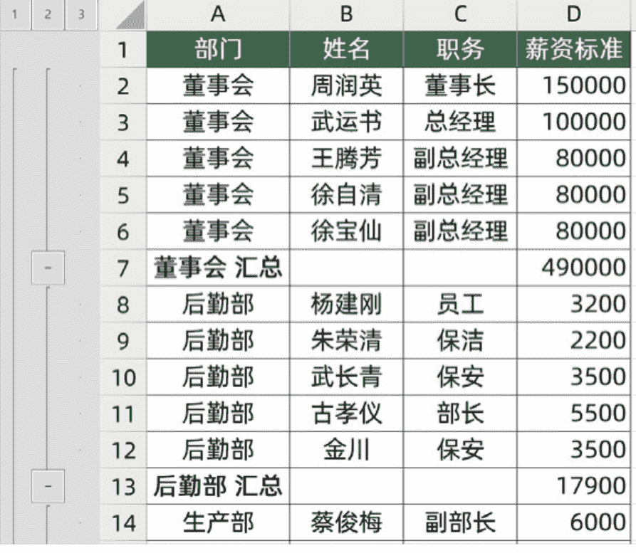

图5-15 带折叠按钮的Excel工作表

单击DeepSeek对话框右下角的按钮，上传截图后在DeepSeek对话框中发送以下提示词。

如图片所示，Excel工作表的左上角有“1”“2”“3”3个数字，且左侧有折叠按钮，这种效果是如何实现的呢？

DeepSeek的回复如下。

想在Excel中实现左上角的“1”“2”“3”序号和左侧出现折叠按钮的效果，可以使用“分类汇总”或“手动分组”功能。以下是具体操作步骤。

## 方法1：分类汇总（自动生成分级显示）

数据排序：确保数据已按分组字段完成排序，如“部门”，使同一部门的数据连续排列。

添加分类汇总：选中数据区域后单击【数据】选项卡，再单击【分类汇总】选项。

在弹出的窗口中设置分类字段为“部门”，即分组依据；汇总方式为“求和”或其他计算方式；在【选定汇总项】中勾选需要汇总的列，如“薪资标准”。

单击【确定】按钮，Excel会自动插入汇总行，并生成左侧的折叠按钮和顶部的级别序号。

## 效果说明

级别序号：单击可切换显示层级（1=仅总汇总，2=部门汇总，3=全部明细）。

折叠按钮（+/-）：单击可展开/收起对应分组的明细数据。

## 方法2：手动分组（自定义折叠范围）

选择需要分组的行

例如，选中后勤部的明细行，单击【数据】选项卡→创建组合→选择【列】。

重复此操作，为各部门创建独立的分组。

设置完成后，左侧会显示折叠按钮，单击可收起/展开对应分组。

## 关键区别

分类汇总：自动插入汇总行并生成分级，适合用于快速统计。

手动分组：更灵活，可自定义分组范围，不需要插入汇总行。

根据需求选择合适的方法，即可获得图中的效果，步骤分别如图5-16、图5-17所示。

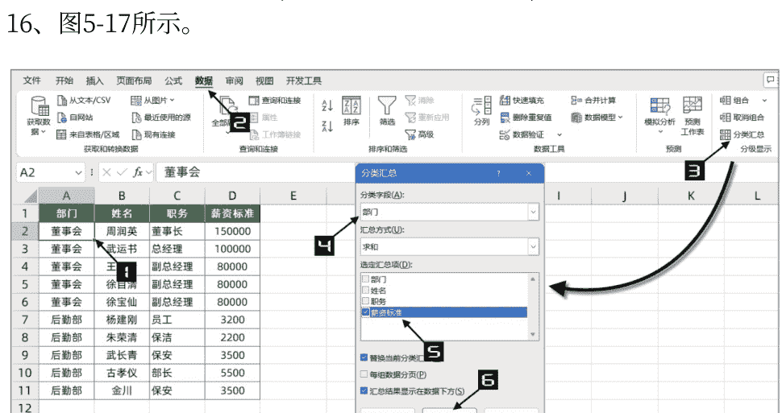

图5-16 分类汇总


图5-17 手动组合

# 技巧09 借助DeepSeek生成VBA代码，完成工作表拆分

借助DeepSeek，可以根据计算需求生成VBA代码。没有VBA基础的用户也能直接复制使用DeepSeek生成的VBA代码，显著提高工作效率。

如图5-18所示，是一份Excel版的销售流水工作表。借助DeepSeek，我们可以按L列的营业员姓名将销售流水拆分为多个工作表。

| A | B | C | D | E | F | G | H | I |
|---|---|---|---|---|---|---|---|---|
| 销售日期 | 交易时间 | 小票编号 | 商品编码 | 商品名称 | 单位 | 单价 | 数量 | 营业员 |
| 2025/1/1 | 8:12:29 | 3012 | 24177 | 酱油 | 瓶 | 12 | 2 | 张志辉 |
| 2025/1/1 | 10:12:00 | 3202 | 76123 | 花生油 | 瓶 | 100 | 2 | 张志辉 |
| 2025/1/1 | 11:48:29 | 3239 | 53034 | 酸奶 | 瓶 | 1.5 | 2 | 张志辉 |
| 2025/1/1 | 12:11:31 | 3247 | 53034 | 酸奶 | 瓶 | 1.5 | 3 | 张志辉 |
| 2025/1/1 | 12:40:19 | 3317 | 18989 | 果汁橙 | 瓶 | 3.5 | 3 | 张志辉 |
| 2025/1/1 | 15:05:46 | 3368 | 64503 | 毛巾 | 条 | 10.5 | 3 | 张志辉 |
| 2025/1/1 | 16:12:00 | 3489 | 18989 | 果汁橙 | 瓶 | 3.5 | 4 | 张志辉 |
| 2025/1/1 | 16:59:31 | 3579 | 44325 | 纸巾 | 包 | 1 | 3 | 张志辉 |
| 2025/1/1 | 17:36:58 | 3637 | 35912 | 洗衣粉 | 包 | 8 | 1 | 张志辉 |
| 2025/1/1 | 19:13:26 | 3665 | 54592 | 电池 | 排 | 6 | 3 | 张志辉 |
| 2025/1/1 | 19:35:02 | 3696 | 23712 | 纯牛奶 | 盒 | 2.5 | 3 | 张志辉 |
| 2025/1/1 | 20:28:19 | 3820 | 82397 | 盐 | 包 | 1.2 | 1 | 张志辉 |
| 2025/1/2 | 8:11:02 | 3909 | 18989 | 果汁橙 | 瓶 | 3.5 | 1 | 黄小娟 |
| 2025/1/2 | 8:29:46 | 3913 | 44325 | 纸巾 | 包 | 1 | 1 | 黄小娟 |

图5-18 销售流水工作表（部分）

在DeepSeek对话框中发送以下提示词。

> 我需要按Excel工作表I列中的项目，将某个工作表拆分为多个工作表，请提供一份VBA代码，并说明代码的使用方法。

DeepSeek生成的拆分工作表的部分VBA代码如图5-19所示。

```
vba
Sub SplitByColumnL()
    Dim srcSheet As Worksheet
    Dim lastRow As Long
    Dim dict As Object
    Dim key As Variant
    Dim destSheet As Worksheet
    Dim srcData As Range

    ' 设置源工作表（根据实际名称修改）
    Set srcSheet = ThisWorkbook.Worksheets("Sheet1")

    ' 获取I列最后一行
    lastRow = srcSheet.Cells(srcSheet.Rows.Count, "I").End(xlUp).Row
    If lastRow < 2 Then Exit Sub

    ' 创建字典收集唯一值
    Set dict = CreateObject("Scripting.Dictionary")
```

图5-19 DeepSeek生成的代码（部分）

DeepSeek提供的操作说明如下。

打开Excel文件，按<Alt+F11>组合键进入VBA编辑器。

在左侧工程资源管理器中右击，插入新模块。

将上述代码粘贴到模块中。

修改代码中的源工作表名称（默认为“Sheet1”）。

返回Excel界面，按<Alt+F8>组合键打开【宏】对话框。

选择“SplitByColumnL”宏并执行。

单击代码窗口右上角的【复制】按钮，打开Excel文件，按<Alt+F11>组合键进入VBA编辑器。

按操作说明在左侧的工程资源管理器中右击，在弹出的快捷菜单中选择【插入】→【模块】命令，如图5-20所示。

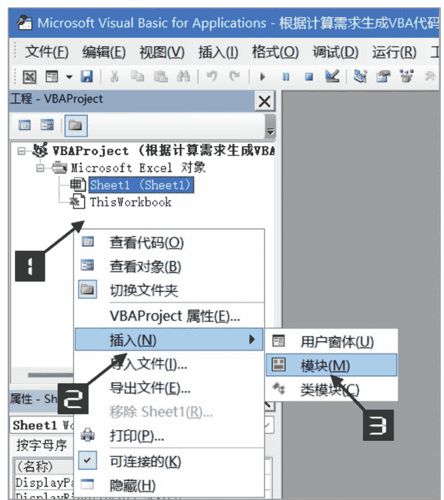

图5-20 插入模块

此时，界面中会出现一个名为“模块1”的新模块。在右侧空白窗口中按<Ctrl+V>组合键粘贴代码，将代码中的默认工作表名称“Sheet1”修改为实际工作表名称，如图5-21所示。

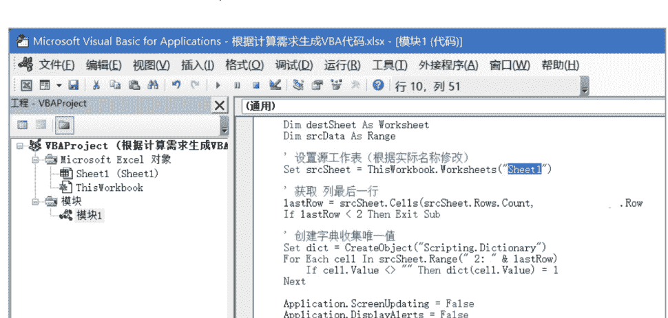

图5-21 将代码中的默认工作表名称修改为实际工作表名称

关闭VBA编辑器，返回Excel工作表。按<Alt+F8>组合键打开【宏】对话框，选中“SplitByColumnL”宏，单击【执行】按钮，如图5-22所示。

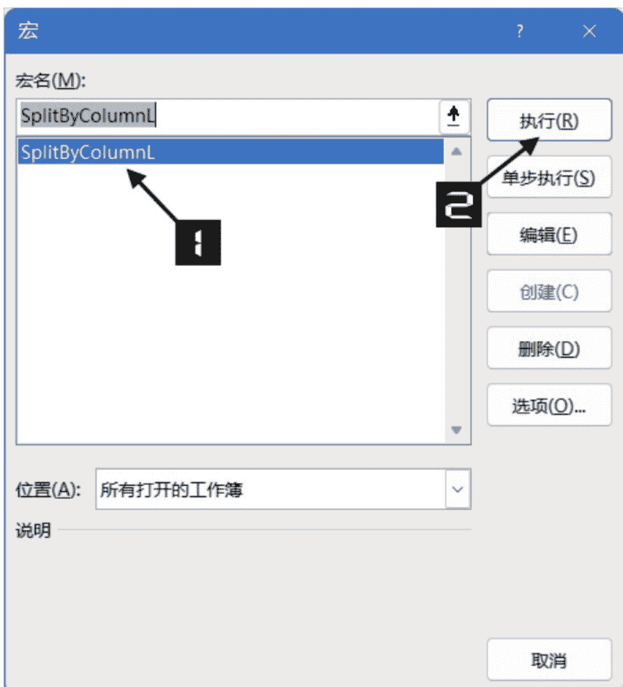

图5-22 【宏】对话框

此时，Excel会弹出提示对话框，如图5-23所示。

拆分后的工作表效果如图5-24所示。


图5-23 提示对话框

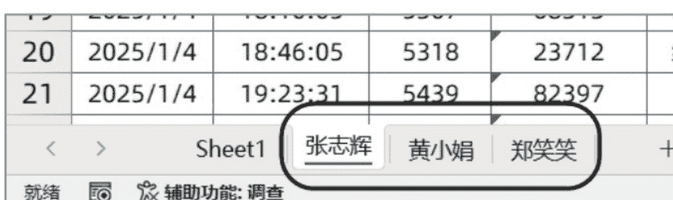

图5-24 拆分后的工作表

包含VBA代码的Excel文件需要保存为.xlsm格式，否则文件中的代码会丢失。

# 技巧10 借助DeepSeek细化计算需求，提高VBA代码适用性

在DeepSeek中细化对VBA代码运行效果的描述，DeepSeek能生成适用性更强的VBA代码。

例如，技巧9中生成的VBA代码仅能根据I列的项目进行拆分。如果在拆分时能够由用户自定义拆分哪一列，适用性显然更好。要实现这种效果，可以在原提示词的基础上细化。

在DeepSeek对话框中发送以下提示词。

> 我需要一段VBA代码，能够按Excel工作表某一列中的项目将一个工作表拆分为多个工作表，同时能够让用户自定义拆分哪一列。请生成VBA代码并说明代码的使用方法。

DeepSeek按要求生成的优化后的VBA代码如图5-25所示。

单击代码窗口右上角的【复制】按钮，打开Excel文件，按<Alt+F11>组合键进入VBA编辑器。

按操作说明在左侧工程资源管理器中右击，在弹出的快捷菜单中选择【插入】→【模块】命令。

在名为“模块1”的新模块右侧的空白窗口中按<Ctrl+V>组合键粘贴代码，随后关闭VBA编辑器，返回Excel工作表。

```
vba
Sub SplitDataByColumn()
    Dim srcSheet As Worksheet
    Dim lastRow As Long, colIndex As Long
    Dim dataRange As Range, splitCol As Range
    Dim uniqueValues As Collection
    Dim cell As Range
    Dim value As Variant
    Dim newSheet As Worksheet
    Dim response As VbMsgBoxResult

    Application.ScreenUpdating = False
    Application.DisplayAlerts = False

    Set srcSheet = ActiveSheet
    lastRow = srcSheet.Cells(srcSheet.Rows.Count, 1).End(xlUp).Row

    ' 用户选择列
    On Error Resume Next
    Set splitCol = Application.InputBox( _
        Title:="选择拆分列", _
        Prompt:="请选择要拆分的列（点击列标）", _
        Type:=8)
    On Error GoTo 0

    If splitCol Is Nothing Then Exit Sub
    colIndex = splitCol.Column
    Set dataRange = srcSheet.Range(srcSheet.Cells(1, 1), srcSheet.Cells(lastRow, srcSheet.Column
```

图5-25 优化后的代码

按<Alt+F8>组合键打开【宏】对话框，选中“SplitDataByColumn”宏，单击【执行】按钮，会弹出【拆分列选择】对话框，如图5-26所示。在对话框中输入要拆分的列对应的字母，如C，单击【确定】按钮，就能按C列中的项目进行拆分。


图5-26 确定要拆分的列

按F12功能键，将文件保存为.xlsm格式。

只要需求描述准确，DeepSeek可以生成更多实用的VBA代码，如合并工作簿或合并工作表、按姓名导入图片、生成二维码或者条形码等。

# 技巧11 借助DeepSeek合并多个Excel工作簿

如图5-27所示，在名为“分公司凭证记录”的文件夹内，有多个分公司的凭证记录工作簿，每个工作簿中包含1月—6月的工作表。为了便于统计汇总，可以借助DeepSeek将这些工作簿合并为一个工作簿。

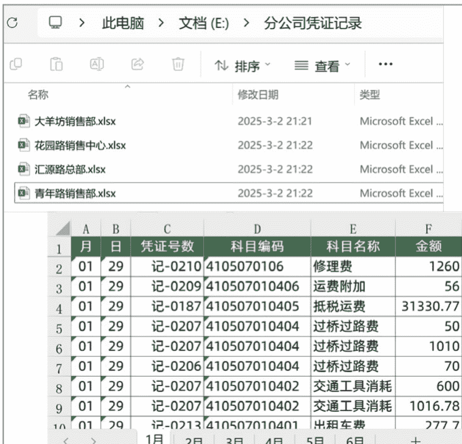

图5-27 分公司凭证记录

在DeepSeek对话框中发送以下提示词。

我需要一段VBA代码，能够将同一个文件夹内多个结构相同的工作簿合并为一个工作簿。请满足先将相同名称的工作表中的数据合并到一个工作表内，再增加一列，显示来源工作簿的名称，同时能够让用户自己选择要合并的文件夹的要求，此外，请说明代码的使用方法。

DeepSeek生成的VBA代码如图5-28所示。

```
Sub MergeWorkbooks()
    Dim folderPath As String
    Dim destWb As Workbook
    Dim srcWb As Workbook
    Dim srcWs As Worksheet
    Dim destWs As Worksheet
    Dim fileName As String
    Dim fileList As Collection
    Dim headerCell As Range
    Dim lastRow As Long, lastCol As Long, destLastRow As Long, sourceCol As Long
    Dim srcData As Variant, destData() As Variant
    Dim i As Long, j As Long

    ' 选择文件夹对话框
    With Application.FileDialog(msoFileDialogFolderPicker)
        .Title = "选择要合并的文件夹"
        If .Show <> -1 Then Exit Sub
        folderPath = .SelectedItems(1)
        If Right(folderPath, 1) <> "" Then folderPath = folderPath & ""
    End With

    ' 获取文件列表
    Set fileList = New Collection
    fileName = Dir(folderPath & "*.xls*")
    Do While fileName <> ""
        If fileName <> ThisWorkbook.Name Then
            fileList.Add fileName
        End If
```

图5-28 合并工作簿的VBA代码

新建一个Excel工作簿，按<Alt+F11>组合键进入VBA编辑器。在左侧工程资源管理器中右击，在弹出的快捷菜单中选择【插入】→【模块】命令。

关闭VBA编辑器，返回Excel工作表。按<Alt+F8>组合键打开【宏】对话框，选中“MergeWorkbooks”宏，单击【执行】按钮。

在弹出的对话框中选择包含要合并文件的文件夹，等待程序运行完成（处理大量文件可能需要一些时间）。

注意，在选择包含要合并文件的文件夹时，仅选择到包含工作簿的最末级文件夹，不要打开这个文件夹，如图5-29所示。

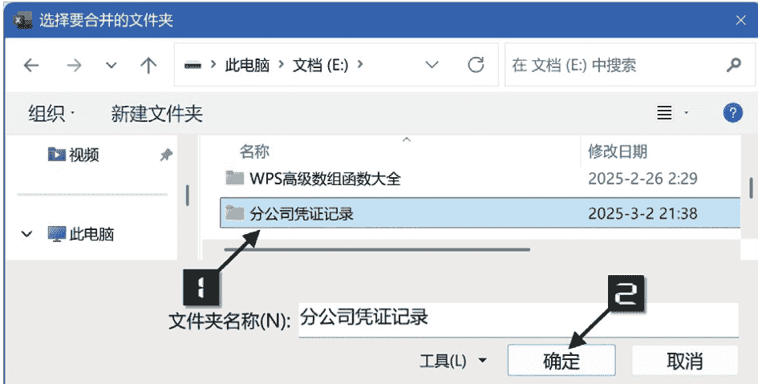

图5-29 选择目标文件夹

合并后的工作簿效果如图5-30所示。

# 技巧12 借助DeepSeek修改和解读VBA代码

在使用VBA代码的过程中，经常会出现一些错误提示，用户需要根据这些错误提示对代码进行完善和修改。如果用户不熟悉VBA代码的调试，可以借助DeepSeek进行VBA代码的修改并获取代码解读。

如图5-31所示，一段取不重复数据的代码在运行时返回了编译错误的提示。

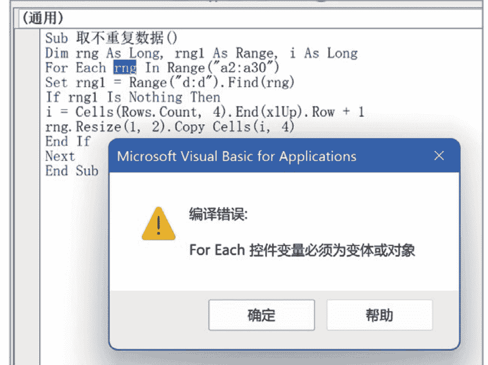

图5-31 编译错误

在DeepSeek对话框中发送以下提示词。

```
以下 VBA 代码运行时提示编译错误，请进行修改，并逐句添加注释。
Sub 取不重复数据 ()
Dim rng As long, rng1 As Range, i As Long
For Each rng In Range("a2:a30")
Set rng1 = Range("d:d").Find(rng)
If rng1 Is Nothing Then
i = Cells(Rows.Count, 4).End(xlUp).Row + 1
rng.Resize(1, 2).Copy Cells(i, 4)
End If
Next
End Sub
```

DeepSeek修正后的VBA代码如图5-32所示，代码间逐行添加了中文注释。

```
Sub 取不重复数据()
    ' 关闭屏幕刷新提升运行速度
    Application.ScreenUpdating = False

    ' 声明变量
    Dim rng As Range      ' 用于循环的单元格对象
    Dim rng1 As Range     ' 存储查找结果的单元格对象
    Dim i As Long         ' 存储行号

    ' 遍历A2到A30区域每个单元格
    For Each rng In Range("A2:A30")
        ' 在D列全列中精确查找当前单元格的值
        Set rng1 = Range("D:D").Find(What:=rng.Value, _
                                     LookIn:=xlValues, _
                                     LookAt:=xlWhole, _
                                     MatchCase:=False)

        ' 如果未找到匹配项
        If rng1 Is Nothing Then
            ' 获取D列最后一个非空单元格的行号+1（即第一个空行）
            i = Cells(Rows.Count, 4).End(xlUp).Row + 1

            ' 复制当前单元格及其右侧1列（共2列）到D列新行
            rng.Resize(1, 2).Copy Destination:=Cells(i, 4)
        End If
    Next rng

    ' 恢复屏幕刷新
    Application.ScreenUpdating = True

    MsgBox "操作完成！", vbInformation
End Sub
```

图5-32 DeepSeek修正后的VBA代码

DeepSeek生成的代码修正了变量声明，将原代码中的`Dim rng As long`修正为`Dim rng As Range`；将原代码中的`Set rng1 = Range("d:d").Find(rng)`修正为`Set rng1 = Range("D:D").Find(What:=rng.Value, LookIn:=xlValues, LookAt:=xlWhole)`，明确指定查找内容为单元格值（`rng.Value`）。增加了`MatchCase:=False`，作用是忽略大小写差异，使“A”和“a”被视为相同。

# 技巧13 借助DeepSeek解读公司薪资体系

DeepSeek支持快速解读工作表中的内容，准确地进行数据分析，帮助用户发现数据中的规律和趋势，让复杂的数据处理变得简单、高效。

本例要解读的数据是一份模拟的薪资标准表，包括姓名、部门、职务、薪资标准，如图5-33所示。

| 姓名 | 部门 | 职务 | 薪资标准 |
|---|---|---|---|
| 周润英 | 董事会 | 董事长 | 150000 |
| 武运书 | 董事会 | 总经理 | 100000 |
| 蔡俊梅 | | 部长 | |
| 王腾芳 | 董事会 | 副总经理 | 80000 |
| 李惠仙 | 生产部 | 技术总工 | 25000 |
| 李向阳 | 生产部 | 部长 | 7000 |
| 徐自清 | 生产部 | 员工 | 5500 |
| 刘树芬 | 生产部 | 员工 | 5500 |
| 潘云红 | | 员工 | |
| 杨建刚 | 后勤部 | 员工 | 3200 |

图5-33 待解读的工作表（部分）

修剪平均值是从一组数据的头尾各去除部分数据后计算而来的平均值，能够避免极端值对平均数据的影响，使计算后的平均值更能体现数据的真实水平。

中位数能够反映各部门薪资的典型水平，与修剪平均值相比，可以更好地显示薪资分布的集中趋势。

复制Excel表格中的内容，粘贴到DeepSeek对话框中，并发送以下提示词。

请根据以上内容，计算各部门的薪资中位数，以及去除头尾各一个数值的修剪平均值，结果以表格形式展示，并给出有深度的解读。

DeepSeek生成的计算结果如表5-3所示。

表5-3 各部门薪资中位数与修剪平均值

| 部门 | 薪资中位数（元） | 修剪平均值（元） |
|---|---|---|
| 董事会 | 80,000 | 86,666.67 |
| 生产部 | 5,000 | 5,277.78 |
| 后勤部 | 3,500 | 3,400 |
| 质保部 | 4,200 | 4,200 |

解读结果如下。

1. 董事会：高薪集中与层级分化

薪资中位数为80,000元，但修剪平均值（86,666.67元）明显高于中位数，表明董事长的极高薪资（150,000元）拉高了整体水平。去除极端值后，副总经理群体（80,000元）和总经理群体（100,000元）构成主要薪资区间。

2. 生产部：两极分化显著

中位数（5,000元）与修剪平均值（5,277.78元）接近，但原始数据中存在极端值（技术总工薪资为25,000元）。若剔除该值，中位数仍为5,000元，表明基层员工薪资集中在4,200～6,500元。

公平性风险：技术总工薪资是普通员工的5倍以上，可能引发内部公平性质疑。

建议通过绩效奖金透明化或职级体系优化缓解矛盾。

3. 后勤部：薪资分布均衡

中位数（3,500元）与修剪平均值（3,400元）接近，显示薪资分布相对均匀。保安和保洁岗位薪资差异较小（2,200～3,500元），但部长薪资（5,500元）显著高于基层，符合常规职级差异。

4. 质保部：规模小但结构清晰

中位数与修剪平均值均为4,200元，因部门仅3人且薪资分布简单。部长（6,500元）与质检员（4,200元）薪资差异合理，但需要关注质检员薪资是否低于市场水平，以保持竞争力。

建议：

董事会：评估董事长薪资与行业对标，避免因个别高管薪资过高影响团队稳定性。

生产部：优化技术岗与基层岗的薪资梯度，引入绩效挂钩机制提升公平性。

后勤与质保部：定期调研市场薪资水平，确保基层员工待遇符合行业标准。

根据以上解读内容，可以看出高层薪资显著高于其他部门工作人员薪资，生产部存在较大内部差异，后勤部相对平均，质保部人数少但层级明显。同时，修剪平均值与中位数的比较可以反映薪资分布的偏态，以及异常值的影响。公司需要检查薪资结构是否合理、是否存在不公平现象，或者某些岗位的薪资是否与市场脱节、是否需要调整部分员工的薪资以提高整体公平性。决策者可以有针对性地进行研判，并给出优化方案。

# 技巧14 借助DeepSeek整理电子发票

DeepSeek可快速识别并提取电子发票中的信息，自动进行分类存储，减少手动输入的工作量。此外，DeepSeek不仅能批量处理文件，大幅提高文件整理效率，还能通过智能校对核验发票信息的准确性，发现潜在错误或不一致之处并提出修正建议，降低财务风险。

本例需要整理多张电子发票中的信息，并以表格形式呈现，电子发票的票面如图5-34所示。


图5-34 待整理的电子发票

单击DeepSeek对话框右下角的 📎 按钮，将待整理的电子发票全部上传，并发送以下提示词。

请将发票内容整理为表格形式，整理的项目包括发票号、买方名称、销售方名称、项目名称、数量、单价、金额和税额。

DeepSeek在生成表格的同时，对整理内容进行了补充说明。

数量：所有发票中明确标注的数量均为1，部分发票中未直接标注数量，但根据价税合计反推，默认数量为1。

金额与税额：以价税合计（小写）和税额调整后的最终数值为准。部分发票存在折扣或退货导致的负数金额，最终金额已合并调整后的结果。

税率：所有商品税率均为13%，税额根据金额计算得出。

复制DeepSeek生成的表格，打开Excel。

由于发票号码超过15位，直接粘贴时，15位之后的数值将变成0。因此，需要将A列设置为文本格式，再右击，在弹出的【粘贴选项】区域选择“匹配目标格式”命令，如图5-35所示。

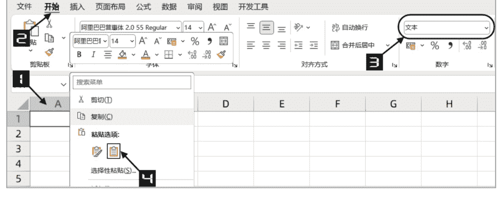

图5-35 在Excel中设置文本格式

整理后的发票信息如图5-36所示。

| 发票号 | 买方名称 | 销售方名称 | 项目名称 | 数量 | 单价 | 金额 | 税额 |
|---|---|---|---|---|---|---|---|
| 25377000000060956066 | 个人 | 济南京东奥升贸易有限公司 | 调味品-水塔老陈醋4.5°2.3L山西醋凉拌 | 1 | 20.18 | 14.99 | 1.95 |
| 25117000000083585519 | 个人 | 北京京东世纪信息技术有限公司 | 酒-雪熊精酿啤酒哈尔滨大绿棒子进口麦 | 1 | 70.71 | 40.78 | 5.3 |
| 25127000000029792146 | 个人 | 天津京东星业贸易有限公司 | 金属制品-京东京造菜刀家用切片刀具 | 1 | 79.56 | 65.73 | 8.54 |
| 25377000000027194802 | 个人 | 济南京东奥升贸易有限公司 | 酒-通明山水果酒山楂酒500ml*6瓶 | 1 | 61.06 | 60.45 | 7.86 |
| 24377000000369429705 | 个人 | 齐河县京东商贸有限公司 | 营养保健食品-窝小芽鳕鱼肠420g | 1 | 35.31 | 32.71 | 4.25 |
| 2592720000003646741 | 个人 | 青岛京东昌益得贸易有限公司 | 眼镜类产品-普先生老花镜150度 | 1 | 34.51 | 32.2 | 4.19 |

图5-36 整理后的发票信息

对于DeepSeek生成的内容，注意进行必要的核验。

# 技巧15 借助DeepSeek解读资产负债表

发给DeepSeek的提示词越明确，生成的结果越有深度，否则只能得到比较宽泛、笼统的回答。尤其是专业性强的问题，需要提问者具备一定的专业知识、给出明确的提示词，并能够鉴别DeepSeek生成的内容质量是否合格。

本例需要借助DeepSeek解读Excel中的资产负债表，如图5-37所示。

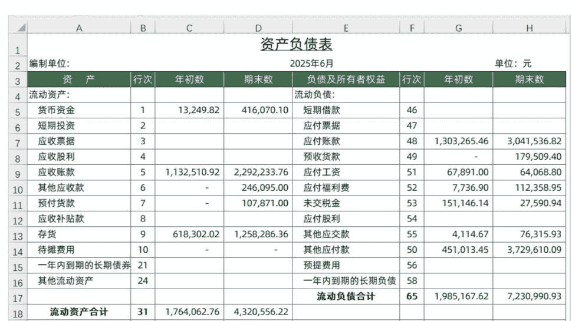

图5-37 资产负债表（部分）

单击DeepSeek对话框右下角的 📎 按钮，将Excel文档上传，并发送以下提示词。

请解读资产负债表。

DeepSeek生成的部分解读内容如下。

以下是对您提供的资产负债表的解读分析。

## 一、总体平衡验证

期初总资产 = 负债及所有者权益总计：2,569,675.43元（平衡）

期末总资产 = 负债及所有者权益总计：5,547,757.19元（平衡）

验证结果：资产负债表整体结构完整，符合会计恒等式（资产=负债+所有者权益）。

## 二、关键科目分析

### 1. 资产部分

流动资产：

货币资金：期末大幅增加至416,070.10元（年初13,249.82元），流动性显著增强。

应收账款：期末2,292,233.76元（年初1,132,510.92元），增长102%，可能存在销售扩张，需要关注回款风险。

存货：期末1,258,286.36元（年初618,302.02元），增长103%，可能存在库存积压或备货增加现象。

……

以上解读虽然对货币资金、应付账款等主要科目的变动分析较充分，但忽略了一些关键细节（如递延税项、其他应收款）和风险关联性。

对提示词进行优化，使其生成的解读结果更加详细、专业。

你是一名资深的财务专家，擅长解读财务报表，现在请针对提供给你的某公司资产负债表展开分析，并生成财务分析报告。分析数据要准确，必须完全按我所提供的数据进行分析。

此时，DeepSeek的思考时间会更长，最终生成的财务分析报告如下。

## 财务分析报告

公司名称：未提供

报告期间：2025年6月30日

单位：人民币（元）

### 一、资产结构分析

总资产变动：

期末资产总额5,547,757.19元，较年初（2,569,675.43元）增长115.9%，主要源于流动资产的显著增加。

流动资产：期末4,320,556.22元，较年初（1,764,062.76元）增长144.9%，主要贡献项目如下。

货币资金：从13,249.82元增至416,070.10元（增长3039%），短期流动性增强。

应收账款：从1,132,510.92元增至2,292,233.76元（增长102.5%），可能伴随信用扩张或回款周期延长风险。

固定资产：期末1,227,200.97元，较年初（805,612.67元）增长52.3%，因在建工程新增155,933.08元。

### 二、负债及偿债能力分析

流动负债激增：

期末流动负债7,230,990.93元，较年初（1,985,167.62元）增长264.2%，核心驱动因素如下。

应付账款从1,303,265.46元增至3,041,536.82元（增长133.4%），可能面临供应商催款压力。

其他应付款从451,013.45元增至3,729,610.09元（增长726.9%），需要核查大额往来款性质。

偿债能力指标：

流动比率（流动资产/流动负债）：4,320,556.22 / 7,230,990.93 ≈ 0.60（行业标准≥2），短期偿债能力严重不足。

速动比率（速动资产/流动负债）：（货币资金+应收账款）/流动负债 ≈ (416,070.10+2,292,233.76)/7,230,990.93 ≈ 0.37，进一步确认流动性风险。

### 三、所有者权益与盈利能力

所有者权益大幅缩水：

期末所有者权益为-1,683,233.74元（年初为584,507.81元），主要因未分配利润亏损扩大至-2,183,233.74元（年初为84,507.81元）。

资不抵债风险：负债总额（7,230,990.93元）远超所有者权益，资产负债率高达130.3%（负债/资产），表明公司已处于技术性破产状态。

### 四、关键风险提示

流动性危机：流动比率远低于安全水平，若无法及时偿还短期债务，可能引发资金链断裂。

亏损持续扩大：未分配利润大幅下滑，需要关注经营亏损原因（如成本失控或收入下降）。

应付账款激增：应付账款增长133.4%，可能面临供应商催款压力或合作关系恶化风险。

### 五、建议

优化现金流管理：加速应收账款回收，协商延长应付账款账期。

资本注入或债务重组：引入外部投资或与债权人协商债务展期，缓解资不抵债压力。

成本控制与盈利模式调整：分析亏损根源，削减非必要开支，探索新的收入增长点。

> 注：以上分析完全基于用户提供的资产负债表数据，未考虑其他报表（如利润表、现金流量表）及行业背景，结论仅供参考。

对比两次解读结果，可以看出第二次解读更加准确，不仅所有的数字和项目都被正确解读，还在总结公司财务状况的同时指出了潜在的风险和问题，并提出了建议。

# 技巧16 借助DeepSeek核验损益表中的问题

除了对财务报表进行直接解读，借助DeepSeek还可以对报表中的数据及计算逻辑进行核验。如图5-38所示，是某公司财务人员编制的损益表，可以借助DeepSeek检验表格中的计算逻辑是否正确，并验证计算结果是否准确。

| 项目 | 行次 | 本月数 | 本年累计数 |
| :--- | :--- | :--- | :--- |
| 一、主营业务收入 | 1 | 1,001,694.23 | 8,813,413.80 |
| 减：主营业务成本 | 4 | 779,238.58 | 7,941,883.00 |
| 主营业务税金及附加 | 5 | 6,201.85 | 56,439.85 |
| 二、主营业务利润 | 10 | 216,253.80 | 815,090.95 |
| 加：其他业务利润 | 11 | 0.00 | 0.00 |
| 减：营业费用 | 14 | 13,011.50 | 144,981.32 |
| 管理费用 | 15 | 81,335.04 | 624,549.29 |
| 财务费用 | 16 | 2,858.28 | -171.21 |
| 三、营业利润 | 18 | 119,048.98 | 45,731.55 |
| 加：投资收益 | 19 | 0.00 | 0.00 |
| 补贴收入 | 22 | 0.00 | 427,676.80 |
| 营业外收入 | 23 | 0.00 | 0.00 |
| 减：营业外支出 | 25 | 0.00 | 80,359.96 |
| 四、利润总额 | 27 | 119,048.98 | 393,048.39 |
| 减：所得税 | 28 | 20,579.40 | 13,602.27 |
| 五、净利润 | 30 | 98,469.58 | 379,446.12 |

图5-38 损益表

单击DeepSeek对话框右下角的 📎 按钮，将Excel文档上传，并发送以下提示词。

> 你是一位资深的财务总监，请对以上损益表中的数据进行核验，重点检查公式中的计算逻辑和计算结果是否正确，并给出结论和建议，要确保数据准确。

DeepSeek生成的损益表数据核验报告如下。

## 损益表核验结论与建议

### 一、计算逻辑核验

**主营业务利润（行次10）**

本月数：1,001,694.23（收入） - 779,238.58（成本） - 6,201.85（税金） = 216,253.80

本年累计数：8,813,413.80 - 7,941,883.00 - 56,439.85 = 815,090.95

结论：计算正确。

**营业利润（行次18）**

本月数：216,253.80（主营利润） - 13,011.50（营业费用） - 81,335.04（管理费用） - 2,858.28（财务费用） = 119,048.98

本年累计数：815,090.95 - 144,981.32 - 624,549.29 + 171.21（财务费用负数为加项） = 45,731.55

结论：计算正确。

**利润总额（行次27）**

本月数：119,048.98（营业利润） + 0（其他收益） - 0（营业外支出） = 119,048.98

本年累计数：45,731.55 + 427,676.80（补贴收入） - 80,359.96（营业外支出） = 393,048.39

结论：计算正确。

**净利润（行次30）**

本月数：119,048.98（利润总额） - 20,579.40（所得税） = 98,469.58

本年累计数：393,048.39 - 13,602.27 = 379,446.12

结论：计算正确。

### 二、数据准确性结论

所有计算逻辑均符合会计准则，数值准确无误。以下细节需关注：

- 财务费用负数（行次16）：本年累计数为-171.21元，可能源于利息收入或其他财务收益，建议核实具体构成。
- 补贴收入（行次22）：本年累计数427,676.80元金额较大，需确认是否符合政策规定及会计处理合规性。
- 所得税（行次28）：本月数与本年累计数的税率差异显著（本月约17.3%，累计约3.5%），需检查是否存在暂估调整或税收优惠政策影响。

### 三、改进建议

**补充披露说明：**

- 在报表附注中详细说明财务费用负数的原因及补贴收入来源。
- 解释所得税率波动较大的合理性。

**合规性审查：**

- 确保补贴收入符合相关法规要求。

**内部复核机制：**

- 建议增加跨部门核对流程，尤其是对异常科目（如财务费用负数）的二次验证。

最终结论：损益表数据计算正确，逻辑清晰，但需对异常科目进行进一步解释和合规性审查。建议在日常工作中加强数据管理和内部控制，确保财务数据的准确性和安全性。

以上核验内容不仅对公式逻辑关系进行了梳理，还详细标记出了存在问题的项目，并给出了优化建议。

# 技巧17 借助DeepSeek解读损益表

对于编制规范且公式计算逻辑符合要求的损益表，可以借助DeepSeek对其中的数据进行解读。如图5-39所示，是某公司财务人员编制的损益表。

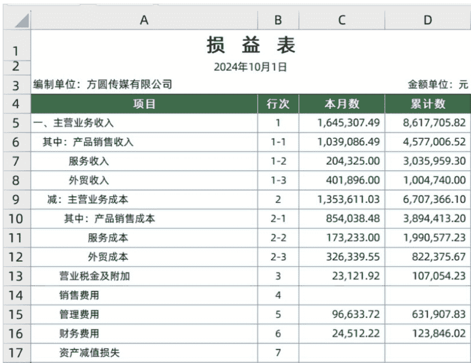

图5-39 损益表（部分）

单击DeepSeek对话框右下角的⊕按钮，将Excel文档上传，并发送以下提示词。

> 你是一位资深的财务总监，擅长分析各类财务报表，请对损益表中的数据进行解读，并给出结论和建议，要确保数据准确。

DeepSeek在对损益表中的数据进行分析与验证后，生成的结果如下。

## 数据准确性核查

**主营业务收入与成本**

- 收入：本月数1,645,307.49元（产品1,039,086.49元+服务204,325元+外贸401,896元），累计数8,617,705.82元，各子项合计与总额一致。
- 成本：本月数1,353,611.03元（产品854,038.48元+服务173,233元+外贸326,339.55元），累计数6,707,366.10元，子项合计与总额一致（误差1元，可能为四舍五入）。

**营业利润（本月数）**

公式验证：

1,645,307.49（收入）-1,353,611.03（成本）- 23,121.92（税金）- 96,633.72（管理费）-24,512.22（财务费）=147,428.60（元）

表格值：147,428.60元（一致）。

**利润总额与净利润（本月数）**

- 利润总额：147,428.60（营业利润）+ 41.41（营业外收入）-66.81（营业外支出）=147,403.20（元）（与表格值一致）。
- 净利润：147,403.20-24,567.19（所得税）=122,836.01（元）（与表格值一致）。

**累计数逻辑**

累计净利润864,301.76元，需要确保各月数据累加无误（如本月净利润122,836.01元与历史月份累加合理）。

**关键结论：**

**数据一致性良好**

- 公式计算与表格值基本一致，仅成本子项存在1元差异（可能为四舍五入）

**业务表现亮点**

- 收入结构多元：产品、服务、外贸收入占比均衡（63.1%/12.4%/24.5%），分散经营风险
- 外贸毛利率较高：本月外贸业务毛利率18.8%，优于服务（15.2%）和产品（17.8%）

**潜在风险点**

- 管理费用高企：本月管理费96,633.72元（占收入5.9%），累计管理费631,907.83元（占累计收入的7.3%），需要优化成本结构
- 所得税率异常：本月税率16.7%（低于标准25%），需要核实税收优惠或税前扣除依据是否合规。
- 销售费用为零：可能遗漏销售活动支出，需要核查是否合理。

**建议：**

**费用优化**

- 拆分管理费用：分析行政、人力等费用明细，制定降本措施（如建立自动化流程、减少冗余岗位）
- 监控财务费用：关注贷款利息与资金使用效率，避免高息负债

**税务合规性检查**

- 确认所得税率低于25%的原因（如高新技术企业优惠、研发加计扣除），确保符合税法要求

**外贸业务强化**

- 利用较高毛利率优势，扩大外贸规模，同时控制成本（如优化供应链、汇率风险管理）。

**销售费用核实**

- 检查销售费用为0元是否合理，若存在未记录支出，需要补录，避免财报失真。

**最终总结**

当前损益表数据准确性较高，但需要重点关注费用控制与税务合规性。建议：通过细化费用管理提升净利润率；利用外贸业务优势拓展市场；定期审计税务申报材料，确保合规；使用财务软件自动校验数据，减少人工误差。

DeepSeek不仅检查了表格中数据的准确性和公式应用的正确性，还对潜在的问题及异常进行了提醒，并给出了最终总结。

# 技巧18 借助DeepSeek根据财务数据自动生成财务报表

DeepSeek能够直接从总账、试算平衡表等多个数据源中抓取并整合数据生成报表，不需要人工复制粘贴，大幅减少了重复性劳动；同时，DeepSeek能自动识别类似试算不平衡、现金流分类矛盾等数据异常，根据DeepSeek的提示及时修正，能有效降低报表错误率。

如图5-40所示，是某公司财务部门编制的总账表与试算平衡表的部分内容。本例借助DeepSeek对两个表中的数据进行解读，生成现金流量表。

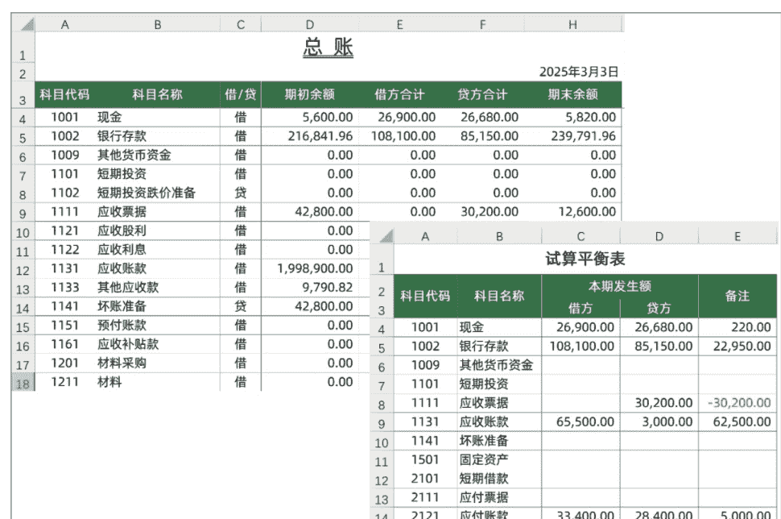

图5-40 总账表与试算平衡表（部分）

单击DeepSeek对话框右下角的⊕按钮，将总账表和试算平衡表上传，并在DeepSeek对话框中发送以下提示词。

> 你是一位资深的财务总监，擅长编制各类财务报表。请根据附件中的总账表和试算平衡表编制符合财务标准的现金流量表，数据要确保准确，结果以代码形式输出，代码要符合Markdown标准。

复制DeepSeek生成的代码，打开Markdown在线编辑器，将代码粘贴在页面左侧，生成流量表，单击【导出Word文档】按钮，将Word文档下载到本地，效果如图5-41所示。

## 一、经营活动产生的现金流量

| 项目 | 金额（元） |
| :--- | :--- |
| 销售商品、提供劳务收到的现金 | 148,500.00 |
| 收到的其他与经营活动有关的现金 | 1,850.00 |
| **经营活动现金流入小计** | **150,350.00** |
| 购买商品、接受劳务支付的现金 | (28,400.00) |
| 支付给职工以及为职工支付的现金 | (20,000.00) |
| 支付的各项税费 | 0.00 |
| 支付的其他与经营活动有关的现金 | (12,000.00) |
| **经营活动现金流出小计** | **(60,400.00)** |
| **经营活动产生的现金流量净额** | **89,950.00** |

## 二、投资活动产生的现金流量

| 项目 | 金额（元） |
| :--- | :--- |
| 购建固定资产支付的现金 | 0.00 |
| **投资活动现金流出小计** | **0.00** |
| **投资活动产生的现金流量净额** | **0.00** |

## 三、筹资活动产生的现金流量

图5-41 DeepSeek生成的现金流量表（部分）

为了确保报表中的数据准确，可以借助DeepSeek对结果进行核验。在DeepSeek对话框中发送以下提示词。

> 请核对总账表与试算平衡表的一致性，确保所有现金相关科目的变动均被涵盖。

随后根据DeepSeek生成的核验结果对总账表和试算平衡表进行检查修改，直至结果准确无误。

# 技巧19 借助DeepSeek将固定资产卡片转换为表格

借助DeepSeek，能够将如图5-42所示的Word版固定资产卡片转换为表格。

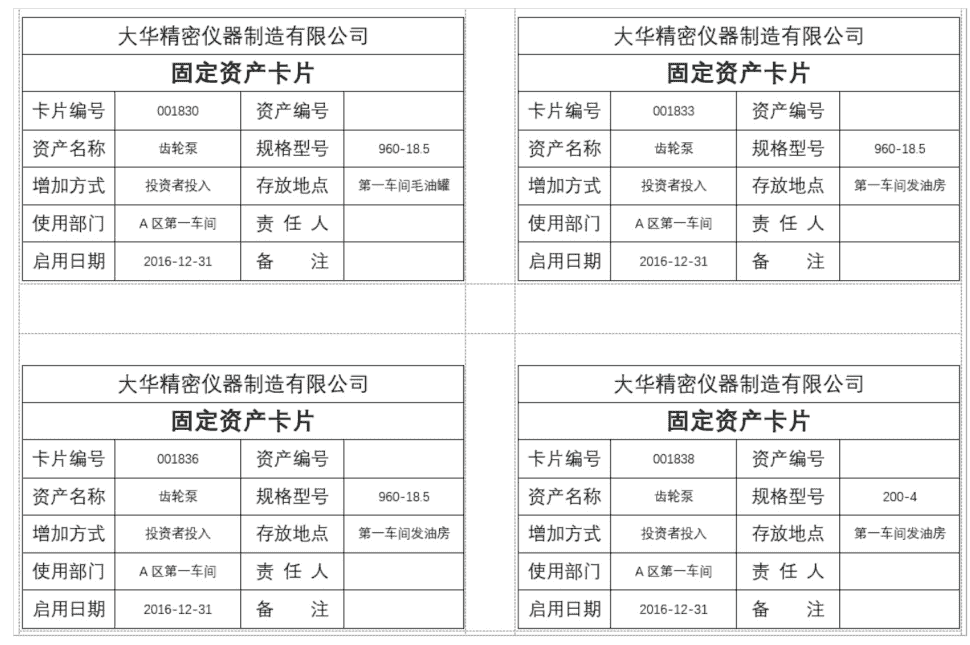

图5-42 固定资产卡片（部分）

打开WPS灵犀，单击对话框右下角的上传按钮 ，上传包含固定资产卡片的Word文档，并发送以下提示词。

> 请将附件中的固定资产卡片逐条转换为表格，字段包括卡片编号、资产名称、增加方式、使用部门、启用日期、规格型号和存放地点，不要有遗漏。

DeepSeek思考后迅速将全部固定资产卡片转换为表格。复制DeepSeek生成的内容并粘贴在Excel中，调整格式后的效果如图5-43所示。

| 卡片编号 | 资产名称 | 增加方式 | 使用部门 | 启用日期 | 规格型号 | 存放地点 |
| :--- | :--- | :--- | :--- | :--- | :--- | :--- |
| 001824 | 脂肪酸泵 | 投资者投入 | A区第一车间 | 2016/12/31 | MZA25-200 | 第一车间北脂肪酸罐 |
| 001827 | 碱泵 | 投资者投入 | A区第一车间 | 2016/12/31 | ML32-20-160 | 第一车间北碱罐 |
| 001830 | 齿轮泵 | 投资者投入 | A区第一车间 | 2016/12/31 | 960-18.5 | 第一车间毛油罐 |
| 001833 | 齿轮泵 | 投资者投入 | A区第一车间 | 2016/12/31 | 960-18.5 | 第一车间发油房 |
| 001847 | 螺杆泵 | 投资者投入 | A区第一车间 | 2016/12/31 | NM045BY01L0 | 皂角罐 |
| 001852 | 室内配电箱 | 投资者投入 | A区第一车间 | 2016/12/31 | 600800350 | 小包装 |
| 001854 | 室外防雨箱 | 投资者投入 | A区第一车间 | 2016/12/31 | 8001000350 | 小包装 |
| 001859 | 控制柜1# | 投资者投入 | A区第一车间 | 2016/12/31 | 8002200600 | 小包装 |

图5-43 固定资产卡片电子表格（部分）

# 技巧20 借助DeepSeek自动生成产品质量检测报告

DeepSeek能够根据用户提供的判定标准及实际检测数据判断各产品是否合格。

如图5-44所示，是某产品的指标标准及质量检验单的部分内容，借助DeepSeek，可以自动生成产品质量检测报告。

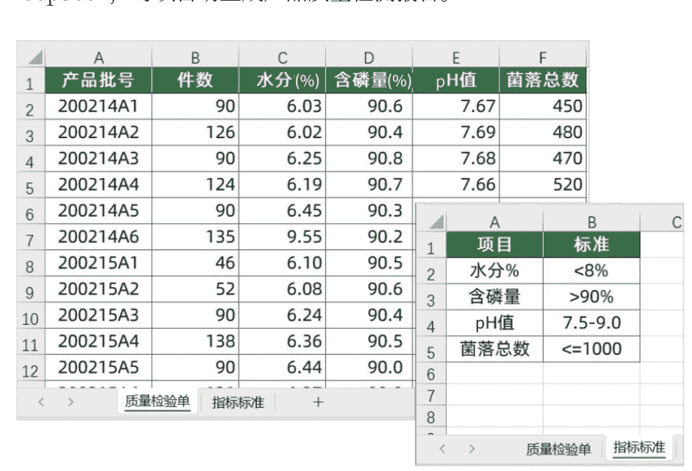

图5-44 质量检验单与指标标准（部分）

单击DeepSeek对话框右下角的⊕按钮，上传质量检验单和指标标准，并在DeepSeek对话框中发送以下提示词。

> 你是一位质量管理专家，请认真解读“质量检验单”工作表，根据“指标标准”逐行判断“质量检验单”工作表中的产品是否合格，并生成质检报告。

将DeepSeek生成的判断结果复制到Excel中，调整格式后的效果如图5-45所示。

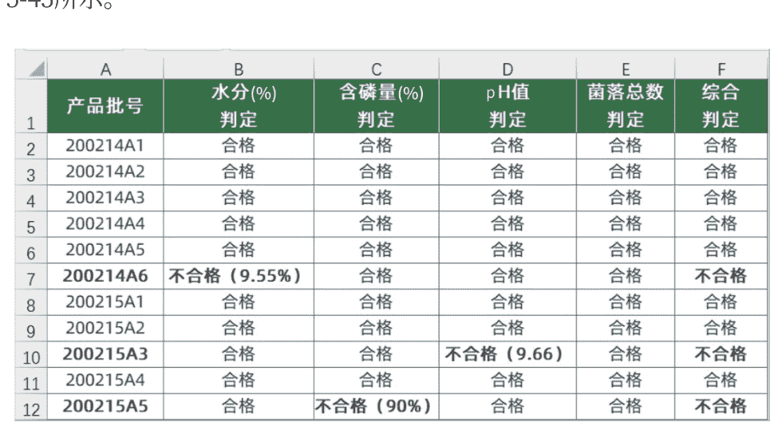

图5-45 DeepSeek生成的判断结果（部分）

DeepSeek生成的报告如下。

**异常批次统计：**

- 不合格批次数：8（批号：200214A6、200215A3、200215A5、200215A6、200216A1、200217A1、200218A4、200219A3）

**主要问题分布：**

- 水分超标：2批次
- 含磷量不足：4批次
- pH值超标：2批次

# 技巧21 借助DeepSeek将文本内容转换为表格

借助DeepSeek，能够将包含数字的文本内容快速转换为表格。例如，以下是教育部《2023年全国教育事业发展统计公报》中的部分内容，借助DeepSeek，可以将这些文本内容转换为表格，方便对比查看。

全国共有幼儿园27.44万所，比上年减少14808所，下降5.12%。其中，普惠性幼儿园23.64万所，比上年减少9301所，下降3.79%，占全国幼儿园的86.16%，比上年提高1.2个百分点。

学前教育在园幼儿4092.98万人，比上年减少534.57万人，下降11.55%。其中，普惠性幼儿园在园幼儿3717.01万人，比上年减少427.03万人，下降10.30%，占全国在园幼儿的90.81%，比上年提高1.26个百分点。

学前教育毛入园率91.1%，比上年提高1.4个百分点。

学前教育专任教师307.37万人，专任教师中专科以上学历比例92.74%。

复制以上内容，粘贴到DeepSeek对话框中，并发送以下提示词。

> 请将以上内容整理、转换为表格，注意数据要准确。

DeepSeek对以上文本内容进行解读后生成的表格如图5-46所示。

| 指标类别 | 数值 | 比上年增减（数量） | 比上年增减（百分比） | 占比 | 占比增减（百分点） |
| :--- | :--- | :--- | :--- | :--- | :--- |
| 全国幼儿园总数 | 27.44 万所 | -14,808 所 | -5.12% | — | — |
| 其中：普惠性幼儿园数量 | 23.64 万所 | -9,301 所 | -3.79% | 86.16% | +1.2 |
| 在园幼儿总数 | 4,092.98 万人 | -534.57 万人 | -11.55% | — | — |
| 其中：普惠性幼儿园在园幼儿 | 3,717.01 万人 | -427.03 万人 | -10.30% | 90.81% | +1.26 |
| 学前教育毛入园率 | 91.1% | — | +1.4 个百分点 | — | — |
| 学前教育专任教师 | 307.37 万人 | — | — | — | — |
| 其中：专科以上学历比例 | 92.74% | — | — | — | — |

图5-46 根据文本内容生成表格

在DeepSeek生成的表格中，数值单位有统一标注（如“万所”“万人”），增减数量以—表示减少、+表示增加，指标（如“全国幼儿园总数”）与子指标（如“普惠性幼儿园数量”）层级分明，缺失数据以“—”填充。

# 技巧22 借助DeepSeek统计员工考勤数据

借助DeepSeek，能够将从考勤机中导出的复杂考勤记录表格转换为规范表格，便于后续统计、汇总。

如图5-47所示，是某单位的部分考勤数据，同一个单元格中包含多个打卡记录。

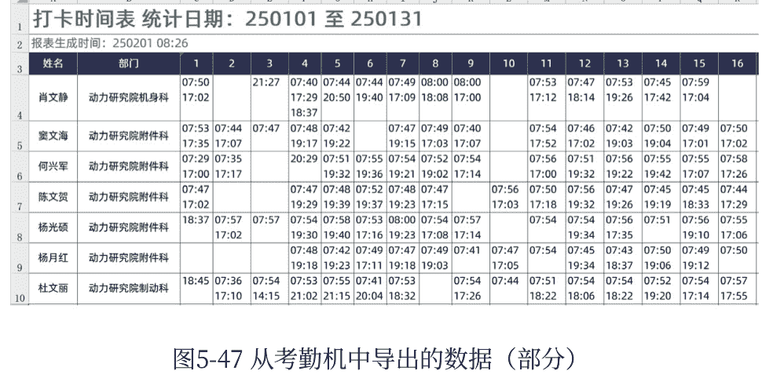

图5-47 从考勤机中导出的数据（部分）

打开WPS灵犀，单击对话框右下角的上传按钮 ⊕，上传考勤数据，并发送以下提示词。

> 请对考勤表中的数据进行逐条整理，生成规范的表格，字段包括姓名、部门、日期、最早打卡时间和最晚打卡时间。

DeepSeek生成的表格效果如图5-48所示。

| 姓名 | 部门 | 日期 | 最早打卡时间 | 最晚打卡时间 |
|---|---|---|---|---|
| 肖文静 | 动力研究院机身科 | 1 | 07:50 | 17:02 |
| 肖文静 | 动力研究院机身科 | 3 | 21:27 | 21:27 |
| 肖文静 | 动力研究院机身科 | 4 | 07:40 | 18:37 |
| 肖文静 | 动力研究院机身科 | 5 | 07:44 | 20:50 |
| 肖文静 | 动力研究院机身科 | 6 | 07:44 | 19:40 |
| 肖文静 | 动力研究院机身科 | 7 | 07:49 | 17:09 |
| 肖文静 | 动力研究院机身科 | 8 | 08:00 | 18:08 |
| 肖文静 | 动力研究院机身科 | 9 | 08:00 | 17:00 |
| 肖文静 | 动力研究院机身科 | 11 | 07:53 | 17:12 |
| 肖文静 | 动力研究院机身科 | 12 | 07:47 | 18:14 |
| 肖文静 | 动力研究院机身科 | 13 | 07:53 | 19:26 |
| 肖文静 | 动力研究院机身科 | 14 | 07:45 | 17:42 |
| 肖文静 | 动力研究院机身科 | 15 | 07:59 | 17:04 |
| 肖文静 | 动力研究院机身科 | 18 | 07:48 | 18:28 |
| 肖文静 | 动力研究院机身科 | 19 | 07:50 | 18:09 |

图5-48 整理后的考勤数据（部分）

所有员工的打卡数据都被完整处理并做到了格式一致、各字段对齐，数据清晰可读。

# 技巧23 借助DeepSeek解读员工离职数据

DeepSeek能够对员工离职数据进行深入解读，帮助用人单位发掘人员流失的深层原因，有效降低员工流失率，提高组织的稳定性与竞争力。

如图5-49所示，是某企业部分离职人员的资料。

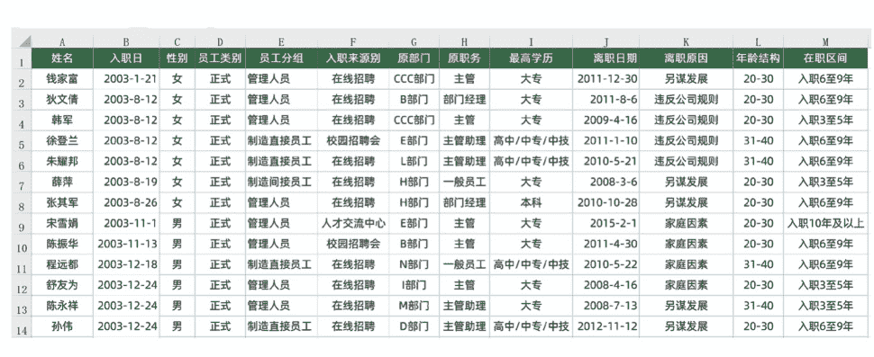

图5-49 离职人员资料表（部分）

单击DeepSeek对话框右下角的 @ 按钮，上传Excel文档，并发送以下提示词。

> 你是一名资深的HR，请对文档中的人员离职数据进行深入解读，从不同角度入手分析离职原因。

DeepSeek生成的离职数据分析报告如下。

## 1. 离职原因分布

主要离职原因：

- 违反公司规则（占比最高，约35%）：主要集中在制造直接员工（分组）和管理人员（分组）中，涉及多个部门（如CCC、F部门等）。
- 另谋发展（占比约30%）：管理人员（分组）占比更高，可能与职业发展机会不足有关。
- 家庭因素（占比约20%）：跨部门和职位分布，女性员工占比略高。
- 身体不适/工作环境不适应（占比约10%）：制造直接员工（分组）占主导，可能与工作强度或环境有关。
- 其他原因（考试不合格、交通不便等，占比5%）。

结论：需要加强员工行为规范培训，优化工作环境，并提供清晰的职业晋升路径。

## 2. 性别与离职关联

- 女性员工：家庭因素（占比25%）和另谋发展（占比30%）是主要离职原因。
- 男性员工：违反公司规则（占比40%）和另谋发展（占比35%）占主导。

结论：建议为女性员工提供更灵活的家庭支持政策（如弹性工作制），同时强化男性员工的合规意识。

## 3. 员工类别分析

- 管理人员：离职原因以另谋发展（占比45%）和违反公司规则（占比30%）为主，原因可能是晋升通道受限或管理压力大。
- 制造直接员工：违反公司规则（占比40%）和身体不适/环境不适应（占比25%）占比较高，需要关注基层员工的工作条件与流程合规性。

结论：针对管理人员开展职业规划辅导，优化制造岗位的工作流程和健康管理方案。

## 4. 部门离职集中问题

- CCC部门：离职人数最多（约20人），主因是违反公司规则（占比50%）和另谋发展（占比30%），需要排查部门管理问题。
- F部门：违反公司规则（占比40%）和家庭因素（占比25%）突出，可能与团队文化或考核机制有关。

结论：对离职率高的部门进行管理审计，优化团队协作与监督机制。

## 5. 入职来源与稳定性

- 在线招聘：离职率最高（占比50%），主因是另谋发展和违反规则，需要加强招聘筛选。
- 校园招聘会：员工更易因工作环境不适应或身体不适离职，需要完善新人适应性培训。
- 人才交流中心：家庭因素（占比30%）和违反规则（占比25%）较均衡，稳定性中等。

结论：优化招聘渠道筛选标准，加强入职初期的人文关怀。

## 6. 学历与离职关联

- 大专/本科：管理人员占比较高，离职主因另谋发展（占比50%）。
- 高中/中专/中技：制造员工为主，离职多因违反规则（占比40%）和身体不适（占比20%）。

结论：为高学历员工设计个性化职业发展规划，提高基层员工的技能培训强度与福利待遇。

## 7. 年龄与在职时间分析

- 20～30岁：离职主因另谋发展（占比40%）和违反规则（占比30%），年轻员工流动率高。
- 31～40岁：家庭因素（占比35%）和身体不适（占比25%）占比更高，需要关注中年员工的工作生活平衡。

在职区间：

- 入职3～5年：离职高峰（占比45%），主因是遇到职业瓶颈或工作理念与公司规则冲突。
- 入职6～9年：另谋发展（占比40%）和家庭因素（占比30%）主导，可能长期缺乏晋升机会。

结论：针对不同年龄段和在职阶段设计留人策略，如青年员工轮岗计划、中年员工健康支持。

## 综合建议

- 管理优化：针对高离职部门（如CCC、F部门）进行管理复盘，强化合规监督与团队文化建设。
- 职业发展：建立清晰的晋升通道，关注管理人员和技术骨干的长期培养。
- 员工关怀：完善家庭支持政策（如育儿假）和健康管理方案（如定期体检和心理健康服务）。
- 招聘改进：加强在线招聘的背调，优化校园招聘的适应性培训，提升人才匹配度。

以上解读包括离职原因分布、性别与离职关联、员工类别（比如普通员工和管理人员）的离职情况、不同部门的离职率、入职来源对离职的影响、学历与离职的关系、年龄结构对离职的影响，以及在职职工龄区间的离职趋势。DeepSeek不仅对分析结果进行了总结，还指出了公司需要改进的地方。

# 第6章 DeepSeek演示大师：PPT智能设计

DeepSeek能够根据用户输入的提示词快速生成结构化的PPT大纲，涵盖逻辑框架、数据提炼和核心观点，适配演讲、汇报等不同场景需求。让DeepSeek与其他AI工具强强联合，覆盖从内容生成到视觉设计的全流程，可实现“5分钟生成初版PPT+自主优化”的高效创作。

## 本章的主要内容

- ◆ 技巧1 DeepSeek+通义千问，根据现有文档制作PPT
- ◆ 技巧2 DeepSeek+通义千问，迅速优化PPT
- ◆ 技巧3 DeepSeek+WPS灵犀，根据主题自动生成PPT

## 技巧01 DeepSeek+通义千问，根据现有文档制作PPT

借助DeepSeek的超强逻辑推理能力和文案润色功能，能快速生成条理清晰的PPT大纲，而通义千问具备强大的PPT生成功能，二者联合，可显著提高工作效率。

如图6-1所示，是某公司Word版年度总结的部分内容，包含多项运营数据和项目完成情况，现在我们需要根据这些内容，制作一个年度总结PPT。

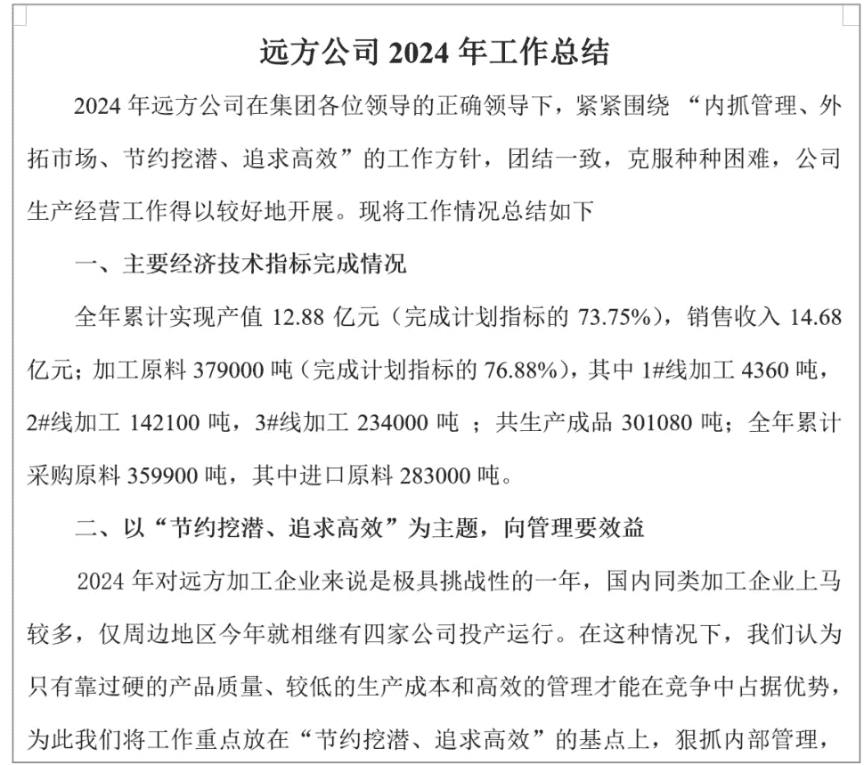

图6-1 Word版年度总结（部分）

单击DeepSeek对话框右下角的 📎 按钮，上传Word文档，并发送以下提示词。

> 你是一位资深的PPT设计师，请解读文档中的内容，并据此生成PPT大纲。注意，数据不能错误也不能有遗漏，不要出现Word文档中没有的内容。

DeepSeek生成的PPT大纲（部分）如图6-2所示。

### 远方公司2024年工作总结PPT大纲

#### 封面页

- 标题：远方公司2024年工作总结
- 副标题：内抓管理·外拓市场·节约挖潜·追求高效
- 日期
- 公司Logo

#### 目录页

1. 主要经济技术指标完成情况
2. 管理效益提升：节约挖潜与高效成果
3. 市场拓展：内练硬功与外拓成效
4. 后勤保障与安全管理
5. 存在问题与改进方向
6. 未来展望与目标

#### 1. 主要经济技术指标完成情况

- 产值：12.88亿元
- 销售收入：14.68亿元
- 加工原料总量：379,000吨
  - 1#线：4,360吨
  - 2#线：142,100吨
  - 3#线：234,000吨
- 生产成品：301,080吨
- 原料采购：359,900吨（进口283,000吨）

#### 2. 管理效益提升：节约挖潜与高效成果

图6-2 DeepSeek生成的PPT大纲（部分）

复制DeepSeek生成的PPT大纲，打开通义千问官网，先单击页面左侧的【效率】按钮，再单击页面右侧底部的【PPT创作】模块中的【开始创作】按钮，如图6-3所示。


图6-3 通义千问页面

在【通义PPT创作】对话框中粘贴已复制的PPT大纲后，单击【下一步】按钮，如图6-4所示。如果单击对话框左下角的【上传】按钮，可直接上传本地文件。

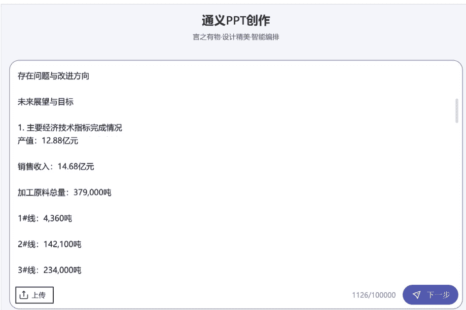

图6-4 通义PPT创作

通义千问会自动对内容进行润色、优化，生成新的大纲，如图6-5所示。


图6-5 PPT大纲生成中

优化完成后，用户可对PPT大纲中的项目进行编辑，比如输入演讲人并确认使用场景，本例选择以【工作汇报】为使用场景，如图6-6所示。

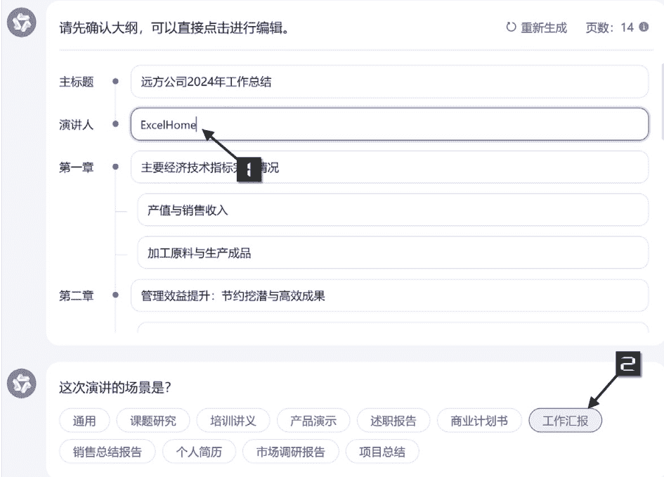

图6-6 编辑大纲

单击页面右上角的【下一步】按钮，如图6-7所示，会弹出模板选择界面。

选择符合需求的模板，单击【生成PPT】按钮，如图6-8所示。


图6-7 【下一步】按钮

### 选择模版

- 全部
- 精品
- 深色
- 浅色
- 彩色
- 简约


图6-8 选择模板

稍等片刻，即可按大纲内容生成PPT。单击某个项目，即可对项目内容进行编辑，如图6-9所示。


图6-9 PPT预览与编辑

在编辑界面中，可以对PPT中的各元素进行进一步调整、优化，如修改颜色、切换模板、插入元素，如图6-10所示。


图6-10 编辑PPT

编辑完成后，单击界面右上角的【演示】按钮，即可预览PPT的播放效果；单击下载按钮 ，即可将PPT文件下载到本地。

## 技巧02 DeepSeek+通义千问，迅速优化PPT

若PPT页面上堆满大段的文字，观众很难快速抓住重点。借助DeepSeek和通义千问，不仅能够重新规划包含大段文字的PPT的大纲，还能生成更加美观的PPT。

如图6-11所示的PPT中包含大量文字内容，且存在一定的错误，借助DeepSeek和通义千问，可对其进行优化和修改。


图6-11 带有大段文字的PPT（部分）

单击DeepSeek对话框右下角的 📎 按钮，上传PPT，并发送以下提示词。

> 你是一位优秀的PPT设计师，现有PPT中包含大量文字且有少量错误，请对这些内容进行优化和修改，生成新的大纲。

DeepSeek生成的大纲如下。

1. 封面页
   - 标题：Excel函数与公式基础及常用函数应用
   - 副标题：高效处理数据的核心技能

2. 目录页
   - 查找与引用类函数：VLOOKUP
   - 文本类函数：SUBSTITUTE

3. 函数的分类
   - 核心要点：
     - 内置函数：直接使用，无须加载（如SUM、IF）
     - 扩展函数：早期需加载宏（如EDATE），2007+版本内置
     - 自定义函数：通过VBA编写，存放于模块
     - 宏表函数：Excel 4.0遗留，逐步被替代
   - 视觉设计：使用四象限图分类展示函数类型，搭配图标标注特点

4. 查找与引用类函数：VLOOKUP
   - 核心要点：
     - 功能：基于列匹配查询数据
     - 语法：=VLOOKUP(查找值,数据区域,返回列号,[匹配方式])
     - 参数详解：
       - 精确匹配：0或FALSE
       - 近似匹配：TRUE或省略（需首列升序排序）
   - 视觉设计：
     - 流程图展示VLOOKUP逻辑：查找值→匹配列→返回结果
     - 示例表格：模拟数据区域，标注参数对应位置

5. 文本类函数：SUBSTITUTE
   - 核心要点：
     - 功能：替换字符串中的指定内容
     - 语法：=SUBSTITUTE(原文本,旧文本,新文本,[替换次数])
     - 应用场景：
       - 省略【替换次数】：替换所有匹配项
       - 指定次数：仅替换第N次出现的匹配项
   - 视觉设计：
     - 对比案例：展示替换前后的文本变化（如将“2023”替换为“2024”）
     - 参数图示：用高亮色块标注语法结构

6. 总结页
   - 核心要点：
     - 内置函数是核心工具，VLOOKUP和SUBSTITUTE需重点掌握
     - 灵活使用函数，提高数据处理效率
   - 视觉设计：
     - 信息图：函数分类与应用场景的关联关系图
     - 动态强调关键函数图标（如放大VLOOKUP图标）

以上大纲对长段落的文字内容进行了优化，拆解为关键词+要点的形式，避免了文字堆砌，成功将原有的文字密集型PPT优化为简洁、直观且专业的演示文稿。

复制DeepSeek生成的大纲，粘贴在通义千问的PPT创作对话框中。对大纲内容进行编辑确认后选择模板，等待通义千问生成PPT，效果如图6-12所示。仔细核对PPT中的内容，可根据实际情况进行优化修改。

### 扩展函数：早期需额外加载，现代版本已内置

请输入

函数种类增加

Excel的函数种类不断增加，涵盖了数学、统计、财务等多个领域。

提升工作效率

通过内置高级函数，Excel显著提高了用户的工作效率。

满足多样需求

丰富的函数分类满足了不同用户的需求，增强了Excel的适用性。

现代Excel将高级函数内置。

### 对比案例演示：替换前后文本变化

请输入

REPLACE函数

用于定位并替换特定位置的字符，如将“1 23号”改为“123室”。

选择合适函数

根据具体需求选择合适的函数，如批量修改文件名、修正错误拼写等，提高数据处理效率。

SUBSTITUTE函数

适用于全局替换指定字符或子串，例如将地址中的“路”统一替换为“道”。

对比替换效果

通过对比替换前后的数据，可以直观地看到SUBSTITUTE与REPLACE的不同效果。

图6-12 优化后的PPT（部分）

## 技巧03 DeepSeek+WPS灵犀，根据主题自动生成PPT

WPS灵犀能够根据用户提供的主题生成PPT大纲，并在此基础上快速生成PPT。

例如，需要制作一份以“未来十年，AI对传统办公方式的影响”为主题的PPT，可以打开WPS灵犀，在对话框中发送以下提示词。

> 你是一位有经验的PPT设计师，请以“未来十年，AI对传统办公方式的影响”为主题，生成一份PPT大纲，PPT页数控制在25页以内。

DeepSeek思考后生成一篇以“AI重构办公新范式——未来十年办公方式变革前瞻”为标题的PPT大纲，如图6-13所示。


图6-13 DeepSeek生成的PPT大纲（部分）

以上大纲结构流畅，逻辑连贯，从现状到未来展望有自然的过渡，且各章节内容分配合理，既有深度又不显冗长。将大纲复制粘贴到Word中进行必要的编辑后，即可在此基础上生成PPT。

在WPS灵犀首页左侧的窗格中单击【AI PPT】按钮，在对话框中粘贴编辑后的PPT大纲，单击发送按钮，如图6-14所示。


图6-14 WPS灵犀对话框

WPS灵犀会自动对大纲进行润色、优化。优化完成后，弹出模板选择界面，先单击选择符合需求的模板，再单击【生成PPT】按钮，如图6-15所示。


图6-15 选择模板

稍等片刻，WPS灵犀即可按大纲内容生成PPT并进入编辑和预览界面。在编辑界面可以对PPT进行进一步调整、优化，如内容编辑、模板替换、插入元素。单击右上角的【去WPS编辑】按钮，即可进入在线版编辑界面。

编辑完毕，单击左上角的文件操作按钮 ≡，即可根据实际需求在下拉菜单中选择【另存】【下载】【打印】【WPS打开】【播放】命令，如图6-16所示。


图6-16 AI PPT常用命令

# 第7章 DeepSeek职场助手：从招聘到管理

DeepSeek能够基于对岗位需求的理解，自动生成符合行业规范、体现职位特性的招聘简章；能够智能推荐与目标岗位高度契合的简历模板，并优化简历关键词；还能够快速制作或分析调查问卷、根据要求设计排班表等，显著提高从招聘到管理的全流程效率。

## 本章的主要内容

- ◆ 技巧1 根据岗位需求表格生成招聘简章
- ◆ 技巧2 使用DeepSeek写简历，提高应聘成功率
- ◆ 技巧3 将口语化内容转为标准化商务邮件
- ……

# 技巧01 根据岗位需求表格生成招聘简章

DeepSeek能够根据岗位需求表格和企业介绍中的信息，自动组织内容，使用流畅、专业的语言，撰写专业且能够吸引优秀人才的招聘简章。借助DeepSeek生成招聘简章，一方面能够确保招聘简章结构合理、重点突出，便于候选人快速了解岗位信息；另一方面能够节省招聘人员的时间，避免出现人为因素导致的信息遗漏或错误。

如图7-1、图7-2所示，是某企业Word版企业介绍和Excel版岗位用工需求，借助DeepSeek，可据此制作招聘简章。企业介绍中存在排版错误和需要优化的文字表达，在生成招聘简章时，DeepSeek会对相关内容进行处理。


图7-1 企业介绍

| 岗位 | 人数 | 薪资待遇 | 食宿 | 要求 |
|---|---|---|---|---|
| 操作工 | 10 | 4500 | 食宿自理 | 男性，高中及以上文化，35岁以下，12小时倒班 |
| 门卫 | 2 | 2200 | 食宿自理 | 男性，初中及以上文化，50岁以下，12小时倒班 |
| 包装工 | 20 | 4000 | 食宿自理 | 性别不限，初中及以上文化，40岁以下，能吃苦耐劳 |
| 电工 | 5 | 4200 | 食宿自理 | 男性，高中及以上文化，40岁以下，有电工证，3年以上工作经验，12小时倒班 |
| 带班主任 | 3 | 6000 | 食宿自理 | 男性，本科及以上学历，机械加工有关专业，35岁以下，5年以上管理工作经验 |
| 联系电话：8842525 | | | | |
| 联系人：周经理 | | | | |

图7-2 用工需求

单击DeepSeek对话框右下角的按钮，上传Word文档和Excel数据表，并发送以下提示词。

你是一位有十年从业经验的HR主管，请根据文件中的企业简介和用工需求生成标准的招聘简章，并对任职要求进行补充和优化，结果以代码形式输出，代码要符合Markdown标准。

DeepSeek生成的招聘简章代码如图7-3所示。


图7-3 DeepSeek生成的招聘简章代码（部分）

复制DeepSeek生成的代码，打开Markdown编辑器，将代码粘贴在页面左侧，Markdown编辑器会自动生成相应的招聘简章，如图7-4所示。单击【导出Word文档】按钮，即可将生成的Word文档下载到本地。

## 北海集团有限公司招聘简章

### 一、企业简介

北海集团有限公司成立于 2004 年，是一家集中央空调系统、净化空调系统、通风末端及消防排烟设备的研发、制造、销售、安装与维护为一体的大型股份制企业。公司现有员工 500 人，拥有自主研发能力和完善的物流配送体系，与多家知名厂商建立战略合作。因业务快速发展，现面向社会诚聘英才，期待与您携手共进！

### 二、招聘岗位及任职要求

1. 操作工（10人）

薪资待遇：4500 元/月
工作内容：负责生产线设备操作、日常维护及生产任务执行。
任职要求：

- 高中及以上学历，年龄 35 周岁以下；
- 适应 12 小时倒班制，能承受一定工作压力；
- 具备机械操作基础或相关经验者优先；
- 责任心强，服从管理，具有团队协作意识。

2. 门卫（2人）

薪资待遇：2200 元/月
工作内容：负责厂区安全巡查、出入登记及突发事件处理。
任职要求：

图7-4 根据用工需求和企业简介生成的招聘简章（部分）

DeepSeek生成的招聘简章，岗位信息准确无误、结构清晰、层次分明；企业简介部分简洁有力，突出了公司优势；文档最后不仅明确了薪资结构、食宿安排和职业发展，还将原表格中的文字描述转换为分项条目，增加了持证要求、经验要求等专项说明，补充了岗位适配性描述；此外，还统一使用“周岁”作为年龄单位，规范了证书名称（如“电工操作证”），补充了证件准备要求和公司地址提示。

# 技巧02 使用DeepSeek写简历，提高应聘成功率

成功投递简历的关键是“投其所好”，DeepSeek能够对招聘信息进行精准解析，提取关键要求，并根据这些要求生成或调整简历内容，提高匹配度。

如图7-5所示，是PDF版的招聘简章。根据该招聘简章和自身条件，借助DeepSeek生成简历。


图7-5 招聘简章

单击DeepSeek对话框右下角的⊕按钮，上传PDF文档，并发送以下提示词。

我是一名有8年工作经验的财务会计，做过2年制造业成本会计，各岗位都有涉及，有一定的经验，大学本科学历，中级职称。请针对招聘简章，写一份个人简历，在匹配性方面进行优化，重点突出与招聘简章匹配的优点。

DeepSeek生成的简历部分内容如下。

## 核心优势

1. 高度匹配岗位需求
8年财务工作经验（含2年制造业成本会计），远超招聘简章中的5年经验要求；中级职称+本科学历，完全满足招聘硬性条件。

2. 制造业成本管理专长
熟悉BOM核算、标准成本法及作业成本法，具备制造业全流程成本管控经验；成功实施多个降本增效项目，累计节约成本超200万元。

3. 技术能力扎实
精通用友、金蝶等软件，擅长通过数据分析发现业务痛点；
熟练使用Power BI制作动态成本分析看板，提高管理层决策效率。

4. 软技能突出
多次主导跨部门协作项目，沟通协调能力强；
抗压能力强，曾连续3个月高强度完成公司IPO财务数据梳理。

## 自我评价

深耕财务领域8年，兼具扎实的专业知识与实战经验，熟悉制造业全链路成本管理逻辑。善于通过数据驱动业务优化，注重团队协作与结果导向。认同远方公司“创新、质量、服务”的理念，期待以自身专业能力助力公司降本增效，与公司共同成长。

简历内容不仅包括个人信息、求职意向、工作经历、教育背景、技能证书、自我评价等部分，还重点突出了与招聘简章中的“岗位职责”和“任职要求”匹配的经历，如制造业经验、降本案例、软件技能。用户可根据自身情况对其中的数据进行调整。

# 技巧03 将口语化内容转为标准化商务邮件

使用标准化商务邮件可显著降低沟通成本。借助DeepSeek，能够将口语化内容转换为正式的商务邮件。

例如，在DeepSeek对话框中发送以下提示词。

> 请将以下内容转换为标准化商务邮件：“刘经理，你们上次维修的灌装设备又出问题了！今天上午9点20分左右数据同步异常，错误代码为E407。你们赶紧派人来看看，维修报价我们可以现场谈。”

DeepSeek生成的标准化商务邮件如下。

主题：关于灌装设备故障的报修申请

尊敬的刘经理：

您好！

谨此致函告知，贵司先前负责维护的灌装设备于今日（具体日期）上午9时20分再次出现运行异常。经系统检测，设备在数据同步过程中触发E407故障代码，目前处于非正常运行状态。

为确保生产工作正常开展，烦请贵司尽快安排技术人员前来现场进行故障诊断与检修。关于本次维修服务的费用事宜，我司愿与贵司保持开放协商态度，待设备检测完成后进一步洽谈具体方案。

随附设备故障时段运行日志及报警截图供参考（如有）。如需要我方配合提供其他技术资料或现场支持，请随时与我联系。

顺颂商祺！

[您的全名]

[您的职位]

[公司名称]

联系电话：[有效联系方式]

电子邮箱：[公司邮箱地址]

日期：YYYY年MM月DD日

以上商务邮件内容包含邮件主题、称呼、正文、结尾敬语和签名。正文部分描述问题，说明设备再次出现故障，并写明发生故障的具体时间、错误代码，请求安排技术人员检查，同时提到维修报价可以进一步沟通，既表达了合作意愿，又留有余地。结尾部分写明发件人信息，包括姓名、职位、公司名称、联系方式等，显得非常正式、专业。

# 技巧04 制作问卷调查表

借助DeepSeek生成问卷调查表，不仅能够节省时间，提高问卷质量，使数据分析过程更加高效，还能有效避免人工操作时常见的问卷设计复杂、调查不够深入等问题。

以生成酒店客户满意度调查问卷为例，在DeepSeek对话框中发送以下提示词。

你是一名酒店管理者，请生成一份客户满意度调查问卷，问卷内容要包括环境、服务、价格等多个方面。

以下是DeepSeek生成的酒店客户满意度调查问卷。

尊敬的客人：

感谢您选择入住本酒店！为协助我们持续提高服务质量，请您抽出2分钟填写此问卷。所有信息仅用于改进工作，祝您生活愉快！

## 一、基本信息（可选）

入住日期：____年____月____日

入住房型：□ 标准间 □ 大床房 □ 套房 □ 其他_______

预订渠道：□ 酒店官网 □ OTA平台 □ 电话预订 □ 其他_______

## 二、满意度评估

请为以下内容评分（1～5，1=非常不满意，5=非常满意）：

### A. 酒店环境

大堂环境整洁度与舒适性：1 2 3 4 5

房间卫生状况：1 2 3 4 5

房间设施（床品、卫浴、空调等）完善性：1 2 3 4 5

公共区域（餐厅/走廊/电梯）整洁度：1 2 3 4 5

酒店周边环境（交通/噪声/安全）：1 2 3 4 5

### B. 服务质量

前台接待效率与友好度：1 2 3 4 5

客房服务响应速度（如需求处理）：1 2 3 4 5

员工专业性与服务态度：1 2 3 4 5

早餐种类与品质：1 2 3 4 5

问题解决及时性（如设施故障）：1 2 3 4 5

### C. 价格与价值

价格与整体体验的性价比：1 2 3 4 5

附加服务收费合理性（如洗衣/迷你吧）：1 2 3 4 5

与同档次酒店相比，您认为我们的价格：□ 偏高 □ 合理 □ 偏低

## 三、开放式反馈

本次入住中，您最满意的服务或细节是：

----------------------------------------

您认为最需要改进的方面是： ____________________________________

其他建议（如特色服务期待）： ____________________________________

问卷结束，感谢您的宝贵意见！

我们将认真分析您的反馈并持续优化服务，期待下次为您提供更完美的体验！

问卷简洁全面，问题具体，方便客人回答，有利于收集到有用的反馈。问卷最后以开放式问题收尾，让客人有机会详细反馈。

# 技巧05 问卷调查分析

借助DeepSeek对收集到的调查问卷进行整理、分析，能显著提高问卷分析的效率、深度与可靠性。如图7-6所示，是一份填写完毕的客户满意度调查问卷。借助DeepSeek，可快速对多份调查问卷进行分析。


图 7-6 客户满意度调查表（部分）

将全部调查问卷拍照保存后，单击DeepSeek对话框右下角的按钮上传问卷照片，并在DeepSeek对话框中发送以下提示词。

请对问卷内容进行整理，重点分析直接影响客户体验、忠诚度和对业务改进有帮助的关键问题。

DeepSeek生成的问卷关键问题分析如下。

## 一、直接影响客户体验的核心要素

服务专业性优势突出：整体满意度、服务人员专业性和态度、响应速度均获高分，表明服务效率和专业性为该机构当前的核心竞争力。

建议：保持员工培训投入，完善服务标准化流程。

服务环境需要获得针对性优化：环境评分（4分）低于其他内容的评分，可能涉及设施维护、卫生条件或空间舒适度问题。

改进方向：结合细节反馈中的“优化服务流程”需求，排查环境与流程联动问题（如动线设计、等待区域体验）。

## 二、客户忠诚度的潜在风险与机会

复购与推荐意愿存在保留：用户选择“可能会”再次选择或推荐服务，未达最高忠诚度（“一定会”），可能与服务环境评分较低或流程改进需求相关。

风险点：需要关注客户对“不确定性”的真实顾虑（如价格波动、服务质量一致性）。

价格透明性成为差异化优势：最满意环节中，“价格透明性”被勾选，反映了客户对消费知情权的重视。

机会点：可强化价格策略宣传，转化为品牌信任度。

## 三、业务改进优先级建议

短期优化：最需要改进项中，“优化服务流程”被勾选，需要排查流程中的冗余环节（如预约、结账、售后服务）。

长期投入：环境评分较低，但细节反馈中“改善卫生条件”未被勾选，需要区分具体问题（是硬件设施老旧还是清洁频次不足）。

验证方法：增加开放性问题，收集具体环境改进建议。

## 四、总结

当前服务核心优势（专业性、响应速度）可支撑客户基础体验，但需要通过流程优化和环境升级消除复购阻力，同时利用价格透明性强化品牌信任，实现从“可能会”到“一定会”的忠诚度突破。

以上总结对问卷中的各部分都有明确的分析，并给出了业务改进的具体建议，结构清晰，分点列出，便于用户快速定位关键问题。

# 技巧06 生成年会抽奖器

如果需要生成年会抽奖器，可以先借助DeepSeek生成HTML标准代码，再将代码保存为HTML格式文件。

在Excel文档中准备参与抽奖的员工的名单，如图7-7所示。


图7-7 抽奖员工名单（部分）

单击DeepSeek对话框右下角的 📎 按钮，上传包含抽奖名单的Excel文档，并发送以下提示词。

请设计一个HTML标准代码的随机抽奖器：背景使用喜庆色系，单击“开始”按钮会显示所有名字一闪而过的动画效果，并且“开始”按钮会变成“停止”按钮，单击“停止”按钮可以随机得到一组抽奖结果，要求一等奖1名、二等奖2名、三等奖3名，参与抽奖的姓名在Excel文档中。

DeepSeek生成的部分代码如图7-8所示。

```html
<!DOCTYPE html>
<html lang="zh-CN">
<head>
    <meta charset="UTF-8">
    <style>
        body {
            margin: 0;
            height: 100vh;
            display: flex;
            flex-direction: column;
            align-items: center;
            background: linear-gradient(45deg, #c7000b 0%, #ff6b6b 100%);
            font-family: 'Microsoft YaHei', sans-serif;
            overflow: hidden;
        }

        .container {
            text-align: center;
            margin-top: 5%;
        }

        .title {
            color: #fff;
```

图7-8 DeepSeek生成的抽奖器代码

复制代码后粘贴到新建文本文档中保存，随后将扩展名从.txt改成.html即可。

双击更改扩展名后的文件即可预览效果，如图7-9所示。抽奖器中包括活动主题显示区域、开始按钮及奖项结果显示区域。


图7-9 抽奖器效果

# 技巧07 设计排班表

值班安排不仅需要耗费大量精力，还常常因为安排不合理而引发值班人员的不满，进而影响团队协作。借助DeepSeek，可以高效地生成排班解决方案。

明确排班的时间段、班次安排、值班人员、每个人的值班天数等信息，在DeepSeek对话框中发送以下提示词。

你是一家料理店的老板，请为员工小段、小伟和小陈安排2025年3月3日至3月9日的排班班次。班次分为早班和晚班，每天的早班和晚班各需要一名员工上班，每名员工每周至少休息两天。排班结果以表格形式呈现。

DeepSeek生成的排班表如图7-10所示。

| 日期 | 早班 | 晚班 | 休息员工 |
| :--- | :--- | :--- | :--- |
| 3月3日 | 小伟 | 小陈 | 小段 |
| 3月4日 | 小段 | 小伟 | 小陈 |
| 3月5日 | 小段 | 小陈 | 小伟 |
| 3月6日 | 小陈 | 小伟 | 小段 |
| 3月7日 | 小段 | 小伟 | 小陈 |
| 3月8日 | 小段 | 小陈 | 小伟 |
| 3月9日 | 小伟 | 小陈 | 小段 |

图7-10 排班表

排班说明如下。

休息天数：

小段：休息 3天（3日、6日、9日），工作4天（均早班）。

小伟：休息 2天（5日、8日），工作5天（早班2次、晚班3次）。

小陈：休息 2天（4日、7日），工作5天（晚班4次、早班1次）。

班次均衡：

早班和晚班尽量轮换，避免同一员工连续多天同一班次（如小伟和小陈交替早晚班）。

小段因休息天数较多（3天），统一安排早班，确保公平性。

合法性：

每日早班和晚班各1人，符合最低人力需求。

所有员工休息天数均满足≥2天（小段多休1天，符合最低要求）。

以上安排兼顾公平性与可操作性，能确保工作量和休息时间分配合理。

# 技巧08 生成内容摘要

借助DeepSeek能够生成篇幅较长的文档或报告的摘要，帮助阅读者快速理解文档或报告的核心内容。

如图7-11所示，是某财务部门的上半年工作总结的部分内容，需要生成内容摘要。


图7-11 财务部工作总结（部分）

在DeepSeek对话框中发送以下提示词。

请仔细阅读文档内容，并生成200字以内的摘要，不得遗漏主要项目。

DeepSeek生成的摘要如下。

## 2024年上半年财务部工作总结摘要：

财务部高效完成日常核算、资金管理及财务支持工作，能保障资金收付安全及时，并提出内控优化建议、完善管理制度、维护良好外部关系。财务部存在制度执行不足、人员能力差异及管理职能待强化的问题，将通过强化执行、培训提升及参与决策逐步改进。下半年工作重点包括严格规划资金使用、落实新会计准则、深化财务分析及人员培训，助力公司稳健发展。财务部将持续优化职能，为决策提供支持，确保年度目标达成。

以上摘要简洁直观、结构清晰、逻辑连贯，符合正式的工作摘要要求。

# 技巧09 进行多语种翻译

DeepSeek能够精准把握复杂语句的语义，支持输出流畅、逻辑清晰的译文。这种高效的语言处理能力使其在翻译速度和质量上表现突出，准确率比传统机器翻译工具有显著提高，支持超100种语言的互译。

如图7-12所示，是Word版需要翻译的委托创作合同。


图7-12 待翻译的委托创作合同（部分）

单击DeepSeek对话框右下角的⊕按钮，上传待翻译的Word文档，并发送以下提示词。

你是一位资深的日语翻译，请将文档中的合同内容翻译为日语，翻译时要注意合同涉及的专业术语的准确性，并对合同排版进行整理与修改，使其内容准确无误，结果以代码形式输出，代码要符合Markdown标准。

复制DeepSeek生成的内容，打开Markdown编辑器，将代码粘贴在Markdown编辑器页面左侧，右侧会自动展示翻译好的合同。单击【导出Word文档】按钮，即可将Word文档下载到本地。翻译效果如图7-13所示。


图7-13 合同翻译效果（部分）

# 技巧10 从身份证号码中提取关键信息

DeepSeek能够准确解读身份证号码，并从中提取出生年月、年龄、性别等信息。

如图7-14所示，是一些虚拟的员工姓名和身份证号码信息，借助DeepSeek，可根据B列的身份证号码提取员工的出生年月、年龄和性别。

| 姓名 | 身份证号码 |
|---|---|
| 陆艳菲 | 370802197204212421 |
| 杨庆东 | 230710198105050214 |
| 任继先 | 370829198402110357 |
| 陈尚武 | 37088219840828005x |
| 李光明 | 370829198504195910 |
| 李明辉 | 370882198503153243 |
| 毕淑华 | 622201198205121828 |
| 赵会芳 | 370481198202153241 |

图7-14 虚拟的员工信息表

单击DeepSeek对话框右下角的按钮，上传包含员工信息的Excel文件，并发送以下提示词。

请根据B列的身份证号码，提取员工的出生年月、截至2025年1月1日的年龄及性别信息，计算年龄时，如果到截止日期时未满周岁则舍去。结果以表格形式显示，表格字段要包括姓名、身份证号码、出生年月、年龄和性别。

以上提示词明确规定计算年龄时的规则为“到截止日期时未满周岁则舍去”，否则DeepSeek无法判断是按周岁还是按虚岁计算，可能导致计算结果有误。

DeepSeek生成的结果如图7-15所示。

| 姓名 | 身份证号码 | 出生年月 | 年龄（截至2025年1月1日） | 性别 |
|---|---|---|---|---|
| 陆艳菲 | 370802197204212421 | 1972-04-21 | 52 | 女 |
| 杨庆东 | 230710198105050214 | 1981-05-05 | 43 | 男 |
| 任继先 | 370829198402110357 | 1984-02-11 | 40 | 男 |
| 陈尚武 | 37088219840828005x | 1984-08-28 | 40 | 男 |
| 李光明 | 370829198504195910 | 1985-04-19 | 39 | 男 |
| 李明辉 | 370882198503153243 | 1985-03-15 | 39 | 女 |
| 毕淑华 | 622201198205121828 | 1982-05-12 | 42 | 女 |
| 赵会芳 | 370481198202153241 | 1982-02-15 | 42 | 女 |

图7-15 DeepSeek生成的结果

复制DeepSeek生成的表格，打开Excel准备粘贴。

由于身份证号码超过15位，若直接粘贴，15位之后的数值将变成0，因此需要在粘贴前单击左上角的全选按钮，在【开始】选项卡中设置数字格式为文本，如图7-16所示。


图7-16 设置数字格式为文本

单击A1单元格后右击，在【粘贴选项】区域选择“匹配目标格式”命令，如图7-17所示。


| A | B | C | D | E |
|---|---|---|---|---|
| 1 | 姓名 | 身份证号码 | 出生年月 | 年龄（截至2025年1月1日） | 性别 |
| 2 | 陆艳菲 | 370802197204212421 | 1972-04-21 | 52 | 女 |
| 3 | 杨庆东 | 230710198105050214 | 1981-05-05 | 43 | 男 |
| 4 | 任继先 | 370829198402110357 | 1984-02-11 | 40 | 男 |
| 5 | 陈尚武 | 37088219840828005x | 1984-08-28 | 40 | 男 |
| 6 | 李光明 | 370829198504195910 | 1985-04-19 | 39 | 男 |
| 7 | 李明辉 | 370882198503153243 | 1985-03-15 | 39 | 女 |

图7-17 粘贴DeepSeek生成的表格

# 技巧11 从收件人信息中提取姓名、电话和地址

面对杂乱的收件人信息，商家在发货时常手忙脚乱。借助DeepSeek，能够从电商订单表中快速整理出收件人的姓名、电话及收件地址。

如图7-18所示，是某电商的订单信息表，B列是收件人地址，其中的姓名、地址、手机号等信息顺序杂乱，部分收件人地址缺失省份信息。

| 订单号 | 收件人/地址 |
|---|---|
| 2963547785 | 南京市玄武区孝陵卫街道卫岗999号13400097654毕小姐 |
| 8996778780 | 上海松江区沈砖公路333号 王美丽15900999999 |
| 9349225717 | 上海市松江区洞泾镇保隆公寓茂盛路7777号 18216560000赵贵珍 |
| 8040763576 | 杭州市余杭区金都夏宫17栋20单元1111 杨小姐 18265000000两箱 |
| 3765592281 | 上海市青浦区青峰路1111弄1111号11室，联系人：苗成燕，手机号：15299750000 |
| 8255260292 | 袁小春 13951520000上海市松江区洞泾镇王家库路50弄49号408 |
| 4524834470 | 上海市松江区洞泾镇长兴路380弄280号180 林丽姗18520000300 |
| 2963547810 | 沈阳市于洪区赤山路华润1001号院东区 蒙传新16100002000 四箱 |
| 8996778805 | 李先生 18500098000 河南省三门峡市渑池县19638煤矿门卫室 |
| 9349225742 | 15666777888江苏苏州市常熟市虞山街道3333号 董文英 |
| 8040763601 | 江苏省常州市钟楼区泰西路1111号，常州冉光危险品运输有限公司 季文姗 13900000999 |
| 3765592306 | 陈春强15688885000武汉市江夏区 文化大道299号汉口学院学生公寓199栋 |

图7-18 订单信息表

单击DeepSeek对话框右下角的⊕按钮，上传包含订单信息的Excel文件，并发送以下提示词。

请对B列的收件人信息进行整理，提取出姓名、手机号和地址。若地址中没有省份信息，请补齐省份信息。结果以表格形式显示，表格字段包括订单号、地址、姓名和手机号。

DeepSeek整理后的结果如图7-19所示。

| 订单号 | 地址 | 姓名 | 手机号 |
|---|---|---|---|
| 2963547785 | 江苏省南京市玄武区孝陵卫街道卫岗999号 | 毕小姐 | 13400097654 |
| 8996778780 | 上海市松江区沈砖公路333号 | 王美丽 | 15900999999 |
| 9349225717 | | 赵贵珍 | 18216560000 |
| 8040763576 | 浙江省杭州市余杭区金都夏宫17栋20单元1111 | 杨小姐 | 18265000000 |
| 3765592281 | 上海市青浦区青峰路1111弄111号11室 | 苗成燕 | 15299750000 |
| 8255260292 | 上海市松江区洞泾镇王家库路50弄49号408 | 袁小春 | 13951520000 |
| 4524834470 | 上海市松江区洞泾镇长兴路380弄280号180 | 林丽珊 | 18520000300 |
| 2963547810 | 辽宁省沈阳市于洪区赤山路华润1001号院东区 | 蒙传新 | 16100002000 |
| 8996778805 | 河南省三门峡市渑池县19638煤矿门卫室 | 李先生 | 18500098000 |
| 9349225742 | 江苏省苏州市常熟市虞山街道3333号 | 董文英 | 15666777888 |
| 8040763601 | 江苏省常州市钟楼区泰西路1111号常州冉光危险品运输有限公司 | 季文珊 | 13900000999 |
| 3765592306 | 湖北省武汉市江夏区文化大道299号汉口学院学生公寓199栋 | 陈春强 | 15688885000 |

图7-19 DeepSeek整理后的结果

DeepSeek自动补全了市级地址的省份信息，省级地址直接保留，并且移除了“两箱”“四箱”等备注信息。

# 技巧12 补全地址中的省、市、区（县）信息

如图7-20所示，是一些省、市、区（县）信息不完整的地址。借助DeepSeek，能够快速补全这些地址中缺失的省、市、区（县）信息。

| 地址 | 省份 | 城市 | 区（县） |
|---|---|---|---|
| 吉林市东局子街道 | | | |
| 北京市方庄饮马井75号 | | | |
| 义乌市中心医院 | | | |
| 辛集市辛集镇第二中学 | | | |
| 德州市新华街道45号 | | | |
| 四平市铁西邮政局 | | | |
| 乐陵市杨安镇中心学校 | | | |

图7-20 信息不完整的地址

复制A列中的地址，粘贴到DeepSeek对话框中，并发送以下指令。

请对这些地址进行解析，以表格形式返回完整的省份、城市和区（县）信息。

DeepSeek生成的内容如图7-21所示。

| 地址 | 省份 | 城市 | 区 (县) |
| --- | --- | --- | --- |
| 吉林市东局子街道 | 吉林省 | 吉林市 | 昌邑区 |
| 北京市方庄饮马井75号 | 北京市 | 北京市 | 丰台区 |
| 义乌市中心医院 | 浙江省 | 金华市 | 义乌市 |
| 辛集市辛集镇第二中学 | 河北省 | 石家庄市 | 辛集市 |
| 德州市新华街道45号 | 山东省 | 德州市 | 德城区 |
| 四平市铁西邮政局 | 吉林省 | 四平市 | 铁西区 |
| 乐陵市杨安镇中心学校 | 山东省 | 德州市 | 乐陵市 |

图7-21 补充完整的省份、城市和区（县）信息

DeepSeek逐一解析各地址的组成部分，结合各行政区域的隶属关系，准确填写了对应的省份、城市和区（县）信息，其中，县级市全部归属到地级市。

# 第3篇 新媒体引擎：短视频与营销内容创作指南

作为国内前沿的AI技术平台，DeepSeek已构建覆盖多维度应用场景的新媒体解决方案体系，其核心价值集中体现在智能内容生产、精准用户交互等方面，支持快速生成符合新媒体传播规律的优质图文、视频脚本及互动素材，大幅提高内容产出效率，帮助用户在新媒体平台上快速吸引粉丝关注，持续提高内容的用户互动率和转化效果。

# 第8章 新媒体引擎：短视频与营销内容创作指南

本章聚焦DeepSeek如何赋能新媒体生态，详细讲解如何通过生成高传播力的短视频脚本、营销图文及互动素材，结合精准用户画像与分发策略，有效解决内容创作效率低、传播效果差等问题，为用户提供从创意到转化的实战方法论。

## 本章的主要内容

- ◆ 技巧1 制作抖音、小红书短视频封面
- ◆ 技巧2 使用DeepSeek+即梦AI生成海报
- ◆ 技巧3 使用DeepSeek+通义万相生成AI视频
- ……

# 技巧01 制作抖音、小红书短视频封面

优秀的封面是获取更多流量的重要因素之一，一个好的短视频封面，能够显著增加视频流量。封面的清晰度、信息传达效率直接影响用户的点击意愿，尤其是在搜索推荐场景中，封面作为静态展示的第一帧，承担着“无声推销员”的角色。

借助DeepSeek能够按要求制作出适合在抖音、小红书等平台传播的短视频封面。以制作抖音短视频封面为例，在DeepSeek对话框中发送以下提示词。

请使用HTML代码制作一个抖音短视频封面，风格清新，比例为16：9，封面文字为“3招教你做抖音爆款短视频”。

DeepSeek生成的代码如图8-1所示。

```html
<html>
<head>
</head>
<body>
    <div class="container">
        <div class="bubble"></div>
        <div class="bubble"></div>
        <div class="bubble"></div>

        <div class="content">
            <div class="title">3招教你做<br>抖音爆款短视频</div>
            <div class="decorate-line"></div>
            <div class="subtitle">新手必看 | 干货教程</div>
        </div>
    </div>
</body>
</html>
```

图8-1 HTML格式的封面代码

单击代码框右上角的【复制】按钮，将代码保存到新建的文本文档中，并将文本文档的后缀改为.html。双击修改后缀后的文本文档即可预览生成的封面，效果如图8-2所示。

给出的提示词越详细，最终的封面越能体现个性化效果。在制作图片之前，可以要求DeepSeek给出制作建议。例如，在DeepSeek对话框中发送以下提示词。

分析小红书点赞10w+的【办公类】封面的共性，总结5条设计规则，并生成3套符合规则的封面模板描述。

此时DeepSeek会给出相应的封面描述，根据DeepSeek给出的建议整理思路，重新在DeepSeek对话框中发送提示词，举例如下。

使用HTML代码制作一个小红书封面，使用白/蓝/黄撞色组合，关键信息用色块/箭头/对话框强化，主标题为“Excel透视表”，副标题为“3步搞定周报”，主标题和副标题居中，标题下方添加进度条（70%处标红）。

DeepSeek根据提示词生成HTML代码，按照前文所述步骤进行预览，效果如图8-3所示。


图8-2 抖音封面效果图


图8-3 小红书封面效果图

# 技巧02 使用DeepSeek+即梦AI生成海报

即梦AI是创意领域的“魔法精灵”，具有将文字转化为图像和视频的神奇魔力。如果将DeepSeek比作智慧的大脑，即梦AI就是神奇的画笔，它们碰撞后产生的创意火花不是简单的1+1，而是指数级别的创意爆发。

例如，要借助即梦AI生成新品口红的宣传海报，可以先在DeepSeek对话框中输入需求，要求DeepSeek提供创作灵感。

请提供一个口红的宣传海报设计方案，要突出其质地丝滑、显色持久的特点。

DeepSeek生成的海报设计方案如下。

## 口红宣传海报设计方案

主题：

> 「丝缎之吻，锁色永恒」

——让双唇成为流动的艺术

主视觉：动态丝滑质感

口红膏体“融化”成液态金属的形态，流淌成一条光泽如缎带的曲线，末端自然过渡到模特饱满的唇部特写（唇色选用高饱和度的正红/酒红），凸显“丝滑触感”与“极致显色”的融合。

时间符号：

背景融入若隐若现的钟表齿轮或沙漏剪影，暗喻显色持久；搭配飞散的晶莹光点，增强画面张力。

主色调：深邃黑金渐变+高饱和度的唇色（如勃艮第红、焦糖棕），营造奢华感。

辅助色：液态金属银、玫瑰金，强化质地丝滑的特点。

标题字体采用具有流动感的手写体，笔画末端模拟丝绸飘逸的拖尾效果，搭配微光质感。

副标题为“丝滑如缎，持色如初”，使用无衬线字体，提高信息传达效率。

复制以上内容，进入即梦AI首页，单击【AI作图】区域的【图片生成】按钮，如图8-4所示。


图8-4 即梦AI局部界面

在页面左侧的【图片生成】文本框中粘贴DeepSeek生成的设计方案，并在【模型】区域选择符合要求的生图模型，如图8-5所示。

在页面底部区域可选择精细度、图片比例及图片尺寸，如图8-6所示，精细度数值越大，生成的图片质量越好。

< 返回

图片生成 视频生成 音乐生成

口红宣传海报设计方案：主题：
「丝缎之吻，锁色永恒」
——让双唇成为流动的艺术
主视觉：动态丝滑质感
口红膏体“融化”成液态金属的形态，流淌成一
条如丝绸般顺滑的曲线，在光影交错中折射出
迷人的光泽，仿佛双唇被赋予了生命，每一次
呼吸都散发着诱人的魅力。

导入参考图 T 314/800 ⓘ

模型

生图模型


图8-5 粘贴设计方案，选择生图模型

精细度 ⓘ

10

## 比例

图片比例

- 21:9
- 16:9
- 3:2
- 4:3
- 1:1
- 3:4
- 2:3
- 9:16

图片尺寸 ⓘ

W 1360

H 765

积分消耗明细

立即生成 ⚡ 1

### 8-6 设置精细度、图片比例和图片尺寸

单击【立即生成】按钮，即梦AI会同时生成4张图片供用户选择，如图8-7所示。


图8-7 即梦AI生成的图片效果

单击选择较为满意的一张图片后，单击页面右侧的【细节修复】【局部重绘】【扩图】【消除笔】等按钮即可进行编辑处理，如图8-8所示。


图8-8 图片编辑选项

编辑完毕后右击图片，在弹出的扩展菜单中选择【下载图片】命令，即可将图片下载到本地。

# 技巧03 使用DeepSeek+通义万相生成AI视频

制作短视频时，提示词非常关键。使用提示词，能够让AI理解用户的需求并生成相应的视频内容。

在DeepSeek对话框中输入需求，要求DeepSeek提供创作灵感。

我需要借助AI生成短视频，请设计一个时长为10秒左右的方案，主题为“练瑜伽的猫咪”，使用明亮、温馨的色调。

DeepSeek生成的视频方案如下。

镜头1（0-2秒）

画面：阳光洒落的木地板全景，粉色瑜伽垫中央蜷缩一只橘色猫咪（AI生成拟人化圆脸猫）。

动态：猫咪伸懒腰后前爪合十作“祈祷式”，尾巴缓慢抬起。

色调：浅粉+奶油色滤镜，光晕特效突出温馨感。

镜头2（2-4秒）

近景特写：猫爪伸展成“树式”，单腿站立（AI模拟萌系平衡摇晃），背景虚化为柔焦绿植。

细节：加入飘落的樱花花瓣粒子特效（增强梦幻感）。

镜头3（4-7秒）

视角切换：俯拍猫咪仰躺在垫子上，后腿蹬向空中模仿“下犬式”，添加Q版汗珠贴纸。

互动元素：右侧飞入半透明瑜伽教学插画箭头（箭头指向猫爪，示意动作标准度）。

镜头4（7-10秒）

慢动作收尾：猫咪翻滚成团，头顶浮现金色“Namaste”手写字（粒子消散效果）。

背景：渐变为黄昏色调，呼应开头的阳光变化。

复制以上内容，打开通义万相，单击通义万相首页左侧的【视频生成】按钮，在编辑框中按<Ctrl+V>组合键粘贴DeepSeek生成的视频方案，选择比例后单击【生成视频】按钮，如图8-9所示。


图8-9 通义万相视频生成

等待片刻，即可生成一个短视频，效果如图8-10所示。如果视频效果不符合预期，可以重新生成。


图8-10 通义万相生成的短视频

# 技巧04 生成抖音分镜脚本

在借助DeepSeek生成抖音短视频脚本时，提供的信息越详细，生成的脚本越能精准匹配抖音的短、平、快属性和算法偏好。这些信息包括核心主题、内容方向、视频风格、目标受众、关键元素、视觉要求、音频需求等。

在DeepSeek对话框中发送以下提示词。

我需要制作一个30秒左右的抖音短视频分镜，主题为“夜晚的西安”，要突出西安的历史和人文特色，希望能吸引更多年轻人关注。请根据上述要求设计分镜脚本。

DeepSeek生成的分镜脚本如下。

分镜脚本 | 《夜长安·时空交响曲》

BGM：国潮电子音乐（古筝+电子鼓点）

【开场-时空隧道】（3秒）

无人机广角俯拍钟楼全景，金色灯光勾勒出盛唐轮廓

镜头急速下坠穿越楼层，光轨化作流动的星河

字幕：当1300年的心跳遇见赛博脉搏

【历史切片】（4秒）

大雁塔红墙慢镜头，汉服少女手持鱼灯掠过画面

切镜：不夜城悬浮诗词投影与游客AR互动同框

特效：青铜纹样在霓虹中粒子化重组

【市井交响】（5秒）

延时摄影：回民街蒸汽升腾的镜糕摊×咖啡拉花特写

滑轨镜头：皮影戏后台的老艺人×电竞屏前敲击键盘的青年

字幕：老饕的胃与潮人的DNA同时躁动

【未来脉冲】（5秒）

仰角移轴：摩天楼群折射极光特效

光绘镜头：奥体中心流动的荧光夜跑轨迹

赛博朋克色调：量子晨街舞battle残影

【终极融合】（3秒）

城墙洞开，无人机矩阵组成「长安」篆体字形

动态跟踪字幕：十三朝的故事，等你续写新章节

收尾LOGO：西安地标剪影化作关注按钮特效

创意核心：

视觉暴力美学：采用高饱和撞色+机械姬风格调色，制造视觉冲击

时空蒙太奇：通过相似构图转场（如传统灯笼→霓虹灯牌）打破时空结界

参与感埋点：设计多个UGC互动切口（AR诗句、光绘轨迹等）

技术建议：

- 使用大疆Pocket 3拍摄动态穿梭镜头
- 人物场景采用120fps升格拍摄
- 关键帧添加故障艺术特效

以上脚本通过设计高密度镜头，在30秒内构建了传统与现代的超现实碰撞，融合历史纵深感与现代化的活力，符合抖音年轻用户的审美偏好。

# 技巧05 生成朋友圈推广文案

给予结构化描述后，DeepSeek能精准捕捉产品亮点，生成营销策略。例如，要在朋友圈推广一款生姜防脱洗发水，需要突出核心卖点，锁定目标人群，以目标人群更感兴趣的方式展示促销信息。

在DeepSeek对话框中发送以下提示词。

你是一名广告策划师，请生成一篇120字内的朋友圈文案，介绍名为“蓝星”的生姜防脱洗发水，要突出生姜精华固发、减少断发的功效，目标人群为职场熬夜人群，正在进行买正装送旅行套装活动，文案以“痛点+共鸣+专业解决方案”的方式呈现。请提供3种不同风格的备选方案。

DeepSeek生成的结果如下。

【方案一：共鸣反问式】凌晨改PPT时，发缝又宽了1mm？蓝星生姜洗发水专研姜黄素精华，28天强韧发根，即使熬夜加班，发丝也能扛住压力！买正装即赠便携旅行装，出差救发两不误。职场人最后的倔强：头发必须比甲方更顽强！

【方案二：数据见证体】实验证明：连续使用含5%生姜提取物的蓝星洗发水，断发率降低63%。职场熬夜党专享福利：现购280ml正装即赠80ml旅行套装，发丝强韧计划，从居家到差旅无缝衔接。

【方案三：场景治愈系】凌晨2:00的办公室，咖啡渍落在键盘，发丝掉在指间。用蓝星洗发水的微温姜感按摩头皮，将熬夜的焦虑揉成绵密泡沫。买1得5的旅行装已备好，下次出差，让发梢替你守住体面。

各方案均严格控制在120字以内，通过不同叙事角度，在触达目标人群时兼顾情感共鸣与专业背书，结尾植入促销信息，自然不突兀。

# 第4篇 智慧成长篇：家庭教育与学习力提升方案

DeepSeek在亲子教育领域的应用广泛，已形成多维度解决方案，涵盖学习辅导、思维训练、亲子互动等场景。随着AI进一步融入生活化教育场景，智慧成长正在不断重塑传统的亲子教育模式。

# 第9章 亲子互动宝典：学习与游戏

DeepSeek能够根据孩子的兴趣提供个性化的学习内容和建议，并通过游戏化设计，激发他们的学习兴趣、优化他们的学习效果。

## 本章的主要内容

- ◆ 技巧1 生成20以内的加减法练习题
- ◆ 技巧2 生成带拼音的生字表
- ◆ 技巧3 生成生字卡
- ……

## 技巧01 生成20以内的加减法练习题

一年级的小学生刚接触数学，需要重复性练习，题目难度不能太大，借助DeepSeek，能够快速生成20以内的加减法练习题。

在DeepSeek对话框中发送以下提示词。

请生成50道数学练习题，内容为20以内的加减法，适合一年级学生学习和复习。结果以A4纸张三列表格形式排版，以代码形式生成，代码要符合Markdown标准。

DeepSeek生成的代码如图9-1所示。


图9-1 加减法练习题代码

复制DeepSeek生成的内容，打开Markdown在线编辑器，将代码粘贴到编辑器页面左侧。单击【导出Word文档】按钮，即可将Word文档下载到本地，效果如图9-2所示。

| 题目 1 | 题目 2 | 题目 3 |
| --- | --- | --- |
| 5 + 3 = | 12 - 4 = | 9 + 7 = |
| 14 - 6 = | 8 + 9 = | 17 - 5 = |
| 10 + 2 = | 19 - 8 = | 4 + 11 = |
| 18 - 3 = | 7 + 6 = | 15 - 9 = |
| 2 + 13 = | 20 - 7 = | 5 + 8 = |
| 16 - 4 = | 11 + 3 = | 10 - 5 = |
| 7 + 9 = | 14 - 2 = | 6 + 10 = |
| 13 - 8 = | 4 + 12 = | 19 - 6 = |
| 1 + 15 = | 18 - 5 = | 3 + 14 = |

图9-2 20以内的加减法

以上题目为3列排版，A4纸打印时可自动适配列宽，并留空供孩子填写答案，题目难度符合一年级教学进度。

## 技巧02 生成带拼音的生字表

借助DeepSeek，能够快速生成带拼音的生字表，便于孩子学习、巩固。例如，在DeepSeek对话框中发送以下提示词。

请生成人教版小学二年级下册《语文》中的全部带拼音生字，结果以表格形式呈现，适合A4纸张排版。

DeepSeek生成的内容如图9-3所示。

| 生字 | 拼音 | 生字 | 拼音 | 生字 | 拼音 | 生字 | 拼音 |
|---|---|---|---|---|---|---|---|
| 诗 | shī | 村 | cūn | 童 | tóng | 碧 | bì |
| 妆 | zhuāng | 绿 | lǜ | 丝 | sī | 剪 | jiǎn |
| 冲 | chōng | 寻 | xún | 姑 | gū | 娘 | niáng |
| 吐 | tǔ | 荡 | dàng | 杏 | xìng | 鲜 | xiān |
| 邮 | yóu | 递 | dì | 员 | yuán | 原 | yuán |
| 叔 | shū | 局 | jú | 堆 | duī | 礼 | lǐ |
| 邓 | dèng | 植 | zhí | 格 | gé | 引 | yǐn |
| 注 | zhù | 满 | mǎn | 休 | xiū | 息 | xī |

图9-3 人教版小学二年级下册《语文》带拼音生字（部分）

DeepSeek按课文顺序整理生成了带拼音的生字表，A4纸横向排版，分为4栏显示。

## 技巧03 生成生字卡

借助DeepSeek，能够生成适合学龄前儿童学习的生字卡。例如，在DeepSeek对话框中发送以下提示词。

请将以下文字以HTML形式做成适合学龄前儿童学习的生字卡：

大、小、多、少、山、石、土、田。

生字卡要包括拼音、图片和笔画顺序，且能够单击发声。

DeepSeek会生成相应代码。单击代码框右下角的【运行HTML】按钮，预览效果如图9-4所示。

生成的生字卡中没有形象的图片，可以通过多轮对话对生成的结果进行优化。在DeepSeek对话框中继续发送以下提示词。

以上内容没有图片，请重新生成。

DeepSeek重新思考后生成新代码。单击代码框右下角的【运行HTML】按钮，预览效果如图9-5所示。


图9-4 首次生成的生字卡


图9-5 第二次生成的生字卡

DeepSeek提供了图形与文字的对应关系改进说明。

大：用放射状十字表现“扩展”，搭配圆形边框，象征膨胀变大的物体。

小：用递减的圆点尺寸配合垂直轴线，直观表现“由大变小”的概念。

复制代码，粘贴到新建文本文档中保存，将扩展名由.txt改成.html即可。

## 技巧04 生成“反义词消消乐”小游戏

将知识融入游戏，能够让孩子在玩游戏的同时学到知识。借助DeepSeek，能生成适合小学生玩的“反义词消消乐”游戏。

如图9-6所示，在Excel中准备一组反义词对照表。


图9-6 反义词对照表

在DeepSeek对话框中发送以下提示词。

请写一个适合小学生玩的反义词消消乐游戏的HTML代码。要求如下。

1. 提供按钮让用户选择Excel文件，A列和B列的同行内容是一组反义词。
2. 将A列和B列的内容显示为不同颜色的按钮，分上下两行，每组的顺序随机排列。
3. 用户依次单击上下相对应的按钮时，该组内容消失，直到全部内容消失。
4. 生成结果和耗时统计。
5. 要保证每个按钮都能正常单击。

DeepSeek生成的部分HTML代码如图9-7所示。

```html
<!DOCTYPE html>
<html>
<head>
    <title>反义词消消乐</title>
    <style>
        body {
            background: linear-gradient(45deg, #a8edea 0%, #fed6e3 100%);
            font-family: "Comic Sans MS", cursive;
            display: flex;
            flex-direction: column;
            align-items: center;
            min-height: 100vh;
            margin: 0;
            padding: 20px;
        }
    </style>
</head>
```

图9-7 HTML小游戏代码（部分）

单击代码框右下角的【运行HTML】按钮，在游戏预览窗口中单击【选择文件】按钮，打开存放反义词的Excel文件。在上下两行分别单击成对的反义词，单击正确，这组反义词就会消失。所有内容消失后显示游戏时长，效果如图9-8所示。


图9-8 消消乐小游戏

## 技巧05 借助DeepSeek背单词

小朋友的学习是爸爸妈妈、爷爷奶奶普遍关心的，借助DeepSeek，可以让小朋友的学习过程更有乐趣。

在DeepSeek对话框中发送以下提示词。

请提供一组三年级学生能够掌握的英文单词。

DeepSeek会按主题分类生成符合要求的英文单词。

家庭与人物

- 1. 家庭 - mother, father, sister, brother, grandma, baby
- 2. 人员 - friend, teacher, student, neighbor

学校与学习

- 1. 文具 - book, pencil, eraser, ruler, desk
- 2. 学科 - math, science, art, music, English

日常活动

- 1. 动作 - run, jump, read, write, draw
- 2. 日常用语 - hello, goodbye, please, thank you, sorry

自然与天气

- 1. 天气 - sunny, rainy, windy, cloudy, snowy
- 2. 季节 - spring, summer, autumn, winter

动物与自然

- 1. 常见动物 - cat, dog, bird, fish, rabbit
- 2. 野生动物 - lion, tiger, elephant, monkey, giraffe

食物与饮料

- 1. 水果 - apple, banana, orange, grape, watermelon
- 2. 零食与饮料 - pizza, cake, milk, juice, water

数字与时间

- 1. 1-20 - one, two, three… twenty
- 2. 时间单位 - day, week, month, year

颜色与形状

- 1. 颜色 - red, blue, green, yellow, black
- 2. 形状 - circle, square, triangle, star, heart

形容词与反义词

- 1. 描述性词汇 - happy, sad, big, small, fast
- 2. 反义词 - hot/cold, old/new, tall/short, clean/dirty

为了激发小朋友的学习兴趣，在DeepSeek对话框中发送以下提示词。

请生成一个包含以上单词的英文故事，方便学生认识、巩固这些单词。

DeepSeek生成的结果如下。

以下是一个包含上述单词的简单英文故事，适合三年级学生阅读，情节简单且贴近生活，能够帮助学生在相关语境中理解和记忆单词。

### A Sunny Day with Tom and Lucy

It was a sunny day in spring. Tom and his sister Lucy walked to school with their friends. They carried their books, pencils, and rulers in their bags. "Today we have math and art!" said Lucy. Tom smiled. He loved drawing circles and stars in art class.

After school, the sky turned cloudy. "Let's run to the park!" said Tom. They saw a big tree with green leaves and a small bird singing. Suddenly, it started to rain! "Oh no, my shoes are dirty!" cried Lucy. But then the sun came out again, making a rainbow with red, blue, and yellow colors.

At home, their mother made apple juice and banana cake. "Thank you, Mom!" said the children. They played with their dog, a happy brown puppy. Later, they read a book about a lion and an elephant in the summer forest.

Before bed, Tom wrote in his notebook: "Today was fun! I saw a bird, ate cake, and learned about numbers like twelve and fifteen." Lucy drew a picture of the rainbow and said, "Goodnight, Grandma!"

重点单词复习

### (故事中出现的分类词汇)

天气/季节: sunny, spring, cloudy, rain

家庭/人物: sister, friends, mother, grandma

学校: school, math, art, book, pencil, ruler

动作: run, cried, played, read, wrote

自然/动物: tree, bird, dog, lion, elephant

食物: apple juice, banana cake

颜色/形状: red, blue, yellow, rainbow, circle, star

数字: twelve, fifteen

形容词: big, small, happy, dirty, fun

以上内容，家长可以和小朋友一起分角色朗读，模仿对话语气；可以让小朋友对故事中的单词进行颜色标记，如天气用蓝色标记、动物用绿色标记；可以鼓励小朋友用几句话来续写故事，在趣味阅读与写作中巩固学到的知识。

## 技巧06 设计家庭互动游戏

借助DeepSeek设计家庭互动游戏，能够提高孩子的学习兴趣。例如，在DeepSeek对话框中输入以下提示词。

你是一位优秀的儿童教育专家，现在，6岁孩子的英语启蒙遇到兴趣瓶颈，请设计3个家庭互动游戏，要融合生活情景、单词拼读和肢体运动，并提供所需要的材料清单。

以下是DeepSeek为6岁儿童设计的3个英语启蒙互动游戏方案。

### 游戏一：Phonics Treasure Hunt（语音寻宝大作战）

场景：客厅/卧室物品探索

目标：通过肢体运动强化孩子对字母音素的认知

材料清单：

- 字母磁贴（a-z）、便笺纸、彩色马克笔、小篮子（装战利品用）、家中常见物品（如cup, book, pen）

玩法：

- 语音密码设置：家长用便签纸在物品上贴首字母（如在杯子上贴“C”）
- 寻宝任务卡：给孩子提示：Find something starting with "C".（配合手势模仿发音口型）
- 动态寻宝：孩子需要用螃蟹步（侧身走）寻找对应物品，找到后大声拼读“C-U-P”并装入篮子
- 胜利舞蹈：集齐5个物品后，用字母磁贴拼出单词，并跳字母形状舞庆祝
- 能力延伸：逐步增加尾字母匹配（如寻找以“at”结尾的物品）

### 游戏二：Action Word Obstacle Course（动作词障碍赛）

场景：客厅/户外空地

目标：通过大型运动牢记动作词汇

材料清单：瑜伽垫/地垫、呼啦圈、毛绒玩具（动物主题）、动作词卡片（jump, crawl, spin等）

玩法：

- 场景搭建：以垫子为“swamp”（沼泽），以呼啦圈为“magic rings”（魔法圈）
- 提示词解码：展示“jump”卡片，家长示范蛙跳并强调发音，孩子模仿
- 闯关挑战：
  - Crawl like a bear under the table（桌底熊爬）
  - Twirl 3 times near the lamp（绕灯旋转3次）

### 游戏三：Grocery Store Spelling（超市拼读购物）

场景：厨房/模拟超市

目标：在生活情境中应用拼读技能

材料清单：

- 仿真蔬果玩具或真实安全食材、带图片和单词首字母的物品清单、围裙+厨师帽（角色扮演道具）

玩法：

- 采购任务：
  - 给出线索：Find a...round...red...（苹果apple）
  - 孩子用袋鼠跳方式“跳购”食材
- 烹饪剧场：
  - 一边洗菜一边唱字母歌（“Washing A-P-P-L-E”）
  - 用食材摆出单词造型（如用胡萝卜条拼“CARROT”）
- 味觉联想：品尝时闭眼描述：This is sweet, S-W-E-E-T!
- 跨学科融合：融入数学（数水果）、科学（观察食物变化）知识

以上游戏创意符合儿童的具象认知发展规律，能激发和维持孩子的学习兴趣。

## 技巧07 生成小学生手抄报模板

借助DeepSeek生成提示词后，使用通义万相的文字作画功能，可以快速生成小学生手抄报模板。

在DeepSeek对话框中发送以下提示词。

我希望使用AI绘图功能给三年级小学生制作手抄报模板，请生成5组实用的提示词。生成的手抄报模板要符合儿童审美，避免超出小学生的理解范围。

DeepSeek生成的提示词如下。

以下是5组适合三年级小学生的手抄报模板的AI绘图提示词组合，涵盖不同主题且便于二次创作。

1. 森林主题学习园地
“卡通森林场景，中心大树长着书本形状的树叶，树下有小动物（兔子、松鼠）在看书，天空飘着云朵形状的对话框，地面有彩色蘑菇文字框。整体配色是明快的绿色、黄色和天蓝色。”

2. 太空数学实验室
“Q版太空站场景，漂浮的数字行星围绕地球旋转，火箭造型的加减法公式，外星人用星星笔在银河幕布上写字，采用蓝紫色星空背景与荧光色装饰线条。”

3. 海底语文世界
“珊瑚礁组成的成语城堡，会吐泡泡的章鱼老师，贝壳形状的田字格，海马举着成语接龙卷轴，彩虹鱼群组成标题文字，水波纹质感背景配珍珠高光。”

4. 四季时钟花园
“圆形表盘被分割为四个季节区域：春花区有蝴蝶形便签，夏荷区有水滴文本框，秋叶区配果实贴纸，冬雪区设雪花批注框，中心位置是太阳和月亮的昼夜切换设计。”

5. 运动健康跑道
“操场环形跑道变成字母路径，跳绳组成标题栏，篮球筐接住营养金字塔，运动小人剪影在彩虹尽头跳跃，果蔬云朵飘在淡蓝色天空背景中。”

选择一组提示词复制，在通义万相页面左侧单击【文字作画】按钮，在编辑框中按<Ctrl+V >组合键粘贴提示词，加上设计要求，如“预留30%空白区域供手写内容，使用高对比度色块”等，选择比例后单击【生成画作】按钮，如图9-9所示。

通义万相会按照要求生成4张图片供用户选择。光标悬停在图片上时，会出现下载按钮，单击选择【无水印下载】选项即可，如图9-10所示。

# 第10章 学业加速器：规划与提升

DeepSeek在学习提升领域的应用包括个性化辅导、资源整合、效率优化等，借助DeepSeek，能够实现效率与能力的双重提升。

对学生来说，DeepSeek可以成为他们的私人学习助手：当在学习数学的过程中遇到难题，DeepSeek可以提供详细的证明步骤和思路讲解；当在学习语文的过程中遇到困难，DeepSeek可以分析古诗词的含义、赏析方法等，提供更多理解、掌握知识的技巧。

## 本章的主要内容

- ◆ 技巧1 使用DeepSeek量身定制学习规划
- ◆ 技巧2 使用DeepSeek做试题知识点总结
- ◆ 技巧3 使用DeepSeek解读古诗词
- ……

# 技巧01 使用DeepSeek量身定制学习规划

DeepSeek能够量身定制学习规划。例如，现在需要帮助一位零基础的初中生制订一个为期半年的日语学习计划，目标是掌握常用口语，可以在DeepSeek对话框中发送以下提示词。

我是一名零基础的初中学生，希望利用课余时间，在半年内学习、掌握常用日语口语，请给出详细可行的学习规划。

DeepSeek生成的学习规划如下。

- 【1-2周】五十音攻坚 · 每日早晚各15分钟：用日语五十音图App玩卡片游戏，周末看《樱桃小丸子（中日字幕版）》片段跟读。
- 【3-10周】场景化表达 · 分8个主题：问候/饮食/学校/购物等，每周掌握1组万能句（如：これはいくらですか+相关单词）；“简明日语”广播剧跟读。
- 【11-18周】对话实战：周末用“Tandem”进行15分钟语音交流，录制《你的名字》经典片段配音。
- 【19-24周】能力整合：模拟机场/便利店等场景，自导自演进行对话，参加本地日语角的活动。

每日任务

- 晨间（10min）：复习前日学习的句型+新单词卡5张。
- 课间（5min×3）：听NHK儿童新闻周刊片段。
- 晚间（15min）：App闯关练习+录音对比发音。
- 周末（40min）：影视片段模仿/线上交流。

教材：《大家的日语·初级》图解版，B站“趣味日语”跟学。

注意事项：

- 优先掌握100个高频动词+形容词。
- 初期允许使用“中日混搭”方式表达（例：この铅笔，借りてもいいい？）。
- 重点纠正长短音、促音发音差异。
- 每月录制1次自我介绍视频，观察自己的发音是否有进步。

此计划每日实际学习时间约40分钟，通过高频场景植入可持续进步，半年后可完成基础日常对话，建议配合学校假期集中进行听力强化训练。

以上学习规划从零基础开始，分阶段说明了每周的学习内容，不仅推荐了合适的学习工具，还给出了每日学习的时间安排建议，兼顾课业与碎片化学习。

# 技巧02 使用DeepSeek做试题知识点总结

如图10-1所示，是某单位计算机水平考试上机试卷的部分内容。借助DeepSeek，可以对考试题目的知识点进行总结。

单击DeepSeek对话框右下角的⊕按钮，上传试题文件，并发送以下提示词。

请认真总结考试题目中的知识点，生成结果需要确保准确，并以表格形式列出。

DeepSeek生成的知识点总结表格如图10-2所示。

| 题号 | 知识点分类 | 具体知识点 | 对应软件/工具 |
| :--- | :--- | :--- | :--- |
| 第一题 | 文档创建与保存 | 创建新文档并按要求命名（KS_姓名.DOCX） | Word |
| | 页面设置 | 设置纸张大小（B5、纵向）、页边距（上下2.2cm，左右2cm）、页眉页脚距边界值（1.5cm/0.9cm） | Word |
| | 字体与段落格式 | 字体（仿宋_GB2312、小四、青色）、段落格式（两端对齐、首行缩进2字符、行距固定值25磅） | Word |
| | 文档合并与格式同步 | 插入外部文档（文档2.DOCX）并同步段落格式（按第3题要求） | Word |
| | 文本框操作 | 插入竖排文本框，设置内容、字体（黑体、二号、橙色、阳文）、填充效果（麦浪滚滚）、尺寸（6.17cm×3.81cm）、四周型环绕 | Word |
| | 边框与底纹 | 段落框线（酸橙色1磅）、底纹（灰色-5%）；特定文本格式（浅橙色、加着重号） | Word |
| | 图片处理 | 插入图片（zc_tp2.jpeg），裁剪左侧20.24cm，调整尺寸（5cm×5cm），设置阴影（样式14）、四周型环绕 | Word |

以上总结以表格形式呈现，结构清晰、分类明确，便于复习和记忆。

# 技巧03 使用DeepSeek解读古诗词

DeepSeek支持使用贴近生活的语言为孩子们解读经典古诗词。例如，《春夜喜雨》是杜甫的名作，描述了春雨的特点和成都春夜降雨的景象，借助DeepSeek，可以生成适合小学生阅读的古诗词解读。

在DeepSeek对话框中发送以下提示词。

> 你是一位资深的小学语文老师，请给小学六年级学生解读古诗《春夜喜雨》。

DeepSeek生成的解读内容如下。

## 《春夜喜雨》解读课堂

### 《春夜喜雨》

唐·杜甫

> 好雨知时节，当春乃发生。
> 随风潜入夜，润物细无声。
> 野径云俱黑，江船火独明。
> 晓看红湿处，花重锦官城。

第一步：读诗题，猜内容

提问引导：

从“春夜喜雨”这四个字里，能看出什么信息呢？

引导孩子拆分理解：春天+夜晚+令人欢喜的雨→诗人写的是春天雨夜的心情。

### 第二步：逐句讲解，想象画面

1. 好雨知时节，当春乃发生

关键词：“知时节”

解释：春雨像懂事的小朋友，知道春天是万物生长的季节，所以“选对时间”来帮忙。

2. 随风潜入夜，润物细无声

关键词：“潜”“细无声”

解释：雨很温柔，趁着夜晚人们睡觉时，悄悄地跟着风来，轻轻地滋润大地。

3. 野径云俱黑，江船火独明

解释：郊外的小路被乌云笼罩，一片漆黑；江上渔船的一盏灯火，在黑暗中显得格外明亮。

4. 晓看红湿处，花重锦官城

关键词：“红湿”“花重”

解释：诗人想象中的第二天早晨的情景——满城被雨水打湿的花朵沉甸甸地开放，锦官城像穿上了彩衣！（校园里雨后沾水珠的樱花、海棠，是不是会比平时更鲜艳？）

### 第三步：体会情感，感悟“喜”从何来

讨论问题：

- 春雨有哪些“好”？（及时、温柔、滋润万物。）
- 诗人为什么“喜”？（爱自然、关心庄稼生长、为春天生命的萌发感到欢喜。）

第四步：联系诗人背景，升华主题

杜甫被称作“诗圣”，他写诗时尤其关注百姓和土地。这场春雨让庄稼生长，秋天时，农民就能获得大丰收，所以他特别开心。

（价值观引导：真正的快乐，不仅是为自己，也是为他人感到幸福。）

以上解读生动有趣，氛围轻松，能够让学生在理解诗歌的同时，感受到其中的美和诗人真挚的情感。

# 技巧04 使用DeepSeek批改作文

如图10-3所示，是一篇小学生写的作文。借助DeepSeek可以对其进行批改。

单击DeepSeek对话框右下角的⊕按钮，上传作文图片，并发送以下提示词。

图片中的内容是一篇小学四年级学生写的作文，你作为一位资深的小学语文老师，请对这篇作文进行批改。

DeepSeek返回的批改意见如下。

## 一、作文批改建议

### （一）优点肯定

- 结构完整：总-分-总结构清晰，首尾呼应。
- 情感真挚：通过描写生活细节，自然流露出对母亲的爱。
- 语言朴实：符合四年级学生的语言特点，表述自然。

### （二）提升建议

细节描写（原文修改示例）：

- 原句：她整夜没睡照顾我。
- 优化：她整夜守在我床边，一会儿用温毛巾给我擦额头，一会儿轻轻拍着我的背，就像小时候哄我睡觉那样。

语言润色（原文修改示例）：

- 原句：妈妈做的饭特别好吃。
- 优化：厨房里飘来的香味总是第一个向我报信，不用看都知道是妈妈又在施展她的魔法。

结构优化建议：

- 增加过渡句：“妈妈对我的爱不仅体现在生活上，还教会我做人的道理”，使上下文衔接更自然。

写作技巧点拨：

- 建议尝试使用“五感法”描写妈妈：晨光中妈妈发丝的茉莉花香（嗅觉）、红烧肉在锅里咕嘟作响的声音（听觉）等。

## 二、教师示范批注

> “孩子，你有一双善于发现爱的眼睛！老师看到了一个温柔能干的母亲形象。试着回忆某个特别的雨天，妈妈接你放学的场景：她的衣服淋湿了吗？牵你的手是什么温度？把这些细节加进去，你的妈妈的形象会更鲜活！”

以上批改总结了学生的进步空间，鼓励学生继续练习写作，同时提醒学生注意观察日常生活，以丰富作文内容。

# 技巧05 使用DeepSeek拍照解题

依托图像识别与自然语言处理技术，DeepSeek能快速提取题目中的数学公式、文本信息，生成精准解析。借助DeepSeek，用户不仅能看到最终答案，还能通过每一步的推导学习解题思路、提高学习效率。

以解答初中一年级的数学题目为例，对需要解题的题目进行拍照，如图10-4所示。

## 一、精心选一选（本题共10小题，每题2分，满分20分）

1. 如果收入200元记作+200元，那么支出150元记作（ ）
   A. +150元 B. -150元 C. +50元 D. -50元

2. 已知数a,b在数轴上对应的点在原点两侧，并且到原点的距离相等；数x,y是互为倒数，那么2|a+b|-2xy的值等于（ ）
   A. 2 B. -2 C. 1 D. -1

3. 在数轴上与表示-3的点距离等于4的点表示的数是( )
   A. 1 B. -7 C. 1和-7 D. 无数个

4. 已知a、b互为相反数，且|a-b|=6，则|b-1|的值为（ ）
   A. 2 B. 2或3 C. 4 D. 2或4

5. 下列各组数中，互为相反数的是( )
   A. 2与1/2 B. (-1)^2与1 C. -1与(-1)^3 D. -(-2)与-|-2|

6. 在(-1)^5, (-1)^10, -2^2, (-3)^2这四个数中，最大的数比最小的数要大( )
   A. 13 B. 10 C. 8 D. 5

7. 下列说法正确的是（ ）
   ①0是绝对值最小的有理数 ②相反数大于本身的数是负数
   ③数轴上原点两侧的数互为相反数 ④两个数比较，绝对值大的反而小
   A. ①② B. ①③ C. ①②③ D. ①②③④

8. 下列运算正确的是（ ）
   A. -5/7 + 2/7 = -(5/7 + 2/7) = -1 B. -7 - 2×5 = -9×5 = -45
   C. 3 ÷ 5/4 × 4/5 = 3 ÷ 1 = 3 D. -(-3)^2 = -9

9. 表示a，b两数的点在数轴上位置如下图所示，则下列判断错误的是（ ）
   A. a+b<0 B. a-b>0 C. a×b>0 D. a<|b|

10. 如下图是某月的月历，竖着取连续的三个数字，它们的和可能是（ ）
    A. 18 B. 33 C. 38 D. 75

| 日 | 一 | 二 | 三 | 四 | 五 | 六 |
|---|---|---|---|---|---|---|
| 1 | 2 | 3 | 4 | 5 | 6 | 7 |
| 8 | 9 | 10 | 11 | 12 | 13 | 14 |
| 15 | 16 | 17 | 18 | 19 | 20 | 21 |
| 22 | 23 | 24 | 25 | 26 | 27 | 28 |
| 29 | 30 | 31 | | | | |

## 二、细心填一填(共19分)

11. -3/2的相反数是______，-(-1/2)的倒数是______，+(-5)的绝对值为______。

12. 比较大小：-1/10______-1/9；-|-2/3|______-3/4；-(-5)______-|-5|。

13. 在括号里填上合适的数：(-10)+( )=-2；(-5)-( )=5；(-2)÷( )=6。

14. 某冬天上午的温度是5℃，中午上升了3℃，下午由于冷空气南下，到夜间又下降了9℃，则这天夜间的温度是______℃。

15. 若|-a|=5，则a=______；平方得25的数为______。

16. a，b互为相反数，c，d互为倒数，|m|=4，求2a-(cd)^2016+2b-3m+a/b的值是______。

17. 将一张完好无缺的报纸对折n次后，数了一下共有128层，则n=______。

### 图10-4 需要解题的题目的照片

单击DeepSeek对话框右下角的⊕按钮，上传题目照片，并发送以下提示词。

第二题的正确答案是哪个选项，为什么？

以下是DeepSeek给出的解题推理过程。

题目中说a和b在原点两侧，且到原点的距离相等，也就是说a和b互为相反数，对吗？比如a是3，b就是-3，这样它们分别在原点两侧，并且到原点的距离都是3。由此可以得出a=-b，或者b=-a。这样的话，a+b=0。因此，|a+b|就是|0|=0。进而可以推断表达式中的第一部分2|a + b|就是2×0=0。

接下来是第二部分-2xy。题目中说x和y互为倒数，因为互为倒数的两个数相乘等于1，所以xy=1。比如x是2，y就是1/2，乘积就是1。因此，xy=1，-2xy就是-2×1=-2。

整个表达式2|a+b|-2xy为0-2=-2。因此，这道题应该选择B选项，即-2。

我需要仔细检查一下有没有哪里考虑不周。比如，有没有可能a和b的位置关系或者相反数的关系理解错了？

题目明确说a和b在原点两侧，距离相等，所以确实是相反数，a+b=0没错。x和y互为倒数，所以xy=1也没问题。因此，计算是对的，结果是-2，对应选项B。

整个推导详细展示了从题干分析到公式应用的完整过程，不仅有思考，还有对思考结果的检查。这种“透明化”的解题方式，尤其适合需要培养逻辑思维的学生。

# 技巧06 使用DeepSeek生成读后感

作为老师和家长，在教学生写读后感时，可以让DeepSeek给出一篇示例，示例的内容必须符合小学生的理解水平——要有一定的深度，但不能过于复杂。

在DeepSeek对话框中发送以下提示词。

你是一名四年级的小学生，请根据课文《精卫填海》写一篇200字以上的读后感。

DeepSeek生成的内容如下。

## 《精卫填海》读后感

今天语文课上，我们学了《精卫填海》这个神话故事。回到家后，我的脑海里一直浮现那只小鸟叼着树枝和石头飞来飞去的样子，就像动画片里的小英雄。

故事里的小精卫原本是炎帝的女儿，她在东海游泳时被大浪卷走了。看到这里时，我的手心都冒汗了，特别担心她会沉下去。后来，她变成了精卫鸟，没有躲在树林里哭鼻子，反而每天天不亮就出发，像我们上学一样准时，一趟又一趟地往大海里丢小石子。这让我想起去年学骑自行车时摔破膝盖，妈妈说的“慢慢来，总能学会”，我现在才明白，原来这就是坚持的力量。

今天放学路上，我发现花坛边有群蚂蚁在搬面包屑，它们排着队爬上水泥台阶，就像精卫鸟往海里扔石头。我突然觉得课本里的故事活过来了！虽然大海那么大，精卫鸟那么小，但妈妈说：“你看公园里的假山，不也是很多小石头堆起来的吗？”这句话让我眼前一亮，原来每一件大事都是从小事做起的。

我要向精卫学习，每天坚持做好一件小事，说不定等我长大以后，也能用这样的小坚持，完成一件很了不起的大事呢！

以上内容从孩子的视角出发，不仅用简单的语言和结构表达了故事的寓意，还联系实际生活总结了从故事中学到了什么。

# 技巧07 使用DeepSeek设计跨学科课程

跨学科课程能够培养学生的思考能力，使学生的知识结构和知识体系成为一个整体，以更全面的观点认识和解决问题。

借助DeepSeek，可以快速设计跨学科课程。在DeepSeek对话框中发送以下提示词。

> 你是一名高级教师，请设计一堂初中三年级语文与地理的融合课程《古诗词中看地理》，要求选取三首包含地理元素的古诗，展开跨学科的探究活动，制定知识掌握维度、跨学科思维及表达能力这三个方面的评估标准。

DeepSeek生成的《古诗词中看地理》跨学科课程设计方案如下。

## 一、课程目标

语文维度：赏析古诗词，理解地理意象的文学表达功能。

地理维度：识别古诗词中的自然地理特征，分析地理环境与人文活动的关系。

思维维度：建立“文学感知-地理分析-文化理解”的跨学科认知路径。

## 二、古诗选篇及地理要素解析

（第一板块）《早发白帝城》李白

- 地理元素：长江三峡（巫峡、瞿塘峡）。
- 跨学科探究：白帝城地理位置对航运的影响/诗歌时空压缩手法的地理依据。

（第二板块）《凉州词》王之涣

- 地理元素：玉门关（西北干旱区）、黄河源区。
- 跨学科探究：季风区与非季风区界线/地理阻隔对边塞文化的影响。

（第三板块）《题西林壁》苏轼

- 地理元素：庐山（断块山地貌）、地形与视角的关系。
- 跨学科探究：山地垂直地带性/观察角度与认知方式的关系。

## 三、教学活动设计

【导入环节】地理猜诗谜（5分钟）

展示中国地形图，根据诗句猜测地理特征：

- “朝辞白帝彩云间”（长江三峡）
- “春风不度”（季风区界线）
- “横看成岭侧成峰”（山地地貌）

【探究活动1】诗路地图绘制（15分钟）

分组复原三首古诗涉及的地理路线，标注重要地理坐标（白帝城、玉门关等），用不同颜色标注诗歌意象（自然/人文景观）。

【探究活动2】地理诗人对话（20分钟）

角色扮演：地理学家VS诗人

李白组讨论：“千里江陵一日还”的水文条件。

王之涣组分析：“黄河远上白云间”的地质演变。

苏轼组实验：用等高线模型还原“远近高低各不同”。

【总结环节】三维诗碑创作（5分钟）

用地理要素（经纬度、海拔）为古诗制作“地理标签”。

示例：《凉州词》地理坐标卡

纬度：北纬40°（温带大陆性气候）

海拔：1500米（河西走廊）

特殊标注：季风区与非季风区分界线

## 四、评估标准体系

### （一）知识掌握维度（40%）

| 知识 | 优秀 | 合格 | 待改进 |
| --- | --- | --- | --- |
| 地理辨识 | 准确识别3类以上地理要素 | 识别基本地理特征 | 要素识别不全 |
| 诗歌理解 | 深入解读意象的象征意义 | 理解字面地理描写 | 停留在字词解释 |

### （二）跨学科思维（40%）

| 思维能力 | 优秀 | 合格 | 待改进 |
| :--- | :--- | :--- | :--- |
| 关联能力 | 自主建立诗文与地理的多重联系 | 在引导下建立合理联系 | 单一维度关联 |
| 迁移应用 | 创新性运用跨学科方法解决问题 | 正确使用给定分析框架 | 方法运用一般 |

### （三）表达能力（20%）

| 技能 | 优秀 | 合格 | 待改进 |
| :--- | :--- | :--- | :--- |
| 口头表达 | 逻辑清晰，术语准确 | 基本达意，偶有疏漏 | 表述碎片化 |
| 图文转换 | 创意呈现古诗词与地理的诗意关联 | 完成规定制图任务 | 图文对应性弱 |

## 五、延伸拓展

数字人文：使用GIS标注古诗词中的地理分布情况。

比较阅读：同一地理景观的不同诗词写作状态（如同写长江，李白豪放，杜甫沉郁）。

现实联结：分析古诗词中的地理特征变迁。

课程设计亮点：

双螺旋结构：地理实证与诗意感悟交替推进。

认知脚手架：从具象地图到抽象思维的渐进引导。

评价创新：突破单科评价的传统框架，设置跨学科考核新标准。

建议教具：可擦写中国地形图，诗词地理信息图（电子版），山体等高线模型教具。

古代航运路线的动画演示。

以上设计兼顾语文、地理学科知识与核心思维能力培养，在诗情画意中建构空间认知，在地理实证中深化文化理解。

# 技巧08 使用DeepSeek设计小学生必背诗词游戏

借助DeepSeek，可以设计出小学生必背诗词小游戏：单击【开始】按钮，诗词名称会快速滚动显示；单击【暂停】按钮，会随机显示一篇诗词名称，可以抽取一名学生背诵；如果学生无法顺利背诵，单击【查看全文】按钮，会显示诗词内容提示。

借助DeepSeek整理诗词内容。例如，在DeepSeek对话框中发送以下提示词。

> 请生成人教版小学六年级语文课本中的全部诗词，结果整理为两列，一列为标题，另一列为诗词内容，不要有遗漏。

DeepSeek生成的内容如图10-5所示。

复制DeepSeek生成的内容，打开Excel文档，单击A1单元格后右击，在弹出的快捷菜单中选择粘贴选项为“匹配目标格式”，如图10-6所示。粘贴后，A列是文件名，B列是诗词内容。

以下是人教版小学六年级语文课本中的诗词整理（基于现行教材版本，可能存在地区版本差异）：

| 标题 | 诗词内容 |
| :--- | :--- |
| 宿建德江（唐·孟浩然） | 移舟泊烟渚，日暮客愁新。野旷天低树，江清月近人。 |
| 六月二十七日望湖楼醉书（宋·苏轼） | 黑云翻墨未遮山，白雨跳珠乱入船。卷地风来忽吹散，望湖楼下水如天。 |
| 西江月·夜行黄沙道中（宋·辛弃疾） | 明月别枝惊鹊，清风半夜鸣蝉。稻花香里说丰年，听取蛙声一片。七八个星天外，两三点雨山前。旧时茅店社林边，路转溪桥忽见。 |
| 过故人庄（唐·孟浩然） | 故人具鸡黍，邀我至田家。绿树村边合，青山郭外斜。开轩面场圃，把酒话桑麻。待到重阳日，还来就菊花。 |
| 七律·长征（毛泽东） | 红军不怕远征难，万水千山只等闲。五岭逶迤腾细浪，乌蒙磅礴走泥丸。金沙水拍云崖暖，大渡桥横铁索寒。更喜岷山千里雪，三军过后尽开颜。 |
| 春日（宋·朱熹） | 胜日寻芳泗水滨，无边光景一时新。等闲识得东风面，万紫千红总是春。 |

图10-5 人教版小学六年级诗词（部分）

### 图10-6 Excel中的粘贴选项

按<Ctrl+S>组合键保存Excel文档。

在DeepSeek对话框中发送以下提示词，要求DeepSeek生成小游戏的HTML代码。

请生成一个小学生必背诗词转盘游戏的HTML代码，要求如下。

1. 单击【导入内容】按钮，可导入Excel文件，Excel文件中，A列为诗词名称，B列为诗词内容。
2. 单击【开始】按钮，开始随机滚动诗词名称；单击【暂停】按钮，诗词名称停止滚动，【暂停】变成【继续】；单击【继续】按钮，诗词名称继续滚动。
3. 在【暂停】按钮处于选中状态时显示【查看全文】按钮，单击可显示对应诗词的完整内容。
4. 背景带卡通元素。

DeepSeek生成的部分HTML游戏代码如图10-7所示。

```html
<!DOCTYPE html>
<html>
<head>
    <title>诗词转转乐</title>
    <script src="https://cdn.sheetjs.com/xlsx-0.20.0/package/dist/xlsx.full.min.js"></script>
    <style>
        body {
            background: linear-gradient(45deg, #a8edea, #fed6e3);
            font-family: "Comic Sans MS", cursive;
            display: flex;
            flex-direction: column;
            align-items: center;
            min-height: 100vh;
            margin: 0;
            padding: 20px;
        }

        .cloud {
            position: fixed;
```

图10-7 DeepSeek生成的HTML游戏代码（部分）

单击代码框右下角的【运行HTML】按钮，在游戏预览窗口单击【导入内容】按钮，打开存放诗词的Excel文件。单击【开始】按钮，即可开始滚动显示诗词名称；单击【暂停】按钮后出现【查看原文】按钮，效果如图10-8所示。

图10-8 “诗词转转乐”小游戏

复制代码，粘贴到新建文本文档中保存，将文本文档的扩展名改成.html即可。

# 技巧09 使用DeepSeek按学科生成模拟试卷

作为学生家长，可以借助DeepSeek生成指定年级、学科、阶段的模拟试卷，让孩子进行测试。

例如，在DeepSeek对话框中发送以下提示词。

你是一位优秀的小学语文老师，请以人教版小学四年级上册《语文》为依据，生成一份期中考试试卷，题目类型包括基础知识运用、课内外阅读、综合实践和习作，难度符合小学四年级学生的平均能力。总分100分，每道题目后显示分值。

DeepSeek生成的部分试卷如图10-9所示。

## 第一部分 基础知识运用（30分）

1. 看拼音写词语（8分）
kuān kuò（ ） lǒng zhào（ ）
jūn yún（ ） yǐn bì（ ）

2. 形近字组词（6分）
潮（ ） 嘲（ ）
择（ ） 泽（ ）
茎（ ） 经（ ）

3. 词语搭配（6分）
（ ）的雷声 （ ）的江面
（ ）的隧道 （ ）的住宅

4. 句子练习（10分）
（1）仿写拟人句：风儿轻轻吹过稻田，稻穗害羞地低下了头。
（仿写：小溪________________________）
（2）修改病句：昨天下午，全校师生和班主任去秋游了。
（修改：________________________）

## 第二部分 课内外阅读（30分）

### （一）课内阅读（15分）

阅读《观潮》片段，回答问题：

1. 文中画线句子运用了哪种修辞手法？有什么作用？（4分）
2. “ ”一词说明了观潮人群怎样的心情？（3分）
3. 请用一句话概括这段文字的主要内容。（3分）

图10-9 小学语文试卷（部分）

试卷内容符合人教版教材的特点，覆盖修辞手法、词语理解、写作能力等重点知识，题目表述清晰，便于学生理解题意，能有效检测学生的学习情况，帮助老师和家长进行学生的学习水平评估。

# 第5篇

# 智享生活：健康管理与出行规划系统

本篇详解DeepSeek如何实现“健康—出行”场景的智能联动。从医学检查指南生成、个性化食谱设计、检验报告解读，到动态健身方案制定、旅行路线优化，DeepSeek基于体征数据与行为特征建立预测模型，既能提升诊疗效率，又能通过交通/住宿资源智能匹配降低旅行成本，构建“预防—干预—体验”的全场景生活服务闭环。

# 第11章 智享生活：健康管理与出行规划

通过完成深度学习与对应领域知识的深度融合，DeepSeek正在推动健康管理与行程规划从被动响应向主动规划进化，构建真正意义上的“以人为中心”的智能服务生态体系。

## 本章的主要内容

- ◆ 技巧1 生成就诊检查注意事项
- ◆ 技巧2 设计健康食谱
- ◆ 技巧3 解读医学检验报告单
- ……

# 技巧01 生成就诊检查注意事项

就诊检查前，如果对流程不熟悉，可以借助DeepSeek提前做准备，避免检查当天出现问题。例如，在DeepSeek对话框中发送以下提示词。

你是一位内科医生，请详细列出胃镜检查前一天的注意事项，包括饮食、着装、需要准备的文件或资料等。

DeepSeek生成的胃镜检查前一天的注意事项如下。

## 一、饮食管理

禁食时间：检查前一晚22:00后禁食（包括固体食物、饮料），若为次日上午检查，则需要严格空腹。

禁食食物：检查前一天晚禁食高纤维、难消化食物（如粗粮、肉类、坚果）。禁食易染色食物（如红色火龙果、西瓜等）。

允许饮食（检查前12小时内）：少量透明流食（如白开水、清汤、米汤）。糖尿病患者可遵医嘱少量饮用糖水，预防低血糖。

## 二、着装要求

选择宽松、易穿脱的衣物（避免穿着连体衣、紧身衣）。取下所有首饰、手表、假牙、隐形眼镜（检查时需要摘除）。建议穿低领或无领上衣，方便检查。

## 三、文件与资料准备

携带证件与文件：身份证、医保卡、检查预约单。

病历资料：既往胃镜/病理报告、近期化验单（如血常规、凝血功能）。

药物清单：列出长期服用的药物。

## 四、药物管理

抗凝药、抗血小板药：需要提前3～5天遵医嘱停药。

降压药、心脏病药：检查当日晨可饮少量水送服（提前与医生确认）。

降糖药/胰岛素：检查当日停药，避免空腹低血糖。

## 五、其他事项

检查前禁止吸烟、饮酒。

若需要麻醉（无痛胃镜），应有家属陪同。

提前到达医院（建议比预约时间早30分钟）。放松心情，避免过度紧张。

具体以医生要求为准，如有特殊疾病（如糖尿病、心脏病），需要提前沟通！

以上建议包含饮食、着装、文件准备、药物管理及其他注意事项，各方面细分了具体注意事项，整体逻辑清晰，可尽量避免在检查当天出现意外情况。

# 技巧02 设计健康食谱

借助DeepSeek，能够设计出符合个性化需求的健康食谱。例如，希望通过饮食控制糖尿病患者的血糖值时，可以在DeepSeek对话框中发送以下提示词。

请为2型糖尿病患者设计一周低升糖指数的食谱，关注优质蛋白和健康脂肪的搭配，帮助患者稳定血糖，包含早、中、晚三餐，要标注热量和升糖指数。

DeepSeek生成的健康食谱如下。

以下是为2型糖尿病患者设计的一周低升糖指数（GI）食谱，关注优质蛋白和健康脂肪搭配，帮助患者稳定血糖。每餐标注热量和升糖指数范围（GI值基于主要食材综合计算得出）。

周一

早餐：菠菜鸡蛋燕麦粥

燕麦片50g+水煮蛋1个+菠菜100g+亚麻籽5g

热量：320kcal | GI：约40

午餐：香煎三文鱼糙米饭

三文鱼150g（橄榄油煎）+糙米80g+西兰花150g

热量：580kcal | GI：约35

晚餐：豆腐蔬菜杂烩

嫩豆腐200g+番茄1个+洋葱50g+蘑菇80g（橄榄油炒）

热量：380kcal | GI：约25

## 周二

早餐：希腊酸奶坚果碗

无糖希腊酸奶150g+蓝莓50g+核桃15g+奇亚籽5g

热量：280kcal | GI：约30

午餐：鸡胸肉沙拉

烤鸡胸肉120g+生菜150g+牛油果50g+油醋汁

热量：450kcal | GI：约20

晚餐：藜麦炒虾仁

藜麦60g+虾仁100g+芦笋100g（椰子油炒）

热量：420kcal | GI：约40

## 周三

早餐：全麦吐司配牛油果

全麦吐司2片+牛油果1/4个+水煮蛋1个

热量：350kcal | GI：约35

午餐：鹰嘴豆南瓜汤

鹰嘴豆80g+ 南瓜150g（低脂牛奶煮）+ 羽衣甘蓝50g

热量：400kcal | GI：约25

晚餐：清蒸鳕鱼配杂蔬

鳕鱼150g（清蒸）+胡萝卜50g+荷兰豆100g+橄榄油5g

热量：390kcal | GI：约20

## 周四

早餐：奇亚籽布丁

奇亚籽20g+无糖杏仁奶200ml+草莓50g+杏仁片10g

热量：250kcal | GI：约30

午餐：牛肉藜麦饭

瘦牛肉100g（少油炒）+藜麦60g+彩椒100g

热量：520kcal | GI：约40

晚餐：烤鸡腿配羽衣甘蓝

去皮鸡腿1只（烤）+羽衣甘蓝200g（橄榄油烤）+红薯50g

热量：480kcal | GI：约45

## 周五

早餐：蔬菜鸡蛋卷

全麦卷饼1张+鸡蛋1个+菠菜50g+低脂奶酪10g

热量：310kcal | GI：约35

午餐：金枪鱼糙米沙拉

水浸金枪鱼100g+糙米60g+黄瓜50g+橄榄油5g

热量：430kcal | GI：约30

晚餐：蒜蓉蒸茄子豆腐

茄子150g（蒸）+北豆腐100g+蒜蓉酱（少油）

热量：280kcal | GI：约25

## 周六

早餐：花生酱香蕉燕麦杯

燕麦片40g（无糖）+无糖酸奶100g+香蕉1/4根+花生酱5g

热量：290kcal | GI：约40

午餐：虾仁荞麦面

荞麦面70g+虾仁80g+芥蓝150g

热量：470kcal | GI：约35

晚餐：烤蔬菜鸡肉串

鸡胸肉100g（烤）+彩椒80g+洋葱50g（橄榄油烤）

热量：350kcal | GI：约25

## 周日

早餐：西葫芦鸡蛋饼

西葫芦100g（擦丝）+鸡蛋1个+全麦粉20g（少油煎）

热量：270kcal | GI：约30

午餐：羊肉炖扁豆

瘦羊肉80g+扁豆100g+番茄100g

热量：490kcal | GI：约35

晚餐：凉拌魔芋丝

魔芋丝150g+鸡丝50g+黄瓜丝50g+芝麻酱5g

热量：240kcal | GI：约20

设计原则：

低GI碳水：以糙米、藜麦、燕麦、全麦制品为主，控制每餐碳水为30～50g。

优质蛋白：每餐包含15～25g蛋白质（鱼、鸡胸肉、豆腐、鸡蛋）。

健康脂肪：由橄榄油、坚果、牛油果、深海鱼类提供Omega-3。

膳食纤维：每餐搭配150～200g非淀粉类蔬菜（西兰花、菠菜、芦笋等）。

注意事项：

总热量按每日1500～1800kcal设计，可依个人活动量调整。

避免添加糖、精制米面及高GI水果（如西瓜、菠萝）。

建议搭配餐后散步15分钟，以便进一步稳定血糖。

可根据口味替换同类低GI食材（如将扁豆换成鹰嘴豆），并定期监测血糖、及时调整饮食。

以上食谱符合2型糖尿病患者的饮食需求，如控制碳水化合物总量、选择优质碳水、足够的蛋白质、健康脂肪、丰富的膳食纤维及低盐低糖等。

# 技巧03 解读医学检验报告单

借助DeepSeek对医学检验报告单上的专业术语进行解读，普通人也能轻松了解检验报告单中的信息。

如图11-1所示，是一份四维彩超医学报告单。借助DeepSeek进行解读，可以了解胎儿的发育情况。

检查仪器：Au8
检查时间：13-05-3

姓名：	性别：	：24	送诊科室：妇产科超声号：	病区：
检查部位：胎儿附属物	送诊医师：1983	住院号：	病历号：
临床诊断：中孕


超声所见：
胎儿测量值：胎头位于宫腔下部。
胎儿双顶径6.3cm（孕周约25w4d），胎儿头围23.8cm（孕周约25w0d），
胎儿股骨径4.5cm（孕周约24w5d），胎儿腹围20.4cm（孕周约25w0d），
胎心规律152次/分，羊水深度4.8cm，
胎盘位于前壁，1级。
胎儿结构描述：
胎儿头颅光环连续，侧脑室未见扩张，丘脑显示清楚，脑中线居中，颅后窝池未见扩张，胎儿颈后皮肤未见“U”型压迹，未见环形血流信号环绕。
胎儿脊柱显示，肢体部分切面可显示，胃泡、双肾、膀胱显示良好。
四腔心结构显示；
二维及四维显示：胎儿上唇前部及双鼻孔显示。
脐动脉血流参数：S/D=2.8，RI=0.65，两条脐动脉、一条脐静脉显示清。

超声提示：
1. 单胎、存活、中孕。
2. 胎盘成熟度：1级。
3. 脐动脉血流参数正常。
建议须随诊、复查

> （检查告知：超声仅显示胎儿四肢长骨，不包括指、趾骨，不能排除胎儿手指、脚趾的异常。胎儿四腔心未见异常，只能排除50%-70%胎儿先心病。单纯性唇裂、部分隐性脊柱裂、胎儿耳朵、生殖器官部位超声检查有一定的局限性，胎儿性别不在超声检查范围内。）

图11-1 四维彩超报告单

在DeepSeek对话框中发送以下提示词。

你是一位有多年临床经验的孕产医学专家，请帮我解读一下这份四维彩超报告单，患者年龄24岁，孕25周。

DeepSeek的解读如下。

## 1. 胎儿发育情况

双顶径（BPD）：6.3cm（对应孕周25周4天）；

头围（HC）：23.8cm（对应孕周25周0天）；

腹围（AC）：20.4cm（对应孕周25周0天）。

以上数据均在正常范围内，提示胎儿大小与孕周相符。

胎心率：152次/分（正常范围110～160次/分），规律，无异常。

羊水深度：4.8 cm（正常范围3～8 cm），羊水量正常。

胎盘：位于前壁，成熟度1级（正常），功能良好。

## 2. 胎儿结构筛查

头颅/脑部：头颅光环连续，侧脑室、丘脑、脑中线均正常，无颅后窝池扩张，无颈后“U”型压迹（排除开放性脊柱裂及唐氏综合征高风险）。

脊柱/肢体：脊柱排列正常，四肢长骨可见（指/趾骨无法显示，需要注意在出生后观察）。

内脏器官：胃泡、双肾、膀胱显示清晰，提示消化及泌尿系统发育正常。

心脏：四腔心结构正常，未发现明显先天性心脏病（超声仅能排除50%～70%先心病，需要关注后续筛查）。

面部：上唇及双鼻孔显示，暂未发现唇裂（完全性腭裂需要出生后进一步检查）。

## 3. 脐血流及胎盘功能

脐动脉血流参数：S/D=2.8，RI=0.65（正常范围：孕25周S/D≤3.5，RI≤0.75），提示胎盘血流灌注良好。

## 4. 注意事项及建议

超声局限性：

无法完全排除手指/脚趾异常、隐性脊柱裂、单纯性唇裂、生殖器官或耳部畸形。

四腔心结构正常不代表完全排除心脏畸形，需要结合后续胎儿心脏超声（如孕晚期）观察。

随访建议：

定期产检，监测胎儿生长状况及胎盘功能变化。

关注胎动变化，若有异常（如胎动减少、腹痛、阴道流血），需要及时就医。

## 总结

目前的胎儿发育程度与孕周相符，结构筛查未见明显异常，胎盘功能及脐血流正常。建议保持规律产检，均衡营养（补充铁、钙及叶酸），避免过度劳累。如有疑问，可与主治医师进一步沟通后续检查计划。

由以上解读可知，胎儿发育整体正常，但需要定期复查以监测后续发育情况，特别是那些超声检查无法完全覆盖的部分。需要注意，DeepSeek生成的医学相关解读内容仅供参考，要想获得权威解读需要咨询专业的医师。

# 技巧04 量身定制健身计划

借助DeepSeek，能够根据自身状况定制个性化的健身方案。

例如，在DeepSeek对话框中发送以下提示词。

你是一位健康与营养专家，请根据我提供的信息，定制一套个性化的家庭健身计划：

32岁，男，身高176cm，体重86kg，血脂偏高，饮食口味偏咸，没有食物过敏。每周能坚持3天锻炼，喜欢慢跑。

以上提示词中包含年龄、性别、身高、体重、身体状况、饮食习惯、可用于锻炼的时间安排、运动爱好，根据这些信息，DeepSeek生成的健身计划如下。

【运动方案】每周3天循环训练（隔天进行）

*训练前务必进行5分钟动态热身（高抬腿/开合跳/肩绕环）。

Day 1 心肺强化日

+   1. 变速慢跑（户外/跑步机）
0-5分钟：快走热身（配速6km/h）。
5-25分钟：间歇跑——3分钟慢跑（配速8km/h）+1分钟快走，循环5组。
25-30分钟：缓步冷身。
2. 下肢力量组合（每组间休息45秒）

自重深蹲 4组×15次（注意膝盖不超过脚尖）。

保加利亚分腿蹲 3组×12次/侧（可用椅子辅助）。

靠墙静蹲 3组×45秒。

### Day 2 核心功能日

1.低冲击有氧

跳绳/原地高抬腿 20分钟（可分4组完成）。

2.核心特训（循环3轮）

平板支撑45秒→侧平板支撑每侧30秒→鸟狗式15次→死虫式20次。

3.平衡训练

单腿站立接物，每侧2分钟（可用枕头增加难度）。

### Day 3 全身激活日

1.阶梯式慢跑

持续匀速跑30分钟，配速7.5～8km/h，可用心率带监测心率，心率最好保持在(220-年龄)×70%左右。

2.复合训练（循环4组）：

俯卧撑（可跪姿）12次→仰卧臀桥20次→登山跑30秒→弹力带划船15次。

### 【饮食优化方案】

关键策略：三减三增（减钠、减脂、减精碳；增纤维、增优质蛋白、增ω-3）。

控盐行动：改用限量盐勺（每日<5g），用柠檬汁/黑胡椒/姜黄调味。

避免摄入隐形高钠食品：腌制品、挂面、即食麦片。

饮水建议：每日至少2000mL，运动时每20分钟补充150mL水。

健康监测：

每周固定时间测晨起体重/腰围。

每8周检测血脂四项（重点关注LDL-C和TG变化）。

使用运动App记录配速和心率变化趋势。

注意事项：

若运动后出现持续30分钟以上的头晕或胸闷，应暂停并就医检查。

前两周可能出现肌肉酸痛，属正常现象，可用泡沫轴放松、缓解。

如遇雨天，可替换为室内HIIT训练（开合跳+深蹲推举组合）。

以上健身计划兼顾科学性和可操作性，分为运动方案和饮食优化两部分，如果有时间限制或者偏好，可以继续进行个性化的完善和调整。

# 技巧05 规划旅游行程

DeepSeek能够根据用户的偏好，结合目的地景点、交通、住宿等要求，进行多维度分析，生成旅游行程规划。

例如，在DeepSeek对话框中发送以下提示词。

今年劳动节，我和爱人准备去青岛旅游两天。我们年纪大了，不能太累，预算是2000元以内。请帮我们做行程规划，要包括景点、交通、餐饮住宿等项目。

DeepSeek生成的行程规划如下。

第一天：老城区经典游

上午

栈桥（免费）：青岛地标，清晨人少，适合散步、拍照，步行至回澜阁感受海风。

交通：打车至栈桥（市区内约10元）。

天主教堂（浙江路）（外观免费）：从栈桥步行15分钟可达，哥特式建筑适合拍照，周边有文艺市集可逛。

中午

午餐：九龙餐厅（人均60元），老字号，推荐辣炒蛤蜊、蚝油扇贝，避开景区高价海鲜。

下午

信号山公园（门票5元/人，旋转观景台10元/人）：步行10分钟上山，360°俯瞰红瓦绿树的老城区全景，体力消耗小。

八大关景区（免费，公主楼+花石楼联票40元/人）：打车约15元，漫步万国建筑群，推荐游览韶关路、居庸关路，顺路至第二海水浴场踩沙。

## 傍晚

五四广场→奥帆中心（免费）：打车约20元，看夕阳下的帆船海景，晚7:30奥帆灯光秀（五一期间通常有）。

住宿：市南区快捷酒店（如汉庭栈桥店，约350元/晚，提前预订享优惠）。

## 第二天：滨海文艺休闲游

### 上午

青岛啤酒博物馆（A馆+B馆联票60元/人）：打车约15元，赠送原浆啤酒体验，了解青岛啤酒历史（游玩1.5小时）。

小鱼山公园（门票5元/人）：步行10分钟登顶，俯瞰第一海水浴场，比信号山人少，更清静。

### 中午

午餐：船歌鱼水饺（万象城店，人均80元）：必点墨鱼水饺、鲅鱼水饺，连锁店品质稳定。

### 下午

鲁迅公园→小青岛（联票10元/人）：沿海步道散步，琴屿路咖啡馆小憩（推荐“风陵渡口”，看海、喝咖啡）。

备选：

体力好可打车至崂山仰口景区（门票90元/人，索道单程35元），乘缆车上山，俯瞰山海奇观。

晚餐：开海红岛海鲜（人均150元）：本地人常去，明码标价，推荐虾水饺、蒸海鲜拼盘。

住宿：同第一天酒店（续住约350元）。

## 总预算清单

住宿：350×2=700（元）。

餐饮：60×2+80×2+150×2=580（元）（含小吃预留）。

交通：市内打车+公交≈200元。

门票：每人5+10+60+5+10=90（元），两人共计180元。

其他：零食/纪念品预留200元。

总计约1860元，剩余预算可灵活调整餐饮或升级住宿。

## 贴心提示

避坑指南：栈桥附近多流动摊贩，谨慎购物；吃海鲜时先问清价格再点单。

舒适装备：带轻便外套（海边风大）、舒适运动鞋，备折叠凳供休息。

预约提醒：啤酒博物馆、崂山建议提前1天在官方平台购票。

错峰技巧：早8点前/午饭后1小时内游览热门景点，避开人流。

祝您和爱人在青岛度过一段轻松浪漫的海滨时光！

以上行程规划充分考虑中老年游客的体力特点，不仅轻松省力、预算可控，还给出了住宿和交通接驳方案，缺点是缺乏第一天晚餐建议，可继续提问或自行选择餐厅。

# 第6篇

# 百花齐放：国产AI大模型

当前，我国人工智能大模型领域呈现百花齐放的发展态势，多家科技企业相继推出具有自主知识产权的创新成果。除了DeepSeek，值得关注的国产大模型还包括豆包、Kimi、文心一言、通义千问、智谱清言、讯飞星火等，它们正在全球AI竞赛中构建独具特色的技术生态体系。

# 第12章 国产AI新势力：应用案例集锦

本章介绍通义千问、秘塔AI搜索这两个国产优秀AI大模型的部分典型应用。

通义千问的实时记录功能能够将语音直接转换为不同语言的文字记录并生成总结和摘要，用户能够快速从音视频资料中提炼关键信息。

秘塔AI搜索聚焦垂直领域，能够通过公开渠道自动检索第三方网页的链接或在用户自行上传的内容中进行自动检索，基于相关链接、文档的内容生成回答，帮助用户快速获取检索结果。

## 本章的主要内容

+   ◆ 技巧1 使用通义千问实时记录会议内容
◆ 技巧2 使用通义千问将音视频内容转为文字、总结和脑图
◆ 技巧3 使用通义千问快速转换图片和PDF文档
……

# 技巧01 使用通义千问实时记录会议内容

通义千问的实时记录功能支持先在会议进行过程中通过麦克风接收语音，再直接将语音转为文字，并自动总结会议要点，生成脑图，让会议内容的记录和整理变得非常简单。

打开通义千问官网，单击【实时记录】按钮，如图12-1所示。


图12-1 通义千问首页

在弹出的【通义实时记录】对话框中选择音频语言及是否自动区分发言人。单击【翻译】下拉按钮，可以自行选择在中文、英文、日文之间互译。本例设置音频语音为“中文”、（是否）翻译为“不翻译”、（是否）区分为“智能区分”，设置完成后单击【开始录音】按钮，如图12-2所示。


图12-2 音频设置

会议语音实时转为文字的效果如图12-3所示。会议结束后单击页面底部的停止录音按钮。


图12-3 语音实时转为文字

此时，页面右侧会自动显示导读、脑图和笔记3个选项卡。在导读选项卡下，有自动整理出的本次会议的关键词、全文概要、章节速览、发言总结和重点回顾，如图12-4所示。

导读 脑图 笔记

关键词

+   产品质量 节能降耗 能源成本 公司利润 市场竞争力 焊接工艺波动 展开全部

全文概要

公司面临产品质量不稳定和能源消耗过高的问题，这些问题严重影响了利润和市场竞争力。为解决这些问题，提出了工艺优化、设备升级和员工培训等具体方案。要求相关负责人在三个月内实施这些方案，以提升产品稳定性和降低能源成本，从而改善公司的整体运营状况和市场地位。 收起

章节速览 发言总结 要点回顾

> 要点 各位，我们今天的核心议题是什么？过去半年来，我们的产品质量出现了什么问题？
今天我们召集大家的核心议题是提升产品质量和节能降耗。过去半年，客户对产品稳定性的投诉率上升了8%，集中在焊接工艺波动和涂层厚度不均
发言人 1

> 要点 针对产品质量问题，李总有什么看法和建议？
李总建议由王工牵头成立工艺优化小组，通过重新校准设备参数、引入实时监测系统来减少人为误差，并提出了具体的优化措施。
发言人 1

图12-4 转换后的会议记录

在【脑图】选项卡下，有根据会议内容自动生成的脑图，如图12-5所示。


图12-5 自动生成的脑图

切换到【笔记】选项卡，用户可以根据需要自行添加笔记，如图12-6所示。


图12-6 简洁的笔记界面

会议结束后，可对自动转换成文字的会议记录进行整理，使会议记录工整、准确，从而生成更高质量的脑图。单击页面右上角的【导出】按钮，即可根据需要导出原文、导读、音视频、脑图、笔记等项目，如图12-7所示。


图12-7 导出会议记录

# 技巧02 使用通义千问将音视频内容转为文字、总结和脑图

使用通义千问的【音视频速读】功能，可以将音视频中的语音快速转换为不同语种的文字内容，目前支持的语种包括中文、英文和日语。此外，使用该功能，还能自动将音视频中的语音转为文字总结。

在通义千问首页左侧的任务窗格中单击【效率】按钮后，单击【音视频速读】按钮，如图12-8所示。


图12-8 音视频速读

在弹出的【音视频速读】对话框左侧单击上传文件，一次最多可以上传50个音视频文件。在对话框右侧完成音视频语言、（是否）翻译、（是否）区分发言人等设置后，单击【确认】按钮，如图12-9所示。


图12-9 音视频速读设置

添加音视频文件后，会弹出如图12-10所示的提示。


图12-10 任务添加成功提示

在页面底部的【最近记录】列表中单击音视频文件名，如图12-11所示，进入【语音转文字】界面。

图12-11 最近记录列表

在【语音转文字】对话框中，左侧是播放界面和自动生成的文字，右侧是【导读】【脑图】和【笔记】3个选项卡，【导读】选项卡包含关键词、全文概要、章节速览、发言总结、重点回顾和提取PPT选项，如图12-12所示。语音转换成的文字有时会存在部分识别错误，后续进行编辑修改即可。

图12-12 音视频转文字

进入【提取PPT】选项卡，可以基于自动整理的关键主题对视频进行截图，如图12-13所示。

图12-13 根据视频内容提取的PPT预览

根据需要对通义千问识别出的文字进行编辑整理，确保准确无误后，单击页面右上角的【导出】按钮，即可根据需要导出项目。

# 技巧03 使用通义千问快速转换图片和PDF文档

借助通义千问，能够快速将图片及PDF文档（包括扫描版PDF文档）快速转换为Word文档、Excel表格，或者快速将PDF文档转换为图片、将图片转换为PDF文档。

如图12-14所示，是一份扫描版的PDF文档。借助通义千问，可以快速将其转换为可编辑的Word文档。

图12-14 扫描版的PDF文档

进入通义千问首页，在左侧的任务窗格中单击【效率】按钮后，单击【格式转换】命令，如图12-15所示。

图12-15 格式转换

在弹出的【格式转换】对话框中单击PDF图标后选择目标PDF文档，或者拖动目标PDF文档到该区域上传，如图12-16所示。

图12-16 上传文件

选择要转换的格式类型后单击【确定】按钮，如图12-17所示。

图12-17 选择要转换的格式类型

任务添加成功后，会弹出如图12-18所示的提示。

图12-18 任务添加成功

在页面底部的【最近记录】列表中，将光标悬停在任务名称右侧的操作按钮 ... 上，在浮动菜单中选择【导出】命令，如图12-19所示。

图12-19 导出文件

转换后的Word文档最大程度地保留了PDF文档中的版式，效果如图12-20所示，此时可对转换后的文档进行编辑，删除多余的空格、修正格式和文字错误。

# 第四篇 其他功能中的函数应用

本篇重点介绍以及在高级图表

# 第 29 章 条件格式中使用函数

条件格式，顾名思义，即当满足某种条件时对单元格进行相应的标识，以便起到凸显效果，使数据更加清晰直观。可设置的格式包括填充颜色、边框、字体、字形、字体下划线等。使用条件格式不但可以帮助用户突出显示所关注的单元格或单元格区域，还可以辅助用户直观地查看和分析数据、发现关键问题以及识别模式和趋势。

条件格式是基于条件更改单元格区域的外观显示效果的。在工作中的很多实际场景中，我们要设置的条件较为复杂，需要使用函数来实现条件判断，如果条件为 TRUE，则基于该条件设置单元格区域的格式；如果条件为 FALSE，则不基于该条件设置单元格区域的格式。本章重点讲解条件格式中函数的使用方法

本章学习要点
- (1)单条件判定下的使用方法。
- (2)多条件判定下的使用方法。
- (3)使用通配符实现模糊条件判定。

图12-20 转换后的Word文档

# 技巧04 使用秘塔AI搜索查询专业问题

秘塔AI搜索有简洁、深入和研究3种搜索强度，以及全网、学术、文库、播客等多种搜索范围，能够满足不同用户的信息检索需求。

在秘塔AI搜索中，使用简洁模式能获得最快的回答，使用研究模式能索引最全、最广的信息来源，深入模式的使用效果介于两者之间。

用户在处理对时效性、准确性要求较高的法律、金融、科研等信息时，可优先选用秘塔AI搜索；而在创意生成、通用对话等场景中，使用其他AI大模型效果更好。这种垂直领域与通用能力的差异化定位，构成了当前AI工具选择的典型范式。

以搜索大豆深加工行业的专业学术问题为例。

进入秘塔AI搜索首页，单击对话框左侧的搜索范围按钮，在扩展菜单中选择【学术】→【中文库】命令（使用此选项能够聚焦专业信息来源，获得规范格式的参考文献），将搜索强度设置为【深入】，如图12-21所示。

图12-21 设置搜索范围和搜索强度

在对话框中发送以下关键词。

大豆深加工行业。

秘塔AI搜索会根据关键词进行搜索，返回包括行业发展现状、主要挑战与问题、加工技术与产品创新、政策与产业调控、未来发展展望等多方面的综合分析，信息来源广泛且标注来源链接，支持追溯验证。

如图12-22所示，搜索结果中的参考文献部分有序号标记，将光标移动到序号上方时，页面右侧会显示文献来源。

中国大豆深加工行业是关系国计民生的重要产业，涉及油脂、饲料、食品等多个领域，其发展现状与挑战可从以下几个方面综合分析

## 一、行业发展现状

- 1. **产业链整体繁荣**：尽管国产大豆生产自2010年以来有所下滑，但消费、贸易和加工环节持续增长，产业链整体处于历史最好时期 ① ② 。深加工产品如功能性蛋白、大豆肽、异黄酮等技术创新显著，产品种类不断丰富 ④ ⑤ 。
- 2. **区域与品类差异**：南方豆腐企业表现优于北方，传统豆制品（如豆腐、休闲豆腐干）因健康需求保持稳定增长，货架期延长技术也推动了市场扩展 ⑥ 。
- 3. **国际竞争力提升**：外资进入促进了国内企业技术升级，国产非转基因大豆在特色产品（如高蛋白大豆）上具有错位竞争优势 ⑧ ⑨ 。

## 二、主要挑战与问题

- 1. **原料品质不足**：85%的国产大豆用于食品加工，但存在混种混收、专用品种缺乏等问题，难以满足深加工对原料品质的要求 ⑪ ⑫ 。

图12-22 秘塔AI搜索返回的综合分析结果

在分析结果底部，不仅可选择继续追问或者导出为Word、PDF，还可选择将结果导出到写作猫中进行编辑，如图12-23所示。

## 五、未来展望

随着消费者对营养健康需求的增长，大豆深加工需向高附加值、功能化方向转型，同时依托非转基因特色开拓国际市场 ⑨ ⑱ 。整合政策支持、技术创新与产业链协同，将是实现行业高质量发展的关键 ① ② ⑪ 。

图12-23 导出搜索结果

# 技巧05 使用秘塔AI搜索快速生成报告

秘塔AI搜索支持根据用户提供的信息快速生成模式化报告。

以生成业务经营周报为例。单击对话框左侧的搜索范围按钮，在扩展菜单中选择【工作流】命令，如图12-24所示。

图12-24 秘塔AI搜索设置

在弹出的【工作流】界面中选择报告类型，如图12-25所示。

图12-25 选择报告类型

输入业务名称和200字以内的业务概况后，单击【确定】按钮，如图12-26所示。

< 返回

业务名称

8/50

远方公司业务经营

业务概况

118/200

销售收入1.468亿元；加工原料3790吨（完成计划指标的76.88%），生产成品3010吨；累计采购原料3599吨，其中进口原料2830吨。电耗同比节约0.11度/吨料，煤耗同比节约0.86 /吨料，五金消耗同比节约0.16元/吨料

确定

图12-26 输入业务名称和业务概况

秘塔AI搜索生成的模式化工作报告如图12-27所示。

## 一、销售情况

本周，远方公司实现销售收入1.468亿元，较上周有所增长。在加工原料方面，我们完成了3790吨的加工任务，但仅完成了计划指标的76.88%。生产成品3010吨，与上周相比略有下降。累计采购原料3599吨，其中进口原料2830吨，采购成本控制得当，为后续生产提供了稳定的原材料供应。

## 二、成本控制与盈利分析

在成本控制方面，我们取得了显著成效。电耗同比节约0.11度/吨料，煤耗同比节约0.86 /吨料，五金消耗同比节约0.16元/吨料。这些数据表明，我们在能源和材料使用上进行了有效的优化，降低了生产成本。通过成本报表分析，我们发现原材料采购和生产环节的成本控制较为有效，但仍需进一步优化供应链管理，以提高整体盈利能力 ① ② ③。

## 三、顾客反馈与市场趋势

本周，我们通过CRM系统收集了大量顾客反馈，总体满意度较高。顾客对我们的产品质量和服务

图12-27 秘塔AI搜索生成的工作报告（部分）

单击报告底部的导出按钮 ，即可在扩展菜单中选择导出类型或将报告导出到写作猫中进行编辑，如图12-28所示。

图12-28 导出报告