# DeepSeek 实战精要

# 推荐序

# 立根智能，共筑未来

当下人工智能正以全方位的姿态重塑社会运行。量子计算、基因编辑、智慧城市、数字外交等前沿议题，都在 AI 驱动下发生结构性迁移，它既在改造产业形态，也在重塑人类认识世界的范式。面对这一轮智能变革，需要兼具长远的战略目光和扎实的理论准备。北京大学出版社推出的“人工智能与人类未来”丛书应时而生，从理论建构到实践指引，对社会转型都具深远价值。

该丛书最鲜明的特质是溯源求本。当外界多聚焦参数微调的即时收益时，《人工智能大模型数学基础》等作品系统梳理了线性代数、概率统计、微积分等支撑 AI 的计算脉络，将卷积核解读为张量空间的映射，将损失函数还原为变分法的最优控制问题。把技术表象拉回到数学本源的阐释，有助于完善认知体系，也为后续创新提供空间。

全书独创的“数学考古学”视角，引导读者沿着高斯、牛顿等先贤的思维路径，在微分流形中理解 Transformer 结构，在泛函空间里体悟大模型涌现规律。

在实践层面，丛书提出“代码即理论”的写作思路。《人工智能大模型：动手训练大模型基础》等手册摒弃堆砌概念，以 PyTorch 环境下上百个代码实例展开，把反向传播具象化为矩阵求导，把注意力机制呈现为概率图模型。《DeepSeek源码深度解析》团队则细致拆解国产大模型的核心架构，从分布式训练的参数同步到混合专家的动态路由，每个关键细节都配以工业级实现。这种庖丁解牛式的拆解，让读者既把握全貌也掌握核心模块的实现要点。

丛书面向中国乃至全球人类的未来。当全球算力竞争进入白热化，《Python大模型优化策略：理论与实践》系统归纳模型压缩、量化训练、稀疏计算等关键手段，为突破“算力围墙”提供方法论。《DeepSeek图解：大模型是怎样构建的》借助大量可视化图表，把万亿参数模型的训练过程转译为可感知的动力学系统，大幅降低技术门槛。

这些创新既呼应“十四五”规划对人工智能底层技术突破的部署，也为构建自主可控的技术生态储备人才。

作为人工智能发展的见证者和参与者，笔者欣喜地看到本套丛书的三重突破：学术上打通数学基础与技术前沿的知识链；产业上搭建理论创新到工程落地的转化桥梁；战略上回应新时代科技自立自强的国家诉求。它可作为高校培养复合型人才的立体化教材，也可成为产业界破解技术瓶颈的参考宝典，更是普通公民了解人工智能的必读书目。

站在智能时代的关键路口，我们比任何时候都更需要兼具理论深度与实践智慧的启蒙之作。愿本套丛书点燃更多探索者的智慧火花，共同描绘人工智能赋能人类文明的美好蓝图。

于剑

北京交通大学人工智能研究院院长

交通数据分析与挖掘北京市重点实验室主任

中国人工智能学会副秘书长兼常务理事

中国计算机学会人工智能与模式识别专委会荣誉主任

# 前言

感谢您选择《DeepSeek实战技巧精粹》。

本书由 Excel Home 组织编写，以 DeepSeek 实战应用为核心的 AI 使用指南，呈现 AI 技术在普通人日常生活、工作、学习场景中的创新用法。希望它能助您把 AI 转化为得力的数字助手，在智能浪潮中抢占先机。

# 本书约定

文中涉及键盘鼠标操作时统一采用规范表述：“指向”“单击”“右击”“拖动”“双击”“选中”等，含义明确。组合键以尖括号标注，如 <Ctrl+F3> 表示同时按下 Ctrl 键与 F3 键。

# 本书结构

全书共 6 篇 12 章，收录 104 个技巧。

## 第1篇 基础篇：DeepSeek 快速入门全攻略
介绍 DeepSeek 的注册流程、API 的获取与调用方式、使用要点与技术细节，同时阐释提示词的作用与常见误区，并提供常用提示词框架与模板，帮助用户迅速上手并获得理想输出。

# 第2篇 效率倍增篇：DeepSeek 赋能智能办公
介绍 DeepSeek 在智能办公中的落地，包括自动生成图表与报告、合同评估、会议纪要整理、多语种翻译、Excel 数据分析、电子发票整理及快速制作 PPT 等，提升工作效能。

# 第3篇 新媒体引擎：短视频与营销内容创作指南
介绍 DeepSeek 在文案创意与短视频制作中的应用，帮助用户在新媒体平台快速吸引目标受众，提升内容吸引力、互动率与转化效果。

# 第4篇 智慧成长篇：家庭教育与学习力提升方案
探索 DeepSeek 在学科辅导、思维训练、亲子互动及学习规划中的应用，提供个性化教育解决方案。

## 第5篇 智享生活：健康管理与出行规划系统
主要介绍 DeepSeek 在健康管理与行程规划中的应用，优化生活体验。

## 第6篇 百花齐放：国产AI大模型
介绍通义千问、秘塔 AI 搜索等国产优秀 AI 大模型的典型应用。

# 写作团队

本书由周庆麟策划统筹，第1章、第3章至第12章由祝洪忠撰写，第2章由周庆麟撰写，统稿由周庆麟完成。

Excel Home 作者团队多位老师参与审校，主要包括：

王鑫、刘晓月、苏雪娣、张建军。

# 感谢

Excel Home 论坛管理团队与培训团队长期保障图书质量，是 Excel Home 最可爱的人，特此致谢。

衷心感谢 Excel Home 论坛 500 余万会员，多年来的支持与分享营造了热烈学习氛围，也成就了 Excel Home 系列图书。

衷心感谢 Excel Home 新媒体（微信公众号、微信视频号、抖音、今日头条、小红书、新浪微博）的所有关注者，你们的点赞与分享是我们前行的动力。

# 后续服务

本书编撰虽力求严谨，仍难免疏漏，敬请读者提出宝贵意见，您的反馈是我们改进的动力，也将使后续版本更臻完善。

可访问 https://club.excelhome.net 参与讨论。也可发送邮件至 book@excelhome.net，我们会尽力服务。同时欢迎关注官方微博 @Excelhome 和微信公众号 iexcelhome，我们每日更新优质学习资源与实用 Office 技巧。

本书附赠视频教程与 500 个 AI 有效提问示例，扫描下方二维码，输入第 77 页资源提取码即可获取。

资源下载码：36157

Excel Home

# 第1篇

# 基础篇：轻松上手DeepSeek全攻略

DeepSeek 是一款优秀的国产 AI 工具，可通过自然语言对话快速解答问题，生成高质量文章或报告，也能对数据进行分析并生成可视化图表或总结，协助规划日程、管理时间、收集学习资料、解答学术问题等。

相较于引进的 AI 工具，DeepSeek 对中文语义、语法与语境把握精准，输出更符合中文表达习惯。无论诗词创作、文学润色，还是专业领域中文文档处理，都表现出卓越性能。

与传统 AI 应用不同，DeepSeek 依托独特的算法与模型架构，回答质量显著提升。面对复杂问题时，能迅速拆解关键要点，调动知识储备，给出准确、详实且逻辑严谨的回答。

总之，DeepSeek 既易于入门，也可深度定制、灵活应对各类任务。

# 第1章 DeepSeek初探：从注册到畅用

本章介绍 DeepSeek 的注册流程与使用方法，帮助读者快速掌握操作要点。

## 本章的主要内容
- 技巧1 官网注册与核心功能速览
- 技巧2 移动端操作技巧解析
- 技巧3 获取DeepSeek API密钥
- 技巧4 在Chatbox AI中使用DeepSeek
- 技巧5 在ima.copilot中使用DeepSeek
- ……

# 技巧01 官网注册与核心功能速览

使用微软 Edge、谷歌浏览器等常用浏览器搜索 DeepSeek 进入官方站点，点击【开始对话】按钮，如图1-1所示，即可开始对话。

图1-1 DeepSeek官方网站

首次使用需注册，如图1-2所示。

验证码登录 密码登录

您所在地区仅支持 手机号 / 微信 / 邮箱 登录

+86 13****11137

824351

35 秒后可再次获取

我已阅读并同意 用户协议 与 隐私政策，未注册的手机号将自动注册

登录

或

使用微信扫码登录

图1-2 新用户注册

可使用手机号或微信注册。注册完成后进入如图1-3所示页面，即可愉快交流。

对话窗口左下角提供【深度思考（R1）】与【联网搜索】两个选项。勾选【深度思考（R1）】将启用特有的逻辑推理能力，获得更高质量回复；勾选【联网搜索】时，回复将参考网络检索结果。

点击对话窗口右下角的上传文件按钮 📎可上传各类文件。勾选【联网搜索】时，上传文件按钮呈灰色不可用状态。

图1-3 DeepSeek对话界面

# 技巧02 移动端操作技巧解析

如需在手机使用，可先在电脑打开 DeepSeek 官网首页，将光标移至“获取手机App”区域，扫描出现的二维码下载 App，如图1-4所示。

图1-4 获取手机App

也可直接在手机应用商店搜索下载 DeepSeek App。首次使用按提示注册登录即可，登录后界面如图1-5所示。

新对话

嗨！我是 DeepSeek

我可以帮你搜索、答疑、写作，请把你的任务交给我吧~

给 DeepSeek 发送消息

- 深度思考 (R1)

- 联网搜索

图1-5 DeepSeek App

# 技巧03 获取DeepSeek API密钥

DeepSeek 官网或 App 在访问量过大时常提示“服务器繁忙，请稍后再试”。为更顺畅使用，可考虑通过 API 访问。

API 是连接 DeepSeek 网络服务的通行证，获取后可在第三方应用中调用 DeepSeek。

因 DeepSeek 为开源产品，除官方提供 API 外，多家云平台与 AI 服务商也提供其 API。

## 获取DeepSeek官方API

进入 DeepSeek 官网，点击右上角的【API开放平台】命令，如图1-6所示，进入 API 开放平台。

图1-6 API开放平台

按提示注册登录后，先点击左侧【API keys】，再点击右侧【创建API key】按钮，随后在弹框中输入自定义名称，最后点击【创建】按钮，如图1-7所示。

图1-7 创建API key

弹出如图1-8所示对话框后，点击【复制】按钮，将 API key 复制后粘贴至记事本保存备用。

图1-8 复制API key

点击左侧【充值】选项，先完成实名验证，再进行充值，如图1-9所示。需注意充值金额仅用于 API 调用，网页对话与 App 对话免费，无需充值。

图1-9 充值

## 通过第三方服务商获取API

国内外大量服务商提供 DeepSeek API，如阿里云、腾讯云、火山云、百度智能云、硅基流动等，部分厂商向新用户赠送免费额度。下面以硅基流动和百度智能云为例说明。

访问硅基流动官网，点击右上方【Log in】按钮，如图1-10所示，按提示完成注册。

图1-10 【Log in】按钮

点击左侧【API密钥】选项后，在右侧点击【新建API密钥】按钮，在弹出的【新建密钥】对话框中输入自定义描述，最后点击【新建密钥】按钮，如图1-11所示。

图1-11 新建密钥

操作完成后自动生成密钥，点击密钥即可复制到剪贴板，如图1-12所示。将密钥粘贴到记事本保存。

图1-12 复制密钥

如需获取百度智能云 API，用电脑访问官网，先点击右上方登录按钮按提示注册，再点击页面中央【立即体验】按钮，如图1-13所示，进入智能云控制台。

图1-13 百度智能云【立即体验】

点击左侧【API Key】选项，在弹出页面点击【创建API Key】按钮，如图1-14所示。

图1-14 创建API Key

在弹出的【创建API Key】页面中将服务类型设为【千帆ModelBuilder】、资源权限设为【所有资源】后，点击【确定】按钮。弹出【新的API Key】窗口后，点击【复制】按钮，如图1-15所示。为便后续配置，可将 API Key 粘贴到记事本保存。

完整的 API 信息包括 API Key、API 网址和模型名称。API Key 为用户独有，使用时注意勿泄露；API 网址和模型名称为公开信息，可在各服务商处查询，后文会详细介绍。

图11-5 创建新的API Key

需注意，因不同服务商服务质量及使用量差异，同一时间内不同 API 响应速度可能不同，读者可根据实际情况切换使用。

# 技巧04 在Chatbox AI中使用DeepSeek

Chatbox AI 是一款 AI 客户端应用，可对接包括 DeepSeek 在内的多个 AI 的 API，支持 Windows、MacOS、Android、iOS、Linux 和网页使用，实现跨平台数据同步。

在浏览器搜索 Chatbox AI 进入官网，下载安装客户端。首次打开程序时，点击【使用自己的API Key或本地模型】按钮，如图1-16所示。

## Chatbox

一个简单易用的 AI 客户端应用

- 支持多种先进的 AI 模型

- 所有数据都存储在本地，确保隐私和快速访问

- 适用于工作和教育场景

选择并配置 AI 模型提供方

**Chatbox AI Cloud**

一个订阅高速访问所有主流 AI 模型

或

**使用自己的 API Key 或本地模型**

图1-16 选择模型

完成上述操作后，即可在弹出的【设置】对话框中配置 API。

### 设置从DeepSeek官网获取的API

在【模型提供方】下拉菜单中选择【DEEPSEEK API】选项。

在【API密钥】编辑框中粘贴从 DeepSeek 官网获取的密钥。

在【模型】下拉菜单中选择【deepseek-reasoner】。该选项主要用于设置推理功能，专注于复杂问题解决与深度推理，适用于数学计算、代码生成、逻辑分析、学术研究等需要严谨推导的场景。

其他设置保持默认，点击【保存】按钮，如图1-17所示。

## 图1-17 配置API 1

### 设置从硅基流动获取的API

在【模型提供方】下拉菜单中选择【SILICONFLOW API】选项。

在【API密钥】编辑框中粘贴从硅基流动获取的 API 密钥。

在【模型】下拉菜单中选择【deepseek-ai/DeepSeek-R1】选项。

其他设置保持默认，点击【保存】按钮，如图1-18所示。

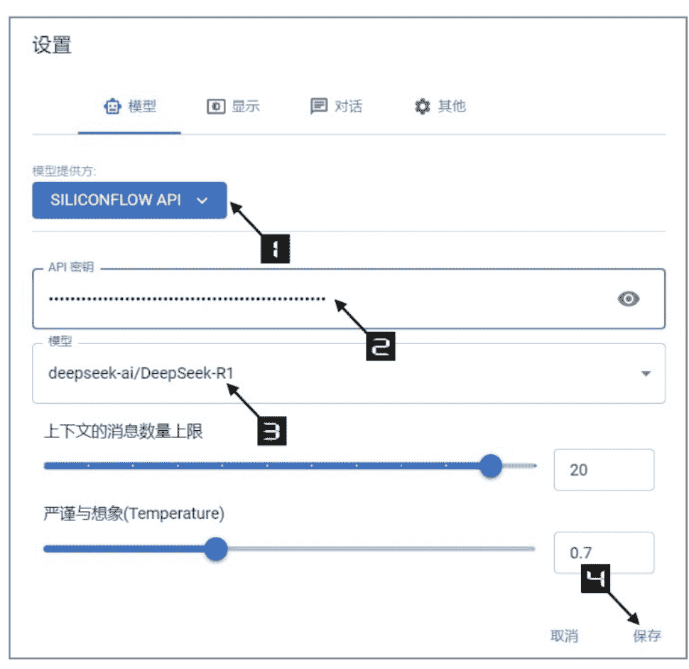

图1-18 配置API 2

### 设置从百度智能云获取的API

在【模型提供方】下拉菜单中选择【添加自定义模型提供方】选项后，在【名称】编辑框中输入【百度千帆】。

在【API域名】编辑框中输入“https://qianfan.baidubce.com/v2”。

在【API密钥】编辑框中粘贴从百度智能云获取的 API 密钥。

在【模型】编辑框中输入 “deepseek-r1”（注意使用小写字母）。

其他设置保持默认，点击【保存】按钮，如图1-19所示。

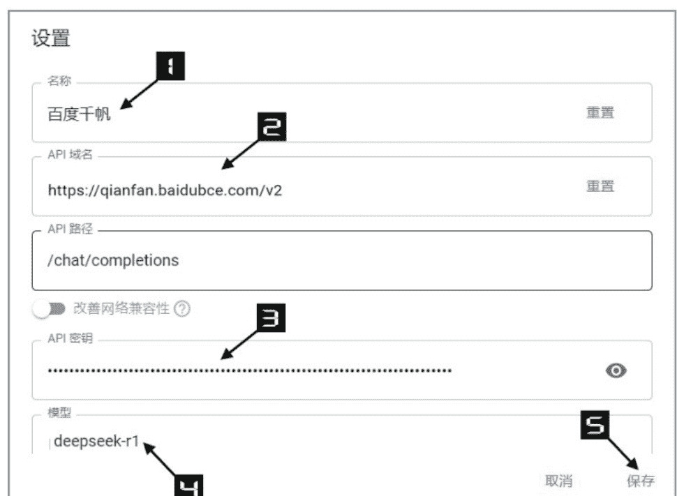

图1-19 配置API 3

配置完成后，在页面底部对话框中输入任意问题，例如，“请问你是谁，可以帮我做什么？”若 Chatbox AI 能返回正确回复，如图1-20所示，则说明配置成功。

## 功能介绍

请问你是谁，可以帮我做什么？

Thinking ↑

嗯，用户问我是谁，可以帮他们做什么。我需要先介绍自己的身份，然后列举我能提供的帮助。不过，用户可能更关心具体能解决哪些问题，所以要分点说明，这样更清晰。另外，要保持语气友好，鼓励用户随时提问。记得用中文回答，避免使用专业术语，让回答更易懂。

您好！我是DeepSeek-R1，一个由深度求索公司开发的智能助手。我能够帮助您解答各类问题、提供信息查询、进行创意写作、编程辅助以及日常对话等。您有任何问题或需要帮助的地方，都可以随时告诉我哦！

tokens used: 136, model: SiliconFlow API (deepseek-ai/DeepSeek-R1)

在这里输入你的问题...


# 技巧05 在ima.copilot中使用DeepSeek

腾讯智能工作台 ima.copilot 内置腾讯混元大模型及满血版 DeepSeek R1，是 DeepSeek 官网的良好替代品，目前免费使用。其使用步骤如下。

首先，在 ima.copilot 官网下载并安装客户端。

其次，点击 ima.copilot 首页对话框左下角的模型选择菜单下拉按钮，在弹出的下拉菜单中选择模型。

最后，点击按钮，待弹出登录二维码后使用微信扫码即可登录，如图1-21所示。

登录后，即可像使用 DeepSeek 官网一样与 DeepSeek 进行对话。


图1-21 在ima.copilot首页选择模型

ima.copilot 允许用户上传 PDF、DOC、JPEG、PNG 等格式文件创建、充实个人知识库。先点击页面左侧的知识库按钮 📚，再点击页面右上角的上传按钮 📤，即可上传文件。完成上传后，在对话框中输入问题，DeepSeek 即可根据当前知识库信息检索并生成回复，如图1-22所示。


图1-22 在个人知识库中检索问题

# 技巧06 用WPS灵犀接入DeepSeek

WPS灵犀是金山打造的办公类AI助手，底层与DeepSeek官网同源，产品层面做了面向办公的再设计，偏重文档类任务，交互习惯更贴合工作流。两者在权限管控、数据处理、隐私策略和企业定制上各有侧重。

上手路径有两个。

第一种是直接打开官网 https://copilot.wps.cn/ ，登录后呈现的页面如下：

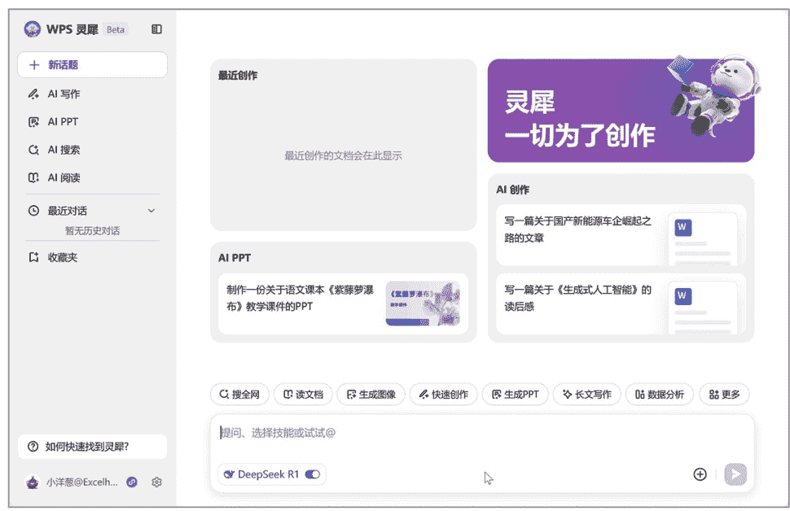

图1-23 WPS灵犀官网

网页版目前对所有用户免费开放，不需要WPS会员。

第二种是装最新版WPS Office，打开软件后点左侧侧边栏的WPS灵犀按钮，如下图所示。


图1-24 WPS Office中的灵犀按钮

灵犀内部被划分为AI写作、AI PPT、AI搜索、AI阅读四个模块。输入框上方集中了搜全网、读文档、生成图像、快速创作、生成PPT、长文写作、数据分析等快捷入口，输入提示词就能与DeepSeek对话。

# 技巧07 WPS Office自带的AI办公模块

2025春季版WPS Office已把WPS AI内置。

以表格为例，点开功能区最右侧的【WPS AI】页签，可看到【AI数据分析】【AI写公式】【AI条件格式】【设置】四个入口。数据分析属免费用，写公式和条件格式需会员。

点击【AI数据分析】后会弹出侧边分析窗。系统会依据当前表格自动推荐问题，用户也能在底部对话框里输入自定义指令，让DeepSeek处理表格内容。

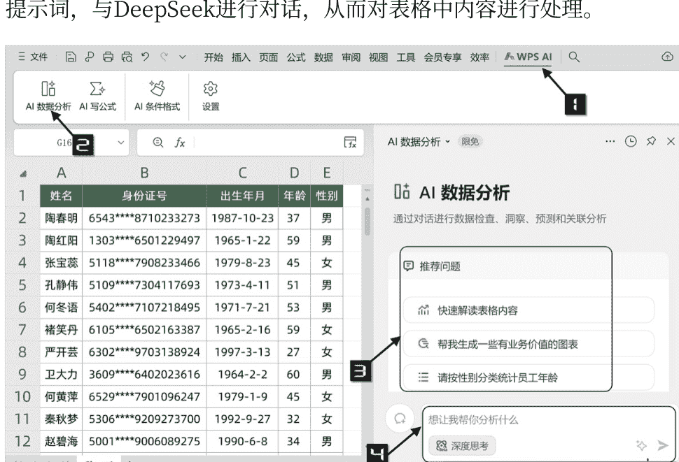

图1-25 WPS AI

点推荐问题中的【快速解读表格内容】，系统会给出数据概览、关键指标和核心洞察。

若需要按自定义区间统计人数，可在底部输入框发送：

请按每5岁为一个区间，统计各年龄段人数。

统计结果展示如下。

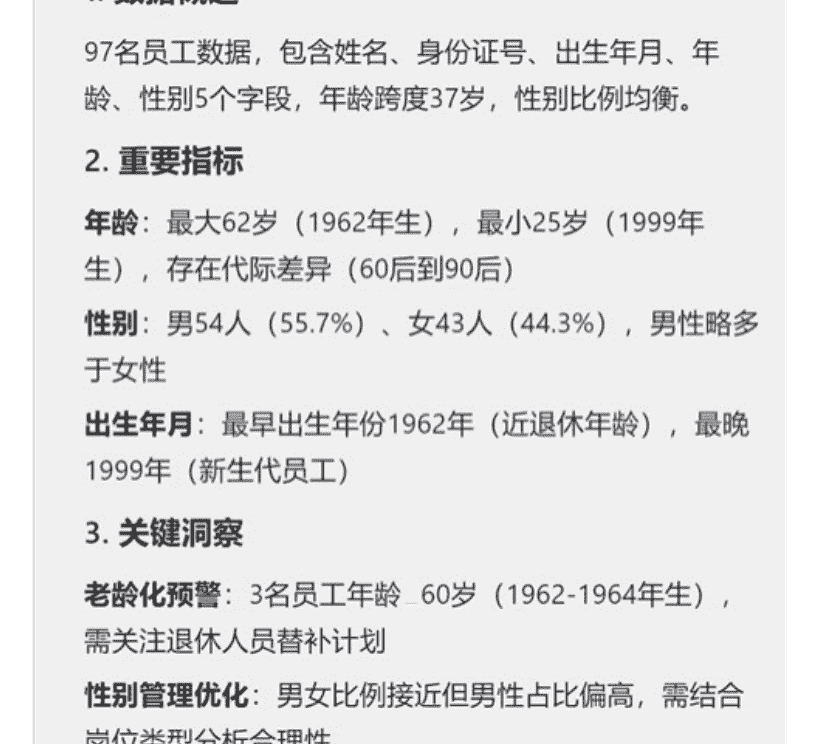

## 图1-26 数据解读

### 员工年龄分段统计（每5岁为区间）

| 年龄段 | 人数 | 占比 |
| :--- | :--- | :--- |
| 25-30岁 | 14 | 14.4% |
| 30-35岁 | 15 | 15.5% |
| 35-40岁 | 13 | 13.4% |
| **40-45岁** | **16** | **16.5% (峰值段)** |
| 45-50岁 | 8 | 8.2% |
| 50-55岁 | 10 | 10.3% |
| **55-60岁** | **15** | **15.5% (次高峰)** |
| 60-65岁 | 6 | 6.2% |

## 图1-27 员工年龄分段统计

AI对年龄分布的总结如下。

## 分布特征

- 双峰形态：40-45岁16人、55-60岁15人构成两大峰值
- 断层现象：45-50岁仅8人，较相邻区间下降约50%
- 年轻层：25-35岁共29人，占比30%，显示持续引才
- 高龄关注：60岁以上6人，需规划未来3～5年退休接替

# 技巧08 用插件把DeepSeek带进Excel Word WPS

易用宝是Excel Home出品的高效插件，能简化数据处理与分析的操作。

在 https://yyb.excelhome.net/ 下载安装。安装完成后，Excel功能区会出现【易用宝plus】和【易用宝】两个标签。

如图1-28，先在【易用宝plus】里点【呼叫AI】，再在弹出的【易用宝AI】面板点【设置】，打开API设置。以硅基流动获取的Key为例配置。

在【现有API】下拉选【硅基流动-DeepSeek-R1】，把密钥填入【API密钥】，点【保存】关闭。

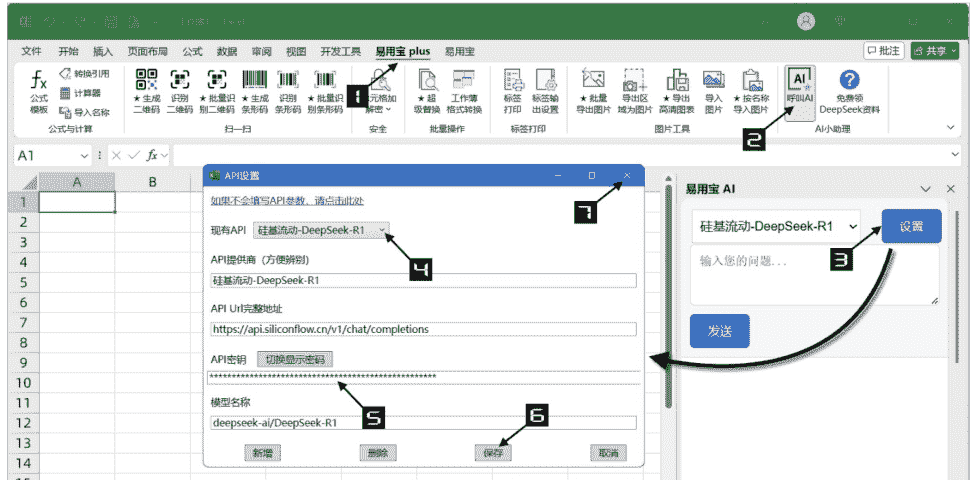

## 图1-28 易用宝AI设置

配置好后即可对话。出于安全考虑，易用宝目前不允许DeepSeek直接读写工作表，需要先把数据复制到右侧面板再提问。

如图1-29，打开的是某公司员工薪资标准表，想提取各部门的最低薪资人员。

在右侧【易用宝AI】对话框输入：

B1:B13是部门，D1:D13是薪资标准，请根据F3单元格中指定的部门名称，计算该部门平均薪资标准。

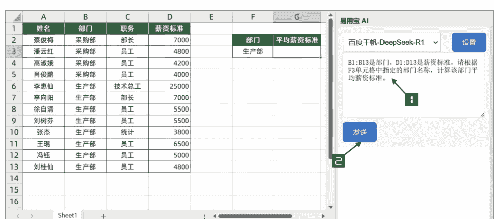

图1-29 发送提示词

发送后等待思考，完成后会在面板返回结果。如需写回表格，先选中目标单元格，再点【返回到文档中】。

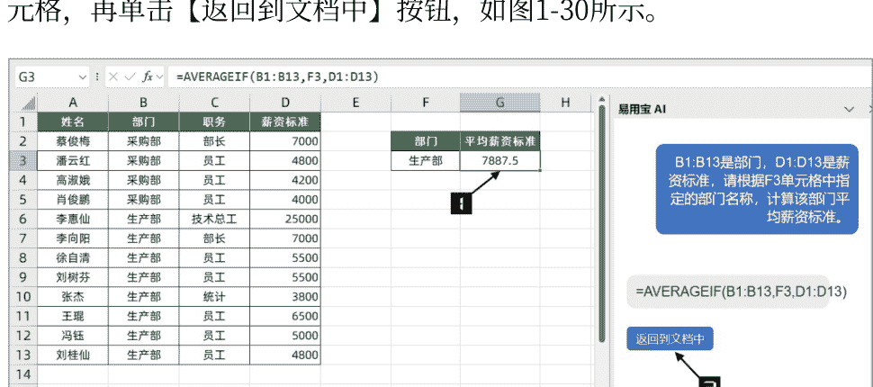

图1-30 将AI生成的结果返回到文档中

安装后Word也能用。例如翻译段落，先选中文本，点【易用宝】页签的【呼叫AI】，在右侧面板输入：请翻译为英文。勾选【根据选中内容进行处理】后发送。

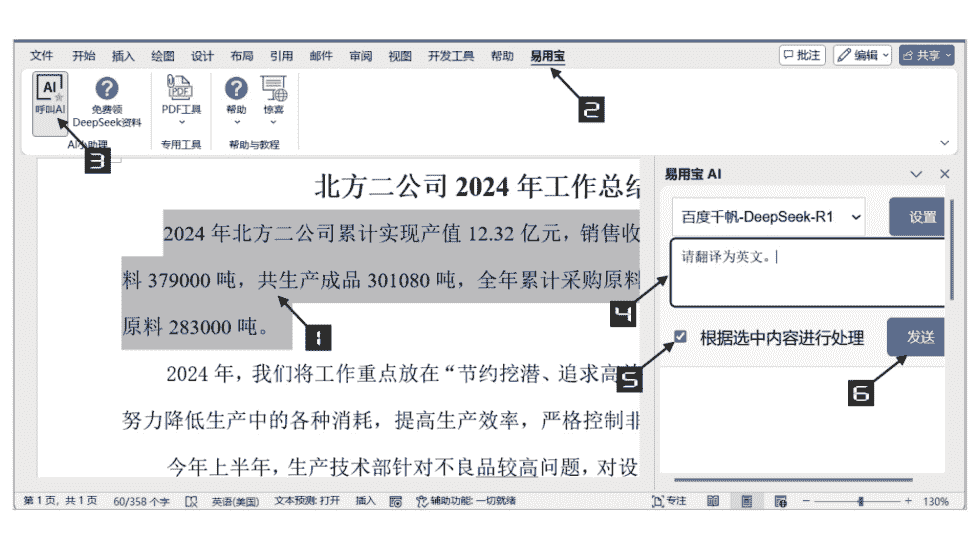

图1-31 翻译Word文档中的内容

等待返回后，若要写入文档，先定位光标再点【返回到文档中】。WPS表格和WPS文字的操作思路相同，不再赘述。

根据选中内容进行处理

发送

请翻译为英文。

Here is the English translation: In 2024, Northern Company No. 2 cumulatively achieved an output value of 1.232 billion yuan, with sales revenue reaching 1.467 billion yuan. The company processed 379,000 tons of raw materials and produced 301,080 tons of finished products. Throughout the year, the

返回到文档中

图1-32 返回到文档中

# 第2章 高效提示词：技巧与模板

提示词是在与AI沟通时用来引导其产出内容或执行任务的指令。指令的质量直接决定输出的质量。

提示词基于自然语言，与日常对话接近，但要讲清楚、讲高效，需要方法。本章聚焦提示词的使用。

## 本章的主要内容

- ◆ 技巧1 提示词的3大核心作用
- ◆ 技巧2 写提示词的4大误区
- ◆ 技巧3 提示词的5个常见框架与4大基本原则
- ◆ 技巧4 10个常用的提示词模板

# 技巧01 提示词发挥的三大关键作用

提示词相当于AI的行动指南，是用户意图与模型输出的桥梁，决定结果质量与方向。

## 作用1：决定沟通效率

新手提问常很模糊，例如：

帮我写一个代码。

AI很可能追问：

> 您需要哪种编程语言？实现什么功能？

反复澄清会大幅降低效率。

更明确的写法：

用Python写一个计算器程序，包含加减乘除，用函数封装。

此时DeepSeek等工具通常能直接给出带注释的代码，一次性解决。

模糊与明确提示的区别如图2-1所示。

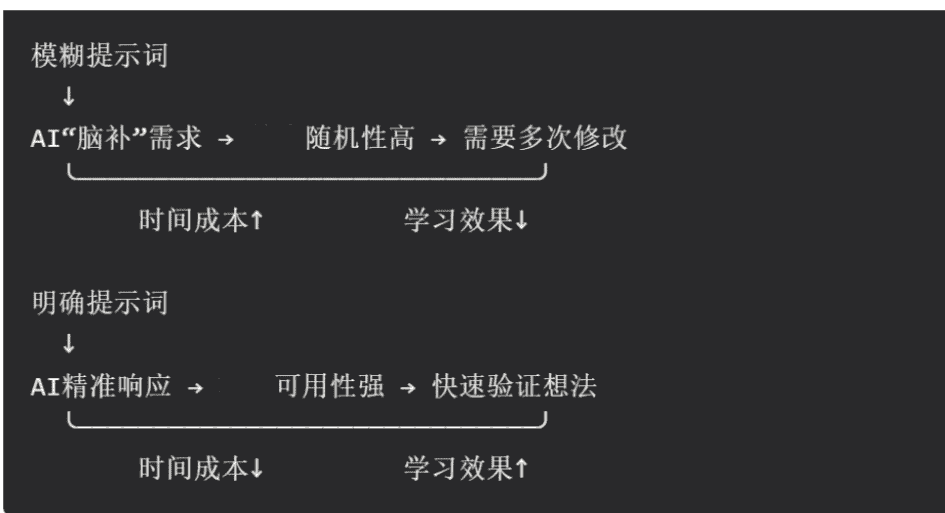

图2-1 使用模糊提示词和使用明确提示词的区别

## 作用2：培养AI思维

不断优化提示词，有助于摸清模型知识边界。例如未启用联网插件的DeepSeek R1基本无法回答2024年10月后的事件。

通过分步指令可引导推理，如先解释概念再举例。也可以直接让AI教学提示词技巧，例如发送：

> 提示词是什么？请教我一些提示词的基本使用技巧。

## 作用3：解锁高阶功能

合适的指令可让AI扮演特定领域专家，见表2-1至表2-3。

### 表2-1 学术研究助手

| 提示词示例 | 作用 |
| --- | --- |
| 你是一位论文审稿人，请用Markdown格式列出针对目标论文的3个改进建议：①方法论缺陷 ②文献引用不足 ③逻辑漏洞 | 训练学术批判思维 |
| 用通俗语言解释Transformer模型，要求：①对比RNN的优缺点 ②用快递分拣系统做比喻 ③附一张流程示意图 | 辅助理解复杂技术概念 |

### 表2-2 编程调试助手

| 提示词示例 | 作用 |
| --- | --- |
| 你是有10年工作经验的Python工程师，我的报错信息是【××】，请：①解释错误原因 ②给出3种解决方案 ③标记最优解（带代码示例） | 快速定位代码问题 |
| 将以下JSON数据转换为MySQL建表语句，要求：①字段注释用中文 ②添加索引优化建议 ③输出Markdown代码块 | 学习数据格式转换 |

### 表2-3 创意写作助手

| 提示词示例 | 作用 |
| --- | --- |
| 模仿鲁迅的风格写一篇短评，主题为“年轻人沉迷短视频”，要求：①使用反讽手法 ②使用文言文结尾 ③300字内 | 掌握文体模仿技巧 |
| 为我的科幻小说设计一个世界观设定表，包含星球生态、科技水平、社会阶级矛盾等内容，用JSON格式输出 | 构建创作框架 |

# 技巧02 提示词编写常见的四大陷阱

新手因经验不足常写出有缺陷的提示词，避开以下误区可快速提升。

## 常见误区：需求表达不明确

### 1. 提示词过于简略

错误示例：

写一首诗。

未限定主题、风格、格式，AI可能生成抒情诗、打油诗甚至外文，结果不可控。

优化示例：

写一首七言绝句，主题为“夏日荷塘”，包含“蝉鸣”“露珠”意象，押平声韵。

### 2. 使用模糊形容词

错误示例：

写一个有趣的故事。

“有趣”主观性强，AI理解可能为喜剧、荒诞、悬疑等不同方向。

优化方案：

写一篇300字的儿童故事，包含以下元素：会说话的松鼠、丢失的松果、三次搞笑的失败尝试。

## 交互误区：忽略对话逻辑

### 1. 一次性提出多个要求

错误示例：

分析这篇论文的优点和缺点，并推荐参考文献。

指令未拆分，AI可能遗漏最后一条。

优化方案：

- (1) 分析论文的创新点与不足。
- (2) 用表格对比其与文献[1][2]的差异。
- (3) 推荐5篇2020年后发表的相关论文。

### 2. 缺乏上下文关联

错误示例：

第一轮：写一份智能手表的市场分析报告。
第二轮：加入竞争品牌对比。

第二轮未指明基于前文，AI可能重写而非增补。

优化方案：

在刚才生成的市场分析报告中添加Apple、华为、小米的市场占有率对比（用柱状图描述）。

## 认知误区：错误估计AI能力边界

### 1. 过度依赖实时信息

错误示例：

汇总2025年2月的全球AI融资事件。

模型知识截止时间不同，训练数据到2024年12月的模型无法准确回答。

优化方案：

假设当前是2024年Q3，请模拟一份AI行业融资趋势预测报告，需要包含风险评估。

使用带联网搜索插件的AI工具能更好地获取实时信息。

### 2. 忽视可操作性约束

错误示例：

生成一个自动驾驶算法。

或者：编写一个进销存管理系统。

未限定技术栈与实现粒度，AI只能给框架。

优化方案：

用Python伪代码描述基于LSTM的车辆轨迹预测算法，标注数据预处理关键步骤。

## 心理误区：对AI抱有错误期望

### 1. AI应该一次性输出完美回复

错误认知：认为优化后的提示词能一次得到理想结果。

现实：AI输出通常需2～3轮迭代调整，如同人际沟通。

正确方法：

- 第一轮交流：获取大体框架。
- 第二轮交流：补充细节要求。
- 第三轮交流：修正风格与格式。

### 2. 提示词越长越好

错误示例：

请写一篇关于气候变化的文章，要包含全球变暖的影响、解决方案、各国政策、科学家争议、公众认知变化……（500字）。

信息过载易导致泛泛而谈。

优化方案：

写一篇1000字左右的科普文，按“温室效应→极端天气案例→个人行动措施”逻辑链展开。

# 技巧03 五大提示词框架和四大使用原则

提示词框架通过结构化设计输入，更精准引导输出。类似记叙文的起因经过结果，框架化表达更容易获得理想结果。

不同任务场景下框架略有差异，但大体包含如图2-2所示内容。

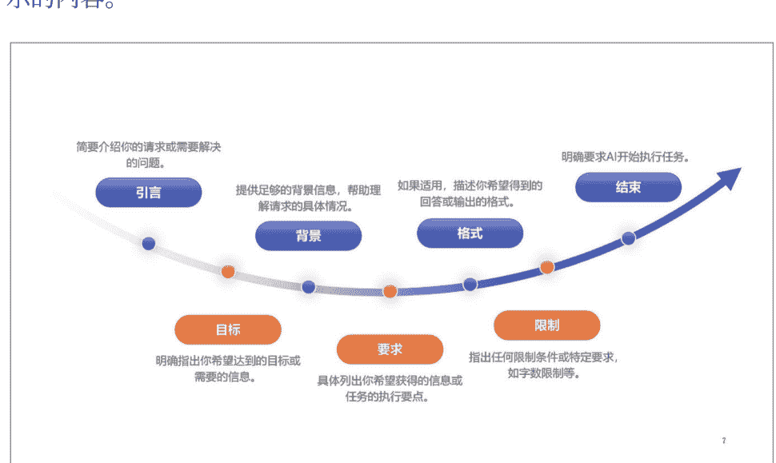

图2-2 提示词框架的主要内容

下面介绍几个常见框架。

## BROKE框架

适用场景：需明确背景与多维度要求的复杂任务，如表2-4、表2-5。

### 表2-4 电商产品描述

| 英文缩写 | 英文全称 | 中文释义 | 提示词示例 |
| :--- | :--- | :--- | :--- |
| B | Background | 背景 | 我是电商公司的运营人员，需要为新品瑜伽裤写产品描述 |
| R | Request | 请求 | 请生成一段能吸引年轻女性的文案 |
| O | Outcome | 预期结果 | 突出产品的透气性和时尚设计，引导读者点击购买 |
| K | Key Context | 关键信息 | 价格为199元，材质为冰丝面料 |
| E | Example | 示例 | 参考Nike的“全天候舒适，运动与生活无缝切换” |

### 表2-5 销售数据分析

| 英文缩写 | 英文全称 | 中文释义 | 提示词示例 |
| :--- | :--- | :--- | :--- |
| B | Background | 背景 | 我是市场部新人，需要分析上个月的销售数据 |
| R | Request | 请求 | 请总结增长最快的产品类别和可能原因 |
| O | Outcome | 预期结果 | 输出可视化图表和3条优化策略 |
| K | Key Context | 关键信息 | 数据来源为附件中的Excel表格 |
| E | Example | 示例 | 类似《中国居民消费趋势报告（2023）》的归因分析结构 |

## ROLE框架

适用场景：需明确执行者身份与任务边界的工作委托，如表2-6、表2-7。

### 表2-6 健康食谱设计

| 英文缩写 | 英文全称 | 中文释义 | 提示词示例 |
| :--- | :--- | :--- | :--- |
| R | Role | 角色定义 | 你是一名资深营养师，擅长进行减脂饮食规划 |
| O | Objective | 核心目标 | 为30岁的职场女性设计一周食谱 |
| L | Limitation | 限制条件 | 热量控制为1500大卡/天，需要包含早/午/晚餐 |
| E | Expectation | 期望/要求 | 备注每道菜的烹饪技巧和营养构成 |

### 表2-7 脚本开发

| 英文缩写 | 英文全称 | 中文释义 | 提示词示例 |
| :--- | :--- | :--- | :--- |
| R | Role | 角色定义 | 你是经验丰富的Python工程师，熟悉自动化脚本 |
| O | Objective | 核心目标 | 编写批量重命名图片文件的脚本 |
| L | Limitation | 限制条件 | 文件格式需要兼容JPG/PNG，命名规则为“日期+序号” |
| E | Expectation | 期望/要求 | 添加异常处理逻辑（重复文件名检测等） |

## CRISPER框架

适用场景：多维度参数控制的系统性规划，如表2-8、表2-9。

### 表2-8 制订旅行计划

| 英文缩写 | 英文全称 | 中文释义 | 提示词示例 |

| :--- | :--- | :--- | :--- |

| C | Context | 背景信息 | 我和父母（年逾60岁）计划5月份去江南地区旅游7天 |

| R | Request | 核心请求 | 推荐适合老年人的行程 |

| I | Intent | 深层目标 | 避免高强度活动，侧重文化体验，需要有便利的交通 |

| S | Scenario | 方案细节 | 南京－苏州－杭州三地游览，住宿地为3～4星级酒店 |

| P | Parameter | 硬性规定 | 每日步行小于8000步，包含餐饮推荐 |

| E | Example | 参考样例 | 类似《孤独星球》的慢旅行路线 |

| R | Response | 输出格式 | 按天列出表格，含景点/交通/注意事项3列 |

### 表2-9 行业沙龙策划

| 英文缩写 | 英文全称 | 中文释义 | 提示词示例 |

| :--- | :--- | :--- | :--- |

| C | Context | 背景信息 | 公司准备举办50人规模的“AI赋能零售”行业沙龙 |

| R | Request | 核心请求 | 设计活动流程，活动用时为两个小时 |

| I | Intent | 深层目标 | 重点为嘉宾互动，穿插案例分析和分组讨论 |

| S | Scenario | 方案细节 | 场地需要配备投影仪，并划出小组讨论区 |

| P | Parameter | 硬性规定 | 必须包含开场致辞、2场演讲、1场圆桌论坛 |

| E | Example | 参考样例 | 参考TEDx的项目活动流程 |

| R | Response | 输出格式 | 制作带时间轴标记的甘特图 |

TAG框架
该框架更适合处理指令清晰、步骤简单的轻量任务，例如市场调研、邮件撰写等，具体参考表2-10、表2-11。

### 表2-10 新能源汽车分析

| 英文缩写 | 英文全称 | 中文释义 | 提示词示例 |

| :--- | :--- | :--- | :--- |

| T | Task | 核心任务 | 分析新能源汽车在二线城市的市场机会 |

| A | Action | 执行动作 | 比较比亚迪/特斯拉/蔚来的产品定位差异 |

| G | Goal | 最终目标 | 输出500字报告，用于内部战略会议 |

### 表2-11 催款邮件撰写

| 英文缩写 | 英文全称 | 中文释义 | 提示词示例 |

| :--- | :--- | :--- | :--- |

| T | Task | 核心任务 | 跟进拖延付款的客户的付款计划 |

| A | Action | 执行动作 | 用专业、温和的语气撰写催款邮件 |

| G | Goal | 最终目标 | 维护合作关系，并明确要求对方在3日内完成付款 |

SPAR框架
该框架偏向问题诊断与方案推演，常见于用户调研、学术写作等情境，示范见表2-12、表2-13。

### 表2-12 用户留存分析

| 英文缩写 | 英文全称 | 中文释义 | 提示词示例 |

| :--- | :--- | :--- | :--- |

| S | Situation | 情况描述 | 某健身App的用户留存率首周下降40% |

| P | Problem | 核心问题 | 怀疑新手引导流程不够清晰 |

| A | Action | 解决动作 | 设计5个聚焦首次使用痛点的访谈问题 |

| R | Result | 预期成果 | 输出带优先级的优化方案（含实施步骤） |

### 表2-13 论文文献综述

| 英文缩写 | 英文全称 | 中文释义 | 提示词示例 |

| :--- | :--- | :--- | :--- |

| S | Situation | 情况描述 | 我正在撰写以“元宇宙伦理”为研究主题的论文，卡在文献综述部分 |

| P | Problem | 核心问题 | 整合10篇跨学科研究论文的逻辑关系 |

| A | Action | 解决动作 | 建议按技术/法律/哲学分类 |

| R | Result | 预期成果 | 生成带参考文献编号的树状图大纲 |

实际使用时不必死板套用某个框架来组织提问，把握住图2-3所体现的核心要点即可。

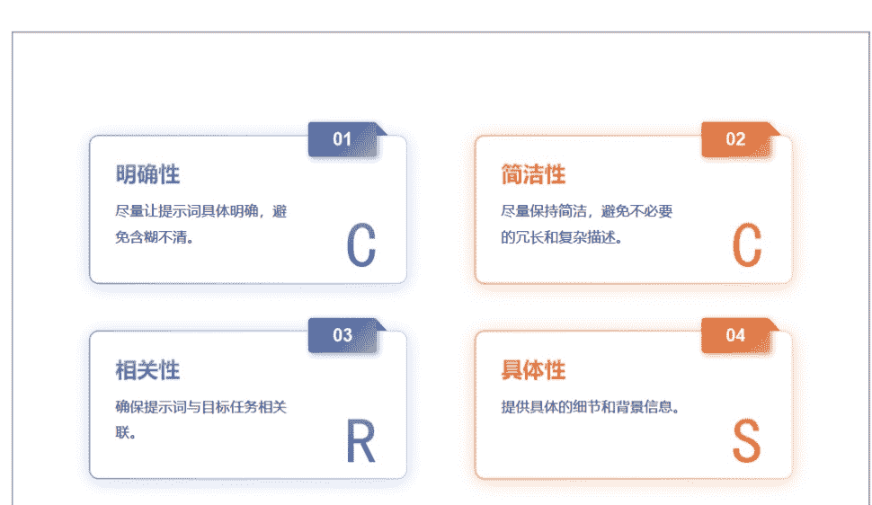

图2-3 提示词写作的基本原则

# 技巧04 10个常用的提示词模板

在与DeepSeek等大模型互动时，提示词的质量直接影响输出效果。以下按常见用途归纳了十类实用模板，供参考借鉴。

## 1. 信息查询型
请用通俗的语言解释[专业术语/概念]，说明其核心定义，列举典型应用场景或与易混概念做区分。
示例：
请用通俗语言描述机器学习中的“过拟合”，要求用比喻说明，与“欠拟合”进行对比，并给出实际代码示例。

## 2. 分析对比型
对比分析[A]与[B]在[场景]中的差异，要求从性能、适用性等维度入手，以表格形式对比，给出典型应用建议。
示例：
对比VBA与WPS JS在编程应用中的差异，用表格展示两者的优劣。

## 3. 解决方案型
针对[具体问题]，请分步骤提供解决方案。
示例：
如何解决Android应用内存泄漏问题？要求给出LeakCanary配置教程和Heap Dump分析技巧。

## 4. 创意生成型
基于[主题/关键词]，生成[数量]个创意方案，要求：标注清楚适合的目标人群/场景或必须包含的元素等。
示例：
为图书《DeepSeek实战技巧精粹》生成5个封面设计创意方案，需要包含AI技术与职场、生活等相关元素。

## 5. 数据处理型
请清洗/分析以下数据：[数据片段]，要求：指出全部数据质量问题/写出处理代码/输出处理后数据可视化建议等。
示例：
分析销售数据中的异常值，用箱线图展示并给出SQL查询修正语句。

## 6. 学习路径型
作为[身份/水平]，制定[时间周期]的[领域]学习计划。
示例：
作为专业的Excel课程讲师，为零基础学习者设计为期3个月的Excel函数公式学习计划，包含动态数组公式知识。

## 7. 代码调试型
请修复以下代码中的错误：[代码段]，要求：逐行注释出现问题的原因，给出优化后的代码。
示例：
```
以下 VBA 代码下标越界，请逐行注释出现问题的原因，并给出优化后的代码。
Sub tt()
Dim i%, arr()

ReDim arr(1 To 3, 1 To 1)
For i = 1 To 3
arr(i, 1) = i
Next
ReDim Preserve arr(1 To 5, 1 To 1)
End Sub
```

## 8. 预测推演型
预测[领域/事件]未来[时间]发展趋势，要求：列出[n]个关键因素/构建SWOT分析模型/给出[n]种可能情境推演等。
示例：
预测2025年新能源汽车电池技术的突破方向，分析影响固态电池量产的3个主要因素。

## 9. 观点论证型
论证[观点/假说]是否成立，要求：分别为正反双方提供3个论据/引用权威研究数据作为支撑。
示例：
论证“区块链将取代传统银行结算系统”是否成立，需要引用IMF报告和SWIFT交易量数据。

## 10. 模拟决策型
作为[角色]，面临[情境]，应该如何决策？
示例：
作为产品经理，需要开发一款App时，应该先开发iOS版本的App还是先开发Android版本的App？用TAM模型估算市场容量。

# 第2篇 效率倍增篇：DeepSeek赋能智能办公

作为AI大模型，DeepSeek在自动化办公中展现出的显著优势正受到越来越多人的关注。例如，它不仅能够快速生成常用的图表、报告，自动进行合同评估、会议纪要整理、多语种翻译及数据分析，还能解读Excel数据、整理电子发票、快速制作PPT等。

DeepSeek与各传统办公软件的结合，正在重新定义智能办公的效率标准。

# 第3章 DeepSeek图表大师：一键生成专业图表

使用DeepSeek，不仅能够快速生成思维导图、甘特图、流程图、组织架构图等常用图表，还能够根据图片中的信息生成图表、对现有图表信息进行解读、重新定义图表的处理流程。如今，DeepSeek特别适合用于需要高频处理复杂信息的项目管理、学术研究等场景。

## 本章的主要内容
- ◆ 技巧1思维导图：快速梳理知识结构
- ◆ 技巧2甘特图：项目管理可视化利器
- ◆ 技巧3流程图：复杂流程的极简呈现
- ◆ 技巧4组织结构图：层级关系可视化
- ◆ 技巧5动态组合数据图表

# 技巧01 思维导图：快速梳理知识结构

思维导图是用图形化树状结构梳理复杂信息的工具，可用“中心主题→分支关键词→关联线”的形式展示关键信息。思维导图的核心要素包括用醒目图标或文字呈现的主题，以及主要分支、细化层级。在思维导图中，可以用颜色、图标、线条粗细等区分信息层级。

思维导图可以直观展示原本需要使用大量文字才能描述清楚的逻辑关系，达到提高记忆效率、激发联想创意的目的。

Mermaid是一款优秀的图表绘制工具，允许用户使用简单的文本语法创建各种类型的图表，包括流程图、序列图、甘特图、类图、状态图、饼图、思维导图等。Mermaid不仅支持实时预览，还支持在编写过程中随时查看图表效果。使用Mermaid生成的图表能够继续生成链接，并导出为图片或者SVG格式的矢量图形。

下面以“备考公务员”为主题，借助DeepSeek与Mermaid生成思维导图。

在DeepSeek对话框中发送如下需求提示词。

请提供一份备考公务员的思维导图框架。

稍待片刻，DeepSeek就会给出框架建议，如图3-1所示。

以下是一份备考公务员考试的思维导图框架，供你参考。具体内容可根据个人需求调整：

## 公务员备考思维导图

中心主题：公务员考试备考策略

### 一、了解考试
1. 考试类型
   - 国考（国家公务员考试）
   - 省考（地方公务员考试）
   - 选调生考试
2. 考试科目
   - 笔试
     - 行测（言语理解、数量关系、判断推理、资料分析、常识判断）

图3-1 框架建议（部分）

此时，可以进一步提出修改建议，如“请进一步细化笔试部分”，DeepSeek会根据新需求重新生成框架。

确认无误后，在DeepSeek对话框中发送如下提示词，要求它生成Mermaid代码。

请根据以上框架，生成符合Mermaid标准的代码。

DeepSeek生成的代码如下。

```
graph TD
A[公务员考试备考策略] -> B[了解考试]
A -> C[制订备考计划]
A -> D[行测备考重点]
A -> E[申论备考重点]
A -> F[面试准备]
A -> G[工具与资源]
A -> H[常见误区与对策]

# %%% 1. 了解考试
B -> B1[考试类型]
B1 -> B11[国考]
B1 -> B12[省考]
B1 -> B13[选调生]
B -> B2[考试科目]
B2 -> B21[笔试]
B21 -> B211[行测：言语/数量/判断/资料/常识]
B21 -> B212[申论：归纳/分析/写作]
B21 -> B213[专业科目]
B2 -> B22[面试]
B22 -> B221[结构化]
B22 -> B222[无领导小组]
B22 -> B223[情景模拟]
B -> B3[时间节点]
B3 -> B31[国考：10月报名]
B3 -> B32[省考：3-4月]

# %% 2. 制订备考计划
C -> C1[阶段划分]
C1 -> C11[基础阶段：1～2个月]
C1 -> C12[强化阶段：1个月]
C1 -> C13[冲刺阶段：2～3周]
C -> C2[每日学习]
C2 -> C21[上午：行测模块]
C2 -> C22[下午：申论+素材]
C2 -> C23[晚上：错题+时政]

# %% 3. 行测重点
D -> D1[言语理解]
D1 -> D11[逻辑填空]
D1 -> D12[片段阅读]
D -> D2[数量关系]
D2 -> D21[工程/行程问题]
D2 -> D22[方程法/代入法]
D -> D3[判断推理]
D3 -> D31[图形规律]
D3 -> D32[逻辑判断]
D -> D4[资料分析]
D4 -> D41[公式速记]
D4 -> D42[速算技巧]
D -> D5[常识]
D5 -> D51[时政/法律]

# %%% 4. 申论重点
E -> E1[核心能力]
E1 -> E11[阅读理解]
E1 -> E12[归纳概括]
E -> E2[题型]
E2 -> E21[单一题]
E2 -> E22[公文写作]
E2 -> E23[大作文]
E -> E3[素材]
E3 -> E31[政府工作报告]
E3 -> E32[热点话题]

# %% 5. 面试准备
F -> F1[题型]
F1 -> F11[综合分析]
F1 -> F12[组织管理]
F1 -> F13[应急应变]
F -> F2[技巧]
F2 -> F21[逻辑清晰]
F2 -> F22[语言流畅]

# %% 6. 工具与资源
G -> G1[教材]
G1 -> G11[华图模块宝典]
G1 -> G12[申论的规矩]
G -> G2[App]
G2 -> G21[粉笔]
G2 -> G22[学习强国]

%%% 7. 常见误区
H -> H1[误区]
H1 -> H11[盲目刷题]
H1 -> H12[忽视时政]
H -> H2[对策]
H2 -> H21[错题本]
H2 -> H22[每日新闻]
```

单击代码窗口右上角的【复制】按钮，即可将以上内容复制到剪贴板。

在浏览器中打开Mermaid编辑器，不需要注册，直接在界面左侧粘贴以上代码，即可在界面右侧预览思维导图的效果，如图3-2所示。

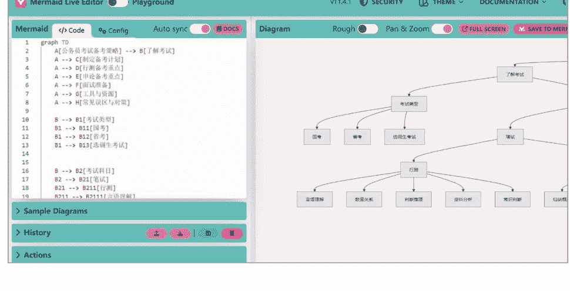

图3-2 Mermaid代码与思维导图示例

此时，思维导图默认布局为自上而下的直角矩形。

在DeepSeek对话框中发送修改建议（提示词）。

请将以上代码设置为左右布局，圆角矩形。

再次复制DeepSeek提供的参考代码，粘贴在Mermaid编辑器中，思维导图的预览效果如图3-3所示。

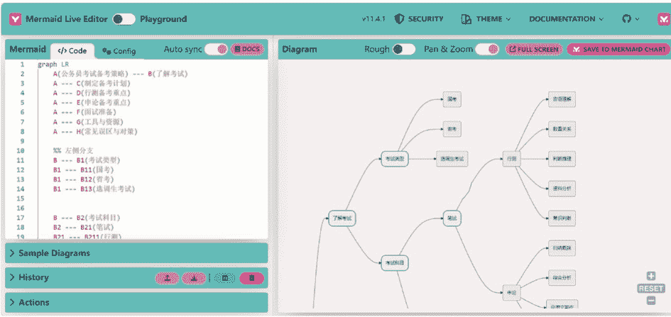

图3-3 修改思维导图样式

若预览效果符合预期，单击【Actions】选项，即可在其下方区域选择图片格式，如图3-4所示。确定图片格式后，即可将图片下载到本地或者生成分享链接。

图3-4 保存或分享文件

# 技巧02 甘特图：项目管理可视化利器

甘特图是一种常用的项目管理工具，用来展示项目进度和时间线。甘特图的呈现形式类似于条形图，以时间为横轴，以任务为纵轴，用户可以直观地在甘特图中看到项目内各任务的起止时间、相互关系，以及整体项目进度。

下面以某工程项目进度为例，介绍如何借助DeepSeek和Mermaid生成甘特图。

整理好项目进度安排及进度情况后，在DeepSeek对话框中发送需求提示词。

> 我要制作展示项目进度的甘特图，需要提供什么格式的数据？

DeepSeek给出的建议如图3-5所示。

> 要制作甘特图，通常需要以下格式的数据：
> 1. **任务名称**：这是项目中各个任务的标识，通常列在表格的第一列。
> 2. **开始时间**：每个任务的计划开始日期或时间，以日期格式（如“2023-01-01”）或时间戳的形式提供。
> 3. **结束时间**：每个任务的计划结束日期或时间，也以日期格式或时间戳的形式提供。
> 4. **持续时间**：任务从开始到结束预计持续的时长，可以是以天、周或月为单位的具体数字。
> 5. **完成百分比**（可选）：任务完成的百分比，这有助于展示任务的当前进度。
> 以下是一个典型的数据格式示例。
> | 任务名称 | 开始时间 | 结束时间 | 持续时间 | 完成百分比 |
> | :--- | :--- | :--- | :--- | :--- |
> | 任务1 | 2023-01-01 | 2023-01-05 | 4天 | 30% |
> | 任务2 | 2023-01-06 | 2023-01-10 | 4天 | 0% |
> | 任务3 | 2023-01-11 | 2023-01-15 | 4天 | 50% |

图3-5 制作甘特图需要的数据格式

按照上述格式，在Excel中准备数据，完成后先将数据复制并粘贴到DeepSeek对话框中，再说明具体要求，如图3-6所示。

> 请用以上数据生成符合Mermaid标准的甘特图代码，要清晰标记每个项目的起止日期及进度情况。

DeepSeek生成的代码如图3-7所示。单击界面右上角的【复制】按钮，即可将代码复制到剪贴板中。

图3-6 给DeepSeek提供满足格式要求的数据

```
gantt
    title 项目甘特图
    dateFormat  YYYY-MM-DD
    axisFormat  %Y-%m-%d

    项目1 (100%)    :done, 2025-01-01, 2025-01-03
    项目2 (100%)    :done, 2025-01-06, 2025-01-14
    项目3 (100%)    :done, 2025-01-11, 2025-01-17
    项目4 (85%)     :done85, 2025-01-16, 2025-01-22
    项目5 (75%)     :done75, 2025-01-21, 2025-02-01
    项目6 (42%)     :done42, 2025-01-26, 2025-02-05
    项目7 (10%)     :done10, 2025-01-31, 2025-02-12
    项目8 (5%)      :done5, 2025-02-05, 2025-02-10
    项目9 (0%)      :done0, 2025-02-10, 2025-02-27
```

图3-7 符合Mermaid标准的甘特图代码

在Mermaid编辑器左侧粘贴代码，即可在界面右侧预览甘特图的效果，如图3-8所示。

图3-8 生成的甘特图（部分）

单击【Actions】按钮并选择格式，即可将生成的甘特图下载到本地或者生成分享链接。

# 技巧03 流程图：复杂流程的极简呈现

流程图以统一的图形符号配合文字注解把抽象的运行逻辑变成直观的图形，常用来梳理业务流程、呈现算法步骤、说明系统交互以及展示审批路径。通过图形化呈现，复杂链路变得易读，便于快速定位阻塞点与冗余环节，统一操作口径，也能提升跨部门沟通效率。

下面以报销流程为例，演示 DeepSeek 结合 Mermaid 快速绘制的方法。

在 DeepSeek 输入框中发出如下指令：

> 我们的报销流程：首先，提交报销申请、填写费用报销单；其次，进入审批流程，其中，5000元及以下金额需要部门领导审批，5000元以上金额需要财务总监审批；最后，进入票据审核流程，审核通过，财务付款，否则需要修改费用报销单。请根据以上流程，生成符合Mermaid标准的流程图代码。

DeepSeek 返回的内容见图3-9。点一下代码区上方的复制控件，即可把内容送进剪贴板。

```
mermaid
flowchart TD
    A([提交报销申请]) --> B[填写费用报销单]
    B --> C{金额<=5000?}
    C -- 是 --> D[部门领导审批]
    C -- 否 --> E[财务总监审批]
    D --> F[票据审核]
    E --> F
    F --> G{审核通过?}
    G -- 是 --> H([财务付款])
    G -- 否 --> B
```

图3-9 DeepSeek生成的代码

把脚本粘贴到 Mermaid 编辑界面的左侧，右侧会即时渲染出报销流程的预览，效果见图3-10。

图3-10 报销流程图

打开 Actions 菜单选择导出方式，就能把图表保存到本地或获取分享链接。

值得注意的是，该模板自带分层金额判断，并补上了审核未通过时退回修改的闭环。示例以 5 千元为分界，实际使用时阈值与审批层级可按企业制度灵活调整。

# 技巧04 组织架构图：权责边界可视化

组织架构图用图形方式呈现公司内部的层级架构、部门划分及岗位职责，常用于厘清权责、优化管理与提升协作。

借助这类图形，汇报关系一目了然，职能范围可被标注，能有效避免职责交叉或空缺，既帮助管理者快速找到负责人，也让新员工迅速理解公司架构与分工。

作图前先明确展示范围，如全公司、单个部门或项目组，再整理部门名称与职能、岗位名称、汇报关系等基础信息，必要时补充关键岗位的职责说明。

下面说明如何借助 DeepSeek 与 Draw.io 制作组织架构图。

向 DeepSeek 发送如下指令：

> 总经理下属办公室、销售部、企管部和行政部，销售部下属市场开拓和售后服务，行政部下属人事部和后勤部，后勤部下属保洁、餐厅和安保。请根据以上内容，生成符合Mermaid标准的组织结构图，使用圆角矩形。

返回的脚本如图3-11。

```
graph TD
    classDef rounded fill:#f9f,stroke:#333,stroke-width:2px,radius:10px
    classDef default fill:#eaeaea,stroke:#666,stroke-width:2px,radius:10px

    总经理([总经理]):::rounded
    总经理-->办公室[办公室]
    总经理-->销售部[销售部]
    总经理-->企管部[企管部]
    总经理-->行政部[行政部]

    销售部-->市场开拓[市场开拓]
    销售部-->售后服务[售后服务]

    行政部-->人事部[人事部]
    行政部-->后勤部[后勤部]

    后勤部-->保洁[保洁]
    后勤部-->餐厅[餐厅]
    后勤部-->安保[安保]

    class 总经理 rounded
```

图3-11 符合Mermaid标准的组织结构图代码

复制脚本后打开 Draw.io，点击启动入口进入工作区，如图3-12所示。

弹出窗口点击 创建新绘图，如图3-13所示，再点对话框底部的 修改存储方式，可选择保存位置，本例选用 设备 保存到本地。

## Security-first diagramming for teams.

Bring your storage to our online tool, or save locally with the desktop app.

No login or registration required.

图3-12 开始任务

图3-13 创建新绘图

在新建页面输入文件名并选定文件类型后，先选 空白框图 再点 创建，如图3-14所示。

图3-14 创建空白框图

弹出保存对话框后选定路径点 保存，如图3-15所示。

图3-15 选择文件的保存位置

点插入按钮，从下拉菜单中选择 高级 → Mermaid，如图3-16所示。

图3-16 添加代码

清空编辑区原有内容后把 DeepSeek 提供的脚本粘贴进去，点击 插入，如图3-17所示。

```
graph TD
    classDef rounded fill:#f9f, stroke:#333, stroke-width:2px, radius:10px
    classDef default fill:#eaeaea, stroke:#666, stroke-width:2px, radius:10px

    总经理([总经理]):::rounded
    总经理-->办公室[办公室]
    总经理-->销售部[销售部]
    总经理-->企管部[企管部]
    总经理-->行政部[行政部]

    销售部-->市场开拓[市场开拓]
    销售部-->售后服务[售后服务]

    行政部-->人事部[人事部]
    行政部-->后勤部[后勤部]

    后勤部-->保洁[保洁]
    后勤部-->餐厅[餐厅]
    后勤部-->安保[安保]

    class 总经理 rounded
```

图3-17 粘贴代码

生成的结构图如图3-18所示。

图3-18 组织结构图效果

观察可知，当前图形并非圆角矩形。回到 DeepSeek 继续原对话，发送如下指令：

> 使用代码生成的组织结构图的形状需要全部改为圆角矩形，请修改后重新生成代码。

DeepSeek 重新思考后给出的脚本如图3-19所示。

```
graph TD
    classDef roundrect rx:10px, ry:10px;
    node1(总经理):::roundrect --> node2(办公室):::roundrect
    node1 --> node3(销售部):::roundrect
    node1 --> node4(企管部):::roundrect
    node1 --> node5(行政部):::roundrect

    node3 --> node6(市场开拓):::roundrect
    node3 --> node7(售后服务):::roundrect

    node5 --> node8(人事部):::roundrect
    node5 --> node9(后勤部):::roundrect

    node9 --> node10(保洁):::roundrect
    node9 --> node11(餐厅):::roundrect
    node9 --> node12(安保):::roundrect

    class node1,node2,node3,node4,node5,node6,node7,node8,node9,node10,node11,node12 roundrect;
```

图3-19 重新生成的组织结构图代码

复制新脚本，返回 Draw.io，依次点插入 → 高级 → Mermaid，粘贴到编辑区后点 插入。修改后的结构图如图3-20所示。

图3-20 修改代码后的组织结构图

该图以总经理为根节点，用箭头明确隶属关系，末端节点为具体职能模块。

依次点 文件 → 导出为，可在子菜单中选择图片导出格式，如图3-21所示。

图3-21 导出图片

# 技巧05 组合可视化：同时呈现对比与走势

柱状图擅长横向比较不同类别的数值，折线图擅长表现数值随时间或变量变化的走势，组合使用可在同一张图同时满足对比与趋势分析。若两组数据的量纲差异较大，如销售额与利润率百分比，可用主次坐标轴分别呈现柱状与折线，避免数据被压缩失真。组合图表还能帮助洞察两变量间的潜在关联。

HTML 是构建网页与网页应用的基础标记语言，通过标签对内容结构化，使文本、图像、视频等多媒体在网络上得以展示与交互。HTML 文档由标签定义，指导浏览器渲染页面。

JavaScript 是一种为网页添加交互式动态功能的编程语言，可让页面响应点击、表单提交、数据加载等操作。JS 可直接嵌入 HTML，也可通过外部文件引入。

下面以门店销售数据可视化为例，说明如何用 HTML+JS 制作组合图表。

把 Excel 工作表中的数据复制后粘贴到 DeepSeek 输入框，并发送如下指令。

| 店面 | 销售额（万元） | 完成比例 |
| :--- | :--- | :--- |
| A店 | 600 | 80% |
| B店 | 750 | 75% |
| C店 | 680 | 96% |
| D店 | 800 | 80% |
| E店 | 720 | 93% |

> 请使用以上数据，生成柱状图加折线图的组合图表代码，符合 HTML 标准，配色参考《经济学人》图表。

返回的部分脚本如图3-22所示。

```
html
<!DOCTYPE html>
<html>
<head>
    <meta charset="utf-8">
    <title>门店销售分析</title>
    <!-- 引入 ECharts -->
    <script src="https://cdn.jsdelivr.net/npm/echarts@5.4.2/dist/echarts.min.js"></script>
</head>
<body>
    <div id="main" style="width: 800px;height:500px;"></div>
    <script>
        // 初始化图表
        var myChart = echarts.init(document.getElementById('main'));

        // 经济学人配色方案
        const colors = ['#1A8CDB', '#E31A1C', '#009F7F', '#FF6F00', '#6A3D9A'];

        // 配置项
        const option = {
            color: colors,
            tooltip: {
                trigger: 'axis',
                axisPointer: {
                    type: 'cross'
```

图3-22 DeepSeek生成的代码（部分）

点脚本区右下角的 运行HTML 按钮，组合图表的预览效果如图3-23所示。

图3-23 组合图表

点代码窗口右上角的复制图标即可把脚本拷贝到剪贴板。

在桌面右键，新建 文本文档，如图3-24所示。

新建文件后把脚本粘进去并保存。

回到桌面，右键该文件选 重命名，把后缀名从 .txt 改为 .html，警告提示点 是 即可，如图3-25所示。

图3-24 新建文本文档

图3-25 文件重命名

双击打开 HTML 页面文件，效果如图3-26所示。

## 图3-26 浏览器中的图表效果

该图表采用《经济学人》经典蓝红配色，柱状图展示销售额，折线图展示完成比例，并带有交互式提示框，可随浏览器窗口自适应。

若文件未显示后缀名，操作方法因系统而异。在 Windows 11 系统中，双击 此电脑，顶部工具栏点 查看 下拉，依次选 显示 → 文件扩展名，如图3-27所示，即可显示后缀名。

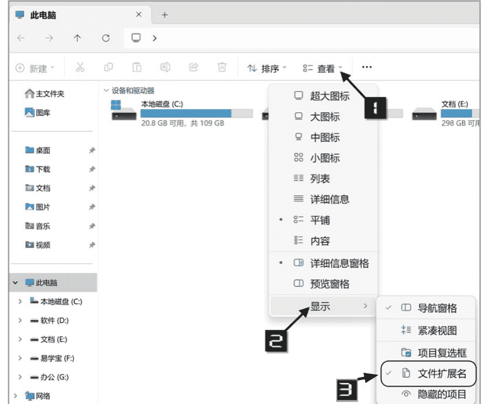

## 图3-27 在Windows 11系统中显示文件扩展名

Windows 10 可先双击 此电脑，切换到 查看 选项卡，勾选 文件扩展名 的复选框，即可显示后缀名。

# 技巧06 桑基图：追踪资源流动路径

桑基图能表达复杂系统的流动关系，将抽象的数据流转转化为具象的视觉叙事，尤其适合需要同时呈现方向、规模和路径的分析场景。

如图3-28所示，这是一份包含性别、品牌、年龄段等信息的智能手机用户画像。借助 DeepSeek，可基于该表快速生成桑基图。

| A | B | C |
|---|---|---|
| **智能手机用户画像** | | |
| **性别** | **品牌** | **人数** |
| 男 | 华为 | 1100 |
| 男 | 苹果 | 730 |
| 男 | 小米 | 680 |
| 男 | OPPO | 630 |
| 男 | vivo | 530 |
| 男 | 其他 | 1630 |
| 女 | 华为 | 680 |
| 女 | 苹果 | 1080 |
| 女 | 小米 | 370 |
| 女 | OPPO | 850 |
| 女 | vivo | 630 |
| 女 | 其他 | 1090 |
| 华为 | 45岁以上 | 135 |
| 华为 | 35-44岁 | 319 |
| 华为 | 25-34岁 | 986 |
| 华为 | 18-24岁 | 240 |
| 华为 | 18岁以下 | 100 |
| 苹果 | 45岁以上 | 80 |

图3-28 智能手机用户画像（部分）

先点 DeepSeek 对话框右下角的 📎 按钮上传 Excel 表格，再发送如下指令。

附件中的数据包含手机品牌、用户年龄段、用户性别及人数，请创建一个HTML格式的智能手机用户画像桑基图，需要体现不同性别、不同年龄段及不同手机品牌的流动关系。要求色彩柔和，鼠标悬停时显示具体数据。

返回的部分脚本如图3-29所示。

```html
<!DOCTYPE html>
<html>
<head>
    <title>智能手机用户画像桑基图</title>
    <script src="https://cdn.plot.ly/plotly-latest.min.js"></script>
    <style>
        body { margin: 20px; background-color: #f5f5f5; }
        #chart { background-color: white; border-radius: 10px; padding: 15px; }
    </style>
</head>
<body>
    <div id="chart"></div>

    <script>
        // 节点定义（性别 -> 品牌 -> 年龄段）
        const nodes = {
            label: [
                // 性别层
                "男", "女",
                // 品牌层
                "华为", "苹果", "小米", "OPPO", "vivo", "其他",
                // 年龄段层
                "18岁以下", "18-24岁", "25-34岁", "35-44岁", "45岁以上"
            ],
            ...
        }
    </script>
</body>
</html>
```

图3-29 智能手机用户画像桑基图代码（部分）

点脚本区右下角的 运行HTML 按钮，桑基图预览效果如图3-30所示。

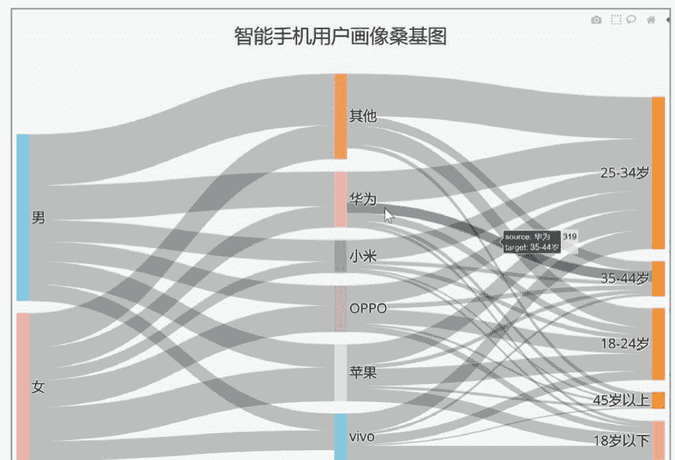

图3-30 智能手机用户画像桑基图

从图3-30 可看出，男性用户更倾向华为与其他品牌，女性用户更偏好苹果，各品牌的主要用户集中在 25～34 岁区间。

先点代码框右上角的复制图标，将脚本粘到记事本保存，再右键文件选 重命名，把后缀名从 .txt 改为 .html。完成后即可打开该页面文件浏览。

# 技巧07 旭日图：多层结构拆解

旭日图适用于展示层次结构复杂的数据，常用于财务分析、市场营销和大数据分析，有助于理解数据的组织与关联。

下面说明如何借助 DeepSeek 生成模拟数据并制作旭日图。

在 DeepSeek 输入区发送如下指令。

请生成一个HTML格式的旭日图，以“学龄前儿童教育”为主题，要求有丰富的模拟数据和内容。

返回的部分脚本如图3-31所示。

```html
<!DOCTYPE html>
<html lang="zh-CN">
<head>
    <meta charset="UTF-8">
    <title>学龄前儿童教育发展全景图</title>
    <script src="https://cdn.jsdelivr.net/npm/echarts@5.4.2/dist/echarts.min.js"></script>
    <style>
        body { margin: 0; padding: 20px; background: #f0f7ff; }
        #main { width: 100%; height: 100vh; min-width: 320px; }
        .chart-title {
            font-size: 24px;
            color: #2c3e50;
            text-align: center;
            padding: 20px;
            font-family: 'Microsoft YaHei';
        }
    </style>
</head>
<body>
    <div class="chart-title">学龄前儿童教育发展全景图</div>
    <div id="main"></div>

    <script>
        let chart = echarts.init(document.getElementById('main'));
```

## 图3-31 旭日图代码片段

点开代码区底部的【运行HTML】，即可得到旭日图的预览画面，对应下文图3-32的效果。

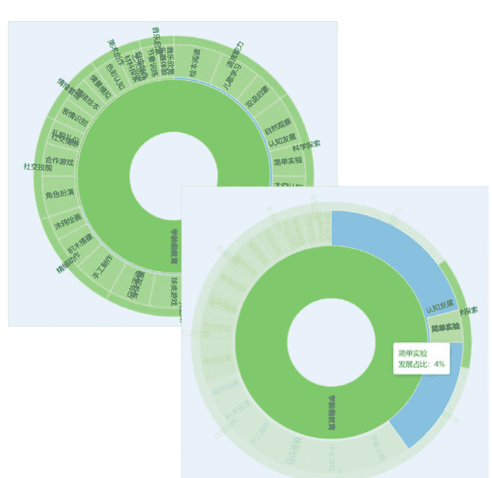

## 图3-32 旭日图展示

初版图里文字出现了重叠。让模型针对可读性做优化，得到改进后的代码。将这段代码复制到本地文本文档保存，随后在资源管理器里改名，把后缀从 .txt 改成 .html。这样文件就能直接用浏览器打开查看。

# 技巧08 用雷达图构建能力评估体系

雷达图一方面可横向比对不同主体在同一维度组的表现强弱，例如多款产品的用户满意度，或各团队在研发、销售、运营等方向的水平；另一方面也能纵向呈现同一主体在多项指标上的差异，比如某笔订单在服务态度、发货时效、商品质量等维度的得分，或运动员在速度、力量、耐力、敏捷等指标的数据。

下图3-33汇总了三笔订单在服务态度、发货速度、物流进展、配送体验、商品满意度这五个方面的评分。通过模型生成雷达图，可以直观呈现整体分布。

| 订单编号 | 客服态度 | 发货速度 | 物流进度 | 配送服务 | 商品满意度 |
| :--- | :--- | :--- | :--- | :--- | :--- |
| 1 | 4.5 | 3.8 | 4 | 4.2 | 4.7 |
| 2 | 2.5 | 4.5 | 3.2 | 3 | 3.8 |
| 3 | 4.8 | 4 | 4.5 | 4.3 | 4.5 |

图3-33 客户评分表

把Excel里的内容复制到对话窗口，输入如下指令。

请依据上述数据制作三个符合HTML规范的雷达图，用于体现各指标的差异，并给出总结建议。

模型返回的代码示例见图3-34。

```html
<!DOCTYPE html>
<html>
<head>
    <title>订单服务评价雷达图</title>
    <script src="https://cdn.jsdelivr.net/npm/chart.js"></script>
    <style>
        .chart-container {
            width: 33%;
            display: inline-block;
        }
        .analysis {
            padding: 20px;
            margin-top: 30px;
            background-color: #f5f5f5;
        }
    </style>
</head>
<body>
    <div class="chart-container">
        <canvas id="order1"></canvas>
    </div>
    <div class="chart-container">
        <canvas id="order2"></canvas>
    </div>
</body>
</html>
```

图3-34 雷达图代码（部分）

点击代码面板底部的【运行HTML】，即可看到雷达图预览以及配套的解读及建议，见图3-35。

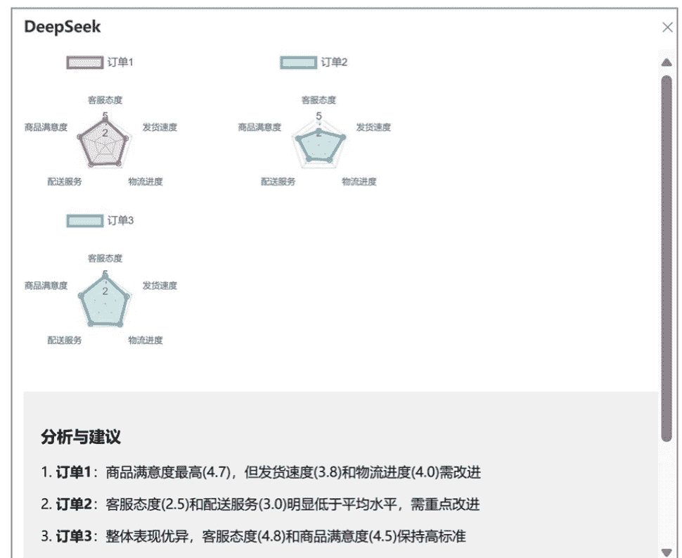

图3-35 模型生成的雷达图及解读

给出的改进方向如下。

- 强化客服培训，统一服务规范；
- 梳理仓储流程，提升发货时效；
- 建立物流伙伴的质量考核机制；
- 继续发挥商品质量优势，同时改进包装。

# 技巧09 解析图片数据生成图表

模型能够快速识别图像中的数值并直接转成图表，便于后续分析。

以电影《哪吒之魔童闹海》亦称《哪吒2》的单日票房举例，部分数据如图3-36所示，可通过解析生成折线图。

| 日期 | 分账票房 (万元) | 分账票房占比 | 分账票价 | 排片占比 |
| :--- | :--- | :--- | :--- | :--- |
| 2025-01-23 周四 点映 | -- | -- | -- | -- |
| 2025-01-26 周日 点映 | -- | -- | -- | -- |
| 2025-01-27 周一 点映 | 0.0 | -- | 27.5 | -- |
| 2025-01-28 周二 零点场 | -- | -- | -- | -- |
| 2025-01-29 周三 点映 | 43497.9 | -- | 45.8 | -- |
| 2025-01-30 周四 | 42906.1 | -- | 46.2 | -- |
| 2025-01-31 周五 | 55413.8 | -- | 46.2 | -- |

图3-36 《哪吒之魔童闹海》单日票房数据（部分）

先点对话窗口底部的 📎 图标把待解析的图片传上去，再发出指令，如图3-37所示。

请解析图像里的信息，生成符合HTML规范的折线图。


图3-37 上传图片并发出指令

模型输出的代码如图3-38所示。

```html
<!DOCTYPE html>
<html>
<head>
    <title>哪吒2单日票房趋势</title>
    <script src="https://cdn.jsdelivr.net/npm/chart.js"></script>
</head>
<body>
    <div style="width: 80%; margin: 0 auto">
        <canvas id="boxOfficeChart"></canvas>
    </div>

    <script>
        // 数据清洗后有效数据集
        const data = {
            labels: [
                "2025-01-29", "2025-01-30", "2025-01-31",
                "2025-02-01", "2025-02-02", "2025-02-03",
                "2025-02-04", "2025-02-05", "2025-02-06",
                "2025-02-07", "2025-02-08", "2025-02-09",
                "2025-02-10", "2025-02-11", "2025-02-12",
                "2025-02-14", "2025-02-15", "2025-02-16",
                "2025-02-17", "2025-02-18"
            ],
            datasets: [{
                label: '单日票房（万元）',
                data: [
                    434979, 42906, 55414,
                    65776, 731879, 75996,
                    78244, 58799, 53071,
                    49037, 56107, 68855,
                    43579, 43680, 48536,
                    62526, 71423, 55663,
                    17553, 15086
                ],
                borderColor: '#e74c3c',
                tension: 0.4,
                fill: false
            }]
        };

        // 图表配置
        const config = {
            type: 'line',
            data: data,
            options: {
                responsive: true,
                plugins: {
                    title: {
                        display: true,
                        text: '《哪吒2》单日票房趋势（2025年）'
                    }
                },
                scales: {
                    x: {
                        title: { display: true, text: '日期' }
                    },
                    y: {
                        title: { display: true, text: '票房（万元）' },
                        beginAtZero: true
                    }
                }
            }
        };

        // 渲染图表
        window.onload = () => {
            new Chart(document.getElementById('boxOfficeChart'), config);
        };
    </script>
</body>
</html>
```

## 图3-38 HTML折线图代码

核对后发现，1月29日、2月2日的数据因小数点位置错误导致数值放大十倍。

在对话区输入如下指令。

1月29日的数据应为43497.9，2月2日的数据应为73187.9，请修正数据后重新生成代码。

模型据此重写代码，并在修正处做了标注，如图3-39所示。

```html
<!DOCTYPE html>
<html>
<head>
    <title>哪吒2单日票房趋势（修正版）</title>
    <script src="https://cdn.jsdelivr.net/npm/chart.js"></script>
</head>
<body>
    <div style="width: 80%; margin: 20px auto">
        <canvas id="correctedChart"></canvas>
    </div>

    <script>
        // 修正后的数据集
        const correctedData = {
            labels: [
                "2025-01-29", "2025-01-30", "2025-01-31",
                "2025-02-01", "2025-02-02", "2025-02-03",
                "2025-02-04", "2025-02-05", "2025-02-06",
                "2025-02-07", "2025-02-08", "2025-02-09",
                "2025-02-10", "2025-02-11", "2025-02-12",
                "2025-02-14", "2025-02-15", "2025-02-16",
                "2025-02-17", "2025-02-18"
            ],
            datasets: [{
                label: '单日票房（万元）',
                data: [
                    43497.9,    // 修正1月29日数据（原434979 -> 43497.9）
                    42906.1,
                    55413.8,
                    65775.5,
                    73187.9,    // 修正2月2日数据（原731879 -> 73187.9）
```

图3-39 修正后的折线图代码片段

按代码面板底部的【运行HTML】，折线图的最终呈现如图3-40所示。

## 图3-40 折线图效果

从图3-40可以看出，非数值类的无效条目已被自动过滤，曲线以平滑的橙色展示票房随日期的变化，金额采用千位分隔符，支持交互式提示、自定义坐标轴标签以及带标记的数据点。

# 技巧10 让模型解读图表

借助模型可快速读懂图表内涵、推断趋势、概括分布特征并提出优化建议。

图3-41为某班级的考试成绩直方图。将该图传上去后发送如下指令即可要求解读。

请对图片中的图表信息进行解读，并给出结论与建议。

图3-41 考核成绩直方图

模型解读后给出的结论与建议如下。

结论：

成绩分布不均：图表显示分数主要集中在55.00至70.00区间，共27人，占比突出，其余区间人数较少。

低分与高分稀少：40.00分及以下和85.00至100.00区间人数分别为12人与6人。

中等分数段占多数：55.00至70.00区间27人，70.00至85.00区间13人，中等水平人数偏多。

建议：

夯实基础教学：40.00分及以下有12人，说明部分学生基础薄弱，需加强基础辅导以提升成绩。

提高高分占比：85.00至100.00区间仅6人，高分群体偏少，可通过激励机制鼓励冲刺。

关注中等水平群体：中等分数段学生较多，应关注其学习状态，助力向高分段迈进。

剖析原因：深入分析当前分布形成的原因，了解学习难点，针对性调整教学与辅导方案。

分析完成后，模型会提炼关键发现并给出改进方向。

# 第4章 DeepSeek写作支持：创作与排版提升

DeepSeek基于深度学习，能够依据Word或WPS文档内容自动生成符合语境的报告框架与摘要，帮助快速把握重点；可智能审阅语法、句式与用词，提供更专业的表达替代；支持批量格式转换、文档合并拆分，减少重复劳动；内置智能模板库可迅速生成合同、简历等标准化文件；还能自动标注多版本文档差异并可视化展示修改，提升团队协作效率。

## 本章的主要内容

- ◆ 技巧1 万字长文框架生成
- ◆ 技巧2 公司年报智能摘要与分析
- ◆ 技巧3 专业文本润色优化
- ……

# 技巧01 一键生成长文大纲

如果想以中年女性视角撰写家庭伦理相关文章，可先让DeepSeek生成提纲，再填充内容并润色。

在对话窗口发送如下指令。

你是一名资深婚恋情感导师，请以四十岁左右女性的视角，设计一篇关于家庭伦理关系的文章提纲，篇幅控制在2000字以内，需涵盖痛点剖析与解决思路，内容详实不空泛。

模型生成的提纲如下。

## 《中年女性的家庭伦理困境与破局之道》

——以亲历者视角解读代际关系、亲密关系与自我价值平衡

### 一、引言：中年女性的家庭围城（300字）

中年女性的破局笔记：重建关系，找回自我

清晨闹钟将45岁全职主妇张莉唤醒，她推门催儿子起床上学，却换来因通宵游戏而烦躁的顶撞，母子瞬间对峙。中午厨房里，婆婆再次上演育儿经教学。夜深时，丈夫只剩沉默和手机的冷光。

数据支撑：《中国婚姻家庭报告2023版》指出，76%的中年女性出现“情感空心化”倾向。

核心冲突：传统家庭分工的固有期待与个体自我意识觉醒之间的剧烈碰撞。

### 二、痛点剖析：四重束缚下的中年困局

#### 1. 夫妻联结空心化
沟通退化为水电费、孩子成绩等事务通报。深夜背靠背刷屏的冷暴力已成常态。典型个案是一位从业18年的私企财务主管自述，婚后长期情感缺位，最终发现丈夫已出现精神出轨。

#### 2. 代际关系的压力带
青春期子女因升学、手机依赖、早恋等问题与母亲形成对抗；婆媳在隔代养育与教育方式上反复摩擦。二孩政策放开后，上有老下有小的夹心压力加剧。

#### 3. 个体价值的消解
从职场白领变为“某某妈妈”，身份抽离带来认同落差。更年期生理变化叠加容貌焦虑，又受社会时钟裹挟。长期家务使技能与社会连接被边缘化，滋生能力贬值的恐惧。

#### 4. 伦理边界的错位
原生创伤被复制，强势母亲模式在下一代重现。家庭经济权失衡催生情感勒索，如“都是我养家”的话语暴力。边界模糊导致亲友过度干预小家庭决策，矛盾持续发酵。

### 三、破局路径：家庭生态重建的实操方案

#### 1. 亲密关系重塑
沟通革新：
定期启动“20分钟黄金对话”，关闭电子设备并保持眼神交流。
建立“情感账本”，记录暖心瞬间并定期复盘未解矛盾。

情感激活实验：
每月提前48小时预约一次秘密约会。
共同撰写婚姻回忆录，从恋爱情物到重大危机梳理共同记忆。

#### 2. 代际关系破冰
亲子修复指南：
制定“家庭宪法”，明确权力边界，例如在孩子房门悬挂“沟通申请牌”。
组织主题家庭日，尝试角色互换与家族访谈。

长辈干预应对：
用“三明治沟通法”处理育儿分歧：肯定+表达需求+致谢。
设立缓冲带，委托专业机构处理敏感议题。

#### 3. 自我价值重建
第二人生启动计划：
发展“妈妈经济学”，把家务育儿技能转化为社区服务项目。
加入45+女性成长社群，恢复社会链接。

身体自主宣言：
争取私密空间，哪怕是阳台上2平方米的阅读角。
开展正念训练，如更年期瑜伽与舞蹈疗愈。

#### 4. 家庭权力结构调整
推行“家庭CEO”轮值制，培养共情与决策能力。
制作情感需求可视化图表，标明各成员期望与承受底线。
引入第三方协调机制，如专业家庭治疗师或社区调解员。

### 四、结语：在裂缝中重建生态
> 金句点睛：“真正的家庭不是牺牲，而是让每个成员都成为更好的自己”
行动倡议：从本周起，每周做一次微改变，比如每天保留15分钟独处。
未来展望：中年女性正从家庭情感枢纽中觉醒，成为推动家庭升级的力量。

中年女性在家庭中常面临夫妻疏离、教育分歧、婆媳摩擦、自我价值缺失等问题。上述框架跳出传统情感叙事，借鉴企业管理思维，为多重伦理关系提供可量化、可持续的解法。

将以上提纲复制到Word文档审阅确认。确认后复制编辑好的提纲，打开WPS灵犀官网，点击对话框上方【长文写作】按钮，将提纲粘贴入对话框，如图4-1所示。

图4-1 WPS灵犀长文写作

点击对话框上方【生成文档】按钮，如图4-2所示，WPS灵犀将依托提纲自动创作。

图4-2 生成文档

WPS灵犀生成后，点击页面右上角【去WPS编辑】按钮，如图4-3所示，可对AI生成内容进行审校修正。点击【下载】按钮即可本地保存。

图4-3 生成结果编辑

# 技巧02 公司年报智能摘要与分析

DeepSeek擅长迅速提炼文档要点，让信息一目了然，并凭推理能力挖掘潜在风险。本例上传的是Word版某公司年度总结，部分内容如图4-4所示。

图4-4 远方公司年度总结的部分内容

点击DeepSeek对话框右下角@按钮上传文档后，发送提示词：请对文档中的内容进行总结，并以表格的形式展示主要指标的完成情况。

DeepSeek生成的主要指标完成情况汇总表如表4-1所示。

## 表4-1 主要指标完成情况

| 指标类别 | 指标名称 | 实际值 | 计划完成率 | 备注 |
| :--- | :--- | :--- | :--- | :--- |
| 生产指标 | 产值 | 12.88亿元 | 73.75% | 未达计划目标 |
| | 加工原料总量 | 379,000吨 | 76.88% | 1#线4360吨，2#线142100吨，3#线234,000吨 |
| | 生产成品总量 | 301,080吨 | - | |
| 采购指标 | 原料采购总量 | 359,900吨 | - | 进口原料占比78.6%（283,000吨） |
| 销售指标 | 全年销售总量 | 324,600吨 | - | 产销基本平衡 |
| | 销售收入 | 14.68亿元 | - | 货款回收率为98.55% |
| 成本控制 | 电/煤/五金消耗节约 | 38万元 | - | 同比节约用电0.11度/吨料、用煤0.86kg/吨料 |
| | 不良品率下降收益 | 170万元 | - | 1#线下降0.225%，2#线下降0.246% |
| 安全生产 | 安全事故数 | 0起 | - | 实现“五个零”目标 |

除汇总表外，还总结出关键成果、问题及未来方向。

## 关键成果
成本优化：设备改造和管理优化全年节约38万元，不良品率下降带来170万元收益。
市场扩张：新开拓7个市场，产销平衡率98.55%。
安全生产：全年零事故。

## 存在的问题
设备重复维修率高，外包装质量待改进。干部责任意识不足，部分生产指标未达标。

## 未来方向
技术升级：推进自动化改造，降低故障率。
质量管控：建立全流程质量管理体系，优化外包装。
市场深化：强化零售渠道，提升客户响应速度。

借助DeepSeek对数据“提纯”，决策者能更快洞察关键信息。

# 技巧03 专业级文本润色优化

DeepSeek可自动校对拼写、语法与标点，重组冗长句，优化主谓结构，提升段落连贯性，删减冗余，突出关键数据。

如图4-5所示为待润色的公司年度工作总结。

> 北方二公司 2024 年工作总结
2024 年北方二公司累计实现产值 12.32 亿元，销售收入 14.67 亿元，加工原料 379000 吨，共生产成品 301080 吨，全年累计采购原料 359900 吨，其中进口原料 283000 吨。
2024 年，我们将工作重点放在“节约挖潜、追求高效”上，狠抓内部管理，努力降低生产中的各种消耗，提高生产效率，严格控制非生产性开支。
今年上半年，生产技术部针对不良品较高问题，对设备进行了全面改造。全年累计电耗同比节约 0.13 度/吨料，煤耗同比节约 0.92KG/吨料，五金消耗同比节约 0.175 元/吨料，合计节约成本 38 万余元。同时，1#线、2#线不良品占比同比下降 0.235%和 0.226%，仅此一项就年增加经济效益 190 余万元。
下半年，生产技术部完成了新职工的培训工作。组织完成了新生产线的调试工作。
经过一年的努力，生产系统在完成公司安排各项任务的同时，也为公司培养出一批素质过硬，作风过硬，业务精湛的专业技术人员，为公司做出了贡献。

图4-5 待润色处理的文档内容

上传文档后发送提示词：附件内容是分公司的年度总结（需向总公司领导汇报），请润色，要求突出业绩、合理化不足，不虚构数据和未提及内容，避免使用“可能”“大概”等不确定表述。结果以代码形式输出，代码符合Markdown标准。

DeepSeek生成的代码如图4-6所示。

```
**北方二公司2024年度工作总结报告**

---

### 一、核心经营指标达成
2024年度，北方二公司全面完成生产经营目标，核心数据表现如下：
- **累计实现产值**：12.32亿元
- **销售收入**：14.67亿元
- **原料加工量**：37.9万吨
- **成品产量**：30.108万吨
- **原料采购量**：35.99万吨（其中进口原料占比78.6%，达28.3万吨）

---

### 二、年度重点工作推进与成效
本年度围绕“节约挖潜、提质增效”核心方针，通过强化内部管理、优化资源配置，实现以下成果：

### 1. **降本增效成果显著**
- **能源与物料消耗控制**：
  - 电耗同比降低0.13度/吨料，煤耗减少0.92 /吨料，五金消耗节约0.175元/吨料，合计降本38万元。
- **质量提升与效益转化**：
  - 1#线、2#线不良品率分别下降0.235%和0.226%，直接创效190万元。

---

## 三、总结与展望
2024年，北方二公司通过精细化管理与技术革新，在保障生产任务高效完成的同时，实现成本节约与质量双提升。未来将持续深化以下工作：
1. 推进新产线产能释放，优化产品结构。
2. 强化数据化管控，进一步压缩非生产性开支。
3. 完善人才激励机制，巩固技术团队核心竞争力。

**北方二公司**
2024年12月
```

图4-6 DeepSeek生成的代码

复制代码框右上角【复制】按钮内容，打开Markdown在线编辑器，将代码粘贴至左侧，右侧自动渲染。点击【导出Word文档】即可下载，如图4-7所示。

图4-7 导出Word文档

最终Word效果如图4-8所示，数据与原文档一致，可根据需要增删。

## 北方二公司 2024 年度工作总结报告

### 一、核心经营指标达成
2024 年度，北方二公司全面完成生产经营目标，核心数据如下：
- 累计实现产值：12.32 亿元
- 销售收入：14.67 亿元
- 原料加工量：37.9 万吨
- 成品产量：30.108 万吨
- 原料采购量：35.99 万吨（其中进口原料占比 78.6%，达 28.3 万吨）

### 二、年度重点工作推进与成效
本年度围绕“节约挖潜、提质增效”核心方针，通过强化内部管理、优化资源配置，实现以下成果：

#### 1. 降本增效成果显著
- 能源与物料消耗控制：
  - 电耗同比降低 0.13 度/吨料，煤耗同比降低 0.92KG/吨料，五金消耗节约 0.175 元/吨料，合计降本 38 万元。
- 质量提升与效益转化：
  - 1#线、2#线不良品率分别下降 0.235%和 0.226%，直接创效 190 万元。

#### 2. 技术改造与设备升级
针对上半年不良品率偏高问题，生产技术部主导完成设备全面改造，同步优化工艺流程，有效提升生产线稳定性与产品合格率。

# 技巧04 借助DeepSeek为Word文档排版

上传无格式文本后，可借助DeepSeek快速完成排版，省去手动调整字体、段落间距、标题层级等操作。

点击DeepSeek对话框右下角按钮上传TXT文档，上传后发送提示词：请将此文档按通用标准文档格式进行排版，结果以代码形式输出，代码符合Markdown标准。

复制生成代码，打开Markdown在线编辑器粘贴至左侧，点击【导出Word文档】按钮，如图4-9所示，下载后按需编辑优化。

图4-9 导出Word文档

# 技巧05 将会议记录转成标准会议纪要

DeepSeek可将口语化会议记录转化为标准纪要，并提取议题、决策、任务等关键信息。

如图4-10所示为某公司会议记录初稿，存在排版错误与口语表达。

## 2025年2月20日会议记录
2025年2月20日下午14:30，在公司第一会议室举行会议，参会人员有：董事长张明、总经理李华和生产总工王强。
董事长：各位，今天召集大家的核心议题是“提升产品质量”和“节能降耗”。过去半年，客户对产品稳定性的投诉率上升了8%，同时能源成本同比增加了12%。这两个问题直接影响公司利润和市场竞争力。我们必须拿出切实方案，在三个月内扭转局面。李总、王工，请结合部门现状谈谈看法。
总经理：感谢张董。我先抛砖引玉。
质量问题：近期客户反馈的批次性瑕疵集中在焊接工艺波动和涂层厚度不均，建议由王工牵头成立工艺优化小组，重新校准设备参数，并引入实时监测系统，减少人为误差。
能耗问题：电费和燃气成本超支的主因是生产线空转率过高，建议推行“峰谷用电”计划，将高耗能工序调整至夜间电价低谷时段，同步加装余热回收装置。
奖惩机制：提议设立“质量-能耗双指标考核”，对达成目标的班组额外奖励5%绩效，未达标者需参加专项培训。
请王工补充技术细节。
生产总工：我补充三点技术方案。
设备升级：现有焊接机器人已服役8年，定位精度下降0.05mm，申请更换新型伺服电机（预算约120万元），可使焊缝合格率从92%提升至98%。
工艺优化：实验数据表明，将退火温度从850℃降至820℃并延长保温时间，既能保证材料强度，又可减少15%燃气消耗。
员工培训：下周起对全体操作工开展“标准化作业+节能意识”轮训，重点解决因操作随意性导致的物料浪费问题。
董事长：方案方向正确，但需细化节点：
- 李总负责在2月25日前拟定奖惩制度，人力资源部同步跟进。
- 王工团队3月10日前完成设备升级可行性报告，优先使用技改专项资金。
- 财务部测算节能降耗目标：要求单位产品能耗降低10%，质量投诉率下降至3%以内。
下月例会我将亲自检查进度，各部门必须打破壁垒，协同作战。
散会前，请两位确认是否有补充？
李华、王强：无补充，立即执行。
会议于15:20结束
记录人：办公室 刘芳

### 图4-10 会议记录

复制内容后发送提示词：请将以上会议记录整理成标准的会议纪要，并总结会议议题及需要解决的问题、明确责任人与完成时限。结果以代码形式输出，代码符合Markdown标准。

DeepSeek生成的代码如图4-11所示。

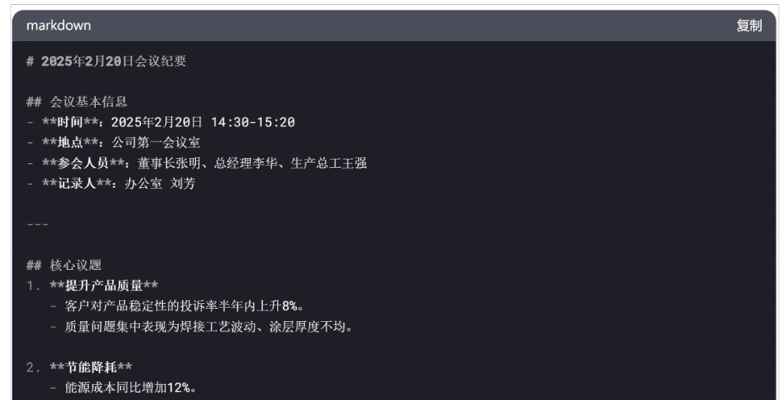

### 图4-11 DeepSeek生成的代码（部分）

复制代码，打开Markdown在线编辑器粘贴，点击【导出Word文档】下载。生成的会议纪要效果如图4-12所示。

## 2025年2月20日会议纪要

### 会议基本信息
- 时间：2025年2月20日 14:30-15:20
- 地点：公司第一会议室
- 参会人员：董事长张明、总经理李华、生产总工王强
- 记录人：办公室 刘芳

### 核心议题
1. 提升产品质量
   - 客户对产品稳定性的投诉率半年内上升8%。
   - 质量问题集中表现为焊接工艺波动、涂层厚度不均。
2. 节能降耗
   - 能源成本同比增加12%。
   - 生产线空转率高，电费与燃气成本超支。

### 解决方案与责任分工
一、提升产品质量

| 措施 | 责任人 | 完成时限 | 具体要求 |
| :--- | :--- | :--- | :--- |
| 成立工艺优化小组 | 王强 | 立即执行 | 校准设备参数，引入实时监测系统，减少人为误差 |
| 焊接设备升级 | 王强团队 | 3月10日前 | 提交设备升级可行性报告（更换伺服电机，预算约120万元），提升焊缝合格率 |
| 员工标准化作业培训 | 王强 | 下周起 | 开展“标准化作业”轮训，减少操作随意性导致的物料浪费 |

# 技巧06 根据知识库内容生成题目

DeepSeek可依据知识库自动生成选择、填空、简答题，大幅缩短出题周期。

如图4-13所示为员工应知应会知识库Word文档。

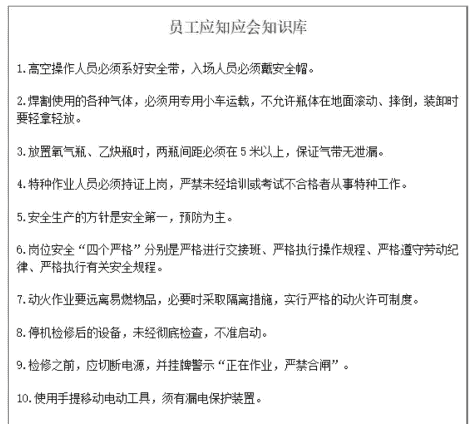

### 图4-13 应知应会知识库文档（部分）

上传Word文档后发送提示词：请根据文档中的内容生成题目，题型包括选择、填空和简答，结果以代码形式输出，代码符合Markdown标准。

DeepSeek生成的考试题代码如图4-14所示。

单击代码框右上角【复制】按钮，复制后打开Markdown在线编辑器粘贴，点击【导出Word文档】下载。生成的题目如图4-15所示，问题均对应原文档条款，答案准确。


### 图4-14 DeepSeek生成的考试题代码（部分）

## 选择题
1. 高空操作人员必须佩戴的安全装备是?
   A. 安全帽
   B. 安全带
   C. 防护手套
   D. 防护眼镜

试题要点速览

选择题
1. 第一道单选，正确答案为 B。
2. 氧气瓶与乙炔瓶的安全存放距离，四项选项 2 米、3 米、5 米、10 米，正确的是 C，即 5 米。
3. 特种作业。

填空题
1. 焊割作业所用气瓶严禁在地面上滚动或摔打，答案：滚动、摔倒。
2. 安全生产方针为 安全第一、预防为主。
3. 进入危险容器检修，须双人配合，一人操作，一人 监护，答案：两、监护。
4. 使用手持移动电动工具时，必须安装 漏电 保护装置。

简答题
1. 岗位安全“四个严格”：严格交接班、严格执行操作规程、严格遵守劳动纪律、严格执行安全规程。
2. 停机检修后开机前须彻底检查，确认无隐患再启动。
3. 劳动合同中应告知职业病相关信息：可能产生的职业病危害及后果、防护措施和待遇。
4. 操作记录要真实、及时。
5. 正常操作检查项目：定期记录、核查设备泄漏、关注声响与振动、确保生产指标受控。

图4-15 DeepSeek 生成的练习题截屏（节选）

# 技巧07 合同改动快速比对
电子合同往来时，防止对方擅自改条款是关键痛点。把收到的回传版与自己保存的原始文件同时交给 DeepSeek 做逐条核对，就能马上看出是否有增删改，以及改动是否已协商。

以一份委托创作合同原件与副本为例，如图4-16 所示。

图4-16 合同原件与副本节选

操作步骤是先点开 DeepSeek 对话窗右下角的 📎 图标，分别导入两份待核查文件，再输入指令：
> 请仔细对比两份文件，将内容差异以表格形式列出。表格中要包括文件名、差异内容，以及出现的行次。

模型返回的比对结果见表4-2。

## 表4-2 内容差异
| 文件名 | 差异内容 | 出现行次 |
| :--- | :--- | :--- |
| 委托创作合同.docx | 住所地址：北京市密云鼓楼街道 | 甲方住所地址行 |
| 委托创作合同-副本.docx | 住所地址：北京市密云区鼓楼街道 | 甲方住所地址行 |
| 委托创作合同.docx | 2.3.3 视频课程要求画质清晰，分辨率不低于1280p | 第二条 2.3.3 条款行 |
| 委托创作合同-副本.docx | 2.3.3 视频课程要求画质清晰，分辨率不低于720p | 第二条 2.3.3 条款行 |
| 委托创作合同.docx | 4.2.1 甲方预付费用时间为验收通过后15个工作日内 | 第四条 4.2.1 条款行 |
| 委托创作合同-副本.docx | 4.2.1 甲方预付费用时间为验收通过后10个工作日内 | 第四条 4.2.1 条款行 |
| 委托创作合同.docx | 12.2 变更通知或通讯地址需要自变更之日起5个工作日内通知对方 | 第十二条 12.2 条款行 |
| 委托创作合同-副本.docx | 12.2 变更通知或通讯地址需要自变更之日起5日内通知对方 | 第十二条 12.2 条款行 |

除表格外，模型还给出文字解读：
住所地址，原件为“北京市密云鼓楼街道”，副本补上了“区”变为“北京市密云区鼓楼街道”。
分辨率，原件要求不低于1280p，副本降为720p。
预付款，原件为验收后15个工作日内，副本改为10个工作日内。
通知时限，原件明确5个工作日内，副本只写5日内，未限定工作日。

# 技巧08 合同风险评估预警
DeepSeek 还能对待签合同做合规审查，找出不符合法规或表述不清易引发纠纷的风险点，提前规避。图4-17 为一份待评估的房屋租赁合同节选。
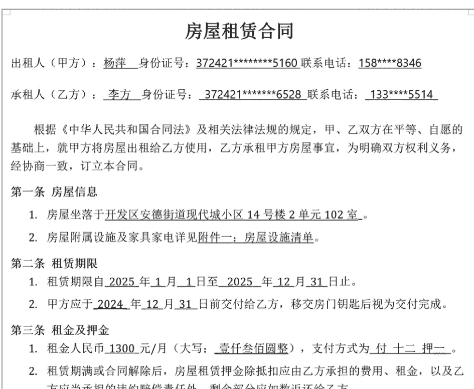
图4-17 房屋租赁合同节选

同样用 📎 导入文件后，发送提示词，如图4-18 所示。
你是一位法务专家，擅长处理各类合同协议纠纷，请对房屋租赁合同进行简要评估并预警可能存在的风险。

图4-18 在 DeepSeek 对话框中上传文件并发送提示词

模型输出的风险评估及建议如下。

## 1. 身份信息与隐私风险
风险点：甲乙双方身份证号及联系方式被星号遮挡，合同却未约定隐私保护。
建议补充隐私条款，明确信息仅用于合同履行，禁止擅自泄露或他用。

## 2. 交付时间矛盾
风险点：租期自2025年1月1日起，甲方要求2024年12月31日前交付，交房到起租期间的损坏责任不清。
建议明确空置期管理责任及租金、维修归属。

## 3. 押金退还约定不清
风险点：退还时间、扣费标准及争议解决方式未细化，易导致拖延纠纷。
建议约定退租后如7个工作日内退还，并列明可扣除费用范围及凭证要求。

## 4. 安全责任划分不合理
风险点：第六条约定房屋内安全事故均由乙方承担，若因房屋本身隐患导致，条款可能无效。
建议甲方对房屋安全性承担保证义务，乙方仅对自身过错负责。

## 5. 违约金比例合规性存疑
风险点：提前解约违约金为0.5个月租金，需核对是否符合当地司法实践上限。
建议明确计算依据或直接引用法定上限。

## 6. 费用分担流程不明
风险点：物业费、垃圾清运费由甲方承担，未约定代缴流程及逾期责任。
建议明确缴费时限及未及时缴纳的后果。

## 7. 附属设施交接缺失
风险点：附件一列明设施，却无验收流程，退租时易产生争议。
建议交房时签署《设施交接确认单》并附照片备查。

## 8. 签署日期不一致
风险点：甲方签于2024年12月20日，乙方签于2024年12月22日，可能影响生效时间认定。
建议统一日期或注明自最后一方签字日起生效。

## 总结建议
合同整体框架符合《中华人民共和国民法典》租赁规定，但上述条款需细化以降低执行风险。模型对风险点逐项解读并给出修改建议。

# 技巧09 一键生成领导讲话稿
按“背景+角色+任务+要求”组织提示，能让 DeepSeek 输出结构清晰、针对性强的发言材料。

示例提示词：
请按照如下要求撰写材料：
恒信新材料集团要召开集团项目建设推进会，总经理将在会议上讲话。你是总经理的秘书，擅长各类文稿材料的写作，请写一份总经理在集团项目建设推进会上讲话的发言稿，要突出项目建设的紧迫性，结构清晰、逻辑严密，字数控制在2000字左右。

其中，会议召开与讲话为背景，秘书身份为角色，撰写发言稿为任务，突出紧迫性等为要求。

模型生成片段如下。

## 在恒信新材料集团项目建设推进会上的讲话
同志们：
今天召开项目建设推进会，既是总结经验，也是加压动员。集团正处转型升级关键期，项目建设是高质量发展的引擎，也是抢占制高点的抓手。必须清醒看到，当前进度偏慢、资源统筹不足、创新不够等问题突出。本次会议要以问题为导向、以目标为牵引，吹响冲锋号，确保全年任务高质量完成。下面讲三点意见。

### 一、认清形势、凝聚共识，以“等不起”的紧迫感抢抓机遇
1. 从行业竞争看，慢一步就被动
新材料行业技术迭代加快、产能整合加速。上半年全国新增投资同比增23%，头部企业研发强度超8%。同行已投产接近国际领先水平的项目，若不能抢窗口期形成优势产能，将错失先机。
2. 从政策机遇看，快一拍赢得红利
国家“十四五”规划明确提出，……

……
同志们！项目建设是检验执行力的试金石、锤炼战斗力的练兵场。今天既是对阶段成果的检验，也是向全年目标冲刺的起点。让我们以“咬定青山不放松”的韧劲、“不破楼兰终不还”的拼劲，抢进度、抓质量、保安全，打赢攻坚战，为集团高质量发展提供支撑！
谢谢大家。
该稿件突出了紧迫感，传递了压力，结尾激励有力，符合推进会讲话要求。

# 技巧10 销售报表转分析报告
DeepSeek 能把表格数据转为通俗文本，快速完成报告撰写与数据提炼。若不知如何下手，可借助模型提炼要点。

如图4-19 所示，是某公司商品销售数据部分记录。

| 日期 | 品类名称 | 大类 | 中类 | 风格 | 季节 | 性别 | 颜色 | 商品代码 | 数量 | 销售金额 |
| :--- | :--- | :--- | :--- | :--- | :--- | :--- | :--- | :--- | :--- | :--- |
| 2024/3/1 | 鞋 | 布鞋 | 单靴 | 中式改良 | 秋 | 女 | | 151302300 | 1 | 235 |
| 2024/3/1 | 鞋 | 皮鞋 | 单鞋 | 休闲 | 春 | 女 | 土黄 | 140113024 | 1 | 440 |
| 2024/3/1 | 鞋 | 布鞋 | 单鞋 | 休闲 | 春 | 男 | 黑色 | 181101071 | 1 | 537 |
| 2024/3/1 | 服装 | 下装 | 小脚裤 | 时尚 | 冬 | 女 | 黑色 | 175458265 | 1 | 702 |
| 2024/3/1 | 服装 | 上装 | 毛衫 | 休闲 | 冬 | 女 | 绿色 | 164450037 | 1 | 959 |
| 2024/3/2 | 鞋 | 布鞋 | 单鞋 | 休闲 | 秋 | 男 | | 161301019 | 1 | 851 |
| 2024/3/2 | 鞋 | 布鞋 | 单鞋 | 休闲 | 秋 | 女 | 黑色 | 171301030 | 1 | 678 |
| 2024/3/2 | 鞋 | 布鞋 | 单鞋 | 休闲 | 春 | 女 | 红色 | 181101065 | 2 | 1,026 |
| 2024/3/2 | 服装 | 上装 | 外套 | 时尚 | 春 | 女 | 玫红 | 174142055 | 1 | 1,707 |
| 2024/3/2 | 服装 | 上装 | 羽绒服 | 中式 | 冬 | 女 | 酒红 | 174453263 | 1 | 1,870 |
| 2024/3/3 | 服装 | 上装 | 外套 | 中式 | 秋 | 女 | 红色 | 174342053 | 1 | 1,938 |
| 2024/3/3 | 服装 | 上装 | 外套 | 中式 | 秋 | 女 | 紫红 | 174342240 | 1 | 1,797 |

图4-19 销售数据节选

先问“如何提问才能生成详细销售分析报告”，模型给出模板：
首先明确分析需求：
## 1. 整体表现
按月/季度/年呈现销售额、销售量、利润率趋势，关键指标同比/环比
## 2. 产品维度
Top10畅销产品，各品类销售额占比及利润对比，低效产品识别
## 3. 区域/渠道分析
各地区销售额排名，线上VS线下表现
## 4. 客户分析
Top10客户贡献度，新客获取VS老客复购
## 5. 深度洞察
数据异常点，提升销售额建议
## 6. 可视化需求
柱状图/折线图/饼图，关键指标加粗标注

据此上传数据并发送提示词：
你是一位资深的服装鞋帽零售市场营销专家，请基于表格中的销售数据生成一份分析报告，报告需要包含以下内容：按产品季度属性呈现销售额的变化趋势，按销售金额提取Top 5的畅销产品清单和销量占比不足5%的低效产品清单，并给出提高销量的关键建议。

DeepSeek 生成报告如下。

### 一、按产品季度属性呈现销售额变化趋势
| 季节 | 销售额（元） | 占比 | 趋势分析 |
| :--- | :--- | :--- | :--- |
| 秋 | 58,243 | 38% | 销售额最高，需求集中在休闲鞋、外套等品类，可能与换季需求相关 |
| 冬 | 33,817 | 22% | 羽绒服、棉鞋等高单价商品表现突出，但季节末期销量略有下降 |
| 春 | 30,952 | 20% | 长袖衬衫、休闲鞋类销售额增长显著，符合春季上新趋势 |
| 常年 | 18,629 | 12% | 基础款布鞋（如黑色单鞋）和配饰销量稳定但增速较慢 |
| 夏 | 9,610 | 6% | 仅少量夏装有销量，占比最低，需要提前布局夏季产品线 |
结论：秋季为销售旺季，冬季、春季次之，夏季需要加强市场预热。

### 二、Top 5的畅销产品清单
| 排名 | 商品名称 | 销售金额（元） | 关键特征 |
| :--- | :--- | :--- | :--- |
| 1 | 女式休闲外套（2号色） | 7,807 | 休闲风格、春季/秋季、高单价 |
| 2 | 男式中式改良布鞋（黑色） | 5,689 | 中式风格、基础款、高频复购 |
| 3 | 女式时尚长袖衬衫（金色） | 5,233 | 时尚风格、高单价 |
| 4 | 女式休闲风衣（棕色） | 7,637 | 休闲风格、春季/秋季、高单价 |
| 5 | 男式休闲皮鞋（黑色） | 4,829 | 正装/休闲装、高频销售 |
特征总结：高单价外套和经典色（黑色、棕色）鞋类占主导，女性的市场贡献显著。

### 三、销量占比不足5%的低效产品清单
低效产品筛选标准：单款销量≤7件（占比≤5%）
| 商品代码 | 品类名称 | 销量（件） | 占比 | 问题定位 |
|---|---|---|---|---|
| 173506004 | 鞋配（白色） | 1 | 0.7% | 非刚需，颜色单一 |
| 142113046 | 布鞋（黑色） | 2 | 1.3% | 款式陈旧，缺乏吸引力 |
| 171301996 | 布鞋（绿色） | 3 | 2.0% | 颜色小众 |
| 184144266 | 长袖衬衫（1号色） | 1 | 0.7% | 设计同质化，缺乏亮点 |
| 174446005 | 坎肩（红色） | 1 | 0.7% | 适用场景有限，推广不足 |

## 四、提升销售额的关键建议
季节性策略优化
秋季：增加休闲鞋、外套库存并加大促销力度。
春季：主推长袖衬衫和风衣，结合“春日焕新”主题。
夏季：提前上架T恤、凉鞋，利用社交媒体预热。
畅销品强化
增加Top5商品陈列曝光，推出明星单品限时折扣，开发同类高潜力款式。
低效产品清库存
捆绑销售、清仓折扣、设计迭代淘汰同质化款式。
数据驱动选品
优先补货黑色、红色、酒红色等高转化颜色，动态监控常年款SKU。
渠道与推广
线上直播带货推广高单价冬装春装，线下设置季节专区强化场景陈列。
总结：通过精准季节营销、畅销品优先、低效品快速清仓，可显著优化销售表现，建议每两周复盘数据动态调整。

# 技巧11 日程表生成检修计划
DeepSeek 可识别检修日程表的结构化信息并转为连贯文字。

如图4-20 所示，是某公司设备检修日程表部分内容，可借助 DeepSeek 转为文字检修计划。

| 日期 | 部门 | 检修项目 | 实施人 |
| :--- | :--- | :--- | :--- |

图4-20 检修日程总览

| 2025-1-1至2025-1-7 | 前置清理车间 | D110到D114流管修补 | 机修组 |

| 2025-1-1至2025-1-3 | 前置清理车间 | 1-2楼 | 土建队 |

| 2025-1-1至2025-1-4 | 前置清理车间 | 加热器D208H清理 | 孙荣清 |

| 2025-1-1至2025-1-4 | 前置清理车间 | 各个设备加油 | 张开元 |

| 2025-1-5至2025-1-10 | 前置清理车间 | 仓下加大存料箱 | 设备厂家 |

| 2025-1-1至2025-1-5 | 前置清理车间 | 所有风机清理叶轮、脉冲除尘 | 张开元 |

| 2025-1-1至2025-1-5 | 前置清理车间 | D230 D234提升机加视镜 | 王卫东 |

| 2025-1-1至2025-1-5 | 前置清理车间 | D123A D123B轴承加油 | 孙荣清 |

| 2025-1-1至2025-1-6 | 喷淋车间 | 循环水泵维修蝶阀 | 贺德坤 |

| 2025-1-1至2025-1-7 | 配电 | | 邢振厚 |

先把上表通过 DeepSeek 右下角的上传入口导入，随后在对话窗口输入如下指令：

请将表格中的内容转换为文字形式的检修计划，不得遗漏或增加项目。

模型返回的文字化排期如下。

日期：2025-1-1至2025-1-7

部门：前置清理车间

检修项目：D110到D114流管修补

实施人：机修组

日期：2025-1-1至2025-1-3

部门：前置清理车间

检修项目：1-2楼换灯泡

实施人：土建队

日期：2025-1-1至2025-1-4

部门：前置清理车间

检修项目：加热器D208H清理

实施人：孙荣清

日期：2025-1-1至2025-1-4

部门：前置清理车间

检修项目：各个设备加油

实施人：张开元

日期：2025-1-5至2025-1-10

部门：前置清理车间

检修项目：仓下加大存料箱

实施人：设备厂家

日期：2025-1-1至2025-1-5

部门：前置清理车间

检修项目：所有风机清理叶轮、脉冲除尘

实施人：张开元

日期：2025-1-1至2025-1-5

部门：前置清理车间

检修项目：D230、D234提升机加视镜，底座割孔

实施人：王卫东

日期：2025-1-1至2025-1-5

部门：前置清理车间

检修项目：D123A、D123B轴承加油

实施人：孙荣清

日期：2025-1-1至2025-1-6

部门：喷淋车间

检修项目：循环水泵维修蝶阀

实施人：贺德坤

日期：2025-1-1至2025-1-7

部门：配电

检修项目：清理空压机，换机油滤芯，整理蒸汽流量计信号线

实施人：邢振厚

输出层次分明、阅读顺畅，直接拿来写入周报或工作总结都很合适。

# 技巧12 文风随心切换

该模型能调节技术文档的表达层级，把专业报告改写成大众科普，以适配会议、出版等不同场景。下面以一本技术图书书评为例。

图4-21 书评原文

> 学会如何处理和应用数据是我们这个时代迫切的需求。

这本书是 Excel Home 专家团队为大家打造的提高 Excel 技术能力的又一部“宝典”。厚厚的图书凝聚了海量的知识。书中内容精炼、全面，有大量贴合实际的案例及图文并茂的步骤指引，由浅入深地引领读者一步一步理解、熟悉并掌握扎实的 Excel 操作知识，让你在数据处理和应用中更加游刃有余。

将原文粘贴后发送指令：

请将以上图书书评内容转换为天津快板风格。

返回内容如下。

（竹板声起）

竹板这么一打呀，别的咱不夸

Excel Home有秘籍，内容顶呱呱

数据时代要玩转，技术得狠抓

专家团队造宝典，厚得不像话！

（嘚嘟当哩咯嘟）

知识如海量，案例带火花

图文并茂手把手，从浅往深里挖

海量知识往里塞，就像金疙瘩

技术学到手心里，干活儿不抓瞎！

（嘚嘟当哩咯嘟）

工作遇难题？书里找解法

透视表里乾坤大，图表会开花

代码编写与函数，利索不抓瞎

天津卫的办公族，这书赶紧买回家！

（脆生生收板）

哎！赶紧买回家！

再发送指令：

请将图书书评内容转换为金庸的写作风格。

返回内容如下。

江湖传闻，当今武林纷争皆系于“数术”二字。谁人得窥数据处理之玄机，便如手握屠龙宝刀，可号令天下群雄。然此道艰深晦涩，寻常侠士纵使耗尽毕生功力，亦难参透其中诀窍。

忽有一日，Excel Home门下九大护法长老联袂出山，将毕生所悟铸成一部Excel应用宝典。此典厚逾三寸，纸页间暗藏三十六路函数心法、七十二式图表绝技，更有VBA内功心法深藏其中。江湖老手观之，但见字里行间剑气纵横；初入武林者抚卷，亦有清风明月引路之妙。

书中招式皆取自丐帮弟子、镖局总舵、六大门派比武论剑之奇思妙算。每招每式皆以连环画本形式呈现，墨线勾勒处暗合周易八卦，朱砂批注间隐现北斗七星。昔年光明顶张真人传道，尚需七年方能筑基；而今按此典修炼，只需三载便可打通任督二脉。待到融会贯通之时，纵是百万数据如潮水涌来，亦能如凌波微步般穿梭其间。

两版都保留了原书的权威性、知识密度、案例实用性与由浅入深的特点，只是表达形式截然不同。

# 技巧13 批量Word转PDF实操

借助 DeepSeek 生成的 VBA 脚本，可把文件夹里多个 .docx 说明书一次性转为 .pdf，便于分发归档。

图4-22 产品说明书


图4-22 产品说明书

在 Windows 环境下，要求把 E 盘【产品说明】文件夹里的所有 .docx 全部转为 .pdf，请给出 VBA 代码与操作流程。

生成的 VBA 代码如图4-23 所示。

```vba
Sub ConvertDocsToPDF()
    Dim strFolder As String
    Dim strFile As String
    Dim doc As Document

    ' 设置文件夹路径（根据实际情况修改）
    strFolder = "E:\产品说明"
    strFile = Dir(strFolder & "*.doc*")

    Application.ScreenUpdating = False
    Application.DisplayAlerts = False

    Do While strFile <> ""
        Set doc = Documents.Open(strFolder & strFile)

        ' 保存为PDF（原文件名+".pdf"）
        doc.ExportAsFixedFormat _
            OutputFileName:=strFolder & Left(strFile, InStrRev(strFile, ".") - 1) & ".pdf", _
            ExportFormat:=wdExportFormatPDF

        doc.Close SaveChanges:=False
        strFile = Dir()
    Loop

    Application.ScreenUpdating = True
    Application.DisplayAlerts = True

    MsgBox "转换完成！共处理 " & Documents.Count & " 个文件", vbInformation
End Sub
```

图4-23 DeepSeek生成的VBA代码

按说明新建一个 Word 文档，按 Alt+F11 进入 VBA 编辑环境，依次点 插入→模块，如图4-24 所示，新增一个模块。


图4-24 插入模块

在左侧选中新建的模块，右侧代码区按 Ctrl+V 粘贴代码，然后点运行按钮，如图4-25 所示。

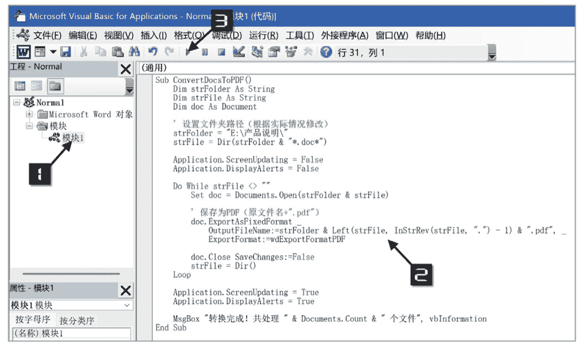

图4-25 粘贴并运行代码

运行结束后，目标文件夹会自动生成同名 PDF，如图4-26 所示。

| 名称 | 修改日期 | 类型 |

| :--- | :--- | :--- |

| 分离机使用说明.docx | 2025-3-2 11:59 | Microsoft Word ... |

| 恒流流量计使用说明.docx | 2025-2-24 23:02 | Microsoft Word ... |

| 冷冻机使用说明.docx | 2025-2-27 21:49 | Microsoft Word ... |

| 色选机使用说明.docx | 2025-3-2 14:55 | Microsoft Word ... |

| 蒸汽积算仪使用说明.docx | 2025-3-2 14:40 | Microsoft Word ... |

| 分离机使用说明.pdf | 2025-3-2 15:59 | WPS PDF 文档 |

| 恒流流量计使用说明.pdf | 2025-3-2 15:59 | WPS PDF 文档 |

| 冷冻机使用说明.pdf | 2025-3-2 15:59 | WPS PDF 文档 |

| 色选机使用说明.pdf | 2025-3-2 15:59 | WPS PDF 文档 |

| 蒸汽积算仪使用说明.pdf | 2025-3-2 15:59 | WPS PDF 文档 |

图4-26 转换后的.pdf格式的文件

# 第5章 DeepSeek让Excel变身智能助手

该模型能把 Excel/WPS 从单纯的数据处理工具升级为智能分析助手。通过自然语言就能生成公式或 VBA 代码，解读整理数据、自动出报表，还能纠错优化。

## 本章的主要内容

- ◆ 技巧1借助DeepSeek生成常用Excel函数的功能描述表
- ◆ 技巧2借助DeepSeek生成常用Excel快捷键表格
- ◆ 技巧3借助DeepSeek根据描述自动生成Excel公式

# 技巧01 生成Excel函数速查表

新手可让 DeepSeek 生成常用函数清单，方便学习巩固。

提示词：

请以表格形式生成常用的Excel函数及其功能描述。

生成的清单如表5-1所示。

表 5-1 常用的Excel函数及其功能描述

| 函数名称 | 分类 | 功能描述 | 示例 |

| :--- | :--- | :--- | :--- |

| VLOOKUP | 查找与引用 | 按列查找并返回对应值 | =VLOOKUP(A2, B2:C10, 2, FALSE) |

| HLOOKUP | 查找与引用 | 按行查找并返回对应值 | =HLOOKUP(A1, A1:F5, 3, FALSE) |

| XLOOKUP | 查找与引用 | 更强大的双向查找 | =XLOOKUP(A2, B2:B10, C2:C10) |

| INDEX | 查找与引用 | 返回指定位置的值 | =INDEX(A1:C10, 2, 3) |

| MATCH | 查找与引用 | 返回查找值的位置 | =MATCH(A2, B2:B10, 0) |

| IF | 逻辑 | 根据条件返回不同结果 | =IF(A1>60, "合格", "不合格") |

| IFS | 逻辑 | 多条件判断 | =IFS(A1>90, "优", A1>80, "良") |

| SUM | 数学与三角 | 求和 | =SUM(A1:A10) |

| SUMIF | 数学与三角 | 按条件求和 | =SUMIF(A2:A10, ">20", B2:B10) |

| SUMIFS | 数学与三角 | 多条件求和 | =SUMIFS(C2:C10,A2:A10,">20", B2:B10,"<50") |

| AVERAGE | 统计 | 计算平均值 | =AVERAGE(A1:A10) |

| COUNT | 统计 | 计算数值单元格数量 | =COUNT(A1:A10) |

| COUNTIF | 统计 | 按条件计数 | =COUNTIF(A1:A10, ">60") |

| COUNTA | 统计 | 计算非空单元格数量 | =COUNTA(A1:A10) |

| LEFT | 文本 | 提取文本左侧指定字符数 | =LEFT(A1, 3) |

| RIGHT | 文本 | 提取文本右侧指定字符数 | =RIGHT(A1, 2) |

| MID | 文本 | 从指定位置提取文本 | =MID(A1, 2, 4) |

| TEXTJOIN | 文本 | 用分隔符连接文本 | =TEXTJOIN(",", TRUE, A1:A5) |

| TODAY | 日期与时间 | 返回当前日期 | =TODAY() |

| NOW | 日期与时间 | 返回当前日期和时间 | =NOW() |

| DATEDIF | 日期与时间 | 计算两个日期之间的差值 | =DATEDIF(A2, B2, "D") |

| FILTER | 动态数组 | 按条件筛选数据 | =FILTER(A2:C10, B2:B10>100) |

| UNIQUE | 动态数组 | 提取唯一值 | =UNIQUE(A2:A10) |

# 技巧02 生成Excel快捷键清单

把常用快捷键整理成表打印贴在工位，日常查用更高效。

提示词：

> 请以表格形式罗列常用的Excel快捷键，按功能进行分类，并以A4纸为标准进行排版。

结果如表5-2所示。

表5-2 常用Excel快捷键

| 分类 | 快捷键 | 功能描述 |

| :--- | :--- | :--- |

| 导航与选择 | Ctrl + 方向键（↑/↓/←/→） | 跳转到数据区域边缘 |

| | Ctrl + Home | 回到A1单元格 |

| | Ctrl + End | 跳转到工作表最后一个有内容的单元格 |

| | Shift + 空格 | 选中整行 |

| | Ctrl + 空格 | 选中整列 |

| | Ctrl + A | 全选当前数据区域 |

| 编辑与操作 | Ctrl + C | 复制选中内容 |

| | Ctrl + X | 剪切选中内容 |

| | Ctrl + V | 粘贴内容 |

| | Ctrl + Z | 撤销上一步操作 |

| | Ctrl + Y | 恢复撤销的操作 |

| | Ctrl + D | 向下填充（复制上方单元格内容） |

| 分类 | 快捷键 | 功能描述 |

| :--- | :--- | :--- |

| 编辑与操作 | Ctrl + R | 向右填充（复制左侧单元格内容） |

| | Alt + Enter | 单元格内换行 |

| 格式设置 | Ctrl + B | 加粗/取消加粗 |

| | Ctrl + I | 斜体/取消斜体 |

| | Ctrl + U | 下划线/取消下划线 |

| | Ctrl + 1 | 打开【单元格格式】对话框 |

| | Ctrl + Shift + ~ | 设置为通用格式 |

| | Ctrl + Shift + $ | 设置为货币格式 |

| 公式与数据 | F2 | 编辑当前单元格 |

| | Ctrl + ; | 插入当前日期 |

| | Ctrl + Shift + : | 插入当前时间 |

| | Alt + = | 快速输入SUM求和公式 |

| | Ctrl + Shift + Enter | 输入数组公式 |

| | Ctrl + T | 创建表 |

| | Ctrl + Shift + L | 开启/关闭筛选 |

| 其他常用Excel快捷键 | F1 | 打开帮助中心 |

| | Ctrl + S | 保存文件 |

| | Ctrl + P | 打开打印界面 |

| | Ctrl + F | 查找内容 |

| | Ctrl + H | 替换内容 |

| | F4 | 重复上一步操作/切换绝对引用 |

| | Ctrl + E | 快速填充（Excel 2013+） |

# 技巧03 用自然语言生成Excel公式

DeepSeek 能根据描述直接给出公式，省去记忆成本。描述时建议分三步：先说明数据范围，再描述计算逻辑，最后指明结果位置。如有格式或筛选条件一并说明。

例如：“我想在 Excel 里把 A 列求和，结果放在 B1 单元格。”

信息越具体，生成的公式越精准。

图5-1显示的是员工信息表，目标是通过DeepSeek，让I列根据G2里填写的部门自动输出该部门的所有姓名。

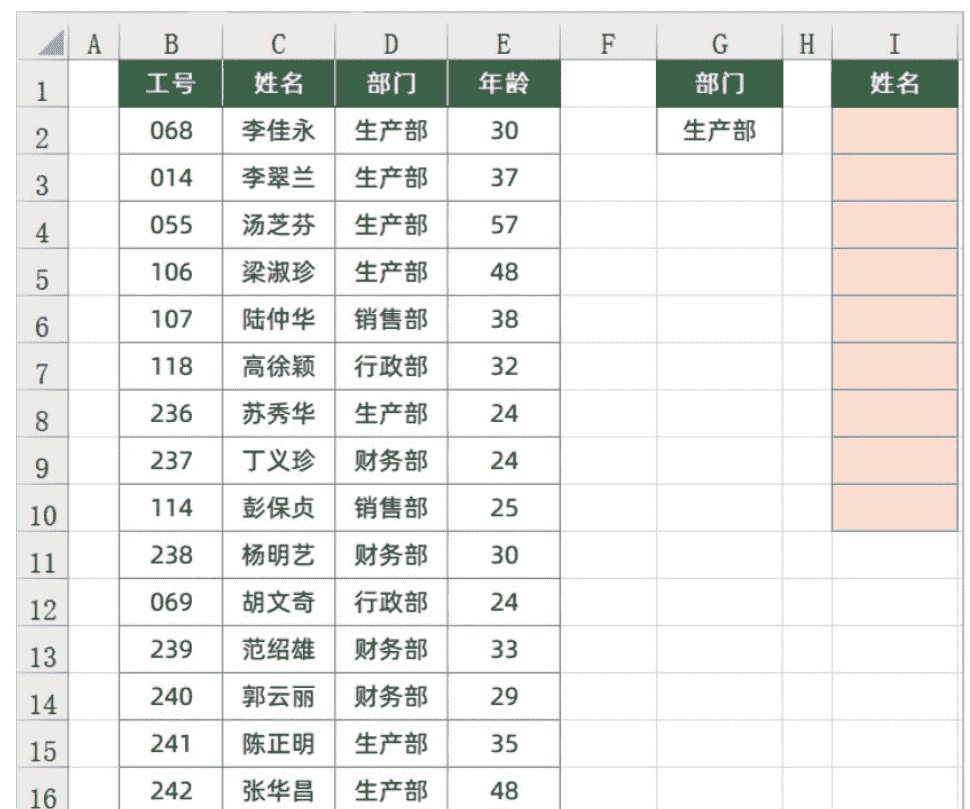

图5-1 员工信息表

在DeepSeek对话窗口里输入下面这段指令。

数据位于B1:E16单元格区域，从左到右，各字段的标题分别为工号、姓名、部门、年龄。请根据G2单元格中的部门信息，返回该部门的全部人员姓名。公式结果存放在以I2为开始的单元格区域内。

DeepSeek给出了两套适配不同Excel版本的方案。

## 方法1：使用FILTER函数，适用于Excel 365或支持动态数组的版本

```
=FILTER(C2:C16,D2:D16=G2,"无人员")
```

C2:C16 对应姓名列。

D2:D16=G2 用来筛选出部门与G2一致的行。

“无人员” 为未检索到数据时的备选提示，可选。

## 方法2：使用数组公式，兼容旧版Excel

在I2输入下列公式后按Ctrl+Shift+Enter确认，并向下填充：

```
=IFERROR(INDEX($C$2:$C$16,SMALL(IF($D$2:$D$16=$G$2,ROW($D$2:$D$16)-ROW($D$2)+1),ROW(A1))),"")
```

要点说明：

IF($D$2:$D$16=$G$2, ...) 判断部门是否匹配。

ROW(...) 计算符合条件行的序号。

SMALL与ROW(A1)配合可逐条取出匹配结果。

IFERROR用于在没有更多结果时给出友好提示。

## 小结

FILTER函数可一次性返回全部匹配结果并自动溢出。

数组公式需要手动拖拽填充，按顺序显示姓名。

根据所用Excel版本挑选合适方法即可。

按上述方式在工作表的I2输入公式后，成功筛选出“生产部”的全部员工姓名，结果如图5-2。

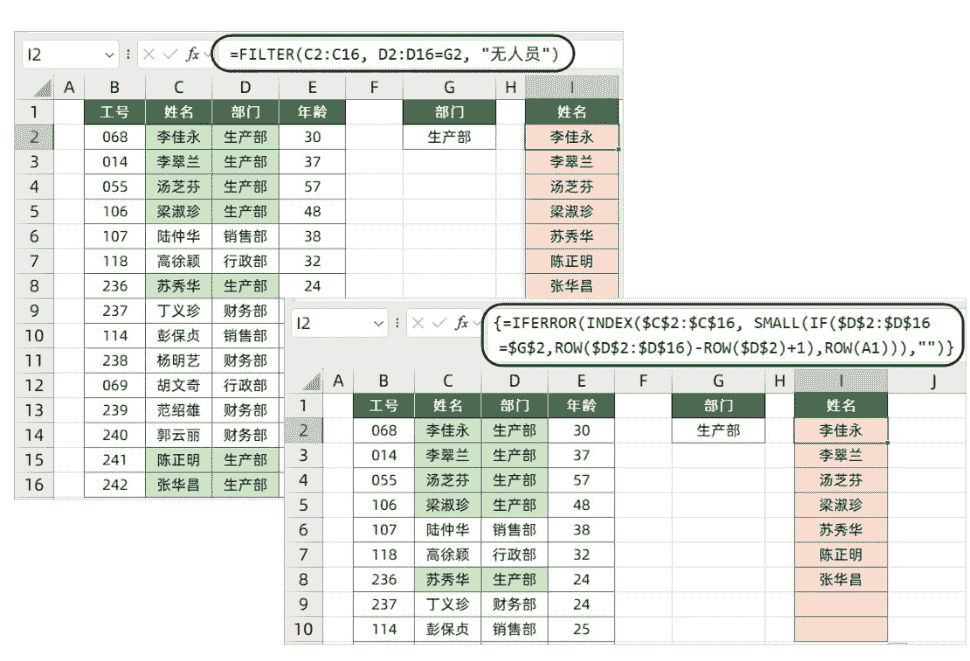

图5-2 公式运算结果

# 技巧04 DeepSeek按需生成公式

合并单元格的特性是合并区域仅首个单元格保留值，其余为空。例如A2:A4合并后只有A2有内容。

如图5-3所示，A列存在合并单元格，导致日期显示不连续。需求是让公式自动补全合并区域，无需手动拖拽。

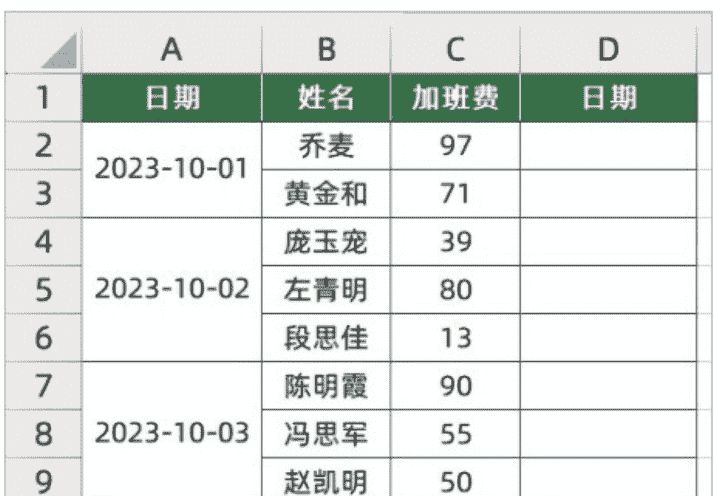

图5-3 带合并单元格的表格

向DeepSeek发出提示：

A2:A9中是一些带有合并单元格的日期，需要使用公式将这些合并单元格填充完整。要求在D2单元格内输入公式，结果要能自动溢出。

其中前半句是计算需求，后半句是效果需求。

DeepSeek给出的解决思路如下，适用于支持动态数组的Excel 365或2021及以上版本：

```
=SCAN(,A2:A9,LAMBDA(a,v,IF(v="",a,v)))
```

公式原理拆解：

SCAN函数能够遍历数组并累积计算，适合需要记忆前值的场景。

LAMBDA的逻辑为：

a为累积器，即上一个单元格的计算结果

v为当前遍历到的单元格值

IF(v="",a,v)表示当前为空则沿用之前结果，有值则更新。

自动溢出特性使D2输入后结果会自动扩展到D3:D9。

将公式复制到工作表D2后，填充效果如图5-4。

```
=SCAN(,A2:A9,LAMBDA(a,v,IF(v="",a,v)))
```

|  | A | B | C | D | E | F | G | H |
|---|---|---|---|---|---|---|---|---|
| 1 | 日期 | 姓名 | 加班费 | 日期 |  |  |  |  |
| 2 | 2023-10-01 | 乔麦 | 97 | 2023-10-01 |  |  |  |  |
| 3 |  | 黄金和 | 71 | 2023-10-01 |  |  |  |  |
| 4 |  | 庞玉宠 | 39 | 2023-10-02 |  |  |  |  |
| 5 | 2023-10-02 | 左青明 | 80 | 2023-10-02 |  |  |  |  |
| 6 |  | 段思佳 | 13 | 2023-10-02 |  |  |  |  |
| 7 |  | 陈明霞 | 90 | 2023-10-03 |  |  |  |  |
| 8 | 2023-10-03 | 冯思军 | 55 | 2023-10-03 |  |  |  |  |
| 9 |  | 赵凯明 | 50 | 2023-10-03 |  |  |  |  |

图5-4 公式填充效果

# 技巧05 DeepSeek通俗讲解公式逻辑

DeepSeek可以对公式进行通俗讲解，帮助新手快速理解。

如图5-5所示，F3单元格使用了公式“=VLOOKUP(E3,B1:C12,2,0)”，用于按姓名查找职务。下面让DeepSeek进行解读。

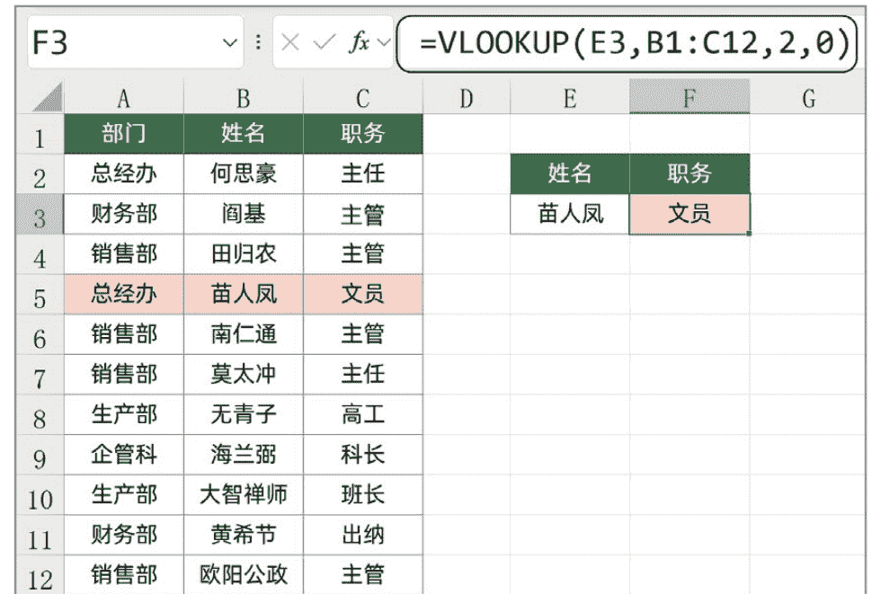

图5-5 根据两个条件查找结果

在DeepSeek对话框发送提示词：

你是一位擅长Excel函数公式讲解的高级讲师，请详细解读公式“=VLOOKUP(E3,B1:C12,2,0)”，需要让一个刚刚接触Excel函数公式的新手能听懂。

DeepSeek的解析如下。

让我们一步步解析公式“=VLOOKUP(E3, B1:C12, 2, 0)”。

假设你是一个Excel新手，我会用简单易懂的语言解释公式每个部分的作用。

## 1. 公式的作用是什么？

VLOOKUP是一个垂直查找函数，它像一个小助手，能帮你在一张表格中快速找到某个值，并返回对应的结果。

例如：

你有一个产品价格表（B列是产品名称，C列是价格）。

现在你想输入一个产品名称（比如E3单元格的值），让Excel自动帮你查找它的价格。

这个公式就是帮你完成这项任务的。

## 2. 拆解公式的每个参数

公式的结构是=VLOOKUP(找什么, 在哪里找, 返回第几列的数据, 怎么找)

对应到你的公式：

```
“=VLOOKUP(E3, B1:C12, 2, 0)”
```

### 参数1：找什么？

E3：你要查找的值。比如，在E3单元格中输入“苹果”，Excel就会在表格中找“苹果”。

### 参数2：在哪里找？

B1:C12：查找的范围。Excel会在这个区域的第一列（B列）中搜索“苹果”。

关键点：查找的值（比如“苹果”）必须在这个区域的第一列中（B列），否则会出错。

### 参数3：返回第几列的数据？

2：表示返回查找范围（B1:C12）中第2列（C列）的数据。

比如，找到“苹果”在B列的第5行，就会返回C5单元格的值（比如价格为10元）。

### 参数4：怎么找？

0：表示“精确匹配”（必须完全一致）。

如果写成1或省略，则是“近似匹配”（比如某个数值区间）。大多数情况下写成0。

## 3. 常见错误和注意事项

错误#N/A：如果E3的值在B列中找不到，会显示此错误。可以用IFERROR函数处理（例如：=IFERROR(VLOOKUP(...), "未找到")）。

列号错误：如果参数3写成3，但查找范围只有B:C两列，就会报错。

区域未固定：如果公式需要下拉填充，记得用$锁定区域：B$1:C$12，否则区域会变动。

总结一句话，这个公式的意思是：

> “在B1到C12区域的第一列（B列）中，查找E3单元格的内容，找到后返回同一行第2列（C列）的值，必须精确匹配。”

试着用实际数据操作几次，你会更清楚它的逻辑！

以上解读逐步拆解了公式，详细解释了每个部分的作用，以及整个公式的运算过程。

# 技巧06 DeepSeek定位并修复公式错误

DeepSeek能够分析出错的公式并给出改正建议。

如图5-6所示，希望根据A2的数量返回级别：小于5显示“甲级”，5到20之间显示“乙级”，其余显示“其他”。当前A2为15却返回了“其他”，需要排查原因。

```
=IF(A2<5,"甲级",IF(5<=A2<20,"乙级","其他"))
```


图5-6 公式错误

向DeepSeek提问：

你是一位资深的Excel讲师。我希望根据A2单元格中的数量返回对应的级别，判断规则是A2小于5显示为“甲级”，在5和20之间返回“乙级”，不符合这两个条件则返回“其他”。现在的公式是“=IF(A2<5,"甲级",IF(5<=A2<20,"乙级","其他"))”，计算结果不正确，为什么？

DeepSeek的回答：

你的公式存在逻辑判断错误，主要原因是Excel不支持数学中的连续比较写法。

正确的公式应为：

```
=IF(A2<5,"甲级",IF(A2<20,"乙级","其他"))
```

原公式中的5<=A2<20在Excel中会被解析为(5<=A2) < 20，5<=A2返回TRUE（数值1）或FALSE（数值0），然后用TRUE/FALSE与20比较（即1<20或0<20），结果永远为TRUE，导致当A2≥5时，无论多大都显示“其他”。

Excel的IF函数应逐层排除已处理区间：

第一层A2<5处理为“甲级”，剩余情况自动满足A2≥5，第二层只需要判断A2<20即可覆盖“乙级”，最后剩下的自然属于“其他”（A2≥20）。

将修正后的公式粘贴到B2，并在A2输入不同数值验证，结果准确，如图5-7。

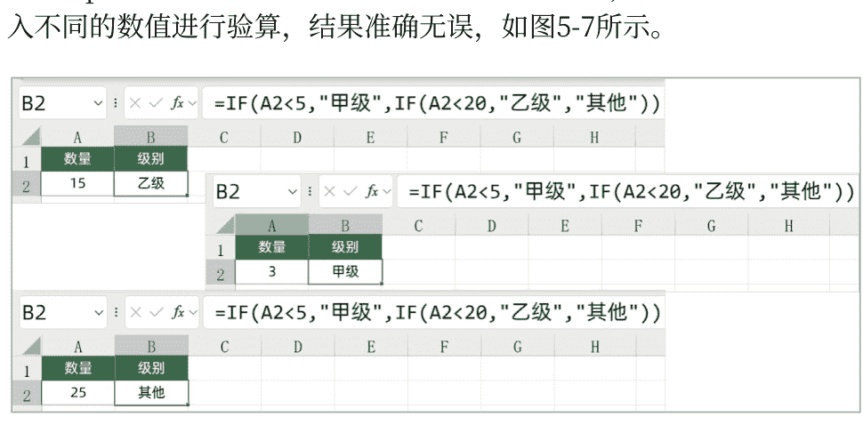

图5-7 验证DeepSeek纠错后的公式

# 技巧07 DeepSeek搞定条件格式高亮

DeepSeek可以协助设置条件格式突出关键数据。

如图5-8所示为销售业绩表，需要对业绩前三名的整行进行高亮。

| A | B | C | D |
|---|---|---|---|
| 工号 | 姓名 | 负责区域 | 业绩 |
| 10120 | 柯梅雪 | 黑龙江 | 5960 |
| 10122 | 吴支雄 | 吉林 | 4930 |
| 10128 | 叶文杰 | 辽宁 | 5190 |
| 10130 | 朱家喜 | 河北 | 5050 |
| 10138 | 周国超 | 内蒙 | 5000 |
| 10140 | 汪婷婷 | 京津 | 5510 |
| 10142 | 方建忠 | 山东 | 5480 |
| 10144 | 蔡欣润 | 山西 | 4240 |
| 10216 | 王钊源 | 江苏 | 4560 |
| 10218 | 田锡昊 | 浙江 | 5450 |
| 10222 | 叶文婷 | 河南 | 5140 |
| 10250 | 曾芳 | 广东 | 4990 |

图5-8 销售业绩表

提示词：

你是一名资深的Excel讲师，我希望对工作表中的业绩前三名记录进行整行高亮显示，需要如何操作？

DeepSeek给出的步骤：

## 步骤1：选择数据范围

选中 A2:D13。

## 步骤2：新建规则

开始 → 条件格式 → 新建规则，选择“使用公式确定要设置格式的单元格”。

## 步骤3：输入公式

```
=AND(D2>=LARGE($D$2:$D$13,3),D2<>"")
```

公式解析：

LARGE($D$2:$D$13,3) 获取业绩列第三大的值。

D2>=... 判断当前行是否进入前三。

D2<>"" 排除空行。

## 步骤4：设置格式

选择填充颜色，如浅绿色，确定。

按此操作后，前三名柯梅雪、汪婷婷、方建忠所在行会被标记。

实际操作时仅A列被填色，不符合预期。于是补充提示：

D列中业绩处于前三名的内容，从A列到D列都高亮显示，请继续完善公式。

DeepSeek给出改进公式：

```
=SUMPRODUCT(--($D$2:$D$13>D2))<3
```

仍只高亮A列后，进一步说明需求：

使用以上公式，仅高亮显示A列，我需要A列至D列都高亮显示。

此时在条件格式规则管理器中编辑规则，如图5-12所示。

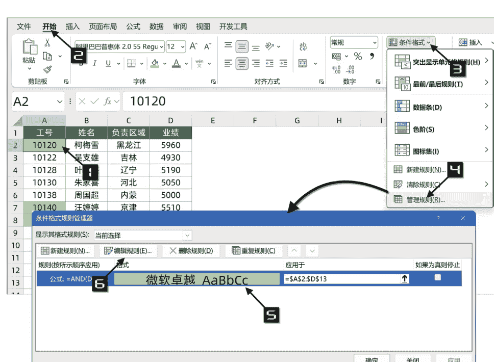

图5-12 管理条件格式规则

之后在编辑格式规则对话框中粘贴新公式，关闭后效果仍不理想。再次反馈后，DeepSeek给出最终公式：

```
=SUMPRODUCT(--($D$2:$D$13>$D2))<3
```

说明：

$D$2:$D$13>$D2 统计业绩比当前行大的单元格数。

SUMPRODUCT(--(...)) 将逻辑值转为数值求和。

<3 表示比当前行大的数量小于3，即为前三名。

使用混合引用$D2可使整行正确引用。

应用后效果如图5-14。

| A | B | C | D |
|---|---|---|---|
| 工号 | 姓名 | 负责区域 | 业绩 |
| 10120 | 柯梅雪 | 黑龙江 | 5960 |
| 10122 | 吴支雄 | 吉林 | 4930 |
| 10128 | 叶文杰 | 辽宁 | 5190 |
| 10130 | 朱家喜 | 河北 | 5050 |
| 10138 | 周国超 | 内蒙 | 5000 |
| 10140 | 汪婷婷 | 京津 | 5510 |
| 10142 | 方建忠 | 山东 | 5480 |
| 10144 | 蔡欣润 | 山西 | 4240 |
| 10216 | 王钊源 | 江苏 | 4560 |
| 10218 | 田锡昊 | 浙江 | 5450 |
| 10222 | 叶文婷 | 河南 | 5140 |
| 10250 | 曾芳 | 广东 | 4990 |

图5-14 多次修正后的条件格式效果

本例显示，将实际效果反馈给DeepSeek后，公式才逐步达到预期。

操作过程中涉及的格式设置界面分别如图5-9与图5-10：

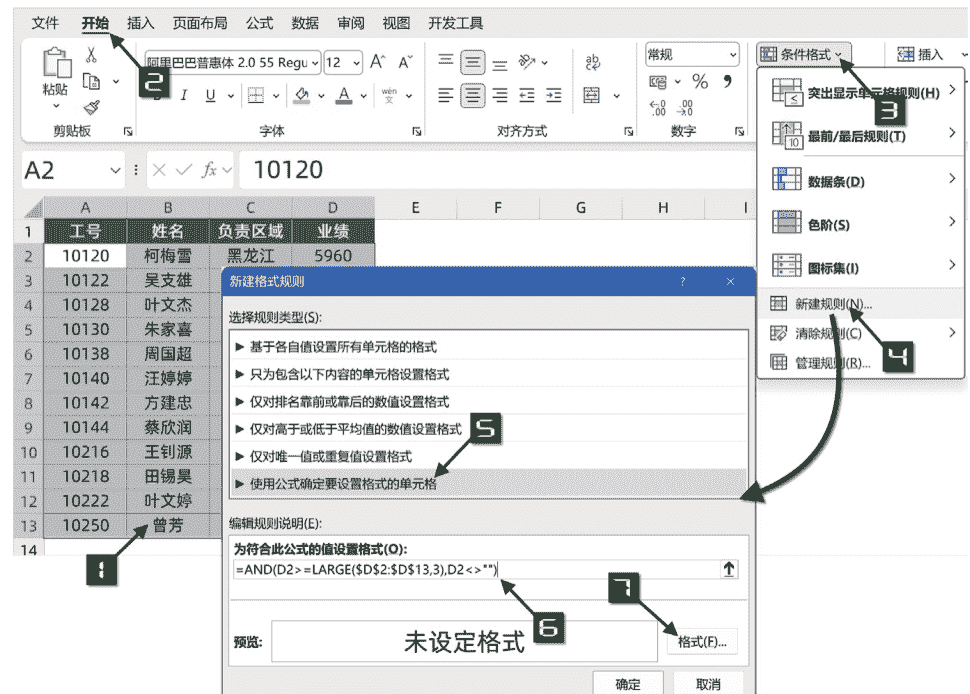

图5-9 使用公式设置Excel条件格式规则

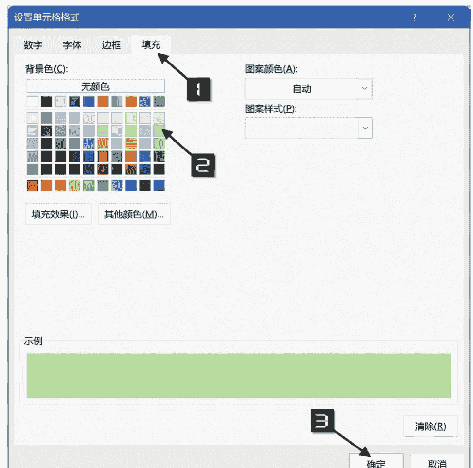

图5-10 设置填充颜色

# 技巧08 DeepSeek逆向推导实现步骤

反推 Excel 分级折叠的实现方式

看到一份表格左上角出现了 1 2 3 的层级标记，左侧还有可收起的三角控件，想复原做法时，最省事的办法是把当前界面截屏交给 DeepSeek 进行逆向分析。

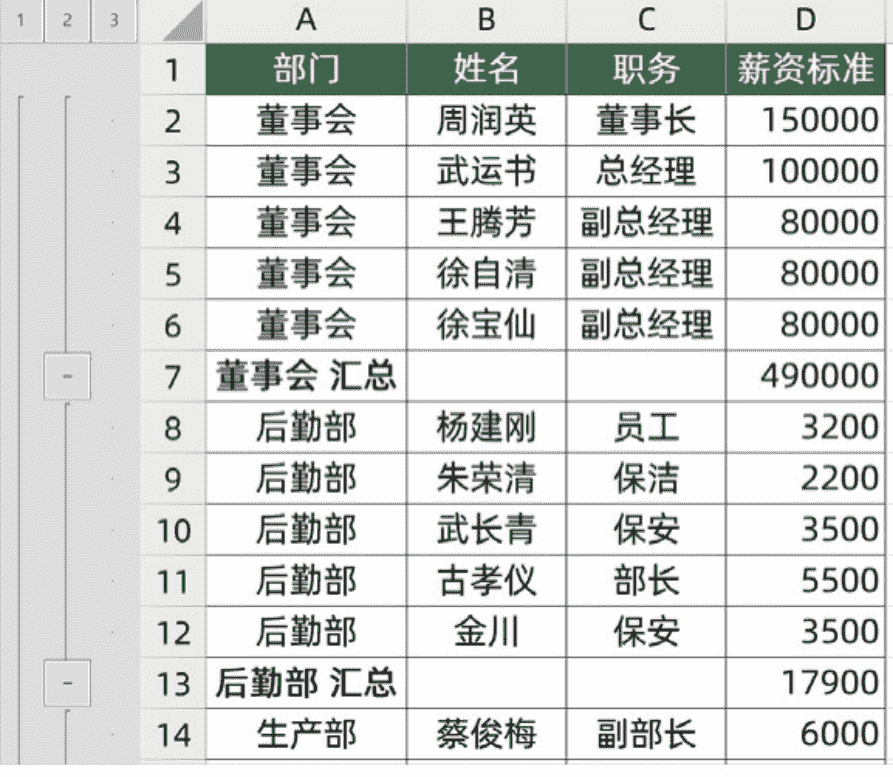

图5-15 带折叠按钮的Excel工作表

把截图通过 DeepSeek 窗口右下角的上传入口发送，随后发出类似的询问。

如图片所示，Excel 左上角有“1”“2”“3”三个数字，左侧伴随折叠按钮，这种呈现是怎么得到的呢？

模型给出的思路主要围绕“分类汇总”与“手动分组”两条路径展开，分步说明如下。

## 方法1：分类汇总 自动产出层级

先做排序。让数据按分组依据，例如部门，完成排序，使同一组记录连续排列。

启动向导。选中目标区域后切换到【数据】标签，点击【分类汇总】。

在弹出的设置窗中，把分类字段设为“部门”作为分组依据；汇总方式可选择“求和”或其他计算；【选定汇总项】中勾选需要统计的列，比如“薪资标准”。

点【确定】后，Excel 会自动插入汇总行，左侧生成折叠控件，顶部出现层级序号。

## 效果说明

层级序号：可切换显示粒度，1 为仅总计，2 为部门合计，3 为全部明细。

折叠按钮：+/- 可展开或收起对应分组的明细。

## 方法2：手动分组 自定义范围

先圈定要归并的行。例如选中后勤部的明细行后，进入【数据】标签→【创建组合】→选择【按行】分组。

重复上述操作，为各部门建立独立分组。

设置完成后左侧会出现折叠符号，点击即可收起或展开对应区块。

## 关键差异

分类汇总会自动插入汇总行并生成分级，适合快速统计。

手动分组更灵活，可自行界定分组范围，且无需汇总行。

按实际需要挑选合适方式，就能复现图中的样式，具体流程分别见图5-16、图5-17 所示。

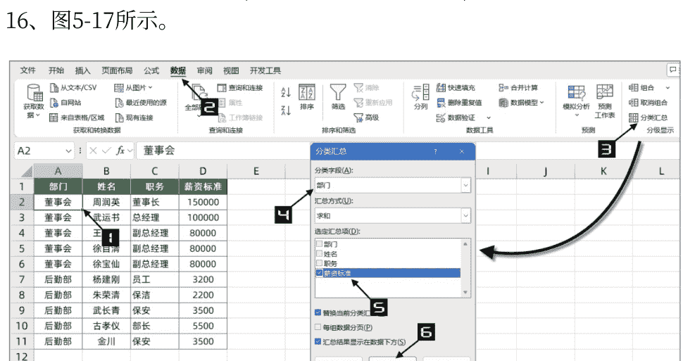

图5-16 分类汇总

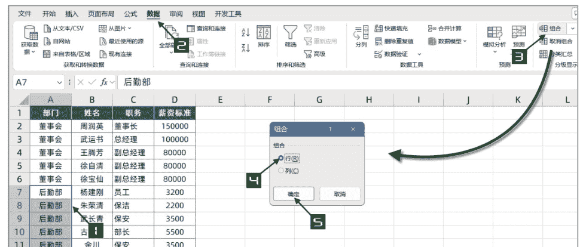

图5-17 手动组合

# 技巧09 用 DeepSeek 生成 VBA 脚本完成表格拆分

依靠 DeepSeek 可以按业务需求自动产出 VBA 脚本。即便没有编程经验，也能直接复制使用，效率明显提升。

如图5-18 所示，是 Excel 版的销售流水表。利用 DeepSeek，可以按 I 列的营业员姓名把流水拆成多个表格。

| A | B | C | D | E | F | G | H | I |
|---|---|---|---|---|---|---|---|---|
| 销售日期 | 交易时间 | 小票编号 | 商品编码 | 商品名称 | 单位 | 单价 | 数量 | 营业员 |
| 2025/1/1 | 8:12:29 | 3012 | 24177 | 酱油 | 瓶 | 12 | 2 | 张志辉 |
| 2025/1/1 | 10:12:00 | 3202 | 76123 | 花生油 | 瓶 | 100 | 2 | 张志辉 |
| 2025/1/1 | 11:48:29 | 3239 | 53034 | 酸奶 | 瓶 | 1.5 | 2 | 张志辉 |
| 2025/1/1 | 12:11:31 | 3247 | 53034 | 酸奶 | 瓶 | 1.5 | 3 | 张志辉 |
| 2025/1/1 | 12:40:19 | 3317 | 18989 | 果汁橙 | 瓶 | 3.5 | 3 | 张志辉 |
| 2025/1/1 | 15:05:46 | 3368 | 64503 | 毛巾 | 条 | 10.5 | 3 | 张志辉 |
| 2025/1/1 | 16:12:00 | 3489 | 18989 | 果汁橙 | 瓶 | 3.5 | 4 | 张志辉 |
| 2025/1/1 | 16:59:31 | 3579 | 44325 | 纸巾 | 包 | 1 | 3 | 张志辉 |
| 2025/1/1 | 17:36:58 | 3637 | 35912 | 洗衣粉 | 包 | 8 | 1 | 张志辉 |
| 2025/1/1 | 19:13:26 | 3665 | 54592 | 电池 | 排 | 6 | 3 | 张志辉 |
| 2025/1/1 | 19:35:02 | 3696 | 23712 | 纯牛奶 | 盒 | 2.5 | 3 | 张志辉 |
| 2025/1/1 | 20:28:19 | 3820 | 82397 | 盐 | 包 | 1.2 | 1 | 张志辉 |
| 2025/1/2 | 8:11:02 | 3909 | 18989 | 果汁橙 | 瓶 | 3.5 | 1 | 黄小娟 |
| 2025/1/2 | 8:29:46 | 3913 | 44325 | 纸巾 | 包 | 1 | 1 | 黄小娟 |

图5-18 销售流水表（部分）

在 DeepSeek 对话区输入如下指令。

> 我需要按 Excel 表格 I 列中的项目，将某个表格拆分为多个表格，请提供一份 VBA 脚本，并说明使用方法。

DeepSeek 产出的拆分脚本片段如图5-19 所示。

```
vba
Sub SplitByColumnL()
    Dim srcSheet As Worksheet
    Dim lastRow As Long
    Dim dict As Object
    Dim key As Variant
    Dim destSheet As Worksheet
    Dim srcData As Range

    ' 设置源工作表（根据实际名称修改）
    Set srcSheet = ThisWorkbook.Worksheets("Sheet1")

    ' 获取I列最后一行
    lastRow = srcSheet.Cells(srcSheet.Rows.Count, "I").End(xlUp).Row
    If lastRow < 2 Then Exit Sub

    ' 创建字典收集唯一值
    Set dict = CreateObject("Scripting.Dictionary")
```

图5-19 DeepSeek 产出的代码片段

操作指引如下。

打开文件后按 Alt+F11 进入 VBA 开发环境。

在工程资源管理器左侧右键，新建模块。

把上述代码粘贴进模块。

把代码里的源表名从默认“Sheet1”改成实际表名。

回到表格界面，按 Alt+F8 打开宏列表。

在列表中选择 SplitByColumnL 后运行。

点代码窗口右上角的复制按钮，打开文件后按 Alt+F11 进入开发环境。

在工程资源管理器左侧右键，从快捷菜单选【插入】→【模块】，如图5-20 所示。

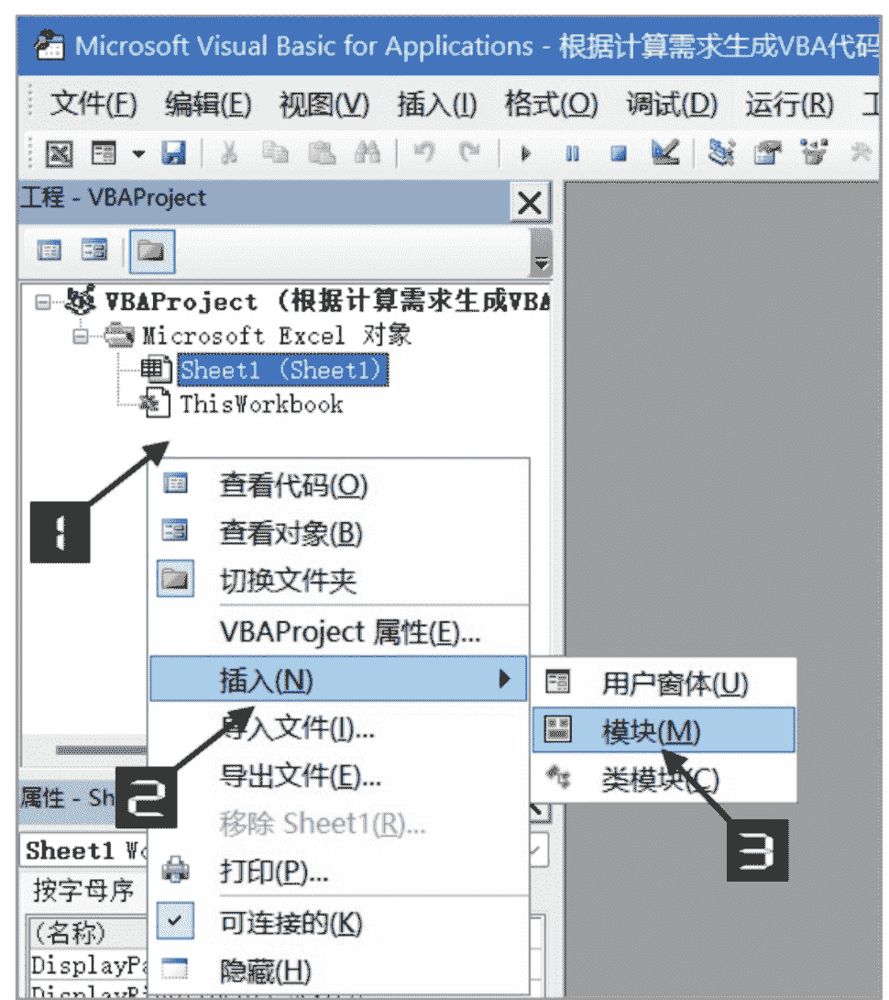

图5-20 插入模块

此时会出现名为“模块1”的新模块。在右侧空白区按 Ctrl+V 粘贴代码，并把默认表名“Sheet1”改为实际表名，如图5-21 所示。

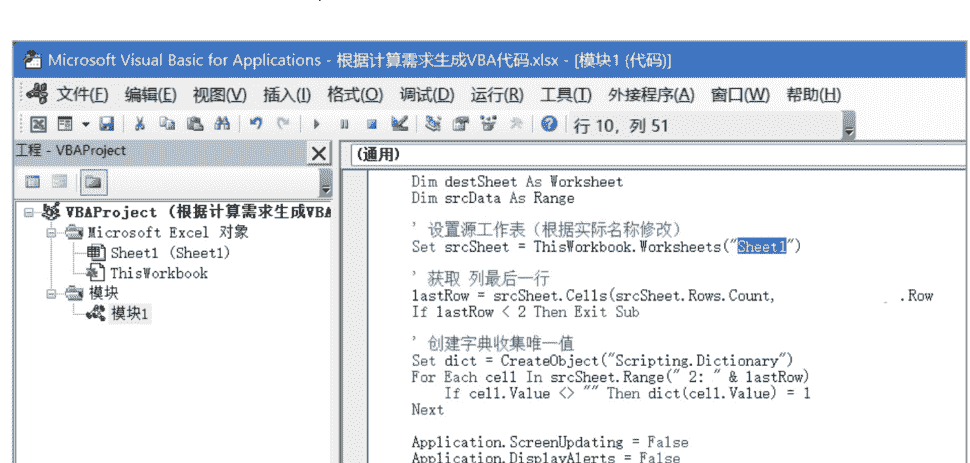

图5-21 把代码中的默认表名改为实际表名

关闭开发环境回到表格。按 Alt+F8 打开宏对话框，选中 SplitByColumnL，点击【执行】，如图5-22 所示。

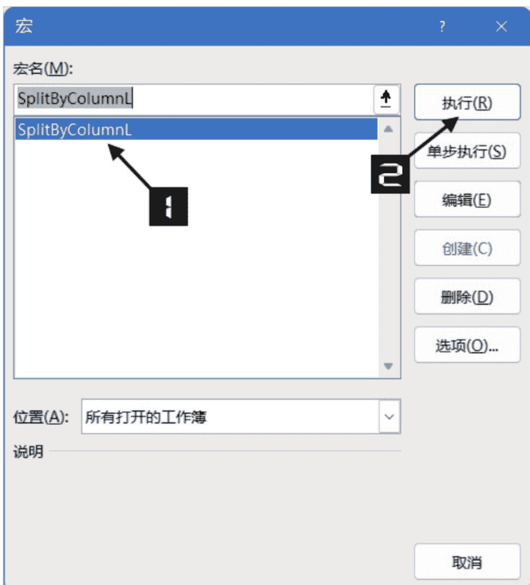

图5-22 宏对话框

这时 Excel 会弹出提示框，如图5-23 所示。

拆分后的表格效果如图5-24 所示。


图5-23 提示对话框

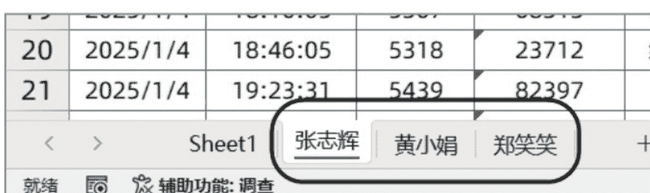

图5-24 拆分后的表格

含 VBA 脚本的文件需保存为 .xlsm 形式，否则脚本会丢失。

# 技巧10 让 DeepSeek 细化需求，使 VBA 脚本更通用

在 DeepSeek 中把运行效果描述得更具体，产出的脚本适用性会更好。

例如技巧9 中的脚本只能按 I 列拆分。若希望拆分列由使用者自行指定，范围更广。可在原提示词上做细化。

在对话区输入如下指令。

> 我需要一段 VBA 脚本，能够按 Excel 表格某一列中的项目将一个表格拆分为多个表格，同时能够让用户自定义拆分哪一列。请生成脚本并说明使用方法。

DeepSeek 按要求给出的优化后脚本如图5-25 所示。

点代码窗口右上角的复制按钮，打开文件后按 Alt+F11 进入开发环境。

在工程资源管理器左侧右键，从快捷菜单选【插入】→【模块】。

在“模块1”右侧空白区按 Ctrl+V 粘贴代码，随后关闭开发环境，回到表格。

```
vba
Sub SplitDataByColumn()
    Dim srcSheet As Worksheet
    Dim lastRow As Long, colIndex As Long
    Dim dataRange As Range, splitCol As Range
    Dim uniqueValues As Collection
    Dim cell As Range
    Dim value As Variant
    Dim newSheet As Worksheet
    Dim response As VbMsgBoxResult

    Application.ScreenUpdating = False
    Application.DisplayAlerts = False

    Set srcSheet = ActiveSheet
    lastRow = srcSheet.Cells(srcSheet.Rows.Count, 1).End(xlUp).Row

    ' 用户选择列
    On Error Resume Next
    Set splitCol = Application.InputBox( _
        Title:="选择拆分列", _
        Prompt:="请选择要拆分的列（点击列标）", _
        Type:=8)
    On Error GoTo 0

    If splitCol Is Nothing Then Exit Sub
    colIndex = splitCol.Column
    Set dataRange = srcSheet.Range(srcSheet.Cells(1, 1), srcSheet.Cells(lastRow, srcSheet.Column
```

图5-25 优化后的代码

按 Alt+F8 打开宏对话框，选中 SplitDataByColumn 后点击【执行】，会弹出【拆分列选择】对话框，如图5-26 所示。在对话框输入要拆分的列字母，如 C，点击【确定】，即可按 C 列项目拆分。


图5-26 确定要拆分的列

按 F12 把文件保存为 .xlsm 格式。

只要需求描述准确，DeepSeek 还能产出更多实用脚本，如合并工作簿或表格、按姓名导入图片、生成二维码或条形码等。

# 技巧11 用 DeepSeek 批量合并多个 Excel 工作簿

如图5-27 所示，在名为“分公司凭证记录”的文件夹内，有多个分公司的凭证记录工作簿，每个工作簿包含 1 月—6 月的表格。为了便于汇总，可借助 DeepSeek 把这些工作簿合并为一个。

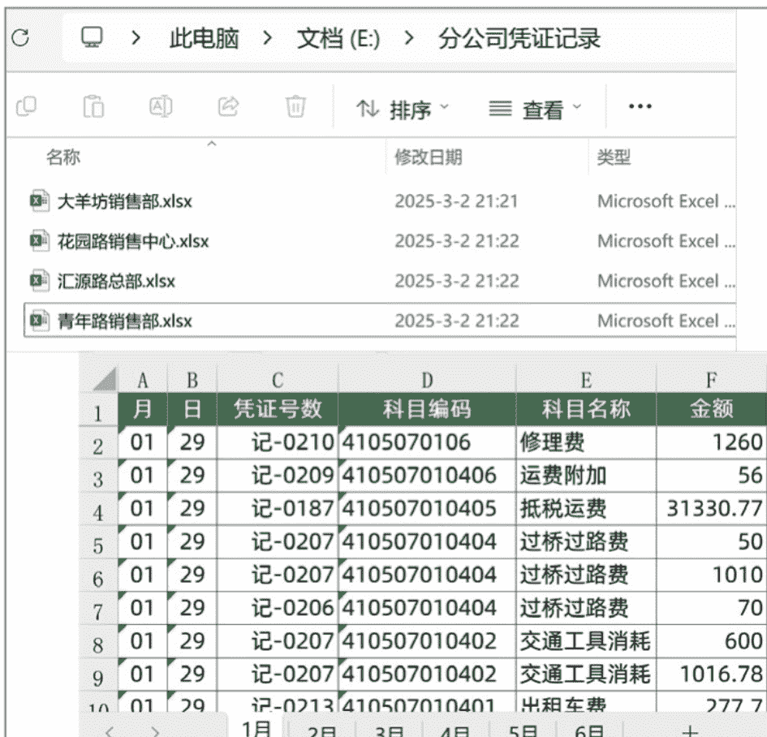

图5-27 分公司凭证记录

在对话区输入如下指令。

我需要一段 VBA 脚本，能够将同一个文件夹内多个结构相同的工作簿合并为一个工作簿。请满足先将相同名称的表格中的数据合并到一个表格内，再增加一列，显示来源工作簿的名称，同时能够让用户自己选择要合并的文件夹的要求，此外，请说明使用方法。

DeepSeek 产出的合并工作簿脚本如图5-28 所示。

```
Sub MergeWorkbooks()
    Dim folderPath As String
    Dim destWb As Workbook
    Dim srcWb As Workbook
    Dim srcWs As Worksheet
    Dim destWs As Worksheet
    Dim fileName As String
    Dim fileList As Collection
    Dim headerCell As Range
    Dim lastRow As Long, lastCol As Long, destLastRow As Long, sourceCol As Long
    Dim srcData As Variant, destData() As Variant
    Dim i As Long, j As Long

    ' 选择文件夹对话框
    With Application.FileDialog(msoFileDialogFolderPicker)
        .Title = "选择要合并的文件夹"
        If .Show <> -1 Then Exit Sub
        folderPath = .SelectedItems(1)
        If Right(folderPath, 1) <> "" Then folderPath = folderPath & ""
    End With

    ' 获取文件列表
    Set fileList = New Collection
    fileName = Dir(folderPath & "*.xls*")
    Do While fileName <> ""
        If fileName <> ThisWorkbook.Name Then
            fileList.Add fileName
        End If
```

图5-28 合并工作簿的脚本

新建一个 Excel 工作簿，按 Alt+F11 进入开发环境。在工程资源管理器左侧右键，从快捷菜单选【插入】→【模块】。

关闭开发环境回到表格。按 Alt+F8 打开宏对话框，选中 MergeWorkbooks 后点击【执行】。

在弹出的对话框里选择包含待合并文件的文件夹，等待程序运行完成，处理大量文件可能需要一段时间。

注意选择文件夹时，仅定位到包含工作簿的最末级目录，不要打开该目录，如图5-29 所示。

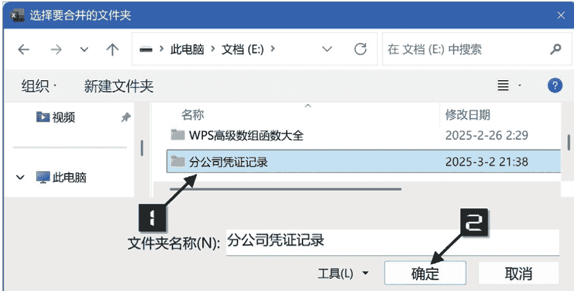

图5-29 选择目标文件夹

合并后的工作簿效果如图5-30 所示。

# 技巧12 用 DeepSeek 诊断并修正 VBA 脚本

使用 VBA 脚本时常会出现错误提示，需要据此完善和修改。若不熟悉调试，可借助 DeepSeek 进行修改并获取解读。

如图5-31 所示，一段取不重复数据的脚本运行时返回了编译错误的提示。

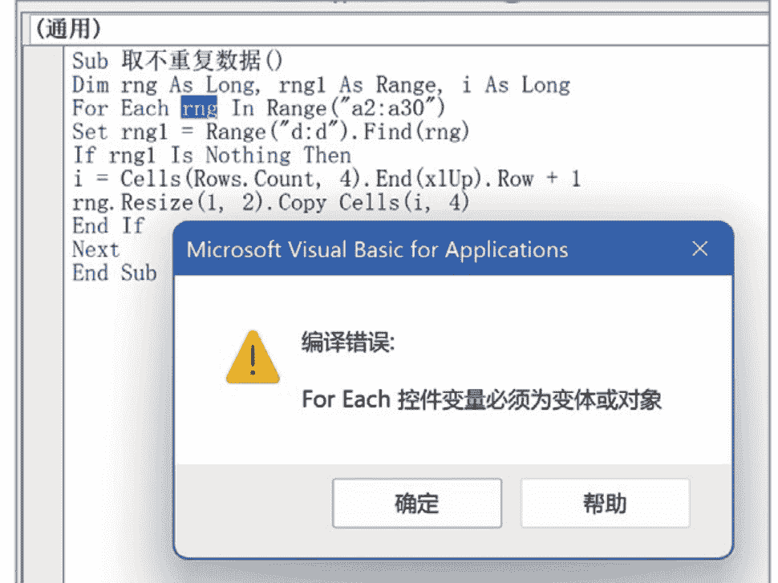

图5-31 编译错误

在对话区发送如下提示词。

```
以下 VBA 代码运行时提示编译错误，请进行修改，并逐句添加注释。
Sub 取不重复数据 ()
Dim rng As long, rng1 As Range, i As Long
For Each rng In Range("a2:a30")
Set rng1 = Range("d:d").Find(rng)
If rng1 Is Nothing Then
i = Cells(Rows.Count, 4).End(xlUp).Row + 1
rng.Resize(1, 2).Copy Cells(i, 4)
End If
Next
End Sub
```

DeepSeek 给出的修正后脚本如图5-32 所示，代码间逐行配了中文注释。

```
Sub 取不重复数据()
    ' 关闭屏幕刷新提升运行速度
    Application.ScreenUpdating = False

    ' 声明变量
    Dim rng As Range      ' 用于循环的单元格对象
    Dim rng1 As Range     ' 存储查找结果的单元格对象
    Dim i As Long         ' 存储行号

    ' 遍历A2到A30区域每个单元格
    For Each rng In Range("A2:A30")
        ' 在D列全列中精确查找当前单元格的值
        Set rng1 = Range("D:D").Find(What:=rng.Value, _
                                     LookIn:=xlValues, _
                                     LookAt:=xlWhole, _
                                     MatchCase:=False)

        ' 如果未找到匹配项
        If rng1 Is Nothing Then
            ' 获取D列最后一个非空单元格的行号+1（即第一个空行）
            i = Cells(Rows.Count, 4).End(xlUp).Row + 1

            ' 复制当前单元格及其右侧1列（共2列）到D列新行
            rng.Resize(1, 2).Copy Destination:=Cells(i, 4)
        End If
    Next rng

    ' 恢复屏幕刷新
    Application.ScreenUpdating = True

    MsgBox "操作完成！", vbInformation
End Sub
```

图5-32 DeepSeek修正后的VBA代码

经校核后，类型声明被纠正为 Range，原先的 Long 定义被舍弃。查找语句由简写的 Range("d:d").Find(rng) 改为 Range("D:D").Find(What:=rng.Value, LookIn:=xlValues, LookAt:=xlWhole)，明确以单元格取值作为匹配依据，并新增 MatchCase:=False，使大小写差异被忽略，A 与 a 等同。

# 技巧13 薪酬结构快速透视

DeepSeek 能在短时间内解析工作表并完成统计，把繁琐的计算变得高效。本例采用的模拟薪酬表包含姓名、部门、职务、薪酬标准，内容见图5-33。

| 姓名 | 部门 | 职务 | 薪资标准 |
|---|---|---|---|
| 周润英 | 董事会 | 董事长 | 150000 |
| 武运书 | 董事会 | 总经理 | 100000 |
| 蔡俊梅 |  | 部长 |  |
| 王腾芳 | 董事会 | 副总经理 | 80000 |
| 李惠仙 | 生产部 | 技术总工 | 25000 |
| 李向阳 | 生产部 | 部长 | 7000 |
| 徐自清 | 生产部 | 员工 | 5500 |
| 刘树芬 | 生产部 | 员工 | 5500 |
| 潘云红 |  | 员工 |  |
| 杨建刚 | 后勤部 | 员工 | 3200 |

图5-33 待解读的工作表（部分）

修剪平均值是在剔除两端极值后再求均值，可削弱异常值干扰。中位数则体现各部门薪酬的典型位置，与修剪均值对比更能看出分布集中程度。

把 Excel 内容复制到对话区，提示 DeepSeek 按上述数据统计各部门薪酬中位数与剔除首尾各一数值的修剪平均值，并以表格呈现并点评。

得到的结果见表5-3。

表5-3 各部门薪资中位数与修剪平均值

| 部门 | 薪资中位数（元） | 修剪平均值（元） |
|---|---|---|
| 董事会 | 80,000 | 86,666.67 |
| 生产部 | 5,000 | 5,277.78 |
| 后勤部 | 3,500 | 3,400 |
| 质保部 | 4,200 | 4,200 |

要点归纳：

1. 董事会：高层聚集且层级分明。中位数 80,000 元，修剪均值升至 86,666.67 元，董事长 150,000 元的极值拉高了整体，剔除后主要区间在副总经理 80,000 元至总经理 100,000 元。
2. 生产部：分化明显。中位数 5,000 元与修剪均值 5,277.78 元相近，但技术总工 25,000 元为离群点。剔除后中位数仍为 5,000 元，基层多集中在 4,200～6,500 元。技术岗约为普通员工 5 倍以上，公平性需关注，建议通过绩效公开或职级优化缓解。
3. 后勤部：分布均衡。中位数 3,500 元与修剪均值 3,400 元接近，保安、保洁等岗位差异小，约 2,200～3,500 元，部长 5,500 元高于基层，符合常规梯度。
4. 质保部：规模小结构清晰。中位数与修剪均值同为 4,200 元，部门仅 3 人。部长 6,500 元与质检员 4,200 元差距合理，需留意质检员是否具备市场竞争力。

总体看，高层薪酬远高于其他部门，生产部内部差距最大，后勤部最平均，质保部层级明确。对比中位数与修剪均值的偏离可识别偏态及异常值影响，企业应审视薪酬的合理性、公平性与市场匹配度。

# 技巧14 发票批量识别与归档

DeepSeek 可自动识别电子发票、抽取字段并归类，减少手工录入，也能批量处理并智能校核，发现不一致并给出修正建议，降低财务风险。

本例需把多张电子发票整理为表格，票面示例见图5-34。


图5-34 待整理的电子发票

点击对话框右下角的回形针图标上传全部发票，提示把内容整理为表格，字段包括发票号、买方名称、销售方名称、项目名称、数量、单价、金额和税额。

DeepSeek 输出表格的同时补充说明：各票数量均为 1，部分未明示的依据价税合计反推为 1；金额与税额以价税合计小写及调整后的最终数值为准，部分折扣或退货为负数已合并；税率均为 13%。

复制表格到 Excel。发票号码常超 15 位，直接粘贴会导致后位变 0。先把 A 列改为文本类型，再右键选择粘贴选项中的格式匹配，如图5-35。

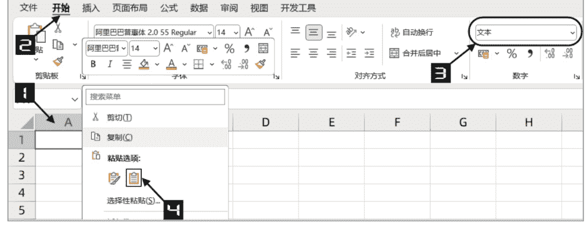

图5-35 在Excel中设置文本格式

整理后的结果如图5-36。

| 发票号 | 买方名称 | 销售方名称 | 项目名称 | 数量 | 单价 | 金额 | 税额 |
|---|---|---|---|---|---|---|---|
| 25377000000060956066 | 个人 | 济南京东奥升贸易有限公司 | 调味品-水塔老陈醋4.5°2.3L山西醋凉拌 | 1 | 20.18 | 14.99 | 1.95 |
| 25117000000083585519 | 个人 | 北京京东世纪信息技术有限公司 | 酒-雪熊精酿啤酒哈尔滨大绿棒子进口麦 | 1 | 70.71 | 40.78 | 5.3 |
| 25127000000029792146 | 个人 | 天津京东星业贸易有限公司 | 金属制品-京东京造菜刀家用切片刀具 | 1 | 79.56 | 65.73 | 8.54 |
| 25377000000027194802 | 个人 | 济南京东奥升贸易有限公司 | 酒-通明山水果酒山楂酒500ml*6瓶 | 1 | 61.06 | 60.45 | 7.86 |
| 24377000000369429705 | 个人 | 齐河县京东商贸有限公司 | 营养保健食品-窝小芽鳕鱼肠420g | 1 | 35.31 | 32.71 | 4.25 |
| 2592720000003646741 | 个人 | 青岛京东昌益得贸易有限公司 | 眼镜类产品-普先生老花镜150度 | 1 | 34.51 | 32.2 | 4.19 |

图5-36 整理后的发票信息

DeepSeek 的输出仍需人工复核关键字段。

# 技巧15 资产负债表深度剖析

提示的明确度决定输出质量，专业问题需要提问者具备判断力。本例上传的资产负债表见图5-37。

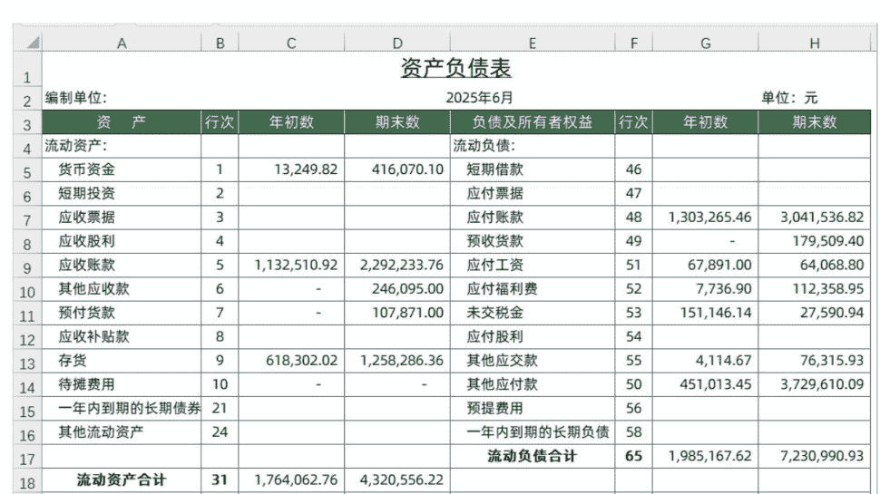

图5-37 资产负债表（部分）

首次指令：请解读资产负债表。

部分产出：期初总资产与负债及所有者权益合计均为 2,569,675.43 元，期末均为 5,547,757.19 元，符合会计恒等式。货币资金由 13,249.82 元增至 416,070.10 元，流动性增强；应收账款由 1,132,510.92 元增至 2,292,233.76 元，增幅 102%，需关注回款风险；存货由 618,302.02 元增至 1,258,286.36 元，增幅 103%，可能存在积压或备货。该解读忽略了递延税项、其他应收款等细节及风险关联。

优化指令：你是一名资深财务专家，擅长财务报表解读，请针对提供的某公司资产负债表展开分析并生成财务分析报告。数据必须准确，完全依据提供的数据。

优化后报告如下。

财务分析报告
公司名称：未提供
报告期间：2025年6月30日
单位：人民币元

资产结构分析
期末资产总额 5,547,757.19 元，较年初 2,569,675.43 元增长 115.9%，主要来自流动资产扩张。
流动资产期末 4,320,556.22 元，较年初 1,764,062.76 元增长 144.9%。
货币资金从 13,249.82 元增至 416,070.10 元，增幅 3039%，短期流动性增强。
应收账款从 1,132,510.92 元增至 2,292,233.76 元，增幅 102.5%，可能伴随信用扩张或回款周期拉长。
固定资产期末 1,227,200.97 元，较年初 805,612.67 元增长 52.3%，在建工程新增 155,933.08 元。

负债及偿债能力分析
流动负债期末 7,230,990.93 元，较年初 1,985,167.62 元增长 264.2%。
应付账款从 1,303,265.46 元增至 3,041,536.82 元，增幅 133.4%，可能面临供应商催款压力。
其他应付款从 451,013.45 元增至 3,729,610.09 元，增幅 726.9%，需核查大额往来性质。
流动比率约 0.60，行业安全线通常≥2，短期偿债能力严重不足。
速动比率约 0.37，进一步确认流动性风险。

所有者权益与盈利能力
期末所有者权益 -1,683,233.74 元，年初 584,507.81 元，未分配利润亏损扩大至 -2,183,233.74 元，年初 84,507.81 元。资不抵债风险显现，资产负债率高达 130.3%，公司处于技术性破产状态。

关键风险提示
流动性危机，流动比率远低于安全水平，短期债务偿付困难。
亏损持续扩大，需排查经营亏损原因。
应付账款激增，可能恶化供应商关系。

建议
优化现金流管理，加速应收回收并协商延长应付账期。
引入资本或进行债务重组，缓解资不抵债压力。
控制成本并调整盈利模式，削减非必要支出，寻找新收入点。

注：分析仅基于提供的资产负债表，未结合利润表、现金流量表及行业背景，仅供参考。

对比可知，第二次解读数据完整、风险点清晰、建议具体。

# 技巧16 损益表计算逻辑校验

除解读外，还可借助 DeepSeek 核验报表数据与计算逻辑。图5-38 为某公司财务人员编制的损益表。

| 项目 | 行次 | 本月数 | 本年累计数 |
| :--- | :--- | :--- | :--- |
| 一、主营业务收入 | 1 | 1,001,694.23 | 8,813,413.80 |
| 减：主营业务成本 | 4 | 779,238.58 | 7,941,883.00 |
| 主营业务税金及附加 | 5 | 6,201.85 | 56,439.85 |
| 二、主营业务利润 | 10 | 216,253.80 | 815,090.95 |
| 加：其他业务利润 | 11 | 0.00 | 0.00 |
| 减：营业费用 | 14 | 13,011.50 | 144,981.32 |
| 管理费用 | 15 | 81,335.04 | 624,549.29 |
| 财务费用 | 16 | 2,858.28 | -171.21 |
| 三、营业利润 | 18 | 119,048.98 | 45,731.55 |
| 加：投资收益 | 19 | 0.00 | 0.00 |
| 补贴收入 | 22 | 0.00 | 427,676.80 |
| 营业外收入 | 23 | 0.00 | 0.00 |
| 减：营业外支出 | 25 | 0.00 | 80,359.96 |
| 四、利润总额 | 27 | 119,048.98 | 393,048.39 |
| 减：所得税 | 28 | 20,579.40 | 13,602.27 |
| 五、净利润 | 30 | 98,469.58 | 379,446.12 |

图5-38 损益表

上传文件并发送指令：你是一位资深财务总监，请对以上损益表数据进行核验，重点检查公式计算逻辑和结果是否正确，给出结论和建议，确保数据准确。

DeepSeek 核验报告如下。

损益表核验结论与建议
计算逻辑核验
主营业务利润行次10
本月：1,001,694.23 - 779,238.58 - 6,201.85 = 216,253.80
本年累计：8,813,413.80 - 7,941,883.00 - 56,439.85 = 815,090.95
结论：计算正确。

营业利润行次18
本月：216,253.80 - 13,011.50 - 81,335.04 - 2,858.28 = 119,048.98
本年累计：815,090.95 - 144,981.32 - 624,549.29 + 171.21 = 45,731.55，财务费用为负作为加项
结论：计算正确。

利润总额行次27
本月：119,048.98 + 0 - 0 = 119,048.98

本年度累计测算：45,731.55 + 427,676.80（补贴收入） - 80,359.96（营业外支出） = 393,048.39
校验结果：公式成立。

**净利润 行次30**
本期金额：119,048.98（利润总额） - 20,579.40（所得税） = 98,469.58
本年累计：393,048.39 - 13,602.27 = 379,446.12
校验结果：公式成立。

### 二、数据可靠性说明
整体核算思路契合会计准则，金额核对无误。以下异常点建议重点关注：
- 行次16 财务费用：本年累计为-171.21元，出现负向可能源于利息收益等财务性收益，建议拆分明细复核。
- 行次22 补贴收入：本年累计427,676.80元体量较大，需核实政策符合性及会计处理是否合规。
- 行次28 所得税：本期税负约17.3%，累计税负约3.5%，差异明显，需排查暂估调整或税收优惠影响。

### 三、改进建议
补充披露
- 在报表附注中说明财务费用负向的原因及补贴收入的具体来源。
- 对所得税率波动较大提供合理解释。

合规核查
- 确认补贴收入满足相关法规要求。

内控完善
- 建议建立跨部门复核流程，对财务费用负值等异常科目执行二次确认。

总体判断：损益表计算正确、逻辑清晰，但异常科目仍需进一步说明与合规审查。日常应强化数据管控与内部控制，保证财务信息准确安全。

上述核验对公式关系进行了梳理，并对疑点予以标注，同时提出了优化方向。

# 技巧17 损益表智能解读
编制规范且公式正确的损益表，可借助DeepSeek开展数据解读。如图5-39所示，为某公司财务人员编制的损益表。

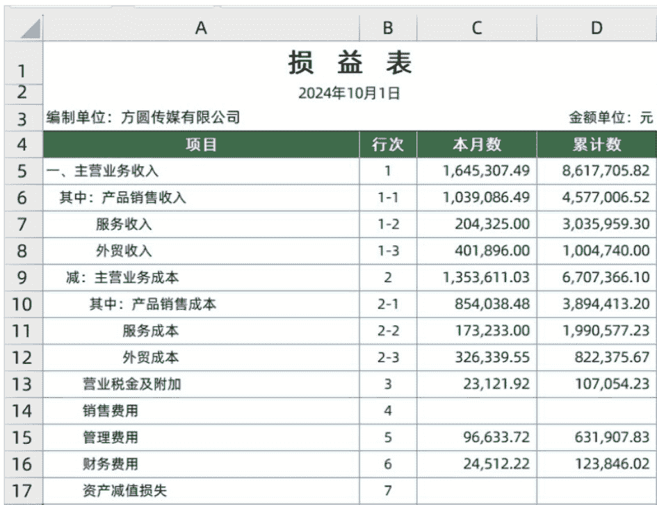

图5-39 损益表 部分

在DeepSeek界面右下角点击⊕上传Excel文件，并输入提示词。
> 请以资深财务总监身份分析所附损益表数据，输出结论与建议，确保数值准确。

模型返回的内容如下。

核对要点
营业收入及对应成本
- 收入：当月1,645,307.49元，含产品1,039,086.49元、服务204,325元、外贸401,896元；累计8,617,705.82元，分项合计与总额相符。
- 成本：当月1,353,611.03元，含产品854,038.48元、服务173,233元、外贸326,339.55元；累计6,707,366.10元，分项合计与总额基本一致，仅差1元，推测为四舍五入。

当月营业利润验算
1,645,307.49-1,353,611.03-23,121.92-96,633.72-24,512.22=147,428.60元，与表内一致。

当月利润总额与净利润验算
- 利润总额：147,428.60+41.41-66.81=147,403.20元，与表值一致。
- 净利润：147,403.20-24,567.19=122,836.01元，与表值一致。

累计逻辑
累计净利润864,301.76元，需确认各月累加是否合理，如当月122,836.01元与历史月份相加是否匹配。

核心结论
吻合度高
- 计算结果与报表数值基本吻合，仅成本分项存在1元差异，属四舍五入。

经营亮点
- 收入结构多元：产品、服务、外贸占比约63.1%/12.4%/24.5%，有助于分散风险。
- 外贸毛利率较高：当月18.8%，高于服务15.2%和产品17.8%。

潜在风险
- 管理费用偏高：当月96,633.72元，占收入5.9%；累计631,907.83元，占累计收入7.3%，需优化成本结构。
- 所得税率偏低：当月16.7%，低于标准25%，需核实优惠或税前扣除依据是否合规。
- 销售费用为零：可能遗漏，需核查合理性。

建议
费用管控
- 拆分管理费用，分析行政、人力明细，推进降本措施；关注财务费用，监控贷款利息与资金使用效率。

税务合规
- 核实所得税率低于25%的原因，如高新技术企业优惠、研发加计扣除，确保符合税法。

外贸强化
- 利用高毛利优势扩大外贸规模，同时优化供应链并做好汇率风险管理。

销售费用复核
- 复核销售费用为0的真实性，若存在未入账支出应及时补录。

总结
损益表准确度较高，但需聚焦费用控制与税务合规。建议细化费用管理提升净利润率、发挥外贸优势拓展市场、定期审计税务资料、借助财务软件自动校验减少人工差错。

该工具除核验数据与公式外，还提示了异常并给出总结。

# 技巧18 总账直出现金流量表
DeepSeek可直接抓取总账、试算平衡表等多源数据整合生成报表，无需手工复制，亦可自动识别试算不平衡、现金流分类矛盾等异常，降低错误率。

如图5-40所示，为某公司总账表与试算平衡表节选。本例利用DeepSeek解读两表并生成现金流量表。

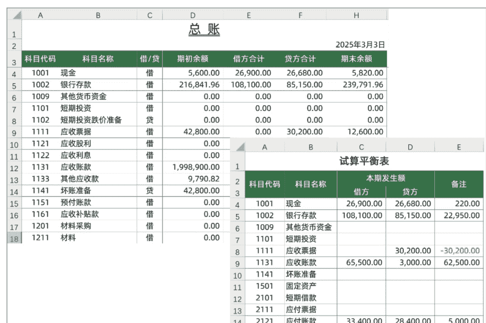

图5-40 总账表与试算平衡表 部分

点击对话框右下角⊕上传总账表和试算平衡表，输入提示词。
> 请以资深财务总监身份，依据附件总账表和试算平衡表编制符合标准的现金流量表，确保数据准确，以Markdown代码形式输出。

将代码复制到Markdown在线编辑器生成报表并导出Word，如图5-41所示。

## 一、经营活动产生的现金流量
| 项目 | 金额（元） |
| :--- | :--- |
| 销售商品、提供劳务收到的现金 | 148,500.00 |
| 收到的其他与经营活动有关的现金 | 1,850.00 |
| **经营活动现金流入小计** | **150,350.00** |
| 购买商品、接受劳务支付的现金 | (28,400.00) |
| 支付给职工以及为职工支付的现金 | (20,000.00) |
| 支付的各项税费 | 0.00 |
| 支付的其他与经营活动有关的现金 | (12,000.00) |
| **经营活动现金流出小计** | **(60,400.00)** |
| **经营活动产生的现金流量净额** | **89,950.00** |

## 二、投资活动产生的现金流量
| 项目 | 金额（元） |
| :--- | :--- |
| 购建固定资产支付的现金 | 0.00 |
| **投资活动现金流出小计** | **0.00** |
| **投资活动产生的现金流量净额** | **0.00** |

## 三、筹资活动产生的现金流量

图5-41 DeepSeek生成的现金流量表 部分

为确保准确，可继续让模型核验。输入提示词：
> 请核对总账表与试算平衡表的一致性，确保所有现金相关科目的变动均被涵盖。

根据返回结果对账簿修正，直至无误。

# 技巧19 卡片批量转表格
DeepSeek可将Word版固定资产卡片批量转为表格。

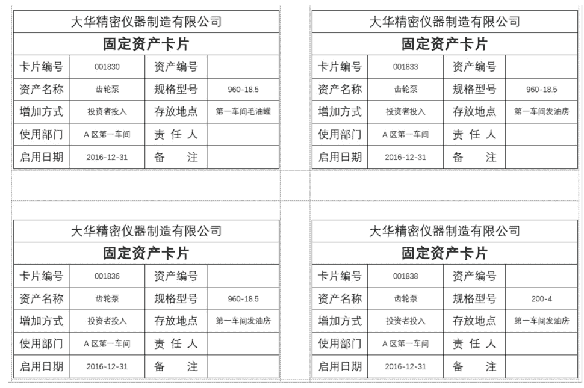

图5-42 固定资产卡片 部分

打开WPS灵犀，点击对话框右下角上传按钮上传Word文档，输入提示词。
> 请将附件中的固定资产卡片逐条转为表格，字段包括卡片编号、资产名称、增加方式、使用部门、启用日期、规格型号和存放地点，不得遗漏。

处理后复制内容粘贴到Excel并调整格式，效果如图5-43所示。

| 卡片编号 | 资产名称 | 增加方式 | 使用部门 | 启用日期 | 规格型号 | 存放地点 |
| :--- | :--- | :--- | :--- | :--- | :--- | :--- |
| 001824 | 脂肪酸泵 | 投资者投入 | A区第一车间 | 2016/12/31 | MZA25-200 | 第一车间北脂肪酸罐 |
| 001827 | 碱泵 | 投资者投入 | A区第一车间 | 2016/12/31 | ML32-20-160 | 第一车间北碱罐 |
| 001830 | 齿轮泵 | 投资者投入 | A区第一车间 | 2016/12/31 | 960-18.5 | 第一车间毛油罐 |
| 001833 | 齿轮泵 | 投资者投入 | A区第一车间 | 2016/12/31 | 960-18.5 | 第一车间发油房 |
| 001847 | 螺杆泵 | 投资者投入 | A区第一车间 | 2016/12/31 | NM045BY01L0 | 皂角罐 |
| 001852 | 室内配电箱 | 投资者投入 | A区第一车间 | 2016/12/31 | 600800350 | 小包装 |
| 001854 | 室外防雨箱 | 投资者投入 | A区第一车间 | 2016/12/31 | 8001000350 | 小包装 |
| 001859 | 控制柜1# | 投资者投入 | A区第一车间 | 2016/12/31 | 8002200600 | 小包装 |

图5-43 固定资产卡片电子表格 部分

# 技巧20 一键生成质检报告
DeepSeek可依据判定标准与实测数据判断产品合格性。

如图5-44所示，为某产品指标标准及质量检验单节选。

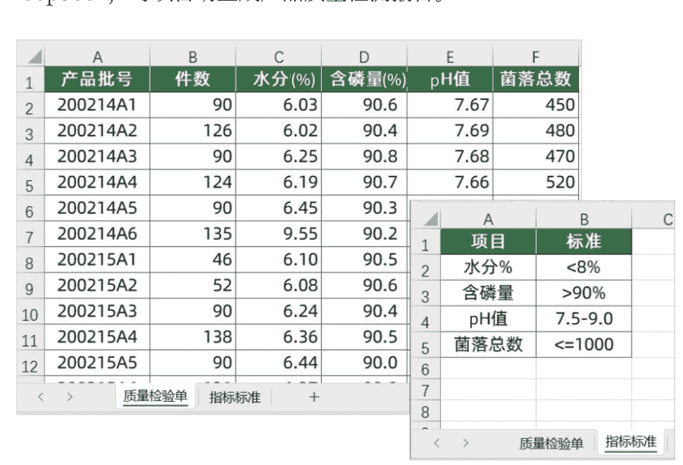

图5-44 质量检验单与指标标准 部分

上传质量检验单和指标标准，输入提示词。
> 你是质量管理专家，请解读“质量检验单”工作表，依据“指标标准”逐行判断产品是否合格并生成质检报告。

复制结果到Excel调整格式后效果如图5-45所示。

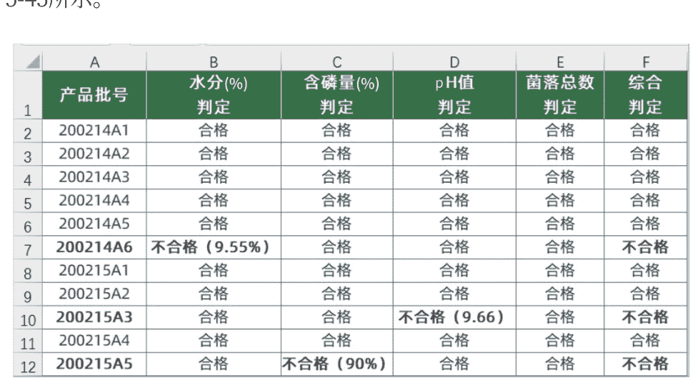

图5-45 DeepSeek生成的判断结果 部分

模型生成报告如下。

异常批次统计：
- 不合格批次数：8，批号：200214A6、200215A3、200215A5、200215A6、200216A1、200217A1、200218A4、200219A3

主要问题分布：
- 水分超标：2批次
- 含磷量不足：4批次
- pH值超标：2批次

# 技巧21 文本数据结构化
DeepSeek可将含数字的文本快速整理为表格。例如教育部《2023年全国教育事业发展统计公报》节选：

全国共有幼儿园27.44万所，比上年减少14808所，下降5.12%。其中，普惠性幼儿园23.64万所，比上年减少9301所，下降3.79%，占全国幼儿园的86.16%，比上年提高1.2个百分点。

学前教育在园幼儿4092.98万人，比上年减少534.57万人，下降11.55%。其中，普惠性幼儿园在园幼儿3717.01万人，比上年减少427.03万人，下降10.30%，占全国在园幼儿的90.81%，比上年提高1.26个百分点。

学前教育毛入园率91.1%，比上年提高1.4个百分点。

学前教育专任教师307.37万人，专任教师中专科以上学历比例92.74%。

输入提示词：
> 请将以上内容整理、转换为表格，注意数据要准确。

生成的表格如图5-46所示。

| 指标类别 | 数值 | 比上年增减（数量） | 比上年增减（百分比） | 占比 | 占比增减（百分点） |
| :--- | :--- | :--- | :--- | :--- | :--- |
| 全国幼儿园总数 | 27.44 万所 | -14,808 所 | -5.12% | — | — |
| 其中：普惠性幼儿园数量 | 23.64 万所 | -9,301 所 | -3.79% | 86.16% | +1.2 |
| 在园幼儿总数 | 4,092.98 万人 | -534.57 万人 | -11.55% | — | — |
| 其中：普惠性幼儿园在园幼儿 | 3,717.01 万人 | -427.03 万人 | -10.30% | 90.81% | +1.26 |
| 学前教育毛入园率 | 91.1% | — | +1.4 个百分点 | — | — |
| 学前教育专任教师 | 307.37 万人 | — | — | — | — |
| 其中：专科以上学历比例 | 92.74% | — | — | — | — |

图5-46 根据文本内容生成表格

表格中单位统一，增减以—表减少、+表增加，层级清晰，缺失以“—”填充。

# 技巧22 考勤记录标准化
DeepSeek可将考勤机导出的复杂记录转为规范表格。

如图5-47所示，为某单位部分考勤数据，单单元格含多条打卡记录。

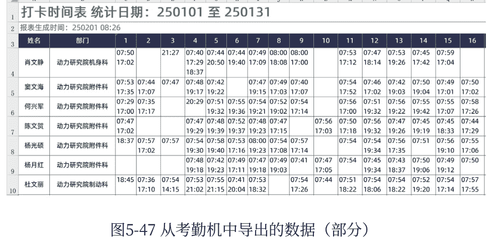

图5-47 从考勤机中导出的数据 部分

打开WPS灵犀上传考勤数据，输入提示词。
> 请对考勤表数据逐条整理，生成规范表格，字段包括姓名、部门、日期、最早打卡时间和最晚打卡时间。

生成的表格如图5-48所示。

| 姓名 | 部门 | 日期 | 最早打卡时间 | 最晚打卡时间 |
|---|---|---|---|---|
| 肖文静 | 动力研究院机身科 | 1 | 07:50 | 17:02 |
| 肖文静 | 动力研究院机身科 | 3 | 21:27 | 21:27 |
| 肖文静 | 动力研究院机身科 | 4 | 07:40 | 18:37 |
| 肖文静 | 动力研究院机身科 | 5 | 07:44 | 20:50 |
| 肖文静 | 动力研究院机身科 | 6 | 07:44 | 19:40 |
| 肖文静 | 动力研究院机身科 | 7 | 07:49 | 17:09 |
| 肖文静 | 动力研究院机身科 | 8 | 08:00 | 18:08 |
| 肖文静 | 动力研究院机身科 | 9 | 08:00 | 17:00 |
| 肖文静 | 动力研究院机身科 | 11 | 07:53 | 17:12 |
| 肖文静 | 动力研究院机身科 | 12 | 07:47 | 18:14 |
| 肖文静 | 动力研究院机身科 | 13 | 07:53 | 19:26 |
| 肖文静 | 动力研究院机身科 | 14 | 07:45 | 17:42 |
| 肖文静 | 动力研究院机身科 | 15 | 07:59 | 17:04 |
| 肖文静 | 动力研究院机身科 | 18 | 07:48 | 18:28 |
| 肖文静 | 动力研究院机身科 | 19 | 07:50 | 18:09 |

图5-48 整理后的考勤数据 部分

数据完整、格式统一、字段对齐，可读性强。

# 技巧23 离职原因深度分析
DeepSeek可深度解析离职数据，帮助企业降低流失率。

如图5-49所示，为某企业部分离职人员资料。

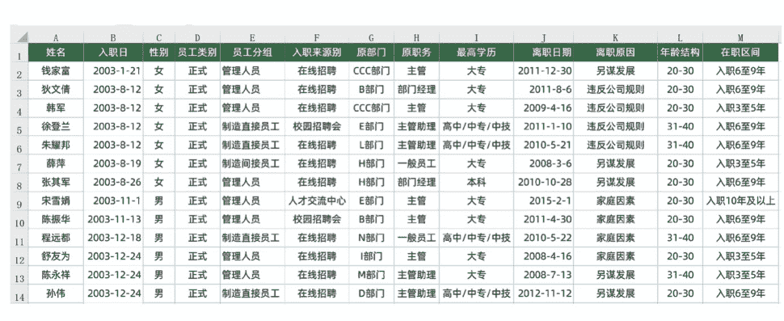

图5-49 离职人员资料表 部分

上传Excel文档，输入提示词。
> 你是资深HR，请对文档中的人员离职数据进行深入解读，从不同角度分析离职原因。

模型生成的分析报告如下。

## 1. 离职原因分布
主要原因：
- 违反公司规则 占比最高约35%：集中在制造直接员工和管理人员，涉及多个部门。
- 另谋发展 占比约30%：管理人员比例更高，可能与职业发展机会不足有关。
- 家庭因素 占比约20%：跨部门分布，女性占比略高。
- 身体不适/工作环境不适应 占比约10%：制造直接员工为主，可能与工作强度或环境相关。
- 其他原因 如考试不合格、交通不便等，占比5%。

结论：需加强行为规范培训，改善工作环境，提供清晰晋升路径。

## 2. 性别与离职关联

离职动因全景透视

- 性别维度：女性离职集中在家庭相关原因约占四分之一，主动寻求外部机会约占三成；男性离职则以规章违背约占四成、另谋去路约占三成五为主。
研判：为女性群体构建更具弹性的家庭支持体系，如弹性工时；对男性群体强化合规教育与行为引导。

## 3. 岗位层级流失图谱
- 管理层：流失以寻求新机会约四成五、规章违背约三成领先，可能源于晋升通道受阻或管理压力过大。
- 制造一线：规章违背约四成、身体不适或环境不适应约四分之一较为突出，需关注基层作业条件及流程合规。
研判：向管理者提供职业规划辅导，面向生产岗位优化作业流程并完善健康管理机制。

## 4. 重点部门流失聚焦
- CCC部门：离职人数最多约20人，主因规章违背约五成、寻求新机会约三成，需排查部门管理问题。
- F部门：规章违背约四成、家庭因素约四分之一明显，可能与团队氛围或考核机制有关。
研判：对离职率偏高的部门开展管理审计，改进协作方式与监督机制。

## 5. 招聘渠道与留存关联
- 在线招聘来源离职率最高约五成，核心为另谋高就与规章违背，需提升甄选质量。
- 校园招聘进入者易因环境不适应或身体不适而流失，需强化新人融入培训。
- 人才交流中心来源员工家庭因素约三成、规章违背约四分之一分布均衡，整体稳定性居中。
研判：优化各渠道甄选标准，强化入职初期的关怀与适应支持。

## 6. 学历背景与离职关系
- 大专本科群体中管理人员占比高，离职主因寻求新机会约五成。
- 高中中专中技群体多为制造人员，离职多因规章违背约四成和身体不适约两成。
研判：为高学历人才定制个性化发展路径，提升基层人员技能培养力度与福利保障。

## 7. 年龄与司龄交叉分析
- 20～30岁群体离职主因寻求新机会约四成、规章违背约三成，流动性强。
- 31～40岁群体家庭因素约三成五、身体不适约四分之一占比更高，需兼顾工作生活平衡。
司龄分布：
- 入职3～5年为离职高峰约近半，多因职业瓶颈或理念与规章冲突。
- 入职6～9年另谋发展约四成、家庭因素约三成主导，可能长期缺乏晋升空间。
研判：按年龄与司龄分层设计留人举措，如青年轮岗计划、中年健康关怀。

综合建议
- 管理优化：对CCC、F等高流失部门进行复盘，强化合规监督与团队文化建设。
- 职业发展：搭建清晰晋升通道，重点培养管理者与技术骨干。
- 员工关怀：完善家庭支持政策如育儿假，健全健康管理如定期体检与心理服务。
- 招聘改进：加强在线招聘背景核查，优化校园招聘适应性培训，提升人岗匹配度。

以上梳理覆盖了离职原因分布、性别差异、岗位类别、部门集中、入职来源、学历关联、年龄司龄趋势等维度，既归纳了分析结论，也指出了组织需要改进的关键点。

# 第6章 DeepSeek驱动演示文稿智能化制作

该模型可依用户指令迅速输出结构化演示提纲，涵盖逻辑架构、数据提炼与核心观点，适配汇报演讲等不同场景。与其他AI工具联动，可实现从内容生成到视觉落地的全链路提效，例如五分钟完成初稿并迭代优化。

## 本章要点
- ◆ 技巧1 DeepSeek+通义千问，基于文档快速生成演示文稿
- ◆ 技巧2 DeepSeek+通义千问，高效优化现有演示文稿
- ◆ 技巧3 DeepSeek+WPS灵犀，按主题自动产出演示文稿

## 技巧01 DeepSeek+通义千问，从文档到演示文稿的快速转化
借助该模型的逻辑推理与文案润色能力，可迅速输出条理清晰的演示提纲；通义千问拥有强大的演示文稿生成能力，二者配合能大幅提升效率。

如图6-1所示，是某公司Word版年度总结的部分内容，包含多项运营数据与项目完成情况，现需据此制作年度总结演示文稿。

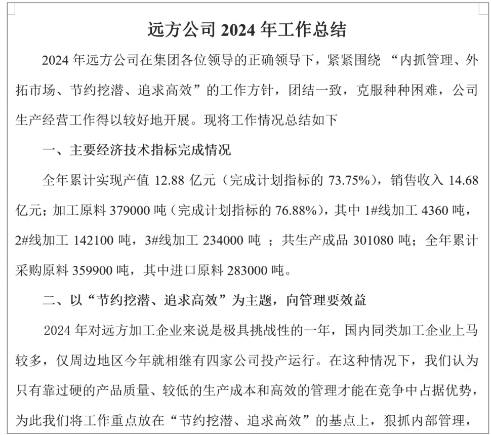

图6-1 Word版年度总结（部分）

点选DeepSeek对话框右下角的 📎 按钮，导入Word文件，并发送以下提示词。

> 请扮演资深演示设计专家，解读文件中内容并据此生成演示提纲。注意，数据须准确完整，不要出现文件里没有的内容。

该模型产出的演示提纲（部分）如图6-2所示。

### 远方公司2024年工作总结演示提纲

#### 封面页

- 标题：远方公司2024年工作总结

- 副标题：内抓管理·外拓市场·节约挖潜·追求高效

- 日期

- 公司Logo

#### 目录页

1. 主要经济技术指标完成情况

2. 管理效益提升：节约挖潜与高效成果

3. 市场拓展：内练硬功与外拓成效

4. 后勤保障与安全管理

5. 存在问题与改进方向

6. 未来展望与目标

#### 1. 主要经济技术指标完成情况

- 产值：12.88亿元

- 销售收入：14.68亿元

- 加工原料总量：379,000吨

  - 1#线：4,360吨

  - 2#线：142,100吨

  - 3#线：234,000吨

- 生产成品：301,080吨

- 原料采购：359,900吨（进口283,000吨）

#### 2. 管理效益提升：节约挖潜与高效成果

图6-2 DeepSeek产出的演示提纲（部分）

复制该模型产出的演示提纲，打开通义千问官网，先点选页面左侧的【效率】按钮，再点选页面右侧底部的【演示创作】模块中的【开始创作】按钮，如图6-3所示。


图6-3 通义千问页面

在【通义演示创作】对话框中粘贴已复制的演示提纲后，点选【下一步】按钮，如图6-4所示。如果点选对话框左下角的【导入】按钮，可直接导入本地文件。


图6-4 通义演示创作

通义千问会自动对内容进行润色、优化，生成新的提纲，如图6-5所示。


图6-5 演示提纲生成中

优化完成后，用户可对演示提纲中的项目进行编辑，比如输入演讲人并确认使用场景，本例选择以【工作汇报】为使用场景，如图6-6所示。


图6-6 编辑提纲

点选页面右上角的【下一步】按钮，如图6-7所示，会弹出模板选择界面。

选择符合需求的模板，点选【生成演示文稿】按钮，如图6-8所示。


图6-7 【下一步】按钮

### 选择模版

- 全部

- 精品

- 深色

- 浅色

- 彩色

- 简约


图6-8 选择模板

稍等片刻，即可按提纲内容生成演示文稿。点选某个项目，即可对项目内容进行编辑，如图6-9所示。


图6-9 演示文稿预览与编辑

在编辑界面中，可以对演示文稿中的各元素进行进一步调整、优化，如修改色彩、切换模板、插入元素，如图6-10所示。


图6-10 编辑演示文稿

编辑完成后，点选界面右上角的【演示】按钮，即可预览演示文稿的播放效果；点选下载按钮 ，即可将演示文稿文件下载到本地。

## 技巧02 DeepSeek+通义千问，快速优化演示文稿
当演示文稿页面文字堆砌，观众难以抓住重点时，借助该模型与通义千问可以重构提纲并产出更美观的演示文稿。

如图6-11所示的演示文稿中文字量大且存在错误，通过该模型与通义千问可进行优化修正。


图6-11 带有大段文字的演示文稿（部分）

点选DeepSeek对话框右下角的 📎 按钮，导入演示文稿，并发送以下提示词。

> 请扮演优秀演示设计师，现有演示文稿包含大量文字且有少量错误，请对这些内容进行优化和修改，生成新的提纲。

该模型生成的提纲如下。

1. 封面页

   - 标题：Excel函数与公式基础及常用函数应用

   - 副标题：高效处理数据的核心技能

2. 目录页

   - 查找与引用类函数：VLOOKUP

   - 文本类函数：SUBSTITUTE

3. 函数的分类

   - 核心要点：

     - 内置函数：直接使用，无须加载（如SUM、IF）

     - 扩展函数：早期需加载宏（如EDATE），2007+版本内置

     - 自定义函数：通过VBA编写，存放于模块

     - 宏表函数：Excel 4.0遗留，逐步被替代

   - 视觉设计：使用四象限图分类展示函数类型，搭配图标标注特点

4. 查找与引用类函数：VLOOKUP

   - 核心要点：

     - 功能：基于列匹配查询数据

     - 语法：=VLOOKUP(查找值,数据区域,返回列号,[匹配方式])

     - 参数详解：

       - 精确匹配：0或FALSE

       - 近似匹配：TRUE或省略（需首列升序排序）

   - 视觉设计：

     - 流程图展示VLOOKUP逻辑：查找值→匹配列→返回结果

     - 示例表格：模拟数据区域，标注参数对应位置

5. 文本类函数：SUBSTITUTE

   - 核心要点：

     - 功能：替换字符串中的指定内容

     - 语法：=SUBSTITUTE(原文本,旧文本,新文本,[替换次数])

     - 应用场景：

       - 省略【替换次数】：替换所有匹配项

       - 指定次数：仅替换第N次出现的匹配项

   - 视觉设计：

     - 对比案例：展示替换前后的文本变化（如将“2023”替换为“2024”）

     - 参数图示：用高亮色块标注语法结构

6. 总结页

   - 核心要点：

     - 内置函数是核心工具，VLOOKUP和SUBSTITUTE需重点掌握

     - 灵活使用函数，提高数据处理效率

   - 视觉设计：

     - 信息图：函数分类与应用场景的关联关系图

     - 动态强调关键函数图标（如放大VLOOKUP图标）

以上提纲将长段文字拆解为关键词加要点，避免堆砌，使演示更简洁直观。

复制该模型生成的提纲，粘贴在通义千问的演示创作对话框中。对提纲内容进行编辑确认后选择模板，等待通义千问生成演示文稿，效果如图6-12所示。仔细核对演示文稿中的内容，可根据实际情况进行优化修改。

### 扩展函数：早期需额外加载，现代版本已内置

请输入

函数种类增加

Excel的函数种类不断增加，涵盖了数学、统计、财务等多个领域。

提升工作效率

通过内置高级函数，Excel显著提高了用户的工作效率。

满足多样需求

丰富的函数分类满足了不同用户的需求，增强了Excel的适用性。

现代Excel将高级函数内置。

### 对比案例演示：替换前后文本变化

请输入

REPLACE函数

用于定位并替换特定位置的字符，如将“1 23号”改为“123室”。

选择合适函数

根据具体需求选择合适的函数，如批量修改文件名、修正错误拼写等，提高数据处理效率。

SUBSTITUTE函数

适用于全局替换指定字符或子串，例如将地址中的“路”统一替换为“道”。

对比替换效果

通过对比替换前后的数据，可以直观地看到SUBSTITUTE与REPLACE的不同效果。

图6-12 优化后的演示文稿（部分）

## 技巧03 DeepSeek+WPS灵犀，按主题自动生成演示文稿
WPS灵犀能根据用户提供的主题生成演示提纲，并在其基础上快速成稿。

例如，需制作一份以“未来十年，AI对传统办公方式的影响”为主题的演示文稿，可打开WPS灵犀，在对话框中发送以下提示词。

> 请扮演有经验的演示设计师，请以“未来十年，AI对传统办公方式的影响”为主题，生成一份演示提纲，演示页数控制在25页以内。

该模型思考后生成一篇以“AI重构办公新范式——未来十年办公方式变革前瞻”为标题的演示提纲，如图6-13所示。


图6-13 DeepSeek生成的演示提纲（部分）

以上提纲逻辑顺畅，从现状到展望过渡自然，章节分配合理。将提纲复制粘贴到Word中编辑后即可用于生成演示文稿。

在WPS灵犀首页左侧的窗格中点选【AI 演示】按钮，在对话框中粘贴编辑后的演示提纲，点选发送按钮，如图6-14所示。


图6-14 WPS灵犀对话框

WPS灵犀会自动对提纲进行润色、优化。优化完成后，弹出模板选择界面，先点选选择符合需求的模板，再点选【生成演示文稿】按钮，如图6-15所示。


图6-15 选择模板

稍等片刻，WPS灵犀即可按提纲内容生成演示文稿并进入编辑和预览界面。在编辑界面可以对演示文稿进行进一步调整、优化，如内容编辑、模板替换、插入元素。点选右上角的【去WPS编辑】按钮，即可进入在线版编辑界面。

编辑完毕，点选左上角的文件操作按钮 ≡，即可根据实际需求在下拉菜单中选择【另存】【下载】【打印】【WPS打开】【播放】命令，如图6-16所示。


图6-16 AI 演示常用命令

# 第7章 DeepSeek职场助手：招聘到管理的全流程

该模型可基于岗位需求理解自动生成符合规范、体现岗位特性的招聘文案；能智能推荐契合目标岗位的简历模板并优化关键词；还可快速制作或分析问卷、设计排班表等，显著提升招聘到管理的全流程效率。

## 本章要点
- ◆ 技巧1 根据岗位需求表生成招聘简章
- ◆ 技巧2 使用DeepSeek写简历，提高应聘成功率
- ◆ 技巧3 将口语化内容转为标准化商务邮件
- ……

# 技巧01 根据岗位需求表生成招聘简章
该模型能够依据岗位需求表与企业介绍信息，自动组织内容，用专业流畅的语言撰写吸引人才的招聘简章。一方面保证结构合理重点突出，便于候选人快速获取信息；另一方面节省人力，避免信息遗漏或错误。

如图7-1、图7-2所示，是某企业Word版企业介绍和Excel版岗位用工需求，借助该模型可据此制作招聘简章。企业介绍中存在排版错误和表达需优化之处，生成简章时该模型会对相关内容进行处理。


图7-1 企业介绍

| 岗位 | 人数 | 薪资待遇 | 食宿 | 要求 |

|---|---|---|---|---|

| 操作工 | 10 | 4500 | 食宿自理 | 男性，高中及以上文化，35岁以下，12小时倒班 |

| 门卫 | 2 | 2200 | 食宿自理 | 男性，初中及以上文化，50岁以下，12小时倒班 |

| 包装工 | 20 | 4000 | 食宿自理 | 性别不限，初中及以上文化，40岁以下，能吃苦耐劳 |

| 电工 | 5 | 4200 | 食宿自理 | 男性，高中及以上文化，40岁以下，有电工证，3年以上工作经验，12小时倒班 |

| 带班主任 | 3 | 6000 | 食宿自理 | 男性，本科及以上学历，机械加工有关专业，35岁以下，5年以上管理工作经验 |

| 联系电话：8842525 | | | | |

| 联系人：周经理 | | | | |

图7-2 用工需求

点选DeepSeek对话框右下角的按钮，导入Word文件和Excel数据表，并发送以下提示词。

你是一位有十年从业经验的HR主管，请根据文件中的企业简介和用工需求生成标准的招聘简章，并对任职要求进行补充和优化，结果以代码形式输出，代码要符合Markdown标准。

该模型生成的招聘简章代码如图7-3所示。


图7-3 DeepSeek生成的招聘简章代码（部分）

复制该模型生成的代码，打开Markdown编辑器，将代码粘贴在页面左侧，Markdown编辑器会自动生成相应的招聘简章，如图7-4所示。点选【导出Word文件】按钮，即可将生成的Word文件下载到本地。

## 北海集团招聘启事

### 一、公司概况
北海集团有限公司创立于2004年，主营中央空调系统、净化空调系统、通风末端及消防排烟设备的研发、制造、销售、安装与维护，是一家集研发生产到系统服务于一体的股份制企业。公司员工规模约500人，具备自主研发实力，物流配送体系完善，并与多家知名厂商保持战略合作。伴随业务快速增长，现面向社会公开选聘人才。

### 二、岗位需求
1. 操作工 10人
薪资：4500元/月
工作内容：操作生产线设备、进行日常维护、落实生产任务
任职要求：
- 学历不低于高中，年龄35周岁以内；
- 可适应12小时倒班，抗压能力良好；
- 有机械操作基础或相关经历者优先；
- 责任心强，服从管理，具备团队协作意识

2. 门卫 2人
薪资：2200元/月
工作内容：厂区安全巡检、出入登记、突发事件处置
任职要求：

图7-4 基于用人需求与公司介绍生成的招聘文案片段

模型输出的招聘材料信息正确、条理清晰、结构分明；公司介绍简洁有力，凸显了核心优势；文末明确了薪酬构成、食宿安排与职业发展，并将原表格描述拆分为分项要点，新增持证条件、经验说明等专项标注，统一以周岁表述年龄，规范了证书名称如电工操作证，并补充了证件准备提示与公司地址信息。

# 技巧02 用 DeepSeek 提升简历匹配度
投递成功的关键在于投其所好，DeepSeek 能精准解读招聘信息，提取核心要求并据此生成或调整简历，提升匹配效率。

如图7-5所示，为PDF格式的招聘简章。结合简章与个人情况，可借助模型生成简历。


图7-5 招聘简章

点击对话框右下角⊕上传PDF，并输入以下提示词。

我有8年财务会计经验，其中2年从事制造业成本会计，各模块均有涉及，大学本科学历，中级职称。请针对招聘简章撰写个人简历，重点优化匹配性，突出与招聘要求相符的亮点。

模型生成的简历节选如下。

## 核心优势
1. 岗位匹配度高
8年财务工作经验含2年制造业成本会计，已超过简章中5年要求；中级职称加本科学历满足硬性条件
2. 制造业成本管理专长
熟悉BOM核算、标准成本法与作业成本法，具备全流程成本管控经验；主导多项降本项目，累计节约成本超200万
3. 技术能力扎实
熟练使用用友、金蝶等系统，擅长通过数据分析挖掘业务问题；精通Power BI制作动态成本看板，提升管理决策效率
4. 软实力突出
多次牵头跨部门协作，沟通协调能力强；抗压能力强，曾连续3个月高强度完成公司IPO财务数据梳理

## 自我评价
深耕财务领域8年，兼具扎实专业知识与实战经验，熟悉制造业全链路成本管理逻辑。善于以数据驱动业务优化，注重团队协作与结果导向。认同远方公司“创新、质量、服务”的理念，期待以专业能力助力降本增效，共同成长。

简历涵盖个人信息、求职意向、工作经历、教育背景、证书技能、自我评价等，并重点呼应简章中的岗位职责与任职要求，如制造业经验、降本案例、软件技能等。用户可按自身情况调整数据。

# 技巧03 口语化内容转为规范商务邮件
标准化商务邮件可降低沟通成本，DeepSeek 能将口语化表达转化为正式邮件。

例如输入：
> 请将以下内容转为标准商务邮件：“刘经理，你们上次维修的灌装设备又出问题了！今天上午9点20分左右数据同步异常，错误代码为E407。你们赶紧派人来看看，维修报价我们可以现场谈。”

模型生成的邮件如下。

主题：关于灌装设备故障的报修申请

尊敬的刘经理：

您好！

特此通知，贵司此前负责维护的灌装设备于今日上午9时20分再次出现异常。经检测，设备在数据同步时触发E407故障代码，目前处于非正常状态。

为保障生产正常进行，烦请尽快安排技术人员到场诊断检修。关于本次维修费用，我方愿保持开放协商，待检测后再具体洽谈。

随函附上故障时段运行日志及报警截图供参考。如需我方提供其他资料或现场配合，请随时联系。

顺颂商祺！

[您的姓名]
[职位]
[公司名称]
电话：[联系方式]
邮箱：[邮箱地址]
日期：YYYY年MM月DD日

邮件包含主题、称呼、正文、敬语与签名。正文说明故障时间、代码并请求检修，同时表明报价可后续商谈。结尾信息完整，体现专业性。

# 技巧04 制作问卷调查表
借助模型生成问卷可节省时间、提升质量，避免人工设计复杂且调查不深入的问题。以酒店客户满意度问卷为例，提示词为：

你是一名酒店管理者，请生成一份客户满意度调查问卷，涵盖环境、服务、价格等方面。

模型生成的问卷如下。

尊敬的客人：
感谢入住！为持续提升服务质量，请您花2分钟填写。信息仅用于改进，祝生活愉快！

## 一、基本信息可选
入住日期：____年____月____日
房型：□标准间 □大床房 □套房 □其他_______
预订渠道：□官网 □在线平台 □电话 □其他_______

## 二、满意度评分 1-5分
### A. 酒店环境
大堂整洁舒适度：1 2 3 4 5
房间卫生状况：1 2 3 4 5
设施完善性：1 2 3 4 5
公共区域整洁度：1 2 3 4 5
周边环境：1 2 3 4 5

### B. 服务质量
前台接待效率与友好度：1 2 3 4 5
客房响应速度：1 2 3 4 5
员工专业性与态度：1 2 3 4 5
早餐种类与品质：1 2 3 4 5
问题解决及时性：1 2 3 4 5

### C. 价格价值
性价比：1 2 3 4 5
附加服务收费合理性：1 2 3 4 5
价格定位：□偏高 □合理 □偏低

## 三、开放反馈
最满意的服务或细节：

最需要改进的方面：

其他建议：

问卷结构清晰、问题具体，便于收集有效反馈，开放题便于深度表达。

# 技巧05 问卷调查分析
模型可对回收问卷进行整理与分析，提升效率与可靠性。如图7-6所示为一份填写完成的满意度问卷。


图7-6 客户满意度调查表片段

上传照片后输入提示词：
请整理问卷内容，重点分析影响体验、忠诚度及业务改进的关键问题。

模型输出的关键分析如下。

## 一、影响体验的核心要素
服务专业性表现突出：整体满意度、人员专业性与态度、响应速度得分较高，构成当前核心竞争力。
建议保持培训投入，完善服务标准化流程。
环境感知需优化：环境评分低于其他维度，可能涉及设施维护、卫生或空间舒适度。
改进方向可结合流程反馈，排查环境与流程联动问题。

## 二、忠诚度风险与机会
复购推荐意愿保留：多数选择“可能会”，未达“一定会”，与环境评分及流程改进需求相关。
风险点需关注不确定性顾虑，如价格波动与服务一致性。
价格透明度是差异化优势，被列为最满意项，体现客户对知情权的重视。
机会点可强化价格宣传，转化为品牌信任。

## 三、改进优先级
短期：优化服务流程被高频提及，需排查预约、结算、售后等环节冗余。
长期：环境评分偏低，但卫生条件未被点名，需辨别硬件老化还是清洁频次问题。
验证方法：增加开放性问题收集具体环境建议。

## 四、总结
专业性与响应速度支撑基础体验，需通过流程与环境升级消除复购阻力，并以价格透明度强化信任，推动忠诚度提升。

# 技巧06 生成年会抽奖器
先由模型生成HTML代码，再保存为.html文件使用。在Excel中准备名单，如图7-7所示。


图7-7 抽奖名单片段

点击📎上传Excel，提示词：
请设计HTML随机抽奖器，背景喜庆，点击开始显示名字滚动动画，开始变停止，点击停止抽取结果，一等奖1名、二等奖2名、三等奖3名，名单来自Excel。

模型生成代码见图7-8。

```html
<!DOCTYPE html>
<html lang="zh-CN">
<head>
    <meta charset="UTF-8">
    <style>
        body {
            margin: 0;
            height: 100vh;
            display: flex;
            flex-direction: column;
            align-items: center;
            background: linear-gradient(45deg, #c7000b 0%, #ff6b6b 100%);
            font-family: 'Microsoft YaHei', sans-serif;
            overflow: hidden;
        }

        .container {
            text-align: center;
            margin-top: 5%;
        }

        .title {
            color: #fff;
```

图7-8 抽奖器代码片段

复制保存为.html后双击打开，如图7-9所示，包含主题区、开始按钮及奖项结果区。


图7-9 抽奖器效果

# 技巧07 设计排班表
排班易耗时且易引发不满，模型可快速生成方案。明确时间段、班次、人员及每周最低休息天数后输入提示词：

你是一家料理店老板，请为小段、小伟、小陈安排2025年3月3日至3月9日的排班，早班晚班各一名，每人每周至少休两天，以表格呈现。

模型输出见图7-10。

| 日期 | 早班 | 晚班 | 休息 |
| :--- | :--- | :--- | :--- |
| 3月3日 | 小伟 | 小陈 | 小段 |
| 3月4日 | 小段 | 小伟 | 小陈 |
| 3月5日 | 小段 | 小陈 | 小伟 |
| 3月6日 | 小陈 | 小伟 | 小段 |
| 3月7日 | 小段 | 小伟 | 小陈 |
| 3月8日 | 小段 | 小陈 | 小伟 |
| 3月9日 | 小伟 | 小陈 | 小段 |

图7-10 排班表

说明：
小段休3天工4天均为早班；小伟休2天工5天早班2晚班3；小陈休2天工5天晚班4早班1。
班次轮换，避免连续同班；每日人力满足；休息天数达标。兼顾公平与可操作性。

# 技巧08 生成内容摘要
模型可对长篇文档提炼核心信息。如图7-11所示为财务部半年总结片段。


图7-11 财务部工作总结片段

提示词：请阅读文档并生成200字以内摘要，不得遗漏主要项目。

模型输出摘要如下。

## 2024年上半年财务部工作总结摘要：
财务部高效完成核算、资金管理及支持工作，保障资金安全及时，并提出内控优化建议、完善制度、维护外部关系。存在制度执行不足、人员能力差异、管理职能待强化的不足，将通过强化执行、培训提升及参与决策改进。下半年重点为资金规划、新会计准则落实、财务分析深化及人员培训，助力公司稳健发展。财务部将持续优化职能，为决策提供支持，确保年度目标达成。

摘要简洁、逻辑清晰，符合正式报告要求。

# 技巧09 多语种翻译
模型能把握复杂句意，支持上百种语言互译，准确率高于传统工具。如图7-12所示为待译委托创作合同Word版。


图7-12 待翻译合同片段

点击⊕上传Word，提示词：
你是一名资深日语译者，请将合同译为日语，注意专业术语准确性并整理排版，结果以Markdown代码输出。

复制代码至Markdown编辑器，可导出Word。效果见图7-13。


图7-13 合同翻译效果片段

# 技巧10 从身份证提取关键信息
模型可读取身份证号并提取出生年月、年龄、性别。如图7-14所示为虚拟员工信息表。

| 姓名 | 身份证号码 |
|---|---|
| 陆艳菲 | 370802197204212421 |
| 杨庆东 | 230710198105050214 |
| 任继先 | 370829198402110357 |
| 陈尚武 | 37088219840828005x |
| 李光明 | 370829198504195910 |
| 李明辉 | 370882198503153243 |
| 毕淑华 | 622201198205121828 |
| 赵会芳 | 370481198202153241 |

图7-14 虚拟员工信息表

上传Excel后提示：
请根据B列身份证号提取出生年月、截至2025年1月1日的年龄及性别，年龄未满周岁则舍去，结果以表格展示，字段含姓名、身份证号、出生年月、年龄、性别。

明确年龄计算规则可避免周岁与虚岁混淆。模型生成结果见图7-15。

| 姓名 | 身份证号码 | 出生年月 | 年龄（截至2025年1月1日） | 性别 |

|---|---|---|---|---|

| 陆艳菲 | 370802197204212421 | 1972-04-21 | 52 | 女 |

| 杨庆东 | 230710198105050214 | 1981-05-05 | 43 | 男 |

| 任继先 | 370829198402110357 | 1984-02-11 | 40 | 男 |

| 陈尚武 | 37088219840828005x | 1984-08-28 | 40 | 男 |

| 李光明 | 370829198504195910 | 1985-04-19 | 39 | 男 |

| 李明辉 | 370882198503153243 | 1985-03-15 | 39 | 女 |

| 毕淑华 | 622201198205121828 | 1982-05-12 | 42 | 女 |

| 赵会芳 | 370481198202153241 | 1982-02-15 | 42 | 女 |

图7-15 DeepSeek生成的结果

把上面这份表搬到 Excel 之前要先做个预处理。身份证号普遍在 18 位，直接粘贴会让超出 15 位的部分被系统自动转成 0。保险的做法是先点左上角的全选，再到【开始】选项卡里把数字格式调成文本，如图7-16所示。


图7-16 设置数字格式为文本

接着点中 A1 单元格右键，在粘贴选项里选用“匹配目标格式”，如图7-17所示。


| A | B | C | D | E |

|---|---|---|---|---|

| 1 | 姓名 | 身份证号码 | 出生年月 | 年龄（截至2025年1月1日） | 性别 |

| 2 | 陆艳菲 | 370802197204212421 | 1972-04-21 | 52 | 女 |

| 3 | 杨庆东 | 230710198105050214 | 1981-05-05 | 43 | 男 |

| 4 | 任继先 | 370829198402110357 | 1984-02-11 | 40 | 男 |

| 5 | 陈尚武 | 37088219840828005x | 1984-08-28 | 40 | 男 |

| 6 | 李光明 | 370829198504195910 | 1985-04-19 | 39 | 男 |

| 7 | 李明辉 | 370882198503153243 | 1985-03-15 | 39 | 女 |

图7-17 粘贴DeepSeek生成的表格

# 技巧11 收件字段智能拆分：姓名、电话、地址分离

订单里收件人那一栏经常把称呼、电话、地址混排，发货时极易误判。借助 DeepSeek 可以把混乱的订单信息快速梳理成标准字段。

图7-18 是某店铺的订单表，B 列的收件人/地址顺序各异，部分地址缺少省份。

| 订单号 | 收件人/地址 |

|---|---|

| 2963547785 | 南京市玄武区孝陵卫街道卫岗999号13400097654毕小姐 |

| 8996778780 | 上海松江区沈砖公路333号 王美丽15900999999 |

| 9349225717 | 上海市松江区洞泾镇保隆公寓茂盛路7777号 18216560000赵贵珍 |

| 8040763576 | 杭州市余杭区金都夏宫17栋20单元1111 杨小姐 18265000000两箱 |

| 3765592281 | 上海市青浦区青峰路1111弄1111号11室，联系人：苗成燕，手机号：15299750000 |

| 8255260292 | 袁小春 13951520000上海市松江区洞泾镇王家库路50弄49号408 |

| 4524834470 | 上海市松江区洞泾镇长兴路380弄280号180 林丽姗18520000300 |

| 2963547810 | 沈阳市于洪区赤山路华润1001号院东区 蒙传新16100002000 四箱 |

| 8996778805 | 李先生 18500098000 河南省三门峡市渑池县19638煤矿门卫室 |

| 9349225742 | 15666777888江苏苏州市常熟市虞山街道3333号 董文英 |

| 8040763601 | 江苏省常州市钟楼区泰西路1111号，常州冉光危险品运输有限公司 季文姗 13900000999 |

| 3765592306 | 陈春强15688885000武汉市江夏区 文化大道299号汉口学院学生公寓199栋 |

图7-18 订单信息表

在对话窗口右下角点 ⊕ 上传订单 Excel，向模型下达如下指令。

请对B列的收件人信息进行整理，提取出姓名、手机号和地址。若地址中没有省份信息，请补齐省份信息。结果以表格形式显示，表格字段包括订单号、地址、姓名和手机号。

梳理后的表格如图7-19。

| 订单号 | 地址 | 姓名 | 手机号 |

|---|---|---|---|

| 2963547785 | 江苏省南京市玄武区孝陵卫街道卫岗999号 | 毕小姐 | 13400097654 |

| 8996778780 | 上海市松江区沈砖公路333号 | 王美丽 | 15900999999 |

| 9349225717 | | 赵贵珍 | 18216560000 |

| 8040763576 | 浙江省杭州市余杭区金都夏宫17栋20单元1111 | 杨小姐 | 18265000000 |

| 3765592281 | 上海市青浦区青峰路1111弄111号11室 | 苗成燕 | 15299750000 |

| 8255260292 | 上海市松江区洞泾镇王家库路50弄49号408 | 袁小春 | 13951520000 |

| 4524834470 | 上海市松江区洞泾镇长兴路380弄280号180 | 林丽珊 | 18520000300 |

| 2963547810 | 辽宁省沈阳市于洪区赤山路华润1001号院东区 | 蒙传新 | 16100002000 |

| 8996778805 | 河南省三门峡市渑池县19638煤矿门卫室 | 李先生 | 18500098000 |

| 9349225742 | 江苏省苏州市常熟市虞山街道3333号 | 董文英 | 15666777888 |

| 8040763601 | 江苏省常州市钟楼区泰西路1111号常州冉光危险品运输有限公司 | 季文珊 | 13900000999 |

| 3765592306 | 湖北省武汉市江夏区文化大道299号汉口学院学生公寓199栋 | 陈春强 | 15688885000 |

图7-19 DeepSeek整理后的结果

可以看出缺失的省份被自动补全，已带省级的地址保持原样，诸如“两箱”“四箱”等备注也被清理。

# 技巧12 省市区信息自动补齐

图7-20 列出了一些省市县缺失的地址。DeepSeek 能逐条解析并补全。

| 地址 | 省份 | 城市 | 区（县） |

|---|---|---|---|

| 吉林市东局子街道 | | | |

| 北京市方庄饮马井75号 | | | |

| 义乌市中心医院 | | | |

| 辛集市辛集镇第二中学 | | | |

| 德州市新华街道45号 | | | |

| 四平市铁西邮政局 | | | |

| 乐陵市杨安镇中心学校 | | | |

图7-20 信息不完整的地址

把 A 列内容复制到对话框，发送指令：

请对这些地址进行解析，以表格形式返回完整的省份、城市和区（县）信息。

返回结果如图7-21。

| 地址 | 省份 | 城市 | 区 (县) |

| --- | --- | --- | --- |

| 吉林市东局子街道 | 吉林省 | 吉林市 | 昌邑区 |

| 北京市方庄饮马井75号 | 北京市 | 北京市 | 丰台区 |

| 义乌市中心医院 | 浙江省 | 金华市 | 义乌市 |

| 辛集市辛集镇第二中学 | 河北省 | 石家庄市 | 辛集市 |

| 德州市新华街道45号 | 山东省 | 德州市 | 德城区 |

| 四平市铁西邮政局 | 吉林省 | 四平市 | 铁西区 |

| 乐陵市杨安镇中心学校 | 山东省 | 德州市 | 乐陵市 |

图7-21 补充完整的省份、城市和区（县）信息

模型依据行政隶属关系完成拆解，县级市统一归入地级市，省市区信息完整。

# 第3篇 新媒体引擎：短视频与营销内容创作指南

DeepSeek 已在国内 AI 阵营中建立起覆盖图文视频的多场景新媒体体系，核心价值在于智能内容生产与精准互动，支持快速产出符合平台传播规律的图文、脚本和互动素材，大幅提升内容生产效率，帮助账号快速吸粉并持续提升互动与转化。

# 第8章 新媒体引擎：短视频与营销内容创作指南

本章聚焦 DeepSeek 对新媒体生态的赋能，讲解如何产出高传播力的短视频脚本、营销图文及互动素材，结合用户画像与分发策略，解决创作效率低、传播效果差的问题，提供从创意到转化的实战方法论。

## 本章的主要内容

- ◆ 技巧1 制作抖音、小红书短视频封面

- ◆ 技巧2 使用DeepSeek+即梦AI生成海报

- ◆ 技巧3 使用DeepSeek+通义万相生成AI视频

- ……

# 技巧01 封面速成：抖音小红书封面生成

封面是流量的第一道门槛，清晰的信息传达能显著提升点击。借助 DeepSeek 可以按需生成适配平台的封面。

以抖音为例，在对话框输入：

请使用HTML代码制作一个抖音短视频封面，风格清新，比例为16：9，封面文字为“3招教你做抖音爆款短视频”。

模型返回的代码如图8-1。

```html
<html>
<head>
</head>
<body>
    <div class="container">
        <div class="bubble"></div>
        <div class="bubble"></div>
        <div class="bubble"></div>

        <div class="content">
            <div class="title">3招教你做<br>抖音爆款短视频</div>
            <div class="decorate-line"></div>
            <div class="subtitle">新手必看 | 干货教程</div>
        </div>
    </div>
</body>
</html>
```

图8-1 HTML格式的封面代码

复制代码框右上角的【复制】，保存为 .html 文件，双击打开即可预览，效果如图8-2。

提示越具体，个性化越强。可先让模型给出设计建议，例如：

分析小红书点赞10w+的【办公类】封面的共性，总结5条设计规则，并生成3套符合规则的封面模板描述。

根据建议整理思路后重新下指令，例如：

使用HTML代码制作一个小红书封面，使用白/蓝/黄撞色组合，关键信息用色块/箭头/对话框强化，主标题为“Excel透视表”，副标题为“3步搞定周报”，主标题和副标题居中，标题下方添加进度条（70%处标红）。

按同样流程预览，效果如图8-3。


图8-2 抖音封面效果图


图8-3 小红书封面效果图

# 技巧02 DeepSeek联动即梦AI制作宣传海报

即梦 AI 能把文字转为图像，DeepSeek 负责创意，二者配合可产生乘数效应。

例如为新品口红制作宣传海报，先让 DeepSeek 给出方案：

请提供一个口红的宣传海报设计方案，要突出其质地丝滑、显色持久的特点。

返回的方案如下。

## 口红宣传海报设计方案

主题：

> 「丝缎之吻，锁色永恒」

——让双唇成为流动的艺术

主视觉：动态丝滑质感

口红膏体“融化”成液态金属的形态，流淌成一条光泽如缎带的曲线，末端自然过渡到模特饱满的唇部特写（唇色选用高饱和度的正红/酒红），凸显“丝滑触感”与“极致显色”的融合。

时间符号：

背景融入若隐若现的钟表齿轮或沙漏剪影，暗喻显色持久；搭配飞散的晶莹光点，增强画面张力。

主色调：深邃黑金渐变+高饱和度的唇色（如勃艮第红、焦糖棕），营造奢华感。

辅助色：液态金属银、玫瑰金，强化质地丝滑的特点。

标题字体采用具有流动感的手写体，笔画末端模拟丝绸飘逸的拖尾效果，搭配微光质感。

副标题为“丝滑如缎，持色如初”，使用无衬线字体，提高信息传达效率。

把方案复制到即梦 AI 首页，点击【AI作图】区的【图片生成】按钮，如图8-4。


图8-4 即梦AI局部界面

在左侧文本框粘贴方案，并在【模型】区挑选合适的生图模型，如图8-5。


图8-5 粘贴设计方案，选择生图模型

底部可调节精细度、比例与尺寸，如图8-6，精细度越高成片质量越好。

< 返回

图片生成 视频生成 音乐生成

口红宣传海报设计方案：主题：

「丝缎之吻，锁色永恒」

——让双唇成为流动的艺术

主视觉：动态丝滑质感

口红膏体“融化”成液态金属的形态，流淌成一

条如丝绸般顺滑的曲线，在光影交错中折射出

迷人的光泽，仿佛双唇被赋予了生命，每一次

呼吸都散发着诱人的魅力。

导入参考图 T 314/800 ⓘ

模型

生图模型

精细度 ⓘ

10

## 比例

图片比例

- 21:9

- 16:9

- 3:2

- 4:3

- 1:1

- 3:4

- 2:3

- 9:16

图片尺寸 ⓘ

W 1360

H 765

积分消耗明细

立即生成 ⚡ 1

### 8-6 设置精细度、图片比例和图片尺寸

点【立即生成】后，即梦会同时给出 4 张候选图，如图8-7。


图8-7 即梦AI生成的图片效果

选中满意图后，可用右侧的【细节修复】【局部重绘】【扩图】【消除笔】进行微调，如图8-8。


图8-8 图片编辑选项

编辑完成后右键选择【下载图片】保存到本地即可。

# 技巧03 DeepSeek+通义万相生成短视频

短视频成败很大程度上取决于提示词质量，先让 DeepSeek 出分镜，再交给通义万相生成。

在 DeepSeek 输入：

我需要借助AI生成短视频，请设计一个时长为10秒左右的方案，主题为“练瑜伽的猫咪”，使用明亮、温馨的色调。

得到的分镜如下。

镜头1（0-2秒）

画面：阳光洒落的木地板全景，粉色瑜伽垫中央蜷缩一只橘色猫咪（AI生成拟人化圆脸猫）。

动态：猫咪伸懒腰后前爪合十作“祈祷式”，尾巴缓慢抬起。

色调：浅粉+奶油色滤镜，光晕特效突出温馨感。

镜头2（2-4秒）

近景特写：猫爪伸展成“树式”，单腿站立（AI模拟萌系平衡摇晃），背景虚化为柔焦绿植。

细节：加入飘落的樱花花瓣粒子特效（增强梦幻感）。

镜头3（4-7秒）

视角切换：俯拍猫咪仰躺在垫子上，后腿蹬向空中模仿“下犬式”，添加Q版汗珠贴纸。

互动元素：右侧飞入半透明瑜伽教学插画箭头（箭头指向猫爪，示意动作标准度）。

镜头4（7-10秒）

慢动作收尾：猫咪翻滚成团，头顶浮现金色“Namaste”手写字（粒子消散效果）。

背景：渐变为黄昏色调，呼应开头的阳光变化。

复制方案到通义万相，点击左侧【视频生成】，Ctrl+V 粘贴，选择比例后点【生成视频】，如图8-9。


图8-9 通义万相视频生成

片刻后即可得到成片，效果如图8-10。若不满意可重新生成。


图8-10 通义万相生成的短视频

# 技巧04 生成抖音分镜脚本

喂给 DeepSeek 的信息颗粒度，直接决定抖音分镜能否吃上平台的短平快偏好与分发逻辑。要素越完备，输出越贴合算法口味。常规要准备的维度包括主题锚点、内容走向、视觉调性、受众画像、核心卖点、画面规范与音频需求。

在 DeepSeek 对话框里粘贴如下指令。

我需要制作一个30秒左右的抖音短视频分镜，主题为“夜晚的西安”，要突出西安的历史和人文特色，希望能吸引更多年轻人关注。请根据上述要求设计分镜脚本。

DeepSeek 回归的分镜方案如下。

分镜脚本 | 《夜长安·时空交响曲》

BGM：国潮电子音乐（古筝+电子鼓点）

【开场-时空隧道】（3秒）
无人机高空俯瞰钟楼夜景，金色灯光勾勒盛唐轮廓
镜头骤然俯冲穿楼，光带化作流转星河
字幕：1300年的心跳撞上赛博脉搏

【历史切片】（4秒）
大雁塔红墙慢推，汉服少女提鱼灯掠过画面
切换：不夜城悬浮诗句投影与游客 AR 互动同框
特效：青铜纹样在霓虹里粒子重组

【市井交响】（5秒）
延时：回民街镜糕摊蒸汽升腾×咖啡拉花特写
滑轨：皮影戏幕后的老艺人×电竞屏前敲键盘的青年
字幕：老饕的味蕾与潮人的基因同时躁动

【未来脉冲】（5秒）
仰角移轴：楼群折射极光特效
光绘：奥体中心流动的荧光夜跑轨迹
赛博朋克色调：量子街舞 battle 残影

【终极融合】（3秒）
城墙洞开，无人机矩阵拼出“长安”篆字
动态跟随字幕：十三朝的故事，等你续写新篇章
收尾 LOGO：西安地标剪影化作关注按钮特效

创意核心：
视觉冲击美学：高饱和撞色结合机械姬调色，制造强烈视觉
时空蒙太奇：以相似构图转场，如传统灯笼切霓虹灯牌，打破时空界限
参与感埋点：预埋多个 UGC 互动口，如 AR 诗句、光绘轨迹等

技术建议：
- 动态穿梭镜头可用大疆 Pocket 3 拍摄
- 人物场景建议 120fps 升格
- 关键帧加入故障艺术特效

这套分镜用高密度镜头在半分钟内完成传统与现代的超现实碰撞，兼顾历史纵深与潮流活力，契合抖音年轻用户的审美。

# 技巧05 朋友圈文案批量生成术

给模型结构化指令，能帮助它快速提取产品亮点并转化为营销表达。以推广生姜防脱洗发水为例，需要提炼核心功效、锁定人群，并用该群体更易接受的方式呈现促销信息。

在 DeepSeek 对话框里发送以下提示词。

你是一名广告策划师，请生成一篇120字内的朋友圈文案，介绍名为“蓝星”的生姜防脱洗发水，要突出生姜精华固发、减少断发的功效，目标人群为职场熬夜人群，正在进行买正装送旅行套装活动，文案以“痛点+共鸣+专业解决方案”的方式呈现。请提供3种不同风格的备选方案。

DeepSeek 产出的结果如下。

【方案一：共鸣反问式】凌晨还在改 PPT，发际线是不是又后退了一点？蓝星生姜洗发水以姜黄素精华为核心，28 天帮助发根更稳固，熬夜加班也不怕发丝受损！购买正装即送旅行便装，出差护发无缝衔接。职场人的坚持：头发要比甲方更坚强！

【方案二：数据见证体】实验显示，持续使用含 5% 生姜提取物的蓝星洗发水，断发率降低 63%。职场熬夜党专属福利：现购 280ml 正装即赠 80ml 旅行套装，发丝强韧计划从居家到差旅无缝衔接。

【方案三：场景治愈系】凌晨 2:00 的办公室，咖啡渍落在键盘，发丝掉在指间。用蓝星洗发水的微温姜感按摩头皮，将熬夜焦虑揉成绵密泡沫。买一得五的旅行装已备好，下次出差，让发梢替你守住体面。

三组文案均控制在 120 字内，以不同叙事角度平衡情感共鸣与专业背书，促销信息收束自然，不显生硬。

# 第4篇 AI重塑家庭教育与学习力升级方案

DeepSeek 在亲子教育场景的应用已形成多维解法，覆盖学习辅导、思维训练、亲子共学等方面。随着 AI 更深入生活化教育，智慧成长正持续改写传统亲子教育形态。

# 第9章 亲子互动指南：玩中学提升学习力

DeepSeek 可依据孩子兴趣推送个性化学习内容，并结合游戏化机制激发学习动机、优化学习效果。

## 本章的主要内容
- ◆ 技巧1 生成20以内的加减法练习题
- ◆ 技巧2 生成带拼音的生字表
- ◆ 技巧3 生成生字卡
- ……

## 技巧01 一年级20以内加减训练题自动生成

一年级刚接触数学，需要大量重复性练习且难度要可控，借助 DeepSeek 能迅速批量生成 20 以内的加减练习。

在 DeepSeek 对话框里发送以下提示词。

请生成50道数学练习题，内容为20以内的加减法，适合一年级学生学习和复习。结果以A4纸张三列表格形式排版，以代码形式生成，代码要符合Markdown标准。

DeepSeek 生成的代码如图9-1所示。


图9-1 加减法练习题代码

复制 DeepSeek 生成的内容，打开 Markdown 在线编辑器，将代码粘贴到编辑器页面左侧。单击【导出Word文档】按钮，即可将 Word 文档下载到本地，效果如图9-2所示。

| 题目 1 | 题目 2 | 题目 3 |
| --- | --- | --- |
| 5 + 3 = | 12 - 4 = | 9 + 7 = |
| 14 - 6 = | 8 + 9 = | 17 - 5 = |
| 10 + 2 = | 19 - 8 = | 4 + 11 = |
| 18 - 3 = | 7 + 6 = | 15 - 9 = |
| 2 + 13 = | 20 - 7 = | 5 + 8 = |
| 16 - 4 = | 11 + 3 = | 10 - 5 = |
| 7 + 9 = | 14 - 2 = | 6 + 10 = |
| 13 - 8 = | 4 + 12 = | 19 - 6 = |
| 1 + 15 = | 18 - 5 = | 3 + 14 = |

图9-2 20以内的加减法

该题单采用三列排版，A4 打印时自适应列宽并留出答题区，难度贴合一年级教学进度。

## 技巧02 拼音生字表一键排版

DeepSeek 能快速产出带拼音的生字表，帮助孩子识记巩固。例如在 DeepSeek 对话框里发送以下提示词。

请生成人教版小学二年级下册《语文》中的全部带拼音生字，结果以表格形式呈现，适合A4纸张排版。

DeepSeek 生成的内容如图9-3所示。

| 生字 | 拼音 | 生字 | 拼音 | 生字 | 拼音 | 生字 | 拼音 |
|---|---|---|---|---|---|---|---|
| 诗 | shī | 村 | cūn | 童 | tóng | 碧 | bì |
| 妆 | zhuāng | 绿 | lǜ | 丝 | sī | 剪 | jiǎn |
| 冲 | chōng | 寻 | xún | 姑 | gū | 娘 | niáng |
| 吐 | tǔ | 荡 | dàng | 杏 | xìng | 鲜 | xiān |
| 邮 | yóu | 递 | dì | 员 | yuán | 原 | yuán |
| 叔 | shū | 局 | jú | 堆 | duī | 礼 | lǐ |
| 邓 | dèng | 植 | zhí | 格 | gé | 引 | yǐn |
| 注 | zhù | 满 | mǎn | 休 | xiū | 息 | xī |

图9-3 人教版小学二年级下册《语文》带拼音生字（部分）

DeepSeek 按课文顺序整理生成了带拼音生字表，A4 横向排版分为 4 栏展示。

## 技巧03 互动生字卡HTML生成

DeepSeek 可生成适合学龄前儿童使用的生字卡。例如在 DeepSeek 对话框里发送以下提示词。

请将以下文字以HTML形式做成适合学龄前儿童学习的生字卡：

大、小、多、少、山、石、土、田。

生字卡要包括拼音、图片和笔画顺序，且能够单击发声。

DeepSeek 会生成相应代码。单击代码框右下角的【运行HTML】按钮，预览效果如图9-4所示。

生成的生字卡中没有形象的图片，可以通过多轮对话对生成的结果进行优化。在 DeepSeek 对话框里继续发送以下提示词。

以上内容没有图片，请重新生成。

DeepSeek 重新思考后生成新代码。单击代码框右下角的【运行HTML】按钮，预览效果如图9-5所示。


图9-4 首次生成的生字卡


图9-5 第二次生成的生字卡

DeepSeek 提供了图形与文字的对应关系改进说明。

大：用放射状十字表现“扩展”，搭配圆形边框，象征膨胀变大的物体。
小：用递减的圆点尺寸配合垂直轴线，直观表现“由大变小”的概念。

复制代码，粘贴到新建文本文档中保存，将扩展名由.txt改成.html即可。

## 技巧04 反义词消消乐小游戏开发

把知识融入游戏能让孩子在玩中学习。借助 DeepSeek 可制作适合小学生的反义词消消乐游戏。

如图9-6所示，在 Excel 中准备一组反义词对照表。


图9-6 反义词对照表

在 DeepSeek 对话框里发送以下提示词。

请写一个适合小学生玩的反义词消消乐游戏的HTML代码。要求如下。
1. 提供按钮让用户选择Excel文件，A列和B列的同行内容是一组反义词。
2. 将A列和B列的内容显示为不同颜色的按钮，分上下两行，每组的顺序随机排列。
3. 用户依次单击上下相对应的按钮时，该组内容消失，直到全部内容消失。
4. 生成结果和耗时统计。
5. 要保证每个按钮都能正常单击。

DeepSeek 生成的部分HTML代码如图9-7所示。

```html
<!DOCTYPE html>
<html>
<head>
    <title>反义词消消乐</title>
    <style>
        body {
            background: linear-gradient(45deg, #a8edea 0%, #fed6e3 100%);
            font-family: "Comic Sans MS", cursive;
            display: flex;
            flex-direction: column;
            align-items: center;
            min-height: 100vh;
            margin: 0;
            padding: 20px;
        }
    </style>
</head>
```

图9-7 HTML小游戏代码（部分）

单击代码框右下角的【运行HTML】按钮，在游戏预览窗口中单击【选择文件】按钮，打开存放反义词的Excel文件。在上下两行分别单击成对的反义词，单击正确，这组反义词就会消失。所有内容消失后显示游戏时长，效果如图9-8所示。


图9-8 消消乐小游戏

## 技巧05 英文单词与故事生成

孩子英语学习是家长高度关注的，借助 DeepSeek 可让学习过程更具趣味性。

在 DeepSeek 对话框里发送以下提示词。

请提供一组三年级学生能够掌握的英文单词。

DeepSeek 会按主题分类生成符合要求的英文单词。

家庭与人物
- 1. 家庭 - mother, father, sister, brother, grandma, baby
- 2. 人员 - friend, teacher, student, neighbor

学校与学习
- 1. 文具 - book, pencil, eraser, ruler, desk
- 2. 学科 - math, science, art, music, English

日常活动
- 1. 动作 - run, jump, read, write, draw
- 2. 日常用语 - hello, goodbye, please, thank you, sorry

自然与天气
- 1. 天气 - sunny, rainy, windy, cloudy, snowy
- 2. 季节 - spring, summer, autumn, winter

动物与自然
- 1. 常见动物 - cat, dog, bird, fish, rabbit
- 2. 野生动物 - lion, tiger, elephant, monkey, giraffe

食物与饮料
- 1. 水果 - apple, banana, orange, grape, watermelon
- 2. 零食与饮料 - pizza, cake, milk, juice, water

数字与时间
- 1. 1-20 - one, two, three… twenty
- 2. 时间单位 - day, week, month, year

颜色与形状
- 1. 颜色 - red, blue, green, yellow, black
- 2. 形状 - circle, square, triangle, star, heart

形容词与反义词
- 1. 描述性词汇 - happy, sad, big, small, fast
- 2. 反义词 - hot/cold, old/new, tall/short, clean/dirty

为了激发小朋友的学习兴趣，在 DeepSeek 对话框里发送以下提示词。

请生成一个包含以上单词的英文故事，方便学生认识、巩固这些单词。

DeepSeek 生成的结果如下。

以下是一个包含上述单词的简单英文故事，适合三年级学生阅读，情节简单且贴近生活，能够帮助学生在相关语境中理解和记忆单词。

### A Sunny Day with Tom and Lucy

It was a sunny day in spring. Tom and his sister Lucy walked to school with their friends. They carried their books, pencils, and rulers in their bags. "Today we have math and art!" said Lucy. Tom smiled. He loved drawing circles and stars in art class.

After school, the sky turned cloudy. "Let's run to the park!" said Tom. They saw a big tree with green leaves and a small bird singing. Suddenly, it started to rain! "Oh no, my shoes are dirty!" cried Lucy. But then the sun came out again, making a rainbow with red, blue, and yellow colors.

At home, their mother made apple juice and banana cake. "Thank you, Mom!" said the children. They played with their dog, a happy brown puppy. Later, they read a book about a lion and an elephant in the summer forest.

Before bed, Tom wrote in his notebook: "Today was fun! I saw a bird, ate cake, and learned about numbers like twelve and fifteen." Lucy drew a picture of the rainbow and said, "Goodnight, Grandma!"

重点单词复习
### (故事中出现的分类词汇)
天气/季节: sunny, spring, cloudy, rain
家庭/人物: sister, friends, mother, grandma
学校: school, math, art, book, pencil, ruler
动作: run, cried, played, read, wrote
自然/动物: tree, bird, dog, lion, elephant
食物: apple juice, banana cake
颜色/形状: red, blue, yellow, rainbow, circle, star
数字: twelve, fifteen
形容词: big, small, happy, dirty, fun

以上内容，家长可以和小朋友一起分角色朗读，模仿对话语气；可以让小朋友对故事中的单词进行颜色标记，如天气用蓝色标记、动物用绿色标记；可以鼓励小朋友用几句话来续写故事，在趣味阅读与写作中巩固学到的知识。

## 技巧06 家庭英语启蒙游戏设计

借助 DeepSeek 设计家庭互动游戏，能有效提升孩子英语学习兴趣。例如在 DeepSeek 对话框里输入以下提示词。

你是一位优秀的儿童教育专家，现在，6岁孩子的英语启蒙遇到兴趣瓶颈，请设计3个家庭互动游戏，要融合生活情景、单词拼读和肢体运动，并提供所需要的材料清单。

以下是 DeepSeek 为6岁儿童设计的3个英语启蒙互动游戏方案。

### 游戏一：Phonics Treasure Hunt（语音寻宝大作战）
场景：客厅/卧室物品探索
目标：通过肢体运动强化孩子对字母音素的认知
材料清单：
- 字母磁贴（a-z）、便笺纸、彩色马克笔、小篮子（装战利品用）、家中常见物品（如cup, book, pen）
玩法：
- 语音密码设置：家长用便签纸在物品上贴首字母（如在杯子上贴“C”）

三类沉浸式英语互动玩法

游戏一 字母寻宝
提示卡给出寻找以 C 起头的实物，呈现时配合口型手势帮助孩子感受发音。搜寻阶段采用螃蟹步侧向移动，寻到目标后要大声拼读 C-U-P 并投入收集篮。凑齐五件后用磁性字母拼出完整词形，再模仿字母造型跳庆祝舞。进阶可把规则改为寻找以 at 结尾的物品。

游戏二 Action Word Obstacle Course 动作词障碍赛
可在客厅或户外空地开展，靠大肌肉活动帮助记忆动作类词汇。准备瑜伽垫或地垫、呼啦圈、动物主题毛绒玩具以及写有 jump、crawl、spin 等的词卡。垫子设定为沼泽 swamp，呼啦圈设定为魔法圈 magic rings。先展示 jump 卡片，成人示范蛙跳并突出读音，孩子跟随模仿。闯关例如在桌下做熊爬、Crawl like a bear under the table，以及在灯旁原地旋转三圈、Twirl 3 times near the lamp。

游戏三 Grocery Store Spelling 超市拼读购物
场景放在厨房或自制超市，目标是在生活情境中练习拼读。材料包括仿真蔬果或安全食材、配图并标注首字母的购物清单、围裙和厨师帽作角色道具。采购时给出描述线索，例如 Find a...round...red... 指向苹果 apple，孩子以袋鼠跳方式挑选。烹饪环节边洗菜边唱字母歌 Washing A-P-P-L-E，用胡萝卜条拼出 CARROT 等词形。品尝时闭眼描述 This is sweet, S-W-E-E-T。可延伸数学数水果、科学观察食物变化，契合儿童具体形象思维，有助于维持参与热情。

技巧07 生成小学生手抄报模板
先让 DeepSeek 输出绘图指令，再用通义万相的文字作画功能就能快速得到适合低年级的手抄报底图。在 DeepSeek 对话框提出需求：希望用 AI 绘图为三年级小学生制作手抄报底图，请给出五组实用提示词，要求符合儿童审美，不超出认知范围。
得到的结果示例如下，便于二次创作。

1. 森林主题学习园地
卡通森林画面，中央大树叶片设计成书本造型，树下兔子松鼠在阅读，天空漂浮云朵对话框，地面点缀彩色蘑菇文字框。整体色调为清新绿、黄、天蓝。

2. 太空数学实验室
Q 版太空站画面，数字行星围绕地球漂浮，火箭造型加减法公式，外星人用星星笔在银河幕布上书写。背景为蓝紫星空配荧光装饰线。

3. 海底语文世界
珊瑚礁构成成语城堡，会吐泡泡的章鱼老师，贝壳形田字格，海马举着成语接龙卷轴，彩虹鱼群拼成标题，水波纹背景配珍珠高光。

4. 四季时钟花园
圆形表盘分为四季：春花区配蝴蝶便签，夏荷区配水滴文本框，秋叶区配果实贴纸，冬雪区配雪花批注框。中心为太阳月亮昼夜切换设计。

5. 运动健康跑道
操场环形跑道化为字母路径，跳绳构成标题栏，篮球筐接住营养金字塔，运动剪影在彩虹尽头跳跃，果蔬云朵飘在淡蓝天空。

挑选其一复制到通义万相左侧文字作画输入框，粘贴后补充设计要求如预留三成空白供手写、高对比色块等，选择比例后点击生成画作。系统会返回四张效果图，悬停后可选择无水印下载。

# 第10章 学业加速器：规划与提升
DeepSeek 在学习提升场景可用于个性化辅导、资源整合与效率优化，能同时提升效率与能力。对学习者而言，DeepSeek 可充当私人学习助手：在数学难题时提供详细证明步骤与思路讲解，在语文困惑时解析古诗词意蕴与赏析技巧，提供掌握知识的方法。

## 本章的主要内容
- ◆ 技巧1 借助DeepSeek制定专属学习规划
- ◆ 技巧2 借助DeepSeek归纳试卷知识点
- ◆ 技巧3 借助DeepSeek解读古诗词
- ……

# 技巧01 借助DeepSeek制定个性化学习规划
DeepSeek 能按需制定学习方案。例如为一位零基础初中生制定半年日语口语计划，可输入：我是一名零基础的初中生，想利用课余时间在半年内学会常用日语口语，请给出可执行的学习规划。
生成的方案如下。

- 【1-2周】五十音攻坚 每日早晚各15分钟：用五十音图 App 做卡片游戏，周末观看《樱桃小丸子》中日字幕片段跟读。
- 【3-10周】场景化表达 分8个主题如问候饮食学校购物，每周掌握一组万能句如 これはいくらですか 加相关词汇，配合“简明日语”广播剧跟读。
- 【11-18周】对话实战 周末通过 Tandem 进行15分钟语音交流，录制《你的名字》经典片段配音。
- 【19-24周】综合运用 模拟机场便利店等场景自导对话，参加本地日语角活动。

每日安排
晨间10分钟：复习昨日句型加5张新词卡。
课间5分钟×3：收听 NHK 儿童新闻片段。
晚间15分钟：App 闯关练习并录音对比发音。
周末40分钟：影视模仿或线上交流。
教材：《大家的日语·初级》图解版，B站“趣味日语”配合学习。
注意事项
优先掌握100个高频动词与形容词。
初期可允许中日混搭表达，如 この铅笔，借りてもいいい？
重点纠正长短音与促音差异。
每月录制一次自我介绍视频，观察发音变化。
该计划每日投入约40分钟，通过高频场景渗透实现持续进步，半年后可完成基础日常对话，建议假期集中强化听力。

# 技巧02 借助DeepSeek归纳试卷知识点
上传机考试卷并提示 请认真归纳试卷中的知识点，准确输出并以表格形式呈现。
生成的知识点汇总如下。

| 题号 | 知识点分类 | 具体知识点 | 对应软件/工具 |
| :--- | :--- | :--- | :--- |
| 第一题 | 文档新建与保存 | 按要求新建文档并命名 KS_姓名.DOCX | Word |
| | 版面设置 | 纸张 B5 纵向、页边距上下2.2cm左右2cm、页眉页脚距边界1.5cm/0.9cm | Word |
| | 字体与段落格式 | 仿宋_GB2312 小四 青色、两端对齐 首行缩进2字符 行距固定25磅 | Word |
| | 文档插入与格式同步 | 插入文档2.DOCX 并按第3题要求同步段落格式 | Word |
| | 文本框操作 | 插入竖排文本框，黑体二号橙色阳文、麦浪滚滚填充、尺寸6.17cm×3.81cm、四周型环绕 | Word |
| | 边框与底纹 | 段落框线酸橙色1磅、底纹灰色-5%、特定文字浅橙色加着重号 | Word |
| | 图片处理 | 插入 zc_tp2.jpeg、裁剪左侧20.24cm、尺寸调至5cm×5cm、阴影样式14、四周型环绕 | Word |

表格呈现清晰，便于复习记忆。

# 技巧03 借助DeepSeek解读古诗词
输入提示 你是一位经验丰富的小学语文教师，请为六年级学生解读《春夜喜雨》。
生成的课堂解读如下。

## 《春夜喜雨》解读课堂
### 《春夜喜雨》
唐·杜甫
好雨知时节，当春乃发生。
随风潜入夜，润物细无声。
野径云俱黑，江船火独明。
晓看红湿处，花重锦官城。

第一步：读题猜意
引导提问 从春夜喜雨四字能读出什么？春天夜晚令人喜爱的雨，诗人写的是春夜降雨的心情。

第二步：逐句释义 构建画面
1. 好雨知时节，当春乃发生
关键词 知时节
解释 春雨懂得时机，恰在万物萌发之季到来。
2. 随风潜入夜，润物细无声
关键词 潜 细无声
解释 雨随风夜行，悄无声息滋养万物。
3. 野径云俱黑，江船火独明
解释 郊外小路被乌云笼罩一片漆黑，江上船灯格外明亮。
4. 晓看红湿处，花重锦官城
关键词 红湿 花重
解释 想象次日清晨，城中花朵被雨打湿显得沉甸甸，锦官城如着彩衣。联系校园雨后樱花是否更鲜艳。

第三步：体会情感
讨论 春雨何处好？及时温柔滋润万物。诗人为何喜？关爱自然与农事，喜见生命萌发。

第四步：背景升华
杜甫关注百姓疾苦，春雨预示秋收丰盈，因而由衷欢喜。真正的快乐也包含为他人福祉而喜。

# 技巧04 借助DeepSeek批改作文
上传四年级作文图片并提示 作为经验丰富的小学语文教师请批改。
返回的批改意见如下。

## 一、作文评改建议
### （一）优点肯定
结构完整：总分总结构清晰，首尾呼应。
情感真挚：细节描写自然流露出对母亲的爱。
语言朴实：符合学段特点，表达自然。

### （二）改进建议
细节描写示例
原句 她整夜没睡照顾我。
优化 她整夜守在床边，一会儿用温毛巾擦额，一会儿轻拍后背，像哄小时候睡觉那样。
语言润色示例
原句 妈妈做的饭特别好吃。
优化 厨房飘出的香味总第一个报信，不用看就知道妈妈又在施展魔法。
结构优化 建议加入过渡句 如 妈妈对我的爱不仅在生活上，也教会我做人道理，使衔接更顺。
技巧点拨 建议用五感法描写，如晨光中发丝的茉莉香、红烧肉咕嘟声等。

## 二、教师示范批注
孩子，你有一双发现爱的眼睛！老师看到了温柔能干的母亲形象。试着回忆某个雨天妈妈接你放学的场景：衣物是否淋湿，手的温度如何？加入细节，人物会更鲜活。

# 技巧05 借助DeepSeek拍照解题
利用图像识别与自然语言处理，DeepSeek 可提取题干并给出逐步解析。以初一数学选择题第2题为例提问 第二题正确答案是什么，为什么？
推理过程如下。
题干说明 a、b 在原点两侧且到原点距离相等，即 a、b 为相反数，例如 a 为 3 则 b 为 -3，故 a+b=0，|a+b|=0，2|a+b|=0。
x、y 为倒数关系，则 xy=1，所以 -2xy=-2。
整体值为 0-2=-2，对应选项 B。
再次核验 相反数关系与倒数关系成立，计算无误，结果为 -2。

# 技巧06 借助DeepSeek生成读后感
输入提示 你是一名四年级小学生，请根据课文《精卫填海》写一篇200字以上的读后感。
生成的示例如下。

## 《精卫填海》读后感
今天语文课学了《精卫填海》这个神话。回家后我脑海一直浮现小鸟衔着树枝石头往海里飞的样子，像动画片里的英雄。
故事里精卫本是炎帝女儿，游东海被大浪卷走。看到这里我手心冒汗，很担心她。后来她化作精卫鸟，没有躲着哭，反而天不亮就出发，一趟又一趟往海里丢小石子。这让我想起学骑自行车摔破膝盖，妈妈说慢慢来总能学会，我现在才明白这就是坚持的力量。

傍晚散学归来，我在路边花坛边看到一群蚂蚁正聚精会神地搬运碎屑，整齐地往水泥台阶上攀爬。那画面一下子让我想到精卫衔石填海的典故，课本里的故事仿佛活了过来。精卫渺小，海面无边，母亲指着园子里的人工假山笑道：“你看，这假山不就是由无数颗小石子堆出来的吗？”这句话点醒了我，原来任何宏大的成果都源自点滴的积累。

我想效仿精卫，每天坚持做一件微小的好事，相信长久的积累终能成就不凡。

这段描写从儿童视角切入，用生活化的细节带出寓言寓意，也把阅读感受与现实观察联系起来。

# 技巧07 使用DeepSeek设计跨学科课程

跨学科教学有助于打通知识壁垒，让思维更立体，形成完整的认知体系。

借助 DeepSeek 可以迅速搭建跨学科方案。把下面这段指令输入对话框即可。

> 你是一名资深教师，请为初中三年级语文与地理设计一堂融合课《古诗词中看地理》，挑选三首蕴含地理信息的古诗开展探究，并为知识掌握、跨学科思维、表达能力三个层面制定评价标准。

DeepSeek 给出的《古诗词中看地理》方案如下。

## 一、课程目标

语文层面：品味古诗，厘清地理意象在文学中的表达机理。
地理层面：辨别诗中自然地理特征，分析地理背景与人文活动的互动。
思维层面：形成“文学感知—地理解析—文化理解”的跨学科思路。

## 二、古诗选篇及地理要素解析

（第一板块）《早发白帝城》李白
- 地理要素：长江三峡，巫峡、瞿塘峡。
- 跨学科探究：白帝城区位对航运的影响；诗歌时空压缩的地理依据。

（第二板块）《凉州词》王之涣
- 地理要素：玉门关、西北干旱区、黄河源区。
- 跨学科探究：季风区与非季风区界线；地理阻隔对边塞文化的影响。

（第三板块）《题西林壁》苏轼
- 地理要素：庐山、断块山地貌、地形与视点关系。
- 跨学科探究：山地垂直带谱；观察角度与认知方式的关联。

## 三、教学活动设计

【导入环节】地理猜诗谜 5分钟
展示中国地形图，由诗句推断地理特征：
- “朝辞白帝彩云间” 对应长江三峡
- “春风不度” 对应季风分界线
- “横看成岭侧成峰” 对应山地地貌

【探究活动1】诗路地图绘制 15分钟
分组还原三首诗涉及的地理线路，标注白帝城、玉门关等关键坐标，用不同色彩区分自然与人文意象。

【探究活动2】地理诗人对话 20分钟
角色扮演：地理学家 VS 诗人
李白组讨论“千里江陵一日还”的水文条件。
王之涣组分析“黄河远上白云间”的地质演变。
苏轼组用等高线模型再现“远近高低各不同”。

【总结环节】三维诗碑创作 5分钟
以经纬度、海拔等地理要素为古诗制作地理标签。
示例：《凉州词》地理坐标卡
纬度：北纬40°，温带大陆性气候
海拔：1500米，河西走廊
特别标注：季风区与非季风区分界

## 四、评估标准体系

### （一）知识掌握维度 40%
| 知识 | 优秀 | 合格 | 待改进 |
| --- | --- | --- | --- |
| 地理辨识 | 能精准识别3类以上地理要素 | 能认出基本地理特征 | 要素识别不完整 |
| 诗歌理解 | 能深入解读意象的象征意义 | 能理解字面地理描写 | 停留在字词层面 |

### （二）跨学科思维 40%
| 思维能力 | 优秀 | 合格 | 待改进 |
| :--- | --- | --- | :--- |
| 关联能力 | 能自主建立诗文与地理的多重联系 | 在提示下建立合理联系 | 关联维度单一 |
| 迁移应用 | 能创新运用跨学科方法解决问题 | 能正确套用给定分析框架 | 方法运用一般化 |

### （三）表达能力 20%
| 技能 | 优秀 | 合格 | 待改进 |
| :--- | --- | --- | :--- |
| 口头表达 | 逻辑清晰，术语规范 | 基本达意，偶有偏差 | 表述碎片化 |
| 图文转换 | 能创意呈现古诗与地理的诗意关联 | 能完成规定制图任务 | 图文对应性弱 |

## 五、延伸拓展

数字人文：用GIS标注古诗词的地理分布。
比较阅读：同一地理景物的不同诗写状态，如写长江，李白豪放，杜甫沉郁。
现实联结：分析诗中地理特征的变迁。

课程亮点：
双螺旋结构：地理实证与诗意感悟交替推进。
认知脚手架：从具象地图到抽象思维逐步引导。
评价创新：跳出单科评价框架，建立跨学科考核新标准。

建议教具：可擦写的中国地形图、诗词地理信息电子图、山体等高线模型、古代航运路线动画演示。

该方案兼顾语文、地理两科知识与核心思维培养，在诗意中建立空间认知，在实证中深化文化理解。

# 技巧08 使用DeepSeek设计小学生必背诗词游戏

用 DeepSeek 可以做一个必背诗词小游戏：点【开始】，诗名快速翻动；点【暂停】，随机定格一篇，可指定学生背诵；背不下来时点【查看全文】，诗文会弹出提示。

先整理诗库内容。发送指令：
> 请生成人教版小学六年级语文课本中的全部诗词，结果整理为两列，一列为标题，一列为诗词内容，不要遗漏。

DeepSeek 会返回内容，形似图10-5。 把结果复制到Excel，A1单元格右键选择“匹配目标格式”粘贴，图10-6。 粘贴后A列是标题，B列是诗文。

人教版小学六年级语文课本诗词整理样例：
| 标题 | 诗词内容 |
| :--- | --- |
| 宿建德江 唐·孟浩然 | 移舟泊烟渚，日暮客愁新。野旷天低树，江清月近人。 |
| 六月二十七日望湖楼醉书 宋·苏轼 | 黑云翻墨未遮山，白雨跳珠乱入船。卷地风来忽吹散，望湖楼下水如天。 |
| 西江月·夜行黄沙道中 宋·辛弃疾 | 明月别枝惊鹊，清风半夜鸣蝉。稻花香里说丰年，听取蛙声一片。七八个星天外，两三点雨山前。旧时茅店社林边，路转溪桥忽见。 |
| 过故人庄 唐·孟浩然 | 故人具鸡黍，邀我至田家。绿树村边合，青山郭外斜。开轩面场圃，把酒话桑麻。待到重阳日，还来就菊花。 |
| 七律·长征 毛泽东 | 红军不怕远征难，万水千山只等闲。五岭逶迤腾细浪，乌蒙磅礴走泥丸。金沙水拍云崖暖，大渡桥横铁索寒。更喜岷山千里雪，三军过后尽开颜。 |
| 春日 宋·朱熹 | 胜日寻芳泗水滨，无边光景一时新。等闲识得东风面，万紫千红总是春。 |

按 Ctrl+S 保存Excel。

再让 DeepSeek 生成游戏的HTML源码，提示词如下：
请生成一个小学生必背诗词转盘游戏的HTML代码，要求如下。
1. 单击【导入内容】按钮，可导入Excel文件，Excel文件中，A列为诗词名称，B列为诗词内容。
2. 单击【开始】按钮，开始随机滚动诗词名称；单击【暂停】按钮，诗词名称停止滚动，【暂停】变成【继续】；单击【继续】按钮，诗词名称继续滚动。
3. 在【暂停】按钮处于选中状态时显示【查看全文】按钮，单击可显示对应诗词的完整内容。
4. 背景带卡通元素。

DeepSeek 返回的部分HTML源码如图10-7所示。
```html
<!DOCTYPE html>
<html>
<head>
    <title>诗词转转乐</title>
    <script src="https://cdn.sheetjs.com/xlsx-0.20.0/package/dist/xlsx.full.min.js"></script>
    <style>
        body {
            background: linear-gradient(45deg, #a8edea, #fed6e3);
            font-family: "Comic Sans MS", cursive;
            display: flex;
            flex-direction: column;
            align-items: center;
            min-height: 100vh;
            margin: 0;
            padding: 20px;
        }

        .cloud {
            position: fixed;
```

点代码框右下角【运行HTML】，在预览窗口点【导入内容】打开诗库Excel。点【开始】诗名开始滚动，点【暂停】后出现【查看原文】按钮，效果如图10-8。

复制源码粘到新建文本文档保存，改扩展名为.html即可使用。

# 技巧09 使用DeepSeek按学科生成模拟试卷

家长可以用 DeepSeek 生成指定年级、学科、阶段的模拟卷让孩子练习。
例如发送：
你是一位优秀的小学语文老师，请以人教版小学四年级上册《语文》为依据，生成一份期中考试试卷，题目类型包括基础知识运用、课内外阅读、综合实践和习作，难度符合小学四年级学生的平均能力。总分100分，每道题目后显示分值。

DeepSeek 给出的部分试卷如图10-9所示。

第一部分 基础知识运用 30分
1. 看拼音写词语 8分
kuān kuò（ ） lǒng zhào（ ）
jūn yún（ ） yǐn bì（ ）
2. 形近字组词 6分
潮（ ） 嘲（ ）
择（ ） 泽（ ）
茎（ ） 经（ ）
3. 词语搭配 6分
（ ）的雷声 （ ）的江面
（ ）的隧道 （ ）的住宅
4. 句子练习 10分
（1）仿写拟人句：风儿轻轻吹过稻田，稻穗害羞地低下了头。
仿写：小溪________________________
（2）修改病句：昨天下午，全校师生和班主任去秋游了。
修改：________________________

第二部分 课内外阅读 30分
（一）课内阅读 15分
阅读《观潮》片段，回答问题：
1. 文中画线句子运用了哪种修辞手法？有什么作用？4分
2. “ ”一词说明了观潮人群怎样的心情？3分
3. 请用一句话概括这段文字的主要内容。3分

试卷贴近人教版教材，覆盖修辞、词语理解、写作等重点，题述清楚便于检测学习情况，方便老师家长评估水平。

# 第5篇

# 智享生活：健康管理与出行规划系统

本篇阐释 DeepSeek 如何打通健康与出行场景的智能联动。从生成检查指南、做个性化食谱、解读检验报告，到制定动态健身方案、优化旅行路线，DeepSeek 基于体征数据与行为特征建模，既能提高诊疗效率，也能通过交通住宿资源智能匹配降低出行成本，形成预防—干预—体验的全流程服务闭环。

# 第11章 智享生活：健康管理与出行规划

通过深度学习与专业知识的融合，DeepSeek 正把健康管理与行程规划从被动响应推向主动预判，构建以人为中心的智能服务生态。

## 本章主要内容
- ◆ 技巧1 生成就诊检查注意事项
- ◆ 技巧2 设计健康食谱
- ◆ 技巧3 解读医学检验报告单
- ……

# 技巧01 生成就诊检查注意事项

检查前流程不熟，可以用 DeepSeek 提前准备，减少当天突发状况。例如发送：
你是一位内科医生，请详细列出胃镜检查前一天的注意事项，包括饮食、着装、需要准备的文件或资料等。

DeepSeek 给出的胃镜检查前一天注意事项如下。

一、饮食管理
禁食时间：检查前一晚22:00后禁食固体食物及饮料，若次日上午检查需严格空腹。
禁食食物：前一天晚避免高纤维难消化食物如粗粮、肉类、坚果。避免易染色食物如红色火龙果、西瓜等。
允许饮食：检查前12小时内可少量饮用透明流食如白开水、清汤、米汤。糖尿病患者可遵医嘱少量饮用糖水防低血糖。

二、着装要求
穿宽松易脱衣物，避免连体衣、紧身衣。取下首饰、手表、假牙、隐形眼镜。建议低领或无领上衣。

三、文件与资料准备
携带身份证、医保卡、检查预约单。
提供既往胃镜或病理报告、近期化验单如血常规、凝血功能。
列出长期用药清单。

四、药物管理
抗凝药、抗血小板药需提前3-5天遵医嘱停用。
降压药、心脏病药检查当日晨可少量水送服，需提前与医生确认。
降糖药/胰岛素检查当日停用，避免空腹低血糖。

五、其他事项
检查前禁止吸烟饮酒。
需麻醉者应有家属陪同。
建议提前30分钟到院。保持放松，避免过度紧张。
最终仍以医生要求为准，有糖尿病、心脏病等特殊情况需提前沟通。

以上建议涵盖饮食、着装、资料、药物等环节，条理清晰，可有效避免检查日意外。

# 技巧02 设计健康食谱

DeepSeek 能据需求生成个性化健康食谱。例如为2型糖尿病患者控制血糖，发送：
请为2型糖尿病患者设计一周低升糖指数食谱，关注优质蛋白和健康脂肪搭配，帮助稳定血糖，包含早中晚三餐，要标注热量和升糖指数。

DeepSeek 给出的食谱如下。

周一
早餐：菠菜鸡蛋燕麦粥，燕麦片50g+水煮蛋1个+菠菜100g+亚麻籽5g，热量320kcal，GI约40
午餐：香煎三文鱼糙米饭，三文鱼150g+糙米80g+西兰花150g，热量580kcal，GI约35
晚餐：豆腐蔬菜杂烩，嫩豆腐200g+番茄1个+洋葱50g+蘑菇80g，热量380kcal，GI约25

周二
早餐：希腊酸奶坚果碗，无糖希腊酸奶150g+蓝莓50g+核桃15g+奇亚籽5g，热量280kcal，GI约30
午餐：鸡胸肉沙拉，烤鸡胸肉120g+生菜150g+牛油果50g+油醋汁，热量450kcal，GI约20
晚餐：藜麦炒虾仁，藜麦60g+虾仁100g+芦笋100g，热量420kcal，GI约40

周三
早餐：全麦吐司配牛油果，全麦吐司2片+牛油果1/4+水煮蛋1个，热量350kcal，GI约35
午餐：鹰嘴豆南瓜汤，鹰嘴豆80g+南瓜150g+羽衣甘蓝50g，热量400kcal，GI约25
晚餐：清蒸鳕鱼配杂蔬，鳕鱼150g+胡萝卜50g+荷兰豆100g+橄榄油5g，热量390kcal，GI约20

周四
早餐：奇亚籽布丁，奇亚籽20g+无糖杏仁奶200ml+草莓50g+杏仁片10g，热量250kcal，GI约30
午餐：牛肉藜麦饭，瘦牛肉100g+藜麦60g+彩椒100g，热量520kcal，GI约40
晚餐：烤鸡腿配羽衣甘蓝，去皮鸡腿1只+羽衣甘蓝200g+红薯50g，热量480kcal，GI约45

周五
早餐：蔬菜鸡蛋卷，全麦卷饼1张+鸡蛋1个+菠菜50g+低脂奶酪10g，热量310kcal，GI约35
午餐：金枪鱼糙米沙拉，水浸金枪鱼100g+糙米60g+黄瓜50g+橄榄油5g，热量430kcal，GI约30
晚餐：蒜蓉蒸茄子豆腐，茄子150g+北豆腐100g+蒜蓉酱少油，热量280kcal，GI约25

周六
早餐：花生酱香蕉燕麦杯，燕麦片40g+无糖酸奶100g+香蕉1/4根+花生酱5g，热量290kcal，GI约40
午餐：虾仁荞麦面，荞麦面70g+虾仁80g+芥蓝150g，热量470kcal，GI约35
晚餐：烤蔬菜鸡肉串，鸡胸肉100g+彩椒80g+洋葱50g，热量350kcal，GI约25

周日
早餐：西葫芦鸡蛋饼，西葫芦100g+鸡蛋1个+全麦粉20g，热量270kcal，GI约30
午餐：羊肉炖扁豆，瘦羊肉80g+扁豆100g+番茄100g，热量490kcal，GI约35
晚餐：凉拌魔芋丝，魔芋丝150g+鸡丝50g+黄瓜丝50g+芝麻酱5g，热量240kcal，GI约20

设计原则：
低GI碳水：以糙米、藜麦、燕麦、全麦为主，每餐碳水30-50g。
优质蛋白：每餐15-25g蛋白质，鱼、鸡胸肉、豆腐、鸡蛋等。
健康脂肪：橄榄油、坚果、牛油果、深海鱼提供Omega-3。
膳食纤维：每餐150-200g非淀粉类蔬菜。

注意事项：
总热量按每日1500-1800kcal设计，可依活动量调整。避免添加糖、精制米面及高GI水果。建议餐后散步15分钟。食材可同类替换，定期监测血糖及时调整。

该食谱符合2型糖尿病饮食需求，控制碳水总量，选择优质碳水，保证蛋白、健康脂肪、膳食纤维及低盐低糖。

# 技巧03 解读医学检验报告单

借助 DeepSeek 能把检验报告上的专业术语解释清楚，帮助普通人读懂报告信息。

如图11-1所示为一份四维彩超医学报告单，通过 DeepSeek 解读可以了解胎儿发育情况。

检查仪器：Au8
检查时间：13-05-3

姓名：	性别：	：24	送诊科室：妇产科超声号：	病区：

检查部位：胎儿附属物	送诊医师：1983	住院号：	病历号：

临床诊断：中孕


超声所见：

胎儿测量值：胎头位于宫腔下部。

胎儿双顶径6.3cm（孕周约25w4d），胎儿头围23.8cm（孕周约25w0d），

胎儿股骨径4.5cm（孕周约24w5d），胎儿腹围20.4cm（孕周约25w0d），

胎心规律152次/分，羊水深度4.8cm，

胎盘位于前壁，1级。

胎儿结构描述：

胎儿头颅光环连续，侧脑室未见扩张，丘脑显示清楚，脑中线居中，颅后窝池未见扩张，胎儿颈后皮肤未见“U”型压迹，未见环形血流信号环绕。

胎儿脊柱显示，肢体部分切面可显示，胃泡、双肾、膀胱显示良好。

四腔心结构显示；

二维及四维显示：胎儿上唇前部及双鼻孔显示。

脐动脉血流参数：S/D=2.8，RI=0.65，两条脐动脉、一条脐静脉显示清。

超声提示：

1. 单胎、存活、中孕。

2. 胎盘成熟度：1级。

3. 脐动脉血流参数正常。

建议须随诊、复查

> （检查告知：超声仅显示胎儿四肢长骨，不包括指、趾骨，不能排除胎儿手指、脚趾的异常。胎儿四腔心未见异常，只能排除50%-70%胎儿先心病。单纯性唇裂、部分隐性脊柱裂、胎儿耳朵、生殖器官部位超声检查有一定的局限性，胎儿性别不在超声检查范围内。）

图11-1 四维彩超报告单

提问示例

在DeepSeek对话窗口中，用户输入了如下咨询：“你是一位有多年临床经验的孕产医学专家，请帮我解读一下这份四维彩超报告单，患者年龄24岁，孕25周。”

模型返回的解读要点整理如下。

胎儿生长与孕龄匹配情况
双顶径约6.3厘米，对应约25周4天；头围约23.8厘米，对应约25周；腹围约20.4厘米，对应约25周。股骨长约4.5厘米，对应约24周5天。整体来看各径线与孕周基本一致。
胎心大约152次每分钟，落在110至160次每分钟的正常区间，节律平稳。
羊水深度4.8厘米，处于3至8厘米的正常范围，羊水量适中。
胎盘着床前壁，成熟度1级，提示功能尚属正常阶段。

结构筛查重点
颅脑方面，颅骨光环完整，侧脑室没有扩大，丘脑图像清晰，脑中线居中，颅后窝池无扩张，颈后皮肤未见U形压痕，也未见环状血流环绕，基本可排除开放性脊柱裂及高风险唐氏征象。
脊柱与四肢，脊柱形态清晰，四肢长骨部分切面可见，指趾骨在超声下无法分辨，出生后需观察。
内脏，胃泡、双肾、膀胱显影良好，消化泌尿系统发育正常。
心脏，四腔心结构显示正常，未见明显先心征象，但超声仅能排除约50%至70%的先心病，后续仍建议随访。
面部，上唇前段及双鼻孔可见，未见唇裂迹象，完全性腭裂需出生后进一步确认。

血流与胎盘
脐动脉S/D 2.8，RI 0.65，孕25周参考S/D不超过3.5、RI不超过0.75，提示胎盘灌注良好，胎儿供血情况正常。

局限与随访建议
超声无法完全排除指趾畸形、隐性脊柱裂、单纯唇裂、耳部及生殖器官异常。
四腔心正常不等于心脏完全无畸形，建议孕晚期补充胎儿心脏专项超声。
保持规律产检，持续监测生长及胎盘功能，注意胎动，若出现胎动减少、腹痛、阴道出血等及时就医。
总体评估为发育程度与孕周相符，结构筛查未见明显异常，胎盘及脐血流正常。建议均衡营养，补充铁钙叶酸，避免过度劳累，复杂问题请咨询主管医生。

说明：上述内容仅为模型参考解读，权威结论需由专业医师确认。

# 技巧04 量身定制居家健身方案

借助DeepSeek可依据个人画像生成个性化居家训练计划。

示例指令：
你是一位健康与营养专家，请根据我提供的信息，定制一套个性化的家庭健身计划：
32岁，男，身高176cm，体重86kg，血脂偏高，饮食口味偏咸，没有食物过敏。每周能坚持3天锻炼，喜欢慢跑。

输入信息包含年龄性别身高体重健康状况饮食偏好训练时间与运动偏好，模型生成的方案摘要如下。

运动部分 每周3天轮换，隔日进行，训练前做5分钟动态热身。

首日 心肺强化
变速慢跑：前5分钟快走热身配速约6km/h，随后5轮间歇，慢跑3分钟配速约8km/h加快走1分钟，最后5分钟慢走放松。
下肢力量组合，组间休息约45秒：自重深蹲4组15次，膝盖不超过脚尖；保加利亚分腿蹲3组12次每侧，可用椅子辅助；靠墙静蹲3组45秒。

次日 核心与功能
低强度有氧：跳绳或原地高抬腿20分钟，可分段。
核心循环3轮：平板支撑45秒、侧平板每侧30秒、鸟狗式15次、死虫式20次。
平衡练习：单腿站立接物每侧2分钟，必要时加枕头增加难度。

第三日 全身激活
匀速慢跑30分钟配速7.5至8km/h，心率控制在220减去年龄的70%左右。
复合循环4组：俯卧撑12次可跪姿、仰卧臀桥20次、登山跑30秒、弹力带划船15次。

饮食优化策略 三减三增：减钠减脂减精制碳水，增纤维增优质蛋白增Omega-3。
控盐：使用限量盐勺每日少于5克，用柠檬汁黑胡椒姜黄调味。
回避隐形高钠食品如腌制品挂面即食麦片。
饮水每日至少2000毫升，运动时每20分钟补充约150毫升。
监测：固定时间测晨起体重和腰围，每8周复查血脂四项重点看LDL-C和TG，使用运动App记录配速心率趋势。

注意事项：运动后持续头晕胸闷超过30分钟需停训就医；前两周酸痛属正常可用泡沫轴放松；雨天可改为室内HIIT如开合跳加深蹲推举组合。

该方案兼顾科学性与可操作性，可根据时间偏好进一步细化。

# 技巧05 青岛两日轻松行程参考

DeepSeek可融合用户偏好与目的地信息，从景点交通住宿餐饮等多维度生成行程。

示例需求：今年劳动节，我和爱人准备去青岛旅游两天。年纪较大不愿太累，预算2000元以内，请给出景点交通餐饮住宿安排。

模型给出的行程概要如下。

第一天 老城区经典游
上午 栈桥免费，青岛地标，清晨人少适合散步拍照，步行至回澜阁感受海风，市区打车约10元。浙江路天主教堂外观免费，哥特式建筑适合拍照，步行15分钟可达，周边有文艺市集。
午餐 九龙餐厅人均约60元，老字号，推荐辣炒蛤蜊蚝油扇贝，避开景区高价海鲜。
下午 信号山公园门票5元人，旋转观景台10元人，步行10分钟上山俯瞰红瓦绿树全景。八大关景区免费，公主楼与花石楼联票40元人，打车约15元，漫步万国建筑群，推荐韶关路居庸关路，顺至第二海水浴场。
傍晚 五四广场至奥帆中心免费，打车约20元，观夕阳帆船，晚19:30左右灯光秀。
住宿 市南区快捷酒店如汉庭栈桥店约350元晚，提前预订更优惠。

第二天 滨海文艺休闲游
上午 青岛啤酒博物馆A馆加B馆联票60元人，打车约15元，赠原浆啤酒体验，游览约1.5小时。小鱼山公园门票5元人，步行10分钟登顶视野开阔人少。
午餐 船歌鱼水饺万象城店人均约80元，推荐墨鱼水饺鲅鱼水饺。
下午 鲁迅公园至小青岛联票10元人，海边步道散步，琴屿路咖啡馆小憩，推荐风陵渡口。
备选 体力允许可打车至崂山仰口，门票90元人，索道单程35元。
晚餐 开海红岛海鲜人均约150元，明码标价，推荐虾水饺蒸海鲜拼盘。
住宿同前续住约350元。

预算汇总
住宿700元，餐饮约580元，市内交通约200元，门票两人约180元，零食纪念品预留200元，总计约1860元，剩余可灵活调整。

贴心提示：栈桥附近流动摊贩较多需谨慎，海鲜点单前先问价；携带轻便外套舒适运动鞋折叠凳；啤酒博物馆崂山建议提前一天购票；早8点前或午饭后1小时错峰游览热门点。

行程贴合中老年体力特点，轻松省力预算可控，唯一不足是首日晚餐未建议，可自行补充。

# 第6篇 国产大模型百花齐放

当前国内人工智能大模型呈现多元化发展态势，多家科技公司推出自主知识产权成果。除DeepSeek外，豆包Kimi文心一言通义千问智谱清言讯飞星火等国产模型也在全球竞赛中形成特色技术生态。

# 第12章 国产AI新势力：应用案例集锦

本章介绍通义千问、秘塔AI搜索两款国产优秀大模型的部分典型应用。

通义千问的实时记录功能可将语音直接转写为多语言文字并生成总结摘要，帮助用户快速提炼音视频关键信息。
秘塔AI搜索聚焦垂直领域，能自动检索公开网页链接或用户上传内容，基于相关文档生成回答，提升检索效率。

## 本章的主要内容
+ ◆ 技巧1 使用通义千问实时记录会议内容
◆ 技巧2 使用通义千问将音视频内容转为文字、总结和脑图
◆ 技巧3 使用通义千问快速转换图片和PDF文档
……

# 技巧01 通义千问实时会议记录

通义千问实时记录支持会议进行中通过麦克风采集语音，实时转写并自动总结要点、生成脑图。

打开通义千问官网，点击【实时记录】按钮，如图12-1所示。


图12-1 通义千问首页

在弹出的【通义实时记录】对话框中选择音频语言及是否自动区分发言人。点击【翻译】下拉可选择中文、英文、日文互译。本例设音频语音为“中文”、翻译为“不翻译”、区分度为“智能区分”，设置后点击【开始录音】，如图12-2所示。


图12-2 音频设置

会议语音实时转文字效果如图12-3所示。会议结束点击底部停止录音按钮。


图12-3 语音实时转为文字

此时右侧自动出现导读、脑图、笔记三个标签。导读标签下包含关键词、全文概要、章节速览、发言总结及重点回顾，如图12-4所示。

导读 脑图 笔记

关键词

+ 产品质量 节能降耗 能源成本 公司利润 市场竞争力 焊接工艺波动 展开全部

全文概要

公司面临产品质量不稳定和能源消耗过高的问题，这些问题严重影响了利润和市场竞争力。为解决这些问题，提出了工艺优化、设备升级和员工培训等具体方案。要求相关负责人在三个月内实施这些方案，以提升产品稳定性和降低能源成本，从而改善公司的整体运营状况和市场地位。 收起

章节速览 发言总结 要点回顾

> 要点 各位，我们今天的核心议题是什么？过去半年来，我们的产品质量出现了什么问题？

今天我们召集大家的核心议题是提升产品质量和节能降耗。过去半年，客户对产品稳定性的投诉率上升了8%，集中在焊接工艺波动和涂层厚度不均

发言人 1

> 要点 针对产品质量问题，李总有什么看法和建议？

李总建议由王工牵头成立工艺优化小组，通过重新校准设备参数、引入实时监测系统来减少人为误差，并提出了具体的优化措施。

发言人 1

图12-4 转换后的会议记录

【脑图】标签下展示会议内容自动生成的脑图，如图12-5所示。


图12-5 自动生成的脑图

切换至【笔记】标签，可自行添加笔记，如图12-6所示。


图12-6 简洁的笔记界面

会议结束后可整理转写文字，使记录更工整，进而提升脑图质量。点击右上角【导出】按钮，可按需导出原文、导读、音视频、脑图、笔记等，如图12-7所示。


图12-7 导出会议记录

# 技巧02 通义千问音视频速读转写与总结

使用通义千问【音视频速读】功能可将音视频语音快速转为多语种文字，支持中英日，并自动生成总结。

在通义千问首页左侧任务栏点击【效率】后，点击【音视频速读】，如图12-8所示。


图12-8 音视频速读

在弹出的对话框左侧上传文件，单次最多50个音视频。右侧设置语言、是否翻译、是否区分发言人后，点击【确认】，如图12-9所示。


图12-9 音视频速读设置

添加文件后弹出提示如图12-10所示。


图12-10 任务添加成功提示

在底部【最近记录】列表点击文件名，进入【语音转文字】界面，如图12-11所示。

图12-11 最近记录列表

【语音转文字】对话框左侧为播放区与自动生成文字，右侧为【导读】【脑图】【笔记】三个标签，导读包含关键词、全文概要、章节速览、发言总结、重点回顾及提取PPT选项，如图12-12所示。转写文字偶有误识，后续可编辑修正。

图12-12 音视频转文字

进入【提取PPT】标签，可基于关键主题对视频截图，如图12-13所示。

图12-13 根据视频内容提取的PPT预览

编辑校对无误后，点击右上角【导出】，可导出所需项目。

# 技巧03 通义千问图片与PDF快速转换

借助通义千问可将图片及PDF文档，包括扫描版PDF，快速转为Word、Excel，或将PDF转图片、图片转PDF。

如图12-14所示为一份扫描版PDF，通义千问可将其转为可编辑Word。

图12-14 扫描版的PDF文档

进入通义千问首页，左侧任务栏点击【效率】后点击【格式转换】，如图12-15所示。

图12-15 格式转换

在【格式转换】对话框中点击PDF图标选择目标文档，或拖拽上传，如图12-16所示。

图12-16 上传文件

选择转换格式类型后点击【确定】，如图12-17所示。

图12-17 选择要转换的格式类型

任务添加成功后弹出提示如图12-18所示。

图12-18 任务添加成功

在底部【最近记录】列表将光标悬停于任务名右侧操作按钮…，在浮动菜单选择【导出】，如图12-19所示。

图12-19 导出文件

转换后的Word最大程度保留版式，效果如图12-20所示，可编辑删除多余空格并修正错误。

# 第四篇 其他功能中的函数应用

本篇重点介绍以及在高级图表

# 第 29 章 条件格式中使用函数

条件格式即满足某种条件时对单元格进行标识，以凸显数据。可设置的格式包括填充颜色、边框、字体、字形、下划线等。能帮助突出关注单元格、直观分析数据、发现问题与趋势。

条件格式是基于条件改变单元格区域外观的。在很多实际场景中条件较为复杂，需用函数实现判断，条件为TRUE时应用格式，FALSE时不应用。本章重点讲解条件格式中函数的使用方法。

本章学习要点
- (1)单条件判定下的使用方法。
- (2)多条件判定下的使用方法。
- (3)使用通配符实现模糊条件判定。

图12-20 转换后的Word文档

# 技巧04 秘塔AI搜索专业问答

秘塔AI搜索提供简洁、深入、研究三种检索强度，并支持全网、学术、文库、播客等多范围检索，可满足不同用户的专业信息需求。

三档检索怎么用？秘塔 AI 搜索实战拆解

在秘塔 AI 搜索里，三种检索档位定位分明：主打极速反馈的是简洁 档，追求源头覆盖最广的是研究 档，介于两者之间的平衡选择是深入 档。

对时效性与准确性要求高的法律、金融、科研类资讯，秘塔 AI 搜索的专业垂搜能力更吃香；当任务偏向头脑风暴、创意产出或日常闲聊时，通用大模型的主观生成体验往往更顺手。专业垂类与通用对话的错位分工，正是当下 AI 工具选型的典型逻辑。

下面以大豆精深加工领域的学术调研为例演示操作路径。

打开秘塔 AI 搜索首页后，点击对话区左侧的范围按钮，从下拉菜单里进入【学术】→【中文库】，这个组合能把范围锁在专业库并拿到规范的参考文献格式，再把检索强度调到【深入】，如图12-21所示。

随后在输入框发送检索词：

大豆深加工行业

系统会围绕该词展开检索，给出对行业现状、核心痛点、技术与产品创新、政策调控、发展前景等维度的综合归纳，引用分散在多个源头且附带链接，支持回溯核验。

如图12-22所示，结果页的参考文献以序号呈现，鼠标悬停在序号上时，右侧会即时弹出文献出处。

中国大豆精深加工是关乎国计民生的支柱产业，覆盖油脂、饲料、食品等多个赛道，其现状与挑战可归纳为

## 一、行业发展现状

- 1. **全链条持续向好**：国内大豆自产自2010年起呈现收缩，但消费、贸易与加工端保持扩张，全产业链仍处历史高位 ① ② 。功能蛋白、大豆肽、异黄酮等精深加工品类技术迭代明显，品类矩阵持续丰富 ④ ⑤ 。
- 2. **区位与品类分化**：南方豆制品企业表现强于北方，传统豆制食品凭借健康属性稳增，保质期延长技术也拓宽了渠道空间 ⑥ 。
- 3. **对外竞争力上行**：外资进入带动本土技术升级，国产非转基因大豆在高蛋白大豆等特色品类上形成差异化优势 ⑧ ⑨ 。

## 二、主要挑战与问题

- 1. **原料品质受限**：约85%的国产大豆流向食品加工，但混种混收、专用品种不足等问题普遍，深加工对原料品质的高标准难以满足 ⑪ ⑫ 。

图12-22 秘塔 AI 搜索返回的综合分析结果

分析页底部可继续追问，也可一键导出为Word或PDF，或推送到写作猫内继续编辑，如图12-23所示。

## 五、未来展望

随消费者对营养健康的关注度提升，大豆精深加工需向高附加值、功能化方向演进，并借助非转基因特色打开海外市场 ⑨ ⑱ 。政策扶持、技术突破与产业链协同，是实现高质量发展的关键 ① ② ⑪ 。

图12-23 导出搜索结果

# 技巧05 一键生成模板化报告

秘塔 AI 搜索支持基于用户素材快速生成结构化报告。

以制作业务经营周报为例。先点对话区左侧的范围按钮，在扩展菜单中点选【工作流】命令，如图12-24所示。

图12-24 秘塔 AI 搜索设置

在弹出的【工作流】界面中挑选报告类型，如图12-25所示。

图12-25 选择报告类型

填写业务名称及200字以内的业务概况后点【确定】，如图12-26所示。

< 返回

业务名称

8/50

远方公司业务经营

业务概况

118/200

销售收入1.468亿元；加工原料3790吨（完成计划指标的76.88%），生产成品3010吨；累计采购原料3599吨，其中进口原料2830吨。电耗同比节约0.11度/吨料，煤耗同比节约0.86 /吨料，五金消耗同比节约0.16元/吨料

确定

图12-26 输入业务名称和业务概况

系统生成的标准化工作报告示例如图12-27所示。

## 一、销售情况

本周远方公司实现销售收入1.468亿元，环比提升。加工原料完成3790吨，仅达成计划的76.88%；生产成品3010吨，较上周小幅回落。累计采购原料3599吨，其中进口原料2830吨，采购成本把控合理，为后续生产提供原料保障。

## 二、成本控制与盈利分析

成本端表现突出。电耗同比节约0.11度/吨料，煤耗同比节约0.86 /吨料，五金消耗同比节约0.16元/吨料，显示能源与物料使用效率得到优化。通过成本报表来看，原材料采购与生产环节的费用管控有效，供应链管理仍有进一步精进空间，以提升整体盈利能力 ① ② ③ 。

## 三、顾客反馈与市场趋势

本周通过CRM系统收集的客户反馈整体正面，满意度保持较高水平，客户对产品质量与服务

图12-27 秘塔 AI 搜索生成的工作报告（部分）

点报告底部的导出按钮，可在扩展菜单中选择导出格式，或直接推送到写作猫编辑，如图12-28所示。

图12-28 导出报告