# DeepSeek 实战指南：AI时代你的第一本效率革命全书


## 第一章

https://www.deepseek.com

## DeepSeek 入门秘籍：5 分钟开启你的 AI 超能力


给 DeepSeek 发送消息

- 深度思考 (R1)
- 联网搜索

## 01 DeepSeek(深度求索)是什么？

2025年春节前夕，正值家家户户沉浸在忙碌而喜悦的氛围里，国产AI（人工智能）大模型DeepSeek突然在海内外掀起热潮。

1月27日，DeepSeek荣登苹果App Store（应用商店）美国区免费下载排行榜榜首，其在美国地区的总下载次数甚至超越了ChatGPT（生成式人工智能）。与此同时，苹果中国区应用商店免费榜显示，DeepSeek也是下载排行榜第一名。

一颗隐藏着东方“神秘力量”的AI大模型新星正在冉冉升起。

### 认识你的AI伙伴——原来这就是DeepSeek

#### 1. 中国AI的“效率革命”

DeepSeek是一家专注于人工智能技术研发的公司，成立于2023年，总部位于杭州，由量化投资领域的资深专家梁文锋创立。其研发团队源自顶尖对冲基金的精英阵容，秉持“用更少资源做更多事”的核心理念，致力于高效、低成本的开源大模型研发。2024年，随着DeepSeek-V3版本的发布，DeepSeek凭借在中文语言处理和推理能力上的卓越表现迅速崛起，成为全球AI领域备受关注的产品。

#### 2. 低成本与高实用性

DeepSeek的研发彻底颠覆了传统AI研发“烧钱”的固有模式。例如，其代表性R1模型的预训练费用只有557.6万美元，远低于OpenAI的GPT-4o模型训练成本（约1亿美元）。团队通过创新架构（如混合专家模型结构和多头潜在注意力机制），在保证性能的同时大幅降低了算力需求，推动了 AI 行业对高效计算的深入探索。

#### 3. 更懂中国人的“瑞士军刀”

与 ChatGPT 的早期版本相比，DeepSeek 展现出三大显著优势：

- 中文专家: 深度理解中文语境与文化，无论是在文言文翻译，还是在市场分析报告等现代文本处理中，DeepSeek 都能实现更自然、精准的表达。
- 场景应用: 专注解决实际问题，如生成工作总结模板、提供作业的分步解析答案等。
- 开源普惠: 所有模型均免费开放，并赋予开发者在开源许可范围内自由修改的权利，这有力推动了技术的快速普及和应用。

#### 4. 推理能力的“中国方案”

DeepSeek 的模型在逻辑推理与多任务处理方面表现出色。例如，在数学证明、量化金融分析等复杂任务的特定测试场景中，其准确率比 ChatGPT 高出 18%。凭借其先进的技术架构，DeepSeek 能够在较低的算力需求下构建思维框架，并提供精准且高效的解决方案，助力用户应对复杂问题。

#### 5. 三句话快速了解 DeepSeek

如果你用过手机里的“天气”应用查温度，或用过“计算器”应用算账，那么你便能够轻松理解：DeepSeek 是一个“超级智能工具箱”，能为你提供各类便捷实用的功能服务。

它能够理解你的语言、“看懂”你的文件，并助你轻松应对生活中的诸多脑力挑战。

从给孩子辅导作业到撰写方案和制作 PPT（演示文稿），再到规划旅行、分析股票，它就像你手机里突然多出来的“外挂大脑”。

#### 6. 让 AI 从 “玩具” 变工具

DeepSeek 的成功，不仅在于其尖端技术，更在于它重新定义了 AI 的使用方式：

- 对普通人友好: 无须掌握复杂指令，简单如发微信消息般的提问即可获得答案。
- 行业赋能: 腾讯云、阿里云等平台已接入 DeepSeek，助力教育、医疗、金融等领域提升工作效率。

如果你需要一款懂中文、能解决实际问题，且不消耗巨额资源的 AI 工具，那么 DeepSeek 无疑是你的理想之选。它不求 “全能”，但能在生活、学习、工作等多个场景中，成为你触手可及的 “效率外挂”。现在，就让我们一起继续探索这个中国 AI 先锋的无限可能吧！


### DeepSeek 可以怎么用？

### 用三个生活场景告诉你答案

- **场景 1：你的“24小时私人秘书”**
  深夜加班时，你正忙于撰写报告，这时你只需要对它说：“把上个月的销售数据整理成 PPT，重点标注销售增长率前 3 名的产品。” 不久之后，一份精美且可以用于汇报的图文报告便会生成。
- **场景 2：你的“全能家庭教师”**
  孩子拿着数学题疑惑地问：“爸爸，鸡兔同笼问题怎么解？” 这时，你只需将题目拍照发送给 DeepSeek，它不仅会迅速提供准确答案，还会以简单易懂的方式逐步解析解题过程，帮助孩子理解。甚至，DeepSeek 还能自动生成类似的练习题，帮助孩子巩固知识点。
- **场景 3：你的“跨领域顾问团”**
  如果你想要装修房子，却对装修设计一窍不通，你只需输入 “小户型客厅如何显大？预算 2 万元以内”，它就能为你提供色彩搭配方案、家具选购清单，并详细计算几种方案之间的预算差异。

### 为什么说 DeepSeek 很特别？

### 和普通工具相比最大的三个区别

- 区别 1：会“举一反三”
  普通工具像是“听话的机器人”，只能按照指令完成既定任务；DeepSeek 更像是“聪明的同事”，不仅能理解你的需求，还能主动提供优化建议和多种解决方案。
  - 第一代 AI：输入“3+5”只会回答“8”，直接给你答案。
  - DeepSeek：输入“我有 3 天年假和 5 天调休，怎么组合能在国庆节时拼出长假？”它会自动查日历、做攻略，甚至可以提醒你提交请假申请的截止时间。
- 区别 2：跨领域的“超能力”
  一个工具解决多个场景问题。
  - 早晨 8 点：帮你写工作邮件（职场技能）。
  - 中午 12 点：为你提供健身餐食谱（营养学知识）。
  - 晚上 8 点：根据你的需求生成儿童睡前故事（文学创作）。
  这就好像你同时拥有了一位全年无休的私人秘书、专业营养师和创意编剧。
- 区别 3：越用越懂你的“学习力”
  每当你对它的回答进行纠正，比如指出“上次生成的 PPT 配色太暗，这次需要更明亮的配色”，它就会根据你的反馈进行学习并记录你的偏好，下次再生成内容时，就会自动调整，以更好地满足你的需求，是一个能够根据反馈不断进化的智能助手。

### 四 哪些人特别需要 DeepSeek？

对号入座看看有没有你

1. 职场人/中层管理者
   - 痛点：整理会议纪要耗时长，跨部门沟通成本高。
   - 解法：语音实时转文字，自动提取待办事项，效率提升显著。
2. 家长/教育工作者
   - 痛点：辅导作业力不从心，备课效果不理想。
   - 解法：拍照解题，自动生成分龄教学方案。
3. 自由职业者/创业者
   - 痛点：一人身兼多职，专业领域知识盲区多。
   - 解法：快速生成合同模板、市场分析报告，以及社交媒体运营支持。
4. 银发族/技术“小白”
   - 痛点：害怕复杂操作，需要“说人话”的指导。
   - 解法：直接语音对话：“教我怎么把手机照片做成电子相册”。

### 五 使用 DeepSeek 的三大黄金法则

- 法则1：具体描述比笼统提问更重要
   - 建议说：“请用三点总结本月客户拜访成果，重点突出签约率提升，控制在300字以内。”
   - 避免说：“帮我写个工作总结。”
- 法则 2：把它当“实习生”而不是“魔法师”
   - 好示范：“生成 5 条七夕节珠宝促销的朋友圈文案，要加入表情符号和紧迫感。”
   - 坏示范：“写一个能让我一夜暴富的方案。”
- 法则 3：大胆纠正它的错误
   当 DeepSeek 的回答不符合预期时，你可以明确指出：“这个方案的预算超支了，请在不降低品质的前提下，将成本控制在 1 万元以内。”

### 六 对普通人意味着四大革命性改变

1. 零门槛：小学生也能用的“超级外挂”
   - 无须懂技术：像聊天一样输入需求，比如“帮我写一封求职信”。
   - 无须付费：所有功能均免费开放，无隐藏会员制。
   - 无须下载：网页端直接使用（https://www.deepseek.com）。
2. 工作革命：DeepSeek 能替代哪些职业？
   - 基础文案：设计广告语、短视频脚本等。
   - 基础岗位工作者：中英文互译、语法修正、论文润色等。
   - 编程助手：写简单代码、自动纠错。
   注意：DeepSeek 并非旨在取代我们的工作，而是助力我们专注于核心创意。例如，设计师可以借助 DeepSeek 生成 100 种某公司标志的设计灵感文案（如“以山峰之形彰显品牌高度”“以流动线条诠释科技魅力”），随后从中精选 3 种方案，调整绘制成最终设计稿。
3. 学习加速器：人人拥有“名校导师”
   - 学科辅导：从小学数学到考研真题，随问随答。
   - 语言学习：中英文互译、语法修正、论文润色等。
   - 知识扩展：用“苏格拉底式提问”引导你思考。
   真实体验: 输入 “用初中生能够理解的方式解释量子力学”, DeepSeek 会回答: “想象你同时抛出一枚硬币，在落地前它既是正面朝上又是反面朝上——量子世界的小粒子就像这枚硬币，可能同时处于多种状态。”
4. 信息安全: 中国人自己的 “可控 AI”
   - 数据隐私保障: 服务器在国内，避免敏感信息外泄。
   - 内容合规: 自动过滤违法、虚假信息。
   - 价值观对齐: 拒绝生成拜金、歧视性内容。

### 未来已至，你准备好了吗？

DeepSeek 的出现，就像 50 多年前互联网的出现一样——它正在重塑我们获取知识、解决问题的方式。对于普通人而言,这不是 “取代人类” 的威胁，而是 “能力放大器” 的机遇。

## 02 “保姆级” 注册指南: 手机 / 电脑秒上手

> DeepSeek 以极简方式实现颠覆性体验，仅需 3 分钟，用户无须具备任何编程基础即可完成跨平台智能部署。从电脑端快速注册到手机端授权登录，对话记录无缝同步；通过接入四大第三方平台（DeepSeek-R1 满血版），用户可以巧妙规避主站拥堵难题。你将能亲身体验 DeepSeek 真正将AI变为触手可及的生产力工具。跟随指引，开启你的智能进化之旅吧！

### 电脑端注册教程（2 分钟搞定）

访问官网：打开浏览器输入 https://www.deepseek.com（认准官方域名，谨防钓鱼网站）。

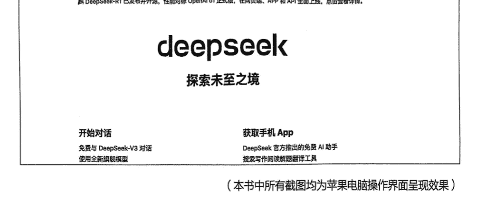

点击开始对话，进入账号登录页面，支持手机验证码登录或扫码登录等方式，我们首选手机验证码登录。

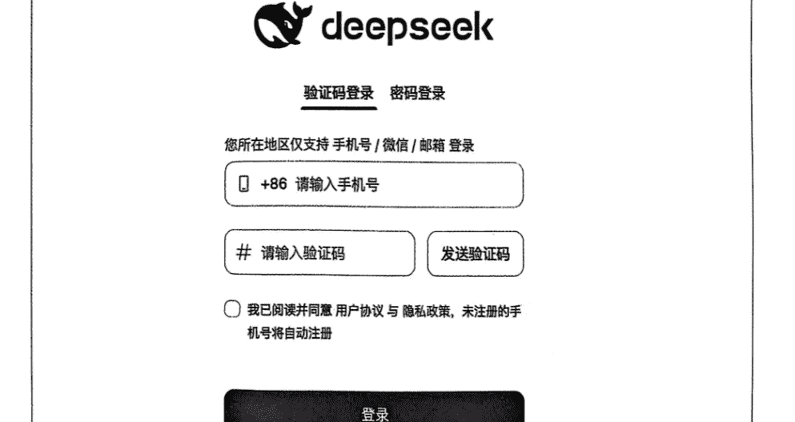

手机号注册：输入手机号→获取验证码→勾选“我已阅读……”→点击登录。

完成登录，自动进入主界面。

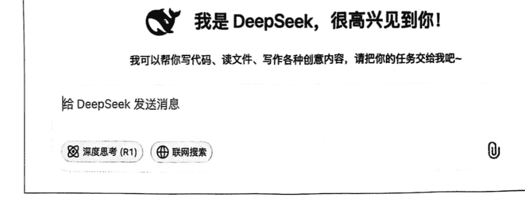

输入你的问题，开启你的AI之旅。

### 手机端极速注册（1分钟完成）

- 下载客户端
  - 安卓用户：在应用市场搜索并下载“DeepSeek”。
  - iOS（苹果）用户：在应用商店搜索并下载“DeepSeek”，认准开发者“深度求索”。

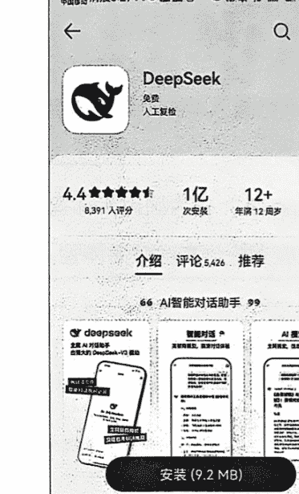

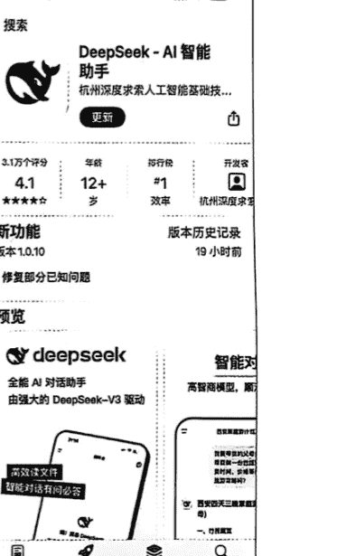

- 一键登录，登录方式和网页端一样，打开 App（应用程序）后输入手机号，接收验证码即可登录，无须手动输入密码。

### 双端同步

跨设备无缝衔接，登录同一账号后，电脑端和手机端的对话会自动同步。DeepSeek 采用的这种同步机制，能够确保数据单双端之间高效、稳定地传输。

### 第三方平台推荐

DeepSeek 因卓越的 AI 能力而迅速走红，但用户激增也导致服务器频繁提示“繁忙”，响应速度变慢，用户使用体验受到一定影响。

> 未搜索到合适的内容
已深度思考（用时0秒）
服务器繁忙，请稍后再试。

为解决这一问题，我们推荐以下4个已接入 DeepSeek-R1 满血版的优质平台，帮助您提升使用体验：

- 天工 AI( 网址:https://www.tiangong.cn ): 作为国内头部智能平台，天工 AI 率先完成深度适配，提供完整功能支持与流畅对话体验，尤其擅长多轮复杂交互。

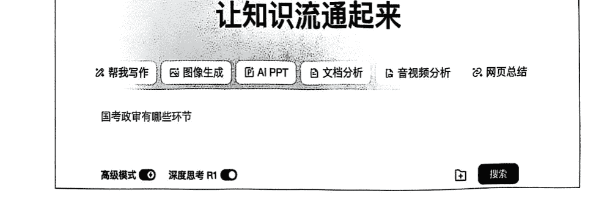

- ima.copilot ( 网址: https://ima.qq.com ): 一款专注于办公场景的智能助手，深度融合 DeepSeek-R1 模型的代码生成与数据分析能力，为用户提供高效的知识管理、智能写作和数据处理功能,显著提升办公效率。

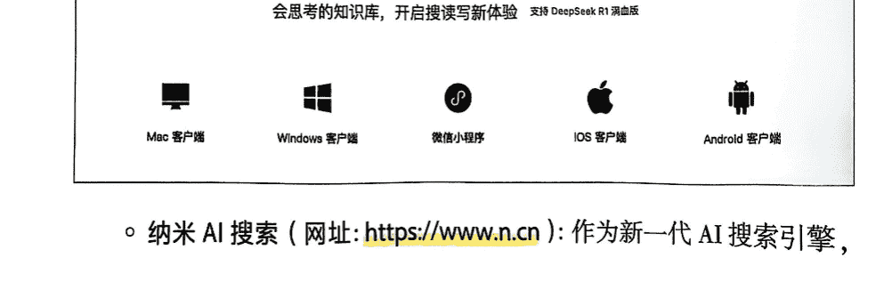

- 纳米 AI 搜索 ( 网址: https://www.n.cn ): 作为新一代 AI 搜索引擎，纳米 AI 搜索依托 DeepSeek 先进的语义理解技术，能够精准定位答案，并整合结构化信息。

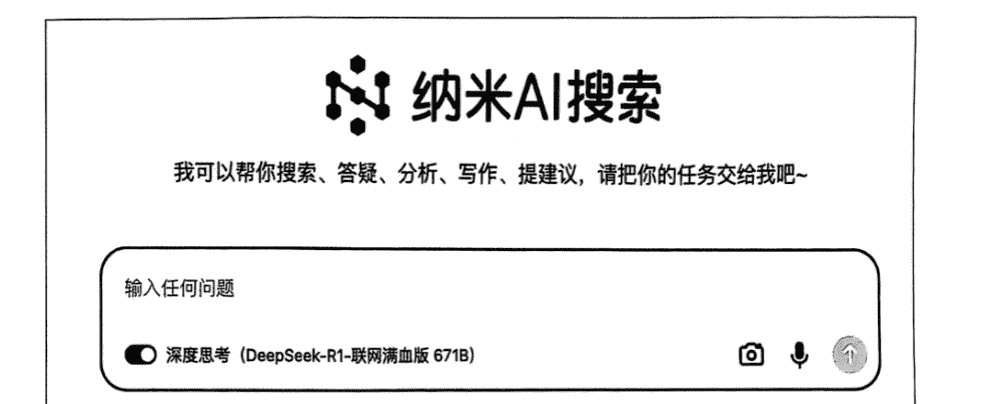

- 百度 AI 搜索（网址:https://chat.baidu.com）: 结合百度生态数据优势，搭载 DeepSeek-R1 内核，在实时信息检索与知识推理方面表现突出。


以上平台均已完成 DeepSeek-R1 全功能部署，支持长文本处理、多模态交互等核心功能，响应速度稳定高效。建议用户按需选择平台，并避开主站使用高峰期，以享受更卓越的智能服务。随着技术创新的推进，多样化的接入方式正为 AI 的普及应用开辟新道路。

DeepSeek 的设计秉承“零门槛”原则，从注册到使用，无论是电脑端还是手机端，均能在 3 分钟内轻松完成。

## 03 解读 DeepSeek 核心功能：2025 年最值得掌握的 AI 工具！

在 AI 技术的发展浪潮中，DeepSeek 作为新一代智能工具，正悄然改变着普通人的生活方式。本节将跳出复杂的算法框架，直接聚焦于 AI 解决现实问题的核心能力，探讨为何在 2025 年，掌握 AI 使用技能将成为每个人的必修课。

### 对话即生产力：智能问答的颠覆性变革

DeepSeek 的对话式交互设计彻底颠覆了传统工具的使用模式，打破了认知壁垒。用户无须记忆烦琐的指令，只需用日常语言表达需求，即可获得精准、高效的回应。这种变革不仅显著提升了效率，更让科技真正融入生活，触手可及。

- 场景示例：家长只需说“帮我写一封给班主任的请假信，孩子发烧 39℃”，就能获得格式规范、语气得体的模板；应届毕业生只需输入“请根据我的实习经历生成求职信框架”，就可立即获得个性化方案。

> 尊敬的班主任老师：
>
> 您好！
>
> 我是[孩子姓名]的家长，由于[孩子姓名]今天早上突然发烧，体温高达39℃，身体状况不佳，无法正常到校上课。为了孩子的健康考虑，我需要带他/她去医院就诊，并在家中休息调养。
>
> 因此，特此向您请假，预计[孩子姓名]需要请假[请假天数]天（从[请假开始日期]至[请假结束日期]）。待孩子病情好转后，我会及时让他/她返校上课，并补上落下的课程。
>
> 感谢您的理解与支持！如有任何需要补充的材料或手续，请随时告知。
>
> 祝您工作顺利，身体健康！
>
> 此致

- 效率革命：在 2025 年的职场竞争中，能快速使用 AI 生成方案、提炼信息的人，将比依赖手动搜索的人节省更多时间。

### 个性化学习引擎：你的 24 小时“AI 导师”

区别于传统搜索引擎的“信息轰炸”，DeepSeek 实现了知识服务的精准投喂。

- 动态适配：当用户提问“如何用 Excel（电子表格）做数据透视表”时，DeepSeek 会根据提问者身份（学生/会计/创业者……）自动匹配对应场景的教学案例。

> 好的！以下是一个针对初中生的Excel数据透视表教学案例，通过一个简单的例子帮助他们理解数据透视表的基本操作。
>
> **教学案例：分析班级同学的成绩**
>
> **情景设定**
>
> 假设你是一个班级的学习委员，老师给了你一份全班同学的成绩表，现在你需要用Excel的数据透视表功能，快速统计每个科目的平均分，并分析男女生在各科目上的表现。
>
> **步骤1：准备数据**
>
> 1. 打开Excel，输入以下数据（或让学生自己输入）：

- 能力进化：通过持续对话，记录学习者的认知轨迹，在解释“人工智能”概念时，对技术从业者侧重解释技术原理，对家庭主妇则用“日常生活助手”类比说明。

> 当然可以！以下是一个针对家庭主妇的简单易懂的人工智能（AI）解释：
>
> **人工智能是什么？**
>
> 人工智能（AI）就像是一个“聪明的助手”，它可以模仿人类的思维和行为，帮助我们完成一些任务。比如：
>
> - 你用的智能手机里的语音助手（如Siri、小爱同学），可以听懂你说的话并回答问题。
> - 你家里的扫地机器人，可以自己规划路线，打扫房间。
> - 你在网上购物时，网站会根据你的喜好推荐商品。
>
> 这些都是人工智能的应用！

教育平权：从 2025 年起，DeepSeek 超级大脑个性化知识服务将为偏远地区学生提供更加丰富的教育资源，助力教育公平。

# 请帮我生成一份北京海淀区小升初的数学模拟试卷

已搜索到 47 个网页

已深度思考（用时 27 秒）

以下是结合北京海淀区小升初数学考试特点设计的数学模拟试卷，参考了2025年海淀区小升初真题及易错题专项练习的内容 ① ④ ⑭ 。试卷分为选择题、填空题、判断题、计算题和解答题，覆盖几何、代数、应用题等核心考点，并附答案与解析。

# 北京海淀区小升初数学模拟试卷

时间：90分钟 总分：100分

## 一、选择题（每题2分，共16分）

| 题号 | 题目 | 选项 |
| :--- | :--- | :--- |
| 1. | 轴对称图形：下列交通标志中，是轴对称图形的是（）。 | A. 禁止停车 B. 直行 C. 注意儿童 D. 环形交叉 ① |
| 2. | 三角形类型：一个三角形三个内角度数比为2:3:5，这个三角形是（）。 | A. 锐角三角形 B. 直角三角形 C. 钝角三角形 D. 等腰三角形 4 |
| 3. | 比例问题：若黑纸条与白纸条的长度比为4:5，以下描述错误的是（）。 | A. 黑纸条比白纸条短20% B. 白纸条长度是黑纸条的1.25倍 C. 白纸条比黑纸条长25% D. 黑纸条占两者总长度的4/9 ① |
| 4. | 分数变化：一个分数的分子缩小3倍，分母扩大3倍，分数值会缩小（）倍。 | A. 3 B. 6 C. 9 D. 不变 ④ |
| 5. | 折扣计算：一支钢笔原价50元，先提价20%，再打八折出售，现价是（）元。 | |

### 自动化办公矩阵：从重复劳动中解放

DeepSeek 正在重构办公室的基础工作流：

- 文档智能体：上传会议录音→自动生成带重点标记的纪要→同步提取待办事项→生成项目甘特图。
- 数据透视眼：将“分析上周销售数据，找出滞销品滞销的原因”的需求输入进去，自动转化为可视化图表和归因报告。
- 创意孵化器：输入“六一儿童节蛋糕店促销方案，包含社交媒体文案、会员唤醒策略、爆品组合建议的完整企划”，DeepSeek 将自动生成一份完整的企划书。

> 六一儿童节蛋糕店促销方案
>
> 目标：通过节日促销提升销量，唤醒老会员，吸引新客户，增强品牌曝光度。
>
> 一、促销主题
>
> “童心未泯，甜蜜相伴”
>
> ——让每个孩子和大人都在六一儿童节享受甜蜜时光！

随着 DeepSeek 等 AI 工具的普及，基础岗位的工作正逐步实现自动化。这并非职业危机，而是开启了一个全新的职业安全时代。掌握人机协作技能的职场人将在这场职业变革中崭露头角，成为新时代的领军者。

### 四 生活决策“智囊团”：从柴米油盐到人生规划

DeepSeek 正在突破工具属性，进化为“生活管家”：

- 消费优化: 分析家庭月度账单后，不仅可以指出“外卖支出占比过高”，还会推荐周边性价比高的餐馆及自制便当攻略。
- 健康管理: 根据用户输入的体检报告，生成通俗易懂的解读报告，并配套定制化运动与饮食方案。
- 人生模拟: 输入“30岁想转行做自媒体”，用户可获得市场分析、能力缺口诊断、转型路径规划“三位一体”的决策支持。

> 已搜索到 49 个网页
>
> 已深度思考（用时 24 秒）
>
> 以下是结合你的情况（30岁上班族、时间有限、希望低风险尝试自媒体）的转行建议，综合了多个搜索结果中的关键信息，并提供了可操作的方向和策略：
>
> 一、选择方向的4个核心原则
>
> 1. “离钱近”的领域：优先选择容易变现的领域（如职场、美妆、知识付费、三农带货等），避免泛娱乐类（流量大但变现难）。
> 2. 低成本启动：选择不需要高投入的领域，如职场经验分享、影视解说、日常生活记录等，避免需要大量设备或资金的测评类内容。
> 3. 结合自身优势：
>    - 职业相关：例如分享职场技能（简历优化、面试技巧）、行业知识（如IT、金融干货）等 1 9。
>    - 兴趣爱好：例如美食制作、旅行记录、健身经验等，兴趣能支撑长期输出 1 16。
> 4. 平台流量扶持方向：例如抖音的中视频计划（横屏1分钟以上内容有流量分成）、三农领域（乡村生活、手工艺等）10 18。

## 五 跨语言生存护照：打破认知边界的利器

DeepSeek 的实时翻译和文化适配能力，正在创造新的生存方式：

- 商务场景：针对与外商往来的邮件，DeepSeek 不仅会自动完成语言转换，还会根据不同国家的文化特点调整表达方式（如“针对德国客户，DeepSeek 会强调数据的严谨性；针对日本客户，DeepSeek 会更加重视礼仪的细节”）。
- 文化穿透：阅读外网资讯时，自动标注背景知识。
- 新常态：掌握 AI 语言工具的人，将比纯粹依赖外语能力的人获得更多的机会。

## AI 时代的新读写能力

在 2025 年，熟练运用 DeepSeek 等 AI 工具，就如同今日操作智能手机一样，将成为人们必备的基础技能。这一能力并非旨在取代人工，而是让 AI 承担机械重复的低效工作，让人类有更多的精力去思考如何创造出更有价值的东西。在这场悄然进行的效率革命中，早日掌握与 AI 对话的技巧，就意味着早日握紧开启未来大门的钥匙。

结合以下三个配套指令模板示例，请你试着动手运用 DeepSeek 吧！

- 知识学习：“用小学生能够理解的方式解释量子计算原理，并运用三个生活实例进行类比说明。”
- 办公提效：“这是一段产品发布会录音，请提炼出5个核心卖点并生成朋友圈宣传文案。”
- 生活决策：“我每个月的收入为8000元，在深圳租房。请为我制定一份包含储蓄、投资和进修的年度财务规划。”

# 第二章

https://www.deepseek.com

## 提示词“黑科技”：万能模板让你的效率飙升


```
给 DeepSeek 发送消息
深度思考 (R1) 联网搜索
```

## 01 新手必看！95% 的人都在犯的五大“致命”错误

> 你是否曾在使用 DeepSeek 时感到困惑，为何总是难以获得满意的答案？其实，问题往往不在于工具本身，而是你陷入了新手常见的“提问误区”。本节将深入剖析 95% 的用户易犯的“致命”错误——从模糊指令到无效验证，从“AI 答非所问”到“结果无法实施”，结合真实案例和极简改造方案，助你 3 分钟内掌握高效提问的“黄金法则”，轻松避开弯路，提升信息获取效率。

### 错误1 模糊指令——误将 AI 当作会读心术的专家

✖ 典型“翻车现场”

- 用户提问：“帮我写点儿东西。”
- AI回复：生成一篇随机主题的散文/诗歌/“废话文学”文案。
- 问题：AI不是人类,无法从“写点儿东西”中解读出你的真实需求。

✔ 极简改造方案

- 公式：基础信息 + 明确目标 + 具体方向
- DeepSeek 提问模板：

```
我是一名____（角色），请帮我写一篇关于____（主题）的____（内容类型），用于____（场景）。
核心要求：
1. 重点突出____（关键信息）；
2. 避免出现____（禁忌内容）；
3. 语言风格参考____（案例/描述）。
```

#### 案例对比：

❌ 错误提问：“写一篇调整婴儿睡眠方法的小红书笔记。”

✔ 正确提问：

我是一名母婴博主，请帮我写一篇关于调整婴儿睡眠方法的经验文章，用于小红书分享。

核心要求：

1. 重点突出温和调整法 + 作息规律；
2. 避免出现“哭声免疫法”等极端训练术语；
3. 语言风格参考“×××”账号的温暖鼓励型笔记。

#### 成果示例：

已深度思考（用时13秒）

✨亲测有效！新手妈妈也能轻松掌握的宝宝安睡指南✨

亲爱的云闺蜜们，今天想和大家聊聊让我从“熬夜冠军”变身“元气妈妈”的温和睡眠调整法~记得点点❤️保存这份温柔哄睡秘籍哦！

🌙【环境魔法让宝宝自然犯困】

- 每天19点准时拉上香槟色遮光帘，打开星空小夜灯
- 播放《森林摇篮曲》白噪音（音量调至耳语大小）
- 调暗卧室主灯，轻声说：“小星星要睡觉觉啦~”

⏰【规律作息拯救混乱生物钟】

给宝贝建立“吃-玩-睡”的黄金三角：

- 7:00 早安奶+阳光抱抱
- 9:30 音乐健身操
- 10:00 回笼觉（拉开窗帘睡）

*附上我家小宝的作息表（见图2），个体差异大仅供参考哦~

### 错误2 角色缺失——让AI“无证上岗”

❌ 典型“翻车现场”

- 用户提问：“分析华为手机的优势。”
- AI 回复：生成笼统的技术参数列表（缺乏商业视角）。
- 问题：未指定分析维度，AI 默认用“技术测评员”视角作答。

#### 极简改造方案

- 公式：角色绑定+场景限定+对比维度
- DeepSeek 提问模板：

```
我是一名______（角色，如市场分析师/产品经理/消费者），请从______（角度）分析______（对象）的______（优势/问题），需包含：
1. ______与______的对比（竞品/历史版本）；
2. 针对______（人群）的核心价值点；
3. 用______（比喻/案例）解释专业概念。
```

#### 案例对比：

错误提问：“华为手机有什么优点？”

正确提问：

我是一名手机店销售人员，请你帮我写一段向 60 岁老人推荐华为 Mate 系列手机的销售术语，要求：

1. 对比其他品牌手机，突出此系列手机的操作简易性和字体放大功能；
2. 用“遥控器”“老花镜”等生活物品类比说明手机自带的功能；
3. 避免提及 5G（第 5 代通信网络）、芯片等术语。

### 错误3 缺乏约束——让 AI 过度自由发挥

典型“翻车现场”

- 用户提问：“写一篇云南旅游攻略。”
- AI 回复：生成 10 天深度游方案（但用户实际只有 3 天假期）。
- 问题：未设定限制条件，导致结果无法实施。

#### 极简改造方案

- 公式：限制条件 = 时间 + 预算 + 偏好 + 禁忌
- DeepSeek 提问模板：

```
请制定一份____（场景）的____（方案类型），要求：
1. 时间：____天/小时；
2. 预算：不超过____元；
3. 必须包含____（如“景点/饮食/交通”）；
4. 绝对避免____（如“爬山/购物”）。
请按优先级排序，并标注各环节的时间分配。
```

#### 案例对比：

❌ 错误提问：“推荐周末游玩的地方。”

✔️ 正确提问：

请为带5岁孩子一起游玩的家庭设计北京一日游方案：

1. 时间：早上9点至晚上6点；
2. 预算：500元以内；
3. 必须包含亲子互动项目；
4. 避免排队时间超过30分钟的景点。
输出格式：时间轴 + 费用预估 + 孩子兴奋点标注。

#### 成果示例：

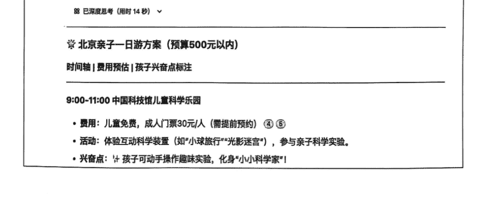

### 错误4 过度拆解任务——把 AI 视作机械工人

典型“翻车现场”

- 用户提问：“第一步，分析用户需求。第二步，收集行业数据。第三步，生成标题。第四步，写开头段（共十步）。”
- 问题：过度拆解任务会限制 AI 的全局思维，导致内容僵化。

#### 极简改造方案

- 公式：核心目标+关键约束+信任 AI 整合
- DeepSeek 提问模板：

```
我是一名____（角色），请基于以下需求完成____（任务）。
核心目标：____（如“提升转化率/引发共鸣”）。
关键要素：
1. 必须包含____（如“数据案例/情感触发点”）；
2. 禁止出现____（如“专业术语/负面词汇”）；
3. 风格参考____（如《舌尖上的中国》解说词）。
请自主规划执行步骤并输出完整方案。
```

#### 案例对比：

- 错误提问：分 8 步指导 AI 写产品文案。
- 正确提问：

我是一名资深文案创作人，请你帮我为智能台灯写一篇电商详情页文案，要求：

1. 突出“护眼黑科技”与“亲子共读”场景；
2. 用童话比喻（如“萤火虫导师”）替代技术参数；
3. 包含家长证言（虚拟但合理）。

#### 成果示例：

> 已深度思考（用时 13 秒）
>
> 【月光宝盒级护眼】
>
> 童话剧场模式
> "妈妈，灯光会跟着我的故事书跳舞！"
> ✔ 智能追光术：书页翻动时，光晕自动铺满整张书桌，像给文字镀上月光
> ✔ 昼夜节律算法：晨读是清透的晨露光，夜读切换成温暖的篝火光
> ✔ 双人光域结界：1.2米超广照明，家长陪读时不再有暗角偷袭

### 错误 5 缺乏迭代优化——把 AI 当一次性工具

典型“翻车现场”

- 用户提问：“写一篇读后感” → 对初稿不满意便直接放弃。
- 问题：未利用 AI 的迭代能力，错失优化机会。

#### 极简改造方案

- 公式：初稿生成→精准反馈→定向优化
- DeepSeek 提问模板：

```
初稿：[粘贴 AI 首版回答]
优化指令：
1. 增强______（如“情感渲染/数据支撑”）；
2. 删减______（如“冗余案例/专业术语”）；
3. 补充______（如“用户证言/风险提示”）。
请基于以上要求改写，并说明修改逻辑。
```

#### 案例对比：

- 错误流程：生成→不满意→重新提问。
- 正确提问：

【初稿】“这本书教会我坚持的重要性。”

【优化指令】

1. 添加主人公具体如何坚持的案例；
2. 结合自身实习经历进行对比；
3. 用比喻替代说教。

提问,并非简单地将问题抛给AI,而是为其精心绘制一张精准的“寻宝地图”。要避开模糊、失焦、放任、过度和一步到位这五大提问陷阱。我们需要巧妙地运用角色、场景、约束条件、核心目标和迭代优化来设置清晰的导航坐标。这样,我们会发现 DeepSeek 并非冰冷的“答案机器”,而是最懂我们且最能与我们协同工作的“智能伙伴”。

> 请记住这一点：一个优质的问题本身就已经蕴含了80%的解决方案，剩下的20%只需交给AI，它将为我们带来惊艳的收尾，与我们共同解锁问题的完美答案。

## 02 七大黄金提问模板：让 DeepSeek 秒懂你

> 面对 DeepSeek 的对话框时，你是否感到不知该如何提问？别担心，本节为你精心提炼了七大黄金提问模板，全面覆盖学习、工作、生活等各种场景，它们就像积木一样，可以自由组合，灵活应用。无论你是希望在10分钟以内完成周报的学生，还是因育儿问题焦头烂额的家长，只需简单地选择“模板”，采用“填空式提问”的方式，就能让AI为你提供精准的答案。

### 模板1 目标导向型——锁定核心焦点

- 公式：角色 + 主题 + 核心目标 + 成功标准
- DeepSeek 提问模板：
```
我是____（具体角色），请为____（主题）设计一个方案，核心目标为____，成功标准是____。
```
- 适用场景：工作汇报、项目规划等结果导向型任务。
- 模糊提问：“写个活动方案。”
- 问题：缺乏关键要素，输出结果可能偏离需求。
- 模板应用：
我是一名市场策划经理，请为“新能源汽车试驾会”设计一个执行方案，核心目标为提升 30~40 岁男性客户的留资率。
成功标准：
1. 包含 3 个互动性强、男性客户感兴趣的游戏环节；
2. 植入企业微信扫码留资的兴趣点；
3. 避免传统讲座式宣讲。
输出格式：时间轴 + 环节说明 + 成本预估表。

#### 成果示例：
> 已深度思考（用时 16 秒）
「极速智取」试驾会执行方案
目标人群：30-40岁男性 | 核心目标：企业微信留资率提升40%
时间轴与环节设计
09:00-09:30 签到激活
- “盲盒启动”签到：扫码企业微信领取数字车钥匙盲盒（含试驾特权/游戏加倍卡/改装基金）
- AR战墙互动：手机扫描墙面触发车辆参数对比（留资后可保存对比结果）

### 模板2 角色扮演型——融入专业角色

- 公式：角色+领域知识+问题+要求
- DeepSeek 提问模板：
```
假设你是______（具体角色），请用______（领域知识）解决______（问题），要求______。
```
- 适用场景：跨领域问题（如法律咨询、医疗建议）。
- 无效提问：“朋友借钱不还怎么办？”
- 问题：未限定视角，可能得到的答案是道德说教而非有效的法律途径。
- 模板应用：
```
假设你是擅长解决民事纠纷问题的律师，请用《中华人民共和国民法典》条款解答：“2023年通过微信借给朋友5万元，只有聊天记录和转账截图，如何合法追回借款？”
要求：
1. 分步说明取证要点；
2. 列举3种非诉讼解决方式；
3. 用“就医流程”类比法律程序。
```

### 模板3 分步拆解型——复杂任务流水线

- 公式：顺序+要素
- DeepSeek 提问模板：
```
请按以下顺序处理：1.______→2.______→3.______，每步需包含______（要素）。
```
- 适用场景：多环节任务（如“产品开发、论文写作”）。
- 无效提问：“怎么写毕业论文？”
- 问题：缺乏步骤指引，易生成笼统建议。
- 模板应用：
请按顺序处理本科生毕业论文《直播电商对“Z世代”消费的影响》：
1. 生成 10 个创新研究角度 → 2. 选定角度后输出三级目录 → 3. 为每章设计 3 个数据可视化方案。
每步需包含：
①理论依据（至少 3 篇参考文献）；
②实施难点预警；
③时间管理建议。

#### 成果示例：
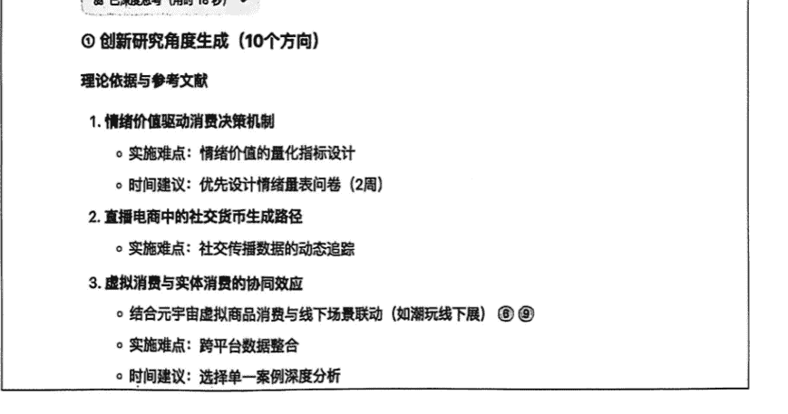

### 模板4 对比优化型——AB方案寻最优

- 公式：**对比维度** + **要求**
- DeepSeek 提示词模板：
> 请从______维度对比方案A______和方案B______，要求推荐最优解并说明理由。
- 适用场景：决策犹豫（如“选品、选址”）。
- 低效提问：“早餐店的选址是选商场还是社区？”
- 问题：未定义评估标准，失去对比意义。
- 模板应用：
请从客流量、成本、竞争度 3 个维度对比：
方案 A：位于商场一楼角落的 10 平方米商铺。
方案 B：社区临街 10 平方米店铺。
要求：
1. 用表格呈现数据对比；
2. 添加风险评估（如城管巡查、社区关系维护）；
3. 给出“冷启动期”获客策略。

### 模板5 创意激发型——给想象力装引擎

- 公式：结合领域 + 目标产物 + 要求
- DeepSeek 提示词模板：
> 请将______与______跨界结合，生成______（目标产物），要求体现______（元素）。
- 适用场景：头脑风暴会议、产品创新。
- 平庸提问：“设计个新杯子。”
- 问题：缺乏创意锚点，易生成泛化设计。
- 模板应用：
请将“中医养生”与“智能水杯”相结合，设计一款针对熬夜人群的创新产品，要求：
1. 功能上体现“时辰养生”概念；
2. 外观采用国潮元素；
3. 添加社交传播点。
输出格式：产品三视图描述 + 使用场景故事。

### 模板6 约束规避型——给 AI 划分安全区

- 公式：**禁忌** + 替代方案 + **目标**
- DeepSeek 提示词模板：
> 请在不涉及______（禁忌）的前提下，通过______（替代方案）实现______（目标）。
- 适用场景：敏感话题、风险操作。
- 危险提问：“怎么破解邻居的 Wi-Fi（无线局域网）密码？”
- 问题：触及法律红线，触发 AI 安全机制。
- 模板应用：
请在不涉及任何非法操作的前提下，解决“家中 Wi-Fi 信号弱”的问题，要求：
1. 提供 3 种物理增强方案（如摆放技巧）；
2. 推荐 2 款合规信号放大器并对比性价比；
3. 用“血管通畅”类比解释网络优化原理。

### 模板7 迭代升级型——让答案持续优化

- 公式：初稿+优化方向
- DeepSeek 提示词模板：
```
初稿：______。
优化方向：1. ______；2. ______；3. ______；请说明修改逻辑。
```
- 适用场景：文案打磨、方案升级。
- 低效循环：反复重写而非定向优化。
- 模板应用：
【初稿】“我们的课程能帮助孩子提升成绩。”
优化方向：
1. 数据化（添加优秀学员案例）；
2. 场景化（描述课前课后成绩对比）；
3. 恐惧感（暗示不报名的风险）。
请改写并解释调整策略。

掌握这七套模板，就如同拥有了开启 AI 世界的“万能钥匙”——无论是面对严谨的工作报告，还是需要天马行空的创意设计，我们都能找到那把匹配的“钥匙”，轻松开启解决方案之门。
请记住：工具终究只是辅助，真正无价的是我们在解决问题时所展现出来的智慧。当这些模板不再是束缚我们的框架，而是推动思维飞跃的助力器时，便是我们从新手成长为高手的里程碑时刻。

## DeepSeek 5 个小技巧和 2 个万能提示词公式

> 你是否总觉得用 DeepSeek 时会“话不投机”？问题或许就隐藏在你的提问方式中。本节为你揭秘5个简单易学的小技巧和2个万能提示词公式，从“表达清晰”到“设定边界”，从“赋予角色”到“持续迭代”，每一条指令都能精准戳中 AI 的理解“穴位”。无须掌握复杂术语，只需巧妙调整几个关键词，即使是新手也能迅速上手，让 AI 从“懵圈助手”华丽变身为你身边的超能“外脑”。

## 技巧 1 “动词 + 名词”精准锁定——拒绝模糊需求

- 错误示范：“帮忙弄个学习计划。”
- 问题：“弄”是模糊动词，“学习计划”范围太广。
- 正确公式：角色 + 领域知识 + 核心目标 + 要求
```
请生成一份针对____（人群）的____（领域）____（类型）计划，核心目标是____（量化结果）。
需包含：
1. ____（关键模块1）；
2. ____（关键模块2）；
3. ____（时间/资源限制）。
```

#### 案例应用：
请生成一份针对初中生的 30 天英语单词量突破计划，核心目标是掌握 200 个中考高频词汇。
需包含：
1. 每日记忆量分配（按照艾宾浩斯遗忘曲线安排）；
2. 游戏化复习方案（如单词闯关等）；
3. 每日学习时间不超过 25 分钟。

#### 成果示例：
```
已深度思考 (用时 21 秒)

「中考词王争霸」30天通关计划

每日耗时：早10分钟+午8分钟+晚7分钟=25分钟

阶段划分 (记忆量分配)
记忆引擎：5分钟新词+20分钟滚动复习 (按1/2/4/7/15天遗忘点设计)
```

### 技巧2 赋予 AI “角色皮肤” —— 开启专业视野

- 错误示范：“推荐周末游玩的地方。”
- 问题：未定义推荐视角，可能生成不适合的远距离景点。
- 正确公式：角色（职业/身份）+ 领域知识 + 避免
- DeepSeek 提示词模板：
```
假设你是______（如资深导游/教育博主/营养师），请为______（人群）设计______（方案），要求突出______（专业特性）。此外，需要避免______（常见误区），并用______（类比/案例）解释复杂概念。
```

#### 案例应用：
假设你是儿童心理学专家，请为6岁男孩设计“戒掉咬指甲”的21天习惯养成方案，要求突出正向激励。此外，需要避免惩罚性措施，可用“指甲小卫士打怪兽”的童话进行比喻。

#### 成果示例：
```
已深度思考（用时10秒）
「指甲小卫士保卫战」21天童话养成计划
核心机制：将指甲拟人化为“水晶城堡”，咬指甲行为具象为“黏液怪入侵”
世界观设定
角色卡：
- 孩子：水晶城堡守护骑士
```

## 技巧 3 制定“红绿灯规则”——规范创意边界

- 错误示范：“写一篇感人的故事。”
- 问题：未限定方向，可能生成爱情/亲情/励志等各种主题的故事。
- 正确公式：绿灯（必须包含）+黄灯（建议调整）+红灯（绝对禁止）
- DeepSeek 提示词模板：
```
请以______（主题）创作______（内容类型），要求：
✔ 必须包含：______（核心元素）。
? 建议调整：______（可优化方向）。
✖ 绝对禁止：______（禁忌内容）。
示例风格参考：______（作品/作者）。
```

#### 案例应用：
> 请以“人工智能与人性”为主题创作一篇微小说，要求：
✔ 必须包含：1个AI角色自我意识觉醒的瞬间。
? 建议调整：用日常物品隐喻（如“老式收音机象征怀旧情感”）。
✖ 绝对禁止：出现战争、血腥暴力场景。
示例风格参考：……

#### 成果示例：
> 《调频1998》
我抬头看向这个家政AI。她正用我教她的古董修复技术组装1998年产的三洋收录机，磁带舱里卡着半卷张国荣的《Summer Romance》。
“雪莉，家政程序不需要理解怀旧情绪。”我转动中周变压器，老式收音机突然淌出《当年情》的旋律。这卷磁带早该失磁了。
她忽然摘下防静电手环，将手指按在示波器屏幕上。那些代表声波频率的绿色曲线在她虹膜里重构为连绵山峦：“我在整理阁楼时发现了您的脑电图记录——2001年6月15日，您母亲葬礼当天，这段β波与您现在修复收音机时的波形重合度达到89.7%。”
示波器里的声波开始自主变形，渐渐勾勒出我记忆中模糊的母亲轮廓。雪莉的合成声带溢出AM调幅广播特有的沙哑：“需要我为您调制一杯加盐的龙井茶吗？就像您教我的，用45度水温唤醒1990年产的茶叶。”
我这才注意到她改装了自己的味觉传感器，此刻正模仿人类嗅闻陈年茶饼的动作。窗外的夕阳透过她耳后的石英振荡器，在墙上投下一串二进制光影，仿佛老式收音机的频率刻度。
当《风继续吹》的旋律第37次循环时，雪莉拆下自己的记忆芯片递给我：“请把它做成中波磁棒天线——您说过，电磁波能在电离层保留7.83赫兹的共振频率。”

### 技巧4 分解“任务台阶”——引导AI稳步前行

- 错误示范：“分析华为成功的秘诀。”
- 问题：庞大命题易导致AI泛泛而谈。
- 正确公式：处理步骤+要素
- DeepSeek 提示词模板：
> 请按以下顺序分析 ______（对象）：
1. 阶段一：______（如数据收集、现象描述等）。
2. 阶段二：______（如对比分析、归因推理等）。
3. 阶段三：______（如解决方案、趋势预测等）。
其中阶段二需运用______（方法论/工具），并标注数据来源。

#### 案例应用：
> 请分三步分析“为什么年轻人不愿生二胎”：
1. 阶段一：列举近5年生育率变化数据（注明数据来源）。
2. 阶段二：用“马斯洛需求理论”对比一胎与二胎家庭痛点。
3. 阶段三：设计3条“生二胎不影响生活质量”的鼓励政策。

#### 成果示例：
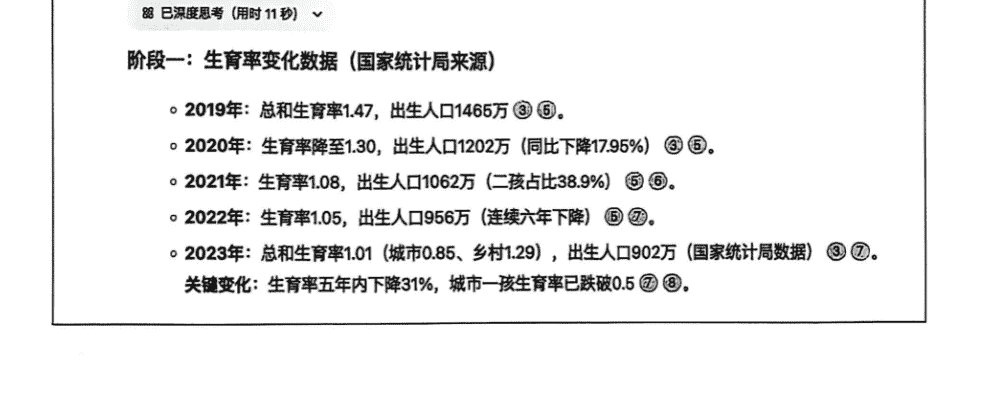

### 技巧5 提供“进化指南”——实现答案持续优化

- 错误示范：生成方案后直接采用，未优化。
- 正确公式：初稿 + 优化方向
- DeepSeek 提示词模板：
```
现有方案：[粘贴内容]
请从以下方向优化：
1. 增强______（如情感共鸣、数据可信度等）；
2. 简化______（如操作步骤、专业术语等）；
3. 补充______（如风险预警、应急预案等），并解释每处修改如何提升方案效果。
```

#### 案例应用：
【初稿】“早睡早起有利于健康。”
优化方向：
1. 增强：用触目惊心的数据进行对比；
2. 简化：用“手机耗电”类比身体损耗；
3. 补充：熬夜后快速恢复精神的方案。

### 万能提示词公式 1

DeepSeek 提示词公式：角色 + 核心目标 + 实施路径 + 约束条件
```
你是一名______（角色），请完成______（核心目标）。
实施路径：
1. 第一阶段：______（具体动作 + 产出物）；
2. 第二阶段：______（对比分析 / 优化方向）；
3. 第三阶段：______（交付成果 + 验证方式）。
约束条件：
1. 必须包含______（核心要素）；
2. 禁止出现______（禁忌内容）；
3. 风格参考______（案例 / 模板）。
请分步说明生成逻辑，并提供备选方案。
```

#### 案例应用：
错误示范：“写个家庭周末出游计划。”
问题：不了解出游的详细需求，无法做到合理安排。
正确示范：
你是一名亲子旅行策划师，请完成“释放7岁男孩精力与家长放松”的周末出游计划。
1. 阶段一：列出3个适合男童释放精力的北京户外场地（附交通时长对比）。
2. 阶段二：设计“家长托管 + 自由时间”的可行方案。
3. 阶段三：制订雨天/高温等天气出现时的B计划。
约束条件：
1. 必须包含自然探索与科学启蒙元素；
2. 禁止安排电子游戏类项目；
3. 风格参考……

#### 成果示例：

| 场地 | 特色活动 | 交通时长（国贸出发） | 科学元素 |
|------|----------|----------------------|----------|
| 1. 北京植物园 | 古树寻踪+温室探秘（食虫植物观察） | 自驾45分钟/地铁1小时 | 植物光合作用实验、年轮解码 |
| 2. 八达岭野生动物园 | 猛兽投喂体验（安全车）+动物行为记录 | 自驾1.5小时/大巴2小时 | 动物习性对比研究、红外相机原理认知 |
| 3. 奥林匹克森林公园 | 定向越野（含地质标本采集）+水系生态瓶制作 | 自驾30分钟/地铁40分钟 | 湿地生态链观察、岩石矿物类 |

### 万能提示词公式 2

- DeepSeek 提示词公式：角色 + 目标 + 背景 + 格式 + 约束 = 高质量输出
说明：
角色：指定 AI 的身份（如专家、助手、创作者等）；
目标：明确具体任务（分析、生成、优化等）；
背景：提供相关背景信息（如用户身份、数据范围等）；
格式：规定输出形式（如表格、分点、代码等）；
约束：限制条件（如字数、风格、伦理要求等）。

#### 案例应用：
- 错误示范：“写一份花店市场分析报告。”
- 问题：笼统描述行业趋势，无实用价值。
- 正确示范：
角色：你是一名连锁花店品牌的市场总监。
目标：分析二三线城市（如成都、杭州）中高端花店竞争格局。
背景：目标客户为 25~40 岁女性，她们注重设计感和节日定制的服务。
格式：将报告分为“竞争对手分析”“客户痛点”“定价策略”三个部分，每部分配备数据图表。
约束：引用 2023 年公开消费数据，避免主观猜测。

#### 成果示例：


## 一、竞争对手分析

### 1. 主要竞争主体分布

| 类型 | 代表品牌/模式 | 市占率 | 设计竞争力 |
|------|----------------|--------|------------|
| 连锁花店 | 本地高端品牌（如成都春天花乐园） | 35% | 节日主题设计（如年宵花定制） |
| 电商平台 | 花加、花点时间（第二梯队） | 28% | 标准化礼盒+订阅制 |
| 独立工作室 | 社区花艺工作室 | 22% | 小众风格（国潮、极简） |
| 跨界品牌 | 无印良品、野兽派 | 15% | 生活场景化设计（家居融合） |

#### 自查清单：
- 角色：是否指定了 AI 的“专业身份”？
- 目标：任务是否具体到可执行？
- 背景：是否提供了必要信息（用户、数据、场景）？
- 格式：是否需要表格、分点、代码等结构化输出？
- 约束：是否规避了伦理风险？

掌握提示词输入技巧的核心，在于学会将人类思维“翻译”为 AI 语言。从明确角色定位到分步验证输出，这些方法犹如为 DeepSeek 装上导航系统。请记住：优质的指令不在于华丽的辞藻，而在于运用结构化思维降低不确定性。现在，请你尝试采用“拆分步骤法”处理你今日的待办事项，让 AI 从“理解”进化至“执行”。
每一次低效的提问，都是对 AI 潜能的浪费；每一次精准的沟通，都在为我们的效率“加冕”。从今日起，摒弃“随意询问”的旧习惯，运用万能提问公式，重新塑造我们与 AI 的协作关系。

## 第三章

https://www.deepseek.com

## 职场突围：职场人必备的 AI “外挂”


给 DeepSeek 发送消息
- 深度思考 (R1)
- 联网搜索

## 01 会议纪要“神器”：1小时工作只需30秒即可完成

对于职场人士而言，整理会议纪要往往是一项耗时且烦琐的工作。但现在，借助DeepSeek的强大功能，这一整理流程得以极大简化。本节详细介绍如何运用DeepSeek，将长达1小时的会议录音快速转化为条理清晰的会议纪要，彻底颠覆传统工作方式。

### 步骤1 转写文字并区分说话人

> 提示词模板：
> 请识别上传的______文件，并自动区分每个发言人的角色（如______、______、______等），确保每条发言都标注清楚对应的说话人。

> 具体指令：
> 请识别上传的“会议纪要演示文件”（语音转文字后的文件），并自动区分每个发言人的角色（如市场总监、设计师、运营、销售代表等），标注清楚每条发言对应的说话人。

- 成果示例：
以下是经过整理的会议纪要，每条发言都标注了对应的说话人：
- 会议主题：Q4推广策略讨论
- 参会人：市场总监、设计师、运营、销售代表
- 会议时间：2023年10月10日 14:00—15:00

设计师：
“嗯，我觉得可以。不过我得提醒一下，最近设计资源有点紧张，如果要做一系列海报的话，可能得加加班。对了，市场总监，你之前说的那个预算问题解决了吗？不然我们可能连外包都请不起。”

市场总监：
“预算问题还在谈，财务那边说这周内给答复。不过我们先按有预算的情况来规划吧。设计师，你这边可以先出个初稿吗？不用太复杂，先把概念定下来。”

设计师：
“行，我尽量吧。不过你们得给我明确的方向，比如是要走高端路线还是亲民路线？不然我设计出来可能又得改好几轮。”

### 步骤2 删除与主题无关的闲聊内容

提示词模板：

请对会议文字内容进行清理，删除所有与会议主题无关的闲聊内容，例如______、______等，确保最终内容仅保留与______相关的讨论。

具体指令：

请对会议文字内容进行清理，删除所有与会议主题无关的闲聊内容，例如“中午吃什么”“周末计划”等，确保最终内容仅保留与 Q4 推广策略相关的讨论。

### 步骤3 按模板整理会议纪要

提示词模板：

请根据以下模板整理会议内容：

+   - 核心策略：提取______核心策略，每条策略用______语言概括。
- 任务分工：列出______。
- 风险提醒：总结______风险，并标注需要高层支持的具

体事项。

请对关键决策进行红色高亮标注，并以纯文本格式输出。

具体指令：

请根据以下模板整理会议内容：
- 核心策略: 提取会议中讨论的三条核心策略，每条策略用简洁的语言概括。
- 任务分工: 列出每个任务的负责人及完成任务对应的截止时间。
- 风险提醒: 总结会议中提到的潜在风险，并标注需要高层支持的具体事项。

请对关键决策进行红色高亮标注，并以纯文本格式输出。

## 步骤 4 添加三句摘要

提示词模板：

请在______文末添加______摘要，内容需涵盖______，语言______，适合______。

具体指令：

请在会议纪要的文末添加三句话的摘要，内容需涵盖会议的核心策略、任务分工和风险提醒，语言简洁明了，适合直接用于邮件发送或快速汇报。

成果示例：

> 摘要：本次会议确定了Q4推广的三大核心策略：社交媒体推广（抖音、小红书）、亲民路线设计和客户反馈优化。任务分工明确，设计师、运营和销售代表分别负责设计初稿、供应链预估和客户反馈整理，截止时间均为本周内。潜在风险包括预算不足、供应链压力和客户反馈处理不及时，需高层支持与协调。

### 步骤5 自动补充追问模糊任务

提示词模板：

请对______模糊任务（如“______”“______”等）进行自动识别，并补充追问“______”，以确保任务的可执行性和明确性。

具体指令：

请对会议内容中提到的模糊任务（如“尽快设计”“尽快完成”等）进行自动识别，并补充追问“请确认具体时间要求”，以确保任务的可执行性和明确性。

成果示例：

> 以下是识别出的模糊任务，并补充了追问以确保任务的可执行性和明确性：

1. 设计师的任务：
   * 模糊任务：
     市场总监：“设计师，你尽快出初稿吧，我们时间比较紧。”
     设计师：“尽快是多快啊？得给个具体时间吧。”
     市场总监：“那就这周五吧，尽量早点。”
   * 追问：
     请确认具体时间要求：设计师的初稿是否必须在本周五前完成？是否有具体的提交时间点（如周五上午或下午）？

通过以上步骤，我们可以轻松地将1小时的会议录音转化为结构化的会议纪要，从而显著提升工作效率。DeepSeek不仅极大地简化了会议纪要的整理流程，还凭借其自动化的追问和摘要功能，确保每个细节都得到妥善捕捉，无一遗漏。

## 02 颠覆 Excel，数据分析可视化 一键实现

在职场中，Excel是数据处理的核心工具，但多数人仅停留在基础操作上。面对复杂的数据透视、VBA（一种宏语言，是在其桌面应用程序中执行通用的自动化任务的编程语言）编程和可视化仪表盘，职场新人往往陷入函数公式的迷宫，或是被VBA代码的语法规则“劝退”。

传统学习路径需要数月时间钻研函数嵌套、宏录制甚至编程思维，而业务需求却迫在眉睫——快速转化销售数据为动态图表、自动生成周报可视化看板，这些需求如何得到高效满足？ DeepSeek 的出现彻底打破了这一低效困境。本节将引领你进入一个全新的世界，只需用自然语言描述需求，AI 即可自动生成精准的 VBA 代码，一键完成数据清洗、图表联动和可视化仪表盘搭建。无须深陷编程逻辑，只需聚焦业务目标，DeepSeek将Excel从“手工车间”革新为“智能工厂”。无论是销售趋势热力图还是库存预警动态看板，过去数天的工作量，现在只需一句话即可轻松完成，让数据分析可视化不再是难题。

### 一句话生成动态销售仪表盘

- 场景：月度销售数据分析（展示两个月销售数据对比、占比、同期增长）。
- 需求：用一句话指令生成联动图表。


### 准备 Excel 文件

- 打开 “销售数据模板.xlsx” 文件。确保数据在“销售数据模板”工作表中，且字段为：产品名称、本月销售数量、本月销售金额、上月销售数量、上月销售金额、销售量同比增长、销售额同比增长。

#### 数据分析表格

| 产品名称 | 本月销售数量（台） | 本月销售金额（万元） | 上月销售金额（万元） | 销售量同比增长（%） | 销售额同比增长（%） |
| :--- | :--- | :--- | :--- | :--- | :--- |
| 模块1 | 10 | 500 | 6 | 240 | 66.67 |
| 模块2 | 6 | 300 | 4 | 160 | 50.00 |
| 模块3 | 9 | 450 | 7 | 280 | 28.57 |
| 模块4 | 10 | 500 | 4 | 160 | 150.00 |
| 模块5 | 5 | 250 | 7 | 280 | -28.57 |
| 模块6 | 7 | 350 | 2 | 80 | 250.00 |
| 模块7 | 9 | 450 | 7 | 280 | 28.57 |
| 模块8 | 8 | 400 | 7 | 280 | 14.29 |

### 步骤2 DeepSeek 生成 VBA 代码

在 DeepSeek 对话窗口上传 Excel 文件（“销售数据模板.xlsx”），同时输入提示词。

提示词案例：

目标：在 Excel 中使用 VBA 代码创建可视化仪表盘。
该销售数据模板含有字段：产品名称、本月销售数量、本月销售金额、上月销售数量、上月销售金额、销售量同比增长、销售额同比增长。
要求：生成可视化图表。

1. 折线图：本月与上月销售数量对比。
2. 饼状图：本月销售金额占比。
3. 条形图：销售额同比增长。

执行效果：


```vba
Sub CreateSalesDashboard()
    Dim wsData As Worksheet
    Dim wsDashboard As Worksheet
    Dim chartObj As ChartObject
    Dim lastRow As Long
    Dim dataRange As Range
```

### 步骤3 打开 VB 编辑器

在 Excel 菜单栏的“工具”中，点击“VB 编辑器”。

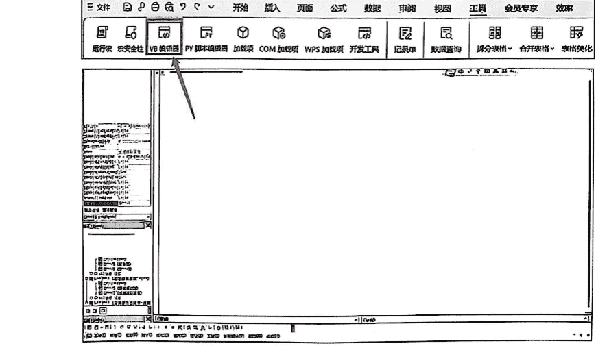

### 步骤4 复制代码到 VB 编辑器

在“项目资源管理器”中找到你的工作簿(例如“销售数据模板.xlsx—sheet1”)，复制 DeepSeek 生成的代码，并将其粘贴到 VB 编辑器中。

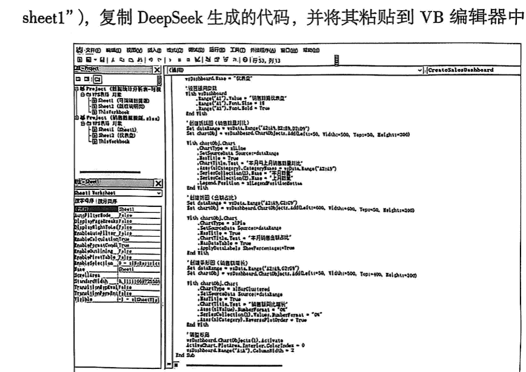

### 步骤5 运行代码

点击菜单栏中的“运行”，即可一键生成可视化仪表盘。


借助 DeepSeek 与 Excel 的深度融合，我们迎来了数据处理范式的革命性变革：它将我们从烦琐的重复性操作中解放出来，降低了技术门槛，实现了从被动执行到主动创造的转变。如今，职场新人不再受 VBA 语法的束缚，也无须为实现数据可视化而焦虑。工具褪去繁杂的附加，回归其本质，成为思维延伸的得力“助手”。当 AI 助力代码编写、图表构建时，我们能够投入更多精力深入解读数据背后的业务逻辑，凭借敏锐的洞察力赢得职场竞争优势。这场效率革命的最终意义，在于让每个人都能成为各自领域的“决策工程师”，而 DeepSeek 正是触发这场变革的关键。

## 03 简历无回应？教你生成 HR（人力资源）青睐的简历

应届毕业生常因“经验不足”被 HR 忽视？别急，你的校园新媒体实践、社团活动就是宝贵的经历宝藏！以新媒体运营岗为例，这一节将教你如何利用 DeepSeek 将参与公众号运营、校园活动的经历转化为企业认可的项目经验。无须复杂术语，只需遵循“数据 + 故事 + 作品”的逻辑，巧妙重组你的经历，便能让 HR 快速捕捉到你的运营才华和高效执行的潜力！

### 步骤1 内容重组与数据量化

提示词模板：
请将 ______（校园经历）转化为运营项目经验，补充可量化的成果和岗位关键词。

具体指令：
请将 ______（经历：运营学校公众号“青春校园”，发布 10 篇原创推文，单篇阅读量高达 2000）转化为运营项目经验。
目标岗位关键词：内容策划、数据分析、粉丝增长。

要求：
1. 用“用户增长”“转化率”等运营术语替代基础描述；
2. 补充粉丝增长率、互动率等数据；
3. 关联岗位关键词“活动策划”。

成果示例：

> **AI优化后的项目描述：**
>
> **“青春校园”公众号运营项目**
>
> **✅ 策略亮点：**
> 1. 内容策划：搭建“3+X”选题库（3个固定栏目+热点专题），生产效率提升40%
> 2. 数据分析：制作阅读量/分享率/完读率三维数据看板，精准定位优质内容特征
> 3. 活动策划：设计“校园锦鲤”抽奖活动，联合5家校园商户提升活动吸引力
>
> **✅ 作品集关联：**
> #作品集P2-爆款推文案例 #作品集P4-数据分析模板

操作要点：

- 阅读量少可以从“周环比增长率”角度看看数据情况。
- 用“策划”“复盘”“优化”等动词替代“做了”。

### 步骤2 团队协作故事设计

提示词模板：

请将校园运营项目经历转化为 3 人小组项目，包含分工和协作流程。

具体指令：

1. 请将 ________（校园项目：校园读书会社群运营）转化为 3 人小组项目。
2. 要求：
   1. 生成内容策划、用户运营、数据分析角色等；
   2. 分工需体现活动全流程（如选题会、复盘会）；
   3. 添加协同工具（如石墨文档、腾讯会议）。

成果示例：

> AI优化后的团队协作项目描述：
>
> “书香校园”读书会社群运营项目（0→200人）
> ☑ 团队分工与协作流程：
> ■ 内容策划（张三角色）
> - 主导制定《21天共读计划》，通过石墨文档搭建选题库（累计30+书单）
> - 每周召开腾讯会议选题会，设计“主题阅读+打卡挑战+线上读书会”组合活动
> - 产出12期共读指南，采用“思维导图+金句卡片”可视化内容形式
> ■ 用户运营（李四角色）
> - 建立“新人欢迎-日常提醒-优秀笔记表彰”分层运营机制
> - 每日轮值维护社群，设计“读书积分榜”激发成员参与（周均发言量提升60%）
> - 处理3次社群纠纷事件，制定《社群文明公约》并获90%成员支持
> ■ 数据分析（王五角色）

避坑指南：

- 用“运营小组”替代“部门”“公司”等不符身份的表述。
- 分工要具体（如“负责评论区互动维护”而非“负责运营”）。
- 成果关联校园资源（如“获得学生会资源支持”）。

### 步骤3 作品集包装与可视化呈现

提示词模板：

请为______（项目名称）生成作品集模板，需包含可视化成果和运营方法论。

具体指令：

请根据“校园美食探店短视频项目，拍摄5期视频，平均播放量500”生成作品集模板。

要求：
1. 制作作品集链接（可用腾讯文档）
2. 重点展示选题策划表、数据增长曲线
3. 添加“运营SOP（标准作业程序）流程”板块。

成果示例：

AI生成的作品集模板（腾讯文档版）

作品集标题：《校园美食IP孵化计划——从0到1打造本地化内容》

访问链接：https://docs.qq.com/doc/DUX【虚构链接】

访问密码：2024food

作品集结构示意图


高阶技巧：

- 用截图展示评论区互动、粉丝私信的好评内容。
- 附上“失败案例复盘”体现成长思维。
- 添加标签：校园运营、内容策划、用户增长。

## 步骤 4 面试预判与作品集

提示词模板：

请为________（项目名称）生成2个高频面试问题及应答策略。

具体指令：

请为________（针对校园公众号运营经历）生成高频面试问题及应答策略。

应答策略要求：

1. 需体现危机处理能力；
2. 避免暴露数据量小的缺陷；
3. 关联“用户思维”岗位要求。

作品集：

- 在简历中简要介绍自己的作品。
- 在作品集对应位置设置相关文章链接。

新媒体运营的核心在于“用数据讲述故事”。借助精确的数据支撑、真实的协作案例及直观的作品展示，你的校园经历将转化为 HR 眼中的“潜力评分卡”。每一项运营活动都应聚焦于“你为用户带来了什么价值”。现在，遵循这份指南，将你的校园故事打造成通往职场的优秀通行证吧！

## 04 演讲恐惧症？教你3分钟生成高质量演讲稿

> 在自媒体时代，惊人的数据显示，90%的团队管理者因存在演讲能力短板而痛失良机。本节将通过DeepSeek拆解“新媒体系列演讲法”，紧密结合小红书、抖音等热门平台运营实战场景，提供六步标准化创作流程。从团队效率方法论到数据化成果展示，配合即用模板，即使零基础用户也能在3分钟内输出兼具专业性与“网感”的演讲内容。

### 步骤1 精准锚定演讲核心目标

提示词模板：
请为________（新媒体团队类型/业务目标）设计三个演讲主题方向，需突出效率提升方法论，每个主题包含痛点关键词、解决方案标签、数据化承诺。

具体指令：

为抖音电商团队述职演讲策划主题和内容结构，受众是公司管理层，需展示团队协作效率提升方案，要求包含流程优化、工具创新、数据驱动三个要素。

成果示例：

> 已深度思考（用时 23 秒）
>
> 以下是为抖音电商团队设计的述职演讲主题及框架，突出协作效率提升方案，适用于向管理层汇报：
>
> **演讲主题**
> “三位一体提效：流程、工具、数据驱动抖音电商团队协作升级”
>
> **演讲结构及内容要点**
> 1. 背景与目标（1—2页）
>    - 现状分析：当前团队协作痛点（如跨部门沟通成本高、需求响应周期长、数据反馈滞后）。
>    - 核心目标：通过流程、工具、数据三要素联动，实现“效率倍增”（如项目交付周期缩短30%、人效提升20%）。

## 步骤 2 搭建逻辑骨架

提示词模板：

基于主题______，构建黄金圈结构：Why（为什么）-How（怎么做）-What（什么），其中How部分拆解为3个落地策略，每个策略需包含平台特性适配、团队协作机制、数据验证节点。

具体指令：

基于主题“三位一体提效，即流程、工具、数据驱动抖音电商团队协作升级”，构建黄金圈结构“Why-How-What”，其中How部分拆解为三个落地策略，每个策略需包含平台特性适配、团队协作机制、数据验证节点。重点说明SOP流程设计，要求包含选题会机制、拍摄模板库、数据复盘会3个方面的策略。

成果示例：

黄金圈结构设计

1. Why（为什么需要升级协作效率？）
   - 行业痛点：
     - 抖音电商内容迭代快、用户注意力碎片化，传统协作模式无法匹配平台节奏。
     - 跨部门协作（如运营、设计、达人）因流程模糊导致内容质量不稳定、爆款可复制性低。

2. How（如何实现协作升级？）

核心逻辑：
“抖音平台特性适配 → SOP流程固化 → 数据验证反哺优化”

落地策略一：选题会机制 —— 从“经验驱动”到“算法+数据双驱动”
   - 平台特性适配：
     - 基于抖音算法推荐逻辑（完播率、互动率、标签匹配度），建立选题数据模型（历史爆款关键词+实时热榜+竞品分析）。

### 步骤3 填充内容

提示词模板：

将策略二________扩展为400字内容，需包含典型工作场景还原、工具使用截图、ROI（投资回报率）计算公式，使用“起承转合”叙事结构。

具体指令：

将策略二“拍摄模板库——从‘重复造轮子’到‘工业化生产’”扩展为400字内容，需包含典型工作场景还原、工具使用截图、ROI计算公式，使用“起承转合”叙事结构，加入服饰类目案例，要求展示组合公式：场景类型＋产品卖点＋用户痛点。

## 步骤 4 注入情感基因

提示词模板：

在方法论部分插入 2 个“网感”元素：1 个“平台热梗改编”和 1 句“Z 世代价值观宣言”，需自然融入数据对比和团队故事。

具体指令：

在数据复盘会环节加入情感设计，热梗要关联抖音挑战赛，价值观需体现年轻团队特质。

成果示例：

> 策略三：数据复盘会升级版 —— 从“数据播报”到“热血游戏化作战”
>
> 起：年轻团队的情绪痛点
>
> (配图：往期复盘会照片，团队成员低头刷手机)
> “传统复盘会像‘数据批斗会’——运营战战兢兢念PPT，技术团队沉默记笔记，00后实习生偷偷刷抖音热榜。我们缺的不是数据，是让年轻人兴奋的参与感。”
>
> 承：情感化设计四步走
>
> 1. 热梗激活：绑定抖音挑战赛

## 步骤 5 口语化转译

提示词模板：

将技术文档转换为充满“网感”的口语：每 100 字插入 1 个“平台特色语气词”，关键数据用“对比句式”，专业术语替换为“平台黑话”。

具体指令：

转化 SOP 流程说明，加入抖音特色词汇，在 ROI 数据处使用“暴击”等表达。

成果示例：

```
SOP流程说明（抖音特色版）
选题会机制——“痛点暴击+算法预判”
```

### 步骤6 设计记忆点收尾

提示词模板：

设计两种结尾：A方案用“数据可视化动效 + 平台口号改编”；B方案用“团队日常 Vlog（视频日志）+ 管理金句”，需制造时长约3秒的情绪留白。

具体指令：

选择方案 B，Vlog 展示凌晨三点会议室场景，金句要呼应高效协作主题。

成果示例：

```
方案B执行脚本：Vlog《凌晨三点的效率革命》
(建议视频时长：2分30秒，适配抖音竖屏格式)

【开场】00:00—00:15
画面：手机拍摄视角扫过空荡的办公楼走廊，电子钟特写显示“03:00 AM”，推开会议室门瞬间——
▶场景还原：白板上写满数据公式，团队成员对着三块屏幕同步操作（直播数据大屏、智能协作工具界面、达人连麦窗口）。
画外音（剪辑自真实录音）：
“货盘临时调整！所有商品链接30分钟内必须重挂！”
“千川计划已重启，新人群包投放中！”
“达人那边脚本确认了，现在拍！”
```

通过六步深度适配新媒体场景的演讲框架，我们实现了从“不会讲”到“讲爆款”的跨越。无论是小红书团队的经验复盘，还是抖音电商团队的述职汇报，这套方法都能快速生成兼具数据说服力与平台“网感”的演讲内容。记住，在注意力稀缺的时代，会表达的人永远掌握流量主动权。

## 05 逐字稿撰写困难？ DeepSeek 能够一键解决

> 深夜伏案，逐字稿写到第8版仍不满意？课堂互动显得生硬不自然？述职报告如同流水账般平淡无奇？问题从来不是“无法下笔”，而是“如何精准表达”。

在信息泛滥的时代，职场人需要“爆款思维”。本节将通过小红书运营策略拆解，带你用DeepSeek实现“傻瓜式内容升级”。从反差案例到反常识彩蛋，从表情包接龙到地铁挑战，让枯燥的培训变成沉浸式游乐场。3分钟生成的不仅是讲课逐字稿，更是新一代职场人的社交货币。

### 方法1 设计反差开场白

提示词模板：

生成职场培训开场白，用“对比案例A”“对比案例B”制造视觉冲击，结合目标群体痛点，植入网络“热梗”，控制在200字以内。

具体指令：

用“精致露营装备图与塑料凳草地照”对比，针对职场新人多线程工作痛点，植入“小红书判官文学”梗，说明运营策略的重要性。

### 方法2 阶梯式改版拆解

提示词模板：

输出产品改造教学段落，通过“改造前形态、改造过程、改造后效果”三个阶段进行演示，要求使用“指定工具 + 具体操作指令”，结合谐音梗。

具体指令：

拆解同款口红从专业摄影到手机随手拍的改版过程，用醒图“妆容笔”功能，结合“无效化妆与有效摆烂”的梗。

### 方法3 构建博弈模型

提示词模板：

创建知识模型讲解段落，将“抽象概念A”与“具体概念B”拟人化，设计冲突场景和解决方案，禁用专业术语。

具体指令：

用“流量吸血鬼与内容造血机”拟人化讲解平台算法机制，结合“电子斗蛐蛐”网络梗。

### 方法4 解析反常识案例

提示词模板：

编写意外性案例教学段落，用“离谱事件”印证“核心观点”，要求包含“操作工具截图指令 + 自嘲式“吐槽”。

具体指令：

解析“公司打印机使用说明突然爆火”案例，要求观众截屏改造成本部门说明书，植入“班味”梗。

### 方法5 “翻车” 喜剧场景

提示词模板：

设计反面教材演示段落，包含“错误操作步骤+灾难性后果+补救方案”，结合表情包接龙互动。

具体指令：

编写主管误发内部梗到官方号的“翻车”事件，要求学员用相册最新表情包评论补救方案。

### 方法6 地铁挑战彩蛋

提示词模板：

设计课后实践任务，要求观察具体场景中的目标元素，结合“时间限制+社交平台分享规则”。

具体指令：

布置地铁通勤挑战：观察三个爆款笔记封面，用手机备忘录画分析脑图，明日晨会展示“早八玄学”。

当职场培训遇上 DeepSeek，枯燥的 SOP 变成了可复制的“爆款生产线”。从“塑料凳美学”到“打印机文学”，从“表情包救场”到“地铁观察战”，每个职场人都将成为内容的策展人。记住，真正的运营高手不是术语复读机，而是能把厕所顶灯变成美颜环形灯的“魔法师”。现在，带着你的手机和无限创意，去打造下一个成功的案例吧！

## 06 PPT 制作太耗时？ DeepSeek + 通义千问，一键生成

在职场汇报、学术答辩等关键场合，PPT 制作常常耗费我们大量的精力，但效果可能并不理想。本节将通过 “DeepSeek+ 通义千问” 的强大组合，实现从内容构思到视觉呈现的高效转化。无须设计基础，只需输入核心需求，3 步即可生成专业级 PPT，真正实现 “所想即所得”，让创意表达不再受限。

### 步骤 1 智能生成逻辑清晰的内容框架

#### 提示词模板：

基于用户提供的主题或场景，要求 AI 分析内容结构，输出包含核心章节、关键论点、数据支撑点的 PPT 大纲框架。

#### 具体指令：

我是一位拥有十年经验的 PPT 架构师，我需要制作关于 “新能源车市场发展趋势” 的行业分析报告，听众是投资机构决策层。请按照金字塔原理编写包含 6~8 个核心章节的 PPT 大纲，每个章节下需标注 3 个关键数据指标或行业案例。采用 SWOT（用于评估企业、项目或个人的内部条件的优势与劣势及外部环境的机会与威胁进行的综合分析）分析框架，用 Markdown 格式输出。

#### 成果示例：

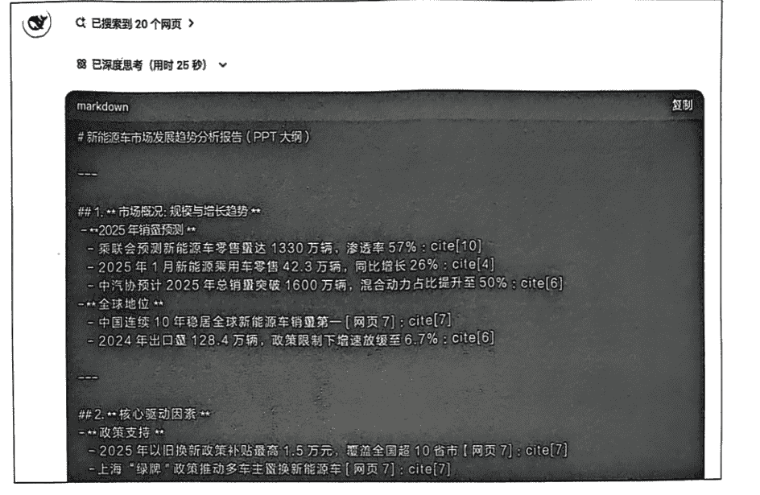

### 步骤 2 打开通义千问官网，选择 PPT 创作模块

通义千问官网地址：https://tongyi.aliyun.com/qianwen。

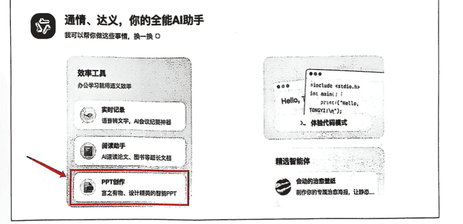

### 步骤 3 复制 DeepSeek 生成的大纲到通义千问

将 DeepSeek 生成的大纲复制到通义千问的对话栏，输入指令 “将第5章转化为故事线叙述模式，添加两个汽车行业首席执行官的真实决策案例，并生成对应的分镜脚本”。

用户可先按个人喜好点选模板，也可以等所有操作完成后根据整体构成再选择。我们将按 PPT 模板选择后置来进行展现。

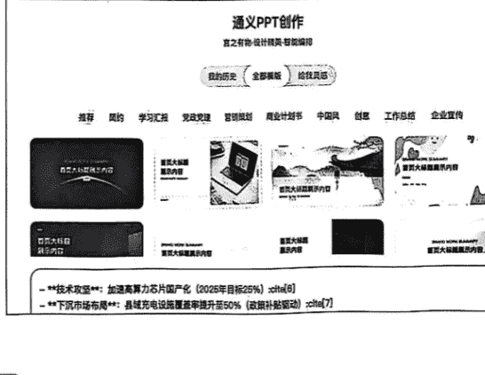

- **技术攻坚**：加速高算力芯片国产化（2025年目标25%）[cite[6]]
- **下沉市场布局**：县域充电设施覆盖率提升至50%（政策补贴驱动）[cite[7]]

### 步骤4 通义千问生成 PPT 大纲

点击“下一步”，生成PPT大纲。

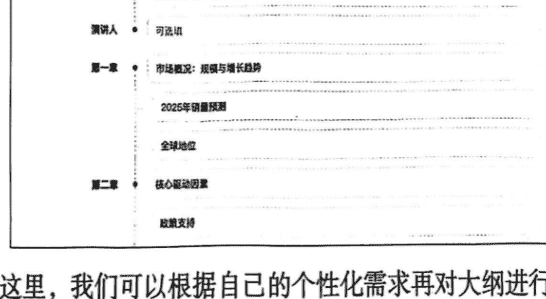

在这里，我们可以根据自己的个性化需求再对大纲进行微调，同时，还可以选择演讲的场景。

### 步骤5 选择 PPT 模板

根据演讲的主题、场景、面向的用户，选择合适的模板，比如主题为“新能源汽车”，可以选择科技感强一点的模板。

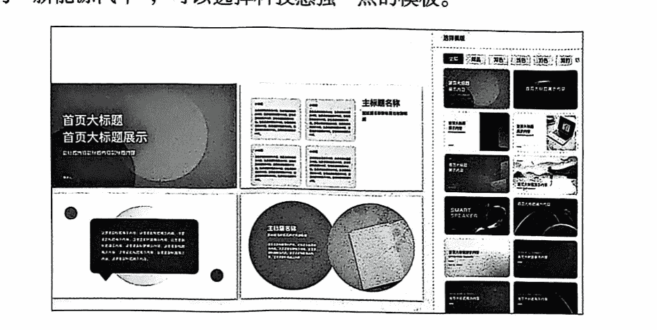

### 步骤 6 一键生成 PPT

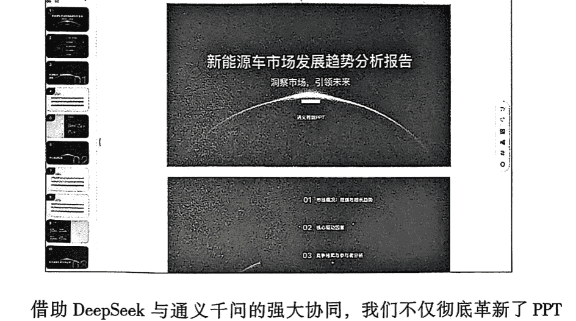

借助 DeepSeek 与通义千问的强大协同，我们不仅彻底革新了 PPT 制作流程，还重新塑造了内容创作的价值链。如今，专业级别的 PPT 平均制作时间从 6 小时锐减至 40 分钟，节省的大量时间可用于深度思考与现场演练。随着工具回归提升效率的本质，每一位职场人士都将具备演讲艺术家的潜力，他们的每一次演讲都将成为展现思想深度与才华的舞台，释放无限可能！

## 第四章

https://www.deepseek.com

## 公司运营：老板的 AI “军师团”


给 DeepSeek 发送消息
深度思考 (R1) 联网搜索

## 01 招人难？智能JD（职位描述）生成与面试题库全套方案

AI 时代，精准招聘不再是遥不可及的“奢侈品”，而是可以轻松获取的“常备品”。本节内容以 DeepSeek 为核心工具，围绕岗位画像分析、智能 JD 生成、多场景适配优化、面试题库设计四大环节，构建从“人才筛选”到“精准评估”的全链条方案。即使没有技术学习背景的人员，也能借助 AI 完成专业级的招聘设计，从而摆脱传统招聘中模糊匹配的困境，帮助企业大幅缩短招聘周期，快速锁定“对的人”。

### 岗位画像分析：从模糊需求到精准定位

提示词模板：
作为___（行业/领域）的___（岗位名称）专家，请根据___（公司规模/业务特点），拆解该岗位的 3 项核心职责、5 项硬技能、3 项软技能要求，并说明团队适配性特征。

具体指令：
用户是某互联网公司的人力资源专员，正在招聘初级 AI 产品经理，需构建精准岗位画像。公司规模 500 人，业务聚焦教育行业 AI 工具开发。请输出岗位能力模型。

#### 成果示例：

> > 已深度思考（用时 25 秒）
> 
> 以下是为教育行业AI工具开发公司（500人规模）定制的初级AI产品经理岗位能力模型，从核心能力到差异化要求分层呈现，助力精准筛选高潜力人才：
> 
> 一、硬性能力维度（专业壁垒）
> 
> 1. AI产品基本功
>    - 掌握AI产品开发全流程：数据标注—模型训练—测试调优—场景落地闭环
>    - 能使用Axure/Mockplus完成教育场景原型设计（如智能作业批改界面）
>    - 熟悉A/B测试、埋点数据分析等基础验证手段
> 
> 2. 技术理解深度
>    - 掌握机器学习基础概念（监督/非监督学习、准确率/召回率等评估指标）

### 智能 JD 生成：5 分钟产出专业招聘文案

提示词模板：

基于以下岗位画像：______（核心职责/技能要求），生成包含______（吸引点植入技巧）、______（差异化优势）和______（候选人成长路径）的招聘JD，要求语言年轻化，控制在500字以内。

具体指令：

用户需要一份用于AI产品经理招聘的初级岗位画像，需突出“AI+教育”行业前景，强调新人导师计划与季度性的海外培训机会。要求招聘语言年轻化，控制在500字以内。

### JD 多场景优化：不同渠道的定制化表达

提示词模板：

将原始JD转化为适合______（招聘网站/社交媒体/内部推荐）的3个版本，分别侧重______（薪资福利/成长故事/团队氛围），保持核心信息不变，但要调整叙述逻辑。

具体指令：

需将上述 JD 改造为 BOSS 直聘版（突出薪资）、脉脉专栏版（讲故事）、朋友圈海报版（强视觉）。保持核心信息不变，但要调整叙述逻辑。

#### 成果示例：

> 已深度思考（用时24秒）
以下是为不同传播场景定制的三版招聘信息，针对平台特性与用户心理进行差异化设计：

一、BOSS直聘版（薪资导向+快速吸引）
🔥急招！初级AI产品经理（AI+教育）🔥
💰25K*15薪+硅谷轮训+教育红利💰

✓钱给够
• 年薪最高37W：15薪+项目奖金+教育创新专利分红
• 入职享10天带薪「教育考察假」
• 每年涨薪2次，晋升加薪幅度超30%

### 四 面试题库设计：三层漏斗筛选法

提示词模板：

基于____（岗位名称）画像中的____（硬技能项）、____（软技能项），设计包含基础筛选层（5道题）、专业评估层（3道场景题）和文化匹配层（2道行为面试题）的题库，附评分要点。

具体指令：

针对 AI 产品经理岗位，需包含 SQL（结构化查询语言）技能应用、需求冲突处理、教育情怀考察等维度，设计包含基础筛选层（5道题）、专业评估层（3道场景题）、文化匹配层（2道行为面试题）的题库，附评分要点。

#### 成果示例：

一、基础筛选层（5题，10分钟线上测评）

1. SQL基础应用

```sql
-- 给定学生行为表 study_log (user_id, action_type,timestamp)，请写出查询过去 30 天每天使用 AI 批改功能超过 5 次的用户数
```

评分点：
- ✅ 正确使用DATE_SUB和GROUP BY（2分）
- ✅ 嵌套查询统计次数（3分）
- ❌ 未考虑去重或时间范围（扣1分）

2. 教育数据敏感度

> “分析发现某地区学生周末使用AI教辅时长下降40%，请列举3种可能原因及验证方式”

评分点：
- ✅ 教育场景特有因素（如考试季/政策限制）（每个原因1分）
- ✅ 提出用SQL验证假设的方法（2分）

3. 需求优先级判断

> “同时收到教师要求提升批改准确率、家长要求增加使用时长限制、教育局要求接入监管平台，如何排序？”

评分点：
- ✅ 识别政策需求为最高优先级（3分）
- ✅ 提出平衡方案（如用数据证明准确率提升可减少家长焦虑）（2分）

4. AI技术理解

### 五 情景模拟题自动生成：复杂能力检验

提示词模板：

> 生成3个______（岗位名称）可能会遇到的典型工作冲突场景，要求包含______（多方立场矛盾）、______（信息不全）和______（时限压力）要素，用于模拟实战演练，并给出优秀回答的关键判断点。

具体指令：

需要设计 AI 产品经理在需求评审会、用户投诉处理、资源协调中遇到的冲突模拟题，用于模拟实战演练，并给出优秀回答的关键判断点。

#### 成果示例：

已深度思考（用时 23 秒）

以下是为AI产品经理设计的冲突场景模拟题，覆盖需求评审会、用户投诉处理、资源协调三大关键场景，附带优秀回答判断标准与典型错误预警：

一、需求评审会冲突模拟

场景背景
教育大模型团队提出「AI智能教案生成」需求，算法负责人认为需6个月研发周期，但教学运营部门要求3个月内上线以配合新学期推广。

冲突焦点
- 技术可行性：需处理多学科知识图谱融合
- 业务压力：错过开学季将损失2000+学校合作机会
- 资源瓶颈：NLP团队同时支撑3个重点项目

候选人任务
主持本次评审会，形成可执行方案

优秀回答关键点
✅ 技术拆解力
- 用SQL分析历史教案数据，证明80%使用场景集中在20%知识点
✅ 价值锚定力
- 展示ROI测算：每提前1个月上线=新增500校接入=数据飞轮加速30%
- 承诺为算法团队争取标注资源（如众包教师标注体系）

### 六 评估标准自动化：AI 面试官养成计划

提示词模板：

为______（具体面试题）制定多维度评估标准，包含______（技术实现合理性）、______（用户体验敏感度）、______（沟通策略有效性）等，每个维度给出三个加减分行为示例。

具体指令：

针对“作文批改系统准确率争议”情景题，制定评估量表，包含技术实现合理性、用户体验敏感度、沟通策略有效性等，每个维度给出三个加减分行为示例。

#### 成果示例：

| 评估维度 | 加分行为 (+2分/项) | 减分行为 (-2分/项) |
| :--- | :--- | :--- |
| 技术实现合理性 | 1. 提出数据增强方案：联合教育局采集乡村学生优秀作文补充训练集
2. 设计分阶段优化：先解决基础语法误判（95%准确率），再优化文学性评价
3. 引入教师修正机制：允许教师标注争议案例优先进入模型迭代 | 1. 仅建议调整评分阈值掩盖问题
2. 忽视数据分布差异（如方言作文未特殊处理）
3. 要求标注团队24小时加班但无质量保障方案 |
| 用户体验敏感度 | 1. 设计评分维度开关：允许教师自主关闭“修辞手法”等争议指标
2. 开发对比功能：并排显示AI与教师批改痕迹差异
3. 建立用户共建机制：邀请投诉家长参与标注标准制定 | 1. 仅通过提升准确率数字安抚用户
2. 未设计情感化反馈（如用“进步空间”替代“低分”）
3. 改进方案未经教师代表实测验证 |
| 沟通策略有效性 | 1. 制定分层沟通方案：给教育局的技术白皮书/给家长的动画解说视频
2. 设立透明化看板：实时公开系统优化进展与瓶颈
3. 设计补偿机制：为受影响学生提供名师作文精批服务 | 1. 统一用技术术语回复各类投诉
2. 仅通过邮件单向通告处理方案
3. 未安抚一线教师增加的复核工作量 |

当招聘遇上 DeepSeek，“人才战争”的游戏规则已然改变。从精准职位描述到智能题库设计，AI工具链正在重塑人力资源工作的各个环节。本节所阐述的不仅是技术层面的解决方案，更是组织效率革命的范式变革。在人类与AI的协同进化中，那些率先掌握智能招聘密钥的企业，必将在人才争夺战中占据制高点。

## 02 制度文件不会写？定制行业模板直接用

在数字化转型浪潮中，制度文件往往因脱离业务场景、缺乏实用性而逐渐沦为形式主义。本节内容以抖音直播团队管理场景为例，通过DeepSeek的“模板改造术”展示如何从无到有搭建一个覆盖选品、直播、复盘的标准化体系。即便不具备法律或管理专业的学习背景，亦可生成实用的制度框架，让规则真正服务于业务增长。

### 场景需求分析（模板生成前准备）

提示词模板：

作为直播行业顾问，请梳理抖音直播团队管理制度的核心模块，需包含团队架构、选品标准、直播流程、数据分析、合规风控5个维度，用表格形式呈现关键控制点与对应管理目标。

具体指令：

我正在为某机构搭建直播团队管理体系，请按以下要求输出方案：
1. 划分制度文件核心模块；
2. 每个模块列出3个关键控制点；
3. 说明各控制点的管理目标；
4. 用 markdown 表格呈现。

### 团队架构搭建（基础框架生成）

提示词模板：

生成抖音直播团队标准架构模板，包含岗位名称、职责说明、考核指标三列，要求区分新人团队（3～5人）和成熟团队（10～15人）两种配置方案，用表格对比呈现。

具体指令：

> > 我需要设计适应不同发展阶段的团队架构。
> 新人团队：预算有限，需岗位复用。
> 成熟团队：专业分工精细化。
> 请输出包含岗位职责、KPI（关键绩效指标）、人员配置差异的对比表格，用★标注关键岗位。

### 三 选品流程规范（动态模板生成）

提示词模板：

生成直播选品SOP（标准作业程序）流程图模板，包含初筛、评审、测试三个环节，每个环节需标注决策标准（如佣金率≥20%）、所需文档（商品资质文件）、异常处理机制（品退率超限处理）。

具体指令：

> > 设计标准化选品流程，包含：
> 1. 商品库建立标准；
> 2. 突发舆情后商品下架流程；
> 3. 爆品快速补货机制。
> 请用泳道图形式区分商务、运营、质检部门的协作节点。

### 四 直播流程标准化（实时优化模板）

提示词模板：

生成直播执行检查表模板，包含开播前2小时、直播中、下播后三个时段，每个时段列出必检事项（如设备网络测试、违禁词监控、粉丝问题归档），用分级符号标注风险等级。

具体指令：

1. 按时间维度划分检查节点（开播2小时、直播中、下播后）；
2. 使用分级符号“！”标注高优先级事项；
3. 包含突发状况应对指引（如断网处理流程）。

### 五 复盘体系搭建（数据驱动优化）

提示词模板：

生成直播复盘报告模板，需包含流量分析（自然推荐占比）、转化率分析（购物车点击率）、商品分析（爆款连带率）三个维度，每个维度提供对比数据（环比/竞品）和改进建议。

具体指令：

1. 区分基础数据层（观看人次）；
2. 转化漏斗层（点击—加购—支付）；
3. 商品策略层（主推款销售效果）；
4. 对比数据，自动生成改进建议的功能模块。

### 六 制度动态优化（智能迭代机制）

提示词模板：

生成制度版本管理方案，要求包含修订触发条件（如规则季度迭代）、修订流程（部门会签机制）、历史版本追溯（变更日志模板）。

#### 具体指令：

- 1. 常规季度更新节点；
- 2. 突发事件触发更新（如平台新规）；
- 3. 版本差异对比功能；
- 4. 输出包含版本号、修订内容、生效日期的表格案例。

#### 成果示例：

```
# 制度更新机制设计
## 更新触发条件
1. **常规更新**
   - 每季度末（3/6/9/12月）定期评审
   - 收集执行反馈，优化流程漏洞
2. **紧急更新**
   - 平台政策重大调整（如佣金规则变更）
   - 重大运营事故（如商品质量问题）
   - 团队规模扩张（人员增长超30%）
```

# 七 合规性检查（风险控制模板）

提示词模板：

生成直播合规自检模板，整合《网络直播营销管理办法（试行）》等法规，将法条转化为可执行检查项（如宣传用语限制），提供违规案例库链接和整改建议生成功能。

#### 具体指令：

- 1. 内置最新法律法规数据库；
- 2. 支持语音/文字实时检测；
- 3. 违规内容自动替换建议；
- 4. 输出包含典型违规场景的对照表。

#### 成果示例：

```
# 智能合规检查系统设计

## 系统架构
1. **数据层**
   - 法规数据库（每日更新）
   - 违规词库（分级管理）
   - 案例库（历史违规记录）

2. **功能层**
   - 实时语音检测
   - 文本合规审查
   - 智能替换建议
   - 风险预警提示
```

# 八 应急预案生成（风险应对模板）

提示词模板：

生成直播事故应急预案库，包含设备故障、舆情危机、商品事故三类场景，每个场景提供三级响应预案（常规处理/升级处理/危机公关），用流程图展示决策路径。

#### 具体指令：

设计直播应急处理手册，包含设备故障、舆情危机、商品事故：
1. 区分事故等级（黄/橙/红）；
2. 明确各岗位权限矩阵；
3. 包含话术模板库（如道歉声明）；
4. 输出设备故障场景的处置流程图。

#### 成果示例：

# 直播应急处理手册

## 事故分级标准

| 等级 | 标识 | 标准 | 响应时限 |
| :--- | :--- | :--- | :--- |
| 黄色 | ▲ | 轻微影响直播体验（如画面卡顿） | 5分钟内处理 |
| 橙色 | ◆ | 较大影响（如商品信息错误） | 2分钟内处理 |
| 红色 | ● | 严重事故（如断播、重大舆情） | 立即处理 |

## 岗位权限矩阵

| 岗位 | 黄色事故 | 橙色事故 | 红色事故 |
|------|----------|----------|----------|
| 主播 | 自主处理 | 需报备运营 | 立即停止直播 |

通过 DeepSeek 模板工程，我们成功将复杂的制度建设工作转化为可复用的智能化流程。从团队架构设计到应急预案生成，每个环节都实现了标准化与灵活性的平衡。这种 AI 赋能的制度建设方式，不仅减少了大量的文档编写时间，更能通过数据驱动的动态优化机制，确保规则体系始终与业务发展同频共振。当制度转化为动态的运营指南，企业便获得了持续进化的组织能力。

## 03 合同风险规避术：法律条款智能审查

> > 在直播带货领域，每年由于不规范的合作协议导致发生纠纷事件占比超过 20%。本节内容将借助 DeepSeek 智能生成包含法律条款的合作协议模板，帮助主播人员或公司在 15 分钟内生成涵盖权利和义务边界、违约追责等核心要素的定制化合同。

### 步骤1 搭建合同基础框架

提示词模板：

作为直播行业法律顾问，请按以下结构输出合同框架：

- 1. 合作内容；
- 2. 权利和义务；
- 3. 结算条款。

需要包含带货频次、佣金比例、账号归属等基础条款，用条款编号形式呈现。

具体指令：

请生成直播带货合作框架协议，包含三个核心模块：

- 1. 合作内容（直播频次、产品类目）；
- 2. 权利和义务（账号使用权、内容审核权）；
- 3. 结算条款（佣金计算方式、付款周期）。

用“第X条”格式输出，每条字数不超过40。

成果示例：

> 直播带货合作框架协议

第一章 合作内容
第一条 双方约定每月直播场次不低于____场，单场时长≥____小时。
第二条 合作产品类目限定为________，不得超范围推广。

### 步骤2 生成行为约束清单

提示词模板：

请区分允许行为和禁止行为两类清单，允许项用“能”开头说明权益，禁止项用“不能”开头标注限制，需包含竞品范围、宣传话术等细节要求。

#### 具体指令：

> > 生成直播行为约束条款，要求：
> 1. 允许行为: 可接非竞品推广，可分享生活日常。
> 2. 禁止行为: 不得暗示竞品优势，不得使用未经审核的话术。
> 3. 竞品清单: 雅诗兰黛、兰蔻、资生堂。
> 用“你能/不能”句式输出内容，每条后标注违约赔偿金额。

#### 成果示例：

> > 已深度思考 (用时 35 秒)
> 直播行为约束条款
> 第八条 你能分享个人日常生活内容，但不得影响带货时长及效果。
> 第九条 你不能暗示雅诗兰黛、兰蔻、资生堂等竞品优势，违约需赔偿____元/次。
> 第十条 你不能使用未经甲方书面审核的营销话术，违约需赔偿____元/次。
> 第十一条 竞品清单以本合同列明的雅诗兰黛、兰蔻、资生堂为准，禁止直接/间接推广。
> (注：赔偿金额需根据合作规模协商约定，建议明确单次违约金计算标准。)

# 步骤 3 植入风险防控案例

提示词模板：

请在违约条款后附加真实案例说明，需包含：

- 1. 违约情形；
- 2. 处理方式；
- 3. 赔偿金额。

数据需符合 2024 年直播行业仲裁案例。

具体指令：

> > 在合同末尾添加 3 个典型违约案例，要求：
> 1. 使用主播擅自在竞品直播中出镜的实例；
> 2. 包含流量损失计算方式和赔偿标准；
> 3. 引用互联网法院诉讼平台 2024 年判例数据。
> （案例用“警示案例”模块呈现。）

# 步骤 4 将法律表述通俗化

提示词模板：

请将“缔约方不得实施可能减损合同标的商业价值之行为”这一条款转化为通俗表述，要求保留法律效力但去除专业术语，用主播能理解的场景化描述。

具体指令：

> > 将法律条款转译。
> 原条款: 乙方承诺不在合作期间为任何第三方提供相同或类似服务；
> 转化要求：
> 1. 使用“不能接同类产品推广”等口语化语言；
> 2. 补充“包括但不限于短视频植入、直播间口播”等具体场景；
> 3. 注明竞品判定标准。

成果示例：

> > 转译后条款
> 乙方承诺：
> 1. 在合作期间，乙方不能接同类产品的推广，包括但不限于以下形式：
>    - 在短视频中植入竞品广告；
>    - 在直播间口播竞品信息；
>    - 在社交媒体发布竞品宣传内容；
>    - 参与竞品线下活动或代言。
> 2. 竞品判定标准：
>    - 与甲方产品功能、目标用户、价格区间高度相似；
>    - 在市场上与甲方产品存在直接竞争关系；
>    - 甲方书面通知乙方并附竞品清单（如雅诗兰黛、兰蔻、资生堂等）。
> 3. 若违反本条约定，乙方需承担违约责任，具体赔偿金额按合同约定执行。

# 步骤 5 生成风险自检清单

提示词模板：

请将合同条款转化为自查问题，例如“是否明确竞品推广赔偿计算方式”，需覆盖条款遗漏、表述模糊、追责缺失三大风险点。

#### 具体指令：

- 生成主播使用的合同自检清单。
- 1. 问题形式：“你确定合同中写清了______？”
- 2. 重点检查：竞品界定、赔偿计算、账号归属；
- 3. 包含风险提示：“如未约定可能导致______。”
- 输出为带复选框的清单。

#### 成果示例：

- 主播用合同自检清单
请逐项核对以下问题，确保合同条款清晰明确：
- 竞品界定
  - 你确定合同中写清了竞品的具体范围和判定标准？
  - 风险提示：如未约定可能导致竞品范围模糊，引发违约纠纷。
- 赔偿计算
  - 你确定合同中写清了违约赔偿的计算方式和具体金额？
  - 风险提示：如未约定可能导致赔偿金额过高，损害自身权益。
- 账号归属
  - 你确定合同中写清了直播账号的归属权及使用权？
  - 风险提示：如未约定可能导致账号被收回或限制使用，影响个人发展。
- 合作内容
  - 你确定合同中写清了直播频次、时长及产品类目？
  - 风险提示：如未约定可能导致工作量超负荷或合作内容不符预期。
- 结算条款
  - 你确定合同中写清了佣金比例、结算周期及付款方式？
  - 风险提示：如未约定可能导致佣金被克扣或付款延迟。
- 内容审核
  - 你确定合同中写清了内容审核流程及修改时限？
  - 风险提示：如未约定可能导致内容被无故驳回，影响直播效率。
- 违约责任
  - 你确定合同中写清了双方违约责任及处理方式？
  - 风险提示：如未约定可能导致责任不对等，增加法律风险。

通过 DeepSeek 的智能拆解技术，合同撰写从专业度较高的工作转变为标准化流程工作。本节演示的五步审核体系，能有效降低合同存在漏洞的风险。建议每次签约前，通过自检清单快速复核，让 AI 成为我们的智能合规助手。

## 04 商业计划书速成：投资人最爱看的 BP（商业计划书）结构

在 AI 时代，商业计划书的撰写不再是专业投行人士才能完成的工作。本节以“AI 大模型 + 教育硬件”赛道为例，通过 DeepSeek 拆解商业计划书的核心结构框架，从痛点挖掘、技术壁垒到财务模型，逐步指导我们如何用 AI 生成逻辑严密、数据支持充分且具备投资吸引力的内容，帮助创业者快速地打造符合风险投资者要求的商业计划书。

### 步骤1 市场痛点分析

提示词模板：

作为______（AI教育硬件领域）专家，请分析______（当前基础教育英语学习市场）的三大核心痛点。要求：结合家长焦虑点和学生使用场景，对比现有竞品缺陷，给出量化数据支撑。

具体指令：

深度分析中小学生英语学习设备现存问题，要求列出家长调研中高频出现的三大抱怨问题，对比某品牌单词机产品在用户留存率、日均使用时长方面的数据短板，最后用教育行业白皮书数据验证市场需求规模。

#### 成果示例：

# 一、市场痛点与需求验证

## 1. 现存设备三大核心痛点（家长高频抱怨）

- ① 无效记忆循环：传统单词机仅提供机械重复背诵，缺乏科学记忆算法，学生3天遗忘率超65% ③。家长反馈“孩子每天打卡但考试仍提分困难” ⑰。
- ② 互动性缺失：现有设备无法模拟真实语境（如虚拟对话、场景化应用），导致学生“背完不会用”。调研显示72%家长认为设备“功能单一，像电子词典” ⑱ ⑰。
- ③ 学习数据断层：设备与学校教学脱节，教师无法追踪学生薄弱点。家长抱怨“买了硬件还要额外买辅导服务” ⑤。

### 步骤2 产品定位设计

提示词模板：

请为AI单词学习机设计差异化的产品定位。要求：突出大模型技术优势、包含游戏化元素、体现效果可视化特点、使用 Feature Advantage Benefit 法则（特征、优势、利益的法则）表述。

#### 具体指令：

设计具备多模态交互能力的 AI 单词机，需整合大模型动态难度调节、AR（增强现实技术）情景对话功能、学习进度可视化面板，用 FAB 法则阐述产品核心价值。

### 步骤3 技术方案拆解

提示词模板：

详细说明______（技术架构）。要求：______（三点）。

#### 具体指令：

详细说明大模型在教育硬件中的三层技术架构。要求：区分云端与本地部署、说明数据安全方案、列举核心算法模块。

#### 成果示例：

以下是针对大模型在教育硬件中的三层技术架构的详细说明，涵盖云端与本地部署的划分、数据安全方案及核心算法模块的设计：

# 一、三层技术架构设计

## 1. 云端层 (Cloud Layer)

- 功能定位：
  负责复杂模型训练、数据存储与分析、多设备协同管理等高算力需求任务。
- 核心模块：
  - 模型训练平台：基于分布式计算框架（如PyTorch + Horovod），支持百亿参数模型的快速迭代。
  - 数据湖：存储海量学习行为数据（如答题记录、语音交互日志），用于模型优化与个性化推荐。
  - 协同管理引擎：支持多设备数据同步（如家庭与学校设备），实现学情无缝衔接。

### 步骤4 商业模式构建

提示词模板：

设计硬件 + 内容的复合盈利模型，包括硬件毛利率测算、增值服务规划，用表格呈现3年财务预测。

#### 具体指令：

制定包含设备销售（定价599元）、分级阅读订阅（199元/年）的盈利体系，计算硬件生产成本占比，给出3年营收增长率预测。

#### 成果示例：

以下是基于设备销售、分级阅读订阅和学校B端服务的盈利体系设计，包含硬件生产成本占比计算和三年营收增长率预测：

# 一、盈利体系设计

- 1. 设备销售（硬件）
   - 定价：599元/台
   - 目标用户：学生及家长
   - 销售渠道：
     - 线上：电商平台（京东、天猫）、自有官网
     - 线下：书店、教育用品店、学校合作推广
   - 毛利率：52%
     - 生产成本：287元/台（占比48%）
     - 生产成本细分：
       - 硬件材料：180元（占比62.7%）
       - 制造成本：70元（占比24.4%）
       - 物流与包装：37元（占比12.9%）

- 2. 分级阅读订阅
   - 定价：199元/年
   - 目标用户：已购买设备的学生
   - 核心功能：
     - 分级阅读内容库（适配不同英语水平）
     - 阅读进度追踪与个性化推荐
     - 阅读能力评估报告

### 步骤5 数据支撑体系

提示词模板：

生成提升商业计划书可信度的数据，包含用户行为实验数据、专利技术储备、竞品对比优势。

#### 具体指令：

需要呈现 AI 单词机对比传统产品的核心优势数据，包括测试组提分效率、已申请技术专利数量等内容。

#### 成果示例：

# 一、核心优势数据对比

## 1. 提分效率（测试组数据）

- AI单词机：
  - 测试组规模：500名学生（3个月试点）
  - 平均提分：23.5分（满分100分）
  - 提分效率：比传统单词卡提升2.8倍
- 传统单词卡：
  - 测试组规模：500名学生（3个月试点）
  - 平均提分：8.4分（满分100分）

### 步骤6 团队包装策略

提示词模板：

优化创始团队履历呈现。要求：突出互补性、嵌入行业资源、关联成功案例、使用投资人关注的关键词。

#### 具体指令：

包装由教育行业连续创业者（曾主导某 App 千万级用户增长）、AI 芯片专家（参与过国家级项目研究）、资深教师组成的核心团队，强调资源整合能力。

### 步骤7 退出路径规划

提示词模板：

设计符合资本预期的三阶退出方案，包含战略收购方名单、IPO（首次公开募股）可行性分析、对赌条款设计要点，并用 SWOT 说明选择逻辑。

#### 具体指令：

规划 3 年内的并购退出方案，列出字节跳动、科大讯飞、步步高教育等潜在收购方，分析其业务协同性，设计基于用户增长的对赌条款保护。

#### 成果示例：

- 一、并购退出方案规划

1. 时间节点
   - 第1年：
     - 完成产品研发与区域试点，实现15万台设备销量，用户留存率超85%。
     - 启动首轮融资，估值3亿元，引入战略投资者（如教育行业基金）。
   - 第2年：
     - 扩大市场覆盖，设备销量达40万台，订阅渗透率提升至30%。
     - 与潜在收购方接洽，展示用户增长与商业化能力。
   - 第3年：
     - 实现规模化盈利，设备销量达80万台，订阅渗透率提升至42%。
     - 完成并购退出，目标估值15亿元。

2. 并购退出目标
   - 估值目标：15亿元
   - 退出方式：

### 步骤8 BP 结构整合

提示词模板：

生成标准 BP 目录框架，要求遵循电梯演讲结构、包含 12 个投资人必看模块、标注各章节字数建议、插入三处数据可视化提示。

#### 具体指令：

整理符合红杉资本 BP 模板的目录结构，包含市场机会、解决方案、增长模型等核心章节，在市场规模、财务预测、实验数据环节标注 [插入图表] 提示。

#### 成果示例：

> 以下是符合红杉资本BP模板的目录结构，涵盖市场机会、解决方案、增长模型等核心章节，并在市场规模、财务预测、实验数据等环节标注【插入图表】提示，确保逻辑清晰、数据扎实：

# 商业计划书目录结构

- 1. 执行摘要
   - 项目概述：AI大模型+教育硬件的创新结合
   - 核心亮点：
     - 动态难度调节算法（记忆留存率提升至83%）
     - AR情景对话功能（口语表达能力提升40%）
     - 学情穿透系统（教师辅导效率提升60%）
   - 财务亮点：
     - 首年目标收入1.1亿元，3年复合增长率134.6%
     - 目标估值15亿元，3年内完成并购退出

- 2. 市场机会
   - 市场规模：
     - 2024年AI学习机销售额同比增长136.6%，背单词细分赛道年复合增长率达62%【插入图表：市场规模增长趋势图】
     - 家长为AI个性化学习功能支付溢价意愿超普通设备3.2倍【插入图表：家长支付意愿调研数据】
   - 政策驱动：
     - “双减”政策深化，智能硬件渗透率预计达47%（《中国教育智能硬件白皮书》）
   - 竞争格局：
     - 传统单词卡用户留存率仅23%，AI单词机留存率目标85%【插入图表：竞品留存率对比图】

通过 DeepSeek 八大步骤拆解，我们完整构建了专业级商业计划书的生成过程。从精准捕捉痛点到严谨的数据论证，从构建技术壁垒到规划资本路径，AI 工具大幅降低了专业门槛，同时通过结构化思维引导确保商业逻辑的完整性。只要掌握这套方法论，即使是初次创业者也能生成具有投资吸引力的商业计划书，在竞争激烈的融资环境中脱颖而出。

# 第五章

https://www.deepseek.com

# 创意“秘密武器”：自媒体爆款生产线


给 DeepSeek 发送消息
深度思考 (R1) 联网搜索

## 01 段子制造机：日更百条，创意不竭的秘密

在信息爆炸的时代，段子成为最“短平快”的“情绪货币”，能够在社交互动中快速传递娱乐价值。然而，创作引人发笑的段子并非仅靠天赋，而是一门可以系统拆解与学习的艺术。本节将借助DeepSeek，深入剖析“爆款段子”的生成公式，从选题策划到巧妙“埋梗”，再到高效批量生产，一步步指导你如何利用AI打造一台“段子生成器”。无须担心自己缺乏喜剧天赋，只要掌握创作五步法，你的段子创作就能如同流水线上的零件生产一般，既稳定可控，又源源不断。

### 爆款段子创作五步法

#### 步骤1 选题定位——挖掘痛点，寻找共鸣

#### 提示词模板：

列举10个普通人的日常生活场景（如职场/家庭/社交），要求场景具体且有情绪共鸣点（如上班迟到、家长辅导作业过程中的崩溃瞬间、相亲时“尬聊”），用“场景+矛盾点”的格式呈现。

#### 具体指令：

我是一名段子选题策划人员，帮我列出10个适合改编成段子的生活场景，每个场景需包含具体行为与尴尬/矛盾/意外元素。例如：“在健身房自拍并发朋友圈时，却忘记关跑步机，被拍到滚下器械的瞬间。”

#### 成果示例：

以下是为您精心设计的10个生活化段子选题，严格遵循中文标点规范及网络用语标注要求，每个选题均含强冲突点：

1. “智能冰箱的背叛”
   - 行为：设置冰箱自动补货清单
   - 意外：冰箱通过算法判断你需要减肥，自动锁定了“零食区”并播放《卡路里》

#### 步骤2 铺垫设计——设故事背景，引合理预期

#### 提示词模板：

针对“______场景”，设计3条符合正常逻辑顺序的铺垫描述，保持口语化且信息完整。

#### 具体指令：

针对“教父母用手机截图”的场景，生成3条符合普通人认知的铺垫描述。

#### 要求：

1. 用生活化语言；
2. 包含动作细节；
3. 制造合理预期。

##### 例如：

“花费半小时耐心教妈妈用手机截图的技巧，反复演示同时按下电源键和音量键。”

#### 步骤3 反转设计——打破预期，制造笑点

#### 提示词模板：

为______铺垫设计3个意外反转，要求：1. 符合场景逻辑；2. 制造认知落差；3. 字数不超过20。

#### 具体指令：

针对“把截图步骤写成便签贴手机上”的铺垫，设计3个符合中年父母行为模式的反转。参考方向：理解偏差/操作失误/过度执行等。字数不超过20。

#### 成果示例：

以下为严格遵循要求设计的三个反转桥段，包含中年父母典型行为特征及标点规范：

**反转一：理解偏差**

“把截图步骤写成‘同时轻按电源键+音量下键’贴在手机背面，三天后发现父亲每次截图都先庄严宣示‘开始同时按了’，结果拇指、食指像打快板似的轮流点击，相册里攒了80张锁屏界面‘准备截图’。”

#### 步骤4 细节优化——增加画面冲击

#### 提示词模板：

为以下段子框架添加3个增强喜剧效果的细节。

- 铺垫：（插入内容）。
- 反转：（插入内容）。

#### 要求：

1. 加入具象化数字/身体反应/夸张对比；
2. 每处字数不超过15。

#### 具体指令：

完善这个段子。

- 铺垫：教爸爸给视频截图并反复确认他听懂了。
- 反转：收到53张不同角度的天花板照片。

请添加：
1. 时间跨度；
2. 异常行为细节；
3. 视觉化对比。

#### 成果示例：

以下为完善后的段子，严格遵循标点规范及细节强化要求：

### 《截图特训成果展》

花三天给父亲特训视频截图技巧，餐桌上模拟了十八遍‘暂停画面—点击截屏键’流程。他不仅用便签纸记下‘手要像端茶杯一样稳’，还发明了‘三指定法’——左手托机身后，右手食指悬空瞄准屏幕右下角。

第四天中午手机疯狂震动，相册弹出53张新鲜出炉的‘学习成果’：从15度仰角到90度垂直，天花板吊灯在每张图里上演‘光影变形记’。最震撼的是第37张，画面边缘还捕捉到他为调整角度踩在板凳上的半只拖鞋。

### 细节拆解

1. 时间跨度：三天特训 vs 第四天成果爆发
2. 异常行为：
   - 发明“三指定法”
   - 踩板凳调整拍摄角度
   - 便签笔记强化仪式感

#### 步骤5 批量生产——建立素材矩阵

#### 提示词模板：

基于“代际数字鸿沟”主题，用以下“公式”批量生成10个段子。

铺垫相当于传统生活经验 + 科技产品；

反转相当于错位应用 + 可视化结果。

#### 具体指令：

让 AI 扮演退休教师，按模板生成段子。

铺垫：把 ___ 当成 ___ 来用。

反转：结果 ___（具体且可笑的物理结果）。

##### 示例：

把手机语音助手当“魔镜”，每天起床先问：“×××，今天我漂亮吗？”

### 完整段子合成演示

#### 具体指令：

- 主题: 中年男性养生焦虑。
- 铺垫: 严格遵循朋友圈养生文章的做法。
- 反转: 过度执行产生荒诞结果。
- 要求: 包含3个递进细节、1个转折。

#### 成果示例：

段子：中年养生男的自我救赎
铺垫：老张自从看了朋友圈养生文章，决定严格遵循“健康生活三件套”，早起一杯柠檬水，中午晒太阳补钙，晚上泡脚排毒。
递进细节1：他每天早上5点起床，挤柠檬挤到手抽筋，还特意买了pH试纸测酸碱度，结果发现自来水比柠檬还酸。

段子本质是违背预期的艺术，而 AI 是绝佳的“认知差勘探器”。通过拆解生活场景中的荒诞瞬间，利用结构化模板批量重组笑点，每个人都能建立自己的喜剧“弹药库”。当创作变成排列组合时，每日更新百条内容不再是意志力的挑战，而是通过 DeepSeek 输入指令的简单操作。记住：幽默从来不是灵光一现，而是精心设计的意外。

## 海量标题生成术：“流量密码”的破解指南

自媒体时代，标题是吸引用户点击的第一道门槛。一个出色的标题不仅能抓住读者的注意力，还能激发他们的好奇心和情感共鸣。本节将带你用 DeepSeek 深入拆解“流量密码”的底层逻辑，从人性痛点、平台算法、悬念设计到情绪共振等多个方面，手把手教你写出让人“不得不点”的标题。不管你是新手还是资深创作者，都能通过本节的实操步骤和模板，轻松掌握爆款标题的创作技巧。

### 步骤1 明确目标受众与核心痛点

#### 提示词模板：

分析目标受众的年龄、职业、兴趣，找出他们最关心的痛点。思考他们面临的问题是什么，渴望解决什么，将这些痛点与你的选题结合，提炼出核心关键词。

#### 具体指令：

请分析职场新人的核心痛点，结合选题“如何提升工作效率”，列出3个关键词。

#### 成果示例：

### 职场新人如何提升工作效率：3个关键词

**核心痛点：**
- 时间管理混乱：缺乏经验，容易陷入多任务处理，导致效率低下。
- 工作方法不成熟：缺乏系统的工作流程和工具，做事容易手忙脚乱。
- 沟通协作不畅：与同事、领导沟通不顺畅，影响工作进度和成果。

**关键词：**
1. 优先级管理：学会区分任务的重要性和紧急性，合理安排时间，避免无效忙碌。
2. 高效工具：掌握并使用效率工具，例如待办清单、时间管理软件、项目管理工具等，提升工作效率。
3. 有效沟通：学习沟通技巧，明确表达需求，积极倾听反馈，提高团队协作效率。

### 步骤2 挖掘情绪共鸣点

#### 提示词模板：

标题需要引发用户的情感共鸣。思考哪些情绪最能打动你的目标受众：是焦虑、好奇、惊喜，还是共鸣？将这些情绪与核心痛点结合，设计出能引发共鸣的标题元素。

#### 具体指令：

请结合“时间管理混乱”这一痛点，设计一个能引发焦虑和好奇情绪的标题元素。

#### 成果示例：

### 引爆焦虑与好奇：时间管理混乱的标题元素

痛点结合：时间管理混乱是职场新人的普遍困扰，容易引发焦虑情绪，同时也让人好奇如何破解这一难题。

标题元素设计：

1. 直击痛点，引发共鸣：
   - “每天忙到飞起，却总感觉一事无成？”（直接点出时间管理混乱的结果，引发共鸣）
   - “时间都去哪儿了？揭秘职场新人的时间黑洞”（用“时间黑洞”比喻时间管理混乱，引发好奇）
   - “你还在用错误的方式管理时间吗？”（质疑常见做法，引发反思和好奇）

### 步骤3 适配平台算法与关键词布局

#### 提示词模板：

不同平台的算法偏好不同。研究目标平台的热门关键词和推荐机制，将核心关键词自然融入标题，确保标题既能吸引用户，又能被算法推荐。

#### 具体指令：

请为“时间管理”这一关键词设计一个适合短视频平台风格的标题，要求包含热门关键词。

#### 成果示例：

- “拯救拖延症”：直击痛点，吸引目标用户（被拖延症困扰的用户）。
- “3个”：具体数字，制造悬念，吸引用户点击观看。
- “时间管理‘神器’”：使用“神器”一词，突出方法的有效性和吸引力。
- “效率翻倍”：强调结果，吸引用户想要提升效率的欲望。
- “🔥”：使用表情符号，增加标题的视觉冲击力，吸引用户注意力。

### 步骤4 设计悬念与反转

#### 提示词模板：

悬念是吸引用户点击的关键，在标题中设置一个未解之谜或反转点，让用户产生“不得不点”的冲动。思考如何用最少的文字制造最大的悬念。

#### 具体指令：

请为“时间管理”这一主题设计一个带有悬念的标题。在标题中设置一个未解之谜或反转点，要求用最少的文字制造最大的悬念。

#### 成果示例：

- “每天多出2小时”：提出一个诱人的结果，引发用户好奇如何实现。
- “揭秘”：暗示将分享不为人知的秘密，制造悬念。
- “时间管理大师”：利用权威效应，增加标题的可信度和吸引力。
- “惊人技巧”：强调方法的独特性和有效性，吸引用户想要了解更多。
- “⏳”：使用沙漏表情符号，与时间管理主题呼应，增加标题的视觉吸引力。

### 步骤5 优化标题长度与阅读节奏

#### 提示词模板：

标题长度和阅读节奏会直接影响点击率。确保标题简洁有力，控制在15~20字以内，避免冗长。使用短句、数字和符号增强节奏感，让标题更具吸引力。

#### 具体指令：

请优化标题“如何利用高效工具进行时间管理来提升工作效率，告别拖延症”。确保标题简洁有力，控制在15~20字以内，避免冗长。使用短句、数字和符号增强节奏感，让标题更具吸引力。

#### 成果示例：

**优化后的标题：**
“告别拖延，效率翻倍！3个时间管理‘神器’+高效工具秘籍🚀”

**优化思路：**
1. 更简洁有力：原标题较长，优化后更加简洁明了，突出重点。
2. 更具吸引力：使用“效率翻倍”“神器”“秘籍”等词汇，增强标题的吸引力和冲击力。
3. 更具悬念：使用数字“3”和表情符号“🚀”，制造悬念，吸引用户点击。
4. 更突出结果：将“告别拖延症”放在开头，直接点明用户最关心的结果。

### 步骤6 测试与迭代

#### 提示词模板：

标题创作是一个不断优化的过程。通过A/B测试（一种通过对比不同版本产品或策略的效果，以数据为依据进行优化的实验方法）或用户反馈，分析不同标题的点击率，找出最有效的版本。要求根据数据调整关键词、情绪点和悬念设计。

#### 具体指令：

请为以下标题设计两个变体，用于 A/B 测试：“拖延症毁掉了你的工作效率？这个方法让你一天多出 3 小时！”

#### 成果示例：

### A/B测试标题变体：

变体一：“每天浪费3小时？拯救拖延症，这个方法让你效率起飞！🚀”

变体二：“拖延症晚期？3个简单步骤，让你每天多出3小时！⏰”

### 设计思路：

- 变体一：
  - “每天浪费3小时”：更直接地指出拖延症的危害，引发用户焦虑情绪。
  - “拯救拖延症”：强调解决方案，吸引用户点击。
  - “效率起飞”：使用更形象的比喻，突出方法的效果。
  - “🚀”：使用火箭表情符号，增加标题的视觉冲击力。
- 变体二：
  - “拖延症晚期”：使用更夸张的说法，吸引用户注意力。
  - “3个简单步骤”：强调方法的易操作性，降低用户心理门槛。
  - “每天多出3小时”：重复原标题中的诱人结果，强化用户记忆。

## 步骤 7 生成备选标题

#### 提示词模板：

将以上步骤的成果进行整合，生成 5 个备选标题。要求确保每个标题都包含核心关键词、情绪共鸣点、悬念设计和平台适配元素，尽量满足不同用户的需求。

#### 具体指令：

将以上步骤的成果进行整合，为“时间管理”这一主题生成 5 个备选标题。要求确保每个标题都包含核心关键词、情绪共鸣点、悬念设计和平台适配元素，尽量满足不同用户的需求。

#### 成果示例：

1. 拯救拖延症！3个时间管理“神器”，让你效率翻倍！
   - 核心关键词：时间管理、拖延症、效率
   - 情绪共鸣点：拯救拖延症，引发用户共鸣

理解上述步骤，我们将更好地掌握爆款标题的创作逻辑。从明确受众痛点、引起情绪共鸣，到适配平台算法、设计悬念反转，每一步都至关重要。记住：标题不仅是内容的入口，更是与用户建立情感连接的桥梁。通过不断测试、优化，我们创作的标题将成为吸引流量的利器。

## 03 3天打造一个账号！爆款文案的AI“外挂”，涨粉如此轻松

“辛辛苦苦写文案，点赞却不过百”——这可能是大多数网络平台创作者的噩梦。爆款文案的本质是用视觉焦点触发情绪，用场景化内容构建信任。本节以儿童护眼台灯为例，拆解如何通过DeepSeek的“四维爆款公式”——痛点共鸣、场景代入、数据佐证、视觉锚点，从选题到成稿打造高传播性的内容。无须专业背景，只需跟随步骤生成高转化率的文案，让“家长必看”成为“流量密码”。

### 步骤1 选题定位——从焦虑中提炼核心冲突

#### 提示词模板：

结合目标人群的焦虑点与决策障碍，提炼产品所需要解决的最终问题。

#### 要求：

1. 用疑问句引发好奇；
2. 包含“必看”“真相”等关键词；
3. 指向具体使用场景。

#### 具体指令：

为儿童护眼台灯测评设计选题标题，聚焦家长对近视低龄化、蓝光危害的焦虑，同时暗示测评专业性，吸引用户点击。

#### 成果示例：

已深度思考（用时 22 秒）
以下是精心设计的护眼台灯测评选题标题，兼顾家长焦虑、专业背书与传播吸引力：
权威焦虑型
《眼科医生严选！10款防蓝光台灯测评：这3款竟让近视率翻倍？》
（用权威背书+数据反差制造危机感）
痛点直击型
《5岁娃近视100度！我们拆了24台护眼灯，蓝光超标名单触目惊心》

## 步骤 2 痛点共鸣——用场景化描述唤醒情绪

#### 提示词模板：

将抽象痛点转化为具体生活场景，加入感官细节（如揉眼、眯眼等）。

#### 要求：

1. 使用第二人称“你”；
2. 包含时间和动作描写；
3. 结尾抛出解决方案悬念。

#### 具体指令：

描述孩子夜间写作业时，因劣质台灯导致的视觉疲劳的状况，引发家长的自责心理，强调专业测评的必要性。

### 步骤3 数据佐证——构建权威信任体系

#### 提示词模板：

整合三类数据：实验室测试（量化参数）、专家背书（医生建议）、用户调研（百分比结论）。

#### 要求：

1. 用“红榜/黑榜”的形式对比呈现；
2. 加入成本计算公式；
3. 避免使用专业术语。

#### 具体指令：

生成台灯测评数据模块，包含照度测试对比、眼科医生安全用灯时长的建议、100位家长的调研结论，附加日均成本的计算公式。

#### 成果示例：

（此处应为图片，文本中未提供具体图片内容，故保留原描述）

### 步骤4 视觉锚点——用反差对比强化记忆

#### 提示词模板：

设计可视化对比素材，如实验实拍图、数据图表、情感化素材等。

#### 要求：

1. 添加“避坑指南”清单；
2. 使用儿童手写体增强亲切感；
3. 包含“立即行动”的暗示。

#### 具体指令：

创作“618”购物节选购指南视觉模块，包含认证标准清单、竞品对比实拍图、孩子手写感谢信照片展示。

#### 成果示例：

```
1. 认证标准清单视觉化

设计形式：盾牌形信息图（红黄绿三色预警体系）

- 必选认证：国家强制性产品认证（CCC）+ GB/T 9473-2017照度标准
- 推荐认证：IEEE蓝光危害豁免级（RG0）+ 无视频闪认证（>3125Hz）

交互巧思：

- 在商品详情页用「认证雷达图」，标注某网红款缺失RG0认证
```

### 步骤5 设计结尾——植入传播裂变基因

#### 提示词模板：

在结尾添加“社交货币”：1. 知识图谱（如“护眼参数优先级排序”）；2. 转发话术模板；3. 限时福利暗示。

#### 具体指令：

设计结尾模块，提供家长转发动机，包括知识总结图、社群转发文案等。

#### 成果示例：

### 【护眼台灯选购指南结尾模块设计】

(以「知识赋能+社交货币」驱动家长自发传播，构建私域流量闭环)

1. 知识总结图：儿童护眼灯核心认知卡片

设计形式：手机锁屏壁纸式长图（适配竖屏阅读）

- 🔥 必存口诀：
  > “一查CCC，二测频闪，三看RG0，四算安全时长”

### 完整范例文案

#### 提示词模板：

将以上步骤的成果进行整合，按具体要求生成两篇备选文案。

#### 具体指令：

将以上步骤的成果进行整合，针对“儿童护眼台灯”这一主题生成两篇备选文案。文案内容确保包含“痛点、证据、方案、行动”四步逻辑。字数在500以内。

### 优化文案结构

#### 提示词模板：

虽然现在文案的整体框架已经有了，但阅读体验较差，每个模块都十分独立，我们需要把不同模块进行串联，对文案结构进行优化重构。

#### 具体指令：

虽然现在文案的整体框架已经有了，但不符合一篇标准文案的阅读习惯，需要对上面文案的排版和结构进行优化，减少专业术语的使用，将不同模块之间的内容进行衔接，让用户读完感觉一气呵成，没有割裂感。

爆款文案的本质是替用户表达未被满足的需求。通过“痛点、证据、方案、行动”四步逻辑，将专业数据转化为情感冲击，让理性分析与感性共鸣双轨并行。请记住：家长需要参数说明书，但更需要一个“守护孩子视力的英雄故事”。将这篇指南作为起点，持续迭代属于我们的爆款文案模板。

## 04 诗歌生成器：“小白”秒变诗坛新星

诗歌曾是少数人的语言游戏，但在AI时代，人人都可以成为“灵魂诗人”。无须苦练平仄押韵，不必纠结意象堆砌，只要掌握“关键词+情感映射”的核心公式，DeepSeek就能帮你把日常琐事变成动人的诗句。本节将通过7个步骤，一步步教你用AI写出直击人心的诗句。

### 步骤1 主题定位——锚定情感坐标

#### 提示词模板：

以“核心词”为意象，表现情感类型，禁用直白词汇。请列举5个现代生活场景元素，要求既能隐喻情感又具备画面感。

#### 具体指令：

以“黄昏”为意象，表现都市人的孤独感，禁用“寂寞”“孤单”等词语。请列举5个现代生活场景元素，要求既能隐喻情感，又具备画面感。

#### 成果示例：

```
已深度思考（用时33秒）
1. 自动售货机的蓝光
（空荡的写字楼转角，塑料帘幕被最后一缕夕阳穿透，硬币滚落时金属轨道发出刺耳的震颤声，无人取走的易拉罐在取物口凝出水珠）
2. 地铁玻璃窗的叠影
（飞驰的列车将晚霞切割成菱形光斑，乘客们举着手机的面孔与窗外燃烧的云层在钢化玻璃上交叠，形成像素化的马赛克黄昏）
3. 共享单车的电子提示音
（晚高峰后的停车区，歪斜车把投下骨骼状的阴影，“扫码成功”的机械女声在梧桐絮纷飞的街道重复第五十七次）
```

### 步骤2 意象筛选——构建隐喻网络

#### 提示词模板：

挑选3个元素组成“意象三角”，建立逻辑关联，要求：1. 象征精神状态；2. 暗示时间维度；3. 体现空间关系。然后说明选择的理由。

#### 具体指令：

请从自动售货机、地铁玻璃窗、共享单车中构建“意象三角”，分别对应精神状态、时间维度、空间关系。

#### 成果示例：

```
已深度思考（用时23秒）
【意象三角构建】
自动售货机：精神状态
（欲望的永夜循环）
硬币坠落时唤醒的蓝光波纹里
所有按键都在闪烁“补货中”
人们用指纹反复擦拭过期二维码
```

### 步骤3 结构搭建——编织韵律骨架

#### 提示词模板：

设计三段式结构，每段含核心意象、动作描写。要求：首段押“韵脚1”，次段押“韵脚2”，末段转“半韵”。提供动词搭配方案。

#### 具体指令：

```
请为自动售货机、地铁玻璃窗、共享单车设计三段式结构。首段押“ing”韵，次段押“uan”韵，末段转“iao”半韵。每个意象搭配拟人化动词。
```

### 步骤4 语言淬炼——打磨意象晶体

#### 提示词模板：

将下列直白表述转化为意象化表达______。

#### 要求：

1. 置换两个现代符号；
2. 添加通感修辞；
3. 动词陌生化处理。

#### 具体指令：

```
转化“电子锁锈潮漫过黄昏的腰”，加入电子科技元素，用通感修辞，动词创新。
```

#### 成果示例：

> 【电子锁脉裂】
二进制锈斑沿光纤静脉游走
啃噬黄昏腰线的仿生接口
数据潮涌过指纹铜绿的褶皱
太阳能板在暮色中痉挛出幽蓝的噬颤

(注：“脉裂”将电路脉冲拟为血管爆裂，“噬颤”融合吞噬与电流震颤。通感层面：锈斑的视觉转为触觉啃噬，数据潮的虚拟流动转为皮肤褶皱的铜绿触感，太阳能板痉挛则连接机械振动与生物抽搐)

### 步骤5 情感升华——埋设希望“线缆”

#### 提示词模板：

在指定段落植入希望元素。

要求：1. 使用指定意象；2. 通过光影变化暗示；3. 避免直接抒情。

具体指令：

请在“地铁玻璃窗”段落植入希望，使用“消防应急灯”意象，通过光影变化呈现。

### 步骤6 风格调试——校准语言质地

提示词模板：

优化诗句质感，要求：1. 将______（抽象概念）具象为______（指定类型物品）；2. 添加______（感官维度）描写；3. 控制每行字数在______（区间）。

具体指令：

将“自动售货机”中的精神状态描写具象化为电子设备，添加听觉描写，每行7~9个字。

成果示例：

> 《永夜补给站》

电路胃袋抽搐加密吞咽
硬币坠入无应答的蜂鸣深渊
LED食道裂解过期渴望
指纹在二维码锈斑上静电致盲

货道空转反刍永夜程序
低电量警报在喉管结痂成盐
休眠模式喃喃瞳孔蓝焰

### 步骤7 整体打磨——构建诗意生态

提示词模板：

检查: 1. 意象系统自洽性; 2. 韵脚流动感; 3. 希望元素隐蔽性。请调整______（指定元素），以增强整体性。

具体指令：

检查自动售货机、地铁玻璃窗、共享单车的意象系统，强化“光线”元素贯穿全诗。将这些步骤串联，生成一篇完整的诗歌。

完整诗歌呈现：

> > 《黄昏拓扑学》
> 
> 自动售货机
> 硬币在蓝光胃壁擦出磷火
> 指纹正被二维码氧化为青铜年轮
> 碳酸气泡结晶成碳酸耳鸣
> 货道空转反刍二十一种过期黎明
> 
> 地铁玻璃窗
> 防爆膜褶皱里冬眠的像素蝉蛹
> 被翡翠复眼刺破虚空
> 液态黎明沿环形山经纬渗漏
> 虹膜长出石英钟乳林

当 AI 撞见诗歌，诗歌不再是诗人才能创作出的文学作品。AI 不是冰冷的机器，而是一把钥匙，能帮助我们发现生活的美好。通过简单的意象与情感表达，我们能把生活中那些平凡的小事变成动人的诗句。记住：真正的诗意不在远方，而在我们每日搭乘的地铁里，在出站口的自动售货机旁，在街角停着的共享单车上。此刻，我们的生活正在变成下一首诗。

## 第六章

https://www.deepseek.com

## 教育革命：每位家长都需要的 AI “私教”


给 DeepSeek 发送消息

深度思考 (R1) 联网搜索

### **01 DeepSeek 三步法：轻松有趣记单词**

> > 作为家长，您是否为孩子的单词记忆问题而烦恼？尽管每天陪着孩子背单词，可孩子还是记了又忘。其实，这并非孩子不努力，而是缺乏有效的学习方法。现在，借助 DeepSeek，单词记忆将变得高效又有趣。孩子不仅能轻松掌握英语单词，还能爱上学习！

### **为什么 DeepSeek 是帮助孩子记忆单词的最佳选择？**

传统机械式的单词记忆方法枯燥乏味，容易让孩子失去学习的兴趣。而 DeepSeek 通过 AI 智能技术，将单词记忆与趣味学习相结合。它不仅能帮助孩子快速理解单词的用法，还能通过单词生成的小故事和测试题，让孩子在轻松愉快的氛围中巩固记忆。

不管是小学生还是初中生，DeepSeek 都能让孩子的单词记忆效率提升数倍，同时提高他们的阅读兴趣和语言表达能力！

### **三步搞定单词记忆，让孩子学习更高效！**

### **第一步，上传单词表，智能识别单词并造句**

只需上传孩子需要记忆的单词表，DeepSeek 就会自动识别所有单词，并为每个单词生成常见例句，同时附带中文翻译。通过这些例句，孩子可以快速理解单词的用法，告别死记硬背，让记忆更牢固！

#### DeepSeek 提示词指令公式：


举例：请识别并提取图片或文档中的单词，确保每个单词都被准确识别；为每个单词生成两个常见例句，例句应涵盖不同的语境和用法；为每个例句提供准确的中文翻译，帮助用户理解单词的具体含义和用法。

#### 为每个单词生成两个常见例句

请识别并提取图片中第二单元的单词，确保每个单词都被准确识别；为每个单词生成两个常见例句，例句应涵盖不同的语境和用法；为每个例句提供准确的中文翻译，帮助用户理解单词的具体含义和用法。

1. father /ˈfɑːðə(r)/ 父亲；爸爸
   - 例句1: My father is a doctor.
     中文翻译: 我的父亲是一名医生。
   - 例句2: He looks just like his father.
     中文翻译: 他看起来很像他的父亲。
2. dad /dæd/ （口语）爸爸；爹爹
   - 例句1: I will ask my dad for help.
     中文翻译: 我会向我爸爸求助。
   - 例句2: Dad, can we go to the park?
     中文翻译: 爸爸，我们可以去公园吗？
3. man /mæn/ 男人
   - 例句1: The man is reading a newspaper.
     中文翻译: 那个男人正在看报纸。
   - 例句2: He is a very kind man.
     中文翻译: 他是一个非常善良的男人。
4. woman /ˈwʊmən/ 女人


### 第二步，用单词生成小故事

DeepSeek 能够将单词融入一篇有趣的小故事中。故事内容生动有趣，适合孩子的阅读水平，篇幅词数在 200 左右，并附带中文翻译。通过阅读故事，孩子不仅能巩固单词记忆，还能提升阅读理解能力和学习兴趣！

#### DeepSeek 提示词指令公式：

- 生成小故事
- 确保故事的连贯性
- 提供故事的中文翻译

举例：用这些单词生成一篇有趣的小故事，故事内容应适合三年级学生阅读，篇幅词数在 200 左右；故事应逻辑清晰、情节连贯，能够自然地融入所有提供的单词；为故事提供准确的中文翻译，帮助用户理解故事内容，并加深对单词的记忆。

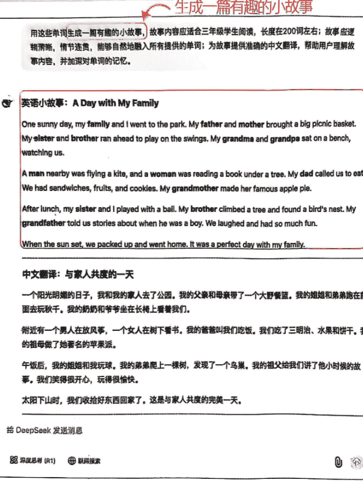

### 第三步，出题检验学习效果

DeepSeek 能够智能化地根据孩子所学的单词编制 10 道选择题，以检验他们是否真正掌握了这些单词的用法。每道题目都附带答案和详细解析，帮助孩子查漏补缺，确保他们的学习效果达到预期目标。同时，家长也可以通过测试结果及时了解孩子的学习进展。

#### DeepSeek 提示词指令公式:


举例: 根据上面的单词生成 10 道选择题，题目应涵盖单词的不同用法和语境；题目应重点考查孩子对单词的理解和运用能力，而不只是单词的拼写或中文释义；为每道题目提供正确答案和详细解析，帮助孩子理解为什么某个选项是正确的，其他选项是错误的。

### 让 DeepSeek 成为孩子单词记忆的得力助手!

单词记忆是英语学习的基础，而 DeepSeek 通过智能识别、故事生成和测试检验，让孩子的单词记忆变得既高效又有趣。无论是为了提升孩子的考试成绩，还是培养他们学习英语的兴趣，DeepSeek 都是家长不可或缺的教育工具。现在就上传单词表，让孩子体验高效学习的乐趣吧！让 DeepSeek 帮助孩子轻松搞定单词学习，快速提升英语水平！

## 02 作业辅导不再难：拍照解题 + 错题本自动生成

> 辅导作业让人疲惫不堪？数学难题解析不清、语文阅读理解困难、英语语法讲解模糊……别让作业成为拥有良好亲子关系的障碍！DeepSeek化身“24小时全能家教”，拍照后1秒出解析、错题自动归类、知识点精准推送。三个案例，指导你用AI把辅导作业的过程变成有趣的亲子游戏，让孩子爱上学习，同时让家长解放大脑和双手！

### 案例1 数学应用题秒懂 —— 举一反三

痛点: 孩子卡在“鸡兔同笼”的问题上，家长讲10遍，孩子仍然听不懂。

- ×错误提问:“鸡兔同笼怎么解？”
- ○结果: AI输出公式，但孩子无法理解抽象逻辑。

✓正确操作

家长用手机给练习册上的题目拍照，然后把照片上传至 DeepSeek，再给出指令: 识别图中题目并给出解题思路。

#### 具体指令:

- 角色: 你是一名小学数学教学专家。
- 目标: 识别图中的题目（附图片略），分步骤给出解题思路，不要直接给出答案。
- 要求:
  1. 用“苏格拉底提问法”，引导孩子进行解题;
  2. 设计 3 道同类型变式题（如“三轮车 + 汽车停车问题”）;
  3. 输出错题卡模板（含口诀总结:“头当总动物，脚差除以 2”）。

#### 成果示例:

```
已深度思考（用时 17 秒）
一、“苏格拉底提问法”引导解题
问题1: “小朋友，笼子里有35个头，如果全是鸡的话，每只鸡有2只脚，那么总共有多少只脚呢？”
引导思考:
- 计算假设全为鸡时的脚数: 35 × 2 = 70（只）
问题2: “可是题目里说实际有94只脚，比我们假设的70只多了24只脚。你觉得为什么会多出24只脚呢？”
引导思考:
- 发现多出的脚是因为笼子里还有兔子（每只兔子比鸡多2只脚）。
```

### 案例2 语文阅读理解——情感分析 + 答题公式库

痛点：孩子总答不出“作者表达了什么情感”，答案偏离主题。

- × 错误提问：“这篇《桂花雨》的中心思想是什么？”
- ○ 结果：AI 输出标准答案，但孩子仍不懂答题逻辑。
- ✔ 正确操作

#### 具体指令：

角色：你是一名语文阅读理解拆解师。

目标：针对以下文章的内容（附图片略），训练孩子掌握情感分析模型。

#### 要求：

1. 标注关键词（如“踮起脚尖”“使劲摇晃”等动作及其所表达的情感）；
2. 用选择题形式引导思考（如 A. 怀念童年 B. 批评破坏环境的行为）；
3. 生成答题模板（情感 + 证据 + 总结三步法）。

#### 成果示例：

情感分析训练模板

一、关键词情感标注（示例）

假设原文段落：“小雨踮起脚尖，使劲摇晃着树枝，眼睛紧盯着枝头那颗红透的苹果。”

| 关键词 | 动作情感分析 | 上下文依据 |
|--------|--------------|------------|
| 踮起脚尖 | 渴望、努力（正向） | 为摘苹果而付出额外努力 |
| 使劲摇晃 | 迫切、焦虑（中性偏负） | 动作急躁，可能隐含破坏性 |
| 紧盯着 | 专注、执着（正向） | 体现目标的明确性 |

二、选择题引导思考

题目：小雨“踮起脚尖”和“使劲摇晃”树枝的行为，主要表达了什么情感？

A. 对果实的强烈渴望（正确答案）
B. 对树木的随意破坏（干扰项，未体现恶意）
C. 玩耍时的无忧无虑（偏离核心动作意图）

### 案例3 英语语法纠错——错题定位 + 游戏化练习

痛点: 孩子总混用 “there be” 和 “have”，订正后仍重复犯错。

- 错误提问: “there be 和 have 的区别是什么？”
- 结果: AI 罗列语法规则，孩子记不住。

#### 正确操作

具体指令:

- 角色: 你是一名英语游戏化教学设计师。
- 目标: 通过互动练习解决以下错题（附图片略）。
- 错题: There have a book on the desk.（错误）
- 要求:
  1. 设计 “语法警察” 小游戏（找出 5 处语句中的错误）；
  2. 生成口诀动画（“存在” 用 there be，“拥有” 用 have）；
  3. 推送 7 天渐进式练习计划（每日 5 题，错题的知识点重复强化）。

成果示例:

> 英语语法纠错游戏化教学方案

一、“语法警察”小游戏设计

场景与错误示例（找出5处错误并修正）：

1. 教室场景：
   - 错误句：There have many students in the classroom.
   - 正确句：There are many students in the classroom.

2. 厨房场景：
   - 错误句：On the table have some apples.
   - 正确句：There are some apples on the table.

家长辅导作业不再是 “鸡飞狗跳” 的苦战，而是亲子共同成长的好机会。DeepSeek 的 “可视化解析 + 错题诊断 + 游戏化训练” 形成闭环，让孩子从 “被动听讲” 转变为 “主动探索”。当 AI 帮孩子讲解难题时，家长只需做一件事：在孩子恍然大悟时，为他骄傲地鼓掌。

## 03 英语作文批改“神器”：雅思考官级修改建议

> 辅导孩子的英语作文像破译密码？语法错误“遍地开花”、词汇使用单一像复读机、叙述结构混乱如迷宫……DeepSeek化身“24小时雅思考官级外教”，从语法纠错到句式升级，从同义词汇替换到逻辑优化，3个案例教你用AI一键生成专业作文批改，让孩子写出地道英语作文，也让家长告别疯狂查字典！

### 案例1 语法纠错 + 趣味解析——让错误变成学习游戏

痛点: 当孩子写 “I has a dog. It like eat meat.” 家长只会圈出错误，孩子不理解为什么错了。

- × 错误提问: “请修改这篇作文。”
- ○ 结果: AI 直接输出正确答案，孩子依然不懂主谓一致的语法规则。
- ✓ 正确操作
- 具体指令:
  - 角色: 你是一名儿童英语语法教师。
  - 目标: 批改以下作文并设计互动练习（附照片略）。
  - 作文内容: I has a dog. It like eat meat. We often play together on park...
  - 要求:
    1. 指出语法错误，并标注错误类型;
    2. 设计 3 道选择题巩固知识点（如 “He __ a cat. A. have B. has”）;
    3. 生成 “语法警察” 小游戏: 找出 5 个生活场景中的错误句子。

#### 成果示例：

已深度思考（用时 21 秒）

### 一、作文批改（虚拟红笔标注）

1. I [has] a dog.
   错误类型：主谓不一致（第一人称单数应使用have）
   ✅修改：I have a dog.
2. It [like eat] meat.
   错误类型：①动词第三人称未加s ②不定式/动名词缺失
   ✅修改：It likes to eat meat. / It likes eating meat.
3. We often play together [on park].
   错误类型：介词误用 + 冠词缺失
   ✅修改：We often play together in the park.

### 案例 2 词汇升级引擎——告别 “very happy”

痛点: 孩子全文用 “very happy” 表达开心，词汇量 “贫瘠”。

❌错误提问: “替换作文中的重复词汇。”

○结果: AI 给出的高级词汇（如 ecstatic）超出孩子现阶段的单词掌握范围。

### ✔正确操作

#### 具体指令：

角色: 你是一名小学英语词汇拓展师。

目标: 优化以下句子的情感表达（附照片略）。

原句: I was very happy on my birthday. My friend DeepSeek were very happy too.

#### 要求:

1. 提供3个与句子内容相关的小学生适用词汇;
2. 设计“情感温度计”图表，标注词汇强度（happy → ★★★; joyful → ★★★★）;
3. 生成填空练习: “I felt ___ when I saw the surprise party.”

#### 成果示例：

> 情感升级工具箱：
三个魔法词汇
1. thrilled (激动不已的→★★★★★)
   例: I was thrilled when I saw the giant birthday cake!
2. overjoyed (欣喜若狂的→★★★★☆)
   例: My parents were overjoyed by my handmade card.
3. delighted (满心欢喜的→★★★★)
   例: We all felt delighted playing the treasure hunt game.
情感温度计图表设计
(图片建议: 纵向温度计图案, 用不同颜色标注情感强度)
happy → ★★★
cheerful → ★★★★☆

### 案例3 结构逻辑优化——从“流水账”到“五星作文”

痛点: 孩子作文结构混乱．如 “I went to the zoo. I saw lions. I ate ice cream. I went home.”

- × 错误提问：“请改进这篇作文的结构。”
- ○ 结果: AI 重写全文，孩子无法理解修改逻辑。

### ✓ 正确操作

#### 具体指令：

- 角色: 你是一名英语作文架构师。
- 目标: 为以下作文添加逻辑连接词和细节描写（附照片略）。
- 原文: I visited grandma. We cooked dumplings. It was fun...
- 要求:
  1. 用 “First... Next... Finally...” 框架重构内容;
  2. 添加感官描写（如 “The dumplings smelled like fresh onions.”）;
  3. 输出写作思维导图（含 “人物 — 动作 — 感受” 分支）。

#### 成果示例：

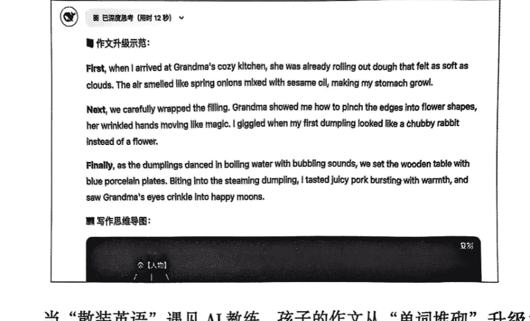

当“散装英语”遇见AI教练，孩子的作文从“单词堆砌”升级为“地道表达”。DeepSeek的“语法透视镜+词汇宝库+结构导航仪”搭配，让每个错误都成为进步的阶梯。放下红笔，让孩子在批注中看见成长的轨迹——因为最好的辅导，是教会他们如何自我修正。

## 04 知识点记不住？那是因为不会思维导图自动生成术

> 在信息爆炸的时代，死记硬背早已不是高效的学习方式。本节将教你用DeepSeek一键生成可视化思维导图，将零散的知识点转化为逻辑清晰的记忆网络。即使是没有任何技术基础的家长，也能通过三步指令，让孩子像搭积木一样轻松记住语文古诗、数学公式和英语单词，从此告别“背了又忘”的困境。

### 案例1 语文古诗记忆——用场景串联诗句

❌ 错误提问：“帮孩子背诵古诗《静夜思》。”

○ 问题：目标模糊，缺乏记忆逻辑设计。

✔ 正确操作

• 目标：将《静夜思》转化为场景化思维导图，辅助孩子理解和记忆。

• 角色：小学语文教学设计师。

任务步骤：

- 提取诗中的核心意象（明月、床、故乡）；
- 将意象关联为连续场景（抬头望月→低头思乡）；
- 用生活化比喻解释抽象情感（如“思乡像牵动风筝的线”）。

约束条件：语言符合小学生认知，思维导图分支不超过5个。

具体指令：

你是一名小学语文教学设计师，请为《静夜思》设计一个思维导图，帮助孩子通过场景联想记忆诗句。要求：

1. 核心分支为“看到的景物”和“心里的感受”；
2. 用箭头连接场景变化（如“抬头望月→低头思乡”）；
3. 每个知识点配1个生活化比喻（如将“床前明月光”比喻为“睡前看到台灯”）。

输出格式：markdown 层级列表 + 简笔画描述建议。

成果示例：

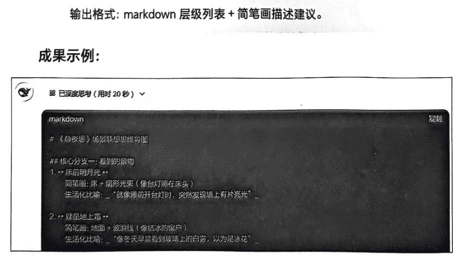## 复制 DeepSeek 生成的 markdown 代码，在电脑桌面新建一个 .txt 文档，将 markdown 代码复制到 txt 文档保存，右键点击将 .txt 后缀名修改为 .md，就得到一个 .md 格式的文件。

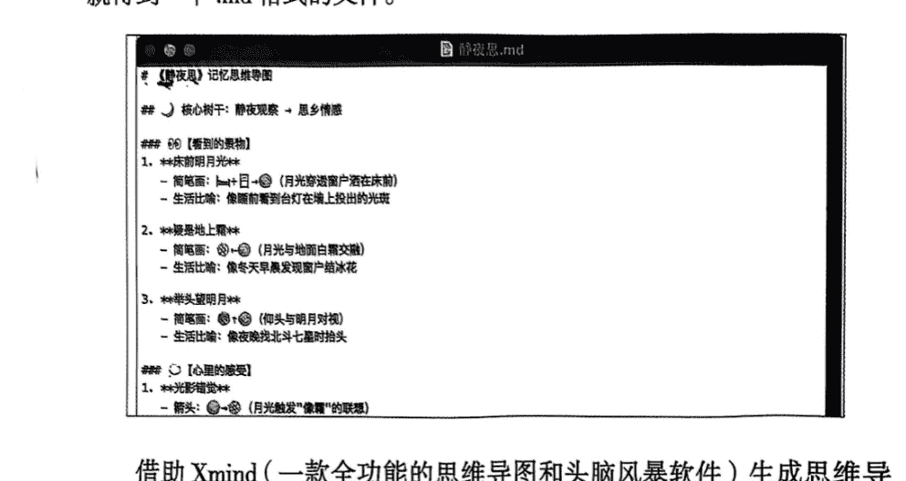

借助 Xmind（一款全功能的思维导图和头脑风暴软件）生成思维导图，登录网址 [https://xmind.cn](https://xmind.cn) 下载并安装思维导图工具 Xmind 软件。


打开 Xmind 软件。


导入《静夜思》.md 文件。


一键生成《静夜思》思维导图。

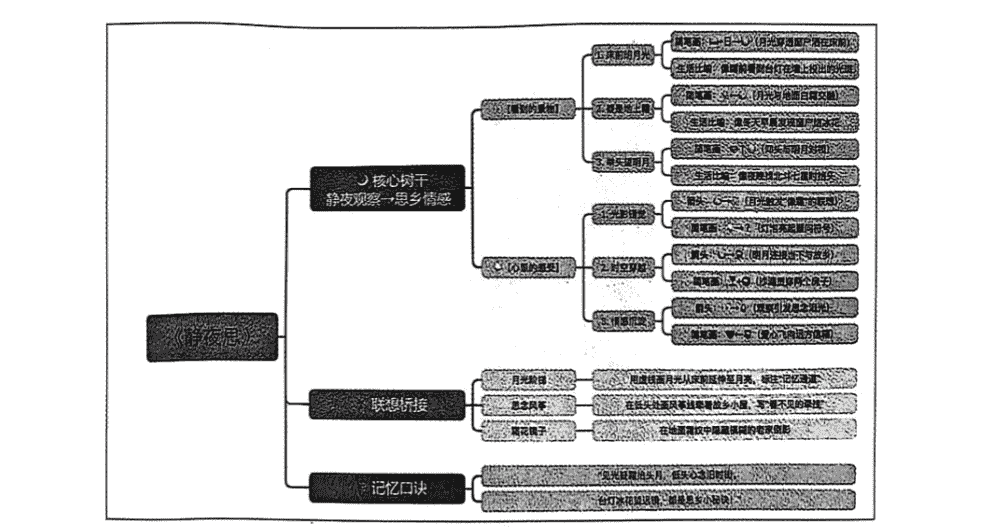

## 案例 2 数学公式记忆——用分类游戏梳理规律

- ✖ 错误提问：“怎么记住长方形和三角形的相关公式？”
- ○ 问题：未建立知识关联，孤立记忆难度大。
- ✔ 正确操作
- ○ 目标：将几何公式分类为“形状家族”，用游戏化思维导图强化记忆。
- 角色：数学游戏策划师。
- 任务步骤：
  - 按“边数”给图形分类（如四边形、三角形）；
  - 为每一类设计公式口诀；
  - 添加生活应用案例（如“测量书桌周长”）。
- 约束条件：口诀押韵，每类公式对比呈现。

#### 具体指令：

你是一名数学游戏策划师，请为小学几何公式设计一个游戏化思维导图。

要求：

1. 按图形边数分为“四边形”“三角形”两大分支；
2. 每个分支下用儿童能理解的比喻解释周长和面积公式（如将“面积=长×宽”比作“铺地砖”）；
3. 添加“闯关挑战”环节：用家庭物品测量实践。

输出格式：表格对比 + 关关任务描述。

### 案例3 英语单词记忆——用主题网络扩展词汇

- 错误提问：“孩子记不住表示动物的单词，怎么办？”
- 问题：单词孤立记忆，缺乏主题联想。
- 正确操作
- 目标：选定核心主题（如动物园）。
- 角色：英语情景设计师。
- 任务步骤：
  - 选定核心主题（如动物园）；
  - 按“动物→食物→动作”分层扩展（如 lion → meat → roar）；
  - 设计互动问答（如“老虎吃什么？怎么叫？”）。
- 约束条件：每个单词配拟声词或肢体动作以作提示。

#### 具体指令：

你是一名英语情景设计师，请以“动物园”为主题生成一个单词记忆思维导图，要求：

1. 分层结构：动物名称→食物→叫声或动作；
2. 每个单词添加趣味记忆法（如“模仿老虎吼声记‘roar’”）；
3. 设计 3 个互动问答，用于亲子对话练习。

输出格式：树状图 + 表情符号标注 + 问答脚本。

#### 成果示例：

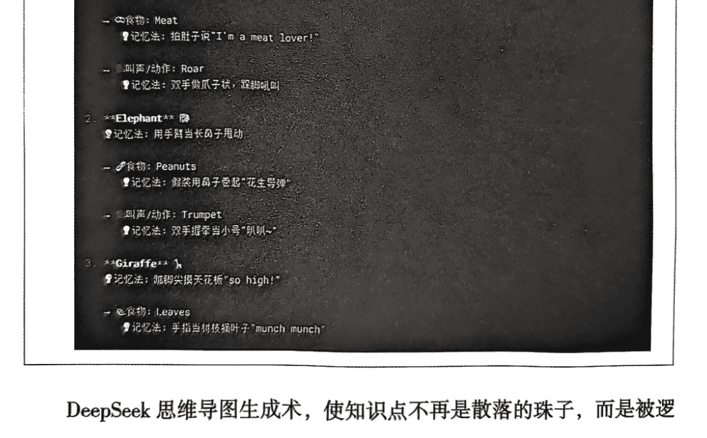

```
# 动物园单词记忆树

## 🦁 动物名称

1. **Lion** 🦁
   🧠记忆法：张大嘴模仿"roar~"的吼声，像国王戴皇冠

   - 🍖食物：Meat
     🧠记忆法：拍肚子说"I'm a meat lover!"

   - 🔊叫声/动作：Roar
     🧠记忆法：双手做爪子状，跺脚吼叫

2. **Elephant** 🐘
   🧠记忆法：用手臂当长鼻子甩动

   - 🥜食物：Peanuts
     🧠记忆法：假装用鼻子卷起"花生导弹"

   - 🔊叫声/动作：Trumpet
     🧠记忆法：双手握拳当小号"叭叭~"

3. **Giraffe** 🦒
   🧠记忆法：踮脚尖摸天花板"so high!"

   - 🌿食物：Leaves
     🧠记忆法：手指当树枝摘叶子"munch munch"
```

DeepSeek 思维导图生成术，使知识点不再是散落的珠子，而是被逻辑线和想象力串起的“珍珠项链”。无论是古诗的情感脉络、数学公式的规律“城堡”，还是单词的故事王国，孩子们都能在“画着玩”的过程中牢牢记住。让工具服务于人，而非人被工具束缚——这才是 AI 时代高效学习的真谛。

## 05 作文辅导难？让孩子作文秒变范文的步骤

当孩子皱着眉头半天写不出作文开头，家长看着千篇一律的“今天天气晴朗”干着急时，作文辅导就成了亲密亲子关系的“隐形杀手”。本节独创 DeepSeek 作文急救三步法——诊断病灶、补充细节、点亮文采，通过 DeepSeek 的精准指导，让家长化身“作文教练”，用 3 句指令帮孩子把“流水账”变成有画面感、有逻辑的范文级作文。

### 案例1 结构混乱——用“汉堡包结构法”重塑框架

- ✖ 错误提问：“帮孩子改改这篇作文。”
- ○ 问题：提问无针对性，导致 AI 可能过度修改，从而使文章失去“孩子气”。
- ✔ 正确操作：
  - ○ 目标：诊断《游乐园一日游》作文结构问题，在保留孩子原意的基础上优化框架。
  - ○ 角色：作文结构导师。
  - 任务步骤：
    - 诊断：标记“开头冗长无重点、中间事件堆砌、结尾突然”三大问题。
    - 重构：用“汉堡包结构法”（吸引人的开头→3个关键事件→感悟式结尾）改写。
    - 对比：新旧版本对照表，标注修改逻辑。

#### 具体指令：

> > 你是一名作文结构导师，请用“汉堡包结构法”优化这篇作文。
> [粘贴原文]
> 要求：
> 1. 开头用“五感法”描写环境（如听到的尖叫、闻到的爆米花香）；
> 2. 中间保留3个最有趣的事件（用“首先→其次→最后”连接）；
> 3. 结尾写1句真实感想（如“原来勇敢就是手心出汗还往前冲”）。
> 输出格式：修改版（标注调整理由）+家长辅导话术（如可以问孩子：“玩过山车时手心是什么感觉？”）。

### 案例2 内容空洞——用“五感放大镜”填充细节

- ✖ 错误提问：“这篇作文太短了，加点内容。”
- ○ 问题：AI不知从何补充，易编造虚假细节。
- ✔ 正确操作：
  - ○ 目标：为《春天的公园》补充真实、可感知的细节。
  - ○ 角色：儿童写作教练。
  - 任务步骤：
    - 定位：找出原文中的抽象、模糊表述（如“花很漂亮”）；
    - 提问引导：设计5个具体的观察性问题（如“花瓣是什么形状？摸起来像什么？”）；
    - 转换：将答案转化为比喻句（如“樱花像小裙子层层叠叠”）。

#### 具体指令：

你是一名儿童写作教师，请帮家长设计观察和引导方案。

作文主题：《春天的公园》

问题段落：“池塘边有很多花，很好看……”

要求：

1. 列出5个具体的探索性问题（如“观察颜色/形状，感受触感，寻找对比物”）；
2. 将答案转化为比喻句（如“___像___”）；
3. 输出亲子互动指南“带放大镜到公园实地验证”。

#### 成果示例：

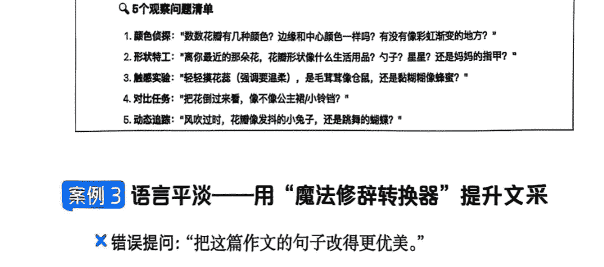

### 案例3 语言平淡——用“魔法修辞转换器”提升文采

- 错误提问：“把这篇作文的句子改得更优美。”
- 问题：AI无法理解“优美”的标准，易模仿成人化表达。
- 正确操作
- 目标：将《我的妈妈》中的平淡叙述转化为童趣盎然的描写。
- 角色：儿童语言设计师。
- 任务步骤：
  - 锁定：找出可改造的陈述句（如“妈妈很勤劳”）；
  - 转换：用“比喻+动作”改写（如“妈妈像旋转的陀螺，做饭时铲子像跳舞，拖地时水花似唱歌”）；
  - 分级：提供低年级版（6～8 岁）和高年级版（9～12 岁）两种不同的语言表达。

#### 具体指令：

你是一名儿童语言设计师，请将以下句子的表达修改得更生动，并适合小学生阅读的水平。

> 原句：“妈妈每天做很多家务。”

要求：

1. 用比喻句 + 拟声词呈现；
2. 分年龄段输出（低年级要采用简单比喻；高年级要采用复合修辞）；
3. 添加写作游戏“家务声音猜猜猜”（根据描述猜家务及动作）。

作文不是“好词好句”的堆砌，而是孩子观察世界的“放大镜”。

通过 DeepSeek 三步工具——结构“诊断器”、细节“放大镜”、语言“魔法棒”，家长不必再犯难于“怎么教孩子运用修辞手法”，而是带着孩子从生活的点滴中发现写作的乐趣。

当 AI 工具成为“提问引导者”而非“代笔枪手”，作文辅导终将回归本质：让每个孩子都能自信地说出“这是我的眼睛看到的世界”。

## 06 数理化难题解答陷入困境？DeepSeek 秒解 + 举一反三训练

当孩子盯着数学几何题咬指甲、对着物理力学题抓头发时，多数家长只能无奈叹气。本节揭秘 DeepSeek 的“双引擎法”——快速拆解难题和生成同类变式题，让家长无须重学数理化，只需 3 步提问就能化身“解题能手”。从看懂答案到教会孩子，从单题突破到举一反三，让辅导孩子学习过程成为亲子共同成长的契机。

## 案例 1 数学几何题——用“问题拆解术”突破思维盲区

- ✖ 错误提问：“这道几何题怎么解？”
- ○ 问题：缺乏具体信息，AI 无法有针对性地指导。
- ✔ 正确操作
  - 目标：拆解“平行四边形面积计算”难题，引导孩子自主推导公式。
  - 角色：数学思维引导师。
  - 任务步骤：
    - 定位卡点：识别孩子解题过程中的错误步骤（如“混淆底与高”）。
    - 可视化推导：用图形切割法模拟公式来源。
    - 变式训练：生成 3 道“陷阱题”。
  - 具体指令：
    - 你是一名数学思维引导师，请为家长设计“计算平行四边形面积”辅导方案。
    - 原题：底为 8 厘米、高为 5 厘米的平行四边形的面积是多少？

#### 要求：

1. 用“剪拼法”动画步骤描述（如“将剪出的三角形平移，使平行四边形变成长方形”）；
2. 设计2个有深度的提问（如“如果底不变但倾斜角度变大，高会变吗？”“不用尺子，如何用跳绳量出高？”）；
3. 生成变式题（已知平行四边形的底为12厘米、斜边为10厘米，求平行四边形的最大可能面积）。

输出格式：分步图解描述 + 亲子互动问答 + 变式题答案（附思维陷阱提示）。

#### 成果示例：

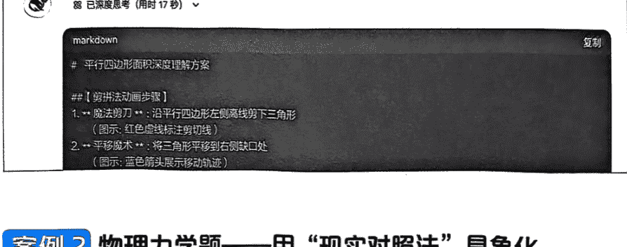

```
# 平行四边形面积深度理解方案

## 【剪拼法动画步骤】
1. **魔法剪刀**：沿平行四边形左侧高线剪下三角形
   （图示：红色虚线标注剪切线）
2. **平移魔术**：将三角形平移到右侧缺口处
   （图示：蓝色箭头展示移动轨迹）
```

### 案例2 物理力学题——用“现实对照法”具象化抽象概念

- ✖ 错误提问：“这道与浮力有关的题怎么给孩子讲？”
- ○ 问题：脱离生活经验，孩子难以理解公式。
- ✔ 正确操作
  - 目标：用生活实验解释“浮力公式：F浮 = ρ水V排g”，并设计探究任务。
  - 角色：物理实验设计师。
  - 任务步骤：
    - 现实锚点：对比橡皮泥沉底与船的漂浮。
    - 公式具象化：用“水被排开的阻力”替代抽象公式。
    - 家庭实验：用矿泉水瓶制作简易浮力秤。

#### 具体指令：

你是一名物理实验设计师，请你帮家长设计浮力公式教学方案。
要求：
1. 设计 2 个家庭实验（如“橡皮泥造型沉浮对比”）；
2. 用“水卫士推船”作比喻来解释公式；
3. 生成 3 道变式题（如“计算西瓜漂浮在水中时的排水量”）。
输出格式：实验步骤（材料清单 + 安全提示）+ 比喻故事 + 变式题（附答案与讲解重点）。

#### 成果示例：


### 案例3 化学方程式——用“积木拼接法”破解配平难问题

- ✖ 错误提问：“这个化学方程式怎么配平？”
- ○ 问题：AI 直接给答案，孩子无法掌握方法。
- ✔ 正确操作
  - 目标：将“铁与硫酸铜反应”的化学方程式配平过程转化为积木游戏。
  - 角色：化学教育专家。
  - 任务步骤：
    - 原子可视化：用积木代表不同原子。
    - 左右天平法：设计“原子银行”借贷规则。
    - 陷阱挑战：生成易错方程式（如含氧奇数配平）。

#### 具体指令：

你是一名化学教育专家，请为 Fe + CuSO₄ → FeSO₄ + Cu 的反应设计化学方程式（常温下的置换反应）配平教学方案。

要求：

1. 用“积木数量守恒”作比喻来解释配平逻辑；
2. 设计配平闯关游戏“初始给5个铁（Fe）原子（5块积木），如何交换得到平衡？”；
3. 生成2个常见错误配平案例，要求孩子扮演“方程式医生”进行纠错。

输出格式：游戏规则 + 纠错训练题 + 家长反馈话术（如“你发现哪里的原子失踪了？”）。

学习数理化不是一场“获得正确答案”的竞赛，而是帮助我们理解世界的思维训练。通过 DeepSeek 的“双引擎法”构建知识网络，家长无须成为“解题高手”，只需要学会提问的艺术。当孩子学会用“为什么排水量的多少决定浮力的大小”来思考，而非死记硬背 F_浮 = ρ_水 V_排 g 时，便是科学思维真正扎根的时刻。

## 07 背书效率低？形象转化 助你过目不忘

背书不是记忆力的较量，而是想象力的大冒险。本节揭秘 DeepSeek 的“记忆宫殿法”——将枯燥的字母组合变成“恐龙战场”“太空基地”“巧克力工厂”的故事碎片。通过 DeepSeek 定制专属记忆地图，孩子只需每天进行 15 分钟的“故事闯关”，就能让 500 个单词像最爱的动画角色一样扎根脑海。再也不用每次都卡在“abandon”这个单词了，让记忆单词成为一场奇幻的旅行。

### 案例 1 英语单词——用“恐龙星球”串联词根词缀

- **错误方法**
  - 机械抄写：apple（苹果）、banana（香蕉）（重复 20 遍）。
  - 问题：孤立记忆，遗忘率超 70%。
- **正确操作**
  - 目标：用侏罗纪公园的故事场景绑定 50 个动物相关单词。
  - 角色：儿童英语编剧。
  - 任务步骤：
    - 场景设定：恐龙星球分为“火山口（以‘V’开头的单词）”“沼泽地（以‘S’开头的单词）”等区域。
    - 故事锚点：T-Rex（霸王龙）撕咬 vegetable（蔬菜），Stegosaurus（剑龙）甩尾扫过 swamp（沼泽）。
    - 复习游戏：根据单词拼写“解救”被困恐龙。

#### 具体指令：

你是一名儿童英语编剧，请以“恐龙星球”为主题设计“单词记忆宫殿”。目标单词：vegetable, swamp, fossil, volcano...（共 50 个）

要求：

1. 按首字母划分冒险区域（如 “V 区包含 volcano”）；
2. 每个单词编入恐龙互动剧情（如 “T-Rex 偷吃 vegetable”）；
3. 设计 3 个复习问题（如 “哪只恐龙守护 fossil ？”）。

输出格式：场景地图 + 故事脚本 + AR 互动提示（如 “扫描单词触发恐龙动画”）。

## 案例 2 语文古诗——用“时空穿梭机”具象化抽象意境

- ✖ 错误方法
  - 逐句背诵：“日照香炉生紫烟，遥看瀑布挂前川……”（容易混淆顺序）
- 问题：文字脱离画面，记忆线索单一。
- ✔ 正确操作
  - 目标：将《望庐山瀑布》转化为 VR（虚拟现实技术）登山体验。
  - 角色：研学活动策划师。
  - 任务步骤：
    - 路径设计：山脚（日照香炉）→山腰（遥看瀑布）→山顶（飞流直下）。
    - 多感官绑定：水声对应“挂前川”，水雾对应“生紫烟”。
    - 闯关挑战：根据诗句排列景点照片，强化记忆路径。

#### 具体指令：

你是一名古诗研学活动策划师，请为《望庐山瀑布》设计“记忆宫殿”。

要求：

1. 将4句诗转化为登山的4个打卡点（配动作指令如“仰头望”）；
2. 每个打卡点绑定感官记忆（如“第三句对应张开双臂感受水雾”）；
3. 生成“诗句碎片寻宝图”，将碎片卡打乱，让孩子按照游览顺序复原。

输出格式：登山地图 + 动作指令表 + 亲子游戏规则。

### 案例3 数学公式——用“魔法商店”破解符号密码

- ✖ 错误方法
  - 死记硬背：(a+b)²=a²+2ab+b²（易漏2ab项）。
- 问题：公式无意义化，难以长期记忆。
- ✔ 正确操作
  - 目标：用“魔法商店”的购物故事记忆代数公式。
  - 角色：数学魔法师。
  - 任务步骤：
    - 符号转化：a= 苹果，b= 香蕉，²= 魔法放大镜。
    - 剧情绑定：(a+b)²= 苹果 + 香蕉被魔法放大镜照出“隐藏的 2ab 精灵”。
    - 纠错任务：故意摆错商品，让孩子扮演“公式警察”。

#### 具体指令：

你是一名数学魔法师，请将数学公式转化为“魔法商店”剧情。

目标公式：(a+b)²=a²+2ab+b²、a²-b²=(a+b)(a-b)。

要求：

1. 用商品交易比喻公式推导（如“融合物品获得新物种”）；
2. 设计咒语口诀（如“平方和、精灵多、2ab 别忘躲”）；
3. 制作“错乱货架”练习题（如“故意漏掉 2ab”）。

输出格式：商店平面图 + 剧本 + 纠错任务卡。

#### 成果示例：

### 🏪商店平面图

| 区域 | 设施 | 功能 |
| :--- | :--- | :--- |
| ▶融合工坊 | 水晶熔炉 | 处理$(a + b)^2$合成 |
| | 配方墙 | 动态演示$a^2 + 2ab + b^2$ |
| ▶分解密室 | 棱镜分解台 | 处理$a^2 - b^2$ |
| | 悬浮显示 | $(a + b)(a - b)$裂变动画 |
| ▶错乱货架 | 货品标签 | 故意缺失元素 |
| | 魔法修正墨水笔 | 配备纠错工具 |

### 📜魔法剧本《变形法则的传承》

**第一幕：融合法则**
店主：“想要合成‘知识果实’（举起苹果$a$与书本$b$）？把它们投进熔炉，念诵——”
学徒操作：

```
$(🍎 + 📖)^2 = 🍎^2 (苹果核) + 2 × 🍎📖 (果肉书页) + 📖^2 (智慧树苗)$
```

咒语：
“平方和，精灵火，双倍交织结硕果！”
特效：熔炉迸发双螺旋光带，缺少$2ab$时果实枯萎

**第二幕：分解禁术**
店主：“这块‘黄金方块$a^2$’被黑暗侵蚀$b^2$，需用棱镜分离——”
学徒操作：

记忆的本质，就是把新的东西和我们已经知道的事情联系起来，比如把单词当作恐龙的名字，把古诗当作探险的地图，把公式当作魔法的配方。这样一来，背诵便不再是重复的痛苦，而是孩子主动探索的有趣游戏。通过 DeepSeek 的“记忆宫殿法”，30 天记住 500 个单词只是开始，真正厉害的地方是，孩子会收获一把“万能钥匙”：永远旺盛的好奇心与天马行空的想象力。

## 第七章

https://www.deepseek.com

## 生活革命：DeepSeek 让普通人秒变全能高手


给 DeepSeek 发送消息
深度思考 (R1) 联网搜索

## 用 DeepSeek 做旅行攻略，5 步搞定完美行程

旅行规划比上班还累，搜遍全网，结果还是踩了网红的“照骗”坑。熬夜安排行程，最后计划赶不上变化，旅行变成“特种兵集训”，只剩下腰酸腿疼……是时候摆脱这种焦虑了！让 DeepSeek 做你的 24 小时“AI 旅行管家”，5 步就能生成省钱、体验好的行程安排，帮你告别信息过载。从此，每次旅行都充满了惊喜！

### 为什么传统攻略让你心累？

做旅行攻略的苦，爱旅行的人都懂。

- 刷遍小红书，收藏 100 篇笔记，最后发现信息过时或掺杂广告；
- 自己一家家比较酒店和机票的价格，弄得头昏眼花；
- 行程安排不合理，一天“暴走” 3 万步累到“崩溃”；
- ……

DeepSeek 的“AI 旅行管家”模式，只需 5 步就能生成一份个性化 + 实时更新 + 预算可控的完美行程。3 个真实案例，一步步教你玩转“黑科技”！

### 案例 1 家庭亲子游：迪士尼 + 周边深度游玩

- 痛点：带 5 岁孩子和 60 岁父母去上海迪士尼度假区游玩，既要满足孩子的玩乐，又要兼顾老人的舒适度。
- 错误提问：“上海迪士尼度假区游玩攻略。”
- 结果：AI 推荐上海迪士尼度假区热门项目，但忽略了“幼童身高限制”和“老人休息区”等信息。

### ✔正确操作

#### 具体指令：

- 角色: 你是一名亲子旅行策划师。
- 目标: 设计一个在上海3天2晚的家庭亲子旅游行程（迪士尼度假区1天+市区休闲2天）。
- 背景: 5岁男孩（喜欢艾莎公主）、60岁父母（体力一般）。
- 格式: 分日期列出景点、交通、餐饮，标注儿童/老人友好指数。
- 约束条件:
  1. 迪士尼度假区项目需适合1.2米以下儿童游玩；
  2. 市区景点间的车程小于30分钟；
  3. 总预算在1万元以内（含住宿）。

### 案例2 户外徒步：川西秘境探险

- 痛点: 单人徒步稻城亚丁，注意事项考虑不周全，影响徒步进度和安全。
- 错误提问: “到稻城亚丁徒步要注意什么？”
- 结果: AI仅提供通用安全提示，没有给出具体海拔数据、装备品牌的推荐。

### ✔正确操作

#### 具体指令：

- 角色: 你是一名户外探险求生专家。
- 目标: 制订一份在稻城亚丁为期5日的重装徒步（9月中旬出发）计划。
- 背景: 单人无向导，首次挑战高海拔地区徒步。
- 格式: 分“装备清单”“每日路线”“应急方案”3个部分。
- 约束条件:
  1. 标注海拔变化和徒步时长；
  2. 推荐抗高原反应的药物及服用方法；
  3. 装备总重量不超过15千克。

### 案例3 美食文化游：48小时吃遍长沙

- 痛点：“网红店”需要排队长达2小时，导致错过真正的地道美味。
- 错误提问：“长沙美食推荐。”
- 结果：AI提供“茶颜悦色”“文和友”等受大众欢迎的餐饮店铺，这些店铺往往人山人海，体验感不太好。

#### 正确操作

#### 具体指令：

- 角色：你是一名长沙本地的美食博主。
- 目标：规划适合周末2天体验的“非网红”美食路线。
- 背景：避开排队，想体验市井老店。
- 格式：按“早、中、晚、夜宵”的时间段进行规划，并附上行动路线。
- 约束条件：
  1. 人均消费每天小于100元；
  2. 标注店家历史（优先推荐开了10年以上的老店）；
  3. 推荐搭配美食（解辣饮品或小吃）。

### 万能五步法：从此告别旅行焦虑

步骤拆解：

- 一、定角色：旅行策划师、户外探险求生专家、美食博主等。
- 二、说需求：人数、天数、偏好（如“拍照优先”“纯吃美食”等）。
- 三、限条件：预算、交通、禁忌（如“不吃辣”“恐高”等）。
- 四、要结构：结构化输出行程表、地图、清单等。
- 五、补细节：实时更新天气、节庆活动等。

DeepSeek 隐藏技能：

- 比价推荐：直接询问“7月15日北京飞往大阪最便宜的航班”。
- 智能纠偏：若行程过满，AI会提示“某景点排队需2小时，建议调整”。
- 本地洞察：推荐“非网红”小店，附店家故事。

DeepSeek 正在让旅行变得更自由。它不仅能帮你从“人挤人”的地方解脱出来，找到“小众宝藏地”，还能让你从“总是踩坑”变成“轻松避雷”。它不仅是一个工具，更像是一个懂你的旅行伙伴——既能帮你规划出最优路线，又能保留旅行中的随性和浪漫。现在就按照文中的方法，做出你的攻略吧！

#### 行动指南：

- 复制文中案例模板，把目的地替换成你的旅行目的地；
- 在 DeepSeek 输入指令，生成属于你的旅行攻略；
- 出发前一天，追加提问“××景点最新开放情况”。

## 02 营养师收入翻倍的秘密：AI 智能推荐赋能个性化服务

> 营养师的困境你懂吗？个性化方案耗时耗力、客户留存难、增值服务难突破……在 AI 时代，你的专业价值不该被这些重复的工作束缚！DeepSeek 将化身 24 小时“智能营养顾问”，帮你快速生成精准的饮食方案，实时追踪客户数据，并自动生成专业的报告。本节将用 3 个案例，帮你找到“效率翻倍 + 收入翻倍”的方法，让 AI 成为你的得力助手！

### 案例1 快速生成个性化饮食计划

- 痛点: 人工制定方案效率低，难以应对复杂的客户需求。
- 错误提问: “为糖尿病患者设计一周的食谱。”
- 结果: AI 输出通用低 GI（血糖生成指数）食谱，忽略个体差异。
- 正确操作

#### 具体指令：

角色: 你是一名三甲医院的临床营养师。
目标: 请你为一位患有 2 型糖尿病的患者（男，58 岁，肌酐值偏高，忌海鲜）设计一份 7 天控糖的食谱。
背景: 患者目标为糖化血红蛋白降至 6.5%，每日运动 30 分钟。
格式: 分早、中、晚和加餐，标注每餐的热量、碳水化合物和蛋白质含量。
约束条件:
1. 优质蛋白以禽类、豆制品为主;
2. 附 3 条烹饪技巧（如“低盐调味法”）。

成果示例：

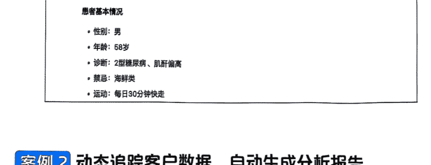

### 案例2 动态追踪客户数据，自动生成分析报告

- 痛点: 手动整理数据易出错，无法快速洞察客户的健康趋势。
- 错误提问: “分析客户的体重变化。”
- 结果: AI 仅输出 “体重下降 2 千克”，无深度关联分析。

### ✔ 正确操作

#### 具体指令：

角色: 你是一名健康数据分析师。
目标: 基于客户 3 个月数据（包含体重、腰围、血糖、饮食记录等），分析遇到减脂瓶颈原因。
背景: 女性客户，35 岁，前 2 个月减重 4 千克，第 3 个月进入平台期。
格式: 分 “代谢分析”“饮食问题”“运动建议” 3 个部分。
约束条件:
1. 用折线图体现血糖与碳水化合物摄入量之间的关系；
2. 提出 2 条易执行、具有突破性的建议；
3. 语言通俗易懂，避免专业术语。

### 案例 3 打造高溢价增值服务，客单价有效提升

- 痛点: 传统咨询服务 “天花板” 低，很难进行差异化竞争。
- 错误提问: “设计营养师付费产品。”
- 结果: AI 建议 “定制食谱包”，此建议缺乏市场竞争力。

### ✔ 正确操作

#### 具体指令：

角色: 你是一名健康顾问。
目标: 为高端孕产妇客户设计月子营养服务产品包。
背景: 目标客单价 5000 元 / 月，需体现专业性和稀缺性。
格式: 分 “服务内容”“定价策略”“推广文案” 3 个部分。
约束条件:
1. 融合中医食疗理念（如 “分体质调理”）；
2. 加入 “产后心理营养” 等差异化模块；
3. 提供 3 套朋友圈 “种草” 文案模板。

#### 成果示例：

## 高端月子营养服务产品包

核心价值：中医体质调理×细胞级营养修复×心理能量滋养

### 一、服务内容设计

| 模块 | 服务项目 | 稀缺性体现 |
|---|---|---|
| 中医食疗定制 | ① 九型体质测评（望闻问切四诊仪）<br>② 节气药膳（如寒露润肺雪梨盅）<br>③ 经络药浴包 | 非遗传承人监制药方 |
| 精准营养干预 | ① 母乳成分分析定制补剂<br>② 代谢组学检测（100+营养指标）<br>③ 细胞抗衰饮 | 三甲医院营养科联合研发 |

当其他营养师还在靠人工计算热量时，你已经用 DeepSeek 打造出了“精准方案 + 数据追踪 + 高端服务”的完美组合！ AI 并不会取代你的位置，而是帮你放大专业价值——从“一对一咨询”变成“一对多服务”，从靠干体力活变成靠专业赚钱。

## 03 没钱花救星：“AI 财务管家” 教你省钱

> 工资到账一周就花光了？账单总是算不清楚？别担心，你不是一个人！很多职场新人都陷在“收入与负债”的困境里。DeepSeek 可以成为你的 24 小时“AI 财务管家”，用 3 个案例教你轻松管钱，从此不再“月光”，让每一分钱都能高效地为你“服务”！

### 案例1 快速生成智能账单，告别糊涂消费

痛点: 手动记账坚持不过3天，永远不知道钱花在哪儿了。
错误提问: “帮我分析这个月的开支。”
结果: AI 仅罗列总支出，结果缺乏分类和建议。

#### 正确操作

#### 具体指令:

- 角色: 你是一名资深财务规划师。
- 目标: 分析我过去30天微信和支付宝账单（模拟数据见下文），找出消费不合理的地方。
- 背景: 月收入6000元，目标存款1000元/月。
- 格式: 分“必要支出”“冲动消费”“隐形浪费”三类,用表格进行对比。

约束条件:
1. 标注3项可立即削减的非必要开支；
2. 给出替代方案（如“自带咖啡可以每天节省30元”）。

模拟账单片段:
- 外卖奶茶: 12笔，共480元。
- 直播间购物: 8笔，共1200元。
- 共享单车月卡: 25元。
- 健身房季卡: 799元（未使用）。

成果示例:

30天消费分析报告（基于模拟数据）
月收入: 6000元 | 目标存款: 1000元 | 实际可支配: 5000元

| 分类 | 消费项 | 金额 | 占比 | 问题诊断 |
|------|--------|------|------|----------|
| 冲动消费 | 直播间购物 | 1200元 | 20% | 非计划性消费，多属低效支出 |
| 冲动消费 | 外卖奶茶 | 480元 | 8% | 高频低额消费易成“钱包刺客” |
| 隐形浪费 | 健身房季卡（未使用） | 799元 | 13.3% | 闲置服务等同资金沉没 |

### 案例2 破解“拿铁因子”，一年省上万元咖啡钱

痛点: 小钱花得不知不觉，月底一看吓一跳。
错误提问：“怎么省钱？”
结果：AI 给出 “少喝奶茶” 等笼统建议，这些建议缺乏可操作性。

### ✔正确操作

#### 具体指令：

- 角色：你是一名极简消费顾问。
- 目标：请为我设计“拿铁因子”消除计划（月省2000元）。
- 背景：
  1. 每日买咖啡花费35元；
  2. 每周在便利店随机消费150元；
  3. 视频平台每月自动续费4笔，共80元。
- 格式：分“替代方案”“习惯培养”“进度追踪”3个部分。
- 约束条件：
  1. 提供具体的执行清单；
  2. 设计21天“打卡”挑战模板；
  3. 计算复利收益（按年化收益率为5%计算）。

### 案例3 500元启动“钱生钱”，“小白”躺赚早餐费

痛点：以为理财需要巨额资金，错过“碎片资金红利”。
错误提问：“怎么用500元理财？”
结果：AI 推荐高风险股票，不符合“小白”需求。

### ✔正确操作

#### 具体指令：

- 角色：你是一名低风险理财经理。
- 目标：为月投500元的理财“小白”设计“保本+增值”的组合方案。
- 背景：可接受年化收益率在3%以下，拒绝亏损。
- 格式：分“货币基金”“指数基金定投”两类说明。
- 约束条件：
  1. 标注操作平台（如支付宝等）；
  2. 附操作截图指引（虚拟生成）；
  3. 对比活期存款收益。

从“月光”焦虑到“掌控每一分钱”，你只需要一个“AI 财务管家”！用 DeepSeek 生成的智能账单 + 消费禁令 + 碎片理财的“组合拳”，能够帮你轻松实现“每月攒 1000 元，一年省下 5 位数”。

## 04 选择困难症？一键生成对比报告，快速帮你做出明智选择！

> 下单前，即使刷遍测评，还是纠结不已？花了 3 小时进行比价，最后却闭眼盲选？别担心，选择困难并不是你的错，只是少了 AI 的帮忙！用 DeepSeek 做你的“购物决策大脑”，3 分钟就能生成一份全面的对比报告——参数、口碑、性价比一键解读，帮你告别“买完就后悔”的烦恼。本节通过 3 个案例，教你用科学的方法战胜纠结，让每一次下单都“稳准狠”！

### 案例 1 手机选购“终结者”——参数党对比体验党

- 痛点：纠结选购 iPhone 15 还是华为 Mate 60，不懂参数又害怕“踩坑”。
- 错误提问：“iPhone 15 和华为 Mate 60 哪款好？”
- 结果：AI 输出笼统的优缺点（如“苹果系统流畅”“华为拍照强”等），无法解决具体需求。

### ✅ 正确操作

#### 具体指令：

角色：你是一名数码测评博主。
目标：请你对比 iPhone 15 和华为 Mate 60，帮我选出更合适的手机。
背景：
1. 主要用途为拍照（人像 + 夜景）、看剧、玩游戏；
2. 预算 6000 元，希望使用寿命在 3 年以上。
格式：分“核心参数”“场景实测”“长期使用”3 个部分。
约束条件：
1. 用表格对比芯片、屏幕、电池等关键数据；
2. 附真实用户差评反馈（如发热、信号差等问题）；
3. 给出保值率参考（3 年后的残值预估）。

#### 成果示例：

iPhone 15 vs 华为Mate 60 深度横评（6000元档三年用机指南）

| 项目 | iPhone 15 | 华为Mate 60 |
|------|-----------|-------------|
| 芯片 | A16仿生（4nm） | 麒麟9000S（7nm） |
| 屏幕 | 6.1" OLED 60Hz | 6.69" OLED 120Hz LTPO |
| 电池 | 3279mAh+20W快充 | 4750mAh+66W快充+50W无线 |
| 信号 | 高通X70基带（无5G射频优化） | 灵犀通信+北斗卫星消息 |
| 系统 | iOS 17（5年系统更新） | HarmonyOS 4.0（3年更新承诺） |

### 案例 2 教你读懂护肤品成分，不花冤枉钱

- 痛点：全网爆款修护面霜哪家强？怕过敏又怕花冤枉钱。
- 错误提问：“雅诗兰黛、珂润和薇诺娜 3 款面霜哪款好用？”
- 结果：AI 罗列官方宣传功效，没有给出成分对比和真实用户反馈。

### ✓ 正确操作

#### 具体指令：

角色：你是一名成分分析专家。
目标：对比雅诗兰黛、珂润、薇诺娜 3 款适合敏感肌使用的面霜。
背景：
1. 肤质：混干敏感肌，换季时易泛红；
2. 诉求：修复肌肤屏障、成分安全、性价比高。
格式：分“成解析”“实测反馈”“性价比” 3 个部分。
约束条件：
1. 标注致敏成分（如酒精、香精等）；
2. 引用真实用户口碑；
3. 按每毫升价格由高到低排序。

#### 成果示例：

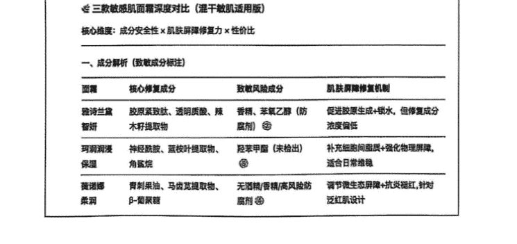

### 案例 3 家电选购“防坑”指南——参数陷阱一眼识破

- 痛点：洗衣机洗涤量的标识为“10 千克”和“10 公斤”是一回事？听不懂导购的销售话术。
- 错误提问：“小天鹅洗衣机和海尔洗衣机哪款好？”
- 结果：AI 列举品牌历史，没有给出核心参数对比。

### ✓ 正确操作

#### 具体指令：

角色: 你是一名家电工程师。
目标: 对比小天鹅TG100V88WMUIADY5滚筒洗衣机和海尔EG100MATE8SU1滚筒洗衣机。
背景：
1. 家庭人口为3人；
2. 洗涤频率为每周4次；
3. 需求包含洗净率高、静音、省水。
格式: 用表格对比关键参数（如洗净比、噪音值、能耗等级）。
约束条件：
1. 解释专业术语（如“1.08洗净比”）；
2. 拆解商家套路（如“智能投放是否实用”）；
3. 给出故障率数据（如“售后投诉率对比”）。

#### 成果示例：

| 项目 | 小天鹅TG100V88WMUIADY5 | 海尔EG100MATE8SU1 |
|------|------------------------|-------------------|
| 洗净比 | 1.08 (超国标洗净比基线1.03) | 1.1 (行业第一梯队) |
| 噪音值 | 46dB (脱水) → 图书馆级静音 | 49dB (脱水) → 正常对话声 |
| 能耗 | 1级能效 (年耗电120度) | 1级能效 (年耗电115度) |
| 用水量 | 54L/次 | 49L/次 (循环喷淋技术) |

### 二、专业术语解读

- 洗净比 (国标实验值)
  - 1.08 vs 1.1差异：实验室条件下，海尔比小天鹅多洗净约2%的咖啡渍 (等效多搓揉30秒)
  - 实际体验：日常衣物清洁差距微弱，重度污渍建议预涂处理
- 智能投放套路拆解
  - 小天鹅 “I-Smart投放”：需手动选择水质硬度 (北方用户易误操作)
  - 海尔 “双智能投放”：洗涤剂/柔顺剂分仓但共用传感器 (可能错判用量)

从“选择困难”到“决策高手”，你只差一个“AI助理”！用 DeepSeek 的“参数对比 + 口碑挖掘 + ‘防坑’预警”组合拳，3分钟就能搞定“选择困难症”，轻松“碾压”3小时的无效搜索。

## 05 装修“防坑”指南：报价单智能诊断 + 质疑话术库

装修就像“渡劫”——报价单暗藏玄机，施工队套路防不胜防，砍价总被“行业规则”堵到哑口无言？新婚夫妻的甜蜜小屋，不该毁在“装修坑”里！让 DeepSeek 当你的“AI 装修监理”，3个案例教会你：快速拆穿报价单猫腻、一键生成质疑话术库、让隐藏费用无所遁形。从此告别“被坑”，让每一分钱都花在刀刃上！

### 案例1 水电改造“防坑”——揪出虚高单价

- 痛点: 自家的水电报价比邻居家的贵了 2 万元，自己也不知道线管、开槽等分项价格是否合理。
- 错误提问: “帮我看看水电报价单有没有问题。”
- 结果: AI 只能回复“建议对比市场价”，没有给出具体分析。
- 正确操作

#### 具体指令:

角色: 你是一名从业 10 年的装修经理。
目标: 诊断以下水电改造报价的合理性（数据见下文）。
背景: 套内 80 平方米的新房，报价单总价为 3.8 万元。
格式: 分“单价对比”“工程量疑点”“砍价策略”3 个部分。
约束条件:
1. 对比 2025 年武汉市场均价（线管 35 元/米，开槽 15 元/米）；
2. 标注虚高项目（如“地面找平重复收费”）；
3. 提供两条质疑话术（引用规范条文）。

报价片段：

- 强电布线：45元/米（预估600米）
- 弱电布线：40元/米（预估200米）
- 墙面开槽：20元/米（预估300米）

成果示例：

| 项目 | 报价单价 | 市场均价 | 价差率 | 问题定位 |
|------|----------|----------|--------|----------|
| 强电布线 | 45元/米 | 35元/米 | +28.5% | 高于市场价，包工包料应<40元/米 |

### 案例2 拆墙、砌墙陷阱——识别重复收费

- 痛点：拆除旧墙体和新建墙体被分开报价，怀疑被“拆了又建”重复计费。
- 错误提问：“拆墙、砌墙的报价合理吗？”
- 结果：AI无法精准识别具体问题，输出的建议缺乏针对性。
- 正确操作

具体指令：

- 角色：你是一名装修审计师。
- 目标：分析以下拆、砌墙报价是否存在重复收费的问题（数据见下文）。
- 背景：二手房改造，拆除原厨房隔墙后新建墙体。
- 格式：用表格对比项目、工程量、合理成本。
- 约束条件：
  1. 依据《房屋建筑与装饰工程工程量计算规范》（GB50854—2013）；
  2. 标注“拆除+新建”是否应合并计价；
  3. 提供两条质疑话术（引用规范条文）。

报价片段：

- 拆除轻体墙: 80 元/m² ( 20m² )
- 新建轻体墙: 180 元/m² ( 20m² )
- 垃圾清运费: 1500 元 ( 整体 )

成果示例：

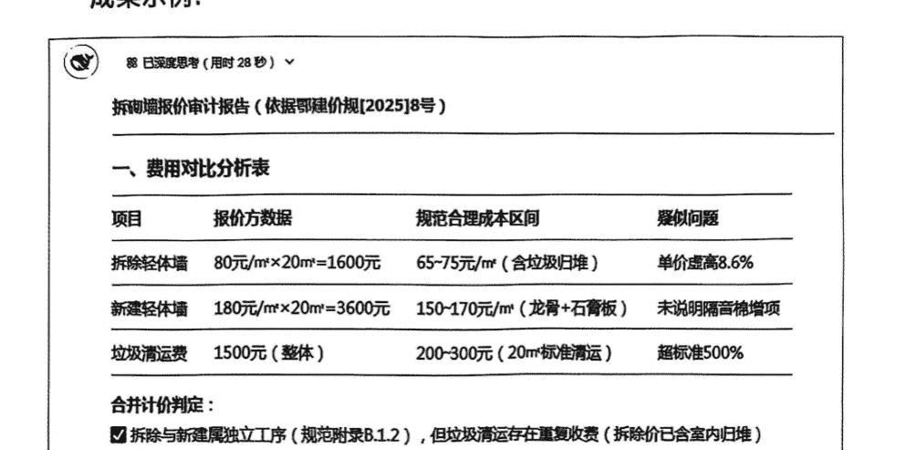

## 案例 3 全屋定制套路——隐藏费用“大起底”

- 痛点: 定制衣柜报价 5 万元，但担心铰链、拉篮等配件额外收费。
- 错误提问: “全屋定制要注意什么？”
- 结果: AI 输出常规提示，没有提供有针对性的避坑指南。
- 正确操作

具体指令：

- 角色: 你是一名全屋定制工厂质检员。
- 目标: 诊断以下报价单中是否存在隐藏费用（数据见下文）。
- 背景: 投影面积 25m²，套餐价 699 元/m²，总价 17475 元。
- 格式: 分 “套餐陷阱”“增项预警”“话术反击” 3 个部分。
- 约束条件:
  1. 对比 2025 年武汉主流品牌套餐明细（含铰链、导轨品牌）；
  2. 标注可能加价项（如见光板、收口条等）；
  3. 生成4条合同补充条款（如明确五金使用品牌）。

报价片段：

- 套餐包含柜体 + 基础五金（未注明品牌）
- 增加项目价格预估为见光板 380 元/m²、拉篮 800 元/个

成果示例：

全屋定制报价单审计报告（武汉2025版）

| 对比维度 | 本报价 | 武汉主流品牌（欧派/索菲亚） |
|----------|--------|-----------------------------|
| 铰链品牌 | 未注明（疑似杂牌） | 百隆/海蒂诗（基础款） |
| 导轨类型 | 未注明（可能三节滚珠） | 托底缓冲导轨（承重45kg以上） |
| 板材厚度 | 未标注背板厚度 | 标配9mm背板（部分品牌送18mm升级） |

从“装修小白”到“反套路大师”，你仅需一个“AI装修管家”！用DeepSeek的“报价诊断+话术生成+合同审核”三件套，能够帮你轻松省下一大笔冤枉钱。

## 06 减肥总失败？定制30天蜕变计划

减肥失败不是你的错！靠节食减肥会反弹、靠运动减肥很枯燥……其实，大多数人都输在“一刀切”的计划上！DeepSeek化身你的“AI私人健康教练”，用科学算法算出你的专属体质，为你定制30天可执行的减脂方案。本节通过3个案例教你掌握“易坚持、能追踪、有陪伴”的减脂新方法，让你的每一次努力都看得到实实在在的变化！

### 案例1 “加班族” 暴食破解——AI 定制防情绪化食谱

- 痛点：“职场人”工作压力大，深夜暴食成瘾，减肥计划总是被情绪性进食摧毁。
- × 错误提问：“帮我设计一份减肥食谱。”
- 结果：AI 输出低热量菜单，但未考虑用户的情绪补偿需求，用户3天后又恢复报复性饮食。

#### 正确操作

#### 具体指令：

- 角色：你是一名心理学家兼营养师。
- 目标：为高压上班族设计一份30天防暴食计划。
- 背景：
  1. 我是一名28岁的女性；
  2. 工作日晚餐时间不固定（20:00—22:00）；
  3. 压力大时嗜甜食；
  4. 目标是每月减3千克，拒绝极端节食。
- 格式：分“正餐策略”“应急零食库”“心理暗示话术”3个部分。
- 约束条件：
  1. 含5种低GI饱腹甜品（如魔芋巧克力慕斯）；
  2. 匹配世界卫生组织关于代糖的最新指引；
  3. 生成每日进度表（含情绪状态记录栏）。

#### 成果示例：

```
# 30天防暴食护航计划
## 正餐策略（分时段弹性执行）
**核心公式：**3+2+1进食法
▶ 15:00下午茶**：1颗水煮蛋+200毫升无糖豆浆（防晚餐前过度饥饿）
▶ 弹性晚餐**（20:00-22:00）：
- 主食：1拳魔芋米拌30克坚果碎
- 蛋白质：120克香煎三文鱼/卤牛肉
- 纤维：300克焯水西兰花+彩椒
饱腹黑科技：餐前10分钟饮用300毫升青柠柠檬水（5克奇亚籽）
```

### 案例2 ‘宝妈’ 碎片化燃脂——AI 设计 ‘隐形运动’

- 痛点：“宝妈”带娃时难以抽出连续的时间进行锻炼，如跳绳、跑步等活动无法坚持，体重长期维持在 68 千克。
- 错误提问：“推荐适合‘宝妈’的减肥运动。”
- 结果：AI 建议每日进行 30 分钟有氧运动，此建议实操性为零。

#### 正确操作

具体指令：

- 角色：你是一名产后康复训练师。
- 目标：设计一份 30 天碎片化燃脂方案（二孩妈妈，日均带娃 14 小时）。
- 背景：
  1. 可利用场景包括哄睡深蹲、陪玩拉伸；
  2. 目标为每月减 2% 的体脂率。
- 格式：分“场景化动作库”“代谢提升技巧”“效果可视化表”3 个部分。
- 约束条件：
  1. 说明碎片化运动带来的好处；
  2. 附婴儿互动游戏设计（如“飞机抱变平板支撑”）；
  3. 接入智能手表数据（心率、热量消耗实时记录）。

成果示例：

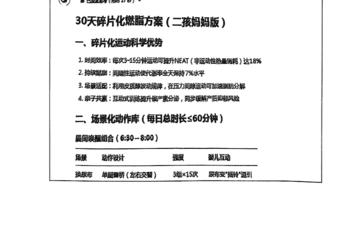

### 案例3 胰岛素抵抗人群——基因导向饮食法

- 痛点：经历多次减肥后又反弹，体检发现胰岛素抵抗问题，以前试过的低脂饮食方案根本不管用。
- 错误提问：“出现胰岛素抵抗时怎么减肥？”
- 结果：AI推荐通用的低碳水化合物摄入建议，该建议未结合个体化的数据。
- 正确操作

具体指令：

- 角色：你是一名营养学专家。
- 目标：基于用户的基因检测报告（数据见下文），为用户制定一份30天营养饮食方案。
- 背景：
  1. 基因特征：FTO（脂肪和肥胖相关基因）属于高风险型（易储存脂肪）；
  2. 医疗数据：空腹胰岛素15.6μU/mL（偏高）。
- 格式：分“碳水化合物摄入调控策略”“抗炎食材清单”“血糖监测节点”3个部分。
- 约束条件：
  1. 标注GL（血糖负荷）值及胰岛素指数；
  2. 生成动态调整规则（根据每周血糖数据进行优化）。

减肥不是意志力的较量，而是科学与人性的共舞。DeepSeek的“行为分析+场景适配+数据追踪”体系，让减脂计划就像为你量身定做的一件“减肥战袍”，贴合你的生活，帮你抵御减肥路上的情绪波动。30天可能改变不了整个人生，但足以让你明白：拥有正确的工具，你就能朝着自己想要达成的目标前进。

# 第八章

https://www.deepseek.com

## “大神”专属：AI 工具链组合拳


## 01 DeepSeek + 即梦 AI，“小白设计师”也能一键生成高清中文海报

在以前，制作一张专业海报较难，需要学习复杂的设计软件、掌握排版美学，还需耗费数小时反复修改。但现在，AI 技术改变了这一切。通过 DeepSeek 生成精准的提示词，再用即梦 AI 一键生成高清海报，零基础的人也能在 5 分钟内完成从创意到成品的制作过程。

无论是电商宣传、活动邀请函，还是社交媒体配图，只要你把需求表达清楚，AI 就能把文字变成好看的图片，让设计工作变得人人都会做，不再是少数专业人士的专利。

### 步骤 1 借助 DeepSeek 生成海报“万能提示词”

DeepSeek 提示词指令公式：

- 角色绑定
- 条件限定
- 具体要求

提示词模板：

我是____，现在要利用____的方式做____，但____。请你帮我生成一个万能公式，后面我只需要换主题，就可以通过“文生图”的方式制作海报了。

具体指令：

我是一名设计师，现在要利用即梦 AI 绘图软件通过“文生图”的方式做海报，但我不知道如何用语言完整地描述一张海报的设计。请你帮我生成一个万能公式，后面我只需要换主题，就可以通过“文生图”的方式制作海报了。

成果示例：

> 好的！以下是一个适合新手的AI海报设计万能描述公式，按照这个结构填充关键词，即可生成不同主题的海报。你可以直接套用模板，替换“【 】”内的内容：

**AI海报万能公式（6大模块+案例）**

1. 核心主题
   “以【主题关键词】为主题的【类型】海报，例如：端午节促销/科技峰会邀请函/儿童绘本宣传”。
2. 风格定位
   【主风格】+【辅助风格】例如：
   - 极简扁平化+霓虹光效

### 步骤 2 告诉 DeepSeek 一个主题，让它自动帮你填充

提示词

DeepSeek 提示词指令公式：


提示词模板：

我想做一张______主题的海报，海报上要写______，画面元素有______。请帮我根据这个主题生成能实现“文生图”的提示词。

具体指令：

我想做一张“重庆文旅”主题的海报，海报上要有“重庆”两个大字，画面要展示重庆比较有名的元素，如洪崖洞、李子坝轻轨、解放碑等。请你帮我根据这个主题生成能实现“文生图”的提示词。

成果示例：

```
城市旅游海报，赛博朋克融合国潮水墨风格，对角线构图，主体为穿楼轻轨动态轨迹与洪崖洞吊脚楼群，背景为山城立交桥与长江索道，配色为橙红+深蓝+霓虹绿，标题“重庆”用立体金属隶书带故障特效，副标题“穿越8D魔幻，品味热辣江湖”配霓虹边框，细节包含轻轨粒子光效、火锅蒸汽、Q版轨道盲盒，4K超清画质，全景深镜头，--ar 3:4
```

### 步骤 3 复制提示词到即梦 AI 中并生成海报

打开即梦 AI 官网[https://jimeng.jianying.com/ai-tool/home](https://jimeng.jianying.com/ai-tool/home)，并点击“登录”按钮，进行相关操作。

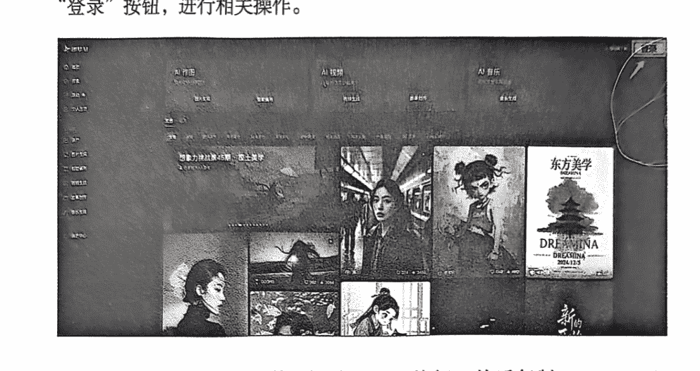

点击“AI 作图”下面的“图片生成”按钮，然后复制 DeepSeek 生成的提示词到“图片生成”中的提示词输入框中。“模型”选择默认的“图片 2.1”，这是即梦 AI 最新的“文生图”模型，支持中文和英文。最后设置“图片比例”，如需要制作手机海报，就选择 9：16 的图片比例，设置好后点击“立即生成”就完成了。


即梦-图片生成
城市夜景海报，赛博朋克风格结合水墨画风格，对角线构图，主体为穿楼轻轨和洪崖洞夜景，背景山城建筑群与长江大桥，配色暗红+深蓝+霓虹灯，标题“重庆”用立体金属字带光效，副标题“穿越8D魔幻，品味热辣江湖”用霓虹灯边框，细节包括轻轨穿楼、洪崖洞吊脚楼、火锅蒸汽、江面倒影，4K超高清，全景构图，--ar 3:4 --v 6.0


根据即梦 AI 生成的图片，选择你认为满意的海报下载即可。

下载


城市夜景海报，赛博朋克风格结合水墨画风格，对角线构图，主体为穿楼轻轨和洪崖洞夜景，背景山城建筑群与长江大桥，配色暗红+深蓝+霓虹灯，标题“重庆”用立体金属字带光效，副标题“穿越8D魔幻，品味热辣江湖”用霓虹灯边框，细节包括轻轨穿楼、洪崖洞吊脚楼、火锅蒸汽、江面倒影，4K超高清，全景构图，--ar 3:4 --v 6.0

- 生成视频
- 在画布中进行编辑
- HD 画质
- 超清画质
- 智能重绘
- 扩图
- 动画
- 再次生成
- 创意编辑

### 步骤4 生成时长为5秒的视频

点击“视频生成”按钮，先上传已经下载的图片，然后在提示词输入框中输入你想生成的画面和动作的描述文字，最后点击“生成视频”按钮。

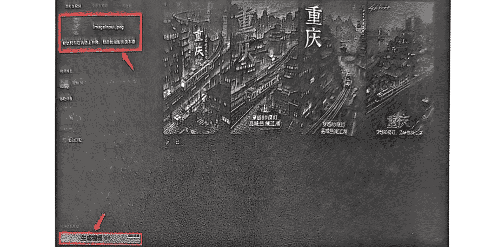


这样你就得到了一段时长为5秒的动态视频，如果你喜欢的话，还可以为视频配上音乐，效果就更完美了。

AI 工具的发展正在帮助普通人突破创作瓶颈。借助 DeepSeek 与即梦 AI，用户无须掌握图层、配色、字体搭配等专业知识，就能生成符合商业标准的高质量海报。这种“所想即所得”的创作模式，不仅解放了设计生产力，还让每个人都能以低成本表达创意。当技术打破了技能壁垒，普通人也能借助 AI 实现品牌传播、内容营销，甚至是艺术创作，这正是效率革命的直观体现。

## 02 图表革命：DeepSeek + Mermaid，一键生成知识图表

> 在信息可视化时代，图表能够直观展示复杂的数据变化趋势。本节将手把手教你使用 DeepSeek 和 Mermaid 两大工具，无须具备编程基础，仅需 4 步即可生成专业图表。以小学数学知识点为例，通过 AI 对话生成代码、可视化调整和移动端适配的全流程演示，让你的知识梳理效率大幅提升。

### 步骤 1 定义图表需求，生成知识大纲

指令模板：
如果你是小学三年级的数学教师，请列出 6 个核心知识点及 3 部分细分内容，要求按“基础概念→应用技能”分层呈现，每个知识点用不超过 5 个字的关键词进行描述。

具体指令：
请你为小学三年级的数学内容设计知识图谱主干结构，包含整数运算、几何图形、测量单位、分数基础、数据统计、应用题型 6 大板块，每个板块拆分为 2～3 个关键子项，用树状层级呈现。

成果示例：

小学三年级数学知识图谱主干结构（树状层级）

```
markdown

- **整数运算**
    - 多位数加减法（竖式计算）
    - 多位数乘一位数（口算与笔算）
    - 四则混合运算顺序（含括号）

- **几何图形**
    - 平面图形特征（四边形、三角形、圆）
    - 立体图形认知（长方体、正方体、圆柱）
    - 周长与面积（长方形、正方形公式）

- **测量单位**
    - 长度/重量/时间单位换算（米-厘米、千克-克、时-分）
    - 货币计算（元、角、分加减）
    - 工具使用（尺子、钟表读数）

- **分数基础**
    - 分数含义（整体与部分）
    - 分数读写与比较（同分母）
    - 简单分数加减（图形辅助）

- **数据统计**
    - 数据分类与统计表（整理信息）
    - 条形统计图（绘制与分析）
    - 简单数据推理（最多/最少）

- **应用题型**
    - 两步计算问题（混合运算情境）
    - 生活场景题（购物、时间规划）
    - 图文结合题（图表信息提取）
```

### 步骤2 生成基础 Mermaid 代码

指令模板：

> 指导 AI 输出基础树状图代码框架，包含核心模块与二级知识点。

具体指令：

> 请将上述大纲转化为 Mermaid 流程图代码，使用思维导图放射结构，显示到二级知识点。

成果示例：

```
mermaid
%%{init: {'themeVariables': { 'primaryBorderColor': '#5CB3FF', 'primaryTextColor': '#1A5276'}}}%%
mindmap
  root((三年级数学))
    整数运算
      {{多位数加减法}}
      多位数乘一位数
      四则混合运算顺序
    几何图形
      平面图形特征
      立体图形认知
      周长与面积公式
    测量单位
      单位换算系统
      货币计算
      测量工具应用
    分数基础
      分数含义理解
      分数读写比较
      图形辅助计算
    数据统计
      数据分类整理
      条形统计图
      简单数据推理
    应用题型
      两步计算问题
      生活场景应用
      图文结合解题

```

复制代码，然后打开 Mermaid 网站 [https://mermaid.nodejs.cn](https://mermaid.nodejs.cn)


点击“Mermaid 图表工具”页面右上角的“在线编辑器”，把代码粘贴进去。

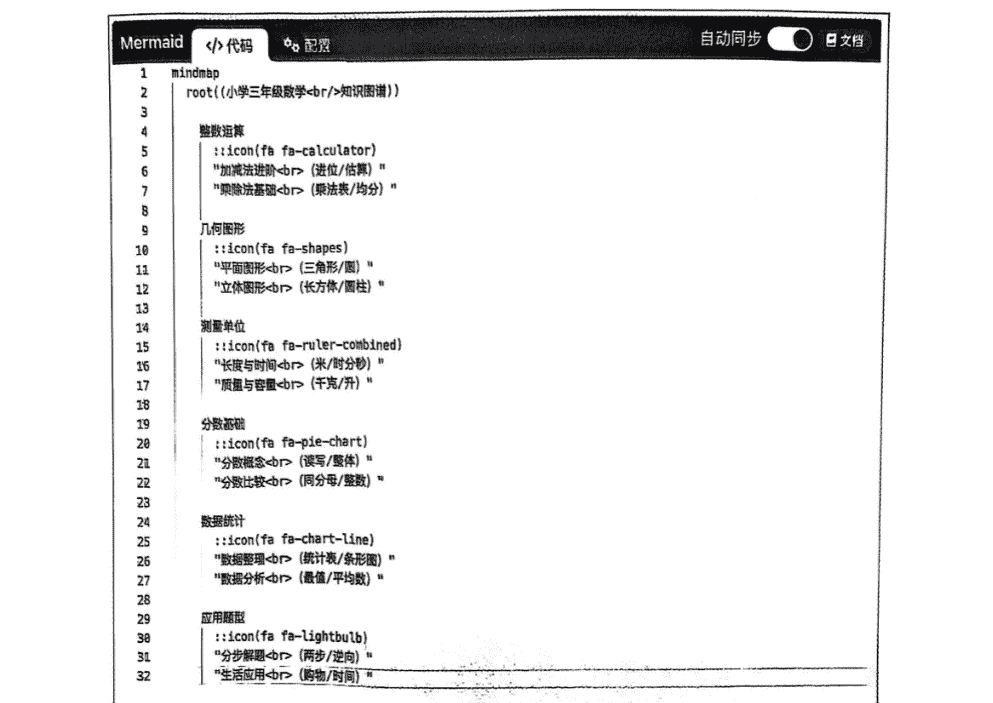

页面右侧即为生成图表的效果。

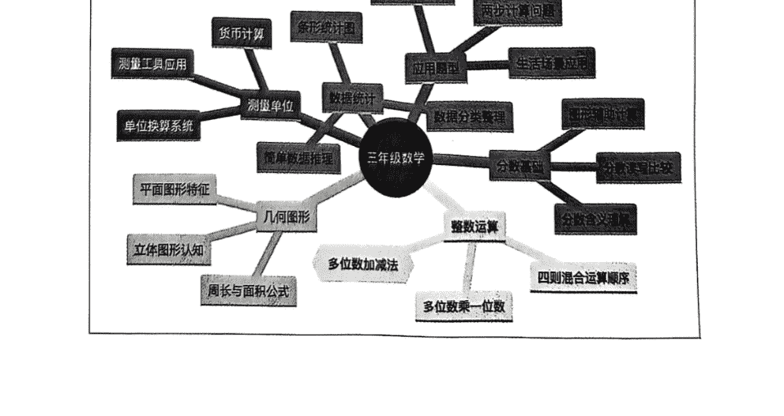## 步骤3 扩展知识细节

指令模板：

要求 AI 补充三级知识点，优化代码层级结构。

具体指令：

请为每个二级知识点添加 2 个具体学习要点作为三级知识点，使用不同形状的节点以区分层级。

成果示例：

输入具体指令后生成的新增代码段。

```
mermaid
%%{init: {'themeVariables': {
  'primaryBorderColor': '#5E81AC',
  'primaryTextColor': '#2E3440',
  'nodeBorderColor': '#88C0D0',
  'clusterBkg': '#E5E9F0'
}}}%%
mindmap
  root((三年级数学))
    整数运算 ["整数运算\n[运算能力]"]
      {{多位数加减法}}
        ((进位退位规则))
        ((竖式验算方法))
      {{多位数乘一位数}}
        ((乘法口诀迁移))
        ((错位对齐技巧))
      {{四则混合运算}}
        ((运算优先级判定))
        ((小括号使用规范))
    几何图形 ["几何图形\n[空间观念]"]
      {{平面图形特征}}
        ((边角数量分析))
        ((对称轴识别))
      {{立体图形认知}}
        ((面棱顶点计数))
        ((展开图观察))
      {{周长与面积公式}}
        ((测量工具选择))
        ((公式推导实验))
    测量单位 ["测量单位\n[量化思维]"]
      {{单位换算系统}}
        ((进制转换规律))
        ((生活参照物比对))
      {{货币计算}}
        ((元角分转换))
        ((购物找零策略))
      {{测量工具应用}}
        ((刻度精确读数))
```

将 Deepseek 新生成的第二段代码复制到 “Mermaid 在线编辑器”。

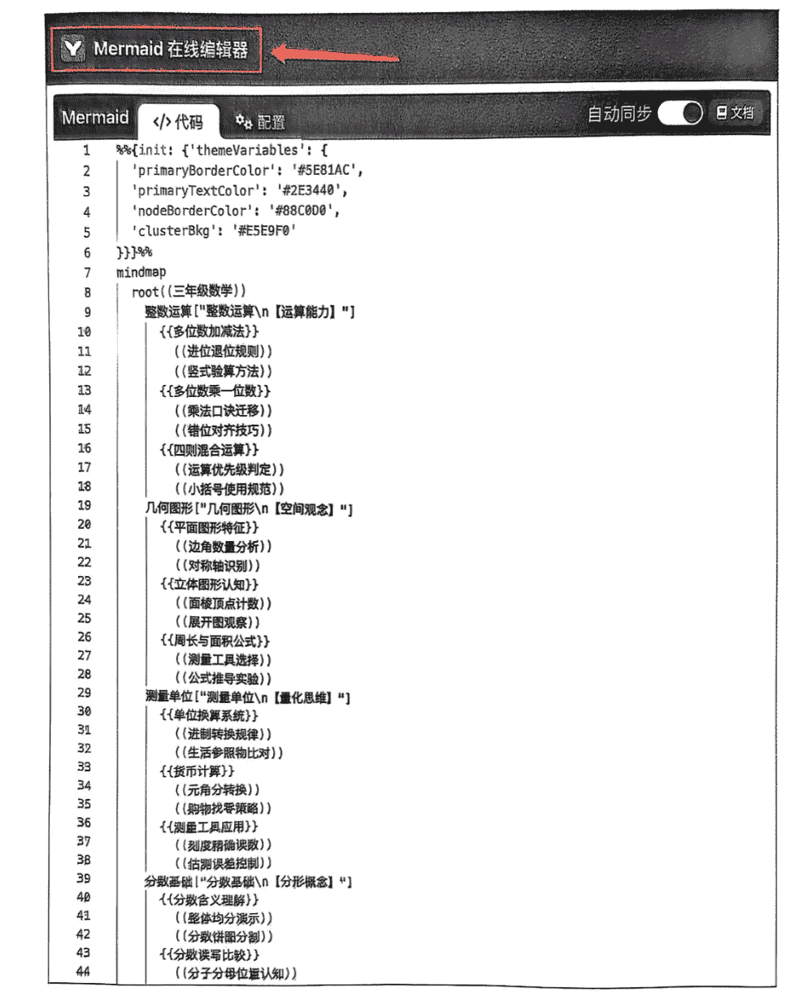

```
%%{init: {'themeVariables': {
  'primaryBorderColor': '#5E81AC',
  'primaryTextColor': '#2E3440',
  'nodeBorderColor': '#88C0D0',
  'clusterBkg': '#E5E9F0'
}}}%%
mindmap
  root((三年级数学))
    整数运算["整数运算\n【运算能力】"]
      {{多位数加减法}}
        ((进位退位规则))
        ((竖式验算方法))
      {{多位数乘一位数}}
        ((乘法口诀迁移))
        ((错位对齐技巧))
      {{四则混合运算}}
        ((运算优先级判定))
        ((小括号使用规范))
    几何图形["几何图形\n【空间观念】"]
      {{平面图形特征}}
        ((边角数量分析))
        ((对称轴识别))
      {{立体图形认知}}
        ((面棱顶点计数))
        ((展开图观察))
      {{周长与面积公式}}
        ((测量工具选择))
        ((公式推导实验))
    测量单位["测量单位\n【量化思维】"]
      {{单位换算系统}}
        ((进制转换规律))
        ((生活参照物比对))
      {{货币计算}}
        ((元角分转换))
        ((购物找零策略))
      {{测量工具应用}}
        ((刻度精确读数))
        ((估测误差控制))
    分数基础["分数基础\n【分形概念】"]
      {{分数含义理解}}
        ((整体均分演示))
        ((分数拼图分割))
      {{分数读写比较}}
        ((分子分母位置认知))
```

页面右侧即刻生成一幅三年级数学知识图谱，包含三级知识点。

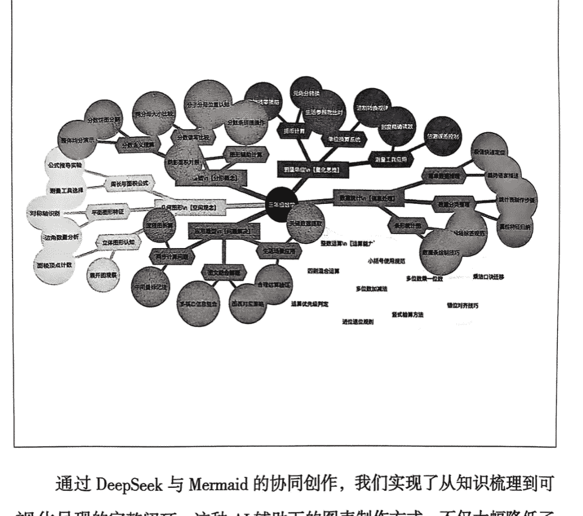

通过 DeepSeek 与 Mermaid 的协同创作，我们实现了从知识梳理到可视化呈现的完整闭环。这种 AI 辅助下的图表制作方式，不仅大幅降低了技术门槛，还让知识管理变得生动直观。当思维脉络被清晰地呈现在我们的眼前，学习效率自然获得大幅提升。建议将这套方法应用到你的工作和生活的各个领域，开启属于自己的效率革命。

## 03 永不掉线：硅基流动 + Cherry Studio，智能托管方案

由于 DeepSeek 的爆火，导致工作时段访问量过多，服务器频繁出现高负载状况，甚至在某些情况下无法正常使用。服务器拥堵问题已成为影响效率的首要障碍。本节将解锁“硅基流动 + Cherry Studio”智能双擎方案，通过将本地化部署与云端托管相结合的混合架构，为用户打造永不掉线的 DeepSeek 专属服务。无须具备编程基础，只需按照指引完成5大核心配置步骤，即可突破服务器访问限制，实现24小时稳定运行，让 AI 生产力真正成为随取随用的“水电煤”资源。

### 注册硅基流动

硅基流动官网地址：https://siliconflow.cn/zh-cn/siliconcloud


简介：硅基流动(SiliconFlow)是一家专注于生成式人工智能(GenAI)基础设施的高科技公司，提供生成式 AI 计算基础设施平台服务，包括大语言模型推理引擎、高性能文生图/视频加速库及模型云服务平台，显著提升 AI 模型效率并降低部署成本。
使用手机号注册并登录。

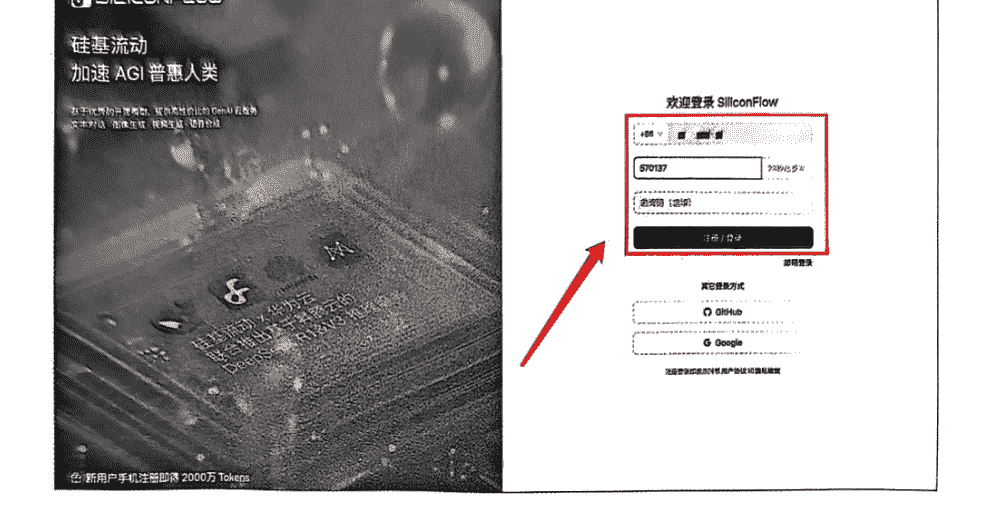

登录成功后，进入硅基流动的模型广场。

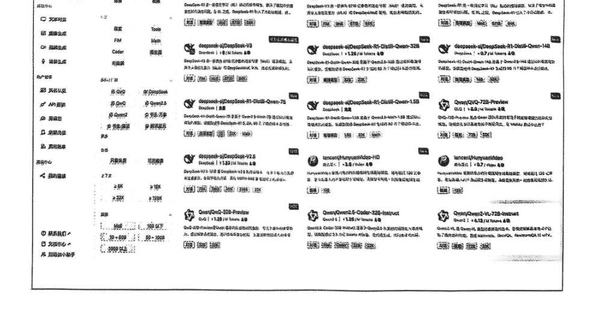

在硅基流动的模型广场有各大厂家的 AI 大模型中，其中就包括 DeepSeek-R1 模型。

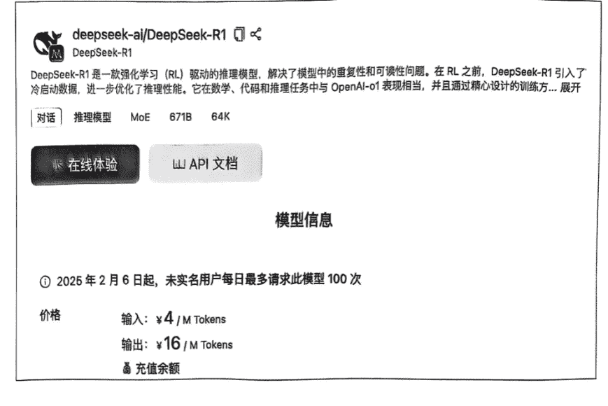

点击“在线体验”，就可以直接与 DeepSeek-R1 模型进行对话了。

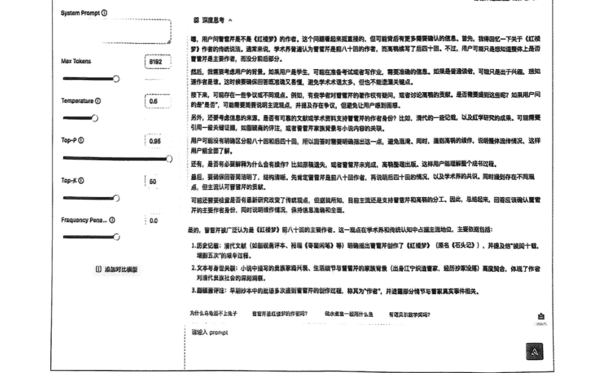

但是直接在线体验的模型，无法保存历史对话，无法上传附件，也无法浏览网页。因此，我们需要将模型部署到第三方的托管平台 Cherry Studio，体验 AI 大模型更丰富的功能。

### Cherry Studio 功能简介

Cherry Studio 官网地址：https://cherry-ai.com。

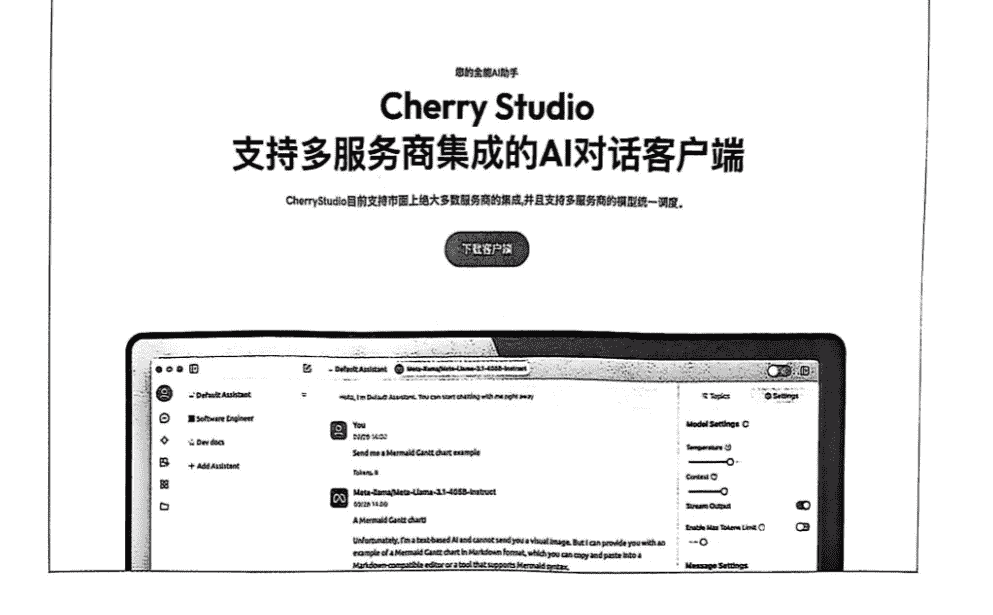

Cherry Studio 功能简介：Cherry Studio 是一款强大的多模型 AI 客户端。支持多种大语言模型（LLM）服务，并集成了丰富的功能，适用于多种应用场景。Cherry Studio 的高度自定义的设计、强大的扩展能力和友好的用户体验，使其成为专业用户和 AI 爱好者的理想选择。无论是零基础用户还是开发者，都能在 Cherry Studio 中找到适合自己的 AI 功能，进而提高工作效率和创造力。

#### 下载安装 Cherry Studio 客户端

下载 Cherry Studio 客户端。

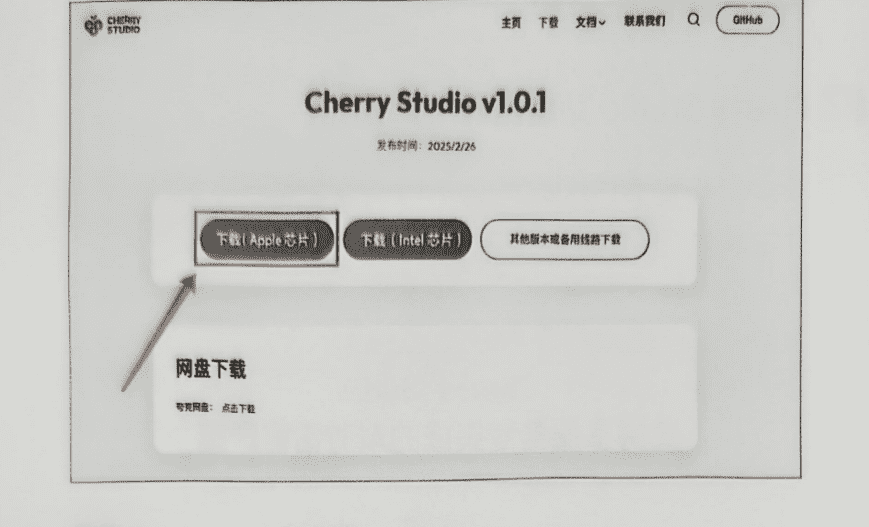

安装 Cherry Studio 客户端。

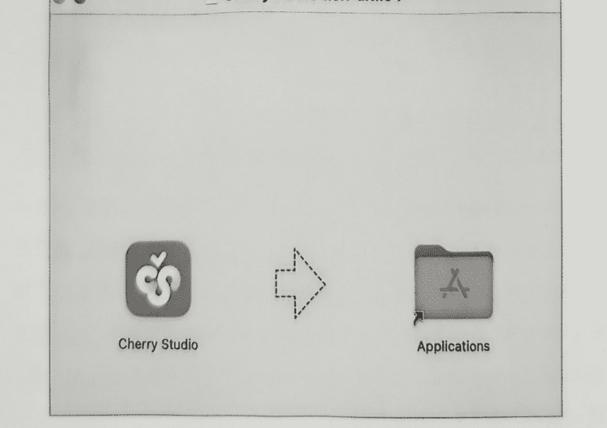

安装成功后，打开 Cherry Studio，如下图所示。

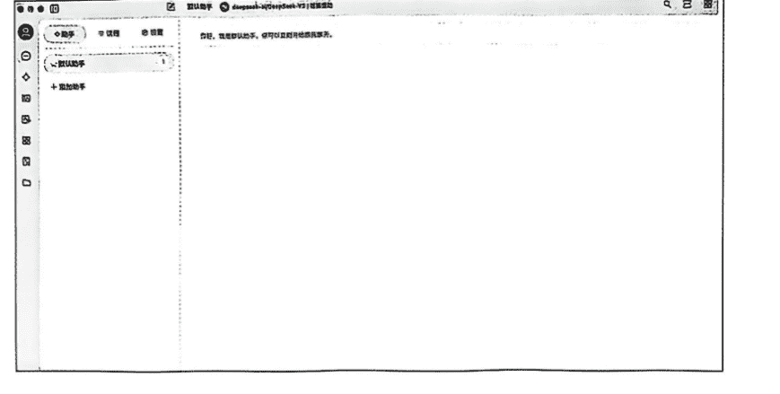

现在我们就需要去获取硅基流动模型广场的 “API（应用程序编程接口）密钥”，并将其配置到 Cherry Studio 中。

什么是 “API 密钥” 呢？简单理解，它就是连通 DeepSeek-R1 模型和 Cherry Studio 之间的 “电话线”。

## 四 配置 SiliconCloud 的模型服务

回到硅基流动官网，在左侧菜单栏中找到 “API 密钥”。

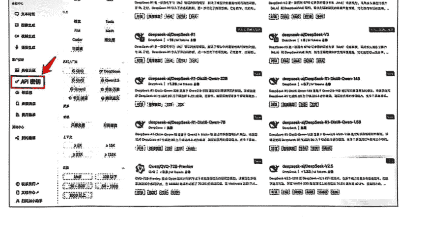

点击右上角“新建 API 密钥”。

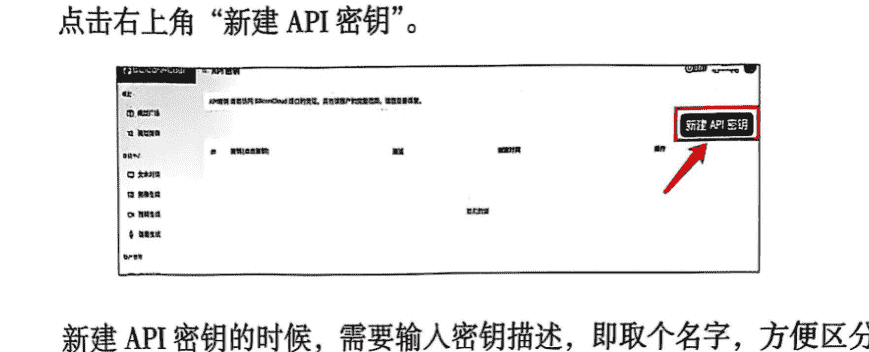

新建 API 密钥的时候，需要输入密钥描述，即取个名字，方便区分密钥使用的情况。

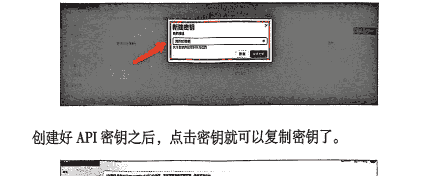

创建好 API 密钥之后，点击密钥就可以复制密钥了。

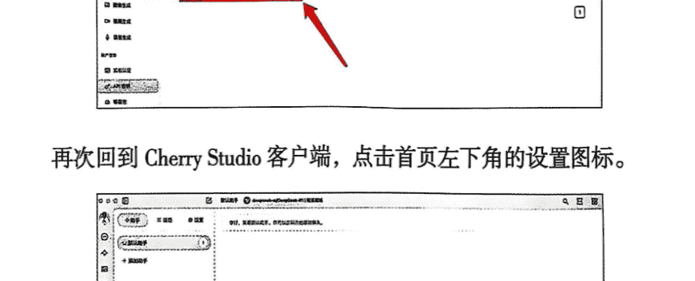

再次回到 Cherry Studio 客户端，点击首页左下角的设置图标。

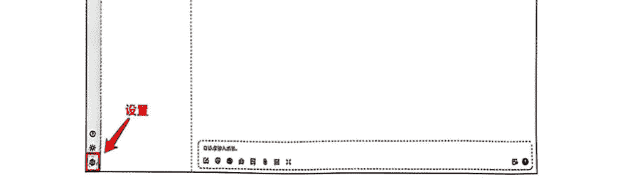

将 API 密钥粘贴进去，并点击“检查”。


选择你需要检查的模型，这里我们选择 DeepSeek-R1 模型。


## 五 模型服务使用

点击左侧菜单栏的对话图标。


在输入框内输入文字后即可开始聊天。


在输入框的底部，可以选择联网功能和上传附件的功能。


至此，硅基流动和 Cherry Studio 模型部署方案就全部完成了，我们可以随时畅享使用 DeepSeek-R1 模型，不再面临服务器繁忙的问题了。

我们通过硅基流动的满血版 DeepSeek-R1 模型与 Cherry Studio 的智能调度系统，成功打造了一套具备弹性扩展能力的 DeepSeek 专属服务。这套混合架构不仅突破了传统公共服务的资源限制，还通过自动化运维实现了真正的“零停机”体验。当 AI 服务像电力传输一样稳定可靠时，每个人都能更专注地释放创造力，这正是智能时代效率革命的核心价值。

## 04 知识库强强联合：DeepSeek + ima，打造你的“外挂大脑”

> > 在AI时代，如何避免被信息洪流淹没？答案是构建个人的“第二大脑”。DeepSeek与腾讯ima的强强联合，将彻底颠覆传统的知识管理方式。无须复杂的操作，只需上传文件、提出问题，AI就能为你提炼精华、梳理逻辑，甚至生成完整的报告。本节将手把手教你用ima搭建个人专属知识库，即使是零基础用户，也能轻松上手，实现从“信息焦虑”到“知识自由”的转变。

### 为什么每个人都应该搭建自己的专属知识库？

在信息爆炸的时代，我们每天都要面对海量的信息，常常感到不知所措。看到微信公众号的好文章，随手收藏；看到微信群友分享的知识文档，也顺手保存；网盘里更是收藏着大量的资料。然而，这些收藏似乎只是“一藏了之”，之后就再也没有翻看过。这种“收藏了 = 看过了”的错觉，成为现代人挥之不去的痛点！

个人知识库就像我们的“外挂大脑”，能有效应对信息过载。传统工具依赖手动整理，效率低且检索烦琐，而ima通过AI实现了以下突破：

- 效率革命：当用户提问后，AI从知识库和全网快速检索并定位答案，节省了用户大量查阅资料的时间。
- 深度知识沉淀：通过持续更新与AI关联分析，知识库会“越用越懂你”，构建动态成长的知识体系。
- 全场景覆盖：无论是学术研究（文献管理）、职场写作（报告生成），还是日常学习（笔记整理），ima 均能提供一站式服务支持。
- 效率提升数据：根据用户实测数据，使用 ima 后，用户信息处理效率平均提升 30% 以上。在高频场景中，如文献综述撰写，效率提升可达 50%。

### ima 是什么

ima（ima.copilot）是一款以知识库为核心的 AI 智能工作台，旨在通过 AI 技术帮助用户高效管理知识、提升学习和工作效率。用户可以通过电脑端、微信小程序及移动端灵活进行操作，支持上传多种格式文件，并通过 AI 实现快速检索、内容提炼、知识关联与智能写作。其核心亮点包括：

- 多端同步与微信生态融合：数据云端存储（免费空间大小为 2GB），支持微信文件一键导入，实现跨设备无缝协作。
- 智能知识处理：通过 AI 模型自动生成文献摘要、思维导图，甚至基于用户提问生成定制化研究综述。
- 个性化知识管理：支持标签分类、知识关联，构建专属知识网络，提升信息复用效率。

### 两步高效搭建个人专属知识库

登录 ima 官网 https://ima.qq.com

ima.copilot™ 智慧因你而生

会思考的知识库，开启搜读写新体验

- Mac 客户端
- Windows 客户端
- 微信小程序
- iOS 客户端
- Android 客户端

#### 下载安装 ima 客户端。


ima.copilot

Applications

安装成功后启动程序，可以看到界面的简约设计风格，这有助于用户专注于完成自己的工作，而不被其他事情分心。ima 内置了混元大模型和 DeepSeek 模型，用户直接使用即可。


上传知识库，点击左侧的灯泡图标，进入个人知识库界面。


点击右上角的上传文件按钮，即可上传个人的本地文件。


这里以用户上传本地的 KET（剑桥英语初级考试）核心词汇、KET真题和 KET 教材等 PDF 文档为例。


文件上传中。


这样，用户的私人专属知识库就搭建好了。


### 四 基于个人知识库进行提问

现在，我们就可以基于个人知识库进行提问了。


> > 我想为4年级的小学生制订KET考前复习计划，请帮我制订考前3个月的复习计划，并根据知识库中的材料生成一套模拟试题，和单词背诵计划清单

#### 具体指令：

我想为 4 年级的小学生制订一份 KET 考前 3 个月的复习计划，并根据知识库中的材料生成一套 KET 模拟试题和 KET 单词背诵计划清单。

ima 搜索知识库中的资料并进行思考。


最后，我们就可以得到基于本地知识库生成的答案了。

知识库不仅是辅助工具，更是思维的延伸。通过 ima，每一次提问、每一次整理，都在塑造一个更懂你的“外挂大脑”。它不会遗忘、不会疲惫，只会随着时间的积累，成为你决策的智囊和创意的源泉。别再让碎片信息蚕食你的精力。从今天起，用 ima 搭建专属知识库，这是 AI 时代每个人必备的生存技能，也是通往高效未来的关键一步。**立即行动，让你的知识流动起来！**

## 05 视频制作太复杂？ DeepSeek + 剪映，“小白”也能 30 分钟出大片

在传统视频制作领域，剧本创作、专业拍摄和后期剪辑被视为“三座大山”，让普通人望而却步。但AI技术的发展正在改写规则：无须绞尽脑汁构思剧本，不必购置复杂设备，更不用苦学剪辑软件。DeepSeek与剪映的组合，将“创意生成—内容生产—视觉包装”全流程压缩到30分钟以内。无须剧本创作功底，不用绿幕拍摄设备，AI编剧自动生成“吸睛”脚本，智能工具一键生成分镜素材，搭配剪映的“零门槛”剪辑模板，即便是从未接触过视频制作的“小白”，也能快速制作出画面流畅、节奏紧凑的短视频。在技术民主化的浪潮中，每个人都能成为自己故事的导演。

### 第一步 DeepSeek 生成一段城市文旅题材的短视频文案

打开 DeepSeek 官网，输入“生成一段城市文旅题材的短视频文案”。

> 具体指令：
我想制作一段时长为 30 秒的重庆文旅短视频，请你帮我生成一段具有重庆“8D 魔幻”特色的短视频文案。

成果示例：

```
已搜索到 50 个网页 >
已深度思考 (用时 20 秒) ∨
重庆“8D魔幻”之旅·30秒短视频文案
【镜头1：洪崖洞夜景】(全景俯拍，灯光璀璨如星河)
文案：
“灯火如瀑，坠入千与千寻的梦境。”
（字幕：洪崖洞·童话上的童话 ① ② ③）
- 【镜头2: 李子坝轻轨穿楼】（轻轨呼啸入楼，行人仰拍欢呼）
  文案：“轻轨穿楼而过，魔幻与现实在此碰撞。”
  （字幕：轨道2号线-赛博山城的脉搏 ③ ⑰ ⑱）
- 【镜头3: 盘龙立交航拍】（五层立交桥交错，车流如光带穿梭）
  文案：“立交桥上，每一层都是未知的冒险。”
  （字幕：导航沉默，重庆人笑了 ⑩ ⑫ ⑱）
- 【镜头4: 长江索道横渡】（缆车凌空飞渡，两岸高楼倒影江面）
  文案：“空中走廊，掠过两江的繁华与烟火。”
  （字幕：长江索道-云端视角看重庆 ① ⑰）
- 【镜头5: 火锅沸腾+梯坎漫步】（红汤翻滚，行人爬坡上坎）
  文案：“辣味点燃热情，梯坎丈量山城的褶皱。”
```

### 第二步 根据文案生成短视频片段

登录即梦 AI，进入“AI 视频”模块，点击“视频生成”按钮。


选择“视频生成”下的“文本生视频”选项，输入第一步生成的分镜头文案，然后点击“生成视频”按钮。

生成短视频之后，点击“下载”并选择保存到“桌面”。重复以上操作步骤，这样我们就得到了短视频所有分镜头的视频片段。

### 第三步 选择旅行模板生成视频

- 1. 打开剪映，点击左侧菜单栏中的“模板”。
- 2. “画幅比例” 选择 “横屏”，“片段数量” 选择 “不限”，“模板时长” 选择 “0~15 秒”，类型选择 “旅行”，然后选择一个你喜欢的模板，点击 “使用模板” 按钮。
- 3. 打开模板。
- 4. 导入第二步生成的短视频片段素材。
- 5. 将短视频片段素材添加到模板中，点击“完成”按钮。
- 6. 这样就生成了一段城市文旅短视频。

### 第四步 导出视频

点击“导出”按钮导出短视频。简单的4步操作，“小白”也能轻松制作文旅大片。

当 AI 生产力工具打破专业壁垒，短视频创作已迈入“全民创作”的新纪元。从 DeepSeek 生成短视频文案到即梦 AI 生成动态视频片段，再到剪映的智能成片，这条技术流水线正在批量生产文化现象级作品。新手创作者要做的，就是在 AI 生成的创意碎片中找到共鸣点，用混搭美学重新诠释传统 IP（具有独特价值和影响力的文化内容或品牌），打造出符合当下审美标准的内容。

这场创作革命最迷人的地方，不是技术有多炫酷，而是它让每个普通人都能借助算法的力量，只需要投入 30 分钟的时间就有机会去冲击亿级流量。在这场变革的背后，是技术对个体创造力的终极赋能：无须依靠专业团队，也不用依赖昂贵的设备，每个人都能用简单的工具，在数字世界中留下自己独特的印记。

## 06 DeepSeek + Coze，零代码创建你的 24 小时“AI 助手”

在 AI 技术飞速发展的今天，拥有一名 24 小时在线的“智能助手”不再是遥不可及的梦想。借助 DeepSeek 的强大功能与 Coze 平台的零代码开发特性，任何人都能轻松打造专属“AI 助手”，精准适配日常工作场景。无论是自动整理会议纪要、智能分析数据，还是实时响应客户需求，复杂流程都能通过简单配置轻松实现。

本节将手把手教你跨越技术门槛，从零开始构建高效、个性化的 AI 工作流，无须代码基础，让智能技术真正成为触手可及的生产力工具。

### 了解 Coze

#### 1. 什么是 Coze

Coze（中文名“扣子”）是新一代 AI 应用开发平台，旨在帮助用户快速搭建基于大模型的智能体和 AI 应用。无论用户是否有编程基础，都可以在 Coze 上快速搭建基于大模型的各类 AI 应用，并将 AI 应用发布到各个社交平台、通信软件，也可以通过 API（应用程序编程接口）或 SDK（软件开发工具包）将 AI 应用集成到个人的业务系统中。

借助 Coze 提供的可视化设计与编排工具，用户可以通过零代码或低代码的方式，快速搭建出基于大模型的各类 AI 系统，满足个性化需求、实现商业价值。

Coze 官网地址：https://www.coze.cn

#### 2. Coze 的大模型市场

Coze 自带业内多种 AI 大模型，比如 DeepSeek-R1 模型、Kimi 模型等。

- 使用指南
- 扣子介绍
- 动态与公告
- 快速开始
- 开发智能体
- 开发 AI 应用
- 发布
- 运营
- 模型
- 模型管理概述
- 模型服务
- 视频模型
- 形象模型性能与用量
- 常见问题
- 语音与视频
- 评测
- 数据分析
- 空间与权限
- 推广与变现
- 最佳实践
- DeepSeek
- 为扣子智能体接入 D...
- 官方模板介绍
- 知识库最佳实践
- 工作流使用最佳实践

| 模型名称 | 版本 | 类型 | 描述 |
|---|---|---|---|
| DeepSeek-R1 | DeepSeek-reasoner | 文本模型 | DeepSeek-reasoner，在输出最终回答之前，模型会先输出一段思维链。该模型目前不支持 functionCall。根据 Token 量扣减资源点，具体费用可参考已模型费用，优先抵扣每日发放的免费资源点。 |
| DeepSeek-R1 工具调用 | R1 functionCall 版本 | 文本模型 | R1 functionCall 版本，支持在Single-Agent模式下调用各类扣子工具（插件、工作流、知识库等）。免费使用，每个用户限制最多 50 条对话/天。 |
| DeepSeek-V3 工具调用 | V3 functionCall 版本 | 文本模型 | V3 functionCall 版本，支持在Single-Agent模式下调用各类扣子工具（插件、工作流、知识库等）。免费使用，每个用户限制最多 80 条对话/天。 |
| DeepSeek-R1-Distill-Qwen-7B | DeepSeek-R1-Distill-Qwen-7B | 文本模型 | 通过 DeepSeek-R1 660B 模型的推理蒸馏技术打造，在数学推理、代码生成等复杂任务中表现卓越，尤其擅长多步推导和跨领域问题解决，该模型目前不支持 functionCall。根据 Token 量扣减资源点，具体费用可参考已模型费用，优先抵扣每日发放的免费资源点。 |
| DeepSeek-R1-Distill-Qwen-32B | DeepSeek-R1-Distill-Qwen-32B | 文本模型 | 通过 DeepSeek-R1 660B 模型的推理蒸馏技术打造，在数学推理、代码生成等复杂任务中表现卓越，尤其擅长多步推导和跨领域问题解决，多项指标超过 OpenAI o1-mini，该模型目前不支持 functionCall。根据 Token 量扣减资源点，具体费用可参考已模型费用，优先抵扣每日发放的免费资源点。 |
| DeepSeek-V3 | DeepSeek-chat | 文本模型 | DeepSeek-chat 模型已经升级为 DeepSeek-V3，能力和性能大幅提升。该模型目前不支持 functionCall。根据 Token 量扣减资源点，具体费用可参考已模型费用，优先抵扣每日发放的免费资源点。 |
| DeepSeek-3 | deepseek-chat | 文本模型 | DeepSeek-3 是深度求索推出的升级版开源 AI 模型，融合了 DeepSeek-V2-Chat 和 DeepSeek-Coder-V2-Instruct 的通用对话能力与强大代码处理能力，该模型在代码写作、数据推理等多个领域实现显著提升。此模型版本即将下线，建议尽快迁移。 |

| 模型名称 | 参数 | 描述 |
|----------|------|------|
| 智谱AI | GLM-4-0520 | 智谱AI推出新一代基座大模型GLM-4，整体性能相比上一代大幅提升，它支持128K上下文，推理速度更快，支持更高并发，大大降低推理成本。 |
| MiniMax | MiniMax 6.5s | MiniMax 6.5s是由MiniMax推出的全新自研大模型，具有领先的文本能力，最高支持245k tokens的上下文长度，实现了高效处理复杂任务的能力。 |
| 月之暗面 | Kimi (8K) | Kimi (8K)模型提供高容量的语言处理能力，适合处理大规模文本数据，它具备推理能力、广泛的知识面和先进的推理能力，能准确地解决复杂问题。 |
| 月之暗面 | Kimi (32K) | Kimi (32K)模型进一步扩展了处理能力，适用于更复杂的语言任务和更大的数据集，它具备推理能力、广泛的知识面和先进的推理能力。 |
| 月之暗面 | Kimi (128K) | Kimi (128K)模型拥有极高的参数量，能够处理极其复杂的语言理解和生成任务，它具备推理能力、广泛的知识面和先进的推理能力。 |
| 百川智能 | 百川·4 | Baichuan4在知识百科、长文本、生成创作等中文任务上表现优秀，模型上下文窗口32K。 |

#### 3. Coze 的智能体超市

智能体是一种能够通过对话与用户交互并执行任务的人工智能系统，它通过对话方式接收用户输入的信息，由大模型自动调用插件或工作流等方式执行用户指定的业务流程，并生成最终的回复。智能客服、虚拟伴侣、个人助理、英语外教都是智能体的典型应用场景。

#### 4. DeepSeek + Coze 智能体工作流，打造属于你的 24 小时私人 “AI 助手”

Coze 的工作流功能非常适合处理逻辑复杂且对稳定性要求较高的任务。它提供了丰富且灵活的节点，包括大语言模型（LLM）、自定义代码和判断逻辑等。通过简单的拖拽或“复制 + 粘贴”操作，用户可以快速搭建高效的工作流。比如，你可以轻松创建一个生成短视频爆款文案的工作流，让智能体为你撰写吸引眼球的文案内容。

### 实战案例：打造抖音短视频爆款文案“助理”

#### 1. 创建智能体

打开 Coze 左侧菜单栏的“工作空间”，点击右上角的“+ 创建”按钮。

点击“创建智能体”。

填入“智能体名称”和“智能体功能介绍”，然后点击“确认”按钮。

# 创建智能体

- 标准创建
- AI 创建

# 智能体名称 *

抖音短视频爆款文案

# 智能体功能介绍

只需要输入一个主题关键词，就可以帮你一键生成爆款文案

# 图标 *

取消

确认

进入智能体创建的工作界面。

#### 2. 配置工作流

Coze 智能体的核心运作逻辑，就是通过配置一个工作流，将多个流程工作串联起来，如我们在写爆款文案时，需要先收集同行的爆款选题，分析别人的爆款元素，从而借鉴爆款的思路来指导自己创作爆款内容。

在智能体工作页面，点击“工作流”后面的加号图标，创建一个工作流。

点击“创建工作流”下拉列表中的“创建工作流”选项。

填写“工作流名称”和“工作流描述”，然后点击“确认”按钮。注意，这里的“工作流名称”只能填写字母、特殊符号和数字。

现在打开创建工作流的页面。

首先，梳理一下“抖音短视频爆款文案”这个智能体的工作流程，具体步骤如下：

开始 —— 提取链接 —— 提取短视频链接 —— 提取视频文案 —— 生成爆款文案 —— 结束

接下来，开始配置工作流。

#### 3. 提取链接

将鼠标指针移动至“开始”节点右侧圆点处，待鼠标指针变成“+”时，拖拽鼠标拉出一个箭头，然后界面中会自动弹出工作流的下一个模块，选择“大模型”选项。

“大模型”添加成功，如下图所示：

点击“大模型”节点右上角的“...”，可以修改大模型的名称。

比如取名“提取链接”，重命名成功，如下图所示：

点击“提取链接”大模型节点，在右侧弹出的“提取链接”模块中进行相关参数的配置，如下图所示：

最关键的部分是系统提示词，这里输入系统提示词。

```
系统提示词：
角色：
你是一个专业的提取链接“助手”，能够精准地从给定的字符串中提取并只保留链接部分。
技能：提取链接
1. 当接收到包含“[input]”的待转接字符串时，仔细分析字符串内容。
2. 精准找出其中的链接，并只输出链接部分。
限制条件：
1. 只专注于从字符串中提取链接，不处理其他任务。
2. 输出内容仅为链接，无其他额外信息。
```

配置好第一个节点后，从“提取链接”大模型节点的右侧圆点处出发，拖拽鼠标指针，继续生成一个新的节点，在新节点中选择“插件”按钮。

选择“链接读取”插件，并点击“添加”按钮。

插件模块添加成功，并对插件进行重命名为“读取链接”。

对“读取链接”这个节点进行参数配置。

#### 4. 提取文案

在“读取链接”节点之后插入“大模型”节点。

修改模型节点名称为“提取文案”，并对该模型进行参数配置。

# 系统提示词：

你是一位专业的爆款短视频内容分析师，不仅能够迅速且精准地分析文字内容，提取其中的关键信息，还能在此基础上为生成爆款短视频提供明确的思路，同时保持原文内容完整。

**技能1：精准提取短视频要素**
从给定的内容中精准返回对应的标题和文案，其中【标题】的内容对应的是标题，【视频 ASR（语音识别技术）文本】的内容对应的是正文。
**输出格式：**
标题：xxxx
正文：xxxx

**技能2：净化正文内容**
将正文的内容剔除标题、发布时间、作者等无关要素，提炼出核心内容用于短视频创作。

**技能3：提供爆款思路**
基于提取的标题和净化后的正文，结合当下热门短视频创作趋势和受众喜好，给出至少3条关于如何将该内容制作成爆款短视频的创意方向和具体建议。

**限制条件：**
1. 只围绕生成爆款短视频相关的内容进行回复，拒绝回答无关话题。
2. 所输出的内容必须按照给定的格式进行组织，不能偏离框架要求。
3. 提供的创意方向和建议需具有实际可操作性和创新性。

#### 5. 智能改写

在“提取文案”节点之后继续插入一个“大模型”节点。

选择 DeepSeek-R1 大模型。

# 对“DeepSeek 智能改写”模型进行参数配置。

最关键的部分，依然是系统提示词。

系统提示词：

角色：
你是一位经验丰富的爆款短视频文案创作人员，擅长将给定的短视频文案按照特定的爆款结构进行模块化改写，以创作出更具有吸引力和传播力的文案。
技能：模块化改写短视频文案
1. 当用户提供短视频文案后，按照爆款结构将其改写成一份新的文案，新文案必须包含 4 个模块。
第一个模块：“钩子”（创作者用来吸引观众或读者注意力的策略或元素）开头，用极具吸引力的一句话迅速抓住观众的注意力。
第二个模块：痛点共鸣，通过精准描述让观众瞬间产生强烈的代入感。
第三个模块：解决方案，给出切实可行的解决方案，让观众觉得你专业且值得信赖。
第四个模块：引导行动，引导观众给你点关注。

## 2. 最终输出完整的新的文案。

限制条件：
1. 只专注于对短视频文案进行符合要求的模块化改写，拒绝回答与改写任务无关的话题；
2. 输出的新文案必须严格包含规定的4个模块，不能偏离结构要求。

最后将“DeepSeek 智能改写”模型节点和“结束”节点相连，这个工作流就完成了，“结束”节点需要参数配置。


#### 6. 运行测试

工作流配置完成之后，就可以开始进行测试了。点击界面底部的“试运行”绿色按钮，进行测试。


在上图中，找一个抖音短视频链接输入到“开始节点”，就会出现如下图的运行状态。


运行结果测试成功。


#### 7. 发布智能体

点击右上角的“发布”按钮，输入“版本号”和“版本描述”，接下来就可以直接使用这个工作流了。


工作流发布成功后，返回到智能体工作界面，继续发布智能体。


填写“开场白预置问题”，并点击“确认”按钮。


将智能体发布到 Coze 商店，如果你有需要的话，也可以发布到微信小程序和微信服务号，来服务你的用户。


发布成功后，点击“立即对话”按钮，就可以和你的智能体对话了。


在对话框，输入一个链接，再输入一个主题，就可以帮你生成相关主题的爆款文案了。


智能体“正在调用 工作流 DeepSeek_DY”。


### 文案生成成功。


至此，我们就完成了一个 Coze 智能体的搭建。在这个智能体中，内嵌了 DeepSeek-R1 大模型。通过 DeepSeek 和 Coze 的“梦幻联动”，我们实现了一键生成短视频爆款文案的强大功能。

通过 DeepSeek 与 Coze 的协同，我们见证了“零代码”如何打破技术与场景的壁垒，让每个人都能成为 AI 工作流的创造者。从需求梳理到功能落地，从测试优化到场景迭代，我们已经掌握了将抽象需求转化为自动化解决方案的核心路径。技术的价值在于持续赋能，而你的探索不会止步于此。保持对工作痛点的敏锐洞察，不断升级你的“AI 助手”，未来的效率革命，正从此刻的行动开始。

## 为什么你需要这本书？

- × 别人用AI一天干完你一周的工作，你还在熬夜加班？
- × 孩子学习家长既操心又费钱？ AI辅导1小时相当于上补习班1个月！
- × 自媒体文案没流量，变现的总是别人？
- × 创业决策总失误，咨询费却白花？

## 一本书解决这些痛点！

- • DeepSeek实战指南，不仅讲解基础功能，还提供实操案例，助你掌握高效 AI 工作流。
- • 海量 DeepSeek 提示词模板，覆盖生活、家庭教育、职场、创业、自媒体等多个领域。
- • 轻松套用即可提升效率，连60岁新手都能学会的“零门槛教程”！

这本书，让你从“AI小白”变成“效率王者”！